# Michaelis Lippert C 6.0 精髓

To my family: Elisabeth, Benjamin, Hanna, and Abigail.

You have sacrificed a husband and daddy for countless hours of writing,
frequently at times when he was needed most.

Thanks!

## Figures

+   FIGURE 2.1: *值类型直接包含数据* 62
+   FIGURE 2.2: *引用类型指向堆* 63
+   
+   FIGURE 3.1: *对应的占位符值* 128
+   FIGURE 3.2: *计算无符号字节的值* 129
+   FIGURE 3.3: *计算有符号字节的值* 129
+   FIGURE 3.4: *数字 12 和 7 在二进制中的表示* 131
+   FIGURE 3.5: *Microsoft Visual Studio .NET 中的折叠区域* 159
+   
+   FIGURE 4.1: *异常处理程序流* 206
+   
+   FIGURE 5.1: *类层次结构* 220
+   
+   FIGURE 6.1: *重构为基类* 291
+   FIGURE 6.2: *使用聚合模拟多重继承* 300
+   
+   FIGURE 7.1: *使用聚合和接口解决单继承限制* 345
+   
+   FIGURE 8.1: *值类型直接包含数据* 352
+   FIGURE 8.2: *引用类型指向堆* 354
+   
+   FIGURE 9.1: *标识* 390
+   FIGURE 9.2: *Visual Studio IDE 中的 XML 注释提示* 414
FIGURE 12.1: Delegate Types Object Model 513
FIGURE 12.2: Anonymous Function Terminology 516
FIGURE 12.3: The Lambda Expression Tree Type 536
FIGURE 12.4: Unary and Binary Expression Tree Types 537
FIGURE 13.1: Delegate Invocation Sequence Diagram 553
FIGURE 13.2: Multicast Delegates Chained Together 555
FIGURE 13.3: Delegate Invocation with Exception Sequence Diagram 556
FIGURE 14.1: A Class Diagram of IEnumerator<T> and IEnumerator Interfaces 584
FIGURE 14.2: Sequence of Operations Invoking Lambda Expressions 599
FIGURE 14.3: Venn Diagram of Inventor and Patent Collections 603
FIGURE 16.1: Generic Collection Interface Hierarchy 645
FIGURE 16.2: List<> Class Diagrams 647
FIGURE 16.3: Dictionary Class Diagrams 654
FIGURE 16.4: SortedList<> and SortedDictionary<> Class Diagrams 661
FIGURE 16.5: Stack<T> Class Diagram 662
FIGURE 16.6: Queue<T> Class Diagram 662
FIGURE 16.7: LinkedList<T> and LinkedListNode<T> Class Diagrams 663
FIGURE 16.8: Sequence Diagram with yield return 672
FIGURE 17.1: MemberInfo Derived Classes 691
FIGURE 17.2: BinaryFormatter Does Not Encrypt Data 715
FIGURE 18.1: Clock Speeds over Time 732
FIGURE 18.2: CancellationTokenSource and CancellationToken Class Diagrams 771
FIGURE 20.1: Pointers Contain the Address of the Data 864
FIGURE 21.1: Compiling C# to Machine Code 882
FIGURE 21.2: Assemblies with the Modules and Files They Reference 890
FIGURE C.1: APM Parameter Distribution 912
FIGURE C.2: Delegate Parameter Distribution to BeginInvoke() and EndInvoke() 925

## Tables

+   TABLE 1.1: C# Keywords 5
+   TABLE 1.2: C# Comment Types 24
+   TABLE 1.3: C# and .NET Versions 29
+   TABLE 2.1: Integer Types 36
+   TABLE 2.2: Floating-Point Types 38
+   TABLE 2.3: decimal Type 38
+   TABLE 2.4: Escape Characters 47
+   TABLE 2.5: string Static Methods 52
+   TABLE 2.6: string Methods 52
+   TABLE 2.7: Array Highlights 73
+   TABLE 2.8: Common Array Coding Errors 86
+   TABLE 3.1: Control Flow Statements 108
+   TABLE 3.2: Relational and Equality Operators 120
+   TABLE 3.3: Conditional Values for the XOR Operator 122
+   TABLE 3.4: Preprocessor Directives 153
+   TABLE 3.5: Operator Order of Precedence 160
+   TABLE 4.1: Common Namespaces 165
+   TABLE 4.2: Common Exception Types 210
+   TABLE 6.1: Why the New Modifier? 308
+   TABLE 6.2: Members of System.Object 320
+   - TABLE 7.1: Comparing Abstract Classes and Interfaces 348
+   - TABLE 8.1: Boxing Code in CIL 363
+   - TABLE 9.1: Accessibility Modifiers 409
+   - TABLE 12.1: Lambda Expression Notes and Examples 521
+   - TABLE 14.1: Simpler Standard Query Operators 618
+   - TABLE 14.2: Aggregate Functions on System.Linq.Enumerable 618
+   - TABLE 17.1: Deserialization of a New Version Throws an Exception 717
+   - TABLE 18.1: List of Available TaskContinuationOptions Enums 758
+   - TABLE 18.2: Control Flow within Each Task 785
+   - TABLE 19.1: Sample Pseudocode Execution 818
+   - TABLE 19.2: Interlocked’s Synchronization-Related Methods 829
+   - TABLE 19.3: Execution Path with ManualResetEvent Synchronization 838
+   - TABLE 19.4: Concurrent Collection Classes 840
+   - TABLE 21.1: Primary C# Compilers 880
+   - TABLE 21.2: Common C#-Related Acronyms 895

## Foreword

欢迎来到 C# 书籍世界中你能梦想到的最伟大的合作之一——可能远不止于此！Mark Michaelis 的 *Essential C#* 系列在与著名 C# 博主 Eric Lippert 联手撰写前一版时已是经典之作，这堪称一次神来之笔。

你可能认为 Eric 写博客，Mark 写书，但这并不是我初次认识他们的方式。

2005 年 LINQ（Language Integrated Query）公布时，我刚加入微软不久，有幸参加了 PDC 大会上的隆重发布。尽管我对这项技术几乎没有贡献，我仍然完全沉浸在 hype 中。演讲座无虚席，印刷传单像热蛋糕一样飞快售罄。那是 C# 和 .NET 的大日子，我玩得很开心。

不过动手实验室区域却相当安静，那里人们可以用漂亮的脚本化演练亲自尝试技术预览。就在那里我遇到了 Mark。毋庸置疑，他没有按脚本走。他在做自己的实验，翻阅文档，与其他人交谈，并忙着拼凑出自己的理解。

作为 C# 社区的新人，我想我在那次大会上可能第一次认识了很多后来与我建立了良好关系的人。但说实话，我不记得了——一切都模糊了。我唯一记得的是 Mark。原因如下：当我问他是否喜欢这些新东西时，他并没有加入狂欢。他非常冷静：“*我还不知道。我还没有对它做出决定。*”他想要吸收并理解整个方案，在此之前他不会让任何人告诉他该怎么想。

所以，与其说我得到了一次我可能期望的快速肯定糖 rush，不如说我进行了一次坦诚而充实的对话——这是多年以来多次对话中的第一次——关于这项新技术的细节、后果和担忧。从那时起一直如此：Mark 对我们语言设计者来说是一个极其宝贵的社区成员，因为他超级聪明，坚持要从根本上理解一切，并且对事物如何影响真正的开发者有惊人的洞察力。但也许最重要的是因为他直言不讳，从不害怕说出自己的想法。如果某件事通过了“Mark 测试”，那么我们就可以开始对它感到相当满意了！

这些正是使 Mark 成为如此优秀作家的品质。他直指本质，以极大的诚信沟通，没有粉饰，善于发现实用价值和现实问题。

Eric 当然是我在 C# 团队共事七年的前同事。他在我之前待得更久，我第一次对他的印象是，他在向团队解释如何解开一团意大利面。更准确地说，当时我们的 C# 编译器代码库急需一些严重的架构 TLC，添加新功能变得异常困难——而这正是我们使用 LINQ 时迫切需要做到的。Eric 正在研究我们应该采用什么样的架构（阶段！我们甚至几乎没有这些！），更重要的是，如何一步步从这里到那里。令人惊讶的是，这个问题如此复杂，而我又是团队和代码库的新人，我立刻明白他在说什么！

你可能从他的博客中认识到他对问题的超清晰、结构良好的梳理、令人信服的解决方案列举，以及偶尔的无节制幽默。好吧，你还不知道全部！每当 Eric 处理一个复杂问题并与团队分享他的想法时，他关于此的邮件同样细致入微，幽默感也丝毫不减。你根本无法忽视 Eric 提出的问题，因为你迫不及待想读他的文章。它们甚至还是紫色的！所以我基本上得以持续享用相当于他博客未出版的连载，以及当然，他作为 C# 编译器团队和语言设计团队成员的愉快而富有洞察力的存在。在离开微软后，Eric 继续成为一位了不起、富有洞察力的声音，对我们的决策产生了比他自己可能知道的还要多的影响。

总之，我非常感激能定期与这两位了不起的人一起工作：Eric 帮助我保持意图并纠正这种情况。在本书的后续章节中，你将了解到额外的技术方法，例如基于接口的编程、LINQ 及其对集合 API 的改造，以及最终在第 17 章通过属性实现声明式编程的 rudimentary 形式。

本书有三个主要功能：

- 它对 C# 语言提供了全面覆盖，超越了教程，并提供了一个基础，以便你开始有效的软件开发项目。
- 对于已经熟悉 C# 的读者，它提供了对一些更复杂编程范式的深入见解，并对最新语言版本 C# 6.0 和 .NET Framework 4.6 中引入的功能进行了深入介绍。
- 它作为一个永恒的参考，即使你在语言上变得熟练后仍然适用。

成功学习 C# 的关键是尽快开始编码。不要等到你在理论上成为“专家”——立即开始编写软件。作为迭代开发的信奉者，我希望这本书能让即使是初学者程序员也能在第 2 章结束时开始编写基本的 C# 代码。

本书未涵盖一些主题。你不会找到诸如 ASP.NET、Entity Framework、智能客户端开发如 WPF、分布式编程等主题的介绍。虽然这些主题与 .NET Framework 相关，但要做到公正需要各自的书籍。幸运的是，Addison-Wesley 的 .NET Development Series 为这些主题提供了丰富的著作。Essential C# 6.0 专注于 C# 和基类库中的类型。阅读本书将为你准备好专注于并在该系列涵盖的任何领域发展专业知识。

## 本书的目标读者

我在这本书中面临的挑战是让高级开发者保持清醒，同时不使用诸如 assembly、link、chain、thread 和 fusion 之类的术语来抛弃初学者，仿佛该主题更适合铁匠而不是程序员。本书的主要受众是希望为自己的工具库增添另一种语言的经验丰富的开发者——可以说是在他们的箭袋中再添一支箭。然而，我精心组装了这本书，以为各层次的开发者提供显著价值。

- 初学者：如果您是编程新手，本书可作为资源，帮助您从初级程序员过渡到 C# 开发者——能够从容应对抛给您的任何 C# 编程任务。本书不仅教授您语法，还训练您良好的编程实践，这将在您的编程生涯中为您提供良好服务。
- 结构化程序员：正如最好通过沉浸式学习外语一样，学习计算机语言最有效的方法是在了解其所有复杂性之前就开始使用该语言。基于此，本书以教程开始，对于熟悉结构化编程的人来说会很舒适，到第 4 章结束时，此类开发者应能自如地编写基本的控制流程序。然而，C# 开发者的卓越关键不仅仅在于记忆语法。相反，要从简单程序过渡到企业开发，C# 开发者必须以对象及其关系为原生思维。为此，第 5 章的初学者主题介绍了类和面向对象开发。历史上结构化编程语言如 C、COBOL 和 FORTRAN 所扮演的角色仍然重要但在缩小，因此软件工程师有必要熟悉面向对象开发。C# 是实现这一转变的理想语言，因为它在设计时将面向对象开发作为其核心原则之一。
- 基于对象和面向对象的开发者：C++ 和 Java 程序员，以及许多经验丰富的 Visual Basic 程序员，都属于这一类。你们中的许多人已经完全习惯了分号和大括号。对第 1 章代码的简要浏览显示，在其核心，C# 与您已知的 C 和 C++ 风格语言相似。
- C# 专业人士：对于已经精通 C# 的人来说，本书提供了不常用语法的便捷参考。此外，它提供了很少涉及的语言细节和细微差别方面的答案。最重要的是，它提出了编写健壮且可维护代码的指导方针和模式。本书也有助于教授他人 C# 的任务。随着 C# 3.0、4.0、5.0 以及现在 6.0 的出现，其中一些最突出的增强功能如下：
  - 隐式类型变量（见第 2 章）
  - 扩展方法（见第 5 章）
  - 部分方法（见第 5 章）
  - 匿名类型（见第 11 章）
  - 泛型（见第 11 章）
  - Lambda 语句和表达式（见第 12 章）
  - 表达式树（见第 12 章）
  - 标准查询运算符（见第 14 章）
  - 查询表达式（见第 15 章）
  - 动态编程（第 17 章）
  - 使用任务并行库和 async 的多线程编程（第 18 章）
  - 使用 PLINQ 的并行查询处理（第 18 章）
  - 并发集合（第 19 章）

这些主题对那些不熟悉的人进行了详细讲解。对高级 C# 开发也很相关的是第 21 章中指针的主题。经常，即使是经验丰富的 C# 开发者也不太理解这个主题。

## 本书的特色

Essential C# 6.0 是一本语言书籍，遵循核心 C# 语言 6.0 规范。为了帮助您理解各种 C# 构造，它提供了大量示例来演示每个特性。每个概念都附有指导方针和最佳实践，确保代码编译、避免可能的风险并实现最大可维护性。

为了提高可读性，代码经过特殊格式化，并且章节使用思维导图进行概述。

## C# 编码指导方针

Essential C# 6.0 中更重要的功能之一是包含 C# 编码指导方针，如以下取自第 16 章的示例所示：

### Guidelines

- DO 确保相等对象具有相等的哈希码。
- DO 确保对象的哈希码在它位于哈希表中的时间内永不改变。
- DO 确保哈希算法能快速产生分布良好的哈希。
- DO 确保哈希算法在任何可能的对象状态下都稳健。

## 代码示例

这些准则是在区分只会语法的程序员和能够根据实际情况判断最有效代码编写方式的专家之间的关键。这样的专家不仅能让代码编译通过，而且在遵循最佳实践的同时最大限度地减少错误，并便于在未来进行维护。编码准则突出了读者需要确保将其纳入开发过程中的一些关键原则。


本文的大部分代码片段都可以在任何 `Common Language Infrastructure (CLI)` 实现上运行，包括 `Mono`、`DNX Core` 和 `Microsoft .NET` 平台。平台或厂商特定的库很少使用，除非在传达仅与这些平台相关的概念时才使用，例如适当处理 Windows 的单线程用户界面。任何特别需要 `C# 3.0`、`4.0` 或 `5.0` 合规性的代码都会在 `C#` 版本中指出，并在本书末尾提供单独的索引。

下面是一个示例代码列表。

### LISTING 1.17: Swapping the Indexed Placeholders and Corresponding Variables

```
System.Console.WriteLine("Your full name is {1}, {0}",
    firstName, lastName);
```

格式如下。

- 注释以斜体显示。

  ```
  /* Display a greeting to the console using composite formatting. */
  ```

- 关键字以粗体显示。

  ```
  static void Main()
  ```

- 突出显示的代码标出可能与早期列表相比有所更改的特定代码片段，或演示文本中描述的概念。

  ```
  System.Console.Write /* No new line */ (
  ```

突出显示可以出现在整行或行内的几个字符上。

```
System.Console.WriteLine(
"Your full name is {0} {1}.",
```

- 不完整的列表包含省略号以表示已被省略的无关代码。

  ```
  // ...
  ```

- 控制台输出是出现在列表之后的特定列表的输出。

### OUTPUT 1.4

```
>HeyYou.exe
Hey you!
Enter your first name: Inigo
Enter your last name: Montoya
```

程序的用户输入以粗体显示。

虽然提供可复制到自己的程序中的完整代码示例可能很方便，但这样做会削弱你对特定主题的学习。因此，你需要在将其纳入程序之前修改代码示例。核心的省略是错误检查，例如异常处理。此外，代码示例中未明确包含 `using System` 语句。你需要假设在所有示例中都存在该语句。

你可以在 `IntelliTect.com/essentialcsharp` 和 `informit.com/mstechseries` 上找到示例代码。此外，代码可在 GitHub 上获取——请参阅 `http://itl.tc/EssentialCSharpSCC`。下载用于编译源代码的工具以及编译说明本身的说明可在附录 A 中找到。

你也可以在 `http://IntelliTect.com/essentialcsharp` 访问勘误表。

## 思维导图

每章的引言都包含一个思维导图，它作为大纲，提供对每章内容的概览参考。下面是一个示例（取自第 5 章）。

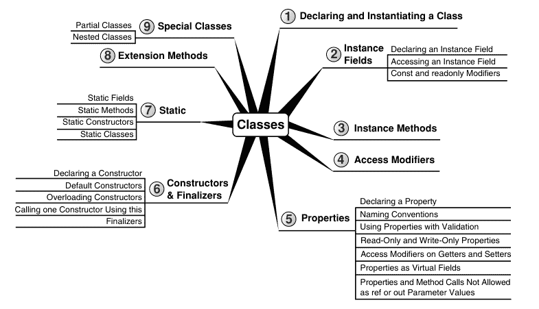

每章的主题出现在思维导图的中心。高级主题从核心向外扩展。思维导图使你能够轻松地从高级到更详细的概念吸收流程，同时减少遇到你可能不寻找的非常具体的知识的机会。

## 有用的注释

根据你的经验水平，特殊的代码块和标签将帮助你浏览文本。

- `Beginner Topics` 提供专门针对初级程序员的定义或解释。
- `Advanced Topics` 使经验丰富的开发人员能够专注于与他们最相关的材料。
- `Callout notes` 突出显示关键原则，以便读者轻松识别其重要性。
- `Language Contrast` 侧边栏确定 `C#` 及其前身之间的关键差异，以帮助熟悉其他语言的人。
- 页边 `begin` 和 `end` 标签表示特定于 `C#` 版本的材料；在该材料跨越多页时，仅在标签中显示版本号。

## 本书的组织方式

从高层次来看，软件工程是关于管理复杂性，而 `Essential C# 6.0` 正是为此目的而组织的。第 1–4 章介绍结构化编程，使你能够立即开始编写简单的功能代码。第 5–9 章介绍 `C#` 的面向对象构造。初学者读者应在继续阅读本书其余部分中更高级的主题之前，完全理解这一部分。第 11–13 章介绍额外的降低复杂性的构造，处理几乎所有现代程序都需要使用的常见模式。这引出了使用反射和属性的动态编程，这在后续章节中被广泛用于线程和互操作。

本书以关于 `Common Language Infrastructure` 的一章结束，该章描述了 `C#` 在其运行的开发平台中的上下文。该章出现在最后，因为它不是 `C#` 特定的，并且偏离了本书其余部分的语法和编程风格。然而，该章适合在任何时间阅读，也许最合适的是在第 1 章之后立即阅读。

以下是每章的描述（在此列表中，以粗体斜体显示的章节号表示存在 `C# 3.0–5.0` 材料）。

- *Chapter 1*—*Introducing C#*: 在介绍 `C#` `HelloWorld` 程序后，本章继续对其进行剖析。这应该让读者熟悉 `C#` 程序的外观和感觉，并提供有关如何编译和调试自己的程序的详细信息。第 1 章还涉及 `C#` 程序执行及其中间语言的上下文。
- *Chapter 2*—*Data Types*: 功能程序操作数据，本章介绍 `C#` 的原始数据类型。这包括对两种类型类别的介绍，即值类型和引用类型，以及类型之间的转换和对数组的支持。
- *Chapter 3*—*Operators and Control Flow*: 为了利用计算机的迭代能力，你需要知道如何在程序中包含循环和条件逻辑。本章还涵盖 `C#` 运算符、数据转换和预处理器指令。
- *Chapter 4*—*Methods and Parameters*: 本章研究方法和其参数的细节。它包括按值传递、按引用传递以及通过参数返回数据。默认参数支持在 `C# 4.0` 中添加，本章解释了如何使用此支持。
- *Chapter 5*—*Classes*: 在类的基本构建块的基础上，本章将这些构造组合成完全功能的类型。类通过定义对象的模板构成了面向对象技术的核心。
- *Chapter 6*—*Inheritance*: 尽管继承对许多开发人员来说是编程基础，但 `C#` 提供了一些独特的构造，例如 `new` 修饰符。本章讨论继承语法的细节，包括重写。
- *Chapter 7*—*Interfaces*: 本章演示接口如何用于定义类之间“可版本化”的交互契约。`C#` 包括显式和隐式接口成员实现，使其能够实现大多数其他语言不支持的额外封装级别。
- *Chapter 8*—*Value Types*: 尽管更常见的是定义引用类型，但在某些情况下需要定义表现类似于 `C#` 内置原始类型的值类型。本章描述了如何定义结构，同时揭示了它们可能引入的特殊情况。
- *Chapter 9*—*Well-Formed Types*: 本章讨论更高级的类型定义。它解释了如何实现运算符，例如 `+` 和强制转换，并描述了如何将多个类封装到单个库中。此外，本章演示了定义命名空间和 XML 注释的使用过程，并讨论了如何为垃圾回收设计类。
- *Chapter 10*—*Exception Handling*: 本章扩展了第 4 章中的异常处理介绍，并描述了异常如何遵循支持创建自定义异常的层次结构。它还包括有关异常处理的最佳实践。
- *Chapter 11*—*Generics*: 泛型可能是 `C# 1.0` 中缺少的核心功能。本章全面涵盖了此 2.0 功能。此外，`C# 4.0` 添加了协变和逆变支持——本章在泛型的上下文中涵盖了这一点。
- *第12章—委托和 Lambda 表达式：* 委托开始清晰地区分 `C#` 与其前身，通过定义在代码中处理事件的模式。这种做法几乎消除了编写轮询例程的需要。`Lambda` 表达式是使 `C# 3.0` 的 `LINQ` 成为可能的關鍵概念。第12章解释了 `Lambda` 表达式如何基于委托构造，通过提供更优雅简洁的语法而得以构建。本章为接下来讨论的新集合 API 奠定了基础。
- *第13章—事件：* 被封装的委托，即事件，是通用语言运行时的核心构造。匿名方法，另一个 `C# 2.0` 特性，也在此介绍。
- *第14章—带标准查询运算符的集合接口：* `C# 3.0` 中引入的简单而优雅强大的更改在本章开始闪光，我们将审视新 `Enumerable` 类的扩展方法。该类提供了一个全新的集合 API，即标准查询运算符，在此进行了详细讨论。
- *第15章—使用查询表达式的 LINQ：* 单独使用标准查询运算符会导致一些冗长的语句，难以解析。然而，查询表达式提供了一种替代语法，与 SQL 非常接近，如本章所述。
- *第16章—构建自定义集合：* 在构建针对业务对象的自定义 API 时，有时需要创建自定义集合。本章详细说明了如何做到这一点，并在过程中介绍了使自定义集合构建更轻松的上下文关键字。
- *第17章—反射、特性与动态编程：* 面向对象编程构成了20世纪80年代末程序结构范式转变的基础。同样，特性促进了声明式编程和嵌入式元数据，引领了新的范式。本章介绍特性并讨论如何通过反射检索它们。它还涵盖了通过基类库中的序列化框架进行文件输入和输出。在 `C# 4.0` 中，语言中新增了一个关键字 `dynamic`。它移除了所有在运行时的类型检查，极大地扩展了 `C#` 的能力。
- **第18章—多线程：** 大多数现代程序需要使用线程来执行长时间运行的任务，同时确保它们对同时发生的事件做出积极响应。随着程序变得更加复杂，它们必须采取额外的预防措施来保护这些动态环境中的数据。编程多线程应用程序很复杂。本章讨论了如何使用线程，并提供了避免困扰多线程应用程序问题的最佳实践。
- **第19章—线程同步：** 在前一章的基础上，第19章演示了一些内置的线程模式支持，可以简化对多线程代码的显式控制。
- **第20章—平台互操作性和不安全代码：** 鉴于 `C#` 是一门相对年轻的语言，用其他语言编写的代码远多于用 `C#` 编写的代码。为了利用这些已有代码，`C#` 支持互操作性——通过 `P/Invoke` 调用非托管代码。此外，`C#` 还提供了使用指针和直接内存操作的功能。虽然带指针的代码需要特殊权限才能运行，但它提供了与传统基于 C 的应用程序编程接口完全互操作的能力。
- **第21章—通用语言基础结构：** 从根本上说，`C#` 是设计为在底层通用语言基础结构之上最有效的编程语言的语法。本章深入探讨了 `C#` 程序与底层运行时及其规范的关系。
- **附录 A—下载和安装 C# 编译器和 CLI 平台：** 本附录提供了设置 `C#` 编译器和运行代码的平台 `Microsoft .NET` 或 `Mono` 的说明。
- **附录 B—井字游戏源代码清单：** 本附录提供了第3章和第4章中提到的井字游戏程序的完整清单。
- **C# 3.0、4.0、5.0 和 6.0 索引：** 这些索引为 `C# 3.0` 至 `6.0` 中新增的功能提供了快速参考。它们专门设计用于帮助程序员快速更新其语言技能到更新的版本。

附录 C《在 TPL 和 `C# 6.0` 之前与多线程模式的接口》和附录 D《在 `C# 6.0` 的 `Async/Await` 模式之前的时间器》可在本书网站 `http://www.informit.com/title/9780134141046` 上找到。随本书提供的教学资源将通过 Pearson 的教师资源中心提供给合格的讲师。

我希望你会发现这本书在建立你的 `C#` 专业知识方面是一项伟大的资源，并且你会继续参考它来了解 `C#` 的更晦涩领域及其内部工作原理。

—Mark Michaelis

博客：`http://IntelliTect.com/mark`

Twitter：`@Intellitect`, `@MarkMichaelis`

## 致谢

没有一本书能由作者独自出版，我对帮助我完成这本书的众多人士表示极大的感激。我感谢人们的顺序并不重要，除了那些排在最前面的人。毫无疑问，我的家人为让我完成这个项目付出了最大的牺牲。Benjamin、Hanna 和 Abigail 经常有一个因这本书而分心的爸爸，但 Elisabeth 的承受更多。她经常被留下来独自照顾一切，独自支撑着家庭的世界。我想说随着每版的出版会变得更容易，但不幸的是没有：随着孩子们长大，生活变得更加忙碌，而没有我在身边，Elisabeth 几乎总是被推到崩溃的边缘。巨大的“对不起”和巨大的“谢谢！”

许多技术编辑以极其细致的方式审阅了每一章，以确保技术准确性。我经常对这些人发现的微妙错误感到惊讶：Paul Bramsman、Kody Brown、Ian Davis、Doug Dechow、Gerard Frantz、Thomas Heavey、Anson Horton、Brian Jones、Shane Kercheval、Angelika Langer、Eric Lippert、John Michaelis、Jason Morse、Nicholas Paldino、Jon Skeet、Michael Stokesbary、Robert Stokesbary、John Timney 和 Stephen Toub。

Eric 简直令人惊叹。他对 `C#` 词汇的掌握令人难以置信，我非常感激他的编辑，尤其是当他坚持术语的完美时。他对 `C# 3.0` 章节的改进极其重要，在第二版中我唯一的遗憾是我没有让他审阅所有章节。然而，那种遗憾不再继续发酵。Eric `painstakingly` 审阅了每一章 `Essential C#`，细节和精确度令人惊叹。我非常感激他为使这本书比前两版更好所做的贡献。谢谢，Eric！我无法想象有谁比他更适合这份工作。你应得所有的功劳，将标准从优秀提升到伟大。

与 Eric 和 `C#` 的情况类似，只有少数人像 Stephen Toub 一样精通 `.NET` 多线程。因此，Stephen 专注于两个（第三次重写）多线程章节及其对 `C# 5.0` 中 `async` 支持的新关注。谢谢，Stephen！

感谢 Addison-Wesley 的每一个人，感谢他们在尽管我偶尔倾向于专注于除手稿之外的一切的情况下仍与我耐心合作。感谢 Vicki Rowland、Ellie Bru、Curt Johnson 和 Joan Murray。Joan 值得一枚特别的奖章，鉴于我延迟提供交付物甚至回复电子邮件的次数。Vicki 在与技术作者合作方面的能力令人惊叹。我非常感激她在《Essential C# 5.0》出版后提供的更新、完全排版的手稿。这使得撰写《Essential C# 6.0》比我对前几版的更新容易得多。

还要感谢 Mads Torgersen，感谢他愿意撰写前言。

风格和结构，它将使你能够编写最简单的 `C#` 程序。在讨论 `C#` 语法基础之前，先总结一下托管执行上下文，它解释了 `C#` 程序在运行时如何执行。本章最后讨论了变量声明、从控制台写入和检索数据，以及 `C#` 中注释代码的基础知识。

## Hello, World

学习一门新编程语言的最好方法就是编写代码。第一个示例是经典的 `HelloWorld` 程序。在这个程序中，你将向屏幕显示一些文本。

清单 1.1 展示了完整的 `HelloWorld` 程序；在接下来的章节中，你将编译这段代码。

```
LISTING 1.1: HelloWorld in C#²

class HelloWorld
{
    static void Main()
    {
        System.Console.WriteLine("Hello. My name is Inigo Montoya.");
    }
}
```

> 注意
>
> `C#` 是一种区分大小写的语言：大小写不正确会导致代码无法成功编译。

有 Java、C 或 C++ 编程经验的人会立刻看到相似之处。与 Java 一样，`C#` 继承了 C 和 C++ 的基本语法。句法标点（如分号和花括号）、特性（如区分大小写）以及关键字（如 `class`、`public` 和 `void`）对这些语言的有经验的程序员来说都很熟悉。初学者

2. 如果你对 Inigo Montoya 的引用感到困惑，请参阅电影《公主新娘》。

3. 在创建 `C#` 时，语言设计者审查了 C/C++ 的规范，直接划掉了他们不喜欢的特性，并列出了他们喜欢的特性。团队中还包括在其它语言方面有深厚背景的设计师。

以及来自其他语言的程序员都会很快发现这些构造直观易懂。

## 编译并运行应用程序

`C#` 编译器允许包含 `C#` 源代码的文件使用任何文件扩展名，但通常使用 `.cs`。将源代码保存到文件后，开发人员必须对其进行编译。（附录 A 提供了安装编译器的说明。）因为该命令的机制不是 `C#` 标准的一部分，所以编译命令会根据 `C#` 编译器的实现而有所不同。

如果将清单 1.1 放入名为 `HelloWorld.cs` 的文件中，则 Output 1.1 中的编译命令将适用于 `Microsoft .NET` 编译器（假设已设置好编译器的相应路径）。

```
OUTPUT 1.1

>csc.exe HelloWorld.cs
Microsoft (R) Visual C# Compiler version 1.0.0.50618
Copyright (C) Microsoft Corporation. All rights reserved.
```

确切的输出将根据你使用的编译器的版本而有所不同。

运行生成的程序 `HelloWorld.exe`，会显示 Output 1.2 中所示的消息。

```
OUTPUT 1.2

>HelloWorld.exe
Hello. My name is Inigo Montoya.
```

`C#` 编译器创建的程序 `HelloWorld.exe` 是一个程序集。不是创建可独立执行的完整程序，开发人员可以创建可由另一个更大程序引用的代码库。库（或类库）使用文件名

> 4. 也可以使用 `.NET Core` 进行编译，它是 `.NET` 的一种跨平台实现，可从 `http://dotnet.github.io/core` 获取。虽然我很想在这里加入其他平台的说明，但这样会偏离介绍 `C#` 的主题。请参阅附录 A 了解 `.NET Core` 的详细信息，或访问 `http://itl.tc/GettingStartedWithDNX`。

扩展名 `.dll`，它代表动态链接库（DLL）。库也是程序集。换句话说，成功的 `C#` 编译的输出是程序集，无论它是程序还是库。


## 语言对比：Java——文件名必须与类名匹配

在 Java 中，文件名必须与类名一致。在 C# 中，这个约定经常被遵循，但并不是必需的。在 C# 中，一个文件里可以有两个类，而且从 C# 2.0 开始，可以通过称为分部类的特性让一个类横跨多个文件。

## C# 语法基础

成功编译并运行 `HelloWorld` 程序后，你就可以开始剖析代码，了解它的各个部分。首先，考虑 C# 关键字以及开发人员选择的标识符。

## 初学者专题

## 关键字

为了使编译器能够解释代码，C# 中的某些词具有特殊地位和含义。它们被称为关键字，为编译器提供了解释程序员所写表达式的具体语法。在 `HelloWorld` 程序中，`class`、`static` 和 `void` 就是关键字的例子。

编译器使用关键字来识别代码的结构和组织。由于编译器赋予这些词更高的重要性，C# 要求开发人员只能将关键字放在特定位置。当程序员违反这些规则时，编译器会报错。

## C# 关键字

表 1.1 展示了 C# 关键字。

表 1.1：C# 关键字

| abstract | enum | long | static |

| add* (1) | equals* (3) | nameof* (6) | string |

| alias* (2) | event | namespace | struct |

| as | explicit | new | switch |

| ascending* (3) | extern | null | this |

| async* (5) | false | object | throw |

| await* (5) | finally | on* (3) | true |

| base | fixed | operator | try |

| bool | float |orderby* (3) | typeof |

| break | for | out | uint |

| by* (3) | foreach | override | ulong |

| byte | from* (3) | params | unchecked |

| case | get* (1) | partial* (2) | unsafe |

| catch | global* (2) | private | ushort |

| char | goto | protected | using |

| checked | group* (3) | public | value* (1) |

| class | if | readonly | var* (3) |

| const | implicit | ref | virtual |

| continue | in | remove* (1) | void |

| decimal | int | return | volatile |

| default | interface | sbyte | where* (2) |

| delegate | internal | sealed | when* (6) |

| descending* (3) | into* (3) | select* (3) | while |

| do | is | set* (1) | yield* (2) |

| double | join* (3) | short |  |

| dynamic* (4) | let* (3) | sizeof |  |

| else | lock | stackalloc |  |

* 上下文关键字

括号中的数字 (n) 标识该上下文关键字是在哪个版本中添加的。

# 第 1 章：C# 简介

C# 1.0 之后，没有新的**保留关键字**被引入 C#。然而，后续版本中的一些构造使用了**上下文关键字**，它们只在特定位置才有意义。在这些指定位置之外，上下文关键字没有特殊意义。⁵ 通过这种方法，大多数 C# 1.0 代码都与后续标准兼容。⁶

## 标识符

与其他语言一样，C# 包含**标识符**来标识程序员编码的构造。在清单 1.1 中，`HelloWorld` 和 `Main` 就是标识符的示例。分配给构造的标识符在以后会被用来引用该构造，所以开发人员分配的名称必须有意义，而不是随意编造。

敏锐地选择简洁而有指示性的名称是优秀程序员的一个重要特征，因为这意味着最终代码将更容易理解和重用。清晰与一致非常重要，.NET Framework 指南 (`http://bit.ly/dotnetguidelines`) 建议不要在标识符名称中使用缩写或缩约词，甚至建议避免使用未被广泛接受的首字母缩写词。如果一个首字母缩写词已经足够成熟（例如 `HTML`），你应该始终如一地使用它：不要时而拼出已被接受的首字母缩写词，时而不拼。通常，要求所有首字母缩写词都包含在术语表中的约束会给首字母缩写词的使用增加足够的负担，使它们不会被随意使用。最终，要选择清晰甚至冗长的名称——尤其是在团队中工作或开发供其他人编程使用的库时。

标识符有两种基本大小写格式。**Pascal 大小写**（以下简称 `PascalCase`），CLI 的创造者们这样称呼它，是因为它在

+   5. 例如，在 C# 2.0 的设计早期，语言设计者将 `yield` 指定为关键字，微软向数千名开发人员发布了 C# 2.0 编译器的 alpha 版本，其中 `yield` 被指定为关键字。然而，语言设计者最终确定，通过使用 `yield returned` 而不是 `yield`，他们最终可以避免将 `yield` 添加为关键字，因为除了紧邻 `return` 之外，它没有特殊意义。

+   

+   6. 有一些罕见且不幸的不兼容性，例如：

+   - C# 2.0 要求使用 `using` 语句实现 `IDisposable`，而不是仅使用 `Dispose()` 方法

+   - 一些罕见的泛型表达式，如 `F(G<A,B>(7))` 在 C# 1.0 中表示 `F((G<A>), (B>7))`，而在 C# 2.0 中则改为表示用参数 7 调用泛型方法 `G<A,B>`，并将结果传给 F

`Pascal` 编程语言会将标识符名称中每个单词的首字母大写；示例包括 `ComponentModel`、`Configuration` 和 `HttpFileCollection`。正如 `HttpFileCollection` 在 `HTTP` 中的演示，当使用长度超过两个字母的缩写时，仅大写第一个字母。第二种格式，驼峰命名法（以下简称 `camelCase`），遵循相同的约定，只是首字母小写；示例包括 `quotient`、`firstName`、`httpFileCollection`、`ioStream` 和 `theDreadPirateRoberts`。

## Guidelines

- 在命名标识符时，DO 优先考虑清晰度而非简洁性。

- DO NOT 在标识符名称中使用缩写或缩略形式。

- DO NOT 使用任何缩写，除非它们被广泛接受，即使如此，也仅在必要时使用。

请注意，虽然下划线是合法的，但通常标识符名称中没有下划线、连字符或其他非字母数字字符。此外，C# 不遵循其前身，即匈牙利命名法（在名称前加上数据类型缩写）不被使用。这避免了在数据类型更改时需要重命名变量，或因使用匈牙利命名法时未能调整数据类型前缀而引入的不一致。

在某些罕见情况下，一些标识符，例如 `Main`，在 C# 语言中可能具有特殊含义。

## Guidelines

- DO 将两个字符缩写的两个字符都大写，除第一个 `camelCased` 标识符的第一个单词外。

- DO 仅将三个或更多字符的缩写中的第一个字符大写，除第一个 `camelCased` 标识符的第一个单词外。

- DO NOT 将 `camelCased` 标识符开头的缩写中的任何字符大写。

- DO NOT 使用匈牙利命名法（即不要在其名称中编码变量的类型）。

## ADVANCED TOPIC

## Keywords

虽然很少见，但如果包含 “@” 作为前缀，关键字可以作为标识符使用。例如，你可以为局部变量命名为 `@return`。同样（尽管它不符合 C# 编码标准的命名约定），也可以将方法命名为 `@throw()`。

在 Microsoft 实现中还有四个未记录的保留关键字：`__arglist`、`__makeref`、`__reftype` 和 `__refvalue`。它们仅在罕见的互操作场景中才需要，对于所有实际目的都可以忽略。请注意，这四个特殊关键字以两个下划线开头。C# 的设计者保留了将任何以两个下划线开头的标识符在未来版本中变为关键字的权利；为安全起见，避免自己创建此类标识符。

## Type Definition

C# 中的所有可执行代码都出现在类型定义中，而最常见的类型定义以关键字 `class` 开始。类定义是通常以 `class identifier { ... }` 开始的代码段，如 Listing 1.2 所示。

## LISTING 1.2: Basic Class Declaration

```
class HelloWorld
{
    //...
}
```

用于类型的名称（在本例中为 `HelloWorld`）可以有所不同，但按惯例，它必须是 `PascalCased`。因此，对于此特定示例，其他可能的名称是 `Greetings`、`HelloInigoMontoya`、`Hello`，或简单地 `Program`。（当类包含 `Main()` 方法时，后文将描述，`Program` 是一个很好的约定。）

## Guidelines

- DO 使用名词或名词短语命名类。

- DO 对所有类名使用 `PascalCasing`。

通常，程序包含多个类型，每个类型包含多个方法。

## Main

## BEGINNER TOPIC

## What Is a Method?

从语法上讲，C# 中的方法是由方法声明引入的命名代码块（例如，`static void Main()`）并且（通常）后面跟着花括号内的零个或多个语句。方法执行计算和/或操作。与书面语言中的段落类似，方法提供了一种结构化和组织代码的方式，使其更具可读性。更重要的是，方法可以被重用并从多个位置调用，从而避免代码重复。方法声明引入方法并定义方法名称以及传递给方法并从方法传递的数据。在 Listing 1.3 中，`Main()` 后跟 `{ ... }` 是 C# 方法的示例。

C# 程序开始执行的位置是 `Main` 方法，它以 `static void Main()` 开始。当你在命令控制台输入 `HelloWorld.exe` 执行程序时，程序启动，解析 `Main` 的位置，并开始执行 Listing 1.3 中的第一个语句。

## LISTING 1.3: Breaking Apart HelloWorld

```
class HelloWorld
{
    static void Main()
    {
        System.Console.WriteLine("Hello, My name is Inigo Montoya");
    }
}
Method Declaration
Main
Class Definition
Statement
```

虽然 `Main` 方法声明可以有所不同，但 `static` 和方法名 `Main` 对于程序来说始终是必需的。

例如，`Main` 方法包含围绕其实现的 curly braces；在这种情况下，方法中只有一个语句。

## Statements and Statement Delimiters

`Main` 方法包含单个语句，`System.Console.WriteLine()`，用于向控制台写入一行文本。C# 通常使用分号来表示 **statement** 的结束，其中语句由代码将执行的多个操作组成。声明变量、控制程序流程和调用方法都是语句的典型用途。

> **Language Contrast: Visual Basic—Line-Based Statements**

> 

> 有些语言是基于行的，这意味着如果没有特殊注释，语句不能跨行。直到 Visual Basic 2010，Visual Basic 就是基于行的语言示例。它要求在行尾使用下划线来指示语句跨越多行。从 Visual Basic 2010 开始，引入了许多情况，其中换行符字符是可选的。

## ADVANCED TOPIC

## Statements without Semicolons

C# 中的许多编程元素以分号结尾。一个不包含分号的示例是 `switch` 语句。因为 `switch` 语句中始终包含 curly braces，所以 C# 不要求在语句后跟分号。事实上，代码块本身被视为语句（它们也由语句组成），并且它们不需要使用分号闭合。同样，在某些情况下，例如 `using` 声明，分号出现在末尾但它不是语句。

由于换行不会分隔语句，你可以将多个语句放在同一行，C# 编译器会将该行解释为包含多个指令。例如，Listing 1.5 包含

一行中的两个语句，结合起来在两行上显示 Up 和 Down。

## LISTING 1.5: Multiple Statements on One Line

```
System.Console.WriteLine("Up");System.Console.WriteLine("Down");
```

C# 还允许将语句拆分到多行。同样，C# 编译器会查找分号以指示语句的结束（参见 Listing 1.6）。

## LISTING 1.6: Splitting a Single Statement across Multiple Lines

```
System.Console.WriteLine(
"Hello. My name is Inigo Montoya.");
```

在 Listing 1.6 中，`HelloWorld` 程序中的原始 `WriteLine()` 语句被拆分到多行。

## BEGINNER TOPIC

## What Is Whitespace?

空白是制表符、空格和换行符等一个或多个连续格式字符的组合。显然，消除单词之间的所有空白很重要，正如在引号字符串中包含空白一样。

## Whitespace


分号使得 C# 编译器能够忽略代码中的空白。除了少数例外，C# 允许开发人员在代码中插入空白而不改变其语义含义。在 Listing 1.5 和 Listing 1.6 中，无论是否在语句内或语句之间插入换行，都无关紧要，并且对编译器创建的 resultant 可执行文件没有影响。

经常，程序员使用空白来缩进代码以提高可读性。请考虑 Listing 1.7 和 Listing 1.8 中 `HelloWorld` 的两种变体。

**LISTING 1.7: No Indentation Formatting**

```csharp
class HelloWorld
{
    static void Main()
    {
        System.Console.WriteLine("Hello Inigo Montoya");
    }
}
```

**LISTING 1.8: Removing Whitespace**

```csharp
class HelloWorld{static void Main()
{System.Console.WriteLine("Hello Inigo Montoya");}}
```

Although these two examples look significantly different from the original program, the C# compiler sees them as identical.

## Formatting Code with Whitespace (Beginner Topic)

Indenting the code using whitespace is important for greater readability. As you begin writing code, you need to follow established coding standards and conventions to enhance code readability.

The convention used in this book is to place curly braces on their own line and to indent the code contained between the curly brace pair. If another curly brace pair appears within the first pair, all the code within the second set of braces is also indented.

This is not a uniform C# standard, but a stylistic preference.

## Working with Variables

Now that you’ve been introduced to the most basic C# program, it’s time to declare a local variable. Once a variable is declared, you can assign it a value, replace that value with a new value, and use it in calculations, output, and so on. However, you cannot change the data type of the variable. In Listing 1.9, `string max` is a variable declaration.

```csharp
class miracleMax
{
    static void Main()
    {
        string max;
        max = "Have fun storming the castle!";

        System.Console.WriteLine(max);
    }
}
```

### Local Variables (Beginner Topic)

A variable is a name that refers to a value that can change over time. *Local* indicates that the programmer **declared** the variable within a method.

To declare a variable is to define it, which you do by

- 1. Specifying the type of data which the variable will contain

- 2. Assigning it an identifier (name)

### Data Types

Listing 1.9 declares a variable with the data type `string`. Other common data types used in this chapter are `int` and `char`.

- `int` is the C# designation of an integer type that is 32 bits in size.

- `char` is used for a character type. It is 16 bits, large enough for (nonsurrogate) Unicode characters.

The next chapter looks at these and other common data types in more detail.

#### What Is a Data Type? (Beginner Topic)

The type of data that a variable declaration specifies is called a **data type** (or object type). A data type, or simply **type**, is a classification of things that share similar characteristics and behavior. For example, *animal* is a type. It classifies all things (monkeys, warthogs, and platypuses) that have animal characteristics (multicellular, capacity for locomotion, and so on). Similarly, in programming languages, a type is a definition for several items endowed with similar qualities.

### Declaring a Variable

In Listing 1.9, `string max` is a variable declaration of a string type whose name is `max`. It is possible to declare multiple variables within the same statement by specifying the data type once and separating each identifier with a comma. Listing 1.10 demonstrates such a declaration.

**LISTING 1.10: Declaring Two Variables within One Statement**

```
string message1, message2;
```

Because a multivariable declaration statement allows developers to provide the data type only once within a declaration, all variables will be of the same type.

In C#, the name of the variable may begin with any letter or an underscore (`_`), followed by any number of letters, numbers, and/or underscores. By convention, however, local variable names are camelCased (the first letter in each word is capitalized, except for the first word) and do not include underscores.

#### Guidelines

DO use camelCasing for local variable names.

### Assigning a Variable

After declaring a local variable, you must assign it a value before reading from it. One way to do this is to use the `=` operator, also known as the simple assignment operator. Operators are symbols used to identify the function the code is to perform. Listing 1.11 demonstrates how to use the assignment operator to designate the string values to which the variables `miracleMax` and `valerie` will point.

**LISTING 1.11: Changing the Value of a Variable**

```
class StormingTheCastle
{
    static void Main()
    {
        string valerie;
        string miracleMax = "Have fun storming the castle!";

        valerie = "Think it will work?";

        System.Console.WriteLine(miracleMax);
        System.Console.WriteLine(valerie);

        max = "It would take a miracle.";
        System.Console.WriteLine(miracleMax);
    }
}
```

From this listing, observe that it is possible to assign a variable as part of the variable declaration (as it was for `miracleMax`), or afterward in a separate statement (as with the variable `valerie`). The value assigned must always be on the right side.

Running the compiled `StormingTheCastle.exe` program produces the code shown in Output 1.3.

**OUTPUT 1.3**

```
>StormingTheCastle.exe
Have fun storming the castle!
Think it will work?
It would take a miracle.
```

C# requires that local variables be determined by the compiler to be “definitely assigned” before they are read. Additionally, an assignment returns a value. Therefore, C# allows two assignments within the same statement, as demonstrated in Listing 1.12.

**LISTING 1.12: Assignment Returning a Value That Can Be Assigned Again**

```
class StormingTheCastle
{
    static void Main()
    {
        // ...
        string requirements, miracleMax;
        requirements = miracleMax = "It would take a miracle.";
        // ...
    }
}
```

### Using a Variable

The result of the assignment, of course, is that you can then refer to the value using the variable identifier. Therefore, when you use the variable `miracleMax` within the `System.Console.WriteLine(miracleMax)` statement, the program displays `Have fun storming the castle!`, the value of `miracleMax`, on the console. Changing the value of `miracleMax` and executing the same `System.Console.WriteLine(miracleMax)` statement causes the new `miracleMax` value, `It would take a miracle.` to be displayed.

### Strings Are Immutable (Advanced Topic)

All data of type `string`, whether string literals or otherwise, is immutable (or unmodifiable). For example, it is not possible to change the string `"Come As You Are"` to `"Come As You Age"`. A change such as this requires that you reassign the variable to refer to a new location in memory, instead of modifying the data to which the variable originally referred.

The next step is to write the values retrieved using `System.Console.ReadLine()` back to the console. In the case of Listing 1.15, the program writes out the user’s full name. However, instead of using `System.Console.WriteLine()` as before, this code will use a slight variation. Output 1.5 shows the corresponding output.

**LISTING 1.15: Formatting Using String Interpolation**

```csharp
class HeyYou
{
    static void Main()
    {
        string firstName;
        string lastName;

        System.Console.WriteLine("Hey you!");

        System.Console.Write("Enter your first name: ");
        firstName = System.Console.ReadLine();

        System.Console.Write("Enter your last name: ");
        lastName = System.Console.ReadLine();

        System.Console.WriteLine(
            $"Your full name is { firstName } { lastName }. ");
    }
}
```

**OUTPUT 1.5**

```text
Hey you!
Enter your first name: Inigo
Enter your last name: Montoya
Your full name is Inigo Montoya.
```


Instead of writing out “Your full name is” followed by another `Write` statement for `firstName`, a third `Write` statement for the space, and finally a `WriteLine` statement for `lastName`, Listing 1.15 writes out the entire output using C# 6.0’s string interpolation. With string interpolation, the compiler interprets the interior of the curly brackets within the string as regions in which you can embed code (expressions) that the compiler will evaluate and convert to strings. Rather than executing lots of code snippets individually and combining the results as a string at the end, string interpolation allows you to do this in a single step. This makes the code easier to understand.

## 输出1.7

```csharp
System.Console.WriteLine("Your full name is {0} {1}.",
    firstName, lastName);
// This is the end
// of the program listing
}
}
```

```text
Hey you!
Enter your first name: Inigo
Enter your last name: Montoya
Your full name is Inigo Montoya.
```

尽管插入了注释，编译并执行新程序仍会得到与之前相同的输出。

程序员使用注释来描述并解释他们正在编写的代码，尤其是在语法本身难以理解，或特定算法的实现出人意料时。由于注释仅对审阅代码的程序员有意义，编译器会忽略注释，并生成一个没有任何注释痕迹的程序集，仿佛注释从未存在于源代码中。

表1.2展示了四种不同的C#注释类型。清单1.18中的程序包含了其中两种。

关于XML注释的更全面讨论见第9章，我们将在那里进一步讨论各种XML标记。

在编程史上曾有一段时间，大量注释意味着程序员纪律严明且经验丰富。现在情况已不是这样了。相反，无需注释即可读懂的代码，比那些需要注释才能说明其用途的代码更有价值。如果开发者发现有必要添加注释来解释某个特定代码块的作用，那么他们应更倾向于重写代码使其更清晰，而不是添加注释。仅仅复述代码已明确表达内容的注释，只会让代码变得杂乱、降低可读性，并增加注释过时的可能性，因为代码在变化而注释却没有同步更新。

## 表1.2：C#注释类型

| 注释类型 | 描述 | 示例 |
|---|---|---|
| 分隔注释 | 一个正斜杠后跟一个星号 `/*` 标识分隔注释的开始。结束注释时使用一个星号后跟一个正斜杠：`*/`。此形式的注释可以跨越多行，也可以作为代码行内嵌入的部分。行首但在分隔符内的星号仅用于格式化。 | `/*comment*/` |
| 单行注释 | 注释可以使用由两个连续正斜杠字符组成的分隔符来声明：`//`。编译器将自分隔符到行尾的所有文本视为注释。此形式的注释被视为单行。不过，可以连续放置多个单行注释，如清单1.18中的最后一个注释所示。 | `//comment` |
| XML分隔注释 | 以`/**`开头并以`**/`结尾的注释称为XML分隔注释。它们具有与常规分隔注释相同的特征，只是编译器不会完全忽略这些XML注释，而是可以将它们放入一个单独的文件中。† | `/**comment**/` |
| XML单行注释 | XML单行注释以`///`开头并持续到行尾。此外，编译器可以将单行注释与XML分隔注释一起保存到单独的文件中。 | `///comment` |

† XML分隔注释仅在C# 2.0中被明确加入，但其语法与C# 1.0兼容。

## 准则

除非注释描述了除编写代码的开发人员以外其他人不易理解的内容，否则不要使用注释。

应当优先编写更清晰的代码，而不是通过注释来解释复杂的算法。

## 初学者专题

### 可扩展标记语言

可扩展标记语言（XML）是一种简单而灵活的文本格式，常用于Web应用程序以及应用程序之间的数据交换。XML之所以可扩展，是因为XML文档中包含描述数据的信息，即**元数据**。下面是一个XML文件示例。

```xml
<?xml version="1.0" encoding="utf-8" ?>
<body>
    <book title="Essential C# 6.0">
        <chapters>
            <chapter title="Introducing C#"/>
            <chapter title="Operators and Control Flow"/>
            ...
        </chapters>
    </book>
</body>
```

该文件以一个指示XML文件版本和字符编码的头部开始。其后是一个主“book”元素。元素以尖括号中的单词开始，例如 `<body>`。要结束元素，请在尖括号中放入相同的单词，并在单词前添加一个正斜杠，如 `</body>`。除元素外，XML还支持属性。`title="Essential C# 6.0"` 是一个XML属性的示例。注意，描述数据（“Essential C# 6.0”、“Operators and Control Flow”）的元数据（书名、章节等）包含在XML文件中。这可能导致文件相当臃肿，但其优点是数据包含有助于解释数据的描述。

### 应用程序编程接口

像 `System.Console` 这样的数据类型上的所有方法（或更一般地说，所有成员）定义了`System.Console`的**应用程序编程接口（API）**。API定义了软件程序如何与组件交互。因此，API并不仅存在于单个数据类型上；更一般地说，一组数据类型的所有API组合被认为为这组组件创建了一个API。例如，在.NET中，一个程序集中的所有类型（以及这些类型中的成员）被认为构成了该程序集的API。类似地，给定一组程序集（例如.NET Framework中的那些程序集），这些程序集的集合构成了一个更大的API。通常，这个更大的API组被称为框架——因此，“.NET Framework”一词指的是.NET中包含的所有程序集公开的API。一般而言，API包含一组接口和协议（或指令），用于针对一组组件进行编程。事实上，在.NET中，协议本身就是.NET程序集的执行规则。

### 托管执行和公共语言基础结构

处理器无法直接解释程序集。程序集主要由一种称为公共中间语言（CIL）的第二语言组成，简称IL。⁷ C#编译器将C#源文件转换成这种中间语言。还需要一个额外的步骤（通常在执行时进行）将CIL代码转换为处理器能理解的机器代码。这涉及C#程序执行中的一个重要元素：虚拟执行系统（VES）。VES非正式地称为运行时，它按需编译CIL代码（这一过程称为实时编译或JIT编译）。在运行时等代理的上下文下执行的代码称为托管代码，而在运行时控制下执行的过程称为托管执行。代码之所以是“托管的”，是因为运行时通过管理内存分配、安全和实时编译等方面，控制了程序行为的很大一部分。不需要运行时即可执行的代码称为本机代码（或非托管代码）。

VES的规范包含在一个更广泛的规范中，即公共语言基础结构（CLI）规范。⁸ 作为一项国际标准，CLI包括以下方面的规范：

- VES或运行时
- CIL
- 支持语言互操作性的类型系统，即**公共类型系统（CTS）**
- 关于如何编写可从CLI兼容语言访问的库的指南（见**公共语言规范 [CLS]**）
- 元数据，它使CLI所标识的许多服务成为可能（包括程序集的布局或文件格式规范）
- 一个通用的编程框架，即基类库（BCL），所有语言的开发者都可以使用

7. CIL的第三个术语是Microsoft IL（MSIL）。本书使用CIL一词，因为它是CLI标准采纳的术语。IL在编写C#代码的人们的交谈中很常见，因为他们认为IL指的是CIL，而不是其他类型的中间语言。

8. Miller, J. 和 S. Ragsdale. 2004. 《公共语言基础结构注释标准》. Boston: Addison-Wesley.

> **注意**
>
> 术语*运行时*既可以指执行时间，也可以指虚拟执行系统。为了澄清其含义，本书使用*执行时间*表示程序正在执行的时间，并使用*运行时*指代在C#程序执行期间负责管理其执行的代理。

在CLI实现的上下文中运行，可以支持许多程序员无需直接编码的服务和功能，包括：

- *语言互操作性：*不同源语言之间的互操作性。这之所以可能，是因为语言编译器将每种源语言都翻译成同一种中间语言（CIL）。
- *类型安全：*检查类型之间的转换，确保只发生兼容类型之间的转换。这有助于防止缓冲区溢出，而缓冲区溢出是安全漏洞的主要原因。
- *代码访问安全：*确认程序集开发者的代码有权在计算机上执行。
- *垃圾回收：* 内存管理，自动释放运行时先前分配的内存。
- *平台可移植性：* 支持在多种操作系统上运行相同的程序集。一个明显的限制是未使用任何平台相关的库；因此，与 Java 类似，存在一些需要解决的平台相关的特异性。
- *BCL：* 提供一个庞大的代码基础，供开发人员在所有 CLI 实现中依赖（），以便他们不必自行开发代码。

> **注意**
>
> 本节简要概述了 CLI，以便您熟悉 C# 程序执行的上下文。它还提供了本书中出现的一些术语的摘要。第 21 章专门讨论 CLI 主题及其与 C# 开发人员的相关性。尽管该章节出现在本书的最后，但它不依赖于任何前面的章节，因此如果您想更熟悉 CLI，可以随时跳转到该章节。

# C# 和 .NET 版本

微软对 .NET Framework 和相应的 C# 语言版本分配不一致的版本号，仅仅因为不同的团队有不同的版本机制。这意味着如果您使用 C# 5.0 编译器编译，它默认会针对“.NET Framework 版本 4.6”进行编译，例如。表 1.3 是 C# 和 .NET 版本的简要概述。

只要编译器版本对应于所需代码的版本，本书中的大部分代码就可以在 Microsoft 以外的平台上运行。尽管为每个 C# 平台提供完整细节对某些读者有帮助，但这也可能分散学习 C# 的重点，因此本文的主要内容仅限于微软平台 .NET 的信息。做出这一选择仅仅是因为微软拥有（远远）占主导地位的实现。此外，翻译到另一个平台是相当简单的。

## 表 1.3：C# 和 .NET 版本

| Comment Type | Description |
|---|---|
| C# 1.0 with .NET Framework 1.0/1.1 (Visual Studio 2002 and 2003) | C# 的初始发布。一种从头开始构建以支持 .NET 编程的语言。 |
| C# 2.0 with .NET Framework 2.0 (Visual Studio 2005) | 向 C# 语言添加了泛型，并向 .NET Framework 2.0 添加了支持泛型的库。 |
| .NET Framework 3.0 | 用于分布式通信（Windows Communication Foundation [WCF]）、丰富客户端展示（Windows Presentation Foundation [WPF]）、工作流（Windows Workflow [WF]）和 Web 身份验证（Cardspaces）的附加 API 集合。 |
| C# 3.0 with .NET Framework 3.5 (Visual Studio 2008) | 添加了对 LINQ 的支持，这对用于编程集合的 API 是一个重大改进。.NET Framework 3.5 提供了扩展现有 API 以实现 LINQ 的库。 |
| C# 4.0 with .NET Framework 4 (Visual Studio 2010) | 添加了对动态类型的支持，以及对编写利用多处理器和处理器内多个核心的多线程程序的 API 的重大改进。 |
| C# 5.0 with .NET Framework 4.5 (Visual Studio 2012) and WinRT integration | 添加了对异步方法调用的支持，而无需显式注册委托回调。框架中的另一个更改是对 Windows 运行时（WinRT）互操作性的支持。 |
| C# 6.0 with .NET Framework 4.6 (Visual Studio 2015) | 添加了字符串插值、空传播成员访问、异常过滤器、字典初始化器以及许多其他功能。 |

也许与 C# 6.0 一起添加的最重要的框架功能是跨平台编译的支持。换句话说，.NET Framework 不仅在 Windows 上运行，而且微软还提供了一个实现（称为“CoreFX”）的 .NET Core，可在 Linux 和 OS X 上运行。尽管 .NET Core 并不是与完整的 .NET Framework 相当的功能集，但它包含足够的功能，可以将整个（ASP.NET）网站托管在 Windows 以外的操作系统上及其 Internet Information Server（IIS）。这意味着使用相同的代码库，可以编译和执行在跨平台上运行的应用程序。.NET Core 包括从 .NET 编译器平台（“Roslyn”）开始，后者本身可在 Linux 和 OS X 上执行，到 .NET Core 运行时，以及诸如 .NET 版本管理器（DNVM）和 .NET 执行环境（DNX）之类的工具。

# 通用中间语言和 `ILDASM`

如前一节所述，C# 编译器将 C# 代码转换为 CIL 代码，而不是机器代码。处理器可以直接理解机器代码，但 CIL 代码需要在处理器执行之前进行转换。给定一个程序集（DLL 或可执行文件），可以使用 CIL 反汇编实用程序查看 CIL 代码，以将程序集解构为其 CIL 表示形式。（CIL 反汇编程序通常以其 Microsoft 特定的文件名 `ILDASM` 命名，代表 IL Disassembler。）此程序将反汇编程序或其类库，显示 C# 编译器生成的 CIL。

用于 CIL 反汇编程序的确切命令取决于使用的 CLI 实现。您可以通过命令行执行 .NET CIL 反汇编程序，如输出 1.8 所示。

```text
Output 1.8

>ildasm /text HelloWorld.exe
```

`/text` 部分用于使输出出现在命令控制台而不是新窗口中。执行这些命令后产生的输出流是包含在 `HelloWorld.exe` 程序中的 CIL 代码转储。请注意，CIL 代码比机器代码更容易理解。对于许多开发人员来说，这可能会引起担忧，因为程序更容易被反编译，算法可以在不明确重新分发源代码的情况下被理解。

与任何程序一样，无论是否基于 CLI，阻止反汇编的唯一万无一失的方法是完全禁止访问编译后的程序（例如，只将程序托管在网站上而不是分发到用户的机器上）。但是，如果只需要降低对源代码的访问权限，则有几种混淆器可用。

这些混淆器打开 IL 代码并对其进行转换，使其以更难以理解的方式执行相同的操作。这可以防止普通开发人员访问代码，并创建反编译为可理解代码更困难和繁琐的程序集。除非程序需要高度的算法安全性，否则这些混淆器通常是足够的。

# 高级主题

## `HelloWorld.exe` 的 CIL 输出

列表 1.19 显示了 `ILDASM` 创建的 CIL 代码。

```text
//  Microsoft (R) .NET Framework IL Disassembler.  Version 4.6.81.0
//  Copyright (c) Microsoft Corporation.  All rights reserved.
// Metadata version: v4.0.30319
.assembly extern mscorlib
{
    .publickeytoken = (B7 7A 5C 56 19 34 E0 89 )              //
    .ver 4:0:0:0
}
.assembly HelloWorld
{
    .custom instance void [mscorlib]System.Runtime.CompilerServices.
CompilationRelaxationsAttribute::.ctor(int32) = ( 01 00 00 00 00 00 00 00 )
    .custom instance void [mscorlib]System.Runtime.CompilerServices.
RuntimeCompatibilityAttribute::.ctor() = ( 01 00 01 00 54 02 16 57 72 61 70
4E 6F 6E 45 78   // ....t..WrapNonEx
63 65 70 74 69 6F 6E 54 68 72 6F 77 73 01 )     // ceptionThrows.
    // --- The following custom attribute is added automatically, do not
    // uncomment ------
    // .custom instance void [mscorlib]System.Diagnostics.
DebuggableAttribute::.ctor valuetype [mscorlib]System.Diagnostics.
DebuggableAttribute/DebuggingModes = ( 01 00 07 01 00 00 00 00 )
```


.hash algorithm 0x00008004

.ver 0:0:0:0

}

.module HelloWorld.exe

// MVID: {1FB5153C-639E-401D-8C94-22A66C18DC7A}

```
```

也许从这样的列表中可以获得的最有趣的信息是，与尝试阅读和理解机器代码（汇编）相比，遵循程序正在做什么相对容易得多。在列表中，出现了对`System.Console.WriteLine()`的显式引用。CIL 代码列表周围有很多外围信息，但如果开发人员想在没有原始源代码访问权限的情况下了解 C# 模块（或任何 CLI 基于程序）的内部工作原理，除非使用了混淆器，否则相对容易。事实上，有几种免费工具可用（例如 Red Gate 的 Reflector、ILSpy、JustDecompile、dotPeek 和 CodeReflect）可以自动将 CIL 反编译为 C#。

## SUMMARY

本章是对 C# 的初步介绍。它提供了一种熟悉基本 C# 语法的手段。由于 C# 与 C++ 风格语言的相似性，其中很多内容对你来说可能不是新材料。然而，C# 和托管代码确实有一些独特的特征，例如编译为 CIL。虽然不是独一无二的，C# 的另一个关键特征是其对面向对象编程的完全支持。甚至读取和写入控制台数据的任务也是面向对象的。面向对象是 C# 的基础，你将在本书中看到这一点。

下一章将研究 C# 语言的一部分基本数据类型，并讨论如何使用这些数据类型与操作数一起形成表达式。

# 2

## Data Types

从第 1 章的 *HelloWorld* 程序中，你对 C# 语言、其结构、基本语法特征以及如何编写最简单的程序有了一个概念。本章通过研究基本 C# 类型继续讨论 C# 基础知识。

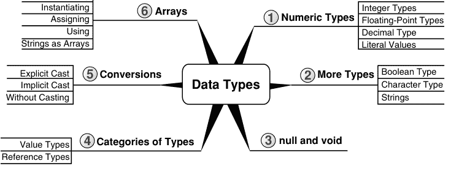

到目前为止，你只使用过几种内置数据类型，而且解释很少。在 C# 中存在数千种类型，你可以组合类型来创建新类型。然而，C# 中有一些类型相对简单，被认为是所有其他类型的构建块。这些类型是**预定义类型**。C# 语言的预定义类型包括八种整数类型、两种用于科学计算的二进制浮点类型和一种用于金融计算的十进制浮点类型、一种布尔类型和一种字符类型。本章将研究这些类型，更详细地查看字符串类型，并介绍数组。

## Fundamental Numeric Types

C# 中的基本数值类型都有与其关联的关键字。这些类型包括整数类型、浮点类型和一种特殊的浮点类型`decimal`，用于存储没有表示误差的大数字。

## Integer Types

有八种 C# 整数类型。这种多样性使你能够选择足够大的数据类型来容纳其预期值的范围，而不会浪费资源。表 2.1 列出了每种整数类型。

### TABLE 2.1: Integer Types

| Type | Size | Range (Inclusive) | BCL Name | Signed | Literal Suffix |
|---|---|---|---|---|---|
| `sbyte` | 8 bits | -128 to 127 | `System.SByte` | Yes | |
| `byte` | 8 bits | 0 to 255 | `System.Byte` | No | |
| `short` | 16 bits | -32,768 to 32,767 | `System.Int16` | Yes | |
| `ushort` | 16 bits | 0 to 65,535 | `System.UInt16` | No | |
| `int` | 32 bits | -2,147,483,648 to 2,147,483,647 | `System.Int32` | Yes | |
| `uint` | 32 bits | 0 to 4,294,967,295 | `System.UInt32` | No | U or u |
| `long` | 64 bits | -9,223,372,036,854,775,808 to 9,223,372,036,854,775,807 | `System.Int64` | Yes | L or l |
| `ulong` | 64 bits | 0 to 18,446,744,073,709,551,615 | `System.UInt64` | No | UL or ul |

表 2.1 中包含（以及表 2.2 和 2.3 中）一列用于每种类型的全名；我们将在本章后面讨论字面量后缀。C# 中的所有基本类型都有短名称和全名称。全名称对应于该类型在基本类库（BCL）中的命名方式。这个名称在所有语言中都相同，在程序集中唯一标识该类型。由于这些类型的根本性质，C# 还提供了作为全名称的短名称或缩写的关键字。从编译器的角度来看，两个名称都引用相同的类型，产生完全相同的代码。事实上，对生成的 CIL 代码的检查将无法表明使用了哪个名称。

虽然 C# 支持同时使用完整的 BCL 名称和关键字，但作为开发人员，我们在何时使用时面临选择。与其来回切换，不如坚持使用其中一种或另一种更为一致。因此，C# 开发人员通常选择使用 C# 关键字形式——例如选择`int`而不是`System.Int32`和`string`而不是`System.String`（或可能的简写`String`）。

### Guidelines

- **DO** 在指定数据类型时使用 C# 关键字而不是 BCL 名称（例如，使用`string`而不是`String`）。

- **DO** 在代码中更倾向于一致性而不是多样性。

一致性的选择经常可能与其它准则相冲突。例如，鉴于使用 C# 关键字代替 BCL 名称的准则，你可能会发现自己维护一个文件（或文件库）采用相反的风格。在这些情况下，保持与之前风格的一致性比注入新的风格和约定不一致更好。即使如此，如果“风格”实际上是一种可能引入错误并阻碍成功维护的糟糕编码实践，那么务必在整个范围内纠正该问题。

### Language Contrast: C++—short Data Type

在 C/C++ 中，`short`数据类型是`short int`的缩写。在 C# 中，`short`本身就是实际的数据类型。

## Floating-Point Types (float, double)

浮点数具有不同的精度程度，二进制浮点类型只能在它们是分母为 2 的幂的分数时精确表示数字。如果你将浮点变量的值设为 0.1，它很容易被表示为

0.09999999999999999 或 0.10000000000000001 或其他非常接近 0.1 的数字。同样，将变量设置为像阿伏伽德罗常数 6.02 × 10²³ 这样的大数字可能会导致约 10⁸ 的表示误差，这毕竟是该数字的极小部分。浮点数的准确度与其表示的数字的量级成比例。浮点数精确到一定数量的有效数字，而不是固定的值，例如 ±0.01。

C# 支持表 2.2 中列出的两种二进制浮点数字类型。

### TABLE 2.2: Floating-Point Types

| Type | Size | Range (Inclusive) | BCL Name | Significant Digits | Literal Suffix |
|---|---|---|---|---|---|
| `float` | 32 bits | ±1.5 × 10⁻⁴⁵ to ±3.4 × 10³⁸ | `System.Single` | 7 | F or f |
| `double` | 64 bits | ±5.0 × 10⁻³²⁴ to ±1.7 × 10³⁰⁸ | `System.Double` | 15–16 | — |

二进制数以基数 10（十进制）数形式出现，以便人类可读。位数（二进制数字）转换为 15 位十进制数字，余数有助于形成第十六位十进制数字，如表 2.2 所表达。具体来说，介于 1.7 × 10³⁰⁷ 和小于 1 × 10³⁰⁸ 之间的数字只有 15 位有效数字。然而，范围从 1 × 10³⁰⁸ 到 1.7 × 10³⁰⁸ 的数字将有 16 位有效数字。十进制类型也存在类似的有效数字范围。

## Decimal Type

C# 还提供了一种具有 128 位精度的十进制浮点类型（见表 2.3）。该类型适用于金融计算。

### TABLE 2.3: decimal Type

| Type | Size | Range (Inclusive) | BCL Name | Significant Digits | Literal Suffix |
|---|---|---|---|---|---|
| `decimal` | 128 bits | 1.0 × 10⁻²⁸ to approximately 7.9 × 10²⁸ | `System.Decimal` | 28–29 | M or m |

与二进制浮点数不同，十进制类型在其范围内对所有十进制数都保持精确的准确性。因此，使用十进制类型时，0.1 的值就是精确的 0.1。然而，虽然十进制类型的精度高于浮点类型，但其范围更小。因此，从浮点类型向十进制类型转换可能会导致溢出错误。此外，使用十进制进行计算会稍慢一些（通常可以忽略不计）。

## Advanced Topic

## Floating-Point Types Dissected

十进制类型范围和精度限制内的十进制数被精确表示。相比之下，许多十进制数的二进制浮点表示会引入舍入误差。就像 1/3 不能用有限数量的十进制数字精确表示一样，1/10 也不能用有限数量的二进制数字精确表示。在这两种情况下，我们最终都会得到某种舍入误差。

一个十进制数由 ±N * 10^k 表示，其中满足以下条件：

- N，即尾数，是一个正的 96 位整数。

- k，即指数，满足 -28 <= k <= 0。

相比之下，二进制浮点数是任意数 ±N * 2^k，其中满足以下条件：

- N 是一个正的 24 位（对于`float`）或 53 位（对于`double`）整数。

- k 是一个整数，对于`float`范围为 -149 到 +104，对于`double`范围为 -1074 到 +970。

## Literal Values

字面值是在源代码中表示常量值的表示形式。例如，如果你想让`System.Console.WriteLine()`打印出整数值 42 和双精度值 1.618034，你可以使用第 2.1 节所示的代码。

# Chapter 2: Data Types

### LISTING 2.1: Specifying Literal Values

```csharp
System.Console.WriteLine(42);
System.Console.WriteLine(1.618034);
```

Output 2.1 显示了 Listing 2.1 的结果。

### OUTPUT 2.1

```
42
1.618034
```

## Beginner Topic

## Use Caution When Hardcoding Values

将值直接放入源代码的做法称为**硬编码**，因为更改值需要重新编译代码。开发人员必须仔细考虑在代码中硬编码值与从外部源（如配置文件）检索值的选择，以便在不重新编译的情况下修改值。

默认情况下，当你指定带小数点的字面数字时，编译器会将其解释为`double`类型。相反，没有小数点的字面值通常默认为`int`，前提是该值不太大而无法存储在整数中。如果值太大，编译器会将其解释为`long`。此外，C# 编译器允许将字面值赋给除`int`之外的数值类型，前提是字面值适合目标数据类型。例如，`short s = 42`和`byte b = 77`是允许的。然而，这仅适用于常量值；`b = s`在没有额外语法的情况下是不允许的，如本章后面“数据类型之间的转换”部分所述。

如“基本数值类型”部分所述，C# 中有许多不同的数值类型。在 Listing 2.2 中，字面值被放置在 C# 代码中。由于带小数点的数字将默认为`double`数据类型，因此输出，如 Output 2.2 所示，为 1.61803398874989（最后一位数字 5 缺失），这对应于`double`的预期精度。

### LISTING 2.2: Specifying a Literal double

```csharp
System.Console.WriteLine(1.618033988749895);
```

### OUTPUT 2.2

```text
1.61803398874989
```

要以其完整精度查看预期数字，你必须通过在末尾加上 M（或 m）显式声明字面值为`decimal`类型（参见 Listing 2.3 和 Output 2.3）。

### LISTING 2.3: Specifying a Literal decimal

```csharp
System.Console.WriteLine(1.618033988749895M);
```

### OUTPUT 2.3

```text
1.618033988749895
```

现在 Listing 2.3 的输出符合预期：`1.618033988749895`。请注意 d 用于 double。为了记住 m 用于标识十进制数，请记住“m 代表货币计算。”

你还可以通过使用 F 和 D 后缀分别显式声明字面值为`float`或`double`来为值添加后缀。对于整数数据类型，后缀为 U、L、LU 和 UL。整数字面值的类型可确定如下：

- 没有后缀的数字字面值解析为可以存储该值的第一个数据类型，按此顺序：`int`、`uint`、`long`和`ulong`。

- 后缀为 U 的数字字面值解析为可以存储该值的第一个数据类型，按`uint`然后`ulong`的顺序。

- 后缀为 L 的数字字面值解析为可以存储该值的第一个数据类型，按`long`然后`ulong`的顺序。

- 如果数字字面值后缀为 UL 或 LU，则其类型为`ulong`。

请注意，字面值的后缀不区分大小写。然而，通常首选大写，以避免小写字母 l 与数字 1 之间的任何歧义。

在某些情况下，你可能希望使用指数记法而不是写出小数点前后若干个零。要使用指数记法，请提供 e 或 E 中缀，在中缀字符后跟一个正整数或负整数，并用适当的数据类型后缀完成字面值。例如，你可以将阿伏伽德罗常数作为`float`打印出来，如 Listing 2.4 和 Output 2.4 所示。

### LISTING 2.4: Exponential Notation

```
System.Console.WriteLine(6.023E23F);
```

### OUTPUT 2.4

```
6.023E+23
```

### Guidelines

DO 使用大写字面值后缀（例如`1.618033988749895M`）。

## Beginner Topic

## Hexadecimal Notation

通常你使用基数为 10 的数字表示，这意味着每个数字有 10 个符号（0–9）。如果数字以十六进制表示法显示，则以基数为 16 的数字显示，这意味着使用 16 个符号：0–9、A–F（也可以使用小写）。因此，`0x000A`对应于十进制值 10，`0x002A`对应于十进制值 42，即 2 × 16 + 10。实际数字是相同的。从十六进制到十进制，或从十进制到十六进制的转换不会改变数字本身，只会改变数字的表示形式。

每个十六进制数字是四位，因此一个字节可以表示两个十六进制数字。

到目前为止，在所有关于字面数值值的讨论中，我们只涵盖了基数为 10 的类型值。C# 还支持指定十六进制值的能力。要指定十六进制值，请在值前加上`0x`，然后使用任何十六进制数字，如 Listing 2.5 所示。

### LISTING 2.5: Hexadecimal Literal Value

```
// Display the value 42 using a hexadecimal literal.
System.Console.WriteLine(0x002A);
```

Output 2.5 显示了 Listing 2.5 的结果。

### OUTPUT 2.5

```
42
```

请注意，此代码仍然显示 42，而不是`0x002A`。

## Advanced Topic

## Formatting Numbers As Hexadecimal

要以十六进制格式显示数值，必须使用 x 或 X 数字格式说明符。大写决定了十六进制字母是否以小写或大写形式出现。Listing 2.6 显示了如何执行此操作的示例。

### LISTING 2.6: Example of a Hexadecimal Format Specifier

```
// Displays "0x2A"
System.Console.WriteLine($"0x{42:X}");
```

Output 2.6 显示了结果。

### OUTPUT 2.6

```
0x2A
```

请注意，数字字面值（`42`）可以是十进制或十六进制形式。结果将相同。此外，为了实现十六进制格式，我们依赖于格式说明符——与字符串插值表达式用冒号分隔。

## Advanced Topic

## Round-Trip Formatting

默认情况下，`System.Console.WriteLine(1.618033988749895);`显示 1.61803398874989，最后一位数字缺失。为了更准确地识别`double`值的字符串表示，可以使用格式字符串和往返格式说明符 R（或 r）将其转换。例如，`string.Format("{0:R}", 1.618033988749895)`将返回结果 1.6180339887498949。

往返格式说明符返回一个字符串，如果将其转换回数值，则始终会得到原始值。Listing 2.7 显示了在不使用往返格式的情况下数字不相等。

### LISTING 2.7: Formatting Using the R Format Specifier


```
 // ...
const double number = 1.618033988749895;
double result;
string text;

text = $"{number}";
result = double.Parse(text);
System.Console.WriteLine($"{result == number}: result == number");

text = string.Format("{0:R}", number);
result = double.Parse(text);
System.Console.WriteLine($"{result == number}: result == number");

// ...
```

`Output 2.7` 显示了结果输出。

## OUTPUT 2.7

```
False: result == number
True: result == number
```

第一次为 `text` 赋值时，没有往返格式说明符；因此，`double.Parse(text)` 返回的值与原始 `number` 值不同。相比之下，当使用往返格式说明符时，`double.Parse(text)` 返回原始值。

对于不熟悉 C 语言系语言中 `==` 语法 的读者来说，`result == number` 在 `result` 等于 `number` 时返回 `true`，而 `result != number` 则做相反的操作。赋值运算符和相等运算符将在下一章中讨论。

## 更多基本类型

迄今为止讨论的基本类型是数值类型。C# 还包括一些额外的类型：`bool`、`char` 和 `string`。

## 布尔类型（bool）

C# 的另一个原语是布尔或条件类型 `bool`，它在条件语句和表达式中表示 `true` 或 `false`。可接受的值是关键字 `true` 和 `false`。`bool` 的 BCL 名称是 `System.Boolean`。例如，为了以不区分大小写的方式比较两个字符串，你调用 `string.Compare()` 方法并传递 `bool` 字面量 `true`（参见清单 2.8）。

## LISTING 2.8: A Case-Insensitive Comparison of Two Strings

```
string option;
...
int comparison = string.Compare(option, "/Help", true);
```

在这种情况下，你对变量 `option` 的内容与字面文本 `/Help` 进行不区分大小写的比较，并将结果赋给 `comparison`。

虽然理论上单个位可以保存布尔值，但 `bool` 的大小为 1 字节。

## 字符类型（char）

`char` 类型表示 16 位字符，其可能值的集合取自 Unicode 字符集的 UTF-16 编码。`char` 与 16 位无符号整数（`ushort`）大小相同，后者表示 0 到 65,535 之间的值。然而，`char` 是 C# 中的一种独特类型，代码应将其视为此类。

`char` 的 BCL 名称是 `System.Char`。

### BEGINNER TOPIC

## Unicode 标准

Unicode 是表示大多数人类语言中字符的国际标准。它为计算机系统提供构建本地化应用程序的功能，应用程序可为不同文化显示适当的语言和文化特征。

### ADVANCED TOPIC

## 16 位对于所有 Unicode 字符来说太小了

不幸的是，并非所有 Unicode 字符都可以用单个 16 位 `char` 表示。最初的 Unicode 设计者认为 16 位足够，但随着支持的语言越来越多，人们意识到这一假设是错误的。因此，一些（很少使用）Unicode 字符由两个 `char` 值的“代理对”组成。

要构造一个字面量 `char`，请将字符放在单引号内，如 `'A'`。可接受的字符包括完整的键盘字符范围，包括字母、数字和特殊符号。

有些字符不能直接放入源代码中，而需要特殊处理。这些字符以反斜杠（`\`）为前缀，后跟特殊字符代码。组合起来，反斜杠和特殊字符代码构成转义序列。例如，`\n` 表示换行符，`\t` 表示制表符。由于反斜杠表示转义序列的开始，它不再能标识简单的反斜杠；相反，你需要使用 `\\` 来表示单个反斜杠字符。

清单 2.9 写出一个单引号，因为字符 `\'` 对应于单引号。

## LISTING 2.9: Displaying a Single Quote Using an Escape Sequence

```
class SingleQuote
{
    static void Main()
    {
        System.Console.WriteLine('\'');
    }
}
```

除了显示转义序列外，表 2.4 还包括字符的 Unicode 表示。

## TABLE 2.4: Escape Characters

| Escape Sequence | Character Name | Unicode Encoding |
| --- | --- | --- |
| `\'` | Single quote | `\u0027` |
| `\"` | Double quote | `\u0022` |
| `\\` | Backslash | `\u005C` |
| `\0` | Null | `\u0000` |
| `\a` | Alert (system beep) | `\u0007` |
| `\b` | Backspace | `\u0008` |
| `\f` | Form feed | `\u000C` |
| `\n` | Line feed (sometimes referred to as a newline) | `\u000A` |
| `\r` | Carriage return | `\u000D` |
| `\t` | Horizontal tab | `\u0009` |
| `\v` | Vertical tab | `\u000B` |
| `\uxxxx` | Unicode character in hex | `\u0029` |
| `\x[n][n][n]n` | Unicode character in hex (first three placeholders are options); variable-length version of `\uxxxx` | `\u3A` |
| `\Uxxxxxxxx` | Unicode escape sequence for creating surrogate pairs | `\uD840DC01` (丿) |

你可以使用 Unicode 编码表示任何字符。为此，将 Unicode 值以 `\u` 为前缀。你以十六进制表示法表示 Unicode 字符。例如，字母 `A` 是十六进制值 `0x41`。清单 2.10 使用 Unicode 字符显示一个笑脸（:))，输出 2.8 显示结果。

## LISTING 2.10: Using Unicode Encoding to Display a Smiley Face

```
System.Console.Write('\u003A');
System.Console.WriteLine(' \u0029');
```

## OUTPUT 2.8

```
: )
```

## 字符串

零个或多个字符的有限序列称为字符串。C# 中的字符串类型是 `string`，其 BCL 名称是 `System.String`。字符串类型包括一些可能令熟悉其他编程语言的开发人员意外的特殊特性。除了第 1 章中讨论的字符串字面量格式外，字符串还包括“逐字字符串”前缀字符 `@`、使用 `$` 前缀字符的字符串插值，以及字符串是不可变的这一事实。

## 字面量

你可以通过将文本放在双引号（"）中来在代码中输入字面量字符串，就像你在 `HelloWorld` 程序中所见的那样。字符串由字符组成，因此字符转义序列可以嵌入到字符串中。

例如，在清单 2.11 中，显示了两行文本。然而，代码清单显示的是 `System.Console.Write()`，其中包含换行字符 `\n`，而不是 `System.Console.WriteLine()`。输出 2.9 显示结果。

## LISTING 2.11: Using the \n Character to Insert a Newline

```
class DuelOfWits
{
    static void Main()
    {
        System.Console.Write(
            "\"Truly, you have a dizzying intellect.\"" );
        System.Console.Write("\"\n\"Wait 'til I get going!\"\n");
    }
}
```

## OUTPUT 2.9

```
"Truly, you have a dizzying intellect."
"Wait 'til I get going!"
```

双引号的转义序列将打印的双引号与定义字符串开始和结束的双引号区分开来。

在 C# 中，你可以在字符串前使用 `@` 符号来表示反斜杠不应被解释为转义序列的开始。由此产生的 `逐字字符串字面量` 不会重新解释反斜杠字符。使用 `@` 字符串语法时，空白也会原样保留。例如，清单 2.12 中的三角形在控制台上出现的完全如所键入的那样，包括反斜杠、换行符和缩进。输出 2.10 显示结果。

```csharp
class Triangle
{
    static void Main()
    {
        System.Console.Write(@"begin
             /\\
            /  \\
           /    \\
          /______\\
end");
    }
}
```

```text
begin
       /\\
      /  \\
     /    \\
    /______\\
end
```

如果没有 `@` 字符，此代码甚至无法编译。事实上，即使你将形状改为正方形，消除反斜杠，代码仍然无法编译，因为换行符不能直接放在未以 `@` 符号为前缀的字符串中。

逐字字符串唯一支持的转义序列是 `"`，它表示双引号并且不会终止字符串。

## Language Contrast: C++—String Concatenation at Compile Time

与 C++ 不同，C# 不会自动连接字面量字符串。你不能，例如，按如下方式指定字符串字面量：

```
"Major Strasser has been shot."
"Round up the usual suspects."
```

相反，连接需要使用加法运算符。（如果编译器可以在编译时计算结果，则生成的 CIL 代码将是一个字符串。）

如果同一个字面量字符串在程序集中多次出现，编译器将在程序集中只定义一次该字符串，并且所有变量都将引用同一个字符串。这样，如果包含数千个字符的相同字符串字面量被多次放入代码中，结果程序集将只反映其中一个的大小。

## 字符串插值

如第 1 章所述，使用字符串插值格式时，字符串可以支持嵌入表达式。字符串插值语法在字符串字面量前加上美元符号，然后将表达式嵌入大括号中。以下是一个示例：

```
System.Console.WriteLine($"Your full name is {firstName} {lastName}.");
```

其中 `firstName` 和 `lastName` 是引用变量的简单表达式。

请注意，字符串字面量可以通过在 "@" 符号之前指定 "$" 来与字符串插值结合，如此示例所示：

```
System.Console.WriteLine($@"Your full name is:
    { firstName } { lastName }");
```

由于这是一个字符串字面量，文本输出在两行上。你可以通过将换行符放在大括号内而不导致输出中换行，如下所示来实现代码中类似的换行：

```csharp
System.Console.WriteLine($"Your full name is: {\n    firstName } { lastName }");
```

### ADVANCED TOPIC

### Understanding the Internals of String Interpolation

`String interpolation` is a shorthand for invoking the `string.Format()` method. For example, a statement such as

```csharp
System.Console.WriteLine($"Your full name is {firstName} {lastName}.")
```

will be transformed to the C# equivalent of

```csharp
object[] args = new object[] { firstName, lastName };
Console.WriteLine(string.Format("Your full name is {0} {1}.", args));
```

This leaves in place support for localization in the same way it works with composite string and doesn’t introduce any post-compile injection of code via strings.

## String Methods

The `string` type, like the `System.Console` type, includes several methods. There are methods, for example, for formatting, concatenating, and comparing strings.

The `Format()` method in Table 2.5 behaves exactly like the `Console.Write()` and `Console.WriteLine()` methods, except that instead of displaying the result in the console window, `string.Format()` returns the result to the caller. Of course, with string interpolation the need for `string.Format()` is significantly reduced (except for localization support). Under the covers, however, string interpolation compiles down to CIL that leverages `string.Format()`.

All of the methods in Table 2.5 are `static`. This means that, to call the method, it is necessary to prefix the method name (for example, `Concat`) with the type that contains the method (for example, `string`). As illustrated below, however, some of the methods in the string class are `instance` methods. Instead of prefixing the method with the type, instance methods use the variable name (or some other reference to an instance). Table 2.6 shows a few of these methods, along with an example.


**TABLE 2.6: string Methods (continued)**

| Statement | Example |
|---|---|
| `string ToLower()`<br>`string ToUpper()` | `string severity = "warning";`<br>`// Display the severity in uppercase`<br>`System.Console.WriteLine(severity.ToUpper());` |
| `string Trim()`<br>`string Trim(...)`<br>`string TrimEnd()`<br>`string TrimStart()` | `// Remove any whitespace at the start or end.`<br>`username = username.Trim();` |
| `string Replace(`<br>&nbsp;&nbsp;&nbsp;&nbsp;`string oldValue,`<br>&nbsp;&nbsp;&nbsp;&nbsp;`string newValue)` | `string filename;`<br>`//...`<br>`// Remove ?'s from the string`<br>`filename = filename.Replace("?", "");` |

### ADVANCED TOPIC

### The using and using static Directives


The invocation of static methods as we have used them so far always involves a prefix of the namespace followed by the type name. When calling `System.Console.WriteLine` for example, even though the method invoked is `WriteLine()` and there is no other method with that name within the context, it is still necessary to prefix the method name with the namespace `(System)` followed by the type name `(Console)`. On occasion, you may want a shortcut to avoid such explicitness; to do so, you can leverage the C# 6.0 `using static` directive as shown in Listing 2.13.

```
**LISTING 2.13: The using static Directive**

```csharp

// The using directives allow you to drop the namespace

using static System.Console;

class HeyYou

{

    static void Main()

    {

        string firstName;

        string lastName;

        WriteLine("Hey you!");

        Write("Enter your first name: ");

        firstName = ReadLine();

        Write("Enter your last name: ");

        lastName = ReadLine();

```
```

```
WriteLine(
    $"Your full name is {firstName} {lastName}.");
}
}
```

The `using static` directive needs to appear at the top of the file.¹ Each time we use the `System.Console` class, it is no longer necessary to also use the “System.Console” prefix. Instead, we can simply write the method name. An important point to note about the `using static` directive is that it works only for static methods and properties, not for instance members.

A similar directive, the `using` directive, allows for eliminating the namespace prefix—for example, “System.” Unlike the `using static` directive, the `using` directive applies universally within the file (or namespace) in which it resides (not just to static members). With the `using` directive, you can (optionally) eliminate all references to the namespace, whether during instantiation, during static method invocation, or even with the `nameof` operator found in C# 6.0.

## String Formatting

Whether you use `string.Format()` or the C# 6.0 string interpolation feature to construct complex formatting strings, a rich and complex set of formatting patterns is available to display numbers, dates, times, timespans, and so on. For example, if `price` is a variable of type `decimal`, then `string.Format("{0,20:C2}", price)` or the equivalent interpolation ` $"{price,20:C2}"` both convert the decimal value to a string using the default currency formatting rules, rounded to two figures after the decimal place, and right-justified in a 20-character-wide string. Space does not permit a detailed discussion of all the possible formatting strings; consult the MSDN documentation for `string.Format()` for a complete listing of formatting strings.

If you want an actual left or right curly brace inside an interpolated string or formatted string, you can double the brace to indicate that it is not introducing a pattern. For example, the interpolated string `$"{{ {price:C2} }}"` might produce the string "{ $1,234.56 }".

1. Or at the top of a namespace declaration.

## New Line

When writing out a new line, the exact characters for the new line will depend on the operating system on which you are executing. On Microsoft Windows platforms, the newline is the combination of both the carriage return (`\r`) and line feed (`\n`) characters, while a single line feed is used on UNIX. One way to overcome the discrepancy between platforms is simply to use `System.Console.WriteLine()` to output a blank line. Another approach, which is almost essential for a new line on multiple platforms when you are not outputting to the console, is to use `System.Environment.NewLine`. In other words, `System.Console.WriteLine("Hello World")` and `System.Console.Write($"Hello World{System.Environment.NewLine}")` are equivalent.

## ADVANCED TOPIC

### C# Properties

The `Length` member referred to in the following section is not actually a method, as indicated by the fact that there are no parentheses following its call. `Length` is a property of `string`, and C# syntax allows access to a property as though it were a member variable (known in C# as a field). In other words, a property has the behavior of special methods called setters and getters, but the syntax for accessing that behavior is that of a field.

Examining the underlying CIL implementation of a property reveals that it compiles into two methods: `set_<PropertyName>` and `get_<PropertyName>`. Neither of these, however, is directly accessible from C# code, except through the C# property constructs. See Chapter 5 for more details on properties.

## String Length

To determine the length of a string, you use a string member called `Length`. This particular member is called a read-only property. As such, it cannot be set, nor does calling it require any parameters. Listing 2.14 demonstrates how to use the `Length` property, and Output 2.11 shows the results.

## LISTING 2.14: Using string's Length Member

```
class PalindromeLength
{
    static void Main()
```

```
{
    string palindrome;

    System.Console.Write("Enter a palindrome: ");
    palindrome = System.Console.ReadLine();

    System.Console.WriteLine(
        $"The palindrome \"{palindrome}\" is"
      + $" {palindrome.Length} characters.");
}
}
```

## OUTPUT 2.11

```
Enter a palindrome: Never odd or even
The palindrome "Never odd or even" is 17 characters.
```

The length for a string cannot be set directly; it is calculated from the number of characters in the string. Furthermore, the length of a string cannot change because a string is immutable.

## Strings Are Immutable

A key characteristic of the `string` type is that it is immutable. A string variable can be assigned an entirely new value but there is no facility for modifying the contents of a string. It is not possible, therefore, to convert a string to all uppercase letters. It is trivial to create a new string that is composed of an uppercase version of the old string, but the old string is not modified in the process. Consider Listing 2.15 as an example.

## LISTING 2.15: Error; string Is Immutable

```
class Uppercase
{
    static void Main()
    {
        string text;

        System.Console.Write("Enter text: ");
        text = System.Console.ReadLine();

        // UNEXPECTED: Does not convert text to uppercase
        text.ToUpper();

        System.Console.WriteLine(text);
    }
}
```

Output 2.12 显示了 Listing 2.15 的结果。

## OUTPUT 2.12

```
Enter text: This is a test of the emergency broadcast system.
This is a test of the emergency broadcast system.
```

乍一看，似乎 `text.ToUpper()` 应该将 `text` 中的字符转换为大写。然而，字符串是不可变的，因此 `text.ToUpper()` 不会做出此类修改。相反，`text.ToUpper()` 返回一个新字符串，需要将其保存到变量中或直接传递给 `System.Console.WriteLine()`。修正后的代码显示在 Listing 2.16 中，其输出显示在 Output 2.13 中。

## LISTING 2.16: Working with Strings

```
class UpperCase
{
    static void Main()
    {
        string text, uppercase;

        System.Console.Write("Enter text: ");
        text = System.Console.ReadLine();

        // Return a new string in uppercase
        uppercase = text.ToUpper();

        System.Console.WriteLine(uppercase);
    }
}
```

## OUTPUT 2.13

```
Enter text: This is a test of the emergency broadcast system.
THIS IS A TEST OF THE EMERGENCY BROADCAST SYSTEM.
```

如果忽略字符串的不可变性，与 Listing 2.15 中所示类似的错误也可能在使用其他字符串方法时发生。

要实际更改 `text` 的值，请将 `ToUpper()` 的返回值重新赋给 `text`，如下所示的代码：

```
text = text.ToUpper();
```

## System.Text.StringBuilder

如果需要大量的字符串修改，例如在多步骤中构建一个长字符串，则应使用数据类型 `System.Text.StringBuilder` 而不是 `string`。`StringBuilder` 类型包含诸如 `Append()`、`AppendFormat()`、`Insert()`、`Remove()` 和 `Replace()` 等方法，其中一些方法在 `string` 中也可用。关键区别在于，使用 `StringBuilder` 这些方法会修改 `StringBuilder` 本身中的数据，而不会简单地返回一个新字符串。

## null and void

与类型相关的另外两个关键字是 `null` 和 `void`。`null` 关键字标识的 null 值表示变量不引用任何有效对象。`void` 用于表示类型的缺失或完全没有值。

## null

`null` 也可以用作字符串“字面量”的一种类型。`null` 表示变量被设为空。引用类型、指针类型和可空值类型可以被赋值为 `null`。本书迄今为止介绍的唯一引用类型是 `string`；第 5 章详细介绍了创建类（它们是引用类型）的主题。目前来说，足以说明引用类型的变量包含对内存中位置的引用，该位置与变量的值不同。将变量设为 `null` 的代码会显式地将引用分配为不引用任何有效值。事实上，甚至可以检查引用是否引用了空。Listing 2.17 演示了将 `null` 分配给字符串变量。

```
```csharp

static void Main()

{


`string` `faxNumber`;

// ...

// Clear the value of `faxNumber`.

`faxNumber` = null;

// ...

```
```

将值 `null` 分配给引用类型并不等同于根本不分配它。换句话说，被赋值为 `null` 的变量仍然已被设置，而未被赋值的变量则未被设置，因此在使用前通常会导致编译错误。

将值 `null` 分配给 `string` 变量与分配空字符串 `""` 截然不同。使用 `null` 表示变量没有值，而 `""` 表示存在一个值——一个空字符串。这种区别可能非常有用。例如，编程逻辑可以将 `faxNumber` 为 `null` 解释为传真号码未知，而 `faxNumber` 的值为 `""` 则可能表示没有传真号码。

## The void “Type”

有时 C# 语法要求指定数据类型，但实际上并未传递任何数据。例如，如果方法不需要返回值，C# 允许你指定 `void` 作为数据类型而不是。HelloWorld 程序中 `Main` 的声明就是一个例子。`void` 作为返回类型的使用表示该方法不返回任何数据，并告诉编译器不要期望一个值。`void` 本身并不是一种数据类型，而是一种表示没有数据返回的指示。

### Language Contrast: C++

在 C++ 和 C# 中，`void` 有两种含义：作为方法不返回任何数据的标记，以及表示指向未知类型存储位置的指针。在 C++ 程序中，看到像 `void**` 这样的指针类型是很常见的。C# 也可以使用相同的语法表示指向未知类型存储位置的指针，但这种用法在 C# 中相对罕见，通常仅在编写与非托管代码库互操作的程序时才会遇到。

### Language Contrast: Visual Basic—Returning void Is Like Defining a Subroutine

在 C# 中返回 `void` 的 Visual Basic 等价物是定义一个子程序（`Sub/End Sub`），而不是返回值的函数。

## ADVANCED TOPIC

### Implicitly Typed Local Variables

C# 3.0 添加了一个上下文关键字 `var`，用于声明 **隐式类型局部变量**。只要代码在声明时使用类型明确的表达式初始化变量，C# 3.0 及更高版本就允许变量数据类型被推断而不是显式声明，如 Listing 2.18 所示。

```
**Listing 2.18: Working with Strings**

```csharp

class Uppercase

{

    static void Main()

    {

        System.Console.Write("Enter text: ");

        var text = System.Console.ReadLine();

        // Return a new string in uppercase

        var uppercase = text.ToUpper();

        System.Console.WriteLine(uppercase);

    }

}

```
```

此列表与 Listing 2.16 有两个不同之处。首先，而不是为声明使用显式数据类型 `string`，Listing 2.18 使用了 `var`。生成的 CIL 代码与显式使用 `string` 相同。然而，`var` 指示编译器应从分配给声明的值（`System.Console.ReadLine()`）中确定数据类型。

其次，变量 `text` 和 `uppercase` 通过其声明进行了初始化。不这样做会在编译时导致错误。如前所述，编译器确定初始化表达式的数据类型并相应地声明变量，就像程序员显式指定了类型一样。

尽管使用 `var` 而不是显式数据类型是允许的，但请考虑在数据类型已知时避免这种用法——例如，为 `text` 和 `uppercase` 的声明使用 `string`。这不仅使代码更易于理解，而且还验证了右侧表达式返回的数据类型是否为预期类型。当使用 `var` 声明的变量时，右侧的数据类型应该是显而易见的；如果不是，请考虑避免使用 `var` 声明。

对 `var` 的支持是在 C# 3.0 中添加的，以允许使用匿名类型。匿名类型是在方法内部“即时”声明的数据类型，而不是通过显式类定义，如 Listing 2.19 所示。（有关匿名类型的更多详细信息，请参阅第 14 章。）

## LISTING 2.19: Implicit Local Variables with Anonymous Types

```
class Program
{
    static void Main()
    {
        var patent1 =
            new { Title = "Bifocals", YearOfPublication = "1784" };
        var patent2 =
            new { Title = "Phonograph", YearOfPublication = "1877" };

        System.Console.WriteLine(
            $"{ patent1.Title } ({ patent1.YearOfPublication })");
        System.Console.WriteLine(
            $"{ patent2.Title } ({ patent2.YearOfPublication })");
    }
}
```

相应的输出显示在 Output 2.14 中。

## OUTPUT 2.14

```
Bifocals (1784)
Phonograph (1877)
```

Listing 2.19 演示了将匿名类型分配给隐式类型（`var`）局部变量。此类操作与 C# 3.0 对连接（关联）数据类型或将特定类型缩小为更少数据元素的支持一起提供了关键功能。

## Categories of Types

所有类型都属于两类之一：值类型和引用类型。每类类型之间的差异源于它们被复制的方式：值类型数据始终按值复制，而引用类型数据始终按引用复制。

## 值类型

到目前为止，本书中除 `string` 以外的所有预定义类型都是值类型。值类型的变量直接包含值。换句话说，变量引用的是存储该值的内存位置。因此，当给另一个变量赋值相同的值时，原始变量值的副本会被复制到新变量的位置。相同值类型的第二个变量不能引用与第一个变量相同的内存位置。因此，更改第一个变量的值不会影响第二个变量的值。图2.1演示了这一点。在图中，`number1` 引用包含值42的特定内存位置。将 `number1` 赋值给 `number2` 后，两个变量都将包含值42。但是，修改任一变量的值都不会影响另一个变量。

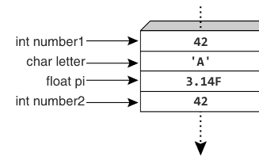

```csharp
//...
int number1 = 42;
char letter = 'A';
float pi = 3.14F;
int number2 = number1;
//...
```

**图2.1：** 值类型直接包含数据

类似地，将值类型传递给诸如 `Console.WriteLine()` 之类的方法也会导致内存复制，并且方法内部对参数的更改不会影响调用函数中的原始值。由于值类型需要内存复制，因此通常应将它们定义为消耗少量内存的类型；值类型的大小几乎总应小于16字节。

## 引用类型

相比之下，引用类型的值是对包含数据的存储位置的引用。引用类型存储数据所在位置的引用，而不是像值类型那样直接存储数据。因此，要访问数据，运行时将从变量中读取内存位置，然后“跳转”到包含该数据的内存位置。

引用类型所指向的数据的内存区域称为**堆**（参见图2.2）。

引用类型不需要像值类型那样复制数据本身，这使得复制引用类型比复制大型值类型高效得多。将一个引用类型变量的值赋给另一个引用类型变量时，只复制引用，而不复制所引用的数据。实际上，引用的大小总是与处理器的“本机大小”相同：32位处理器复制32位引用，64位处理器复制64位引用，依此类推。显然，将小型引用复制到大型数据块比像值类型那样复制整个数据块要快。

由于引用类型复制的是对数据的引用，两个不同的变量可以引用相同的数据。如果两个变量引用同一个对象，通过一个变量更改对象的字段后，通过另一个变量访问该字段时会看到更改的效果。这既发生在赋值中，也发生在方法调用中。因此，方法可以影响引用类型的数据，并且当控制权返回给调用者时可以观察到这种更改。因此，在定义引用类型或值类型之间进行选择时，一个关键因素是：对象在逻辑上是否像一个固定大小的不可变值（因此可能是值类型），还是像一个可以被引用的可变事物（因此很可能是引用类型）。

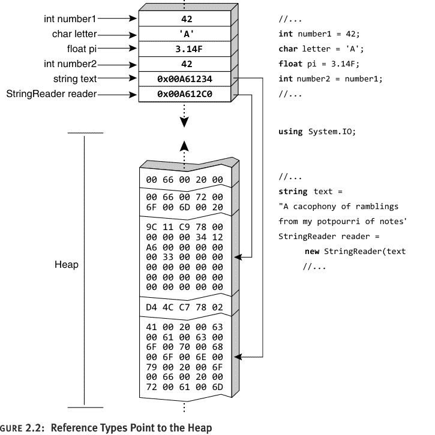

```csharp
//...
int number1 = 42;
char letter = 'A';
float pi = 3.14F;
int number2 = number1;
//...

using System.IO;

//...
string text =
    @"A cacophony of ramblings
    from my potpourri of notes";
StringReader reader =
    new StringReader(text);
//...
```

**图2.2：** 引用类型指向堆

除了 `string` 和任何自定义类（如 `Program`）之外，到目前为止讨论的所有类型都是值类型。然而，大多数类型都是引用类型。尽管可以定义自定义值类型，但与自定义引用类型的数量相比，这样做相对较少。

## 可空修饰符

值类型通常不能被赋值为 `null`，因为根据定义，它们不能包含引用，包括对“无”的引用。然而，这带来了一个问题，因为我们经常希望表示“缺失”的值。例如，在指定计数时，如果计数未知，你会输入什么？一种可能的解决方案是指定一个“魔法”值，如 `-1` 或 `int.MaxValue`，但这些是有效的整数。相反，最好将 `null` 赋给值类型，因为 `null` 不是有效的整数。

要声明可以存储 `null` 的值类型变量，可以使用可空修饰符 `?`。这个特性是在 C# 2.0 中引入的，如清单2.20所示。

**清单2.20：使用可空修饰符**

```csharp
static void Main()
{
    int? count = null;
    do
    {
        // ...
    }
    while(count == null);
}
```

在数据库编程中，将 `null` 赋值给值类型特别有吸引力。数据库表中的值类型列通常允许 `null` 值。检索这些列并将它们赋值给 C# 代码中的对应字段是有问题的，除非这些字段也能包含 `null`。幸运的是，可空修饰符正是专门为处理这种场景而设计的。

## 数据类型之间的转换

鉴于各种 CLI 实现中预定义了数千种类型，并且代码可以定义无限数量的类型，因此类型在合理情况下支持从一种类型到另一种类型的转换非常重要。最常见的转换操作是强制转换（casting）。

考虑两种数值类型之间的转换：将 `long` 类型的变量转换为 `int` 类型的变量。`long` 类型可以包含大到9,223,372,036,854,775,807的值；然而，`int` 的最大值是2,147,483,647。因此，这种转换可能会导致数据丢失——例如，如果 `long` 类型的变量包含的值大于 `int` 的最大值。任何可能导致数值大小丢失或因转换失败而引发异常的转换都需要显式强制转换。相反，无论操作数类型如何，都不会丢失数值大小且不会引发异常的转换操作是隐式转换。

### 显式强制转换

在 C# 中，使用强制转换运算符进行转换。通过将希望变量转换成的类型放在括号内指定，你承认如果发生显式强制转换，可能会损失精度和数据，或可能导致异常。清单2.21中的代码将 `long` 转换为 `int`，并明确告诉系统尝试该操作。

**清单2.21：显式强制转换示例**

```csharp
long longNumber = 50918309109;
int intNumber = (int)longNumber;
```

*强制转换运算符*

使用强制转换运算符，程序员基本上是在对编译器说：“相信我，我知道自己在做什么。我知道该值将适合放入

**清单2.23：一个Checked块示例**

```csharp
class Program
{
    static void Main()
    {
        checked
        {
            // int.MaxValue equals 2147483647
            int n = int.MaxValue;
            n = n + 1;
            System.Console.WriteLine(n);
        }
    }
}
```

输出2.16显示了结果。

**输出2.16**

```text
Unhandled Exception: System.OverflowException: Arithmetic operation resulted in an overflow at Program.Main() in ...Program.cs:line 12
```

结果是，如果在 `checked` 块内发生溢出赋值，运行时将抛出异常。

C# 编译器提供了一个命令行选项，可以将默认的 `checked` 行为从 `unchecked` 更改为 `checked`。C# 还支持 `unchecked` 块，该块允许数据溢出而不是为块内的赋值抛出异常（参见清单2.24）。

**清单2.24：一个Unchecked块示例**

```csharp
using System;

class Program
{
    static void Main()
    {
        unchecked
        {
            // int.MaxValue equals 2147483647
            int n = int.MaxValue;
            n = n + 1;
            System.Console.WriteLine(n);
        }
    }
}
```

**LISTING 2.25: 不使用强制转换运算符进行隐式转换**

```csharp
int intNumber = 31416;
long longNumber = intNumber;
```

即使不需要显式强制转换运算符（因为允许隐式转换），仍然可以包含强制转换运算符（参见列表 2.26）。

**LISTING 2.26: 对隐式转换使用强制转换运算符**

```csharp
int intNumber = 31416;
long longNumber = (long) intNumber;
```

## 无需强制转换的类型转换

未定义从字符串到数值类型的转换，因此需要使用诸如 `Parse()` 之类的方法。每个数值数据类型都包含一个 `Parse()` 函数，可实现从字符串到相应数值类型的转换。列表 2.27 演示了此调用。

**LISTING 2.27: 使用 int.Parse() 将字符串转换为数值数据类型**

```csharp
string text = "9.11E-31";
float kgElectronMass = float.Parse(text);
```

还有一种特殊类型可用于将一种类型转换为下一类型。此类型为 `System.Convert`，其使用示例出现在列表 2.28 中。

**LISTING 2.28: 使用 System.Convert 进行类型转换**

```csharp
string middleCText = "261.626";
double middleC = System.Convert.ToDouble(middleCText);
bool boolean = System.Convert.ToBoolean(middleC);
```

`System.Convert` 仅支持少量类型且不可扩展。它允许从 `bool`、`char`、`sbyte`、`short`、`int`、`long`、`ushort`、`uint`、`ulong`、`float`、`double`、`decimal`、`DateTime` 和 `string` 中的任何一种类型转换为这些类型中的任何其他类型。

此外，所有类型都支持 `ToString()` 方法，可用于提供类型的字符串表示形式。列表 2.29 演示了如何使用此方法。结果输出显示在输出 2.18 中。

## LISTING 2.29: 使用 ToString() 转换为字符串

```csharp
bool boolean = true;
string text = boolean.ToString();
// Display "True"
System.Console.WriteLine(text);
```

## OUTPUT 2.18

```text
True
```

对于大多数类型，`ToString()` 方法将返回数据类型名称而不是数据的字符串表示形式。只有当类型具有 `ToString()` 的显式实现时，才会返回字符串表示形式。最后一点是，可以编写自定义转换方法，并且运行时中的类提供了许多此类方法。

## ADVANCED TOPIC

## TryParse()

从 C# 2.0（.NET 2.0）开始，所有数值基元类型都包含静态 `TryParse()` 方法。此方法与 `Parse()` 方法非常相似，只是如果转换失败，`TryParse()` 方法不会抛出异常，而是返回 `false`，如列表 2.30 所演示。

## LISTING 2.30: 使用 TryParse() 代替无效强制转换异常


```csharp
double number;
string input;

System.Console.Write("Enter a number: ");
input = System.Console.ReadLine();
if (double.TryParse(input, out number))
{
    // Converted correctly, now use number
    // ...
}
else
{
    System.Console.WriteLine(
        "The text entered was not a valid number.");
}
```

输出 2.19 显示了列表 2.30 的结果。

### OUTPUT 2.19

```
Enter a number: forty-two
The text entered was not a valid number.
```

代码从输入字符串解析出的结果值通过`out`参数返回——在本例中为`number`。

`Parse()`与`TryParse()`之间的关键区别在于`TryParse()`在失败时不会抛出异常。经常情况下，从字符串到数值类型的转换取决于用户输入文本。在此类场景中，预计用户会输入无法成功解析的无效数据。通过使用`TryParse()`而不是`Parse()`，可以在预期情况下避免抛出异常。（本例中的预期情况是用户将输入无效数据，我们尝试避免为预期场景抛出异常。）

## Arrays

第 1 章未涵盖的变量声明的一个特定方面是数组声明。通过数组声明，您可以使用单个变量存储多个相同类型项，并在需要时仍可使用索引单独访问它们。在 C# 中，数组索引从零开始。因此，C# 中的数组是零基的。

### BEGINNER TOPIC

#### Arrays

数组提供了一种使用单个变量声明同一类型的数据项集合的方法。数组中的每个项都使用称为索引的整数值唯一指定。C# 数组中的第一项使用索引 0 访问。程序员应注意指定小于数组大小的索引值。由于 C# 数组是零基的，因此数组中最后一个元素的索引比数组中的总项目数少一。

对于初学者，有时将索引视为偏移量是有帮助的。第一项距离数组开始为零。第二项距离数组开始为一——依此类推。

数组几乎是每种编程语言的基础部分，因此对于几乎所有开发人员来说都是必修内容。虽然数组在 C# 编程中经常使用，并且初学者需要理解，但现在大多数程序在存储数据集合时使用泛型集合类型而不是数组。因此，读者应仅浏览以下“声明数组”部分，以熟悉其实例化和赋值。表 2.7 提供了需要注意的要点。泛型集合将在第 14 章中详细介绍。

此外，本章的最后一节“常见数组错误”提供了对一些数组特性的回顾。

## Declaring an Array

在 C# 中，您使用方括号声明数组。首先指定数组的元素类型，然后是打开和关闭的方括号；然后输入变量的名称。列表 2.31 声明一个名为`languages`的变量为字符串数组。

### LISTING 2.31: 声明数组

```csharp
string[] languages;
```

显然，数组的第一部分标识数组中元素的 **数据类型**。声明中作为一部分的方括号标识数组的 **rank**，即维数；在本例中，它是一个秩为一的数组。这两部分构成了变量`languages`的数据类型。

> ### Language Contrast: C++ and Java—Array Declaration
>
> C# 中数组的方括号紧跟在数据类型之后，而不是像 C++ 和 Java 那样出现在变量声明之后。这使所有类型信息保持在一起，而不是像 C++ 和 Java 那样将类型信息拆分到标识符前后。

| Description | Example |
|---|---|
| **Declaration**<br>注意括号与数据类型一起出现。<br>多维数组使用逗号声明，其中逗号+1 指定维数。 | `string[] languages;` // *one-dimensional*<br>`int[,] cells;` // *two-dimensional* |
| **Assignment**<br>在声明时，`new`关键字和相应的数据类型是可选的。声明后，实例化数组时需要`new`关键字。数组可以用字面值赋值。因此，数组中每个项的值初始化为其默认值。如果未提供字面值，则必须指定数组的大小。（大小不必是常量；它可以是运行时计算的变量。）从 C# 3.0 开始，指定数据类型是可选的。 | ```csharp
string[] languages = { "C#", "COBOL", "Java",
    "C++", "Visual Basic", "Pascal",
    "Fortran", "Lisp", "J#"};
languages = new string[9];
languages = new string[] {"C#", "COBOL", "Java",
    "C++", "Visual Basic", "Pascal",
    "Fortran", "Lisp", "J#"};

// Multidimensional array assignment
// and initialization.
int[,] cells = int[3,3];
cells = {
    {1, 0, 2},
    {1, 2, 0},
    {1, 2, 1}
};
``` |
| **default Keyword**<br>任何数据类型的显式默认值都可使用`default`运算符获得。 | `int count = default(int);` |
| **Accessing an Array**<br>数组是零基的，因此数组中的第一个元素位于索引 0。<br>方括号用于存储和检索数组中的数据。 | ```csharp
string[] languages = new string[9]{
    "C#", "COBOL", "Java",
    "C++", "Visual Basic", "Pascal",
    "Fortran", "Lisp", "J#"};
// Save "C++" to variable called Language.
string language = languages[3];
// Assign "Java" to the C++ position.
languages[3] = languages[2];
// Assign Language to location of "Java".
languages[2] = language;
``` |

Listing 2.31 定义了一个秩为 1 的数组。方括号内的逗号定义了额外的维度。例如，Listing 2.32 定义了一个用于国际象棋或井字棋的二维单元格数组。

### LISTING 2.32: Declaring a Two-Dimensional Array

```
//   | |
// --+---+--
//   | |
// --+---+--
//   | |
int[,] cells;
```

在 Listing 2.32 中，数组的秩为 2。第一个维度可以对应于横向的单元格，第二个维度表示纵向的单元格。额外的维度通过额外的逗号添加，总秩比逗号的数量多一个。请注意，对于特定维度出现的项目数量并不是变量声明的一部分。这是在创建（实例化）数组并为每个元素分配空间时指定的。

## Instantiating and Assigning Arrays

一旦声明了数组，你就可以立即使用一对大括号内用逗号分隔的项目列表填充其值。Listing 2.33 声明了一个字符串数组，然后在大括号内分配了九种语言的名称。

### LISTING 2.33: Array Declaration with Assignment

```
string[] languages = { "C#", "COBOL", "Java",
  "C++", "Visual Basic", "Pascal",
  "Fortran", "Lisp", "J#"};
```

逗号分隔列表中的第一个项目成为数组中的第一个项目；列表中的第二个项目成为数组中的第二个项目，以此类推。大括号是定义数组字面量的记法。

Listing 2.33 中显示的赋值语法仅在你在一个语句中声明并赋值时可用。要在声明后赋值需要使用关键字`new`，如 Listing 2.34 所示。

### LISTING 2.34: Array Assignment

```csharp
string[] languages;

languages = new string[] {"C#", "COBOL", "Java",
    "C++", "Visual Basic", "Pascal",
    "Fortran", "Lisp", "J#" };
```

从 C# 3.0 开始，如果编译器能够从数组初始化器中元素的类型推断出数组的元素类型，则在`new`之后指定数组的数据类型（`string`）是可选的。方括号仍然是必需的。

C# 还允许在声明语句中使用`new`关键字作为其一部分，因此它允许 Listing 2.35 中显示的赋值和声明。

### LISTING 2.35: Array Declaration and Assignment

```csharp
string[] languages = new string[]{
    "C#", "COBOL", "Java",
    "C++", "Visual Basic", "Pascal",
    "Fortran", "Lisp", "J#"};
```

使用`new`关键字告诉运行时为数据类型分配内存。它指示运行时实例化数据类型——在本例中为数组。

每当你使用`new`关键字作为数组赋值的一部分时，你也可以在方括号内指定数组的大小。Listing 2.36 演示了此语法。

### LISTING 2.36: Array Declaration with Size

```csharp
string[] languages = new string[9]{
    "C#", "COBOL", "Java",
    "C++", "Visual Basic", "Pascal",
    "Fortran", "Lisp", "J#"};
```

初始化语句中的数组大小和大括号内包含的元素数量必须匹配。此外，还可以分配数组但不指定数组的初始值，如 Listing 2.37 所示。

### LISTING 2.37: Array Declaration without Initializer

```csharp
string[] languages = new string[9];
```

分配数组但不初始化初始值仍会初始化每个元素。运行时将元素初始化为其默认值，如下所示：

- 引用类型（如`string`）初始化为`null`。
- 数值类型初始化为零。
- `bool`初始化为`false`。
- `char`初始化为`\0`。

非原始值类型通过将它们的每个字段递归初始化为其默认值来初始化。因此，在使用数组之前不需要单独为数组的每个元素赋值。

> **NOTE**
>
> 在 C# 2.0 中，可以使用`default()`运算符生成数据类型的默认值。`default()`接受数据类型作为参数。例如，`default(int)`生成 0，`default(bool)`生成 false。

由于数组大小不是变量声明的一部分，因此可以在运行时指定大小。例如，Listing 2.38 根据`Console.ReadLine()`调用中指定的大小创建数组。

### LISTING 2.38: Defining the Array Size at Runtime

```
string[] groceryList;
System.Console.Write("How many items on the list? ");
int size = int.Parse(System.Console.ReadLine());
groceryList = new string[size];
// ...
```

C# 类似地初始化多维数组。逗号分隔每个秩的大小。Listing 2.39 用无移动初始化一个井字棋盘。

### LISTING 2.39: Declaring a Two-Dimensional Array

```
int[,] cells = int[3,3];
```

用特定位置初始化井字棋盘可以如 Listing 2.40 所示完成。

### LISTING 2.40: Initializing a Two-Dimensional Array of Integers

```
int[,] cells = {
    {1, 0, 2},
    {1, 2, 0},
    {1, 2, 1}
};
```

初始化遵循以下模式：存在三个元素类型为`int[]`的数组，每个元素大小相同；在本例中，大小为 3。请注意，每个`int[]`元素的大小必须完全相同。因此，Listing 2.41 中显示的声明无效。

### LISTING 2.41: A Multidimensional Array with Inconsistent Size, Causing an Error

```
// ERROR: Each dimension must be consistently sized.
int[,] cells = {
    {1, 0, 2, 0},
    {1, 2, 0},
    {1, 2}
    {1}
};
```

表示井字棋不需要每个位置都有一个整数。一个替代方案是为每个玩家提供一个单独的虚拟棋盘，每个棋盘包含一个`bool`来指示玩家选择了哪些位置。Listing 2.42 对应于一个三维棋盘。

### LISTING 2.42: Initializing a Three-Dimensional Array

```
bool[,,] cells;
cells = new bool[2,3,3]
{
    // Player 1 moves          // X | |
    { {true, false, false},   // --+-+---
      {true, false, false},  // X | |
      {true, false, true} },  // --+-+---
                              // X | | X
    // Player 2 moves          // | | O
    { {false, false, true},   // --+-+---
      {false, true, false},  // | O |
      {false, true, true} }  // --+-+---
                              // | O |
};
```

在本例中，棋盘被初始化，并且每个秩的大小被明确标识。除了在`new`表达式中指定大小之外，还提供了数组的字面值。类型为`bool[ , , ]`的字面值被分解为两个类型为`bool[ , ]`、大小为 3 × 3 的数组。每个二维数组由三个大小为 3 的`bool`数组组成。

如前所述，多维数组中的每个维度必须大小一致。然而，也有可能定义一个锯齿数组，即数组的数组。锯齿数组语法与多维数组略有不同；此外，锯齿数组不需要大小一致。因此，可以如 Listing 2.43 所示初始化锯齿数组。

### LISTING 2.43: Initializing a Jagged Array

```
int[][] cells = {
    new int[]{1, 0, 2, 0},
    new int[]{1, 2, 0},
    new int[]{1, 2},
    new int[]{1}
};
```

锯齿数组不使用逗号来标识新维度。相反，锯齿数组定义了数组的数组。在 Listing 2.43 中，`[]`放在数据类型`int[]`之后，从而声明了类型为`int[][]`的数组。

请注意，锯齿数组需要为每个内部数组提供一个数组实例（或`null`）。在本例中，你使用`new`来实例化锯齿数组的内部元素。省略实例化会导致编译错误。

## Using an Array

你使用方括号记法，即数组访问器，来访问数组中的特定项目。要检索数组中的第一个项目，你指定零作为索引。在 Listing 2.44 中，`languages`变量中第五个项目的值（使用索引 4，因为第一个项目的索引为 0）存储在变量`language`中。

### LISTING 2.44: Declaring and Accessing an Array

```
string[] languages = new string[9]{
    "C#", "COBOL", "Java",
    "C++", "Visual Basic", "Pascal",
    "Fortran", "Lisp", "J#"};
// Retrieve fifth item in languages array (Java)
string language = languages[4];
```

方括号表示法也用于将数据存储到数组中。清单 2.45 交换了"C++"和"Java"的顺序。

### LISTING 2.45: Swapping Data between Positions in an Array

```
string[] languages = new string[9]{
    "C#", "COBOL", "Java",
    "C++", "Visual Basic", "Pascal",
    "Fortran", "Lisp", "J#"};
// Save "C++" to variable called Language.
string language = languages[3];
// Assign "Java" to the C++ position.
languages[3] = languages[2];
// Assign Language to location of "Java".
languages[2] = language;
```

对于多维数组，一个元素通过每个维度的索引来标识，如清单 2.46 所示。

### LISTING 2.46: Accessing a Multidimensional Array

```
int[,] cells = {
    {1, 0, 2},
    {1, 2, 0},
    {1, 2, 1}
};
// Retrieve item at [0,2] (value 2)
int value = cells[0,2];
```


## LISTING 2.46: Initializing a Two-Dimensional Array of Integers

```
int[,] cells = {
    {1, 0, 2},
    {0, 2, 0},
    {1, 2, 1}
};
// Set the winning tic-tac-toe move to be player 1.
cells[1,0] = 1;
```

锯齿数组元素的赋值略有不同，因为它与锯齿数组声明一致。第一个元素是数组的数组中的一个数组；第二个索引指定所选数组元素内的项目（参见清单 2.47）。

## LISTING 2.47: Declaring a Jagged Array

```
int[][] cells = {
    new int[]{1, 0, 2},
    new int[]{0, 2, 0},
    new int[]{1, 2, 1}
};

cells[1][0] = 1;
// ...
```

## Length

你可以通过清单 2.48 所示的方式获取数组的长度。

```
Console.WriteLine(
    $"There are { languages.Length } languages in the array.");
```

数组具有固定长度；它们被绑定，使得长度不能在不重新创建数组的情况下更改。此外，超出数组的边界（或长度）会导致运行时报告错误。这可能发生在你尝试使用数组中不存在元素的索引来访问（检索或赋值）数组时。这种错误经常发生在你使用数组长度作为数组的索引时，如清单 2.49 所示。

```
string languages = new string[9];
...
// RUNTIME ERROR: index out of bounds - should
// be 8 for the last element
languages[4] = languages[9];
```

> **NOTE**
>
> `Length` 成员返回数组中的项目数，而不是最高索引。`languages` 变量的 `Length` 成员为 9，但 `languages` 变量的最高索引为 8，因为它距离起点就是这么远。

使用 `Length` 代替硬编码的数组大小是一个良好的实践。要将 `Length` 用作索引，例如，有必要减去 1 以避免越界错误（参见清单 2.50）。

```
string languages = new string[9];
...
languages[4] = languages[languages.Length - 1];
```

为了避免超出数组的边界，使用长度检查来验证数组的长度大于 0，并在访问数组的最后一个项目时使用 `Length - 1` 代替硬编码值（参见清单 2.50）。`Length` 返回数组中的元素总数。因此，如果你有一个像 `bool cells[,,]` 这样大小为 2 × 3 × 3 的多维数组，`Length` 将返回元素总数 18。

对于锯齿数组，`Length` 返回第一个数组中的元素数。因为锯齿数组是数组的数组，`Length` 只评估外部的包含数组并返回其元素计数，而不管内部数组中包含什么。

## Language Contrast: C++—Buffer Overflow Bugs

非托管 C++ 并非总是检查你是否超出数组的边界。不仅难以调试，而且犯此错误还可能导致一种称为 **buffer overrun** 的潜在安全错误。相比之下，通用语言运行时保护所有 C#（和托管 C++）代码免于超出数组边界，几乎消除了托管代码中缓冲区溢出问题的可能性。

## More Array Methods

数组包括用于操作数组内元素的附加方法——例如，`Sort()`、`BinarySearch()`、`Reverse()` 和 `Clear()`（参见清单 2.51）。

```csharp
class ProgrammingLanguages
{
    static void Main()
    {
        string[] languages = new string[]
        {
            "C#", "COBOL", "Java",
            "C++", "Visual Basic", "Pascal",
            "Fortran", "Lisp", "J#"
        };
        System.Array.Sort(languages);
        string searchString = "COBOL";
```

```
int index = System.Array.BinarySearch(
    languages, searchString);
System.Console.WriteLine(
    "The wave of the future, "
    + $"{ searchString }, is at index { index }.");
System.Console.WriteLine();
System.Console.WriteLine(
    $"{ "First Element",-20 }\t{ "Last Element",-20 }");
System.Console.WriteLine(
    $"{ "------------",-20 }\t{ "------------",-20 }");
System.Console.WriteLine(
    $"{ languages[0],-20 }\t{ languages[languages.Length-1],-20 }");
System.Array.Reverse(languages);
System.Console.WriteLine(
    $"{ languages[0],-20 }\t{ languages[languages.Length-1],-20 }");
// Note this does not remove all items from the array.
// Rather it sets each item to the type's default value.
System.Array.Clear(languages, 0, languages.Length);
System.Console.WriteLine(
    $"{ languages[0],-20 }\t{ languages[languages.Length-1],-20 }");
System.Console.WriteLine(
    $"After clearing, the array size is: { languages.Length }");
}
```

清单 2.51 的结果显示在输出 2.20 中。

## OUTPUT 2.20

```
The wave of the future, COBOL, is at index 2.
First Element        Last Element
---------------      -------------
C#                    Visual Basic
Visual Basic          C#
After clearing, the array size is: 9
```

对这些方法的访问是通过 `System.Array` 类获得的。在很大程度上，使用这些方法是自解释的，除了两点值得注意：

- 在使用 `BinarySearch()` 方法之前，重要的是要对数组进行排序。如果值不是按递增顺序排序，可能会返回错误的索引。如果搜索元素不存在，返回的值为负数。 （使用补码运算符，`~index`，返回大于搜索值的第一个索引，如果存在。）
- `Clear()` 方法不会删除数组的元素，也不会将长度设置为零。数组大小是固定的，不能修改。因此，`Clear()` 方法将数组中的每个元素设置为其默认值（false、0 或 null）。这解释了为什么在调用 `Clear()` 后写入数组时 `Console.WriteLine()` 会创建空白行。

## Language Contrast: Visual Basic—Redimensioning Arrays

Visual Basic 包含一个 `Redim` 语句用于更改数组中的项目数。虽然没有等效的 C#-特定关键字，但在 .NET 2.0 中有一个方法可以重新创建数组然后将所有元素复制到新数组中。该方法称为 `System.Array.Resize`。

## Array Instance Methods

像字符串一样，数组具有实例成员，这些成员不是从数据类型访问，而是直接从变量访问。`Length` 就是实例成员的一个例子，因为对 `Length` 的访问是通过数组变量，而不是类。其他重要的实例成员是 `GetLength()`、`Rank` 和 `Clone()`。

检索特定维度的长度不需要 `Length` 属性。要检索特定秩的大小，数组包含一个 `GetLength()` 实例方法。调用此方法时，有必要指定将返回其长度的秩（参见清单 2.52）。

## LISTING 2.52: Retrieving a Particular Dimension's Size

```
bool[,] cells;
cells = new bool[2,3,3];
System.Console.WriteLine(cells.GetLength(0));  // Displays 2
```

清单 2.52 的结果出现在输出 2.21 中。

## OUTPUT 2.21

```
2
```

清单 2.52 显示 2，因为那是第一个维度中的元素数。

也可以通过访问数组的 `Rank` 成员来检索整个数组的秩。例如，`cells.Rank` 将返回 3。

默认情况下，将一个数组变量赋值给另一个数组只会复制数组引用，而不是数组的各个元素。要制作数组的完全新副本，请使用数组的 `Clone()` 方法。`Clone()` 方法将返回数组的副本；更改此新数组的任何成员都不会影响原始数组的成员。

## Strings As Arrays

字符串类型的变量可以像字符数组一样访问。例如，要检索名为 `palindrome` 的字符串的第四个字符，你可以调用 `palindrome[3]`。请注意，由于字符串是不可变的，因此不可能为字符串中的特定字符赋值。因此，C# 不允许 `palindrome[3]='a'`，其中 `palindrome` 声明为字符串。清单 2.53 使用数组访问器来确定命令行上的参数是否为选项，其中选项由第一个字符的连字符标识。

## LISTING 2.53: Looking for Command-Line Options

```
string[] args;
...
if(args[0][0] == '-')
{
    //This parameter is an option
}
```

此片段使用了 `if` 语句，该语句在第 3 章中介绍。此外，它提供了一个有趣的示例，因为你使用数组访问器检索字符串数组 `args` 中的第一个元素。第一个数组访问器之后是第二个，它检索字符串的第一个字符。因此，代码等同于清单 2.54 所示的内容。

## LISTING 2.54: Looking for Command-Line Options (Simplified)

```
string[] args;
...
string arg = args[0];
if(arg[0] == '-')
{
    //This parameter is an option
}
```

不仅可以使用数组访问器单独访问字符串字符，还可以使用字符串的 `ToCharArray()` 方法将整个字符串作为字符数组检索。使用这种方法，你可以使用 `System.Array.Reverse()` 方法反转字符串，如 Listing 2.55 所示，它用于确定一个字符串是否为回文。

## LISTING 2.55: Reversing a String

```
class Palindrome
{
    static void Main()
    {
        string reverse, palindrome;
        char[] temp;
        System.Console.Write("Enter a palindrome: ");
        palindrome = System.Console.ReadLine();
        // Remove spaces and convert to lowercase
        reverse = palindrome.Replace(" ", "");
        reverse = reverse.ToLower();
        // Convert to an array
        temp = reverse.ToCharArray();
        // Reverse the array
        System.Array.Reverse(temp);
        // Convert the array back to a string and
        // check if reverse string is the same.
        if(reverse == new string(temp))
        {
            System.Console.WriteLine(
                $"\"{palindrome}\" is a palindrome.");
        }
        else
        {
            System.Console.WriteLine(
                $"\"{palindrome}\" is NOT a palindrome.");
        }
    }
}
```

Listing 2.55 的结果显示在 Output 2.22 中。

## OUTPUT 2.22

```
Enter a palindrome: NeverOddOrEven
"NeverOddOrEven" is a palindrome.
```


此示例使用了 `new` 关键字；这次，它从反转后的字符数组创建一个新的字符串。

## Common Array Errors

本节介绍了三种类型的数组：单维、多维和锯齿数组。数组声明和使用受若干规则和特殊情况的约束。Table 2.8 指出了一些最常见的错误，并有助于巩固规则。尝试先查看 Common Mistake 列中的代码（不要查看 Error Description 和 Corrected Code 列），以验证你对数组及其语法的理解。

## TABLE 2.8: Common Array Coding Errors

| Common Mistake | Error Description | Corrected Code |
|---|---|---|
| `int numbers[];` | 声明数组时方括号出现在数据类型之后，而不是变量标识符之后。 | `int[] numbers;` |
| `int[] numbers; numbers = {42, 84, 168 };` | 在声明后为数组赋值时，需要使用 `new` 关键字然后指定数据类型。 | `int[] numbers; numbers = new int[]{ 42, 84, 168 }` |
| `int[3] numbers = { 42, 84, 168 };` | 不可能在变量声明中指定数组大小。 | `int[] numbers = { 42, 84, 168 };` |
| `int[] numbers = new int[];` | 除非提供了数组字面量，否则初始化时需要数组大小。 | `int[] numbers = new int[3];` |
| `int[] numbers = new int[3]{}` | 数组大小指定为 3，但数组字面量中没有元素。数组大小必须与数组字面量中的元素数量匹配。 | `int[] numbers = new int[3] { 42, 84, 168 };` |
| `int[] numbers = new int[3]; Console.WriteLine(numbers[3]);` | 数组索引从零开始。因此，最后一个项目比数组大小少一。 （请注意，这是一个运行时错误，而不是编译时错误。） | `int[] numbers = new int[3]; Console.WriteLine(numbers[2]);` |
| `int[] numbers = new int[3]; numbers[numbers.Length] = 42;` | 与上一个错误相同：访问最后一个元素时需要从 Length 中减去 1。 （请注意，这是一个运行时错误，而不是编译时错误。） | `int[] numbers = new int[3]; numbers[numbers.Length-1] = 42;` |
| `int[] numbers; Console.WriteLine(numbers[0]);` | `numbers` 尚未被分配一个已实例化的数组，因此无法访问。 | `int[] numbers = {42, 84}; Console.WriteLine(numbers[0]);` |
| `int[,] numbers = { {42}, {84, 42} };` | 多维数组必须结构一致。 | `int[,] numbers = { {42, 168}, {84, 42} };` |
| `int[][] numbers = { {42, 84}, {84, 42} };` | 锯齿数组要求为数组内的数组指定已实例化的数组。 | `int[][] numbers = { new int[]{42, 84}, new int[]{84, 42} };` |

## SUMMARY

即使对于经验丰富的程序员来说，C# 也引入了几种新的编程结构。例如，作为数据类型部分的一部分，本章介绍了类型 `decimal`，它可用于在不出现浮点异常的情况下执行财务计算。此外，本章介绍了布尔类型 `bool` 不能隐式转换为或从整数类型转换，从而防止在条件表达式中误用赋值运算符。C# 的其他特性使其区别于其许多前身，例如 `@` verbatim 字符串限定符，它强制字符串忽略转义字符，以及字符串数据类型的不可变性。

C# 允许隐式转换和显式转换（即需要类型转换操作的转换）将表达式转换为给定数据类型。在第 9 章中，你将学习如何为自己的类型定义自定义转换运算符。

本章以 C# 数组语法及其各种操作方式作为结尾。对于许多开发人员来说，语法乍一看可能相当令人生畏，因此该部分包含了一个与编码数组相关的常见错误列表。

下一章将介绍表达式和控制流语句。`if` 语句在这一章末尾出现了几次，也将在其中讨论。

# 3. Operators and Control Flow

IN THIS CHAPTER, YOU WILL learn about operators, control flow statements, and the C# preprocessor. Operators provide syntax for performing different calculations or actions appropriate for the operands within the calculation. Control flow statements provide the means for conditional logic within a program or looping over a section of code multiple times. After introducing the `if` control flow statement, the chapter looks at the concept of Boolean expressions, which are embedded within many control flow statements. Included is mention of how integers cannot be converted

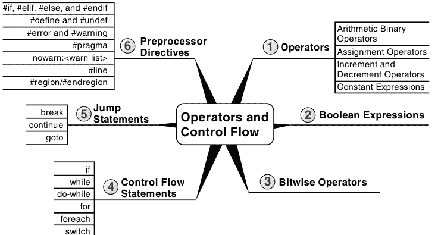

```csharp
//National debt to the penny
decimal debt = -18125876697430.99M;
```

使用减法运算符 *is equivalent to subtracting the operand from zero.* 一元加运算符 (`+`) 很少² 对值产生任何影响。它是 C# 语言中多余的添加，为对称性而包含。

## Arithmetic Binary Operators (+, -, *, /, %)

二进制运算符需要两个操作数。C# 对二进制运算符使用中缀表示法：运算符出现在左右操作数之间。除赋值外的每个二进制运算符的结果都必须以某种方式使用——例如，将其用作另一个表达式（如赋值）中的操作数。

> **Language Contrast: C++—Operator-Only Statements**
> 
> 与前面提到的规则相反，C++ 将允许单个二进制表达式构成整个语句，例如 `4+5`，来编译。在 C# 中，只有赋值、调用、递增、递减和对象创建表达式才允许构成整个语句。

Listing 3.3 中的减法示例说明了二进制运算符的使用——更具体地说是算术二进制运算符。操作数出现在算术运算符的两侧，然后计算值被赋值。其他算术二进制运算符是加法 (`+`)、除法 (`/`)、乘法 (`*`) 和余数 (`%`——有时称为 mod 运算符)。

1. 截至 2015 年 2 月 5 日，根据 www.treasurydirect.gov。
2. 一元 `+` 运算符定义为接受类型为 `int`、`uint`、`long`、`ulong`、`float`、`double` 和 `decimal`（以及这些类型的可空版本）的操作数。对其他数值类型（如 `short`）使用它会将操作数转换为其中一种适当的类型。

# LISTING 3.3: 使用二进制运算符

```csharp
class Division
{
    static void Main()
    {
        int numerator;
        int denominator;
        int quotient;
        int remainder;
        System.Console.Write("Enter the numerator: ");
        numerator = int.Parse(System.Console.ReadLine());
        System.Console.Write("Enter the denominator: ");
        denominator = int.Parse(System.Console.ReadLine());
        quotient = numerator / denominator;
        remainder = numerator % denominator;
        System.Console.WriteLine(
            $"{numerator} / {denominator} = {quotient} with remainder {remainder}");
    }
}
```

Output 3.1 shows the results of Listing 3.3.

## OUTPUT 3.1

```
Enter the numerator: 23
Enter the denominator: 3
23 / 3 = 7 with remainder 2
```

In the highlighted assignment statements, the division and remainder operations are executed before the assignments. The order in which operators are executed is determined by their **precedence** and **associativity**. The precedence for the operators used so far is as follows:

- 1. `*`, `/`, and `%` have highest precedence.
- 2. `+` and `-` have lower precedence.
- 3. `=` has the lowest precedence of these six operators.

Therefore, you can assume that the statement behaves as expected, with the division and remainder operators executing before the assignment.

If you forget to assign the result of one of these binary operators, you will receive the compile error shown in Output 3.2.

## OUTPUT 3.2

```
... error (CS0201: Only assignment, call, increment, decrement,
and new object expressions can be used as a statement
```


## BEGINNER TOPIC

### Parentheses, Associativity, Precedence, and Evaluation

When an expression contains multiple operators, it can be unclear precisely what the operands of each operator are. For example, in the expression `x+y*z`, clearly the expression `x` is an operand of the addition and `z` is an operand of the multiplication. But is `y` an operand of the addition or the multiplication?

`Parentheses` allow you to unambiguously associate an operand with its operator. If you wish `y` to be a summand, you can write the expression as `(x+y)*z`; if you want it to be a multiplicand, you can write `x+(y*z)`.

However, C# does not require you to parenthesize every expression containing more than one operator; instead, the compiler can use associativity and precedence to figure out from the context which parentheses you have omitted. `Associativity` determines how similar operators are parenthesized; `precedence` determines how dissimilar operators are parenthesized.

A binary operator may be “left-associative” or “right-associative,” depending on whether the expression “in the middle” belongs to the operator on the left or the right. For example, `a-b-c` is assumed to mean `(a-b)-c`, and not `a-(b-c)`; subtraction is therefore said to be “left-associative.” Most operators in C# are left-associative; the assignment operators are right-associative.

When the operators are dissimilar, the `precedence` for those operators is used to determine which side the operand in the middle belongs to. For example, multiplication has higher precedence than addition and, therefore, the expression `x+y*z` is evaluated as `x+(y*z)` rather than `(x+y)*z`.

It is often still a good practice to use parentheses to make the code more readable even when use of parentheses does not change the meaning of the

### Special Floating-Point Characteristics

The binary floating-point types: `float` and `double`, have some special characteristics, such as the way they handle precision. This section looks at some specific examples, as well as some unique floating-point type characteristics.

A `float`, with seven decimal digits of precision, can hold the value `1,234,567` and the value `0.1234567`. However, if you add these two floats together, the result will be rounded to `1234567`, because the exact result requires more precision than the seven significant digits that a `float` can hold. The error introduced by rounding off to seven digits can become large compared to the value computed, especially with repeated calculations. (See also the Advanced Topic, “Unexpected Inequality with Floating-Point Types,” later in this section.)

Internally, the binary floating-point types actually store a binary fraction, not a decimal fraction. Consequently, “representation error” inaccuracies can occur with a simple assignment, such as `double number = 140.6F`. The exact value of `140.6` is the fraction `703/5`, but the denominator of that fraction is not a power of `2`, so it cannot be represented exactly by a binary floating-point number. The value actually represented is the closest fraction with a power of `2` in the denominator that will fit into the `16` bits of a `float`.

Since the `double` can hold a more accurate value than the `float` can store, the C# compiler will actually evaluate this expression to `double number = 140.600006103516` because `140.600006103516` is the closest binary fraction to `140.6` as a `float`. This fraction is slightly larger than `140.6` when represented as a `double`.

> **Guidelines**
> 
> **AVOID** binary floating-point types when exact decimal arithmetic is required; use the `decimal` floating-point type instead.

## ADVANCED TOPIC

### Unexpected Inequality with Floating-Point Types

Because floating-point numbers can be unexpectedly rounded off to non-decimal fractions, comparing floating-point values for equality can be quite confusing. Consider Listing 3.7.

#### OUTPUT 3.6

```
4.2 != 4.200000047683716

4.2 != 4.200000047683716

(float)4.2M != 4.2F

4.200000047683716 != 4.20000028610229

4.200000047683716 != 4.2

4.2F != 4.2D

4.19999980926514 != 4.2

4.2F != 4.2D
```

The `Assert()` methods alert the developer whenever arguments evaluate to false. However, of all the comparisons in this code listing, none of them are in fact equal. In spite of the apparent equality of the values in the code listing, they are not actually equivalent due to the inaccuracies associated with `float` values.

#### Guidelines

AVOID using equality conditionals with binary floating-point types. Either subtract the two values and see if their difference is less than a tolerance, or use the `decimal` type.

You should be aware of some additional unique floating-point characteristics as well. For instance, you would expect that dividing an integer by zero would result in an error—and it does with data types such as `int` and `decimal`. The `float` and `double` types, however, allow for certain special values. Consider Listing 3.8, and its resultant output, Output 3.7.

#### LISTING 3.8: Dividing a Float by Zero, Displaying NaN

```
float n=0f;

// Displays: NaN

System.Console.WriteLine(n / 0);
```

#### OUTPUT 3.7

```
NaN
```

In mathematics, certain mathematical operations are undefined, including dividing zero by itself. In C#, the result of dividing the `float` zero by zero results in a special “Not a Number” value; all attempts to print the output of such a number will result in `NaN`. Similarly, taking the square root of a negative number with `System.Math.Sqrt(-1)` will result in `NaN`.

A floating-point number could overflow its bounds as well. For example, the upper bound of the `float` type is approximately `3.4 × 10³⁸`. Should the number overflow that bound, the result would be stored as “positive infinity” and the output of printing the number would be `Infinity`. Similarly, the lower bound of a `float` type is `−3.4 × 10³⁸`, and computing a value below that bound would result in “negative infinity,” which would be represented by the string `-Infinity`. Listing 3.9 produces negative and positive infinity, respectively, and Output 3.8 shows the results.

#### LISTING 3.9: Overflowing the Bounds of a float

```
// Displays: -Infinity

System.Console.WriteLine(-1f / 0);

// Displays: Infinity

System.Console.WriteLine(3.402823E+38f * 2f);
```

#### OUTPUT 3.8

```
-Infinity

Infinity
```

Further examination of the floating-point number reveals that it can contain a value very close to zero, without actually containing zero. If the value exceeds the lower threshold for the `float` or `double` type, the value of the number can be represented as “negative zero” or “positive zero,” depending on whether the number is negative or positive, and is represented in output as `-0` or `0`.

### Compound Assignment Operators (`+=`, `-=`, `*=`, `/=`, `% =`)

Chapter 1 discussed the simple assignment operator, which places the value of the right-hand side of the operator into the variable on the left-hand side. Compound assignment operators combine common binary operator calculations with the assignment operator. For example, consider Listing 3.10.

#### LISTING 3.10: 常见增量计算

```
int x = 123;

x = x + 2;
```

在此赋值中，首先计算 `x + 2` 的值，然后将计算得到的值赋回给 `x`。由于此类操作执行得相对频繁，因此存在一个赋值运算符来用一个运算符同时处理计算和赋值。`+=` 运算符将运算符左侧变量的值增加运算符右侧的值，如 Listing 3.11 所示。

#### LISTING 3.11: 使用 `+=` 运算符

```
int x = 123;

x += 2;
```

因此，此代码等价于 Listing 3.10。

存在许多其他“复合赋值”运算符来提供类似功能。你也可以使用赋值运算符与减法、乘法、除法和余数运算符一起使用（如 Listing 3.12 所演示）。

#### LISTING 3.12: 其他赋值运算符示例

```
x -= 2;

x /= 2;

x *= 2;

x %= 2;
```

### 增量和减量运算符（`++` , `--`）

C# 包含用于递增和递减计数器的特殊一元运算符。增量运算符 `++` 每次使用时都会将变量增加一。换句话说，Listing 3.13 中显示的所有代码行都是等价的。

#### LISTING 3.13: 增量运算符

```
spaceCount = spaceCount + 1;

spaceCount += 1;

spaceCount++;
```

类似地，你可以使用减量运算符 `--` 将变量递减一。因此，Listing 3.14 中显示的所有代码行也是等价的。

#### LISTING 3.14: 减量运算符

```
lines = lines - 1;

lines -= 1;

lines--;
```

## BEGINNER TOPIC

### 循环中的减量示例

增量和减量运算符在循环中尤其常见，例如本章后面描述的 `while` 循环。例如，Listing 3.15 使用减量运算符按字母表的逆序遍历每个字母。

#### LISTING 3.15: 以降序显示每个字符的 Unicode 值

```
char current;

int unicodeValue;
```


```
// Set the initial value of current.

current = 'z';

do

{

    // Retrieve the Unicode value of current.

    unicodeValue = current;

    System.Console.Write($"{current}={{unicodeValue}}\t");

    // Proceed to the previous letter in the alphabet;

    current--;

}

while(current >= 'a');
```

Output 3.9 显示了 Listing 3.15 的结果。

## OUTPUT 3.9

```
z=122  y=121  x=120  w=119  v=118  u=117  t=116  s=115  r=114

q=113  p=112  o=111  n=110  m=109  l=108  k=107  j=106  i=105

h=104  g=103  f=102  e=101  d=100  c=99   b=98   a=97
```

增量和减量运算符在 Listing 3.15 中用于控制特定操作执行的次数。在此示例中，注意增量运算符也用在了字符（char）数据类型上。只要为该数据类型赋予了“下一个”或“上一个”值的概念，你就可以在各种数据类型上使用增量和减量运算符。

我们看到赋值运算符首先计算要赋的值，然后执行赋值。赋值运算符的结果是被赋的值。增量和减量运算符类似：它们计算要赋的值，执行赋值，并产生一个值。因此，可以将赋值运算符与增量或减量运算符一起使用，但如果使用不当会极其令人困惑。参见 Listing 3.16 和 Output 3.10 的示例。

## LISTING 3.16: 使用后置增量运算符

```
int count = 123;

int result;

result = count++;

System.Console.WriteLine(
    $"result = {result} and count = {count}");
```

## OUTPUT 3.10

```
result = 123 and count = 124
```

你可能会惊讶于 `result` 被赋予了 `count` 在递增之前的值。增量或减量运算符放置的位置决定了所赋的值应为运算数在计算之前还是之后的值。如果你希望 `result` 的值为赋给 `count` 的值，则需要将运算符放在被递增变量之前，如 Listing 3.17 所示。

## LISTING 3.17: 使用前置增量运算符

```
int count = 123;

int result;

result = ++count;

System.Console.WriteLine(
    $"result = {result} and count = {count}");
```

Output 3.11 显示了 Listing 3.17 的结果。

## OUTPUT 3.11

```
result = 124 and count = 124
```

在此示例中，增量运算符出现在运算数之前，因此表达式的结果是变量在递增后被赋的值。如果 `count` 为 123，`++count` 将把 124 赋给 `count` 并产生结果 124。相比之下，后缀增量运算符 `count++` 将 124 赋给 `count` 并产生 `count` 在递增之前所持的值：123。无论运算符是后缀还是前缀，变量 `count` 都会在产生值之前被递增；唯一的区别是产生哪个值。前缀和后缀行为的差异在 Listing 3.18 中说明。结果输出显示在 Output 3.12 中。

## LISTING 3.18: 比较前缀和后缀增量运算符

```
class IncrementExample
{
    static void Main()
    {
        int x = 123;
        // Displays 123, 124, 125.
        System.Console.WriteLine($"{x++}, {x++}, {x}");
        // x now contains the value 125.
        // Displays 126, 127, 127.
        System.Console.WriteLine($"{++x}, {++x}, {x}");
        // x now contains the value 127.
    }
}
```

## OUTPUT 3.12

```
123, 124, 125
126, 127, 127
```

正如 Listing 3.18 所演示的，增量和减量运算符相对于运算数出现的位置会影响表达式产生的结果。前缀运算符的结果是变量在被递增或递减之前所持的值。后缀运算符的结果是

简单的增量和减量操作，更经济的替代方案是使用 `System.Threading.Interlocked` 类中的线程安全 `Increment()` 和 `Decrement()` 方法。这些方法依赖于处理器函数来执行快速的线程安全增量和减量。有关更多详细信息，请参阅第 19 章。

## 常量表达式和常量局部变量

上一章讨论了字面值，或直接嵌入代码中的值。可以将多个字面值结合使用运算符组成 **常量表达式**。根据定义，常量表达式是 C# 编译器可以在编译时求值（而不是程序运行时求值）的表达式，因为它完全由常量运算数组成。然后常量表达式可用于初始化常量局部变量，这允许你为常量值命名（类似于局部变量允许你为存储位置命名）。例如，一天中的秒数计算可以是一个常量表达式，然后通过名称在其他表达式中使用。

Listing 3.19 中的 `const` 关键字声明了一个常量局部变量。由于常量局部变量按定义是 **变量** 的对立面——“常量”意味着“不能变化”——因此在代码后面任何尝试修改其值的操作都会导致编译时错误。

> **Guidelines**
> 
> **DO NOT** 对任何可能随时间变化的值使用常量。pi 的值和金原子中的质子数是常量；黄金的价格、公司的名称以及程序的版本号可能会发生变化。

请注意，Listing 3.19 中赋给 `secondsPerWeek` 的表达式是一个常量表达式，因为表达式中的所有运算数也是常量。

## LISTING 3.19: 声明常量

```
// ...
public long Main()
{
    const int secondsPerDay = 60 * 60 * 24;  // Constant Expression
    const int secondsPerWeek = secondsPerDay * 7;  // Constant
    // ...
}
```

## 介绍流程控制

本章后面有一个代码列表（Listing 3.45），展示了以二进制形式查看数字的简单方法。然而，即使是如此简单的程序，也无法在不使用控制流语句的情况下编写。此类语句控制程序的执行路径。本节讨论如何基于条件检查来改变语句执行顺序。稍后，你将学习如何通过循环结构重复执行语句组。

控制流语句的摘要出现在 Table 3.1 中。请注意，“General Syntax Structure”列指示了常见的语句用法，而不是完整的词法结构。Table 3.1 中的嵌入语句可以是除标签语句或声明之外的任何语句，但通常是块语句。

Table 3.1 中每个 C# 控制流语句都出现在井字游戏³ 程序中，可在附录 B 中找到并可与本书其余源代码列表一起下载。该程序显示井字游戏棋盘，提示每个玩家，并在每次移动时更新。

本章其余部分更详细地介绍每个语句。在介绍 if 语句后，它介绍了代码块、作用域、布尔表达式和按位运算符，然后继续介绍其余控制流语句。读者如果因 C# 与其他语言的相似性而觉得 Table 3.1 熟悉，可以跳到标题为“C# 预处理器指令”的部分，或跳到本章末尾的“Summary”部分。

3. 对美国以外读者称为 noughts and crosses。

## 表 3.1：控制流语句

| 语句 | 通用语法结构 | 示例 |
|---|---|---|
| if 语句 | `if`(boolean-expression) <br>    embedded-statement | `if` (input == "quit") <br>{ <br>    System.Console.WriteLine( <br>        "Game end"); <br>    `return`; <br>} |
|  | `if`(boolean-expression) <br>    embedded-statement <br>`else` <br>    embedded-statement | `if` (input == "quit") <br>{ <br>    System.Console.WriteLine( <br>        "Game end"); <br>    `return`; <br>} <br>`else` <br>GetNextMove(); |
| while 语句 | `while`(boolean-expression) <br>    embedded-statement | `while`(count < total) <br>{ <br>    System.Console.WriteLine( <br>        "count = {count}"); <br>    count++; <br>} |
| do while 语句 | `do` <br>    embedded-statement `while`(boolean-expression); | `do` <br>{ <br>    System.Console.WriteLine( <br>        "Enter name:"); <br>    input = <br>        System.Console.ReadLine(); <br>} <br>`while`(input != "exit"); |

| 语句 | 通用语法结构 | 示例 |
|---|---|---|
| for 语句 | `for (for-initializer; boolean-expression; for-iterator) embedded-statement` | `for (int count = 1; count <= 10; count++) { System.Console.WriteLine("count = {count}"); }` |
| foreach 语句 | `foreach (type identifier in expression) embedded-statement` | `foreach (char letter in email) { if (!insideDomain) { if (letter == '@') { insideDomain = true; } continue; } System.Console.Write(letter); }` |
| continue 语句 | `continue;` | — |

## 表 3.1：控制流语句，*(续)*

| 语句 | 通用语法结构 | 示例 |
|---|---|---|
| switch 语句 | ```csharp <br>switch(governing-type-expression) <br>{ <br>    ... <br>    case const-expression: <br>        statement-list <br>        jump-statement <br>    default: <br>        statement-list <br>        jump-statement <br>} <br>``` | ```csharp <br>switch(input) <br>{ <br>    case "exit": <br>    case "quit": <br>        System.Console.WriteLine( <br>            "Exiting app...."); <br>        break; <br>    case "restart": <br>        Reset(); <br>        goto case "start"; <br>    case "start": <br>        GetMove(); <br>        break; <br>    default: <br>        System.Console.WriteLine( <br>            input); <br>        break; <br>} <br>``` |

| break 语句 | `break;` |  |

| goto 语句 | `goto identifier;`<br><br>`goto case const-expression;`<br><br>`goto default;` |  |

## if 语句

`if` 语句是 C# 中最常见的语句之一。它会计算一个 **Boolean expression**（结果为 true 或 false 的表达式）称为 **condition**。如果条件为 true，则执行 **consequence statement**。`if` 语句可以 optionally 包含一个 else 子句，其中包含在条件为 false 时执行的 **alternative statement**。其通用形式如下：

```
if (condition)
    consequence-statement
else
    alternative-statement
```

```csharp
class TicTacToe     // Declares the TicTacToe class.
{
    static void Main() // Declares the entry point of the program.
    {
        string input;
        // Prompt the user to select a 1- or 2-player game.
        System.Console.Write(
            "1 - Play against the computer\n" +
            "2 - Play against another player.\n" +
            "Choose:"
        );
        input = System.Console.ReadLine();
        if(input == "1")
            // The user selected to play the computer.
            System.Console.WriteLine(
                "Play against computer selected.");
        else
            // Default to 2 players (even if user didn't enter 2).
            System.Console.WriteLine(
                "Play against another player.");
    }
}
```

在列表 3.20 中，如果用户输入 1，程序会显示 "Play against computer selected." 否则，它会显示 "Play against another player."

## 嵌套 if

有时代码需要多个 if 语句。列表 3.21 中的代码首先通过检查用户是否输入小于或等于 0 的数字来确定用户是否选择退出；如果没有，它会检查用户是否知道井字棋的最大回合数。

### 列表 3.21：嵌套 if 语句


```text
1.  class TicTacToeTrivia
2.  {
3.      static void Main()
4.  {
5.      int input;    // Declare a variable to store the input.
6.  
7.      System.Console.Write(
8.          "What is the maximum number " +
9.          "of turns in tic-tac-toe?" +
10.         "(Enter 0 to exit.): ");
11. 
12.     // int.Parse() converts the ReadLine()
13.     // return to an int data type.
14.     input = int.Parse(System.Console.ReadLine());
15. 
16.     if (input <= 0) // line 16
17.         // Input is less than or equal to 0.
18.         System.Console.WriteLine("Exiting...");
19.     else
20.         if (input < 9)  // line 20
21.             // Input is less than 9.
22.             System.Console.WriteLine(
23.                 $"Tic-tac-toe has more than {input}" +
24.                 " maximum turns.");
25.         else
26.             if(input > 9) // line 26
27.                 // Input is greater than 9.
28.                 System.Console.WriteLine(
29.                     $"Tic-tac-toe has fewer than {input}" +
30.                     " maximum turns.");
31.             else
32.                 // Input equals 9.
33.                 System.Console.WriteLine( // line 33
34.                     "Correct, tic-tac-toe " +
35.                     "has a maximum of 9 turns.");
36.  }
37. }
```

输出 3.13 显示了列表 3.21 的结果。

### 输出 3.13

```text
What is the maximum number of turns in tic-tac-toe? (Enter 0 to exit.): 9
Correct, tic-tac-toe has a maximum of 9 turns.
```

假设用户在第 14 行提示时输入 9。以下是执行路径：

1. 第 16 行：检查`input`是否小于 0。由于不是，跳转到第 20 行。
2. 第 20 行：检查`input`是否小于 9。由于不是，跳转到第 26 行。
3. 第 26 行：检查`input`是否大于 9。由于不是，跳转到第 33 行。
4. 第 33 行：显示答案正确。

列表 3.21 包含嵌套 if 语句。为了阐明嵌套关系，行被缩进了。然而，正如你在第 1 章学到的那样，空白不会影响执行路径。如果此代码在没有缩进且没有换行的情况下编写，执行结果将相同。列表 3.22 中出现在嵌套 if 语句中的代码等同于列表 3.21。

### 列表 3.22：if/else 顺序格式化

```text
if (input < 0)
    System.Console.WriteLine("Exiting...");
else if (input < 9)
    System.Console.WriteLine(
        $"tic-tac-toe has more than {input}" +
        " maximum turns.");
else if(input < 9)
    System.Console.WriteLine(
        $"tic-tac-toe has less than {input}" +
        " maximum turns.");
else
    System.Console.WriteLine(
        "Correct, tic-tac-toe has a maximum " +
        " of 9 turns.");
```

尽管后一种格式更常见，但在每种情况下都应使用能使代码更清晰的格式。

两个 if 语句列表都省略了大括号。然而，正如接下来所讨论的，这不符合指南，指南提倡使用代码块，除非在最简单的单行场景中。

虽然不常见，但可以有一个代码块在词法上不是控制流语句的直接组成部分。换句话说，将大括号单独放置（例如没有条件或循环）是合法的语法。

在列表 3.25 和列表 3.26 中，pi 的值由`System.Math`类中的`PI`常量表示。与其对 pi 和欧拉常数 e 等常量硬编码值，例如 3.14，代码应使用`System.Math.PI`和`System.Math.E`。

**指南**

**AVOID** 省略大括号，除非是最简单的单行 if 语句。

## 代码块、作用域和声明空间

代码块通常被称为“作用域”，但这两个术语并不完全可以互换。命名事物的 **scope** 是在其中可以合法地通过其限定名称引用该事物的源代码区域。例如，局部变量的作用域恰好是包含它的代码块的文本，这解释了为什么代码块通常被称为“作用域”。

作用域经常与声明空间混淆。**declaration space** 是命名事物的逻辑容器，其中两个事物不能具有相同的名称。代码块不仅定义作用域，还定义局部变量声明空间。在同一声明空间中出现具有相同名称的两个局部变量声明是非法的。同样，不可能在同一个类中声明两个具有`Main()`签名的方法。 （此规则对方法有所放宽：只要它们的签名不同，方法就可以在声明空间中具有相同的名称。方法的签名包括其名称及其参数的数量和类型。）在块内，局部变量可以通过名称提及，并且必须是使用该名称在块中声明的唯一事物。在声明块之外，没有办法通过其名称引用局部变量；局部变量在块之外被认为是“超出作用域”。

总之，作用域（scope）用于确定一个名称引用的是什么东西；声明空间（declaration space）用于确定两个同名声明何时会发生冲突。在清单 3.27 中，将局部变量`message`声明在嵌入 if 语句的块语句内，这将其作用域限制为仅该块语句；当该名称稍后在方法中使用时，这个局部变量已经“超出作用域”。为了避免错误，你必须将该变量声明在块外部。

### 清单 3.27：变量在其作用域之外不可访问

```text
class Program
{
    static void Main(string[] args)
    {
        int playerCount;
        System.Console.Write(
            "Enter the number of players (1 or 2):");
        playerCount = int.Parse(System.Console.ReadLine());
        if (playerCount != 1 && playerCount != 2)
        {
            string message =
                "You entered an invalid number of players.";
        }
        else
        {
            // ...
        }
        // Error: message is not in scope.
        System.Console.WriteLine(message);
    }
}
```

输出 3.15 显示了清单 3.27 的结果。

### 输出 3.15

```text
...
...\Program.cs(18,26): error CS0103: The name 'message' does not exist in the current context
```

局部变量的名称必须在其声明空间中保持唯一，而该声明空间涵盖了原声明该局部变量的块在文本上所包含的所有子代码块。C# 编译器会阻止在方法代码块内（或作为参数）直接声明的局部变量的名称在子代码块中被重用。在清单 3.27 中，因为`args`和`playerCount`是在方法代码块中声明的，所以它们不能在方法内的任何位置再次声明。

名称`message`在局部变量的整个作用域内都引用这个局部变量——也就是说，该作用域是直接包含该声明的块。类似地，`playerCount`在整个包含该声明的块内引用同一个变量，包括 if 语句的结果分支和替代分支这两个子块。

### 语言对比：C++——局部变量作用域

在 C++ 中，在块中声明的局部变量从声明语句处开始，一直到块的末尾都在作用域内。因此，在声明之前试图引用该局部变量将无法找到该局部变量，因为该变量不在作用域内。如果存在另一个同名的对象“在作用域内”，C++ 语言会将该名称解析为那个对象，这可能并不是你想要的结果。在 C# 中，规则略有不同：局部变量在其声明所在的整个块内都在作用域内，但在声明之前引用该局部变量是非法的。也就是说，查找该局部变量的尝试会成功，但随后该用法会被视为错误。这只是 C# 为了防范 C++ 程序中常见错误而制定的众多规则之一。

## 布尔表达式

if 语句的括号条件是一个布尔表达式。在清单 3.28 中，条件被突出显示。

### 清单 3.28：布尔表达式

```text
if (input < 9)
{
    // Input is less than 9.
    System.Console.WriteLine(
        $"Tic-tac-toe has more than { input }" +
        " maximum turns.");
}
// ...
```

布尔表达式出现在许多控制流语句中。它们的关键特征是始终计算结果为`true`或`false`。为了让`input < 9`能作为布尔表达式使用，它必须产生一个`bool`。例如，编译器不允许`x = 42`，因为这个表达式是给`x`赋值并返回所赋的值，而不是检查该变量的值是否为 42。

> **语言对比：C++——错误地使用 = 代替 ==**

>

> C# 消除了在 C 和 C++ 中常见的一个编码错误。在 C++ 中，清单 3.29 是允许的。

>

> **清单 3.29：C++ 允许将赋值作为条件，但 C# 不允许**

>

> ```cpp
> if (input = 9)    // Allowed in C++, not in C#.
>     System.Console.WriteLine(
>         "Correct, tic-tac-toe has a maximum of 9 turns.");
> ```

>

> 虽然乍一看这段代码似乎在检查`input`是否等于 9，但第 1 章已经说明`=`表示赋值运算符，而不是相等性检查。赋值运算符的返回值是被赋给变量的值——在本例中是 9。然而，9 是一个`int`，因此它不符合布尔表达式的条件，C# 编译器不允许这样做。C 和 C++ 语言将非零整数视为`true`，将零整数视为`false`。相比之下，C# 要求条件必须实际是布尔类型；整数是不允许的。

## 关系和相等运算符

关系和相等运算符确定一个值是大于、小于还是等于另一个值。表 3.2 列出了所有的关系和相等运算符。它们都是二元运算符。

C# 的相等性语法使用的是`==`，这与许多其他编程语言一样。例如，要确定`input`是否等于 9，你可以使用`input == 9`。相等运算符使用两个等号，以便与赋值运算符`=`区分开来。感叹号在 C# 中表示“非”，因此要测试不等性，你使用不等运算符`!=`。

### 表 3.2：关系和相等运算符

| 运算符 | 描述 | 示例 |
|---|---|---|
| `<` | 小于 | `input<9;` |
| `>` | 大于 | `input>9;` |
| `<=` | 小于或等于 | `input<=9;` |
| `>=` | 大于或等于 | `input>=9;` |
| `==` | 相等运算符 | `input==9;` |
| `!=` | 不等运算符 | `input!=9;` |

关系和相等运算符总是产生一个`bool`值，如清单 3.30 所示。

### 清单 3.30：将关系运算符的结果赋给 bool 变量

```text
bool result = 70 > 7;
```

在井字棋程序（参见附录 B）中，你使用相等运算符来确定用户是否已退出。清单 3.31 的布尔表达式包含一个 OR（`||`）逻辑运算符，下一节将详细讨论。

### 清单 3.31：在布尔表达式中使用相等运算符

```text
if (input == "" || input == "quit")
{
    System.Console.WriteLine($"Player {currentPlayer} quit!!");
    break;
}
```

## 逻辑布尔运算符

逻辑运算符的操作数是布尔值，并产生布尔结果。逻辑运算符允许你将多个布尔表达式组合成更复杂的布尔表达式。逻辑运算符是`|`、`||`、`&`、`&&`和`^`，分别对应 OR、AND 和异或。`|`和`&`版本的 OR 和 AND 很少用于布尔逻辑，原因将在本节讨论。

### 或运算符（||）

在清单 3.31 中，如果用户输入 quit，或者在不输入值的情况下按下 Enter 键，则假定她想退出程序。为了让用户有两种方式退出，你可以使用逻辑或运算符`||`。`||`运算符对布尔表达式求值，如果*任一*操作数为`true`，则结果为`true`（参见清单 3.32）。

**清单 3.32：使用或运算符**

```csharp
if ((hourOfTheDay > 23) || (hourOfTheDay < 0))
    System.Console.WriteLine("The time you entered is invalid.");
```

并不需要对 OR 表达式的两侧都进行求值，因为如果任一操作数为`true`，则无论另一个操作数的值如何，结果都已知为`true`。与 C# 中的所有运算符一样，左侧操作数先于右侧操作数求值，因此如果表达式的左侧部分计算结果为`true`，则右侧部分会被忽略。在清单 3.32 的示例中，如果`hourOfTheDay`的值为 33，那么`(hourOfTheDay > 23)`将计算结果为`true`，OR 运算符将忽略表达式的后半部分，从而*短路*它。短路表达式也会发生在布尔 AND 运算符中。（请注意，这里的括号并不是必需的；逻辑运算符的优先级高于关系运算符。然而，对于初学者来说，将子表达式括起来会更清晰。）

### 与运算符（&&）

布尔与运算符`&&`只有在两个操作数都计算为`true`时才计算为`true`。如果任一操作数为`false`，结果将为`false`。清单 3.33 在给定变量既大于 10 又小于 24.⁴ 时输出一条消息。与 OR 运算符类似，AND 运算符不总是计算表达式的右侧。如果确定左侧操作数为`false`，则无论右侧操作数的值如何，整体结果都将为`false`，因此运行时会跳过对右侧操作数的求值。

**清单 3.33：使用与运算符**

```csharp
if ((10 < hourOfTheDay) && (hourOfTheDay < 24))
    System.Console.WriteLine(
    "Hi-Ho, Hi-Ho, it's off to work we go.");
```

4. 程序员每天工作的典型时间。

### 异或运算符 (^)

插入符号`^`是“异或”（XOR）运算符。当应用于两个布尔操作数时，XOR 运算符仅在恰好一个操作数为`true`时返回`true`，如表 3.3 所示。

**表 3.3：XOR 运算符的条件值**

| 左操作数 | 右操作数 | 结果 |
|---|---|---|
| `True` | `True` | `False` |
| `True` | `False` | `True` |
| `False` | `True` | `True` |
| `False` | `False` | `False` |

与布尔 AND 和布尔 OR 运算符不同，布尔 XOR 运算符不会短路：它总是检查两个操作数，因为除非知道两个操作数的值，否则无法确定结果。请注意，XOR 运算符与布尔不等运算符完全相同。

### 逻辑否定运算符 (!)

逻辑否定运算符，或 NOT 运算符，`!`，会反转一个`bool`值。此运算符是一元运算符，意味着它只需要一个操作数。列表 3.34 演示了它的工作原理，输出 3.16 显示了结果。

**列表 3.34：使用逻辑否定运算符**

```csharp
bool valid = false;
bool result = !valid;
// Displays "result = True".
System.Console.WriteLine($"result = { result }");
```

**输出 3.16**

```text
result = True
```

在列表 3.34 的开头，`valid`被设置为`false`。然后你对`valid`使用否定运算符并将值赋给`result`。

## 条件运算符 (?:)


为了代替用于选择两个值之一的 `if-else` 语句，你可以使用条件运算符。条件运算符同时使用问号和冒号；其通用格式如下：

```
condition ? consequence : alternative
```

条件运算符是“三元”运算符，因为它有三个操作数：`condition`、`consequence` 和 `alternative`。（由于它是 C# 中唯一的 ternary 运算符，它通常被称为“ternary 运算符”，但用其名称而不是操作数的数量来称呼它更清晰。）与逻辑运算符一样，条件运算符使用一种形式的短路。如果条件求值为 `true`，条件运算符仅求值 `consequence`。如果条件求值为 `false`，它仅求值 `alternative`。运算符的结果是求值后的表达式。

列表 3.35 说明了条件运算符的使用。该程序的完整列表出现在附录 B。

### 列表 3.35：条件运算符

```
class TicTacToe
{
    static string Main()
    {
        // Initially set the currentPlayer to Player 1
        int currentPlayer = 1;

        // ...

        for (int turn = 1; turn <= 10; turn++)
        {
            // ...

            // Switch players
            currentPlayer = (currentPlayer == 2) ? 1 : 2;
        }
    }
}
```

该程序交换当前玩家。为此，它检查当前值是否为 2。这是条件表达式的“条件”部分。如果条件的结果为 `true`，条件运算符的结果为“`consequence`”值 `1`。否则，它的结果为“`alternative`”值 `2`。与 `if` 语句不同，条件运算符的结果必须被赋值（或作为参数传递）；它不能单独作为整个语句出现。

## 指南

考虑使用 `if/else` 语句而不是过于复杂的条件表达式。

C# 语言要求条件运算符中的 `consequence` 和 `alternative` 表达式类型一致，并且该一致类型必须在不检查表达式周围上下文的情况下确定。例如，`f ? "abc" : 123` 不是合法的条件表达式，因为 `consequence` 和 `alternative` 分别是字符串和数字，两者都无法相互转换。即使你写 `object result = f ? "abc" : 123;` C# 编译器也会将此表达式标记为非法，因为与两个表达式一致的类型（即 `object`）在条件表达式之外找到。

## 空合并运算符 (`??`)

空合并运算符是表达“如果此值为 `null`，则使用此其它值”的简洁方式。它具有以下形式：

```
expression1 ?? expression2
```

空合并运算符也使用一种形式的短路。如果 `expression1` 不为 `null`，其值就是操作的结果，并且另一个表达式不会被求值。如果 `expression1` 求值为 `null`，则 `expression2` 的值是运算符的结果。与条件运算符不同，空合并运算符是二元运算符。

列表 3.36 说明了空合并运算符的使用。

### 列表 3.36：空合并运算符

```
string fileName = GetFileName();
// ...
string fullName = fileName ?? "default.txt";
// ...
```

在此列表中，我们使用空合并运算符将 `fullName` 设置为 `"default.txt"`，如果 `fileName` 为 `null`。如果 `fileName` 不为 `null`，`fullName` 只是被赋予 `fileName` 的值。

空合并运算符可以“链式”使用。例如，形式为 `x ?? y ?? z` 的表达式如果 `x` 不为 `null` 则结果为 `x`；否则如果 `y` 不为 `null` 则结果为 `y`；否则结果为 `z`。也就是说，它从左到右选择第一个非 `null` 表达式，或者如果所有前面的表达式都为 `null`，则使用最后一个表达式。

空合并运算符在 C# 2.0 版本中与可空值类型一起添加。此运算符适用于可空值类型和引用类型的两个操作数。

## 空条件运算符 (`?.`)

每当你在 `null` 值上调用方法时，运行时会抛出 `System.NullReferenceException`，这几乎总是表明编程逻辑存在错误。鉴于此模式的频繁出现（即在调用成员之前检查 `null`），C# 6.0 引入了 `?.` 运算符，即空条件运算符：

### 列表 3.37：空条件运算符

```
class Program
{
    static void Main(string[] args)
    {
        if (args?.Length == 0)
        {
            System.Console.WriteLine(
                "ERROR: File missing. "
                + "Use:\\tfind.exe file:<filename>");
        }
        else
        {
            if (args[0]?.ToLower().StartsWith("file:")??false)
            {
                string fileName = args[0]?.Remove(0, 5);
                // ...
            }
        }
    }
}
```

空条件运算符在调用方法或属性（列表 3.37 中的第一个示例中的 `Length`）之前检查操作数（第一个 `args`）是否为空。逻辑上等效的显式代码如下（尽管在 C# 6.0 语法中 `args` 的值仅被求值一次）：

```
(args != null) ? (int?)args.Length : null
```

使空条件运算符特别方便的是它可以被链式使用。例如，如果你调用 `args[0]?.ToLower().StartsWith("file:")`，只有当 `args[0]` 不为 `null` 时，`ToLower()` 和 `StartsWith()` 才会

被调用。当表达式被链式使用时，如果第一个操作数为 `null`，则表达式求值会被短路，并且在表达式调用链中不会发生进一步的调用。

然而，要小心不要无意中忽略额外的空条件运算符。例如，考虑如果（假设在此情况下）`args[0]?.ToLower()` 也可能返回 `null` 会发生什么。在这种情况下，在调用 `StartsWith()` 时会发生 `NullReferenceException`。这并不意味着你必须使用一系列空条件运算符，而是说你应该有意地设计逻辑。在此示例中，由于 `ToLower()` 永不为 `null`，因此不需要额外的空条件运算符。

关于空条件运算符需要注意的重要一点是，当与返回值类型成员一起使用时，它始终返回该类型的可空版本。例如，`args?.Length` 返回 `int?`，而不是简单的 `int`。类似地，`args[0]?.ToLower().StartsWith("file:")` 返回 `bool?`（一个 `Nullable<bool>`）。此外，由于 `if` 语句需要 `bool` 数据类型，因此有必要在 `StartsWith()` 表达式后跟随空合并运算符（`??`）。

尽管可能有点奇怪（与其它运算符行为相比），可空值类型的返回仅在调用链的末尾产生。因此，在 `Length` 上调用点（"."）运算符只允许调用 `int`（而不是 `int?`）成员。然而，将 `args?.Length` 括在括号中——从而通过括号运算符优先级强制 `int?` 结果——会调用 `int?` 返回值并使 `Nullable<T>` 特定成员（`HasValue` 和 `Value`）可用。

空条件运算符也可以与索引运算符结合使用，如列表 3.38 所示。

### LISTING 3.38: 使用索引运算符的空条件运算符

```csharp
class Program
{
    public static void Main(string[] args)
    {
        // CAUTION: args?.Length not verified.
        string directoryPath = args?[0];
        string searchPattern = args?[1];
        // ...
    }
}
```

在此列表中，只有当 `args` 不为 `null` 时，`args` 的第一个和第二个元素才会被分配给各自的变量。如果为 `null`，则会分配 `null`。

不幸的是，此示例天真且危险，因为空条件运算符会产生虚假的安全感，暗示如果 `args` 不为 `null`，则元素必须存在。当然情况并非如此：即使 `args` 不为 `null`，元素也可能不存在。此外，由于使用 `args?.Length` 检查元素计数会验证 `args` 不为 `null`，因此在检查长度后对集合进行索引时，你实际上永远不需要使用空条件运算符。

总之，如果索引运算符对不存在的索引抛出 `IndexOutOfRangeException`，则应避免将空条件运算符与索引运算符结合使用。这样做会导致代码有效性的虚假感觉。

## ADVANCED TOPIC

## 利用空条件运算符与委托

空条件运算符本身就是一个很棒的功能。然而，将其与委托调用结合使用解决了自 C# 1.0 以来就存在的 C# 痛点。请注意在下一页顶部附近的代码中，`PropertyChange` 事件处理程序被分配给一个局部副本 `propertyChanged`，然后我们检查其值是否为 `null`，最后触发事件。这是无需担心在检查 `null` 发生和事件触发之间发生事件取消订阅的情况下调用事件的最简单线程安全方法。不幸的是，这种方法不直观，经常代码会忽略这种模式——结果会抛出不一致的 `NullReferenceExceptions`。幸运的是，随着 C# 6.0 中引入空条件运算符，此问题已得到解决。

在 C# 6.0 中，对委托值的检查从

```
PropertyChangedEventHandler propertyChanged =
    PropertyChanged;
if (propertyChanged != null)
{
    propertyChanged(this,
        new PropertyChangedEventArgs(nameof(Name)));
}
```

改为简单地

```
PropertyChanged?.Invoke(propertyChanged(
    this, new PropertyChangedEventArgs(nameof(Name))));
```

由于事件只是一个委托，因此通过空条件运算符和 `Invoke()` 调用委托的模式始终是可能的。

# 位运算符（`<<`, `>>`, `|`, `&`, `^`, `~`）

与几乎所有编程语言都通用的另一组运算符是用于在二进制格式中操作值的运算符：位运算符。

## BEGINNER TOPIC

## 位和字节

计算机中的所有值都以 1 和 0 的二进制格式表示，称为二进制数字（位）。位被分组为八个一组，称为字节。在一个字节中，每个连续的位对应于 2 的幂的值，从右侧的 `2⁰` 开始，移动到左侧的 `2⁷`，如图 3.1 所示。

| 0 | 0 | 0 | 0 | 0 | 0 | 0 | 0 |

|---|---|---|---|---|---|---|---|

| 2⁷ | 2⁶ | 2⁵ | 2⁴ | 2³ | 2² | 2¹ | 2⁰ |

FIGURE 3.1: Corresponding Placeholder Values

在许多场景中，尤其是在处理低级或系统服务时，信息会作为二进制数据检索。为了操作这些设备和服务，你需要执行二进制数据的操作。

在图 3.2 中，每个方框对应于所示幂的 2 的值。字节（8 位数字）的值是所有设置为 1 的八个位中 2 的幂之和。

| 0 | 0 | 0 | 0 | 0 | 1 | 1 | 1 |

7 = 4 + 2 + 1

**FIGURE 3.2: Calculating the Value of an Unsigned Byte**

刚刚描述的二进制转换对于有符号数来说明显不同。有符号数（`long`、`short`、`int`）使用“二进制补码”表示法表示。这种做法确保了在将负数加到正数时，加法仍然有效，就好像两者都是正数操作数一样。使用这种表示法，负数与正数的行为不同。负数由最左侧位置的 1 标识。如果最左侧位置包含 1，则你将对 0 的位置求和而不是对 1 的位置求和。每个位置对应于负的 2 的幂值。此外，从结果中还必须减去 1。这在图 3.3 中有所演示。

| 1 | 1 | 1 | 1 | 1 | 0 | 0 | 1 |

−7 = −4 −2 +0 −1

**FIGURE 3.3: Calculating the Value of a Signed Byte**

因此，`1111 1111 1111 1111` 对应于 −1，而 `1111 1111 1111 1001` 持有值 −7。二进制表示 `1000 0000 0000 0000` 对应于 16 位整数可以持有的最低负值。

# 移位运算符（`<<`, `>>`, `<<=`, `>>=`）

有时你想将数字的二进制值向右或向左移动。在执行左移时，数字二进制表示中的所有位都按移位运算符右侧操作数指定的位置数向左移动。然后用零回填二进制数字右侧的位置。右移运算符几乎以相反的方向做同样的事情。然而，如果数字是有符号类型的负值，则用于回填二进制数字左侧位置的值为 1 而不是 0。移位运算符是 `>>` 和 `<<`，分别称为右移和左移运算符。此外，还有组合的移位和赋值运算符，`<<=` 和 `>>=`。

考虑以下示例。假设你有一个 `int` 值 `-7`，其二进制表示为 `1111 1111 1111 1111 1111 1111 1111 1001`。在列表 3.39 中，你将数字 −7 的二进制表示向右移动两个位置。

# LISTING 3.39: 使用右移运算符

```
int x;
x = (-7 >> 2); // 11111111111111111111111111111001 becomes
// 111111111111111111111111111110
// Write out "x is -2."
System.Console.WriteLine($"x = { x }.");
```

Output 3.17 显示了列表 3.39 的结果。

# OUTPUT 3.17

```
x = -2.
```

由于右移，最右侧位置的位值已“掉落”边缘，并且左侧的负位指示符向左移动两个位置，被 1s 替换。结果是 -2。

尽管传说 `x << 2` 比 `x * 4` 更快，但你不应使用位移运算符进行乘法或除法。这种差异可能在 1970 年代的某些 C 编译器中成立，但现代编译器和现代微处理器完全有能力优化算术运算。使用移位进行乘法或除法会令人困惑，并且经常导致错误，因为代码维护者忘记了移位运算符的优先级低于算术运算符。

# 位运算符（`&`, `|`, `^`）

在某些情况下，你可能需要对两个操作数按位执行逻辑运算，例如 AND、OR 和 XOR。你可以通过 `&`, `|`, `^` 运算符分别执行此操作。

## BEGINNER TOPIC

## 逻辑运算符解释

如果你有两个数字，如图 3.4 所示，位操作将从最左侧的显著值开始比较位置的值，一直持续到末尾。位置中的“1”值被视为“true”，位置中的“0”值被视为“false”。

| 12: | 0 | 0 | 0 | 0 | 1 | 1 | 0 | 0 |

|---|---|---|---|---|---|---|---|---|

| 7: | 0 | 0 | 0 | 0 | 0 | 1 | 1 | 1 |

**Figure 3.4:** The Numbers 12 and 7 Represented in Binary

因此，图 3.4 中两个值的按位 AND 将涉及第一个操作数（12）中的位与第二个操作数（7）中的位进行逐位比较，导致二进制值 `00000100`，即 4。或者，两个值的按位 OR 将产生 `00001111`，即 15 的二进制等价物。XOR 结果将为 `00001011`，或十进制 11。

列表 3.40 演示了这些位运算符的使用。列表 3.40 的结果出现在输出 3.18 中。

**LISTING 3.40: Using Bitwise Operators**

```csharp
byte and, or, xor;
and = 12 & 7;    // and = 4
or = 12 | 7;     // or = 15
xor = 12 ^ 7;    // xor = 11
System.Console.WriteLine(
    $"and = { and }\n or = { or }\n xor = { xor } ");
```

## OUTPUT 3.18

```
and = 4
or = 15
xor = 11
```

在清单 3.40 中，值 7 是掩码；它用于使用特定的运算符表达式在第一个操作数中暴露或消除特定的位。请注意，与 AND (`&&`) 运算符不同，`&` 运算符总是评估两侧，即使左侧部分为 `false`。同样，OR 运算符的 `|` 版本也不是“短路”的。它总是评估两个操作数，即使左操作数为 `true`。因此，AND 和 OR 运算符的位版本不是短路的。

要将数字转换为其二进制表示，需要遍历数字中的每一位。清单 3.41 是一个将整数转换为其二进制表示的字符串的程序示例。清单 3.41 的结果出现在输出 3.19 中。

## LISTING 3.41: Getting a String Representation of a Binary Display


```csharp
class BinaryConverter
{
    static void Main()
    {
        const int size = 64;
        ulong value;
        char bit;

        System.Console.Write ("Enter an integer: ");
        // Use Long.Parse() to support negative numbers
        // Assumes unchecked assignment to ulong.
        value = (ulong)long.Parse(System.Console.ReadLine());

        // Set initial mask to 100...
        ulong mask = 1UL << size - 1;
        for (int count = 0; count < size; count++)
        {
            bit = ((mask & value) != 0) ? '1' : '0';
            System.Console.Write(bit);
            // Shift mask one location over to the right
            mask >>= 1;
        }
        System.Console.WriteLine();
    }
}
```


在清单 3.41 的`for`循环的每次迭代中（将在本章后面讨论），我们使用右移赋值运算符为`value`中的每个位位置创建一个掩码。通过使用`&`位运算符屏蔽特定位，我们可以确定该位是否被设置。如果掩码测试产生非零结果，我们向控制台写入 1；否则，我们写入 0。以这种方式，23 创建描述无符号长整型二进制值的输出。

还请注意，`(mask & value) != 0`中的括号是必要的，因为不等式的优先级高于 AND 运算符。如果没有显式的括号，此表达式将等同于`mask & (value != 0)`，这没有任何意义；`&`的左侧是`ulong`，右侧是`bool`。

这个特定示例仅用于学习目的。实际上有一个内置的 CLR 方法，`System.Convert.ToString(value, 2)`可以执行此类转换。事实上，第二个参数指定基数（例如，二进制为 2，十进制为 10，十六进制为 16），允许不仅仅是转换为二进制。

## Bitwise Compound Assignment Operators (&=, |=, ^=)

不出所料，您可以将这些按位运算符与赋值运算符组合如下：`&=`、`|=`和`^=`。因此，您可以取一个变量，用数字进行 OR 操作，并将结果赋回原始变量，清单 3.42 演示了这一点。

```csharp
byte and = 12, or = 12, xor = 12;
and &= 7;    // and = 4
or |= 7;     // or = 15
xor ^= 7;    // xor = 11
System.Console.WriteLine(
    $"and = { and } \nor = { or } \nxor = { xor }");
```

清单 3.42 的结果出现在输出 3.20 中。

```
and = 4
or = 15
xor = 11
```

使用类似`fields & mask`将位图与掩码组合，清除在掩码中未设置的`fields`中的位。相反，`fields &= ~mask`清除在掩码中设置的`fields`中的位。

## Bitwise Complement Operator (~)

**按位补码运算符** 取操作数中每个位的补码，其中操作数可以是`int`、`uint`、`long`或`ulong`。因此，表达式`~1`返回二进制表示为 1111 1111 1111 1111 1111 1111 1111 1110 的值，而`~(1<<31)`返回二进制表示为 0111 1111 1111 1111 1111 1111 1111 1111 的数字。

## Control Flow Statements, Continued

现在我们已经更详细地描述了布尔表达式，我们可以更清晰地描述 C# 支持的控制流语句。其中许多语句对经验丰富的程序员来说都很熟悉，因此您可以浏览本节查找 C# 特定的细节。特别注意 `foreach` 循环，因为这对许多程序员来说可能是新的。

### The while and do/while Loops

到目前为止，您已经学习了如何编写仅执行一次的程序。然而，计算机可以轻松地多次执行类似的操作。为此，您需要创建一个指令循环。我们将讨论的第一个指令循环是`while`循环，因为它是最简单的条件循环。`while`语句的一般形式如下：

```
while (condition)
    statement
```

只要条件（必须是布尔表达式）计算为`true`，计算机就会重复执行循环的“主体”语句。如果条件计算为`false`，代码执行将跳过主体并执行循环语句之后的语句。请注意，即使`statement`导致条件变为`false`，`statement`也会继续执行。循环仅在“循环顶部”重新评估条件时退出。清单 3.43 中显示的 Fibonacci 计算器演示了`while`循环。

#### LISTING 3.43: while Loop Example

```csharp
class FibonacciCalculator
{
    static void Main()
    {
        decimal current;
        decimal previous;
        decimal temp;
        decimal input;

        System.Console.Write("Enter a positive integer:");

        // decimal.Parse convert the ReadLine to a decimal.
        input = decimal.Parse(System.Console.ReadLine());

        // Initialize current and previous to 1, the first
        // two numbers in the Fibonacci series.
        current = previous = 1;

        // While the current Fibonacci number in the series is
        // Less than the value input by the user.
        while (current <= input)
        {
            temp = current;
            current = previous + current;
            previous = temp; // Executes even if previous
            // statement caused current to exceed input
        }

        System.Console.WriteLine(
            $"The Fibonacci number following this is { current }");
    }
}
```

Fibonacci 数是 Fibonacci 数列的成员，该数列包括所有数字，这些数字是数列中前两个数字之和，从 1 和 1 开始。在清单 3.43 中，您提示用户输入一个整数。然后您使用`while`循环找到第一个大于用户输入的数字的 Fibonacci 数。

#### BEGINNER TOPIC: When to Use a while Loop

本章的其余部分考虑了导致代码块重复执行的其他语句。术语循环体指的是要在`while`语句中执行的语句（通常是代码块），因为代码在“循环”中执行，直到达到退出条件为止。了解选择哪种循环结构非常重要。您使用`while`结构在条件计算为`true`时进行迭代。每当重复次数已知时，例如从 0 计数到 n 时，最适合使用`for`循环。`do/while`与`while`循环类似，只是它保证至少执行一次循环体。

`do/while`循环与`while`循环非常相似，只是当重复次数从 1 到 n 且在迭代开始时 n 未知时，首选`do/while`循环。这种模式经常出现在提示用户输入时。清单 3.44 取自井字游戏程序。

##### LISTING 3.44: do/while Loop Example

```csharp
// Repeatedly request player to move until he
// enters a valid position on the board.
bool valid;
do
{
    valid = false;

    // Request a move from the current player.
    System.Console.Write(
        $"\nPlayer {currentPlayer}: Enter move:");
    input = System.Console.ReadLine();

    // Check the current player's input.
    // ...
} while (!valid);
```

在清单 3.44 中，您在每次迭代或循环重复开始时将`valid`初始化为`false`。接下来，您提示并检索用户输入的数字。虽然此处未显示，但您随后检查输入是否正确，如果正确，则将`valid`赋值为`true`。由于代码使用`do/while`语句而不是`while`语句，用户将被提示至少输入一次。

`do/while`循环的一般形式如下：

```
do
    statement
while (condition);
```

与所有控制流语句一样，通常使用代码块作为单个语句，以便将多个语句作为循环体执行。然而，除了带标签的语句或局部变量声明之外的任何单个语句都可以使用。

### The for Loop

`for`循环在达到指定条件之前反复执行代码块。这样，它与`while`循环非常相似。不同之处在于，`for`循环具有内置的语法用于初始化、递增和测试计数器的值，该计数器称为 **loop variable**。由于循环语法中有一个专门的位置用于递增操作，因此递增和递减运算符经常作为`for`循环的一部分使用。

Listing 3.45 显示了使用`for`循环以二进制形式显示整数（功能等同于调用 BCL 静态函数`System.Convert.ToString()`且`toBase`值为 2）。该列表的结果出现在 Output 3.21 中。

#### LISTING 3.45: Using the for Loop

```csharp
class BinaryConverter
{
    static void Main()
    {
        const int size = 64;
        ulong value;
        char bit;

        System.Console.Write("Enter an integer: ");

        // Use long.Parse() so as to support negative numbers.
        // Assumes unchecked assignment to ulong.
        value = (ulong)long.Parse(System.Console.ReadLine());

        // Set initial mask to 100....
        ulong mask = 1UL << size - 1;

        for (int count = 0; count < size; count++)
        {
            bit = ((mask & value) > 0) ? '1' : '0';
            System.Console.Write(bit);

            // Shift mask one location over to the right
            mask >>= 1;
        }
    }
}
```

#### OUTPUT 3.21

```
Enter an integer: -42
1111111111111111111111111111111111111111111111111010110
```

Listing 3.45 对位掩码执行 64 次操作，每次对应数字中的一位。`for`循环头部的三个部分首先声明并初始化变量`count`，然后描述循环体必须满足的条件，最后描述更新循环变量的操作。`for`循环的一般形式如下：

```
for (initial ; condition ; loop)
    statement
```

以下是`for`循环的分解。

- `initial`部分执行在第一次迭代之前的操作。在 Listing 3.45 中，它声明并初始化变量`count`。初始表达式不必是新变量的声明（尽管经常是）。例如，可以在之前声明变量，然后仅在`for`循环中初始化它，或者通过将其留空来完全跳过初始化部分。在此处声明的变量在`for`语句的头部和主体范围内。

- `for`循环的条件部分指定结束条件。当此条件为假时，循环退出，就像`while`循环一样。`for`循环只要条件计算结果为真，就会执行主体。在前面的示例中，当`count`大于或等于 64 时，循环退出。

- 循环表达式在每次迭代后执行。在前面的示例中，`count++`在掩码的右移（`mask >>= 1`）之后执行，但在条件被评估之前。在第六十四次迭代期间，`count`增加到 64，导致条件变为假，从而终止循环。

- `for`循环的`statement`部分是“循环体”代码，只要条件表达式保持为真，就会执行该代码。

如果不使用`for`循环表达式，以伪代码形式写出每个`for`循环执行步骤，它看起来像这样：

1. 声明并将`count`初始化为 0。
2. 如果`count`小于 64，则继续步骤 3；否则，转到步骤 7。
3. 计算`bit`并显示它。
4. 移位掩码。
5. 将`count`增加 1。
6. 跳回第 2 行。
7. 在循环后继续执行程序。

`for`语句不需要其头部中的任何元素。表达式`for(; ;){ . . . }`完全有效；尽管仍然需要一种从循环中 thoát 的方式，以便它不会无限期地继续执行。（如果缺少条件，则假定为常量`true`。）

初始和循环表达式具有不寻常的语法，以支持需要多个循环变量的循环，如 Listing 3.46 所示。

#### LISTING 3.46: for Loop Using Multiple Expressions

```csharp
for (int x = 0, y = 5; ((x <= 5) && (y >= 0)); y--, x++)
{
    System.Console.Write(
        $"{ x }{{ ((x > y) ? '>' : '<') }}{ y }\t";
}
```

Listing 3.46 的结果出现在 Output 3.22 中。

#### OUTPUT 3.22

| 0<5 | 1<4 | 2<3 | 3>2 | 4>1 | 5>0 |

这里初始化子句包含一个复杂的声明，声明并初始化两个循环变量，但这至少类似于声明多个局部变量的声明语句。循环子句相当不寻常，因为它可以由逗号分隔的表达式列表组成，而不仅仅是一个表达式。

#### Guidelines

CONSIDER 如果发现自己编写具有复杂条件和多个循环变量的`for`循环，请重构该方法以使控制流更易于理解。

#### Guidelines

DO 当循环迭代次数事先已知并且循环中需要提供已执行迭代次数的“计数器”时，使用`for`循环。

DO 当循环迭代次数事先未知且不需要计数器时，使用`while`循环。

### The foreach Loop

C# 语言中的最后一个循环语句是 foreach。`foreach`循环遍历一组项目，将循环变量设置为依次表示每个项目。在循环体中，可以对该项目执行操作。`foreach`循环的一个优点是每个项目都恰好迭代一次；不可能像其他循环那样因计数错误而迭代超出集合末尾。

`foreach`语句的一般形式如下：

```
foreach(type variable in collection)
    statement
```

以下是`foreach`语句的分解：

- `type`用于声明集合中每个项目的变量的数据类型。它可以是`var`，在这种情况下，编译器从集合的类型推断出项目的类型。
- `variable`是一个只读变量，`foreach`循环将自动为其分配集合中的下一个项目。变量的作用域仅限于循环体。
- `collection`是一个表达式，例如数组，表示任意数量的项目。
- `statement`是循环体，在每次循环迭代时执行。

考虑在 Listing 3.47 所示的简单示例中`foreach`循环的上下文。


```
class TicTacToe        // Declares the TicTacToe class.
{
    static void Main()  // Declares the entry point of the program.
    {
        // Hardcode initial board as follows
        // ---------
        // 1 | 2 | 3
        // ---------
        // 4 | 5 | 6
        // ---------
        // 7 | 8 | 9
        // ---------
        char[] cells = {
            '1', '2', '3', '4', '5', '6', '7', '8', '9'
        };

        System.Console.Write(
            "The available moves are as follows: ");

        // Write out the initial available moves
        foreach (char cell in cells)
        {
            if (cell != 'O' && cell != 'X')
            {
                System.Console.Write($"{ cell } ");
            }
        }
    }
}
```

Output 3.23 显示了 Listing 3.47 的结果。

```
The available moves are as follows: 1 2 3 4 5 6 7 8 9
```

当执行引擎到达`foreach`语句时，它将变量`cell`分配给`cells`数组中的第一个项目——在本例中为值 1。然后，它执行构成`foreach`循环体的代码块中的代码。`if`语句判断`cell`的值是否为`'0'`或`'X'`。如果两者都不是，则将`cell`的值写入控制台。下一次迭代将下一个数组值赋给`cell`，依此类推。

请注意，编译器会防止在`foreach`循环执行期间修改变量（`cell`）。此外，循环变量在 C# 5 及更高版本中的行为与之前的版本略有不同；只有当循环体内包含使用该循环变量的 lambda 表达式或匿名方法时，这种差异才会显现。详见第 12 章。

## 初学者主题

### 何时更适合使用 switch 语句

有时你可能需要在多个连续的`if`语句中比较同一个值，如代码清单 3.48 中通过输入变量所示。

#### 代码清单 3.48：用 if 语句检查玩家的输入

```csharp
// ...

bool valid = false;

// Check the current player's input.
if ((input == "1") ||
    (input == "2") ||
    (input == "3") ||
    (input == "4") ||
    (input == "5") ||
    (input == "6") ||
    (input == "7") ||
    (input == "8") ||
    (input == "9"))
{
    // Save/move as the player directed.
    // ...

    valid = true;
}
else if ((input == "") || (input == "quit"))
{
    valid = true;
}
else
{
    System.Console.WriteLine(
        "\nERROR:  Enter a value from 1-9. "
        + "Push ENTER to quit");
}
// ...
```

这段代码验证输入的文本，以确保它是一次有效的井字棋走法。例如，如果`input`的值为 9，程序将不得不执行九次不同的求值。若能在一次求值后直接跳转到正确的代码，那会更好。为了实现这一点，可以使用`switch`语句。

## switch 语句

当一个值需要与许多不同的常量值进行比较时，`switch`语句比复杂的`if`语句更容易理解。`switch`语句如下所示：

```csharp
switch (expression)
{
    case constant:
        statements
    default:
        statements
}
```

下面是`switch`语句的详细说明：

- `expression` 是用于与不同常量进行比较的值。此表达式的类型决定了`switch`的“控制类型”。允许的控制数据类型有`bool`、`sbyte`、`byte`、`short`、`ushort`、`int`、`uint`、`long`、`ulong`、`char`、任意枚举类型（将在第 8 章介绍）、这些值类型各自对应的可空类型，以及`string`。

- `constant` 是与控制类型兼容的任何常量表达式。

- 一个或多个`case`标签（或`default`标签）后跟一个或多个语句的组合称为一个`switch`段。前面给出的模式包含两个`switch`段；代码清单 3.49 展示了一个包含三个`switch`段的`switch`语句。

- `statements` 是当表达式等于`switch`段中某个标签提到的常量值之一时要执行的一条或多条语句。该语句组的终点必须是不可达的。通常最后一条语句是一个跳转语句，如`break`、`return`或`goto`语句。

### 准则

> 不要使用`continue`作为退出`switch`段的跳转语句。当`switch`位于循环内部时，这样做是合法的，但很容易在后面某个`switch`段中对`break`的含义产生困惑。

`switch`语句至少应包含一个`switch`段；`switch(x){}`是合法的，但会产生一条警告。另外，之前的准则（见第 116 页）通常建议不要省略大括号。这条经验法则的一个例外是：对于`case`和`break`语句可以省略大括号，因为这些关键字本身就用于标识代码块的开始和结束，所以不需要大括号。

代码清单 3.49 中的`switch`语句在语义上等价于代码清单 3.48 中的一系列`if`语句。

### 代码清单 3.49：用 switch 语句替换 if 语句

```csharp
static bool ValidateAndMove(
    int[] playerPositions, int currentPlayer, string input)
{
    bool valid = false;

    // Check the current player's input.
    switch (input)
    {
        case "1":
        case "2":
        case "3":
        case "4":
        case "5":
        case "6":
        case "7":
        case "8":
        case "9":
            // Save/move as the player directed.
            ...
            valid = true;
            break;

        case "":
        case "quit":
            valid = true;
            break;

        default:
            // If none of the other case statements
            // is encountered then the text is invalid.
            System.Console.WriteLine(
                "\nERROR:  Enter a value from 1-9. "
                + "Push ENTER to quit");
            break;
    }

    return valid;
}
```

在代码清单 3.49 中，`input`是测试表达式。由于`input`是`string`类型，因此控制类型为`string`。如果`input`的值是字符串 1、2、3、4、5、6、7、8 或 9 之一，则该走法有效，并且你将相应的单元格更改为当前用户的棋子（X 或 O）。一旦执行遇到`break`语句，控制权就会离开`switch`语句。

下一个`switch`段描述了如何处理空字符串或字符串`quit`；如果`input`等于这两个值中的任何一个，它会将`valid`设置为`true`。如果没有其他`switch`段的`case`标签与测试表达式匹配，则执行`default` `switch`段。

### 语言对比：C++——switch 语句的贯穿

在 C++ 中，如果某个`switch`段没有以跳转语句结尾，控制流会“贯穿”到下一个`switch`段并执行其代码。由于意外贯穿是 C++ 中的常见错误，C# 不允许控制流从一个`switch`段意外地贯穿到下一个。C# 的设计者认为，与其模仿 C++ 那可能令人困惑的行为，不如预防这一常见的错误根源并鼓励更好的代码可读性。如果你确实希望一个`switch`段执行另一个`switch`段的语句，可以使用`goto`语句显式地实现，本章后面会演示。

关于`switch`语句，有几点需要注意：

- 没有`switch`段的`switch`语句会产生编译器警告，但语句仍能编译。

- `switch`段可以按任意顺序出现；`default`段不必放在最后。实际上，`default` `switch`段甚至可以不出现——它是可选的。

- C# 语言要求每个`switch`段的终点（包括最后一段）都必须是不可达的。这意味着`switch`段通常以`break`、`return`、`throw`或`goto`结尾。

## 跳转语句

可以改变循环的执行路径。实际上，使用跳转语句，可以跳出循环，或者跳过某次迭代的剩余部分并开始下一次迭代，即使循环条件仍然为真。本节将介绍一些将执行路径从一个位置跳转到另一个位置的方式。

### break 语句

为了跳出循环或`switch`语句，C# 使用`break`语句。只要遇到`break`语句，控制权就会立即离开循环或`switch`。代码清单 3.50 展示了井字棋程序中的`foreach`循环。

#### 代码清单 3.50：找到赢家后使用 break 跳出

```csharp
class TicTacToe    // Declares the TicTacToe class.
{
    static void Main() // Declares the entry point of the program.
    {
        int winner = 0;
        // Stores Locations each player has moved.
        int[] playerPositions = { 0, 0 };

        // Hardcoded board position.
        // X | 2 | O
        // --+---+--
        // O | O | 6
        // --+---+--
        // X | X | X
        playerPositions[0] = 449;
        playerPositions[1] = 28;

        // Determine if there is a winner.
        int[] winningMasks = {
            7, 56, 448, 73, 146, 292, 84, 273 };

        // Iterate through each winning mask to determine
        // if there is a winner.
        foreach (int mask in winningMasks)
        {
            if ((mask & playerPositions[0]) == mask)
            {
                winner = 1;
                break;
            }
            else if ((mask & playerPositions[1]) == mask)
            {
                winner = 2;
                break;
            }
        }

        System.Console.WriteLine(
            $"Player { winner } was the winner");
    }
}
```

#### 输出 3.24

```text
Player 1 was the winner
```

代码清单 3.50 在某个玩家占据获胜位置时使用了`break`语句。`break`语句会强制其所在的循环（或`switch`语句）停止执行，控制权转移到循环外的下一行。对于该清单，如果位比较返回`true`（即棋盘上有获胜位置），`break`语句会使控制权跳转并显示赢家。

## 初学者主题

### 位置判断的位运算符

井字棋示例（完整代码清单见附录 B）使用位运算符来确定哪一方赢得游戏。首先，代码将每个玩家的位置保存到一个名为`playerPositions`的位图中。（使用数组是为了能保存两个玩家的位置。）

首先，两个`playerPositions`均为 0。每当一个玩家走棋时，对应走棋的位被置为 1。例如，如果玩家选择单元格 3，`shifter`就被设为 3 - 1。代码减去 1 是因为 C# 从零开始索引，你需要将 0 而不是 1 作为第一个位置来调整。接下来，代码使用移位运算符`00000000000001 << shifter`设置`position`，即与单元格 3 对应的位，此时`shifter`的值为 2。最后，它将当前玩家的`playerPositions`（再次减去 1 以转换为从零开始）设置为`000000000000100`。清单 3.51 使用`|=`以便将之前的走棋与当前走棋合并。

#### 清单 3.51：设置与每位玩家走棋对应的位

```
int shifter; // The number of places to shift
// over to set a bit.
int position; // The bit that is to be set.

// int.Parse() converts "input" to an integer.
// "int.Parse(input) - 1" because arrays
// are zero based.
shifter = int.Parse(input) - 1;

// Shift mask of 00000000000000000000000000000001
// over by cellLocations.
position = 1 << shifter;

// Take the current player cells and OR them to set the
// new position as well.
// Since currentPlayer is either 1 or 2,
// subtract 1 to use currentPlayer as an
// index in a zero based array.
playerPositions[currentPlayer-1] |= position;
```

在程序稍后部分，你可以遍历棋盘上每个对应于获胜位置的掩码，以判断当前玩家是否处于获胜位置，如清单 3.50 所示。

## continue 语句

在循环中，你可能有一个包含一系列语句的代码块。如果确定在有些迭代中只需要执行这些语句的一部分，可以使用`continue`语句跳到当前迭代的末尾并开始下一次迭代。

`continue`语句退出当前迭代（无论是否还有其他语句）并跳到循环条件处。此时，如果循环条件仍然为真，循环将继续执行。

### 清单 3.52：确定电子邮件地址的域


```csharp
class EmailDomain
{
    static void Main()
    {
        string email;
        bool insideDomain = false;
        System.Console.WriteLine("Enter an email address: ");

        email = System.Console.ReadLine();

        System.Console.Write("The email domain is: ");

        // Iterate through each letter in the email address.
        foreach (char letter in email)
        {
            if (!insideDomain)
            {
                if (letter == '@')
                {
                    insideDomain = true;
                }
                continue;
            }

            System.Console.Write(letter);
        }
    }
}
```

## 输出 3.25

```text
Enter an email address:
mark@dotnetprogramming.com
The email domain is: dotnetprogramming.com
```

在清单 3.52 中，如果尚未进入电子邮件地址的域部分，可以使用 `continue` 语句将控制转移到循环末尾，并处理电子邮件地址中的下一个字符。

几乎总是可以用 `if` 语句代替 `continue` 语句，而且这样通常可读性更好。`continue` 语句的问题在于，它在一次迭代中提供了多种控制流，这损害了可读性。在清单 3.53 中，示例被重写，用 `if/else` 结构替换了 `continue` 语句，以演示一个不使用 `continue` 语句且可读性更好的版本。

## 清单 3.53：用 if 语句替换 continue 语句

```csharp
foreach (char letter in email)
{
    if (insideDomain)
    {
        System.Console.Write(letter);
    }
    else
    {
        if (letter == '@')
        {
            insideDomain = true;
        }
    }
}
```

## goto 语句

早期的编程语言缺乏现代语言（如 C#）理所当然具有的相对复杂的“结构化”控制流，而是依靠简单条件分支（`if`）和无条件分支（`goto`）语句来满足大部分控制流需求。由此产生的程序往往难以理解。在许多经验丰富的程序员看来，C# 中仍然存在 `goto` 语句似乎是一种时代错误。然而，C# 确实支持 `goto`，并且它是支持 `switch` 语句中贯穿（fall-through）的唯一方法。在清单 3.54 中，如果设置了 `/out` 选项，代码执行会使用 `goto` 语句跳到 `default` 分支，`/f` 选项同理。

## 清单 3.54：演示带 goto 语句的 switch

```csharp
// ...
static void Main(string[] args)
{
    bool isOutputSet = false;
```

然后分支到带标签的语句。幸运的是，C# 阻止你使用 `goto` 跳入代码块；相反，`goto` 只能用于在代码块内部跳转，或跳转到外层代码块。通过这些限制，C# 避免了其他语言中可能出现的多数严重 `goto` 滥用。

尽管有了这些改进，使用 `goto` 通常仍被认为不够优雅、难以理解，并且是代码结构不佳的表现。如果你需要多次或在不同的情况下执行某段代码，要么使用循环，要么将代码提取到单独的方法中。

## 指南

避免使用 `goto`。

## C# 预处理器指令

控制流语句在运行时计算表达式。相比之下，C# 预处理器在编译期间被调用。预处理器命令是对 C# 编译器的指令，指定要编译的代码段，或指明如何处理代码中的特定错误和警告。C# 预处理器命令还可以向 C# 编辑器提供关于代码组织的指令。

## 语言对比：C++——预处理

C 和 C++ 等语言使用预处理器基于特殊标记对代码执行操作。预处理器指令通常告诉编译器如何编译文件中的代码，但本身不参与编译过程。相比之下，C# 编译器将“预处理器”指令作为源代码常规词法分析的一部分来处理。因此，除了定义常量之外，C# 不支持预处理器宏。事实上，对于 C# 来说，“预处理器”这个术语通常用词不当。

每个预处理器指令都以井号（`#`）开头，并且所有预处理器指令都必须出现在同一行中。指令的结束由换行符表示，而不是分号。

每个预处理器指令的列表见表格 3.4。

## 表格 3.4：预处理器指令

| 语句或表达式 | 通用语法结构 | 示例 |
|---|---|---|
| `#if` 指令 | `#if preprocessor-expression`<br>`code`<br>`#endif` | `#if CSHARP2PLUS`<br>`Console.Clear();`<br>`#endif` |
| `#elif` 指令 | `#if preprocessor-expression1`<br>`code`<br>`#elif preprocessor-expression2`<br>`code`<br>`#endif` | `#if LINUX`<br>`...`<br>`#elif WINDOWS`<br>`...`<br>`#endif` |
| `#else` 指令 | `#if` `code`<br>`#else`<br>`code`<br>`#endif` | `#if CSHARP1`<br>`...`<br>`#else`<br>`...`<br>`#endif` |
| `#define` 指令 | `#define conditional-symbol` | `#define CSHARP2PLUS` |
| `#undef` 指令 | `#undef conditional-symbol` | `#undef CSHARP2PLUS` |
| `#error` 指令 | `#error preproc-message` | `#error Buggy implementation` |
| `#warning` 指令 | `#warning preproc-message` | `#warning Needs code review` |
| `#pragma` 指令 | `#pragma warning` | `#pragma warning disable 1030` |
| `#line` 指令 | `#line org-line new-line`<br><br>`#line default` | `#line 467 "TicTacToe.cs"`<br>`...`<br>`#line default` |
| `#region` 指令 | `#region pre-proc-message`<br>`code`<br>`#endregion` | `#region Methods`<br>`...`<br>`#endregion` |

## 排除和包含代码（`#if`、`#elif`、`#else`、`#endif`）

也许预处理器指令最常见的用途是控制代码何时以及如何被包含。例如，要编写既能由 C# 2.0 及更高版本编译器编译，也能由先前的 1.0 版本编译器编译的代码，你可以使用预处理器指令，在使用 1.0 版本编译器编译时排除 C# 2.0 特有的代码。你可以在井字棋示例和清单 3.55 中看到这一点。

**清单 3.55：从 C# 1.x 编译器中排除 C# 2.0 代码**

```csharp
#if CSHARP2PLUS
System.Console.Clear();
#endif
```

在这种情况下，你调用 `System.Console.Clear()` 方法，该方法仅在 CLI 2.0 及更高版本中可用。使用 `#if` 和 `#endif` 预处理器指令，只有在定义了预处理器符号 `CSHARP2PLUS` 时，这行代码才会被编译。

预处理器指令的另一个用途是处理平台之间的差异，例如用 `WINDOWS` 和 `LINUX` `#if` 指令包围 Windows 和 Linux 特有的 API。开发人员经常使用这些指令代替多行注释（`/*...*/`），因为通过定义适当的符号或通过查找并替换即可轻松移除它们。

指令的最后一个常见用途是调试。如果用 `#if DEBUG` 包围代码，在大多数 IDE 中，该代码将从发布构建中移除。IDE 在调试编译时默认定义 `DEBUG` 符号，在发布构建时默认定义 `RELEASE`。

为了处理 else-if 条件，你可以在 `#if` 指令中使用 `#elif` 指令，而不是创建两个完全独立的 `#if` 块，如清单 3.56 所示。

**清单 3.56：使用 `#if`、`#elif` 和 `#endif` 指令**

```csharp
#if LINUX
...
#elif WINDOWS
...
#endif
```

## 定义预处理器符号（`#define`、`#undef`）

你可以通过两种方式定义预处理器符号。第一种是使用 `#define` 指令，如第 3.57 条清单所示。

**清单 3.57：一个 `#define` 示例**

```csharp
#define CSHARP2PLUS
```

第二种方法是在为 .NET 编译时使用 `define` 选项，如输出 3.27 所示。

**输出 3.27**

```text
>csc.exe /define:CSHARPPLUS TicTacToe.cs
```

输出 3.28 显示了使用 Mono 编译器的相同功能。

**输出 3.28**

```text
>mcs.exe -define:CSHARPPLUS TicTacToe.cs
```

要添加多个定义，请用分号将它们分隔开。`define` 编译器选项的优点是无需更改源代码，因此你可以使用相同的源文件生成两个不同的二进制文件。

要取消定义符号，你使用 `#undef` 指令，其使用方式与 `#define` 相同。

## 发出错误和警告（`#error`、`#warning`）

有时你可能想标记代码中的潜在问题。你通过插入 `#error` 和 `#warning` 指令分别发出错误或警告来实现这一点。清单 3.58 使用井字游戏示例来警告代码尚未防止玩家多次输入相同的移动。清单 3.58 的结果出现在输出 3.29 中。

**清单 3.58：使用 `#warning` 定义警告**

```csharp
#warning    "Same move allowed multiple times."
```

**输出 3.29**

```text
Performing main compilation...
...\tictactoe.cs(47,16): warning CS1030: #warning: "Same move allowed multiple times."

Build complete -- 0 errors, 1 warnings
```

通过包含 `#warning` 指令，你确保编译器会报告警告，如输出 3.29 所示。此特定警告是标记代码中存在潜在增强或错误的方式。它可以作为提醒开发人员待办任务的简单方法。

## 关闭警告消息（`#pragma`）

警告是有帮助的，因为它们指出了可能存在问题的代码。然而，有时出于正当理由需要显式关闭特定警告。C# 2.0 及更高版本的编译器提供了预处理器 `#pragma` 指令来实现此目的（参见清单 3.59）。

**清单 3.59：使用预处理器 `#pragma` 指令禁用 `#warning` 指令**

```csharp
#pragma warning disable 1030
```

请注意，警告编号在编译器输出中以字母 `CS` 为前缀。然而，此前缀在 `#pragma warning` 指令中不使用。编号对应于编译器在没有预处理器命令时发出的警告错误编号。

要重新启用警告，`#pragma` 支持在警告后使用 `restore` 选项，如清单 3.60 所示。

**清单 3.60：使用预处理器 `#pragma` 指令恢复警告**

```csharp
#pragma warning restore 1030
```

结合使用，这两个指令可以包围一段代码块，在该块中警告被明确判定为无关紧要。

也许最常见的要禁用的警告之一是 `CS1591`。当你选择使用 `/doc` 编译器选项生成 XML 文档，但未能记录程序中所有公共项时，会出现此警告。

## `nowarn:<warn list>` 选项

除了 `#pragma` 指令外，C# 编译器通常还支持 `nowarn:<warn list>` 选项。这实现了与 `#pragma` 相同的效果，只是你不是将其添加到源代码中，而是将其作为编译器选项插入。`nowarn` 选项影响整个编译，而 `#pragma` 选项仅影响其出现的源文件。例如，关闭 `CS1591` 警告在命令行上将如下所示输出 3.30。

**输出 3.30**

```text
> csc /doc:generate.xml /nowarn:1591 /out:generate.exe Program.cs
```

## 指定行号（`#line`）

`#line` 指令控制 C# 编译器报告错误或警告的行号。它主要由发出 C# 代码的实用程序和设计器使用。在清单 3.61 中，文件内的实际行号显示在左侧。

**清单 3.61：`#line` 预处理器指令**

```text
124     #line 113 "TicTacToe.cs"
125     #warning "Same move allowed multiple times."
126     #line default
```

包含 `#line` 指令会导致编译器将第 125 行找到的警告报告为第 113 行，如输出 3.31 中的编译器错误消息所示。

**输出 3.31**

```text
Performing main compilation...
...\tictactoe.cs(113,1): warning CS1030: #warning: "Same move allowed multiple times."

Build complete -- 0 errors, 1 warnings
```

在 `#line` 指令后跟随 `default` 会逆转所有先前 `#line` 指令的效果，并指示编译器报告真实行号而不是由先前使用 `#line` 指令指定的行号。

## 为可视编辑器提供提示（`#region`、`#endregion`）

C# 包含两个预处理器指令 `#region` 和 `#endregion`，它们仅在可视代码编辑器的上下文中有用。代码编辑器，例如 Microsoft Visual Studio，可以搜索源代码并找到这些指令，以在编写代码时提供编辑器功能。C# 允许你使用 `#region` 指令声明代码区域。你必须将 `#region` 指令与匹配的 `#endregion` 指令配对，两者均可选择在指令后包含描述性字符串。此外，你可以相互嵌套区域。

清单 3.62 以井字游戏程序为例。

**清单 3.62：`#region` 和 `#endregion` 预处理器指令**

```csharp
...
#region Display Tic-tac-toe Board

#if CSHARP2PLUS
    System.Console.Clear();
#endif

// Display the current board;
border = 0;  // set the first border (border[0] = "|")

// Display the top line of dashes.
// ("\n---+---+---\n")
System.Console.Write(borders[2]);
foreach (char cell in cells)
{
    // Write out a cell value and the border that comes after it.
    System.Console.Write($"{ cell } { borders[border] }");

    // Increment to the next border.
    border++;

    // Reset border to 0 if it is 3.
    if (border == 3)
    {
        border = 0;
    }
}
#endregion Display Tic-tac-toe Board
...
```

这些预处理器指令例如与 Microsoft Visual Studio 一起使用。Visual Studio 检查代码并提供树形控件来打开和折叠代码（在代码编辑器窗口左侧），该代码与 `#region` 指令划定的区域匹配（见图 3.5）。

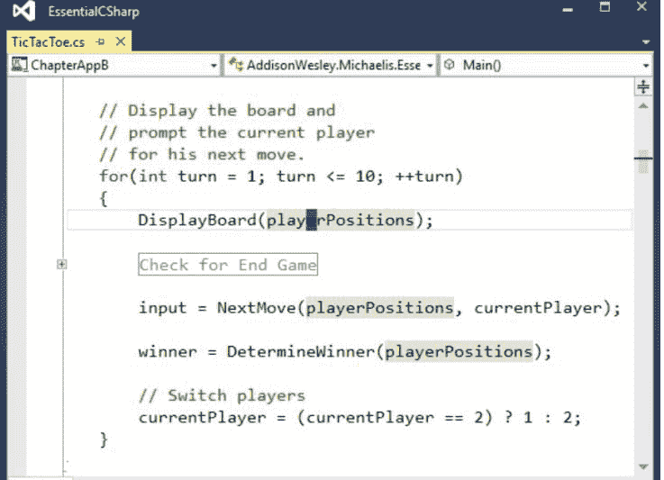

**图 3.5：** Microsoft Visual Studio .NET 中的折叠区域

## 摘要

本章首先介绍了与赋值和算术相关的 C# 运算符。接下来，我们使用运算符以及 `const` 关键字声明常量。对所有 C# 运算符的介绍并非按顺序进行。在讨论关系和逻辑比较运算符之前，本章介绍了 `if` 语句以及代码块和作用域的重要概念。为了完成对运算符的介绍，我们讨论了位运算符，特别是在掩码方面的应用。我们还讨论了其他控制流语句，如循环、`switch` 和 `goto`，并以对 C# 预处理器指令的讨论结束本章。

运算符优先级在章节前面讨论过；表 3.5 总结了所有运算符的优先级顺序，包括一些尚未介绍的运算符。

**表 3.5：运算符优先级顺序***

| 类别 | 运算符 |
|---|---|


| Primary | `x.y`  `f(x)`  `a[x]`  `x++`  `x--`  `new`  `typeof`  `checked(x)`  `unchecked(x)`  `default(T)`  `nameof(x)`  `delegate{}`  `()` |

| Unary | `+`  `-`  `!`  `~`  `++x`  `--x`  `(T)x`  `await x` |

| Multiplicative | `*`  `/`  `%` |

| Additive | `+`  `-` |

| Shift | `<<`  `>>` |

| Relational and type testing | `<`  `>`  `<=`  `>=`  `is`  `as` |

| Equality | `==`  `!=` |

| Logical AND | `&` |

| Logical XOR | `^` |

| Logical OR | `\|` |

| Conditional AND | `&&` |

| Conditional OR | `\|\|` |

| Null coalescing | `??` |

| Conditional | `?:` |

| Assignment and lambda | `=`  `*=`  `/=`  `%=`  `+=`  `-=`  `<<=`  `>>=`  `&=`  `^=`  `\|=`  `=>` |

* 行按从高到低的优先级顺序排列。

也许回顾第 1 章至第 3 章所涵盖所有内容的最佳方法之一是查看附录 B 中的井字游戏程序。通过查看此程序，你可以看到将所学内容组合成完整程序的一种方式。

## 4 方法和参数

从迄今为止你所学到的 C# 编程知识来看，你应该能够编写由一系列语句组成的直接程序，这与 1970 年代创建程序的方式类似。自 1970 年代以来，编程已经取得了长足的进步；然而，随着程序变得更加复杂，新的范式也应运而生以管理这种复杂性。“过程式”或“结构化”编程提供了将语句组合成单元的构造。此外，使用结构化编程，可以将数据传递给一组语句，然后在语句执行后将数据返回。


除了调用和定义方法的基础知识外，本章还涵盖了一些稍微更高级的概念——即递归、方法重载、可选参数和命名参数。到本章结束时所讨论的所有方法调用都是静态的（第 5 章将详细探讨这一概念）。

早在第 1 章的 `HelloWorld` 程序中，你就学会了如何定义一个方法。在那个示例中，你定义了 `Main()` 方法。在本章中，你将更详细地了解方法创建，包括用于将变量而非值传递给方法的参数的特殊 C# 语法（`ref` 和 `out`）。最后，我们将简要介绍一些基础的错误处理。

## 调用一个方法

### BEGINNER TOPIC

### 什么是方法？

到目前为止，你所编写程序中的所有语句都出现在一个名为 `Main()` 方法的分组中。当程序变得比迄今为止所见的更复杂时，单一的方法实现很快就会变得难以维护且难以阅读和理解。

方法是将一系列语句组合在一起以执行特定操作或计算特定结果的一种手段。这为构成程序的语句提供了更大的结构和组织。例如，考虑一个 `Main()` 方法，用于统计目录中的源代码行数。不是使用一个庞大的 `Main()` 方法，你可以提供一个更短的版本，让你根据需要深入了解每个方法实现的具体细节。清单 4.1 显示了一个示例。

### LISTING 4.1: Grouping Statements into Methods

```
class LineCount
{
    static void Main()
    {
        int lineCount;
        string files;

        DisplayHelpText();
        files = GetFiles();
        lineCount = CountLines(files);
        DisplayLineCount(lineCount);
    }
    // ...
}
```

不是将所有语句都放入 `Main()` 中，该清单将它们分解为称为方法的小组。用于显示帮助文本的 `System.Console.WriteLine()` 语句已移至 `DisplayHelpText()` 方法。用于确定要计数的哪些文件的所有语句都出现在 `GetFiles()` 方法中。为了实际计数文件，代码在显示结果之前调用 `CountLines()` 方法，然后使用 `DisplayLineCount()` 方法显示结果。只需快速浏览一下，就很容易审查代码并获得概览，因为方法名描述了该方法的用途。

### Guidelines

- DO give methods names that are verbs or verb phrases.

方法始终与一个类型相关联——通常是一个类——它提供了一种将相关方法组合在一起的方式。

方法可以通过为其参数提供的参数接收数据。参数是用于将数据从调用方（包含方法调用的代码）传递到被调用方法（`Write()`、`WriteLine()`、`GetFiles()`、`CountLines()` 等）的变量。在清单 4.1 中，`files` 和 `lineCount` 是传递给 `CountLines()` 和 `DisplayLineCount()` 方法的参数的示例参数。方法也可以通过返回值将数据返回给调用方（在清单 4.1 中，`GetFiles()` 方法调用有一个返回值，被赋给 `files`）。

首先，我们将重新审视第 1 章中的 `System.Console.Write()`、`System.Console.WriteLine()` 和 `System.Console.ReadLine()`。这次我们将把它们作为方法调用的一般示例来看待，而不是查看从控制台打印和检索数据的具体细节。清单 4.2 显示了这三种方法的使用情况。

### LISTING 4.2: A Simple Method Call

```
class HeyYou
{
    static void Main()
    {
        string firstName;
        string lastName;

        System.Console.WriteLine("Hey you!");

        System.Console.Write("Enter your first name: ");

        firstName = System.Console.ReadLine();
        System.Console.Write("Enter your last name: ");
        lastName = System.Console.ReadLine();
        System.Console.WriteLine(
            $"Your full name is { firstName } { lastName }.");
    }
}
```

方法调用的部分包括方法名、参数列表和返回值。完全限定方法名包括命名空间、类型名和方法名；句点分隔完全限定方法名的每个部分。正如我们将看到的，方法通常只使用其完全限定名称的一部分进行调用。

### Namespaces

命名空间是用于对与特定功能区域相关的所有类型进行分类的机制。命名空间是分层的，并且可以在层次结构中具有任意多的层级，尽管超过六七个层级的命名空间很少见。通常层次结构从公司名称开始，然后是产品名称，然后是功能区域。例如，在 `Microsoft.Win32.Networking` 中，最外层的命名空间是 `Microsoft`，其中包含内部命名空间 `Win32`，而 `Win32` 又包含更深层的 `Networking` 命名空间。

命名空间主要用于按功能区域组织类型，以便更容易找到和理解。然而，它们也可以用于避免类型名称冲突。例如，只要每个类型具有不同的命名空间，编译器就可以区分两个名为 `Button` 的类型。因此你可以区分类型 `System.Web.UI.WebControls.Button` 和 `System.Windows.Controls.Button`。

在清单 4.2 中，`Console` 类型位于 `System` 命名空间中。`System` 命名空间包含使程序员能够执行许多基本编程活动的类型。几乎所有 C# 程序都使用 `System` 命名空间中的类型。表 4.1 提供了其他常见命名空间的列表。

### TABLE 4.1: Common Namespaces

| Namespace | Description |

|---|---|

| `System` | Contains the fundamental types, and types for conversion between types, mathematics, program invocation, and environment management. |

| `System.Collections` | Contains types for working with collections of objects such as lists and dictionaries. |

| `System.Collections.Generics` | Contains strongly typed collections that use generics. |

| `System.Data` | Contains types used for working with databases. |

| `System.Drawing` | Contains types for drawing to the display device and working with images. |

| `System.IO` | Contains types for working with directories and manipulating, loading, and saving files. |

| `System.Linq` | Contains classes and interfaces for querying data in collections using a Language Integrated Query. |

| `System.Text` | Contains types for working with strings and various text encodings, and for converting between those encodings. |

| `System.Text.RegularExpressions` | Contains types for working with regular expressions. |

| `System.Threading` | Contains types for multithreaded programming. |

| `System.Threading.Tasks` | Contains types for task-based asynchrony. |

| `System.Web` | Contains types that enable browser-to-server communication, generally over HTTP. The functionality within this namespace is used to support ASP.NET. |

### TABLE 4.1: Common Namespaces *(continued)*

| Namespace | Description |

|---|---|

| `System.ServiceModel` | The Windows Communication Foundation (WCF) that contains types for sending and retrieving data between service and client applications, enabling the distributed communication between both .NET and non-.NET technologies. |

| `System.Windows` | Contains types for creating rich user interfaces starting with .NET 3.0 using a UI technology called Windows Presentation Framework (WPF) that leverages Extensible Application Markup Language (XAML) for declarative design of the UI. |

| `System.Windows.Forms` | Contains types for creating rich user interfaces and the components within them. |

| `System.Xml` | Contains standards-based support for XML processing. |

调用方法时并不总是需要提供命名空间。例如，如果调用表达式出现在与被调用方法相同的命名空间中的类型中，编译器可以推断命名空间为包含该类型的命名空间。本章后面你将看到 `using` 指令如何消除对命名空间限定符的需求。

> **Guidelines**
> 
> **DO** use PascalCasing for namespace names.
> 
> **CONSIDER** organizing the directory hierarchy for source code files to match the namespace hierarchy.

### Type Name

只要目标方法不在同一类型中，对静态方法的调用就需要类型名限定符。¹（正如本章后面所讨论的，“using static” 指令允许你省略类型名。）例如，在方法 `HelloWorld.Main()` 中找到的调用表达式 `Console.WriteLine()` 需要指定类型 `Console`。然而，只是

¹ Or base class.

与命名空间一样，C# 允许在方法调用中省略类型名称，只要该方法是包含调用表达式的类型成员即可。（此类方法调用的示例出现在第 4.4 节清单中。）在这种情况下类型名称是不必要的，因为编译器会根据调用的位置推断出类型。如果编译器无法做出此类推断，则必须在方法调用中提供该名称。

从核心来看，类型是将方法和相关数据组合在一起的手段。例如，`Console` 是包含 `Write()`、`WriteLine()` 和 `ReadLine()` 方法的类型（以及其他方法）。所有这些方法都属于同一“组”，因为它们属于 `Console` 类型。

## 作用域

在上一章中你了解到，程序元素的“作用域”是其未限定名称可以在其中引用的文本区域。出现在类型声明内部且调用在该类型中声明的方法的调用不需要类型限定符，因为该方法在其包含的类型中“在作用域内”。同样，一个类型在其声明的命名空间中“在作用域内”；因此，出现在特定命名空间中某个类型中的方法调用无需在方法调用名称中指定该命名空间。

## 方法名

每个方法调用都包含一个方法名，该名称可能已限定命名空间和类型名，如我们所讨论的。方法名之后是参数列表；参数列表是用括号括起来的、由逗号分隔的值列表，这些值对应于方法参数。

## 参数和参数值

方法可以接受任意数量的参数，每个参数都是特定数据类型。调用方为参数提供的数值称为参数值；每个参数值必须对应于某个特定参数。例如，以下方法调用有三个参数值：

```
System.IO.File.Copy(
    oldFileName, newFileName, false)
```

不久后你会看到，这些方法指定了 `void` 的返回类型，就像 `HelloWorld` 声明中的 `Main` 返回 `void` 一样。

## 语句与方法调用

第 4.3 节清单演示了语句与方法调用之间的区别。尽管 `System.Console.WriteLine("Hello {0}!", System.Console.ReadLine());` 是一个单一语句，但它包含两个方法调用。语句通常包含一个或多个表达式，在此示例中，其中两个表达式是方法调用。因此，方法调用构成了语句的一部分。

尽管在单个语句中编码多个方法调用通常可以减少代码量，但它不一定会提高可读性，也很少能提供显著的性能优势。开发人员应优先考虑可读性而非简洁性。

> **NOTE**
> 
> 通常，开发人员应优先考虑可读性而非简洁性。可读性对于编写自文档化、因此更易于长期维护的代码至关重要。

## 声明方法

本节扩展了声明方法的解释，以包含参数或返回类型。第 4.4 节清单包含这些概念的示例，第 4.1 节输出显示了结果。

```
**LISTING 4.4: Declaring a Method**

```csharp

class IntroducingMethods

{

    public static void Main()

    {

        string firstName;

        string lastName;

        string fullName;

        string initials;

```
```

# 第 4 章：方法和参数


```
System.Console.WriteLine("Hey you!");

firstName = GetUserInput("Enter your first name: ");
lastName = GetUserInput("Enter your last name: ");

fullName = GetFullName(firstName, lastName);
initials = GetInitials(firstName, lastName);
DisplayGreeting(fullName, initials);
}

static string GetUserInput(string prompt)
{
    System.Console.Write(prompt);
    return System.Console.ReadLine();
}

static string GetFullName(  // C# 6.0 expression-bodied method
    string firstName, string lastName) =>
        $"{ firstName } { lastName }";

static void DisplayGreeting(string fullName, string initials)
{
    System.Console.WriteLine(
        $"Hello { fullName }! Your initials are { initials }.");
    return;
}

static string GetInitials(string firstName, string lastName)
{
    return $"{ firstName[0] }. { lastName[0] }.";
}
}
```

## OUTPUT 4.1

```
Hey you!
Enter your first name: Inigo
Enter your last name: Montoya
Your full name is Inigo Montoya.
```

第 4.4 节清单中声明了五个方法。从 `Main()` 开始，代码调用 `GetUserInput()`，随后调用 `GetFullName()` 和 `GetInitials()`。最后三个方法都返回值并接受参数。其中一个声明 `GetFullName()` 利用了稍后讨论的 C# 6.0 风格的表达式体方法语法。此外，清单还调用了 `DisplayGreeting()`，它不返回任何数据。C# 中的任何方法都不能存在于封闭类型的范围之外；在本例中，封闭类型是 `IntroducingMethods` 类。即使在第 1 章中检查的 `Main` 方法也必须位于某个类型内。

## 语言对比：C++/Visual Basic—全局方法

C# 不提供全局方法支持；所有内容都必须出现在类型声明内。这就是为什么 `Main()` 方法被标记为 `static`——它是 C++ 全局方法和 Visual Basic “shared” 方法的 C# 等价物。

## BEGINNER TOPIC

## 重构为方法

将一组语句移入方法而不是保留在较大方法内联中，是一种重构形式。重构减少了代码重复，因为你可以从多个位置调用该方法而不是重复代码。重构还提高了代码可读性。作为编码过程的一部分，持续审查代码并寻找重构机会是一种最佳实践。这涉及寻找难以一目了然理解的代码块，并将其移入一个方法中，该方法名称清晰地定义了代码的行为。这种做法通常优于对代码块进行注释，因为方法名称用于描述实现的功能。

例如，第 4.4 节清单中显示的 `Main()` 方法的行为与第 1 章第 1.15 节清单中显示的 `Main()` 方法相同。或许更值得注意的是，尽管两个清单都很简单易懂，但仅查看 `Main()` 方法而不关心每个调用方法实现的细节，第 4.4 节清单更容易一目了然地理解。

在早期版本的 Visual Studio 中，你可以选择一组语句，右键单击它，然后从上下文菜单的 Refactoring 部分选择 Extract Method 重构，以自动将一组语句移动到新方法。在 Visual Studio 2015 中，重构可从上下文菜单的 Quick Actions 部分获得。

## 形式参数声明

考虑 `DisplayGreeting()`、`GetFullName()` 和 `GetInitials()` 方法的声明。方法声明的括号之间出现的文本是形式参数列表。（正如我们在讨论泛型时将看到的，方法也可能具有 **类型参数列表**。当从上下文可以清楚我们讨论的是哪种参数时，我们将简单地将它们称为“参数”并称为“参数列表”。）参数列表中的每个参数都包括参数类型以及参数名称。列表中每个参数之间用逗号分隔。

在行为上，大多数参数几乎与局部变量相同，因此参数的命名约定也遵循相应规则。因此，参数名称使用 camelCase。此外，不可能用与包含方法的参数相同的名称声明局部变量（在方法内部声明的变量），因为这会创建两个同名的“局部变量”。

> **Guidelines**
> 
> **DO** 对参数名称使用“camelCasing”。

## 方法返回类型声明

除了 `GetUserInput()`、`GetFullName()` 和 `GetInitials()` 方法需要指定参数外，每个方法还包括一个 **方法返回类型**。你可以从方法声明中方法名之前立即出现的数据类型判断出方法返回值。其中每个方法示例都指定了 `string` 返回类型。与参数不同，参数可以有任意数量，但方法返回类型只能有一个。

与 `GetUserInput()` 和 `GetInitials()` 一样，具有返回类型的方法几乎总是包含一个或多个“return 语句”，以将控制权返回给调用方。`return` 语句由 `return` 关键字后跟一个计算方法返回值的表达式组成。例如，`GetInitials()` 方法的 `return` 语句是 `return $"{ firstName[0] }. { lastName[0] }.";`。`return` 关键字后面的表达式（本例中为插值字符串）必须与方法声明的返回类型兼容。

如果方法具有返回类型，则构成方法体的一组语句必须具有“不可达的结束点”。也就是说，不能有任何方式让控制权“从方法末尾掉落”而不返回一个值。通常确保此条件的最简单方法

满足条件的方法是使方法的最后一条语句成为 `return` 语句。然而，`return` 语句可以出现在方法实现末尾之外的位置。例如，方法实现中的 `if` 或 `switch` 语句可能在其内部包含 `return` 语句；请参阅清单 4.5 中的示例。

## 清单 4.5：方法结束前的 return 语句

```
class Program
{
    static bool MyMethod()
    {
        string command = ObtainCommand();
        switch(command)
        {
            case "quit":
                return false;
            // ... omitted, other cases
            default:
                return true;
        }
    }
}
```

（请注意，`return` 语句会将控制权从 `switch` 中转移出去，因此在以 `return` 语句结束的 `switch` 部分中不需要 `break` 语句来防止非法的贯穿。）

在清单 4.5 中，方法中的最后一条语句不是 `return` 语句，而是一个 `switch` 语句。然而，编译器可以推断出通过该方法的所有可能代码路径都会导致返回，因此该方法的终点是不可达的。因此该方法合法，即使它没有以 `return` 语句结束。

如果特定代码路径在 `return` 之后包含不可达的语句，编译器会发出警告，指出这些附加语句永远不会执行。

尽管 C# 允许方法具有多个 `return` 语句，但如果只有一个退出位置而不是在方法的各种代码路径中散布多个 `return`，代码通常更易读且更易于维护。

指定 `void` 作为返回类型表示方法没有返回值。因此，对该方法的调用不能分配给变量或在调用站点用作参数类型。`void` 方法调用只能用作语句。此外，在方法体内部，`return` 语句变为可选，并且当指定时，`return` 关键字后面不得有值。例如，清单 4.4 中 `Main()` 的返回类型为 `void`，并且方法内部没有 `return` 语句。然而，`DisplayGreeting()` 包含一个（可选的）`return` 语句，其后没有返回结果。

## 表达式体方法

为了支持最简单的无方法体形式的方法声明，C# 6.0 引入了表达式体方法，它们使用表达式而不是完整的方法体来声明。清单 4.4 的 `GetFullName()` 方法提供了表达式体方法的示例：

```
static string GetFullName( string firstName, string lastName) =>
    $"{ firstName } { lastName }";
```

代替方法体常见的花括号，表达式体方法使用“goes to”运算符（在第 12 章中完全介绍），其结果数据类型必须与方法的返回类型匹配。换句话说，即使在表达式体方法实现中没有显式的 `return` 语句，仍然需要表达式的返回类型与方法声明的返回类型匹配。

表达式体方法是完整方法体声明的语法快捷方式。因此，其使用应限于最简单的方法实现——通常可在单行中表达。

## 语言对比：C++—头文件

与 C++ 不同，C# 类从不将实现与声明分离。在 C# 中，没有头文件（`.h`）或实现文件（`.cpp`）。相反，声明和实现出现在同一个文件中。（C# 确实支持一种名为“partial methods”的高级功能，其中方法的定义声明与其实现是分开的，但就本章而言，我们只考虑非 partial 方法。）C# 中没有单独的声明和实现，去除了在具有单独头文件和实现文件的语言（如 C++）中需要在两个地方维护冗余声明信息的要求。

## 初学者主题

## 命名空间

如前所述，命名空间是用于对相关类型进行分类和分组的组织机制。开发人员可以通过检查与熟悉类型在同一命名空间中的其他类型来发现相关类型。此外，通过命名空间，两个或多个类型可以具有相同的名称，只要它们通过不同的命名空间来区分。

## using 指令

完全限定的命名空间名称可能变得相当长且难以处理。然而，可以将一个或多个命名空间中的所有类型“导入”到文件中，以便在不使用完全限定的情况下使用。为此，C# 程序员在文件顶部包含 `using` 指令。例如，在清单 4.6 中，`Console` 未以 `System` 为前缀。命名空间可以省略，因为在列表顶部出现了 `using System` 指令。

## 清单 4.6：using 指令示例

```
// The using directive imports all types from the
// specified namespace into the entire file.
using System;

class HelloWorld
{
    static void Main()
    {
        // No need to qualify Console with System
        // because of the using directive above.
        Console.WriteLine("Hello, my name is Inigo Montoya");
    }
}
```

清单 4.6 的结果出现在输出 4.2 中。

## 输出 4.2

```
Hello, my name is Inigo Montoya
```

像 `using System` 这样的 `using` 指令并不能让你从 `System` 的子命名空间中声明的类型中省略 `System`。

例如，如果你的代码访问了 `System.Text` 命名空间中的 `StringBuilder` 类型，你必须包含额外的 `using System.Text;` 指令或将类型完全限定为 `System.Text.StringBuilder`，而不是仅 `Text.StringBuilder`。简而言之，`using` 指令不会“导入”任何 **嵌套命名空间** 中的类型。嵌套命名空间由命名空间中的句点标识，始终需要显式导入。

## 语言对比：Java—import 指令中的通配符

Java 允许使用通配符导入命名空间，如下所示：

```
import javax.swing.*;
```

相比之下，C# 不支持通配符 `using` 指令，而是要求每个命名空间都必须显式导入。

## 语言对比：Visual Basic .NET—项目范围 Imports 指令

与 C# 不同，Visual Basic .NET 支持为整个项目指定 `using` 指令等效项 `Imports` 的能力，而不仅仅是特定文件。换句话说，Visual Basic .NET 提供了跨越整个编译的 `using` 指令的命令行方式。

频繁使用特定命名空间中的类型意味着添加该命名空间的 `using` 指令是个好主意，而不是完全限定该命名空间中的所有类型。因此，几乎所有 C# 文件都在顶部包含 `using System` 指令。在本书的其余部分，代码列表通常会省略 `using System` 指令。然而，其他命名空间指令会显式包含。

`using System` 指令的一个有趣效果是字符串数据类型可以用不同的大小写标识：`String` 或 `string`。前者依赖于 `using System` 指令，后者使用 `string` 关键字。两者都是对 `System.String` 数据类型的有效 C# 引用，并且产生的 CIL 代码不受所选版本的影响。

## 高级主题

## 嵌套 using 指令

你不仅可以在文件顶部有 `using` 指令，还可以在命名空间声明顶部包含它们。例如，如果声明了一个新命名空间 `EssentialCSharp`，则可以在命名空间声明顶部添加 `using` 声明（见清单 4.7）。

```csharp

namespace EssentialCSharp

{

    using System;

    class HelloWorld

    {

        static void Main()

        {

            // No need to qualify Console with System

            // because of the using directive above.

            Console.WriteLine("Hello, my name is Inigo Montoya");

        }

    }

}

```

清单 4.7 的结果出现在输出 4.3 中。

```text

Hello, my name is Inigo Montoya

```

将 `using` 指令放在文件顶部与将其放在命名空间声明顶部之间的区别在于，该指令仅在命名空间声明内有效。如果代码包含新

`namespace` declaration above or below the `EssentialCSharp` declaration, the `using System` directive within a different namespace would not be active. Code seldom is written this way, especially given the standard practice of providing a single type declaration per file.

## The using static Directive

The `using` directive allows you to abbreviate a type name by omitting the namespace portion of the name—such that just the type name can be specified for any type within the stated namespace. In contrast, the `using static` directive allows you to omit both the namespace and the type name from any member of the stated type. A `using static System.Console` directive, for example, allows you to specify `WriteLine()` rather than the fully qualified method name of `System.Console.WriteLine()`. Continuing with this example, we can update Listing 4.2 to leverage the `using static System.Console` directive to create Listing 4.8.

### LISTING 4.8: The using static Directive


```csharp
using static System.Console;

class HeyYou
{
    static void Main()
    {
        string firstName;
        string lastName;

        WriteLine("Hey you!");

        Write("Enter your first name: ");

        firstName = ReadLine();
        Write("Enter your last name: ");
        lastName = ReadLine();
        WriteLine(
            $"Your full name is { firstName } { lastName }.");
    }
}
```

In this case, there is no loss of readability of the code: `WriteLine()`, `Write()`, and `ReadLine()` all clearly relate to a console directive. In fact, one could argue that the resulting code is simpler and, therefore, clearer than before.

However, sometimes this is not the case. For example, if your code uses classes that have overlapping behavior names, such as an `Exists()` method on a file and an `Exists()` method on a directory, then perhaps a `using static` directive would reduce clarity when you invoke `Exists()`. Similarly, if the class you were writing had its own members with overlapping behavior names to those imported with a `using static` statement—for example, `Display()` and `Write()`—then perhaps clarity would be lost to the reader.

This ambiguity would not be allowed by the compiler. If two members with the same signature were available (through either `using static` directives or separately declared members), any invocation of them that was ambiguous would result in a compile error.

## Aliasing

The `using` directive also allows **aliasing** a namespace or type. An alias is an alternative name that you can use within the text to which the `using` directive applies. The two most common reasons for aliasing are to disambiguate two types that have the same name and to abbreviate a long name. In Listing 4.9, for example, the `CountDownTimer` alias is declared as a means of referring to the type `System.Timers.Timer`. Simply adding a `using System.Timers` directive will not sufficiently enable the code to avoid fully qualifying the `Timer` type. The reason is that `System.Threading` also includes a type called `Timer`; therefore, just using `Timer` within the code will be ambiguous.

```csharp
using System;
using System.Threading;
using CountDownTimer = System.Timers.Timer;

class HelloWorld
{
    static void Main()
    {
        CountDownTimer timer;

        // ...
    }
}
```

Listing 4.9 uses an entirely new name, `CountDownTimer`, as the alias. It is possible, however, to specify the alias as `Timer`, as shown in Listing 4.10.

### LISTING 4.10: Declaring a Type Alias with the Same Name

```csharp
using System;
using System.Threading;

// Declare alias Timer to refer to System.Timers.Timer to
// avoid code ambiguity with System.Threading.Timer
using Timer = System.Timers.Timer;

class HelloWorld
{
    static void Main()
    {
        Timer timer;

        // ...
    }
}
```

Because of the alias directive, “Timer” is not an ambiguous reference. Furthermore, to refer to the `System.Threading.Timer` type, you will have to either qualify the type or define a different alias.

## Returns and Parameters on `Main()`

So far, declaration of an executable’s `Main()` method has been the simplest declaration possible. You have not included any parameters or non-void return type in your `Main()` method declarations. However, C# supports the ability to retrieve the command-line arguments when executing a program, and it is possible to return a status indicator from the `Main()` method.

The runtime passes the command-line arguments to `Main()` using a single string array parameter. All you need to do to retrieve the parameters is to access the array, as demonstrated in Listing 4.11. The purpose of this program is to download a file whose location is given by a URL. The first command-line argument identifies the URL, and the optional second argument is the filename to which to save the file. The listing begins with a switch statement that evaluates the number of parameters (`args.Length`) as follows:

- 1. If there are not two parameters, display an error indicating that it is necessary to provide the URL and filename.

- 2. The presence of two arguments indicates the user has provided both the URL of the resource and the download target filename.

### LISTING 4.11: Passing Command-Line Arguments to `Main()`

```csharp
using System;
using System.Net;

class Program
{
    static int Main(string[] args)
    {
        int result;
        string targetFileName;
        string url;
        switch (args.Length)
        {
            default:
                // Exactly two arguments must be specified; give an error.
                Console.WriteLine(
                    "ERROR: You must specify the "
                    + "URL and the file name");
                targetFileName = null;
                url = null;
                break;
            case 2:
                url = args[0];
                targetFileName = args[1];
                break;
        }

        if (targetFileName != null && url != null)
        {
            WebClient webClient = new WebClient();
            webClient.DownloadFile(url, targetFileName);
            result = 0;
        }
        else
        {
            Console.WriteLine(
                "Usage: Downloader.exe <URL> <TargetFileName>");
            result = 1;
        }
        return result;
    }
}
```

The results of Listing 4.11 appear in Output 4.4.

### OUTPUT 4.4

```text
>Downloader.exe
ERROR: You must specify the URL to be downloaded
Downloader.exe <URL> <TargetFileName>
```

If you were successful in calculating the target filename, you would use it to save the downloaded file. Otherwise, you would display the help text. The `Main()` method also returns an int rather than a void. This is optional for a `Main()` declaration, but if it is used, the program can return a status code to a caller (such as a script or a batch file). By convention, a return other than zero indicates an error.

Although all command-line arguments can be passed to `Main()` via an array of strings, sometimes it is convenient to access the arguments from inside a method other than `Main()`. The `System.Environment.GetCommandLineArgs()` method returns the command-line arguments array in the same form that `Main(string[] args)` passes the arguments into `Main()`.

## ADVANCED TOPIC

### Disambiguate Multiple `Main()` Methods

If a program includes two classes with `Main()` methods, it is possible to specify on the command line which class to use for the `Main()` declaration. `csc.exe` includes an `/m` option to specify the fully qualified class name of `Main()`.

## BEGINNER TOPIC

### Call Stack and Call Site

As code executes, methods call more methods, which in turn call additional methods, and so on. In the simple case of Listing 4.4, `Main()` calls `GetUserInput()`, which in turn calls `System.Console.ReadLine()`, which in turn calls even more methods internally. Every time a new method is invoked, the runtime creates an “activation frame” that contains information about the arguments passed to the new call, the local variables of the new call, and information about where control should resume when the new method returns. The set of calls within calls within calls, and so on, produces a series of activation frames that is termed the **call stack**. As program complexity increases, the call stack generally gets larger and larger as each method calls another method. As calls complete, however, the call stack shrinks until another method is invoked. The process of removing activation frames from the call stack is termed **stack unwinding**. Stack 展开总是以与方法调用相反的顺序发生。当方法完成时，执行将返回到调用点——即调用该方法的位置。

## 高级方法参数

到目前为止，本章的示例都是通过方法的返回值返回数据。本节演示了方法如何通过其方法参数返回数据，并展示了方法如何接受可变数量的参数。

### 值参数

方法调用的参数通常按值传递，这意味着参数表达式的值会被复制到目标参数中。例如，在清单 4.12 中，`Main()` 在调用 `Combine()` 时使用的每个变量的值都会被复制到 `Combine()` 方法的参数中。输出 4.5 显示了该清单的结果。

#### LISTING 4.12: Passing Variables by Value


```
class Program
{
    static void Main()
    {
        // ...
        string fullName;
        string driveLetter = "C:";
        string folderPath  = "Data";
        string fileName    = "index.html";

        fullName = Combine(driveLetter, folderPath, fileName);

        Console.WriteLine(fullName);
        // ...
    }

    static string Combine(
        string driveLetter, string folderPath, string fileName)
    {
        string path;
        path = string.Format("{1}{0}{2}{0}{3}",
            System.IO.Path.DirectorySeparatorChar,
            driveLetter, folderPath, fileName);
        return path;
    }
}
```

## OUTPUT 4.5

```
C:\Data\index.html
```

即使 `Combine()` 方法在返回前将 `driveLetter`、`folderPath` 和 `fileName` 分配为 `null`，`Main()` 中的相应变量仍将保持其原始值，因为在调用方法时变量会被复制。当调用栈在调用结束时展开时，被复制的数据会被丢弃。

## BEGINNER TOPIC

### Matching Caller Variables with Parameter Names

在清单 4.12 中，调用者的变量名与被调用方法的参数名完全匹配。这种匹配仅为可读性目的而提供；名称是否匹配与方法调用的行为完全无关。被调用方法的参数和调用方法的局部变量位于不同的声明空间中，彼此无关。

## ADVANCED TOPIC

### Reference Types versus Value Types

就本节目的而言，传递的参数是值类型还是引用类型并不重要。更重要的是，被调用方法是否可以向调用者的原始变量写入值。由于调用者变量的值会被复制，因此调用者的变量无法被重新赋值。尽管如此，了解包含值类型的变量与包含引用类型的变量之间的区别仍然很有帮助。

引用类型变量的值，如其名称所示，是对与对象关联的数据存储位置的引用。运行时选择如何表示引用类型变量的值是运行时的实现细节；通常它表示为对象数据存储的内存位置的地址，但不一定如此。

如果引用类型变量按值传递，则引用本身会从调用者复制到方法参数。因此，目标方法无法更新调用者变量的值，但它可以更新引用所指向的数据。

相反，如果方法参数是值类型，则值本身会被复制到参数中，并且在被调用方法中更改参数不会影响原始调用者的变量。

## Reference Parameters (ref)

请考虑清单 4.13，其中调用了一个函数来交换两个值，以及显示结果的输出 4.6。

### LISTING 4.13: Passing Variables by Reference

```
class Program
{
    static void Main()
    {
        // ...
        string first = "hello";
        string second = "goodbye";
        Swap(ref first, ref second);

        Console.WriteLine(
            $@"first = "{ first }", second = "{ second }"" );
        // ...
    }

    static void Swap(ref string x, ref string y)
    {
        string temp = x;
        x = y;
        y = temp;
    }
}
```

## OUTPUT 4.6

```
first = "goodbye", second = "hello"
```

分配给 `first` 和 `second` 的值已成功交换。为此，变量是**按引用传递**的。调用 `Swap()` 与清单 4.12 中调用 `Combine()` 的明显区别在于参数数据类型前包含关键字 `ref`。该关键字更改调用方式，使得用作参数的变量按引用传递，因此被调用方法可以更新原始调用者的变量的新值。

当被调用方法将参数指定为 `ref` 时，调用者必须提供一个变量而不是一个值作为参数，并且要在传递的变量前加上 `ref`。这样做时，调用者明确承认目标方法可能会重新分配与接收到的任何 `ref` 参数关联的变量的值。此外，必须初始化作为 `ref` 传递的任何局部变量，因为目标方法可能在不先为其赋值的情况下从 `ref` 参数读取数据。例如，在清单 4.13 中，`temp` 被赋值为 `first` 的值，假设调用者在 `first` 中传递的变量已被初始化。有效地，ref 参数是传递变量的别名。换句话说，它本质上是为现有变量提供一个参数名，而不是创建一个新变量并将参数的值复制到其中。

## Output Parameters (out)

如前所述，使用作 `ref` 参数的变量必须在传递给被调用方法之前被赋值，因为被调用方法可能会从该变量读取。前面给出的“交换”示例必须从传递给它的两个变量中读取和写入。然而，通常情况下，一个接受变量引用的方法打算向该变量写入，但不从中读取。在这种情况下，显然可以安全地按引用传递未初始化的局部变量。

为此，代码需要在参数类型上加上关键字 `out`。这在清单 4.14 中的 `TryGetPhoneButton()` 方法中得到了演示，该方法返回与字符对应的电话按钮。

```csharp
class ConvertToPhoneNumber
{
    static int Main(string[] args)
    {
        char button;
        if(args.Length == 0)
```
```
{
    Console.WriteLine(
        "ConvertToPhoneNumber.exe <phrase>");
    Console.WriteLine(
        "'_' indicates no standard phone button");
    return 1;
}
foreach(string word in args)
{
    foreach(char character in word)
    {
        if(TryGetPhoneButton(character, out button))
        {
            Console.Write(button);
        }
        else
        {
            Console.Write('_');
        }
    }
    Console.WriteLine();
    return 0;
}

static bool TryGetPhoneButton(char character, out char button)
{
    bool success = true;
    switch( char.ToLower(character) )
    {
        case '1':
            button = '1';
            break;
        case '2': case 'a': case 'b': case 'c':
            button = '2';
            break;

        // ...

        case '-':
            button = '-';
            break;
        default:
            // Set the button to indicate an invalid value
            button = '_';
            success = false;
            break;
    }
    return success;
}
```

## OUTPUT 4.7

```
>ConvertToPhoneNumber.exe CSharpIsGood
274277474663
```

在此示例中，`TryGetPhoneButton()` 方法在成功确定字符对应的电话按钮时返回 `true`。函数还通过使用带有 `out` 装饰的 `button` 参数返回对应的按钮。

`out` 参数在功能上与 `ref` 参数完全相同；唯一的区别是语言对别名变量的读取和写入如何强制执行的要求。每当参数标记为 `out` 时，编译器都会检查方法中所有正常返回的代码路径是否都为参数赋值（即不抛出异常的代码路径）。例如，如果代码在某些代码路径中未为 `button` 赋值，编译器将发出错误，指出代码未初始化 `button`。清单 4.14 将 `button` 分配为下划线字符，因为即使它无法确定正确的电话按钮，仍有必要为其赋值。

方法开发者可以声明一个或多个 `out` 参数，以规避方法只能有一个返回类型的限制；一个需要返回两个值的方法可以通过正常返回一个值作为方法的返回值，并通过将第二个值写入作为 `out` 参数传递的别名变量来返回第二个值。尽管这种模式很常见且合法，但通常有更好的方法来实现该目标。例如，如果你考虑从方法返回两个或更多值，你可能最好编写两个方法，每个值一个。如果方法必须返回两个值，使用元组类型（表示多个值）或可空值类型（表示可能“无效”的值，如前面的示例）可以消除按引用传递变量的需要。

> NOTE
> 每个且每个正常的代码路径都必须导致所有 `out` 参数的赋值。

# 参数数组 (params)

在迄今为止的示例中，必须传递的参数数量由目标方法声明中声明的参数数量决定。然而，有时如果参数数量可以变化会更方便。考虑来自列表 4.12 的 `Combine()` 方法。在该方法中，你传递了驱动器号、文件夹路径和文件名。如果路径包含多个文件夹，并且调用者希望方法将额外的文件夹连接起来形成完整路径怎么办？也许最好的选择是为文件夹传递一个字符串数组。然而，这会使调用代码稍微复杂一些，因为需要构造一个数组作为参数传递。

为了让此类方法的调用者更轻松，C# 提供了一个关键字，使参数数量在调用代码中可以变化，而不是由目标方法设定。在讨论方法声明之前，先观察在 `Main()` 中声明的调用代码，如列表 4.15 所示。

### LISTING 4.15: Passing a Variable Parameter List

```
using System;
using System.IO;
class PathEx
{
    static void Main()
    {
        string fullName;

        // ...

        // Call Combine() with four arguments
        fullName = Combine(
            Directory.GetCurrentDirectory(),
            "bin", "config", "index.html");
        Console.WriteLine(fullName);

        // ...

        // Call Combine() with only three arguments
        fullName = Combine(
            Environment.SystemDirectory,
            "Temp", "index.html");
        Console.WriteLine(fullName);

        // ...

        // Call Combine() with an array
        fullName = Combine(
new string[] {
    "C:\\", "Data",
    "HomeDir", "index.html" });
Console.WriteLine(fullName);
// ...
}
```

```
static string Combine(params string[] paths)
{
    string result = string.Empty;
    foreach (string path in paths)
    {
        result = System.IO.Path.Combine(result, path);
    }
    return result;
}
}
```

## OUTPUT 4.8

```
C:\Data\mark\bin\config\index.html
C:\WINDOWS\system32\Temp\index.html
C:\Data\HomeDir\index.html
```

在第一次调用 `Combine()` 时，指定了四个参数。第二次调用只包含三个参数。在最后一次调用中，使用一个数组传递了单个参数。换句话说，`Combine()` 方法接受可变数量的参数——以逗号分隔的任意数量的字符串参数呈现，或作为单个字符串数组。前一种语法称为方法调用的“展开”形式，第二种形式称为“常规”形式。

为了允许这一点，`Combine()` 方法执行以下操作：

+   1. 在方法声明中将 `params` 放在最后一个参数之前
+   2. 将最后一个参数声明为数组

使用 **参数数组** 声明，可以将每个对应参数作为 `params` 数组的成员访问。在 `Combine()` 方法实现中，你遍历 `paths` 数组的元素并调用 `System.IO.Path.Combine()`。此方法自动组合路径的各部分，适当使用特定于平台的目录分隔符。请注意 `PathEx.Combine()` 与 `Path.Combine()` 相同，只是 `PathEx.Combine()` 处理可变数量的参数，而不是仅仅两个。

参数数组有几个值得注意的特征：

+   - 参数数组不一定是方法上的唯一参数。参数数组必须是方法声明中的最后一个参数。由于只有最后一个参数可以是参数数组，因此方法不能有多个参数数组。
+   - 调用者可以指定与参数数组参数对应的零个参数，这将导致传递一个零项的数组作为参数数组。
+   - 参数数组是类型安全的。给定的参数必须与参数数组的元素类型兼容。
+   - 调用者可以使用显式数组而不是逗号分隔的参数列表。生成的 IL 代码是相同的。
+     - 如果目标方法实现需要最少数量的参数，则这些参数应显式出现在方法声明中，从而强制编译错误，而不是依赖于运行时错误处理，如果缺少必需参数。例如，如果你有一个需要一个或多个整数参数的方法，请声明方法 `int Max(int first, params int[] operands)` 而不是 `int Max(params int[] operands)`，以便至少有一个值传递给 `Max()`。

使用参数数组，你可以将相同类型的可变数量参数传递给方法。本章后面出现的“方法重载”部分讨论了一种支持可变数量参数的方法，这些参数不一定是相同类型。

## Guidelines

DO use parameter arrays when a method can handle any number—including zero—of additional arguments.

# Recursion

调用方法 **recursively** 或使用 **recursion** 实现方法是指使用调用自身的 方法。递归有时是实现特定算法的最简单方法。列表 4.16 计算目录及其子目录中所有 C# 源文件 (*.cs) 的行数。

### Listing 4.16: Counting the Lines within *.cs Files, Given a Directory

```csharp
using System.IO;

public static class LineCounter
{
    // Use the first argument as the directory
    // to search, or default to the current directory.
    public static void Main(string[] args)
    {
        int totalLineCount = 0;
        string directory;
        if (args.Length > 0)
        {
            directory = args[0];
        }
        else
        {
            directory = Directory.GetCurrentDirectory();
        }

        totalLineCount = DirectoryCountLines(directory);
        System.Console.WriteLine(totalLineCount);
    }

    static int DirectoryCountLines(string directory)
    {
        int lineCount = 0;
        foreach (string file in


```csharp
Directory.GetFiles(directory, "*.cs"))
{
    lineCount += CountLines(file);
}
foreach (string subdirectory in
    Directory.GetDirectories(directory))
{
    lineCount += DirectoryCountLines(subdirectory);
}
return lineCount;
}
private static int CountLines(string file)
{
    string line;
```
```

```
int lineCount = 0;
FileStream stream =
    new FileStream(file, FileMode.Open);
StreamReader reader = new StreamReader(stream);
line = reader.ReadLine();
while(line != null)
{
    if (line.Trim() != "")
    {
        lineCount++;
    }
    line = reader.ReadLine();
}
reader.Close(); // Automatically closes the stream
return lineCount;
}
```

Output 4.9 shows the results of Listing 4.16.

## OUTPUT 4.9

```
104
```

该程序首先将第一个命令行参数传递给 `DirectoryCountLines()`，或如果未提供参数则使用当前目录。此方法首先遍历当前目录中的所有文件并汇总每个文件的源代码行数。处理完目录中的每个文件后，代码通过将子目录传回 `DirectoryCountLines()` 方法来处理每个子目录，使用子目录重新运行该方法。相同的过程通过每个子目录递归重复，直到没有更多目录需要处理为止。

不熟悉递归的读者可能起初会感到困惑。无论如何，它通常是最简单的编码模式，尤其是在文件系统等分层类型数据中。然而，虽然它可能是最可读的方法，但通常不是最快的实现。如果性能成为问题，开发人员应寻求递归实现的替代方案。选择通常取决于在可读性和性能之间取得平衡。

3. 此代码可以用 `using` 语句改进，这是一个我们避免使用的构造，因为它尚未介绍。

## 初学者主题

### 无限递归错误

在递归方法的实现中，一个常见的编程错误表现为程序执行时出现栈溢出。这通常是由无限递归引起的，即方法不断调用自身，永远无法到达终止递归的触发点。程序员最好审查任何使用递归的方法，并验证递归调用是有限的。

使用伪代码表示递归的常见模式如下：

```
M(x)
{
    if x is trivial
        return the result
    else
        a. Do some work to make the problem smaller
        b. Recursively call M to solve the smaller problem
        c. Compute the result based on a. and b.
        return the result
}
```

当没有遵循这种模式时，事情就会出错。例如，如果没有把问题变得更小，或者没有处理所有可能的“最小”情况，递归就永远不会终止。

### 方法重载

清单 4.16 调用了 `DirectoryCountLines()`，它统计了 `*.cs` 文件的行数。但是，如果你想统计 `*.h/*.cpp` 文件或 `*.vb` 文件中的代码，`DirectoryCountLines()` 将无法工作。相反，你需要一个接受文件扩展名的方法，同时保留现有方法的定义，使其默认处理 `*.cs` 文件。

一个类中的所有方法必须具有唯一的签名，C# 通过方法名称、参数数据类型或参数数量的变化来定义唯一性。这并不包括方法的返回数据类型；定义两个仅返回数据类型不同的方法会导致编译错误。当一个类有两个或更多同名方法，且重载方法之间的参数数量和/或数据类型不同时，就会发生方法重载。

> **注意**
> 
> 只要方法名称、参数数据类型或参数数量存在变化，该方法即被视为唯一。

方法重载是一种**操作性多态**。当相同的逻辑操作因数据不同而呈现出多种（“poly”）形式（“morphs”）时，就发生了多态。调用 `WriteLine()` 并传递格式字符串及一些参数，与调用 `WriteLine()` 并指定一个整数的实现方式不同。但从逻辑上讲，对调用者而言，该方法负责写入数据，内部实现如何完成并不重要。清单 4.17 提供了一个示例，输出 4.10 显示了结果。

**清单 4.17：使用重载统计 *.cs 文件的行数**

```csharp
using System.IO;

public static class LineCounter
{
    public static void Main(string[] args)
    {
        int totalLineCount;

        if (args.Length > 1)
        {
            totalLineCount =
                DirectoryCountLines(args[0], args[1]);
        }
        if (args.Length > 0)
        {
            totalLineCount = DirectoryCountLines(args[0]);
        }
        else
        {
            totalLineCount = DirectoryCountLines();
        }

        System.Console.WriteLine(totalLineCount);
    }

    static int DirectoryCountLines()
    {
        return DirectoryCountLines(
            Directory.GetCurrentDirectory());
    }

    static int DirectoryCountLines(string directory)
```

```csharp
{
    return DirectoryCountLines(directory, "*.cs");
}

static int DirectoryCountLines(
    string directory, string extension)
{
    int lineCount = 0;
    foreach (string file in
        Directory.GetFiles(directory, extension))
    {
        lineCount += CountLines(file);
    }
    foreach (string subdirectory in
        Directory.GetDirectories(directory))
    {
        lineCount += DirectoryCountLines(subdirectory);
    }
    return lineCount;
}

private static int CountLines(string file)
{
    int lineCount = 0;
    string line;
    FileStream stream =
        new FileStream(file, FileMode.Open);
    StreamReader reader = new StreamReader(stream);
    line = reader.ReadLine();
    while(line != null)
    {
        if (line.Trim() != "")
        {
            lineCount++;
        }
        line = reader.ReadLine();
    }
    reader.Close();  // Automatically closes the stream
    return lineCount;
}
```

## 输出 4.10

```text
>LineCounter.exe .\ *.cs
20
```

4. 这段代码可以使用 `using` 语句进行改进，但由于尚未介绍该构造，我们暂时避免使用它。

方法重载的效果是提供可选的方式来调用方法。正如 `Main()` 中所展示的，你可以调用 `DirectoryCountLines()` 方法，无论是否传递要搜索的目录和文件扩展名。

请注意，`DirectoryCountLines()` 的无参数实现被修改为调用单参数版本（`DirectoryCountLines (string directory)`）。这是在实现重载方法时的一种常见模式。其思想是，开发人员只在一个方法中实现核心逻辑，所有其他重载方法都将调用该方法。如果核心实现发生变化，只需修改一处，而不是在每个实现中都修改。当使用方法重载来实现那些在编译时没有确定值、因此无法用可选参数指定的可选参数时，这种模式尤为常见。

> **注意**
> 
> 将核心功能放在一个单一方法中，让所有其他重载方法都调用它，意味着你只需在核心方法中更改实现，其他方法将自动利用这一更改。

### 可选参数

从 C# 4.0 开始，语言设计者增加了对**可选参数**的支持。通过在方法声明中将参数与常量值关联，可以在调用方法时不为每个参数都传入参数（见清单 4.18）。

**清单 4.18：带有可选参数的方法**

```csharp
using System.IO;

public static class LineCounter
{
    public static void Main(string[] args)
    {
        int totalLineCount;
```
```csharp
public static void DisplayGreeting(
    string firstName,
    string middleName = default(string),
    string lastName = default(string))
{
    // ...
}
```

在清单 4.19 中，从 `Main()` 内部调用 `DisplayGreeting()` 时，通过参数名称给参数赋值。在两个可选参数（`middleName` 和 `lastName`）中，只有 `lastName` 被作为实参传入。对于方法有很多参数且其中许多是可选参数的情况（这在访问 Microsoft COM 库时很常见），使用命名参数语法无疑是一种便利。然而，便利的同时也带来了对方法接口灵活性的影响。在过去，参数名称可以更改，而不会导致其他调用 C# 代码无法编译。随着命名参数的出现，参数名称成为了接口的一部分，因为更改名称会导致使用命名参数的代码无法编译。

> ### 准则
> 
> **务必**将参数名称视为 API 的一部分，如果 API 之间的版本兼容性很重要，则应避免更改这些名称。

对于许多有经验的 C# 开发人员来说，这是一个令人惊讶的限制。然而，自 .NET 1.0 以来，这一限制就一直是公共语言规范（Common Language Specification）的一部分。此外，Visual Basic 一直支持使用命名参数调用方法。因此，库开发人员本应已经遵循不更改参数名称的做法，以便在版本之间成功地与其他 .NET 语言互操作。本质上，C# 4.0 现在对更改参数名称施加了与其他许多 .NET 语言已经要求的相同限制。

考虑到方法重载、可选参数和命名参数的结合，解析要调用哪个方法变得不那么明显。

一个调用如果所有参数都有恰好一个对应的参数（按名称或按位置）且类型兼容，则该调用与某个方法**适用**（兼容），除非该参数是可选的（或是一个参数数组）。尽管这限制了将被调用的方法的可能数量，但它并不能确定唯一的方法。为了进一步区分将调用的具体方法，编译器仅使用调用方中明确标识的参数，忽略所有在调用方未指定的可选参数。因此，如果两个方法由于其中一个具有可选参数而适用，编译器将解析为不带可选参数的方法。

## ADVANCED TOPIC

### Method Resolution

当编译器必须在多个适用方法中选择一个最适合特定调用的方法时，具有“最具体”参数类型的方法将被选中。假设有两个适用方法，每个方法都需要从参数到参数类型的隐式转换，则参数类型为更派生的类型的方法将被使用。

例如，如果调用方传递了类型为 `int` 的参数，则接受 `double` 参数的方法将被优先于接受 `object` 参数的方法。这是因为 `double` 比 `object` 更具体。存在不是 `double` 的对象，但不存在不是对象的 `double`，因此 `double` 必须更具体。

如果有多个方法适用且无法确定唯一的最佳方法，编译器将发出错误，指出调用是模棱两可的。

例如，给定以下方法：

```
static void Method(object thing){}
static void Method(double thing){}
static void Method(long thing){}
static void Method(int thing){}
```

形式为 `Method(42)` 的调用将解析为 `Method(int thing)`，因为参数类型到参数类型的匹配是精确的。如果删除该方法，重载解析将选择 `long` 版本，因为 `long` 比 `double` 或 `object` 更具体。

C# 规范包含关于 `byte`、`ushort`、`uint`、`ulong` 以及其他数值类型之间隐式转换的额外规则。一般来说，使用强制转换使目标方法更易识别是更好的做法。

## Basic Error Handling with Exceptions

本节介绍如何通过一种称为异常处理的机制来处理错误报告。

使用异常处理，一个方法能够在不使用返回值或显式提供任何参数的情况下，将有关错误的

### LISTING 4.20: Converting a string to an int

```csharp
using System;

class ExceptionHandling
{
    static void Main()
    {
        string firstName;
        string ageText;
        int age;
        Console.WriteLine("Hey you!");
        Console.Write("Enter your first name: ");
        firstName = System.Console.ReadLine();
        Console.Write("Enter your age: ");
        ageText = Console.ReadLine();
        age = int.Parse(ageText);
        Console.WriteLine(
            $"Hi { firstName }!  You are { age*12 } months old.");
    }
}
```

输出 4.11 显示了列表 4.20 的结果。

### OUTPUT 4.11

```
Hey you!
Enter your first name: Inigo
Enter your age: 42
Hi Inigo! You are 504 months old.
```


`System.Console.ReadLine()` 的返回值存储在名为 `ageText` 的变量中，然后传递给名为 `Parse()` 的 `int` 数据类型方法。该方法负责接收表示数字的字符串值并将其转换为 `int` 类型。

## BEGINNER TOPIC

### 42 As a String versus 42 As an Integer

C# 要求每个非空值都与其关联的明确类型相关联。因此，不仅数据值很重要，而且与数据关联的类型也很重要。因此，字符串值 42 与整数值 42 明显不同。字符串由字符 4 和 2 组成，而 `int` 是数字 42。

给定转换后的字符串，最终的 `System.Console.WriteLine()` 语句将通过将年龄值乘以 12 来打印月龄。

但如果用户没有输入有效的整数字符串会怎样？例如，如果用户输入“forty-two”会怎样？`Parse()` 方法无法处理此类转换。它期望用户输入仅包含数字的字符串。如果 `Parse()` 方法接收到无效值，它需要某种方式将此事实报告回调用方。

### Trapping Errors

为了向调用方法指示参数无效，`int.Parse()` 将**抛出异常**。抛出异常会停止当前控制流中的进一步执行，并转而跳转到调用堆栈中处理异常的第一个代码块。

由于你尚未提供任何此类处理，程序会将异常作为**未处理异常**报告给用户。假设系统上没有注册调试器，错误将显示在控制台上，消息类似于输出 4.12 所示。

### OUTPUT 4.12

```
Hey you!

Enter your first name: Inigo

Enter your age: forty-two

Unhandled Exception: System.FormatException: Input string was
    not in a correct format.
    at System.Number.ParseInt32(String s, NumberStyles style,
    NumberFormatInfo info)
    at ExceptionHandling.Main()
```

显然，这样的错误并无多大帮助。为此，需要提供一种处理错误的机制，也许可以向用户报告更有意义的错误消息。

此过程称为捕获异常。语法在列表 4.21 中演示，输出出现在输出 4.13 中。

### LISTING 4.21: Catching an Exception

```
using System;

class ExceptionHandling
{
    static int Main()
    {
        string firstName;
        string ageText;
        int age;
        int result = 0;

        Console.Write("Enter your first name: ");
        firstName = Console.ReadLine();

        Console.Write("Enter your age: ");
        ageText = Console.ReadLine();

        try
        {
            age = int.Parse(ageText);
            Console.WriteLine(
                $"Hi { firstName }! You are { age*12 } months old.");
        }
        catch (FormatException )
        {
            Console.WriteLine(
                $"The age entered, { ageText }, is not valid.");
            result = 1;
        }
        catch(Exception exception)
        {
            Console.WriteLine(
                $"Unexpected error: { exception.Message }");
            result = 1;
        }
        finally
        {
            Console.WriteLine($"Goodbye { firstName }");
        }

        return result;
    }
}
```

### OUTPUT 4.13

```
Enter your first name: Inigo

Enter your age: forty-two

The age entered, forty-two, is not valid.

Goodbye Inigo
```

首先，用 `try` 块包围可能抛出异常的代码（`age = int.Parse()`）。该块以 `try` 关键字开始。它向编译器指示开发人员意识到块内代码可能抛出异常，如果抛出，将由其中一个 `catch` 块尝试处理异常。

一个或多个 `catch` 块（或 `finally` 块）必须紧跟在 `try` 块之后。`catch` 块头（参见本章后面标题为“General catch”的高级主题）可选择指定异常的数据类型，只要数据类型与异常类型匹配，`catch` 块就会执行。但是，如果没有适当的 `catch` 块，异常将穿透并像没有异常处理一样未处理。由此产生的控制流出现在下一页的图 4.1 中。

例如，假设用户在前一个示例中为年龄输入“forty-two”。在这种情况下，`int.Parse()` 将抛出类型为 `System.FormatException` 的异常，控制将跳转到一组 `catch` 块。（`System.FormatException` 表示字符串的格式不正确，无法正确解析。）由于第一个 `catch` 块匹配 type of exception that `int.Parse()` threw, the code inside this block will execute. If a statement within the `try` block throws a different exception, the second `catch` block would execute because all exceptions are of type `System.Exception`.

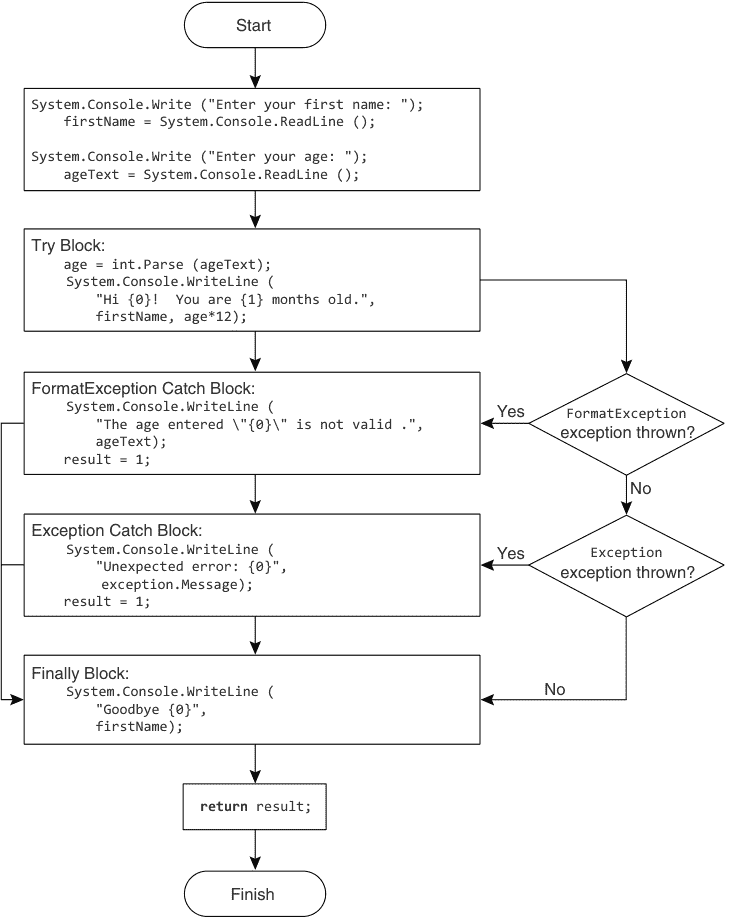

Figure 4.1: Exception-Handling Program Flow

如果没有 `System.FormatException` 的 `catch` 块，`System.Exception` 的 `catch` 块就会执行，即使 `int.Parse` 抛出的是 `System.FormatException`。这是因为 `System.FormatException` 也是 `System.Exception` 的一种类型。`System.FormatException` 是通用异常 `System.Exception` 的更具体实现。

处理异常的顺序很重要。`catch` 块必须从最具体到最不具体排列。`System.Exception` 数据类型是最不具体的，因此排在最后。`System.FormatException` 排在最前面，因为它是列表 4.21 处理的最具体的异常。

无论控制是否正常离开 `try` 块，还是因为 `try` 块中的代码抛出异常，`finally` 代码块在控制离开 `try` 保护区域后都会执行。`finally` 块的目的是提供一个位置来放置无论 `try/catch` 块如何退出——是否出现异常——都会执行的代码。`finally` 块对于在是否抛出异常的情况下清理资源很有用。事实上，可以有一个只有 `finally` 块而没有 `catch` 块的 `try` 块。`finally` 块无论 `try` 块是否抛出异常，或是否编写了 `catch` 块来处理异常都会执行。列表 4.22 演示了 `try/finally` 块，输出 4.14 显示了结果。

## LISTING 4.22: Finally Block without a Catch Block

```
using System;

class ExceptionHandling
{
    static int Main()
    {
        string firstName;
        string ageText;
        int age;
        int result = 0;

        Console.Write("Enter your first name: ");
        firstName = Console.ReadLine();

        Console.Write("Enter your age: ");
        ageText = Console.ReadLine();

        try
        {
            age = int.Parse(ageText);
            Console.WriteLine(
                $"Hi { firstName }! You are { age*12 } months old.");
        }
        finally
        {
            Console.WriteLine($"Goodbye { firstName }");
        }

        return result;
    }
}
```

## OUTPUT 4.14

```
Enter your first name: Inigo

Enter your age: forty-two

Unhandled Exception: System.FormatException: Input string was not in a correct format.
  at System.Number.StringToNumber(String str, NumberStyles options, NumberBuffer& number, NumberFormatInfo info, Boolean parseDecimal)
  at System.Number.ParseInt32(String s, NumberStyles style, NumberFormatInfo info)
  at ExceptionHandling.Main()

Goodbye Inigo
```

细心的读者会注意到这里有一个有趣的现象：运行时首先报告了未处理的异常，然后才运行 `finally` 块。这不寻常的行为如何解释？

首先，这种行为是合法的，因为当异常未被处理时，运行时的行为是实现定义的；任何行为都是合法的！运行时选择这种特定行为是因为它在决定运行 `finally` 块之前就知道异常将不会被处理；运行时已经检查了调用栈上的所有激活帧，并确定其中没有一个与匹配所抛异常的 `catch` 块相关联。

一旦运行时确定异常将不会被处理，它就会检查机器上是否安装了调试器，因为你可能是正在分析此故障的软件开发人员。如果存在调试器，它会在 `finally` 块运行之前提供用户将调试器附加到进程的机会。如果没有安装调试器或用户拒绝调试问题，默认行为是向控制台打印未处理的异常，然后查看是否有可以运行的 `finally` 块。由于情况的“实现定义”性质，运行时在此情况下不要求运行 `finally` 块；实现可以选择这样做也可以不做。

## Guidelines

- **AVOID** 显式地从 `finally` 块中抛出异常。隐式抛出异常的方法调用是可以接受的。
- **DO** 优先使用 `try/finally`，避免使用 `try/catch` 进行清理代码。
- **DO** 抛出描述发生了哪种异常情况的异常，如果可能的话，还说明如何防止它。

## ADVANCED TOPIC

### Exception Class Inheritance

从 C# 2.0 开始，所有作为异常抛出的对象都派生自 `System.Exception`。非派生自 `System.Exception` 的其他语言抛出的对象会被自动“包装”成派生自该类的对象。因此，它们可以由 `catch(System.Exception exception)` 块处理。然而，更可取的是包含一个针对最派生类型特定 `catch` 块，例如 `System.FormatException`，因为这样可以获得有关异常的最详细信息并以更少泛化的方式处理它。这样，使用最派生类型的 `catch` 语句能够专门处理异常类型，访问与所抛异常相关的数据，避免使用条件逻辑来确定发生了什么类型的异常。

这就是为什么 C# 强制要求 `catch` 块从最派生到最不派生排列的原因。例如，捕获 `System.Exception` 的 `catch` 语句不能出现在捕获 `System.FormatException` 的语句之前，因为 `System.FormatException` 派生自 `System.Exception`。

一个方法可能抛出许多异常类型。表 4.2 列出了框架中一些更常见的异常类型。

### TABLE 4.2: Common Exception Types

| Exception Type | Description |
|---|---|
| `System.Exception` | 所有其他异常派生的“基”异常。 |
| `System.ArgumentException` | 表示传递给方法的一个参数无效。 |
| `System.ArgumentNullException` | 表示某个参数为 `null`，而这对该参数而言不是有效值。 |
| `System.ApplicationException` | 应避免使用。最初的想法是你可能想要对“系统”异常和“应用程序”异常有一种不同的处理方式，虽然合理，但在现实世界中并不实际。 |
| `System.FormatException` | 表示字符串格式对于转换无效。 |
| `System.IndexOutOfRangeException` | 表示尝试访问不存在的数组或其他集合元素。 |
| `System.InvalidCastException` | 表示尝试从一种数据类型转换为另一种数据类型不是有效的转换。 |
| `System.InvalidOperationException` | 表示发生了意外的场景，使得应用程序不再处于有效运行状态。 |
| `System.NotImplementedException` | 表示尽管方法签名存在，但尚未完全实现。 |
| `System.NullReferenceException` | 当代码尝试查找由空引用引用的对象时抛出。 |
| `System.ArithmeticException` | 表示无效的数学运算，不包括除零。 |
| `System.ArrayTypeMismatchException` | 在尝试将错误类型的元素存储到数组中时发生。 |
| `System.StackOverflowException` | 表示递归深度异常。 |

## ADVANCED TOPIC

### General catch

可以指定一个不带参数的 `catch` 块，如列表 4.23 所示。

### LISTING 4.23: General Catch Blocks

```
...
try
{
    age = int.Parse(ageText);
    System.Console.WriteLine(
        $"Hi { firstName }!  You are { age*12 } months old.");
}
catch (System.FormatException exception)
{
    System.Console.WriteLine(
        $"The age entered ,{ ageText }, is not valid.");
    result = 1;
}
catch(System.Exception exception)
{
    System.Console.WriteLine(
        $"Unexpected error: { exception.Message }");
    result = 1;
}
catch
{
    System.Console.WriteLine("Unexpected error!");
    result = 1;
}
finally
{
    System.Console.WriteLine($"Goodbye { firstName }");
}
...
```


不带数据类型的`catch`块称为通用`catch`块，等同于指定一个接受`object`数据类型的`catch`块——例如`catch(object exception){...}`。由于所有类最终都派生自`object`，因此不带数据类型的`catch`块必须排在最后。

通用`catch`块很少使用，因为没有任何方式捕获有关异常的信息。此外，C# 不支持抛出`object`类型的异常的能力。仅使用 C++ 等语言编写的库允许抛出任何类型的异常。

从 C# 2.0 开始的行为与之前的 C# 行为略有不同。在 C# 2.0 中，如果一种语言允许抛出非`System.Exception`的异常，则被抛出的异常对象将被包装在派生自`System.Exception`的`System.Runtime.CompilerServices.RuntimeWrappedException`中。因此，无论是否派生自`System.Exception`，所有异常在传播到 C# 程序集时都将表现为派生自`System.Exception`。

其结果是，`System.Exception`捕获块将捕获所有未被前面块捕获的异常，而在`System.Exception`捕获块之后出现的通用`catch`块将永远不会被调用。因此，在 C# 2.0 或更高版本中，在`System.Exception`捕获块之后跟随通用`catch`块将导致编译器警告，指出通用`catch`块将永远不会执行。

## Guidelines

- AVOID 使用通用`catch`块，改用对`System.Exception`的捕获。
- AVOID 捕获那些不知道如何适当处理的异常。让异常未被处理要好于错误地处理它。
- AVOID 在重新抛出异常之前捕获并记录异常。相反，应允许异常在能够适当处理之前继续传播。

## Reporting Errors Using a `throw` Statement

C# 允许开发人员从其代码中抛出异常，如 Listing 4.24 和 Output 4.15 所示。

### LISTING 4.24: Throwing an Exception

```
using System;

public class ThrowingExceptions

{

    public static void Main()

    {

        try

        {

            Console.WriteLine("Begin executing");

            Console.WriteLine("Throw exception");

            throw new Exception("Arbitrary exception");

            Console.WriteLine("End executing");

        }

        catch(FormatException exception)

        {

            Console.WriteLine(

            "A FormatException was thrown");

        }

        catch(Exception exception)

        {

            Console.WriteLine(

            $"Unexpected error: { exception.Message }");

        }

        catch

        {

            Console.WriteLine("Unexpected error!");

        }

        Console.WriteLine(

        "Shutting down...");

    }

}
```

### OUTPUT 4.15

```
Begin executing

Throw exception...

Unexpected error:  Arbitrary exception

Shutting down...

```

正如 Listing 4.24 中的箭头所示，抛出异常会导致执行从抛出异常的位置跳转到堆栈中与所抛异常类型兼容的第一个`catch`块内。⁵ 在本例中，第二个`catch`块处理了该异常并输出错误消息。在 Listing 4.24 中没有`finally`块，因此执行会落到`try/catch`块之后的`System.Console.WriteLine()`语句。

要抛出异常，需要有一个异常实例。Listing 4.24 使用关键字`new`后跟异常的类型来创建实例。大多数异常类型允许在抛出异常时生成消息，以便在异常发生时可以检索该消息。

5. 技术上，它也可能被兼容的`catch`过滤器捕获。

有时`catch`块会捕获异常但无法适当或完全处理它。在这种情况下，`catch`块可以使用`throw`语句重新抛出异常而不指定任何异常，如 Listing 4.25 所示。

### LISTING 4.25: Rethrowing an Exception

```
catch(Exception exception)

{

    Console.WriteLine(

        $@"Rethrowing unexpected error: { exception.Message }");

    throw;

}
```

在 Listing 4.25 中，`throw`语句是“空的”，而不是指定要抛出由`exception`变量引用的异常。这说明了一个细微差别：`throw;`保留异常中的“调用堆栈”信息，而`throw exception;`则用当前调用堆栈信息替换该信息。出于调试目的，通常最好知道原始调用堆栈。

## Guidelines

- DO 优先使用空的`throw`在捕获并重新抛出异常时以保留调用堆栈。
- DO 通过抛出异常而不是返回错误代码来报告执行失败。
- DO NOT 拥有返回异常作为返回值或`out`参数的公共成员。抛出异常以指示错误；不要将它们用作返回值来指示错误。

## Avoid Using Exception Handling to Deal with Expected Situations

开发人员应努力避免为预期条件或正常控制流而抛出异常。例如，开发人员不应期望用户在指定年龄时输入有效文本。⁶ 因此，

> 6. 通常，开发人员应期望用户执行意外操作，因此他们应以防御性方式编码以处理“愚蠢用户技巧”。

不要依赖异常来验证用户输入的数据，开发人员应提供在尝试转换之前检查数据的方法。 （更好的是，他们应首先防止用户输入无效数据。）异常专门设计用于跟踪异常、意外和可能致命的情况。将它们用于预期情况等非预期目的会使你的代码难以阅读、理解和维护。

此外，与大多数语言一样，C# 在抛出异常时会产生轻微的性能损失——以微秒计，而大多数操作以纳秒计。这种延迟在人类时间尺度上通常不易察觉——除非异常未被处理。例如，当 Listing 4.20 执行且用户输入无效年龄时，异常未被处理，并且在运行时搜索环境以查看是否有要加载的调试器时会产生明显的延迟。幸运的是，程序关闭时的缓慢性能通常不是需要担心的问题。

### Guidelines

DO NOT 使用异常来处理正常、预期的条件；将它们用于异常、意外的条件。

## ADVANCED TOPIC: Numeric Conversion with `TryParse()`

`Parse()`方法的一个问题是，判断转换是否成功唯一的方法是尝试转换然后在失败时捕获异常。由于抛出异常是相对昂贵的操作，因此最好在不使用异常处理的情况下尝试转换。在 C# 的第一个版本中，唯一启用此行为的数据类型是`double`类型的`double.TryParse()`方法。然而，CLI 在 2.0 版中将此方法添加到所有数值基元类型中。它需要使用`out`关键字，因为`TryParse()`函数的返回值为`bool`而不是转换后的值。Listing 4.26 是一个代码片段，演示了使用`int.TryParse()`进行转换。

### LISTING 4.26: Conversion Using int.TryParse()

```
if (int.TryParse(ageText, out age))

{

    Console.WriteLine(

        $"Hi { firstName }! "

        + $"You are { age*12 } months old.");

}

else

{

    Console.WriteLine(

        $"The age entered, { ageText }, is not valid.");

}
```

随着 .NET Framework 4，`TryParse()`方法也被添加到枚举类型中。

有了`TryParse()`方法，就不再有必要仅为处理字符串到数值的转换而包含`try/catch`块。

## SUMMARY

本章讨论了声明和调用方法的细节，包括使用`out`和`ref`关键字传递变量而不是其值。除了方法声明之外，本章还介绍了异常处理。

方法是编写可读代码的关键基础结构。不要编写包含大量语句的大方法，而应使用方法在你的代码中创建“段落”，其长度大约为 10 条语句或更少。将大型函数分解为更小块的过程是你可以重构代码以使其更易读和可维护的方式之一。

下一章将考虑类构造并描述它如何将方法（行为）和字段（数据）封装到一个单元中。

# 第5章：类

你在第1章中简要了解了如何声明一个名为`HelloWorld`的新类。在第2章中，你学习了 C# 内置的原始类型。既然你现在已经学习了控制流以及如何声明方法，是时候讨论定义你自己的类型了。这是任何 C# 程序的核心构造；正是对类以及由它们创建的对象的支持，使 C# 成为一门面向对象的语言。

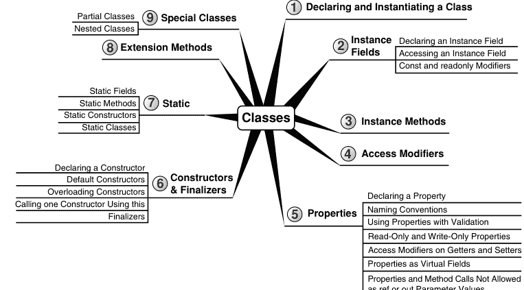

本章介绍使用 C# 进行面向对象编程的基础知识。重点之一是如何定义**类**，类是对象本身的模板。

前面章节中所有的结构化编程构造在面向对象编程中仍然适用。然而，通过将这些构造封装到类中，你可以创建更大、更有组织且更易于维护的程序。从基于控制流的结构化程序到面向对象程序的转变彻底改变了编程，因为它提供了额外的组织层次。结果是较小的程序得到了一定程度的简化。更重要的是，由于这些程序中的代码组织得更好，因此创建更大的程序也变得更加容易。

面向对象编程的一个关键优势是，你不必完全从零开始创建新程序，而是可以组合一系列先前工作中已有的对象，用新特性扩展类，添加更多类，从而提供新功能。

不熟悉面向对象编程的读者应阅读“初学者专题”板块以获取入门介绍。初学者专题之外的正文部分假定读者已经熟悉面向对象的概念，并专注于使用 C# 进行面向对象编程。

本章深入探讨 C# 如何通过支持类、属性和访问修饰符等构造来实现封装；我们在前一章已经介绍了方法。下一章将在此基础上引入继承以及面向对象编程所带来的多态性。

## 初学者专题：面向对象编程

当今成功编程的关键在于能够为大型应用的复杂需求实现提供组织性和结构。面向对象编程提供了实现这一目标的关键方法论之一，以至于面向对象程序员很难想象会回到结构化编程，除非是最琐碎的程序。

面向对象编程中最基本的构造是类。一组类构成了对通常真实世界概念的编程抽象、模型或模板。例如，`OpticalStorageMedia`类可能有一个`Eject()`方法，使光盘从播放器中弹出。`OpticalStorageMedia`类是对 CD 或 DVD 播放器这一真实世界对象的编程抽象。

类表现出面向对象编程的三个主要特征：封装、继承和多态。

### 封装

封装允许你隐藏细节。在必要时仍然可以访问这些细节，但通过巧妙地封装细节，大型程序变得更易于理解，数据免遭意外修改，并且代码更容易维护，因为代码更改的影响仅限于封装的范围内。方法就是封装的例子。虽然可以将方法中的代码提取出来直接嵌入到调用者的代码中，但将代码重构为方法会带来封装的好处。

### 继承

考虑以下示例：DVD 驱动器是一种光学媒体设备。它具有特定的存储容量，并且能够容纳数字电影。CD 驱动器也是光学媒体设备的一种，但具有不同的特性。CD 的复制保护与 DVD 的复制保护不同，存储容量也不同。CD 驱动器和 DVD 驱动器都与硬盘驱动器、USB 驱动器以及软盘驱动器（还记得那些吗？）不同。所有这些都属于存储设备的范畴，但每种都有其特殊特性，即使是在诸如支持的文件系统以及媒体实例是只读还是读/写等基本功能方面也是如此。

面向对象编程中的继承允许你在这些相似但又不同的条目之间建立“是一种”关系。可以合理地说，DVD 驱动器“是一种”存储介质，CD 驱动器“是一种”存储介质，因此两者都具有存储容量。我们也可以合理地说，两者都与“光学存储介质”存在“是一种”关系，而光学存储介质反过来“是一种”存储介质。

如果你为所提到的每种存储设备定义对应类，那么你就定义了一个类层次结构，它是一系列“是一种”关系。所有存储设备派生自的基类可以是`StorageMedia`类。因此，表示 CD 驱动器、DVD 驱动器、硬盘驱动器、USB 驱动器和软盘驱动器的类都派生自`StorageMedia`类。然而，CD 和 DVD 驱动器的类不需要直接派生自`StorageMedia`。相反，它们可以派生自一个中间类`OpticalStorageMedia`。你可以使用类似统一建模语言（UML）的类图以图形方式查看类层次结构，如图 5.1 所示。

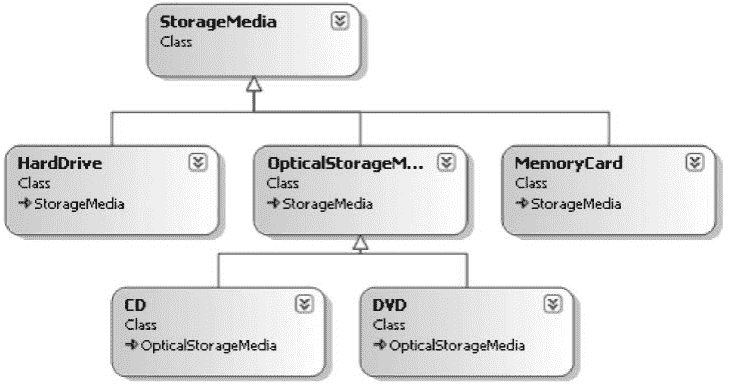

**图 5.1：类层次结构**

继承关系至少涉及两个类，其中一个类是另一个类的更具体种类；在图 5.1 中，`HardDrive`是`StorageMedia`的一种更具体种类。尽管更专门化的类型`HardDrive`是`StorageMedia`的一种，但反过来却不成立——也就是说，`StorageMedia`的实例不一定是`HardDrive`。如图 5.1 所示，继承可以涉及两个以上的类。

更专门化的类型称为**派生类型**或**子类型**。更一般的类型称为**基类型**或**超类型**。基类型也常被称为“父”类型，其派生类型通常被称为其“子”类型。尽管这种用法很常见，但可能会造成混淆：毕竟，子类型不是父类型的一种！在本书中，我们将坚持使用“派生类型”和“基类型”。

从另一个类型**派生**或**继承**就是**特化**该类型，这意味着自定义基类型，使其更适合特定用途。基类型可以包含所有派生类型共有的实现细节。

继承的关键特性在于所有派生类型都继承基类型的成员。通常，基类成员的实现可以被修改，但无论如何，派生类型除了显式包含的任何其他成员之外，还包含基类型的成员。

派生类型允许你将类组织成一个连贯的层次结构，其中派生类型比其基类型具有更高的特异性。

### 多态

**多态**由 *poly*（意为“多”）和 *morph*（意为“形态”）构成。在对象的上下文中，多态意味着单个方法或类型可以有多种实现形式。

假设你有一个媒体播放器，既可以播放 CD 音乐光盘，也可以播放包含 MP3 的 DVD。然而，`Play()`方法的确切实现将因媒体类型而异。在表示音乐 CD 的对象上调用`Play()`，或在表示音乐 DVD 的对象上调用`Play()`，两种情况都会播放音乐，因为每种对象类型都理解播放的复杂性。媒体播放器所知道的只是公共基类型`OpticalStorageMedia`，以及它定义了`Play()`方法这一事实。多态是这样一种原则：一个类型可以处理方法实现的确切细节，因为该方法出现在多个派生类型上，每个派生类型共享一个也包含相同方法签名的公共基类型（或接口）。

## 声明和实例化类

定义类首先需要指定关键字`class`，后跟一个标识符，如清单 5.1 所示。

### 清单 5.1：定义一个类

```
class Employee

{

}
```

属于该类的所有代码都将出现在类声明后的花括号之间。虽然不是必须的，但通常你会将每个类放入其自己的文件中。这样可以更容易找到定义特定类的代码，因为约定的做法是使用类名来命名文件。

### 指南

- 不要在一个源文件中放置多个类。
- 请使用其中包含的公共类型的名称来命名源文件。

一旦你定义了一个新类，就可以像使用框架内置类型一样使用这个类。换句话说，你可以声明该类型的变量，或者定义接受新类类型参数的方法。清单 5.2 演示了此类声明。

### 清单 5.2: 声明类类型的变量

```
class Program

{

    static void Main()

    {

        Employee employee1, employee2;

        // ...

    }

    static void IncreaseSalary(Employee employee)

    {

        // ...

    }

}
```

### 初学者专题：对象和类的定义

在日常对话中，类和对象这两个术语常常交替使用。然而，对象和类有着不同的含义。类是对象在实例化时外观的模板。因此，对象是类的一个实例。类就像制造某个小部件外观的模具。对象则对应由模具制造出来的小部件。从类创建对象的过程称为实例化，因为对象是类的一个实例。

既然你已经定义了一个新的类类型，现在是时候实例化一个该类型的对象了。仿效其前辈，C# 使用`new`关键字来实例化对象（见清单 5.3）。

### 清单 5.3: 实例化一个类

```
class Program

{

    static void Main()

    {

        Employee employee1 = new Employee();

        Employee employee2;

        employee2 = new Employee();

        IncreaseSalary(employee1);

    }

}
```


毫不奇怪，赋值可以与声明出现在同一语句中，也可以出现在单独的语句中。

与你迄今使用的原始类型不同，没有一种字面量方式来指定一个 `Employee`。相反，`new` 运算符向运行时发出指令，为 `Employee` 对象分配内存，实例化该对象，并返回对该实例的引用。

尽管存在用于分配内存的显式运算符，却没有用于释放内存的此类运算符。相反，运行时会在对象变得不可访问后的某个时间自动回收内存。垃圾回收器负责自动释放内存。它确定哪些对象不再被其他活动对象引用，然后为这些对象释放内存。结果是，没有一个编译时确定的程序位置来收集内存并将其归还系统。

在这个简单的示例中，`Employee` 没有关联任何显式数据或方法，这使得该对象基本上毫无用处。下一节将重点讨论如何向对象添加数据。

## 初学者专题

### 封装 第1部分：对象将数据与方法组合在一起

如果你收到一叠写着员工名字的索引卡、一叠写着他们姓氏的索引卡，以及一叠写着他们薪水的索引卡，除非你知道这些卡片在每个堆叠中的顺序相同，否则这些卡片几乎没有价值。即便如此，这些数据也很难处理，因为要确定一个人的全名，需要在两个堆叠中搜索。更糟糕的是，如果你弄掉了其中一叠卡片，就无法将名字与姓氏和薪水重新关联起来。相反，你需要一叠员工卡片，其中所有数据都分组在一张卡片上。通过这种方法，名字、姓氏和薪水将被封装在一起。

在面向对象编程语境之外，**封装**一组条目是将这些条目封闭在一个容器内。类似地，面向对象编程将方法和数据一起封装到一个对象中。这提供了对所有类**成员**（类中的数据和方法）的分组，使得它们不再需要被单独处理。对象使得调用时可以传递对 `employee` 对象的引用，而不是将名字、姓氏和薪水作为三个单独的实参传递给方法。一旦被调用的方法接收到对象引用，它就可以向对象发送消息（例如，它可以调用 `AdjustSalary()` 这样的方法）来执行特定操作。

### 语言对比：C++——`delete` 运算符

C# 程序员应将 `new` 运算符视为实例化对象的调用，而不是分配内存的调用。无论是堆上分配的对象还是栈上分配的对象都支持 `new` 运算符，这强调了 `new` 与内存分配应如何进行以及是否有必要释放无关。

因此，C# 不需要 C++ 中的 `delete` 运算符。内存分配和释放是由运行时管理的细节，这使开发者能够更多地专注于领域逻辑。然而，尽管内存由运行时管理，运行时并不管理其他资源，如数据库连接、网络端口等。与 C++ 不同，C# 不支持**隐式确定性资源清理**（在代码中编译时确定的位置发生隐式对象销毁）。幸运的是，C# 确实通过 `using` 语句支持**显式确定性资源清理**，并通过终结器支持**隐式非确定性资源清理**。

### 实例字段

面向对象设计的关键方面之一是将数据分组以提供结构。本节讨论如何向 `Employee` 类添加数据。在类中存储数据的变量，其通用的面向对象术语是成员变量。这个术语在 C# 中很好理解，但更标准的术语以及规范中使用的术语是字段，它是与包含类型关联的命名存储单元。实例字段是在类级别声明的变量，用于存储与对象关联的数据。因此，关联是字段数据类型与包含字段之间的对应关系。

#### 声明实例字段

在清单 5.4 中，`Employee` 类已被修改为包含三个字段：`FirstName`、`LastName` 和 `Salary`。

#### 清单 5.4: 声明字段

```csharp
class Employee
{
    public string FirstName;
    public string LastName;
    public string Salary;
}
```

通过这些新增的字段，可以将一些基本数据存储在每个 `Employee` 实例中。在本例中，你在字段前添加了 `public` 访问修饰符。在字段上使用 `public` 表示该字段内的数据可以从 `Employee` 以外的类中访问（参见本章后面的“访问修饰符”一节）。

与局部变量声明一样，字段声明包含字段所引用的数据类型。此外，可以在声明时为字段赋初值，如清单 5.5 中的 `Salary` 字段所示。

#### 清单 5.5: 在声明时设置字段的初值

```csharp
class Employee
{
    public string FirstName;
    public string LastName;
    public string Salary = "Not enough";
}
```

我们将在本章稍后介绍 C# 属性之后，再讨论字段的命名和编码指南。可以说，清单 5.5 并不遵循通用约定。

#### 访问实例字段

你可以设置和检索字段内的数据。然而，字段不包含 `static` 修饰符这一事实表明它是一个实例字段。你只能从包含类的实例（一个对象）访问实例字段。你不能直接从类本身访问它（换句话说，除非先创建实例）。

清单 5.6 展示了 `Program` 类的更新外观及其对 `Employee` 类的使用，输出 5.1 显示了结果。

```csharp
class Program
{
    static void Main()
    {
        Employee employee1 = new Employee();
        Employee employee2;
        employee2 = new Employee();
        employee1.FirstName = "Inigo";
        employee1.LastName = "Montoya";
        employee1.Salary = "Too Little";
        IncreaseSalary(employee1);
        Console.WriteLine(
            "{0} {1}: {2}",
            employee1.FirstName,
            employee1.LastName,
            employee1.Salary);
        // ...
    }
    static void IncreaseSalary(Employee employee)
    {
        employee.Salary = "Enough to survive on";
    }
}
```

#### 输出 5.1

```
Inigo Montoya: Enough to survive on
```

### LISTING 5.8: 从外部类访问字段

```csharp
class Program
{
    static void Main()
    {
        Employee employee1 = new Employee();
        Employee employee2;
        employee2 = new Employee();
        employee1.FirstName = "Inigo";
        employee1.LastName = "Montoya";
        employee1.Salary = "Too Little";
        IncreaseSalary(employee1);
        Console.WriteLine(
            $"{ employee1.GetName() }: { employee1.Salary }");
        // ...
    }
    // ...
}
```

### OUTPUT 5.2

```
Inigo Montoya: Enough to survive on
```

### 使用 `this` 关键字

你可以在属于该类的实例成员内部获取对类的引用。在 C# 中，要明确指出访问的字段或方法是包含类的实例成员，你使用关键字 `this`。使用 `this` 在调用任何实例成员时是隐式的，它返回对象本身的一个实例。

例如，考虑 Listing 5.9 中显示的 `SetName()` 方法。

### LISTING 5.9: 使用 `this` 明确标识字段的所有者

```csharp
class Employee
{
    public string FirstName;
    public string LastName;
    public string Salary;
    public string GetName()
    {
        return $"{ FirstName } { LastName }";
    }
    public void SetName(
```
```csharp
this.FirstName = FirstName;
this.LastName = LastName;
}
}
```

在此示例中，不可能在不明确指出 `Employee` 对象拥有该变量的情况下引用 `FirstName` 字段。`this` 就像在 `Program.Main()` 方法中使用的 `employee1` 变量前缀一样（参见 Listing 5.8）；它标识引用为 `SetName()` 被调用的对象。

Listing 5.9 未遵循 C# 的命名约定，即参数像局部变量一样声明，使用 camelCase。这可能导致细微的错误，因为将 `FirstName`（意图引用字段）赋给 `FirstName`（参数）会导致代码仍然可以编译甚至运行。为避免此问题，最好为参数和局部变量采用与字段不同的命名约定。我们将在本章后面演示其中一种约定。

> **Language Contrast: Visual Basic—Accessing a Class Instance with Me**
> 
> C# 关键字 `this` 与 Visual Basic 关键字 `Me` 相同。

在 Listing 5.9 和 Listing 5.10 中，`this` 关键字未在 `GetName()` 方法中使用——它是可选的。然而，如果存在与字段同名的局部变量或参数（参见 Listing 5.10 中的 `SetName()` 方法），省略 `this` 将导致访问局部变量/参数，而意图是字段；在这种情况下，使用 `this` 是必需的。

你也可以使用关键字 `this` 显式访问类的成员方法。例如，`this.GetName()` 在 `SetName()` 方法内是允许的，允许你打印出新分配的名称（参见 Listing 5.11 和 Output 5.3）。

### LISTING 5.11: 使用 `this` 与方法

```csharp
class Employee
{
    // ...
}
```

```csharp
public string GetName()
{
    return $"{ FirstName } { LastName }";
}
public void SetName(string newFirstName, string newLastName)
{
    this.FirstName = newFirstName;
    this.LastName = newLastName;
    Console.WriteLine(
        $"Name changed to '{ this.GetName() }'");
}
```

```csharp
class Program
{
    static void Main()
    {
        Employee employee = new Employee();
        employee.SetName("Inigo", "Montoya");
        // ...
    }
    // ...
}
```

### OUTPUT 5.3

```
Name changed to 'Inigo Montoya'
```

有时可能有必要使用 `this` 将对当前执行对象的引用传递给方法。考虑 Listing 5.12 中的 `Save()` 方法。

### LISTING 5.12: 在方法调用中传递 `this`

```csharp
class Employee
{
    public string FirstName;
    public string LastName;
    public string Salary;
    public void Save()
    {
        DataStorage.Store(this);
    }
}
```

```csharp
class DataStorage
{
    // Save an employee object to a file
    // named with the Employee name.
    public static void Store(Employee employee)
    {
        // ...
    }
}
```

Listing 5.12 中的 `Save()` 方法调用了 `DataStorage` 类上的一个方法，名为 `Store()`。然而，`Store()` 方法需要传递 `Employee` 对象，该对象需要被持久化。这是通过使用关键字 `this` 完成的，它传递了调用 `Save()` 的 `Employee` 对象的实例。

### ADVANCED TOPIC

### 使用文件存储和加载

`DataStorage` 内部 `Store()` 方法的实际实现涉及 `System.IO` 命名空间中的类，如 Listing 5.13 所示。在 `Store()` 内部，你首先实例化一个 `FileStream` 对象，将其与对应于员工全名的文件关联。`FileMode.Create` 参数表示你希望如果不存在 `<firstname><lastname>.dat` 名称的文件，则创建新文件；如果文件已存在，则会被覆盖。接下来，你创建一个 `StreamWriter` 类。`StreamWriter` 类负责将文本写入 `FileStream`。你使用 `WriteLine()` 方法写入数据，就像写入控制台一样。

### LISTING 5.13: 数据持久化到文件

```csharp
using System;
// IO namespace
using System.IO;
class DataStorage
{
    // Save an employee object to a file
    // named with the Employee name.
    // Error handling not shown.
    public static void Store(Employee employee)
    {
```

```csharp
// Instantiate a FileStream using FirstNameLastName.dat
// for the filename. FileMode.Create will force
// a new file to be created or override an
// existing file.
FileStream stream = new FileStream(
    employee.FirstName + employee.LastName + ".dat",
    FileMode.Create);

// Create a StreamWriter object for writing text
// into the FileStream.
StreamWriter writer = new StreamWriter(stream);

// Write all the data associated with the employee.
writer.WriteLine(employee.FirstName);
writer.WriteLine(employee.LastName);
writer.WriteLine(employee.Salary);

// Close the StreamWriter and its stream.
writer.Close(); // Automatically closes the stream
}

// ...
}
```

一旦写入操作完成，`FileStream` 和 `StreamWriter` 都需要关闭，以便它们不会无限期地保持打开状态，等待垃圾回收器运行。Listing 5.13 不包含任何错误处理，因此如果抛出异常，两个 `Close()` 方法都不会被调用。

加载过程类似（参见 Listing 5.14）。

### LISTING 5.14: 从文件检索数据

```csharp
class Employee
{
    // ...
}
```

```csharp
// IO namespace
using System;
using System.IO;
class DataStorage
{
    // ...
    public static Employee Load(string firstName, string lastName)
```

1. 此代码可以使用 `using` 语句改进，这是一种我们尚未引入的构造，因为它尚未介绍。

Output 5.4 显示了结果。

### OUTPUT 5.4

```
Name changed to 'Inigo Montoya'
Inigo Montoya:
```


保存过程的逆过程出现在 Listing 5.14 中，它使用 `StreamReader` 而不是 `StreamWriter`。同样，一旦数据读取完毕，需要在 `FileStream` 和 `StreamReader` 上调用 `Close()`。

`Output 5.4` 在 `Inigo Montoya:` 之后没有显示任何薪水，因为在调用 `Save()` 之后才通过调用 `IncreaseSalary()` 将 `Salary` 设置为 `Enough to survive on`。

注意在 `Main()` 中，我们可以从 `employee` 实例调用 `Save()`，但要加载新员工，我们调用 `DataStorage.Load()`。要加载员工，我们通常没有要加载到的员工实例，因此 `Employee` 上的实例方法就不太理想。调用 `DataStorage` 上的 `Load` 的替代方案是向 `Employee` 添加一个静态 `Load()` 方法（参见本章后面“Static Members”部分），这样就可以调用 `Employee.Load()`（使用 `Employee` 类，而不是 `Employee` 的实例）。

注意列表顶部包含 `using System.IO` 指令。这使得每个 IO 类在不使用完整命名空间前缀的情况下都可访问。

# 访问修饰符

在第章前面声明字段时，你在字段声明前加上了关键字 `public`。`public` 是一个访问修饰符，标识与它装饰的成员关联的封装级别。可用的访问修饰符有五种：`public`、`private`、`protected`、`internal` 和 `protected internal`。本节考虑前两种。

# BEGINNER TOPIC

# 封装 Part 2：信息隐藏

除了将数据和方法封装到一个单元中之外，封装还涉及隐藏对象的内部数据和行为细节。

在某种程度上，方法也实现了这一点；从方法外部来看，调用者只能看到方法声明。内部实现完全不可见。然而，面向对象编程通过提供控制成员在类外部可见程度的机制，进一步实现了这一点。类外部不可见的成员是私有成员。

在面向对象编程中，封装不仅指将数据和行为分组，还指将数据和行为的实现细节隐藏在类（胶囊）内部，使类的内部工作原理不被暴露。这降低了调用者不当修改数据或根据实现进行编程的风险，而实现在未来可能会发生变化。

访问修饰符的目的是提供封装。通过使用 `public`，你明确表示被修改的字段可以从 `Employee` 类外部访问——换句话说，可以从 `Program` 类等外部访问。

然而，考虑一个包含 `Password` 字段的 `Employee` 类。应该可以通过调用 `Employee` 对象并使用 `Logon()` 方法来验证密码。相反，不应能够从类外部访问 `Employee` 对象的 `Password` 字段。

要将 `Password` 字段定义为隐藏且无法从包含类外部访问，你使用关键字 `private` 作为访问修饰符，代替 `public`（参见清单 5.15）。因此，`Password` 字段无法从 `Program` 类内部访问，例如。

## LISTING 5.15: Using the private Access Modifier

```
class Employee
{
    public string FirstName;
    public string LastName;
    public string Salary;
    private string Password;
    private bool IsAuthenticated;
    public bool Logon(string password)
    {
        if(Password == password)
        {
            IsAuthenticated = true;
        }
        return IsAuthenticated;
    }
}
```

```
class Program
{
    static void Main()
    {
        Employee employee = new Employee();
        employee.FirstName = "Inigo";
        employee.LastName = "Montoya";
        // ...
        // Password is private, so it cannot be
        // accessed from outside the class.
        // Console.WriteLine
        //     ("Password = {0}", employee.Password);
    }
}
// ...
}
```

尽管清单 5.15 中未显示此选项，但也可以用 `private` 的访问修饰符装饰方法。

如果类成员上未放置访问修饰符，声明默认为 `private`。换句话说，成员默认是私有的，程序员需要显式指定成员为 `public`。

## Properties

前一节“Access Modifiers”演示了如何使用 `private` 关键字封装密码，防止类外部访问。这种类型的封装通常过于严格。然而，例如，有时你可能需要定义外部类只能读取但内部可以更改其值的字段。或者，也许你希望允许写入类中的某些数据，但需要能够验证对数据的更改。在另一种情况下，也许你需要在运行时构造数据。传统上，语言通过将字段标记为 `private`，然后提供用于访问和

## LISTING 5.17: Defining Properties

```
class Program
{
    static void Main()
    {
        Employee employee = new Employee();
        // Call the FirstName property's setter.
        employee.FirstName = "Inigo";
        // Call the FirstName property's getter.
        System.Console.WriteLine(employee.FirstName);
    }
}
class Employee
{
    // FirstName property
    public string FirstName
    {
        get
        {
            return _FirstName;
        }
        set
        {
            _FirstName = value;
        }
    }
    private string _FirstName;
    // LastName property
    public string LastName
    {
        get
        {
            return _LastName;
        }
        set
        {
            _LastName = value;
        }
    }
    private string _LastName;
    // ...
}
```

## OUTPUT 5.5

```
Inigo
```

清单 5.17 中首先要注意的不是属性代码本身，而是 `Program` 类中的代码。虽然你不再拥有 `FirstName` 和 `LastName` 标识符的字段，但通过查看 `Program` 类无法看出这一点。访问员工名字和姓氏的 API 完全没有变化。仍然可以使用简单的赋值运算符为姓名各部分赋值，例如 (`employee.FirstName = "Inigo"`)。

关键特性是属性提供了一个在程序上看起来像字段的 API。实际上，并不存在这样的字段。属性声明看起来与字段声明完全相同，但在其后是用于放置属性实现的花括号。属性实现由两个可选部分组成。`get` 部分定义属性的 getter 部分。它直接对应于清单 5.16 中定义的 `GetFirstName()` 和 `GetLastName()` 函数。要访问 `FirstName` 属性，你调用 `employee.FirstName`。同样，setter（实现部分的 `set` 部分）启用了字段赋值的调用语法：

```
employee.FirstName = "Inigo";
```

属性定义语法使用三个上下文关键字。你使用 `get` 和 `set` 关键字分别标识属性的检索或赋值部分。此外，setter 使用 `value` 关键字引用赋值操作的右侧。因此，当 `Program.Main()` 调用 `employee.FirstName = "Inigo"` 时，`value` 在 setter 内部被设置为 `"Inigo"`，可用于为 `_FirstName` 赋值。清单 5.17 的属性实现是最常用的实现。当调用 getter（例如在 `Console.WriteLine(employee.FirstName)` 中）时，字段 (`_FirstName`) 的值被获取并写入控制台。

## Automatically Implemented Properties

在 C# 3.0 中，属性语法包含简写版本。由于具有单个支持字段且由 `get` 和 `set` 访问器赋值和检索的属性非常简单且常见（参见 `FirstName` 和 `LastName` 的实现），C# 3.0 编译器（及以上版本）允许在不声明任何访问器实现或支持字段的情况下声明属性。清单 5.18 使用 `Title` 和 `Manager` 属性演示了该语法，输出 5.6 显示了结果。

## LISTING 5.18: Automatically Implemented Properties

```
class Program
{
    static void Main()
    {
        Employee employee1 =
            new Employee();
        Employee employee2 =
            new Employee();
        // Call the FirstName property's setter.
        employee1.FirstName = "Inigo";
        // Call the FirstName property's getter.
        System.Console.WriteLine(employee1.FirstName);
        // Assign an auto-implemented property
        employee2.Title = "Computer Nerd";
        employee1.Manager = employee2;
        // Print employee1's manager's title.
        System.Console.WriteLine(employee1.Manager.Title);
    }
}
```

```
class Employee
{
    // FirstName property
    public string FirstName
    {
        get
        {
            return _FirstName;
        }
        set
        {
            _FirstName = value;
        }
    }
    private string _FirstName;
    // LastName property
    public string LastName
    {
        get
        {
            return _LastName;
        }
        set
        {
            _LastName = value;
        }
    }
}
```

```
```csharp
}
private string _LastName;

public string Title { get; set; }
public Employee Manager { get; set; }
public string Salary { get; set; } = "Not Enough";
// ...
}
```
```

# Output 5.6

```
```text
Inigo
Computer Nerd
```
```

自动实现的属性提供了一种更简单的方式来编写属性，同时也可以读取它们。此外，当需要向 setter 中添加诸如验证之类的功能时，调用该属性的任何现有代码都不需要更改，即使属性声明已更改为包含实现。

在本书的其余部分，我们将频繁使用这种 C# 3.0 或更高版本的语法，而不会指出它是 C# 3.0 中引入的功能。

关于自动声明属性的最后一点需要注意的是，在 C# 6.0 中，可以像清单 5.18 对 `Salary` 所做的那样对其进行初始化：

```
```csharp
public string Salary { get; set; } = "Not Enough";
```
```

在 C# 6.0 之前，属性初始化只能通过方法进行，包括构造函数，正如我们在本章后面讨论的那样。然而，使用 C# 6.0，你可以在声明时使用类似于字段初始化的语法来初始化自动实现的属性。

## 属性和字段指南

由于可以编写显式的 setter 和 getter 方法而不是属性，有时可能会出现是否最好使用属性还是方法的问题。一般的指导原则是，方法应表示操作，而属性应表示数据。属性旨在提供对简单数据和简单计算的简单访问。期望调用属性的成本不会显著高于访问字段。

关于命名，请注意在清单 5.18 中属性名为 `FirstName`，而字段名从之前的清单更改为 `_FirstName`——即 PascalCase 加下划线前缀。用于支持属性的私有字段的其他常见命名约定是 `_firstName` 和 `m_FirstName`（源自 C++，其中 m 代表成员变量），有时也会使用与局部变量相同的 camelCase 约定³。然而，应避免使用 camelCase 约定。用于属性名的 camelCase 与用于局部变量和参数的命名约定相同，这意味着名称重叠的可能性非常高。此外，为了尊重封装原则，字段不应声明为 `public` 或 `protected`。

### Guidelines

- **DO** 使用属性来对简单数据和简单计算进行简单访问。
- **AVOID** 在属性 getter 中抛出异常。
- **DO** 如果属性抛出异常，则保留原始属性值。
- **DO** 当不需要额外逻辑时，优先使用自动实现的属性而不是具有简单支持字段的属性。

无论你为私有字段使用哪种命名模式，属性的编码标准都是 PascalCase。因此，属性应使用 `LastName` 和 `FirstName` 模式，并使用表示名词、名词短语或形容词的名称。事实上，属性名与类型名相同的情况并不少见。例如，考虑 `Person` 对象上的类型为 `Address` 的 `Address` 属性。

3. 我们更喜欢 `_firstName`，因为与下划线（_）相比，名称前面的 m 是不必要的。此外，通过使用与属性相同的大小写，可以在 Visual Studio 代码模板扩展工具中只有一个字符串，而不是为属性名和字段名各有一个。

### Guidelines

CONSIDER 在属性的 backing field 上使用与属性相同的大小写，并以“_”前缀区分 backing field。但是，不要使用两个下划线；以两个下划线开头的标识符保留给 C# 编译器本身使用。
DO 使用名词、名词短语或形容词命名属性。
CONSIDER 为属性赋予与其类型相同的名称。
AVOID 使用 camelCase 命名字段。
DO 当这种做法能增加价值时，优先为布尔属性加上“Is”、“Can”或“Has”前缀。
DO NOT 声明为 public 或 protected 的实例字段。 （而是通过属性公开它们。）
DO 使用 PascalCase 命名属性。
DO 优先使用自动实现的属性而不是字段。
DO 如果没有额外的实现逻辑，则优先使用自动实现的属性而不是完全展开的属性。

## 使用属性进行验证

请注意在清单 5.19 中，`Employee` 的 `Initialize()` 方法在赋值时也使用属性而不是字段。虽然这不是必需的，但结果是属性 setter 中的任何验证都将在类内部和外部被调用。例如，考虑如果将 `LastName` 属性更改为在将其分配给 `_LastName` 之前检查 `value` 是否为 `null` 或空字符串，会发生什么情况。

### LISTING 5.19: Providing Property Validation

```
class Employee
{
    // ...
    public void Initialize(
        string newFirstName, string newLastName)
    {
        // Use property inside the Employee
        // class as well.
        FirstName = newFirstName;
        LastName = newLastName;
    }
    // LastName property
    public string LastName
```


```csharp
{
    get
    {
        return _LastName;
    }
    set
    {
        // Validate LastName assignment
        if(value == null)
        {
            // Report error
            // In C# 6.0 replace "value" with nameof(value)
            throw new ArgumentNullException("value");
        }
        else
        {
            // Remove any whitespace around
            // the new last name.
            value = value.Trim();
            if(value == "")
            {
                // Report error
                // In C# 6.0 replace "value" with nameof(value)
                throw new ArgumentException(
                    "LastName cannot be blank.", "value");
            }
            else
                _LastName = value;
        }
    }
}
private string _LastName;
// ...
```

有了这个新实现，如果`LastName`被赋予无效值，无论是从同一类的其他成员赋值，还是从`Program.Main()`内部直接赋值给`LastName`，代码都会抛出异常。通过提供类似字段的 API 来拦截赋值并验证参数，这是属性的优势之一。

访问属性支持字段的最佳做法是仅在属性实现内部进行。换句话说，你应该始终使用属性，而不是直接调用字段。在许多情况下，这一原则即使在与属性相同的类中的代码中也适用。如果你遵循[^4]这种做法，当你添加诸如验证代码之类的代码时，整个类会立即受益于它。[^5]

虽然很少见，但可以在`setter`中为`value`赋值，正如清单 5.19 所做的那样。在这种情况下，对`value.Trim()`的调用会删除新姓氏值周围的任何空白。

### Guidelines

AVOID 在属性之外访问属性的 backing field，即使是在包含类内部。

DO 在调用`ArgumentException()`或`ArgumentNullException()`构造函数时使用`"value"`作为`paramName`参数（`value`是属性 setter 上参数的隐式名称）。

## ADVANCED TOPIC

### `nameof` Operator

如果在属性验证期间确定新的值赋值无效，则需要抛出异常——通常是`ArgumentException()`或`ArgumentNullException()`类型。这两个异常都接受一个名为`paramName`的`string`类型参数，用于标识无效参数的名称。在清单 5.19 中，我们将`"value"`作为此参数的参数传递，但 C# 6.0 提供了`nameof`运算符的改进。`nameof`运算符接受一个标识符，如`value`变量，并返回该名称的字符串表示形式——在这种情况下为`"value"`。

使用`nameof`运算符的优点是，如果标识符名称更改，则重构工具也会自动更改`nameof`的参数。如果未使用重构工具，代码将不再编译，迫使开发人员手动更改参数。

在属性验证器的情况下，“参数”始终是`value`并且不能更改，因此利用`nameof`运算符的好处是 arguably lost. Nonetheless, consider continued use of the `nameof` operator in all cases of the `paramName` argument to remain consistent with the guideline: Always use `nameof` for the `paramName` argument passed into exceptions like `ArgumentNullException` and `ArgumentNullException` that take such a parameter.

## Read-Only and Write-Only Properties

By removing either the getter or the setter portion of a property, you can change a property’s accessibility. Properties with only a setter are write-only, which is a relatively rare occurrence. Similarly, providing only a getter will cause the property to be read-only; any attempts to assign a value will cause a compile error. To make `Id` read-only, for example, you would code it as shown in Listing 5.20.

```csharp
class Program
{
    static void Main()
    {
        Employee employee1 = new Employee();
        employee1.Initialize(42);
        // ERROR: Property or indexer 'Employee.Id'
        // cannot be assigned to; it is read-only.
        // employee1.Id = "490";
    }
}

class Employee
{
    public void Initialize(int id)
    {
        // Use field because Id property has no setter;
        // it is read-only.
        _Id = id.ToString();
    }

    // ...
    // Id property declaration
    public string Id
    {
        get
        {
            return _Id;
        }
        // No setter provided.
    }
    private string _Id;
}
```

Listing 5.20 assigns the field from within the `Employee` constructor rather than the property (`_Id = id`). Assigning via the property causes a compile error, as it does in `Program.Main()`.

Starting in C# 6.0, there is also support for read-only automatically implemented properties as follows:

```csharp
public bool[,] Cells { get; } = new bool[2, 3, 3];
```

This is clearly a significant improvement over the pre-C# 6.0 approach, especially given the commonality of read-only properties for something like an array of items or the `Id` in Listing 5.20.

One important note about a read-only automatically implemented property is that, like read-only fields, the compiler requires that it be initialized in the constructor or via an initializer. In the preceding snippet we use an initializer, but the assignment of `Cells` from within the constructor is also permitted.

Given the guideline that fields should not be accessed from outside their wrapping property, those programming in a C# 6.0 world will discover that there is virtually no need to ever use pre-C# 6.0 syntax; instead, the programmer can always use a read-only, automatically implemented property. The only exception might be when the data type of the read-only modified field does not match the data type of the property—for example, if the field was of type `int` and the read-only property was of type `double`.

> **Guidelines**
>
> **DO** create read-only properties if the property value should not be changed.
>
> **DO** create read-only automatically implemented properties in C# 6.0 (or later) rather than read-only properties with a backing field if the property value should not be changed.

## Properties As Virtual Fields

As you have seen, properties behave like virtual fields. In some instances, you do not need a backing field at all. Instead, the property getter returns a calculated value while the setter parses the value and persists it to some other member fields (if it even exists). Consider, for example, the `Name` property implementation shown in Listing 5.21. Output 5.7 shows the results.

### LISTING 5.21: Defining Properties

```csharp
class Program
{
    static void Main()
    {
        Employee employee1 = new Employee();
        employee1.Name = "Inigo Montoya";
        System.Console.WriteLine(employee1.Name);
        // ...
    }
}

class Employee
{
    // ...
    // FirstName property
    public string FirstName
    {
        get
        {
            return _FirstName;
        }
        set
        {
            _FirstName = value;
        }
    }
    private string _FirstName;

    // LastName property
    public string LastName
    {
        get
        {
            return _LastName;
        }
    }
```

## Access Modifiers on Getters and Setters

As previously mentioned, it is a good practice not to access fields from outside their properties because doing so circumvents any validation or additional logic that may be inserted. Unfortunately, C# 1.0 did not allow different levels of encapsulation between the getter and setter portions of a property. It was not possible, therefore, to create a public getter and a private setter so that external classes would have read-only access to the property while code within the class could write to the property.

In C# 2.0, support was added for placing an access modifier on either the get or the set portion of the property implementation (not on both), thereby overriding the access modifier specified on the property declaration. Listing 5.22 demonstrates how to do this.

### LISTING 5.22: Placing Access Modifiers on the Setter

```csharp
class Program
{
    static void Main()
    {
        Employee employee1 = new Employee();
        employee1.Initialize(42);
        // ERROR: The property or indexer 'Employee.Id'
        // cannot be used in this context because the set
        // accessor is inaccessible
        employee1.Id = "490";
    }
}

class Employee
{
    public void Initialize(int id)
    {
        // Set Id property
        Id = id.ToString();
    }

    // ...
    // Id property declaration
    public string Id
    {
        get
        {
            return _Id;
        }
        // Providing an access modifier is possible in C# 2.0
        // and higher only
        private set
        {
            _Id = value;
        }
    }
    private string _Id;
}
```

[^4]: Apologies to Teller, Cher, Sting, Madonna, Bono, Prince, Liberace, et al.

[^5]: 如本章后面所述，对此的一个例外是当字段标记为只读时，因为此时值只能在构造函数中设置。在 C# 6.0 中，你可以直接为只读属性赋值，完全消除了对只读字段的需求。


By using private on the setter, the property appears as read-only to classes other than `Employee`. From within `Employee`, the property appears as read/write, so you can assign the property within the constructor. When specifying an access modifier on the getter or setter, take care that the access modifier is more restrictive than the access modifier on the property as a whole. It is a compile error, for example, to declare the property as private and the setter as public.

## Guidelines

- DO apply appropriate accessibility modifiers on implementations of getters and setters on all properties.
- DO NOT provide set-only properties or properties with the setter having broader accessibility than the getter.

## Properties and Method Calls Not Allowed As ref or out Parameter Values

C# allows properties to be used identically to fields, except when they are passed as ref or out parameter values. ref and out parameter values are internally implemented by passing the memory address to the target method. However, because properties can be virtual fields that have no backing field, or can be read-only or write-only, it is not possible to pass the address for the underlying storage. As a result, you cannot pass properties as ref or out parameter values. The same is true for method calls. Instead, when code needs to pass a property or method call as a ref or out parameter value, the code must first copy the value into a variable and then pass the variable. Once the method call has completed, the code must assign the variable back into the property.

## ADVANCED TOPIC

## Property Internals

Listing 5.23 shows that getters and setters are exposed as `get_FirstName()` and `set_FirstName()` in the CIL.

### LISTING 5.23: CIL Code Resulting from Properties

```
// ...

.field private string _FirstName

.method public hidebysig specialname instance string

    get_FirstName() cil managed

{

    // Code size       12 (0xc)

    .maxstack 1

    .locals init (string V_0)

    IL_0000: nop

    IL_0001: ldarg.0

    IL_0002: ldfld      string Employee::_FirstName

    IL_0007: stloc.0

    IL_0008: br.s       IL_000a

    IL_000a: ldloc.0

    IL_000b: ret

} // end of method Employee::get_FirstName

.method public hidebysig specialname instance void

    set_FirstName(string 'value') cil managed

{

    // Code size       9 (0x9)

    .maxstack 8

    IL_0000: nop

    IL_0001: ldarg.0

    IL_0002: ldarg.1

    IL_0003: stfld      string Employee::_FirstName

    IL_0008: ret

} // end of method Employee::set_FirstName

.property instance string FirstName()

{

    .get instance string Employee::get_FirstName()

    .set instance void Employee::set_FirstName(string)

} // end of property Employee::FirstName

// ...
```

Just as important to their appearance as regular methods is the fact that properties are an explicit construct within the CIL, too. As Listing 5.24

## 声明构造函数

要纠正此问题，你需要在创建对象时提供指定所需数据的方式。你通过构造函数来实现这一点，如清单 5.25 所示。

### LISTING 5.25: Defining a Constructor

```
class Employee

{

    // Employee constructor

    public Employee(string firstName, string lastName)

    {

        FirstName = firstName;

        LastName = lastName;

    }

    public string FirstName{ get; set; }

    public string LastName{ get; set; }

    public string Salary{ get; set; } = "Not Enough";

    // ...

}
```

如图所示，要定义构造函数，你需要创建一个没有返回类型的方法，其方法名与类名相同。

构造函数是运行时调用以初始化对象实例的方法。在此情况下，构造函数将名字和姓氏作为参数，允许程序员在实例化 `Employee` 对象时指定这些名称。清单 5.26 是如何调用构造函数的示例。

### LISTING 5.26: Calling a Constructor

```
class Program

{

    static void Main()

    {

        Employee employee;

        employee = new Employee("Inigo", "Montoya");

        employee.Salary = "Too Little";

        System.Console.WriteLine(

            "{0} {1}: {2}",

            employee.FirstName,

            employee.LastName,

            employee.Salary);

    }

    // ...

}
```

请注意，`new` 运算符返回正在实例化的对象的类型（即使在构造函数的声明或实现中没有显式指定返回类型或 `return` 语句）。此外，你已移除了名字和姓氏的初始化代码，因为该初始化在构造函数内部进行。在此示例中，你没有在构造函数内初始化 `Salary`，因此分配薪水的代码仍然存在。

开发人员在使用声明时赋值和构造函数内赋值时应谨慎。构造函数内的赋值将在字段声明时进行的任何赋值之后发生（例如清单 5.5 中的 `string Salary = "Not enough"`）。因此，构造函数内的赋值将覆盖声明时赋予的任何值。这种细微差别可能导致随意阅读代码的人误解，认为实例化后的值是字段声明中赋予的值。因此，值得考虑一种编码风格，不要在同一个类中混合使用声明赋值和构造函数赋值。

## ADVANCED TOPIC

### Implementation Details of the `new` Operator

在内部，`new` 运算符与构造函数之间的交互如下。`new` 运算符从内存管理器获取“空”内存，然后调用指定的构造函数，将对空内存的引用作为隐式的 `this` 参数传递给构造函数。接下来，构造函数链的其余部分执行，将引用在构造函数之间传递。没有任何构造函数具有返回类型；从行为上看它们都返回 `void`。当构造函数链上的执行完成后，`new` 运算符返回内存引用，此时该引用指向已初始化形式的内存。

## Default Constructors

当你显式添加构造函数后，就不能再在 `Main()` 中不指定名字和姓氏来实例化 `Employee`。清单 5.27 所示的代码因此将无法编译。

```
Employee employee1 = new Employee("Inigo", "Montoya")

    { Title = "Computer Nerd", Salary = "Not enough"};

    // ...

}
```

请注意，即使使用对象初始化器，相同的构造函数规则也适用。事实上，所产生的 CIL 与在构造函数调用后立即在单独语句中为字段或属性赋值的情况完全相同。C# 中成员初始化器的顺序提供了在 CIL 中构造函数调用后语句中属性和字段赋值的序列。

通常，所有属性都应在构造函数退出时初始化为合理默认值。此外，通过在 setter 上使用验证逻辑，可以限制将无效数据分配给属性。有时，一个或多个属性的值可能导致同一对象上的其他属性包含无效值。当这种情况发生时，来自无效状态的异常应推迟到无效的相互关联属性值变得相关时。

## Guidelines

- DO provide sensible defaults for all properties, ensuring that defaults do not result in a security hole or significantly inefficient code.
- For automatically implemented properties, set the default via the constructor.
- DO allow properties to be set in any order, even if this results in a temporarily invalid object state.

## ADVANCED TOPIC

### Collection Initializers

使用与对象初始化器类似的语法，集合初始化器在 C# 3.0 中被添加。集合初始化器支持与对象初始化器类似的功能集，只是针对集合。具体来说，集合初始化器允许在集合实例化时分配集合中的项。借鉴数组使用的相同语法，集合初始化器在集合创建过程中初始化集合中的每个项。例如，初始化 `Employee` 列表涉及在构造函数调用后用大括号指定每个项，如清单 5.29 所示。

### LISTING 5.29: Calling an Object Initializer

```
class Program

{

    static void Main()

    {

        List<Employee> employees = new List<Employee>()

        {

            new Employee("Inigo", "Montoya"),

            new Employee("Kevin", "Bost")

        };

        // ...

    }

}
```

在分配新的集合实例后，编译器生成的代码按顺序实例化每个对象并通过 `Add()` 方法将它们添加到集合中。

## ADVANCED TOPIC

### Finalizers

构造函数定义了类实例化过程中发生的情况。要定义对象销毁时发生的情况，C# 提供了终结器构造。与 C++ 中的析构函数不同，终结器不会在对象超出作用域后立即运行。相反，终结器在对象被确定为“不可达”后的某个不确定时间执行。具体来说，垃圾收集器在垃圾回收周期期间识别具有终结器的对象，并不是立即释放这些对象，而是将其添加到终结队列中。一个单独的线程遍历终结队列中的每个对象，在将其从队列中移除并再次使其可供垃圾收集器使用之前调用对象的终结器。第 9 章深入讨论了此过程以及资源清理。

## Overloading Constructors

构造函数可以重载——只要参数的数量或类型不同，你就可以拥有多个构造函数。例如，如清单 5.30 所示，你可以提供一个带有员工 ID、名字和姓氏的构造函数，甚至只有一个员工 ID。

### LISTING 5.30: Overloading a Constructor

```
class Employee

{

    public Employee(string firstName, string lastName)

    {

        FirstName = firstName;

        LastName = lastName;

    }

    public Employee(

        int id, string firstName, string lastName )

    {

        Id = id;

        FirstName = firstName;

        LastName = lastName;

    }

    public Employee(int id)

    {

        Id = id;

        // Look up employee name...

        // ...

    }

    public int Id { get; set; }

    public string FirstName { get; set; }

    public string LastName { get; set; }

    public string Salary { get; set; } = "Not Enough";

    // ...

}
```

这种方法使 `Program.Main()` 能够通过仅传入员工 ID 或同时传入名字和 ID 来从名字和姓氏实例化 `Employee`。你将在系统创建新员工时使用同时包含名字和 ID 的构造函数。你将使用仅包含 ID 的构造函数从文件或数据库加载员工。

与方法重载一样，多个构造函数用于支持使用少量参数的简单场景和具有额外参数的复杂场景。考虑使用可选参数来代替重载，以便为“默认”


```csharp
: this(firstName, lastName)
{
    Id = id;
}
public Employee(int id)
{
    Id = id;
    // Look up employee name...
    // ...
    // NOTE: Member constructors cannot be
    // called explicitly inline
    // this(id, firstName, LastName);
}
public int Id { get; private set; }
public string FirstName { get; set; }
public string LastName { get; set; }
public string Salary { get; set; } = "Not Enough";
// ...
}
```

要在同一类中为同一对象实例从一个构造函数调用另一个构造函数，C# 使用冒号后跟 `this` 关键字，后跟被调用构造函数声明上的参数列表。在此情况下，接受全部三个参数的构造函数调用接受两个参数的构造函数。通常，此调用模式是相反的——即参数最少的构造函数调用参数最多的构造函数，为未知参数传递默认值。

## BEGINNER TOPIC

### Centralizing Initialization

请注意在列表 5.31 中的 `Employee(int id)` 构造函数实现中，您无法调用 `this(firstName, LastName)`，因为此构造函数上不存在此类参数。要启用所有初始化代码通过一种方法进行的模式，您必须创建单独的方法，如列表 5.32 所示。

### LISTING 5.32: Providing an Initialization Method

```
class Employee
{
    public Employee(string firstName, string lastName)
    {
        int id;
        // Generate an employee ID...
```

```
{
    static void Main()
    {
        var patent1 =
            new
            {
                Title = "Bifocals",
                YearOfPublication = "1784"
            };
        var patent2 =
            new
            {
                Title = "Phonograph",
                YearOfPublication = "1877"
            };
        var patent3 =
            new
            {
                patent1.Title,
                Year = patent1.YearOfPublication
            };
        System.Console.WriteLine("{0} ({1})",
            patent1.Title, patent1.YearOfPublication);
        System.Console.WriteLine("{0} ({1})",
            patent2.Title, patent1.YearOfPublication);
        Console.WriteLine();
        Console.WriteLine(patent1);
        Console.WriteLine(patent2);
        Console.WriteLine();
        Console.WriteLine(patent3);
    }
}
```

相应的输出显示在输出 5.8 中。

### OUTPUT 5.8

```
Bifocals (1784)
Phonograph (1877)
{ Title = Bifocals, YearOfPublication = 1784 }
{ Title = Phonograph, YearOfPublication = 1877 }
{ Title = Bifocals, Year = 1784 }
```

列表 5.33 演示了将匿名类型分配给隐式类型（`var`）局部变量。当编译器遇到匿名类型语法时，它会生成一个类，其属性对应于匿名类型声明中的命名值和数据类型。虽然 C# 中没有可用的名称用于生成的类型，但它仍然是静态类型的。例如，该类型的属性完全可访问。在列表 5.33 中，`patent1.Title` 和 `patent2.YearOfPublication` 在 `Console.WriteLine()` 语句中被调用。任何尝试调用不存在的成员的尝试都将导致编译时错误。即使在 Visual Studio 等 IDE 中的 IntelliSense 也适用于匿名类型。

在列表 5.33 中，匿名类型上的成员名称使用值分配给名称的方式显式标识（参见 `patent1` 和 `patent2` 分配中的 `Title` 和 `YearOfPublication`）。但是，如果分配的值是属性或字段，如果未显式指定，名称将默认为字段或属性的名称。例如，`patent3` 是使用属性名称“Title”而不是分配给隐式名称定义的。如输出 5.8 所示，结果属性名称由编译器确定以匹配从中检索值的属性。

尽管编译器允许像列表 5.33 中所示的匿名类型声明，但您通常应避免此类声明，甚至避免与 `var` 相关的隐式类型，除非您正在处理将不同类型的数据关联起来的 lambda 和查询表达式，或者您正在水平投影数据，以便对于特定类型，整体数据更少。在频繁查询集合中保存的数据使显式类型声明变得繁重之前，首选显式声明类型，如本章所述。

## Static Members

第 1 章中的 HelloWorld 示例简要涉及了 `static` 关键字。本节更全面地定义了 `static` 关键字。

让我们考虑一个示例。假设 `employee Id` 值需要对每个员工唯一。实现此目的的一种方法是存储计数器来跟踪每个员工 ID。但是，如果该值存储为实例字段，则每次实例化对象时都会创建一个新的 `NextId` 字段，使得 `Employee` 对象的每个实例都会为该字段消耗内存。最大的问题是，每次实例化 `Employee` 对象时，所有先前实例化的 `Employee` 对象的 `NextId` 值都需要更新为下一个 ID 值。在这种情况下，您需要的是所有 `Employee` 对象实例共享的单个字段。

### Language Contrast: C++/Visual Basic—Global Variables and Functions

与之前出现的许多语言不同，C# 没有全局变量或全局函数。C# 中的所有字段和方法都出现在类的上下文中。C# 领域中全局字段或函数的等价物是静态字段或函数。全局变量/函数与 C# 静态字段/方法之间没有功能差异，只是静态字段/方法可以包含访问修饰符，例如 `private`，可以限制访问并提供更好的封装。

## Static Fields

要定义在多个实例中可用的数据，您使用 `static` 关键字，如列表 5.34 所示。

### LISTING 5.34: Declaring a Static Field

```
class Employee
{
    public Employee(string firstName, string lastName)
    {
        FirstName = firstName;
        LastName = lastName;
        Id = NextId;
        NextId++;
    }
    // ...
    public static int NextId;
    public int Id { get; set; }
    public string FirstName { get; set; }
    public string LastName { get; set; }
    public string Salary { get; set; } = "Not Enough";
    // ...
}
```

在这个示例中，`NextId` 字段声明包含了 `static` 修饰符，因此被称为静态字段。与 `Id` 不同，`NextId` 的单个存储位置在 `Employee` 的所有实例之间共享。在 `Employee` 构造函数内部，你在递增 `NextId` 之前立即将新 `Employee` 对象的 `Id` 赋值为 `NextId` 的值。当创建另一个 `Employee` 对象时，`NextId` 将被递增，并且新 `Employee` 对象的 `Id` 字段将持有不同的值。

正如实例字段（非静态字段）可以在声明时进行初始化，静态字段也可以在声明时进行初始化，如清单 5.35 所示。

### LISTING 5.35: Assigning a Static Field at Declaration

```
class Employee
{
    // ...
    public static int NextId = 42;
    // ...
}
```

与实例字段不同，如果未为静态字段提供初始化，则静态字段将自动被赋予其默认值（0、null、false 等）——相当于 `default(T)`，其中 `T` 是类型的名称。因此，即使在 C# 代码中从未显式赋值过，也有可能访问该静态字段。

非静态字段，或实例字段，为它们所属的每个对象提供一个新的存储位置。相比之下，静态字段不属于实例，而是属于类本身。因此，你通过类名从类外部访问静态字段。请考虑清单 5.36 中显示的新 `Program` 类（使用清单 5.34 中的 `Employee` 类）。

### LISTING 5.36: Accessing a Static Field

```
using System;
class Program
{
    static void Main()
    {
        Employee.NextId = 1000000;
        Employee employee1 = new Employee(
            "Inigo", "Montoya");
        Employee employee2 = new Employee(
            "Princess", "Buttercup");
        Console.WriteLine(
            "{0} {1} ({2})",
            employee1.FirstName,
            employee1.LastName,
            employee1.Id);
        Console.WriteLine(
            "{0} {1} ({2})",
            employee2.FirstName,
            employee2.LastName,
            employee2.Id);
        Console.WriteLine(
            $"NextId = { Employee.NextId }");
    }
}
// ...
}
```

清单 5.36 的结果在输出 5.9 中显示。

### OUTPUT 5.9

```
Inigo Montoya (1000000)
Princess Buttercup (1000001)
NextId = 1000002
```

要设置和检索 `NextId` 静态字段的初始值，你使用类名 `Employee`，而不是类型的实例引用。唯一可以省略类名的地方是在类本身（或派生类）内部。换句话说，`Employee(...)` 构造函数不需要使用 `Employee.NextId`，因为代码出现在 `Employee` 类本身的上下文中，因此上下文已经明确。变量的作用域是可以通过其非限定名称引用的程序文本；静态字段的作用域是类的文本（以及任何派生类）。

尽管你对静态字段的引用方式与实例字段略有不同，但在同一个类中不可能定义一个静态字段和一个实例字段具有相同的名称。错误引用到错误字段的可能性很高，因此 C# 设计者决定阻止此类代码。因此，名称的重叠会在声明空间中引入冲突。

## BEGINNER TOPIC

### Data Can Be Associated with Both a Class and an Object

类和对象都可以关联数据，就像模具和由其创建的小部件一样。

例如，一个模具可能具有对应于其创建的小部件数量、下一个小部件的序列号、注入到模具中的塑料当前颜色以及其每小时生产的小部件数量的数据。同样，一个小部件有自己的序列号、自己的颜色，以及可能的小部件创建的日期和时间。虽然小部件的颜色对应于小部件创建时模具中塑料的颜色，但它显然不包含对应于模具中当前塑料颜色或下一个要生产的小部件序列号的数据。

在设计对象时，程序员应注意将字段和方法适当地声明为静态或实例。总体而言，你应该将不访问任何实例数据的方法声明为静态方法，而将访问实例数据（实例未作为参数传入）的方法声明为实例方法。静态字段存储对应于类的数据，例如新实例的默认值或已创建的实例数量。实例字段存储与对象关联的数据。

## Static Methods

就像静态字段一样，你直接通过类名访问静态方法——例如 `Console.ReadLine()`。此外，访问该方法不需要实例。

清单 5.37 提供了声明和调用静态方法的另一个示例。

### LISTING 5.37: Defining a Static Method on DirectoryInfo

```
public static class DirectoryInfoExtension
{
    public static void CopyTo(
        DirectoryInfo sourceDirectory, string target,
        SearchOption option, string searchPattern)
    {
        if (target[target.Length - 1] !=
            Path.DirectorySeparatorChar)
        {
            target += Path.DirectorySeparatorChar;
        }
        if (!Directory.Exists(target))
        {
            Directory.CreateDirectory(target);
        }
        for (int i = 0; i < searchPattern.Length; i++)
        {
            foreach (string file in
                Directory.GetFiles(
                    sourceDirectory.FullName, searchPattern))
            {
                File.Copy(file,
                    target + Path.GetFileName(file), true);
            }
        }
        //Copy subdirectories (recursively)
        if (option == SearchOption.AllDirectories)
        {
            foreach (string element in
                Directory.GetDirectories(
                    sourceDirectory.FullName))
            {
                CopyTo(element,
                    target + Path.GetFileName(element),
                    searchPattern);
            }
        }
    }
}
```
// ...
DirectoryInfo directory = new DirectoryInfo(@".\Source");
directory.MoveTo(@".\Root");
DirectoryInfoExtension.CopyTo(
    directory, @".\Target",
    SearchOption.AllDirectories, "*");
// ...


进入`/path/to/xxx`目录，找到`xxx.json`。

在表达式`cvar = avar + bvar`中，加法运算符（`+`）将`avar`与`bvar`相加，得到它们的和`cvar`

在`List.of(arg0, arg1, arg2)`中，`List`接口的工厂方法`of()`接受一系列的元素，返回包含它们的只读列表。

之后我们这样调用`cmd`命令：`cmd arg0 arg1 arg2`。

```
if (condVar > someVal) {console.log("xxx")}
```
[/content]

Wait that's example. Need actual text.

Let's process given text.

I'll produce final markdown.
[content]
在清单 5.37 中，`DirectoryInfoExtension.CopyTo()` 方法接受一个 `DirectoryInfo` 对象并将底层目录结构复制到新位置。

因为静态方法不是通过特定实例引用的，所以 `this` 关键字在静态方法内部无效。此外，如果没有指向字段或方法所属特定实例的引用，就不可能直接从静态方法内部访问实例字段或实例方法。（请注意，`Main()` 也是静态方法的另一个示例。）

人们可能期望此方法位于 `System.IO.Directory` 类上或作为 `System.IO.DirectoryInfo` 的实例方法。由于两者都不存在，清单 5.37 在一个全新的类上定义了这样的方法。在本章后面的“扩展方法”部分，我们将展示如何使其作为 `DirectoryInfo` 的实例方法出现。

## Static Constructors

除了静态字段和方法之外，C# 还支持静态构造函数。静态构造函数提供了一种初始化类本身而不是类的实例的手段。此类构造函数不会被显式调用；相反，运行时会在首次访问该类时自动调用静态构造函数，无论是通过调用常规构造函数还是通过访问该类上的静态方法或字段。因为静态构造函数不能被显式调用，所以不允许在静态构造函数上使用参数。

你使用静态构造函数将类内的静态数据初始化为特定值，主要是在初始值涉及比声明时简单赋值更复杂的处理时。请考虑清单 5.38。

### LISTING 5.38: Declaring a Static Constructor

```
class Employee
{
    static Employee()
    {
        Random randomGenerator = new Random();
        NextId = randomGenerator.Next(101, 999);
    }
    // ...
    public static int NextId = 42;
    // ...
}
```

清单 5.38 将 `NextId` 的初始值赋为 100 到 1,000 之间的随机整数。因为初始值涉及方法调用，所以 `NextId` 的初始化代码出现在静态构造函数中，而不是作为声明的一部分。

如果 `NextId` 的赋值同时出现在静态构造函数和声明中，就不明显初始化时

concludes. C# 编译器生成的 CIL 将声明赋值移动到静态构造函数内的第一条语句。因此，`NextId` 将包含 `randomGenerator.Next(101, 999)` 返回的值，而不是在 `NextId` 声明期间赋的值。因此，静态构造函数内的赋值将优先于作为字段声明一部分发生的赋值，就像实例字段的情况一样。请注意，不支持定义静态终结器。

请注意不要从静态构造函数中抛出异常，因为这将使该类型在应用程序剩余生命周期内无法使用。⁶

## ADVANCED TOPIC

## 优先在声明时进行静态初始化

静态构造函数在访问类的任何成员之前执行，无论是静态字段、其他静态成员还是实例构造函数。为了支持这种做法，编译器会向所有类型静态成员和构造函数注入检查，以确保静态构造函数先运行。

如果没有静态构造函数，编译器会将所有静态成员初始化为其默认值，并避免添加静态构造函数检查。其结果是，静态赋值初始化会在访问任何静态字段之前调用，但不一定会在所有静态方法或任何实例构造函数被调用之前调用。如果静态成员的初始化成本很高，而在访问静态字段之前不需要，则这可能会带来性能提升。因此，你应该考虑将静态字段内联初始化，而不是使用静态构造函数，或在声明时初始化它们。

## Guidelines

CONSIDER 将静态字段内联初始化，而不是显式使用静态构造函数或声明赋值。

6. 从技术上讲，是应用程序域的生命周期——CLR 的操作系统进程的虚拟等价物。

## Static Properties

你也可以将属性声明为静态。例如，Listing 5.39 将下一个 ID 的数据封装到一个属性中。

### LISTING 5.39: Declaring a Static Property

```
class Employee
{
    //
    public static int NextId
    {
        get
        {
            return _NextId;
        }
        private set
        {
            _NextId = value;
        }
    }
    public static int _NextId = 42;
    // ...
}
```

几乎总是最好使用静态属性而不是公共静态字段，因为公共静态字段可以从任何地方调用，而静态属性至少提供了一定程度的封装。

在 C# 6.0 中，整个 `NextId` 实现——包括不可访问的 backing field——可以简化为带有初始化器的自动实现属性：

```
public static int NextId { get; private set; } = 42;
```

## Static Classes

一些类不包含任何实例字段。例如，考虑一个 `Math` 类，它具有对应于数学运算 `Max()` 和 `Min()` 的函数，如 Listing 5.40 所示。

### LISTING 5.40: Declaring a Static Class

```
// Static class introduced in C# 2.0
public static class SimpleMath
{
    // params allows the number of parameters to vary.
    public static int Max(params int[] numbers)
```
```
{ // Check that there is at least one item in numbers.
    if(numbers.Length == 0)
    {
        throw new ArgumentException(
            "numbers cannot be empty", "numbers");
    }
    int result;
    result = numbers[0];
    foreach (int number in numbers)
    {
        if(number > result)
        {
            result = number;
        }
    }
    return result;
}

// params allows the number of parameters to vary.
public static int Min(params int[] numbers)
{
    // Check that there is at least one item in numbers.
    if(numbers.Length == 0)
    {
        throw new ArgumentException(
            "numbers cannot be empty", "numbers");
    }
    int result;
    result = numbers[0];
    foreach (int number in numbers)
    {
        if(number < result)
        {
            result = number;
        }
    }
    return result;
}

public class Program
{
    public static void Main(string[] args)
    {
        int[] numbers = new int[args.Length];
        for (int count = 0; count < args.Length; count++)
        {
            numbers[count] = args[count].Length;
        }
    }
```

```
Console.WriteLine(
    $@"Longest argument length = {
        SimpleMath.Max(numbers) }");
Console.WriteLine(
    $@"Shortest argument length = {
        SimpleMath.Min(numbers) }");
}
```

该类没有任何实例字段（或方法），因此创建此类是没有意义的。因此，该类用 `static` 关键字修饰。类上的 `static` 关键字提供了两个功能。首先，它防止程序员编写实例化 `SimpleMath` 类的代码。其次，它防止在类内声明任何实例字段或方法。因为该类不能被实例化，所以实例成员是没有意义的。之前的列表中的 `Program` 类也是静态类的一个很好的候选者，因为它也只包含静态成员。

静态类的另一个区别特征是，C# 编译器会自动将其标记为 CIL 中的 `abstract` 和 `sealed`。这将类指定为不可扩展；换句话说，没有类可以从此类派生，甚至实例化它。

在上一章中，我们看到 `using static` 指令可以与 `SimpleMath` 等静态类一起使用。例如，在 Listing 5.40 顶部添加 `using static SimpleMath;` 声明将允许你在不使用 `SimpleMath` 前缀的情况下调用 `Max`：

```
Console.WriteLine(
    $@"Longest argument length = { Max(numbers) }");
```

## Extension Methods

考虑 `System.IO.DirectoryInfo` 类，它用于操作文件系统目录。该类支持列出文件和子目录（`DirectoryInfo.GetFiles()`）的功能，以及移动目录（`DirectoryInfo.Move()`）的能力。它没有直接支持的一个功能是复制功能。如果需要这样的方法，你必须实现它，如 Listing 5.37 之前所示。

`DirectoryInfoExtension.Copy()` 方法是一个标准的静态方法声明。然而，请注意调用此 `Copy()` 方法与调用 `DirectoryInfo.Move()` 方法不同。这是不幸的。理想情况下，我们希望向 `DirectoryInfo` 添加一个方法，以便给定一个实例，我们可以像实例方法一样调用 `Copy()`——`directory.Copy()`。

C# 3.0 通过扩展方法模拟在不同类上创建实例方法。为此，我们只需更改静态方法的签名，使第一个参数——即我们正在扩展的数据类型——前面加上 `this` 关键字（参见 Listing 5.41）。

### LISTING 5.41: Static Copy Method for DirectoryInfo

```
public static class DirectoryInfoExtension
{
    public static void CopyTo(
        this DirectoryInfo sourceDirectory, string target,
        SearchOption option, string searchPattern)
    {
        // ...
    }
}
```

```
// ...
    DirectoryInfo directory = new DirectoryInfo(".\\Source");
    directory.CopyTo(".\\Target",
        SearchOption.AllDirectories, "*");
    // ...
```

有了 C# 3.0 的这一简单补充，现在可以向任何类添加“实例方法”，包括不在同一程序集中的类。然而，结果的 CIL 代码与编译器在将扩展方法作为普通静态方法调用时创建的代码相同。

扩展方法的要求如下。

- 第一个参数对应于方法扩展的类型或其操作的类型。
- 为指定扩展方法，请将扩展类型前面加上 `this` 修饰符。
- 要将方法作为扩展方法访问，请通过 `using` 指令导入扩展类型的命名空间（或将扩展类放在与调用代码相同的命名空间中）。

如果扩展方法的签名与已在被扩展类型上找到的签名匹配（即，如果 `CopyTo()` 已存在于 `DirectoryInfo` 上），则扩展方法永远不会被调用，除作为一个普通的静态方法之外。

请注意，通过继承来特化一个类型（将在第 6 章详细讨论）优于使用扩展方法。扩展方法不提供干净的版本控制机制，因为向被扩展类型添加匹配的签名会优先于扩展方法，而不会警告该更改。这种行为的微妙之处对于源代码你不控制的被扩展类来说更为明显。另一个次要的点是，虽然开发 IDE 支持扩展方法的 IntelliSense，但仅仅阅读调用代码并不会明显看出该方法是一个扩展方法。

通常，你应该谨慎使用扩展方法。例如，不要在类型 `object` 上定义它们。第 6 章讨论了如何将扩展方法与接口关联使用。没有这种关联，定义扩展方法的情况很少。

## Guidelines

避免轻率地定义扩展方法，尤其是在你不拥有的类型上。

## Encapsulating the Data

除了本章前面讨论的属性和访问修饰符之外，还有几种专门封装类内数据的方法。例如，还有两个字段修饰符。第一个是 `const` 修饰符，你在声明局部变量时已经遇到过。第二个是字段可以被定义为只读的能力。

## const

与 `const` 值一样，`const` 字段包含一个编译时确定的值，在运行时无法更改。诸如 pi 之类的值是常量字段声明的良好候选。列表 5.42 显示了声明 `const` 字段的示例。

### LISTING 5.42: Declaring a Constant Field

```
class ConvertUnits
{
    public const float CentimetersPerInch = 2.54F;
    public const int CupsPerGallon = 16;
    // ...
}
```

常量字段自动是静态的，因为每个对象实例不需要新的字段实例。显式将常量字段声明为 `static` 会导致编译错误。此外，常量字段通常只为具有字面值类型的类型声明（例如 `string`、`int` 和 `double`）。诸如 `Program` 或 `System.Guid` 之类的类型不能用于常量字段。

重要的是，公共常量表达式中使用的值的类型在时间上是永久的。诸如 pi、阿伏伽德罗常数和地球周长之类的值是很好的例子。然而，可能随时间变化的值则不合适。构建号、人口计数和汇率都是常量的糟糕选择。

## Guidelines

- DO 使用常量字段表示永远不会更改的值。
- DO NOT 使用常量字段表示会随时间变化的值。

## ADVANCED TOPIC

## Public Constants Should Be Permanent Values

公共可访问的常量应该是永久的，因为更改常量的值不一定会在使用它的程序集中生效。如果一个程序集引用了另一个程序集中的常量，常量的值会直接编译到引用程序集中。因此，如果被引用程序集中的值被更改但引用程序集未重新编译，引用程序集仍将使用原始值，而不是新值。未来可能发生变化的值应指定为 `readonly` 而不是常量。

## readonly

与 `const` 不同，`readonly` 修饰符仅适用于字段（不适用于局部变量）。它声明字段值只能在构造函数内部或在声明期间通过初始化器进行修改。列表 5.43 演示了如何声明只读字段。

```
```csharp
class Employee
{
    public Employee(int id)
    {
        _Id = id;
    }

    // ...

    public readonly int _Id;
    public int Id
    {
        get { return _Id; }
    }

    // Error: A readonly field cannot be assigned to (except
    // in a constructor or a variable initializer)
    // public void SetId(int id) =>
    //         _Id = id;

    // ...
}
```
```

与常量字段不同，用 `readonly` 修饰的字段可以因实例而异。事实上，只读字段的值可以在构造函数内更改。此外，只读字段可以是实例字段或静态字段。另一个关键区别是，你可以在执行时而不是仅在编译时为只读字段赋值。鉴于只读字段必须在构造函数或初始化器中设置，这就是编译器要求从其对应属性外部的代码访问这些字段的唯一情况。除此例外之外，你应避免从其包装属性以外的任何地方访问支持字段。

`readonly` 修饰字段相对于 `const` 字段的另一个重要特性是，只读字段不限于具有字面值的类型。例如，可以声明一个 `readonly System.Guid` 实例字段：

```
public static readonly Guid ComIUnknownGuid =
    new Guid("00000000-0000-0000-C000-000000000046");
```


然而，使用常量则不可能，因为没有 C# 字面量表示形式来表示 `Guid`。

鉴于字段不应从其包装属性外部访问的指导原则，使用 C# 6.0 的程序员会发现几乎永远不需要使用 `readonly` 修饰符。相反，更可取的是使用本章前面讨论的只读自动实现属性。

请考虑列表 5.44 作为另一个只读示例。

### LISTING 5.44: Declaring a Read-Only Automatically Implemented Property

```csharp
class TicTacToeBoard
{
    // Set both player's move to all false (blank).
    //    | |
    // --+---+--
    //    | |
    // --+---+--
    //    | |
    public bool[,] Cells { get; } = new bool[2, 3, 3];

    // Error: The property Cells cannot
    // be assigned to because it is read-only

    public void SetCells(bool[,] value) =>
        Cells = new bool[2, 3, 3];

    // ...
}
```

无论是使用 C# 6.0 只读自动实现属性还是对字段使用 `readonly` 修饰符，为数组引用提供不可变性都是一种有用的防御性编程技术。它确保数组实例保持不变，同时允许数组内的元素发生变化。如果没有只读约束，很容易错误地将新数组分配给成员，从而丢弃现有数组而不是更新单个数组元素。换句话说，使用数组的只读方法并不会冻结数组的内容。相反，它冻结了数组实例（因此数组中元素的数量），因为无法将值重新分配给新实例。数组的元素仍然可写。

## Guidelines

- **DO** 在 C# 6.0（或更高版本）中优先使用只读自动实现属性，而不是定义只读字段。
- **DO** 在 C# 6.0 之前使用 `public static readonly` 修饰字段来预定义对象实例。
- **AVOID** 如果需要版本 API 兼容性，请避免在 C# 6.0（或更高版本）中将 pre-C# 6.0 的公共 `readonly` 修饰字段更改为只读自动实现属性。

## Nested Classes

除了在类内定义方法和字段之外，还可以在类内定义类。这样的类称为嵌套类。当类在包含它的类的上下文之外意义不大时，使用嵌套类。

考虑一个处理程序命令行选项的类。这样的类通常对每个程序都是唯一的，因此没有理由使 `CommandLine` 类可从包含 `Main()` 的类外部访问。列表 5.45 演示了这样的嵌套类。

### LISTING 5.45: Defining a Nested Class

```csharp
// CommandLine is nested within Program
class Program
{
    // Define a nested class for processing the command line.
    private class CommandLine
    {
        public CommandLine(string[] arguments)
        {
            for(int argumentCounter=0;
                argumentCounter<arguments.Length;
                argumentCounter++)
            {
                switch (argumentCounter)
                {
                    case 0:
                        Action = arguments[0].ToLower();
                        break;
                    case 1:
                        Id = arguments[1];
                        break;
                    case 2:
                        FirstName = arguments[2];
                        break;
                    case 3:
                        LastName = arguments[3];
                        break;
                }
            }
        }

        public string Action;
        public string Id;
        public string FirstName;
        public string LastName;
    }

    static void Main(string[] args)
    {
        Commandline commandline = new CommandLine(args);
        switch (commandLine.Action)
        {
            case "new":
                // Create a new employee
                // ...
                break;
            case "update":
                // Update an existing employee's data
                // ...
                break;
            case "delete":
                // Remove an existing employee's file.
                // ...
                break;
            default:
                Console.WriteLine(
                    "Employee.exe " +
                    "new|update|delete <id> [firstname] [lastname]");
                break;
        }
    }
}
```

此示例中的嵌套类为 `Program.CommandLine`。与所有类成员一样，从包含类内部不需要包含类标识符，因此可以简单地将其引用为 `CommandLine`。

嵌套类的一个独特特性是可以将 `private` 指定为类本身的访问修饰符。因为此类用于解析命令行并将每个参数放入单独的字段中，所以 `Program.CommandLine` 仅与此应用程序中的 `Program` 类相关。使用 `private` 访问修饰符定义了类的预期可访问性，并防止从类外部访问。只有在类为嵌套时才能这样做。

嵌套类中的 `this` 成员指的是嵌套类的实例，而不是包含类。嵌套类访问包含类实例的一种方式是如果包含类实例被显式传递，例如通过构造函数或方法参数。

嵌套类的另一个有趣特性是它们可以访问包含类上的任何成员，包括私有成员。但是反之则不成立：包含类无法访问嵌套类的私有成员。

嵌套类很少见。如果它们很可能在包含类型之外被引用，就不应定义它们。此外，对公共嵌套类持怀疑态度；它们表明代码可能很差，很可能令人困惑且难以发现。

## 指南

- 避免公开暴露的嵌套类型。唯一的例外是如果此类类型的声明不太可能发生或与高级自定义场景相关。

## 语言对比：Java—内部类

Java 不仅包含嵌套类的概念，还包含内部类的概念。内部类对应于与包含类实例相关联的对象，而不仅仅是语法关系。在 C# 中，你可以通过在外部类中包含嵌套类型的实例字段来实现相同的结构。工厂方法或构造函数也可以确保在内部类实例中设置对外部类对应实例的引用。

## 部分类

C# 2.0 中添加的另一个语言特性是 **partial classes**。部分类是编译器可以组合以形成完整类的类的一部分。虽然你可以在同一个文件中定义两个或多个部分类，但部分类的一般用途是允许将类定义拆分到多个文件。主要用于生成或修改代码的工具。有了部分类，工具就可以在与开发人员手动编码的文件不同的文件中工作。

### 定义部分类

C# 2.0 及更高版本允许通过在 `class` 之前加上上下文关键字 `partial` 来声明部分类，如清单 5.46 所示。

### LISTING 5.46: Defining a Partial Class

```csharp
// File: Program1.cs
partial class Program
{
}

// File: Program2.cs
partial class Program
{
}
```

在这种情况下，`Program` 的每个部分都放在单独的文件中，如注释所标识。

除了与代码生成器一起使用外，部分类的另一个常见用途是将任何嵌套类放入自己的文件中。这符合将每个类定义放在其自己的文件中的编码约定。例如，清单 5.47 将 `Program.CommandLine` 类放入与核心 `Program` 成员分开的文件中。

### LISTING 5.47: Defining a Nested Class in a Separate Partial Class

```csharp
// File: Program.cs
partial class Program
{
    static void Main(string[] args)
    {
        CommandLine commandLine = new CommandLine(args);
        switch (commandLine.Action)
        {
            // ...
        }
    }
}

// File: Program+CommandLine.cs
partial class Program
{
    // Define a nested class for processing the command line.
    private class CommandLine
    {
        // ...
    }
}
```

部分类不允许扩展已编译的类或其它程序集中的类。它们只是将类实现在同一程序集内的多个文件之间拆分的一种手段。

## 部分方法

从 C# 3.0 开始，语言设计者增加了部分方法的概念，扩展了 C# 2.0 的部分类概念。部分方法仅允许在部分类中使用，与部分类一样，其主要目的是适应代码生成。

考虑一个代码生成工具，它根据数据库中的 `Person` 表为 `Person` 类生成 `Person.Designer.cs` 文件。该工具检查表并为表中的每一列创建属性。然而，问题是工具通常无法生成可能需要的任何验证逻辑，因为该逻辑基于业务规则，而这些规则并未嵌入到数据库表定义中。为了克服这一困难，`Person` 类的开发人员需要添加验证逻辑。直接修改 `Person.Designer.cs` 是不可取的，因为如果文件被重新生成，例如为了适应数据库中的额外列，更改将会丢失。相反，`Person` 的代码结构需要分离，以便生成的代码出现在一个文件中，而自定义代码包含业务规则放在重新生成不受影响的单独文件中。如前一节所述，部分类非常适合将类拆分到多个文件中的任务，但在许多情况下，我们还需要部分方法

部分方法允许在不要求实现的情况下声明方法。然而，当可选实现包含时，它可以位于其中一个兄弟部分类定义中，很可能在单独的文件中。清单 5.48 显示了 `Person` 类的部分方法声明和实现。

### LISTING 5.48: Defining a Nested Class in a Separate Partial Class

```csharp
// File: Person.Designer.cs
public partial class Person
{
    #region Extensibility Method Definitions
    partial void OnLastNameChanging(string value);
    partial void OnFirstNameChanging(string value);
    #endregion

    // ...

    public System.Guid PersonId
    {
        // ...
    }

    private System.Guid _PersonId;

    // ...

    public string LastName
    {
        get
        {
            return _LastName;
        }
        set
        {
            if ((_LastName != value))
            {
                OnLastNameChanging(value);
                _LastName = value;
            }
        }
    }

    private string _LastName;

    // ...

    public string FirstName
    {
        get
        {
            return _FirstName;
        }
        set
        {
            if ((_FirstName != value))
            {
                OnFirstNameChanging(value);
                _FirstName = value;
            }
        }
    }

    private string _FirstName;
}

// File: Person.cs
partial class Person
{
    partial void OnLastNameChanging(string value)
    {
        if (value == null)
        {
            throw new ArgumentNullException("value");
        }

        if(value.Trim().Length == 0)
        {
            throw new ArgumentException(
                "LastName cannot be empty.",
                "value");
        }
    }
}
```


在`Person.Designer.cs`的清单中，声明了`OnLastNameChanging()`和`OnFirstNameChanging()`方法。此外，最后名和名字属性会调用其对应的 changing 方法。即使 changing 方法的声明不包含实现，此代码也能成功编译。关键在于方法声明前面加上了上下文关键字`partial`，此外包含此类方法的类也是如此。

在清单 5.48 中，只有`OnLastNameChanging()`方法被实现。在这种情况下，实现会检查建议的新`LastName`值，如果无效则抛出异常。请注意，两个位置之间`OnLastNameChanging()`的签名是匹配的。

任何部分方法必须返回`void`。如果方法不返回`void`且未提供实现，那么对未实现方法的调用的预期返回值是什么？为了避免对返回值的任何无效假设，C# 设计者决定禁止返回类型不是`void`的方法。同样，部分方法上不允许使用`out`参数。如果需要返回值，可以使用`ref`参数。


总之，部分方法允许生成的代码调用尚未实现的方法。此外，如果未为部分方法提供实现，则在 CIL 中不会出现部分方法的痕迹。这有助于在保持高灵活性的同时保持代码体积小。

## SUMMARY

本章介绍了 C# 中用于类和面向对象的构造。内容包括对字段的讨论，以及如何在类实例上访问它们。

本章还讨论了是否按每个实例存储数据或跨类型的所有实例存储数据的关键决策。静态数据与类相关联，而实例数据存储在每个对象上。

此外，本章在方法与数据访问修饰符的上下文中探讨了封装。介绍了 C# 的属性构造，并展示了如何使用它来封装私有字段。

下一章重点介绍如何通过继承将类相互关联，并探讨由此产生的面向对象构造的好处。

# 6 继承

前一章讨论了如何通过字段和属性使一个类引用其他类。本章讨论如何使用类之间的继承关系来构建形成“是一种”关系的类层次结构。


### BEGINNER TOPIC: Inheritance Definitions

前一章提供了继承的概述。以下是定义的术语回顾：

- *Derive/inherit*: 将基类专门化以包含额外的成员或对基类成员的定制。
- *Derived/sub/child type*: 继承更通用类型的成员的专门化类型。
- *Base/super/parent type*: 其成员被派生类型继承的通用类型。

继承形成“是一种”关系。派生类型始终隐式地也是基类型。正如硬盘是一种存储设备一样，从存储设备类型派生的任何其他类型也是一种存储设备。请注意，反之不一定成立：存储设备不一定是硬盘。

> **NOTE**
>
> 代码中的继承用于在两个类之间定义“是一种”关系，其中派生类是基类的特化。

### Derivation

通常希望扩展给定类型以添加功能，例如行为和数据。继承的目的正是如此。给定一个`Person`类，你可以创建一个`Employee`类，该类额外包含`EmployeeId`和`Department`属性。反向方法也可能适用。例如，给定个人数字助理（PDA）中的一个`Contact`类，你可能决定添加日历支持。为此，你可以创建一个`Appointment`类。然而，与其重新定义两个类共有的方法和属性，你可能会选择重构`Contact`类。具体来说，你可以将`Contact`上的公共方法和属性移动到一个名为`PdaItem`的基类中，`Contact`和`Appointment`都从该基类派生，如图 6.1 所示。


### FIGURE 6.1: Refactoring into a Base Class

本例中的公共项是`Created`、`LastUpdated`、`Name`、`ObjectKey`等。通过派生，在基类`PdaItem`上定义的方法可从所有派生自`PdaItem`的类中访问。

声明派生类时，在类标识符后跟一个冒号，然后是基类，如清单 6.1 所示。

### LISTING 6.1: Deriving One Class from Another

```csharp
public class PdaItem
{
    public string Name { get; set; }
    public DateTime LastUpdated { get; set; }
}

// Define the Contact class as inheriting the PdaItem class
public class Contact : PdaItem
{
    public string Address { get; set; }
    public string Phone { get; set; }
}
```

清单 6.2 展示了如何访问在`Contact`中定义的属性。

### LISTING 6.2: Using Inherited Methods

```csharp
public class Program
{
    public static void Main()
    {
        Contact contact = new Contact();
        contact.Name = "Inigo Montoya";
        // ...
    }
}
```

即使`Contact`并没有直接名为`Name`的属性，所有`Contact`实例仍然可以访问来自`PdaItem`的`Name`属性，并像它是`Contact`的一部分一样使用它。此外，任何派生自`Contact`的额外类也将继承`PdaItem`的成员，或`PdaItem`派生的任何类。继承链没有实际限制，每个派生类都将拥有其基类继承链组合的所有成员（参见清单 6.3）。换句话说，尽管`Customer`并未直接派生自`PdaItem`，但它仍然继承`PdaItem`的成员。

> **NOTE**
>
> 通过继承，基类的每个成员也将出现在派生类的链中。

### LISTING 6.3: Classes Deriving from One Another to Form an Inheritance Chain

```csharp
public class PdaItem : object
{
    // ...
}

public class Appointment : PdaItem
{
    // ...
}

public class Contact : PdaItem
{
    // ...
}

public class Customer : Contact
{
    // ...
}
```

在清单 6.3 中，`PdaItem`被显式显示为派生自`object`。虽然 C# 允许这种语法，但它是多余的，因为所有没有其他派生的类都将派生自`object`，无论是否指定。

> **NOTE**
>
> 除非指定了替代基类，否则所有类默认都将派生自`object`。

### Casting between Base and Derived Types

如清单 6.4 所示，由于派生形成“是”关系，派生类型的值始终可以直接分配给基类型变量。

### LISTING 6.4: Implicit Base Type Casting

```csharp
public class Program
{
    public static void Main()
    {
        // Derived types can be implicitly converted to
        // base types

        Contact contact = new Contact();
        PdaItem item = contact;
        // ...

        // Base types must be cast explicitly to derived types
        contact = (Contact)item;
        // ...
    }
}
```

能力（可访问的成员）是基类型的。就像将 CD-ROM 驱动器称为“存储设备”一样。由于并非所有存储设备都支持弹出操作，将 CD-ROM 驱动器视为存储设备时也无法弹出，对`storageDevice.Eject()`的调用将无法编译，即使实例化对象可能是一个支持`Eject()`方法的 CDROM 对象。

同样，从基类向下转型到派生类只是更具体地引用该类型，从而扩展可用操作。限制是实际实例化的类型必须是目标类型（或其派生类型）的实例。

### ADVANCED TOPIC: Defining Custom Conversions

类型之间的转换并不限于单个继承链中的类型。也可以在不相关的类型之间进行转换，例如从`Address`到`string`的转换，反之亦然。关键是提供两种类型之间的转换运算符。C# 允许类型包含显式或隐式转换运算符。如果操作可能失败，例如从`long`到`int`的转换，开发人员应选择定义显式转换运算符。这会警告执行转换的开发人员仅在确定转换会成功时才进行转换，或者准备好在转换失败时捕获异常。他们还应在转换会丢失信息时使用显式转换而非隐式转换。例如，从`float`到`int`的转换会截断小数，而返回转换（从`int`回到`float`）无法恢复。

清单 6.5 显示了隐式转换运算符签名的示例。

```csharp
class GPSCoordinates
{
    // ...

    public static implicit operator UTMCoordinates(
        GPSCoordinates coordinates)
    {
        // ...
    }
}
```

在这种情况下，你有一个从`GPSCoordinates`到`UTMCoordinates`的隐式转换。也可以编写类似的转换来反转该过程。请注意，通过将`implicit`替换为`explicit`，也可以编写显式转换。

## `private` 访问修饰符

基类的所有成员，除了构造函数和析构函数之外，都会被派生类继承。然而，仅因为一个成员被继承，并不意味着它可以访问。例如，在列表 6.6 中，私有字段`_Name`在`Contact`上不可用，因为私有成员只能在声明它们的类型的代码位置内访问。

### LISTING 6.6: Private Members Are Inherited But Not Accessible

```csharp
public class PdaItem
{
    private string _Name;
    // ...
}

public class Contact : PdaItem
{
    // ...
}

public class Program
{
    public static void Main()
    {
        Contact contact = new Contact();
        // ERROR: 'PdaItem._Name' is inaccessible
        // due to its protection level
        // contact._Name = "Inigo Montoya";
    }
}
```

作为尊重封装原则的一部分，派生类无法访问声明为`private`的成员。¹ 这迫使基类开发者明确选择派生类是否获得对成员的访问权限。在这种情况下，基类定义了一个 API，其中`_Name`只能通过`Name`属性更改。这样，如果添加了验证，派生类将自动获得验证的好处，因为它从一开始就无法直接访问`_Name`。

1. 除非派生类也是基类的嵌套类的特殊情况。

> **NOTE**
>
> 派生类无法访问基类中声明为`private`的成员。

## `protected` 访问修饰符

封装比仅仅`public`或`private`更精细。然而，可以在基类中定义仅派生类可以访问的成员。作为示例，请考虑列表 6.7 中显示的`ObjectKey`属性。

### LISTING 6.7: `protected` Members Are Accessible Only from Derived Classes

```csharp
public class Program
{
    public static void Main()
    {
        Contact contact = new Contact();
        contact.Name = "Inigo Montoya";
        // ERROR: 'PdaItem.ObjectKey' is inaccessible
        // due to its protection level
        // contact.ObjectKey = Guid.NewGuid();
    }
}

public class PdaItem
{
    protected Guid ObjectKey { get; set; }
    // ...
}

public class Contact : PdaItem
{
    void Save()
    {
        // Instantiate a FileStream using <ObjectKey>.dat
        // for the filename.
        FileStream stream = System.IO.File.OpenWrite(
            ObjectKey + ".dat");
    }
}
```

## 扩展方法

扩展方法在技术上不是类型的成员，因此不会被继承。尽管如此，由于每个派生类都可以用作其任何基类的实例，因此对一个类型的扩展方法也会扩展所有派生类型。如果我们扩展`PdaItem`这样的基类，所有扩展方法也将在派生类中可用。然而，与所有扩展方法一样，实例方法具有优先级。如果在继承链中的任何位置出现兼容的签名，则该签名将优先于扩展方法。

要求在基类型上使用扩展方法的情况很少见。与扩展方法一般情况一样，如果基类型的代码可用，最好直接修改基类型。即使在基类型的代码不可用的情况下，程序员也应考虑是否将扩展方法添加到基类型或各个派生类型所实现的接口。我们将在下一章介绍接口以及如何将其与扩展方法一起使用。

## 单继承

理论上，你可以在继承树中放置无限数量的类。例如，`Customer`派生自`Contact`，`Contact`派生自`PdaItem`，`PdaItem`派生自`object`。然而，C# 是一种单继承编程语言（C# 编译成的 CIL 语言也是如此）。这意味着一个类不能直接从两个类派生。例如，不可能让`Contact`同时派生自`PdaItem`和`Person`。

### Language Contrast: C++—Multiple Inheritance

C# 的单继承是其与 C++ 的主要面向对象差异之一。

对于需要多继承类结构的情况较少见的一种解决方案是使用聚合；而不是一个类继承自另一个类，一个类包含另一个类的实例。图 6.2 显示了这种类结构的示例。聚合发生在关联关系定义了包含对象的核心部分时。对于多继承，这涉及选择一个类作为主要基类（`PdaItem`）并从中派生一个新类（`Contact`）。第二个期望的基类（`Person`）作为字段添加到派生类（`Contact`）中。接下来，在字段（`Person`）上的所有非私有成员在派生类（`Contact`）上重新定义，然后将调用委托给字段（`Person`）。由于方法被重新声明而产生了一些代码重复；然而这是最小的，因为真正的实现仅在聚合类（`Person`）内部。

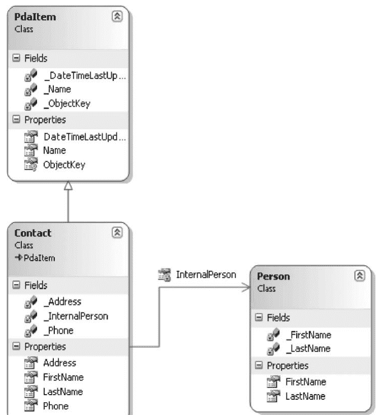

### FIGURE 6.2: Simulating Multiple Inheritance Using Aggregation

在图 6.2 中，`Contact`包含一个名为`InternalPerson`的私有属性，该属性被绘制为与`Person`类的关联。`Contact`还包含`FirstName`和`LastName`属性，但没有对应的字段。相反，`FirstName`和`LastName`属性只是将它们的调用分别委托给`InternalPerson.FirstName`和`InternalPerson.LastName`。列表 6.8 显示了由此产生的代码。

### LISTING 6.8: Working around Single Inheritance Using Aggregation

```csharp
public class PdaItem
{
    // ...
}

public class Person
{
    // ...
}

public class Contact : PdaItem
{
    private Person InternalPerson { get; set; }

    public string FirstName
    {
        get { return InternalPerson.FirstName; }
        set { InternalPerson.FirstName = value; }
    }

    public string LastName
    {
        get { return InternalPerson.LastName; }
        set { InternalPerson.LastName = value; }
    }

    // ...
}
```


除了委托增加的复杂性之外，另一个缺点是添加到字段类（`Person`）的任何方法都需要在派生类（`Contact`）中手动添加；否则，`Contact` 将不会公开添加的功能。

## 密封类

设计一个可以由他人通过派生扩展的类可能是一项棘手的任务，需要通过示例进行测试以验证派生是否能成功工作。列表 6.9 显示了如何通过将类标记为 `sealed` 来避免意外的派生场景和问题。

### LISTING 6.9: Preventing Derivation with Sealed Classes

```csharp
public sealed class CommandLineParser
{
    // ...
}
```

```
// ERROR: Sealed classes cannot be derived from
public sealed class DerivedCommandLineParser :
    CommandLineParser
{
    // ...
}
```

密封类包含 `sealed` 修饰符，其结果是它们不能被派生。`string` 类型就是一个使用 `sealed` 修饰符来防止派生的类型的示例。

## 重写基类

基类的所有成员都会在派生类中继承，除了构造函数和析构函数。然而，有时基类对特定成员的实现并不最优。例如，考虑 `PdaItem` 上的 `Name` 属性。实现在被 `Appointment` 类继承时可能可以接受。对于 `Contact` 类，`Name` 属性应返回 `FirstName` 和 `LastName` 属性的组合。同样，当为 `Name` 赋值时，它应拆分到 `FirstName` 和 `LastName` 中。换句话说，基类属性声明对派生类是合适的，但实现并不总是有效。需要一种机制来用派生类中的自定义实现覆盖基类实现。

### virtual Modifier

C# 支持对实例方法和属性进行重写，但不支持字段或任何静态成员。它需要在基类和派生类中都进行显式操作。基类必须将允许重写的每个成员标记为 `virtual`。如果是 `public` 或 `protected`

`members` do not include the `virtual` modifier, subclasses will not be able to override those members.

> **语言对比：Java—默认情况下方法为虚方法**
>
> 默认情况下，Java 中的方法都是虚方法，如果希望是非虚行为，则必须显式地将其密封。与此相反，C# 默认是非虚的。

Listing 6.10 显示了属性重写的一个示例。

```csharp
public class PdaItem
{
    public virtual string Name { get; set; }
    // ...
}

public class Contact : PdaItem
{
    public override string Name
    {
        get
        {
            return $"{ FirstName } { LastName }";
        }
        set
        {
            string[] names = value.Split(' ');
            // Error handling not shown.
            FirstName = names[0];
            LastName = names[1];
        }
    }
    public string FirstName { get; set; }
    public string LastName { get; set; }
    // ...
}
```

`PdaItem` 不仅在 `Name` 属性上包含了 `virtual` 修饰符，而且 `Contact` 的 `Name` 属性也用 `override` 关键字进行了修饰。去掉 `virtual` 将导致错误，而省略 `override` 将导致生成警告，正如你稍后将看到的那样。C# 要求重写的方法必须显式使用 `override` 关键字。换句话说，`virtual` 将方法或属性标识为可在派生类型中替换（重写）。

### 语言对比：Java 和 C++—隐式重写

与 Java 和 C++ 不同，`override` 关键字在派生类上是必需的。C# 不允许隐式重写。要重写一个方法，基类和派生类成员必须匹配并且具有对应的 `virtual` 和 `override` 关键字。此外，当指定 `override` 关键字时，派生实现将被假定为替换基类实现。

重写成员会导致运行时调用最派生的实现（参见 Listing 6.11）。

### LISTING 6.11: Runtime Calling the Most Derived Implementation of a Virtual Method

```csharp
public class Program
{
    public static void Main()
    {
        Contact contact;
        PdaItem item;
        contact = new Contact();
        item = contact;
        // Set the name via PdaItem variable
        item.Name = "Inigo Montoya";
        // Display that FirstName & LastName
        // properties were set.
        Console.WriteLine(
            $"{ contact.FirstName } { contact.LastName}");
    }
}
```

Output 6.1 显示了 Listing 6.11 的结果。

### OUTPUT 6.1

在 Listing 6.11 中，调用了 `item.Name`；`item` 在那里被声明为 `PdaItem`。然而，`contact` 的 `FirstName` 和 `LastName` 仍然被设置。规则是，每当运行时遇到虚方法时，它都会调用虚成员的最派生和重写实现。在这种情况下，代码实例化了一个 `Contact` 并调用 `Contact.Name`，因为 `Contact` 包含 `Name` 的最派生实现。

在创建类时，程序员在选择允许重写方法时应谨慎，因为他们无法控制派生实现。虚方法不应包含关键代码，因为如果派生类重写了它们，这些方法可能永远不会被调用。此外，将方法从虚方法转换为非虚方法可能会破坏重写该方法的派生类。你应避免此类破坏代码的更改，特别是对于打算供第三方使用的程序集。

Listing 6.12 包含一个虚的 `Run()` 方法。如果 `Controller` 程序员调用 `Run()`，期望关键的 `Start()` 和 `Stop()` 方法会被调用，他会遇到问题。

```csharp
public class Controller
{
    public void Start()
    {
        // Critical code
    }
    public virtual void Run()
    {
        Start();
        Stop();
    }
    public void Stop()
    {
        // Critical code
    }
}
```

在重写 `Run()` 时，开发人员可能不会调用关键的 `Start()` 和 `Stop()` 方法。为了强制 `Start()`/`Stop()` 的期望，`Controller` 程序员应将类定义为 Listing 6.13 所示。

### LISTING 6.13: Forcing the Desirable Run() Semantics

```csharp
public class Controller
{
    public void Start()
    {
        // Critical code
    }
    private void Run()
    {
        Start();
        InternalRun();
        Stop();
    }
    protected virtual void InternalRun()
    {
        // Default implementation
    }
    public void Stop()
    {
        // Critical code
    }
}
```

有了这个新列表，一方面，`Controller` 程序员通过将其设为 `protected` 来防止用户错误地调用 `InternalRun()`。另一方面，将 `Run()` 声明为 `public` 确保 `Start()` 和 `Stop()` 被适当调用。用户仍然可以通过从派生类中重写受保护的 `InternalRun()` 成员来修改 `Controller` 执行的默认实现。

虚方法仅提供默认实现——即派生类可以完全重写的实现。然而，由于继承设计的复杂性，重要的是要考虑（并且最好实现）需要虚方法定义的具体场景，而不是默认将成员声明为虚。

最后，只有实例成员可以是虚的。CLR 使用在实例化时指定的具体类型来确定虚方法调用的分派位置，因此静态虚方法毫无意义，编译器禁止它们。

### 语言对比：C++—在构造期间分派方法调用

在 C++ 中，在构造期间调用的方法不会分派虚方法。相反，在构造期间，类型与基类型相关联而不是与派生类型相关联，并且虚方法调用基实现。相比之下，C# 将虚方法调用分派到最派生的类型。这与调用最派生的虚成员的原则一致，即使派生构造函数尚未完全执行。无论如何，在 C# 中应避免这种情况。

## new Modifier

当重写方法未使用 `override` 时，编译器会发出与 Output 6.2 或 Output 6.3 类似的警告。

### OUTPUT 6.2

```text
warning CS0114: '<derived method name>' hides inherited member '<base method name>'. To make the current member override that implementation, add the override keyword. Otherwise add the new keyword.
```

### OUTPUT 6.3

```text
warning CS0108: The keyword new is required on '<derived property name>' because it hides inherited member '<base property name>'
```

明显的解决方案是添加 `override` 修饰符（假设基成员是虚的）。然而，正如警告所指出的，`new` 修饰符也是一个选项。考虑下一页表 6.1 所示的场景——脆弱基类或易碎基类问题的更一般问题的具体示例。

### TABLE 6.1: Why the New Modifier?

| Activity | Code |
|---|---|
| Programmer A defines class Person that includes properties FirstName and LastName. | <pre><code class="language-csharp">public class Person<br>{<br>    public string FirstName { get; set; }<br>    public string LastName { get; set; }<br>}</code></pre> |
| Programmer B derives from Person and defines Contact with the additional property, Name. In addition, he defines the Program class whose Main() method instantiates Contact, assigns Name, and then prints out the name. | <pre><code class="language-csharp">public class Contact : Person<br>{<br>    public string Name<br>    {<br>        get<br>        {<br>            return FirstName + " " + LastName;<br>        }<br>        set<br>        {<br>            string[] names = value.Split(' ');<br>            // Error handling not shown.<br>            FirstName = names[0];<br>            LastName = names[1];<br>        }<br>    }<br>}</code></pre> |
| Later, Programmer A adds the Name property, but instead of implementing the getter as FirstName + " " + LastName, she implements it as LastName + ", " + FirstName. Furthermore, she doesn’t define the property as virtual, and she uses the property in a DisplayName() method. | <pre><code class="language-csharp">// ...<br>public class Person<br>{<br>    public string Name<br>    {<br>        get<br>        {<br>            return LastName + ", " + FirstName;<br>        }<br>        set<br>        {<br>            string[] names = value.Split(", ");<br>            // Error handling not shown.<br>            LastName = names[0];<br>            FirstName = names[1];<br>        }<br>    }<br><br>    public static void Display(Person person)<br>    {<br>        // Display &lt;LastName&gt;, &lt;FirstName&gt;<br>        Console.WriteLine( person.Name );<br>    }<br>}</code></pre> |

由于 `Person.Name` 不是虚的，程序员 A 会期望 `Display()` 使用 Person 的实现，即使传入的是 Person 派生的数据类型 `Contact`。然而，程序员 B 会期望在变量数据类型为 `Contact` 的所有情况下都使用 `Contact.Name`。 （程序员 B 不会有使用 `Person.Name` 的代码，因为最初并不存在 `Person.Name` 属性。）为了在不破坏任一程序员预期行为的情况下添加 `Person.Name`，你不能假设 `virtual` 是有意为之的。此外，由于 C# 要求重写成员必须显式使用 `override` 修饰符，必须假设其他语义，而不是允许在基类中添加成员导致派生类无法编译。

这种语义是 `new` 修饰符，它会将派生类中重新声明的成员隐藏起来，不让基类看到。与其调用最派生的成员，基类的成员会调用在继承链中位于带有 `new` 修饰符的成员之前的、最派生的成员。如果继承链只包含两个类，基类中的成员将表现得好像派生类上没有声明该方法一样（如果派生实现重写了基类成员）。尽管编译器会在未指定 `override` 或 `new` 时报告 Output 6.2 或 Output 6.3 中所示的警告，但此时会假设 `new`，从而保持期望的版本安全。

请考虑 Listing 6.14 作为示例。其输出显示在 Output 6.4 中。

## LISTING 6.14: override versus new Modifier

```csharp
public class Program
{
    public class BaseClass
    {
        public void DisplayName()
        {
            Console.WriteLine("BaseClass");
        }
    }
    public class DerivedClass : BaseClass
    {
        // Compiler WARNING: DisplayName() hides inherited
        // member. Use the new keyword if hiding was intended.
        public virtual void DisplayName()
        {
            Console.WriteLine("DerivedClass");
```


```csharp

}

}

public class SubDerivedClass : DerivedClass
{
    public override void DisplayName()
    {
        Console.WriteLine("SubDerivedClass");
    }
}

public class SuperSubDerivedClass : SubDerivedClass
{
    public new void DisplayName()
    {
        Console.WriteLine("SuperSubDerivedClass");
    }
}

public static void Main()
{
    SuperSubDerivedClass superSubDerivedClass
        = new SuperSubDerivedClass();
    SubDerivedClass subDerivedClass = superSubDerivedClass;
    DerivedClass derivedClass = superSubDerivedClass;
    BaseClass baseClass = superSubDerivedClass;
    superSubDerivedClass.DisplayName();
    subDerivedClass.DisplayName();
    derivedClass.DisplayName();
    baseClass.DisplayName();
}

```

## OUTPUT 6.4

```
SuperSubDerivedClass
SubDerivedClass
SubDerivedClass
BaseClass
```

这些结果出现的原因如下。

- `SuperSubDerivedClass`: `SuperSubDerivedClass.DisplayName()` 显示 `SuperSubDerivedClass`，因为没有派生类，因此没有重载。
- `SubDerivedClass`: `SubDerivedClass.DisplayName()` 是重写基类虚成员的最派生成员。`SuperSubDerived Class.DisplayName()` 因其 `new` 修饰符而被隐藏。

- `SubDerivedClass`: `DerivedClass.DisplayName()` 是虚的，而 `Sub DerivedClass.DisplayName()` 是重写它的最派生成员。同样，`SuperSubDerivedClass.DisplayName()` 因 `new` 修饰符而被隐藏。
- `BaseClass`: `BaseClass.DisplayName()` 没有重新声明任何基类成员并且不是虚的；因此，直接调用它。

就 CIL 而言，`new` 修饰符对编译器生成的语句没有影响。然而，“new”方法会导致在方法上生成 `newslot` 元数据属性。从 C# 角度来看，其唯一作用是消除否则会出现编译器警告。

## sealed Modifier

正如你可以使用 `sealed` 修饰符防止类被继承一样，虚成员也可以被 `sealed`（参见 Listing 6.15）。这种方法可防止子类重写在继承链更高位置最初声明为虚的基类成员。这种情况会在子类 B 重写基类 A 的成员，然后需要防止在子类 B 之下的任何进一步重写时出现。

## LISTING 6.15: Sealing Members

```csharp
class A
{
    public virtual void Method()
    {
    }
}

class B : A
{
    public override sealed void Method()
    {
    }
}

class C : B
{
    // ERROR: Cannot override sealed members
    // public override void Method()
    // {
    // }
}
```

在此示例中，对类 B 的 `Method()` 声明使用 `sealed` 修饰符可防止类 C 重写 `Method()`。

通常，将类标记为 `sealed` 很少这样做，应仅保留在有充分理由支持此类限制的情况下。事实上，随着单元测试变得突出，因为需要支持在真实实现位置创建模拟（测试替身）对象，保留类型未密封变得越来越可取。密封类可能合理的场景之一是，当密封单个虚成员的成本超过保留类未密封的好处时。然而，更有针对性地密封单个成员——也许是因为基实现中存在正确行为所需的依赖关系——可能更可取。

## base Member

在选择重写成员时，开发人员通常希望调用基类上的成员（参见 Listing 6.16）。

## Listing 6.16: Accessing a Base Member

```csharp
using static System.Environment;

public class Address
{
    public string StreetAddress;
    public string City;
    public string State;
    public string Zip;
    public override string ToString()
    {
        return $"{ StreetAddress + NewLine }"
             + $"{ City }, { State } { Zip }";
    }
}

public class InternationalAddress : Address
{
    public string Country;
    public override string ToString()
    {
        return base.ToString() +
               NewLine + Country;
    }
}
```

在 Listing 6.16 中，`InternationalAddress` 继承自 `Address` 并实现了 `ToString()`。要调用父类的实现，你使用 `base` 关键字。语法几乎与此相同，包括支持将 `base` 用作构造函数的一部分（稍后讨论）。

顺便说一下，在 `Address.ToString()` 实现中，你必须重写，因为 `ToString()` 也是 `object` 的成员。任何用 `override` 装饰的成员都会自动被指定为 `virtual`，因此额外的子类可以进一步专门化实现。

> **NOTE**
> 
> 任何用 `override` 装饰的方法都是自动虚的。基类方法只有在是 `virtual` 时才能被重写，重写方法因此也是 `virtual` 的。

## Constructors

实例化派生类时，运行时首先调用基类的构造函数，以便不绕过基类初始化。然而，如果基类上没有可访问的（非私有）默认构造函数，就不清楚如何构造基类；反过来，C# 编译器会报告错误。

为了避免因缺少可访问的默认构造函数而导致的错误，程序员需要在派生类构造函数头中显式指定要运行的基构造函数（参见 Listing 6.17）。

## LISTING 6.17: Specifying Which Base Constructor to Invoke

```csharp
public class PdaItem
{
    public PdaItem(string name)
    {
        Name = name;
    }
    // ...
}

public class Contact : PdaItem
{
```

```csharp
public Contact(string name) :
    base(name)
{
    Name = name;
}
public string Name { get; set; }
// ...
}
```

通过在代码中标识基构造函数，你让运行时知道在调用派生类构造函数之前调用哪个基构造函数。

## Abstract Classes

到目前为止的许多继承示例都定义了一个名为 `PdaItem` 的类，该类定义了 `Contact`、`Appointment` 等共有的方法和属性，这些类型对象派生自 `PdaItem`。然而，`PdaItem` 本身并不打算被实例化。`PdaItem` 实例本身没有意义；它只有在用作基类时才有意义——在派生自它的类型集合中共享默认方法实现。这些特征表明 `PdaItem` 需要是一个抽象类而不是具体类。抽象类仅设计用于派生。不可能实例化抽象类，除非在实例化派生自它的类的上下文中。非抽象且可以直接实例化的类是具体类。

## BEGINNER TOPIC

## Abstract Classes

抽象类代表抽象实体。它们的抽象成员定义了从抽象实体派生的对象应包含的内容，但不包括实现。通常，抽象类中的大部分功能都是未实现的。然而，在类成功派生自抽象类之前，它需要为其抽象基类中的抽象方法提供实现。

要定义抽象类，C# 要求在类定义中使用 `abstract` 修饰符，如 Listing 6.18 所示。

# LISTING 6.18: 定义抽象类

```csharp
// Define an abstract class
public abstract class PdaItem
{
    public PdaItem(string name)
    {
        Name = name;
    }
    public virtual string Name { get; set; }
}

public class Program
{
    public static void Main()
    {
        PdaItem item;
        // ERROR: Cannot create an instance of the abstract class
        // item = new PdaItem("Inigo Montoya");
    }
}
```

尽管抽象类不能被实例化，但这种限制只是抽象类的次要特征。它们的首要意义在于抽象类包含抽象成员时才得以体现。抽象成员是没有实现的方法或属性。它的目的是强制所有派生类提供实现。

请考虑 Listing 6.19 作为示例。

# LISTING 6.19: 定义抽象成员

```csharp
// Define an abstract class
public abstract class PdaItem
{
    public PdaItem(string name)
    {
        Name = name;
    }
    public virtual string Name { get; set; }
    public abstract string GetSummary();
}

using static System.Environment;

public class Contact : PdaItem
{
    public override string Name
```

Listing 6.19 将 `GetSummary()` 成员定义为抽象，因此它不包含任何实现。代码随后在 `Contact` 中重写该成员并提供实现。因为抽象成员本应被重写，所以此类成员自动为 `virtual` 且不能显式声明。此外，抽象成员不能为 `private`，因为派生类将无法看到它们。

设计一个良好的对象层次结构出乎意料地困难。因此，在编程抽象类型时，你应确保实现至少一个（最好更多）派生自抽象类型的具体类型以验证设计。

> NOTE
> 抽象成员必须被重写，因此它们自动为 `virtual` 且不能显式声明。

# Language Contrast: C++—Pure Virtual Functions

C++ 允许使用神秘的记法 `=0` 来定义抽象函数。这些函数在 C++ 中称为纯虚函数。然而与 C# 不同，C++ 不要求类本身有任何特殊声明。与 C# 的 `abstract` 类修饰符不同，当类包含纯虚函数时，C++ 没有类声明的更改。

如果你在 `Contact` 中未提供 `GetSummary()` 实现，编译器将报告错误。

> NOTE
> 通过声明抽象成员，抽象类程序员声明要形成具体类与抽象基类之间的“is a”关系（即一个 `PdaItem`），必须实现抽象成员，即抽象类无法提供适当默认实现的成员。

## BEGINNER TOPIC

### Polymorphism

当相同成员签名的实现在两个或多个类之间有所不同时，该场景展示了关键面向对象原则：**多态**。“Poly”意为“多”，“morph”意为“形式”，因此多态指的是同一签名存在多个实现。此外，因为同一签名不能在单个类中使用多次，每个成员签名的实现都出现在不同的类上。

多态背后的思想是对象本身最清楚如何执行特定操作。此外，通过强制执行调用这些操作的通用方式，多态是一种利用共同点时鼓励代码重用的技术。给定多种文档类型，每个文档类型类最清楚如何为其对应的文档类型执行 `Print()` 方法。因此，与其定义一个包含 `switch` 语句的单一打印方法，其中包含打印每种文档类型的特殊逻辑，使用多态时你调用对应于你希望打印的文档特定类型的 `Print()` 方法。例如，在文字处理文档类上调用 `Print()` 会根据文字处理特性表现，而在图形文档类上调用同一方法会产生特定于图形的打印行为。给定文档类型后，无论类型如何，你只需调用 `Print()` 即可打印文档。

将自定义打印实现移出 `switch` 语句提供了许多维护优势。首先，实现出现在每个文档类型的类上下文中，而不是远离的位置；这符合封装。其次，添加新文档类型不需要更改 `switch` 语句。相反，所需要做的只是让新文档类型类实现 `Print()` 签名。

抽象成员旨在成为启用多态的一种方式。基类指定方法的签名，而派生类提供实现（参见 Listing 6.20）。

**LISTING 6.20: Using Polymorphism to List the PdaItems**

```csharp
public class Program
{
```

```

```

public static void Main()
{
    PdaItem[] pda = new PdaItem[3];
    Contact contact = new Contact("Sherlock Holmes");
    contact.Address = "221B Baker Street, London, England";
    pda[0] = contact;
    Appointment appointment =
        new Appointment("Soccer tournament");
    appointment.StartDateTime = new DateTime(2008, 7, 18);
    appointment.EndDateTime = new DateTime(2008, 7, 19);
    appointment.Location = "Estádio da Machava";
    pda[1] = appointment;
    contact = new Contact("Hercule Poirot");
    contact.Address =
        "Apt 56B, Whitehaven Mansions, Sandhurst Sq, London";
    pda[2] = contact;
    List(pda);
}

public static void List(PdaItem[] items)
{
    // Implemented using polymorphism. The derived
    // type knows the specifics of implementing
    // GetSummary().
    foreach (PdaItem item in items)
    {
        Console.WriteLine("________");
        Console.WriteLine(item.GetSummary());
    }
}
```

Listing 6.20 的结果出现在 Output 6.5 中。

# OUTPUT 6.5

```
________
FirstName: Sherlock
LastName: Holmes
Address: 221B Baker Street, London, England
________
Subject: Soccer tournament
Start: 7/18/2008 12:00:00 AM
End: 7/19/2008 12:00:00 AM
Location: Estádio da Machava
________
FirstName: Hercule
LastName: Poirot
Address: Apt 56B, Whitehaven Mansions, Sandhurst Sq, London
```


以这种方式，你可以在基类上调用方法，但实现特定于派生类。Output 6.5 显示 Listing 6.20 中的 `List()` 方法能够成功显示 `Contacts` 和 `Addresses`，并以各自定制的方式显示它们。对抽象 `GetSummary()` 方法的调用实际上调用了特定于实例的重写方法。

# All Classes Derive from System.Object

对于任何类，无论是自定义类还是系统内置的类，Table 6.2 中所示的方法都将被定义。

TABLE 6.2: Members of System.Object

| Method Name | Description |
|---|---|
| public virtual bool Equals(object o) | 返回 true 如果作为参数提供的对象在值上相等，而不一定在引用上与实例相等。 |
| public virtual int GetHashCode() | 返回对应于均匀分布哈希码的整数。这对于 HashTable 等集合很有用。 |
| public Type GetType() | 返回对应于对象实例类型的 System.Type 对象。 |
| public static bool ReferenceEquals(object a, object b) | 如果两个提供的参数引用同一对象则返回 true。 |
| public virtual string ToString() | 返回对象实例的字符串表示形式。 |
| public virtual void Finalize() | 析构函数的别名；通知对象准备终止。C# 阻止你直接调用此方法。 |
| protected object MemberwiseClone() | 通过执行浅拷贝来克隆对象；引用被复制，但引用类型内的数据未被复制。 |

Table 6.2 中列出的所有方法都通过继承出现在所有对象上；所有类都派生（直接或通过继承链）自

`object`。即使是字面量也包含这些方法，使得看起来有些奇怪的代码成为可能，例如：

```
Console.WriteLine(42.ToString());
```

即使类定义没有显式地从 `object` 派生，也仍然会从 `object` 派生。因此，列表 6.21 中 `PdaItem` 的两种声明会产生相同的 CIL。

## LISTING 6.21: System.Object Derivation Implied When No Derivation Is Specified Explicitly

```
public class PdaItem
{
    // ...
}
```

```
public class PdaItem : object
{
    // ...
}
```

当 `object` 的默认实现不足时，程序员可以重写一个或多个三个虚方法。第 9 章描述了这样做的细节。

## Verifying the Underlying Type with the is Operator

由于 C# 允许沿继承链向下转换，在尝试转换之前，有时希望确定底层类型是什么。此外，检查类型对于在未实现多态的类型特定操作中可能是必要的。为了确定底层类型，C# 提供了 `is` 运算符（参见列表 6.22）。

## LISTING 6.22: is Operator Determining the Underlying Type

```
public static void Save(object data)
{
    if (data is string)
    {
        data = Encrypt((string) data);
    }
    // ...
}
```

列表 6.22 在底层类型为 `string` 时加密数据。这与加密任何可成功转换为 `string` 的数据类型有显著不同，因为许多类型支持转换为 `string`，但其底层类型并非 `string`。

尽管此功能很重要，在使用 `is` 运算符之前应考虑与多态相关的问题。多态支持将行为扩展到其他数据类型，而无需修改定义该行为的实现。例如，从一个公共基类型派生，然后将该类型用作 `Save()` 方法的参数，避免了显式检查 `string` 的需要，并使其他数据类型通过从同一基类型派生来在保存操作期间支持加密。

## Conversion Using the as Operator

`is` 运算符的优点是它能够验证数据项是否为特定类型。`as` 运算符更进一步：它尝试转换为特定数据类型，如果源类型在继承链中并非目标类型的固有类型，则分配 `null`。这种策略很重要，因为它避免了转换可能导致的异常。列表 6.23 演示了 `as` 运算符的使用。

## LISTING 6.23: Data Conversion Using the as Operator

```
object Print(IDocument document)
{
    if(thing != null)
    {
        // Print document...
    }
    else
    {
    }
}

static void Main()
{
    object data;
    // ...
    Print(data as Document);
}
```

通过使用 `as` 运算符，如果转换无效，你能够避免额外的 `try/catch` 处理代码，因为 `as` 运算符提供了一种尝试转换的方式，如果转换失败则不会抛出异常。

`is` 运算符相对于 `as` 运算符的一个优点是后者无法成功确定底层类型。`as` 运算符可能会隐式地沿继承链向上或向下转换，以及跨支持转换运算符的类型。与 `as` 运算符不同，`is` 运算符可以确定底层类型。

## SUMMARY

本章讨论了如何通过派生类并添加额外的方法和属性来特化一个类。此内容包括对 `private` 和 `protected` 访问修饰符的讨论，这些修饰符控制封装级别。

本章还研究了重写基类实现的细节，以及使用 `new` 修饰符隐藏它的替代方法。为了控制重写，C# 提供了 `virtual` 修饰符，它标识给派生类开发者她打算用于派生的成员。为了防止任何派生，可以在类上使用 `sealed` 修饰符。同样，在成员上放置 `sealed` 修饰符可防止子类进一步重写。

本章以简要讨论所有类型都派生自 `object` 结束。第 9 章将进一步讨论此派生，并介绍 `object` 包含三个虚方法以及管理重载的特定规则和准则。在此之前，你需要考虑另一种建立在面向对象编程之上的编程范式：接口。这是第 7 章的主题。

This page intentionally left blank

# Introducing Interfaces

## BEGINNER TOPIC

## Why Interfaces?

接口很有用，因为——与抽象类不同——它们能够实现实现细节与所提供服务之间的完全分离。以现实世界的例子来看，考虑“接口”即电气墙壁插座。电力如何到达插座是实现细节：它可能由化学、核或太阳能产生；发电机可能在隔壁房间或远处；等等。插座提供一个“契约”：它同意在特定频率下提供特定电压，作为回报它要求使用该接口的电器提供兼容的插头。电器无需关心将电力输送到插座的实现细节；它唯一需要担心的是它提供了一个兼容的插头。

考虑以下示例：有大量文件压缩格式可用（.zip、.7-zip、.cab、.lha、.tar、.tar.gz、.tar.bz2、.bh、.rar、.arj、.arc、.ace、.zoo、.gz、.bzip2、.xxe、.mime、.uue 和 .yenc，仅举几例）。如果你为每种压缩格式创建类，你可能会为每种压缩实现得到不同的方法签名，并且无法在它们之间应用标准调用约定。期望的方法可以在基类中声明为抽象。然而，从公共基类派生会用掉类的唯一继承机会。很可能各种压缩实现之间没有任何代码可以放在基类中，从而排除了拥有基类实现可能带来的好处。关键点是基类让你共享实现以及成员签名，而接口允许你在没有实现的情况下共享成员签名。

与其共享一个公共基类，每个压缩类都需要实现一个公共接口。接口定义了类支持的契约，以便与其他期望该接口的类交互。如果所有类都实现了 `IFileCompression` 接口及其 `Compress()` 和 `Uncompress()` 方法，对任何特定压缩类调用算法的代码只需涉及转换为 `IFileCompression` 接口并调用其成员即可。结果是多态，因为每个压缩类具有相同的签名，但对该签名的单独实现。

列表 7.1 中显示的 `IFileCompression` 接口是接口实现的一个示例。按照惯例——一个强大到普遍的惯例——接口名称使用 PascalCase 并以大写“I”作为前缀。

```
interface IFileCompression
{
    void Compress(string targetFileName, string[] fileList);
    void Uncompress(
        string compressedFileName, string expandDirectoryName);
}
```

`IFileCompression` 定义了类型必须实现的方法，以便像其他压缩相关类一样使用。接口的强大之处在于它们赋予调用方在不修改调用代码的情况下在实现之间切换的能力。

接口的一个关键特征是它没有实现也没有数据。接口中方法声明在头部之后用单个分号代替大括号。字段（数据）不能出现在接口声明中。当接口要求派生类具有某些数据时，它声明属性而不是字段。由于属性在接口声明的一部分中不包含任何实现，因此它不引用支持字段。

接口声明的成员描述了在实现类型上必须可访问的成员。非公共成员的目的是使这些成员对其他代码不可访问。因此，C# 不允许在接口成员上使用访问修饰符；相反，它自动将它们定义为 `public`。

> ### Guidelines
> 
> **DO** use Pascal casing for interface names, with an “I” prefix.

## Polymorphism through Interfaces

考虑另一个示例，如列表 7.2 所示：`IListable` 定义了类需要支持的成员，以便 `ConsoleListControl` 类可以显示它。因此，任何实现 `IListable` 的类都可以使用

`ConsoleListControl` 使其自身显示。`IListable` 接口要求一个只读属性 `ColumnValues`。

## LISTING 7.2: Implementing and Using Interfaces

```
interface IListable
{
    // Return the value of each column in the row.
    string[] ColumnValues
    {
        get;
    }
}
```

```
public abstract class PdaItem
{
    public PdaItem(string name)
    {
        Name = name;
    }
    public virtual string Name { get; set; }
}
```

```
class Contact : PdaItem, IListable
{
    public Contact(string firstName, string lastName, string address, string phone) : base(null)
    {
        FirstName = firstName;
        LastName = lastName;
        Address = address;
        Phone = phone;
    }
    public string FirstName { get; set; }
    public string LastName { get; set; }
    public string Address { get; set; }
    public string Phone { get; set; }
    public string[] ColumnValues
    {
        get
        {
            return new string[]
            {
                FirstName,
                LastName,
                Phone,
                Address
            };
        }
    }
    public static string[] Headers
    {
        get
        {
            return new string[] {
                "First Name", "Last Name",
                "Phone",
                "Address" };
        }
    }
    // ...
}
```

```
class Publication : IListable
{
    public Publication(string title, string author, int year)
    {
        Title = title;
        Author = author;
        Year = year;
    }
    public string Title { get; set; }
    public string Author { get; set; }
    public int Year { get; set; }
    public string[] ColumnValues
    {
        get
        {
            return new string[]
            {
                Title,
                Author,
                Year.ToString()
            };
        }
    }
    public static string[] Headers
    {
        get
        {
            return new string[] {
                "Title",
                "Author",
                "Year" };
        }
    }
}
// ...
}
class Program
{
    public static void Main()
    {
        Contact[] contacts = new Contact[6];
        contacts[0] = new Contact(
            "Dick", "Traci",
            "123 Main St., Spokane, WA  99037",
            "123-123-1234");
        contacts[1] = new Contact(
            "Andrew", "Littman",
            "1417 Palmary St., Dallas, TX 55555",
            "555-123-4567");
        contacts[2] = new Contact(
            "Mary", "Hartfelt",
            "1520 Thunder Way, Elizabethton, PA 44444",
            "444-123-4567");
        contacts[3] = new Contact(
            "John", "Lindherst",
            "1 Aerial Way Dr., Monterey, NH 88888",
            "222-987-6543");
        contacts[4] = new Contact(
            "Pat", "Wilson",
            "565 Irving Dr., Parksdale, FL 22222",
            "123-456-7890");
        contacts[5] = new Contact(
            "Jane", "Doe",
            "123 Main St., Aurora, IL 66666",
            "333-345-6789");
        // Classes are cast implicitly to
        // their supported interfaces.
        ConsoleListControl.List(Contact.Headers, contacts);
        Console.WriteLine();
        Publication[] publications = new Publication[3] {
            new Publication("Celebration of Discipline",
                "Richard Foster", 1978),


```csharp
            new Publication("Orthodoxy",

                "G.K. Chesterton", 1908),

            new Publication(

                "The Hitchhiker's Guide to the Galaxy",

                "Douglas Adams", 1979)

        };

        ConsoleListControl.List(

            Publication.Headers, publications);

    }

}

class ConsoleListControl

{

    public static void List(string[] headers, IListable[] items)

    {

        int[] columnWidths = DisplayHeaders(headers);

        for (int count = 0; count < items.Length; count++)

        {

            string[] values = items[count].ColumnValues;

            DisplayItemRow(columnWidths, values);

        }

    }

    /// <summary>Displays the column headers</summary>

    /// <returns>Returns an array of column widths</returns>

    private static int[] DisplayHeaders(string[] headers)

    {

        // ...

    }

    private static void DisplayItemRow(

        int[] columnWidths, string[] values)

    {

        // ...

    }

}
```

Listing 7.2 的结果显示在 Output 7.1 中。

## OUTPUT 7.1

```text
First Name  Last Name  Phone        Address
Dick        Traci      123-123-1234 123 Main St., Spokane, WA 99037
Andrew      Littman    555-123-4567 1427 Palmary St., Dallas, TX 55555
Mary        Hartfelt   444-123-4567 1520 Thunder Way, Elizabethton, PA 44444
John        Lindherst  222-987-6543 1 Aerial Way Dr., Monterey, NH 88888
Pat         Wilson     123-456-7890 565 Irving Dr., Parksdale, FL 22222
Jane        Doe        333-345-6789 123 Main St., Aurora, IL 66666

Title                          Author            Year
Celebration of Discipline      Richard Foster     1978
Orthodoxy                      G.K. Chesterton    1908
The Hitchhiker's Guide to the Galaxy Douglas Adams   1979
```

在 Listing 7.2 中，`ConsoleListControl` 可以显示看似不相关的类（`Contact` 和 `Publication`）。只要类实现了所需的接口，任何类都可以被显示。因此，`ConsoleListControl.List()` 方法依赖于多态性来适当地显示其接收到的对象集合。每个类都有自己的 `ColumnValues` 的实现，并且将类转换为 `IListable` 仍然允许调用该类的特定实现。

## Interface Implementation

声明类实现接口与从基类派生类似：实现的接口与基类一起出现在以逗号分隔的列表中。基类说明符（如果有）必须排在前面，但其余顺序并不重要。类可以实现多个接口，但只能直接派生自一个基类。示例见 Listing 7.3。

### LISTING 7.3: Implementing an Interface

```csharp
public class Contact : PdaItem, IListable, IComparable
{
    // ...

    #region IComparable Members
    /// <summary>
    ///
    /// </summary>
    /// <param name="obj"></param>
    /// <returns>
    /// Less than zero:     This instance is less than obj.
    /// Zero                This instance is equal to obj.
    /// Greater than zero   This instance is greater than obj.
    /// </returns>
    public int CompareTo(object obj)
    {
        int result;
        Contact contact = obj as Contact;

        if (obj == null)
        {
            // This instance is greater than obj.
            result = 1;
        }
        else if (obj.GetType() != typeof(Contact))
        {
            // Use C# 6.0 nameof operator in message to
            // ensure consistency in the Type name.
            throw new ArgumentException(
                $"The parameter is not a of type { nameof(Contact) }",
                nameof(obj));
        }
        else if (Contact.ReferenceEquals(this, obj))
        {
            result = 0;
        }
        else
        {
            result = LastName.CompareTo(contact.LastName);
            if (result == 0)
            {
                result = FirstName.CompareTo(contact.FirstName);
            }
        }
        return result;
    }
    #endregion

    #region IListable Members
    string[] IListable.ColumnValues
    {
        get
        {
            return new string[]
            {
                FirstName,
                LastName,
                Phone,
                Address
            };
        }
    }
    #endregion
}
```

一旦类声明实现接口，接口的所有成员都必须被实现。抽象类可以提供接口成员的抽象实现。非抽象实现可以在方法体中抛出 `NotImplementedException` 类型异常，但无论如何必须提供该成员的实现。

接口的一个重要特性是它们永远不能被实例化；你不能使用 `new` 来创建接口，因此接口没有构造函数或终结器。接口实例只能通过实例化实现该接口的类型来获得。此外，接口不能包含静态成员。接口的一个关键用途是多态性，而在没有实现类型的实例的情况下，多态性几乎没有价值。

每个接口成员都像一个抽象方法一样表现，强制派生类实现该成员。因此，不可能在接口成员上显式使用 `abstract` 修饰符。

在类型中实现接口成员时，有两种方式：显式或隐式。到目前为止我们只看到隐式实现，其中实现接口成员的类型成员是实现类型的公共成员。

### 显式成员实现

显式实现的成员只能通过接口本身调用；这通常是通过将对象强制转换为接口来实现的。例如，要在第 7.4 节清单中调用 `IListable.ColumnValues`，你必须先将 `contact` 强制转换为 `IListable`，因为 `ColumnValues` 是显式实现的。

**Listing 7.4: Calling Explicit Interface Member Implementations**

```csharp
string[] values;

Contact contact1, contact2;

// ...

// ERROR:  Unable to call ColumnValues() directly
//         on a contact.

// values = contact1.ColumnValues;

// First cast to IListable.

values = ((IListable)contact2).ColumnValues;

// ...
```

在这种情况下，强制转换和对 `ColumnValues` 的调用发生在同一语句中。或者，你也可以在调用 `ColumnValues` 之前先将 `contact2` 赋给一个 `IListable` 变量。

要声明显式接口成员实现，请在成员名称前加上接口名称（参见第 7.5 节清单）。

**Listing 7.5: Explicit Interface Implementation**

```csharp
public class Contact : PdaItem, IListable, IComparable
{
    // ...

    public int CompareTo(object obj)
    {
        // ...
    }

    #region IListable Members
    string[] IListable.ColumnValues
    {
        get
        {
            return new string[]
            {
                FirstName,
                LastName,
                Phone,
                Address
            };
        }
    }
    #endregion
}
```

第 7.5 节清单通过在属性名称前加上 `IListable` 来显式实现 `ColumnValues`。此外，由于显式接口实现直接与接口相关联，因此无需使用 `virtual`、`override` 或 `public` 来修改它们。事实上，这些修饰符是不允许的。该方法不被视为类的公共成员，因此将其标记为 `public` 会产生误导。

### 隐式成员实现

注意，第 7.5 节清单中的 `CompareTo()` 不包含 `IComparable` 前缀；它是隐式实现的。对于隐式成员实现，只需成员为 `public` 且成员的签名与接口成员的签名匹配即可。接口成员实现不需要使用 `override` 关键字或任何表明该成员与接口绑定的指示。此外，由于成员的声明方式与其他类成员一样，调用隐式实现的成员的代码可以直接调用，就像调用其他类成员一样：

```csharp
result = contact1.CompareTo(contact2);
```

换句话说，隐式成员实现不需要强制转换，因为成员不会隐藏在实现类上的直接调用。

许多在显式成员实现上不允许的修饰符在隐式实现上是必需的或可选的。例如，隐式成员实现必须是 `public` 的。此外，`virtual` 是否可选取决于派生类是否可以覆盖实现。删除 `virtual` 会导致成员的行为如同 `sealed`。

### 显式与隐式接口实现

隐式和显式成员接口实现之间的关键区别不在于方法声明的语法，而在于是否可以通过类型的实例按名称访问该方法，而不是通过接口。

在构建类层次结构时，希望模拟现实世界的“is a”关系——例如，长颈鹿是一种哺乳动物。这些是“语义”关系。接口通常用于模拟“机制”关系。`PdaItem` “不是” “可比较的”，但它可能是 `IComparable`。该接口与语义模型无关；它是实现机制的细节。显式接口实现是一种技术，用于实现机制关注点与模型关注点的分离。强制调用者在将对象视为“可比较”之前将其转换为 `IComparable` 等接口，在代码中明确区分了何时在与模型对话以及何时处理其实现机制。

通常，最好将类的公共表面区域限制为“全部为模型”，尽可能少地包含多余的机制。（不幸的是，.NET 中有些机制是不可避免的。例如，你无法获取长颈鹿的哈希码或将长颈鹿转换为字符串。但是，你可以获取 `Giraffe` 的哈希码 [`GetHashCode()`] 并将其转换为字符串 [`ToString()`]。通过使用 `object` 作为公共基类，.NET 将模型代码与机制代码混合在一起，即使只是有限的程度。）

以下是一些有助于你在显式实现和隐式实现之间选择的指导原则。

- 该成员是否是类功能的核心部分？

  考虑 `Contact` 类上的 `ColumnValues` 属性实现。该成员不是 `Contact` 类型的不可或缺的一部分，而是一个外围成员，可能仅由 `ConsoleListControl` 类访问。因此，该成员不应该立即显示在 `Contact` 对象上，从而使本已可能很长的成员列表变得混乱。

  另请考虑 `IFileCompression.Compress()` 成员。在 `ZipCompression` 类上包含一个隐式的 `Compress()` 实现是完全合理的选择：`Compress()` 是 `ZipCompression` 类行为的核心部分，因此应该可以直接从 `ZipCompression` 类访问。

- 接口成员名称作为类成员是否合适？

  考虑一个名为 `Dump()` 的成员的 `ITrace` 接口，该成员将类的数据写入跟踪日志。在 `Person` 或 `Truck` 类上隐式实现 `Dump()` 会导致对方法执行的操作产生混淆。相反，最好显式实现该成员，以便只有从 `ITrace` 数据类型中，在含义更清晰的情况下，才能调用 `Dump()` 方法。如果成员的目的在实现类上不明确，请考虑使用显式实现。

- 是否已有具有相同签名的类成员？

  显式接口成员实现不会向类型的声明空间添加命名元素。因此，如果类型中已存在潜在冲突的成员，则只要它是显式接口成员，就可以提供具有相同名称或签名的第二个成员。

关于隐式与显式接口成员实现的决策很大程度上取决于直觉。然而，这些问题提供了在做出选择时应考虑哪些问题的建议。由于将实现从隐式更改为显式会导致破坏性更改，因此最好在定义接口时偏向显式实现，允许以后更改为隐式实现。此外，隐式与显式的决策不必在所有接口成员中保持一致，定义某些方法为显式而其他方法为隐式是完全支持的。

### 指导原则

AVOID implementing interface members explicitly without a good reason. However, if you're unsure, favor explicit implementation.

### 在实现类与其接口之间转换

与派生类型和基类一样，从实现类型到其实现的接口的转换是隐式转换。不需要强制转换运算符，因为实现类型的实例将始终提供接口中的所有成员；因此，对象始终可以成功转换为接口类型。

尽管从实现类型到实现的接口的转换总会成功，但许多不同的类型可能实现特定的接口。因此，你永远不能确定从接口到其实现类型之一的“向下”强制转换是否会成功。因此，从接口到其实现类型之一的转换需要显式强制转换。

## 接口继承

接口可以从彼此派生，从而产生一个继承其基接口中所有成员的接口。如第 7.6 节清单所示，直接派生自 `IReadableSettingsProvider` 的接口是显式基接口。

### LISTING 7.6: Deriving One Interface from Another

```csharp
interface IReadableSettingsProvider
{
    string GetSetting(string name, string defaultValue);
}

interface ISettingsProvider : IReadableSettingsProvider
{
    void SetSetting(string name, string value);
}

class FileSettingsProvider : ISettingsProvider
{
    #region ISettingsProvider Members

    public void SetSetting(string name, string value)
    {
        // ...
    }

    #endregion
}
```


#region `IReadableSettingsProvider` Members
public string `GetSetting`(string name, string defaultValue)
{
    // ...
}
#endregion
}

在这种情况下，`ISettingsProvider` 派生自 `IReadableSettingsProvider`，因此继承了其成员。如果 `IReadableSettingsProvider` 本身也有一个显式的基接口，`ISettingsProvider` 也会继承这些成员，而派生层次结构中的完整接口集合仅仅是基接口的累积。

请注意，如果 `GetSetting()` 是显式实现的，则必须使用 `IReadableSettingsProvider` 来实现。清单 7.7 中使用 `ISettingsProvider` 的声明将无法编译。

## LISTING 7.7: Explicit Member Declaration without the Containing Interface (Failure)

```
// ERROR: GetSetting() not available on ISettingsProvider
string ISettingsProvider.GetSetting(
    string name, string defaultValue)
{
    // ...
}
```

清单 7.7 的结果显示在 Output 7.2 中。

## OUTPUT 7.2

`'ISettingsProvider.GetSetting' in explicit interface declaration is not a member of interface.`

此输出除了指出 `IReadableSettingsProvider.GetSetting()` 未实现之外还会出现一个错误。用于显式接口成员实现的完全限定接口成员名称必须引用其最初声明的接口名称。

即使一个类实现了派生自基接口 `IReadableSettingsProvider` 的接口 `ISettingsProvider`，该类仍然可以显式声明对两个接口的实现，正如清单 7.8 所演示的那样。

## LISTING 7.8: Using a Base Interface in the Class Declaration

```csharp
class FileSettingsProvider : ISettingsProvider,
    IReadableSettingsProvider
{
    #region ISettingsProvider Members
    public void SetSetting(string name, string value)
    {
        // ...
    }
    #endregion
    #region IReadableSettingsProvider Members
    public string GetSetting(string name, string defaultValue)
    {
        // ...
    }
    #endregion
}
```

在此清单中，类上接口的实现没有变化。尽管类头上额外的接口实现声明是多余的，但它提供了更好的可读性。

是否提供多个接口而不是仅一个组合接口的决定在很大程度上取决于接口设计者希望对实现类提出什么要求。通过提供 `IReadableSettingsProvider` 接口，设计者传达了实现者只需要实现一个检索设置的设置提供程序即可。他们不必能够写入这些设置。这通过不强加写入设置的复杂性来降低实现负担。

相比之下，实现 `ISettingsProvider` 意味着从不有理由存在一个可以写入设置但不能读取设置的类。因此，`ISettingsProvider` 与 `IReadableSettingsProvider` 之间的继承关系强制将两个接口的总和强加于 `ISettingsProvider` 类。

最后但很重要的一点是：虽然继承是正确的术语，但从概念上讲，更准确的说法是接口代表一个契约；一个契约可以规定必须遵守另一个契约的规定。因此，代码 `ISettingsProvider : IReadableSettingsProvider` 从概念上讲表示 `ISettingsProvider` 契约也要求遵守 `IReadableSettingsProvider` 契约，而不是 `ISettingsProvider` “是一种” `IReadableSettingsProvider`。话虽如此，本章的其余部分仍将继续使用继承关系术语，以符合标准的 C# 术语。

## Multiple Interface Inheritance

正如类可以实现多个接口一样，接口也可以继承多个接口。用于此目的的语法与类派生和实现一致，如清单 7.9 所示。

## LISTING 7.9: Multiple Interface Inheritance

```csharp
interface IReadableSettingsProvider
{
    string GetSetting(string name, string defaultValue);
}
interface IWriteableSettingsProvider
{
    void SetSetting(string name, string value);
}
interface ISettingsProvider : IReadableSettingsProvider,
    IWriteableSettingsProvider
{
}
```

拥有一个没有任何成员的接口是不常见的，但如果一起实现两个接口的情况占主导地位，那么对于这种情况来说是一个合理的选择。清单 7.9 与清单 7.6 的区别在于，现在可以实现 `IWriteableSettingsProvider` 而无需提供任何读取功能。清单 7.6 的 `FileSettingsProvider` 不受影响，但如果它使用了显式成员实现，则指定成员所属的接口会略有变化。

## Extension Methods on Interfaces

也许扩展方法最重要的特性之一是它们不仅适用于类，还适用于接口。使用的语法与为类定义扩展方法时使用的语法相同。扩展的类型（第一个参数和以 `this` 为前缀的参数）是接口

在此示例中，扩展方法并不是针对 `IListable` 参数（尽管也可以是），而是针对 `IListable[]` 参数。这证明了 C# 允许扩展方法不仅作用于特定类型的实例，还作用于这些对象的集合。扩展方法的支持是 LINQ 实现的基础。`IEnumerable` 是所有集合实现的基本接口。通过为 `IEnumerable` 定义扩展方法，LINQ 支持被添加到所有集合中。这从根本上改变了使用集合的编程方式；我们将在第 14 章详细探讨这一主题。

## Implementing Multiple Inheritance via Interfaces

正如清单 7.3 所演示的那样，单个类可以实现任意数量的接口，同时从单个类派生。此功能为 C# 类缺乏多重继承支持提供了一种可能的变通方法。该过程使用上一章中描述的聚合，但你可以通过添加接口来稍微改变结构，如清单 7.11 所示。

**LISTING 7.11: Working around Single Inheritance Using Aggregation with Interfaces**

```csharp
public class PdaItem
{
    // ...
}
interface IPerson
{
    string FirstName
    {
        get;
        set;
    }
    string LastName
    {
        get;
        set;
    }
}
public class Person : IPerson
{
    // ...
}
```


```csharp
public class Contact : PdaItem, IPerson
{
    private Person Person
    {
        get { return _Person; }
        set { _Person = value; }
    }
    private Person _Person;
    public string FirstName
    {
        get { return _Person.FirstName; }
        set { _Person.FirstName = value; }
    }
    public string LastName
    {
        get { return _Person.LastName; }
        set { _Person.LastName = value; }
    }
    // ...
}
```

`IPerson` 确保 `Person` 成员与其在 `Contact` 上重复的相同成员之间的签名保持一致。然而，实现仍然不同于多重继承，因为添加到 `Person` 的新成员不会添加到 `Contact`。

一种可能的改进是，如果实现的成员是方法（而不是属性），则可以为来自第二个基类的“派生”附加功能定义接口扩展方法。例如，可以在 `IPerson` 上定义一个名为 `VerifyCredentials()` 的扩展方法，并且所有实现 `IPerson` 的类——即使是没有任何成员但只有扩展方法的 `IPerson` 接口——都将具有 `VerifyCredentials()` 的默认实现。使这种方法可行的是多态性仍然可用，并且支持重写。重写得到支持，因为任何实例方法实现都将优先于具有等效静态签名的扩展方法。

## Guidelines

CONSIDER defining interfaces to achieve a similar effect to that of multiple inheritance.

## 初学者主题

### 接口图

在类似 UML¹ 的图中，接口有两种表现形式。第一种，你可以将接口表示为类似于类继承的继承关系，如图 7.1 中 `IPerson` 和 `IContact` 之间的关系所示。另一种，你可以使用一个小圆圈来表示接口，通常被称为棒棒糖，图 7.1 中的 `IPerson` 和 `IContact` 便是示例。

在图 7.1 中，`Contact` 派生自 `PdaItem`，并实现了 `IContact`。此外，它聚合了 `Person` 类，而 `Person` 类实现了 `IPerson`。尽管 Visual Studio 类设计器不支持这种做法，但有时接口也会使用派生类型箭头指向某个类来表示。例如，`Person` 可以用一个箭头指向 `IPerson`，而不是使用棒棒糖符号。

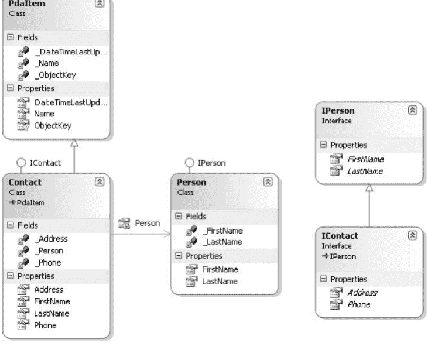

**图 7.1：** 使用聚合和接口绕开单继承限制

> 1. 统一建模语言（UML），一种使用图形符号对对象设计进行建模的标准规范。

## 版本控制

当你要创建某个组件或应用程序的新版本，而其他开发人员已经针对旧版本进行了编程时，你不应该更改接口。因为接口定义了实现类和使用接口的类之间的契约，更改接口就等于更改契约，这很可能会破坏所有针对该接口编写的代码。

更改或删除某个接口成员的签名显然会破坏代码，因为对该成员的任何调用在未经修改的情况下都无法再编译。更改类上的公共或受保护成员签名也是如此。然而，与类不同的是，向接口添加成员也可能导致代码无法编译，除非进行额外的修改。问题在于，任何实现接口的类都必须完整地实现该接口，并且必须提供所有成员的实现。一旦新增了接口成员，编译器就会要求开发人员将新的接口成员添加到实现该接口的类中。

> **指南**
>
> - **不要** 向已经发布的接口添加成员。

清单 7.12 中 `IDistributedSettingsProvider` 的创建就是如何以版本兼容方式扩展接口的一个很好的例子。设想最初只定义了 `ISettingsProvider` 接口（如清单 7.6 所示）。然而，在下一个版本中，确定需要每台机器的设置。为了实现这一约束，创建了 `IDistributedSettingsProvider` 接口，并且它派生自 `ISettingsProvider`。

```csharp
interface IDistributedSettingsProvider : ISettingsProvider
{
    /// <summary>
    /// Get the settings for a particular machine.
    /// </summary>
    /// <param name="machineName">
    /// The machine name the setting is related to.</param>
    /// <param name="name">The name of the setting.</param>
```

接口不能包含任何构造函数或终结器。此外，接口上不允许使用静态成员。

接口与抽象类更为接近，两者共享一些特性，例如不能实例化。表 7.1 列出了更多比较。

鉴于抽象类和接口各有其优缺点，你必须根据表 7.1 中的比较以及后面的指南做出成本效益决策，从而选出正确的方案。

## 指南

- **要** 通常优先选择类而非接口。使用抽象类将契约（类型做什么）与实现细节（类型如何做）解耦。
- **考虑** 如果需要在已经继承自其他类型的类型上支持其功能，则定义接口。

**表 7.1：抽象类与接口的比较**

| 抽象类 | 接口 |
|---|---|
| 不能直接实例化，只能通过实例化派生类来实例化。 | 不能直接实例化，只能通过实例化实现类型来实例化。 |
| 派生类必须要么自身是抽象的，要么实现所有抽象成员。 | 实现类型必须实现所有接口成员。 |
| 可以添加额外的非抽象成员，所有派生类都可以继承它们，而不会破坏跨版本兼容性。 | 向接口添加额外成员会破坏版本兼容性。 |
| 可以声明属性和字段。 | 可以声明属性，但不能声明字段。 |
| 成员可以是实例、虚、抽象或静态的，并且可以为非抽象成员提供实现，供派生类使用。 | 所有成员都自动被视为抽象的，因此它们不能包含任何实现。 |
| 派生类只能从一个基类派生。 | 实现类型可以任意实现多个接口。 |

## 接口与特性的比较

没有任何成员（无论是否继承）的接口有时被用来表示关于类型的信息。例如，你可以创建一个标记接口 `IObsolete` 来表示某个特定类型已被另一个类型取代。这通常被认为是对接口机制的滥用；接口应该用来表示某类型可以执行哪些功能，而不是表示关于特定类型的事实。不要使用标记接口，而应使用特性（Attribute）来实现此目的。更多细节请参见第 17 章。

> **指南**
>
> - **避免** 使用没有成员的“标记”接口；应改用特性。

## 小结

接口是 C# 中面向对象编程的关键元素。它们提供了与抽象类类似的功能，但不会占用单继承选项。它们还支持实现多个接口。

在 C# 中，接口的实现可以是显式的，也可以是隐式的，具体取决于实现类是直接公开接口成员，还是仅通过转换为接口来公开。此外，实现是显式还是隐式的粒度在成员级别：一个成员可以隐式实现，而同一接口的另一个成员可以显式实现。

下一章将讨论值类型，并说明定义自定义值类型的重要性。同时，该章也会指出这类类型可能引入的微妙问题。

# 8 值类型

你在本书中一直在使用值类型；例如，`int` 就是一种值类型。本章不仅讨论如何使用值类型，还讨论如何定义自定义值类型。自定义值类型有两种类别：结构体（`struct`）和枚举（`enum`）。本章讨论结构体如何让程序员定义新的值类型，这些值类型的行为与第 2 章中讨论的大多数预定义类型非常相似。关键在于，任何新定义的值类型都拥有自己的自定义数据和方法。本章还讨论如何使用枚举来定义一组常量值。

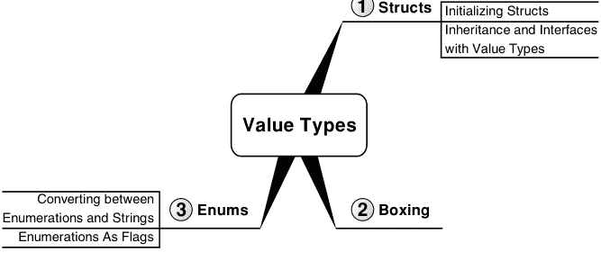

## 初学者主题

### 类型的分类

到目前为止讨论的所有类型都归属于两个类别之一：引用类型和值类型。每个类别中类型之间的差异源于复制策略的不同，而这又导致了每种类型在内存中的存储方式不同。作为回顾，本初学者主题为那些不熟悉这些问题的读者重新介绍值类型/引用类型的讨论。

### 值类型

**值类型**的变量直接包含其值，如图 8.1 所示。变量名直接与内存中存储该值的存储位置相关联。正因为如此，当第二个变量被赋值为原始变量的值时，原始变量值的副本会被复制到与第二个变量关联的存储位置中。两个变量永远不会引用同一个存储位置（除非其中一个或两个都是 `out` 或 `ref` 参数，根据定义，这些参数是另一个变量的别名）。更改原始变量的值不会影响第二个变量的值，因为每个变量都与不同的存储位置相关联。因此，更改一个值类型变量的值不会影响任何其他值类型变量的值。

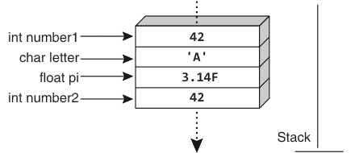

```csharp
//...
int number1 = 42;
char letter = 'A';
float pi = 3.14F;
int number2 = number1;
//...
```


值类型变量就像一张上面写有数字的纸。如果你想更改这个数字，可以把它擦掉，然后换上一个不同的数字。如果你有第二张纸，你可以从第一张纸上复制数字，但这两张纸此后独立；擦除并替换其中一个上的数字不会改变另一个。

同样，将值类型的实例传递给 `Console.WriteLine()` 等方法也会导致从与参数关联的存储位置到与参数关联的存储位置的内存复制，并且在方法内部对参数变量的任何更改都不会影响调用方中的原始值。由于值类型需要内存复制，因此它们通常应定义为消耗少量内存（通常为 16 字节或更少）。

> **准则**
>
> **不要**创建消耗超过 16 字节内存的值类型。

值类型的值通常是短暂的；在许多情况下，只需在表达式的一部分或方法激活期间使用值。在这些情况下，值类型变量和临时值通常可以存储在称为“栈”的**短期存储池**上。（这实际上是一个误称：短期池不需要将其存储分配在栈上。事实上，作为实现细节，它经常选择将存储分配在可用的寄存器之外。）

短期池比垃圾回收堆清理成本更低；然而，值类型往往比引用类型被复制得更多，而这种复制本身也会带来性能成本。不要陷入“值类型更快因为它们可以分配在栈上”的陷阱。

## 引用类型

相比之下，引用类型变量的值是对对象实例的引用（参见图 8.2）。引用类型变量存储引用（通常实现为内存地址），该引用指向对象实例数据的所在位置，而不是像值类型变量那样直接存储数据。因此，要访问数据，运行时将从变量中读取引用，然后取消引用以到达实际包含实例数据的内存位置。

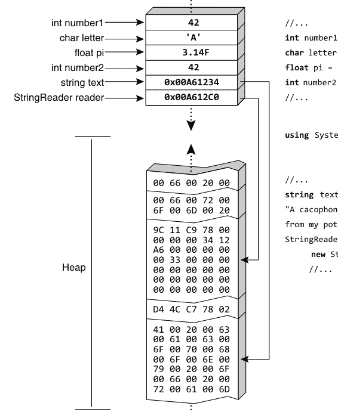

```csharp
//...
int number1 = 42;
char letter = 'A';
float pi = 3.14F;
int number2 = number1;
//...
```

```csharp
using System.IO;
```

```csharp
//...
string text =
"A cacophony of ramblings
from my potpourri of notes";
StringReader reader =
    new StringReader(text);
//...
```

**图 8.2：引用类型指向堆**

因此，引用类型变量与其关联有两个存储位置：与变量直接关联的存储位置，以及由变量中存储的值引用的存储位置所引用的存储位置。

引用类型变量再次类似于一张总是写着东西的纸。想象一张写着房屋地址的纸——例如，“纽约市芝麻街 123 号”。这张纸是一个变量；地址是对建筑物的引用。纸张本身也不是建筑物，地址也不是建筑物，纸张的位置与它内容所指的建筑物的位置没有任何关系。如果你把这个引用复制到另一张纸上，两张纸的内容都指向同一栋建筑。如果你随后把那栋建筑漆成绿色，通过两张纸引用的建筑都可以观察到是绿色的，因为引用指向的是同一个东西。

与变量（或临时值）直接关联的存储位置与值类型变量关联的存储位置的处理方式没有区别：如果变量已知是短暂的，它将被分配在短期存储池上。引用类型变量的值始终是垃圾回收堆中存储位置的引用或 `null`。

与存储实例数据本身的值类型变量相比，访问引用类型关联的数据需要额外一次“跳转”：首先必须取消引用以找到实际数据的存储位置，然后才能读取或写入数据。复制引用类型值只复制引用，而引用很小。（引用保证不会大于处理器的“位大小”；32 位机器有 4 字节引用，64 位机器有 8 字节引用，等等。）复制值类型的值会复制所有数据，而数据可能很大。因此，在某些情况下，引用类型复制起来更高效。这就是为什么值类型的准则是要确保它们永远不超过大约 16 字节；如果值类型的复制成本超过引用的四倍，它可能就应该简单地成为引用类型。

由于引用类型只复制对数据的引用，因此两个不同的变量可以引用相同的数据。在这种情况下，通过一个变量更改数据，也会观察到另一个变量的数据发生变化。这既适用于赋值，也适用于方法调用。

继续我们的前一个类比，如果你将建筑物的地址传递给方法，你会复制包含引用的纸并将其交给方法。方法无法更改原始纸张的内容以引用不同的建筑物。但是，如果方法对所引用的建筑物进行粉刷，当方法返回时，调用方可以观察到调用方仍在引用的建筑物现在颜色不同了。

## 结构体

所有 C#“内置”类型，如 `bool` 和 `decimal`，都是值类型，`string` 和 `object` 除外，它们是引用类型。框架中还提供了许多额外的值类型。开发人员也可以定义自己的值类型。

要定义自定义值类型，你使用的语法与定义类和接口类型时相似。语法中的关键区别在于值类型使用关键字 `struct`，如清单 8.1 所示。这里我们有一个值类型，它以度、分、秒的形式描述高精度角度。（“分”是度的六十分之一，秒是分的六十分之一。这个系统在导航中使用，因为它具有在赤道上海洋表面一分钟弧恰好为一海里的优良特性。）

**清单 8.1：声明一个 `struct`**

```csharp
// Use keyword struct to declare a value type.

struct Angle

{
    public Angle(int degrees, int minutes, int seconds)
    {
        Degrees = degrees;
        Minutes = minutes;
        Seconds = seconds;
    }

    // Using C# 6.0 read-only, automatically implemented properties.
    public int Degrees { get; }
    public int Minutes { get; }
    public int Seconds { get; }

    public Angle Move(int degrees, int minutes, int seconds)
    {
        return new Angle(
            Degrees + degrees,
            Minutes + minutes,
            Seconds + seconds);
    }
}

// Declaring a class--a reference type
// (declaring it as a struct would create a value type
// larger than 16 bytes.)
class Coordinate
{
    public Angle Longitude { get; set; }
    public Angle Latitude { get; set; }
}
```

此清单将 `Angle` 定义为存储角度的度、分、秒的值类型，即经度或纬度。由此产生的 C# 类型是一个 `struct`。

请注意，清单 8.1 中的 `Angle` 结构体是不可变的，因为所有属性都使用 C# 6.0 的只读、自动实现属性功能声明。要在没有 C# 6.0 的情况下创建只读属性，程序员需要声明一个仅具有 getter 的属性，该属性从 `readonly` 修饰的字段访问其数据（参见清单 8.3）。C# 6.0 在定义不可变类型时提供了明显的代码减少。

> **注意**
>
> 尽管语言中没有任何要求，但一个好的准则是将值类型设计为不可变：一旦你实例化了一个值类型，就不应该能够修改同一个实例。在需要修改的场景中，你应该创建一个新实例。清单 8.1 提供了一个 `Move()` 方法，它不会修改 `Angle` 的实例，而是返回一个全新的实例。
>
> 有两个很好的理由支持这一准则。首先，值类型应表示值。人们不会认为将两个整数相加会改变其中任何一个；相反，两个加数是不可变的，结果会产生第三个值。
>
> 其次，由于值类型按值复制，而不是按引用复制，因此很容易混淆并错误地认为对一个值类型变量的修改可以观察到对另一个变量的修改，就像引用类型一样。

> **准则**
>
> **应**创建不可变的值类型。

### 初始化结构体

除了属性和字段之外，结构体还可以包含方法和构造函数。然而，用户定义的默认（无参数）构造函数直到 C# 6.0 才被允许。当没有提供默认构造函数时，C# 编译器会自动生成一个默认构造函数，将所有字段初始化为其默认值。默认值对于引用类型字段为 `null`，对于数值类型字段为零值，对于布尔类型字段为 `false`，等等。

```csharp
// Seconds = seconds;
// }

public Angle(int degrees, int minutes, int seconds)
{
    _Degrees = degrees;
    _Minutes = minutes;
    _Seconds = seconds;
}

public int Degrees { get { return _Degrees; } }
readonly private int _Degrees;

public int Minutes { get { return _Minutes; } }
readonly private int _Minutes;

public int Seconds { get { return _Seconds; } }
readonly private int _Seconds;

// ...
}
```

在编译器知道所有字段都已初始化之前访问它是非法的；使用 `Degrees` 隐式为 `this.Degrees`。为了解决这个问题，你需要直接初始化字段，正如在未被注释掉的第 8.3 节的构造函数中所演示的那样。

由于结构体的字段初始化要求、C# 6.0 的只读自动实现属性支持的简洁性，以及避免从其包装属性外部访问字段的指导原则，从 C# 6.0 开始，你应该在结构体中优先使用只读自动实现属性而不是字段。

## Guidelines

DO 确保结构体的默认值是有效的；始终可以获得结构体的默认“全零”值。

## ADVANCED TOPIC

## Using `new` with Value Types

使用 `new` 运算符对引用类型进行调用时，运行时会在垃圾回收堆上创建一个对象的新实例，将其所有字段初始化为默认值，并调用构造函数，将实例的引用作为 `this` 传递。结果是实例的引用，然后可以将其复制到最终位置。相比之下，使用 `new` 运算符对值类型进行调用时，运行时会在临时存储池上创建一个对象的新实例，将其所有字段初始化为默认值，并调用构造函数（将临时存储位置作为 `ref` 变量作为 `this` 传递），结果是值存储在临时存储位置中，然后可以将其复制到最终位置。

与类不同，结构体不支持终结器。结构体按值复制；它们不像引用类型那样具有“引用标识”。因此，很难知道何时可以安全地执行终结器并释放结构体拥有的非托管资源。垃圾收集器知道何时没有对引用类型实例的“活动”引用，并且可以在没有更多活动引用后随时选择为引用类型实例运行终结器。尽管如此，运行时没有任何部分跟踪在任何时刻存在多少个给定值类型的副本。

## Language Contrast: C++—`struct` Defines Type with Public Members

在 C++ 中，使用 `struct` 声明的类型与使用 `class` 声明的类型之间的区别在于默认访问性是 `public` 还是 `private`。在 C# 中，对比要大得多，其中区别在于类型的实例是按值复制还是按引用复制。

## Using the `default` Operator

如前所述，如果没有提供默认构造函数（这仅在 C# 6.0 起才可能），所有值类型都有一个自动定义的默认构造函数，将值类型的存储初始化为其默认状态。因此，使用 `new` 运算符创建值类型实例始终是合法的。作为替代语法，你可以使用 `default` 运算符来生成结构体的默认值。在第 8.4 节中，我们向 `Angle` 结构体添加了第二个构造函数，该构造函数使用 `default` 运算符对 `int` 作为参数传递给之前声明的三个参数构造函数。

## LISTING 8.4: Using the `default` Operator to Obtain the Default Value of a Type

```csharp
// Use keyword struct to declare a value type.

struct Angle

{
    public Angle(int degrees, int minutes)
        : this( degrees, minutes, default(int) )
    {
    }

    // ...
}
```


表达式 `default(int)` 和 `new int()` 都产生相同的值。相比之下，如果构造函数是 C# 6.0 自定义默认构造函数，对于自定义定义的值类型则不一定如此。在 C# 6.0 中，默认构造函数将其数据初始化为非默认值。结果是，对默认构造函数的调用——需要 `new` 运算符——不会产生与 `default(T)` 相同的值。与引用类型一样，自定义默认构造函数仅通过 `new` 运算符显式调用。但是，与引用类型不同，其默认值为空，值类型的隐式初始化会产生一个清零的内存块，等同于 `default` 运算符的结果。因此，当值类型具有默认构造函数时，`default(T)` 不一定等同于 `new T()`。此外，访问隐式初始化的值类型是一个有效操作；相比之下，访问引用类型的默认值会产生 `NullReferenceException`。因此，如果 `default(T)` 值不是类型的有效状态，你应注意显式初始化具有自定义默认构造函数的 value 类型。

> **NOTE**
>
> 值类型上的默认构造函数仅由 `new` 运算符的显式使用调用。

## Inheritance and Interfaces with Value Types

所有值类型都是隐式密封的。此外，所有非枚举值类型都派生自 `System.ValueType`。因此，结构体的继承链始终是从 `object` 到 `System.ValueType` 再到结构体。

值类型也可以实现接口。框架中内置的许多值类型实现了 `IComparable` 和 `IFormattable` 等接口。`System.ValueType` 带来了值类型的行为，但它不包含任何额外成员。`System.ValueType` 的自定义主要集中在重写 `object` 的所有虚成员上。在结构体中重写基类方法的规则几乎与类相同（参见第 9 章）。然而，一个区别是，对于值类型，`GetHashCode()` 的默认实现是将调用转发给结构体中第一个非空字段。此外，`Equals()` 大量使用反射。因此，如果值类型经常在集合内部使用，尤其是在使用哈希码的字典类型集合中，值类型应包含 `Equals()` 和 `GetHashCode()` 的重写以确保良好的性能。有关更多详细信息，请参阅第 9 章。

## Guidelines

`DO` 在值类型上重载相等运算符（`Equals()`、`==` 和 `!=`），如果相等是有意义的。（还应考虑实现 `IEquatable<T>` 接口。）

## Boxing

我们知道值类型变量直接包含其数据，而引用类型变量包含对另一个存储位置的引用。但当值类型转换为其实现的其中一个接口或其根基类 `object` 时会发生什么？转换的结果必须是对包含看起来像引用类型实例的东西的存储位置的引用，但变量包含值类型的值。这种转换称为装箱，具有特殊行为。将直接引用其数据的 value 类型变量转换为引用垃圾回收堆上位置的引用类型涉及几个步骤。

- 1. 在堆上分配内存，该内存将包含值类型的数据以及使对象看起来像每个托管引用类型实例一样所需的其他开销（即 `SyncBlockIndex` 和方法表指针）。
- 2. 值类型的值从其当前存储位置复制到堆上新分配的位置。
- 3. 转换的结果是对堆上新存储位置的引用。

反向操作是拆箱。拆箱转换检查装箱值的类型是否与值正在拆箱到的类型兼容，然后导致堆位置中存储的值的副本。

装箱和拆箱很重要，因为装箱具有一些性能和行为影响。除了学习如何在 C# 代码中识别这些转换外，开发人员还可以通过查看 CIL 来统计特定代码片段中的 box/unbox 指令。每个操作都有特定的指令，如表 8.1 所示。

### TABLE 8.1: Boxing Code in CIL

| C# Code | CIL Code |
|---|---|
| `static void Main()` { | `.method private hidebysig static void Main() cil managed {` |
|  | `.entrypoint` |
|  | `// Code size 21 (0x15)` |
|  | `.maxstack 1` |
| `int number;` | `.locals init ([0] int32 number,` |
| `object thing;` | `[1] object thing)` |
|  | `IL_0000: nop` |
| `number = 42;` | `IL_0001: ldc.i4.s 42` |
|  | `IL_0003: stloc.0` |
| `// Boxing` | `IL_0004: ldloc.0` |
| `thing = number;` | `IL_0005: box [mscorlib]System.Int32` |
|  | `IL_000a: stloc.1` |
| `// Unboxing` | `IL_000b: ldloc.1` |
| `number = (int)thing;` | `IL_000c: unbox.any [mscorlib]System.Int32` |
|  | `IL_0011: stloc.0` |
|  | `IL_0012: br.s IL_0014` |
| `return;` | `IL_0014: ret` |
| `}` | `} // end of method Program::Main` |

当装箱和拆箱很少发生时，它们对性能的影响无关紧要。然而，装箱可能在一些意想不到的情况下发生，频繁发生会对性能产生重大影响。请考虑第 8.5 节和输出 8.1。`ArrayList` 类型维护一个对象引用的列表，因此向列表中添加整数或浮点数会将值装箱，以便获得一个引用。

### 清单8.5：微妙的装箱和拆箱指令

```csharp
class DisplayFibonacci
{
    static void Main()
    {
        int totalCount;
        System.Collections.ArrayList list =
            new System.Collections.ArrayList();
        Console.Write("Enter a number between 2 and 1000:");
        totalCount = int.Parse(Console.ReadLine());
        // Execution-time error:
        // list.Add(0);  // Cast to double or 'D' suffix required.
        //                       Whether cast or using 'D' suffix,
        //                       CIL is identical.
        list.Add((double)0);
        list.Add((double)1);
        for (int count = 2; count < totalCount; count++)
        {
            list.Add(
                ((double)list[count - 1] +
                 (double)list[count - 2]));
        }
        foreach (double count in list)
        {
            Console.Write("{0}, ", count);
        }
    }
}
```

### 输出8.1

```
Enter a number between 2 and 1000:42
0, 1, 1, 2, 3, 5, 8, 13, 21, 34, 55, 89, 144, 233, 377, 610, 987, 1597,
2584, 4181, 6765, 10946, 17711, 28657, 46368, 75025, 121393, 196418,
317811, 514229, 832040, 1346269, 2178309, 3524578, 5702887, 9227465,
14930352, 24157817, 39088169, 63245986, 102334155, 165580141,
```

清单8.5中的代码在编译时，会在生成的CIL中产生五个装箱指令和三个拆箱指令。

- 1. 前两个装箱指令出现在对 `list.Add()` 的初始调用中。`ArrayList` 方法的签名是 `int Add(object value)`。因此，传递给该方法的任何值类型都会被装箱。
- 2. 接下来是 `for` 循环内对 `Add()` 的调用中的两个拆箱指令。`ArrayList` 的索引运算符的返回值始终是 `object`，因为 `ArrayList` 包含的就是 `object`。要将这两个值相加，你需要将它们强制转换回 `double`。这种从对象引用到值类型的强制转换是以拆箱调用的方式实现的。
- 3. 现在，你将加法结果放入 `ArrayList` 实例中，这再次导致一次装箱操作。注意，前两个拆箱指令和这个装箱指令都发生在循环内。
- 4. 在 `foreach` 循环中，你遍历 `ArrayList` 中的每个项，并将这些项赋值给 `count`。如前所述，`ArrayList` 中的项是对象的引用，因此将它们赋给 `double` 实际上就是对它们逐一进行拆箱。
- 5. 在 `foreach` 循环中调用的 `Console.WriteLine()` 的签名是 `void Console.Write(string format, object arg)`。因此，每次调用它都会将 `double` 装箱为 `object`。

每次装箱操作都涉及一次分配和一次复制；每次拆箱操作都涉及一次类型检查和一次复制。使用未装箱的类型来完成相同的工作将消除分配和类型检查。显然，你可以通过消除许多装箱操作来轻松提高这段代码的性能。在最后一个 `foreach` 循环中使用 `object` 而不是 `double` 就是这样的改进。另一个改进是将 `ArrayList` 数据类型改为泛型集合（见第11章）。这里要说明的是，装箱可能是相当隐蔽的，因此开发人员需要特别注意，并留意可能反复发生并影响性能的情况。

另一个不幸的与装箱相关的问题也在运行时出现：如果你想修改最初的两个 `Add()` 调用，使它们不使用强制转换（或 `double` 字面量），你就必须把整数插入到数组列表中。由于 `int` 会隐式转换为 `double`，这看起来是一个无害的修改。然而，`for` 循环内的 `double` 强制转换，以及 `foreach` 循环中对 `count` 的赋值，将

```csharp
struct Angle : IAngle
{
    // ...
    // NOTE: This makes Angle mutable, against the general
    //         guideline
    public void MoveTo(int degrees, int minutes, int seconds)
    {
        _Degrees = degrees;
        _Minutes = minutes;
        _Seconds = seconds;
    }
}
```

```csharp
class Program
{
    static void Main()
    {
        // ...
        Angle angle = new Angle(25, 58, 23);
        object objectAngle = angle; // Box
        Console.Write(((Angle)objectAngle).Degrees);
        // Unbox, modify unboxed value, and discard value
        ((Angle)objectAngle).MoveTo(26, 58, 23);
        Console.Write(", " + ((Angle)objectAngle).Degrees);
        // Box, modify boxed value, and discard reference to box
        ((IAngle)angle).MoveTo(26, 58, 23);
        Console.Write(", " + ((Angle)angle).Degrees);
        // Modify boxed value directly
        ((IAngle)objectAngle).MoveTo(26, 58, 23);
        Console.WriteLine(", " + ((Angle)objectAngle).Degrees);
        // ...
    }
}
```

### 输出8.2

```
25, 25, 25, 26
```

清单8.7使用了 `Angle` 结构和 `IAngle` 接口。还要注意，`IAngle.MoveTo()` 接口使 `Angle` 变得可变。这一变化暴露了可变值类型的一些特性，并以此证明了使结构体不可变的准则的重要性。

在清单8.6的前两行中，你初始化 `angle`，然后将其装箱到一个名为 `objectAngle` 的变量中。接下来，你调用 `MoveTo` 将 `Hours` 更改为26。然而，如输出所示，第一次实际上没有发生任何更改。问题是，为了调用 `MoveTo()`，编译器拆箱了 `objectAngle`，并且（根据定义）制作了该值的一个副本。值类型是按值复制的——这就是它们被称为值类型的原因。尽管结果值在执行时被成功修改，但这个值的副本被丢弃，`objectAngle` 引用的堆位置没有发生任何变化。

回想我们之前的类比，值类型的变量就像写着值的纸张。当你装箱一个值时，你复印了这张纸，并把复印件放进一个盒子里。当你拆箱这个值时，你复印了盒子里的纸。对第二份复印件进行编辑并不会改变盒子里的复印件。

在下一个例子中，带有注释“装箱，修改已装箱的值，并丢弃对箱的引用”的情况，出现了类似但相反的问题。不是直接调用 `MoveTo()`，而是将值强制转换为 `IAngle`。转换为接口类型会将值装箱，因此运行时将 `angle` 中的数据复制到堆上，并提供对该箱的引用。接下来，方法调用修改了所引用箱中的值。存储在变量 `angle` 中的值保持不变。

在最后一种情况下，强制转换为 `IAngle` 是引用转换，而不是装箱转换。在这种情况下，该值已经被转换为 `object` 而装箱，所以在此转换中不会复制该值。对 `MoveTo()` 的调用更新了存储在箱中的 `_Hours` 值，代码按预期运行。

从这个例子可以看出，可变值类型相当令人困惑，因为通常不清楚你是在修改值的副本，还是在修改你真正想要更改的存储位置。通过从一开始就避免可变值类型，你可以消除这种困惑。

> **准则**
>
> **避免**使用可变值类型。

## 高级主题

### 如何在方法调用期间避免装箱

任何情况下，当以值类型的接收者调用方法时，接收者（在方法体内由 `this` 表示）必须是一个变量，而不是一个值，因为该方法可能试图修改接收者。显然，它必须是修改接收者的存储位置，而不是修改接收者值的副本然后丢弃它。清单8.7中的第二个和第四个案例说明了这一事实如何影响对已装箱值类型的方法调用的性能。

在第二种情况下，拆箱转换在逻辑上产生已装箱的值，而不是对堆上包含该箱装副本的存储位置的引用。那么，哪个存储位置作为 `this` 传递给修改方法调用呢？它不可能是堆上箱中的存储位置，因为拆箱转换生成的是该值的副本，而不是对该存储位置的引用。

当这种情况出现时——需要一个值类型的变量，但只有一个值可用——会发生以下两种情况之一：要么C#编译器生成代码，创建一个新的临时存储位置，并将值从箱中复制到新位置，从而使临时存储位置成为所需的变量；要么编译器产生错误并禁止该操作。在这种情况下，采用了前一种策略。新的临时存储位置随后成为调用的接收者；在它被修改后，临时存储位置被丢弃。

这个过程——对已装箱的值进行类型检查，拆箱以产生已装箱值的存储位置，分配一个临时变量，将值从箱复制到临时变量，然后使用临时存储的位置调用方法——每次使用“拆箱然后调用”模式时都会发生，无论该方法是否实际修改变量。显然，如果它不修改变量，则可以避免其中一些工作。由于C#编译器不知道你调用的某个特定方法是否会尝试修改接收者，它必须谨慎行事。

当对已装箱的值类型调用接口方法时，这些开销全部被消除。在这种情况下，如果接口方法修改了存储位置，那么接收者将是箱中的存储位置 location，它是应该被修改的装箱位置。因此，避免了执行类型检查、分配新的临时存储以及复制的开销。相反，运行时只需将装箱中的存储位置用作对结构体方法的调用的接收者。

在列表 8.8 中，我们调用了 `int` 值类型实现的 `IFormattable` 接口上找到的两个参数版本的 `ToString()`。在这个示例中，调用的接收者是一个装箱的值类型，但它不会被拆箱以便对接口方法进行调用。

### LISTING 8.8: Avoiding Unboxing and Copying

```csharp
int number;
object thing;
number = 42;
// Boxing
thing = number;
// No unboxing or conversion.
string text = ((IFormattable)thing).ToString(
    "X", null);
Console.WriteLine(text);
```


你现在可能会想：如果我们改为使用值类型实例作为接收者调用`object`声明的虚方法`ToString()`会怎样？它会被装箱、拆箱还是其他什么？根据细节的不同，可能存在多种不同的场景：

- 如果接收者被拆箱并且结构体重写了`ToString()`，则会直接调用被重写的方法。因为该方法不能被更派生的类进一步重写，所以无需进行虚调用；所有值类型都自动被密封。
- 如果接收者被拆箱并且结构体没有重写`ToString()`，则必须调用基类实现，而它期望接收者是一个对象引用。因此，接收者会被装箱。
- 如果接收者被装箱并且结构体重写了`ToString()`，则装箱中的存储位置会被传递给重写方法，而不会被拆箱。
- 如果接收者被装箱并且结构体没有重写`ToString()`，则对装箱的引用会被传递给方法的基类实现，而该实现期望一个引用。

## Enums

比较列表 8.9 中显示的两个代码片段。

**LISTING 8.9: Comparing an Integer Switch to an Enum Switch**

```csharp
int connectionState;

// ...

switch (connectionState)
{
    case 0:
        // ...
        break;

    case 1:
        // ...
        break;

    case 2:
        // ...
        break;

    case 3:
        // ...
        break;
}
```

```csharp
ConnectionState connectionState;

// ...

switch (connectionState)
{
    case ConnectionState.Connected:
        // ...
        break;

    case ConnectionState.Connecting:
        // ...
        break;

    case ConnectionState.Disconnected:
        // ...
        break;

    case ConnectionState.Disconnecting:
        // ...
        break;
}
```

显然，就可读性而言，两者的差异是巨大的——在第二个片段中，`case`是自文档化的。然而，运行时的性能是相同的。为了实现这一结果，第二个片段在每个`case`中使用了枚举值。

枚举是开发者可以声明的值类型。枚举的关键特征是它在编译时声明了一组可以通过名称引用的可能常量值，从而使代码更易于阅读。典型枚举声明的语法如列表 8.10 所示。

**LISTING 8.10: Defining an Enum**

```csharp
enum ConnectionState
{
    Disconnected,
    Connecting,
    Connected,
    Disconnecting
}
```

> **NOTE**
>
> 枚举也可以用作布尔值的更易读的替代。例如，像`SetState(true)`这样的方法调用比`SetState(DeviceState.On)`可读性更差。

你通过在前面加上枚举名来使用枚举值。例如，要使用`Connected`值，你将使用`ConnectionState.Connected`语法。不要将枚举类型名作为值名的一部分，以免产生`ConnectionState.ConnectionStateConnected`这样冗余的名称。按照惯例，枚举名本身应为单数（除非枚举是位标志，如后面所述）。也就是说，命名法应为`ConnectionState`，而不是`ConnectionStates`。

枚举值实际上只是整数常量的实现。默认情况下，第一个枚举值被赋值为 0，每个后续条目增加 1。然而，你也可以为枚举分配显式值，如列表 8.11 所示。

**LISTING 8.11: Defining an Enum Type**

```csharp
enum ConnectionState : short
{
    Disconnected,
    Connecting = 10,
    Connected,
    Joined = Connected,
    Disconnecting
}
```

was `ConnectionState.Disconnecting`. 相反，你应该显式处理`Disconnecting`情况，而`default`情况应报告错误或表现得无害。如前所述，枚举与其底层类型之间的转换，反之亦然，需要显式转换；它不是隐式转换。例如，如果方法的签名是`void ReportState(ConnectionState state)`，代码就不能调用`ReportState(10)`。唯一的例外是传递`0`，因为`0`可以隐式转换为任何枚举。

虽然你可以在代码的后续版本中为枚举添加更多值，但应谨慎操作。在枚举中间插入枚举值会提升所有后续枚举的值（例如，在`Connected`之前添加`Flooded`或`Locked`将会改变`Connected`的值）。这将影响所有针对新版本重新编译的代码的值。然而，针对旧版本编译的任何代码仍将使用旧值，使得预期值完全不同。除了在列表末尾插入枚举值外，避免改变枚举值的一种方法是显式分配值。

### Guidelines

- **CONSIDER** 向现有枚举添加新成员，但要牢记兼容性风险。
- **AVOID** 创建代表“不完整”值集的枚举，例如产品版本号。
- **AVOID** 在枚举中创建“预留供将来使用”的值。
- **AVOID** 仅包含一个值的枚举。
- **DO** 为简单枚举提供`0`值（无），知道`0`将在未提供显式初始化时成为默认值。

枚举与其他值类型略有不同，因为它们在派生自`System.ValueType`之前先派生自`System.Enum`。

### Type Compatibility between Enums

C# 也不支持在两种不同枚举的数组之间进行直接转换。然而，CLR 支持，前提是两个枚举共享相同的底层类型。为了规避 C# 的这一限制，技巧是先转换为`System.Array`，如列表 8.12 末尾所示。

**LISTING 8.12: Casting between Arrays of Enums**

```csharp
enum ConnectionState1
{
    Disconnected,
    Connecting,
    Connected,
    Disconnecting
}
```

```csharp
enum ConnectionState2
{
    Disconnected,
    Connecting,
    Connected,
    Disconnecting
}
```

```csharp
class Program
{
    static void Main()
    {
        ConnectionState1[] states =
            (ConnectionState1[])(Array)new ConnectionState2[42];
    }
}
```

此示例利用了 CLR 的赋值兼容性概念比 C# 的概念更宽松这一事实。（对于其他非法转换，如`int[]`到`uint[]`，同样的技巧也是可能的。）然而，应谨慎使用这种方法，因为没有 C# 规范要求这种行为在不同的 CLR 实现中有效。

### Converting between Enums and Strings

与枚举相关的一个便利是`ToString()`方法，该方法被`System.Console.WriteLine()`等方法调用，会输出枚举值标识符：

```csharp
System.Diagnostics.Trace.WriteLine(
    $"The connection is currently { ConnectionState.Disconnecting }");
```

前面的代码将把 Output 8.3 中的文本写入跟踪缓冲区。

**OUTPUT 8.3**

```
The connection is currently Disconnecting.
```

从字符串到枚举的转换实现起来稍微困难一些，因为它涉及`System.Enum`基类上的静态方法。列表 8.13 提供了如何在不使用泛型（参见第 11 章）的情况下执行此操作的示例，而 Output 8.4 显示了结果。

**LISTING 8.13: Converting a String to an Enum Using** `Enum.Parse()`

```csharp
ThreadPriorityLevel priority = (ThreadPriorityLevel)Enum.Parse(
    typeof(ThreadPriorityLevel), "Idle");

Console.WriteLine(priority);
```

**OUTPUT 8.4**

```
Idle
```

在此代码中，传递给`Enum.Parse()`的第一个参数是类型，你使用`typeof()`关键字指定它。此示例描绘了以编译时方式识别类型的方式，如同类型值的字面量（参见第 17 章）。

直到 .NET Framework 4，才没有`TryParse()`方法，因此针对早期版本编写的代码如果字符串可能不对应枚举值标识符，则需要包含适当的异常处理。.NET Framework 4 的`TryParse<T>()`方法使用泛型，但类型参数可以推断，从而产生列表 8.14 所示的从字符串到枚举的转换行为。

**LISTING 8.14: Converting a String to an Enum Using** `Enum.TryParse<T>()`

```csharp
System.Diagnostics.ThreadPriorityLevel priority;
if(Enum.TryParse("Idle", out priority))
{
    Console.WriteLine(priority);
}
```

这种技术消除了在字符串可能转换不成功时使用异常处理的需求。相反，代码可以检查从`TryParse<T>()`调用返回的布尔结果。

无论代码使用`Parse`还是`TryParse`方法，从字符串到枚举转换的关键注意事项是，这种转换不是本地化的。因此，开发者应仅将这种类型的转换用于未向用户公开的消息（假设本地化是要求）。

## 指南

**避免**在需要将字符串本地化为用户语言的枚举/字符串转换中直接进行转换。

## 枚举用作标志

很多时候，开发者不仅希望枚举值是唯一的，还希望能够表示值的组合。例如，考虑`System.IO.FileAttributes`。这个枚举（如代码清单 8.15 所示）指示文件的各种属性：只读、隐藏、存档等。与`ConnectionState`中每个枚举值互斥的情况不同，`FileAttributes`的枚举值可以组合，且设计意图正是用于组合：文件可以既只读又隐藏。为了支持这种行为，每个枚举值都是一个唯一的位。

**Listing 8.15: Using Enums As Flags**

```csharp
[Flags] public enum FileAttributes
{
    ReadOnly           = 1<<0,      // 0000000000000001
    Hidden             = 1<<1,      // 0000000000000010
    System             = 1<<2,      // 0000000000000100
    Directory          = 1<<4,      // 0000000000010000
    Archive            = 1<<5,      // 0000000000100000
    Device             = 1<<6,      // 0000000001000000
    Normal             = 1<<7,      // 0000000010000000
    Temporary          = 1<<8,      // 0000000100000000
    SparseFile         = 1<<9,      // 0000001000000000
    ReparsePoint       = 1<<10,     // 0000010000000000
    Compressed         = 1<<11,     // 0000100000000000
    Offline            = 1<<12,     // 0001000000000000
    NotContentIndexed  = 1<<13,     // 0010000000000000
    Encrypted          = 1<<14,     // 0100000000000000
    IntegrityStream    = 1<<15,     // 1000000000000000
    NoScrubData        = 1<<17,     // 100000000000000000
}
```

> **注意**
>
> 请注意，位标志枚举的名称通常使用复数形式，表示该类型的值代表一组标志。

要组合枚举值，可以使用按位或（OR）运算符。要测试某个特定位是否存在，可以使用按位与（AND）运算符。代码清单 8.16 展示了这两种情况。

### 代码清单 8.16：使用按位 OR 和 AND 处理标志枚举

```csharp
using System;
using System.IO;

public class Program
{
    public static void Main()
    {
        // ...
        string fileName = @"enumtest.txt";
        System.IO.FileInfo file =
            new System.IO.FileInfo(fileName);

        file.Attributes = FileAttributes.Hidden |
            FileAttributes.ReadOnly;

        Console.WriteLine("{0} | {1} = {2}",
            FileAttributes.Hidden, FileAttributes.ReadOnly,
            (int)file.Attributes);

        if ((file.Attributes & FileAttributes.Hidden) !=
            FileAttributes.Hidden)
        {
            throw new Exception("File is not hidden.");
        }

        if ((file.Attributes & FileAttributes.ReadOnly) !=
            FileAttributes.ReadOnly)
        {
            throw new Exception("File is not read-only.");
        }

        // ...
    }
}
```

代码清单 8.16 的结果显示在输出 8.5 中。

### 输出 8.5

```
Hidden | ReadOnly = 3
```

使用按位 OR 运算符可以将文件同时设置为只读和隐藏。此外，可以使用按位 AND 运算符检查特定的设置。

枚举中的每个值不必只对应一个标志。为常见的值组合定义额外的标志也是完全合理的。代码清单 8.17 展示了一个示例。

### 代码清单 8.17：定义常见组合的枚举值

```csharp
[Flags] enum DistributedChannel
{
    None = 0,
    Transacted = 1,
    Queued = 2,
    Encrypted = 4,
    Persisted = 16,
    FaultTolerant =
        Transacted | Queued | Persisted
}
```


在标志枚举中，最好有一个值为 0 的 `None` 成员，因为枚举类型的字段或枚举类型的数组元素的初始默认值为 0。避免将诸如 `Maximum` 这样的项作为最后一个枚举项，因为它可能被解释为有效的枚举值。若要检查某个值是否包含在枚举中，请使用 `System.Enum.IsDefined()` 方法。

## 指南

- 请使用 `FlagsAttribute` 标记包含标志的枚举。
- 请为所有标志枚举提供一个等于 0 的 `None` 值。
- 避免创建零值含义不是“未设置任何标志”的标志枚举。
- 考虑为常用的标志组合提供特殊值。
- 不要包含“哨兵”值（例如名为 `Maximum` 的值）；此类值可能会让用户感到困惑。
- 请使用 2 的幂，以确保所有标志组合都能唯一表示。

## 高级主题

### FlagsAttribute

如果你决定使用位标志枚举，应在枚举声明上标记 `FlagsAttribute`。在这种情况下，该特性出现在枚举声明之前的方括号中（见第 17 章），如代码清单 8.18 所示。

### 代码清单 8.18：使用 FlagsAttribute

```
// FileAttributes defined in System.IO.

[Flags] // Decorating an enum with FlagsAttribute.

public enum FileAttributes

{

    ReadOnly = 1<<0,    // 00000000000001

    Hidden = 1<<1,      // 00000000000010

    // ...

}

using System;

using System.Diagnostics;

using System.IO;

class Program

{

    public static void Main()

    {

        string fileName = @"enumtest.txt";

        FileInfo file = new FileInfo(fileName);

        file.Open(FileMode.Create).Close();

        FileAttributes startingAttributes =

            file.Attributes;

        file.Attributes = FileAttributes.Hidden |

            FileAttributes.ReadOnly;

        Console.WriteLine("\{0}\" outputs as \"{1}\"",

            file.Attributes.ToString().Replace(", ", " |"),

            file.Attributes);

        FileAttributes attributes =

            (FileAttributes) Enum.Parse(typeof(FileAttributes),

            file.Attributes.ToString());

        Console.WriteLine(attributes);

        File.SetAttributes(fileName,

            startingAttributes);

    }

}

file.Delete();

}
```

代码清单 8.18 的结果显示在输出 8.6 中。

### 输出 8.6

```
"ReadOnly | Hidden" outputs as "ReadOnly, Hidden"
ReadOnly, Hidden
```

该特性表明枚举值可以组合。此外，它改变了 `ToString()` 和 `Parse()` 方法的行为。例如，对使用 `FlagsAttribute` 修饰的枚举调用 `ToString()` 时，会写出已设置的每个枚举标志的字符串。在代码清单 8.18 中，`file.Attributes.ToString()` 返回 `ReadOnly, Hidden`，而不是在没有 `FileAttributes` 标志时返回的 3。如果两个枚举值相同，则 `ToString()` 调用返回第一个值。但如前所述，依赖此行为时需谨慎，因为它不可本地化。

从字符串解析为枚举值也同样有效。每个枚举值标识符用逗号与其他标识符分隔。

注意，`FlagsAttribute` 不会自动分配唯一的标志值，也不会检查这些值是否唯一。鉴于重复值和组合值往往是所需的，因此这样做没有意义。相反，必须显式分配每个枚举项的值。

## 总结

本章首先讨论了如何定义自定义值类型。由于在修改值类型时容易编写出令人困惑或存在缺陷的代码，并且值类型通常用于模拟不可变的值，因此使值类型不可变是一个好主意。我们还描述了当值类型必须作为引用类型进行多态处理时，它们是如何被“装箱”的。

装箱引入的特殊性相当微妙，其中绝大多数问题发生在执行时而非编译时。虽然了解这些怪癖并尽量避开它们很重要，但在许多方面，过分关注潜在陷阱会掩盖值类型的实用性和性能优势。程序员不应过分担心值类型的使用。值类型几乎贯穿本书的每一章，但与之相关的特殊性问题却很少出现。我们围绕每个问题设计了相应代码以说明所关注的点，但实际上，这类模式很少发生。避免大多数此类问题的关键是遵循不要创建可变值类型的准则；遵循这一约束也解释了为什么在内置值类型中不会遇到这些问题。

也许唯一会频繁出现的问题就是循环中重复的装箱操作。然而，泛型大大减少了装箱，即使没有泛型，性能也很少受到足够大的影响，除非某个带装箱的特定算法被确定为瓶颈。

此外，自定义结构体相对较少。它们显然在 C# 开发中扮演重要角色，但典型开发者声明的自定义结构体数量与自定义类相比通常微不足道。自定义结构体的大量使用最常见于与非托管代码互操作的代码中。

## 指南

除非结构体在逻辑上表示单个值、占用 16 字节或更少的存储空间、不可变且不经常被装箱，否则不要定义结构体。

本章还介绍了枚举。枚举类型是许多编程语言中可用的标准构造。它们有助于提高 API 的可用性和代码的可读性。

下一章将介绍更多关于创建定义良好的类型（包括值类型和引用类型）的准则。首先会讨论重写对象的虚成员以及定义运算符重载方法。这两个主题同时适用于结构和类，但在完善结构定义并使其定义良好时，它们更为重要。

# 9 良好的类型

前几章涵盖了定义类和结构的大多数构造。然而，仍有一些细节需要补充，以使类型定义具备完善的功能。本章解释了如何对类型声明进行最后的润色。

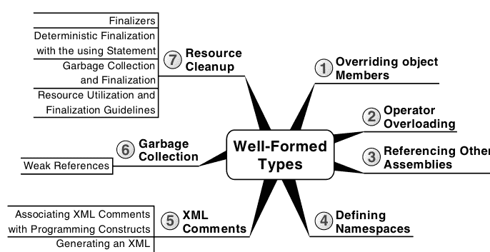

## 重写对象成员

第 6 章讨论了所有类和结构都派生自 `object`。此外，它还回顾了 `object` 上可用的每个方法，并讨论了其中一些方法是虚方法。本节讨论重写虚方法的细节。

## 重写 ToString()

默认情况下，对任何对象调用 `ToString()` 将返回类的完全限定名称。例如，对 `System.IO.FileStream` 对象调用 `ToString()` 将返回字符串 `System.IO.FileStream`。然而，对于某些类，`ToString()` 可以更有意义。例如，对于 `string`，`ToString()` 返回字符串值本身。同样，返回 `Contact` 的名称会更有意义。列表 9.1 重写了 `ToString()` 以返回 `Coordinate` 的字符串表示。

### LISTING 9.1: Overriding ToString()

```
public struct Coordinate

{

    public Coordinate(Longitude longitude, Latitude latitude)

    {

        Longitude = longitude;

        Latitude = latitude;

    }

    public Longitude Longitude { get; }

    public Latitude Latitude { get; }

    public override string ToString()

    {

        return $"{ Longitude } { Latitude }";

    }

    // ...

}
```

`Write` 方法如 `Console.WriteLine()` 和 `System.Diagnostics.Trace.Write()` 会调用对象的 `ToString()` 方法，因此重载该方法通常比默认实现输出更有意义的信息。鉴于这一点，只要可以从输出中提供相关的诊断信息，你就应该考虑重载 `ToString()` 方法——具体来说，当目标受众是开发人员时，因为默认的 `object.ToString()` 输出是类型名称，对最终用户不友好。`ToString()` 对于在开发人员 IDE 中调试或写入日志文件很有用。因此，你应保持字符串相对简短（一个屏幕长度），以免被截断。然而，由于缺乏本地化和其他高级格式化功能，这种方法不太适合用于一般最终用户文本显示。

## 指南

**DO** 在可以返回有用的面向开发人员的诊断字符串时重写 `ToString()`。
**DO** 尽量保持 `ToString()` 返回的字符串简短。
**DO NOT** 从 `ToString()` 返回空字符串或 `null`。
**AVOID** 从 `ToString()` 抛出异常或产生可观察的副作用（更改对象状态）。
**DO** 如果返回值是文化相关的或需要格式化（例如 `DateTime`），则提供重载的 `ToString(string format)` 或实现 `IFormattable`。
**CONSIDER** 从 `ToString()` 返回唯一的字符串以识别对象实例。

## 重写 GetHashCode()

重写 `GetHashCode()` 比重写 `ToString()` 更复杂。即使如此，当你重写 `Equals()` 时，你也应该重写 `GetHashCode()`，如果不这样做，编译器会发出警告，提示此步骤是推荐的。当你将其用作哈希表集合的键时，重写 `GetHashCode()` 也是一个良好的实践（例如 `System.Collections.Hashtable` 和 `System.Collections.Generic.Dictionary`）。

哈希码的目的是通过生成对应于对象值的数字来*高效地平衡哈希表*。以下是良好 `GetHashCode()` 实现的一些实现原则：

- *Required:* 相等的对象必须具有相等的哈希码（如果 `a.Equals(b)`，则 `a.GetHashCode() == b.GetHashCode()`）。
- *Required:* `GetHashCode()` 在特定对象的生命周期内的返回值应保持不变（相同的值），即使对象的数据发生变化。在许多情况下，你应缓存方法的返回值以强制执行此约束。
- *Required:* `GetHashCode()` 不应抛出任何异常；`GetHashCode()` 必须始终成功返回一个值。
- *Performance:* 哈希码应尽可能唯一。然而，由于哈希码仅返回一个 `int`，对于可能具有比 `int` 能容纳更多值的对象，哈希码必然会重叠，这几乎适用于所有类型。 （一个明显的例子是 `long`，因为可能的 `long` 值比 `int` 能够唯一标识的更多。）
- *Performance:* 可能的哈希码值应在 `int` 的范围内均匀分布。例如，创建一个不考虑字符串在基于拉丁语的语言中主要集中在最初 128 个 ASCII 字符的分布的哈希，将导致字符串值的非常不均匀的分布，这不是一个强大的 `GetHashCode()` 算法。
- *Performance:* `GetHashCode()` 应针对性能进行优化。`GetHashCode()` 通常在 `Equals()` 实现中使用，以在哈希码不同时短路完整的相等比较。因此，当类型用作字典集合中的键类型时，它会被频繁调用。
- *Performance:* 两个对象之间的微小差异应导致哈希码值之间的巨大差异——理想情况下，对象中的 1 位差异应导致哈希码的平均约 16 位发生变化。这有助于确保无论哈希表如何“分桶”哈希值，哈希表保持平衡。
- *Security:* 攻击者应难以构造具有特定哈希码的对象。攻击方法是向哈希表注入大量数据，这些数据都哈希到相同的值。哈希表实现会变得低效，导致可能的拒绝服务攻击。

这些准则和规则当然是矛盾的：很难提出一个既快速又满足所有这些准则的哈希算法。与任何设计问题一样，你需要结合良好的判断和现实的性能测量来提出一个好的解决方案。

考虑列表 9.2 中所示的 `Coordinate` 类型的 `GetHashCode()` 实现。

### LISTING 9.2: Implementing GetHashCode()

```
public struct Coordinate

{

    public Coordinate(Longitude longitude, Latitude latitude)

    {

        Longitude = longitude;

        Latitude = latitude;

    }

    public Longitude Longitude { get; }

    public Latitude Latitude { get; }

    public override int GetHashCode()

    {

        int hashCode = Longitude.GetHashCode();

        // As long as the hash codes are not equal

        if(Longitude.GetHashCode() != Latitude.GetHashCode())

        {

            hashCode ^= Latitude.GetHashCode(); // eXclusive OR

        }

        return hashCode;

    }

    // ...

}
```

通常，关键是使用 XOR 运算符对相关类型的哈希码进行运算，并确保 XOR 操作数不太可能接近或相等——否则结果将全为零。 （在操作数接近或相等的情况下，考虑使用位移和加法代替。）替代操作数 AND 和 OR 有类似的限制，但这些限制更频繁地出现。多次应用 AND 倾向于全部为 0 位，而应用 OR 倾向于全部为 1 位。

为了更精细的控制，使用移位运算符拆分大于 `int` 的类型。例如，名为 `value` 的 `long` 的 `GetHashCode()` 实现如下：

```
int GetHashCode() { return ((int)value ^ (int)(value >> 32)); };
```

此外，如果基类不是 `object`，则 `base.GetHashCode()` 应包含在 XOR 赋值中。

最后，`Coordinate` 不缓存哈希码的值。由于哈希码计算中的每个字段都是只读的，因此该值不会改变。然而，如果计算值可能发生变化或缓存值可能提供显著的性能优势，实现应缓存哈希码。

## 重写 Equals()

在不重写 `GetHashCode()` 的情况下重写 `Equals()` 会导致类似输出 9.1 所示的警告。

**输出 9.1**

```text
warning CS0659: '<Class Name>' overrides Object.Equals(object o) but does not override Object.GetHashCode()
```

一般来说，开发者期望重写 `Equals()` 是简单的事情，但它包含许多需要仔细思考和测试的微妙之处。

### 对象标识与相等对象值

如果两个引用指向同一个实例，则它们是相同的引用。`object`（以及通过继承，所有派生类型）包含一个名为 `ReferenceEquals()` 的静态方法，该方法显式检查对象标识（参见图 9.1）。

然而，引用相等并不是唯一的相等类型。如果两个对象实例的部分或全部成员的值相等，这两个实例也可以称为相等。考虑清单 9.3 中两个 `ProductSerialNumbers` 的比较。

**清单 9.3：重写相等运算符**

```csharp
public sealed class ProductSerialNumber

{

    // ...

}

class Program

{

    static void Main()

    {

        ProductSerialNumber serialNumber1 =

            new ProductSerialNumber("PV", 1000, 09187234);

        ProductSerialNumber serialNumber2 = serialNumber1;

        ProductSerialNumber serialNumber3 =

            new ProductSerialNumber("PV", 1000, 09187234);

        // These serial numbers ARE the same object identity.

        if (!ProductSerialNumber.ReferenceEquals(serialNumber1,

            serialNumber2))

        {

            throw new Exception(

                "serialNumber1 does NOT " +

                "reference equal serialNumber2");

        }

        // And, therefore, they are equal.
```


```csharp
else if(!serialNumber1.Equals(serialNumber2))
{
    throw new Exception(
        "serialNumber1 does NOT equal serialNumber2");
}
else
{
    Console.WriteLine(
        "serialNumber1 reference equals serialNumber2");
    Console.WriteLine(
        "serialNumber1 equals serialNumber2");
}
// These serial numbers are NOT the same object identity.
if (ProductSerialNumber.ReferenceEquals(serialNumber1,
        serialNumber3))
{
    throw new Exception(
        "serialNumber1 DOES reference " +
        "equal serialNumber3");
}
// But they are equal (assuming Equals is overloaded).
else if(!serialNumber1.Equals(serialNumber3) ||
        serialNumber1 != serialNumber3)
{
    throw new Exception(
        "serialNumber1 does NOT equal serialNumber3");
}
Console.WriteLine("serialNumber1 equals serialNumber3");
}
}
```

清单 9.3 的结果出现在输出 9.2 中。

**输出 9.2**

```text
serialNumber1 reference equals serialNumber2
serialNumber1 equals serialNumber3
```

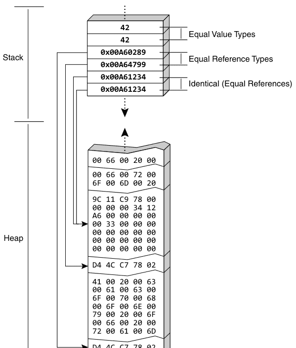

正如最后一个断言通过 `ReferenceEquals()` 所展示的，`serialNumber1` 和 `serialNumber3` 不是同一个引用。然而，代码使用相同的值构造它们，并且两者在逻辑上都与同一个实体产品相关联。如果一个实例是根据数据库中的数据创建的，而另一个是根据手动输入的数据创建的，你会期望这两个实例相等，因此该产品不会在数据库中重复（重新录入）。两个相同的引用显然是相等的；但是，两个不同的对象可能相等但引用不相等。这样的对象没有相同的对象标识，但可能具有将它们标识为相等对象的关键数据。

只有引用类型才能引用相等，从而支持标识的概念。对值类型调用 `ReferenceEquals()` 将始终返回 `false`，因为在调用时需要将值类型装箱后再转换为 `object`。即使将同一个变量作为两个（值类型）参数传递给 `ReferenceEquals()`，结果仍将为 `false`，因为这些值被独立装箱。清单 9.4 演示了此行为，因为每个参数被放入“不同的箱子”中；在此示例中，它们永远不会引用相等。

> **注意**
>
> 对值类型调用 `ReferenceEquals()` 将始终返回 `false`。

**清单 9.4：值类型永远不会引用相等自身**

```csharp
public struct Coordinate
{
    public Coordinate(Longitude longitude, Latitude latitude)
    {
        Longitude = longitude;
        Latitude = latitude;
    }
    public Longitude Longitude { get; }
    public Latitude Latitude { get; }
    // ...
}
class Program
{
    public void Main()
    {
        //...
        Coordinate coordinate1 =
            new Coordinate( new Longitude(48, 52),
                            new Latitude(-2, -20));
        // Value types will never be reference equal.
        if ( Coordinate.ReferenceEquals(coordinate1,
            coordinate1) )
        {
            throw new Exception(
                "coordinate1 reference equals coordinate1");
        }
        Console.WriteLine(
            "coordinate1 does NOT reference equal itself" );
    }
}
```

与第 8 章中将 `Coordinate` 定义为引用类型不同，后续定义将 `Coordinate` 视为值类型（`struct`），因为 `Longitude` 和 `Latitude` 数据的组合在逻辑上被视为一个值，且其大小小于 16 字节。（在第 8 章中，`Coordinate` 聚合的是 `Angle` 而不是 `Longitude` 和 `Latitude`。）将 `Coordinate` 声明为值类型的一个促成因素是它是一个（复合）数值，具有特定的操作。相比之下，像 `Employee` 这样的引用类型不是你可以进行数值操作的值，而是指现实生活中的对象。

### 实现 Equals()

要确定两个对象是否相等（即它们是否具有相同的标识数据），可以使用对象的 `Equals()` 方法。`object` 上这个虚方法的实现使用 `ReferenceEquals()` 来评估相等性。由于这个实现通常不够充分，有时需要重写 `Equals()` 以提供更合适的实现。

> **注意**
>
> `object.Equals()` 的实现（所有对象在重写之前的默认实现）仅依赖 `ReferenceEquals()`。

要使对象彼此相等，期望是它们内部的标识数据相等。例如，对于 `ProductSerialNumbers`，`ProductSeries`、`Model` 和 `Id` 必须相同；然而，对于 `Employee` 对象，也许比较 `EmployeeId` 就足以判断相等。要纠正 `object.Equals()` 的实现，必须重写它。例如，值类型会重写 `Equals()` 实现，以改用类型包含的字段。

重写 `Equals()` 的步骤如下：

1. 检查 `null`。
2. 如果类型是引用类型，则检查引用相等。
3. 检查类型是否等价。
4. 调用一个类型化的辅助方法，该方法可以将操作数视为比较类型，而不是将其视为 `object`（参见清单 9.5 中的 `Equals(Coordinate obj)` 方法）。
5. 可能检查哈希码是否等价，以短路进一步的逐字段比较。（相等的两个对象不可能有不同的哈希码。）
6. 如果基类重写了 `Equals()`，则检查 `base.Equals()`。
7. 比较每个标识字段是否相等。
8. 重写 `GetHashCode()`。
9. 重写 `==` 和 `!=` 运算符（参见下一节）。

清单 9.5 展示了一个 `Equals()` 实现示例。

**清单 9.5：重写 Equals()**

```csharp
public struct Longitude
{
    // ...
}
public struct Latitude
{
    // ...
}
public struct Coordinate
{
    public Coordinate(Longitude longitude, Latitude latitude)
    {
        Longitude = longitude;
        Latitude = latitude;
    }
    public Longitude Longitude { get; }
    public Latitude Latitude { get; }
    public override bool Equals(object obj)
    {
        // STEP 1: Check for null.
        if (obj == null)
        {
            return false;
        }
        // STEP 3: Equivalent data types.
        // Can be avoided if type is sealed.
        if (this.GetType() != obj.GetType())
        {
            return false;
        }
        return Equals((Coordinate)obj);
    }
    public bool Equals(Coordinate obj)
    {
        // STEP 1: Check for null if a reference type.
        // if (obj == null)
        // {
        //     return false;
        // }
        // STEP 2: Check for ReferenceEquals if this
        // is a reference type.
        // if (ReferenceEquals(this, obj))
        // {
        //     return true;
        // }
        // STEP 4: Possibly check for equivalent hash codes.
        // if (this.GetHashCode() != obj.GetHashCode())
        // {
        //     return false;
        // }
        // STEP 5: Check base.Equals if base overrides Equals().
        // System.Diagnostics.Debug.Assert(
        //     base.GetType() != typeof(object) );
        // if (!base.Equals(obj))
        // {
        //     return false;
        // }
        // STEP 6: Compare identifying fields for equality
        // using an overload of Equals on Longitude.
        return (Longitude.Equals(obj.Longitude)) &&
               (Latitude.Equals(obj.Latitude));
    }
    // STEP 7: Override GetHashCode.
    public override int GetHashCode()
    {
        int hashCode = Longitude.GetHashCode();
        hashCode ^= Latitude.GetHashCode(); // Xor (exclusive OR)
        return hashCode;
    }
}
```

在这种实现中，前两个检查相对明显。然而，有趣的是，如果类型是密封的，则可以避免步骤 3。

步骤 4–6 发生在重载的 `Equals()` 中，该重载专门接受 `Coordinate` 数据类型。这样，两个 `Coordinates` 的比较将完全避免 `Equals(object obj)` 及其 `GetType()` 检查。

由于 `GetHashCode()` 未被缓存并且效率也不高于步骤 5，因此 `GetHashCode()` 比较被注释掉了。同样，`base.Equals()` 也未使用，因为基类未重写 `Equals()`。 （断言检查基类不是 `object` 类型，但并未验证基类是否重写了 `Equals()`，而这正是适当调用 `base.Equals()` 所必需的。）无论如何，因为 `GetHashCode()` 不一定返回唯一值（它只是标识操作数是否不同），因此单独使用它并不能确定地标识相等对象。

与 `GetHashCode()` 类似，`Equals()` 绝不应抛出任何异常。比较任何对象与任何其他对象都是有效的，并且这样做绝不应导致异常。

### Guidelines

- **DO** 一起实现 `GetHashCode()`、`Equals()`、`==` 运算符和 `!=` 运算符——不要只实现其中一个而缺少其他三个。
- **DO** 在实现 `Equals()`、`==` 和 `!=` 时使用相同的算法。
- **AVOID** 从 `GetHashCode()`、`Equals()`、`==` 和 `!=` 的实现中抛出异常。
- **AVOID** 在可变引用类型上重载相等运算符，或如果实现会显著变慢。
- **DO** 在实现 `IComparable` 时实现所有与相等相关的方法。

# Operator Overloading

前一节讨论了重写 `Equals()` 并提供了指导，即类还应实现 `==` 和 `!=`。实现任何运算符称为 *operator overloading*。本节描述如何执行此类重载，不仅针对 `==` 和 `!=`，还针对其他受支持的运算符。

例如，`string` 提供了 `+` 运算符来连接两个字符串。这也许并不令人惊讶，因为 `string` 是预定义类型，因此可能具有特殊的编译器支持。然而，C# 允许向类或结构体添加 `+` 运算符支持。事实上，所有运算符都受支持，除了 `x.y`、`f(x)`、`new`、`typeof`、`default`、`checked`、`unchecked`、`delegate`、`is`、`as`、`=` 和 `=>`。一个特别值得注意的无法实现的运算符是赋值运算符；没有办法改变 `=` 运算符的行为。

在进行运算符重载的练习之前，请考虑这样一个事实：此类运算符无法通过 IntelliSense 发现。除非类型旨在像原始类型（例如数值类型）一样工作，否则应避免重载运算符。

# Comparison Operators (==, !=, <, >, <=, >=)

一旦重写了 `Equals()`，就可能存在不一致的情况。也就是说，两个对象对于 `Equals()` 返回 `true`，但对于 `==` 运算符返回 `false`，因为 `==` 默认执行引用相等检查。为了纠正此缺陷，重要的是也要重载等于 `==` 和不等于 `!=` 运算符。

在大多数情况下，这些运算符的实现可以将逻辑委托给 `Equals()`，反之亦然。然而，对于引用类型，首先需要进行一些初始空值检查（参见 Listing 9.6）。

# LISTING 9.6: Implementing the == and != Operators

```csharp
public sealed class ProductSerialNumber
{
    // ...
    public static bool operator ==(
        ProductSerialNumber leftHandSide,
        ProductSerialNumber rightHandSide)
    {
        // Check if leftHandSide is null.
        // (operator== would be recursive)
        if(ReferenceEquals(leftHandSide, null))
        {
            // Return true if rightHandSide is also null
            // and false otherwise.
            return ReferenceEquals(rightHandSide, null);
        }
```
```csharp
public Latitude LatitudeDifference { get; }
}
struct Coordinate
{
    // ...
    public static Coordinate operator +(Coordinate source, Arc arc)
    {
        Coordinate result = new Coordinate(
            new Longitude(
                source.Longitude + arc.LongitudeDifference),
```


```csharp
            new Latitude(
                source.Latitude + arc.LatitudeDifference));

        return result;

    }

}
```

`+`、`-`、`*`、`/`、`%`、`&`、`|`、`^`、`<<` 和 `>>` 运算符被实现为二进制静态方法，其中至少一个参数是包含类型的。方法名称是运算符前面加上 `operator` 作为关键字。如 Listing 9.8 所示，给定 `-` 和 `+` 二进制运算符的定义，你可以向坐标添加和减去 `Arc`。注意 `Longitude` 和 `Latitude` 也需要实现 `+` 运算符，因为它们被 `source.Longitude + arc.LongitudeDifference` 和 `source.Latitude + arc.LatitudeDifference` 调用。

# LISTING 9.8: Calling the – and + Binary Operators

```csharp
public class Program

{
    public static void Main()
    {
        Coordinate coordinate1, coordinate2;
        coordinate1 = new Coordinate(
            new Longitude(48, 52), new Latitude(-2, -20));
        Arc arc = new Arc(new Longitude(3), new Latitude(1));
        coordinate2 = coordinate1 + arc;
        Console.WriteLine(coordinate2);
        coordinate2 = coordinate2 - arc;
        Console.WriteLine(coordinate2);
        coordinate2 += arc;
        Console.WriteLine(coordinate2);
    }
}
```

Listing 9.8 的结果显示在 Output 9.3 中。

# OUTPUT 9.3

```
51° 52' 0 E  -1° -20' 0 N
48° 52' 0 E  -2° -20' 0 N
51° 52' 0 E  -1° -20' 0 N
```

对于 `Coordinate`，你实现 `-` 和 `+` 运算符以返回在添加/减去 `Arc` 后的坐标位置。这允许你将多个运算符和操作数串联起来，如 `result = ((coordinate1 + arc1) + arc2) + arc3`。此外，通过在 `Arc` 上支持相同的运算符（`+/-`）（参见 Listing 9.9），你可以消除括号。这种方法之所以可行，是因为第一个操作数（`arc1 + arc2`）的结果是另一个 `Arc`，然后你可以将其添加到下一个 `Arc` 或 `Coordinate` 类型的操作数。

相比之下，考虑如果提供一个 `-` 运算符，其参数为两个 `Coordinate`s 并返回两个坐标之间的距离对应的 `double` 会发生什么。将 `double` 添加到 `Coordinate` 是未定义的，因此你无法串联运算符和操作数。在定义返回不同类型的运算符时应谨慎，因为这样做违反直觉。

# Combining Assignment with Binary Operators (+=, -=, *=, /=, %=, &=, ...)

如前所述，不支持重载赋值运算符。然而，结合二进制运算符的赋值运算符（`+=`、`-=`、`*=`、`/=`、`%=`、`&=`、`|=`、`^=`、`<<=` 和 `>>=`）在重载二进制运算符时实际上被重载了。给定不带赋值的二进制运算符的定义，C# 会自动允许与运算符结合使用赋值。因此，使用 Listing 9.7 中的 `Coordinate` 定义，你可以有如下代码：

```
coordinate += arc;
```

这等价于以下内容：

```
coordinate = coordinate + arc;
```

# Conditional Logical Operators (&&, ||)

与赋值运算符类似，条件逻辑运算符不能显式重载。然而，由于逻辑运算符 `&` 和 `|` 可以被重载，并且条件运算符包含逻辑运算符，因此实际上可以重载条件运算符。`x && y` 被处理为 `x & y`，其中 `y` 必须求值为 `true`。类似地，`x || y` 被处理为 `x | y` 仅当 `x` 为 `false` 时。为了支持在例如 `if` 语句中将类型求值为 `true` 或 `false`，有必要重写 `true`/`false` 一元运算符。

# Unary Operators (+, -, !, ~, ++, --, true, false)

重载一元运算符与重载二进制运算符非常相似，只是它们只接受一个参数，也是包含类型的。Listing 9.9 重载了 `Longitude` 和 `Latitude` 的 `+` 和 `–` 运算符，然后在 `Arc` 中重载相同运算符时使用这些运算符。

# LISTING 9.9: Overloading the – and + Unary Operators

```csharp
public struct Latitude
{
    // ...
    public static Latitude operator -(Latitude latitude)
    {
        return new Latitude(-latitude.DecimalDegrees);
    }

    public static Latitude operator +(Latitude latitude)
    {
        return latitude;
    }
}

public struct Longitude
{
    // ...
    public static Longitude operator -(Longitude longitude)
    {
        return new Longitude(-longitude.DecimalDegrees);
    }

    public static Longitude operator +(Longitude longitude)
    {
        return longitude;
    }
}

public struct Arc
{
    // ...
    public static Arc operator -(Arc arc)
    {
        // Uses unary - operator defined on
        // Longitude and Latitude
        return new Arc(-arc.LongitudeDifference, -arc.LatitudeDifference);
    }

    public static Arc operator +(Arc arc)
    {
        return arc;
    }
}
```

与数值类型一样，此列表中的 `+` 运算符没有任何效果，仅为了对称而提供。

重载 `true` 和 `false` 有一个额外要求：两者必须同时重载，而不能只重载其中一个。其签名与其他运算符重载相同，但返回值必须是 `bool`，如清单 9.10 所示。

### 清单 9.10：重载 true 和 false 运算符

```csharp
public static bool operator false(IsValid item) { // ... }
public static bool operator true(IsValid item) { // ... }
```

你可以在 `if`、`do`、`while` 和 `for` 控制表达式中使用重载了 `true` 和 `false` 运算符的类型。

## 转换运算符

目前，`Longitude`、`Latitude` 和 `Coordinate` 不支持强制转换为其他类型。例如，无法将 `double` 转换为 `Longitude` 或 `Latitude` 实例。同样，也不支持使用字符串为 `Coordinate` 赋值。幸运的是，C# 允许定义专门用于处理类型转换的方法。此外，方法声明允许指定转换是隐式还是显式。

## 高级主题

### 强制转换运算符 (())

实现显式和隐式转换运算符在技术上并不属于重载强制转换运算符（`()`）。但这实际上就是所发生的事，因此*定义强制转换运算符*是描述实现显式或隐式转换的常用术语。

定义转换运算符的风格与定义其他运算符类似，不同之处在于“运算符”是转换的结果类型。此外，`operator` 关键字紧跟在指示转换是隐式还是显式的关键字之后（参见清单 9.11）。

### 清单 9.11：在 Latitude 和 double 之间提供隐式转换

```csharp
public struct Latitude
{
    // ...
    public Latitude(double decimalDegrees)
    {
        DecimalDegrees = Normalize(decimalDegrees);
    }

    public double DecimalDegrees { get; }
    // ...
    public static implicit operator double(Latitude latitude)
    {
        return latitude.DecimalDegrees;
    }

    public static implicit operator Latitude(double degrees)
    {
        return new Latitude(degrees);
    }
    // ...
}
```

借助这些转换运算符，你现在可以在 `Latitude` 对象与 `double` 之间进行隐式转换。假设 `Longitude` 也存在类似的转换，你可以通过指定每个坐标部分的十进制度数来简化 `Coordinate` 对象的创建（例如，`coordinate = new Coordinate(43, 172);`）。

> **注意**
> 在实现转换运算符时，返回值或参数必须之一是包含该运算符的类型，以支持封装。C# 不允许你在被转换类型的作用域之外指定转换。

## 转换运算符指南

定义隐式转换运算符和显式转换运算符之间的区别，核心在于防止意外的隐式转换导致不良行为。你应该意识到使用显式转换运算符可能带来的两个后果。首先，会抛出异常的转换运算符应始终是显式的。例如，字符串很可能不符合从 `string` 到 `Coordinate` 的转换所需的格式。考虑到转换失败的可能性，你应该将特定的转换运算符定义为显式，从而要求你有意进行转换并确保格式正确，或者提供代码来处理可能的异常。通常，转换的模式是：一个方向（`string` 到 `Coordinate`）是显式的，相反方向（`Coordinate` 到 `string`）是隐式的。

第二个考虑因素是，有些转换会丢失数据。将 `float`（4.2）转换为 `int` 是完全有效的，前提是你知道 `float` 的小数部分会丢失。任何会丢失数据且无法成功转换回原始类型的转换都应定义为显式。如果显式转换意外导致数据丢失或无效，请考虑抛出 `System.InvalidCastException`。

> **指南**
> **不要**在转换有损的情况下提供隐式转换运算符。
> **不要**从隐式转换中抛出异常。

## 引用其他程序集

C# 及其底层的 CLI 平台允许你将代码分散到多个程序集中，而不是将所有代码放在一个单一的二进制文件中。这种方法使你能够在多个可执行文件之间重用程序集。

## 初学者主题

### 类库

`HelloWorld.exe` 程序是你能编写的最简单的程序之一。现实世界的程序要复杂得多，随着复杂度的增加，将程序拆分为多个部分有助于组织这种复杂性。为此，开发人员会将程序的一部分移入称为类库（或简称为库）的独立编译单元中。然后，程序引用并依赖类库来提供其部分功能。这一概念的力量在于，两个程序可以依赖同一个类库，从而在两个程序之间共享该类库的功能，并减少所需的代码总量。

换句话说，你可以将功能编写一次，放入类库中，并让多个程序通过引用同一个类库来包含这些功能。在开发周期的后期，当开发人员修复类库中的错误或为其添加功能时，所有程序都将能够使用增强后的功能，因为它们仍然引用着这个已改进的类库。

要在其他程序集中重用代码，在运行 C# 编译器时必须引用该程序集。通常，被引用的程序集是类库，而创建类库所需的程序集目标与你迄今为止创建的默认控制台可执行文件目标不同。

## 更改程序集目标

编译器允许你通过 `/target` 选项创建四种¹不同的程序集类型：

- **控制台可执行文件**：这是默认的程序集类型，到目前为止的所有编译都是控制台可执行文件。（省略 `/target` 选项或指定 `/target:exe` 会创建控制台可执行文件。）
- **类库**：在多个可执行文件之间共享的类通常定义在类库中（`/target:library`）。
- **Windows 可执行文件**：Windows 可执行文件设计用于在 Microsoft Windows 系列操作系统上运行，并在命令控制台之外运行（`/target:winexe`）。
- **模块**：为了便于在同一程序集中使用多种语言，可以将代码编译为模块，然后将多个模块组合在一起形成程序集（`/target:module`）。

¹ C# 编译器还允许使用 `/target:appcontainerexe` 和 `/target:winmdobj`；这些选项用于创建本书未涉及的特殊 Windows 应用程序。

要在多个应用程序之间共享的程序集通常编译为类库。例如，考虑一个专门提供经度和纬度坐标相关功能的库。要将 `Coordinate`、`Longitude` 和 `Latitude` 类编译到它们自己的库中，可以使用 Output 9.4 中所示的命令行。

### 输出 9.4

```
>csc /target:library /out:Coordinates.dll Coordinate.cs IAngle.cs Latitude.cs Longitude.cs Arc.cs
Microsoft (R) Visual C# Compiler version 1.0.0.50128
Copyright (C) Microsoft Corporation. All rights reserved.
```

假设你使用 .NET 且 C# 编译器在 PATH 中，此命令将生成一个名为 `Coordinates.dll` 的程序集库。

## 引用程序集

要访问其他程序集中的代码，C# 编译器允许开发人员在命令行上引用该程序集。在这种情况下，选项是 `/reference`（`/r` 是缩写），后跟引用列表。例如，清单 9.8 中的 `Program` 类使用了 `Coordinate` 类，如果你将其放入单独的可执行文件中，则可以使用 Output 9.5 中所示的 .NET 命令行引用 `Coordinates.dll`。

### 输出 9.5

```
csc.exe /R:Coordinates.dll Program.cs
```

Mono 命令行出现在输出 9.6 中。

### 输出 9.6

```
msc.exe /R:Coordinates.dll Program.cs
```


## ADVANCED TOPIC

## 在 Mac 和 Linux 上引用程序集

在本书撰写之时，微软曾表示，命令行 C# 编译器的 Mac 和 Linux 版本在引用程序集方面应与 Windows 版本的行为完全一致。尽管如此，关于如何引用 `mscorlib.dll`（包含桌面 CLR 基础类，例如 `object` 和 `string` 的类库）的引用仍存在一些开放问题。C# 命令行编译器的用户在这些平台上可能需要指定 `mscorlib.dll` 的完整路径；请查阅特定平台的文档以获取详细信息。

## ADVANCED TOPIC

## 可移植类库

对于 C# 开发者来说，一个日益常见的场景是创建可在传统桌面应用程序、移动设备、游戏平台等上运行的程序。实现这一目标的一个良好技术是将所有版本应用程序共用的核心应用程序类放入可移植类库（PCL）中；PCL 可在许多 .NET 平台上使用。当然，PCL 只能引用本身能够在多个平台上运行的程序集。

创建 PCL 的最简单方法是选择 Visual Studio 2012 或更高版本中的可移植类库项目类型。使用命令行编译器创建 PCL 稍微困难一些，但仍然可行。为此，指定 `/noconfig` 和 `/nostdlib` 选项；这可确保默认的框架类库不会被使用。然后使用 `/reference` 选项添加对 `Program Files` 目录下 `Reference Assemblies\Microsoft\Framework\.NETPortable\v4.5` 子目录中特殊可移植元数据库的引用。

## ADVANCED TOPIC

## 类型的封装

正如类为行为和数据提供封装边界一样，程序集也为类型组之间提供了类似的边界。开发者可以将系统拆分为程序集，然后将这些程序集与多个应用程序共享，或将其与第三方提供的程序集集成。

### 类型声明上的 *public* 或 *internal* 访问修饰符

默认情况下，未指定任何访问修饰符的类被定义为 `internal`。² 其结果是该类无法从程序集外部访问。即使另一个程序集引用了包含该类的程序集，所有被引用程序集中的内部类都将无法访问。

正如 `private` 和 `protected` 为类内的成员提供封装级别一样，C# 也支持在类级别使用访问修饰符来控制程序集中类的封装。可用访问修饰符为 `public` 和 `internal`。要将类暴露在程序集外部，程序集必须标记为 public。因此，在编译 `Coordinates.dll` 程序集之前，有必要将类型声明修改为 public（参见清单 9.12）。

**LISTING 9.12: Making Types Available outside an Assembly**

```csharp
public struct Coordinate
{
    // ...
}

public struct Latitude
{
    // ...
}

public struct Longitude
{
    // ...
}
```

2. 排除嵌套类型，嵌套类型默认是 private。

```csharp
public struct Arc
{
    // ...
}
```

同样，`class` 和 `enum` 等声明也可以是 `public` 或 `internal`。³

`internal` 访问修饰符不仅限于类型声明；也就是说，它也适用于类型成员。因此，你可以将类型指定为 `public`，但将类型内的特定方法标记为 `internal`，以便成员仅在程序集内部可用。成员的访问性不可能大于其类型。如果类声明为 `internal`，则该类型上的 `public` 成员也只能在程序集内部访问。

### protected internal 类型修饰符

另一个类型成员访问修饰符是 `protected internal`。具有 `protected internal` 访问修饰符的成员将可在包含程序集内的所有位置访问，并且可由派生自该类型的类访问，即使派生类不在同一程序集中。默认状态为 `private`，因此当你添加访问修饰符（除 `public` 外）时，成员会变得稍微可见。添加两个修饰符会加剧这种效果。

NOTE
具有 `protected internal` 访问修饰符的成员将可在包含程序集内的所有位置访问，并且可由派生自该类型的类访问，即使派生类不在同一程序集中。

## BEGINNER TOPIC

## 类型成员访问修饰符

完整的访问修饰符列表见表 9.1。

### TABLE 9.1: Accessibility Modifiers

| Modifier | Description |
|---|---|
| public | 声明该成员可在类型可访问的任何位置访问。如果类是 `internal`，则成员将在内部可见。如果包含类型是 `public`，则 `public` 成员可从程序集外部访问。 |
| internal | 成员只能在程序集内部访问。 |
| private | 成员只能在包含类型内部访问，否则不可访问。 |
| protected | 成员可在包含类型及其派生的任何子类型中访问，无论程序集如何。 |
| protected internal | 成员可在包含程序集内的任何位置访问，并且可由派生自包含类型的任何类型访问，即使派生类型位于不同的程序集中。 |

## 定义命名空间

如第 2 章所述，所有数据类型均由其命名空间和名称的组合来标识。然而，在 CLR 中，并不存在“命名空间”这种东西。类型的名称实际上是完全限定的类型名，包括命名空间。对于你之前定义的类，没有显式的命名空间声明。此类类会自动声明为默认全局命名空间的成员。很可能此类类会发生名称冲突，即当你尝试定义两个同名类时。开始引用第三方程序集后，名称冲突的可能性会进一步增加。

更重要的是，.NET Framework 中有数千种类型，框架之外还有多数量级更多的类型。因此，找到特定问题的正确类型可能是一场重大的斗争。

解决这两个问题的办法是将所有类型组织起来，将它们分组为称为命名空间的逻辑相关类别。例如，`System` 命名空间之外的类通常被放置到与公司、产品名称或两者对应的命名空间中。例如，Addison-Wesley 的类被放置到 `Awl` 或 `AddisonWesley` 命名空间中，而来自 Microsoft（非 System 类）的类位于 `Microsoft` 命名空间中。命名空间的第二层级应为稳定的产品名称，不会在版本之间变化。事实上，稳定性在所有层级都是关键。更改命名空间名称是不兼容版本的更改，应避免。为此，避免在命名空间名称中使用不稳定的名称（组织层级、短暂品牌等）。

命名空间应使用 PascalCase，但如果你的品牌使用非传统大小写，则可以使用品牌大小写。（一致性是关键，因此如果这会带来问题——无论是 Pascal 还是基于品牌的写法——请优先使用能产生更大一致性的约定。）你应使用 `namespace` 关键字来创建命名空间并将类分配给它，如清单 9.13 所示。

### LISTING 9.13: Defining a Namespace

```csharp
// Define the namespace AddisonWesley
namespace AddisonWesley
{
    class Program
    {
        // ...
    }
}
// End of AddisonWesley namespace declaration
```

命名空间声明的大括号之间的所有内容都将属于指定的命名空间。例如，在清单 9.13 中，`Program` 被放置到 `AddisonWesley` 命名空间中，其全名为 `AddisonWesley.Program`。

NOTE
在 CLR 中，并不存在“命名空间”这种东西。类型的名称实际上是完全限定的类型名。

与类类似，命名空间也支持嵌套。这为类的层次化组织提供了可能。例如，所有与网络 API 相关的 System 类都位于命名空间 `System.Net` 中，而与 Web 相关的类则位于 `System.Web` 中。

嵌套命名空间有两种方式。第一种方法是将它们彼此嵌套（类似于类），如清单 9.14 所示。

### LISTING 9.14: Nesting Namespaces within One Another

```csharp
// Define the namespace AddisonWesley
namespace AddisonWesley
{
    // Define the namespace AddisonWesley.Michaelis
    namespace Michaelis
    {
        // Define the namespace
        // AddisonWesley.Michaelis.EssentialCSharp
        namespace EssentialCSharp
        {
            // Declare the class
            // AddisonWesley.Michaelis.EssentialCSharp.Program
            class Program
            {
                // ...
            }
        }
    }
}
// End of AddisonWesley namespace declaration
```

这种嵌套会将 `Program` 类分配给 `AddisonWesley.Michaelis.EssentialCSharp` 命名空间。

第二种方法是在单个命名空间声明中使用完整的命名空间，其中每个标识符由句点分隔，如清单 9.15 所示。

### LISTING 9.15: Nesting Namespaces Using a Period to Separate Each Identifier

```csharp
// Define the namespace AddisonWesley.Michaelis.EssentialCSharp
namespace AddisonWesley.Michaelis.EssentialCSharp
{
    class Program
    {
        // ...
    }
}
// End of AddisonWesley namespace declaration
```

无论命名空间声明是否遵循清单 9.14 中所示的模式、清单 9.15 中所示的模式，还是两者的组合，所产生的 CIL 代码都将是相同的。相同的命名空间可以在多个文件中出现，甚至跨越程序集。例如，在文件与类之间保持一对一对应关系的情况下，你可以在自己的文件中定义每个类，并用相同的命名空间声明将其包围。

由于命名空间是组织类型的关键，因此经常有助于使用命名空间来组织所有类文件。出于这个原因，为每个命名空间创建一个文件夹很有帮助，将诸如 `AddisonWesley.Fezzik.Services.Registration` 之类的类放置在与名称对应的文件夹层次结构中。

在使用 Visual Studio 项目时，如果项目名称是 `AddisonWesley.Fezzik`，你应该创建一个名为 `Services` 的子文件夹，将 `RegistrationService.cs` 放置其中。然后你再创建一个名为 `Data` 的子文件夹，例如，将其中与程序中的实体相关的类放置其中，例如 `RealestateProperty`、`Buyer` 和 `Seller`。

## Guidelines

- DO prefix namespace names with a company name to prevent namespaces from different companies having the same name.
- DO use a stable, version-independent product name at the second level of a namespace name.
- DO NOT define types without placing them into a namespace.
- CONSIDER creating a folder structure that matches the namespace hierarchy.

## Namespace Alias Qualifier

命名空间本身可以处理绝大多数可能出现的命名冲突。尽管如此，有时（尽管很少）由于命名空间和类名重叠而可能产生冲突。为应对这种可能性，C# 2.0 编译器包含了一个选项，可通过 `/reference` 选项提供别名。例如，如果程序集 `CoordinatesPlus.dll` 和 `Coordinates.dll` 具有重叠的类型 `Arc`，你可以在命令行中引用这两个程序集，通过为一个或两个引用分配一个 **namespace alias qualifier** 来进一步区分一个类与另一个类（参见 Output 9.7）。

## OUTPUT 9.7

```
csc.exe /R:CoordPlus=CoordinatesPlus.dll /R:Coordinates.dll Program.cs
```

然而，仅在编译期间添加别名是不够的。要引用别名程序集中的类，必须提供 `extern` 指令，声明命名空间别名限定符是在源代码外部提供的（参见清单 9.16）。

## LISTING 9.16: Using the extern Alias Directive

```csharp
// extern must precede all other namespace elements
extern alias CoordPlus;
using System;
using CoordPlus::AddisonWesley.Michaelis.EssentialCSharp
// Equivalent also allowed
// using CoordPlus.AddisonWesley.Michaelis.EssentialCSharp
using global::AddisonWesley.Michaelis.EssentialCSharp
// Equivalent NOT allowed
// using global.AddisonWesley.Michaelis.EssentialCSharp
public class Program
{
    // ...
}
```

一旦 `extern alias for CoordPlus` 出现，你就可以使用 `CoordPlus` 后跟两个冒号或一个句点来引用命名空间。为了确保类型查找发生在全局命名空间中，C# 2.0 允许项目具有 `global::` 限定符（但不允许 `global.`，因为它可能与真实的 `global` 命名空间冲突）。

## XML Comments

第 1 章介绍了注释。然而，你可以使用 XML 注释做的不只是为审查源代码的其他开发人员提供笔记。XML 注释遵循了在 Java 中流行起来的做法。虽然 C# 编译器在生成的可执行文件方面忽略所有注释，但

开发人员可以使用命令行选项指示编译器⁴ 将 XML 注释提取到单独的 XML 文件中。通过利用 XML 文件生成，开发人员可以从 XML 注释生成 API 文档。此外，C# 编辑器可以解析代码中的 XML 注释并将其显示为不同的区域（例如，与代码其余部分不同的颜色），或解析 XML 注释数据元素并将其显示给开发人员。

图 9.2 演示了 IDE 如何利用 XML 注释帮助开发人员提供有关他正在编写的代码的提示。这种编码提示在大型程序中提供了很大的帮助，尤其是在多个开发人员共享代码时。然而，为此工作，开发人员显然必须花时间在代码中输入 XML 注释，然后指示编译器创建 XML 文件。下一节将解释如何完成此操作。

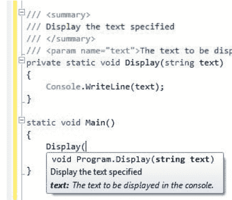

FIGURE 9.2: XML Comments As Tips in Visual Studio IDE

## Associating XML Comments with Programming Constructs

考虑 `DataStorage` 类的列表，如清单 9.17 所示。

4. C# 标准未规定应由 C# 编译器还是单独的实用程序来提取 XML 数据。然而，所有主流 C# 编译器都通过编译开关而非额外的实用程序包含必要的功能。

## LISTING 9.17: Commenting Code with XML Comments

```csharp
/// <summary>
/// DataStorage is used to persist and retrieve
/// employee data from the files.
/// </summary>
class DataStorage
{
    /// <summary>
    /// Save an employee object to a file
    /// named with the Employee name.
    /// </summary>
    /// <remarks>
    /// This method uses
    /// <seealso cref="System.IO.FileStream"/>
    /// in addition to
    /// <seealso cref="System.IO.StreamWriter"/>
    /// </remarks>
    /// <param name="employee">
    /// The employee to persist to a file</param>
    /// <date>January 1, 2000</date>
    public static void Store(Employee employee)
    {
        // ...
    }
    /** <summary>
```


```csharp
     * Loads up an employee object

     * </summary>

     * <remarks>

     * This method uses

     * <seealso cref="System.IO.FileStream"/>

     * in addition to

     * <seealso cref="System.IO.StreamReader"/>

     * </remarks>

     * <param name="firstName">

     * The first name of the employee</param>

     * <param name="lastName">

     * The last name of the employee</param>

     * <returns>

     * The employee object corresponding to the names

     * </returns>

     * <date>January 1, 2000</date>**/

    public static Employee Load(

        string firstName, string lastName)

    {

        // ...

    }

}
```

**Single-Line XML Comment**  
**XML Delimited Comment (C# 2.0)**

```csharp
class Program
{
    // ...
}
```

Listing 9.17 同时使用了跨多行的 XML 分隔注释以及单行 XML 注释，其中每一行都需要单独的三个正斜杠分隔符（`///`）。

由于 XML 注释旨在记录 API，因此它们仅 intended 用于与 C# 声明关联使用，例如 Listing 9.17 中所示的类或方法。对与声明无关的代码内联放置 XML 注释的任何尝试都会导致编译器发出警告。编译器之所以建立关联，仅仅是因为 XML 注释出现在声明正前方。

尽管 C# 允许在注释中出现任何 XML 标签，但 C# 标准明确定义了一组应使用的标签。`<seealso cref="System.IO.StreamWriter" />` 是使用 seealso 标签的示例。此标签在文本与 `System.IO.StreamWriter` 类之间创建链接。

## Generating an XML Documentation File

编译器会检查 XML 注释是否格式良好，如果格式不正确则会发出警告。要生成 XML 文件，请在编译时使用 `/doc` 选项，如 Output 9.8 所示。

### OUTPUT 9.8

```
>csc /doc:Comments.xml DataStorage.cs
```

`/doc` 选项会根据冒号后指定的名称创建 XML 文件。使用前面列出的 `CommentSamples` 类以及此处列出的编译器选项，生成的 `CommentSamples.XML` 文件如下所示 Listing 9.18。

### LISTING 9.18: Comments.xml

```
<?xml version="1.0"?>
<doc>
  <assembly>
    <name>DataStorage</name>
</assembly>
<members>
    <member name="T:DataStorage">
        <summary>
            DataStorage is used to persist and retrieve
            employee data from the files.
        </summary>
    </member>
    <member name="M:DataStorage.Store(Employee)">
        <summary>
            Save an employee object to a file
            named with the Employee name.
        </summary>
        <remarks>
            This method uses
            <seealso cref="T:System.IO.FileStream"/>
            in addition to
            <seealso cref="T:System.IO.StreamWriter"/>
        </remarks>
        <param name="employee">
            The employee to persist to a file</param>
        <date>January 1, 2000</date>
    </member>
    <member name="M:DataStorage.Load(
        System.String,System.String)">
        <summary>
            Loads up an employee object
        </summary>
        <remarks>
            This method uses
            <seealso cref="T:System.IO.FileStream"/>
            in addition to
            <seealso cref="T:System.IO.StreamReader"/>
        </remarks>
        <param name="firstName">
            The first name of the employee</param>
        <param name="lastName">
            The last name of the employee</param>
        <returns>
            The employee object corresponding to the names
        </returns>
        <date>January 1, 2000</date>
    </member>
</members>
</doc>
```

生成的文件仅包含将元素关联回其对应 C# 声明所必需的元数据量。这很重要，因为通常需要将 XML 输出与生成的程序集结合使用才能生成有意义的文档。幸运的是，像免费的 GhostDoc⁵ 和开源项目 NDoc⁶ 这样的工具可以生成文档。

> ### Guidelines
> 
> **DO** provide XML comments on public APIs when they provide more context than the API signature alone. This includes member descriptions, parameter descriptions, and examples of calling the API.

## Garbage Collection

垃圾回收显然是运行时的一项核心功能。其目的是恢复不再被引用的对象所消耗的内存。 此声明的重点在于内存和引用：垃圾回收器仅负责恢复内存；它不处理其他资源，例如数据库连接、句柄（文件、窗口等）、网络端口以及串行端口等硬件设备。此外，垃圾回收器根据是否仍存在引用来确定要清理的内容。隐含地，这意味着垃圾回收器使用引用对象工作，并且仅恢复堆上的内存。此外，这意味着对对象的引用会延迟垃圾回收器重用该对象所消耗的内存。

### ADVANCED TOPIC

#### Garbage Collection in .NET

垃圾回收器的许多细节与特定的 CLI 实现有关，因此可能有所不同。本节讨论 .NET 实现，因为它是应用最广泛的。

在 .NET 中，垃圾回收器使用标记-压缩算法。在每次迭代开始时，它会识别出对对象的 **root references**。根引用是指来自静态变量、CPU 寄存器以及局部变量或参数实例的任何引用（以及本节后面描述的 `f-reachable` 对象）。根据此列表，垃圾回收器能够遍历每个根引用所标识的树，并递归地确定根引用指向的所有对象。以这种方式，垃圾回收器创建了所有可达对象的图。

垃圾回收器不是枚举所有不可访问的对象，而是通过将所有可达对象紧挨着压缩在一起，从而覆盖不可访问对象（因此符合垃圾条件）所消耗的内存。

定位和移动所有可达对象要求系统在垃圾回收器运行时保持一致的状态。为此，进程中的所有托管线程在垃圾回收期间都会暂停。显然，这种行为可能导致应用程序出现短暂的停顿，除非需要特别大的垃圾回收周期，否则通常影响不大。为了降低在不合适的时间发生垃圾回收周期的可能性，`System.GC` 对象包含一个 `Collect()` 方法，可以在关键性能代码执行前立即调用。这并不能阻止垃圾回收器运行，但它降低了垃圾回收器运行的概率，前提是在关键性能代码期间没有发生激烈的内存使用。

.NET 垃圾回收行为的一个或许令人惊讶的方面是，并非所有垃圾都一定会在一次迭代中被清理。对象生命周期的研究表明，近期创建的对象更有可能需要垃圾回收，而长期存在的对象则不太可能。利用这一行为，.NET 垃圾回收器是分代的，尝试比对已经存活过一次垃圾回收迭代的对象更频繁地清理短命对象。具体来说，对象被组织成三代。每次对象存活一次垃圾回收周期后，它就会被移动到下一代，直到进入第 2 代（从零开始计数）。垃圾回收器随后对第 0 代的对象运行得更频繁，而对第 2 代的对象则运行得更少。

随着时间的推移，尽管与非托管代码相比，.NET 在早期测试版发布时曾引起一些担忧，但 .NET 的垃圾回收已被证明极其高效。更重要的是，在开发生产率方面所获得的收益远远超过了在少数需要放弃托管代码以优化特定算法的情况下所付出的开发成本。

给定 `WeakReference`（`Data`）的分配，你可以通过查看弱引用是否被设置为 `null` 来检查垃圾回收。关键在于这样做时，首先将弱引用分配给强引用（`FileStream data = Data`），以避免在检查 `null` 与访问数据之间，垃圾回收器运行并清理弱引用的可能性。强引用显然会阻止垃圾回收器清理该对象，因此必须先分配它（而不是检查 `Target` 是否为 `null`）。

## Resource Cleanup

垃圾回收是运行时的一项关键职责。尽管如此，重要的是要认识到垃圾回收过程集中于代码的内存使用。它与清理文件句柄、数据库连接字符串、端口或其他有限资源无关。

## Finalizers

终结器允许开发人员编写代码来清理类的资源。与使用 `new` 运算符显式调用的构造函数不同，终结器不能从代码中显式调用。没有类似 `delete` 运算符的新等价物。相反，垃圾回收器负责在对象实例上调用终结器。因此，开发人员无法在编译时确定终结器何时执行。他们所知道的是，终结器将在对象最后一次使用之后到应用程序正常关闭之间某个时间运行。（如果进程异常终止，终结器可能不会执行。例如，计算机被关闭或进程被强制终止等事件将阻止终结器运行。）

> **NOTE**
> 
> You cannot determine at compile time exactly when the finalizer will execute.

终结器声明与C#的前身——即C++——的析构函数语法相同。如清单9.20所示，终结器声明在类名之前使用波浪号（`~`）作为前缀。

## 清单9.20：定义终结器

```
using System.IO;

class TemporaryFileStream
{
    public TemporaryFileStream(string fileName)
    {
        File = new FileInfo(fileName);
        Stream = new FileStream(
            File.FullName, FileMode.OpenOrCreate,
            FileAccess.ReadWrite);
    }

    public TemporaryFileStream()
        : this(Path.GetTempFileName()) { }

    // Finalizer
    ~TemporaryFileStream()
    {
        Close();
    }

    public FileStream Stream { get; }
    public FileInfo File { get; }

    public void Close()
    {
        Stream?.Close();
        File?.Delete();
    }
}
```

终结器不允许传递任何参数，因此不能被重载。此外，终结器不能被显式调用——也就是说，只有垃圾回收器才能调用终结器。因此，终结器上的访问修饰符是没有意义的，并且不受支持。基类中的终结器会在对象终结调用过程中自动被调用。

> 注意
> 终结器不能被显式调用；只有垃圾回收器才能调用终结器。

由于垃圾回收器负责所有内存管理，终结器并不负责释放内存。相反，它们负责释放诸如数据库连接和文件句柄之类的资源——这些资源需要显式操作，而垃圾回收器并不了解这些操作。

终结器在自己的线程上执行，这使得它们的执行更加不确定。这种不确定性使得终结器内未处理的异常（在调试器之外）难以诊断，因为导致异常的环境并不明确。从用户的角度来看，未处理的异常会相对随机地被抛出，并且与用户正在执行的任何操作关系不大。因此，你应该注意避免在终结器中抛出异常。相反，你应该使用防御性编程技术，例如检查`null`（参见清单9.20）。

## 使用 `using` 语句的确定性终结

终结器本身的问题在于它们不支持**确定性终结**（即能够知道终结器何时运行的能力）。相反，终结器扮演着一个重要角色，即当使用某个类的开发人员忽略显式调用必要的清理代码时，作为清理资源的后备机制。

例如，考虑`TemporaryFileStream`，它不仅包含一个终结器，还包含一个`Close()`方法。这个类使用了一个文件资源，该资源可能占用大量磁盘空间。使用`TemporaryFileStream`的开发人员可以显式调用`Close()`来恢复磁盘空间。

提供一种确定性终结的方法非常重要，因为它消除了对终结器不确定时序行为的依赖。即使开发人员未能显式调用`Close()`，终结器也会处理这个调用。在这种情况下，终结器会比显式调用时运行得更晚——但它最终会被调用。

由于确定性终结的重要性，基类库包含了一个特定的接口来实现这种模式，并且C#将该模式集成到了语言中。`IDisposable`接口通过一个名为`Dispose()`的方法定义了该模式的细节，开发人员在资源类上调用该方法来“释放”所消耗的资源。清单9.21演示了`IDisposable`接口以及调用它的一些代码。

## 清单9.21：使用 `IDisposable` 进行资源清理

```
using System;
using System.IO;

class Program
{
    // ...
    static void Search()
    {
        TemporaryFileStream fileStream =
            new TemporaryFileStream();

        // Use temporary file stream;
        // ...

        fileStream.Dispose();

        // ...
    }
}

class TemporaryFileStream : IDisposable
{
    public TemporaryFileStream(string fileName)
    {
        File = new FileInfo(fileName);
        Stream = new FileStream(
            File.FullName, FileMode.OpenOrCreate,
            FileAccess.ReadWrite);
    }

    public TemporaryFileStream()
        : this(Path.GetTempFileName()) { }

    ~TemporaryFileStream()
    {
        Dispose(false);
    }

    public FileStream Stream { get; }
    public FileInfo File { get; }

    public void Close()
    {
        Dispose();
    }

    #region IDisposable Members
    public void Dispose()
    {
        Dispose(true);

        // Turn off calling the finalizer
        System.GC.SuppressFinalize(this);

    }
    #endif

    public void Dispose(bool disposing)
    {
        // Do not dispose of an owned managed object (one with a
        // finalizer) if called by member finalize,
        // as the owned managed objects finalize method
```


```
// will be (or has been) called by finalization queue

// processing already

if (disposing)

{

    Stream?.Close();

}

File?.Delete();

}
```

从`Program.Search()`中，在使用`TemporaryFileStream`之后显式调用了`Dispose()`。`Dispose()`是负责清理与内存无关的资源的（在此情况下为文件）方法，因此这些资源不受垃圾回收器的隐式清理管辖。然而，这里的执行存在一个漏洞，会阻止`Dispose()`的执行——即在`TemporaryFileStream`实例化到调用`Dispose()`之间发生异常的可能性。如果发生这种情况，`Dispose()`将不会被调用，资源清理将不得不依赖终结器。为了避免这个问题，调用者需要实现一个`try/finally`块。C#并没有要求程序员显式编写这样的块，而是专门为此提供了一个`using`语句（清单9.22）。

## 清单9.22：调用using语句

```
class Program
{
    // ...
    static void Search()
    {
        using (TemporaryFileStream fileStream1 =
            new TemporaryFileStream(),
            fileStream2 = new TemporaryFileStream())
        {
            // Use temporary file stream;
        }
    }
}
```

所产生的CIL代码与程序员显式指定`try/finally`块（在`finally`块中调用`fileStream.Dispose()`）所生成的代码相同。然而，`using`语句提供了`try/finally`块的一种语法快捷方式。

在`using`语句中，你可以通过逗号分隔每个变量来实例化多个变量。关键注意事项是：所有变量必须属于相同类型，并且它们都实现`IDisposable`。为了强制使用相同类型，数据类型只被指定一次，而不是在每个变量声明前都指定。

## 垃圾回收、终结与IDisposable

在清单9.21中还有几个值得注意的地方。首先，`IDisposable.Dispose()`方法包含一个对`System.GC.SuppressFinalize()`的重要调用。其目的是将`TemporaryFileStream`类实例从终结（f-reachable）队列中移除。这是可行的，因为所有清理工作都在`Dispose()`方法中完成，而不是等待终结器执行。

如果没有对`SuppressFinalize()`的调用，对象实例将被包含在f-reachable队列中——这是一个包含所有“几乎准备好进行垃圾回收”但还具有终结实现”的对象的列表。运行时不能在终结方法被调用之前对具有终结器的对象进行垃圾回收。然而，垃圾回收本身并不会调用终结方法。相反，对终结对象的引用会被添加到f-reachable队列中，并由另一个线程根据执行上下文认为合适的时间进行处理。具有讽刺意味的是，这种方法延迟了对托管资源的垃圾回收——而恰恰是这些资源很可能应该更早地被清理。延迟的原因是f-reachable队列是一个“引用”列表；因此，在终结方法被调用并且对象引用从f-reachable队列中移除之前，这些对象并不被视为垃圾。

注意

未显式释放的带终结器的对象将最终导致对象生命周期延长。即使在所有显式引用都超出作用域之后，f-reachable队列仍然会持有引用，使对象保持存活，直到f-reachable队列处理完毕。

正是由于这个原因，`Dispose()`会调用`System.GC.SuppressFinalize`。调用此方法会通知运行时不要将该对象添加到终结队列中，而是允许垃圾回收器在对象不再具有任何引用（包括任何 f-reachable 引用）时将其释放。

其次，`Dispose()`以参数`true`调用`Dispose(bool disposing)`。结果是调用`Stream`上的`Dispose()`方法（清理其资源并抑制其终结）。接下来，临时文件本身在调用`Dispose()`后立即被删除。这一重要调用无需等待终结队列被处理就能清理可能昂贵的资源。

第三，终结器现在不是调用`Close()`，而是以参数`false`调用`Dispose(bool disposing)`。结果是即使文件被删除，`Stream`也不会被关闭（释放）。关闭`Stream`的条件确保如果从终结器调用`Dispose(bool disposing)`，`Stream`实例本身也会被排队等待终结处理（或者根据顺序可能已经运行）。因此，在执行终结器时，不应清理托管资源所拥有的对象，因为这一操作将由终结队列负责。

第四，在同时创建`Close()`类型方法和`Dispose()`方法时应谨慎。仅从 API 看不出`Close()`会调用`Dispose()`，因此开发人员会疑惑是否需要显式调用`Close()`和`Dispose()`。

> **语言对比：C++——确定性析构**
> 
> 虽然终结器类似于 C++ 中的析构函数，但它们的执行无法在编译时确定，这使得它们截然不同。垃圾回收器会在 C# 终结器最后一次使用后的某个时间、但在程序关闭之前调用它们；C++ 析构函数则在对象（非指针）超出作用域时自动调用。
> 
> 尽管运行垃圾回收器可能是一个相对昂贵的过程，但垃圾回收足够智能，可以延迟运行直到进程利用率有所降低，这比确定性析构函数具有优势，后者会在编译时定义的位置运行，即使处理器负载很高。

## 准则

- 应仅在对象拥有稀缺或昂贵资源时实现终结器方法，尽管终结会延迟垃圾回收。
- 应在具有终结器的类上实现`IDisposable`以支持确定性终结。
- 应在实现`IDisposable`的类上实现终结器方法，以防未显式调用`Dispose()`。
- 应重构终结方法，使其调用与`IDisposable`相同的代码，也许只需调用`Dispose()`方法。
- 不应从终结器方法中抛出异常。
- 应从`Dispose()`调用`System.GC.SuppressFinalize()`，以避免重复清理资源和延迟对象的垃圾回收。
- 应确保`Dispose()`是幂等的（应可多次调用`Dispose()`）。
- 应保持`Dispose()`简单，专注于终结所需的资源清理。
- 应避免对拥有终结器的对象调用`Dispose ()`。相反，应依赖终结队列来清理实例。
- 应避免在终结期间引用尚未被终结的其他对象。
- 当重写`Dispose()`时，应调用基类的`Dispose()`方法。
- 应考虑确保对象在调用`Dispose()`后变得不可用。对象被释放后，除`Dispose()`（可能被多次调用）之外的方法应抛出`ObjectDisposedException`。
- 应在拥有可释放字段（或属性）的类型上实现`IDisposable`，并释放这些实例。

## 高级主题

## 构造函数中的异常传播

即使异常从构造函数中传播出来，对象仍然会被实例化，尽管`new`运算符不会返回新实例。如果类型定义了终结器，当对象符合垃圾回收条件时，该终结方法将运行（这提供了额外的动力，确保终结方法能在部分构造的对象上运行）。还要注意，如果构造函数过早地共享其`this`引用，即使构造函数抛出异常，该引用仍然可以访问。不要让这种情况发生。

## 高级主题

## 对象的复活

当对象的终结方法被调用时，对对象的所有引用都已经消失，垃圾回收前的唯一步骤是运行终结代码。即便如此，仍有可能意外地将一个终结对象的引用添加回根引用图中。在这种情况下，被重新引用的对象将不再不可访问；反过来，它也不会准备好进行垃圾回收。但是，如果对象的终结方法已经运行过，除非显式标记为需要终结（使用`GC.ReRegisterFinalize()`方法），否则它不一定会再次运行。

显然，以这种方式复活对象是一种奇怪的行为；通常应避免。终结代码应该简单，并应专注于仅清理它引用的资源。

## 惰性初始化

在前一节中，我们讨论了如何使用`using`语句确定性地释放对象，以及在没有使用确定性方法时终结队列如何释放资源。

一种相关模式称为惰性初始化或惰性加载。使用惰性初始化，您可以按需创建（或获取）对象，而不是预先创建——当这些对象从未被使用时，后者可能是一个特别有问题的情形。考虑清单 9.23 的`FileStream`属性。

### 清单 9.23：属性的惰性加载

```
using System.IO;

class DataCache
{
    // ...
    public TemporaryFileStream FileStream =>
        InternalFileStream ?? (InternalFileStream =
            new TemporaryFileStream());
    private TemporaryFileStream InternalFileStream
        { get; set; } = null;
    // ...
}
```

在`FileStream`的表达式体属性中，我们检查`InternalFileStream`是否为空，如果不为空则直接返回其值。如果`InternalFileStream`为空，我们首先实例化`TemporaryFileStream`对象并将其赋给`InternalFileStream`，然后返回新实例。因此，只有在调用属性的`getter`时，才会创建`FileStream`属性所需的`TemporaryFileStream`。如果`getter`从未被调用，则不会实例化`TemporaryFileStream`对象，并且我们将节省实例化所需的时间。显然，如果实例化成本可忽略不计或不可避免（并且推迟不可避免的事情不太可取），那么在声明期间或构造函数中直接赋值是有意义的。

## 高级主题

## 使用泛型和 Lambda 表达式的惰性加载

从`.NET Framework 4.0`开始，CLR 中新增了一个类来协助惰性初始化：`System.Lazy<T>`。清单 9.24 演示如何使用它。

### 清单 9.24：使用 System.Lazy<T> 对属性进行惰性加载

```
using System.IO;

class DataCache
{
    // ...
    public TemporaryFileStream FileStream =>
        InternalFileStream.Value;
    private Lazy<TemporaryFileStream> InternalFileStream { get; }
        = new Lazy<TemporaryFileStream>(
            () => new TemporaryFileStream() );
    // ...
}
```

`System.Lazy<T>`类接受一个类型参数 (`T`)，该参数标识`System.Lazy<T>`上的`Value`属性将返回的类型。不是将完全构造好的`TemporaryFileStream`赋值给`_FileStream`字段，而是分配一个`Lazy<TemporaryFileStream>`实例（一次轻量级调用），将`TemporaryFileStream`本身的实例化延迟到访问`Value`属性（因此也就是`FileStream`属性）时。

### 本章小结

本章对构建健壮类库所涉及的许多主题进行了快速浏览。所有主题同样适用于内部开发，但它们对于构建健壮的类更为关键。最终，这里的重点是形成更健壮、更具可编程性的 API。在健壮性这一类别中，我们可以包括命名空间和垃圾回收。这两个主题也属于可编程性类别，此外还有重写对象的虚拟成员、运算符重载以及用于文档的 XML 注释。

异常处理大量使用继承：它定义了一个异常层次结构，并强制自定义异常符合这一层次结构。此外，C# 编译器还使用继承来验证`catch`块的顺序。在下一章中，你将看到为什么继承是异常处理如此核心的一部分。

# 10 异常处理

第 4 章讨论了使用`try/catch/finally`块进行标准异常处理。在那章中，`catch`块总是捕获`System.Exception`类型的异常。本章定义了异常处理的一些额外细节——具体来说，是围绕其他异常类型、定义自定义异常以及用于处理每种类型的多个`catch`块的细节。由于异常对继承的依赖，本章还详细介绍了异常。

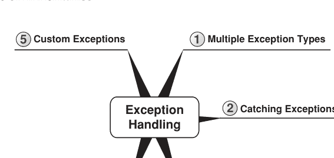

### 多种异常类型

清单 10.1 抛出的是`System.ArgumentException`，而不是第 4 章演示的`System.Exception`类型。C# 允许代码抛出任何派生自（可能间接派生自）`System.Exception`的类型。

`ArgumentException`可以提供更多上下文信息，例如参数名称。如果即使参数为`null`也有一种无害的继续执行方式，请务必使用 C# 6.0 的`null`传播运算符，以避免运行时抛出`NullReferenceException`。

参数异常类型（包括`ArgumentException`、`ArgumentNullException`和`ArgumentOutOfRangeException`）的一个重要特征是，每种类型都有一个构造函数参数，允许以字符串形式标识参数名称。在 C# 6.0 之前，这意味着需要硬编码一个魔法字符串（例如`"textDigit"`）来标识参数名称。这种方法的问题在于，如果参数名称发生变化，开发人员必须记得更新这个魔法字符串。幸运的是，C# 6.0 提供了一个新运算符`nameof`，它接受参数名称标识符并在编译时生成参数名称（参见清单 10.1 中的`nameof(textDigit)`）。这种方法的优点是，IDE 现在可以使用重构工具（例如自动重命名）在所有位置更改该标识符，包括当它被用作`nameof`运算符的参数时。此外，如果参数名称发生变化（未使用重构工具），那么当传给`nameof`运算符的标识符不再存在时，编译器将生成错误。展望未来，在 C# 6.0（或更高版本）中，一般准则是始终使用`nameof`运算符来提供参数异常类型的参数名称。

其他一些异常仅面向运行时使用，并且（有时间接）派生自`System.SystemException`。它们包括`System.StackOverflowException`、`System.OutOfMemoryException`、`System.Runtime.InteropServices.COMException`、`System.ExecutionEngineException`和`System.Runtime.InteropServices.SEHException`。不要抛出这些类型的异常。同样，应避免抛出`System.Exception`或`System.ApplicationException`，因为这些异常过于笼统，几乎无法指示问题的原因或解决方法。相反，应抛出最适合该场景的派生程度最高的异常。显然，开发人员应避免创建可能导致系统故障的 API。但是，如果正在执行的代码达到某种状态，使得继续执行不安全或无法恢复，则应调用`System.Environment.FailFast()`。这将在向 Windows 应用程序事件日志写入消息后立即终止进程；如果用户如此选择，甚至还会将该消息作为 Windows 错误报告的一部分包含在内。

### 准则

- 如果向成员传递了错误的参数，应抛出`ArgumentException`或其子类型之一。如适用，优先选择派生程度最高的异常类型（例如`ArgumentNullException`）。
- 当抛出`ArgumentException`或其某个子类时，应设置`ParamName`属性。
- 在向`ArgumentException`、`ArgumentOutOfRangeException`和`ArgumentNullException`等接受此类参数的参数异常类型传入`paramName`参数时，应使用`nameof`。
- 应抛出最有意义的最具体（派生程度最高）的异常。
- 不要抛出`NullReferenceException`。当值意外为`null`时，应抛出`ArgumentNullException`。
- 不要抛出`System.SystemException`或从此类型派生的异常类型。
- 不要抛出`System.Exception`或`System.ApplicationException`。
- 如果程序遇到无法安全继续执行的情况，应考虑调用`System.Environment.FailFast()`来终止进程。

### 捕获异常

抛出特定异常类型使捕获者能够使用异常类型本身来识别问题。换句话说，没有必要捕获异常后，再根据异常消息使用`switch`语句来决定针对该异常应采取何种操作。相反，C# 允许多个`catch`块，每个块针对特定的异常类型，如清单 10.2 所示。

**清单 10.2：捕获不同类型的异常**

```csharp
using System;

public sealed class Program
{
    public static void Main(string[] args)
    {
        try
        {
            // ...
            throw new InvalidOperationException(
                "Arbitrary exception");
            // ...
        }
        catch (Win32Exception exception)
            when (exception.ErrorCode == 42)
        {
            // Handle Win32Exception where
```


```csharp
// ErrorCode is 42.
}

catch (NullReferenceException exception)
{
    // Handle NullReferenceException
}
catch (ArgumentException exception)
{
    // Handle ArgumentException
}
catch (InvalidOperationException exception)
{
    bool exceptionHandled = false;
    // Handle InvalidOperationException
    // ...
    if (!exceptionHandled)
    {
        throw;
    }
}
catch (SystemException)
{
    // Handle SystemException
}
catch (Exception exception)
{
    // Handle Exception
}
finally
{
    // Handle any cleanup code here as it runs
    // regardless of whether there is an exception
}
}
}
```

因为 `System.InvalidOperationException` 最终派生自 `System.Exception`。由于 `InvalidOperationException` 与抛出的异常最匹配，`catch(InvalidOperationException...)` 将捕获该异常，而不是 `catch(Exception...)` 块。

从 C# 6.0 开始，为 `catch` 块提供了额外的条件表达式。与仅基于异常类型匹配来限制 `catch` 块是否匹配不同，C# 6.0 增加了对条件子句的支持。`when` 子句允许你提供一个布尔表达式；只有在条件为 `true` 时，`catch` 块才会处理该异常。在清单 10.2 中，这是一个相等比较运算符。尽管如此，你也可以例如调用一个方法来验证条件。

当然，你也可以简单地在 `catch` 主体内部将条件检查作为 `if` 块放置。然而，这样做会导致 `catch` 块在条件被检查之前就成为该异常的处理程序。很难编写代码以允许在条件不满足的情况下由不同的 `catch` 块来处理异常。但是，有了异常条件，现在就可以在无需捕获并重新抛出异常的情况下检查程序状态（包括异常）。

谨慎使用条件子句；如果条件表达式本身抛出异常，则该新异常将被忽略，并且条件被视为 `false`。因此，你应避免为异常条件表达式抛出异常。

`Catch` 块必须按顺序出现，从最具体到最通用，以避免编译时错误。例如，将 `catch(Exception...)` 块移动到其他任何异常之前将导致编译错误，因为所有先前的异常在其继承链中的某个点都派生自 `System.Exception`。

如 `catch (SystemException){ })` 块所示，`catch` 块的命名参数不是必需的。事实上，甚至不带类型参数的最终 `catch` 也是允许的，如下一节所述。

## 重新抛出现有异常

在 `InvalidOperationException` `catch` 块中，出现了一个 `throw` 语句，但没有指定要抛出的异常（`throw` 独立存在），即使在 `catch` 块作用域中存在可以重新抛出的异常实例（`exception`）。抛出特定异常会将所有堆栈信息更新为匹配新的抛出位置。结果是，指示异常最初发生的调用站点的所有堆栈信息都将丢失，从而使诊断问题变得困难得多。因此，只要它出现在 `catch` 块内，C# 就支持不带显式异常引用的 `throw` 语句。这样，代码可以检查异常以确定是否可以完全处理它，如果不能，则重新抛出异常（即使未明确指定），就好像它从未被捕获过并且不会替换任何堆栈信息一样。

## ADVANCED TOPIC

## 在不替换堆栈信息的情况下抛出现有异常

在 C# 5.0 中，添加了一种机制，使能够在不丢失原始异常中的堆栈跟踪信息的情况下抛出先前抛出的异常。这允许你例如即使在 `catch` 块之外重新抛出异常，因此无需使用 `throw;`。虽然很少需要这样做，但在某些情况下，异常会被包装或保存，直到程序执行移出 `catch` 块。例如，多线程代码可能会将异常包装为 `AggregateException`。`.NET Framework 4.5` 提供了 `System.Runtime.ExceptionServices.ExceptionDispatchInfo` 类专门用于处理此场景，通过其静态 `Capture()` 和实例 `Throw()` 方法。清单 10.3 演示了在不重置堆栈跟踪信息或使用空 `throw` 语句的情况下重新抛出异常。

```
LISTING 10.3: Using ExceptionDispatchInfo to Rethrow an Exception
```csharp
using System;
using System.Runtime.ExceptionServices;
using System.Threading.Tasks;
Task task = WriteWebRequestSizeAsync(url);
try
{
    while (!task.Wait(100))
    {
        Console.Write(".");
    }
}
catch(AggregateException exception)
{
```
```

```
```csharp
exception = exception.Flatten();
ExceptionDispatchInfo.Capture(
    exception.InnerException).Throw();
}
```
```

使用 `ExceptionDispatchInfo.Throw()` 方法，编译器不会像对待正常的 `throw` 语句那样将其视为 `return` 语句。例如，如果方法签名返回一个值，但从包含 `ExceptionDispatchInfo.Throw()` 的代码路径没有返回值，编译器会发出错误，指出没有返回值。因此，有时开发人员可能被迫在 `ExceptionDispatchInfo.Throw()` 之后跟随一个 `return` 语句，即使该语句在运行时永远不会执行——异常会被抛出。

## Language Contrast: Java—Exception Specifiers

C# 没有 Java 异常说明符的等价物。有了异常说明符，Java 编译器能够验证函数内（或函数调用层次结构内）抛出的所有可能异常都被捕获或声明为可能重新抛出。C# 团队考虑过此选项并得出结论，其带来的维护负担不值得其 perceived 收益。因此，不必在特定调用堆栈中维护所有可能异常的列表，但也无法轻松确定可能出现的异常。（事实证明，这对 Java 来说也不可能。通过调用虚方法或使用后期绑定，例如反射，无法在编译时完全解析方法可能抛出哪些异常。）

## General Catch Block

C# 要求代码抛出的任何对象都必须派生自 `System.Exception`。然而，这一要求并非适用于所有语言。例如，C/C++ 允许抛出任何对象类型，包括不派生自 `System.Exception` 的托管异常。从 C# 2.0 开始，所有异常，无论是否派生自 `System.Exception`，都会作为派生自 `System.Exception` 传播到 C# 程序集。结果是，`System.Exception` `catch` 块将捕获所有未被更早块捕获的异常。

C# 还支持一个 **通用 catch 块**（`catch { }`），其行为与 `catch(System.Exception exception)` 块完全相同，只是没有类型或变量名。此外，通用 catch 块必须出现在 catch 块列表的最后。由于通用 catch 块与 `catch(System.Exception exception)` 块相同并且通用 catch 块必须最后出现，如果两者同时存在于同一个 `try/catch` 语句中，编译器会发出警告，因为通用 catch 块永远不会被调用（请参阅高级主题“General Catch Blocks in C# 1.0”，了解有关通用 catch 块的更多信息）。

## ADVANCED TOPIC

## General Catch Blocks in C# 1.0

在 C# 1.0 中，如果从方法调用（位于非 C# 编写的程序集中）抛出非 `System.Exception` 派生的异常，则该异常不会被 `catch(System.Exception)` 块捕获。如果不同语言抛出一个字符串，例如，异常可能会未被处理。为避免这种情况，C# 包含一个不带参数的 `catch` 块。这种 `catch` 块的术语是通用 catch 块，清单 10.4 包含了一个。

```
Listing 10.4: Catching Any Exception
```csharp
using System;

public sealed class Program
{
    public static void Main()
    {
        try
        {
            // ...
            throw new InvalidOperationException(
                "Arbitrary exception");
            // ...
        }
        catch (NullReferenceException exception)
        {
            // Handle NullReferenceException
```
```

```

}
catch (ArgumentException exception)
{
    // Handle ArgumentException
}
catch (InvalidOperationException exception)
{
    // Handle ApplicationException
}
catch (SystemException exception)
{
    // Handle SystemException
}
catch (Exception exception)
{
    // Handle Exception
}
catch
{
    // Any unhandled exception
}
finally
{
    // Handle any cleanup code here as it runs
    // regardless of whether there is an exception
}
}
```


# 第 10 章：异常处理

通用 `catch` 块将捕获所有异常，无论它们是否派生自 `System.Exception`，前提是更早的 `catch` 块未捕获它们。这种块的缺点仅仅是无法访问异常实例，因此无法知道适当的应对措施。甚至不可能识别这种异常在不太可能的情况下是无害的。最佳做法是在关闭应用程序之前使用一些清理代码处理异常。例如，`catch` 块可以在关闭应用程序或重新抛出异常之前保存任何易失性数据。

## 异常处理指南

异常处理为之前的错误处理机制提供了亟需的结构。然而，如果随意使用，仍然可能导致一些难以收拾的结果。以下指南提供了一些异常处理的最佳实践。

- *只捕获你能处理的异常。*

  通常，某些类型的异常可以处理，而另一些则不能。例如，以独占读写方式打开文件时，如果文件已被占用，可能会抛出 `System.IO.IOException`。捕获此类异常时，代码可以向用户报告文件正在使用中，并让用户选择取消操作或重试。只应捕获那些已有明确应对措施的异常。其他异常类型应留给调用栈中更上层的调用方处理。

- *不要隐藏（掩盖）你未完全处理的异常。*

  新程序员往往忍不住捕获所有异常，然后继续执行，而不是向用户报告未处理的异常。然而，这种做法可能导致严重的系统问题未被发现。除非代码明确采取行动处理某个异常，或明确判定某些异常无害，否则 `catch` 块应当重新抛出异常，而不是捕获它们并将其对调用方隐藏。在大多数情况下，`catch(System.Exception)` 和通用 `catch` 块应出现在调用栈中较高的位置，除非该块以重新抛出异常结束。

- *少用 `System.Exception` 和通用 `catch` 块。*

  几乎所有异常都派生自 `System.Exception`。然而，处理某些 `System.Exception` 的最佳方式是让它们不被处理，或者尽早优雅地关闭应用程序。这些异常包括 `System.OutOfMemoryException` 和 `System.StackOverflowException` 等。在 CLR 4 中，此类异常默认为不可恢复，因此即使捕获后不重新抛出，CLR 也会将其重新抛出。这些异常属于运行时异常，开发者无法通过编写代码从中恢复。因此，最佳做法是关闭应用程序——CLR 4 及更高版本会强制执行这一点。CLR 4 之前的代码应仅在以下情况下捕获此类异常：在关闭应用程序之前运行清理或紧急代码（例如保存任何易失数据），或使用 `throw;` 重新抛出异常。

- *避免在调用栈较低位置报告或记录异常。*

  程序员往往倾向于在调用栈中尽可能早的位置记录异常或向用户报告异常。然而，这些位置很少能够完全处理异常；相反，它们只能转而重新抛出异常。此类 `catch` 块不应在调用栈深处记录异常或向用户报告异常。如果异常被记录后又重新抛出，调用栈中更上层的调用方也可能重复同样操作，导致异常被重复记录。更糟的是，向用户显示异常可能并不适合应用程序的类型。（例如，在 Windows 应用程序中使用 `System.Console.WriteLine()`，用户永远看不到；在无人值守的命令行进程中显示对话框，则可能无人注意并导致应用程序冻结。）与日志和异常相关的用户界面应保留给调用栈中更上层的代码使用。

- *在 `catch` 块内使用 `throw;` 而不是 `throw <exception object>`。*

  在 `catch` 块内重新抛出异常是可行的。例如，`catch(ArgumentNullException exception)` 的实现可以包含对 `throw exception` 的调用。然而，像这样重新抛出异常会将堆栈跟踪重置为重新抛出调用的位置，而不是复用原始抛出点的位置。因此，除非你要以不同的异常类型重新抛出，或者有意隐藏原始调用堆栈，否则请使用 `throw;`，让同一个异常沿调用堆栈向上传播。

- *避免在异常条件中抛出异常。*

  在提供异常条件时，避免使用会抛出异常的代码。这样做会导致条件为假，异常的发生会被忽略。因此，可以考虑将复杂的条件检查放到单独的方法中，并用 `try/catch` 块包裹，显式处理该异常。

- *避免可能随时间变化的异常条件。*

  如果异常条件所评估的条件（例如异常消息）可能随本地化或消息变更而发生变化，预期的异常条件将无法匹配，从而意外改变业务逻辑。因此，要确保异常条件在长期内仍然有效。

- *重新抛出不同异常时要谨慎。*

  在 `catch` 块内部，重新抛出不同的异常不仅会重置抛出点，还会隐藏原始异常。若要保留原始异常，请设置新异常的 `InnerException` 属性，该属性通常可以通过构造函数赋值。重新抛出不同异常应仅限于以下情况：

  1. 更改异常类型能使问题更清楚。

     例如，在调用 `Logon(User user)` 时，如果包含用户列表的文件无法访问，重新抛出另一种异常类型可能比传播 `System.IO.IOException` 更合适。

  2. 原始异常中包含私有数据。

     在上述场景中，如果原始 `System.IO.IOException` 中包含文件路径，从而暴露了系统的私有安全信息，则应对异常进行包装。当然，这假定 `InnerException` 没有被设置为原始异常。（有趣的是，CLR v1 的某个极早期版本（甚至是预发布版）曾出现过一条异常，大意是：“安全异常：你没有权限确定 `c:\temp\foo.txt` 的路径”。）

  3. 异常类型过于具体，调用方难以适当地处理。

     例如，不使用针对特定数据库系统的异常，而是使用更通用的异常，这样调用栈上层的代码就不必涉及特定数据库。

### 指南

- **避免**在调用栈较低位置报告或记录异常。
- **不要**过度捕获。除非清楚如何在调用栈较低位置以编程方式处理这些错误，否则应允许异常沿调用栈向上传播。
- **考虑**捕获特定异常，前提是你理解它为何在特定上下文中被抛出，并且能够以编程方式应对该失败情况。
- **避免**捕获 `System.Exception` 或 `System.SystemException`，除非是在重新抛出异常前执行最终清理操作的顶层异常处理程序中。
- **要**在 `catch` 块内使用 `throw`，而不是 `throw <exception object>`。
- **要**谨慎地重新抛出不同异常。
- **不要**抛出 `NullReferenceException`；当值意外为 null 时，应改用 `ArgumentNullException`。
- **避免**在异常条件中抛出异常。
- **避免**使用可能随时间变化的异常条件。

## 定义自定义异常

一旦抛出异常成为最佳做法，最好使用框架异常，因为它们已经成熟且广为人知。例如，与其抛出自定义的无效参数异常，不如使用 `System.ArgumentException` 类型。然而，如果使用某个特定 API 的开发者会采取特殊处理方式——例如，异常处理逻辑会因处理自定义异常类型而有所不同——那么定义自定义异常是合适的。例如，如果某个映射 API 收到的地址邮政编码无效，与其抛出 `System.ArgumentException`，不如抛出自定义的 `InvalidAddressException`。关键在于，调用方是否会编写针对 `InvalidAddressException` 的、具有特殊处理逻辑的 `catch` 块，而不是仅仅编写一个通用的 `System.ArgumentException` `catch` 块。

- 所有异常都应使用“Exception”后缀。这样，它们的用途就能轻松地从其名称中确定。
- 通常，所有异常都应包含不带参数的构造函数、带一个字符串参数的构造函数，以及由一个字符串和一个内部异常组成的参数集的构造函数。此外，由于异常通常是在抛出异常的同一语句中构造的，因此任何额外的异常数据也应允许作为构造函数的一部分。（创建所有这些构造函数的一个明显例外情况是，如果某些数据是必需的，而构造函数绕过了这些要求。）
- 继承链应保持相对较浅（通常少于大约五层）。

内部异常在重新抛出一个与捕获的异常不同的异常时起着重要作用。例如，如果数据库调用抛出 `System.Data.SqlClient.SqlException`，但在数据访问层中被捕获并作为 `DatabaseException` 重新抛出，则接受 `SqlException`（或内部异常）的 `DatabaseException` 构造函数会将原始 `SqlException` 保存在 `InnerException` 属性中。这样，当需要有关原始异常的更多详细信息时，开发人员可以从 `InnerException` 属性中检索该异常（例如 `exception.InnerException`）。

### 指南

- 如果新异常的处理方式不会与现有 CLR 异常不同，则不要创建新的异常类型。此时应改为抛出现有的框架异常。
- 如果要传达独特的程序错误，而该错误无法使用现有 CLR 异常来传达，并且可以以不同于任何其他现有 CLR 异常类型的方式进行编程处理，则请创建新的异常类型。
- 请在所有自定义异常类型上提供无参数构造函数。同时提供接受消息和内部异常的构造函数。
- 请以“Exception”后缀作为异常类名的结尾。
- 请使异常可进行运行时序列化。
- 请考虑提供异常属性，以便以编程方式访问与该异常相关的额外信息。
- 避免使用过深的异常层次结构。

## 高级主题

### Empty Catch Block Internals

空 `catch` 块对应的 CIL 代码实际上是一个 `catch(object)` 块。因此，无论抛出何种类型，空 `catch` 块都会捕获它。有趣的是，不可能显式声明一个 `catch(object)` 异常处理块。C# 代码中不存在 `catch(object)` 异常处理块。因此，无法捕获非 `System.Exception` 派生的异常，并获取一个可供检查的异常实例。事实上，来自 C++ 等语言的非托管异常通常会产生 `System.Runtime.InteropServices.SEHException` 类型的异常，而后者派生自 `System.Exception` 类型。因此，不仅可以使用通用 `catch` 块捕获非托管类型的异常，也可以捕获被抛出的非 `System.Exception` 托管类型——例如 `string` 这样的类型。

### 可序列化异常

可序列化对象是指运行时可以将其持久化到流中（例如文件流），然后从流中重新实例化的对象。对于异常而言，这种行为在某些分布式通信技术中可能是必需的。为了支持序列化，异常声明应包含 `System.SerializableAttribute` 特性，或者实现 `ISerializable`。此外，它们必须包含一个接受 `System.Runtime.Serialization.SerializationInfo` 和 `System.Runtime.Serialization.StreamingContext` 的构造函数。清单 10.6 展示了使用 `System.SerializableAttribute` 的示例。

**清单 10.6：定义可序列化异常**

```
// Supporting serialization via an attribute

[Serializable]

class DatabaseException : System.Exception

{

    // ...

    // Used for deserialization of exceptions

    public DatabaseException(

        SerializationInfo serializationInfo,

        StreamingContext context)

    {

        //...

    }

}
```

前面的 `DatabaseException` 示例演示了使异常可序列化所需的特性和构造函数要求。

### 重新抛出包装异常

有时，在堆栈较低层抛出的异常在较高层捕获时可能不再有意义。例如，考虑由于服务器磁盘空间不足而发生的 `System.IO.IOException`。捕获此类异常的客户端不一定能理解为何会发生 I/O 活动。类似地，考虑一个抛出 `System.UnauthorizedAccessException` 的地理坐标请求 API（该异常与所调用的 API 完全无关）。在第二个示例中，调用方无法理解 API 调用与安全性有何关联。从调用 API 的代码的角度来看，这些异常造成的困惑多于其帮助诊断的价值。与其向客户端公开此类异常，不如先捕获该异常，然后抛出一个不同的异常，例如 `InvalidOperationException`（甚至可能是自定义异常），以此传达系统处于无效状态。在这种情况下，请务必设置包装异常的 `InnerException` 属性（通常通过构造函数调用，例如 `new InvalidOperationException(String, Exception)`），以便为更接近所调用框架的人员提供可用于诊断目的的额外上下文。

在考虑是否包装并重新抛出异常时，要记住的一个重要细节是：原始堆栈跟踪——提供了异常抛出位置的上下文——将被替换为抛出包装异常处的新堆栈跟踪（假设未使用 `ExceptionDispatchInfo`）。幸运的是，当原始异常嵌入到包装异常中时，原始堆栈跟踪仍然可用。

最终，异常的预期接收者是指编写调用你 API 的代码的程序员——这些代码有可能是错误的。因此，你应向这位程序员提供尽可能多的信息，以表明她做错了什么，以及——也许更重要的是——如何修复它。异常类型是通信机制的关键部分。因此，你必须谨慎选择该类型。

#### 指南

- **考虑** 将较低层抛出的特定异常包装为更合适的异常，如果较低层异常在较高层操作的上下文中没有意义。
- **务必** 在包装异常时指定内部异常。
- **务必** 将开发人员视为异常的目标受众，并在可能的情况下指出问题以及解决问题的机制。
- **务必** 在重新抛出同一异常时使用空的 `throw` 语句（`throw;`），而不是将异常作为参数传递给 `throw`。

## 初学者主题

### Checked 和 Unchecked 转换

正如我们在第 2 章的高级主题中首次讨论的那样，C# 提供了特殊关键字，用于标记一个代码块，并向运行时指示如果目标数据类型太小而无法容纳所赋值的数据，应该发生什么。默认情况下，如果目标数据类型无法容纳所赋值的数据，则数据将在赋值期间被截断。有关示例，请参阅清单 10.7。

**清单 10.7：整数值溢出**

```
using System;

public class Program

{

    public static void Main()

    {

        // int.MaxValue equals 2147483647

        int n = int.MaxValue;

        n = n + 1;

        System.Console.WriteLine(n);

    }

}
```

清单 10.7 的结果如输出 10.1 所示。

**输出 10.1**

```
-2147483648
```

清单 10.7 中的代码将值 -2147483648 写入控制台。但是，将代码放在 `checked` 块中，或在运行编译器时使用 `checked` 选项，将导致运行时抛出 `System.OverflowException` 类型的异常。`checked` 块的语法使用 `checked` 关键字，如清单 10.8 所示。

**清单 10.8：checked 块示例**

```
using System;

public class Program

{

    public static void Main()

    {

        checked

        {

            // int.MaxValue equals 2147483647

            int n = int.MaxValue;

            n = n + 1;

            System.Console.WriteLine(n);

        }

    }

}
```

如果计算仅涉及常量，则默认会进行 `checked` 检查。清单 10.8 的结果如输出 10.2 所示。

**输出 10.2**

```
Unhandled Exception: System.OverflowException: Arithmetic operation resulted in an overflow. at Program.Main() in ...Program.cs:line 12
```

此外，根据 Windows 的版本以及是否安装了调试器，可能会出现一个对话框，提示用户向 Microsoft 发送错误消息、检查解决方案或调试应用程序。此外，位置信息（`Program.cs:line X`）只会出现在调试编译中——即使用 Microsoft `csc.exe` 编译器的 `/debug` 选项进行的编译。结果是，如果在 `checked` 块内运行时发生了溢出赋值，则会抛出异常。

C# 编译器提供了一个命令行选项，用于将默认的 `unchecked` 行为更改为 `checked`。C# 还支持 `unchecked` 块，该块在块内赋值时截断数据，而不是抛出异常（请参阅清单 10.9）。

**清单 10.9：unchecked 块示例**

```
using System;

public class Program

{

    public static void Main()

    {

        unchecked

        {

            // int.MaxValue equals 2147483647

            int n = int.MaxValue;

            n = n + 1;

            System.Console.WriteLine(n);

        }

    }

}
```

清单 10.8 的结果见输出 10.3。

**输出 10.3**

```
-2147483648
```


即使在编译期间启用了 `checked` 选项，清单10.8代码中的 `unchecked` 关键字也会阻止运行时在执行期间抛出异常。

对于不允许使用语句的情况，还可以使用等价的 `checked` 和 `unchecked` 表达式。例如，字段初始化器可以包含表达式，而不是语句：

``` 
int _Number = unchecked(int.MaxValue + 1);
```

## 小结

抛出异常会显著影响性能。一个异常会导致大量运行时栈信息被加载和处理——这些数据在正常情况下是不会被加载的——而且处理起来相当耗时。正如第4章指出的，应该只在处理异常情况时才使用异常；API 应提供机制来检查是否将抛出异常，而不是强制调用某个特定 API 来确定是否将抛出异常。

下一章将介绍泛型——这是 C# 2.0 的一个特性，能显著增强用 C# 1.0 编写的代码。事实上，它基本上废弃了对 `System.Collections` 命名空间的使用，而该命名空间以前几乎在每个项目中都会用到。

# 11 泛型

随着项目变得越来越复杂，你将需要更好的方式来复用和定制现有软件。为了促进代码复用，尤其是算法的复用，C# 包含一个称为泛型（generics）的特性。正如方法因可以接受参数而强大，接受类型参数的类型和方法也拥有显著更多的功能。

泛型在词法上与 Java 的泛型类型和 C++ 的模板相似。在这三种语言中，这些特性都使算法和模式只需实现一次，而不需要针对算法或模式所操作的每种类型分别实现。然而，C# 泛型在实现细节及其对各自语言类型系统的影响方面，与 Java 泛型和 C++ 模板都有很大不同。泛型是在 2.0 版本中添加到运行时和 C# 中的。

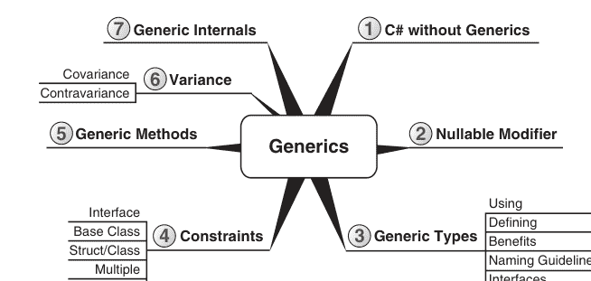

```
switch (key.Key)
{
    case ConsoleKey.Z:
        // Undo the previous Move
        if (path.Count >= 1)
        {
            currentPosition = (Cell)path.Pop();
            Console.SetCursorPosition(
                currentPosition.X, currentPosition.Y);
            Undo();
        }
        break;
    case ConsoleKey.DownArrow:
    case ConsoleKey.UpArrow:
    case ConsoleKey.LeftArrow:
    case ConsoleKey.RightArrow:
        // SaveState()
        currentPosition = new Cell(
            Console.CursorLeft, Console.CursorTop);
        path.Push(currentPosition);
        break;
    default:
        Console.Beep();  // Added in C# 2.0
        break;
}
}
while (key.Key != ConsoleKey.X);  // Use X to quit
}
}
public struct Cell
{
    // Use read-only field prior to C# 6.0
    public int X { get; }
    public int Y { get; }
    public Cell(int x, int y)
    {
        X = x;
        Y = y;
    }
}
```

清单11.2的结果见下一页的输出11.1。

# 第 11 章 泛型

## 输出 11.1

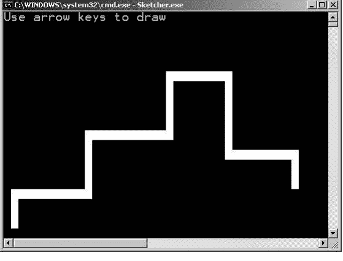

使用声明为 `System.Collections.Stack` 的变量 `path`，你可以通过 `path.Push(currentPosition)` 将自定义类型 `Cell` 传入 `Stack.Push()` 方法，从而保存上一次移动。如果用户输入 Z（或按 Ctrl+Z），你可以使用 `Pop()` 方法从栈中取回上一次移动，将光标位置设为前一个位置，并调用 `Undo()`，从而撤销该移动。

尽管这段代码可以工作，但 `System.Collections.Stack` 类有一个根本缺陷。如清单11.1所示，`Stack` 类收集的是 `object` 类型的值。由于 CLR 中的每个对象都派生自 `object`，`Stack` 不会验证你放入其中的元素是否同质或是否为预期类型。例如，除了传入 `currentPosition`，你还可以传入一个字符串，其中 X 和 Y 用小数点连接。但是，编译器必须允许这些不一致的数据类型，因为 `stack` 类的设计是接受任何对象，而不管其更具体的类型是什么。

此外，使用 `Pop()` 方法从栈中取回数据时，你必须将返回值强制转换为 `Cell`。但如果 `Pop()` 方法返回的值的类型不是 `Cell`，就会抛出异常。通过使用强制转换将类型检查推迟到运行时，会使程序更加脆弱。在不使用泛型的情况下创建可处理多种数据类型的类的根本问题在于，它们必须使用一个通用基类（或接口），通常是 `object`。

将值类型（如结构或整数）与使用 `object` 的类一起使用会使问题更加严重。例如，如果你将值类型传递给 `Stack.Push()` 方法，运行时会自动装箱它。类似地，当你取回值类型时，需要显式拆箱，并将从 `Pop()` 方法获取的对象引用强制转换为值类型。将引用类型强制转换为基类或接口的性能影响可以忽略不计，但值类型的装箱操作会带来更多开销，因为它必须分配内存、复制值，然后在之后对这块内存进行垃圾回收。

C# 是一种鼓励“类型安全”的语言：该语言的设计使得许多类型错误（例如将整数赋给 `string` 类型的变量）可以在编译时被捕获。根本问题在于 `stack` 类并不像人们期望 C# 程序那样类型安全。如果要改变 `stack` 类以强制类型安全，将栈的内容限制为特定数据类型（不使用泛型类型），你必须创建一个专用的栈类，如清单11.3所示。

## 清单 11.3：定义专用的栈类

```
public class CellStack
{
    public virtual Cell Pop();
    public virtual void Push(Cell cell);
    // ...
}
```

由于 `CellStack` 只能存储 `Cell` 类型的对象，这种解决方案需要自定义实现栈方法，这并不理想。实现整数类型安全的栈还需要另一种自定义实现；每种实现看起来都与其它实现极为相似。于是会存在大量重复、冗余的代码。

## 初学者专题

## 另一个示例：可为空的值类型

第2章介绍了在声明值类型变量时使用可为空修饰符 `?` 来声明可能包含 `null` 的变量的能力。C# 直到 2.0 版本才开始支持这一功能，因为正确的实现需要泛型。在引入泛型之前，程序员基本上面临两种选择。

第一种选择是为每个需要处理 `null` 值的值类型声明一个可为空的数据类型，如清单11.4所示。

## 清单 11.4：声明各种存储 null 的值类型版本

```
struct NullableInt
{
    /// <summary>
    /// Provides the value when HasValue returns true.
    /// </summary>
    public int Value{ get; private set; }
    /// <summary>
    /// Indicates whether there is a value or whether
    /// the value is "null".
    /// </summary>
    public bool HasValue{ get; private set; }
    // ...
}
struct NullableGuid
{
    /// <summary>
    /// Provides the value when HasValue returns true.
    /// </summary>
    public Guid Value{ get; private set; }
    /// <summary>
    /// Indicates whether there is a value or whether
    /// the value is "null".
    /// </summary>
    public bool HasValue{ get; private set; }
    ...
}
...
```

清单11.4展示了 `NullableInt` 和 `NullableGuid` 可能的实现。如果程序需要额外的可为空值类型，你将不得不创建另一个结构，并修改属性以使用所需的值类型。对实现的任何改进（添加从基础类型到...的用户定义隐式转换）

`nullable` 类型（例如）将需要修改所有 `nullable` 类型声明。

实现 `nullable` 类型而不使用泛型的另一种策略是创建一个包含类型为 `object` 的 `Value` 属性的单一类型，如 Listing 11.5 所示。

## LISTING 11.5: Declaring a Nullable Type That Contains a Value Property of Type object

```
struct Nullable
{
    /// <summary>
    /// Provides the value when HasValue returns true.
    /// </summary>
    public object Value{ get; private set; }
    /// <summary>
    /// Indicates whether there is a value or whether
    /// the value is "null".
    /// </summary>
    public bool HasValue{ get; private set; }
    ...
}
```

尽管这种选项只需要一个 `nullable` 类型的实现，但在设置 `Value` 属性时，运行时始终会对值类型进行装箱。此外，从 `Value` 属性检索底层值需要进行强制转换操作，这在运行时可能无效。

这两种选项都不是特别有吸引力。为消除此问题，C# 2.0 向 C# 引入了泛型。事实上，`nullable` 类型实际上是以泛型类型 `Nullable<T>` 实现的。

## Introducing Generic Types

泛型提供了一种创建可专门化以处理特定类型的数据结构的机制。程序员定义这些参数化类型，使得特定泛型类型的每个变量具有相同的内部算法，但数据类型和方法签名可以根据为类型参数提供的类型参数而变化。

为了最小化开发人员的学习曲线，C# 设计者选择了在表面上类似于 C++ 模板的语法。在 C# 中，泛型类和结构的语法使用尖括号来在类型声明中声明泛型类型参数，并在使用类型时指定泛型类型参数。

## Using a Generic Class

Listing 11.6 显示了如何指定泛型类使用的实际类型参数。你通过在对象创建表达式和声明语句中都使用尖括号表示法指定 `Cell`，来指示 `path` 变量为“`Stack` of `Cell`”类型。换句话说，当使用泛型数据类型声明变量时，C# 要求开发人员识别泛型类型使用的实际类型参数。Listing 11.6 使用新的泛型 `Stack` 类说明了这一过程。

```
```csharp
using System;
using System.Collections.Generic;

class Program
{
    // ...

    public void Sketch()
    {
        Stack<Cell> path;        // Generic variable declaration
        path = new Stack<Cell>(); // Generic object instantiation
        Cell currentPosition;
        ConsoleKeyInfo key;

        do
        {
            // Etch in the direction indicated by the
            // arrow keys entered by the user.
            key = Move();

            switch (key.Key)
            {
                case ConsoleKey.Z:
                    // Undo the previous Move.
                    if (path.Count >= 1)
                    {
                        // No cast required.
                        currentPosition = path.Pop();
                        Console.SetCursorPosition(
                            currentPosition.X, currentPosition.Y);
                        Undo();
                    }
```

```
break;
case ConsoleKey.DownArrow:
case ConsoleKey.UpArrow:
case ConsoleKey.LeftArrow:
case ConsoleKey.RightArrow:
    // SaveState()
    currentPosition = new Cell(
        Console.CursorLeft, Console.CursorTop);
    // Only type Cell allowed in call to Push().
    path.Push(currentPosition);
    break;
default:
    Console.Beep();  // Added in C# 2.0
    break;
}
} while (key.Key != ConsoleKey.X);  // Use X to quit.
}
}
```

Listing 11.6 的结果出现在 Output 11.2 中。

## OUTPUT 11.2

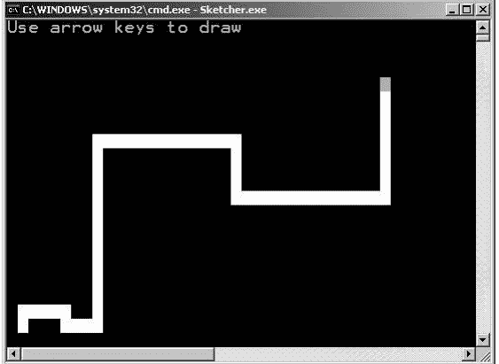

在 Listing 11.6 中显示的 `path` 声明中，你声明一个变量并用 `System.Collections.Generic.Stack<Cell>` 类的新实例对其进行初始化。你在尖括号中指定栈元素的类型为 `Cell`。因此，添加到 `path` 中并从中检索的每个对象都是 `Cell` 类型。进而，你不再需要对 `path.Pop()` 的返回值进行强制转换，也无需确保只有 `Cell` 类型对象被添加到 `path` 的 `Push()` 方法中。

## Defining a Simple Generic Class

泛型允许你编写算法和模式，并为不同数据类型重用代码。Listing 11.7 创建了一个与 Listing 11.6 代码中使用的 `System.Collections.Generic.Stack<T>` 类类似的泛型 `Stack<T>` 类。你在类名后用尖括号指定一个类型参数（在本例中为 `T`）。泛型 `Stack<T>` 然后可以提供一个单一的类型参数，该参数在类中 `T` 出现的地方被“替换”。因此栈可以存储任何声明类型的项目，而无需重复代码或将项目转换为类型 `object`。类型参数 `T` 是一个占位符，必须提供类型参数。在 Listing 11.7 中，你可以看到类型参数将用于内部 `Items` 数组、`Push()` 方法的参数类型以及 `Pop()` 方法的返回类型。

## LISTING 11.7: Declaring a Generic Class, Stack<T>

```
public class Stack<T>
{
    // Use read-only field prior to C# 6.0
    private T[] InternalItems { get; }
    public void Push(T data)
    {
        ...
    }
    public T Pop()
    {
        ...
    }
}
```


## Benefits of Generics

使用泛型类而不是非泛型版本（例如之前使用的 `System.Collections.Generic.Stack<T>` 类而不是原始的 `System.Collections.Stack` 类型）有几个优点。

1. 泛型促进了更强的类型安全，防止除参数化类成员明确预期之外的数据类型。在 Listing 11.7 中，参数化栈类将你限制为使用 `Stack<Cell>` 时的 `Cell` 数据类型。（例如，语句 `path.Push("garbage")` 会产生编译时错误，指出没有可用于 `System.Collections.Generic.Stack<T>.Push(T)` 的重载方法可以处理该字符串，因为它无法转换为 `Cell`。）
2. 编译时类型检查降低了运行时出现 `InvalidCastException` 类型错误的可能性。
3. 使用值类型与泛型类成员不再导致装箱转换为 `object`。（例如，`path.Pop()` 和 `path.Push()` 在添加或移除项目时不需要装箱或拆箱。）
4. `C#` 中的泛型减少了代码膨胀。泛型类型保留了特定类版本的优点，而没有开销。（例如，不再需要定义 `CellStack` 这样的类。）
5. 性能得到改善，因为不再需要从 `object` 进行强制转换，从而消除了类型检查操作。此外，由于值类型不再需要装箱，性能也得到改善。
6. 泛型通过避免装箱从而减少内存消耗，因此在堆上消耗更少的内存。
7. 代码变得更易读，因为强制转换检查更少，并且需要更少的特定类型实现。
8. 通过某种类型的 IntelliSense 协助编码的编辑器可以直接使用泛型类的返回参数。IntelliSense 工作时无需对返回数据进行强制转换。

从核心来看，泛型提供了编码模式实现然后在模式出现的地方重用这些实现的能力。模式描述了代码中反复出现的问题，而模板为这些重复模式提供单一实现。

## Type Parameter Naming Guidelines

正如你在命名方法的形参时一样，在命名类型参数时也应尽可能描述性。此外，为了区分参数为类型参数，其名称应包含 `T` 前缀。例如，在定义 `EntityCollection<TEntity>` 这样的类时，你使用类型参数名 `TEntity`。

唯一不会使用描述性类型参数名称的情况是当这种描述不会增加任何价值时。例如，在 `Stack<T>` 类中使用 `T` 是合适的，因为 `T` 是一个类型参数的指示已经足够描述性；栈适用于任何类型。

在下一节中，你将学习关于约束的内容。使用约束描述性类型名称是一个良好的实践。例如，如果类型参数必须实现 `IComponent`，请考虑类型名为 `TComponent`。

> ### Guidelines
> 
> **DO** 为类型参数选择有意义的名称并以 `T` 为前缀。
> 
> **CONSIDER** 在类型参数的名称中标明约束。

## Generic Interfaces and Structs

`C#` 支持在整个语言中使用泛型，包括接口和结构。语法与类使用的语法相同。要声明具有类型参数的接口，请将类型参数放在接口名称后立即的尖括号中，如 Listing 11.8 中 `IPair<T>` 的示例所示。

**Listing 11.8: Declaring a Generic Interface**

```csharp
interface IPair<T>
{
    T First { get; set; }
    T Second { get; set; }
}
```

该接口表示相同对象的对，例如点的坐标、一个人的遗传父母或二叉树的节点。对中包含的类型对两项都相同。

要实现该接口，你使用与非泛型类相同的语法。请注意，合法的，而且很常见，一个泛型类型的类型参数是另一个泛型类型的类型参数，如清单 11.9 中所示。接口的类型参数是由类声明的类型参数。此外，此示例使用了结构体而不是类，演示了 `C#` 支持自定义泛型值类型。

## 清单 11.9：实现泛型接口

```csharp
public struct Pair<T>: IPair<T>
{
    public T First { get; set; }
    public T Second { get; set; }
}
```

对泛型接口的支持对于集合类尤其重要，因为泛型在集合类中应用最为广泛。在泛型出现之前，开发者依赖于 `System.Collections` 命名空间中的一系列接口。与它们的实现类类似，这些接口只适用于 `object` 类型，因此，接口强制所有对这些集合类的访问和从这些集合类中取出的操作都需要进行强制转换。通过使用类型安全的泛型接口，可以避免强制转换操作。

## 高级主题

### 在单个类上多次实现同一个接口

同一个泛型接口的两种不同构造被视为不同的类型。因此，一个类或结构体可以多次实现“同一个”泛型接口。请考虑清单 11.10 中的示例。

## 清单 11.10：在单个类上重复实现接口

```csharp
public interface IContainer<T>
{
    ICollection<T> Items { get; set; }
    {
        get;
        set;
    }
}

public class Person: IContainer<Address>,
    IContainer<Phone>, IContainer<Email>
{
    ICollection<Address> IContainer<Address>.Items
    {
        get{...}
        set{...}
    }

    ICollection<Phone> IContainer<Phone>.Items
    {
        get{...}
        set{...}
    }

    ICollection<Email> IContainer<Email>.Items
    {
        get{...}
        set{...}
    }
}
```

在此示例中，`Items` 属性通过使用带有不同类型参数的显式接口实现多次出现。没有泛型，这是不可能的；相反，编译器只允许一个显式的 `IContainer.Items` 属性。

然而，许多人认为这种实现“同一个”接口多个版本的技术是“不良代码味道”，因为它可能造成混淆（尤其是当接口允许协变或逆变转换时）。此外，这里的 `Person` 类似乎可能存在设计不良；人们通常不会认为一个人是“能够提供一组电子邮件地址的事物”。当你想要让一个类实现同一接口的三个版本时，请考虑改为实现三个属性是否会更好——例如，`EmailAddresses`、`PhoneNumbers` 和 `MailingAddresses`——每个属性都返回该泛型接口的相应构造。

### 指南

避免在一个类型中实现同一泛型接口的多个构造。

## 定义构造函数和终结器

也许令人惊讶的是，泛型类或结构体的构造函数（和终结器）不需要类型参数；换句话说，它们不需要像 `Pair<T>(){...}` 这样的写法。在清单 11.11 中的 `Pair` 示例中，构造函数使用 `public Pair(T first, T second)` 声明。

## 清单 11.11：声明泛型类型的构造函数

```csharp
public struct Pair<T>: IPair<T>
{
    public Pair(T first, T second)
    {
        First = first;
        Second = second;
    }
    public T First { get; set; }
    public T Second { get; set; }
}
```

## 指定默认值

清单 11.11 包含一个构造函数，它接受 `First` 和 `Second` 的初始值，并将它们赋值给 `_First` 和 `_Second`。由于 `Pair<T>` 是结构体，你提供的任何构造函数都必须初始化所有字段。然而，这带来了一个问题。考虑一个只在实例化时初始化 `Pair<T>` 一半字段的构造函数。

如清单 11.12 所示，定义这样的构造函数会导致编译时错误，因为字段 `_Second` 在构造函数结束时仍未初始化。为 `_Second` 提供初始化是一个难题，因为你不知道 `T` 的数据类型。如果它是引用类型，`null` 可以工作，但如果 `T` 是不可空值类型，这种方法则无效。

## 清单 11.12：未初始化所有字段，导致编译时错误

```csharp
public struct Pair<T>: IPair<T>
{
    // 错误：字段 'Pair<T>._second' 必须在控制离开构造函数前完全赋值
    // public Pair(T first)
    // {
    //     First = first;
    // }
    // ...
}
```

为了处理这种情况，`C#` 提供了 `default` 运算符，该运算符首次在第 8 章中讨论。在第 8 章中，我们展示了如何使用 `default(int)` 指定 `int` 的默认值。对于 `_Second` 所需的 `T` 的情况，你可以使用 `default(T)`，如清单 11.13 所示。

## 清单 11.13：使用 default 运算符初始化字段

```csharp
public struct Pair<T>: IPair<T>
{
    public Pair(T first)
    {
        First = first;
        Second = default(T);
    }
    // ...
}
```

`default` 运算符可以为任何类型（包括类型参数）提供默认值。

## 多个类型参数

泛型类型可以声明任意数量的类型参数。最初的 `Pair<T>` 示例只包含一个类型参数。为了支持存储二元对象对（如名称/值对），你可以创建一个声明了两个类型参数的新版本类型，如清单 11.14 所示。

## 清单 11.14：声明具有多个类型参数的泛型

```csharp
interface IPair<TFirst, TSecond>
{
    TFirst First { get; set; }
    TSecond Second { get; set; }
}

public struct Pair<TFirst, TSecond>: IPair<TFirst, TSecond>
{
    public Pair(TFirst first, TSecond second)
    {
        First = first;
        Second = second;
    }
    public TFirst First { get; set; }
```

`T` 在嵌套类型中同样可用。如果嵌套类型包含自己名为 `T` 的类型参数，这将隐藏包含类型中的类型参数，并且嵌套类型中对 `T` 的任何引用都将指向嵌套的 `T` 类型参数。幸运的是，在嵌套类型中重用相同的类型参数名称会导致编译器警告，以防止意外重叠（见清单 11.18）。

## 清单 11.18：嵌套泛型类型

```csharp
class Container<T, U>
{
    // 嵌套类继承类型参数。
    // 重用类型参数名称会导致
    // 警告。
    class Nested<U>
    {
        void Method(T param0, U param1)
        {
        }
    }
}
```

包含类型的类型参数可以在嵌套类型中访问，方式与包含类型的成员可以从嵌套类型中访问的方式相同。规则很简单：类型参数在其声明类型的整个主体内都可用。

### 指南

> 避免使用嵌套类型中具有相同名称的类型参数来遮蔽外部类型的类型参数。

## 约束

泛型支持对类型参数定义约束的能力。这些约束确保作为类型参数提供的类型符合各种规则。例如，以清单 11.19 中所示的 `BinaryTree<T>` 类为例。

## 清单 11.19：声明无约束的 BinaryTree<T> 类

```csharp
public class BinaryTree<T>
{
    public BinaryTree ( T item)
    {
        Item = item;
    }
    public T Item { get; set; }
    public Pair<BinaryTree<T>> SubItems { get; set; }
}
```

（一个有趣的附注是，`BinaryTree<T>` 在内部使用了 `Pair<T>`，这是可能的，因为 `Pair<T>` 只是另一种类型。）

假设你想要树在将值分配给 `SubItems` 属性时对 `Pair<T>` 中的值进行排序。为了实现排序，`SubItems` 的 `set` 访问器使用所提供的键的 `CompareTo()` 方法，如清单 11.20 所示。

## 清单 11.20：需要类型参数支持接口

```csharp
public class BinaryTree<T>
{
    public T Item { get; set; }
    public Pair<BinaryTree<T>> SubItems
    {
        get{ return _SubItems; }
        set
        {
            IComparable<T> first;
            // 错误：无法隐式转换类型...
            first = value.First; // 需要显式强制转换
            if (first.CompareTo(value.Second) < 0)
            {
                // first 小于 second。
                // ...
            }
            else
            {
                // first 和 second 相同，或
                // second 小于 first。
                // ...
            }
            _SubItems = value;
        }
    }
    private Pair<BinaryTree<T>> _SubItems;
}
```

在编译时，类型参数 `T` 是一个无约束的泛型。当代码按清单 11.20 所示编写时，编译器假定 `T` 上可用的成员只有从基类型 `object` 继承的那些，因为每种类型都以 `object` 作为基类。因此，在类型参数 `T` 的实例上只能调用诸如 `ToString()` 之类的方法。结果，编译器会显示编译错误，因为 `CompareTo()` 方法未在 `object` 类型上定义。

如清单 11.21 所示，你可以将 `T` 参数强制转换为 `IComparable<T>` 接口来访问 `CompareTo()` 方法。

```csharp
public class BinaryTree<T>
{
    public T Item { get; set; }
    public Pair<BinaryTree<T>> SubItems
    {
        get { return _SubItems; }
        set
        {
            IComparable<T> first;
            first = (IComparable<T>)value.First.Item;
            if (first.CompareTo(value.Second.Item) < 0)
            {
                // first is less than second.
                ...
            }
            else
            {
                // second is less than or equal to first.
                ...
            }
            _SubItems = value;
        }
    }
    private Pair<BinaryTree<T>> _SubItems;
}
```

遗憾的是，如果现在声明一个 `BinaryTree<SomeType>` 类变量，但类型参数并未实现 `IComparable<SomeType>` 接口，就会遇到执行时错误——具体来说是 `InvalidCastException`。这消除了使用泛型的初衷之一：提高类型安全性。

为了避免此异常，并在类型参数未实现接口时生成编译时错误，`C#` 允许你为泛型类型中声明的每个类型参数提供一个可选的约束列表。约束声明了泛型类型对提供给每个类型参数的类型实参所要求的特性。你使用 `where` 关键字声明约束，后跟一个“参数—要求”对，其中参数必须是泛型类型中声明的参数之一，要求描述了类型实参必须可转换到的类或接口、是否存在默认构造函数，或引用/值类型限制。

## 接口约束

为了确保二叉树的节点排序正确，你可以在 `BinaryTree` 类中使用 `CompareTo()` 方法。要做到这一点，最有效的方法是对 `T` 类型参数施加一个约束。也就是说，你需要 `T` 类型参数实现 `IComparable<T>` 接口。声明此约束的语法见清单 11.22。

```csharp
public class BinaryTree<T>
    where T: System.IComparable<T>
{
    public T Item { get; set; }
    public Pair<BinaryTree<T>> SubItems
    {
        get { return _SubItems; }
        set
        {
            IComparable<T> first;
            // ...
        }
    }
    private Pair<BinaryTree<T>> _SubItems;
}
```

（注：原文在代码块结束前中断，此处在保留原意的基础上补全了闭合花括号；若需严格对照，可忽略补充部分。）


```
            // Notice that the cast can now be eliminated.

            first = value.First.Item;

            if (first.CompareTo(value.Second.Item) < 0)

            {

                // first is less than second.

                ...

            }

            else

            {

                // second is less than or equal to first.

                ...

            }

            _SubItems = value;

        }

    }

    private Pair<BinaryTree<T>> _SubItems;

}
```

当添加了清单11.22中的接口约束后，编译器会确保每次使用`BinaryTree<T>`类时，你指定的类型参数都实现了相应构造的`IComparable<T>`接口。此外，你不再需要在调用`CompareTo()`方法之前将变量显式强制转换为`IComparable<T>`接口。即使是访问使用显式接口实现的成员，也无需强制转换，在其它上下文中，这种成员若不进行强制转换就会被隐藏。在泛型类型参数类型的值上调用方法时，编译器会检查该方法是否与声明为约束的任何接口上的任何方法匹配。

如果你尝试使用`System.Text.StringBuilder`作为类型参数来创建`BinaryTree<T>`变量，将收到编译器错误，因为`StringBuilder`没有实现`IComparable<StringBuilder>`。该错误与输出11.3中显示的错误类似。

### 输出 11.3

```
error CS0311: The type 'System.Text.StringBuilder' cannot be used as type
parameter 'T' in the generic type or method 'BinaryTree<T>'. There is no
implicit reference conversion from 'System.Text.StringBuilder' to
'System.IComparable<System.Text.StringBuilder>'.
```

要为约束指定接口，需声明**接口类型约束**。这种约束甚至无需强制转换即可调用显式接口成员实现。

## 类类型约束

有时你可能希望将类型实参约束为可转换为某个特定的类类型。使用**类类型约束**即可做到这一点，如清单11.23所示。

### 清单11.23：声明类类型约束

```
public class EntityDictionary<TKey, TValue>
    : System.Collections.Generic.Dictionary<TKey, TValue>
    where TValue : EntityBase
{
    ...
}
```

在清单11.23中，`EntityDictionary<TKey, TValue>`要求为类型参数`TValue`提供的所有类型实参都可隐式转换为`EntityBase`类。通过要求这种转换，就可以在泛型实现中对`TValue`类型的值使用`EntityBase`的成员，因为约束将确保所有类型实参都可隐式转换为`EntityBase`类。

类类型约束的语法与接口类型约束相同，只不过类类型约束必须出现在任何接口类型约束之前（就像在类声明中基类必须出现在实现的接口之前一样）。然而，与接口约束不同，多个基类约束是不允许的，因为不可能从多个无关的类派生。同样，基类约束也不能指定密封类或非类类型。例如，C#不允许将类型参数约束为`string`或`System.Nullable<T>`，因为那样该类型参数就只有一种可能的类型实参了——那就称不上“泛型”了。如果类型参数被约束为单一类型，那首先就没有必要使用类型参数；直接使用该类型即可。

某些“特殊”类型不能作为类类型约束。详见本章后面的高级主题“约束限制”。

## `struct`/`class` 约束

另一个有价值的泛型约束是能够将类型实参限制为任何非可空值类型或任何引用类型。C#提供了一种特殊语法，它也适用于引用类型。无需指定`T`必须从哪个类派生，只需使用`struct`或`class`关键字，如清单11.24所示。

```
public struct Nullable<T> :
    IFormattable, IComparable,
    IComparable<Nullable<T>>, INullable
    where T : struct
{
    // ...
}
```

请注意，`class`约束——多少有些令人困惑——并不将类型实参限制为类类型，而是将其限制为引用类型。为使用`class`约束约束的类型参数提供的类型实参可以是任何类、接口、委托或数组类型。

由于类类型约束要求特定的类，将`struct`约束与类类型约束一起使用会相互矛盾。因此，不能组合`struct`和`class`约束。

`struct`约束有一个特殊之处：可空值类型不满足该约束。为什么？可空值类型是作为泛型类型`Nullable<T>`实现的，而`Nullable<T>`本身就对`T`应用了`struct`约束。如果可空值类型满足该约束，就可以定义无意义的类型`Nullable<Nullable<int>>`。双重可空整数会令人困惑到毫无意义的地步。（正如所料，简写语法`int??`也不允许。）

## 多重约束

对于任何给定的类型参数，可以指定任意数量的接口类型约束，但最多只能有一个类类型约束（正如一个类可以实现任意数量的接口，但只能继承自另一个类）。每个新约束都以逗号分隔的列表形式声明，跟在泛型类型参数和冒号之后。如果有多个类型参数，每个都必须以`where`关键字开头。在清单11.25中，泛型`EntityDictionary`类声明了两个类型参数：`TKey`和`TValue`。`TKey`类型参数有两个接口类型约束，`TValue`类型参数有一个类类型约束。

```
public class EntityDictionary<TKey, TValue>
    : Dictionary<TKey, TValue>
    where TKey : IComparable<TKey>, IFormattable
    where TValue : EntityBase
{
    ...
}
```

在这种情况下，`TKey`自身有多个约束，`TValue`还有一个额外约束。当对一个类型参数指定多个约束时，隐含的是AND关系。例如，如果为`TKey`提供类型`C`作为类型实参，`C`必须实现`IComparable<C>`和`IFormattable`。

注意每个`where`子句之间没有逗号。

## 构造函数约束

在某些情况下，希望在泛型类内部创建类型参数类型的实例。例如在 11.26 节中，`EntityDictionary<TKey, TValue>` 类的 `MakeValue()` 方法必须创建对应于类型参数 `TValue` 的类型参数类型的实例。

### LISTING 11.26: Requiring a Default Constructor Constraint

```csharp
public class EntityBase<TKey>
{
    public TKey Key { get; set; }
}

public class EntityDictionary<TKey, TValue> :
    Dictionary<TKey, TValue>
    where TKey : IComparable<TKey>, IFormattable
    where TValue : EntityBase<TKey>, new()
{
    // ...
    public TValue MakeValue(TKey key)
    {
        TValue newEntity = new TValue();
        newEntity.Key = key;
        Add(newEntity.Key, newEntity);
        return newEntity;
    }
    // ...
}
```

由于并非所有对象都保证具有公共默认构造函数，编译器不允许你在未受约束的类型参数上调用默认构造函数。要覆盖此编译器限制，可以在指定所有其他约束之后添加文本 `new()`。此文本是构造函数约束，它要求对应于受约束类型参数的类型参数具有公共默认构造函数。只有默认构造函数约束可用。你不能指定一个约束来确保提供的类型参数提供一个带有形式参数的构造函数。

## 约束继承

泛型类型参数及其约束不会被派生类继承，因为泛型类型参数不是成员。记住，类继承是派生类具有基类所有成员的属性。创建一个继承自其他泛型类型的新泛型类型是一种常见做法。在这种情况下，由于派生泛型类型的类型参数成为泛型基类的类型参数，因此类型参数必须具有与基类上相同或更强的约束。困惑吗？请考虑 11.27 节。

### LISTING 11.27: Inherited Constraints Specified Explicitly

```csharp
class EntityBase<T> where T : IComparable<T>
{
    // ...
}

// ERROR:
// The type 'U' must be convertible to
// 'System.IComparable<U>' to use it as parameter
// 'T' in the generic type or method.
// class Entity<U> : EntityBase<U>
// {
//     ...
// }
```

在 11.27 节中，`EntityBase<T>` 要求为 `T` 提供的类型参数 `U` 由基类说明符 `EntityBase<U>` 实现 `IComparable<U>`。因此，`Entity<U>` 类需要对 `U` 要求相同的约束。未能这样做将导致编译时错误。此模式增加了程序员对派生类中基类的类型约束的认识，避免了程序员在使用派生类时可能发生的混淆，当发现约束但不了解其来源时。

我们尚未介绍泛型方法；我们将在本章后面介绍它们。现在，只需认识到方法也可能是泛型的，并且也可能对为其类型参数提供的类型参数施加约束。那么，当虚拟泛型方法被继承和重写时，约束如何处理？与在泛型类上声明的类型参数的情况相反，重写虚拟泛型方法（或显式接口方法）的约束是隐式继承的，并且可能不会重复声明（参见 11.28 节）。

### LISTING 11.28: Repeating Inherited Constraints on Virtual Members Is Prohibited

```csharp
class EntityBase
{
    public virtual void Method<T>(T t)
        where T : IComparable<T>
    {
        // ...
    }
}

class Order : EntityBase
{
    public override void Method<T>(T t)
    //    Constraints may not be repeated on overriding
    //    members
    //    where T : IComparable<T>
    {
        // ...
    }
}
```

在泛型类继承的情况下，可以通过添加基类上的约束（必需）以及其他约束来进一步约束派生类上的类型参数。然而，重写的虚拟泛型方法需要完全符合基类方法定义的约束。额外的约束可能会破坏多态性，因此不允许，并且重写方法上的类型参数约束是隐含的。

### ADVANCED TOPIC

## 约束限制

约束被适当限制以避免无意义的代码。例如，你不能将类类型约束与 `struct` 或 `class` 约束组合。也不能指定约束以将继承限制为特殊类型，例如 `object`、数组、`System.ValueType`、`System.Enum`（枚举）、`System.Delegate` 或 `System.MulticastDelegate`。

在某些情况下，约束限制可能更可取，但它们仍然不受支持。以下小节提供了一些不允许的约束的附加示例。

### Operator Constraints Are Not Allowed

你不能将类型参数约束为实现特定方法或运算符的类型，除非通过接口类型约束（用于方法）或类类型约束（用于方法和运算符）。由于这个原因，11.29 节中的泛型 `Add()` 不起作用。

```csharp
public abstract class MathEx<T>
{
    public static T Add(T first, T second)
    {
        // Error: Operator '+' cannot be applied to
        // operands of type 'T' and 'T'.
        // return first + second;
    }
}
```

在这种情况下，该方法假设 `+` 运算符对可作为 `T` 的类型参数提供的所有类型都可用。但没有任何约束可以防止你提供一个没有关联加法运算符的类型参数，因此会发生错误。不幸的是，除了使用实现加法运算符的类类型约束的类类型约束之外，没有办法指定在约束中需要加法运算符。

更一般地说，没有办法约束类型具有静态方法。

### OR Criteria Are Not Supported

如果你为类型参数提供多个接口或类约束，编译器始终假设约束之间存在 AND 关系。例如，`where T : IComparable<T>, IFormattable` 要求同时支持 `IComparable<T>` 和 `IFormattable`。没有办法在约束之间指定 OR 关系。因此，11.30 节的等价物不受支持。

```csharp
public class BinaryTree<T>
{
    // Error: OR is not supported.
    // where T: System.IComparable<T> || System.IFormattable
    ...
}
```

支持此功能将阻止编译器在编译时解析要调用哪个方法。

### Constraints of Type Delegate and Enum Are Not Valid

委托类型、数组类型和枚举类型可能不会用作类类型约束，因为它们都是有效地“密封”类型。（如果你不熟悉委托类型，请参阅第 12 章。）它们的基类型——`System.Delegate`、`System.MulticastDelegate`、`System.Array` 和 `System.Enum`——也不能用作约束。例如，当编译器遇到 11.31 节中的类声明时，将生成错误。

### LISTING 11.31: Inheritance Constraints Cannot Be of Type System.Delegate

```csharp
// Error: Constraint cannot be special class 'System.Delegate'
public class Publisher<T>
    where T : System.Delegate
{
    public event T Event;
    public void Publish()
    {
        if (Event != null)
        {
            Event(this, new EventArgs());
        }
    }
}
```

所有委托类型都被视为不能指定为类型参数的特殊类。这样做将阻止对 `Event()` 调用的编译时验证，因为使用数据类型 `System.Delegate` 和 `System.MulticastDelegate` 时事件触发的签名是未知的。相同的限制适用于任何枚举类型。

### Constructor Constraints Are Allowed Only for Default Constructors

11.26 节包括一个构造函数约束，强制为 `TValue` 提供的类型参数提供公共无参数构造函数。没有约束可以强制类型参数提供采用其他形式参数的构造函数。例如，你可能希望约束 `TValue`，以便为其提供的类型参数必须提供一个采用为 `TKey` 提供的类型参数的构造函数，但这是不可能的。11.32 节演示了无效代码。

### LISTING 11.32: Constructor Constraints Can Be Specified Only for Default Constructors

```csharp
public TValue New(TKey key)
{
```


```
// Error: 'TValue': Cannot provide arguments
// when creating an instance of a variable type.
TValue newEntity = null;
// newEntity = new TValue(key);
Add(newEntity.Key, newEntity);
return newEntity;
}
```

一种规避此限制的方法是提供一个包含用于实例化该类型的工厂接口。实现该接口的工厂负责实例化实体，而不是 `EntityDictionary` 本身（参见列表 11.33）。

## LISTING 11.33: Using a Factory Interface in Place of a Constructor Constraint

```
public class EntityBase<TKey>
{
    public EntityBase(TKey key)
    {
        Key = key;
    }
    public TKey Key { get; set; }
}

public class EntityDictionary<TKey, TValue, TFactory> :
    Dictionary<TKey, TValue>
    where TKey : IComparable<TKey>, IFormattable
    where TValue : EntityBase<TKey>
    where TFactory : IEntityFactory<TKey, TValue>, new()
{
    ...
    public TValue New(TKey key)
    {
        TFactory factory = new TFactory();
        TValue newEntity = factory.CreateNew(key);
        Add(newEntity.Key, newEntity);
        return newEntity;
    }
    ...
}

public interface IEntityFactory<TKey, TValue>
{
    TValue CreateNew(TKey key);
}
...
```

这样的声明允许你将新的键传递给接受参数的 `TValue` 工厂方法，而不是强制依赖默认构造函数。它不再对 `TValue` 使用构造函数约束，因为 `TFactory` 负责实例化值。（对列表 11.33 中的代码的一个修改是缓存对工厂方法的引用——如果需要多线程支持，可以利用 `Lazy<T>`。这将使你能够重用工厂方法而不是每次都重新实例化它。）

`EntityDictionary<TKey, TValue, TFactory>` 类型变量的声明将导致与列表 11.34 中 `Order` 实体类似的实体声明。

## LISTING 11.34: Declaring an Entity to Be Used in EntityDictionary<...>

```
public class Order : EntityBase<Guid>
{
    public Order(Guid key) :
        base(key)
    {
        // ...
    }
}

public class OrderFactory : IEntityFactory<Guid, Order>
{
    public Order CreateNew(Guid key)
    {
        return new Order(key);
    }
}
```

## Generic Methods

之前，你看到过在类型为泛型时向类型添加方法相对简单；此类方法可以使用类型声明的泛型类型参数。例如，在我们迄今为止看到的泛型类示例中就是这样做的。

泛型方法使用泛型类型参数，就像泛型类型一样。它们可以声明在泛型或非泛型类型中。如果声明在泛型类型中，它们的类型参数与其包含的泛型类型不同。要声明泛型方法，你以与泛型类型相同的方式指定泛型类型参数：紧跟在方法名称之后添加类型参数声明语法，如列表 11.35 中 `MathEx.Max<T>` 和 `MathEx.Min<T>` 示例所示。

### LISTING 11.36: Specifying the Type Parameter Explicitly

```
```csharp
Console.WriteLine(
    MathEx.Max<int>(7, 490));
Console.WriteLine(
    MathEx.Min<string>("R.O.U.S.", "Fireswamp"));
```
```

列表 11.36 的输出显示在 Output 11.4。

### OUTPUT 11.4

```
```text
490
Fireswamp
```
```

不出所料，类型参数 `int` 和 `string` 对应于泛型方法调用中实际使用的类型。然而，指定类型参数是多余的，因为编译器可以从传递给方法的形式参数推断出类型参数。很明显，列表 11.36 中 `Max` 的调用者希望类型参数为 `int`，因为两个方法参数都是 `int` 类型。为了避免冗余，你可以在编译器能够逻辑上推断出你必须打算使用的类型参数的所有情况下，从调用中排除类型参数。这种做法被称为 **method type inference**，示例出现在列表 11.37 中。输出显示在 Output 11.5。

### LISTING 11.37: Inferring the Type Argument from the Arguments

```
```csharp
Console.WriteLine(
    MathEx.Max(7, 490)); // No type arguments!
Console.WriteLine(
    MathEx.Min("R.O.U.S.", "Fireswamp"));
```
```

### OUTPUT 11.5

```
```text
490
Fireswamp
```
```

要使方法类型推断成功，参数的类型必须以能够推断出所需类型参数的方式与泛型方法的形参“匹配”。一个有趣的问题是，当做出矛盾的推断时会发生什么。例如，当你使用 `MathEx.Max(7.0, 490)` 调用 `Max<T>` 方法时，编译器可以从第一个参数推断出类型参数应为 `double`，也可以从第二个参数推断出类型参数为 `int`，这是一个矛盾。在 C# 2.0 中，这会产生错误。更复杂的分析会注意到矛盾可以解决，因为每个 `int` 都可以转换为 `double`，所以 `double` 是类型参数的最佳选择。C# 3.0 和 C# 4.0 都包含了对方法类型推断算法的改进，允许编译器进行这些更复杂的分析。

在方法类型推断仍不足以推断出类型参数的情况下，你可以通过在参数上插入强制转换来澄清编译器应用于推断的参数类型，或放弃类型推断并显式包含类型参数。

请注意，方法类型推断算法在进行推断时，仅考虑参数、参数的类型以及泛型方法的形参类型。实践中可能用于分析的其他因素——例如泛型方法的返回类型、方法返回值被赋值的变量的类型，或方法泛型类型参数的约束——方法类型推断算法根本不考虑。

## Specifying Constraints

泛型方法的类型参数可以以与泛型类型的类型参数完全相同的方式受到约束。例如，你可以限制方法的类型参数实现接口或可转换为类类型。约束指定在参数列表和方法体之间，如列表 11.38 所示。

## LISTING 11.38: Specifying Constraints on Generic Methods

```
public class ConsoleTreeControl
{
    // Generic method Show<T>
    public static void Show<T>(BinaryTree<T> tree, int indent)
        where T : IComparable<T>
    {
        Console.WriteLine("\n{0}{1}",
            "- ".PadLeft(5*indent, ' '),
            tree.Item.ToString());
        if (tree.SubItems.First != null)
            Show(tree.SubItems.First, indent+1);
    }
```

此代码的问题在于，对方法的调用者来说，`Deserialize<T>()` 看起来是类型安全的。然而，仍然代表调用者执行了强制转换操作，如此处所示的非泛型等价物：

```
string greeting =
    (string)Deserialization.Deserialize(stream, formatter);
```

强制转换可能在运行时失败；该方法可能不如它看起来那样类型安全。`Deserialize<T>` 方法之所以是泛型的，仅仅是为了能够隐藏强制转换的存在，使其对调用者不可见，这似乎是危险地具有欺骗性。最好让该方法是非泛型的并返回 `object`，使调用者意识到它不是类型安全的。开发人员在使用泛型方法中的强制转换时应谨慎，如果没有约束来验证强制转换的有效性。

## Guidelines

AVOID misleading the caller with generic methods that are not as type-safe as they appear.

## Covariance and Contravariance

泛型类型的新用户经常问的一个问题是，为什么 `List<string>` 类型的表达式不能分配给 `List<object>` 类型的变量——如果 `string` 可以转换为 `object`，那么字符串列表也应与对象列表兼容。但一般来说，这既不是类型安全的也不是合法的。如果使用相同的泛型类用不同的类型参数声明两个变量，即使是从更具体的类型分配给更通用的类型，变量也不是类型兼容的——换句话说，它们不是协变的。

`Covariant` 是范畴论中的一个技术术语，但其基本思想很简单：假设两种类型 X 和 Y 具有特殊关系——即 X 类型的每个值都可以转换为 Y 类型。如果类型 `I<X>` 和 `I<Y>` 也始终具有相同的特殊关系，我们就说，“`I<T>` 在 T 上是协变的”。在处理只有一个类型参数的简单泛型类型时，可以理解类型参数，我们简单地说，“`I<T>` 是协变的”。从 `I<X>` 到 `I<Y>` 的转换称为协变转换。

例如，泛型类的实例 `Pair<Contact>` 和 `Pair<PdaItem>` 即使类型参数本身是兼容的，也不是类型兼容的。换句话说，编译器会阻止将 `Pair<Contact>` 转换为 `Pair<PdaItem>`（隐式或显式），即使 `Contact` 派生自 `PdaItem`。同样，将 `Pair<Contact>` 转换为接口类型 `IPair<PdaItem>` 也会失败。参见列表 11.40 的示例。

### LISTING 11.40: Conversion between Generics with Different Type Parameters

```
// ...

// Error: Cannot convert type ...

Pair<PdaItem> pair = (Pair<PdaItem>) new Pair<Contact>();

IPair<PdaItem> duple = (IPair<PdaItem>) new Pair<Contact>();
```

但为什么这不合法呢？为什么 `List<T>` 和 `Pair<T>` 不是协变的？列表 11.41 显示了如果 C# 语言允许不受限制的泛型协变会发生什么。

### LISTING 11.41: Preventing Covariance Maintains Homogeneity

```
//...

Contact contact1 = new Contact("Princess Buttercup");

Contact contact2 = new Contact("Inigo Montoya");

Pair<Contact> contacts = new Pair<Contact>(contact1, contact2);

// This gives an error: Cannot convert type ...

// But suppose it did not.

// IPair<PdaItem> pdaPair = (IPair<PdaItem>) contacts;

// This is perfectly legal, but not type-safe.

// pdaPair.First = new Address("123 Sesame Street");

...
```

一个 `IPair<PdaItem>` 可以包含一个地址，但该对象实际上是一个 `Pair<Contact>`，它只能包含联系人，不能包含地址。如果允许不受限制的泛型协变，类型安全将被完全破坏。

现在应该也很清楚为什么字符串列表不能用作对象列表。你不能向字符串列表中插入整数，但你可以向对象列表中插入整数；因此，将字符串列表强制转换为对象列表是非法的，这是一个编译器可以强制执行的错误。

## Enabling Covariance with the out Type Parameter Modifier in C# 4.0

你可能已经注意到，以上作为不受限制协变后果描述的两个问题都出现的原因是泛型 pair 和泛型 list 允许对其内容进行写入。假设我们通过创建一个只读的 `IReadOnlyPair<T>` 接口来消除这种可能性，该接口仅将 `T` 作为“输出”暴露于接口之外（即用作方法返回类型或只读属性）并且永远不会“输入”到其中（即用作形式参数或可写属性类型）。如果我们将自己限制为相对于 `T` 的“仅输出”接口，以上描述的协变问题就不会发生（参见列表 11.42）。

### LISTING 11.42: Potentially Possible Covariance

```
interface IReadOnlyPair<T>
{
    T First { get; }
    T Second { get; }
}

interface IPair<T>
{
    T First { get; set; }
    T Second { get; set; }
}

public struct Pair<T> : IPair<T>, IReadOnlyPair<T>
{
    // ...
}

class Program
{
    static void Main()
    {
        // Error: Only theoretically possible without
        // the out type parameter modifier
        Pair<Contact> contacts =
            new Pair<Contact>(
                new Contact("Princess Buttercup"),
                new Contact("Inigo Montoya") );
        IReadOnlyPair<PdaItem> pair = contacts;
        PdaItem pdaItem1 = pair.First;
        PdaItem pdaItem2 = pair.Second;
    }
}
```

当我们将泛型类型声明限制为仅将数据作为从接口传出时，编译器就没有理由阻止协变。对 `IReadOnlyPair<PdaItem>` 实例的所有操作都将

## Enabling Contravariance with the in Type Parameter Modifier in C# 4.0

“向后”进行的协变称为逆变。同样，假设两个类型 X 和 Y 存在关系，使得 X 的每个值都可以转换为 Y 的类型。如果类型 `I<X>` 和 `I<Y>` 总是具有相同的特殊关系“向后”——也就是说，`I<Y>` 的每个值都可以转换为 `I<X>` 的类型——我们说，“`I<T>` 在 T 上是逆变的。”

大多数人会发现逆变比协变更难理解。逆变的典型示例是比较器。假设你有一个派生类型 `Apple` 和一个基类型 `Fruit`。显然，它们具有特殊关系：每个 `Apple` 值都可以转换为 `Fruit`。

现在假设你有一个接口 `ICompareThings<T>`，它有一个方法 `bool FirstIsBetter(T t1, T t2)`，该方法接受两个 T，并返回一个 bool，说明第一个是否比第二个更好。

提供类型参数时会发生什么？`ICompareThings<Apple>` 有一个接受两个 Apples 并比较它们的方法。`ICompareThings<Fruit>` 有一个接受两个 Fruits 并比较它们的方法。但由于每个 Apple 都是一个 Fruit，显然 `ICompareThings<Fruit>` 的值可以在需要 `ICompareThings<Apple>` 的任何地方安全使用。“可转换性”的“方向”已被“反转”；因此术语“逆变”。

也许毫不奇怪，确保安全逆变所需的限制与协变接口的限制相反。在其一个类型参数上是逆变的接口必须仅在“输入”位置使用该类型参数，例如形式参数（或在写-only 属性的类型中，这非常罕见）。你可以通过使用 `in` 修饰符声明类型参数来将接口标记为逆变，如列表 11.44 所示。

### LISTING 11.44: Contravariance Using the in Type Parameter Modifier

```
class Fruit {}
```


class Apple : Fruit {}

class Orange : Fruit {}

interface ICompareThings<in T>

{

```

### LISTING 11.45: Compiler Validation of Variance

```

// ERROR: Invalid variance; the type parameter 'T' is not
// invariantly valid
interface IPairInitializer<in T>
{
    void Initialize(IPair<T> pair);
}

// Suppose the code above were legal, and see what goes
// wrong:
class FruitPairInitializer : IPairInitializer<Fruit>
{
    // Let's initialize our pair of fruit with an
    // apple and an orange:
    public void Initialize(IPair<Fruit> pair)
    {
        pair.First = new Orange();
        pair.Second = new Apple();
    }
}

// ... later ...
var f = new FruitPairInitializer();
// This would be legal if contravariance were legal:
IPairInitializer<Apple> a = f;
// And now we write an orange into a pair of apples:
a.Initialize(new Pair<Apple>());

```

一个粗心的观察者可能会认为由于 `IPair<T>` 仅用作“输入”形式参数，因此 `IPairInitializer` 上的逆变 `in` 修饰符是有效的。然而，`IPair<T>` 接口不能安全地变化，因此它不能使用可以变化的类型参数构造。正如你所见，这将不是类型安全的，因此编译器不允许首先将 `IPairInitializer<T>` 接口声明为逆变。

## Support for Unsafe Covariance in Arrays

到目前为止，我们将协变和逆变描述为泛型类型的属性。在所有非泛型类型中，数组最像泛型；也就是说，就像我们认为泛型“列表 of T”或泛型“对 of T”一样，我们也可以认为“数组 of T”是一种相同的模式。由于数组显然同时支持读取和写入，根据你对协变和逆变的了解，你可能认为数组既不能安全地逆变也不能协变。那就是，

## ADVANCED TOPIC

### CIL Representation of Generics

当泛型类被编译时，它与非泛型类并没有显著不同。编译的结果只是元数据和 CIL。CIL 被参数化以在代码中的某个位置接受用户提供的类型。作为示例，假设你有一个如列表 11.46 所示的简单 `Stack` 类声明。

### LISTING 11.46: Stack<T> Declaration

```
public class Stack<T> where T : IComparable
{
    T[] items;
    // rest of the class here
}
```

当你编译该类时，生成的 CIL 是参数化的，看起来像列表 11.47。

### LISTING 11.47: CIL Code for Stack<T>

```
.class private auto ansi beforefieldinit
    Stack`1<([mscorlib]System.IComparable) T>
    extends [mscorlib]System.Object
{
    ...
}
```

第一个值得注意的项目是第二行 `Stack` 后出现的 `1`。那个数是元数。它声明了泛型类将需要类型参数的类型参数数量。一个像 `EntityDictionary<TKey, TValue>` 这样的声明将具有 2 的元数。

生成的 CIL 的第二行显示了对该类施加的约束。`T` 类型参数被 `IComparable` 约束的接口声明装饰。

如果你继续查看 CIL，你会发现类型为 `T` 的项数组声明被更改为使用“感叹号表示法”包含类型参数，该表示法 featured 在支持泛型的 CIL 版本中。感叹号表示为该类指定的第一个类型参数的存在，如列表 11.48 所示。

## 摘要

泛型类型和泛型方法在 C# 2.0 中的引入，从根本上改变了 C# 开发者的编码风格。在 C# 1.0 代码中，程序员使用 `object` 的几乎所有情况下，泛型在 C# 2.0 中都成为更好的选择。在现代 C# 程序中，使用 `object`（尤其是在任何集合类型的上下文中）时，应当考虑泛型是否能更好地解决该问题。消除强制转换带来的类型安全性提升、消除装箱造成的性能损失，以及减少重复代码，这些都是重大的改进。

第16章将介绍最常用的泛型命名空间之一：`System.Collections.Generic`。顾名思义，该命名空间几乎完全由泛型类型组成。它清晰地展示了某些最初使用 `object` 的类型后来如何改为使用泛型。不过，在讨论这些主题之前，我们先来研究表达式，这是 C# 3.0（及更高版本）中针对集合操作的一项重大改进。

此页有意留白

# 12

## 委托与 Lambda 表达式

前面的章节详细讨论了如何创建类来封装数据和对数据的操作。随着你创建的类越来越多，你会看到它们之间关系的常见模式。一种常见模式是，仅仅为了让方法反过来调用对象上的某个方法，而将对象传递给该方法。例如，如果向方法传递一个 `IComparer<int>` 引用，那么这个被调用的方法很有可能会调用你所提供的对象上的 `Compare()` 方法。在这种情况下，接口只不过是一种传递可调用方法引用的方式。每次想要传递方法时都要定义一个新接口，这似乎没有必要。在本章中，我们将介绍如何创建和使用一种称为委托的特殊类，它使你可以像处理任何其他数据一样处理方法引用。然后，我们将展示如何使用 Lambda 表达式快速、轻松地创建自定义委托。

`Lambda` 表达式是在 C# 3.0 中加入这门语言的；之前的版本 C# 2.0 支持一种不太优雅的自定义委托创建语法，称为匿名方法。C# 2.0 之后的每个 C# 版本都支持匿名方法以保证向后兼容，但在新代码中应弃用匿名方法，改用 `Lambda` 表达式。本章包含一些“高级主题”块，介绍在需要处理遗留 C# 2.0 代码时如何使用匿名方法；如果你只使用较新的代码，基本上可以忽略这些部分。

在本章的最后，我们将讨论表达式树，它使你能在执行时使用编译器对 `Lambda` 表达式的分析。

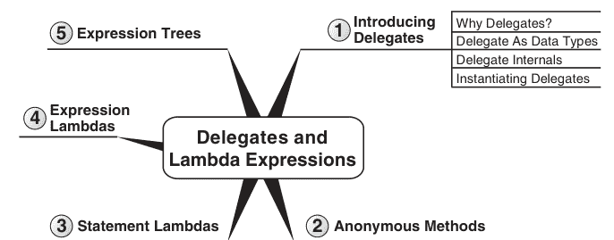

## 介绍委托

经验丰富的 C 和 C++ 程序员长期以来一直使用“函数指针”作为将方法引用作为参数传递给另一个方法的机制。C# 通过使用委托实现了类似的功能。委托允许你捕获方法的引用，像处理其他任何对象一样传递它，并像调用任何其他方法一样调用被捕获的方法。让我们看一个示例，说明这种技术如何发挥作用。

## 定义场景

虽然冒泡排序的效率不高，但它是最简单的排序例程之一。清单 12.1 展示了 `BubbleSort()` 方法。

## 清单 12.1：BubbleSort() 方法

```
static class SimpleSort1
{
    public static void BubbleSort(int[] items)
    {
        int i;
        int j;
        int temp;
```
```
// ...
public static void BubbleSort(
    int[] items, ComparisonHandler comparisonMethod)
{
    int i;
    int j;
    int temp;
    if(comparisonMethod == null)
    {
        throw new ArgumentNullException("comparisonMethod");
    }
    if(items==null)
    {
        return;
    }
    for (i = items.Length - 1; i >= 0; i--)
    {
        for (j = 1; j <= i; j++)
        {
            if (comparisonMethod(items[j - 1], items[j]))
            {
                temp = items[j - 1];
                items[j - 1] = items[j];
                items[j] = temp;
            }
        }
    }
    // ...
}
```

委托类型 `ComparisonHandler` 表示一个比较两个整数的方法。在 `BubbleSort()` 方法中，你使用由 `comparisonMethod` 参数引用的 `ComparisonHandler` 实例来确定哪个整数更大。由于 `comparisonMethod` 表示一个方法，因此调用该方法的语法与调用任何其他方法完全相同。在本例中，`ComparisonHandler` 委托接受两个整数参数，并返回一个布尔值，指示第一个整数是否大于第二个整数。

请注意，`ComparisonHandler` 委托是强类型的：它表示一个返回 `bool` 且恰好接受两个整数参数的方法。与任何其他方法调用一样，委托调用也是强类型的，如果参数的数据类型与委托参数不兼容，C# 编译器会报告错误。

## 声明委托类型

你刚刚看到了如何定义使用委托的方法，并学会了如何通过简单地将委托变量当作方法来调用委托。不过，你还需要学习如何声明委托类型。要声明委托类型，请使用 `delegate` 关键字，后跟一个看起来像方法声明的内容。该方法的签名就是委托能够引用的方法的签名，而委托类型的名称出现在方法声明中方法名称的位置。清单 12.4 展示了如何声明 `ComparisonHandler` 委托类型，使其要求两个整数参数并返回一个布尔值。

## 清单 12.4：声明委托类型

```
public delegate bool ComparisonHandler (
    int first, int second);
```

正如类可以嵌套在其他类中一样，委托也可以嵌套在类中。如果委托声明出现在另一个类中，则该委托类型将成为嵌套类型，如清单 12.5 所示。

## 清单 12.5：声明嵌套的委托类型

```
class DelegateSample
{
    public delegate bool ComparisonHandler (
        int first, int second);
}
```

在这种情况下，数据类型将是 `DelegateSample.ComparisonHandler`，因为它被定义为 `DelegateSample` 中的嵌套类型。

## 实例化委托

在使用委托实现 `BubbleSort()` 方法的最后一步中，你将学习如何调用该方法并传递委托实例——具体来说，是 `ComparisonHandler` 类型的实例。要实例化委托，你需要一个方法，其参数和返回类型与委托类型本身的签名相匹配。对于 `ComparisonHandler`，该方法接受两个整数并返回 `bool`。方法名称不必与委托名称匹配，但方法签名的其余部分必须与委托签名兼容。清单 12.6 展示了与委托类型兼容的 `GreaterThan` 方法的代码。

## 清单 12.6：声明与 ComparisonHandler 兼容的方法

```
public delegate bool ComparisonHandler (
    int first, int second);
class DelegateSample
{
    public static void BubbleSort(
        int[] items, ComparisonHandler comparisonMethod)
    {
        // ...
    }
    public static bool GreaterThan(int first, int second)
    {
        return first > second;
    }
    // ...
}
```

定义此方法后，你可以调用 `BubbleSort()` 并将委托要捕获的方法名称作为参数提供，如清单 12.7 所示。

## 清单 12.7：将方法名称用作参数

```
public delegate bool ComparisonHandler (
    int first, int second);
class DelegateSample
{
    public static void BubbleSort(
        int[] items, ComparisonHandler comparisonMethod)
    {
        // ...
    }
    public static bool GreaterThan(int first, int second)
    {
        return first > second;
    }
    static void Main()
```
```
```csharp
{
    int i;
    int[] items = new int[5];

    for (i=0; i < items.Length; i++)
    {
        Console.Write("Enter an integer: ");
        items[i] = int.Parse(Console.ReadLine());
    }

    BubbleSort(items, GreaterThan);

    for (int i = 0; i < items.Length; i++)
    {
        Console.WriteLine(items[i]);
    }
}
```
```

请注意 `ComparisonHandler` 委托是一个引用类型，但你不一定需要使用 `new` 来实例化它。从**方法组**——即命名方法的表达式——到委托类型的转换会在 C# 2.0 及更高版本中自动创建一个新的委托对象。

## ADVANCED TOPIC

## Delegate Instantiation in C# 1.0

在列表 12.7 中，委托是通过简单地将所需方法的名字 `GreaterThan` 作为参数传递给 `BubbleSort()` 方法的调用来实例化的。C# 的第一个版本需要使用列表 12.8 中所示的更冗长的语法来实例化委托。

## LISTING 12.8: Passing a Delegate As a Parameter in C# 1.0

```
```csharp
BubbleSort(items,
    new ComparisonHandler(GreaterThan));
```
```

后来的版本同时支持这两种语法；在本书的其余部分我们将只展示现代的简洁语法。

尽管所有委托数据类型都间接派生自 `System.Delegate`，但 C# 编译器不允许你声明一个直接或间接派生自 `System.Delegate` 或 `System.MulticastDelegate` 的类。因此，列表 12.9 中显示的代码无效。

## LISTING 12.9: System.Delegate Cannot Explicitly Be a Base Class

```
// ERROR: 'ComparisonHandler' cannot
// inherit from special class 'System.Delegate'
public class ComparisonHandler: System.Delegate
{
    // ...
}
```

传递委托来指定排序顺序是一种比本章开头描述的方法更灵活的策略。通过传递委托，你只需添加一个将整数转换为字符串以进行比较的替代委托，即可将排序顺序更改为字母顺序。列表 12.10 显示了一个完整列表，演示了字母排序，输出 12.1 显示了结果。

## LISTING 12.10: Using a Different ComparisonHandler-Compatible Method

```
using System;
class DelegateSample
{
    public delegate bool ComparisonHandler(int first, int second);
    public static void BubbleSort(
        int[] items, ComparisonHandler comparisonMethod)
    {
        int i;
        int j;
        int temp;
        for (i = items.Length - 1; i >= 0; i--)
        {
            for (j = 1; j <= i; j++)
            {
                if (comparisonMethod(items[j - 1], items[j]))
                {
```


```csharp
temp = items[j - 1];

items[j - 1] = items[j];

items[j] = temp;
```
```
}
}
public static bool GreaterThan(int first, int second)
{
    return first > second;
}
public static bool AlphabeticalGreaterThan(
    int first, int second)
{
    int comparison;
    comparison = (first.ToString().CompareTo(
        second.ToString()));
    return comparison > 0;
}
static void Main(string[] args)
{
    int i;
    int[] items = new int[5];
    for (i=0; i<items.Length; i++)
    {
        Console.Write("Enter an integer: ");
        items[i] = int.Parse(Console.ReadLine());
    }
    BubbleSort(items, AlphabeticalGreaterThan);
    for (i = 0; i < items.Length; i++)
    {
        Console.WriteLine(items[i]);
    }
}
}
```

## OUTPUT 12.1
```
Enter an integer: 1
Enter an integer: 12
Enter an integer: 13
Enter an integer: 5
Enter an integer: 4
1
12
13
4
5
```

Lambda 表达式本身分为两种类型：**语句 lambda** 和 **表达式 lambda**。图 12.2 显示了这些术语之间的层次关系。

## Statement Lambdas

Lambda 表达式的目的是消除在需要从非常简单的方法创建委托时声明全新成员的麻烦。存在几种不同的 lambda 表达式形式。例如，语句 lambda 由形式参数列表、后跟 lambda 运算符 `=>`、后跟代码块组成。

列表 12.11 显示了与列表 12.7 中对 `BubbleSort` 的调用等效的功能，只是列表 12.11 使用语句 lambda 表示比较方法，而不是创建 `GreaterThan` 方法。正如你所见，`GreaterThan` 方法声明中出现的大部分信息都包含在语句 lambda 中；形式参数声明和块是相同的，但方法名及其修饰符缺失了。

## LISTING 12.11: Creating a Delegate with a Statement Lambda
```
// ...
    BubbleSort(items,
        (int first, int second) =>
        {
            return first < second;
        }
    );
// ...
```

阅读包含 lambda 运算符的代码时，你可以将 lambda 运算符替换为“go/goes to”一词。例如，在列表 12.11 中，你会将第二个 `BubbleSort()` 参数读作“整数 first 和 second 转到返回 first 小于 second 的结果。”

正如读者会注意到的，列表 12.11 中的语法几乎与列表 12.7 中的语法相同，只是比较方法现在在词法上位于将其转换为委托类型的位置，而不是在其他地方并按名称查找。方法名缺失，这解释了为什么此类方法被称为“匿名函数”。

返回类型缺失，但编译器可以看到 lambda 表达式正在转换为需要返回类型 `bool` 的委托。编译器会验证语句 lambda 的块中每个 `return` 语句的表达式在返回 `bool` 的方法中都是合法的。`public` 修饰符缺失；由于该方法不再是包含类的可访问成员，因此无需描述其可访问性。同样，`static` 修饰符也不再必要。围绕该方法的“仪式”已经大大减少。

然而语法仍然不必要地冗长。我们已从委托类型推断出 lambda 表达式必须返回 `bool`；我们同样可以推断出两个参数都必须是 `int` 类型，如列表 12.12 所示。

## LISTING 12.12: Omitting Parameter Types from Statement Lambdas
```
// ...
BubbleSort(items,
    (first, second) =>
    {
        return first < second;
    }
);
// ...
```

通常，如果编译器能从 lambda 表达式正在转换到的委托推断出类型，则所有 lambda 表达式中显式声明的参数类型都是可选的。然而，对于在指定类型能使代码更易读的情况下，C# 允许你这样做。在推断不可能的情况下，C# 语言要求必须显式声明 lambda 参数类型。如果显式指定了一个 lambda 参数类型，则必须显式指定所有参数类型，并且它们必须与委托参数类型完全匹配。

## Guidelines

- CONSIDER omitting the types from lambda formal parameter lists when the types are obvious to the reader, or when they are an insignificant detail.

还有一种减少语法的手段，如列表 12.13 所示：如果 lambda 表达式恰好有一个其类型被推断的参数，则可以省略参数列表周围的括号。如果参数为零个或多于一个，或者单个参数是显式类型的，则 lambda 必须在参数列表周围使用括号。

## LISTING 12.13: Statement Lambdas with a Single Input Parameter
```
using System.Collections.Generic;
using System.Diagnostics;
using System.Linq;
// ...
IEnumerable<Process> processes = Process.GetProcesses().Where(
    process => { return process.WorkingSet64 > 1000000000; });
// ...
```

在列表 12.13 中，`where()` 方法返回一个查询，用于查找物理内存使用量大于 10 亿字节的进程。将此与列表 12.14 进行对比，列表 12.14 具有无参数的语句 lambda。空参数列表需要括号。还请注意，在列表 12.14 中，语句 lambda 的主体包含通过大括号包含的多个语句。虽然语句 lambda 可以包含任意数量的语句，但通常语句 lambda 在其语句块中使用只有两到三个语句。 （通用 `Func` 委托类型的用法在“通用委托：`System.Func` 和 `System.Action`”部分中描述。）

## LISTING 12.14: Parameterless Statement Lambdas
```
using System;
// ...
Func<string> getUserInput =
    () =>
    {
        string input;
        do
        {
            input = Console.ReadLine();
        }
        while(input.Trim().Length == 0);
        return input;
    };
// ...
```

## 表达式 Lambda

语句 lambda 语法已经比对应的 方法声明 要简洁得多；正如我们所见，它无需声明方法名、可访问性、返回类型或参数类型。然而，通过使用表达式 lambda，我们可以变得更加简洁。在第 12.12、12.13 和 12.14 节的列表中，我们看到了其块仅由单个 return 语句组成的语句 lambda。如果我们消除了围绕它的“仪式”会怎样？这种 lambda 块中唯一相关的信息是被返回的表达式。表达式 lambda 只包含该返回表达式本身，而没有任何语句块。第 12.15 节的列表与第 12.11 节的列表相同，只是它使用的是表达式 lambda 而不是语句 lambda。

### LISTING 12.15: Passing a Delegate with an Expression Lambda
```
// ...
BubbleSort(items, (first, second) => first < second );
// ...
```

通常，你会以与语句 lambda 相同的方式阅读表达式 lambda 中的 lambda 运算符 `=>`：读作 goes to，或 becomes。当 lambda 用于返回 `bool` 时，如我们在 `BubbleSort()` 示例中所做的那样，该 lambda 被称为谓词。在这些情况下，通常将 lambda 运算符读作 such that 或 where。你可以把第 12.15 节列表中的 lambda 读作“first 和 second 使得 first 小于 second”。

与 null 字面量一样，匿名函数本身并没有关联的类型；相反，其类型由它被转换成的类型决定。换句话说，我们迄今为止看到的 lambda 表达式并非本质上是 `ComparisonHandler` 类型，但它们与该类型兼容，可以转换为它。因此，你不能对匿名方法使用 `typeof()` 运算符（参见第 17 章），并且只有在将匿名方法转换为特定类型后，才能调用 `GetType()`。

表 12.1 提供了额外的 lambda 表达式特征。

## TABLE 12.1: Lambda Expression Notes and Examples

| Statement | Example |
|---|---|
| Lambda expressions themselves do not have a type. Therefore, there are no members that can be accessed directly from a lambda expression, not even the methods of object. | // ERROR: Operator '.' cannot be applied to<br>// operand of type 'lambda expression'<br>string s = ((int x) => x).ToString(); |
| Lambda expressions do not have a type and so cannot appear to the left of an is operator. | // ERROR: The first operand of an 'is' or 'as'<br>// operator may not be a lambda expression or<br>// anonymous method<br>bool b = ((int x) => x) is Func<int, int>; |
| A lambda expression can be converted only to a compatible delegate type; here an int-returning lambda may not be converted to a delegate type that represents a bool-returning method. | // ERROR: Lambda expression is not compatible<br>// with Func<int, bool> type.<br>Func<int, bool> f = (int x) => x; |
| A lambda expression does not have a type, so it cannot be used to infer the type of a local variable. | // ERROR: Cannot assign Lambda expression to<br>// an implicitly typed local variable<br>var v = x => x; |
| Jump statements (break, goto, continue) inside lambda expressions cannot be used to jump to locations outside the lambda expression, and vice versa. Here the break statement inside the lambda would jump to the end of the switch statement outside the lambda. | // ERROR: Control cannot leave the body of an<br>// anonymous method or Lambda expression<br>string[] args;<br>Func<string> f;<br>switch(args[0])<br>{<br>  case "/File":<br>    f = () =><br>    {<br>      if (!File.Exists(args[1]))<br>        break;<br>      return args[1];<br>    };<br>  // ...<br>} |
| Parameters and locals introduced by a lambda expression are in scope only within the lambda body. | // ERROR: The name 'first' does not<br>// exist in the current context<br>Func<int, int, bool> expression =<br>  (first, second) => first > second;<br>first++; |

很不幸的是，在 C# 3.0 及更高版本中定义匿名函数有两种非常相似的方式。

## Guidelines

AVOID the anonymous method syntax in new code; prefer the more compact lambda expression syntax.

不过，匿名方法中支持的一个小特性在 lambda 表达式中并不支持：匿名方法在某些情况下可以完全省略其参数列表。

## ADVANCED TOPIC

### Parameterless Anonymous Methods

与 lambda 表达式不同，匿名方法可以完全省略参数列表，前提是匿名方法体不使用任何参数，并且委托类型只需要“值”参数（即不要求参数标记为 out 或 ref）。例如，匿名方法表达式
```
delegate { return Console.ReadLine() != ""; }
```
可以转换为任何需要返回类型为 `bool` 的委托类型，而与该委托需要多少个参数无关。此功能并不常用，但你在阅读遗留代码时可能会遇到它。

## ADVANCED TOPIC

### Why “Lambda” Expressions?

很明显为什么匿名方法被称为“匿名方法”：它们看起来与方法声明非常相似，但没有关联的声明名称。但“lambda 表达式”中的“lambda”从何而来？

lambda 表达式的想法来自逻辑学家 Alonzo Church 的工作，他在 1930 年代发明了一种研究技术
```
public delegate TResult Func<in T, out TResult>(T arg)
public delegate TResult Func<in T1, in T2, out TResult>(
    in T1 arg1, in T2 arg2)
public delegate TResult Func<in T1, in T2, in T3, out TResult>(
    T1 arg1, T2 arg2, T3 arg3)
public delegate TResult Func<in T1, in T2, in T3, in T4,
    out TResult>(T1 arg1, T2 arg2, T3 arg3, T4 arg4)
...
public delegate TResult Func<
    in T1, in T2, in T3, in T4, in T5, in T6, in T7, in T8,
    in T9, in T10, in T11, in T12, in T13, in T14, in T16,
    out TResult>(
    T1 arg1, T2 arg2, T3 arg3, T4 arg4,
    T5 arg5, T6 arg6, T7 arg7, T8 arg8,
    T9 arg9, T10 arg10, T11 arg11, T12 arg12,
    T13 arg13, T14 arg14, T15 arg15, T16 arg16)
```


由于第 12.17 节列表中的委托定义是泛型的，因此可以使用它们而不是定义自定义委托。`Func` 委托的最后一个类型参数始终是委托的返回类型。其他类型参数按顺序对应于委托参数的类型。例如，第 12.3 节列表中的 `BubbleSort` 方法需要一个返回 `bool` 且接受两个 `int` 参数的委托。因此，与其声明 `ComparisonHandler` 委托类型并使用它，我们本可以按如下方式声明 `BubbleSort` 方法：

```csharp
void BubbleSort(int[] items,
    Func<int, int, bool> comparisonMethod) { ... }
```

在许多情况下，`.NET Framework 3.5` 中包含的 `Func` 和 `Action` 委托完全消除了定义自己的委托类型的需求。然而，当这样做显著提高了代码的可读性时，你应该考虑声明自己的委托类型。名为 `ComparisonHandler` 的委托明确指出了委托的用途，而使用 `Func<int, int, bool>` 则更明确地指出了委托的形式参数和返回类型。

## Guidelines

`CONSIDER` whether the readability benefit of defining your own delegate type outweighs the convenience of using a predefined generic delegate type.

## Delegates Do Not Have Structural Equality

`.NET` 中的委托类型不具有结构相等性。也就是说，即使两个委托的形式参数和返回类型完全相同，也不能将一个委托类型的对象引用转换为不相关的委托类型。例如，即使 `ComparisonHandler` 和 `Func<int, int, bool>` 两个委托类型都表示接受两个 `int` 参数并返回 `bool` 的方法，你也不能将 `ComparisonHandler` 的引用分配给 `Func<int, int, bool>` 类型的变量。不幸的是，使用给定类型的委托的唯一方法，当需要结构上相同但不相关的委托类型时，就是创建一个引用旧委托 `Invoke` 方法的新委托。例如，如果你有一个类型为 `ComparisonHandler` 的变量 `c`，并且需要将其值分配给类型为 `Func<int, int, bool>` 的变量 `f`，你可以说 `f = c.Invoke;`

然而，由于 C# 4.0 中添加的协变支持，可以在某些委托类型之间进行引用转换。考虑以下反变示例：由于 `void Action<in T>(T arg)` 具有 `in` 类型参数修饰符，因此可以将 `Action<object>` 类型的委托引用分配给 `Action<string>` 类型的变量。

许多人发现委托反变令人困惑；只需记住，能够作用于每个对象的操作可以用作作用于任何字符串的操作。但反之则不成立：只能作用于字符串的操作不能作用于每个对象。同样，`Func` 系列中的每个类型在其返回类型上都是协变的，如 `TResult` 上的 `out` 类型参数修饰符所示。因此，可以将 `Func<string>` 类型的委托引用分配给 `Func<object>` 类型的变量。

### LISTING 12.18: Using Variance for Delegates

```csharp
// Contravariance

Action<object> broadAction =
    (object data) =>
    {
        Console.WriteLine(data);
    };

Action<string> narrowAction = broadAction;

// Covariance

Func<string> narrowFunction =
    () =>Console.ReadLine();

Func<object> broadFunction = narrowFunction;
```

```csharp
// Contravariance and covariance combined
Func<object, string> func1 =
    (object data) => data.ToString();
Func<string, object> func2 = func1;
```

上例的最后一部分将两种变体概念结合到一个示例中，演示了如果同时涉及 `in` 和 `out` 类型参数，它们可以同时发生。

允许在泛型委托类型上进行引用转换是向 C# 4.0 添加协变和逆变转换的关键动机场景之一。 （另一个是支持对 `IEnumerable<out T>` 的协变。）

## Advanced Topic

### Lambda Expression and Anonymous Method Internals

`Lambda` 表达式（和匿名方法）并不是固有地“内置”于 CLR。相反，当编译器遇到匿名函数时，它会将其翻译成特殊的隐藏类、字段和方法来实现所需语义。C# 编译器为该模式生成实现代码，以便开发人员不必自己编写。当给定代码清单 12.11、12.12、12.15 或 12.16 时，C# 编译器会生成与清单 12.19 所示代码类似的 CIL 代码。

**LISTING 12.19: C# Equivalent of CIL Generated by the Compiler for Lambda Expressions**

```csharp
class DelegateSample
{
    // ...
    static void Main(string[] args)
    {
        int i;
        int[] items = new int[5];

        for (i = 0; i < items.Length; i++)
        {
            Console.Write("Enter an integer:");
            items[i] = int.Parse(Console.ReadLine());
        }

        BubbleSort(items,
```

```csharp
static void Main(string[] args)
{
    int i;
    int[] items = new int[5];
    int comparisonCount = 0;

    for (i = 0; i < items.Length; i++)
    {
        Console.Write("Enter an integer:");
        items[i] = int.Parse(Console.ReadLine());
    }

    BubbleSort(items,
        (int first, int second) =>
        {
            comparisonCount++;
            return first < second;
        }
    );

    for (i = 0; i < items.Length; i++)
    {
        Console.WriteLine(items[i]);
    }

    Console.WriteLine("Items were compared {0} times.",
        comparisonCount);
}
```

**OUTPUT 12.2**

```text
Enter an integer:5
Enter an integer:1
Enter an integer:4
Enter an integer:2
Enter an integer:3
5
4
3
2
1
Items were compared 10 times.
```

请注意，`comparisonCount` 出现在 lambda 表达式之外，并在其内部递增。在调用 `BubbleSort()` 方法后，`comparisonCount` 会打印到控制台。

通常局部变量的生命周期与其作用域绑定；当控制流离开作用域时，与变量关联的存储位置不再有效。但从捕获外部变量的 lambda 创建的委托可能具有比局部变量通常更长（或更短）的生命周期，并且委托必须能够在每次调用时安全地访问外部变量。因此，被捕获变量的生命周期会被延长；它保证至少与捕获它的最长生命周期委托对象一样长。 （并且它可能比这更长——编译器生成确保外部变量生命周期延长的代码的具体方式是一个实现细节，可能会发生变化。）

C# 编译器负责生成共享 `comparisonCount` 的 CIL 代码，该代码在匿名方法和声明它的方法之间共享。

## Advanced Topic

### Outer Variable CIL Implementation

C# 编译器为捕获外部变量的匿名函数生成的 CIL 代码比捕获空的简单匿名函数的代码更复杂。清单 12.21 显示了用于实现清单 12.20 中代码的外部变量的 CIL 代码的 C# 等价物。

**LISTING 12.21: C# Equivalent of CIL Code Generated by Compiler for Outer Variables**

```csharp
class DelegateSample
{
    // ...
    private sealed class __LocalsDisplayClass_00000001
    {
        public int comparisonCount;
        public bool __AnonymousMethod_00000000(
            int first, int second)
        {
            comparisonCount++;
            return first < second;
        }
    }
    // ...
    static void Main(string[] args)
    {
        int i;
        __LocalsDisplayClass_00000001 locals =
            new __LocalsDisplayClass_00000001();

        locals.comparisonCount = 0;
        int[] items = new int[5];

        for (i = 0; i < items.Length; i++)
        {
            Console.Write("Enter an integer:");
            items[i] = int.Parse(Console.ReadLine());
        }

        BubbleSort(items, locals.__AnonymousMethod_00000000);
        for (i = 0; i < items.Length; i++)
        {
            Console.WriteLine(items[i]);
        }

        Console.WriteLine("Items were compared {0} times.",
            locals.comparisonCount);
    }
}
```

请注意，被捕获的局部变量从未在任何地方“传递”，也从未在任何地方“复制”。相反，被捕获的局部变量（`comparisonCount`）是一个单一变量，其生命周期已被编译器通过将其实现为实例字段而不是局部变量来延长。对局部变量的所有使用都被重写为对该字段的使用。

生成的类 `__LocalsDisplayClass` 是一个闭包——一个包含表达式和评估表达式所需变量（C# 中的公共字段）的数据结构（C# 中的类）。

## Advanced Topic

### Accidentally Capturing Loop Variables

你认为清单 12.22 的输出应该是什么？

**LISTING 12.22: Capturing Loop Variables in C# 5.0**

```csharp
class CaptureLoop
{
    static void Main()
    {
        var items = new string[] { "Moe", "Larry", "Curly" };
        var actions = new List<Action>();
        foreach (string item in items)
        {
            actions.Add( () => { Console.WriteLine(item); } );
```

此场景是向语言添加表达式树的动机。将 lambda 表达式转换为表达式树会使其成为表示描述 lambda 表达式的数据的对象，而不是实现匿名函数的编译代码。由于表达式树表示数据而不是编译代码，因此可以在执行时分析 lambda 并使用该信息构建在数据库上执行的查询，例如。`Where()` 接收到的表达式树可能会被转换为 SQL 查询并传递给数据库，如清单 12.24 所示。

**LISTING 12.24: Converting an Expression Tree to a SQL where Clause**

```text
persons.Where( person => person.Name.ToUpper() == "INIGO MONTOYA");

select * from Person where upper(Name) = 'INIGO MONTOYA';
```

传递给 `Where()` 调用的表达式树说明 lambda 参数由以下元素组成：

- 一个 `Person` 对象的 `Name` 属性的读取

- 对名为 `ToUpper()` 的字符串方法的调用

- 一个常量值，`"INIGO MONTOYA"`

- 一个相等运算符，`==`

`Where()` 方法获取这些数据并通过检查数据并构建 SQL 查询字符串将其转换为 SQL `where` 子句。然而，SQL 只是其中一种可能性；你可以构建一个表达式树求值器，将表达式转换为任何查询语言。

## Expression Trees Are Object Graphs

在执行时，转换为表达式树的 lambda 成为包含来自 `System.Linq.Expressions` 命名空间的对象对象的对象图。图中的“根”对象表示 lambda 本身。该对象引用表示参数、返回类型和主体表达式的对象，如图 12.3 所示。对象图包含编译器关于 lambda 推断的所有信息。然后可以在执行时使用该信息来创建查询。或者，根 lambda 表达式有一个 `Compile` 方法，可以即时生成 CIL 并创建实现所述 lambda 的委托。

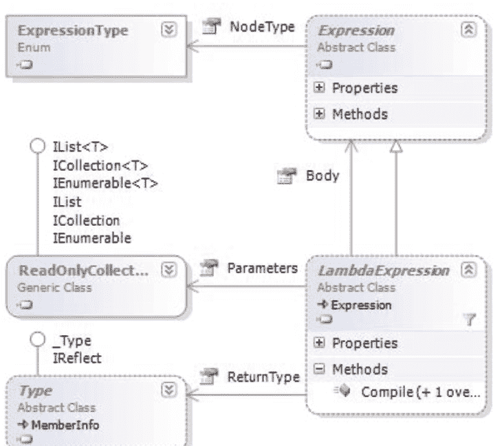

**FIGURE 12.3: The Lambda Expression Tree Type**

图 12.4 显示了 lambda 主体中一元和二元表达式的对象图中的类型。

`UnaryExpression` 表示诸如 `-count` 的表达式。它有一个类型为 `Expression` 的单个子 `Operand`。`BinaryExpression` 有两个子表达式，`Left` 和 `Right`。这两种类型都有一个 `NodeType` 属性来标识特定的运算符，并且都继承自基类 `Expression`。还有另外 30 左右的表达式类型，例如 `NewExpression`、`ParameterExpression`、`MethodCallExpression` 和 `LoopExpression`，用于表示 C# 和 Visual Basic 中几乎所有可能的表达式。

## Delegates versus Expression Trees

无论 lambda 表达式是转换为委托还是表达式树，其有效性都在编译时通过完整的语义分析进行验证

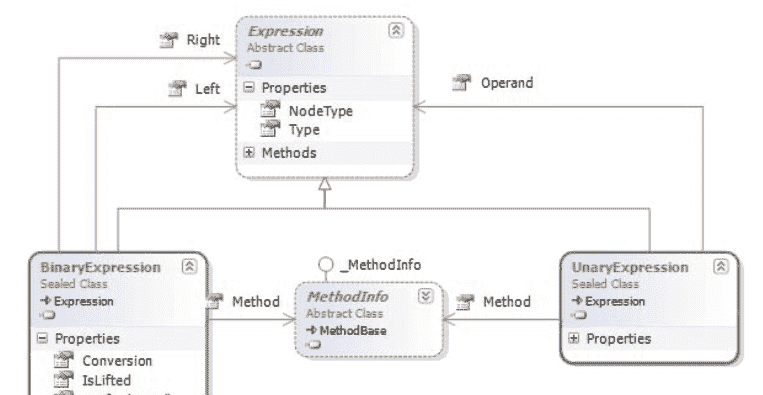

# 图 12.4：Unary 和 Binary 表达式树类型

tree. 一个被转换为委托的 lambda 会导致编译器将 lambda 作为方法发出，并生成在执行时创建指向该方法的委托的代码。 一个被转换为表达式树的 lambda 会导致编译器生成在执行时创建 `LambdaExpression` 实例的代码。 但是在使用语言集成查询（LINQ）API 时，编译器如何知道是生成委托以在本地执行查询，还是生成表达式树以便将查询信息发送到远程数据库服务器？

用于构建 LINQ 查询的方法，例如 `Where()`，是扩展方法。 扩展 `IEnumerable<T>` 接口的那些方法的版本接受委托参数； 扩展 `IQueryable<T>` 接口的方法接受表达式树参数。 因此，编译器可以使用正在查询的集合的类型来确定是从作为参数提供的 lambda 创建委托还是表达式树。

例如，考虑以下代码中的 `Where()` 方法：

```
persons.Where( person => person.Name.ToUpper() ==
"INIGO MONTOYA");
```

在 `System.Linq.Enumerable` 类中声明的扩展方法签名是

# 列表 12.25：检查表达式树


```csharp
using System;
using System.Linq.Expressions;

public class Program
{
    public static void Main()
    {
        Expression<Func<int, int, bool>> expression;
        expression = (x, y) => x > y;
        Console.WriteLine("------------- {0} -------------", expression);
        PrintNode(expression.Body, 0);
        Console.WriteLine();
        Console.WriteLine();
        expression = (x, y) => x * y > x + y;
        Console.WriteLine("------------- {0} -------------", expression);
        PrintNode(expression.Body, 0);
    }
    public static void PrintNode(Expression expression, int indent)
    {
        if (expression is BinaryExpression)
            PrintNode(expression as BinaryExpression, indent);
        else
            PrintSingle(expression, indent);
    }
    private static void PrintNode(BinaryExpression expression, int indent)
    {
        PrintNode(expression.Left, indent + 1);
        PrintSingle(expression, indent);
        PrintNode(expression.Right, indent + 1);
    }
    private static void PrintSingle(Expression expression, int indent)
    {
        Console.WriteLine("{0," + indent * 5 + "}{1}", "", NodeToString(expression));
    }
    private static string NodeToString(Expression expression)
    {
        switch (expression.NodeType)
        {
            case ExpressionType.Multiply:
                return "*";
            case ExpressionType.Add:
                return "+";
            case ExpressionType.Divide:
                return "/";
            case ExpressionType.Subtract:
                return "-";
            case ExpressionType.GreaterThan:
                return ">";
            case ExpressionType.LessThan:
                return "<";
            default:
                return expression.ToString() + " (" + expression.NodeType.ToString() + ")";
        }
    }
}
```

在输出 12.5 中，我们看到 `Main()` 中的 `Console.WriteLine()` 语句将表达式树的正文作为文本打印出来。

# 输出 12.5

```
-------------- (x, y) => (x > y) --------------
    x (Parameter)
>       y (Parameter)

-------------- (x, y) => ((x * y) > (x + y)) --------------
    x (Parameter)
  *     y (Parameter)
>       x (Parameter)
  +     y (Parameter)
```

需要注意的重要一点是，表达式树是一个数据集合，通过迭代数据，可以将其转换为另一种格式；在这种情况下，我们将表达式树转换为描述性字符串，但它也可以转换为另一种查询语言中的表达式。

使用递归，`PrintNode()` 函数演示了表达式树中的节点本身就是包含零个或多个子表达式树的树。表示 lambda 的“根”树指的是 lambda 的主体，其 `Body` 属性。每个表达式树节点都包含一个 `NodeType` 属性，其枚举类型为 `ExpressionType`，用于描述它是何种表达式。存在许多种表达式类型：`BinaryExpression`、`ConditionalExpression`、`LambdaExpression`、`MethodCallExpression`、`ParameterExpression` 和 `ConstantExpression` 是示例。每种类型都派生自 `Expression`。

请注意，尽管表达式树库现在包含用于表示 C# 和 Visual Basic 的大多数语句的对象，但这两种语言都不支持将语句 lambda 转换为表达式树。只有表达式 lambda 才能转换为表达式树。

# 摘要

本章首先讨论了委托及其作为方法或回调的引用用法。这一强大的概念使您能够将一组指令传递到不同的位置调用，而不是在编码指令时立即调用。

`lambda` 表达式的概念是一种语法，它取代了（但并未消除）C# 2.0 匿名方法语法。这些构造允许程序员直接将一组指令分配给变量，而无需定义包含这些指令的显式方法。这种构造为在方法内动态编程指令提供了极大的灵活性——这是一个强大的概念，极大地简化了通过 LINQ API 对集合的编程。

本章以对表达式树概念的讨论结束，并考虑了它们如何编译为表示 lambda 表达式的语义分析的对象，而不是委托实现本身。这一重要特性支持诸如 Entity Framework 和 LINQ to XML 之类的库——即解释表达式树并在 CIL 以外的上下文中使用的库。

`lambda` 表达式包括语句 lambda 和表达式 lambda。换句话说，语句 lambda 和表达式 lambda 都是 lambda 表达式的类型。

本章提到但未详细阐述的一件事是多播委托。下一章将详细研究多播委托，并解释它们如何通过事件实现发布-订阅模式。

此页 intentionally left blank

```csharp
class Heater
{
    public Heater(float temperature)
    {
        Temperature = temperature;
    }

    public float Temperature { get; set; }

    public void OnTemperatureChanged(float newTemperature)
    {
        if (newTemperature < Temperature)
        {
            System.Console.WriteLine("Heater: On");
        }
        else
        {
            System.Console.WriteLine("Heater: Off");
        }
    }
}
```

这两个类本质上是相同的，只是温度比较不同。（事实上，如果您在 `OnTemperatureChanged` 方法中使用指向比较方法的委托，则可以消除其中一个类。）每个类都存储应打开单元的温度。此外，两个类都提供 `OnTemperatureChanged()` 方法。调用 `OnTemperatureChanged()` 方法是向 `Heater` 和 `Cooler` 类指示温度已更改的方式。方法实现使用 `newTemperature` 与存储的触发温度进行比较，以确定是否打开设备。

`OnTemperatureChanged()` 方法是订阅者方法。它们必须具有与 `Thermostat` 类中的委托匹配的参数和返回类型，我们接下来讨论。

# 定义发布者

`Thermostat` 类负责向加热器和冷却器对象实例报告温度变化。`Thermostat` 类代码出现在列表 13.2 中。

# 列表 13.2：定义事件发布者，Thermostat

```csharp
public class Thermostat
{
    // Define the event publisher
    public Action<float> OnTemperatureChange { get; set; }
    public float CurrentTemperature { get; set; }
}
```

`Thermostat` 包含一个名为 `OnTemperatureChange` 的属性，其类型为 `Action<float>` 委托类型。`OnTemperatureChange` 存储一个订阅者列表。请注意，只需要一个委托字段即可存储所有订阅者。换句话说，`Cooler` 和 `Heater` 类都将从这个单一发布者接收温度变化的通知。

`Thermostat` 的最后一个成员是 `CurrentTemperature` 属性。此属性设置并检索 `Thermostat` 类报告的当前温度值。

## Hooking up the Publisher and Subscribers

最后，我们在 `Main()` 方法中将所有这些部分组合在一起。清单 13.3 显示了 `Main()` 可能的样子示例。

### LISTING 13.3: Connecting the Publisher and Subscribers

```csharp
class Program
{
    public static void Main()
    {
        Thermostat thermostat = new Thermostat();
        Heater heater = new Heater(60);
        Cooler cooler = new Cooler(80);
        string temperature;

        thermostat.OnTemperatureChange +=
            heater.OnTemperatureChanged;
        thermostat.OnTemperatureChange +=
            cooler.OnTemperatureChanged;

        Console.Write("Enter temperature: ");
        temperature = Console.ReadLine();
        thermostat.CurrentTemperature = int.Parse(temperature);
    }
}
```

此清单中的代码已通过直接使用 `+=` 运算符将两个订阅者（`heater.OnTemperatureChanged` 和 `cooler.OnTemperatureChanged`）注册到 `OnTemperatureChange` 委托。

通过获取用户输入的温度值，您可以设置 `thermostat` 的 `CurrentTemperature`。然而，您尚未编写任何代码来向订阅者发布温度变化事件。

## Invoking a Delegate

每次 `Thermostat` 类上的 `CurrentTemperature` 属性发生变化时，您都希望调用委托以通知订阅者（`heater` 和 `cooler`）温度的变化。为了实现这一目标，您必须修改 `CurrentTemperature` 属性以保存新值并向每个订阅者发布通知。代码修改出现在清单 13.4 中。

### LISTING 13.4: Invoking a Delegate without Checking for null

```csharp
public class Thermostat
{
    ...
    public float CurrentTemperature
    {
        get { return _CurrentTemperature; }
        set
        {
            if (value != CurrentTemperature)
            {
                _CurrentTemperature = value;

                // INCOMPLETE: Check for null needed
                // Call subscribers
                OnTemperatureChange(value);
            }
        }
    }
    private float _CurrentTemperature;
}
```

现在对 `CurrentTemperature` 的赋值包含了一些特殊逻辑，用于通知订阅者 `CurrentTemperature` 的变化。通知所有订阅者的调用只是单个 C# 语句，`OnTemperatureChange(value)`。此单个语句将温度变化发布给 `cooler` 和 `heater` 对象。在这里，您在实践中看到，使用单个调用通知多个订阅者的能力正是委托更具体地被称为多播委托的原因。

## Check for null

清单 13.4 中缺少事件发布代码的一个重要部分。如果没有订阅者注册接收通知，`OnTemperatureChange` 将为 `null`，并且执行 `OnTemperatureChange(value)` 语句将抛出 `NullReferenceException`。为了避免这种情况，有必要在触发事件之前检查 `null`。清单 13.5 演示了如何使用 C# 6.0 的空条件运算符在调用 `Invoke()` 之前执行此操作。

```csharp
public class Thermostat
{
    ...
    public float CurrentTemperature
    {
        get { return _CurrentTemperature; }
        set
        {
            if (value != CurrentTemperature)
            {
                _CurrentTemperature = value;
                // If there are any subscribers,
                // notify them of changes in temperature
                // by invoking said subscribers
                OnTemperatureChange?.Invoke(value);  // C# 6.0
            }
        }
    }
    private float _CurrentTemperature;
}
```

请注意在空条件之后对 `Invoke()` 方法的调用。虽然此方法可以使用仅点运算符调用，但这样做意义不大，因为这等同于直接调用委托（参见清单 13.4 中的 `OnTemperatureChange(value)`）。空条件运算符的根本优势在于特殊逻辑，可确保在检查 `null` 之后，不会出现订阅者取消订阅导致委托再次变为 `null` 的可能性。

不幸的是，在 C# 6.0 之前不存在这种特殊的不可中断的空检查逻辑。因此，在更早的 C# 版本中的实现要冗长得多，如清单 13.6 所示。

### LISTING 13.6: Invoking a Delegate with Null Check Prior to C# 6.0

```csharp
public class Thermostat
{
    ...
    public float CurrentTemperature
    {
        get{return _CurrentTemperature;}
        set
        {
            if (value != CurrentTemperature)
            {
                _CurrentTemperature = value;
                // If there are any subscribers,
                // notify them of changes in temperature
                // by invoking said subscribers
                Action<float> localOnChange =
                    OnTemperatureChange;
                if(localOnChange != null)
                {
                    // Call subscribers
                    localOnChange(value);
                }
            }
        }
    }
    private float _CurrentTemperature;
}
```


而不是直接检查 `null`，此代码首先将 `OnTemperatureChange` 分配给第二个委托变量 `localOnChange`。此简单修改可确保如果在检查 `null` 和发送通知之间（由不同线程）删除了所有 `OnTemperatureChange` 订阅者，您不会引发 `NullReferenceException`。

本书其余部分的示例都将依赖 C# 6.0 的空条件运算符进行委托调用。

## Guidelines

- DO check that the value of a delegate is not null before invoking it.
- DO use the null conditional operator prior to calling `Invoke()` starting in C# 6.0.

## ADVANCED TOPIC

### -= Operator for a Delegate Returns a New Instance

鉴于委托是引用类型，分配一个局部变量然后使用该局部变量足以使空检查线程安全，这也许有些令人惊讶。由于 `localOnChange` 指向与 `OnTemperatureChange` 相同的位置，您可能会想象 `OnTemperatureChange` 的任何更改也会反映在 `localOnChange` 中。

情况并非如此，因为实际上，任何对 `OnTemperatureChange -= <listener>` 的调用都不会简单地从 `OnTemperatureChange` 中删除一个委托，使其包含的委托比之前少。相反，此类调用将分配一个全新的多播委托，而不会对 `localOnChange` 也指向的原始多播委托产生任何影响。

## ADVANCED TOPIC

### Thread-Safe Delegate Invocation

如果订阅者可以在不同线程上添加到委托并从中删除，那么明智的做法是（正如前面所述）在检查 `null` 之前将委托引用复制到局部变量。虽然这种方法可以防止调用 `null` 委托，但它并不能避免所有可能的竞争条件。例如，一个线程可以进行复制，然后另一个线程可以将委托重置为 `null`，然后原始线程可以调用委托的先前值，从而通知不再在订阅者列表中的订阅者。多线程程序中的订阅者应确保其代码在此场景下保持健壮；始终有可能“过时”的订阅者会被调用。

## Delegate Operators

为了将 `Thermostat` 示例中的两个订阅者组合在一起，您使用了 `+=` 运算符。此运算符采用第一个委托并将第二个委托添加到链中。现在，在第一个委托的方法返回后，将调用第二个委托。要从委托链中删除委托，请使用 `-=` 运算符，如清单 13.7 所示。

### LISTING 13.7: Using the += and -= Delegate Operators

```
// ...
Thermostat thermostat = new Thermostat();
Heater heater = new Heater(60);
Cooler cooler = new Cooler(80);

Action<float> delegate1;
Action<float> delegate2;
Action<float> delegate3;

delegate1 = heater.OnTemperatureChanged;
delegate2 = cooler.OnTemperatureChanged;

Console.WriteLine("Invoke both delegates:");
delegate3 = delegate1;
delegate3 += delegate2;
delegate3(90);

Console.WriteLine("Invoke only delegate2");
delegate3 -= delegate1;
delegate3(30);
// ...
```

The results of Listing 13.7 appear in Output 13.1.

### OUTPUT 13.1

```
Invoke both delegates:
Heater: Off
Cooler: On
Invoke only delegate2
Cooler: Off
```

Furthermore, you can also use the `+` and `-` operators to combine delegates, as Listing 13.8 shows.

### LISTING 13.8: Using the + and - Delegate Operators

```
// ...
Thermostat thermostat = new Thermostat();
Heater heater = new Heater(60);
Cooler cooler = new Cooler(80);

Action<float> delegate1;
Action<float> delegate2;
Action<float> delegate3;

// Note: Use new Action (cooler.OnTemperatureChanged)
// for C# 1.0 syntax.
```

```
delegate1 = heater.OnTemperatureChanged;
delegate2 = cooler.OnTemperatureChanged;

Console.WriteLine("Combine delegates using + operator:");
delegate3 = delegate1 + delegate2;
delegate3(60);

Console.WriteLine("Uncombine delegates using - operator:");
delegate3 = delegate3 - delegate2;
delegate3(60);
// ...
```

Use of the assignment operator clears out all previous subscribers and allows you to replace them with new subscribers. This is an unfortunate characteristic of a delegate. It is simply too easy to mistakenly code an assignment when, in fact, the `+=` operator is intended. The solution, called events, appears in the “Events” section later in this chapter.

Both the `+` and `-` operators and their assignment equivalents, `+=` and `-=`, are implemented internally using the static methods `System.Delegate.Combine()` and `System.Delegate.Remove()`. These methods take two parameters of type delegate. The first method, `Combine()`, joins the two parameters so that the first parameter points to the second within the list of delegates. The second, `Remove()`, searches through the chain of delegates specified in the first parameter and then removes the delegate specified by the second parameter.

One interesting thing to note about the `Combine()` method is that either or both of its parameters can be `null`. If one of them is `null`, `Combine()` returns the non-null parameter. If both are `null`, `Combine()` returns `null`. This explains why you can call `thermostat.OnTemperatureChange += heater.OnTemperatureChanged;` and not throw an exception, even if the value of `thermostat.OnTemperatureChange` is still `null`.

## Sequential Invocation

Figure 13.1 highlights the sequential notification of both heater and cooler.

Although you coded only a single call to `OnTemperatureChange()`, the call is broadcast to both subscribers. Thus, with just one call, both cooler and heater are notified of the change in temperature. If you added more subscribers, they, too, would be notified by `OnTemperatureChange()`.

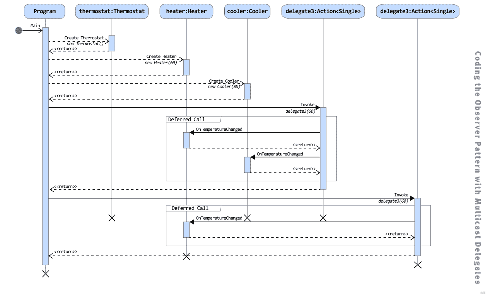

### FIGURE 13.1: Delegate Invocation Sequence Diagram

Although a single call, `OnTemperatureChange()`, caused the notification of each subscriber, the subscribers are still called sequentially, not simultaneously, because they are all called on the same thread of execution.

## ADVANCED TOPIC

### Multicast Delegate Internals

To understand how events work, you need to revisit the first examination of the `System.Delegate` type internals. Recall that the `delegate` keyword is an alias for a type derived from `System.MulticastDelegate`. In turn, `System.MulticastDelegate` is derived from `System.Delegate`, which, for its part, is composed of an object reference (needed for nonstatic methods) and a method reference. When you create a delegate, the compiler automatically employs the `System.MulticastDelegate` type rather than the `System.Delegate` type. The `MulticastDelegate` class includes an object reference and a method reference, just like its `Delegate` base class, but it also contains a reference to another `System.MulticastDelegate` object.

When you add a method to a multicast delegate, the `MulticastDelegate` class creates a new instance of the delegate type, stores the object reference and the method reference for the added method into the new instance, and adds the new delegate instance as the next item in a list of delegate instances. In effect, the `MulticastDelegate` class maintains a linked list of `Delegate` objects. Conceptually, you can represent the thermostat example as shown in Figure 13.2 on the facing page (denoted as a continuation of this advanced topic).

When invoking a multicast delegate, each delegate instance in the linked list is called sequentially. Generally, delegates are called in the order they were added, but this behavior is not specified within the CLI specification. Furthermore, it can be overridden. Therefore, programmers should not depend on an invocation order.

## Error Handling

Error handling makes awareness of the sequential notification critical. If one subscriber throws an exception, later subscribers in the chain do not receive the notification. Consider, for example, what would happen if you changed the `Heater`’s `OnTemperatureChanged()` method so that it threw an exception, as shown in Listing 13.9.

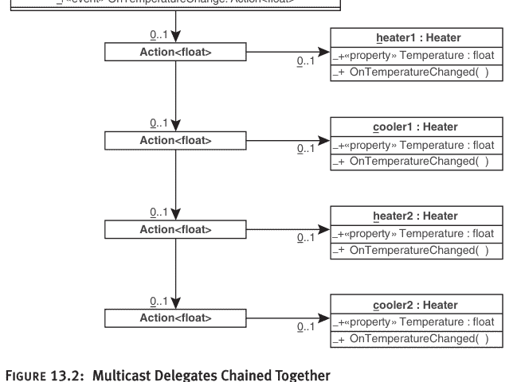

### FIGURE 13.2: Multicast Delegates Chained Together

### LISTING 13.9: OnTemperatureChanged() Throwing an Exception

```
class Program
{
    public static void Main()
    {
        Thermostat thermostat = new Thermostat();
        Heater heater = new Heater(60);
        Cooler cooler = new Cooler(80);
        string temperature;

        thermostat.OnTemperatureChange +=
            heater.OnTemperatureChanged;
        // Using C# 3.0. Change to anonymous method
        // if using C# 2.0.
        thermostat.OnTemperatureChange +=
            (newTemperature) =>
            {
                throw new InvalidOperationException();
            };
        thermostat.OnTemperatureChange +=
            cooler.OnTemperatureChanged;

        Console.Write("Enter temperature: ");
        temperature = Console.ReadLine();
        thermostat.CurrentTemperature = int.Parse(temperature);
    }
}
```

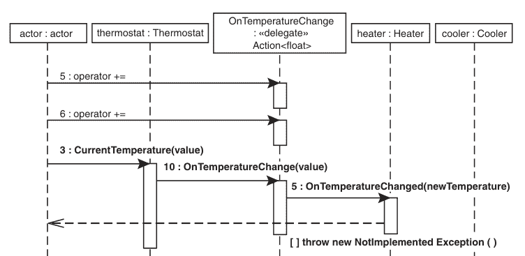

### FIGURE 13.3: Delegate Invocation with Exception Sequence Diagram

Figure 13.3 shows an updated sequence diagram. Even though cooler and heater subscribed to receive messages, the lambda expression exception terminates the chain and prevents the cooler object from receiving notification.


To avoid this problem so that all subscribers receive notification, regardless of the behavior of earlier subscribers, you must manually enumerate through the list of subscribers and call them individually. Listing 13.10 shows the updates required in the `CurrentTemperature` property. The results appear in Output 13.2.

## LISTING 13.10: Handling Exceptions from Subscribers

```
public class Thermostat
{
    // Define the event publisher
    public Action<float> OnTemperatureChange;

    public float CurrentTemperature
    {
        get { return _CurrentTemperature; }
        set
        {
            if (value != CurrentTemperature)
            {
                _CurrentTemperature = value;
                Action<float> onTemperatureChange = OnTemperatureChange;
                if(onTemperatureChange != null)
                {
```

property. In this way, all exceptions are still reported and, at the same time, all subscribers are notified.

Parenthetically, no `null` conditional was used in this example because of the if condition that verified `onTemperatureChange` was not null.

## Method Returns and Pass-by-Reference

There is another scenario in which it is useful to iterate over the delegate invocation list instead of simply activating a notification directly. This scenario relates to delegates that either do not return `void` or have `ref` or `out` parameters. In the thermostat example, the `OnTemperatureChange` delegate is of type `Action<float>`, which returns `void` and has no `out` or `ref` parameters. As a result, no data is returned to the publisher. This consideration is important, because an invocation of a delegate potentially triggers notification to multiple subscribers. If each of the subscribers returns a value, it is ambiguous as to which subscriber’s return value would be used.

If you changed `OnTemperatureChange` to return an enumeration value, indicating whether the device was on because of the temperature change, the new delegate would be of type `Func<float, Status>`, where `Status` was an `enum` with elements `On` and `Off`. All subscriber methods would have to use the same method signature as the delegate and, therefore, each would be required to return a status value. Also, since `OnTemperatureChange` might potentially correspond to a chain of delegates, it is necessary to follow the same pattern that you used for error handling. In other words, you must iterate through each delegate invocation list, using the `GetInvocationList()` method, to retrieve each individual return value. Similarly, delegate types that use `ref` and `out` parameters need special consideration. However, although it is possible to use this approach in exceptional circumstances, the guideline is to avoid this scenario entirely by returning `void`.

## Events

There are two key problems with the delegates as you have used them so far in this chapter. To overcome these issues, C# uses the keyword `event`. In this section, you will see why you would use events, and how they work.

## 为什么是事件？

本章和前一章涵盖了关于委托工作原理所需了解的全部内容。遗憾的是，委托结构的弱点可能无意中让程序员引入 bug。这些问题与封装有关，而事件的订阅和发布都无法充分控制这种封装。

### 封装订阅

如前所示，可以使用赋值运算符将一个委托赋给另一个委托。遗憾的是，这种能力引入了一个常见的 bug 来源。请看清单 13.11。

**清单 13.11：使用赋值运算符 `=` 而不是 `+=`**

```csharp
class Program
{
    public static void Main()
    {
        Thermostat thermostat = new Thermostat();
        Heater heater = new Heater(60);
        Cooler cooler = new Cooler(80);
        string temperature;

        // Note: Use new Action (cooler.OnTemperatureChanged)
        // if C# 1.0
        thermostat.OnTemperatureChange =
            heater.OnTemperatureChanged;

        // Bug: Assignment operator overrides
        // previous assignment.
        thermostat.OnTemperatureChange =
            cooler.OnTemperatureChanged;

        Console.Write("Enter temperature: ");
        temperature = Console.ReadLine();
        thermostat.CurrentTemperature = int.Parse(temperature);
    }
}
```

清单 13.11 与清单 13.7 几乎相同，只是没有使用 `+=` 运算符，而是使用了简单的赋值运算符。因此，当代码将 `cooler.OnTemperatureChanged` 赋给 `OnTemperatureChange` 时，`heater.OnTemperatureChanged` 会被清除，因为会分配一条全新的事件链来替换之前的事件链。当本意是使用 `+=` 赋值时，却误用赋值运算符的可能性非常高，因此最好在包含类之外不再支持对对象使用赋值运算符。`event` 关键字提供了这种额外的封装，这样你就不会无意中取消其他订阅者。

### 封装发布

委托与事件的第二个重要区别是：事件确保只有包含类才能触发事件通知。请看清单 13.12。

**清单 13.12：从事件容器外部触发事件**

```csharp
class Program
{
    public static void Main()
    {
        Thermostat thermostat = new Thermostat();
        Heater heater = new Heater(60);
        Cooler cooler = new Cooler(80);
        string temperature;

        // Note: Use new Action (cooler.OnTemperatureChanged)
        // if C# 1.0.
        thermostat.OnTemperatureChange +=
            heater.OnTemperatureChanged;

        thermostat.OnTemperatureChange +=
            cooler.OnTemperatureChanged;

        thermostat.OnTemperatureChange(42);
    }
}
```

在清单 13.12 中，即使 `thermostat` 上的 `CurrentTemperature` 没有改变，`Program` 也能够调用 `OnTemperatureChange` 委托。因此，即使 `thermostat` 的温度实际上没有变化，`Program` 也会向所有 `thermostat` 订阅者触发温度已改变的通知。和前面一样，问题在于委托封装不足。`Thermostat` 应阻止任何其他类调用 `OnTemperatureChange` 委托。

### 声明事件

C# 提供了 `event` 关键字来处理这两个问题。虽然 `event` 看起来像一个字段修饰符，但它定义了一种新类型的成员（见清单 13.13）。

**清单 13.13：将 `event` 关键字用于事件编码模式**

```csharp
public class Thermostat
{
    public class TemperatureArgs : System.EventArgs
    {
        public TemperatureArgs(float newTemperature)
        {
            NewTemperature = newTemperature;
        }
        public float NewTemperature { get; set; }
    }
    // Define the event publisher
    public event EventHandler<TemperatureArgs> OnTemperatureChange =
        delegate { };
    public float CurrentTemperature
    {
        ...
    }
    private float _CurrentTemperature;
}
```

与原始类相比，新的 `Thermostat` 类有四处变化。第一，`OnTemperatureChange` 属性被移除，`OnTemperatureChange` 改为声明为公共字段。这看起来与解决之前的封装问题背道而驰。更合理的做法是增强封装，而不是通过将字段设为公共来削弱封装。不过，第二个变化是在字段声明前紧接加上了 `event` 关键字。这一简单改动提供了所需的一切封装。通过添加 `event` 关键字，可以防止在公共委托字段上使用赋值运算符（例如 `thermostat.OnTemperatureChange = cooler.OnTemperatureChanged`）。此外，只有包含类才能调用向所有订阅者发布通知的委托（例如，不允许在类外部调用 `thermostat.OnTemperatureChange(42)`）。换句话说，`event` 关键字提供了所需封装，可防止任何外部类发布事件或取消订阅并非由它添加的先前订阅者。这解决了前面提到的普通委托的两个问题，也是 C# 中加入 `event` 关键字的关键原因之一。

普通委托的另一个潜在陷阱是，在调用委托之前非常容易忘记检查 `null`（理想情况下，在 C# 6.0 代码中使用 `null` 条件运算符）。这一疏漏可能导致意外的 `NullReferenceException`。幸运的是，`event` 关键字提供的封装使得在声明期间（或在构造函数内）可以采用另一种方案，如清单 13.13 所示。注意，声明事件时，我们赋值了 `delegate { }` —— 一个表示零个侦听器集合的空委托。通过赋值空委托，可以在不检查是否有任何侦听器的情况下触发事件。（这种行为类似于将包含零个项的数组赋给变量；这样可以在不先检查变量是否为 `null` 的情况下调用数组成员。）当然，如果委托有可能被重新赋值为 `null`，仍然需要检查。但是，由于 `event` 关键字限制赋值只能在类内发生，因此委托的任何重新赋值只能发生在类内部。假设永远不会赋为 `null`，那么代码在调用委托时就无需检查 `null`。

### 编码约定

要获得所需功能，只需将原始的委托变量声明改为字段，并添加 `event` 关键字。有了这两处改动，就提供了必要的封装，其他所有功能保持不变。不过，在清单 13.13 的代码中，委托声明还发生了一处额外变化。为了遵循标准的 C# 编码约定，应该用新的委托类型 `EventHandler<TemperatureArgs>` 替换 `Action<float>`；这是 CLR 类型，其声明见清单 13.14（.NET Framework 2.0 中新增）。

**清单 13.14：声明泛型委托类型**

```csharp
public delegate void EventHandler<TEventArgs>(object sender, TEventArgs e)
    where TEventArgs : EventArgs;
```

结果是，`Action<TEventArgs>` 委托类型中的单个 `temperature` 参数被替换为两个新参数——一个用于 `sender`，另一个用于事件数据。这一变化并不是 C# 编译器强制要求的，但对于供事件使用的委托，传递这两个类型的参数是标准做法。

第一个参数 `sender` 包含调用委托的类的实例。如果同一个订阅者方法注册了多个事件，这一点尤其有用——例如，如果 `heater.OnTemperatureChanged` 事件订阅了两个不同的 `Thermostat` 实例。在这种情况下，任一 `Thermostat` 实例都可以触发对 `heater.OnTemperatureChanged` 的调用。要确定哪个 `Thermostat` 实例触发了事件，可以在 `Heater.OnTemperatureChanged()` 内部使用 `sender` 参数。如果事件是静态的，该选项不可用，因此 `sender` 参数值应传 `null`。

第二个参数 `TEventArgs e` 的类型指定为 `Thermostat.TemperatureArgs`。就编码约定而言，`TemperatureArgs` 的重要之处在于它派生自 `System.EventArgs`。（事实上，在 .NET Framework 4.5 之前，框架通过一个泛型约束强制要求派生自 `System.EventArgs`。）`System.EventArgs` 上唯一重要的属性是 `Empty`，它用于表示没有事件数据。不过，当你从 `System.EventArgs` 派生 `TemperatureArgs` 时，你额外添加了一个 `NewTemperature` 属性，用于将温度从恒温器传递给订阅者。

总结一下事件的编码约定：第一个参数 `sender` 的类型为 `object`，包含对调用委托的对象的引用；如果事件是静态的，则为 `null`。第二个参数的类型为 `System.EventArgs` 或某个派生自 `System.EventArgs` 的类型，后者包含有关事件的其他数据。调用委托的方式与之前完全相同，只是多了一些参数。清单 13.15 显示了一个示例。

**清单 13.15：触发事件通知**


```csharp
public class Thermostat
{
    private float _CurrentTemperature;
    ...
    public float CurrentTemperature
    {
        get{return _CurrentTemperature;}
        set
        {
            if (value != CurrentTemperature)
            {
                _CurrentTemperature = value;
                // If there are any subscribers,
                // notify them of changes in temperature
                // by invoking said subscribers
                OnTemperatureChange?.Invoke( // Using C# 6.0
                    this, new TemperatureArgs(value));
            }
        }
    }
}
```

你通常使用容器类（`this`）来指定发送者（`sender`），因为对于事件，只有该类才能调用委托。

在此示例中，订阅者可以将发送者参数转换为`Thermostat`，从而以这种方式访问当前温度，也可以通过`TemperatureArgs`实例访问。然而，`Thermostat`实例上的当前温度可能会通过另一个线程更改。对于因状态更改而触发的事件，将旧值和新值一起传递是一种常用模式，用于控制哪些状态转换是允许的。

## 指导原则

- 在调用委托之前，务必检查委托的值是否为`null`（在 C# 6.0 中可以使用`null`条件运算符）。
- 对于非静态事件，切勿将`null`作为发送者的值传递；但对于静态事件，则应将`null`作为发送者的值传递。
- 切勿将`null`作为`eventArgs`参数的值传递。
- 对于事件，务必使用`EventHandler<TEventArgs>`委托类型。
- 务必使用`System.EventArgs`或派生自`System.EventArgs`的类型作为`TEventArgs`。
- 考虑使用`System.EventArgs`的子类作为事件参数类型（`TEventArgs`），除非你完全确定该事件永远不需要携带任何数据。

## 泛型与委托

前一节讨论了为事件定义类型的指导原则是使用`EventHandler<TEventArgs>`委托类型。理论上，任何委托类型都可以使用，但按照约定，第一个参数`sender`的类型为`object`，第二个参数`e`的类型应派生自`System.EventArgs`。C# 1.0 中委托的一个比较麻烦的地方在于，当处理程序上的参数发生变化时，你必须声明一个新的委托类型。每次创建从`System.EventArgs`派生的新类型（这是相对常见的操作）时，都需要声明一个新的委托数据类型，该类型使用新的`EventArgs`派生类型。例如，要在清单 13.15 的事件通知代码中使用`TemperatureArgs`，就需要声明一个以`TemperatureArgs`为参数的委托类型`TemperatureChangeHandler`（见清单 13.16）。

### 清单 13.16：使用自定义委托类型

```csharp
public class Thermostat
{
    public class TemperatureArgs: System.EventArgs
    {
        public TemperatureArgs( float newTemperature )
        {
            NewTemperature = newTemperature;
        }

        public float NewTemperature
        {
            get { return _NewTemperature; }
            set { _NewTemperature = value; }
        }
        private float _NewTemperature;
    }

    public delegate void TemperatureChangeHandler(
        object sender, TemperatureArgs newTemperature);

    public event TemperatureChangeHandler
        OnTemperatureChange;

    public float CurrentTemperature
    {
        ...
    }
    private float _CurrentTemperature;
}
```

尽管通常更倾向于使用`EventHandler<TEventArgs>`，而不是创建自定义委托类型（如`TemperatureChangeHandler`），但后者有一个优点。具体来说，如果使用自定义类型，参数名称可以针对特定事件进行命名。例如，在清单 13.16 中，当调用委托来触发事件时，第二个参数名称将是`newTemperature`，而不只是`e`。

另一个可能使用自定义委托类型的原因涉及到在 C# 2.0 之前定义的 CLR API 部分。鉴于这些部分在框架中较常见的类型中占有相当高的比例，因此在来自 CLR API 的事件中遇到特定委托类型而非泛型形式的情况并不少见。无论如何，在 C# 2.0 及更高版本中使用事件的大多数情况下，都没有必要声明自定义委托数据类型。

## 指导原则

务必使用`System.EventHandler<T>`，而不是为事件处理程序手动创建新的委托类型，除非自定义类型的参数名称能提供显著的明确性。

## 高级主题

### 事件内部机制

事件限制外部类只能通过`+=`运算符向发布者添加订阅方法，然后使用`-=`运算符取消订阅，而不能做其他任何事情。此外，它们还限制除包含类之外的类调用事件。为此，C# 编译器会获取带有`event`关键字修饰符的公共委托变量，并将该委托声明为`private`。此外，它还添加了几个方法和两个特殊的事件块。本质上，`event`关键字是 C# 用于生成适当封装逻辑的快捷方式。请考虑清单 13.17 中显示的事件声明示例。

#### 清单 13.17：声明`OnTemperatureChange`事件

```csharp
public class Thermostat
{
    public event EventHandler<TemperatureArgs> OnTemperatureChange;
    ...
}
```

当 C# 编译器遇到`event`关键字时，它会生成与清单 13.18 中显示的 C# 代码等效的 CIL 代码。

#### 清单 13.18：编译器生成的事件 CIL 代码的 C# 概念等效代码

```csharp
public class Thermostat
{
    // ...
    // Declaring the delegate field to save the
    // List of subscribers.
    private EventHandler<TemperatureArgs> _OnTemperatureChange;

    public void add_OnTemperatureChange(
        EventHandler<TemperatureArgs> handler)
    {
        System.Delegate.Combine(_OnTemperatureChange, handler);
    }

    public void remove_OnTemperatureChange(
        EventHandler<TemperatureArgs> handler)
    {
        System.Delegate.Remove(_OnTemperatureChange, handler);
    }

    public event EventHandler<TemperatureArgs> OnTemperatureChange
    {
        add
        {
            add_OnTemperatureChange(value)
        }
        remove
        {
            remove_OnTemperatureChange(value)
        }
    }
}
```

换句话说，清单 13.17 中显示的代码（概念上）是编译器用来触发清单 13.18 中代码展开的 C# 简写形式。（之所以需要“概念上”这个限定词，是因为为了说明问题，一些关于线程同步的细节已被省略。）

C# 编译器首先获取原始事件定义，并在其位置定义一个私有委托变量。因此，该委托对任何外部类都不可用——即使是派生自它的类。

接下来，C# 编译器定义了两个方法：`add_OnTemperatureChange()`和`remove_OnTemperatureChange()`，其中`OnTemperatureChange`后缀取自事件的原始名称。这两个方法分别负责实现`+=`和`-=`赋值运算符。

如清单 13.18 所示，这些方法是使用静态方法`System.Delegate.Combine()`和`System.Delegate.Remove()`实现的，这两个方法在本章前面已经讨论过。传递给这两个方法的第一个参数是私有`EventHandler<TemperatureArgs>`委托实例`OnTemperatureChange`。

也许从`event`关键字生成的代码中最奇特的部分是最后一段。其语法与属性的 getter 和 setter 方法非常相似，只是方法名分别叫做`add`和`remove`。`add`块负责处理事件上的`+=`运算符，方法是将调用传递给`add_OnTemperatureChange()`。类似地，`remove`块通过将调用传递给`remove_OnTemperatureChange()`来处理`-=`运算符。

请密切注意此代码与为属性生成的代码之间的相似之处。读者应该记得，C# 中属性的实现方式是创建`get_<propertyname>`和`set_<propertyname>`，然后将`get`和`set`块的调用传递给这些方法。显然，这种情况下的事件语法与之非常相似。

关于生成的 CIL 代码，另一个需要注意的重要特点是，`event`关键字在 CIL 中的等效形式仍然保留在 CIL 中。换句话说，事件是 CIL 代码显式识别的东西；它不仅仅是 C# 的构造。通过在 CIL 代码中保留等效的`event`关键字，所有语言和编辑器都能提供特殊功能，因为它们可以将事件识别为特殊的类成员。

### 自定义事件实现

你可以自定义编译器生成的`+=`和`-=`代码。例如，考虑将`OnTemperatureChange`委托的作用域改为`protected`而不是`private`。当然，这将允许从`Thermostat`派生的类直接访问委托，而不受与外部类相同的限制。为了实现这种行为，C# 允许与清单 13.16 所示语法相同的形式。换句话说，C# 允许你定义自定义的`add`和`remove`块，为事件封装的每个方面提供独特的实现。清单 13.19 提供了一个示例。

#### 清单13.19：自定义添加和移除处理器

```csharp
public class Thermostat
{
    public class TemperatureArgs: System.EventArgs
    {
        ...
    }

    // Define the event publisher
    public event EventHandler<TemperatureArgs> OnTemperatureChange
    {
        add
        {
            System.Delegate.Combine(value, _OnTemperatureChange);
        }
        remove
        {
            System.Delegate.Remove(_OnTemperatureChange, value);
        }
    }
    protected EventHandler<TemperatureArgs> _OnTemperatureChange;

    public float CurrentTemperature
    {
        ...
    }
    private float _CurrentTemperature;
}
```

在本例中，存储每个订阅者的委托`_OnTemperatureChange`被改为`protected`。此外，`add`块的实现调换了委托存储的顺序，因此链上最后添加的委托会首先收到通知。

### 小结

既然我们已经描述了事件，值得一提的是，一般来说，方法引用是唯一建议在事件上下文之外使用委托变量的情况。换句话说，考虑到事件提供的额外封装特性以及在必要时自定义实现的能力，最佳实践始终是为观察者模式使用事件。

你可能需要稍加练习，才能在不参考示例代码的情况下从头编写事件。然而，事件是后续章节中异步、多线程编码的重要基础。

# 14 集合接口与标准查询运算符

C# 3.0 中最重要的新增特性是在集合领域。扩展方法和 lambda 表达式为处理集合提供了远为优越的 API。事实上，在本书的早期版本中，集合一章紧接在泛型一章之后、委托一章之前。然而，lambda 表达式对集合 API 影响如此之大，以至于如果不先讲解委托（lambda 表达式的基础），就不可能再讲解集合。既然你已经从上一章对 lambda 表达式有了坚实的基础，我们可以深入探讨集合的细节——这是一个横跨三章的主题。

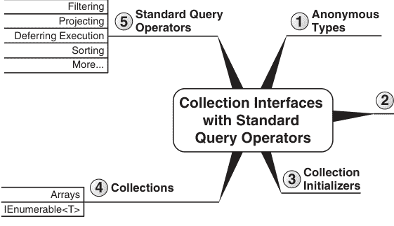

首先，本章介绍匿名类型和集合初始化器——这些主题我们在第5章的几个高级主题部分中只是简要介绍过。接下来，本章涵盖各种集合接口，并探讨它们之间的相互关系。这是理解集合的基础，因此读者应当认真学习这部分内容。关于集合接口的小节将介绍在 C# 3.0 中为实现标准查询运算符而添加的`IEnumerable<T>`扩展方法。

与集合相关的类和接口有两类：支持泛型的和不支持泛型的。本章主要讨论泛型集合接口。只有在编写需要与早期版本运行时互操作的组件时，才应使用不支持泛型的集合类。这是因为非泛型形式中的所有内容都有强类型的泛型替代。尽管这些概念仍然适用于两种形式，但我们不会明确讨论非泛型版本。

## 匿名类型与隐式类型局部变量

C# 3.0 显著提升了对处理项目集合的支持。令人惊奇的是，为了支持这一高级 API，所做的语言增强不到九项。然而，这些增强正是 C# 3.0 成为该语言一次惊人改进的关键。其中两项增强是匿名类型和隐式局部变量。

### 匿名类型

匿名类型是由编译器声明的数据类型，而不是通过第5章的显式类定义来声明。与匿名函数类似，当编译器看到匿名类型时，它会替你完成创建该类的所有工作，然后让你像显式声明过一样使用它。清单14.1 展示了这样的声明。

#### 清单14.1：使用匿名类型的隐式局部变量

```csharp
using System;

class Program
{
    static void Main()
    {
        var patent1 =
            new
            {
                Title = "Bifocals",
                YearOfPublication = "1784"
            };
        var patent2 =
            new
            {
                Title = "Phonograph",
                YearOfPublication = "1877"
            };
        var patent3 =
            new
            {
                patent1.Title,
                // Renamed to show property naming.
                Year = patent1.YearOfPublication
            };

        Console.WriteLine(
            $"{ patent1.Title } ({ patent1.YearOfPublication })");
        Console.WriteLine(
            $"{ patent2.Title } ({ patent2.YearOfPublication })");

        Console.WriteLine();
        Console.WriteLine(patent1);
        Console.WriteLine(patent2);

        Console.WriteLine();
        Console.WriteLine(patent3);
    }
}
```

相应的输出如输出14.1所示。

#### 输出14.1

```
Bifocals (1784)
Phonograph (1784)

{ Title = Bifocals, YearOfPublication = 1784 }
{ Title = Phonograph, YearOfPublication = 1877 }

{ Title = Bifocals, Year = 1784 }
```

匿名类型纯粹是 C# 的一项功能，并不是运行时中的一种新型类型。当编译器遇到匿名类型语法时，它会生成一个 CIL 类，其属性与匿名类型声明中的命名值和数据类型相对应。

### 隐式类型局部变量（`var`）


由于匿名类型在定义上没有名称，因此不可能将局部变量显式声明为匿名类型。相反，局部变量的类型被替换为 `var`。但这绝不意味着隐式类型变量是未类型的。恰恰相反，它们被完全类型化为所赋值的值的类型。如果隐式类型变量被赋值为匿名类型，那么该局部变量声明底层的 CIL 代码将是编译器生成的类型。类似地，如果隐式类型变量被赋值为字符串，其在底层 CIL 中的数据类型也将是字符串。实际上，对于赋值不是匿名类型（如字符串）的隐式类型变量，与显式声明为 `string` 类型的情况相比，生成的 CIL 代码没有差异。如果声明语句是 `string text = "This is a test of the…"`，其生成的 CIL 代码将与隐式类型声明 `var text = "This is a test of the…"` 完全相同。编译器根据所赋的表达式来确定隐式类型变量的数据类型。在带初始化器的显式类型局部变量（`string s = "hello";`）中，编译器首先根据左侧的声明类型确定 `s` 的类型，然后分析右侧表达式，并验证右侧表达式可赋值给该类型。在隐式类型局部变量中，这个过程在某种意义上反转了。首先分析右侧表达式以确定其类型，然后逻辑上用该类型替换 `var`。

尽管 C# 没有为匿名类型提供名称，但它仍然是强类型的。例如，该类型的属性是完全可访问的。在清单14.1中，`patent1.Title` 和 `patent2.YearOfPublication` 在 `Console.WriteLine` 语句中被调用。任何尝试调用不存在的成员都会导致编译器错误。即使 Visual Studio 等 IDE 中的 IntelliSense 也能与匿名类型配合工作。

你应该谨慎使用隐式类型变量声明。显然，对于匿名类型，不可能指定数据类型，必须使用 `var`。然而，在数据类型不是匿名类型的情况下，通常更倾向于使用显式数据类型 `type`。一般情况下，你应专注于使代码的语义更具可读性，同时利用编译器验证生成的变量是否为你期望的类型。要使用隐式类型的局部变量实现这一点，仅在分配给隐式类型变量的类型完全显而易见时才使用它们。例如，在 `var items = new Dictionary<string, List<Account>>();` 中，结果代码更简洁且可读。相比之下，当类型不明显时，例如方法返回值被赋值时，开发人员应优先使用显式的变量类型声明，如下所示：

```
Dictionary<string, List<Account>> dictionary = GetAccounts();
```

## NOTE

隐式类型变量通常应保留用于匿名类型声明，而不是在编译时已知数据类型时随意使用，除非分配给变量的类型完全显而易见。

## Language Contrast: C++/Visual Basic/JavaScript—void*, Variant, and var

隐式类型变量不等同于 C++ 中的 `void*`、Visual Basic 中的 `Variant` 或 JavaScript 中的 `var`。在每种情况下，变量声明都不是很严格，因为变量可以被赋予任意类型，就像你在 C# 中使用类型为 `object` 的变量声明时所能做的那样。相比之下，`var` 是由编译器明确类型的；一旦在声明时确定，类型就不能更改，并且类型检查和成员调用在编译时得到验证。

## More about Anonymous Types and Implicit Local Variables

在 Listing 14.1 中，匿名类型的成员名称通过将值赋给 `patent1` 和 `patent2` 的名称来显式标识（例如，`Title = "Phonograph"`）。然而，如果分配的值是属性或字段调用，则名称可能会默认为字段或属性的名称，而不是显式指定值。例如，`patent3` 是使用名为“Title”的属性定义的，而不是分配给显式名称。如 Output 14.1 所示，结果属性名称由编译器确定，以匹配从中检索值的属性。

`patent1` 和 `patent2` 具有相同的属性名称和相同的数据类型。因此，C# 编译器为这两个匿名声明生成一个数据类型。然而，`patent3` 迫使编译器创建第二个匿名类型，因为专利年份的属性名称与 `patent1` 和 `patent2` 中的不同。此外，如果 `patent1` 和 `patent2` 之间交换属性的顺序，这两个匿名类型也不会类型兼容。换句话说，在同一程序集中使两个匿名类型类型兼容的要求是属性名称、数据类型和属性顺序的匹配。如果满足这些标准，即使它们出现在不同的方法或类中，类型也是兼容的。Listing 14.2 演示了类型不兼容的情况。

### LISTING 14.2: Type Safety and Immutability of Anonymous Types

```
class Program
{
    static void Main()
    {
        var patent1 =
            new
            {
                Title = "Bifocals",
                YearOfPublication = "1784"
            };

        var patent2 =
            new
            {
                YearOfPublication = "1877",
                Title = "Phonograph"
            };

        var patent3 =
            new
            {
                patent1.Title,
                Year = patent1.YearOfPublication
            };

        // ERROR: Cannot implicitly convert type
        //        'AnonymousType#1' to 'AnonymousType#2'
        patent1 = patent2;
        // ERROR: Cannot implicitly convert type
        //        'AnonymousType#3' to 'AnonymousType#2'
        patent1 = patent3;

        // ERROR: Property or indexer 'AnonymousType#1.Title'
        //        cannot be assigned to -- it is read-only
        patent1.Title = "Swiss Cheese";
    }
}
```

前两个编译器错误的结果断言这些类型不兼容，因此它们不会成功相互转换。

第三个编译器错误是由 `Title` 属性的重新赋值引起的。匿名类型是不可变的，因此在实例化后更改匿名类型的属性是编译器错误。

尽管 Listing 14.2 中未显示，但不可能声明具有隐式数据类型参数（`var`）的方法。因此，匿名类型的实例只能以两种方式在创建它们的范围外传递。首先，如果方法参数的类型为 `object`，则匿名类型实例可以传递到方法之外，因为匿名类型会隐式转换。第二种方法是使用方法类型推断，即匿名类型实例作为编译器可以成功推断的方法类型参数传递。因此，使用 `Function(patent1)` 调用 `void Method<T>(T parameter)` 将会成功，尽管 `Function()` 中对 `parameter` 的可用操作仅限于 `object` 支持的操作。

尽管 C# 允许像 Listing 14.1 中所示的匿名类型，但通常不建议你以这种方式定义它们。匿名类型为 C# 3.0 对投影的支持提供了关键功能，例如连接/关联集合，我们将在本章后面讨论。然而，通常你应将匿名类型定义保留在需要它们的情况下，例如从多个类型聚合数据。

## ADVANCED TOPIC

## Anonymous Type Generation

即使 `Console.WriteLine()` 的实现是调用 `ToString()`，请注意在 Listing 14.1 中，`Console.WriteLine()` 的输出不是默认的 `ToString()`，后者会输出完全限定数据类型名称。相反，输出是每个匿名类型属性的 `PropertyName = value` 对列表。这是因为编译器在匿名类型代码生成中重写了 `ToString()`，从而将 `ToString()` 输出格式化为所示形式。同样，生成的类型包括对 `Equals()` 和 `GetHashCode()` 的重写实现。

`ToString()` 的实现本身就是一个重要原因，即属性顺序的变化会导致生成新的数据类型。如果两个单独的匿名类型，可能在完全不同的类型甚至命名空间中被统一，然后更改属性顺序，一个实现上属性顺序的变化会对另一个的 `ToString()` 结果产生明显且可能不可接受的影响。此外，在执行时，可以通过反射查看类型并检查类型上的成员——甚至可以动态调用其中一个成员（在运行时确定要调用哪个成员）。两个看似相同的类型上成员顺序的变化可能会触发意外的结果。为了避免这个问题，C# 设计者决定生成两种不同的类型。

## Collection Initializers

添加到 C# 3.0 中的另一个功能是集合初始化器。集合初始化器允许程序员在实例化时以类似于数组声明的方式构造具有初始成员集的集合。在集合初始化可用之前，元素必须在集合实例化后显式添加到集合中——使用类似 `System.Collections.Generic.ICollection<T>` 的 `Add()` 方法。通过集合初始化，`Add()` 调用由 C# 编译器生成，而不是由开发人员显式编码。Listing 14.3 显示了如何使用集合初始化器初始化集合。

### LISTING 14.3: Collection Initialization

```
using System;
using System.Collections.Generic;

class Program
{
    static void Main()
    {
        List<string> sevenWorldBlunders;
        sevenWorldBlunders = new List<string>()
        {
            // Quotes from Ghandi
            "Wealth without work",
            "Pleasure without conscience",
            "Knowledge without character",
            "Commerce without morality",
            "Science without humanity",
            "Worship without sacrifice",
            "Politics without principle"
        };

        Print(sevenWorldBlunders);
    }

    private static void Print<T>(IEnumerable<T> items)
    {
        foreach (T item in items)
        {
            Console.WriteLine(item);
        }
    }
}
```

语法不仅类似于数组初始化，也类似于对象初始化器，后者在构造函数后使用大括号。如果构造函数中未传递参数，则数据类型后的括号是可选的（与对象初始化器相同）。

集合初始化器要成功编译，需要满足一些基本要求。理想情况下，集合初始化器所应用的集合类型应为实现 `System.Collections.Generic.ICollection<T>` 的类型。这确保集合包含编译器生成的代码可以调用的 `Add()`。然而，也存在一种宽松的版本要求，只需在实现 `IEnumerable<T>` 的类型上存在一个或多个 `Add()` 方法即可，这些方法可以作为扩展方法（C# 6.0）或实例方法存在——即使集合未实现 `ICollection<T>`。`Add()` 方法需要采用与集合初始化器中指定的值兼容的参数。

对于字典，集合初始化器语法稍微复杂一些，因为字典中的每个元素都需要键和值。该语法如清单14.4所示。

### LISTING 14.4: 初始化字典

```csharp
using System;
using System.Collections.Generic;
#if !PRECSHARP6
    // C# 6.0 or Later
    Dictionary<string, ConsoleColor> colorMap =
        new Dictionary<string, ConsoleColor>
        {
            ["Error"] = ConsoleColor.Red,
            ["Warning"] = ConsoleColor.Yellow,
            ["Information"] = ConsoleColor.Green,
            ["Verbose"] = ConsoleColor.White
        };
#else
    // Before C# 6.0
    Dictionary<string, ConsoleColor> colorMap =
        new Dictionary<string, ConsoleColor>
        {
            { "Error", ConsoleColor.Red },
            { "Warning", ConsoleColor.Yellow },
            { "Information", ConsoleColor.Green },
            { "Verbose", ConsoleColor.White}
        };
#endif
```

此清单实际包含两个不同版本的初始化。第一个演示了C# 6.0引入的新语法，它通过允许赋值运算符来表达哪个值与哪个键关联，从而说明名称/值对的意图。第二种语法（在C# 6.0或更高版本中仍然有效）使用花括号将名称和值配对在一起。

允许在不支持 `ICollection<T>` 的集合上使用初始化器之所以重要，有两个原因。首先，大多数集合（实现 `IEnumerable<T>` 的类型）并不实现 `ICollection<T>`，这大大降低了集合初始化器的实用性。其次，根据方法名和签名与集合初始化器项的兼容性进行匹配，使得初始化到集合中的项更具多样性。例如，只要有一个 `Add()` 方法的签名与参数 `a` 兼容，并且有第二个 `Add()` 方法的签名与 `b`、`c` 兼容，初始化器现在就可以支持 `new DataStore(){ a, {b, c}}`。

请注意，不能为匿名类型提供集合初始化器，因为集合初始化器需要构造函数调用，而无法命名构造函数。解决办法是定义一个方法，例如 `static List<T> CreateList<T>(T t) { return new List<T>(); }`。方法类型推断允许隐式推断类型参数，而不是显式指定，因此这种方法可以成功创建匿名类型的集合。

初始化匿名类型集合的另一种方法是使用数组初始化器。由于无法在构造函数中指定数据类型，数组初始化语法允许使用 `new[]` 进行匿名数组初始化（见清单14.5）。

### LISTING 14.5: 初始化匿名类型数组

```csharp
using System;
using System.Collections.Generic;
using System.Linq;

class Program
{
    static void Main()
    {
        var worldCup2006Finalists = new[]
        {
            new
            {
                TeamName = "France",
                Players = new string[]
                {
                    "Fabien Barthez", "Gregory Coupet",
                    "Mickael Landreau", "Eric Abidal",
                    // ...
                }
            },
            new
            {
                TeamName = "Italy",
                Players = new string[]
                {
                    "Gianluigi Buffon", "Angelo Peruzzi",
                    "Marco Amelia", "Cristian Zaccardo",
                    // ...
                }
            }
        };

        Print(worldCup2006Finalists);
    }

    private static void Print<T>(IEnumerable<T> items)
    {
        foreach (T item in items)
        {
            Console.WriteLine(item);
        }
    }
}
```

结果变量是匿名类型项的数组，由于是数组，该项的类型必须是同类型的。

## 类成为集合的条件：`IEnumerable<T>`


根据定义，.NET中的集合是一个至少实现了`IEnumerable<T>`（或非泛型类型`IEnumerable`）的类。该接口至关重要，因为实现`IEnumerable<T>`的方法是为支持集合迭代所需的最低要求。

第3章展示了如何使用`foreach`语句遍历元素数组。该语法简单，避免了必须知道元素数量的复杂性。然而，运行时并不直接支持`foreach`语句。相反，C#编译器会将代码转换为本节所述的形式。

### `foreach`与数组

**清单14.6：`foreach`与数组**

```csharp
int[] array = new int[]{1, 2, 3, 4, 5, 6};

foreach (int item in array)
{
    Console.WriteLine(item);
}
```

从这段代码，C#编译器会生成一个等效的CIL `for`循环，如清单14.7所示。

**清单14.7：`foreach`与数组的编译实现**

```csharp
int[] tempArray;
int[] array = new int[]{1, 2, 3, 4, 5, 6};

tempArray = array;
for (int counter = 0; (counter < tempArray.Length); counter++)
{
    int item = tempArray[counter];

    Console.WriteLine(item);
}
```

在此示例中，注意`foreach`依赖于对`Length`属性和索引运算符（`[]`）的支持。有了`Length`属性，C#编译器就可以使用`for`语句遍历数组中的每个元素。

### `foreach`与`IEnumerable<T>`

虽然清单14.7中的代码在长度固定且始终支持索引运算符的数组上效果很好，但并非所有类型的集合都有已知的元素数量。此外，许多集合类，包括`Stack<T>`、`Queue<T>`和`Dictionary<TKey, TValue>`类，不支持按索引检索元素。因此，需要一种更通用的遍历元素集合的方法。迭代器模式提供了这种能力。假设你可以确定第一个、下一个和最后一个元素，则无需知道计数和按索引检索元素。

`System.Collections.Generic.IEnumerator<T>`和非泛型接口`System.Collections.IEnumerator`（见清单14.9）旨在启用迭代器模式来遍历元素集合，而不是清单14.7中所示的长度-索引模式。它们的关系类图如图14.1所示。

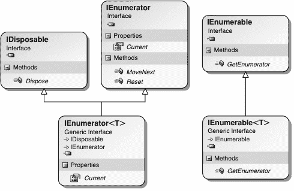

**图14.1：** `IEnumerator<T>`和`IEnumerator`接口的类图

`IEnumerator<T>`派生于`IEnumerator`，包含三个成员。第一个是`bool MoveNext()`。使用此方法，你可以从集合中的一个元素移动到下一个元素，同时检测是否已枚举完所有项目。第二个成员是一个名为`Current`的只读属性，返回当前正在处理的元素。`Current`在`IEnumerator<T>`中重载，提供了类型特定的实现。有了集合类中的这两个成员，就可以像清单14.8所示的那样，简单地使用`while`循环迭代集合。（`Reset()`方法通常会抛出`NotImplemented`异常，因此不应调用它。如果需要重新开始枚举，只需创建一个新的枚举器。）

**清单14.8：使用`while`迭代集合**

```csharp
System.Collections.Generic.Stack<int> stack =
    new System.Collections.Generic.Stack<int>();
int number;
// ...

// This code is conceptual, not the actual code.
while (stack.MoveNext())
{
    number = stack.Current;
    Console.WriteLine(number);
}
```

在清单14.8中，`MoveNext()`方法在移动过集合末尾时返回`false`。这取代了循环时计数元素的需要。

清单14.8使用`System.Collections.Generic.Stack<T>`作为集合类型。存在许多其他集合类型；这只是一个例子。`Stack<T>`的关键特性是其被设计为“后进先出”（LIFO）集合。注意，类型参数`T`标识了集合中所有项的类型。在集合中收集某一种特定类型的对象是泛型集合的关键特征。程序员在添加、删除或访问集合中的项时，必须知道集合中的数据类型。

前面的示例展示了 C# 编译器输出的要点，但实际上它无法这样编译，因为实现中省略了两个重要细节：交错（interleaving）和错误处理。

## 状态是共享的

清单 14.8 这样的实现存在的问题是，如果两个这样的循环相互交错——一个 `foreach` 嵌套在另一个内部，两者都使用同一个集合——集合必须维护一个当前元素的状态指示器，以便在调用 `MoveNext()` 时能够确定下一个元素。在这种情况下，一个交错的循环可能会影响另一个循环。（多个线程执行的循环也是如此。）

为了解决这个问题，集合类并不直接支持 `IEnumerator<T>` 和 `IEnumerator` 接口。如图 14.1 所示，还有第二个接口，名为 `IEnumerable<T>`，其唯一的方法是 `GetEnumerator()`。该方法的作用是返回一个支持 `IEnumerator<T>` 的对象。集合类不维护状态，而是由另一个类——通常是嵌套类，这样它就可以访问集合的内部细节——来支持 `IEnumerator<T>` 接口并维护迭代循环的状态。枚举器就像序列中的“游标”或“书签”。你可以有多个书签，移动每个书签都会独立于其他书签对集合进行枚举。使用这种模式，`foreach` 循环对应的 C# 代码将如清单 14.9 所示。

### 清单 14.9: 一个在迭代期间维护状态的独立枚举器

```csharp
System.Collections.Generic.Stack<int> stack =
    new System.Collections.Generic.Stack<int>();
int number;
System.Collections.Generic.Stack<int>.Enumerator
    enumerator;

// ...

// If IEnumerable<T> is implemented explicitly,
// then a cast is required.
// ((IEnumerable<int>)stack).GetEnumerator();
enumerator = stack.GetEnumerator();
while (enumerator.MoveNext())
{
    number = enumerator.Current;
    Console.WriteLine(number);
}
```

## 高级主题

### 迭代后的清理

由于实现 `IEnumerator<T>` 接口的类会维护状态，有时需要在退出循环后清理状态（因为要么所有迭代都已完成，要么抛出了异常）。为了实现这一点，`IEnumerator<T>` 接口派生自 `IDisposable`。实现 `IEnumerator` 的枚举器不一定实现 `IDisposable`，但如果实现了，也会调用 `Dispose()`。这使得在 `foreach` 循环退出后可以调用 `Dispose()`。因此，最终 CIL 代码对应的 C# 等价代码如清单 14.10 所示。

### 清单 14.10: `foreach` 在集合上编译后的结果

```csharp
System.Collections.Generic.Stack<int> stack =
    new System.Collections.Generic.Stack<int>();
System.Collections.Generic.Stack<int>.Enumerator
enumerator;
IDisposable disposable;

enumerator = stack.GetEnumerator();
try
{
    int number;
    while (enumerator.MoveNext())
    {
        number = enumerator.Current;
        Console.WriteLine(number);
    }
}
finally
{
    // Explicit cast used for IEnumerator<T>.
    disposable = (IDisposable) enumerator;
    disposable.Dispose();

    // IEnumerator will use the as operator unless IDisposable
    // support is known at compile time.
    // disposable = (enumerator as IDisposable);
    // if (disposable != null)
    // {
    //     disposable.Dispose();
    // }
}
```

注意，由于 `IDisposable` 接口由 `IEnumerator<T>` 支持，`using` 语句可以将清单 14.10 中的代码简化为清单 14.11 所示的代码。

### 清单 14.11: 使用 `using` 进行错误处理和资源清理

```csharp
System.Collections.Generic.Stack<int> stack =
    new System.Collections.Generic.Stack<int>();
int number;

using (
    System.Collections.Generic.Stack<int>.Enumerator
        enumerator = stack.GetEnumerator())
{
    while (enumerator.MoveNext())
    {
        number = enumerator.Current;
        Console.WriteLine(number);
    }
}
```

然而，请记住，CIL 并不直接支持 `using` 关键字。因此，清单 14.10 中的代码实际上是 `foreach` 的 CIL 代码更准确的 C# 表示。

### 没有 `IEnumerable` 的 `foreach`

C# 并不要求在使用 `foreach` 迭代数据类型时实现 `IEnumerable`/`IEnumerable<T>`。相反，编译器使用一种称为**鸭子类型**（duck typing）的概念；它会查找一个返回类型具有 `Current` 属性和 `MoveNext()` 方法的 `GetEnumerator()` 方法。鸭子类型涉及按名称查找，而不是依赖接口或显式方法调用来调用该方法。（“鸭子类型”这个名称源于一个异想天开的想法：要被当作鸭子，对象只需实现一个 `Quack()` 方法；它不需要实现 `IDuck` 接口。）如果鸭子类型未能找到可枚举模式的合适实现，编译器会检查集合是否实现了这些接口。

### 不要在 `foreach` 迭代期间修改集合

第 3 章展示了编译器阻止对 `foreach` 变量（`number`）进行赋值。如清单 14.10 所示，对 `number` 的赋值并不会改变集合元素本身，因此 C# 编译器完全阻止了此类赋值。

另外，在 `foreach` 循环执行期间，集合中的元素个数以及元素本身通常都不能被修改。例如，如果你在 `foreach` 循环内调用了 `stack.Push(42)`，那么迭代器是应该忽略还是包含对 `stack` 的修改将变得不明确——换句话说，迭代器是应该迭代新添加的项，还是忽略它并假定与实例化时相同的状态。

由于这种不明确性，如果在 `foreach` 循环内修改了集合，那么在访问枚举器时通常会抛出 `System.InvalidOperationException` 类型的异常，报告说集合在枚举器实例化之后被修改了。

## 标准查询运算符

除了 `System.Object` 上的方法之外，任何实现 `IEnumerable<T>` 的类型都只需要实现另一个方法 `GetEnumerator()`。然而，这样做会使所有实现 `IEnumerable<T>` 的类型都可以使用 50 多个方法，这还不包括任何重载——而且无需显式实现除 `GetEnumerator()` 方法之外的任何方法。这些额外的功能是通过 C# 3.0 的扩展方法提供的，并且位于 `System.Linq.Enumerable` 类中。因此，只要包含 `System.Linq` 的 `using` 指令，就可以使用这些方法。

`IEnumerable<T>` 上的每个方法都是一个标准查询运算符；它为其操作的集合提供查询能力。在接下来的几节中，我们将研究这些标准查询运算符中最突出的一些。许多示例将依赖于 `Inventor` 和/或 `Patent` 类，这两个类都在清单 14.12 中定义。

### 清单 14.12: 用于标准查询运算符的示例类

```csharp
using System;
using System.Collections.Generic;
using System.Linq;

public class Patent
{
    // Title of the published application
    public string Title { get; set; }

    // The date the application was officially published
    public string YearOfPublication { get; set; }

    // A unique number assigned to published applications
    public string ApplicationNumber { get; set; }

    public long[] InventorIds { get; set; }

    public override string ToString()
    {
        return $"{ Title } ({ YearOfPublication })";
    }
}

public class Inventor
{
    public long Id { get; set; }
    public string Name { get; set; }
    public string City { get; set; }
    public string State { get; set; }
    public string Country { get; set; }

    public override string ToString()
    {
        return $"{ Name } ({ City }, { State })";
    }
}

class Program
{
    static void Main()
    {
        IEnumerable<Patent> patents = PatentData.Patents;
        Print(patents);

        Console.WriteLine();

        IEnumerable<Inventor> inventors = PatentData.Inventors;
        Print(inventors);
    }

    private static void Print<T>(IEnumerable<T> items)
    {
        foreach (T item in items)
        {
            Console.WriteLine(item);
        }
    }
}

public static class PatentData
{
    public static readonly Inventor[] Inventors = new Inventor[]
    {
        new Inventor(){
            Name="Benjamin Franklin", City="Philadelphia",
            State="PA", Country="USA", Id=1 },
```
```


```
new Inventor(){
    Name="Orville Wright", City="Kitty Hawk",
    State="NC", Country="USA", Id=2},
new Inventor(){
    Name="Wilbur Wright", City="Kitty Hawk",
    State="NC", Country="USA", Id=3},
new Inventor(){
    Name="Samuel Morse", City="New York",
    State="NY", Country="USA", Id=4},
new Inventor(){
    Name="George Stephenson", City="Wylam",
    State="Northumberland", Country="UK", Id=5},
new Inventor(){
    Name="John Michaelis", City="Chicago",
    State="IL", Country="USA", Id=6},
new Inventor(){
    Name="Mary Phelps Jacob", City="New York",
    State="NY", Country="USA", Id=7},
};

public static readonly Patent[] Patents = new Patent[]
{
    new Patent(){
        Title="Bifocals", YearOfPublication="1784",
        InventorIds=new long[] {1}},
    new Patent(){
        Title="Phonograph", YearOfPublication="1877",
        InventorIds=new long[] {1}},
    new Patent(){
        Title="Kinetoscope", YearOfPublication="1888",
        InventorIds=new long[] {1}},
    new Patent(){
        Title="Electrical Telegraph",
        YearOfPublication="1837",
        InventorIds=new long[] {4}},
    new Patent(){
        Title="Flying Machine", YearOfPublication="1903",
        InventorIds=new long[] {2,3}},
    new Patent(){
        Title="Steam Locomotive",
        YearOfPublication="1815",
        InventorIds=new long[] {5}},
    new Patent(){
        Title="Droplet Deposition Apparatus",
        YearOfPublication="1989",
        InventorIds=new long[] {6}},
    new Patent(){
        Title="Backless Brassiere",
        YearOfPublication="1914",
        InventorIds=new long[] {7}},
};
}
```

第 14.12 节还提供了一些示例数据。输出 14.2 显示了运行此代码的结果。

## OUTPUT 14.2

```
Bifocals (1784)
Phonograph (1877)
Kinetoscope (1888)
Electrical Telegraph (1837)
Flying Machine (1903)
Steam Locomotive (1815)
Droplet Deposition Apparatus (1989)
Backless Brassiere (1914)

Benjamin Franklin (Philadelphia, PA)
Orville Wright (Kitty Hawk, NC)
Wilbur Wright (Kitty Hawk, NC)
Samuel Morse (New York, NY)
George Stephenson (Wylam, Northumberland)
John Michaelis (Chicago, IL)
Mary Phelps Jacob (New York, NY)
```

## Filtering with Where()

要从集合中过滤数据，我们需要提供一个过滤方法，该方法返回 true 或 false，以指示是否应包含特定元素。接受参数并返回布尔值的委托表达式称为谓词，而集合的 `Where()` 方法依赖于谓词来识别过滤条件，如第 14.13 节所示。 （从技术上讲，`Where()` 方法的结果是一个单子，它封装了使用给定谓词过滤给定序列的操作。）结果出现在输出 14.3 中。

### LISTING 14.13: Filtering with System.Linq.Enumerable.Where()

```
using System;
using System.Collections.Generic;
using System.Linq;

class Program
{
    static void Main()
    {
        IEnumerable<Patent> patents = PatentData.Patents;
        patents = patents.Where(
            patent => patent.YearOfPublication.StartsWith("18"));
        Print(patents);
    }

    // ...
}
```

### OUTPUT 14.3

```
Phonograph (1877)
Kinetoscope (1888)
Electrical Telegraph (1837)
Steam Locomotive (1815)
```

请注意，代码将 `Where()` 调用的输出重新赋给了 `IEnumerable<T>`。换句话说，`IEnumerable<T>.Where()` 的输出是一个新的 `IEnumerable<T>` 集合。在第 14.13 节中，它是 `IEnumerable<Patent>`。

不太明显的是，`Where()` 表达式参数在赋值时不一定会被执行。这对许多标准查询运算符来说都是正确的。以 `Where()` 为例，表达式被传递给集合并“保存”下来，但并未执行。相反，只有在需要开始遍历集合中的项目时才会执行表达式。例如，`foreach` 循环，例如 `Print()` 中的循环（见第 14.12 节），将触发对集合中每个项目的表达式求值。从概念上讲，`Where()` 方法应被理解为指定查询以确定集合中出现的内容的方式，而不是迭代项目以生成可能包含更少项目的新的集合所涉及的实际工作。

## Projecting with Select()

由于 `IEnumerable<T>.Where()` 方法的输出是一个新的 `IEnumerable<T>` 集合，因此可以再次对同一集合调用标准查询运算符。例如，除了过滤原始集合中的数据外，我们还可以转换数据（见第 14.14 节）。

### LISTING 14.14: Projection with System.Linq.Enumerable.Select()

```
using System;
using System.Collections.Generic;
using System.Linq;

class Program
{
    static void Main()
    {
        IEnumerable<Patent> patents = PatentData.Patents;
        IEnumerable<Patent> patentsOf1800 = patents.Where(
            patent => patent.YearOfPublication.StartsWith("18"));
        IEnumerable<string> items = patentsOf1800.Select(
            patent => patent.ToString());

        Print(items);
    }

    // ...
}
```

在第 14.14 节中，我们创建了一个新的 `IEnumerable<string>` 集合。在这种情况下，添加 `Select()` 调用碰巧并没有改变输出——但这只是因为 `Print()` 的 `Console.WriteLine()` 调用无论如何都会使用 `ToString()`。显然，对从原始集合的 `Patent` 类型到 `items` 集合的 `string` 类型的每个项目都进行了转换。

考虑使用 `System.IO.FileInfo` 的示例，如第 14.15 节所示。

### LISTING 14.15: Projection with System.Linq.Enumerable.Select() and new

```
// ...
IEnumerable<string> fileList = Directory.GetFiles(
    rootDirectory, searchPattern);
IEnumerable<FileInfo> files = fileList.Select(
    file => new FileInfo(file));
// ...
```

这里 `fileList` 的类型是 `IEnumerable<string>`。然而，利用 `Select` 提供的投影，我们可以将集合中的每个项目转换为 `System.IO.FileInfo` 对象。

最后，利用匿名类型，我们可以创建一个集合 `IEnumerable<T>`，其中 `T` 是匿名类型（见第 14.16 节和输出 14.4）。

### LISTING 14.16: Projection to an Anonymous Type

```
// ...
IEnumerable<string> fileList = Directory.EnumerateFiles(
    rootDirectory, searchPattern);
var items = fileList.Select(
    file =>
    {
        FileInfo fileInfo = new FileInfo(file);
        return new
        {
            FileName = fileInfo.Name,
            Size = fileInfo.Length
        };
    });
// ...
```

### OUTPUT 14.4

```
{ FileName = AssemblyInfo.cs, Size = 1704 }
{ FileName = CodeAnalysisRules.xml, Size = 735 }
{ FileName = CustomDictionary.xml, Size = 199 }
{ FileName = EssentialCSharp.sln, Size = 40415 }
{ FileName = EssentialCSharp.suo, Size = 454656 }
{ FileName = EssentialCSharp.vsmd, Size = 499 }
{ FileName = EssentialCSharp.vsscc, Size = 256 }
{ FileName = intelliTechture.ConsoleTester.dll, Size = 24576 }
{ FileName = intelliTechture.ConsoleTester.pdb, Size = 30208 }
{ FileName = LocalTestRun.testrunconfig, Size = 1388 }
```

匿名类型的输出会自动显示属性名称及其值作为与匿名类型关联的生成的 `ToString()` 方法的一部分。

使用 `Select()` 方法进行投影非常强大。我们已经看到了如何使用 `Where()` 标准查询运算符垂直过滤集合（减少集合中的项目数）。现在，通过 `Select()` 标准查询运算符，我们还可以水平减少集合（减少列数）或完全转换数据。`Where()` 和 `Select()` 结合使用提供了一种提取原始集合中对当前算法有用的部分的方法。这两种方法单独提供了一个强大的集合操作 API，否则将导致代码量显著增加且可读性更差。

## ADVANCED TOPIC

### Running LINQ Queries in Parallel

随着拥有多个处理器以及处理器内部多个核心的计算机的增多，能够轻松利用额外的处理能力变得越来越重要。为此，程序需要被修改以支持多线程，以便可以在计算机的不同 CPU 上同时进行工作。第 14.17 节演示了使用并行 LINQ（PLINQ）实现此目的的一种方法。

### LISTING 14.17: Executing LINQ Queries in Parallel

```
// ...
IEnumerable<string> fileList = Directory.EnumerateFiles(
    rootDirectory, searchPattern);
var items = fileList.AsParallel().Select(
    file =>
```

```
{
    FileInfo fileInfo = new FileInfo(file);
    return new
    {
        FileName = fileInfo.Name,
        Size = fileInfo.Length
    };
});
// ...
```

如清单14.17所示，启用并行支持的代码改动微乎其微。它只是用到一个 .NET Framework 4 引入的标准查询操作符 `AsParallel()`，该操作符位于静态类 `System.Linq.ParallelEnumerable` 上。然而，使用这个简单的扩展方法后，运行时便会开始并行地遍历 `fileList` 集合中的各项并返回结果对象。此处的每个并行操作并不特别昂贵（尽管相对于正在进行的其他执行而言），但考虑一下如加密或压缩等 CPU 密集型操作。在多个 CPU 上并行运行查询，执行时间缩短的倍数与 CPU 数量相对应。

需要注意的一个重要告诫（也就是 `AsParallel()` 作为高级主题而不是标准内容出现的原因）是并行执行可能会引入竞态条件，一个线程上的操作可能与另一个线程上的操作交错进行，从而导致数据损坏。为避免此问题，需要对多线程共享访问的数据采用同步机制，以便在必要时强制操作原子化。然而，同步本身可能会引入死锁，使执行停滞，这进一步增加了有效并行编程的复杂性。

关于这一主题以及其他多线程主题的更多细节将在第18章和第19章中介绍。

## 使用 Count() 计算元素数量

对项集合经常执行的另一个查询是获取计数。为支持这种查询，LINQ 包含了 `Count()` 扩展方法。

清单14.18演示了 `Count()` 已被重载，既可以简单地统计所有元素（无参数），也可以接收一个谓词，仅统计由谓词表达式确定的项。

### 清单14.18：使用 Count() 统计项

```
using System;
using System.Collections.Generic;
using System.Linq;

class Program
{
    static void Main()
    {
        IEnumerable<Patent> patents = PatentData.Patents;
        Console.WriteLine($"Patent Count: { patents.Count()}");
        Console.WriteLine($@"Patent Count in 1800s: {
            patents.Count(patent =>
                patent.YearOfPublication.StartsWith("18"))}");
    }
    // ...
}
```

尽管 `Count()` 语句看似简单，但 `IEnumerable<T>` 并未改变，因此执行的代码仍会遍历集合中的所有项。只要集合上直接提供了 `Count` 属性，就应该优先使用该属性，而不是 LINQ 的 `Count()` 方法（这是一个细微差别）。幸运的是，`ICollection<T>` 包含 `Count` 属性，因此对支持 `ICollection<T>` 的集合调用 `Count()` 方法的代码将强制转换集合并直接调用 `Count`。但是，如果不支持 `ICollection<T>`，`Enumerable.Count()` 将继续枚举集合中的所有项，而不是调用内置的 `Count` 机制。如果检查计数的目的只是为了查看它是否大于零（`if(patents.Count() > 0){...}`），更好的做法是使用 `Any()` 运算符（`if(patents.Any()){...}`）。`Any()` 只尝试迭代集合中的一项即可返回 `true` 结果，而不是遍历整个序列。

## 指南

- 在检查是否存在多于零个项时，务必使用 `System.Linq.Enumerable.Any()`，而不是调用 `patents.Count()`。

- 在可用的情况下，务必使用集合的 `Count` 属性，而不是调用 `System.Linq.Enumerable.Count()` 方法。

## 延迟执行


使用 LINQ 时需要牢记的最重要概念之一是延迟执行。请考虑清单14.19中的代码以及输出14.5中对应的输出。

### 清单14.19：使用 `System.Linq.Enumerable.Where()` 进行过滤

```
using System;
using System.Collections.Generic;
using System.Linq;

// ...

IEnumerable<Patent> patents = PatentData.Patents;
bool result;
patents = patents.Where(
    patent =>
    {
        if (result =
            patent.YearOfPublication.StartsWith("18"))
        {
            // Side effects like this in a predicate
            // are used here to demonstrate a
            // principle and should generally be
            // avoided.
            Console.WriteLine("\t" + patent);
        }
        return result;
    });

Console.WriteLine("1. Patents prior to the 1900s are:");
foreach (Patent patent in patents)
{
}

Console.WriteLine();
Console.WriteLine(
    "2. A second listing of patents prior to the 1900s:");
Console.WriteLine(
    $@"  There are { patents.Count() }
    patents prior to 1900.");

Console.WriteLine();
Console.WriteLine(
    "3. A third listing of patents prior to the 1900s:");
patents = patents.ToArray();
Console.Write("  There are ");
Console.WriteLine(
    $"{ patents.Count() } patents prior to 1900.");

// ...
```

## 输出14.5

```
1. Patents prior to the 1900s are:
    Phonograph (1877)
    Kinetoscope (1888)
    Electrical Telegraph (1837)
    Steam Locomotive (1815)

2. A second listing of patents prior to the 1900s:
    Phonograph (1877)
    Kinetoscope (1888)
    Electrical Telegraph (1837)
    Steam Locomotive (1815)
    There are 4 patents prior to 1900.

3. A third listing of patents prior to the 1900s:
    Phonograph (1877)
    Kinetoscope (1888)
    Electrical Telegraph (1837)
    Steam Locomotive (1815)
    There are 4 patents prior to 1900.
```

请注意，`Console.WriteLine("1. Patents prior...")` 在 lambda 表达式之前执行。这是一个非常重要的特性，需要特别注意，因为对于那些不了解其重要性的人来说，这一点并不明显。一般来说，谓词应该只做一件事——评估条件——并且不应该有任何副作用（即使是像本例中这样向控制台打印）。

为了理解正在发生的事情，请回想一下，lambda 表达式是委托——方法的引用——可以四处传递。在 LINQ 和标准查询运算符的上下文中，每个 lambda 表达式都构成了要执行的整个查询的一部分。

在声明时，lambda 表达式不会执行。实际上，直到 lambda 表达式被调用时，其中的代码才开始执行。图14.2显示了操作序列。

如图14.2所示，清单14.17中的三次调用触发了 lambda 表达式，而且每次都是相当隐式的。如果 lambda 表达式开销很大（例如调用数据库），那么尽量减少 lambda 表达式的执行次数就很重要。

首先，执行在 `foreach` 循环内被触发。正如本章前面所描述的，`foreach` 循环分解为对 `MoveNext()` 的调用，每次调用都会导致 lambda 表达式对原始集合中的每个项执行一次。在迭代过程中，运行时对每个项调用 lambda 表达式，以确定该项是否满足谓词。

### 图14.2：调用 Lambda 表达式的操作序列

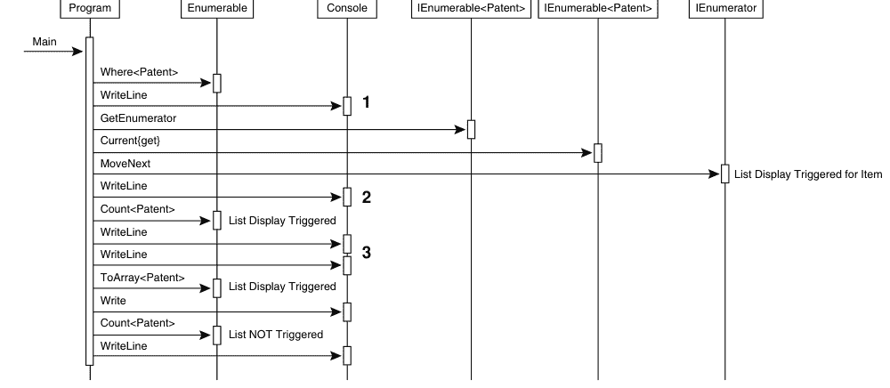

其次，对 `Enumerable` 的 `Count()`（函数）的调用会再次为每个项触发 lambda 表达式。这也是非常微妙的行为，因为 `Count`（属性）在未用标准查询运算符查询过的集合上非常常见。

第三，对 `ToArray()`（或 `ToList()`、`ToDictionary()` 或 `ToLookup()`）的调用会为每个项再次触发 lambda 表达式。不过，使用这些“To”方法之一转换集合是极其有用的。这样做会返回一个已经执行了标准查询运算符的集合。在清单14.17中，转换为数组意味着在最后的 `Console.WriteLine()` 中调用 `Length` 时，`patents` 指向的底层对象实际上是一个数组（显然实现了 `IEnumerable<T>`）；因此，调用的是 `System.Array` 的 `Length` 实现，而不是 `System.Linq.Enumerable` 的实现。因此，转换为某个“To”方法返回的集合类型后，通常可以安全地使用该集合（直到调用另一个标准查询运算符）。但是要注意，这会将整个结果集加载到内存中（在此之前，它可能由数据库或文件支持）。此外，“To”方法会获取底层数据的快照，因此重新查询“To”方法的结果时不会返回新的结果。

> **注意**
>
> 为避免这种重复执行，你必须缓存所执行查询检索到的数据。为此，可以使用“To”方法的集合方法之一将数据分配给本地集合。在调用“To”方法进行分配的过程中，查询显然会执行。但在那之后，对已分配集合的迭代将不再涉及查询表达式。一般来说，如果你想要内存中集合快照的行为，最佳做法是将查询表达式分配给缓存集合，以避免不必要的迭代。

我们强烈建议读者结合相应代码回顾图14.2中的序列图，并认识到标准查询运算符的延迟执行会导致对标准查询运算符极其隐蔽的触发；因此，开发人员应谨慎行事，尽量避免意外的调用。查询对象表示查询，而不是结果。当你向查询请求结果时，整个查询会执行（甚至可能再次执行），因为查询对象不知道结果会与之前执行（如果存在的话）时相同。

## 使用 `OrderBy()` 和 `ThenBy()` 进行排序

集合上的另一个常见操作是排序。这涉及调用 `System.Linq.Enumerable` 的 `OrderBy()` 方法，如清单 14.20 和输出 14.6 所示。

### 清单 14.20：使用 `System.Linq.Enumerable.OrderBy()/ThenBy()` 排序

```
using System;
using System.Collections.Generic;
using System.Linq;

// ...

    IEnumerable<Patent> items;
    Patent[] patents = PatentData.Patents;
    items = patents.OrderBy(
        patent => patent.YearOfPublication).ThenBy(
        patent => patent.Title);
    Print(items);
    Console.WriteLine();

    items = patents.OrderByDescending(
        patent => patent.YearOfPublication).ThenByDescending(
        patent => patent.Title);
    Print(items);

// ...
```

### 输出 14.6

```
Bifocals (1784)
Steam Locomotive (1815)
Electrical Telegraph (1837)
Phonograph (1877)
Kinetoscope (1888)
Flying Machine (1903)
Backless Brassiere (1914)
Droplet Deposition Apparatus (1989)

Droplet Deposition Apparatus (1989)
Backless Brassiere (1914)
Flying Machine (1903)
Kinetoscope (1888)
Phonograph (1877)
Electrical Telegraph (1837)
Steam Locomotive (1815)
Bifocals (1784)
```

`OrderBy()` 调用接收一个标识排序键的 lambda 表达式。在清单 14.20 中，初始排序使用专利发布的年份。

然而，请注意，`OrderBy()` 调用只接受一个参数，参数名为 `keySelector`，用于指定排序键。要按第二列排序，需要使用不同的方法：`ThenBy()`。类似地，任何额外的排序都可以使用 `ThenBy()`。

`OrderBy()` 返回的是 `IOrderedEnumerable<T>` 接口，而不是 `IEnumerable<T>`。此外，`IOrderedEnumerable<T>` 派生自 `IEnumerable<T>`，因此所有标准查询运算符（包括 `OrderBy()`）都可用于 `OrderBy()` 的返回值。然而，重复调用 `OrderBy()` 会撤销前一次调用的工作，导致最终结果仅按最后一次 `OrderBy()` 调用中的 `keySelector` 进行排序。因此，应小心避免在前一个 `OrderBy()` 调用上再次调用 `OrderBy()`。

相反，应使用 `ThenBy()` 指定额外的排序条件。虽然 `ThenBy()` 是一个扩展方法，但它不是对 `IEnumerable<T>` 的扩展，而是对 `IOrderedEnumerable<T>` 的扩展。该方法同样定义在 `System.Linq.Extensions.Enumerable` 中，声明如下：

```
public static IOrderedEnumerable<TSource>
    ThenBy<TSource, TKey>(
        this IOrderedEnumerable<TSource> source,
        Func<TSource, TKey> keySelector)
```

总之，先调用 `OrderBy()`，然后通过零次或多次 `ThenBy()` 调用来提供额外的排序“列”。`OrderByDescending()` 和 `ThenByDescending()` 提供相同的功能，只是按降序排序。混合使用升序和降序方法没有问题，但如果需要进一步排序，应使用 `ThenBy()` 调用（升序或降序均可）。

关于排序，还有两点重要说明。首先，实际排序直到你开始访问集合中的元素时才会发生，此时整个查询才会被处理。除非你拥有所有要排序的项，否则无法排序，因为你无法确定是否已拥有第一项。排序之所以延迟到开始访问元素时才执行，是由于本章前面描述的延迟执行。其次，每次后续对数据进行排序的调用（例如 `Orderby()` 后跟 `ThenBy()` 再后跟 `ThenByDescending()`）都会额外调用先前排序调用的 `keySelector` lambda 表达式。换句话说，一旦你遍历集合，`OrderBy()` 调用就会调用其对应的 `keySelector` lambda 表达式。此外，后续的 `ThenBy()` 调用将再次调用 `OrderBy()` 的 `keySelector`。

## 指南

不要在先前调用 `OrderBy()` 方法之后再次调用 `OrderBy()`。若要按多个值对项排序，请使用 `ThenBy()`。

## 初学者专题

## 连接操作

考虑如图 14.3 中的维恩图所示的两个对象集合。图中的左圆包含所有发明人，右圆包含所有专利。交集部分同时包含发明人和专利，并且每当发明人与专利匹配时，就会形成一条连线。如图所示，每个发明人可能拥有多项专利，而每项专利可以有一个或多个发明人。每项专利都有发明人，但在某些情况下，发明人尚无专利。

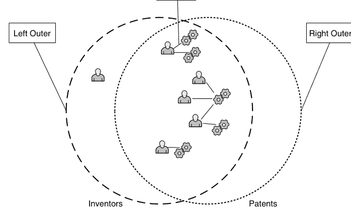

图 14.3：发明人与专利集合的维恩图

将交集内的发明人与专利进行匹配是一种**内连接（inner join）**。结果是一个发明人/专利对的集合，其中每个对都同时具有专利和发明。**左外连接（left outer join）** 包含左圆内的所有项，无论它们是否有对应的专利。在这个特定示例中，**右外连接（right outer join）** 与内连接相同，因为没有无发明人的专利。此外，左右之分是任意的，因此左连接和外连接之间实际上没有区别。然而，**全外连接（full outer join）** 将包含两侧外部的所有记录；执行全外连接的情况相对较少。

发明人与专利之间关系的另一个重要特征是它是**多对多**关系。每项专利可以有一个或多个发明人（例如，飞行器是由奥维尔·莱特和威尔伯·莱特共同发明的）。此外，每个发明人可以拥有一项或多项专利（例如，本杰明·富兰克林发明了双光眼镜和留声机）。

另一种常见的关系是**一对多**关系。例如，一个公司部门可能有许多员工。然而，每个员工一次只能属于一个部门。（然而，与一对多关系常见的情况一样，加入时间因素可以将其转变为多对多关系。某个员工可能会从一个部门调到另一个部门，因此随着时间的推移，她可能关联多个部门，从而形成另一个多对多关系。）

清单 14.21 提供了一个员工和部门数据的示例，输出 14.7 显示了结果。

### 清单 14.21：示例员工和部门数据

```
public class Department
{
    public long Id { get; set; }
    public string Name { get; set; }
    public override string ToString()
    {
        return Name;
    }
}

public class Employee
{
    public int Id { get; set; }
    public string Name { get; set; }
    public string Title { get; set; }
    public int DepartmentId { get; set; }
    public override string ToString()
    {
        return $"{ Name } ({ Title })";
    }
}
```


# 第 14 章：使用标准查询运算符的集合接口

```
public static class CorporateData
{
    public static readonly Department[] Departments =
        new Department[]
        {
            new Department(){
                Name="Corporate", Id=0},
            new Department(){
                Name="Finance", Id=1},
            new Department(){
                Name="Engineering", Id=2},
            new Department(){
                Name="Information Technology",
                Id=3},
            new Department(){
                Name="Philanthropy",
                Id=4},
            new Department(){
                Name="Marketing",
                Id=5},
        };

    public static readonly Employee[] Employees = new Employee[]
    {
        new Employee(){
            Name="Mark Michaelis",
            Title="Chief Computer Nerd",
            DepartmentId = 0},
        new Employee(){
            Name="Michael Stokesbary",
            Title="Senior Computer Wizard",
            DepartmentId=2},
        new Employee(){
            Name="Brian Jones",
            Title="Enterprise Integration Guru",
            DepartmentId=2},
        new Employee(){
            Name="Shane Kercheval",
            Title="Chief Financial Officer",
            DepartmentId=1},
        new Employee(){
            Name="Pat Dever",
            Title="Enterprise Architect",
            DepartmentId = 3},
        new Employee(){
            Name="Kevin Bost",
            Title="Programmer Extraordinaire",
            DepartmentId = 2},
        new Employee(){
            Name="Thomas Heavey",
            Title="Software Architect",
            DepartmentId = 2},
        new Employee(){
            Name="Eric Edmonds",
            Title="Philanthropy Coordinator",
            DepartmentId = 4}
    };
}

class Program
{
    static void Main()
    {
        IEnumerable<Department> departments =
            CorporateData.Departments;
        Print(departments);
        Console.WriteLine();
        IEnumerable<Employee> employees =
            CorporateData.Employees;
        Print(employees);
    }

    private static void Print<T>(IEnumerable<T> items)
    {
        foreach (T item in items)
        {
            Console.WriteLine(item);
        }
    }
}
```

### OUTPUT 14.7

```
Corporate

Finance

Engineering

Information Technology

Philanthropy

Marketing

Mark Michaelis (Chief Computer Nerd)

Michael Stokesbary (Senior Computer Wizard)

Brian Jones (Enterprise Integration Guru)

Shane Kercheval (Chief Financial Officer)

Pat Dever (Enterprise Architect)

Kevin Bost (Programmer Extraordinaire)

Thomas Heavey (Software Architect)

Eric Edmonds (Philanthropy Coordinator)
```

我们将在下一节关于连接数据的示例中使用此数据。

## 使用 `Join()` 执行内连接

在客户端的对象世界中，对象之间的关系通常已经建立。例如，文件与其所在目录之间的关系分别通过`DirectoryInfo.GetFiles()`方法和`FileInfo.Directory`方法预先建立。然而，经常情况下，从非对象存储加载的数据并非如此。相反，需要将数据连接起来，以便以对数据有意义的方式从一种类型的对象导航到下一个类型。

考虑员工和公司部门的示例。在列表 14.22 中，我们将每个员工与其部门连接起来，然后列出每个员工及其对应的部门。由于每个员工只属于一个且恰好一个部门，列表中的项目总数等于员工总数——每个员工只出现一次（每个员工被称为规范化）。输出 14.8 显示了结果。

### LISTING 14.22: An Inner Join Using `System.Linq.Enumerable.Join()`

```
using System;
using System.Linq;

// ...

Department[] departments = CorporateData.Departments;
Employee[] employees = CorporateData.Employees;

var items = employees.Join(
    departments,
    employee => employee.DepartmentId,
    department => department.Id,
    (employee, department) => new
    {
        employee.Id,
        employee.Name,
        employee.Title,
        Department = department
    });

foreach (var item in items)
{
```

数据也可以反向连接，使得部门连接到每个员工，以便列出每个部门到员工的匹配。请注意，输出包含的记录比部门多：每个部门有多个员工，输出为每个匹配生成一条记录。正如我们之前看到的，工程部门出现了多次，每位员工出现一次。

列表 14.23 中的代码（生成输出 14.9）与列表 14.22 类似，只是对象`Departments`和`Employees`被反转了。`Join()`的第一个参数是`employees`，表示部门连接到的对象。接下来的两个参数是指定两个集合如何连接的 lambda 表达式：`department => department.Id`用于部门，`employee => employee.DepartmentId`用于员工。如前所述，当`department.Id`等于`employee.EmployeeId`时会发生连接。最后的匿名类型参数指定一个具有`int Id`、`string Name`和`Employee Employee`属性的类。

### LISTING 14.23: Another Inner Join with `System.Linq.Enumerable.Join()`

```
using System;
using System.Linq;

// ...

Department[] departments = CorporateData.Departments;
Employee[] employees = CorporateData.Employees;

var items = departments.Join(
    employees,
    department => department.Id,
    employee => employee.DepartmentId,
    (department, employee) => new
    {
        department.Id,
        department.Name,
        Employee = employee
    });

foreach (var item in items)
{
    Console.WriteLine(item.Name);
    Console.WriteLine("\t" + item.Employee);
}

// ...
```

### OUTPUT 14.9

```
Corporate

    Mark Michaelis (Chief Computer Nerd)

Finance

    Shane Kercheval (Chief Financial Officer)

Engineering

    Michael Stokesbury (Senior Computer Wizard)

Engineering

    Brian Jones (Enterprise Integration Guru)

Engineering

    Kevin Bost (Programmer Extraordinaire)

Engineering

    Thomas Heavy (Software Architect)

Information Technology

    Pat Dever (Enterprise Architect)

Philanthropy

    Eric Edmonds (Philanthropy Coordinator)
```

## 使用 `GroupBy()` 对结果进行分组

除了对对象集合进行排序和连接之外，通常你可能还想将具有相似特征的对象分组在一起。对于员工数据，你可能想按部门、地区、职位等对员工进行分组。列表 14.24 显示了如何使用`GroupBy()`标准查询运算符来实现这一点（请参阅输出 14.10 查看输出）。

### LISTING 14.24: Grouping Items Together Using `System.Linq.IEnumerable.GroupBy()`

```
using System;
using System.Linq;

// ...

IEnumerable<Employee> employees = CorporateData.Employees;

IEnumerable<IGrouping<int, Employee>> groupedEmployees =
    employees.GroupBy((employee) => employee.DepartmentId);

foreach (IGrouping<int, Employee> employeeGroup in
    groupedEmployees)
{
    Console.WriteLine();
    foreach (Employee employee in employeeGroup)
    {
        Console.WriteLine("\t" + employee);
    }
    Console.WriteLine(
"\tCount: " + employeeGroup.Count();
}
// ...
```

### OUTPUT 14.10

```
Mark Michaelis (Chief Computer Nerd)

    Count: 1

Michael Stokesbary (Senior Computer Wizard)

Brian Jones (Enterprise Integration Guru)

Kevin Bost (Programmer Extraordinaire)

Thomas Heavey (Software Architect)

    Count: 4

Shane Kercheval (Chief Financial Officer)

    Count: 1

Pat Dever (Enterprise Architect)

    Count: 1

Eric Edmonds (Philanthropy Coordinator)

    Count: 1
```

请注意，`GroupBy()`调用输出的项的类型为`IGrouping<TKey, TElement>`，它具有查询分组依据的键的属性（`employee.DepartmentId`）。然而，它没有用于组内项目的属性。相反，`IGrouping<TKey, TElement>`派生自`IEnumerable<T>`，允许使用`foreach`语句枚举组内的项目，或将数据聚合为诸如项目计数（`employeeGroup.Count()`）之类的内容。

## 使用 `GroupJoin()` 实现一对多关系

列表 14.22 和列表 14.23 几乎相同。只需更改匿名类型定义，任一`Join()`调用都可产生相同的输出。当尝试创建员工列表时，列表 14.22 提供了正确的结果。`department`成为表示连接员工的每个匿名类型的属性。然而，列表 14.23 并非最优。鉴于对集合的支持，部门的优选表示应具有员工集合，而不是每个部门-员工关系的单个匿名类型记录。列表 14.25 演示了这一点；输出 14.11 显示了首选输出。

`expression`的类型为`Func<Department, IEnumerable<Employee>, TResult>`，其中`TResult`是选定的匿名类型。请注意，我们使用第二个类型参数（`IEnumerable<Employee>`）将每个部门的员工集合投影到结果部门匿名类型上。

> （熟悉 SQL 的读者会注意到，与`Join()`不同，`GroupJoin()`没有 SQL 等价物，因为 SQL 返回的数据是基于记录的，而不是分层的。）

### ADVANCED TOPIC

#### 使用 `GroupJoin()` 实现外连接

之前的内连接是等值连接，因为它们基于键的等价评估。结果集合中仅在两个集合中都存在对象时才会出现记录。然而，有时希望即使对应的对象不存在也创建记录。例如，与其仅仅因为营销部门没有员工就将其从最终部门列表中排除，不如将其包含在内并附带一个空的员工列表。为此，我们使用`GroupJoin()`与`SelectMany()`以及`DefaultIfEmpty()`的组合执行左外连接。这在列表 14.26 和输出 14.12 中进行了演示。

### LISTING 14.26: Implementing an Outer Join Using `GroupJoin()` with `SelectMany()`

```
using System;
using System.Linq;

// ...

Department[] departments = CorporateData.Departments;
Employee[] employees = CorporateData.Employees;

var items = departments.GroupJoin(
    employees,
    department => department.Id,
    employee => employee.DepartmentId,
    (department, departmentEmployees) => new
    {
        department.Id,
        department.Name,
        Employees = departmentEmployees
    }).SelectMany(
        departmentRecord =>
        departmentRecord.Employees.DefaultIfEmpty(),
        (departmentRecord, employee) => new
        {
            departmentRecord.Id,
            departmentRecord.Name,
            Employees =
                departmentRecord.Employees
        }).Distinct();

foreach (var item in items)
{
    Console.WriteLine(item.Name);
    foreach (Employee employee in item.Employees)
    {
```


```csharp
        Console.WriteLine("\t" + employee);

    }

}

// ...
```

### OUTPUT 14.12

```text
Corporate

        Mark Michaelis (Chief Computer Nerd)

Finance

        Shane Kercheval (Chief Financial Officer)

Engineering

        Michael Stokesbary (Senior Computer Wizard)

        Brian Jones (Enterprise Integration Guru)

        Kevin Bost (Programmer Extraordinaire)

        Thomas Heavey (Software Architect)

Information Technology

        Pat Dever (Enterprise Architect)

Philanthropy

        Eric Edmonds (Philanthropy Coordinator)

Marketing
```

## Calling `SelectMany()`

有时你可能会遇到集合的集合。列表 14.27 提供了这样一个场景的示例。`teams` 数组包含两个队伍，每个队伍都有一个球员字符串数组。

### LISTING 14.27: Calling `SelectMany()`

```csharp
using System;

using System.Collections.Generic;

using System.Linq;

// ...

var worldCup2006Finalists = new[]

{

    new

    {

        TeamName = "France",

        Players = new string[]

        {

            "Fabien Barthez", "Gregory Coupet",

            "Mickael Landreau", "Eric Abidal",

            "Jean-Alain Boumsong", "Pascal Chimbonda",

            "William Gallas", "Gael Givet",

            "Willy Sagnol", "Mikael Silvestre",

            "Lilian Thuram", "Vikash Dhorasoo",

            "Alou Diarra", "Claude Makelele",

            "Florent Malouda", "Patrick Vieira",

            "Zinedine Zidane", "Djibril Cisse",

            "Thierry Henry", "Franck Ribery",

            "Louis Saha", "David Trezeguet",

            "Sylvain Wiltord",

        }

    },

    new

    {

        TeamName = "Italy",

        Players = new string[]

        {

            "Gianluigi Buffon", "Angelo Peruzzi",

            "Marco Amelia", "Cristian Zaccardo",

            "Alessandro Nesta", "Gianluca Zambrotta",

            "Fabio Cannavaro", "Marco Materazzi",

            "Fabio Grosso", "Massimo Oddo",

            "Andrea Barzagli", "Andrea Pirlo",

            "Gennaro Gattuso", "Daniele De Rossi",

            "Mauro Camoranesi", "Simone Perrotta",

            "Simone Barone", "Luca Toni",

            "Alessandro Del Piero", "Francesco Totti",

            "Alberto Gilardino", "Filippo Inzaghi",

            "Vincenzo Iaquinta",

        }

    };

    IEnumerable<string> players =

        worldCup2006Finalists.SelectMany(

            team => team.Players);

    Print(players);

    // ...
```

该列表的输出将每个球员的名字单独显示在一行中，按其在代码中出现的顺序显示。`Select()` 与 `SelectMany()` 的区别在于，`Select()` 会返回两个项目，每个项目对应原始集合中的一个项目。`Select()` 可以从原始类型投影出转换，但项目数量不会改变。例如，`teams.Select(team => team.Players)` 将返回一个 `IEnumerable<string[]>`。

相比之下，`SelectMany()` 会遍历 lambda 表达式标识的每个项目（即 `Select()` 之前选择的数组），并将每个项目提升到一个新集合中，该集合包含子集合中所有项目的并集。`SelectMany()` 不是返回两个球员数组，而是合并所选的每个数组，并生成一个包含所有项目的单个集合。

## More Standard Query Operators

列表 14.28 显示了使用 `Enumerable` 启用的一些更简单 API 的代码；输出 14.13 显示了结果。

### LISTING 14.28: More `System.Linq.Enumerable` Method Calls

```csharp
using System;

using System.Collections.Generic;

using System.Linq;

using System.Text;

class Program

{

    static void Main()

    {

        IEnumerable<object> stuff =

            new object[] { new object(), 1, 3, 5, 7, 9,

            "\"thing\"", Guid.NewGuid() };

        Print("Stuff: {0}", stuff);

        IEnumerable<int> even = new int[] { 0, 2, 4, 6, 8 };

        Print("Even integers: {0}", even);

        IEnumerable<int> odd = stuff.OfType<int>();

        Print("Odd integers: {0}", odd);

        IEnumerable<int> numbers = even.Union(odd);

        Print("Union of odd and even: {0}", numbers);

        Print("Union with even: {0}", numbers.Union(even));

        Print("Concat with odd: {0}", numbers.Concat(odd));

        Print("Intersection with even: {0}",

            numbers.Intersect(even));

        Print("Distinct: {0}", numbers.Concat(odd).Distinct());

        if (!numbers.SequenceEqual(

            numbers.Concat(odd).Distinct()))

        {

            throw new Exception("Unexpectedly unequal");

        }

        else

        {

            Console.WriteLine(

                @"Collection ""SequenceEquals"" " +

                $"{nameof(numbers)}.Concat(odd).Distinct()");

        }

        Print("Reverse: {0}", numbers.Reverse());

        Print("Average: {0}", numbers.Average());

        Print("Sum: {0}", numbers.Sum());

        Print("Max: {0}", numbers.Max());

        Print("Min: {0}", numbers.Min());

    }

    private static void Print<T>(

        string format, IEnumerable<T> items) =>

        Console.WriteLine(format, string.Join(

            ", ", items.Select(x => x.ToString())));

    private static void Print<T>(string format, T item)

    {

        Console.WriteLine(format, item);

    }

}
```

### OUTPUT 14.13

```text
Stuff: System.Object, 1, 3, 5, 7, 9, "thing"

24c24a41-ee05-4b9-958e-50dd12e3981e

Even integers: 0, 2, 4, 6, 8

Odd integers: 1, 3, 5, 7, 9

Union of odd and even: 0, 2, 4, 6, 8, 1, 3, 5, 7, 9

Union with even: 0, 2, 4, 6, 8, 1, 3, 5, 7, 9

Concat with odd: 0, 2, 4, 6, 8, 1, 3, 5, 7, 9, 1, 3, 5, 7, 9

Intersection with even: 0, 2, 4, 6, 8

Distinct: 0, 2, 4, 6, 8, 1, 3, 5, 7, 9

Collection "SequenceEquals" numbers.Concat(odd).Distinct()

Reverse: 9, 7, 5, 3, 1, 8, 6, 4, 2, 0

Average: 4.5

Sum: 45

Max: 9

Min: 0
```


列表 14.21 中的 API 调用不需要 lambda 表达式。表 14.1 和表 14.2 描述了每个方法并提供了示例。`System.Linq.Enumerable` 中包含一组聚合函数，它们枚举集合并计算结果（见表 14.2）。`Count()` 是本章中已显示的聚合函数的一个示例。

**TABLE 14.1: Simpler Standard Query Operators**

| Method | Description |
|---|---|
| `OfType<T>()` | 在集合上形成一个查询，仅返回特定类型的项目，该类型在 `OfType<T>()` 方法调用的类型参数中标识。 |
| `Union()` | 将两个集合合并形成一个包含两个集合中所有项目的超集。最终集合不包含重复项，即使同一项目最初存在于两个集合中。 |
| `Concat()` | 将两个集合合并形成两个集合的超集。重复项不会从结果集合中删除。`Concat()` 会保留顺序。即，将 `{A, B}` 与 `{C, D}` 串联将产生 `{A, B, C, D}`。 |
| `Intersect()` | 提取存在于两个原始集合中的项目的集合。 |
| `Distinct()` | 过滤集合中的重复项，以便结果集合中的每个项目都是唯一的。 |
| `SequenceEquals()` | 比较两个集合并返回一个布尔值，指示集合是否相同，包括集合中项目的顺序。（在测试预期结果时这是一个非常有用的方法。） |
| `Reverse()` | 反转集合中的项目，以便在迭代集合时它们按相反顺序出现。 |

**TABLE 14.2: Aggregate Functions on `System.Linq.Enumerable`**

| Method | Description |
|---|---|
| `Count()` | 提供集合中项目的总数 |
| `Average()` | 计算数值键选择器的平均值 |
| `Sum()` | 计算数值集合中的总和值 |
| `Max()` | 确定数值集合中的最大值 |
| `Min()` | 确定数值集合中的最小值 |

请注意，表 14.1 和表 14.2 中列出的每个方法都会触发延迟执行。

## 高级主题

### `IQueryable<T>` 的可查询扩展

与 `IEnumerable<T>` 几乎相同的接口是 `IQueryable<T>`。由于 `IQueryable<T>` 派生自 `IEnumerable<T>`，因此它拥有 `IEnumerable<T>` 的所有成员，但仅包含直接声明的那些成员（例如 `GetEnumerator()`）。扩展方法不会被继承，因此 `IQueryable<T>` 不具备任何 `Enumerable` 扩展方法。不过，它有一个类似的扩展类 `System.Linq.Queryable`，该类为 `IQueryable<T>` 添加了几乎所有 `Enumerable` 为 `IEnumerable<T>` 添加的方法。因此，它提供了非常相似的编程接口。

`IQueryable<T>` 的独特之处在于它支持自定义 LINQ 提供程序。LINQ 提供程序将表达式细分为其组成部分。拆分后，表达式可以被翻译成另一种语言、序列化以进行远程执行、注入异步执行模式，等等。本质上，LINQ 提供程序允许将拦截机制引入标准集合 API，借助这种看似无限的功能，可以向查询和集合注入相关行为。

例如，LINQ 提供程序允许将查询表达式从 C# 翻译为 SQL，然后在远程数据库上执行。这样一来，C# 程序员可以继续使用其主要的面向对象语言，并把到 SQL 的翻译留给底层 LINQ 提供程序。通过这类表达式，编程语言能够跨越面向对象世界与关系数据库之间的阻抗失配。

就 `IQueryable<T>` 而言，对延迟执行的警惕更为关键。例如，设想一个从数据库返回数据的 LINQ 提供程序。lambda 表达式不会无视选择条件直接检索数据库中的数据，而是会提供 `IQueryable<T>` 的一个实现，该实现可能包含上下文信息（如连接字符串），但不包含数据本身。数据检索直到调用 `GetEnumerator()` 甚至 `MoveNext()` 时才会发生。然而，`GetEnumerator()` 调用通常是隐式的，例如在使用 `foreach` 遍历集合或调用 `Count<T>()`、`Cast<T>()` 等 `Enumerable` 方法时。显然，此类情况要求开发人员警惕延迟执行可能涉及的代价高昂操作的微妙且重复的调用。例如，如果调用 `GetEnumerator()` 涉及通过网络对数据库进行分布式调用，明智的做法是避免无意中通过 `Count()` 或 `foreach` 重复迭代调用。

## 小结

在介绍了匿名类型、隐式变量和集合初始化器之后，本章描述了 `foreach` 循环的内部工作原理，并解释了其执行所需实现的接口。此外，开发人员经常筛选集合以减少项数，并对集合进行投影以改变项的形式。为此，本章详细讨论了如何使用标准查询运算符（即 `System.Linq.Enumerable` 类上的常见集合 API）来执行集合操作。

在介绍标准查询运算符时，我们详细阐述了延迟执行的过程，并强调开发人员应注意避免通过枚举集合内容的微妙调用而无意地重新执行表达式。延迟执行以及由此产生的标准查询运算符的隐式执行是代码效率的重要影响因素，尤其是当查询执行代价高昂时。程序员应将查询对象视为查询对象本身，而不是结果，并且应预期查询会完整执行，即使它已经执行过一次。查询对象并不知道结果会与上次执行时的结果相同。

清单 14.26 出现在高级主题部分，是因为连续调用多个标准查询运算符的复杂性。尽管类似的执行需求可能很常见，但并不需要直接依赖标准查询运算符。C# 3.0 包含查询表达式，这是一种类似 SQL 的语法，用于以通常更易于编码和阅读的方式操作集合，我们将在下一章展示。

在本章中，我们介绍查询表达式，并使用它们来表达上一章中的许多查询。

## 介绍查询表达式

开发人员最常执行的两个操作是筛选集合以消除不需要的项，以及投影集合以使项呈现不同的形式。例如，给定一个文件集合，我们可以筛选它，创建一个仅包含 `.cs` 扩展名文件的新集合，或者仅包含大于 1 百万字节文件的新集合。我们还可以投影文件集合，创建一个新集合，其中包含文件所在目录的路径以及相应的目录大小。查询表达式为这两种常见操作提供了直接的语法。清单 15.1 展示了一个筛选字符串集合的查询表达式；输出 15.1 显示了结果。

### 清单 15.1：简单的查询表达式

```
using System;
using System.Collections.Generic;
using System.Linq;
// ...
static string[] Keywords = {
    "abstract", "add*", "alias*", "as", "ascending*",
    "async*", "await*", "base", "bool", "break",
    "by*", "byte", "case", "catch", "char", "checked",
    "class", "const", "continue", "decimal", "default",
    "delegate", "descending*", "do", "double",
    "dynamic*", "else", "enum", "event", "equals*",
    "explicit", "extern", "false", "finally", "fixed",
    "from*", "float", "for", "foreach", "get*", "global*",
    "group*", "goto", "if", "implicit", "in", "int",
    "into*", "interface", "internal", "is", "lock", "long",
    "join*", "let*", "nameof*", "namespace", "new", "null",
    "object", "on*", "operator", "orderby*", "out",
    "override", "params", "partial*", "private", "protected",
    "public", "readonly", "ref", "remove*", "return", "sbyte",
    "sealed", "select*", "set*", "short", "sizeof",
    "stackalloc", "static", "string", "struct", "switch",
    "this", "throw", "true", "try", "typeof", "uint", "ulong",
    "unsafe", "ushort", "using", "value*", "var*", "virtual",
    "unchecked", "void", "volatile", "where*", "while", "yield*"};
private static void ShowContextualKeywords1()
```

```
IEnumerable<string> selection =
    from word in Keywords
    where !word.Contains('*')
    select word;

foreach (string keyword in selection)
{
    Console.Write(keyword + " ");
}
```

```
// ...
```

### 输出 15.1

```
abstract as base bool break byte case catch char checked class const continue decimal default delegate do double else enum event explicit extern false finally fixed float for foreach goto if implicit in int interface internal is lock long namespace new null object operator out override params private protected public readonly ref return sbyte sealed short sizeof stackalloc static string struct switch this throw true try typeof uint ulong unchecked unsafe ushort using virtual void volatile while
```

在这个查询表达式中，`selection` 被赋值为 C# 保留关键字的集合。此示例中的查询表达式包含一个 `where` 子句，用于筛选出非上下文关键字。

查询表达式总是以 `from` 子句开头，以 `select` 子句或 `group` 子句结尾，分别由 `from`、`select` 或 `group` 上下文关键字标识。`from` 子句中的标识符 `word` 被称为范围变量；它表示集合中的每一项，就像 `foreach` 循环中的循环变量表示集合中的每一项一样。

熟悉 SQL 的开发人员会注意到，查询表达式的语法与 SQL 类似。这一设计是刻意的——其目的是让已经了解 SQL 的程序员能够轻松学习 LINQ。然而，两者存在一些明显的差异。大多数具有 SQL 经验的开发人员注意到的第一个区别是，这里显示的 C# 查询表达式中的子句顺序为：`from`、然后 `where`、最后 `select`。等效的 SQL 查询则将 `SELECT` 子句放在最前面，然后是 `FROM` 子句，最后是 `WHERE` 子句。

这种顺序变化的一个原因是能够使用 IntelliSense，这是 IDE 的一项功能，编辑器通过它生成有用的用户界面元素，例如描述给定类型成员的下拉列表。

`object`. 因为 `from` 出现在最前面并将字符串数组 `Keywords` 标识为数据源，代码编辑器可以推断出范围变量 `word` 的类型为 `string`。当你在编辑器中输入代码并到达 `word` 之后的点时，编辑器将只显示 `string` 的成员。

如果 `from` 子句出现在 `select` 之后，就像在 SQL 中那样，在你输入查询时，编辑器将不知道 `word` 的数据类型，因此无法显示 `word` 成员的列表。例如在 Listing 15.1 中，就无法预测 `Contains()` 是否是 `word` 的可能成员。

C# 查询表达式的顺序也更接近于操作在逻辑上执行的顺序。评估查询时，你首先通过 `from` 子句标识集合，然后使用 `where` 子句过滤掉不需要的项，最后使用 `select` 子句描述所需的结果。

最后，C# 查询表达式的顺序确保了 `where`（范围）变量的作用域规则在很大程度上与局部变量的作用域规则一致。例如，（范围）变量必须由一个子句（通常是 `from` 子句）声明后才能使用，就像局部变量必须在被使用前始终声明一样。

## Projection

查询表达式的结果是类型为 `IEnumerable<T>` 或 `IQueryable<T>` 的集合。¹ 实际类型 `T` 由 `select` 或 `group by` 子句推断得出。例如在 Listing 15.1 中，编译器知道 `Keywords` 的类型为 `string[]`，它可以转换为 `IEnumerable<string>`，并推断出 `word` 因此为 `string` 类型。查询以 `select word` 结束，这意味着查询表达式的结果必须是字符串的集合，因此查询表达式的类型为 `IEnumerable<string>`。

在这种情况下，查询的“输入”和“输出”都是字符串的集合。然而，如果 `select` 子句中的表达式是完全不同类型的，则“输出”类型可能与“输入”类型大不相同。考虑 Listing 15.2 中的查询表达式及其在 Output 15.2 中的对应输出。

> 1. 实际上，查询表达式的结果几乎总是 `IEnumerable<T>` 或其派生类型。尽管有点别扭，但创建返回其他类型的查询方法实现是合法的；语言中没有要求查询表达式的结果可转换为 `IEnumerable<T>`。

### LISTING 15.2: Projection Using Query Expressions

```
using System;
using System.Collections.Generic;
using System.Linq;
using System.IO;
// ...
static void List1(string rootDirectory, string searchPattern)
{
    IEnumerable<string> fileNames = Directory.GetFiles(
        rootDirectory, searchPattern);
    IEnumerable<FileInfo> fileInfos =
        from fileName in fileNames
        select new FileInfo(fileName);
    foreach (FileInfo fileInfo in fileInfos)
    {
        Console.WriteLine(
            $@"{ fileInfo.Name } ({{
                fileInfo.LastWriteTime }})");
    }
}
// ...
```

### OUTPUT 15.2

```
Account.cs (11/22/2011 11:56:11 AM)
Bill.cs (8/10/2011 9:33:55 PM)
Contact.cs (8/19/2011 11:40:30 PM)
Customer.cs (11/17/2011 2:02:52 AM)
Employee.cs (8/17/2011 1:33:22 AM)
Person.cs (10/22/2011 10:00:03 PM)
```

此查询表达式产生的是 `IEnumerable<FileInfo>`，而不是 `Directory.GetFiles()` 返回的 `IEnumerable<string>` 数据类型。查询表达式的 `select` 子句可以潜在地投影出与 `from` 子句表达式收集的数据类型不同的数据类型。

在此示例中，选择 `FileInfo` 类型是因为它具有所需输出所需的两个相关字段：文件名和最后写入时间。如果需要 `FileInfo` 对象未捕获的其他信息，可能就没有这样方便的类型。匿名类型提供了一种方便简洁的方式来投影你所需确切的数据，而无需查找或创建显式类型。事实上，这一场景正是将匿名类型添加到语言中的关键动机。Listing 15.3 提供了与 Listing 15.2 类似的输出，但使用的是匿名类型而不是 `FileInfo`。

### LISTING 15.3: Anonymous Types within Query Expressions

```
using System;
using System.Collections.Generic;
using System.Linq;
using System.IO;
// ...
static void List2(string rootDirectory, string searchPattern)
{
    var fileNames = Directory.EnumerateFiles(
        rootDirectory, searchPattern)
    var fileResults =
        from fileName in fileNames
        select new
        {
            Name = fileName,
```


```
            LastWriteTime = File.GetLastWriteTime(fileName)

        };

    foreach (var fileResult in fileResults)

    {

        Console.WriteLine(

            $"{{ fileResult.Name }} {{ fileResult.LastWriteTime }}");

    }

// ...
```

在此示例中，查询仅投影文件名及其最后文件写入时间。当处理`FileInfo`这样的小对象时，像 Listing 15.3 这样的投影影响不大。然而，当数据量很大且检索它（也许从互联网上的另一台计算机）代价很高时，过滤每个集合项相关数据的“水平”投影就非常强大。与其在查询执行时检索所有数据，使用匿名类型使得能够仅将所需数据存储和检索到集合中。

```
{

    if (word.Contains('*'))

    {

        Console.Write(" ");

        return true;

    }

    else

    {

        return false;

    }

}

// ...
```

### OUTPUT 15.3

```
Query created.

add* alias* ascending* async* await* by* descending* dynamic*

equals* from* get* global* group* into* join* let* nameof* on*

orderby* partial* remove* select* set* value* var* where* yield*
```

在 Listing 15.4 中，`foreach` 循环内没有输出空格。当谓词 `IsKeyword()` 执行时打印空格的副作用发生在查询被迭代时——而不是查询被创建时。因此，虽然 `selection` 是一个集合（毕竟它是 `IEnumerable<T>` 类型），但在赋值时，`from` 子句之后的所有内容都构成选择标准。直到我们开始迭代 `selection` 时，这些标准才会被应用。

### LISTING 15.5: Deferred Execution and Query Expressions (Example 2)

```
using System;

using System.Collections.Generic;

using System.Linq;

// ...

private static void CountContextualKeywords()

{

    int delegateInvocations = 0;

    Func<string, string> func =

        text =>

        {

            delegateInvocations++;

            return text;

        };

    IEnumerable<string> selection =
```

与定义单独方法不同，Listing 15.5 使用语句 lambda 来计数方法被调用的次数。

输出中有三点值得注意。首先，注意在 `selection` 被赋值后，`DelegateInvocations` 保持为零。在赋值给 `selection` 时，并未对 `Keywords` 进行迭代。如果 `Keywords` 是一个属性，则属性调用会运行——换句话说，`from` 子句在赋值时执行。然而，投影、过滤以及 `from` 子句之后的所有内容都不会在代码迭代 `selection` 中的值之前执行。就好像在赋值时，`selection` 更合适地称为“query”。

一旦我们调用 `Count()`，然而，像 `selection` 或 `items` 这样表示容器或集合的术语就很合适，因为我们开始计数集合中的项。换句话说，变量 `selection` 具有保存查询信息和充当可从中检索数据的容器的双重目的。

第二个重要的特征需要注意的是，第二次调用 `Count()` 会导致 `func` 再次对每个选中的项被调用一次。鉴于 `selection` 既表现得像查询又表现得像集合，请求计数需要通过迭代 `selection` 所引用的 `IEnumerable<string>` 集合并计数项来再次执行查询。C# 编译器不知道是否有人修改了数组中的字符串以使计数现在不同，因此每次都需要重新计数以确保答案正确且最新。同样，对 `selection` 的 `foreach` 循环也会触发 `func` 对每个项再次被调用。`System.Linq.Enumerable` 提供的所有其他扩展方法也是如此。

## ADVANCED TOPIC

### Implementing Deferred Execution

延迟执行是通过使用委托和表达式树实现的。委托提供了创建和操作对包含稍后可以调用的表达式的方法的引用的能力。表达式树同样提供了创建和操作稍后可以检查和操作的信息的能力。

在列表 15.5 中，`where` 子句的谓词表达式和 `select` 子句的投影表达式会被编译器转换为表达式 lambda，然后这些 lambda 会被转换为委托创建。查询表达式的结果是一个持有这些委托引用的对象。只有在对查询结果进行迭代时，查询对象才会真正执行这些委托。

## Filtering

在列表 15.1 中，我们包含了一个 `where` 子句，用于过滤掉保留关键字但不过滤上下文关键字。此 `where` 子句“垂直”地过滤集合；如果你把集合想象成垂直的项目列表，`where` 子句会使该垂直列表变短，从而使集合包含更少的项目。过滤条件通过谓词表达——一个返回 `bool` 的 lambda 表达式，例如 `word.Contains()`（如列表 15.1 中所示）或 `File.GetLastWriteTime(file) < DateTime.Now.AddMonths(-1)`。后者显示在列表 15.6 中，其输出出现在输出 15.5 中。

### LISTING 15.6: Query Expression Filtering Using where

```
using System;

using System.Collections.Generic;

using System.Linq;

using System.IO;

// ...

static void FindMonthOldFiles(

    string rootDirectory, string searchPattern)

{

    IEnumerable<FileInfo> files =

        from fileName in Directory.EnumerateFiles(

            rootDirectory, searchPattern)

        where File.GetLastWriteTime(fileName) <

            DateTime.Now.AddMonths(-1)

        select new FileInfo(fileName);

    foreach (FileInfo file in files)

    {

        // As simplification, current directory is

        // assumed to be a subdirectory of

        // rootDirectory

        string relativePath = file.FullName.Substring(

            Environment.CurrentDirectory.Length);

        Console.WriteLine(

            $"{ relativePath } ({ file.LastWriteTime })");

    }

}
```

### OUTPUT 15.5

```
.\TestData\Bill.cs (8/10/2011 9:33:55 PM)

.\TestData\Contact.cs (8/19/2011 11:40:30 PM)

.\TestData\Employee.cs (8/17/2011 1:33:22 AM)

.\TestData\Person.cs (10/22/2011 10:00:03 PM)
```

## Sorting

要使用查询表达式对项目进行排序，可以使用 `orderby` 子句，如列表 15.7 所示。

### LISTING 15.7: Sorting Using a Query Expression with an orderby Clause

```
using System;

using System.Collections.Generic;

using System.Linq;

using System.IO;

// ...

static void ListByFileSize(

    string rootDirectory, string searchPattern)

{

    IEnumerable<string> fileNames =

        from fileName in Directory.EnumerateFiles(

            rootDirectory, searchPattern)

        orderby (new FileInfo(fileName)).Length descending,

            fileName

        select fileName;

    foreach (string fileName in fileNames)

    {

        Console.WriteLine(fileName);

    }

}

// ...
```

列表 15.7 使用 `orderby` 子句按文件大小降序，然后按文件名升序对 `Directory.GetFiles()` 返回的文件进行排序。多个排序条件用逗号分隔，这样首先按大小排序，如果大小相同，则按文件名排序。`ascending` 和 `descending` 是指示排序方向的上下文关键字。指定排序为 `ascending` 或 `descending` 是可选的；如果省略方向（如此处对 `filename`），则默认为 `ascending`。

## The let Clause

列表 15.8 包含一个查询，其与列表 15.7 中的查询非常相似，只是 `IEnumerable<T>` 的类型参数是 `FileInfo`。请注意，此查询存在一个问题：我们必须在 `orderby` 子句和 `select` 子句中重复创建 `FileInfo` 两次。

### LISTING 15.8: Projecting a FileInfo Collection and Sorting by File Size

```
using System;

using System.Collections.Generic;

using System.Linq;

using System.IO;

// ...

static void ListByFileSize2(

    string rootDirectory, string searchPattern)

{

    IEnumerable<FileInfo> files =

        from fileName in Directory.EnumerateFiles(

            rootDirectory, searchPattern)

        orderby new FileInfo(fileName).Length, fileName

        select new FileInfo(fileName);

    foreach (FileInfo file in files)

    {

        // As a simplification, the current directory

        // is assumed to be a subdirectory of

        // rootDirectory

        string relativePath = file.FullName.Substring(

            Environment.CurrentDirectory.Length);

        Console.WriteLine(

            $"{ relativePath }({ file.Length })");

    }

}

// ...
```

不幸的是，虽然最终结果是正确的，但列表 15.8 会为源集合中的每个项目实例化两次 `FileInfo` 对象，这似乎浪费且不必要。为了避免这种不必要且可能昂贵的开销，你可以使用 `let` 子句，如列表 15.9 所示。

### LISTING 15.9: Ordering the Results in a Query Expression

```
// ...

IEnumerable<FileInfo> files =

    from fileName in Directory.EnumerateFiles(

        rootDirectory, searchPattern)

    let file = new FileInfo(fileName)

    orderby file.Length, fileName

    select file;

// ...
```

`let` 子句引入一个新的范围变量，可以保存一个在查询表达式其余部分中使用的表达式的值。你可以添加任意多个 `let` 子句；只需在第一个 `from` 子句之后但在最终的 `select`/`group by` 子句之前，将每个子句作为额外的子句添加到查询中即可。

## Grouping

常见的数据操作场景是相关项目的分组。在 SQL 中，这通常涉及对项目进行聚合以生成摘要、总计或其他聚合值。然而 LINQ 的表达能力更为突出。LINQ 表达式允许将单个项目分组到一系列子集合中，并且这些组可以与正在查询的集合中的项目相关联。例如，列表 15.10 和输出 15.6 演示了如何将上下文关键字和常规关键字分组在一起。

### LISTING 15.10: Grouping Together Query Results

```
using System;

using System.Collections.Generic;

using System.Linq;

// ...

private static void GroupKeywords1()

{

    IEnumerable<IGrouping<bool, string>> selection =

        from word in Keywords

        group word by word.Contains('*');

    foreach (IGrouping<bool, string> wordGroup

        in selection)

    {

        Console.WriteLine(Environment.NewLine + "{0}:",

            wordGroup.Key ?

"Contextual Keywords" : "Keywords");

        foreach (string keyword in wordGroup)

        {

            Console.Write(" " +

                (wordGroup.Key ?

                    keyword.Replace("*", null) : keyword));

        }

    }

}

// ...
```

### OUTPUT 15.6

```
Keywords:

abstract as base bool break byte case catch char checked class

const continue decimal default delegate do double else enum event

explicit extern false finally fixed float for foreach goto if

implicit in int interface internal is lock long namespace new null

operator out override object params private protected public

readonly ref return sbyte sealed short sizeof stackalloc static

string struct switch this throw true try typeof uint ulong unsafe

ushort using virtual unchecked void volatile while

Contextual Keywords:

add alias ascending async await by descending dynamic equals from

get global group into join let nameof on orderby partial remove

select set value var where yield
```


此列表中有几件事需要注意。首先，查询结果是类型为`IGrouping<bool, string>`的元素序列。第一个类型参数表示在`by`之后出现的“分组键”表达式的类型为`bool`，第二个类型参数表示在`group`之后出现的“分组元素”表达式的类型为`string`。也就是说，查询生成一组序列，其中每个字符串的布尔键相同。

由于包含`group by`子句的查询会生成集合序列，因此遍历结果的常见模式是创建嵌套的`foreach`循环。在列表 15.10 中，外层循环遍历分组并打印关键字类型作为标题。嵌套的`foreach`循环在标题下方打印组中的每个关键字作为项目。

此查询表达式的结果本身就是一个序列，你可以像查询任何其他序列一样对其进行查询。列表 15.11 和输出 15.7 显示了如何创建一个额外的查询，在产生分组序列的查询上添加投影。下一节关于查询延续，展示了向完整查询添加更多查询子句的首选语法。

`group`子句产生的结果查询会生成一组`IGrouping<TKey, TElement>`对象——正如`GroupBy()`标准查询运算符所做的那样。后续查询中的`select`子句使用匿名类型来有效地将`IGrouping<TKey, TElement>.Key`重命名为`IsContextualKeyword`，并为子集合属性命名为`Items`。通过此更改，嵌套的`foreach`循环使用`wordGroup.Items`而不是直接使用`wordGroup`，如清单 15.10 所示。另一个可以添加到匿名类型的潜在属性是子集合中项目的计数。此功能已可通过`wordGroup.Items.Count()`获得，因此将其直接添加到匿名类型的益处值得怀疑。

## 使用 into 的查询延续

正如我们在清单 15.11 中看到的，你可以使用现有查询作为第二个查询的输入。然而，当你想将一个查询的结果用作另一个查询的输入时，并不需要编写一个全新的查询表达式。你可以使用上下文关键字`into`通过查询延续子句扩展任何查询。查询延续不过是创建两个查询并将第一个用作第二个输入的语法糖。`into`子句引入的范围变量清单 15.11 中的`groups`成为查询剩余部分的范围变量；任何之前的范围变量在逻辑上属于较早的查询，不能在查询延续中使用。清单 15.12 显示了如何重写清单 15.11 的代码以使用查询延续而不是两个查询。

## LISTING 15.12: Selecting without the Query Continuation

```
using System;
using System.Collections.Generic;
using System.Linq;
// ...
private static void GroupKeywords1()
{
    var selection =
        from word in Keywords
        group word by word.Contains('*')
        into groups
        select new
        {
```

## LISTING 15.14: Cartesian Product

```
var numbers = new[] { 1, 2, 3 };
var product =
    from word in Keywords
    from number in numbers
    select new {word, number};
```

这将产生一对序列 `(abstract, 1), (abstract, 2), (abstract, 3), (as, 1), (as, 2), ...`。

## BEGINNER TOPIC

## Distinct Members

通常，希望仅从集合中返回不同的即唯一的项，丢弃任何重复项。查询表达式没有用于不同成员的显式语法，但该功能可通过在第 14 章中引入的查询运算符`Distinct()`获得。要将查询运算符应用于查询表达式，表达式必须用括号括起来，以便编译器不会认为对`Distinct()`的调用是`select`子句的一部分。清单 15.15 给出了一个示例；输出 15.8 显示了结果。

## LISTING 15.15: Obtaining Distinct Members from a Query Expression

```
using System;
using System.Collections.Generic;
using System.Linq;
// ...
public static void ListMemberNames()
{
    IEnumerable<string> enumerableMethodNames = (
        from method in typeof(Enumerable).GetMembers(
            System.Reflection.BindingFlags.Static |
            System.Reflection.BindingFlags.Public)
        orderby method.Name
        select method.Name).Distinct();
    foreach(string method in enumerableMethodNames)
    {
        Console.Write($"{ method }, ");
    }
}
// ...
```

## OUTPUT 15.8

```
Aggregate, All, Any, AsEnumerable, Average, Cast, Concat, Contains,
Count, DefaultIfEmpty, Distinct, ElementAt, ElementAtOrDefault,
Empty, Except, First, FirstOrDefault, GroupBy, GroupJoin,
Intersect, Join, Last, LastOrDefault, LongCount, Max, Min, OfType,
OrderBy, OrderByDescending, Range, Repeat, Reverse, Select,
SelectMany, SequenceEqual, Single, SingleOrDefault, Skip,
SkipWhile, Sum, Take, TakeWhile, ThenBy, ThenByDescending, ToArray,
ToDictionary, ToList, ToLookup, Union, Where, Zip,
```

在此示例中，`typeof(Enumerable).GetMembers()`返回`System.Linq.Enumerable`上所有成员方法、属性等的列表。然而，其中许多成员是重载的，有时不止一次。与其多次显示相同的成员，`Distinct()`是从查询表达式调用的。这消除了列表中的重复名称。我们将在第 17 章中介绍`typeof()`和反射的细节其中提供了`GetMembers()`等方法。

## 查询表达式只是方法调用

有点令人惊讶的是，向 C# 3.0 添加查询表达式不需要对 CLR 或 CIL 语言进行任何更改。相反，C# 编译器只是将查询表达式翻译成一系列方法调用。例如，考虑清单 15.1 中的查询表达式，其一部分出现在清单 15.16 中。

## LISTING 15.16: Simple Query Expression

```
private static void ShowContextualKeywords1()
{
    IEnumerable<string> selection =
        from word in Keywords
        where word.Contains('*')
        select word;
    // ...
}
// ...
```

编译后，清单 15.16 中的表达式被转换为`System.Linq.Enumerable`上的`IEnumerable<T>`扩展方法调用，如清单 15.17 所示。

## LISTING 15.17: Query Expression Translated to Standard Query Operator Syntax

```
private static void ShowContextualKeywords3()
{
    IEnumerable<string> selection =
        Keywords.Where(word => word.Contains('*'));
    // ...
}
// ...
```

正如第 14 章所讨论的，`lambda`表达式随后由编译器本身翻译以发出具有`lambda`主体的`方法`，并且对其的使用变为对该方法的委托分配。

每个查询表达式都可以并且必须被翻译成方法调用，但并非每个方法调用序列都有对应的查询表达式。例如，扩展方法`TakeWhile<T>(Func<T, bool> predicate)`没有查询表达式等价物，该方法只要谓词返回`true`就会重复返回集合中的项。

对于那些既有方法调用形式又有查询表达式形式的查询，哪种更好？这是一个判断问题；某些查询更适合查询表达式，而其他查询作为方法调用更易读。

## Guidelines

- DO use query expression syntax to make queries easier to read, particularly if they involve complex `from`, `let`, `join`, or `group` clauses.
- CONSIDER using the standard query operators method call form if the query involves operations that do not have a query expression syntax, such as `Count()`, `TakeWhile()`, or `Distinct()`.

## SUMMARY

本章介绍了一种新的语法——即查询表达式。熟悉 SQL 的读者会立即看到查询表达式与 SQL 之间的相似之处。然而，查询表达式也引入了 SQL 不可用的附加功能，例如将分组到一组新的分层对象中。查询表达式的所有功能都已可通过标准查询运算符获得，但查询表达式通常为表达此类查询提供更简单的语法。无论是通过标准查询运算符还是查询表达式语法，最终结果都是开发人员对集合 API 编程方式的显著改进——这种改进最终为面向对象语言如何与关系数据库交互提供了范式转变。

在下一章中，我们将继续讨论集合，通过研究 .NET Framework 的一些集合类型并探索如何定义自定义集合。

# 16
Building Custom Collections

第 14 章涵盖了标准查询运算符——即为`IEnumerable<T>`提供的扩展方法，为所有集合提供通用方法。然而，这些运算符并不能使所有集合都同样适合所有任务；仍然需要不同类型的集合。有些集合更适合按键搜索，而其他集合更适合按位置访问项目。有些集合像队列一样工作：先进先出。其他集合更像栈：先进后出。其他集合根本没有顺序。

.NET Framework 提供了大量适用于集合所需场景的集合类型。本章提供

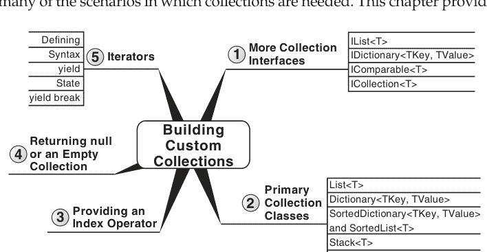

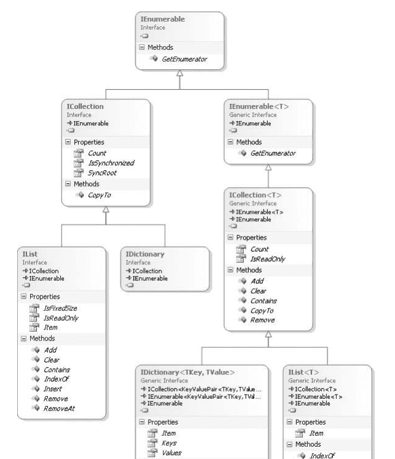

## 图 16.1：通用集合接口层次结构

字典类通常只提供按键索引，而不按位置索引。

相比之下，列表按特定顺序存储值，并通过位置访问它们。从某种意义上说，列表只是字典的一种特例，其中“键”始终是整数，并且“键集合”始终是从零开始的连续非负整数集合。尽管如此，这一差异足够显著，值得用完全不同的类型来表示。

因此，在选择集合类来解决数据存储或检索问题时，首先要查找的两个接口是`IList<T>`和`IDictionary<TKey, TValue>`。这两个接口表示集合类型是侧重于根据给定位置索引检索值，还是侧重于根据给定关联键检索值。

这两个接口都要求实现它们的类提供索引器。对于`IList<T>`，索引器的操作数对应于所检索元素的位置：索引器接受一个整数，并允许你访问列表中的第 n 个元素。对于`IDictionary<TKey, TValue>`接口，索引器的操作数对应于与值关联的键，并允许你访问该值。

## ICollection<T>

`IList<T>`和`IDictionary<TKey, TValue>`都实现了`ICollection<T>`。未实现`IList<T>`或`IDictionary<TKey, TValue>`的集合很可能会实现`ICollection<T>`尽管并非必然，因为集合可以实现更基本的要求`IEnumerable`或`IEnumerable<T>`。`ICollection<T>`派生自`IEnumerable<T>`，并包含两个成员：`Count`和`CopyTo()`。

- `Count`属性返回集合中元素的总数。乍一看，这似乎足以使用`for`循环遍历集合中的每个元素，但事实上，集合还需要支持按索引检索，而`ICollection<T>`接口并不包含这一点尽管`IList<T>`包含。
- `CopyTo()`方法提供了将集合转换为数组的能力。该方法包含一个索引参数，以便你可以指定在目标数组中插入元素的位置。要使用该方法，你必须初始化目标数组，使其从索引位置开始具有足够的容量来容纳`ICollection<T>`中的所有元素。

## 主要集合类

有五类主要的集合类，它们在数据的插入、存储和检索方式上有所不同。每个泛型类都位于`System.Collections.Generic`命名空间中，其对应的非泛型类位于`System.Collections`命名空间中。

## 列表集合：`List<T>`

`List<T>`类具有与数组相似的属性。关键区别在于，这些类会随着元素数量的增加而自动扩展。相比之下，数组的大小是固定的。此外，列表可以通过显式调用`TrimToSize()`或设置`Capacity`来缩小。

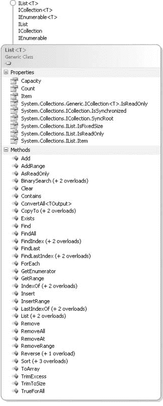

**图 16.2：** `List<>`类图

这些类被归类为**列表集合**，其显著功能是每个元素可以像数组一样通过索引单独访问。因此，你可以使用索引运算符设置和访问列表集合类中的元素，其中索引参数的值对应于集合中元素的位置。清单 16.1 显示了一个示例，输出 16.1 显示了结果。

## 清单 16.1：使用 `List<T>`

```
using System;
using System.Collections.Generic;
class Program
{
    static void Main()
    {
        List<string> list = new List<string>();
        // 列表会在添加元素时自动扩展。
        list.Add("Sneezy");
        list.Add("Happy");
        list.Add("Dopey");
        list.Add("Doc");
        list.Add("Sleepy");
        list.Add("Bashful");
        list.Add("Grumpy");
        list.Sort();
        Console.WriteLine(
            $"按字母顺序排列 { list[0] } 是第一个"
            + $"矮人，而 { list[6] } 是最后一个。");
        list.Remove("Grumpy");
    }
}
```

## 输出 16.1

```
按字母顺序排列 Bashful 是第一个矮人，而 Sneezy 是最后一个。
```


C# 是从零开始索引的；因此，清单 16.1 中的索引 0 对应于第一个元素，索引 6 表示第七个元素。按索引检索元素不涉及搜索，而是一项快速简单的“跳转”到内存中某个位置的操作。

`List<T>` 是一个有序集合；`Add()` 方法将给定项追加到列表末尾。在调用清单 16.1 中的 `Sort()` 之前，“Sneezy”是第一个，“Grumpy”是最后一个；调用之后，列表按字母顺序排序，而不是按添加项的顺序排序。某些集合会在添加元素时自动排序，但 `List<T>` 不在此列；需要对元素进行排序时必须显式调用 `Sort()`。

要移除元素，可以使用 `Remove()` 或 `RemoveAt()` 方法，分别用于移除给定元素或移除特定索引处的元素。

## 高级主题

### 自定义集合排序

你可能想知道清单 16.1 中的 `List<T>.Sort()` 方法是如何知道将列表元素按字母顺序排序的。`string` 类型实现了 `IComparable<string>` 接口，该接口有一个方法 `CompareTo()`。它返回一个整数，指示传入的元素是大于、小于还是等于当前元素。如果元素类型实现了泛型 `IComparable<T>` 接口（或非泛型 `IComparable` 接口），排序算法默认会使用它来确定排序顺序。

但如果元素类型没有实现 `IComparable<T>`，或者默认的比较逻辑不满足你的需求，该怎么办？要指定非默认的排序顺序，你可以调用 `List<T>.Sort()` 的重载，该重载接受一个 `IComparer<T>` 作为参数。

`IComparable<T>` 和 `IComparer<T>` 之间的区别很微妙但很重要。第一个接口表示“我知道如何将自己与同一类型的另一个实例进行比较。”后者表示“我知道如何比较给定类型的两个对象。”

`IComparer<T>` 接口通常用于当数据类型有多种不同排序方式且没有一种明显最佳时。例如，你可能有一个 `Contact` 对象的集合，有时你想按姓名、位置、生日、地理区域或任何其他可能条件排序。与其选择一种排序策略并让 `Contact` 类实现 `IComparable<Contact>`，更明智的做法可能是创建多个实现 `IComparer<Contact>` 的不同类。清单 16.2 显示了一个按姓氏、名字比较的示例实现。

### 清单 16.2：实现 `IComparer<T>`

```csharp
class Contact

{
    public string FirstName { get; private set; }

    public string LastName { get; private set; }

    public Contact(string firstName, string lastName)

    {
        this.FirstName = firstName;

        this.LastName = lastName;
    }
}

using System;

using System.Collections.Generic;

class NameComparison : IComparer<Contact>
{
    public int Compare(Contact x, Contact y)
    {
        if (Object.ReferenceEquals(x, y))
            return 0;

        if (x == null)
            return 1;

        if (y == null)
            return -1;

        int result = StringCompare(x.LastName, y.LastName);

        if (result == 0)
            result = StringCompare(x.FirstName, y.FirstName);

        return result;
    }

    private static int StringCompare(string x, string y)
    {
        if (Object.ReferenceEquals(x, y))
            return 0;

        if (x == null)
            return 1;

        if (y == null)
            return -1;

        return x.CompareTo(y);
    }
}
```

要按姓氏再按名字对 `List<Contact>` 进行排序，你可以调用 `contactList.Sort(new NameComparer())`。

## 全序

在实现 `IComparable<T>` 或 `IComparer<T>` 时，你必须产生一个全序。你的 `CompareTo` 实现必须为任意可能的项对提供完全一致的排序。该排序需要具有一些基本特征。例如，每个元素都必须被视为等于自身。如果一个元素

### 清单16.3：使用`BinarySearch()`结果的按位求反

```csharp
using System;

using System.Collections.Generic;

class Program
{
    static void Main()
    {
        List<string> list = new List<string>();
        int search;

        list.Add("public");
        list.Add("protected");
        list.Add("private");

        list.Sort();

        search = list.BinarySearch("protected internal");

        if (search < 0)
        {
            list.Insert(~search, "protected internal");
        }

        foreach (string accessModifier in list)
        {
            Console.WriteLine(accessModifier);
        }
    }
}
```

请注意，如果列表没有首先排序，即使元素在列表中，也不一定能通过这段代码找到它。清单16.3的结果出现在输出16.2中。

### 输出16.2

```
private
protected
protected internal
public
```

## 高级主题

### 使用`FindAll()`查找多个项

有时你必须在列表中查找多个项，而你的搜索条件比仅仅查找特定值更复杂。为支持这一点，`System.Collections.Generic.List<T>`包含一个`FindAll()`方法。

`FindAll()`接受一个`Predicate<T>`类型的参数，该参数是对称为委托的方法的引用。清单16.4演示了如何使用`FindAll()`方法。

### 清单16.4：演示`FindAll()`及其谓词参数

```csharp
using System;

using System.Collections.Generic;

class Program
{
    static void Main()
    {
        List<int> list = new List<int>();
        list.Add(1);
        list.Add(2);
        list.Add(3);
        list.Add(2);

        List<int> results = list.FindAll(Even);

        foreach (int number in results)
        {
            Console.WriteLine(number);
        }
    }

    public static bool Even(int value) =>
        (value % 2) == 0;
}
```

在清单16.4对`FindAll()`的调用中，你传入一个委托实例`Even()`。当整数参数值为偶数时，此方法返回true。`FindAll()`接受该委托实例，并对列表中的每个项调用`Even()`（此清单使用C# 2.0的委托类型推断）。每次返回值为true时，它都会将该项添加到一个新的`List<T>`实例，并在检查完列表中的每个项后返回该实例。关于委托的完整讨论见第12章。

## 字典集合：`Dictionary<TKey, TValue>`

另一类集合类是字典类——具体来说，即`Dictionary<TKey, TValue>`（见图16.3）。与列表集合不同，字典类存储名称/值对。名称充当唯一键，可用于查找相应元素，其方式类似于使用主键访问数据库中的记录。这会添加给定的键。当这种情况发生时，字典集合类会使用所提供的键插入一个新值。在第二次赋值时，带有指定键的元素已经存在。不会插入额外元素，而是将“Error”键先前的`ConsoleColor`值替换为`ConsoleColor.Cyan`。

尝试从字典中读取一个不存在的键的值会抛出`KeyNotFoundException`。`ContainsKey()`方法允许你在访问其值之前检查某个键是否已被使用，从而避免该异常。

`Dictionary<TKey, TValue>`被实现为“哈希表”；这种数据结构在按键搜索时提供极快的访问，无论字典中存储了多少值。相比之下，检查字典集合中是否存在某个特定值是一项耗时操作，具有线性性能特征，就像搜索未排序的列表一样。为此，你可以使用`ContainsValue()`方法，它会依次搜索集合中的每个元素。

你可以使用`Remove()`方法移除字典元素，传入的是键，而不是元素值。

由于向字典添加值需要键和值两者，因此枚举字典元素的`foreach`循环的循环变量必须是`KeyValuePair<TKey, TValue>`。清单16.7展示了一段代码，演示如何使用`foreach`循环枚举字典中的键和值。输出如输出16.3所示。

### 清单16.7：使用`foreach`遍历`Dictionary<TKey, TValue>`

```csharp
using System;

using System.Collections.Generic;

class Program
{
    static void Main()
    {
        // C# 6.0 (use {"Error", ConsoleColor.Red} pre-C# 6.0)
        Dictionary<string, ConsoleColor> colorMap =
            new Dictionary<string, ConsoleColor>
            {
                ["Error"] = ConsoleColor.Red,
                ["Warning"] = ConsoleColor.Yellow,
                ["Information"] = ConsoleColor.Green,
                ["Verbose"] = ConsoleColor.White
            };

        Print(colorMap);
    }

    private static void Print(
        IEnumerable<KeyValuePair<string, ConsoleColor>> items)
    {
        foreach (KeyValuePair<string, ConsoleColor> item in items)
        {
            Console.ForegroundColor = item.Value;
            Console.WriteLine(item.Key);
        }
    }
}
```

### 输出16.3

```
Error
Warning
Information
Verbose
```

请注意，此处显示的项目顺序就是项目添加到字典时的顺序，就像它们被添加到列表一样。字典的实现通常会按照添加到字典的顺序枚举键和值，但此功能既不是必需的，也没有文档说明，因此你不应依赖它。

## 准则

切勿对集合元素的枚举顺序做出任何没有根据的假设。如果集合没有文档说明其按特定顺序枚举元素，则无法保证它按任何特定顺序生成元素。

如果你只想处理字典类中的键或只想处理其中的元素，可以分别通过`Keys`和`Values`属性获得它们。这些属性返回的数据类型是`ICollection<T>`。这些属性返回的数据是对原始字典集合中数据的引用，而不是副本；字典中的更改会自动反映在`Keys`和`Values`属性返回的集合中。

## 高级主题

### 自定义字典相等性比较

为了确定给定键是否与字典中的任何现有键匹配，字典必须能够比较两个键是否相等。这类似于列表必须能够比较两个项以确定其顺序的方式。（有关示例，请参见本章前面的高级主题“自定义集合排序”。）默认情况下，两个值类型实例通过检查它们是否包含完全相同的数据来进行比较，而两个引用类型实例则通过比较它们是否引用同一对象来进行比较。然而，有时需要能够将两个实例比较为相等，即使它们不是完全相同的值或完全相同的引用。

例如，假设你想使用清单16.2中的`Contact`类型创建一个`Dictionary<Contact, string>`。但是，你希望任意两个`Contact`对象如果具有相同名字和姓氏，则比较为相等，无论这两个对象是否引用相等。就像你可以提供`IComparer<T>`的实现来对列表排序一样，同样地，你也可以提供`IEqualityComparer<T>`的实现来确定两个键是否应视为相等。该接口需要两个方法：一个返回两个项是否相等，另一个返回一个字典可用于加速索引的“哈希码”。清单16.8展示了一个示例。

### 清单16.8：实现`IEqualityComparer<T>`

```csharp
using System;

using System.Collections.Generic;

class ContactEquality : IEqualityComparer<Contact>
{
    public bool Equals(Contact x, Contact y)
    {
        if (Object.ReferenceEquals(x, y))
            return true;

        if (x == null || y == null)
            return false;

        return x.LastName == y.LastName &&
            x.FirstName == y.FirstName;
    }

    public int GetHashCode(Contact x)
    {
        if (Object.ReferenceEquals(x, null))
            return 0;

        int h1 = x.FirstName == null ? 0 : x.FirstName.GetHashCode();
        int h2 = x.LastName == null ? 0 : x.LastName.GetHashCode();
        return h1 * 23 + h2;
    }
}
```


要创建此相等比较器的字典，可以使用构造函数 `new Dictionary<Contact, string>(new ContactEquality)`。

## BEGINNER TOPIC

### Requirements of Equality Comparisons

正如第 9 章《Well-Formed Types》中所讨论的，等值和哈希码算法有几条重要的规则。在集合的上下文中，遵循这些规则至关重要。就像正确排序一个列表需要自定义排序比较提供全序一样，哈希表也需要自定义相等比较满足某些保证。最重要的要求是，如果 `Equals()` 对两个对象返回 `true`，则 `GetHashCode()` 必须对这两个对象返回相同的值。注意，逆命题不成立：两个不相等的项可能具有相同的哈希码。事实上，必须存在两个不相等但哈希码相同的项，因为只有 2^32 个可能的哈希码，但不相等对象的数量却远多于此！

第二个最重要的要求是，对同一项进行两次 `GetHashCode()` 调用必须在该项位于哈希表期间产生相同的结果。注意，然而，“看起来相等”的两个对象在程序的两次不同运行中并不要求给出相同的哈希码。例如，完全合法的是，给定联系人今天被分配一个哈希码，两周后当你第二次运行程序时，对“相同”的联系人给出不同的哈希码。不要将哈希码持久化到数据库中并期望它们在程序的不同运行中保持稳定。

理想情况下，`GetHashCode()` 的结果应看起来是“随机的”。也就是说，输入的微小变化应导致输出的巨大变化，并且结果应大致均匀地分布在所有可能的整数值上。然而，设计出既极快又产生极佳分布的哈希算法是困难的；应寻求一个良好的平衡点。

最后，`GetHashCode()` 和 `Equals()` 必须不抛出异常。注意 Listing 16.8 中的代码如何小心地从不解引用空引用，例如。

总之，这里是关键原则：

- 相等的对象必须具有相等的哈希码。
- 对象的哈希码在其实例生命周期内不应改变（至少在它位于哈希表期间）。
- 哈希算法应快速产生良好分布的哈希。
- 哈希算法应在所有可能的对象状态下避免抛出异常。

### Sorted Collections: `SortedDictionary<TKey, TValue>` and `SortedList<T>`

排序集合类（见图 16.4）按键对元素进行存储，适用于 `SortedDictionary<TKey, TValue>`，按值对元素进行存储，适用于 `SortedList<T>`。如果我们将 Listing 16.7 中的代码改为使用 `SortedDictionary<string, string>` 而不是 `Dictionary<string, string>`，程序的输出将如 Output 16.4 所示。

#### OUTPUT 16.4

```
Error

Information

Verbose

Warning

```

注意，元素是按键排序，而不是按值排序。

由于排序集合必须做额外的工作来维护元素的排序顺序，插入和删除通常比在无序字典中插入和删除值稍慢。

由于排序集合必须以特定顺序存储其项，因此可以通过键和索引两种方式访问值。要按其在排序列表中的索引访问键或值，请使用 `Keys` 和 `Values` 属性。它们分别返回 `IList<TKey>` 和 `IList<TValue>` 实例；所得集合可以像任何其他列表一样进行索引。

#### FIGURE 16.4: `SortedList<>` and `SortedDictionary<>` Class Diagrams

### Stack Collections: `Stack<T>`

第 11 章讨论了栈集合类（见图 16.5）。栈集合类被设计为“后进先出”（LIFO）集合。两个关键方法是 `Push()` 和 `Pop()`。

- `Push()` 将元素插入集合。元素不必唯一。
- `Pop()` 以与添加的相反顺序移除元素。

要访问栈上的元素而不修改栈，可使用 `Peek()` 和 `Contains()` 方法。`Peek()` 方法返回 `Pop()` 将检索的下一个元素。

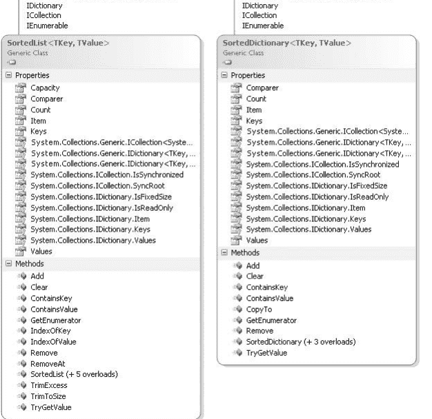

### Linked Lists: `LinkedList<T>`

`System.Collections.Generic` 还支持一个链表集合，可实现向前和向后遍历。图 16.7 显示了类图。没有对应的非泛型类型。

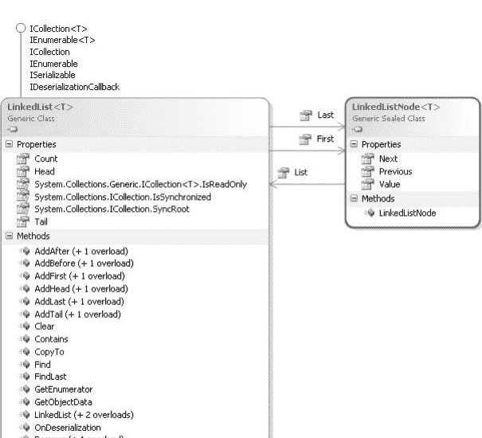

#### FIGURE 16.7: `LinkedList<T>` and `LinkedListNode<T>` Class Diagrams

### Providing an Indexer

数组、字典和列表都提供索引器，作为根据键或索引获取或设置集合成员的便捷方式。如我们所见，要使用索引器，只需在集合名称后用方括号放置索引（或索引）。可以定义自己的索引器；Listing 16.9 显示了使用 `Pair<T>` 的示例。

#### LISTING 16.9: Defining an Indexer

```
interface IPair<T>
{
    T First { get; }
    T Second { get; }
    T this[PairItem index] { get; }
}

public enum PairItem
{
    First,
    Second
}

public struct Pair<T> : IPair<T>
{
    public Pair(T first, T second)
    {
        First = first;
        Second = second;
    }

    public T First { get; } // C# 6.0 Getter-only Autoproperty
    public T Second { get; } // C# 6.0 Getter-only Autoproperty

    public T this[PairItem index]
    {
        get
        {
            switch (index)
            {
                case PairItem.First:
                    return First;
                case PairItem.Second:
                    return Second;
                default :
                    throw new NotImplementedException(
                        string.Format(
                            "The enum {0} has not been implemented",
                            index.ToString()));
            }
        }
    }
}
```

索引器声明方式与属性类似，只是用关键字 `this` 加上方括号中的参数列表代替属性名。主体也与属性类似，具有 `get` 和 `set` 块。如 Listing 16.9 所示，参数不必是 `int`。事实上，索引可以接受多个参数，甚至可以重载。此示例使用枚举来降低调用者提供不存在项的索引的可能性。

C# 编译器从索引操作符创建的 CIL 代码是一个特殊的属性，称为 `Item`，它接受一个参数。属性不能在 C# 中显式创建以接受参数，因此 `Item` 属性在此方面是唯一的。任何具有标识符 `Item` 的额外成员，即使签名完全不同，也会与编译器创建的成员冲突，因此不允许。

## ADVANCED TOPIC

### Assigning the Indexer Property Name Using `IndexerName`

如前所述，索引器的 CIL 属性名默认为 `Item`。使用 `IndexerNameAttribute`，可以指定不同的名称。例如，Listing 16.10 将名称更改为 `"Entry"`。

#### LISTING 16.10: Changing the Indexer's Default Name

```
[System.Runtime.CompilerServices.IndexerName("Entry")]
public T this[params PairItem[] branches]
{
    // ...
}
```

这对 C# 调用索引的调用者没有区别，但它指定了不直接支持索引器的语言的名称。

此属性只是指示编译器对索引器使用不同名称的指令；该属性不会实际由编译器发出到元数据中，因此无法通过反射获得。

### Defining an Index Operator with Variable Parameters

索引操作符也可以接受可变参数列表。例如，Listing 16.11 为 `BinaryTree<T>` 定义了索引操作符，该类型在第 11 章中讨论过（并在下一节中再次讨论）。

## Guidelines

通常更好的选择是返回一个没有项目的集合实例。这样做可以避免强制调用者在遍历集合中的项目之前检查 `null`。例如，给定一个零大小的 `IEnumerable<T>` 集合，调用者可以立即安全地使用 `foreach` 循环遍历该集合，而无需担心对 `GetEnumerator()` 的调用会抛出 `NullReferenceException`。考虑使用 `Enumerable.Empty<T>()` 方法来轻松生成给定类型的空集合。

偏离此准则的少数情况之一是当 `null` 有意表示与零项不同的含义时。例如，网站的用户名字段的集合可能为 `null`，以表示由于某种原因无法获取最新的集合；这在语义上与空集合不同。

- 不要使用 `null` 引用来表示空集合。
- 考虑改用 `Enumerable.Empty<T>()` 方法。

## Iterators

第 14 章详细介绍了 `foreach` 循环的内部结构。本节讨论如何使用迭代器创建自己的 `IEnumerator<T>`、`IEnumerable<T>` 以及自定义集合的相应非泛型接口的实现。迭代器为指定集合类中数据的迭代方式提供了简洁的语法，尤其是在使用 `foreach` 循环时。迭代器允许集合的最终用户在不知道该结构的情况下浏览其内部结构。

### ADVANCED TOPIC

#### Origin of Iterators

1972 年，Barbara Liskov 和麻省理工学院的一组科学家开始研究编程方法，重点关注用户定义的数据抽象。为了证明他们的大部分工作，他们创建了一种名为 CLU 的语言，该语言具有一种称为“clusters”的概念（CLU 是该术语的前三个字母）。集群是程序员今天使用的主要数据抽象的前身：对象。在研究过程中，该团队意识到，虽然他们能够使用 CLU 语言将一些数据表示从其类型的最终用户中抽象出来，但他们始终发现自己必须揭示数据的内部结构，以便他人能够智能地使用它。他们的困惑的结果是创建了一种称为迭代器的语言结构。 （CLU 语言为最终流行起来的“面向对象编程”提供了许多见解。）

如果类想要使用 `foreach` 循环结构支持迭代，它们必须实现枚举器模式。正如第 14 章所述，在 C# 中，`foreach` 循环结构由编译器扩展为基于从 `IEnumerable<T>` 接口检索的 `IEnumerator<T>` 接口的 `while` 循环结构。

枚举模式的问题在于手动实现起来可能很麻烦，因为它必须维护描述集合中当前位置所需的所有状态。对于列表集合类型类而言，此内部状态可能很简单；当前位置的索引就足够了。相比之下，对于需要递归遍历的数据结构，例如二叉树，状态可能相当复杂。为了减轻实现此模式所带来的挑战，C# 2.0 包含了一种使类更容易规定 `foreach` 循环如何遍历其内容的构造。

### Defining an Iterator

迭代器是实现类的方法的一种手段，也是更复杂的枚举器模式的语法快捷方式。当 C# 编译器遇到迭代器时，它会将其内容扩展为实现枚举器模式的 CIL 代码。因此，实现迭代器没有任何运行时依赖关系。由于 C# 编译器通过 CIL 代码生成来处理实现，因此使用迭代器没有真正的运行时性能优势。然而，与手动实现枚举器模式相比，选择迭代器可以带来巨大的程序员生产力提升。为了了解改进，我们首先考虑迭代器在代码中是如何定义的。

### Iterator Syntax

迭代器提供了迭代器接口的简写实现，即 `IEnumerable<T>` 和 `IEnumerator<T>` 接口的组合。Listing

```
public class Program
{
    static void Main()
    {
        var keywords = new CSharpBuiltInTypes();
        foreach (string keyword in keywords)
        {
            Console.WriteLine(keyword);
        }
    }
}
```

Listing 16.13 的结果出现在 Output 16.5 中。

#### OUTPUT 16.5

```
object
byte
uint
ulong
float
char
bool
ushort
decimal
int
sbyte
short
long
void
double
string
```

此列表的输出是 C# 内置类型的列表。

### Iterators and State

当 `foreach` 语句（例如 Listing 16.13 中的 `foreach (string keyword in keywords)`）首次调用 `GetEnumerator()` 时，会创建一个迭代器对象，其状态初始化为特殊的“开始”状态，表示迭代器中尚未执行任何代码，因此尚未产生任何值。只要调用位置的 `foreach` 语句继续执行，迭代器就会保持其状态。每次循环请求下一个值时，控制就会进入迭代器并继续上一次循环结束时离开的位置；存储在迭代器对象中的状态信息用于确定控制必须从何处恢复。当调用位置的 `foreach` 语句终止时，迭代器的状态将不再保存。

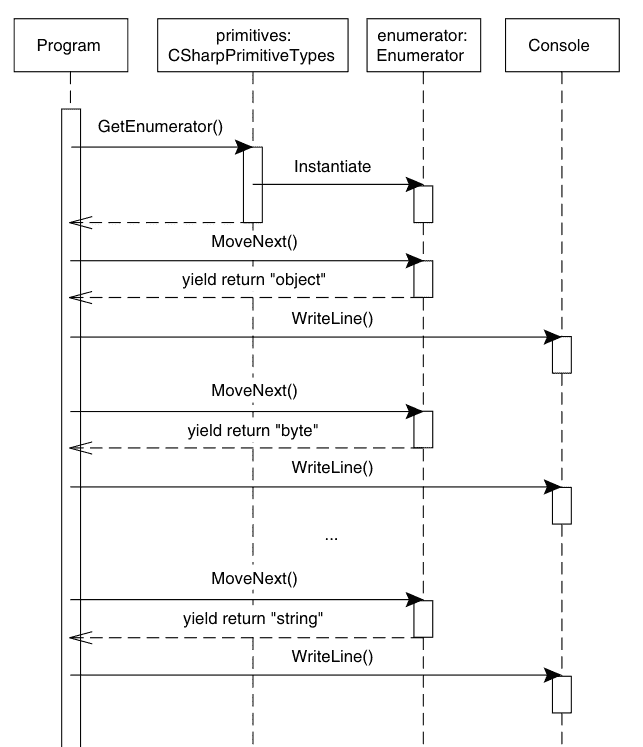

#### FIGURE 16.8: Sequence Diagram with `yield return`

随时调用 `GetEnumerator()` 都是安全的；必要时将创建“全新”的枚举器对象。

图 16.8 显示了发生的高级序列图。请记住，`MoveNext()` 方法出现在 `IEnumerator<T>` 接口上。

在 Listing 16.13 中，调用位置的 `foreach` 语句在名为 `keywords` 的 `CSharpBuiltInTypes` 实例上发起对 `GetEnumerator()` 的调用。给定迭代器实例（由 `iterator` 引用），`foreach` 在每次迭代开始时都会调用 `MoveNext()`。在迭代器内部，您将一个值 `yield` 回调用位置的 `foreach` 语句。在 `yield return` 语句之后，`GetEnumerator()` 方法似乎暂停，直到下一次 `MoveNext()` 请求。回到循环体，`foreach` 语句将产生的值显示在屏幕上。然后它再次循环并再次在迭代器上调用 `MoveNext()`。请注意，第二次时，控制从第二个 `yield return` 语句开始。再次，`foreach` 在屏幕上显示 `CSharpBuiltInTypes` 产生的内容并重新开始循环。此过程一直持续到迭代器中没有更多 `yield return` 语句为止。此时，调用位置的 `foreach` 循环终止，因为 `MoveNext()` 返回 `false`。

### More Iterator Examples

在修改 `BinaryTree<T>` 之前，您必须修改 `Pair<T>` 以使用迭代器支持 `IEnumerable<T>` 接口。Listing 16.14 是一个示例，它产生 `Pair<T>` 中的每个元素。

#### LISTING 16.14: Using `yield` to Implement `BinaryTree<T>`

```
public struct Pair<T>: IPair<T>,
    IEnumerable<T>
{
    public Pair(T first, T second) : this()
    {
        First = first;
        Second = second;
    }

    public T First { get; } // C# 6.0 Getter-only Autoproperty
    public T Second { get; } // C# 6.0 Getter-only Autoproperty

    #region IEnumerable<T>
    public IEnumerator<T> GetEnumerator()
    {
        yield return First;
        yield return Second;
    }
    #endregion IEnumerable<T>

    #region IEnumerable Members
    System.Collections.IEnumerator System.Collections.IEnumerable.GetEnumerator()
    {
        return GetEnumerator();
    }
    #endregion
}
```


在 `Listing 16.14` 中，对 `Pair<T>` 数据类型的迭代循环两次：首先通过 `yield return First`，然后通过 `yield return Second`。每次在 `GetEnumerator()` 内部遇到 `yield return` 语句时，状态都会被保存，并且执行似乎“跳出”`GetEnumerator()`

`method context and into the loop body.` 当第二次迭代开始时，`GetEnumerator()` 开始再次执行，带有 `yield return Second` 语句。

`System.Collections.Generic.IEnumerable<T>` 继承自 `System.Collections.IEnumerable`。因此，在实现 `IEnumerable<T>` 时，也必须实现 `IEnumerable`。在 `Listing 16.14` 中，你显式地这样做，并且实现只是对 `IEnumerable<T>` 的 `GetEnumerator()` 实现的调用。此从 `IEnumerable.GetEnumerator()` 到 `IEnumerable<T>.GetEnumerator()` 的调用将始终有效，因为 `IEnumerable<T>` 和 `IEnumerable` 之间存在类型兼容性（通过继承）。由于两个 `GetEnumerator()` 的签名相同（返回类型不区分签名），一个或两个实现必须是显式的。鉴于 `IEnumerable<T>` 的版本提供的额外类型安全，你显式地实现 `IEnumerable` 的实现。

## LISTING 16.15: Using Pair<T>.GetEnumerator() via foreach

```
var fullname = new Pair<string>("Inigo", "Montoya");

foreach (string name in fullname)
{
    Console.WriteLine(name);
}
```

注意 `foreach` 循环中对 `GetEnumerator()` 的调用是隐式的。

## Placing a yield return within a Loop

不需要像在 `CSharpPrimitiveTypes` 和 `Pair<T>` 中那样硬编码每个 `yield return` 语句。使用 `yield return` 语句，你可以从循环结构内部返回值。`Listing 16.16` 使用了 `foreach` 循环。每次 `GetEnumerator()` 内的 `foreach` 执行时，它返回下一个值。

## LISTING 16.16: Placing yield return Statements within a Loop

```
public class BinaryTree<T>: IEnumerable<T>
{
    // ...
    #region IEnumerable<T>
    public IEnumerator<T> GetEnumerator()
    {
        // Return the item at this node.
        yield return Value;
        // Iterate through each of the elements in the pair.
        foreach (BinaryTree<T> tree in SubItems)
        {
            if (tree != null)
            {
                // Since each element in the pair is a tree,
                // traverse the tree and yield each
                // element.
                foreach (T item in tree)
                {
                    yield return item;
                }
            }
        }
    }
    #endregion IEnumerable<T>
    #region IEnumerable Members
    System.Collections.IEnumerator
        System.Collections.IEnumerable.GetEnumerator()
    {
        return GetEnumerator();
    }
    #endregion
}
```

在 `Listing 16.16` 中，第一次迭代返回二叉树中的根元素。在第二次迭代期间，你遍历子元素的对。如果子元素对包含非空值，你遍历到该子节点并产生其元素。请注意 `foreach (T item in tree)` 是对子节点的递归调用。

如 `CSharpBuiltInTypes` 和 `Pair<T>` 所观察到的，你现在可以使用 `foreach` 循环遍历 `BinaryTree<T>`。`Listing 16.17` 演示了此过程，`Output 16.6` 显示了结果。

## LISTING 16.17: Using foreach with BinaryTree<string>

```
// JFK
var jfkFamilyTree = new BinaryTree<string>(
    "John Fitzgerald Kennedy");
jfkFamilyTree.SubItems = new Pair<BinaryTree<string>>(
    new BinaryTree<string>("Joseph Patrick Kennedy"),
    new BinaryTree<string>("Rose Elizabeth Fitzgerald"));

// Grandparents (Father's side)
jfkFamilyTree.SubItems.First.SubItems =
    new Pair<BinaryTree<string>>(
        new BinaryTree<string>("Patrick Joseph Kennedy"),
        new BinaryTree<string>("Mary Augusta Hickey"));

// Grandparents (Mother's side)
jfkFamilyTree.SubItems.Second.SubItems =
    new Pair<BinaryTree<string>>(
        new BinaryTree<string>("John Francis Fitzgerald"),
        new BinaryTree<string>("Mary Josephine Hannon"));

foreach (string name in jfkFamilyTree)
{
    Console.WriteLine(name);
}
```

## OUTPUT 16.6

```
John Fitzgerald Kennedy
Joseph Patrick Kennedy
Patrick Joseph Kennedy
Mary Augusta Hickey
Rose Elizabeth Fitzgerald
John Francis Fitzgerald
Mary Josephine Hannon
```

## ADVANCED TOPIC

## The Dangers of Recursive Iterators

`Listing 16.16` 中的代码在遍历二叉树时创建新的“嵌套”迭代器。因此，当值由节点产生时，该值由节点的迭代器产生，然后由其父迭代器产生，然后由其父迭代器产生，依此类推，直到最终由根迭代器产生给原始循环。一个深度为 n 的值必须实际上将其值传递给 n 个迭代器的链。如果二叉树相对较浅，这通常不是问题；然而，不平衡的二叉树可能非常深，因此递归迭代代价昂贵。

## Guidelines

- CONSIDER using nonrecursive algorithms when iterating over potentially deep data structures.

## BEGINNER TOPIC

## struct versus class

将 `Pair<T>` 定义为 `struct` 而不是 `class` 的一个有趣的副作用是 `SubItems.First` 和 `SubItems.Second` 不能直接赋值，即使 setter 是 public。如果将 setter 修改为 public，以下内容将产生编译错误，指出 `SubItems` 不能被修改，“因为它不是一个变量”：

```
jfkFamilyTree.SubItems.First =
    new BinaryTree<string>("Joseph Patrick Kennedy");
```

问题在于 `SubItems` 是类型为 `Pair<T>` 的属性，`struct`。因此，当属性返回值时，会复制 `SubItems`，并且在语句结束时立即丢失的副本上分配 `First` 会具有误导性。幸运的是，C# 编译器阻止了此错误。

为克服此问题，不要分配 `First`（参见 `Listing 16.17` 中的方法），使用 `class` 而不是 `struct` 用于 `Pair<T>`，不要创建 `SubItems` 属性而是使用字段，或在 `BinaryTree<T>` 中提供属性以直接访问 `SubItems` 成员。

## Canceling Further Iteration: yield break

有时你可能想要取消进一步的迭代。你可以通过包含一个 `if` 语句来实现，以便代码中没有进一步的语句被执行。但是，你也可以使用 `yield break` 来使 `MoveNext()` 返回 `false` 并立即将控制返回给调用方并结束循环。`Listing 16.18` 显示了此类方法的示例。

## LISTING 16.18: Escaping Iteration via yield break

```
public System.Collections.Generic.IEnumerable<T>
    GetNotNullEnumerator()
{
    if((First == null) || (Second == null))
    {
        yield break;
    }
    yield return Second;
    yield return First;
}
```

此方法在 `Pair<T>` 类中的任一元素为 null 时取消迭代。

```
{
    public __ListEnumerator(int itemCount)
    {
        _ItemCount = itemCount;
    }
    Pair<T> _Pair;
    T _Current;
    int _ItemCount;
    public object Current
    {
        get
        {
            return _Current;
        }
    }
    public bool MoveNext()
    {
        switch (_ItemCount)
        {
            case 0:
                _Current = _Pair.First;
                _ItemCount++;
                return true;
            case 1:
                _Current = _Pair.Second;
                _ItemCount++;
                return true;
            default:
                return false;
        }
    }
}
```


Because the compiler takes the `yield return` statement and generates classes that correspond to what you probably would have written manually, iterators in C# exhibit the same performance characteristics as classes that implement the enumerator design pattern manually. Although there is no performance improvement, the gains in programmer productivity are significant.

## ADVANCED TOPIC

### Contextual Keywords

Many C# keywords are “reserved” and cannot be used as identifiers unless preceded with an @ sign. The `yield` keyword is a contextual keyword, not a reserved keyword; it is legal (though confusing) to declare a local variable called `yield`. In fact, all the keywords added to C# after version 1.0 have been contextual keywords; this helps prevent accidental breakages when upgrading existing programs to use new versions of the language.

Had the C# designers chosen to use `yield value;` as the syntax for an iterator to yield instead of `yield return value;`, a possible ambiguity would have been introduced: `yield(1+2);` now might be yielding a value, or it might be passing the value as an argument to a method called `yield`.

Since it was previously never legal to have the identifier `yield` appear immediately before `return` or `break`, the C# compiler knows that such a usage of `yield` must be as a keyword, not an identifier.

### Creating Multiple Iterators in a Single Class

Previous iterator examples implemented `IEnumerable<T>.GetEnumerator()`—the method that `foreach` seeks implicitly. Sometimes you might want different iteration sequences, such as iterating in reverse, filtering the results, or iterating over an object projection other than the default. You can declare additional iterators in the class by encapsulating them within properties or methods that return `IEnumerable<T>` or `IEnumerable`. If you want to iterate over the elements of `Pair<T>` in reverse, for example, you could provide a `GetReverseEnumerator()` method, as shown in Listing 16.20.

#### LISTING 16.20: Using `yield return` in a Method That Returns `IEnumerable<T>`

```
public struct Pair<T>: IEnumerable<T>
{
    ...
    public IEnumerable<T> GetReverseEnumerator()
    {
        yield return Second;
        yield return First;
    }
    ...
}

public void Main()
{
    var game = new Pair<string>("Redskins", "Eagles");
    foreach (string name in game.GetReverseEnumerator())
    {
        Console.WriteLine(name);
    }
}
```

请注意你返回的是 `IEnumerable<T>`，而不是 `IEnumerator<T>`。这与 `IEnumerable<T>.GetEnumerator()` 不同，后者返回 `IEnumerator<T>`。`Main()` 中的代码演示了如何使用 `foreach` 循环调用 `GetReverseEnumerator()`。

### `yield` 语句要求

你只能在返回 `IEnumerator<T>` 或 `IEnumerable<T>` 类型，或其非泛型等价类型的成员中使用 `yield return` 语句。包含 `yield return` 语句的成员体不得包含简单的 `return`。如果成员使用 `yield return` 语句，C# 编译器会生成必要的代码来维护迭代器的状态。相比之下，如果成员使用 `return` 语句而不是 `yield return`，程序员则需要负责维护自己的状态机并返回迭代器接口之一的实例。此外，就像具有返回类型的方法中的所有代码路径必须包含一个伴随值的 `return` 语句一样，迭代器中的所有代码路径如果要返回任何数据，则必须包含 `yield return` 语句。

以下对 `yield` 语句的额外限制如果被违反将导致编译器错误：

- `yield` 语句只能出现在方法、用户定义运算符，或索引器或属性的 `get` 访问器内部。该成员不得接受任何 `ref` 或 `out` 参数。
- `yield` 语句不得出现在匿名方法或 lambda 表达式的任何位置（参见第 12 章）。
- `yield` 语句不得出现在 `try` 语句的 `catch` 和 `finally` 子句内部。此外，`yield` 语句只能出现在 `try` 块中，前提是该 `try` 块没有 `catch` 块。

# 17

## 反射、特性与动态编程

特性是向程序集插入额外元数据并将元数据与类、方法或属性等编程构造关联的一种手段。本章研究了框架中内置的特性的细节，并描述了如何定义自定义特性。为了利用自定义特性，有必要识别它们。这通过反射来处理。本章首先介绍反射，包括如何使用它在执行时基于名称（或元数据）动态绑定，而该名称（或元数据）在编译时进行成员调用。这通常在诸如代码生成器之类的工具中执行。此外，当调用目标未知时，反射也在执行时使用。

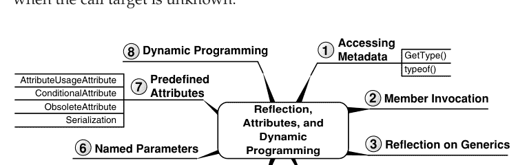

`XmlSerializer`、`ValueType` 和 `DataBinder` 是框架中用于其实现部分使用反射的几个类。

### 使用 `System.Type` 访问元数据

读取类型的元数据的关键是获取代表目标类型实例的 `System.Type` 实例。`System.Type` 提供了检索有关类型的信息的所有方法。你可以使用它来回答以下问题：

- 类型名称是什么（`Type.Name`）？
- 类型是否公开（`Type.IsPublic`）？
- 类型的基本类型是什么（`Type.BaseType`）？
- 类型是否支持任何接口（`Type.GetInterfaces()`）？
- 类型定义在哪个程序集中（`Type.Assembly`）？
- 类型的属性、方法、字段等是什么（`Type.GetProperties()`、`Type.GetMethods()`、`Type.GetFields()` 等）？
- 哪些特性装饰了该类型（`Type.GetCustomAttributes()`）？

还有更多此类成员，但它们都提供有关特定类型的信息。关键是获取对类型的 `Type` 对象的引用，而做到这一点的主要两种方式是通过 `object.GetType()` 和 `typeof()`。

请注意，`GetMethods()` 调用不会返回扩展方法。这些方法仅作为实现类型上的静态成员可用。

### `GetType()`

`object` 包含一个 `GetType()` 成员，因此所有类型都包含此函数。你调用 `GetType()` 以检索对应于原始对象的 `System.Type` 实例。列表 17.1 演示了此过程，使用来自 `DateTime` 的 `Type` 实例。输出 17.1 显示了结果。

#### 列表 17.1：使用 `Type.GetProperties()` 获取对象的公共属性

```
DateTime dateTime = new DateTime();
Type type = dateTime.GetType();
foreach (
    System.Reflection.PropertyInfo property in
    type.GetProperties()
)
{
    Console.WriteLine(property.Name);
}
```

`typeof` 表达式在编译时解析，使得类型比较——也许比较从 `GetType()` 调用返回的类型——可以确定对象是否为特定类型。

### 成员调用

反射的可能性并不止于检索元数据。下一步是获取元数据并动态调用其引用的成员。考虑定义一个类来表示应用程序的命令行。像这样的 `CommandLineInfo` 类的困难在于用启动应用程序的实际命令行数据填充该类。然而，使用反射，你可以将命令行选项映射到属性名称，然后在运行时动态设置属性。列表 17.3 演示了此过程。

#### 列表 17.3：动态调用成员

```
using System;
using System.Diagnostics;
public partial class Program
{
    public static void Main(string[] args)
    {
        string errorMessage;
        CommandLineInfo commandLine = new CommandLineInfo();
        if (!CommandLineHandler.TryParse(
            args, commandLine, out errorMessage))
        {
            Console.WriteLine(errorMessage);
            DisplayHelp();
        }
        if (commandLine.Help)
        {
            DisplayHelp();
        }
        else
        {
            if (commandLine.Priority !=
                ProcessPriorityClass.Normal)
            {
                // Change thread priority
            }
        }
        // ...
    }
}
```

CAS 权限在此情况下设置好以允许私有成员调用，因为程序从本地计算机运行。默认情况下，本地安装的程序属于受信任区域并被授予适当的权限。从远程位置运行的程序需要被明确授予此类权限。

### 对泛型类型的反射

CLR 2.0 版本中引入泛型类型需要额外的反射功能。对泛型的运行时反射确定类或方法是否包含泛型类型，以及它可能包含的任何类型参数或参数。

### 确定类型参数的类型

与你可以使用 `typeof` 运算符对非泛型类型检索 `System.Type` 实例的方式相同，你也可以对泛型类型或泛型方法中的类型参数使用 `typeof` 运算符。列表 17.4 将 `typeof` 运算符应用于 `Stack` 类的 `Add` 方法中的类型参数。

#### 列表 17.4：声明 `Stack<T>` 类

```
public class Stack<T>
{
    // ...
    public void Add(T i)
    {
        // ...
        Type t = typeof(T);
        // ...
    }
    // ...
}
```

一旦你拥有了类型参数的 `Type` 对象的实例，你就可以对类型参数本身使用反射来确定其行为并更有效地将 `Add` 方法定制为特定类型。

### 确定类或方法是否支持泛型

在 CLR 2.0 版本的 `System.Type` 类中，添加了一些方法来确定给定类型是否支持泛型参数和参数。泛型参数是类型参数，在实例化泛型类时会提供这些类型参数。你可以通过查询 `Type.ContainsGenericParameters` 属性来确定某个类或方法是否包含尚未设置的类型参数，如清单 17.5 所示。

#### 清单 17.5：使用反射处理泛型

```
using System;
public class Program
{
    static void Main()
    {
        Type type;
        type = typeof(System.Nullable<>);
        Console.WriteLine(type.ContainsGenericParameters);
        Console.WriteLine(type.IsGenericType);
        type = typeof(System.Nullable<DateTime>);
        Console.WriteLine(!type.ContainsGenericParameters);
        Console.WriteLine(type.IsGenericType);
    }
}
```

#### 输出 17.3

```
True
True
True
True
```

`Type.IsGenericType` 是一个布尔属性，用于判断某个类型是否为泛型类型。

### 获取泛型类或方法的类型参数

你可以通过调用 `GetGenericArguments()` 方法从泛型类获取泛型实参（即类型参数）的列表。结果是 `System.Type` 实例的数组，顺序与它们在泛型类中声明为类型参数的顺序一致。清单 17.6 反射一个泛型类型并获取每个类型参数；输出 17.4 显示了结果。

- C# 编译器会确保 `nameof` 运算符的参数确实是有效的程序元素。这有助于在程序元素名称更改时防止错误，也有助于避免拼写错误等。
- IDE 工具对 `nameof` 运算符的支持优于对文本字符串的支持。例如，“查找所有引用”工具可以找到 `nameof` 表达式中引用的程序元素，但无法在文本字符串中找到。自动重命名重构也会表现得更好。

在前面的代码片段中，`nameof(textDigit)` 生成了一个参数的名称。不过，`nameof` 运算符适用于任何程序元素。例如，清单 17.7 使用 `nameof` 将属性名称传递给 `INotifyPropertyChanged.PropertyChanged`。

#### 清单 17.7：动态调用成员

```
using System.ComponentModel;

public class Person : INotifyPropertyChanged
{
    public event PropertyChangedEventHandler PropertyChanged;

    public Person(string name)
    {
        Name = name;
    }

    private string _Name;
    public string Name
    {
        get { return _Name; }
        set
        {
            if (_Name != value)
            {
                _Name = value;
                // Using C# 6.0 conditional null reference.
                PropertyChanged?.Invoke(
                    this,
                    new PropertyChangedEventArgs(
                        nameof(Name)));
            }
        }
    }
    // ...
}
```


注意，无论是只提供未限定的“Name”（因为它位于作用域内），还是使用完全（或部分）限定的名称（如 `Person.Name`），结果都只是最后的标识符（点分隔名称中的最后一个元素）。

你仍然可以使用 C# 5.0 的 `CallerMemberName` 参数属性来获取属性名称；示例请参见 http://itl.tc/CallerMemberName。

## 特性

在深入探讨如何编写特性之前，我们应该先考虑一个能展示其用途的用例。在清单 17.3 的 `CommandLineHandler` 示例中，你根据与属性名称匹配的命令行选项动态设置类的属性。然而，当命令行选项是无效的属性名称时，这种方法就不够用了。例如，不支持 `/?`。此外，这种机制无法区分哪些选项是必需的，哪些是可选的。

特性无需依赖选项名称与属性名称的精确匹配，而是提供了一种识别被修饰构造的附加元数据的方法——在此例中，即为被特性修饰的选项。使用特性，你可以将某个属性标记为必需，并为 `/?` 提供别名。换句话说，特性是将附加数据与属性（及其他构造）关联起来的一种手段。

特性出现在所修饰构造前面的方括号中。例如，你可以修改 `CommandLineInfo` 类以包含特性，如清单 17.8 所示。

### 清单 17.8：使用特性修饰属性

```
class CommandLineInfo
{
    [CommandLineSwitchAlias("?")]
    public bool Help { get; set; }
    [CommandLineSwitchRequired]
    public string Out { get; set; }
    public System.Diagnostics.ProcessPriorityClass Priority
    { get; set; } =
        System.Diagnostics.ProcessPriorityClass.Normal;
}
```

在清单 17.8 中，`Help` 和 `Out` 属性被特性修饰。这些特性的目的是允许为 `/Help` 提供 `/?` 别名，并指示 `/Out` 是必需参数。其思路是，在 `CommandLineHandler.TryParse()` 方法内部，你启用对选项别名的支持，并且假设解析成功，你还会检查所有必需的开关是否都已指定。

在同一构造上组合多个特性有两种方法。首先，你可以在同一对方括号内用逗号分隔多个特性。或者，你也可以将每个特性放在各自独立的方括号中。清单 17.9 提供了示例。

### 清单 17.9：使用多个特性修饰属性

```
[CommandLineSwitchRequired]
[CommandLineSwitchAlias("FileName")]
public string Out { get; set; }
```

```
[CommandLineSwitchRequired,
CommandLineSwitchAlias("FileName")]
public string Out { get; set; }
```

除了修饰属性之外，开发者还可以使用特性来修饰类、接口、结构体、枚举、委托、事件、方法、构造函数、字段、参数、返回值、程序集、类型参数和模块。在大多数情况下，应用特性的语法与清单 17.9 中所示的方括号语法相同。然而，这种语法不适用于返回值、程序集和模块。

程序集特性用于添加关于程序集的元数据。例如，Visual Studio 的项目向导会生成一个 `AssemblyInfo.cs` 文件，其中包含大量关于程序集的特性。清单 17.10 是该文件的一个示例。

### 清单 17.10：`AssemblyInfo.cs` 中的程序集特性

```
using System.Reflection;
using System.Runtime.CompilerServices;
using System.Runtime.InteropServices;
// General information about an assembly is controlled
// through the following set of attributes. Change these
// attribute values to modify the information
// associated with an assembly.
[assembly: AssemblyTitle("CompressionLibrary")]
[assembly: AssemblyDescription("")]
[assembly: AssemblyConfiguration("")]
[assembly: AssemblyCompany("IntelliTect")]
[assembly: AssemblyProduct("Compression Library")]
[assembly: AssemblyCopyright("Copyright© IntelliTect 2006-2015")]
[assembly: AssemblyTrademark("")]
[assembly: AssemblyCulture("")]
// Setting ComVisible to false makes the types in this
// assembly not visible to COM components. If you need to
// access a type in this assembly from COM, set the ComVisible
// attribute to true on that type.
[assembly: ComVisible(false)]
// The following GUID is for the ID of the typelib
// if this project is exposed to COM.
[assembly: Guid("417a9609-24ae-4323-b1d6-cef0f87a42c3")]
// Version information for an assembly consists
// of the following four values:
//      Major Version
//      Minor Version
//      Build Number
//      Revision
// You can specify all the values or you can
// default the Revision and Build Numbers
// by using the '*' as shown below:
// [assembly: AssemblyVersion("1.0.*")]
[assembly: AssemblyVersion("1.0.0.0")]
[assembly: AssemblyFileVersion("1.0.0.0")]
```

程序集特性定义了公司、产品、程序集版本号等内容。与程序集类似，将特性用法标识为模块时需要用 `module:` 作为前缀。对程序集和模块特性的限制是，它们必须出现在 `using` 指令之后、任何命名空间或类声明之前。清单 17.10 中的特性由 Visual Studio 项目向导生成，应包含在所有项目中，以便在生成的可执行文件或 DLL 中标记有关其内容的信息。

返回特性（如清单 17.11 所示）出现在方法声明之前，但使用相同类型的语法结构。

### 清单 17.11：指定返回特性

```
[return: Description(
    "Returns true if the object is in a valid state.")]
public bool IsValid()
{
    // ...
    return true;
}
```

除了 `assembly:` 和 `return:` 之外，C# 还允许对 `module:`、`class:` 和 `method:` 进行显式的目标标识，对应于分别装饰模块、类和方法上的特性。`class:` 和 `method:`，不过是可选的，如前所述。

使用特性的便利之处之一在于，语言会考虑到特性命名约定，该约定要求 `Attribute` 出现在名称的末尾。然而，在前面的所有特性使用示例中，尽管每个使用的特性都遵循命名约定，却没有出现此类后缀。这是因为虽然在应用特性时允许使用完整名称（`DescriptionAttribute`、`AssemblyVersionAttribute` 等），但 C# 使后缀成为可选的。通常，在应用特性时不会出现此类后缀；它仅在定义特性或内联使用特性时出现（例如 `typeof(DescriptionAttribute)`）。

## Guidelines

- DO 将 `AssemblyVersionAttribute` 应用于包含公共类型的程序集。
- CONSIDER 应用 `AssemblyFileVersionAttribute` 和 `AssemblyCopyrightAttribute` 以提供有关程序集的额外信息。
- DO 应用以下信息程序集特性：
  `System.Reflection.AssemblyTitleAttribute`,
  `System.Reflection.AssemblyCompanyAttribute`,
  `System.Reflection.AssemblyProductAttribute`,
  `System.Reflection.AssemblyDescriptionAttribute`,
  `System.Reflection.AssemblyFileVersionAttribute`, 和
  `System.Reflection.AssemblyCopyrightAttribute`。

## Custom Attributes

定义自定义特性相对简单。特性是对象；因此，要定义一个特性，你需要定义一个类。将一个普通类转变为特性的特征是它派生自 `System.Attribute`。因此，你可以创建 `CommandLine SwitchRequiredAttribute` 类，如 Listing 17.12 所示。

### LISTING 17.12: Defining a Custom Attribute

```
public class CommandLineSwitchRequiredAttribute : Attribute
{
}
```

有了这个简单的定义，你现在就可以像 Listing 17.8 中演示的那样使用该特性。到目前为止，没有任何代码响应该特性；因此，包含该特性的 `Out` 属性将不会对命令行解析产生任何影响。

## Guidelines

- DO 为自定义特性类命名时使用后缀“Attribute”。

## Looking for Attributes

除了为反射类型成员提供属性外，`Type` 还包括用于检索装饰该类型的特性的方法。同样，所有反射类型（例如 `PropertyInfo` 和 `MethodInfo`）都包括用于检索装饰类型的特性列表的成员。Listing 17.13 定义了一个方法，用于返回命令行中缺少的必需开关列表。

### LISTING 17.13: Retrieving a Custom Attribute

```
using System;
using System.Collections.Specialized;
using System.Reflection;
public class CommandLineSwitchRequiredAttribute : Attribute
{
    public static string[] GetMissingRequiredOptions(
        object commandLine)
    {
        List<string> missingOptions = new List<string>();
        PropertyInfo[] properties =
            commandLine.GetType().GetProperties();
        foreach (PropertyInfo property in properties)
        {
            Attribute[] attributes =
                (Attribute[])property.GetCustomAttributes(
                    typeof(CommandLineSwitchRequiredAttribute),
                    false);
            if ((attributes.Length > 0) &&
                (property.GetValue(commandLine, null) == null))
{
    missingOptions.Add(property.Name);
}
}
    return missingOptions.ToArray();
}
}
```

检查特性的代码相对简单。给定一个 `Property Info` 对象（通过反射获得），你调用 `GetCustomAttributes()` 并指定要查找的特性，然后指示是否检查任何重载方法。（或者，你可以调用不带特性类型的 `GetCustomAttributes()` 方法以返回所有特性。）

虽然可以将查找 `CommandLineSwitch RequiredAttribute` 特性的代码直接放在 `CommandLineHandler` 的代码中，但将代码放在 `CommandLineSwitchRequiredAttribute` 类本身中会使对象封装更好。这通常是自定义特性的模式。比在特性类的静态方法中放置查找特性的代码更好的位置还有什么呢？

## Initializing an Attribute through a Constructor

对 `GetCustomAttributes()` 的调用返回一个对象数组，可以将其强制转换为 `Attribute` 数组。在我们的示例中，由于该示例中的特性没有任何实例成员，因此返回的特性中提供的唯一元数据信息是它是否出现。然而，特性也可以封装数据。Listing 17.14 定义了一个 `CommandLineAliasAttribute` 特性——一个提供别名命令行选项的自定义特性。例如，你可以为 `/Help` 或 `/?` 提供命令行支持作为缩写。同样，`/S` 可以提供对 `/Subfolders` 的别名，表示命令应遍历所有子目录。

为了支持此功能，你需要为特性提供一个构造函数。具体来说，对于别名，你需要一个接受字符串参数的构造函数。（同样，如果你想允许多个别名，你需要定义一个具有 `params string` 数组参数的特性。）

### LISTING 17.14: Providing an Attribute Constructor

```
public class CommandLineSwitchAliasAttribute : Attribute
{
public CommandLineSwitchAliasAttribute(string alias)
{
    Alias = alias;
}
public string Alias { get; private set; }
}
```

```
class CommandLineInfo
{
    [CommandLineSwitchAlias("?")]
    public bool Help { get; set; }
    // ...
}
```

当将特性应用于构造时，仅允许常量值和 `typeof()` 表达式作为参数。此限制旨在使其能够序列化为生成的 CIL。它意味着特性构造函数应要求适当类型的参数；创建一个接受 `System.DateTime` 类型参数的构造函数价值不大，因为 C# 中没有 `System.DateTime` 常量。

从 `PropertyInfo.GetCustomAttributes()` 返回的对象将使用指定的构造函数参数进行初始化，如 Listing 17.15 所示。

### LISTING 17.15: Retrieving a Specific Attribute and Checking Its Initialization

```
PropertyInfo property =
    typeof(CommandLineInfo).GetProperty("Help");
CommandLineSwitchAliasAttribute attribute =
    (CommandLineSwitchAliasAttribute)
        property.GetCustomAttributes(
            typeof(CommandLineSwitchAliasAttribute), false)[0];
if(attribute.Alias == "?")
{
    Console.WriteLine("Help(?)");
};
```

此外，正如 Listing 17.16 和 Listing 17.17 所演示的那样，你可以在 `CommandLineAliasAttribute` 上使用类似的代码在 `GetSwitches()` 方法中返回所有开关的字典集合，包括来自属性名称的开关，并将每个名称与命令行对象上的相应特性关联。

```
bool success = false;
errorMessage = null;
Dictionary<string, PropertyInfo> options =
    CommandLineSwitchAliasAttribute.GetSwitches(
        commandLine);
foreach (string arg in args)
{


```csharp
    PropertyInfo property;

    string option;

    if (arg[0] == '/' || arg[0] == '-')

    {

        string[] optionParts = arg.Split(

            new char[] { ':' }, 2);

        option = optionParts[0].Remove(0, 1).ToLower();

        if (options.TryGetValue(option, out property))

        {

            success = SetOption(

                commandLine, property,

                optionParts, ref errorMessage);

        }

        else

        {

            success = false;

            errorMessage =

                $"Option '{ option }' is not supported.";

        }

    }

}

return success;

}

private static bool SetOption(

object commandLine, PropertyInfo property,

string[] optionParts, ref string errorMessage)

{

bool success;

if (property.PropertyType == typeof(bool))

{

    // Last parameters for handling indexers.

    property.SetValue(

        commandLine, true, null);

    success = true;

}

else

{

if ((optionParts.Length < 2)

    || optionParts[1] == ""

    || optionParts[1] == ":")

{

    // No setting was provided for the switch.

    success = false;

    errorMessage = string.Format(

        "You must specify the value for the {0} option.",

        property.Name);

}

else if (

    property.PropertyType == typeof(string))

{

    property.SetValue(

        commandLine, optionParts[1], null);

    success = true;

}

else if (property.PropertyType.IsEnum)

{

    success = TryParseEnumSwitch(

        commandLine, optionParts,

        property, ref errorMessage);

}

else

{

    success = false;

    errorMessage = string.Format(

        "Data type '{0}' on {1} is not supported.",

        property.PropertyType.ToString(),

        commandLine.GetType().ToString());

}

}

return success;

}
```

## Guidelines

DO 在具有必需属性值的属性上提供仅获取的属性（具有私有 setter）。

DO 提供构造函数参数以在具有必需属性的属性上初始化属性。每个参数应与对应属性具有相同的名称（尽管大小写不同）。

AVOID 为初始化对应于可选参数的属性提供构造函数参数（因此，避免重载自定义属性构造函数）。

# System.AttributeUsageAttribute

大多数属性旨在仅装饰特定的构造。例如，允许`CommandLineOptionAttribute`装饰类或程序集是没有意义的。在这些上下文中，该属性将毫无意义。为了避免属性的不当使用，自定义属性可以用`System.AttributeUsageAttribute`进行装饰。列表 17.18（针对`CommandLineOptionAttribute`）演示了如何执行此操作。

## LISTING 17.18: Restricting the Constructs an Attribute Can Decorate

```csharp
[AttributeUsage(AttributeTargets.Property)]
public class CommandLineSwitchAliasAttribute : Attribute
{
    // ...
}
```

如果属性被不当使用，如列表 17.19 所示，它将导致编译时错误，如输出 17.5 所示。

## LISTING 17.19: AttributeUsageAttribute Restricting Where to Apply an Attribute

```csharp
// ERROR: The attribute usage is restricted to properties
[CommandLineSwitchAlias("?")]
class CommandLineInfo
{
}
```

## OUTPUT 17.5

```
...Program+CommandLineInfo.cs(24,17): error CS0592: Attribute 'CommandLineSwitchAlias' is not valid on this declaration type. It is valid on 'property', indexer' declarations only.
```

`AttributeUsageAttribute`的构造函数接受一个`AttributeTargets`标志。此枚举提供了运行时允许属性装饰的所有可能目标的列表。例如，如果你还允许`CommandLineSwitchAliasAttribute`用于字段，你将按列表 17.20 所示更新`AttributeUsageAttribute`类。

## LISTING 17.20: Limiting an Attribute’s Usage with AttributeUsageAttribute

```csharp
// Restrict the attribute to properties and methods
[AttributeUsage(
    AttributeTargets.Field | AttributeTargets.Property)]

public class CommandLineSwitchAliasAttribute : Attribute
{
    // ...
}
```

## Guidelines

DO 将 AttributeUsageAttribute 类应用于自定义属性。

## Named Parameters

除了限制属性可以装饰的内容之外，Attribute UsageAttribute 还提供了一种允许在单个构造上重复使用相同属性的机制。语法出现在列表 17.21 中。

## LISTING 17.21: Using a Named Parameter

```csharp
[AttributeUsage(AttributeTargets.Property, AllowMultiple=true)]
public class CommandLineSwitchAliasAttribute : Attribute
{
    // ...
}
```

此语法与前面讨论的构造函数初始化语法不同。`AllowMultiple`参数是一个命名参数，类似于用于可选方法参数的命名参数语法（在 C# 4.0 中添加）。命名参数提供了一种在属性构造函数调用中设置特定公共属性和字段的机制，即使构造函数不包含相应的参数。命名属性是可选的指定，但它们提供了一种在不为此目的提供构造函数参数的情况下设置属性上的附加实例数据的方法。在这种情况下，`AttributeUsageAttribute`包含一个名为`AllowMultiple`的公共成员。因此，你可以在使用该属性时使用命名参数赋值来设置此成员。命名参数的赋值必须作为构造函数的最后一部分出现，位于任何显式声明的构造函数参数之后。

命名参数允许在没有为每种可设想的属性属性指定与未指定的组合提供构造函数的情况下分配属性数据。鉴于属性的许多属性可能是可选的，在许多情况下这是一个有用的构造。

## BEGINNER TOPIC

### FlagsAttribute

第 8 章介绍了枚举并包含了一个涵盖`FlagsAttribute`的高级主题。此处的基础主题也涉及`FlagsAttribute`，从列表 17.22 所示的示例代码开始。

## LISTING 17.22: Using FlagsAttribute

```csharp
// FileAttributes defined in System.IO.
[Flags] // Decorating an enum with FlagsAttribute.
public enum FileAttributes
{
    ReadOnly = 1<<0,    // 00000000000001
    Hidden = 1<<1,      // 00000000000010
    // ...
}

using System;
using System.Diagnostics;
using System.IO;

class Program
{
    public static void Main()
    {
        // ...
        string fileName = @"enumtest.txt";
        FileInfo file = new FileInfo(fileName);
        file.Attributes = FileAttributes.Hidden |
            FileAttributes.ReadOnly;
        Console.WriteLine("\"{0}\" outputs as \"{1}\"",
            file.Attributes.ToString().Replace(", ", " |"),
            file.Attributes);
        FileAttributes attributes =
            (FileAttributes)Enum.Parse(typeof(FileAttributes),
            file.Attributes.ToString());
        Console.WriteLine(attributes);
        // ...
    }
}
```

## OUTPUT 17.6

```
"ReadOnly | Hidden" outputs as "ReadOnly, Hidden"
```

该标志记录了枚举值可以组合。此外，它还改变了`ToString()`和`Parse()`方法的行为。例如，对装饰有`FlagsAttribute`的枚举调用`ToString()`会写出每个已设置的枚举标志的字符串。在列表 17.22 中，`file.Attributes.ToString()`返回 "ReadOnly, Hidden"，而不是在没有`FlagsAttribute`标志时返回的 3。如果两个枚举值相同，`ToString()`调用将返回第一个值。如前所述，然而，你在依赖此结果时应谨慎，因为它不是可本地化的。

从字符串解析值为枚举也有效，前提是每个枚举值标识符由逗号分隔。

请注意，`FlagsAttribute`不会自动分配唯一的标志值或检查标志是否具有唯一值。每个枚举项的值仍必须显式分配。

# Predefined Attributes

`AttributeUsageAttribute`属性具有你在本书中创建的自定义属性中尚未见过的特殊特性。此属性会影响编译器的行为，导致编译器有时报告错误。与你之前为检索`CommandLineRequiredAttribute`和`CommandLineSwitchAliasAttribute`而编写的反射代码不同，`AttributeUsageAttribute`没有运行时代码；相反，它具有内置的编译器支持。

`AttributeUsageAttribute`是一个预定义属性。不仅此类属性为它们装饰的构造提供额外的元数据，而且运行时和编译器也会以不同的方式行为以促进这些属性的功能。AttributeUsage Attribute、`FlagsAttribute`、`ObsoleteAttribute`和`ConditionalAttribute`等属性就是预定义属性的示例。它们实现了只有 CLI 提供程序或编译器才能提供的特殊行为，因为没有为额外的非自定义属性提供扩展点。相比之下，自定义属性完全是被动的。列表 17.22 包含了一些预定义属性；第 18 章包含更多。

# System.ConditionalAttribute

在单个程序集中，`System.Diagnostics.ConditionalAttribute`属性的行为有点像`#if/#endif`预处理器标识符。然而，与从程序集中消除 CIL 代码不同，`System.Diagnostics.ConditionalAttribute`会选择性地使调用表现得像一个 no-op，即不执行任何操作的指令。列表 17.23 演示了这一概念，输出 17.7 显示了结果。

## LISTING 17.23: Using ConditionalAttribute to Eliminate a Call

```csharp
#define CONDITION_A
using System;
using System.Diagnostics;

public class Program
{
    public static void Main()
    {
        Console.WriteLine("Begin...");
        MethodA();
        MethodB();
        Console.WriteLine("End...");
    }

    [Conditional("CONDITION_A")]
    static void MethodA()
    {
        Console.WriteLine("MethodA() executing...");
    }

    [Conditional("CONDITION_B")]
    static void MethodB()
    {
        Console.WriteLine("MethodB() executing...");
    }
}
```

## OUTPUT 17.7

```
Begin...
MethodA() executing...
End...
```


此示例定义了 `CONDITION_A`，因此 `MethodA()` 正常执行。`CONDITION_B` 则既未通过 `#define` 定义，也未使用 `csc.exe /Define` 选项定义。因此，来自此程序集内部对 `Program.MethodB()` 的所有调用都将不执行任何操作。

在功能上，`ConditionalAttribute` 与在方法调用周围放置 `#if`/`#endif` 相似。然而语法更简洁，因为开发人员只需将 `ConditionalAttribute` 属性添加到目标方法即可产生该效果，而无需对调用方本身进行任何更改。

`C#` 编译器在编译期间注意到对被调用方法上的属性，并且假设预处理器标识符存在，它会消除对该方法的任何调用。`ConditionalAttribute` 不会影响目标方法本身的编译后 CIL 代码（除了添加属性元数据之外）。相反，它通过删除调用来影响编译期间的调用站点。这进一步将 `ConditionalAttribute` 与跨程序集调用时的 `#if`/`#endif` 区分开来。因为被装饰的方法仍然被编译并包含在目标程序集中，所以是否调用方法的决定不是基于被调用方程序集中的预处理器标识符，而是基于调用方程序集。换句话说，如果你创建一个定义了 `CONDITION_B` 的第二个程序集，则来自第二个程序集对 `Program.MethodB()` 的任何调用都将执行。这在许多跟踪和测试场景中是一个有用的特性。事实上，对 `System.Diagnostics.Trace` 和 `System.Diagnostics.Debug` 的调用使用此特性，并带有 `TRACE` 和 `DEBUG` 预处理器标识符上的 `ConditionalAttributes`。

因为方法在预处理器标识符未定义时不会执行，所以 `ConditionalAttribute` 不能用于包含 `out` 参数或指定除 `void` 以外的返回类型的方法。否则会引起编译时错误。这是有意义的，因为被装饰方法内的代码可能根本不会执行，因此不知道向调用方返回什么。同样，属性不能被 `ConditionalAttribute` 装饰。`ConditionalAttribute` 的 `AttributeUsage`（参见本章前面标题为“`System.AttributeUsageAttribute`”的部分）为 `AttributeTargets.Class`（从 `.NET Framework 2.0` 开始）和 `AttributeTargets.Method`，这允许属性用于方法或类上。然而，类用法是特殊的，因为 `ConditionalAttribute` 仅允许在派生自 `System.Attribute` 的类上使用。

当 `ConditionalAttribute` 装饰自定义属性时，这一特性始于 `.NET Framework 2.0`，后者只能在调用程序集中定义了条件字符串时通过反射检索。如果没有此类条件字符串，查找自定义属性的反射将无法找到它。

# System.ObsoleteAttribute

如前所述，预定义属性会影响编译器和/或运行时行为。`ObsoleteAttribute` 提供了另一个影响编译器行为的属性的例子。其目的是帮助代码版本控制，提供一种向调用方指示特定成员或类型不再是最新的手段。列表 17.24 是 `ObsoleteAttribute` 用法的示例。如输出 17.8 所示，任何编译调用了标记有 `ObsoleteAttribute` 的成员的代码的调用方都会导致编译时警告，可选地为错误。

## LISTING 17.24: Using ObsoleteAttribute

```
class Program
{
    public static void Main()
    {
        ObsoleteMethod();
    }
    [Obsolete]
    public static void ObsoleteMethod()
    {
    }
}
```

## OUTPUT 17.8

```
c:\Sample\Code\obsoleteAttributeTest.cs(24,1): warning CS0612:
Program.ObsoleteMethod()' is obsolete
```

在这种情况下，`ObsoleteAttribute` 只是显示警告。然而，属性上还有两个额外的构造函数。其中一个 `ObsoleteAttribute(string message)` 将附加的消息参数附加到编译器的过时消息上。此消息的最佳实践是提供替换过时代码的指导。第二个构造函数是一个 `bool error` 参数，它强制将警告记录为错误。

`ObsoleteAttribute` 允许第三方通知开发人员已弃用的 API。警告（不是错误）允许原始 API 在开发人员能够更新调用代码之前继续工作。

# 智能系统性能评估报告

本文档对多种人工智能系统进行了综合性能评估，涵盖了图像生成、文本理解和推理能力等多个维度，旨在为后续系统优化提供参考依据。

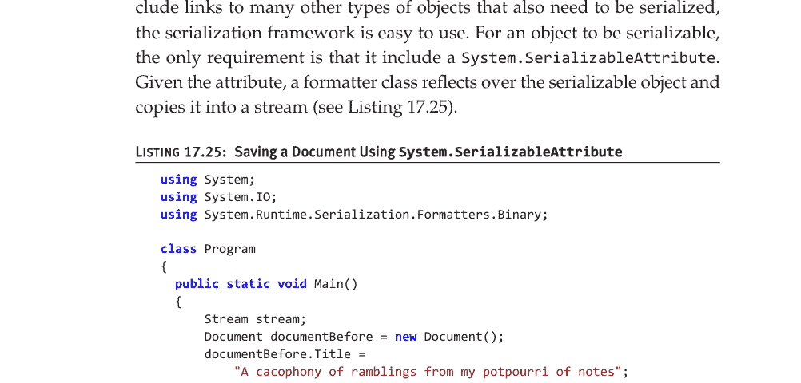

从上图可以看出，不同系统在不同任务上的表现存在显著差异，其中新一代模型在多数指标上均优于前代版本。

- 图像生成质量提升约 35%
- 推理速度提高 2.3 倍
- 显存占用降低 40%

综合评估结果表明，当前先进的人工智能系统已具备较强的实用能力，但在复杂场景与多模态理解方面仍需进一步优化.

```
Console.WriteLine(documentAfter.Title);
}
}
```

```
// Serializable classes use SerializableAttribute.
[Serializable]
class Document
{
    public string Title = null;
    public string Data = null;
    [NonSerialized]
    public long _WindowHandle = 0;
    class Image
    {
    }
    [NonSerialized]
    private Image Picture = new Image();
}
```

## Output 17.9 shows the results of Listing 17.25.

# OUTPUT 17.9

```
A cacophony of ramblings from my potpourri of notes
```

`Listing 17.25` serializes and deserializes a `Document` object. Serialization involves instantiating a formatter (`System.Runtime.Serialization.Formatters.Binary.BinaryFormatter`, in this example) and calling `Serialization()` with the appropriate stream object. Deserializing the object simply involves calling the formatter’s `Deserialize()` method, specifying the stream that contains the serialized object as an argument. However, given that the return from `Deserialize()` is of type `object`, you also need to cast it specifically to the type that was serialized.

Notice that serialization occurs for the entire object graph (all items associated with the serialized object [`Document`] via a field). Therefore, all fields in the object graph also must be serializable.

# System.NonSerializable

Fields that are not serializable should be decorated with the `System.NonSerializable` attribute, which tells the serialization framework to ignore them. The same attribute should appear on fields that should not be persisted for use-case reasons. Passwords and Windows handles are

good examples of fields that should not be serialized: Windows handles because they change each time a window is re-created, and passwords because data serialized into a stream is not encrypted and can be readily accessed. Consider the Notepad view of the serialized document in Figure 17.2.

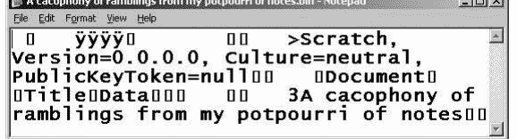

FIGURE 17.2: BinaryFormatter Does Not Encrypt Data

Listing 17.25 set the Title field, and the resultant `*.BIN` file includes the text in plain view.

# Providing Custom Serialization

One way to add encryption is to provide custom serialization. Ignoring the complexities of encrypting and decrypting, this requires implementing the `ISerializable` interface in addition to using `SerializableAttribute`. The interface requires only the `GetObjectData()` method to be implemented. However, this is sufficient only for serialization. To support deserialization as well, it is necessary to provide a constructor that takes parameters of type `System.Runtime.Serialization.SerializationInfo` and `System.Runtime.Serialization.StreamingContext` (see Listing 17.26).

## LISTING 17.26: Implementing System.Runtime.Serialization.ISerializable

```
using System;
using System.Runtime.Serialization;
[Serializable]
class EncryptableDocument :
    ISerializable
{
    public EncryptableDocument() { }
    enum Field
    {
        Title,
        Data
    }
}
public string Title;
public string Data;
public static string Encrypt(string data)
{
    string encryptedData = data;
    // Key-based encryption ...
    return encryptedData;
}
public static string Decrypt(string encryptedData)
{
    string data = encryptedData;
    // Key-based decryption...
    return data;
}
#region ISerializable Members
public void GetObjectData(
    SerializationInfo info, StreamingContext context)
{
    info.AddValue(
        Field.Title.ToString(), Title);
    info.AddValue(
        Field.Data.ToString(), Encrypt(Data));
}
public EncryptableDocument(
    SerializationInfo info, StreamingContext context)
{
    Title = info.GetString(
        Field.Title.ToString());
    Data = Decrypt(info.GetString(
        Field.Data.ToString()));
}
#endregion
}
```


本质上，`System.Runtime.Serialization.SerializationInfo` 对象是一个名称/值对的集合。在序列化时，`GetObject()` 实现会调用 `AddValue()`。要逆转该过程，请调用其中一个 `Get*()` 成员。在本例中，在序列化之前进行加密，在反序列化之前进行解密。

## 版本化序列化

还有一个序列化点值得提及：版本控制。诸如文档之类的对象可能使用一个版本的程序集进行序列化，并使用更新的版本进行反序列化；反之亦然。然而，如果程序员没有足够注意，在此过程中很容易引入版本不兼容，有时甚至出乎意料。请考虑表 17.1 所示的场景。

### 表 17.1：反序列化新版本时抛出异常

| 步骤 | 描述 | 代码 |
|---|---|---|
| 1. | 定义一个用 `System.SerializableAttribute` 装饰的类。 | `[Serializable]`<br>`class Document` |
| 2. | 添加一个或两个字段（公共或私有）的任何可序列化类型。 | `{`<br>`    public string Title;`<br>`    public string Data;`<br>`}` |
| 3. | 将对象序列化到名为 `*.v1.bin` 的文件中。 | `Stream stream;`<br>`Document documentBefore = new Document();`<br>`documentBefore.Title = "A cacophony of ramblings from my potpourri of notes";`<br>`Document documentAfter;`<br>`using (stream = File.Open(documentBefore.Title + ".bin", FileMode.Create))`<br>`{`<br>`    BinaryFormatter formatter = new BinaryFormatter();`<br>`    formatter.Serialize(stream, documentBefore);`<br>`}` |
| 4. | 向可序列化类添加一个额外字段。 | `[Serializable]`<br>`class Document`<br>`{`<br>`    public string Title;`<br>`    public string Author;`<br>`    public string Data;`<br>`}` |
| 5. | 将 `*v1.bin` 文件反序列化到新的对象（`Document`）版本中。 | `using (stream = File.Open(documentBefore.Title + ".bin", FileMode.Open))`<br>`{`<br>`    BinaryFormatter formatter = new BinaryFormatter();`<br>`    documentAfter = (Document)formatter.Deserialize(stream);`<br>`}` |

在列表 17.29 中，`CustomAttribute` 是装饰属性的完整名称。`SerializableAttribute` 翻译为元数据表中的一个设置位。这使得 `SerializableAttribute` 成为一个伪属性——即设置元数据表中的位或字段的属性。

## 使用动态对象编程

C# 4.0 中引入动态对象简化了大量编程场景，并实现了以前不可用的几种新场景。其核心是，使用动态对象编程使开发人员能够使用动态分派机制编写操作，该机制将在执行时由运行时解析，而不是编译器在编译时验证并绑定到它。

为什么？很多时候，对象本质上不是静态类型的。示例包括从 XML/CSV 文件、数据库表、Internet Explorer DOM 或 COM 的 `IDispatch` 接口加载数据，或调用动态语言（如 IronPython 对象）中的代码。C# 4.0 的 Dynamic 对象支持为与不一定具有编译时定义结构的运行时环境对话提供了一个通用解决方案。在 C# 4.0 中动态对象的初始实现中，有四种绑定方法可用：

- 1. 对底层 CLR 类型使用反射
- 2. 调用自定义 `IDynamicMetaObjectProvider`，该提供程序可提供 `DynamicMetaObject`
- 3. 通过 COM 的 `IUnknown` 和 `IDispatch` 接口调用
- 4. 调用由动态语言（如 IronPython）定义的类型

在这四种方法中，我们将深入探讨前两种。它们所依据的原则可无缝地转换为剩余情况——COM 互操作性和动态语言互操作性。

## 使用 `dynamic` 调用反射

反射的一个关键特性是能够根据执行时对成员名称或其他质量（例如属性）的识别，动态查找并在特定类型上调用成员（参见列表 17.3）。然而，C# 4.0 添加的动态对象提供了一种更简单的方法来通过反射调用成员，前提是编译时知道成员签名。重申一下，此限制规定在编译时我们需要知道成员名称以及签名（参数的数量以及指定的参数是否与签名类型兼容）。列表 17.30（输出 17.10）提供了一个示例。

### 列表 17.30：使用“反射”进行动态编程

``` 
using System;

// ...

dynamic data = "Hello! My name is Inigo Montoya";

Console.WriteLine(data);

data = (double)data.Length;

data = data * 3.5 + 28.6;

if(data == 2.4 + 112 + 26.2)

{

    Console.WriteLine(

        $"{ data } makes for a long triathlon.");

}

else

{

    data.NonExistentMethodCallStillCompiles();

}

// ...
```

### 输出 17.10

``` 
Hello!  My name is Inigo Montoya

140.6 makes for a long triathlon.
```

在此示例中，没有显式代码来确定对象类型、查找特定 `MemberInfo` 实例然后调用它。相反，`data` 被声明为 `dynamic` 类型，并直接对其调用方法。在编译时，不会检查指定的成员是否可用，也不会检查 `dynamic` 对象底层的类型。因此，只要语法有效，就可以在编译时进行任何调用。在编译时，是否有对应的成员并不重要。

然而，类型安全并未完全放弃。对于标准 CLR 类型（如列表 17.30 中使用的类型），编译时为非动态类型正常使用的同一类型检查器改为在执行时为动态类型调用。因此，在执行时，如果没有此类成员可用，调用将导致 `Microsoft.CSharp.RuntimeBinder.RuntimeBinderException`。

请注意，这种功能远不如本章前面描述的反射灵活，尽管 API 无疑更简单。使用动态对象时的关键区别在于，需要在编译时识别签名，而不是在运行时确定诸如成员名称之类的内容（如我们在解析命令行参数时所做的那样）。

## `dynamic` 原则和行为

列表 17.30 和 accompanying 文本揭示了 `dynamic` 数据类型的几个特征。

- `dynamic` 是对编译器的指令以生成代码。
- `dynamic` 涉及一个拦截机制，以便当运行时遇到动态调用时，它可以将请求编译为 CIL，然后调用新编译的调用。 （有关更多详细信息，请参阅本章后面标题为“`dynamic` Uncovered”的高级主题。）
- 当类型分配给 `dynamic` 时起作用的原则是概念上“包装”原始类型，以便不进行编译时验证。此外，当在运行时调用成员时，“包装器”拦截调用并适当地分派它（或拒绝它）。在 `dynamic` 对象上调用 `GetType()` 会显示 `dynamic` 实例底层的类型——它不会返回 `dynamic` 作为类型。
- 任何可以转换为 `object` 的类型都可以转换为 `dynamic`。
- 在列表 17.29 中，我们成功地将值类型（`double`）和引用类型（`string`）都转换为 `dynamic`。事实上，所有类型都可以成功转换为动态对象。存在从任何引用类型到 `dynamic` 的隐式转换。同样，存在从值类型到 `dynamic` 的隐式转换（装箱转换）。此外，存在从 `dynamic` 到 `dynamic` 的隐式转换。这也许显而易见，但对于 `dynamic` 来说，此过程比简单地将“指针”（地址）从一个位置复制到下一个位置要复杂得多。
- *从动态类型成功转换为另一种类型取决于底层类型的支持。* 从动态对象到标准 CLR 类型的转换是显式转换（例如，`(double)data.Length`）。不出所料，如果目标类型是值类型，则需要拆箱转换。如果底层类型支持转换为目标类型，则从 `dynamic` 的转换也会成功。
- *底层动态类型可能在一次赋值到下一次赋值之间发生变化。* 与隐式类型变量（`var`）不同，后者不能重新赋值为不同类型，`dynamic` 涉及在执行底层类型代码之前编译前的拦截机制。因此，可以成功地将底层类型实例替换为完全不同的类型。这将导致另一个拦截调用站点，在调用之前需要对其进行编译。
- *对底层类型上是否存在指定签名进行的验证不会在编译时发生——但确实会发生。* 正如对 `person.NonExistentMethodCallStillCompiles()` 的方法调用所演示的那样，编译器对 `dynamic` 类型上的操作几乎不做任何验证。此步骤完全留给运行时在代码执行时的工作。此外，如果代码从未执行，即使周围代码会执行（如 `person.NonExistentMethodCallStillCompiles()` 的情况），成员也永远不会被验证和绑定。
- *任何动态成员调用的结果都是编译时类型 `dynamic`。* 对动态对象上的任何成员的调用都会返回一个动态对象。因此，像 `data.ToString()` 这样的调用将返回一个动态对象，而不是底层的字符串类型。然而，在执行时，当在动态对象上调用 `GetType()` 时，会返回表示运行时类型的一个对象。
- *如果在运行时指定的成员不存在，运行时将抛出 `Microsoft.CSharp.RuntimeBinder.RuntimeBinderException` 异常。* 如果在执行时确实尝试调用成员，运行时将验证成员调用是否真正有效（例如在反射的情况下，签名是否类型兼容）。如果方法签名不兼容，运行时将抛出 `Microsoft.CSharp.RuntimeBinder.RuntimeBinderException`。
- *`dynamic` 与反射不支持扩展方法。* 就像使用 `System.Type` 的反射一样，使用 `dynamic` 的反射也不支持扩展方法。扩展方法的调用仍然可以在实现类型上使用（例如 `System.Linq.Enumerable`），只是不能直接在被扩展类型上使用。
- *从核心来看，`dynamic` 是一个 `System.Object`。* 鉴于任何对象都可以成功转换为 `dynamic`，并且 `dynamic` 可以显式转换为不同对象类型，`dynamic` 的行为就像 `System.Object`。像 `System.Object` 一样，它的默认值也返回 `null`（`default(dynamic)`），表明它是一个引用类型。`dynamic` 与 `System.Object` 的区别在于其特殊的 `dynamic` 行为，仅在编译时出现。

## ADVANCED TOPIC

### `dynamic` Uncovered

CIL 反汇编器揭示，在 CIL 中，`dynamic` 类型实际上是一个 `System.Object`。事实上，如果没有任何调用，`dynamic` 类型的声明与 `System.Object` 无法区分。然而，当调用成员时，差异变得明显。为了调用成员，编译器声明一个类型为 `System.Runtime.CompilerServices.CallSite<T>` 的变量。`T` 根据成员签名而变化，但像 `ToString()` 这样简单的调用就需要实例化类型 `CallSite<Func<CallSite, object, string>>`，以及一个带有 `CallSite site`、`object dynamicTarget` 和 `string result` 参数的方法调用。`site` 是调用站点本身，`dynamicTarget` 是方法调用被调用的对象，`result` 是来自 `ToString()` 方法调用的底层返回值。不是直接实例化 `CallSite<Func<CallSite_site, object dynamicTarget, string result>>`，而是提供了一个 `Create()` 工厂方法来实例化它。（`Create()` 接受一个类型为 `Microsoft.CSharp.RuntimeBinder.CSharpConvertBinder` 的参数。）给定 `CallSite<T>` 的一个实例，最后一步涉及调用 `CallSite<T>.Target()` 来调用实际的成员。

在执行时的底层，框架使用反射查找成员并验证签名是否匹配。接下来，运行时构建一个表示由调用站点定义的动态表达式的表达式树。一旦表达式树被编译，我们就拥有一个 CIL 方法体，其与编译器如果调用不是 `dynamic` 时生成的代码类似。此 CIL 代码随后被缓存到调用站点中，并使用委托调用进行调用。由于 CIL 现在已缓存在调用站点中，下一次调用不再需要所有反射和编译开销。

## Why Dynamic Binding?

除了反射之外，我们还可以定义自定义类型并动态调用它们。例如，你可能会考虑使用动态调用来检索 XML 元素的数值。与使用第 17.31 节列表中的强类型语法相比，使用动态调用我们可以调用 `person.FirstName` 和 `person.LastName`。

### LISTING 17.31: Runtime Binding to XML Elements without `dynamic`

``` 
using System;

using System.Xml.Linq;

// ...

XElement person = XElement.Parse(

    @"<Person>

        <FirstName>Inigo</FirstName>

        <LastName>Montoya</LastName>

    </Person>");

Console.WriteLine("{0} {1}",

    person.Descendants("FirstName").FirstOrDefault().Value,

    person.Descendants("LastName").FirstOrDefault().Value);

// ...
```

尽管第 17.31 节列表中的代码并不过于复杂，将其与第 17.32 节列表进行比较——一种使用动态类型对象的替代方法。

### LISTING 17.32: Runtime Binding to XML Elements with `dynamic`

``` 
using System;

// ...

dynamic person = DynamicXml.Parse(

    @"<Person>

<FirstName>Inigo</FirstName>

<LastName>Montoya</LastName>

</Person>);

Console.WriteLine(

    $"{ person.FirstName } { person.LastName }");

// ...
```


优势很明显，但这是否意味着动态编程优于静态编译？

## Static Compilation versus Dynamic Programming

在第 17.32 节列表中，我们与第 17.31 节列表具有相同的功能，只是有一个非常重要的区别：第 17.31 节列表完全是静态类型的。因此，在编译时，使用此方法会验证所有类型及其成员签名。方法名必须匹配，并且所有参数都会被检查类型兼容性。这是 C# 的关键特性，也是我们在整本书中强调的内容。

相比之下，第 17.32 节列表几乎没有静态类型代码；变量 `person` 却是 `dynamic`。因此，不会在编译时验证 `person` 是否具有 `FirstName` 或 `LastName` 属性——或任何其他成员。此外，在 IDE 中编码时，不会有 IntelliSense 标识 `person` 上的任何成员。

类型丢失似乎会导致功能显著下降。那么，为什么在 C# 中甚至提供这种可能性——事实上，该功能是在 C# 4.0 中添加的？

为了理解这个明显的悖论，让我们重新审视第 17.32 节列表。注意检索 `"FirstName"` 元素的调用：`Element.Descendants("LastName").FirstOrDefault().Value`。列表使用字符串（`"Last Name"`）来标识元素名，但没有编译时验证字符串是否正确。如果大小写与元素名不一致或存在空格，编译仍然会成功，即使在调用 `Value` 属性时会出现 `NullReferenceException`。此外，编译器不会尝试验证 `"FirstName"` 元素是否存在；如果不存在，我们也会得到 `NullReferenceException` 消息。换句话说，尽管有所有类型安全优势，但在访问存储在 XML 元素中的动态数据时，类型安全并不能提供太多好处。

Listing 17.32 在编译时验证元素检索方面并不比 Listing 17.31 好。如果出现大小写不匹配，或者 `FirstName` 元素不存在，仍然会抛出异常。¹ 然而，将 Listing 17.32 中访问名字的调用（`person.FirstName`）与 Listing 17.31 中的调用进行比较。后者中的调用无疑要简单得多。

总而言之，存在类型安全无法——并且可能也不应该——进行某些检查的情况。在这种情况下，代码通过动态调用实现，该调用仅在运行时验证，而非同时在编译时验证，其可读性和简洁性要高得多。显然，如果编译时验证是可行的，静态类型编程是首选，因为它可以伴随可读且简洁的 API。然而，在无效的情况下，C# 4.0 使程序员能够编写更简单的代码，而不是强调类型安全的纯粹性。

## 实现自定义动态对象

Listing 17.32 包含对 `DynamicXml.Parse(...)` 的方法调用，本质上是 `DynamicXml` 的工厂方法调用——这是一个自定义类型，而非 CLR 框架内置的类型。然而，`DynamicXml` 并未实现 `FirstName` 或 `LastName` 属性。实现它们会破坏对 XML 文件中数据的动态支持，该支持是在执行时检索数据，而非促进基于编译时的 XML 元素实现。换句话说，`DynamicXml` 并非使用反射来访问其成员，而是基于 XML 内容动态绑定到值。

定义自定义动态类型的关键是实现 `System.Dynamic.IDynamicMetaObjectProvider` 接口。然而，与其从头实现接口，更好的做法是从 `System.Dynamic.DynamicObject` 派生自定义动态类型。这为大量成员提供了默认实现，并允许你重写不合适的成员。Listing 17.33 显示了完整实现。

### LISTING 17.33: 实现自定义动态对象

```
using System;
using System.Dynamic;
using System.Xml.Linq;
```

> 1. 你不能在 `FirstName` 属性调用中使用空格，但 XML 也不支持元素名称中的空格，所以让我们忽略这一事实。

```
public class DynamicXml : DynamicObject
{
    private XElement Element { get; set; }

    public DynamicXml(System.Xml.Linq.XElement element)
    {
        Element = element;
    }

    public static DynamicXml Parse(string text)
    {
        return new DynamicXml(XElement.Parse(text));
    }

    public override bool TryGetMember(
        GetMemberBinder binder, out object result)
    {
        bool success = false;
        result = null;
        XElement firstDescendant =
            Element.Descendants(binder.Name).FirstOrDefault();
        if (firstDescendant != null)
        {
            if (firstDescendant.Descendants().Count() > 0)
            {
                result = new DynamicXml(firstDescendant);
            }
            else
            {
                result = firstDescendant.Value;
            }
            success = true;
        }
        return success;
    }

    public override bool TrySetMember(
        SetMemberBinder binder, object value)
    {
        bool success = false;
        XElement firstDescendant =
            Element.Descendants(binder.Name).FirstOrDefault();
        if (firstDescendant != null)
        {
            if (value.GetType() == typeof(XElement))
            {
                firstDescendant.ReplaceWith(value);
            }
            else
            {
                firstDescendant.Value = value.ToString();
            }
            success = true;
        }
    }
}
```

## 1. 履歴

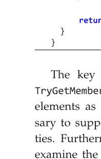

| 氏名 |  |
| --- | --- |
| フリガナ |  |
| 生年月日 |  |
| 性別 |  |
| 住所 |  |
| 電話番号 |  |
| メールアドレス |  |

| 学歴 |  |
| --- | --- |
| 職歴 |  |

| 免許・資格 |  |
| --- | --- |
| 志望動機 |  |

```
public virtual bool TryGetMember(
    GetMemberBinder binder, out object result);

public virtual bool TryInvoke(
    InvokeBinder binder, object[] args, out object result);

public virtual bool TryInvokeMember(
    InvokeMemberBinder binder, object[] args,
    out object result);

public virtual bool TrySetIndex(
    SetIndexBinder binder, object[] indexes, object value);

public virtual bool TrySetMember(
    SetMemberBinder binder, object value);

public virtual bool TryUnaryOperation(
    UnaryOperationBinder binder, out object result);
}
```


正如 Listing 17.34 所示，成员实现涵盖了从类型转换和各种操作到索引调用的一切。此外，还有一个用于检索所有可能成员名称的方法：`GetDynamicMemberNames()`。

## SUMMARY

本章讨论了如何使用反射读取编译到 CIL 中的元数据。使用反射，可以提供延迟绑定，其中要调用的代码是在执行时定义，而非编译时。虽然反射完全可以用于部署动态系统，但其执行速度明显慢于静态链接（编译时）定义的代码。这使其在开发工具中更为常见和有用，在开发工具中性能可能不是那么关键。

反射还能够检索装饰各种构造的附加元数据形式的属性。通常，使用反射来查找自定义属性。你可以定义自己的自定义属性，将你选择的附加元数据插入到 CIL 中。在运行时，你可以检索此元数据并在编程逻辑中使用它。

许多程序员将属性视为一种称为面向方面编程的概念的前身，在面向方面编程中，你通过属性等构造添加功能，而不是在需要的地方手动实现功能。在 C# 中看到真正的方面（如果有的话）还需要一些时间；然而，属性为此提供了一个清晰的垫脚石，而不会对语言的稳定性造成重大风险。

最后，本章包含 C# 4.0 中引入的一个特性——使用新类型 `dynamic` 的动态编程。此介绍包括对静态绑定的讨论，尽管在 API 具有强类型时是首选，但在处理动态数据时存在局限性。

下一章将介绍多线程，其中属性用于同步。

# 18. 多线程

过去十年中，软件开发领域发生了两大显著趋势。第一，计算成本的持续下降不再由时钟速度和晶体管密度的提高驱动，如图 18.1 所示。相反，计算成本现在之所以下降，是因为制造具有多个 CPU 的硬件在经济上是可行的。

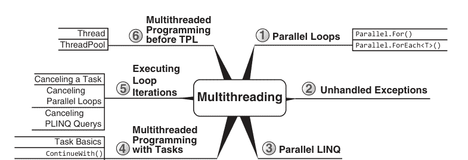


FIGURE 18.1: Clock Speeds over Time
(Graph compiled by Herb Sutter. Used with permission. Original at www.gotw.ca.)

第二，计算现在通常涉及巨大的延迟。延迟简单来说，是获得所需结果所需的时间。延迟主要有两个原因。处理器绑定延迟发生在计算任务复杂时；如果计算需要执行 120 亿次算术运算，而可用总处理能力仅为每秒 60 亿次运算，那么在请求结果和获得结果之间至少会产生 2 秒的处理器绑定延迟。相比之下，I/O 绑定延迟是由需要从外部源（如磁盘驱动器、Web 服务器等）获取数据的需求引起的。任何需要从物理上远离客户端机器的 Web 服务器获取数据的计算都将产生相当于数百万个处理器周期的延迟。

这两种趋势共同为现代软件开发者带来了巨大的挑战。鉴于机器拥有前所未有的计算能力，我们如何有效地利用这种能力快速向用户交付结果，同时又不损害用户体验？我们如何避免创建在触发高延迟操作时就会冻结的令人沮丧的用户界面？此外，我们如何将 CPU 密集型工作分配到多个处理器上以减少计算所需的时间？

编写保持用户界面响应迅速且 CPU 利用率高的软件的标准技术是编写 **多线程** 程序，使其能够“并行”执行多个计算。不幸的是，多线程逻辑 notoriously 难以正确实现；我们将在接下来的两章中探讨是什么使多线程变得困难，并学习如何使用更高级别的抽象和新的语言特性来减轻这一负担。

我们将讨论的更高级别抽象首先是随 .NET 4.0¹ 发布而来的 Parallel Extensions 库的两个主要组件——**任务并行库 (TPL)** 和 **并行 LINQ (PLINQ)**——其次是 **基于任务的异步模式 (TAP)** 及其在 C# 5.0 中的配套语言支持。虽然我们强烈鼓励您使用这些更高级别的抽象，但我们在本章中也会介绍一些来自 .NET 运行时早期版本的底层线程 API。C# 5.0 之前的额外多线程模式可从 http://IntelliTect.com/EssentialCSharp 下载，与 Essential C# 3.0 的章节一起提供。因此，如果您想在没有后期特性的情况下完全理解多线程编程的资源，您仍然可以访问这些资料。

我们将从几个初学者主题开始本章，以防您对多线程不熟悉。然后我们将简要讨论“传统”的线程操作，而不使用 Parallel Extensions 库，以确保您对线程操作有基本的理解；下一章将更详细地介绍该主题。然后我们将用本章的大部分篇幅按顺序介绍 TPL、TAP 和 PLINQ。

1. 这些库可通过下载适用于 .NET 3.5 的 Reactive Extensions 库在 .NET 3.5 中使用，但这不受官方支持。

## 多线程基础

### BEGINNER TOPIC

### 多线程术语

多线程涉及大量令人困惑的术语，因此让我们定义几个术语。

CPU（中央处理器）或核心² 是实际执行给定程序的硬件单元。每台机器至少有一个 CPU，尽管今天多 CPU 机器很常见。许多现代 CPU 支持同时多线程（英特尔将其商标化为超线程），在这种模式下，单个 CPU 可以表现为多个“虚拟”CPU。

进程是给定程序当前正在执行的实例；操作系统的基本目的是管理进程。每个进程包含一个或多个线程。进程由 `System.Diagnostics` 命名空间中的 `Process` 类的实例表示。

在语句和表达式级别的 C# 编程从根本上说是关于描述控制流的，到目前为止，本书中我们一直隐含地假设给定程序只有一个“控制点”。您可以将控制点想象成一个光标，在启动时进入程序文本的 `Main` 方法，然后随着各种条件、循环、方法调用等的执行而在程序中移动。线程就是这个控制点。线程由 `System.Threading.Thread` 类的实例表示，用于操作 `Thread` 的 API 位于相同的 `System.Threading` 命名空间中。

单线程程序是指进程中只有一个线程的程序。多线程程序在进程中有两个或更多线程。

如果一段代码在使用多线程程序中时表现正确，则称其为线程安全。代码的线程模型是代码为保证线程安全而对其调用者提出的一组要求。（例如，许多类的线程模型

2. 从技术上讲，我们应该说“CPU”始终指物理芯片，而“核心”可能指物理或虚拟 CPU。对于本书的目的而言，这种区别并不重要，因此我们将交替使用这些术语。

如果有足够的核心使每个线程都能分配到一个核心，每个线程基本上就拥有自己的小机器。然而，更常见的情况是线程多于核心。即使是今天相对常见的多核机器也只有少数几个核心，而每个进程很可能运行数十个线程。

为克服众多线程与少数核心之间的差异，操作系统通过 **时间片轮转** 来模拟多个线程并发运行。操作系统在线程之间切换执行的速度非常快，以至于线程似乎同时执行。处理器在切换到另一个线程之前执行特定线程的时间段称为 **时间片** 或 **量子**。更改在给定核心中执行的线程的操作称为 **上下文切换**。

其效果类似于光纤电话线路，其中光纤线路代表处理器，每个对话代表一个线程。单模光纤电话线路一次只能发送一个信号，但许多人可以通过该线路同时进行对话。光纤信道足够快，可以在对话之间快速切换，以至于每个对话看起来都不间断。同样，多线程进程中的每个线程似乎都在与其他线程连续运行。

如果两个操作通过真正的多核并行或使用时间片轮转模拟的并行“并行”运行，则称它们为 **并发**。要实现这种并发，您需要 **异步** 调用它，使得被调用操作的执行和完成都与调用它的控制流分离。因此，并发发生在异步分派的工作与当前控制流并行执行时。**并行编程** 是将单个问题拆分为多个部分的行为，其中您 **异步** 启动每个部分的进程，以便所有部分都可以并发处理。

### BEGINNER TOPIC

### 性能考虑

正在为 I/O 绑定操作提供服务的线程在 I/O 子系统提供结果之前基本上可以被操作系统忽略；从 I/O 绑定线程切换到处理器绑定线程会导致处理器利用率更高效，因为 CPU 在等待 I/O 操作完成时不会处于空闲状态。

然而，上下文切换并非免费；CPU 的当前内部状态必须保存到内存中，并且必须加载与新线程关联的状态。如果线程太多，切换开销可能会开始明显影响性能。添加更多线程很可能会进一步降低性能，以至于处理器花费在从一个线程切换到另一个线程上的时间超过了完成每个线程工作的实际时间。

即使我们忽略上下文切换的成本，时间片本身也可能对性能产生巨大影响。假设，例如，您有两个处理器绑定高延迟任务，每个任务都在计算两个列表的平均值，每个列表包含 10 亿个数字。假设处理器每秒可执行 10 亿次操作。如果这两个任务各自关联一个线程，并且两个线程各有一个自己的核心，显然我们可以在 1 秒内获得两个结果。

如果我们只有一个处理器供两个线程共享，时间片轮转将在一线程上执行几十万次操作，然后切换到另一个线程，然后再切换回来，依此类推。每个任务将消耗总共 1 秒的处理器时间，因此两个结果将在 2 秒后可用，导致平均完成时间为 2 秒。（同样，我们忽略了上下文切换的成本。）

如果我们将这两个任务分配给一个线程，该线程执行第一个任务，并且在第一个任务完成后才开始第二个任务，则第一个任务的结果将在 1 秒内获得，随后任务的结果将在其后 1 秒获得，导致平均时间为 1.5 秒（任务在 1 秒或 2 秒完成，因此平均完成时间为 1.5 秒）。

### 指南

- DO NOT 陷入认为线程越多代码就越快的常见错误。
- DO 在尝试通过多线程加速处理器绑定问题时仔细测量性能。

```
Console.Write('-');

}

    thread.Join();

}

public static void DoWork()

{

    for(int count = 0; count < Repetitions; count++)

    {

        Console.Write('+');

    }

}

```

### OUTPUT 18.1


正如你所见，线程似乎在轮流执行，每个线程在上下文切换前打印出几百个字符。两个循环是“并行”运行的，而不是先让第一个循环执行完再开始第二个循环，就像委托被同步执行时那样。

要让代码在不同线程的上下文中运行，你需要一个类型为 `ThreadStart` 或 `ParameterizedThreadStart` 的委托来标识要执行的代码。后者允许一个类型为 `object` 的单个参数；两者都位于 `System.Threading` 命名空间中。给定使用线程启动委托构造函数创建的 `Thread` 实例，你可以通过调用 `thread.Start()` 来启动线程执行。Listing 18.1 显式创建了一个 `ThreadStart` 类型的变量，以在源代码中显示委托类型。方法组 `DoWork` 本可以被直接传递给线程构造函数。对 `Thread.Start()` 的调用告诉操作系统开始新线程的并发执行；主线程上的控制会立即从调用中返回并执行 `Main()` 方法中的 for 循环。线程现在是独立的，并且在调用 `Join()` 之前彼此不会等待。

## 线程管理

线程包含许多用于管理其执行的方法和属性。以下是一些基本方法：

- 正如我们在 Listing 18.1 中看到的，你可以使用 `Join()` 使一个线程等待另一个线程。这告诉操作系统在另一个线程终止之前暂停当前线程的执行。`Join()` 方法被重载以接受 `int` 或 `TimeSpan`，以支持在继续执行之前等待线程完成的最长时间。
- 默认情况下，新线程是“前台”线程；当其所有前台线程完成后，操作系统将终止进程。你可以通过将 `IsBackground` 属性设置为 `true` 来将线程标记为“后台”线程。然后操作系统将允许在后台线程仍在运行的情况下终止进程。然而，仍然最好确保所有线程都不会被中止，而是在进程退出前干净地退出；有关线程中止的更多细节，请参阅本章后面的部分。
- 每个线程都有一个关联的优先级，你可以通过将 `Priority` 属性设置为新的 `ThreadPriority` 枚举值来更改它。可能的值为 `Lowest`、`BelowNormal`、`Normal`、`AboveNormal` 和 `Highest`。操作系统更倾向于为更高优先级的线程调度时间片。小心；如果你设置优先级不正确，可能会出现“饥饿”情况，其中一个高优先级线程阻止许多低优先级线程永远运行。
- 如果你只是想知道线程是否仍“存活”或已完成所有工作，可以使用布尔值 `IsAlive` 属性。线程状态的更详细视图可通过 `ThreadState` 属性访问。`ThreadState` 枚举值有 `Aborted`、`AbortRequested`、`Background`、`Running`、`Stopped`、`StopRequested`、`Suspended`、`SuspendRequested`、`Unstarted` 和 `WaitSleepJoin`。这些是标志；其中一些值可以组合。

有两种常用的、且常被滥用的用于控制线程的方法值得在各自的章节中讨论：`Sleep()` 和 `Abort()`。

## 不要在生产代码中让线程休眠

静态 `Thread.Sleep()` 方法使当前线程休眠，本质上是告诉操作系统在给定时间过去之前不要为此线程调度任何时间片。单个参数——要么是毫秒数，要么是 `TimeSpan`——指定操作系统在继续执行前等待多长时间。在等待期间，操作系统当然会为可能正在等待执行机会的任何其他线程调度时间片。这听起来似乎是个合理的做法，但它是一种“坏代码味道”，表明程序的设计可能可以更好。

线程经常被置于休眠状态以尝试将线程与某个时间事件同步。然而，操作系统并不保证其计时的任何精度。也就是说，如果你说“让我休眠 123 毫秒”，操作系统将使线程休眠 *至少* 123 毫秒，可能更长。线程从进入休眠到再次唤醒之间的实际时间是不确定的，可能任意长。不要尝试将 `Thread.Sleep()` 用作高精度计时器，因为它不是。

更糟的是，`Thread.Sleep()` 常常被用作“穷人的同步系统”。也就是说，如果你有一些异步工作，而当前线程在该工作完成前无法继续，你可能会诱惑线程休眠远长于你认为异步工作所需的时间，希望它在当前线程唤醒时已完成。这是个坏主意：异步工作本质上可能比你想象的要花费更长时间。使用下一章中描述的适当的线程同步机制来同步线程。我们将在 Listing 18.2 中给出这种滥用的例子。

让线程休眠也是糟糕的编程实践，因为休眠的线程显然无法响应在其上运行代码的尝试。如果你让 Windows 应用程序的主线程休眠，该线程将不再处理来自用户界面的消息，因此看起来会挂起。

更一般地说，让线程休眠是糟糕的编程实践，因为分配线程这种昂贵资源的目的就是从该资源中获取工作。你不会付钱让员工睡觉，所以不要付出分配昂贵线程的代价，只为让它休眠数百万或数十亿个处理器周期。

话虽如此，`Thread.Sleep()` 也有一些有效用途。首先，使用零时间延迟让线程休眠告诉操作系统“当前线程礼貌地放弃其剩余的量子，如果有其他线程可以使用的话”。然后礼貌的线程将正常调度，而不会有进一步延迟。其次，`Thread.Sleep()` 常用于测试代码中，以模拟正在处理某种高延迟操作的线程，而无需真正消耗处理器做无意义的算术。生产代码中的其他用途应仔细审查，以确保没有更好的方法来获得所需效果。

在 C# 5 的基于任务的异步编程中，你可以在 `Task.Delay()` 方法的结果上使用 `await` 运算符来引入异步延迟，而不会阻塞当前线程。有关更多细节，请参阅第 19 章中的“计时器”部分。

### 指南

AVOID 在生产代码中调用 `Thread.Sleep()`。

## 不要在生产代码中中止线程

`Thread` 对象有一个 `Abort()` 方法，当执行时，尝试销毁线程。它通过导致运行时在线程中抛出 `ThreadAbortException` 来实现；此异常可以被捕获，但即使被捕获并忽略，它也会自动重新抛出以尝试

### 指南

AVOID 在生产代码中中止线程；这样做会导致不可预测的结果并可能使程序不稳定。

## 线程池

正如我们在“性能考虑”初学者主题中讨论的那样，过多的线程可能会对性能产生负面影响。线程是昂贵的资源，线程上下文切换不是免费的，并且通过时间片模拟并行运行两个作业可能比一个接一个运行慢得多。

为缓解这些问题，BCL 提供了线程池。不是直接分配线程，你可以告诉线程池你想要执行的工作。当工作完成后，线程不会终止并被销毁，而是返回到池中，从而节省了当有更多工作到来时分配新线程的成本。Listing 18.2 展示了如何使用池化线程做与 Listing 18.1 相同的事情。

### LISTING 18.2: 使用 ThreadPool 而不是显式实例化线程

```csharp
using System;
using System.Threading;

public class Program
{
    public const int Repetitions = 1000;

    public static void Main()
    {
        ThreadPool.QueueUserWorkItem(DoWork, '+');
        for(int count = 0; count < Repetitions; count++)
        {
            Console.Write('-');
        }

        // Pause until the thread completes.
        // This is for illustrative purposes; do not
        // use Thread.Sleep for synchronization in
        // production code.
        Thread.Sleep(1000);
    }

    public static void DoWork(object state)
    {
        for(int count = 0; count < Repetitions; count++)
        {
            Console.Write(state);
        }
    }
}
```


`Listing 18.2` 的输出与 `Output 18.1` 相似——即句点和连字符的交错。如果我们有大量不同的作业需要异步执行，这种池化技术将在单处理器和多处理器计算机上提供更高效的执行。效率是通过反复重用线程实现的，而不是为每次异步调用重建它们。不幸的是，线程池的使用并非没有陷阱：使用线程池时仍需考虑性能和同步问题。

为了高效利用处理器，线程池假定你在线程池上调度的所有工作都会及时完成，以便线程可以归还给线程池并被另一个任务重用。线程池还假定所有工作都是相对短期的（即消耗毫秒或秒的处理器时间，而不是小时或天）。通过做出这种假设，它可以确保每个处理器都在全力处理一个任务，而不是像“性能”初学者主题中描述的那样低效地对多个任务进行时间片分配。线程池试图通过确保线程创建被“节流”，从而防止过度时间片分配，这样就不会让某个处理器被“过度订阅”而拥有太多线程。当然，这就意味着消耗线程池中的所有线程可能会延迟排队工作的执行。如果线程池中的所有线程都被长时间运行或 I/O 绑定的工作消耗，排队的任务将被延迟。

与可以直接操作的 `Thread` 和 `Task` 不同，线程池不会提供用于执行给定工作片段的线程的引用。这阻止了调用线程通过本章前面描述的线程管理函数与工作线程同步或控制工作线程。在 `Listing 18.2` 中，我们使用了之前不鼓励的“穷人的同步”；这在生产代码中是个坏主意，因为我们实际上并不知道工作需要多长时间才能完成。

简而言之，线程池很好地完成了它的工作，但这项工作不包括提供处理长时间运行的作业或需要与主线程或彼此同步的作业的服务。我们真正需要的是

```
    });

}

    for(int count = 0; count < Repetitions; count++)

    {

        Console.Write('+');

    }

    // Wait until the Task completes

    task.Wait();

}

}
```

要在新线程中运行的代码是在传递给 `Task.Run()` 方法的委托（本例中为 `Action` 类型）中定义的。此委托（以 lambda 表达式的形式）会重复向控制台打印连字符。其后跟随的循环几乎相同，只是显示的是加号。

请注意，在调用 `Task.Run()` 之后，作为参数传递的 `Action` 会立即开始执行。任务被称为“热”的，这意味着它已经被触发开始执行——与“冷”任务相反，“冷”任务需要在异步工作开始前显式启动。

尽管 `Task` 也可以通过 `Task` 构造函数以“冷”状态实例化，但这样做通常只适用于作为返回已运行（“热”）`Task` 的 API 内部实现细节，该 `Task` 由对 `Task.Start()` 的调用触发。

请注意，在调用 `Run()` 之后，“热”任务的确切状态是不确定的。状态反而由操作系统决定，以及它是否选择立即运行任务的工作线程或延迟到有额外资源可用时。事实上，在调用线程的代码再次获得执行机会时，热任务可能已经完成。对 `Wait()` 的调用会强制主线程等待，直到分配给任务的所有工作完成执行。这类似于我们在 `Listing 18.1` 中对工作线程调用 `Join()`。

在此场景中我们只有一个任务，但也可能有许多任务异步运行。常见的情况是一组任务，你希望在所有任务完成或其中任意一个任务完成后再继续当前线程的执行。`Task.WaitAll()` 和 `Task.WaitAny()` 方法可实现此目的。

到目前为止，我们已经看到任务如何接受一个 `Action` 并异步运行它。但如果在任务中执行的工作会返回结果怎么办？我们可以使用 `Task<T>` 类型异步运行 `Func<T>`。同步执行委托时，我们知道控制权不会在结果可用之前返回。异步执行 `Task<T>` 时，我们可以从一个线程轮询它是否已完成，并在完成时获取结果。³ `Listing 18.4` 演示了如何在控制台应用程序中执行此操作。请注意，此示例使用了 `PiCalculator.Calculate()` 方法，我们将在“并行执行循环迭代”部分进一步深入探讨。

## LISTING 18.4: Polling a Task<T>

```
using System;
using System.Threading.Tasks;
public class Program
{
    public static void Main()
    {
        // Use Task.Factory.StartNew<string>() for
        // TPL prior to .NET 4.5
        Task<string> task =
            Task.Run<string>(
                () => PiCalculator.Calculate(100));
        foreach(
            char busySymbol in Utility.BusySymbols())
        {
            if(task.IsCompleted)
            {
                Console.Write('\b');
                break;
            }
            Console.Write(busySymbol);
        }
        Console.WriteLine();
        Console.WriteLine(task.Result);
        System.Diagnostics.Trace.Assert(
            task.IsCompleted);
    }
}
```

3. 使用此轮询技术时请谨慎。当从委托创建任务时，如我们在此处所做的那样，任务将被安排在线程池的工作线程上运行。因此，当前线程将循环直到工作线程上的工作完成。此技术有效，但可能会不必要地消耗 CPU 资源。如果不是将任务安排在工作线程上运行，而是将任务安排在当前线程上将来执行，这种轮询技术就会危险地失效。由于当前线程正在循环轮询任务，它将永远循环，因为任务要到当前线程退出循环后才会完成。

```
public class PiCalculator
{
    public static string Calculate(int digits = 100)
    {
        // ...
    }
}
```

```
public class Utility
{
    public static IEnumerable<char> BusySymbols()
    {
        string busySymbols = @"-\|/-\|/";
        int next = 0;
        while(true)
        {
            yield return busySymbols[next];
            next = (next + 1) % busySymbols.Length;
            yield return '\b';
        }
    }
}
```

此列表显示任务的数据类型为 `Task<string>`。泛型类型包含一个 `Result` 属性，可从中检索 `Task<string>` 执行的 `Func<string>` 返回的值。

请注意，`Listing 18.4` 并未调用 `Wait()`。相反，从 `Result` 属性读取会自动导致当前线程阻塞，直到结果可用，如果尚未就绪；在此情况下，我们知道在获取结果时它已经完成。

除了 `Task<T>` 上的 `IsCompleted` 和 `Result` 属性外，还有几个其他属性值得注意：

- `IsCompleted` 属性在任务完成时设置为 `true`，无论是正常完成还是出现故障（即因抛出异常而结束）。有关任务状态的更详细信息可以通过读取 `Status` 属性获得，该属性返回 `TaskStatus` 类型的值。可能的值有 `Created`、`WaitingForActivation`、`WaitingToRun`、`Running`、`WaitingForChildrenToComplete`、`RanToCompletion`、`Canceled` 和 `Faulted`。只要 `Status` 为 `RanToCompletion`、`Canceled` 或 `Faulted`，`IsCompleted` 就是 `true`。当然，如果任务在另一个线程上运行，并且你读取的状态为“Running”，状态可能随时变为“Completed”，包括

immediately after you read the value of the property. The same is true of many other states—even `Created` could potentially change if a different thread starts it. Only `RanToCompletion`, `Canceled`, and `Faulted` can be considered final states that can no longer be transitioned.

- 一个任务可以通过 `Id` 属性的值唯一标识。静态 `Task.CurrentId` 属性提供了当前正在执行的 `Task` 的标识符（即执行 `Task.CurrentId` 调用的任务）。在调试时这些属性尤其有用。
- 你可以使用 `AsyncState` 为任务关联额外的数据。例如，想象一个 `List<T>`，其值将由各种任务计算。每个任务都可以在 `AsyncState` 属性中包含该值在列表中的索引。这样，当任务完成时，代码可以使用 `AsyncState` 对列表进行索引（首先将其转换为 `int`）。⁴

本章后面在关于任务取消的部分，我们将讨论其他有用的属性。

## Task Continuation

我们多次谈到程序的“控制流”，却从未说明控制流最根本的本质是什么：控制流决定接下来会发生什么。当你有一个像 `Console.WriteLine(x.ToString());` 这样简单的控制流时，控制流告诉你，当 `ToString` 正常完成时，接下来会发生的事情是对 `WriteLine` 的调用，并将返回值作为参数传递。“接下来会发生什么”这个概念称为 continuation；控制流中的每个点都有一个 continuation。在我们的例子中，`ToString` 的 continuation 是 `WriteLine`（而 `WriteLine` 的 continuation 是下一条语句中运行的代码）。continuation 的概念对 C# 编程来说如此基础，以至于大多数程序员甚至不会去想它；它是他们呼吸的隐形空气。C# 编程的行为就是在 continuation 上构建 continuation，直到整个程序的控制流完成。

请注意，在正常的 C# 程序中，给定代码片段的 continuation 将在该代码完成时立即执行。

4. 在使用任务异步修改集合时要小心。任务可能在工作线程上运行，而集合可能不是线程安全的。更安全的做法是在任务完成后从主线程填充集合。

当 `ToString()` 返回时，当前线程上的控制点会立即对 `WriteLine` 进行同步调用。还请注意，给定代码片段实际上有两个可能的 continuation： “正常” continuation 和如果当前代码片段抛出异常时将被执行的“异常” continuation。

异步方法调用，例如启动一个 `Task`，为控制流增加了额外的维度。在异步 `Task` 调用中，控制流会立即转到 `Task.Start()` 之后的语句，同时也在 `Task` 委托的主体内部开始执行。换句话说，当涉及异步时，“接下来会发生什么”是多维的。与异常的 continuation 只是不同路径不同，异步的 continuation 是一个额外的、并行的路径。

异步任务还允许通过描述异步 continuation 将较小的任务组合成较大的任务。正如常规控制流一样，任务可以有不同的 continuation 来处理错误情况，并且可以通过操作它们的 continuation 将任务融合在一起。实现此目的有几种技术，其中最明确的是 `ContinueWith()` 方法（参见列表 18.5 及其对应的输出，输出 18.2）。

### LISTING 18.5: Calling Task.ContinueWith()

```
using System;
using System.Threading.Tasks;
public class Program
{
    public static void Main()
    {
        Console.WriteLine("Before");
        // Use Task.Factory.StartNew<string>() for
        // TPL prior to .NET 4.5
        Task taskA =
            Task.Run( () =>
                Console.WriteLine("Starting...")
            ).ContinueWith(antecedent =>
                Console.WriteLine("Continuing A..."));
        Task taskB = taskA.ContinueWith( antecedent =>
            Console.WriteLine("Continuing B..."));
        Task taskC = taskA.ContinueWith( antecedent =>
            Console.WriteLine("Continuing C..."));
        Task.WaitAll(taskB, taskC);
        Console.WriteLine("Finished!");
    }
}
```

### OUTPUT 18.2

```
Before
Starting...
Continuing A...
Continuing C...
Continuing B...
Finished!
```


`ContinueWith()` 方法使“链接”两个任务成为可能，使得当前任任务——`antecedent` 任务——完成时，第二个任务——`continuation` 任务——会自动异步启动。例如在列表 18.5 中，`Console.WriteLine("Starting...")` 是前任任务体，而 `Console.WriteLine("Continuing A...")` 是其 `continuation` 任务体。`continuation` 任务以 `Task` 作为其参数（`antecedent`），从而允许 `continuation` 任务的代码访问前任任务的完成状态。当前任任务完成后，`continuation` 任务会自动启动，异步执行第二个委托，并将刚刚完成的前任任务作为参数传递给该委托。此外，由于 `ContinueWith()` 方法本身也返回一个 `Task`，因此该 `Task` 可以用作另一个 `Task` 的前任，以此类推，形成一个可以任意长的 `Task continuation` 链。

如果对同一个前任任务调用 `ContinueWith()` 两次（如列表 18.5 中 `taskB` 和 `taskC` 表示 `taskA` 的 `continuation` 任务所示），前任任务（`taskA`）将有两个 `continuation` 任务，并且当前任任务完成时，两个 `continuation` 任务都将被异步执行。请注意，从单个前任任务派生的 `continuation` 任务的执行顺序在编译时是不确定的。输出 18.2 恰好显示 `taskC` 在 `taskB` 之前执行，但在程序的第二次执行中，顺序可能会颠倒。然而，`taskA` 总是会在 `taskB` 和 `taskC` 之前执行，因为后者是 `taskA` 的 `continuation` 任务，因此不能在 `taskA` 完成之前启动。同样，`Console.WriteLine("Starting...")` 委托总会先执行完成，然后才是 `taskA`（`Console.WriteLine("Continuing A...")`），因为后者是前者的 `continuation` 任务。此外，“Finished!” 总是最后出现，因为 `Task.WaitAll(taskB, taskC)` 的调用会阻塞控制流的继续，直到 `taskB` 和 `taskC` 都完成。

`ContinueWith()` 有许多不同的重载，其中一些接受一个 `TaskContinuationOptions` 值来调整 `continuation` 链的行为。这些值是标志，因此可以使用逻辑或运算符（`|`）组合。表 18.1 中简要描述了一些可能的标志值；有关更多详细信息，请参阅在线 MSDN 文档⁵。

### TABLE 18.1: List of Available TaskContinuationOptions Enums

| Enum | Description |
|---|---|
| None | 这是默认行为。`continuation` 任务将在前任任务完成后执行，无论其任务状态如何。 |
| PreferFairness | 如果两个任务都被异步启动，一个在另一个之前，则不能保证先启动的任务实际上先运行。该标志要求任务调度程序尝试提高先启动的任务先执行的可能性——这在从不同的线程池线程创建的两个任务时尤其相关。 |
| LongRunning | 这告诉任务调度程序该任务很可能是一个 I/O 绑定的高延迟任务。调度程序然后可以允许处理其他排队的 work，而不是因为长时间运行的任务而被饿死。此选项应谨慎使用。 |
| AttachedToParent | 这指定任务应尝试在任务层次结构中附加到父任务。 |
| DenyChildAttach (.NET 4.5) | 如果尝试创建子任务，则抛出异常。如果 `continuation` 中的代码尝试使用 `AttachedToParent`，它将表现得好像没有父任务一样。 |
| NotOnRanToCompletion* | 这指定如果其前任运行完成，则不应安排 `continuation` 任务。此选项不适用于多任务 `continuation`。 |
| NotOnFaulted* | 这指定如果其前任抛出未处理的异常，则不应安排 `continuation` 任务。此选项不适用于多任务 `continuation`。 |
| OnlyOnCanceled* | 这指定 `continuation` 任务只有在其前任被取消时才应安排。此选项不适用于多任务 `continuation`。 |

5. MSDN.NET Framework Developer Center, http://msdn.microsoft.com/en-us/library/system.threading.tasks.taskcontinuationoptions(v=vs.110).aspx.

创建延续，使其像先行任务行为的事件处理程序一样工作。清单 18.6 演示了如何为先行任务注册多个延续，这些延续会根据先行任务的完成方式有条件地执行。

### LISTING 18.6: Registering for Notifications of Task Behavior with ContinueWith()

```csharp
using System;
using System.Threading.Tasks;
using System.Diagnostics;
using AddisonWesley.Michaelis.EssentialCSharp.Shared;

public class Program
{
    public static void Main()
    {
        // Use Task.Factory.StartNew<string>() for
        // TPL prior to .NET 4.5
        Task<string> task =
            Task.Run<string>(
                () => PiCalculator.Calculate(10));
        Task faultedTask = task.ContinueWith(
            (antecedentTask) =>
            {
                Trace.Assert(antecedentTask.IsFaulted);
                Console.WriteLine(
                    "Task State: Faulted");
            },
            TaskContinuationOptions.OnlyOnFaulted);
        Task canceledTask = task.ContinueWith(
            (antecedentTask) =>
            {
                Trace.Assert(antecedentTask.IsCanceled);
                Console.WriteLine(
                    "Task State: Canceled");
            },
            TaskContinuationOptions.OnlyOnCanceled);
        Task completedTask = task.ContinueWith(
            (antecedentTask) =>
            {
                Trace.Assert(antecedentTask.IsCompleted);
                Console.WriteLine(
                    "Task State: Completed");
            }, TaskContinuationOptions.
                OnlyOnRanToCompletion);
        completedTask.Wait();
    }
}
```

在此清单中，我们有效地为先行任务上的“事件”注册了“监听器”，这样当任务正常或异常完成时，特定的“监听”任务将开始执行。这是一种强大的功能，特别是如果原始任务是“fire and forget”任务——即我们启动它、挂接到延续任务，然后再也不引用它的任务。

在清单 18.6 中，注意最后的 `Wait()` 调用是在 `completedTask` 上，而不是在 `task` 上——使用 `Task.Run()` 创建的原始先行任务。虽然每个委托的 `antecedentTask` 都是对父级（先行）任务（`task`）的引用，但从委托监听器外部，我们可以有效地丢弃对原始任务的引用。然后我们可以仅依赖于异步开始执行而无需任何检查原始任务状态的后续代码的延续任务。

在这种情况下，我们调用 `completedTask.Wait()`，以便主线程不会在 `completed` 输出出现之前退出程序（参见 Output 18.3）。

### OUTPUT 18.3

```
Task State: Completed.
```

在这种情况下，调用 `completedTask.Wait()` 有点牵强，因为我们知道原始任务将成功完成。然而，在 `canceledTask` 或 `faultedTask` 上调用 `Wait()` 将导致异常。这些延续任务仅在先行任务被取消或抛出异常时运行；鉴于在该程序中这种情况不会发生，这些任务永远不会被安排运行，并且等待它们完成将抛出异常。清单 18.3 中的延续选项恰好是互斥的，因此当先行任务运行完成并且与 `completedTask` 关联的任务执行时，任务调度程序会自动取消与 `canceledTask` 和 `faultedTask` 关联的任务。被取消的任务以其状态设置为 `Canceled` 结束。因此，在这两个任务上调用 `Wait()`（或任何其他会导致当前线程等待任务完成的调用）将抛出异常，指出它们已被取消。

一种不那么牵强的做法可能是调用 `Task.WaitAny(completed Task, canceledTask, faultedTask)`，这将抛出一个随后需要处理的 `Aggregate Exception`。

### Unhandled Exception Handling on Task with AggregateException

调用方法同步时，我们可以将其包装在 `try` 块中并带有 `catch` 子句，以向编译器标识当异常发生时我们想要执行的代码。然而，这对于异步调用不起作用。我们不能简单地将 `try` 块包装在对 `Start()` 的调用周围以捕获异常，因为控制会立即从调用返回，并且控制随后会离开 `try` 块，可能在工作线程上异常发生之前很久。一种解决方案是将 `try/catch` 块包装在任务委托的主体周围。随后在工作线程上抛出并捕获的异常因此不会造成问题，因为 `try` 块将在工作线程上正常工作。然而，对于未处理的异常——工作线程未捕获的异常——情况并非如此。

通常（从 CLR 版本 2.0⁶ 开始），任何线程上的未处理异常都被视为致命的，会触发 Windows 错误报告对话框，并导致应用程序异常终止。所有线程上的所有异常都必须被捕获，如果未捕获，应用程序不允许继续运行。（有关处理线程上未处理异常的一些高级技术，请参阅即将到来的高级主题“Dealing with Unhandled Exceptions on a Thread”。）幸运的是，对于异步运行任务中的未处理异常情况并非如此。相反，任务调度程序会在委托周围插入一个“捕获所有”异常处理程序，以便如果任务抛出否则未处理的异常，捕获所有处理程序将捕获它并在任务中记录异常的详细信息，从而避免触发 CLR 自动终止进程。

正如我们在清单 18.6 中看到的，处理故障任务的一种技术是显式创建作为该任务“故障处理程序”的延续任务；任务调度程序将自动安排延续任务在

6. 在 CLR 1.0 版本中，工作线程上的未处理异常会终止线程但不会终止应用程序。因此，有可能出现一个有错误的程序，其所有工作线程都已死亡，但主线程仍在运行，即使程序不再做任何工作。这对用户来说是一个令人困惑的情况；最好向用户发出应用程序处于不良状态的信号并在造成更多损害之前终止它。

收集异常并将其作为单个异常报告。 Furthermore，由于在编译时无法知道工作任务是否会抛出一个或多个异常，未处理的故障任务将始终抛出 `AggregateException`。清单 18.7 和 Output 18.4 演示了这种行为。即使在工作线程上抛出的未处理异常的类型为 `InvalidOperationException`，在主线程上捕获的异常的类型仍然是 `AggregateException`。此外，正如预期的那样，捕获异常需要 `AggregateException` catch 块。

`AggregateException` 中包含的异常列表可通过 `InnerExceptions` 属性获得。因此，您可以遍历此属性以检查每个异常并确定适当的应对措施。或者，如清单 18.7 所示，您可以使用 `AggregateException.Handle()` 方法，指定针对 `AggregateException` 中包含的每个单独异常执行的表达式。然而，需要考虑的 `Handle()` 方法的一个重要特征是它是一个谓词。因此，谓词应为 `Handle()` 委托成功处理的任何异常返回 `true`。如果任何异常处理调用对某个异常返回 `false`，`Handle()` 方法将抛出一个新的 `AggregateException`，其中包含此类对应异常的复合列表。

您还可以通过简单地查看任务的 `Exception` 属性来观察故障任务的状态，而不会导致异常在当前线程上重新抛出。清单 18.8 通过等待我们知道会抛出异常的任务的故障延续的完成来演示这种方法。

### LISTING 18.8: Observing Unhandled Exceptions on a Task Using ContinueWith()

```csharp
using System;
using System.Diagnostics;
using System.Threading.Tasks;

public class Program
{
    public static void Main()
    {
        bool parentTaskFaulted = false;
```

7. 正如我们之前讨论的，等待故障延续完成是一件奇怪的事情，因为大多数时候它根本不会被安排运行。此代码仅用于说明目的。

数据结构已损坏。因此你完全不知道程序可能在做什么，所以最安全的做法是立即关闭整个程序。

理想情况下，任何程序都不应在任何线程上抛出未处理的异常；抛出未处理异常的程序存在缺陷，最好的做法是在软件交付给客户之前找到并修复该缺陷。然而，当发生未处理异常时，通常值得去做的是保存任何正在处理的数据和/或记录异常以供错误报告和将来的调试，而不是尽快关闭应用程序。这需要一种机制来注册未处理异常的通知。

每个 `AppDomain` 都提供了这样的机制。要观察 `AppDomain` 中发生的未处理异常，必须向 `UnhandledException` 事件添加处理程序。`UnhandledException` 事件会在应用程序域内所有线程（无论是主线程还是工作线程）的未处理异常上触发。请注意，此机制的目的是通知；它不允许应用程序从未处理异常中恢复并继续执行。事件处理程序运行后，应用程序将显示 Windows 错误报告对话框，然后退出。（对于控制台应用程序，异常详细信息也会出现在控制台上。）

在清单 18.9 中，我们演示了如何创建第二个抛出异常的线程，该异常随后由应用程序域的未处理异常事件处理程序处理。为了演示效果，确保线程时序问题不会产生干扰，我们使用 `Thread.Sleep` 插入了一些人为延迟。输出 18.5 显示了结果。

### 清单 18.9：注册未处理异常

```csharp
using System;
using System.Diagnostics;
using System.Threading;

public class Program
{
    public static Stopwatch clock = new Stopwatch();
    public static void Main()
    {
        try
        {
            clock.Start();
            // Register a callback to receive notifications
            // of any unhandled exception.
```


线程 3 运行一段时间；它抛出一个未处理异常，事件处理程序被调用，并进入睡眠。此后不久，操作系统意识到线程 1 可以被调度，但其代码立即让它进入睡眠。线程 1 首先醒来并运行`finally`块，然后 2 秒后线程 3 醒来，未处理异常最终导致进程崩溃。

这一系列事件——事件处理程序执行，以及在其完成后进程崩溃——是典型的，但不是必然的。程序中一旦出现未处理异常，一切都无法预料；程序现在处于未知且可能非常不稳定的状态，因此其行为可能是不可预测的。在这种情况下，如你所见，CLR 允许主线程继续运行并执行其`finally`块，即使它知道当控制权到达`finally`块时，另一个线程正处于`AppDomain`的未处理异常事件处理程序中。

为了强调这一事实，试着更改延迟，使主线程的睡眠时间长于事件处理程序。在那种情况下，`finally`块将永远不会执行！进程会在线程 1 醒来之前被未处理异常销毁。根据抛出异常的线程是否由线程池创建，你还会得到不同的结果。因此，最佳实践是避免所有可能的未处理异常，无论它们发生在工作线程还是主线程中。

这与任务有什么关系？如果你想要关闭系统时，系统中还有未完成的任务挂在那里怎么办？我们将在下一节中讨论任务取消。

## 指南

- **避免**编写在任何线程上产生未处理异常的程序。
- **考虑**注册未处理异常事件处理程序，用于调试、日志记录和紧急关闭。
- **务必**取消未完成的任务，而不是让它们在应用程序关闭期间继续运行。

## 取消任务

在本章前面，我们解释了为什么为了取消线程正在执行的任务而粗鲁地中止该线程是一个坏主意。TPL 使用协作式取消，这是一种更礼貌、更健壮、更可靠的技术，用于安全地取消不再需要的任务。支持取消的任务通过定期轮询`CancellationToken`对象（位于`System.Threading`命名空间中）来监视是否已发出取消请求。清单 18.10 演示了取消请求和对此请求的响应。输出 18.6 显示了结果。

### 清单 18.10：使用`CancellationToken`取消任务

```
using System;

using System.Threading;

using System.Threading.Tasks;

using AddisonWesley.Michaelis.EssentialCSharp.Shared;

public class Program

{

    public static void Main()

    {

        string stars =

            "*".PadRight(Console.WindowWidth-1, '*');

        Console.WriteLine("Push ENTER to exit.");

        CancellationTokenSource cancellationTokenSource=

            new CancellationTokenSource();

        // Use Task.Factory.StartNew<string>() for

        // TPL prior to .NET 4.5

        Task task = Task.Run(

            () =>

                WritePi(cancellationTokenSource.Token),

                cancellationTokenSource.Token);

        // Wait for the user's input

        Console.ReadLine();

        cancellationTokenSource.Cancel();

        Console.WriteLine(stars);

        task.Wait();

        Console.WriteLine();

    }

    private static void WritePi(

        CancellationToken cancellationToken)

    {

        const int batchSize = 1;

        string piSection = string.Empty;

        int i = 0;

        while(!cancellationToken.IsCancellationRequested

            || i == int.MaxValue)

{

    piSection = PiCalculator.Calculate(

        batchSize, (i++) * batchSize);

    Console.Write(piSection);

}

}
```

### 输出 18.6

```
Push ENTER to exit.

3.141592653589793238462643383279502884197169399375105820974944592307816

40628620899862803482534211706798214808651328230664709384460955058223172

5359408128481117450

**************************************************************

2

```

任务启动后，`Console.Read()` 会阻塞主线程。与此同时，任务继续执行，计算 pi 的下一位数字并打印出来。一旦用户按下 Enter，执行过程会遇到对 `CancellationTokenSource.Cancel()` 的调用。在清单 18.10 中，我们将 `task.Cancel()` 的调用与 `task.Wait()` 的调用分开，并在两者之间打印一行星号。这一步的目的是表明在取消令牌被观察到之前很可能还会再执行一次迭代——因此输出 18.6 中星号之后多了一个 2。出现这个 2 是因为 `CancellationTokenSource.Cancel()` 并不会粗鲁地停止任务执行。任务会一直运行，直到检查令牌；当它看到令牌的所有者正在请求取消任务时，它会礼貌地关闭。

`Cancel()` 调用会有效地设置从 `CancellationTokenSource.Token` 复制的所有取消令牌上的 `IsCancellationRequested` 属性。不过，有几点需要注意：

- 传递给异步任务的是 `CancellationToken`，而不是 `CancellationTokenSource`。`CancellationToken` 支持轮询取消请求；`CancellationTokenSource` 提供令牌，并在取消时发出信号（参见图 18.2）。通过传递 `CancellationToken` 而不是 `CancellationTokenSource`，我们不必担心 `CancellationTokenSource` 上的线程同步问题，因为后者仅对原始线程保持可访问。
- `CancellationToken` 是一个结构体，因此按值复制。`CancellationTokenSource.Token` 返回的值产生令牌的副本。因此，`CancellationToken` 是线程安全的——它只能从 `WritePi()` 方法内部使用。

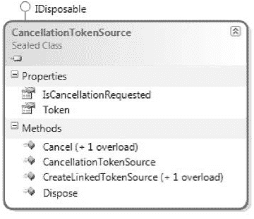

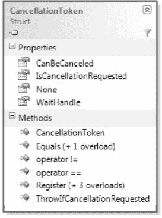

图 18.2：`CancellationTokenSource` 和 `CancellationToken` 类图

为了监视 `IsCancellationRequested` 属性，会将 `CancellationToken` 的副本（从 `CancellationTokenSource.Token` 获取）传递给任务。在清单 18.9 中，我们会偶尔检查 `CancellationToken` 参数上的 `IsCancellationRequested` 属性；在本例中，我们在每次数字计算后进行检查。如果 `IsCancellationRequested` 返回 `true`，则 `while` 循环退出。与线程中止（会在随机点抛出异常）不同，我们使用正常的控制流退出循环。我们通过频繁轮询来确保代码对取消请求保持响应。

关于 `CancellationToken` 还需要注意的一点是重载的 `Register()` 方法。通过此方法，你可以注册一个操作，该操作会在令牌被取消时被调用。换句话说，调用 `Register()` 方法相当于在对应的 `CancellationTokenSource` 的 `Cancel()` 上订阅一个监听器委托。

考虑到在完成之前取消是此程序中的预期行为，清单 18.9 中的代码不会抛出 `System.Threading.TaskCanceledException`。因此，`task.Status` 将返回 `TaskStatus.RanToCompletion`——没有表明任务的工作实际上已被取消的迹象。在本例中，并不需要这种指示；然而，TPL 确实包含了实现此功能的能力。如果取消调用在某种程度上具有破坏性——例如阻止有效结果返回——则抛出 `TaskCanceledException`（它派生自 `System.OperationCanceledException`）将是 TPL 用于报告它的模式。除了显式抛出异常外，`CancellationToken` 还包含 `ThrowIfCancellationRequested()` 方法，以便在有 `CancellationToken` 实例可用时更轻松地报告异常。

如果尝试对抛出 `TaskCanceledException` 的任务调用 `Wait()`（或获取其 `Result`），其行为与任务中抛出任何其他异常时相同：该调用将抛出 `AggregateException`。异常是传达任务执行后状态可能不完整的手段。与所有预期工作均成功执行且成功完成的任务不同，已取消的任务可能具有部分完成的工作——工作的状态不可信。

此示例演示了如何让长时间运行的处理器绑定操作（几乎无限期地计算 pi）监控取消请求并在发生时做出响应。然而，在某些情况下，取消可以在目标任务中未显式编码的情况下发生。例如，本章后面讨论的 `Parallel` 类默认提供此类行为。

## `Task.Run()`：`Task.Factory.StartNew()` 的快捷方式和简化

在 .NET 4.0 中，获取任务的通用做法是调用 `Task.Factory.StartNew()`。在 .NET 4.5 中，`Task.Run()` 提供了更简单的调用结构。与 `Task.Run()` 一样，`Task.Factory.StartNew()` 可在 C# 4.0 场景中用于调用需要创建额外线程的 CPU 密集型方法。

鉴于 .NET 4.5，除非证明不足，否则应默认使用 `Task.Run()`。例如，如果你需要使用 `TaskCreationOptions` 控制任务，如果你需要指定替代调度程序，或者出于性能原因，你想传入对象状态，你应考虑使用 `Task.Factory.StartNew()`。只有在极少数情况下，你

## 基于任务的异步模式

正如我们迄今所见，任务为异步工作的操作提供了比线程更好的抽象。任务会自动调度到正确数量的线程，并且可以通过链接小任务来组合大型任务，就像可以通过多个小方法组合大型程序一样。

然而，任务也有一些缺点。任务的主要困难在于它将你的程序逻辑“倒转”过来。为了说明这一点，我们首先考虑一个阻塞于 I/O 绑定、高延迟操作——Web 请求的同步方法。接下来，我们将其与 C# 5.0 之前的异步版本和基于任务的异步模式（TAP）进行比较。最后，我们使用 C# 5.0（及以上）以及 `async/await` 上下文关键字修改相同的示例。

## 同步调用高延迟操作

在列表 18.13 中，代码使用 `WebRequest` 下载网页并显示其大小。如果操作失败，则会抛出异常。

### LISTING 18.13: A Synchronous Web Request

```
using System;

using System.IO;

using System.Net;

using System.Linq;

public class Program

{

    public static void Main(string[] args)

    {

        string url = "http://www.IntelliTect.com";

        if(args.Length > 0)

        {

            url = args[0];

        }

        try

        {

            Console.Write(url);

            WebRequest webRequest =

                WebRequest.Create(url);

            WebResponse response =

                webRequest.GetResponse();

            Console.Write("....");
            using(StreamReader reader =

                new StreamReader(

                    response.GetResponseStream()))

            {

                string text =

                    reader.ReadToEnd();

                Console.WriteLine(

                    FormatBytes(text.Length));

            }

        }

        catch(WebException)

        {

            // ...

        }

        catch(IOException )

        {

            // ...

        }

        catch(NotSupportedException )

        {

            // ...

        }

        static public string FormatBytes(long bytes)

        {

            string[] magnitudes =

                new string[] { "GB", "MB", "KB", "Bytes" };

            long max =

                (long)Math.Pow(1024, magnitudes.Length);

            return string.Format("{1:##.##} {0}",

                magnitudes.FirstOrDefault(

                    magnitude =>

                        bytes > (max /= 1024)) ?? "0 Bytes",

                (decimal)bytes / (decimal)max);

        }

}
```

列表 18.13 中的逻辑相对简单——使用常见的 C# 习惯用法，如 `try`/`catch` 块和 `return` 语句来描述控制流。给定一个 `WebRequest`，此代码调用 `GetResponse()` 来下载页面。为了获得对页面的流访问，它调用 `GetResponseStream()` 并将结果分配给 `StreamReader`。最后，它使用 `ReadToEnd()` 读取流末尾以确定页面的大小，然后将其打印到屏幕上。

这种方法的问题当然是，调用线程在 I/O 操作完成之前被阻塞；这浪费了一个线程

```
return true;

});

}

catch(WebException)

{

    // ...

}

catch(IOException )

{

    // ...

}

catch(NotSupportedException )

{

    // ...

}

}

private static Task WriteWebRequestSizeAsync(

    string url)

{

    StreamReader reader = null;

    WebRequest webRequest =

        WebRequest.Create(url);

    Task task =

        webRequest.GetResponseAsync()

        .ContinueWith( antecedent =>

        {

            WebResponse response =

                antecedent.Result;

            reader =

                new StreamReader(

                    response.GetResponseStream());

            return reader.ReadToEndAsync();

        })

        .Unwrap()

        .ContinueWith(antecedent =>

        {

            if(reader != null) reader.Dispose();

            string text = antecedent.Result;

            Console.WriteLine(

                FormatBytes(text.Length));

        });

    return task;

}

// ...

}
```


与列表 18.13 不同，当列表 18.14 执行时，它会在页面下载期间向控制台打印句点。结果是，与简单地向控制台打印四个句点（`"...."`）不同，列表 18.14 能够在下载文件、从流中读取它并确定其大小所需的时间内持续打印句点。

不幸的是，这种异步性是以复杂性为代价的。TPL 相关代码穿插在代码各处，打断了流程。而不是简单地在`WebRequest.GetResponseAsync()`调用后跟随检索`StreamReader`并调用`ReadToEndAsync()`的步骤，异步版本的代码需要`ContinueWith()`语句。第一个`ContinueWith()`语句标识在`WebRequest.GetResponseAsync()`之后执行的内容。请注意，第一个`ContinueWith()`表达式中的`return`语句返回`StreamReader.ReadToEndAsync()`，它返回另一个`Task`。

因此，如果没有`Unwrap()`调用，第二个`ContinueWith()`语句中的先行任务将是`Task<Task<string>>`，这本身就表明了复杂性。结果，需要调用`Result`两次——一次直接在先行任务上，第二次在`Task<string>.Result`属性`antecedent.Result`上返回，后者会阻塞后续执行，直到`ReadToEnd()`操作完成。为了避免`Task<Task<TResult>>`结构，我们在调用`ContinueWith()`之前加上`Unwrap()`调用，从而去掉外部`Task`并适当处理任何错误或取消请求。

复杂性并不止于`Tasks`和`ContinueWith()`，然而：异常处理为复杂性增添了全新维度。如前所述，由于异步操作可能遇到多个异常，TPL 通常会抛出`AggregateException`异常。然而，由于我们正在`ContinueWith()`块内调用`Result`属性，因此在工作线程内部也可能抛出`AggregateException`。

正如你在本章前面学到的那样，处理这些异常有多种方法：

- 1. 我们可以为所有返回任务的 \*Async 方法以及每个`ContinueWith()`方法调用添加延续任务。然而，这样做将阻止我们使用流畅的 API，其中`ContinueWith()`语句一个接一个地链接在一起。此外，这会迫使我们把错误处理逻辑深度嵌入控制流中，而不是简单地依赖异常处理。

- 2. 我们可以用`try/catch`块包裹每个委托体，确保任务中的异常都有处理。可惜，这种方式同样不够理想。首先，有些异常（比如调用`antecedent.Result`时触发的异常）会抛出一个`AggregateException`，我们需要解包其中的`InnerException(s)`来逐一处理。解包时，我们要么重新抛出以捕获特定类型，要么在所有其他`catch`块（即使是针对同一类型的`catch`块）之外单独按类型检查异常。其次，每个委托体都会需要各自独立的`try/catch`处理程序，即使某些块之间的异常类型是相同的。再次，`Main`中对`task.Wait()`的调用仍然可能抛出异常，因为`WebRequest.GetResponseAsync()`有可能抛出异常，但我们无法用`try/catch`块包住它。因此，我们没有办法消除`Main`中包裹`task.Wait()`的`try/catch`块。

- 3. 我们可以完全忽略`WriteWebRequestSizeAsync()`内部的异常处理，只依赖`Main`中`task.Wait()`周围的`try/catch`块。鉴于我们知道异常会是`AggregateException`，我们可以只捕获这一种异常。在`catch`块中，我们可以通过调用`AggregateException.Handle()`来处理异常，并使用`ExceptionDispatchInfo`对象抛出每个异常，以便不丢失原始堆栈跟踪。随后，这些异常会被期望的异常处理程序捕获并相应处理。但请注意，在处理`AggregateException`的`InnerExceptions`之前，我们先调用`AggregateException.Flatten()`。这一步解决了`AggregateException`包装的某些内部异常本身也是`AggregateException`类型（依此类推）的问题。通过调用`Flatten()`，我们确保所有异常都移到第一层，并移除所有包含的`AggregateException`。

如清单 18.14 所示，选项 3 可能是更好的选择，因为它把异常处理大部分排除在了控制流之外。但这并没有完全消除错误处理的复杂性；

## 清单 18.15：使用基于任务的异步模式发出的异步 Web 请求

```
using System;

using System.IO;

using System.Net;

using System.Linq;

using System.Threading.Tasks;

public class Program

{

    private static async Task WriteWebRequestSizeAsync(

        string url)

    {

        try

        {

            WebRequest webRequest =

                WebRequest.Create(url);

            WebResponse response =

                await webRequest.GetResponseAsync();

            using(StreamReader reader =

                new StreamReader(

                    response.GetResponseStream()))

            {

                string text =

                    await reader.ReadToEndAsync();

                Console.WriteLine(

                    FormatBytes(text.Length));

            }

        }

        catch(WebException)

        {

            // ...

        }

        catch(IOException )

        {

            // ...

        }

        catch(NotSupportedException )

        {

            // ...

        }

    }

    public static void Main(string[] args)

    {

        string url = "http://www.IntelliTect.com";

        if(args.Length > 0)

        {

            url = args[0];

        }

        Console.Write(url);

        Task task = WriteWebRequestSizeAsync(url);

        while(!task.Wait(100))

        {

            Console.Write(".");

        }

        // ...

    }
}
```

请注意清单 18.13 和清单 18.15 之间的细微差别。首先，我们将 Web 请求功能的实践代码重构到一个新方法（`WriteWebRequestSizeAsync()`）中，并在方法声明中添加了新的上下文关键字`async`。带有该关键字的方法必须返回`Task`、`Task<T>`或`void`。在本例中，方法体没有返回任何数据，但我们仍然希望向调用者返回有关异步活动的信息，因此`WriteWebRequestSizeAsync()`返回`Task`。注意方法名的后缀是`Async`；这不是必需的，但按照惯例，这样标记异步方法是为了标识其异步行为。最后，在所有同步方法有异步对应版本的地方，我们在调用异步版本之前插入了新的上下文关键字`await`。

请注意，清单 18.13 和 18.15 之间其他内容并没有变化。异步方法版本表面上仍返回与之前相同的数据类型——尽管实际上每个都返回`Task<T>`。这也不是某种神奇的隐式转换。`GetResponseAsync()`的声明如下：

```
public virtual Task<WebResponse> GetResponseAsync() { ... }
```

在调用点，我们将返回值赋给`WebResponse`：

```
WebResponse response = await webRequest.GetResponseAsync()
```

`async`上下文关键字发挥了关键作用，它向编译器发出信号，表明应将表达式重写为一个状态机，以表示我们在清单 18.14 中看到的所有控制流（以及更多）。

另外还要注意清单 18.15 中相对于清单 18.14 的`try/catch`逻辑改进。在清单 18.15 中，不再需要捕获`AggregateException`。`catch`子句仍然只捕获期望的确切异常类型，并且无需解包内部异常。相反，编译器的重写似乎确保了任务中的`AggregateException`就像普通的同步抛出的异常一样被处理。实际上，只有在你等待任务时，`AggregateException`（及其内部异常集合）才会继续按预期方式工作，此时重写会从集合中取出第一个异常并抛出。其目的是让异步代码看起来尽可能像同步代码。

为了更好地理解控制流，表 18.2 将每个任务单列一列，并显示每个任务上发生的执行操作。

该表格有助于澄清几个重要的误解：

- **误解 1：使用`async`关键字修饰的方法在调用时会自动在工作线程上执行。** 这完全不对；该方法是在调用线程上正常执行的，如果实现中没有等待任何未完成的 awaitable 任务，它会在同一线程上同步完成。启动任何异步工作的是方法的实现本身。仅仅使用`async`关键字并不会改变方法代码的执行位置。此外，从调用者的角度来看，调用`async`方法并没有什么特别之处；它被类型化为返回`Task`，正常调用，并正常返回其返回类型的对象。

- **误解 2：`await`关键字会导致当前线程阻塞，直到等待的任务完成。** 这也完全不对。如果你想让当前线程阻塞直到任务完成，应该调用`Wait()`方法，正如我们已经描述的那样。实际上，`Main`线程在等待其他任务完成时确实反复这样做。然而，`while(!task.Wait(100)) {}`调用是与其他任务并发执行的——而不是同步执行。`await`关键字会计算其后的表达式（通常是`Task`或`Task<T>`类型），为结果任务添加一个继续操作，然后立即将控制权返回给调用者。任务的创建已经开始了异步工作；`await`关键字意味着开发人员希望该方法的调用者在此线程上继续执行其工作，同时异步工作被处理。在异步工作完成后的某个时刻，执行将从`await`表达式之后的控制点恢复。

## 表 18.2：每个任务内的控制流

| 描述 | `Main()` 线程/ | `GetResponseAsync()` 任务 | `ReadToEndAsync()` 任务 |
|---|---|---|---|
| 1. 执行正常流入 `Main`，并向上执行到第一个 `Console.Write(url)` 语句。2. 调用 `WriteWebRequestSizeAsync()`，因此控制流像往常一样进入该方法。3. `WriteWebRequestSizeAsync()` 中的指令正常执行（仍在 `Main()` 线程上），包括对 `WebRequest.Create(url)` 的调用。 | `string url = "http://www.IntelliTect.com"; if(args.Length > 0) { url = args[0]; } Console.Write(url); Task task = WriteWebRequestSizeAsync(url); WebRequest webRequest = WebRequest.Create(url);` |  |  |
| 4. 第一个 `await` 修饰符开始，生成一个新的 `Task`，`GetResponseAsync()` 可以在其上执行。假设它不是几乎瞬间完成，控制流返回到 `Main()` 并开始执行 `while` 循环。5. 一旦 `GetResponseAsync()` 任务完成，同一任务内的执行将隐式地把该任务的结果赋值给 `response` 变量。然后从 `response` 实例化 `StreamReader`。 | `while(!task.Wait(100)) { Console.Write("."); }` | `WebResponse response = await webRequest.GetResponseAsync(); StreamReader reader = new StreamReader(response.GetResponseStream());` |  |
| 6. 当另一个 `await` 发生时，创建另一个任务，这次执行 `ReadToEndAsync()`。（与此同时，`Main` 的 `while` 循环继续执行。）7. `ReadToEndAsync()` 任务完成后，结果被赋给 `text`，其 `Length` 随即显示在控制台上。8. 最终，`task.Wait()` 返回 `true`，进程继续执行。 |  |  | `string text = (await reader.ReadToEndAsync()); Console.WriteLine(FormatBytes(text.Length));` |

```
cancellationToken

    .ThrowIfCancellationRequested();

process.Start();

cancellationToken.Register(() =>

{

    process.CloseMainWindow();

});

    return taskCS.Task;

}

// ...

}
```

暂时忽略高亮部分，而专注于在进程完成时使用事件进行通知的模式。由于 `System.Diagnostics.Process` 在退出时会包含通知，我们注册此通知，并使用它作为回调，从中可以调用 `TaskCompletionSource.SetResult()`。清单 18.17 中的代码遵循了一个相当常见的模式，可用于创建异步方法，而无需诉诸 `Task.Run()`。

异步方法可能需要的另一个重要特性是取消。TAP 所依赖的取消方法与 TPL 相同，即 `System.Threading.CancellationToken`。清单 18.17 高亮了支持取消所需的代码。在此示例中，我们允许在进程开始之前取消，并尝试关闭应用程序的主窗口（如果有）。更激进的方法是调用 `Process.Kill()`，但这可能会对正在执行的程序造成问题。

请注意，我们直到进程启动后才注册取消事件。这避免了如果在进程实际开始之前触发取消可能出现的任何竞争条件。

最后一个要考虑支持的特性是进度更新。清单 18.18 正是带有此类更新的 `RunProcessAsync()` 的完整版本。

## 清单 18.18：实现带有进度支持的自定义异步方法

```
using System;

using System.Diagnostics;

using System.Threading;

using System.Threading.Tasks;

class Program
```

```
cancellationToken.Register(() =>

{

    process.CloseMainWindow();

    cancellationToken

        .ThrowIfCancellationRequested();

});

return taskCS.Task;

}

// ...

}
```

```
class ProcessProgressEventArgs

{

    // ...

}
```

## 高级主题

### 等待非 `Task<T>` 值

通常，`await` 关键字后面的表达式要么是 `Task` 类型，要么是 `Task<T>` 类型。在本章迄今为止展示的 `await` 示例中，关键字后面的表达式都返回 `Task<T>`。从语法角度看，对 `Task` 类型的 `await` 操作本质上等价于返回 `void` 的表达式。实际上，因为编译器甚至不知道任务是否有结果，更不用说是什么类型了，这样的表达式与调用返回 `void` 的方法被归为同一类；也就是说，只能在语句上下文中使用它。清单 18.19 展示了一些用作语句表达式的 `await` 表达式。

#### 清单 18.19：`await` 表达式可以是语句表达式

```
async Task<int> DoStuffAsync()

{

    await DoSomethingAsync();

    await DoSomethingElseAsync();

    return await GetAnIntegerAsync() + 1;

}
```


这里我们假定前两个方法返回 `Task`，而不是 `Task<T>`。由于前两个任务没有关联的结果值，等待它们不会产生任何值；因此该表达式必须以语句形式出现。第三个任务大概是 `Task<int>` 类型，并且其

## 任务调度器与同步上下文

本章偶尔提到过任务调度器及其在决定如何高效地将工作分配给线程方面的作用。从编程角度看，任务调度器是 `System.Threading.Tasks.TaskScheduler` 的一个实例。默认情况下，该类使用线程池来适当地调度任务，决定如何安全高效地执行它们——何时重用、释放或创建额外的任务线程。

可以通过从 `TaskScheduler` 类派生一个新类型来创建自定义的任务调度器，以便在如何调度任务方面做出不同的选择。使用静态的 `FromCurrentSynchronizationContext()` 方法，可以获得一个将任务调度到当前线程（或者更准确地说，调度到与当前线程关联的同步上下文）而不是不同工作线程的 `TaskScheduler`。¹⁰

任务执行及其后续任务 `continuation task` 执行所基于的同步上下文很重要，因为等待中的任务会查询同步上下文（假设存在一个），以便任务能够高效且安全地执行。清单 18.20（以及输出 18.7）与清单 18.5 类似，不同之处在于它显示消息时还会打印出线程 ID。

### 清单 18.20：调用 `Task.ContinueWith()`

```csharp
using System;
using System.Threading;
using System.Threading.Tasks;
public class Program
{
    public static void Main()
    {
        DisplayStatus("Before");
        Task taskA =
            Task.Run(() =>
                DisplayStatus("Starting..."))
            .ContinueWith( antecedent =>
                DisplayStatus("Continuing A..."));
        Task taskB = taskA.ContinueWith( antecedent =>
            DisplayStatus("Continuing B..."));
        Task taskC = taskA.ContinueWith( antecedent =>
            DisplayStatus("Continuing C..."));
```

> 10. 有关示例，请参见 C# 5.0 之前的《多线程模式》中的清单 C.8，可在 `IntelliTect.com/EssentialCSharp` 获取。

要修改代码以利用同步上下文，你必须（1）设置同步上下文，（2）使用 `async`/`await`，以便查询同步上下文。¹¹

可以定义自定义同步上下文，并在某些特定场景中与现有同步上下文协作以提高其性能。然而，描述如何做到这一点超出了本书的范围。

## Windows UI 中的 `async`/`await`

同步在 UI 和 Web 编程中尤其重要。例如，在 Windows UI 中，消息泵会处理诸如鼠标单击和移动事件之类的消息。此外，UI 是单线程的，因此与任何 UI 组件（例如文本框）的交互必须始终在单个 UI 线程上发生。`async`/`await` 模式的一个关键优势是它利用同步上下文来确保后续工作——即 `await` 语句之后出现的工作——始终在调用 `await` 语句的同一个同步任务上执行。这种方法非常有价值，因为它消除了显式切换回 UI 线程以更新控件的需要。

为了更好地理解这一好处，请考虑 WPF 中按钮点击的 UI 事件示例，如清单 18.21 所示。

### 清单 18.21：WPF 中的同步高延迟调用

```csharp
using System;
private void PingButton_Click(
    object sender, RoutedEventArgs e)
{
    StatusLabel.Content = "Pinging...";
    UpdateLayout();
    Ping ping = new Ping();
    PingReply pingReply =
        ping.Send("www.IntelliTect.com");
    StatusLabel.Text = pingReply.Status.ToString();
}
```

> 11. 关于如何设置线程的同步上下文以及如何使用任务调度器将任务调度到该线程的简单示例，请参见 C# 5.0 之前的《多线程模式》中的清单 C.8，可在 `IntelliTect.com/EssentialCSharp` 获取。

假设 `StatusLabel` 是一个 WPF `System.Windows.Controls.TextBlock` 控件，并且我们在 `PingButton_Click()` 事件订阅者中更新了两次 `Content` 属性，那么合理的假设是：首先会显示 `"Pinging..."`，直到 `Ping.Send()` 返回，然后用 `Send()` 应答的状态更新该标签。熟悉 Windows UI 框架的人都知道，事实上并非如此。相反，一条消息被发布到 Windows 消息泵以将内容更新为 `"Pinging..."`，但由于 UI 线程正忙于执行 `PingButton_Click()` 方法，Windows 消息泵没有得到处理。当 UI 线程有空查看 Windows 消息泵时，第二个 `Text` 属性更新请求已经排队，用户唯一能观察到的消息就是最终状态。

为了使用 TAP 解决此问题，我们修改清单 18.22 中突出显示的代码。

### 清单 18.22：在 WPF 中使用 `await` 的同步高延迟调用

```csharp
using System;
async private void PingButton_Click(
    object sender, RoutedEventArgs e)
{
    StatusLabel.Content = "Pinging...";
    UpdateLayout();
    Ping ping = new Ping();
    PingReply pingReply =
        await ping.SendPingAsync("www.IntelliTect.com");
    StatusLabel.Text = pingReply.Status.ToString();
}
```

这一改动有两个优点。首先，`ping` 调用的异步特性释放了调用方线程，使其能够返回到 Windows 消息泵调用方的同步上下文，并处理对 `StatusLabel.Content` 的更新，以便用户看到 `"Pinging..."`。其次，当等待 `ping.SendPingAsync()` 完成时，它总是会在与调用方相同的同步上下文中执行。此外，由于该同步上下文专门适用于 Windows UI，它是单线程的，因此返回总是会回到同一个线程——UI 线程。换句话说，TPL 不会立即执行延续任务，而是咨询同步上下文，由同步上下文将一条关于延续工作的消息发布到消息泵。接下来，由于 UI 线程监视消息泵，在拾取延续工作消息后，它会调用 `await` 调用之后的代码。（因此，延续代码的调用与处理消息泵的调用方位于同一个线程上。）

TAP 语言模式内置了一个关键的代码可读性特性。请注意，在清单 18.22 中，对 `return pingReply.Status` 的调用看起来是在 `await` 之后自然流畅地出现的，这清楚地表明它将在前一行之后立即执行。然而，从头编写真正发生的事情，由于多种原因，会远不那么容易理解。

## `await` 运算符

`await` 在单个方法中出现的次数没有限制。实际上，此类语句不仅限于一个接一个地出现。相反，`await` 语句可以放在循环中，一个接一个地连续处理，从而遵循代码呈现出的自然控制流。考虑清单 18.23 中的示例。

### 清单 18.23：迭代执行 `Await` 操作

```csharp
async private void PingButton_Click(
    object sender, RoutedEventArgs e)
{
    List<string> urls = new List<string>()
    {
        "www.habitat-spokane.org",
        "www.partnersintl.org",
        "www.iassist.org",
        "www.fh.org",
        "www.worldvision.org"
    };
    IPStatus status;
    Func<string, Task<IPStatus>> func =
        async (localUrl) =>
        {
            Ping ping = new Ping();
            PingReply pingReply =
                await ping.SendPingAsync(localUrl);
            return pingReply.Status;
        };
    StatusLabel.Content = "Pinging...";
    foreach(string url in urls)
    {
        status = await func(url);
    }
    StatusLabel.Text =
        $"@{ url }: { status.ToString() } ({ Thread.CurrentThread.ManagedThreadId })";
}
```

无论 `await` 语句出现在迭代中还是作为单独的条目出现，它们都将串行执行，一个接一个，并且按照从调用线程调用它们的相同顺序执行。底层实现是将它们串联在一起，语义上等价于 `Task.ContinueWith()`，只不过 `await` 运算符之间的所有代码都将在调用方的同步上下文中执行。

UI 对 TAP 的支持是促成 TAP 创建的关键场景之一。第二个场景发生在服务器端，当客户端发出请求，要从数据库中查询整个表的数据时。由于查询数据可能非常耗时，应该创建一个新线程，而不是消耗线程池中数量有限的线程之一。这种方法的问题在于，从数据库查询的工作完全在另一台机器上执行。鉴于该线程通常本来就不活跃，没有理由阻塞整个线程。

总而言之，TAP 的创建是为了解决以下关键问题：

- 需要允许长时间运行的活动在不阻塞 UI 线程的情况下进行。
- 考虑到线程所做的一切只是等待活动完成，为非 CPU 密集型工作创建一个新线程（或 `Task`）相对昂贵。
- 当活动完成时（通过使用新线程或通过回调），通常需要将线程同步上下文切换回发起该活动的原始调用方。
- TAP 提供了一种新模式，适用于 CPU 密集型和 非 CPU 密集型异步调用——一种所有 .NET 语言都显式支持的模式。

## 并行执行循环迭代

考虑以下 `for` 循环语句及相关代码（参见清单 18.24 和相应的输出 18.8）。该清单调用一个方法来计算 π 的小数展开的一部分，其参数是位数和起始数字。实际计算与讨论无关。这个计算的有趣之处在于它极其易于并行化；也就是说，将一个大型任务——比如计算 π 的 100 万位小数——拆分成任意数量的、可以并行运行的较小任务，其容易程度几乎令人尴尬。这类计算是添加并行性后最容易加速的计算类型。

### 清单 18.24：`For` 循环同步分段计算 Pi

```csharp
using System;
using AddisonWesley.Michaelis.EssentialCSharp.Shared;
class Program
{
    const int TotalDigits = 100;
    const int BatchSize = 10;
    static void Main()
    {
        string pi = null;
        const int iterations = TotalDigits / BatchSize;
        for(int i = 0; i < iterations; i++)
        {
            pi += PiCalculator.Calculate(
                BatchSize, i * BatchSize);
        }
        Console.WriteLine(pi);
    }
}
```

```csharp
using System;
class PiCalculator
{
    public static string Calculate(
        int digits, int startingAt)
    {
        // ...
    }
    // ...
}
```

### 输出 18.8

```
>3.14159265358979323846264338327950288419716939937510582097494459230781
64062862089986280348253421170679821480865132823066470938446095505822317
25359408128481117450284102701938521105559644622948954930381964428810975
66593344612847564823378678316527120190914564856692334400602640523594028
3930602720241412737245870066063155881748815209209628292540917153643678
92590360011330530548820466521384146951941511609433057270365759591953092
16611738193261179310511854807446237996274956735188575272489122793818301
194912
```

`for` 循环同步且顺序地执行每次迭代。然而，由于 π 计算算法将 π 的计算拆分成独立的片段，只要结果按正确顺序拼接，就不必顺序计算这些片段。想象一下，如果这个循环的所有迭代都能并发运行，会发生什么：每个处理器可以处理一次迭代，并与其他处理其他迭代的处理器并行执行。鉴于迭代可以同时执行，我们可以根据处理器的数量不断减少执行时间。

TPL 提供了一个便捷的方法 `Parallel.For()`，它正是这样做的。清单 18.25 展示了如何修改清单 18.24 中的顺序单线程程序以使用这个辅助方法。

### 清单 18.25：`For` 循环并行分段计算 Pi

```csharp
using System;
using System.Threading.Tasks;
using AddisonWesley.Michaelis.EssentialCSharp.Shared;
// ...
class Program
{
    static void Main()
    {
        string pi = null;
        const int iterations = TotalDigits / BatchSize;
        string[] sections = new string[iterations];
        Parallel.For(0, iterations, (i) =>
        {
            sections[i] = PiCalculator.Calculate(
                BatchSize, i * BatchSize);
        });
        pi = string.Join("", sections);
        Console.WriteLine(pi);
    }
}
```


清单18.25的输出与输出18.8相同；然而，如果你有多颗CPU，执行时间会显著加快（如果没有，可能会变慢）。`Parallel.For()` API的设计目标是与标准的`for`循环相似。第一个参数是`fromInclusive`值，第二个是`toExclusive`值，最后一个是在循环体中执行的`Action<int>`。当使用表达式lambda作为操作时，代码看起来与`for`循环语句相似，只是现在每次迭代可能并行执行。与`for`循环一样，对`Parallel.For()`的调用要等到所有迭代完成后才会返回。换句话说，当执行到达`string.Join()`语句时，圆周率的所有部分都已经计算完毕。

请注意，在清单18.25中，用于合并圆周率各部分（即每次迭代中的操作）的代码不再出现在循环内部。由于圆周率计算的各个部分很可能不会按顺序完成，所以在迭代完成时追加一个部分很可能会导致它们乱序追加。即使顺序不是问题，仍然存在潜在的竞争条件，因为`+=`运算符不是原子的。为了解决这两个问题，圆周率的每个部分都存储到一个数组中，并且任何两个或更多迭代不会同时访问数组中的单个元素。只有当圆周率的所有部分都计算完成后，`string.Join()`才会将它们合并。换句话说，我们将拼接各部分的操作推迟到`Parallel.For()`循环完成之后。这避免了由于部分尚未计算或部分乱序拼接而导致的任何竞争条件。

TPL使用与任务调度相同的线程池技术来确保并行循环的良好性能：它会尽力确保CPU不被过度调度，等等。

## 准则

当所执行的计算可以轻松拆分为许多相互独立且与处理器绑定的计算，并且可以在任何线程上以任意顺序执行时，请使用并行循环。

TPL还提供了`foreach`语句的类似并行版本，如清单18.26所示。

### 清单18.26：`foreach`循环的并行执行

```
using System;

using System.Collections.Generic;

using System.IO;

using System.Threading.Tasks;

class Program

{

    // ...

    static void EncryptFiles(

        string directoryPath, string searchPattern)

    {

        IEnumerable<string> files = Directory.EnumerateFiles(

            directoryPath, searchPattern,

            SearchOption.AllDirectories);

        Parallel.ForEach(files, (fileName) =>

        {

            Encrypt(fileName);

        });

    }

    // ...

}
```

在此示例中，我们调用一个方法，对`files`集合中的每个文件进行加密。它并行执行，执行的线程数由TPL根据效率来确定。

## 高级主题

### TPL如何调整其自身性能

TPL中的默认调度器面向线程池，采用多种启发式策略来确保在任一时刻执行适当数量的线程。其中使用的两种启发式策略是“爬山算法”和“工作窃取”。

爬山算法涉及创建线程来运行任务，然后监控这些任务的性能，以尝试通过实验确定增加线程开始使性能变差的临界点。一旦达到该点，线程数就可以减少到产生最佳性能的数量。

TPL将等待执行的“顶级”任务与特定线程关联。但是，如果运行在线程上的任务本身创建了另一个任务，则新创建的任务会自动与该线程关联。当新的“子”任务最终被调度运行时，它通常在与创建它的任务相同的线程上运行。工作窃取算法会识别出待处理工作量异常大或异常小的线程；关联任务过少的线程有时会从等待运行任务过多的线程那里“窃取”尚未执行的任务。

这些算法的关键特性在于，它们使TPL能够动态调整自身性能，以缓解处理器过度调度和调度不足，并在可用处理器之间平衡工作负载。

TPL通常能很好地调整自身性能，但你可以通过提供有关最佳行动方案的提示来帮助它做得更好。前面“长时间运行的任务”一节中描述的指定`TaskCreationOptions.LongRunning`选项就是这样一个提示。你还可以明确告诉任务调度器你认为多少个线程最适合服务一个并行循环；有关详细信息，请参阅题为“并行循环选项”的高级主题。

## 初学者主题

### 使用`AggregateException`处理并行循环异常

我们已经知道，TPL会捕获与任务关联的异常并将其保存在`AggregateException`中，因为给定任务可能会从它的子任务中获得多个异常。并行执行循环时也是如此：每次迭代都可能产生异常，因此需要将异常收集到一个聚合异常中。请考虑清单18.27中的示例及其输出（输出18.9）。

### 清单18.27：并行迭代的未处理异常

```
using System;

using System.Collections.Generic;

using System.IO;

using System.Threading;

using System.Threading.Tasks;

class Program

{

    // ...

    static void EncryptFiles(

        string directoryPath, string searchPattern)

    {
```

## 取消并行循环

与任务不同，任务需要显式调用才能阻塞直到完成，而并行循环并行执行迭代，但在整个并行循环完成之前，它本身不会返回。因此，取消并行循环通常涉及从执行并行循环的线程之外的线程调用取消请求。在清单18.28中，我们使用`Task.Run()`调用`Parallel.ForEach<T>()`。这样，循环不仅并行执行，而且异步执行，允许代码提示用户“按ENTER退出”。

### 清单18.28：取消并行循环

```
using System;

using System.Collections.Generic;

using System.IO;

using System.Threading;

using System.Threading.Tasks;

public class Program

{

    // ...

    static void EncryptFiles(

        string directoryPath, string searchPattern)

    {

        string stars =

            "*".PadRight(Console.WindowWidth - 1, '*');

        IEnumerable<string> files = Directory.GetFiles(

            directoryPath, searchPattern,

            SearchOption.AllDirectories);

        CancellationTokenSource cts =

            new CancellationTokenSource();

        ParallelOptions parallelOptions =

            new ParallelOptions

            { CancellationToken = cts.Token };

        cts.Token.Register(

            () => Console.WriteLine("Cancelling..."));

        Console.WriteLine("Push ENTER to exit.");

        // Use Task.Factory.StartNew<string>() for

        // TPL prior to .NET 4.5

        Task task = Task.Run(() =>

        {

            try

            {

                Parallel.ForEach(

                    files, parallelOptions,

                    (fileName, loopState) =>

                    {

                        Encrypt(fileName);

                    });

            }

            catch (OperationCanceledException) { }

        });

        // Wait for the user's input

        Console.Read();

        // Cancel the query

        cts.Cancel();

        Console.Write(stars);

        task.Wait();

    }

}
```


并行循环使用与任务相同的取消令牌模式。通过调用一个带有`ParallelOptions`类型参数的`ForEach()`方法重载，将从`CancellationTokenSource`获取的令牌与并行循环关联起来。该对象包含取消令牌。

请注意，如果你取消并行循环操作，任何尚未开始的迭代都会通过检查`IsCancellationRequested`属性而阻止启动。已存在的执行中的迭代将运行到各自的终止点。此外，即使在所有迭代完成后调用`Cancel()`，也会导致注册的取消事件（通过`cts.Token.Register()`）执行。

`ForEach()`方法能够确认循环已被取消的唯一方式是通过`OperationCanceledException`。鉴于此示例中的取消是预期的，异常被捕获并忽略，从而允许应用程序显示“Canceling...”，然后在退出前显示一行星号。

## 高级主题

### 并行循环选项

虽然通常并非必需，但可以控制最大并行度（即计划调度的线程数 run at the same time）via the `ParallelOptions` parameter on overloads of both the `Parallel.For()` and `Parallel.ForEach<T>()` loops. In some specific cases, the developer may know more about the particular algorithm or circumstance such that changing the maximum degree of parallelism makes sense. These circumstances include the following:

- Scenarios where you want to disable parallelism to make debugging or analysis easier. Setting the maximum degree of parallelism to 1 ensures that the loop iterations do not run concurrently.
- Scenarios where you know ahead of time that the degree of parallelism will be gated on an external factor such as a hardware constraint. For example, if your parallel operation involves using multiple USB ports, it is possible that there is no point in creating more threads than there are available ports.
- Scenarios with really long-running loop iterations (for example, minutes or hours). The thread pool can’t distinguish long-running iterations from blocked operations, so it could end up introducing many new threads, all of which will be consumed by the for loop. This can result in incremental thread growth over time, resulting in a huge number of threads in the process.

And so on. To control the maximum degree of parallelism, use the `MaxDegreeOfParallelism` property on the `ParallelOptions` object.

You can also use the `ParallelOptions` object’s `TaskScheduler` property to specify a custom task scheduler to use to schedule the tasks associated with each iteration. For example, you might have an asynchronous event handler that responds to the user’s click of a “Next” button. If the user clicks the button several times, you might want to use a custom task scheduler that prioritizes the most recently created task, rather than prioritizing the task that has waited the longest. The task scheduler provides a means of specifying how the tasks will execute in relation to one another.

The `ParallelOptions` object also has a `CancellationToken` property that provides a mechanism to communicate to the loop that no further iterations should start. Additionally, the body of an iteration can watch the cancellation token to determine if an early exit from the iteration is in order.

## ADVANCED TOPIC

## Breaking a Parallel Loop

Like a standard for loop, the `Parallel.For()` loop supports the concept of “breaking” to exit the loop and canceling any further iterations. In the context of parallel for execution, however, a break signifies that no new iterations following the breaking iteration should start. All currently executing iterations, however, will run to completion.

To break a parallel loop, you can provide a cancellation token and cancel it on another thread, as described in the preceding Advanced Topic. You can also use an overload of the `Parallel.For()` method whose body delegate takes two parameters: the index, and a `ParallelLoopState` object. An iteration that wishes to “break” the loop can call the `Break()` or `Stop()` method on the loop state object passed to the delegate. The `Break()` method indicates that no more iterations with index values higher than the current value need to execute; the `Stop()` method indicates that no more iterations need to run at all.

For example, suppose you have a `Parallel.For()` loop that is performing ten iterations in parallel. Some of those iterations might run faster than others, and the task scheduler does not guarantee that they will run in any particular order. Suppose the first iteration has completed; iterations 3, 5, 7, and 9 are “in flight,” scheduled to four different threads; and iterations 5 and 7 both call `Break()`. In this scenario, iterations 6 and 8 will never start, but iterations 2 and 4 will still be scheduled to run. Iterations 3 and 9 will run to completion because they were already started when the break happened.

The `Parallel.For()` and `Parallel.ForEach<T>()` methods return a reference to a `ParallelLoopResult` object that contains useful information about what happened during the loop. This result object has the following properties:

- `IsCompleted` returns a Boolean indicating whether all iterations started.
- `LowestBreakIteration` identifies the lowest iteration that executed a break. The value is of type `long?`, where a value of null indicates no break statement was encountered.

Returning to the ten-iteration example, the `IsCompleted` property will return false and the `LowestBreakIteration` will return a value of 5.

As Listing 18.30 shows, the change to enable parallel support is extremely small! All that it uses is a .NET Framework 4.0–introduced standard query operator, `AsParallel()`, which can be found on the static class `System.Linq.ParallelEnumerable`. This simple extension method tells the runtime that it can execute the query in parallel. The result is that on machines with multiple available CPUs, the total time taken to execute the query can be significantly shorter.

`System.Linq.ParallelEnumerable` includes a superset of the query operators available on `System.Linq.Enumerable`, resulting in possible performance improvements for all of the common query operators, including those used for sorting, filtering (`Where()`), projecting (`Select()`), joining, grouping, and aggregating. Listing 18.31 shows how to do a parallel sort.

### LISTING 18.31: Parallel LINQ with Standard Query Operators

```
// ...
OrderedParallelQuery<string> parallelGroups =
    data.AsParallel().OrderBy(item => item);

// Show the total count of items still
// matches the original count
System.Diagnostics.Trace.Assert(
    data.Count == parallelGroups.Sum(
        item => item.Count()));

// ...
```

As Listing 18.31 shows, invoking the parallel version simply involves a call to the `AsParallel()` extension method. Notice that the type of the result returned by the parallel standard query operators is either `ParallelQuery<T>` or `OrderedParallelQuery<T>`; both inform the compiler that it should continue to use the parallel versions of the standard query operations that are available.

Given that query expressions are simply a syntactic sugar for the method call form of the query used in Listings 18.30 and 18.31, you can just as easily use `AsParallel()` with the expression form. Listing 18.32 shows an example of executing a grouping operation in parallel using query expression syntax.

### LISTING 18.32: Parallel LINQ with Query Expressions

```
// ...
ParallelQuery<IGrouping<char, string>> parallelGroups;
parallelGroups =
    from text in data.AsParallel()
    orderby text
    group text by text[0];
```

```
// Show the total count of items still
// matches the original count
System.Diagnostics.Trace.Assert(
    data.Count == parallelGroups.Sum(
        item => item.Count()));

// ...
```


As you saw in the previous examples, converting a query or iteration loop to execute in parallel is simple. There is one significant caveat, however: As we will discuss in depth in Chapter 19, you must take care not to allow multiple threads to inappropriately access and modify the same memory simultaneously. Doing so will cause a race condition.

As we saw earlier in this chapter, the `Parallel.For()` and `Parallel.ForEach<T>()` methods will gather up any exceptions thrown during the parallel iterations and then throw one aggregating exception containing all of the original exceptions. PLINQ operations are no different. That is, they also have the potential of returning multiple exceptions for the exact same reason: When the query logic is run on each element in parallel, the code executing on each element can independently throw an exception. Unsurprisingly, PLINQ deals with this situation in exactly the same way as do parallel loops and the TPL: Exceptions thrown during parallel queries are accessible via the `InnerExceptions` property of the `AggregateException`. Therefore, wrapping a PLINQ query in a try/catch block with the exception type of `System.AggregateException` will successfully handle any exceptions within each iteration that were unhandled.

## Canceling a PLINQ Query

As expected, the cancellation request pattern is also available on PLINQ queries. Listing 18.33 (with Output 18.10) provides an example. Like the parallel loops, canceled PLINQ queries will throw a `System.OperationCanceledException`. Also like the parallel loops, executing a PLINQ query is a synchronous operation on the invoking thread. Thus, a common technique is to wrap the parallel query in a task that runs on another thread so that the current thread can cancel it if necessary—the same solution used in Listing 18.28.

### LISTING 18.33: Canceling a PLINQ Query

```
using System;
using System.Collections.Generic;
using System.Linq;
```

}
else
{
    // ...
}
}
else
{
    task.Wait();
    Console.ForegroundColor = ConsoleColor.Green;
    Console.Write("Completed successfully");
}
Console.ForegroundColor = originalColor;
}

## 输出 18.10

```
Cancelled: A task was canceled.
```

与并行循环或任务一样，取消 PLINQ 查询需要 `CancellationToken`，该标记可从 `CancellationTokenSource` 获得。然而，并不是重载每个 PLINQ 查询来支持取消标记，而是由 `IEnumerable` 的 `AsParallel()` 方法返回的 `ParallelQuery<T>` 对象包含一个 `WithCancellation()` 扩展方法，该方法仅接收一个 `CancellationToken`。因此，在 `CancellationTokenSource` 对象上调用 `Cancel()` 将请求并行查询取消——因为它会检查 `CancellationToken` 上的 `IsCancellationRequested` 属性。

如前所述，取消 PLINQ 查询将引发异常，而不是返回完整结果。处理可能被取消的 PLINQ 查询的一种常见技术是将查询包装在 `try` 块中并捕获 `OperationCanceledException`。清单 18.33 中使用的第二种常见技术是将 `CancellationToken` 传递给 `ParallelEncrypt()`，并将其作为 `Run()` 的第二个参数。这将导致 `task.Wait()` 抛出 `AggregateException`，其 `InnerException` 属性将被设置为 `TaskCanceledException`。然后可以捕获聚合异常，就像从并行操作中捕获任何其他异常一样。

## 总结

在本章中，我们首先考察了多线程程序的基本组成部分：`Thread` 类（表示程序中独立的“控制点”）和 `ThreadPool`（鼓励将线程高效地分配和调度到多个 CPU）。然而，这些 API 是低层实体，难以直接使用。从 4.0 版本开始，.NET Framework 提供了并行扩展库，包括任务并行库（TPL）和并行 LINQ（PLINQ）。两者都提供了新的 API，用于创建和调度由 `Task` 对象表示的工作单元，使用 `Parallel.For()` 和 `Parallel.ForEach()` 并行执行循环，以及使用 `AsParallel()` 自动并行化 LINQ 查询。

我们还讨论了 C# 5.0 如何通过自动重写程序来管理将较大任务组合成较小任务的延续“接线”，从而更轻松地使用 `Task` 对象编写复杂工作流。

在本章开始时，我们简单浏览了开发人员在编写多线程程序时经常遇到的一些难题：原子性问题、死锁以及其他“竞态条件”，这些都会给多线程程序带来不确定性和不良行为。避免这些问题的标准方法是仔细编写使用“锁”来同步对共享资源的访问的代码；这是下一章的主题。

# 19. 线程同步

在第18章中，我们讨论了使用任务并行库（TPL）和并行 LINQ（PLINQ）进行多线程编程的细节。然而，我们特意回避了一个主题：线程同步，它用于在避免死锁的同时防止竞态条件。线程同步是本章的主题。

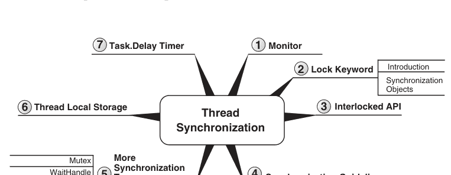

我们先从一个多线程示例开始，该示例在共享数据周围没有线程同步——导致数据完整性丢失的竞态条件。这一讨论为我们需要线程同步的原因做了引介。接着将介绍实现线程同步的众多机制和最佳实践。

本书以前版本包含了关于其他多线程模式的重要章节，以及各种定时器回调机制的章节。然而，随着 async/await 模式的引入，除非你使用 C# 5.0/.NET 4.5 之前的框架进行编程，否则这些方法基本上已被取代。不过，C# 5.0 之前的资料仍然可以从本书的网站 http://www.IntelliTect.com/EssentialCSharp 获取。

本章整体使用 TPL，因此示例无法在 .NET Framework 4 之前的框架上编译。然而，除非特别指明为 .NET Framework 4 API，否则 .NET Framework 4 限制的唯一原因是为了使用 `System.Threading.Tasks.Task` 类来执行异步操作。修改代码以实例化 `System.Threading.Thread` 并使用 `Thread.Join()` 等待线程执行，将允许绝大多数示例在较早的框架上编译。

话虽如此，本章贯穿使用的用于启动任务的特定 API 是 .NET 4.5 特有的 `System.Threading.Tasks.Task.Run()`。如第18章所讨论，此方法优于 `System.Threading.Tasks.Task.Factory.StartNew()`，因为它更简单，并且对于大多数场景已足够。那些仅限于 .NET 4 的读者可以用 `Task.Factory.StartNew()` 替换 `Task.Run()`，而无需额外修改。（因此，当仅使用此方法时，本章不会明确将此类代码标注为 .NET 4.5 特有的代码。）

此外，微软已经发布了 .NET 的反应式扩展（Rx），这是一个单独的下载，为 .NET 3.5 Framework 添加了 TPL 和 PLINQ 支持。¹ 该框架还包含本章介绍并发和同步类型。因此，依赖 `Task` 或引入 C# 4.0 同步类的代码清单，实际上可以通过 Rx 和引用 `System.Threading.dll` 程序集，从 .NET 3.5 中使用回移植到 .NET 3.5 Framework 的功能。反应式扩展还包括使用委托利用 LINQ 的功能。完整库现在可通过开源获得，网址为 https://github.com/Reactive-Extensions/Rx.NET。

总之，本章中的大多数示例只需稍作修改即可在 .NET 4.5 之前的 .NET 版本上运行，要么通过使用

1. 参见 http://bit.ly/Rx3point5

## 输出 19.1

```
Count = 113449949
```

关于清单 19.1，需要注意的重要一点是输出不是 0。如果直接（顺序地）调用 `Decrement()`，输出就会是 0。然而，当异步调用 `Decrement()` 时，会发生竞态条件，因为 `_Count++` 和 `_Count--` 语句中的各个步骤会交错进行。（如第18章中标题为“多线程术语”的初学者主题所述，C# 中的单个语句可能涉及多个步骤。）考虑表 19.1 中的示例执行。

## 表 19.1：示例伪代码执行

| 主线程 | 递减线程 | 计数 |
| ... | ... | ... |
| 从 _Count 复制值 0。 |  | 0 |
| 递增复制的值 (0)，得到 1。 |  | 0 |
| 将结果值 (1) 复制到 _Count。 |  | 1 |
| 从 _Count 复制值 1。 |  | 1 |
|  | 从 _Count 复制值 1。 | 1 |
| 递增复制的值 (1)，得到 2。 |  | 1 |
| 将结果值 (2) 复制到 _Count。 |  | 2 |
|  | 递减复制的值 (1)，得到 0。 | 2 |
|  | 将结果值 (0) 复制到 _Count。 | 0 |
| ... | ... | ... |

表 19.1 显示了并行执行（或线程上下文切换），指令从一列转换到另一列。在特定行完成之后 `_Count` 的值显示在最后一列。在此示例执行中，`_Count++` 执行了两次，`_Count--` 发生了一次。然而，最终的 `_Count` 值是 0，而不是 1。将结果复制回 `_Count` 实际上会清除同一线程从 `_Count` 读取后发生的任何 `_Count` 值更改。

清单 19.1 中的问题是竞态条件，多个线程同时访问相同的数据元素。如此示例执行所示，允许多个线程访问相同的数据元素很可能破坏数据完整性，即使在单处理器计算机上也是如此。要解决这个潜在问题，代码需要在数据周围进行同步。为多个线程的同时访问而同步的代码或数据是**线程安全**。

关于变量读写原子性，有一点很重要。运行时保证，大小不超过本机（指针大小）整数的类型不会被部分读取或写入。因此，在 64 位操作系统上，对 `long`（64 位）的读写是原子的。然而，对 `decimal` 等 128 位变量的读写可能不是原子的。因此，更改 `decimal` 变量的写操作可能在仅复制 32 位后中断，从而导致读取错误的值，称为**撕裂读取**。

## 初学者主题

## 多线程和局部变量

请注意，不需要同步局部变量。局部变量被加载到堆栈上，每个线程都有自己的逻辑堆栈。因此，每个局部变量在每次方法调用时都有自己的实例。默认情况下，局部变量不会在方法调用之间共享；同样，它们也不会在多个线程之间共享。

然而，这并不意味着局部变量完全没有并发问题——毕竟，代码很容易将局部变量暴露给多个线程。² 例如，一个并行 `for` 循环在迭代之间共享局部变量，就会将变量暴露给并发访问并产生竞态条件（见清单 19.2）。

2. 虽然在 C# 级别它是局部变量，但在 IL 级别它是字段——而字段可以从多个线程访问。

# 清单19.2：未同步的局部变量

```
using System;
using System.Threading.Tasks;
public class Program
{
    public static void Main()
    {
        int x = 0;
        Parallel.For(0, int.MaxValue, i =>
        {
            x++;
            x--;
        });
        Console.WriteLine("Count = {0}", x);
    }
}
```

在此示例中，`x`（一个局部变量）在并行 for 循环中被访问，因此多个线程会同时修改它，从而产生与清单19.1中非常相似的竞争条件。即使 `x` 被递增和递减的次数相同，输出也不太可能得到值 0。

# 初学者专题

# 没有 await 的任务返回

在清单19.1中，尽管 `Task.Run(()=>Decrement())` 返回一个 `Task`，但并未使用 `await` 运算符。原因是 `await` 只允许在带有 async 修饰符的方法中使用，而 `Main()` 不支持使用 async。将代码重构到 `Main()` 之外，就可以轻松利用 await/async 模式，如清单19.3所示。

# 清单19.3：未同步的局部变量

```
using System;
using System.Threading.Tasks;
public class Program
{
    const int _Total = int.MaxValue;
    static long _Count = 0;
    public static async void CountAsync()
{
    // 对于 .NET 4.0，请使用 Task.Factory.StartNew
    Task task = Task.Run(() => Decrement());
    // 递增
    for(int i = 0; i < _Total; i++)
    {
        _Count++;
    }
    await task;
    Console.WriteLine($"Count = {_Count}");
}
}
```

# 使用 Monitor 进行同步

要同步多个线程，使它们无法同时执行特定代码段，可以使用**监视器（monitor）**来阻止第二个线程在第一个线程退出受保护代码段之前进入该代码段。监视器功能是 `System.Threading.Monitor` 类的一部分，受保护代码段的开始和结束分别通过调用静态方法 `Monitor.Enter()` 和 `Monitor.Exit()` 来标记。

清单19.4演示了显式使用 `Monitor` 类进行同步。如该清单所示，重要的是，`Monitor.Enter()` 和 `Monitor.Exit()` 调用之间的所有代码都必须用 try/finally 块包围。如果没有此块，受保护部分内可能发生异常，并且 `Monitor.Exit()` 可能永远不会被调用，从而无限期地阻塞其他线程。

**清单19.4：显式使用 Monitor 进行同步**

```csharp
using System;
using System.Threading;
using System.Threading.Tasks;

public class Program
{
    readonly static object _Sync = new object();
    const int _Total = int.MaxValue;
    static long _Count = 0;

    public static void Main()
    {
```


请注意，`Monitor.Enter()` 和 `Monitor.Exit()` 的调用通过共享作为参数传递的同一对象引用（此处为 `_Sync`）而相互关联。带有 `lockTaken` 参数的 `Monitor.Enter()` 重载方法仅在 .NET 4.0 中才添加到框架中。在此之前，没有这样的 `lockTaken` 参数可用，也无法可靠地捕获发生在 `Monitor.Enter()` 和 try 块之间的异常。在发布代码中，将 try 块紧跟在 `Monitor.Enter()` 调用之后是可靠的，因为 JIT 会阻止任何此类异步异常悄悄进入。然而，除了紧跟 `Monitor.Enter()` 之后的 try 块之外的任何内容，包括编译器可能在调试代码中注入的任何指令，都可能阻止 JIT 可靠地将执行返回到 try 块内。因此，如果确实发生了异常，就会泄漏锁（锁保持获取状态），而不是执行 finally 块并释放锁——这很可能在另一个线程尝试获取锁时导致死锁。总之，在 .NET 4.0 之前的框架版本中，应始终在 `Monitor.Enter()` 之后紧跟一个 try/finally {`Monitor.Exit(_Sync)`} 块。

`Monitor` 还支持 `Pulse()` 方法，允许线程进入“就绪队列”，表示它接下来即将执行。这是同步生产者-消费者模式的一种常见方式，这样在“生产”发生之前不会发生“消费”。拥有监视器的生产者线程（通过调用 `Monitor.Enter()`）调用 `Monitor.Pulse()` 来通知消费者线程（可能已经调用了 `Monitor.Enter()`）：有一个项目可供消费，并且它应该“准备好”。对于单个 `Pulse()` 调用，只有一个线程（此处为消费者线程）可以进入就绪队列。当生产者线程调用 `Monitor.Exit()` 时，消费者线程获取锁（`Monitor.Enter()` 完成）并进入临界区开始“消费”该项目。一旦消费者处理完等待的项目，它就调用 `Exit()`，从而允许生产者（当前被 `Monitor.Enter()` 阻塞）再次生产。在此示例中，一次只有一个线程可以进入就绪队列，确保没有“生产”就不会有“消费”，反之亦然。

# 使用 lock 关键字

由于在多线程代码中经常需要使用 `Monitor` 进行同步，而且 try/finally 块很容易被遗忘，C# 提供了一个特殊关键字来处理这种锁定同步。

通过锁定访问 `_Count` 的代码段（使用 `lock` 或 `Monitor`），可以使 `Main()` 和 `Decrement()` 方法成为线程安全的，这意味着它们可以被多个线程同时安全地调用。（在 C# 4.0 之前，概念相同，但编译器生成的代码依赖于不带 `lockTaken` 的 `Monitor.Enter()` 方法，并且调用的 `Monitor.Enter()` 是在 try 块之前发出的。）

同步的代价是性能降低。例如，清单19.5的执行时间比清单19.1长一个数量级，这表明与递增和递减计数的执行相比，`lock` 的执行相对较慢。

即使 `lock` 与其同步的工作相比微不足道，程序员也应避免不加选择地同步，以避免死锁的可能性，并避免在多处理器计算机上进行不必要的同步，而这些计算机本可以并行执行代码。对象设计的一般最佳实践是同步可变的静态状态，而不是任何实例数据。（无需同步从不改变的内容。）允许多个线程访问特定对象的程序员必须为该对象提供同步。任何显式处理线程的类都可能希望使实例在某种程度上是线程安全的。

# 选择锁对象

无论显式使用 `lock` 关键字还是 `Monitor` 类，程序员仔细选择锁对象都是至关重要的。

在前面的示例中，同步变量 `_Sync` 被声明为 private 和 read-only。将其声明为 read-only 是为了确保在 `Monitor.Enter()` 和 `Monitor.Exit()` 调用之间值不会改变。这允许在进入和退出同步块之间建立关联。

类似地，代码将 `_Sync` 声明为 private，以便类外部的任何同步块都无法同步同一对象实例，从而导致代码阻塞。

如果数据是公共的，则同步对象可以是公共的，以便其他类可以使用同一对象实例进行同步。然而，这使得避免死锁更加困难。幸运的是，这种模式的需求很少见。对于公共数据，最好将同步完全留在类外部，允许调用代码使用自己的同步对象获取锁。

重要的是，同步对象不能是值类型。如果在值类型上使用 `lock` 关键字，编译器将报告错误。（在显式访问 `System.Threading.Monitor` 类（而非通过 `lock`）的情况下，编译时不会出现此类错误。相反，代码会在调用 `Monitor.Exit()` 时抛出异常，指示没有相应的 `Monitor.Enter()` 调用。）问题在于，当使用值类型时，运行时会制作该值的副本，将其放入堆中（发生装箱），并将装箱后的值传递给 `Monitor.Enter()`。类似地，`Monitor.Exit()` 接收原始变量的装箱副本。结果是 `Monitor.Enter()` 和 `Monitor.Exit()` 接收到不同的同步对象实例，因此两次调用之间不会发生关联。

# 为什么避免锁定 this、typeof(type) 和 string

一种常见模式是，对于类中的实例数据锁定 `this` 关键字，对于静态数据锁定从 `typeof(type)`（例如 `typeof(MyType)`）获取的类型实例。当使用 `this` 时，这种模式为与特定对象实例关联的所有状态提供同步目标；当使用 `typeof(type)` 时，为类型的所有静态数据提供同步目标。问题在于，`this`（或 `typeof(type)`）指向的同步目标可能参与在无关代码块中创建的完全不同的同步块的同步目标。换句话说，虽然只有实例本身的代码可以使用 `this` 关键字阻塞，但创建该实例的调用者可以将该实例传递给同步锁。

结果是，两个同步完全不同的数据集的同步块可能会相互阻塞。虽然可能不太可能，但共享相同的同步目标可能会产生意外的性能影响，在极端情况下甚至可能导致死锁。与其锁定 `this` 甚至 `typeof(type)`，不如定义一个 private、read-only 字段，除了可以访问它的类之外，没有人会阻塞该字段。

另一种应避免的锁类型是 `string`，因为字符串驻留（string interning）。如果相同的字符串常量出现在多个位置，很可能所有位置都引用同一个实例，从而使锁的范围比预期的要广得多。

总之，你应该为锁目标使用类型为 `object` 的每个同步上下文实例。

## 指南

- AVOID 在此、`typeof()` 或字符串上加锁。
- DO 为同步目标声明一个单独的、只读的、类型为 `object` 的同步变量。

# ADVANCED TOPIC

## Avoid Synchronizing with MethodImplAttribute

.NET 1.0 中引入的一种同步机制是 `MethodImplAttribute`。结合 `MethodImplOptions.Synchronized` 方法使用时，该属性将方法标记为同步，以便一次只有一个线程可以执行该方法。为实现此目的，即时编译器本质上将该方法视为被 `lock(this)` 包围，或者在静态方法的情况下锁定类型。这样的实现意味着，实际上，该方法和同一类上用相同属性和枚举参数装饰的所有其他方法都是同步的——而不是每个方法相对于自身进行同步。换句话说，给定同一类上用该属性装饰的两个或多个方法，其中只有一个能够执行，而正在执行的那个会阻塞其他线程对自身或类中具有相同装饰的任何其他方法的调用。此外，由于同步是在 `this` 上（甚至更糟，在类型上），它会遭受与前面章节中讨论的 `lock(this)` 相同的弊端（对于静态方法更糟）。因此，最佳做法是完全避免使用该属性。

### Guidelines

- AVOID 使用 `MethodImplAttribute` 进行同步。

# Declaring Fields As volatile

有时，编译器或 CPU 可能会以这样的方式优化代码，使得指令的执行顺序与编码顺序不完全一致，或者某些指令被优化掉。当代码在单个线程上执行时，这样的优化是无害的。然而，在多线程环境下，这样的优化可能会产生意外的后果，因为优化可能会改变字段的读写操作相对于另一个线程对同一字段的访问的执行顺序。

稳定这种行为的一种方法是使用 `volatile` 关键字声明字段。此关键字强制对 `volatile` 字段的所有读写都发生在代码指定的确切位置，而不是优化产生的其他位置。`volatile` 修饰符标识该字段易受硬件、操作系统或另一个线程的修改影响。因此，数据是“易变的”，该关键字指示编译器和运行时更精确地处理它。（有关更多详细信息，请参阅 http://bit.ly/CSharpReorderingOptimizations。）

通常，使用 `volatile` 修饰符的情况很少，并且伴随着可能导致错误使用的复杂性。除非你对 `volatile` 的使用绝对确定，否则优先使用 `lock` 而非 `volatile` 修饰符。

# Using the System.Threading.Interlocked Class

到目前为止描述的互斥模式提供了在进程（应用程序域）内处理同步的最小工具集。然而，使用 `System.Threading.Monitor` 进行的同步是一项相对昂贵的操作，而处理器直接支持的替代解决方案针对特定的同步模式。

Listing 19.6 将 `_Data` 设置为新值，前提是前一个值为 null。正如方法名所示，此模式为比较/交换模式。无需手动在行为等效的比较和交换代码周围放置锁，`Interlocked.CompareExchange()` 方法提供了一个内置方法，用于执行同步操作，该操作会检查值（null）并在值等于第二个参数时更新第一个参数。表 19.2 显示了 `Interlocked` 支持的其他同步方法。

尽管需要更多的代码，但在 C# 6.0 之前，线程安全的委托调用也并不特别困难。这种方法之所以有效，是因为添加和删除侦听器的运算符是线程安全的并且是静态的（运算符重载使用静态方法完成）。要修正 Listing 19.7 并使其线程安全，请分配一个副本，检查该副本是否不为 null，然后触发该副本（参见 Listing 19.8）。

**LISTING 19.8: Thread-Safe Event Notification**

```
// ...
TemperatureChangedHandler localOnChange =
    OnTemperatureChanged;
if(localOnChange != null)
{
    // Call subscribers
    localOnChange(
        this, new TemperatureEventArgs(value) );
}
// ...
```


鉴于委托是引用类型，令人惊讶的是，分配一个局部变量然后使用该局部变量触发就足以使空检查线程安全。因为`localOnChange`指向与`OnTemperatureChanged`相同的内存位置，你可能会认为对`OnTemperatureChanged`的任何更改也会反映在`localOnChange`中。

然而，事实并非如此：任何对`OnTemperatureChanged += <listener>`的调用都不会向`OnTemperatureChanged`添加一个新的委托，而是会为其分配一个全新的多播委托，而不会对`localOnChange`也指向的原始多播委托产生任何影响。这使得代码线程安全，因为只有一个线程会访问`localOnChange`实例，而如果添加或删除侦听器，`OnTemperatureChanged`将是一个全新的实例。

## Synchronization Design Best Practices

随着多线程编程的复杂性而来的是处理这些复杂性的几个最佳实践。

### Avoiding Deadlock

引入同步后就可能出现死锁。死锁发生在两个或多个线程相互等待释放同步锁时。例如，假设`Thread 1`请求对`_Sync1`的锁，然后在释放`_Sync1`上的锁之前稍后请求对`_Sync2`的锁。与此同时，`Thread 2`请求对`_Sync2`的锁，然后在释放`_Sync2`上的锁之前请求对`_Sync1`的锁。这为死锁奠定了基础。死锁实际上发生在`Thread 1`和`Thread 2`都成功获取其初始锁（`_Sync1`和`_Sync2`，分别）后再获取其第二个锁之前。

要发生死锁，必须满足四个基本条件：

1. **Mutual exclusion:** 一个线程（`ThreadA`）独占拥有资源，使得其他线程（`ThreadB`）无法获取同一资源。
2. **Hold and wait:** 拥有互斥的线程（`ThreadA`）正在等待获取由另一个线程（`ThreadB`）持有的资源。
3. **No preemption:** 线程（`ThreadA`）持有的资源不能被强制移除（`ThreadA`需要自行释放其锁定的资源）。
4. **Circular wait condition:** 两个或多个线程形成一个循环链，使得它们锁定相同的两个或多个资源，并且每个线程都在等待链中下一个线程持有的资源。

移除其中任何一个条件即可防止死锁。

可能导致死锁的场景是当两个或多个线程请求对相同的两个或多个同步目标（资源）的独占所有权，并且锁的请求顺序不同时。这种情况可以通过开发人员小心确保多次锁获取始终按相同顺序进行来避免。死锁的另一个原因是锁不可重入。当一个线程的锁可以阻塞同一线程——即当它重新请求同一锁时——锁不可重入。例如，如果`ThreadA`获取锁然后重新请求同一锁但被阻塞，因为锁已被（它自己）拥有，则锁不可重入，额外的请求将导致死锁。因此，不可重入的锁只能发生在单个线程中。

由`lock`关键字生成的代码（底层为`Monitor`类）是可重入的。然而，正如我们在“More Synchronization Types”部分将看到的那样，一些锁类型不可重入。

### When to Provide Synchronization

正如我们前面讨论的，所有静态数据都应该是线程安全的。因此，同步需要围绕可变的静态数据。一般来说，程序员应声明私有静态变量，然后提供 public methods for modifying the data. Such methods should internally handle the synchronization if multithreaded access is possible.

In contrast, instance state is not expected to include synchronization. Synchronization may significantly decrease performance and increase the chance of a lock contention or deadlock. With the exception of classes that are explicitly designed for multithreaded access, programmers sharing objects across multiple threads are expected to handle their own synchronization of the data being shared.

## Avoiding Unnecessary Locking

Without compromising data integrity, programmers should avoid unnecessary synchronization where possible. For example, you should use immutable types between threads so that no synchronization is necessary (this approach has proved invaluable in functional programming languages such as F#). Similarly, you should avoid locking on thread-safe operations such as simple reads and writes of values smaller than a native (pointer-size) integer, as such operations are automatically atomic.

## Guidelines

- **DO NOT** request exclusive ownership on the same two or more synchronization targets in different orders.
- **DO** ensure that code that concurrently holds multiple locks always acquires them in the same order.
- **DO** encapsulate mutable static data in public APIs with synchronization logic.
- **AVOID** synchronization on simple reading or writing of values no bigger than a native (pointer-size) integer, as such operations are automatically atomic.

## More Synchronization Types

In addition to `System.Threading.Monitor` and `System.Threading.Interlocked`, several more synchronization techniques are available.

## Using `System.Threading.Mutex`

`System.Threading.Mutex` is similar in concept to the `System.Threading.Monitor` class (without the `Pulse()` method support), except that the lock

### OUTPUT 19.4

```text
ENTER to shut down
```

The results of the second instance of the application while the first instance is still running appear in Output 19.5.

### OUTPUT 19.5

```text
This application is already running.
```

In this case, the application can run only once on the machine, even if it is launched by different users. To restrict the instances to once per user, prefix `Assembly.GetEntryAssembly().FullName` with a combination of the `System.Environment.UserDomainName` and the `System.Environment.UserName`.

`Mutex` derives from `System.Threading.WaitHandle`, so it includes the `WaitAll()`, `WaitAny()`, and `SignalAndWait()` methods. These methods allow it to acquire multiple locks automatically—something `Monitor` does not support.

## `WaitHandle`

The base class for `Mutex` is a `System.Threading.WaitHandle`. This is a fundamental synchronization class used by the `Mutex`, `EventWaitHandle`, and `Semaphore` synchronization classes. The key methods on a `WaitHandle` are the `WaitOne()` methods. These methods block execution until the `WaitHandle` instance is signaled or set. The `WaitOne()` methods include several overloads allowing for an indefinite wait: `void WaitOne()`, a millisecond-timed wait; `bool WaitOne(int milliseconds)`; and `bool WaitOne(TimeSpan timeout)`, a `TimeSpan` wait. The versions that return a `Boolean` will return a value of `true` whenever the `WaitHandle` is signaled before the timeout.

In addition to the `WaitHandle` instance methods, there are two key static members: `WaitAll()` and `WaitAny()`. Like their instance cousins, these static members support timeouts. In addition, they take a collection of `WaitHandles`, in the form of an array, so that they can respond to signals coming from within the collection.

Note that `WaitHandle` contains a handle (of type `SafeWaitHandle`) that implements `IDisposable`. As such, care is needed to ensure that `WaitHandles` are disposed when they are no longer needed.

## Reset Events: `ManualResetEvent` and `ManualResetEventSlim`

One way to control uncertainty about when particular instructions in a thread will execute relative to instructions in another thread is with reset events. In spite of the term events, reset events have nothing to do with C# delegates and events. Instead, reset events are a way to force code to wait for the execution of another thread until the other thread signals. They are especially useful for testing multithreaded code because it is possible to wait for a particular state before verifying the results.

The reset event types are `System.Threading.ManualResetEvent` and the .NET Framework 4-added lightweight version, `System.Threading.ManualResetEventSlim`. (As discussed in the upcoming Advanced Topic, there is a third type, `System.Threading.AutoResetEvent`, but programmers should avoid it in favor of one of the first two—see the Advanced Topic, “Favor ManualResetEvent and Semaphores over AutoResetEvent.”) The key methods on the reset events are `Set()` and `Wait()` (called `WaitOne()` on `ManualResetEvent`). Calling the `Wait()` method will cause a thread to block until a different thread calls `Set()`, or until the wait period times out. Listing 19.10 demonstrates how this works, and Output 19.6 shows the results.

### LISTING 19.10: Waiting for `ManualResetEventSlim`

```csharp
using System;
using System.Threading;
using System.Threading.Tasks;

public class Program
{
    static ManualResetEventSlim MainSignaledResetEvent;
    static ManualResetEventSlim DoWorkSignaledResetEvent;

    public static void DoWork()
    {
        Console.WriteLine("DoWork() started...");
        DoWorkSignaledResetEvent.Set();
        MainSignaledResetEvent.Wait();
        Console.WriteLine("DoWork() ending...");
    }

    public static void Main()
    {
        using(MainSignaledResetEvent =
               new ManualResetEventSlim())
        using (DoWorkSignaledResetEvent =
               new ManualResetEventSlim())
        {
            Console.WriteLine(
                "Application started....");
            Console.WriteLine("Starting task....");

            // Use Task.Factory.StartNew for .NET 4.0.
            Task task = Task.Run(()=>DoWork());

            // Block until DoWork() has started.
            DoWorkSignaledResetEvent.Wait();

            Console.WriteLine(
                "Waiting while thread executes...");
            MainSignaledResetEvent.Set();
            task.Wait();

            Console.WriteLine("Thread completed");
            Console.WriteLine(
                "Application shutting down....");
        }
    }
}
```

#### OUTPUT 19.6

```text
Application started....
Starting thread....
DoWork() started....
Waiting while thread executes...
DoWork() ending....
Thread completed
Application shutting down....
```


Listing 19.10 begins by instantiating and starting a new `Task`. Table 19.3 on the next page shows the execution path in which each column represents a thread. In cases where code appears on the same row, it is indeterminate which side executes first.

Calling a reset event’s `Wait()` method (for a `ManualResetEvent`, it is called `WaitOne()`) blocks the calling thread until another thread signals and allows the blocked thread to continue. Instead of blocking indefinitely, `Wait()`/`WaitOne()` overrides include a parameter, either in milliseconds or as a `TimeSpan` object, for the maximum amount of time to block. When specifying a timeout period, the return from `WaitOne()` will be `false` if the timeout occurs before the reset event is signaled. `ManualResetEvent.Wait()`

## TABLE 19.3: Execution Path with `ManualResetEvent` Synchronization

| `Main()` | `DoWork()` |
| --- | --- |
| `...` | |
| `Console.WriteLine( "Application started...");` | |
| `Task task = new Task(DoWork);` | |
| `Console.WriteLine( "Starting thread...");` | |
| `task.Start();` | |
| `DoWorkSignaledResetEvent.Wait();` | `Console.WriteLine( "DoWork() started...");` |
| | `DoWorkSignaledResetEvent.Set();` |
| `Console.WriteLine( "Thread executing...");` | `MainSignaledResetEvent.Wait();` |
| `MainSignaledResetEvent.Set();` | |
| `task.Wait();` | `Console.WriteLine( "DoWork() ending...");` |
| `Console.WriteLine( "Thread completed");` | |
| `Console.WriteLine( "Application exiting...");` | |

It also includes a version that takes a cancellation token, allowing for cancellation requests as discussed in Chapter 18.

The difference between `ManualResetEventSlim` and `ManualResetEvent` is the fact that the latter uses kernel synchronization by default whereas the former is optimized to avoid trips to the kernel except as a last resort. Thus, `ManualResetEventSlim` is more performant even though it could possibly use more CPU cycles. For this reason, you should use `ManualResetEventSlim` in general unless waiting on multiple events or across processes is required.

Notice that reset events implement `IDisposable`, so they should be disposed when they are no longer needed. In Listing 19.10, we do this via a `using` statement. (`CancellationTokenSource` contains a `ManualResetEvent`, which is why it, too, implements `IDisposable`.)

虽然不完全相同，但在某些情况下，`System.Threading.Monitor` 的 `Wait()` 和 `Pulse()` 方法提供了与重置事件类似的功能。

## ADVANCED TOPIC

### 优先使用 `ManualResetEvent` 和信号量而非 `AutoResetEvent`

还有第三种重置事件 `System.Threading.AutoResetEvent`，它与 `ManualResetEvent` 类似，允许一个线程通过调用 `Set()` 向另一个线程发出信号，表明该线程已到达代码中的某个位置。不同之处在于 `AutoResetEvent` 只解除阻塞一个线程的 `Wait()` 调用：在第一个线程通过自动重置门之后，它会重新变为锁定状态。使用自动重置事件时，很容易错误地将生产者线程编码为比消费者线程迭代次数更多。因此，通常更推荐使用 `Monitor` 的 `Wait()`/`Pulse()` 模式，或使用信号量（如果少于 `n` 个线程可以参与特定代码块）。

与 `AutoResetEvent` 相比，`ManualResetEvent` 在显式调用 `Reset()` 之前不会返回到未发出信号状态。

## `Semaphore`/`SemaphoreSlim` 和 `CountdownEvent`

`Semaphore` 和 `SemaphoreSlim` 与 `ManualResetEvent` 和 `ManualResetEventSlim` 具有相同的性能差异。与 `ManualResetEvent`/`ManualResetEventSlim` 不同，后者提供一个类似闸门的锁，要么打开要么关闭，信号量仅限制同时在临界区内通过的 `N` 次调用。信号量本质上维护着资源池的计数。当此计数达到零时，它会阻止对池的任何进一步访问，直到其中一个资源被归还，使其可供下一个排队的被阻塞请求使用。

`CountdownEvent` 与信号量非常相似，只是实现了相反的同步。也就是说，与保护对已用完的资源池的进一步访问不同，`CountdownEvent` 仅在计数达到零时才允许访问。例如，考虑一个并行操作，该操作下载大量股票报价。只有在所有报价都下载完成后，才能执行特定的搜索算法。`CountdownEvent` 可用于同步搜索算法，在每个股票下载时递减计数，然后在计数达到零时释放搜索开始。

请注意，`SemaphoreSlim` 和 `CountdownEvent` 是在 .NET Framework 4 中引入的。在 .NET 4.5 中，前者包含 `SemaphoreSlim.WaitAsync()` 方法，以便在等待进入信号量时可以使用 TAP。

## Concurrent Collection Classes

.NET Framework 4 中引入的另一系列类是并发集合类。这些类特别设计为包含内置同步代码，以便它们可以在多线程同时访问时无需担心竞争条件。并发集合类的列表出现在表 19.4 中。

并发集合启用的一种常见模式是对生产者和消费者提供线程安全访问。实现 `IProducerConsumerCollection<T>` 的类（在表 19.4 中用 `*` 标识）专门设计为提供此类支持。这使得一个或多个类可以将数据泵入集合，而不同的类则读取并移除数据。数据添加和移除的顺序由实现 `IProducerConsumerCollection<T>` 接口的各个集合类决定。

### TABLE 19.4: Concurrent Collection Classes

| Collection Class | Description |
| --- | --- |
| `BlockingCollection<T>` | 提供一个阻塞集合，使生产者/消费者场景成为可能，在此场景中生产者将数据写入集合，而消费者读取数据。此类提供一种通用集合类型，可在不考虑后端存储的情况下同步添加和移除操作（无论是队列、堆栈、列表等）。`BlockingCollection<T>` 为实现 `IProducerConsumerCollection<T>` 接口的集合提供阻塞和有界支持。 |
| `*ConcurrentBag<T>` | `T` 类型对象的线程安全无序集合。 |
| `ConcurrentDictionary<TKey, TValue>` | 线程安全的字典；键值对集合。 |
| `*ConcurrentQueue<T>` | 支持对 `T` 类型对象进行先进先出（FIFO）语义的线程安全队列。 |
| `*ConcurrentStack<T>` | 支持对 `T` 类型对象进行先进后出（FILO）语义的线程安全堆栈。 |

`*` 实现 `IProducerConsumerCollection<T>` 的集合类。

虽然它不是开箱即用的 .NET Framework 的内置组件，但还有一个额外的不可变集合库可用，称为 `System.Collections.Immutable`。不可变集合的优点是它可以在线程之间自由传递，而无需担心死锁或中间更新。由于不可变集合无法修改，因此不会发生中间更新；因此此类集合自动是线程安全的（因此无需锁定访问）。有关更多信息，请参阅 `http://bit.ly/SystemCollectionsImmutable`。

## Thread Local Storage

在某些情况下，使用同步锁可能导致不可接受的性能和可扩展性限制。在其他情况下，对特定数据元素提供同步可能过于复杂，尤其是在原始编码之后添加时。

同步的一种替代解决方案是隔离，实现隔离的一种方法是线程本地存储。使用线程本地存储时，每个线程都有自己专用的变量实例。因此无需同步，因为在单个线程上下文中出现的数据无需同步。线程本地存储实现的两个示例是 `ThreadLocal<T>` 和 `ThreadStaticAttribute`。

### `ThreadLocal<T>`

在 .NET Framework 4 中使用线程本地存储涉及声明一个类型为 `ThreadLocal<T>` 的字段（或在编译器闭包的情况下为变量）。结果是每个线程都有该字段的不同实例，如清单 19.11 和输出 19.7 所示。请注意，即使该字段是静态的，也存在不同的实例。

#### LISTING 19.11: Using `ThreadLocal<T>` for Thread Local Storage

```
using System;
using System.Threading;

public class Program
{
    static ThreadLocal<double> _Count =
        new ThreadLocal<double>(() => 0.01134);

    public static double Count
    {
        get { return _Count.Value; }
        set { _Count.Value = value; }
    }

    public static void Main()
    {
        Thread thread = new Thread(Decrement);
        thread.Start();

        // Increment
        for(double i = 0; i < short.MaxValue; i++)
        {
            Count++;
        }

        thread.Join();
        Console.WriteLine("Main Count = {0}", Count);
    }

    static void Decrement()
    {
        Count = -Count;
        for (double i = 0; i < short.MaxValue; i++)
        {
            Count--;
        }
        Console.WriteLine(
            "Decrement Count = {0}", Count);
    }
}
```

#### OUTPUT 19.7

```
Decrement Count = -32767.01134
Main Count = 32767.01134
```

正如输出 19.7 所演示的那样，执行 `Main()` 的线程的 `Count` 值永远不会被执行 `Decrement()` 的线程递减。对于 `Main()` 的线程，初始值为 0.01134，最终值为 32767.01134。`Decrement()` 的值类似，只是为负值。由于 `Count` 基于类型为 `ThreadLocal<T>` 的静态字段，运行 `Main()` 的线程和运行 `Decrement()` 的线程在 `_Count.Value` 中存储有独立的值。

### Thread Local Storage with `ThreadStaticAttribute`

如清单 19.12 所示，用 `ThreadStaticAttribute` 装饰静态字段是指定静态变量为每个线程一个实例的第二种方法。与 `ThreadLocal<T>` 相比，此技术有一些注意事项，但它也有在 .NET Framework 4 之前可用的优势。（此外，由于 `ThreadLocal<T>` 基于 `ThreadStaticAttribute`，因此在足够频繁重复的小迭代中，它会消耗更少的内存并带来轻微的性能优势。）

#### LISTING 19.12: Using `ThreadStaticAttribute` for Thread Local Storage

```
using System;
using System.Threading;

public class Program
{
    [ThreadStatic]
    static double _Count = 0.01134;
    public static double Count
    {
        get { return Program._Count; }
        set { Program._Count = value; }
    }

    public static void Main()
    {
        Thread thread = new Thread(Decrement);
        thread.Start();

        // Increment
        for(int i = 0; i < short.MaxValue; i++)
        {
            Count++;
        }

        thread.Join();
        Console.WriteLine("Main Count = {0}", Count);
    }

    static void Decrement()
    {
        for(int i = 0; i < short.MaxValue; i++)
        {
            Count--;
        }
        Console.WriteLine("Decrement Count = {0}", Count);
    }
}
```

The results of Listing 19.12 appear in Output 19.8.

#### Output 19.8

```text
Decrement Count = -32767
Main Count = 32767.01134
```

Unlike with Listing 19.11, the value of `Count` for the thread executing `Main()` is never decremented by the thread executing `Decrement()`. For `Decrement()`’s thread, the initial value is 0 (`default(double)`) and the final value is -32767. In other words, with `ThreadStaticAttribute` the value of `Count` for each thread is specific to the thread and not accessible across threads.


Notice that unlike with Listing 19.11, the value displayed for the “Decrement Count” does not have any decimal digits, indicating it was never initialized to `0.01134`. Although the value of `_Count` is assigned during declaration—`private double _Count = 0.01134` in this example—only the thread static instance associated with the thread running the static constructor will be initialized. In Listing 19.12, only the thread executing `Main()` will have a thread local storage variable initialized to `0.01134`. The value of `_Count` that `Decrement()` decrements will always be initialized to `0` (`default(double)` since `_Count` is a `double`). Similarly, if a constructor initializes a thread local storage field, only the constructor calling that thread will initialize the thread local storage instance. For this reason, it is a good practice to initialize a thread local storage field within the method that each thread initially calls. However, this is not always reasonable, especially in connection with `async`, in which different pieces of computation might run on different threads, resulting in unexpectedly differing thread local storage values on each piece.

The decision to use thread local storage requires some degree of cost-benefit analysis. For example, consider using thread local storage for a database connection. Depending on the database management system, database connections are relatively expensive, so creating a connection for every thread could be costly. Similarly, locking a connection so that all database calls are synchronized places a significantly lower ceiling on scalability. Each pattern has its costs and benefits, and the best choice depends largely on the individual implementation.

Another reason to use thread local storage is to make commonly needed context information available to other methods without explicitly passing the data via parameters. For example, if multiple methods in the call stack require user security information, you can pass the data using thread local storage fields instead of as parameters. This keeps APIs cleaner while still making the information available to methods in a thread-safe manner. Such an approach requires that you ensure the thread local data is always set—a step that is especially important on `Tasks` or other thread pool threads because the underlying threads are reused.

### Timers

On occasion, it is necessary to delay code execution for a specific period of time or to register for a notification after a specific period of time. Examples include refreshing the screen at a specific period rather than immediately when frequent data changes occur. One approach to implementing timers is to leverage the `async/await` pattern of C# 5.0 and the `Task.Delay()` method added in .NET 4.5. As we pointed out in Chapter 18, one key feature of TAP is that the code executing after an `async` call will continue in a supported thread context, thereby avoiding any UI cross-threading issues. Listing 19.13 provides an example of how to use the `Task.Delay()` method.

**Listing 19.13: Using Task.Delay() As a Timer**

```csharp
using System;
using System.Threading.Tasks;

public class Pomodoro
{
    // ...

    private static async Task TickAsync(
        System.Threading.CancellationToken token)
    {
        for(int minute = 0; minute < 25; minute++)
        {
            DisplayMinuteTicker(minute);
            for(int second = 0; second < 60; second++)
            {
                await Task.Delay(1000);
                if(token.IsCancellationRequested) break;
                DisplaySecondTicker();
            }
            if(token.IsCancellationRequested) break;
        }
    }
}
```

## Summary

In this chapter, we looked at various synchronization mechanisms and saw how a variety of classes are available to protect against race conditions. Coverage included the `lock` keyword, which leverages `System.Threading.Monitor` under the covers. Other synchronization classes include `System.Threading.Interlocked`, `System.Threading.Mutex`, `System.Threading.WaitHandle`, reset events, semaphores, and the concurrent collection classes.

In spite of all the progress made in improving multithreaded programming between early versions of .NET and today, synchronization of multithreaded programming remains complicated with numerous pitfalls. To avoid these sand traps, several best practices have been identified. They include consistently acquiring synchronization targets in the same order and wrapping static members with synchronization logic.

Before closing the chapter, we considered the `Task.Delay()` method, a .NET 4.5-introduced API for implementing a timer based on TAP.

The next chapter investigates another complex .NET technology: that of marshalling calls out of .NET and into unmanaged code using P/Invoke. In addition, it introduces a concept known as unsafe code, which C# uses to access memory pointers directly, as unmanaged code does (for example, C++).

# 20. Platform Interoperability and Unsafe Code

C# has great capabilities, particularly when paired with the .NET libraries. Sometimes, however, you do need to escape out of all the safety that C# provides and step back into the world of memory addresses and pointers. C# supports this action in four ways. The first option is to go through Platform Invoke (`P/Invoke`) and calls into APIs exposed by unmanaged DLLs. The second way is through unsafe code, which enables access to memory pointers and addresses. The third approach—although specific to Windows 8 or newer—is through the Windows Runtime (`WinRT`) API, which is exposing more and more of the operating system functions and making them directly available in C# 5.0 or higher. The last way, which is not covered in this text, is through COM interoperability.


The majority of the chapter discusses interoperability with unmanaged code, and the use of unsafe code. This discussion culminates with a small program that determines whether the computer is a virtual computer. The code requires that you do the following:

1. Call into an operating system DLL and request allocation of a portion of memory for executing instructions.
2. Write some assembler instructions into the allocated area.
3. Inject an address location into the assembler instructions.
4. Execute the assembler code.

Aside from the P/Invoke and unsafe constructs covered here, the full listing demonstrates the full power of C# and the fact that the capabilities of unmanaged code are still accessible from C# and managed code. We end this chapter by briefly discussing WinRT so developers are aware of some of its distinguishing characteristics before using it.

### Platform Invoke

Whether a developer is trying to call a library of existing unmanaged code, accessing unmanaged code in the operating system not exposed in any managed API, or trying to achieve maximum performance for a particular algorithm by avoiding the runtime overhead of type checking and garbage collection, at some point there must be a call into unmanaged code. The CLI provides this capability through P/Invoke. With P/Invoke, you can make API calls into exported functions of unmanaged DLLs.

All of the APIs invoked in this section are Windows APIs. Although the same APIs are not available on other platforms, developers can still use P/Invoke for APIs native to their platform, or for calls into their own DLLs. The guidelines and syntax are the same.

### Declaring External Functions

Once the target function is identified, the next step of P/Invoke is to declare the function with managed code. Just as with all regular methods that belong to a class, you need to declare the targeted API within the context of a class, but by using the `extern` modifier. Listing 20.1 demonstrates how to do this.

## LISTING 20.1: 声明外部方法


```csharp
using System;
using System.Runtime.InteropServices;
class VirtualMemoryManager
{
    [DllImport("kernel32.dll", EntryPoint="GetCurrentProcess")]
    internal static extern IntPtr GetCurrentProcessHandle();
}
```

在这种情况下，类是 `VirtualMemoryManager`，因为它将包含与管理内存相关的函数。（此特定函数可以直接从 `System.Diagnostics.Processor` 类获得，因此在实际代码中无需声明它。）请注意，该方法返回一个 `IntPtr`；该类型在下一节中进行了解释。

`extern` 方法永远不包含任何主体，并且（几乎）总是静态的。方法主体被 `DllImport` 属性取代，该属性伴随方法声明，并指向实现。最少情况下，该属性需要定义函数的 DLL 的名称。运行时根据方法名称确定函数名称，尽管您可以使用 `EntryPoint` 命名参数覆盖此默认值以提供函数名称。（.NET 平台将自动尝试调用 Unicode `[...]`W 或 ASCII `[...]`A API 版本。）

在这种情况下，外部函数 `GetCurrentProcess()` 检索当前进程的伪句柄，您将在虚拟内存分配的调用中使用它。这是未托管的声明：

```
HANDLE GetCurrentProcess();
```

## 参数数据类型

假设开发人员已识别出目标 DLL 和导出的函数，最困难的步骤是识别或创建与外部函数中未托管类型相对应的托管数据类型。¹ `Listing 20.2` 显示了一个更困难的 API。

### LISTING 20.2: VirtualAllocEx() API

```
LPVOID VirtualAllocEx(
    HANDLE hProcess,    // The handle to a process. The
```

> 1. 声明 Win32 API 的一个特别有用的资源是 www.pinvoke.net。它为许多 API 提供了很好的起点，有助于您避免从头开始编码外部 API 调用时可能出现的一些微妙问题。

// function allocates memory within

// the virtual address space of this

// process.

LPVOID lpAddress, // The pointer that specifies a

// desired starting address for the

// region of pages that you want to

// allocate. If lpAddress is NULL,

// the function determines where to

// allocate the region.

SIZE_T dwSize, // The size of the region of memory to

// allocate, in bytes. If lpAddress

// is NULL, the function rounds dwSize

// up to the next page boundary.

DWORD flAllocationType, // The type of memory allocation.

DWORD flProtect); // The type of memory allocation.

`VirtualAllocEx()` 分配操作系统专门用于执行或数据的虚拟内存。要调用它，您需要在托管代码中为每种数据类型提供相应的定义；虽然在 Win32 编程中很常见，但 `HANDLE`、`LPVOID`、`SIZE_T` 和 `DWORD` 在 CLI 托管代码中未定义。因此，C# 中 `VirtualAllocEx()` 的声明如 `Listing 20.3` 所示。

### LISTING 20.3: 以 C# 声明 VirtualAllocEx() API

```csharp
using System;
using System.Runtime.InteropServices;
class VirtualMemoryManager
{
    [DllImport("kernel32.dll")]
    internal static extern IntPtr GetCurrentProcess();

    [DllImport("kernel32.dll", SetLastError = true)]
    private static extern IntPtr VirtualAllocEx(
        IntPtr hProcess,
        IntPtr lpAddress,
        IntPtr dwSize,
        AllocationType flAllocationType,
        uint flProtect);
}
```

托管代码的一个明显特征是，原始数据类型（如 `int`）不会根据处理器改变其大小。无论处理器是 16 位、32 位还是 64 位，`int` 始终为 32 位。然而，在未托管代码中，内存指针会根据处理器而变化。因此，与其将 `HANDLE` 和 `LPVOID` 等类型简单映射到 `int`，不如映射到 `System.IntPtr`，其大小会根据

此外，`flNewProtect` 指定确切的内存保护类型：页面可执行、页面只读等。

## 使用 StructLayoutAttribute 进行顺序布局

某些 API 涉及没有对应托管类型的类型。调用这些类型需要以托管代码重新声明该类型。例如，您以托管代码声明未托管的 `COLORREF` 结构体（见 `Listing 20.5`）。

### LISTING 20.5: 从未托管结构体声明类型

```csharp
[StructLayout(LayoutKind.Sequential)]
struct ColorRef
{
    public byte Red;
    public byte Green;
    public byte Blue;
    // Turn off warning about not accessing Unused.
    #pragma warning disable 414
    private byte Unused;
    #pragma warning restore 414

    public ColorRef(byte red, byte green, byte blue)
    {
        Blue = blue;
        Green = green;
        Red = red;
        Unused = 0;
    }
}
```

各种 Microsoft Windows 颜色 API 使用 `COLORREF` 来表示 RGB 颜色（即红色、绿色和蓝色的级别）。

此声明的关键在于 `StructLayoutAttribute`。默认情况下，托管代码可以优化类型的内存布局，因此布局可能不是从一个字段到下一个字段的顺序。为了强制顺序布局，以便类型可以直接映射并且可以逐位（blitted）从托管到未托管代码复制，反之亦然，您添加具有 `LayoutKind.Sequential` 枚举值的 `StructLayoutAttribute`。（当写入和读取 filestreams 时，这也很有用，其中可能期望顺序布局。）

由于未托管的（C++）`struct` 定义与 C# 定义不对应，因此未托管 `struct` 与托管 `struct` 之间没有直接映射。相反，开发人员应遵循通常的 C# 指南

```csharp
{  // ... }
[Flags]
private enum MemoryFreeType
{  // ... }
public static IntPtr AllocExecutionBlock(
    int size, IntPtr hProcess)
{
    IntPtr codeBytesPtr;
    codeBytesPtr = VirtualAllocEx(
        hProcess, IntPtr.Zero,
        (IntPtr)size,
        AllocationType.Reserve | AllocationType.Commit,
        (uint)ProtectionOptions.PageExecuteReadWrite);

    if (codeBytesPtr == IntPtr.Zero)
    {
        throw new System.ComponentModel.Win32Exception();
    }

    uint lpflOldProtect = 0;
    if (!VirtualProtectEx(
        hProcess, codeBytesPtr,
        (IntPtr)size,
        (uint)ProtectionOptions.PageExecuteReadWrite,
        ref lpflOldProtect))
    {
        throw new System.ComponentModel.Win32Exception();
    }
    return codeBytesPtr;
}
public static IntPtr AllocExecutionBlock(int size)
{
    return AllocExecutionBlock(
        size, GetCurrentProcessHandle());
}
```

此代码使开发人员能够为每个 API 提供自定义错误检查，同时仍以标准方式报告错误。

`Listing 20.1` 和 `Listing 20.3` 将 P/Invoke 方法声明为 `internal` 或 `private`。除最简单的 API 外，将方法包装在遵循托管代码约定的公共包装器中，例如结构化异常处理，这是一个很好的准则，可提高 API 的可用性并趋向于面向对象的

type structure. `Listing 20.6` 中的 `AllocExecutionBlock()` 声明提供了这种方法的良好示例。

### Guidelines

- DO create public managed wrappers around unmanaged methods that use the conventions of managed code, such as structured exception handling.

## 使用 SafeHandle

经常，P/Invoke 涉及代码在使用后需要清理的资源，例如窗口句柄。而不是要求开发人员记住此步骤是必要的并每次手动编码它，提供一个实现 `IDisposable` 和终结器的类会很有帮助。例如，在 `Listing 20.7` 中，`VirtualAllocEx()` 和 `VirtualProtectEx()` 返回的地址需要后续调用 `VirtualFreeEx()`。为了为此过程提供内置支持，您定义一个派生自 `System.Runtime.InteropServices.SafeHandle` 的 `VirtualMemoryPtr` 类。

### LISTING 20.7: 使用 SafeHandle 的托管资源

```csharp
public class VirtualMemoryPtr :
    System.Runtime.InteropServices.SafeHandle
{
    public VirtualMemoryPtr(int memorySize) :
        base(IntPtr.Zero, true)
    {
        ProcessHandle =
            VirtualMemoryManager.GetCurrentProcessHandle();
        MemorySize = (IntPtr)memorySize;
        AllocatedPointer =
            VirtualMemoryManager.AllocExecutionBlock(
                memorySize, ProcessHandle);
        Disposed = false;
    }

    public readonly IntPtr AllocatedPointer;
    readonly IntPtr ProcessHandle;
    readonly IntPtr MemorySize;
    bool Disposed;

    public static implicit operator IntPtr(
        VirtualMemoryPtr virtualMemoryPointer)
```

```csharp
{
    return virtualMemoryPointer.AllocatedPointer;
}

// SafeHandle 抽象成员
public override bool IsInvalid
{
    get
    {
        return Disposed;
    }
}

// SafeHandle 抽象成员
protected override bool ReleaseHandle()
{
    if (!Disposed)
    {
        Disposed = true;
        GC.SuppressFinalize(this);
        VirtualMemoryManager.VirtualFreeEx(ProcessHandle,
            AllocatedPointer, MemorySize);
    }
    return true;
}
```

`System.Runtime.InteropServices.SafeHandle` 包含抽象成员 `IsInvalid` 和 `ReleaseHandle()`。你将清理代码放在后者中；前者指示这段代码是否已经执行。

使用 `VirtualMemoryPtr`，你只需实例化该类型并指定所需的内存分配，即可分配内存。

## 调用外部函数

一旦你声明了 P/Invoke 函数，就可以像调用任何其他类成员一样调用它们。然而，关键在于导入的 DLL 必须位于路径中，包括可执行目录，这样它才能被成功加载。清单 20.6 和清单 20.7 演示了这种方法。不过，它们依赖于一些常量。

由于 `flAllocationType` 和 `flProtect` 是标志，为它们提供常量或枚举是一种好的做法。封装建议你将这些常量或枚举作为 API 声明的一部分提供，而不是期望调用者来定义它们，如清单 20.8 所示。

### 清单 20.8：将 API 封装在一起


```csharp
class VirtualMemoryManager
{
    // ...

    /// <summary>
    /// 内存分配的类型。此参数必须
    /// 包含以下值之一。
    /// </summary>
    [Flags]
    private enum AllocationType : uint
    {
        /// <summary>
        /// 为指定的保留内存页在内存中或磁盘上的
        /// 分页文件中分配物理存储。该函数将内存
        /// 初始化为零。
        /// </summary>
        Commit = 0x1000,

        /// <summary>
        /// 保留进程虚拟地址空间中的一段范围，
        /// 而不在内存中或磁盘上的分页文件中分配任何
        /// 实际的物理存储。
        /// </summary>
        Reserve = 0x2000,

        /// <summary>
        /// 表示由 lpAddress 和 dwSize 指定的内存范围中的数据
        /// 不再重要。不应从分页文件中读取或写入这些
        /// 页面。但是，该内存块稍后会被再次使用，
        /// 因此不应将其解除提交。此值
        /// 不能与任何其他值一起使用。
        /// </summary>
        Reset = 0x80000,

        /// <summary>
        /// 分配具有读写访问权限的物理内存。
        /// 此值仅用于地址窗口扩展 (AWE) 内存。
        /// </summary>
        Physical = 0x400000,

        /// <summary>
        /// 在尽可能最高的地址分配内存。
        /// </summary>
        TopDown = 0x100000,
    }

    /// <summary>
    /// 要分配的页面区域的内存保护。
    /// </summary>
    [Flags]
    private enum ProtectionOptions : uint
    {
        /// <summary>
        /// 启用对已提交页面区域的执行访问。
        /// 尝试读取或写入已提交区域会导致访问冲突。
        /// </summary>
        Execute = 0x10,
        /// <summary>
        /// 启用对已提交页面区域的执行和读取访问。
        /// 尝试写入已提交区域会导致访问冲突。
        /// </summary>
        PageExecuteRead = 0x20,
        /// <summary>
        /// 启用对已提交页面区域的执行、读取和写入访问。
        /// </summary>
        PageExecuteReadWrite = 0x40,
        // ...
    }

    /// <summary>
    /// 释放操作的类型
    /// </summary>
    [Flags]
    private enum MemoryFreeType : uint
    {
        /// <summary>
        /// 解除对指定已提交页面的提交。操作之后，
        /// 这些页面处于保留状态。
        /// </summary>
        Decommit = 0x4000,
        /// <summary>
        /// 释放指定的页面区域。此操作之后，
        /// 这些页面处于空闲状态。
        /// </summary>
        Release = 0x8000
    }

    // ...
}
```

枚举的优点是它们将各种值分组在一起。此外，它们可以将作用域限制为仅这些值。

### 使用包装器简化 API 调用

无论是错误处理、结构体还是常量值，高效 API 开发者的一个目标就是提供简化底层 Win32 API 的托管 API 包装。例如，清单20.9使用公共版本重载了`VirtualFreeEx()`，从而简化了调用。

### 清单20.9：包装底层 API

```csharp
class VirtualMemoryManager
{
    // ...

    [DllImport("kernel32.dll", SetLastError = true)]
    static extern bool VirtualFreeEx(
        IntPtr hProcess, IntPtr lpAddress,
        IntPtr dwSize, IntPtr dwFreeType);
    public static bool VirtualFreeEx(
        IntPtr hProcess, IntPtr lpAddress,
        IntPtr dwSize)
    {
        bool result = VirtualFreeEx(
            hProcess, lpAddress, dwSize,
            (IntPtr)MemoryFreeType.Decommit);
        if (!result)
        {
            throw new System.ComponentModel.Win32Exception();
        }
        return result;
    }
    public static bool VirtualFreeEx(
        IntPtr lpAddress, IntPtr dwSize)
    {
        return VirtualFreeEx(
            GetCurrentProcessHandle(), lpAddress, dwSize);
    }

    [DllImport("kernel32", SetLastError = true)]
    static extern IntPtr VirtualAllocEx(
        IntPtr hProcess,
        IntPtr lpAddress,
        IntPtr dwSize,
        AllocationType flAllocationType,
        uint flProtect);

    // ...
}
```

### 函数指针映射到委托

关于 P/Invoke 的最后一个关键点是，非托管代码中的函数指针映射到托管代码中的委托。例如，要设置一个 Microsoft Windows 计时器，你需要提供一个函数指针，计时器到期时可以回调该指针。具体来说，你需要传递一个与回调签名匹配的委托实例。

### 准则

鉴于 P/Invoke 的特殊性，有几条准则有助于编写此类代码。

- **不要**不必要地复制已经执行非托管 API 功能的现有托管类。
- **要**将 `extern` 方法声明为 `private` 或 `internal`。
- **要**提供使用托管约定的公共包装方法，例如结构化异常处理、对特殊值使用枚举等。
- **要**通过为不必要的参数选择默认值来简化包装方法。
- **要**使用 `SetLastErrorAttribute` 将使用 `SetLastError` 错误代码的 API 转换为抛出 `Win32Exception` 的方法。
- **要**扩展 `SafeHandle` 或实现 `IDisposable` 并创建终结器，以确保非托管资源能够被有效清理。
- **要**当非托管 API 需要函数指针时，使用与所需方法签名匹配的委托类型。
- **要**尽可能使用 `ref` 参数而不是指针类型。

## 指针和地址

有时，开发者可能希望直接访问和使用内存以及指向内存位置的指针。例如，某些操作系统交互以及某些类型的时间关键型算法需要这样做。为了支持这种能力，C# 要求使用不安全代码构造。

### 不安全代码

C# 的一大特性是它是强类型语言，并在整个运行时执行期间支持类型检查。使这一特性特别有益的是，可以绕过这种支持并直接操作内存和地址。在以下情况下你会这样做：

处理诸如内存映射设备或实现时间关键算法时，关键是将代码的一部分指定为不安全代码。

不安全代码是一个显式的代码块和编译选项，如清单20.10所示。`unsafe`修饰符对生成的CIL代码本身没有影响，它只是告诉编译器允许在不安全块中进行指针和地址操作的指令。此外，`unsafe`并不意味非托管。

### 清单20.10：将方法指定为不安全代码

```
class Program
{
    unsafe static int Main(string[] args)
    {
        // ...
    }
}
```

可以将`unsafe`用作类型或类型中特定成员的修饰符。

此外，C#允许将`unsafe`作为一条语句来标记允许不安全代码的代码块（参见清单20.11）。

### 清单20.11：将代码块指定为不安全代码

```
class Program
{
    static int Main(string[] args)
    {
        unsafe
        {
            // ...
        }
    }
}
```

不安全块中的代码可以包含诸如指针之类的不安全构造。

> **注意**
>
> 必须显式地向编译器指示支持不安全代码。

由于指针只是恰好引用内存地址的整数，它们不受垃圾回收的影响。C#不允许除非托管类型之外的目标类型，非托管类型既不是引用类型，也不是泛型，并且不包含引用类型。因此，以下命令无效：

```
string* pMessage;
```

同样，以下命令也是无效的：

```
ServiceStatus* pStatus;
```

其中`ServiceStatus`的定义如清单20.12所示。问题同样在于`ServiceStatus`包含一个字符串字段。

## 语言对比：C/C++ — 指针声明

在C/C++中，同一声明中的多个指针按如下方式声明：

```
int *p1, *p2;
```

注意`p2`上的`*`，这使`p2`成为`int*`而不是`int`。相比之下，C#始终将`*`与数据类型放在一起：

```
int* p1, p2;
```

结果是两个`int*`类型的变量。这种语法与在单个语句中声明多个数组的语法一致：

```
int[] array1, array2;
```

指针是一种全新的类型类别。与结构体、枚举和类不同，指针最终并不派生自`System.Object`，甚至不能转换为`System.Object`。相反，它们可以（显式地）转换为`System.IntPtr`（而`System.IntPtr`可以转换为`System.Object`）。

### 清单20.12：无效的目标类型示例

```
struct ServiceStatus
{
    int State;
    string Description; // Description is a reference type
}
```

除了仅包含非托管类型的自定义结构体之外，有效的目标类型还包括枚举、预定义值类型（`sbyte`、`byte`、`short`、`ushort`、`int`、`uint`、`long`、`ulong`、`char`、`float`、`double`、`decimal`和`bool`）以及指针类型（如`byte**`）。最后，有效语法还包括`void*`指针，它表示指向未知类型的指针。

## 分配指针

一旦代码定义了指针，就需要在访问它之前为其赋值。与引用类型一样，指针可以包含`null`值；这是它们的默认值。指针存储的值是一个位置的地址。因此，要为指针赋值，必须先获取数据的地址。

你可以显式地将整数或`long`转换为指针，但在没有方法在运行时确定特定数据值的地址的情况下，这种情况很少发生。相反，你需要使用地址运算符（`&`）来获取值类型的地址：

```
byte* pData = &bytes[0];  // Compile error
```

问题在于，在托管环境中，数据可能会移动，从而使地址失效。错误消息是“只能在`fixed`语句初始化器内获取未固定表达式的地址”。在这种情况下，所引用的字节出现在数组中，而数组是引用类型（一种可移动类型）。引用类型出现在堆上，并且可能会被垃圾回收或移动。当引用可移动类型上的值类型字段时，也会出现类似的问题：

```
int* a = &"message".Length;
```

无论哪种方式，要为某些数据分配地址都需要满足以下条件。

- 数据必须被归类为变量。
- 数据必须是非托管类型。
- 变量需要被归类为固定的，而不是可移动的。

如果数据是非托管变量类型但未被固定，则使用`fixed`语句来固定可移动变量。

## 固定数据

要获取可移动数据项的地址，必须固定（或称为钉住）数据，如清单20.13所示。

### 清单20.13：fixed语句

```
byte[] bytes = new byte[24];
fixed (byte* pData = &bytes[0]) // pData = bytes also allowed
{
    // ...
}
```

在`fixed`语句的代码块内，所分配的数据不会移动。在此示例中，`bytes`将保持在相同地址，至少在`fixed`语句结束之前不会移动。

`fixed`语句要求在其作用域内声明指针变量。这避免了在`fixed`语句之外访问该变量，因为此时数据不再被固定。但是，作为程序员，你有责任确保不将指针赋给另一个在`fixed`语句作用域之后仍然存在的变量——例如，可能通过API调用。不安全代码被称为“不安全”是有原因的；你需要确保安全地使用指针，而不是依赖运行时替你强制安全性。类似地，对于在方法调用之后不会继续存在的数据，使用`ref`或`out`参数也会有问题。

由于字符串是无效的目标类型，定义指向字符串的指针似乎是无效的。然而，与C++一样，字符串在内部是指向字符数组中第一个字符的指针，因此可以使用`char*`声明指向字符的指针。因此，C#允许在`fixed`语句中声明`char*`类型的指针并将其赋给字符串。`fixed`语句在指针的生命周期内防止字符串移动。类似地，在给定`fixed`语句的情况下，它允许任何支持隐式转换为另一种类型指针的可移动类型。

你可以用简写形式`bytes`替换`&bytes[0]`的冗长赋值，如清单20.14所示。

### 清单20.14：不带地址或数组索引器的fixed语句

```
byte[] bytes = new byte[24];
fixed (byte* pData = bytes)
{
    // ...
}
```

根据`fixed`语句执行的频率和所需时间，它们可能会导致堆碎片化，因为垃圾回收器无法压缩固定对象。为了减少这个问题，最佳实践是尽早固定块，并且固定较少的大块而不是许多小块。不幸的是，这种偏好必须与尽可能少、尽可能短地固定的做法相平衡，以尽量减少在数据被固定期间发生垃圾回收的可能性。在某种程度上，.NET 2.0通过包含一些额外的感知碎片的代码来减少这个问题。

你可能需要在某个方法体中固定一个对象并使其保持固定直到调用另一个方法；使用`fixed`语句无法实现这一点。如果你遇到这种不幸的情况，可以使用`GCHandle`对象上的方法无限期地固定对象。但是，只有在绝对必要的情况下才应该这样做；长时间固定对象很可能会导致垃圾回收器无法有效地压缩内存。

## 在栈上分配

你应该对数组使用`fixed`语句，以防止垃圾回收器移动数据。不过，另一种方法是在调用栈上分配数组。栈上分配的数据不受垃圾回收或其伴随的终结器模式的影响。与目标类型类似，要求`stackalloc`数据是非托管类型的数组。例如，你可以将字节数组放到调用栈上，而不是在堆上分配，如清单20.15所示。

### 清单20.15：在调用栈上分配数据

```
byte* bytes = stackalloc byte[42];
```

由于数据类型是非托管类型的数组，运行时可以为数组分配固定缓冲区大小，并在指针超出作用域后恢复该缓冲区。具体来说，它分配`sizeof(T) * E`的空间，其中`E`是数组大小，`T`是目标类型。鉴于要求`stackalloc`仅用于非托管类型数组，运行时只需展开栈即可将缓冲区归还给系统，从而消除了遍历`f-reachable`队列的复杂性（参见第9章中题为“垃圾回收”的部分以及关于...的讨论）终结）并压缩可达数据。因此，没有办法显式释放`stackalloc`数据。

栈是一种宝贵的资源。虽然它很小，但栈空间耗尽会产生很大的影响——即程序会崩溃。因此，你应该尽一切努力避免栈空间耗尽。如果程序确实耗尽了栈空间，最好的情况是程序立即关闭/崩溃。通常，程序拥有的栈空间不到 1MB（可能少得多）。因此，要格外小心，避免在栈上分配任意大小的缓冲区。

## 解引用指针

访问指针所引用类型的变量中存储的数据，需要你解引用该指针，将间接运算符放在表达式之前。例如，`byte data = *pData;` 解引用了 `pData` 所引用的字节位置，并产生一个 `byte` 类型的变量。该变量提供对该位置上单个字节的读写访问。

在不安全代码中使用这一原则，可以实现修改“不可变”字符串这种非正统行为，如清单20.16所示。这种方法绝不被推荐，尽管它确实展现了底层内存操作的潜力。

### 清单20.16：修改不可变字符串


## 清单 20.16：在不安全代码中使用指针修改不可变字符串

```
string text = "S5280ft";
Console.Write("{0} = ", text);
unsafe // Requires /unsafe switch.
{
    fixed (char* pText = text)
    {
        char* p = pText;
        *++p = 'm';
        *++p = '1';
        *++p = '1';
        *++p = 'e';
        *++p = ' ';
        *++p = ' ';
    }
}
Console.WriteLine(text);
```

清单 20.16 的结果出现在输出 20.2 中。

### 输出 20.2

```
S5280ft = Smile
```

在这种情况下，你获取原始地址，并使用前置递增运算符按引用类型的大小（`sizeof(char)`）递增它。接下来，你使用间接运算符解引用该地址，然后为该位置赋予一个不同的字符。类似地，对指针使用 `+` 和 `-` 运算符会按 `* sizeof(T)` 操作数改变地址，其中 `T` 是引用类型。

类似地，比较运算符（`==`、`!=`、`<`、`>`、`<=` 和 `>=`）可用于比较指针，实际上转换为地址位置值的比较。

解引用运算符的一个限制是无法解引用 `void*`。`void*` 数据类型表示指向未知类型的指针。由于数据类型未知，它不能被解引用以产生变量。相反，要访问 `void*` 引用的数据，你必须将其转换为任何其他指针类型，然后解引用后者。

你可以使用索引运算符而不是间接运算符来实现与清单 20.16 相同的行为（参见清单 20.17）。

## 清单 20.17：在不安全代码中使用索引运算符修改不可变字符串

```
string text;
text = "S5280ft";
Console.Write("{0} = ", text);

unsafe // Requires /unsafe switch.
{
    fixed (char* pText = text)
    {
        pText[1] = 'm';
        pText[2] = 'i';
        pText[3] = 'l';
        pText[4] = 'e';
        pText[5] = ' ';
        pText[6] = ' ';
    }
}
Console.WriteLine(text);
```

清单 20.17 的结果出现在输出 20.3 中。

## 通过委托执行不安全代码

正如本章开头所承诺的，我们以一个完整的工作示例结束，这可能是你在 C# 中所能做的最“不安全”的事情：获取一个指向内存块的指针，用它填充机器代码的字节，创建一个引用新代码的委托，然后执行它。这段特定的汇编代码确定执行代码的机器是虚拟机还是真实机器。如果机器是虚拟的，它会输出“Inside Matrix！”清单 20.19 展示了如何做到这一点。

### 初学者专题

#### 什么是虚拟计算机？

虚拟计算机（或虚拟机），也称为客户机，是通过运行在宿主操作系统上并与宿主计算机硬件交互的软件进行虚拟化或模拟的。例如，可以在运行最新版本 Windows 的计算机上安装虚拟计算机软件（如 VMware Workstation 和 Microsoft Hyper-V）。软件安装后，用户可以在软件中配置客户机，启动它，并安装操作系统，就像它是一台真正的计算机，而不仅仅是用软件虚拟化出来的。

### 清单 20.19：为不安全代码指定块

```
using System.Runtime.InteropServices;

class Program
{
    unsafe static int Main(string[] args)
    {
        // Assign redpill
        byte[] redpill = {
            0x0f, 0x01, 0x0d,        // asm SIDT instruction
            0x00, 0x00, 0x00, 0x00,  // placeholder for an address
            0xc3};                   // asm return instruction

        unsafe
        {
            fixed (byte* matrix = new byte[6],
                redpillPtr = redpill)
            {
                // Move the address of matrix immediately
                // following the SIDT instruction of memory.
                *(uint*)&redpillPtr[3] = (uint)&matrix[0];

                using (VirtualMemoryPtr codeBytesPtr =
                    new VirtualMemoryPtr(redpill.Length))
                {
                    Marshal.Copy(
                        redpill, 0,
                        codeBytesPtr, redpill.Length);

                    MethodInvoker method =
                        (MethodInvoker)Marshal.GetDelegateForFunctionPointer(
                        codeBytesPtr, typeof(MethodInvoker));

                    method();
                }
                if (matrix[5] > 0xd0)
                {
                    Console.WriteLine("Inside Matrix!\n");
                    return 1;
                }
                else
                {
                    Console.WriteLine("Not in Matrix.\n");
                    return 0;
                }
            } // fixed
        } // unsafe
    }
}
```

清单 20.19 的结果出现在输出 20.5 中。

#### 输出 20.5

```
Inside Matrix!
```

## 在 C# 中使用 Windows Runtime 库

Windows RT 是 Windows 8 操作系统的版本，只支持沉浸式“Metro 风格”应用程序，而不支持传统的“桌面”应用程序。支持沉浸式应用程序的操作系统 API 库称为 Windows Runtime，简称 WinRT。

尽管 WinRT API 本质上是非托管 COM API，但它们使用与 .NET 运行时相同的元数据格式来描述；因此 WinRT 不仅支持使用非托管语言编写的沉浸式 Windows 应用程序的开发，也支持使用托管语言（如 C#）编写的此类应用程序，而无需使用本章其余部分描述的 `P/Invoke` 技巧。

WinRT API 经过精心设计，对 C# 用户而言显得很自然。然而，在编写面向 WinRT 的 C# 程序时，你应该注意一些小的“阻抗不匹配”问题。

### 具有自定义添加和移除处理程序的 WinRT 事件

实现“观察者”模式有许多不同的方式。在 C# 中，正如我们已经讨论过的，事件通常作为多播委托类型的字段来实现。也就是说，声明一个委托类型的字段，该委托可以引用许多不同的方法。当事件触发时，这些委托方法被调用。要向事件添加事件处理程序或从事件中移除事件处理程序，你本质上需要创建一个新的多播委托，并用新委托替换该字段的值。

当你在事件上使用 `+=` 和 `-=` 运算符时，所有这些机制都会自动为你实现。C# 还允许你通过 `add` 和 `remove` 事件访问器方法，在你的类的用户添加或移除事件处理程序时运行自定义代码。

从使用者的角度来看，WinRT 事件没有区别。在 C# 程序中添加或移除 WinRT 对象的事件处理程序时，你可以像平时一样使用 `+=` 和 `-=`；C# 编译器会确保在生成代码时使用适当的 WinRT 机制。然而，对于自定义事件访问器，WinRT 使用的机制与传统的 C# 程序略有不同，这反过来又影响了你在 C# 中为 WinRT 类型编写自定义事件访问器的方式。

在常规 C# 事件中，当你从事件中移除委托时，该委托会作为 `remove` 访问器的隐藏值参数传递。`add` 和 `remove` 访问器都不返回值。具有自定义访问器的 WinRT 事件使用一种略有不同的机制：当你向事件添加委托时，`add` 访问器返回一个“令牌”。要从事件中移除该委托，你将令牌——而不是委托——传递给 `remove` 访问器。如果你希望为 WinRT 事件编写自定义访问器，则必须遵循 WinRT 事件模式。

幸运的是，WinRT 库提供了一个特殊的辅助类，为你跟踪令牌及其对应的委托。该模式类似于清单 20.20 中所示的代码。

#### LISTING 20.20: The WinRT Event Pattern

```
using System;
class WinRTEvent
{
    EventRegistrationTokenTable<EventHandler> table = null;
    public event EventHandler MyEvent
    {
        add
        {
            return EventRegistrationTokenTable<EventHandler>
                .GetOrCreateEventRegistrationTokenTable(ref table)
                .AddEventHandler(value);
        }
        remove
        {
            return EventRegistrationTokenTable<EventHandler>
                .GetOrCreateEventRegistrationTokenTable(ref table)
                .RemoveEventHandler(value);
        }
    }
    void OnMyEvent()
    {
        EventHandler handler =
            EventRegistrationTokenTable<EventHandler>
                .GetOrCreateEventRegistrationTokenTable(ref table)
                .InvocationList;
        if (handler != null)
            handler(this, new EventArgs());
    }
}
```

As you can see, every time a handler is added to the event, removed from the event, or invoked, a table is created if one does not exist already. (There should be one table variable per event.) The table manages the relationship between the token returned from the adder and the multicast delegate in the table. Just replace the `EventHandler` type with the appropriate delegate type for your event, and add whatever code you want to the `add` and `remove` accessors.

### Automatically Shimmed Interfaces

Another difference between WinRT invocation and regular .NET invocation code is that certain frequently used interfaces have slightly different names and members in WinRT. The C# compiler and .NET runtime know about these differences, and automatically generate code behind the scenes that “shims” one interface to another so as to minimize the impact on the developer. The two most notable examples are `IEnumerable<T>`, which is called `IIterable<T>` in WinRT, and `IDisposable`, which is called `IClosable` in WinRT.

Because these interfaces are automatically shimmed, you can use a method that returns `IClosable` in any context that requires an `IDisposable`, such as a `using` statement. Similarly, sequences and collections behave the same regardless of whether they use the C# standard interface or the WinRT version.

### Task-Based Asynchrony

The WinRT APIs do not use `Task<T>` to represent asynchronous work. (See Chapter 18 for a detailed explanation of how to use `Task<T>` and the C# 5 `await` operator.) Rather, they use the `IAsyncAction<T>` interface. This type has many of the same features as `Task<T>`; for example, it supports a cancellation mechanism, a progress-reporting mechanism, and so on.

The C# 5 `await` operator works just as well with an operand of type `IAsyncAction<T>` as it does with `Task<T>`. However, a C# 5 method decorated with the `async` keyword that contains an `await` operator still must return `Task` or `Task<T>`, or be `void`-returning; it is not legal for an `async` method to return `IAsyncAction<T>`. To convert an `IAsyncAction<T>` to an equivalent `Task<T>`, just call the `AsTask()` method on it.

The vast majority of other issues related to WinRT are essentially API changes, and a detailed discussion of them is beyond the scope of this book. It is important to note, however, that in WinRT all high-latency synchronous methods previously available in .NET 4.5 and earlier have been dropped, leaving only the `*Async` asynchronous equivalents.

## SUMMARY

As demonstrated throughout this book, C# offers great power, flexibility, consistency, and a fantastic structure. This chapter highlighted the ability of C# programs to perform very low-level machine-code operations.

Before we end the book, Chapter 21 briefly describes the underlying execution platform and shifts the focus from the C# language to the broader platform in which C# programs execute.

# 21 The Common Language Infrastructure


One of the first items that C# programmers encounter beyond the syntax is the context under which a C# program executes. This chapter discusses the underpinnings of how C# handles memory allocation and de-allocation, type checking, interoperability with other languages, cross-platform execution, and support for programming metadata. In other words, this chapter investigates the Common Language Infrastructure (CLI) on which C# relies both at compile time and during execution.

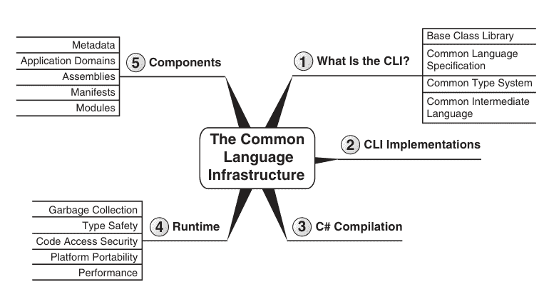

> **NOTE**
>
> Note the similarity between the CIL and CLI acronyms and the names they stand for. Distinguishing between them now will help you avoid confusion later.

Contained within the CLI standard are specifications for the following:

- The Virtual Execution System
- The Common Intermediate Language
- The Common Type System
- The Common Language Specification
- Metadata
- The framework

This chapter broadens your view of C# to include the CLI, which is critical to how C# programs operate and interact with programs and with the operating system.

## CLI Implementations

There are several commonly used implementations of the CLI, and a number of implementations are now of historical interest. Each implementation of the CLI includes a C# compiler and a set of framework class libraries; the version of C# supported by each, as well as the exact set of classes in the libraries, vary considerably. Table 21.1 on the next page describes these implementations.

## C# Compilation to Machine Code

The `HelloWorld` program listing in Chapter 1 is obviously C# code, and you compiled it for execution using the C# compiler. However, the processor still cannot directly interpret compiled C# code. An additional compilation step is required to convert the result of C# compilation into machine code. Furthermore, the execution requires the involvement of an agent that adds more services to the C# program—services that it was not necessary to code for explicitly.

### TABLE 21.1: Primary C# Compilers

| Compiler | Description |
|---|---|
| Windows Desktop CLR | This version of the CLR is for creating Windows client applications. |
| CoreCLR | The .NET Core project, as the name implies, contains the core functionality common to all upcoming flavors of .NET from Microsoft. It is intended to be a cross-platform, open source implementation designed for high-performance server applications. The CoreCLR is the implementation of the CLR for this project. At the time of this book’s writing, Microsoft had announced that it was in preview release for Windows, OS X, and Linux. See https://github.com/dotnet/coreclr for more details. |
| Microsoft Silverlight | This cross-platform implementation of the CLI was for creating browser-based web client applications. Microsoft stopped developing Silverlight in 2013. |
| .NET Compact Framework | This is a trimmed-down implementation of the .NET Framework designed to run on PDAs, phones, and the Xbox 360.<br><br>The XNA library and tools for developing Xbox 360 applications are based on the Compact Framework 2.0 release; Microsoft stopped development of XNA in 2013. |
| .NET Micro Framework | The Micro Framework is Microsoft’s open source implementation of the CLI for devices so resource constrained that they cannot run the compact framework. See http://www.netmf.com/ for details. |
| Mono | Mono is an open source, cross-platform implementation of the CLI for many UNIX-based operating systems, mobile operating systems such as Android, and game consoles such as PlayStation and Xbox. It is under active development by Xamarin, which has partnered with Microsoft to provide extensions integrating it into Visual Studio 2015. |
| DotGNU Portable.NET | This effort to create a cross-platform implementation of the CLI was “decommissioned” in 2012. |
| Shared Source CLI (Rotor) | Between 2001 and 2006, Microsoft released “shared source” reference implementations of the CLI licensed for noncommercial use. |

All computer languages define syntax and semantics for programming. Since languages such as C and C++ compile to machine code, the platform for these languages is the underlying operating system and machine instruction set, be it Microsoft Windows, Linux, UNIX, or something else. In contrast, with languages such as C#, the underlying platform is the runtime (or VES). CIL is what the C# compiler produces after compiling. It is termed a “common intermediate language” because an additional step is required to transform the CIL into something that processors can understand. Figure 21.1 on the next page shows the process.

In other words, C# compilation requires two steps:

1. Conversion from C# to CIL by the C# compiler
2. Conversion from CIL to instructions that the processor can execute

The runtime is able to understand CIL statements and compile them to machine code. Generally, a **component** within the runtime performs this compilation from CIL to machine code. This component is the **just-in-time (JIT) compiler**, and **jitting** can occur when the program is installed or executed. Most CLI implementations favor execution-time compilation of the CIL, but the CLI does not specify when the compilation needs to occur. In fact, the CLI even allows the CIL to be interpreted rather than compiled, similar to the way many scripting languages work. In addition, .NET includes a tool called `NGEN` that enables compilation to machine code prior to actually running the program. This preexecution-time compilation needs to take place on the computer on which the program will be executing because it will evaluate the machine characteristics (processor, memory, and so on) as part of its effort to generate more efficient code. The advantage of using `NGEN` at installation (or at any time prior to execution) is that you can reduce the need for the jitter to run at startup, thereby decreasing startup time.

As of Visual Studio 2015, the C# compiler also supports “.NET native” compilation, whereby the C# code is compiled into native machine code when creating a deployed version of the application, much like using the `NGEN` tool. Windows Universal applications make use of this feature.

C# 代码

```
class HelloWorld
{
    static void Main()
    {
        System.Console.WriteLine(
            "Hello. My name is Inigo Montoya");
    }
}
```

C# 编译器

```
CIL Code
.method private hidebysig static void Main() cil managed
{
    .entrypoint
    //Code size       11 (0xb)
    .maxstack 8
    IL_0000: ldstr      "Hello. My name is Inigo Montoya"
    IL_0005: call       void [mscorlib]System.Console::WriteLine(string)
    IL_000a: ret
} // end of method HelloWorld::Main
```

运行时

```
Machine Code
00000000  push           ebp
00000001  mov            ebp,esp
00000003  sub            esp,28h
00000006  mov            dword ptr [ebp-4],0
0000000d  mov            dword ptr [ebp-0Ch],0
00000014  cmp            dword ptr ds:[001833E0h],0
0000001b  je             00000022
0000001d  call           75F9C9E0
00000022  mov            ecx,dword ptr ds:[01C31418h]
00000028  call           dword ptr ds: [03C8E854h]
0000002e  nop
0000002f  mov            esp,ebp
00000031  pop            ebp
00000032  ret
```

图 21.1：将 C# 编译为机器代码

## 运行时

即使运行时将 CIL 代码转换为机器代码并开始执行，它仍会继续维持对执行的控制。在运行时这类代理的上下文中执行的代码称为托管代码，而在运行时控制下执行的过程称为托管执行。对执行的控制会延伸到数据；这使得数据成为托管数据，因为数据的内存由运行时自动分配和释放。

有点不一致的是，“公共语言运行时”这个术语在技术上并不是 CLI 中的一个通用术语。相反，CLR 是 .NET 平台中微软特有的运行时实现。尽管如此，CLR 还是被随意地用作“运行时”的通用术语，而技术上准确的术语“虚拟执行系统”在 CLI 规范之外很少使用。

由于代理控制程序执行，因此可以向程序中注入附加服务，即使程序员没有显式地为这些服务编写代码。托管代码因此提供了允许这些服务附加的信息。除其他事项外，托管代码还能定位类型成员的元数据、进行异常处理、访问安全信息，以及具备遍历堆栈的能力。本节其余部分将介绍通过运行时和托管执行提供的其他一些服务。CLI 并未明确要求所有这些服务，但成熟的 CLI 平台都有相应的实现。

## 垃圾回收

垃圾回收是一种根据程序需要自动释放内存的过程。对于没有自动化系统来执行这种清理的语言来说，它是一个重大的编程问题。没有垃圾回收器，程序员必须记得始终释放他们所做的任何内存分配。忘记这样做，或对同一内存分配重复释放，会给程序带来内存泄漏或损坏——对于 Web 服务器这类长时间运行的程序，这种情况会更为严重。由于运行时内置了对垃圾回收的支持，面向运行时执行的程序员可以专注于添加程序功能，而不是与内存管理相关的“管道”工作。

## 语言对比：C++——确定性析构


垃圾回收器工作的确切机制不属于 CLI 规范；因此，每种实现都可以采用略有不同的方法。（事实上，垃圾回收并不是 CLI 明确要求的项目之一。）C++ 程序员可能需要熟悉的一个关键概念是，被垃圾回收的对象不一定是**确定性**地回收的（在编译时已知的明确定义位置）。事实上，对象可以在最后一次被访问之后、程序关闭之前的任何时间被垃圾回收。这包括在超出作用域之前被回收，或一直等到代码能够访问某个对象实例之后很久才回收。

垃圾回收器只负责处理内存管理；也就是说，它不提供用于管理与内存无关的资源的自动化系统。因此，如果需要显式操作来释放资源（而非内存），使用该资源的程序员应采用特殊的 CLI 兼容编程模式，以帮助清理这些资源（参见第 9 章）。

## .NET 上的垃圾回收

大多数 CLI 实现采用基于分代、压缩、标记-清除的算法来回收内存。之所以称为“分代”，是因为仅存活了很短时间的对象会比那些由于仍在使用而已在垃圾回收扫掠中存活下来的对象更早被清理。这符合内存分配的一般规律：存在时间较长的对象会比刚实例化不久的对象活得更久。

此外，.NET 垃圾回收器使用标记-清除算法。在每次垃圾回收执行时，它会标记要被释放的对象，并将保留的对象压缩在一起，使它们之间不留“脏”空间。使用压缩来填充被释放对象留下的空间，通常可以比非托管代码更快地实例化新对象，因为不必搜索内存来为新分配定位空间。这还减少了分页的机会，因为更多对象位于同一页面中，这也提高了性能。

垃圾回收器会考虑机器上的资源以及执行时对这些资源的需求。例如，如果计算机上的内存仍然有大量未使用，垃圾回收器就较不可能运行并花时间清理这些资源。这种优化在非基于垃圾回收的平台和语言中很少见。

## 类型安全

运行时提供的关键优势之一是检查类型之间的转换，即**类型检查**。通过类型检查，运行时可以防止程序员无意中引入可能导致缓冲区溢出漏洞的无效转换。此类漏洞是入侵计算机系统最常见的手段之一，而让运行时自动防止这些漏洞的出现是一项重大收益。¹ 运行时提供的类型检查确保以下内容：

-   变量以及变量所引用的数据都有类型，并且变量的类型与其所引用的数据的类型相兼容。

-   可以对类型进行局部解析（无需分析使用该类型的全部代码），以确定执行该类型的成员需要哪些权限。

-   每个类型都有一组编译时定义的方法以及它们包含的数据。运行时强制执行哪些类可以访问这些方法和数据的规则。例如，标记为“private”的方法只能由包含该方法的类型访问。

## 高级主题

### 绕过封装和访问修饰符

在拥有相应权限的情况下，可以通过称为**反射**的机制绕过封装和访问修饰符。反射通过支持浏览类型的成员、在对象的元数据中查找特定构造的名称以及调用类型的成员，从而提供后期绑定。

### 代码访问安全

运行时可以在程序执行时进行安全检查，根据权限允许或禁止特定类型的操作。执行特定函数的权限并不局限于对运行程序的用户进行身份验证。运行时还会根据程序的创建者以及该创建者是否为受信任的提供者来控制执行。类似地，你可能需要注意到，代码访问安全（CAS）还会根据代码的位置应用安全策略——默认情况下，安装在本机上的代码比来自局域网的代码更受信任，而后者又比来自 Internet 的代码受信任得多。可以调整权限，使部分受信任的提供者能够从磁盘上受控的位置读写文件，但无法访问提供者未被授予权限的其他位置（例如电子邮件程序中的电子邮件地址）。提供者的标识由提供者编译代码时嵌入到程序中的证书处理。

### 平台可移植性

运行时的一个理论特性是它为 C# 代码及生成程序提供了平台可移植的机会——也就是说，能够运行在多种操作系统上，并在不同的 CLI 实现上执行。这里的可移植性并不局限于需要在源代码层面上重新编译。相反，为某个平台编译的单个 CLI 模块应能在任何兼容 CLI 的平台上运行，而无需重新编译。这种可移植性之所以可行，是因为移植代码的工作在运行时实现方，而不是应用程序开发人员。

当然，限制是不能使用任何特定于平台的 API。由于这一限制，许多开发者放弃了 CLI 平台中立的代码，转而访问底层平台功能，而不是从头开始编写一切。

从历史上看，编写一个可在多个平台上使用的 C# 代码库一直相当困难，因为每个平台上的框架类库都有不同的可用类（或那些类中不同的方法）。如果你希望只编写一次核心应用程序逻辑，并确保它可以用于任何现代 .NET 实现，最简单的方法是创建一个可移植类库项目（可作为项目

# 第21章：公共语言基础结构

……自2012年以来，Visual Studio 中的类型）。Visual Studio 将确保库中的任何代码只能引用你所选择的 Windows 桌面版、Silverlight、Windows Phone、iOS、Android 及其他平台类库中通用的类和方法。此外，跨平台支持也可在 .NET Core 中获得——它是 .NET 的长期战略方向，ASP.NET 5 正是构建于其上。

若要创建可在 Windows 桌面、移动和控制台平台上运行的完整图形应用程序，请在 Visual Studio 2015 中选择某个“通用应用程序”项目类型。

#### 性能

许多习惯于编写非托管代码的程序员会正确指出：托管环境无论对于多么简单的应用程序都会带来开销。这是一种权衡：一方面，托管代码提高了开发效率并减少了 Bug；另一方面，其运行时性能有所下降。同样的二元性在编程从汇编语言转向 C 等高级语言、从结构化编程转向面向对象开发时也出现过。在绝大多数场景中，开发效率往往更胜一筹，尤其是当硬件的速度和价格下降已超越应用程序的需求时。相比于底层开发平台的复杂性，花费在架构设计上的时间更有可能带来显著的性能提升。在缓冲区溢出导致安全漏洞频发的环境下，托管执行甚至更具吸引力。

毫无疑问，某些开发场景（例如设备驱动程序）可能仍不适合采用托管执行。然而，随着托管执行在能力和复杂性上的不断提升，这些性能方面的顾虑很可能会逐渐消失。非托管执行将只保留给那些被认为有必要对运行时进行精确控制或绕过的开发场景中。[^2]

此外，运行时能够响应直接编译为机器码的编译过程通常不会考虑到的执行条件。例如，如果机器拥有的内存超出了所需，非托管语言仍会在代码中确定的、编译时定义的执行点释放其内存。而 JIT 编译的语言则只需要在内存不足或程序关闭时才释放内存。尽管 JIT 编译会给执行过程增加一个编译步骤，但 JIT 编译器可以插入的代码优化可能会带来性能提升，甚至可以与直接编译为机器码的程序相媲美。归根结底，CLI 程序不一定比非 CLI 程序更快，但它们的性能具有竞争力。

#### 应用程序域

通过在程序和操作系统之间引入一个层，可以实现被称为**应用程序域（app domain）**的虚拟进程或应用程序。应用程序域的行为类似于操作系统进程，因为它提供了与其他应用程序域之间的隔离级别。例如，应用程序域拥有自己的虚拟内存分配，并且应用程序域之间的通信需要使用分布式通信范式，就像两个操作系统进程之间那样。同样，静态数据在应用程序域之间不共享，因此静态构造函数会为每个应用程序域运行；假设每个应用程序域只有一个线程，则无需同步静态数据，因为每个应用程序都有自己的数据实例。此外，每个应用程序域都有自己的线程，并且就像操作系统进程一样，线程不能跨越应用程序域的边界。

应用程序域的意义在于进程被认为相对昂贵。借助应用程序域，可以在单个进程内运行多个应用程序域，从而避免这种额外开销。例如，你可以使用单个进程托管一系列网站，然后通过将这些网站放入各自的应用程序域中来相互隔离。总之，应用程序域代表位于操作系统进程和线程之间的层上的虚拟进程。

#### 程序集、清单和模块

CLI 中包含了从源代码语言编译器输出的 CIL 规范，通常是一个程序集。除了 CIL 指令本身之外，程序集还包含一个**清单（manifest）**，该清单由以下组件构成：

- 程序集定义和导入的类型

- 程序集自身的版本信息

- 程序集依赖的其他文件

- 程序集的安全权限

清单本质上是程序集的一个头部，提供了关于程序集由什么组成的所有信息，以及唯一标识它的信息。

程序集可以是类库，也可以是可执行文件本身，一个程序集可以引用其他程序集（这些程序集又可以引用更多程序集），从而构建出一个由许多组件构成的应用程序，而不是作为一个庞大单一的程序存在。这是现代编程平台视为理所当然的一个重要特性，因为它显著提高了可维护性，并允许单个组件在多个程序之间共享。

除了清单之外，程序集还包含一个或多个模块中的 CIL 代码。通常，程序集和清单会合并到一个文件中，就像第1章中的 `HelloWorld.exe` 那样。但是，也可以将模块放在各自独立的文件中，然后使用程序集链接器（`al.exe`）创建一个程序集文件，其中包含引用每个模块的清单。[^3] 这种方法不仅提供了另一种将程序拆分为组件的方式，还使得可以使用多种源语言开发一个程序集。

非正式地，*模块*和*程序集*这两个术语在某种程度上可以互换使用。然而，对于谈论 CLI 兼容程序或库的人来说，*程序集*这一术语更为常用。图21.2 描述了各个组件的术语。

请注意，程序集和模块都可以引用已被本地化为特定语言的文件（如资源文件）。尽管很少见，但两个不同的程序集可以引用同一个模块或文件。

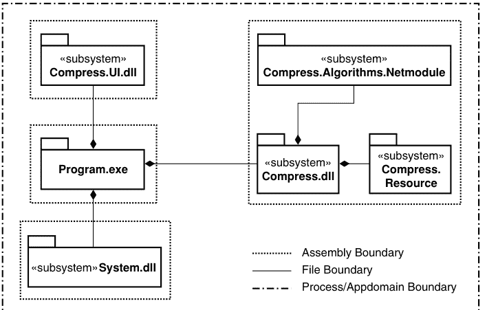

即使程序集可以包含多个模块和文件，整个文件组也只有一个版本号，该版本号位于程序集清单中。因此，应用程序中最小的可版本化组件是程序集，即使该程序集由多个文件组成。如果你更改了任何被引用的文件（即使只是为了发布补丁）却不更新程序集清单，就会破坏清单以及整个程序集的完整性。因此，程序集构成了组件或部署单元的逻辑构造。

> **注意**
>
> 程序集——而不是构成它的各个模块——构成了可以被进行版本控制和安装的最小单元。

即使程序集（逻辑构造）可以由多个模块组成，大多数程序集也只包含一个模块。此外，Microsoft 提供了一个 `ILMerge.exe` 工具，用于将多个模块及其清单合并到单个文件程序集中。

[^2]: 事实上，微软已经表示，托管开发将成为未来为 Windows 平台编写应用程序的主要方式，即使是那些与操作系统集成的应用程序也不例外。

[^3]: 部分原因是，主要的 CLI 集成开发环境之一 Visual Studio .NET 缺乏处理由多个模块组成的程序集的功能。当前版本的 Visual Studio .NET 没有用于构建多模块程序集的集成工具，而且在使用此类程序集时，IntelliSense 无法完全正常工作。

由于清单包含了程序集所依赖的所有文件的引用，因此可以利用清单来确定程序集的依赖关系。此外，在执行时，运行时只需检查清单即可确定需要哪些文件。只有分发多个应用程序共享的库的工具供应商（例如 Microsoft）才需要在部署时注册这些文件。这使得部署变得容易得多。通常，基于 CLI 的应用程序部署被称为 **xcopy 部署**，得名于 Windows 的 `xcopy` 命令，该命令只是将文件复制到选定的目标位置。

> **语言对比：COM DLL 注册**
>
> 与过去的 Microsoft COM 文件不同，CLI 程序集几乎不需要任何形式的注册。相反，可以通过将所有组成程序的文件复制到特定目录，然后执行程序来部署应用程序。

## 公共中间语言

与“公共语言基础结构”这一名称相符，CIL 和 CLI 的另一个重要特性是支持同一应用程序内多种语言的交互（而不是源代码在多个操作系统之间的可移植性）。因此，CIL 不仅是 C# 的中间语言，也是许多其他语言的中间语言，包括 Visual Basic .NET、类似 Java 的 J# 语言、Smalltalk 的某些变体、C++ 以及众多其他语言（在撰写本文时已有 20 多种，包括 COBOL 和 FORTRAN 的版本）。编译为 CIL 的语言称为**源语言**，每种语言都有一个自定义编译器，将源语言转换为 CIL。一旦编译为 CIL，源语言就不再重要。这一强大的特性使得不同组织中的不同开发团队可以开发库，而无需担心某个特定团队的语言选择。因此，CIL 实现了编程语言互操作性以及平台可移植性。

> 注意
>
> CLI 的一个强大特性是支持多种语言。这使得可以使用多种语言创建程序，并且用一种语言编写的库可以被用另一种语言编写的代码访问。

## 公共类型系统

无论使用哪种编程语言，最终的程序在内部都操作数据类型；因此，CLI 包含了公共类型系统（CTS）。CTS 定义了类型在内存中的结构和布局方式，以及围绕类型的概念和行为。它包含了类型操作指令，以及存储在类型中的数据的相关信息。CTS 标准适用于类型在语言外部边界上的呈现和行为方式，因为 CTS 的目标是实现语言之间的互操作性。运行时在执行时有责任强制执行 CTS 所建立的契约。

在 CTS 中，类型分为两类。

- **值**是用于表示基本类型（如整数和字符）以及以结构形式表示的更复杂数据的位模式。每个值类型都对应一个不存储在位本身中的单独类型标识。该单独类型标识指的是类型定义，它提供值中每个位的含义以及该值支持的操作。

- **对象**内部包含对象的类型标识。（这有助于实现类型检查。）对象具有使每个实例唯一的标识。此外，对象具有可以存储其他类型（值或对象引用）的槽位。与值不同，更改槽位的内容不会改变对象的标识。

这两种类型类别直接对应到 C# 语法中，该语法提供了声明每种类型的方法。

## 公共语言规范

由于 CTS 提供的语言集成优势通常超过实现它的成本，大多数源语言都支持 CTS。然而，还有一部分 CTS 语言符合性称为公共语言规范（CLS），其重点是库实现。CLS 面向库开发者，为他们提供编写库的标准，这些库可以被大多数源语言访问，无论使用这些库的源语言是否符合 CTS。之所以称为公共语言规范，是因为它旨在鼓励 CLI 语言提供一种创建可互操作库（即可被其他语言访问的库）的方法。

例如，尽管一种语言提供对无符号整数的支持是完全合理的，但此类类型并未包含在 CLS 中。因此，实现类库的开发人员不应在外部公开无符号整数，因为这样做会导致库难以被不支持无符号整数的符合 CLS 的源语言访问。因此，理想情况下，任何需要被多种语言访问的库都应符合 CLS。请注意，CLS 不关注未在程序集外部公开的类型。

另请注意，在创建不符合 CLS 的 API 时，可以让编译器发出警告。为此，可以使用程序集特性 `System.CLSCompliant` 并将参数值指定为 true。

## 基类库

除了提供 CIL 代码可以执行的平台之外，CLI 还定义了一组程序可以使用的核心类库，称为基类库（BCL）。这些库提供了基础类型和 API，使程序能够以一致的方式与运行时和底层操作系统交互。BCL 包括对集合、线程、控制台以及构建几乎所有程序所需的其他基类的支持。

类似地，一个 Microsoft 特有的库称为框架类库（FCL），包括对富客户端用户界面、Web 用户界面、数据库访问、分布式通信等的支持。

## 元数据

除了执行指令之外，CIL 代码还包含有关程序中类型和文件的**元数据**。元数据包括以下项：

- 程序或类库中每种类型的描述

- 清单信息，其中包含有关程序本身及其所依赖库的数据

- 嵌入在代码中的自定义特性，提供有关特性所修饰构造的附加信息

元数据不是对 CIL 的粗略、非必要的附加物。相反，它代表了 CLI 实现的核心组件。它提供有关类型的表示和行为信息，并包含有关哪个程序集包含特定类型定义的位置信息。它在保存编译器中的数据并在执行时使调试器和运行时可以访问这些数据方面起着关键作用。这些数据不仅在 CIL 代码中可用，而且在机器代码执行期间也可访问，以便运行时可以继续进行任何必要的类型检查。

元数据为运行时提供了一种处理本机代码和托管代码混合执行的机制。此外，它还提高了代码和执行的健壮性，因为它平滑了从一个库版本到下一个库版本的迁移，用加载时实现替代了编译时定义的绑定。

所有关于库及其依赖项的头信息都位于元数据中称为清单的部分。因此，元数据的清单部分使开发者能够确定模块的依赖关系，包括依赖项的特定版本信息以及指示模块创建者的签名。在执行时，运行时使用清单来确定要加载哪些依赖库、库或主程序是否被篡改，以及程序集是否缺失。

元数据还包含可以修饰代码的**自定义特性**。特性提供有关 CIL 指令的附加元数据，这些元数据可以在执行时通过程序访问。

元数据在执行时可通过称为**反射**的机制获得。通过反射，可以查找类型或其成员，在执行时间，然后调用该成员，或确定某个构造是否带有特定特性。这提供了**后期绑定**，即系统在执行时而非编译时确定要执行的代码。反射甚至还可用于生成文档：遍历元数据并将其复制到某种帮助文档中（参见第 17 章）。

## 总结

本章描述了许多新的术语和缩写，它们对于理解 C# 程序运行的上下文非常重要。大量的三字母缩写词可能会让人困惑。表 21.2 提供了属于 CLI 的术语和缩写的汇总列表。

## 表 21.2：与 C# 相关的常见缩写词

| 缩写 | 定义 | 说明 |
|---|---|---|
| .NET | 无 | Microsoft 对完整 CLI 技术栈的实现。包括 CLR、CIL 以及各种语言，所有这些都符合 CLS。 |
| BCL | 基类库 | CLI 规范中定义集合、线程、控制台以及构建几乎所有程序所需的其他基类的部分。 |
| C# | 无 | 一种编程语言。与 CLI 标准分开的是 C# 语言规范，该规范同样经 ECMA 和 ISO 标准机构批准。 |
| CIL (IL) | 公共中间语言 | CLI 规范的语言，定义可在 CLI 实现上执行的代码指令。有时也称为 IL 或 Microsoft IL (MSIL)，以区别于其他中间语言。（为了表明它是比 Microsoft 更广泛的标准，CIL 比 MSIL 甚至 IL 更受青睐。） |
| CLI | 公共语言基础结构 | 该规范定义了中间语言、基类和行为特征，使实现者能够创建虚拟执行系统和编译器，使源语言能够在公共执行环境之上互操作。 |
| CLR | 公共语言运行时 | Microsoft 对 CLI 规范中定义的运行时的实现。 |
| CLS | 公共语言规范 | CLI 规范的一部分，定义了源语言必须在根据 CLI 规范实现的运行时上执行所需支持的核心功能子集。 |
| CTS | 公共类型系统 | 通常由符合 CLI 的语言实现的标准，定义了语言在模块外部公开可见的类型表示和行为。它包括如何组合类型以形成新类型的概念。 |


| 缩写 | 全称 | 说明 |
| --- | --- | --- |
| FCL | .NET Framework 类库 | 构成 Microsoft .NET Framework 的类库。它包括 Microsoft 对 BCL 的实现，以及大量用于 Web 开发、分布式通信、数据库访问、富客户端用户界面开发等的类库。 |
| WinRT | Windows 运行时 | Metro 风格应用执行所基于的 Windows 8 平台。WinRT 包括 WinAPI，一种新的、改进的 Windows 8 操作系统 API，包含 .NET 风格的元数据，使其可从 C# 无缝访问。 |
| VES (runtime) | 虚拟执行系统 | 管理为 CLI 编译的程序执行的代理。 |

# A. 下载并安装 C# 编译器与 CLI 平台

要编译和运行 C# 程序，必须安装编译器版本和 CLI 平台。

## 适用于 Windows 的 Microsoft .NET

主流的 CLI 平台是 Microsoft .NET，它是在 Microsoft Windows 上进行开发的首选平台。

- 若要使用包含 IntelliSense 并支持项目文件的丰富 IDE，请安装 Visual Studio IDE 的一个版本。Visual Studio 2015 的“Community Edition（社区版）”是免费的，并且包含创建服务器应用程序、富客户端应用程序和跨平台移动应用程序所需的一切。该版本以及 Visual Studio 的其他版本可在 http://visualstudio.com 获取。

- Microsoft 提供免费且可再发行的软件包，其中包含 .NET Framework 和可追溯到 2.0 版的所有 .NET 版本的编译器二进制文件。可在 http://www.microsoft.com/net 的下载部分获取。在撰写本书时，最新发布的版本是 .NET 4.6。

### Visual Studio 编译

2015 年，Microsoft 免费发布了 Visual Studio 2015 Community¹（社区版¹）。这是该公司 IDE 的完整版本，为 .NET 软件开发提供了一个高级平台。使用 Visual Studio 进行开发的主要优势之一，是能够创建和打开整个项目文件，甚至将这些项目组合成解决方案。

随附的源代码²包含一个解决方案文件 `EssentialCSharp.sln`，可以使用 Visual Studio 2015 打开、编译（生成）并运行。打开解决方案文件后，使用“生成（Build）”→“生成解决方案（Build Solution）”菜单编译代码。

在执行源代码之前，需要选择要执行的项目：将对应章节的项目设为启动项目。例如，若要执行第 1 章中的示例，请右键单击 `Chapter01` 项目，然后选择“设为启动项目（Set As Startup Project）”。如果没有选择正确的章节，在执行时指定清单编号时，将引发异常，并显示消息“Error, could not run the Listing....”。

选择正确项目后，可以从“调试（Debug）”→“开始执行（不调试）（Start Without Debugging）”菜单运行项目。或者，如果要调试项目，可以使用“调试（Debug）”→“开始调试（Start Debugging）”。运行后，程序将提示输入要执行的清单（例如 18.33）。如前所述，只能输入来自被设为启动项目的清单。

许多清单都有对应的单元测试。若要执行特定测试，请打开测试项目，并导航到与要执行的清单对应的测试。然后，右键单击测试方法，选择“运行测试（Run Tests）”（Ctrl+R, T）或“调试测试（Debug Tests）”（Ctrl+R, Ctrl+T）。

### 设置命令行编译的编译器路径

若要进行命令行编译，无论你是在使用 Visual Studio，还是仅使用运行时，都必须将 `PATH` 环境变量设置为包含 C# 编译器 `CSC.EXE`。如果计算机上安装了 Visual Studio，请从“开始”菜单打开命令提示符，方法是在 Windows“开始”菜单的 Visual Studio 部分中选择“开发人员命令提示符（Developer Command Prompt）”快捷方式。此命令提示符会将 `CSC.EXE` 放入 `PATH` 中，以便从任何目录执行。

1. Visual Studio Express 在 2015 年之前是免费提供的，也足以编译本书中的所有示例，但依赖 C# 6.0 功能的示例除外。

2. 本书可用的源代码（以及一些与早期 C# 版本相关的章节）可从 IntelliTect.com/EssentialCSharp 下载。你也可以从 http://itlc.tc/EssentialCSharpSCC 下载代码。

如果未安装 Visual Studio，“开始”菜单中不会出现特殊的编译器命令提示符项。此时，你需要显式引用编译器的完整路径名，或将其添加到 `PATH` 中。编译器位于 `%Windir%\Microsoft.NET\Framework\<version>`，其中 `<version>` 是 .NET Framework 的版本（通常是 `v4.0.30319`，它包含自 .NET 4.0 以来所有 .NET 版本的编译器工具），`%Windir%` 是指向 Windows 目录位置的环境变量。要将此位置添加到 `PATH`，请使用 `Set PATH=%PATH%;%Windir%\Microsoft.NET\Framework\<version>`，并再次适当替换 `<version>` 的值。输出 A.1 提供了一个示例。

#### 输出 A.1

```
Set PATH=%PATH%;%Windir%\Microsoft.NET\Framework\v4.0.30319
```

一旦 `PATH` 中包含该框架，你就可以直接使用 .NET C# 编译器 `CSC.EXE`，而无需提供其完整路径。

## OS X 和 Linux 上的 .NET

自其首次发布以来，一直存在跨平台版本的 CLI，允许在 Windows 之外的操作系统上执行 .NET 和 CIL 代码。在撰写本书时，关键平台是 .NET Core 项目（CoreCLR）和 Mono。两者都是开源实现，允许在 OS X 和 Linux（以及 Windows）上进行开发。

### .NET Core

Microsoft 为 OS X 和 Linux（以及 Windows）提供了 .NET Framework 的“.NET Core”版本的开源实现；在撰写本书时，它处于预览版，开发主要由 ASP.NET 5 驱动。源代码和二进制下载可从 https://github.com/dotnet/coreclr 获取。

与 Windows 上的完整 .NET Framework 不同，.NET Core 项目不需要将 .NET Framework 作为操作系统的一部分进行安装。相反，所需的所有文件都会被复制到单个目录中。要准备环境，需要下载一些通用包，以便安装 .NET。接下来，必须安装 .NET 版本管理器，然后安装 .NET Core 执行环境（DNX）。该环境提供了在 CoreCLR 实现下执行 CIL 的引擎。最后，一切就绪后，环境就可以编译并运行你的 C# 代码。

使用 .NET Framework 创建的托管可执行文件的执行内置于 Windows 操作系统，但并未内置于 OS X 或 Linux（甚至适用于 .NET Core 的 Windows 也没有）。要执行生成的二进制文件，你可以使用一个在 CLR 中启动可执行文件的实用工具；通过执行 `dnx.exe` 可激活它。

有关使用 .NET Core 进行安装和执行的最新完整说明，请参阅 http://itl.tc/GettingStartedWithDNX。

请注意，OS X 和 Linux 上的 Core .NET 项目旨在编写高性能的服务器端代码，而不是编写图形用户界面应用程序；Core .NET 不包含 GUI 库包。若要在非 Windows 平台上创建具有用户界面的应用程序，请使用 Mono。

### Mono

对于在 Microsoft Windows 之外的平台上进行 CLI 开发，请考虑使用 Mono，这是一个可以从 http://www.mono-project.com 下载的平台。与 .NET 平台相同，如果 C# 编译器不在搜索路径中，Mono 也需要提供编译器的完整路径。Linux 上的默认安装路径是 `/usr/lib/mono/<version>`，编译器是 `gmcs.exe` 或 `mcs.exe`，具体取决于版本。（如果将 Mono 安装在 Microsoft Windows 上，默认路径是 `%ProgramFiles%\Mono-<version>\lib\mono\<version>`。）

一个附带 Mono 安装的 Linux 版本选项是 Monoppix。该版本基于名为 Knoppix 的 CD 可启动 Linux 发行版构建，并可从 http://www.monoppix.com 下载。

Mono 平台的编译器不是 `CSC.EXE`，而是 `MCS.EXE` 或 `GMCS.EXE`，具体取决于编译器版本。因此，编译 `HelloWorld.cs` 的命令如输出 A.2 所示。

#### 输出 A.2

```
C:\SAMPLES>msc.exe HelloWorld.cs
```

遗憾的是，Linux 环境无法直接运行生成的二进制文件。相反，它需要使用 `mono.exe` 显式执行运行时，如输出 A.3 所示。

#### 输出 A.3

```
C:\SAMPLES>mono.exe HelloWorld.exe
Hello. My name is Inigo Montoya.
```

此页有意留空。

```
#region Check for End Game
if (EndGame(winner, turn, input))
{
    break;
}
#endregion Check for End Game

input = NextMove(playerPositions, currentPlayer);

winner = DetermineWinner(playerPositions);

// Switch players.
currentPlayer = (currentPlayer == 2) ? 1 : 2;
}
}

private static string NextMove(int[] playerPositions,
    int currentPlayer)
{
    string input;

    // Repeatedly prompt the player for a move
    // until a valid move is entered.
    bool validMove;
    do
    {
        // Request a move from the current player.
        System.Console.Write($"\nPlayer {currentPlayer} - Enter move:");
        input = System.Console.ReadLine();
        validMove = ValidateAndMove(playerPositions,
            currentPlayer, input);
    } while (!validMove);

    return input;
}

static bool EndGame(int winner, int turn, string input)
{
    bool endGame = false;
    if (winner > 0)
    {
        System.Console.WriteLine($"\nPlayer {winner} has won!!!!");
        endGame = true;
    }
    else if (turn == 10)
    {
        // After completing the 10th display of the
        // board, exit rather than prompting the
        // user again.
        System.Console.WriteLine("\nThe game was a tie!");
        endGame = true;
    }
    else if (input == "" || input == "quit")
    { // Check if user quit by hitting Enter without
      // any characters or by typing "quit".
        System.Console.WriteLine("The last player quit");
        endGame = true;
    }
    return endGame;
}

static int DetermineWinner(int[] playerPositions)
{
    int winner = 0;
    // Determine if there is a winner.
    int[] winningMasks = { 7, 56, 448, 73, 146, 292, 84, 273};
    foreach (int mask in winningMasks)
    {
        if ((mask & playerPositions[0]) == mask)
        {
            winner = 1;
            break;
        }
        else if ((mask & playerPositions[1]) == mask)
        {
            winner = 2;
            break;
        }
    }
    return winner;
}

static bool ValidateAndMove(
    int[] playerPositions, int currentPlayer, string input)
{
    bool valid = false;
    // Check the current player’s input.
    switch (input)
    {
        case "1":
        case "2":
        case "3":
        case "4":
        case "5":
        case "6":
        case "7":
        case "8":
        case "9":
        #warning "Same move allowed multiple times."
        int shifter;
        // The number of places to shift
        // over to set a bit.
        int position; // The bit which is to be set.

        // int.Parse() converts "input" to an integer.
        // "int.Parse(input) - 1" because arrays
        // are zero-based.
        shifter = int.Parse(input) - 1;

        // Shift mask of 00000000000000000000000000000001
        // over by cellLocations.
        position = 1 << shifter;

        // Take the current player cells and OR them
        // to set the new position as well.
        // Since currentPlayer is either 1 or 2, you
        // subtract 1 to use currentPlayer as an
        // index in a zero-based array.
        playerPositions[currentPlayer - 1] |= position;

        valid = true;
        break;

        case "":
        case "quit":
            valid = true;
            break;

        default:
            // If none of the other case statements
            // is encountered, then the text is invalid.
            System.Console.WriteLine(
                "\nERROR:  Enter a value from 1-9. "
                + "Push ENTER to quit");
            break;
    }

    return valid;
}

static void DisplayBoard(int[] playerPositions)
{
    // This represents the borders between each cell
    // for one row.
    string[] borders = {
    "|", "|", "\n---+---+---\n", "|", "|",
    "\n---+---+---\n", "|", "|", ""
    };

    // Display the current board;
    int border = 0; // set the first border (border[0] = "|").

#if CSHARP2
    System.Console.Clear();
#endif
}
```


```csharp
for (int position = 1;
    position <= 256;
    position <<= 1, border++)
{
    char token = CalculateToken(
        playerPositions, position);

    // Write out a cell value and the border that
    // comes after it.
    System.Console.Write($" {token} {borders[border]}");
}

static char CalculateToken(
int[] playerPositions, int position)
{
    // Initialize the players to 'X' and 'O'
    char[] players = {'X', 'O'};

    char token;
    // If player has the position set,
    // then set the token to that player.
    if ((position & playerPositions[0]) == position)
    {
        // Player 1 has that position marked.
        token = players[0];
    }
    else if ((position & playerPositions[1]) == position)
    {
        // Player 2 has that position marked.
        token = players[1];
    }
    else
    {
        // The position is empty.
        token = ' ';
    }
    return token;
}
#line 113 "TicTacToe.cs"
// Generated code goes here.
#line default
}
```

# 附录 C：与多线程模式的接口

## 与 TPL 和 C# 6.0 之前的多线程模式交互

从第 18 章中，读者会记得，多线程模式用于解决异步操作监控、线程池化、避免死锁以及跨操作和数据访问实现原子性和同步等复杂问题。在引入 .NET 4.5 和 C# 5.0 之前的十年里，.NET Framework 有六个版本，C# 语言有四个版本，并且出现了数量相当的多线程模式。然而，在那段时间里，多线程技术有了许多改进，而且——正如框架甚至语言中常见的情况——早期版本中的某些模式并不理想。无论是否不理想，作为 C# 开发者，你很可能会遇到这些模式，要么是因为你在为 .NET 4.5/C# 5.0 之前的 .NET/C# 版本进行开发，要么是因为你正在使用来自另一个框架的 API，而该 API 暴露了早期模式之一。这个额外“章节”的目的就是讨论这些模式。如果你足够幸运，只使用 C# 5.0 或更高版本，请将此视为高级主题，阅读它只是为了熟悉过去多线程的细节。或者，如果你仍然在没有任务编程库（TPL）和基于任务的异步模式（TAP）及其 `async/await` 关键字的情况下编程，请将余下主题视为……的重要组成部分。

在这些示例中，为了便于说明，省略了异常处理。

### 异步编程模型

在 TPL 之前确立的一个特别突出的模式是异步编程模型（APM）模式。给定一个长时间运行的同步方法`X()`，APM 模式使用`BeginX()`方法异步启动与`X()`等效的工作，并使用`EndX()`方法结束它。（后文我们将这些方法称为`X`、`BeginX`和`EndX`。）

### 使用 APM 模式

清单 C.1 使用`System.Net.WebRequest`类下载网页来演示该模式。其功能与第18章中标题为“基于任务的异步模式”一节中的功能相同；只是这一次我们假设 TPL 和 TAP 不可用，而使用 APM 模式。为了在添加与 TPL 相关的异步方法之前保持向后兼容性，`WebRequest`还通过`BeginGetResponse()`（`BeginX`）和`EndGetResponse()`（`EndX`）方法支持 APM 模式——也就是同步方法`GetResponse()`（`X`）的异步版本。

#### 清单 C.1：使用 APM 模式与 `WebRequest`

```csharp
using System;
using System.IO;
using System.Net;
using System.Linq;

public class Program
{
    public static void Main(string[] args)
    {
        string url = "http://www.IntelliTect.com";
        if (args.Length > 0)
        {
            url = args[0];
        }

        Console.Write(url);

        WebRequest webRequest =
            WebRequest.Create(url);

        IAsyncResult asyncResult =
            webRequest.BeginGetResponse(null, null);

        // Indicate busy using dots; ideally (at least in a non-Console
        // implementation) should use a callback rather than a wait.
        while (
            !asyncResult.AsyncWaitHandle.WaitOne(100))
        {
            Console.Write('.');
        }

        // Retrieve the results when finished downloading.
        WebResponse response =
            webRequest.EndGetResponse(asyncResult);
        using (StreamReader reader =
            new StreamReader(response.GetResponseStream()))
        {
            // Note: ReadToEnd() is blocking. A production implementation
            // should offload this to another thread.
            int length = reader.ReadToEnd().Length;
            Console.WriteLine(FormatBytes(length));
        }
    }

    static public string FormatBytes(long bytes)
    {
        string[] magnitudes =
            new string[] { "GB", "MB", "KB", "Bytes" };
        long max =
            (long)Math.Pow(1024, magnitudes.Length);

        return string.Format("{1:##.##} {0}",
            magnitudes.FirstOrDefault(
                magnitude =>
                    bytes > (max /= 1024)) ?? "0 Bytes",
            (decimal)bytes / (decimal)max).Trim();
    }
}
```

清单 C.1 的结果显示在输出 C.1 中。

#### 输出 C.1

```
http://www.IntelliTect.com........29.36 KB
```

如前所述，APM 模式的关键方面是具有标准签名的`BeginX`和`EndX`方法对。`BeginX`方法返回一个`System.IAsyncResult`对象，提供对异步操作状态的访问。所有输入参数都映射到`BeginX`方法。同样，返回参数映射到`EndX`的返回参数。另外，请注意，由于`ref`和`out`参数返回结果，它们包含在`EndX`方法签名中。相比之下，`url`只是一个输入参数，因此它不包含在`EndX`方法中。

### 使用 `AsyncCallback` 的延续传递风格

`BeginX`方法上有两个同步方法中未包含的额外参数：回调参数（一个`System.AsyncCallback`委托，在方法完成时调用）和一个类型为`object`的状态参数。清单 C.2 演示了如何使用它们。（输出与输出 C.1 相同。）

#### 清单 C.2：使用回调和状态调用 APM 方法

```csharp
using System;
using System.IO;
using System.Net;
using System.Linq;
using System.Threading;

public class Program
{
    public static void Main(string[] args)
    {
        string url = "http://www.IntelliTect.com";
        if (args.Length > 0)
        {
            url = args[0];
        }

        Console.Write(url);
        WebRequest webRequest = WebRequest.Create(url);
        WebRequestState state =
            new WebRequestState(webRequest);
        IAsyncResult asyncResult =
            webRequest.BeginGetResponse(
                GetResponseAsyncCompleted, state);

        // Indicate busy using dots.
        while (
            !asyncResult.AsyncWaitHandle.WaitOne(100))
        {
            Console.Write('.');
        }
        state.ResetEvent.Wait();
    }

    private static void GetResponseAsyncCompleted(
        IAsyncResult asyncResult)
    {
        WebRequestState completedState =
            (WebRequestState)asyncResult.AsyncState;
        HttpWebResponse response =
            (HttpWebResponse)completedState.WebRequest
                .EndGetResponse(asyncResult);
        Stream stream = response.GetResponseStream();
        StreamReader reader = new StreamReader(stream);
        // Note: ReadToEnd() is blocking. A production implementation
        // should offload this to another thread.
        int length = reader.ReadToEnd().Length;

        Console.WriteLine(FormatBytes(length));
        completedState.ResetEvent.Set();
        completedState.Dispose();
    }
    // ...
}

class WebRequestState : IDisposable
{
    public WebRequestState(WebRequest webRequest)
    {
        WebRequest = webRequest;
    }

    public WebRequest WebRequest { get; private set; }
    private ManualResetEventSlim _ResetEvent =
        new ManualResetEventSlim();
    public ManualResetEventSlim ResetEvent
        { get { return _ResetEvent; } }

    public void Dispose()
    {
        ResetEvent.Dispose();
        GC.SuppressFinalize(this);
    }
}
```

在清单 C.2 中，我们为`BeginGetResponse()`上的两个参数都传递了数据。第一个参数是类型为`System.AsyncCallback`的委托，它接受一个类型为`System.IAsyncResult`的参数。`AsyncCallback`标识异步调用完成后将执行的代码。注册回调启用了一种称为**延续传递风格（CPS）**的即发即弃调用模式，而不是将`EndGetResponse()`和`Console.WriteLine()`代码顺序放置在`BeginGetResponse()`之下。使用 CPS，我们可以“注册”在异步方法完成时将执行的代码。请注意，仍然需要调用`EndGetResponse()`，但通过将其放在回调中，我们确保在异步调用完成时它不会阻塞主线程。

### 在 APM 方法之间传递状态

状态参数用于在回调执行时将附加数据传递给它。清单 C.2 包含一个`WebRequestState`类，用于将附加数据传入回调，并且在这种情况下它还包含`WebRequest`本身，以便我们可以使用它来调用`EndGetResponse()`。`WebRequestState`类本身的一个替代方案是使用带闭包的匿名方法（包括 lambda 表达式）来传递附加数据，如清单 C.3 所示。

#### 清单 C.3：使用匿名方法上的闭包传递状态

```csharp
using System;
using System.IO;
using System.Net;
using System.Linq;
using System.Threading;

public class Program
{
    public static void Main(string[] args)
    {
        string url = "http://www.IntelliTect.com";
        if (args.Length > 0)
        {
            url = args[0];
        }

        Console.Write(url);
        WebRequest webRequest = WebRequest.Create(url);
        ManualResetEventSlim resetEvent =
            new ManualResetEventSlim();
        IAsyncResult asyncResult =
            webRequest.BeginGetResponse(
                (completedAsyncResult) =>
                {
                    HttpWebResponse response =
                        (HttpWebResponse)webRequest.EndGetResponse(
                            completedAsyncResult);
                    Stream stream =
                        response.GetResponseStream();
                    StreamReader reader =
                        new StreamReader(stream);
                    int length = reader.ReadToEnd().Length;
```


```csharp
Console.WriteLine(FormatBytes(length));
resetEvent.Set();
resetEvent.Dispose();
},
null);

// Indicate busy using dots.
while (
!asyncResult.AsyncWaitHandle.WaitOne(100))
{
    Console.Write('.');
}
resetEvent.Wait();
}

// ...
}
```

无论我们是否通过闭包传递状态，请注意我们正在使用 `ManualResetEvent` 来在 `AsyncCallback` 完成后发出信号。这有点奇怪，因为 `IAsyncResult` 已经包含了一个 `WaitHandle`。不同之处在于，`IAsyncResult` 的 `WaitHandle` 在异步方法完成但在 `AsyncCallback` 执行之前被设置。如果我们仅阻塞在 `IAsyncResult` 的 `WaitHandle` 上，我们很可能会在 `AsyncCallback` 执行之前退出程序。因此，我们使用一个单独的 `ManualResetEvent`。

### 资源清理

另一个重要的 APM 规则是，即使错误地未调用 `EndX` 方法，也不应发生资源泄漏。由于 `WebRequestState` 拥有 `ManualResetEvent`，因此它专门拥有一个需要此类清理的资源。为处理此任务，状态对象使用标准的 `IDisposable` 模式，其中包含 `Dispose()` 方法。

### 使用 TPL 调用 APM 方法

尽管 TPL 大大简化了对长时间运行方法的异步调用，但通常最好使用 API 提供的 APM 方法，而不是将 TPL 编写为同步版本。原因在于 API 开发人员最了解编写最高效的线程代码、需要同步的数据以及应使用哪种同步类型。幸运的是，TPL 的 `TaskFactory` 上提供了专门用于调用 APM 方法的特殊方法。因此，如果你可以使用 TPL 但正在使用 APM 相关 API，你仍然可以使用 TPL 来调用它们。

#### APM 与 TPL 和 CPS

TPL 在 `FromAsync` 上包含一组重载，用于调用 APM 方法。列表 C.4 提供了一个示例。同一列表在其他 APM 示例的基础上进行了扩展，以支持下载多个 URL；请参阅输出 C.2。

**列表 C.4：使用 TPL 调用 APM**

```csharp
using System;
using System.IO;
using System.Net;
using System.Linq;
using System.Threading.Tasks;

public class Program
{
    static private object ConsoleSyncObject =
        new object();

    public static void Main(string[] args)
    {
        string[] urls = args;
        if (args.Length == 0)
        {
            urls = new string[]
            {
                "http://www.habitat-spokane.org",
                "http://www.partnersintl.org",
                "http://www.iassist.org",
                "http://www.fh.org",
                "http://www.worldvision.org"
            };
        }

        Task[] tasks = new Task[urls.Length];
        for (int line = 0; line < urls.Length; line++)
        {
            tasks[line] = DisplayPageSizeAsync(
                urls[line], line);
        }

        while (!Task.WaitAll(tasks, 50))
        {
            DisplayProgress(tasks);
        }
        Console.SetCursorPosition(0, urls.Length);
    }

    private static Task<WebResponse>
        DisplayPageSizeAsync(string url, int line)
    {
        WebRequest webRequest = WebRequest.Create(url);
        WebRequestState state = new WebRequestState(webRequest, line);
        Write(state, url + " ");
        return Task<WebResponse>.Factory.FromAsync(
            webRequest.BeginGetResponse,
            GetResponseAsyncCompleted, state);
    }

    private static WebResponse GetResponseAsyncCompleted(
        IAsyncResult asyncResult)
    {
        WebRequestState completedState =
            (WebRequestState)asyncResult.AsyncState;
        HttpWebResponse response =
            (HttpWebResponse)completedState.WebRequest
            .EndGetResponse(asyncResult);
        Stream stream =
            response.GetResponseStream();
        using (StreamReader reader =
            new StreamReader(stream))
        {
            int length = reader.ReadToEnd().Length;
            Write(
                completedState, FormatBytes(length));
        }
        return response;
    }

    private static void Write(
        WebRequestState completedState, string text)
    {
        lock (ConsoleSyncObject)
        {
            Console.SetCursorPosition(
                completedState.ConsoleColumn,
                completedState.ConsoleLine);
            Console.Write(text);
            completedState.ConsoleColumn +=
                text.Length;
        }
    }

    private static void DisplayProgress(
        Task[] tasks)
    {
        for (int i = 0; i < tasks.Length; i++)
        {
            if (!tasks[i].IsCompleted)
            {
                DisplayProgress(
                    (WebRequestState)tasks[i]
                    .AsyncState);
            }
        }
    }

    private static void DisplayProgress(
        WebRequestState state)
    {
        lock (ConsoleSyncObject)
        {
            int left = state.ConsoleColumn;
            int top = state.ConsoleLine;
            if (left >= Console.BufferWidth - int.MaxValue.ToString().Length)
            {
                left = state.Url.Length;

                Console.SetCursorPosition(left, top);
                Console.Write("".PadRight(
                    Console.BufferWidth -
                    state.Url.Length));

                state.ConsoleColumn = left;
            }

            Write(state, ".");
        }
    }

    static public string FormatBytes(long bytes)
    {
        string[] magnitudes =
            new string[] { "GB", "MB", "KB", "Bytes" };
        long max =
            (long)Math.Pow(1024, magnitudes.Length);

        return string.Format("{1:##.##} {0}",
            magnitudes.FirstOrDefault(
                magnitude =>
                    bytes > (max /= 1024) )?? "0 Bytes",
            (decimal)bytes / (decimal)max).Trim();
    }
}

class WebRequestState
{
    public WebRequestState(
        WebRequest webRequest, int line)
    {
        WebRequest = webRequest;
```

code. The result is that you have a single object to represent any kind of asynchronous operation and, therefore, you can start composing task-based operations together, even if the underlying implementation is APM-based. In addition, you can query the continue-with-Task parameter (see `continueWithTask` in Listing C.5) for the result (`continueWithTask.Result`) rather than storing a means to access the `EndX` method via an async-state object or using closure and an anonymous delegate (we store `WebRequest` in Listing C.4).

**列表 C.5：使用 ContinueWith() 使用 TPL 调用 APM 方法**

```csharp
// ...

private static Task
    DisplayPageSizeAsync(string url, int line)
{
    WebRequest webRequest = WebRequest.Create(url);
    WebRequestState state =
        new WebRequestState(webRequest, line);
    Write(state, url + " ");
    return Task<WebResponse>.Factory.FromAsync(
        webRequest.BeginGetResponse,
        webRequest.EndGetResponse, state)
    .ContinueWith(
        (antecedent, antecedentState) =>
        {
            Stream stream =
                antecedent.Result.
                    GetResponseStream();
            using (StreamReader reader =
                new StreamReader(stream))
            {
                int length =
                    reader.ReadToEnd().Length;
                Write(state,
                    FormatBytes(length).ToString());
            }
        }, state);
}
// ...
```

请注意，为了将状态传递到 `ContinueWith()` 返回的 `Task` 中，`ContinueWith()` 调用在委托中显式包含 `antecedentState`，除此之外它还是一个参数。

### 使用 TAP 调用 APM 方法

鉴于 TAP 本质上是为处理 continuation 任务而设计的，一个明显的增强（尽管依赖于 C# 5.0）是使用 `async` / `await` 而不是 `ContinueWith()`，如列表 C.6 所示。

**列表 C.6：使用 TAP 调用 APM**

```csharp
// ...

private async static Task
    DisplayPageSizeAsync(string url, int line)
{
    WebRequestState state =
        new WebRequestState(url, line);
    Write(state, url + " ");
    WebRequest webRequest = WebRequest.Create(url);
    WebResponse webResponse =
        await Task<WebResponse>.Factory.FromAsync(
            webRequest.BeginGetResponse,
            webRequest.EndGetResponse, state);
    Stream stream =
        webResponse.GetResponseStream();
    using (StreamReader reader =
        new StreamReader(stream))
    {
        int length = reader.ReadToEnd().Length;
        Write(state,
            FormatBytes(length).ToString());
    }
}
// ...
```

### 初学者主题

#### 使用 lock 同步控制台

在列表 C.4 中，我们反复更改控制台光标的位置，然后继续向控制台写入文本。由于有多个线程正在执行并且也在向控制台写入，可能也会更改光标位置，因此我们需要将对光标位置的更改与写入操作同步，以便它们一起是原子的。

列表 C.4 包含一个类型为 `object` 的 `ConsoleSyncObject` 作为同步锁标识符。在我们

移动光标或向控制台写入操作可防止在移动和向控制台写入操作之间出现中间更新。请注意，即使是单行的 `Console.WriteLine()` 语句也被 `lock` 包围。虽然它们是原子的，但我们不希望它们中断另一个非原子的代码块。为了确保这一结果，只要存在多个执行线程，所有控制台更改都需要同步。

## 异步委托调用

APM 模式的一种特定实现是“异步委托调用”，它利用了所有委托数据类型的特殊 C# 编译器生成代码。例如，给定一个 `Func<string, int>` 类型的委托实例，在该实例上提供了一对 APM 方法：

```
System.IAsyncResult BeginInvoke(
    string arg, AsyncCallback callback, object @object)
int EndInvoke(IAsyncResult result)
```

结果是，你只需使用 C# 编译器生成的方法，就可以通过调用任何委托（因此是任何方法）来异步调用它。


不幸的是，异步委托调用模式使用的底层技术是一种用于分布式编程的已停止进一步开发的技术，即`remoting`。虽然`Microsoft`仍然支持异步委托调用的使用，并且在可预见的未来它将继续按今天的方式运行，但其性能特征在其他方法——即`Thread`、`ThreadPool`和`TPL`——面前是不理想的。鉴于这一现实，开发人员应优先考虑这些替代方案，而不是使用异步委托调用`API`实现新的开发。关于该模式的进一步讨论包含在下面的高级主题文本中，以便遇到它的开发人员能够理解其工作原理。

### ADVANCED TOPIC

### 异步委托调用详解

使用异步委托调用时，你不会使用对`Task`或`Thread`的显式引用进行编码。相反，你使用委托实例以及编译器生成的`BeginInvoke()`和`EndInvoke()`方法——其实现从`ThreadPool`请求线程。请考虑清单`C.7`中的代码。

**LISTING C.7: Asynchronous Delegate Invocation**

```
using System;

public class Program
{
    public static void Main(string[] args)
    {
        Console.WriteLine("Application started...");

        Console.WriteLine("Starting thread...");
        Func<int,string> workerMethod =
            PiCalculator.Calculate;
        IAsyncResult asyncResult =
            workerMethod.BeginInvoke(500, null, null);

        // Display periods as progress bar.
        while(!asyncResult.AsyncWaitHandle.WaitOne(
            100, false))
        {
            Console.Write('.');
        }
        Console.WriteLine();

        Console.WriteLine("Thread ending...");
        Console.WriteLine(
            workerMethod.EndInvoke(asyncResult));

        Console.WriteLine(
            "Application shutting down...");
    }
}
```

清单`C.7`的结果显示在输出`C.3`中。

**OUTPUT C.3**

```
Application started....
Starting thread....
....................
Thread ending....
3.14159265358979323846264338327950288419716939937510582097494459230781
64062862089986280348253421170679821480865132823066470938446095505623
7253594081284811174502841027019385211055596446229489549303819644288109
756659334461284756482337867831652712019091456485669234603486104543264
821339306026199461271237824646144913859102902214217521...
367892590360011330530548080466521384146951941511609433057270365759591
530921861173819326117931051185480744623799627495673518857272489122793
818301194912
Application shutting down....
```

`Main()`首先分配一个指向`PiCalculator.Calculate(int digits)`的`Func<int, string>`类型委托。

接下来，代码调用`BeginInvoke()`。此方法在线程池中的线程上启动`PiCalculator.Calculate()`方法，然后立即返回。这允许其他代码与`pi`计算并行运行。在此示例中，我们在等待`PiCalculator.Calculate()`方法完成时打印句点。

我们使用`IAsyncResult.AsyncWaitHandle.WaitOne()`在`asyncResult`上轮询委托的状态——与`APM`中可用的机制相同。因此，代码在`PiCalculator.Calculate()`方法执行期间每`100`毫秒向屏幕打印一个句点。

一旦等待句柄发出信号，代码就会调用`EndInvoke()`。与所有`APM`实现一样，将调用`BeginInvoke()`时返回的相同`IAsyncResult`引用传递给`EndInvoke()`很重要。在此示例中，`EndInvoke()`不会阻塞，因为我们在`while`循环中轮询线程状态，并在线程完成后才调用`EndInvoke()`。

清单`C.7`中的示例传递了一个整数并接收了一个字符串——这是`Func<int, string>`的签名。异步委托调用的关键特性是，将数据传入和传出目标调用是微不足道的；它与同步方法签名一致，就像在`APM`模式中一样。考虑一个包含`out`和`ref`参数的委托类型，如图`C.2`所示。（尽管常见，此示例故意不使用`Func`或`Action`，因为泛型不允许在类型参数上使用`ref`和`out`修饰符。）

```
System.IAsyncResult UpdateHandler.BeginInvoke(
    Object[] data, ref object value, out string text,
    AsyncCallback callback, object @object);

delegate bool UpdateHandlerFunc(
    object[] data, ref object value, out string text);

bool UpdateHandler.EndInvoke(
    ref object value, out string text);
```

**FIGURE C.2: Delegate Parameter Distribution to BeginInvoke() and EndInvoke()**

`BeginInvoke()`方法与委托签名匹配，除了额外的`AsyncCallback`和`object`参数。像`IAsyncResult`返回值一样，额外参数对应于指定回调和传递状态对象的标准`APM`参数。类似地，`EndInvoke()`方法与原始签名匹配，除了只有传出参数出现。由于`object[] data`仅为传入，因此它不会出现在`EndInvoke()`方法中。此外，由于`EndInvoke()`方法结束了异步调用，其返回与原始委托的返回匹配。

由于所有委托都包含`C#`编译器生成的`BeginInvoke()`和`EndInvoke()`方法，这些方法被异步委托调用模式使用，因此异步调用任何方法——尤其是使用`Func`和`Action`委托——变得相对容易。此外，对于调用方来说，无论`API`程序员是否显式实现了它，都很容易异步调用方法。

在`TPL`可用之前，异步委托调用模式的使用明显比替代方案更容易——这促使程序员在`API`未提供显式异步调用模式时使用它。然而，除了对`.NET 3.5`及更早框架的支持外，`TPL`的出现减少了使用异步委托调用方法的需求，如果有必要的话。

## 基于事件的异步模式¹

到目前为止，我们假设异步方法将返回一个任务；当任务的状态和结果被设置时，调用方会被通知异步工作已完成。这样做反过来也可能导致任务的完成异步执行。虽然这种模式很常见且功能强大，但它并不是处理异步性的唯一选择。值得注意的是，基于事件的异步模式（`EAP`）通常用于长时间运行的异步工作。

使用`EAP`的方法通常以`Async`结尾，返回`void`，并且没有`out`参数。`EAP`方法还通常接受一个对象或泛型参数，其中包含与异步工作关联的调用方确定的状态，有时它们接受取消令牌，如果异步工作可以取消的话。例如，如果我们有

```csharp
public void CalculateAsync<TState>(
    int digits,
    CancellationToken cancelToken
        = default(CancellationToken),
    TState userState
        = default(TState))
{
    SynchronizationContext.
        SetSynchronizationContext(
            AsyncOperationManager.
                SynchronizationContext);
    // Ensure the continuation runs on the current thread, so that
    // the event will be raised on the same thread that
    // called this method in the first place.
    TaskScheduler scheduler =
        TaskScheduler.
            FromCurrentSynchronizationContext();
    Task.Run(
        () =>
        {
            return PiCalculator.Calculate(digits);
        }, cancelToken)
        .ContinueWith(
            continueTask =>
            {
                Exception exception =
                    continueTask.Exception == null ?
                    continueTask.Exception :
                    continueTask.Exception.
                        InnerException;
                CalculateCompleted(
                    typeof(PiCalculator),
                    new CalculateCompletedEventArgs(
                        continueTask.Result,
                        exception,
                        cancelToken.IsCancellationRequested,
                        userState));
            }, scheduler);
}

public event
    EventHandler<CalculateCompletedEventArgs>
        CalculateCompleted = delegate { };

public class CalculateCompletedEventArgs
    : AsyncCompletedEventArgs
{
    public CalculateCompletedEventArgs(
        string value,
        Exception error,
        bool cancelled,
        object userState) : base(
            error, cancelled, userState)
    {
        Result = value;
    }

    public string Result { get; private set; }
}
```

在清单`C.8`中，与`async/await`方法一样，我们希望确保触发事件的延续任务始终在原始异步方法所在的同一线程上运行。为了实现这一目标，我们从`TaskScheduler`类获取同步上下文。由于这是一个控制台应用程序，当前线程没有同步（因此默认依赖线程池），所以清单`C.8`中首先创建了默认上下文。

如前所述，`EAP`（基于事件的异步模式，Event-based Asynchronous Pattern）方法通常用于长时间运行的异步操作。长时间运行的操作不仅在任务完成、失败或取消时提供通知，还经常会提供阶段性的进度更新。当用户界面以某种进度条或其他指示器显示长时间运行的异步操作的进度时，这类信息尤其有用。在`EAP`方法中，标准做法是将该方法与另一个名为`ProgressChanged`的事件（类型为`ProgressChangedEventHandler`）关联起来。

`EAP`方法及其关联事件（如果方法产生进度更新，也可以是多个事件）通常是实例成员，而不是静态成员。这使得支持多个并发操作变得更加容易，因为每个单独的操作都可以与不同的实例关联。

## 后台工作线程模式

另一种提供操作状态和取消可能性的模式是后台工作线程模式，它是`EAP`的一种具体实现。`.NET Framework 2.0`（或更高版本）包含一个用于编写此类模式的`BackgroundWorker`类。

清单`C.9`是该模式的一个示例——同样将`π`计算到指定的位数。

```csharp
}
}

private static void CalculatePi(
    object sender, DoWorkEventArgs eventArgs)
{
    int digits = (int)eventArgs.Argument;

    StringBuilder pi =
        new StringBuilder("3.", digits + 2);
    calculationWorker.ReportProgress(
        0, pi.ToString());

    // Calculate rest of pi, if required.
    if (digits > 0)
    {
        for (int i = 0; i < digits; i += 9)
        {
            // Calculate next i decimal places.
            int nextDigit =
                PiDigitCalculator.StartingAt(
                    i + 1);
            int digitCount =
                Math.Min(digits - i, 9);
            string ds =
                string.Format("{0:D9}", nextDigit);
            pi.Append(ds.Substring(0, digitCount));

            // Show current progress.
            calculationWorker.ReportProgress(
                0, ds.Substring(0, digitCount));

            // Check for cancellation.
            if (
                calculationWorker.CancellationPending)
            {
                // Need to set Cancel if you want to
                // distinguish how a worker thread completed--
                // i.e., by checking
                //RunWorkerCompletedEventArgs.Cancelled.
                eventArgs.Cancel = true;
                break;
            }
        }
    }

    eventArgs.Result = pi.ToString();
}

private static void UpdateDisplayWithMoreDigits(
    object sender,
    ProgressChangedEventArgs eventArgs)
{
    string digits = (string)eventArgs.UserState;
    Console.Write(digits);
}

static void Complete(
    object sender,
    RunWorkerCompletedEventArgs eventArgs)
{
    // ...
}

public class PiDigitCalculator
{
    // ...
}
```

### 建立模式

建立后台工作线程模式的步骤如下：


# 附录 C：与多线程模式的交互

1. 将长时间运行的方法注册到 `BackgroundWorker.DoWork` 事件。在本示例中，长时间运行的任务是对 `CalculatePi()` 的调用。

2. 若要接收进度或状态通知，请将侦听器挂接到 `BackgroundWorker.ProgressChanged`，并将 `BackgroundWorker.WorkerReportsProgress` 设置为 `true`。在清单 C.9 中，`UpdateDisplayWithMoreDigits()` 方法负责在获得更多位数时更新显示。

3. 向 `BackgroundWorker.RunWorkerCompleted` 事件注册一个方法（`Complete()`）。

4. 设置 `WorkerSupportsCancellation` 属性以支持取消。一旦该属性设置为 `true`，对 `BackgroundWorker.CancelAsync` 的调用就会设置 `DoWorkEventArgs.CancellationPending` 标志。

5. 在 `DoWork` 提供的方法（`CalculatePi()`）中，检查 `DoWorkEventArgs.CancellationPending` 属性，如果为 `true` 则退出该方法。

6. 一切设置就绪后，通过调用 `BackgroundWorker.RunWorkerAsync()` 开始工作，并提供一个状态参数，该参数会被传递给指定的 `DoWork()` 方法。

如果将其分解为多个步骤，后台工作线程模式相对容易理解，而且与 EAP 一致，它明确支持进度通知。其缺点是你不能在任何方法上随意使用它。相反，`DoWork()` 方法必须符合 `System.ComponentModel.DoWorkEventHandler` 委托，该委托接受类型为 `object` 和 `DoWorkEventArgs` 的参数。如果不是这种情况，就需要一个包装函数——使用匿名方法实现起来相当简单。取消和进度相关的方法也需要特定的签名，但这些都由建立后台工作线程模式的程序员来控制。

## 异常处理

如果在后台工作线程执行期间发生了未处理的异常，则 `RunWorkerCompleted` 委托（`Completed` 的 `eventArgs`）的 `RunWorkerCompletedEventArgs` 参数的 `Error` 属性会设置为该异常。因此，在清单 C.10 的 `RunWorkerCompleted` 回调中检查 `Error` 属性提供了一种处理异常的方法。

### 清单 C.10：处理工作线程中的未处理异常

```csharp
// ...
static void Complete(
    object sender, RunWorkerCompletedEventArgs eventArgs)
{
    Console.WriteLine();
    if (eventArgs.Cancelled)
    {
        Console.WriteLine("Cancelled");
    }
    else if (eventArgs.Error != null)
    {
        // IMPORTANT: check error to retrieve any exceptions.
        Console.WriteLine(
            "ERROR: {0}", eventArgs.Error.Message);
    }
    else
    {
        Console.WriteLine("Finished");
    }
}

    resetEvent.Set();

}

// ...
```

重要的是，代码必须在`RunWorkerCompleted`回调中检查`eventArgs.Error`。否则，异常将不会被察觉——甚至不会报告给`AppDomain`。

## 调度到 Windows UI

另一个重要的线程概念与使用`System.Windows.Forms`和`System.Windows`命名空间进行用户界面开发有关。正如第18章中与UI相关的内容所讨论的，Microsoft Windows 操作系统系列使用基于单线程、消息处理的用户界面。因此，一次只能有一个线程访问用户界面，代码应通过 Windows 消息泵来封送任何其他线程的交互。幸运的是，由于 TAP 在执行延续任务时使用了同步上下文，`await`表达式之后的调用可以自由地调用UI API，无需担心调用需要调度到UI线程。不幸的是，在先前版本的 C# 中，情况并非如此。相反，在 UI 线程上调用 UI 方法需要特殊的调用逻辑，无论是对于 Windows Forms 还是 Windows Presentation Framework API，我们将在以下章节中讨论。

## Windows Forms

在使用 Windows Forms 进行编程时，检查从某个线程调用 UI 是否被允许的过程涉及调用组件的`InvokeRequired`属性来判断是否需要进行封送处理。如果 `InvokeRequired` 返回 `true`，则需要进行封送处理，可以通过调用`Invoke()`来实现。在内部，`Invoke()`无论如何都会检查 `InvokeRequired`，但事先显式检查可能会更高效。清单 C.11 演示了此模式。

### 清单 C.11：通过 `Invoke()` 访问用户界面

```csharp
using System;
using System.Drawing;

private void InitializeComponent()
{
    _ProgressBar = new ProgressBar();
    SuspendLayout();

    _ProgressBar.Location = new Point(13, 17);
    _ProgressBar.Size = new Size(267, 19);

    ClientSize = new Size(292, 53);
    Controls.Add(this._ProgressBar);
    Text = "Multithreading in Windows Forms";
    ResumeLayout(false);
}
```

该程序显示一个包含自动开始递增的进度条的窗口。一旦进度条达到100%，对话框将关闭。

在清单 C.11 中，请注意您必须检查 `InvokeRequired` 两次，如果它返回 `true`，则进行封送调用以跨到用户界面线程。在这两种情况下，封送处理都涉及实例化一个 `MethodInvoker` 委托，然后将其传递给 `Invoke()`。由于跨线程封送可能相对较慢，因此也可以通过 `BeginInvoke()` 和 `EndInvoke()` 进行异步调用。

`Invoke()`、`BeginInvoke()`、`EndInvoke()` 和 `InvokeRequired` 构成了 `System.ComponentModel.ISynchronizeInvoke` 接口的成员，该接口由 `System.Windows.Forms.Control` 实现，Windows Forms 控件均派生自该类。

## Windows Presentation Foundation

在 Windows Presentation Foundation (WPF) 平台上执行相同的封送检查涉及一种稍微不同的方法。WPF 在 `System.Windows.Application` 类上包含一个名为 `Current` 的静态成员属性，类型为 `DispatcherObject`。在调度器上调用 `CheckAccess()` 的功能与 Windows Forms 中控件上的 `InvokeRequired` 相同。

清单 C.12 通过一个静态的 `UIAction` 对象演示了这种方法。每当开发人员想要调用可能与环境交互的方法时，她只需调用 `UIAction.Invoke()` 并传递一个她希望调用的 UI 代码的委托即可。这反过来会检查调度器以确定是否需要封送处理并相应地做出响应。

### 清单 C.12：安全调用用户界面对象

```csharp
using System;
using System.Windows;
using System.Windows.Threading;

public static class UIAction
{
    public static void Invoke<T>(
        Action<T> action, T parameter)
    {
        Invoke(() => action(parameter));
    }
    public static void Invoke(Action action)
    {
        DispatcherObject dispatcher =
            Application.Current;
        if (dispatcher == null
            || dispatcher.CheckAccess()
            || dispatcher.Dispatcher == null
        )
        {
            action();
        }
        else
        {
            SafeInvoke(action);
        }
    }

    // We want to catch all exceptions here so we can rethrow them.
    private static void SafeInvoke(Action action)
    {
        Exception exceptionThrown = null;
        Action target = () =>
        {
            try
            {
                action();
            }
            catch (Exception exception)
            {
                exceptionThrown = exception;
            }
        };
        Application.Current.Dispatcher.Invoke(target);
        if (exceptionThrown != null)
        {
            // Use ExceptionDispatchInfo.Throw() for .NET 4.5+.
            throw exceptionThrown;
        }
    }
}
```

清单 C.12 的 `UIAction` 中另一个附加功能是对可能在 UI 线程上发生的任何异常进行封送处理。`SafeInvoke()` 将所有请求的委托调用包装在 try/catch 块中；如果抛出异常，它会保存该异常，然后在上下文返回到调用线程时重新抛出它。通过这种方式，`UIAction` 避免了在 UI 线程上抛出未处理的异常。

# D.

## C# 5.0 的 Async/Await 模式之前的计时器

第19章介绍了在需要计时器时使用 `Task.Delay()`。对于 .NET 4.5 之前的场景，有多个可用的计时器类，包括 `System.Windows.Forms.Timer`、`System.Timers.Timer` 和 `System.Threading.Timer`。

开发团队专门为在富客户端用户界面中使用而设计了 `System.Windows.Forms.Timer`。程序员可以将其作为非可视控件拖到窗体上，并在“属性”窗口中调节其行为。最重要的是，它总是会安全地从能够与用户界面交互的线程触发事件。

另外两个计时器非常相似。`System.Timers.Timer` 是 `System.Threading.Timer` 的包装器，抽象并分层了功能。具体来说，`System.Threading.Timer` 不派生自 `System.ComponentModel.Component`，因此，您不能将其用作组件容器内的组件，而组件容器是实现 `System.ComponentModel.IContainer` 的对象。另一个区别是 `System.Threading.Timer` 允许将状态（一个对象参数）从启动计时器的调用传递到触发计时器通知的调用中。其余差异仅涉及 API 可用性，`System.Timers.Timer` 支持同步对象，并且调用更直观一些。`System.Timers.Timer` 和 `System.Threading.Timer` 都设计用于服务器类型的进程，但 `System.Timers.Timer` 包含一个同步对象以允许它与 UI 交互。此外，两个计时器都使用系统线程池。表 D.1 提供了各种计时器的整体比较。

### 表 D.1：各种计时器特性概述

| 功能描述 | `System.Timers.Timer` | `System.Threading.Timer` | `System.Windows.Forms.Timer` |
|---|---|---|---|
| 支持在计时器实例化后添加和移除监听器 | 是 | 否 | 是 |
| 支持在用户界面线程上进行回调 | 是 | 否 | 是 |
| 从线程池获得的线程进行回调 | 是 | 是 | 否 |
| 支持在 Windows Forms 设计器中拖放 | 是 | 否 | 是 |
| 适合在多线程服务器环境中运行 | 是 | 是 | 否 |
| 支持将任意状态从计时器初始化传递到回调 | 否 | 是 | 否 |
| 实现 `IDisposable` | 是 | 是 | 是 |
| 支持开关式回调以及周期性重复回调 | 是 | 是 | 是 |
| 可跨应用程序域边界访问 | 是 | 是 | 是 |
| 支持 `IComponent`；可在 `IContainer` 中承载 | 是 | 否 | 是 |

对于使用 Windows Forms 进行用户界面编程来说，使用 `System.Windows.Forms.Timer` 是相对明显的选择。唯一的注意事项是，在用户界面线程上运行长时间操作可能会延迟计时器到期的情况。¹ 在另外两个选项之间进行选择并不那么明显，通常两者之间的差异并不显著。如果需要在 `IContainer` 中托管，`System.Timers.Timer` 是正确的选择。然而，如果不需要特定的 `System.Timers.Timer` 功能，默认情况下应选择 `System.Threading.Timer`，因为它是一个稍轻量级的实现。

1. 理论上，使用依赖线程池的计时器也可以实现类似的延迟，因为线程池可能已经很忙。

Listing D.1 和 Listing D.2 分别提供了使用 `System.Timers.Timer` 和 `System.Threading.Timer` 的示例代码。它们的代码非常相似，包括两者都支持在 `using` 语句中实例化，因为两者都支持 `IDisposable`。两个列表的输出是相同的，出现在 Output D.1 中。其目的是显示与指示计时器触发次数的计数值的关联时间戳。完成后，输出验证计时器线程与 `Main` 线程不是同一个线程，以及计数的最终值。

### LISTING D.1: Using `System.Timers.Timer`


```csharp
using System;
using System.Timers;
using System.Threading;
// Because Timer exists in both the System.Timers and
// System.Threading namespaces, you disambiguate "Timer"
// using an alias directive.
using Timer = System.Timers.Timer;

class UsingSystemTimersTimer
{
    private static int _Count=0;
    private static readonly ManualResetEvent _ResetEvent =
        new ManualResetEvent(false);
    private static int _AlarmThreadId;

    public static void Main()
    {
        using (Timer timer = new Timer())
        {
            // Initialize Timer
            timer.AutoReset = true;
            timer.Interval = 1000;
            timer.Elapsed +=
                new ElapsedEventHandler(Alarm);

            timer.Start();

            // Wait for Alarm to fire for the 10th time.
            _ResetEvent.WaitOne();
        }

        // Verify that the thread executing the alarm
        // Is different from the thread executing Main
        if(_AlarmThreadId ==
            Thread.CurrentThread.ManagedThreadId)
        {
            throw new ApplicationException(
                "Thread Ids are the same.");
        }
        if(_Count < 9)
        {
            throw new ApplicationException(
                "_Count < 9");
        };

        Console.WriteLine(
            "(Alarm Thread Id) {0} != {1} (Main Thread Id)",
            _AlarmThreadId,
            Thread.CurrentThread.ManagedThreadId);
        Console.WriteLine(
            "Final Count = {0}", _Count);
    }

    static void Alarm(
        object sender, ElapsedEventArgs eventArgs)
    {
        _Count++;

        Console.WriteLine("{0}:- {1}",
            eventArgs.SignalTime.ToString("T"),
            _Count);

        if (_Count >= 9)
        {
            _AlarmThreadId =
                Thread.CurrentThread.ManagedThreadId;
            _ResetEvent.Set();
        }
    }
}
```

在 Listing D.1 中，你同时使用了 `System.Threading` 和 `System.Timers` 的 using 指令。这使得 `Timer` 类型变得模糊。因此，使用别名明确将 `Timer` 与 `System.Timers.Timer` 关联。

`System.Threading.Timer` 的一个值得注意的特性是它在构造函数中接收回调委托和间隔。

## LISTING D.2: Using `System.Threading.Timer`

```csharp
using System;
using System.Threading;

class UsingSystemThreadingTimer
{
    private static int _Count=0;
    private static readonly AutoResetEvent _ResetEvent =
        new AutoResetEvent(false);
    private static int _AlarmThreadId;

    public static void Main()
    {
        // Timer(callback, state, dueTime, period)
        using( Timer timer =
            new Timer(Alarm, null, 0, 1000) )
        {
            // Wait for Alarm to fire for the 10th time.
            _ResetEvent.WaitOne();
        }

        // Verify that the thread executing the alarm
        // Is different from the thread executing Main
        if(_AlarmThreadId ==
            Thread.CurrentThread.ManagedThreadId)
        {
            throw new ApplicationException(
                "Thread Ids are the same.");
        }
        if(_Count < 9)
        {
            throw new ApplicationException(
                "_Count < 9");
        };

        Console.WriteLine(
            "(Alarm Thread Id) {0} != {1} (Main Thread Id)",
            _AlarmThreadId,
            Thread.CurrentThread.ManagedThreadId);
        Console.WriteLine(
            "Final Count = {0}", _Count);
    }

    static void Alarm(object state)
    {
        _Count++;

        Console.WriteLine("{0}:- {1}",
            DateTime.Now.ToString("T"),
            _Count);

        if (_Count >= 9)
        {
            _AlarmThreadId =
                Thread.CurrentThread.ManagedThreadId;
            _ResetEvent.Set();
        }
    }
}
```

## OUTPUT D.1

```text
12:19:36 AM:- 1
12:19:37 AM:- 2
12:19:38 AM:- 3
12:19:39 AM:- 4
12:19:40 AM:- 5
12:19:41 AM:- 6
12:19:42 AM:- 7
12:19:43 AM:- 8
12:19:44 AM:- 9
(Alarm Thread Id) 4 != 1 (Main Thread Id)
Final Count = 9
```

你可以通过 `Change()` 方法在 `System.Threading.Timer` 实例化后更改间隔或到期时间。然而，你不能在实例化后更改回调侦听器。相反，你必须创建新实例。

- `...` (ellipsis) binary/assignment operator, 399

- `*=` (asterisk, equal sign) binary/assignment operator, 399

- `%=` (percent sign, equal) binary/assignment operator, 399

- `/=` (slash, equal) binary/assignment operator, 399

- `&=` (ampersand, equal sign) compound assignment operator, 133-134

- `^=` (caret, equal sign) compound assignment operator, 133-134

- `|=` (vertical bar, equal sign) compound assignment operator, 133-134

- `?:` (question mark, colon) conditional operator, 123-124

- `--` (minus signs) decrement operator

  - C++ vs. C#, 105

  - decrement, in a loop, 102-105

  - description, 101-102

  - guidelines, 105

  - lock statement, 105-106

  - postfix increment operator, 104-105

  - post-increment operator, 103

  - prefix increment operator, 104-105

  - pre-increment operator, 103-104

  - race conditions, 105-106

  - thread safety, 105-106

- `/` (forward slash) division operator

  - description, 91-92

  - overloading, 397-399

  - precedence, 92

- `.` (dot) dot operator, 126, 871

- `==` (equal signs) equality operator

  - overloading, 396-397

  - in place of `=` (equal sign) assignment operator, 119-120

- `/` (forward slash) in XML, 25

- `++` (plus signs) increment operator

  - C++ vs. C#, 105

  - decrement, in a loop, 102-105

  - description, 101-102

  - guidelines, 105

  - lock statement, 105-106

  - postfix increment operator, 104-105

  - post-increment operator, 103

  - prefix increment operator, 104-105

  - pre-increment operator, 103-104

  - race conditions, 105-106

  - thread safety, 105-106

- `!=` (exclamation point, equal sign) inequality operator

  - overloading, 362, 396-397

  - testing for inequality, 119-120

- `<` (less than sign) less than operator, 120, 396-397

- `<=` (less than, equal sign) less than or equal operator, 120, 396-397

- `!` (exclamation point) logical NOT operator, 122

- `%` (percent sign) modulo, 91-92, 397-399

- `*` (asterisk) multiplication operator, 91-92, 397-399

- `?` (question mark) nullable modifier, 64-65, 459

- `??` (question marks) null-coalescing operator, 124-125, 126

- `?.` (question mark, dot) null-conditional operator, 125-128

- `|` (vertical bar) OR operator, 131, 132, 397-399

- `||` (vertical bars) OR operator, 121

- `<<=` (less than signs, equal) shift left assignment operator, 130

- `<<` (less than signs) shift left operator, 130, 397-399

- `^` (caret) XOR operator, 122, 131, 397-399

- `\` (single backslash character), escape sequence, 46

- `>` (greater than sign), greater than operator, 120, 396-397

- `>=` (greater than, equal sign), greater than or equal operator, 120, 396-397

- `=>` (equal sign, greater than) lambda operator, 517, 524

- `>>` (greater than signs), shift right operator, 130, 397-399

- `>>=` (greater than signs, equal ) shift right assignment operator, 130

- `~` (tilde) bitwise complement operator, 134

- A

- `Abort()` method, 745-746

- Aborting threads, 745-746

- Abstract classes. See also Derivation.

  - defining, 314-331

  - definition, 314

  - derived from `System.Object`, 320-321

  - vs. interfaces, 338

  - polymorphism, 318-320

- Abstract members

  - defining, 315-317

  - definition, 314

  - "is a" relationships, 317

  - overriding, 317

  - virtual, 317

- Access modifiers. See also Encapsulation.

  - definition, 233-235

  - on getters and setters, 251-252

  - purpose of, 236

- `Action` delegates, 524-525

- Activation frame, 182-183

- `Add()` method

  - appending items to lists, 648

  - inserting dictionary elements, 654-655

  - `System.Threading.Interlocked` class, 829

  - thread synchronization, 829-830

- Addresses. See Pointers and addresses.

- Aggregate functions, 618

- `AggregateException`, 557-558, 762-765

- `AggregateException.Flatten()` method, 780

- `AggregateException.Handle()` method, 764, 780

- Aggregation

  - derivation, 299-301

  - interfaces, 343-344

  - multiple inheritance, interfaces, 343-344

- Aliasing, namespaces, 179-180. See also using directive.

- `AllocExecutionBlock()` method, 857

- `AllowMultiple` member, 707

- Alternative flow control statements, 111


- `Ampersand`, equal sign (`&=`) compound assignment operator, 133-134

- `Ampersand` (`&`) AND operator, 131, 132

- Ampersands (`&&`) AND operator, 121

- Angle brackets (`< >`), in XML, 25

- Anonymous functions
  - definition, 516, 517
  - guidelines, 533

- Anonymous methods. See also Lambda expressions.
  - definition, 522
  - guidelines, 523
  - internals, 527-528
  - parameterless, 523
  - passing, 522-523

- Anonymous types
  - definition, 61, 572
  - explicit local variables, 263-265
  - generating, 578
  - implicit local variables, 572-576
  - in query expressions, 625-626
  - type incompatibilities, 576-577
  - type safety, 576-577
  - `var` keyword, 572-576

- Antecedent tasks, 757

- Apartment-threading models, 846

- APIs (application programming interfaces)
  - calls from P/Invoke, wrappers, 860-861
  - definition, 25
  - deprecated, 712
  - as frameworks, 26

- `Append` method, 58

- `AppendFormat` method, 58

- Appending items to collections, 648

- Applicable method calls, 201

- Applications, compiling, 3

- Appointment, 291-292

- `__arglist` keyword, 8

- `ArgumentNullException`, 434-435, 436

- `ArgumentOutOfRangeException`, 435, 436

- Arguments
  - calling methods, 163, 167-168
  - named, calling methods, 199

- Arity (number of type parameters), 471-472

- Array accessor, 78-79

- Array declaration
  - C++ vs. C#, 72-74
  - code example, 78-79
  - Java vs. C#, 72-74

- Array types, constraint limitations, 484

- `ArrayList` type, 363-365

- Arrays. See also Collections; Lists; TicTacToe game.
  - accessing elements of, 73, 78-79
  - of arrays, 78
  - assigning values to, 73-76
  - binary search, 81-83
  - `BinarySearch()` method, 81-83
  - `Clear()` method, 81-83
  - clearing, 81-83
  - common errors, 86-87
  - converting collections to, 646
  - description, 71-72

数组（续）
  指定单个项目，71
  超出范围，80-81
  `GetLength()` 方法，83-84
  定义索引器，665-666
  实例化，74-76
  不规则数组，78, 79, 81
  获取长度，80-81
  `Length` 成员，80
  多维数组，74, 77-79
  维度数，72
  获取项目数，80-81
  `as` 运算符，322-323
  回文，84-86
  秩，72, 83-84
  `Reverse()` 方法，85-86
  反转，81-82
  反转字符串，84-86
  搜索，81-83, 651-652
  指定大小，75
  排序，81-82, 82-83
  字符串作为数组，84-86
  交换数据元素，79
  三维数组，77-78
  `ToCharArray()` 方法，85-86
  二维数组，74, 79. 另见 TicTacToe 游戏。
  类型默认值，73
  不安全协变，497-498

`AsParallel()` 方法，595

`AspNetSynchronizationContext`，794

程序集，编译，3-4

`Assembly`，定义，3-4

程序集属性，697-698

`Assert()` 方法，97

关联，225-227, 269

运算符结合性，92, 93-94

星号，等号 (`*=`) 二元 / 赋值运算符，399

星号 (`*`) 乘法运算符，91-92, 397-399

`async` 关键字
  目的，786
  基于任务的异步模式，781-786
  Windows UI，795-798
  在 WinRT 中，876

异步延续，756-762

异步延迟，745

使用 TPL 的异步高延迟操作，777-781

异步 lambda，786-787

异步方法，787-791

异步操作，736, 741-743

异步任务。另见 多线程，异步任务。

`AsyncState`，755

At 符号 (`@`)
  编写逐字字符串，48
  插入字面反斜杠，49
  关键字前缀，8

原子操作，线程问题，738

读取和写入变量的原子性，819

`AttachedToParent` 枚举，758

属性
  添加加密，715-716
  添加有关程序集的元数据，697-698
  别名命令行选项，701
  `AllowMultiple` 成员，707
  程序集，697-698
  属性的 CIL，718-719
  自定义，699-700
  自定义序列化，714-715
  用属性装饰属性，696-697
  定义，683
  反序列化对象，714-715
  重复名称，707
  指南，699, 700, 705, 707
  使用构造函数初始化，701-705
  与接口对比，349
  命名参数，707
  使调用无操作，710-711
  `Parse()` 方法，709
  预定义，709
  伪属性，719
  检索，700-702
  返回，698-699
  序列化相关，713-714
  设置元数据表中的位或字段。另见 伪属性。
  用途，696
  版本控制，716-718
  警告已弃用的 API，712

自动实现的属性
  描述，240-242
  初始化，242
  内部结构，254
  `NextId` 实现，273
  只读，248, 280

`Average()` 方法，618

`await` 关键字
  非 `Task<T>` 值，791-792
  基于任务的异步模式，781-786
  Windows UI，795-798

`await` 运算符
  描述，797-798
  使用 `System.Threading.Thread` 类的多线程，745
  在 WinRT 中，876

### B

反斜杠 (`\`)，作为字面量，49

基类，继承，302

基类，重写。另见 派生。
  访问基成员，312-313
  `base` 关键字，313
  脆弱基类，307-311
  构造函数，313-314
  脆弱基类，307-311
  介绍，302
  `new` 修饰符，307-311
  `override` 关键字，304, 313
  `sealed` 修饰符，311-312
  密封虚拟成员，311-312
  虚方法，302-307
  `virtual` 修饰符，302-307

`base` 关键字，313

基成员，访问，312-313

基类型，220

BCL（基类库），27, 28, 893, 895

二进制数字，定义，128

二进制显示，字符串表示，132

二进制浮点类型，精度，97

二进制运算符，397-399

数组的二分搜索，81-83

`BinaryExpression`，535

`BinarySearch()` 方法
  位取反，652
  搜索列表，651-652
  搜索数组，81-83

`BinaryTree<T>`，476-477, 670-671

位，定义，128

`BinarySearch()` 方法的位取反，652

按位运算符
  `<<`（小于号），左移运算符，130
  `<<=`（小于、等于号），左移赋值运算符，130
  `&`（与号）AND 运算符，131, 132, 378
  `&=`（与号、等号）复合赋值运算符，133-134
  `^=`（插入符号、等号）复合赋值运算符，133-134
  `|=`（竖线、等号）复合赋值运算符，133-134
  `|`（竖线）OR 运算符，131, 132, 378
  `^`（插入符号）XOR 运算符，131
  `>>`（大于号），右移运算符，130
  `>>=`（大于、等于号），右移赋值运算符，130
  `~`（波浪号）按位取反运算符，134
  二进制数字，定义，128
  位，定义，128
  字节，定义，128
  介绍，128-129
  逻辑运算符，131-133
  掩码，132
  使用位移进行乘法和除法，130
  二进制显示的字符串表示，132

块语句。另见 代码块。

`BlockingCollection<T>`，840

`bool`（布尔）类型
  描述，45
  从 lambda 表达式返回，520

布尔表达式。另见 按位运算符。
  `<`（小于号），小于运算符，120
  `<=`（小于、等于号），小于或等于运算符，120
  `==`（等号）相等运算符，119-120
  `!=`（感叹号、等号）不相等运算符，119-120
  `>`（大于号），大于运算符，120
  `>=`（大于、等于号），大于或等于运算符，120
  定义，118-119
  相等运算符，119-120
  评估。另见 if 语句。
  示例，118

布尔表达式，逻辑运算符
  `!`（感叹号），逻辑否定运算符，122
  `?:`（问号、冒号），条件运算符，123-124
  `?.`（问号、点），空条件运算符，125-128
  `??`（问号），空合并运算符，124-125, 126
  `&&`（与号），AND 运算符，121
  `^`（插入符号），XOR 运算符，122
  `||`（竖线），OR 运算符，121
  `.`（点）点运算符，126
  介绍，120

布尔值，用枚举替换，372

装箱
  在方法调用期间避免，369-370
  代码示例，363-364
  介绍，362-363
  `InvalidCastException`，366
  性能，365
  同步代码，366-368
  拆箱，363-364, 366
  `lock` 语句中的值类型，366-368

`Break()` 方法，808

`break` 语句，110, 146-147

中断并行循环迭代，808

脆弱基类，307-311

`BubbleSort()` 方法，506-510

`byte` 类型，36

字节，定义，128

### C

C 语言
  指针声明，与 C# 对比，865
  与 C# 的相似之处，2

C# 语言
  大小写敏感，2
  编译器，3
  定义，895

C++ 语言，与 C# 的相似之处，2

C++ 语言 vs. C#
  `=`（赋值运算符）vs. `==`（相等运算符），118
  数组声明，72
  `delete` 运算符，224
  确定性销毁，427, 884
  显式确定性资源清理，224
  垃圾回收，884
  全局方法，171
  全局变量和函数，266
  头文件，174
  隐式确定性资源清理，224
  隐式非确定性资源清理，224
  隐式重写，304
  自增/自减运算符，105
  局部变量作用域，118
  `main()` 方法，10
  构造期间的方法调用，307
  多重继承，299
  运算符优先级，105
  仅运算符语句，91
  运算顺序，94
  部分方法，174
  指针声明，865
  预处理，152
  纯虚函数，317
  编译时字符串连接，50
  `switch` 语句贯穿，145
  `var` 关键字，575
  `Variant`，575
  `void*`，575
  `void` 类型，59

在类集合中缓存数据，600

`Calculate()` 方法，753

调用站点，182-183

调用栈，182-183

调用者，163

调用
  构造函数，255-256, 261-262
  方法。另见 方法，调用。
  对象初始化器，257-259

`CamelCase`，7

`Cancel()` 方法，770-771

取消
  并行循环迭代，805-806
  PLINQ 查询，811-813
  任务。另见 多线程，取消任务。

`CancellationToken`，769-772

`CancellationTokenSource`，770

`CancellationTokenSource.Cancel()` 方法，770-771

`Capacity()` 方法，647

捕获的变量，528-530

捕获循环变量，531-533

插入符号、等号 (`^=`) 复合赋值运算符，133-134

插入符号 (`^`) XOR 运算符，122, 131, 397-399

笛卡尔积，608, 638-639

大小写
  标识符格式，6-7
  局部变量，15

强制转换运算符
  定义，295-296
  定义，65-66
  重载，402

强制转换
  枚举数组之间，375
  基类型和派生类型之间，293-294
  定义，65
  显式强制转换，65, 294
  隐式基类型强制转换，293-294
  在继承链中，294-295
  在泛型方法内部，490-491
  不使用强制转换的类型转换，69-70

Catch 块
  捕获不同异常类型，436-437
  描述，205-206
  空，442-443
  通用，440-442
  无类型，211-212

Catch 子句，762

`Catch()` 方法，439

捕获异常
  `catch` 块，436-437
  代码示例，204-205
  条件子句，438
  定义，204-209
  描述，436
  不同异常类型，436-437
  空 catch 块，442-443
  异常条件，438
  通用 catch 块，440-442
  重新抛出现有异常，438-439
  `switch` 语句，436
  `when` 子句，438

中央处理器（CPU），定义，734

链式
  构造函数，261-262
  继承，292-293
  多播委托，555
  任务，757

更改字符串，56-57

`char`（字符）类型，14, 45

Checked 块示例，67

Checked 转换，66-68

检查空值
  指南，549
  多播委托，548-549

子类型，220

Church，Alonzo，523-524

CIL（通用中间语言）。另见 CLI（通用语言基础结构）。
  将 C# 源代码编译为，26, 891-892
  编译为机器代码，878
  自定义属性，894-895
  定义，895
  反汇编工具，33。另见 ILDASM。
  受管执行，26-28
  元数据，894-895
  反射，894-895
  示例输出，31-33
  源语言，31-33

CIL 反汇编器。另见 ILDASM。

类集合。另见 `IEnumerable` 接口；`IEnumerable<T>` 接口。
  迭代后清理，586-587
  错误处理，587
  使用 `while()` 迭代，584
  资源清理，587
  共享状态，585
  排序，601-603

类集合，`foreach` 循环
  使用数组，385
  代码示例，586
  使用 `IEnumerable` 接口，587
  使用 `IEnumerable<T>` 接口，583-585
  在期间修改集合，587-588

类集合，排序。另见 标准查询运算符，排序。
  升序 `ThenBy()`，601-603
  使用 `OrderBy()` 的升序，601-603
  使用 `OrderByDescending()` 的降序，602
  使用 `ThenByDescending()` 的降序，602

类定义
  定义，8
  指南，8
  命名约定，8
  语法，8-9

- `class` 关键字，478-479

- 类库
  - 定义，404
  - 引用，404-405

- 类成员，定义，224

- 类类型
  - 与类或结构组合，482
  - 约束，477-478

- `class` 与 `struct` 比较，677

- 类
  - 抽象。另请参阅抽象类。
  - 添加实例方法，276
  - 关联，225-227, 269
  - 与方法关联，163
  - 基类。另请参阅基类。
  - 类中的类。另请参阅嵌套类。
  - 声明，221-224
  - 定义，222-223
  - 派生。另请参阅派生。


- 字段，225

- 准则，222

- 标识对泛型的支持，692-693

- 不可扩展，273-275

- 实例字段，225-227

- 实例方法，227-228

- 实例化，221-224

- 与接口比较，347-348

- 成员变量，225

- 嵌套，281-283

- 分部，284-285

- 多态性，221

- 私有成员，236

- 重构，290-291

- 密封，301-302

- 跨多个文件，Java 与 C#，4。另请参阅分部方法。

- 拆分为多个文件。另请参阅分部方法。

- 静态，273-275

- `Clear()` 方法，81-83, 154

- 清除数组，81-83

- CLI（公共语言基础结构）。另请参阅 CIL（公共中间语言）；VES（虚拟执行系统）。

  - 应用程序域，888

  - 程序集，888-891

  - 编译器，879-882

  - 内容，879

  - CTS（公共类型系统），892

  - 定义，878, 895

  - 描述，878-879

  - 实现，879

  - 托管执行，26-27

  - 清单，888-891

  - 模块，888-891

  - 对象，892

  - 值，892

  - xcopy 部署，891

- 闭包捕获变量，528-530

- 闭包，531

- CLR（公共语言运行时），896。另请参阅运行时。

- CLS（公共语言规范）

  - BCL（基类库），893

  - 定义，896

  - 描述，893

  - FCL（框架类库），893

  - 托管执行，27

- CLU 语言，667-668

- 代码访问安全性，27

- 代码块，114-116

- 代码可读性

  - 与简洁性对比，169

  - 使用空白缩进，12-13

- 使用多播委托实现观察者模式

  - 检查 null，548-549

  - 将发布者与订阅者连接，546-547

  - 定义订阅者方法，544-545

  - 定义发布者，545-546

  - 委托运算符，550-552。另请参阅特定运算符。

  - 获取订阅者列表，557-558

  - 准则，检查 null，549

  - 调用委托，547

  - 方法返回值，558

  - 多播委托内部机制，554

  - 新建委托实例，550

  - 按引用传递，558

  - 从链中移除委托，550-552

  - 顺序调用，552, 554

  - 线程安全委托调用，550

- 冷任务，752

- `Collect()` 方法，419

- 集合类

  - 字典集合，653-657

  - 链表集合，663

  - 列表集合，646-649

  - 队列集合，662

  - 已排序集合，660-661

  - 列表排序，649-650

  - 栈集合，661-662

- 集合初始化器

  - 定义，578

  - 描述，258-259

  - 初始化匿名类型数组，579-582

  - 初始化集合，579

- 集合接口，自定义

  - 追加项目，648

  - 比较字典键，658-659

  - 转换为数组，646

  - 计算集合元素数，646

  - 字典类与列表对比，644-646

  - 查找偶数元素，653

  - 查找多个项目，652-653

  - 泛型层次结构，645

  - 插入新元素，651-652

  - 列表与字典对比，644-645

  - 元素顺序，657

  - 移除元素，649

  - 搜索未找到的元素，651-652

  - 搜索数组，651-652

  - 搜索集合，651-653

  - 指定索引器，644-646

- 使用标准查询运算符的集合接口

  - 缓存数据，600

  - 使用 `Count()` 计算元素数，595-596

  - 延迟执行，597-598, 600-601

  - 定义，588

  - 使用 `Where()` 筛选，591-592, 597-598

  - 准则，596

  - 使用 `Select()` 投影，592-594

  - 可查询扩展，619

  - 竞争条件，595

  - 并行运行 LINQ 查询，594-595

  - 示例类，588-591

  - 序列图，599

  - 表，618

- 集合。另请参阅匿名类型；数组；类集合；列表。

  - 丢弃重复成员，639-640

  - 筛选，622

  - 投影，622

  - 返回非重复成员，639-640

- 集合，自定义

  - 在不修改栈的情况下访问元素，661-662

  - 追加项目，648

  - 计算元素数，646

  - 空集合，666-667

  - FIFO（先进先出），662

  - 查找偶数元素，653

  - 查找多个项目，652-653

  - 索引器，定义，665-666

  - 插入新元素，651-652, 661-662

  - LIFO（后进先出），661

  - 元素顺序，657

  - 移除元素，649

  - 相等比较的要求，659-660

  - 搜索未找到的元素，651-652

  - 搜索，651-653

- 集合，排序。另请参阅标准查询运算符，排序。

  - 按文件大小，633-634

  - 按键，660-661

  - 使用查询表达式，632-633

  - 按值，660-661

- COM 线程模型，控制，846

- `Combine()` 方法

  - 组合委托，552

  - 约束限制，484

  - 事件内部机制，568

  - 与 `Swap()` 方法对比，186

- `CommandLine`，281-285

- `CommandLineAliasAttribute`，701-702

- `CommandLineInfo`，687-691, 696

- `CommandLineSwitchRequiredAttribute`，699-701

- 注释

  - 与清晰代码对比，24

  - 分隔，24

  - 准则，24

  - 多行，154

  - 作为注释的预处理器指令，154

  - 单行，24

  - 类型，24

  - XML 分隔，24

  - XML 单行，24

- 公共中间语言（CIL）。另请参阅 CIL（公共中间语言）。

- 公共语言基础结构（CLI）。另请参阅 CLI（公共语言基础结构）。

- 《公共语言基础结构注释标准》，26

- 公共语言运行时。另请参阅运行时。

- 公共语言运行时（CLR），896。另请参阅运行时。

- 公共语言规范（CLS）。另请参阅 CLS（公共语言规范）。

- 公共类型系统（CTS），27, 892, 896

- `Compare()` 方法，45, 505

- `CompareExchange()` 方法，828-829

- `CompareExchange<T>` 方法，829

- `CompareTo()` 方法，477, 649-650

- 比较

  - 字典键，658-659

  - 相等性比较，float 类型，97-100

- 比较运算符，396-397

- `ComparisonHandler` 委托，509, 510-512, 514-515

- 兼容方法调用，201

- `Compile()` 方法，535

- 编译器

  - C# 语言，3

  - CLI（公共语言基础结构），879-882

  - CoreCLR 编译器，880

  - `csc.exe` 编译器，3

  - DotGNU Portable .NET 编译器，880

  - JIT（即时）编译器，881

  - `mcs.exe` 编译器，3

  - Microsoft Silverlight 编译器，880

  - Mono，3

  - Mono 编译器，3, 880

  - .NET Compact Framework，880

  - .NET Micro Framework，880

  - Shared Source CLI，880

  - Windows Desktop CLR，880

- 编译

  - 应用程序，3

  - 程序集，3-4

  - 将 C# 源代码编译为 CIL，891-892

  - 编译为 CIL，26

  - JIT 编译，881

  - 即时编译，26, 881

  - 使用 Mono 编译器，3

  - NGEN 工具，881

- 复杂内存模型，线程问题，739

- 复合格式设置，21

- `Compress()` 方法，326-327

- `Concat()` 方法，618

- 连接字符串，95

- 具体类，314, 317

- 并发集合类，840-841

- 并发操作，定义，736

- `ConcurrentBag<T>`，840

- `ConcurrentDictionary<T>`，840

- `ConcurrentQueue<T>`，840

- `ConcurrentStack<T>`，840

- 条件

  - 子句，捕获异常，438

  - 表达式，准则，124

  - 逻辑运算符，重载，400

- 条件，111

- `ConnectionState`，372

- 结果语句，111

- 控制台可执行文件，404

- 控制台输入，18-19

- 控制台输出

  - 注释代码，22-24

  - 注释类型，24

  - 复合格式设置，21

  - 格式项，21

  - 格式字符串，21

  - 使用字符串插值进行格式化，20

  - 概述，19-22

- `ConsoleListControl`，327-331, 336

- `const` 字段，封装，277-278

- `const` 关键字，106-107

- 常量表达式，106-107

- 常量局部变量，106-107

- 常量

  - 声明，107

  - 定义，106

  - 准则，106

  - 与变量对比，准则，106

- 类型参数约束。另请参阅逆变；协变。

  - 类类型约束，477-478

  - 构造函数约束，480

  - 泛型方法，481-482

  - 继承，480-482

  - 接口类型约束，476-477

  - 介绍，473-476

  - 多个约束，479

  - 不可为 null 的值类型，478-479

  - 引用类型，478-479

- 类型参数约束，限制

  - 数组类型，484

  - 将类类型与 class 组合，482

  - 将类类型与 struct 组合，482

  - 构造函数上的约束，484-486

  - 委托类型，484

  - 枚举类型，484

  - 运算符约束，482-483

  - OR 条件，483

  - 限制继承，482

  - 密封类型，484

- 构造函数初始化器，261-262

- 构造函数约束，480

- 构造函数

  - 调用，255-256

  - 从一个构造函数调用另一个，261-262

  - 集中初始化，262-263

  - 链式调用，261-262

  - 集合初始化器，258-259

  - 约束，484-486

  - 声明，255-256

  - 默认，256-257

  - 定义，255

  - 异常传播，428

  - 终结器，259

  - 泛型类型中的构造函数声明，468-469

  - 准则，261

  - 介绍，254

  - new 运算符，256

  - 对象初始化器，257-259

  - 重载，259-261

  - 重写基类，313-314

  - 静态构造函数，271-272

- `Contains()` 方法，651-652, 661-662

- `ContainsValue()` 方法，656

- 上下文切换，定义，736

- 上下文切换，737

- 上下文关键字，6, 679-680

- 延续子句，查询表达式，637-638

- 延续任务，757

- `continue` 语句

  - 描述，148-150

  - 准则，144

  - 语法，109

- `ContinueWith()` 方法，756-758, 760-761, 764-765, 779

- 契约与继承对比，340-341

- 逆变

  - 定义，495

  - 委托，526-527

  - 使用 in 修饰符启用，495-497

- 控制流。另请参阅流程控制。

  - 准则，139

  - 误解，784

  - 任务延续，755

  - 任务内，784-786

- 转换运算符，重载，401, 403

- 转换

  - 集合到数组，646

  - 枚举与字符串之间的相互转换，375-377

  - 在接口与实现类型之间转换，338

  - 类型。另请参阅类型之间的转换。

- `Cooler` 对象，544-546

- 协作取消，定义，769

- `Copy()` 方法，269-271, 275-277

- `CopyTo()` 方法，646

- CoreCLR 编译器，880

- `Count()` 方法，595-596, 618

- `Count` 属性，596, 646

- `CountdownEvent`，839-840

- 计数

  - 使用 `Count()` 对类集合元素计数，595-596

  - 集合元素，646

  - 文件中的行数，示例，192-193, 194-197

- `CountLines()` 方法，163

- 协变

  - 定义，491

  - 委托，526-527

  - 使用 out 修饰符启用，492-494

  - 准则，498

  - 介绍，491-492

  - 防止，492

  - 类型安全，498

  - 数组中的不安全协变，497-498

- 协变转换

  - 定义，491

  - 限制，494

- `.cpp` 文件，C++ 与 C#，174

- CPU（中央处理器），定义，734

- `Create()` 工厂方法，723-724

- `Create()` 方法，471-472

- `.cs` 文件扩展名，3

- `csc.exe` 编译器，3

- CTS（公共类型系统），27, 892, 896

- 花括号（{ }）

  - 格式化代码，13

  - 构成代码块，114-116

  - 在方法中，9, 10-11

  - 省略，116

  - 作为字符串字面量，54

`CurrentTemperature` 属性，546-547

`Custom asynchronous methods`，787-791

`Custom dynamic objects`，726-728

`Custom serialization attributes`，714-715

`Customizing`

  collection interfaces。参见 Collection interfaces, customizing。

  collections。参见 Collections, customizing。

  events，568-569

  `IEnumerable` 接口。参见 Iterators。

  `IEnumerable<T>` 接口。参见 Iterators。

  `IEnumerator<T>` 接口。参见 Iterators。

`Customizing`，exceptions

  defining，446-448

  guidelines，448

  serializable exceptions，449

D

Data

  on interfaces，327

  retrieval from files，233-235

Data persistence，232-233

Data types。参见 Types。

DataStorage，232-235

Deadlocks。另见 Thread synchronization。

  avoiding，831-832

  causes of，832

  non-reentrant locks，832

  prerequisites for，832

  threading problems，740

Deallocating memory，finalizers，423

Debugging with preprocessor directives，154

`decimal` 类型，38-39

Declaration spaces，116-118

Declaring

  arrays，72-74，78-79

  classes，221-224

  constants，107

  constructors，255-256

  delegate types，510

  events，560-562

  finalizers，422

  generic classes，464

  generic delegate types，events，562

  instance fields，225-226

  local variables，13-14

  methods。参见 Methods, declaring。

  properties，238-240

`Decrement()` 方法，829-830

Default constructors，256-257

Default 关键字，73

`default` 运算符，360-361

Default types，40-42

`Default(bool)` 关键字，73

`DefaultIfEmpty()`，613-614

`Default(int)` 关键字，73

Deferred execution

  implementing，630-631

  query expressions，627-630

  standard query operators，597-598，600-601

`#define` 预处理器指令，153，155

`Delay()` 方法，745，845-846

Delaying code execution。参见 Thread synchronization, timers。


# delegate 关键字，510，554

# Delegate operators，550-552。另见 `specific operators`。

# Delegate types，484，508-510

# Delegates

- `-=` （减号，等号），`delegate` 运算符，550
- `BubbleSort()` 示例，506-510
- `contravariance`，526-527
- `covariance`，526-527
- `creating with a statement lambda`，517-518
- `deferred execution`，630-631
- `definition`，506
- `executing unsafe code`，872-873
- `vs. expression trees`，536-537
- `general purpose`，524-525
- `guidelines`，525
- `immutability`，513
- `instantiating`，510-512
- `internals`，513-516
- `invocation sequence diagram`，553
- `mapping to function pointers`，861-862
- `method group conversion`，512
- `method names as arguments`，511-512
- `multicast`，543，547。另见 `Coding the observer pattern with multicast delegates`。
- `nesting`，510
- `with the null-conditional operator`，128
- `passing with expression lambdas`，520
- `structural equality`，526-527
- `synchronous`，751

# System.Action，524-525

# System.Func，524-525

# vs. tasks，751

# thread safety，550

# delete 运算符，C++ vs. C#，224

# Delimited comments，24

# DenyChildAttach 枚举，758

# Deprecated APIs，712

# Dequeue() 方法，662

# Dereferencing pointers，869-871

# Derivation

- `abstract classes`。参见 `Abstract classes`。
- `aggregation`，299-301
- `casting between base and derived types`，293-294
- `casting with inheritance chains`，294-295
- `classes derived from System.Object`，320-321
- `data conversion with the as 运算符`，322-323
- `defining custom conversions`，295-296
- `determining the underlying type`，321-322
- `explicit cast`，294
- `extension methods`，299
- `implicit base type casting`，293-294
- `implicit conversion`，294
- `inheritance chains`，292-293
- `"is a" relationships`，293-294
- `is 运算符`，321-322
- `multiple inheritance`，simulating，299-301
- `overriding base classes`。参见 `Base classes, overriding`。
- `private 访问修饰符`，296-297
- `protected 访问修饰符`，297-298
- `refactoring a class`，290-291
- `sealed classes`，301-302
- `single inheritance`，299-301

# Derived types，220-221

# Deserialize() 方法，714

# Deserializing

- `documents`，716-718
- `objects`，714-715

# Deterministic finalization with the using statement，423-426

# Diagramming multiple inheritance，345

# Dictionaries，664-666

# Dictionary classes

- `customized collection sorting`，649-651
- `definition`，653
- `diagrams`，654
- `hash tables`，656
- `inserting elements`，654
- `vs. list`，644-646
- `list collections`，647-649
- `vs. lists`，644-646
- `removing elements`，656

# Dictionary collection classes，644-646

# Dictionary collections，653-657

# Dictionary keys，comparing，658-659

# Directives。参见 `Preprocessor directives`。

# DirectoryCountLines() 方法，193-199

# Directory.GetFiles() 方法，625，632

# DirectoryInfoExtension.Copy() 方法，269-271，275-277

# DirectoryInfo.GetFiles() 方法，275，607

# Disassembling CIL，tools for，33。另见 `ILDASM`。

# Discarding duplicate collection members，639-640

# DispatcherSynchronizationContext，794

# Disposable tasks，774

# Dispose() 方法，424-425，426-427

# Distinct() 方法，618，639-641

# Dividing by zero，99-100

# Division with bit shifting，130

# `.dll` 文件扩展名，4

# DLL （Dynamic Load Library）文件扩展名，4

# do while 循环，108，134-137

# Documents

- `deserializing`，716-718
- `serializing`，716-718
- `versioning`，716-718
- `XML`，416-418

# Dollar sign，at sign (@)，string interpolation，50

# Dollar sign ($) ，string interpolation，48

# Dot (.) dot 运算符，126，871

# DotGNU Portable NET compiler，880

# Double quotes ("), coding string literals，48

# double 类型，precision，97

# Double.TryParse() 方法，215

# Dropping namespaces。参见 `using directive`。

# Dump() 方法，337

# Duplicate names for attributes，707

# dynamic as System.Object，723-724

# Dynamic binding，724-725

# dynamic 指令，721

# Dynamic Load Library (DLL) 文件扩展名，4

# Dynamic member invocation，722

# dynamic principles and behaviors，721-723

# dynamic 类型。参见 `Programming with dynamic objects`。

- `type compatibility`，374-375
- `underlying type`，373

# enums，guidelines

- `creating enums`，374
- `default type`，373
- `enum flags`，379
- `string conversions`，377

# Equal sign，greater than (=>) lambda 运算符，517，524

# Equal sign (=) assignment 运算符

- `vs. == （equality 运算符）`，C++ vs. C#，118
- `assigning variables`，16
- `definition`，16
- `precedence`，92

# Equal signs (==) equality 运算符

- `overloading`，396-397
- `in place of = （equal sign）assignment 运算符`，119-120

# Equality operators，119-120

# Equals() equality 运算符

- `implementing`，392-395
- `overloading`，388-395
- `overriding`，392-395
- `requirements for equality comparisons`，659-660

# Equals() 方法，overloading，362

# Error handling。另见 `Exception handling`。

- `APIs`，855-857
- `class collections`，587
- `multicast delegates`，554-556
- `P/Invoke`，855-857

# Error messages，disabling/restoring，156-157

# #error 预处理器指令，153，155-156

# Errors。另见 `Exception handling`。

- `emitting with directives`，155-156
- `infinite recursion error`，194
- `reporting`。参见 `Exception handling`。

# Escape sequences

- `\\ （single backslash character）`，46
- `displaying a smiley face`，47-48
- `list of`，47
- `\n`，newline character，46，48
- `\t`，tab，46
- `for Unicode characters`，46-48

# Even() 方法，653

# Event 关键字，558，561

# Event notification

- `with multiple threads`，830

# E

# #if 预处理器指令，153，154

# Eliminating namespaces。参见 `using directive`。

# Ellipsis (...) binary/assignment 运算符，399

# Else clauses，111

# #else 预处理器指令，153，154

# E-mail domain，determining，149

# Empty catch blocks，442-443

# Empty<T> 方法，667

# Encapsulation。另见 `Access modifiers`。

- `const field`，277-278
- `definition`，224
- `description`，223-224
- `information hiding`，235-237
- `introduction`，219
- `public constants`，permanent values，278-281
- `read-only fields`，279-281
- `readonly 修饰符`，279-281
- `of types`，407-408

# Encryption for documents，715-716

# #endif 预处理器指令，154

# #endregion 预处理器指令，158-159

# Enqueue() 方法，662

# Enter() 方法，366，821，823，825-826

# EntityBase，477-478

# EntityBase<T>，481-482

# EntityDictionary，479，500-501

# EntityDictionary<T>，477-478

# EntityDictionary<TKey, TValue>，480

# Enumerated types，constraint limitations，484

# enums

- `casting between arrays of`，375
- `characteristics of`，371-372
- `conversion to and from strings`，375-377
- `defining`，372
- `definition`，371-372
- `as flags`，377-381
- `FlagsAttribute`，380-381
- `joining values`，378
- `replacing Boolean values`，372
- `thread-safe`，831

# Events。另见 `Coding the observer pattern`。

- `coding conventions`，562-564
- `customizing`，568-569
- `declaring`，560-562
- `declaring generic delegate types`，562
- `encapsulating the publication`，560
- `encapsulating the subscription`，559-560
- `generic delegates`，564-566
- `guidelines`，564，566
- `internals`，564-566

# Exception conditions，438

# Exception handling。另见 `Errors; specific exceptions`。

- `with AggregateException`，parallel loop iterations，803-804
- `appropriate use of`，214-215
- `basic procedures`，202-203
- `catch blocks`，205-206，211-212
- `catching exceptions`，204-209
- `common exception types`，210。另见 `specific types`。
- `examples`，202-203，204-205
- `for expected situations`，214-215
- `finally blocks`，207-208
- `general catch blocks`，211-212
- `guidelines`，212，215，436，442-446
- `handling order`，207
- `Java vs. C#`，440
- `multiple exception types`，433-436
- `numeric conversion`，215-216
- `Parse() 方法`，215-216
- `passing null exceptions`，434
- `program flow`，206
- `reporting errors`。参见 `throw statement; Throwing exceptions`。
- `task-based asynchronous pattern`，779-780
- `throwing exceptions`，203-204，212-215。参见 also `throw statements`。
- `trapping errors`，203-209
- `try blocks`，205-206
- `TryParse() 方法`，215-216
- `unhandled exceptions`，203-204

# Exception propagation from constructors，resource cleanup，428

# Exceptions，custom。另见 `Errors`。

- `defining`，446-448
- `guidelines`，448
- `serializable exceptions`，449

# Exchange<T> 方法，829

# Exclamation point，equal sign (!=) inequality 运算符

- `overloading`，362，396-397
- `testing for inequality`，119-120

# Exclamation point (!) logical NOT 运算符，122

# Excluding/including code with preprocessor directives，154

# ExecuteSynchronously 枚举，759

# Execution time，definition，27

# Exit() 方法，366，823，825-826

# Exiting a switch section，guidelines，144

# Explicit cast，65-66

# Explicit deterministic resource cleanup，C++ vs. C#，224

# Explicit implementation of interfaces，334，336-337

# Explicit member implementation，334-335

# Explicitly declared parameter types，518

# Expression bodied methods，174

# Expression lambdas，520

# Expression trees

- `BinaryExpression`，535
- `building LINQ queries`，537-538
- `Compile() 方法`，535
- `deferred execution`，630-631
- `definition`，533
- `vs. delegates`，536-537


- examining，538-541
- lambda expressions as data，534-535
- `LoopExpression`，535
- `MethodCallExpression`，535
- `NewExpression`，535
- as object graphs，535-536
- `ParameterExpression`，535
- `UnaryExpression`，535
- Extensible Markup Language (XML)。参见 XML (Extensible Markup Language)。
- Extension methods
- definition，276
- derivation，299
- inheritance，299
- on interfaces，341-343
- introduction，275-277
- reflection support for，723
- requirements，276
- `extern alias` 指令，413
- `extern` methods，851
- 外部函数
- 使用 `P/Invoke` 调用，858–860
- 使用 `P/Invoke` 声明，850–851

### F

- 工厂方法，泛型类型，471–472
- `FailFast()` 方法，435, 436
- FCL（框架类库），893, 896
- 斐波那契计算器，135
- 斐波那契数列/级数，135
- 字段
- 声明为 `volatile`，828
- getter/setter 方法，237–238
- 指南，242–244
- 识别所有者，228–229
- 标记为 `private`，237–238
- 虚拟（`virtual`），属性作为，249–250
- 文件扩展名，3。另请参阅特定扩展名。
- `FileInfo` 集合，投影，633–634
- `FileInfo` 对象，593, 625, 633
- 文件名与类名匹配，Java 与 C# 对比，4
- 文件
- 数据持久性，232–233
- 数据检索，233–235
- 存储和加载，232–235
- `FileSettingsProvider`，341
- `FileStream` 属性，429
- 筛选集合
- 定义，622
- 筛选条件，631–632
- 谓词，631
- 查询表达式，631–632
- 终结
- 指南，428
- 资源清理，421–427
- 终结队列，资源清理，426
- 终结器
- 释放内存，423
- 声明，422
- 描述，259, 421
- 使用 `using` 语句进行确定性终结，423–426
- `Finally` 块，207–208
- `FindAll()` 方法，652–653
- 查找
- 集合中的偶数元素，653
- 集合中的多个项，652–653
- `fixed` 语句，867–868
- 固定（钉住）数据，866–868
- 标志，枚举，377–381
- `FlagsAttribute`，380–381, 708–709
- `Flatten()` 方法，780
- 展平序列的序列，638–639
- `fINewProtect`，854
- `float` 类型，97–100
- 浮点类型
- 二进制浮点数，39
- `decimal`，38–39
- `double`，37–38
- 用于财务计算。参见 `decimal` 类型。
- `float`，37–38
- 流程控制。另请参阅控制流。
- 定义，734
- 引言，107
- 流程控制语句。另请参阅特定语句。
- 备选（alternative），111
- 块语句。参见代码块。
- 布尔表达式，计算。参见 `if` 语句。
- `break`，110
- 代码块，114–116。另请参阅作用域。
- 组合。参见代码块。
- 条件，111
- 结果，111
- `continue`，109
- 声明空间，116–118
- 定义，89
- `do while`，108, 134–137
- `for`，109, 137–140
- `foreach`，109, 140–142
- `goto`，110
- `if`，108, 111, 114
- `if/else`，示例，111, 113
- 缩进，115
- 嵌套 `if`，112–113
- 作用域，116–118。另请参阅代码块。
- `switch`，110, 142–146
- `true/false` 求值，111
- `while`，108, 134–135, 136–137
- `For` 循环
- CIL 等价形式，582–583
- 描述，136–140
- 并行，819–820
- `for` 语句，109, 137–140
- `foreach` 循环，类集合
- 使用数组，代码示例，586
- 使用 `IEnumerable` 接口，587
- 使用 `IEnumerable<T>` 接口，583–585

### G

- 在枚举期间修改集合，587–588
- `ForEach()` 方法，806
- `foreach` 语句，109, 140–142
- 形式声明，方法。参见“方法，声明”。
- 形式参数声明，171–172
- 形式参数列表，172
- 格式项，21
- `Format()` 方法，51
- 格式字符串，21
- `FormatMessage()` 方法，855
- 格式化
- 将数字格式化为十六进制，43
- 使用字符串内插，20
- 字符串，54
- 正斜杠 (`/`) 除法运算符
- 描述，91–92
- 重载，397–399
- 优先级，92
- XML 中的正斜杠 (`/`)，25
- 脆弱基类，307–311
- 框架类库（FCL），893, 896
- 框架，定义，26
- `from` 子句，623–624, 638–639
- `FromCurrentSynchronizationContext()` 方法，793
- 完全外部联接，定义，604
- `Func` 委托，524–525
- 函数指针，映射到委托，861–862
- 函数
- 全局，C++ 与 C# 对比，266
- 纯虚函数，317
- 垃圾回收
- `Collect()` 方法，419
- 简介，418
- 托管执行，28
- 在 .NET 中，418–419
- 资源清理，426–427
- 根引用，418
- 强引用，420–421
- 弱引用，420–421
- 垃圾回收器，定义，223
- `GC.ReRegisterForFinalize()` 方法，429
- 常规 `catch` 块，211–212, 440–442
- 通用委托，524–525
- 泛型类
- 声明，464
- 类型参数，464
- 撤销，使用泛型 `Stack` 类，461
- 泛型委托，事件，564–566
- 泛型内部机制
- CIL 表示，498–500
- 基于引用类型实例化，500–501
- 基于值类型实例化，500–501
- 简介，498
- 泛型方法
- 内部强制转换，490–491
- 约束，481–482
- 类型参数上的约束，481–482
- 指南，491
- 简介，486–487
- 指定约束，489–490
- 类型推断，487–489
- 泛型类型
- 元数（类型参数数量），471–472
- 优点，464–465
- 约束。参见“类型参数上的约束”。
- 构造函数，声明，468–469
- `Create()` 方法，471–472
- 工厂方法，471–472
- 终结器，声明，468–469
- 泛型类，461
- 指南，473
- 实现，467
- 接口，描述，466–467
- 接口，实现多个版本，467–468
- 简介，461–462
- 多个类型参数，470–471
- 嵌套，472–473
- 重载类型定义，471–472
- 参数化类型，461
- 指定默认值，469–470
- 结构体，466–467
- `Tuple` 类，471–472
- 类型参数命名指南，465–466
- 泛型类型，泛型类
- 声明，464
- 类型参数，464
- 撤销，使用泛型 `Stack` 类，461
- 泛型类型，反射相关
- 类，识别对泛型的支持，692–693
- 确定参数类型，692
- 泛型类型，反射相关（续）
- 方法，识别对泛型的支持，692–693
- 泛型类或方法的类型参数，693–694
- `typeof` 运算符，692
- 泛型，没有泛型的 C#
- 多次撤销操作，456–459
- 可空值类型，459–461
- `System.Collection.Stack` 类，456–459
- 类型安全，459
- 使用值类型，459
- `get` 关键字，240
- `GetCurrentProcess()` 方法，851
- `GetCustomAttributes()` 方法，701–702
- `GetDynamicMemberNames()` 方法，729
- `GetEnumerator()` 方法，588, 669
- `GetFiles()` 方法，163, 275, 607, 625, 632
- `GetFirstName()` 方法，240
- `GetFullName()` 方法，170–174
- `GetGenericArguments()` 方法，693–694
- `GetHashCode()` 方法，362, 385–387, 659–660
- `GetInvocationList()` 方法，557–558
- `GetLastError` API，855
- `GetLastName()` 方法，240
- `GetLength()` 方法，83–84
- `GetName()` 方法，227–234
- `GetProperties()` 方法，685–686
- `GetResponse()` 方法，776
- `GetResponseAsync()` 方法，779
- `GetReverseEnumerator()` 方法，680–681
- `GetSetting()` 方法，339–341
- `GetSummary()` 方法，317–320
- `GetSwitches()` 方法，702–704
- Getter/setter 方法，237–238, 251–252
- `GetType()` 方法，520, 685–686
- `GetUserInput()` 方法，170, 172, 182
- `GetValue()` 方法，691
- `GhostDoc` 工具，418
- 全局方法，C++ 与 C# 对比，171
- 全局变量和函数，C++ 与 C# 对比，266
- `goto` 语句，110, 150–152
- 大于等于号 (`>=`)，大于或等于运算符，120, 396–397
- 大于号 (`>`)，大于运算符，120, 396–397
- 大于号加等号 (`>>=`)，右移赋值运算符，130
- 大于号 (`>>`)，右移运算符，130, 397–399
- `GreaterThan()` 方法，512
- `group by` 子句，635–637
- `group` 子句，623
- `GroupBy()` 方法，610–611
- 对查询结果进行分组，634–637
- `GroupJoin()` 方法，611–614
- 来宾计算机，定义，872

### H

- `.h` 文件，C++ 与 C# 对比，174
- `Handle()` 方法，764, 780
- 硬编码值，40–42
- 哈希表
- 平衡，385–387
- 字典类，656
- 头文件，C++ 与 C# 对比，174
- 堆，62–63
- `Heater` 对象，544–546
- `HelloWorld` 程序
- CIL 输出，31–33
- 入门，2–3
- 十六进制数
- 将数字格式化为十六进制，43
- 表示法，42–43
- 指定为值，43
- `HideScheduler` 枚举，759
- 爬山算法，802–803
- 热任务，752
- 匈牙利命名法，7
- 超线程，定义，734
- 连字符 (`-`)，在标识符名称中，7

### I

- `IAngle.MoveTo` 接口，367
- `IAyncAction<T>` 接口，876
- `ICloseable`，876
- `ICollection<T>` 接口，646
- `IComparable` 接口，649–650
- `IComparable<string>.CompareTo()` 方法，649–650
- `IComparable<T>`，477, 649–650
- `IComparer<T>`，649–651
- `Id` 属性，755
- 标识符
- camelCase，7
- 大小写格式，6–7
- 定义，6
- 指南，7
- 作为标识符的关键字，8
- 命名约定，6-7
- PascalCase，6-7
- 语法，6-7
- `IDictionary<TKey, TValue>`，644-646，653-657
- `IDisposable` 接口
- 迭代后清理，586
- 资源清理，424-425，426-427
- 对 `Task` 的支持，774
- 在 WinRT 中。参见 `ICloseable`。
- `IDisposable.Dispose()` 方法，424-425，426-427
- `IDistributedSettingsProvider`
- 接口，346
- `IEnumerable` 接口
- 类图，584
- `CopyTo()` 方法，646
- `Count()` 方法，646
- 自定义。参见 Iterators。
- `foreach` 循环，类集合，587
- .NET 类集合，582
- `IEnumerable<T>` 接口
- 类图，584
- 自定义。参见 Iterators。
- `foreach` 循环，583-585
- .NET 类集合，582
- 在 WinRT 中。参见 `IIterable<T>`。
- `IEnumerator<T>` 接口，自定义。参见 Iterators。
- `IEqualityComparer<T>` 接口，658-659
- `#if` 预处理器指令，153，154
- `if` 语句，108，111，114，150
- `if/else` 语句，示例，111，113
- `IFileCompression` 接口，326-327
- `IFormattable` 接口，362，370，479，483-485
- `IIterable<T>`，876
- IL。参见 CIL（Common Intermediate Language）。
- IL 反汇编器。参见 `ILDASM`。
- `ILDASM`，30-31
- `IListable` 接口，327-335，342-343
- `IList<T>`，644-646
- `ILMerge.exe` 实用工具，890
- 不可变性
- 委托，513
- 字符串，56-57
- 值类型，357
- 不可变字符串，语法，17
- 隐式转换，65，68-69
- 隐式确定性资源清理，C++ 与 C#，224
- 隐式实现接口，334，336-337
- 隐式局部变量，匿名类型，572-576
- 隐式成员实现，接口，335-336
- 隐式非确定性资源清理，C++ 与 C#，224
- 隐式重写，Java 与 C#，304
- 隐式类型化局部变量，60-61
- 从命名空间导入类型。参见 `using` 指令。
- `Imports` 指令，176
- `in` 修饰符，495-497
- `In` 类型参数，526
- `Increment()` 方法，829-830
- 递增/递减运算符（`++` , `--`）
- C++ 与 C#，105
- 递减，在循环中，102-105
- 描述，101-102
- `lock` 语句，105-106
- 后缀递增运算符，104-105
- 后递增运算符，103
- 前缀递增运算符，104-105
- 前递增运算符，103-104
- 竞态条件，105-106
- 线程安全，105-106
- 缩进，流程控制语句，115
- 索引器
- 定义，665-666
- 指定，644-646
- `IndexOf()` 方法，651-652
- 不可扩展类，273-275
- 信息隐藏。参见 Encapsulation。
- 继承
- 基类，302
- 基类型，220
- 链式，292-293
- 子类型，220
- 约束限制，482
- 类型参数的约束，480-482
- 与契约对比，340-341
- 派生类型，220-221
- 扩展方法，299
- 接口，338-341
- 介绍，219-220
- “是一种”关系，290
- 多重，C++ 与 C#，299
- 继承（续）
- 多重，模拟，299–301
- 父类型，220
- 私有成员，296–297
- 目的，290
- 单继承，299–301
- 专门化类型，221
- 子类型，220
- 超类型，220
- 值类型，361–362
- `Initialize()` 方法，244，263
- 使用构造函数初始化属性，701–705
- 内部类，Java，283
- 内连接，604，607–610
- `InnerExceptions` 属性，558，764，780，804
- `Insert` 方法，58
- 插入
- 字典类中的元素，654
- 集合中的新元素，651–652
- 实例字段。另见 `Static`，字段。
- 访问，226–227
- 声明，225–226
- 定义，225
- 实例方法
- 添加到类，276
- 定义，51
- 介绍，227–228
- 实例化
- 数组，74–76
- 类，221–224
- 委托，510–512
- 接口，334
- 实例化，10，222–223
- `int` 类型，14，36，202–203
- 整数文字，确定类型，41–42
- 整数，类型，36–37
- 积分类型，96
- 接口类型约束，476–477
- 接口
- 与抽象类对比，325–326，338
- 聚合，343–344
- 与属性对比，349
- 与类对比，347–348
- 契约与继承，340–341
- 在接口和实现类型之间转换，338
- 数据，327
- 定义，327
- 从另一个派生，338–341，346–347
- 扩展方法，341–343
- 继承，338–341
- 实例化，334
- 介绍，326–327
- 方法声明，327
- 命名约定，327


- 多态，327–332
- 发布后更改，346
- 目的，326–327
- 值类型，361–362
- 版本控制，346–347

- 接口，泛型类型
  - 描述，466–467
  - 声明终结器，468–469
  - 实现多个版本，467–468

- 接口，实现和使用
  - 按名称访问方法，336
  - 代码示例，328–332，332–333
  - 显式实现，334，336–337
  - 显式成员实现，334–335
  - 指南，336–337
  - 隐式实现，334，336–337
  - 隐式成员实现，335–336
  - 概述，327

- 接口，多重继承
  - 聚合，343–344
  - 图示，345
  - 实现，341，343–344
  - 解决单继承问题，343–344

- 类型声明上的 `internal` 访问修饰符，407–408
- `internal` 可访问性修饰符，409
- 字符串插值，50–53
- `Intersect()` 方法，618
- `into` 关键字，637
- `InvalidAddressException`，446
- `InvalidCastException`，366
- `Invoke()` 方法，548–549
- I/O 绑定延迟，定义，732
- `IObsolete` 接口，349
- `IOrderedEnumerable<T>` 接口，602
- `IProducerConsumerCollection<T>`，840–841
- `IQueryable<T>` 接口，619
- `IReadableSettingsProvider` 接口，338–341
- `IReadOnlyPair<T>` 接口，492-494
- “Is a kind of” 关系，290
- “Is a” 关系，293-294，317
- `Is` 运算符，验证底层类型，321-322
- `IsAlive` 属性，744
- `IsBackground` 属性，743
- `IsCancellationRequested` 属性，监控，770-771
- `IsCompleted` 属性，754
- `ISerializable` 接口，449，715-716
- `ISettingsProvider` 接口，339-341，346-347
- `IsInvalid`，858
- `IsKey()` 方法，628
- `Items` 属性，468

- 迭代
  - 使用
    - `IEnumerable<T>` 迭代类集合。参见 `IEnumerable<T>` 接口。
  - 使用 `While()` 迭代类集合，584
  - 集合中对象的属性。参见 Reflection。

- 迭代器
  - 取消迭代，677-678
  - 上下文关键字，679-680
  - 从中创建语言构造，668
  - 定义，668
  - 功能描述，678-679
  - 指南，676
  - 一个类中的多个，680-681
  - 嵌套，676
  - 起源，667-668
  - 递归，676
  - 保留关键字，679-680
  - 从中返回值，669-671，673-674
  - 状态，671-673
  - `struct` 与 `class`，677
  - 语法，668-669
  - `yield break` 语句，677-678
  - `yield return` 语句，670-671，673-676，681

- `ITrace` 接口，337
- `IWriteableSettingsProvider` 接口，341

# J

- 锯齿数组，78，79，81
- Java，与 C# 的相似性，2
- Java 与 C#
  - 跨多个文件的类，4
  - 异常说明符，440
  - 文件名匹配类名，4
  - 泛型，500-501
  - 隐式重写，304
  - 使用通配符导入命名空间，176
  - 内部类，283
  - `main()` 方法，10
  - 嵌套类，283
  - `partial` 类，4
  - 默认情况下的虚方法，303
- JavaScript 与 C#
  - `var` 关键字，575
  - `Variant`，575
  - `void*`，575
- JIT（即时）编译器，881
- Jitting，881。另见 Compilers；Compiling；Just-in-time compilation。
- `Join()` 方法，607-610，743-744
- Join 操作。参见 Standard query operators，join operations。
- 跳转语句
  - `break` 语句，146-147
  - `continue` 语句，148-150
  - `goto` 语句，150-152
  - `if` 语句，150
- 即时编译，26

# K

- `KeyNotFoundException`，656
- 关键字。另见特定关键字。
  - 上下文，6
  - 定义，4
  - 作为标识符，8
  - 不兼容，6
  - 列表，5
  - 位置，4
  - 保留，6，8
  - 语法，4-6，8
- `Kill()` 方法，789

# L

- Lambda 演算，524
- Lambda 表达式
  - `=>`（等号，大于）lambda 运算符，517，524
  - 捕获的变量，528-530
  - 捕获循环变量，531-533
  - 闭包变量，528-530
  - 闭包，531
  - 作为数据，534-535
  - 定义，516
- Lambda 表达式（续）
  - 显式声明参数类型，518
  - 表达式 lambda，520
  - `GetType()` 方法，520
  - 指南，518
  - 内部，527-528
  - 捕获变量的生命周期，530
  - 名称来源，523-524
  - 注释和示例，521-522
  - 外部变量 CIL 实现，530-531
  - 外部变量，528-530
  - 谓词，定义，520，591
  - 返回 `bool`，520
  - 操作序列，599
  - 语句 lambda，517-519
  - `typeof()` 运算符，520
- Lambdas，异步，786-787
- 语言对比。参见特定语言。
- 语言互操作性，27
- `LastIndexOf()` 方法，651-652
- 延迟
  - 使用 TPL 的异步高延迟操作，777-781
  - 定义，732
  - 同步高延迟操作，775-777
- 延迟加载，429-431
- `LazyCancellation` 枚举，759
- 左外连接，定义，604
- 左结合运算符，93
- 长度
  - 数组，80-81
  - 字符串，55-56
- `Length` 成员，55-56，80
- `<=` 小于或等于运算符，120，396-397
- `<` 小于运算符，120，396-397
- `<<=` 左移赋值运算符，130
- `<<` 左移运算符，130，397-399
- `let` 子句，633-634
- 库
  - BCL（Base Class Library），893
  - 类，404-405
  - 定义，3-4，404
  - FCL（Framework Class Library），893
  - 文件扩展名，4
  - PCLs（便携类库），406
  - TPL（Task Parallel Library），733
- 库实现。参见 CLS（Common Language Specification）。
- lambda 表达式中捕获变量的生命周期，530
- `#line` 预处理器指令，153，157-158
- 基于行的，语句，Visual Basic 与 C#，11
- 链表集合，663
- `LinkedListNode<T>`，663
- `LinkedList<T>`，663
- LINQ 查询
  - 使用表达式树构建，537-538
  - 使用查询表达式。参见 Query expressions with LINQ。
  - 并行运行，594-595
- Liskov，Barbara，667
- `List` 集合，646-649
- 列表。另见 Collections。
  - 与字典对比，644-645
  - 索引器，定义，665-666
  - 排序，649-650
- `List<T>`
  - 协变，492
  - 描述，647-649
- `List<T>.Sort()` 方法，649-650
- 文字值
  - 大小写敏感，后缀，42
  - 定义，39
  - 指数表示法，42
  - 指定，39-40
  - 字符串，48
- 加载
  - 文件，232-235
  - 延迟，429-431
- 局部变量作用域，C++ 与 C#，118
- 局部变量
  - 分配值，14，16-17
  - 大小写，15
  - 更改值，16-17
  - 声明，13-14
  - 命名指南，15
  - 隐式类型化，60-61
  - 命名约定，15，172
  - 未同步，820
- `lock` 关键字，823-825
- `lock` 对象，825
- Lock 性能，825
- `lock` 语句，366-368，740
- Lock 同步，823-825
- 锁定
  - 指南，827
  - 关于 `this`、`typeof` 和 `string`，826-827
  - 线程问题，740
  - `LockTaken` 参数，823-825
- 逻辑运算符，131-133。另请参阅布尔表达式、逻辑运算符。
- `long` 类型，36
- `LongRunning` 枚举，758
- 长时间运行的任务，773-774
- 循环变量，137, 531-533
- `LoopExpression`，535
- 循环
  - `break` 语句，110
  - `continue` 语句，109
  - 使用递减运算符，102-105
  - `do while`，108, 134-135
  - 退出循环，146-147
  - `for`，109, 137-140
  - `foreach`，109, 140-142
  - `goto`，110
  - 准则，139
  - `if`，108, 111, 114
  - `if/else`，示例，111, 113
  - 迭代，定义，136
  - 嵌套 `if`，112-113
  - `switch`，110
  - `while`，108, 134-135, 136-137
- 循环，跳转语句
  - `break`，146-147
  - `continue`，148-150
  - `goto`，150-152
  - `if`，150
- `lpflOldProtect`，853

# M

- `Main()` 方法
  - 激活帧，182-183
  - 调用点，182-183
  - 调用堆栈，182-183
  - 声明，10
  - 定义，9
  - 消除多个 `Main()` 方法的歧义，182
  - 调用位置，183
  - 多个，消除歧义，182
  - 非零返回代码，10
  - 参数，180-183
  - 向 `Main()` 方法传递命令行参数，180-183
  - 从 `Main()` 方法返回，180-183
  - 堆栈展开，182-183
  - 语法，9-10
- `main()` 方法，Java 与 C#，10
- `__makeref` 关键字，8
- `MakeValue()` 方法，480
- 托管代码，定义，26
- 托管执行
  - BCL（基类库），27, 28
  - CIL（公共中间语言），26-28
  - CLI（公共语言基础结构规范），26-27
  - CLS（公共语言规范），27
  - 代码访问安全性，27
  - CTS（公共类型系统），27
  - 定义，26
  - 执行时间，27
  - 垃圾回收，28
  - 即时编译，26
  - 语言互操作性，27
  - 托管代码，定义，26
  - 本机代码，定义，26
  - 平台可移植性，28
  - 运行时，定义，26, 27
  - 类型安全，27
  - 非托管代码，定义，26
  - VES（虚拟执行系统），26
- 多对多关系，定义，604
- 掩码，132
- `Max()` 方法，273-275, 618
- `MaxDegreeOfParallelism` 属性，807
- `Max<T>` 方法，487-489
- `mcs.exe` 编译器，3
- `Me` 关键字，230
- 成员调用，反射，687-692
- 成员名称，检索，729
- 成员变量，225
- 内存，释放，423。另请参阅垃圾回收器。
- 元数据
  - 关于程序集，添加，697-698
  - 程序集内的元数据，检查。另请参阅反射。
  - CIL（公共中间语言），894-895
  - 定义，25
  - 类型的元数据，使用 `System.Type` 访问，685。另请参阅反射。
  - XML，25
- 元数据表，在其中设置位或字段。另请参阅伪特性。
- 方法调用
  - 避免装箱，369–370
  - 构造期间，C++ 与 C#，307
  - 作为 `ref` 或 `out` 参数值，252
  - 与语句对比，169
  - 将查询表达式转换为方法调用，640–641
- 方法组转换，委托，512
- 方法名
  - 作为参数，委托，511–512
  - 调用，167
- 方法解析，201–202
- 方法返回值，多播委托，558
- `MethodCallExpression`，535
- `MethodImplAttribute`，827
- `MethodImplOptions.Synchronized()` 方法，827
- 方法。另请参阅特定方法。
  - 按名称访问接口上的方法，336
  - 类关联，163
  - 在接口中声明，327
  - 定义，9, 162–163
  - 派生自 `System.Object`，320–321
  - 全局方法，C++ 与 C#，171
  - 命名准则，163
  - 标识对泛型的支持，692–693
  - 实例，227–228
  - 命名约定，163
  - 操作多态性，195
  - 重载，194–197, 199
  - 重写，304
  - 分部方法，285–288
  - 返回类型声明，172–174
  - 返回值，168–169
  - 语法，9–11
  - 唯一性，195
  - `void`，173–174
- 方法，调用
  - 适用的调用，201
  - 参数，163, 167–168
  - 调用方，163
  - 兼容的调用，201
  - 方法调用示例，164
  - 方法名，167
  - 方法解析，201–202
  - 方法返回值，168–169
  - 命名参数，199
  - 命名空间，164–166。另请参阅特定命名空间。
  - 递归调用。另请参阅递归。
  - 返回值，163
  - 作用域，167
  - 语句与方法调用，169
  - 类型名称限定符，166–167
- 方法，声明
  - 示例，169–170
  - 表达式体方法，174
  - 形参声明，171–172
  - 形参列表，172
  - 方法返回类型声明，172–174
  - 重构，171
  - 返回语句，示例，173
  - 类型参数列表，172
  - `void` 作为返回类型，173–174
- 方法，扩展
  - 派生，299
  - 在接口上，341–343
  - 概述，275–277
- Microsoft IL（MSIL）。另请参阅 CIL（公共中间语言）。
- Microsoft Silverlight 编译器，880
- Miller, J., 26
- `Min()` 方法，273–275, 618
- `Min<T>()` 方法，487-489
- 减号 (-)
  - 算术减法运算符，91–92
  - 委托运算符，551–552
  - 优先级，92
  - 减法运算符，重载，397–399
  - 一元运算符，90–91
- 减号等号 (-=)
  - 二元/赋值运算符，399
  - 委托运算符，550–552
- 减号 (--) 递减运算符
  - C++ 与 C#，105
  - 循环中的递减，102–105
  - 描述，101–102
  - 准则，105
  - `lock` 语句，105–106
  - 后缀递增运算符，104–105
  - 后递增运算符，103
  - 前缀递增运算符，104–105
  - 前递增运算符，103–104
  - 竞争条件，105–106
  - 线程安全性，105–106
- 模块，引用，405
- 单子，定义，591
- `Monitor`，821–823
- Mono 编译器，3, 880
- Montoya, Inigo, 2
- `MoveNext()` 方法，672-673
- MSIL（Microsoft IL）。另请参阅 CIL（公共中间语言）。
- MTA（多线程单元），846
- 多播委托
  - 添加方法，554
  - 链接，555
  - 定义，543, 547
  - 错误处理，554-556
  - 内部机制，554
  - 新的委托实例，550
  - 按引用传递，558
  - 从链中移除委托，550-552
- 多维数组，74, 77-79
- 多重继承
  - C++ 与 C#，299
  - 模拟，299-301
- 多重继承，接口
  - 聚合，343-344
  - 绘制图示，345
  - 实现，341, 343-344
  - 绕过单一继承，343-344
- 多个 `Main()` 方法，消除歧义，182
- 通过位移进行乘法运算，130
- 多线程单元（MTA），846
- 多线程编程
  - 复杂性，749-750
- 多线程程序，定义，733
- 多线程
  - 异步操作，定义，736
  - 时钟速度随时间变化，732
  - 并发操作，定义，736
  - 上下文切换，定义，736
  - CPU（中央处理单元），定义，734
  - 控制流，定义，734
  - 超线程，定义，734
  - I/O 密集型延迟，定义，732
  - 延迟，定义，732
  - 多线程程序，定义，733, 734
  - 并行编程，定义，736
  - PLINQ（并行 LINQ），733
  - 进程，定义，734
  - 处理器密集型延迟，定义，732
  - 目的，735-736
  - 时间片（quantum），定义，736
  - 同时多线程，定义，734


# 多线程

## 单线程程序，定义，734

- TAP（基于任务的异步模式），733
- 任务，定义，735
- 线程，定义，734
- 线程池，定义，735
- 线程安全代码，定义，734
- 线程模型，定义，734
- 时间片，定义，736
- 时间分片，定义，736
- TPL（任务并行库），733

## 多线程，异步任务

- 先行任务，757
- 将数据与任务关联，755
- 异步延续，756-762
- 链接任务，757
- 冷任务，752
- 由较小任务组成大型任务，756-758
- 延续任务，757
- 控制流，755
- 创建线程和任务，750-751
- 热任务，752
- Id 属性，755
- 介绍，751-755
- 调用，751-753
- 多线程编程的复杂性，749-750
- 观察未处理的异常，764-765
- 轮询 `Task<T>`，753-754
- 注册任务行为通知，760-761
- 注册未处理异常，766-768
- 同步委托，751
- 任务延续，755-762
- 任务标识，755
- 任务计划程序，750-751
- 获取任务状态，754
- 任务，定义，750
- 任务与委托，751
- 使用 AggregateException 处理未处理异常，762-765
- 线程上的未处理异常，765-768

## 多线程，取消任务

- 协作式取消，定义，769
- 可释放的任务，774
- 长时间运行的任务，773-774
- 获取任务，772-773

## 多线程，准则

- 中止线程，747
- 长时间运行的任务，773–774
- 并行循环，801
- 性能，737, 740
- 线程池，749
- `Thread.Sleep()` 方法，745
- 未处理的异常，768

## 多线程，并行循环迭代

- 中断，808
- 取消，805–806
- 使用 AggregateException 处理异常，803–804
- 爬山算法，802–803
- 介绍，798–802
- 选项，806–807
- TPL 性能调优，802–803
- 工作窃取，802–803

## 多线程，性能

- 上下文切换，737
- 概述，736–737
- 切换开销，737
- 时间分片成本，737

## 多线程，PLINQ 查询

- 取消，811–813
- 介绍，809–811

## 多线程，基于任务的异步模式

- 使用 `async` 和 `await`，781–786
- `async` 和 `await` 与 Windows UI，795–798
- `async` 关键字，用途，786
- 使用 TPL 的异步高延迟操作，777–781
- 异步 lambda，786–787
- `await` 关键字，791–792
- `await` 运算符，797–798
- 等待非 `Task<T>` 值，791–792
- 控制流误解，784
- 任务内的控制流，784–786
- 自定义异步方法，787–791
- 处理异常，779–780
- 进度更新，789–791
- 同步上下文，793–795
- 同步高延迟操作，775–777
- 任务缺点，概述，775
- 任务计划程序，793–795

## 多线程，线程问题

- 原子操作，738
- 复杂内存模型，739
- 死锁，740
- `lock` 语句，740
- 锁定导致死锁，740
- 竞争条件，738

## 多线程，使用 System.Threading.Thread

- `Abort()` 方法，745–746
- 中止线程，745–746
- 异步延迟，745
- 异步操作，741–743
- `await` 运算符，745
- 检查线程是否存活，744
- 前台线程与后台线程，743
- `IsAlive` 属性，744
- `IsBackground` 属性，743
- `Join()` 方法，743–744
- `Priority` 属性，743
- 使线程休眠，744
- 重新设置线程优先级，743
- `Task.Delay()` 方法，745
- 线程管理，743–744
- 线程池，747–749
- `ThreadAbortException`，745–746
- `Thread.Sleep()` 方法，使线程休眠，744
- `ThreadState` 属性，744
- 等待线程，743

# N

- `\n`，换行符，46, 48
- `Name` 属性，249–250, 292, 297, 302–303
- 命名参数，调用方法，199
- 命名参数，特性，707
- `nameof` 运算符
  - 属性，246–247
  - 抛出异常，435, 436
- 命名空间
  - 别名限定符，412–413
  - 别名化，179–180。另请参阅 `using` 指令。
  - 调用方法，164–166
  - 在 CLR（公共语言运行时）中，410
  - 常见命名空间，列表，165–166
  - 定义，409–410
  - 定义，164, 175
  - 省略。另请参阅 `using` 指令。
  - 消除。另请参阅 `using` 指令。
  - `extern alias` 指令，413

# 索引

- 准则，166, 412
- 导入类型。参见 `using` 指令。
- 介绍，409-410
- 命名空间别名限定符，412-413
- 命名约定，166, 410
- 嵌套，176, 411
- 命名约定
  - 类定义，8
  - 标识符，6-7
  - 接口准则，327
  - 局部变量，15
  - 方法，163
  - 命名空间，166, 410
  - 参数，172, 200
  - 属性，243
  - 类型参数，465-466
- 本机代码，定义，26
- NDoc 工具，418
- 嵌套
  - 类，281-283
  - 委托，510
  - 泛型类型，472-473
  - `if` 语句，112-113
  - 迭代器，676
  - 命名空间，176, 411
  - 类型，283
  - `using` 指令，177-178
- .NET
  - 定义，895
  - 垃圾回收，418-419, 884-885
  - .NET Compact Framework 编译器，880
  - .NET Micro Framework 编译器，880
  - .NET 版本，映射到 C# 各版本，29
- 开始新行
  - `\n`（换行符），46, 48, 55
  - 字符串，46, 48
  - 逐字字符串字面量，49
  - `WriteLine()` 方法，55
- `new` 修饰符，307-311
- `new` 运算符
  - 构造函数，256
  - 值类型，359-360
- `NewExpression`，535
- 不可为 null 的值类型，478-479
- 将调用变为空操作，710-711
- 规范化数据，607-608
- NOT 运算符，122
- `NotImplementedException`，210
- `NotOnCanceled` 枚举，759
- `NotOnFaulted` 枚举，758
- `NotRanToCompletion` 枚举，758
- `nowarn` 选项，157
- `Nowarn:<warn list>` 选项，157
- `null`，检查
  - 空数组或集合，666-667
  - 准则，549
  - 多播委托，548-549
- `null` 类型
  - 将值类型赋给，64-65
  - 说明，58-59
  - 用途，58
- `NullReferenceException`
  - 调用委托，562
  - 抛出异常，434, 436
- 数字，格式化为十六进制，43
- 数值转换，异常处理，215-216

### O

- 对象图，表达式树作为，535-536
- 对象初始化器
  - 调用，257-259
  - 构造函数，257-259
  - 定义，257
- 对象成员，重写，388-395
- 面向对象编程，定义，218-219
- 对象。另请参阅构造函数。
  - 关联，269
  - CTS 类型，892
  - 定义，222-223
  - 销毁，259
  - 标识与相等对象值，388-392
  - 实例化，222-223
- 观察者模式。参见使用多播委托编写观察者模式。
- 过时 API。参见已弃用的 API。
- 获取任务，772-773
- `OfType<T>()` 方法，618
- 一对多关系，604, 611-613
- `OnFirstNameChanging()` 方法，287
- `OnLastNameChanging()` 方法，287
- `OnlyOnCanceled` 枚举，758
- `OnlyOnFaulted` 枚举，759
- `OnlyOnRanToCompletion` 枚举，759
- `OnTemperatureChange` 事件，566
- `OnTemperatureChange()` 方法，567-568
- `OnTemperatureChanged()` 方法，545-546
- 操作数，90
- 操作多态性，195
- `OperationCanceledException`，772, 806, 811-813
- 运算符约束，约束限制，482-483
- `operator` 关键字，402
- 运算符优先级顺序，C++ 与 C#，105
- 仅运算符语句，C++ 与 C#，91
- 运算符。另请参阅特定运算符。
  - 算术二元运算符（`+`、`-`、`*`、 `/`、`%`），91-92, 95
  - 结合性，92, 93-94
  - 算术运算中的字符，96
  - 比较，396-397
  - 复合赋值（`+=`、`-=`、`*=`、 `/=`、`%=`），100-101
  - `const` 关键字，106-107
  - 常量表达式，106-107
  - 常量局部变量，106-107
  - 定义，89
  - 左结合，93
  - 操作数，90
  - 仅运算符语句，C++ 与 C#，91
  - 运算顺序，92, 94
  - 一元加号和减号（`+`、`-`），90-91
  - 优先级，92, 93-94, 160
  - 结果，90
  - 右结合，93
- 运算符，递增/递减（`++`、`--`）
  - C++ 与 C#，105
  - 循环中的递减，102-105
  - 说明，101-102
  - 准则，105
  - `lock` 语句，105-106
  - 后缀递增运算符，104-105
  - 后递增运算符，103
  - 前缀递增运算符，104-105
  - 前递增运算符，103-104
  - 竞争条件，105-106
  - 线程安全，105-106
- 可选参数，197-198
- OR 条件，约束限制，483
- 运算顺序，92, 94。另请参阅优先级。
- `orderby` 子句，632-633
- `OrderBy()` 方法，601-603
- `OrderByDescending()` 方法，602
- `out`，传递参数，186-188
- `out` 修饰符，492-494
- `out` 参数，属性作为值，252
- `Out` 属性，700
- `out` 与指针，P/Invoke，853-854
- 外部联接，613-616
- 外部变量，lambda 表达式，528-530
- `OutOfMemoryException`，435, 444
- 输出，传递参数，186-188
- 重载。另请参阅重写。
  - `==`（等号）相等运算符，用于值类型，362
  - `!=`（感叹号、等号）不等运算符，用于值类型，362
  - 强制转换运算符，402
  - 构造函数，259-261
  - 值类型上的相等运算符，362
  - `Equals()` 方法，362
  - 方法，194-197
  - 类型定义，471-472
- 重载，对象成员
  - `Equals()` 相等运算符，388-395
  - `GetHashCode()` 方法，385-387
  - `ToString()` 方法，384-385
- 重载，运算符
  - 二元运算符，397-399
  - 与赋值运算符组合的二元运算符，397-399
  - 强制转换运算符，402
  - 条件逻辑运算符，400
  - 转换运算符，401, 403
  - 一元运算符，400-401
- `override` 关键字，304, 313
- 重写。另请参阅重载。
  - 抽象成员，317
  - 基类。参见基类，重写。
  - 基类，虚方法，302-307
  - 隐式，C++ 与 C#，304
  - 方法，304
  - 属性，303
- `PairInitializer<T>` 接口，497
- `Pair<T>`，492
- 回文，84-86
- 并行 LINQ（PLINQ）查询，多线程
  - 取消，811-813
  - 介绍，809-811
- 并行循环迭代。参见多线程，并行循环迭代。
- 并行编程，定义，736
- `Parallel.For()` 循环，807
- `Parallel.For()` 方法，808
- `Parallel.ForEach()` 循环，807
- `Parallel.ForEach()` 方法，808
- `ParallelOptions` 参数，807
- `ParallelQuery<T>`，810, 813
- 参数数组，189–191
- 参数类型
  - 确定，692
  - 显式声明，518
  - P/Invoke，851–853
- `ParameterExpression`，535
- 参数化类型，461
- 参数
  - 调用方法，163, 167–168
  - 准则，172, 199–200
  - 在 `Main()` 方法上，180–183
  - 将调用方变量与参数名匹配，184
  - 方法重载，199
  - 名称，生成。参见 `nameof` 运算符。
  - 名称，获取，696
  - 命名约定，172, 200
  - 可选，197–198
  - 引用类型与值类型，184–185
  - 按名称指定，示例，199–200
- 参数，传递
  - `out`，186–188
  - 输出，186–188
  - `ref` 类型，185–186
  - 按引用，185–186
  - 按值，183–184
  - `params` 关键字，189–191
- 父类型，220
- 圆括号（`( )`）
  - 用于提高代码可读性，93–94
  - 对操作数和运算符进行分组，93–94
  - 准则，94
- `Parse()` 方法，69–70, 215–216, 376, 709
- 分部类，4, 284–285
- 分部方法，C++ 与 C#，174
- PascalCase，6–7
- 传递
  - 匿名方法，522–523
  - 向 `Main()` 方法传递命令行参数，180–183
  - 使用表达式 lambda 传递委托，520
  - 按引用传递多播委托，558
- 传递参数
  - `out`，186–188
  - 输出，186–188
  - `ref` 类型，185–186
  - 按引用，185–186
  - 按值，183–184
  - 按引用，185–186
  - 按值，183–184
- PCL（可移植类库），406
- `Peek()` 方法，661–662
- 百分号加等号（`%=`）二元/赋值运算符，399
- 百分号（`%`）取模，91–92, 397–399
- 性能
  - 装箱，365
  - 装箱的影响，365
  - 锁，825
  - 多线程，736–737, 740
  - 运行时，887–888
  - TPL（任务并行库），802–803
- 句点（...），下载进度指示器，779
- `PiCalculator.Calculate()` 方法，753
- `PingButton_Click()` 方法，796
- `Ping.Send()` 方法，796
- P/Invoke。另请参阅 WinRT。
  - 分配虚拟内存，852
  - 调用外部函数，858–860
  - 声明外部函数，850–851
  - 从非托管结构声明类型，854–855
  - 说明，850
  - 错误处理，855–857
  - 函数指针映射到委托，861–862
  - 准则，857, 862
  - `out` 与指针，853–854
  - 参数类型，851–853
  - `ref` 与指针，853–854
  - `SafeHandle`，857–858
  - 顺序布局，854–855
  - Win32 错误处理，855–857
  - API 调用的包装器，860–861
- 平台互操作性。参见 P/Invoke；不安全代码；WinRT。
- 平台可移植性，托管执行，28
- PLINQ（并行 LINQ）查询，多线程
  - 取消，811-813
  - 介绍，809-811
- 加号（`+`）
  - 加法运算符，重载，397–399
  - 算术二元运算符，91–92
  - 与 `char` 类型数据一起使用，96
  - 连接字符串，95
  - 委托运算符，551–552
  - 确定两个字符之间的距离，96
  - 与非数值操作数一起使用，95
  - 优先级，92
  - 一元运算符，90-91


- 加号后跟等号（`+=`）

  - 二元/赋值运算符，399

  - 委托运算符，550–552

- 双加号（`++`）递增运算符

  - C++ 与 C#，105

  - 循环中的递减，102-105

  - 说明，101-102

  - 准则，105

  - `lock` 语句，105-106

  - 后缀递增运算符，104-105

  - 后递增运算符，103

  - 前缀递增运算符，104-105

  - 前递增运算符，103-104

  - 竞争条件，105-106

  - 线程安全，105-106

- 指针和地址

  - 访问被引用类型的成员，871

  - 在调用堆栈上分配数据，868-869

  - 赋值指针，866-869

  - 解引用指针，869-871

  - 固定（钉住）数据，866-868

  - 指针声明，864-869

  - 被引用类型，864

  - 非托管类型，865

  - 不安全代码，862-864

- 轮询 `Task<T>`，753-754

- 多态。另请参阅继承；接口。

  - 抽象类，318-320

  - 说明，221

  - 接口，327-332

- `Pop()` 方法，456-459, 661-662

- 可移植类库（PCL），406

- `#pragma` 预处理器指令，153, 156-157

- 优先级，92, 93-94, 160。另请参阅运算顺序。

- 精度

  - 二进制浮点类型，97

  - `double` 类型，97

  - `float` 类型，97-100

- 预定义特性，709

- 预定义类型，35-36

- 谓词

  - 定义，520, 591

  - 筛选类集合，591

  - `lambda` 表达式，520, 631

- `PreferFairness` 枚举，758

- 预处理，C++ 与 C#，152

- 预处理器指令。另请参阅控制流；流程控制。

  - 作为注释，154

  - 作为调试工具，154

  - 定义预处理器符号，155

  - 禁用/恢复警告消息，156-157

  - 发出错误和警告，155-156

  - 排除/包含代码，154

  - 处理平台间差异，154

  - 指定行号，157

  - 摘要，152。另请参阅特定指令。

  - 可视化代码编辑器，158-159

- 预处理器符号，使用预处理器指令定义，155

- 《公主新娘》，2

- `Print()` 方法，318

- `Priority` 属性，743

- `private` 访问修饰符，235-237, 296-297

- `private` 可访问性修饰符，409

- 私有字段，237-238

- `private` 关键字，237

- 私有成员

  - 访问，296-297

  - 定义，236

  - 继承，296-297

- 进程，定义，734

- `Process.Kill()` 方法，789

- 计算密集型延迟，定义，732

- `Program` 类

  - 访问字段，226-227

  - 访问静态字段，267-268

  - 代码示例，398-399, 405

  - 定义属性，240

- 面向对象编程，定义，218-219

- 使用动态对象编程

  - 动态绑定，724-725

  - `dynamic` 指令，721

  - 动态成员调用，722

  - 动态原理和行为，721-723

  - `dynamic System.Object`，723-724

实现自定义动态对象，726-728

介绍，719

使用 `dynamic` 调用反射，719-720

反射，对扩展方法的支持，723

检索成员名称，729

签名验证，722

与静态编译对比，725-726

类型转换，721-722

类型安全，720-721，726

进度更新显示，789-791

投影集合

定义，622

`FileInfo` 集合，633-634

使用查询表达式，624-627

使用 `Select()`，592-594

属性

自动实现，240-242，248，254，273

自动实现，只读，280

声明，238-240

用属性装饰，696-697

定义，238

准则，242-244，248，258

内部 CIL 代码，253-254

介绍，237-238

`nameof` 运算符，246-247

命名约定，243

重写，303

只读，247-248

自动实现只读，280

作为 `ref` 或 `out` 参数值，252

静态，273

验证，244-246

作为虚拟字段，249-250

写-only，247-248

`protected` 访问修饰符，297-298

`protected` 可访问性修饰符，409

`protected internal` 可访问性修饰符，409

`protected internal` 类型修饰符，408

受保护成员，访问，297-298

伪属性，719

`public` 访问修饰符，235-237，407-409

发布代码，检查空值，548

`Pulse()` 方法，823

纯虚函数，C++ 与 C# 对比，317

`Push()` 方法，456-459，661-662

Q

量子，定义，736

查询延续子句，637-638

使用 LINQ 的查询表达式

代码示例，622-623

延续子句，637-638

延迟执行，627-631

定义，621

丢弃重复成员，639-640

过滤集合，631-632

展平序列的序列，638-639

`from` 子句，623-624

`group by` 子句，635-637

`group` 子句，623

分组查询结果，634-637

`into` 关键字，637

介绍，622-624

`let` 子句，633-634

投影集合，624-627

范围变量，622-623

返回不同成员，639-640

`select` 子句，623-624

排序集合，632-633

转换为方法调用，640-641

`where` 子句，623-624

查询运算符。参见 标准查询运算符。

问号，冒号 (`?:`) 条件运算符，123-124

问号，点 (`?.`) 空条件运算符，125-128

问号 (`?`) 可空修饰符，64-65，459

问号 (`??`) 空合并运算符，124-125，126

队列集合，662

`Queue<T>`，662

R

竞争条件。另见 线程同步。

类集合，595

线程问题，738

Ragsdale，S.，26

范围变量，622-623

秩，数组

声明，72

获取大小，83-84

响应式扩展，816

`Read()` 方法，19，829–830

可读性。参见 代码可读性。

`ReadKey()` 方法，19

`ReadLine()` 方法，18–19

只读

自动实现属性，280

字段，封装，279–281

属性，247–248

`readonly` 修饰符

封装，279–281

准则，281

`ReadToAsync()` 方法，779

`ReadToEnd()` 方法，776

`ReadToEndAsync()` 方法，779

递归。另见 方法，调用。

定义，192

示例，192–193

无限递归错误，194

递归迭代器，676

`ref` 参数，属性作为值，252

`ref` 类型参数，传递，185–186

`ref` 与指针对比，853–854

重构

类，290–291

方法，171

引用，按引用传递参数，185–186

引用类型

类型参数的约束，478–479

复制，355

与值类型对比，184–185，353–355

`ReferenceEquals()` 方法，392

引用其他程序集

更改程序集目标，404

类库，404–405

控制台可执行文件，404

类型的封装，407–408

类型声明上的 `internal` 访问修饰符，407–408

在 Mac 和 Linux 上，406

模块，405

PCLs（便携类库），406

`protected internal` 类型修饰符，408

类型声明上的 `public` 访问修饰符，407–408

引用程序集，405–406

在 Mac 和 Linux 上引用程序集，406

类型成员可访问性修饰符，409

Windows 可执行文件，405

引用类型

访问其成员，871

定义，864

反射

访问元数据，894–895

使用 `System.Type` 类访问，685

CIL（通用中间语言），894–895

定义，684

`GetProperties()` 方法，685–686

获取对象的公共属性，685–686

`GetType()` 方法，685–686

使用 `dynamic` 调用，719–720

使用 `dynamic` 调用，719–720

成员调用，687–692

检索 `Type` 对象，686–687

对扩展方法的支持，723

`TryParse()` 方法，690–692

`typeof()` 方法，686–687

用途，684

反射，在泛型类型上

类，识别对泛型的支持，692–693

确定参数类型，692

方法，识别对泛型的支持，692–693

泛型类或方法的类型参数，693–694

`typeof` 运算符，692

`__ reftype` 关键字，8

`__ refvalue` 关键字，8

`#region` 预处理器指令，153，158–159

注册

任务行为的通知，760–761

未处理的异常，766–768

关系运算符，119–120

`ReleaseHandle()` 方法，858

`Remove()` 方法

事件内部，568

从链中移除委托，552

移除字典元素，656

`System.Delegate`，649

`System.Text.StringBuilder`，58

`RemoveAt()` 方法，649

`Remove_OnTemperatureChange()` 方法，567–568

移除

从链中移除委托，550–552

## 978 ▪▪ 索引

- 顺序调用，多播委托，552，554

- 可序列化对象，449

- `Serialization()` 方法，714

- 序列化相关属性，713–714

- 将业务对象序列化到数据库。参见 反射。

- 文档，716–718

- `set` 关键字，240

- `Set()` 方法，836–837

- `SetName()` 方法，228–234

- `SetResult()` 方法，789

- `Setter` 方法。参见 `Getter/setter` 方法。

- `Shared Source CLI` 编译器，880

- 短路，使用空合并运算符，124–125

- `short` 类型，36，37

- `SignalAndWait()` 方法，835

- 签名验证，722

- 同时多线程，定义，734

- 单反斜杠字符 (`\`)，转义序列，46

- 单继承，299–301，343–344

- 单行注释，24

- 单线程程序，定义，734

- 斜杠，等号 (`/=`) 二进制/赋值运算符，399

- `Sleep()` 方法，744–745

- 显示笑脸，47–48

- `Sort()` 方法，649–650

- `SortedDictionary<T>`，660–661

- `SortedList<T>`，660–661

- 排序

- 数组，81–82，82–83

- 类集合，601–603。另见 标准查询运算符，排序。

- 集合，649–651，660–661

- 列表，649–650

- 排序，集合。另见 标准查询运算符，排序。

- 按文件大小，633–634

- 按键，660–661

- 使用查询表达式，632–633

- 按值，660–661

- 专门化类型，221

- `SqlException()` 方法，448

- 方括号 (`[]`)，数组声明，72–74

- 栈

- 在栈上分配数据，868–869

- 定义，353

- 解绕，182–183

- 值，访问，661–662

- 栈，461

- 栈集合，661–662

- `Stackalloc` 数据，868

- `StackOverflowException`，210

- `Stack<T>`，500–501，661

- 标准查询运算符

- `AsParallel()`，595

- 缓存数据，600

- `Concat()`，618

- 使用 `Count()` 计数元素，595–596

- 延迟执行，597–598，600–601

- 定义，588

- `Distinct()`，618

- 使用 `Where()` 过滤，591–592，597–598

- 准则，596，641

- `Intersect()`，618

- `OfType()`，618

- 使用 `Select()` 投影，592–594

- 可查询扩展，619

- 竞争条件，595

- `Reverse()`，618

- 并行运行 LINQ 查询，594–595

- 示例类，588–591

- 序列图，599

- `SequenceEquals()`，618

- 排序，601–603

- `System.Linq.Enumerable` 方法调用，616–617

- 表，618

- `Union()`，618

- 标准查询运算符，连接操作

- 笛卡尔积，608

- `DefaultIfEmpty()`，613–614

- 全外连接，604

- 使用 `GroupBy()` 分组结果，610–611

- 内连接，604，607–610

- 介绍，603–604

- 左外连接，604

- 多对多关系，604

- 规范化数据，607–608

- 一对多关系，604

- 一对多关系，使用 `GroupJoin()`，611–613

- 外连接，使用 `GroupJoin()`，613–614

- 外连接，使用 `SelectMany()`，613–616

- 右外连接，604

- `Start()` 方法，305-306，762-763

- `StartNew()` 方法，772-773

- `State`

  - 迭代器，671-673

  - 共享，类集合，585

- 语句分隔符，11-12

- 语句 `lambda`，517-519

- 语句

  - 与方法调用对比，169

  - 同一行上的多个，11-12，13

  - 跨多行拆分，11，12

  - 语法，11-12

- `STAThreadAttribute`，846

- 静态

  - 类，273-275

  - 编译时与使用动态对象编程对比，725-726

  - 构造函数，271-272

  - 字段，267-268。另见 实例字段；`static` 关键字。

  - 方法，51-52，269-271

  - 属性，273

- `static` 关键字，266。另见 静态，字段。

- `Status` 属性，754

- `Stop()` 方法，305-306，808

- 存储

  - 磁盘，662

  - 文件，232-235

  - 回收。另见 析构函数；垃圾回收。

- `Store()` 方法，232-235

- 字符串插值，使用其进行格式化，20

- `string` 关键字，48，826-827

- `string()` 方法，48

- 字符串方法

  - 实例方法，51

  - 静态方法，51-52。另见 `using` 指令；`using static` 指令。

- `string` 类型，48，202-203

- `string.Format` 方法，51

- `string.Join` 语句，801

- 字符串

  - `""`（双引号），编码字符串字面量，48

  - `@`（at 符号），编码逐字字符串，48

  - `$`（美元符号），字符串插值，48

  - `$@`（美元符号，at 符号），字符串插值，50

  - 作为数组，84-86

  - 更改，56-57

  - 编译时连接，C++ 语言与 C# 对比，50

  - 编译时连接，与 C++ 对比，50

  - 确定长度，55-56

  - 格式化，54

  - 无值与空的区别，59

  - 不可变性，56-57

  - 插值，50-53

  - 长度，55-56

  - `Length` 成员，55-56

  - 字面量，48

  - `\n`，新行字符，46，48

  - 只读属性，55

  - 表示二进制显示，132

  - 开始新行，46，48

  - 类型，48

  - 逐字字符串字面量，49

  - `void` 类型，59-60

- 强引用，垃圾回收，420-421

- `struct` 关键字

  - 与 `class` 对比，677

  - 约束，478-479

  - 声明一个结构体，356

- `StructLayoutAttribute`，854-855

- 结构体

  - 声明，356

  - 默认值，360-361

  - 定义，356

  - 析构函数支持，360

  - 泛型类型，466-467

  - 初始化，357-359

  - 引用标识，360

- 结构相等，委托，526-527

- 订阅者方法，544-545

- 子类型，220

- `Sum()` 方法，618

- 超类型，220

- `SuppressFinalize()` 方法，426

- 代理对，46

- `Swap()` 方法，186

- 交换数组数据元素，79

- `switch` 语句

  - 捕获异常，436

  - 代码示例，142-146

  - 穿透，C++ 与 C# 对比，145

  - 语法，110

- 切换开销，737

- 同步。另见 线程同步。

- 同步上下文，793-795

- 同步类型。另见 线程同步，同步类型。

- `Synchronized()` 方法，827

- 同步

  - 代码，装箱，366-368

  - 局部变量，819-820

  - 使用 `Monitor` 类同步多个线程，821

- 同步委托，751

- 同步高延迟操作，775-777

- 语法

  - 类定义，8-9

  - 标识符，6-7

  - 不可变字符串，17

  - 关键字，4-6，8

  - 方法，9-11

  - 语句分隔符，11-12

  - 语句，11-12


  - 类型定义，8-9
  - 变量，13-17
- `System`，165
- `System.Action` 委托，524-525
- `System.ApplicationException`，210，435，436
- `System.ArgumentException`，210，433，436
- `System.ArgumentNullException`，210
- `System.ArithmeticException`，210
- `System.Array`，484
- `System.Array.Reverse()` 方法，85-86
- `System.ArrayTypeMismatchException`，210
- `System.Attribute`，699，711
- `System.AttributeUsageAttribute`，706-709
- `System.Collections.Generic.List<T>.FindAll()` 方法，652-653
- `System.Collections`，165
- `System.Collections.Generic.IEnumerable<T>`。另见 `IEnumerable<T>` 接口。
- `System.Collections.Generic`，165
- `System.Collections.Generic.Stack<T>`，464，584-587
- `System.Collections.IEnumerable`。另见 `IEnumerable` 接口。
- `System.Collections.Stack.Pop()` 方法，456-459
- `System.Collections.Stack.Push()` 方法，456-459
- `System.ComponentModel.Win32Exception` 方法，855-856，862
- `System.Console.Clear()` 方法，154
- `System.Console.Read()` 方法，19
- `System.Console.ReadKey()` 方法，19
- `System.Console.ReadLine()` 方法
  - 调用，163-164
  - 从控制台读取，18-19
  - 返回值，168
- `System.Console.Write()` 方法
  - 调用，163-164
  - 返回值，168
  - 开始新行，48，55
  - 向控制台写入，19-21
- `System.Console.WriteLine()` 方法
  - 调用，163-164
  - 输出空行，55
  - 重写 `ToString()` 方法，384-385
  - 返回值，168
  - 往返格式化，44-45
  - 开始新行，48，55
  - 向控制台写入，19-21
- `System.Convert`，69-70
- `System.Data`，165
- `System.Data.SqlClient.SqlException()`，448
- `System.Delegate`
  - 约束限制，484
  - 委托内部，513-516
  - 多播委托内部，554
- `System.Delegate.Combine()` 方法
  - 组合委托，552
  - 约束限制，484
  - 事件内部，568
- `System.Delegate.Remove()` 方法
  - 事件内部，568
  - 从链中移除委托，552
  - 移除列表元素，649
- `System.Diagnostics.ConditionalAttribute`，710-711
- `System.Diagnostics.Process`，851
- `System.Diagnostics.Trace.Write()` 方法，384
- `System.Drawing`，165
- `System.Dynamic.DynamicObject`，728
- `System.Dynamic.IDynamicMetaObjectProvider` 接口，726-729
- `System.Enum`，484
- `System.Enum.IsDefined()` 方法，379
- `System.Enum.Parse()` 方法，376
- `System.Environment.CommandLine`，10
- `System.Environment.FailFast()` 方法，435，436
- `System.Environment.NewLine` 方法，55
- `System.EventArgs`，563-565
- `System.EventHandler<T>`，566
- `System.Exception`，209-210，435，436
- `System.ExecutionEngineException`，435
- `System.FormatException`，210
- `System.Func` 委托，524-525
- `System.GC`，419
- `System.GC.SuppressFinalize()` 方法，426
- `System.IndexOutOfRangeException`，210
- `System.IntPtr`，852
- `System.InvalidCastException`，210
- `System.InvalidOperationException`，210，438
- `System.IO`，165
- `System.IO.FileAttributes`，377
- `System.Lazy<T>`，430-431
- `System.Linq`，165
- `System.Linq.Enumerable`
  - 聚合函数，618
  - `Average()` 方法，618
  - `Count()` 方法，618
  - `GroupBy()` 方法，分组结果，610-611
  - `GroupJoin()` 方法，611-613
  - `Join()` 方法，607-610
  - `Max()` 方法，618
  - 方法调用，616-617
  - `Min()` 方法，618
  - `Select()` 方法，592-594
  - `Sum()` 方法，618
  - `Where()` 方法，591-592
- `System.MulticastDelegate`，484，513-516
- `System.NonSerializable`，714-715
- `System.NotImplementedException`，210
- `System.Nullable<T>`，461
- `System.NullReferenceException`，210
- `System.Object`，320-321
- `System.ObsoleteAttribute`，712
- `System.OutOfMemoryException`，435
- `System.Reflection.MethodInfo` 属性，513
- `System.Runtime.CompilerServices.CallSite<T>`，723-724
- `System.Runtime.ExceptionServices.ExceptionDispatchInfo.Capture()` 方法，439
- `System.Runtime.ExceptionServices.ExceptionDispatchInfo.Throw()` 方法，439-440
- `System.Runtime.InteropServices.COMException`，435
- `System.Runtime.InteropServices.SafeHandle`，858
- `System.Runtime.InteropServices.SEHException`，435
- `System.Runtime.Serialization.ISerializable`，715-716
- `System.Runtime.Serialization.OptionalFieldAttribute`，718
- `System.Runtime.Serialization.SerializationInfo`，715-716
- `System.Runtime.Serialization.StreamingContext`，715-716
- `System.Security.AccessControl.MutexSecurity` 对象，834
- `System.SerializableAttribute`，713-714，718-719
- `System.ServiceModel`，166
- `System.StackOverflowException`，210，435
- `System.String.string` 方法，48
- `System.SystemException`，435，436
- `System.Text`，165
- `System.Text.RegularExpressions`，165
- `System.Text.StringBuilder`，58，477
- `System.Text.StringBuilder.Remove()` 方法，58
- `System.Threading`，165
- `System.Threading.AutoResetEventSlim`，836-839
- `System.Threading.Interlocked`
  - `Add()` 方法，829
  - `CompareExchange()` 方法，828-829
  - `CompareExchange<T>` 方法，829
  - `Decrement()` 方法，829
  - `Exchange<T>` 方法，829
  - `Increment()` 方法，829
  - `Read()` 方法，829
- `System.Threading.Interlocked` 方法，828-829
- `System.Threading.ManualResetEvent`，836-839
- `System.Threading.ManualResetEventSlim`，836-839
- `System.Threading.Monitor`，821
- `System.Threading.Monitor.Enter()` 方法，366，821，823，825-826
- `System.Threading.Monitor.Exit()` 方法，366，823，825-826
- `System.Threading.Monitor.Pulse()` 方法，823
- `System.Threading.Mutex`，833-835
- `System.Threading.Tasks`，165
- `System.Threading.Thread`，734。另见 多线程，使用 `System.Threading.Thread`。
- `System.Threading.Timer`，846
- `System.Threading.WaitHandle`，835
- `System.Timers.Timer`，846
- `System.Type` 类，访问元数据，685
- `System.UnauthorizedAccessException`，449
- `System.ValueType`，361-362
- `System.WeakReference`，420
- `System.Web`，165
- `System.Windows`，166
- `System.Windows.Forms`，166
- `System.Windows.Forms.Timer`，846
- `System.Windows.Threading.DispatcherTimer`，846
- `System.Xml`，166

## T

- TAP（基于任务的异步模式）。另见 多线程，基于任务的异步模式。
- `Target` 属性，513
- Task Parallel Library（TPL）。另见 TPL（Task Parallel Library）。
- `Task` 调度器，750-751，793-795
- 基于任务的异步模式。另见 多线程，基于任务的异步模式。
- 基于任务的异步模式（TAP）。另见 多线程，基于任务的异步模式。
- `TaskCanceledException`，772
- `TaskCompletionSource.SetResult()` 方法，789
- `TaskCompletionSource<T>` 对象，788-789
- `TaskContinuationOptions` 枚举，758-759
- `Task.ContinueWith()` 方法，756，793-794，798
- `TaskCreationOptions.LongRunning` 选项，773-774
- `Task.Delay()` 方法，745，845-846
- `Task.Factory.StartNew()` 方法，772-773
- `Task.Run()` 方法，772-773
- 任务
  - 前驱，757
  - 与任务关联数据，755
  - 异步。另见 多线程，异步任务。
  - 取消。另见 多线程，取消任务。
  - 链式，757
  - 冷任务，752
  - 从较小的任务组成较大的任务，756-758
  - 延续，755-762
  - 任务内的控制流，784-786
  - 创建，750-751
  - 定义，735，750
  - 与委托对比，751
  - 可释放，取消，774
  - 缺点，775
  - 热任务，752
  - 标识，755
  - 长时间运行，取消，773-774
  - 注册行为通知，760-761
  - 获取状态，754
  - `TaskScheduler`，793
  - `Task<T>`，753-754
- 临时存储池。另见 栈。
- 三元运算符，定义，123
- `TextNumberParser.Parse()` 方法，434
- `TextToUpper()` 方法，57
- `ThenBy()` 方法，601-603
- `ThenByDescending()` 方法，602
- 温控器，545-546
- `this` 关键字
  - 避免歧义，229-232
  - 定义，228
  - 标识字段所有者，228-229
  - 锁定，826-827
  - 与方法一起使用，230-231
  - 在方法调用中传递，231-232
  - 在静态方法中，270-271
- 线程管理，743-744
- 线程池，定义，735
- 线程池化，定义，747-749
- 线程安全代码，定义，734
- 线程安全委托调用，550
- 线程安全
  - 定义，819
  - 委托，550
- 线程同步。另见 死锁；竞态条件。
  - 最佳实践，831-833
  - 监视器，821-823
  - 多个线程，821-823
  - 无 `await` 运算符，820
- 定时器，845-846
- 线程同步，同步类型
  - 并发集合类，840-841
  - 重置事件，836-839
- 线程同步，线程本地存储
  - 定义，841
- `ThreadLocal<T>`，841-842
- `ThreadStaticAttribute`，843-845
- 线程同步，用途
  - 对变量的读写原子性，819
  - 将字段声明为 `volatile`，828
  - 多线程事件通知，830
  - `lock` 关键字，823-825
  - `lock` 对象，825
  - `lock` 性能，825
  - `lock` 同步，823-825
  - 锁定指南，827
  - 在 `this`、`typeof` 和 `string` 上锁定，826-827
  - 与 `MethodImplAttribute` 配合使用，827
  - 与 `MethodImplOptions.Synchronized()` 方法，827
  - 多线程与局部变量，819-820
  - 示例伪代码执行，818
  - 同步局部变量，819-820
  - 使用 `Monitor` 类同步多线程，821
  - 与 `System.Threading.Interlocked` 方法配合使用，828-829
  - 线程安全，定义，819
  - 线程安全事件通知，831
  - 撕裂读，定义，819
  - 未同步的局部变量，820
  - 未同步状态，817
  - `volatile` 关键字，828
- `ThreadAbortException`，745-746
- 线程模型，定义，734
- `ThreadLocal<T>`，841-842
- 线程
  - 中止，745-746
  - 检查存活状态，744
  - 创建，750-751
  - 定义，734
  - 前台与后台，743
  - 置于睡眠，744
  - 重新设置优先级，743
- 未处理的异常，765-768
- 等待，743
- 线程安全事件通知，831
- `Thread.Sleep()` 方法，使线程进入睡眠，744
- `ThreadState` 属性，744
- `ThreadStaticAttribute`，843-845
- 三维数组，77-78
- `Throw()` 方法，439-440
- `throw` 语句，212-215
- `ThrowIfCancellationRequested()` 方法，772
- 抛出异常。另请参阅 捕获异常；异常处理。
  - `ArgumentNullException`，436
  - `ArgumentOutOfRangeException`，436
  - `checked` 和 `unchecked` 转换，451-453
  - 代码示例，434
  - 描述，203-204
  - 指南，450
  - 标识参数名称，435
  - `nameof` 运算符，435，436
  - `NullReferenceException`，436
  - 重新抛出，438-440
  - 重新抛出包装异常，449-453
  - `throw` 语句，212-215
  - 不替换堆栈信息，439
- TicTacToe 游戏。另请参阅 数组。
  - 检查玩家输入，142-143
  - 条件运算符，123
  - 确定剩余移动次数，141
  - `#endregion` 预处理器指令，示例，158-159
  - 退出，146-147
  - `if/else` 示例，111
  - 初始化，73


嵌套 if 语句，112

#region 预处理器指令，示例，158-159

源代码，901-905

跟踪玩家移动，147-148

Tilde (`~`) 按位取反运算符，134

时间片，定义，736

时间分片，定义，736

时间分片成本，737

定时器。另请参阅 线程同步，定时器。

TKey 参数，479

`ToArray()` 方法，600

`ToCharArray()` 方法，85-86

`ToDictionary()` 方法，600

`ToList()` 方法，600

`ToLookup()` 方法，600

撕裂读，定义，819

`ToString()` 方法，69-70，384-385，709

TPL（任务并行库）。另请参阅 多线程，并行循环迭代。

异步高延迟操作，777-781

性能调优，802-803

捕获错误，203-209。另请参阅 异常处理。

`TrimToSize()` 方法，662

真/假求值。另请参阅 布尔表达式。

Try 块，205-206

`TryGetMember()` 方法，728

`TryGetPhoneButton()` 方法，186-188

`TryParse()` 方法，70-71，215-216，690-692

`TryParse<T>()` 方法，376

`TrySetMember()` 方法，728

元组，471-472

`Tuple.Create()` 方法，471-472

TValue 参数，479

二维数组，74，79

### 类型

数组默认值，73

兼容性，枚举，374-375

转换，使用动态对象编程，721-722

不兼容，匿名类型，576-577

推断，泛型方法，487-489

名称限定符，调用方法，166-167

#### 类型类别，引用类型

定义，61

描述，62-64

堆，62-63

引用数据的内存区域，63

#### 类型类别，值类型

`?`（问号），可空修饰符，64-65

赋值为 null，64-65

定义，61

描述，62

### 类型定义

大小写，8

命名约定，8

重载，471-472

语法，8-9

类型对象，检索，686-687

类型参数列表，声明方法，172

#### 类型参数

约束。另请参阅 类型参数的约束。

泛型类，464

用于泛型类或方法，693-694

命名指南，465-466

类型参数，472，489

### 类型安全

匿名类型，576-577

协变，498

受管执行，27

使用动态对象编程，720-721，726

`Type.ContainsGenericParameters` 属性，693

`typeof` 关键字，锁定，826-827

`typeof()` 方法，686-687

`typeof` 运算符，520，692

### 类型

别名，179-180。另请参阅 `using` 指令。

匿名，61，263-265

bool（布尔），45

char（字符），14，45

使用 as 运算符进行数据转换，322-323

即时声明。另请参阅 匿名类型。

定义，15

封装，407-408

扩展。另请参阅 继承。

隐式类型局部变量，60-61

整数，96

null，58-59

预定义，35-36

string，48

用于字符串，48

底层，确定，321-322

Unicode 标准，46-48

void，58，59-60

良好形成。另请参阅 良好形成的类型。

#### 类型，转换之间

cast 运算符，65-66

强制转换，65

checked 块示例，67

checked 转换，66-68

定义自定义转换，295-296

显式强制转换，65-66

隐式转换，65，68-69

#### 值类型转换

到已实现的接口。另请参阅 装箱。

到其根基类。另请参阅 装箱。

#### 值类型

自定义类型。另请参阅 枚举；结构体。

default 运算符，360-361

指南，353，362

不可变性，357

继承，361-362

接口，361-362

介绍，352-353

new 运算符，359-360

与引用类型对比，184-185，353-355

临时存储池。另请参阅 栈。

### 值

CTS 类型，892

硬编码，40-42

#### var 关键字

匿名类型，572-576

C++ 与 C#，575

隐式类型局部变量，60-61

JavaScript 与 C#，575

Visual Basic 与 C#，575

变量。另请参阅 局部变量。

设置为 null，58

语法，13-17

类型，14

使用，17

变量，全局，C++ 与 C#，266

#### Variant

C++ 与 C#，575

JavaScript 与 C#，575

Visual Basic 与 C#，575

`VerifyCredentials()` 方法，344

版本控制，716-718

版本控制接口，346-347

垂直条，等号（`| =`）复合赋值运算符，133-134

垂直条（`|`）OR 运算符，131,132，397-399

垂直条（`||`）OR 运算符，121

VES（虚拟执行系统）。另请参阅 CIL（通用中间语言）；CLI（通用语言基础结构）；运行时。

定义，878，896

受管执行，26

虚拟抽象成员，317

虚拟计算机，872-873

虚拟执行系统（VES）。另请参阅 VES（虚拟执行系统）。

虚拟字段，属性作为，249-250

虚拟函数，纯，317

虚拟成员，密封，311-312

虚拟内存，使用 P/Invoke 分配，852

`VirtualAllocEx()` API，851-853

`VirtualMemoryManager`，851

`VirtualMemoryPtr`，858

#### Visual Basic 与 C#

导入命名空间，176

基于行的语句，11

this 关键字，230

var 关键字，575

Variant，575

void*，575

void 类型，59

Visual 代码编辑器，158-159

#### void*

C++ 与 C#，575

JavaScript 与 C#，575

Visual Basic 与 C#，575

Void 方法，173-174

#### void 类型

C++ 与 C#，59

描述，59-60

无值与空字符串，59

在 partial 方法中，287

作为返回值，173-174

字符串，59-60

用途，58

volatile 关键字，828

### W

`Wait()` 方法，836-837

`WaitAll()` 方法，835

`WaitAny()` 方法，835

`WaitAsync()` 方法，840

`WaitForExit()` 方法，788

`WaitHandle`，774

`WaitOne()` 方法，835，837

警告消息，禁用/恢复，156-157

`#warning` 预处理器指令，153，155-156

弱引用，垃圾回收，420-421

`WebRequest.GetResponseAsync()` 方法，779

#### Well-formed types

判断两个对象是否相等，392-395

实现 Equals() 等价运算符，392-395

延迟初始化，429-431

对象标识 vs. 相等对象值，388-392

重写 Equals() 等价运算符，392-395

Well-formed types, garbage collection. See also Resource cleanup.

`Collect()` 方法，419

介绍，418

在 .NET 中，418-419

根引用，418

强引用，420-421

弱引用，420-421

Well-formed types, namespaces

在 CLR（Common Language Runtime）中，410

extern alias 指令，413

指南，412

介绍，409-410

命名空间别名限定符，412-413

命名约定，410

嵌套，411

Well-formed types, overloading object members

Equals() 等价运算符，388-395

`GetHashCode()` 方法，385-387

`ToString()` 方法，384-385

Well-formed types, overloading operators

二元运算符，397-399

与赋值运算符结合的二元运算符，397-399

强制转换运算符，402

条件逻辑运算符，400

转换运算符，401, 403

一元运算符，400-401

Well-formed types, referencing other assemblies

更改程序集目标，404

类库，404-405

控制台可执行文件，404

类型的封装，407-408

类型声明上的 internal 访问修饰符，407-408

模块，405

PCLs（便携类库），406

protected internal 类型修饰符，408

public 访问修饰符 on type declarations，407-408

referencing assemblies，405-406

referencing assemblies on Mac and Linux，406

type member accessibility modifiers，409. See also specific modifiers.

Windows executables，405

Well-formed types, resource cleanup

从构造函数传播异常，428

析构，421-427

析构队列，426

垃圾回收，426-427

指南，428

使用 IDisposable，424-425, 426-427

介绍，421

调用 using 语句，425-426

复活对象，429

Well-formed types, XML comments

与编程构造关联，414-416

生成 XML 文档文件，416-418

指南，418

介绍，413-414

when clauses, catching exceptions，438

where clauses，623-624, 631-632

`Where()` 方法，591-592, 597-598

while loops，108, 134-135, 136-137

while() 方法，584

while statement，108, 134-135, 136-137

Whitespace，12, 13

Win32, error handling in P/Invoke，855-857

Windows Desktop CLR compiler，880

Windows Runtime. See WinRT.

WinRT. See also P/Invoke.

自动 shim 接口，875-876

定义，896

描述，873-874

基于任务的异步，876

WinRT events，874-875

Work stealing，802-803

Wrappers for API calls from P/Invoke，860-861

`Write()` 方法

开始新行，48, 55

写入控制台，19-21

`WriteLine()` 方法

往返格式化，44-45

开始新行，48, 55

写入控制台，19-21

Write-only properties，247-248

`WriteWebRequestSizeAsync()` 方法，780, 783

guidelines，418

introduction，413-414

single-line，24

## X

XML (Extensible Markup Language)，25, 416-418

XML comments

与编程构造关联，414-416

限定注释，24

生成 XML 文档文件，416-418

## Y

yield break statement，677-678

yield keyword，6

yield return statement

在 foreach 循环中，674-676

实现 BinaryTree<T>，673-676

要求，681

返回迭代器值，670-671

yield return statements，6

## Z

ZipCompression，337

# Index of 6.0 Topics

### Operators

`?.` (question mark, dot), null-conditional operator，125–128

`.` (dot) dot operator，126

### A

`ArgumentNullException`，434-435, 436

`ArgumentOutOfRangeException`，435, 436

Arrays, initializing anonymous type，579-580

Automatically implemented properties initializing，242

NextId implementation，273

read-only，248, 280

### B

Boolean expressions, logical operators

`?.` (question mark, dot), null-conditional operator，125–128

`.` (dot) dot operator，126

### C

Catching exceptions. See also Exception handling; Throwing exceptions.

conditional clauses，438

exception conditions，438

rethrowing existing exceptions，438-439

System.InvalidOperationException，438

when clauses，438

Classes, inextensible，273-275

Collection initializers, initializing anonymous type arrays，579-580

Conditional clauses, catching exceptions，438

### D

default operator，360-361

Delegates, with the null-conditional operator，128

### E

Exception handling. See also Catching exceptions; Throwing exceptions. guidelines，445

passing null exceptions，434

### I

Immutability of value types，357

`Invoke()` 方法，548-549

### M

Methods, declaring

example，169-170

expression bodied methods，174

`Move()` 方法，357

### N

nameof operator，246-247, 435, 436, 694-696

Namespaces, dropping，53-54. See also using directive.

.NET versions，29

new operator，359-360

NextId implementation，273

NextId initialization，273

null, checking code for，548

`NullReferenceException`，128, 434, 436

### O

`OutOfMemoryException`，435

### P

Properties

automatically implemented，242, 248, 273, 280

nameof operator，246-247

read-only，248, 280

Publishing code, checking for null，548

### R

readonly modifier，280

Read-only properties，248, 280

### S

struct keyword，356

Structs

declaring，356

default value for，360-361

definition，356

finalizer support，360

initializing，357-359

referential identity，360

System.ApplicationException，435, 436

System.ArgumentException，436

System.Environment.FailFast() 方法，435, 436

System.Exception，435, 436

System.ExecutionEngineException，435

System.InvalidOperationException，438

System.OutOfMemoryException，435

System.Runtime.InteropServices.COMException，435

System.Runtime.InteropServices.SEHException，435

System.StackOverflowException，435

System.SystemException，435, 436

### T

TextNumberParser.Parse() 方法，434

Throwing exceptions


`ArgumentNullException`，434-435, 436

`ArgumentOutOfRangeException`，435, 436

code sample，434

identifying the parameter name，435

nameof operator，435, 436

`NullReferenceException`，434, 436

rethrowing，438-439

`System.ApplicationException`，435, 436

`System.ArgumentException`，436

`System.Environment.FailFast()` 方法，435, 436

`System.Exception`，435, 436

`System.ExecutionEngineException`，435

`System.OutOfMemoryException`，435

`System.Runtime.InteropServices.COMException`，435

`System.Runtime.InteropServices.SEHException`，435

`System.StackOverflowException`，435

`System.SystemException`，435, 436

Type names, abbreviating，178-179

## U

using directive

dropping namespaces，53-54

example，53-54

using static directive

abbreviating a type name，178-179

dropping namespaces，53-54

example，53-54, 178-179

## V

Value types

default operator，360-361

immutability，357

new operator，359-360

## W

when clauses，438

## Index of 5.0 Topics

Operators

.... (periods), download progress indicator，779

A

`AggregateException`，762-765

`AggregateException.Flatten()` 方法，780

`AggregateException.Handle()` 方法，764, 780

Anonymous functions, guidelines，533

Antecedent tasks，757

`AspNetSynchronizationContext`，794

async keyword

purpose of，786

task-based asynchronous pattern，781-786, 795-798

Asynchronous

continuations，756-762

high-latency operations with the TPL，777-781

lambdas，786-787

tasks. See Multithreading, asynchronous tasks.

`AttachedToParent` enum，758

await keyword, task-based asynchronous pattern，781-786, 791-792, 795-798

await operators, task-based asynchronous pattern，797-798

B

`Break()` 方法，808

Breaking parallel loop iterations，808

C

Canceling

cooperative cancellation，769

multithreading, PLINQ queries，811-813

parallel loop iterations，805-806

tasks. See Multithreading, canceling tasks.

`CancellationToken` object，769-772

`CancellationTokenSource.Cancel()` 方法，770-771

Capturing loop variables with lambda expressions，531-533

Chaining tasks，757

Composing large tasks from smaller one，756-758

Continuation tasks，757

`ContinueWith()` 方法，756-758, 760-761, 764 765, 779

Control flow

misconceptions，784

multithreading asynchronous tasks，755

within tasks，784-786

Cooperative cancellation, definition，769

`CountdownEvent`，840

Custom asynchronous methods，787-791

D

`DenyChildAttach` enum，758

`DispatcherSynchronizationContext`，794

Disposable tasks，774

E

Exception handling

parallel loop iterations，803-804

### E

- 异常处理（续）
    - 基于任务的异步模式，779-780
- 异常
    - 捕获，439
- 异常，捕获，439
- 未处理的异常
    - 使用 `AggregateException` 处理，762-765
    - 多线程指南，768
    - 观察，764-765
    - 在线程上，765-768
- `ExecuteSynchronously` 枚举，759

# G

- `GetResponseAsync()` 方法，779

### H

- `HideScheduler` 枚举，759
- 爬山法，802-803

### I

- `IDisposable`，774
- `IsCancellationRequested` 属性，监控，770-771

### L

- Lambda 表达式，捕获循环变量，531-533
- Lambdas，异步，786-787
- 延迟，同步高延迟操作，775-777
- `LazyCancellation` 枚举，759
- `LongRunning` 枚举，758
- 长时间运行的任务，773-774
- 循环变量，使用 lambda 表达式捕获，531-533

# M

- `MaxDegreeOfParallelism` 属性，807
- 多线程，异步任务
    - `AggregateException.Handle()` 方法，764
    - 前置任务，757
    - 异步延续，756-762
    - 链式任务，757
    - 从较小的任务组合大型任务，756-758
    - 延续任务，757
    - `ContinueWith()` 方法，756-758, 760-761, 764-765
    - 控制流，755
    - 观察未处理的异常，764-765
    - 注册任务行为通知，760-761
    - 注册未处理的异常，766-768
    - 任务延续，755-762
    - `TaskContinuationOptions` 枚举，758-759
    - 使用 `AggregateException` 处理未处理的异常，762-765
    - 线程上的未处理异常，765-768
    - `UnhandledException` 事件，766
- 多线程，取消任务
    - `CancellationToken` 对象，769-772
    - `CancellationTokenSource.Cancel()` 方法，770-771
    - 协作取消，定义，769
    - 可释放任务，774
    - `IDisposable`，774
    - `IsCancellationRequested` 属性，监控，770-771
    - 长时间运行的任务，773-774
    - 获取任务，772-773
    - `TaskCreationOptions.LongRunning` 选项，773-774
    - `Task.Factory.StartNew()` 方法，772-773
    - `Task.Run()` 方法，772-773
    - `WaitHandle`，774
- 多线程，指南
    - 长时间运行的任务，773-774
    - 并行循环，801
    - 未处理的异常，768
- 多线程，并行循环迭代
    - `Break()` 方法，808
    - 中断，808
    - 取消，805-806
    - 使用 `AggregateException` 处理异常，803-804
    - 爬山法，802-803
    - 介绍，798-802
    - `MaxDegreeOfParallelism` 属性，807
    - 选项，806-807
    - `Parallel.For()` 循环，807
    - `Parallel.For()` 方法，808
    - `Parallel.ForEach()` 循环，807
    - `Parallel.ForEach()` 方法，808
    - `ParallelOptions` 参数，807
    - `Stop()` 方法，808
    - TPL 性能调优，802-803
    - 工作窃取，802-803
- 多线程，PLINQ 查询
    - 取消，811-813
    - 介绍，809-811
- 多线程，基于任务的异步模式
    - `AggregateException.Flatten()` 方法，780
    - `AggregateException.Handle()` 方法，780
    - `AspNetSynchronizationContext`，794
    - 使用 async 和 await，781-786
    - Windows UI 中的 async 和 await，795-798
    - async 关键字，目的，786
    - 使用 TPL 进行异步高延迟操作，777-781
    - 异步 lambdas，786-787
    - await 关键字，791-792
    - await 操作符，797-798
    - 等待非 `Task<T>` 值，791-792
    - `ContinueWith()` 方法，779
    - 控制流误解，784
    - 任务内的控制流，784-786
    - 自定义异步方法，787-791
    - `DispatcherSynchronizationContext`，794
    - `GetResponseAsync()` 方法，779
    - 处理异常，779-780
    - `Process.Kill()` 方法，789
    - 进度更新，789-791
    - `ReadToEndAsync()` 方法，779
    - `RunProcessAsync()` 方法，788-789
    - 同步上下文，793-795
    - 同步高延迟操作，775-777
    - 任务缺点，概述，775
    - 任务调度器，793-795
    - `TaskCompletionSource.SetResult()` 方法，789
    - `TaskCompletionSource<T>` 对象，788-789
    - `Unwrap()` 方法，779
    - `WriteWebRequestSizeAsync()` 方法，780, 783

# N

- .NET 版本，29
- `NotOnCanceled` 枚举，759
- `NotOnFaulted` 枚举，758
- `NotOnRanToCompletion` 枚举，758

### O

- 获取任务，772-773
- `OnlyOnCanceled` 枚举，758
- `OnlyOnFaulted` 枚举，759
- `OnlyOnRanToCompletion` 枚举，759

### P

- 并行循环迭代。参见 多线程，并行循环迭代。
- `Parallel.For()` 循环，807
- `Parallel.For()` 方法，808
- `Parallel.ForEach()` 循环，807
- `Parallel.ForEach()` 方法，808
- `ParallelOptions` 参数，807
- `PreferFairness` 枚举，758
- `Process.Kill()` 方法，789
- 进度更新，789-791

### R

- `ReadToEndAsync()` 方法，779
- 注册
    - 任务行为通知，760-761
    - 未处理的异常，766-768
- `RunContinuationAsynchronously` 枚举，759
- `RunProcessAsync()` 方法，788-789

### S

- `SemaphoreSlim`，840
- `SemaphoreSlim.WaitAsync()` 方法，840
- `Stop()` 方法，808
- 同步上下文，基于任务的异步模式，793-795
- 同步高延迟操作，775-777
- `System.Runtime.ExceptionServices.ExceptionDispatchInfo.Catch()` 方法，439
- `System.Threading.Timer`，846
- `System.Timers.Timer`，846
- `System.Windows.Forms.Timer`，846
- `System.Windows.Threading.DispatcherTimer`，846

### T

- TAP（基于任务的异步模式），解决的问题，799
- 任务调度器，793-795
- 基于任务的异步模式。参见 多线程，基于任务的异步模式。
- `TaskCompletionSource.SetResult()` 方法，789
- `TaskCompletionSource<T>` 对象，788-789
- `TaskContinuationOptions` 枚举，758-759
- `TaskCreationOptions.LongRunning` 选项，773-774
- `Task.Delay()` 方法，845-846
- `Task.Factory.StartNew()` 方法，772-773
- `Task.Run()` 方法，772-773
- 任务
    - 前置，757
    - 异步。参见 多线程，异步任务。
    - 取消。参见 多线程，取消任务。
    - 链式，757
    - 从较小的任务组合，756-758
    - 延续，755-762
    - 控制流，784-786
    - 可释放，774
    - 缺点，775
    - 长时间运行，773-774
    - 获取，772-773
- `Task<T>`，等待非 `Task<T>` 值，791-792
- 线程同步，同步类型
    - `CountdownEvent`，840
    - `SemaphoreSlim`，840
    - `SemaphoreSlim.WaitAsync()` 方法，840
- 线程同步，Task 返回且无 await 操作符，820-821
- 线程同步，计时器
    - `System.Threading.Timer`，846
    - `System.Timers.Timer`，846
    - `System.Windows.Forms.Timer`，846
    - `System.Windows.Threading.DispatcherTimer`，846
    - `Task.Delay()` 方法，845-846
- 抛出异常
    - 重新抛出，439-440
    - `System.Runtime.ExceptionServices.ExceptionDispatchInfo.Throw()` 方法，439-440
    - 不替换堆栈信息，439
- 计时器。参见 线程同步，计时器。
- TPL（任务并行库）
    - 性能调优，802-803
    - 同步高延迟操作，777-781

### U

- 未处理的异常
    - 使用 `AggregateException` 处理，762-765
    - 多线程指南，768
    - 观察，764-765
    - 注册，766-768
    - 在线程上，765-768
- `UnhandledException` 事件，766
- `Unwrap()` 方法，779

### W

- `WaitHandle`，774
- 工作窃取，802-803
- `WriteWebRequestSizeAsync()` 方法，780, 783

# 4.0 主题索引

### 操作符

- ....（句点），下载进度指示器，779

### A

- `Action` 委托，524-525
- `AggregateException`，762-765, 803-804
- `AggregateException.Flatten()` 方法，780
- `AggregateException.Handle()` 方法，764, 780
- 前置任务，757
- 元数（类型参数数量），471-472
- 数组，不安全协变，497-498
- `AsParallel()` 操作符，595


# 4.0 主题索引

## A

- `AspNetSynchronizationContext`，794
- `async` 关键字，781-786, 795-798
- 异步延续，756-762
- 使用 `TPL` 进行异步高延迟操作，777-781
- 异步 lambdas，786-787
- 异步任务，多线程
    - `AggregateException.Handle()` 方法，764
    - 前置任务，757
    - 将数据与任务关联，755
    - 异步延续，756-762
    - `AsyncState`，755
    - 链式任务，757
    - 冷任务，752
    - 从较小的任务组合大型任务，756-758
    - 延续任务，757
    - `ContinueWith()` 方法，756-758, 760-761, 764-765
    - 控制流，755
    - 创建线程和任务，750-751
    - 热任务，752
    - `Id` 属性，755
    - 介绍，751-755
    - 调用，751-753
    - `IsCompleted` 属性，754
    - 多线程编程复杂性，749-750
    - 观察未处理的异常，764-765
    - 轮询 `Task<T>`，753-754
    - 注册任务行为通知，760-761
    - 注册未处理的异常，766-768
    - `Result` 属性，754
    - `Status` 属性，754
    - 同步委托，751
    - 任务延续，755-762
    - 任务标识，755
    - 任务调度器，750-751
    - 获取任务状态，754
    - `TaskContinuationOptions` 枚举，758-759
    - 任务，定义，750
    - 任务 vs. 委托，751
    - 使用 `AggregateException` 处理未处理的异常，762-765
    - 线程上的未处理异常，765-768
    - `UnhandledException` 事件，766

## H

- `HideScheduler` 枚举，759
- 爬山法，802-803
- 热任务，752

## I

- `Id` 属性，755
- `IDisposable`，774
- `In` 类型参数，526
- `InnerExceptions` 属性，764, 780, 804
- `IProducerConsumerCollection<T>`，840
- `IsCancellationRequested` 属性，监控，770-771
- `IsCompleted` 属性，754

## L

- `LazyCancellation` 枚举，759
- LINQ 查询，并行运行，594-595
- `LongRunning` 枚举，758
- 长时间运行的任务，773-774

## M

- `MaxDegreeOfParallelism` 属性，807
- 成员名称，检索，729
- 方法，调用
    - 可应用的调用，201
    - 兼容的调用，201
- 多线程，异步任务
    - `AggregateException.Handle()` 方法，764
    - 前置任务，757
    - 将数据与任务关联，755
    - 异步延续，756-762
    - `AsyncState`，755
    - 链式任务，757
    - 冷任务，752
    - 从较小的任务组合大型任务，756-758
    - 延续任务，757
    - `ContinueWith()` 方法，756-758, 760-761, 764-765
    - 控制流，755
    - 创建线程和任务，750-751
    - 热任务，752
    - `Id` 属性，755
    - 简介，751-755
    - 调用，751-753
    - `IsCompleted` 属性，754
    - 多线程编程复杂性，749-750
    - 观察未处理的异常，764-765
    - 轮询 `Task<T>`，753-754
    - 注册任务行为通知，760-761
    - 注册未处理异常，766-768
    - `Result` 属性，754
    - `Status` 属性，754
    - 同步委托，751
    - 任务延续，755-762
    - 任务标识，755
    - 任务调度程序，750-751
    - 获取任务状态，754
    - `TaskContinuationOptions` 枚举，758-759
    - 任务，定义，750
    - 任务 vs. 委托，751
    - 使用 `AggregateException` 处理未处理异常，762-765
    - 线程上的未处理异常，765-768
    - `UnhandledException` 事件，766
- 多线程，取消任务
    - `CancellationToken` 对象，769-772
    - `CancellationTokenSource.Cancel()` 方法，770-771
    - 协作取消，定义，769
    - 可释放任务，774
    - `IDisposable`，774
    - `IsCancellationRequested` 属性，监控，770-771
    - 长时间运行的任务，773-774
    - 获取任务，772-773
    - `TaskCreationOptions.LongRunning` 选项，773-774
    - `Task.Factory.StartNew()` 方法，772-773
    - `Task.Run()` 方法，772-773
    - `WaitHandle`，774
- 多线程，指南
    - 长时间运行的任务，773-774
    - 并行循环，801
    - 未处理异常，768
- 多线程，并行循环迭代
    - `Break()` 方法，808
    - 中断，808
    - 取消，805-806
    - 使用 `AggregateException` 处理异常，803-804
    - 爬山法，802-803
    - 简介，798–802
    - `MaxDegreeOfParallelism` 属性，807
    - 选项，806–807
    - `Parallel.For()` 循环，807
    - `Parallel.For()` 方法，808
    - `Parallel.ForEach()` 循环，807
    - `Parallel.ForEach()` 方法，808
    - `ParallelOptions` 参数，807
    - `Stop()` 方法，808
    - `TPL` 性能调优，802–803
    - 工作窃取，802–803
- 多线程，PLINQ 查询
    - 取消，811–813
    - 简介，809–811
- 多线程，基于任务的异步模式
    - `AggregateException.Flatten()` 方法，780
    - `AggregateException.Handle()` 方法，780
    - `AspNetSynchronizationContext`，794
    - 使用 `async` 和 `await`，781–786
    - `async` 和 `await` 与 Windows UI，795–798
    - `async` 关键字，目的，786
    - 使用 `TPL` 进行异步高延迟操作，777–781
    - 异步 lambda，786–787
    - `await` 关键字，791–792
    - `await` 操作符，797–798
    - 等待非 `Task<T>` 值，791–792
    - `ContinueWith()` 方法，779
    - 控制流误解，784
    - 任务内的控制流，784–786
    - 自定义异步方法，787–791
    - `DispatcherSynchronizationContext`，794
    - `GetResponseAsync()` 方法，779
    - 处理异常，779–780
    - `Process.Kill()` 方法，789
    - 进度更新，789–791
    - `ReadToEndAsync()` 方法，779
    - `RunProcessAsync()` 方法，788–789
    - 同步上下文，793–795
    - 同步高延迟操作，775–777
    - 任务缺点，概述，775
    - 任务调度程序，793–795
    - `TaskCompletionSource.SetResult()` 方法，789
    - `TaskCompletionSource<T>` 对象，788–789
    - `Unwrap()` 方法，779
    - `WriteWebRequestSizeAsync()` 方法，780, 783

## N

- 命名空间常用列表，165–166
- .NET 版本，29
- `NotOnCanceled` 枚举，759
- `NotOnFaulted` 枚举，758
- `NotOnRanToCompletion` 枚举，758

## O

- `OnlyOnCanceled` 枚举，758
- `OnlyOnFaulted` 枚举，759
- `OnlyOnRanToCompletion` 枚举，759
- `OperationCanceledException`，772, 806, 811–813
- `OutOfMemoryException`，444
- 重载类型定义，471–472

## P

- 并行循环迭代。参见 多线程，并行循环迭代。
- `Parallel.For()` 循环，807
- `Parallel.For()` 方法，808
- `Parallel.ForEach()` 循环，807
- `Parallel.ForEach()` 方法，808
- `ParallelOptions` 参数，807
- `ParallelQuery<T>` 类，810, 813
- `PiCalculator.Calculate()` 方法，753
- PLINQ 查询，多线程
    - 取消，811–813
    - 简介，809–811
- 轮询 `Task<T>`，753–754
- `PreferFairness` 枚举，758
- `Process.Kill()` 方法，789
- 使用动态对象编程
    - `Create()` 工厂方法，723–724
    - 动态绑定，724–725
    - 动态驱动，721
    - 动态成员调用，722
    - 动态原则和行为，721–723
    - 动态 `System.Object`，723–724
    - `GetDynamicMemberNames()` 方法，729
    - 实现自定义动态对象，726–728
    - 简介，719
    - 使用动态调用反射，719-720
    - 反射，对扩展方法的支持，723
    - 检索成员名称，729
    - `RuntimeBinderException`，722
    - 签名验证，722
    - vs. 静态编译，725-726
    - `System.Dynamic.DynamicObject`，728
    - `System.Dynamic.IDynamicMetaObjectProvider` 接口，726-729
    - `System.Runtime.CompilerServices.CallSite<T>`，723-724
    - `TryGetMember()` 方法，728
    - `TrySetMember()` 方法，728
    - 类型转换，721-722
    - 类型安全，720-721, 726
- 进度更新，789-791
- `Pulse()` 方法，823

## R

- 竞态条件，595
- `ReadToEndAsync()` 方法，779
- 反射
    - 使用动态调用，719-720
    - 对扩展方法的支持，723
- 注册
    - 任务行为通知，760-761
    - 未处理异常，766-768
- `Result` 属性，754
- `RunContinuationAsynchronously` 枚举，759
- `RunProcessAsync()` 方法，788-789
- `RuntimeBinderException`，722

## S

- `Semaphore`，839-840
- `SemaphoreSlim`，839-840
- `SemaphoreSlim.WaitAsync()` 方法，840
- `Set()` 方法，836-837
- 签名验证，722
- 标准查询运算符
    - `AsParallel()`，595
    - 竞态条件，595
    - 并行运行 LINQ 查询，594-595
- `Start()` 方法，762-763
- 静态编译 vs. 动态编程，725-726
- `Status` 属性，754
- `Stop()` 方法，808
- 结构相等，委托，526-527
- 同步上下文，793-795
- 同步线程。参见 线程同步。
- 使用 `Monitor` 类同步，821-823
- 同步委托，751
- 同步高延迟操作，775-777
- `System.Action`，524-525
- `System.Action` 委托，524-525
- `System.Dynamic.DynamicObject`，728
- `System.Dynamic.IDynamicMetaObjectProvider` 接口，726-729
- `System.Func`，524-525
- `System.Func` 委托，524-525
- `System.Lazy<T>`，430-431
- `System.Runtime.CompilerServices.CallSite<T>`，723-724
- `System.Threading.AutoResetEventSlim`，836-839
- `System.Threading.ManualResetEvent`，836-839
- `System.Threading.ManualResetEventSlim`，836-839
- `System.Threading.Monitor.Enter()` 方法，823
- `System.Threading.Monitor.Exit()` 方法，823
- `System.Threading.Monitor.Pulse()` 方法，823

## T

- TAP（基于任务的异步模式），解决的问题，799
- 任务调度程序，750-751, 793-795
- 基于任务的异步模式。参见 多线程，基于任务的异步模式。
- `TaskCanceledException`，772
- `TaskCompletionSource.SetResult()` 方法，789
- `TaskCompletionSource<T>` 对象，788-789
- `TaskContinuationOptions` 枚举，758-759
- `Task.ContinueWith()` 方法，756, 793-794, 798
- `TaskCreationOptions.LongRunning` 选项，773-774
- `Task.Factory.StartNew()` 方法，772-773
- `Task.Run()` 方法，772-773
- 任务
    - 前置，757
    - 异步。参见 多线程，异步任务。
    - 取消。参见 多线程，取消任务。
    - 链式，757
    - 冷，752
    - 从较小的任务组合大型任务，756-758
    - 延续，755-762
    - 创建，750-751
    - 定义，750
    - vs. 委托，751
    - 可释放，774
    - 缺点，775
    - 热，752
    - 标识，755
    - 长时间运行，773-774
    - 获取，772-773
    - 获取状态，754
- `TaskScheduler` 类，793
- `Task<T>`，轮询，753-754
- 线程同步
    - `Pulse()` 方法，823
    - 使用 `Monitor` 类同步，821-823
    - `System.Threading.Monitor.Enter()` 方法，823
    - `System.Threading.Monitor.Exit()` 方法，823
    - `System.Threading.Monitor.Pulse()` 方法，823
- 线程同步，同步类型
    - `BlockingCollection<T>`，840
    - 并发集合类，840-841
    - `ConcurrentBag<T>`，840
    - `ConcurrentDictionary<T>`，840
    - `ConcurrentQueue<T>`，840
    - `ConcurrentStack<T>`，840
    - `CountdownEvent`，839-840
    - `IProducerConsumerCollection<T>`，840
    - 重置事件，836-839
    - `Semaphore`，839-840
    - `SemaphoreSlim`，839-840
    - `SemaphoreSlim.WaitAsync()` 方法，840
    - `Set()` 方法，836-837
    - `System.Threading.AutoResetEventSlim`，836-839
    - `System.Threading.ManualResetEvent`，836-839
    - `System.Threading.ManualResetEventSlim`，836-839
    - `Wait()` 方法，836-837
    - `WaitOne()` 方法，837
- 线程同步，线程本地存储
    - 定义，841
    - `ThreadLocal<T>`，841-842
    - `ThreadStaticAttribute`，843-845
- `ThreadLocal<T>`，841-842
- 线程，创建，750-751
- `ThreadStaticAttribute`，843-845


- `ThrowIfCancellationRequested()` 方法，772

- TPL 性能调优，802-803

- `TryGetMember()` 方法，728

- `TrySetMember()` 方法，728

- `Tuple` 类，471-472

- `Tuple.Create()` 方法，471-472

- 类型转换，动态编程，721-722

- 类型定义，重载，471-472

- 类型安全
  - 协变，498
  - 动态编程，720-721, 726

### U

- `UnauthorizedAccessException`，804

- 未处理异常
  - 使用 `AggregateException` 处理，762-765
  - 在线程上，765-768

- `UnhandledException` 事件，766

- 数组中的不安全协变，497-498

- `Unwrap()` 方法，779

### W

- `Wait()` 方法，836-837

- `WaitForExit()` 方法，788

- `WaitHandle`，774

- `WaitOne()` 方法，837

- 工作窃取，802-803

- `WriteWebRequestSizeAsync()` 方法，780, 783

# 3.0 主题索引

`Operators`

`=>`（等号，greater than）lambda 运算符，517

## A

- `Action` 委托，524-525

- 聚合函数，618

- 匿名函数，516，517

- 匿名方法，内部实现，527-528

- 匿名类型
  - 定义，572
  - 生成，578
  - 隐式局部变量，572-576
  - 在查询表达式中，625-626
  - 类型不兼容，576-577
  - 类型安全，576-577
  - `var` 关键字，572-576

- `AsParallel()` 运算符，595

- 自动实现的属性
  - 描述，240-242
  - 内部实现，254

- `Average()` 方法，618

## B

- `BinaryExpression`，535

- `bool`，在 lambda 表达式中返回，520

## C

- C++ 与 C#
  - `var` 关键字，575
  - `Variant`，575
  - `void*`，575

- 缓存数据，600

- 捕获的变量，528-530

- 捕获循环变量，531-533

- 笛卡尔积，608，638-639

- 链接多播委托，555

- 类集合，过滤，591

- 类，不可扩展，273-275

- 被闭包的变量，528-530

- 闭包，531

- 集合初始化器
  - 定义，578
  - 初始化匿名类型数组，581-582
  - 初始化集合，579

- 集合
  - 类，过滤，591
  - 丢弃重复成员，639-640
  - 过滤，622
  - 投影，622
  - 返回不同成员，639-640

- 集合，排序
  - 按文件大小，633-634
  - `orderby` 子句，632-633
  - 使用查询表达式，632-633

- `Compile()` 方法，535

- `Concat()` 运算符，618

- 构造函数，对象初始化器，257-259

- 续行子句，使用 LINQ 的查询表达式，637-638

- `Count()` 方法，595-596，618

## D

- `DefaultIfEmpty()`，613-614

- 延迟执行
  - 描述，597-598

`Deferred execution`（续）
  - 表达式树，630-631
  - 实现，630-631
  - 使用 LINQ 的查询表达式，627-631
  - 标准查询运算符的非预期触发，600-601

- 委托
  - 反变，526-527
  - 协变，526-527
  - 使用语句 lambda 创建，517-518
  - 延迟执行，630-631
  - 与表达式树对比，536-537
  - 通用用途，524-525
  - 指南，525
  - 使用表达式 lambda 传递，520
  - 结构相等，526-527
  - `System.Action`，524-525
  - `System.Func`，524-525

- 派生，扩展方法，299

- `DirectoryInfoExtension.Copy()` 方法，275-277

- 丢弃重复成员，使用 LINQ 的查询表达式，639-640

- `Distinct()` 运算符，618，639-641

## E

- 错误处理，多播委托，554-556

- 显式声明的参数类型，518

- 表达式 lambda，520

- 表达式树
  - `BinaryExpression`，535
  - 构建 LINQ 查询，537-538
  - `Compile()` 方法，535
  - 延迟执行，630-631
  - 定义，533
  - 与委托对比，536-537
  - 检查，538-541
  - lambda 表达式作为数据，534-535
  - `LoopExpression`，535
  - `MethodCallExpression`，535
  - `NewExpression`，535
  - 作为对象图，535-536
  - `ParameterExpression`，535
  - `UnaryExpression`，535

- 扩展方法，275-277，341-343

## F

- `FileInfo` 集合，投影，633-634

- `FileInfo` 对象，593，625，633

- 过滤集合
  - 类集合，`Where()` 方法，597-598
  - 集合，591，622，631-632
  - 使用查询表达式与 LINQ，631-632
  - `where` 子句，631-632
  - `Where()` 方法，591

- 使用 `Where()` 过滤，591-592，597-598

- 展平序列的序列，使用 LINQ 的查询表达式，638-639

- `from` 子句，使用 LINQ 的查询表达式，623-624，638-639

- 完全外连接，定义，604

- `Func` 委托，524-525

# G

- `GetType()` 方法，520

- `group by` 子句，使用 LINQ 的查询表达式，635-637

- `GroupBy()` 方法，分组结果，610-611

- `group` 子句，使用 LINQ 的查询表达式，623

- 分组查询结果，634-637

- `GroupJoin()` 方法，611-613

## I

- `IListable` 接口，342-343

- 隐式类型局部变量，声明，60-61

- `In` 类型参数，526

- 内连接，604，607-610

- 实例方法，添加到类，276

- 接口，扩展方法，341-343

- `Intersect()` 运算符，618

- `into` 关键字，使用 LINQ 的查询表达式，637

- `IQueryable<T>` 接口，自定义 LINQ 提供程序，619

## J

- JavaScript 与 C#
  - `var` 关键字，575
  - `Variant`，575
  - `void*`，575

- `Join()` 方法，607-610

- 连接操作，标准查询运算符
  - 笛卡尔积，608
  - `DefaultIfEmpty()`，613-614
  - 完全外连接，604
  - 使用 `GroupBy()` 分组结果，610-611
  - 内连接，604，607-610
  - 介绍，603-604
  - 左外连接，604
  - 多对多关系，604
  - 规范化数据，607-608
  - 一对多关系，604
  - 使用 `GroupJoin()` 的一对多关系，611-613
  - 使用 `GroupJoin()` 的外连接，613-614
  - 使用 `SelectMany()` 的外连接，613-616
  - 右外连接，604

## L

- Lambda 表达式
  - `=>`（等号，greater than）lambda 运算符，517
  - 捕获的变量，528-530
  - 捕获循环变量，531-533
  - 被闭包的变量，528-530
  - 闭包，531
  - 作为数据，534-535
  - 定义，516
  - 显式声明的参数类型，518
  - 表达式 lambda，520
  - `GetType()` 方法，520
  - 指南，518
  - 内部实现，527-528
  - 捕获变量的生命周期，530
  - 注释和示例，521-522
  - 外部变量 CIL 实现，530-531
  - 外部变量，528-530
  - 谓词，定义，520，591
  - 返回 `bool`，520
  - 操作序列，599
  - 语句 lambda，517-519
  - `typeof()` 运算符，520

- 左外连接，定义，604

- `let` 子句，使用 LINQ 的查询表达式，633-634

- 捕获变量的生命周期，530

- 局部变量，隐式类型，60-61

- 循环变量，捕获，531-533

- `LoopExpression`，535

# M

- 多对多关系，定义，604

- `Max()` 方法，618

- `MethodCallExpression`，535

- 方法，部分，285-288

- `Min()` 方法，618

- 单子，定义，591

- 多播委托
  - 链接，555
  - 错误处理，554-556

# N

- .NET 版本，29

- `NewExpression`，535

- 规范化数据，607-608

## O

- 对象初始化器
  - 调用，257-259
  - 定义，257

- `OfType()` 运算符，618

- 一对多关系，604，611-613

- `orderby` 子句，排序集合，632-633

- `OrderByDescending()`，602

- `OrderBy()` 方法，排序类集合，601-603

- 外连接
  - 使用 `GroupJoin()`，613-614
  - 使用 `SelectMany()`，613-616

- 外部变量，528-531

## P

- `ParameterExpression`，535

- 部分方法，285-288

- 谓词
  - 定义，520，591
  - 过滤类集合，591

- 投影集合
  - 定义，622
  - `FileInfo` 集合，633-634
  - 使用查询表达式，624-627

- 属性，自动实现
  - 描述，240-242
  - 内部实现，254

## Q

- 使用 LINQ 的查询表达式
  - 代码示例，622-623
  - 续行子句，637-638
  - 延迟执行，627-631
  - 定义，621
  - 丢弃重复成员，639-640
  - 过滤集合，631-632
  - 展平序列的序列，638-639
  - `from` 子句，623-624，638-639
  - `group by` 子句，635-637
  - `group` 子句，623
  - 分组查询结果，634-637
  - 指南，641
  - `into` 关键字，637
  - 介绍，622-624
  - `let` 子句，633-634
  - 投影集合，624-627
  - 范围变量，622-623
  - 返回不同成员，639-640
  - `select` 子句，623-624
  - 排序集合，632-633
  - 翻译为方法调用，640-641

- 查询结果，分组，634-637

- 可查询扩展，619

## R

- 竞态条件，595

- 范围变量，使用 LINQ 的查询表达式，622-623

- 返回不同成员，使用 LINQ 的查询表达式，639-640

- `Reverse()` 运算符，618

- 右外连接，定义，604

- 并行运行 LINQ 查询，594-595

## S

- 示例类，588-591

- `select` 子句，使用 LINQ 的查询表达式，623-624

- `Select()` 方法，592-594，615-616

- `SelectMany()` 方法
  - 调用，614-616
  - 创建外连接，613-616
  - 与 `Select()` 对比，615-616

- 序列图，599

- `SequenceEquals()` 运算符，618

- 排序，集合
  - 按文件大小，633-634
  - `orderby` 子句，632-633
  - 使用查询表达式，632-633

- 排序，标准查询运算符
  - 升序 `ThenBy()`，601-603
  - 使用 `OrderBy()` 的升序，601-603
  - 使用 `OrderByDescending()` 的降序，602
  - 使用 `ThenByDescending()` 的降序，602

- 标准查询运算符
  - `AsParallel()`，595
  - 缓存数据，600
  - `Concat()`，618
  - 使用 `Count()` 计数元素，595-596
  - 延迟执行，597-598，600-601
  - 定义，588
  - `Distinct()`，618
  - 使用 `Where()` 过滤，591-592，597-598
  - 指南，596，641
  - `Intersect()`，618
  - `OfType()`，618
  - 可查询扩展，619
  - 竞态条件，595
  - `Reverse()`，618
  - 并行运行 LINQ 查询，594-595
  - 示例类，588-591
  - 序列图，599
  - `SequenceEquals()`，618
  - `System.Linq.Enumerable` 方法调用，616-617
  - 表，618
  - `Union()`，618

- 标准查询运算符，连接操作
  - 笛卡尔积，608
  - `DefaultIfEmpty()`，613-614
  - 完全外连接，604
  - 使用 `GroupBy()` 分组结果，610-611
  - 内连接，604，607-610
  - 介绍，603-604
  - 左外连接，604
  - 多对多关系，604
  - 规范化数据，607-608
  - 一对多关系，604
  - 使用 `GroupJoin()` 的一对多关系，611-613
  - 使用 `GroupJoin()` 的外连接，613-614
  - 使用 `SelectMany()` 的外连接，613-616
  - 右外连接，604

- 标准查询运算符，排序
  - 升序 `ThenBy()`，601-603
  - 使用 `OrderBy()` 按升序排列，601-603
  - 使用 `OrderByDescending()` 按降序排列，602
  - 使用 `ThenByDescending()` 按降序排列，602

- 语句 lambda，517-519

- 结构相等，委托，526-527

- `Sum()` 方法，618

- `System.Action` 委托，524-525

- `System.Func` 委托，524-525

- `System.Linq.Enumerable` 类
  - 聚合函数，618
  - `Average()` 方法，618
  - `Count()` 方法，618
  - `GroupBy()` 方法，分组结果，610-611
  - `GroupJoin()` 方法，611-613
  - `Join()` 方法，607-610
  - `Max()` 方法，618
  - `Min()` 方法，618
  - `Select()` 方法，592-594
  - `Sum()` 方法，618

- `System.Linq.Enumerable` 方法调用，616-617

## T

- `ThenBy()`，601-603

- `ThenByDescending()`，602

- `ToArray()` 方法，600

- `ToDictionary()` 方法，600

- `ToList()` 方法，600

- `ToLookup()` 方法，600

- 将查询表达式翻译为方法调用，640-641

- `Typeof()` 运算符，lambda 表达式，520

- 类型
  - 匿名，61，263-265
  - 隐式类型局部变量，60-61

## U

- `UnaryExpression`，535

- `Union()` 运算符，618

## V

- `var` 关键字
  - 匿名类型，572-576
  - C++ 与 C#，575
  - 声明隐式类型局部变量，60-61
  - JavaScript 与 C#，575
  - Visual Basic 与 C#，575

- `Variant`
  - C++ 与 C#，575
  - JavaScript 与 C#，575
  - Visual Basic 与 C#，575

- Visual Basic 与 C#
  - `var` 关键字，575
  - `Variant`，575
  - `void*`，575

- `void*`
  - C++ 与 C#，575
  - JavaScript 与 C#，575
  - Visual Basic 与 C#，575

## W

- `where` 子句
  - 过滤集合，631-632
  - 使用 LINQ 的查询表达式，623-624

- `Where()` 方法，过滤类集合，597-598


IntelliTect Corporation 是一家总部位于华盛顿州斯波坎的高端软件架构和开发咨询公司。我们的公司聘用最优秀的领导者和工程师，并专注于为客户需求提供最合适的解决方案。我们相信我们的专业知识和交付的质量将在项目生命周期内为客户带来更低的风险和更低的成本。

IntelliTect 专注于以下服务：

### Leadership

IntelliTect 提供卓越的领导力，使我们与其他供应商区别开来。我们直击问题的根源并提供最合适的解决方案。我们以勇敢的诚实和完全的透明度为客户提供建议。

### Software Architecture Consulting

IntelliTect 进行架构参与，产生包括范围、布局、服务、安全和部署在内的软件架构。我们的服务包括交付应用程序的垂直切片实现——建模和验证架构、启动开发、并提高系统的可扩展性和可维护性。

### Software Development

IntelliTect 致力于使用最新的软件技术进行持续学习/开发，包括 Azure、Microsoft .NET、Visual Studio 和 BizTalk Server。此外，我们还是多支 Microsoft 软件设计评审团队的成员，包括 C#、Connected Systems Division 和 Visual Studio，从而帮助定义 Microsoft 技术。

### Application Life Cycle Management

IntelliTect 对敏捷应用生命周期管理（ALM）的经过验证的最佳实践方法提供了持续交付和改进。我们拥有 Scrum 认证的项目经理和培训师、Kanban 专业知识以及敏捷实践专业知识。我们认为没有“一刀切”的处方，最佳的敏捷方法是从分析客户需求中得出的混合方法。

### SharePoint/Office365 Services

IntelliTect 协助客户通过 SharePoint 企业内容管理（ECM）实现高效有效的协作和企业内容管理。我们的 SharePoint 服务包括咨询、培训、部署/升级、互联网/内联网门户和应用程序开发。微软于 2013 年底聘请 IntelliTect 在 4 个不同的大洲向微软的独立软件供应商和合作伙伴教授 SharePoint 2013。

### Enterprise Integration Services

IntelliTect 提供企业应用程序集成服务，利用 BizTalk 和 SQL Server Integration Services（SSIS）解决方案集成大型企业应用程序并实现企业间交易。我们的 BizTalk 集成包括业务线适配器的实施和企业服务总线（ESB）。

### Analysis Services

IntelliTect 在各个领域和行业提供广泛的分析服务，包括但不限于：商业战略、公用事业行业、医疗保健行业和制造业。

### Training

IntelliTect 在其服务中提供世界级培训。我们定期为客户提供参考解决方案架构，并协助其内部开发团队建立架构、ALM 和编码/测试标准方面的最佳实践。

### Philanthropy

IntelliTect 致力于将我们利润的很大一部分用于全球极端贫困的斗争。

## JOIN THE INFORMIT AFFILIATE TEAM!

你喜欢我们的书目，也喜欢与同事和朋友分享……为什么不通过这样做赚取一些 \$\$ 呢！

如果你有一个网站、博客，甚至是 Facebook 页面，你可以通过在你的页面上放置 InformIT 链接来开始赚钱。

每当访客点击这些链接并在 informit.com 上购买时，你就能在所有销售中赚取佣金\*！

你带到我们网站的每一次销售都会为你带来佣金。你所要做的就是发布你想要的书目的链接，任意数量，我们会处理剩下的事情。

## APPLY AND GET STARTED!

申请非常快速简单。

了解更多信息请访问：

http://www.informit.com/affiliates/

\*适用于 www.informit.com 的所有图书、电子书和视频销售


