# Java EE 架构师微服务：Java EE 架构师手册附录


# 前言

《Java EE 架构师手册（第二版）的读者对传统的应用架构非常熟悉。自本书出版以来，微服务架构应运而生。本书详细介绍了微服务架构，并提供了其成本和收益的概述。作为应用架构师，我们向管理层提供建议，并需要帮助他们渡过向微服务架构的转型，理解如何部署、管理并连接运行所需的资源。

# 本书的结构

第一章定义了微服务架构，并与《架构师手册》中描述的分层应用架构进行了对比。我将总结使用微服务架构的优势和成本。我还将讨论微服务与面向服务架构（SOA）之间的相似点和差异。

第二章深入探讨微服务的设计考虑。所有新范式都有编码模式，微服务架构也不例外。我将详细介绍用于增强性能和提高服务故障韧性的编码模式。我还将讨论如何让微服务更容易被支持。

第三章讨论了微服务的跨语言关注点，以及将它们整合到 Java 编写服务的各种方法。我将讨论打包和部署微服务的简单方法，以及如何进行健康检查和性能测量的插桩。

第四章讨论了何时使用微服务架构是合适的。我还识别了围绕微服务架构的当前营销炒作，以及从中获益所需的细则条款。我们将发现，微服务架构并不是万灵药，也不应该用于所有的应用程序。

第五章讨论了有效管理大量微服务所需的各种的话题。关于微服务架构如何改变我们设计和开发应用程序的方式已有许多著作；但关于如何有效管理大量微服务的著作却非常少。作为应用架构师，我们向管理层提供建议，并需要帮助他们引导这一过程。

# 常用资源说明

本书经常引用以下许多 Java EE 应用中常用的开源项目：

- `Apache HttpClient` (`https://hc.apache.org/`)
- `Apache CXF` (`https://cxf.apache.org/`)
- `Docker` (`https://www.docker.com/`)
- `Spring Boot` (`http://projects.spring.io/spring-boot/`)
- `Dropwizard` (`http://www.dropwizard.io/`)
- `Hystrix` (`https://github.com/Netflix/Hystrix`)
- `SoapUI` (`http://www.soapui.org/`)


*   Google Guava Core Libraries ([`code.google.com/p/guava-libraries/`](https://code.google.com/p/guava-libraries/))
*   Apache Commons Lang ([`commons.apache.org/lang/`](http://commons.apache.org/lang/))
*   我的 GitHub ([`github.com/Derek-Ashmore`](https://github.com/Derek-Ashmore))

本书依赖的另一个开源项目是 [Moneta](https://github.com/Derek-Ashmore/moneta)，这是一个用 Java 编写的微服务开源示例。Moneta 阐释了书中讨论的几个概念。

## 反馈

我总是很有兴趣阅读能够改进本书未来版本的评论和建议。请直接通过电子邮箱 derek.ashmore@dvtconsulting.com 向我发送反馈。如果您的评论或建议是该类的首创并被用于下一版书中，我将乐意为您寄送一份下一本书的副本。此外，读者的问题有时会被选中，并在我的博客 [`www.derekashmore.com/`](http://www.derekashmore.com/) 文章中解答。

## 关于作者

Derek Ashmore 是一位高级技术专家，在各种技术和行业拥有超过 25 年的经验。他曾担任职位包括应用架构师、云架构师、项目经理、应用开发人员和数据库管理员。他在自定义应用程序开发以及应用程序与 Great Plains、Salesforce、Microsoft Dynamics、DocuSign 等商业产品集成方面拥有丰富经验。自 1999 年以来，Derek 一直在设计并领导 Java 相关项目。

Derek 还是 [The Java EE Architect’s Handbook, Second Edition](http://www.amazon.com/gp/product/0972954880/ref=as_li_ss_tl?ie=UTF8&camp=1789&creative=390957&creativeASIN=0972954880&linkCode=as2&tag=dvtpresscom-20) 的作者，该书也可从 DVT Press 获取。

如果您需要对您的 Java 相关项目进行评估，可以通过联系 sales@dvtconsulting.com 聘请 Derek。

可以通过以下方式联系 Derek：

*   邮箱：derek.ashmore@dvtconsulting.com
*   LinkedIn：[`www.linkedin.com/in/derekashmore`](http://www.linkedin.com/in/derekashmore)
*   Facebook：[`www.facebook.com/JavaEEArchitectHandbook`](https://www.facebook.com/JavaEEArchitectHandbook)
*   Twitter：[`twitter.com/Derek_Ashmore`](https://twitter.com/Derek_Ashmore)

## 感谢

如果没有大量的帮助，这本书就无法完成。几位同事在完善书籍概念和编辑草稿方面给予了巨大的帮助，使我免于对平庸的作品进行大量营销。他们对此感激不尽。如果没有以下人的帮助，我无法写这本书：[Budi Kurniawan](http://brainysoftware.com/), [David Arthurs](https://www.linkedin.com/in/darthurs), [David Greenfield](https://www.linkedin.com/in/davidkgreenfield), [James Gibbings](https://www.linkedin.com/in/jrg20060330), Ken Liu, [Michael Spicuzza](https://www.linkedin.com/in/michaelspicuzza), [Peeyush Maharshi](https://www.linkedin.com/in/peeyush-maharshi-2b1654b), [Pradeep Sadhu](https://www.linkedin.com/in/pradeepsadhu), [Rick Miller](http://pulpfreepress.com/), [Scott Kramer](http://www.visualsuccess.com/), [Scott Wheeler](https://www.linkedin.com/in/scott-wheeler-744851) 以及 [Silvio de Morais](https://www.linkedin.com/in/silviodemorais)。

非常感谢我的编辑 Cathy Reed，她耐心地纠正了我无数许多语法错误，并慷慨地指出了我表达不清晰的地方。非常感谢 Roberts Group 的 Sherry、Tony Roberts 以及他们的同事提供的出色的封面设计、排版、索引以及让书籍美观的各种魔法。

非常感谢我的妻子 Beth 和我的孩子 Zachary 和 Morgan。在我创作这本书期间，他们经常要忍受深夜从办公室传出的音乐，而 Beth 则经常负责照顾孩子，以便我能投入时间写作。

我对书中可能存在的任何错误负责。

# 第 1 章：微服务的定义

微服务架构并没有具体的定义。微服务架构将应用程序组织为一组离散、独立的服务。通常，这些 Web 服务采用 [RESTful](https://en.wikipedia.org/wiki/Representational_state_transfer) 风格。服务之间的任何耦合都被限制在服务层，在代码或数据库层面没有耦合。这种方法与面向服务的架构 (SOA) 方法有些相似之处，后者将在稍后讨论。我们将其定义为“微服务”具有的一系列共同特征。

微服务具有单一的功能目的。也就是说，它们有一个单一的业务目的。它们只做一件事并把它做好。为了统一标准，我们借用“业务需求”一词来表示“功能需求”。微服务具有单一的功能目的。这意味着它们有一个单一的业务目的。它们只做一件事并把它做好。功能需求通常是业务需求。本质上，“功能”和“业务”这两个词可以互换使用。

由于微服务具有单一的功能目的，大多数业务变更只会影响少数服务（最好只有一个服务）。事实上，我们将发现，如果某个功能变更需要部署大量的服务，说明你的微服务没有定义得良好。

由于微服务具有单一的功能目的，微服务团队通常更小且更专注。这是微服务架构使得代码库通常比传统的应用程序小得多。

此外，微服务的单一功能目的应该是自包含且自治的。它代表一个完整的工作单元，只要输入正确且资源可用，就可以在任何上下文中执行。我使用“工作单元”这个短语并不意味着单一数据库事务。我们将了解到，一个功能工作单元实际上可以由多次服务调用组成，每次调用都有独立的数据库事务。换句话说，它对之前调用的服务和之后调用的服务不作任何假设。

所有微服务都具有非功能的交叉关注点，例如提供健康检查、异常处理/日志记录和性能指标。这些关注点与服务的功能目的分开。此外，这些项目应该由应用程序架构提供并在整个范围内复用。我将展示如何为使用 Java 编写的服务实现。

微服务具有标准的技术无关接口。大多数微服务使用 RESTful Web 服务，但只要是技术无关的，其他标准接口也可以（也就是说，无论该服务是用 Java、.Net 还是其他语言编写的）。SOAP 服务是技术无关的，符合这一要求。

为了保持使用微服务带来的技术栈独立优势，需要技术无关的接口。特定的微服务是用 Java、.Net、Go、Php、Python 或任何其他语言编写并不重要。我们将了解到技术无关性使得迁移到新技术或现有技术的新版本变得更容易，并且意味着减少了对技术栈的锁定。

这意味着 Java EJB 或 RMI 服务不符合微服务接口定义，因为它们是 Java 特有的。记住，微服务架构的目标之一是自由切换技术栈。是的，这意味着可能使用 Java 以外的其他开发平台编写微服务。


微服务运行在独立的进程中。在 Java 世界中，这意味着它们作为独立的 `JVM` 运行。对于传统应用程序来说，将多个 Web 应用部署到同一个容器中并不罕见；但微服务并不会发生这种情况。它们需要保持独立，以便能够根据各自的需求进行扩展。例如，一个服务可能只需要一个三节点集群来满足消费者的需求，而另一个服务可能在它的集群中需要更多节点。某个服务可能需要集群中每个节点更多的内存，并且其托管方式与其他服务不同。

微服务也运行在独立的进程中，因此它们可以独立地部署或替换，而不会影响其他服务。你的立体音系统就是一个很好的类比，尽管它更多是硬件而非软件。当我更换扬声器时，其他任何组件（例如接收机、监视器、蓝光播放器等）都没有受到任何影响。只要它们的输入和资源正确，它们就能完成自己的工作。当我更换接收机时情况也是如此。微服务应该具有相同水平的独立性和自给自足性。

人们用来描述微服务的另一个类比是 Linux 操作系统及其高度组件化的实用程序。是的，Linux 使用标准输入/输出而不是 Web 服务，但它仍然是一个标准化的接口。一个很好的例子是 `ls` 实用。它列出目录项。是的，它有许多选项，例如过滤或输出格式，但它有且仅有一个任务。

微服务通常组合在一起，以提供应用程序所需的完整功能。由于微服务的关注点如此窄，没有一个微服务可以提供大多数应用程序所需的所有功能。事实上，我们将看到，微服务依赖其他微服务来履行其服务契约是很常的。图 1.1 形象地描述了如何利用微服务来提供完整的应用程序功能。图中的箭头代表调用使用模式。

## 图 1.1：微服务架构

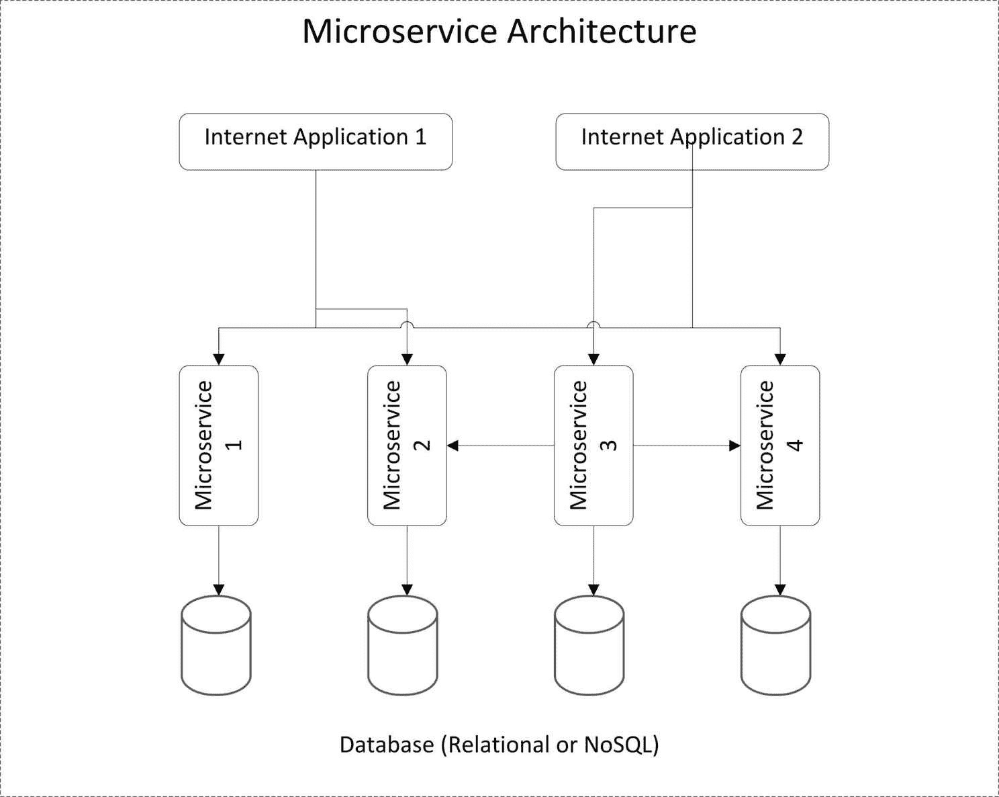

我们将看到，每个微服务都有自己的数据存储器或数据库。这消除了数据库层面的耦合，并确保数据库结构的变化不会影响一个以上的服务。我们将看到，微服务的自治性允许技术选择的灵活。

关于微服务架构定义的一极优秀文章，请参阅 Fowler 和 Lewis 编写的 [Microservices](http://martinfowler.com/articles/microservices.html)。

## 与传统应用程序架构的对比

让我们将其与传统的应用程序架构进行对比，例如在《Java EE Architect’s Handbook》中讨论的内容。传统应用程序架构就像分层蛋糕，如图 1.2 所示。通常它有分层来提供用户界面、数据访问和业务逻辑；取决于其功能 set，它可能还有其他额外的层。表达这种想法的另一种方式是耦合性很高。

### 图 1.2：传统 Web 应用程序架构

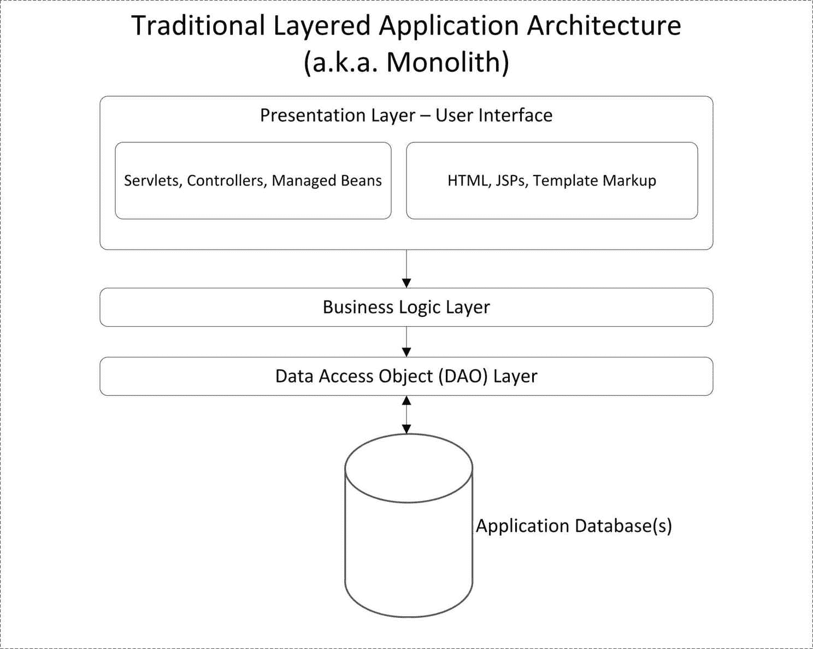

这些层旨在作为一个凝聚单元进行部署和测试（通常作为 `war` 或 `ear` 文件）。虽然可能在应用程序之外使用代码库的一部分，但这更多是例外而非常态。

应用程序作为一个单元进行扩展。应用程序具有针对不同受众的功能并不罕见。例如，拥有只有少数人使用的管理功能，与可能被成百上千名用户使用的更主流的功能相比，这并不常见。传统架构必须连同其他更流行的功能一起扩展扩展管理功能，因为它们在同一个部署包中。对于不熟悉该术语的人来说，部署包（deployable）是应用程序的可运行版本（例如 `war` 或 `ear` 文件）。

作为这一想法的推论，缺陷往往会溢出到不相关的功能中。例如，如果一个功能存在缺陷占用了你的数据库连接池并导致容器无法运行，该应用程序中所有其他不相关的功能也无法运行，尽管它们从业务角度来看是互无关的。

通常，整个代码库共享数据库资源。这意味着对数据库更改可能会影响整个应用程序代码库。是的，我们尝试通过像《Java EE Architect’s Handbook》中讨论的那样分离出数据访问层来使应用程序免受这些影响，但这种策略并不总是 100% 有效。数据库更改需要 `Entity` 类更改并可能对其他层产生影响并不罕见。

## 什么是单体（Monolith）？

通常，代码库在变得不可维护之前，其规模和复杂性是有限的。接近该点的应用程序被称为单体（monoliths）。

单体的部署通常有很长的质量保证/测试周期。对于单体，由于功能集非常大，执行一次完整的回归测试需要用户花费大量时间。是的，自动化测试序列缩短了开发人员进程，但用户 QA 测试通常包含大量的手动操作。

随着每次更改，单体经常会遇到意料之外的问题。也就是说，你修复了一个问题，结果因为该更改意外创建了新的 bug。从这种意义上说，在单体中修复 bug 就像打地鼠。是的，你的自动化单元测试和集成测试有助于缓解这个问题，但该测试用具并不是 100% 有效的。

单体通常与其技术栈紧密结合。也就是说，在单体中升级或更换依赖要困难得多。例如，如果单体使用 `Hibernate` ORM 产品进行数据访问，那么要更换为替代的 ORM 产品（如 `iBatis`）将非常困难。部分使用 `iBatis` 不仅会导致应用程序代码内部不一致；对于这种实际上没有直接增加业务价值的东西来说，测试工作将相当巨大。

新开发者在单体上的上手时间（burn-in time）要长得多，因为有太多要学。代码库通常非常大且相互关联。无论涉及的技术库和框架如何，其巨大的规模都为新开发者引入了学习曲线。

作为这一点的推论，开发者无法从一个应用程序轻松转移到另一个。这种学习曲线是针对每个单体的。单体的这一方面为管理在分配资源和调整优先级以应对任何业务优先级的变化方面带来了限制。

在单体中诊断内存和性能问题通常更困难，因为“草堆”（代码库的大小）通常大得多。寻找内存泄漏可能是开发者经历的最令人沮丧和最耗时的活动之一。此外，工具通常无法直接揭示导致泄漏的代码，因此涉及手动分析。在微服务架构中，至少可能是罪祸首首的代码规模要小得多，从而导致更快的内存泄漏诊断和更快的解决。


微服务库通常根据业务能力组织。也就是说，它们是根据业务中重要的主题进行组织的。[领域驱动设计](https://en.wikipedia.org/wiki/Domain-driven_design) (DDD) 将这些主题称为领域。领域是一个分析性构造，本质上代表一个独立模型。如果需要，DDD 会将领域进一步拆分为子域，然后划分为边界上下文（bounded contexts）。子域只是更详细、更具体的领域。边界上下文代表了构成领域或子域的物理构件。你可以将微服务视为边界上下文的一个示例。例如，一个学院或大学的领域划分可能如图 1.3 所示。

### 图 1.3：领域示例

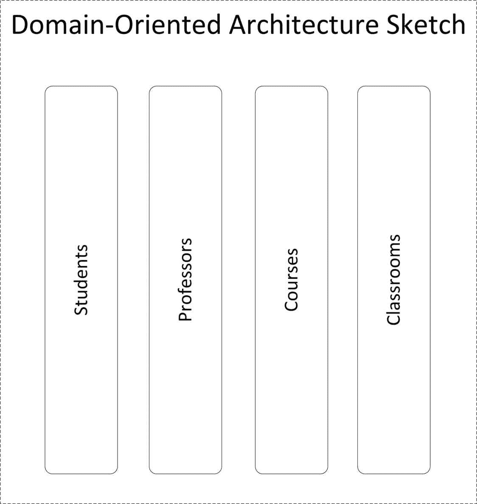

另一个适用于微服务架构的理论构架是[康威法则](https://en.wikipedia.org/wiki/Conway%27s_law)。康威法则（1968 年）基本上指出，企业构建的应用程序遵循其内部的通信结构。微服务架构也不例外。换句话说，微服务遵循组织架构图。

微服务通过将大型业务问题拆分为许多较小的业务问题来发挥作用。通过与你已经熟悉的传统的 Web 应用架构进行比较，更容易理解微服务架构的样貌。

## 使用微服务架构的益处

微服务减少/消除了技术栈锁死。我们中有多少人见过进行一次 `JDK` 版本升级简直像需要天降神迹？在传统世界中，这需要系统管理员（通常还有其他开发团队）的协调，而且非常困难。在微服务世界中，让不同的服务运行不同版本的 `JDK` 是很容易的；服务可以独立地进行升级。

技术锁定的点远不止于版本升级。在这个世界里，服务可以选择不同的数据库平台，因为它们实际上“拥有”这些平台。某人可能使用像 `Cassandra` 这样的 NoSQL 数据库，而另一个人可能坚持使用关系型数据库。

尽管如此，组织在可选数据库选择上确实可以获得规模效应。数据库需要备份和调优，有时还需要执行恢复。这需要技术专长，大多数组织出于经济考虑会将这些工作集中管理。仅仅因为做出不同选择的障碍之一被移除，并不意味着你应该疯狂地拥有 50 个不同的数据库平台。从管理的角度来看，对技术选择设定边界或准则非常重要，以确保创建的内容是可以支持的。

微服务架构加速了交付市场。也就是说，使用微服务架构后，整体开发生产率将提高。例如，根据最近的报告，Amazon 的部署率达到每天 23,000 次。Netflix 的部署率报告为每天 5,500 次。公平地说，大多数大规模实施微服务的组织也实施了持续交付和 DevOps。可以合理预期，Amazon 和 Netflix 的 DevOps 和持续交付的实现也为他们高部署率做了贡献。

额外的生产力取决于开发者通信开销的减少。也就是说，开发者能够在开发模式下更多地“埋头苦干（heads down）”，而不需要与他人频繁协调工作。

为了实现这种通信开销的减少，你必须精通合约管理（contract management）。也就是说，你需要擅长详细地描述将要实现的合约以及这些服务操作将实现的行为。开发者不应该就接口问题与其他团队沟通；他们应该能够专注于工作。

每个团队都能独立工作，而不会受到其他团队的强制交互影响。也就是说，他们有自己的开发/部署计划。

作为架构师，你的大部分时间将花在合约管理上；即详细描述合约规范，详细到开发者可以实现。你从开发者那里收回的问题是对架构师的反馈。如果问题的数量和范围很小，说明合约规范得得充分。如果开发者感到困惑，说明合约规范需要改进。

你必须精通合约管理。合约管理为你的开发团队提供了独立性，并将他们从通信开销中解放出来。那份合约规范也可以作为消费者的服务文档，减轻生产者和消费者的通信开销。正是通信开销的减少提供了开发速度的提升。

开发者每次应该只分配到一个且仅一个服务。这减少了开发者的上下文切换时间并增加了速度。

微服务提供了人员配置的灵活性。微服务开发团队规模小且目标聚焦。开发者每次*只*负责一个服务的工作。该服务应该有一个坚定的合约，开发者据此编写代码，并且最好带有容器化的交付物（即 `Docker`）。要点在于，他们主要在进行埋头开发。除了与工作该服务的其他开发者外，他们不应该承担（或不必承担）通信开销。

他们作为一个独立的团队工作，与所有其他服务团队完全是异步的。结合他们具有低通信开销和定义明确的交付物这一事实，他们可以在世界上任何地方、任何时区工作。无论他们是在附近的公司办公室内外包，还是在海外，并不重要。

鉴于团队的工作局限于服务的特定需求，对代码质量等的担忧至少被限制在较小的服务源码库中。换句话说，该团队能搞乱的代码量以及由此产生的维护问题是有限的。

注意：微服务的开发可以更容易地外包！

这也意味着你更好地免受不听话开发者（rogue developers）的侵害。我们都管理过产生不可维护代码的开发者；但通过微服务，不听话的开发者被限制在一个小而聚焦的代码库中，因此他们能造成的破坏是有限的。此外，如果该代码库很小、聚焦且定义良好，在需要时更容易被替换。你不会让不听话的开发者在 50 万行的单体应用中肆虐，造成更大范围的影响。

微服务提供了更好的可用性和恢复能力（如果实施良好的话）。微服务的依赖关系迫使开发者构建容错能力，并在设计和开发中将失败视为一等公民。故障和停机根据定义是局限在可识别的组件中的。我们将学习到，水平扩展单个服务的能力允许你缩短完全停机的时间。

## 使用微服务架构的劣势

如果设计不当，微服务可能会更难管理。我们将看到，企业架构和合约管理是至关重要的。如果没有这些，采用微服务的益处将被大幅削减。我们将看到，采用 DevOps 文化是规模实施微服务的前提。通常，采用微服务的组织也同样纳了持续交付。底线：实施微服务对于管理层以及开发者和架构师来说都是一次范式转移。


微服务的实现更为复杂。是的，每个独立的微服务由于其规模小且重点突出，对开发者来说更容易处理。然而，在微服务世界中，有更多的活动部件。这使得交付可能涉及多个微服务的业务功能在设计和管理上变得要困难得多。此外，这种复杂性使得缺陷更难诊断，性能问题也更难调查。

如果契约（contracts）设计得不好，微服务的实现将导致彻底混乱。我将在书的后部分介绍关于设计微服务合同的一些建议。如果合同设计糟糕，开发者将花费更多时间在消费服务和支持性活动上。这些时间会侵蚀你的开发速度，并对最初采用微服务的收益产生负面影响。从管理的角度来看，请考虑专门的合同管理的人力。某些架构师比其他人更擅长此道

值得注意的是，转向微服务架构要求你的组织具备 DevOps 能力等条件。我将在第五章标题为“采用微服务架构的前提”的节中提供这些前提事项的概述。

## 微服务架构与 SOA 的对比

许多人问：“微服务架构不简单是换了壳的 SOA 吗？”答案在很大程度上是“肯定的”。请记住，SOA 遭受着与微服务相同的定义性疾病，即 SOA 没有一个具体的定义。SOA 对不同的人有不同的含义。

它们在许多方面是相似的，队列/管道（queues/pipes）的复杂性除外。SOA 在移动队列数据方面通常有复杂的管道工程。通常使用 `Mule` 或 `Camel` 流来对传输中的数据进行转换、复制或重新排序，并以适应数据在服务之间移动时产生的任何格式差异。

在微服务世界中，进程服务（我们将学到它们是依赖其他服务来运行的复杂服务）能够有效地协调复杂业务的交付。。编排（orchestration）的角色被委托给进程服务，而不是 `Mule` 或 `Camel` 流。

微服务架构使用“笨的管道和智能的终端”。微服务也使用队列，但没有你可能会在面向服务的架构（SOA）世界中发现的任何转换。通常，不存在复杂的流（例如 `[Mule](https://developer.mulesoft.com/)` 或 `[Camel](http://camel.apache.org/)`）对在服务间传输的消息数据进行格式、过滤或顺序更改。以你音响系统的电源为例，这就是此类管道的例子。电力要么开启要么关闭，中间没有其他其他状态。一个“管道”不会比这更简单了，管道本身绝对没有任何智能。

## 重构为微服务架构

通常，应用并不是一开始就采用微服务架构的。在大多数情况下，它们被重构为微服务架构。在阅读了许多案例研究后，我还没有见过任何一个微服务应用不是从一个变得大到无法有效管理和维护的传统 Web 应用开始的。这并不是说这样做是不可能的，但这绝对不常见。

将用户界面排除在微服务架构之外。内聚的用户界面具有显著的优势；它们为用户体验提供了一致性。Web 呈现框架以与其他框架兼容性不佳而闻名。例如，`JSF` 和 `Spring-MVC`。这两者都是非常可行的框架，可以满足大多数用户需求集，但如果你尝试在同一个用户界面中结合它们，你会很快发现自己是在逆流而上。底线是：考虑将用户界面免于微服务架构。我将在稍后详细介绍它们的作用以及如何整合它们。

由于重构数据库更为困难（稍后详述），让我们在微服务重构的第一阶段也保持数据库现状。被分离到单个微服务中的是业务逻辑。这种方法的说明见图 1.4。请注意，我使用了一个简单的示例，其中识别出的领域是边界上下文（bounded contexts）。这种情况可能会发生，但更有可能的是 `Students` 领域会被拆分为多个边界上下文和多个微服务。

### 图 1.4：第一阶段重构示例

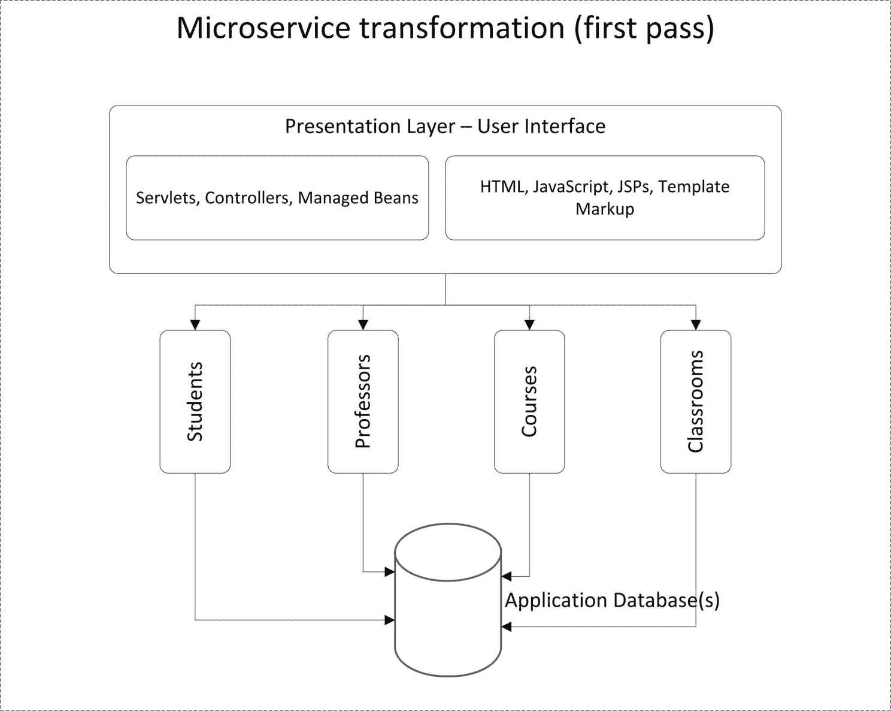

我们不能完全将数据库排除在重构之外。多个服务使用同一个数据库/模式实际上是“耦合”，这正是微服务架构试图避免的。它不是我们通常理解的那种耦合（即代码耦合）。然而，在第一阶段重构后的任何数据结构更改都会影响多个服务。由于这个原因，微服务架构真的在促使你分离数据库。

每个微服务都“拥有”自己的数据库。看待它就像看待 `Java` 类中的实例级字段一样。我们每个服务拥有自己数据库的高等教育示例的插图见图 1.5。

### 图 1.5：微服务示例

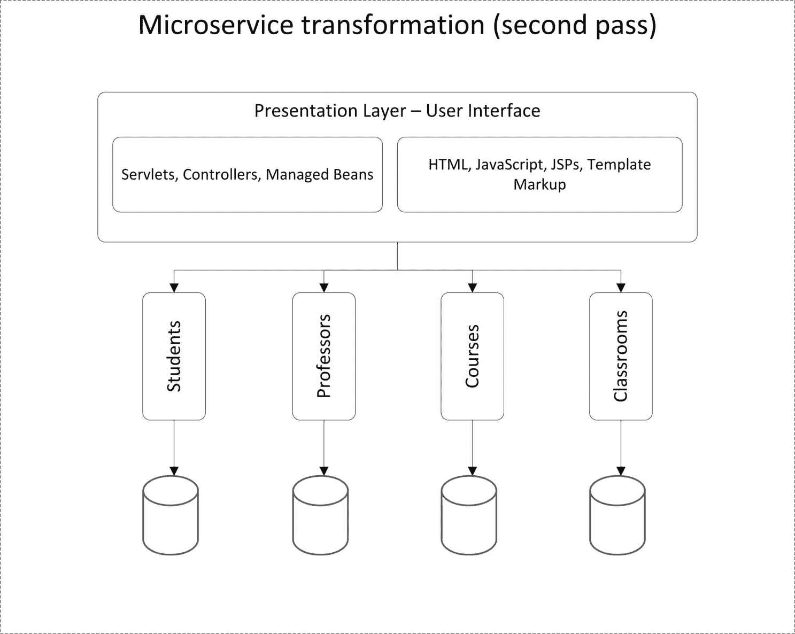

这为我们带来了松散耦合，但也带来了一些问题。我们如何处理公共业务数据？所有组织都有贯穿整个企业的数据；即多个服务都会需要的数据。

考虑一个高等教育的例子。大学有“校区”。我就读的印第安纳大学在布鲁明顿、南本、印第安纳波利和其他许多地方设有校区。采用微服务架构的多个服务将需要这些信息。如果每个服务都有自己的数据库，这意味着它们没有在某处使用中央数据存储。只有两个选择：服务调用或复制。也就是说，定义一个“拥有”校区服务的，并让所有其他微服务调用以获取该信息。另一个选项是将该数据“复制”到所有需要它的服务。

个人而言，我倾向于使用服务方法。（别担心；我将介绍减轻额外服务调用性能影响的方法。）我不喜欢将数据从一个服务复制到另一个服务，因为这通常会带来维护上的头疼；执行复制需要额外的编码和测试，而且复制可能会出现问题。缺陷往往是因为相同数据的副本不同步而产生的。我选择通过为每项信息只保留一个源，并在需要时通过额外的服务调用来获取，从而完全避免这个问题。

如果你选择复制策略，我建议使用发布/订阅（publish/subscribe）。也就是说，“拥有”业务数据的服务在持久队列上发布信息发生变更的事实。对这些更改感兴趣的服务订阅该队列，并在它们自己的数据库中记录必要的事件。

在美国的企业界，我们一直热衷于事实记录一次且仅记录一次。因此，发现某些站点有多个应用程序（有时是几十个）维护相同的数据库数据并不稀奇。对于这些组织来说，重构到每个微服务都有自己的数据库是一项艰巨的任务。但有一种折中方案。

如果你不能为每个微服务提供自己的数据库，至少要重构到一个且只有一个服务可以更新、插入或删除每个数据项。。这减少了你在解决数据损坏错误时需要查找的“草堆”。


你不需要为每个微服务准备独立的物理数据库服务器/许可证。目标是消除数据库层面的耦合。使用独立的数据库模式（schemas）就足以达到这种程度的解耦。当然，不要在两个不同微服务使用的表之间创建任何引用完整性规则（例如外键约束）是非常重要的，因为这属于不必要的耦合。

# 第 2 章：微服务架构的设计考虑

本章详细介绍了微服务架构中重要的设计考虑因素。与任何技术范式一样，使用微服务架构也可能编写出过于复杂且难以维护的软件。本章将帮助你避免这种情况。

大多数实现微服务的人都使用 REST 风格的 Web 服务。因此，我提出的所有示例都将假设使用 RESTful Web 服务接口。需要注意的是，REST 并非实现微服务架构的必要条件；任何标准化的接口都可以。大多数人在微服务架构中使用 REST，是因为它它对资源（即名词）的依赖自然地契合了微服务的边界。

## 服务边界

微服务最重要的设计考虑因素是定义它的使命。也就是说，定义它必须履行的单一业务目的。处理这个问题有几种方法：一种是以识别 REST 服务资源相同的方式来识别服务边界；另一种是从领域驱动设计（DDD）的角度识别服务边界，并将你的领域模型精炼为足够特定的子领域，以便在定义微服务时使用它们。在这两者之间，我通常按 REST 资源来思考。反正这很契合，因为大多数用户倾向于将微服务实现为 RESTful Web 服务。

## 定义微服务

一个微服务的定义包含以下内容：

*   有意义的
*   用业务术语编写的服务业务功能
*   支持该业务功能的 RESTful Web 服务资源或资源层级
*   操作细节，例如：
    *   请求参数
    *   输入 POST 数据格式
    *   输出数据格式
*   保留的资源层级属性
*   范围细节
    *   关于该服务管理和不管理哪些业务功能的详细说明

让我们来看一个例子。以学院或大学的“学生”业务概念为例。这些机构通常有记录学生特定信息的需求（例如学生姓名、分配的学生标识符、出生日期、性别、地址、电子邮件、电话号码等）。还有涉及学生的更复杂的业务流程（例如为他们注册课程、维护成绩单、处理付款等），但对于本例，让我们仅限于维护学生的个人信息。该示例服务如图 2.1 所示。

### 图 2.1：核心服务定义示例

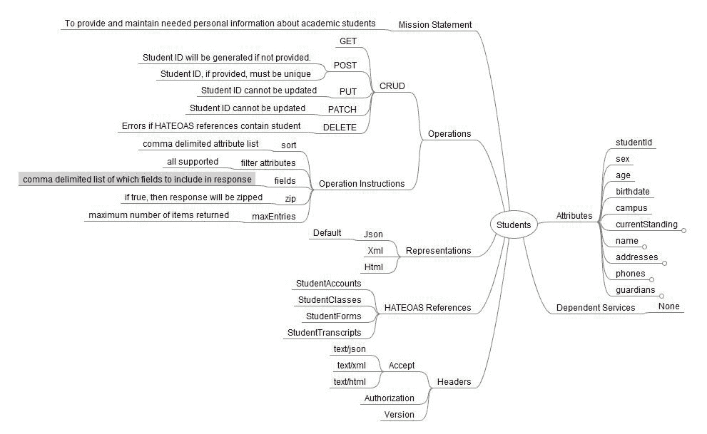

服务名称 `Students` 位于中心。左侧是用业务术语对服务的一句描述。所有操作都根据支持它们的 HTTP 方法进行了详细说明（例如 `PUT`、`POST`、`GET` 等）。`GET` 请求中列出了所有支持的查询条件，如 `sort` 和 `maxEntries`。列出了所有支持的表示格式，以及支持的 HATEOAS（应用程序状态引擎的超文本，缩写）引用链接。右侧列出了关于学生的服务属性，以及任何支持的服务。表 2.1 展示了不同 HTTP 方法及其含义。

### 表 2.1：HTTP 方法用法

| HTTP 方法 | 使用备注 |
| :--- | :--- |
| `GET` | 仅用于信息检索。假设 `GET` 操作不会以任何方式更改数据。 |
| `POST` | 仅用于创建资源。假设资源不存在且正在新创建。 |
| `PUT` | 用于更新资源。假设资源上的所有信息都在被更新。 |
| `PATCH` | 用于部分资源更新（例如选定的数量资源属性）。 |
| `DELETE` | 用于删除资源。 |

单看图 2.1 中的图表可能不足以让团队据此进行开发。然而，在规划阶段，它绝对足够了，并为开发者提供了一个起点，让他们可以从这里提出明智的问题。顺便提一下，我使用了开源产品 [Freemind](http://freemind.sourceforge.net/wiki/index.php/Main_Page) 制作了图 2.1 中的图。我通常使用 Freemind 对此类 RESTful Web 服务进行初始规划。

当然，可能有多个操作来支持交叉关注点，例如健康检查、性能指标、运行时诊断等。这些操作虽然很重要，但它们是为了支持而存在的，与服务的生存理由无关。我将世界分为两类服务：核心服务和过程服务。

## 核心服务

核心服务存储关于企业的业务事实。它们负责维护企业特定区域的业务数据。核心服务主要提供类似 CRUD 的功能，通常不依赖于其他服务。无论我们如何模块化软件，在某个时刻，某些东西需要在某种数据库中记录业务事实。核心服务在微服务架构中充当这一角色。图 2.1 是这样一个核心服务的示例。

核心服务通常用名词命名，因为大多数业务事实都是名词。你识别 RESTful Web 服务的思维纪律也可以用于识别核心服务。你通常可以将一个核心服务的“使命”表达为“___ 的记录服务”。在空格处填入名词。使命声明的格式通常可以按以下格式表示：

<服务标题> 是 <业务术语> 的记录系统。

例如，考虑图 2.1 中定义的 Student 服务：

Student 服务是学生个人信息的记录系统，例如他们的姓名、地址、年龄、紧急联系人和其他信息。

让我们深入研究图 2.1 所示的示例。你可能会问我如何决定将 `StudentAccounts`、`StudentClasses`、`StudentForms` 和 `StudentTranscripts`（这些都是 [HATEOAS](https://en.wikipedia.org/wiki/HATEOAS) 引用链接）拆分为独立的服务，以及为什么我没有直接将它们包含在 `Students` 服务中。答案是，这些服务引用中的每一个都有特定于该部分的业务逻辑。例如，对于 `StudentClasses`，为学生注册课程不仅仅是某处数据库中的一个 [CRUD](https://en.wikipedia.org/wiki/Create,_read,_update_and_delete) 条目。学生是否符合课程先决条件？这门课程是否与学生选择的其他课程冲突？这两者都是业务流程问题，最好分开处理，而不是与学生个人信息的无关的方面放在一起。

让我们将其与由 Students 服务维护的学生地址或电话号码进行对比。在这所虚构的大学中，没有围绕记录学生地址或电话号码的业务流程。学生提供变更通知，我们记录即可。这仅仅是一个类似 CRUD 的功能。因此，将其拆分为独立服务的动力几乎不存在。


任何删除可能注册过课程或可能产生过费用的学生的尝试都会导致错误。在传统的 Web 应用程序中，我们可能依赖关系型数据库的引用完整性规则。然而，在微服务架构中，这些信息存储在单独的数据存储中，没有引用完整性规则来防止其他服务的数据在本质上处于被孤立状态。因此，这需要在应用层面强制执行。另一种可能性是进行级联删除（向依赖服务发布相应的删除操作），这在本质上是危险的。

让我们注意图 2.1 中 `Students` 服务的其他特征。

严格遵守 HTTP 方法的严格定义。关于可用方法的简要总结可以在[此处](http://restful-api-design.readthedocs.org/en/latest/methods.html)查看。`GET` 请求检索信息；`GET` 请求永远不会更改任何业务数据（记录 `GET` 请求和响应是一种非功能性的、交叉关注的支持性问题，不被视为更改数据）。这简化了你向实现契约的服务开发者必须提供的通信内容。

严格遵守 HTTP 方法错误代码的严格定义。这些错误代码是标准的。关于这些错误代码的简要总结可以在[此处](https://developer.yahoo.com/social/rest_api_guide/http-response-codes.html)查看。类似于遵循 HTTP 方法定义，这简化了你向实现契约的服务开发者必须提供的通信内容。

在所有微服务中标准化你的操作指令。对于 `Students` 服务，我定义了几个常用的操作指令：`sort`、`fields`、`maxEntries` 等。提供一种允许请求者按照其指定的顺序接收请求数据的功能是常见的。不要允许某些微服务使用 `sort` 指令而另一些服务使用 `order`。这种非标准化会给消费者带来困惑，并阻碍提高开发者效率的目标。

## 处理服务 (Process Services)

过程服务管理复杂的业务任务。它们通常代表特定的业务操作或程序。通常，过程服务依赖其他服务提供处理所需的大部分数据。有时，过程服务需要持久化数据，但并非总是如此。

你通常可以将一个过程服务的“使命”表述为“负责 ______ 的服务”。例如，`StudentClasses` 服务负责学生课程注册并对现有的学生课程注册进行报告。与核心服务示例类似，在图 2.2 中可以找到 `StudentClasses` 服务契约的类似说明。

### 图 2.2：过程服务定义示例

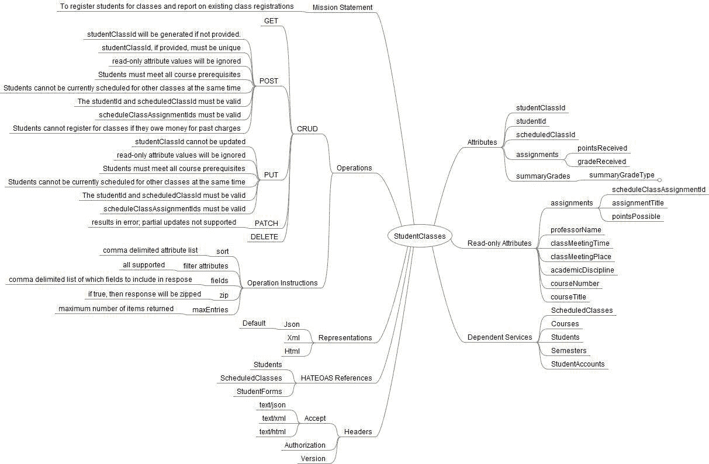

该定义的格式与图 2.1 中的核心服务示例相似。让我们来看一些差异。首先，`StudentClasses` 服务对写操作强制执行以下业务规则和约束：

*   学生必须满足所有课程先决条件
*   学生目前不能在同一时间被安排其他课程
*   如果学生欠有过往费用费用，则无法注册课程

这些约束纯粹是业务层面的，需要在服务层面强制执行。

此外，并非所有呈现的属性都是更新的。图 2.2 区分了由 `StudentClasses` 服务维护的“属性”与为了方便消费者而呈现的“只读属性”，后者实际上是在其他服务中维护的。例如，如果消费者想要更改安排课程的 `Professor` 姓名，他们应该通过 `ScheduledClasses` 服务来产生该更改。是的，为了方便而呈现这些信息确实需要调用服务，这可能会对性能产生负面影响。我们将在书的后部分讨论缓解这种性能影响的方法。

请注意，`StudentClasses` 服务有依赖服务，与图 2.1 中的 `Students` 服务不同。如果这些服务不可用，`StudentClasses` 服务可能无法正常运行。我们将讨论减少依赖服务可能造成的漏洞的方法。目前，我正专注于有效地定义服务边界和契约。

接受微服务架构会比传统的应用程序架构增加服务流量。过程服务依赖其他服务来完成工作。图 2.2 中的 `StudentClasses` 服务就是其中之一。过程服务可能有数据库资源，但并非总是如此。

## 分区是一门艺术 (Partitioning Is an Art)

决定服务边界或确定微服务的使命声明具有欺骗性的困难。此外，我无法给出一个客观的公式来确定服务的使命声明。如果你让服务做的事情太多或将其使命定义得太泛，你最终将得到几个“婴儿级单体”，而不是微服务库。如果你让服务操作过于细粒，将会导致过度的网络交互，性能将会损害。

## 微服务与领域驱动设计 (Microservices and Domain Driven Design)

Evans 的领域驱动设计 (DDD) 概念在确定服务边界方面起着作用。DDD 将世界划分为“领域 (Domains)”和“子领域 (Sub-domains)”。领域是企业知识的范围。它们总是用业务术语表示，并且是纯分析的构造。它们代表企业中通常大到无法用微服务表示的区域。子领域是领域的任意划分，它们也总是用业务术语表示。子领域也是一种分析构造，并不一定与部署的服务一一对应。在子领域内部，划分了限界上下文 (bounded contexts)。

DDD 中的限界上下文是一个具有统一领域模型的任意边界。通常，一个限界上下文位于且仅位于一个子领域中。限界上下文是一个物理构造，并且通常具有服务部署表示。边界上下文之间的关系被显式定义。通常，意图是在代码中反映这种上下文，使代码更接近企业实际运作的方式。核心微服务管理一个且仅一个边界上下文的数据。它们从不跨越边界。

过程服务管理复杂的流程。这些可能涉及一个或多个边界上下文。本质上，过程服务可以描述边界上下文之间的关系。边界上下文之间的关系是由独立的服务管理的。

## 服务使命检查 (Service Mission Checks)

由于分区的艺术性，很难提供一个确定服务使命声明的客观算法。然而，我可以提供详细的警示信号，可能表明服务定义需要改进。

### 边界使命合理性检查

你应该能够用业务术语用一句话表述服务的业务功能。如果你不能，这说明服务没有定义得良好。

业务功能的示例包括：

*   `Student` 服务是 `Professor` 信息的记录系统
*   `Registration` 服务负责学生课程注册
*   `Discipline` 服务负责停学学生
*   `Student Payment` 服务记录学生付款
*   `Transcript` 服务生成官方成绩单

这些示例的共同点是什么？它们都是用业务术语编写的。除了服务标题中固有的术语外，其中没有任何技术术语。

让我们与定义不当的服务示例进行对比。以下是不你不应该遵循的“反模式”示例，随后我将讨论它们的问题。

反模式示例


1. `客户关系管理 (CRM)` 服务维护着目标营销的人员。这些人包括高中生、在其他大学就读的学生以及这些学生类型学生的家长。

2. `捐赠 (Donation)` 服务负责更新捐赠数据库，其中包括已受请求或应该被请求捐赠的人，以及已收到的捐赠。这包括校友、校友家长、企业捐助者以及任何可能被请求捐赠的人。

## 使命声明 (Mission Statements)

使命声明不应包含技术术语。第一个示例中使用的 `CRM` 一词指的是某一特定类型的软件产品。它是一个技术术语，不应成为微服务使命声明的一部分。第二个示例提到了“数据库”，这实际上是在微观层面上管理了信息的存储方式。微服务的技术实现细节应该是被隐藏的。存储机制和特定的产品集应该是私有的，并且可以在不另通知服务消费者的情况下进行更改。

微服务不应尝试维护多个业务概念的信息。`Donation` 服务（第二个反模式示例）在一个服务内承担了过多的任务。微服务的初衷是只做一件事并做好。该服务跟踪了可能被请求捐赠的候选人，还跟踪了捐赠金额。我应该将跟踪潜在请求者的业务与记录请求事件及已收捐赠的业务分开。处理捐赠和记录交互以获取已收捐赠的服务，完全可以以某种方式使用跟踪潜在请求者的服务。

值得注意的是，虽然微服务只有一个业务目的，但它们通常可以用于多个业务语境。例如，我们正在讨论的 `Donation` 服务可能被识别营销目标的服务使用，或被实施不同类型营销活动的服务使用。换句话说，单一的业务目的并不意味着该服务不会有多个消费者。

我会这样重写“CRM 服务”的使命声明：

- `营销潜在客户 (Marketing Prospect)` 服务是关于目标营销人员信息的记录系统。

除了句数超过一个句外，`CRM` 服务的使命声明还包含了 `CRM` 一词，这是一个技术术语。`CRM` 应用不仅用于跟踪营销活动中的客户和客户代表，还用于管理销售团队效能和不同类型的营销活动。没有必要将所有的 `CRM` 功能封装在与技术无关的微服务中。只使用软件产品提供的部分功能并不罕见。只需要创建那些会被其他服务和应用程序利用的 `CRM` 功能部分。该使命声明似乎关注的是管理营销活动潜在客户的 `CRM` 功能部分——“潜在客户”是指可能成为某种类型营销活动或客户交互主体的潜在客户或客户代表。

我会重写“捐赠服务”的使命声明并将其拆分为多个服务：

- `捐赠潜在客户 (Donation prospect)` 服务是可能被请求捐赠的人员的记录系统。
- `请求 (Solicitation)` 服务跟踪向捐赠潜在客户请求捐赠的尝试。
- `捐赠收据 (Donation Receipt)` 服务跟踪捐赠潜在客户的承诺以及实际的捐赠收据。

除了句数超过一个句外，对“捐赠数据库”的引用是一个技术构造而非业务术语。此外，`Donation service` 这个标题面临着职责过大的风险。微服务只做一件事并做好。该服务跟踪了可能被请求捐赠的候选人，还跟踪了捐赠金额。我应该将跟踪潜在请求者的业务与记录请求事件及已收捐赠的业务分开。处理捐赠和记录交互以获取已收捐赠的服务完全可以以某种方式使用跟踪潜在请求者的服务。

## 上文独立性检查 (Context Independence Check)

当其他团队出现并想要调用你的服务时，你会感到紧张吗？你会开始问这类问题吗：

- 你们在我们之前和之后还调用了什么？
- 你们为什么要调用我们？
- 我们具体将参与哪一个业务流程，你们期望我们做什么？

这些都是警示信号，表明你的服务并非真正与上下文独立。它对调用其所处的业务条件做出了假设。一个定义良好的服务应该对何时/如何被调用保持无关（agnostic）。只要它有自己的输入和资源，且输入是有效的，它就完成它的工作；仅此而已。当其他团队出现并想要调用你的服务时，你应该出的反应应该是：“这是文档。如果有任何问题请告诉我们。再见……”

沿着这些思路可以问的更详细的问题：

- 你的服务是否有多个消费者？它可以在不产生负面影响的情况下运行吗？
- 你的服务是否在乎它是批量执行，还是由用户 Web 应用程序间接启动？
- 你是否花时间分析服务之间的调用流？唯一应该做此事的开发者应该是那些处理流程服务的开发者，这些服务通常需要消费其他服务来完成工作。

这些问题的答案很可能表明，你的服务并不像应该的那样与上下文独立。如果你为应该由哪个服务执行某项活动而苦结，也许该活动需要它自己的服务。

## 微服务关乎大小 (Microservices are not about size)

微服务中的“micro（微）”前缀并不理想。它让每个人都关注代码库的大小，而不是服务使命定义的清晰程度。

微服务架构更多地关于服务是否具有单一的功能目的。恰恰由于有了单一目的，代码库通常会较小。换句话说，较小的代码库是微服务架构的副产品，而不是其本身的最终目标。

什么是行？任选一个服务作为示例。用 `Java` 编写，你会得到一定数量的行。用 `C` 编写相同的服务，你可能会得到更多的行，因为该平台更冗长。用 `assembly` 编写相同的服务（尽管你不会那样做），你会得到大量的行。技术平台/语言的选择会使得 `C` 或 `assembly` 版本就不那么像微服务吗？完全不会。

## 设计应对故障 (Designing to accommodate failure)

在传统架构中，大多数调用是本地的。如果应用程序处于运行状态以进行调用，资源通常是可用于提供服务的。在微服务架构中，服务经常依赖其他服务作为资源。我们需要为依赖服务宕机的情况进行设计。

故障设计是分层进行的。防御故障的第一道防线是水平扩展/集群。也就是说，在不同的虚拟机上运行服务的多个副本，从而增加了至少有一个服务副本可供消费者使用的概率。如果该服务有多个副本，整个集群宕机的概率就会降低。我们在传统应用程序中也是这样做。


为什么这个问题比任何其他问题都更严重？在一个服务调用嵌套的世界里——即服务调用的服务在调用其他服务——单一故障级联到其他服务并不非易事。让我们稍微探讨一下这一点。

假设你有一个微服务，它在内存、数据库资源、容器工作线程等方面已扩展到支持 20 个并发事务。进一步假设，每个服务调用通常在少于 200 毫秒（ms）的时间内完成。想象一下，如果这些调用中的每一个突然都要等待 30、60 或 90 秒才失败，会发生什么？你将看到大量的派生错误：内存溢出、工作线程不足、服务连接池中的数据库连接不足。很快，依赖于该不可用服务的服务将无法运行。故障的级联将继续下去。很快，要找出根源将变得困难，而且你的服务库中很大比例将处于停工状态。

逻辑上的结论是，如果依赖资源不存在，服务应该尽快地失败。这种失败将是描述性的，显然不是根源类型的问题。管理员能够快速查出根源，而不需要该不可用服务的工作可以继续进行。这是性能调优中一个有趣的转折。

关于“立即且显式失败”概念的进一步阅读，可以参考 Jim Shore 的文章 ["Fail Fast”](http://www.martinfowler.com/ieeeSoftware/failFast.pdf)。

## 故障编码模式

本节描述了用于更快速失败以及在无人工干预的情况下自动恢复的编码模式。

### 重试模式 (Retry Pattern)

重试模式简单地重试请求的工作，直到它最终成功。这让我想起了那句老话：疯狂就是不断重复做同样的事情并最终获得不同的结果。该算法如图 2.3 所示。

图 2.3：重试模式

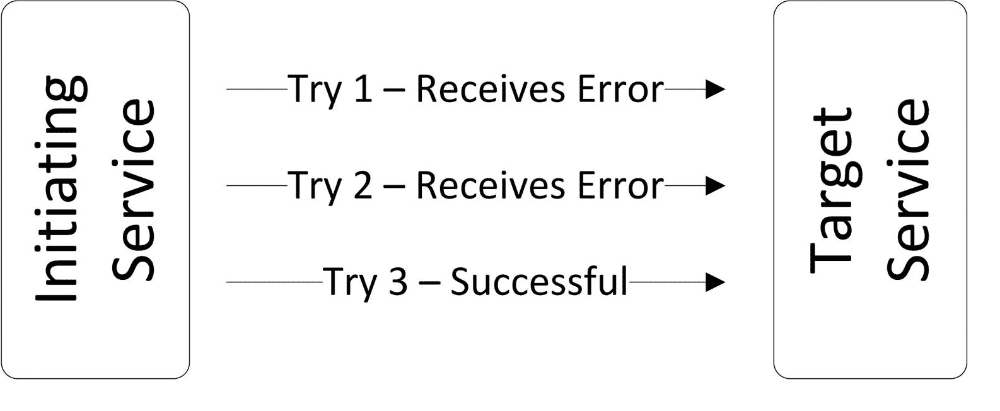

重试时通常有两个可配置的选项。重试模式的一个示例实现可以在我的 GitHub 项目 [Insanity](https://github.com/Derek-Ashmore/Insanity) 中找到，该项目是开源的。

- 操作放弃前的最大重试次数
- 每次重试之间的时间间隔。

对于想要开发者级别细节的人来说，Insanity 的默认算法提供了间隔和最大重试配置选项。列表 2.1 提供了一个使用 10,000 毫秒重试间隔和 2 次最大重试的使用示例。Insanity 要求你将要重试的代码嵌入实现 JDK [Callable](http://docs.oracle.com/javase/7/docs/api/java/util/concurrent/Callable.html)接口的类中。是的，如果你愿意，Insanity 允许你编写接受不同配置选项的自定义重试算法。

列表 2.1：使用 Insanity 的重试算法示例

```
DefaultRetryAlgorithm algorithm = new DefaultRetryAlgorithm(2, 10L);

RetryManager<String> retryManager = new RetryManager<String>(algorithm);

MyCallable callable = new MyCallable();

String callResult = retryManager.invoke(callable);
```

重试模式基于这样一个假设：故障是暂时的——最终会恢复服务，请求的操作将完成。重试模式在工作是异步的情况下效果最好，因此请谨慎。在微服务世界中，我们不应该关心执行上下文。

该模式有产品支持。它由 Apache Httpclient 产品提供（因此 CXF 也有支持，因为它依赖于 Httpclient）。Spring batch 提供了一个实现此模式的 `RetryTemplate`。

### 断路器模式 (Circuit Breaker Pattern)

这种模式是你房屋或公寓中电路闸盒的软件版本。电路要么是关闭的，要么是开启的。如果是关闭的，那么电路上的所有设备都有电并可以运行。当糟糕的事情发生时，电路跳闸并开启。在开启状态下，该电路上的任何设备都没有电或无法运行。当你重置闸盒中的电路时，电源将恢复到该电路上的每个设备。

断路器模式的工作原理相同。当遇到错误阈值时，它会跳闸并立即报错。在可配置的时间内的任何后续调用也会立即报错。断路器模式的一个示例实现可以在我的 GitHub 项目 [CircuitBreaker](https://github.com/Derek-Ashmore/CircuitBreaker) 中找到，该项目是开源的。

图 2.4：断路器模式

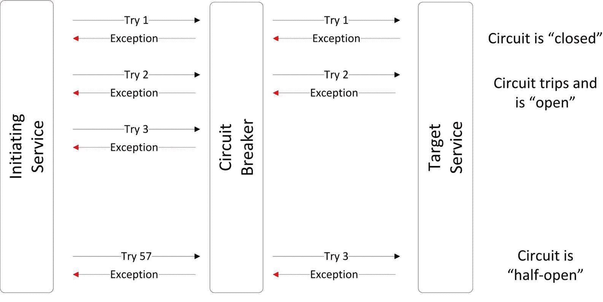

在可配置的间隔后，一个服务请求操作将作为“测试”通过。如果测试成功，电路将自动关闭，所有服务调用都将被允许。换句话说，服务在无需人工干预的情况下自动恢复。

断路器的软件版本通常具有这些配置选项：

字体 触发电路跳闸并关闭服务所需的连续错误次数。
- 关闭到允许“测试”服务调用继续之间的时间间隔。

对于想要开发者级别细节的人，CircuitBreaker 的默认算法提供了时间间隔和连续错误次数的配置选项。列表 2.2 提供了一个使用 10,000 毫秒时间间隔和两次连续错误阈值的配置使用示例。Insanity 要求你将要重试的代码嵌入实现 JDK [Callable](http://docs.oracle.com/javase/7/docs/api/java/util/concurrent/Callable.html)接口的类中。是的，如果你愿意，CircuitBreaker 允许你编写接受不同配置选项的算法。

列表 2.2：使用 CircuitBreaker 的断路器算法示例

```
DefaultCircuitBreakerAlgorithm algorithm = new DefaultCircuitBreakerAlgorithm(10L, 2L);

Circuit<String> circuit = new Circuit<String>(algorithm);

MyCallable callable = new MyCallable();

String callResult = circuit.invoke(callable);
```

由于 `Circuit` 类保留了状态（例如，跟踪连续错误次数并知道何时允许测试执行），该变量声明实际上应该位于实例级别。

该模式的产品支持包含在 Hystrix 套件中。如果你出于其他原因使用 Hystrix 套件，你绝对应该利用他们的实现。如果你没有使用，该产品的开销很大。在这种情况下，我会使用更轻量级的实现，就像我示例中的那样。

断路器的使用最好放在客户端代理或适配器中。这样，当它跳闸时，你可以避免网络交互。

### 通过消息调度 (Dispatch via Messaging)

我们将其用于传统的 Web 应用程序。理念是将服务调用指令编码为消息并放入持久化队列中。即一个记录指令并保证某时交付的队列。服务从队列中读取指令并执行它们。如果目标服务宕机，工作会在队列中堆积。当服务恢复时，队列中的指令将按应的方式进行处理。

图 2.5：通过消息调度模式

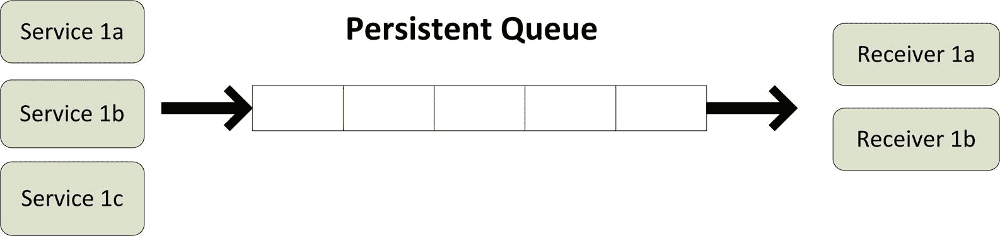

注意，这也是一种性能模式。虽然它并没有真正让工作更快，但它通过使工作异步为用户提供了一种速度提升的“幻觉”。也就是说，由于用户不需要等待工作完成，他们感知到了速度的提升。


我建议在消息传递中使用 [AMQP](https://www.amqp.org/) 而不是原生 JMS。JMS 是特定平台的（仅限 Java），这违背了微服务架构对技术栈无关性的优势。在工具支持方面，大多数人认为 [JMS api](https://docs.oracle.com/javaee/6/tutorial/doc/bncdr.html) 足够简单可以直接使用。Spring batch 提供了 [`JMSTemplate`](http://docs.spring.io/spring/docs/current/javadoc-api/org/springframework/jms/core/JmsTemplate.html) 和 [`RabbitTemplate`](http://docs.spring.io/spring-amqp/api/org/springframework/amqp/rabbit/core/RabbitTemplate.html) 来辅助消息生产。

## 服务调用中者 (Service Call Mediator)

服务应该具有足够的韧性，以便在发生故障时部分运行。核心思想是提供降级服务优于不提供服务。换句话说，我们的设计是在发生故障时提供部分可用性。一个例子是在飞机上销售 WiFi 服务的业务。客户通过信用卡支付小额费用并接收服务。如果信用卡支付处理功能不可用，那么为该客户提供 WiFi 服务可能在业务上是合理的，而不是通过拒绝服务来激怒他们。中者模式是[设计模式 (Design Patterns)](https://en.wikipedia.org/wiki/Design_Patterns) 一书中定义的“四人帮”行为模式之一。服务调用中者模式的一个示例实现可以在我的 GitHub 项目 [TaskMediator](https://github.com/Derek-Ashmore/TaskMediator) 中找到，它是开源的。

图 2.6：服务调用中者模式

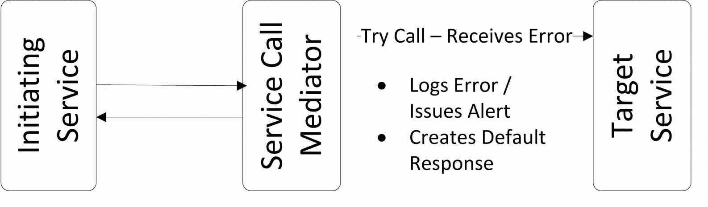

由于启动服务接收到默认/正常响应，它会照常处理。启动服务中提供部分功能所需代码量被降最低。从启动服务的角度来看，并没有发生错误。然而，服务调用中者记录了错误并启动了任何所需的支持告报。

对于想要更多代码级示例的人，列表 2.3 提供了一个使用 `TaskMediator` 的服务调用中者模式的示例。

列表 2.3：使用 `TaskMediator` 的服务调用中者算法示例

```
TaskMediator<String> taskMediator = new TaskMediator<String>(DEFAULT_RESPONSE);

MyCallable callable = new MyCallable();

String callResult = taskMediator.invoke(callable);
```

注意，可以将服务中者模式与断路器模式结合。通过这种方式，你获得了更早失败且消耗资源更少的处，以及提供部分功能的优势。如何使用 [CircuitBreaker](https://github.com/Derek-Ashmore/CircuitBreaker) 完成此点的示例可以在列表 2.4 中找到。

列表 2.4：结合服务调用中者与 CircuitBreaker 的示例

```
DefaultCircuitBreakerAlgorithm algorithm = new DefaultCircuitBreakerAlgorithm(10L, 2L);

Circuit<String> circuit = new Circuit<String>(algorithm);

MyCallable myCallable = new MyCallable();

CallableCircuit<String> circuitCallable = new CallableCircuit<String>(circuit,
myCallable);

TaskMediator<String> taskMediator = new TaskMediator<String>(DEFAULT_RESPONSE);

String callResult = taskMediator.invoke(circuitCallable);
```

## 为性能而设计

在微服务架构中，有大量的网络流量。这种增加的网络流量会导致架构师对性能产生担忧。毕竟，与本地方法调用相比，服务调用的代价是非常昂贵的。此外，由于架构师可能会“假设”微服务架构使用的是细粒服务，这也会加剧他们的担忧。但这种假设是错误的。你在 SOA 中中学到的所有关于服务是粗粒度的知识仍然适用；但即使是粗粒度的服务调用，网络流量也会随着微服务架构而增加。幸运的是，我们通可以使用一些设计策略来缓解服务调用流量增加对性能的影响。

### 针对性能的编码模式

有几种编码模式可以帮助缓解服务调用流量对性能的影响。我将带你了解它们。

这些模式中的一种——通过消息分发，在前一节中讨论过的一种故障设计模式，在这里不再重复描述。它也是一种性能模式，因为它通过将工作离线化，为用户提供了感知性能提升，因为他们看到的工作部分变短了。

### 后端到前端 (API 网关)

“后端到前端”模式通过确保微服务流量位于你的局域网而不是公网中来提高性能。该模式使用网关服务来合并 Web 应用程序/用户界面产品的微服务调用。其理念是应用程序的浏览器部分将对其应用服务提供者发起一次或两次调用。该提供者将执行完成 Web 应用程序用户请求的任务所需的众多微服务调用（直接或间接地）。

我使用“应用服务提供者”这一术语来描述那个合并用户界面调用和响应的网关服务。

这种模式的另一个名称是“API Gateway”。然而，我不使用那个术语，因为 API 网关模式与 API 网关产品（例如 [WSO2](http://wso2.com/)）之间通常存在混淆。API 网关产品关于路由和治理，而不是关于任何种调用合并活动。我专门指的是模式本身。

应用服务提供者合并服务调用。也就是说，对它们的调用可能意味着对你微服务库中多个服务的调用。来自这些微服务调用的任何数据都会被合并并返回给调用者。所有频繁的微服务流量都在你的局域网内，这可以由你的网络工程师进行适当调优。该局域网可以进行扩展，以为微服务架构所需的额外流量提供服务。

图 2.7：后端到前端模式

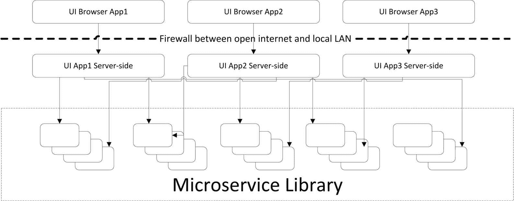

是的，这意味着合并后的调用可能会返回较量的数据。让我们详细分析一下。服务调用的网络部分成本可以分为两部分：与服务主机建立连接的成本，然后是请求/响应的数据传输。通过合并服务调用，后端到前端极大地减少了流量中的连接建立部分。传输成本也可能降低，因为网关服务会筛选所有微服务的输出并精简结果，仅包含特定 Web 应用程序运行所需的内容。例如，核心服务提供调用者不需要的业务主题信息并不罕见。这些“额外”信息会由应用网关管理器过滤掉，不会发送到浏览器。通过这种方式，成本的数据传输部分得到了优化。

不要将微服务流量直接暴露给浏览器。这是一个糟糕的主意和反模式。请改用“后端到前端”模式，而不是直接将你的微服务库暴露给浏览器。你无法控制外部网站浏览器与你的服务库之间的网络。用户将根据他们连接互联网的方式获得不同的性能体验。你将处于无法无法帮助他们的位置。仅就此这一点，所有的浏览器服务调用都应该进行合并。


过期缓存模式（Expiring cache pattern），有时被称为“旁路缓存”（Cache Aside），它利用了每个组织中的某些数据是静态的、不需要在每次需要时都进行新鲜读取这一事实。该概念是：静态数据被读取后缓存一段配置的时间。在此期间，将使用该数据的缓存版本，而不是从数据库中重新读取。

过期缓存模式是用内存换取速度。该模式消耗内存用于缓存，但平均检索时间极快。

让我们来看一个例子。我的母校印第安纳大学有几个校区：布鲁明明顿、印第安纳波利斯、南本等。这些每个校区的具体细节是相对静态的；也就是说，大学极少建立新校区或废除旧校区。没有理由在每次需要时都重新读取校区信息，因此它是过期缓存模式的逻辑候选者；特别是在微服务架构中，这种“读取”操作很可能是对核心服务的服务调用。

### 图 2.8: 过期缓存模式

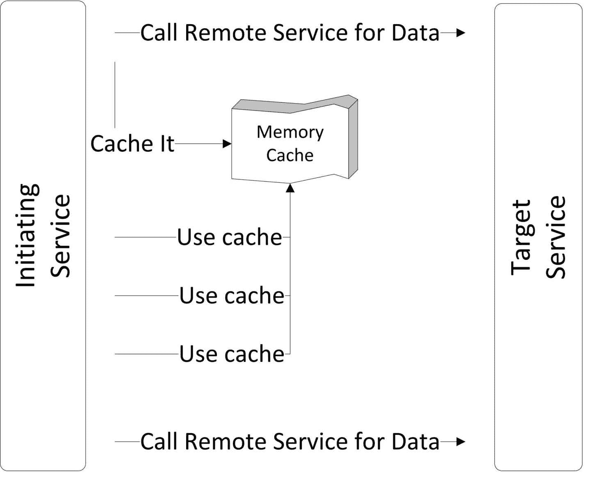

通常，过期缓存具有可配置的过期时间范围。将某些信息缓存很长时间（甚至是一天）可能是安全的，而其他类型的信息则需要在更短的间隔内刷新。

在消费方服务中使用过期缓存服务，而不是将该逻辑集中在目标服务中，原因有几点。性能的提升不仅源于避免数据库读取，还源于对核心服务的服务调用。其次，消费者更了解上下文，并理解缓存信息需要多新。某些服务对数据的需求可能比其他服务更具实时性，并希望有更短的过期时间。

我使用 Google 的 [Guava](https://github.com/google/guava) 产品来实现过期缓存。关于 Guava 缓存如何工作的参考资料可以在[这里](https://github.com/google/guava/wiki/CachesExplained) 找到。尽管如此，EHCache 和其他产品也提供此功能。在目前，真的没有必要自己实现。使用 Guava 实现过期缓存包含两个部分：扩展 `CacheLoader` 和定义缓存本身。

`CacheLoader` 在给定一个 `key` 时会查找一个值。大多数扩展 `CacheLoader` 的类只需要实现 `load(key)` 方法，该方法将执行查找并返回给定 `key` 的值。第二部分是定义缓存本身。示例可以在列表 2.5 中找到。虽然默认情况下缓存值在 100 毫秒后过期，但你可以选择任何认为合适的时间间隔。

### 列表 2.5: Guava 缓存定义示例

```java
LoadingCache<Integer, String> sampleCache = CacheBuilder.newBuilder()
        .expireAfterWrite(100, TimeUnit.MILLISECONDS)
        .build(loader);
```

集群的不同节点可能会有不同的答案，因为它们处于不同的缓存计划。这通常是可以接受的，因为要使用微服务架构，你必须接受“最终一致性”的概念。我们稍后会详细讨论。如果你需要强制重新加载 Guava 缓存，在缓存上执行 `invalidateAll()` 将有效地强制重新加载。

## 针对完整性的设计

在传统的 Web 应用中，我们拥有数据库事务的安全保障。如果发生错误，执行数据库回滚是常见的，这使得数据库处于一致状态。在用户操作可能利用多个服务的微服务世界中，这种安全网并不存在，因为这些事务发生在不同服务发起的多个数据库中。是的，核心服务通常具有数据库事务安全网，因为它们的重点很大程度上与 CRUD 相关，但利用其他服务的流程性服务则没有。

## 自定义回滚

基本上，这种模式包含在异常处理逻辑中发布反向事务。这种模式也被称为“补偿事务”（Compensating Transaction）。本质上，当发生错误时，会对任何可能成功的更改发布反向事务。例如：假设一个流程服务的调用导致了对其他微服务的三个服务调用。假设第一个事务成功，但第二个失败了。在流程服务的异常处理逻辑中，它会对执行成功的事务发布反向服务调用，使数据处于一致状态。

### 图 2.9: 自定义回滚模式

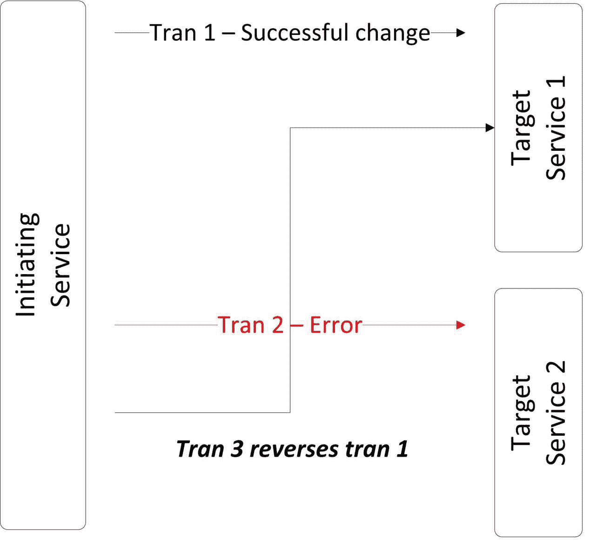

这种策略并不是完美的。反向事务也可能报错，或者流程服务在发布反向事务之前就崩溃了。无论何种情况，存储的数据都将处于不一致状态，因此需要某种类型的修复。通常，这种修复是手动的。

编写自定义回滚事务需要耗力，所以你不想在所有场景中都使用这种模式。基本上，你有两个选择：编写自定义回滚以减少对人工干预的需求，或者在错误发生时手动统一数据。通常，组织从手动干预开始，然后使用代码自定义回滚来处理失败频率最高的区域。

这种模式极其难以泛化并提供产品支持。反向事务所需的特定逻辑需要自定义代码。

## 管理服务版本

在传统的 Web 应用中，管理服务的版本已经足够困难了。在微服务世界，随着服务数量的指数级增长，问题也呈指数级增长。有两种流行的版本控制策略。第一种是直接将版本号放在服务的 URL 中。第二种允许客户端在请求头（header）中请求服务版本。如果他们没有请求版本，则默认使用最新版本。我将介绍这两种版本方法。但在之前，让我们讨论不同类型的更改以及你作为服务生产者或消费者的责任。

### 破坏性变更与非破坏性变更

破坏性变更（Breaking changes）是指会导致现有服务调用报错的变更。破坏性变更强制消费者修改代码以避免错误。是的，你可以通过弃用策略（我稍后会讨论）来缓解这种影响，但它仍然强制了改变。根据定义，这种强制改变的优先级将高于消费应用程序团队的大多数任务，并可能会抢占该团队本应负责的其他功能增强。从消费团队的角度来看，这种变更是突如其来的，不像调度功能增强那样容易管理。

并不是所有的变更都是破坏性变更。如果请求某个主题信息的服务调用突然返回了几个额外信息，这应该是一个非破坏性变更。它是非破坏性的，因为消费者不应该关注提供的额外信息，因为他们目前没有处理这些信息的逻辑。如果他们决定处理这些额外信息项，他们可以按照自己的计划来增强服务。事实上，他们可能根本不需要额外信息项来增强服务。


作为一个服务的发布者，你的公民义务是仅在万万不得已的情况下才引入破坏性变更（breaking change）。只有在绝对没有其他办法时，才引入破坏性变更。尽管主观意良好，这种情况仍可能发生。这可能是因为某个依赖服务引入了破坏性变更，从而迫使你做出反应。也可能是某个支持的功能无法再支持，因为依赖服务所需的某些功能已不再存在。又可能是因为组织决定弃用某个业务流程，结果导致你需要引入破坏性变更来迎合该业务决策。请注意，这可能不是导致破坏性变更的因素的完整列表。

作为一个消费者，你的公民义务是忽略服务调用返回的任何你不需要的信息。原因在于，这可以使你的消费服务更具韧性，并且受你所调的服务变化的影响更小。你不会受到结果集中新增内容或你并不需要的属性被移除的影。这降低了你所调的服务变更影响到消费服务的概率。

作为一个服务提供者，你需要建立一个弃用策略（deprecation strategy）。也就是说，你不能仅仅引入破坏性变更并让消费者手忙脚措地调整。在一段时间内，你需要同时支持旧*和*新的服务。你还需要一种通信机制，允许你发布版本变更，并宣布特定版本将不再提供支持的时间点。

版本控制*仅*用于破坏性变更。非破坏性变更可以在相同版本下发布；如果变更是非破坏性的，提供者就不必维护单独的版本。这促使消费者去忽略他们不使用的返回数据，因为当他们所调用的服务进行增强时，这可以将他们所经历的变更影响降到最低。

这就留下了几个问题。如果客户端实际上在管理自己从服务版本 A 到版本 B 的迁移计划，那么需要一种方法让客户端能够指定他们想要的服务版本。在提供者端，架构师需要一个合理的策略来在一段时间内同时支持服务的两个版本。我之所以说“两个”，是因为理想情况下，在任何时刻，你都应该有一个处于弃用中的版本和一个当前版本。

## 通过 URL 进行版本控制

一种流行的版本控制方法是通过 URL 进行版本控制。也就是说，将版本号编码在 URL 的某个地方，并让消费者从版本 A 移动到版本 B 时更改他们的请求 URL。URL 版本控制的示例可见列表 2.6。

### 列表 2.6：URL 版本控制示例

```
https://university.edu/services/Students-1.0/12345
https://university.edu/services/Courses-2.1/PY101
```

通过 URL 进行版本控制最初看起来很有吸引力，因为 Web 服务器软件可以很容易支持。你可以部署多个版本的服务，Web 服务器软件可以将客户端路由到正确的版本。例如，Web 服务器软件可以很容易地区分 `Students-1.0` 和 `Students-1.1`，并自动将客户端路由到他们请求的版本。当某个版本被弃用时，尝试使用它的客户端可能会接收到 `426`（需要升级”的 HTTP 状态码）或被自动重定向到新版本。

如果你通过 [HATEOAS](http://restcookbook.com/Basics/hateoas/) 提供引用，这就会变得有问题，因为这要求提供 HATEOAS 链接内容的服务需要感知那些被引用服务的版本变更。例如，如果 `Students-1.0` 服务提供了指向 `StudentClasses-1.1` 的 HATEOAS 引用，那么当 `StudentClasses` 服务引入新版本时，该服务也需要更改。这使得提供 HATEOAS 引用变得更加复杂且容易出现问题。

此外，你无法控制那些提供了这些 URL 的客户端何时才会真正使用它们。在提供的 URL 中编码版本可能会有问题，因为其中编码的版本可能在提供和使用之间的时间范围内实际上已经被弃用了。这是我更倾向于通过 Header 进行版本控制（下文描述）的另一个原因。

## 通过 Header 进行版本控制

一种版本控制的方法是允许客户端在服务请求的 Header 中请求特定版本。目前没有标准的 Header 名称来处理这个问题。有人建议使用 `ACCEPT` Header 来同时指定预期的版本和数据格式。对我来说，使用 `ACCEPT` Header 是一种关注点泄漏（leakage of concerns）。`ACCEPT` 实际上只关于预期的格式。版本规范意味着除了 GET 之外的操作可能存在行为差异。列表 2.7a 和 2.7b 是通过 Header 进行版本控制的示例。

### 列表 2.7a：Header 版本控制示例

```
URL: https://university.edu/services/Students/12345
ACCEPT-VERSION: 1.0
ACCEPT: application/json
```

### 列表 2.7b：使用 ACCEPT Header 进行版本控制的 Header 版本控制示例

```
URL: https://university.edu/services/Students/12345
ACCEPT: application/vnd.students.v1.0+json
```

我更倾向于引入自定义 Header，如列表 2.7a 所示，因为没有任何标准的 Header 名称真正适用。这也留下了 `ACCEPT` 来指定格式，以防你的服务支持多种表现形式。例如，客户端在调用 `Students` 服务时可能会指定一个 `ACCEPT-VERSION=1.0` 请求 Header。如果该版本被遵循，则由服务发布者提供。如果该版本已被弃用，则由最旧的支持版本尝试满足请求。也许有效，也许无效。毕竟，如果一个消费者不打算听取你的弃用公告，那么他们得到什么就是什么吧。如果消费者完全没有指定版本，他们将获得可用的最新版本。同样，返回数据格式可以是默认。如果你将版本规范分离到单独的 Header 中，那么让消费者使用默认并指定格式会更容易。通过 Header 进行版本控制需要某种类型的路由器来查询 Header 值并将请求重定向到相应的版本。我不知道产品对 Header 版本控制的支持，但很容易将其通用化并提供。

图 2.10：Header 版本控制示例


始终提供一个指示所提供服务的响应 Header（例如 `VERSION=1.1`）。由于没有标准的版本控制响应 Header，需要引入一个。这些信息可能对消费者诊断支持问题很有帮助。

## 支持多个版本部署

将所有版本作为独立的应用程序部署。不要尝试在同一个服务中混用多个版本。这样对旧版本进行意外更改的风险太大。此外，这使得服务代码变得复杂得多。

独立水平扩展版本。可能不同版本之间的消费者负载并不相同。例如，你的服务版本 1.0 的负载可能小于 1.1 或 1.2。因此，版本集群的配置可能不同。如果你的集群由 DNS 轮询支持，使用子域名来区分不同的版本（例如 `students_1_1.university.edu`）。

服务的所有版本都应该使用同一个数据库。可能新版本中引入的功能增强需要数据库重构，这使得对服务的旧版本的支持变得困难。[Refactoring Databases](http://databaserefactactoring.com/) 一书提供了许多可以帮助解决这些问题的模式。

这些概念的插图见图 2.11。

图 2.11：版本部署示例


第三方产品的适配器服务


在传统的 Web 应用部署中，使用适配器（adapters）来对接第三方产品（如 Salesforce、Microsoft Dynamics、Great Plains 等）并不不罕见。这些适配器在你的服务内部领域模型与第三方产品使用的模型之间进行转换。

在微服务世界中，我们做同样的事情。唯一的区别是适配器是一个整个服务，而不仅仅是一个类。如果我们将适配器留为一组类，那么对第三方服务的更改（例如产品切换或升级）将影响多个服务。这并不是微服务世界所追求的。

适配器服务必须是**产品通用的**。你的服务约中使用的产品领域模型的任何部分都代表了不必要的耦合。适配器的优势在于，产品的切换或升级应该`only`（仅）影响适配器，而不影响其他任何地方。

记录所有对第三方产品/服务的请求和响应。这是出于支持考虑所必要的。如果你需要联系提供商寻求支持，你不希望通过谈论你的内部代码来混淆问题。弄清楚你的服务请求文本中需要修正的内容，并反向推导出你的代码中需要更改的内容。

设计适配器以处理第三方产品或服务的故障。你无法直接控制第三方产品或服务的可用性或性能。正如此，适配器服务实现断路器（circuit breakers）或调用调解器（mediators）以便在停机期间更优雅地运行并不罕见。

# 微服务的通用企业代码

我经常被问到的问题是，服务之间是否可以通用代码。答案是带条件的“可以”。底线是，对通用代码进行版本控制，并像对待 `Hibernate` 或 `Apache Commons Lang` 等第三方产品一样对待它们。单个服务决定何时/是否进行升级。

通用代码的更改或增强不能强制多个服务的部署。这会导致服务之间产生高度耦合，从而违背了使用微服务架构的优势。因此，业务逻辑出现在通用代码中的情况很少见。我们不希望业务的更改影响多个服务。

通用代码的久化应该像你使用的任何第三方库一样。利用通用代码库的单个服务应该完全自由地决定何时升级到新版本。永远不要强迫它们进行通用代码产品的版本升级。

# 第 3 章：微服务的交叉关注点

本章涉及了所有微服务必须解决的众多交叉非功能关注点，无论它们采用何种技术栈。这些交叉关注点包括：能够有效地监控服务、检测故障以及诊断并修复报告的缺陷。满足非功能需求使得运维人员在微服务架构部署到生产环境后能够提供支持。这些需求某些存在于传统的 Web 应用中，但随着微服务部署数量的指数级增长，这些需求变得更加紧迫。

无论采用用何种技术平台或语言，所有微服务都应该满足某些非功能需求。通常，这些非功能需求也是交叉关注点。也就是说，它们并不特定于所提供的业务功能；它们的存在是为了让部署的服务更易维护。作为架构师，我们应该建立可复用且易于实现的方法满足非功能需求。本章将详细说明这些需求是什么，并提供轻松满足它们的方案。微服务应该具备以下内容以便更易支持：

*   健康检查（通常通过 URL）
*   性能指标和告警
*   资源消耗告警
*   日志记录和错误处理
*   部署格式（例如 `Docker` 镜像）。

所有这些非功能需求都应该是应用程序架构的一部分。单个服务团队不应该去“开发”工具来满足这些任何一项需求。安装和配置，可以。开发，不行。

使用 `Java` 或至少是运行在 `Java Virtual Machine` 上的解释型语言编写微服务的优势之一，是能够很容易地编写解决所有微服务所需的非功能需求的功能，并让这些服务直接使用即可。这种架构的核心在于允许开发人员专注于他们正在提供的功能，而不是被技术和基础设施支持方面的问题所困扰。

作为应用架构师，确保开发团队拥有现成的解决方案来满足非功能需求，正是我们增加价值的地方。这精简了开发团队的生产力，从而提高了这些团队的开发速度。它还简化了开发在发布到生产环境后的支持工作和成本。这种“精简”是至关重要的。

微服务架构极大地增加了部署数量，有时是指数级增长。因此，对这些部署的支持必须比现在通常的情况要少得多，且更不耗时。换句话说，我们过去用于支持不足十个部署包的业务流程，无法适用于微服务架构增长后的数百个部署包。

处理所有通用非功能需求的方法应该已经开发并存在于架构中。这种架构应该被所有用 `Java` 编写的微服务利用。它应该进行版本控制，以便单个微服务在大多数情况下可以按照自己的进度进行升级。这个概念在通用代码章节中已有过更详细的讨论。

考虑将维护此应用程序架构作为一个独立团队的目标。这有助于团队成员轮到其他创建和支持微服务的团队中。这利用了“自食狗粮”的心态。他们将获得关于他们提供的应用架构支持效果如何的反馈。

健康检查是至关重要的。随着微服务架构部署数量的增加，我们执行健康检查的方法变得重要得多。将这些健康检查标准化变得非常重要，直到它们只需被包含和配置到微服务中；花费在上面的开发时间应该是微乎其微的。本章稍将对该主题进行更详细的处理。

日志聚合是至关重要的。诸如 [Splunk](http://www.splunk.com/) 和 [LogStash](https://www.elastic.co/products/logstash) 等日志聚合工具变得常见是有原因的。随着部署数量的增加，日志聚合不再是一个选项，而是实施微服务的必要条件。在部署数量巨大的情况下，单独查看或搜索日志来诊断缺陷会花费大量时间。日志聚合工具集大大缩短了这种时间，并提高了支持团队的效率。

开发并记录微服务的非功能需求，并在整个企业范围内执行。无论为特定的微服务选择了何种语言和工具，整个企业都能够利用该服务。这意味着能够部署并监控其健康状况和资源消耗。


微服务团队负责确保其服务满足所有非功能性需求。实际上，这意味着选择一个对组织而言“新”的技术栈天生就带有某种“税收”负担，因为它还需要提供满足非功能性需求的能力。对于新的技术栈，企业内部可能不存在处理非功能性需求的策略，这需要进行识别并可能需要开发。理想情况下，采用企业新技术的微服务团队应该以一种方式开发这种能力，以便其他团队可以在其他服务中复用它。例如，如果一个企业采用了 [JRuby](http://jruby.org/) 框架并决定使用它编写微服务，则可能需要识别并建立整合健康检查、性能指标以及处理其他非功能性需求的能力。

## 健康检查 (Health Checks)

健康检查通常是一个 URL，用于提供服务正在响应并能够履行其功能的某种指示。该 URL 由某种类型的监控工具（例如 [Nagios](https://www.nagios.org/））调用，该工具能够在健康检查失败时向管理员发出警报。简单的警报是微服务的 `JVM` 未响应。问题随变为：你对“响应”的定义是什么？通常，仅仅能够响应 `HTTP 200` 是不够的。

除了验证服务本身能够无错误地响应 URL 外，我还喜欢检查对外部资源和依赖的访问。例如，我喜欢检查数据库连接池的状况。是的，数据库和其他外部资源也应该通过独立的健康检查进行监控，但检查用于数据库访问的连接池的状况，也可以验证该池的大小对于服务当前处理的事务量是否合理。这种检查只能在微服务进程内部执行，无法从外部进行有效监控。这种情况也会出现在传统的 Web 应用中，对于微服务来说并不新奇。

无论你所编写的微服务使用什么种技术栈，健康检查都应该是企业提供的应用程序架构的一部分。没有理由让每个服务生产者都必须构建自己的一套。我通常利用 Dropwizard 的 [metrics](https://dropwizard.github.io/metrics/3.1.0/manual/healthchecks/) 库来编写健康检查。

寻找此类健康检查代码级示例的读者可以在[此处](https://github.com/Derek-Ashmore/moneta/blob/master/moneta-core/src/main/java/org/moneta/healthcheck/DbcpConnectionPoolHealthCheck.java) 找到。该示例检查连接池，以验证等待数据库连接的事务数少于可配置的数字（默认值为三）。也就是说，如果有太多事务等待数据库连接，那么服务就是不健康的，因为消费者正遭受性能问题。在这种情况下，可能需要根据服务正在处理的负载重新调整连接池的大小。此外，我会验证从池中的一个连接，以确保不仅数据库可用，而且服务与数据库之间的网络连通性也是可用的。

## 性能指标与告警 (Performance Metrics and Alerts)

性能指标有助于支持开发人员调查性能问题。我也会对传统的 Web 应用跟踪性能指标，例如应用程序中每个页面的性能。在接收到性能缓慢的模糊报告时，如果你有历史数据，那么确切知道当前性能与历史性能的对比将是非常用的。更重要的是，它还能加快性能调查的进度。

在微服务架构中，用户操作可能涉及多个服务。定位性能问题（即确定是哪些服务导致了该性能问题）会变成一个耗时的问题。掌握所有服务的性能数据可以极大节省支持开发人员的时间。

传统 Web 应用的性能更容易衡量。通常，性能指标是在 `/web` 页面级别收集的。用于为传统 Web 应用的页面/URL 收集性能指标的工具非常多。我使用 [Admin4J](http://admin4j.net/doc/performance.html)，但也有其他产品可选。

对于 RESTful Web 服务，性能测量稍微困难，因为 URL 包含标识符，且行为随操作（`GET`、`POST`、`DELETE` 等）而异。详细来说，通过严格的 URL 来衡量 RESTful 服务没有意义，因为 URL 包含数据标识符。例如，分别测量 URL `/students/1` 和 `students/2` 的 `GET` 操作是没有意义的。它们都是相同的查询，只是针对不同的学生。对整个掩码 `/students/*` 进行合并测量会更好。如果你的服务返回相关数据的选项，情况会变得更加。例如，如果服务支持 `/students/1/classes`，那么课程搜索结果的行为将与学生搜索结果不同，进行区分可能是有用的。[Admin4J](http://admin4j.net/doc/performance.html) 会合并 RESTful Web 服务调用的性能指标；在写本文时，我还没有发现其他可以做到的产品。

至少，要衡量每个服务的平均调用时间和总调用次数。由于大多数微服务架构项目都有大量的部署单元，了解调用次数允许你集中精力优化使用最频繁的服务。拥有平均调用时间有助于在用户操作涉及多个服务时定位性能问题。虽然我习惯于同时也拥有调用时间的最小值、最大值和标准差，以及平均值和总数，但这些信息的用性较小，可以视为可选的。

为超过可配置阈值的服务调用时间设置自动告警。这允许支持开发人员在终端用户报告之前开始主动诊断并修复性能问题。为每个服务确定合理的阈值将涉及某种程度的尝试。阈值过低会产生误报，或者产生并非指示实质性性能问题的告警。

## 资源消耗告警与响应 (Resource Consumption Alerts and Responses)

在 `JVM` 进程内部，某些资源消耗问题一旦发生，实际上就是服务健康问题。

监控已部署服务的内存使用情况。然而，当你观察 `JVM` 分配内存的方式时，最相关的不是进程级别的聚合内存使用，因为该测量包含了 `JVM` 分配的原生内存，无论 Java 代码是否实际使用它。最相关的是 `JVM` 内部已消耗和可用的堆内存。可用的堆内存供 Java 类使用，并且实际上可以被消耗。我使用 [Admin4J](http://admin4j.net/doc/memory.html) 监控内存使用并针对短发布告警，但也有其他可用工具。

在诊断内存不足时，第一个问题是检测到的内存使用激增是否是由某种内存泄漏引起的。如果原因是内存泄漏，那么分配额外的内存对你没有帮助。如果原因是正常使用，则可能存在容量规划问题，需要分配更多内存，或者需要在集群中定义更多的服务实例。


在 Oracle JVM 中，可以通过 `HeapDumpOnOutOfMemoryError` 启动选项在生成 `OutOfMemoryError` 时触发内存转储。这种方式相当局限，因为该事件只会发生一次。如果 JVM 从内存短缺中恢复，后续发生的情况将不再生成堆转储。

监控已部署服务的并发负载。这些信息对于容量规划非常重要。并发负载的增加会增加所需的内存，并通常会增加平均事务时间。在过去的几年里，我曾使用 [Admin4J](http://admin4j.net/doc/unexpectedLoad.html) 在 JVM 内部监控并发负载。如今，随着云厂商提供扩展能力，从 JVM 外部监控负载可能更有意义。

资源消耗问题的警报通常通过日志管理软件处理。也就是说，这些“警报”被记录在 `ERROR` 级别的日志中，然后由日志管理软件启动某种类型的警报（例如发送电子邮件或创建工作工单）给管理员。

# 日志与错误处理

在微服务架构中，能够轻松搜索所有服务的日志至关重要。在那个世界里，部署单元的数量呈指数级增长，支持人员手动搜索这些部署单元的单个日志文件是不现实的。在微服务架构中，使用某种日志管理系统已从“有则更好”变为“绝对要求”。

日志管理软件（如 [LogStash](https://www.elastic.co/products/logstash) 或 Splunk）会收集单个日志条目并进行集中存储。此外，这些工具为支持人员提供了搜索日志和配置自动警报的集中方法。日志管理软件检测到的错误生成某种类型的支持工单进行调查，或者向中央支持邮箱账户发送电子邮件，这在现实中并并不少见。

## 在你抛出的异常中捆绑所需的信息

记录日志的主要原因之一是提供解决由异常引起的 Bug 所需的信息。这些额外的日志代码增加了额外风险，因为异常代码通常没有经过充分的测试。因此，在格式化异常消息期间，发生异常（例如来自 `NullPointerException` 引起）的概率通常比非异常代码更高。

Apache Commons Lang 从 `V3.0` 开始提供了上下文异常能力（contexted exception ability），通过这种简单且低风险的方式在异常本身中包含额外信息，从而降低了这种风险（参见 Commons Lang 中的 `ContextedException` 和 `ContexedRuntimeException` 类）。当记录此类异常时，这些额外信息将会存在。请考虑列表 3.1 中的示例。

### 列表 3.1：上下文异常示例

```
throw new ContextedRuntimeException(“Error creating application”, exception)
  .addContextValue(“application id”, applicationId)
  .addContextValue(“customer id”, customerId);
```

当记录列表 3.1 中的异常时，上下文标签和值将自动出现在日志中，连同错误消息和堆栈跟踪。请注意，应用程序代码通过添加条件日志逻辑或格式化逻辑并不会增加派生异常的风险。如果没有上下文异常能力，开发者将不得不添加日志代码来提供解决 Bug 所需的信息。

## 仅记录一次事务异常

多次记录异常会极大地膨胀你的日志并并与报告缺陷相关的特定异常变得难以查找。你可以通过仅在入口处记录异常来避免重复日志消息的问题。例如，可以很容易实现一个 servlet 过滤器，它可以记录任何网络事务的异常。这确保了异常只被记录一次。此建议假设你已经像本章前面提到的，将解决错误所需的任何额外信息捆绑到了异常本身中。列表 3.2 展示了此类 servlet 过滤器。

### 列表 3.2：日志 Servlet 过滤器示例

```
public void doFilter(ServletRequest request, ServletResponse response, FilterChain chain) throws IOException, ServletException {
    try {
        chain.doFilter(request, response);
    }
    catch (Throwable t) {
        logger.error("Web Transaction Error", t);
        ServletUtils.reThrowServletFilterException(t);
    }
}
```

来源：Admin4J 中的类 `net.admin4j.ui.filters.ErrorLoggingFilter` (http://www.admin4J.net)

这种技术减少了应用程序代码并增加了生成的异常被记录的机会。此外，如果你利用具有错误处理过滤器的 Admin4J 产品，你将获得异常时的请求 URL 以及任何请求和会话属性的导出。换句话说，你可以利用开源产品来实现这一点，而不是为了这个目的创建自己的 servlet 过滤器。

顺便提到，你还需要为批作业类、EJB 类和消息驱动豆（Message-Driven beans）提供类似的架构支持。将异常日志交给应用程序代码会增加异常未能被正确记录的概率。

## 不要将事务日志与普通应用程序日志混杂

事务日志（例如，用户 Fred 更改了客户 Acme 的地址）有不同的目的。通常，普通业务流程需要事务日志，它们并不是针对产品支持的。大多数日志产品都允许你为此目的将事务日志重定向到单独的输出。

注意，日志保留和存储问题是一个完全独立的话题。大多数日志产品支持以多种格式存储日志，包括文件或数据库格式。应用程序代码应该只关注发布日志消息，而不应关注它们如何存储的细节，或它们被保留多久。

## 提供一个可以在部署时被覆盖的默认日志配置

这纯粹是为了开发者的便利，他们可能需要运行构建但可能没有花精力配置本地部署。此外，开发者无法预测特定部署的日志需求。因此，让管理员能够在部署时轻松配置日志是非常重要的。

# 发布变更事件

由于每个微服务都有自己的数据库，对于多个服务都需要的通用业务数据，有两种处理方案。（我之前强调过这个问题。）第一种方案（我更倾向的方案）是不重复该通用数据，而是在需要时调用维护该数据的服务。第二种方案是将通用业务数据“复制”到所有需要的服务中。对于那些选择在服务之间“复制”通用业务数据而不是嵌套调用服务的方案，复制通常通过发布/订阅消息来实现。

维护通用业务数据的微服务会在一致的格式下，在建立的主题发布任何变更（例如添加、更改或删除）。例如，大学中负责维护校园信息的微服务（例如一个 `Campus` 微服务）可能会在 `CampusEvent` 主题下发布新校区的添加或现有校区状态变更。

任何感兴趣的服务都会监听该主题并处理任何发布的变更。通常，监听这些变更的服务需要发布一个监听器来监控该主题。


开发一种从源头刷新所有拷贝数据的方法。拷贝过程也存在缺陷。当这种情况发生时，数据的“副本”将会不同步。在我们的示例中，如果由于某种原因丢失了事件，或者 `Course` 服务中的更改记录出错，那么 `Course` 服务的校园信息副本将与 `Campus` 服务所拥有的不匹配。由于所有代码都存在缺陷，如果你在服务之间拷贝数据，这个问题就会发生。因此，支持性开发人员需要一种方法，在数据副本损坏时对其进行刷新。

# 微服务的打包选项

在过去的几年里，采用传统的 Web 应用部署方式，在某些组织中，每个容器内部署多个 Web 应用是常见现象。这通常是由于商业容器的许可成本导致的，促使人们尽可能减少容器的数量。这种组合策略在微服务世界中是不存在的。微服务作为独立的进程进行部署，这意味着会有独立的 JVM。

有多个产品可以方便将 Java 服务部署为单个进程。在本文写作期间，最流行的两个产品似乎是 `Spring Boot` 和 `DropWizard`。是的，还有其他产品，且它们运行良好，但我专注于写作此时最流行的这两个产品。

除了这两个产品外，我还将讨论一种对微服务非常有用的虚拟化产品；它被称为 `Docker`。`Docker` 标准了进程并提供了辅助工具来支持服务的大规模部署。我们将看到 `Docker` 在很大程度上实现了开发人员与运维的解耦。

# Spring Boot

[`Spring Boot`](http://projects.spring.io/spring-boot/) 将 Java Web 应用打包成一个可执行的单一 jar 文件，可以通过单个命令执行：`java –jar myApp.jar`。

该可部署的 jar 包含一个嵌入式容器（`Tomcat` 或 `Jetty`），并包含了运行你的应用程序所需的每一个依赖类。

除了你的服务之外，`Spring Boot` 还要求你创建一个实现 `main()` 方法的 `Application` 类，以便能够从命令行提示符运行。该应用程序类处理了大部分配置项（连接池、工作线程数等）。此外，你还可以添加特定于你应用程序的属性。如果这样做，请确保避开与 `Spring Boot` 已经遵循的属性名称发生冲突（列表见[此处](http://docs.spring.io/spring-boot/docs/current/reference/html/common-application-properties.html)）。为了确保万无一失，我养成了使用应用程序名称作为属性中第一个节点的习惯（例如，`moneta.server.max.threads`）。`application.properties` 的示例可以在[此处](https://github.com/Derek-Ashmore/moneta/blob/master/moneta-springboot/src/main/resources/config/application.properties)找到。

`Spring Boot` 会自动消耗类路径下的 `application.properties` 文件。这些属性主要是应用程序特定的。这种机制允许你从外部配置至少应用程序特定的内容。所有其他内容都写在应用程序类中。让我们考虑一个我已开源并发布在[此处](https://github.com/Derek-Ashmore/moneta/blob/master/moneta-springboot/src/main/java/org/moneta/config/springboot/MonetaSpringBootApplication.java)的 Spring Boot 类示例。你可以在列表 3.3 中找到一个 servlet 定义示例，在列表 3.4 中找到一个过滤器定义示例。

### 列表 3.3：Spring Boot Servlet 配置示例

```
@Bean
public ServletRegistrationBean monetaServlet() {
    ServletRegistrationBean registration =
        new ServletRegistrationBean(new MonetaServlet(),
            "/moneta/topic/*");
    registration.addInitParameter(
            MonetaServlet.CONFIG_IGNORED_CONTEXT_PATH_NODES, "moneta,topic");
    return registration;
}
```
源：来自 Moneta 的类 `org.moneta.config.springboot.MonetaSpringBootApplication` (https://github.com/Derek-Ashmore/moneta)

### 列表 3.4：Spring Boot 过滤器配置示例

```java
@Bean
public FilterRegistrationBean monetaPerformanceFilter() {
    FilterRegistrationBean registration =
        new FilterRegistrationBean(new MonetaPerformanceFilter(),
            monetaServlet(), monetaTopicListServlet());
    return registration;
}
```
源：来自 Moneta 的类 `org.moneta.config.springboot.MonetaSpringBootApplication` (https://github.com/Derek-Ashmore/moneta)

正如你预期的那样，该类有一个 `main` 方法，用于加载应用程序配置、安装健康检查，并激活性能指标收集以及 [`JMX`](https://docs.oracle.com/javase/tutorial/jmx/overview/)。此外，该类定义了几个 servlet 和 servlet 过滤器。在传统的 Web 应用中，这些定义在 `web.xml` 配置文件中；但 `Spring Boot` 的配置则不同。

`Spring Boot` 默认使用 `Logback` 日志。在这个层级，日志配置可能是为了开发人员的方便。当服务部署时，生产环境的日志配置可能会覆盖写入的内容。如果你使用如 `Slf4j` 这样的抽象层，那么提供默认日志只需在 spring boot 中包含一个 [`logback.xml`](https://github.com/Derek-Ashmore/moneta/blob/master/moneta-springboot/src/main/resources/logback.xml) 文件一样简单。

`Spring Boot` 有一种方法使用 `application.properties` 配置数据库池。[参考](http://docs.spring.io/spring-boot/docs/current/reference/html/common-application-properties.html) 包含了一个完整的列表，但我在 3.5 中包含了一个示例。

### 列表 3.5：Spring Boot 连接 application.properties

```properties
# 连接池定义
spring.datasource.driver-class-name=org.hsqldb.jdbc.JDBCDriver
spring.datasource.name=test
spring.datasource.url=jdbc:hsqldb:mem:sample
spring.datasource.username=SA
spring.datasource.password=
spring.datasource.continue-on-error=true
## 池化属性
spring.datasource.max-active=5
spring.datasource.min-idle=1
spring.datasource.test-on-borrow=true
spring.datasource.test-on-return=false
spring.datasource.test-while-idle=false
spring.datasource.time-between-eviction-runs= 1
spring.datasource.validation-query=SELECT CURRENT_DATE AS today, CURRENT_TIME AS now FROM (VALUES(0))
```

在高并发部署中，通常需要配置底层容器设置，例如容器工作线程的最小、最大和超时设置。在高并发部署中还有你需要关注的设置但在这里我想说明如何使用 `Spring Boot` 实现这一点。这可以通过重写应用程序类中的 `servletContainer` 方法来实现。如何这样做的示例可以在我的[示例](https://github.com/Derek-Ashmore/moneta/blob/master/moneta-springboot/src/main/java/org/moneta/config/springboot/MonetaSpringBootApplication.java)以及列表 3.6 中找到。

### 列表 3.6：Spring Boot 容器配置示例

```java
@Bean
public EmbeddedServletContainerFactory servletContainer() {
    JettyEmbeddedServletContainerFactory factory = new JettyEmbeddedServletContainerFactory();
    factory.addServerCustomizers(new JettyServerCustomizer() {
        public void customize(final Server server) {
            // 调优 Jetty 用于处理入入
            // HTTP 连接的连接池
            Integer localServerMaxThreads = deriveValue(serverMaxThreads,
```


```java
DEFAULT_SERVER_MAX_THREADS);

Integer localServerMinThreads = deriveValue(serverMinThreads, DEFAULT_SERVER_MIN_THREADS);

Integer localServerIdleTimeout = deriveValue(serverIdleTimeout, DEFAULT_SERVER_IDLE_TIMEOUT);

logger.info("Container Max Threads={}", localServerMaxThreads);
logger.info("Container Min Threads={}", localServerMinThreads);
logger.info("Container Idle Timeout={}", localServerIdleTimeout);

final QueuedThreadPool threadPool = server.getBean(QueuedThreadPool.class);

threadPool.setMaxThreads(Integer.valueOf(localServerMaxThreads));
threadPool.setMinThreads(Integer.valueOf(localServerMinThreads));
threadPool.setIdleTimeout(Integer.valueOf(localServerIdleTimeout));

}

});

return factory;
}
```

来源：类 `org.moneta.config.springboot.MonetaSpringBootApplication`，来自 `Moneta(`https://github.com/Derek-Ashmore/moneta)

Spring Boot 有一个名为 [Actuator](https://spring.io/guides/gs/actuator-service/) 的扩展。该扩展提供了预配置的健康检查、性能指标和诊断功能。如果你正在使用 Spring Boot，应该使用 Actuator。请注意，如果你的应用程序有自定义的健康检查，很容易编写一个适配器，使得这些自定义健康检查能够与 Actuator 协同工作。只需要实现 `HealthIndicator` 接口，该接口包含一个方法。你可以在[此处](https://github.com/Derek-Ashmore/moneta/blob/master/moneta-springboot/src/main/java/org/moneta/config/springboot/ActuatorHealthIndicator.java)找到示例。

## Dropwizard

[Dropwizard](http://www.dropwizard.io/) 将 Java Web 应用打包成单个可执行的 jar 文件，可以通过单个命令执行：

```
java –jar myApp.jar server myAppConfig.yaml
```

该可部署的 jar 包包含一个嵌入的 Jetty 容器，包含了运行你的应用程序所需的每个依赖类。请注意，Dropwizard 还需要额外的参数。`server` 参数指定应用程序将作为 HTTP 服务器运行。`yaml` 文件输入是你的配置。虽然不是严格要求的，但它是列出容器配置项的地方。

与 Spring Boot 类似，Dropwizard 需要一个带有 `main()` 方法的应用程序配置类，该方法用于加载应用程序配置、安装健康检查并激活性能指标收集和 [JMX](https://docs.oracle.com/javase/tutorial/jmx/overview/)。你可以在[此处](https://github.com/Derek-Ashmore/moneta/blob/master/moneta-dropwizard/src/main/java/org/moneta/config/dropwizard/MonetaDropwizardApplication.java)找到 Dropwizard 应用程序类的示例。

应用程序类还定义了应用程序所需的任何 servlet 或过滤器（filter）。在这个世界中，servlet 和过滤器并不是定义在 `web.xml` 配置文件中。你可以在列表 3.7 中找到一个 servlet 配置示例。可以在列表 3.8 中找到一个过滤器配置示例。

### 列表 3.7：Dropwizard Servlet 配置示例

```java
ServletHolder topicHolder = new ServletHolder(Source.EMBEDDED);

topicHolder.setHeldClass(MonetaServlet.class);

topicHolder.setInitOrder(0);

topicHolder.setInitParameter(
    MonetaServlet.CONFIG_IGNORED_CONTEXT_PATH_NODES, "moneta,topic");

environment.getApplicationContext()
.getServletHandler()
.addServletWithMapping(topicHolder, "/moneta/topic/*");
```

来源：类 `org.moneta.config.dropwizard.MonetaDropwizardApplication`，来自 `Moneta(`https://github.com/Derek-Ashmore/moneta)

### 列表 3.8：Dropwizard 过滤器配置

```java
FilterHolder topicHolder = new FilterHolder(Source.EMBEDDED);

topicHolder.setHeldClass(MonetaServlet.class);

topicHolder.setInitOrder(0);

topicHolder.setInitParameter(
    MonetaServlet.CONFIG_IGNORED_CONTEXT_PATH_NODES, "moneta,topic", "3000");

environment.getApplicationContext()
.getServletHandler()
.addFilter(topicHolder, null);
```

### 列表 3.9：增强应用程序配置示例

```java
@Override
public void initialize(Bootstrap<MonetaSpringBootConfiguration> bootstrap) {
    bootstrap.setConfigurationSource(new MonetaConfigurationSource());
    super.initialize(bootstrap);
}
```

### 列表 3.10：Dropwizard 连接池设置示例

```yaml
# 连接池设置
database:
  driverClass: org.hsqldb.jdbc.JDBCDriver
  url: jdbc:hsqldb:mem:my-sample
  user: SA
  password:
  autoCommentsEnabled: false

# 尺寸控制选项
  initialSize: 1
  minSize: 1
  maxSize: 10
  maxWaitForConnection: 30 seconds
  evictionInterval: 5 seconds

# 验证行为
  validationQuery: SELECT CURRENT_DATE AS today, CURRENT_TIME AS now FROM (VALUES(0))
  checkConnectionWhileIdle: true
  checkConnectionOnBorrow: false
  checkConnectionOnConnect: false
  checkConnectionOnReturn: false
  validationInterval: 30 seconds
```


当需要配置较低层级的容器设置时，Dropwizard 提供了一种通过输入 yaml 配置文件来实现的方法。可以在此处找到提供的设置列表。如何实现此点的示例可以参考我的[示例](https://github.com/Derek-Ashmore/moneta/blob/master/moneta-dropwizard/src/main/resources/moneta-config.yaml) 以及列表 3.11。

### 列表 3.11：Dropwizard 容器设置示例

```yaml
server:
  type: default
  maxThreads: 150
  minThreads: 20
  maxQueuedRequests: 20
```

## Docker

`Spring Boot` 和 `DropWizard` 等产品依赖操作系统和 Java 安装来运行。在大多数组织中，该 Java 安装是多个应用程序共享的。对该 Java 安装的任何升级都存在对多个应用程序产生不利影响并导致意外后果的风险。换句话说，这种安装是微服务世界中并不真正需要的耦合。[Docker](https://www.docker.com/) 消除了这种耦合，同时也消除了该 Java 所依赖的任何依赖原生代码的耦合。

Docker 部署可以被认为是一个微型虚拟机。它带有完整的操作系统（Linux 内核）以及产品运行所需的所有原生软件。Docker 部署可以包含为该部署服务的 Java JDK 安装，并且可以升级该 Java JDK，而不必担心会对多个服务产生不利影响。从本质上，它提供了升级保障。我们这些在大型企业环境中工作过的人已经看到，升级 Java 版本是一项非常巨大的工程，因为这种升级具有固有的测试工作。将 Java 安装与你的部署绑定在一起在很大程度上缓解了这些担忧。

Docker 已经迅速成为一种受欢的部署格式。对于那些未使用过 Docker 的人来说，它是“一次打包，到处运行”。Docker 对软件起的作用就像集装箱对实体货物起的作用。它对磁盘和网络具有标准的连接机制。此外，它很容易将 Docker“容器”连接在一起（例如，将数据库 Docker 容器与你的应用程序连接）。

这对于系统管理员来说是一个胜利，因为它使得部署管理更加容易且更容易自动化；对于 Java 开发人员和架构师来说也是胜利。由于应用程序环境是可移植的并与应用程序打包在一起，特定于环境的问题和缺陷大大减少。在生产环境中运行的内容与你测试的内容更加相似。此外，由于你的应用程序运行在自己的 Java 版本和操作系统上，你可以升级 JDK 和你依赖的任何原生代码，而较少担心影响其他应用程序，甚至不需要让系统管理员来执行原生软件更改。

抛开热度之后，使用 Docker 也有成本和缺点。在 Linux 上运行 Docker 及其相关工具要容易得多；Windows 的支持有限。这一事实在大多数通常在 Windows 上进行开发的企业环境中造成了不便。在添加 Maven 功能以生成 Docker 镜像时，平台差异也带来了问题；Maven 构建本应该是平台无关的。此外，Docker 确实有一个学习曲线。

有些人可能担心额外的虚拟化层会导致性能问题。然而，IBM 进行了一项良好的[研究](http://domino.research.ibm.com/library/cyberdig.nsf/papers/0929052195DD819C85257D2300681E7B/$File/rc25482.pdf)，显示性能影响可以忽略不计。总而言之，使用 Docker 的优点大于成本。

对于 Maven 用户，有几个 Maven 插件可以生成 Docker 镜像作为产物。在写本文时，我最喜欢的是 Spotify 的 [docker-maven-plugin](https://github.com/spotify/docker-maven-plugin)。它非常容易使用和安装。使用示例可以在我 GitHub 上带有 Moneta 微服务示例的这个 [pom](https://github.com/Derek-Ashmore/moneta/blob/master/moneta-springboot/pom.xml) 中找到。

## 事务跟踪

在传统的 Web 应用中，更容易跟踪事务贯穿整个给定的业务流程。异常的堆栈跟踪更有意义，因为特定事务的代码库通常是完整的。

在微服务世界中，情况并非如此。在一个业务事务可能利用多个服务的世界里，跟踪所有事务的历史变成了一个必要项。跨服务调用跟踪事务的常用方法是通过关联 ID（correlation id）。

在事务开始时，会分配一个唯一的事务 ID（或关联 ID）。该关联 ID 会随事务记录在所有日志中。该事务产生的任何服务调用都应该在头中包含该关联 ID，以便将其记录在任何活动中，包括对依赖服务的调用。

### 图 3.1：关联 ID 示例

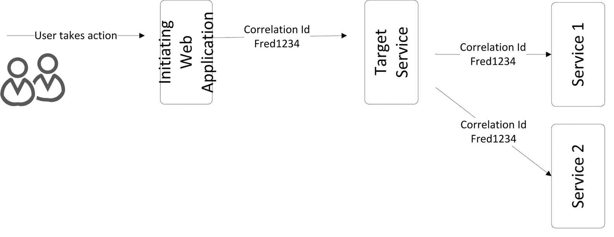

其理念是确保事务的任何日志消息都存在关联 ID，这样日志就可以合并，以提供特定用户操作发生情况的完整视图。日志产品将此称为映射诊断上下文（MDC）。将 MDC 视为事务的线程本地上下文。当事务开始时，你通过编程方式在 MDC 中记录关联 ID。这通常通过使用 Servlet 过滤器或 Spring 拦截器来实现。你还可以在日志配置的模式布局中指定 MDC 信息，以便该 ID 能被报告。一个确保设置关联 ID 并使用 Slf4j 产品用 MDC 记录该 ID 的 Servlet 过滤器示例可以在[此处的](https://github.com/Derek-Ashmore/RequestCorrelationSlf4J/blob/master/src/main/java/org/force66/correlate/RequestCorrelationFilter.java) 找到。一个确保事务具有关联 ID 并使用 Slf4j 产品用 MDC 记录它的代码示例可以在列表 3.12 中。

### 列表 3.12：Servlet 过滤器关联 ID MDC 示例

```java
public void doFilter(ServletRequest request, ServletResponse response,
             FilterChain chain) throws IOException, ServletException {
    HttpServletRequest httpServletRequest = (HttpServletRequest) request;
    // 确保分配了关联 ID。
    String correlationId = httpServletRequest.getHeader(correlationHeaderName);
    if (StringUtils.isEmpty(correlationId)) {
        correlationId = UUID.randomUUID().toString();
    }
    // 将关联 ID 放入 MDC
    MDC.put(loggerMdcName, correlationId);
    try {
        chain.doFilter(httpServletRequest, response);
    } finally {
        // 从 MDC 中移除关联 ID
        MDC.remove(loggerMdcName);
    }
}
```

例如，假设关联 ID 记录在 MDC 的标签 `requestId` 下。该 `requestId` 可以在日志配置的模式布局中指定。允许随日志事件输出关联 ID 的 logback 配置可以在列表 3.13 中找到。

### 列表 3.13：Logback MDC 模式示例

```xml
<appender name="STDOUT" class="ch.qos.logback.core.ConsoleAppender">
    <!-- 编码器默认被分配类型 ch.qos.logback.classic.encoder.PatternLayoutEncoder -->
    <encoder>
        <pattern>%d{HH:mm:ss.SSS} [${HOSTNAME}] [%thread] %-5level
                 %logger{36} REQUEST_ID=%X{requestId} - %msg%n</pattern>
    </encoder>
</appender>
```

关于 MDC 的 Slf4j 实现的信息可以在此处找到。Logback 和 Log4j 支持 MDC 功能。


从 Java 的角度来看，该算法至少包含三个部分。通常，会有一个 servlet 过滤器（filter）来确保每个事务都有一个关联 ID（correlation id）。如果没有，则生成并分配一个。此外，该过滤器会将关联 ID 注册到所使用的日志框架中，以便自动将其包含在日志条目中。

其次，日志格式需要在所有日志条目中包含关联 ID。所有主要的框架都支持这一概念。有一个使用 `Slf4J` 作为日志框架的 servlet 过滤器示例，可以在[此处](https://github.com/Derek-Ashmore/RequestCorrelationSlf4J)。

第三，所有向外的服务调用都需要在头部（header）中包含关联 ID。遗憾的是，所有实现都是特定于产品的。这取决于所使用的 Web 服务框架。对于 `Apache HttpClient` 产品，你应该将关联 ID 添加到头部中。

该技术的意图是涵盖 REST 以及 SOAP。你不应该使用 SOAP 头部；而应该使用 HTTP 头部。

## 远程调用的异常处理

在微服务架构中，定位问题往往最耗费大量支持时间。你可以采取一些简单的步骤来减少定位问题上花费的精力。

### 利用上下文异常（Contexted Exceptions）

`Apache Commons Lang V3` 及更高版本的上下文异常提供了 [ContextedException](https://commons.apache.org/proper/commons-lang/apidocs/org/apache/commons/lang3/exception/ContextedException.html) 和 [ContextedRuntimeException](https://commons.apache.org/proper/commons-lang/javadocs/api-3.1/org/apache/commons/lang3/exception/ContextedRuntimeException.html)。这些异常使得在异常中包含信息变得非常，从而让支持人员更容易诊断根源。列表 3.14a 提供了如何使用 `ContextedRuntimeException` 的示例。日志中报告异常时的示例输出见列表 3.14b。如你所见，在日志中提供额外信息是很容易的，而且不会带来风险（例如，防止空指针异常）或格式化异常消息的费力工作。

#### 列表 3.14a：ContextedRuntimeException 使用示例

```java
throw new ContextedRuntimeException(“Error adding customer”, rEx)
    .addContextValue(“accountId”, accountId)
    .addContextValue(“accountType”, accountType)
    .addContextValue(“customerName”, customerName);
```

#### 列表 3.14b：ContextedRuntimeException 日志输出示例

```text
org.apache.commons.lang3.exception.ContextedRuntimeException: Error adding customer

Exception Context:

      [1:accountId=12345]
      [2:accountType=PERSONAL]
      [3:customerName=null]
---------------------------------
      at examples.commons.lang.context.ContextedExceptionTest.test(ContextedExceptionTest.java:18)
      at sun.reflect.NativeMethodAccessorImpl.invoke0(Native Method)
      at sun.reflect.NativeMethodAccessorImpl.invoke(NativeAccessorImpl.java:7)
      at sun.reflect.DelegatingMethodAccessorImpl.invoke(DelegatingMethodAccessorImpl.java:43)
      at java.lang.reflect.Method.invoke(Method.java:606)
      at org.junit.runners.model.FrameworkMethod$1.runReflectiveCall(FrameworkMethod.java:50)
------------ Output omitted for brevity
```

记录失败的远程调用的请求和响应。包含与调用相关的请求和响应，这样如果需要与被调用的服务进行通信，你已经拥有了小组诊断问题所需的所有信息。为了说明这种做法有多用：在与过去一个客户合作时，我们对所有远程服务调用实施了这种做法，结果我们能够 100% 地定位问题并识别出哪个服务出了问题。此外，开发者节省了时间，因为他们有一个现成的测试用例可以执行和调试。使用 `Apache HttpClient` 产品实现此点的示例可以在列表 315 中找到。

#### 列表 3.15：HttpClient 异常示例

```java
public static CloseableHttpResponse executeGet(String requestUrl, Map<String,String> headerMap) {
    Validate.notEmpty(requestUrl, "Null or blank requestUrl not allowed.");
    HttpGetRequest uriRequest = new HttpGet(requestUrl);
    for (String header : headerMap.keySet()) {
        uriRequest.addHeader(header, headerMap.get(header));
    }
    CloseableHttpClient httpclient = HttpClients.createDefault();
    CloseableHttpResponse response = null;
    try {
        response = httpclient.execute(uriRequest);
        logger.info("Sevice Request Execution. requestUrl={} \nheaders={} \nresponse={}", uriRequest, headerMap, response);
    } catch (Exception e) {
        throw new ContextedRuntimeException("error making RESTful web service call", e)
            .addContextValue("requestUrl", requestUrl)
            .addContextValue("headers", headerMap);
    }
    return response;
}
```

有些人会更进一步，建议在可配置的时间范围内捕所有请求和响应。这有助于调试未产生异常的问题，即导致行为错误但没有抛出异常的问题。拥有一个可搜索的请求/响应库将为开发者在调查支持问题时节省时间。

## 服务安全

安全是分层实现的。每一层都代表了攻击者的一道“障碍”。受保护的资源越敏感，周围设置的安全层就越多；这使得未经授权的访问受保护资源变得更加困难。这是一个我们随处使用的基础安全概念。作为安全层的一个简单示例，组织使用防火墙在内部资源周围设置安全层；你必须拥有防火墙的内部访问权限才能访问内部 Web 和资源。组织不会止于这一层；它们通常还会使用访问组（例如 LDAP 组）来区分哪些用户可以访问哪些资源——但你明白这个意思。每一层都为攻击者提供了障碍，从而使资源更难被破解。微服务安全也不例外，并且很好地符合这一范式。

限制对生产微服务库的访问访问。第一道防线是网络。将整个服务器端网络架构（包括你的微服务库）放在防火墙后面，并限制访问它的虚拟机（VM）并不罕见。也就是说，防火墙允许微服务库的消费者进入，但不允许其他流量。如果你实现了 API 网关模式，你的 Web 应用（包括内部和外部）就是微服务库的唯一消费者，也是真正需要访问的虚拟机。支持人员可以通过具有网络访问权限的某些环境提供远程访问。组织中的大多数人不需要直接访问微服务库，并可以轻松通过防火墙限制其使用。该概念的图表可以在图 3.2 中找到。

图 3.2：微服务库的网络访问

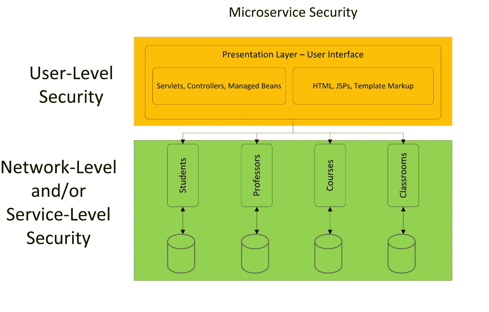


为微服务库使用网络访问安全有以下几个优点：它既简单又全面。当你实现安全层时，对微服务本身或其打包完全没有影响；而且该层可以对其进行增强和更改，而不会对单独部署的微服务产生任何细微影响。网络访问安全在开发者端不需要任何规划；然而，某些服务比其他服务更敏感。我能想到的例子包括人力资源（例如，薪资和有关员工的敏感个人信息）或医疗记录。某些服务和数据需要额外的安全级别。

为需要额外安全的服务建立服务级账户（service level accounts）。这与通常保护数据库数据的方式非常。数据库连接不使用终端用户安全凭据，而是建立服务账户以便我们利用连接池。服务也是大区别。大多数安全的微服务使用 [OAUTH](https://en.wikipedia.org/wiki/OAuth)，因为它们通常提供 RESTful Web 服务接口。此外，像处理数据库凭据一样，将服务账户和密码设置为可配置。使用 `OAUTH` 保护 RESTful Web 服务的机制对于微服务和其他类型的 RESTful Web 服务来说没有区别，本书将不会直接讨论这一点。

不要直接为终端用户配置微服务访问。既然你的 Web 应用程序依赖于微服务库，那么它们的终端用户安全性不应该是不同的。通常需要终端用户凭据来允许或限制特定用户访问 Web 应用程序特定功能。使用微服务架构绝没有改变这种需求。然而，不要将终端用户凭据传递给你的服务库。那会增加安全管理的极端复杂性，并且不会提供任何额外收益。

## 合约测试程序与要求

对于微服务库来说，计划和自动的合约测试程序由于以下几个原因至关重要。本节将讨论这些问题。

微服务的持续集成至关重要。微服务架构促进了更高的开发吞吐量。这意味着生产部署的频率更高，手动集成测试的机会更少。这里的含义是，对微服务库进行自动化合约测试是必不可少的。如果没有持续集成以及随之而来的自动化合约测试的保障，你会发现缺陷迁移到了生产环境。持续集成是防止缺陷部署到生产环境的主要保障。微服务内部代码的单元测试虽然有用，但在微服务架构中作为保护措施并不十分有效。有些人甚至主张完全放弃单元测试而转而采用合约测试，但我并不愿意做到那种程度。

持续集成补偿了开发者的近视（myopia）。在一个开发者一次处理一个服务并日益依赖服务调用的世界里，他们对任何更改都没有完整的上下文。他们并不完全理解从业务角度来看，如果他们部署了缺陷，可能会破坏什么。你可能认为这是一种负面影响，但这是范式中故意设计，旨在让开发者更专注、更高效。我的观点是，开发者的近视需要缓解，而持续集成和自动化测试就是这种缓解措施。

持续集成允许单个微服务实现真正的可丢弃。在一个服务趋于“可丢弃”的世界里——即丢弃一个服务版本并完全重写它是相对容易的——服务的一个新版本需要执行与旧版本完全相同的操作。凭借一个健康的自动化测试库，开发者可以更安全地重写和重构服务，而不用担心引起生产问题。

持续集成防止开发者错误进入生产环境。从管理的角度来看，合约测试是你防止不听指挥的开发者的隔水舱（bulkhead）。我们都管理过那些似乎不听从、想按自己的想法事的开发者，有时这并不是为了组织的利益。微服务架构给了你机会给这些不听指挥的开发者套上容器，特别是当你有一套严格的合约测试时。

## 基于消费者的合约测试（Consumer-based Contract Testing）

合约测试领域有一个值得考虑的近期进展。我们大多数人习惯于为发布的的服务编写合约测试。在一个服务日益依赖其他服务的世界里，有些组织正让消费者来测试他们所依赖的服务的功能。也就是说，你消费一个服务，并为你所依赖的该服务的功能贡献自动化测试。该服务在通过所有由消费者提供的测试以及由服务发布者提供的测试之前，无法部署。

对于处理型服务（process services）——即那些依赖其他服务的服务——你可以辩称这仅仅是语义上的变化。根据定义，处理型服务的合约测试是在测试它们所依赖的服务。通过这种方式，所有实现微服务的人实际上都会在某种程度上实施了基于消费者的测试。然而，对于大多数处理型服务测试，该测试失败与其所依赖的某个服务的有效故障之间没有直接关联。也就是说，如果没有进行某种调查，将不会看出服务合约的更改是处理型服务测试失败的原因。

虽然这增加了服务发布者的工作量，但它增加了安全性。你也可以将其视为优化支持资源。当缺陷进入生产环境时做出反应更高效，还是防止它的更容易？许多组织已经得出结论：防止它更便宜、更容易；因此采取了基于消费者的测试。

基于消费者的测试防止了你消费的服务中出现未通知的合约变更。如果一个服务不通过所有基于消费者的合约测试就无法进入生产，那么该服务的开发者就不可能引入破坏合约的更改。对于他们来说，这将被地作为最后的手段。

## 合约测试的工具支持

幸运的是，由于 RESTful Web 服务和 SOA 架构已经很长时间，支持微服务合约测试的工具非常丰富。可以考虑的内核包括：

*   Apache [HttpClient](http://hc.apache.org/httpcomponents-client-4.4.x/index.html) 用于 RESTful Web 服务合约测试
*   [SoapUI](http://www.soapui.org/) 用于 Soap 或 RESTful Web 服务合约测试
*   [ActiveMQ](http://activemq.apache.org/how-to-unit-test-jms-code.html) 用于 JMS 或 AQMP 测试。它们有一个有效的嵌入式代理可用于测试
*   [Jenkins](https://jenkins-ci.org/) 用于自动化和计划构建


演变为微服务架构。作为一个一般原则，应用最初应该创建为传统的应用程序，然后随着复杂性的增长，逐渐演变为混合或微服务架构。传统的 Web 应用程序在初期更容易构建和支持。`YAGNI`（你并不需要它）原则在此适用。许多应用不会增长到足以需要使用微服务架构的程度。在必要出现之前，不要白费精力和浪费金钱。

微服务架构并非非黑即白。传统应用程序可以依赖于少数微服务；没有必要让整个应用都演变为微服务架构。事实上，当一个传统的 Web 应用演变为微服务架构时，这种过渡通常涉及此类部署：传统的 Web 应用依赖于较小的微服务库来完成其部分工作。

开发微服务的初始尝试应该是小且有针对性的。与大多数范式一样，有节制地迁移到微服务架构是有必要的。在能够有效地维护大型微服务库之前，你还需要获得使用微服务的经验，以及支持大幅增加的部署单元数量所需的 DevOps 流程。良好的初始概念验证微服务应该足够重要以足以引起关注，但又要足够受控，以便管理业务风险。

多个应用需要相同的功能。对于传统的 Web 应用，你可以共享某种通用库，或者在一个应用中发布服务并供另一个应用使用。当这种共享功能需要外部资源（如数据库资源）时，情况就会变得复杂。这种共享功能是分离为具有独立数据库的独立、独立部署单元的理想人选。

应用的不同部分有不同的扩展需求。将功能拆分到微服务允许这些功能以不同的方式进行扩展。例如，一个微服务可能在集群中只需要三个节点，而另一个微服务由于交易量较大，可能需要几十个节点。

应用的部分可能有更高的可用性要求。将功能拆分为微服务不仅可以增加事务吞吐量，还能降低服务完全宕机的概率。换句话说，规模的扩大也减少了服务集群所有节点同时宕机的概率，从而避免服务不可用。

## 你的传统应用程序过大的警告信号：

鉴于大多数应用都是演变为使用微服务架构而非从那里开始的，你如何知道你的应用（或应用）何时达到了应该考虑微服务架构的程度？没有客观的规则可以遵循，但我可以提供一些指导。

改变会带来意想不到的后果。当应用变得庞大且复杂时，部署包含的风险更多。要进行隔离且有针对性的改变而又不产生意想不到的后果会变得越来越困难。在这些应用中，当你修复一个问题时，其他问题会无意中出现。这就像在玩打地鼠游戏，你打掉了一个老鼠，却看到另一个出现。这标志着应用变得太复杂，无法作为一个单元进行管理，并且可以通过微服务架构等范式将应用拆分成更小的部分来受益。

发布测试 / QA（质量保证）周期变得异常不合理。这标志着应用已经变得太大、太复杂，无法作为一个单元被有效管理。在这种情况下，将大问题拆分为更易于管理的小型问题可以降低支持成本。微服务架构在这种情况下非常有用。

单个应用的开发团队变得太大，无法有效管理。我赞同杰夫·贝佐斯的一句话：“如果你不能用两块大披萨喂饱团队，那么这个团队就太大了。”微服务架构可以使管理大型开发工作变得更容易，因为工作单元被拆分为独立的、更易管理的团队。

## 营销话术在哪里？

对于任何新范式，都会伴随着某种程度的炒作和营销。微服务也不例外。这一节将尝试去芜存菁，让你知道哪些是营销话术。

### 微服务更容易管理吗？

卖点之一是，是的，它们更容易管理。但在微服务架构变得更容易管理之前，你将需要观察细则字体中的要求。

你必须非常擅长合约管理（contract management）。你的管理效率源于对通信需求的减少。这种减少源于将团队组织成更小、更集中的工作小组。在微服务架构中，很大一部分通信来自于与其他团队的交互，以便在你的服务契约中设计功能。你对服务契约的的有效性直接影响团队之间需要多少的通信。

你必须非常擅长指定每个服务的任务和功能。与此密切相关的，为你的消费者编写该服务的文档。要看这如何影响你管理微服务架构的能力，请看服务没有被有效记录时会发生什么。要使用一个文档不全的服务，你需要寻求提供团队的帮助来学习如何有效地使用它。这极大地增加了通信开销，并需要协调多人。它还导致在开发调用该服务的代码时，产生更多的技术问题和故障。换句话说，提供良好的文档和用法示例是双赢的。服务提供者在支持方面的花费会减少，而消费团队能够开发得快得多。

服务必须是真正的上下文无关且自给自足的。服务不应该对调用的上下文设置限制。例如，服务在用户界面中应该像在批处理中一样易于使用。所有服务和服务调用都应该是无状态的。例如，不应该有从一个调用到另一个的上下文（例如会话变量内容）。如果服务使用数据库，所有服务调用都是完整的工作单元。当服务调用完成时不应遗留任何开启的事务。

### 微服务更容易让开发者理解吗？

微服务架构的卖点之一是它让问题足够小能够装进开发者的脑子里，但实际上答案是“否”。对于开发者来说，孤立地理解一个特定的服务确实更容易。这一点没有争议。代码库更小了。功能集更小了。只是更小更聚焦。

这个卖点具有误导性的地方在于，在微服务世界，可能需要几十个服务协作来提供特定的业务功能。是的，如果你有效地划分了边界，开发者可以把服务视为“黑盒”，而不深入研究该服务具体执行操作的底层机制。但服务的大数量意味着，整个服务集就像一个复杂的 API，开发者需要理解它才能有效地处理服务。本质上，这里的复杂性与在传统应用中理解大量的包没有区别。

微服务会增加开发吞吐量吗？


也就是说，使用微服务架构进行开发，其开发速度会增加吗？答案是“可能吧”。

你必须擅长合约管理。正如之前解释过的，你在这方面的能力直接影响通信开销。通信开销会极大降低你的开发速度和开发吞吐量。

目标实际上被误述了。目标应该是“提高你向终端用户和业务部门交付功能的速度”。虽然衡量单个团队的开发速度较容易，但交付给业务的功能才是真正重要的。新的业务级功能通常需要多个新服务，或者对多个微服务进行功能增强，这是很常见的。这意味着有效的合约管理实际上意味着要在多个服务团队之间协调合约的增强。如果没有这种协调，开发速度可能会增加，但业务功能交付的速度可能不会。为了实现有效性，这种协调是必不可少的。

## 微服务真的是可丢弃的吗？

微服务无疑比传统的 Web 应用程序更具可弃性。尽管如此，这种优势被稍微夸大了。让我们仔细思考一下。

服务的替代品最好能执行与其前身完全相同的功能，否则你将面临缺陷和意外后果。此外，替代服务需要像其前身一样处理所有的跨切关注点。为了在不引入缺陷的情况下有效地替换服务，你需要严谨的合约测试。

在进行更改之前精确地替换微服务；永远不要将更改与替换结合在一起。这简化了测试。你可以针对旧版本和新版本运行测试套件——而且你应该总是得到相同的答案。如果新版本中有预期中的更改，那么这样做将变得困难得多。这引出了一个问题：在重写服务的过程中发现的任何 Bug，你是否会复制它们？我的回答是“会”，这能保持测试的简单。可能你的某个消费者已经发现了你的 Bug，并且目前正编写了代码来绕过它；修复该 Bug 就会导致该消费者崩溃。

你必须擅长合约测试。如果没有严谨的合约测试能力，部署一个重写的服务版本就是一个风险。针对两个版本的服务运行你的测试套件，它们应该都能通过。这里的含义是，测试套件是针对所测试的合约的，而不是针对底层服务。

你必须擅长提供稳健的应用程序架构支持。你不希望新服务的开发者在处理跨切关注点上花费比配置/设置更长的时间。如果是这样，就会增加建立新服务的成本。这也会让替换服务变得更加困难，因为它们也需要处理这些跨切关注点。

## 最佳实践与常见错误

与所有新范式一样，随着该范式的成熟，其最佳实践和常见错误随之出现。我们现在已经在微服务架构中看到了这一点。本节将详细介绍其中一些。

### 最佳实践

#### 记录微服务的请求和响应

这有助于支持人员诊断未产生异常的问题。通常，这种日志是滚动日志，出于空间考虑，它只保留配置期间内的事务。这极大地节省了支持人员的时间，因为你通常不需要花时间去构建/复制产生意外/不想要结果的事务；该事务已经存在于你的历史记录中，找到它通常比重新创建要快。

将服务请求与响应关联起来。我已经提到过，实现日志管理软件（如 `Splunk` 或 `Logstash`）对于微服务架构是至关重要的。记录请求和响应可以简单地记录它们，并让开发者可以使用这些日志。开发者能够匹配每个服务调用的请求和响应是至关重要的。如果你利用了前章节描述的技巧，将每条日志记录与唯一的事务 ID 或关联 ID（correlation id）关联，你只需要记录所有的请求和响应，开发者就能拥有这些信息。

### 常见错误

与任何技术范式一样，微服务架构可能会被误用。

#### 不恰的服务边界

服务应该是真正的松耦合且自给自足的。如果你发现一个更改需要部署多个服务，这很可能意味着你拥有不该拥有的耦合，或者你正在刻意引入一种破坏合约的更改。虽然后者有时是不可避免的，但前者通常表明合约边界设计缺陷。

服务不应该关心执行上下文。例如，它们在用户界面和批处理中也应该是同样易用的。当你在获取新消费者时遇到意外后果，很可能意味着该服务并不是真正独立于上下文；它具有某些你的新消费者未能某种方式满足的上下文要求。这很可能也是某种合约边界设计缺陷。

#### 将微服务暴露给浏览器

微服务并不是为了公共消费而设计的。此点的很大理由是在部署用户界面的“前端后端”（back ends for front-ends）模式中提出的。组织无法控制公共互联网上的性能。结合用户操作往往涉及多次服务调用这一事实，显而易见用户请求需要某些调用合并。

#### 低效的事务日志

在微服务架构中，定位问题（找出哪个服务包含问题的根源）花费的时间要多得多。对微服务请求和响应进行有效记录可以极大减少这种时间。由于微服务架构固有的可部署数量增加，如果没有访问服务请求和响应，定位缺陷发生的服务将成为一个耗时的问题。

#### 低效的异常处理

高比例的异常报告应该在异常中包含足够的信息，至少能定位问题的根源，即使不能让根源可见。没有这些信息，支持人员只能通过耗时的尝试错误来试图在测试环境中重现问题。这浪费了时间。

#### 低效的请求验证

从长远来看，早发现错误比晚发现错误总是节省时间。让无效请求通过并最终退化为某种派生异常，比在犯罪现场更早报告异常总是浪费支持人员更多的时间。

#### 低效的响应验证

你是否曾因为调用的服务没有返回预期而收到空指针异常或其他类型的派生异常？如果你依赖这些结果，那么在返回时验证这些值更好，这样支持人员就能获得更清晰的错误信息。这里的原理与验证请求数据的重要性非常相似。

## 为什么是现在？

SOA 和通过服务实现模块化已经存在很长时间，因此微服务架构并不是一个全新的想法。这引出了一个问题：为什么是现在？

虚拟化和云技术使得微服务架构变得可行。当 SOA 流行时，为大量新服务寻找并安装硬件是一个真正的问题。现在，大多数组织已采用了混合云，管理员可以轻松建立任何所需的托管新服务的虚拟机。


DevOps 自动化使得支持更多的部署单元成为可能。在 `SOA` 流行时期，支持指数级增长的部署单元对于运维人员来说是一个严峻的问题。在过去，设置是手动的，而且往往是重复性的。在 DevOps 世界中，得益于 `Docker`、`Chef` 和 `Puppet` 等工具，新环境可以进行配置并以自动化的方式进行部署；因此不再需要大量的人工操作。

硬件和网络基础设施比以往任何时候都廉价。在过去，调整资源消耗至关重要，因为设备极其昂贵。现在，微服务架构所需的额外内存和进程开销已不再是主要问题。

# 模块化的未来方向

微服务架构并不是 Java EE 应用模块化的唯一范式。本节将简要描述其他 Java EE 模块化的尝试，并将其与微服务架构进行对比。

## Java 9 与 Jigsaw

`Jigsaw` 正式向 Java 平台引入了模块化。目前已有早期发布版本，尽管预计直到 2016 年才会发布正式版本。基本上，该功能附带了一个新的部署单元（模块库或 `jmod`），它在进程内工作，但保证拥有自己的微型运行时环境。关于 `Jigsaw` 的更多细节可以参考[此处](http://openjdk.java.net/projects/jigsaw/doc/quickstart.html)。

将 `Jigsaw` 与微服务架构相比有几处不同。`Jigsaw` 具有以下优势：

*   内存消耗更低，因为它在进程内运行。
*   编译器强制合约（而非运行时）。

然而，微服务架构相比 `Jigsaw` 仍具有若干优势：

*   服务可以独立扩展。
*   服务与技术栈无关；不受限于 `java`。
*   服务的部署可以独立管理；不会被编译到运行时产物中。

正如我们讨论过的硬件成本降低，优化内存已不再像以前那样重要了。总的来说，微服务架构比 `Jigsaw` 为企业提供了更多的自由和灵活性。

## OSGi

`OSGi` 是 Java 平台的一种模块化解决方案，是在平台正式支持模块化之前发明的。与微服务架构相比，它的优缺点列表与 `Jigsaw` 完全相同。事实上，你可以将 `Jigsaw` 看作是实现了与 `OSGi` 相同的目标。

将 `OSGi` 与微服务架构相比有几处不同。`OSGi` 具有以下优势：

*   内存消耗更低，因为它在进程内运行。
*   编译器强制合约（而非运行时）。

微服务架构相比 `OSGi` 仍具有若干优势：

*   服务可以独立扩展。
*   服务与技术栈无关；不受限于 `java`。
*   服务的部署可以独立管理；不会被编译到运行时产物中。

顺便一下，`OSGi` 的普及率非常低。如果你查看 `indeed.com` 或 `Google Trends` 的统计数据，`OSGi` 的职位需求一直增长到 2011 年，之后一直在同样的低水平波动。

## 开源采用

我看到发布在 `GitHub` 和其他开源托管平台上的、旨在作微服务的开源产品正在不断增长。我预计这一趋势将持续下去。例如，2015 年 6 月在 `GitHub` 上搜索“microservice”一词，结果略超过 1,100 个仓库。到 2016 年 1 月，这个数字略超过 3,200 个。虽然并非所有仓库都包含设计为微服务部署的产品，这确实如此，但其中某些比例是，而且可以怀疑这个数字在过去的几个月里已经增长了。

# 第 5 章：管理微服务开发

微服务架构对开发者和架构师的影响是巨大的。对管理的影响同样巨大。大多数关于微服务架构主题的作者和演讲者集中在微服务的更技术层面上。作为架构师，我们应该交付业务价值。这些价值的一部分是就采用微服务架构的影响建议管理层，以及他们扮演的角色。

## 采用微服务架构的先决条件

在大规模采用微服务之前，需要准备并运行相应的基础设施要求。本节将尝试为建议管理层的架构师以及经理本身提供指导。

### 治理的变化

你无疑拥有管理开发从测试、用户验收到生产环境周期的流程和程序。可能需要在生产迁移之前填写表格获得批准。这些程序的意图通常是降低部署风险并防止缺陷迁移到生产环境。我确定，在没有引入微服务架构的情况下，这些流程对于你目前处理的部署量运行得良好。

目标是为微服务架构提供治理和基础设施支持，但做法不能拖慢一切。记住，益处之一本应该是更高的开发速度。治理与速度是背道而驰的。

大多数治理程序无法实现指数级扩展。微服务架构将指数级增加你管理的部署数量。组织建立的大多数流程并非旨在处理你当前量的 10 倍或 20 倍。你将开发移至生产环境的官僚程序可能无法生存那种增长。更有可能的是，你的治理程序需要改变和适应，以处理微服务架构带来的指数级增长。

自动化生产部署过程，包括测试和审批。微服务架构的优势之一是，微服务拥有“虚拟”用户。因此，它们没有需要通过视觉检查来验证美学等特征的用户界面。微服务的测试可以完全自动化。Web 应用程序用户界面可能需要手动检查，以确保它们拥有的更主观的是正确的，但微服务不需要。是的，自动化整个过程需要投入，但如果你大量投入微服务是为了获得该范式提供的收益，那么自动化在某个时间点会产生回报的。

自动化缺陷检测和回滚启动。自动化测试将对缺陷部署提供某种保护。可以考虑的额外保护措施是建立一种机制，检测部署后失败率的变化，并在失败率增加超过可配置阈值时自动启动回滚。任何不习惯于完全依赖自动化部署过程的人，都可以通过在产生错误时增加自动回滚来增加安全感。


# 拥抱 DevOps 文化

微服务架构部署物的数量呈指数级增长，有时是传统 Web 应用的 20 倍。要通过完全手动流程来建立新环境和管理部署是不可能的。拥抱 DevOps 文化，即通过程序化方式创建和管理环境，并减少每个环境的人工工作量，对于管理大量的部署物是至关重要的。

快速创建和保护新环境的能力至关重要。随着新服务的识别和新资源的请求，你所使用的虚拟机数量将会增加。通过利用 Apache [Mesos](http://mesos.apache.org/) 或其他类型的资源管理软件，可以减少虚拟机的增长。这本身需要工作和额外投入。采用微服务架构在技术上并不要求集成云服务，但许多用户确实选择集成，以便他们能够在短时间内指数级地增加其支持的虚拟机数量。

对数据库管理人员的需求将会增加。大多数人考虑到对运营人员的额外需求。由于微服务架构也增加了数据库的数量以及部署物的数量，对新模式/数据库创建及增强的需求也会之增加。这意味着对数据库管理员的需求也会增加。有些组织将这些工作交给了微服务团队本身，但无论如何组织，这些工作都不会消失。虽然不经常讨论，但数据库管理员也需要拥抱 DevOps 文化，并将他们做的更多工作自动化。

## 服务合约管理

关于微服务团队如何获取功能增强任务的描述还并不多。微服务其本质提供了用户请求的能力的核心部分，但并非以那些用户可能理解的语境呈现出来。用户更有可能向为他们提供 Web 应用或用户界面的团队提出功能请求。当团队意识到自己没有能力交付该功能请求时，他们需要将请求的非 GUI 部分传递给一个或多个微服务团队来实现。例如，假设一个 UI 团队接收到了存储某特定课程教授教学大纲的请求，而目前没有可用服务能够记住这些信息。需要有人来引导该请求，弄清楚它属于哪个服务，确保功能请求包含足够的可操作信息，并对其进行适当路由。这里有很多工作需要以某种方式完成并安置。大多数组织利用某种类型的任务管理软件（例如 [Jira](https://www.atlassian.com/software/jira)）来管理和跟踪此类功能请求。

服务组合管理将是关重要的。是的，你可以让开发者作为一种基层努力来设计和发布服务合约。换句话说，让他们随心所欲，而你不予关注。最初，这是最简单的管理方法。然而，随着部署服务的数量增加，开发者将无法“见木不见森林”。你会遇到大量的重复，并且创建和部署的服务中将出现大量的不一致性。最终，这些缺陷将随着服务列表的增加而增加，并侵蚀你从微服务架构中获得的一些收益。

我永远不会建议你在所有服务合约部署和使用之前实施一个正式流程来审查并批准它们。那会阻碍开发速度，而这是微服务架构的预期收益之一。然而，应该有人跟在开发团队后面，以包括管理层在内的所有人可用的标准格式对已发布的服务进行目录编制。这样他们就可以记录服务不一致之处，向服务团队发送变更建议，并帮助开发者采用现有服务——而不是发明现有服务的新版本。如果存在任何风险，他们还可以向管理层指出潜在的风险区域。

管理合约变更是至关重要的。在微服务世界中，合约的质量将极大影响你从采用微服务架构中获得的收益。定义不当的合约会导致混乱和意外，并对新功能的开发速度产生负面影响。有些组织谨慎地限制任何时间的变更量，以保持高质量并防止对开发速度产生负面影响。

功能增强任务对于微服务团队成员来说应该是明确且清晰的。记住，更高的开发速度来自于开发者的专注能力，并且免于通信开销。给他们不明确的功能分配意味着他们将需要向请求功能的用户那里获取清晰度。需要建立一套用于梳理和跟踪功能增强请求的流程。

## 服务测试与部署自动化

对自动化测试的投资是至关重要的。随着开发速度的提高，生产部署率呈指数级增长。如果没有自动化测试，缺陷将迅速摧毁你的生产环境。自动化合约测试对于缓解这些影响至关重要，因为在这个世界中通常没有时间进行手动测试。这种自动化不是免费的；它需要的人力来设置，还需要维护和管理。它还需要强制执行。

自动化部署是至关重要的。随着部署速度的增加，每次部署都进行人工干预不再像以前那样可行。也可以认为，部署中的手动步骤实际上增加了风险，因为它们增加了错误的机会。是的，这个陈述假设了一个编写良好、测试良好的部署流程，这种流程通常没有失败记录。不言而明，只有通过绿色测试套件的产品才被允许进入生产环境。

数据库更改也应该是自动化的。数据库更改通常伴随着新功能的服务部署。如今，这些更改也可以是自动化的。像 [FlyWayDb](http://flywaydb.org/) 这样的产品有助于管理此类更改。是的，回滚或失败部署仍然需要一定的人工干预，但希望失败部署仅占总数的一小部分。

考虑提供一种基于消费者的测试流程。基于消费者的测试需要是自动化的，并作为针对服务的测试套件的一部分。你可以将其视为必须为绿色状态才能进行生产部署的测试添加。这里的唯一区别是消费者团队提供并维护这些测试。我会将此视为消费其他服务的服务团队的“选项”，而不是要求。在过去，我不得不依赖被证明不可靠的服务，导致许多测试失败。对于不可靠的服务，在开始时知道依赖的服务已挂掉且测试失败是在预期之中的是非常好的。这节省了调查时间。

## 团队管理

管理团队的交付物，而不是团队内部的管理。微服务架构的好处之一是消除通信开销。通过交付物管理而不是微观管理团队，有助于消除这种开销。只要你以接受的速度和质量获得功能增强，团队选择如何组织可以留给他们。


开发人员应该一次只专注于一个服务。这有助于避免在特定顺序或语境下对服务使用的业务流程做出假设。我之所以这样做，是因为你不会让某位开发人员同时负责一个服务及其调用方服务。这也有助于他们专注于工作，不受干扰，并保持高开发速度。在这样一个世界里，任何拖慢开发速度的因素都会牺牲你从微服务架构中获得的收益。

发布服务的开发人员应该对其提供支持。这能促进智能化的开发产品决策，并编写可维护的高质量代码。换句话说，开发者要“自食其”（eat their own dog food）。大多数开发人员都想要良好的家庭生活；这种范式支持了这一点。只要他们产出的服务缺陷率低，那么他们在支持工作上花费的时间就会降到最低。

## 服务健康监控

对缺陷进行自动化响应是非常关重要的。随着开发速度的提高，生产环境的部署频率呈指数级增长。健康监控对于快速发现故障和缺陷至关重要。我的一些客户使用 `Splunk` 或 `LogStash` 在生产环境中遇到错误时，自动在工单系统中创建缺陷工单。决定遇到错误时应该通知哪个服务团队值得一些深思和规划。例如，一个因错误输入而出错的服务调用应该发送给调用方，而不是生产服务的团队。当然，任何类型的未计划运行时异常都应该发送给生产服务的团队。

处理重复错误也值得考虑。根据数量大小，一个缺陷可能会产生数千份报告。为同一个缺陷获取数千个工单几乎并无益处。抑制重复是危险的，因为检测哪些是之前问题的重复、哪些是具有不同原因的问题可能会问题。

## 采用微服务架构的管理优势

许多文献集中在描述微服务架构提供的技术优势上。它也有业务/管理优势。本节将详细介绍其中一些。

### 资源人员配置的灵活性与隔离

微服务开发团队规模小且专注。开发人员每次`only`专注于一个服务。该服务应该有一个开发人员据此编写代码的固化合约，最好带有容器化的交付物（即 `Docker`）。关键在于，他们完全专注于深度开发。他们不应该被承担（或不必承担）通信开销的负担；只需与负责该服务的其他开发人员沟通。

他们作为一个独立的团队工作，与其他所有服务团队完全异步。结合他们具有低通信开销和定义交付物的事实，他们可以在世界上任何地方、任何时区工作。无论是在公司办公室内还是在海外外包，这并不重要。

鉴于团队的工作被限于对服务的专注需求，对代码质量等的担忧至少被限制在较小的服务源码库中。换句话说，该团队能搞乱代码并从而产生维护问题的程度是有限的。

这意味着微服务的开发可以更容易地进行外包。

这也意味着你能够更好地免受不受控的开发人员（rogue developers）的干扰。我们都管理过产生不可维护性代码的开发人员。由于不受控的开发人员被限制在一个较小且专注的代码库中，他们对该代码库造成的破坏是有限的。此外，该代码库很小、专注且定义良好；如果需要，它更容易被替换。你不会让不受控的开发人员在一个 50 万行的单体应用中肆意破坏，造成更大范围的混乱。

### 提高开发速度

假设所需服务的合约以及这些服务之间的依赖关系已完全定义，那么引入更多开发团队进行持续工作就会更容易。对于引入额外开发人员的担心在于，这通常意味着更多的通信开销。由于这种增加的开销，开发人员的生产力收益是递减。每增加一个开发人员，你获得的生产力就越少。

虽然微服务团队中个人开发人员的生产力确实提高了，因为他们没有那么多通信开销，但任何开发人员生产力的提升是有极限的。你的速度增长实际上来自于添加新团队的便利性。开发人员在小型、专注的团队中进行深度开发，他们看不到或不受整体工作规模的影响。因此，管理层更容易将开发扩展到更大数量的开发人员。请注意，除了完全定义所有服务合约外，你还必须识别合约之间的任何依赖关系；某些服务可能要求在完成特定服务的工作之前，先完成其他服务。请注意，任何开发团队都可以对依赖服务进行存根（stub），并在依赖服务完成之前开始工作。

在这里实际发生的情况是，扩展开发的限制转移到了负责识别单个服务和指定服务合约的管理层和企业架构师。更大规模的工作将带来更多的协调点。由于某些服务会调用其他服务，那些依赖服务需要先构建。工作流向开发团队的顺序需要进行协调。

### 技术栈自由

在微服务世界中，服务是容器化的。这意味着部署产物拥有它所需的操作系统和其他软件（例如 `Java JVM`、`PHP`、`Python`、`GoLang` 等）。每个服务都可以轻松地在这些技术的不同层次上运行。推论是，新技术可以更容易地引入或升级。这让你能够比在传统的单体 Web 应用程序中快地利用新技术。

对于传统的 Web 应用程序，代码库要大得多。因此，升级的影响会大得多，并且需要更广泛的回归测试。此外，在较大的代码库中，切换开发语言要困难得多。

这是一项技术优势，但我认为它也是一项管理优势。经理们一直在寻找更快交付软件的新方法。提高开发人员生产力的途径之一是可用工具集的技术进步。与传统的 Web 部署相比，微服务架构让你利用新开发的工具集并带来业务所要求的生产力增长的能力更好。


关于微服务架构定义以及该范式定义的权威指南，是 Fowler 和 Lewis 写的[微服务](http://martinfowler.com/articles/microservices.html)。你可能还记得我将微服务定义为大多数微服务都具备的一系列特征。我曾希望能声称这是我的原创思想，但我做不到。Fowler/Lewis 的文章是关于微服务特征列表的权威标准。我选择了我认为最重要的特征进行重点强调。

Fowler 在微服务架构的前决条件方面也做出了非常有价值的工作（可见[此处](http://martinfowler.com/bliki/MicroservicePrerequisites.html））；也就是说，在大规模尝试微服务架构之前，你应该具备的能力。

微服务领域的另一位思想领袖是 Adrian Cockroft。你可以在这个[视频](http://www.infoq.com/presentations/migration-cloud-native)中看到他的作品。我关注他的[Twitter](https://twitter.com/adrianco?ref_src=twsrc%5Egoogle%7Ctwcamp%5Eserp%7Ctwgr%5Eauthor)动态。

我密切关注该领域的两个开源项目。第一个是 [Netflix](https://github.com/Netflix) 产品套。他们必须支持惊人的吞吐量，并且慷慨地开源了他们为了支持这些而构建的工具。第二个是 Apache [Mesos](http://mesos.apache.org/)，它本质上让计算资源无处不在。也就是说，它允许你通用地看待计算资源，而不必担心这些资源在哪里。由于微服务架构产生了大量的部署物，这对于减少部署管理问题非常有前景。

感谢你花时间本书。如果你有任何意见或问题，欢迎通过 derek.ashmore@dvtconsulting.com 或 [LinkedIn](http://www.linkedin.com/in/derekashmore) 与我联系。我总是对反馈感兴趣。

