# Microsoft® ASP.NET 4 步步进阶指南


策划编辑：Ben Ryan

开发编辑：Maria Gargiulo

项目编辑：Melissa von Tschuchi-Sutton 和 Maria Gargiulo

编辑制作：Waypoint Press, www.waypointpress.com

技术审核员：Ken Scribner；技术审核服务由 CM Scribner, Ltd. 的成员 Content Master 提供。

封面：Tom Draper Design

献 Sally Bronson Harrison 和 Gene Harrison，我的继母和父亲。

致谢 ................................................................................................................................................. xvii

引言 ..................................................................................................................................................................... xix

## 1 Web 应用程序基础

- HTTP 请求
- 来自浏览器的 HTTP 请求
- 在不使用浏览器的情况下发送 HTTP 请求
- 超文本标记语言 (HTML)
- 动态内容
- HTML 表单
- 通用网关接口 (CGI)：非常复古
- 作为服务器的微软环境
- 互联网信息服务 (IIS)
- 互联网服务应用程序 DLL
- 运行互联网服务
- 经典 ASP：重新审视 ASP.NET
- Web 开发概念
- ASP.NET
- 第 1 章快速参考

## 2 ASP.NET 应用程序基础

- 经典的 Hello World 应用程序
- 将 HTML 与可执行代码混合
- 服务器端可执行块
- ASP.NET 编译模型
- 编码选项
- ASP.NET 1.x 样式
- 现代 ASP.NET 样式

> 微软希望听到您的反馈，以便我们不断改进书籍和学习资源。如需参与简要在线调查，请访问：`www.microsoft.com/learning/bookssurvey/`

- ASP.NET HTTP 管道
- IIS 5.x 和 IIS 6.x 管道
- IIS 7.x 集成管道
- 接入管道
- Visual Studio 和 ASP.NET
- 本地 IIS 网站
- 基于文件系统的网站
- FTP 网站
- 远程网站
- Hello World 与 Visual Studio
- 第 2 章快速参考

## 3 页面渲染模型

- 将渲染控件作为标签
- 将 UI 封装为组件
- 使用 ASP.NET 的页面
- 页面的渲染模型
- 页面的控件树
- 使用 Visual Studio 添加控件
- 布局考量
- 第 3 章快速参考

## 4 自定义渲染控件

- 控件类


# 目录

## Visual Studio 与自定义控件
## 回文检查器
## 控件与事件
## HtmlTextWriter 与控件
## 控件与视图状态 (ViewState)
## 第 4 章快速参考

### 5 复合控件
- 复合控件与渲染控件
- 自定义复合控件
- 用户控件
- 何时使用每种类型的控件
- 第 5 章快速参考

## 6 控件杂烩
### 验证
### 页面验证的工作原理
### 其他验证器
### 验证器属性
### 基于图像控件
### 树视图 (TreeView)
### 多视图 (MultiView)
### 第 6 章快速参考

## 第二部分 高级特性

## 7 一致的外观与感受
### 管理用户界面的一致性
### ASP.NET 主页 (Master Pages)
### 主题 (Themes)
### 皮肤 (Skins)
### 第 7 章快速参考

## 8 配置
### Windows 配置
### .NET 配置
### Machine.Config
### 配置节处理器 (Configuration Section Handlers)
### Web.Config
### 在 ASP.NET 1.x 中管理配置
### 在 ASP.NET 后续版本中管理配置
### 从 IIS 配置 ASP.NET
### 第 8 章快速参考

## 9 登录
### Web 端安全
### IIS 安全
### 基本表单身份验证 (Forms Authentication)
### ASP.NET 身份验证服务
### `FormsAuthentication` 类
### 可选的登录页面
### 用户管理
### ASP.NET 登录控件
### 用户授权
### 第 9 章快速参考

## 10 数据绑定
### 在不使用数据绑定的情况下集合
### 使用数据绑定表示集合
### 基于列表控件 (ListControl) 的控件
- 树视图控件 (TreeView)
- 菜单控件 (Menu)
- 表单视图控件 (FormView)
- 网格视图控件 (GridView)
- 详情视图控件 (DetailsView)
- 数据列表控件 (DataList)
- 重复器控件 (Repeater)
### 简单数据绑定
### 访问数据库
- .NET 数据库故事
- 连接 (Connections)
- 命令 (Commands)
- 结果管理
### ASP.NET 数据源
### 其他数据绑定控件
### LINQ
### 第 10 章快速参考

## 11 网站导航
### ASP.NET 导航支持
### 导航控件
- XML 站点地图 (Site Maps)
- `SiteMapProvider`
- `SiteMap` 类
- `SiteMapNode`
### 使用导航控件
- 菜单和树视图控件
- `SiteMapPath` 控件
### 站点地图配置
### 构建可导航的网站
- 捕获 `SiteMapResolve` 事件
- 为每个节点定义自定义属性
- 安全修剪
- URL 映射
- URL 重写
- 第 11 章快速参考

## 12 个性化
- 个性化 Web 访问
- ASP.NET 中的个性化
- 用户配置文件
- 个性化提供程序
- 使用个性化
- 在 Web.Config 中定义配置文件
- 使用配置文件信息
- 保存配置文件更改
- 配置文件与用户
- 第 12 章快速参考

## 13 Web Parts
- Web Parts 简史
- Web Parts 有什么用？
- 开发 Web Parts 控制
- Web Parts 页面开发
- Web Parts 应用开发
- Web Parts 架构
- `WebPartManager` 和 `WebZones`
- 内置区域
- 内置 Web Parts


- 开发一个 Web Part ............................................................................................................................ 280
- 第 13 章快速参考 ................................................................................. 288

# 第三部分 缓存与状态管理

# 14 Session 状态 ........................................................................................................ 291

- 为什么用 Session 状态？ ................................................................................................................... 292
- ASP.NET 与 Session 状态 ................................................................................................................ 292
- Session 状态简介 ............................................................................................................................ 293
- Session 状态与更复杂的数据 ................................................................................ 299
- Session 状态
- 配置 Session 状态 .................................... 306
- 关闭 Session 状态 ...................................................... 307
- 内存存储 Session 状态 (InProc) ................................................ 307
- 在状态服务器存储 Session 状态 ............................... 307
- 在数据库存储 Session 状态 ....................................... 308
- 跟踪 Session 状态 ............................................................ 309
- 使用 Cookies 跟踪 Session 状态 ....................................... 309
- 使用 URL 跟踪 Session 状态 ........................................ 310
- 使用自动检测 (AutoDetect) ................................................................... 310
- 应用设备配置文件 ..................................................... 311
- Session 状态超时 ........................................................ 311
- 其他 Session 配置设置 ................................... 311
- 控件：Session 状态的替代方案 ...... 312
- 第 14 章快速参考 ................................................... 320

## 15 数据缓存

- 缓存入门 ................................... 321
- 使用数据缓存 ........................................................ 324
- 缓存的影响 ................................................................ 325
- 管理缓存 ............................................................ 327
  - 内存中的 DataSets ............................................................ 328
  - 缓存过期 ............................................................... 331
  - 缓存依赖 ............................................................ 334
  - SQL Server 依赖项 ................................................ 336
  - 清除缓存 .............................................................. 338
- 第 15 章快速参考 ................................................... 341

## 16 缓存输出

- 缓存页面内容 ........................................................ 343
- 管理缓存内容 ..................................................... 346
  - 修改 OutputCache 指令 ................................ 346
  - HttpCachePolicy ............................................................ 351
  - 缓存位置 ............................................................... 352
  - 输出缓存依赖 ......................................... 353
  - 缓存配置文件 ........................................... 353
- 缓存用户控件 ........................................................ 354
- 何时使用输出缓存合理 ................ 357
- 其他缓存提供程序 ....................................................... 358
- 第 16 章快速参考 ................................................. 359

# 第四部分 诊断与底层架构

## 17 诊断与调试

- 页面跟踪 (Page Tracing) ................................................................................................................ 363
- 跟踪 (Tracing) ................................................................................................................................. 364
- 跟踪语句 (Trace Statements) .......................................................................................................... 367
- 应用程序跟踪 (Application Tracing) .............................................................................................. 370
- 程序化启用跟踪 .............................................................................................................................. 373
- 跟踪事件 ...................................................................................................................................... 373
- 跟踪消息 ...................................................................................................................................... 374
- 使用 Visual Studio 调试 .............................................................................................................. 374
- 未处理异常 ................................................................................................................................. 378
- 第 17 章快速参考 ......................................................................................................................... 383

## 18 HttpClient 类与 HTTP 模块

- 应用程序：入口点 ......................................................................................................................... 385
- 重写 HttpClient .......................................................................................................................... 387
- HttpModules ................................................................................................................................ 394
- Global.asax 与 HttpModules ...................................................................................................... 404
- 第 18 章快速参考 ......................................................................................................................... 404

## 19 HTTP 处理器

- ASP.NET 请求处理器 .................................................................................................................. 405
- 内置处理器 ................................................................................................................................ 407
- 处理器与 IHttpHandler .............................................................................................................. 410
- 处理器与 Session 状态 .............................................................................................................. 416
- 通用处理器 (ASHX 文件) .......................................................................................................... 417
- 第 19 章快速参考 ......................................................................................................................... 419

# 第五部分 动态数据, XBAP, MVC, AJAX 和 Silverlight

## 20 动态数据

- 动态数据控件 .............................................................................................................................. 424
- 动态数据细节 .............................................................................................................................. 428
- 第 20 章快速参考 ......................................................................................................................... 432

## 21 ASP.NET 和 WPF 内容

- 通过减少往返次数来提升感知性能 .......................................................................................... 433
- 什么是 WPF？ ............................................................................................................................ 434
- WPF 如何与 Web 相关？ ............................................................................................................ 436
- 松散的 XAML 文件 ...................................................................................................................... 437
- XBAP 应用程序 .......................................................................................................................... 438
- WPF 内容与 Web 应用程序 ...................................................................................................... 442
- Silverlight 怎么样？ ................................................................................................................ 448
- 第 21 章快速参考 ......................................................................................................................... 448

## 22 ASP.NET MVC 框架

- 模型-视图-控制器 (MVC) 架构 .................................................................................................. 449
- ASP.NET 和 MVC ...................................................................................................................... 452
- ASP.NET MVC 对比 Web Forms .............................................................................................. 453
- MVC 与测试 .............................................................................................................................. 454
- MVC 如何与 ASP.NET 协同工作 .............................................................................................. 455
- 遵循请求路径 ............................................................................................................................ 455
- 第 22 章快速参考 ......................................................................................................................... 472

## 23 AJAX

- 丰富的互联网应用程序 .............................................................................................................. 473
- 什么是 AJAX？ ............................................................................................................................ 474
- ASP.NET 和 AJAX ...................................................................................................................... 475
- 使用 AJAX 的理由 ...................................................................................................................... 476
- 现实世界的 AJAX ...................................................................................................................... 477
- 视角下的 AJAX .......................................................................................................................... 478
- ASP.NET 服务端对 AJAX 的支持 .............................................................................................. 478
- ScriptManager 控制 .................................................................................................................. 479
- ScriptManagerProxy 控制 ........................................................................................................ 479
- UpdatePanel 控制 ...................................................................................................................... 479
- UpdateProgress 控制 ................................................................................................................ 480
- Timer 控制 ................................................................................................................................ 480
- AJAX 控件 ................................................................................................................................ 480
- ASP.NET AJAX Control Toolkit .................................................................................................. 480
- AJAX Control Toolkit 杂锦 ........................................................................................................ 481
- 熟悉 AJAX ................................................................................................................................ 484
- Timer ......................................................................................................................................... 490
- 更新进度 .................................................................................................................................. 497
- 扩展器控件 .............................................................................................................................. 501
  - 自动补全扩展器 ...................................................................................................................... 501
  - 模态对话框样式组件 .............................................................................................................. 508
- 第 23 章快速参考 ......................................................................................................................... 512
  - 成熟的 Web 应用 ...................................................................................................................... 514
  - 什么是 Silverlight? .................................................................................................................. 515
  - 创建 Silverlight ........................................................................................................................ 517
  - 架构 ........................................................................................................................................ 521
  - XAML ...................................................................................................................................... 522
    - 构建视觉树 .......................................................................................................................... 522
    - XAML 和命名空间 .............................................................................................................. 523


- 编译 Silverlight 应用 ..................................................................................................................................... 524
- 在网页中添加 Silverlight 内容 ........................................................................................................................ 524
  - 使用 `object` 标签 ..................................................................................................................................................................... 524
  - 使用 ASP.NET Silverlight 服务器端控件 ..................................................................................... 525
  - 使用 JavaScript 函数 ........................................................................................................................................ 526
- 控件和事件 ....................................................................................................................................................................... 526
- 路由事件 ............................................................................................................................................................................... 526
- Silverlight 控件和类成员 ............................................................................................................ 527
- Silverlight 与布局 ................................................................................................................................................................... 528
- 与 HTML 集成 ....................................................................................................................................................................... 533
- 动画 ..................................................................................................................................................................................... 535
- WCF 服务与 Silverlight ............................................................................................................................................ 542
- 第 24 章快速参考 .......................................................................................................................................... 551

# 第六部分 服务与部署 ....................................................................................................................................

## 25 Windows 通信框架 (WCF) ................................................................................................................... 555

- 分布式计算重塑 ................................................................................................................................... 555
- 碎片化的通信 API ...................................................................................................................... 556
- 用于连接元素的 WCF ............................................................................................................................ 556
- WCF 组成元素 ................................................................................................................................................... 557
  - 端点 (Endpoints) ................................................................................................................................................................ 557
  - 通道 (Channels) ................................................................................................................................................................................. 558
  - 行为 (Behaviors) ................................................................................................................................................................................ 558
  - 消息 (Messages) .......................................................................................................................................................................... 559
- WCF 如何与 `ASP.NET` 协作 ...................................................................................... 560
- 并存模式 (Side-by-Side Mode) ................................................................................................. 560
- `ASP.NET` 兼容模式 ................................................................................................ 561
- 编写 WCF 服务 ................................................................................................................... 561
- 构建 WCF 客户端 ....................................................................................................................... 567
- 第 25 章快速参考 ................................................................................................ 573

## 26 部署 .......................................................................................................................................................................... 576

- Visual Studio 网站 ................................................................................................ 576
  - HTTP 网站 ........................................................................................................ 576
  - FTP 网站 ............................................................................................................................ 576
  - 文件系统网站 ................................................................................................................ 577
- 预编译 ............................................................................................................................ 577
  - 为了性能的预编译 ................................................................................................ 577
  - 为了部署的预编译 ................................................................................................ 578
- Visual Studio 2010 部署支持 ........................................................................ 578
- 第 26 章快速参考 ................................................................................ 585

---

### 您对这本书怎么样？我们想听听您的意见！

> 微软希望听取您的反馈，以便不断改进我们的书籍和学习资源。如需参与简要在线调查，请访问：www.microsoft.com/learning/booksurvey/

# 致谢

在我上一次为这本书写致谢时，我提到了我的儿子 Ted 曾用 HTML 为我写过一张父亲节的卡片。Ted 现在已经上大学了，我记得在他读高中的最后几年里，我是如何寻找并申请学校的。他几乎完全是通过网络在线完成这一切的。这和我当年申请学校的经历相比，有多么不同！

网络渗透到了我们的社会基础设施中。无论你是一个希望提高业务知名度的商人，还是一个试图寻找绝版书的热心读者，亦或是从学校网站获取家庭作业的学生，或者是任何其他信息的生产者或消费者，你都在接触着互联网。

出版一本书是一项巨大的工程。我的名字出现在封底右下角的作者位置，但我确实完成了一些工作。我有许多人要感谢，这本书得以出版。

感谢 Claudette Moore 再次帮我引荐了 Microsoft Press。Claudette 在我与 Microsoft Press 的所有工作中都担任我的代理，处理业务问题，使我能够专注于写作。感谢 Maria Gagliardo 管理项目，与你合作一直非常愉快。感谢 Charlotte Twiss 将代码示例放入 CD 中。感谢 Steve Sagman 如此精美地排版页面。感谢 Christina Yeager 对页面进行校对，让我看起来真的能写出连贯的句子，并为项目编制索引。你们在编辑、制作和布局方面都做得非常出色。感谢 Kenn Scribner 为我提供了我工作过的最好的技术目标。感谢 Ben Ryan 接受了书籍提案并聘请我编写了这本书。

感谢 Jeff Dentemann 购买并出版了我为 *PC Tech Journal* 撰写的首篇文章。感谢 JD Hildebrand 购买了我的第二篇文章，并让我有机会在 Oakley Publishing 与大家合作。感谢 Sandy Daston 在我的写作生涯中提供的支持和指导。感谢 DevelopMentor 的伙伴们，你们是一群非常出色的技术同事，也是学习技术的绝佳地方。感谢我在 Schwab Performance Technologies 的哥们们。

感谢我那“邪恶的 Java 双胞胎”Pat Shepherd 及其家人：Michelle、Belfie 和 Bronson。感谢 Ted Shepherd，你是最棒的儿子。感谢 George Robbins Shepherd 和 Betsy Shepherd。作为我的父母，你们引导我并鼓励我始终竭尽全力。我非常想念你们两个。

最后，感谢各位读者阅读这本书并花时间学习 ASP.NET。愿你们继续探索 ASP.NET，并总能找到处理 HTTP 请求的新颖有趣方法。

# 引言

本书将向你展示如何使用 Microsoft `ASP.NET 4` 编写 Web 应用程序，这是微软 HTTP 请求处理框架的最新版本。自 20 世纪 90 年代早期网站在互联网上出现以来，Web 开发已经取得了长足的发展。Web 开发世界提供了多种开发工具选择。在过去的几年里，`ASP.NET` 已经演变为管理 HTTP 请求的最一致、最稳定且功能丰富的框架之一。

`ASP.NET` 同 Microsoft `Visual Studio` 包含许多功能，让你作为 Web 开发人员的工作变得更加轻松。例如，`Visual Studio` 提供了几个你可以用于开发网站的项目模板。`Visual Studio` 还支持多种开发模式，包括使用 Microsoft Internet 信息服务（`IIS`）在开发期间测试你的网站、使用内置 Web 服务器，以及通过 FTP 连接开发你的网站。通过 `Visual Studio` 中的调试器，你可以开发代码的关键区域以发现错误。通过 `Visual Studio` 设计器，你可以通过将控件元素拖放到到画布上来开发高效的用户界面，从而直观地看到它们的视觉效果。当你准备好部署应用程序时，`Visual Studio` 可以让你轻松创建部署包。这些是当与 `Visual Studio` 配合时内置于 `ASP.NET` 框架的一些功能。

本书的目的是告诉你如何学习 `ASP.NET`。本书通过 `ASP.NET` 示例介绍 `ASP.NET` 的故事。每个章节都以易懂的格式介绍 `ASP.NET` 的功能。在介绍 `ASP.NET` 的功能的同时，还通过示例展示了大部分 `ASP.NET` 的功能。当你准备好部署应用程序时，`Visual Studio` 可以让你轻松创建部署包。阅读本书后，你可以通过这些技术来处理 `ASP.NET`。本书的组织方式使你可以独立阅读每个章节。除了第 1 章之外，每个章节（第 3 到 5 章）都可以独立介绍 `ASP.NET` 的功能。此外，本书还展示了 `ASP.NET` 与 `IIS` 的交互。

# 本书适用对象

本书针对以下几类开发者：

- 刚接触 `ASP.NET` 的开发者：本书介绍了 `ASP.NET` 的故事，并通过 `ASP.NET` 示例展示了 `ASP.NET` 的功能。
- 想要从 `ASP.NET 1.x`、`2.0`、`3.x` 迁移到经典 `ASP` 的开发者：本书解释了 `ASP.NET` 与早期版本之间的区别。


- 想要通过 ASP.NET 示例学习 Web 开发的开发者：本书通过第 3 到 5 章的示例展示了 ASP.NET 的功能。

# 入门指南

如果你已经读到这里，可能已经准备好开始编写代码了。

> **重要** 在开始之前，请确保：
>
> - 电脑上安装了 `Visual Studio 2010`。
> - 已安装了 `.NET` 运行时支持。
> - 你拥有管理员权限。
> - 相关信息见引言中的“安装代码”。
> - `IIS` 已安装并运行。

如果你在没有运行 `IIS` 的情况下尝试安装代码，可能会看到下面的错误消息。要跳过此错误消息，请点击“忽略”。


# 引言

## 如果你是

## 遵循这些步骤

### 从早期版本的 ASP.NET 迁移

1. 安装代码示例。
2. 快速浏览前两章，以了解在微软环境以及使用 `Visual Studio 2010` 进行 Web 开发的概述。
3. 根据需要，重点关注第 3 章到第 26 章。你可能已经熟悉某些主题，只需要查看特定功能与 ASP.NET 早期版本有何不同。在其他情况下，你可能需要探索 ASP.NET 中完全全新的功能。

### 在完成练习后参考此书

1. 使用索引或目录查找有关特定主题的信息。
2. 阅读每章末尾的“快速参考”部分，以对该章中介绍的语法和技术进行简要回顾。

# 本书中的约定和特性

本书使用了旨在使信息易于阅读和易于遵循的约定。在开始阅读本书之前，请阅读以下列表，该列表解释了你将在书中各看到的约定，并指出了书中你可能想要使用的有用特性。

## 约定

- 每个章节在开头都包含一个目标总结。
- 每个练习都是一系列任务。每个任务都呈现为一系列按顺序执行的步骤。
- “提示”（Tips）为成功完成任务提供额外信息或替代方法。
- “重要”（Important）提醒读者注意安装和使用附带 CD 上的示例代码的关键信息。
- 你输入的文本将以粗体显示，如下所示：

```
class foo
{
    System.Console.WriteLine("Hello World");
}
```

- 指示通常包含实现单一结果的替代方法。例如，你可以从主菜单或通过在解决方案管理器中点击右键向 `Visual Studio` 项目添加新项。
- 本书中的示例是使用 `C#` 编写的。

## 其他特性

- 部分文本包含侧边栏和注释，以提供有关特定主题的更深入的信息。侧边栏可能包含背景信息、设计提示或与讨论的信息相关的特性。它们还可能告知某个特定功能在此版本的 ASP.NET 与早期版本有何不同。
- 每个章节都以“快速参考”部分结束，其中包含了关于如何执行你在该章中所学任务的简要提醒。

# 发布前软件

本书在出版一周前已根据 `Visual Studio 2010` 候选版进行了评审和测试。我们根据 `Visual Studio 2010` 候选版对示例进行了评审和测试。你可能会发现正式版本与书中的示例、文本和截图之间存在细微差异。然而，我们这些差异是极微的。

# 硬件和软件要求

你需要以下硬件和软件来完成书中的练习题：

> **重要** 本书不包含 `Visual Studio 2010` 软件！书后附的 CD-ROM 包含了完成练习所需的代码示例。必须单独购买 `Visual Studio 2010` 软件。

- Windows 7；Windows Server 2003；Windows Server 2008 或 Windows Vista
- Internet Information Services（`IIS`）。你需要 `IIS 5.1` 或更高版本。`IIS 7.5` 是你写作时的最新发布版本。
- Microsoft `Visual Studio 2010 Ultimate`、`Visual Studio 2010 Premium` 或 `Visual Studio 2010 Professional`
- Microsoft `SQL Server 2008 Express`（包含在 `Visual Studio 2010` 中）或 `SQL Server 2008`（`SQL Server 2008 R2` 是你写作时的最新发布版本）
- 1.6-GHz Pentium 或兼容处理器
- x86 需要 1 GB RAM
- x64 需要 2 GB RAM
- 如果在虚拟机中运行，需要额外的 512 MB RAM
- DirectX 9——能够在以 1024 × 768 或更高显示分辨率运行的显卡
- 硬盘（带有 5 GB 可用磁盘空间）
- DVD 驱动器
- 兼容的鼠标
- 5 MB 可用磁盘空间
- Microsoft `SQL Server 2008 Express`

# 代码示例

本书的附带 CD 包含了完成练习所需的代码示例。如果你购买的是本书的数字版，可以访问 `http://microsoft.com/fwlink/?186954` 获取内容。

# 安装代码示例

在开始之前，请阅读以下列表，它解释了你将在书中各看到的约定，并指出了书中你可能想要使用的有用特性。

> **重要** 在开始之前，请确保你安装了 `IIS`。
> **重要** 附带 CD 包含代码示例。
> **重要** 你的计算机需要管理员权限。

## 示例代码

在 Windows 7 中，点击“开始”，“控制程序或 Windows功能”。在“程序和功能”对话框中，展开“Internet 信息服务”，勾选“Web 管理工具”，并点击“确定”。

1. 从桌面打开你的 CD-ROM 图标，然后双击 `Start.exe`。
2. 在安装界面中，从左侧选择代码。安装向导将引导你完成安装过程。
3. 查看用户许可协议。如果你接受这些条款，选择接受并点击“下一步”。
4. 接受默认设置安装代码。

代码示例安装在计算机的以下位置：

```
C:\Microsoft Press\ASP.NET 4 Step Step\
```

此外，如果你运行了 `IIS` 并打开 Internet 服务控制台，你会看到在默认网站下创建了一个名为 `aspnet4bs` 的虚拟目录。在 `aspnet4bs` 虚拟目录下，创建了各种 Web 应用程序。


1. 从书中附的 CD 中取出并插入你的 CD-ROM 驱动器。

> **注意** 示例界面应该自动打开。如果它没有出现，请打开计算机上的开始菜单，双击你的 CD-ROM 图标。

2. 在安装界面中，从左侧选择代码。`InstallShield` 向导将引导你完成安装过程。
3. 查看用户许可协议。如果你接受这些条款，选择接受并点击“下一步”。
4. 接受默认设置安装代码。

# 使用代码示例

本书的每一章都解释了何时以及如何使用该章的代码示例。当需要使用代码示例时，书中列出了打开文件的说明。许多章节从零开始，以便你理解整个开发过程。某些示例会借用之前示例的代码。

| 项目 | 说明 |
| --- | --- |
| 第 8 章 ConfigORama | 演示 ASP.NET 中的配置。展示了如何管理 `web.config` 文件、如何添加新的配置元素以及如何检索这些配置元素。 |
| 第 9 章 SecureSite | 演示网站中的表单身份验证和授权 |
| Login.aspx, OptionalLogin.aspx, Web.Config, WebConfigForceAuthentication, WebConfigOptionalLogin | 用于演示最底层表单身份验证的 Web 页面 |
| 第 10 章 DataBindORama | 演示向多个不同控件的数据绑定，包括 `DataSource` 控件。还演示了作为 XML 和 XML 架构加载和保存数据集。 |
| 第 11 章 NavigateMeSite | 演示 ASP.NET 导航功能 |
| 第 12 章 MakeltPersonal | 演示 ASP.NET 个性化功能 |
| 第 13 章 UseWebParts | 演示在 Web 应用程序中使用 Web Parts（Web 部） |
| 第 14 章 SessionState | 演示在 Web 应用程序中使用会话状态 |
| 第 15 章 UseDataCaching | 演示缓存数据以提高性能 |
| 第 16 章 OutputCache | 演示缓存输出以提高性能 |
| 第 17 章 DebugORama | 演示 Web 程序的调试和跟踪 |
| 第 18 章 UseApplication | 演示使用全局应用程序对象和 HTTP 模块作为应用程序的汇合点。演示存储全局范围的数据和处理应用程序范围的事件 |
| 第 19 章 CustomHandlers | 演示自定义 HTTP 处理器，包括独立的程序集和 `ASHX` 文件 |
| 第 20 章 DynamicDataLinqToSQLSite | 演示 ASP.NET Dynamic 如何工作以创建数据驱动的站点 |
| 第 21 章 XAMLORama XBAPORama | 演示如何在站点中使用松散 XAML。演示如何创建基于 XAML 的浏览器应用程序 (XBAP) |
| 第 22 章 MVCORama | 演示如何创建和管理基于 MVC 的站点，并包含数据库 |
| 第 23 章 AJAXORama | 演示使用 AJAX 提升最终用户体验 |
| 第 24 章 SilverlightSite | 演示如何在 ASP.NET 站点中包含 Silverlight 内容 |
| SilverlightLayout | 展示了 Silverlight 布局面板如何工作 |
| SilverlightAnimations | 演示在 Silverlight 中使用动画 |
| SilverlightAndWCF | 展示了 Silverlight 组件如何通过 WCF 与网站通信 |
| 第 25 章 WCFQuotesService | 演示如何创建和消费 ASP.NET WCF 服务 |
| 第 26 章 DeployThisApplication | 演示新的 ASP.NET 打包系统，该系统有助于部署 |

所有这些项目都以完整解决方案的形式提供，供练习使用（如果您需要任何灵感）。

# 卸载代码示例

按照以下步骤从计算机中删除代码示例：

1. 在控制面板中，打开“添加或删除程序”。
2. 从“当前安装程序”列表中，选择 Microsoft ASP.NET 4 Step by Step。
3. 点击“删除”。
4. 按照出现的说明删除代码示例。

# 对本书书的支持

我们已尽一切努力确保本书及附带 CD 内容的准确性。随着更正或更改的收集，它们将被添加到微软知识库文章中。Microsoft Press 在以下网站提供书籍和附带 CD 的支持：

`http://www.microsoft.com/learning/support/books/`

如果您对书籍或附带 CD 有意见、问题或想法，或者有访问上述网站未解答的问题，请发送电子邮件至 `mspinput@microsoft.com` 告知 Microsoft Press。

请注意，前述地址不提供 Microsoft 软件产品支持。

# 我们希望听听您的声音

我们欢迎您对本书书提供反馈。请通过以下简短调查分享您的意见和想法：

`http://www.microsoft.com/learning/booksurvey`

> **注意** 我们希望您能在调查中为我们提供详细反馈。如果您对我们的出版计划、即将出版的标题或 Microsoft Press 本身有疑问，我们鼓励您使用 Twitter (`http://twitter.com/MicrosoftPress`) 与我们互动。对于支持问题，请仅使用上文所示电子邮件地址。

# 第一部分：基础

| 本部分包含 | 页码 |
| --- | --- |
| Web 应用程序基础 | 3 |
| ASP.NET 应用程序基础 | 25 |
| 页面渲染模型 | 59 |
| 自定义渲染控件 | 79 |
| 复合控件 | 101 |
| 控件杂烩 | 119 |

# 第 1 章：Web 应用程序基础

完成本章后，你将能够：

- 解释 HTTP 请求。
- 使用 Microsoft `.NET Framework` 在没有使用浏览器发送 HTTP 请求。
- 解释 HTML。
- 与 Internet 信息服务 (`IIS`) 工作。
- 在尚未使用 Microsoft ASP.NET 的情况下生成动态 Web 内容。

本章涵盖了构建基于 Web 的应用程序的基础。与大多数桌面应用程序的开发不同（桌面应用的许多部分是本地可用的，即用户硬盘上的组件），开发 Web 应用程序需要通过断连接协议在广泛分布的网络上使软件部分协同工作。ASP.NET 的底层技术已经存在很长时间，但 ASP.NET 将它们整合在一起，使得开发变得非常容易上手。

本章涵盖了你使用 ASP.NET 所需的三个主题：

- HTTP 请求如何工作
- HTML 如何工作
- HTTP 请求在微软生产级 Web 服务器 `IIS` 上如何被处理

即使 ASP.NET 让 Web 应用程序的制作比以前更简单，但坚实理解各个组件实际上是如何工作的仍然重要的，这可以帮助你理解 Web 应用程序开发的所有部分。例如，当你追踪一个失离的 HTTP 请求或弄清楚为什么页面的某个部分在客户端浏览器中显示为错误的字体时，了解 HTTP 和 HTML 如何协作将页面交付给客户端是有帮助的。当你为 Web 页面编写自定义控件时，由于自定义控件通常要求你手动编写渲染代码，并确保控件发出的 HTML 标签以完全正确的顺序出现，因此你需要理解 HTML。

对 ASP.NET 底层这三种技术的理解构成了整个系统的框架。当你学习 ASP.NET 时，这些部分无疑会各就其位。

## HTTP 请求

Web 浏览器与站点通信的通信机制是超文本传输协议 (HTTP)。我们所知的世界维网始于瑞士欧洲核研究组织 (CERN) 的一个研究项目。在那个时代，超文本——链接在一起的文档的概念变得越来越流行。苹果计算机的 HyperCard 等应用程序将超文本应用引入了更广泛的观众。如果文档可以在网络上链接，那将彻底改变出版业。这就是 HTTP 开发的原因，它作为应用层位于 TCP/IP 之上。

HTTP 的原始形式是为传输超文本文档设计的。也就是说，它最初的意仅仅是简单地将文档链接在一起，而不考虑任何类似于现代网站核心的 Web 用户界面之类的。HTTP 的早期版本支持单个 GET 请求来获取命名资源。将文件作为文本流发送是服务器的任务。在响应到达客户端浏览器后，连接即终止。HTTP 的早期版本仅支持文本流传输，不支持任何类型的数据传输。

HTTP 的第一个规范是 1.0 版本，于 20 世纪 90 年代中期发布。HTTP 1.0 增加了对简单文本协议之外复杂消息的支持。HTTP 增长到支持不同的媒体（由多用途邮件扩展指定）。HTTP 的当前版本是 1.1 版本。

作为一种连接协议，HTTP 构建在几个基本命令之上。在开发 ASP.NET 应用程序时，最重要的命令是 `GET` 和 `POST`，但在 ASP.NET 中不常用的其他重要 HTTP 命令包括 `HEAD` 和 `PUT`。

`GET` 获取由请求指定的统一资源标识符 (URI) 标识的信息。`HEAD` 命令仅检索由请求指定的 URI 标识的头部信息（也就是说，它不返回消息体）。使用 `POST` 方法向服务器发送可能产生副作用的请求，例如向服务器发送信息进行处理。`PUT` 也用于向服务器发送信息，但从文档和记录与请求参数的角度来看，这通常是 `POST` 在与 HTML 页面请求时常见的情况。你可能使用 `GET` 命令初次访问一个页面，并且通常通过 `POST` 命令处理随后的交互。

### 来自浏览器的 HTTP 请求

例如，查看从浏览器发送的请求，该请求用于从运行在 localhost 上的虚拟目录 `aspnet4bs` 获取 `helloworld.com` 资源。（目前我将会介绍虚拟目录的概念，现在仅指每个人都可以访问的 Web 应用程序的虚拟目录。）这是一个示例（虚构的）HTTP 服务器请求：

```http
/aspnet4bs/helloworld.com HTTP/1.1
Accept: gif, image/x-bitmap, image/jpeg, image/jpeg, ..., "/*"
Accept-Language: en-us
Accept-Encoding: gzip, deflate
User-Agent: Mozilla/4.0 (compatible; MSIE 7.0; Windows NT 5.1) . . . .NET CLR 3.0.304560(30)
Host: localhost:80
```

如果你想看到实际往返的数据，可以使用几个 TCP 监控工具。一个很好的工具是 `Tpcrace`，可以在 `http://www.pocketsap.com/tcptrace/` 找到。你也可以找到它的使用说明。

在向 Web 服务器发送请求时，浏览器使用 URI 结合其他信息（如标头信息和请求的文件名）创建 HTTP 请求。标头包含了浏览器操作环境的细节以及其他对服务器有用的信息。当服务器接收到请求时，会将请求的资源作为文本流返回。浏览器对其进行解析并格式化内容。以下代码显示了当请求一个简单的 `HelloWorld.html` 文件时服务器提供的响应。通常情况下，当你通过浏览器查看资源时，看不到所有的标头信息，但像 `TpcTrace` 这样良好的 TCP 跟踪工具会将其显示给你。当你以后查看 ASP.NET 的跟踪设施时，这些标头信息是可见的。


```http
HTTP/1.1 200 OK
Server: Microsoft-IIS/5.1
X-Powered-By: ASP.NET
Date: Thu, 01 Nov 2007 23:44:04 GMT
Content-Type: text/html
Accept-Ranges: bytes
Last-Modified: Mon, 22 Oct 2007 21:54:20 GMT
ETag: "04eace185fc51-bb6"
Content-Length: 130
<html>
<body>
<h1>Hello World</h1>
Nothing really showing here yet, except some HTML...
</body>
</html>
```

# 第一部分 基础

第一行表示协议（HTTP 版本 1.1）和返回码（200），意为“**OK（正常/成功）**”。响应的其余部分（到第一个 `<html>` 标签之前）是关于请求时间、文件最后修改时间以及提供的内容类型的信息。这在以后检查页面缓存和检测浏览器能力等问题时非常有用。响应标头信息之后的内容字面上就是服务器发送的 HTML 文件。

## 在没有浏览器的情况下发送 HTTP 请求

除了作为构建 Web 应用程序的框架外，.NET 开发环境还包含了用于原始发送 HTTP 请求的类。`WebRequest` 类包含一个名为 `GetResponse` 的成员，它用于向统一资源定位符 (URL) 指定的地址发送请求。为了感受如何在不使用浏览器的情况下向 Web 服务器发送直接请求，请尝试编译并运行此短程序，它可以获取 Microsoft.com 的主页。

## 构建一个简单的 HTTP 请求器

1. 点击主菜单上的 **New（新建）**、**Project（项目）**启动 Visual Studio .NET。在新项目对话框中，点击 **Console Application（控制台应用程序）** 并命名为 `WebRequestorApp`，如图所示：

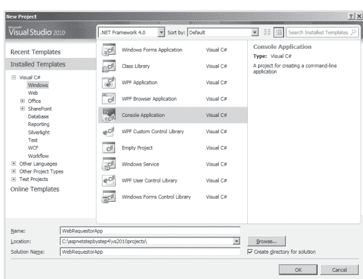

Visual Studio 为你生成了一个空白的控制台程序。

2. 向程序添加进行 Web 请求所需的代码。Visual Studio 将控制台应用程序的入口点放在名为 `Program.cs` 的文件中。（这是默认在代码窗口中显示的代码）。你用于添加 Web 请求的代码在以下代码行中以**粗体**显示：

```csharp
using System;
using System.Collections.Generic;
using System.Linq;
using System.Text;
using System.Net;
using System.IO;
namespace WebRequestApp
{
    class Program
    {
        static void Main(string[] args)
        {
            WebRequest req = WebRequest.Create("http://www.microsoft.com/");
            HttpResponse resp = req.GetResponse();
            StreamReader reader = new StreamReader(resp.GetStream(), Encoding.ASCII);
            Console.WriteLine(reader.ToEnd());
        }
    }
}
```

3. 点击主菜单上的 **Debug（调试）**、**Start Without Debugging（不调试启动）**运行应用程序。Visual Studio 为你启动一个控制台并运行程序。片刻之后，你将在屏幕上看到 HTML。

当然，这些 HTML 并不是给人类阅读的。那是浏览器的用途。然而，这个示例展示了发送 Web 请求的基础——你可以确切看到响应中返回了什么。

在这种情况下，发送到服务器的请求比 POST 请求小得多。

```http
GET / HTTP/1.1
Host: localhost
Connection: keep-alive
```

## 超文本标记语言

```html
<html>
<body>
  <h2>Hello World</h2>
  Nothing really showing here yet, except some HTML...
</body></html>
```

## 动态内容

除了作为构建 Web 应用程序的框架外，.NET 开发环境还包含了用于原始发送 HTTP 请求的类。`WebRequest` 类包含一个名为 `GetResponse` 的成员，它用于向统一资源定位符 (URL) 指定的地址发送请求。

## HTML 表单

HTML 包含了 `<form></form>` 起始和结束标签，用于通知浏览器 HTML 的某部分包含了控件标签，用户将通过这些控件交互并最终向服务器返回信息。使用 `<form>` 标签可以指定 Web 文档如何处理来自终端用户的输入（而不只是输出）。表单的内容，即输入控件中包含的数据，会被“回传（posted back）”到服务器进行处理。此操作通常称为回传（postback）。这就是为什么 HTML 文档的典型 HTTP 用例是 GET（用于最初检索文档），然后是 POST（或 GET 的变体），在必要时将数据返回给服务器。

`<form>` 标签通常“夹明治式”一组指定用户输入控件的标签。以下显示了你之前看到的相同特性选择页面，但增加了 `<form>` 标签（代码来自书中配套 CD 示例代码中的 SelectFeature2.htm 文件）：

```html
<html>
<body>
<form action="http://localhost/HttpHandlers/selectfeature2.htm" method="get">
<h2>Hello there. What's your .NET feature?</h2>
<select name="Feature">
  <option>Type-Safety</option>
  <option>Garbage collection</option>
  <option>Multiple syntaxes</option>
  <option>Code Access Security</option>
  <option>Simpler threading</option>
  <option>Versioning purgatory</option>
</select>
<br/>
<input type="submit" name='Lookup' value='Lookup'>
<br/>
</form>
</body>
</html>
```

如果你想立即查看效果，请将此代码输入到名为 SelectFeature2.htm 的文件中并将其保存到目录 `c:\netpub\wwwroot`。在浏览器的地址栏中输入 `http://localhost/selectfeature2.htm` 即可访问该文件。

`<form>` 标签包含几个属性，你可以通过设置这些属性来控制网页的行为。在前面的示例中，注意 `<form>` 标签设置了 `action` 属性，它指示服务器接收表单内容的位置。如果没有 `action` 属性，则将使用当前文档的 URL。

HTML 中使用的另一个属性是 `method` 属性。`method` 属性指定了提交表单时使用的 HTTP 方法，因此决定了表单数据返回服务器的方式。

# 第 1 章 Web 基础

示例中使用的是 GET 方法，因为它是对服务器的第一次请求。如果你选择了最后一个选项（Versioning Purgatory），然后点击 Lookup，表单的 GET 方法会导致表单的输入控件附加到 URL 中，如下所示：

```http
http://localhost/SelectFeature2.htm?Feature=Versioning+purgatory&Lookup=Lookup
```

这种修改后的 POST 方法调用查询字符串，该字符串会被发送到服务器。

表单的 POST 方法会导致表单内容通过返回的 HTTP 数据包的主文发送到服务器，如下：

```http
POST /SelectFeature2.htm HTTP/1.1
Accept: image/gif, image/x-xmap, image/jpeg, image/pjpeg, ..., /**
Accept-Language: en-us
Content-Type: application/x-www-form-urlencoded
Content-Encoding: gzip, deflate
User-Agent: Mozilla/4.0 (compatible; MSIE 7.0; Windows NT 5.1); ... .NET CLR 3.0.04506
Host: localhost:80
Content-Length: 42
Connection: Keep-Alive
Cache-Control: no-cache
```

```
Feature=Versioning+purgatory&Lookup=Lookup
```

在文档正文中添加 `<form>` 标签可以让你在实现真正与用户交互的 HTTP 应用上更进一步。你还需要服务器端更多的支持。当你点击 Lookup 按钮时，浏览器会准确地强制向服务器进行一次往返（在这种情况下，它只执行一个 HTTP GET 命令来获取你在 `form-method` 属性中指定的文档）。

此时，普通的 HTTP GET 命令只返回文档。在真正的交互式环境中，另一端的服务器会随着浏览器和服务器之间的往返请求不断修改内容。

例如，想象用户对资源发了一个 GET 请求，从选择列表中选择一个特性，然后点击 Lookup 按钮。在交互式应用程序中，另一端的服务器会随着浏览器和服务器之间的往返请求不断修改内容。

## 通用网关接口

## Internet 服务

## IIS 环境

## IIS 服务器

## IIS 接口

## IIS 属性

## IIS 配置

## IIS 应用程序

## IIS 请求

## IIS 数据

## IIS 内容

# 第一部分 基础

在微软环境中，DLL 被用于响应请求。DLL 的加载成本相对较低，且在 DLL 中运行代码执行速度非常快。在历史上，处理 Web 请求的 DLL 被命名为 ISAPI DLL。在 IIS 之前，IIS 会拦截请求并将其交给特定的 ISAPI DLL 来处理请求。ASP（在 ASP.NET 之前）实际上由一个名为 `ASP.DLL` 的单个 ISAPI DLL 处理。事实上，早期的版本的 ASP.NET 依赖于名为 `ASPNET_ISAPI.DLL` 的 ISAPI DLL。然而，ASP.NET 管道现在是 IIS 的组成部分。

## 运行 Internet 信息发布服务

IIS 的用户界面可以在控制面板中可用。通过导览来感受如何管理 IIS。熟练使用 IIS 是重要的，因为 ASP.NET 依赖它在真实的 Web 应用程序中处理 Web 请求。IIS 7.0 及更高版本在将服务器应用程序空间划分为虚拟目录方面的工作类似。IIS 6.0 和 IIS 7.0 包含许多其他功能，如应用程序隔离和回收，有助于控制失控的请求，并在请求过程中发生意外情况时限制内存消耗。

## 运行 IIS

1. 要进入 IIS，首先进入“管理工具”。在 Windows 7 操作系统或控制面板中，双击“管理工具”，然后选择“Internet 信息发布服务”。你应该看到以下图形显示了“功能视图”和“内容视图”——两者都在 Windows 7 下运行。

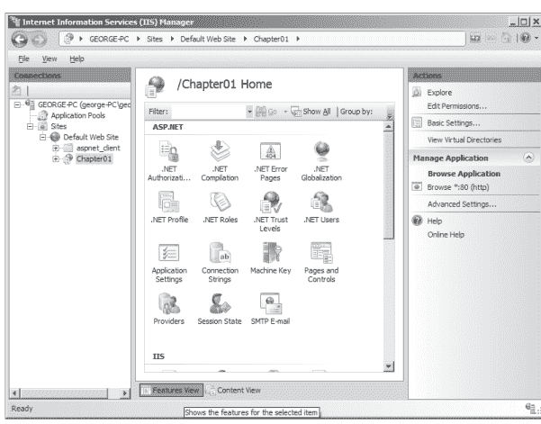

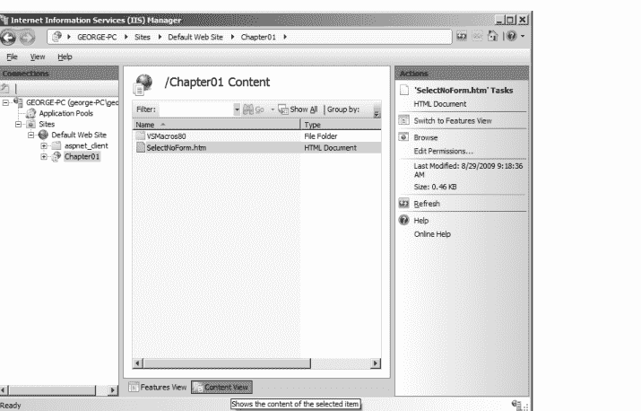


屏幕左侧是一个可展开的树形结构，显示了通过计算机上的 IIS 可用的站点和虚拟目录。IIS 5.x 和 IIS 6.0 在左侧窗格中显示虚拟目录，目录内容在右侧。IIS 7 管理控制台（此处所示）包含两个视图：功能视图和内容视图。功能视图包含各种图标，用于管理左侧窗格列表中项的 IIS 特定方面。内容视图则显示了所选项目中包含的文件。

- 2. 查看特定虚拟目录的配置。在功能视图中，你可以看到特定虚拟目录是如何配置的。要了解更多关于目录配置的信息，请尝试点击功能视图中的各种图标。例如，要查看 IIS 在缺少特定文件扩展名的情况下如何确定正确的默认文件，请双击“默认文档”图标。下图显示了 IIS 将尝试加载的默认文件名列表。

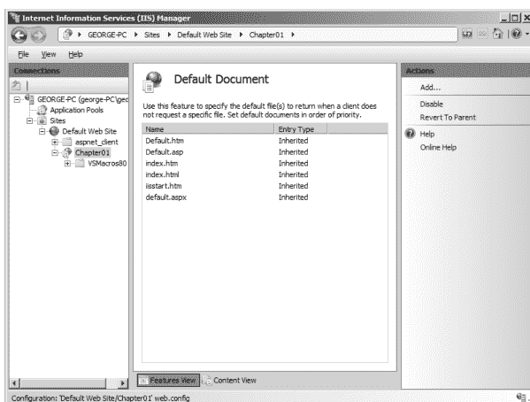

你可以在 IIS 中配置许多功能，它们都由功能视图中呈现的图标表示。功能集非常详尽，涵盖了从外部访问目录的所有方面。你不需要在此处花费大量时间，因为 ASP.NET 处理了大部分此类问题（而不是将它们留给 IIS）。

- 3. 查看虚拟目录的模块映射。像 .htm 文件之类的静态文件类型会直接传回客户端。然而，内容在发布之间可能会发生变化的动态页面需要进一步的处理，因此它们被分配给特定的处理程序。正如你将在详细中看到的，IIS 7.0 倾向于通过托管代码处理大多数请求，这种代码在 .NET 通用语言运行时 (CLR) 的上下文中执行。对于希望编写原生代码的开发者，IIS 7.0 包含了一个新的 C++/原生服务器应用程序编程接口 (API)。此新 API 通过 `IsapiModule` 与 IIS 7.0 交互，暴露经典的 ISAPI 扩展 DLL。另一个模块 `IsapiFilter` 替换了早期 IIS 传统的 ISAPI 过滤器 API。要查看 IIS 7.0 模块映射，双击功能视图中的“模块”图标。你应该能看到拦截请求的 IIS 7.0 模块列表。

## 第1章 Web 应用程序基础

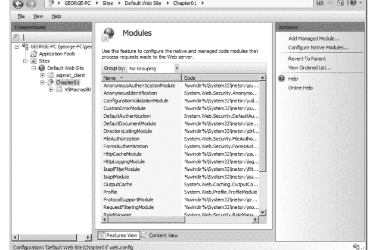

- 4. 对于那些使用托管代码处理请求的应用程序，IIS 通过“处理程序映射”页面将它们引导处理程序。要查看特定虚拟目录的文件映射，双击功能视图中的“处理程序映射”。IIS 的响应是列出该目录的处理程序映射：

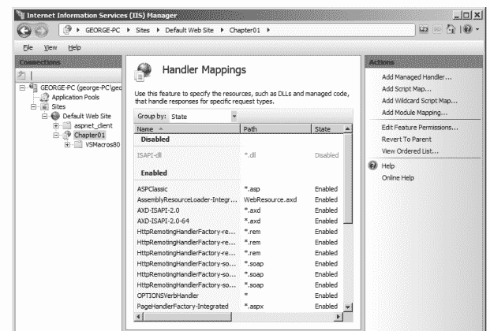

这些映射告诉 IIS 处理特定请求。如你所见，大多数请求通过 ASP.NET 由托管代码处理。注意列表顶部用于经典 ASP 文件的处理程序名为 `ASPClassic`。该处理程序处理 `.asp` 扩展名的请求（早期 IIS 版本将请求直接管道到 `ASP.DLL` 处理程序）。

> 如果出于某些原因你发现需要运行经典 ASP，请注意 IIS 7.0 默认不安装 `ASPClassic`——你必须刻意添加此功能。

- 1. 在控制面板中，双击列表中的“程序和功能”。

- 2. 选择“启用或关闭 Windows 功能”。

- 3. 在对话框中选择“Internet 信息发布服务”，然后选择“Internet 信息发布服务”。

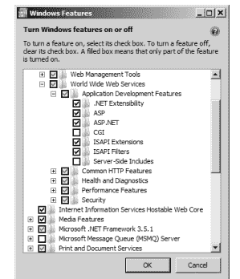

# 第 1 章 Web 应用程序基础

`SelectFeature` 中的大部分文本与 `SelectFeature.htm` 看起来非常相似，不是吗？主要的区别在于第一行（现在指定了可执行块的语法）以及由 `<% %>` 标记的可执行块。其余静态 HTML 头部在表单中渲染选择控件。

请注意可执行块，以及这些块如何使用 `Response` 对象（由 ASP 基础设施管理）将文本推送到浏览器。可执行块检查 `Feature` 控件（由 `<select>` 标签指定）并打印出用户选择的值。

1-3 显示了 `SelectFeature.asp` 在 Internet Explorer 中的渲染情况。

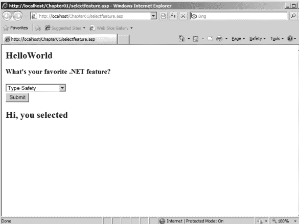

图 1-3 在 Internet Explorer 中查看的列表 1-2 中的代码。

图 1-3 中的屏幕看起来可能有点奇怪，因为下拉列表显示的是“Type-Safety”，而渲染后的文本显示的是“Simpler Rendering”。在不进行任何额外操作的情况下，下拉列表将始终以第一个元素作为所选元素重新渲染。你可以稍后在服务器端控件的讨论中看到 ASP.NET 如何修复此。这些背景信息足够开始查看下一节概述的特定 Web 开发概念了。

### Web 开发概念

说到底，开发 Web 应用程序迫使你处理两个重大问题——使用断开协议上的 HTML 管理用户界面（UI），以及管理你的应用程序状态。这些基本活动将 Web 开发与其他类型的应用程序开发区分开来。

# 第一部分 基础

在某些方面，编程模型已经回到了 20 世纪 70 年代中期主导的形式，当时大型主机机向直接连接到它的终端提供输出。用户向主机机提交作业并在终端上获取输出。那么，这里发生了什么变化？终端变得先进得多——一台运行着可以解释 HTML 的强大计算机。浏览器连接的端点是 Web 服务器（或者可能是服务器集群）。最后，客户端和服务器使用的连接协议是间接的（请求在用户看到结果之前，字面上完全可以跨越全球）。

在 Web 应用程序开发中，程序的主要工作是从“外部”接收请求并向请求者提供有意义的响应。这通常意味着生成复杂的 HTML，以便在客户端浏览器上渲染供人类阅读。这可能非常复杂，例如，在一个支持商业的现代商业网站上。客户无疑关心当前定价、请求库存水平，并在网站上就订单项目或服务进行交互。为客户端生成有意义的 HTML 以时完成任务（如访问数据库、验证客户端身份和跟踪客户的产品订单）的过程突然变得复杂。想象一下从零开始完成这一切吧！

尽管像 ASP 这样的框架在让 Web 开发变得易于上手方面已经做得很好，但开发者仍然有许多功能需要自己创建（主要与本节开头提到的两个问题有关）。例如，在经典 ASP 中构建一个安全又易于管理的网站，通常意味着编写你自己的安全系统（或使用现有的）。管理 Web 网站中 UI 的状态通常也是一项极其枯燥的任务。

### ASP.NET

这一切将我们带到了 ASP.NET。你将在书中看到的一个共同主题是：ASP.NET 将开发者通常会（反复地）实现的功能归并起来，并将它们整合到 ASP.NET 框架中。

ASP.NET 自发布以来一直在稳步演进。ASP.NET 1.0 引入了定义良好的管道、可扩展的模型、服务器端控件渲染模型以及许多让开发 Web 网站变得可行的功能。ASP.NET 2.0 将 ASP.NET 1.x 推向了新高度，并将更多实现的功能推入了框架。例如，ASP.NET 2 在身份验证和授权服务方面改进了早期的 ASP.NET 版本。ASP.NET 1 包含了一个合理且易于管理的身份验证模型。然而，开发者经常需要自己处理许多任务。ASP.NET 2 提供了更完善的解决方案。ASP.NET 2.0 增加了授权功能（见第 9 章）。

# ASP.NET Web 应用程序基础 23

ASP.NET 2.0 已经运行了多年。尽管 ASP.NET 提供了所有改进，但 ASP.NET 仍有许多新功能。ASP.NET 3.5 提供了诸如 AJAX 支持等新功能，第二个是动态数据支持。最后，你可以通过 ASP.NET 4 观察其 Web Form 架构。

## 第 2 章

## ASP.NET 应用程序基础

在完成本章后，你能够：

- 创建信息服务 (IIS) 虚拟目录。
- 将 HTML 页面开发为 ASP.NET 应用程序。
- 将 HTML 与可执行代码混合。
- 查看由 ASP.NET 编译的程序集。
- 处理代码后和代码侧执行模型。
- 使用 Visual Studio 2010 创建项目。

本章涵盖了构建 ASP.NET 应用程序所需的基础知识。从语法角度来看，编写 .NET 代码与你可能在后期互联网时代编写经典 ASP 代码相似。许多关键符号保持不变，整个执行模型在 ASP 和 ASP.NET 之间发生了巨大变化。ASP.NET 引入了全新的面向对象的执行模型。ASP.NET 的执行围绕实现 `IRequestHandler` 接口的 CLR 类。ASP.NET 包含了许多已实现 `IHttpHandler` 的类，你也可以从零编写你自己的实现。通常，虽然你编写 ASP.NET 页面，但其他是由 ASP.NET 提供的 `IHttpHandler` 生成的。

本章检查 ASP.NET 执行模型，以了解 ASP.NET 如何实现其功能。它采用了自底向上的方法，展示了简单的 ASP.NET 页面是如何执行的。在此过程中，引入了各种 ASP.NET 编程技术，包括代码后。你将看到 ASP.NET 的编译模型如何工作。最后，你可以观察 ASP.NET 的 Web Form 架构如何运行，以及它是如何被 Microsoft Visual Studio 2010 巧妙封装的。

你可以通过研究一个简单的页面来发现你如何使用 ASP.NET 的编程技术来演进它。

# 第 1 章 快速参考

| 操作 | 执行此操作 |
|---|---|
| 启动 IIS 管理器 | 打开控制面板。选择管理工具。选择信息服务。 |
| 创建新的虚拟目录 | 打开 IIS 管理器。打开网站。右键点击默认网站并选择新建虚拟目录。然后，按照向导操作。 |
| 从 IIS 浏览资源 | 右键点击资源并浏览。 |
| 查看 IIS 虚拟目录支持的文件类型 | 选择虚拟目录。选择功能。浏览程序映射和模块映射。 |

# 经典的 Hello World 应用程序

几乎所有的编程书籍都从使用手头的技术向终端用户展示经典的“Hello World”字符串开始。这一次，你的任务是将“Hello World”语句发送给等待的浏览器。

为了查看 ASP.NET 的工作原理，你将通过一个简单的 Web 页面并将其开发为 ASP.NET 应用程序。你暂时不需要使用 Visual Studio。Visual Studio 是一个功能丰富的开发环境，用它构建和运行 Web 应用程序似乎就像魔法一样。这是一个从零开始的骨架示例，以便让你在引入 Visual Studio 的完整功能之前，能够清楚地看到发生了什么。然后，你可以检查每一次迭代，以查看 ASP.NET 正在做什么。

## 构建 HelloWorld Web 应用程序

- 1. 创建一个目录来存放 Web 应用程序文件。使用命令行或 Windows 资源管理器，创建一个新文件夹来存放 Web 应用程序文件。虽然目录名称对于 Internet 信息服务（IIS）并不重要，但请给它一个有意义的名字。此示例使用 `\aspnetstepbystypeexamples`。

- 2. 创建一个用于存放源代码的应用程序/虚拟目录。首先，你需要一个虚拟目录来存放源代码。正如你之前在检查 Microsoft Windows 环境强制要求的 Web 应用程序架构时看到的，IIS 划分了应用程序管理功能，IIS 在通过 80 端口传入的请求与计算机上的某些真实目录之间创建映射。虚拟目录告诉 IIS 在何处找到你要在应用程序中执行的代码。

打开控制面板，然后转到管理工具并启动 Internet 服务。展开左侧树形结构中的节点，以显示“站点”节点下的“默认网站”节点，如下图所示：

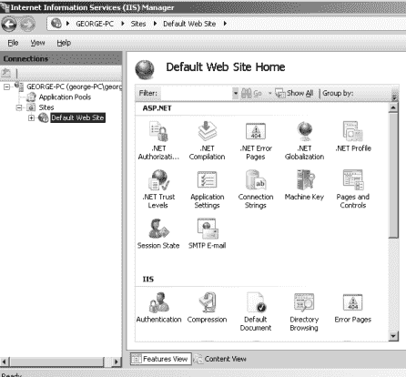

然后，在快捷键菜单上右键点击“默认网站”节点，并选择“添加应用程序”。该插图显示了如何在 IIS 7.5 中执行此操作。如果你使用的是较早版本的 IIS，界面看起来略有不同——尽管你可以以相同的方式添加新的虚拟目录。IIS 将要求你为应用程序/虚拟目录提供名称：

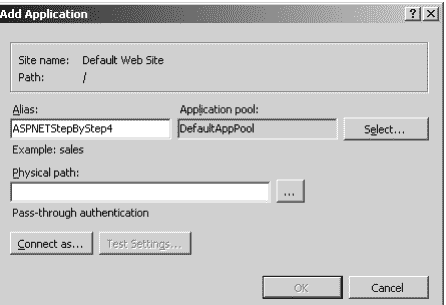

将站点命名为 `ASPNETStepByStep`。这是你的 Web 应用程序向世界展示的名称。例如，当 Internet 用户访问你的 Web 站点时，他们将使用以下 URL：

http://www.contoso.com/ASPNETStepByStep

contoso.com 是一个虚构站点，仅在此处说明。当你访问这台计算机时，服务器名称将是 `localhost`。

向导会要求你为虚拟目录提供物理路径。浏览到你刚刚创建的物理目录，或者输入目录名称。保持 IIS 管理工具打开；你将在接后的步骤中使用其他功能。

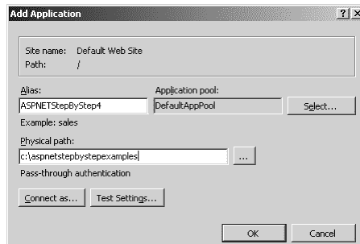

点击确定创建虚拟目录。

- 3. 从一个简单的 HTML 页面开始。此此最简单的方法是将文本存储在 HTML 文件中并访问它。

使用记事本可以创建简单的 HTML 文件，或者你可以使用 Visual Studio 创建 HTML 文件。如果你使用 Visual Studio，请启动 Visual Studio 并选择“文件”、“新建”，然后点击“文件”。选择“文本文件”作为文件类型，然后点击“打开”。Visual Studio 编辑器将打开一个新的空白文件。

在 `<body>` 和 `</body>` 标签之间输入以下 HTML 文本。将文件保存为你新物理目录中的 `HelloWorld.htm`（即上一步中映射到虚拟目录的目录）。

```html
<html xmlns="http://www.w3.org/1999/xhtml">
<head>
  <title>Untitled Page</title>
</head>
<body>
  <h1>Hello World</h1>
  Nothing really showing here yet, except some HTML...\n
</body>
</html>
```

- 4. 访问该页面。有两种方法可以实现此目标。首先，你可以通过在 IIS 内部选择文件来访问该页面。在 IIS 中导航到该目录（如果你没有关闭，控制面板应该仍处于状态）。点击主窗底部的“内容视图”选项卡。你将看到目录中的文件。右键点击 `HelloWorld.htm` 文件并点击“浏览”。或者，你可以在浏览器导航栏中输入整个 URL：

http://localhost/ASPNETStepByStep/helloworld.htm

浏览器将向服务器发送 HTTP 请求。在 Microsoft 平台上，IIS 将识别 HTML 扩展名并简单地将文件内容返回给浏览器。因为文本使用了标准的 HTML 标签标记，浏览器能够理解并正确显示它。

这是文件在终端浏览器中的显示方式：

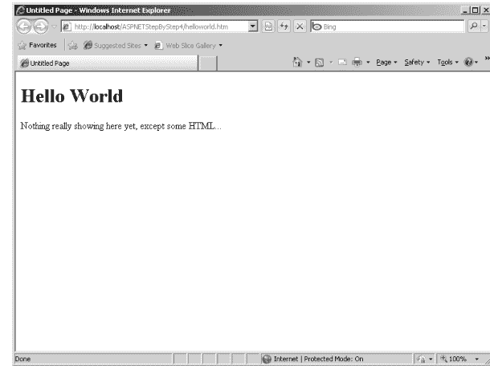

- 5. 将 HTML 文件转换为 ASP.NET 应用程序。将你正在工作的 `HelloWorld.htm` 文件转换为将调用 ASP.NET 运行时的文件类型。将此转换为 ASP.NET 应用程序涉及两个步骤：将文件重命名为 `.aspx` 并添加以下指令：

# 在内联中添加可执行代码

1. 向 Web 应用程序中添加可执行代码。在 Visual Studio 内部创建一个新的空白文本文件。在文本文件中输入以下代码并将其保存为 `HelloWorld.aspx`。

```aspx
<%@ Page Language="C#" Debug="True" %>
<html>
<h1>Hello World!</h1>
<%
// 此代码块将在 Render.Control 方法中执行
Response.Write("Check out the family tree;<br/> <br/>");
Response.Write(this.GetType().ToString());
Response.Write(" which derives from:<br/> ");
Response.Write(this.GetType().BaseType.ToString());
Response.Write(" which derives from:<br/> ");
Response.Write(this.GetType().BaseType.BaseType.ToString());
Response.Write(" which derives from:<br/> ");
Response.Write(
this.GetType().BaseType.BaseType.BaseType.ToString());
Response.Write(" which derives from:<br/> ");
Response.Write(
this.GetType().BaseType.BaseType.BaseType.BaseType.ToString());
%>
</body>
</html>
```

这段代码与你在经典 ASP 中看到的代码几乎完全相同——包括对 `Response` 对象的引用。在经典 ASP 中，`Response` 对象是那些内置对象之一，对于页面的执行块始终可用。为了解释得完整，经典 ASP 中的 `Response` 对象是一个挂载在由低级组件（ISAPI DLL）管理的线程上的 COM 对象。注意，ASP.NET 也有一个 `Response` 对象。然而，这个 `Response` 对象是受 ASP.NET 管道管理的 `HttpContext` 的一部分，除了名称相同外，与经典 ASP 对象完全没有任何关系。

2. 使用 Windows Internet Explorer 访问该 ASP.NET 页面。该页面在浏览器中的显示应该是这样的：

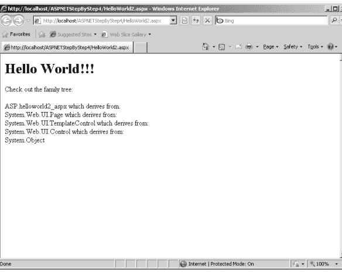

`HelloWorld.aspx` 生成的输出显示了 ASP.NET 执行模型的一个非常重要的方面。在继续之前，请查看上一个练习中列出的内联代码，并将其与浏览器中出现的输出进行比较。注意代码包含了诸如如下语句

`Response.Write(this.GetType().BaseType.ToString());`


当然，`this` 关键字指定了类的实例。代码的执行显然是类实例成员函数的一部分。浏览器显示的输出表明，向浏览器渲染 HTML 的类名为 `ASP.helloworld2_aspx`，它继承自一个名为 `System.Web.UI.Page` 的类。你将在本章节中学习更多内容。

# 服务器端执行代码块

ASP.NET 也支持服务器端代码块（不仅仅是内联执行标签）。ASP.NET 在脚本标签上添加了一个新的 `runat` 属性，告诉 ASP.NET 在服务器端执行该代码块。

# 使用脚本块添加可执行代码

1. 在页面上添加可执行脚本块。在 Visual Studio 中创建一个新的文本文件。在 Visual Studio 编辑器中输入以下代码。注意代码将渲染的 HTML 与在服务器上运行的脚本块隔离开。将文件保存为虚拟目录中的 `HelloWorld3.aspx`。

```aspx
<@ Page Language="C#" Debug="true" %>
<script runat="server">
  void ShowLineage()
  {
    Response.Write("Check out the family tree: <br/> <br/>");
    Response.Write(this.GetType().ToString());
    Response.Write("which derives from: <br/> ");
    Response.Write(this.GetType().BaseType.ToString());
    Response.Write("which derives from: <br/> ");
    Response.Write(this.GetType().BaseType.BaseType.ToString());
    Response.Write("which derives from: <br/> ");
    Response.Write(
      this.GetType().BaseType.BaseType.ToString());
    Response.Write(
      this.GetType().BaseType.BaseType.BaseType.ToString());
  }
</script>
<html>
<body>
  <h1>Hello World!!</h1>
  <% ShowLineage();
  %>
</body>
</html>
```

与内联执行块一样，脚本块内容最重要的标准判别标准是其语法必须与 Page 指令中指定的语言匹配。前面的示例指定了一个名为 `ShowLineage()` 的单个方法，该方法从页面内部调用。

2. 访问该页面。注意 `HelloWorld2.aspx` 和 `HelloWorld3.aspx` 是相同的。

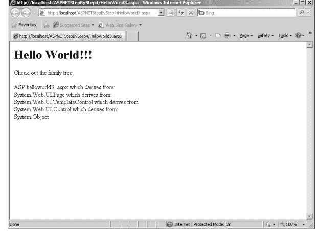

通过带有 `runat=server` 属性标记包含 `ShowLineage` 方法的 `<script>` 标签以便在服务器上执行代码。与经典 ASP 使用指定的脚本语言解释脚本块不同，ASP.NET 有一套完全不同的执行模型——整个页面实际上被编译成运行在公共语言运行时 (CLR) 下的类。以下是 ASP.NET 编译模型的工作原理。

# 游览 ASP.NET 架构

当 HTTP 请求/响应到达 Web 服务器时，它会通过许多服务器端对象进行处理。一旦请求到达服务器，它就会穿过 IIS/ASP.NET 管道。理解 HTTP 请求通过 ASP.NET 路径的最佳方法是跟踪一个从浏览器产生并被 Internet 信息服务 (IIS) 及其你的 Web 应用程序拦截的请求。

当终端用户在输入 URL 时按下回车键时，浏览器向目标站点发送 HTTP GET 请求。该请求通过一系列路由器，直到最终到达你的 Web 服务器并在 80 端口被接收。如果你的系统监听 80 端口，软件就可以处理该请求。在微软平台上，目前监听 80 端口通常是 IIS。ASP.NET 与以下三个版本的 IIS 工作：5.x（如果你使用的是 Windows XP 专业版）、6.x（如果你使用的是 Windows Server 2003）以及 7.x（如果你使用的是 Windows Vista、Windows 7 或 Windows Server 2008）。

# 3 基础

无论你选择哪个版本的 IIS，请求的通用流程都是相同的。IIS 维护文件扩展与解析请求的二进制组件之间的映射。当请求进入时，IIS 读取请求中的文件名。

（此处重复部分省略）一旦请求到达服务器，它就会穿过 IIS/ASP.NET 管道。理解 HTTP 请求通过 ASP.NET 路径的最佳方法是跟踪一个从浏览器产生并被 Internet 信息服务及其你的 Web 应用程序拦截的请求。

当终端用户在输入 URL 时按下回车键时，浏览器向目标站点发送 HTTP GET 请求。该请求通过一系列路由器，直到最终到达你的 Web 服务器并在 80 端口被接收。如果你的系统监听 80 端口，软件就可以处理该请求。在微软平台上，目前监听 80 端口通常是 IIS。ASP.NET 与以下三个版本的 IIS 工作：5.x（如果你使用的是 Windows XP 专业版）、6.x（如果你使用的是 Windows Server 2003）以及 7.x（如果你使用的是 Windows Vista、Windows 7 或 Windows Server 2008）。

（此处重复部分省略）较早版本的 IIS（7.x 之前）实现了这些功能。

# 第 2 章 ASP.NET 应用基础

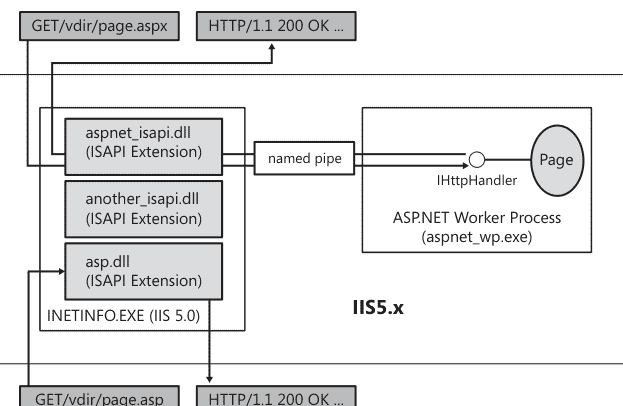

**图 2-1** IIS 5.x 与 ASP.NET 协同工作。

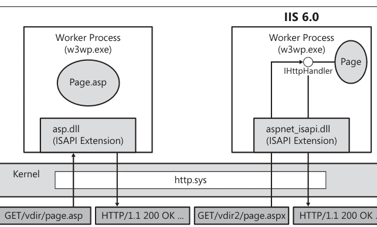

**图 2-2** IIS 6.x 与 ASP.NET 协同工作。

相比之下，通过 IIS 7.x 的请求路径略有不同。以下是请求通过 IIS 7.x 的路径：

1. 浏览器向 Web 服务器发送资源请求。
2. HTTP.SYS 在服务器上接收该请求。
3. HTTP.SYS 使用 WAS 查找配置信息并将其传递给 WWW 服务。
4. WAS 将配置信息传递给 WWW 服务，由该服务配置 HTTP.SYS。
5. WAS 在请求所在的应用程序池中启动一个工作进程。
6. 工作进程处理请求并将响应返回给 HTTP.SYS。
7. HTTP.SYS 将响应发送给客户端。

图 2-3 显示了 IIS 7.x 和 ASP.NET 之间的关系。

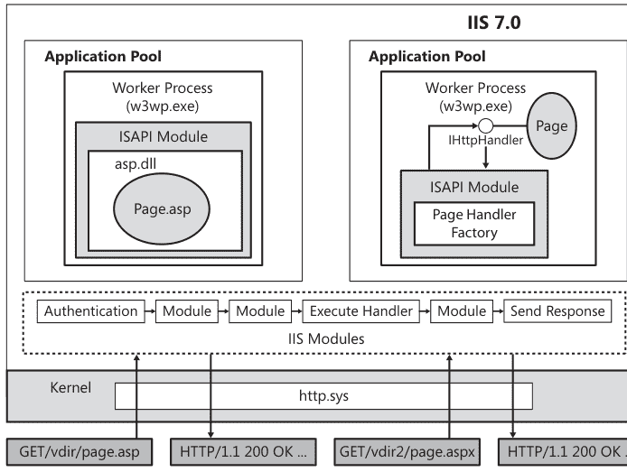

**图 2-3** ASP.NET 和 IIS 7.x。

在接下来的章节中，你将跟踪请求通过 ASP.NET 流水线的过程。你可以在多个点接入 ASP.NET 流水线，以处理处理请求的各个方面。例如，如果你想进行任何预处理，可以重写 `HttpApplication` 类中的事件处理程序，也可以编写 HTTP 模块并将其插入流水线中。虽然 `System.Web.Ui.Page` 类为构建基于 Web 的界面提供了大量功能，但流水线具有足够的活性，你可以轻松编写自己的自定义处理程序。

## ASP.NET 编译模型

微软对 ASP 开发环境做的最重要的改进之一是使用类构建 Web 请求处理框架。将请求处理推入基于类的架构，允许构建一个经过编译的 Web 处理框架。当 ASP.NET 页面首次访问时，它们会被编译成程序集。

这种做法是有优势的，因为后续访问直接从程序集加载页面。经典的 ASP 会反复解释脚本代码，而 ASP.NET 应用程序被编译为 .NET 程序集，最终性能更好且更安全。当代码被编译后，它的运行速度会更快，因为不需要经过解释。此外，托管运行时是一个类型安全的环境；你不会遇到在脚本环境中（如经典 ASP 的情况）会遇到的某些错误和异常。

此外，编译 Web 请求框架允许进行更健壮、更一致的调试。每当你从 Visual Studio 运行 ASP.NET 应用时，你都可以像调试普通的桌面应用程序一样调试它。

ASP.NET 自动编译 `.aspx` 文件。要让一个 `.aspx` 页面进行编译，你只需要访问包含代码的 `.aspx` 文件即可。当你这样做时，ASP.NET 会将页面编译成一个类。然而，你不会在虚拟目录附近的任何地方看到包含该类的程序集。ASP.NET 会将生成的程序集拷贝到临时目录。

Visual Studio 的版本一直包含一个名为中间语言反汇编器 (ILDASM) 的工具，它使用反射来反编译程序集，以便你可以查看其内容。结果是一个易于导航的树，你可以用它来深入查看程序集的内容。目前，这是最重要的。（如果你想更深入地查看程序集并看到实际的中间语言，ILDASM 也会给你展示。）

以下是查看 ASP.NET 生成的程序集的方法。

## 查看 ASP.NET 程序集

1. 要运行 ILDASM，打开 Visual Studio .NET 2010 命令行提示并输入 `ILDASM`。
2. 选择文件 (File)、打开 (Open)。
3. 找到由 ASP.NET 运行时编译的程序集。进入 `C:\WINDOWS\Microsoft.NET\Framework\v2.0.50727\TemporaryASNetFiles\asnetstepype4\`，如果是 64 位计算机，子目录将是 "Framework64"。在本文编写时，该子目录名为 `v2.0.50727`。最后的子目录名称可能会略有不同。你会在下面看到一些命名奇怪的目录。例如，在你的计算机上，ASP.NET 生成的子目录可能是 `4076b3de` 和 `ac422a67`。你计算机上的目录名称很可能不同。目前没有办法判断刚刚执行的代码位于哪个目录（通过查看文件创建日期和时间可能有帮助），所以你需要沿着路径进入目录，直到挖掘出 `.dll` 文件。取决于你运行应用程序的次数，可能会看到多个文件。逐一个打开文件，ILDASM 显示的内容与图 2-4 所示。

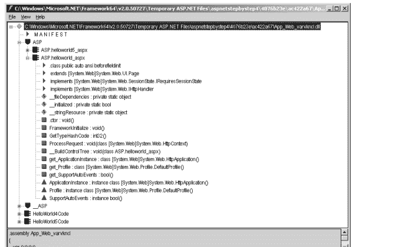

**图 2-4** ILASM 显示访问 HelloWorld.aspx 后由 ASP.NET 生成的程序集内容。

ASP.NET 从 1.0 版本开始一直使用这种临时目录策略。ASP.NET 将这些文件拷贝到临时目录是为了解决困扰经典 ASP 的长期问题。经典 ASP 依赖 COM 对象来执行数据库查询和事务。ASP.NET 将文件拷贝到临时目录意味着当你需要更新或修改站点时，不需要关闭 Web 站点。ASP.NET 运行时将从临时目录执行这些编译文件。

## 代码选项

除了支持内联代码（即在服务器端块中包含执行代码）之外，ASP.NET 还提供了两种不同的代码选项：ASP.NET 1.x 代码后台和现代 ASP.NET 样式。

### ASP.NET 1.x 样式

在 ASP.NET 1.x 代码后台样式中，ASP.NET 使用 `Src` 指令编译文件。在没有 `Src` 指令的情况下，ASP.NET 运行时将在 bin 目录中搜索指定的类。

考虑位于 `HelloWorld4.cs` 中的代码：

```csharp
using System.Web;
public class HelloWorld4 : System.UI.Page
{
    public void ShowLineage()
    {
        // 显示家族树的逻辑
    }
}
```

使用 `HelloWorld4` 类的 ASP.NET 页面可能如下：

```aspx
<% Page Language="C#" Inherits="HelloWorld4" Src="HelloWorld4.cs" %>
<html>
<body>
    <% 
        this.ShowLineage();
    %>
</body>
</html>
```

### 现代 ASP.NET 样式

ASP.NET 的另一种代码选项是从 2.0 版本开始的。这种模型被称为代码后台（Code Behind）。考虑以下 ASP.NET 页面：

```aspx
<% PageLanguage="C" CodeFile="HelloWorld5Code.cs"
Inherits="HelloWorld5Code" %>
<html>
<body>
  <h1>Hello World!!!</h1>
  <% 
    // 此块将在 RenderControl 方法中执行
    ShowLineage(); 
  %>
</body>
</html>
```

它检索位于 `HelloWorld5Code.cs` 文件中的代码：

```csharp
using System.Web;
public partial class HelloWorld5Code : System.UI.Page
{
    public void ShowLineage()
    {
        Response.Write("查看一下家族树：<br /> <br />");
        Response.Write(this.GetType().ToString());
        Response.Write(" 继承自：<br /> ");
        Response.Write(this.GetType().BaseType.ToString());
        Response.Write(" 继承自：<br /> ");
        Response.Write(this.GetType().BaseType.BaseType.ToString());
        Response.Write(" 继承自：<br /> ");
        Response.Write();
    }
}
```

在这种情况下，ASP.NET 需要找到一个部分类（partial class）来实现页页面逻辑。部分类允许你在多个源文件之间拆分类型（类、结构体或接口）的定义，每个文件中都包含类定义的一部分。编译源代码时，它会与生成的代码（例如由 Visual Studio 生成的代码）合并在一起。你可以在不修改原始代码的情况下增强类。Visual Studio .NET 2010 提供了代码旁代码/部分类代码的表示形式。

接下来的简短代码列表（代码列表 2-1 和代码列表 2-2）展示了实现名为 `SplitMe` 的单类的两个文件。

```cs
// 代码列表 2-1 Partial1.cs
// Partial1.cs
using System;

public partial class SplitMe
{
    public void Method1()
    {
        Console.WriteLine("SplitMe Method1");
    }
}
```

```cs
// 代码列表 2-2 Partial2.cs
// Partial2.CS
using System;

public partial class SplitMe
{
    public static void Main()
    {
        SplitMe splitMe = new SplitMe();
        splitMe.Method1();
        splitMe.Method2();
    }

    public void Method2()
    {
        Console.WriteLine("SplitMe Method2");
    }
}
```

## 基础

要编译代码列表 2-1 和 2-2 中的代码，你需要使用 Visual Studio 构建项目，或者你可以在 Visual Studio 命令提示符中使用以下命令（如果这些只是散落的文件）：

```
csc /exe Partial1.cs Partial2.cs
```

这将生成一个名为 `Partial2.exe` 的可执行文件。

在原始地处理过 ASP.NET 源代码之后，是时候查看 Visual Studio 和 ASP.NET 如何协同工作了。Visual Studio .NET 2010 为创建和开发 Web 应用程序带来了许多新功能，正如你在处理后续示例时所看到的。

## ASP.NET HTTP 管道线

从 ASP.NET 1.0 发布以来，它通过引入定义良好的代码处理模块（这些模块共同组成了 ASP.NET HTTP 管道），相比经典 ASP 有了巨大的改进。经典 ASP 是由几个不同的组件（IIS、Web 应用程序和 ASP ISAPI DLL）拼凑而成的。`Request` 和 `Response` 对象是交接 IIS 所有的线程的 COM 对象。如果你想在 ASP 上下之外进行任何处理，你需要使用 ISAPI 过滤器。如果你想编写在处理期间执行的代码，它必须在实现 `Dispatch` 的 COM 对象内发生（这严重限制了你可以使用的数据类型，并对性能产生负面影响）。如果你想编写任何请求处理代码（ASP 上下之外），你必须编写单独的 ISAPI DLL。ASP.NET HTTP 管道包含了执行这些事项的设施，但方式要容易得多。


# ASP.NET 应用程序基础

在 ASP.NET 中，你的应用程序有机会在 `HttpModules` 中执行预处理和处理。如果你使用 IIS 5.x 或 IIS 6.x 作为你的 Web 服务器，ASP.NET 管道将独立运行，一旦 `aspnet_isapi.dll` 将控制权移交给 ASP.NET 工作进程，请求就会完全由 ASP.NET 处理。如果你使用 IIS 7.x 作为你的 Web 服务器，ASP.NET 集成到服务器中，因此你可以对非 ASP.NET 内容应用任何 ASP.NET 服务。在任何情况下，你的应用程序还有机会使用 `HttpApplication` 对象模型处理应用程序范围的事件，服务器上基于 COM 的脚本对象的需要消失了。

所有请求的端点都是 `HttpHandler` 的实现。ASP.NET 已经包含了一些 `HttpHandler` 的有用实现（即 `System.Web.UI.Page` 和 `System.Web.Services.WebService`）。然而，你可以轻松地编写自己的（如你后文所示）。

## IIS 5.x 和 IIS 6.x 管道

一旦请求进入由 ASP.NET 运行时管理的 `AppDomain`，ASP.NET 将使用 `HttpWorkerRequest` 类来存储请求信息。随后，运行时将请求信息封装在一个名为 `HttpContext` 的类中。`HttpContext` 类包含了你可能想关于请求的所有信息，包括对当前请求的 `HttpRequest` 和 `HttpResponse` 对象的引用。运行时会产生 `HttpRequest` 实例（如果尚不可用），并触发多个应用程序范围的事件（例如 `BeginRequest` 和 `AuthenticateRequest`）。这些事件也会通过附加到管道的任何 `HttpModules` 传递。最后，ASP.NET 确定需要什么种类型的处理器来处理请求，创建一个，并要求处理器处理请求。在处理器处理完请求后，ASP.NET 会通过 `HttpApplication` 和 `HttpModules` 触发多个后处理事件（例如 `EndRequest`）。

图 2-25 阐述了在 IIS 6.x 情况下 ASP.NET 工作进程内部的 ASP.NET 管道的结构（与 IIS 5.x 的唯一区别是工作进程的名称）。

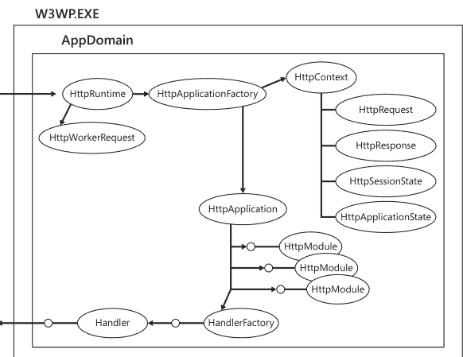

图 2-25 ASP.NET 中 HTTP 管道的主要组件。

## IIS 7.x 集成管道

IIS 7.x 管道与已存在的 ASP.NET HTTP 管道非常相似。正如你在图 2-5 中所示，IIS 7.x 集成模式自 ASP.NET 最初发布以来就存在了。在 ASP.NET 工作进程中，IIS 7.x 管道采用模块和处理器的方式与之前非常相同。然而，在集成模式下的 IIS 7.x 中，请求不再通过 `aspnet_isapi.dll`。IIS 7.x 直接将请求推送到模块和处理器。应用程序范围事件通过 `HttpApplication` 暴露的方式与之前相同。

## 利用管道

管道中的某些部分对开发者来说是不可用的，但某些部分是直接可用的，并在请求通过管道时提供了管理请求的方法。你可以接触的管道最重要的部分包括 `HttpApplication`、`HttpContext`、`HttpModule` 和 `HttpHandler`。

接下来的章节将提供这些关键部分的细节。

### HttpApplication

在此时，你已经理解了 Web 应用程序的性质与普通的桌面应用程序不同。你编写的代码负责向客户端返回某些 HTML 响应。在许多情况下，这种模型追溯到 20 世纪 70 年代盛行的终端模型。在 ASP.NET 中，请求的端点是 `HttpHandler` 的实现（即使处理器最终基于你的 ASP.NET Forms）。

HTTP 处理器的寿命很短。它们存在的时间足够处理请求，然后就会消失。对于简单的应用程序，这种模型可能足够。然而，想象即使是中等商业级应用程序的需求。如果你只能与这些瞬态的处理器工作，你就没有方法来实现应用程序范围的功能。

`HttpApplication` 类的存在正是此目的——作为请求处理的汇点。在 Web 应用程序的生命周期内，`HttpApplication` 对象作为存储应用程序范围数据和处理应用程序事件的地方。

### HttpContext

`HttpContext` 类作为一个中心位置，你可以在其中访问通过管道的当前请求各个部分。事实上，当前请求的每个方面都可以通过 `HttpContext` 访问。尽管 `HttpContext` 组件只是管道其他部分的引用，但将它们集中在一个处使得管理请求变得简单得多。

以下是 `HttpContext` 的简化列表，显示了你在开发 Web 应用程序时最常用的部分。这些成员以属性的形式暴露。

```csharp
class HttpContext
{
  public static HttpContext Current {...};
  public HttpRequest Request {...};
  public HttpResponse Response {...};
  public HttpSession Session {...};
  public HttpServerUtility Server {...};
  public HttpApplicationState Application {...};
  public HttpApplication ApplicationInstance {...};
  public IDictionary Items {...};
  public IPrincipal User {...};
  public HttpHandler CurrentHandler {...};
  public Cache Cache {...};
}
```

静态的 `Current` 属性为你提供了获取当前请求的手段。很多时候，`HttpContext` 会作为方法的参数传递（例如在 `HttpHandler.RequestProcess(HttpContext ctx)` 中）；但在某些情况下，即使上下文没有作为参数传递，你可能仍然需要它。通过 `Current` 属性，你可以凭空获取当前处理程序。例如，你可以这样使用 `HttpContext.Current`：

```csharp
public void DealWithRequest()
{
  HttpContext thisRequest = HttpContext.Current;
  thisRequest.Response.Write("<h3> Hello World</h3>");
}
```

如你从下面的 `HttpContext` 对象片段所示，`HttpContext` 内的属性包含以下内容：

- 指向上下文 `Response` 对象的引用（这样你就可以向客户端发送输出）
- 指向 `Request` 对象的引用（这样你就可以找到有关请求本身的信息）
- 指向应用程序本身的引用（这样你就可以访问应用程序状态）
- 指向请求级字典的引用（用于在请求期间存储项）
- 指向应用程序级缓存的引用（用于存储数据并避免与数据库的往返交互）

你会看到更多关于上下文的内容——尤其是当你使用自定义 `HttpHandler` 的时候。

### HttpModules（HTTP 模块）

尽管 `Application` 对象适用于处理应用程序范围内的事件和小规模任务，但有时应用程序级的任务需要更重量级的机制。`HttpModules` 正是为了此目的设计的。

ASP.NET 包含许多定义的 `HttpModules`。例如，会话状态、身份验证和授权都是由 `HttpModules` 处理的。编写 `HttpModules` 非常直观，是处理复杂的应用程序级操作极佳方法。例如，如果你想在每个请求之前编写一些自定义处理，使用 `HttpModules` 是一个很好的方法。你稍后可以近距离查看 `HttpModules`。

### HttpHandlers（HTTP 处理程序）

请求在管道中的最后一个停点是 `HttpHandler`。任何实现了 `IHttpHandler` 接口的类都符合处理程序的定义。当请求到达管道末端时，ASP.NET 会查询配置文件，查看特定的文件扩展名是否映射到 `HttpHandler`。如果是，ASP.NET 将加载处理程序并调用 `IHttpHandler.ProcessRequest` 方法来执行操作。

## Visual Studio 和 ASP.NET

Visual Studio .NET 2010 扩展了你在开发期间定位网站的选项。Visual Studio .NET 2010 向导定义了八个独立的网站部署位置：本地 IIS 站点、基于文件系统的网站、FTP 站点和远程网站。

以下是使用项目向导提供的不同类型网站的概述。每种类型适用于特定的场景，拥有这些选项使得使用 Visual Studio 2010 开发和部署 ASP.NET 应用程序比之前的版本要容易得多。

### 本地 IIS 站点

创建本地 IIS 站点与使用旧版本的 Visual Studio .NET 指定本地虚拟目录来创建网站非常相似。此选项创建的站点使用你本地计算机上安装的 IIS 运行。本地 IIS 站点将页面和文件夹存储在默认目录结构中（即 `\inetpub\wwwroot`）。默认情况下，Visual Studio 会在 IIS 下创建一个虚拟目录。但是，你可以提前创建一个虚拟目录，并将网站的代码存储在任何文件夹中。虚拟目录只需要指向该位置即可。

创建本地网站的原因之一是为 IIS 测试你的应用程序，例如，如果你需要测试应用程序池、ISAPI 过滤器或基于 HTTP 的身份验证等功能。尽管站点可以从其他计算机访问，但当你能看到它在计算机上与 IIS 交互时，测试应用程序的这些方面要容易得多。要创建本地网站，你需要管理员权限。对于大多数开发者来说，这不是问题。

### 基于文件系统的网站

基于文件系统的网站位于你指定的任何文件夹中。该文件夹可以在你的本地计算机上，也可以在另一台计算机的共享文件夹上。基于文件系统的网站不需要你的计算机上运行 IIS。相反，通过 Visual Studio Web 服务器来运行页面。

### Visual Studio Web 服务器

在 Visual Studio 2005 之前，开发环境直接使用 IIS 来提供页面。这意味着开发者需要在他们的计算机上完全启用 IIS 才能进行有效的开发。这产生了一个潜在的安全隐患。Visual Studio 2010 包含了其内置的 Web 服务器。这让你即使在开发计算机上没有安装 IIS，也能有效地开发应用程序。

文件系统网站对于在本地或独立于 IIS 测试你的站点有用。最常见的方法是创建、开发和测试一个基于文件系统的网站。然后，当需要部署网站时，只需在部署服务器上创建一个 IIS 虚拟目录并将页面移动到该目录即可。

由于文件系统网站采用的是 Visual Studio Web 服务器而不是 IIS，即使当你以没有管理员权限的用户身份登录时，也可以在计算机上开发你的网站。

这种场景对于开发和测试网站的特定应用程序功能非常有用。由于 IIS 不参与其中，你将无法处理（或不必处理）如 IIS 特性，如 ISAPI 过滤器、应用程序池或身份验证（尽管在许多情况下你不需要它们）。

### FTP 站点

除了创建基于 HTTP 的站点外，你还可以使用 Visual Studio 管理通过 FTP 服务器可用的网站。例如，如果你使用远程托管公司托管你的网站，FTP 服务器提供了一种在你的开发位置和托管位置之间移动文件的方便方法。Visual Studio 连接到任何你拥有读写权限的 FTP 服务器。一旦连接，你就可以使用 Visual Studio 管理远程服务器上的内容。

### 远程网站

通过 Visual Studio 开发和管理网站的最后一个选项是使用远程站点。远程网站使用网络上另一台计算机上的 IIS。除了运行 IIS 之外，远程计算机必须安装 IIS 并且需要安装 FrontPage 2002 扩展。远程页面和文件夹将存储在远程计算机的默认 IIS 下。

如果你决定将网站移动到实际部署服务器，此选项非常有用。此外，整个开发团队可以同时在网站上工作。这种方法的缺点是远程调试和配置网站会变得复杂，因为过程很慢且难以整体控制网站。

## Hello World 和 Visual Studio

为了开始，使用 Visual Studio 生成 HelloWorld 应用程序。

### 生成 HelloWorld 应用程序

1. 点击 Windows 开始按钮并在搜索框中输入 Visual Studio 以管理员模式运行 Visual Studio。当 Visual Studio 出列表中时，右键单击菜单并点击以管理员身份运行。点击 File、New，然后 Web Site 创建新网站。Visual Studio 将显示如下所示的对话框：

   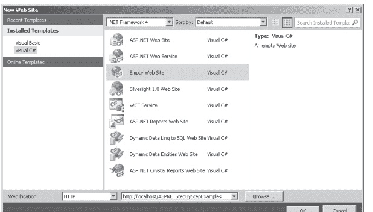

   为了能与本章之前基于 IIS 的示例进行比较，让此站点成为 HTTP 站点。从 Web location 下拉列表中选择 HTTP。为网站指定一个有用的名称，例如 ASPNetStepabayExamples。尽管这与之前的 IIS 示例目录名称相同，但你可以使用它，因为 Visual Studio 会在 IIS 子目录 `\netpub\wwwroot` 下创建子目录。

2. 选择语言语法。此时，你有选择使用某种语法来编写代码的选项。在 Visual Basic、C# 和 J# 之间进行选择。对于本例，请选择 C#。

3. 创建本地网站。对于本例，请在“位置”（Location）框中选择 HTTP，以便在你的计算机上本地运行此网站。Visual Studio 的默认选项是在你的本地计算机的文件系统上创建网站。通过使用 HTTP 项目类型，尝试访问你网站的客户端将把其请求通过 IIS 重定向。在学习 ASP.NET 如何与 IIS 配合工作时这是最佳选择，因为它让你有机会像跟踪整个系统一样跟踪你的网站，并在本地计算机上进行调试。稍后关注特定 ASP.NET 功能的示例将使用更方便的文件系统项目。

4. 通过选择“网站”（Website）->“添加新项”（Add New Item）打开“新建项”对话框来添加 HelloWorld 页面：默认设置相同。

   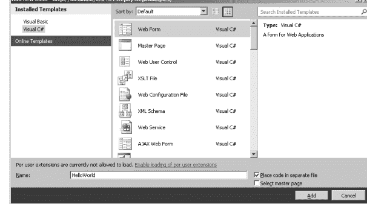

   此对话框列出了你可以添加到网站中的所有各个部分。列表顶端是一个名为“Web 表单”（Web Form）的项。选择此选项，然后在“名称”（Name）文本框中输入 HelloWorld.aspx。其他默认值保持不变。

   Visual Studio 将为你提供来自 HelloWorld.aspx 文件的纯 ASP.NET 代码。

   注意，Visual Studio 生成的代码在标记文件的顶部包含指令，将 HelloWorld.aspx 与伴随的源文件 HelloWorld.aspx.cs 连接起来（使用 `Page` 指令中的 `CodeFile` 和 `Inherits`）。指令之后是 Visual Studio 生成的一些 HTML：

   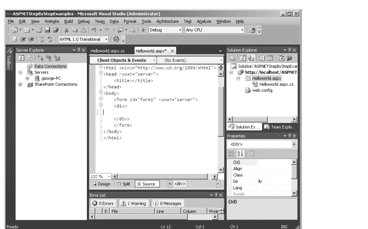

   此时，请花一点时间探索 Visual Studio 的布局。在窗口顶部，你可以看到许多工具栏按钮和菜单选项。你在阅读本文期间会访问其中大多数项。在代码正下方，你可以看到三个标记为“设计”（Design）、“分割”（Split）和“源代码”（Source）的选项卡（默认选中“源代码”选项卡）。如果你点击“设计”选项卡，可以看到页面在浏览器中的样子。现在，页面没有可见的 HTML 标签或 ASP.NET Web 控件，因此设计视图是空白的。

   在源代码窗口的右侧，你将看到“解决方案管理器”（Solution Explorer），它列出了应用程序的组件，Visual Studio 将这些组件编译为可执行代码。在解决方案管理器顶部，你会找到许多按钮。通过将鼠标指针悬停在按钮上，你可以看到它们的作用。接下来的图形显示了当选中 .aspx 文件时每个按钮的功能。

   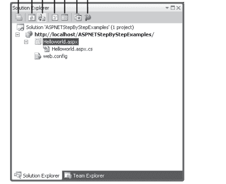

5. 向页面中写入一些代码。在解决方案管理器中选择 HelloWorld.aspx 文件，然后点击“查看代码”（View Code）按钮。这会在源代码窗口中显示 C# 代码，如下：

   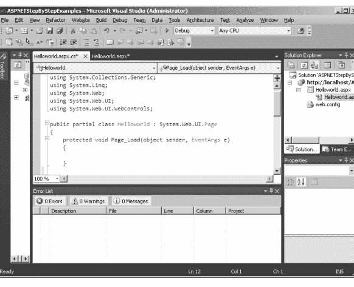

   添加以下代码以显示页面的继承关系（这与之前显示的 HelloWorld 相同的代码）。你添加的代码应该位于 `Page_Load` 方法之后：


```csharp
public void ShowLineage()
{
    Response.Write("Check out the family tree: <br/> <br/>");
    Response.Write(this.GetType().ToString());
    Response.Write("which derives from: <br/>");
    Response.Write(this.GetType().BaseType.ToString());
    Response.Write("which derives from: <br/>");
    Response.Write(this.GetType().BaseType.BaseType.ToString());
    Response.Write("which derives from: <br/>");
    Response.Write(
    this.GetType().BaseType.BaseType.ToString());
    this.Write("which derives from: <br/> ");
    Response.Write(
    this.GetType().BaseType.BaseType.BaseType.ToString());
}
```

`HelloWorld.aspx` 文件将显示如下：

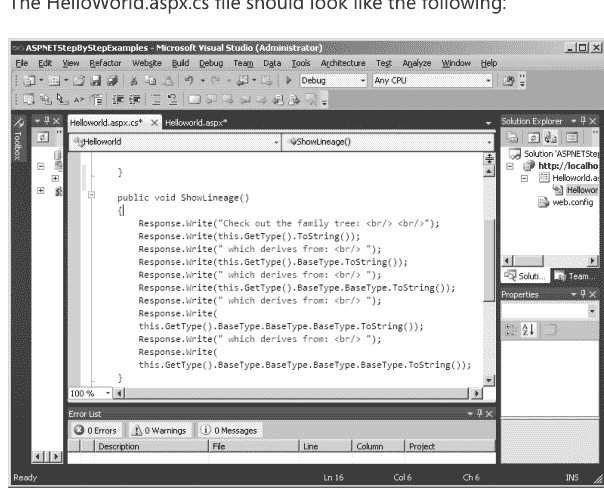

6. 从编辑器窗口顶部的 aspx 文件选项卡调用 `ShowLineage` 方法以渲染视觉设计器，然后点击屏幕底部的“源代码”（Source）选项卡。在显示 HTML 内容的情况下，在页面插入以下标记。它应该放置在起始和结束的 `<div>` 标签之间。

# 第 2 章 ASP.Net 应用基础

`HelloWorld.aspx` 的标记将如下所示：

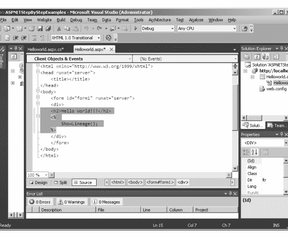

7. 现在生成项目并运行网站。如果代码有任何错误，它们将出现在窗口中。要运行网站，选择“调试”->“不调试启动”。Visual Studio 将启动浏览器并显示如下内容：

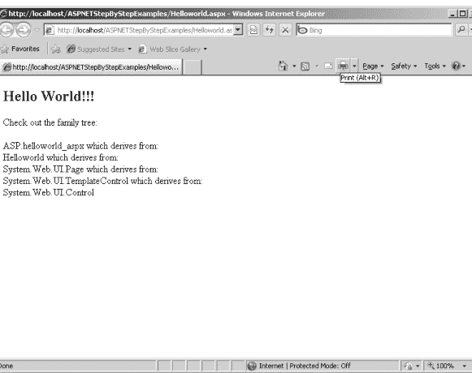

## 接下来

`HelloWorld.aspx` 文件将显示如下：

当你运行应用程序时，Visual Studio 会编译 `HelloWorld.aspx` 及其代码并移动到临时目录。然后调用 IIS 来激活 ASP.NET 流水线。

# 第 2 章 快速参考

| 操作 | 执行 |
| :--- | :--- |
| 2010 年创建 FTP 站点 | 在主菜单中选择“文件”、“新建网站”，在“位置”框中选择 FTP。此选项用于创建使用内置服务器的站点。 |
| 2010 年创建 HTTP 站点 | 在主菜单中选择“文件”、“新建网站”，在“位置”框中选择 HTTP。此选项用于创建使用 IIS 的站点。 |
| 2010 年创建文件系统站点 | 在主菜单中选择“文件”、“新建网站”，在“位置”框中选择“文件系统”。此选项让你在没有可用 IIS 的情况下开发站点。 |

# 第 3 章 页面渲染模型

完成本章后，你将能够：

- 直接处理服务器端控件。
- 使用 Visual Studio 处理 Web Forms 和服务器端控件。
- 处理回传（postback）事件。
- 理解 ASP.NET 页面渲染模型。

本章涵盖了 ASP.NET Web Forms 渲染模型的核心：控件。正如你所看到的，`System.Web.Ui.Page` 通过将渲染过程划分为服务器端控件的小组件来工作。

整个控件模型之旅包含了基础架构。本章从查看渲染控件所需的 HTML 开始。然后，检查了经典的活动服务器页面（ASP）显示控件的方法。尽管你在职业生涯中可能不会使用经典 ASP，但在这种背景下查看它可以帮助你理解 ASP.NET 解决的一些问题。这为后续章节奠定了基础，后续章节将研究控件如何提供自定义渲染、用户控件、标准用户界面（UI）控件以及一些现代复杂控件。本章从 ASP.NET 渲染模型开始。

## 将控件渲染为标签

正如你在基础 HTML Web Forms 中看到的，开发基于 Web 的 UI 关键是将正确的标签发送到浏览器。例如，想象你希望应用程序的 UI 如图 3-1 所示出现在浏览器中。

将此显示在浏览器中意味着发布具有正确标签的 HTML 流，以便浏览器使用客户端控件渲染屏幕。列表 3-1 显示了执行此工作的 HTML。如果你想运行此页面，文件名为 `BunchOfControls.htm` 并包含在本章的示例代码中。

[PAGE 87]

# 60 第一部分 基础

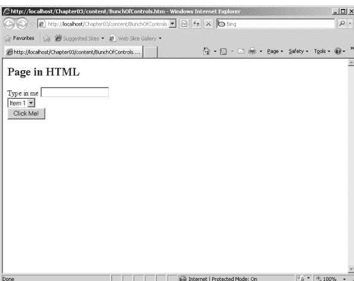

图 3-1 在 Internet Explorer 中渲染为控件的某些 HTML 标签

## 列表 3-1 BunchOfControls.htm 的初始 HTML 标记

```html
<html>
<body>
  <h2>Page in HTML</h2>
  <form method="post" action="BunchOfControls.htm" id="Form1">
    <label for="textinfo">Type in me</label>
    <input name="textinfo" type="text" id="textinfo" />
    <br/>
    <select name="items" id="dd1">
      <option value="Item1">Item 1</option>
      <option value="Item2">Item 2</option>
      <option value="Item3">Item 3</option>
      <option value="Item4">Item 4</option>
    </select>
    <br/>
    <input type="submit" name="clickme" value="Click Me!" id="clickme" />
  </form>
</body>
</html>
```

当然，在页面上使用控件通常意味着动态内容，因此将这些内容传递给浏览器应该以编程的方式进行。Classic ASP 提供了渲染动态内容的设施。然而，Classic ASP 通常依赖原始 HTML 来渲染内容。例如，列表 3-1 显示的 `BunchOfControls.htm` 页面在 classic ASP 中可能看起来像列表 3-2。图 3-2 显示了 ASP 页面在 Windows Internet Explorer 中的渲染情况。

[PAGE 88]

## 列表 3-2 使用 classic ASP 的 BunchOf 页面源码

```asp
<% Language="javascript" %>
<h2>Page in Classic ASP</h2>
<form>
```

```html
<label>Type in me</label>
<input name="textfield" type="text" id="textfield" />
<br/>
<select name="selectitems" id="dl">
<option value="1">Item 1</option>
<option value="2">Item 2</option>
<option value="3">Item 3</option>
<option value="4">Item 4</option>
</select>
```

```html
</select>
<br/>
<input type="submit" name="clickme" value="Click Me!" id="clickme" />
<% if (Request("textfield") != "") %>
This was in the text box: <% Request("textfield") %> <br/>
And this was in the selection control: <% Request("selectitems") %>
<% %>
```

```html
</p>
</form>
```

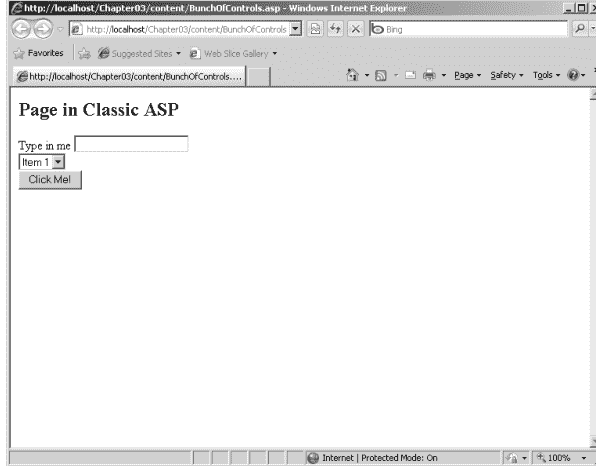

图 3-2 列表 3-2 中的 Asp 页面在 Internet Explorer 中显示如下。

当你从选择控件中选择一个项目时，注意页面通过告知你选择了什么来响应。这演示了 ASP 对动态内容的支持。

[PAGE 89]

# 第一部分 基础

注意，即使 classic ASP 也提供了一种运行时决定页面内容的方法，你仍然必须使用原始 HTML 创建大部分内容。此外，控件的状态在每次提交（post）之间总是会被重置。（我稍后在检查 ASP.NET View 时会讨论这一点）。ASP.NET 在原始 HTML 和渲染页面之间增加了一个间接层——该间接层是由 ASP.NET 服务器端控件集合提供的。服务器端控件消除了在 classic ASP 中开发 Web UI 所需的大量重复工作。

## 将 UI 封装为组件

能够从组件部分组装 UI 是产生组件最常引用的优点之一。在 Windows 操作系统中构建组件的最早方法是编写自定义 Windows 过程、使用列表框或按钮等控件的所有者功能以及对现有窗口进行子类化。20 世纪 90 年代初，Windows 采用了 Visual Basic 控件 (VBXs) 作为一种可行的 UI 技术。当然，那是十年前的事了。在 20 世纪 90 年代的中期、后期和 2000 年代初，ActiveX 控件代表了当时的图形用户界面 (GUI) 组件化技术。Windows Forms 是编写富客户端应用程序的模块化 GUI 的当前标准。

在 20 世纪 90 年代后期，ActiveX 控件也作为一种将 Web GUI 渲染为组件的方法而出现。这种方法的想法是，通过在页面中使用 ActiveX 控件，控件会在用户浏览该页面时被下载。在 20 世纪 90 年代中期，Java applet 也作为一种在 Web 上分发 GUI 组件的方法而流行起来。然而，这两种技术都取决于客户端计算机上某些广泛的基础设施（支持 ActiveX 的组件对象模型和支持 Java applet 的 Java 虚拟机）。当你开发网站时，你可能无法依靠客户端计算机上存在特定的基础设施来支持你的 GUI。为了支持尽可能多的客户端，请仅使用 HTML 表示你的 GUI。那种 GUI 组件化必须在服务器端进行。

随着现代客户端平台变得越来越同质，Web UI 开始越来越趋向于异步 Java 和 XML 编程模型 (AJAX)。你可能会在本书稍后的部分看到 AJAX 的工作原理。AJAX 倾向于将更多的智能推回浏览器。然而，AJAX 应用有大量的渲染工作要完成。ASP.NET

## 第 3 章 页面渲染模型

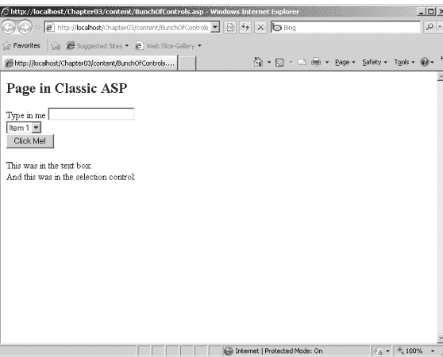

**图 3-3** - 在开启了追踪功能的 Internet Explorer 中渲染的列表 3-3 中的 .aspx 文件。

如果你查看响应的原始文本（在 Internet Explorer 中点击“页面”->“查看源代码”），你会发现 ASP.NET 返回的是非常直观、普通的 HTML。在顶部有一些额外内容——隐藏的 `__VIEWSTATE` 字段，这将在第 4 章“自定义渲染控件”中进行介绍。之后，其余部分都是描述表单的熟悉 HTML。列表 3-4 显示了由列表 3-3 中的 ASP.NET 代码发出的原始 HTML。在查看页面之前，请务必关闭追踪：

## 列表 3-4 由 BunchOfControls.aspx 文件生成的原始 HTML

```html
<h2>Page in ASP.NET <span></</span></h2>
<form method="post" action="BunchOfControls.aspx" id="Form1">
<div>
  <input type="hidden" name="__VIEWSTATE" id="__VIEWSTATE" value="wEPdWUJ001Q10DeEz..." />
</div>
<span>Type in me:<span></</span></span>
<input name="textfield" type="text" id="textfield" />
<br/>
<select name="dd1" id="dd1">
  <option value="1">Item 1 1</option>
  <option value="2">Item 2 2</option>
  <option value="3">Item 3 3</option>
  <option value="4">Item 4 4</option>
</select>
<br/>
<input type="submit" name="clickme" value="Click Me!" id="clickme" />
</form>
```

# 第一部分 基础

你会在渲染器的任何地方都没有看到 `runat=server` 属性。这是因为 `runat=server` 属性是为了指示 ASP.NET 构建页面的控件树。

## 页面的控件树

当你将 `Trace` 属性设置为 `true` 后，ASP.NET 会以页面追踪的形式向你输出大量信息。如果你在追踪信息中向下滚动一下，就可以看到 ASP.NET 页面的一部分包含了页面控件树。图 3-4 显示了 `BunchOfControls.aspx` 的页面追踪的像，重点是控件树。

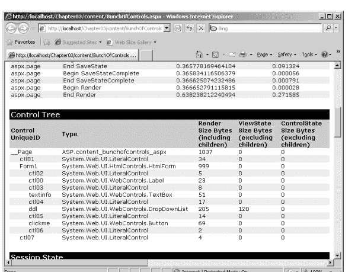

图 3-4 页面中显示的 BunchOfControls.aspx 页面控件树。

页面控件树的第一行是一个名为 `_Page` 的项。这是正在运行的 `System.Web.UI.Page` 对象。在其下方是许多其他项。你可能识别出它们的某些名称，因为它们在 ASP.NET 源代码中是被命名的。注意 `Form1`、`textbox` 和 `clickme`。这些名称来自原始 .aspx 文件中的标签。

这里正在发生的是 ASP.NET 正在将渲染架构拆分为细小的、易于管理的各个。图 3-4 所示控件树中的每个项都派自 `System.Web.UI.Control` 类。每当 `System.Web.UI.Page` 需要渲染页面时，它只需遍历控件树，要求每个控件进行自身渲染。例如，当 ASP.NET 运行时请求 `TextBox` 服务端控件渲染自身时，`TextBox` 控件会将 HTML 添加到浏览器的输出流处理器中：

```html
<input name="textfield" type="text" id="textfield" />
```

这对于所有其他控件都有效。例如，`DropDownList` 负责输出 `<select>` 和 `<option>` 标签（`<option>` 标签代表 `DropDownList` 控件持有的项目集合）。

```html
<select name="dd" id="dd">
<option value="Item 1">Item 1</option>
<option value="Item 2">Item 2</option>
<option value="Item 3">Item 3</option>
<option value="Item 4">Item 4</option>
</select>
```

现在你已经知道这些标签是如何工作的，可以学习如何在 Visual Studio 中管理它们了。

## 使用 Visual Studio 添加控件

Visual Studio（配合 ASP.NET）可以轻松地让你了解 Web 开发的真实本质。正如你在前面的章节中看到的，Web 开发可以追溯到 20 世纪 70 年代的老旧终端——大型机时代。然而，终端是一个复杂的浏览器，计算平台是一个 Web 服务器（或者可能是 Web 集群），而受众是全球性的。当客户端浏览器向服务器进行往返时，它实际上只获取了服务器状态的一个快。这是因为 Web 用户界面是使用一种在断连接协议上的标记语言构建的。

在 Visual Studio 中构建 Web 时，几乎就像你正在开发桌面应用程序一样。通过 Visual Studio，你不需要花费所有时间编写 ASP 风格的代码。设计器（Designer）是一个视觉化设计 Web UI 的绝佳环境。

要学习如何使用 Visual Studio，你可以开发一个使用服务端控件的简单页面。该页面看起来像这样

## 使用 Visual Studio 构建页面

1. 在 Visual Studio 中，创建一个空 ASP.NET 项目来实验控件。

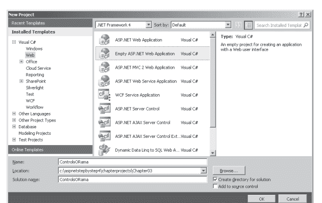

2. 通过右键点击项目并选择“新建项”来添加一个默认页面。确保其命名为 `Default.aspx`。

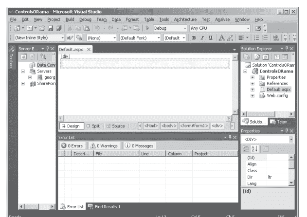

3. 要编辑标签的内容，你需要查看属性。如果属性没有显示，右键点击标签，并在快捷菜单上点击“属性”。以下显示了属性面板：

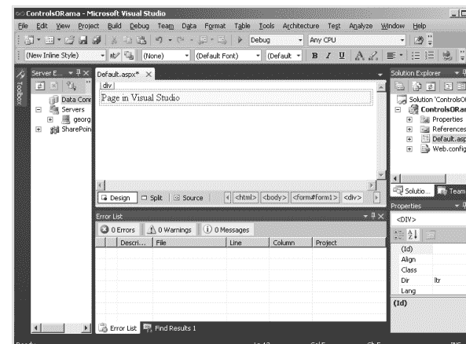

4. 点击 Visual Studio 最左侧的“工具箱”选项卡以打开工具箱：

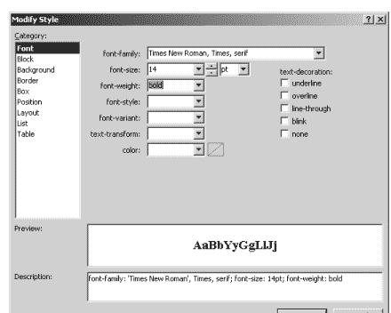

5. 插入一个换行符 `<br/>`，从工具箱中拖入一个标签到页面并选择它。（注意 Visual Studio 2010 设计器如何在标签正上方为该标签装饰一个小标签。）


# 第3章 页面渲染模型

## 6. 使用快捷菜单向 `DropDownList` 添加项

点击 `DropDownList` 任务菜单上的“编辑项”以打开“项目集合编辑器”对话框，如下图所示：

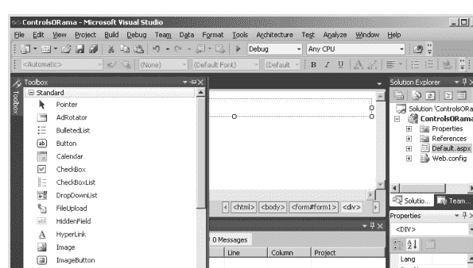

每当你点击“添加”按钮，项目集合编辑器就会向 `DropDownList` 项目集合添加一个新项。在添加并选择项后，你可以编辑显示名称（`Text` 属性）。你可以添加一个关联的值以同时也包括文本。例如，在库存跟踪应用程序中，你可能将产品名称作为 `Text` 属性，并将企业特定的产品代码作为 `Value` 字段。你可以在运行时获取该项目的任一个或两个方面。

如图所示，向 `DropDownList`（下拉列表）中添加几个此类项目。添加完几个后，点击确定。

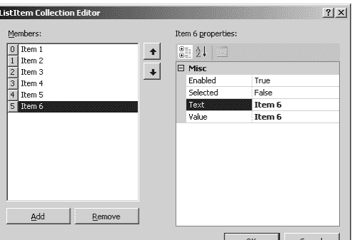

### 9. 在页面上添加一个按钮

首先，在 `DropDownList` 之后添加一个换行符 `<br/>`。然后，从工具箱绘制一个 `Button`（按钮）到页面上。下图显示了放置好的控件：

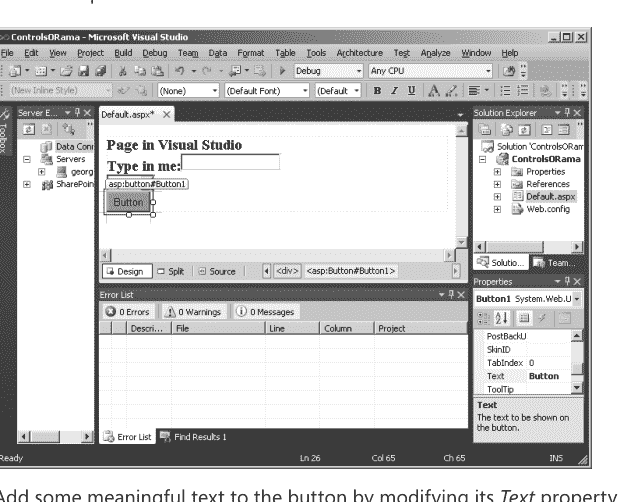

通过修改按钮的 `Text` 属性为按钮添加一些有意义的文本。

## 第一部分 基础知识

在继续之前，请查看 Visual Studio 生成的源代码。对于 `Label` 控件、`TextBox` 控件、`DropDownList` 和 `Button` 控件，Visual Studio 会向你的代码中添加四个新的成员变量（通过标签中放置的 `runat=server` 属性隐含）。此时，使用 `<form>` 标签添加的 .aspx 文件的内容看起来类似于列表 3-5 所示的代码。

### 列表 3-5 最终默认的 Default.aspx 标记

```
<form id="form1" runat="server">
<div style="font-family: 'New Roman', Times, serif; font-size: 14pt; font-weight: bold;">
  Page in Visual Studio />
/>
<asp:Label id="Label1" runat="server" Text="Type in me:"></asp:Label>
<asp:TextBox id="TextBox1" runat="server"></asp:TextBox>
<br />
<asp:DropDownList id="DropDownList1" runat="server">
<asp:ListItem>Item 1</asp:ListItem>
<asp:ListItem>Item 2</asp:ListItem>
<asp:ListItem>Item 3</asp:ListItem>
<asp:ListItem>Item 4</asp:ListItem>
<asp:ListItem>Item 5</asp:ListItem>
<asp:ListItem>Item 6</asp:ListItem>
</asp:DropDownList>
<asp:Button id="Button1" runat="server" Text="Click Me" />
</div>
</form>
```

注意，服务器端的每个 ASP.NET 标签都有一个 `ID` 属性。这是在运行时识别控件的标识符。你稍后就会用它它。

### 10. 添加按钮事件处理器

最后，为了让按钮产生作用，你需要在页面上添加一个事件处理器，以便它在按钮被点击时做出响应。添加事件处理器的最简单方法是在设计视图（Design view）中双击按钮。Visual Studio 会为按钮点击生成一个处理程序，然后在源代码视图（Source view）中显示该代码。此时，你可以添加一些代码来响应按钮的点击。

### 11. 添加按钮处理代码

将列表 3-6 中的源代码添加到文件中。

#### 列表 3-6 按钮处理代码

```csharp
protected void Button1_Click(object sender, EventArgs e)
{
  Response.Write("Hello. Here's what you typed into the text box: <br/>");
  Response.Write(this.TextBox1.Text);

  Response.Write("<br/>");
  Response.Write("And the selected item is: <br/>");
  Response.Write(this.DropDownList1.SelectedItem.Text);
}
```

此处显示的代码通过 `Response` 对象向输出流发送一些文本来响应按钮点击。通过 `Response.Write` 传输的文本是客户端浏览器看到的文本，因此它出现在页面顶部。

注意，代码使用了页面类中的 `TextBox` 成员变量，说明控件在运行时可以通过编程方式访问。这里是页面在客户端浏览器中的显示方式。注意 `Response.Write` 发出的文本位于任何控件之前。

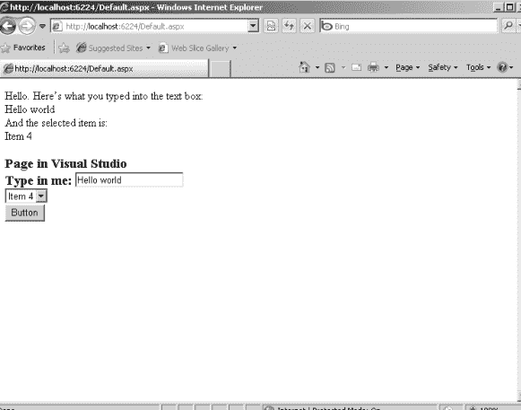

要测试页面上的控件，点击“调试”（Debug）菜单转到页面，然后点击“不带调试启动”（Start Without Debugging）。要查看所有服务器端控件生成的 HTML，你可以查看浏览器的源代码。（如果你的浏览器是 Internet Explorer，点击“页面”，“”，“查看源代码”）。当你查看源代码时，你应该能看到类似于列表 3-7 所示的内容。注意 `Response.Write` 发出的文本出现在列表的最顶部。

### 列表 3-7 运行 Default.aspx 产生的 HTML

```
Hello. Here's what you typed into the text box: <br/>Hello world<br/>And the selected item is: <br/>Item 4

<!DOCTYPE html PUBLIC "//W3C//DTD HTML 1.0 Transitional//EN"
"http://www.w3.org/TR/html/DTD-transitional.dtd">

<html xmlns="http://www.w3.org/1999/xhtml">
<head>
<title></title>
</head>
<body>
<form name="form1" method="post" action="Default.aspx">
<div style="font-family: 'New Roman', Times, serif; font-size: 14pt; font-weight: bold;">
  Page in Visual Studio />
/>
<asp:Label id="Label1" runat="server" Text="Type in me:"></asp:Label>
<asp:TextBox id="TextBox1" runat="server"></asp:TextBox>
<br />
<asp:DropDownList id="DropDownList1" runat="server">
<asp:ListItem>Item 1</asp:ListItem>
<asp:ListItem>Item 2</asp:ListItem>
<asp:ListItem>Item 3</asp:ListItem>
<asp:ListItem>Item 4</asp:ListItem>
<asp:ListItem>Item 5</asp:ListItem>
<asp:ListItem>Item 6</asp:ListItem>
</asp:DropDownList>
<asp:Button id="Button1" runat="server" Text="Click Me" />
</div>
</form>
</body>
</html>
```

## 布局考虑

当你将控件拖到页面上时可能已经注意页面的布局。Visual Studio 2010 不允许直接进行布局；你可以通过类名应用样式。

要向页面添加新样式，请确保设计器处于显示状态并点击主菜单上的“格式”，“新建样式”。对话框将打开：

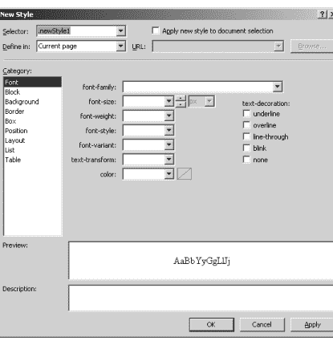

要使用对话框左侧的“位置”列表更改布局选项。一旦设置了样式，你就可以引用它应用于元素。

通过更改位置选项，你可以将各种布局应用于页面。尝试一下它们，这是感受它们如何工作的唯一方法。我们将深入探讨样式。

## 第3章 快速参考

| 操作 | 方法 |
| :--- | :--- |
| 在 ASPX 源代码模式和设计模式之间切换 | 点击编辑器窗口左下角的“设计”或“源代码”标签页。你也可以使用“分割”标签同时查看源代码和设计视图。 |
| 向页面添加服务器控件 | 如果工具箱未显示，点击菜单上的“查看”，“工具箱”打开它。（也可以使用快捷键 `Ctrl+W` 和 `Ctrl+X`）点击工具箱中的控件。将其拖到页面上。 |
| 页面上控件的属性 | 确保页面编辑器处于设计模式。突出要更改属性的控件。在属性面板中选择要编辑的属性。 |
| 启用跟踪 | 在源代码编辑模式下，编辑页面指令以包含 `Trace="true"` 属性。或者从属性面板顶部的组合框中选择“文档”元素。将 Trace 属性设置为 true。 |
| 更改服务器控件的大小 | 点击控件以将其突出显示。点击控件边界出现的句柄之一并移动鼠标直到控件大小正确。 |
| 为控件默认事件添加处理程序 | 双击想要处理事件的控件。代码编辑器将出现，允许你添加处理特定事件所需的代码。 |
| 更改页面的布局特征 | 通过点击主菜单上的“格式”，“新建样式”向页面添加新样式。在主菜单上点击“布局”并开发一种样式（定义样式还包括布局选项之外的其他元素，如字体、字号和边距）。将该样式应用于页面或单个元素。 |

# 第 4 章 自定义渲染控件

完成本章后，你将能够：

- 在 Microsoft Visual Studio 解决方案文件中现有项目中添加新项目。
- 创建一个渲染自定义 HTML 的服务器端控件。
- 将服务器端控件添加到 Visual Studio 工具箱中。
- 在 Web 表单（Web Form）上放置服务器端控件。
- 管理控件中的事件。
- 使用 ASP.NET 检测客户端浏览器的差异并应用这些信息。

在第 3 章“页面渲染模型”中描述了 ASP.NET 渲染模型背后的基本架构。`System.Web.Ui` 管理一个服务器端控件列表，每个服务器端控件都负责渲染页面的特定部分。ASP.NET 将服务器端控件大致分为两类：

- 渲染控件（完全管理渲染过程的控件）
- 复合控件（将多个服务器端控件封装成单个单元的控件）

本章侧重于第一类：自定义渲染控件。在本章中，你将看到控件在成为 Web 页面的一部分是如何工作的。在此过程中，本章将涵盖控件如何管理事件以及它们如何检测客户端浏览器差异等主题。

首先，从 ASP.NET 服务器端控件架构的核心——`System.Web.Ui.Control` 类开始看。

## Control 类

ASP.NET 服务器端控件派生自名为 `System.Web.Ui.Control` 的类。事实上，`Control` 类是 ASP.NET 中几乎每个用户界面 (UI) 元素的核心。即使 `System.Web.Ui.Page` 也派生自 `Control` 类。表 4-1 显示了 `System.Web.Ui.Page` 类的一个部分示例。

### 表 4-1 Page 属性、方法和事件采样

| 成员 | 描述 |
| --- | --- |
| Application | 指向与当前请求关联的 `HttpAppState` 对象引用 |
| Cache | 指向应用程序缓存的引用——应用程序范围内的内存字典（通常用于优化） |
| Controls | Page 维护的控件集合 |
| CreateChildControls | 页面在此期间构建其控件树的虚拟方法 |
| Init | 表示页面已初始化的事件 |
| IsPostBack | 请求是新请求还是 POST 请求 |
| Load | 表示页面已加载的事件 |
| RenderControl | 页面在此期间渲染其内容的虚拟方法 |
| Request | 表示传入请求的有状态对象的引用 |
| Response | 表示传出响应的有状态对象的引用 |
| Session | 表示特定于当前请求信息的有状态对象的引用 |
| Unload | 表示页面卸载的事件 |

表 4-1 中的项目显示了 `System.Web.Ui.Control` 可用的一小功能。在研究 ASP.NET Web Forms 时列出所有它们。记住上一章提到的 Web Forms 作为其内部结构的一部分管理控件集合。当你向页面添加控件时，它们就会被放置在集合中。当页面需要将其内容渲染回客户端时，`System.Web.Ui.Page` 会遍历集合并要求每个控件渲染自身。如果一个控件包含控件（就像页面包含控件一样），ASP.NET 也会向下遍历这些集合。你可以在表 4-1 中看到 `RenderContent` 方法。`RenderContent` 接受一个类型为 `HtmlWriter` 的单参数。你将在本章稍后检查它。现在，将其构想为你向客户端发送页面响应的通道。`Control` 类的其他元素包括以下项目：

- 用于管理控件视图（view state）的属性
- 用于管理皮肤（skins）的属性（以适应多个页面之间一致的外观和感受）
- 获取父控件（在复合控件的情况下）和父页面的属性
- `Init`、`Load`、`PreRender` 和 `Unload` 事件的事件处理程序
- 用于管理子控件的方法

这些是在检查渲染控件和复合控件时最重要的的话题。尽管 `Page` 类规模很大，但它使用了简单的逻辑，并在实践中运行良好。最简单的方法是直接开始构建一个自定义控件。

## Visual Studio 与自定义控件

在这一节中，你将构建一个简单的控件（Visual Studio 为你生成的默认控件），并看到它是如何应用于 Web 表单的。Visual Studio 创建了一个包含单个 `Text` 属性的简单控件，并将该属性渲染到浏览器。这是发现服务器端控件如何工作的一种良好方法。

## 创建自定义控件

1. 从打开第 3 章中的 Controls 项目开始，如图所示。注意：如果你想保留 Controls 项目的当前状态，请复制整个目录并在副本上进行工作。此示例将在本章和下一章中基础上进行构建，以演示开发控件的不同方法。


2. 通过右键点击解决方案资源管理器中的解决方案节点，并点击快捷菜单上的“添加”、“新建项目”，向 Controls 添加新项目。将新项目命名为 `CustomControlLib`。选择 ASP.NET Server 作为模板，如下：


Visual Studio 为你了一个名为 `ServerControl` 的简单 Web 控件作为开始。代码 4-1 显示了 Visual Studio 为 Web 控件库生成的默认代码。

### 代码 4-1 默认自定义控件实现

```csharp
using System;
using System.Collections.Generic;
using System.ComponentModel;
using System.Linq;
using System.Text;
using System.Web;
using System.Web.UI;
using System.Web.UI.WebControls;

namespace CustomControlLib
{
    [DefaultProperty("Text")]
    [ToolboxData("{0}:ServerControl runat=server'>{0}:ServerControl")]
    public class ServerControl : WebControl
    {
        [Bindable(true)]
        [Category("Appearance")]
        [DefaultValue("")]
        [Localizable(true)]
        public string Text
        {
            get
            {
                string s = (string)ViewState["Text"];
                return ((s == null) ? "[" + this.ID + "]" : s);
            }
            set
            {
                ViewState["Text"] = value;
            }
        }
        protected override void RenderContent(HtmlTextWriter output)
        {
            output.Write(Text);
        }
    }
}
```

Visual Studio 生成的代码包含一个派生自 `System.Web.UI.WebControl`（派生自标准 `Control` 类）的简单类，并在此添加了一些标准属性。注意代码有一个名为 `Text` 的简单属性，它重写了 `RenderContent` 方法。这是一个真实的、功能控件（尽管它所做的非常像 `Label`）。

3. 通过选择菜单上的“生成”、“生成解决方案”来生成项目。


# 第4章 自定义渲染控件

## 4.1 将控件添加到工具箱

一旦你编译项目，Visual Studio 就会让控件对项目可用。你也可以通过另一种方式将其添加到你的项目中：在工具菜单上，点击“选择工具箱项”，在选择工具箱对话框中点击“浏览”，导航到 `Controls` 项目目录，然后进入 `CustomControlLib` 目录。接下来，打开 `Binary` 调试（Visual Studio 默认使用调试版本）。选择 `CustomControlLib.DLL` 程序集并点击“打开”。

`ServerControl` 现在显示在选择工具箱项对话框中。复选框显示它已被选中。

一旦你点击“选择工具箱项”对话框中的“确定”按钮，新的 `ServerControl1` 就会出现在工具箱中。为了方便找到该控件，请右键点击工具箱并点击“按字母顺序排序”。以下是 `ServerControl1` 在工具箱中的显示：

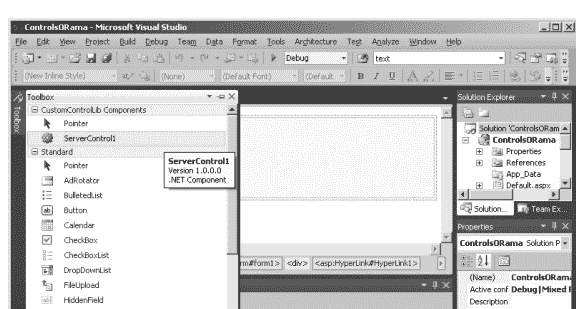

## 4.2 测试控件

要查看控件是如何工作的，你需要为它提供一个“家”。在网站上添加一个新页面。在解决方案资源管理器中选择 `ControlsORama` 项目。选择“网站”、“添加新项”，并添加一个“页面”。将页面命名为 `UseCustomControl.aspx`。

要放置控件，请切换到设计模式。从工具箱将 `ServerControl1` 拖动到 `UseCustomControl` 设计视图中。你可以看到它是设计平面左上角的一个矩形：

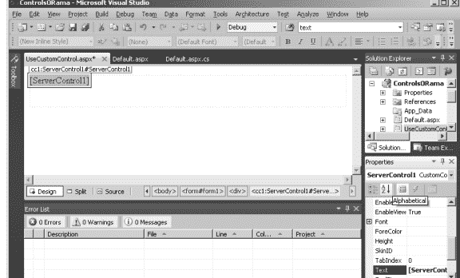

拖动句柄可以调整页边距。按下 `SHIFT + CTRL` 可获得更多选项。

控件中的某些文本可以标识出它。此外，控件正方的某些文本标识了整个类名。虽然控件已被选中，但每当你切换到另一个页面再返回此页面时，你可能需要重新选择它。你可以使用 Visual Studio 窗口右下角属性面板中的下拉列表来选择新控件。更改控件中的 `Text` 属性，并观察它在设计器中的显示。

`Text` 属性由控件渲染。你可以修改它。

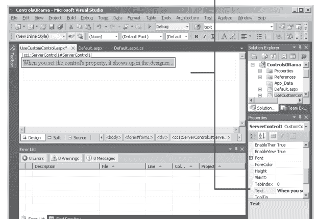

再次查看该控件的源代码——特别查看 `RenderContents` 方法。注意，该方法只是简单地使用参数（一个 `HtmlConsoleText`）将 `Text` 属性发送到浏览器。这就是为什么当你在设计器中更改 `Text` 属性后，它会显示出来。

以下代码行是 Visual Studio 为配合控件而添加到 `.aspx` 文件中的。你可以通过点击 Visual Studio 代码窗口底部的“源代码”标签页来查看。`Register` 指令告诉 ASP.NET 运行时查找自定义控件（哪个程序集）并将其映射到标签前缀。

```
<Register
Assembly="CustomControlLib, Version=1.0.0.0,
Culture=neutral,
PublicKeyToken=null"
Namespace="CustomControlLib" TagPrefix="cc1" %>
```

列表 4-2 显示了当你将控件的 `Text` 属性设置为字符串值“When you set the control's property”时，控件在页面上是如何定义的。

### 列表 4-2 使用自定义 Web 控件的 UseCustomControl.aspx 标记

```
<form id=form1 runat=server>
<div>
  <cc1:ServerControl1 ID="ServerControl1"
    runat="server"
    Text="when you set the control's property,
    it shows up in the designer..." />
</div>
</form>
```

现在花点时间更改控件的几个属性，看看设计器中发生了什么（例如，更改字体总是非常明显的）。你在属性面板中看到的属性都是标准的，它们之所以出现是因为控件派生自 `System.Web.Ui.WebControl`。

### 4.3 添加标准控件并交互

6. 在网页上添加一个文本框和一个按钮，用换行符（`<br />`）隔开。将它们拖到页面上后，Visual Studio 会添加列表 4-3 所示的代码。

#### 列表 4-3 修改后的 UseCustomControl.aspx 标记

```
<form id=form1 runat=server>
<div>
  <cc1:ServerControl1 ID="ServerControl1"
    runat="server"
    Text="when you set the controls property,
    it shows up in the designer..." />
  <br />
  <br />
  <asp:Label ID="Label1"
    runat="server"
    Text="Type something here:" />
  <asp:TextBox ID="TextBox1" runat="server" />
</asp:TextBox>

  <br />
  <asp:Button ID="Button1"
    runat="server"
    Text="Set Control Text" />
</div>
</form>
```

注意标准的 ASP.NET 控件（按钮、文本框和标签）都以 `asp:` 前缀开头，而新的自定义控件使用前缀 `cc1:`。当你将控件拖入设计器时，Visual Studio 在 `cc1:` 标签下生成了该内容，尽管你可以通过修改 `Register` 指令中的 `TagPrefix` 属性对该页面进行更改。

7. 在设计器中双击按钮，为按钮添加事件处理程序。在 Visual Studio 为你添加事件处理程序后，按钮将从 `TextBox` 中获取文本并使用它来设置你自定义控件的 `Text` 属性。要做到这一点，请输入以下代码：

```
protected void Button1_Click(object sender, EventArgs e)
{
    this.ServerControl11.Text = this.TextBox1.Text;
}
```

现在按 `Ctrl+F` 浏览到带有控件的新页面。当你向框中输入内容并点击按钮时，浏览器会将你的请求发送到服务器。服务器通过获取 `TextBox` 中的文本并使用它来设置 `ServerControl1` 的 `Text` 属性来响应。


# 回文

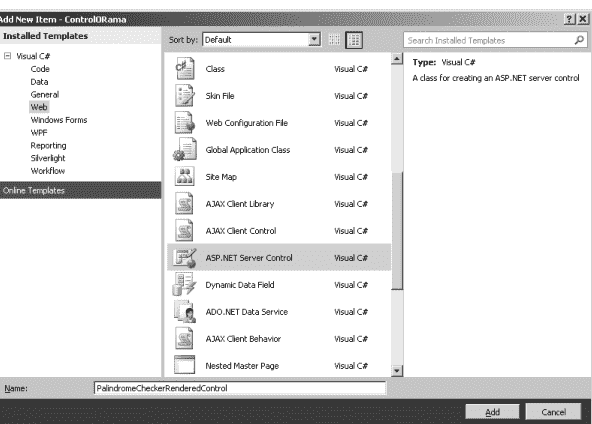

1. 要创建 Palindrome Checker，在解决方案资源管理器中右键点击 `CustomControlLib` 节点，点击“新建项”。在模板下，确保选择了 Web 控件。将其命名为 `PalindromeChecker`。


2. 在 `PalindromeChecker` 类中添加一个方法来测试字符串是否为回文。回文是指正读和反读都相同的单词、句子或短语（例如“radar”）。你还应该去掉非字母数字字符。

列表 4-4 去非字母数字

```csharp
protected string strppedNonAlumerics(string str)
{
    string strpped = (String)str.Clone();
    if (str != null)
    {
        char[] rgc = strpped.ToCharArray();
        int i = 0;
        foreach (char c in rgc)
        {
            if (char.IsLetterOrDigit(c))
            {
                i++;
            }
            else
            {
                strpped = strpped.Remove(i, 1);
            }
        }
    }
    return strpped;
}
```

# 第一部分 基础知识

```csharp
protected bool CheckForPalindrome()
{
    if (this.Text != null) {
        String strControlText = this.Text;
        String strTextToUpper = null;
        strTextToUpper = Text.ToUpper();
        strControlText = this.StripNonAlumerics(strTextToUpper);
        char[] rgcReverse = strControlText.ToCharArray();
        Array.Reverse(rgcReverse);
        String strReverse = new string(rgcReverse);
        if (strControlText == strReverse) {
            return true;
        } else {
            return false;
        }
    } else {
        return false;
    }
}
```

3. 修改渲染方法将回文打印为蓝色，将非回文打印为红色。`RenderContent` 方法接受单个 `HtmlTextWriter` 参数。除了允许向浏览器流文本外，`HtmlTextWriter` 许多你很快就会看到的有用功能。现在，你可以将其非常类似于 `Response.Write`。你通过 `Write` 方法发送的任何内容都会出现在客户端浏览器。

```csharp
protected override void content(HtmlTextWriter output)
{
    if (this.CheckForPalindrome()) {
        output.Write("这是一个回文：<BR/>");
        output.Write("<字体 size=5 color=blue>");
        output.Write("<B>");
        output.Write(this.Text);
        output.Write("</B>");
        output.Write("</FONT>");
    } else {
        output.Write("这不是回文：<BR/>");
        output.Write("<字体 size=5 color=red>");
        output.Write("<B>");
        output.Write(this.Text);
        output.Write("</B>");
        output.Write("</FONT>");
    }
}
```

4. 通过主菜单上的“生成”（Build）和“生成解决方案”（Build Solution）来构建项目。

5. Visual Studio 应该将 `PalindromeCheckerRenderedControl` 添加到工具箱。如果没有，你可以通过右键点击工具箱并选择“添加”（Item）来手动添加。使用“浏览”（Browse）按钮找到 `CustomControl.DLL` 程序集并选择它。Visual Studio 会在工具箱中加载新控件。

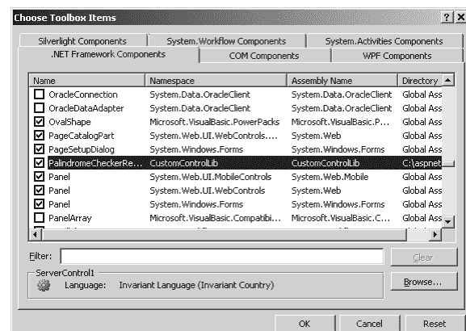

6. 通过向 Controlsama 项目中添加新的 Web 表单（Web Form）并命名为 `UsePalindromeCheckerControls.aspx` 来添加一个使用回文的页面。将 `PalindromeCheckerRenderedControl` 拖到页面上。添加一个 `TextBox` 和一个按钮，以便你向控件中添加回文并进行检查。

7. 双击按钮为按钮添加处理程序。Visual Studio 将在页面上添加一个处理程序。在处理程序中，将 `PalindromeCheckerRenderedControl` 的 `Text` 属性设置为 `TextBox.Text`。

```csharp
public partial class UsePalindromeCheckerControls : System.Web.UI.Page
{
    protected void Button1_Click(object sender, EventArgs e)
    {
        this.PalindromeCheckerRenderedControl1.Text = this.TextBox1.Text;
    }
}
```

8. 运行页面并测试回文。回文应该显示为蓝色，非回文应显示为红色。

## 控件与事件

`PalindromeCheckerRenderedControl` 展示了如何根据 `Text` 属性的状态来渲染控件内容。虽然这本身很有用，但通过从控件中暴露事件来通知宿主页面发现了回文这一事实，通常非常有帮助。ASP.NET 标准服务器端控件已经支持事件。你已经看到过 `Button` 控件在被点击时如何向宿主页面发送事件的。实际上，你对任何控件都可以执行这种操作。接下来，你为 `PalindromeCheckerRenderedControl` 添加一个 `PalindromeFound` 事件。

## 添加 PalindromeFound 事件

1. 打开 `PalindromeCheckerRenderedControl.cs` 文件。要添加 `PalindromeFound` 事件，在以下行中：

```csharp
public class PalindromeCheckerRenderedControl : WebControl
{
    public event EventHandler PalindromeFound;
    // 其他回文代码在此
}
```

2. 一旦宿主订阅了该事件，他们将想知道事件何时触发。为了做到这一点，在检测到回文时触发事件。执行此位置是在 `Text` 属性的设置器中。在回文的 `Text` 属性中添加以下代码并重新生成项目：

```csharp
[Bindable(true)]
[Category(Appearance)]
[DefaultValue("")]
```

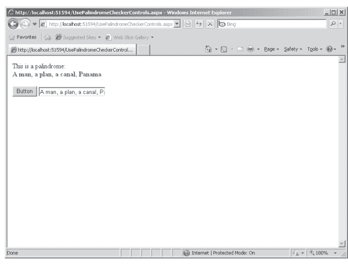

## 第 4 章 自定义渲染控件

```csharp
[Localizable(true)]
public string Text
{
    get
    {
        string s = (string)ViewState["Text"];
        return (s == null) ? String.Empty : s;
    }
    set
    {
        ViewState["Text"] = value;
        if (this.CheckForPalindrome)
        {
            if (PalindromeFound != null)
            {
                PalindromeFound(this, EventArgs.Empty);
            }
        }
    }
}
```

注意，Visual Studio 2010 生成的代码将 `Text` 属性中找到的值存储在控件的 `ViewState` 中。这样，属性在回传（posts）之间就能保留其值。你将在本章稍后部分更地检查 `ViewState`。

3. 现在通过页面上的 `PalindromeCheckerRenderedControl` 的当前实例在宿主页面中连接事件，并在发布上一个新实例。这将刷新 `CustomLibrary.DLL` 程序集，使更改（新事件）出现在 Visual Studio 中。在页面上选择 `PalindromeCheckerRenderedControl`，并点击 Visual Studio 属性面板中的“事件”按钮（小闪电图标）。双击文本框以找到 `PalindromeCheckerRendered` 事件。Visual Studio 会为你创建一个事件处理程序。

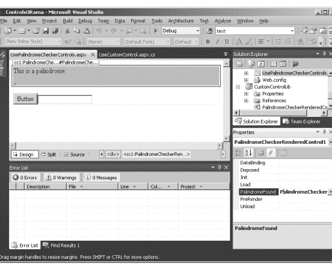

4. 响应 `PalindromeFound` 事件。此示例仅使用 `Response.Write` 向浏览器打印一些文本。

```csharp
public partial class UsePalindromeCheckerControls : System.Web.UI.Page
{
    protected void Page_Load(object sender, EventArgs e)
    {
    }
    protected void Button1_Click(object sender, EventArgs e)
    {
        this.PalindromeCheckerRenderedControl1.Text = this.TextBox1.Text;
    }
    protected void PalindromeCheckerControl1_PalindromeFound(object sender, EventArgs e)
    {
        Response.Write("The page detected a PalindromeFound event");
    }
}
```

运行页面。当你输入回文时，你应该看到类似下面的的内容：

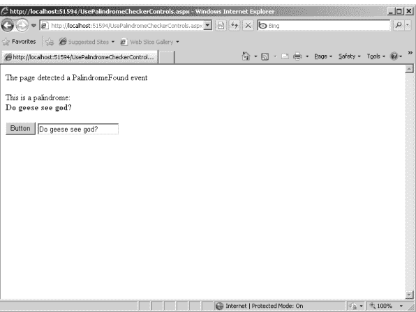

现在控制器可以正确渲染回文并拥有一个事件，让我们仔细查看在调用 `Render` 时传递的参数。

# 控制与视图状态 (ViewState)

在结束渲染控件的话题之前，让我们来看一下由控件管理的视图状态问题。如果你回到早几章节中一些经典的 Active Server Pages (ASP) 示例，你可能会发现控件在回传（post back）后的渲染方式有些令人困惑。当你组合框中选择了某个内容并与服务器进行一次往返后，当响应返回时，控件（尤其是控件）已经丢失了它们的状态。记住，基本的 Web 编程模型的核心是创建服务器状态的快照并使用浏览器显示它们。它本质上是在尝试在一个断开的协议上执行实用的用户界面（UI）开发。

ASP.NET 服务器端控件包含一种保持页面视觉状态的机制——它是页面中一个名为 `ViewState` 的属性，你可以在需要时随时访问它。`ViewState` 是一个字典（名称/值集合），用于存储任何可序列化的对象。


大多数 ASP.NET 服务器端控件通过从 `ViewState` 中存储和检索项来管理其状态。例如，选择控件可能会在回传之间维护所选项目的索引，以便控件知道哪个项目被分配了属性，并能够渲染相应的标记以在用户的浏览器中显示为已选中。

页面的整个状态被编码在回传之间的一个隐藏字段中。例如，如果你浏览到一个 `.aspx` 页面并查看来自服务器的源代码，你会看到 `ViewState` 以 BASE64 编码的字节形式出现。

为了直观感受 `ViewState` 是如何工作的，请添加一些代码来跟踪通过控件查看过的回文。

# 使用 ViewState

1. 打开 `PalindromeCheckerRenderedControl.cs` 文件。

2. 在指令列表中添加 `System.Collections`。

```csharp
using System;
using System.Collections.Generic;
using System.ComponentModel;
using System.Text;
using System.Web.UI;
using System.Web.UI.Controls;
using System.Collections;
```

3. 为控件添加一个 `ArrayList` 用来存储查看过的回文。更新 `Text` 属性的设置器，如果存在回文则将文本存储在视图状态中：

```csharp
public class PalindromeCheckerRenderedControl : WebControl
{
    public event EventHandler PalindromeFound; // 公有事件
    ArrayList alPalindromes = new ArrayList();
}
```

```csharp
[Bindable(true)]
[Category("Appearance")]
[DefaultValue("")]
[Localizable(true)]
public string Text
{
    get
    {
        String s = (String)ViewState["Text"];
        return (s == null) ? String.Empty : s;
    }
    set
    {
        ViewState["Text"] = value;
        string text = value;
        this.alPalindromes = (ArrayList)this.ViewState["palindromes"];
        if (this.alPalindromes == null)
        {
            this.alPalindromes = new ArrayList();
        }
        if (this.CheckForPalindrome(text))
        {
            if (PalindromeFound != null)
            {
                PalindromeFound(this, EventArgs.Empty);
            }
            alPalindromes.Add(text);
        }
        ViewState.Add("palindromes", alPalindromes);
    }
}
```

4. 添加一个方法将回文集合渲染为表格，并更新 `RenderContents` 方法以渲染查看过的回文：

```csharp
protected void RenderPalindromesInTable(HtmlTextWriter output)
{
    output.AddAttribute(HtmlTextWriterAttribute.Width, "50%");
    output.AddAttribute(HtmlTextWriterAttribute.Border, "1");
    output.RenderBeginTag(HtmlTextWriterTag.Table); // <table>

    foreach (string s in this.alPalindromes)
    {
        output.RenderBeginTag(HtmlTextWriterTag.Tr); // <tr>
        output.AddAttribute(HtmlTextWriterAttribute.Align, "left");
        output.AddStyleAttribute(HtmlTextWriterStyle.FontSize, "medium");
        output.AddStyleAttribute(HtmlTextWriterStyle.Color, "blue");
        output.RenderBeginTag(HtmlTextWriterTag.Td); // <td>
        output.Write(s);
        output.RenderEndTag(); // </td>
        output.RenderEndTag(); // </tr>
    }
    output.RenderEndTag(); // </table>
}
```

```csharp
protected override void RenderContents(HtmlTextWriter output)
{
    if (this.CheckForPalindrome())
    {
        output.Write("This is a palindrome: <br>");
        output.RenderBeginTag(HtmlTextWriterTag.Font);
        output.AddStyleAttribute(HtmlTextWriterStyle.Color, "blue");
        output.RenderBeginTag(HtmlTextWriterTag.B);
        output.Write(Text);
        output.RenderEndTag(); // 粗体
        output.RenderEndTag(); // font
    }
    else
    {
        output.Write("This is NOT a palindrome: <br>");
        output.RenderBeginTag(HtmlTextWriterTag.Font);
        output.AddStyleAttribute(HtmlTextWriterStyle.Color, "red");
        output.RenderBeginTag(HtmlTextWriterTag.B);
        output.Write(Text);
        output.RenderEndTag(); // 粗体
        output.RenderEndTag(); // font
    }

    output.Write("<br>");
    RenderPalindromesInTable(output);
}
```

5. 编译并运行应用程序。查看表格中的回文。


# 第 4 节 自定义渲染控件

# 第 5 节 复合控件

完成本章后，你将能够：

- 创建二进制复合控件。
- 创建用户控件。
- 在应用程序中使用两种控件。
- 识别适用于哪种控件。

第 4 节“自定义渲染控件”涵盖了执行自定义渲染的细节，而本章将介绍另一种控件：复合控件。ASP.NET 定义了两种主要的复合控件类型：二进制控件和用户控件。每种复合控件都有优缺点，本章将进行讨论。首先，我们将探索渲染控件与复合控件的主要区别。

## 复合控件与渲染控件

记住，渲染控件通过使用 `System.Web.Control.RenderControl` 方法来完全完成返回给客户端的表单。渲染控件接管了整个渲染过程。对于渲染控件，你对输出的 HTML 具有极大的控制力，一直到单个 HTML 标记级别。

然而，权力和灵活性意味着需要跟踪大量的细节。例如，如果你在自定义渲染控件中添加输入按钮，你需要在返回客户端的响应中插入正确的 HTML 来描述该按钮。当你决定添加更复杂的控件（例如需要跟踪集合的选择控件）时，情况变得更加困难。尽管输入按钮和选择控件在 HTML 中很容易描述，但你已经看到 ASP.NET 已经包含了渲染正确标记的服务器控件类。

复合控件利用了已经编写好的服务器端控件。复合控件是由其他控件组合成的。为了说明复合控件的用途，假设你正在开发一个包含多个登录页面的项目，这些页面需要相似的外观和感受。一方面，你知道在 Microsoft Visual Studio 中构建 Web Forms 是很容易的。然而，如果你遇到需要让同一组控件在多个实例中同时出现的情况，重复创建这些页面将非常繁琐。ASP.NET 通过复合控件解决了这个问题。

如果你需要跨越多个网站使用通用登录功能，可以将用户名/密码的标签和文本框组合进单个控件中。这样，当你想要在某个站点使用登录页面时，只需将这些控件批量拖入到新表单中。这些控件（以及执行逻辑）会立即组合，因此你不需要反复编写 HTML。

> 注意：从版本 2.0 开始，ASP.NET 包含了一套登录复合控件，因此你不需要从头开始编写新的控件。然而，在这里提到它们是因为它们是复合控件强大性的绝佳范例。

我们将从查看自定义复合控件开始。

### 自定义复合控件

第 4 章展示了二进制复合控件如何向浏览器渲染自定义 HTML。这种控件的特征或区别在于这些控件重写了 `RenderContents` 方法。`System.Web.UI.Page` 类管理一个服务器端控件列表。当 ASP.NET 请求渲染整个页面时，它会访问页面上的每个控件并要求其进行渲染。对于渲染控件，控件会将某些文本推入流向浏览器的流。同样，当页面渲染机制遇到复合样式的控件时，复合控件会遍历其子控件列表，要求每个控件进行渲染——就像 `Page` 遍历它自己的控件列表一样。

复合控件可以包含任意的控件集合（取决于内存允许的子控件数量），控件可以根据需要进行深度嵌套。当然，控件的数量和深度存在实际限制。添加过多的控件或嵌套过深会增加页面的复杂性，并可能变得难看。此外，添加过多的嵌套控件会严重抑制应用程序性能——遍历控件集合并让每个控件进行渲染需要时间。

在第 4 章中，你创建了一个检查回文的控件。当控件的 `Text` 属性设置为回文时，该控件用蓝色字体渲染该回文，将其添加到 `ArrayList` 中，然后将回文集合的内容渲染为表格。在这里，你将构建类似的控件；然而，这次是一个复合控件。

### 构建作为自定义复合控件构建回文检查器

1. 打开 Controls 项目。在解决方案管理器中高亮 `ControlsLib`。右键点击项目节点并点击“添加” -> “新建项”。创建一个 ASP.NET 服务器控件并将其命名为 `PalindromeCheckerCompositeControl.cs`。使用 ASP.NET 服务器控件模板（就像你在第 4 章中使用 `PalindromeCheckerRenderedControl` 时做的那样）。

2. 在 Visual Studio 创建代码后，执行以下操作：
    a. 编辑代码将派生类从 `WebControl` 改为 `CompositeControl`。派生 `CompositeControl` 还会将 `INamingContainer` 接口添加到派生列表中（`INamingContainer` 有助于管理子控件的唯一 ID）。
    b. 添加 `PalindromeFound` 事件，主机页面可以使用它来监听回文检测（就像你在上一章中做的那样）。
    c. 移除 `RenderContents` 方法。
    d. 为控件添加字段——一个 `TextBox`、一个 `Button` 和一个 `Literal`。

代码看起来如下：

```csharp
public class PalindromeCheckerCompositeControl : CompositeControl
{
    protected TextBox textBoxPalindrome;
    protected Button buttonPalindrome;
    protected Label labelPalindrome;
    protected Literal literalControlStatus;

    public event EventHandler PalindromeFound;
}
```

`Text` 属性与上一章中的非常相似。然而，由于没有设计器支持，你需要手动处理事件。

3. 从 `PalindromeCheckerRenderedControl` 借用 `StripNonphanics` 和 `CheckPalindrome` 方法：

```csharp
protected string StripNonphanics(string str)
{
    int i = 0;
    char[] rgc = str.ToCharArray();
    foreach (char c in rgc)
    {
        if (char.IsLetterOrDigit(c))
        {
            i++;
        }
    }
    return str;
}
```

```csharp
protected bool CheckPalindrome()
{
    if (Text != null)
    {
        string strToUpper = Text.ToUpper();
        char[] rgc = strToUpper.ToCharArray();
        Array.Reverse(rgc);
        string strReverse = new string(rgc);
        if (strToUpper == strReverse)
        {
            return true;
        }
        else
        {
            return false;
        }
    }
    else
    {
        return false;
    }
}
```

4. 使用委托将事件处理程序连接到 `Button`：

```csharp
public void OnPalindrome(Object o, EventArgs ea)
{
    textBoxPalindrome.Text = Text;
    CheckPalindrome();
}
```

5. 为 `CreateChildControls` 添加重写方法。重写 `CreateChildControls` 方法是真正区分复合控件的地方。在方法中，你需要创建每个想要显示的 UI 元素，并将其添加到复合控件的列表中。

虽然前面的代码非常简单，但有几行值得注意。首先是使用 `LiteralControl` 来渲染换行符。记住，页面上的每个元素（在本例中为控件）都是使用服务器端控件渲染的。如果你希望你的控件中包含 HTML 标记，你需要将其封装在服务器端控件中。`LiteralControl` 的工作是获取内容（`Text` 属性）并将其简单地渲染到输出。

第二个要注意的是事件处理程序是如何连接到 `Button` 的。当你使用 Visual Studio 设计器支持时，通常可以通过点击设计器中的 UI 元素来连接事件处理程序——此时 Visual Studio 会自动添加代码。然而，由于没有设计器支持，你需要手动处理事件连接。

6. 每当设置 `Text` 属性时，通过匹配代码匹配 `Text` 属性显示回文状态。`Text` 属性的 setter 会检查回文并在第 2 步中添加的 `LiteralControl` 中渲染结果。如果回文列表不在视图状态中，setter 应该实例化它。它还应该触发 `PalindromeFound` 事件。

```csharp
private string text;
```


```csharp
public string Text
{
    get
    {
        return text;
    }
    set
    {
        text = value;
        this.alPalindromes = (ArrayList)ViewState["palindromes"];
        if (this.alPalindromes == null)
        {
            this.alPalindromes = new ArrayList();
        }
        if (this.CheckPalindrome())
        {
            if (PalindromeFound != null)
            {
                PalindromeFound(this, EventArgs.Empty);
            }
            literalControlStatus.Text = String.Format("This is a palindrome <br/><FONT size=\"5\" color=\"blue\"><B>{0}</B></FONT>", text);
        }
        else
        {
            literalControlStatus.Text = String.Format("This is NOT a palindrome <br/><FONT size=\"5\" color=\"red\"><B>{0}</B></FONT>", text);
        }
    }
}
```

# 第 5 章 复合控件

## 7. 在表格中显示回文

就像此控件的渲染版本所做的那样，首先向 `PalindromeCheckerCompositeControl` 类添加一个 `ArrayList` 和 `Table` 控件。

```csharp
using System.Collections;
```

```csharp
public class PalindromeCheckerCompositeControl
{
    protected Table tablePalindromes;
    protected ArrayList alPalindromes;
}
```

## 8. 添加构建回文表格的方法

根据 `ArrayList` 的内容构建回文表格。检查数组是否存储在 `ViewState` 中（它是通过属性设置器创建的）。如果未存储，则填充它。遍历回文集合，并为找到的每个回文向表格添加一个 `TableRow` 和一个 `TableCell`：

```csharp
protected void BuildPalindromesTable()
{
    this.alPalindromes = (ArrayList)this.ViewState["palindromes"];
    if (this.alPalindromes != null)
    {
        foreach (string s in this.alPalindromes)
        {
            TableCell tableCell = new TableCell();
            tableCell.BorderStyle = BorderStyle.Double;
            tableCell.BorderWidth = 3;
            tableCell.Text = s;
            TableRow tableRow = new TableRow();
            tableRow.Cells.Add(tableCell);
            this.tablePalindromes.Rows.Add(tableRow);
        }
    }
}
```

## 9. 更新 `Text` 属性的设置器以管理表格

在发现回文时将其添加到 `ArrayList` 中，并在每次更改文本时构建回文表格：

```csharp
public string Text
{
    get
    {
        return text;
    }
    set
    {
        text = value;
        this.alPalindromes = (ArrayList)this.ViewState["palindromes"];
        if (this.alPalindromes == null)
        {
            this.alPalindromes = new ArrayList();
        }

        if (this.CheckForPalindrome())
        {
            if (PalindromeFound != null)
            {
                PalindromeFound(this, EventArgs.Empty);
            }

            alPalindromes.Add(text);
            literalControlPalindromeStatus.Text =
                String.Format(
                    "This is a palindrome <br/><FONT size=\"5\" color=\"blue\"><B>{0}</B></FONT>",
                    text);
        }
        else
        {
            literalControlPalindromeStatus.Text =
                String.Format(
                    "This is NOT a palindrome <br/><FONT size=\"5\" color=\"red\"><B>{0}</B></FONT>",
                    text);
        }

        this.ViewState.Add("palindromes", alPalindromes);
        this.BuildPalindromesTable();
    }
}
```

## 10. 生成项目并添加控件到页面

生成项目并将 `PalindromeCheckerCompositeControl` 添加到 `ControlsPalindromeControls.aspx` 页面。如果你是从上一章扩展的，请在上一章的渲染控件之后添加一行 `<br/>`。在控件之前添加一个标签或一些文本，以指示下一个控件是复合控件，并再添加一行。从工具箱直接将 `PalindromeCheckerCompositeControl` 拖到页面上。当你运行页面时，此控件会检查回文并记录已找到的回文，如下图所示。（在本示例中开启了跟踪，以便你稍后查看控件树。）注意，此示例扩展了上一章的示例，并且页面包含了从上一章添加的控件。

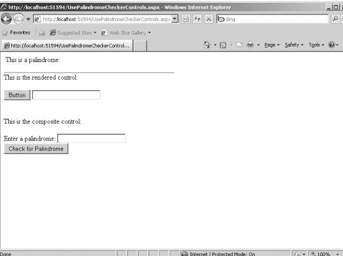

在开启跟踪的情况下，你可以继续向下查看控件树。注意 `PalindromeCheckerCompositeControl` 如何作为树上的主节点，以及该控件的子节点位于 `PalindromeCheckerCompositeControl` 节点之下。

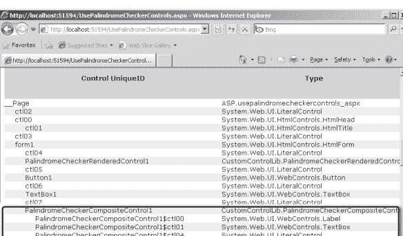

| 控件 ID | 类型 |
| --- | --- |
| c1002 | ASP_palindromecheckercontrols_aspx |
| c1003 | System.Web.UI.LiteralControls.Overhead |
| c1001 | System.Web.UI.LiteralControls.Caption |
| form1 | System.Web.UI.LiteralControls.HtmlTitle |
| c1004 | System.Web.UI.LiteralControls.Value |
| c1005 | System.Web.UI.LiteralControls.HtmlForm |
| label | System.Web.UI.LiteralControls.Label |
| PalindromeCheckerRenderedControl1 | CustomControls.Web.PalindromeCheckerRenderedControl |
| Button1 | System.Web.UI.LiteralControls.Button |
| c1006 | System.Web.UI.LiteralControls.Value |
| TextBox1 | System.Web.UI.LiteralControls.Text |
| c1 | System.Web.UI.LiteralControls.TextBox |
| PalindromeCheckerCompositeControl$c1000 | CustomControls.Web.PalindromeCheckerCompositeControl |
| PalindromeCheckerCompositeControl$c1001 | System.Web.UI.LiteralControls.Label |
| PalindromeCheckerCompositeControl$c1002 | System.Web.UI.LiteralControls.Button |
| PalindromeCheckerCompositeControl$c1003 | System.Web.UI.LiteralControls.Value |
| PalindromeCheckerCompositeControl$c1004 | System.Web.UI.LiteralControls.Text |
| PalindromeCheckerCompositeControl$c1005 | System.Web.UI.LiteralControls.HtmlForm |
| PalindromeCheckerCompositeControl$c1006 | System.Web.UI.LiteralControls.Label |
| PalindromeCheckerCompositeControl$c1007 | System.Web.UI.LiteralControls.Value |

当你输入回文并点击按钮时，控件会以红色显示状态，如果不是回文。文本是回文。你也可以看到表格：


复合控件包含许多子控件。然而，派生自 `System.Web.UserControl` 的它们具有 Designer 支持。下一节将讨论如何手动创建它们：

# 构建回文检查器用户控件

## 1. 打开项目并添加新控件

打开项目（如果没有打开）。选中站点选择 Web 控件模板并将控件命名为 `PalindromeChecker`，如下所示：


## 2. 设计用户控件界面

在此步骤中，你添加了新的控件。注意 Visual Studio 可能会进入设计视图（如果你在代码视图，请切换到设计标签）。从工具箱拖入一个 `Label`、一个 `TextBox` 和另一个 `Label` 到用户控件。删除第二个标签的文本。格式如下：


## 3. 添加核心逻辑方法

从此处借用 `StripAlphanumerics` 和 `CheckForPalindrome` 方法。将第二个标签命名为 `labelPalindromeStatus` 以便在代码旁处使用。

```csharp
}
else
{
    return false;
}
```

## 4. 向控件类中添加 `PalindromeFound` 事件

```csharp
public event EventHandler PalindromeFound; // public event
```

## 5. 添加成员变量和 `Text` 属性

打开代码文件并添加一个成员变量和一个 `Text` 属性，这与之前实现的其他复合控件非常相似。与二进制复合控件不同，用户控件不会生成默认属性生成。（这里有一些细微差别，因为使用了 `Label` 控件而不是 `Literal` 控件来接收回文状态，所以如果你从上一个控件复制并粘贴代码，请进行必要的调整。）

```csharp
private String text;

public string Text
{
    get
    {
        return text;
    }
    set
    {
        text = value;
        if (this.CheckPalindrome())
        {
            if (PalindromeFound != null)
            {
                PalindromeFound(this, EventArgs.Empty);
                this.labelPalindromeStatus.Text = String.Format("This is a palindrome <br/><FONT size=\"5\" color=\"blue\"><B>{0}</B></FONT>", text);
            }
            else
            {
                this.labelPalindromeStatus.Text = String.Format("This is NOT a palindrome <br/><FONT size=\"5\" color=\"red\"><B>{0}</B></FONT>", text);
            }
        }
    }
}
```

## 6. 添加跟踪回文的支持

现在通过向控件类中添加一个 `ArrayList` 来支持跟踪回文的支持（请确保在 `PalindromeCheckerUserControl.ascx.cs` 顶部包含对 `System.Collections` 的 using 语句以解析 `ArrayList`）：

```csharp
ArrayList alPalindromes;
```

## 7. 为控件添加表格

通过切换到 `PalindromeCheckerUserControl` 的设计视图并将 `Table`（表格）拖到表单上，为控件添加一个表格。

## 8. 添加构建回文表格的方法

添加一个方法来构建回文表格。这与 `PalindromeCheckerCompositeControl` 中的方法非常相似，只是表格名称是默认的：在这种情况下 Visual Studio 将表格命名为 `Table1`。

## 9. 在 `Text` 属性设置器中添加跟踪逻辑并调用 `BuildPalindromesTable`

```csharp
public string Text
{
    get
    {
        return text;
    }
    set
    {
        text = value;
        this.alPalindromes = (ArrayList)this.ViewState["palindromes"];
        if (this.alPalindromes == null)
        {
            this.alPalindromes = new ArrayList();
        }

        if (this.CheckForPalindrome())
        {
            if (this.PalindromeFound != null)
            {
                PalindromeFound(this, EventArgs.Empty);
            }

            this.alPalindromes.Add(text);
        }

        this.labelPalindromeStatus.Text =
            String.Format("This is a palindrome <br/><FONT size=\"5\" color=\"blue\"><B>{0}</B></FONT>", text);

        this.ViewState.Add("palindromes", alPalindromes);
        this.BuildPalindromesTable();
    }
}
```

## 10. 为按钮添加 Click 处理程序

通过在设计器中双击按钮为按钮添加 Click 处理程序。这会在关联的代码文件中生成处理程序。在处理程序中，从 `TextBox.Text` 属性获取控件的 `Text` 并调用 `CheckForPalindrome` 方法。这设置了控件的 `Text` 属性并构建了回文表格：

```csharp
protected void Button_Click(object sender, EventArgs e)
{
    this.Text = this.TextBox.Text;
    CheckForPalindrome();
}
```


# 第一部分 基础

## 第 5 章 复合控件

### 11. 添加控件到页面
现在通过将解决方案资源管理器中的 `.ascx` 文件拖到 `UsePalindromeCheckerControls.aspx` 上将控件添加到页面中。或者你也可以将控件拖到工具箱中，然后从那里将其拖入页面。最后，你可以在页面的最后一个控件和此控件之间添加一个换行符以改进布局。

### 12. 生成并运行项目
生成并运行项目。当你在 `PalindromeCheckerUserControl` 中输入回文时，它看起来应该像这样：


在离开此项目之前，从 Visual Studio 按 F5 运行页面。查看开启了跟踪（tracing）的页面。在这里，你可以看到页面/控件层次在内存中是如何布局的：


### 何时使用每种控件
二进制复合控件和用户控件非常相似，因此框架中似乎存在冗余。由于用户控件对设计器（`Designer`）具有这种亲和力，可能看起来你完全不需要自定义复合控件。然而，每种类型的复合控件都有独特的优缺点。

二进制复合控件的主要优势是它们作为程序集部署。二进制复合控件被封装在不同的程序集内，你可以对它们进行签名并在整个企业中部署。你还可以将其安装到全局程序集缓存中。签名和部署全局程序集是一个高级主题——但我提到它是因为它是选择二进制控件而不是用户控件的主要原因之一。使用二进制复合控件的主要缺点是它们要求你在编码时更加关注细节。

### 第 5 章 快速参考

| 目标 | 执行此操作 |
| --- | --- |
| 创建由其他控件组成的复合控件 | 派生自 `System.UI.Control`。重写 `CreateControls` 方法。 |
| 向控件添加控件 | 实例化控件。 |
| 将自定义控件添加到工具箱 | 如果工具箱未显示，通过选择主菜单中的 View, Toolbox 显示。 |
| 让 ASP.NET 为类型复合控件分配唯一 ID | 派生自 `CompositeControl`。 |
| 在类型复合控件中引发事件 | 使用 `event` 关键字暴露事件。 |
| 使用 Visual Studio 创建复合（用户）控件 | 在 Web Site 项目中，选择 Web Site Add New Item。选择 User Control 模板。 |

## 第 6 章 控件杂烩

完成本章后，你将能够：

- 使用 ASP.NET 验证控件。
- 使用 `Image`、`ImageButton` 和 `ImageMap` 控件。
- 使用 `TreeView` 控件。
- 使用 `MultiView` 控件。

ASP.NET 的进化目标是减少开发者运行 Web 网站所付出的努力。当你浏览 ASP.NET 时，你会发现微软在预判开发者需求并将其纳入框架做得非常好。之前的三个章节描述了 ASP.NET Forms 和控件的体系。ASP.NET 1.0 和 1.1 版本接管了开发者在经典 ASP 中为网站构建的许多功能（例如，始终显示上次选择的选择列表）。

后续版本的 ASP.NET 扩展了这一主题，引入了新的服务器端控件，将所需功能轻松插入框架中。本章讨论了 ASP.NET 为控件表示的数据提供的支持。它还检查了其他非常有用的控件：各种类型的 `Image` 控件、`MultiView` 控件和 `TreeView` 控件。

首先，从验证控件开始。

### 验证

主要目标之一是……你将看到授权和验证在 Web 网站上是常见的。在用户验证身份之前，大多数网站都不会让访问者访问真实内容。你在浏览 Web 网站时经常遇到的另一个场景是，大多数网站都包含一个让用户在其中输入各种信息的页面。例如，为了进入 Web 网站，用户可能需要输入用户名和密码。如果用户希望接收电子邮件，用户可能需要输入电子邮箱地址。

当 Web 网站所有者向访问者请求信息时，Web 网站程序逻辑需要确保接收到的是有效信息。虽然它无法保证用户输入是 100% 准确的，但通过验证用户输入的字段，它至少可以获得有用信息的机会。例如，某些字段可能是必填的，Web 网站会确保这些字段中已输入了数据。网站可能要求用户以特定格式输入电话号码，然后使用正则表达式来验证输入的信息是否正确。如果要求用户更改密码，网站可能会要求用户输入新密码以进行验证。

ASP.NET 包含了一系列验证器控件，这些控件与 Web 表单（`Web Form`）上的标准控件（如 `TextBox`）配合使用。验证器控件与标准控件协同工作，如果用户输入了可能错误的信息，它们会发出错误消息（如果配置正确，则会弹出警报）。

ASP.NET 包含六种验证器控件：

- `RequiredFieldValidator`（必填验证器）：确保字段已填写。
- `RangeValidator`（范围验证器）：确保控件代表的值落在某个特定范围内。
- `RegularExpressionValidator`（正则表达式验证器）：验证控件中的数据是否匹配特定的正则表达式。
- `CompareValidator`（比较验证器）：确保控件代表的数据与特定值或另一个控件进行比较。
- `CustomValidator`（自定义验证器）：提供了一个指定服务器端和客户端验证函数的机会。
- `ValidationSummary`（验证摘要）：显示页面上所有验证错误的摘要。

所有验证器控件的工作方式都相同。首先，你在页面上定义一个标准控件。然后，你将相应的验证器放置在页面上任何你希望错误消息出现的地方。验证器控件包含一个名为 `ControlToValidate` 的属性，你将其指向需要验证的控件，其余工作将自动完成。当然，验证器控件有许多属性可以供你用于自定义来自控件的错误消息的外观。

ASP.NET 验证器与以下服务器端控件配合：

- `TextBox`
- `ListBox`
- `DropDownList`
- `RadioButtonList`
- `HtmlInputText`
- `HtmlInputFile`
- `HtmlSelect`
- `HtmlTextArea`
- `FileUpload`

要查看它们如何工作，请参考下一个示例，该示例将验证器控件应用于 Web 表单。

### 创建使用验证器控件的页面

1. 首先创建一个名为 `ControlPotpourri` 的新 Web 网站。
2. 添加一个名为 `ValidateMe.aspx` 的新 Web 表单。此表单将包含服务器端控件及其验证器控件。该表单看起来会像网站上常见的登录表单。它是使用用户输入验证的典型示例。
3. 添加一个 `TextBox` 来存放用户的名（First）。将控件命名为 `TextBoxFirstName`。为控件赋予意义的名称很重要，因为它们通过名称与验证器关联。如果你使用 Microsoft Visual Studio 生成的默认名称（即 `TextBox1`、`TextBox2`、`TextBox3` 等），你将很难记住这些验证器代表什么。对于接下来的每个步骤，“添加文本框”也意味着添加一个关联标签和一个 `<br/>` 元素以使表单看起来更美观。在这种情况下，位于 `TextBoxFirstName` 之前的标签应该是 `First`；其他的应该是不言自喻的。请注意，你应该将标签的 `ControlToAssociate` 属性设置为该标签所对应的文本框。这会将标签和文本框绑定在一起（实际上标签使用 `<label>` 元素渲染，而不是简单的文本）。
4. 添加一个姓（Last）`TextBox`。将控件命名为 `TextBoxLastName`。
5. 添加一个地址 `TextBox`。将控件命名为 `TextBoxAddress`。
6. 添加一个邮政编码 `TextBox`。将控件命名为 `TextBoxPostalCode`。
7. 添加一个电话号码 `TextBox`。将控件命名为 `TextBoxPhone`。
8. 再添加两个 `TextBox` 控件来存放密码和确认密码。分别将它们命名为 `TextBoxPassword` 和 `TextBoxPasswordAgain`。将两者的 `TextMode` 属性都设置为不显示用户键入的文本。使用次级（或确认性）`TextBox` 可以确保用户两次输入的密码都是正确的。（在 `TextBox` 上设置 `TextMode` 属性可以防止用户在键入时看到字符。）
9. 添加一个 `TextBox` 来存放用户的年龄。将控件命名为 `TextBoxAge`。
10. 添加一个用于提交表单的按钮。添加文本 `Submit Information`。

完成后，表单看起来应该像这样：


11. 现在开始添加验证器。通过将 `RequiredFieldValidator` 实例拖到页面上 `TextBoxFirstName` 的侧，为名添加一个 `RequiredFieldValidator`。在第一个验证器控件的属性中，找到 `ControlToValidate` 属性并选择 `TextBoxFirstName` 控件。将 `ErrorMessage` 属性设置为有用的错误消息：`Please give your name`。
12. 与名文本框一样，为姓添加一个 `RequiredFieldValidator`。在姓验证器控件的属性中，找到 `ControlToValidate` 属性并选择 `TextBoxLastName` 控件。将 `ErrorMessage` 属性设置为：`Please give your name`。
13. 为地址、邮政编码、电话号码、密码和年龄 `TextBox` 添加 `RequiredFieldValidator` 控件。
14. 在邮政编码验证器控件的属性中，像之前一样，找到 `ControlToValidate` 属性并选择 `TextBoxPostalCode` 控件。将 `ErrorMessage` 属性设置为有用的错误消息：`Please give your postal code`。
15. 在电话验证器控件的属性中，点击 `ControlToValidate` 属性中的组合框并选择 `TextBoxPhone` 控件。将 `ErrorMessage` 属性设置为有用的错误消息：`Give your phone number so that we can call you at dinner time`。
16. 在第一个密码验证器控件的属性中，点击 `ControlToValidate` 属性中的组合框并选择 `TextBoxPassword` 控件。将 `ErrorMessage` 属性设置为有用的错误消息：`Please make up a password`。
17. 在第二个密码验证器控件的属性中，点击 `ControlToValidate` 属性中的组合框并选择 `TextBoxPasswordAgain` 控件。将 `ErrorMessage` 属性设置为有用的错误消息：`Please confirm your password`。
18. 在年龄验证器控件的属性中，点击 `ControlToValidate` 属性中的组合框并选择 `TextBoxAge` 控件。将 `ErrorMessage` 属性设置为有用的错误消息：`Give your age`。
19. 向表单添加 `ValidationSummary`。它会显示所有的验证错误。如果你希望弹出警告框，可以将 `ShowMessageBox` 属性设置为 `true`。在添加了验证器后，设计器中的页面看起来应该如下所示。此示例对控件使用了绝对定位，以便移动它们：


20. 编译站点和页面。起初，你只能看到一组输入框。在填写任何字段之前，点击 `Submit Information` 按钮。观察错误消息的出现，如下：


21. 输入名，然后按回车键。这触发了客户端 JavaScript 验证脚本。发生了什么？ASP.NET 验证器控件已向发送的 HTML 中插入了一些 JavaScript（如果浏览器理解 JavaScript，大多数浏览器都是如此）。有了客户端脚本后，必填字段验证器无需往返服务器即可管理其错误消息，如下所示：


### 页面验证工作原理

ASP.NET 页面验证非常巧妙——它完全基于页面的服务器端架构。凭借 ASP.NET 的许多其他功能，该验证机制解决了你在 Web 网站开发过程中遇到的最常见情况。大多数网站都包含客户端验证和服务器验证。通过支持客户端验证，用户在验证输入到页面的数据时可以避免一次往返交互（round-trip）。除了客户端验证外，大多数网站还支持服务器验证，原因有两个：其一是为了确保数据在传输过程中不会发生乱码或被修改，其次是为了支持不支持客户端脚本的客户端（可能客户端浏览器不支持 JavaScript）。首先，让我们考虑客户端验证。

#### 客户端验证

如果你在页面上放置控件时，查看 Visual Studio 生成的 ASPX 源代码，你可能会注意到页面上到处都是标签，例如支持文本框和选择控件的服务器端控件。此外，放置在页面上的每个验证器都对应一个独立的标签。验证器是服务器端控件，它们渲染出标准浏览器可以理解的代码——类似于普通的服务器端控件。

ASP.NET 验证控件通过包含对发送到浏览器的 HTML 中包含的 JavaScript 类的引用来支持客户端验证。该文件包含了支持客户端验证所需的客户端验证函数。

当验证控件渲染到浏览器时，它们会通过自定义属性添加到已渲染的 HTML 元素中。当 HTML 文档在浏览器中加载时，验证处理程序会被挂钩。

由于客户端验证需要客户端支持 JavaScript，因此不支持 JavaScript 的客户端必须依赖服务器端验证。如果你需要，可以通过将验证器上的 `EnableClientScript` 属性设置为 `false` 来禁用每个控件的客户端脚本。

#### 服务器验证

在客户端通过客户端验证测试后，结果将传回服务器，服务器端验证由 `Page` 类中的基础设施管理。当你向页面添加验证器控件时，这些控件会被添加到由页面管理的验证器集合中。每个验证控件都实现了一个名为 `IValidator` 的接口。`IValidator` 接口指定了 `Validate` 方法、`ErrorMessage` 属性和 `IsValid` 属性。当然，每个验证器都有自己的自定义逻辑来确定其正在验证的控件中数据的有效性。例如，`RequiredFieldValidator` 检查关联的控件中是否输入了数据。`RegularExpressionValidator` 将控件中的数据与特定的正则表达式进行比较。

在页面的回传期间，验证发生在 `Page_Load` 事件触发之后。页面会检查每个验证器与其关联的控件。如果验证失败，未通过的服务器端验证控件会将自身渲染为可见的元素。

页面本身有一个名为 `IsValid` 的属性，你可以检查它以确保在开始使用控件中的数据之前对客户端传递的数据有信心。此外，`Page` 类实现了一个名为 `Validate()` 的方法。`Validate()` 会验证验证控件列表，运行每个控件的 `Validate` 方法。

在确保用户已填好必填字段后，确保来自用户的数据很可能是正确的提示。例如，你可能无法确保用户电话号码的真实性，但至少可以确保格式是正确的，并且不包含可能形成电话号码的垃圾字符。在接下来的步骤，你添加了一个使用正则表达式来验证模式的验证器。然后，你向页面上添加了一个粗粒度的验证器。

### 添加更细粒度的验证

1. 关闭浏览器并返回 Visual Studio 中的设计器窗口。现在你已经有了在用户忘记输入内容时会显示错误信息的控件，你可以添加一些更细粒度的验证。表单上的字段为用户输入错误数据提供了几次机会。
2. 对于姓、名和地址字段，你做不了什么，只能希望用户输入的是他们真正想插入。然而，你可能想通过为 `TextBoxPostalCode` 控件使用 `RegularExpressionValidator` 来确保用户只在邮政编码字段中输入数字。在页面上放置一个 `RegularExpressionValidator`。设置 `ControlToValidate` 属性指向邮政编码控件。对于错误信息，将 `ErrorMessage` 属性设置为“你提供的邮政编码无效”。点击带有 `ValidationExpression` 属性的按钮，在正则表达式编辑器中，选择“U.S. ZIP code”作为验证表达式，如下图所示：


3. 通过将 `ControlToValidate` 属性设置为 `TextBoxPhone`，为该 `TextBox` 添加一个正则表达式验证器。将它的 `ErrorMessage` 属性赋值为“你输入的电话号码无效”。打开正则表达式编辑器，并选择“U.S. Phone Number”作为要验证的正则表达式，如下图所示：


4. 为 `TextBoxPasswordAgain` 控件添加一个 `CompareValidator`。在密码确认验证器的属性中，查找 `ControlToValidate` 属性并选择 `TextBoxPasswordAgain` 控件。将 `ErrorMessage` 属性设置为一个有用的错误信息，例如“提供的密码不匹配”。
5. 为 `TextBoxAge` 控件添加另一个 `CompareValidator`。在 `ValueToCompare` 中输入 `30`，并将 `Integer` 作为要比较的数据类型（即 `Type` 属性）。可能的错误信息可以是“你必须小于 30 岁才能提交数据”。`Operator` 属性应为 `LessThanEqual`。
6. 生成并运行程序。输入一些错误数据。你应该能看到验证器发出的错误信息。

### 其他验证器

除了提到的验证器外，ASP.NET 还包含了三个：`RangeValidator`、`CustomValidator` 和 `DynamicValidator`。

`RangeValidator` 与 `CompareValidator` 类似，你可以用它来检查控件中的值。`RangeValidator` 指定一个最小值和最大值，如果数据超出这些阈值，则报告错误。

`CustomValidator` 以与其他控件相同的方式位于页面上。当你页面上放置 `CustomValidator` 时，为它分配一个关联控件。

最后，ASP.NET 包含了一个支持其数据模型的新验证器：`DynamicValidator`。你可以在第 20 章学习更多关于动态数据的知识。ASP.NET 的数据模型支持数据驱动的开发。`DynamicValidator` 捕获任何异常并将其作为事件转发。

### 验证器属性

你可以看到验证控件包含了其他控件的属性。例如，有一个 `Text` 属性、`Font` 属性以及各种颜色属性。此外，还有几个用于管理发送到浏览器的错误输出的属性。

`Display` 属性可以是静态的。该属性管理错误消息的客户端渲染。静态（默认值）会导致控件生成的 `span` 元素即使在隐藏时也占据布局空间。当 `Display` 属性为 `Dynamic` 时，控件生成的 `span` 元素在显示时会改变布局并动态展开。

ASP.NET 具有分组的能力。也就是说，每个验证控件都可以属于一个命名的组。`ValidationGroup` 属性控制组的名称。当控件属于某个组时，只有当组内的其他验证器触发时，组内的控件才会进行验证。这让你在单个页面上实现了多个表单的效果。

### 图像控件

图像经常用于 Web 页面。HTML 包含一个图像标签，告诉浏览器获取图像文件（例如 .gif、.jpg 或 .png 文件）并显示它。当你需要在页面上设置图像时，应该使用 HTML 的 `` 标签。自然地，ASP.NET 使用服务器端控件——`Image` 控件来替换 `` 标签。

使用 `Image` 控件非常简单。像选择其他控件一样从工具箱中选择它并将其拖到页面上。ASP.NET `Image` 控件生成带有正确 `src` 属性的 `` 标签。

除了普通的 `Image` 控件，ASP.NET 还包含了 `ImageButton` 控件和 `ImageMap` 控件。`ImageButton` 控件封装了 `<input type=image />` 标签，你可以使用图像作为按钮的背景。`ImageMap` 控件显示带有热点（hot spots）的位图，用户可以点击这些区域。

下面的练习演示了 ASP.NET 基于图像的控件的工作原理。

### 在页面中使用图像控件

1. 向项目添加一个新的 Web 表单以显示一些图像控件。将页面命名为 `UseImageControls.aspx`。
2. 从工具箱将一个 `Image` 控件拖到页面。
3. 进入“属性”窗格，并为 `ImageUrl` 属性添加一个有效的图像路径。该图像文件可以在你的电脑上，你也可以将 `ImageUrl` 属性指向 Web 上的有效图像 URL。要使用 Web 上的图像，可以在浏览器中右键点击图像并点击“属性”。然后，从“属性”中复制 URL 并将其粘贴到属性浏览器的 `ImageUrl` 中。如果文件在你的电脑上，你需要通过从本地驱动器将图像拖到解决方案资源管理器中的 `ControlPotpourri` 解决方案来将其添加到 Web 项目。如果你想在文件夹中使用图像，只需创建一个新文件夹并拖入图像。如果你想使用 Web 上的图像，需要在“源代码”视图中手动编辑 `ImageUrl`。不用说，无论你使用哪种图像 URL，如果找不到图像（导致 `` 标签中出现错误），你将在浏览器中收到标准的“未找到图像”消息。在 Microsoft Internet Explorer 中，此消息显示为中间带有一个红色 X 的框。
4. 运行网站并查看 ASP.NET `Image` 控件生成的输出。（注意，你的图像无疑与示例中的不同。）


- 5. 现在向页面上添加一个 `ImageButton`。通过 `ImageButton`，你可以通过三种方式让你的应用程序对 `ImageButton` 做出响应。首先，`ImageButton` 的行为类似于一个典型的按钮，你可以在服务器上为其附加一个典型的 `Click` 事件处理器。你可以定义一个客户端脚本块并将 `ImageButtonOnClick` 指向该脚本。当你点击按钮时，按钮会在浏览器中运行该脚本。最后，你可以使用 `ImageButton` `PostBackURL` 告诉 `ImageButton` 将下一次请求重定向到特定页面。
- 6. 运行页面并检查 `ImageButton` 生成的 HTML。它看起来像这样（记住你的图像 URL 是不同的）：

```html
<input type="image" name="ImageButton1" id="ImageButton1"
src="Images/goldengatebridge.jpg" style="border-width:0px;" />
```

- 7. 最后，向页面上添加一个 `ImageMap`。`ImageMap` 可用于定义位图的可点击区域。选择一个你可用的图像（从某处下载一个，或使用你硬盘上现有的图像）。将 `ImageMapImageUrl` 属性设置为该图像文件。
- 8. 使用 Microsoft 画图或 Visual Studio 位图编辑器等图像编辑器打开你选定的用于 `ImageMap` 的图像。此示例中的 `ImageMap` 定义了一个热点，该热点可以放大到地图中的某部分。标记出图片的一个矩形部分，并使用所选部分创建一个新的图形文件。记下定义你切出的图形部分的坐标。放大新图像并将其保存为新文件。
- 9. 接下来，你可以在 `ImageMap` 上定义一些热点。属性中有一个名为 `HotSpots` 的属性。点击属性字段中的按钮打开 `HotSpot` 集合编辑器，如下所示：


- 10. 点击 `Add` 按钮向集合添加热点。注意，你可以通过点击 `Add` 按钮上的下拉列表定义圆形、矩形或多边形热点。使用你定义的图像部分的坐标创建一个矩形热点。在 `AlternateText` 属性中添加一些文本——这是在工具提示中显示的文本。将 `HotSpotMode` 属性设置为 `Navigate`，并使用 `NavigateUrl` 编辑器将 `NavigateUrl` 属性指向你刚刚创建的新图像文件（你可能需要通过右键点击解决方案资源管理器中的项目节点后，使用“添加现有项”菜单显式地将新图像文件添加到项目中）。下面的图形显示了正在编辑的热点：
- 11. 添加热点后，运行新页面。你应该能看到与下图类似的内容——此示例显示的是大峡谷，热点在图像中用矩形勾出。（注意，矩形是手动添加到图像中的——热点并不会为你绘制矩形。）注意工具提示是如何出现的。


- 12. 点击热点，注意应用程序如何重定向到“放大”的图像，如下所示：


这一节仅触及浅表。

## TreeView

现代软件中最常用的用户界面之一是树形结构。ASP.NET 通过 `TreeView` 控件提供了这种界面。当你使用树时，可以展开和折叠节点。这对于需要表示层次数据非常有用。`TreeView` 提供了深入数据的方法。

# 第 6 章 控件杂谈 133

下面的练习通过展示功能来解释 `TreeView` 控件。

## 使用 TreeView 控件

- 1. 首先向 Controlpourri 站点添加一个新的 Web 表单。将其命名为 `UseTreeView`。
- 2. 从工具箱将一个 `TreeView` 拖到页面。你可以在导航控件下找到它。
- 3. 使用选项格式化你的树视图。右键点击 `TreeView` 控件，并在 `TreeView Tasks` 下点击 `Auto Format`。打开一个显示 `TreeView` 样式的对话框。浏览几个样式，高亮它们以查看效果。下面的图形显示了带有 `Auto Format` 的 `TreeView Tasks`：


- 4. 你可以通过右键点击 `TreeView` 控件并点击 `Edit Nodes` 链接来编辑节点。左侧的按钮添加根节点。在 `TreeView` 节点编辑器中，你可以编辑每个节点。在此示例中，带带表示根节点。下一个按钮用于添加子节点。
- 5. 使用 `Border` 和 `BorderColor` 属性为 Tree 添加边界。将样式设置为黑色。
- 6. 生成项目并浏览到页面。如果你选择了像 `Arrow` 这样的主题，你应该能够展开和折叠节点。运行页面后，快速查看 ASPX 源代码以查看 `TreeView` 如何管理节点。下面的图形显示了 `TreeView` 在浏览器中的外观。


- 7. 添加一些功能来处理某些树节点事件。首先，添加一个标签来显示选中的节点。将标签命名为 `LabelSelected` 以便进行编程访问。添加一个 `TextBox` 来显示选定节点的信息。将其命名为 `TextBoxInfo`。将 `TextBox` 设置为多行。

# 第 6 章 控件杂烩 135

然后，为 `TreeSelectedNodeChanged` 事件添加事件处理程序。添加以下代码来查询选定的节点并列出有关子节点的信息。别忘记对 `System.Text` 使用 `using` 语句（以识别 `StringBuilder`）：

```csharp
protected void Tree_SelectedNodeChanged(object sender, EventArgs e)
{
    this.LabelSelectedNode.Text = String.Format("Selected Node changed: {0}", this.TreeView1.SelectedNode.Text);

    TreeNodeCollection childNodes = this.TreeView1.SelectedNode.ChildNodes;

    if (childNodes == null)
    {
        this.TextBoxInfo.Text = String.Empty;
    }
    else
    {
        StringBuilder sb = new StringBuilder();
        foreach (TreeNode childNode in childNodes)
        {
            sb.AppendFormat("{0}\n", childNode.Value);
        }
        this.TextBoxInfo.Text = sb.ToString();
    }
}
```

下面的图形显示了选定的详情如何显示在 `ListBox` 中：


这是 `TreeView` 功能的简单插图。除了使用设计器构建节点外，你还可以通过程序构建它们。你还可以展开和折叠节点。最后，`TreeView` 支持数据绑定，因此你可以将分级数据结构传递给控件，让它为你进行正确的渲染。

最后，请查看 ASP.NET 的 `MultiView` 和 `View` 控件。

# MultiView

有时，将控件汇集在几个窗格中并让用户有机会在窗格之间进行分页切换是很有用的。在 ASP.NET 1.0 的生命周期内，微软发布了丰富的动态（尽管官方不受支持）控件，这些控件生成的是动态 HTML (DHTML) 而不是普通的 HTML。这三类控件——`TabStrip`、`MultiView`（旧版本）和 `PageView`——共同工作，基本上形成了一组选项窗格。

这些控件在 ASP.NET 的后续版本中已不可用；但是，有两个控件——`MultiView` 和 `View`——在很大程度上提供了类似的功能。`MultiView` 充当类似 `Panel` 的控件（`View` 控件）的容器，并支持在其内部的各个 `View` 之间进行分页。

`MultiView` 一时显示一个 `View`。

下面的练习提供了一个示例，展示了 `MultiView` 和 `View` 控件如何协作。

# 使用 MultiView 和 View 控件

- 1. 为 `ControlPotpourri` 站点添加一个新的 Web Form。命名为 `UseMultiview.aspx`。
- 2. 在此 Web Form 中添加一个 `MultiView` 控件。
- 3. `MultiView` 的主要目的是管理一组 `View`。要向 `MultiView` 添加 `View`，请从工具箱拖入 `View` 实例并将其释放到 `MultiView` 内部。像这样所示向 Web Form 中添加三个 `View`。你可能需要手动调整容器的大小以使它们适应。


- 4. 为每个 `View` 添加一些内容。你可以将 `View` 想象成窗格。在这个例中，这些视图 包含了区分它们的标签。下面的图形插明了 `View` 在设计器中的外观：


- 5. 激活第一个窗格。为了让 `MultiView` 和第一个 `View` 显示出来，将 `MultiView` 的 `ActiveViewIndex` 属性设置为 0 以显示第一个窗格。
- 6. 在表单底部添加两个按钮，以便在 `MultiView` 中的 `View` 之间进行导航。命名为 `ButtonPrev` 和 `ButtonNext`——它们将用于在 `View` 之间进行分页。
- 7. 通过双击每个按钮为按钮添加事件处理程序。
- 8. 添加代码在 `View` 之间进行分页。此代码通过更改当前 `View` 的索引来响应按钮点击。

```csharp
protected void ButtonPrev_Click(object sender, EventArgs e)
{
    if (MultiView1.ActiveViewIndex == 0)
    {
        MultiView1.ActiveViewIndex = 2;
    }
    else
    {
        MultiView1.ActiveViewIndex -= 1;
    }
}

protected void ButtonNext_Click(object sender, EventArgs e)
{
    if (MultiView1.ActiveViewIndex == 2)
    {
        MultiView1.ActiveViewIndex = 0;
    }
    else
    {
        MultiView1.ActiveViewIndex += 1;
    }
}
```


- 编译项目并浏览到 Web 页面。点击导航按钮会将请求发送到服务器，渲染各个视图。下面的图形显示了 `MultiView` 和第 2 个 `View` 在浏览器中的外观：


如你所见，`MultiView` 和 `View` 类充当了你可以相互切换的窗格。它们是管理收集大量数据涉及的表面很好的方法。这种控件的另一个版本是结合会话状态使用的 `Wizard` 控件。

# 第 6 章 快速参考

| 目标 | 执行此操作 |
|---|---|
| 验证表单输入 | ASP.NET 包含许多验证控件，用于检查通过服务器输入的数据。 |
| 显示分级数据集 | 使用 `MultiView` 一时显示一个 `View`。 |
| 在页面之间切换 | 使用 `MultiView` 和 `View` 控件在 `View` 之间进行分页。 |
| 添加点击区域 | 使用 `ImageMap` 定义热点。 |
| 向 Web 页面添加 | 将 `ImageMap` 放置到页面。 |

# 第 7 章

# 一致的外观

完成本章后，你将能够：

- 使用主页为整个 Web 站点开发一致的外观。
- 使用主题为整个站点的控件应用样式。
- 使用皮肤为自定义控件应用样式。

大多数良好的网站的一个显著特征是其每个页面外观的一致性。例如，许多网站采用了特定的配色方案和字体 set。此外，良好的网站框架信息和提供导航的方式从一个页面到另一个都是一致的。你能想象每个页面都完全不同的网站吗？至少你会感到困惑，甚至可能反感。

本章涵盖了 ASP.NET 用于开发站点一致外观的最实用功能之一——主页。主页帮助你让访问者的体验一致。ASP.NET 还提供了一种为控件应用特定样式的方法。本章将研究这些功能的工作原理。

> 注意 为了安装本书的代码示例，您必须拥有计算机管理员权限。如果您使用的是自己的计算机，可能拥有管理员权限。如果您使用的是组织的计算机且没有管理员权限，请咨询您的计算机支持或 IT 人员。更多信息请参见介绍中的“代码示例”部分。

# 管理用户界面一致性

让 Web 开发工具能够为所有页面创建共同的外观是一个漫长的过程。经典 ASP 提供了一种非常粗糙的方法，通过文件包含机制将一个 `.asp` 文件完整拉入另一个，从而为站点应用共同的外观。至少可以说，这是粗暴的。尽管它在某种程度上有效，但在编译文件时，你对站点的细微之处的控制有限。

ASP.NET 1.0 通过由更小的服务器端控件和用户控件组成页面渲染机制，更进了一步。你在第 2 章“ASP.NET 应用程序基础”和第 3 章“页面渲染模型”中见过这些。然而，尽管你可以将 Web 应用程序的用户界面 (UI) 的部分封装成独立的模块，你仍然需要完成一些工作来实现应用程序中页面之间通用的外观和效果。例如，可以创建用户控件来支持开发通用的外观和效果。你可以创建一个带有特定导航控件和链接的用户控件，并将其在网站每个页面的相同位置使用。这本身创建了通用的外观和效果，但取决于你如何将该功能写入你的网站中，并确保该控件在 Web 应用程序的每个页面中的用法是一致的。

虽然使用自定义/用户控件方法来拆分网站的用户界面对于开发一致的 UI 很有用，但它在几个方面仍然称不上理想的解决方案。首先，应用程序中的所有页面都需要包含周围的代码。这意味着你必须像上面提到的那样，以相同的方式将控件应用于每个页面。如果你决定更改控件的位置（或不受控件控制的其他某些方面），你必须更改每个页面。其次，每个使用自定义控件的页面都需要一个 `Register` 指令——并且需要复制更多的代码。你的模型将比早期的方法（即 ASP）要先进得多。但你真正想要的是网站中有一个单一的地方，你可以在那里布局一次页面外观和效果，并将其传播到整个网站。

实现这一点并避免逐个构建页面的方法之一是构建一个主类，应用程序中的所有页面都派生自该类。因为 ASP.NET 是基于 `Page` 类对象的模型构建的，为什么不简单地为你的应用程序添加新层呢？图 7-1 展示了你可能如何从单个基础页面构建一组页面。


**图 7-1** 用于实现多个页面之间通用功能的基类。

所有 `.aspx` 页面都继承自派生自主类的相同代码后类（该主类又派生自 `System.Web.UI.Page`）。主类负责加载网站外观效果的控件。然后，每个单独的页面负责其余部分。

这种方法行得通，只要你不在意编写大量代码。此外，ASP.NET 1.x 对此类工作没有设计支持，而且在 Microsoft Visual Studio 中更改 `Page` 类层次结构将破坏项目。

ASP.NET 2.0 引入了主页来支持在整个网站范围内开发通用的外观和效果，现在它们已成为许多开发者的必备工具，用于保持网站所有不同页面的一致性。

# ASP.NET 主页

主页代表了一种元页面。它们与典型页面具有相同的结构。它们存在于使用 `.master` 扩展名的文件中。主页充当一个模板，根据它为所有页面渲染通用的外观。主页使用 XHTML 文档标签（如 `<html>`、`<head>` 和 `<body>`），这些标签仅应用于主页。当访问者应用了主页的页面时，请求和响应将通过主页进行过滤。主页确保每个页面都有通用的外观和效果（通过逻辑上充当图 7-1 所示的“主页面”）。ASP.NET 将主页和 `.aspx` 页面（内容页）合并成单个类。此时，该类会处理请求并像任何派生自 `System.Web.UI.Page` 的类一样渲染输出。

由于主页与典型的 `.aspx` 页面类似，因此它们可以包含与典型页面相同的内容和功能。也就是说，可以包含服务器端控件、用户控件和标记。除了标记和控件外，主页还可以包含 `System.Web.UI.Controls.ContentPlaceHolder` 控件的实例。正如其名称所示，内容占位符代表页面渲染其包含的所有元素之前的实际内容——即那些基于主页的页面。主页渲染它包含的所有元素——即未包含在 `System.Web.UI.Controls.ContentPlaceHolder` 控件中的元素。

主页在合成最终页面处理程序方面起着作用，它们的工作方式与之前描述的直接继承技术（即编写基类以通过继承实现通用功能）略有不同。当页面执行时，主页将其自己的内容注入到 `.aspx` 页面中。具体来说，主内容最终由一个添加到 `.aspx` 页面 `Controls` 集合的控件渲染，在那里它以与所有控件相同的方式进行渲染。

与普通页面属性和功能一样，主页可以在其 `MasterPage` 指令中包含以下属性：

- `AutoEventWireup`
- `ClassName`
- `CompilerOptions`
- `Debug`
- `Description`
- `EnableViewState`
- `Explicit`
- `Inherits`
- `Language`
- `Strict`
- `Src`
- `WarningLevel`
- `Master`

146 第二部分 高级功能

以下练习说明了如何围绕主页开发网站。

# 使用主页

1. 创建一个名为 `MasterPageState` 的空 Web 网站。通常，你会创建一个新的网站项目。但在情况下，请务必使用“空” Web 网站模板，以便手动添加主页和派生页面。这将让你通过从头创建一个而不是使用 Visual Studio 创建的主页来获得更多使用主页的经验。

2. 向页面添加新项。从可用模板中选择“主页”。页面名为 `MasterPage.master`。下图显示了如何添加主页模板：


Visual Studio 生成了如下 `MasterPage.master` 文件：

```asp
<%@ Master Page Language="C#"
AutoEventWireup="true"
CodeFile="MasterPage.cs"
Inherits="MasterPage" %>

<!DOCTYPE html PUBLIC "-//W3C// HTML 1.0 Transitional//EN" "http://www.w3.org/TR/html1-transitional.dtd">

<html xmlns="http://www.w3.org/1999/xhtml">

<head runat="server">

<title></title>

<asp:ContentPlaceHolder id="head" runat="server">

</asp:ContentPlaceHolder>

</head>

<body>

<form id="form1" runat="server">

<asp:ContentPlaceHolder id="ContentHolder1" runat="server">

</asp:ContentPlaceHolder>

</form>

</body>

</html>
```

注意 Visual Studio 生成的占位符控件。

主页看起来与普通页面相似。

3. 在 `MasterPage.master` 文件中查找 `style="background-color: #bbbbbb;"` 标签。更改背景颜色以显示不同的颜色：

```html
<body style="background-color: #bbbbbb;">

<form id="form1" runat="server">

<asp:ContentPlaceHolder id="ContentHolder1" runat="server">

</asp:ContentPlaceHolder>

</form>

</body>
```

此示例使用了浅灰色。通过更新背景颜色，你可以看到主页用于后续的 `.aspx` 文件。

4. 右键点击项目节点并点击“添加新项”。使用“使用主页的 Web 表单”模板创建一个新表。将其命名为 `MasterPage.aspx`。确保选择“主页”选项。


Visual Studio 将协助你选择主页，如下所示：


当你在设计器中查看 `MasterPage.aspx` 时，它看起来就像主页。注意应用到页面上的灰色调，如下所示。这让你知道主页确实应用在这里。


这是 Visual Studio 为了支持使用主页而生成的页面特定代码：

```asp
<%@ Page Title="" Language="C#"
MasterPage="~/MasterPage.master"
AutoEventWireup="true" CodeFile="UseMasterPage.aspx.cs"
Inherits="UseMasterPage.aspx" %>
```

```asp
<asp:Content ID="Content1"
ContentPlaceHolderID="head" runat="server">
</asp:Content>
```

```asp
<asp:Content ID="Content2"
ContentPlaceHolderID="ContentHolder1"
Runat="server">
</asp:Content>
```


## 第7章 一致的外观和感受

### 5. 现在为 `UseMasterPage.aspx` 添加内容

在内容占位符中添加标签并输入文本，以便将其与其他页面区分开来。

## 第二部分 高级功能

### 6. 为网站添加两个页面

示例中包含一个带有 `ListBox` 的页面，用于选择此书的章节内容，以及另一个描述这些页面的页面。你可以使用这些页面，也可以添加自己的内容。在内容占位符的两个页面中添加一些内容，以便区分这些页面（稍后你会添加导航支持）。

关键点是添加两个页面并将主页（master page）应用到它们（即在创建 Web Forms 时选择 Select Master Page 选项）。

以下两幅图显示了网站的页面，其中包含一个用于选择主题的 `ListBox` 和一个用于存放主题信息的 `TextBox`。将项的定位设置为绝对定位（absolute）可以更方便在页面上排列项目。示例使用了绝对定位。此外，示例在 `ListBox` 中填充了项目名称（在 Projects 页面上）和章节名称（在 Chapters 页面上）。每个页面都有一个 `ListBox` 选择更改处理程序，该程序用来向 `TextBox` 填充有关项目和章节的信息。这样你就可以直观地看到页面除了具有主页提供的一致外观外，还具有实际功能。

这里是手动向 `ListBox` 添加元素的方法。（你将在第10章“数据绑定”中看到另一种技术——数据绑定。）

### 7. 返回 `MasterPage.master` 页面并更新它以包含更多内容

点击 Table（表格）、Insert Table（插入表格），在主页的内容区域正上方插入一个表格。为表格设置一行两列。调整大小，使左单元格窄、右单元格宽。

### 8. 在表格最左侧的单元格中添加菜单

为了自定义菜单，为其添加一个 AutoFormat（自动格式化）。此示例使用 Classic 样式。为菜单添加三个项，用于导航到此网站的三个页面：Home 页面、Chapters 页面和 Projects 页面。要添加菜单项，在 Designer（设计器）中选择菜单，点击控件上的小箭头，点击 Edit Menu Items（编辑菜单项）。出现以下对话框。在此处添加菜单项。

为每个菜单选项设置适当的导航。即将 Home 项设置为导航到 `UseMasterPage.aspx` 页面。将 Chapters 菜单设置为导航到 `Chapters.aspx` 文件。最后，将 Projects 项设置为导航到 `Projects.aspx` 文件。你可以通过点击属性页中 `NavigateUrl` 字段中的导航按钮在此设置导航 URL。（稍后你将学习使用 ASP.NET site map 支持。）

打开一个主页（例如 `UseMasterPage.aspx`）。你的最终结果应该是这样的：

### 9. 最后，添加一个横幅（banner）

在我看来，没有横幅的主页是不完整的。使用位图编辑器（或画画——`mspaint.exe`）绘制横幅。示例中的横幅大约宽1000 像素、高90 像素。将横幅拖入右侧的表格单元格中。现在你的主页看起来应该这样：

由于你是使用主页创建的 `UseMaster.aspx`、`Chapters.aspx` 和 `Projects.aspx` 文件，它们自动内置了菜单和横幅。访问到 `UserMaster.aspx` 文件并浏览菜单项。你应该看到每个页面都有共同的外观和感受，并包含了正确的内容。

主页在开发跨越项目所有页面的一致外观和感受方面，比早期的经典 ASP 和 ASP.NET 版本有了显著的改进。当然，你可以在项目中使用多个主页，还可以嵌套它们。

管理应用程序外观和感受的另一种方法是使用 ASP.NET 主题（themes）。

### 主题 (Themes)

主页控制应用程序的整体布局。主题提供了一种为页面应用常用样式的方式。如果你熟悉层级样式表（CSS），那么对于主题会感到非常熟悉。主页允许页面元素保持不变。主题你可以在应用程序、页面或控件级别定义样式。

## 创建和使用主题

以下练习显示了如何创建和使用主题：

1. 在项目中右键点击 Site 节点选择 Theme。
2. 将文件夹命名为 Default。
3. 在 Default 文件夹中添加一个新的样式表。
4. 将文件命名为 `Default.css`。
5. 生成样式表。默认样式仅包含 `<body>` 标签。

要修改样式，点击 CSS 大纲中的 H1 节点并在属性格中选择 Style。点击省略号（...）打开 Style 对话框（如下所示），更改字体的大小和权重（或任何其他方面）。然后点击 OK。

如果你查看 CSS 文件，你会发现样式已被修改过：

```css
body {
  h1 {
    font-family: Arial, Helvetica, sans-serif;
    font-size: xx-large;
    font-weight: bold;
    text-decoration: underline;
  }
}
```

### 6. 现在通过在页面中添加 Theme 指令来测试主题，并输入带有 `<h1>` 标签的标题

```asp
<%@ Page Language="C#" AutoEventWire="true"
Theme="Default"
CodeFile="UseThemes.aspx.cs"
Inherits="UseThemes" %>

<!DOCTYPE html PUBLIC "-//W3C//DTD HTML 1.0 Transitional//EN"
"http://www.w3.org/TR/html/xhtml1-transitional.dtd">

<html xmlns="http://www.w3.org/1999/xhtml">
<head>
<meta runat="server">
<title></title>
</head>
<body>
<form id="form1" runat="server">
<div>
<h1>这个看起来怎么样？</h1>
</div>
</form>
</body>
</html>
```

这是应用了新主题的页面在浏览器中的显示效果（在此示例中为 `<h1>` 标签设置了新的字体和下划线）：

### 7. 为项目添加另一个主题并将其命名为 SeeingRed

也就是说，创建一个主题文件夹并添加一个名为 SeeingRed 的新样式表。将 `<h1>` 标签的颜色设置为红色。然后，将页面使用的主题更改为 SeeingRed（你也可以在 Visual Studio 的属性 页中设置主题）：

```asp
<%@ Page Language="C#" AutoEventWireup="true"
CodeFile="UseThemes.aspx.cs"
Theme="SeeingRed"
trace="false" Inherits="UseThemes" %>
```

导航到该页面查看以红色打印的 `<h1>` 标签。

这只是通过在页面中使用主题可以做到的事情一角。一旦你定义了主题，就可以通过将其声明为页面声明的一部分来应用它，或者通过拦截 `PreInit` 事件并将页面的 `Theme` 属性更改为有效主题来应用它。

下一节描述的皮肤（Skins）可以与主题配合使用。

### 皮肤 (Skins)

皮肤是主页和主题的补充，是一种管理 Web 站点样式的方法。使用皮肤几乎就像将基于 `WebControl` 的控件与 CSS 结合。你也可以将皮肤视为成组设置控件某些属性的方法。例如，你可能想为特定控件（例如 `TextBox` 控件或 `Calendar` 控件，它们具有广泛的功能和可自定义属性）定义不同的颜色方案。通过为控件提供皮肤，你可以为控件提供许多不同的外观选项，而无需深入细节并为网站中使用的每个控件实例逐一管理控件属性。

实际上，你已经使用过皮肤了。许多服务器端控件支持类型模板。例如，当你在此之前的章节中处理 `TreeView` 时，你看到可以对其应用其中一种样式。在本章的较早之前，当你从 `AutoFormat` 控件选项菜单中选择“classic”样式时，你为 `Menu` 控件应用了一组颜色属性。本节将讨论皮肤如何工作以及如何应用它们。

皮肤文件定义了特定的控件以及适用于它们的属性。也就是说，`.skin` 文件包含服务器端控件的声明。皮肤文件的工作是预设控件的样式属性。皮肤文件存在于应用程序命名的主题文件夹中，并配有任何必要的 CSS 文件。

接下来的练习说明了如何为你的 Web 站点上的某些控件创建皮肤。

## 创建皮肤

1. 在解决方案资源器的 `App_Themes` 节点上右键点击 `SeeingRed` 文件夹，并点击“新建项”。从模板中选择“皮肤文件”。将文件命名为 `SeeingRed.skin`。
2. 在 `SeeingRed.skin` 文件中，预先声明你希望具有默认属性值的控件。例如，以下 `SeeingRed.skin` 文件为这些控件声明了默认属性。这些控件的各种颜色默认为不同深浅的红色。

```asp
<asp:Label runat="server" ForeColor="red" Font-Size="14pt" Font-Names="Verdana" />
<asp:Button runat="server" BorderStyle="Solid" BorderWidth="2px" BorderColor="#ff0000" BackColor="#cc0000" />
<asp:CheckBox runat="server" ForeColor="#ff0000" />
<asp:RadioButton runat="server" ForeColor="#ff9999" />
```

3. 将你在皮肤文件中预声明属性的控件添加到 `UseThemes.aspx` 页面中，以查看 `SeeingRed.skin` 文件如何应用。在图中，红色的控件显示为较浅的灰色。当你运行示例应用程序时，可以看到这种效果。

你可以通过在页面中声明 `SeeingRed` 主题来自动应用 `SeeingRed.skin` 文件。你也可以在页面的 `PreInit` 处理器运行时指定不同的皮肤，并为每个控件应用单独的皮肤。

## 第 7 章 快速参考

| 目标 | 操作 |
|---|---|
| 使 Web 页面使用 WebPart 控件 | 在希望使用 WebPart 控件的页面上添加 `WebPartManager`。 |
| 为 Web Part 页面添加各种编辑功能 | 在页面上添加 `EditorZone`。 |
| 添加一个用于放置由 Web Part 架构管理的服务器端控件的位置 | 在页面上添加 `WebZone`。 |
| 允许用户从控件集合中动态添加控件 | 在页面上添加 `CatalogZone`。在编辑模板模式下向目录添加控件。 |
| 创建 Web Part | 继承自 `System.Web.WebControls.WebParts` 类。在 Web Part 的 `Render` 方法中渲染某些 HTML，或创建 ASP.NET 子控件并将它们添加到 Web Part 的 `Controls` 集合中进行自动渲染。 |

## 第 8 章 配置

完成本章后，你将能够：

- 理解 Microsoft .NET Framework 处理配置的方式。
- 将配置设置应用到 ASP.NET 应用程序。
- 使用 ASP.NET 管理工具管理 ASP.NET 配置。
- 使用 Microsoft 管理控制台 (MMC) 嵌入单元管理 ASP.NET 配置。

本章介绍了 ASP.NET 如何管理其配置信息。它让你初步了解 ASP.NET 配置是如何工作的。你将在稍后的章节中复习 ASP.NET 配置。ASP.NET 是一个用于开发的功能丰富的系统。

### Windows 配置

每个计算环境都需要一种配置机制来控制其行为。许多参数可以决定操作系统的运行方式。你通常需要修改这些参数，也许是为了调整性能或定制安全性。例如，操作系统提供了一个名为 `PATH` 的环境变量，它用于控制对可执行文件的搜索。其他环境变量包括 `TEMP`（控制临时文件）和 `USERPROFILE`（标识当前用户配置的位置）。

除了操作系统变量外，单个应用程序可能需要特定于它的设置。例如，许多应用程序可能需要特定版本的操作系统，或需要特定的动态链接库 (DLLs) 可用。这些操作随安装而异，将设置硬编码到应用程序中并不是一个好主意。相反，你将值存储在随程序的一个次要文件中。

在 Windows 早期，你可以使用初始化文件（`.ini` 文件）来配置单个应用程序和操作系统本身；甚至有一组 Windows 应用程序接口 (API) 函数用于管理配置。这些文件包含规定属性和关联设置的键值对。例如，`Win.INI` 中的键值对开启了对象链接嵌入 (OLE) 消息，如：

```ini
OLEMessaging=1
```

现在，在这个新的千年，XML 是主流。.NET 依赖于 XML 文件（`machine.config`、`web.config` 和各种替代方案）来进行配置。

> **注意**：在过去，你配置应用程序的另一种方法是通过注册表。注册表是应用程序可以使用其存储键值对的中心化数据库。ASP.NET 不使用注册表进行配置信息的原因是注册表的全局性质与 ASP.NET 在部署期间需要灵活性的需求直接冲突。存储在注册表中的设置需要通过 Registry API 复制，而配置文件可以简单地复制。此外，运行大多数 ASP.NET 站点的账户经过专门配置，禁止访问注册表以保护站点不受黑客攻击。

### .NET 配置

.NET 配置文件是良好的 XML 文件，.NET 运行时可以理解其语法。你可以通过查看配置目录查看所有配置文件的列表。

.NET 运行时根据需要将这些配置文件读取到内存中，以设置不同的 .NET 运行时参数，这些参数是累积的。例如，ASP.NET 应用程序启动时会加载 `web.config`，但服务器检查的第一个配置文件是 `machine.config`。

### Machine.Config

你计算机的默认 .NET 配置定义在一个名为 `machine.config` 的文件中。你可以在 `C:\Windows\Microsoft.NET\Framework\xxxxx\Config` 目录下找到 `machine.config`（其中 xxxxx 是 .NET 版本；本文编写时的当前发布版本为 4，本文编写时 beta 版本的目录名称为 v4.0.21006）。`machine.config` 设置了整个计算机的默认 .NET 应用程序行为。

最近的 .NET 版本改进了 `machine.config` 的结构。.NET 1.x 版本将 `machine.config` 的所有内容合并到一个文件中——即使是针对特定计算机不存在的系统的注释和配置信息（例如，浏览器信息，尽管该计算机可能没有托管 ASP.NET）。从 2.0 版本开始，`machine.config` 经过大幅精简。注释被移动到名为 `machine.config.comments` 的独立文件中，单独的浏览器能力文件被移动到单独的配置文件中。这一点很重要，因为 `machine.config` 的注释有时作为配置 .NET 的文档，比常规的在线文档更有用。当你配置 ASP.NET 应用程序时，`machine.config` 的注释应该是你查找信息的首选地方。4.0 版本的 `machine.config` 比它的 3.0 版本大了一点点。

### Configuration Section Handlers

在 `machine.config` 的顶部，你可以看到许多配置节处理器（configuration section handlers）。每个处理器都理解一套用于配置 .NET（以及最终的 ASP.NET）的特定词汇。`machine.config` 控制整个计算机的设置，而 ASP.NET 应用程序依赖于命名的 `web.config` 来管理配置。你很快就会看到更多关于 `web.config` 的内容。不过，现在这里有一个特定应用程序的 `web.config` 中可能包含内容的示例：

```xml
```


```xml
<xml version="1.0" encoding="utf-8"?>
<configuration>
  <system.web>
    <authentication mode="Forms" />
    <sessionState mode="SQLServer" cookieless="Uri" timeout="25" />
  </system.web>
</configuration>
```

这一小段代码告诉 ASP.NET 运行时使用 Forms 身份验证（ASP.NET 身份验证选项之一）来验证此站点的用户。配置信息还告诉 ASP.NET 使用 SQL Server 管理会话状态，允许会话状态在 25 分钟后过期，并使用嵌入在请求统一资源标识符（URI）中的会话 ID 来跟踪会话信息。第 14 章“会话状态”详细检查了会话状态——现在，它是说明 ASP.NET 配置管理器某些参数的良好示例。

从这个示例中可以看出，配置 ASP.NET 依赖于运行时的顺序来理解某些关键字。在这种情况下，关键字 `authentication`、`mode` 和 `Forms` 告诉 ASP.NET 管理身份验证。ASP.NET 必须正确解释 `sessionState`、`mode`、`SQLServer`、`cookie`、`UseURI` 以及 `timeout`，以决定如何管理应用程序的会话状态。

理解这些词汇的 .NET 组件列在 `machine.config` 的顶部。

```xml
<configuration>
 <configSections>
  <section name="appSettings"
      type="entire assembly name here..."
      restartOnChange="false" />
  <section name="connectionStrings"
      type="entire assembly name here..." />
  ...
  <sectionGroup name="system.web">
      <section name="authentication"
          type="entire assembly name here..."
          allowDefinition="MachineToApplication" />
      <section name="sessionState"
          type="entire assembly name here..."
          allowDefinition="MachineToApplication" />
    ...
  </sectionGroup>
 </configSections>
</configuration>
```

前面的代码必然是简略的。去查看 `machine.config`，你就能看到完整面貌的节处理器了。（在大多数计算机上，`machine.config` 位于 `C:\Windows\Microsoft.NET\Framework\`）。当你查看配置处理器时，你可以看到会话配置设置是由强名称为程序集 `System.Web.Configuration.SessionState, System.Web, Version=4.0.0.0, Culture=neutral, PublicKeyToken=b03f5f7f11d50a3a` 解析的。强名称完全指定了程序集的名称，包括版本（以确保版本兼容性）和公共令牌（以确保程序集未被篡改）。

### Web.Config

`machine.config` 布局了你计算机（并最终是你的应用程序）的默认设置。默认设置通常针对你将遇到的最常见情况，而不是你可能需要应用于特定应用程序的某些特殊配置。例如，`sessionState` 被配置为默认处理。这在你开发时是合适的，但对于为许多多样化客户服务的商业级应用程序来说显然并不。

由于所有 .NET 应用程序都依赖 `machine.config` 来配置它们，修改 `machine.config` 可能会影响多个应用程序。直接更新 `machine.config` 是一个坏主意。

为了进行自身配置，独立的 .NET 应用程序依赖于以应用程序命名的配置文件。例如，一个名为 `MyApp.EXE` 的应用程序将有一个名为 `MyApp.EXE.config` 的配置文件。当然，ASP.NET 应用程序并不遵循这一命名约定。相反，ASP.NET 运行时期望信息定义在名为 `web.config` 的文件中。

Microsoft Visual Studio 2010 引入了一个新功能：为你的应用程序的调试和发布版本提供单独配置。ASP.NET 运行时期望信息定义在名为 `web.config` 的文件中。早版本的 Visual Studio 只提供一个 `web.config` 文件，调试和发布版本共享相同的设置。在 Visual Studio 2010 中，当你生成应用程序时，Visual Studio 提供了三个配置文件：`web.config`、`web.debug.config` 和 `web.release.config`。调试和发布版本共享的设置进入 `web.config`。特定的调试或发布设置（例如 Trace 设置）进入相应的 `web.config`。

要覆盖默认设置，你只需要在虚拟目录中包含一个 `web.config`。例如，以下代码为其应用的应用程序设置了身份验证和跟踪，

```xml
<?xml version="1.0" encoding="utf-8"?>
<configuration>
  <system.web>
    <authentication mode="Forms" />
    <trace enable="true" />
  </system.web>
</configuration>
```

应用程序实际看到的配置设置继承自（可能的）长长的 `web.config` 文件。`machine.config` 设置了 .NET 配置。顶层 `web.config` 文件（在 .NET 配置目录）设置了初始 ASP.NET 配置。然后，你可以使用路径中的后续 `web.config` 文件来调整文件夹特定的设置。

这种管理配置的方法运行良好。大多数情况下适用于默认设置，而你有时只需要调整几个项目。这样做时，只需在你的虚拟目录和子目录中放入一个 `web.config`。

然而，如果需要单独配置，通过在硬盘上散落 `web.config` 文件来管理设置可能会变得混乱。ASP.NET 配置架构包含一个 `location` 元素，用于为不同目录指定设置——但所有设置都可以进入应用程序的主配置文件。

例如，以下配置节删除了 `AppSubDir` 目录处理标准 ASP.NET Web 服务的能力。`remove` 指令导致 ASP.NET 忘记 `.asmx` 扩展的文件。

```xml
<configuration>
  <location path="AppSubDir">
    <system.web>
      <httpHandlers>
        <remove path="*.asmx" />
      </httpHandlers>
    </system.web>
  </location>
</configuration>
```

你也可以为子目录添加特定设置，例如出于安全考虑（第 9 章“登录”深入探讨了安全）。适用于主（虚拟）目录的所有用户，但要求访问 `PagesRequiringAuth` 子目录的用户进行身份验证：

```xml
<configuration>
  <system.web>
    <authorization>
      <allow users="*" />
    </authorization>
  </system.web>
  <location path="PagesRequiringAuth">
    <system.web>
      <authorization>
        <deny users="?" />
      </authorization>
    </system.web>
  </location>
</configuration>
```

### 在 ASP.NET 1.x 中管理配置

在 ASP.NET 1.x 中，你通过向目标 `web.config` 文件输入更改来手动配置设置。例如，如果你希望你的应用程序使用 SQLServer 作为会话状态数据库，

## 第 8 章 配置 169

你必须逐个字符地在应用程序的 `web.config` 文件中插入正确的措辞。遗憾的是，并没有一个配置编译器来帮助确保语法正确。如果你输入了错误内容，通常在运行应用程序之前你是不会感知的，而此时 ASP.NET 会显示一条晦涩的错误信息。

## 在 ASP.NET 的较新版本中管理配置

ASP.NET 2.0 对对管理 ASP.NET 应用程序的流程引入了一些重大改进，这些改进一直延续到当前的 ASP.NET 版本。虽然你可以手动向 `web.config` 文件中键入配置信息，但 ASP.NET 2.0 及更高版本提供了一些新的配置工具，包括在 Visual Studio 中可用的 站点管理工具 (WSAT)，以及通过 IIS 7.x 可用的 ASP.NET 配置功能。

在此练习中，你将更改应用程序配置中的设置，并查看它们是如何反映在 `web.config` 中的。

## 配置你的应用程序

1. 首先，创建一个名为 `ConfigORaRama` 的新 Visual Studio ASP.NET Web 项目。

2. 在 Visual Studio 生成配置后，点击“项目”，“ASP.NET 配置”以打开 ASP.NET Web 站点管理工具，如下图所示：


## 其他管理选项卡

注意，站点管理工具包含四个选项卡：主页 (Home)、安全 (Security)、应用程序 (Application) 和提供程序 (Provider)。安全选项卡管理身份验证和授权设置。也就是说，你可以使用安全选项卡添加用户并为他们分配角色。你将在下一章详细探讨该过程。

应用程序选项卡用于维护与你的应用程序相关的各种设置。你可以在这里控制基本配置设置，包括维护特定于应用程序的键值对、定义网站如何管理电子邮件的简单邮件传输协议 (SMTP) 设置，以及开启或关闭调试和跟踪。你还可以使用应用程序选项卡将应用程序离线以进行维护。

最后，你可以使用提供程序选项卡来管理各种数据提供程序。在 ASP.NET 2.0 中，微软引入了“提供程序”的概念，以便让特定 ASP.NET 子系统的数据访问变得更容易、更标准化。例如，用户可能有个性化设置，而成员提供程序（Membership provider）会检索他们的代码显示给用户或进行管理。角色提供程序提供了用户在使用你的 Web 应用程序时可能被分配的角色。你可以使用提供程序选项卡单独配置这些提供程序。虽然你可能主要使用内置的 ASP.NET 提供程序来访问数据库进行数据存档和检索，但你可以使用自己创建的自定义提供程序、第三方提供程序，并混合使用这两种类型。提供程序选项卡中的配置包括要使用哪个提供程序（如果你有多个可用提供程序）以及如果使用数据库，的数据库连接字符串设置。

通过站点管理工具，你可以管理 `web.config` 的部分内容而无需手动输入设置。该工具可以从 Visual Studio 访问。Visual Studio 2010 默认创建一个 `web.config` 文件。但如果由于某些原因没有创建文件，站点管理工具可以为你创建一个 `web.config` 文件。当你管理身份验证和规则时，该工具还会创建一个适用于 SQL Server Express 的数据库，位于网站的 `App_Data` 文件夹中，用于存储应用程序数据。（你稍后在讨论 ASP.NET 功能（如个性化和授权）时会看到更多相关内容。）

3. 点击应用程序选项卡，并通过点击“创建应用程序设置”链接添加几个应用程序设置。如下图所示，添加一个名为 `Copyright` 的设置和一个名为 `CompanyName` 的设置。在此练习中，你输入的对应值是什么并不重要。首先，转到应用程序选项卡。

## 第 8 章 配置


然后，点击“创建应用程序设置”链接来添加一些设置：


## 第二部分 高级功能

当你回到 Windows 选项卡时，它会显示配置文件中有个应用程序设置：


4. 打开应用程序的 `web.config` 文件。你应该能看到 `Copyright` 和 `CompanyName` 的项。

`web.config` 现在应该像这样（省略了一些由 Visual Studio 插入的项）：

```xml
<?xml version="1.0" ?>
<configuration>
  <appSettings>
    <add key="Copyright" value="Copyright © 2009 " />
    <add key="Company" value="ThisIsACompanyName" />
  </appSettings>
  <connectionStrings/>
</configuration>
```

## 第 8 章 配置 173

5. 现在编写代码来访问你刚刚添加的应用程序设置，这些设置可以通过名为 `ConfigurationManager` 的类可用。添加一个下拉列表来存放应用程序设置键（ID 为 `DropListApplicationSettings`）和一个用于显示值的标签（ID 为 `LabelSetting`）。添加一个 ID 为 `ButtonLookupSetting` 的按钮，以便用户可以使用应用程序设置键查找值。在 `Page_Load` 处理器中，查询 `ConfigurationManager` 以获取内容：

```csharp
using System.Configuration;

public partial class _Default : System.Web.UI.Page
{
    protected void Page_Load(object sender, EventArgs e)
    {
        if (!this.PostBack)
        {
            foreach (String strKey in ConfigurationManager.AppSettings.AllKeys)
            {
                this.DropDownListApplicationSettings.Items.Add(strKey);
            }
        }
    }

    protected void ButtonLookupSetting_Click(object sender, EventArgs e)
    {
        string strSetting;
        strSetting = ConfigurationManager.AppSettings[this.DropDownListApplicationSettings.SelectedItem.Text];
        this.LabelSetting.Text = strSetting;
    }
}
```

6. 编译程序并运行网站。当你启动页面时，它会加载包含所有键的下拉列表。当你点击下拉列表选择应用程序设置时，你之前插入的代码将查找该值并显示在标签中：


### 从 IIS 配置 ASP.NET

如果你的站点运行在虚拟目录中（通过 IIS），你可以使用 IIS 中的功能视图来编辑配置。为此，你的站点必须由 IIS 管理。

虽然你只能在托管网站的计算机上从 IIS 配置 ASP.NET，但你控制的配置级别比使用 Visual Studio 中的站点管理工具要详尽得多。你的配置更改也会对应用程序产生立即的影响。

## 使用 IIS 配置 ASP.NET 175

1. **在创建此新网站之前，请确保以管理员身份运行 Visual Studio（也就是说，右键点击开始菜单上的 Visual Studio 并选择“以管理员身份运行”）** 在创建（或编辑）由 IIS 托管的网站时这是必要的。创建一个名为 `ConfigORamalla` 的新网站。

要直接在 IIS 托管网站，点击“浏览”按钮打开对话框以选择位置。选择你自己的计算机（localhost）。Visual Studio 将为你创建一个虚拟目录并指向该虚拟目录：

#新建 Web 应用程序按钮


# 176 第二部分 高级功能

2. 打开 IIS 管理控制台。操作时，打开“控制面板”，然后点击“管理工具”。如果您使用的是 Windows Vista 或 Windows 7，可以通过“系统和安全”设置选项访问“管理工具”。在那里，您应该能够打开“Internet 信息服务 (IIS) 管理器”。在“连接”窗格中查找“默认网站”。点击“默认网站”虚拟目录，您将会在“功能”视图中看到与 ASP.NET 相关的设置：


3. 双击一个或两个功能以查看您的配置屏幕。例如，点击“连接字符串”图标以打开“连接字符串”窗格：


## 管理连接字符串与应用程序设置

右键点击“连接字符串”窗格，并点击“添加”以使用“添加连接字符串”对话框添加新的连接字符串。“添加连接字符串”对话框是一个用户友界面，可以在其中输入连接字符串信息（以下输入是一个虚构的数据库名）：


除了从“功能”视图管理连接字符串外，您还可以管理应用程序设置。在“功能”视图中，点击“应用程序设置”窗格，如图所示：


在“应用程序设置”窗格中，在窗格中间右键点击，然后点击打开“添加应用程序设置”对话框，您可以在其中添加应用程序设置——就像您使用 ASP.NET 网站管理工具一样。添加一个键/值对：


5. 在您的应用程序中打开 `web.config`。它现在应该包含一个关于“版权（Copyright）”的项目。

```xml
<?xml version="1.0" encoding="UTF-8"?>
<configuration>
  <appSettings>
    <add key="Copyright" value="Copyright 2009" />
  </appSettings>
</configuration>
```

6. 使用 IIS ASP.NET 配置编辑器添加一个名为 `BackgroundColor` 的设置，值为 `#00FF00`。这暴露了一个管理员可以使用它来更改 `Default.aspx` 背景颜色的设置（在代码中内置了更改背景颜色的支持后）。这意味着，任何访问 `web.config` 文件的人都可以修改背景颜色。

7. 返回 Visual Studio 并为 Default 页面（`Default.aspx.cs`）添加一个属性以获取背景颜色。（如果您使用主页创建站点，则是在主页文件而不是 `Default.aspx.cs` 中）。它应该可以通过 `ConfigurationManager.AppSettings` 集合可用。

```csharp
using System.Configuration;

public partial class SiteMaster : System.Web.UI.MasterPage
{
  protected string BackgroundColor {
    get {
      return ConfigurationManager.AppSettings["BackgroundColor"];
    }
  }

  protected void Page_Load(object sender, EventArgs e)
  {
  }
}
```

8. 默认情况下，Visual Studio 会为您的应用程序包含一个主页。在源代码视图中打开 `Site.master` 页并更新 `<p>` 标签以从应用程序设置中检索背景颜色。使用 `<%` 和 `%>` 大括号标记可执行代码。同时在 `.aspx` 文件中添加一行以显示背景颜色值。

```asp
<%@ Master Language="C#" AutoEventWireup="true"
CodeFile="Site.master.cs" Inherits="SiteMaster" %>

<!DOCTYPE html PUBLIC "//W3C//DTD HTML 1.0 Strict//EN"
"http://www.w3.org/TR/html1/DTD/xhtml11-strict.dtd">
<html xmlns="http://www.w3.org/1999/xhtml" xml:lang="en">
<head runat="server">
<title></title>
<link href="~//Styles/Site.css" rel="stylesheet" type="text/css" />
<asp:ContentHolder ID="HeadContent" runat="server" />
<asp:ContentPlaceHolder>
</head>
<body style="background-color:<%#BackgroundColor%>">
<!-- other content is here... -->
</body>
</html>
```

9. 编译程序并运行页面。值 `#00FF00` 翻译为亮绿色，因此主页的背景现在应该显示亮色的：


10. 浏览 IIS 中 ASP.NET 配置设置窗格中的其他一些图标。在接下来的章节中探索 ASP.NET 时，您将遇到许多此类设置。

- **身份验证（Authentication）** 页面用于在您的应用程序中设置用户并分配角色。
- **.NET 全球化（Globalization）** 页面管理全球本地化问题。
- **会话状态（Session State）** 管理功能用于管理会话状态。您可以告诉 ASP.NET 将会话状态存储在任何地方，包括主机、或专用 SQL 数据库。

ASP.NET 依赖 `web.config` 进行几乎所有的设置。然而，配置的故事并未此结束。当我们在书中遇到其他功能时，您将再次访问它们。页面（Pages）允许您管理主题（Themes）等。

## 第 8 章 快速参考

| 目标 | 执行操作 |
| :--- | :--- |
| 查看全局配置文件 | 在 .NET 目录下查看。 |
| 为特定应用程序更改配置设置 | 在应用程序中放置 `web.config` 文件。 |
| 为特定子目录更改配置设置 | 在子目录下放置单独的 `web.config` 文件或在虚拟目录的 `location` 元素。 |
| 使用网站管理工具 (WSAT) 修改应用程序设置 | 在 Visual Studio 中，点击主菜单上的网站、ASP.NET。 |
| 使用 IIS ASP.NET 配置工具修改应用程序设置 | 打开 IIS 控制面板。突出您的应用程序目录。在虚拟目录的功能窗格中，双击要查看设置的图标。 |
| 从配置文件检索设置 | 使用 ASP.NET `ConfigurationManager` 类。 |

# 第 9 章 登录

完成本章后，您将能够：

- 管理 Web 安全。
- 实现表单身份验证（Forms Authentication）。
- 在底层使用表单身份验证。
- 使用 ASP.NET 登录控件编写登录页面。
- 使用 ASP.NET 基于角色的授权。

本章涵盖了您的 ASP.NET 应用程序的访问管理。网站安全是大多数企业关注的问题。如果没有保护网站的方法，网站可能会暴露您可能不想向公众公开的企业区域。在本章中，您将快速查看安全的含义。然后，您将查看 ASP.NET 用于身份验证和授权用户的各种服务。

> **注意** 身份验证用户意味着确定用户确实是他们所说的那样（验证用户身份）。这通常通过使用密码等共享密钥来实现。授权用户意味着根据分配给用户的权限或角色，允许或限制特定用户的访问。例如，具有管理员角色的客户通常比简单用户角色的客户拥有更多权限。

本章还描述了新的登录控件，这些控件大大减少了您为保护网站可能需要花费的工作量。最后，章节检查了 ASP.NET 对授权（将用户分配到角色）的支持。

> **重要** 本章的示例示例需要 IIS 来执行。请参阅引言中的“代码示例”部分，有关运行本章示例的重要信息。

## Web 安全

软件安全是如今一个备受关注的话题，尤其是公众对隐私等安全问题的意识日益提高。当 Web 应用程序在微软环境中运行时，会立即产生几个安全问题：(1) 互联网信息服务 (IIS) 的安全上下文，(2) 确保你的客户端确实是他们所称的人，以及 (3) 指定他们对你的应用程序可以做什么和不能做什么。

管理 Web 安全与典型的网络安全相似之处在于，你仍然需要管理用户的身份验证和授权。然而，Web 安全涉及管理在开放系统中运行不同平台的客户端。这意味着，为 Web 平台编程涉及到处理来自客户端浏览器的请求，而在闭源网络（如基于 Windows 系统的办公网络）中，你对这类浏览器的控制力要小得多。

虽然 Windows 安全不是一个轻而易的问题，但它至少是一个被解决的问题。任何配置过 Windows 网络的人都知道，在恰当设置用户时涉及无数问题。但 Windows 网络是一个闭源系统，网络上的每个人都是连接的，并且彼此之间存在基础信任（也就是说，他们都都在网络上）。当你登录 Windows 网络时，你通过提供用户名和密码来证明你的身份（身份验证）。如果安全子系统认为你确实是你所说的人，它会向你的 Windows 会话发放安全令牌，你启动的每个应用程序都会使用该安全令牌。

计算机及网络上的资源（文件、文件夹、驱动器、应用程序等）与任意访问控制列表 (DACLs) 相关联。如果你的应用程序的安全上下文属于资源的 DACL，你就可以使用它。否则，系统将阻止你使用该资源。这就是授权。

在像 Windows 网络这样的闭源系统中，管理员可以有效地调查整个系统，并授予用户访问各种资源的权限。因为是闭源系统，系统可以很容易地判断用户是否属于该系统以及该用户可以做什么。

与 Web 应用程序形成对比：你的应用程序的用户范围非常广，用户并不一定是你的本地网络的一部分。这意味着你需要另一种方法（Windows 基础架构之外）来对你的 Web 应用程序用户进行身份验证和授权。换句话说，Windows 身份验证无法很好地扩展到通用互联网。

## 安全 IIS

你在 Windows 环境下编写 Web 应用程序时遇到的首个安全问题是理解 IIS 的安全上下文。几乎对你网站的所有访问都是通过 IIS 进行的。与所有 Windows 应用程序一样，IIS 在特定的上下文中运行。当你电脑上安装 IIS 时，安装过程会专门为 IIS 创建一个单独的安全身份。

你可以通过以下步骤查看运行你的 IIS 版本的身份：在控制面板中启动 IIS，打开 Internet 信息 Services (IIS) 管理器，选择一个虚拟目录，查看“功能”窗格，双击“身份验证”项打开身份验证页面，右键点击“匿名验证”，然后点击“编辑”。在我的电脑上，用户名为 `IUSR`，如图 9-1 所示。


**图 9-1** 在 IIS 中管理身份验证设置。

默认情况下，IIS 在“匿名验证”下运行虚拟目录。当指定此模式时，IIS 使用在“特定用户”字段中标识的主体作为其安全主体。也就是说，IIS 以 `IUSR` 可用的资源身份运行。

IIS 支持其他类型的身份验证，包括 Windows 身份验证。在这种情况下，你需要为所有潜在客户端提供 Windows 用户名和密码。这仅当客户端在基于 Windows 的平台上时才有效。登录你网站的用户将面临挑战，这意味着他们被要求进行身份验证。当他们登录你的 Web 网站时，会看到 Windows 登录对话框（也许你以前遇到过这类网站）。当你依靠受众运行基于 Windows 的浏览器时，Windows 身份验证对于企业级网站效果良好。然而，对于使用 Windows 以外操作系统的更广泛受众的网站，你将希望使用其他身份验证手段，因为 Windows 用户可用的底层安全机制在其他操作系统中不存在，因此那些用户无法通过验证。

幸运的是，ASP.NET 包含了表单身份验证 (Forms Authentication)，这是一种验证客户端的简单方法。ASP.NET 1.0 和 1.1 中的表单身份验证子系统相比于自己编写身份验证子系统是一个巨大的改进。后续版本的 ASP.NET 通过增加授权子系统包含并改进了表单身份验证模型。

首先，让我们看看原始的表单身份验证。

## 基本表单身份验证

ASP.NET 1.0 和 1.1 引入了一种简单的用户验证方法。表单身份验证由应用程序的 `web.config` 文件驱动。除了控制会话状态、跟踪和调试以及应用程序键值对等方面外，`web.config` 还包含身份验证和授权节点。

要要求你网站的用户进行身份验证，你只需要在 `web.config` 文件中放置一些指令。你可以直接编辑该文件，或使用通过 Microsoft Visual Studio 提供的网站管理工具。（第 8 章“配置”中详细讨论了网站管理工具。）

`Web.config` 包含一个节用于指定你的网站应如何处理身份验证和授权的区域。在缺少身份验证和授权元素的情况下，ASP.NET 允许对你的网站进行无限制的访问。然而，一旦你向 `web.config` 文件添加了这些元素，ASP.NET 就会强制重定向到一个专门用于身份验证的 URI。大多数情况下，该文件是你 Web 应用程序中的某种登录页面，用户必须在那里执行某些操作以完成身份验证，例如输入用户名和密码。

在查看代码之前，先看图 9-2，它说明了开启表单身份验证的网站控制流。

### 客户端

书中附带 CD 包含了此登录页面。要查看在应用程序中可以使用的身份验证示例，请查看 `Login.aspx` 和 `web.config`。列表 9-1 显示了强制身份验证所需的 `web.config` 设置。

#### 列表 9-1 要求身份验证的 basic web.config 文件

```xml
<configuration>
  <system.web>
    <authentication mode="Forms">
      <forms loginUrl="login.aspx" />
    </authentication>
    <authorization>
      <deny users="?" />
    </authorization>
  </system.web>
</configuration>
```

#### 列表 9-2 基础 ASP.NET 登录页面

```csharp
<%@ Page language="C#" %>
<%@ Import namespace="System.Web.Security" %>

<html>
<script runat="server">

protected bool AuthenticateUser(String strUserName, String strPassword) {
  if (strUserName == "Gary") {
    if (strPassword == "K4T-YYY") {
      return true;
    }
  }
  else if (strUserName == "Jay") {
    if (strPassword == "RTY!333") {
      return true;
    }
  }
  else if (strUserName == "Susan") {
    if (strPassword == "erw3#54d") {
      return true;
    }
  }
  return false;
}

public void OnLogin(Object src, EventArgs e) {
  if (AuthenticateUser(m_textBoxUserName.Text, m_textBoxPassword.Text)) {
    FormsAuthentication.RedirectFromLoginPage(m_textBoxUserName.Text, m_bPersistCookie.Checked);
  } else {
    Response.Write("Invalid login: You don't belong here...");
  }
}

</script>
<head>
<title>登录页面</title>
</head>
<body>
<form runat="server">
<h2>一个最基本的登录页面</h2>
用户名：
<asp:TextBox id="m_textBoxUserName" runat="server"/><br/>
密码：
<asp:TextBox id="m_textBoxPassword" runat="server"/>
<br/>
记住密码并降低安全性吗？
<asp:CheckBox id="m_bPersistCookie" runat="server"/>
<br/>
<asp:Button text="登录" OnClick="OnLogin" runat="server"/>
<br/>
</form>
</body>
</html>
```

这是一个简单的登录页面，它可以跟踪三个用户：Gary、Jay 和 Susan。

在这种场景下，当用户尝试访问虚拟目录中的任何页面时，ASP.NET 会拦截他们，并强制他们通过图 9-3 所示的登录页面。


**图 9-3** 用于从客户端获取用户名和密码的简单登录页面。

这个简单的登录页面用于验证用户（从三个可能的用户中选择）。在真实的网站中，身份验证算法可能会使用数据库查询来检查用户是否在数据库中以及密码是否匹配。在本章稍后的部分，你将使用 ASP.NET 身份验证服务。登录页面随后将使用位于 `System.Web.Security` 命名空间的 `FormsAuthentication` 工具类颁发身份验证 cookie。

图 9-4 显示了开启跟踪（Tracing）时 Web 页面在浏览器中的外观。在这里，你可以在 Requests 集中看到身份验证 cookie 的值。


**图 9-4** 跟踪显示了使用 Forms Authentication 的页面的身份验证 cookie。

下面的示例展示了如何在站点上使用 Forms Authentication。

## 运行 Forms Authentication 示例


- 1. 要运行 Forms Authentication 示例，请创建一个 IIS 应用程序来托管该站点。此示例旨在保持简单——ASP.NET 需要一些目标和版本信息——因此此站点配置为 ASP.NET 2.0 版本。在 IIS 连接中右键点击目录，并点击“管理应用程序”、“高级设置”。在应用程序池属性中选择“经典模式应用程序池”。向目录中添加一个 HTML 文件，该文件仅显示为“Hello World”的横幅文本。将文件命名为 `Default.htm`。你必须有一个目标文件供 Forms Authentication 访问。

- 2. 将随附 CD 光盘中第 9 章示例中的 `Login.aspx` 页面复制到你想要应用 Forms Authentication 的虚拟目录中。

- 3. 将随附 CD 光盘中第 9 章示例中的 `Web.ConfigForceAuthentication` 文件复制到你想要应用身份验证的虚拟目录中。确保在复制后将该配置文件重命名为 `web.config`。

- 4. 尝试访问该虚拟目录中的某个页面。ASP.NET 将强制你在继续操作之前完成 `Login.aspx` 页面。

- 5. 尝试输入有效的用户名和密码。（你可以通过检查第 2 步中的 `Login.aspx` 页面来找到有效的用户名和密码）。此后访问该目录应该是正常的，因为请求和响应中关联了一个身份验证票据（Authentication ticket）。

尽管你可以构建自己的身份验证算法，但 ASP.NET 包含了许多新功能，使用户验证成为一个简单且标准的过程。稍后你将检查它们。

简而言之，ASP.NET 允许其他类型的身份验证：Passport 身份验证和 Windows 身份验证。现在不再怎么讨论 Passport 身份验证了。Passport 身份验证已演变为 Windows Live ID，并需要微软提供的中心化身份验证服务。如果你曾用过 Hotmail.com，你就用过 Windows Live ID。Windows Live ID 身份验证的优势在于它将登录和个性化信息集中在一个源处。虽然这不是免费服务，但用户可以使用单一用户 ID 登录许多 Web 网站，提供了便利并减轻了你自己的开发工作——你不需要自己管理身份验证。

ASP.NET 支持的另一种类型身份验证是 Windows 身份验证。如果你指定使用 Windows 身份验证，ASP.NET 将依赖 IIS 和 Windows 身份验证来管理用户。通过 IIS 身份验证（使用 IIS 中配置的 Basic、摘要或集成 Windows 身份验证）是你自定义的用于 Web 网站。这些其他身份验证形式在配置 IIS 时可用。然而，对于大多数 ASP.NET Web 网站，即使出于扩展性考虑，也会跳过 IIS 身份验证而采用 ASP.NET 身份验证。ASP.NET 使用经过验证的身份来管理授权。

### ASP.NET 身份验证服务

ASP.NET 为用户验证提供了支持（IIS 支持之外）。大部分支持来自 `FormsAuthentication` 类。该类支持对密码进行哈希处理以安全存储、加密和解密字符串、创建身份验证参数（如过期时间）以及管理身份验证。

### FormsAuthentication 类

许多 ASP.NET 身份验证服务都围绕 `FormsAuthentication` 类展开。列表 9-1 和 9-2 显示的示例展示了通过在响应中安装身份验证 cookie 并将处理重定向回原始请求的页面来实现基础的身份验证。这是 `FormsAuthentication` 的主要目的。`FormsAuthentication` 类中的其他其他方法允许对身份验证过程进行更细粒度的控制。例如，你可以手动验证用户而无需强制重定向，这对于创建根据客户端身份验证级别显示不同内容的可选登录页面非常有用。

`FormsAuthentication` 还包含许多其他服务。表 9-1 显示了 `FormsAuthentication` 类的一些有用成员。

## 表 9-1 有用的 FormsAuthentication 类成员

| FormsAuthentication 方法 | 描述 |
| --- | --- |
| `CookiesSupported` | 表明身份验证是否支持 cookie 的属性 |
| `FormsCookieName` | 代表 Forms cookie 名称的属性 |
| `FormsCookiePath` | 代表 Forms cookie 路径的属性 |
| `LoginUrl` | 登录的重定向 URL |
| `RequireSSL` | 表示是否需要安全套接层 (SSL) 的属性 |
| `SlidingExpiration` | 表示是否设置了滑动过期的属性。验证用户 |
| `Encrypt` | 生成一个加密字符串，代表适用于 HTTP cookie 的 Forms 身份验证票据 |
| `Decrypt` | 从加密的 Forms 身份验证票据创建 Forms 身份验证票据 |
| `GetAuthCookie` | 为特定用户创建身份验证 cookie |
| `GetRedirectUrl` | 获取客户端之前正在访问的原始 URL |
| `HashPasswordForStoringConfigFile` | 创建一个适用于存储在凭据存储器中的哈希密码 |
| `RedirectFromLoginPage` | 验证用户并重定向到原始请求的页面 |
| `SignOut` | 使身份验证票据失效 |

## 可选登录页面

随书的 CD 包含一个展示如何单独验证的示例。列表 9-3 中的页面使用了相同的身份验证算法：三个用户——Gary、Jay 和 Susan——以及硬编码密码。然而，该页面验证了用户并将他们重定向回页面（`OptionalLogin.aspx`）。

列表 9-3 - OptionalLogin.aspx

```csharp
<@ Page language="C#" trace="false" %>
<html>
<script runat="server">
protected bool AuthenticateUser(String strUserName, String strPassword)
{
    if(strUserName == "Gary") {
        if(strPassword== "K4T-YYY") {
            return true;
        }
    } else if (strUserName == "Jay") {
        if(strPassword== "RTY!333") {
            return true;
        }
    } else if (strUserName == "Susan") {
        if(strPassword== "erw3#54d") {
            return true;
        }
    }
    return false;
}

public void OnLogin(Object src, EventArgs e) {
    if (AuthenticateUser(m_textBoxUserName.Text, m_textBoxPassword.Text)) {
        FormsAuthentication.SetAuthCookie(m_textBoxUserName.Text, m_bPersistCookie.Checked);
        Response.Redirect("optionallogin.aspx");
    } else {
        Response.Write("Invalid login: You don't belong here...");
    }
}
</script>
```

```javascript
protected void ShowContent()
{
    if(Request.IsAuthenticated)
    {
        Response.Write("HI, you are authenticated.<br>");
        Response.Write("You get special content...<br>");
    }
    else
    {
        Response.Write("You're anonymous. Nothing special for you...");
    }
}
</script>
<body><h2>可选登录页面</h2>header>

用户名：
<asp:TextBox id="m_textBoxUserName" runat="server"/><br>
密码：
<asp:TextBox id="m_textBoxPassword"
TextMode="password" runat="server"/>
<br/>
记住密码并降低安全性？
<asp:Checkbox id="m_bPersistCookie" runat="server"/>
<br/>
<asp:Button text="Login" OnClick="Login"
runat="server"/>
<br/>
<%ShowContent(); %>
</body>
</html
```

请注意，该页面通过调用 `FormsAuthentication.SetAuthCookie` 手动设置身份验证 Cookie，并将处理过程重定向回页面。页面每次显示时，它都会调用 `ShowContent` 方法，该方法检查页面中的身份验证属性以决定是否显示针对已验证用户的的内容。由于页面在身份验证后会重定向，`web.config` 文件需要略有不同。为了使其正常工作，`authentication` 节点应该保留，但需要移除拒绝匿名用户的 `authorization` 节点。这样，任何用户都可以登录 `OptionalLogin.aspx`——他们不会被拒绝——并且可以在身份验证后继续。列表 9-4 显示了新的 `web.config` 文件。随附 CD 上的文件名为 `Web.ConfigForOptionalLogin`。要将其应用于应用程序，请复制该文件并重命名为 `web.config`。

# 列表 9-4 支持可选登录的 web.config 文件

```xml
<configuration>
  <system.web>
    <authentication mode="Forms">
    </authentication>
  </system.web>
</configuration>
```

图 9-5 显示了在用户通过身份验证之前可选登录页面的外观。


图 9-5 已身份验证用户登录前的可选登录页面。

此示例演示了如何运行可选登录页面。

# 运行可选登录页面

- 1. 要运行可选登录页面，请创建一个虚拟目录来存放该站点。或者，您可以使用已有的站点并在那里尝试可选登录页面。

- 2. 将随附 CD 上第 9 章示例中的 `OptionalLogin.aspx` 页面复制到虚拟目录。

- 3. 将随附 CD 上第 9 章示例中的 `Web.ConfigForOptionalLogin` 复制到虚拟目录。务必重命名配置文件为 `web.config`，以便 ASP.NET 加载相应的配置设置。

- 4. 尝试访问该虚拟目录中的页面。ASP.NET 应该允许您查看该页面，但作为未身份验证的用户身份。

- 5. 输入有效的用户名和密码。您应该看到为已验证用户定制的内容。后续与该站点交互的请求/响应将包含身份验证令牌，因此您将始终看到特殊的已验证内容。

在用户通过身份验证后，可选登录页面将显示为特定已验证用户定制的内容。图 9-6 显示了已验证用户登录后的页面。


图 9-6 已身份验证用户登录后的可选登录页面。

# 管理用户

到目前为止，您可以看到表单身份验证（Forms Authentication）的基础很容易管理。在之前的示例中，在用户证明其身份之前，页面是不可访问的。上一个示例显示了原始身份验证，其中用户名和密码被硬编码在 ASP 文件中。这有助于说明目的；但在生产应用程序中，您无疑希望为访问您网站的授权用户分配身份。

ASP.NET 和 Visual Studio 提供了管理用户身份和角色的设施。以下练习演示了如何设置一个安全站点，用户只有在正确识别身份后才被允许访问。

# 管理用户访问

1. 创建一个名为 `SecureSite` 的新 Web 站点。

2. 在 `Default.aspx` 页面上添加一个标签，文本为“Congratulations. You made it in.”（恭喜，你进来了）。这样，当您登录后到达默认页面时，您知道在浏览器中查看的是哪个页面了。

3. 点击主菜单上的 `Web Site`、`ASP.NET Configuration` 打开 ASP.NET Web 站点管理工具。点击 `Provider` 选项。点击 `Select A Provider For All Site Data` 链接。您可以点击提供器的 `Test` 链接以确保连接正常。


> 提示 如您在第 8 章所回忆的，IIS 也包含了 ASP.NET 配置设施。如果您的站点有一个虚拟目录，可以通过打开 IIS、选择感兴趣的虚拟目录并在各个功能图标之间导航来访问这些设施。

4. 以确保数据库正在工作

5. 您可以更改身份验证类型

6. 确保选中了 `From Internet` 选项，如下图所示：


默认情况下，用户信息存储在 SQL Server 中。如果要将其存储在不同的数据库中，请使用 `Provider` 选项卡。

使用向导配置安全性。

| 用户 | 角色 | 访问 |
| :--- | :--- | :--- |
|现有用户： | | |
| 创建用户： | | |
| 管理用户 | | |

用户如何访问您的站点？

- **来自 Internet**：如果用户从公共互联网访问您的站点，请选择此选项。站点使用表单身份验证。

- **来自本地网络**：如果用户仅从私有网络访问您的站点，请选择此选项。站点使用内置 Windows 验证。

7. 选择启用角色，然后创建角色。示例包含了 Admin、JoeUser 和 PowerUser。稍后添加这些角色。

当您创建角色时，您将在页面上看到每个新角色：


8. 在主 Security 选项卡中，点击 `Create User` 链接并添加一些用户。如果需要，可以将他们分配给角色。


9. 此时，您可以对站点用户进行身份验证。但是，您可能希望控制他们可以访问站点的哪些部分。通过点击 Site 选项卡中的 `Create Access Rules` 链接创建访问规则。如下所示，拒绝匿名用户的访问：

```xml
<?xml version="1.0"?>
<configuration>
  <!-- other config info -->
  <system.web>
    <!-- other config info -->
    <authentication mode="Forms">
      <loginUrl="/Account/Login.aspx" timeout="2880" />
    </authentication>
    <membership>
      <providers>
        <clear/>
        <add name="AspNetMembershipProvider"
             type="System.Security.SqlMembershipProvider"
             connectionString="ApplicationServices"
             enablePasswordRetrieval="false"
             enablePasswordReset="true"
             requiresQuestionAndAnswer="false" requiresUniqueEmail="false"
             maxPasswordAttempts="5"
             minRequiredpasswordLength="6"
             minRequiredphanCharacters="0" passwordAttributeWindow="10"
             applicationName="" />
      </providers>
    </membership>
  </system.web>
</configuration>
```

## 第 9 章 登录

拒绝匿名用户的访问会导致 web.config 中发生以下变化。

注意 `authorization` 元素。

```xml
<?xml version="1.0" encoding="utf-8"?>
<configuration>
  <system.web>
    <authorization>
      <deny users="" />
    </authorization>
    <!-- 此处更多配置信息 -->
  </system.web>
</configuration>
```


# 10. 现在尝试运行该站点

ASP.NET 应该拒绝你访问站点并将你重定向到登录页面，如下所示：


ASP.NET 正在寻找验证用户的方法。由于这是一个匿名用户的全新会话，表单验证（Forms Authentication）设置设置为 true，并且拒绝匿名用户的访问。默认情况下，Visual Studio 生成的项目将指向 Account 文件夹中名为 `login.aspx` 的预构建登录页。

下一节将介绍由 Visual Studio 创建的登录页面所使用的 ASP.NET 登录控件。

## ASP.NET 登录控件

在本章的前些部分，你手动创建了几个不同的登录页面。在 ASP.NET 1.1 的黄金时代，为了让表单验证工作，你必须完全这样做。后几个版本的 ASP.NET 添加了许多登录控件，可以执行你的站点可能需要的常用登录场景。

这些控件包括 `Login`、`LoginView`、`PasswordRecovery`、`LoginStatus`、`LoginName`、`ChangePassword` 和 `CreateUserWizard` 控件。以下是每个控件功能的总结：

- **Login**：`Login` 控件是最简单的登录控件，支持最常见的登录场景——使用用户名和密码登录。该控件包含用户名和密码文本框，以及一个供想要通过在计算机上保存密码来牺牲安全性的用户的复选框。该控件暴露了属性，你可以通过这些属性更改其文本和外观。你还可以添加链接来管理注册和密码恢复。`Login` 控件默认与 ASP.NET 成员组件（membership component）交互进行验证。如果你想自己管理验证，可以通过处理 `Authenticate` 事件来实现。

- **LoginView**：`LoginView` 控件与之前讨论的可选登录页面非常相似。它对于管理显示给已验证用户与未验证用户的内容非常有用。`LoginView` 通过 `AnonymousTemplate` 和 `LoggedInTemplate` 显示模板显示登录状态。该控件根据用户的状态渲染不同的模板。通过 `LoginView` 控件，你还可以管理每个模板中的文本和链接。

- **PasswordRecovery**：`PasswordRecovery` 控件支持在用户忘记密码时向客户端发送密码的站点。该控件会收集用户的账户名，然后跟进一个安全问题（前提是该功能已正确设置）。该控件要么将密码通过电子邮件发送给用户，要么创建一个新密码。

- **LoginStatus**：`LoginStatus` 控件显示当前用户是否登录。未登录的用户会被提示登录，而已登录的用户会被提示注销。

- **LoginName**：`LoginName` 控件显示用户的登录名。

- **ChangePassword**：`ChangePassword` 控件让用户更改密码的机会。已验证的用户可以通过提供原始密码、新密码以及对新密码的确认来更改其密码。

- **CreateUserWizard**：`CreateUserWizard` 从用户收集信息，以便为他们设置 ASP.NET 成员帐户。开箱即用的，该控件收集用户名、密码、电子邮件地址、安全问题和安全答案。`CreateUserWizard` 可以根据你的应用程序使用的成员提供程序从用户处收集不同的信息。

下面的练习说明了如何使用登录控件编写登录页面。

## 使用登录页面的 Visual Studio

1. Visual Studio 默认会为你创建一个登录页面。为了让你看到登录控件的工作原理，请创建一个新的登录页面。从 Accounts 文件夹中删除登录页面，通过右键点击 Account 文件夹，点击“新建”、“添加项”，并选择“从主页添加 Web 表单”。将其命名为 `login.aspx`。将 `Login` 控件拖入内容区域：

   

2. Visual Studio 默认生成一个使用表单验证的站点。（或者你也可以通过选择 ASP.NET Web 站点管理工具中的 Internet 访问来开启表单验证。）`web.config` 中指定的登录 URL 为 `~/Account/Login.aspx`（现在指向你新的登录页面）。

3. 现在尝试访问默认页面。ASP.NET 向你展示登录页面。尝试输入你在上一个示例中提供的名称和密码。

   

   只要你成功登录，接下来就会看到默认页面：

   

   验证是管理站点安全的一个重要步骤。等式的另一部分是在用户验证了自己的身份后管理他们对站点的访问。这被称为授权（authorization）。

## 表格 9-2 示例中的用户名和密码

| 用户名 | 密码 |
| :--- | :--- |
| George | abc123 |
| Joe | abc123 |
| Frodo | abc123 |

## 授权用户

当你验证一个用户时，你建立身份。虽然信息有时会被单独使用，但当验证与授权相结合时，系统会变得更安全。在以前的示例中，你向站点添加了用户角色。下面的示例说明了如何根据用户的身份限制站点的某些区域。

## 管理授权

1. 通过右键点击项目节点并点击“新建文件夹”，添加一个名为 Administrators 的文件夹以供管理员访问。将文件夹命名为 `Admin`。向该文件夹添加一个包含“仅限管理员”的 Web 表单。同样，创建 JoeUsers 文件夹及其对应的 JoeUsers Web 表单，并创建 PowerUsers 文件夹。为每个文件夹添加一个默认文件。

2. 现在在你定义的角色和这些资源之间建立关联。在 Web 站点管理工具中，添加一些用户并为每个用户分配角色。例如，示例包含一个分配给 Administrator 角色的用户 George，一个分配给 JoeUser 角色的用户 Joe，以及一个名为 Frodo 的用户分配给 PowerUser 角色。

3. 在添加新角色后，点击“管理访问规则”链接，然后点击“添加新访问规则”链接来设置新的访问规则。你可以选择性地允许或拒绝各种用户或用户类，如下图所示。例如，分配了 Administrators 角色的用户被允许访问 Administrators 文件夹。

## 第二部分 高级功能

在做出这些更改后，你应该会在每个文件夹创建的 `web.config` 文件的验证和授权节点中看到更改。当你应用访问规则时，管理工具会为你修改的目录放置一个 `web.config` 文件。工具还会在允许节点之后放置一个 `<deny users="*">` 节点：


4. 为了客户端能够导航到各种受限页面，在主页上绘制三个超链接控件——分别对应 Administrator 页面、JoeUser 页面和你在第1步中创建的 PowerUsers 页面。将每个超链接的 `Text` 属性设置为有意义的文本（例如，Administrator.aspx 文件的属性可以是“转到管理员页面”）。使用属性面板为每个超链接设置 `NavigationUrl` 指向相应的页面。

5. 运行页面。登录后，你应该看到默认页面，该页面显示文本“恭喜你。你成功了。这是默认页面”以及三个超链接。根据你的身份，ASP.NET 允许或不允许你查看子目录中的页面。点击各种链接以查看 ASP.NET 如何根据角色允许或限制页面查看。

# 第9章 登录 205


如果你成功以分配了 JoeUser 角色的用户登录，ASP.NET 将允许你查看该子目录中的页面，如下图所示：


# 第9章 快速查表

| 目标 | 执行操作 |
| --- | --- |
| 在应用程序中使用表单身份验证 | 1. 使用 ASP.NET 网站管理工具（点击 Web Site，ASP.NET Configuration）。<br>2. 在 IIS 中点击 ASP.NET 选项卡。注意身份验证类型必须是 FormsAuthentication。 |
| 配置 Web 网站的安全属性 | 1. 使用 ASP.NET 网站管理工具（点击 Web Site，ASP.NET Configuration）。<br>2. 在 IIS 中点击 ASP.NET 选项卡。从那里你可以管理用户和角色，并将用户分配给特定角色。 |
| 手动对请求进行验证 | 使用 `FormsAuthentication` 类中的 `SetAuthCookie` 方法。 |
| 使身份验证 cookie 失效 | 调用 `FormsAuthentication` 类中的 `SignOut` 方法。 |
| 验证身份验证 cookie 是否存在 | 打开跟踪（tracing）。 |

# 第10章

## 数据绑定

完成本章后，你将能够：

- 使用数据绑定控件表示集合。
- 与 ASP.NET 中的数据提供程序进行交互。
- 自定义数据绑定控件。

本章涵盖了 ASP.NET 最实用的功能之一：数据绑定。ASP.NET 中的许多控件都具有理解集合的形式和内容的能力，并渲染正确的标签来表示此类元素，如列表框、单选按钮列表和组合框。本章将探讨这些控件的工作原理，以及你如何在 Web 页面上使用它们。

## 不使用数据绑定表示集合

在构建任何软件（特别是 Web 网站）时遇到的常见问题之一是将集合表示为用户界面（UI）元素。回想一下你最近访问的一些网站。如果你在商业网站上订购了东西，你一定会遇到要求你输入地址的界面。当你到达“州”（State）字段时发生了什么？大多数 Web 网站显示一个下拉框，你可以在从中选择州的缩写。

该下拉列表是如何填充的？在 HTML 中，`<select>` 标签嵌套了几个 `<option>` 标签，它们代表列表中的元素。州可能来自数据库或其他可靠的来源。在某个地方（最可能是在服务器端），某些代码必须遍历州集合，并为这个假设的州选择控件渲染 `<select>` 和 `<option>` 标签。

ASP.NET 服务器端控件（如 `ListBox` 和 `DropDownList`）包含了 `Item` 集合。例如，将集合渲染为下拉列表的一种方法是在你的 ASP.NET 页面上声明下拉列表，并使用 `Items.Add` 方法逐个添加项目如下（当然，这假设该对象的 `ToString` 方法返回的是有意义的内容——不是类型，而是对象的内容）：

```csharp
protected void BuildDropDownList(IList<string> techList)
{
    for(int i = 0; i < techList.Count; i++)
    {
        this.DropDownList2.Items.Add(techList[i]);
    }
}
```

由于将集合表示为 UI 元素是一项非常普遍的编程任务，因此如果可能，将其推送到框架中是有意义的。ASP.NET 包含许多数据绑定控件，能够接收集合并为它们渲染正确的标签。接下来的章节将描述其工作原理。

### 使用数据绑定表示集合

ASP.NET 中的每个数据绑定控件都包含用于附加到数据源的属性。对于简单的数据绑定，这些控件包含一个 `DataSource` 属性，你可以向其附加任何实现了 `IEnumerable`、`ICollection` 和 `IList` 接口的集合（包括你很快就会看到的 `DataSet` 和 `DataTable` 类）。在将控件附加到控件后，你可以在页面（或控件）上调用 `DataBind` 来遍历集合。

对于更复杂的数据绑定，某些控件包含一个名为 `DataSourceID` 的属性。这种数据绑定样式被称为声明式数据绑定。声明式数据绑定类不是简单地遍历集合，而是使用独立的 `DataSource` 控件来管理数据绑定。你可以将 `DataSource` 控件认为是预配置的数据库命令。与其在你的代码中写满数据库命令和查询，`DataSource` 控件会代表你执行这些命令。这些数据支持数据绑定控件实现排序、分页和编辑等标准功能。声明式绑定极大地简化了渲染集合的过程。它通过引用页面上 `DataSource` 控件的 ID 来工作。.NET Framework 包含了多个此类 `DataSource` 控件——包括一个用于 Microsoft Access 数据库、一个用于 Microsoft SQL Server、一个用于封装即时集合的（`ObjectDataSource`）、一个支持语言集成查询的（`LinqDataSource`）以及一个支持 XML 数据访问的（`XmlDataSource`）。第 11 章“Web 导航”查看了 `SiteMapDataSource`。使用声明式数据绑定时，调用 `DataBind` 是可选的。控件会在 `PreRendering` 事件期间调用 `DataBind`。

ASP.NET 包含许多支持简单数据绑定的控件，而另一些控件也支持声明式数据绑定。这些控件包括基于 `ListControl`、`CheckListBox`、`RadioList`、`DropDownList` 和 `ListBox` 的控件。此外，更高级的控件包括 `GridView`、`Repeater`、`FormView`、`DetailsView`、`DataList`、`Menu` 和 `Tree`。

## 基于 ListControl 的控件

最常用的数据绑定控件是基于 `ListControl` 的。它们包括 `ListBox`、`BulletedList`、`RadioList`、`DropDownList` 和 `CheckListBox`。稍后将详细介绍这些。`ListBox` 显示字符串。`DropDownList` 类似于组合框。`RadioList` 显示单选按钮。`CheckListBox` 显示复选框。

## TreeView 控件

你在第6章“控件杂烩”中见过 TreeView 的示例。`TreeView` 控件表示层级数据。它非常适合匹配 XML 数据源。TreeView 具有可以展开

## Menu 控件

`Menu` 控件也处理层级数据。通过 `Menu` 控件，用户可以使用菜单进行导航。`Menu` 支持数据绑定。

## FormView 控件

`FormView` 控件使用单个控件（如 `TextBox`）支持自由布局，从数据源渲染数据。`FormView` 也支持数据绑定。

## GridView 控件

虽然原来的 `DataGrid` 需要你管理分页和排序，但 `GridView` 控件支持自动分页和排序。`GridView` 顾名思义：它以行列的形式渲染集合。网格中的每行代表集合中的一条记录。行中的每列代表记录中的一个字段。`GridView` 还支持编辑。

## DetailsView 控件

如果说 `GridView` 提供了数据源的整体感觉，那么 `DetailsView` 控件则专注于显示一条记录。`DetailsView` 通常与 `ListBox` 和 `GridView` 等控件配合。用户使用这些控件之一选择行，`DetailsView` 显示关联数据。

## DataList 控件

`DataGrid` 和 `GridView` 控件使用行列显示数据源中的数据。然而，如果你对最终渲染格式有更多控制，`DataList` 控件使用模板控件显示数据源中的记录。

## Repeater 控件

`Repeater` 控件也以你指定的格式显示数据源中的数据（而不是强制使用行和列）。`Repeater` 控件使用原始 HTML 和服务器端控件来显示行。`Repeater` 控件对每一行重复该格式。

## 数据绑定

最简单的数据绑定是将简单集合附加到 `ListControl` 控件的 `DataSource` 属性上。如果你有一个集合，只需将其分配给这些控件之一的 `DataSource` 属性，它就会渲染正确的标签。

下面的示例展示了如何通过连接 List 来使用 `ListControl` 控件之一。

# 使用集合的数据绑定

1. 创建一个名为 DataBindORA 的新 Web 站点。使其成为空 Web 站点。

2. 向项目添加一个 App_Code 目录，右键点击项目节点并点击 ASP.NET Folder，然后选择 App_Code。右键点击解决方案管理器中的 App_Code 节点，点击 Add Item，然后添加一个名为 `TechnologyDescriptor` 的类。添加两个隐式字符串属性 `TechnologyName` 和 `Description`。该类表示一个技术名称和相应的描述。

> **Tip**：在 .NET 3 之前的版本中，你必须创建私有或受保护字段来存储基于字符串的信息，然后创建公共属性来公开这些字符串值供外部使用。.NET 3.5 通过允许使用隐式属性简化了这一点。隐式属性本质上只是快捷方式，当你的属性功能不仅仅是提供对私有（或受保护）字段的访问时，它们可以节省时间并减少不必要的代码行。

将成员变量公开为属性是非常重要的，这样控件才能与数据绑定正常工作。当控件绑定到类集合时，它将通过其属性名称来查找要公开的字段。使用数据绑定控件时，你可以指定一个显示名称（即显示在控件中的值），并可以指定第二个隐藏值与所选项目相关联。在渲染托管对象集合的情况下，绑定架构依赖于这些字段被公开为属性。

列表 10-1 显示了 `TechnologyDescriptor`，它将技术名称和描述作为属性公开。该类还有一个静态方法，用于创建 `TechnologyDescriptors` 类实例。

列表 10-1 TechnologyDescriptor 的代码


# TechnologyDescriptor 类定义

```csharp
public class TechnologyDescriptor
{
    public string TechnologyName { get; set; }
    public string Description { get; set; }

    public TechnologyDescriptor(string strTechnologyName,
        string strDescription)
    {
        this.TechnologyName = strTechnologyName;
        this.Description = strDescription;
    }

    public static List<TechnologyDescriptor> CreateTechnologyList()
    {
        List<TechnologyDescriptor> technologies = new List<TechnologyDescriptor>();

        TechnologyDescriptor technologyDescriptor = new TechnologyDescriptor("ASP.NET","Handle HTTP Requests");
        technologies.Add(technologyDescriptor);

        TechnologyDescriptor technologyDescriptor = new TechnologyDescriptor("Windows Forms","Local Client UI technology");
        technologies.Add(technologyDescriptor);

        technologyDescriptor = 
        new TechnologyDescriptor("ADO.NET and Linq",
        "Talk to the database");
        technologies.Add(technologyDescriptor);

        technologyDescriptor = 
        new TechnologyDescriptor(".NET CLR",
        "Modern runtime environment for manage code");
        technologies.Add(technologyDescriptor);

        technologyDescriptor = 
        new TechnologyDescriptor(".NET IL",
        "Intermediary representation for .NET applications");
        technologies.Add(technologyDescriptor);

        technologyDescriptor = 
        new TechnologyDescriptor("WPF",
        "Advanced rendering technology");
        technologies.Add(technologyDescriptor);

        technologyDescriptor = 
        new TechnologyDescriptor("Silverlight",
        "Advanced rendering on the Web");
        technologies.Add(technologyDescriptor);

        technologyDescriptor = 
        new TechnologyDescriptor(".NET Compact Framework",
        "Modern runtime environment for small devices");
        technologies.Add(technologyDescriptor);

        return technologies;
    }
}
```

## 步骤

3. 向项目添加一个新的 Web Form 并将其命名为 `Default.aspx`。确保勾选“将代码放在单独的文件中”（Place Code In Separate File）复选框。这样，在内容区域选择默认页的数据绑定控件——一个 `ListBox`、一个 `DropDownList`、一个 `RadioListBox` 和 `CheckListBox`——示例使用了绝对定位来布局控件。

4. 在每个控件下方放置一个 `Label`。你将使用该标签显示与每个所选项目关联的值。为标签命名，以便在代码文件中引用它们。此示例使用了名称 `LabelListBoxSelectedValue`、`LabelDropDownSelectedValue`、`LabelRadioListBoxSelectedValue` 和 `LabelCheckBoxSelectedValue`。

5. 将 `ListBox`、`DropDownList` 和 `CheckListBox` 的 `AutoPostBack` 属性设置为 `true`（`RadioButton` 已经为你设置好了）。这样，在每个控件中选择项目都将触发回传，在回传期间可能会查询所选项目的值。

# 第 10 章 数据绑定


6. 现在更新页面以实例化 `TechnologyDescriptor` 列表，并将 `TechnologyDescriptor` 集合附加到控件。对于每个控件，将 `DataTextField` 属性设置为 `TechnologyName`（将其映射到 `TechnologyDescriptor` 的 `Name` 属性）。这确保了技术名称出现在控件中。然后，将每个控件的 `DataValueField` 设置为 `Description`，将 `Description` 属性映射为关联值。列表 10-2 显示了如何创建 `TechnologyDescriptor` 集合并附加到每个控件。

7. 通过双击为每个控件选择处理程序。在接收到选择事件时，查询控件中所选项目的值。列表 10-2 也显示了处理程序。除了标签之外，列表使用了 Microsoft Visual Studio 生成的默认控件。

## 列表 10-2 修改 Default.aspx.cs 以支持数据绑定和控件事件

```csharp
using System.Collections.Generic;

protected void Page_Load(object sender, EventArgs e)
{
    if (!this.IsPostBack)
    {
        List<TechnologyDescriptor> techList = TechnologyDescriptor.CreateTechnologyList();
        this.ListBox1.DataSource = techList;
        this.ListBox1.DataTextField = "TechnologyName";

        this.DropDownList1.DataSource = techList;
        this.DropDownList1.DataTextField = "TechnologyName";

        this.RadioButton1.DataSource = techList;
        this.RadioButton1.DataTextField = "TechnologyName";

        this.CheckListBox1.DataSource = techList;
        this.CheckListBox1.DataTextField = "TechnologyName";
    }
}

protected void ListBox1_SelectedIndexChanged(object sender, EventArgs e)
{
    LabelListBoxSelectedValue.Text = ListBox1.SelectedValue;
}

protected void DropDown1_SelectedIndexChanged(object sender, EventArgs e)
{
    LabelDropDownSelectedValue.Text = DropDown1.SelectedValue;
}

protected void RadioButton1_SelectedIndexChanged(object sender, EventArgs e)
{
    LabelRadioListBoxSelectedValue.Text = RadioButton1.SelectedValue;
}

protected void CheckListBox1_SelectedIndexChanged(object sender, EventArgs e)
{
    LabelCheckBoxSelectedValue.Text = CheckListBox1.SelectedValue;
}
```

## 第二部分 高级功能


在此示例中，在数据绑定控件中选择一个项目会在控件下标签中显示相关的值。在某些编程情况下，你可能会发现需要进行这种数据绑定。例如，简单的集合作为状态或短列表（可能是员工或联系人姓名）非常适合这些基于列表的控件。然而，通常情况下你会发现自己正在处理格式更复杂的数据——超出了简单集合。许多控件可以处理更复杂的数据集。

8. 编译站点并转到页面：`http://localhost:1103/`

# 第二部分 高级特性

事务。这些都作为连接数据库过程的一部分进行处理。连接信息通常以字符串的形式传递，当 ADO.NET 解释该字符串时，其内容被用于设置各种连接参数。

ADO.NET 提供了用于连接数据库的类。ADO.NET 1.x 仅包含两个：一个用于 Microsoft SQL Server 的连接，另一个用于连接通用 OLEDB 数据库的连接。ADO.NET 的后续版本增加了针对更多数据库类型的专门化类，并采用使用提供程序模式（provider pattern）包含了一系列新的数据库服务。

使用 ADO.NET 1.x 涉及到大部分数据访问代码使用 ADO 接口（而不是直接实例化数据库类）。通过这样做，你可以将特定厂商的细节隔离在代码中的一个位置——即管理连接的地方。之后，获取执行查询所需的其他部分（例如，获取正确的命令对象）只需为该部分汇聚连接即可。虽然你仍然可以编写使用 ADO.NET 1.x 风格代码来连接数据库程序，但有一种更好的方法：使用 ADO.NET 数据库提供程序。

ADO.NET 这种程序模式在连接和使用数据库方面提供了改进。通过使用提供程序，你将使用的数据库类型限制在对提供程序工厂的单一调用中。你在一个地方选择数据库类型，由提供程序负责创建所使用的正确连接和命令对象。这在 ADO.NET 1.x 中没有那么重要，当时 ADO.NET 将数据库世界分为两类：SQL Server 和 OLEDB 数据库。然而，由于其对新数据库类型的支持，这种模式是一个非常受欢迎的补充。

如果你查看 `machine.config`，你会看到针对以下数据库技术的提供程序：

- ODBC Data Provider
- OLE DB Data Provider
- OracleClient Data Provider
- SqlClient Data Provider
- SQL Server CE Data Provider

前四个提供程序由 `DbProviderConfigurationHandler` 处理，而 SQL Server CE 提供程序被作为一个独立的组件处理。列表 10-3 显示了 `machine.config` 的片段，说明了提供程序键是如何映射到提供程序工厂的。

## 列表 10-3 machine.config 中定义的默认提供程序工厂

```xml
<configuration>
  <section name="system.data.odbc"
    type="System.Data.Common.DbProviderConfigurationHandler, ..."/>
  <section name="system.data.oledb"
    type="System.Data.Common.DbProviderConfigurationHandler, ..."/>
  <section name="system.data.oracleclient"
    type="System.Data.Common.DbProviderConfigurationHandler, ..."/>
  <section name="system.data.sqlclient"
    type="System.Data.Common.DbProviderConfigurationHandler, ..."/>
</configuration>
<DbProviderFactories>
  <add name="Microsoft SQL Server Compact Data Provider"
    invariant="System.Data.SqlServerCe.3.5"
    type="System.Data.SqlServerCe.SqlProviderFactory ... " />
</DbProviderFactories>
</system.data>
</configuration>
```

要连接到数据库，可以使用运行时获取正确工厂的引用，然后获取工厂的连接，如列表 10-4 所示。你使用数据库类型的名称（例如 `System.Data.SqlClient` 或 `System.Data.SqlServerCe.3.5`）。在获取正确的工厂类型后，使用它为你创建一个连接。

## 列表 10-4 使用工厂获取数据库提供程序

```csharp
DbConnection GetConnectionUsingFactory()
{
  DbProviderFactory dbProviderFactory =
    DbProviderFactories.GetFactory("System.Data.SqlClient");
  return dbProviderFactory.CreateConnection();
}
```

一旦拥有了连接，就可以使用它连接到数据库。假设你的计算机上有一个名为 `AspNetStepByStep` 的 SQL Server 数据库，你会在 `web.config` 中插入连接字符串。列表 10-5 显示了它在 `web.config` 中可能的外如下：

## 列表 10-5 web.config 连接字符串设置示例

```xml
<configuration>
  <connectionStrings>
    <add name="AspNetStepByStep"
      connectionString="server=(local);integrated security=sspi;database=AspNetStepByStepDB" />
  </connectionStrings>
</configuration>
```

一旦有了数据库连接的引用，就可以打开连接并开始向数据库发送命令。

## 命令

连接后，数据库等待你发送数据库命令。这些命令通常包括查询数据库、更新现有数据、插入新数据和删除数据。大多数数据库都支持结构化查询语言（SQL）来管理这些命令。（某些数据库支持 SQL 的特殊变体，因此实际的命令文本可能随实现方式而异。）向数据库发送命令通常涉及编写 SQL 语句，例如

```sql
SELECT * FROM DotNetReferences WHERE AuthorLastName = 'Smith'
```

例如，要连接到名为 `AspDotNetStepByDB` 的 SQL 数据库并查询 `DotNetReferences` 表中所有姓 "Smith" 的引用，可以使用列表 10-6 所示的代码。

## 列表 10-6 使用数据读取器的数据库查询示例

```csharp
class DbWebApp {
  static void Main() {
    DbProviderFactory dbProviderFactory = 
      DbProviderFactories.GetFactory("System.Data.SqlClient");
    using(DbConnection conn = dbProviderFactory.CreateConnection()) {
      string s = ConfigurationManager.ConnectionStrings["AspNetStepByStep"].ConnectionString;
      conn.ConnectionString = s;
      conn.Open();

      DbCommand cmd = conn.CreateCommand();
      cmd.CommandText = "SELECT * FROM DotNetReferences WHERE AuthorLastName='Smith'";

      DbDataReader reader = cmd.ExecuteReader();
      // 对 reader 进行操作
    }
  }
}
```

## 高级特性

## 管理结果


一旦连接到数据库并发出查询，你可能需要筛选数据。ADO.NET 支持两种管理结果的方法：`IDataReader` 接口和 `DataSet` 类。

## IDataReader

前面的示例从查询获取了 `IDataReader`。`IDataReader` 用于遍历。列表 10-7 显示了 `IDataReader` 接口的部分。

### 列表 10-7 IDataReader 接口部分

```csharp
public interface IDataReader {
    bool IsClosed { get; }
    int RecordsAffected { get; }
    void Close();
    bool NextResult();
    bool Read();
}
```

通过 `IDataReader` 访问数据通常被称为“软管模式”，因为你必须单向地处理数据。没有方法可以通过重置读取器来回到之前的行。此外，读取器返回的数据行是只读的。你可以根据任何需要检索数据，但无法使用 `IDataReader` 更新数据库（插入、更新、删除）。访问 `IDataReader` 接口的替代方案是使用 `DataSet`。

## DataSet

除了 `IDataReader` 之外，ADO.NET 还支持离线记录集的概念——ADO.NET 中的 `DataSet` 类。ADO.NET 主要设计用于帮助编写可扩展的应用程序。

其理念是快速获取数据副本。真正的好消息是，你可以使用 `DataSet` 插入行、更新列并删除行，然后将这些更改提交给数据库。

`DataSet` 通常使用 `DataAdapter` 进行填充。`DataSet` 包含一个 `DataTable` 数组——对应查询中的每个选择。`DataAdapter` 在获取 `DataSet` 数据后返回，`DataSet` 在内存中包含了查询数据的最新快照。`DataSet` 包含一个 `DataTable` 集合以及查询中每个 `SELECT` 语句对应的 `DataTable` 元素。你可以使用序数或字符串索引访问 `Tables` 集合。

## 第二部分 高级功能

`columns` 是使用行序索引对行以及使用列序字符串类型索引对列进行索引的操作。列表 10-8 显示了使用 `SqlDataAdapter` 获取 `DataSet` 的示例。

### 列表 10-8 使用 DataSet 和 DataAdapter 的数据库查询示例

```csharp
class UseDBApp2 {
    static void Main() {
        DataSet ds = new DataSet();
        DbProviderFactory dbProviderFactory = 
            DbProviderFactories.GetFactory("System.Data.SqlClient");
        using (DbConnection conn = dbProviderFactory.CreateConnection()) {
            string s =
                ConfigurationManager.Strings["AspDotNetStepByStep"].ConnectionString;
            conn.ConnectionString = s;
            conn.Open();

            DbCommand cmd = conn.CreateCommand();
            cmd.CommandText = 
                "SELECT * FROM customer; SELECT * FROM country";

            DbDataAdapter adapter = dbProviderFactory.CreateDataAdapter();
            adapter.SelectCommand = cmd;
            adapter.Fill(ds);
        }
        foreach (DataTable dt in ds.Tables) {
            Console.WriteLine("Table " + dt.TableName + " is in dataset");
            Console.WriteLine("Row 0, column 1: " + dt.Rows[0][0]);
            Console.WriteLine("Row 1, column 1: " + dt.Rows[1][1]);
            Console.WriteLine("Row 2, column 1: " + dt.Rows[2][1]);
        }
        ds.WriteXml("dataset.xml");
        ds.WriteSchema("dataset.xsd");
    }
}
```

// 在此处也绑定表：

列表 10-8 中的代码阐明了如何使用 `DataAdapter` 和 `DataSet`。代码输出了 `DataSet` 中每个表前三行的第二列（即列 1）。列表 10-8 中的示例表明，`DataTable` 可以作为数据绑定控件的有效数据源。该示例还显示 `DataSet` 对象也可以序列化为 XML。表结构和内容可以以这种方式进行序列化——这对于系统之间的数据传输非常有用。尽管 `DataSet` 对传输数据很有用，但它也是重量级的。通过它，你可以将数据和方案传输到另一个系统，但会增加带宽消耗或传输时间。因此，请明智地使用。

这里关于 `DataSet` 类项的最后一点：它们是断开连接的，且不受数据访问“高水喉模式”的限制。你可以完全随机访问 `DataSet` 中的任何表、列和/或任何行。事实上，`DataSet` 类对象足够智能，可以跟踪内部的任何数据更改。你可以使用 `CommandBuilder` 将数据刷回物理数据库，以便使用 `Data` 为 `DataSet` 准备更新。`CommandBuilder` 会代表你构建 SQL 语句。这对于简单命令非常有用，并为通过 `DataAdapter` 更新数据库提供了一种快速方便的方法。

给定 `DataReader` 或 `DataSet`，数据绑定控件会自动进行适当渲染，以便在浏览器上显示控件。尽管你可以始终连接到数据库并通过标准的连接/命令架构手动获取数据，但 ASP.NET 和 Visual Studio 支持一种更简单的数据渲染方式——声明式数据绑定。

### ASP.NET 数据源

你刚刚看到了如何使用 ADO.NET 访问原始数据，现在让我们来看一种更简单的方法。ASP.NET 包含了处理管理连接和收集数据复杂性的新类：它们就是 `DataSource` 控件。

`DataSource` 控件抽象了整个连接和命令机制，因此你只需要决定数据源，将控件指向该数据源，并提供适当的查询。Visual Studio 提供了一个向导来引导你完成此过程。当你有一个 `DataSource` 时，可以将其附加到使用它的数据绑定控件上。

接下来的练习显示了如何创建查询并用结果填充控件。

> 使用 DataSource 使用 DataReader 填充控件

1. 在 `DataBindORama` 中添加一个名为 `DataBindingWithDB` 的新表。

2. 本章的示例（命名为 `DataBindORama`）位于附带的 CD 中，包含名为 `ASPNETStep4.mdf` 的 SQL Server 数据库。首先，在解决方案资源管理器中右键点击项目并点击“添加”、“添加 ASP.NET 文件夹”、“App_Data”来创建 `App_Data` 文件夹。通过右键点击项目中的 `App_Data` 节点并点击“添加”、“现有项”将数据库添加到项目中。从 CD 中找到 `ASPNETStep4.mdf`。为该数据库设置数据源控件。

   转到工具箱中的数据控件。将 `SqlDataSource` 拖到表单上。点击 Visual Studio 显示的右键菜单上的“配置数据源”。你会看到一个带有可用数据库列表的组合框；新的 SQL Server 数据库将出现，如下图所示。点击组合框中的 `ASPStepByStep.md` 文件以创建到数据库的连接。点击“下一步”移动到连接字符串向导页。点击“下一步”并接受 Visual Studio 为你创建的连接字符串。

   

3. 配置查询时，选择 `DotNetReferences` 表中的所有列和所有行，即选择星号 (`*`) 来查询所有列。点击“下一步”。

   

## 第 10 章 数据绑定

4. 如果你想通过点击测试按钮来测试查询，请完成 

5. 将数据源的 `DataSourceMode` 设置为 `DataReader`。将 `ListBox` 拖到页面上。通过在属性面板中勾选复选框设置 `PostBack`。在代码视图中，找到 `Page_Load` 方法并附加 `ListBox` 数据源，以便看到如何实现：

   ```csharp
   protected void Page_Load(object sender, EventArgs e) {
       if (this.IsPostBack) {
           this.ListBox1.DataSource = this.SqlDataSource;
           this.ListBox1.DataTextField = "AuthorLastName";
           this.ListBox1.DataField = "Title";
           this.ListBox1.DataBind();
       }
   }
   ```

6. 在 `ListBox` 上方插入一个标签。双击 `ListBox1` 以在代码中插入一个项更改事件处理程序。在事件处理程序中，将标签文本设置为所选项的值：

   ```csharp
   protected void ListBox1_SelectedIndex(object sender, EventArgs e) {
       this.Label1.Text = this.ListBox1.SelectedItem.Value;
   }
   ```

7. 如图所示，将 `RadioButtonList` 拖到表单上。Visual Studio 将询问你是否要配置控件。首先，勾选 `EnablePostBack` 复选框。然后，点击“数据源”。

   

8. 配置控件使用刚刚添加的 `SqlDataSource1` 

9. 配置控件使用 `AuthorLastName` 列作为文本字段，使用 `Title` 列作为值字段。点击“确定”。

   

10. 双击表单上的 `RadioButton1` 对象，为单选按钮列表选择创建处理程序。通过更新 `Label1` 对象以与当前单选按钮关联的值来处理选择：

    ```csharp
    protected void RadioButtonList1_SelectedIndexChanged(object sender, EventArgs e) {
        this.Label1.Text = this.RadioButtonList1.SelectedItem.Value;
    }
    ```

11. 运行程序。`ListBox` 和单按钮列表应该显示 `AuthorLastName` 字段，如下图所示。在任何一个列表中选择一个项都会导致回传，并在标签中显示标题（关联的值）。

## 高级功能


## 作者与标题

这里是选定的项目：NET 编编程

- Shepherd
- Shepherd
- Shepherd
- Tick
- Arts
- Baby
- Bam
- Cafe
- Kraut
- Corets

这让你初步了解了绑定到简单控件上的工作原理。虽然在许多场景中使用这些控件非常常见，但数据绑定控件的实用性并不仅于此。ASP.NET 还包含了其他更复杂的控件，可以将像网格和控件组合等复杂的 UI 元素渲染数据。

### 其他数据绑定控件

除了简单的绑定控件，ASP.NET 还包含了几个更复杂的控件。它们的工作方式与简单控件类似，你只需向它们附加数据源，它们就会自动渲染。然而，这些控件的区别在于能以更复杂的方式显示数据。这些控件包括 `GridView`、`FormView`、`DetailsView` 和 `DataList`。

理解这些控件本质的最佳方法是通过几个示例。首先是 `GridView`。

## 使用 GridView

1. 在 `DataBindORama` 站点添加一个新的 Web 表单。名称输入 `UseGridView`。

2. 从工具箱（位于 Data 控件下）将 `GridView` 拖到表单上。Visual Studio 将要求你配置 `GridView`。在“选择数据源”选项下，选择“新建数据源”。从选项中选择 SQL 数据库并点击确定（它将使用默认名称 `SqlDataSource1`）。Visual Studio 将要求你指定连接字符串。你可以使用上一个练习中创建的连接字符串（在配置文件中）。这将创建了一个 `SqlDataSource` 并将其放置在页面上。

3. 在指定查询时，选择 `DotNetReferences` 表并选择星号 (`*`) 来查询所有列。最后，在 `GridView` 菜单上启用分页、排序和选择。配置 `GridView` 后，Visual Studio 将向你显示表单的设计时表示，该表单在渲染到浏览器时将使用：

   

4. 运行程序。尝试各种选项，如数据分页和排序，以直观感受 `GridView` 的视图。

   

5. 返回 Visual Studio 并尝试格式化 `GridView` 以更改其外观。

与所有其他 ASP.NET 控件一样，`GridView` 包含了许多属性，如前景颜色和背景颜色。`GridView` 中的一些特殊属性包括 `AlternateRowStyle`、`PageSettings` 和 `PagerStyle`。如果你喜欢，可以选择应用自动格式化的样式，某些 ASP.NET 控件（包括 `GridView`）都提供了这种功能。下面的图说明了应用了 Classic 样式的 `UseGridView.aspx` 页面：


`GridView` 用于以一种格式显示表格，你可以你可以同时看到行和列。尽管经典的 `DataGrid` 仍然可用，但 `GridView` 处理了如选择和按列排序等任务。

让我们来看另一个复杂的控件：`FormView`。

## 使用 FormView

1. 从工具箱（位于 Data 控件下）将一个新的 Web 表单拖到表单上。Visual Studio 将要求你配置 `FormView`。在“选择数据源”选项下，选择“新建数据源”，将其设置为 SQL 数据库并点击确定。使用已可用的连接（在下拉列表中显示为 "ConnectionString"）并点击“下一步”。在指定查询时，从 `DotNetReferences` 表中选择星号 (`*`) 来查询所有列。点击“下一步”接受查询，并在提示测试查询时点击“完成”。

2. 从此处拖入 `FormView`。

3. 在配置菜单上选择“自动格式”（AutoFormat）选项。在这里你有机会为 `FormView` 应用几个预定义的样式。本文随附的示例使用了 Classic 格式样式。

4. 通过在 `FormView` 配置菜单上选择“启用分页”来启用分页。设置 `HeaderText` 属性（在 Visual Studio 属性窗中）来给 `FormView` 一个标题（类似于“NET References and Titles”）。

5. 配置 `FormView` 后，Visual Studio 将向你显示其渲染到以下时的格式表示：

   

6. 运行程序。尝试各种选项，如数据分页，以直观感受 `FormView` 的工作方式。

   

`FormView` 用于集中收集单行信息。用户在每行之间导航，但焦点始终在当前行上。

类似的 ASP.NET 控件是 `DetailsView` 控件。`DetailsView` 控件允许你以表格格式呈现行数据，而不是使用更具自定义性的 `FormView`。

## 使用 DetailsView

1. 为 `DataBindORame` 添加一个名为 `UsedDetailsView` 的新 Web 表单。

2. 从工具箱（位于 Data 控件下）将 `DetailsView` 拖到表单上。Visual Studio 将要求你配置 `DetailsView`。在“选择数据源”选项下，选择“新建数据源”，设置为 SQL 数据库并点击确定。使用已可用的连接（在下拉列表中显示为 "ConnectionString"）并点击“下一步”。在指定查询时，从 `DotNetReferences` 表中选择星号 (`*`) 来查询所有列。点击“下一步”接受查询，并在提示测试查询时点击“完成”。

3. 与其他控件类似，在 `DetailsView` 任务窗格中选择“自动生成字段”。


# 使用 DataList

1. 为 DataBindORama 添加一个名为 `UseDataList` 的新 Web 表单。

2. 从工具箱（位于 Data 控件下）将 DataList 拖到表单上。Visual Studio 将要求你配置 DataList。在“选择数据源”选项下，选择“新建数据源”并按照之前的练习准备数据源。使用之前创建的相同连接字符串。在指定查询时，选择星号 (`*`) 来选择 `DotReferences` 表中的所有列。

3. 在配置菜单上选择“自动格式”选项。与其它控件一样，在这里你有机会为 DataList 应用几个预定义的样式。本文随附的示例使用了 Slate 格式。

4. 在 DataList 任务窗格中选择“属性生成器”打开 DataProperties 对话。如果尚未勾选，请勾选“显示页眉”和“显示页脚”复选框：

   

5. 设置 `Caption` 属性来给 DataList 一个标题（类似于“.NET References and Titles”）。

6. 配置 DataList 后，Visual Studio 将向你显示它在渲染到浏览器时将使用的格式表示：

   

7. 运行程序查看 DataList 如何渲染自己。

   

## LINQ

.NET 3.0 引入了一种名为语言集成查询（LINQ）的数据库技术。LINQ 是 .NET Framework 的一组扩展，用于在内存中执行数据查询。LINQ 扩展了 C# 和 Visual Basic 的语法，允许在原生语言语法中进行内联查询（而不是使用 SQL 或 XPath）。LINQ 并不会替换现有的访问技术。相反，LINQ 增强了现有的查询技术，使得执行流式查询变得更容易。

这种用于创建查询的新技术被称为“语言集成”，因为你可以构建查询并使用 C#（或 Visual Basic）语言结构来编写选择语句。接下来的示例展示了如何使用 LINQ 开发一些查询。

# 使用 LINQ

1. 为 DataBindORama 站点添加一个新页面。页面名为 `UseLinq`。

2. 在页面上拖入一个 GridView。这将用于存放来自 LINQ 查询返回的信息。

3. 更新 `Page_Load` 方法以执行 LINQ 查询。本章前面提到的 `TechnologyDescriptor` 集合作为创建查询的数据源。设置针对 `TechnologyDescriptor` 集合的 LINQ 查询结果的 `DataSource` 属性。LINQ 语句的格式如下：

   > `<集合中持有的类型变量> in <集合> where <标准> orderby <标准> select <来自选中项的属性>`

   选择包含 "NET" 的 `TechnologyDescriptors` 并按 `TechnologyDescriptor` 属性的长度进行排序。这是实现该功能的代码：

   ```csharp
   public partial class UseLinq : System.Web.UI.Page
   {
       protected void Page_Load(object sender, EventArgs e)
       {
           if(!this.IsPostBack)
           {
               List<TechnologyDescriptor> techList = TechnologyDescriptor.CreateTechnologyList();

               GridView1.DataSource = from technologyDescriptor in techList
                                      where technologyDescriptor.Name.Contains(".NET") == true
                                      orderby technologyDescriptor.Name.Length
                                      select technologyDescriptor.TechnologyNameToUpper();
               GridView1.DataBind();
           }
       }
   }
   ```

4. 运行 `UseLinq.aspx` 页面查看查询在 GridView 中的显示情况：

   

5. 注意 GridView 仅显示了从 `TechnologyDescriptor` 中提取的单个属性。现在更新查询语句以包含整个 `TechnologyDescriptor` 结构。它看起来应该是这样的：

   ```csharp
   public partial class UseLinq : System.Web.UI.Page
   {
       protected void Page_Load(object sender, EventArgs e)
       {
           if(!this.IsPostBack)
           {
               List<TechnologyDescriptor> techList = TechnologyDescriptor.CreateTechnologyList();

               GridView1.DataSource = from technologyDescriptor in techList
                                      where technologyDescriptor.TechnologyName.Contains(".NET") == true
                                      orderby technologyDescriptor.TechnologyName.Length
                                      select technologyDescriptor;
               GridView1.DataBind();
           }
       }
   }
   ```

6. 运行页面并查看 GridView 如何显示整个 `TechnologyDescriptor`。

   

这个示例仅触及了 LINQ 力量的一角。LINQ 引入了一种非常流式的方式，可以使用你项目使用的语言（Visual Basic、C# 等）在项目内部按需创建查询。你可以在任何上下文中使用查询返回的数据。在这种情况下，示例展示了 GridView 中 LINQ 查询的结果。

# 第 10 章 快速参考

| 目标 | 执行此操作 |
| --- | --- |
| 将集合绑定到控件 | 将控件的 `DataSource` 属性设置为该集合。 |
| 选择在控件中显示的列 | 对于支持该功能的控件，将控件的 `TextField` 属性设置为列名。 |
| 选择用于程序化调用的列（不在控件中显示） | 对于支持该功能的控件，将控件的 `Value` 属性设置为列名。 |
| 将 DataTable 显示为网格 | 使用 `DataGrid` 或（优先使用）`GridView` 控件。 |
| 将 DataTable 显示为格式化的重复列表 | 使用 `DataList`。 |
| 使类的成员变量作为数据可用 | 将成员暴露为属性。 |
| 使用主/细节表示法表示数据 | 使用 `FormView` 控件。 |

# 第 11 章 网站导航

完成本章后，你将能够：

- 理解 ASP.NET 对导航和站点地图的支持。
- 使用数据源实现站点地图。
- 使用站点地图驱动 ASP.NET 导航控件。
- 捕获并响应站点地图事件。

用户面临的主要问题之一是弄清楚如何在站点之间移动。网站通常具有层次结构，页面往往有几层深。用户会发现自己问道：“我现在在哪里？”以及“我从这里可以去哪里？”。本章涵盖了 ASP.NET 为解决站点导航问题提供的支持。

Web 设计艺术已经进步得足够，常见的导航范式开始无处不在。如果你浏览几个托管在不同平台上的网站，可能会注意到这些网站支持多种不同的内容导航方式。例如，许多网站在页面顶部包含一个菜单栏，其中包含站点不同区域的链接。某些站点包含某种树形结构来导航站点。另一些站点包含“面包屑”路径，显示用户所在的位置以及如何返回之前的页面。

## ASP.NET 导航支持

对于解决站点导航问题的支持，ASP.NET 提供了三个部分：导航控件、站点地图数据源和站点地图提供程序。导航控件（Menu、TreeView 和 SitemapPath）用于导航。站点地图数据源存储有关站点层级结构的信息。站点地图提供程序解析数据（通常以 XML 文件的形式）并表示位置。

### 导航控件

ASP.NET 包含了三个专门用于导航的控件：SitemapPath、Menu 和 TreeView。Menu 和 TreeView 都维护显示名称/URL 映射。此外，这些控件可以根据站点地图数据源手动构建这些映射。

#### 表 11-1 ASP.NET 导航控件

| 导航控件 | 描述 |
| --- | --- |
| Menu | 解析站点地图文件中的导航信息并以菜单格式显示。顶层 XML 节点变为菜单项，子节点也是如此。 |
| TreeView | 解析站点地图文件中的导航信息并以树形格式显示。在这种情况下，顶层 XML 节点变为树分支，子节点表示树。 |
| SitemapPath | 解析站点地图文件中的导航信息并以“面包屑”格式显示。在这种情况下，仅显示从根节点到当前节点的路径。 |

所有三个控件对于导航都有用，但 Menu 和 TreeView 在站点导航之外也很有用。SitemapPath 专门设计用于导航站点地图文件。Menu 控件显示层级结构并在选择项时回调到服务器。Menu 控件也可以分配导航 URL。TreeView 用于显示任何实现 `IListDataSource` 或 `IListEnumerable` 的层次级数据源，并且也可以创建重定向到其他 URI（这对站点导航很有用）。正如前面提到的，SitemapPath 旨在专门用于站点导航。

一旦你建立了站点地图，更新导航链接只需更新站点地图即可。所有使用站点地图数据源的控件会自动反映更改。

## XML 站点地图

ASP.NET 内置了使用 XML 文件进行导航的支持，这些文件描述了网站的布局。这些被称为 XML 站点地图。ASP.NET 站点地图由一个描述布局的 XML 文件组成，SiteMapProvider 读取该 XML 文件并生成 SiteNodes，发送给任何正在监听的组件（例如 Menu 或 TreeView 控件）。

## SiteMapProvider

SiteMapProvider 建立了导航控件所使用的基类。ASP.NET 的默认实现是 `XmlSiteMapProvider`，它（默认）读取 `web.sitemap` XML 文件。

尽管默认的 XML 站点地图通常运行良好，但 ASP.NET 导航控件完全乐意使用从其他地方生成的数据源（而不是 XML 数据源）。例如，你可能决定根据数据库中的数据实现自己的站点地图提供程序。XML 站点地图为站点导航提供了基本的原始功能。然而，如果你想使用不同于默认 XML 架构的架构来管理站点地图，则需要设计自定义提供程序。

本章将介绍默认的 XML 站点地图提供程序——它对于大多数情况来说已经足够强大。

## SiteMap 类

ASP.NET 导航基础设施的主要汇聚点是 `SiteMap` 类。为了支持导航基础设施，`SiteMap` 类有一组静态方法用于管理站点导航。`SiteMap` 类作为站点导航结构的内存表示，其功能由一个或多个站点地图提供程序实现。它是一个抽象类，因此必须被继承。

`SiteMap` 类执行多项功能。首先，它作为站点导航层次结构的根节点。其次，它建立了主要的站点地图提供程序。最后，它跟踪所有组成站点地图的提供程序对象。

`SiteMap` 包含 `SiteNode` 对象的分级集合。无论如何维护站点地图数据，`SiteMap` 访问站点导航信息的接口。

## 第二部分 高级功能

ASP.NET 的默认配置指定了一个默认映射。然而，与 ASP.NET 中所有可配置项一样，你可以轻松覆盖默认配置以建立不同的提供程序。

`SiteMap` 类仅提供静态成员。通过静态化，它们增强了性能。此外，在 Web 应用程序中，可以从页面甚至从服务器端控件随时访问站点地图功能。

表 11-2 描述了 `SiteMap` 类显示的属性和唯一的事件。

### 表 11-2 SiteMap 事件和属性

| 名称 | 类型 | 描述 |
| --- | --- | --- |
| SiteMapResolve | 事件 | 当访问 `CurrentNode` 属性时触发 SiteMapResolve 事件。这允许你在创建当前执行页面的 `SiteNode` 实例时实现自定义逻辑，而无需自定义提供程序。 |
| CurrentNode | 属性 | `SiteNode` 实例表示导航层次中当前请求的页面。如果 XML 站点地图文件中没有节点，则返回 null。 |
| Enabled | 属性 | 返回布尔值，表示站点地图提供程序是否在 `web.config` 文件中被指定并启用。 |
| Provider | 属性 | 返回当前站点地图的默认 `SiteMapProvider`。 |
| Providers | 属性 | 返回命名的 `SiteMapProvider` 对象的只读集合，这些对象根据 `web.config` 文件指定供 `SiteMap` 类可用（如果你愿意，可以指定多个）。请注意，在初始化期间仅使用默认提供程序。 |
| RootNode | 属性 | 返回代表站点导航层次结构顶部页面的 `SiteNode`。 |

## SiteNode

`SiteNode` 代表站点地图的分级元素，也就是说，每个 `SiteNode` 实例代表 Web 网站中的一个页面。每个节点代表位于 Web 网站导航结构某处的单独页面。当 Web 应用程序启动时，`SiteMap` 根据在 `web.config` 文件中为站点配置的提供程序加载 `SiteNodes` 集合。

`SiteNode` 包含几个有用属性：`ChildNodes`、`Description`、`HasChildNodes`、`Key`、`NextSibling`、`ParentNode`、`PreviousSibling`、`ReadOnly`、`ResourceKey`、`Roles`、`RootNode`、`Title` 和 `Url`。它还包含有用的方法：`GetAll`、`GetDataView`、`GetHierarchicalDataSource`、`IsAccessibleToUsers` 和 `DescendantOf`。你将在后面的示例中使用这些属性。例如，在本章的示例中，你将在处理 SiteMapResolve 事件并动态修改导航功能时。

当你运行 Microsoft Visual Studio 2010 并查看设计器工具箱时，你会看到 ASP.NET 在导航类别中包含三个控件：Menu、TreeView 和 SiteMapPath。本节将在深入示例之前对每个控件进行详细介绍。

## Menu 和 TreeView 控件

Menu 和 TreeView 控件可以绑定到分级数据源或 `HierarchicalEnumerable`。虽然它们是为支持站点页面定制的，但也可以与其他数据源配合。图 11-2 显示了 TreeView 的运行。两者都从站点地图数据源读取数据来填充自身。


图 11-1 运行中的 Menu。


图 11-2 运行中的 TreeView。

## SiteMapPath 控件

SiteMapPath 控件显示用户在站点地图层次结构中的面包屑导航路径。它允许用户返回到路径中的任何页面。SiteMapPath 控件对于帮助用户理解自己在复杂站点结构中的位置特别有用。

## 第二部分 高级功能

2. 注意，Visual Studio 会创建一个新的网站，并包含一个准备好用于填充控件的母页（master page）。在这种情况下，你可以在上面放置一些导航控件。Visual Studio 还会为你提供一个 Default.aspx 页面和一个 About.aspx 页面。


### 3. Visual Studio 创建的样式使得菜单和导航控件变得难以阅读

打开 `Site.css` 文件并修改 `hideSkiplink`，使其背景颜色变为浅灰色而不是 Visual Studio 创建的深蓝色。本示例使用 `#C0COC0` 作为 `hideSkiplink` 样式的背景颜色，该样式用于主页上菜单背景的样式。

### 4. 基于主页添加四个页面

基于主页添加四个页面：默认页、产品页、支持页面和联系我们页面。Visual Studio 包含一个基于主页创建表单的模板。对于你添加的每个页面，右键点击项目节点，点击“添加项”（Add Item），然后从可用模板中选择“Web 表单”（Web Form）。在点击“添加”时，确保你查看的是“主页”（Master Page）选项。在页面中填充你想要的内容（直接放在页面上的简单文本即可）。

### 5. 向项目添加站点地图

通过右键点击解决方案资源管理器中的项目并选择“添加项”，然后从可用模板中选择“站点地图”（Site Map），向项目添加一个新的站点地图。保持名称为 `Web.sitemap`。下方的图形显示了 Visual Studio 模板，并高亮了站点模板：


### 6. 向站点地图添加数据

向站点地图添加以下数据（如果页面文件名称不同，你可以更改 URL）。只需编辑（或覆盖）Visual Studio 为你插入的两个空白节点即可：

```xml
<xml version="1.0" encoding="utf-8" ?>
<siteMap xmlns="http://schemas.microsoft.com/AspNet/SiteMap-File-1.0">
  <siteMapNode url="/Default.aspx" title="Home"
    description="This is the home page" />
  <siteMapNode url="/Products.aspx" title="Products"
    description="This is the products page" />
  <siteMapNode url="/Support.aspx" title="Support"
    description="This is the support page" />
  <siteMapNode url="/Contact.aspx" title="Contacts"
    description="This is the contacts page" />
</siteMap>
```

### 7. 连接主菜单到站点地图

为了查看站点数据如何与站点配合，请连接新站点地图中的主菜单。在设计器中打开 `Site.master` 文件并选择导航菜单控件（目前它包含指向 Home 和 About 页面的链接）。点击菜单右上角的箭头打开菜单任务。打开与“选择数据源”（Choose Data Source）关联的下拉列表，然后点击“新建数据源”（New Data Source）。这将激活数据源配置对话框。在其中，将菜单数据源设置为默认站点地图文件，然后点击确定。下方的图形显示了如何为 `Menu` 控件选择站点地图数据源：


### 8. 运行网站查看 Menu 效果

运行网站以便你看到 `Menu` 的运行效果。点击 `Menu` 上的某些页面，注意你的选择如何导航到正确的位置。

### 9. 添加 TreeView 控件

从工具箱中拖动一个 Tree（树）并将其放在主页上，为主页添加一个新的 Tree。将 TreeView 指向默认站点地图数据源。运行应用程序查看发生了什么。

### 10. 添加 SiteMapPath 控件

现在向主页上添加一个 SiteMap 控件。将 XML 站点地图数据源应用到 SiteMap 控件的 `DataSource` 属性。

### 11. 添加联系页面

向项目添加两个页面，以显示联系运行此网站的业务的方式——一个用于显示业务的物理地址，另一个用于显示其他联系信息（如电子邮件和电话号码）。首先，创建两个新文件夹，每个页面一个。将文件夹命名为 `ContactAddress` 和 `ContactEmailPhone`。每个文件夹添加一个新页面。将页面命名为 `ContactAddress.aspx` 和 `ContactEmailPhone.aspx`。确保这些页面像以前一样使用主页，每个页面都添加了描述页面的标签或文本，以便在 Web 应用程序运行时识别它们。

### 12. 更新站点地图反映新页面

在站点地图 XML 文件（`web.sitemap`）中添加两个元素以反映这些新页面。将它们嵌套，以便它们的父节点是 `Contact` 节点：

```xml
<xml version="1.0" encoding="utf-8"?>
<siteMap xmlns="http://schemas.microsoft.com/AspNet/SiteMap-File-1.0">
  <siteMapNode url="Default.aspx" title="Home"
    description="This is the home page">
    <siteMapNode url="Products.aspx" title="Products"
      description="This is the products page" />
    <siteMapNode url="Support.aspx" title="Support"
      description="This is the support page"
      ImageUrl="supportime.jpg" />
    <siteMapNode url="Contact.aspx" title="Contacts"
      description="This is the contacts page">
        <siteMapNode url="~/Contact/ContactAddress.aspx"
          title="Contact using physical address"
          description="This is the first contact page" />
        <siteMapNode url="~/Contact/ContactEmailPhone.aspx"
          title="Contact by email or phone"
          description="This is the second contact page" />
      </siteMapNode>
    </siteMapNode>
  </siteMapNode>
</siteMap>
```

## 第11章 网站导航 249

```xml
<siteMapNode url="/Default.aspx" title="Home"
description="This is the home page"
  ImageURL="/homeimage.jpg">
  <siteMapNode url="/Products.aspx" title="Products"
  description="This is the products page"
  ImageURL="/productimage.jpg" />
  <siteMapNode url="/Support.aspx" title="Support"
  description="This is the support page"
  ImageURL="/supportimage.jpg" />
  <siteMapNode url="/Contact.aspx" title="Contacts"
  description="This is the contacts page"
  ImageURL="/contactimage.jpg" />
  <siteMapNode url="/ContactAddress/ContactAddress.aspx"
    title="Contact using physical address"
    description="This is the first contact page"
    ImageURL="/contactPhysicalAddress.jpg" />
  <siteMapNode url="/ContactEmailPhone/ContactEmailPhone.aspx"
    title="Contact by email or phone"
    description="This is the second contact page"
    ImageURL="/contactPhoneimage.jpg" />
</siteMapNode>
</siteMap>
```

```csharp
public partial class SiteMaster : System.Web.UI.MasterPage
{
    protected void Page_Load(object sender, EventArgs e)
    {
        SiteMapNode current = SiteMap.CurrentNode;
        string imageURL = current["ImageURL"];
        if (imageURL != null)
        {
            this.Image1.ImageUrl = imageURL;
        }
    }
}
```

### 3. 补充说明

虽然在主页的 `Page_Load` 方法中设置图像非常简单，但这并不是根据特定的 `SiteMapNode` 信息更改 UI 的唯一方法。例如，你可以处理 `OnMenuItemDataItemBound` 事件并在那里设置任何自定义属性。接下来的两幅图说明了主页如何在每次发布回传（postback）时插入一个新的 Internet Explorer 图像：


下面的图表显示了产品页面：


## 安全修剪

ASP.NET 导航支持与身份验证和授权机制配合支持安全修剪。*安全修剪*意味着根据当前用户的角色只显示菜单的一部分。当然，这意味着网站必须对用户进行身份验证。（参见第9章，“登录”。）

要使安全修剪生效，请在 `web.config` 中开启 `securityTrimmingEnabled` 属性。导航选项可选的角色列表是 `SiteMapNode` 的属性。

有关安全修剪的更多信息，请访问 http://msdn.microsoft.com/en-us/library/ms178428.aspx。

## URL 映射

最后，ASP.NET 导航架构支持 URL 映射。URL 映射是将虚拟（或不存在的）URL 映射到 `web.config` 中现有 ASPX 文件。设置 `urlMappings` 会导致 ASP.NET 读取请求的 URL 并使用映射 URL 的处理程序。这是在 `HttpContext.RewritePath` 中完成的。

例如，假设你的网站包含一个同时包含 CD 和 DVD 的单一产品页面。然而，你的 UI 模型要求你构建一个菜单结构，将 CD 产品和 DVD 产品分为两个在菜单上单独显示的选项。URL 映射提供了一种处理这种情况的方法。

这里有一个练习展示了如何使用 URL 映射将单个页面表示为单独的菜单项。在这种情况下，页面内容通过 URL 参数进行区分。

## 实现 URL 映射

### 1. 更新产品页面

更新产品页面，使其在 ID 参数为 1 或 2 时显示不同的内容。此示例将产品分为 CD 和 DVD。该页面根据 ID 参数的值（无论是 1、2 还是其他值）显示不同的内容。在产品页面上放置一个 `Label` 控件，并将其 ID 属性赋值为 `LabelProductType`。然后在页面上拖入一个 `ListBox` 控件，并将其 ID 赋值为 `ListBoxProducts`。然后，基于代码的文件在 `Page_Load` 处理程序中实现 URL 映射功能，如下所示：

```csharp
public partial class Products : System.Web.UI.Page
{
    protected void AddDVDsToList()
    {
        this.ListBoxProducts.Items.Add("CD- Snakes and Arrows");
        this.ListBoxProducts.Items.Add("CD- A Farewell To Kings");
        this.ListBoxProducts.Items.Add("CD- Moving Pictures");
        this.ListBoxProducts.Items.Add("CD- Hemispheres");

        this.ListBoxProducts.Items.Add("CD- Permanent Waves");
        this.ListBoxProducts.Items.Add("CD- Counterparts");
        this.ListBoxProducts.Items.Add("CD- Roll the Bones");
        this.ListBoxProducts.Items.Add("CD- Fly By Night");
        this.ListBoxProducts.Items.Add("CD- 2112");
    }

    protected void Page_Load(object sender, EventArgs e)
    {
        if (this.Request.Params["ID"] == "1")
        {
            this.LabelProductType.Text = "CDs";
            AddCDDsToList();
        }
        else if (this.Request.Params["ID"] == "2")
        {
            this.LabelProductType.Text = "DVDs";
            AddDVDsToList();
        }
        else
        {
            this.LabelProductType.Text = "All Products";
        }
    }
}
```

### 2. 更新 sitemap

更新 sitemap 以包含映射到虚拟文件（CDs.aspx 和 DVDs.aspx）。添加以下内容：


```xml
<?xml version="1.0" encoding="utf-8" ?>
<siteMap xmlns="http://schemas.microsoft.com/AspNet/SiteMap-1.0">
  <siteMapNode url="/Default.aspx" title="Home"
  description="This is the home page"
    ImageURL="/homeimage.jpg">
    <siteMapNode url="/Products.aspx" title="Products"
    description="This is the products page"
    ImageURL="/productimage.jpg">
      <siteMapNode url="/CDs.aspx" title="CDs"
        description="This is the CDs page"
        ImageURL="/productimage.jpg" />
      <siteMapNode url="/DVDs.aspx" title="DVDs"
        description="This is the DVDs page"
        ImageURL="/productimage.jpg" />
    </siteMapNode>
    <siteMapNode url="/Support.aspx" title="Support"
    description="This is the support page"
    ImageURL="/supportimage.jpg" />
    <siteMapNode url="/Contact.aspx" title="Contacts"
    description="This is the contacts page"
    ImageURL="/contactimage.jpg" />
      <siteMapNode url="/ContactAddress/ContactAddress.aspx"
        title="Contact using physical address"
        description="This is the first contact page"
        ImageURL="/contactPhysicalAddress.jpg" />
      <siteMapNode url="/ContactEmailPhone/ContactEmailPhone.aspx"
        title="Contact by email or phone"
        description="This is the second contact page"
        ImageURL="/contactPhoneimage.jpg" />
    </siteMapNode>
  </siteMapNode>
  </siteMapNode>
</siteMap>
```

- 3. 在 web.config 中添加此内容：

```xml
<configuration>
  <system.web>
    <urlMappings enabled="true">
      <add url="/CDs.aspx" mappedUrl="/Products.aspx?ID=1"/>
      <add url="/DVDs.aspx" mappedUrl="/Products.aspx?ID=2"/>
    </urlMappings>
  </system.web>
</configuration>
```

- 4. 运行页面。页面发生了变化，并且两个新项现在出现在产品菜单中。sitemap 不包含这些名称的文件，但当用户使用这些项进行重定向时，可以看到页面。web.config 将请求映射回 Products.aspx 页面，并传递带有特定值的 URL 参数。当加载 Products.aspx 页面且 ID 参数为 1 或 2 时，页面将加载 CD 标题或 DVD 标题的列表。

## 第 11 章快速参考

| 目标 | 执行此操作 |
|---|---|
| 为应用程序添加 XML 站点地图 | 在“解决方案管理器”中右键点击项目名称，点击“添加新项”。从模板中选择“站点地图”。这对于为你的网站添加基于 XML 的站点地图非常有用。 |
| 为网站中的页面上添加导航控件 | 打开工具箱中的“导航控件”节点。选择 Menu、TreeView 或 SiteMap 控件，并将其放置在页面上。当你将导航控件放置在页面上时，你会看到一个小的任务窗口，要求你选择数据源。如果你已经在页面上创建了适当的数据源，请选择它。如果你已为页面创建了基于 XML 的站点地图，请选择“新建数据源”并选择 SiteMap 或 XML 文件，具体取决于你的导航数据的打包方式。 |
| 拦截发生的导航请求 | 在 Global.asax 文件中为 SiteMapResolve 事件编写处理程序。 |
| 将虚拟的不存在的 URL 映射到真实 URL | 在 web.config 中添加 `urlMappings` 部分以映射虚拟 URL。将虚拟 URL 添加到你的站点地图数据中，以便用户更容易导航到给定页面。（更好的做法是研究 IIS 7.0 重写。） |

## 第 12 章

个性化

完成本章后，你将能够：

- 使用 ASP.NET 个性化功能。
- 在网站上应用个性化。

本章涵盖了 ASP.NET 的内置个性化功能。ASP.NET 的一个大主题是为实现大多数网站都需要的功能提供框架和支持。例如，ASP.NET 提供了通过主页和主题为网站应用通用外观和体验的支持，正如第 7 章“一致的外观和体验”所描述。第 9 章“登录”描述了新的登录控件，这些控件的存在是为了让你不必再费心编写另一个登录控件。此外，还有身份验证和授权、站点地图等。如今的 ASP.NET 充满了各种让你的网站开发更简单、更快速的功能。

个性化是另一个经常能创建出优秀网站的特性。在 ASP.NET 2.0 之前，你必须为你的网站提供任何个性化支持。现在，这些功能已经整合到了 ASP.NET 中。

本章将介绍 Web 个性化。

## Web 访问的个性化

当互联网和 Web 初步流行时，大多数网站只包含静态内容。也就是说，它们只提供文本、图形，可能指向其他页面的链接。早期的 Web 浏览社区由少数几个如何使用浏览器查看这些早期 Web 服务器内容的人组成。

在 Web 开始出现交互式网站的爆炸式增长之前，网站实际上不需要提供通用内容以外的任何内容。然而，精明的商人知道，针对特定个人定制和定位内容对业务大有益处。

例如，下一次你在线购物或访问订阅类网站时，请注意该网站对你了解了多少信息。很多情况下，如果你在某一点提供了登录信息，网站会通过你的名字来问候你。它甚至可能向你推荐你可能感兴趣的信息或产品。这些都是网站如何实现个性化的例子。

在早期，网站的任何个性化都源于你编写的代码，例如在 cookie 中管理用户偏好的代码，或在数据库中存储个人信息的代码。除了简单地存储和管理个人信息外，你还必须将个人信息管理与你决定的使用的身份验证和授权方案集成。也就是说，一旦你验证了用户，就可以根据其个人信息来定制你的页面。

ASP.NET 现在包含了根据特定客户的喜味对网站进行个性化的服务。你没有理由不编写自己的数据库和服务来提供此功能。然而，通过其他服务，ASP.NET 提供了一种以一致性来实现此功能的方法，使你无需自己编写所有的代码。

## ASP.NET 中的个性化

虽然发现 ASP.NET 个性化服务遵循与身份验证和站点映射相同的提供程序模式可能并不令人意外，但定义网站的个性化设施是从定义用户配置文件（User Profiles）开始的。本节从这里开始。

## 用户配置文件

新的 ASP.NET 个性化服务的的核心是用户配置文件。用户配置文件定义了你的网站需要什么种的个人信息。例如，你可能想了解你网站用户的个人数据，如姓名、性别、访问网站的次数等。用户配置文件对于存储用户对网站的偏好也很有用。例如，你可能将一个主题作为个人配置的一部分，以便用户可以根据自己的特定喜味来定制页面。

一旦在 web.config 中定义了个性化属性，ASP.NET 中的某个组件就必须读取并使用它们。这项工作由 ASP.NET 个性化提供程序处理。

## 个性化提供程序

第 8 章“配置”描述了 .NET 如何包含提供程序模式。提供程序隐藏了支持该服务所需的基础代码，它们允许你以不同的方式存储媒体，而对你的影响很小。也许你开始使用 XML 文件存储数据来启动网站，但后来迁移到 Microsoft SQL Server，或者你有遗留的身份验证数据库连接到你的 ASP.NET 网站。ASP.NET 个性化也大何不同。事实上，ASP.NET 自带了两个个性化提供程序：一个用于自定义数据的文件提供程序，以及一个用于 Web Parts（Web 部）的个性化提供程序。（第 13 章“Web Parts”更详细地描述了 Web Parts）。

ASP.NET 在一个名为 `PersonalizationProvider` 的抽象类中定义了基础的提供程序能力。这些能力包括加载和保存个性化属性，以及管理它们与站点中所使用的 Web Parts 之间的关系。ASP.NET 在一个名为 `SqlPersonalizationProvider` 的具体类中提供了这些能力的默认实现，该类派生自 `PersonalizationProvider`。

## 使用个性化

一旦在 web.config 中定义了个性化属性，ASP.NET 中的某个组件就必须读取并使用它们。这项工作由 ASP.NET 个性化提供程序处理。

上述代码假设已经与用户关联了个性化信息。要为特定用户插入配置文件数据，只需设置 Profile 对象的属性。例如，想象一个包含保存配置处理程序的页面。它看起来可能像这样：

```csharp
protected void ProfileSaveClicked(object sender, EventArgs e)
{
    ProfileBase profile = HttpContext.Current.Profile;
    profile.SetPropertyValue("Name", this.TextBoxName.Text);

    profile.Save();
}
```

确保个性化属性持久化的简单方法是将 `automaticSaveEnabled` 设置为 `true`。这样，个人配置文件数据就会由提供程序自动保存。

或者，你可以根据需要调用 `Profile.Save` 来手动保存个性化属性。除了保存和加载配置文件，你还可以通过调用 `Profile.DeleteProfile` 删除特定用户的配置文件。


```csharp
protected void ProfileSaveClicked(object sender, EventArgs e)
{
    ProfileBase profile = HttpContext.Current.Profile;
    profile.SetPropertyValue("Name", this.TextBoxName.Text);

    profile.Save();
}
```

确保个性化属性持久化的简单方法是将 `automaticSaveEnabled` 设置为 `true`。这样，个人配置文件数据就会由提供程序自动保存。

或者，你可以根据需要调用 `Profile.Save` 来手动保存个性化属性。除了保存和加载配置文件，你还可以通过调用 `Profile.DeleteProfile` 删除特定用户的配置文件。

# 配置文件与用户

个人配置文件根据用户的身份与当前用户相关联。默认情况下，ASP.NET 使用 `HttpContext` 中的 `User.Identity.Name` 作为存储数据的键。正因如此，个人配置文件通常仅对身份验证的用户可用。

然而，ASP.NET 也支持匿名配置文件。正如你预期的，这在 `web.config` 中进行配置。匿名配置文件的默认跟踪机制是使用 cookie。但是，你可以引导 ASP.NET 使用混淆 URL（mangled URL）。混淆 URL 是在向服务器发回 POST 请求时使用的 URL 中嵌入标识特定客户端的键。

以下练习说明了基于用户登录 ID 的个性化配置文件。

# 使用配置文件

1. 创建一个新的 Web Application 项目。将项目命名为 MakePersonal。

2. Microsoft Visual Studio 会创建一个本地数据库，其中包含实现个性化功能所需的表。

3. 更新 `web.config` 以包含一些个人配置文件属性，这些属性应放在现有的 `<profile>` 元素中。此示例包含了用户名、主题和出生日期。接下来的示例显示，你可以使用 `group` 元素在配置文件声明中使用分组和嵌套结构。Visual Studio 会向 `web.config` 文件添加一个 `<profile>` section。在 `<properties>` 开始节点和结束节点之间添加配置信息。

```xml
<system.web>

<profile>
  <providers>
    <clear/>
    <add name="AspNetSqlProfileProvider" ... />
  </providers>
  <properties>
    <add name="Theme" type="System.String"/>
    <add name="Name" type="System.String" />
    <add name="Birthdate" type="System.DateTime" />
    <group name="Address">
      <add name="StreetAddress" type="System.String" />
      <add name="City" type="System.String" />
      <add name="State" type="System.String" />
      <add name="ZipCode" type="System.String" />
    </group>
  </properties>
</profile>

</system.web>
```

此示例使用身份验证后的用户名作为定位个性化信息的键。然而，ASP.NET 支持匿名个性化。也就是说，ASP.NET 支持匿名用户的个性化信息——通过 cookie 跟踪用户。你可以通过跟踪 `anonymousIdentification element="true"` 并指定如下 cookie 参数来添加匿名个性化支持：

```xml
<anonymousIdentification enabled="true"
  cookieName="ASPANONYMOUSUSER"
  cookieTimeout="120000"
  cookiePath="/"
  cookieRequireSSL="false"
  cookieSlidingExpiration="true"
  cookieProtection="Encryption"
  thymeleaf="DeviceProfile" />
```

除了在 `web.config` 中设置匿名访问外，你还需要为属性设置 `[allowAnonymous]` 特性。

通过配置站点并在配置文件信息中的属性上添加 `allowAnonymous` 特性，当用户首次访问站点时，ASP.NET 将根据 cookie 存储个性化设置。

4. 从 MasterPage 项目（第 7 章）借用 Default 和 SeeingRed 文件夹。这允许用户选择主题。首先，将 `Default` 和 `SeeingRed` 文件夹添加到应用程序的 `Themes` 目录。然后，右键点击每个主题文件夹并点击“添加现有项”。使用文件导航对话框导航到第 7 章目录并选择主题文件。

5. 从 MasterPage 项目借用 `UseThemes.aspx` 和 `.cs` 文件。如果你将它们放在单独的文件夹中（例如，名为 Secured 的文件夹），你可以管理对文件夹的访问权限。

6. 更新 `Default.aspx` 页面。这是用户输入配置文件信息的地方。

   - 为姓名、地址、城市、州和邮编添加文本框。
   - 添加一个填充了 Default 和 SeeingRed 项目的下拉列表，用于选择主题。
   - 再添加一个日历控件来选择出生日期。

7. 添加一个用户可以点击以提交配置文件信息的按钮。添加一个处理程序将这些值输入到配置文件中。双击按钮以添加到处理程序。

# 输入界面应该像这样：


> 注意：这使用身份验证后的用户名作为存储个性化值的键。使用 ASP.NET 配置实用程序对此应用程序应用表单身份验证（如第 8 章所述）。此外添加一个用户以便进行个性化。生成的项目将在 Accounts 文件夹下为你提供一个登录页面。向站点添加 `Login.aspx` 脚本并使其访问规则强制身份验证，以便你可以看到存储和检索的个性化信息。

- 更新 `Page_Load` 以显示配置文件信息（如果有）。获取配置文件信息并设置每个文本框和日历控件。

```csharp
public partial class _default : System.Web.UI.Page
{
    protected void Page_Load(object sender, EventArgs e)
    {
        if (this.IsPostBack)
        {
            ProfileBase profile = HttpContext.Current.Profile;
            string theme = (string)profile.GetPropertyValue("Theme");
            this.TextBoxName.Text = (string)profile.GetPropertyValue("Name");
            this.TextBoxAddress.Text = (string)profile.GetPropertyValue("Address.StreetAddress");
            this.TextBoxCity.Text = (string)profile.GetPropertyValue("Address.City");
        }
    }
}
```

- 更新 Default 提交处理程序以存储配置文件：

```csharp
public partial class _default : System.Web.UI.Page
{
    protected void ButtonSubmit_Click(object sender, EventArgs e)
    {
        if (User.Identity.IsAuthenticated)
        {
            ProfileBase profile = HttpContext.Current.Profile;
            profile.SetValue("Theme", DropDownTheme.SelectedValue);
            profile.SetValue("Name", TextBoxName.Text);
            profile.SetValue("Address.StreetAddress", TextBoxAddress.Text);
        }
    }
}
```

- 最后，应用 `UseThemes.aspx` 页面使用主题。重写 `OnInit` 方法并添加如下代码：

```csharp
protected void OnInit(EventArgs e)
{
    ProfileBase profile = HttpContext.Current.Profile;
    if (profile != null)
    {
        string strTheme = (string)profile.GetValue("Theme");
        if (strTheme != null && strTheme.Length > 0)
        {
            this.Theme = strTheme;
        }
    }
    base.OnInit(e);
}
```

- 向 `Default.aspx` 页面添加一个超链接控件。将 `Text` 属性设置为“查看 Themes”，并将 `NavigateURL` 属性设置为 `UseThemes.aspx` 页面。当用户浏览该页面时，他们应该能够输入并提交配置文件信息。

## 第 13 章：Web Parts（网页部件）

完成本章后，你将能够：

- 理解 ASP.NET Web Parts。
- 在网页中使用标准的 Web Parts。
- 创建自定义 Web Part。
- 在网页中使用自定义的 Web Part。

之前的章节讨论了 Microsoft ASP.NET 中提供的渲染控件（rendered controls）和复合控件（composite controls）。由于 ASP.NET Web Form 的渲染被拆分为较小的、易于管理的区块，通过添加新控件来任意扩展框架是一件很简单的事情。服务器端控件对应用程序渲染的 HTML 提供了非常细粒度的控制。

在本章中，你将熟悉 Web Parts。Web Parts 的主题可以写成一整本书——它们代表了与网站交互的全新层级。在许多方面，Web Parts 类似于自定义控件。它们为你提供了一种自定义网站输出的 HTML 的方法，而不需要你对页面的输出进行硬编码。

自定义控件继承自 `System.Web.UI.Control` 或 `System.Web.UI.WebControl`，而 Web Parts 继承自 `Microsoft.SharePoint.WebPartPages`。`WebPart` 继承自 `System.Web.UI.Control`，它通过处理与 `WebPage` 和 `WebPartZone` 类的交互，超越了常规控件的功能，支持在页面上添加、删除、自定义、连接和个性化 Web Parts。

可能 ASP.NET 服务器端控件与 Web Parts 之间最大的区别在于，Web Parts 为终端用户提供了一种方法，让他们按照自己的喜好配置网站。相比之下，ASP.NET 服务器端控件针对的是 ASP.NET 开发人员。在 ASP.NET 中，低级开发者可以轻松构建交互式网页，而网站的 Web Parts 用户在管理其站点视图时可以获得某种程度的灵活性。

另一种为了了解 Web Parts 有效性的方法是考虑过去几年涌现的社交网络网站潮，例如 Windows Live Spaces。尽管网站的主体由服务器控制，但终端用户可以创建自己的账户并完全自定义显示在屏幕上的呈现形式。终端用户可以添加朋友和同事，并建立到其他网站的链接。

## 高级功能

除了创建可以由终端用户自定义的网站外，Web Parts 对低级网站开发者也非常好。Web Parts 结合了渲染自定义控件的灵活性与用户控件（user controls）的拖放式易管理性。作为开发者，你可以将 Web Parts 从 Web Parts 库拖动到 Web Parts 上。你可以修改一组 Web Parts 的共享属性并使其持久化。除了作为用户界面（UI）组件的有效方式外，Web Parts 还可以通过标准接口相互连接。

Web Parts 技术在构建门户（portals）和协作站点方面非常有用。Microsoft SharePoint 是此类网站的绝佳示例。与其从零开始为应用程序构建文档协作和共享功能，不如 SharePoint 已经有了处理此类功能的高级组件。设置门户的关键在于将这些高级部件组装到应用程序中。

## Web Parts 的简史

21 世纪 20 年初，SharePoint 成为组织用于构建门户和协作环境的高杠杆方式。例如，为了协调大型团队朝着共同目标努力是创建门户的绝佳理由。软件开发等团队活动需要版本控制和错误跟踪等系统。如果团队在地理上是分布的，或者在办公网络之外的其他地方，下一个逻辑上的步骤就是通过 Web 共享信息。

如果没有像 SharePoint 这样的框架，开发者可能会在之间重复大量工作。SharePoint 引入了一些预制组件以简化协作站构建（而不是从零开始构建）。SharePoint 网页基于一种名为 Web Parts 的组件。Web Parts 是为用户封装信息和功能的一种。

虽然 SharePoint 是一个用于构建协作门户的独立框架，但现代 ASP.NET 代表了一个广泛的 Web 开发框架，该框架恰好带有一个内置的门户框架。也就是说，SharePoint 代表了构建门户的专用手段，而 ASP.NET 包含了一些用于构建类门户应用程序的有用类。然而，尽管它们是不同的开发环境，但它们之间共享一个核心概念——Web Parts。

## Web Parts 有什么用？

WebPart 控件对于开发门户类型的网站非常有用。工作流和协作管理正迅速成为网站开发中最重要的应用领域之一。由于门户之间通常具有许多相同的功能，因此从框架开始构建门户比完全从零开始更有意义。这些功能中的大部分包含了文件传输、实现用户配置文件和用户管理等项目。

ASP.NET 提供了三种不同的 Web Parts 开发场景：

- 构建普通页面以使用 Web Parts 控件。
- 开发 Web Parts 控件。
- 在门户类型应用程序中实现 Web Parts 页面和 Web Parts。

## 开发 Web Parts 控件

Web Parts 控件代表了现有的 ASP.NET 服务器端控件（包括自定义渲染控件、用户控件和复合控件）的超集，无论它们是谁编写的。为了对环境进行最大的程序控制，你还可以创建派自 `System.Web.UI.WebControls.WebParts.WebPart` 类的自定义 Web Parts 控件。

## Web Parts 页面开发

普通网页可以使用 Web Parts。Microsoft Visual Studio 包含了创建托管 WebPart 控件页面的支持。开发 WebPart 页面涉及向页面引入 `WebPartManager`，指定页面上的若干区域（zones），然后用 WebPart 控件填充它们。

## Web Parts 开发

最后，你可以利用 WebPart 控件开发应用程序。例如，你可能决定构建一个门户。通过 WebPart 控件，你可以编写可以自定义的个性化页面。Web Parts 也是构建常用应用程序（如共享文档）并作为一个单元交付的理想选择。

## Web Parts 架构

Web Parts 架构具有多个用途。由于 Web Parts 的工作是作为更大的 UI 层，功能组件被分解为页面管理和区域管理。WebPart 控件需要被协调。此外，页面的不同功能区域通常需要作为一个组处理。

从框架类的来看，Web Parts 嵌套在区域中，由一个与应用程序数据存储通信的单一 `WebPartManager`（或 `ProxyPartManager`）管理。图 13-1 展示了这些部分之间的关系。


图 13-1 Web Parts 在区域中的管理方式，区域由 WebPartManager 实例管理。

## WebPartManager 和 WebZones

如 13 所示，WebPartManager 管理每个 WebZone，而 WebZone 又管理每个单个 WebPart。任何使用一个 WebPart 的页面都需要一个 WebPartManager 实例。在区域中，`ZoneTemplate` 包含所有 Web Parts。如果普通的 ASP.NET 控件位于 `ZoneTemplate` 中，ASP.NET 将其封装为 Web Part。

## 内置区域

Web parts 管理一组控件的布局。ASP.NET 提供了四个内置区域。这些区域如下：

- `WebPartZone`: `WebPartZone` 类代表了管理页面区域内服务端控件的基本功能。WebPartZone 控件负责托管典型的服务端控件和 WebPart 控件。典型控件在运行时通过 GenericWebPart 控件进行封装，以为其添加 Web Part 特性。

# 第 13 章 Web Parts 271


- **CatalogZone**（目录区）托管了 `CatalogPart` 控制。目录（Catalogs）通常管理页面上部件的可见性。`CatalogZone` 控制根据目录显示模式显示或隐藏其内容。Web Parts（网页部件）之所以命名，是因为它们作为控件的目录，用户可以从中选择控件。

- **Editor**（编辑器）`Editor` 控制代表了用户根据自己的偏好修改和个性化 Web 页面的方法。个性化网站包括设置个人信息，如生日、特定性别的地址、访问网站的次数等。其他类型的个性化涉及设置颜色方案和布局。`EditorZone` 帮助管理此项功能，并保存和加载这些设置，以便在用户下次登录时可以使用。

- **ConnectionZone**（连接区）当 Web Parts 连接并进行动态通信时，它们通常更有用。`ConnectionZone` 管理此项功能。

## 内置 Web Parts

除了开箱即用的几个区域外，ASP.NET 还提供了一些即插即用的 `WebPart` 控制。这些 `WebPart` 控制属于不同的功能类别。有些用于管理目录，另一些用于管理编辑。每种特定类型的 `WebPart` 都对应特定的区域。以下是当前可用 `WebPart` 工具箱的概述：

- **DeclarCatalogPart** 在构建 `WebPart` 页面时，你可以动态或声明式地添加部件。动态地向页面添加部件意味着执行在运行时向页面添加部件的代码。例如，假设你有一个由类 `MyWebPart` 表示的 Web Part（最终派自 `System.UI.Controls.WebParts`）。你可以通过创建部件的实例并使用 `WebPartManager.AddWebPart` 将其添加到页面。声明式地向页面添加部件包括代表 `WebPart` 页面的 ASPX 文件中的声明。`DeclarativeCatalog` 控制管理以声明方式添加到 Web 页面目录中的服务端控件。

- **PageCatalogPart** 某些终端用户可能希望通过打开和关闭控件来定制网站。`PageCatalogPart` 表示一个页面目录，用于存放之前已添加到页面上但现在已关闭的控件。通过管理 `PageCatalogPart` 中的控件，你可以让用户能够回到页面。

- **ImportCatalogPart** 通过 `ImportCatalogPart`，用户可以从 XML 数据导入 Web Part 说明。

- **AppearanceEditorPart** `AppearanceEditorPart` 用于编辑关联的 `WebPart` 或 `GenericWebPart` 的外观属性。

- **BehaviorEditorPart** 为了支持编辑 `WebPart` 或 `GenericWebPart` 的行为，ASP.NET 提供了 `BehaviorEditorPart`。

- **LayoutEditorPart** `LayoutEditorPart` 用于编辑布局属性和关联的 `WebPart`（或 `GenericWebPart` 控制）。

- **PropertyGridPart** 为了支持用户编辑 `WebPart` 控制的自定义属性，ASP.NET 提供了 `PropertyGridPart`（然而，其他 `EditorPart` 控制仅支持编辑 `WebPart` 类的现有属性）。

为了感受如何使用 `WebPart` 控制，请尝试此示例。以下练习显示了如何从 `WebPart` 控制构建 Web 页面。

> 注意：`WebPart` 需要开启个性化才能工作。也就是说，请确保数据库已设置了个性化，如第 12 章“个性化”中所做的那样。此外，`Web Parts` 要求用户经过身份验证。请确保通过访问 ASP.NET 配置页面并向网站添加至少一个用户。

## 使用 Web Parts

1. 创建一个新的 Visual Studio Web 应用程序项目。将其命名为 `UseWebParts`。

2. 在默认页面上，从工具箱中拖动实例到页面上以添加 `WebPartManager`。

3. 将 `WebPartZone` 拖到页面上。将 `ID` 设置为 `WebPartZoneLinks`。将 `HeaderText` 设置为 Try These Links。将 `HeaderStyle` 的字体 `ForeColor` 设置为 Blue（以便你在稍后在编辑模式下看到它）。使用控件自身的 AutoFormat 编辑器，将样式设置为 Professional。（要访问，请点击设计器中控件右侧的小箭头。）

4. 在 `WebPartZone` 中添加一些 `HyperLinks`，如下所示。可以随意添加任何你喜欢的超链接（这些只是示例）。


5. 运行页面。你应该能看到链接出现在页面的左侧。


6. 在页面上添加一个 `Label`。文本应为 Switch Display Mode。在页面上添加一个 `DropDownList`。将其命名为 `DropDownListDisplayModes` 并将其 `AutoPostBack` 属性设置为 true。这用于来回切换显示模式。


ASP.NET Web Parts 支持五种单独显示模式。你可以在下一步中为（某些）显示模式添加代码：

- **BrowseDisplayMode**：这是普通模式。此处不提供个性化或编辑。

- **DesignDisplayMode**：此模式开启拖放式布局个性化。

- **EditDisplayMode**：此模式开启个性化或自定义。

- **ConnectDisplayMode**：此模式允许用户在运行时连接 Web Parts。

- **CatalogDisplayMode**：此模式允许用户添加 Web Parts。

`InitializationComplete` 处理程序中列出的代码查询 `WebPartManager` 的显示模式。

```csharp
public partial class _Default : System.UI.Page
{
    protected void Page_Load(object sender, EventArgs e)
    {
        if (!this.IsPostBack)
        {
            foreach (WebPartMode mode in this.WebPartManager1.SupportedDisplayModes)
            {
                string modeName = mode.Name;
                // 在添加之前确保模式是已启用的
                if (mode.IsEnabled(this.WebPartManager1))
                {
                    ListItem item = new ListItem(modeName, modeName);
                    DropDownListDisplayModes.Items.Add(item);
                }
            }
        }
    }
}
```

8. 为 `DropDown` 在发生 `SelectedChanged` 事件时添加处理程序。让处理程序将 Web 页面切换到所选模式。如下代码所示：

```csharp
protected void DropDownDisplayModes_SelectedIndexChanged(object sender, EventArgs e)
{
    string selectedMode = DropDownDisplayModes.SelectedValue;
    WebPartMode mode = this.WebPartManager1.SupportedDisplayModes[selectedMode];
    if (mode == null)
    {
        this.WebPartManager1.DisplayMode = mode;
    }
}
```

9. 运行网站。确保网站至少注册了一个用户（通过项目菜单上的 ASP.NET 配置工具）。通过登录页面确保用户已登录。

10. 你可以进入浏览模式和设计模式，如下图所示：


当你添加更多区域时，你将看到更多模式。注意标题现在出现了。你可以拿起页面上的项目并移动它们。例如，你可以拿起其中一个链接并在 Links `WebPartZone` 中移动它。

11. 现在添加一些功能。在页面上添加一个 `EditorZone`。然后，在 `EditorZone` 中添加一个 `AppearanceEditorPart`，如下图所示（设计器的默认布局是一个接一个地布局组件——此示例设置了绝对布局的 `EditorZone`，可以放置在表单的任何位置）：


12. 现在运行网站并以用户身份登录。你将在“切换显示模式”下拉列表中看到一个新选项——**编辑**模式。


13. 现在返回并添加一个目录区域（`CatalogZone`）。将一个 `DeclarativeCatalogPart` 拖入新的 `WebPartZone` 中并选择“编辑模板”。


14. 在模板编辑模式下，从工具箱中拾取一个 `TextBox` 控件并将其拖入 `DeclarativeCatalogPart` 中。然后，访问页面源代码视图并更新实际标记以添加 `Title` 属性，如下所示：

```xml
<ZoneTemplate>
<asp:DeclarativeCatalogPart
  ID="DeclarativeCatalogPart1" runat="server">
  <WebPartsTemplate>
    <asp:TextBox
      Title="A TextBox"
      runat="server">
    </asp:TextBox>
  </WebPartsTemplate>
</asp:DeclarativeCatalogPart>
</ZoneTemplate>
```


15. 现在再次运行页面。切换到目录模式。选择 `A TextBox` 框，并点击“Add to a TextBox”到 Links 区域。（这看起来可能还没那么有趣。然而，在下一个练习中，你将编写一个超链接 Web Part，你可以从目录中添加链接——并用你自己的链接和显示名称来更新它。）


这是从目录中添加了新 `TextBox` 的页面：


16. 运行页面并切换到编辑模式。从 Links 区域中的任一个超链接 `Web Part` 选择一个本地菜单。（你可以通过点击每个 `Web Part` 右角的箭头来进入本地“动词”菜单）选择“编辑”。你将看到编辑器区域中出现了一组用于编辑 `Web Part` 的控件，如下所示：


所以，这里有一个向页面添加 `Web Part` 区域并然后像使用 `Web Part` 一样使用普通的 ASP.NET 服务端控件（如 `HyperLink` 控件）的示例。接下来，看看如何开发一个真正的 `Web Part`。

# 开发 Web Part

上一个示例展示了如何在页面中使用 `Web Part`，以及如何在运行时于各种模式之间切换页面。目录构建了一个 `TextBox` 控件，你可以将其添加到页面上的 `WebPartZone` 中。该示例让我们看到了 `Web Part` 的灵活性。然而，简单地将 `TextBox` 拖入 `WebPartZone` 并没有很有趣。在这个示例中，你将构建一个超链接 `Web Part`，可以用它可以增强 Links `WebPartZone`。

开发 `Web Part` 实际上非常简单，与开发自定义控件非常相似（类似于第 4 章“自定义渲染控件”和第 5 章“复合控件”中的控件）。与其从 `System.Web.UI.WebControl` 或 `System.UI.Controls.CompositeControl` 派生类，不如从 `System.Web.UI.WebParts.WebPart` 派生类。从现在起，你可以选择渲染 HTML 或由其他 ASP.NET 控件组合一个 `Web Part`。`WebPart` 包含了与 `Web Part` 架构集成的大量功能。

例如，在下一个示例中，超链接 `Web Part` 的导航 URL 和显示名称属性被暴露为属性，最终用户可以通过 `PropertyGridEditorPart` 进行修改。

接下来的示例说明了如何在 `UseWebParts` 项目中创建一个可以添加到 `Links` `WebPartZone` 的超链接 `Web Part`。虽然你可以将普通的 `HyperLink` 添加到目录，但控件并不能为用户修改链接提供相同的支持。例如，当你编辑上一个示例中的 `HyperLink` 控件时，你只能在 Links `Web Part` 中移动它们。为了给你的应用程序用户提供可以配置的附加属性，链接需要在其自己的根节点上表示为 `Web Part`。

# 开发 HyperLinkWebPart

1. 为 `UseWebParts` 解决方案添加一个新项目。创建一个类库并将其命名为 `WebPartLib`。Visual Studio 要求你命名文件，你选择的名称也是该库中第一个类的名称。将文件命名为 `HyperLinkWebPart.cs`。（Visual Studio 将把类命名为 `HyperLinkWebPart`）。

2. 在新的子项目中对 `System.Web` 程序集建立引用。在解决方案管理器中右键点击 `WebPartLib` 节点并点击“添加引用”选项来添加 `System.Web` 程序集。

3. 通过添加如下所示，从 `System.Web.UI.WebParts.WebPart` 派生新类：

```csharp
using System;
using System.Collections.Generic;
using System.Text;
using System.Web;
using System.Web.UI;
using System.Web.UI.WebParts;
using System.Web.UI.WebControls;

namespace WebPartLib
{
    public class HyperLinkWebPart : System.Web.UI.WebParts.WebPart
```

4. 在 `HyperLinkWebPart` 类中添加两个变量，一个表示显示名称，另一个表示 URL。用合理的值初始化它们：

```csharp
using System;
using System.Collections.Generic;
using System.Text;
using System.Web;
using System.Web.UI;
using System.Web.UI.WebControls;
using System.Web.UI.WebParts;

namespace WebPartLib
{
    public class HyperLinkWebPart : System.Web.UI.WebParts.WebPart
```

5. 向类中添加一个 `HyperLink` 类型的字段。`Web Part` 使用 `HyperLink` 控件的功能。重写 `CreateControls` 以创建 `HyperLink` 实例并将其添加到 `WebPart` 集合中：

```csharp
using System;
using System.Collections.Generic;
using System.Text;
using System.Web;
using System.Web.UI;
using System.Web.UI.WebControls;
using System.Web.UI.WebParts;

namespace WebPartLib
{
    public class HyperLinkWebPart : System.Web.UI.WebParts.WebPart
    {
        HyperLink _HyperLink;
        string _strURL = "http://www.com";
        string _strDisplayName = "This is a link";

        protected override void CreateControls()
        {
            _HyperLink = new HyperLink();
            _HyperLink.NavigateUrl = this._strURL;
            _HyperLink.Text = this._strDisplayName;
```


# 284 第二部分 高级功能

## 6. 最后，将 URL 和显示名称暴露为 Web Parts 架构可以理解并处理的属性

为了让你稍后添加的 `PropertyGridEditorPart` 与 Web Parts 架构工作，请确保为这些属性标记 `Personalizable`、`WebBrowsable` 和 `WebDisplayName` 特性，如下所示：

```csharp
using System;
using System.Collections.Generic;
using System.Text;
using System.Web;
using System.Web.UI;
using System.Web.UI.WebControls;
using System.Web.UI.WebParts;

namespace WebPartLib
{
    public class HyperLinkWebPart : System.Web.UI.WebParts.WebPart
    {
        HyperLink _hyperLink;
        string _strURL = "http://www.com";
        string _strDisplayName = "This is a link";

        [Personalizable(), WebBrowsable, WebDisplayName("Display Name")]
        public string DisplayName
        {
            get
            {
                return this._strDisplayName;
            }
            set
            {
                this._strDisplayName = value;
                if (_hyperLink != null)
                {
                    _hyperLink.Text = this.DisplayName;
                }
            }
        }

        [Personalizable(), WebBrowsable, WebDisplayName("URL")]
        public string URL
        {
            get
            {
                return this._strURL;
            }
            set
            {
                this._strURL = value;
            }
        }

        protected void CreateChildControls()
        {
            _hyperLink = new HyperLink();
            _hyperLink.NavigateUrl = this._strURL;
            _hyperLink.Text = this._strDisplayName;
            this.Controls.Add(_hyperLink);
            base.CreateChildControls();
        }
    }
}
```

## 7. 编译 WebPartLib 项目

注意，这会将新的 `HyperlinkWebPart` 添加到工具箱中。在下一步操作中你需要用到它。

## 8. 现在将 HyperlinkWebPart 添加到目录中

该 Web Part 应该已经出现在工具箱中了。

## 9. 点击 Web 工具箱中的小箭头，将 CatalogZone 拖入“编辑模板”（Edit Templates）

然后，将 HyperlinkWebPart 拖入 CatalogZone，就像你之前对 TextBox 执行的那样，所示：


> 拖动边缘句柄以调整边缘大小。按 SHIFT+CTRL 可更多选项。

## 10. 为新目录项添加标题

切换到 Visual Studio 中的源代码窗口。在标记（“源”视图）中，为控件添加一个标题：

```xml
<ZoneTemplate>
  <asp:DeclarativeCatalogPart ID="DeclarativeCatalogPart1" runat="server">
    <WebPartsTemplate>
      <cc1:HyperLinkWebPart Title="A HyperLink" ID="HyperLinkWebPart1" runat="server" />
      <asp:TextBox Id="TextBox1" Title="A TextBox" runat="server" />
    </WebPartsTemplate>
  </asp:DeclarativeCatalogPart>
</ZoneTemplate>
```

HyperLinkPart 现在应该出现在目录中并带有标题，如所示：


## 11. 在页面上的 EditorZone 上添加一个 PropertyGridEditor

只需从工具箱中选择一个并将其拖入 EditorZone，如下所示：


> 拖动边缘以调整边缘大小。按 SHIFT+CTRL 可更多选项。

## 12. 访问 Web

通过从“切换显示”（Switch Display）下拉列表中选择“目录”（Catalog），将页面置目录模式。


## 13. 在 Catalog Zone 中选择“A Hyper Link”，并将其添加到 Links Web Part Zone

## 14. 从“切换显示”（Switch Display）下拉列表中进行选择，将 Web Parts 置于编辑模式

点击新添加链接右上角的箭头。

## 15. 选择“编辑”（Edit）来编辑此链接

你应该看到 Editor 区域，以及显示用于编辑 DisplayName 和 URL 的文本框的属性 Grid。默认的 DisplayName 和 URL 出现在文本框中——只需输入新值。


## 16. 输入一个新的 DisplayName 和一个新的 URL

（示例指向 www.asp.net）。点击“确定”（OK）。浏览器现在应该显示 HyperLinkWebPart 的新属性。


你应该能够访问由该链接所代表的站点。


# 第 13 章 快速参考

| 目标 | 操作方法 |
| :--- | :--- |
| 启用网站使用 Web Parts | 在运行应用程序数据库时运行 `asp_regsql`，以确保该站点已启用个性化（Personalization）和角色（roles）。 |
| 启用 Web 页面使用 WebPart 控件 | 在希望使用 WebPart 控件的页面上添加 WebPartManager。 |
| 为 Web Parts 页面添加各种编辑功能 | 在页面上添加 EditorZone。 |
| 在页面上添加一个位置用于放置由 Web Part 架构管理的服务端控件 | 在页面上添加 WebZone。 |
| 允许用户从控件集合中动态添加控件 | 在页面上添加 CatalogZone。在“编辑模板”（Edit Templates）模式下向目录添加控件。 |
| 创建 Web Part | 派生 `System.Web.UI.WebControls.WebParts` 类，然后执行以下操作之一： |

# 第三部分 缓存与状态管理

在本部分中：
- 会话状态 ..................................................................... 291
- 应用程序数据缓存 ................................................................. 321
- 输出缓存 ................................................................ 343

Microsoft ASP.NET 4 逐步教程

# 第 14 章 会话状态 (Session State)

完成本章后，你将能够：
- 理解会话状态的重要性
- 使用会话状态
- 配置会话状态

本章将从 ASP.NET 如何处理会话状态开始。会话状态是最重要的状态类型之一，因为 Web 应用程序的本质是尽可能让许多客户端可用。突然之间，你想要划分出一个在单个用户生命周期内持续的区域。这种类型的数据被称为会话状态。

## 会话状态简介

为了理解会话状态如何工作，本练习涉及创建一个 Web 网站，该页面将一个值作为成员变量和会话状态元素进行存储。它说明了请求期间的页面状态与持久化到请求之外的会话数据之间的区别。

## 尝试会话状态

### 1. 创建一个新的空的 ASP.NET Web

将其命名为 SessionState。

### 2. 在默认页面（Default.aspx）中，拖入一个文本框以输入将存储在会话状态中的值

也添加一个标签（label）来标识该 TextBox，如下所示：


### 3. 向表单上拖入两个按钮和一个标签

第一个按钮用于向会话状态中添加数据。第二个按钮用于显示会话状态。将第一个按钮的 Text 属性设置为 AddString To Session State。然后，将 AddStringToSessionState 作为 ID 并在设计器中双击它，以在后台代码（code-behind）中插入事件处理程序。这样做可以帮助你以后区分按钮和文本框到页面的会话状态。第二个按钮命名为什么什么都没关系（我使用了 "Just Submit" 并保留了默认 ID）。第一个按钮将字符串提交到服务器保存在本地字段中（目前），而第二个按钮仅执行回传（postback）。通过这种方式，你利用了页面成员变量的临时性。将标签命名为 LabelShowing。你用它来显示字符串的值。

### 4. 为页面添加一个名为 `sessionString` 的字符串变量成员

在 Page_Load 处理器中，将页面上的文本框设置为该字符串的值。然后将注意力到 Submit 按钮的事件处理器。让处理器获取 TextBox1 的 Text 属性并将其存储在页面成员变量中。然后，将 LabelShowing 的文本设置为字符串的值，如下：

```csharp
public partial class _Default : System.Web.UI.Page
{
    string sessionString;

    protected void Page_Load(object sender, EventArgs e)
    {
        this.LabelShowString.Text = this.sessionString;
    }

    protected void AddToSessionState_Click(object sender, EventArgs e)
    {
        this.sessionString = this.TextBox1.Text;
        this.LabelShowString.Text = this.sessionString;
    }
}
```

### 5. 现在运行程序

在文本框中输入一个字符串并点击 Add String To Session State。当请求发送到页面时，页面将在标签中像所示显示字符串：


### 6. 现在点击 Just Submit 按钮

发生了什么？记住，Page_Load 只是查看 `sessionString` 成员变量的值并将其填充到标签中。页面（以及通常来说的 HTTP 程序）是非常短命的对象。它们的生命周期持续整个请求，然后就会被销毁——连同它们持有的所有数据。

一旦最后一个请求完成，`sessionString` 成员变量就消失了。一旦页面重新创建，一个新的会话成员变量（它是空的）就会被实例化：


第 4 节“自定义渲染控件”描述了控件如何管理自己的状态。但在情况下，你从文本框获取数据并将其存储在 Page 类的成员变量中。页面的寿命非常短。页面的寿命仅足以生成响应，然后就会消失。这就是为什么当你点击 Submit 按钮时，你看不到显示的字符串。当你点击 Add String To Session State 时，你能看到字符串，因为成员变量生存得足够长以支持按钮的 Click 事件。

### 7. 使用会话状态是解决此问题的方法

为了证明这一点，向页面添加一个新标签 LabelShowAssertionState。这个标签将显示从 Session 对象中检索的数据：


### 8. 编写代码将字符串存储在会话状态中

AddToSessionState 获取 TextBox1 的文本并将其存储在 Session 对象中。更新 Page_Load 方法以显示来自会话状态的值，如下面的代码中加粗部分所示：

```csharp
public partial class _Default : System.Web.UI.Page
{
    string sessionString;

    protected void Page_Load(object sender, EventArgs e)
    {
        this.LabelShowString.Text = this.sessionString;
        this.LabelStringSessionState.Text = (string)Session["sessionString"];
    }

    protected void AddStringToSessionState_Click(object sender, EventArgs e)
    {
        // 存储在成员变量中
        this.sessionString = this.TextBox1.Text;

        // 存储在会话状态中
        this.Session["sessionString"] = this.TextBox1.Text;

        // 显示成员变量
        this.LabelShowString.Text = this.sessionString;

        // 显示会话状态
        this.LabelStringSessionState.Text = (string)Session["sessionString"];
    }
}
```


- 9. 运行程序。在文本框中输入一个字符串并点击 `Add String To Session State`。`LabelString` 标签显示数据。`LabelSessionState` 标签显示数据：


- 10. 现在点击 `Just Submit` 按钮。发生了什么？


在这种情况下，`Page_Load` 只是显示了 `sessionString` 成员变量。由于该变量已销毁，`LabelString` 标签是空的。这就是为什么当你点击 `Submit` 按钮时，你看不到显示的字符串。当你点击 `Add String To Session State` 时，你能看到字符串，因为成员变量生存得足够长以支持按钮的 `Click` 事件。

# 会话状态和更复杂的数据

`Session` 对象可以存储任何序列化对象，而不仅仅是字符串或标量。`Session` 最常见的用途是实现诸如购物车的功能。例如，在客户购买产品的面向电子商务网站中，你会实现一个代表库存的数据库。然后，当用户登录时，他们可以从库存中选择项目并放入临时区域。在 ASP.NET 中，该临时区域通常是 `Session` 对象。

许多不同的集合适用于管理购物车场景。最简单的方法是使用 `ArrayList`，这是一种支持随机访问和 `IList` 接口的自动调整数组。对于其他场景，你可能会使用 `DataTable`、`DataSet` 或更复杂的类型。记住，某些情况下 `DataTable` 和 `DataSet` 有的功能比需要的多，可能会导致状态膨胀。

第 10 节“数据绑定”查看了 ADO。接下来的示例回顾了数据绑定控件 `DataList` 和 `GridView`。你还将深入研究 `DataTable`。该示例说明了使用 ADO 对象、数据绑定控件和会话状态将项目从库存（由 `DataList` 表示）传输到选取项目集合（由 `GridView` 表示）。

# 使用会话状态、ADO 对象和数据绑定控件

- 1. 在 `SessionState` 中创建一个新页面 `UsedDataList.aspx`。

通过将下面的代码复制到生成页面的 `<div>` 标签之间来添加 `DataList`。`DataList` 将显示第 10 节所示数据库中 `.NET References` 表的元素。

```html
<asp:DataList ID="DataList"
runat="server" BackColor="White" BorderColor="#E7E7FF"
BorderStyle="Normal" Width="1px" CellPadding="3"
GridLines="Horizontal"
Style="z-index:100; left:8px; position:absolute; top:16px"
OnItemCommand="DataList_ItemCommand" Caption="Items in Inventory">
<FooterStyle BackColor="#B7CDCD" ForeColor="#4A3C8C" />
<SelectedItem BackColor="True" ForeColor="#F7F7F7" />
<AlternatingItemStyle BackColor="#F7F7F7" />
<ItemStyle BackColor="#E7E7FF" ForeColor="#4A3C8C" />
<Template>
<asp:Label ID="IDLabel"
runat="server" Text='<%# Eval("ID") %>'></asp:Label>
</Template>
</asp:DataList>
```

```asp
<asp:Label Id="TitleLabel" runat="server" Text='# Eval("Title") %'></asp:Label><br />
AuthorName:
<asp:Label Id="AuthorLastNameLabel" runat="server" Text='# Eval("AuthorLastName") %'></asp:Label><br />
AuthorFirstName:
<asp:Label Id="AuthorFirstNameLabel" runat="server" Text='# Eval("AuthorFirstName") %'></asp:Label><br />
Topic:
<asp:Label Id="TopicLabel" runat="server" Text='# Eval("Topic") %'></asp:Label><br />
Publisher:
<asp:Label Id="PublisherLabel" runat="server" Text='# Eval("Publisher") %'></asp:Label><br />

<asp:Button Id="server" Text="Select Item" />

&nbsp;
</Template>
<HeaderStyle BackColor="#4A3C8C" Font-Bold="True" Color="#F7F2F7" />
</asp:DataList>
```

完成后，Microsoft Visual Studio 设计器应该如下所示：


## 2. 在 ItemCommand 处理程序中为“Select Item”按钮编写一个外壳

在页面上选择 `DataList1`。查看 Visual Studio 中的属性窗格。点击闪电图标查看你可以处理的可用事件。找到 `ItemCommand` 事件，注意命令的名称：`DataList1_ItemCommand`。在框内双击，Visual Studio 将生成一个项目命令处理程序。该按钮的处理程序将命名为 `DataList1_ItemCommand`，以匹配 `DataList` 中的标识符。稍后你将使用它将项目从库存移动到选定项目中。

```csharp
public partial class UseDataList : System.Web.UI.Page {
```

```csharp
protected void DataList1_ItemCommand(object source,
    DataListCommandEventArgs e)
}
```

## 3. 回到页面代码并添加一些代码来打开数据库并填充 DataList

将函数命名为 `GetInventory`。书中附带的示例包含一个名为 `AspNetStepBy4` 的 SQL Server 数据库可以直接运行。将第 10 章示例中的数据库添加到项目的 `App_Data` 文件夹中。在将数据库添加到项目后，可以通过在服务器资源管理器中查看数据库获取连接字符串。在服务器资源管理器中选择数据库后，可以在属性窗格中找到连接字符串。

```csharp
using System.Data;
using System.Data.Common;

public partial class UseDataList : System.Web.UI.Page
{
    DbProviderFactory f =
    DbProviderFactories.GetFactory("System.Data.SqlClient");

    DataTable dt = new DataTable();
    using (DbConnection connection = f.CreateConnection())
    {
        connection.ConnectionString = strConnection;
        connection.Open();
        DbCommand command = f.CreateCommand();
```

```csharp
command.CommandText = "Select * from DotNetReferences";
command.Connection = connection;

IDataReader reader = command.ExecuteReader();
dt.Load(reader);
reader.Close();
connection.Close();
}
return dt;
}
```

```csharp
protected DataTable BindToInventory()
{
    DataTable dt;
    dt = this.GetInventory();
    this.DataList1.DataSource = dt;
    this.DataBind();
    return dt;
}
```

// 此处还有更多...

## 4. 添加一个名为 CreateSelectedItemsData 的方法

这是一个用于存放选定项目的表。该方法接收一个 `DataTable` 对象，描述活动数据库中数据的架构（你很快就会知道如何获取它）。你可以通过构造 `DataTable` 然后向列集合中添加列来创建一个空的 `DataTable`。来自数据库的架构将包含列名和数据类型。

```csharp
public class UseDataList : System.Web.UI.Page
{
    protected DataTable CreateSelectedItemsTable(DataTable tableSchema)
    {
        DataTable tableSelectedItemsData = new DataTable();
        foreach(DataColumn dc in tableSchema.Columns)
        {
            tableSelectedItemsData.Columns.Add(dc.ColumnName, dc.DataType);
        }
        return tableSelectedItemsData;
    }
}
```

## 5. 在 Page_Load 处理程序中添加代码

当对页面发出初始请求时（即请求不是回回），`Page_Load` 应该调用 `BindToInventory`，该函数返回 `NetReferences` 表的 `DataTable` 快照。使用该 `DataTable` 作为基础来创建选定项目表。也就是说，声明一个 `DataTable` 实例并将 `CreateSelectedItemsTable` 的结果赋值给它。然后，使用键 `tableSelectedItems` 将（现在为空的）表存储在 `Session` 对象中。

```csharp
public partial class UseDataList : System.Web.UI.Page
{
    protected void Page_Load(object sender, EventArgs e)
    {
        if (!IsPostBack)
        {
            DataTable dt = BindToInventory();
            DataTable tableSelectedItems = this.CreateSelectedItemsTable(dt);
            Session["tableSelectedItems"] = tableSelectedItems;
        }
    }
}
```

浏览 Web 以确保数据库已连接。它看起来应该是这样的：


## 6. 现在向页面上添加一个 GridView

它代表存储在会话状态中的选定项目表。暂时不要给它提供数据源。确保 `AutoGenerate` 属性设置为 `true`。页面由于以下布局出现：


## 7. 最后，完成 SelectItem 按钮的处理程序

此方法应将项目从库存移动到选定项目表。你可以从 `DataCommandEventArgs` 进入处理程序。调用 `BindToInventory()` 以便可以使用索引获取选定项目。根据每个列的值构造一个新的 `DataRow` 并将其添加到选定项目中。最后，将新的选定项目应用到 `GridView`。

```csharp
public partial class UseDataList : System.Web.UI.Page
{
    protected void DataList1_ItemCommand(object source,
        DataListCommandEventArgs e)
    {
        int itemIndex = e.Item.Index;
        this.DataList1.SelectedIndex = itemIndex;

        BindToInventory();

        // 列的顺序：ID, Title, FirstName, LastName, Topic, Publisher
        DataTable dt = (DataTable)Session["tableSelectedItems"];
        String strId = dt.Rows[itemIndex][0].ToString();
        String strTitle = dt.Rows[itemIndex][1].ToString();
        String strLastName = dt.Rows[itemIndex][2].ToString();
        String strFirstName = dt.Rows[itemIndex][3].ToString();
        String strTopic = dt.Rows[itemIndex][4].ToString();
        String strPublisher = dt.Rows[itemIndex][5].ToString();

        DataTable tableSelectedItems;
        tableSelectedItems = (DataTable)Session["tableSelectedItems"];

        DataRow dr = tableSelectedItems.NewRow();
        dr[0] = strTitle;
        dr[2] = strLastName;
        dr[3] = strFirstName;
        dr[4] = strTopic;
        dr[5] = strPublisher;

        tableSelectedItems.Rows.Add(dr);
        Session["tableSelectedItems"] = tableSelectedItems;
        this.GridView1.DataSource = tableSelectedItems;
        this.GridView1.DataBind();
    }
}
```

## 8. 运行站点

当第一个页面出现时，你应该只看到左侧的库存。点击某些项目上的 `Select Item` 按钮。你会看到浏览器回传到服务器并渲染带有每个新选择项目的 `DataList` 和 `GridView`。


现在你有一个使用会话状态的运行应用程序。接下来，查看配置 ASP.NET 会话状态的不同方法。

# 配置会话状态

ASP.NET 为管理会话状态提供了几种选择。你可以完全关闭它，可以在 ASP.NET 工作进程中运行会话状态，可以在单独的服务器上运行，也可以从 SQL 数据库运行。以下是可用选项的概述：

- **完全不使用**。通过禁用会话状态，应用程序性能将提高，因为页面在启动时不需要加载会话，在结束时也不需要存储会话状态。另一方面，你无法在页面调用之间与特定用户关联任何数据。

- **将会话状态存储在“进程内”（in proc）**。这是默认处理会话的方式。在这种情况下，会话字典（`Session` 对象）在页面和处理程序相同的进程中管理。使用进程内会话状态的优点是快速方便。然而，它是不持久的。例如，如果重启了 Internet Information Services (IIS) 或由于某种原因服务器崩溃，所有的会话状态将丢失。在某些情况下，这可能不是问题。但是，如果购物车包含大量订单，丢失这些可能会是一个大问题。进程内会话管理器限于单台计算机，这意味着你不能在 Web 群中使用它。（Web 群是一组连接在一起作为单一应用程序提供 Web 服务的服务器。）

- **将会话状态存储在服务器中**。此选项告诉 ASP.NET 运行时将所有会话管理活动定向到运行特定计算机上的单独 Windows 服务器进程。通过此选项，你拥有 Web 群中运行服务器的优势。ASP.NET 会话状态显式支持 Web 群。要在 Web 群中运行，你引导所有应用程序到同一个地方检索会话信息。这种方法的缺点是它在某种程度上影响了性能——应用程序在加载或保存会话信息时需要与状态服务器进行网络往返。为了减少存储信息的总体大小，当在状态服务器存储会话数据时，使用 ASP.NET 4，你可以使用压缩来减少传输的数据量。只需在 `web.config` 的 `sessionState` 节中包含 `compressionEnabled=true` 设置即可。


# 第 14 章 会话状态

将会话状态存储在数据库中。配置你的应用程序使用 SQL Server 数据库进行状态管理，允许 ASP.NET 在网络上的某个 SQL 数据库中存储会话信息。当你从 Web 群中运行服务器并希望会话状态持久且安全时，使用此选项。与状态服务器方法一样，在 SQL Server 数据库中存储会话数据时，你可以使用压缩来减少传输的数据量。同样只需在 `web.config` 的 `sessionState` 节中包含 `compressionEnabled=true` 设置即可。

## 关闭会话状态

通过 IIS 可用的 ASP.NET 会话状态配置工具会修改你网站的 `web.config` 文件，并插入正确的配置字符串以强制执行选择的设置。要完全关闭会话状态，请从会话模式控件中选择 `Off`。

## 在 InProc 中存储会话状态

要将会话状态存储在 ASP.NET 工作进程中，请从会话模式控件中选择 `InProc`。你的应用程序将非常快速地检索和存储会话信息，但会话状态仅对最初存储会话信息的特定服务器上的应用程序可用。（这意味着，会话信息对于可能在 Web 场中工作的其他服务器**不可用**。）

## 在状态服务器中存储会话状态

要让 ASP.NET 将网络上的另一个服务器存储会话状态，请从 `SessionState` 模式控件中选择 `StateServer`。当你选择此项时，`Connection String` 文本和网络 `Timeout` 框将变为可用。在 `Connection` 框中输入状态服务器的协议、IP 地址和端口。例如，字符串 `tcpip://loopback:42424` 将通过端口 42424 将会话状态存储在本地计算机上。如果你想在本地服务器以外的计算机上存储会话状态，只需提供其 IP 地址以替换 `loopback` 即可。在会话存储到你的服务器之前，你需要确保该计算机上正在运行 ASP.NET 状态服务。你可以使用控制面板和管理工具中的服务图标来访问它，它会显示服务控制面板：


## 在数据库中存储状态

存储会话状态的最后一个选项是使用 SQL Server 数据库。从 ASP.NET 会话状态模式组合框中选择 `SQLServer`。你被要求在此输入到 SQL Server 数据库的连接字符串。此处提供的字符串为：`data source=localhost;Integrated Security=SS`

你可以配置 ASP.NET 使其引用另一个服务器上的数据库。当然，你需要在目标服务器上安装 SQL Server 才能使其工作。此外，你可以在 .NET 系统目录中找到一些创建数据库的 SQL 脚本（编写本文时我的计算机路径为 `C:\WINDOWS\Microsoft\Framework\v2.0.50727`）。`aspnet_regsqls.exe` 工具为你设置数据库。

## 跟踪会话状态

由于基于 Web 的应用程序依赖 HTTP 连接浏览器和服务器，并依赖 HTML 表示应用程序的状态，因此 ASP.NET 本质上是一种无连接架构。当应用程序需要使用会话状态时，运行时需要一种跟踪接收到的请求来源的方法，以便将数据与特定客户端关联。ASP.NET 提供了三种跟踪会话 ID 的方法：Cookie、URL 或设备配置文件。

## 使用 Cookie 跟踪会话状态

这是 ASP.NET 网站的默认选项。在这种情况下，ASP.NET 生成一个难以猜测的标识符，并将其存储在一个新的 `Session` 对象中。如果你开启了该功能，可以通过 Cookie 集合查看该标识符。注意 ASP.NET 如何将会话 ID 存储在请求 Cookie 中。跟踪信息还显示了会话变量的名称和值。下面的图显示了请求详情中的会话 ID：


下面的图形显示了跟踪信息，指示会话 ID 位于另一个 Cookie 之后：


## 使用 URL 跟踪会话状态

另一种选项是将会话 ID 作为请求字符串的一部分嵌入来跟踪会话状态。如果你认为客户端会关闭 Cookie（从而禁用基于 Cookie 的会话跟踪），这将非常有用。注意导航 URL 中嵌入了会话 ID：


## 使用 AutoDetect

当你使用 `AutoDetect` 时，ASP.NET 运行时会确定客户端浏览器是否开启了 Cookie。如果开启了 Cookie，会话标识符将作为 Cookie 传递。如果没有，会话标识符将存储在 URL 中。

## 应用设备配置文件

`DeviceProfile` 告诉 ASP.NET 根据为请求设置的 `HttpBrowser` 对象的 `SupportsRedirectWithCookie` 属性来确定浏览器是否支持 Cookie。将此位设置为 `true` 的请求会将会话标识符值作为 Cookie 传递。将此位设置为 `false` 的请求会导致会话标识符通过 URL 传递。

## 会话状态超时

`timeout` 配置设置管理会话的生命周期。会话的生命周期是在会话被 ASP.NET 放弃之前允许空闲的分钟数。默认值为 20 分钟。

## 其他会话设置

ASP.NET 支持通过 IIS 提供的某些其他配置设置。这些是 `web.config` 中的值。如果你想更改它们，可以使用 `session`。默认值为 20 分钟。

## Wizard 控件：会话状态的替代方案

会话状态最常用的用途之一是跟踪从多个页面传来的信息。有时需要收集的信息很少，可以通过单个页面完成。然而，当从多个页面收集数据时，你需要在这些页面之间跟踪这些信息。例如，大多数商业网站都采用多阶段过程。在用户将一组商品放入购物车或点击结算后，网站重定向到结算页面。从那里，用户通常需要执行多个步骤：设置支付方式、确认订单并接收订单确认。

虽然你可以在 ASP.NET 1.x 中编写此类代码，但 ASP.NET 的后续版本包含了 `Wizard` 控件来处理多阶段收集。如果你要开发多阶段输入序列，你需要构建导航逻辑并跟踪事务状态。`Wizard` 控件提供了一个模板，在你提供具体细节的同时执行基本任务。

此示例显示了如何使用 `Wizard` 从客户端收集几项信息。

### 使用 Wizard 控件

1. 在 `SessionState` 项目中创建一个新页面 `UseWizard.aspx`。

2. 从工具箱将 `WizardControl` 拖到页面上。

3. 当 `Wizard` 任务在设计器中出现时，点击 `Wizard` 右上的小箭头。点击 `Auto Format` 格式化 `Wizard`。此示例使用了 `Professional` 样式。

4. 点击向导右上角的小箭头，并点击 `Convert To SidebarTemplate`（转换为侧边栏模板）。

5. 再次点击箭头并选择 `Add/Remove Wizard Steps`（添加/删除向导步骤）打开向导集合编辑器对话框。Visual Studio 为你添加两个示例。将它们删除，如下图所示：

   

6. 添加一个介绍（`Intro`）步骤、一个姓名和地址（`Name and Address`）步骤、一个软件（`Software`）步骤、一个硬件（`Hardware`）步骤以及提交信息（`Submit information`）步骤。也就是说，点击添加按钮打开可以输入步骤的对话框。“Name”、“Address”、“Software”、“Hardware”和“Submit Information”是这些页面的标题。确保 `Intro` 的 `StepType`（步骤类型）为 `Start`（开始）。

7. 确保 `Submit information` 步骤的 `StepType` 为 `Finish`（完成），如下图所示。所有步骤就绪后，点击 `OK`。

   

8. 为步骤添加控件。首先，在设计器中选择向导，然后在 `Format`（格式）菜单上选择 `Set Position`（设置位置）。选择 `Absolute`（绝对）。现在你可以调整向导的大小。将 `Height`（高度）设置为 `240 px`，`Width`（宽度）设置为 `650 px`。通过选择向导控件右角出现的箭头进行导航。选择 `Intro` 步骤以获取一个描述用户输入内容的标签：

   

9. `Name and Address` 步骤包含用于获取个人信息的标签和文本框。当你添加这些控件时，通过在 `Format` 菜单上选择 `Set Position` 为每个控件设置绝对定位。这允许你更改高度和宽度。将姓名 `Label`（标签）拖到向导右侧的面板上。在下方添加姓名 `TextBox`（文本框）。然后，将地址 `Label` 拖到面板上，接着是地址 `TextBox`。在下方，添加城市 `Label`，然后是城市 `TextBox`。接下来添加州和邮政编码 `Labels`，随后在该行添加州和邮政编码 `TextBoxes`。确保为文本框使用可用的 ID（标识）。姓名 `TextBox` 的 ID 应为 `TextBoxName`。地址 `TextBox` 的 ID 为 `TextBoxAddress`。城市 `TextBox` 的 ID 为 `TextBoxCity`。州 `TextBox` 的 ID 为 `TextBoxState`，邮政编码 `TextBox` 的 ID 为 `TextBoxPostal`。在提交步骤中会需要它们：

   选择 `Software` 设置并修改它，以包含列出常见软件类型的复选框。添加一个 ID 为 `CheckListSoftware` 的 `CheckBoxList`（复选框列表），并在此处填入你需要的值：

   

10. `Hardware` 步骤应该包含几个列出常见硬件类型的复选框。添加一个 ID 为 `CheckBoxListHardware` 的 `CheckBoxList`，并在此处填入你看到的值：

    

11. `Submit Information` 步骤（你可以用它显示有关提交的信息）应该包含一个多行 `TextBox` 来汇总收集的信息。为 `TextBox` 指定 ID `TextBoxSummary`，这样你就可以使用它来显示摘要：

    

12. 最后，按照下面的代码段编辑 `Page_Load` 方法，从向导中的每个控件收集信息。控件实际上是页面上的成员变量。这些信息每次页面加载时都会加载。然而，在用户选择步骤之前，它是隐藏的。双击向导为 `Finish` 按钮添加一个处理程序，可以使用它来获取向导收集的信息。

```csharp
protected void Page_Load(object sender, EventArgs e)
{
    StringBuilder sb = new StringBuilder();
    sb.Append("You are about to submit. \n");

    sb.Append("Personal: \n");
    sb.AppendFormat("{0}\n", this.TextBoxName.Text);
    sb.AppendFormat("{0}\n", this.TextBoxAddress.Text);
    sb.AppendFormat("{0}\n", this.TextBoxCity.Text);
    sb.AppendFormat("{0}\n", this.TextBoxState.Text);
    sb.AppendFormat("{0}\n", this.TextBoxPostalCode.Text);
    sb.Append("Software: \n");
    foreach (ListItem listItem in CheckListBox.Items)
    {
        if (listItem.Selected)
        {
            sb.AppendFormat("{0}\n", listItem.Text);
        }
    }

    sb.Append("Hardware: \n");
    foreach (ListItem listItem in CheckListBoxHardware.Items)
    {
        if (listItem.Selected)
        {
            sb.AppendFormat("{0}\n", listItem.Text);
        }
    }
    this.TextBoxSummary.Text = sb.ToString();
}
```

13. 现在运行应用程序并通过向导。你应该在最终页面看到摘要。摘要包含了你在之前的步骤中输入的信息。如果你更改了任何信息并再次通过向导，摘要将相应更新。这是因为信息存储在会话状态中。


```csharp
protected void Page_Load(object sender, EventArgs e)
{
    StringBuilder sb = new StringBuilder();
    sb.Append("You are about to submit. \n");

    sb.Append("Personal: \n");
    sb.AppendFormat("{0}\n", this.TextBoxName.Text);
    sb.AppendFormat("{0}\n", this.TextBoxAddress.Text);
    sb.AppendFormat("{0}\n", this.TextBoxCity.Text);
    sb.AppendFormat("{0}\n", this.TextBoxState.Text);
    sb.AppendFormat("{0}\n", this.TextBoxPostalCode.Text);
    sb.Append("Software: \n");
    foreach (ListItem listItem in CheckListBox.Items)
    {
        if (listItem.Selected)
        {
            sb.AppendFormat("{0}\n", listItem.Text);
        }
    }

    sb.Append("Hardware: \n");
    foreach (ListItem listItem in CheckListBoxHardware.Items)
    {
        if (listItem.Selected)
        {
            sb.AppendFormat("{0}\n", listItem.Text);
        }
    }
    this.TextBoxSummary.Text = sb.ToString();
}
```

12. 现在运行应用程序并通过向导。你应该在最终页面看到摘要。摘要包含了你在之前的步骤中输入的信息。如果你更改了任何信息并再次通过向导，摘要将相应更新。这是因为信息存储在会话状态中。

## 第15章 应用程序数据缓存

完成本章后，你将能够：

- 通过使用数据缓存提高应用程序的性能。
- 避免到数据库的不必要的往返。
- 管理数据缓存中的项。

本章涵盖了 ASP.NET 中内置的缓存功能。缓存是提高任何系统性能的长期手段。其思想是将频繁使用的数据放在快速访问的媒体中。尽管大规模存储的访问时间不断提高，但从标准磁盘访问数据仍比从内存中访问慢得多。

ASP.NET 运行时包含一个通用语言运行时（`CLR`）对象的字典（键/值映射）。`Cache` 与应用程序共存，并通过 `HttpContext` 和 `System.Web` 使用。使用缓存类似于 `Session` 对象。你可以使用索引访问缓存中的项。

# 开始缓存

ASP.NET 的缓存机制极其易用。此外，它也是可配置的，因为你可以告诉 ASP.NET 对缓存项应用过期时间，并可以设置回调方法让你的应用程序知道项已从缓存中移除。以下练习展示了使用缓存如何让你的应用程序受益。

### 创建一个从缓存受益的应用程序

1. 创建新项目。创建一个空 ASP.NET Web Application。命名为 `UseDataCaching`。（如果你愿意，可以使用第14章的“会话状态”项目，因为该项目使用相同的数据库。）

2. 查看 `UseListData` 页面。如果你创建了新的网站，请从示例14借用 `UseListData` 代码。要将其引入新项目，在解决方案管理器中右键点击并点击 `Add Existing Item`（添加现有项）。导航到第14章代码的位置。从第14章获取 `UseListData.aspx`、`UseListData.aspx.cs` 和 `UseListData.aspx.designer.cs` 文件。点击添加将它们复制到此新项目中。

   你导入的代码引用了 `SessionState` 示例中的数据库。这没关系。如果你愿意，可以将其更改为此应用程序 `App_Data` 目录中的数据库，但只要路径指向系统上某处可用的数据库，这并不是严格必要的。

3. 特别检查 `GetInventory`、`BindInventory` 和 `Page_Load` 方法。列表 1-5 显示了代码。

### 列表 15-1 绑定代码

```cs
protected DataTable CreateSelectedItemsTable(DataTable tableSchema)
{
    DataTable tableSelectedItemsData = new DataTable();

    foreach (DataColumn dc in tableSchema)
    {
        tableSelectedItemsData.Columns.Add(dc.ColumnName, dc.DataType);
    }
    return tableSelectedItemsData;
}
```

```cs
protected DataTable GetInventory()
{
    DataTable dt = null;
    dt = new DataTable();
    string connection = @"DataEXPRESS-\nAttachDbFilename=|DataDirectory|\ASNETStepByStep4.mdf;
Integrated Security=True;
User Instance=True";
    DbProviderFactory f = DbProviderFactories.GetFactory("System.Data.SqlClient");
    using (DbConnection connection = f.CreateConnection())
    {
        connection.ConnectionString = connection;
        connection.Open();
        DbCommand command = f.CreateCommand();
        command.CommandText = "Select * from DotNetReferences";
        command.Connection = connection;
        IDataReader reader = command.ExecuteReader();
        dt.Load(reader);
        reader.Close();
        connection.Close();
    }
    return dt;
}
```

```cs
protected DataTable BindToInventory()
{
    DataTable dt;
    dt = this.GetInventory();
    this.DataList1.DataSource = dt;
    this.DataBind();
}
```

```cs
protected void Page_Load(object sender, EventArgs e)
{
    if (!IsPostBack)
    {
        DataTable dt = BindToInventory();
        DataTable tableSelectedItems =
        this.CreateSelectedItemsTable(dt);
        Session["tableSelectedItems"] = tableSelectedItems;
    }
}
```

4. 运行应用程序以确保它正常工作。也就是说，它应该连接到 `DotNetReferences` 表并将 `DataList` 绑定到数据库。

`GetInventory` 和 `BindToInventory` 方法由 `Page_Load` 方法调用。`Page_Load` 多久调用一次？每当创建一个新页面时都会调用——这对于指向 `UseDataList` 页面的每一个 HTTP 请求都会发生。对于这个只有一个客户端的单机应用程序（测试情况），每次请求都连接数据库可能不是大问题。但对于预期为频繁请求的用户服务的应用程序，重复的数据库访问实际上会变成一个大问题。访问数据库是一项非常昂贵的操作。如你所示，仅仅在计算机的时间尺度上，连接到此数据库并读取 `DotNetReferences` 表中的行可能就需要很长时间。随着数据库中表大小的增长，数据访问只会变得越来越昂贵。计算机处理时间中的半秒钟对程序来说是永恒。

现在考虑一下库存表的性质。它经常变化吗？当然，在这个简单的应用程序中是这样的。但是，请想一下这在实际应用程序中可能是如何工作的。库存中携带的物品可能不像其他数据集那样频繁变化（此类变化可能会以定期、可预测的间隔发生）。如果是这样，为什么应用程序在每次加载页面时都需要访问数据库呢？这样做无疑是大材小用。如果你能将这些数据元素存储在访问速度比数据库快的介质中（例如计算机的内部内存），那么如果你的网站每次加载页面时都要与数据库进行往返，它可能无法处理更多的请求。缓存数据（这里的警告是，如果数据集开始波动，例如每 5 秒变化一次，那么它就是缓存的糟糕候选）。

# 使用数据缓存

以 ASP.NET 支持的最简单、原始的方式使用数据缓存非常类似于访问 `Session` 对象。记住，`Session` 对象涉及使用索引器（方括号语法）和一致的索引来存储和检索数据。数据缓存的工作完全相同（尽管它具有其他管理缓存条目的功能）。

缓存部分数据的策略通常涉及以下步骤：

1. 在缓存中查找该数据元素。
2. 如果存在，则使用它（跳过昂贵的数据库往返）。
3. 如果缓存中没有该数据元素，则访问数据库往返以获取它。
4. 如果你必须获取缓存，则缓存该数据元素，以便下次可以使用。

下一个示例修改了 `UseDataList` 页，以便在第一次获取数据项后将其存储在缓存中。虽然第一次调用 `Page_Load` 时可能需要一段时间（在计算机的时间尺度上），但随后的调用要快得多。

### 使用缓存

1. 打开 `UseDataList.aspx.cs` 文件并进入 `GetInventory` 方法。
2. 修改方法以使用缓存非常简单。下面的列表强调了更改。首先，检查该项是否在缓存中。如果搜索缓存返回了一个有效的对象引用，你就可以跳过数据库查找代码并返回引用的 `DataSet`。如果搜索返回空对象引用，则继续创建缓存。

```cs
protected DataTable GetInventory()
{
    DataTable dt = null;
    if (Session["InventoryDataTable"] != null)
    {
        dt = (DataTable)Session["InventoryDataTable"];
    }
    else
    {
        dt = new DataTable();
        string connection = @"DataEXPRESS-\nAttachDbFilename=|DataDirectory|\ASNETStepByStep4.mdf;
Integrated Security=True;
User Instance=True";
        DbProviderFactory f = DbProviderFactories.GetFactory("System.Data.SqlClient");
        using (DbConnection connection = f.CreateConnection())
        {
            connection.ConnectionString = connection;
            connection.Open();
            DbCommand command = f.CreateCommand();
            command.CommandText = "Select * from DotNetReferences";
            command.Connection = connection;
            IDataReader reader = command.ExecuteReader();
            dt.Load(reader);
            reader.Close();
            connection.Close();
        }
        Session["InventoryDataTable"] = dt;
    }
    return dt;
}
```

# 第 15 章 应用数据缓存


图 15-1 以最原始的方式在耗时 0.00040 秒内获取缓存。

## 管理缓存

上一个示例以最原始的方式对项目进行了缓存。它们只是被简单地放置在缓存中并赋予了一个索引。然而，你可能需要对缓存中的项进行更具体的控制。例如，如果向用户提供准确的信息至关重要，你可能希望了解变化以便对其进行处理（也许可以通过将信息重新加载到缓存中）。另一个例子是，如果你知道缓存中的数据在一段时间后或在某个特定日期后失效，该怎么办？你将希望确保缓存中的数据失效，并用新数据进行适当的刷新。

除了使用索引器将项放入缓存外，`Cache` 对象还实现了一个带参数的方法 `Insert`，你可以使用它来控制缓存项的许多方面。你可以控制缓存条目的方法包括以下：

- 设置绝对过期时间
- 设置滑动过期时间
- 设置缓存项与其数据源之间的依赖关系（例如，数据库、文件或目录依赖项，甚至对其他缓存条目的依赖项）
- 管理缓存项的相对失效优先级
- 设置在项被移除时调用的回调函数

## 第 III 部分 缓存与状态管理

`Cache` 的 `Insert` 方法包含多个重载。表 15-1 列举了这些重载。

### 表 15-1 Cache.Insert 方法的重载

| Insert 重载 | 说明 |
| --- | --- |
| `Insert(String, Object)` | 直接对应于索引器版本。使用第一个参数中的字符串键，盲目地将对象放入 `Cache` 中。 |
| `Insert(String, Object, CacheDependency)` | 将对象插入 `Cache` 并将其与依赖项关联。 |
| `Insert(String, Object, CacheDependency, DateTime, TimeSpan)` | 将对象插入 `Cache`，并将其与依赖项和过期策略关联。 |
| `Insert(String, Object, CacheDependency, DateTime, TimeSpan, CacheItemPriority, CacheItemRemovedCallback)` | 将对象插入 `Cache`。关联依赖项和优先级策略。还将缓存条目与回调委托关联，以便在项从缓存中移除时通知应用程序。 |

以下示例说明了这些设置的部分及其工作原理。此外，接下来的示例将展示另一种获取 `DataTable` 和 `DataSets` 的方法。你实际上可以通过程序创建它们。接下来的几个示例使用了在内存中创建的 `DataTable`，而不是从数据库获取。虽然在使用内存中的 `DataTable` 时，缓存的影响并不显著，但仍然是可以察觉的——你可以看到这种管理数据的方法。下一节还显示了 `DataTable` 如何序列化为 XML（这对于检查具有文件依赖的缓存项非常有用）。

## 内存中的 DataSet

第 10 章“数据绑定”查看了如何通过数据库进行往返以收集适用于绑定到控件的数据。上一章查看了如何使用 `Session` 对象持有任何可序列化的 .NET `CLR` 对象（即使是 `DataReader`）来维护请求之间的数据。然而，长时间持有 `DataReader` 并不是一个好主意，这意味着要保持连接开启。同时拥有过多连接会限制你的网站处理爬虫。更好的方法是对数据库进行单次往返并持有 `DataTable` 或 `DataSet`。

除了从数据库获取它们外，你还可以通过程序合成 `DataTable`。这涉及构造 `DataTable` 并添加 `DataRows` 来描述架构。构造 `DataTable` 后，你可以使用它创建具有“形状”的列，填充它们，然后将它们添加到表的列集合。列表 15-2 显示了在内存中创建 `DataTable` 的示例。（注意，你已经在列表 15-1 和上一章中看到过基础的表格创建，但我当时没有引起你的注意，以便将讨论留到这一节。）该表是著名名言及其出处者的集合，这在接下来的示例中将非常有用。

**列表 15-2** `QuotesCollection` 对象


```csharp
public class QuotesCollection : DataTable
{
    public QuotesCollection()
    {
        // TODO: 在此处添加构造函数逻辑
    }

    public void Synthesize()
    {
        // 确保给出一个名称，以便其序列化为 XML
        this.TableName = "Quotations";
        DataRow dr;

        Columns.Add(new DataColumn("Quote", typeof(string)));
        Columns.Add(new DataColumn("OriginatorLastName", typeof(string)));
        Columns.Add(new DataColumn("OriginatorFirstName", typeof(string)));

        dr = this.NewRow();
        dr[0] = "Imagination is more important than knowledge";
        dr[1] = "Einstein";
        dr[2] = "Albert";
        Rows.Add(dr);

        dr = this.NewRow();
        dr[0] = "Assume a virtue, if you have it not";
        dr[1] = "Shakespeare";
        dr[2] = "William";
        this.Rows.Add(dr);

        dr = this.NewRow();
        dr[0] = "A banker is a fellow who lends you an umbrella when the sun is shining, but wants it the moment it begins to rain.";
        dr[1] = "Twain";
        dr[2] = "Mark";
        Rows.Add(dr);

        dr = this.NewRow();
        dr[0] = "A man cannot be comfortable without his own approval.";
        dr[1] = "Franklin";
        dr[2] = "Benjamin";
        Rows.Add(dr);

        dr = this.NewRow();
        dr[0] = "Reality is merely an illusion, albeit a persistent one.";
        dr[1] = "Einstein";
        dr[2] = "Albert";
        Rows.Add(dr);

        dr = this.NewRow();
        dr[0] = "Beer has food, but no value";
        dr[1] = "Sticker";
        dr[2] = "Bumper";
        Rows.Add(dr);

        dr = this.NewRow();
        dr[0] = "Research is what I'm doing when I don't know I'm doing.";
        dr[1] = "Von Braun";
        dr[2] = "Wernher";
        Rows.Add(dr);

        dr = this.NewRow();
        dr[0] = "Whatever is begun in anger ends in shame";
        dr[1] = "Twain";
        dr[2] = "Mark";
        Rows.Add(dr);

        dr = this.NewRow();
        dr[0] = "We think in generalities, but we live in details";
        dr[1] = "whitehead";
        dr[2] = "Alfred North";
        Rows.Add(dr);

        dr = this.NewRow();
        dr[0] = "Every new idea looks crazy at first.";
        dr[1] = "whitehead";
        dr[2] = "Alfred North";
        Rows.Add(dr);

        dr = this.NewRow();
        dr[0] = "The illiterate of the 21st century will not be those who cannot read and write, those who cannot learn, unlearn, and relearn.";
        dr[1] = "whitehead";
        dr[2] = "Alfred North";
        Rows.Add(dr);
    }
}
```

# 第 15 章 应用数据缓存

在内存中构建 `DataTable` 是非常简单的——主要是定义列架构并向表中添加行。此类在随附的 CD 中，所以你不需要输入整个代码。你只需将其导入新的示例。

下一节查看管理缓存中的项。

## 过期

管理缓存项的第一种方法是赋予它们过期阈值。在某些情况下，你可能了解缓存数据的某些方面允许你对其放置过期时间。`Cache` 支持绝对过期和滑动过期。

### 放置绝对过期

1. 尝试绝对过期，在 `UseDataCaching` 站点添加一个名为 `CacheExpirations.aspx` 的新页面。
2. 使用 `Website` > `Add Existing Item` 从随附的 CD 中引入 `QuoteCollection.cs` 文件并使其成为项目的一部分。
3. 拖入一个 `GridView` 到 `CacheExpirations` 页面，如下面的图形所示。不要将其绑定到数据源。你将在 `Page_Load` 方法中处理。


4. 在 `CacheExpirations` 页的 `Page_Load` 方法中，检查是否存在 `QuotesCollection` 对象的实例（正如上一个示例所示）。如果无法从缓存中获取数据集，则创建一个实例化 `QuotesCollection` 类并调用 `Synthesize()` 方法来填充表格。最后，使用重载的 `Insert()` 方法将其添加到缓存中。你可以使用 `DateTime` 类生成一个绝对过期时间。将 `QuotesCollection` 绑定到 `GridView`。缓存策略可以使用 `Cache.NoSlidingExpiration`。设置一些跟踪语句，以便查看过期时间如何影响缓存对象的生命周期。

```csharp
protected void Page_Load(object sender, EventArgs e)
{
    QuotesCollection quotesCollection;

    DateTime dtCurrent = DateTime.Now;
    Trace.Warn("Page_Load", " + " +
        "Testing cache at " +
        dtCurrent.ToString());
    quotesCollection = (QuotesCollection)Cache["QuotesCollection"];

    if (quotesCollection == null)
    {
        quotesCollection = new QuotesCollection();
        quotesCollection.Synthesize();
    }

    DateTime dtExpires = new DateTime(2008, 5, 31, 23, 59, 59);
    dtCurrent = DateTime.Now;

    Trace.Warn("Page_Load", "Caching at: " +
        dtCurrent.ToString());
    Trace.Warn("Page_Load", " + " +
        "this entry will expire at: " +
        dtExpires);
    Cache.Insert("QuotesCollection",
        quotesCollection,
        null,
        dtExpires,
        System.Web.Caching.Cache.NoSlidingExpiration,
        System.Web.Caching.CacheItemPriority.Default, null);
}

this.GridView.DataSource = quotesCollection;
this.DataBind();
```

5. 尝试更改日期和时间，查看设置过期时间如何强制重新加载缓存。

应用到受缓存项上的绝对过期时间会告诉 ASP.NET 在特定时间从缓存中刷新该项。现在使用另一种过期技术——滑动过期。使用滑动过期会告诉 ASP.NET，只要数据在特定时间段内被访问过，就一直将其保留在缓存中。在该时间段内未被访问的项将会过期。

## 放置滑动过期

1. 要为缓存数据设置滑动过期，请修改 `CacheExpirations` 页面中的 `Page_Load()` 方法。使滑动过期生效只需更改 `Insert()` 方法的参数。在你希望缓存项过期之后创建一个时间跨度（`TimeSpan`）。将 `DateTime.MaxValue` 作为绝对过期日期，并将 `TimeSpan` 作为最后一个参数传递，所示：

```csharp
protected void Page_Load(object sender, EventArgs e)
{
    QuotesCollection quotesCollection;

    DateTime dtCurrent = DateTime.Now;
    Trace.Warn("Testing cache: " + dtCurrent.ToString());

    quotesCollection = (QuotesCollection)Cache["QuotesCollection"];

    if (quotesCollection == null)
    {
        quotesCollection = new QuotesCollection();
        quotesCollection.Synthesize();

        TimeSpan tsExpires = new TimeSpan(0, 0, 15);
        dtCurrent = DateTime.Now;

        Trace.Warn("Page_Load," + " C at: " + dtCurrent.ToString());
        Trace.Warn("This entry will expire in: " + tsExpires.ToString());
        Cache.Insert("QuotesCollection",
            quotesCollection,
            null,
            DateTime.MaxValue,
            tsExpires);
    }

    this.GridView1.DataSource = quotesCollection;
    this.DataBind();
}
```

2. 如果在指定的时间范围内没有访问过缓存项页面，请刷新查看缓存是否正在重新加载。

缓存依赖是管理缓存项的另一种方式。接下来查看它们的工作原理。

## 缓存依赖

除了允许缓存中的对象按持续过期外，你还可以为缓存项设置依赖项。例如，假设你的程序从文件加载某些数据并将其放入缓存中。底层文件（即缓存信息的来源）可能会发生变化，导致缓存中的数据失效。ASP.NET 支持在缓存项和文件之间建立依赖关系，使得文件的更改会使缓存项失效。当文件更改、目录更改、另一个缓存项被删除或 Microsoft SQL Server 中的数据表更改时，缓存项可能被刷新的条件，这是自 ASP.NET 2.0 以来提供的常用请求功能。

这是一个说明设置缓存依赖的示例。

1. 为 `UseDataCache` 站点添加一个新页面。命名为 `CacheDependencies.aspx`。
2. 在页面上放置一个按钮，可以用它从 `QuotesCollection` 向缓存发送请求。使用 `ButtonSaveAsXML` 作为其 ID。同时，如所示将 `GridView` 拖到页面上：


3. 双击按钮为该按钮生成一个处理程序，该程序将把 `DataTable` 中的 XML 架构和 XML 保存到 `AppData` 目录下的 XML 和 XSD 文件。

# 第 15 章 数据缓存

4. 在处理程序中，实例化 `QuotesCollection` 对象并 `Synthesize()` 数据。在页面中，你有一个对 `Server` 的引用。调用 `Server` 中的 `MapPath()` 方法获取保存文件的物理路径。然后，使用该路径创建 XML 文件和架构文件。`DataTable` 将通过分别调用 `WriteXmlSchema()` 和 `WriteXml()` 方法自动为你完成工作。

```csharp
protected void ButtonSaveAS_Click(object sender, EventArgs e)
{
    QuotesCollection quotesCollection = new QuotesCollection();
    quotesCollection.Synthesize();
    String filePathXml =
        Server.MapPath("~/QuotesCollection.xml");
    String filePathSchema =
        Server.MapPath("~/AppData/QuotesCollection.xsd");
    quotesCollection.WriteXmlSchema(filePathSchema);
    quotesCollection.WriteXml(filePathXml);
}
```

5. 编写一个方法将 `QuotesCollection` 加载到缓存。使用该路径对文件创建依赖。通过传递 `AbsoluteExpiration` 和 `NoSlidingExpiration` 来关闭绝对过期和滑动过期。最后，确保绑定到 `QuotesCollection`。


```csharp
protected void CacheWithFileDependency()
{
    QuotesCollection quotesCollection;

    Trace.Warn("Page_Load", "testing cache ");
    quotesCollection = (QuotesCollection)Cache["QuotesCollection"];

    if (quotesCollection == null)
    {
        Trace.Warn("Page_Load", "Not found in cache");
        quotesCollection = new QuotesCollection();
    }

    String filePathXml =
        Server.MapPath("~/QuotesCollection.xml");
    String filePathSchema =
        Server.MapPath("~/AppData/QuotesCollection.xsd");

    System.Web.Caching.CacheDependency cacheDependency =
        new System.Web.Caching.CacheDependency(filePathXml);

    Cache.Insert("QuotesCollection",
        quotesCollection,
        null,
        cacheDependency,
        System.Web.Caching.Cache.NoAbsoluteExpiration,
        System.Web.Caching.Cache.NoSlidingExpiration,
        System.Web.Caching.CacheItemPriority.Default,
        null);
}
```

- 6. 在 `Page_Load` 方法中调用 `CacheWithFileDependency()`。

```csharp
protected void Page_Load(object sender, EventArgs args)
{
    if (!IsPostBack)
    {
        ButtonSaveXML_Click(null, null);
    }
    CacheWithFileDependency();
}
```

- 7. 现在运行页面。它应该将 XML 和架构加载到 `QuotesCollection`，将 `QuotesCollection` 保存到缓存中，然后在网格中显示数据。点击“保存为 XML”按钮刷新 XML 文件（对其建立了缓存依赖）。因为磁盘上的文件发生了更改，ASP.NET 将刷新缓存。下次你加载页面时，缓存需要重新加载。

# SQL Server 依赖

ASP.NET 1.0 在缓存依赖功能方面存在一个巨大的空白。最有用的依赖类型完全缺失了——即来自 SQL Server 的缓存项与物理数据库之间的依赖关系。由于许多网站使用 SQL Server 提供的数据来支持其 `DataGrid` 等控件，因此建立这种依赖关系是管理缓存数据最有效的方法。

为了使 SQL Server 依赖工作，你首先使用程序 `aspnet_regls.exe` 配置 SQL Server。依赖关系在配置文件中描述，该文件的名称传递给 `SqlCacheDependency` 构造函数。`SqlCacheDependency` 监控该表。当某些因素导致表变化时，ASP.NET 将从缓存中移除该项。

列表 15-3 显示了一个对 SQL Server 有依赖的配置文件。

## 列表 15-3 SQL Server 缓存依赖配置设置

```xml
<caching>
  <sqlCacheDependency enabled="true">
    <databases>
      <add name="DBName" pollTime="500" connectionString="connectionString"/>
    </databases>
  </sqlCacheDependency>
</caching>
```

列表 15-4 显示了一个从 SQL Server 加载数据并在数据库与缓存之间建立依赖 ASP.NET 页面。

## 列表 15-4 使用 SqlCacheDependency 的页面

```aspx
<%@ Page Language="C#" %>
<%@ Import Namespace="System.Data" %>
<%@ Import Namespace="System.Data.SqlClient" %>
<script runat="server">
protected void Page_Load(object sender, EventArgs e) {
  DataSet ds = null;
  ds = (DataSet)Cache["SomeData"];
  if (ds == null) {
    string connectionString = 
      ConfigurationManager.ConnectionStrings["connectionString"].ConnectionString;
    SqlDataAdapter da = 
      new SqlDataAdapter("select * from DBName.tableName", connectionString);
    ds = new DataSet();
    da.Fill(ds);
    SqlCacheDependency sqlCacheDependency = 
      new SqlCacheDependency("DBName", "tableName");
    Cache.Insert("SomeData", ds, sqlCacheDependency);
  }
  GridView1.DataSource = ds;
  DataBind();
}
</script>
<html><body>
<form id="form1" runat="server">
  <asp:GridView ID="GridView1" runat="server"></asp:GridView>
</form>
</body></html>
```

# 第三部分 缓存与状态管理

一旦项进入缓存且其生命周期通过过期时间和缓存项依赖得以确立，就仅剩下一项缓存管理任务——即在项被移除时做出反应。

## 清除缓存

如你从之前的示例所示，ASP.NET 在以下情况下清除缓存：

- 通过调用 `Cache.Remove` 显式移除项
- 由于内存消耗移除低优先级项
- 移除已过期的项

`Insert` 重载方法的参数之一是一个回调委托，以便 ASP.NET 能够通知你某些内容已从缓存中移除。要接收回调，你只需要实现一个与签名相匹配的方法，将其封装在委托中，并在调用 `Insert` 方法时传递它即可。当对象被移除时，ASP.NET 将调用你提供的方法。

接下来的示例说明了如何设置移除回调函数。

### 设置移除回调

1. 让移除回调生效的三个技巧之一是找到一个合适的地方来放置回调。如果你将回调设置为 `Page` 类的普通成员会发生什么呢？它将不起作用。在第一个页面加载并消失后，回调将断开连接。回调必须存在于一个留存的地方。（不过，你可以将回调设为静态方法）。建立回调的完美类是全局应用程序类。第 18 章“HttpApplication 类和 HTTP 模块”更详细地描述了应用程序类及其服务。现在，为你的应用程序添加一个全局应用程序类。选择网站，添加新项。选择全局应用程序类模板，并点击添加插入到项目中。Microsoft Visual Studio 为你的应用程序添加了一个名为 `Global.asax` 的新文件。

2. `Global.asax.cs` 包含应用程序范围的代码。在本例中，在 `Global.asax.cs` 文件中处理回调的方法将是设置一个指示缓存已过期的标记。然后，代码将在 `Application_Begin` 处理程序期间简单地将数据放回缓存。这样做的代码看起来与之前显示的 `WithDependency` 方法中的代码非常相似。你可以通过当前的 `HttpContext` 获取缓存的引用。

```csharp
using System;
using System.Collections.Generic;
using System.Linq;
using System.Web;
using System.Web.Security;
using System.Web.SessionState;
using System.Web.Caching;

namespace UseDataCaching
{
    public class Global : System.Web.WebApplication
    {
        bool _ReloadQuotations = false;
        public void OnRemoveQuotesCollection(string key, object value, CacheItemRemovedReason r)
        {
            // 处理依赖变化
            if (r == CacheItemRemovedReason.DependencyChanged)
            {
                _ReloadQuotations = true;
            }
        }
    }
}
```

```csharp
protected void ReloadQuotations()
{
    QuotesCollection collection = new QuotesCollection();
    String filePathXml = 
        Server.MapPath(HttpContext.Current.Request.Application + @"\App_Data\Quotes.xml");
    String filePathSchema = 
        Server.MapPath(HttpContext.Current.Request.Application + @"\App_Data\Quotes.xsd");
    collection.ReadXmlSchema(filePathSchema);
    collection.ReadXml(filePathXml);

    System.Web.Caching.CacheDependency cacheDependency =
        new System.Web.Caching.CacheDependency(filePathXml);

    HttpContext.Current.Cache.Insert("QuotesCollection",
        collection,
        cacheDependency,
        System.Web.Caching.Cache.NoAbsoluteExpiration,
        System.Web.Caching.Cache.NoSlidingExpiration,
        System.Web.Caching.CacheItemPriority.Default,
        this.OnRemoveQuotesCollection);
}
```

```csharp
protected void Application_Begin(object sender, EventArgs e)
{
    if (_ReloadQuotations)
    {
        ReloadQuotations();
        _ReloadQuotations = false;
    }
}
```

3. 在建立缓存时，更新 `CacheDependency` 使用回调方法。你可以通过页面访问回调方法。

```csharp
void CacheDependency()
{
    QuotesCollection collection;
    Trace.Warn("Page_Load", "Testing cache");
    collection = (QuotesCollection)Cache["Quotes"];

    if (collection == null)
    {
        Trace.Warn("Page_Load", "Not found in cache");
        collection = new QuotesCollection();
    }

    string filePathXml =
        Server.MapPath(Request.Application + @"\App_Data\Quotes.xml");
    string filePathSchema =
        Server.MapPath(Request.Application + @"\App_Data\Quotes.xsd");
    collection.ReadXmlSchema(filePathSchema);
    collection.ReadXml(filePathXml);

    System.Web.Caching.CacheDependency cacheDependency =
        new System.Web.Caching.CacheDependency(filePathXml);

    Global global = HttpContext.Current.ApplicationInstance as Global;
    Cache.Insert("QuotesCollection",
        collection,
        cacheDependency,
        System.Web.Caching.Cache.NoAbsoluteExpiration,
        System.Web.Caching.Cache.NoSlidingExpiration,
        System.Web.Caching.CacheItemPriority.Default,
        global.OnRemoveQuotesCollection);

    GridView1.DataSource = collection;
    DataBind();
}
```

当你浏览到该页面时，你不应该看到 `Page_Load` 方法刷新缓存。那是因为当 XML 文件被重写时，ASP.NET 会立即调用 `ReloadQuotations` 方法——再次加载缓存。

# 第 15 章 快速参考

| 任务 | 方法 |
| --- | --- |
| 访问数据缓存 | 数据缓存作为页面的 `Cache` 属性或当前 `HttpContext` 的 `Cache` 属性可用。 |
| 在缓存中插入项 | 使用索引符号将对象和值添加到缓存中。 |
| 插入带有依赖项的项 | 创建 `CacheDependency` 对象并使用重载的 `Cache.Insert` 方法将对象添加到缓存中。 |
| 插入带有过期时间的项 | 创建 `DateTime` 对象并使用重载的 `Cache.Insert` 方法将对象添加到缓存中。 |
| 从缓存中删除项 | 调用缓存的 `Cache.Remove` 方法。 |
| 在项被从缓存中移除时收到通知 | 在插入项时包含一个回调委托。 |

## 第 16 章：缓存输出

完成本章后，你将能够：

- 缓存页面内容。
- 通过使用输出缓存提高 Web 应用程序性能。
- 通过 `OutputCache` 指令管理缓存内容。
- 通过 `HttpCachePolicy` 类管理缓存内容。

本章涵盖了 ASP.NET 对输出缓存的支持。第 15 章“应用程序数据缓存”演示了数据缓存对你的应用程序可能产生的影响。通过避免与数据库的往返，你可以让网站的部分运行比通常情况下快得多。然而，除了数据缓存，ASP.NET 还支持*输出缓存*。

现在，在花时间观察了页面渲染过程后，你知道它可以非常复杂。在页面加载到最终结束标签发送到浏览器之间，发生了很多操作。例如，页面可能需要访问数据库。它可能声明了许多控件。此外，其中一些控件是复杂的控件，例如 `DataList` 或 `GridView`，它们的渲染过程是非常耗时的。所有这些项目通常都需要时间来处理。

正如你可以通过在内存中缓存数据来跳过与数据库的往返一样，你可以配置 ASP.NET 跳过整个页面渲染过程，并返回已经渲染过一次的内容。这被称为*输出缓存*。

### 缓存页面内容

当你浏览网页时，你会看到各种页面。有些网站经常更新内容，而另一些的更改频率低得多。有些页面的部分发生变化，而页面其他部分保持静态。如果你有一个内容变化不频繁的页面，你可以缓存输出，而不是在每次请求进来时重新生成它。

起初，开启输出缓存是简单的。要设置缓存，请在页面上放置 `OutputCache` 指令。它是一个单独指令，类似于 `Page` 指令，它能够启用缓存并对缓存行为提供某些控制。接下来的练习将介绍输出缓存。

#### 创建可缓存页面

1. 创建一个新项目。创建一个名为 `OutputCaching` 的空 ASP.NET Web 应用程序。


## 向项目添加新表单

向项目添加一个新的表单（Form），将其命名为 `Default.aspx`。创建后，Microsoft Visual Studio 会自动打开该文件。在页面顶部、紧接在其他指令之后插入 `OutputCache` 指令。目前，将 `Trace` 属性设置为 `False`（只有在缓存用户控件时，才需要开启它）。`OutputCache` 指令至少需要两点设置：
1. 设置 `Duration` 属性
2. 设置 `VaryByParam` 属性为 `none`

`Duration` 属性指定内容缓存时长。`VaryByParam` 属性用于管理多个版本的页面缓存。以下代码显示了 `OutputCache` 指令的语法，此示例缓存页面内容 15 秒。输出后的代码由 Visual Studio 生成：

```asp
<%@ Page Language="C#" AutoEventWireup="true"
CodeFile="Default.aspx.cs" Inherits="Default" Trace="false" %>
<%@ OutputCache Duration="15" VaryByParam="none" %>

<!DOCTYPE html PUBLIC "...-->
<html xmlns="http://www.w3.org/1999/xhtml">
<head runat="server">
<title>Untitled Page</title>
</head>
<body>
<form id="Form1" runat="server">
<div>
</div>
</form>
</body>
</html>
```

## 更新 Page_Load 方法

更新 `Page_Load` 方法以打印页面生成的日期和时间：

```cs
public partial class _Default : System.Web.UI.Page
{
    protected void Page_Load(object sender, EventArgs e)
    {
        Response.Write("This page was generated and cached at: " + 
        DateTime.Now.ToString());
    }
}
```

当第一次生成内容时，`Page_Load` 方法运行并产生输出：


无论刷新浏览器多少次（可在首次访问后 15 秒内按 F5 实现），ASP.NET 都会获取缓存内容并显示。15 秒过期后，ASP.NET 将按常规方式运行页面，调用 `Page_Load`，重新生成内容并再次缓存。下图说明首次访问几秒钟内（不超过 15 秒）再次访问的新页面。日期和时间与上一个页面相同，尽管这是完全独立的新请求：


## 模拟耗时内容生成

为了解缓存如何提高性能，在 `Page_Load` 方法中添加代码让执行线程睡眠约 10 秒（模拟耗时的内容生成程序）。使用 `System.Threading` 命名空间访问线程函数：

```cs
using System;
using System.Collections.Generic;
using System.Linq;
using System.Web;
using System.Web.UI;
using System.Web.UI.WebControls;
using System.Threading;
```

---

# 第三部分 缓存与状态管理

## 管理缓存内容

某些情况下向所有人发送相同内容已足够，但其他情况下则不恰当。控制行为最简单的方法是修改 `OutputCache` 指令。

### 修改 OutputCache 指令

控制缓存的典型场景是浏览器功能不同。若发送的内容包含并非所有浏览器支持的功能，部分浏览器将无法处理。

| 属性 | 选项 | 描述 |
| --- | --- | --- |
| `VaryByCustom` | 浏览器、自定义字符串 | 告诉 ASP.NET 根据浏览器名称、版本或自定义字符串变化输出缓存；必须在 `Global.asax` 中重写 `GetVaryByCustomString` 处理。 |
| `VaryByHeader` | * 表头名称 * | 由分号分隔的字符串列表，指定客户端可能提交的表头。用户控件不可用。默认值为空字符串（无表头）。 |
| `VaryByParam` | 无、 * 参数名称 * | GET 请求中的查询字符串值或 POST 请求中的变量（必选），由分号分隔的列表。 |

---

## 通过查询字符串参数变动缓存内容

1. 回到 `OutputCache` Web 应用程序，在 `default.aspx` 页面添加 `TextBox` 和 `Button`。设置 `TextBox` 的 `ID` 为 `TextBoxName`，`Button` 的 `ID` 为 `ButtonSubmit`。`TextBox` 存储客户端名称，并作为控制页面缓存版本数量的参数。

2. 双击按钮添加 `Click` 事件处理程序。在处理程序中显示问候语响应用户请求，同时通过减少或注释掉线程休眠代码修改页面加载处理时间：

```cs
public partial class _Default : System.Web.UI.Page
{
    protected void Page_Load(object sender, EventArgs e)
    {
        Thread.Sleep(0);
        Response.Write("This page was generated and cached: " + 
        DateTime.Now.ToString());
    }

    protected void ButtonSubmitName_Click(object sender, EventArgs e)
    {
        Response.Write("<br><br/>");
        Response.Write("<h2> Hello there, " + 
        this.TextBoxName.Text + "</h2>");
    }
}
```

3. 增加缓存时间（示例使用 1 分钟），以便有时间更改 `TextBox` 内容观察缓存效果。在 `OutputCache` 指令中包含 `TextBoxName` 作为变动参数：

```asp
<%@ Page Language="C#" AutoEventWireup="true"
CodeFile="Default.aspx.cs" Inherits="Default"
Trace="false" %>

<%@ OutputCache Duration="60" VaryByParam="TextBoxName" %>
```

4. 在 `TextBox` 和 `Button` 后添加 `Substitution`（替换）控件。拖入替换控件显示请求时间，以便与缓存页面显示的时间比较。替换控件回调代码库中的方法显示任意字符串。在代码库中编写处理替换的方法：

```cs
public class _Default : System.Web.UI.Page
{
    // 现有代码
    protected static string SubstituteDateTime(HttpContext c)
    {
        return "Request occurred at :" + DateTime.Now;
    }
}
```

5. 在 ASPX 文件中将替换控件的 `MethodName` 属性设置为 `SubstituteDateTime` 方法：

```asp
<asp:Substitution ID="Substitution1" MethodName="SubstituteDateTime" runat="server" />
```

6. 访问页面并输入名称，点击按钮提交并注意时间戳。输入第二个名称并提交，注意时间戳。再次输入第一个名称并提交。若在 60 秒窗口内完成，将看到页面的缓存版本，可通过每个页面显示的时间戳区分。这说明了根据 `TextBoxName` 参数值产生的缓存变动。

---

# 第 16 章 输出缓存

## 程序化缓存控制

通过 `HttpCachePolicy` 可程序化确定缓存内容。通过 `HttpCachePolicy.SetCacheability` 方法（或 `HttpResponse.CacheControl` 属性）实现，该方法接受 `HttpCacheControl` 枚举类型参数。该枚举比 `OutputCache` 指令属性更易读，包括：

- `NoCache`：禁用缓存
- `Private`：仅在客户端缓存
- `Public`：在客户端和共享代理上缓存
- `Server`：在服务器上缓存
- `ServerAndNoCache`：内容在服务器缓存，但显式拒绝其他位置缓存响应
- `ServerAndPrivate`：响应在服务器和客户端缓存，但其他任何地方不缓存；不允许代理服务器缓存

## 输出缓存依赖项

第 15 章解释了 ASP.NET 数据缓存支持。ASP.NET 应用程序数据缓存内容可能因各种依赖项刷新，输出缓存同理。响应对象有许多方法根据缓存内容设置依赖项。例如，渲染文本文件数据的页面可对该文件设置 `CacheDependency`，文件更改时缓存输出失效并重新加载。

## 缓存配置

直接使用 `OutputCache` 指令的问题之一是值硬编码。更改缓存行为需修改页面源代码。ASP.NET 2.0+ 新增缓存配置功能，将缓存行为变量卸载到配置文件，使输出缓存成为管理问题而非编程问题。

`web.config` 可包含 `outputCacheSettings`，其中含 `outputCacheProfiles` 列表。`outputCacheProfiles` 为键值对，键为输出缓存变量（如 `Duration`）。在 `OutputCache` 指令中引用配置名称时，ASP.NET 从配置文件读取值并应用到指令。

### 设置缓存配置

1. 向网站 `web.config` 添加缓存配置。若无 `web.config`，请添加。在 `system.web` 标签间嵌套添加缓存配置，命名为 `profile`：

```xml
<configuration>
  <system.web>
    <caching>
      <outputCacheSettings>
        <outputCacheProfiles>
          <add name="profile"
               duration="60"
               varyByParam="TextBoxName" />
        </outputCacheProfiles>
      </outputCacheSettings>
    </caching>
  </system.web>
</configuration>
```

2. 在 `Default.aspx` 中添加 `OutputCache` 指令使用该配置：

```asp
<%@ Page Language="C#" AutoEventWireup="true" CodeFile="Default.aspx.cs" Inherits="_Default" Trace="false" %>
<%@ OutputCache CacheProfile="profile" %>
```

3. 访问页面。运行方式与硬编码缓存值时完全相同。输入名称记录时间戳，输入新名称记录时间戳，再输入原始名称提交，应在指定时间窗口内看到原始缓存页面出现。

---

## 缓存用户控件

正如页面可缓存，ASP.NET 也支持缓存用户控件（`UserControls`）。例如大型网站的导航控件（菜单、超链接等）不常更改，使用 `OutputCache` 指令缓存用户控件很有意义。

动态 HTML 若浏览器不支持可能导致异常行为。调整输出缓存行为至关重要，有效缓存始终是平衡问题：虽可提高速度，但代价是内存消耗。使用插桩工具帮助平衡性能与成本。

用户控件通常代表极佳缓存机会——特别是不常更改时。将页面不变部分封装在输出缓存控件中，通常可极小成本增强感知性能，因仅缓存用户控件内容。

---

## 其他缓存提供程序

ASP.NET 新增缓存功能：在内存外存储内容。可指定替代提供程序管理输出缓存，对实现云计算等扩展策略特别有用。

自定义输出提供程序派生自 `OutputCacheProvider`。至少必须重写 `Add`、`Get`、`Remove` 和 `Set`：
- `Add`：ASP.NET 调用向缓存插入新项
- `Get`：ASP.NET 调用从缓存检索特定条目
- `Remove`：ASP.NET 调用从缓存删除项
- `Set`：ASP.NET 调用替换缓存中已存在项

编写自定义缓存提供程序后，在 `web.config` 缓存部分配置引用。下例指定名为 `CacheWithFileBackingProvider` 的自定义提供程序类，位于 `MyCacheLibrary` 程序集中：

```xml
<caching>
  <outputCache provider="CacheWithFileBacking">
    <providers>
      <add name="CacheWithFileBacking"
        type="MyCacheLibrary.CacheWithFileBackingProvider"/>
    </providers>
  </outputCache>
</caching>
```

一旦通过 `web.config` 可用，缓存特定页面时 ASP.NET 将使用新提供程序。

---

## 第 16 章快速参考

| 目标 | 执行此操作 |
| --- | --- |
| 缓存页面输出 | 向页面添加 `OutputCache` 指令。 |
| 根据不同查询字符串参数存储页面多个版本 | 使用 `OutputCache` 指令的 `VaryByParam` 属性。 |
| 根据不同标头存储页面多个版本 | 使用 `OutputCache` 指令的 `VaryByHeader` 属性。 |
| 根据不同浏览器存储页面多个版本 | 使用 `OutputCache` 指令的 `VaryByCustom` 属性，值设为 `browser`。 |
| 指定缓存内容位置 | 使用 `OutputCache` 指令中的 `Location` 属性。 |
| 程序化访问缓存属性 | 使用 `Response` 对象的 `Cache` 属性（`HttpContext` 类实例）。 |
| 将输出缓存配置卸载到 web.config | 在 `web.config` 中添加 `outputCacheProfile` 元素，按需使用。 |
| 缓存用户控件 | 对控件的 `.ascx` 文件应用 `OutputCache` 指令。 |

---

# 第四部分 诊断与底层机制

- 第 17 章：诊断与调试
- 第 18 章：`HttpApplication` 类与 HTTP 模块
- 第 19 章：HTTP 处理程序

---

# 第 17 章 诊断与调试

完成本章后，你将能够：

- 开启页面跟踪（tracing）。


- 在页面跟踪中插入自定义跟踪消息。
- 为整个应用程序开启跟踪。
- 管理自定义错误页面。
- 管理应用程序中的异常。

尽管如今有许多软件架构方法论和开发实践，但软件开发在很大程度上仍然是一门手艺。ASP.NET 和 Windows Forms 等软件库在开发更标准、可预测的软件（软件实践中的好事）方面迈了一大步。然而，不可避免的是你仍然需要弄清楚为什么应用程序的行为与你的预期不符。

本章涵盖了 ASP.NET 为调试你的 ASP.NET 应用程序提供的支持。你可以想象，调试 Web 应用程序引入了一系列新挑战。记住，HTTP 基本上是无连接的，客户端看到的唯一输出只是它的快照。本章将向你展示如何在程序运行时监控它们以及如何跟踪任何特定请求的状态。它还涵盖了在 ASP.NET 中管理错误页面和捕获应用程序异常。

## 页面跟踪

调试起点是检查 ASP.NET 页面跟踪。`Page` 类有一个名为 `Trace` 的属性。当 `Trace` 开启时，它告诉 ASP.NET 运行时在发送给客户端的 HTML 末尾插入一份请求和响应整个上下文的渲染结果。

你已经在某种程度上看到过页面跟踪了。当你检查 ASP.NET 服务器端控件架构时，页面跟踪对于理解页面结构是无价的。记住，一个渲染后的页面是由收集在层次树中的若干个服务器端控件组成的。一个 `Page` 嵌套了几个控件，而控件本身可能又嵌套其他控件（事实上，它们可以嵌套多层）。页面跟踪包含一个部分，以服务器端控件的形式显示页面组成。

## 跟踪

开启跟踪非常简单。只需将页面的 `Trace` 属性设置为 `true`。你可以通过直接修改 ASPX 代码或在属性窗口中设置 `Trace` 属性来开启跟踪。以下是 ASPX 代码中的 `Trace` 属性：

```xml
<%@ Page Language="C#" CodeFile="TraceMe.cs"
Inherits="TraceMe" Trace="true" %>
```

一旦开启跟踪并访问该页面，你将在 HTML 的末尾看到跟踪信息。列表 17-1 显示了随附书籍中的代码。`TraceMe.aspx` 在字符串进入网站时构建一个表格。字符串列表保存在会话状态中，并在每次提交新字符串时刷新表格。

### 列表 17-1 构建表格的代码

```csharp
public partial class TraceMe : System.Web.UI.Page
{
    ArrayList alTableEntries = null;

    protected void Page_Load(object sender, EventArgs e)
    {
        alTableEntries = (ArrayList)this.Session["TableEntries"];
        if (alTableEntries == null)
        {
            alTableEntries = new ArrayList();
        }
        AssembleTable();
    }

    protected void AssembleTable()
    {
        this.Table1.Rows.Clear();
        foreach (string s in alTableEntries)
        {
            TableRow row = new TableRow();
            TableCell cell = new TableCell();
            cell.Text = s;
            row.Cells.Add(cell);
            this.Table1.Rows.Add(row);
        }
    }

    protected void Button1_Click(object sender, EventArgs e)
    {
        alTableEntries.Add(this.TextBox1.Text);
        this.Session["TableEntries"] = alTableEntries;
        AssembleTable();
    }
}
```

## 第 17 章 诊断与调试

图 17-1 显示了 `TraceMe.aspx` 开启跟踪后的页面外观。


在输出跟踪稍下方，你可以看到控件树（如前面的章节所示）。该页面的控件树如图 17-2 所示。


最后，继续向下滚动，开始看到与请求相关的一些上下文信息。图 17-3 和 17-4 显示了此类信息。此应用程序使用会话状态来保存字符串数组。注意会话状态跟踪会话字典的内容。你还可以看到其他上下文信息。例如，跟踪部分显示了会话 ID 和访问此页面的 URL。


**图 17-3** 为列表 17-1 中的应用程序开启了跟踪。请注意有关请求上下文的详细信息。

当然，当你的网站出现问题时，这些信息会变得更有用。例如，表格可能停止构建，因为你删除了持有字符串列表的会话状态项。你可以通过检查页面跟踪来检测这一点。如果用户开始抱怨你网站的布局问题，你可以查看随请求发送的用户代理，并发现客户端使用的是你的应用程序无法兼容的浏览器。


**图 17-4** 为列表 17-1 中的应用程序开启了跟踪。此图显示了更靠下的部分，那里有更多细节。

## 跟踪语句

除了 HTML 流中包含的请求之外，页面跟踪还包含了执行期间打印的特定语句。如果你滚动到页面上的跟踪信息块，就可以看到这些跟踪语句，如图 17-5 所示。


**图 17-5** 为列表 17-1 中的应用程序开启了跟踪。这些跟踪信息语句跟踪页面的执行。

ASP.NET 框架生成了图 17-5 中显示的语句。你可以看到页面的执行通过 `PreInit`、`Init`、`LoadState` 等各种事件进行。

你不仅可以从 ASP.NET 本身获取跟踪信息，还可以插入自己的跟踪信息。`Page` 类的 `Trace` 对象提供了跟踪执行的方法。这里有一个示例向你展示如何操作。

> **重要**：要安装此书的代码示例，你必须在计算机上拥有管理员权限。如果你使用的是自己的计算机，你可能拥有管理员权限。如果你在组织内使用计算机且没有管理员权限，请咨询你的计算机支持或 IT 人员。更多信息请参阅引言中的“代码示例”。

## 添加跟踪语句

1. 创建一个名为 `DebugOra` 的新 Web 站点（可以是基于文件系统的 Web 站点）。添加一个名为 `TraceMe.aspx` 的新页面。
2. 打开 `TraceMe.aspx` 页面，并按照之前图表所示添加 `Label`（显示“在此处输入内容：”）、`TextBox`、`Button` 和 `Table`。双击 `Button` 为 `Click` 事件添加处理程序（即在页面的 `Load` 事件期间构建表格的代码）。通过在页面目录中包含列表 17-1 中的代码 `Trace="true"` 来启用跟踪。运行该页面以确保发生了页面跟踪。
3. 通过页面的 `Trace` 对象在策略性位置添加跟踪语句。例如，你可能想在构建表格时监控它。通过调用 `Trace.Write` 或 `Trace.Warn` 来实现。`Trace.Write` 将字符串渲染为黑色，`Trace.Warn` 将字符串渲染为红色。第一个参数是一个类别字符串，你可以用它在最终渲染时区分你编写的语句。你可以在类别中添加任何你想的内容。

```csharp
public class TraceMe : System.Web.UI.Page
{
    ArrayList alTableEntries = null;

    protected void Page_Load(object sender, EventArgs e)
    {
        alTableEntries = (ArrayList)this.Session["TableEntries"];
        if (alTableEntries == null)
        {
            Trace.Warn("Page_Load", "alTableEntries is null");
            alTableEntries = new ArrayList();
        }
        AssembleTable();
    }

    protected void AssembleTable()
    {
        Table1.Rows.Clear();
        foreach (String s in alTableEntries)
        {
            Trace.Write("AssembleTable", "String found: " + s);
            TableRow row = new TableRow();
            TableCell cell = new TableCell();
            cell.Text = s;
            row.Cells.Add(cell);
            Table1.Rows.Add(row);
        }
    }

    protected void Button1_Click(object sender, EventArgs e)
    {
        Trace.Write("Button1_Click", "Adding string: " + TextBox.Text);
        alTableEntries.Add(TextBox.Text);
        Session["TableEntries"] = alTableEntries;
    }
}
```

4. 编译程序并运行 Web 站点。你应该能看到输出中出现了跟踪语句（只要开启了跟踪）。在你的计算机上跟踪将以红色显示——尽管在图形中显示为灰色。第一个显示 `alEntries` 为 null 的图形。


## 管道传输其他跟踪消息

在上一个示例中，通过在 `Trace` 上下文中设置 `TraceFinished` 处理器，可以将跟踪消息手动记录到调试控制台中。`System.Diagnostics.Debug` 是标准的 .NET 类型，有助于管理跟踪和调试信息。从 2.0 版本开始，ASP.NET 具有了接入 `WebPageListener` 类型的能力，使得对 `System.Diagnostics.Trace` 的调用也会插入到 ASP.NET 跟踪中。设置它的方法只需在 `web.config` 中插入一行代码（请注意表 17-1 中的 `writeToTrace` 选项）。这在编译器输出的情况下非常有用。要实现这一点，将 `writeToTrace` 选项设置为 `true`，然后开启编译器跟踪。编译器跟踪是可以在 `web.config` 中设置的另一个选项，但请注意它位于 `web.config` 中典型的 `System.Web` 之外。

```xml
<system.codedom>
  <compilers>
    <compiler compilerOptions="/d:TRACE" />
  </compilers>
</system.codedom>
```

```csharp
void TracingFinished(object sender, TraceEventArgs e)
{
    foreach (TraceContextRecord traceContextRecord in e.TraceRecords)
    {
        System.Diagnostics.Debug.WriteLine(traceContextRecord.Message);
    }
}
```

## 使用 Visual Studio 进行调试

ASP.NET 内置的跟踪支持运行良好，是调试应用程序的一种极佳方法——特别是在部署之后。然而，当你处于开发模式时，必须在页面中跟踪消息并运行它以查看结果是非常繁琐的，有时并不是最高效的调试方法。Microsoft Visual Studio 通过环境提供了优秀的调试支持，你可以用它来观察代码执行并逐行通过代码。事实上，即使你正在开发 Web 应用程序，也可以访问所有的 Visual Studio 调试功能。

请记住，ASP.NET 和 Visual Studio 协同工作，让你感觉像是在开发桌面应用程序，尽管你开发的是 Web 应用程序。调试器也是如此。下面的练习将让你熟悉 Visual Studio 调试环境。

## 调试应用程序

1. 打开 `DebugORama` 网站。为了支持调试，`web.config` 需要包含正确的设置。如果你愿意，可以手动输入调试器设置；但是，一旦你开始调试，Visual Studio 会自动插入它。

```xml
<system.web>
  <compilation debug="true"/>
</system.web>
```

2. 打开 `TraceMe.aspx` 页面并在 `Page_Load`、`AssembleTable` 和 `Button1_Click` 中插入断点。你可以通过突出显示编辑器窗口中的一行并按 `F9` 键来插入断点。你也可以点击主菜单上的“调试（Debug）”、“切换断点（Toggle Breakpoint）”或点击代码编辑器左侧的浅灰色栏（断点所在位置）。Visual Studio 会在断点行左侧显示一个大红点，如下图所示：


3. 按 `F5` 键开始调试。你也可以点击主菜单上的“调试（Debug）”、“开始调试（Start Debugging）”。如果 `web.config` 文件未开启调试，Visual Studio 将在设置调试属性之前询问你。当遇到断点时，Visual Studio 将停止执行并用黄色高亮当前行，如下图所示：


4. 在此示例中，`Page_Load` 是 Visual Studio 遇到的第一个断点。此时，你可以开始逐行执行代码。按 `F10` 逐过程，按 `F11` 进入方法。或者，你可以点击主菜单上的“调试（Debug）”、“单步过程（Step Over）”和“单步进入（Step Into）”，或使用相应的工具栏按钮。
5. 将鼠标指针悬停在看到的任何变量上。注意 Visual Studio 如何在工具提示中显示变量的值。
6. 按 `F5` 继续运行程序。Visual Studio 将运行直到遇到另一个断点。运行完所有断点。
7. 接下来，使用按钮向服务器提交。注意断点再次被触发。还要注意首先触发了 `Page_Load`，然后 `Button_Click` 处理器突显了 Web 页面的瞬态性。每个迁入的请求都会创建一个新页面。
8. 最后，尝试其中一个调试窗口。你可以通过点击主菜单上的“调试（Debug）”、“窗口（Window）”并选择窗口来监控程序的各个方面。这里是“本地变量（Locals）”窗口，显示了局部作用域内的变量：


9. 如图所示的“调用栈（Call Stack）”显示了执行是如何到达此处的。你可以跟踪并跟随整个程序的执行直到此处。


其他值得关注的窗口包括“监视（Watch）”窗口，你可以在其中检查你想要的任何变量，以及“线程（Threads）”窗口，你可以在其中检查任何线程。

## 错误页面

正如你在整个 ASP.NET 导览中看到的，目标之一是整合自定义页面。ASP.NET 处理许多错误，但你可以通过调整 `web.config` 来显示自定义页面。

### 表 17-2 设置页面的值

| 属性 | 说明 |
| :--- | :--- |
| `defaultRedirect` | 重定向到此处。 |
| `mode` | `On` 显示自定义页面；`Off` 显示默认错误。 |
| `remoteOnly` | 在本地显示错误。 |

## 使用错误页面

1. 打开 `DebugORama` 项目。
2. 添加名为 `ThrowErrors.aspx` 的新页面。
3. 添加两个按钮：一个抛出 404（找不到对象的错误），另一个抛出其他错误。


## 4. 添加两个 HTML 页面作为自定义错误

将一个命名为 `404Error.html`，另一个为 `SomethingHappened.htm`。

## 5. 为错误页面添加内容

404 错误显示一条错误消息。另一个错误页面显示“Something happened.”通过在 `web.config` 中添加 `customErrors` 部分来告诉 ASP.NET 使用错误页面，如下：

```xml
<configuration>
  <system.web>
    <customErrors defaultRedirect="SomethingHappened.htm" mode="On">
      <error statusCode="404" redirect="404Error.html" />
    </customErrors>
  </system.web>
</configuration>
```

## 7. 添加处理器来生成错误

通过将客户端引导不存在的页面来处理 404 错误：在此示例中没有 `NonExistent.aspx` 页面，因此重定向到它会导致 404 错误。通过抛出随机异常处理第二个错误生成器。

```csharp
public partial class ThrowErrors : System.Web.UI.Page
{
    protected void Page_Load(object sender, EventArgs e)
    {
    }

    protected void ButtonThrow404_Click(object sender, EventArgs e)
    {
        this.Response.Redirect("NonExistent.aspx");
    }

    protected void ButtonThrowOther_Click(object sender, EventArgs e)
    {
        throw new Exception();
    }
}
```

当你尝试重定向到一个不存在的文件时，“找不到对象”的错误页面显示：


# 第 17 章 诊断与调试

## 381

抛出一个通用异常会导致另一个页面显示：


如果你在调试器中运行该示例，调试器会在遇到异常时立即中断。要在 Visual Studio 报告异常后继续运行并显示错误页面，请按 F5。

在此示例中，错误页面对最终用户并没有真正的帮助，因为这些页面没有提供有关异常的任何详细信息。你自己的错误页面应该提供更多信息，甚至可以提供联系人员寻求帮助的方式。在离开调试和诊断部分之前，请查看如何优雅地捕获未处理的异常。

## 未处理的异常

在上一个抛出异常的示例页面中，ASP.NET 的响应是重定向到默认错误页面。在 ASP.NET 中，你还可以通过为 `HttpApplication` 触发的 `Error` 事件设置处理器来捕获异常，以便能够恰当地处理它们。

实现这一目标最简单的方法是在 `Global.asax.cs` 中派自 `HttpApplication` 的类中定义处理器。通过将处理器连接到事件，每当发生错误时，你的应用程序都会收到通知，你可以优雅地处理它。例如，在将用户重定向到错误页面之前，你可以记录错误或在调试控制台上显示它。以下 `web.config` 示例将异常重定向到错误页面：

```csharp
public class Global : System.Web.HttpApplication
{
    protected void Application_Error(object sender, EventArgs e)
    {
        Exception ex = Server.GetLastError();
        // display the exception
        System.Diagnostics.Debug.WriteLine("Error in app: " + ex);
        // display the exception
        System.Diagnostics.Debug.WriteLine("Error in app: " + ex);
        if (ex is UnhandledException)
        {
            Context.ClearError();
            Server.Transfer("somethingbadhappened.htm");
        }
        else
        {
        }
    }
}
```

前面的代码在重定向发生之前捕获了异常。这让你有机会记录异常（或者在示例中，在 `System.Diagnostics.Debug` 上下文中显示它）。下面的图显示了 Visual Studio 中“输出”选项卡列出的异常详情。


如果你想在 ASP.NET 重定向到 `web.config` 中指定的页面之前接管处理，也可以将用户重定向到不同的页面。务必调用 `Context.ClearError` 来清除错误，这样 ASP.NET 就不会生成标准的错误页面。

## 第 17 章 快速参考

| 目标 | 操作 |
| --- | --- |
| 为调试准备站点 | 在 `web.config` 中包含以下内容：<br><br>```xml<br><system.web><br>  <compilation debug="true"/><br></system.web><br>``` |
| 为整个应用程序启用轨迹跟踪 | 在 `web.config` 中包含以下内容：<br><br>```xml<br><system.web><br>  <trace enabled="true"/><br></system.web><br>``` |
| 为页面启用轨迹跟踪 | 使用 Visual Studio 中的属性格设置 `class` 属性，或在页面指令中声明 `Trace="true"` 来启用。 |
| 在 Visual Studio 中调试 Web 应用程序 | 确保 `web.config` 中的 `debug` 属性已开启。通过以下步骤以调试模式运行程序：<br>1. 点击主菜单上的“调试”，“开始调试”<br>2. 按 F5 键。 |
| 在 Visual Studio 中为应用程序设置断点 | 将光标置于你想停止执行的行上，并：<br>1. 点击“调试”，“切换断点”<br>2. 按 F9 键<br>3. 点击代码编辑器左侧灰色丝带来切换断点状态。 |
| 在 Visual Studio 调试器中执行一行源代码 | 当调试器运行且执行已停止在你想要执行的行时，<br>1. 点击主菜单上的“调试”，“逐过程过”<br>2. 按 F10 键。 |
| 在 Visual Studio 调试器中进入一行源代码 | 当调试器运行且执行已停止在你想要执行的行时，<br>1. 点击主菜单上的“调试”，“逐语句”<br>2. 按 F11 键。 |
| 指示 ASP.NET 在发生特定的 HTTP 错误时显示特定页面 | 在 `web.config` 的 `<customErrors>` 部分将错误处理页面分配给特定错误。 |
| 在 ASP.NET 中捕获特定的 .NET 异常或处理通用的未处理异常 | 在 `Global.asax` 的 `Application_Error` 处理器中处理异常（包括其他未捕获的异常）。通常，随后你可以重定向到特定页面（注意，特定错误被分配给 `InnerException`） |

# 第 18 章

### HttpApplication 类和 HTTP 模块

完成本章后，你将能够：

- 使用 `HttpApplication` 作为应用程序的汇合点。
- 管理 `HttpApplication` 对象中的数据。
- 管理 `HttpApplication` 对象中的事件。
- 与 HTTP 模块一起工作。

本章涵盖了在你的 ASP.NET 应用程序中处理应用程序状态和全局范围事件。在典型的桌面应用程序中，应用程序不同部分之间的全局会合点的概念是容易理解的。

## 应用程序：汇合点

正如你目前所看到的，Web 开发最独特特征之一是要求应用程序必须是无状态的。为了克服这一点，ASP.NET 提供了一种跨请求存储数据的方法。`HttpApplication` 类是实现的关键，因为每个应用程序只有一个实例，并且可以在代码的任何地方访问它。

`HttpApplication` 类提供了一个字典，你可以用它存储和检索数据。这对于存储所有应用程序用户之间共享的信息非常有用，例如站点设置或全局配置。然而，你应该小心不要在 `HttpApplication` 对象中存储过多数据，因为这会导致内存问题。

## 第 18 章 HttpApplication 类与 HTTP 模块 387

ASP.NET `HttpApplication` 对象可以管理此类操作。在运行时，`HttpApplication` 对象代表了你 Web 应用程序所有部分的汇合点。`HttpApplication` 实质上代表了 ASP.NET 中的单例软件模式。你将其视为应用程序中的单个对象实例。通过 `HttpContext` 类的 `Current` 属性，可以在任何时间访问它的引用。

## 重写 HttpApplication

重写 `HttpApplication` 以包含你自己的状态和事件处理，实际上是向你的站点添加一个全局对象。如果你要求 Microsoft Visual Studio 为你创建一个普通的网站（即点击 Visual Studio 中的 File、New、Website、ASP.NET Web Site），Visual Studio 会向你的项目中引入唯一的 `global.asax` 文件。`Global.asax` 包含一个服务器端脚本块，用于处理你想要添加到应用对象中的任何代码。

如果你要求 Visual Studio 创建一个 ASP.NET Web 项目（即点击 Visual Studio 中的 File、New、Project、ASP.NET Web Application），Visual Studio 会向你的应用程序添加一对文件：`Global.asax` 和 `Global.asax.cs`。`Global.asax` 和 `Global.asax.cs` 彼此之间的关系类似于 ASPX 文件及其伴随的 CS 文件。事实上，如果全局对象没有预先为你创建，你可以使用 Visual Studio 向应用程序添加该全局对象。当你向应用程序添加 `Global.asax`/`Global.asax.cs` 文件时，应用程序就会设置完毕并准备好处理几个应用程序范围内的事件。请记住 Page 文件在文件顶部包含 `@Page` 指令。`Global.asax` 包含类似的指令。`@Application` 指令告诉编译机制该文件旨在用作应用对象。与页面不同，你的应用程序中只能有一个 `Global.asax`。

列表 18-1 显示了 `Global.asax.cs` 的一个示例，它是 Visual Studio 在你点击 File、New、Project、ASP.NET Web Application 时为你生成的。由 Visual Studio 提供的 `Global.asax` 处理了 `Application_Start`、`Application_End`、`Application_Error`、`Begin_Request`、`Authenticate_Request`、`Session_Start` 和 `Session_End` 事件。

### 列表 18-1 Global.asax 文件和存根的事件处理程序

```csharp
public class Global : System.Web.HttpApplication
{
    protected void Application_Start(object sender, EventArgs e){}
    protected void Session_Start(object sender, EventArgs e){}
    protected void Begin_Request(object sender, EventArgs e){}
    protected void Authenticate_Request(object sender, EventArgs e){}
    protected void Application_Error(object sender, EventArgs e){}
    protected void Session_End(object sender, EventArgs e){}
    protected void Application_End(object sender, EventArgs e){}
}
```

## 388 第 18 部分 诊断与底层架构

为了了解这些事件是如何工作的，接下来的练习说明了如何在应用程序的字典中放置数据，并在稍后页面加载时将其检索。

## 管理应用程序状态

1. 创建一个新的 Web 应用程序项目 `UseApplication`（即点击 Visual Studio 中的 File、New、Project、Empty ASP.NET Web Application）。

2. 将 `GridView` 拖到默认页面。先不要给它分配数据源。在随后的步骤中，用存储在应用程序中的数据填充它。

3. 通过右键点击项目管理器（Project Explorer）（或点击主菜单上的 Web Site、Add New Item）向站点添加 `Global.asax`/`Global.asax.cs` 对。选择 Global Application Class 模板，所示：


4. 在向应用程序添加两个文件 `Global.asax` 和 `Global.asax.cs` 后，你可以看到 `Application_Start` 事件已经被处理（尽管它现在什么都没做）。

5. 为了给应用对象提供一些数据，从第 15 章导入 `QuotesCollection` 数据和代码文件。项目名称为 `UseDataCaching`。如果你还没有生成 XML 和 XSD 文件，请运行 `UseDataCaching` 项目来生成。当你点击 `CacheDependencies.aspx` 页面上的 `Generate XML File` 时会生成 XML 和架构文件。点击主菜单上的 Web Site、Add Existing Item 并找到 `QuotesCollection.cs` 文件。除了导入 `QuotesCollection.cs` 文件外，还要从 `UseDataCaching\App_Data` 目录获取 `QuotesCollection.xml` 和 `QuotesCollection.xsd`。

## 第 18 章 HttpApplication 类与 HTTP 模块 389

在 `Application_Start` 事件中添加一些内容，以加载引言并将其放入应用程序字典。`Server.MapPath` 提供了应用程序执行所在的路径，因此你可以加载 XML 和 XSD 文件。将数据存储在字典中非常像将其添加到：

```csharp
void Application_Start(object sender, EventArgs e) {
    QuotesCollection quotesCollection = new QuotesCollection();

    string strAppPath = Server.MapPath("");

    string strFilePath = @"\app_data\QuotesCollection.xml";
    string strFilePathSchema = strAppPath + @"\app_data\QuotesCollection.xsd";
    quotesCollection.ReadXmlSchema(strFilePathSchema);
    quotesCollection.ReadXml(strFilePath);

    Application["quotesCollection"] = quotesCollection;
}
```

更新 `Default.aspx` 页面中的 `Page_Load` 方法以从字典加载数据。应用程序状态可以通过 `Application` 对象可用。从字典中加载数据后：

```csharp
protected void Page_Load(object sender, EventArgs e) {
    QuotesCollection quotesCollection = (QuotesCollection)Application["quotesCollection"];

    GridView1.DataSource = quotesCollection;
    GridView1.DataBind();
}
```

## 应用程序状态注意事项

## 390 第 18 部分 诊断与底层架构

正如你看到的，应用程序状态和缓存在功能上似乎重叠。事实上，它们在类似的范围内可用（应用程序的任何一点）。然而，应用程序状态和缓存有两个显著不同。

首先，进入应用程序状态的项目将一直存在直到被删除。缓存提供了更大的活性。

此外，将许多项目放入应用程序状态会限制应用程序的可扩展性。为了使应用程序状态线程安全，`HttpApplication` 类包含你可以使用的 `Lock` 方法。虽然频繁使用 `Lock` 方法会大大减少它可以处理的请求数。

理想情况下，进入应用程序状态的数据应只被读取，且尽可能不修改。只要你意识到这些问题，应用程序状态可以是存储应用程序部分所需信息的有用地方。

## 312 处理事件


应用对象的另一个有用方面是它处理应用程序范围事件的能力。正如你在上一个示例所示，`Global.asax.cs` 文件是插入事件程序的地方。当你只需向应用程序添加一个时，Visual Studio 会插入几个。Visual Studio 在 `Global.asax.cs` 中生成的存根程序包括 `Application_Start`、`Application_End`、`Application_Error`、`Begin_Request`、`Authenticate_Request`、`Session_Start` 和 `Session_End`。这些事件的概述：

## Application_Start

`Application_Start` 发生在应用程序首次初始化——即第一个请求通过时。由于 `Application_Start` 在应用程序生命周期内发生首次且仅一次，因此最常见的响应是在启动时加载并初始化数据。

## Application_End

ASP.NET 运行时在应用程序关闭时运行 `Application_End`。这是清理任何需要特殊处理资源的有用地方。

## Application_Error

不幸的是，Web 应用程序内部会发生糟糕的事情。如果在你现有的某个应用程序中发生了糟糕的事情，你可能已经见过标准的淡黄色和红色 ASP.NET 错误页面。一旦你部署应用程序，你可能不想让客户端看到此类。拦截此事件（`Application_Error`）以处理错误。有时，异常可以在本地处理。无法在本地处理的异常可以在这里处理。

## Application_BeginRequest

`Application_BeginRequest` 事件在用户每次向应用程序发送请求时都会发生。这是处理在请求正式开始之前需要发生的任何操作的好地方。

## Application_AuthenticateRequest

`Application_AuthenticateRequest` 事件在 ASP.NET 确认发送请求的用户身份后发生。在此事件触发后，你就能知道是谁在发送请求了。

## Session_Start

`Session_Start` 事件在用户向应用程序发送初始请求时发生，这会初始化一个新的会话。这是初始化会话变量的好地方（如果你想在页面加载之前初始化它们的话）。

## Session_End

此事件在会话释放时发生。会话会在超时或显式调用 `Abandon` 方法时结束。此事件仅对会话状态被存储在进程内的应用程序发生。

## HttpHeaders Events

之前列出的事件在 Visual Studio 默认覆盖中实现（取决于项目类型，可能是 `Global.asax` 或 `Global.asax/Global.ascs`）。应用程序对象可以触发许多其他事件。表 18-1 显示了所有通过应用程序对象泵出的事件的摘要。其中某些事件仅通过 `Global.asax` 处理，而另一些则在 `HttpModules` 中处理。

### 表 18-1 应用程序范围事件

| 事件 | 原因 | 顺序 | 仅在 Global.asax 中？ |
|---|---|---|---|
| `Application_Start` | 应用程序正在启动。 | 应用程序启动 | 是 |
| `Application_End` | 应用程序正在结束。 | 应用程序结束 | 是 |
| `Session_Start` | 会话正在开始。 | | 是 |
| `Session_End` | 会话正在结束。 | | 是 |
| `BeginRequest` | 已接收到新请求。 | 1 | 否 |
| `AuthenticateRequest/PostAuthenticateRequest` | 用户已通过验证——用户的安全身份已建立。 | 2 | 否 |
| `AuthorizeRequest/PostAuthorizeRequest` | 用户已授权使用请求的资源。 | 3 | 否 |
| `ResolveRequest/PostResolveCache` | 授权用户和调用处理器之间。这是处理输出缓存的地方。如果内容被缓存，应用程序可以跳过整个页面渲染过程。 | 4 | 否 |
| `AcquireRequest/PostAcquireRequest` | 在需要初始化会话状态时发生。 | 5 | 否 |
| `PreRequestHandlerExecute` | 在请求发送到处理器之前立即发生。这是在输出发送到客户端之前修改输出的最后时刻更改。 | 6 | 否 |
| `PostRequestHandlerExecute` | 在内容发送到客户端之后发生。 | 7 | 否 |
| `ReleaseRequestState/PostReleaseRequestState` | 在请求处理后发生。此事件以便系统在需要时保存使用的状态。 | 8 | 否 |
| `UpdateRequestCache/PostUpdateRequestCache` | 在处理器执行后发生。这用于缓存模块来缓存响应。 | 9 | 否 |
| `EndRequest` | 在请求处理后触发。 | 10 | 否 |
| `Disposed` | 在应用程序关闭之前发生。 | 应用程序结束 | 否 |
| `Error` | 当发生未处理的异常时触发。 | 发生异常时 | 否 |
| `PreSendRequestContent` | 在内容发送到客户端之前触发。 | | 否 |
| `PreSendRequestHeaders` | 在将 HTTP 头发送到客户端之前触发。 | | 否 |

以下示例展示了如何通过拦截 `Global.asax` 中的 `BeginRequest` 和 `EndRequest` 事件来对请求进行计时。

## 请求计时

1. 在 UseApplication Web 应用程序中打开 `Global.asax.cs`。
2. 寻找 `Application_BeginRequest` 处理器。注意 Visual Studio 包含了一个。然而，`Application_EndRequest` 是被存根的。
3. 在 `Global.asax` 中实现 `Application_BeginRequest`，通过获取当前日期和时间并存储在 `Items` 属性中：

```csharp
protected void Application_BeginRequest(object sender, EventArgs e)
{
    Context.Items["dateTimeRequest"] = DateTime.Now;
}
```

4. 实现 `Application_EndRequest`，打印请求花费的时间：

```csharp
protected void Application_EndRequest(object sender, EventArgs e)
{
    DateTime dateTimeEnd = DateTime.Now;
    TimeSpan duration = dateTimeEnd - (DateTime)Context.Items["dateTimeRequest"];

    Response.Write("From Global.asax: This request took " + duration.ToString() + " <br>");
}
```

你应该能在响应中看到该持续时间。

## HttpModules

在 `Global.asax` 中管理全局事件是一种非常方便的方法。然而，使用 `Global.asax` 并不是处理应用程序范围事件的唯一方法。事实上，许多 ASP.NET 功能通过 `HttpModules` 实现。HTTP 模块的作用类似于经典 ASP 的 Internet 服务接口 (ISAPI) 过滤器。HTTP 模块接入请求处理以处理应用程序范围的事件。

## 现有模块

ASP.NET 使用 HTTP 模块启用输出缓存和会话状态等功能。要了解如何通过 HTTP 模块实现功能，请查看计算机配置文件（即进入 Windows 目录，查看 .NET 目录，然后导航到最新版本的目录）。主配置文件中提到了几个模块，如列表 18-2 所示。为了简洁，此列表不包含程序集的名称，但它可以让你了解哪些模块是 ASP.NET 流水线的一部分。

列表 18-2 从主配置文件中提取的配置 HttpModules

```xml
<HttpModules>
  <add name="OutputCache" type="System.Web.Caching.OutputCacheModule" />
  <add name="Session" type="System.Web.SessionState.SessionStateModule" />
  <add name="WindowsAuthentication" type="System.Web.Security.WindowsAuthenticationModule" />
  <add name="Authentication" type="System.Web.Security.AuthenticationModule" />
  <add name="PassportAuthentication" type="System.Web.Security.PassportAuthenticationModule" />
  <add name="RoleManager" type="System.Web.Security.RoleManagerModule" />
  <add name="UrlAuthorization" type="System.Web.Security.UrlAuthorizationModule" />
  <add name="FileAuthorization" type="System.Web.Security.FileAuthorizationModule" />
  <add name="AnonymousIdentification" type="System.Web.Security.AnonymousIdentificationModule" />
  <add name="Profile" type="System.Web.Profile.ProfileModule" />
  <add name="ErrorHandlerModule" type="System.Web.ErrorHandlerModule, System.Web.Mobile, Version=4.0.0.0, Culture-neutral, PublicKeyToken=b03f5f711d50a3a" />
  <add name="ServiceModel" type="System.ServiceModel.Activation.HttpModule, System.ServiceModel.Activation, Version=4.0.0.0, Culture=neutral, PublicKeyToken=31bf3856ad364e35" />
  <add name="UrlRoutingModule-4.0" type="System.Web.Routing.UrlRoutingModule" />
  <add name="ScriptModule-4.0" type="System.Web.Handlers.ScriptModule, System.Web.Extensions, Version=4.0.0.0, Culture=neutral, PublicKeyToken=31bf3856ad364e35" />
</HttpModules>
```

`httpModules` 部分提到了模块的名称，随后是实现该功能的完全限定的类型。以下功能由模块处理：

- 输出缓存
- 会话状态
- Windows 身份验证
- 表单身份验证
- 护照认证
- 角色管理器
- URL 授权
- 文件授权
- 匿名标识
- 个人资料
- 错误处理器
- ServiceModule-4.0
- ScriptModule-4.0

第 2 章“ASP.NET 基础”包含了对 ASP.NET 管道的简要总结。模块被集成到处理链中，并在被 `HttpApplication` 对象处理之前生效。事实上，Microsoft Internet Information Services (IIS) 7.0 广泛地使用了模块——特别是在以集成模式运行时。尽管这些功能本身可能需要大量的代码来实现（例如，想象一下为了实现会话管理器所付的工作），但将模块挂钩到应用程序中的基本公式非常简单。创建模块遵循以下步骤：

1. 编写一个实现 `IHttpModule` 的类
2. 为你想要处理的事件编写处理器
3. 订阅事件
4. 在 `web.config` 中配置模块

## 实现模块

这里有一个说明 HTTP 模块如何工作的示例。本章之前的示例演示了如何通过处理 `Global.asax.cs` 中的事件来对请求进行计时。它展示了记录请求开始时的时间戳，将时间戳存储在当前 `HttpContext` 中，并在请求结束时检查时间戳。

下面的示例执行相同的功能。但是，这个示例使用 HTTP 模块来处理事件。

## 使用计时模块

1. 为了实现一个计时模块，打开本章的 Web 应用程序解决方案文件——UseApplication。为了运行，模块需要存在于程序集中。最简单的方法为模块编写一个完全独立的程序集。点击主菜单上的“文件”、“添加”、“新建项目”向解决方案添加一个项目。将项目创建为类库，并将项目命名为 `TimingModule`。
2. Visual Studio 会在库中添加一个名为 `Class1` 的类（Visual Studio 生成的文件名为 `Class1.cs`，Visual Studio 生成的类名为 `Class1`）。将文件名更改为 `Timer.cs`，并将 Visual Studio 生成的类名改为 `Timer`。将代码放在 `TimingModule` 命名空间中。
3. Visual Studio 生成的模块不支持 ASP.NET 类型。添加对 `System.Web` 的引用以使 ASP.NET 类型可用。
4. 为请求的开始和结束添加处理器。如果你需要，可以从 `Global.asax` 借用代码。事件处理器的签名如下，方法返回类型为 `void`，并接受两个参数：一个 `object` 和 `EventArgs`。

```csharp
using System;
using System.Collections.Generic;
using System.Linq;
using System.Text;
using System.Web;

/// <summary>
/// Timer 的摘要描述
/// </summary>
namespace TimingModule {
    public class Timer
    {
    }
}
```

```csharp
public void OnBeginRequest(object o, EventArgs ea)
{
    DateTime dateTimeBeginRequest = DateTime.Now;
    HttpContext ctx;
    ctx = HttpContext.Current;
    ctx.Items["dateTimeBeginRequest"] = dateTimeBeginRequest;
}

public void OnEndRequest(object o, EventArgs ea)
{
    DateTime dateTimeEndRequest = DateTime.Now;
    HttpContext ctx;
    ctx = HttpContext.Current;
    DateTime dateTimeBeginRequest = (DateTime)ctx.Items["dateTimeBeginRequest"];

    TimeSpan duration = dateTimeEndRequest - dateTimeBeginRequest;
    ctx.Response.Write("<b>From the TimingModule: This request took " + duration.ToString() + "</b>");
}
```

5. 将 `HttpModule` 添加到类的继承列表中。通过在编辑器中右键点击 `IHttpModule` 并点击“接口”，为 `Init` 和 `Dispose` 方法添加实现。`Init` 执行的工作是订阅事件。`Dispose` 执行的工作是释放模块使用的任何资源（在本示例中，`Dispose` 不需要做任何事）。

```csharp
public class Timer : IHttpModule
{
    public void Timer()
    {
    }

    public void Init(HttpApplication httpApp)
    {
        httpApp.BeginRequest += new EventHandler(this.OnBeginRequest);
        httpApp.EndRequest += new EventHandler(this.OnEndRequest);
    }

    public void Dispose() { }
}
```


## 6. 网站需要知道新模块

向 `UseApplication` Web 应用程序项目添加项目级引用（对新模块的引用），这样你就可以从页面代码中使用它。

1. 在解决方案管理器中右键点击 `UseApplication` 节点。
2. 选择“引用”。
3. 在“添加引用”对话框中，选择“项目”选项卡并选择 `TimingModule`，然后点击“确定”。

下面显示了“添加引用”对话框：

## 7. 最后，在 `web.config` 中提到 `TimingModule`

```xml
<configuration>
  <system.web>
    <httpModules>
      <add name="TimingModule" type="TimingModule.Timer" />
    </httpModules>
  </system.web>
</configuration>
```

只要 `TimingModule` 程序集对应用程序可用（位于 Bin 目录中），它就会链接到处理链。你可以通过运行页面来查看信息。

# 查看活动模块

许多 ASP.NET 功能通过模块实现。虽然你可以在配置中查看模块，下面的练习演示了如何查看活动模块。

## 步骤

1. 在 `Default.aspx` 上添加一个按钮，如图所示。将其 ID 设置为 `ShowModules`。此外，在页面上添加一个列表框来显示模块。

   

2. 双击按钮为添加 Click 事件。

3. 通过从实例获取列表来处理按钮事件。列表返回一个你可以应用到列表框的集合。

```csharp
protected void ButtonShowmodules_Click(object sender, EventArgs e)
{
  Application application = HttpContext.Current.ApplicationInstance;
  HttpModuleCollection httpModuleColl = application.Modules;

  Response.Write("<br/>");
  string[] rstermoduleNames = httpModuleColl.AllKeys;
  rstermoduleNames = rstermoduleNames;
  this.ListBox1.DataSource = rstermoduleNames;
  this.ListBox1.DataBind();
}
```

运行页面并点击 Show Module 按钮以填充模块列表。

# 第 18 章 HttpApplication 类与 HTTP 模块

## 在模块中存储状态

HTTP 模块也是存储应用程序全局状态非常方便的地方。下面的示例演示了如何跟踪平均请求时长，这需要将每个请求时长作为应用程序状态的一部分。

## 跟踪平均请求时长

1. 在功能插入模块之前，考虑如何使用平均请求时长的信息。你可能会用它来分析并发现应用程序中的瓶颈。虽然将信息发送到客户端浏览器是有用的，但有时你可能通过编程方式使用这些信息。要从模块中检索信息，你需要在 `TimingModule` 中添加一个或多个方法（`Init` 和 `Dispose` 方法之外）。实现该操作的最佳方法是定义一个用于与模块通信的接口。下面的代码定义了一个获取平均请求时长的接口。

2. 在 `Timer` 类中实现 `ITimingModule` 接口。在 `Timer` 类中包含一个 `ArrayList` 以存储请求的持续时间。你需要向 `using` 指令列表添加 `System.Collections` 命名空间。在 `OnEndRequest` 处理器中，每个请求结束时存储其持续时间。使用滴答数以便更容易计算平均持续时间。最后，实现 `GetAverageLengthRequest`（由 `ITimingModule` 接口定义的方法），通过累加 `ArrayList` 中的所有元素并除以 `ArrayList` 的大小。使用计算结果创建一个 `TimeSpan` 并将其返回给客户端。

```csharp
using System.Collections;

public class Timer : IHttpModule, ITimingModule
{
    public Timer()
    {
    }

    protected ArrayList _alRequestDurations = new ArrayList();
    public void OnInit(HttpApplication httpApp)
    {
        httpApp.BeginRequest += new EventHandler(this.OnBeginRequest);
        httpApp.EndRequest += new EventHandler(this.OnEndRequest);
    }
    public void Dispose() { }

    public void OnBeginRequest(object o, EventArgs ea)
    {
        DateTime dateTimeBeginRequest = DateTime.Now;
        HttpContext ctx = HttpContext.Current;
        ctx.Items["dateTimeBeginRequest"] = dateTimeBeginRequest;
    }

    public void OnEndRequest(object o, EventArgs ea)
    {
        DateTime dateTimeEndRequest = DateTime.Now;
        HttpContext ctx = HttpContext.Current;
        DateTime dateTimeBeginRequest = (DateTime)ctx.Items["dateTimeBeginRequest"];

        TimeSpan duration = dateTimeEndRequest - dateTimeBeginRequest;
        ctx.Response.Write("<b>From the TimingModule: this request took " + duration.ToString() + "</b><br>");
        _alRequestDurations.Add(duration);
    }
}
```

```csharp
public TimeSpan GetAverageLengthRequest()
{
  long Ticks = 0;
  foreach (TimeSpan spanDuration in this._alRequestDurations)
  {
    Ticks += spanDuration.Ticks;
  }

  long AverageTicks = Ticks / _alRequestDurations.Count;
  TimeSpan spanAverageDuration = new TimeSpan(AverageTicks);
  return spanAverageDuration;
}
```

3. 现在向 `Default.aspx` 页面添加一些代码以检查处理每个请求所需的平均时间。添加一个按钮来获取平均持续时间，并添加一个标签来显示持续时间。按钮的 `Text` 值为 `Show Average Duration Of Requests`（如下所示），`ID` 为 `ButtonShowAverageDurationOfRequests`。标签的 `Text` 值为空，`ID` 为 `LabelAverageDurationOfRequests`。同时在 `Default.aspx` 中包含对 `TimingModule` 的引用，以便页面访问该接口。

   

4. 在 Visual Studio 中双击 `Show Average Duration Of Requests` 按钮以添加 `Click` 事件处理器。通过从模块集合获取 `TimingModule` 来处理该事件。你可以通过名称获取它，因为该集合按模块名称（在 `web.config` 中指定）进行索引。

```csharp
using TimingModule;

...

protected void ButtonShowAverageDurationOfRequests_Click(
    object sender,
    EventArgs e)
{
    HttpApplication httpApp = HttpContext.Current.ApplicationInstance;
    HttpModuleCollection httpModuleColl = httpApp.Modules;
    ITimingModule httpModule = httpModuleColl.Get("TimingModule");
    TimingModule TimingModule = (ITimingModule)httpModule;
    TimeSpan spanDurationOfRequest = TimingModule.GetAverageLengthOfRequest();
    LabelAverageDurationOfRequest.Text = spanDurationOfRequest.ToString();
}
```

通过访问模块集合获取的对象是 `HttpModule`。要使用 `ITimingModule` 接口与其通信，你需要对引用进行强制转换。之后，你可以调用 `GetAverageLengthOfRequest` 并在标签中显示它，如下所示：


## Global.asax 与 HttpModules

`Global.asax` 的应用程序对象以及 HTTP 模块提供的模块为你的应用程序提供了一个会合点。你可以使用它们来存储请求之间的全局状态并响应应用程序范围的事件。在两者之间进行选择时，请记住 `Global.asax` 实际上与你的应用程序一起；`Global.asax` 用于管理特定的应用程序事件。HTTP 模块以完全独立的程序集形式存在；它们并不一定绑定到特定的应用程序，并且可能部署在全局程序集中。这使得模块成为实现不同应用程序之间通用功能的理想工具。

## 第 18 章 快速参考

| 要 | 执行操作 |
|---|---|
| 创建自定义模块 | 实现 `IHttpModule` 的新类。实现 `Dispose` 方法。 |
| 将模块插入处理链 | 在应用程序的 `web.config` 文件的 `httpModules` 节点配置模块。 |
| 在模块中处理应用程序事件 | 为你想处理的每个事件在模块中编写处理器。在 `Init` 方法中，通过将事件处理器附加到事件上来订阅事件。 |
| 在 `Global.asax` 文件中重写应用程序对象 | 点击网站，添加新项。从模板中选择 `Application` 类。插入响应应用程序范围事件的代码。 |
| 使用应用程序字典 | 访问应用程序对象（始终可以通过 `HttpContext` 获取）。使用索引器访问字典。 |

# 第 19 章 处理器

完成本章后，你将能够：

- 识别处理器在 ASP.NET 中的作用。
- 编写自定义处理器。
- 编写即时编译的自定义处理器。
- 配置你的站点包含你的自定义处理器。

本章涵盖 HTTP 处理器。第 2 章“ASP.NET 基础”描述了 ASP.NET 管道。记住 ASP.NET 处理的所有请求的端点是 `IHttpHandler` 的实现。ASP.NET 包含了以最常见方式处理请求的几个类。例如，`Page` 类通过解析查询字符串并返回面向用户界面（UI）的 HTML 来处理请求。它将查询字符串解析为方法调用并进行相应的处理。目前为止，本书一直关注单一处理器——`System.Web.UI.Page`。然而，在其他情况下，可能会调整处理或以完全不同的方式处理。你可能会发现需要通过 `System.Web.UI.Page` 或 `System.Web.Services.WebService` 类提供的方式之外的方式来处理请求。那么该怎么办？ASP.NET 支持这种情况的自定义 HTTP 处理器。

## ASP.NET 请求处理器

到目前为止，大部分集中在 `Page` 类上。`Page` 类主要负责应用程序的 UI 方面。由于 UI 处理非常复杂（且大部分是模板代码），`Page` 类内置了许多功能。`Page` 类可以解决大多数需要 UI 处理的用户界面需求。

尽管你还没有遇到过 Web 服务，但 `WebService` 类实现了解释 HTTP 请求为方法调用所需的功能。客户端通过格式化为 SOAP 的 XML 格式调用 Web 服务。

> 注意：以前 SOAP 代表简单对象访问协议，但从 SOAP 1.2 开始，全拼版本已被废弃。

客户端以执行 HTTP 请求的方式调用 Web 服务——通过 GET 和 POST 请求。当请求到达服务器时，解包参数、将其放在栈上并最终调用正确的方法是服务器的任务。

HTTP 处理器只是实现 `IHttpHandler` 的类（就像 HTTP 模块实现 `IHttpModule` 一样）。处理器列在 `web.config` 中。通过 HTTP 模块，ASP.NET 默认带了几个处理器（用于跟踪和防止访问网站上的敏感文件等功能）。ASP.NET 自带了这些已注册在主 `web.config` 中的处理器。

到目前，ASPX、ASAX 和 ASCX 文件在 ASP.NET 中似乎可以魔法般地工作。例如，你之前看到只需访问 ASPX 文件，即可允许 ASP.NET 在运行时编译该文件并基于 `System.Web.UI.Page` 合成一个类。ASPX 文件之所以有效，是因为 ASP.NET 包含了用于功能的处理器。

ASP.NET 处理器以与 HTTP 模块相同的方式在 `web.config` 中指定。处理器元素的格式包含四个项。首先，它们包含了适用于处理器的文件名/扩展名。这是通过 `path` 属性实现的。记住，所有 HTTP 请求作为资源请求到达服务器——HTTP 协议围绕请求包含资源名称的想法而构建。处理器规范的第二部分 `verb` 是适用于此处理器的动词列表。这些动词对应 HTTP 规范。例如，你可能希望处理器仅适用于 GET 而不是 POST 请求。或者，你可能希望处理器适用于所有请求。第三个元素 `type` 是分配给处理器的 .NET 类型名称。最后，最后一个属性 `validate` 指定 ASP.NET 应该在启动时加载类还是等待接收到匹配的请求。

正如第 2 章讨论，ASP.NET 处理的所有请求的端点是 `IHttpHandler`。这是一个简单的接口，本章将详细描述。

## 列表 19-1 主 `web.config` 文件的片段

```xml
<httpHandlers>
  <add path="trace.axd" verb="*"
    type="System.Web.Handlers.TraceHandler" validate="True" />
  <add path="WebResource.axd" verb="GET"
    type="System.Web.Handlers.AssemblyResourceLoader" validate="True" />
  <add verb="*" path="AppService.axd"
    type="System.Web.Services.ScriptHandlerFactory,
System.Web.Encryption, Version=4.0.0.0, Culture=neutral,
PublicKeyToken=31bf3856ad36e35" validate="False" />
<add verb="GET,HEAD" path="ScriptResource.axd" type="System.Web.Handlers.ScriptResourceHandler,
System.Web.Encryption, Version=4.0.0.0, Culture=neutral,
PublicKeyToken=31bf3856ad36e35" validate="False" />
<add path="*" verb="*" type="System.Web.HttpNotFoundErrorHandler" validate="True" />
<add path="*.aspx" verb="*" type="System.Web.UI.PageHandlerFactory" validate="True" />
<add path="*.asmx" verb="*" type="System.Web.UI.SimpleStateHandler" validate="True" />
</httpHandlers>
```


## 内置处理器

自定义处理器的最佳示例之一是 ASP.NET 内置的 Trace 处理器。第 17 章“诊断与调试”描述了跟踪。你通过在 `web.config` 文件中插入 `<trace enabled="true" />` 元素来开启 Web 跟踪。这指示 ASP.NET 运行时存储通过该网站的请求摘要，以便出于诊断之目的进行查看。

ASP.NET 在内存中缓存跟踪输出。要查看跟踪信息，你需要访问管理网站的虚拟目录，并针对特定资源：`Trace.axd`。查看图 19-1，你会发现在所有标准 HTTP 处理器中，第一个条目就是针对名为 `Trace.axd` 的资源的。ASP.NET 的跟踪功能超出了普通的 UI 处理范围，因此由自定义处理器处理跟踪是有意义的。

当你导航到 `Trace.axd` 资源时，处理器的 HTML 看起来就像图 19-1 所示的输出。该处理器的请求非常特殊——处理器的工作是渲染少数请求的查询字符串。


> **注意**
>
> 图 19-3 显示了 Microsoft Internet 信息服务 (IIS) 对 `.axd` 扩展名文件的文件映射。虽然你只有在部署时才会真正看到它，但观察到 ASP.NET 在它能够处理的请求类型上是非常多功能的，这很有趣。IIS 处理 `Trace.axd` 请求的方式与任何其他 ASP.NET 请求相同。这意味着 IIS 将为扩展名为 `.axd` 的请求提取资源。一旦进入 ASP.NET 管道，`web.config` 文件会告诉 ASP.NET 使用 Trace 处理器处理该请求。


如果你进一步查看默认的 `web.config` 文件，你会看到一些其他关键的 ASP.NET 处理器。正如你预期的那样，源代码默认被禁止普通客户端访问。注意，如 `*.cs`、`*.config` 和 `*.vb` 等文件中的源代码由 Forbidden 处理器处理。如果你尝试在 Web 浏览器中查找源代码，ASP.NET 默认返回图 19-4 所示的页面。


## 处理器与 IHttpHandler

要将处理器插入到 ASP.NET 管道，需要实现 `IHttpHandler` 接口并在 `web.config` 文件中声明它们。查看清单 19-2，下一节将描述这一关键接口。

### 清单 19-2 IHttpHandler 接口

```csharp
public interface IHttpHandler
{
    void ProcessRequest(HttpContext ctx);
    bool IsReusable { get; }
}
```

这里真的没什么好说的——该接口包含一个名为 `ProcessRequest` 的方法和一个名为 `IsReusable` 的属性。如果处理器实例可以多次使用，`IsReusable` 应该返回 `true`。如果内容是静态的，它可能是可复用的。如果内容是动态的，它可能不可复用。处理器的核心是接受单个参数 `HttpContext` 的 `ProcessRequest` 方法。

当请求到达处理器（通过 `ProcessRequest` 方法）时，`ProcessRequest` 可以执行任何操作来响应请求。Trace handler 通过列出运行时跟踪的请求来响应 GET 请求。

实现 `RequestHandler` 是简单的——至少从架构角度来看。但是，`ProcessRequest` 内部的代码可以执行任何操作，可能会使变得复杂。以下示例说明了接管整个表单渲染过程，在组合框中显示选项列表，最后渲染选中的项。

1. 创建一个名为 `CustomHandlers` 的空 Web 项目。
2. 在 `CustomHandlers` 解决方案中添加一个新的类库子项目（就像你创建一个 HTTP 模块一样）。将项目命名为 `CustomHandlerLib`。生成的类名为 `Class1`。将文件重命名为 `CustomFormHandler.cs` 并将类重命名为 `CustomFormHandler`。
3. Microsoft Visual Studio 生成的库没有任何 ASP.NET 框架和类的知识。添加 `System.Web` 程序集的引用。
4. 要将 `CustomFormHandler` 类转换为合格的处理器，需要实现 `IHttpHandler` 接口并添加一个接受类型为 `HttpContext` 参数的 `ManageForm` 方法。`ManageForm` 应该通过 `Response` 输出 `<html><body>` 和 `<form>` 标签。接下来，写入“Hello there. What about .NET?”后跟换行。接着，写入 `<select>` 标签并将 `name` 属性设置为“Feature”。然后是几个被 `<option>` 标签围绕的特征。这将在客户端浏览器上产生一个下拉列表。输出 `<input>` 标签。该标签的 `type` 属性应为 `submit`，`name` 属性应为 "Lookup"，`value` 属性应为 "Lookup"。接下来，在 `HttpContext.Params` 集合中查找 "Feature" 选择标签的新值。如果该值不为空，最终用户选择了由 "Feature" 选择标签。最后，编写结束标签。即 `</form>` 和 `</html>` 标签。

让 `ProcessRequest` 方法如下所示调用 `ManageForm` 方法：

```csharp
using System;
using System.Collections.Generic;
using System.Text;
using System.Web;

public class CustomFormHandler : IHttpHandler
{
    public void ProcessRequest(HttpContext ctx)
    {
        ManageForm(ctx);
    }

    public void ManageForm(HttpContext ctx)
    {
        ctx.Response.Write("<html><body><form>");
        ctx.Response.Write("<h2>Hello there. What's cool about .NET?</h2>");
        ctx.Response.Write("<select name='Feature'>");
        ctx.Response.Write("<option>Strong typing</option>");
        ctx.Response.Write("<option>Managed code</option>");
        ctx.Response.Write("<option>Language agnosticism</option>");
        ctx.Response.Write("<option>Better security model</option>");
        ctx.Response.Write("<option>Threading and async delegates</option>");
        ctx.Response.Write("<option>XCOPY deployment</option>");
        ctx.Response.Write("<option>Reasonable HTTP handling framework</option>");
        ctx.Response.Write("</select>");
        ctx.Response.Write("<input type='submit' name='Lookup' value='Lookup'></input>");
        ctx.Response.Write("<br>");

        if (ctx.Request.Params["Feature"] != null)
        {
            ctx.Response.Write("HI, you picked: ");
            ctx.Response.Write(ctx.Request.Params["Feature"]);
            ctx.Response.Write(" as your favorite feature.</br>");
        }

        ctx.Response.Write("</form></body></html>");
    }

    public bool IsReusable
    {
        get
        {
            return true;
        }
    }
}
```

`ProcessRequest` 中的代码将渲染一个表单元素和一个选择元素，后者渲染出一个可以由浏览器提交的表单。当表单提交回服务器时，参数集合将包含一个 `Feature` 特性。示例通过确定参数集合来检查它是否引用了某个特性，如果选中则显示该特性。

5. 您创建的类库将其输出存放在项目目录中。为了让 ASP.NET 使用该页面，生成的可执行文件需要位于应用程序目录的 `bin` 子目录下。您可以通过将 `CustomFormHandlerLib.dll` 作为项目引用添加到网站中来实现。在“解决方案管理器”中右键点击网站项目，并选择“添加新项目引用”。选择 `CustomFormHandlerLib` 项目并点击确定。

6. 现在更新 `web.config`，以便在客户端请求 `CustomFormHandler` 资源时使用该处理程序。如果项目中还没有 `web.config`，请添加一个。然后，插入 `httpHandlers` 部分，将对 `CustomFormHandler` 的请求指向新的 `CustomFormHandler` 类。

```xml
<configuration>
  <system.web>
    <httpHandlers>
      <add path="*.asmx" verb="*" type="CustomFormHandlerLib.CustomFormHandler, CustomFormHandlerLib" validate="true" />
    </httpHandlers>
  </system.web>
</configuration>
```


## 第四部分 诊断与管道

### 第 19 章 HTTP 处理器

注意：如果此站点在 IIS 下运行，您需要告诉 IIS 由 `CustomFormHandler` 处理的文件类型。如果您决定在 IIS 下运行此应用程序（而不是 Visual Studio Web 服务器），可以通过直接编辑 `config.sys`（如果您知道正确的设置）来配置 IIS 运行您的处理程序，或者通过以下步骤：

1. 打开 IIS 并导航到虚拟目录。
2. 打开“功能视图”并找到“处理程序映射”图标。

   

3. 双击“处理程序映射”图标打开“处理程序映射”页面：

   

4. 在“处理程序映射”页面的中间右键点击，点击“添加托管处理程序”。
5. 输入您想要映射到自定义处理程序的扩展名。然后分配一个处理程序。IIS 将查看您的应用程序可用的所有处理程序（包括应用程序本地的处理程序）。从下拉列表中选择处理程序，为处理程序指定别名，您就可以访问该文件类型来调用该处理程序。

   

6. 最后，向项目中添加一个名为 `CustomHandler.cstm` 的空白文本文件。可以使用带有该扩展名的文件访问处理程序。
7. 访问 `customhandler.cstm` 资源，ASP.NET 将调用您刚刚创建的自定义处理程序：

   

当然，这些大部分内容可以通过设置 .NET 架构来更轻松地处理。以下示例说明了 `CustomFormHandler`。


使用通用处理器的优势有两个。生成一个简单的处理器比创建一个全新的程序程序集来处理请求要方便得多。你不需要配置 `web.config` 或 IIS（在部署时）。也就是说，ASP.NET 和 IIS 已经知道在遇到扩展名为 `.ashx` 的资源请求时该如何处理。安装 ASP.NET 会将这些程序映射到 IIS 中。

然而，ASHX 文件在 ASP.NET 项目中的位置上，与 ASPX 和 ASCX 文件具有相同的局限性。简单的泛型处理器随项目移动。也就是说，为了让处理器工作，它必须与整个项目一起。或者，作为独立单元部署的自定义处理器可以作为全局程序集在整个企业范围内进行部署和共享（即放置在全局程序集缓存中的强名称程序集）。

### 第 19 章 快速参考

| 目标 | 执行操作 |
| --- | --- |
| 创建自定义处理器程序集 | 创建一个实现 `IHttpHandler` 的新类。实现 `IReusable` 属性。实现 `ProcessRequest`。 |
| 在 ASP.NET 中为处理器分配文件映射 | 在应用程序 `web.config` 文件的 `httpHandler` 段中配置处理器。 |
| 在 IIS 中为处理器分配文件映射 | 右键点击虚拟目录。选择“属性”。配置“添加”按钮。添加新扩展名并将其映射到 `aspnet_isapi.dll`。 |
| 创建简单处理器 | 选择“网站”，“添加新建项”。从模板中选择“泛型处理器”。插入你自己的代码来响应请求。 |

---

## 第五部分 动态数据、XBAP、MVC、AJAX 和 Silverlight

本部分包含：

- 动态数据
- ASP.NET 和 WPF 内容
- ASP.NET MVC 框架
- AJAX
- Silverlight 和 ASP.NET

---

# 第 20 章 动态数据

完成本章后，你将能够：

- 理解动态数据解决的问题。
- 理解动态数据的工作原理。
- 使用动态数据功能创建一个功能性的网站。
- 自定义动态数据网站的默认外观。
- 对动态数据网站应用验证。

在 ASP.NET 演进十多年后，已经变得很清楚，ASP.NET 将易用性和开发便利性放在了优先位置。例如，ASP.NET 主页使得在实践中开发通用的外观和感觉变得非常可行，减轻了开发者手工构建某种继承机制的需求。ASP.NET 身份验证和授权支持使得安全性易于管理。验证控件提供了方便的验证。ASP.NET 数据控件允许通过设计器使用数据源。ASP.NET 4 包含了另一个用户功能：动态数据。动态数据扩展了 ASP.NET 的 `GridView` 和 `DetailsView`，使数据驱动的网站变得更加易上手。（尽管它已经存在了一段时间，但直到现在动态数据才通过 Microsoft Visual Studio 官方可用。）

第 10 章“数据绑定”讨论了绑定。在 ASP.NET 中，某些控件直接绑定到数据源（例如 `DataGrid`），你可以显示数据，而无需手动编写大量代码让数据出现在终端用户面前。虽然 `DataGrid` 可以接收数据源并显示你发送给它的任何内容，但它的功能仅限于此。许多开发者希望有一种简单的方法为 `DataGrid` 添加验证基础架构。遗憾的是，验证并不是 `DataGrid` 功能的一部分。通过 ASP.NET 动态数据，你可以构建数据驱动的网站，因为动态数据支持这种设施。

这里有另一种思考 ASP.NET 动态数据功能的方式：作为开发者，你需要知道（基本上是先验地）你的网站看起来像什么样。你对数据模型有一个想法，你的工作是创建数据的视觉表示（例如，为人类设计的演示套件）。`DataGrid` 可以使用反射推断数据结构并为终端用户提供合理的展示。然而，网格的数据展示通常只是页面的片段。ASP.NET 动态功能更进了一步，允许你基于数据模型构建整个网站。

本章从查看动态数据控件开始。

## 动态数据控件

ASP.NET 动态数据框架提供了六种专门支持动态数据的控件。这些控件构成了 ASP.NET 动态数据功能的核心。以下是动态数据控件的概述：

- **`DynamicControl`**：`DynamicControl` 控件使用 ASP.NET 数据功能显示在模板数据绑定控件（如第 10 章描述的）中定义的内容。
- **`DynamicDataManager`**：`DynamicDataManager` 是一个非视觉控件，管理支持动态数据的控件的动态行为。
- **`DynamicEntity`**：`DynamicEntity` 控件代表供 ASP.NET 动态数据使用的实体。
- **`DynamicFilter`**：`DynamicFilter` 控件显示使用指定列过滤表行的用户界面 (UI)。
- **`DynamicHyperLink`**：`DynamicHyperLink` 控件显示指向表格操作（如编辑、删除和插入）的链接。
- **`DynamicValidator`**：`DynamicValidator` 控件管理数据模型中抛出的异常处理和错误消息显示。

这些控件集成到 ASP.NET 基础设施中——就像其他服务器端控件一样。以下练习说明了如何开发动态网站。

## 开发动态网站

1. 启动 Visual Studio。使用 ASP.NET 模板创建一个新项目。使用动态数据 LINQ 到 SQL。

   

2. Visual Studio 生成了一个用于动态数据的项目。查看解决方案资源管理器中的项。（本章大部分内容将描述这些项）。

3. 从第 10 章借用 `ASPNETBy4.mdf` 文件。右键点击 `App_Data` 文件夹并点击“添加项”。导航到 `App_Data` 文件夹并选择 `ASPNETBy4.mdf`。

4. 为应用程序生成数据模型。右键点击项目并点击“添加项”。选择 SQL 模板并命名为 `DynamicReferences`。

   

5. 打开服务器资源管理器，找到“数据连接”节点下的 `ASPNETBy4` 数据库。打开“表”节点并找到 `DynamicReferences` 表。将 `DynamicReferences` 表从服务器资源管理器拖到对象关系设计器（Visual Studio 显示它将创建一个名为 `DynamicReferences` 的类）：

   

6. Visual Studio 在项目中添加了一个名为 `DynamicReferences.dbml` 的文件（以及一些实用类）。保存此文件。

7. 打开 `Global.asax` 文件。找到注册数据上下文与默认数据模型的代码。它被注释掉了。取消注释并让 Default 注册 Visual Studio 生成的 `DynamicReferencesDataContext`。还将 `ScaffoldAllTables` 设置为 `true`。

   ```csharp
   public static void RegisterRoutes(RouteCollection routes)
   {
       DefaultModel.RegisterContext(typeof(DynamicReferencesDataContext),
           new DefaultConfiguration() { ScaffoldAllTables = true });
       // 更多注册代码...
   }
   ```

8. 现在运行它。默认页面将显示：

   

9. 点击“My Tables”横幅下出现的 `NetReferences` 链接。Visual Studio 反射了数据模型中的数据并填充了一个 `GridView`（实际上，如果你阅读 `Default.aspx` 的源码，你会看到只有一个 `GridView`——你将在下一步中看到源码）。当你点击 `DotnetReferences` 链接时，你应该在浏览器中看到：

   

10. 打开 `Default.aspx` 文件并查看 Visual Studio 生成的内容：

    ```asp
    <asp:GridView ID="Main" runat="server" AutoGenerateColumns="false"
        CssClass="DOGridView" RowStyle-CssClass="td" HeaderStyle-CssClass="th">
        <Columns>
            <asp:TemplateField FieldText="Table Name" Expression="TableName">
                <ItemTemplate>
                    <asp:DynamicHyperLink Id="HyperLink1" runat="server"><%# Eval("DisplayName") %></asp:DynamicHyperLink>
                </ItemTemplate>
            </asp:TemplateField>
        </Columns>
    </asp:GridView>
    ```


此代码根据单表行生成一种类型的超链接。当你点击链接时，ASP.NET 将请求重定向到名为 `List.aspx` 的文件。你可以在解决方案资源管理器中项目的 `DynamicData\PageTemplates` 节点下找到 `List.aspx`。ASP.NET 会替换 URL 中的显示名称（DotReferences），并使用该数据生成 `DotReferences` 表内容的列表。如果你打开 `List.aspx`，你还会发现一个 `GridView`——`List.aspx` 中的这个 `GridView` 生成了表内容的列表。

## 动态数据详情

此时，你可能正在看着前面的示例，并疑惑这有什么意义。毕竟，如果你将 Grid 指向数据源，`GridView` 会自动反映数据源列并创建一系列列表示。然而，所显示的 `GridView` 的列在很大程度上只能使用 `BoundField` 服务端控件。一旦 `GridView` 渲染完成——这就是用户看到的所有内容，没有简单的方法来自定义其行为。ASP.NET 动态功能改变了这一点：动态数据功能是围绕 `DynamicControl` 和 `DynamicField` 控件构建的。

`DynamicControl` 用于 `ListView` 和 `FormView` 控件。使用 `DynamicControl` 会使 ASP.NET 根据数据库的架构（schema）渲染 UI。你在 `GridView` 和 `DetailsView` 中使用 `DynamicField`（而不是 `BoundField`）来渲染 UI。`DynamicField` 内部依赖于 `DynamicControl`，因此在 `GridView` 和 `DetailsView` 的上下文中产生类似的数据驱动型 UI。

当你使用 `DynamicControl`（显式或隐式）时，ASP.NET 会渲染从你的数据表中生成的条目，你可以替换其他控件来渲染 UI（而不是依赖 ASP.NET 提供的默认值）。这让你能够轻松地在 `GridView`、`ListView`、`FormView` 和 `DetailsView` 中使用各种控件。

例如，假设你想允许用户使用 `DataGrid` 输入安全号码。如果你不使用动态数据，`GridView` 使用标准的 `TextBox` 控件来渲染 UI，并且没有简单的方法注入任何其他控件。想象你希望在编辑期间使用不同的控件：为 `TextBox` 添加一个 `MaskedTextBoxExtender`。通过应用 `MaskedTextBoxExtender`，你可以确保用户以正确的格式输入数字（三位数字、一个连字符、两位数字，然后四位数字）。到目前为止，以这种方式扩展 `GridView` 是不可行的。但现在你可以通过 `DynamicControl` 或 `DynamicField` 实现。Visual Studio 生成的动态数据脚手架包含了定义良好的位置，你可以在那里替换不同的默认控件。此外，动态数据支持自动验证。例如，通过 ASP.NET 的动态数据功能，你可以避免反复重写所有这些验证器，因为数据库架构可以告知特定列的数据验证如何工作。

下一个示例说明了如何扩展应用程序以显示更多表，并使用由脚手架提供的自动验证。

## 扩展应用程序

1. 打开 `DotReferences.dbml` 文件。Visual Studio 应该显示对象关系设计器（Object Relational Designer）。打开服务器资源管理器。找到 `DotNetLinks` 表并将其拖入对象关系设计器。重新生成应用程序，你将看到 `DotNetLinks`（以及 `DotNetReferences` 表）的链接。点击 `DotNetLinks` 超链接。你应该能在浏览器中看到如下所示 `DotNetLinks`：


2. 关闭浏览器并打开 `List.aspx` 文件；它在解决方案资源管理器的项目下：打开动态模式，然后打开页面模板（Page Templates）节点。打开 `List.aspx` 后，如果尚未显示为设计模式，请切换到设计模式。你应该能在设计模式下看到 `GridView`：


3. 此页面目前与任何其他 Web 表单无异。如果你想为网格，可以点击控件右上角的智能标记（SmartTag）对框中的角括号（`>`）进行格式化。例如，你可以自动格式化 `GridView` 以使其外观更丰富喜色彩。你还可以编辑控件使其具有交替行样式，如第 10 章所示。此处的示例使用 `Classic` 格式对 `GridView` 进行皮肤（skin）。以下是遵循上述内容的 `DotNetLinks` `GridView`：

4. 更新 Linq to SQL 模型以支持正则表达式。Visual Studio 创建的文件名为 `designer.cs`：

```csharp
[System.ComponentModel.DataAnnotations.RegularExpression("", ErrorMessage="格式无效")]

public string URL

{

    get

    {

        return _URL;

    }

    set

    {

        if (_URL != value)

        {

            this.OnChanging(value);

            _URL = value;

            this.OnPropertyChanged("URL");

        }

    }

}
```

5. 运行站点。进入动态数据页面并编辑一个链接。设置不符合表达式的值时，可以看到内置验证器触发：


6. 要查看内置验证器，打开 `FieldTemplates` 文件夹下的 `Text_Edit.ascx`。你会看到以下代码：

```asp
<%@ Control Language="C#" CodeBehind="Text_Edit.ascx.cs" Inherits="DynamicDataSite.Text_Edit" %>

<asp:TextBox ID="TextBox1" runat="server"></asp:TextBox>

<asp:RequiredFieldValidator ID="RequiredFieldValidator1" runat="server" ControlToValidate="TextBox1" Validation=""></asp:RequiredFieldValidator>

<asp:RegularExpressionValidator ID="RegularExpressionValidator1" runat="server" ControlToValidate="TextBox1" Validation=""></asp:RegularExpressionValidator>
```

漂亮！页面编辑功能由用户控件控制！

正如你所见，ASP.NET 动态数据功能并没有隐藏或神奇之处。事实上，如果你浏览 Visual Studio 生成的文件，你可以看到在本书前面的章节中探索过的许多 ASP.NET 模式和功能。动态数据的威力在于你可以使用它来定制一个数据模型驱动的站点，而不是花费大量时间创建匹配数据模型的 UI。如果你预计数据模型将来发生变化，这特别强大。

## 第 20 章快速参考

| 目标 | 方法 |
| :--- | :--- |
| 创建启用动态数据的网站 | 使用 Visual Studio 的 Dynamic Data Linq To SQL 模板或 Dynamic Entity 模板。 |
| 创建 Linq to SQL 数据模型 | 使用 Visual Studio 的 Linq to SQL Classes 模板为你创建 dbml 类。将你在数据模型中表示的表拖到对象关系设计器表面。 |
| 将脚手架包含在请求路由链中 | 调用 `DefaultModel.RegisterContext` 并传入正确的数据类型（由 Visual Studio 生成）。 |
| 对数据模型应用验证 | 使用验证属性标记要验证的属性（例如，`RegularExpression` 或 `Required` 属性）。 |
| 修改生成源代码的外观和字段 | 打开解决方案资源管理器中的 `DynamicData\PageTemplates` 节点。生成的代码位于那处的 aspx 文件中（例如 `List.aspx`、`ListDetails.aspx`、`Details.aspx`、`Edit.aspx` 和 `Insert.aspx`）。 |

# 第 21 章
## ASP.NET 与 WPF 内容

完成本章后，你将能够：

- 理解 Windows Presentation Foundation (WPF) 相对于传统 Windows 用户界面的优势。
- 创建基于 XAML 的浏览器应用程序 (XBAP) 站点。
- 在 ASP.NET 站点中添加基于 WPF 内容。

最后 20 章演示了 ASP.NET 如何通过将大多数 HTML 渲染推给 ASP.NET Control 类及其派生类，使 Web 开发变得易于上手。此外，ASP.NET 管道处理了请求的许多细节，使你可以专注于开发中的工作。接下来的几章将展示为终端用户生成内容的替代路径，包括 ASP.NET 对 AJAX 的支持、其对模型-视图-控制器（MVC）模式的实现，以及 Microsoft Silverlight 的工作原理。本章首先讨论你如何向浏览器渲染基于可扩展应用程序标记语言 (XAML) 的内容。

## 通过减少往返次数提高感知性能

在 Web 的发展历史上，开发者改进终端用户体验的一种主要方法是减少与服务器的往返次数。长期以来，实现这一点的唯一方法是在 Web 页面中使用客户端脚本。这样，应用程序的某些部分就可以在客户端浏览器上执行，这比进行整个往返要快得多。

第 23 章“AJAX”讨论了 AJAX，它代表了基于 Web 的用户界面 (UI) 的重大改进。AJAX 为 Web 用户界面添加了许多元素，而这些元素以前仅供桌面应用程序使用。例如，AJAX AutoComplete 允许用户在 TextBox 中输入文本，以选择从 Web 服务动态生成的选项。通过 ModalPopupExtender，你可以在窗格中提供内容，其运行时行为类似于标准的模态对话框。

然而，脚本并不是将功能推送到浏览器的唯一方法。AJAX 根本上仍然依赖于 HTML，尽管 HTML 包含了一组巨大的标签来渲染为运行在浏览器中的标准用户界面元素，但它仅止于此。能够在不断变化的站点上运行 WPF 内容，WPF 代表了为站点添加富视觉用户界面的新方法，它改变了标准的基于 Web（以及基于 Windows 的）的用户界面编程。

## 什么是 WPF？

基于 Windows 的用户界面编程基于一种在二十多年里没有发生根本性改变的架构。自 20 世纪 80 年代初以来，所有应用程序都具有相同的基础：主应用程序运行一个循环，从消息队列中获取 Windows 消息并将其放入窗口处理程序。每个窗口都负责渲染自己的呈现——也就是说，从应用程序的顶层窗口到窗口中最微小的控件，每个窗口都是如此。

几乎所有基于 Windows 的应用程序在底层都使用 Win32 应用程序编程接口 (API)。经典的 Win32 API 长期运行良好。然而，它的设计开始显示出年代感。由于每个窗口和控件都负责使用 Win32 图形设备接口 (GDI) 或在 Windows Forms 情况下使用 GDI+ 接口进行渲染，因此基础的用户界面被构建在 Windows 操作系统的设计中。GDI 和 GDI+ 拥有巨大的函数数组。然而，要实现比基本绘制和文本渲染更多的功能，需要大量工作。也就是说，如变换、透明度和视频播放集成等特殊效果很难使用当前的 Windows 图形界面实现。Windows 确实支持一个名为 DirectX 的更丰富的接口；然而，使用它通常超出了 Windows 应用程序的范围，通常预留给游戏程序员使用。

经典 Windows API 的局限性促使微软开发了一种新的编程接口：Windows Presentation Foundation (WPF)。通过 WPF，为基于 Windows 的应用程序（包括后文描述的 Web 内容）编写特殊效果变得非常简单。WPF 库由许多类组成，这些类的工作方式非常像 Windows Forms 类（至少在表面上如此；底层的运作与 Windows Forms 非常不同）。

WPF 为用户界面提供了一个非常丰富的编程接口。以下是通过 WPF 提供的功能短列表（这是一个广泛的总结，并不详尽）：

- 你可以用比使用 Win32 和子类化简单多的方式修改用户界面元素
- 用于绘制二维呈现的路径、形状和几何图形
- 变换（缩放、平移、旋转和倾斜），允许对所有用户界面元素进行一致且均匀的修改
- 管理单个元素透明度的能力
- 内置布局面板
- 刷画——用于填充屏幕区域的图像、视频和绘制刷刷
- 动画

WPF 应用程序使用布局面板安排 UI 元素。WPF 不再依赖于绝对定位（如 Win32 应用程序）或流式布局（如 ASP.NET 页面），而是引入了多种布局选项，包括：

- Grid：元素放置在表格中。
- StackPanel：元素垂直或水平堆叠。
- Canvas：元素进行绝对定位。
- DockPanel：元素沿宿主侧边定位。
- WrapPanel：当宿主调整大小时，元素将重新定位以适应。

你从文件创建典型的 WPF 应用程序的方式与创建 ASP.NET 应用程序非常相似。独立的 WPF 应用程序包含一个运行消息循环的主应用程序对象和一个窗口，后者是由页面组成的浏览器版 WPF 应用程序。WPF 应用程序组件通常在标记文件级组成，就像 ASP.NET 页面一样。


## 松散 XAML 文件 (Loose XAML Files)

如所示，如果你在网站中放置一个格式正确的 XAML 文件，并使其通过 Web 服务器可用，任何能够使用 XAML 插件的浏览器（例如 Internet Explorer）都可以获取并对其进行渲染。这是从网站上展示基于 WPF 内容的方案之一。这种技术用于展示半动态内容——即，使用纯 XAML 文件来渲染任何具有表现力的内容。

WPF 编程模型以类似于 ASP.NET 的方式将 XAML 布局指令与随附的代码模块相结合。从用户界面元素生成的事件在随附的代码中处理。作为松散 XAML 文件部署将无法添加事件处理程序和随附的代码。

然而，WPF 元素在某种意义上是动态的，因为它们可以进行动画处理，并且可以通过 XAML 就可以将用户元素绑定在一起。这就是为什么通过纯 XAML 表达的内容是半动态的。你可以仅使用 XAML 链接一些交互元素，但这是有极限的。例如，完全通过 XAML，你可以在列表框中渲染一组图像名称，并允许用户选择图像进行缩放。你可以将滑块控件附加到用户界面元素上，以便最终用户通过滑块更改元素的各个方面。然而，你无法为控件实现事件处理程序；这需要将 WPF 应用程序部署为 XBAP。

## XBAP 应用程序

XBAP 是另一种在 Web 上部署 WPF 内容的方式。它们比松散的 XAML 文件稍微复杂。除了表达布局外，XBAP 还支持为每个页面提供随附的可执行代码。当你在 Web 上部署 WPF 应用程序时，客户端将接收 WPF 视觉布局，随附的代码将下载到客户端计算机上。在 XBAP 中发生的事件将在客户端侧处理。

将应用程序部署为 XBAP 的优点是，它的工作方式与 Windows 桌面应用程序的工作方式完全相同（尽管权限大幅减少且安全性更严格）。例如，应用程序可以在客户端侧处理鼠标事件并对控制事件做出响应。

尽管 XBAP 与 ASP.NET 没有直接关系，但 XBAP 内容可以像松散 XAML 内容一样被托管在 ASP.NET 页面中。在这方面，你可以对 XBAP 文件进行重定向，或在 `<iframe>` 元素内托管 XBAP 文件。

Microsoft Visual Studio 包含一个用于生成可以展示 WPF 内容的 XBAP 向导。此外，WPF 内容中的界面元素可以像任何其他桌面应用程序一样对事件和消息做出响应。当浏览器浏览到你的 XBAP（这些文件最终部署在 Internet 信息服务上）时，它们在界面渲染和响应速度方面将具有非常类似于桌面的体验，尽管应用程序运行在浏览器中。以下说明了如何创建一个 XBAP。

## 创建 XBAP

1. 启动 Visual Studio 并点击“文件”、“新建项目”。进入 Windows 应用程序模板并选择“WPF 浏览器应用程序”。将应用程序命名为 XBAPORama，如下所示：


2. Visual Studio 已为你创建了一个新的 XBAP，包含一个页面和一个应用程序 XAML 文件集。文件名为 `Page1.xaml`/`Page1.xaml.cs` 以及 `App.xaml`/`App.xaml.cs`。这与 ASP.NET Web Form 应用程序结构非常相似，其中有一个包含大部分 UI 的标记文件和一个实现在客户端运行的功能的代码文件。Visual Studio 显示了 `Page1.xaml` 文件，该文件包含一个 Grid 布局面板。

3. 将布局面板从 Grid 更改为 StackPanel，以便操作起来更简单。使用 StackPanel，你可以拖入控件，而无需担心创建网格列和行：

```xml
<Page class="XBAPORama.Page1"
```


# 第 21 章 ASP.NET 和 WPF 内容

## XBAP 示例

### XAML 定义

```xml
<Page class="XBAPORama.Page1"
      xmlns="http://schemas.microsoft.com/winfx/2006/xaml/presentation"
      xmlns:x="http://schemas.microsoft.com/winfx/2006/xaml"
      xmlns:mc="http://schemas.openxmlformats.org/markup-compatibility/2006"
      xmlns:d="http://schemas.microsoft.com/expression/blend/2008"
      mc:Ignorable="d"
      d:DesignHeight="300" d:DesignWidth="300"
      Title="Page1">
    <StackPanel>
    </StackPanel>
</Page>
```

### 进一步修改 XAML

将页面的 `FontSize` 属性更改为 16。接下来在 `StackPanel` 中添加后续控件：一个 `TextBox`、一个 `ListBox` 和一个 `Button`。WPF 的工作方式与 ASP.NET 非常相似，你可以在标记文件（XAML 文件）中命名控件，它们将作为程序化元素出现在后台代码中。将 `TextBox` 的 `Name` 属性设置为 `"textBox"`，并将 `ListBox` 的 `Name` 设置为 `"listBox"`，以便你可以在代码文件中引用它们。最后，将 `ListBox` 的 `Height` 属性设置为 100，这样即使它是空的，它也会显示出来：

```xml
<Page class="XBAPORama.Page1"
      xmlns="http://schemas.microsoft.com/winfx/2006/xaml/presentation"
      xmlns:x="http://schemas.microsoft.com/winfx/2006/xaml"
      xmlns:mc="http://schemas.openxmlformats.org/markup-compatibility/2006"
      xmlns:d="http://schemas.microsoft.com/expression/blend/2008"
      mc:Ignorable="d"
      Title="Page1" FontSize="16">
    <StackPanel>
        <TextBox Name="textBox"/>
        <ListBox Name="listBox" Height="100"/>
        <Button/>
    </StackPanel>
</Page>
```

Designer 显示 `StackPanel` 中的所有内容如下：


### 添加事件处理程序

双击按钮为 `Page1` 添加处理程序。在 `StackPanel` 中添加 `TextBox`，这非常像 ASP.NET。

### 代码实现

在代码中向 `ListBox` 添加 `TextBox` 内容。通过按钮的处理程序实现。按钮的处理程序和 ASP.NET 看起来非常像：

```csharp
using System;
using System.Collections.Generic;
using System.Linq;
using System.Windows;
using System.Windows.Controls;
using System.Windows.Data;
using System.Windows.Input;
using System.Windows.Media;
using System.Windows.Navigation;
using System.Windows.Shapes;

namespace XBAPama
{
    public partial class Page1 : Page
    {
        public Page1()
        {
            InitializeComponent();
        }

        private void Button_Click(object sender, RoutedEventArgs e)
        {
            listBox.Items.Add(textBox.Text);
        }
    }
}
```

### 运行应用程序

在 Visual Studio 中按 `Ctrl+F5` 运行应用程序。在 `TextBox` 中输入文本，注意 URL 结尾的 `.xbap`：


## WPF 内容与 Web 应用程序

你可以以 ASP.NET 的方式从应用程序中提供 WPF 内容。可以使用松散 XAML 文件，或者在 `<iframe>` 元素中托管一些 WPF 内容。此练习演示了如何在 ASP.NET 应用程序中使用 WPF 内容。

## 向网站添加 XAML 内容

1. 在 Visual Studio 中创建一个新的空 ASP.NET 应用程序项目。将项目命名为 `XAMLORama`。
2. 使用 Visual Studio 向项目添加一个新的文本文件。右键点击 `XAMLORama` 节点，点击添加。
3. 重命名文件使其具有 `.xaml` 扩展名。此文件显示飞机绘制，将文件命名为 `PaperAirplane.xaml`。Visual Studio XAML 设计器可能会立即显示错误，因为没有内容。这不是问题，因为你将在下一步添加内容。
4. 向文件添加一些 XAML 内容，定义顶层布局节点。包含以下 XML 命名空间并将窗口宽度设置为 750 单位：

```xml
<Page xmlns="http://schemas.microsoft.com/winfx/2006/xaml/presentation"
      xmlns:x="http://schemas.microsoft.com/winfx/2006/xaml" Width="750">
</Page>
```

所有的 WPF 布局都从顶层节点开始。在这种情况下，`Page` 是将在客户端浏览器中显示的。

5. 在页面上添加 `Grid`，并添加两行和两列定义：

```xml
<Page xmlns="http://schemas.microsoft.com/winfx/2006/xaml/presentation"
      xmlns:x="http://schemas.microsoft.com/winfx/2006/xaml" Width="750">
    <Grid>
        <Grid.RowDefinitions>
            <RowDefinition/>
            <RowDefinition Height="100"/>
        </Grid.RowDefinitions>
        <Grid.ColumnDefinitions>
            <ColumnDefinition/>
            <ColumnDefinition Width="25"/>
        </Grid.ColumnDefinitions>
    </Grid>
</Page>
```

6. 向网格添加 WPF 元素。在 `Grid` 的左上角添加一个 `Canvas`，并将背景设置为天蓝色。也向 `Grid` 添加了两个控件。第一个滑块控制飞机的 X 位置。将滑块命名为 `sliderX`。将滑块放入第 1 行，并使用 `ColumnSpan` 将 `Slider` 跨列拉伸。此滑块的最大值应为 500。将第二个 `Slider` 设置为垂直方向，并将其配置为占据 `Grid` 中的第 1 列。使用 `RowSpan` 将 `Slider` 跨越两行。此滑块控制飞机的旋转。将此滑块命名为 `sliderRotate`。它的最大值应为 360。

```xml
<Page xmlns="http://schemas.microsoft.com/winfx/2006/xaml/presentation"
      xmlns:x="http://schemas.microsoft.com/winfx/2006/xaml" Width="750">
    <Grid>
        <Grid.RowDefinitions>
            <RowDefinition/>
            <RowDefinition Height="100"/>
        </Grid.RowDefinitions>
        <Grid.ColumnDefinitions>
            <ColumnDefinition/>
            <ColumnDefinition Width="25"/>
        </Grid.ColumnDefinitions>

        <Canvas Background="SkyBlue" Grid.Row="0" Grid.Column="0">
        </Canvas>

        <Slider Name="sliderRotate" Orientation="Vertical"
                Minimum="0" Maximum="360"
                Grid.Column="1" Grid.Row="0" Grid.RowSpan="2"/>

        <Slider Name="sliderX" Maximum="500"
                Grid.Column="0" Grid.Row="1"
                Grid.ColumnSpan="2"/>
    </Grid>
</Page>
```

7. 添加飞机并使用 XAML 数据绑定将其连接到滑块上。这里使用 WPF `Path` 绘制飞机。`Path` 使用特定的画笔绘制一系列线条。将 `Stroke`（描边颜色）设置为黑色，并将 `StrokeThickness`（描边粗细）设置为 3。`Path` 数据应遵循连接点。将光标移动到 0, 0，并画线到 250,50，然后画到 200,75 到 0,0。然后，将光标移动到 200,75，画线到 190,115，再画另一条线到 180,85 到 0,0。接下来，将光标移动到 180,85，画线到 140,105 到 0,0。最后，将光标移动到 190,115，画线到 158,93。将 `Path` 的关系相对于 `Canvas` 的顶部（`Top`）设置为 200。将 `Path` 的关系相对于 `Canvas` 的左侧（`Left`）绑定到 `sliderX.Value`。最后，为 `Path` 添加一个 `RenderTransform` 并包含一个 `RotateTransform`。将 `RotateTransform` 的 `Angle` 绑定到 `sliderRotate.Value`。将 `Path` 的 `RenderTransformOrigin` 设置为 `".5, .5"`。

```xml
<Page xmlns="http://schemas.microsoft.com/winfx/2006/xaml/presentation"
      xmlns:x="http://schemas.microsoft.com/winfx/2006/xaml" Width="750">
    <Grid>
        <Grid.RowDefinitions>
            <RowDefinition/>
            <RowDefinition Height="100"/>
        </Grid.RowDefinitions>
        <Grid.ColumnDefinitions>
            <ColumnDefinition/>
            <ColumnDefinition Width="25"/>
        </Grid.ColumnDefinitions>

        <Canvas Background="SkyBlue" Grid.Row="0" Grid.Column="0">
            <Path Stroke="Black" StrokeThickness="2" Fill="White"
                  Data="M0,0 L250,50 L200,75 L0,0 M200,75 L190,115 L180,85 L0,0 M180,85 L140,105 L0,0 M190,115 L158,93"
                  RenderTransformOrigin=".5, .5"
                  Canvas.Top="200"
                  Canvas.Left="{Binding ElementName=sliderX, Path=Value}">
                <Path.RenderTransform>
                    <RotateTransform Angle="{Binding ElementName=sliderRotate, Path=Value}"/>
                </Path.RenderTransform>
            </Path>
        </Canvas>

        <Slider Name="sliderRotate" Orientation="Vertical"
                Minimum="0" Maximum="360"
                Grid.Column="1" Grid.Row="0" Grid.RowSpan="2"/>

        <Slider Name="sliderX" Maximum="500"
                Grid.Column="0" Grid.Row="1"
                Grid.ColumnSpan="2"/>
    </Grid>
</Page>
```

在网格中设置 `Canvas`、`Path` 和 `Sliders` 后，你应该能看到它们显示在 Visual Studio 中。

8. 向项目添加这些引用：`WindowsBase`、`PresentationCore` 和 `PresentationFramework`。操作方法是右键点击解决方案资源管理器中的“引用”节点，并点击“添加引用”。在“添加引用”对话框的 .NET 选项卡中查找这些程序集。运行项目。Visual Studio 不允许直接运行松散的 XAML 文件；你需要从另一个页面导航。为应用程序添加一个新页面。将其命名为 `Default.aspx`。为 `Default.aspx` 添加一个超链接，并将 `NavigateUrl` 属性设置为 `PaperAirplane.xaml`。浏览到默认页面并点击在浏览器中加载 XAML 文件的链接。它应该像这样：


9. 通过移动滑块进行实验。由于垂直滑块控制旋转角度，移动它会导致飞机顺时针方向旋转。由于水平滑块连接到 `Path` 的 `Canvas.Left` 属性，移动水平滑块会让飞机沿 x 轴移动，如下所示：


10. 将新的 WPF 内容与某些 HTML 集成。通过右键点击解决方案资源管理器中的项目节点并添加新的 Web 页面，向项目添加一个新页面。将页面命名为 `PaperAirplane.aspx`。在 Visual Studio 提供的 `<div>` 标签之间为页面添加一个 `<iframe>` 标签。将 `<iframe>` 的 `height` 设置为 500，`width` 设置为 750。最后，将 `<iframe>` 的 `src` 设置为 `PaperAirplane.xaml`。

```asp
<%@ Page Language="C#" AutoEventWireup="true" CodeFile="PaperAirplane.aspx.cs" Inherits="PaperAirplane" %>

<!DOCTYPE html>
<html xmlns="http://www.w3.org/1999/xhtml">
<head runat="server">
    <title>Untitled Page</title>
</head>
<body>
    <form id="form1" runat="server">
        <div>
            <iframe height="500"
                    width="750"
                    src="PaperAirplane.xaml"></iframe> <br />
        </div>
    </form>
</body>
</html>
```


- 11. 运行该页面。`PaperAirplane.xaml` 内容出现在框架中。XAML 内容在框架中的功能与它在浏览器中运行时的功能相同。


由于这是从一个典型的 ASP.NET 页面渲染的，你可以将 ASP.NET 与 WPF 内容一起包含。

- 12. 通过右键点击解决方案资源管理器中的 XAML 节点并添加新的 Web 页面，向 XAML 文件添加一个新页面。将页面命名为 `PaperAirplane.aspx`。在 Visual Studio 提供的 `<div>` 标签之间为页面添加一个 `<iframe>` 标签。设置 `<iframe>` 的 `height` 为 500，`width` 为 750。最后，将 `<iframe>` 的 `src` 设置为 `PaperAirplane.xaml`。

## 第 22 章：ASP.NET MVC 框架

完成本章后，你能够：

- 理解模型-视图-控制器（MVC）背后的软件模式。
- 理解 ASP.NET 如何实现 MVC 模式。
- 创建一个基于 MVC 的功能性网站。

多年来，ASP.NET 的许多方面已经趋于稳定和成熟，出现了一些有趣的新功能。在这些新功能中，ASP.NET 对经典模型-视图-控制器（MVC）软件开发模式的应用可能受到了最多的关注。

ASP.NET MVC 框架代表了 ASP.NET Web Forms 环境的替代方案。Web Forms 提供了一个基于控件的结构化框架，用于生成 Web 页面。使用 Web Forms 可以让你感觉像是在开发桌面或客户端应用程序，尽管 UI 是基于通过无连接协议传输的 HTML 构建的。Web Forms 页面的基础是服务器端控件的集合——每个控件专门用于输出 HTML，并最终传输到客户端。Web Forms 为开发者在处理 Web 状态及其终端模型方面提供了巨大的杠杆作用。Microsoft Visual Studio 设计器对 Web Forms 有广泛的支持。你可以开发整个页面，而无需处理许多（或完全不处理）原始 HTML。

相比之下，MVC 框架的工作“更接近底层”。也就是说，作为开发者，你必须处理原始 HTML。然而，MVC 框架并没有在野外让你自己寻找一个框架来管理主应用程序（数据和 UI），而是整合了一个行业认可的模式来协调这两种关注点。MVC 模型在应用程序的数据、渲染和请求处理之间划分了严格的区别。这些关注点的每一个都由一个软件组件处理，它们协力工作以处理 HTTP 请求。

本章将介绍如何使用 ASP.NET MVC 框架来创建 Web 页面。

## 模型-视图-控制器 (MVC) 架构

现代软件是复杂的。正如你目前所看到的，即使使用像 ASP.NET 这样隐藏了许多细节的框架开发 Web 应用程序也变得相当复杂。很多时候，复杂性源于管理多个关注点的问题。例如，典型的 ASP.NET 应用程序涉及处理数据源（通常是数据库）、确保应用程序渲染的 HTML 与应用程序状态同步，以及管理发出的消息流量。

ASP.NET 本身提供了用于管理这些关注点的服务器组件。ADO、LINQ 和实体框架（Entity Framework）非常适合与数据库通信。ASP.NET 数据绑定和数据绑定控件有助于保持客户端数据视图的实时性。结合 ASP.NET 管道，ASP.NET 架构隐藏了传入和传出消息流量的细节。尽管 ASP.NET 的这些功能让 Web 开发变得非常容易，但还有其他 Web 开发方法。MVC 为处理 HTTP 请求提供了一种替代方案。

MVC 模式是为 Web 应用程序量身定制的。MVC 将三个主要的关注点（管理数据、保持应用程序视觉部分与其内部状态同步、管理消息流量）分开，并通过三个组件处理每项任务：模型、视图和控制器。模型处理数据访问和状态管理，视图处理应用程序状态的视觉表示，而控制器管理消息流量。

MVC 模型组件负责维护应用程序状态，有时还会托管与视图直接关联的代码。应用程序状态通常通过持久化数据库进行管理。在基于 MVC 的应用程序中，模型封装了数据库访问。例如，人力资源应用程序的模型可能包含一个 `Employee` 类，该类代表人力资源数据库中员工信息表中的行。它还可能包含一个存储在内存结构中的 `Employee` 类集合。

MVC 视图渲染应用程序的用户界面。这可能包括一些控件（例如，用于显示和编辑数据）。这些控件通常与模型数据绑定。例如，应用程序可能会显示用于显示员工数据的视图和用于编辑数据的视图。详细视图可能仅以只读形式渲染详细信息，而编辑视图则包含用于编辑员工信息字段的控件。

最后，MVC 控制器组件管理与终端用户的交互。尽管视图负责渲染，但渲染与用户交互仍然是关键。在 ASP.NET 的语境下，管理用户交互意味着管理 Web 流量、更新模型（应用程序状态），并最终管理 UI（即输出正确的 HTML）。

图 22-1 释了所有三个组件之间的关系。注意，控制器与模型和视图进行通信。也就是说，控制器根据需要更新模型，并在渲染时与视图进行交互。视图与模型通信，以确保显示的是最新的应用程序状态。


图 22-1 模型、视图和控制器之间的关系。

## 软件设计模式

MVC 架构由多个软件模式组成。在探索 ASP.NET 版本的 MVC 之前，值得稍作旁游，看看 MVC 是如何使用软件设计模式的。

> 当一个人面对设计行为时，他没有时间从头开始思考它。
> —Christopher Alexander，建筑师

建筑师 Christopher Alexander 写的这些话最初是为了应用于建筑学的。然而，正如任何软件开发者可以告诉你的一样，这些话同样适用于软件开发。如果已经有了成熟且可靠的方法论或组件来帮助你更快地交付软件，那么从头开始设计某些东西是没有意义的。

资深软件开发者可能还记得 20 世纪 90 年代中期的模式（Patterns）运动。它实际上在 1993 年左右开始兴起。设计模式的想法借用了 Christopher Alexander 关于建筑设计的研究。作为一名建筑建筑师，Christopher Alexander 注意到建筑中许多反复的主题。他的研究结果产生了两本新书：《模式语言》（A Pattern Language）和《建筑之道》（The Timeless Way of Building）。

1995 年，四位计算机科学家合作在软件领域创建了类似的作品：《设计模式：面向对象软件的基础》（Design Patterns: Elements of Object-Oriented Software），由 Erich Gamma、Richard Helm、Ralph Johnson 和 John Vlissides 编写，Addison Wesley 出版。设计模式目录了解决软件问题的多种软件模式（方法）。软件设计模式从广泛的视角描述解决方案，通常不列出具体的实现。模式描述了模式背后的意图、要解决的问题以及某些特定应用。模式带有描述性的名称，如命令模式。命令模式背后的思想是将请求封装为对象。这允许你对请求进行参数化、支持可以撤销的操作。微软消息队列（MSMQ）是命令模式的一个很好的现实示例。

著名的架构之一是模型-视图-控制器架构（简称 MVC）。MVC 架构结合了多种模式形成创建应用程序的基础。通常，MVC 模式整合了组合模式、观察者模式和策略模式。组合模式划分了关注点（在这种情况下是数据库、用户界面渲染和交互关注点）。观察者模式描述了软件组件之间的发布/订阅关系。最后，策略模式用于在运行时选择程序行为。

## 基于 MVC 的应用程序

Visual Studio 包含一个标准的路由表，帮助应用程序确定如何处理请求。虽然开箱即用的路由机制在大多数情况下运行良好，但它可能不是所有情况的最佳选择。在 MVC 应用程序中更改路由策略是相对简单的。

通过将所有的 MVC 路由架构移动到控制器（Controller），你可以轻松地切换路由策略。与典型的 ASP.NET 开发相比，这些策略有一些独特的优势。例如，MVC URL 映射将奇怪的 URL 隐藏在用户之后。URL 映射被推送到框架，因此你可以让用户避免看到混乱的名称。诸如 `/contacts/edit/3256` 这样的奇怪 URL 可以在内部进行整洁的映射。乍一看，这似乎是一个小功能。然而，当长且丑的 URL 可以隐藏时，它确实有助于 MVC，为非常复杂的场景留出空间。例如，使用 MVC 框架的应用程序不需要包含扩展名，这使得 MVC 能够轻松支持搜索引擎优化（SEO）和表现层状态传输（REST）服务的命名方案。

MVC 框架仍然使用 ASP.NET 文件类型，例如 `.aspx` 文件、`.ascx` 文件和 `.master` 文件。MVC 使用这些标记作为视图模板。它们支持相同的内联代码（即 `<% %>` 代码段）。MVC 不再将每个交互点映射到服务器设备，而是将交互路由到控制器类（`Controller` class）。这使得从一般意义上说 MVC 应用程序变得更容易测试，而且如果你愿意，还可以专门地与测试驱动设计（TDD）技术一起。经典的 ASP.NET Web Forms 从其本质上无法直接支持单元测试。

最后，在使用 MVC 时，ASP.NET 的所有其他功能都保持完好：缓存仍然存在，输出缓存可用，会话状态仍然有效，程序架构仍然存在，配置工作方式也相同。

## ASP.NET MVC 与 Web Forms

ASP.NET MVC 框架从根本上与 ASP.NET Web Forms 不同。MVC 在数据源、程序与数据的交互以及数据的呈现之间做了非常清晰的区分。MVC 强制执行关注点分离（separation of concerns），而这种分离是你必须在 ASP.NET Web Forms 应用程序中显式构建的。

MVC 放弃了标准 Web Forms 的其他功能。例如，ASP.NET MVC 不支持视图状态（view state）（该功能感觉确实是服务器端控件的）。结果，你不会在 MVC 框架渲染的页面中看到任何隐藏字段。

你会注意到 MVC 与 Web Forms 不同的最显著的区域之一是处理回传（postback）事件的区域。在 MVC 中，事件通过路由表路由，而不是通过单一的服务器端控件。然而对于 Web Forms，路由通常通过放置在页面上的特定事件处理程序发生。

## MVC 与测试

MVC 框架将功能分离到特定的职责区域，使得测试 MVC 应用程序比测试 Web Forms 应用程序容易得多。虽然 Web Forms 模型通过分离呈现（用户界面）和程序逻辑的关注点，为微软的开发人员改进了 Web 编程范式，但 Web Forms 模型仍然混合了其他关注点。数据访问通常与程序的其余代码混合在一起。例如，如果你编写了自己的身份验证方案，当由于用户点击登录按钮发生回传时，你可能会直接执行用户查找。查找代码通常就在代码侧文件中。作为示例，请求被直接路由回对应的 `.aspx` 文件。如果没有 MVC，没有办法执行任何替代路由。

MVC 框架分离了这些其他关注点，形成了更模块化的架构，可以容纳单元测试。测试 ASP.NET 程序意味着要点击页面上所有的控件和 UI 元素以确保它们正常工作。然后，当某些功能运行不正常时，你需要跟踪并修复它。MVC 框架支持测试驱动开发，你可以先定义代码的需求，并在编写代码之前编写单元测试用例。在那个时候，你可以单独运行 MVC 框架中的用户交互，而无需运行整个应用程序。凭借这种能力，可以使用任何当前可用的测试框架（如 MS Test 和 NUnit）对应用程序的部分进行单元测试。

## MVC 如何与 ASP.NET 协作

在构建新网站时，最好预先决定是否要使用 MVC。虽然 ASP.NET 标准部分独立于 MVC 框架工作，但让 Visual Studio 为你创建 Web 应用程序可以节省一些烦恼。Visual Studio 连接了少量组件以使 MVC 在你的应用程序中工作。例如，必须挂钩路由机制，以便 HTTP 请求由控制器方法处理。Visual Studio 在应用程序的 `Global.asax` 文件的 `Application_Start` 事件中插入正确的代码。这里有一个示例：

```csharp
protected void Application_Start()
{
    RegisterRoutes(RouteTable.Routes);
}

public static void RegisterRoutes(RouteCollection routes)
{
    routes.IgnoreRoute("{resource}.{pathInfo}");
    routes.MapRoute(
        "Default",
        "{controller}/{action}/{id?}",
        new { controller = "Home", action = "Index", id = Route.optional } // 参数默认
    );
}
```


# 第五部分 动态数据、XBAP、AJAX 和 Silverlight

## 第 22 章 ASP.NET MVC 框架

应用程序首次请求。`Global.asax` 创建 `RouteTable`。

执行路由。在 `RouteTable` 中查找第一个匹配的路由。

`MvcRouteHandler` 创建 `MvcHandler`。

`MvcHandler` 使用来自 `RequestContext` 的信息确定要创建哪个控制器。

`MvcHandler` 调用控制器的 `Execute` 方法。

调用控制器上的操作（即动作），如控制器上可用的 `Index`、`Details`、`Query` 等。

通过调用正确的视图、准备 HTML、执行重定向等来执行结果（`ExecuteResult`）。

发送客户端浏览器的 HTML。

图 22-2 路由通过 MVC 框架的路径。

接下来的步骤展示了你如何创建一个基于 MVC 的站点以了解其整体工作原理。

### 创建 MVC 站点

1. 启动 Visual Studio。在“文件”菜单上选择“新建项目”。从可用模板中选择“ASP.NET MVC 站点”（如下所示），并将站点命名为 MVCorama。Visual Studio 将询问你是否想为应用程序创建一些单元测试；点击确定。Visual Studio 将为你创建该站点。

   

2. 完成后，Visual Studio 将为你创建一个完整的 ASP.NET 项目以构建 MVC 框架。查看“解决方案资源管理器”并注意 MVC 文件夹：`Controllers`、`Models` 和 `Views`。

3. 运行应用程序查看其外观。

4. 要查看 MVC 如何与 ASP.NET 的其他部分集成，请在设计器中打开 `Views\Shared` 文件夹下的主页。主页文件名为 `Site.master`。你可以看到一些典型的 HTML，以及一些作为内联代码运行的 HTML 辅助程序（你将在本章稍后部分学习 HTML 辅助程序）。例如，在主页面内部，你还可以看到应用程序使用了称为 `LogOnChangeControl` 的东西。现在，将页面的标题文本从 `My MVC Application` 改为 `Dot Net References`。

5. 你也可以更改主页面的样式和颜色。主 CSS 文件位于 `Content` 文件夹中，名为 `Site.css`。要更改 body 样式，在代码中的 body 样式描述内部点击右键，并点击快捷菜单上的“生成样式 (Build Style)”。你可以使用 Style Builder 对话框更改背景颜色以及任何其他样式元素。更改某些元素后，在 Visual Studio 中按 `Ctrl+F5` 运行网站。你应该能够看到你为页面更改的样式元素。

6. 起初，Visual Studio 会创建一个 `AccountController` 和一个 `HomeController`，以及支持相应视图的文件。`Controllers\Home` 文件夹下的 `HomeController/HomeController.cs` 文件。`Index` 方法打印问候语——将 `Index` 方法改为输出 `Welcome to the Dot Net Framework Site`。要更改此文本（`Welcome Welcome to ASP.NET MVC`），请打开 `Views\Home` 文件夹下的 `Index.aspx` 文件。将文本从以下内容：

   To learn more about ASP.NET MVC view
   <a href="http://asp.net/mvc" title="ASP.NET MVC Website">http://asp.net/mvc</a></a>

   改为以下内容：
   To learn more about Dot Net, visit
   <a href="http://msdn.microsoft.com/en-us/netframework/default.aspx" title="Dot Net Framework Development">Dot Net Information</a>a>

7. 当你运行站点时，你将看到新文本出现，链接应该将你带到微软主 .NET 框架开发中心：

   

8. 接下来，为应用程序创建数据模型。从附带 CD 中第 22 章获取 `ASPNETStepByStep4.md` 文件。这是一个 Microsoft SQL 数据库文件，包含两个表。第一个表包含 .NET 书籍引用。第二个表包含指向 .NET 开发者网站的一些 HTTP 链接。你可以使用这些表作为基于 MVC 的应用程序的基础。要将 `ASPNETStepByStep4.md` 文件放入你的 `App_Data` 目录，请在解决方案资源管理器中右键点击 `App_Data` 并点击“添加新项”。在附带 CD 上找到数据库文件并引入项目。

9. 一旦应用程序可以使用数据库，就可以创建辅助类来访问数据。简单的方法是创建 LINQ to SQL 包装类。在解决方案资源管理器中，右键点击 `Models` 文件夹。在快捷菜单上点击“添加新项”。在添加新项对话框的左侧选择“数据”。在右侧面板中选择“LINQ to SQL”。将文件命名为 `DotNetReferences.dbml`。这将创建一个数据库标记语言 (DBML) 源文件，Visual Studio 将其添加到你的项目中。接下来，从服务器将 `DotNetReferences` 表拖动到设计器表面。Visual Studio 将创建一个名为 `DotReference` 的包装类，代表表中的单行。你稍后将使用此类。

10. `DotReference` 类很有用，但仅在活动数据库上下文中运行。当 Visual Studio 创建 `DotReference` 类时，它也创建了数据上下文。与其直接访问数据库，不如使用 LINQ 获取所有数据：

    ```csharp
    using System;
    using System.Collections.Generic;
    using System.Linq;
    using System.Web;

    namespace MVCama.Models
    {
        public DotReferencesDataContext dataContext = new DotReferencesDataContext();

        public IEnumerable<DotReference> GetAllReferences()
        {
            return dataContext.DotReferences;
        }
    }
    ```

11. 为模型创建视图。右键点击 `Views` 文件夹并选择“添加视图”。将此类命名为 `DotReferences`。Visual Studio 将根据 `DotReferences` 类为你生成以下代码：

    ```aspnet
    <%@ Page Title="" Language="C#" MasterFile="~/Shared/Site.Master" Inherits="MVCama.Views.Index" %>

    <asp:Content ID="Content1" ContentHolderID="Title" runat="server">
    Index</asp:Content>

    <asp:Content ID="Content2" ContentHolderID="MainContent" runat="server">
    <h2>Index</h2>
    <table>
        <tr>
            <th>ID</th>
            <th>Title</th>
            <th>LastName</th>
            <th>FirstName</th>
            <th>Topic</th>
            <th>Publisher</th>
        </tr>
        <% foreach (var item in Model) { %>
        <tr>
            <td><%= Html.ActionLink("Edit", "Edit", new { id=item.ID }) %> |</td>
            <td><%= Html.ActionLink("Details", "Details", new { id=item.ID }) %></td>
            <td><%= Html.Encode(item.ID) %></td>
            <td><%= Html.Encode(item.Title) %></td>
            <td><%= Html.Encode(item.AuthorLastName) %></td>
            <td><%= Html.Encode(item.AuthorFirstName) %></td>
            <td><%= Html.Encode(item.Topic) %></td>
            <td><%= Html.Encode(item.Publisher) %></td>
        </tr>
        <% } %>
    </table>
    <p>
        <%= Html.ActionLink("Create New", "Create") %>
    </p>
    </asp:Content>
    ```

12. `Index.aspx` 文件基于典型的 ASP.NET 语法。`Page` 指令出现在文件顶部，随后是 ASP.NET Content 控件（以便与主页协调内容布局）。视图绑定到基于 `DotReferences` 类的模型。如果你使用代码旁类，你可以看到 `Index` 遍历模型中的每个 `Item` 并显示它。每个 `Item` 重复 `DotReference` 类中的行。为了正确显示视图，你只需要为编辑器场景为模型和视图添加控制器。

13. 创建一个控制器来处理与 `DotReferences` 模型相关的请求。

    使用 `DotReferencesManager.GetAllReferences` 方法来填充它。`var` 类型是一种无类型集合，用于管理项——当你事先不知道集合中对象的类型时非常非常用。在下面的示例中，你应该添加的代码是粗体类型：

    ```csharp
    using System;
    using System.Collections.Generic;
    using System.Linq;
    using System.Web;
    using System.Web.Mvc;
    using System.Web.Mvc.Ajax;
    using MVCORama.Models;

    namespace MVCORama.Controllers
    {
        public class DotNetReferencesController : Controller
        {
            DotNetReferencesManager dotNetReferencesManager =
                new DotNetReferencesManager();

            public ActionResult Index()
            {
                var dotNetReferences =
                    dotNetReferencesManager.GetAllReferences().ToList();

                return View("Index", dotNetReferences);
            }
        }
    }
    ```

14. 当你导航到 `DotNetReferences` 页面时，MVC 框架被配置为显示 `DotNetReferences` 视图。但为了实现这一点，你需要在主页中添加一个标签页来导航到 `DotNetReferences` 页面，如下：

    ```html
    <%@ Master Language="C#" Inherits="System.Web.Mvc.MasterPage" %>

    <!DOCTYPE html PUBLIC "-//W3C//DTD XHTML 1.0 Strict//EN" 
    "http://www.w3.org/TR/xhtml1/DTD/xhtml1-strict.dtd">

    <html xmlns="http://www.w3.org/1999/xhtml">
    <head runat="server">
        <title><asp:ContentPlaceHolder ID="Title" runat="server" /></title>
        <link href="../Content/Site.css" rel="stylesheet" type="text/css" />
    </head>
    <body>
        <div class="header">
            <div id="title">
                <h1>My MVC Application</h1>
            </div>
            <div id="logindisplay">
                <% Html.RenderPartial("LogUserControl"); %>
            </div>
        </div>

        <div id="menucontainer">
            <ul id="menu">
                <li><%= Html.ActionLink("Home", "Index") %></li>
                <li><%= Html.ActionLink("DotNetReferences", "Index") %></li>
                <li><%= Html.ActionLink("About", "Home") %></li>
            </ul>
        </div>

        <div id="main">
            <asp:ContentPlaceHolder ID="MainContent" runat="server" />
            <div id="footer"></div>
        </div>
    </body>
    </html>
    ```

15. 转并编译应用程序，然后按 `Ctrl+F5` 执行它。一旦显示标签页默认页，使用新标签页导航到 `DotNetReferences` 页面。你应该看到应用程序显示 `DotNetReferences` 数据库的内容：

    

在接下来的步骤中，你将在应用程序中创建一个更具功能且更具交互性的基于 MVC 的部分。此示例说明了如何显示项目详细信息以及编辑、删除和创建条目。

### 实现添加、删除和更新的场景

1. 打开你在前面的示例中创建的 `MVCORama` 应用程序。在此过程中，使用数据库中的另一个表——`DotNetLinks` 表。上一个示例仅列出了模型的内容。

2. 为 `DotNetLinks` 表创建一个模型。像上一个练习一样，为 `DotNetLinks` 表添加一个 LINQ to SQL 类。右键点击 `Models` 文件夹，并点击“新建项”。在 Visual Studio 添加新项对话框中，点击 Data 选项卡并选择 LINQ to SQL。将 LINQ to SQL 类命名为 `Data`。将 `DotNetLinks` 表拖到 LINQ to SQL 类的设计表面面上。Visual Studio 将创建一个名为 `DotLink` 的包装类。

3. 与 `DotNetReferences` 一样，为 `DotNetLinks` 表创建一个数据管理器。右键点击 `Models` 文件夹，并点击“添加项”。从调色板中选择并将类命名为 `DotNetManager`。Visual Studio 将为你创建该类。

4. 在 `DotNetManager` 类中添加 `DotNetLinksDataContext` 实例。添加方法来获取表中的所有行、在 `DotNetLinksDataContext` 中查找 `DotLink`、向 `DotNetLinksDataContext` 添加 `DotLink` 以及从 `DotNetLinksDataContext` 中删除 `DotLink`。最后，添加一个方法将更改提交到底层表。你通过控制器练习这些方法：

    ```csharp
    public class DotNetManager
    {
        DotNetLinksDataContext dataContext = new DotNetLinksDataContext();

        public IQueryable<DotLink> GetAllLinks()
        {
            return dataContext.DotNetLinks;
        }

        public DotLink Find(int id)
        {
            DotLink dotLink = dataContext.DotNetLinks.SingleOrDefault(l => l.ID == id);
            return dotLink;
        }

        public void Add(DotLink dotLink)
        {
            dataContext.DotNetLinks.InsertOnSubmit(dotLink);
        }

        public void Delete(DotLink dotLink)
        {
            dataContext.DotNetLinks.DeleteOnSubmit(dotLink);
        }

        public void Save()
        {
            dataContext.SubmitChanges();
        }
    }
    ```


## ASP.NET MVC 框架实战步骤

### 5. 在控制器中添加 `DotNetLinksDataContext` 实例
右键点击 `Controllers` 文件夹，选择“添加项”，从调色板中选择类并命名为 `DotNetManager`。Visual Studio 将创建该类。

```csharp
public class DotLinksController : Controller
{
    DotNetManager dotNetManager = new DotNetManager();
}
```

### 6. 为 `DotNetLinks` 表创建详细视图
右键点击 `Views` 文件夹，选择“添加视图”。在对话框中，根据 `DotLink` 类创建强类型视图。Visual Studio 将根据 `DotLink` 类生成视图。

```csharp
public ActionResult Details(int id)
{
    try
    {
        DotLink dotLink = dotNetManager.Find(id);
        if (dotLink != null)
        {
            return View("Details", dotLink);
        }
        else
        {
            return View();
        }
    }
    catch (Exception ex)
    {
        System.Diagnostics.Debug.WriteLine(ex.Message);
        return View();
    }
}
```

### 7. 定制 `Index.aspx` 功能链接
打开 `Index.aspx` 文件，找到显示 URL 的代码并修改：

**原代码：**
```html
<td>
    <%= Html.Encode(item.URL) %>
</td>
```

**修改为：**
```html
<td>
    <a href="<%= Url.Action("Details", new { id = item.ID }) %>"><%= Html.Encode(item.DisplayName) %></a>
</td>
```

### 8. 在主页菜单添加新标签
打开主页，在菜单中添加 `DotNetLinks` 标签：

```html
<ul id="menu">
    <li><%= Html.ActionLink("Home", "Index") %></li>
    <li><%= Html.ActionLink("DotNetReferences", "Index") %></li>
    <li><%= Html.ActionLink("DotNetLinks", "Index") %></li>
    <li><%= Html.ActionLink("About", "Home") %></li>
</ul>
```

### 9. 运行程序验证
运行程序并导航到 `DotNetLinks` 页面，预期效果如下：


### 10. 处理详细信息场景
通过右键点击 `Views` 文件夹并选择“添加视图”来添加详细视图。在对话框中，根据 `DotLink` 类创建强类型视图，确保视图文件名为 `Details.aspx`。

### 13. 验证详细信息显示
使用新标签页导航到 `DotNetLinks` 索引页，选择一个链接查看详细信息，浏览器显示效果如下：


### 14. 添加新条目操作——创建视图
在 `Views\DotNetLinks` 文件夹中添加新的强类型视图。右键点击该文件夹选择 Add，在弹出对话框中基于 `DotNetLink` 类配置强类型视图，View Content 下拉框选择 Create，视图命名为 `Create`。

### 15. 向控制器添加 `Create` 方法（GET）
编写 `Create` 方法显示默认视图，文本框等待输入 `DotNetLink` 属性：

```csharp
public ActionResult Create()
{
    return View();
}
```

### 16. 添加静态辅助方法 `DotNetLinkFromFormsCollection`
接收 `FormCollection` 参数返回 `DotNetLink`，用于填充模型：

```csharp
private DotNetLink DotNetLinkFromFormsCollection(FormCollection collection)
{
    DotNetLink dotNetLink = new DotNetLink();
    dotNetLink.DisplayName = collection["DisplayName"];
    dotNetLink.URL = collection["URL"];
    return dotNetLink;
}
```

### 17. 添加 `Create` 方法（POST 回传处理）
使用 `AcceptVerbs(HttpVerbs.Post)` 标记处理回传：

```csharp
// Create scenario
[AcceptVerbs(HttpVerbs.Post)]
public ActionResult Create(FormCollection collection)
{
    try
    {
        DotNetLink dotNetLink = DotNetLinkFromFormsCollection(collection);
        if (dotNetLink.ID == null)
        {
            dotLinksManager.Add(dotNetLink);
            dotLinksManager.Save();
        }
        return RedirectToAction("Index");
    }
    catch (Exception ex)
    {
        System.Diagnostics.Debug.WriteLine(ex.Message);
        return View();
    }
}
```
> **注意**：此为示例代码，未验证用户输入。生产环境应检查输入以避免错误或安全攻击。

### 18. 运行测试添加链接
运行应用程序，点击 Create New 链接，输入显示名称（如 MSDN）、URL（如 `http://msdn.microsoft.com`）及备注信息。

### 19. 创建编辑视图
右键点击 `Views\DotNetLinks` 文件夹，基于 `DotNetLink` 类添加强类型视图，View Content 选择 Edit。Visual Studio 生成编辑视图。

### 20. 添加 `Edit` 方法（GET）
接收 ID 参数，使用 `DotNetLinksManager.Find` 获取实体并传递给 Edit 视图：

```csharp
// handle editing...
public ActionResult Edit(int id)
{
    try
    {
        DotNetLink dotNetLink = dotNetLinksManager.Find(id);
        if (dotNetLink != null)
        {
            return View("Edit", dotNetLink);
        }
        return View();
    }
    catch (Exception ex)
    {
        System.Diagnostics.Debug.WriteLine(ex.Message);
        return View();
    }
}
```

### 21. 添加 `Edit` 方法（POST 回传处理）
接收 ID 和 `FormCollection`，使用 `UpdateModel` 更新模型并保存：

```csharp
[AcceptVerbs(HttpVerbs.Post)]
public ActionResult Edit(int id, FormCollection collection)
{
    try
    {
        DotNetLink dotNetLink = dotNetLinksManager.Find(id);
        UpdateModel(dotNetLink, collection);
        dotNetLinkManager.Save();
        return RedirectToAction("Index");
    }
    catch (Exception ex)
    {
        System.Diagnostics.Debug.WriteLine(ex.Message);
        return View();
    }
}
```

### 22. 处理删除场景——确认视图
在 `Views\DotNetLinks` 文件夹中基于 `DotNetLink` 添加强类型视图，View Content 选择 Delete，添加确认文本和提交按钮：

```html
@ Title="Delete" MasterPage="~/Views/Shared/_Site.Master"
@model DotNetLink

<asp:Content ID="TitleContent" runat="server">
    <h2>Delete</h2>
</asp:Content>

<asp:Content ID="MainContent" runat="server">
    <p>确定要删除此链接 <i><%= Model.DisplayName %></i> 吗?</p>
    <% using (Html.BeginForm()) { %>
        <input name="confirmButton" type="submit" value="Delete" />
    <% } %>
</asp:Content>
```

### 23. 修改 `Index.aspx` 添加删除操作链接
找到遍历项目的代码，包含删除操作链接：

```html
<% foreach (var item in Model) { %>
<tr>
    <td><%= Html.ActionLink("Edit", "Edit", new { id = item.ID }) %></td>
    <td><%= Html.ActionLink("Details", "Details", new { id = item.ID }) %></td>
    <td><%= Html.ActionLink("Delete", "Delete", new { id = item.ID }) %></td>
    <td><%= Html.Encode(item.DisplayName) %></td>
    <td><a href="<%= item.URL %>"><%= Html.Encode(item.DisplayName) %></a></td>
</tr>
<% } %>
```

### 24. 添加 `Delete` 方法（GET 确认页）
接收 ID 参数，获取实体并显示删除确认视图：

```csharp
// Methods for deleting
public ActionResult Delete(int id)
{
    try
    {
        DotNetLink dotNetLink = dotNetLinksManager.Find(id);
        if (dotNetLink != null)
        {
            return View("Delete", dotNetLink);
        }
        else
        {
            return View();
        }
    }
    catch (Exception ex)
    {
        System.Diagnostics.Debug.WriteLine(ex.Message);
        return View();
    }
}
```

### 25. 添加 `Delete` 方法（POST 执行删除）
使用 `AcceptVerbs(HttpVerbs.Post)` 标记，执行删除并保存：

```csharp
[AcceptVerbs(HttpVerbs.Post)]
public ActionResult Delete(int id, FormCollection formsCollection)
{
    try
    {
        DotNetLink dotLink = dotNetLinksManager.Find(id);
        if (dotLink != null)
        {
            DotNetLinksManager.Delete(dotLink);
            DotNetLinksManager.Save();
            return RedirectToAction("Index");
        }
        else
        {
            return View();
        }
    }
    catch (Exception ex)
    {
        System.Diagnostics.Debug.WriteLine(ex.Message);
        return View();
    }
}
```


**26.** 现在运行程序并尝试删除其中一个链接。

# 第 22 章 快速参考

| 目标 | 方法 |
| :--- | :--- |
| 创建新的 MVC 网站 | 在创建新的 MVC 项目时，选择 MVC 模板。 |
| 为数据库中的表创建包装类以支持模型 | 右键点击 `Model` 文件夹并点击“新建项”。从数据模板中选择 `LINQ to SQL`。从“服务器资源管理器”中将你想要创建类的数据库表拖到设计面上。 |
| 向项目添加视图 | 在 `Views` 文件夹中创建一个新文件夹以存放特定类型的视图。右键点击特定文件夹。选择“添加视图”，如果你希望 Visual Studio 反映表并生成强类型视图，请选择强类型视图。对于标准场景，选择 `Create`、`Update`、`Details` 或 `List` 视图。其他场景选择 `Empty` 视图。 |
| 向项目添加控制器 | 右键点击 `Controllers` 文件夹并点击“添加”、“控制器”。 |
| 向视图添加 HTML 标签 | 在 `.aspx` 文件中直接输入 HTML 标签。或者，你也可以使用 HTML 辅助程序。 |

# 第 23 章 AJAX

完成本节练习后，你将能够：

- 理解 AJAX。
- 理解 ASP.NET 对 AJAX 的支持。
- 编写启用 AJAX 的网站。
- 在需要时利用 AJAX 改善用户体验。

本章涵盖了 AJAX，这可能是 ASP.NET 最近添加的最有趣的功能之一。AJAX 代表异步 JavaScript 和 XML（Asynchronous JavaScript and XML），它承诺为全球的网站带来全新的外观和体验。

## 富互联网应用程序 (RIA)

软件的演进似乎总是遵循这种典型方式：一旦某项技术成熟（意味着部分之间的连接工作正常且架构从根本上是可靠的），提升用户体验变成了更高的优先级。应用程序技术正处于这一阶段，这类应用程序的通称为“富互联网应用程序”（RIA）。AJAX 是生成富互联网应用程序的一种手段（Microsoft Silverlight 是另一种创建 RIA 的流行手段）。

AJAX 存在的首要目的是为了改进 Web 用户非常熟悉的标准 HTTP GET/POST 惯用法。也就是说，在客户端和服务器之间发送整个表单和页面的 Web 协议正在获得一个全新的补充。

尽管 HTTP 具有功能性且被 Web 开发者充分理解，但它确实有缺点——主要的缺点是用户在页面刷新时被迫等待较长时间。这是所有事件驱动界面中一直以来的一个常见问题（Windows 操作系统就是最好的例子之一）。AJAX 引入了技术，使用户免于等待整个页面的提交。

回想 HTTP 的典型工作方式。当你发出请求（例如使用 GET 或 POST）时，Web 浏览器会将请求发送到服务器，但在请求完成之前你什么也做不了。也就是说，你发出请求并等待——看着浏览器中微小的进度指示。当请求返回浏览器时，你就可以重新使用应用程序了。在请求返回之前，应用程序基本上是没用的。在某些情况下，浏览器窗口甚至会完全变黑。Web 必须等待网站完成 HTTP 请求，就像基于 Windows 的程序等待消息处理程序完成处理一样。（实际上，如果客户端浏览器使用多线程用户界面（如 Windows Internet Explorer），用户可以取消请求——但这是他们能做的全部）。你可以通过在 ASP 页面的 `Page_Load` 方法内部引入对 `System.Thread.Sleep` 的调用来轻松地演示这个问题。通过让线程休眠，你强制用户等待请求完成。

针对该问题的 AJAX 解决方案是引入某种异步处理请求的方法。如果有一种方法可以将异步后台处理引入 Web 网站中，使得浏览器对用户来说响应灵敏得多呢？如果（对于某些应用程序）发起 HTTP 请求不会在整个请求期间阻塞整个浏览器，而是似乎在后台运行请求，让前台不受干扰地运行并仅更改渲染页面的必要部分呢？该网站将为用户提供更连续、更平滑的外观和体验。另一个例子是，如果 ASP.NET 包含某些控件，可以将脚本注入到渲染页面中并修改 HTML 文档对象模型（DOM），从而从客户端的角度提供更多交互呢？嗯，这正是 ASP.NET AJAX 支持的设计初衷。

## 什么是 AJAX？

AJAX 形式化了一种编程风格，以提高 Web 网站的 UI 响应和视觉吸引力。许多 AJAX 能力已可用很久。AJAX 为 Web 编程带来的主要变化之一是，它取决于浏览器在过程中采取更积极的角色。与其让浏览器渲染 HTML 流并执行小型自定义脚本块，不如 AJAX 包含了一些新的客户端脚本库来方便返回服务器的异步调用。AJAX 包含了一些基础服务器端组件来支持这些来自客户端的异步调用。对于 ASP.NET AJAX 实现，甚至有一个社区支持的 AJAX 控件包可以使用。图 23-1 显示了 ASP.NET AJAX 支持的结构。

标准的 HTTP 往返一直是有效的策略。当 Web 在 20 世纪 90 年代开发时，浏览器的功能差异很大。例如，浏览器的范围从原始的 America Browser（功能非常有限）到手机和个人数字助理（PDA），再到更复杂的浏览器如 Internet Explorer 和 Netscape Navigator（功能丰富）。例如，Internet Explorer 支持 JavaScript 和动态 HTML 等高级功能。

然而，大多数现代计算平台都可以运行可以处理客户端脚本的良好浏览器。这些计算环境运行现代操作系统，例如 Windows Vista 或 Windows 7 操作系统，甚至是 Macintosh OS X。这些环境完全能够支持 XML 和 JavaScript。既然许多网络平台都支持这种功能，利用这些能力是有意义的。正如我们在本章后面部分看到的，AJAX 充分利用了这些现代浏览器特性来改善用户体验。

## ASP.NET AJAX 支持层的概念性结构

### 客户端

- **AJAX 库**
  - 非视觉组件：行为、控件
  - 脚本：本地化、全局化、调试、跟踪
  - 浏览器兼容性：支持浏览器：Microsoft Internet Explorer、Mozilla Firefox、Apple Safari
  - 网络：异步请求、XML 和 JSON 序列化、Web 和应用程序服务
  - 应用程序服务：身份验证和个人资料支持
  - 核心服务：JavaScript、基础客户端扩展、类型系统、事件、序列化

### 服务端

- **ASP.NET 扩展**
  - Web 服务：代理生成、页面方法、XML 和 JSON 序列化
  - 服务端控件：`ScriptManager`、`UpdatePanel`、`UpdateProgress`、`Timer`

**图 23-1** ASP.NET AJAX 支持层的概念性结构。

## 使用 AJAX 的理由

如果传统的 ASP.NET 开发已经根深蒂固且成熟，为什么你还想引入 AJAX 呢？乍一看，AJAX 似乎为 ASP.NET 编程框架引入了一些复杂性。事实上，它似乎强化了一些 ASP.NET 设计时要废弃的编程习用（例如过度使用客户端脚本）。然而，AJAX 为用户提供了更丰富的体验。ASP.NET 对 AJAX 的支持几乎是无缝的，增加的复杂性得到了缓解。在构建 Web 网站时，有几个原因可能使你选择为你的 ASP.NET 网站启用 AJAX：

- AJAX 通过在适当的情况下在浏览器中执行 Web 页面的部分处理，提高了网站的整体效率。你不需要等待 HTTP 协议从浏览器获取响应，而是将页面的某些处理推送到客户端，以帮助客户端更快地做出反应。当然，这种功能一直可用——只要你愿意编写代码来实现它。ASP.NET AJAX 支持包含许多脚本，因此你只需使用少量的服务端控件就能获得大量的基于浏览器的效率。
- ASP.NET AJAX 为 Web UI 元素引入了通常在桌面应用程序中发现的功能，例如圆角、标注框、进度指示器和适用于各种浏览器的弹出窗口（需要更多的浏览器端脚本——大部分已为你写好）。
- AJAX 引入了部分页面更新。通过只刷新 Web 页面已更新的部分，显著减少了用户的等待时间。这使得 Web 应用程序在感知 UI 性能方面更接近桌面应用程序。
- AJAX 受大多数流行浏览器的支持——而不只是 Internet Explorer。它也适用于 Mozilla Firefox 和 Apple Safari。尽管在 UI 丰富性与覆盖更广泛用户之间取得平衡仍需要努力，但 AJAX 依赖于大多数现代浏览器中可用功能这一事实使得这一目标更容易实现。
- AJAX 引入了大量新功能。标准的 ASP.NET 控件和页面渲染模型为编写 Web 网站提供了很好的灵活性和扩展性，而 AJAX 引入了一个新概念——扩展控件。扩展控件在运行时附加到现有的服务端控件（如 `TextBox`、`ListBox` 和 `DropList`），并为控件添加新的客户端能力和行为。有时，扩展控件甚至可以提供 Web 服务来填充列表框等（例如，`AutoComplete` 扩展控件）。
- AJAX 改进了 ASP.NET Forms 表单身份验证、个人资料支持和个性化服务。ASP.NET 对身份验证和个性化的支持为 Web 开发者提供了巨大的帮助——而 AJAX 则让这些服务更锦上添花。

如今，当你浏览不同的网站时，你会遇到许多 AJAX 风格编程的示例。以下是一些例子：

- Colorado Geographic: http://www.coloradogeographic.com/
- Cyber Homes: http://www.cyberhomes.com/default.aspx
- Component Art: http://www.componentart.com/

## 现实世界中的 AJAX

在整个 20 世纪 90 年代到 21 世纪中期，Web 应用程序几乎是 1970 年代主机和小型机架构的倒退。然而，Web 应用程序不再由一台大型计算机为哑终端服务，而是由一个 Web 服务器（或 Web 集群）连接到具有相当复杂的渲染能力的智能浏览器。此前，Web 应用程序通过 HTTP 表单获取输入并在 HTML 页面中显示输出。理解标准 Web 应用程序的关键在于理解 HTTP 的无状态性。经典的 Web 应用程序只能显示状态的快照。

正如本章描述的，Microsoft 在 ASP.NET 框架中支持标准的 AJAX 习用模式。然而，AJAX 更多是一种 Web 编程风格，涉及带外 HTTP 请求，而不涉及任何特定技术。

你可能注意到某些网站使用了通过 AJAX 编程提供的新界面功能和样式。示例包括 Microsoft.com、Google.com 和 Yahoo.com。在浏览这些网站时，你经常可以看到诸如自动页面更新等功能，而不需要你显式生成提交。需要你关注的模态对话框会一直出现直到你关闭它们。这些都是通过 AJAX 风格编程模式和支持 AJAX 的 ASP.NET 扩展（例如，一套丰富的 AJAX 服务端控件和扩展）提供的功能。

如果你是一个长期的 Microsoft 环境 Web 开发者，你可能会在问自己 AJAX 是否真的值得，或者你是否可以使用像 HTML 这样经过时间考验的技术获得许多相同类型的功能。

## ASP.NET 服务端对 AJAX 支持

ASP.NET 对 AJAX 的大部分支持位于负责渲染 AJAX 的服务端控件集合中。回顾第 3 章“页面渲染模型”，整个页面的渲染被拆分为小块。每个单独的渲染单元由派生自 `System.Web.UI.Control` 的类处理。服务端控件的工作是渲染 HTML 元素以便它们在浏览器中正确显示。例如，`ListBox` 控件渲染 `<select>`，`TextBox` 控件渲染 `<input type="text" />`。

### ScriptManager 控件

`ScriptManager` 管理页面脚本资源。`ScriptManager` 控件的主要操作是将 AJAX 库脚本注册页面，以便客户端可以使用类型系统扩展。`ScriptManager` 还使得部分页面渲染成为可能，并支持本地化以及自定义用户脚本。`ScriptManager` 协助向服务器的回带调用。任何使用 AJAX 的 ASP.NET 网站必须在任何页面上包含一个 `ScriptManager` 控件实例。

### ScriptManagerProxy 控件

Web 页面上的脚本需要一些特殊处理……通常，页面使用 `ScriptManager` 控件在页面级组织脚本。嵌套组件如内容页面和用户控件需要 `ScriptManagerProxy` 来管理对已具有 `ScriptManager` 控件页面的脚本引用。这在主页的情况下为真。主页通常托管 `ScriptManager` 控件。然而，如果在给定页面发现第二个 `ScriptManager` 实例，ASP.NET 将抛出异常。那么，如果内容页面需要访问主页包含的 `ScriptManager` 控件怎么办？答案是内容页面应该托管 `ScriptManagerProxy` 控件，并通过代理与真正的 `ScriptManager` 控件协作。

### UpdatePanel 控件

`UpdatePanel` 控件通过结合特定的服务端控件和导致它们渲染的事件支持部分页面更新。`UpdatePanel` 控件导致刷新页面的部分内容而不是整个页面（在典型的 HTTP 回传期间发生）。

### UpdateProgress 控件

`UpdateProgress` 控件用于协调 `UpdatePanel` 控件中发生的部分页面更新的状态信息。`UpdateProgress` 控件支持为长时间耗时操作提供中间反馈。

### Timer 控件

`Timer` 控件在定义的间隔内发布回发。虽然 `Timer` 控件会执行典型的回发（提交整个页面），但它在与 `UpdatePanel` 控件配合以执行周期性的部分页面更新时，显得尤为有用。

## AJAX 客户端支持

ASP.NET AJAX 客户端支持围绕一组 JavaScript 库展开。ASP.NET AJAX 脚本库包含以下层：

- **浏览器兼容性层**：协助管理最常用浏览器之间的兼容性。虽然 ASP.NET 本身在服务器端实现浏览器功能，但此层负责在客户端处理兼容性问题（支持的浏览器包括 Internet Explorer、Firefox 和 Apple Safari）。
- **ASP.NET AJAX 核心服务**：通过引入类、命名空间、事件处理、数据类型和对象序列化，扩展了通常 JavaScript 环境，这些在 AJAX 编程中非常有用。
- **ASP.NET AJAX 客户端基类库**：包含了各种组件，例如用于字符串管理和扩展错误处理的组件。
- **网络层**：管理与基于 Web 的服务及应用程序的通信。网络层还处理异步远程调用。

ASP.NET AJAX 支持的亮点是社区支持的 Control Toolkit。尽管之前提到的所有功能都为 ASP.NET AJAX 提供了坚实的基础，但在添加丰富的工具集之前，它并不非常有吸引力。

## ASP.NET AJAX Control Toolkit

ASP.NET AJAX Control Toolkit 是一系列封装了 AJAX 能力的组件（以及展示如何使用这些组件的示例）。当你浏览这些示例时，可以了解通过控件和扩展器可以提供的用户体验类型。

Control Toolkit 还提供了一个强大的软件开发包，用于创建自定义控件和扩展器。你可以从 ASP.NET AJAX 网站下载 ASP.NET AJAX Toolkit。

AJAX Control Toolkit 是一个单独的下载程序，不会自动包含在 Microsoft Visual Studio 2010 中。最新版本是 3.0，已于 2009 年 9 月底发布。详情请见 http://asp.net/ajax/ajaxcontroltoolkit/。你可以下载二进制文件或源代码。如果你对源代码感兴趣，只需在项目中引用 `AjaxControlToolkit.dll` 程序集即可。

如果你想自己构建工具包，请按照以下步骤操作：

1. 下载工具包源代码。
2. 解压 Toolkit 文件后，在 Visual Studio 中打开 `AJAXControlToolkit` 解决方案。
3. 生成 `AJAXControlToolkit` 项目。
4. 编译过程会在 `AJAXControlToolkit\bin` 目录下生成一个名为 `AJAXControlToolkit.dll` 的文件。
5. 在 Visual Studio 中右键点击“工具箱”，点击菜单上的“选择项目”。浏览到 `AJAXControlToolkit\bin` 目录下的 `AJAXControlToolkit.dll` 文件并包含。这将工具包中的所有新 AJAX 控件引入 Visual Studio，你可以将其拖入应用程序的表单中。

> **注意**：你可以通过社区支持发现大量的 AJAX 功能服务器端控件和客户端脚本。虽然它们并不正式属于 Microsoft AJAX 发布的一部分，但该支持包含了 ASP.NET AJAX 社区支持的控件（前文提到）以及对客户端声明式语法（XML 脚本）等的支持。访问 http://www.asp.net/ajax/ 了解更多信息。该网站包含下载 ASP.NET AJAX Control Toolkit 的链接、一些有趣的 AJAX 启用网站的链接、视频教程和其他实用的下载内容。

## AJAX Control Toolkit 锦集

通过社区支持，还可以获得许多其他扩展器和控件。你可以在 http://www.asp.net/ajax/ 找到 AJAX Control Toolkit 的链接。本章讨论了该工具包提供的几个控件。表 23-1 列出了通过此工具包提供的控件和扩展器。

### 表 23-1 ASP.NET Control Toolkit

| 组件 | 描述 |
| :--- | :--- |
| Accordion（折叠面板） | 此扩展器用于一次显示一组窗格。它类似于使用多个被限制为仅允许同时展开一个的 `CollapsiblePanels`。`Accordion` 由一组 `AccordionPane` 控件组成。 |
| AlwaysVisibleControl | 此扩展器用于固定在页面上，使其在背后的内容移动和滚动时，位置保持不变。 |
| Animation（动画） | 此扩展器为内容动画提供了一个整洁的接口。 |
| AsyncFileUpload（异步文件上传） | 此控件用于在后台异步上传文件。 |
| AutoComplete（自动完成） | 此扩展器设计用于与 Web 服务通信，根据文本框中已有内容列出可能的文本输入。 |
| Calendar（日历） | 此扩展器针对 `TextBox` 控件，以可自定义的方式提供客户端日期选择功能。 |
| CascadingDropDown（级联下拉列表） | 此扩展器针对 `DropDownList` 控件。功能是自动填充一组相关的 `DropDownList`。 |
| CollapsiblePanel（可折叠面板） | 此扩展器针对 `Panel` 控件，用于为网页添加可折叠的区域。 |
| ConfirmButton（确认按钮） | 此扩展器针对 `Button` 控件（以及派生自 Button 控件的类型），用于向用户显示消息。此扩展器的适用场景包括需要用户确认的情况（例如，链接到另一个页面可能会导致用户丢失状态）。 |
| DragPanel（可拖动面板） | 这是一个针对 `Panel` 控件的扩展器，增加了用户在页面上拖动面板的能力。 |
| DropDown（下拉菜单） | 此扩展器实现了 Windows 风格的下拉菜单。 |
| DropShadow（投影） | 此扩展器针对 `Panel` 控件，为 `Panel` 应用阴影。 |
| DynamicPopulate（动态填充） | 此扩展器使用 Web 服务或页面调用。 |
| FilteredTextBox（过滤文本框） | 此扩展器用于确保用户在文本框中输入有效字符。 |
| HoverMenu（悬停菜单） | 此扩展器针对具有附加内容的控件。当鼠标指针悬停在控件上时激活弹出窗口。 |
| ListSearch（列表搜索） | 此扩展器根据输入的按键搜索 `ListBox` 或 `DropDownList` 中的项。 |
| MaskedEdit（掩码编辑） | 此扩展器针对 `TextBox`，通过应用掩码限制 TextBox 的类型。 |
| ModalPopup（模态弹出） | 此扩展器模拟标准的对话框行为。通过 `ModalPopup`，页面可以显示弹出窗口，并在用户关闭它前保持焦点。 |
| MutuallyExclusiveCheckBox（互斥复选框） | 此扩展器针对 `CheckBox` 控件。扩展器对键进行分组。当多个复选框具有相同的键时，扩展器确保一次只选中其中一个。 |
| NoBot（反机器人） | 此控件尝试在任何用户交互的情况下提供类似于 CAPTCHA（全自动区分测试）的机器人/垃圾邮件检测和预防。虽然非交互方法可能比需要人类交互的方法更容易绕过，但这种实现是可行的。 |
| NumericUpDown（数字增减） | 此扩展器针对 `TextBox` 创建与带有旋转按钮的标准控件非常相似的控件。扩展器增加了“向上”和“向下”按钮，用于增加或减少 TextBox 中的值。 |
| PagingBulletedList（分页项目列表） | 此扩展器针对 `BulletedList` 控件。扩展器在客户端启用分页。 |
| PasswordStrength（密码强度） | 此扩展器针对 `TextBox` 控件，帮助用户输入密码。典型的 `TextBox` 会隐藏实际文本，而 `PasswordStrength` 扩展器还通过视觉提示显示密码强度。 |
| Seadragon | `Seadragon` 控件渲染图像，并带有放大、缩小、全屏和平移的按钮。 |
| Slider | 此扩展控件针对 `TextBox` 控件。它添加了一个图形化滑块，最终用户可以使用它更改 TextBox 中的数值。 |
| SlideShow | 此扩展控件添加了按钮，用户可以使用这些按钮在单个图像之间移动，或自动播放幻灯片。 |
| Tabs | 此服务器端控件管理一组标签面板，用于管理页面上的内容。 |
| TextBoxWatermark | `TextBoxWatermark` 扩展了 `TextBox` 控件，在 TextBox 为空时显示消息。当 TextBox 包含某些文本时，TextBox 将显示为典型的 TextBox。 |
| ToggleButton | 此扩展控件扩展了 `CheckBox`，显示反映 CheckBox 状态的自定义图像。 |
| UpdatePanelAnimation | 此扩展控件为与 `UpdatePanel` 关联的内容动画提供清晰的接口。 |
| ValidatorCallout | `ValidatorCallout` 扩展了验证控件（如 `RequiredFieldValidator` 和 `RangeValidator`）。调用输出是出现在包含错误数据的 UI 元素附近的小弹出窗口，用于引导用户关注这些元素。 |

## 熟悉 AJAX

这里有一个短示例可以帮助你熟悉 AJAX。这是一个非常简单的应用程序，它通过 `UpdatePanel` 服务器端控件显示后台内容的更新。在这个示例中，你创建了一个带有显示页面加载日期时间的标签的页面。一个标签在 `UpdatePanel` 之外，另一个在 `UpdatePanel` 内部。通过比较每个标签中显示的日期和时间，你可以看到部分页面更新是如何工作的。

### 实现部分页面更新

1. 创建名为 `AJAXORama` 的新网站。将其创建一个空的、基于文件的网站。Visual Studio 2010 从开始就创建已启用 AJAX 的项目。打开 `default.aspx` 文件。
2. 从工具箱中拖一个 `ScriptManager` 控件到页面上。（它在工具箱的 AJAX Extensions 选项卡下，而不是普通的控件选项卡。）使用 AJAX 控件需要 `ScriptManager` 出现在页面上任何其他 AJAX 控件之前。按照习惯，该控件通常放置在 Visual Studio 为你创建的 DIV 之外。将脚本管理器控件放置在页面后，源视图中的 `<body>` 元素应该像这样：

```html
```


<<body>

<form id="form1" runat="server">

  <asp:ScriptManager ID="ScriptManager1" runat="server">

</asp:ScriptManager>

  <div>

  </div>

</form>

</body>

```

3. 将一个 `Label` 控件拖到 `Default.aspx` 表单上。在属性窗格中，为 `Label` 控件命名为 `LabelDateTimeOfLoad`。然后，在表单上也放一个 `Button`。给它赋予文本 `Click Me`。打开并排代码视图（default.aspx）并更新 `Page_Load` 处理器，使标签显示当前日期和时间：

```csharp
using System;
using System.Data;
using System.Configuration;
using System.Web;
using System.Web.Security;
using System.Web.UI;
using System.Web.UI.WebControls;
using System.Web.UI.WebParts;
using System.Web.UI.HtmlControls;
```

```csharp
public partial class _Default {
  protected void Page_Load(object sender, EventArgs e) {
    this.LabelDateTimeOfLoad.Text = DateTime.Now.ToString();
  }
}
```

4. 运行页面并通过点击几次按钮生成一些回回（postbacks）。注意页面上的标签会在每次你点击按钮时更新为当前日期和时间。

5. 向页面上添加一个 `UpdatePanel` 控件。（你可以在 Visual Studio 工具箱中 AJAX 节点下的 `ScriptManager` 控件旁边找到它）。然后，从工具箱中拖入另一个 `Label` 到 `UpdatePanel` 的内容区域。将标签命名为 `LabelDateTimeOfButtonClick`。

6. 在 `Page_Load` 方法中添加一些代码，使标签显示当前日期和时间：

```csharp
using System;
using System.Data;
using System.Configuration;
using System.Web;
using System.Web.Security;
using System.Web.UI;
using System.Web.UI.Controls;
using System.Web.UI.Controls.WebParts;
using System.Web.UI.HtmlControls;
```

```csharp
public partial class _Default : System.Web.UI {
  protected void Page_Load(object sender, EventArgs e) {
    this.LabelDateTimeOfLoad.Text = DateTime.Now.ToString();
    this.LabelDateTimeOfButtonClick.Text = DateTime.Now.ToString();
  }
}
```

下面的图形显示了 Visual Studio 设计器中显示的 `UpdatePanel`、`Button` 和 `Label`（之间有一些换行以便页面易于阅读）：


7. 运行页面并通过点击按钮生成一些回回。两个标签都应该显示回回的日期时间（也就是说，它们显示相同的时间）。第二个标签在 `UpdatePanel` 内部，导致回回的操作发生在 `UpdatePanel` 之外。

8. 现在从表单中删除当前按钮，并在 `UpdatePanel1` 控件中拖入一个新按钮。也为 `UpdatePanel1` 添加一个 `Label`。将新标签命名为 `LabelTimeOfButton`。在 `Default.aspx` 文件中按查看生成的结果：

```html
@Page Language="C#" AutoEventWireup="true"
CodeFile="Default.aspx.cs" Inherits="_Default"
<!DOCTYPE html PUBLIC
"//W3C//DTD HTML 1.1//EN"
"http://www.w3.org/TR/html11/DTD/html11">
<html xmlns="http://www.w3.org/1999/xhtml">
<head>
    <title>Untitled</title>
</head>
<body>
<form id="form1" runat="server">
  <asp:ScriptManager ID="ScriptManager1" runat="server">
</asp:ScriptManager>
  <div>
    <asp:UpdatePanel ID="UpdatePanel1" runat="server">
        <ContentTemplate>
            <asp:Label ID="LabelTimeOfButton" runat="server"></asp:Label>
            <asp:Button ID="Button1" runat="server" Text="Click Me" OnClick="Button1_Click" />
        </ContentTemplate>
    </asp:UpdatePanel>
    <asp:Label ID="LabelDateTimeOfLoad" runat="server"></asp:Label>
    <asp:Label ID="LabelDateTimeOfButtonClick" runat="server"></asp:Label>
  </div>
</form>
</body>
</html>
```

下面的图形显示了没有关联 `UpdatePanel` 的运行 Web 页面：


9. 现在从表单中删除当前按钮并在 `UpdatePanel1` 控件中拖入一个新按钮。也为 `UpdatePanel1` 添加一个 `Label`。在 `Default.aspx` 文件中将新标签命名为 `LabelTimeOfButton` 查看生成的结果：

```html
@Page Language="C#" AutoEventWireup="true"
CodeFile="Default.aspx.cs" Inherits="_Default"
<!DOCTYPE html PUBLIC
"//W3C//DTD HTML 1.1//EN"
"http://www.w3.org/TR/html11/DTD/html11">
<html xmlns="http://www.w3.org/1999/xhtml">
<head>
    <title>Untitled</title>
</head>
<body>
<form id="form1" runat="server">
  <asp:ScriptManager ID="ScriptManager1" runat="server">
</asp:ScriptManager>
  <div>
    <asp:UpdatePanel ID="UpdatePanel1" runat="server">
        <ContentTemplate>
            <asp:Label ID="LabelTimeOfButton" runat="server"></asp:Label>
            <asp:Button ID="Button1" runat="server" Text="Click Me" OnClick="Button1_Click" />
        </ContentTemplate>
    </asp:UpdatePanel>
    <asp:Label ID="LabelDateTimeOfLoad" runat="server"></asp:Label>
    <asp:Label ID="LabelDateTimeOfButtonClick" runat="server"></asp:Label>
  </div>
</form>
</body>
</html>
```

## 异步回调 (Async Callbacks)

你现在已经知道，标准的 Web 页面需要浏览器来发起回回。很多时候，回回是由 `Button` 控件（ASP.NET 术语）生成的。然而，你也可以允许 ASP.NET 控件生成回回。例如，如果你希望每次用户在 `DropDownList` 中选择项目时都收到回回，只需将 `AutoPostBack` 属性设置为 `true`，控件就会在所选项目更改时生成正常的回回。

在某些情况下，对于所选项目更改的事件，整个回回是必要的。但在大多数生成回回的情况下，下面的图形显示了带有 `UpdatePanel` 运行的 Web 页面：


# 第五部分 动态数据、XBAP、MVC、AJAX 和 Silverlight

会导致你的页面性能极差。这是因为标准的后回（postbacks）会刷新整个页面。

ASP.NET AJAX 支持引入了异步 `XMLHttpRequest` 对象的概念，该对象向服务器发送数据——运行在客户端页面内部——从而绕过了普通的后回。服务器以 XML、JSON 或 HTML 格式返回数据，并且只需要刷新页面的部分。运行在页面中的 JavaScript 会根据异步后回的结果，将文档对象模型（DOM）中的旧 HTML 替换为新的 HTML。

如果你做过任何程度的客户端编程，你就能想象出完成这样的工作有多么工作量。执行异步后回并更新页面通常需要少量的 JavaScript。

你在上一个练习中刚刚使用的 `UpdatePanel` 控件隐藏了所有的客户端代码以及服务器端的逻辑处理。此外，由于 ASP.NET 拥有架构良好的服务器端控制基础设施，`UpdatePanel` 维持了你在 ASP.NET 中习惯看到的服务器端控制模型。

## 定时器 (Timer)

除了通过控件生成的事件（例如按钮点击）导致部分页面更新外，AJAX 还包含一个定时器，用于触发定期计划的事件。你可以在工具箱与其他标准 AJAX 控件一起找到 `Timer` 控件。通过在页面上放置 `Timer`，你可以生成向服务器的自动后回。

`Timer` 的一些用途包括“呐喊框”（shout box）——就像一个开放聊天，多个用户输入的消息会出现在对话顶部。你可能喜欢自动后回另一个原因是你想更新实时摄像头画面或刷新某些频繁更新的内容。

`Timer` 非常易用——只需将其放置在带有 `ScriptManager` 的页面上。定时器的默认设置会导致定时器每分钟（60,000 毫秒）生成一次后回。`Timer` 默认启用，并在页面加载时立即开始触发事件。

这是一个使用 `Timer` 编写简单聊天页面的示例，显示已登录多个用户的消息。对于输入消息的用户，对话会立即更新。然而，自上次消息以来未刷新的用户将看不到它——除非他们执行刷新操作。页面使用 `Timer` 自动更新对话。起初，整个页面会被刷新。然后，聊天页面使用 `UpdatePanel` 仅更新聊天日志（即变化的元素）。

## 使用 Timer 创建聊天页面

1. 如果 AJAXORama 尚未打开，请打开它。第一步是创建一个可以在多个不同会话中看到的聊天消息列表。通过在解决方案管理器中点击右键并添加“新建项”，向项目添加一个全局应用程序类。选择“全局应用程序类”作为要添加的文件类型。这将为你的网站添加名为 `Global.asax` 和 `Global.asax.cs` 的文件。

2. 更新 `Global.asax.cs` 中的 `Application_Start` 方法以创建一个存储消息的列表，并将列表添加到应用程序缓存：

```csharp
using System;
using System.Collections.Generic;
using System.Linq;
using System.Web;
using System.Web.Security;
using System.Web.SessionState;

namespace AJAXORama {
    public class Global : System.Web.Application {
        protected void Application_Start(object sender, EventArgs e) {
            // 应用程序启动时运行的代码
            List<string> messages = new List<string>();
            HttpContext.Current.Cache["Messages"] = messages;
        }
        // 其他生成的代码位于...
    }
}
```

3. 通过向网站添加新页面并调用 `GroupChat.aspx` 来创建一个聊天页面。这将包含一个随消息积累的文本框，并为用户提供发送消息的方法。

4. 当消息进来时，知道是谁发送了消息将非常有用。此页面强制用户先识别身份；然后他们就可以添加消息。首先，在 `ScriptManager` 之后输入文本 `Group Chat...`。给它设置较大的字体样式和块级显示，以便它独占一行。之后，告诉我们你的名字：从工具箱拖入一个 `TextBox` 到页面上。给该 `TextBox` 分配 ID `TextBoxUserId`。在页面上放置一个 `Button`，以便用户可以提交她的名字。给文本设置为 `Submit`，并给 `Button` 分配 ID `SubmitMitID`。

5. 在页面上再投放一个 `TextBox`。这将包含消息，所以让它大一些（800 像素宽以 150 像素高即可达到效果）。将 `TextBox` 的 `TextMode` 属性设置为 `MultiLine`，并将 `ReadOnly` 属性设置为 `True`。给该 `TextBox` 分配 ID `TextBoxConversation`。

6. 在页面上再投放一个 `TextBox`。这将包含用户的当前消息。给该 `TextBox` 分配 ID `TextBoxMessage`。

7. 在页面上再添加一个 `Button`。这允许用户提交当前消息，并应包含文本 `Add Your Message`。确保给按钮分配 ID 值 `ButtonAddYourMessage`。接下来的图形显示了这些的一种可能布局：


8. 打开代码文件 `GroupChat.aspx.cs` 进行编辑。添加一个从会话状态检索用户名称的方法：

```csharp
using System;
using System.Collections.Generic;
using System.Linq;
using System.Web;
using System.Web.UI;
using System.Web.WebControls;

public partial class GroupChat : System.Web.Page {
    protected void Page_Load(object sender, EventArgs e) {
        // ...
    }
}
```

9. 添加一个方法来更新 UI，以便用户在识别身份后才能输入消息。

10. 为存储用户 ID 的按钮添加 `Click` 事件处理器。该方法将用户的身份存储在会话状态中，然后调用 `ManageUI` 来启用和禁用控件。

11. 为页面添加一个刷新对话的方法。该代码应从应用程序缓存中查找消息并构建一个反序显示消息的字符串（最新的在最顶部）。然后，该方法应将对话 `TextBox` 的 `Text` 属性设置为新字符串（即显示对话的文本框的文本属性）。

## 第 23 章 AJAX 495

12. 通过双击添加消息的按钮（表单底部的按钮）为添加消息添加一个 Click 事件处理程序，并添加一个 Click 事件处理程序以响应用户提交消息（`ButtonAddYourMessage`）。该方法应获取用户的消息文本框 `TextBoxMessage`，在前面添加用户的用户 ID，并将其添加到应用程序缓存中维护的消息列表中。然后，该方法应调用 `RefreshConversation` 以确保新消息显示在对话中：

```csharp
using System;
using System.Collections.Generic;
using System.Linq;
using System.Web;
using System.Web.UI;
using System.Web.UI.WebControls;
```

```csharp
public partial class GroupChat : System.Web.UI.Page {
    // 其他代码位于此处...
}
```


```csharp
protected void ButtonAddYourMessage_Click(object sender, EventArgs e)
{
    // 将消息添加到对话中...
    if (this.TextBoxMessage.Text.Length > 0)
    {
        List<string> messages = (List<string>)Cache["Messages"];
        if (messages != null)
        {
            TextBoxConversation.Text = "";
        }
        string strUserID = GetUserID();
        if (strUserID != null)
        {
            messages.Add(strUserID + ": " + TextBoxMessage.Text);
            RefreshConversation();
            TextBoxMessage.Text = "";
        }
    }
}
```

## 13. 更新 `Page_Load` 方法以调用 `ManageUI` 和 `RefreshConversation`

```csharp
using System;
using System.Collections.Generic;
using System.Linq;
using System.Web;
using System.Web.UI;
using System.Web.UI.Controls;
using System.Xml.Linq;
using System.Collections.Generic;

public partial class GroupChat : System.Web.UI.Page
{
    // 其他代码位于此处...
    protected void Page_Load(object sender, EventArgs args)
    {
        ManageUI();
        RefreshConversation();
    }
}
```

14. 现在运行页面查看其是如何运作的。在识别了自己的身份后，你就可以开始输入消息——你将看到它们出现在对话 `TextBox` 中。尝试使用两个不同的浏览器浏览该页面。你发现问题了吗？输入消息的用户可以立即看到消息出现在对话框中。然而，参与聊天的其他用户在提交自己的消息之前是看不到任何新消息的。你可以通过在页面上放置一个 AJAX `Timer` 来解决这个问题。

15. 从 AJAX 控件中拖入一个 `ScriptManager` 到页面。然后，从 AJAX 控件中拖入一个 `Timer` 到页面。虽然 AJAX `Timer` 会自动生成回传（postbacks），但默认间隔为 60,000 毫秒，即每分钟一次。将 `Timer` 的 `Interval` 设置为更合理的值，例如 10,000 毫秒（或 10 秒）。

现在同时运行两个页面查看会发生什么。你应该看到页面每隔 10 秒回传一次。然而，这种情况下仍然存在一个问题——尽管你仔细观察，你会发现整个页面都刷新了——甚至用户名都没有发生变化。在对话期间，你非常希望看到对话 `TextBox` 得到更新。你可以通过放入一个 `UpdatePanel` 来修复此。

16. 从 AJAX 控件中拖入一个 `UpdatePanel` 到页面。调整 `UpdatePanel` 的位置使其包含对话文本框。移动对话文本框使其位于 `UpdatePanel` 中。修改 `UpdatePanel` 的触发器，使其包含 `Timer` 的 `Tick` 事件。现在运行聊天页面，你应该只看到每次计时器触发时对话文本框在更新。接下面的图形显示了采用 `UpdatePanel` 的页面新布局：


当需要向服务器进行定期、周期性的回传时，ASP.NET AJAX `Timer` 非常有用。你可以看到它在与 `UpdatePanel` 结合进行周期性的部分页面更新时是特别有用的。

## 更新进度

在为 UI 环境编程时，一个反复出现的主题是让用户了解长时间运行操作的进度。如果你正在编写 Windows Forms，可以使用 `BackgroundWorker` 组件并使用 `Progress` 控件显示进度。为 Web 编程需要稍微不同的策略。ASP.NET AJAX 支持一个用于此类组件——ASP.NET `UpdateProgress` 控件。

`UpdateProgress` 控件在异步回传期间显示。当任何 `UpdatePanel` 控件触发异步回传时，页面上所有的 `UpdateProgress` 控件都会变得可见。

这是一个在页面上使用 `UpdateProgress` 控件的练习。

## 使用 UpdateProgress 控件

1. 为 AJAXORama 站点添加一个名为 `UseUpdateProgressControl.aspx` 的新页面。
2. 从工具箱中拖入一个 `ScriptManager` 到页面。

### 第 V 部分 动态数据, XBAP, MVC, AJAX, Silverlight

3. 向页面中拖入一个 `UpdatePanel`。给该面板分配 ID `UpdatePerPage` 以便你能够识别它。添加文本“This is from the update panel”，然后向更新面板中添加一个按钮，该按钮将启动一个长时间运行的操作。给它分配 ID `ButtonLongOperation` 并将 `Text` 设置为 "Long Operation"。

4. 为按钮添加一个 Click 事件处理程序。创建长时间运行操作的最简单方法是让线程睡眠五秒，如下代码所示。（插入 `return false;` 可以防止浏览器发出回传。）

```csharp
public partial class UpdateProgressControl : System.Web.UI.Page
{
    protected void Page_Load(object sender, EventArgs args)
    {
    }

    protected void ButtonLongOperation_Click(object sender, EventArgs e)
    {
        // 睡眠五秒
        System.Threading.Thread.Sleep(5000);
    }
}
```

5. 向页面添加一个 `UpdateProgress` 控件。将 `AssociatedPanelID` 属性设置为你添加的面板。同时将 `DisplayAfter` 值改为 100。

6. 为 `UpdateProgress` 添加一个 `ProgressTemplate`——这是声明内容的地方。在 `ProgressTemplate` 中添加一个 `Label` 以便看到它：

```asp
<asp:UpdateProgress ID="UpdateProgress1" runat="server"
    AssociatedPanelID="UpdatePanel"
    DisplayAfter="100">
    <ProgressTemplate>
        <asp:Label ID="Label1" runat="server"
            Text="What's happening? This takes a long time..."
        </asp:Label>
    </ProgressTemplate>
</asp:UpdateProgress>
```

运行页面查看会发生什么。当你点击执行长时间运行操作的按钮时，你应该看到 `UpdateProgress` 控件自动显示其内容。这张图显示了 `UpdateProgress` 控件的作用：


最后，任何异步更新 UI 技术如果没有取消长时间运行操作的方法是不完整的。如果你想取消它，可以通过在页面中插入你自己的 JavaScript 来实现。你需要手动执行此操作，因为向导不支持此功能。编写一个客户端脚本块并将其放置在页面顶部——`<head>` 标签内部。该脚本块应获取 `Sys.WebForms.FragmentManager` 实例。`PageRequestHandler` 类作为 ASP.NET AJAX 服务器端控件注入的脚本的一部分对客户端可用。`PageRequestHandler` 有一个方法 `getAsyncPostBack()`可以使用它来判断页面是否处于异步回调（由 `UpdatePanel` 生成）中。如果页面正处于异步回调中，使用 `PageRequestHandler` 的 `abortPostBack()` 方法退出请求。在 `ProgressTemplate` 中添加一个按钮，并分配其 `OnClick` 属性以调用你新的 `abortAsyncPostback` 方法。除了设置 `OnClick` 属性为新的取消方法之外，在调用取消方法后立即插入 `return false;`。

```html
<!DOCTYPE html>
<...>
<html xmlns="http://www.w3.org/1999/xhtml">
<head runat="server">
  <title></title>
  <script type="text/javascript">
  function abortAsyncPostBack() {
    var obj = 
      Sys.WebForms.PageRequestManager.getInstance();
    if(obj.getIsAsyncPostBack()) {
      obj.abortPostBack();
    }
  }
  </script>
</head>
<body>
<form id="form1" runat="server">
  <div>
    <asp:ScriptManager ID="ScriptManager1" runat="server">
    </asp:ScriptManager>
  </div>
  <asp:UpdateProgress ID="UpdateProgress" runat="server"
    AssociatedUpdatePanelID="UpdatePanelForProgress"
    DisplayAfter="100">
    <ProgressTemplate>
      <asp:Label ID="Label1" runat="server"
        Text="正在长时间处理中，请稍候..."
      </asp:Label>
      <asp:Button ID="Cancel" runat="server"
        OnClick="abortAsyncPostBack(); return false;"
        Text="取消" />
    </ProgressTemplate>
  </asp:UpdateProgress>
  <asp:UpdatePanel ID="UpdatePanelForProgress" runat="server">
    <ContentTemplate>
      这是来自更新面板的内容
      <asp:Button ID="ButtonLongOperation"
        runat="server"
        onclick="ButtonLongOperation_Click"
        Text="激活耗时操作" />
    </ContentTemplate>
  </asp:UpdatePanel>
</form>
</body>
</html>
```

# 第23 章 AJAX 501

> **注意 警告 取消**：如你所见，取消异步后回（postback）完全是客户端行为。在客户端端取消长时间运行的操作是为了断开客户端与服务器的连接。一旦客户端与服务器服务器，客户端将永远无法看到服务器的响应。
>
> 此外，尽管客户端可以取消操作感到很高兴，但服务器可能永远不知道客户端已经取消了。因此，这里的关键警告是要为取消做好计划，即务必仔细地编写长时间运行的阻塞操作，以防它们失控。虽然微软 Internet 信息服务 (IIS) 6 和 7 理想情况下应该为此类失控线程刷新应用程序池，但最好依靠自己良好的编程习惯来确保长时间运行的操作顺利地结束。

ASP.NET AJAX 设置为管理部分页面更新以及设置其他事件（如定期滴答）提供了一个极佳的基础设施。下一节将介绍 ASP.NET AJAX 扩展器控件（extender controls）。

# 扩展器控件

`UpdatePanel` 提供了一种仅更新页面部分的方法。这非常神奇。然而，AJAX 引人的功能范围非常广泛。最有用的功能之一就是扩展器控件架构。

扩展器控件针对控件以扩展目标控件的功能。虽然 `ScriptManager` 和 `Timer` 等控件在页面渲染时向页面注入脚本代码方面做了很多工作，但扩展器控件通常管理生成页面中的标记（HTML）。

接下来的小节将讨论 ASP.NET AJAX 扩展器控件。第一个是 AutoComplete 扩展器。

# AutoComplete 扩展器

`AutoComplete` 扩展器附加到标准的 ASP.NET `TextBox` 上。当最终用户在 `TextBox` 中输入文本时，`AutoComplete` 扩展器会调用 Web 服务，根据 Web 调用的结果查找候选条目。以下示例借用了第 15 章“应用程序数据缓存”中的组件——包含许多人引言的引用集合（quotes collection）。

## 使用 AutoComplete 扩展器

1. 为 AJAXORama 添加一个新页面。由于此页面将托管 AutoComplete 扩展器，请将其命名为 `UseautocompleteExtender`。
2. 向刚刚添加的页面添加 `ScriptManager` 控件实例。
3. 从第15章借用 `QuotesCollection` 类。记住，该类派自 `System.Data.Table`，并包含著名引言及其原文的集合。你可以通过右键点击项目节点、选择“现有项”（Existing Item）并找到与第15章 `UseDataCaching` 示例相关的 `QuotesCollection.cs` 文件，将该组件添加到 AJAXORama。
4. 添加一个通过姓氏检索引言的方法。该方法应接受字符串参数作为源者的姓氏。`System.Data.View` 类对于对内存中的表执行查询很有用。该方法应以字符串列表的形式返回引言。可能没有一个或多个，取决于所选的引言作者。你稍后会使用此函数。

```csharp
using System;
using System.Data;
using System.Configuration;
using System.Web;
using System.Web.Security;
using System.Web.UI;
using System.Web.UI.Controls;
using System.Web.UI.Controls.WebParts;
using System.Web.UI.HtmlControls;
using System.Collections.Generic;

/// <summary>
/// QuotesCollection 的摘要描述
/// </summary>
public class QuotesCollection : DataTable
{
    public QuotesCollection()
    {
    }

    public void Synthesize()
    {
        this.TableName = "Quotations";
        DataRow dr;
        Columns.Add(new DataColumn("Quote", typeof(string)));
        Columns.Add(new DataColumn("Originator", typeof(string)));
        Columns.Add(new DataColumn("FirstName", typeof(string)));
        dr = this.NewRow();
        dr[0] = "Imagination is more than knowledge.";
        dr[1] = "Einstein";
        dr[2] = "Albert";
        Rows.Add(dr);
        dr = this.NewRow();
        dr[0] = "Genius is 1 percent inspiration and 99 percent perspiration.";
        dr[1] = "Edison";
        dr[2] = "Thomas";
        Rows.Add(dr);
        dr = this.NewRow();
    }
}
```


# 第 23 章 AJAX

## 代码示例：QuotesCollection 类

```csharp
dr[0] = "The only way to do great work is to love what you do.";
dr[1] = "Jobs";
dr[2] = "Steve";
Rows.Add(dr);
}

public string[] QuotesByLastName(string strLastName)
{
    List<string> list = new List<string>();
    DataView dvQuotes = new ViewData(this);
    dvQuotes.RowFilter = "Originator LIKE '" + strLastName + "'";
    foreach (DataRow dr in dvQuotes)
    {
        list.Add(dr["Quote"].ToString());
    }
    return list.ToArray();
}
}
```

- **5. 添加一个方法按姓氏获取引言**。该方法应接受创建者的姓氏作为字符串参数。用于检索特定引言的 `System.Data.View` 类适用于对内存中的表执行查询。该方法应将引言作为字符串列表返回。根据所选引言作者的不同，可能返回零个、一个或多个。稍后将使用此函数。（注：此处原文描述与代码重复，已按逻辑整合）

## 代码示例：QuotesManager 类

- **5. 向项目中添加一个名为 `QuotesManager` 的类**。该类管理缓存。此缓存示例中的代码在 `Page_Load` 事件期间存储和检索 `QuotesCollection`。为此，请添加一个静态方法 `GetFromCache` 以从缓存中检索 `QuotesCollection`：

```csharp
using System;
using System.Collections.Generic;
using System.Linq;
using System.Web;

/// <summary>
/// QuotesManager 的摘要描述
/// </summary>
public class QuotesManager
{
    public QuotesManager()
    {
    }

    public static QuotesCollection GetFromCache()
    {
        QuotesCollection quotes = (QuotesCollection)HttpContext.Current.Cache["quotes"];
        if (quotes == null)
        {
            quotes = new QuotesCollection();
            quotes.Synthesize();
        }
        return quotes;
    }
}
```

# 第五部分 动态数据、XBAP、MVC、AJAX、Silverlight

- **6. 为应用程序添加一个 XML Web 服务**。右键单击项目并添加 ASMX 文件。将服务命名为 `QuoteService`。可以移除 `WebService` 和 `WebBinding` 特性，但请确保通过取消注释（Visual Studio 自动添加）用 `[System.Web.Services.ScriptService]` 特性装饰 XML Web 服务类。这样，它稍后可供 `AutoComplete` 使用。

- **7. 添加一个方法获取源者的姓氏**——该方法用于填充下拉框。该方法应接受一个字符串作为第一个参数（表示已输入的文本），一个整数作为第二个参数（表示要返回的最大字符串数）。使用 `QuoteManager` 的静态方法 `GetFromCache` 从缓存中获取 `QuotesCollection` 以获取 `QuotesCollection` 中的行。最后，遍历这些行，如果创建者的姓氏以作为参数传递的前缀开头，则将其添加到要返回的字符串列表中。公共语言运行时 (CLR) `String` 类型包含一个名为 `StartsWith` 的方法，可用于确定字符串是否以特定前缀开头。请注意，还必须为泛型集合和数据添加 `using` 语句，如下所示：

```csharp
using System;
using System.Collections.Generic;
using System.Linq;
using System.Web;
using System.Web.Services;
using System.Data;
```

```csharp
[System.Web.Script.Services.ScriptService]
public class QuoteService : System.Web.Services.WebService
{
    [WebMethod]
    public string[] QuotesByLastName(string strLastName, int maxCount)
    {
        QuotesCollection quotes = QuotesManager.GetFromCache();
        List<string> list = new List<string>();
        DataView dvQuotes = new ViewData(quotes);
        dvQuotes.RowFilter = "Originator LIKE '" + strLastName + "'";
        foreach (DataRow dr in dvQuotes)
        {
            if (dr["Originator"].ToString().StartsWith(strLastName))
            {
                list.Add(dr["Quote"].ToString());
                if (list.Count == maxCount)
                {
                    break;
                }
            }
        }
        return list.ToArray();
    }
}
```

## 第 23 章 AJAX

```csharp
[WebMethod()]
public string[] GetQuoteOriginatorLastNames(string prefixText, int count)
{
    List<string> list = new List<string>();
    QuotesCollection quotes = QuotesManager.GetQuotesFromCache();
    prefixText = prefixText.ToLower();
    foreach (DataRow dr in quotes.Rows)
    {
        string strName = dr["OriginatorLastName"].ToString();
        if (strName.ToLower().StartsWith(prefixText))
        {
            if (!list.Contains(strName))
            {
                list.Add(strName);
            }
        }
    }
    return list.GetRange(0, System.Math.Min(count, list.Count)).ToArray();
}
```

- **8. 在 `AutoCompleteExtender` 上放置一个 `TextBox`，用于承载要加载的创建者姓氏**。给 `TextBox` 设置 ID 为 `TextBoxOriginatorLastName`。
- **9. 从 AJAX 工具箱中拖入 `AutoCompleteExtender` 并将其添加到页面**。将其 ID 设置为 `AutoCompleteExtenderForOriginatorLastName`。将 `TargetControlID` 指向 `TextBoxOriginatorLastName`。将 `MinimumPrefixLength` 设为 1，`ServiceMethod` 设置为 `GetQuoteOriginatorLastNames`，`ServicePath` 设置为 `quoteservice.asmx`。这配置了 `AutoCompleteExtender`，使其能够从 `TextBoxOriginatorLastName` `TextBox` 获取文本并用它调用 Web 服务 `GetQuoteOriginatorLastNames` 方法。

```xml
<AutoCompleteExtender
  ID="AutoCompleteExtenderForOriginatorLastName"
  TargetControlID="TextBoxOriginatorLastName"
  MinimumPrefixLength="1"
  ServiceMethod="GetQuoteOriginatorLastNames"
  ServicePath="quoteservice.asmx"
  runat="server"
</AutoCompleteExtender>
```

## 第五部分 动态数据、XBAP、AJAX、和 Silverlight

- **10. 添加一个 `TextBox` 来存储格言**。将 `TextBox` 命名为 `TextBoxQuotes`。
- **11. 更新 `Page_Load` 方法**。它应该根据框中的名称查找格言，通过检索 `QuotesCollection` 并调用 `QuotesCollection.GetQuotesByLastName` 方法来实现：

```csharp
using System;
using System.Collections.Generic;
using System.Linq;
using System.Web;
using System.Web.UI;
using System.Web.UI.Controls;
using System.Text;

public partial class AutoCompleteExtender : System.Web.UI
{
    protected void Page_Load(object sender, EventArgs e)
    {
        QuotesCollection quotes = QuotesManager.GetQuotesFromCache();
        string[] quotesArray = quotes.GetQuotesByLastName(TextBoxOriginatorLastName.Text);
        if (quotesArray != null && quotesArray.Length > 0)
        {
            StringBuilder str = new StringBuilder();
            foreach (string s in quotesArray)
            {
                str.AppendFormat("{0}\r\n", s);
            }
            this.TextBoxQuotes.Text = str.ToString();
        }
        else
        {
            this.TextBoxQuotes.Text = "No quotes match your request.";
        }
    }
}
```

- **12. 为了让页面更新更高效，在页面上放置一个 `UpdatePanel`**。将用于存储格言的 `TextBox` 放入 `UpdatePanel` 中。这样只需更新显示格言的 `TextBox`，而不是刷新整个页面。在创建者姓氏 `TextBox` 之后添加一个 ID 为 `ButtonFindQuotes` 的按钮。
- **13. 为 `UpdatePanel` 添加两个 `AsyncPostBackTrigger` 触发器**。第一个触发器应将 `TextBoxOriginatorLastName` `TextBox` 连接到 `TextChanged` 事件。第二个触发器应将 `ButtonFindQuotes` 按钮连接到按钮的 `Click` 事件。

## 第 23 章 AJAX

下面的图显示了在 Internet Explorer 操作中使用 `AutoCompleteExtender` 的页面布局：


### 测试格言服务的自动补全功能

- **14. 运行页面**。当你在 `TextBox` 中输入创建者名称时，会出现一个下拉列表，包含根据 `QuotesCollection` 内容生成的候选名称。

`AutoComplete` 扩展器是 ASP.NET AJAX 支持的功能的一个极佳示例。Internet Explorer 在很久以前就内置了自动补全功能。Internet Explorer 经常使用 HTML 输入文本标签的名称和最近使用过的值。例如，当你在线购买机票并在稍后回来买另一张时，观察你在输入 Web 地址时发生了什么。Internet Explorer 的自动补全功能会在地址栏下方提供一个下拉列表，显示你输入过的与你在文本框中开始输入的文本相同的最后几条目。

ASP.NET `AutoComplete` 扩展器的工作方式与此非常相似。然而，主要的区别在于用户看到的是由网站生成的候选内容，而不仅仅是最近条目的历史。当然，网站可以通过跟踪用户的配置身份并存储特定用户在页面特定输入字段中输入的历史来模拟此功能。生成自动补全候选的实际过程完全取决于 Web 服务器，这为编写用户友好的网站提供了全新的力量和灵活性。

### 模态弹出框对话框样式组件

AJAX 提供了另一个有趣的功能，使 Web 应用程序看起来更像桌面应用程序：`ModalPopup` 扩展器。历史上，网站导航涉及用户沿着网站的层级结构移动：`ModalPopup` 扩展器允许用户在不离开页的情况下收集信息。传统应用程序通常使用模态框来吸引注意力。此示例展示了如何使用模态对话框样式组件。

- **1. 在页面上添加一个新的 `ScriptManager`**。将其命名为 `PopupExtender`。
- **2. 使用 AJAX 示例，将 `ScriptManager` 拖入页面。**
- **3. 在页面上添加标题。**
- **4. 在页面上放置一些内容。**
- **5. 在页面上添加一个按钮。** 你需要这个按钮。
- **6. 在页面上添加一些内容。**

## 第 23 章 AJAX

```xml
<asp:Label ID="Label1" runat="server" Text="Name:"></asp:Label>
&nbsp;<asp:TextBox ID="TextBox1" runat="server"></asp:TextBox>
```


# ASP.NET 开发人员承诺清单

作为一名 ASP.NET 开发人员，我承诺将：

- [ ] 使用表单身份验证
- [ ] 界面与代码分离
- [ ] 利用自定义控件
- [ ] 使用 AJAX
- [ ] 尝试 MVC
- [ ] 尝试一下 Silverlight

## 提交按钮

```xml
<asp:Button ID="ButtonSubmit" runat="server" Text="Submit" onclick="ButtonSubmit_Click" />
```

## 步骤 7：添加模态弹出框 Panel

在页面上添加另一个 `Panel` 来表示弹出框。为此 `Panel` 设置浅黄色背景色，以便在它出现时你能看到它。它的 ID 也应该是 `ModalPopup`。

## 步骤 8：添加弹出框内容

在将作为模态弹出框的新 `Panel` 中添加一些内容。至少，弹出框应该有 OK 和取消 按钮。给 OK 和取消 按钮 设置 ID `ButtonOK` 和 `ButtonCancel`。稍后也需要它们。

```xml
<asp:Panel ID="PanelModalPopup" runat="server" BorderColor="Black" BorderStyle="Solid" BackColor="LightYellow" Width="403px">
    <br />
    <asp:Label Text="Are you sure these are the correct entries?" runat="server"></asp:Label>
    &nbsp;&nbsp;&nbsp;&nbsp;
    <asp:Button ID="ButtonOK" runat="server" Text="OK" />
    &nbsp;
    <asp:Button ID="ButtonCancel" runat="server" Text="Cancel" />
    <br />
</asp:Panel>
```

## 步骤 9：添加客户端脚本处理

添加一个脚本来处理 ASPX 文件。编写函数来处理 OK 和 Cancel 按钮。此处的示例检查复选框以查看哪些已被选中，然后显示警框以显示选择了哪些功能。Cancel 处理程序只需显示一个警框，指示点击了 Cancel 按钮：

```javascript
<script type="text/javascript">
function onChosen() {
    var optionsChosen;
    optionsChosen = "Options chosen: " + "";
    if ($get('Checkbox1').checked) {
        optionsChosen = optionsChosen.toString() + "Use Forms Authentication ";
    }
    if ($get('Checkbox2').checked) {
        optionsChosen = optionsChosen.toString() + "Separate UI From Code ";
    }
    if ($get('Checkbox3').checked) {
        optionsChosen = optionsChosen.toString() + "Take Advantage of Custom Controls ";
    }
    if ($get('Checkbox4').checked) {
        optionsChosen = optionsChosen.toString() + "Give AJAX a try ";
    }
    alert(optionsChosen);
}

function onCancel() {
    alert("Cancel was pressed");
}
</script>
```

# 第 23 章 AJAX

## 步骤 10：添加 ModalPopupExtender

从工具箱将 `ModalPopupExtender` 拖动到页面上。

## 步骤 11：配置 ModalPopupExtender 属性

向页面上添加以下标记，以为新的 `ModalPopupExtender` 设置各种属性。这会将 `OkControlID` 设置为 `ButtonOK`，并将 `CancelControlID` 属性设置为 `ButtonCancel`。它还将 `OnOkScript` 属性设置为 `onChosen()`（即你刚刚编写的客户端 OK 脚本处理程序），将 `OnCancelScript` 设置为 `onCancel()`。最后，以下标记将 `TargetControlID` 设置为 `ButtonSubmit`，`PopupControlID` 设置为 `PanelModalPopup`。

```asp
<cc1:ModalPopupExtender
    ID="ModalPopupExtender1"
    runat="server"
    OkControlID="ButtonOK"
    CancelControlID="ButtonCancel"
    OnOkScript="onChosen()"
    OnCancelScript="onCancel()"
    TargetControlID="ButtonSubmit"
    PopupControlID="PanelModalPopup"
    DynamicPath=""
    Enabled="True" />
```


此图显示了在 Studio 2010 中使用 `ModalPopup` 扩展程序的页面布局：


12. 运行页面。点击 `Submit` 按钮时，指定为模态弹出窗口的 `Panel` 将激活。（记住，`Submit` 按钮是 `ModalPopup` 扩展程序的 `TargetControlID`）。当你点击 `OK` 或 `Cancel` 取消弹出窗口时，你应该看到客户端脚本正在执行。下面的图像显示了 `ModalPopup` 扩展程序正在的模态弹出窗口。


# 第五部分 动态数据、XBAP、MVC、AJAX 和 Silverlight

| 目标 | 执行操作 |
|---|---|
| 为网站启用 AJAX | 由 Visual Studio 2008 模板生成的普通网站默认启用 AJAX。但是，在使用 AJAX 服务器端控件之前，你必须向页面添加 `ScriptManager`。 |
| 在页面中实现部分页面更新 | 从 ASP.NET 项目中，从工具箱中选择 `UpdatePanel`。你在 `UpdatePanel` 中启用的控件将仅触发部分的更新，而页面的其余部分保持不变。 |
| 为 UpdatePanel 分配触发器（即使用与面板无关的控件和事件触发页面更新） | 修改 `UpdatePanel` 触发器集合以包含新的事件和控件。在 Visual Studio 设计器中突出显示 `UpdatePanel`。从属性窗口选择触发器。根据需要分配触发器。 |
| 从页面实现定期定时自动回传 | 使用 AJAX `Timer` 控件，它将导致定期间隔向服务器发送回传。 |
| 使用 AJAX 为你的网页应用特殊细之处 | 安装 Visual Studio 2008 后，你可以创建启用 AJAX 的站点，并使用 AJAX 工具包中可用的新的 AJAX 特有服务器端控件。选择你需要的控件。大多数 AJAX 服务器端控件可以完全从服务器进行编程。然而，某些控件需要在客户端使用一些 JavaScript。 |

# 第 24 章 Silverlight 和 ASP.NET

完成本章后，你将能够：

- 理解 Microsoft Silverlight 的重要性。
- 创建 Silverlight 应用。
- 向网页添加 Silverlight 内容。
- 理解“Silverlight 方式”。
- 处理 Silverlight 布局。
- 处理 Silverlight 动画。

第 21 章“ASP.NET 和 WPF 内容”涵盖了如何使用基于 XAML 的浏览器应用程序 (XBAP) 将基于 Windows Presentation Foundation 的内容集成到站点。使用 XBAP 是将内容输出到客户端浏览器的替代方法。与其发射某些到达浏览器时转换为控件的 HTML 标签，WPF XB 应用允许更丰富的内容，包括复杂的布局方案和多样的颜色，甚至是二维的。Silverlight 的主要缺点是它只在 Windows 上运行。第二个缺点是 XBAP 可能会复杂。为了克服这些障碍，微软引入了 Silverlight 作为工具。Silverlight 的主要优势是它可以在 Windows 和 Safari 上运行。由于各种技术的发展，这些类似桌面的界面功能开始出现在越来越多的网站中。本章将介绍如何开始使用 Silverlight，包括：

- 可能想要包含 Silverlight 的原因
- 如何开发基于 Silverlight 的

## 什么是 Silverlight？

Silverlight 是微软在 RIA（富交互应用）领域的尝试。RIA 的理念正获得越来越多的关注。越来越多与桌面应用程序紧密相关的功能正转向通过客户端脚本、AJAX 或浏览器插件实现的浏览器托管应用程序。Silverlight 为运行 Windows 操作系统并使用 Internet Explorer 和 Firefox 的 PC 客户端，以及使用 Safari 的 Macintosh 客户端提供了丰富、整洁风格的功能。

Silverlight 在过去几年里经历了几次演变，从 Silverlight 1.0 版本演进到 2 和 3。虽然 Silverlight 1.0 和 2 之间完全不同，但 Silverlight 3 是在 Silverlight 2 的基础之上构建的。

Silverlight 1.0 更多是一个可扩展应用程序标记语言 (XAML) 渲染引擎。你可以与浏览器内容交互并处理事件，但这都是通过脚本实现的。Silverlight 2 实际上是运行在客户端的 .NET 通用运行时 (CLR) 和 WPF 风格渲染技术的子集。当你使用 Silverlight 2 或 3 进行开发时，你使用的语法会被编译成中间语言 (Intermediate Language)。它是即时编译 (JIT) 的，其运行方式与典型的桌面级 .NET 应用程序类似。Silverlight 提供了与典型 .NET 开发许多相同的功能。然而，某些功能缺失了，因为它们不适合实现这样一个本质上基于浏览器的平台。

以下是通过 Silverlight 可用的一些功能：

- 通过 Silverlight，你可以在网页上植入一个丰富、交互式的内容岛屿。虽然页面的大部分由浏览器渲染的 HTML 组成，但 Silverlight 内容运行在一个微型 CLR 中。.NET 编程模型保持基本完备，包含了常用的 .NET 事件处理器、.NET 集合以及 .NET 控制和事件模型。
- Silverlight 包含一个丰富且不断的控件库。从开发角度来看，这些控件类似于典型的 Windows 控件或 ASP.NET 控件。也就是说，`Button`、`ListBox`、`RadioButton`、`Label` 和 `TextBox` 控件都是标准配置的一部分。它们支持许多与经典 Windows 和 ASP.NET 控件相同的属性和事件。例如，`Button` 控件支持如 `Foreground` 和 `Background` 等属性，以及 `Click` 事件。`ListBox` 包含一个绑定集合的源（`Source`）以及 `SelectionChanged` 等事件。
- Silverlight 支持丰富的图形。传统上，在浏览器中绘制图形的唯一方法是在设计工具中绘制它们，并作为 JPG 文件或 PNG 文件发送到客户端。Silverlight 提供了一个程序化 API，你可以使用它在客户端计算机上渲染图形。由于 Silverlight 允许对你的绘图进行程序化访问，这些图形变成了活动内容，可以随时更改并响应用户生成的事件。
- Silverlight 包含了提供媒体服务的控件，可以轻松地在你的网页中嵌入视频和音频。
- Silverlight 与 HTML 文档对象模型 (DOM) 集成良好。你可以从 Silverlight 代码访问 HTML 元素，也可以从 JavaScript 访问 Silverlight 代码。
- Silverlight 针对 .NET 开发者。Silverlight 实际上是一个微型 .NET 运行时，它作为 ActiveX 控件（针对 Windows）下载到客户端计算机，或作为 Safari 浏览器的插件（针对 Mac）。虽然其他富交互应用工具已可用一段时间，但它们都需要自己的脚本语法来使内容具有交互性。.NET 开发者可以轻松上手 Silverlight，因为他们可以使用 .NET 编程模型编写 Silverlight。
- Silverlight 的工具支持无与伦比的。Visual Studio 2010 完全支持 Silverlight 的编程和调试。在设计方面，你可以使用 Microsoft Blend 帮助开发 Silverlight 的视觉外观。`Microsoft Expression Design` 是一款高端矢量图形工具，而 `Expression Encoder` 则支持媒体。
- Silverlight 从 WPF 获取了许多架构和设计提示。在许多方面，Silverlight 就像 WPF 的弟弟。在 WPF 中，UI 的视觉外观通常使用 XAML 表达，这是一种用于表示模型的语言（例如视觉树）。程序逻辑使用 C# 表达。接下来，深入查看 Silverlight 应用是如何工作的。

## 创建 Silverlight 应用

在进入 Silverlight 的细节之前，请考虑它如何融入 Visual Studio 的其他项目类型中。创建 Silverlight 应用就像创建其他类型的应用一样。Visual Studio 包含一个创建 Silverlight 内容的模板。Visual Studio 还给了你以下选项之一：

- 一个运行 Silverlight 内容的简单 HTML 页面
- 一个运行 Silverlight 内容的 ASP.NET 站点

从那里开始，开发 Silverlight 组件遵循与 .NET 相同的编程模型。使用 HTML 或 ASP.NET 项目开发并执行它。事实上，当你启动调试时，Visual Studio 会启动 Web 开发浏览器——如果你在代码中设置了任何断点，Visual Studio 将停止以便你查看代码执行。这是创建简单 Silverlight 应用的必要步骤。在这里你看到 Silverlight 的功能。

### 创建 Silverlight 应用

1. 启动 Visual Studio。选择 `文件`（`File`）、`新建`（`New`）。在 `项目类型`（`Project Type`）下选择 `Silverlight Application`。将项目命名为 `SilverlightSite`：
   

2. Visual Studio 询问你想创建一个单个 HTML 页面还是 ASP.NET 站点进行测试。默认创建一个整个站点，如下所示。选择此选项并点击 `OK`。如果你没有安装所有 Silverlight 开发工具（即 Silverlight SDK），Visual Studio 会提醒你这样做。事实上，在 SDK 下载之前，Visual Studio 不允许你继续：
   

3. Visual Studio 生成了一个包含两个项目的解决方案。第一个项目包含 Silverlight 内容。第二个项目是 Web Application 项目。这里是创建 Silverlight 应用后的解决方案资源管理器：
   

   解决方案中的第一个节点代表持有 Silverlight 内容的项目。注意 `Properties` 文件夹，它包含程序集级信息的 `AssemblyInfo.cs`。你还会看到 `References` 文件夹，它包含了其他程序集的引用。此项目引用的程序集是 .NET 系统程序集的 Silverlight 版本。还有 `MainPage.xaml` 和 `App.xaml` 节点。你将在后面的“架构”部分深入研究。

   解决方案中的第二个项目是可以用来执行内容的 ASP.NET 站点。在许多方面，它看起来就像任何典型的 ASP.NET 站点。有一个 `Default.aspx` 文件夹、一个 `App_Data` 文件夹以及常用的 `Properties` 和 `References` 文件夹。这里有一些新的文件夹和文件。首先，有两个名为 `SilverlightDetailPage` 的文件——一个原始 HTML 版本和一个 ASP 版本。这些说明了在站点中存放 Silverlight 内容的替代方法。你可以在本章的“Silverlight 内容到网页”部分详细查看这些。`Silverlight.js` 文件包含一些你可能觉得有用的脚本——最重要的是一个从脚本动态实例化 Silverlight 内容脚本函数。最后，注意 `ClientDir`——这是最终 Silverlight 内容将编译到的文件夹，以便客户端浏览器在加载页面时获取它。

4. 打开 `Page.xaml` 文件并输入以下标签，以便页面渲染 `Button`。这样做会将 `Button` 控件放在 Silverlight 显示区域，以便在运行应用程序时可以看到 Silverlight 内容。分配给 `Content` 属性的任何内容都将变成文本：

```xml
<UserControl x:Class="SilverlightSite.MainPage"
    xmlns="http://schemas.microsoft.com/winfx/2006/xaml/presentation"
    xmlns:x="http://schemas.microsoft.com/winfx/2006/xaml"
    xmlns:d="http://schemas.microsoft.com/expression/blend/2008"
    xmlns:mc="http://schemas.openxmlformats.org/markup-compatibility/2006"
    mc:Ignorable="d"
    d:DesignHeight="300" d:DesignWidth="400">
    <Grid x:Name="LayoutRoot" Background="White">
        <Button Content="Hello World!" />
    </Grid>
</UserControl>
```

5. 生成程序并按 `Ctrl+F5` 运行。你创建解决方案是为了使用 ASP.NET 项目作为测试项目，Visual Studio 启动 Web 开发浏览器并使用 ASP.NET 测试页面。（实际上有一个 ASP.NET 服务端控件将托管 Silverlight——你稍后就会看到它。）注意已定义的 `Height` 和 `Width` 属性，按钮占据了分配给 Silverlight 的整个区域。


6. 为了让 Silverlight 内容具有交互性，请为按钮添加一个事件处理器。在添加处理程序之前，最好先为处理程序命名，因为 Visual Studio 使用控件的名称来生成处理程序的方法名。这有助于日后跟踪这些处理程序。在 `<Button>` 标签上添加 `Name` 属性，然后跟上一个 `Click` 处理程序。当你开始输入单词 `Click` 时，Visual Studio 会通过提议为你编写事件处理器。这就是你查看代码时会看到的内容：

```xml
<UserControl x:Class="SilverlightSite.MainPage"
    xmlns="http://schemas.microsoft.com/winfx/2006/xaml/presentation"
    xmlns:x="http://schemas.microsoft.com/winfx/2006/xaml"
    xmlns:d="http://schemas.microsoft.com/expression/blend/2008"
    xmlns:mc="http://schemas.openxmlformats.org/markup-compatibility/2006"
    mc:Ignorable="d"
    d:DesignHeight="300" d:DesignWidth="400">
    <Grid x:Name="LayoutRoot" Background="White">
        <Button Content="Hello World!"
                x:Name="theButton"
                Click="theButton_Click" />
    </Grid>
</UserControl>
```

7. 现在添加一些代码来处理按钮点击。打开 `MainPage.xaml.cs` 文件并找到新的处理程序。如果你允许 Visual Studio 为你创建处理程序代码，处理程序方法将被命名为 `theButton_Click`。该处理程序接收两个参数（类似于大多数其他 .NET 处理程序）。第一个参数是 `sender`——在这种情况下，它是被点击按钮的引用。第二个参数的类型是 `RoutedEventArgs`。`RoutedEventArgs` 与典型的 .NET `EventArgs` 相似之处在于，因为它包含了有关事件的信息。然而，Silverlight 管理着它自己的消息路由方案（路由事件），因此事件信息参数类型略有增强。

修改 `Click` 处理程序以更新按钮的内容、增大字体并将前景颜色更改为红色。要实现这一点，请在此处输入你看到的代码：

```csharp
private void theButton_Click(object sender, RoutedEventArgs e)
{
    Button button = sender as Button;
    button.Content = "The button was clicked";
    button.FontSize = 22;
    button.Foreground = new SolidColorBrush(Colors.Red);
}
```


- 8. 运行程序以确保其正常工作。Visual Studio 打开并显示 ASP.NET 测试页面。当你点击按钮时，你应该看到字体大小增大、字体颜色改变，并且按钮应该显示新内容。

# 架构

现在你已经看到了 Silverlight 的运行情况，以下是它的工作原理。Silverlight 组件的架构非常直观。它由一个 `Application` 对象的实例（由 `Application.xml` 和 `Application.cs` 文件表示）和一个视觉组件（由 `MainPage.xml` 和 `MainPage.cs` 文件表示）组成。Silverlight 定义呈现与其逻辑/行为代码以分离关注点——就像 ASP.NET 所做的那样。ASP.NET 的后代码模型允许 ASPX/C# 或 Visual Basic 配对。Silverlight 使用 XAML/C# 或 Visual Basic 配对。XAML 文件通常表示用户界面，而 C# 或 Visual Basic 则支持行为。

`Application` 对象的作用是为组件提供一个汇点。你可以在这里存储任何组件状态，并且它具有启动和关闭事件，你可以订阅这些事件。如果你打开 `Application.xml` 文件，你可以看到 Visual Studio 已经为你生成了这些事件的存根并进行了连接。

`Application` 对象是始终可用的（就像 ASP.NET `HttpClient` 对象始终可用一样）。除了支持全局事件外，`Application` 对象还维护全局状态。

`Application` 引导过程的后续工作是设置应用程序的 `RootVisual` 属性。`RootVisual` 属性告诉 Silverlight 渲染引擎要显示什么。`RootVisual` 继承自名为 `UserControl` 的类。它代表了放置视觉内容的背板。通过仔细观察 `UserControl`，你可以很好地了解 XAML 是如何工作的。

# XAML

XAML 代表可扩展应用程序标记语言（Extensible Application Markup Language），用于声明式地构建对象。虽然它最初是为了支持 WPF 开发的，但它被用于许多其他领域——最著名的是 Windows Workflow Foundation。Silverlight 的呈现通过 XAML 进行描述。

Silverlight 使用 XAML 来构建视觉树。再次查看示例中的 `MainPage` 类：

```xml
<UserControl x:Class="SilverlightSite.MainPage"
    xmlns="http://schemas.microsoft.com/winfx/2006/xaml/presentation"
    xmlns:x="http://schemas.microsoft.com/winfx/2006/xaml"
    xmlns:d="http://schemas.microsoft.com/expression/blend/2008"
    xmlns:mc="http://schemas.openxmlformats.org/markup-compatibility/2006"
    mc:Ignorable="d"
    d:DesignHeight="300" d:DesignWidth="400">
    <Grid x:Name="LayoutRoot" Background="White">
        <Button Content="Hello World!"
            x:Name="theButton"
            Click="theButton_Click" />
    </Grid>
</UserControl>
```

XAML 构造了一个 `UserControl` 实例，将 `LayoutRoot` 指向 `Grid`，设置 `DesignWidth` 为 400 和 `DesignHeight` 为 300。接下来，XAML 构造了 `Grid` 类实例，将 `LayoutRoot` 指向 `Grid`，设置 `Background` 为白色。最后，XAML 构造了 `Button` 类实例，将 `Name` 指向 `Button`，将字符串 "Hello World!" 分配给 `Content` 属性，并设置 `Click` 以便由 `Button_Click` 方法处理（它是 `SilverlightSite` 的成员）。在使用一段时间 ASP.NET 后，主要的差异在于 ASPX 语法和 XAML 语法。

# 构建视觉树

XAML 在 Silverlight 中的作用是构建视觉树。这发生在 `MainPage` 构造函数中。注意 Visual Studio 生成的代码包含对 `InitializeComponent` 的调用。`InitializeComponent` 解析 XAML 以创建对象并初始化属性。例如，之前的代码和下面的代码产生相同的视觉树：

```csharp
void VisualTreeProgrammatically()
{
    Page page = new Page();
    Grid grid = new Grid();
    Button button = new Button();
    button.Click += this.Button_Click;
    button.Content = "Hello World!";
    grid.Children.Add(button);
    return page;
}
```

# XAML 与命名空间

在示例的 XAML 顶部，你可以看到四个 XML 命名空间，我在这里讨论两个（它们最重要的）。默认命名空间分配给 `http://schemas.microsoft.com/winfx/2006/xaml/presentation`。该命名空间限定了典型的 Silverlight 功能和控件。例如，通过使用默认命名空间，你可以直接使用标签而无需任何前缀。第二个命名空间 `x` 被分配给 `http://schemas.microsoft.com/winfx/2006/xaml`。该命名空间定义了 Silverlight 关键字，如 `Name`（用于命名 XAML 元素以便通过编程访问）和 `Key`（用于在 Silverlight 资源字典分配键值对）。

你可以根据需要添加其他命名空间。例如，如果你想让 Silverlight 程序集中的任何类型在 XAML 中可用，你可以添加命名空间。例如，如果 Silverlight 组件中有一个 `CustomButton` 类型，并且你想将其作为视觉呈现的一部分，你可以按照如下方式添加命名空间，并如下文所示在 XAML 中使用组件：

```xml
<UserControl x:Class="SilverlightSite.MainPage"
    xmlns="http://schemas.microsoft.com/winfx/2006/xaml/presentation"
    xmlns:x="http://schemas.microsoft.com/winfx/2006/xaml"
    xmlns:d="http://schemas.microsoft.com/expression/blend/2008"
    xmlns:mc="http://schemas.openxmlformats.org/markup-compatibility/2006"
    mc:Ignorable="d"
    d:DesignHeight="300" d:DesignWidth="400"
    xmlns:my="clr-namespace:SilverlightSite">
    <Grid x:Name="LayoutRoot" Background="White">
        <my:CustomButton />
    </Grid>
</UserControl>
```

```xml
<my:CustomButton
    Content="Hello World!"
    Name="theButton"
    Click="theButton_Click"></my:CustomButton>
</Grid>
</UserControl>
```

# 编译 Silverlight 应用程序

要从 Visual Studio 编译 Silverlight 应用程序，从主菜单选择“生成”、“调试”，或者按 F6。当你生成 Silverlight 解决方案时，Visual Studio 会将 Silverlight 组件编译为普通的 .NET 程序集（尽管引用的是 Silverlight 系统程序集而不是普通的 .NET 程序集）。之后，Visual Studio 会创建一个 XAP 文件（读作 "zap"），该文件包含了 Silverlight 组件以及你希望任何外部资源（图像、图形、字体等），以便这些资源在组件最终到达客户端浏览器时是可用的。

XAP 文件是一个典型的 zip 压缩文件。事实上，你可以使用任何标准的 zip 压缩工具打开它来查看内容。通过这种方式压缩 Silverlight 内容可以缩短使用组件的页面加载时间。

最后，Visual Studio 会将 XAP 文件复制到由 ASP.NET 项目管理的 `ClientBin` 目录中。

# 在页面中添加 Silverlight 内容

你可以通过三种方式向页面添加 Silverlight 内容。第一种是使用嵌入 HTML 的传统 `<object>` 标签。第二，你可以使用 ASP.NET 服务器端控件来托管 Silverlight 内容。最后，你可以使用某些 JavaScript 动态地添加 Silverlight 内容。从使用 `<object>` 标签添加内容开始。

# 使用 Object 标签

添加 Silverlight 内容的第一种方法是使用标准的 `<object>` 标签（那个在 20 世纪后期编写的页面上加载 ActiveX 控件的标签！）。事实上，Visual Studio 会创建一个 HTML 页面，你在其中使用 `<object>` 标签加载 Silverlight 内容。

```html
<body>
    <!-- Silverlight 的运行时错误将显示在这里。 -->
    <!-- 这将包含调试信息，在调试完成后应删除 -->
    <!-- 或隐藏 -->
    <div id="errorLocation" style="font-size: small;color: Gray;"></div>
</body>
```

```html
<div id="silverlightControlhost">
    <object data="data:application/x-silverlight-2">
```

Silverlight 为 Windows 客户端实现了 ActiveX 控件，并为 Macintosh 客户端实现了 Safari 浏览器插件。`<object>` 标签在客户端计算机上查找 Silverlight 实现，然后从服务器主机处获取 XAP 文件。注意如何将参数传递给 Silverlight。之前列出的是默认参数，但你可以定义自己的参数并在 Silverlight 加载时传递进去。

# 使用 ASP.NET Silverlight 服务器端控件

在页面上使用 Silverlight 内容的第二种方法是使用 ASP.NET 服务器端控件，该控件会在渲染时生成 `<object>` 标签。Visual Studio 会使用 ASP.NET Silverlight 控件创建一个页面。

```asp
<%@ Language="C#" AutoEventWireup="true" %>
<%@ Register Assembly="System.Web.Silverlight"
    Namespace="Web.UI.SilverlightControls"
    TagPrefix="asp" %>
<!DOCTYPE html PUBLIC "//W3C//DTD HTML 1.0 Transitional//EN">
<html xmlns="http://www.w3.org/1999/xhtml" html style="height:100%">
<head run="server">
    <title>SilverlightORama</title>
</head>
<body style="height:1000%;margin:0;">
    <form id="form1" run="server" style="height:100%">
        <asp:ScriptManager id="ScriptManager1" run="server" /><asp:ScriptManager>
        <div style="height:100%">
            <asp:Silverlight ID="Xaml1" run="server"
                Source="ClientBin/SilverlightSite.xap"
                MinimumVersion="2.0.31005.0" Width="100%" />
        </div>
        <div height="100%" />
    </form>
</body>
</html>
```

Silverlight 控件的工作方式与其他所有服务器端控件相同。它们最终位于页面的控件树中并向浏览器发送 HTML。Silverlight 控件产生必要的 HTML，允许客户端浏览器加载 Silverlight 其中托管内容。

# 使用 JavaScript 函数

Visual Studio 还包含一个带有辅助函数的 JavaScript 库——`Silverlight.createObject`。你可以在 Visual Studio 生成的 ASP.NET 项目包含的 `Silverlight.js` 文件中找到它。在 HTML 页面内部调用 `Silverlight.createObject` 并传递 XAP 文件的路径以及对 Silverlight 控件重要的其他参数。虽然这比使用服务器端控件不方便，但它让你提供了动态调用 Silverlight 内容的能力——例如通过 JavaScript 事件。

# 控件和事件

由于你非常精通 ASP.NET 提供的可用控件，关于 Silverlight 控件的工作方式有很多话要说。Silverlight 包含了几乎所有作为 ASP.NET 服务器端控件可用的控件（`Button`、`ListBox`、`RadioButton`、`TextBox`、`Label` 等）。

ASP.NET 服务器端控件的作用是发射一个最终由浏览器解释的标签，而 Silverlight 控件由 Silverlight 引擎直接在客户端渲染。ASP.NET 控件通常在服务器端通过服务器端事件处理器处理，而 Silverlight 控件事件在客户端进行处理。

# 路由事件

Silverlight 看起来像典型的 .NET 事件。Silverlight 使用路由事件，事件处理程序都使用对象作为第一个参数（始终是 `sender`）。除了 `sender` 参数，处理程序还包含了标准事件的变体。路由事件的不同之处在于，你可以将处理程序附加到 Silverlight 视觉树中的任何位置（例如，控件）。然而，路由事件不需要你将处理程序直接附加到控件。这在各种场景中非常有用。例如，想象你想为面板中的所有元素捕获鼠标左键按下（例如在 `Grid` 中）。

# Silverlight 控件和类成员

正如在 ASPX 文件中赋予 ID 的 ASP.NET 标签在代码类中具有相应的成员一样，赋予名称的 XAML 标签也会成为代码类中的成员。例如，以下 XAML 生成了名为 `LayoutRoot` 和 `theButton` 的变量，你可以从代码类中访问它们：

```xml
<UserControl x:Class="SilverlightSite.MainPage"
    xmlns="http://schemas.microsoft.com/winfx/2006/xaml/presentation"
    xmlns:x="http://schemas.microsoft.com/winfx/2006/xaml"
    xmlns:d="http://schemas.microsoft.com/expression/blend/2008"
    xmlns:mc="http://schemas.openxmlformats.org/markup-compatibility/2006"
    mc:Ignorable="d"
    d:Height="300" d:Width="400">
    <Grid x:Name="LayoutRoot" Background="White">
        <Button Content="Hello World!"
            x:Name="theButton"
            Click="theButton_Click"/>
    </Grid>
</UserControl>
```


# Expression Blend

Visual Studio 也包含一个你可以使用的设计器，可以查看你最终内容的样子，Visual Studio 更适合编程和调试。对于更复杂的设计任务，微软提供了 Expression Blend。你应该考虑使用 Expression Blend 设计和修改应用程序的视觉元素。Expression Blend 太复杂无法详细讨论，但 Visual Studio 和 Expression Blend 共享解决方案和项目格式。你可以使用 Visual Studio 创建 Silverlight 应用程序并用 Expression Blend 打开，也可以使用 Expression Blend 创建 Silverlight 应用程序并用 Visual Studio 打开。

正如提到的，对 Expression Blend 的广泛介绍超出了本书的范围，你值得了解这个应用程序。Expression 为 Silverlight 组件的视觉方面提供了与 Visual Studio 提供的视角不同的视角。有关 Expression Blend 的更多信息，请参见微软 Silverlight 页面：http://www.microsoft.com/expression/products/Blend_Overview.aspx。

## Silverlight 与布局

如本节前面提到的，`MainPage`（派自 `UserControl`）是 Silverlight 内容的主显示区域。`UserControl` 是一种可以包含单项内容的 `ContentControl`。虽然你可以在页面上放置任何控件（例如 `TextBlock` 或 `Button`），但你将没有留空间来放置其他任何内容了。你在本节之前看到的 SilverlightSite 应用程序就是这种情况。

Silverlight 并没有强制使用单一的布局方案（例如绝对的 x 和 y 轴定位），而是通过布局面板支持多种布局方案。通过使用这些面板，你可以添加许多控件，并决定它们在最终用户界面中的位置。默认情况下，Silverlight 支持 `Canvas`、`Grid` 和 `StackPanel`。

当你向 `MainPage` 中放置一个 `Canvas` 面板时，它会根据绝对的 x 和 y 位置定位元素。`Grid` 在行和列中定位元素。`StackPanel` 则垂直或水平地堆叠元素。这里有一个练习可以说明 Silverlight 布局的工作原理。

## 使用 Silverlight

1. 创建名为 `SilverlightLayout` 的新 Silverlight 应用程序。让 Visual Studio 为其创建一个 ASP.NET 测试项目。
2. 检查由 Visual Studio 生成的 `MainPage.xaml` 文件。将 `UserControl` 的宽度设为 600。
3. Visual Studio 提供了一个 grid 作为布局。开启网格线并添加网格列。`Grid.ShowGridLines` 属性是一个简单的布尔值。然而，`Grid` 的列定义比较复杂。定义列需要以下丰富的语法：

```xml
<UserControl x:Class="SilverlightLayout.MainPage"
    xmlns="http://schemas.microsoft.com/winfx/2006/xaml/presentation"
    xmlns:x="http://schemas.microsoft.com/winfx/2006/xaml"
    xmlns:d="http://schemas.microsoft.com/expression/blend/2008"
    xmlns:mc="http://schemas.openxmlformats.org/markup-compatibility/2006"
    mc:Ignorable="d"
    DesignWidth="600" DesignHeight="300">
    <Grid x:Name="LayoutRoot" Background="White" ShowGridLines="True">
        <Grid.ColumnDefinitions>
            <ColumnDefinition />
            <ColumnDefinition />
        </Grid.ColumnDefinitions>
    </Grid>
</UserControl>
```

4. 在 grid 中添加一个 `Canvas`，将其命名为 `theCanvas` 以便以后可以通过编程方式引用它。将其放在第 0 列。向 `Canvas` 中添加一些内容。下面的示例显示了你如何使用 `Canvas.Left` 和 `Canvas.Right` 附加属性在 `Canvas` 中绘制几个形状并定位它们。注意，这些形状具有 `StrokeThickness`，它定义了每个形状边界的颜色和厚度。还有一个 `Fill` 属性，可以用它定义填充颜色。最后，将这些形状的透明度设为 60%。你可以使用此属性为形状添加一些交互性。

```xml
<UserControl x:Class="SilverlightLayout.MainPage"
    xmlns="http://schemas.microsoft.com/winfx/2006/xaml/presentation"
    xmlns:x="http://schemas.microsoft.com/winfx/2006/xaml"
    xmlns:d="http://schemas.microsoft.com/expression/blend/2008"
    xmlns:mc="http://schemas.openxmlformats.org/markup-compatibility/2006"
    mc:Ignorable="d">
    <Grid DesignWidth="600" DesignHeight="300">
        <Grid x:Name="LayoutRoot" Background="White" ShowGridLines="True">
            <Grid.ColumnDefinitions>
                <ColumnDefinition />
                <ColumnDefinition />
            </Grid.ColumnDefinitions>
            <Canvas Grid.Column="0" x:Name="theCanvas">
                <Rectangle Width="100" Height="100"
                    Fill="LightBlue" Stroke="Black"
                    StrokeThickness="2"
                    Canvas.Top="75" Canvas.Left="150"
                    Opacity=".6" />
                <Ellipse Width="150" Height="100"
                    Fill="Green" Stroke="Yellow"
                    StrokeThickness="3"
                    Canvas.Left="50"
                    Canvas.Top="175"
                    Opacity=".6" />
                <Rectangle Width="150" Height="150"
                    Fill="Red"
                    Stroke="Maroon"
                    StrokeThickness="3"
                    Canvas.Left="30"
                    Canvas.Top="45"
                    Opacity=".6" />
            </Canvas>
        </Grid>
    </Grid>
</UserControl>
```

5. 现在为 `Canvas` 添加一些鼠标交互功能。首先，设置进入和离开处理程序，以便当指针悬停在运行时增加 `Canvas` 中形状的透明度。要实现这一点，请打开 `MainPage.xaml.cs` 文件并为 `MouseEnter` 和 `MouseLeave` 事件实现事件处理器。这些事件处理器将附加到形状本身，因此这些事件的发送者将是 `Shape`。这对于访问其 `Opacity` 属性是必要的。`MouseEnter` 处理器应将 `Opacity` 属性增加到 100%（即数字 1）。`MouseLeave` 处理器应将 `Opacity` 属性减少到 60%（即数字 0.6）。在实现 `MouseEnter` 和 `MouseLeave` 处理器后，在页面构造函数中，为 `Canvas` 上每个元素使用 `MouseEnter` 和 `MouseLeave` 事件的处理程序，如下所示：

```csharp
public partial class MainPage : UserControl
{
    public MainPage()
    {
        InitializeComponent();
        foreach (Shape s in theCanvas.Children)
        {
            s.MouseEnter += MouseEnter;
            s.MouseLeave += MouseLeave;
        }
    }

    private void MouseEnter(object sender, MouseEventArgs e)
    {
        Shape s = sender as Shape;
        if (s != null)
        {
            s.Opacity = 1;
        }
    }

    private void MouseLeave(object sender, MouseEventArgs e)
    {
        Shape s = sender as Shape;
        if (s != null)
        {
            s.Opacity = 0.6;
        }
    }
}
```

6. 运行应用程序。起初，你应该看到所有形状的轮廓，因为它们的透明度为 60%，如图所示：

7. 然后，当你将指针移动到一个形状上时，你应该看到它变成：

在这种情况下，当指针悬停在顶部的矩形上，它会遮挡后面的矩形和椭圆。

8. 现在在 grid 中添加一个 `StackPanel` 并将其放在第二列。在 `StackPanel` 中添加一个 `Button`，后面跟着一个带有项目的 `ListBox`。在第一个 `ListBox` 之后，在 `StackPanel` 中嵌套另一个 `StackPanel`——通过将 `Orientation` 属性设置为 `Horizontal` 使其变为水平排列。在嵌套的 `StackPanel` 中放置两个 `ListBox`：

# 第24 章 Silverlight 与 ASP.NET

完成后后，布局应该如下所示：


此示例展示了你可以任意嵌套 Silverlight 面板。除了官方控件集中提供的三个面板外，你还可以通过派生 `Panel` 类来编写自定义面板。

## 与 HTML 集成

Silverlight 提供了与传统 Web 内容（即 HTML）集成两种路径。首先，Silverlight 组件可以访问文档对象模型（DOM）。其次，网页内的 JavaScript 可以访问 Silverlight 组件。

要从 Silverlight 访问 HTML 元素，请使用 `System.Windows.Browser.HtmlDocument` 类。`HtmlDocument` 类加载了当前加载页面的 HTML 文档对象。它可以通过 `System.Windows.Browser.Html` 的静态成员 `Document` 获取。你可以使用 `HtmlDocument.GetElementName` 或 `HtmlDocument.GetElementById` 查找 HTML 文档中标识的元素。从那里，你可以访问标签内的数据并以编程方式使用数据。此外，你可以为 HTML 元素（例如输入按钮）附加事件，并从托管代码而非 JavaScript 中处理事件。

例如，查看以下代码，它显示了某些通过 ID 属性标识的 HTML ：

```xml
<input id="input" type="text" />
<input id="submit" type="button" value="Submit" />
<div id="output" />
```

## 动态数据、XBAP、MVC、AJAX 与 Silverlight

访问 DOM 是非常简单的。在 Silverlight 组件中，为你想要访问 DOM 的每个标签声明单独 `HtmlElement`。你可以在 `System.Windows.Browser` 命名空间中找到 `HtmlElement` 定义。`Html` 类提供了对标签的访问。`HtmlElement` 类最有用的方法是 `GetProperty`、`SetProperty` 和 `AttachEvent`。以下代码说明了如何通过 `Document` 类访问标识的标签。它还展示了如何在标签内获取和设置属性，以及如何附加事件（例如，如何为按钮标签附加点击处理程序）。HTML DOM 辅助类位于 `System.Windows.Browser` 命名空间中。

```csharp
namespace UseDOM
{
    public partial class MainPage : UserControl
    {
        HtmlElement _input;
        HtmlElement _output;
        HtmlElement _submit;

        public MainPage()
        {
            HtmlDocument document = HtmlPage.Document;
            _input = document.GetElementById("input");
            _output = document.GetElementById("output");
            _submit = document.GetElementById("submit");
            _submit.AttachEvent("onclick", OnSubmit);
        }

        void OnSubmit(object sender, HtmlEventArgs args)
        {
            string input = (string)_input.GetProperty("value");
            string output = "you typed: " + input;
            _output.SetProperty("innerHTML", output);
        }
    }
}
```


为了让你能够从 JavaScript 访问托管代码，Silverlight 包含了 `[ScriptableType]` 特性，你用它使入口类型变为可脚本，以及 `[ScriptableMember]` 特性，你用它将单个类型成员标记为可脚本。`System.Windows.HtmlPage` 类包含两个用于注册托管类型以便脚本使用的的方法：`RegisterCreatableType` 允许从脚本内部创建该类型的新实例，而 `RegisterScriptableObject` 允许访问已存在的类型实例。从那里，使用 Silverlight 插件的 `content` 成员来创建类型或查找现有实例。然后，你就可以在脚本代码中使用该类型，并将其视为普通的 JavaScript 对象处理。

## 动画

Silverlight 最吸引人的特性之一是它赋予了你在内容空间中加入动画的能力。Silverlight 提供了一种统一且一致的方法在视觉树内内化 UI 元素。

要理解 Silverlight 动画如何工作，你需要了解一点 Silverlight 依赖属性。许多 Silverlight 类将它们的属性暴露为依赖属性，其工作方式如下。作为一个具体的例子，考虑 `Button` 控件。与其在 `Button` 类中将 `Height` 和 `Width` 等属性作为数据成员存储，不如 Silverlight 将这些属性的实际数据存储在由 Silverlight 管理的后端存储中。后端存储是一个简单的术语，意味着底层类或基础设施为属性数据存储提供了内存支持。

每个类都有自己的数据成员存储空间，且值键关联到类实例标识。这看起来像是存储数据成员的一种奇怪方法，但它为开发者提供了两个重要功能。首先，存储数据可以节省大量的实例数据，有助于性能（例如通过减少垃圾收集）。另一个主要功能是，当值变化时（出于任何原因），Silverlight 可以触发事件——例如，通知场景重新排列（并重绘）它。这消除了当任何（可能有很多）值变化时编写所有绘制事件处理程序的需要。

动画最能说明依赖属性的价值。所有的 Silverlight 动画通常以相同的方式工作：

1. 选择你想要动画的属性（只有依赖属性可以制作动画）。
2. 从多个动画驱动程序选择（大多数数据类型都有一个，包括双、整数、布尔值、颜色等）。
3. 将动画驱动程序连接到属性。
4. 创建一个故事板来持有动画并添加动画。
5. 启动故事板。

当故事板启动时，它使用动画驱动程序修改目标属性。由于目标属性是依赖属性，更改会变得立而易见。例如，如果你对 `Width` 执行动画，你可以直接看到宽度的变化。

Silverlight 动画可以通过多种方式进行配置。例如，你可以配置以下因素：

- 动画持续时间
- 动画是否自动反转
- 动画加速曲线
- 动画重复的次数

最后，Silverlight 也提供了更复杂的动画。例如，Silverlight 提供了关键帧动画和用于非线性效果的动画。

以下是一个展示 Silverlight 动画的练习。此示例展示了如何对一组图像执行动画，使其高度和宽度增大，然后恢复原始状态。该示例说明了几个概念，包括在代码中使用动画、在视觉上转换 UI 并动画转换，以及二进制资源是如何打包在 Silverlight 容器中的。

### 为图片的 RenderTransform 和 Opacity 属性制作动画

1. 创建名为 `SilverlightAnimations` 的新 Silverlight 项目。让 Visual Studio 创建一个 ASP.NET Web 项目。
2. 为作为 `LayoutRoot` 的 `Grid` 添加 5 个列定义（`ColumnDefinitions`）和 10 个行定义（`RowDefinitions`）。这是该示例中的全部 XAML 代码。其余代码位于后续代码中。

```xml
<UserControl x:Class="SilverlightAnimation.MainPage"
    xmlns="http://schemas.microsoft.com/winfx/2006/xaml/presentation"
    xmlns:x="http://schemas.microsoft.com/winfx/2006/xaml"
    xmlns:d="http://schemas.microsoft.com/expression/blend/2008"
    xmlns:mc="http://schemas.open-formats.org/markup-compatibility/2006"
    mc:Ignorable="d"
    DesignWidth="600" DesignHeight="300">
  <Grid x:Name="LayoutRoot" Background="White">
    <Grid.RowDefinitions>
      <RowDefinition></RowDefinition>
      <RowDefinition></RowDefinition>
      <RowDefinition></RowDefinition>
      <RowDefinition></RowDefinition>
      <RowDefinition></RowDefinition>
      <RowDefinition></RowDefinition>
      <RowDefinition></RowDefinition>
      <RowDefinition></RowDefinition>
      <RowDefinition></RowDefinition>
      <RowDefinition></RowDefinition>
      <RowDefinition></RowDefinition>
      <RowDefinition></RowDefinition>
    </Grid.RowDefinitions>
    <Grid.ColumnDefinitions>
      <ColumnDefinition></ColumnDefinition>
      <ColumnDefinition></ColumnDefinition>
      <ColumnDefinition></ColumnDefinition>
      <ColumnDefinition></ColumnDefinition>
      <ColumnDefinition></ColumnDefinition>
    </Grid.ColumnDefinitions>
  </Grid>
</UserControl>
```

3. 添加一些州旗帜的图片，以便有内容可以动画。进入最终解决方案（包含在随书附带的 CD 中），借用 50 个州旗帜的 JPG 文件。在解决方案资源管理器中，右键点击 `SilverlightAnimation` 项目并点击“添加”、“文件夹”。将文件夹命名为 `Images`。右键点击 `Images` 文件夹并点击“添加”、“项”。导航到随书附带的 CD 中第 24 章的解决方案目录（目录按章节命名），并选择 `Images` 文件夹中的所有 50 张图像。这些图像是所有 50 个州旗帜的 JPEG。将它们作为项目的一部分包含进来，就可以作为图像加载。这些图像的默认生成操作是将它们作为资源包含。它们将传输到客户端计算机。
4. 添加一个类来管理所有的州旗帜。注意旗帜图像的名称遵循 `<state abbreviation>.jpg` 模式。这个新类仅包含一个所有缩写的列表。右键点击 `SilverlightAnimation` 项目并点击“添加”、“新建项”，并选择“类”（这样 Visual Studio 会为你生成新类的代码）。将类命名为 `States`。Visual Studio 会在编辑器中为你打开代码。
5. 从 `List<string>` 类派生 `States` 类，并提供 `string` 作为类型参数。然后，添加所有州的缩写。（如果你愿意，可以从解决方案中复制此代码，而不是手动输入所有的州缩写。）

```csharp
class States : List<string>
{
    public States()
    {
        Add("AL");
        Add("AK");
        Add("AZ");
        Add("AR");
        Add("CA");
        Add("CO");
        // more states...
        Add("WA");
        Add("WI");
        Add("WY");
    }
}
```

6. 打开文件 `MainPage.xaml.cs`，在 `MainPage` 构造函数中添加代码来加载图像，并为每个单元格标记一个命名为州的 `TextBlock`。创建 `States` 类的实例，以便你可以查找州缩写。遍历 `LayoutRoot` 内部的所有列和行。对于网格中的每个单元格，创建一个 `TextBlock` 来显示州缩写。从 `States` 类的实例获取州缩写并将 `Text` 属性设置为该州缩写。你可以设置各种属性（如 `FontSize` 和 `FontFamily`）来装饰 `TextBlock`。将 `TextBlock` 添加到 `LayoutRoot` 的子项。使用 `TextBlock.SetRow` 和 `SetColumn` 方法在网格中为 `TextBlock` 定位。

接下来，创建一个 `Image` 类的实例。为 `Image` 使用一个 `ScaleTransform`。我们稍后会对它进行动画处理。使用当前的州缩写创建一个指向包含州旗帜图像的 URI（如果它在 `Images` 文件夹中）。最后，将 `Image` 的 `Opacity` 设置为略小于一半，将 `Image` 添加到 `LayoutRoot`，并将其放置在当前的行和列中。

```csharp
public MainPage()
{
    InitializeComponent();
    States states = new States();
    int stateNumber = 0;
    for (int column = 0; column < 5; column++)
    {
        for (int row = 0; row < 10; row++)
        {
            // get the state abbrev states[stateNumber]
            string stateAbbrev = states[stateNumber];
            TextBlock textBlock = new TextBlock();
            textBlock.FontSize = 22;
            textBlock.Text = stateAbbrev;
            textBlock.TextAlignment = TextAlignment.Center;
            textBlock.VerticalAlignment = VerticalAlignment.Center;
            LayoutRoot.Children.Add(textBlock);
            Grid.SetRow(textBlock, row);
            Grid.SetColumn(textBlock, column);

            // Add an image control to the grid
            Image image = new Image();
            ScaleTransform st = new ScaleTransform();
            st.ScaleX = 1; st.ScaleY = 1;
            image.RenderTransform = st;
            Uri uri = new Uri("Images/" + stateAbbrev + ".jpg", UriKind.Relative);
            image.Source = new BitmapImage(uri);
            image.Margin = new Thickness(10);
            image.Opacity = .4;
            LayoutRoot.Children.Add(image);
            // then position it
            Grid.SetRow(image, row);
            Grid.SetColumn(image, column);
            stateNumber++;
        }
    }
}
```

7. 运行应用程序。它看起来应该是这样的：


8. 编写一个方法通过缩放对旗帜制作动画。为 `ScaleTransform` 的 `ScaleX` 和 `ScaleY` 属性创建 `DoubleAnimations`，并为 `Image` `Opacity` 属性创建另一个。将 `ScaleTransform` 动画的 `From` 属性设置为 1，将 `To` 属性设置为 5。将 `Opacity` 动画的 `From` 属性设置为 .4，将 `To` 属性设置为 1。将这三个 `DoubleAnimations` 的 `AutoReverse` 属性设置为 `true`，以便它们在完成后能够回滚。

通过 `SetTarget` 和 `SetTargetProperty` 方法将动画与其 `Storyboard` 中的目标相关联。最后，将动画添加到 `Storyboard` 中。

将此内容放在 `try/catch` 块中可以帮助你调试错误。

```csharp
public partial class MainPage : UserControl
{
    void Animate(Image image)
    {
        try
        {
            Storyboard sb = new Storyboard();
            DoubleAnimation scaleXAnimation = new DoubleAnimation();
            scaleXAnimation.AutoReverse = true;
            scaleXAnimation.From = 1;
            scaleXAnimation.To = 5;
            DoubleAnimation scaleYAnimation = new DoubleAnimation();
            scaleYAnimation.AutoReverse = true;
            scaleYAnimation.From = 1;
            scaleYAnimation.To = 5;
            DoubleAnimation opacityAnimation = new DoubleAnimation();
            opacityAnimation.AutoReverse = true;
            opacityAnimation.From = .4;
            opacityAnimation.To = 1;

            Storyboard.SetTarget(scaleXAnimation, image);
            Storyboard.SetTargetProperty(scaleXAnimation, new PropertyPath("RenderTransform.ScaleX"));
            Storyboard.SetTarget(scaleYAnimation, image);
            Storyboard.SetTargetProperty(scaleYAnimation, new PropertyPath("RenderTransform.ScaleY"));
            Storyboard.SetTarget(opacityAnimation, image);
            Storyboard.SetTargetProperty(opacityAnimation, new PropertyPath("Opacity"));

            sb.Children.Add(scaleXAnimation);
            sb.Children.Add(scaleYAnimation);
            sb.Children.Add(opacityAnimation);
            sb.Begin();
        }
        catch (Exception ex)
        {
            System.Diagnostics.Debug.WriteLine(ex.Message);
        }
    }
}
```

9. 为 `MainPage` 类添加一个 `MouseLeftButtonDown` 处理程序。这将挂接到图像上，所以 `sender` 是图像。

```csharp
void OnLeftDown(object sender, MouseEventArgs ea)
{
    Image image = sender as Image;
}
```


Animate(image);

}

```

- 10. 最后，将每个 `Image` 的 `MouseLeft` 事件连接到处理程序：

```csharp
public MainPage()
{
    // 其他初始化代码
    for (int column = 0; column < 5; column++)
    {
        for (int row = 0; row < 10; row++)
        {
            // 其他代码...
            Image theImage = new Image();
            theImage.MouseLeft += OnLeftDown;
        }
    }
    // 其他代码。
}
```

- 11. 点击其中一个旗帜。它应该执行动画。你应该看到它放大到原始宽高的五倍，变得不透明，然后缩回原来的状态。

## 第 24 章 Silverlight 与 ASP.NET


### WCF 服务与 Silverlight

正如你所看到的，Silverlight 为网站提供了一种全新的编程模型。传统的 ASP.NET 编程涉及一组向客户端输出 HTML 的 ASP.NET 控件。ASP.NET 拥有一套基础设施来管理状态和视图状态（对于 HTTP 之上的 HTML 是必要的）。

Silverlight 内容通常与网站的其他部分是断开的。可以通过文档对象模型在客户端集成 HTML，并且在发送 Silverlight 内容之前向其传递参数。然而，与网站其他部分连接的支持并不多。为了与网站的其他部分通信，Silverlight 通常使用由网站提供的 WCF 服务。

这里有一个练习展示了 Silverlight 如何与 WCF 工作。该示例展示了如何向你的 Silverlight 网站添加一个启用 Silverlight 的 WCF 服务。网站通过 Web 服务暴露产品集合。Silverlight 控件查询产品列表，并在最终用户选择产品时逐个进行查找。

来自列表框。本练习演示了如何创建一个 WCF 服务，通过 WCF 服务暴露数据，并将其绑定到 `ListBox`（列表框）和 `TextBlock`（文本块）。

### 在 ASP.NET 和 WCF 中使用 Silverlight

- 1. 创建一个新的 Silverlight 应用 `SilverlightAndWCF`。让 Visual Studio 为 Silverlight 应用创建一个 ASP.NET Web 项目。将其命名为 `ProductService`。
- 2. 添加一个启用 Silverlight 的 WCF 服务。将其命名为 `Products`。
- 3. 在 Web 项目创建一个 `ProductInfo` 类来存储单个产品。在解决方案资源管理器中右键点击 `SilverlightAndWCF` 项目，点击“添加”、“新建项”。从可用模板中选择“类（Class）”。将类命名为 `ProductInfo`。它应该包含产品名称、产品描述和产品价格的属性。将这些成员暴露为属性（properties）是非常重要的，因为 Silverlight 客户端将使用数据绑定到这些属性。使用 `DataContract` 和 `DataContractFormat` 特性使该类能够通过 WCF 服务暴露。在每个属性之前使用 `DataMember` 特性，以便这些成员在代理（将在客户端生成）中显示为属性。你需要使用 `System.Runtime.Serialization` 和 `System.ServiceModel` 命名空间来解析这些特性。记住，这仍然在 Web 服务项目中。

```csharp
[DataContract]
[DataContractFormat]
public class ProductInfo
{
    [DataMember]
    public string Product
    {
        get { return product; }
        set { product = value; }
    }

    string description;

    [DataMember]
    public string Description
    {
        get { return description; }
        set { description = value; }
    }

    double price;

    [DataMember]
    public double Price
    {
        get { return price; }
        set { price = value; }
    }
}
```

- 4. 创建 `ProductInfo` 集合（派生自 `List` 类）。你可以让 Visual Studio 为你创建该类，也可以直接将其添加到 `ProductInfo.cs` 文件中。编写一个构造函数，向集合中添加一些 `ProductInfo` 对象。这些可以是任何类型的产品。我是一个吉他爱好者，所以我在这里看到的产品列表中添加了一把吉他：

```csharp
public class Products : List<ProductInfo>
{
    public Products()
    {
        ProductInfo productInfo = new ProductInfo();
        productInfo.Product = "Solidbody";
        productInfo.Description = "Flame maple top " +
        "mahogany body. Rosewood fingerboard." +
        "One piece mahogany neck. Two humbucking " +
        "pickups. With case.\n" + "带琴盒";
        productInfo.Price = 2500.00;
        Add(productInfo);
        // 添加更多产品...
    }
}
```

- 5. 打开 `ProductsService.svc` 文件（记住——现在这些都在 Web 服务项目中）。添加 `Products` 类的静态实例。为服务添加两个方法：一个用于获取整个 `ProductInfo` 列表，另一个用于查找特定产品。`ServiceContract` 特性规定了一个命名空间。为了简洁起见，我省略了它。你还需要使用 `System.ServiceModel.Activation` 命名空间。

```csharp
[ServiceContract(Namespace = "")]
[AspNetCompatibilityRequirements(RequirementsMode = AspNetCompatibilityRequirementsMode.Allowed)]
public class ProductsService
{
    static Products products = new Products();

    [OperationContract]
    public List<ProductInfo> GetProducts()
    {
        return ProductsService.products;
    }

    [OperationContract]
    ProductInfo GetProduct(string key)
    {
        return ProductsService.products.Find(delegate(ProductInfo productInfo)
        {
            if (productInfo.Product == key)
            {
                return true;
            }
            else
            {
                return false;
            }
        });
    }
}
```

- 6. 编辑 `MainPage.xaml` XAML 文件以生成布局。向 `LayoutRoot` 添加四行。前三行应根据其内容调整大小（即 `RowDefinitions` 应该使用 `Auto` 作为 `Height`）。添加三列。第一列的大小应自动调整（即 `ColumnDefinition` 应该使用 `Auto` 作为 `Width`）。

```xml
<Grid xName="LayoutRoot" Background="White">
  <Grid.RowDefinitions>
    <RowDefinition Height="Auto"/>
    <RowDefinition Height="Auto"/>
    <RowDefinition Height="Auto"/>
    <RowDefinition Height="*"/>
  </Grid.RowDefinitions>
  <Grid.ColumnDefinitions>
    <ColumnDefinition Width="Auto"/>
    <ColumnDefinition />
    <ColumnDefinition />
  </Grid.ColumnDefinitions>
</Grid>
```

- 7. 现在向网格中添加内容。
  - a. 在第一行第一列（行 0，列 0）添加一个 `TextBlock` 作为“详情（Details）”部分的标题。它应该跨越两列。
  - b. 在第一行第三列添加一个 `TextBlock` 作为列表框的标题。
  - c. 在第一列向下添加三个 `TextBlock` 作为标签。第 2 行的 `TextBlock` 应显示 "Product:"，第 3 行的 `TextBlock` 应显示 "Price:"，第 4 行的 `TextBlock` 应显示 "Description:"。
  - d. 在第二列向下添加三个 `TextBlock` 以显示信息。第 2 行的 `TextBlock` 应该显示产品，第 3 行的 `TextBlock` 应该显示价格，第 4 行的 `TextBlock` 应该显示描述。最后，在第 1 行添加一个 `ListBox` 跨越三行。将其命名为 `theListBox`。为 `SelectionChanged` 事件分配处理程序。它看起来如下：

```xml
<Grid xName="LayoutRoot" Background="White">
  <Grid.RowDefinitions>
    <RowDefinition Height="Auto"/>
    <RowDefinition Height="Auto"/>
    <RowDefinition Height="Auto"/>
    <RowDefinition Height="*"/>
  </Grid.RowDefinitions>
  <Grid.ColumnDefinitions>
    <ColumnDefinition Width="Auto"/>
    <ColumnDefinition />
    <ColumnDefinition />
  </Grid.ColumnDefinitions>
  <TextBlock Grid.Row="0" Grid.Column="0" Grid.ColumnSpan="2" Text="详情:" />
  <TextBlock Grid.Row="0" Grid.Column="2" Text="选择"/>
  <TextBlock Grid.Row="1" Grid.Column="0" Text="产品:"/>
  <TextBlock Grid.Row="2" Grid.Column="0" Text="价格:"/>
  <TextBlock Grid.Row="3" Grid.Column="0" Text="描述:"/>
  <ListBox Grid.Row="1" Grid.Column="1" Grid.RowSpan="3" x:Name="theListBox" 
           DisplayMemberPath="Product" SelectionChanged="theListBox_SelectionChanged" />
</Grid>
```

- 8. 运行应用程序。它看起来像：

[图片]

- 9. 为 Silverlight 项目添加 WCF 服务引用。在解决方案资源管理器中右键点击 `SilverlightAndWCF` 项目，点击“添加服务引用”，Visual Studio 将显示此对话框以获取服务信息。点击右上角的查找按钮。Visual Studio 将为你找到 `Products` 服务。

[图片]

- 10. 点击 `ProductsService.svc` 旁边的展开符号展开可以看到详细信息的节点。点击确定（保持命名空间相同：`ServiceReference1`）。
- 11. 使用 `using` 子句来限制服务引用的范围。在 `MainPage` 类中声明 `ServiceClient` 类的实例。创建客户端实例以便 `MainPage` 能够与 Web 服务通信。使用代理向服务发出调用以获取所有产品并查找单个产品。

```csharp
using SilverlightAndWCF.ServiceReference1;

public partial class Page : UserControl
{
    ProductsServiceClient productsService = new ProductsServiceClient();

    public void MainPage()
    {
        InitializeComponent();
    }
}
```

启用 Silverlight 的 WCF 代理是异步工作的。当你调用 `GetProducts` 和 `GetProduct` 方法时，它们在不同的线程上运行。你需要为服务添加事件处理程序，以便在服务完成时收获结果。编写一个名为 `GetProductsCompleted` 的方法来收获产品集合。第一个参数的类型为 `object`（发送者），第二个参数是 `GetProductsCompletedEventArgs`（由 Visual Studio 生成的代理代码定义）。`GetProductsCompletedEventArgs` 包含一个表示该集合的 `Result` 属性。`GetProductsCompleted` 应该将集合赋值给 `ListBox` 的 `ItemsSource` 属性。由于 `ListBox` 的 `DisplayMemberPath` 属性被设置为 "Product"，`ListBox` 会显示集合中每个 `ProductInfo` 的 `Product`。

此外，添加一个 `GetProductCompleted` 方法来处理单个产品查询的结果。该方法接受一个 `object`（发送者）作为第一个参数，并将一个 `GetProductCompletedEventArgs`（同样由 Visual Studio 生成）作为第二个参数。`GetProductCompletedEventArgs` 在其 `Result` 属性中保存了选中的产品。将 `LayoutRoot` 的 `DataContext` 设置为服务返回的 `ProductInfo`。由于 `Grid` 中的 `TextBlock` 控件绑定到 `Product`、`Price` 和 `Description` 属性，这些数据会自动显示在 `TextBlock` 中。

```csharp
public partial class MainPage : UserControl
{
    public MainPage()
    {
        InitializeComponent();
    }

    void GetProductsCompleted(object sender, GetProductsCompletedEventArgs ea) 
    {
        if (ea.Error == null) {
            this.theListBox.ItemsSource = ea.Result;
        } else {
            System.Diagnostics.Debug.WriteLine(ea.Error.Message);
            this.theListBox.Items.Add("Gibson Les Paul Standard");
        }
    }

    void GetProductCompleted(object sender, GetProductCompletedEventArgs ea)
    {
        ProductInfo pi = ea.Result as ProductInfo;
        if (pi != null) {
            this.LayoutRoot.DataContext = pi;
        }
    }
}
```


- 12. 在 `MainPage` 构造函数中将 `GetProductCompleted` 和 `GetProductsCompleted` 处理器连接到 `ProductsService` 代理，然后调用 `ProductsService.GetProducts` 来获取产品集合。

实现 `ListBox` `SelectionChanged` 处理器。从 `ListBox` 获取 `SelectedItem` 属性，并在调用代理的 `GetProduct` 方法时使用它（即将选中的项作为键）。当服务完成工作时，结果将进入 `GetProductCompleted` 方法。

```csharp
public partial class MainPage : UserControl
{
    public MainPage()
    {
        InitializeComponent();
        productsService.GetProductsCompleted +=
            GetProductscompleted;
        productsService.GetProductCompleted +=
            this.GetProductCompleted;
        productsService.GetProductsAsync(this);
    }

    // 此处为异步处理程序...
    private void theListBox.SelectionChanged(object sender, SelectionChangedEventArgs e)
    {
        string key = (theListBox.SelectedItem as ProductInfo).Product;
        productsService.GetProductAsync(key, this);
    }
}
```

- 13. 运行程序。当浏览器打开时，你可以在右侧看到产品集合。当你选择一个产品时，详细信息将出现在左侧。


## 第 24 章快速参考

| 目标 | 操作方法 |
|---|---|
| 生成 Silverlight 应用 | 从主菜单点击文件 (File)、新建 (New)、项目 (Project)。选择 Silverlight 模板。 |
| 管理 Silverlight 组件中的布局 | 为 `RootVisual` 选择布局面板。`Grid` 将视觉元素排列在行和列中。`StackPanel` 将视觉元素堆叠（当垂直对齐时）。使用 `Canvas`，你可以使用 x 和 y 坐标绝对定位视觉元素。 |
| 修改页面上控件的属性 | 确保你的编辑器处于设计模式。高亮你想要更改的控件。在属性 窗口中选择要编辑的属性。 |
| 在 Silverlight 组件中使用 HTML 对象模型 | 遵循以下步骤：<br>1. 使用 `ID` 属性命名 HTML 元素。<br>2. 使用 `HtmlPage.Document` 属性检索 `HtmlElements`。使用 `GetElementById` 获取元素。<br>3. 使用 `HtmlElement.GetProperty` 和 `SetProperty` 方法修改元素。<br>4. 使用 `HtmlElement.AttachEvent` 将托管事件处理器连接到元素 |
| 从 JavaScript 访问托管代码 | 使用 `ScriptableType` 特性将整个类型标记为可脚本的。使用 `ScriptableMember` 特性将单个类型标记为可脚本的。使用 `HtmlPage.RegisterCreatableType` 从脚本内部创建新实例。使用 `HtmlPage.RegisterScriptableObject` 允许访问已存在的类型实例。从那里，使用 Silverlight 插件访问方法和属性。 |
| 程序化访问 ASP.NET 站点 | 为网站添加启用 Silverlight 的 WCF 服务。使用 Visual Studio 创建的代理来轻松访问服务方法。 |

## 第六部分：服务与部署

- 在此部分：
  - Windows Communication Foundation ..................................................................... 555
  - 部署 (Deployment) .................................................................................................................................................................................... 575

## Windows Communication Foundation

完成本章后，你将能够：

- 理解 Windows Communication Foundation (WCF) 背后的动机。
- 理解 WCF 架构。
- 实现基于 WCF 的服务器。
- 构建一个使用 WCF 服务的客户端。

## 分布式计算重塑

Windows Communication Foundation (WCF) 于 2006 年发布，是 Microsoft .NET Framework 3 及更高版本的三个主支柱之一。另外两个特定且高度优势的技术支柱是 Windows Foundation 和 Windows Presentation。

Windows Communication Foundation (WCF) 设计旨在为构建分布式应用程序提供统一模型。在 WCF 之前，开发者必须根据需求处理各种技术，例如 Web Services (ASMX)、远程过程调用 (RPC) 和消息队列。每种技术都有自己的 API 和配置复杂性，通常导致编程格局的碎片化。

WCF 旨在通过提供一种一致的服务构建方式（无论底层传输或消息格式如何）来解决这些问题。无论服务通过 HTTP、TCP 还是命名管道进行通信，编程模型都保持基本不变。这种抽象让开发者能够关注业务逻辑，而不是网络通信的细节。

此外，WCF 为关键功能（如安全、事务和可靠性）提供了内置支持，这些功能在旧技术中很难实现。通过统一这些功能，WCF 帮助开发者构建更健壮、更易维护的分布式系统。

除了将线缆格式和连接协议与分布式系统的实现绑定之外，当你尝试连接两台计算机时，会出现更多问题。从一开始你就必须考虑事务、安全、可靠性和序列化等问题——这些问题不可避免地嵌入了应用程序中（而不是在需要时添加）。此外，早期的通信技术并不适用于目前流行的面向服务的架构 (SOA)，因为互操作性是关键，尽管在实践中实现互操作性是挑战性的。

# 第 25 章 Windows 通信基础 (WCF)

它们。当你使用 WCF 工作时，你会发现合约、传输和实现之间的区别是强制执行的，而不仅仅是一个良好建议。此外，由于微软密切关注现有应用程序的需求，它设计了 WCF 以适应从早期的通信技术（.NET 漫游或 XML Web 服务）向基于 WCF 的计算的部分或完全迁移。

SOA（面向服务架构）是现代软件中重要的设计影响。SOA 是一种架构哲学，鼓励通过松耦合的端点构建大型分布式系统，这些端点通过通用接口暴露其功能。WCF 遵循标准的 SOA 原则，例如：在自治服务之间设置明确的边界、服务基于合约和策略（而非类）、让业务流程成为服务的焦点（而非服务本身）、以及能够轻松适应变化的业务模型。WCF 的设计兼顾了高性能和最大的互操作性。

WCF 代表了一个通信层，因此在可分发的应用程序与分发该程序的手段之间引入了一个间接层。作为一个独立层，WCF 通过为管理安全、可靠性、并发、事务、节流（调用或方法的吞吐量限制）、序列化、错误处理和实例管理提供一致的接口，使得实现和配置分布式应用程序变得更加简单。

虽然 WCF 能够使用 SOAP（现有 Web 服务的标准）与 XML Web 服务通信，你也可以配置并扩展它，以使用基于非 SOAP 格式的消息（例如自定义 XML 和简单简单摘要 RSS）进行通信。

WCF 足够智能，能够识别端点是否是基于 WCF 的，如果是，它将使用优化的线缆编码。消息的结构是相同的——只是以二进制形式编码。WCF 还包含了分布式系统通常所需的其他服务。例如，WCF 包含了内置的队列消息。

## WCF 组成元素

WCF 由几个独立的元素组成：端点、通道、消息和行为。早期的通信技术倾向于将这些概念耦合，而 WCF 将它们区分为真正独立的实体。以下是 WCF 元素的概述。

## 端点 (Endpoints)

端点定义了 WCF 通信的发送者和接收者。微软设计了一个巧妙的缩写来定义端点：ABC。也就是说，WCF 端点由地址（Address）、绑定（Binding）和合约（Contract）定义。

## 地址 (Address)

地址标识端点的网络位置。WCF 端点使用移动消息的传输层的地址样式。WCF 端点支持完全限定地址和相对地址。例如，一个完全限定的 Internet 协议地址如下：

```
http://someserver/someapp/mathservice.svc/calculator
```


WCF 通过使用基地址加相对地址来支持相对引用。基地址注册在服务中，WCF 可以相对于基地址找到服务。例如，一个端点的完整地址可能包含类似 `http://someserver/someapp/mathservice.svc` 的基地址和一个名为 `calculator` 的相对地址。

## 绑定

WCF 绑定指定了消息的传输方式。WCF 绑定不是通过耦合的传输和线缆格式（类似于 DCOM）来标识，而是由绑定元素栈组成，该栈至少包含传输层和编码器。

## 合约

定义端点的最后一个元素是合约。合约规定了客户端和服务端之间关于服务能为客户端提供什么的主要协议。合约指定了在服务调用期间交换的信息。

WCF 将服务表示为装饰了 `ServiceContract` 特性的 .NET 接口。WCF 合约接口中的方法用 `OperationContract` 特性标记。WCF 接口也可以传递数据结构。结构中的数据成员被暴露为属性，并装饰了 `DataMember` 特性。

## 通道

WCF 通道代表消息传输系统。WCF 定义了协议通道和传输通道。协议通道独立于传输层添加安全和事务等服务。传输通道管理端点之间字节的物理移动（例如，WCF 使用 MSMQ、HTTP、P2P（点对点）、TCP 和命名管道等协议）。WCF 使用工厂模式来创建通道创建。

## 行为

在 WCF 中，服务合约定义了服务将做什么。服务合约实现具体规定了服务合约功能如何工作。然而，分布式系统的特征之一是，它通常需要某些不一定绑定到合约实现的功能。例如，保护 Web 服务、对客户端进行身份验证和授权可能是，但不是服务合约的一部分。WCF 通过“行为”实现了这种附加功能。行为实现了 SOA 的高阶策略通知，并用于自定义本地执行。

行为受特性管辖，主要的两个是 `ServiceBehavior` 和 `OperationBehavior`。`ServiceBehavior` 和 `OperationBehavior` 特性控制服务执行的以下方面：

- 身份模拟
- 并发和同步支持
- 事务行为
- 地址过滤和标头处理
- 序列化行为
- 配置行为
- 会话寿命
- 元数据转换
- 实例寿命

应用这些特性来修改服务器执行很容易的。只需在服务或操作实现上装饰相应的特性并设置属性即可。例如，要要求操作调用者进行身份模拟，可以在服务操作上装饰 `OperationBehavior` 特性，并将 `Impersonation` 属性设置为 `ImpersonationOption`。

## 消息

WCF 的最后一个元素是实际消息。WCF 消息基于 SOAP 消息建模。它们由封包、标头、正文和地址信息组成。当然，消息还包含交换的信息。WCF 支持三种消息交换模式：单向、请求-响应和双向。单向消息仅从传输器传递到接收者。使用请求-响应模式的消息预计向发送者发送回复。在双向消息中，服务可以回调客户端。

## WCF 如何与 ASP.NET 协作

虽然 WCF 能够通过宿主机通信，但 ASP.NET 是一个非常好的宿主机。你可以手动编写自己的 Windows 服务作为宿主机，也可以利用现有的 Windows 服务、Internet 信息服务 (IIS) 和 ASP.NET。WCF 和 ASP.NET 可以在单台计算机上以两种模式共存：并存模式和 ASP.NET 兼容模式。以下是这两种模式的概述。

### 并存模式

在并存模式下，由 IIS 托管的 WCF 服务与由 ASPX 和 ASMX 文件组成的 ASP.NET 程序一起（必要时还有 ASCX 和 ASHX 文件）。ASP.NET 文件和 WCF 服务位于同一个公共应用程序域（AppDomain）中。在这种运行时，ASP.NET 为 WCF 和 ASP.NET 提供公共 AppDomain 管理和动态编译服务。

在并存模式下，ASP.NET 运行时仅管理 ASP.NET 请求。用于 WCF 服务的请求直接进入 WCF 服务。尽管 ASP.NET 运行时不参与处理请求，但并存运行有一些影响。

首先，ASP.NET 和 WCF 服务可以共享 AppDomain 状态。这包括静态变量和公共事件。尽管它与 ASP.NET 共享 AppDomain，但 WCF 是独立运行的——你可能预期在 ASP.NET 中使用的功能变得不可用。主要的限制是，在 WCF 服务内部没有 `HttpContext`（尽管 WCF 与 ASP.NET 运行时在架构上相似）。从架构上说，WCF 可以通过许多不同的协议通信，但不限于 HTTP，因为 HTTP 特定的上下文在许多场景下可能不存在。

其次，身份验证和授权可能会变得棘手。例如，客户端可能在 ASP.NET 站点使用表单身份验证进行验证，然后如果服务调用需要不同的身份验证方案，可能突然需要重新验证。在这种情况下，站点可能需要支持两种身份验证和授权方案。

### ASP.NET 兼容模式

WCF 的设计初衷是为了在多种传输协议和托管环境中统一编程模型。然而，在某些情况下，并不需要具有这种灵活性的统一编程模型，应用程序可能希望或甚至需要 ASP.NET 运行时提供的某些服务。对于这些情况，WCF 引入了 ASP.NET 兼容模式。通过 ASP.NET 兼容模式，你可以将 WCF 应用程序作为一个完整的 ASP.NET 成员来运行，并可以使用所有通过 ASP.NET 提供的功能和服务项。

当使用 ASP.NET 兼容模式时，WCF 服务可以完全访问 ASP.NET 管道，并贯穿整个 ASP.NET HTTP 请求周期执行。在 ASP.NET 兼容模式下，WCF 包含一个 `HttpHandler` 的实现，它封装了 WCF 服务并将它们移动到 ASP.NET HTTP 管道中。实际上，运行在 ASP.NET 兼容模式下的 WCF 服务看起来、用起来、感觉起来都与标准的 ASP.NET Web 服务（即 ASMX 文件）完全一样。

在 ASP.NET 兼容模式下运行的 WCF 应用程序可以包含所有内容的当前 `HttpContext`——包括状态、`Server` 对象、`Response` 对象和 `Request` 对象。作为 ASP.NET 兼容应用程序运行的 WCF 应用程序可以通过将 Windows 访问控制列表 (ACLs) 与服务 `.svc` 文件关联来实现安全性。通过这种方式，只有特定的 Windows 用户可以使用该 WCF 服务。ASP.NET URL 授权也适用于作为 ASP.NET 兼容应用程序运行的 WCF 应用程序。对于作为 ASP.NET 应用程序运行的 WCF 应用程序，管道保持可扩展性，服务请求不会像在通用并存模式那样被拦截——它们由 ASP.NET 在整个请求周期管理。

你可以通过应用程序的 `web.config` 文件在应用程序级别运行 WCF ASP.NET 兼容模式。你也可以对特定的 WCF 服务实现应用 ASP.NET 兼容性。

## 编写 WCF 服务

这是一个 WCF 服务示例，有助于说明 WCF 是如何工作的。回想第 23 章中的 XML Web 服务应用程序 `QuoteService`，它向任何想要调用服务的客户端提供精辟的格言。这里的示例代表同一个服务——但使用的是基于 WCF 的网站而不是基于 ASMX 的 Web 服务。通过这种方式，你可以看到编写基于 WCF 的服务需要什么，并看到基于 WCF 服务与基于 ASMX 服务之间的某些区别（有几处明显的区别）。

## 将 QuotesService 构建为 WCF 服务

1. 创建一个使用 WCF 的 Web 应用程序。此示例将带你了解开发可以从任何地方客户端访问的 WCF 应用程序的细节。启动 Microsoft Visual Studio 2010。点击“文件”、“新建”、“项目”并在可用模板中选择“WCF 服务应用程序”。将站点命名为 WCFQuotesService。下图显示了“新建项目”对话框：


2. 检查 Visual Studio 创建的文件。Visual Studio 生成了几个文件：`IService.cs`、`Service1.svc`、`Service1.svc.cs`。这些文件是代表 WCF 合约（作为 .NET 接口类型）和实现合约的类的占位符。

3. 调整 Visual Studio 生成的文件。重命名代表服务的代码：`IService.cs` 应变为 `IQuotesService.cs`，`Service1.svc` 应变为 `QuotesService.svc`。当你重命名 `svc` 文件时，Visual Studio 会重命名对应的 C# 文件。

4. 将服务接口名称从 `Service1` 改为 `IQuotesService`，并将服务类名称从 `Service1` 改为 `QuotesService`。使用 Visual Studio 的重构功能执行此操作。高亮要更改的标识符，在文本编辑器中点击右键，并点击重构菜单上的“重命名”。Visual Studio 将确保更改传播到整个项目。

5. 从第 15 章“应用程序数据缓存”中的项目借用 `QuotesCollection` 对象（即将 `QuotesCollection.cs` 文件添加到 WCFQuotes 项目中）。你可以通过右键点击“解决方案管理器”中的项目节点并点击“添加项”，从第 15 章的项目 `UseDataCaching` 中获取 `QuotesCollection.cs` 文件。导航到第 15 章的 `UseDataCaching` 项目（你可以使用光盘附带的那个）。选择文件 `QuotesCollection.cs`。`QuotesCollection.cs` 文件将被复制到你的 WCF 解决方案并添加到项目中。

6. 从 Web 服务示例中借用 `QuotesCollection.xml` 和 `QuotesCollection.xsd`。右键点击 WCFQuotesService 项目中的 `App_Data`，点击“添加项”。进入 Web 服务项目并选取 XML 和 XSD 文件。

7. 现在数据和数据管理代码已经就绪，服务需要一种暴露自己的方式。现在是为服务开发合约了。首先，创建一个用于传递格言的结构。打开 `IQuotesService.cs` 文件，通过删除 Visual Studio 为你放置的示例 `CompositeType` 类来添加数据和操作合约。在相应位置，输入以下用于 `Quote` 结构的代码。`Quote` 结构应包含三个字符串——一个表示格言文本，两个字符串表示作者的姓和名。将字符串作为用 `DataMember` 特性修饰的属性暴露出来：

```csharp
[DataContract]
public struct Quote
{
    private String _strQuote;

    [DataMember]
    public String StrQuote
    {
        get { return _strQuote; }
        set { _strQuote = value; }
    }

    private String _strOriginatorLastName;

    [DataMember]
    public String StrOriginatorLastName
    {
        get { return _strOriginatorLastName; }
        set { _strOriginatorLastName = value; }
    }

    private String _strOriginatorFirstName;

    [DataMember]
    public String StrOriginatorFirstName
    {
        get { return _strOriginatorFirstName; }
        set { _strOriginatorFirstName = value; }
    }

    public Quote(String strQuote, String strOriginatorLastName, String strOriginatorFirstName)
    {
        _strQuote = strQuote;
        _strOriginatorLastName = strOriginatorLastName;
        _strOriginatorFirstName = strOriginatorFirstName;
    }
}
```

8. 为服务开发服务合约。在 `IQuotesService.cs` 文件中更新接口以包含获取单个格言、添加格言和获取所有格言的方法：

```csharp
using System.Data; // 必须添加到接口

[ServiceContract]
public interface IQuotesService
{
    [OperationContract]
    Quote GetQuote();

    [OperationContract]
    void AddQuote(Quote quote);

    [OperationContract]
    DataSet GetAllQuotes();
}
```

9. 实现服务合约。打开 `QuotesService.svc.cs` 文件添加实现。首先实现一个将格言加载到内存并存储在 ASP.NET 缓存中的方法。虽然此应用程序是 ASP.NET 应用程序，但 ASP.NET 处理 WCF 方法调用的方式就像处理典型的 ASP.NET 请求一样，并且没有当前的 `HttpContext` 对象。你仍然可以通过 `HttpRuntime` 对象访问缓存，该对象在 WCF 上下文中是用的。`HttpRuntime.AppData` 包含了应用程序路径，适用于包含格言的 XML 文件设置缓存依赖。确保包含 `system.Web`、`system.Web.Caching` 和 `system.Data` 命名空间的 `using` 语句。

```csharp
using System;
using System.Collections.Generic;
using System.Linq;
using System.Runtime.Serialization;
using System.ServiceModel;
using System.ServiceModel.Web;
using System.Text;
using System.Web;
using System.Web.Caching;
using System.Data;

namespace WCFQuotesService
{
    // 注意: 你可以使用重命名命令同时在代码、svc 和配置文件中更改类名 "Service1"。
    // 用于更改类名 "Service1" 的重构菜单
    public class QuotesService : IQuotesService
    {
        QuotesCollection LoadQuotes()
        {
            QuotesCollection quotesCollection =
                (QuotesCollection)HttpRuntime.Cache["quotesCollection"];

            if (quotesCollection == null)
            {
                quotesCollection = new QuotesCollection();
                string strAppPath;
                strAppPath = HttpRuntime.AppDomainAppPath;
                string strFilePathXml =
                    string.Format("{0}\\App_Data\\QuotesCollection.xml", strAppPath);
                string strFilePathSchema =
                    string.Format("{0}\\App_Data\\QuotesCollection.xsd", strAppPath);
                quotesCollection.ReadXml(strFilePathSchema);
                CacheDependency cacheDependency =
                    new CacheDependency(strFilePathXml);
                HttpRuntime.Cache.Insert("quotesCollection",
                    quotesCollection,
                    cacheDependency,
                    Cache.NoAbsoluteExpiration,
                    Cache.NoSlidingExpiration,
                    CacheItemPriority.Default,
                    null);
            }
            return quotesCollection;
        }

        // more code will go here...
    }
}
```


## 在 `QuotesService` 类中实现 `GetQuote` 方法

调用 `LoadQuotes` 来获取 `Quotes` 对象。在 0 和集合中引言的数量之间生成一个随机数，并使用它选择集合中的一条引言。创建一个 `Quote` 结构实例，并在填充来自存储引言的数据后返回它。

```csharp
public class QuotesService : IQuotesService
{
    public Quote GetAQuote()
    {
        Quotes quotesCollection = this.LoadQuotes();
        int nNumQuotes = quotesCollection.Rows.Count;
        Random random = new Random();
        int nQuote = random.Next(nNumQuotes);
        DataRow row = quotesCollection.Rows[nQuote];
        Quote quote = new Quote((String)row["Quote"],
            (String)row["OriginatorLastName"],
            (String)row["OriginatorFirstName"]);
        return quote;
    }
    // more code will go here...
}
```

## 实现 `AddQuote`

调用 `LoadQuotes` 获取 `QuotesCollection`。在 `QuotesCollection` 中创建新行，并用来自客户端的信息（即 `Quote` 参数）填充它。使用 `HttpRuntime.AppDomainPath` 构建指向 `QuotesCollection.xml` 文件的路径，并使用 `QuotesCollection` 的 `WriteXml` 方法序列化 XML 文件。由于 `QuotesCollection` 继承自 `System.Data.DataTable`，因此从 `QuotesCollection` 类可以使用 `WriteXml`。由于它是带有文件依赖加载到缓存中的，因此下次缓存将失效并加载新的引言集合。

```csharp
public class QuotesService : IQuotesService
{
    // LoadQuotes here...
    // GetQuote here
    public void AddQuote(Quote quote)
    {
        QuotesCollection quotesCollection = this.LoadQuotes();
        DataRow dr = quotesCollection.NewRow();
        dr[0] = quote.StrQuote;
        dr[1] = quote.StrOriginatorLastName;
        dr[2] = quote.StrOriginatorFirstName;
        quotesCollection.Rows.Add(dr);
        string strAppPath;
        strAppPath = HttpRuntime.AppDomainPath;
        string strFilePath = String.Format("{0}\\App_Data\\QuotesCollection.xml", strAppPath);
        string strFilePathSchema = String.Format("{0}\\App_Data\\QuotesCollection.xsd", strAppPath);
        quotesCollection.WriteXmlSchema(strFilePathSchema);
        quotesCollection.WriteXml(strFilePath);
    }
}
```

## 实现 `GetAllQuotes` 操作

创建一个新的 `DataSet`，加载引言，并将 `QuotesCollection` 作为第一张表添加到数据中。然后返回 `DataSet`。

```csharp
public class QuotesService : IQuotesService
{
    // LoadQuotes here
    // GetQuote here
    // AddQuote here
    public DataSet GetAllQuotes()
    {
        QuotesCollection quotesCollection = LoadQuotes();
        DataSet dataSet = new DataSet();
        dataSet.Tables.Add(quotesCollection);
        return dataSet;
    }
}
```

## 第 25 章 Windows Communication Foundation

### 检查 `web.config` 文件

ASP.NET 4 显著增强了 WCF 服务配置。早版本的 ASP.NET（例如 3.5 版本）要求你手动添加关于端点的信息。你仍然可以调整绑定和服务行为（例如，管理服务的安全性）。在本示例中，Visual Studio 提供的默认设置运行良好。

这就是你构建一个通过 ASP.NET 托管的 WCF 服务的方法，它可以从世界任何地方调用（也就是说，只要有互联网服务的地方）。在许多方面，它与编写经典的 ASP.NET Web 并行模式非常相似，然而，由于此服务运行在 ASP.NET 并行模式下，因此没有这样的 `HttpClient`（如典型的 ASP.NET 应用程序中可用的）。在许多情况下，这可能并不是必要的。你可以通过 `HttpRuntime` 获取许多关键的 ASP.NET 运行时服务（例如缓存）。如果你需要完整的 ASP.NET 支持（例如，如果你编写的 WCF 服务依赖于会话状态，则 WCF 支持 ASP.NET 兼容性）。

## 构建 WCF 客户端

如果没有客户端来使用，WCF 服务是毫无用的。本节说明了如何构建一个消耗 `Quotes` 服务的客户端应用程序。在这里，你可以看到 Visual Studio 如何创建服务引用变得非常简单。你将看到如何同步和异步地进行 WCF 服务调用。

## 构建 Quotes 客户端

1. 启动 Visual Studio 并创建一个名为 `ConsumeQuotes` 的新控制台应用程序。以下图形显示了初始设置：
   

2. 右键点击 `ConsumeQuotes` 项目并点击“添加引用”。在添加引用对话框中选择 WCF。对话框显示了通过服务提供的合约：
   

3. 选择“生成异步”选项，以便 Visual Studio 生成异步版本。

4. 点击确定添加服务。Visual Studio 在 `ConsumeQuotes` 项目中生成了一个名为 `ServiceReferences` 的目录。

5. 尝试调用 `GetAQuote` 操作。为 WCF 生成的代理方法有时可能冗长，但它们是有效的，并且比手动设置要得多。首先，在 `Program.cs` 文件中创建 `QuotesServiceClient` 并在控制台上打印结果。

```csharp
using System;
using System.Collections.Generic;
using System.Linq;
using System.Text;

namespace ConsumeQuotes
{
    class Program
    {
        static void Main(string[] args)
        {
            // 获取单个引言
            ServiceReference1.QuotesServiceClient quotesClient = new ServiceReference1.QuotesServiceClient();
            ServiceReference1.Quote quote = quotesClient.GetAQuote();
            Console.WriteLine("获取单个引言：" + quote.Quote);
            Console.WriteLine();
        }
    }
}
```

6. 现在调用 `AddQuote`。这与调用 `GetAQuote` 非常相似。然而，这次请求需要一些参数。创建一个 `Quote` 实例（从 `ServiceReference` 可用）。找一个精辟的引言（编一个），并将其填充到 `Quote` 对象中，以及作者的姓。你可以使用相同的 `QuotesServiceClient` 实例调用 `AddQuote`，传递 `Quote` 对象。下次对 `GetAllQuotes` 的调用将显示引言已添加到引言集合中（稍后你会看到）。

```csharp
// 添加新引言
ServiceReference1.Quote newQuote = new ServiceReference1.Quote();
newQuote.Quote = "对我来说无——负面、空白是极其强大的。";
newQuote.OriginatorFirstName = "Alan";
newQuote.OriginatorLastName = "Watts";
quotesServiceClient.AddQuote(newQuote);
Console.WriteLine("已添加引言");
Console.WriteLine();
```

7. 现在尝试调用 `GetAllQuotes`。到此时，你应该非常熟悉这种模式了。使用 `QuotesServiceClient` 来调用 `GetAllQuotes`。`GetAllQuotes` 返回一个包含所有引言集合的 `DataSet` 对象，也请声明其中一个。使用 `QuotesServiceClient` 调用 `GetAllQuotes`。当调用返回时，使用 `DataSet` 将引言打印到控制台。务必包含 `System.Data` 命名空间，以便编译器理解 `DataSet`。

```csharp
using System;
using System.Collections.Generic;
using System.Linq;
using System.Text;
using System.Data;

namespace ConsumeQuotesService
{
    class Program
    {
        static void Main(string[] args)
        {
            // Get a single random quote
            // Now add a quote
            DataSet dataset = quotesServiceClient.GetAllQuotes();
            DataTable tableQuotes = dataset.Tables[0];

            foreach (DataRow dr in tableQuotes.Rows)
            {
                System.Console.WriteLine(dr[0] + " " + dr[1] + " " + dr[2]);
            }
        }
    }
}
```

8. 尝试异步调用 `GetAQuote`。如果你请求 Visual Studio 生成异步方法，它创建的代理会对异步调用进行端口转换。要异步调用 `GetAQuote`，你需要实现一个回调方法，WCF 在方法执行完毕后会调用该方法。在你的 `Program` 类中添加一个名为 `GetQuoteCallback` 的静态方法。让该方法返回 `void`，并接受 `IAsyncResult` 作为参数。当 WCF 回调此方法时，`IAsyncResult` 参数将是产生调用的类实例——即 `QuotesServiceClient` 的实例。声明 `ServiceReference1.QuotesServiceClient` 类的实例，并通过将 `IAsyncResult` 参数的 `AsyncState` 属性强制转换为 `ServiceReference1.QuotesServiceClient` 类型来对其赋值。然后，声明一个 `Quote` 类的实例，通过调用 `QuotesServiceClient.EndGetAQuote` 并传递 `AsyncResult` 参数来获取引言。最后，将引言写入控制台。

```csharp
using System;
using System.Collections.Generic;
using System.Linq;
using System.Text;
using System.Data;

namespace ConsumeQuotesService
{
    class Program
    {
        static void Main(string[] args)
        {
            // Get a single random quote
            // Now add a quote
            // Now get all the quotes
        }

        static void GetQuoteCallback(IAsyncResult asyncResult)
        {
            ServiceReference1.QuotesServiceClient quotesServiceClient = (ServiceReference1.QuotesServiceClient)asyncResult.AsyncState;
            ServiceReference1.Quote quote = quotesServiceClient.EndGetAQuote(asyncResult);
            Console.WriteLine(quote.StrQuote);
        }
    }
}
```

9. 对 `GetAQuote` 进行异步调用。这很简单——只需从 `Program` 类方法中调用 `QuotesServiceClient.BeginGetAQuote` 方法。将你刚刚写的 `GetQuoteCallback` 作为第一个参数，并将 `QuotesServiceClient` 对象作为第二个参数传递。添加对 `System.Console.ReadLine` 的调用以挂起主线程，以便异步调用有时间执行。

```csharp
using System;
using System.Collections.Generic;
using System.Linq;
using System.Text;
using System.Data;

namespace ConsumeQuotesService
{
    class Program
    {
        static void Main(string[] args)
        {
            // Get a single random quote
            // Now add a quote
            // Now get all the quote
            // Now call GetAQuote asynchronously
            System.Console.WriteLine("Fetching a quote asynchronously");
            Console.WriteLine();

            quotesServiceClient.BeginGetAQuote(GetQuoteCallback, quotesServiceClient);

            Console.WriteLine("Press enter to exit...");
            Console.ReadLine();
        }

        static void GetQuoteCallback(IAsyncResult asyncResult)
        {
            // implementation removed for clarity
        }
    }
}
```


运行程序以观察控制台应用程序调用 `WCFQuotesService`。你应该看到以下输出：


# 第 25 章 快速参考表

| 如果要 | 执行此操作 |
| :--- | :--- |
| 创建一个启用 WCF 的网站 | 在 Visual Studio 中，选择“文件 (File)”、“新建 (New)”、“网站 (Web Site)”并在可用模板中选择“WCF 服务”。这将为你创建一个启用 WCF 的网站，并生成一个默认契约和实现的存根，你可以根据需要对其进行修改。 |
| 创建服务合约 | 服务契约定义为 .NET 接口。整个接口应该标记有 `[ServiceContract]` 特性。旨在作为单个服务暴露的接口成员应标记有 `[OperationContract]` 特性。数据结构可以通过接口传递。必须通过接口可见的服务成员应标记有 `[DataContract]` 特性。 |
| 实现服务合约 | 创建一个派生自定义服务契约接口的类并实现这些成员。 |
| 将 WCF 服务暴露为 ASP.NET 应用程序服务 | 确保 `web.config` 文件提到了服务契约和实现。 |
| 创建消费 WCF 服务的客户端 | 使用项目右键菜单（来自 Visual Studio 解决方案管理器）中的“添加引用 (Add Reference)”项来发现并定位服务元数据。或者，使用模型元数据实用工具（封装为名为 `Svutil.exe` 的程序）。 |
| 定制服务 | 使用模型元数据实用工具（封装为名为 `Svutil.exe` 的程序）。 |
| 应用服务 | 使用模型元数据实用工具（封装为名为 `Svutil.exe` 的程序）。 |

# 第 26 章 部署

完成本章后，你将能够：

- 理解如何部署 WCF 服务
- 部署基于 WCF 的应用程序
- 部署基于 WCF 的客户端

> **重要** 本章的代码示例需要 IIS。请参阅引言中的“代码示例”部分以获取重要信息。

# 文件系统网站

文件系统网站是最偏面向开发者的 Web 站点选项。要创建文件系统网站，点击“文件 (File)”、“新建网站 (New Web Site)”，并在新建网站对话框的“Web 位置”组合框中选择“文件系统 (File System)”。文件系统网站依赖于 Visual Studio 集成的 Web 服务器在开发期间运行网站。当你指定一个文件系统站点时，可以告诉 Visual Studio 将其放在文件系统上的任何位置或另一台计算机上的共享文件夹中。

如果你不需要使用 IIS，或者你没有开发所在系统的系统管理权限，可以创建一个基于文件系统的 Web 站点项目。该站点独立于 IIS 在本地运行。在这种情况下，最常见的场景是在文件系统上开发和测试 Web 站点。然后，当需要发布时，你只需创建一个 IIS 虚拟目录，并将其指向文件系统网站中的页面。

开发 ASP.NET Web 程序的另一个方面（除了选择合适的项目类型外）是决定是否预编译你的应用程序。默认情况下，Visual Studio 不会预编译你的 Web 应用程序。在用 Visual Studio 开发好站点后，你可以出于性能考虑决定对其进行预编译。下一节将介绍此内容。

# 预编译

早期的 Visual Studio 版本在你选择主菜单上的“生成 (Build)”、“生成解决方案 (Build Solution)”时，会自动构建 ASP.NET 应用程序。所有的源代码（.vb 和 .cs 文件）都会被编译成与项目名称相同的生成程序集。这个预编译的程序集进入项目的 `bin` 目录，并成为部署所用文件的一部分。ASP.NET 仍然会为你预编译应用程序。然而，现在在预编译方面你有两个选择：使用虚拟路径（适用于已在 IIS 中定义的应用程序）和使用物理路径（适用于位于文件系统上的站点）。此外，你必须有意识地进行预编译。两个预编译选项是“为了性能预编译”和“为了部署预编译”。预编译网站涉及命令行工具。

# 为了性能预编译

第一个选项也称为“就地预编译”。这对于想要增强性能的现有站点有用。当你预编译站点背后的源代码时，主要的益处是 ASP.NET 在站点首次运行时不需要运行该初始化程序。如果你的站点需要频繁更新代码库，你可能会看到少量的性能提升。

# 第七部分 服务与部署

要预编译基于 IIS 的站点，打开 Visual Studio 命令行窗口。导航到计算机上的 .NET 目录（可能是 `Windows\Microsoft.Net\Framework\<versionnumber>`）。在该目录下有一个名为 `aspnet_compiler` 的程序，通过 `-v` 开关指定 IIS 已知的 Web 站点名称。例如，如果 IIS 有一个虚拟目录 `MySite`，以下命令行将构建它：

```
aspnet_compiler -v MySite
```

预编译的应用程序结束于你当前 .NET 目录下的 `Temporary ASP.NET Files` 目录。

如果该网站是没有任何 IIS 虚拟目录的文件系统网站，请使用 `-p` 命令行参数来指定物理路径。此编译选项会预编译代码并放在应用程序的 `bin` 目录中。

# 为了部署预编译

为了部署进行编译涉及为站点编译代码并将输出指向特殊目录，从该目录可以将其复制到部署计算机或在设置项目中使用（如稍后所示）。在这种情况下，编译器从所有通常在运行时编译的 ASP.NET 源文件生成程序集。这包括页面的代码、`App_Code` 目录中的源代码以及资源文件。

要预编译站点，打开 Visual Studio 命令行窗口。导航到 .NET 目录。运行 `aspnet_compiler` 程序，指定源为虚拟路径或物理路径。在输入目录之后提供目标文件夹。例如，以下命令构建 `MySite` 虚拟目录中的代码，并将生成的代码放在 `C:\MySiteTarget` 中：

```
aspnet_compiler -v MySite c:\MySiteTarget
```

如果你在命令行末尾添加 `-u` 命令行参数，编译器将编译部分代码，并将页面代码留到即时编译。

# Visual Studio 2010 部署支持

对于许多开发者来说，部署 ASP.NET 应用程序是一项遥远的活动，他们只需要在开发周期结束时处理它。然而，事实证明，部署和重新部署应用程序是一件大事——特别是在云计算出现之后，此时你可能无法直接访问你的服务器。部署任务是 Visual Studio 仅部分适用的一个任务。也就是说，到目前为止。

# 第 26 章 部署

Visual Studio 包含了几项新功能，使得 Web 站点的部署比以前更易于管理。这些功能包括：

- Web 打包
- 为部署转换 `web.config` 文件（例如，通过将开发时的连接字符串替换为生产环境的连接字符串）
- 数据库部署/重新部署
- Web 应用程序的一键发布

这些新的 Visual Studio 2010 部署功能解决了 ASP.NET 应用程序开发中长期被忽视的阶段——将你的代码放到用户可以浏览的地方。在这些功能可用之前，最好的部署选项通常是创建一个安装包分发给管理 Web 农的人员。创建安装包比简单地将文件复制到 Web 服务器好得多，因为安装机制并不能处理所有问题。例如，在站点部署期间，数据库架构更改通常是一个大问题。ASP.NET 调试/发布 `Web.config` 文件机制在 Web 安装中完全没有被考虑到。使用打包功能，你可以创建一个包含部署项目所需内容的 ZIP 文件或文件夹。Web 包包含以下项目：

- Web 页面、用户控件和 HTML 文件
- 如果所需的 SQL Server 数据库架构和数据
- IIS 设置，如错误页面设置和应用程序池信息
- 支持项目的其他部分，如全局程序集、安全证书和注册表设置

创建后，你可以将 Web 包复制到服务器并手动安装（使用 IIS 管理器），或使用命令行程序或部署 API 进行安装（适用于自动化部署）。

要理解这些功能，最好的方法是为 ASP.NET 站点设置部署。

# 为 ASP.NET 项目打包

1. 创建一个名为 `DeployApplication` 的空 ASP.NET Web 应用程序。
2. 为站点添加一些内容，以便在部署时可以看到它们。至少包含一个 `Default.aspx` 页面，并包含一个名为 `ButtonApplicationSetting` 的按钮和一个名为 `LabelApplicationSetting` 的标签。这些说明了书中附带的 `web.config` 转换文件也包含 `Default.aspx`、`Page1.aspx` 和 `Page2.aspx`。


3. Visual Studio 创建的应用程序配置：Debug 和 Release。我们要创建一个名为 `Staging` 的新配置，以便在 Web 服务器上运行时可能需要略有不同的设置。在解决方案管理器中右键点击解决方案节点，然后选择“配置管理器 (Configuration Manager)”。Visual Studio 显示此对话框：


4. 在“活动解决方案配置”组合框中，选择 `<New..>`。Visual Studio 将显示新建解决方案配置对话框，如下图所示。将新配置命名为 `Staging`，并从 Release 配置复制设置，如所示。点击确定保存新配置。


5. 现在既然有了阶段配置，请为 `web.config` 添加一个转换，以处理开发和部署之间可能发生的任何配置更改。要查看其如何工作，首先向 `web.config` 文件添加一个应用程序设置。使用 ASP.NET 配置工具向此项目的配置文件添加应用程序设置（你可以在 Project、ASP.NET Configuration 下找到它）。此示例包含一个设置，其键为 `ApplicationSetting`，值为 `This ApplicationSetting created at development time`，如所示：


6. 在设计器中双击按钮创建一个按钮处理程序。编写一个处理程序来查找应用程序设置并显示在标签中，如下：

```csharp
protected void ButtonShowApplicationSetting_Click(object sender, EventArgs e)
{
    string applicationSetting =
    System.Configuration.ConfigurationManager.AppSettings["ApplicationSetting"];
    this.LabelShowApplicationSetting.Text = applicationSetting;
}
```

当你运行页面并点击按钮时，它应该像这样：


# 此应用程序已部署！

转到第1页
转到第2页

显示应用程序设置
该 ApplicationSetting 是在开发期间创建的

7. 现在设置一个部署期间使用的配置文件版本。要执行此操作，右键点击解决方案管理器中的 `Web.config` 节点并选择“添加配置转换”。Visual Studio 将自动创建一个 `Web.Staging.config`。你将在解决方案管理器中看到它，以及 `Web.Debug.config` 和 `Web.Release.config`：


8. 打开主 `web.config` 文件并将应用程序设置部分复制到剪贴板。然后，打开 `Web.Staging.config` 文件并将应用程序设置粘贴其中。现在，开发和部署的应用程序设置可以不同——Visual Studio 将在部署的 `web.config` 中生成部署设置。

9. 修改 `Web.Staging.config` 文件以包含一个不同的设置。更改该设置以反映它来自阶段配置。此外，添加两个 XML 文档转换属性 `xdt:Transform` 和 `xdt:Locator`，这样当应用程序为部署进行转换时，设置将被正确替换。Visual Studio 在创建包时读取这些属性，并替换 `Web.Staging.config` 文件中的应用程序设置。

```xml
<appSettings>
  <add key="ApplicationSetting"
    value="This ApplicationSetting was created at DEPLOYMENT time"
    xdt:Transform="Replace"
    xdt:Locator="Match(key)"/>
</appSettings>
<system.web>
</system.web>
```


# 部署

## 创建部署包

10. 让 Visual Studio 为你创建部署包。确保 `Staging` 是活动配置。首先，在解决方案管理器中右键点击项目并点击“Package/Publish Settings”（包/发布设置）打开项目的设置。取消勾选“Web Package As A ZIP File”复选框，以便文件部署到你稍后检查的目录结构中。点击工具栏上的保存按钮保存你的新设置。

11. 在解决方案管理器中右键点击项目节点并点击“Package”（包）。Visual Studio 将创建一个包含部署应用程序所需的所有内容的目录结构。你可以在项目目录结构的 `obj\Staging\PackageTmp` 下找到它，如下：


12. 将包目录的内容复制到你根目录下的一个目录，作为 IIS 的虚拟目录。在 IIS 中右键点击“Default Site”并选择“Add Application”（添加应用程序），如你在第 2 章中所做的那样创建一个新的 Web 应用程序。为 IIS 提供包含新内容的目录，如下：


13. 打开站点的内容面板，注意部署的内容对 IIS 是可见的：


14. 右击 `Default.aspx` 页面并浏览到默认页面。点击按钮，注意显示部署版本的应用程序设置：


# 第 26 章 快速参考

| 操作 | 说明 |
| :--- | :--- |
| 通过 IIS 操作站点 | 创建一个文件站点。 |
| 使用 IIS 操作站点 | 创建 HTTP 站点。 |
| 通过在服务器复制文件操作站点 | 创建 FTP 站点。 |
| 为了性能或部署预编译 | 使用 `aspnet-compiler` 工具预编译代码或使用 Visual Studio 发布。 |
| 发布 Web 应用程序 | 使用 Visual Studio 中的 Build、Publish 选项。Visual Studio 将文件推送到你指定的目录（可以是 IIS 虚拟目录）。 |
| 为应用程序创建安装器 | 向你的解决方案添加第二个项目。创建一个 Setup 项目。向项目添加必要文件使其工作。生成安装器。 |
| 为部署创建新配置 | 右键点击解决方案管理器中的 Solution 节点。选择 Configuration Manager。在 Active 配置下，从现有配置复制新配置。 |
| 创建新的 Web.config 文件进行转换 | 创建新配置后，右键点击解决方案管理器中的 Web.config 文件。选择 Config Transforms。 |
| 创建 Web 包 | 右键点击解决方案管理器中的 Project 节点。点击 Package。 |

# 索引

## 符号

- 404 错误, 378
- `>` 标签, 19, 31
- `body` 标签, 147
- `Canvas` 标签, 448
- 属性, 573
- `deny name="*"` 节点, 204
- `form` 标签, 91
- `action` 属性, 130
- `method` 属性, 111
- `Grid/Grid` 标签, 448
- `iframe` 元素, 445
- `img`, 128
- `input type="search"` 标签, 129
- `object` 标签, 524
- 属性, 573
- `option` 标签, 207
- `Page` 标签, 448
- `ScriptMember` 属性, 534
- `ScriptType` 属性, 573
- `select` 标签, 99
- `Service` 属性, 573
- `Response` 对象, 32
- `script` 块, 311
- `Index` 属性, 173
- `ActiveX` 控件, 基于 Web 的 GUI, 62
- `Application Setting` 对话框, 178
- 属性, 406
- `Connection String` 对话框, 177
- `New Access Rule`, 203
- `New Item` 对话框, 573
- `Reference` 习惯用法, 475
- `Service Reference` 命令, 547, 568
- `Style Rule` 对话框, 156–157
- 管理员, 用户帐户, 182
- `ADO` (Active Data Objects), 215
- `ADO.NET`, 225–212
- 数据库连接类, 216
- 数据库提供工厂, 216–217
- 数据库扩展性与稳定性，管理, 218–221
- `ADO.NET`, 数据对象控件，会话状态, 205–307
- `AJAX`(Java 和 XML), 473–475
- `AJAX`编程示例, 477
- `ASP.NET`, 475–478
- `async/callback`, 489–490
- 身份验证支持, 477
- `AutoComplete` 编辑器, 333, 501–507
- 基类库, 480
- 优点, 476
- 浏览器兼容性层, 480
- 浏览器支持, 477
- 客户端支持, 480
- 核心服务层, 480
- `div`. HTML, 378
- `Extender` 架构, 477, 501–512
- `ModalPopup` 扩展器, 333, 508–512
- 网络层, 480
- 页面更新, 477, 484–489
- 个性化支持, 477
- 进度更新, 497–501
- 在现实世界中, 477–478
- `RIAS`，关联, 573
- 服务器端属性, 478–480
- 编程样式, 474–475
- Web 服务索引, 512
- 站点，启用, 512
- 在 Web URL, 62
- `AJAX Control Toolkit`, 475, 480–481
- 构建社区, 481
- 控件和扩展, 482–484
- `AJAX` 库脚本，在页面注册, 479
- `AJAX` 脚本库, 480

# A

- 匿名用户
  - 匿名用户
  - 拒绝访问, 198–199
  - 个性化支持, 262
- `App_Code` 目录，添加到项目, 210
- `App_Data` 目录, 53
- `AppDomain` 状态，共享, 560
- `AppearanceEditorPart`, 271
- 页面外观，输出缓存和, 357
- `AppCacheExtension`, 351
- `Application_AuthenticationEvent` 事件, 391
- `Application_BeginRequest` 事件,
- `Application_BeginRequest` 处理器, 393
- 应用配置设置
  - 访问, 173–174
  - 添加到 web.config, 170–173
  - 管理, 177–178
- 应用数据缓存, 389–390
  - 与应用状态, 382
- 应用字典, 364
  - 在其中索引数据, 389
  - 在其中存储数据, 389
- `Application` 指令, 387
- `Application_End` 事件, 390
- `Application_EndRequest` 处理器, 393
- `Application_Error` 事件, 390
- 应用事件处理器, 387–388
- 应用对象, 386
- 应用对象, 389
  - 清单项目, 251
- 应用性能。参见性能
  - 嵌套控件和, 102
  - 视图状态管理和, 100
- 应用池, 31
- 应用程序。参见 Web
  - 访问, 181. 参见安全缓存, 88
- 控制台应用程序, 6, 567
- 调试, 375–377, 383
- `Debug` 版本, 580
- 可发行程序, 557
- 交互式应用程序, 10–11
  - 隔离, 31
  - `Release` 版本, 580
- `RIAS`, 473–404
- web.config 中的设置, 581
- `Silverlight` 应用程序, 517–522
- 533–534, 551
- 虚拟目录, 13
- `WPF` 应用程序, 435
- `XBAPS`, 438–441, 448, 513
- `Application_Start` 事件, 388, 390
- 应用状态, 385–390
  - 访问, 49
  - 与应用数据缓存, 389
  - 管理, 388–389
- `MVVM` 模型, 450
  - 存储在模型中, 400–403
- 应用绘图, 370–373
  - 启用, 325, 383
- 应用数据缓存, 49
  - 存储, 48. 参见 `HttpDataObject`
- 全局事件, 385, 386, 391–392
  - 处理, 397, 380–391
- `App_Themes` 目录创建, 156
- `App.xml` 文件, 439
- `App.xml` 文件, 439
- `Array-List` 对象，到控件, 97–98
- 使用 `ASCS` 文件, 475
- `OutputCache` 指令, 354, 359
- `AXHS` 文件, 417–419
- `ASP` 经典 Web 服务器页面 (ASP)
- `ASP.Classic` 处理器, 18
- `ASP.DLL` 和 `DLL`, 19
- `asp_extension`, 19
- `ASP.NET`
  - `AJAX` 和, 475–480
  - 浏览器兼容性, 95
  - 演变, 22–23
  - `IIS` 兼容性, 33
  - 面对象执行模型, 25
  - 页面模型, 64–66. 参见页面
  - 预编译, 577–578
  - 请求处理机制, 407–410
  - 服务器端控制架构, 59, 62
  - 子目录, 41
  - 语法, 25
  - 下方的技术, 3
  - 与 `Visual Studio` 和, 50–568
  - `WCF` 和, 550–561
  - `XB` 支持, 438
- `ASP.NET 1.0`, 22
- 自定义控件/用户控件方法, 143–144
- `ASP.NET 1.x`, 配置管理, 163–169
- `ASP.NET 2.0`, 22–23
  - 配置管理, 169
- `ASP.NET 3.1`, 25
- `ASP.NET` 应用程序。参见应用程序; Web
  - 将 HTML 文件转换为, 29
- `aspnet.compiler`, 578, 585
- `ASP.NET` 配置, 163 167–174. 参见应用配置设置;
  - 从 `IIS` 配置, 178–180
  - 关键字, 166
  - 架构, 167
- `ASP.NET` 配置面板, 180
- `ASP.NET` 配置, 163, 174–180
- `aspnet_isapi.dll` 映射扩展名到, 41
- 请求, 38
- `ASP.NET MVC` 模板, 456
- `ASP.NET` 管道, 46–49
  - 选项, 48–50
  - `HTTP` 模块和, 395–396
  - 集成版本, 47
  - `WCF` 服务的访问, 561
- `aspnet_request.exe`, 195, 288
- `ASP.NET` 服务器控件, 82, 109
- `ASP.NET StepByStep` 示例, 52
- `ASP.NET StepByStep Web`, 27
- `ASP.NET` 标签, `ID` 属性, 74
- `ASP.NET` 测试，针对 `Silverlight` 内容, 517–518
- `ASP.NET Web Forms`, 控件在, 380
- `ASP.NET` 网站, 53
- `ASP.NET` 工作进程, 31
  - 前缀: 86
- `asx` 扩展名, 29
- `aspx` 文件
  - 后台代码, 43–44
  - 与程序集集成, 30–31
- `aspx` 页面
  - 断点, 175
  - 与 `aspx` 文件集成, 30–31
  - 预编译, 44–57
  - 在内存中存储, 41–42
  - 强, 166
  - 视图, 41–42
- `AssociatedLayoutPanel` 属性, 498
- 星号输出缓存参数, 357
- `AsyncFileUpload` 控件, 482
- `AsyncPostBack` 触发, 506
- 异步处理, 474
- 异步 `Java`
  - 异步回调, 389–390
  - 取消, 499–501
  - 异步代理方法, `Visual Studio` 生成, 568
- `Authenticate` 事件, 200
- `Authenticate` 方法, 190
- 身份验证, 189–194
  - 定义, 181
  - 在文件中管理, 168
  - 手动, 190
  - 密码身份验证, 189
- `Windows` 身份验证, 189
- 身份验证 `Cookie`
  - 验证, 206
  - 手动设置, 92
  - 视图, 188
- 身份验证关键字, 166
- 身份验证页面 (`ASP.NET`) 设置, 180
- 授权, 119, 184, 203–206
- 访问规则, 98
- `AutoComplete`, 433, 482, 501–507
- `AutoWebRequest`, 174
- `autoSaveEnabled` 属性, 286
- `AutoPostBack` 属性, 212
- `xd` 扩展名, 文件映射, 409
- 后台处理, 474
- `BackgroundWorker` 组件, 497
- 备文件, 334
- 基于主页, 153–154
- 基础类, 构建, 144
- `BeginRequest` 事件, 拦截, 392–396
- `BehaviorEditor`, 272
- 行为 (`WCF`), 558–559
- 二进制拷贝组件, 101, 103–110
  - 优势, 117
  - 默认属性, 113
  - 劣势, 117
- 全局程序集缓存, 到, 117
- 映射到, 36
- `UI` 功能，分组, 317
- 绑定 (`WCF` 端点), 558
- 位图。参见图像
- 可清除数组, 230

# B

- `Cache.NoAbsoluteExpiration` 策略, 589
- `BorderColor` 属性, 134
- `BorderStyle`, 134
- 断点, 175
- `(<br />)`, 96
- `BrowseDisplayMode`, 274
- 浏览器兼容性层, 480
- 浏览器定义能力, 165
- 浏览器对象, 95
- 浏览器
  - `AJAX` 支持, 477
  - `HTML` 解析, 95
  - `HTTP` 请求, 5–29
  - 现代功能, 475
  - 推送到, 433–444
  - `XAML` 插件, 448
  - 变体, 475
  - `HTML` 源码, 30
- 与版本无关的渲染, 100
- 内置处理器, 407–410
- `BulletList` 控件, 209
- `BunchOfControl` 页面, 59
- 控件树, 66
- 原始 `HTML`, 56
- 源代码, 61
- `Button_Click` 处理器, 430
- 按钮
  - 添加到, 129
  - 添加到页面, 73
  - 点击处理器, 115
  - 事件处理器, 74–77

# C

- `CacheControl` 属性, 353
- 缓存数据。参见数据缓存
- 过期, 331
- 刷新, 334
- 管理, 163–346
  - `SQL Server` 依赖, 336–338
- 根据查询字符串参数变化, 348–351
- 缓存依赖, 334–336
- `CacheDependency` 对象, 341, 353
- `Insert` 方法, 321–328
- `Cache.NoAbsoluteExpiration` 策略, 332, 335
- `CacheProfile`, 347 缓存；参见数据缓存：
  - 页面内容, 343–346
  - 缓存方法, 354–355
  - 委托, 341
  - 异步, 489–490
- 结束, 338–340
- 堆栈窗口, 377
- `Canvas`, 435–442, 528–529
  - `Left` 属性, 444
  - `Right` 属性, 444
  - `Top` 属性, 448
  - 系统, 12
- 级联事件, 482
- 级联样式 (`CSS`), 155
- `CascadingDisplayMode`, 274
- `CatalogProperty`, 271
- 目录；添加 `Web Parts` 到, 284–288
- `CatalogZone`, 277, 288
- `ChangePassword` 控件, 200
- `CheckBox` 控件, 209
- 复合控件，79。参见控件
  - `ArrayList`, 107–108
  - 构建, 103–110
  - 按钮事件处理器, 104
  - 类别, 101
  - 子成员, 102
  - 控件行, 109
  - `CreateChildControls` 方法重写, 105
  - 事件钩子, 105
  - 字段，添加, 103
  - `LiteralControl`, 105
  - 用于登录, 102
  - `RenderTarget` 方法，移除, 103
  - 与控件, 101–102
- `CompositeControl` 类，派自, 103
- 组合模式, 452
- `CompositeType` 类, 563
- `sys.config.sys`, 214
- 配置。参见应用配置设置
  - 浏览器定义能力文件, 165
  - 配置节处理器, 165
  - 关键字, 166
  - 机器配置接口, 165
  - `ASP.NET` 的，1 168–169
  - 在较新版本的 `ASP.NET` 中管理, 169–174
  - 站点地图的, 242–243
- 身份验证，在 168
  - 用于部署, 582
  - 列表, 164
  - 用于 `.NET` , 167
  - 从中检索, 80
  - 用于 `Web` , 167
- `ConfigurationManager`.
  - `AppSettings` 集合, 178
  - `ConfigurationManager` 类, 173, 180

## 数据绑定集合

- 配置节句处理程序，165–166
- 配置设置
  - 作为 `ASP.NET` 应用程序，180
  - 获取，180
  - 针对虚拟目录下的子目录，180
  - 使用 `IIS ASP.NET` 配置工具
  - 使用网站管理工具，180
- `ConfirmButton` 编辑器，482
- `ConnectDisplayMode`, 274
- 与数据库的连接，215–221
- 连接字符串，添加，177
- 控制台应用程序项目，6, 567
- 动态内容，9–18
- 交互式内容，520
- 语义内容，437
- 静态内容，概览，257
- `ContentPlaceholder` 控件，145–147
- `ClearError`，382
- 控制 (`WCF`) 端点，558
- `Visual` 生成的占位符，562
- 控制类 `System.Web UI Control` 类
  - 流，使用 `Forms` 身份验证，185
- 控制类，453
- 添加到 `MVCC` 项目的控件，460–464, 477
- 控件，77。另参见控件；用户
- 添加到树的控件，64
  - 添加到树，90
  - 使用 `Visual Studio`，67–78
    - 外观属性，管理，159–160
    - 自定义，3, 81–88, 100
    - 数据绑定的。另参见
- 绑定控件，
  - 声明页面，85
  - 默认事件处理程序，78
  - 事件的事件管理器，100
  - 扩展器，477, 501–512
  - 标识字节，85
  - 布局选项，77, 78
  - 嵌套，102
  - 新实例的，93
  - 放置在页面上，84
  - 用查询结果填充，221–226
  - 属性，更改，78, 86, 100
  - 渲染为，59
  - 运行时可用性，75
  - 选择，85–86
- 选择处理程序，213
- `servlet` 控件，516, 526–527
  - 它们的皮肤，159–160
- 状态，62
- 标签前缀，映射到，85
- 视图状态管理，93, 976
- `ControlToassociate` 属性，121
- `ControlToIdentityProvider`，120, 122–123
- 控件树
  - 构造，80
  - 控件实例，添加，64
  - 树中的控件，87, 88
  - 查看，365
  - 遍历，67–68
    - `cookieName` 设置，316
    - 作为会话标识符，30
    - 会话跟踪，带会话跟踪，309–310
    - 设置 `Auth cookie`，206
- `CookiesSupported`，190
- 核心服务层，480
- 创建应用程序设置，链接 170
- 重写 `CreateChild` 方法，105
- `Create Package` 命令，583
- `CreateUserVisualControl`，201
- `CoClassProperty`，77
- `CurrentByteNode` 属性，240
- `CurrentByte` 属性，49–50
- 节点 `web.site` 的自定义属性，248–250
- 自定义缓存提供程序，358
- 控件集，
  - 其中的复杂方法，110
- `CustomControlILibrary`，83
- `CustomControlIB` 项目；82–88
- 自定义控件，3。另参见复合；控件
  - 创建，81–88, 100
  - 类型，101
- 自定义错误页面，378–381
- 自定义错误 (`web.config`)，379
- 自定义处理程序。另参见 `HTTP` 处理程序
  - 创建，419
  - 将扩展名映射到，414–415
  - 作为单独程序集，419
  - 与会话状态和416
  - 跟踪处理程序，407–409
  - 写入，411–445
- 服务状态的自定义提供程序，
- `CustomValidator` 控件，120, 127–128

## D

- 数据访问，324
- 的开销，323。另参见缓存
- `DataHelper`，219–220
- 数据库访问的开销，322
- 数据库查找，324
- 数据库标记语言 (`DBML`) 源，458
- 数据库查询
  - 配置，222–223
  - 使用 `DataSet`，220
  - 使用数据读取器，218
- 数据库查询结果
  - 用于迭代的 `IDReader`，218–219
  - 用其填充控件，221–226
- 数据库，217–218
  - 连接到，215–217, 222
  - 部署/重新部署，579
  - 连接性限制，219
  - 更改结果，218–221
  - 提供者模式，216
  - 随机访问，221
  - `SQL` 支持，217–218
  - 表，219
  - 数据库表的包装器类，472
  - `ADO.NET` 提供者，216
  - `Data`，208
  - 数据绑定集合，表示，208–210
  - 数据绑定（续）
  - 数据绑定（续）
  - 简单方法，210–215
  - 数据绑定控件，208
  - `ADO.NET` 对象，带会话状态，299–305
  - `AutoBack` 属性，212
  - `DataSourcesID` 属性，208
  - `DetailsView` 控件，208, 230–232
  - `FarmView` 控件，209, 226–228
  - `GridView` 控件，209, 228
  - `Repeater` 控件，210
  - `Treeview` 控件，209
  - 与之关联，213
  - 数据缓存
    - 缓存，351
    - 依赖项，333–346
    - 清除，338–340
    - 控制缓存条目，327
    - 删除项，341
    - 在其中插入项，341
    - 带其插入项，341
    - 管理，327, 331
    - 获取数据，503–374
    - 使用，324–325
    - 缓存，321–346
    - 影响，325–327
    - 输出缓存，343
    - 回调，338–340
- 数据集合，多个多个，312–320
- `DataContract` 属性，543
- `DataMember` 属性，543
- 数据提供者，197
- 数据读取器，218–221
- 持有，328
- `DataSet` 类，219–221
- `DataSets`，328–331
- `DataSource` 配置框，245
- `DataSource` 控件，208, 221–226
- `DataSourceMode` 属性，设置，223
- `DataSource` 属性，208, 236
- 数据源
  - 绑定数据绑定控件到，
  - 配置，224
  - 用于导航控件，256
- `DataTable` 数组，219
  - 显示，355
  - 内存中，330
  - 程序化合成，328–329
- `DataTextFields`，216
- `DataValuesField`，236
- `Data Description` 属性，145
- `DeclarativeControl`，271, 277, 216
- 声明式数据绑定，358
- 解密方法，190
- `default.ascx` 文件，53
- `default.aspx` 文件，53
- 默认反射设置，167
- `defaultRestrictAttribute` 属性，378
- 事件处理程序的委托，105
- `DeleteProfile` 方法，260
- 依赖项
  - 针对缓存项，334–336
  - 在输出缓存中，353
- 依赖属性，535
- 部署，575–586
  - 配置文件，582
  - 预编译，578
- 部署包，创建，583
- `DesignListMode`，274
- 设计器 (`Visual Studio`)
  - 控件，110
  - 事件处理程序，219
  - 用户控件，支持，110, 111, 117
  - 在视觉化开发中，67
- 设计模式
  - 将控件放置在，84
  - 切换到，78
- 设计模式：可重用面向对象元素 (`Gamma, Helm, Johnson`, 451)
- 数据视图 (`Visual Studio`)，544
- 设计视图 (`Visual Studio`)，68
  - 在其中插入文本，69
- `DHTML` (动态 `HTML`)，478
- 用于 `Web` 应用程序文件的目录，26
- 任意访问控制列表 (`ACLs`)，182
- 显示名称，相对于 `URL`，337
- `Display` 属性，128
- `Dispose` 方法，397, 404
- 分发性，方向较小，555–556
- `div` 标签，设置，69

## E

- `EditDisplayMode`，274
- 空白站点模板，146
- `Enabled` ，371
- `Enabled` 属性，240
- `EnableViewState` 属性，145
- 加密方法，190
- `EndRequest` 事件，拦截，92–395
- 环境变量，164
- 错误处理，380–382
- `ErrorMessage` 属性，125
- 错误消息管理，124, 128
- 错误页面，378–381
- 错误窗口 (`Visual Studio`)，57
- 结束，74
- 创建，93
- 过期模型，35
- `Expression Blending`，562

## F

- 字段，验证，120–128
- 用于虚拟目录，17–18
- 扩展名，175
- `.asp`，19
- `.aspx`，209
- `.master`，145
- `.xml`，448
- `xbap`，411
- 从文件系统加载 `Web` 应用程序，12
- 文件系统网站，50, 51, 577, 585
- 创建，58
- 预编译，577
- `FilteredTextBoxs`，488
- `Flash`，514
- `Flex`，525
- 添加到项目的文件夹，203
- 禁止处理程序，409–410

## G

- `Gamma Erich`，451
- `GDI` 和 `GDI+` 接口，434, 436
- 通用处理程序模板，147
- `GetAuthCode` 方法，190
- 获取平均长度方法，401
- `GetXmlElement`，531
- `get_isAsyncPostBack` 方法，409
- `GetProductsCompiledEvents` 参数，548–549
- `GetResponseValue`，260
- `GetRedirectUrl`，190
- `GET` 请求，4, 10–11
- `GetResponse` 方法，6–7
- `GetVarByCustomString` 方法，351
- 添加全局应用程序类，338
- 全局应用程序类模板，338, 388
- `Global.as.cs` 文件，338, 387
- 全局事件处理程序，390
- `Global.as.slx` 文件，387
- 与 `HTTP` 模块对比，404
- 服务器端脚本块，387
- 全局程序集
  - 共享，419
  - 签名和部署，117

## 全局程序集缓存

- 全局程序集缓存，二进制
- 复合控件在内, 117
- 全局配置文件，查看, 180
- 全局状态
- 使线程安全, 389–390
- 存储在模块中, 400–403
- 图形用户界面 (`GUIs`) 模块 62
- `HotSpot` 集合编辑器, 130
- `HotSpotProperty`, 130
- 热点 (`hot spots`)
- 定义, 130–131
- `HotSpots` 属性, 130
- `HoverMenu` 扩展，482
- `HTML`（标记文本）
- 语言, 96
- 在 `ASP` 内容中, 60–62
- 版本之间的差异, 95
- 与 `Silverlight` 内容集成, 533–534
- 通过断开的协议, 67
- 页面，方向行, 62
- 渲染, 95
- 表格，渲染在 96
- `Silverlight` 版本 8 的测试页, 2010
- `AddStyleAttribute`, 96
- `RenderBeing`, 96
- 标签渲染方法, 100
- 使用, 96
- ...的版本, 95
- `HTTP 1.0`, 4
- `HTTP 1.1`, 4
- `HTTPApplication`, 38, 46–48–36–87–392
- 字典，重写, 337–393
- `HTTPApplicationState`, 80
- `Lock` 方法, 389
- `SupportsRedirectWithCookie` 属性, 311
- `HttpCachePolicy` 类, 351–352
- `SetCacheability` 方法, 352–353
- `HttpContext`, 386
- `Cache` 属性, 341
- `Current` 属性, 387
- `Profile` 属性, 259
- `RewritePath` 方法, 251
- `User.Identity Key`, 261
- 用于 `WCF` , 533
- `HttpContext` 对象, 38, 46–48–291, `HTTP GET/POST` 惯用法
- 缺点, 473
- 改进，也通过 `AJAX`
- `HttpHandler` 接口, 50
- `HTTP` 处理器, 50, 405–420
- 也是自定义内容
- 添加属性, 206
- 内置的, 407–410
- 创建, 419
- 文件映射, 419
- `Forbidder`, 409–410
- 通用处理器, 417–429
- 生命周期, 48
- 请求处理器, 405–407
- 会话状态和, 416
- `Trace` 处理器, 407–409
- `type` 元素, 406
- `validate` 验证属性, 406
- 动词 (`verbs`), 406
- 图形接口, 434, 436
- `Grid.Column` 属性, 448
- `Grid` 布局面板, 435, 528, 551
- 添加到内容, 440
- 添加到 `Page`, 448
- `Grid.Row` 属性, 449
- `GridShowLines` 属性, 528
- `GridView`, 209, 226–236
- `AlternateStyle` 属性, 228
- `SettingsEditor` 属性, 228
- `PageStyle` 属性, 228
- `group` 元素, 261
- `GUI` 组件
- 打包, 62
- 服务端, 62

# H

- 处理器映射, 23, 38–39
- 处理器。也是请求的事件处理器, 62
- `HashProviderForSorting`, 29
- `InConfigmethod`, 190
- 头信息，查看, 5
- `HelloWorld.aspx` 文件, 32
- 离开, 33
- `HelloWorld.asx` 文件, 34
- `HelloWorld.code.cs` 文件, 42
- `HelloWorld.code.cs` 文件, 56
- `HelloWorld.wpx` 文件, 29, 30, 57
- `HelloWorld.htm`, 28
- 转换为 `ASP.NET` , 29
- `HelloWorld Web` 应用构建, 26–30
- 在 `Visual Studio` 中, 52–58
- `Helm, Richard`, 451
- `hidesklyn span`, 244
- 层级绑定, 209
- `HomeController`, 457
- 宿主页面，事件, 92
- `XML` 内容, 442–447
- `Html32TextWriter` 类, 95
- `HtmlBeginForm`, 470
- `HtmlElement` 类, 533
- `GetElement`, 533
- `GetByName`, 533
- `AttachEvent` 方法, 551
- `GetProperty` 方法, 551
- `SetProperty` 方法, 551
- 转换为 `ASP.NET` , 29
- 创建, 28
- `HTML` 表单, 10–回回, 10
- `HTML` 渲染, 95
- `HtmlPage` 类
- `Document` 属性, 551
- `RegisterClassNameObject`, 551
- `RegisterScriptableObject`, 551
- `HTML` 源代码, 320
- `HTML` 流，渲染，的 8–9
- ...的致的, 9
- `<form>`, 9, 128
- `<input type= />`, 129
- `option` 标签, 207
- `<select>` 和 `</select>`, 9, 207
- 发送到服务器, 59
- 视图, 到, 472
- `HtmlText` 类, 80, 95

# Internet 信息服务 (`IIS`) 运行程序

- `HTTP` (续)
- 实现, 396
- 项目级引用, 398
- 存储状态在, 400–403
- 查看, 398–400
- 从浏览器, 5–6
- 端点的, 48
- 处理器, 17–
- `HTTP` 请求, 4–7
- 带有头部, 95
- 入站端口, 5
- 关于信息, 49
- 监听, 12–13
- 管理, 48–50
- `MVC` 处理, 550
- 对象表示, 80
- 路由作为, 35–42
- 无浏览器, 6
- `HTTPResponse` 对象, 153
- `Cache` 属性, 353
- `ApplicationApp`, 属性, 56
- 属性, 573
- `http://schemas.microsoft.com/winfx/2006/xml/namespace`, 448
- `http://schemas.microsoft.com/winfx/2006/xml/presentation`, 42
- 端口, 12
- `HTTP` 枚举, 468
- `HTTP` 网站, 52, 576, 585
- 创建, 58
- `HttpWorkerRequest` 类, 46
- 超链接控件, 28
- 添加到主页, 204
- `hyperlink Web Parts`, 创建, 281–288
- 身份元素, 311
- `Iumerable` 接口, 208
- `HierarchicalDataSource` 接口, 238, 241
- `HierarchicalEnumerable` 接口, 238, 241
- `IHandler` 接口, 50, 406, 410–419
- 实现, 25, 46, 48
- `IHttpModule`, 397, 404
- `IIS` 内容视图, 14
- `IIS` 功能 视图, 146
- 匿名方法，应用程序池, 31
- `ASP`, 配置，来自, 174–179
- `.NET` 管道，和 46–47
- `AS.NET`, 使用, 39, 40
- 经典方法, 37
- 客户端身份, 36
- `.NET Core` 服务器 api, 16
- 自定义处理器，配置, 414–415
- 默认网站, 26–97
- 目录空间, 12
- `Handler Methods` 类, 44
- 在其中托管网站, 17
- `HTTP` 方法和, 395
- 带有选项, 22
- 外部缓存, 36
- 在端口上，监听, 30
- 请求处理, 36–42
- 源，转到, 23
- 运行, 14–18
- 安全保护, 183–184
- 安全上下文, 182
- 安全身份，查看会话配置页, 307
- `Trace.xsd` 处理, 409
- `URL` 重写模块, 255
- 虚拟字典, 13, 26
- `Windows` 身份验证, 183
- `IIS` 管理控制，启动, 23
- `IListSource` 接口, 208
- 基于图像的控件, 128–132
- `ImageButton` 控件, 129
- `OnHttpClient` 属性, 129
- `PostBackUrl` 属性, 129
- `Image` 控件, 128–130
- `ImageUrl` 属性, 129, 249
- `ImageMap` 控件, 129
- 添加到 `Web Forms`, 130
- `AlternateText` 属性, 130
- `HotSpot` 属性, 130
- 图像, 130
- 定义热点, 130
- 管理和组织, 129
- 工具, 130–131
- 身份模拟属性, 559
- `ImportCatalogPart`, 271
- `INamingContainer` 接口, 103
- 索引器符号, 349
- 索引器，用于选择对象, 293
- `index` 方法，生成视图, 464
- `Inherits` 属性, 44, 145
- `InitializationComplete` 处理器, 274–275
- 初始化文件 (`ini` 文件), 164
- `Init` 方法, 397, 404
- `InitOutputCache` 方法, 352
- 在进程中，存储会话, 306
- `Insert` 方法
- `Cache` 对象, 327–328
- 重载, 328, 333
- 安装，用于应用程序, 585
- `Integrated` 方法 (`IIS37`)
- 模块处理器, 37
- 交互式应用程序, 10–111
- 交互式内容, 520
- `Internet` 信息服务。参见 `IIS` (`Internet Services`)
- `Internet` 信息服务 (`IIS`) 运行程序
- 应用程序设置页, 177–178
- `ASP.NET` 配置
- 连接页, 176–177
- 功能视图页, 176, 打开
- `ICollection` 接口, 208
- `IDataReader` 接口, 218–219
- `ID` 属性, 74

# Internet 服务编程接口

- `Internet` 服务 编程接口, 13–14, 19
- 绑定代码, 322–323
- `ISAPI DLLs`, 13–14, 19
- `ISFilterModule`, 16
- `ISAPI` 模块, 16
- `Servlet.cs` 文件, 62
- 可复用属性, 410–419
- `Variable` 属性, 125
- 更改的项, 223–224
- 语言语法，选择, 53–54
- 布局方案, 528–533
- 控件选项, 778
- `LayoutEditPart`, 272
- 布局面板, 425
- 主页, 145–155
- 皮肤, 159–160
- `XAML` 文件, 436, 437, 444

# M

- `machine.config` 文件, 165
- 在其中, 216–217
- 配置处理器, 165–166
- 默认 `.NET` 设置, 167
- 位置, 166
- 更新, 167
- `ItemCommand` 处理器, 301
- 收集器, 207–208
- `IValidator` 接口, 125
- `LinqRoot`, 545
- 页面血缘, 546
- 换行, 225, 105
- `LINQ` (语言查询), 251, 234–236
- 查询, 233–235
- `LinDataSource` 控件, 208
- `LINQ to SQL` 属性, 472
- `LINQ to SQL` 类, 458
- `ListBox` 控件, 209
- 添加项到, 150–152
- `ListBase` 控件, 209, 215

# J

- `Java apples`，用于打包, 62
- `JavaScript` 客户端验证和, 125
- 托管访问，在, 551
- `Silverlight` 组件，使用, 533
- 用于 `AJAX` 的 `Silverlight`, 480
- `Silverlight.CreateObject` 辅助函数, 526
- `Java` 虚拟机，应用支持, 62
- `Johnson, Ralph`, 451
- `ListCollection` 对话框, 201
- 扩展, 483
- `Literal` 用于行, 105, 字面文本, 109
- `localhost`, 271
- 本地网站, 520
- `LocalOnly` 键, 376–377
- 使用本地系统访问, 393
- `Location` 属性, 347, 352–353, 359
- `Ecommerce Flash`, 148
- `MainPage` 类, 522, 528
- `MainPage` 控件，`Silverlicht` 视觉在 522–523
- `MainPage.xml` 文件, 521
- `Manage Access Links`, 203
- 托管代码在, 168
- 在 `JavaScript.Sql` 中访问, 551
- `ManageForm` 方法, 412
- `ManageUI`, 493, 496
- 乱码 `URL`, 261
- 标记索引, 415

# K

- 配置关键字, 166
- 关键字命名空间, 148

# L

- `<label>` 元素, 121
- 装饰标签, 70
- `ControlToAssociate` 属性, 121
- 编辑内容, 71
- 用于验证器控件, 121
- `Language` 属性, 63, 145
- 语言反汇器 (`ILDASM`), 41
- 在其中查看程序集, 41–442
- 语言集成查询 (`LINQ`), 215, 234–236
- `MaskedEdit` 属性, 483
- `Master` 属性, 146
- 主配置文件, 394–395
- `.master` 扩展名, 145
- `MasterPage` 指令，属性, 145–146
- `MasterPage.master` 文件, 146
- `<body>` 标签, 147
- 主页, 145–155
- 绝对定位, 150
- 添加内容, 149–150
- 与 `aspx` 属性的相似性, 147
- 自动, 179
- 横幅, 153–154
- `las` 的内容, 145
- `Lock` 方法, 389
- `LoggedIn` 模板, 200
- 逻辑树，在基于 `Windows` 的基于浏览器的应用程序, 435
- 登录控件, 102, 200–203
- `LoginName` 控件, 200
- 登录页面基础页, 186–188
- 创建, 201
- 使用 `Forms` 身份验证, 185, 可选, 191–194
- `Visual Studio` 创建, 201
- `LoginStatus` 控件, 200
- `LinQUrl` 方法, 190
- `LinQView` 控件, 200
- `LogUserControl`, 457
- 长运行会话，取消, 499–501
- 更新属性的, 497–501
- 观感, 143–144
- `ScriptManager` 控件在, 479
- `SiteMapPath` 控件，添加, 246
- `Visual Studio` 生成的代码用于, 146–147
- 主页模板, 146
- `web.config` 文件
  - `HTTP` 处理器在内, 406–407
  - `HttpModules` 版本, 394–395
- 成员变量，
  - 可访问性, 64
  - 暴露, 211–212,
- 菜单控件, 209–237, 248, 259-
- 数据源, 245
- `MaximumDynamicDisplays` 属性, `StaticDisplayLevels`, 属性,
- 菜单表单
- 添加, 152
- `NavigationView` 属性,
- 添加到主页中, 152
- `hideStyle-style`, 244
- 消息 (`Wcf`), 559
- 消息流量,
- 管理, 450
- 方法属性, 10–11
- 方法调用, 请求作为, 405–406
- 单步进入, 376
- `Microsoft SharePoint`, 268
- `Microsoft.Sharepoint.WebPages.WebPart`, 267
- `Microsoft Silverlight`.
- `Microsoft Visual Basic` 控件 (`VBXs`), 62
- `Microsoft Web platform`, 12. (`Internet` 服务)
- 修改控件, 433, 483, 508–512
- 配置, 551
- `mode` 关键字, 166
- 模型-视图-控制器 (`MVC`) 模式, 463–452.
- 也是 `MVC` 框架
- `ASP.NET` 和, 452–453
- 修改样式对话框, 70, 157
- `<div><div>` 标签设置, 69
- 模块页面, 23
- 查看, 16
- `HTTP` 模块的
- `mostRecent` 键, 371
- 分布式数据收集 312–320
- `MultiView` 控件, 136–138
- `ActiveAndView` 属性, 137
- 向视图添加, 136
- `MutuallyExclusiveCheckBox` 继承, 483
- `MVC` 框架
- 应用管理, 450
- 架构, 449–452
- 控制器, 472
- 消息流量, 450
- `postback` 事件处理, 453
- `postbacks` 处理, 468
- 请求路径, 455–456
- 测试和, 474
- `UI` 管理, 45
- 视图模板, 453
- `Visual Studio` 视图的, 455
- `Web Form`, 453
- `MVC` 站点, 456
- `MVC` 网站
- 创建, 462–472
- 数据模型, 458
- 删除视图, 470
- 编辑视图, 466
- 索引视图, 469
- 链接, 460
- 导航, 461
- `Site` 类, 457
- `Site` 主文件, 457
- 更新条目, 463–472
- 视图代码, 459

# N

- 命名空间, `XAML` 和, 523–524
- `NavigationView` 属性, 238
- 导航, 237–另有站点地图
- 安全修剪和, 251
- `URL` 映射和, 251–255
- `URL` 重写和, 255
- 导航控件, 237–239
- 添加, 256
- 数据源, 256
- 指向站点地图, 243
- 241–243
- 导航请求
- 拦截, 256
- 使用 `URL` 映射重定向. 251–255
- `OnMenuItemDataBound` 事件
- 使用 `URL` 重写重定向, 255
- 导航结构, 内存表示, 239–240
- `NavigationURL` 方法, 204
- 导航 `url`, 设置, 153
- 控件嵌套, 102
- `.NET` 程序集是. 另有程序集
- 编译进的页面, 41
- `.NET` 配置, `machine.config`, 165
- `.NET` 配置目录, 167
- `.NET` 国际化 (`ASP.NET` 配置面板), 180
- `.NET` 运行时参数, 165
- `.NET` 数据库, 215–221
- `.NET Framework` 配置, 164–174
- `LINQ` 扩展, 233–235
- `WCF`, 555
- `.NET Framework 3.5`, 隐式属性, 211
- `.NET` 接口, `{ServiceContract}` 属性, 573
- 网络层, 480
- `NetworkService` 帐户, 31
- `Web` 数据源命令, 245
- `Web` 项目对话框, 60
- 新解决方案配置对话框, 580
- 新样式对话框, 77
- `NextResult` 方法, 219
- `NoBot` 属性, 483
- 字母数字字符, 提取, 89, 90
- 指向 `ASX` 文件的不存在 `URL`, 251–255
- `Noostore`, 347
- `NumericUpDown` 继承, 483

# O

- `ObjectDataSource`, 208
- 对象类型参数, 548
- `Observer`, 452
- `OnClient` 属性, 129
- 一键发布, 579
- `OnEndRequest` 处理程序, 401
- `OnMenuItemDataBound` 事件, 249–250
- `on/off` 属性, 378
- 起始标签 (`HTML`), 9
- `OperationBehavior`, 559
- `OperationBehaviorAttribute`, 573
- 操作, 更新上的, 497–501
- 带外请求, 475, 479
- 输出缓存依赖, 353
- 管理, 346–354
- `Location` 属性, 352–353, 359
- 修改, 341–351
- 参数, 347–348
- 共享属性, 354
- 语法, 345
- `Custom` 参数, 347
- `ByHeader` 属性, 344
- `OutputCache` 元素, 354–359
- `OutputCache` 元素, 358
- `OutputCacheSettings` 部分, 359
- 缓存, 343–358
- 配置配置, 353–354
- 有效策略, 358
- 内容位置, 352–353
- 设置, 343
- 用户控件, 354–357
- 星号在, 357

# P

- 包/发布设置, 583
- `Page.xml` 文件, 439
- `Page.xml` 文件, 439
- `PageCatalog`, 271
- `Page` 类内容, 514
- 服务端管理, 125
- `UI` 处理, 405
- 基于不同的页面内容, 347
- 缓存的, 位置, 352–353
- 缓存, 343–346
- 添加, 29
- 页面事件, 主题, 155–161
- `Page_Load` 事件, 处理, 633
- 向导控件, 317
- 更新属性中, 299
- `PageOutput` 键, 371
- 属性, 472
- 页面渲染缓存, 343
- 复合组件, 102
- `PagePostManager` 类, 459
- `AbortPostBack()`, 499
- `PageSettings` 提供程序, 228
- 属性编辑器, 228
- 绝对位置, 150
- 浏览到, 28–29
- 编译进程序集, 41
- 控件, 89
- 控件树, 64, 66–67
- 事件, 100
- `IsValid`, 126
- 布局的, 77, 78
- 行的, 56
- 加载的, 80
- 主页, 145–155
- 属性, 69
- 渲染内容, 80
- 状态, 添加, 97
- 卸载的, 80
- 用户控件, 添加, 115
- `xaml` 文件, 声明, 148
- 页面跟踪, 66, 363–370
- 启用, 383
- 页面验证, 125–127
- `PageView` 控件, 136
- `PageBulletedList` 继承, 483
- 部分类, 45
- 部分页面更新, 477 484–489
- 实现, 512
- 触发器, 488
- `UpdatePanel` 支持, 479
- `Passport` 身份, 189
- `PasswordRecovery`, 200
- 密码, 硬编码的, 191
- `PasswordStrength` 继承, 483
- `PATH` 环境变量, 164
- 模式语言 (`Alexander`), 451
- 模式移动, 451
- 性能 `AJAX` 和, 476
- 应用性能, 100
- 数据缓存和, 321
- 实现, 433–454
- 控件嵌套和, 102
- 缓存和, 345–346
- 预编译, 577–578
- 请求链, 插入到, 394
- 到数据和, 323
- 视图状态管理和, 100
- 每个请求字典, 49
- 个人信息管理, 257–258
- 另有个性化; 用户配置
- 可个性化属性, 283
- 个性化, 256, 271
- `AJ` 支持, 477
- 匿名的, 262
- 个性化提供程序, 258–259
- 用户配置, 258. 另有用户配置
- 使用, 259–260
- 个性化提供程序, 258
- `PersonalizationProvider`, 272

# [第 618 页]

- 查询字符串参数, 348–351
- 查询字符串, 111
- `PresentationFramework`, 444
- `ProcessMethod`, 411–419

# R

- 单选按钮控件, 选择, 225
- `RadioButtonControl`, 209
- `RangeValidator` 控件, 120, 127
- `ProcessMethod` (`EventHandler`), 50
- `ProductsServiceClient`, 548
- `Profileline` 类, 260
- 配置信息保存, 260
- 使用, 259–260
- 评分条目, 483
- `Read` 方法, 219
- `Really, Simple Distinction (RSS)`, 557
- 配置属性, 259
- 配置提供程序, 258–259
- 匿名的, 262
- 定义设置, 266
- 删除, 260
- 分组和嵌套, 261
- 配置提交处理程序, 264
- 保存, 260
- 使用, 259–260
- 记录集, 219
- `RedirectFromPage` 方法, 190
- `RedirectionToAction`, 472
- 引用代码, 444
- 反射用于视图代码, 生成, 459
- `Render` 方法, 288
- `ReorderList` 条目, 438
- `Repeater` 控件, 210
- 请求持续时间, 跟踪, 400–403
- 请求处理器, 405–400
- 请求处理, 407–410
- `requestlist` 键, 371
- 请求应用, 455–456
- 请求管道, 62
- 请求拦截,功能在, 394–403
- `request` 属性 (`HttpContext` 和 `Page`), 5
- `RefreshContent`, 495, 496
- 重新过期会话设置, 311
- `RegisterCreateType` 方法, 534
- `WCF` 方法, 559
- 见。另有 `HTTP` 请求, 响应
- 异步处理, 474.
- 另有 `AJAX`
- 手动身份验证, 206
- 身份验证令牌, 189
- 上下文信息, 查看, 366
- `Program.cs` 文件, 7

## requests (续)

- 请求处理程序, 63
- 带外处理, 475
- 路由表的, 454
- 时间标记, 396–398
- 等待, 474
- `RequiredFieldValidator`, 120
- 添加到 `Web Forms`, 122
- `RequiresSql` 方法, 190
- `ResizableControl` 继承自, 483
- resources
  - 与用户角色关联, 203
  - `DACLS` 的, 182
  - 访问 `IIS`, 223
  - 虚拟目录的, 123
- `Response` 类 `HttpClientPolicy`, 352
- `Response` 对象, 21, 32, 75
  - `Cache` 属性, 359
  - 来源, 5. 参见 `HTTP requests/responses`
  - 身份验证令牌, 189
  - 生成, 22
  - 头部信息, 5
- `Response.Write`, 75
- 结果集，映射, 218–236
- 编译, 41
- `Rewrite` 方法, 251
- 丰富的互联网应用程序 (`RIAs`), 473–474
  - `Silverlight` 提供程序, 513
  - `Root` 属性, 240
  - `VirtualRoot`, 521, 551
- `RoundedCorners` 继承自, 483
- 往返, 474–475
  - 客户端验证和, 125
  - 减少, 433–434
- `RoutedEventArgs`, 440
- `RoutedEventArgs` 参数, 521
- 路由事件, 526–527
- `RouteTable` 类, 455
- 路由策略, 453
- 路由表, 454
- `RowDefinitions`, 485
- `runserver` 属性, 35, 63–64, 66
- 避免失控, 501
- 可运行的启用状态, 416

## S

- 可扩展性, 应用程序字典
  - 大小和, 389–390
- `ScriptableMember` 属性, 551
- `ScriptableType` 属性, 551
- 脚本块, 可执行的, 34–35
- 脚本问题, 515
- `ScriptManager` 控制, 479
  - 添加到页面, 484–485, 512
- `ScriptManagerProxy` 控制, 479
- `<script>` 标签, 31
- 序列化和，继承自, 484
- 安全
  - `ASP.NET` 的身份验证服务, 189–194
  - 授权用户, 203–206
  - 配置, 206
  - `Forms` 属性, 184–189
  - `IIS`, 安全, 184
  - 登录控件, 200–203
  - `Web` 应用程序的, 315
  - 用户访问, 194–199
  - `Windows` 安全, 182
  - 身份的安全, 183
- 安全隐私, 251
- `ScriptEnabled` 属性 tribute, 251
- `<select>` 标签, 67
- `Silverlight` 控制, 525–526
  - 大小, 更改, 78
  - 样式模板支持, 159
- `Timer` 控制, 480
- `UpdatePanel` 控制, 479
- `UpdateProgress` 控制, 480
- 验证控件, 120, 125
- 视图状态管理, 97–100
- 对比 `Web Parts`, 25
- 服务端脚本块, 63
- 服务端验证, 125–126
  - 参见 validation
- `Service1.svc` 与文件, 562
- `Service1.svc` 文件, 562
- `ServiceBehavior` 属性, 559
- `ServiceBehavior` 属性, 573
- 服务类请求处理, 573
- `ServiceContract` 属性, 544
- 服务契约
  - 行为, 558–559
  - 创建, 564, 573
  - 实现, 564, 573
- `ScriptModel Metadata Utility Tool`, 573
- 服务引用
  - 添加, 568
  - 添加到 `Silverlight` 项目, 547
- `Services`. 参见 `WCF` controls
- 基于契约和策略的, 557
  - 之间的显式边界, 557
- 为所有内容选择提供程序
- 站点数据管理, 196
- `SelectedChanged` 项
  - `SelectionChanged` 事件处理程序, 546
- 选择控件, 选定项
  - 管理, 97
  - 选择处理程序, 213
  - 语义内容, 477
  - `ServerControlID`, 82–84
- 服务器
  - `CGI` 支持, 112
  - 上的代码执行, 31
  - 可执行的脚本块, 34–35
  - 在 `GUImplementation` 上, 62
  - 请求, 6–9
  - 服务端控件, 59
  - 添加到页面, 78
  - 附加集合到, 210–215
  - 复合控件, 79
  - 间接层, 62
  - 用于 `HTML` 标记的, 105
  - 集合, 207–208
  - 导航控件, 237–239
  - 渲染控件, 279
  - `ScriptManager` 控制, 479
  - `ScriptManagerProxy` 控制, 479
  - `Session` 控制, 308
  - `Session` 事件, 391
  - `session` 标识符, 309–311
  - `Session` 成员, 260
  - `Session` 对象, 291
    - 索引器, 293
    - 插入和检索数据, 296–297
    - 存储在, 299
    - 角色, 292
  - `Start` 事件, 391
  - `session` 状态, 292, 386
    - 在, 320
  - 添加对象, 294
  - `ADO NET` 支持, 292–293
  - 配置, 306–308
  - 自定义处理程序, 416
  - `session` 状态
    - 禁用, 300, 370, 320
    - 启用, 163
    - 管理, 180
    - 检索数据, 492
    - 存储在数据库, 307–380
    - 存储在 `SQL Server`, 308, 310, 320
    - 存储在服务器设备, 306, 620
    - 超时, 311, 320
    - 使用 `cookies` 跟踪, 309–310
    - 使用 `URLs` 跟踪, 310–320
- `Silverlight 1.0`, 515
- `Silverlight 2` 和 `3`, 515
- `Silverlight` 应用程序, 517
  - 创建, 517–521
  - 生成, 551
- `HTML` 文档模型中的, 520
- 视觉树, 522–553
- `Silverlight Application` 模板, 551
- `Silverlight` 类成员, 527
- `Silverlight` 内容
  - 添加到 `Web Pages`, 524–526
  - `ASP.NET` 站点, 519
  - 与 `Web` 站点集成, 542–550
  - `SiteMapEvent` 处理程序, 247–248, 256
    - 空顶级节点, 243
    - 创建, 243–243
    - 节点的自定义属性, 248–250
    - 默认, 239
    - 更新, 239
- `Site Map` 模板, 244
- `Site.master` 文件, 457
- `site` 的自定义属性, 248–250
- `Skin File` 模板, 160
- `skins`, 169
- 应用, 161
- 文件存储, 159
- `Slide Extenders`, 484
- `SlideShow Extenders`, 484
- `SlidingExpansion` 方法, 190
- 缓存项扩展, 333
- `SOAP`, 455, 557
- 软件设计模式, 451–452
- `stringState` 配置设置, 166
- `stringMember` 变量, 299–298
- `ASP.NET` 配置设置, 180
- `Set Auth cookie`, 206
- `SetAuthController` 方法, 192
- `SetCacheability`, 351–353
- `SetETag`, 351
- `SetExpires`, 351
- `SetModified`, 351
- `SetMapUri`, 351
- `SetPropertyValue` 方法, 260
- `SetRetrieval`, 351
- `SetTargetProperty` 方法, 540
- `SetUntilExpires`, 351
- `SetByCustom`, 351
- `Shared` 数据源, 347
- `Shared` 属性, 354
- 购物车, 229
- `shout boxes`, 490
- `ShowContent` 方法, 192
- `ShowLineage` 项, 34, 55, 66
- `ShowMessageBox` 属性, 123
- `SideToolbar`, 312
- `SiteInput` 方法, 196
- `Silverlight`, 448, 515–516
  - 动画, 534
  - 架构, 521–522
  - 依赖属性, 575
  - `Expression Blend` 和, 517–516
  - 与 `HTML` 集, 533–534
  - 布局方案, 528–533, 551
  - `WCF` 用例和, 542–551
- `Silverlight` 控制, 526–527
- `Silverlight.ObjectHelper` 函数, 526
- `Silverlight` 事件, 526–527
- `Silverlight.js` 文件, 519
- `Silverlight.createdObjectHelper` 函数, 526
- `Silverlight` 词, 523
- `SilverlightSiteTextPage` 文件, 519
- 单一软件模式属性, 557
- `Site.css` 文件, 457
- `SiteMap` 类, 239–240
  - 属性和事件, 240
  - `site map` 数据源, 237, 338
  - `SiteMapNode`, 234, 240
    - 属性, 240
    - 自定义属性, 248
    - 编辑, 245
    - 嵌套, 246
  - `SiteMap.Control`, 237–242, 256
    - 添加到主页, 259
    - `site map` 提供程序, 237
    - `SiteMapResolve` 事件, 240
      - 管理, 239
    - `Package/Publish` 设置, 457
    - 节点, 444
      - 由 `Visual Studio` 编译, 74–75
      - 预编译, 77–778, 585
      - 查看, 55, 410
      - 源代码方法, 78
      - 源视图 (`Visual Studio`), 54
      - 分割视图 (`Visual Studio`), 55
  - `SqlDependency` 类, 336–337
  - `SqlDataAdapter`, 220
  - `SqlDataSource` 控制, 221–222
  - `SqlDependency` 属性, 377
  - `SqlPersonalization` 类, 259
  - `SqlServer` 设备, 336–338
- `Src` 属性, 44, 146
- `StackPanel` 布局面板, 439–440, 528–533
- `StackNavigationTemplate`, `stateNetwork`,
- `Timeout`, 状态, 开启, 静态辅助器方法, 添加到事件, `MVC` 应用程序, 进入方法, 376, 跨越方法, 376, 穿过代码, 379
- `Strategy` 模式, 145
- `StrokeAttribute`, 145
- `String` 类型, 217–218
- 结构化查询语言 (`SQL`), 样式定义, 155–159
- 样式, 修改, 157
- 样式表, 156–157
- `Style` 选项, 156
- 子目录, 配置, 180
- 替换控件, 349
- `SupportedCollectionView` 属性, 311
- `System.Data.CollectionView`, 502
- `System.Diagnostics.Debug`, 374
- `System.Diagnostics.Trace` 调用, 374
- `System.Runtime.Serialization`, 543
- `System.Service.Model`, 543
- `System.Service.Model` 命名空间, 543
- `System.Web.Script`, `ScriptService` 属性, 504
- `System.Web.Services`, 46
- `System.Web.Session`, `IRequiresSession` 接口, 416
- `System.UI.Control`, 79–81, 元素, 80
- `System.UI.Control` 类, 33, 46, 59, 79, 控制的, 80 控件, 迭代, 80, 面面向方法, 63, 属性和事件
- `System.UI.Page` 处理程序, 405
- `System.UI.UserControl` 用户, 110
- `System.UI.ContentPlaceholder` 控件, 145
- `System.UI.WebParts` 类, 269, 继承自, 280–281
- `System.UI.WebControl`, 833
- `System.Windows.Browser`, `HTMLDocument` 类, 533
- `System.Windows.Browser`, `HTMLPage` 类, 533
- `System.Windows.HTMLPage`, 534, 534
- `RegisterCreateType` 方法, `RegisterSerializable` 方法, 534

## T

- 选项面板, 136–138
- 表格, 添加到控件, 114, 在 `HTML 3.2` 和 `HTML 4.0` 中渲染, 96
- `Tables` 集合, 219
- `Tabs` 控件, 484
- `TabControl`, 136
- `TagPrefix` 属性 (注册方向, 86, `TpcTrace`, 5, 测试 `IIS` 本地视图, 50, 特定功能, 51, `MVC` 应用程序, 454, 文本, 编辑, 69)
- 框, `TextMode` 属性, 121
- `TextBoxWatermark` 继承自, 484
- `Text File` 模板, 448
- `TextMode` 属性, 121
- `Text` 属性, 更改, 85, 修改, 106–107, setter, 92–107, 114, 设置–88
- `TextField` 属性, 236
- `TextFieldValue` 属性, 236
- `Theme` 指令, 主题文件夹, 创建, 156, 包含皮肤文件, 159, 它们–155, 应用, 创建和, 156–159, 预定义, 155, `this` 关键字, 337
- `Threads` 窗口, 373
- `The Timeless Way of Building` (`Alexander`), 超时设置, 311, 超时, 320, `Timer` 控制, 480–497, 512, 创建聊天页面, 491–497, 默认间隔, 496, 默认设置, 496
- `TimeSpan`, 401, 定时分钟, 196–398
- `ToggleButton`, 484
- 工具箱, 添加项目到, 84, 91, 100, 打开, 70, 内部排序, 110, 用户控件在, 110

### 验证控件

追踪（继续）
- 开启, 64–65, 78
- 跟踪消息，管理, 374
跟踪输出
- 用于应用程序追踪, 372
- 上下文信息, 366–367
- 控制树, 365
- 管理, 373–374
- 跟踪语句, 367–370
- 添加跟踪信息, 368–370
- 传输通道, 555, 381–382
捕获异常, 123
- 控制树, 132
- 同样用于 `TreeView`
- 树节点，添加, 134–135
- 树节点
- 构建, 135
- 刷新, 493, 494
- 响应能力，提高, 474. 另参见 `AJAX`
- 用户控件的, 110
`UI` 编程，基于 `Windows` 的, 434
使用 `MVC` 框架进行单元测试, 454
- `UpdatePanelAnimation`，继承, 484
- `UpdatePanel` 控件, 479, 512
  - 添加到页面, 485–496
  - `Trigger` 控件, 488, 489, 512
  - 使用, 506
- `UpdateProgress` 控件, 480, 497–501
  - 添加到页面, 498
  - 用于 `System.Collections` 的, 114
- `User.Identity.Name` 键, 261
- 用户信息，管理, 257–258. 另参见个性化
- 用户输入
  - 处理, 10
  - 多阶段收集, 312–320
- `AssociatedPanelID` 属性, 498
- `PropertiesTemplate`,
- `URL` 映射, 251–255,
- 作为 `MVC` 管理的, 453
- `URLmappings`, 元素
- `URL` 重写方法, 252
- 验证, 120–128
- 用户输入控件, 110
- 用户界面，另参见 `Us` (interface)
- 用户偏好，存储, 258
- 用户配置文件, 261
  - 访问页面属性, 258, 266
  - 删除, 260
  - 分组和嵌套, 261
- 损坏的 `URIs`
- 将显示名称解析为,
- 使用 `state` 跟踪状态, 320
- `CustomControl.aspx`, 84
- 标记, 86
- `UserDeviceProfile`, 311
- 用户访问管理, 184, 191–299, 206. 另参见授权
- 用户控件, 110–117
  - 添加到页面, 115
  - 优势, 177
- 配置提交处理程序, 262
- 保存, 264, 259–260
- 用户角色
  - 与资源关联, 203
  - 基于...的授权, 203–205
  - 创建, 196
  - 安全修剪和, 251
- 编辑, 133
- `TreeView`, 132–139, 209, 237–248, 221,
  - 添加到 `Web Forms`, 133
  - `BorderColor`, 属性
  - `BorderStyleStyle`, 属性
  - 数据绑定输入,
  - 格式化, 133
  - `SelectNodeChanged` 事件, 135
  - 添加到网站, 197
  - 身份验证, 181, 198
  - 授权, 181, 198–1191–206
- `WebPart` 控件, 288
- 网站自定义, 267. 另参见带有 `session` 的用户状态, 291
- `TreeView Editor`, 133
- `TreeView Menu`, 133
- 用于部分页面更新, 488
- `UpdatePanel` 的, 512
- `Triggers` 控件, 489
- `Triggers` 属性, 512
- 故障排除, 363. 另参见调试，异常处理;
- 树事件, 406
- 类型，脚本, 551
- 类型系统扩展, 479

# U

`UI` (用户界面)
- `AJAX` 设置, 476–477
- 一致性, 143–144. 另参见主页；皮肤；主题
- `MVC` 管理, 450
- 封装为组件, 62–67
- 处理, 405
- 进度更新, 497–501

# V

- `validate` 属性, 406
- `Validate` 方法, 125, 126
- 验证, 119–128
  - 客户端, 125
  - 失败, 126
  - 服务端, 125–126
  - 使用正则表达式, 126–127
- 验证控件, 120–128
  - `ControlToValidate`, 120
  - 自定义逻辑的, 125
  - `Display` 属性, 128
  - `EnableClientScript`, 125

# 验证控件（继续）

- 分组, 128
- 属性, 128
- 关联的标签, 125
- `ValidationGroup` 属性, 128
- 验证选择, 126
- 验证函数, 128
- `ValidationGroup` 属性, 128
- 验证处理程序, 125
- 用于源代码, 26
- 处理器映射, 23
- 模块映射, 16–27
- 物理路径, 28
- 存储在, 50
- 在 `IIS` 中查看, 15
- 虚拟 `URL`，映射到, 255
- 行为, 555–559
- 通道, 558
- 可计算模型, 561
- 元素, 557–559
- 端点, 557–558
- 消息, 559
- 角色, 556–577
- 服务合约, 573
- 验证脚本块, 128
- 添加 `Web Forms`, 123
- `ShowMessage` 属性, 223
- `Validation` 提取器, 128
- 变量，显示值, 37
- `type var`, 461
- `ValidationSummary` 控件, 120
- 值, 361
- 并排模式, 560
- 启用的网站, 573
- 和 `ASP.NET`, 50–58
- 生成, 668
- 构建页面, 68–75
- 异步代理方法, 570
- 占位符, 562
- `Visual Studio` 生成的, 54
- `ValidationByContent` 属性, 347
- `ByCustomAttribute`, 348, 351
- `ByCustom` 参数, 347
- `ByHeader` 属性, 348
- `Call Stack`, 377
- 控件，添加, 67–78
- 调试支持, 374–377
- 部署, 578–585
- `WCF Service Application`, 562
- `WCF` 服务
  - 异步调用, 570–571
  - 服务引用, 668
  - 暴露, 563, 573
  - 修改, 352
- `ByParam` 属性, 344, 348, 351, 359
- 代码, 406
- `FTP` 服务器连接, 51
- `Hello Web Application`, 52–58
- 布局, 54
- 写入, 561
- `Silverlight` 和, 442–550
- `Web Application` 项目, 518
- `WCF Web` 模板, 573
- `View Code` 按钮 (`Visual Studio`), 55
- `View` 控件, 136–138
- 预建登录, 199
- `Properties name`, 71
- 作为中间运行, 175
- `Source view`, 69
- `Threads` 窗口, 377
- 添加项, 91
- `Watch` 窗口, 377
- 构建, 57
- 配置文件, 167–168
- 调试, 41
- 部署, 578–586
- 开发, 3
- 应用程序, 514–515
- 可执行代码, 32–33
- 全局空间, 385–404
- 添加, 137
- 添加 `HTML` 标签, 42
- 添加到 `MultiValue` 控件, 464, 472
- 添加到 `MVC` 项目, 459
- 之间导航, 137
- 管理, 100
- 存储, 100
- 安装, 558
- 加载, 12
- 其中的松散 `XAML` 文件, 442
- `One-Click Publish`, 579
- 预编译, 577
- 发布, 583, 585
- 运行, 577
- 安全性的, 31
- `WCF` 合约占位符文件, 562
- `Web` 应用程序配置文件, 167–168
- `Web` 开发, 67–78
- `Web Control Library`, 默认代码, 82
- 网站, 576–577
- `Visual Studio Web` 服务器, 50
- 树形控件, 522–523
- `Vissides, John`, 451
- `_VIEWSTATE` 字段, 65
- `ViewState` 属性 (`Page` 类), 9, 93–100
- 视图模板, 453
- 虚拟目录
  - 添加, 27
  - 创建, 23
  - 定义, 13
  - 文件映射, 17
  - 文件类型支持, 23

# W

- `WarningsLevel` 属性, 146
- `Watch` 窗口, 377
- `Wayback` 方法, 514
- `WCF`, 555
- `ASP.NET` 和 560–561
- 基于 `Web` 的, 182–189
- `WebBrowserRouter` 属性, 283
- `Web` 浏览器。另参见 browsers
- `web.config`, 167–168
- 匿名访问设置, 262
- 应用程序设置设置，添加, 170–173, 581

# 网站

# 605

- `web.config` 文件（继续）
  - 应用程序追踪设置, 325
  - 授权元素, 184–189
  - 授权通知, 185–192
  - 子文件, 167
  - 编译器读取, 374
  - 自定义错误属性, 378
  - `customErrors` 设置, 379
  - 调试设置, 375
  - 强制身份验证设置, 186
  - 实施, 184–189
  - 身份配置, 381
  - 位置, 180
  - 登录 `URL`, 201
  - 与 `Web` 管理, 170–172
  - 输出缓存 元素, 358
  - 输出缓存设置, 353
  - 输出配置, 359
  - 个性化属性，定义在, 258–259
  - 配置方案, 259
  - `session` 状态设置, 311–312
  - 站点设置, 242–243
  - 顶层, 167
  - 配置转换, 581
  - 部署转换, 579
  - `WCF` 服务控件, 573
- `web.debug` 文件, 167, 582
- `WebRequest` 类, 6
- `GetResponse` 方法, 6–7
- 服务器。另参见 `IIS` (`Internet Services`)
- `WebService` 类, 405, 475
- `Web` 服务项目，创建, 543–550
- `Web` 设置项目, 585
- 网站管理工具
- 网站管理工具 (`WSAT`), 163–172–180, 206
  - 添加新访问链接, 203
  - 应用程序选项卡, 170–171
  - 创建应用程序设置, 170
  - 使用184 编辑 `web.config`
  - 管理访问规则链接, 203
  - 提供程序选项卡, 170, 195
  - 安全性, 170, 195, 198
- 网站地图, 239
- 站点节点，自定义属性, 248–250
- 网站项目, 50–51
- 网站
  - 添加项, 53
  - 添加 `WPF` 风格内容, 436–437–442
  - `AJAX AutoComplete` 扩展用于, 507
  - 异步后台处理, 474
  - 使用 `WebForms` 身份验证控制流, 185
  - 动态内容, 9–18
  - 启用 `AJAX`, 512
  - 启用 `WCF`, 573

## 网站（续）

- 文件系统级网站，50–51, 58, 577, 585，
- `FTP` 网站，51, 58, 586
- 由 `IIS` 托管，175–174
- `HTTP` 网站，52, 58, 576, 585
- 本地，5，
- 外观和感觉，143–144。另参见 页面 (`alşa pages`)；外壳 (`skins`)；主题 (`themes`)
- 导航支持，237–256
- 部署包，579–586
- 个性化支持，257–256
- 门户类型，268–269
- 个人配置方案架构 (`profile schema`)，定义，259
- 远程，51，
- 安全性，181, 206。另参见 测试应用程序功能 (`testing-application feature`)。
- 功能，51
- 本地测试，50，
- 用户配置，257
- 另有 `Web Parts`
- `Web Parts`，结束于，288
- `XML` 文件，添加，448
- `Web` 模板，576
- `Web..config` 文件，582–583
- `Web` 用户控件模板，111
- `WebZone`，288
- `Win32 API`，434
- `Windows` 图形设备接口 (`GDI`)，434
- `Windows` 身份验证，189
- `IIS` 支持，123
- `Windows` 用户界面编程，434
- `Windows` 参考，，444
- `Windows` 通信基础框架 (`Windows Communication Foundation`)。另参见 `WCF`
- `Windows` 配置，164
- `Windows Forms` 控件，62
- 进度控制，497
- 自动补全功能，507
- `Windows Live ID`，189
- `Windows` 操作系统
  - 环境变量，164
  - 初始化文件 (`.ini`)，164

## Windows Presentation Foundation (`WPF`)。另参见 `WPF`

- `Windows` 安全，182
- `Windows` 工作流框架 (`Windows Workflow Foundation`)，555
- 基于 `WCF` 终点的接线代码，557
- 向导 (`Wizard`)，312, 318–320
- 步骤的额外控件，314
- 向添加步骤，313
- 自动格式化，312–336
- `Page_Load` 方法，312
- `SidebarTemplate`，312
- `StartNotification`，312
- `StepType`，312
- 集合编辑器对话框 (`Collection Editor dial box`) 的部分，313
- `ASP.NET` 管道中的工作进程，47–484
- `WPF`，434–441, 555
- 可用功能，434–435
- 布局面板，435
- 银化与 (`Silvering and`)，516
- 用途，433–434
- `WPF` 应用程序
  - 创建，435
  - 逻辑树，435
  - 基于松散 `XML` 文件的 `WPF`，437–438
  - 演示，436–437

## X

- `XAML`，522–524
- 名称，523–524
- 在 `Silverlight` 中的作用，522
- 视觉树，构建，522–523
- 在 `Web` 应用程序中，436
- 基于 `XAML` 的浏览器应用程序。另参见 `XBAPs` (基于 `XAML` 的应用程序)
- `XML` 内容，添加，442
- `HTML` 内容，集成，42–447
- `xml` 扩展名，448
- 向网站添加 `XML`，448
- 松散的，436, 437, 438, 444
- 包含在页面，448
- `XAML` 插件，448
- `xbap` 扩展名，441
- `XBAP`。（基于 `XAML` 的浏览器应用程序)
  - 创建，438–441, 448
  - 缺点，513
- `dxtLocator` 属性，583
- `dxt.Transform` 属性，583
- `XHTML` 文标签，145
- `XML` 配置文件，164
- 序列化为 `DataSet` 对象，220
- `XMLDataSource` 控件，208
- `HttpClient` 请求，490
- `XMLSiteMapProvider`，242
- `XML` 站点地图，239。另参见 所有站点地图 (`all site maps`)
- ”命名空间 (`namespace`)，523

## Z

- `ZoneTemplate`，270


## 关于作者


George Shepherd 是一位专注于 Microsoft .NET 技术的软件顾问。作为 DevelopMentor 的讲师，George 举办涵盖 .NET、ASP.NET 和 WPF 的短期研讨会。George 是其他几本软件开发书籍的作者和合著者，包括《MFC Internals》(Addison-Wesley) 和《Programming with Microsoft Visual C++ .NET》(Microsoft Press)。他曾担任 MSN 杂志和 Dr. Dobb's Journal 的特约编辑，并是 Syncfusion Essential .NET 工具集的特约架构师。

## 软件工程最佳实践

## 软件估算：揭秘黑艺术

Amazon.com 2006 年度选购！《Code Complete，第二版》Steve McConnell 著 978073560350。
这本书被广泛认为是最好的书籍之一。生成准确的估算相当简单。受誉的作者 Steve McConnell 揭秘了创建这些估算的艺术。为什么许多项目会失败？在书中，他展示了如何进行可靠的估算。通过研究、学术和日常实践，McConnell 将必须掌握的原理整合为清晰、实用的指导，涵盖性能、可靠性和安全性。
