# Microsoft Visual C# 2015 - 面向对象编程入门指南

**作者**：Joyce Farrell

**来源**：https://archive.org/details/microsoftvisualc0000farr_g0x8

---

## 目录

### 第 1 章 使用 C# 编写程序
- 过程与面向对象的编程
- 面向对象语言的特征
- C# 语言
- 编写输出的 C# 程序
- 标识符
- 通过注释改进程序
- `System` 命名空间
- 添加注释
- 使用 `System` 命名空间
- 编译 C# 程序
- 从命令行编译代码
- 使用 Visual Studio IDE 编译代码
- 注意程序之间的差异
- 文本编辑器和 IDE
- 选择环境
- 本章总结
- 术语
- 习题
- 练习

### 第 2 章 使用数据
- 声明变量
- 显示变量值
- 整数数据类型
- 浮点数据类型
- 格式化浮点值
- 使用算术运算符
- 使用快捷算术运算符
- `bool` 类型
- 理解数字类型转换
- `char` 类型
- `string` 类型
- 定义常量
- 使用枚举
- 接收控制台输入
- 使用 `Convert` 类
- 使用 `Parse()` 方法
- 本章总结
- 术语
- 习题
- 练习

### 第 3 章 使用对象和 Visual Studio IDE
- 在 IDE 中创建表单
- 使用工具箱向表单添加按钮
- 为表单上的按钮添加功能
- 向表单添加标签和文本框
- GUI 应用程序数据格式化
- 修改标签字体
- 命名表单和控件
- 修正错误
- 删除不需要的事件处理方法
- 重新执行前未关闭表单
- 使用 Visual Studio 帮助
- 选择哪种界面
- 本章总结
- 术语
- 习题
- 练习

### 第 4 章 做决策
*(原文缺失章节标题，根据上下文推断)*

### 第 5 章 循环

### 第 6 章 使用数组

### 第 7 章 使用方法
- 编写 `Main()` 的替代方法

### 第 8 章 高级方法概念

### 第 9 章 使用类和对象

### 第 10 章 继承简介

### 第 11 章

### 第 12 章
- 本章总结
- 关键术语
- 复习题

### 第 13 章

### 第 14 章

### 附录 A

### 附录 B

### 附录 C

---

## 前言

**Microsoft Visual C# 2015** 第六版为初级程序员提供了一份使用 C# 开发程序的指南。C# 是由微软公司作为 `.NET Framework` 和 Visual Studio 平台的一部分开发的语言。`.NET Framework` 包含了丰富的库，用于开发 Windows 系列操作系统的应用程序。

通过 C#，你可以构建适用于 Web 编程应用程序的小型可用组件。虽然 C# 与 Java 和 C++ 相似，但其许多特性使其更容易学习，非常适合学者。你可以使用简单的文本编辑器或命令行进行 C# 编程，也可以使用 Visual Studio 复杂的集成开发环境（IDE）来操作程序。

本书假设你几乎没有编程经验。编写风格是非技术性的，强调良好的编程实践。示例采用了业务场景，不假设具备高中业务数学背景。此外，这些示例说明了一到两个要点：它们并没有包含许多功能，但本书将为你提供坚实的面向对象技术基础，并使用熟悉的语言引入面向对象的术语。

## 特性

本文侧重于通过各种功能帮助学生成为程序员，并理解 C# 程序开发。除了章节目标、总结和关键术语外，这些实用的功能将帮助无论学习风格如何的同学。

**注释（NOTES）** 提供了额外信息——书中对某个主题进行扩展的另一个位置，或者是需要注意的常见错误。

**视频课程（VIDEO LESSONS）** 解释重要的章节概念。学生和教师可以在 EngageBrain.com 下载视频。

**两个真理与一个谎言（TWO TRUTHS & A LIE）** 测验出现在每个章节节之后，并提供答案。该测验包含根据前文文本的三个陈述——其中两个陈述是真实的，一个是假的。答案会提供即时反馈，但不会给出章节后多选择题和编程题的答案。

**不要做的图标（THE DON'T DO ICON）** 说明了**不要**做某事——例如：在程序中有一个无效调用。此项目会给学生带来视觉冲击，强调特定的图形**不是**应该被模仿的，意味着学生要小心识别代码结束处的问题。

**编程练习（PROGRAMMING EXERCISES）** 提供了练习机会。这些练习的难度会增加，允许学生探索每个章节介绍的概念。可以在网站获取。

**调试练习（DEBUGGING EXERCISES）** 包含在每个章节中，因为批判性地检查程序是一项至关重要的编程技能。学生可以在 Cengage.com 下载这些练习。这些文件也可以通过 so.cengage.com 获取。

**案例题** 在整个书中不断增加功能以构建更详细的程序。

## 书籍特性详述

- **Visual Studio 2015 中的 C# 6.0**——此版本使用最新版本的 C# 进行编写和测试。
- **开发者命令行提示符**——使用开发者命令行提示符运行控制台程序，可以避免理解之前 Visual Studio 版本中的类和类路径命令。
- **简化的 Console 语句**——新版本的 C# 允许使用 `Read()`、`ReadLine()`、`Write()` 和 `WriteLine()` 语句，而无需在每个语句中引用 `Console` 类。
- **字符串插值**——此版本的 C# 为显示字符串提供了一个全新的、更直观的框架。
- **练习题**——每章末尾都有有意义的编程练习，旨在对你在章中学习的技能和概念提供额外的练习。本版本的每章都出现了几项新练习题，所有替换的练习题和答案均提供给教师，作为额外的学生作业，或作为讲座的基础。
- **早期 GUI 应用程序**——学生可以在第 3 章开始创建 GUI 应用程序。早期引入可以吸引那些从小就在使用 GUI 应用程序的学生。在后续关于选择、循环、数组和方法的章节中，学生将概念应用到控制台和 GUI 环境中的应用程序中。这种方法在保持某些示例简单同时，增加了对输入、处理和输出编程通性的理解，无论使用何种界面。本书的结构使得那些想在理解面向对象编程之前跳过第 3 章的学生可以这样做，而不会丢失任何连贯性。
- **注释（Notes）**——这些提示提供了额外信息——例如，执行过程的替代方法、某个概念的另一个术语、技术的背景信息，或需要避免的常见错误。
- **图表（Figures）**——每章都包含许多图表。代码图通常为 25 行或更短，一次说明一个概念。经常出现的截图精确地展示了输出结果。在本版中，所有出现的 C# 关键字均加粗显示，以帮助它们与程序员创建的标识符区分开来。
- **总结（Summaries）**——每章之后都有一个总结，回顾了该章涵盖的编程概念和技术。此功能可以帮助你检查对每章要点的理解情况。
- **关键术语（Key Terms）**——每章都包含一个新引入词汇列表，按在文中出现的顺序显示。关键术语列表对该章的主要概念进行了回顾。
- **两真一假（Two Truths and a Lie）**——这个简短的测验出现在每个主章节之后，并提供答案。该测验包含三个陈述——两个是真的，一个是假的，学生必须识别出虚假的那个。这些测验为学生在阅读时提供即时反馈，而不会“泄露”现有选择题和编程问题的答案。
- **复习题（Review Questions）**——每章包含 20 道多选题复习题，用于对该章的关键概念进行回顾。
- **调试练习（Debugging Exercises）**——每章包含四个带有语法和/或逻辑错误的程序供你修复。完成这些练习将为定位错误、阐释他人编写的代码以及观察其他程序员如何处理问题提供宝贵的经验。
- **案例（Cases）**——每章包含两个运行的案例问题。这些案例代表了在整个学期中通过每个新章中学的概念不断成长的项目。两个案例允许教师在交替学期分配不同的任务，或将班级分成两个小组。
- **程序代码（Program Code）**——可下载的学生文件提供了章节图中展示的每个完整程序的代码。提供代码允许学生运行它、自行查看结果，并对多个输入值和代码更改进行实验。
- **词表（Glossary）**——词汇表包含了书中所有关键术语的定义，按字母顺序排列。
- **视频课程（Video lessons）**——每章都包含作者制作的三个或多个视频课程。这些短视频提供了对应章节中涵盖的主题说明、进一步解释和背景。这些视频对于在线课程、学生考试前的复习以及听觉学习型学生特别有用。
- **质量（Quality）**——每个程序都经过了测试。

## 教师资源

以下教学工具可以通过本书配套网站下载，书中的每个练习和解决方案都由 Cengage 进行测试。需要教师登录。

- **教师手册**——随书提供的手册包含了辅助教学准备的额外信息。
- **题库**——由 Cengage 提供的题库是一个灵活的在线系统，允许你从你的 LMS、课堂或任何你想的地方创建、编辑和管理测试。
- **PowerPoint 演示**——本书提供了每章的 PowerPoint 幻灯片。幻灯片可用于课堂演示、供学生复习，或打印作为讲义。
- **解决方案**——书中每个练习的解决方案。

---

# 第 1 章 使用 C# 编写第一个程序

## 章节目标

在本章中，你将：
- 学习编程基础
- 学习过程化和面向对象编程
- 学习面向对象编程语言的特性
- 学习 C# 编程语言
- 编写一个产生输出的 C# 程序
- 学习如何在程序中使用选择标识符
- 通过添加注释和使用 `System` 命名空间来改进程序
- 使用命令提示符和 Visual Studio 编译并执行 C# 程序

## 编程

计算机程序是一组告诉计算机该做什么的指令集。程序也被称为软件；软件分为两大类：

- **系统软件** 描述运行计算机的程序。例如 Microsoft Windows、Mac OSX 和 Linux 等操作系统。
- **应用程序软件** 描述允许用户完成任务的程序，例如创建文档、计算工资单和玩游戏。

构成计算机系统的物理设备称为硬件。在内部，计算机硬件由微型开/关开关电路构成；使用开关控制这些开关操作的最基础电路级语言称为机器语言。机器语言表示为一系列代表开启的 1 和代表关闭的 0。如果程序员必须使用机器语言来编写计算机程序，那么他们在编写任何有价值的任务程序时，都必须跟踪数百个 1 和 0。这不仅写程序是一项耗时且困难的任务，修改程序、理解他人的程序以及定位程序中的错误都会变得繁琐。此外，开关的数量和位置因计算机而异，这意味着你需要为运行该程序的每种类型的机器定制一个机器语言程序。

## 过程化与面向对象编程

面向对象编程的两种方法。

当你编写过程化代码来创建和维护步骤，或像管理变量一样管理指令时，使用命名内存位置（变量）存储值，用于不同部门的引用。

```csharp
get workedhours
hours = 1800;
```

## 在 If 语句中使用复合表达式

例如，下面的两个代码示例工作方式完全相同。`age` 变量是一个整数，如果它大于或等于 120，则显示一条消息来解释该值。

```csharp
// 使用 && 运算符
if (age > 0 && age < 120)
    Console.WriteLine("age is valid");
```

```csharp
// 使用嵌套 if
if (age > 0)
    if (age < 120)
        Console.WriteLine("age is valid");
```

> **图 4-1** `&&` 运算符与嵌套 `if` 的比较

使用 `&&` 运算符是更好的选择，因为它实现了与使用嵌套 `if` 相同的结果，而后者会让你的代码不那么简洁、错误更多且难以阅读。

需要注意的是，当你使用 `&&` 运算符时，必须在它的每一侧都包含一个完整的布尔表达式。如果你想在 `saleAmount` 为以下时将奖金从 $400 设置为 $800：

```csharp
if (saleAmount >= 1000 && saleAmount <= 5000)
```

不要这样写：

```csharp
if (1000 <= saleAmount <= 5000)
```

因为运算符需要两个操作数，此陈述是无效的。

**最佳实践**：优于每个布尔表达式都属于其自己的括号集。例如：

```csharp
if ((saleAmount > 1000) && (saleAmount < 5000))
```

## 逻辑运算符真值表

### 表 4-1 条件运算符 `&&` 的真值表

| x | y | x && y |
|---|---|---|
| True | True | True |
| True | False | False |
| False | True | False |
| False | False | False |

---

## 复习题示例

1. 对象的……
   a. 子类
   b. 实例

2. 大多数的……
   a. 公共的
   b. 受保护的
   c. 关键字
   d. 标识符

3. 实例方法……
   a. 总是
   b. 通常

4. 分配内存……
   a. 公共

5. 假设你……
   a. 公共
   b. 类

---

## 编程练习示例

1. 编写一个名为 `ArrayDemo` 的程序，存储一个整数数组。用户输入哨兵值，(1) 查看 (2) 反转 (3) 选择。
2. 编写一个名为 `ScoreList` 的程序，允许输入分数并计算平均值。如果分数高于平均值，显示消息。如果低于平均值，显示消息。
3. 编写一个名为 `Comparison` 的程序，允许你比较分数并显示是否相等。
4. 编写一个名为 `CheckZip` 的程序，使用数组检查邮编。
5. 编写一个名为 `DeliveryArray` 的程序，使用处理包含 10 个交付的数组。提示用户输入邮编并显示是否匹配。
6. **Chat-A**：公司提供如图所示的区域代码和每分钟费率。编写一个名为 `ChatA` 的程序，将区域代码和费率存储在并行数组中，并允许用户输入区域代码和时长，然后显示通话费用。

---

## 调试练习

以下文件在 `03` 文件夹中都有语法或逻辑错误。在每种情况下，请确定问题。修复错误后，将每个文件另存为新文件。例如，`DebugTwo1.cs` 将变为 `FixTwo1.cs`。

- `DebugTwo1.cs`
- `DebugTwo2.cs`
- `DebugTwo3.cs`
- `DebugTwo4.cs`

---

## 案例题

在整个书中不断增加功能以构建更详细的程序。

### 案例 1
在第一章中，你创建了两个程序来显示格林维尔高中夏季格林维尔县博览期间举办的比赛。编写一个名为 `GreenvilleRevenue` 的程序，提示用户输入去年和今年参赛的人数。显示所有输入数据。计算并显示每个参赛者支付 25 美元入场费的预期收入。还显示一条语句，说明今年的参赛人数是否多于去年。

### 案例 2
在第二章中，你创建了两个程序来显示 Marshall's Marsh 的标语。编写一个名为 `MarshallRevenue` 的程序，提示用户销售的内部和外部单元数量，并显示每个预期结果。计算每种壁画的预期收入。内部壁画为 500 美元，外部壁画为 750 美元。还显示总预期收入和一条语句，说明计划的内部单元是否多于外部单元。


# 高级编程语言

幸运的是，由于高级编程语言的发展，编程已变得更加简单。高级编程语言允许你使用由有限的合理关键词组成的词汇表。关键词是预定义并保留的标识符，在语言中具有特殊含义。其他高级语言程序包含如 `read`、`write` 或 `add` 等单词，而不是执行这些任务的开/关开关序列。高级语言还允许你为计算机内存区域命名；你可以使用如 `worked` 或 `payRate` 等名称，而无需记住这些值的内存位置（开关编号）。

驼峰命名法或小驼峰命名法描述了如 `payRate` 这样的标识符样式，它们看起来中间有一个驼峰，因为它们以小写字母开头但包含大写字母以识别新单词。按照习惯，C# 程序员在创建变量名时使用驼峰命名法。此外，C# 编程语言对大小写敏感；然而，如果你创建一个名为 `payRate` 的标识符，你不能使用 `PayRate` 或 `payrate` 等其他标识符引用它。

每种高级语言都有自己的语法，即语言规则。例如，为了产生输出，你可能在一种语言中使用 `print`，而在另一种语言中使用 `write`。语言有特定的、有限的词汇，以及一套使用该词汇的规则。程序员使用一种称为编译器的计算机程序将他们的高级语言语句翻译成机器码。每当程序员提交语法错误时（即每当程序员错误使用语言时），编译器都会发出错误消息。随后，程序员可以修正错误并通过再次编译程序尝试另一种翻译。只有在修正所有语法错误后，程序才能被完全翻译成机器语言。当你学习 C#、C++、Visual Basic 或 Java 等计算机编程语言时，你必须学习该语言的词汇和语法规则。

在某些语言（如 BASIC）中，语言翻译器被称为解释器。在其他语言（如汇编语言）中，它被称为汇编器。各种语言翻译器的工作方式不同，但它们的最终目标都是将高级语言翻译成机器语言。

除了学习特定语言的正确语法，程序员必须理解计算机编程逻辑。

任何程序的逻辑都涉及按正确的顺序执行各种语句和过程以产生所需的结果。例如，你可能可以在乐器上演奏完美的曲目，但如果你不按照正确的顺序执行它们（或者在需要 F# 时执行了 B-flat），没有人会享受你的表演。同样，你可能正确地使用计算机语言的语法，但无法获得正确的结果，因为程序在逻辑上没有构建好。逻辑错误的示例包括在除两个值时将它们相乘，或者在获得适当的工资数据之前尝试计算工资单。解决问题使用的逻辑在两个程序中可能是相同的，但程序可以用不同的语言编写，使用每种不同的语法。

从计算机编程早期开始，程序错误就被称为 bug。这个词通常认为源于 1945 年在哈佛大学计算机电路中发现的一只真实的蛾子。实际上，bug 一词在 1945 年之前就被用于描述任何电气设备的故障；甚至在托马斯·爱迪生生期间，它也意味着“工业缺陷”。无论如何，发现和修正程序错误的过程被称为程序的调试。

## 二真一假：编程

以下陈述中有两个是真实的，一个是虚假的。请识别出错误的陈述，并解释它为什么是假的。

1. 高级编程语言允许你使用如读、写或加等合理术语的词汇，而不是执行这些任务的开/关开关序列。
2. 每种高级编程语言都有自己的语法。
3. 程序员使用一种称为编译器的计算机程序将高级语言语句翻译成机器码。

> 错误的陈述是 3。

## 过程化和面向对象编程

当你编写程序时，两种流行的编写方法是过程化和面向对象。为了方便起见，过程化编程将问题划分为方法的逻辑单元。例如，一个过程化程序通常包含如下方法：

```csharp
worked = payRate
output = worked
```

在 C# 中，首选的术语是方法。这有助于它们与变量区分开来。驼峰命名法使用小写字母开头，对象是类的实例并使用封装，以及 OOP。

程序员使用 OO（读音为 "oh oh"）作为面向对象的缩写。在讨论面向对象编程时，他们使用 OOP，它与 soup 押韵。

面向对象的语言示例包括 C#、Java、Visual Basic 和 C++。你可以在面向对象的语言中编写过程化程序，但不能在过程化语言中编写面向对象的程序。

# 第1章 使用 C# 编写第一个程序

无论是采用过程化还是面向对象的方法，你都可以生成正确的工资单，而且两种技术都使用了可重用的编程模块。主要的区别在于程序员在项目早期阶段的关注点。对问题采用面向对象的方法，意味着定义完成任务所需的对象，并开发描述这些对象的类，以便每个对象都能维护自己的数据，并在另一个对象请求它们时执行任务。面向对象的方法被认为是“自然的”——与其考虑系统、数据项以及操作这些项所需的逻辑相比，考虑对象世界以及它们相互作用的方式更符合直觉。

面向对象编程使用了大量的词汇量；你可以在名为“使用类和对象”的章节中学习大部分术语。

最初，面向对象编程最常用于以下两大类应用程序：

- 计算机模拟是试图模拟真实世界活动的程序，以便改进其过程，或让用户能够更好地理解真实世界过程是如何运行的。
- 图形用户界面，或称为 GUIs（读作“gooeys”）是允许用户在图形环境中与程序交互的程序，例如使用鼠标点击或使用触摸屏。

在这两类应用中思考对象是有意义的。例如，一个城市可能想要开发一个模拟交通模式的程序以防止拥堵。通过创建一个包含汽车和行人等对象的模型（这些对象包含自己的数据和行为规则），模拟就可以运行起来。例如，每个汽车对象都有特定的当前速度和一个改变该速度的过程。通过使用对象创建城市交通模型，计算机可以创建一个早高峰期间的城市模拟。

为用户创建一个 GUI 环境也是面向对象的一个自然用途。人们很容易想象用户在计算机屏幕上操纵的组件，例如按钮和滚动条，每个 GUI 对象都包含数据——例如，屏幕上的按钮有特定的尺寸和颜色。每个对象还包含行为——例如，每个按钮都可以被点击，并在需要时以特定方式做出反应。有些人认为面向对象编程这一术语与 GUI 编程是同义词，但面向对象意味着更多。尽管许多 GUI 程序并不意味着其他含义，但现代企业在开发各种业务应用程序时（无论是否为 GUI 应用）都会使用面向对象的设计技术。

## 面向对象语言的特性

### 二真一假：过程化与面向对象编程

- 1. 过程化程序使用分组方法或过程的变量和任务。
- 2. 面向对象编程语言不支持变量或方法；相反，它们关注对象。
- 3. 面向对象程序最初用于模拟和 GUI 程序。

> 虚假的陈述是 #2。面向对象程序包含变量和方法。

### 面向对象语言的特性

要使一种语言被认为是面向对象的，它必须支持以下特性：

- 类
- 对象
- 封装和接口
- 继承
- 多态

类描述了潜在的对象，包括它们的属性和行为。类类似于食谱或蓝图，因为它描述了对象在创建后将具有哪些特征以及它们将能够做什么。对象是`类的实例`；它是类的一个具体的例子。

例如，你可能会创建一个 `Automobile` 类。汽车的一些属性包括它的名称、型号、年份和购买价格。所有汽车都拥有相同的属性，但这些属性的值（或状态）不同。（程序员将对象属性的所有值称为对象的属性。）当你创建特定的 `Automobile` 对象时，每个对象都可以为属性持有独特的值，例如 `Ford`、`Taurus` 和 27,000 美元。同样，`Dog` 拥有属性，包括品种、名称、年龄和接种状态；某只狗的属性可能是拉布拉多、墨菲、7 岁和已接种。

当你理解购买属于某个特定的类时，你就了解了很多关于该对象的信息。如果你的朋友买了一辆 `Automobile`，它有一个型号名称；如果你的朋友得到了一只 `Dog`，它有一个品种。你可能不知道汽车的当前速度或狗的当前速度状态，但你知道这些属性存在于 `Automobile` 和 `Dog` 类中。同样，在 GUI 环境中，你期望窗口具有特定的属性，如标题栏，因为在 GUI 环境中，你期望窗口具有特定的菜单栏。根据习惯，C# 程序员以大写字母开头类名。定义属性和方法的类可能会命名为 `Automobile`，而包含属性的类可能会命名为 `Dog`。同样，如果你创建了一个 `Dog` 类，你可以创建一个名为 `ShowDog` 的更具体的类。

![img/0a3198f44670d728c4f372dab733_0.png]

继承的优点是，当你需要一个类来扩展现有类时，可以节省大量的时间和工作。

面向对象的语言支持多态，即根据上下文创建恰当方法的能力。也就是说，用面向对象的语言编写的程序可以根据它们使用的对象类型来区分同名方法。例如，你可以“填充”一只狗（`Dog`）和一辆汽车（`Automobile`），但采取的方法非常不同。同样，“填充”一只赛用狗（`ShowDog`）可能比“普通”狗需要不同的食物。旧的非面向对象的语言无法做出这种区分，但面向对象的语言可以做到。

“使用类和对象”以及“继承简介”章节包含了更多关于面向对象程序特征的信息。

观看视频：面向对象编程。

## 二真一假：面向对象编程的特征

- 1. 面向对象的程序的程序包含了描述对象属性和方法的类。
- 2. 面向对象的编程语言支持继承，指的是将属性和方法封装到逻辑单元中。
- 3. 面向对象的编程语言支持多态，即方法根据上下文执行恰当操作的能力。

> 封装指的是将属性和方法封装到逻辑单元中。

错误的陈述是 #2：继承是扩展类以创建更具体的类的能力。

# C# 编程语言

C# 编程语言被开发为一种面向对象和面向组件的语言。它是 Microsoft Visual Studio 的一部分，这是一个用于开发在 Windows 计算机上运行应用程序的包。与其他编程语言不同，C# 允许将每部分数据视为对象，并一致地实现面向对象的编程原则。C# 提供了创建具有属性、方法和事件组件的结构，使其成为现代编程的理想语言，在现代编程中，构建可用的组件比构建巨大的独立应用程序更重要。你可以在 mdn.microsoft.com 查阅微软的 C# 规范。搜索 C# 规范。

## 第一章 使用 C# 的第一个程序

如果你以前没有写过程序，C# 与其他语言之间的区别对你意义不大。然而，经验丰富的程序员会欣赏 C# 特性中所投入的思考。例如：

- C# 具有 GUI 界面，使其与 Visual Basic 相似，但 C# 被认为比 Visual Basic 更简洁。
- C# 模仿 C++ 编程语言，但被认为更容易学习。C++ 中一些最困难的特性在 C# 中被消除了。

C# 和 C++ 之间的某些差异在于：指针（存储内存地址的变量）在 C# 中不使用（除非称为 `unsafe` 的模式，该模式很少使用），不需要析构函数和前向声明，且不需要使用 `#include` 文件。C# 不允许多继承，多继承会导致许多 C++ 编程错误。

- C# 与 Java 非常相似，因为 Java 也是基于 C++ 的。然而，C# 更加真正面向对象。与 Java 不同，C# 中的每部分数据都是对象，为所有数据提供了增强的功能。

> 在 Java 中，基本类型不是对象。

C# 编程语言在 2002 年由 Ecma International 标准化。你可以在 `www.ecma-international.org/publications/standards/Ecma-334.htm` 读取或下载这套标准。

## 二真一假：C# 编程语言

- 1. C# 编程语言被开发为一种面向对象和面向组件的语言。
- 2. C# 包含了几项使其与 Java 和 Visual Basic 等其他语言相似的特性。
- 3. C# 包含了许多高级特性，因此 C++ 编程语言被创建为该语言的简单版本。

> 错误的陈述是 3。C# 模仿 C++ 编程语言，但 C++ 中一些最难理解的特性在 C# 中被消除了。

## 产生输出的 C# 程序

乍一看，最简单的 C# 程序涉及大量令人困惑的语法。考虑图 1-2 中的简单程序。该程序只有七行，其任务是在屏幕上显示“这是我的第一个 C# 程序”。

```csharp
class FirstClass
{
    static void Main()
    {
        System.Console.WriteLine("This is my first C# program");
    }
}
```

图 1-2 FirstClass 控制台应用程序

程序中实际工作的语句位于图片的中间：`System.Console.WriteLine("This is my first C# program")`；语句以分号结束，因为所有 C# 语句都是这样。

文本“This is my first C# program”是一个字面量字符串——即按照输入方式使用的字符序列。C# 中的任何字面量字符串出现在双引号之间。

字符串“This is my first C# program”出现在括号内，因为该字符串是方法的参数，而方法总是出现在括号内。参数代表方法执行其任务所需的信息。例如，如果预约牙医诊所是一个 C# 方法，你将写道：`MakeAppointment("September 10", "2 p.m.")`。

接受和处理牙科预约是由一组标准程序组成的方法。然而，每次预约都需要不同的信息——日期和时间——这些信息可以被视为 `MakeAppointment()` 方法的参数。如果你在 9 月 10 日下午 2 点预约，你预期的结果与你在 9 月 9 日上午 8 点预约不同。

## 编写产生输出的 C# 程序

制表符和回车符（空行）。你使用空白字符来组织程序代码并使其易于阅读；它不会影响程序的执行。通常，将每对左、右括号垂直对齐，并缩进它们之间的内容，如图 1-2 所示。

图 1-2 中 `Main()` 方法的方法头包含三个单词。其中两个是关键字。在书中，C# 关键字以粗体显示。关键字的完整列表列在本章稍后的表 1-1 中。在方法头 `static void Main()` 中，关键字 `static` 表示 `Main()` 方法将通过类执行——而不是通过各种对象执行。这意味着你不需要创建 `FirstClass` 类型的对象就可以使用在 `FirstClass` 中定义的 `Main()` 方法。在本书的后面章节，你将创建其他非静态且由对象执行的方法。

图 1-2 中方法头中的第二个单词是 `void`。该词的意思是空或没有影响。当关键字 `void` 用在 `Main()` 方法中时，它并不表示 `Main()` 方法是空的或没有影响，而是表示该方法不返回任何值。当你更详细学习方法时，将学习更多关于返回值（并影响其他方法）的方法。

在方法头中，方法的名称是 `Main()`。`Main()` 不是 C# 关键字，但所有的 C# 应用程序必须包含一个名为 `Main()` 的方法，大多数 C# 应用程序将具有其他名称的附加方法。记住，当你执行一个 C# 应用程序时，`Main()` 方法总是第一个执行。包含 `Main()` 方法的类是应用程序。应用程序是可执行或可运行的。不包含 `Main()` 方法的类是非应用程序类并提供支持。


## 三真一假：编写产生输出的 C# 程序

- 1. 字符串是方法执行任务所需的信息。
- 2. `WriteLine()` 方法在屏幕上显示输出，并将光标置于下一行，在那里可能会显示额外的输出。
- 3. 创建了许多如 `WriteLine()` 的方法，是因为 C# 的创建者假设你会经常需要它们。

> 虽然参数可能是一个字符串，但并非所有参数都是字符串。参数代表方法执行任务所需的信息。

错误的陈述是 #1。字符串是表示在引号之间的字面量值。

## 选择标识符

你在 C# 程序中使用的每个方法都必须是类的一部分。要创建一个类，你使用类头和花括号，这与你在类内部为方法使用方法头和花括号的方式非常相似。当你写下 `class FirstClass` 时，你正在定义一个名为 `FirstClass` 的类。类名不需要像 `FirstClass` 那样包含 `Class` 单词；事实上，你创建的大多数类名将不会包含 `Class`。你可以使用任何你需要的标识符来定义 C# 类，只要它满足以下要求：

- 标识符必须以下划线 `_`、`@` 符号或字母开头。字母包括外文字字母，如 П 和 Ω，它们包含在被称为 Unicode 的字符集之中。你将在下一章中学习更多关于 Unicode 的知识。
- 标识符只能包含字母、数字、下划线和 `@` 符号。标识符不能包含空格或任何其他标点或特殊字符，如 `#`、`$` 或 `&`。
- 标识符不能是 C# 保留关键字，如 `class` 或 `void`。表 1-1 提供了保留关键字的完整列表。实际上，如果你在前面加上 `@`，你就可以将关键字作为标识符，例如 `@class`。带有 `@` 前缀的标识符是字面标识符。此功能允许你使用没有相同保留关键字集的其他语言编写的代码。然而，当你编写原始 C# 程序时，不应使用关键字作为标识符。

### 表 1-1 C# 保留关键字

| abstract | float | return |
|---|---|---|
| as | for | sbyte |
| base | foreach | sealed |
| bool | goto | short |
| byte | if | sizeof |
| case | implicit | stackalloc |
| catch | in | static |
| char | interface | struct |
| checked | internal | switch |
| class | is | this |
| const | lock | throw |
| continue | long | true |
| decimal | namespace | try |
| default | new | typeof |

### C# 保留关键字（续）

| delegate | null | uint |
|---|---|---|
| do | object | ulong |
| double | operator | unchecked |
| else | out | unsafe |
| enum | override | ushort |


# 表 1-1 C# 保留关键字

| event | params | using |
|---|---|---|
| explicit | private | virtual |
| extern | protected | void |
| false | public | volatile |
| finally | readonly | while |
| fixed | ref | | |

以下标识符在 C# 中有特殊含义，但不是关键字：`add`、`alias`、`get`、`global`、`partial`、`remove`、`set`、`value`、`where` 和 `yield`。为了清晰起见，你应该避免使用这些词作为你的标识符。

# 表 1-2 有效且符合习惯的类名

| Class Name | Description |
|---|---|
| `AnyClassName` | |
| `FirstClass` | |
| `Employee` | |
| `PushControl` | |
| `Budget` | |
| `Void` | |

# 表 1-3 不符合习惯（但合法）的类名

| Class Name | Description |
|---|---|
| `employee` | |
| `First_Class` | |
| `PushButton` | |
| `Budget2016` | |
| `void` | |

# 表 1-4 某些不法名称

| Class Name | Description |
|---|---|
| `an` | |
| `the` | |
| `class` | |
| `2016` | |
| `phone#` | |

```csharp
class AnyClassName {
    static void Main() {
        // 
    }
}
```

**图 1-3** Shell 程序

# 第 1 章 使用 C# 的第一个程序

C# 提供了三种类型的注释：

- **行注释**以两个正斜杠（`//`）开头，并持续到当前行的结束。行注释可以单独占一行，也可以出现在可执行代码之后的行末尾。
- **块注释**以正斜杠和星号（`/*`）开头，以星号和正斜杠（`*/`）结束。块注释可以单独占一行，也可以出现在可执行代码之前的行，或者可执行代码之后的行中。当注释很长时，块注释可以根据需要跨越任意行。
- C# 还支持一种特殊的注释，用于在程序内部创建文档。这些注释被称为 **XML 文档格式注释**，它们在尖角括号（`< >`）内使用一组特殊的标签。（XML 代表可扩展标记语言）。在你继续学习 C# 时，将学习更多关于这种注释的知识。

> 正斜杠（`/`）和反斜杠（`\`）字符经常被混淆，但它们是不同的字符。你不能交替使用它们。

图 1-4 显示了如何在代码中使用注释。该程序涵盖了 10 行，但只有 7 行是可执行 C# 程序的一部分，包括最后两行（它们包含大括号并在其后带有部分行注释）。程序运行时唯一执行了可见操作的行是显示 Message 的阴影行。

```csharp
/* This program is written to demonstrate using comments
class ClassWithOneExecutingLine
{
    static void Main()
    {
        // The next line writes the message
        System.Console.WriteLine("Message");
    } // End of Main
} // End of ClassWithOneExecutingLine
```

**图 1-4** 程序中的注释

## 使用 System

程序可以包含任意数量的语句。例如，图 1-5 中的程序产生了图 1-6 所示的三行输出。（要获得输出，你必须知道如何编译和执行程序，你将在本章的下部分学习这些。）分号分隔每个程序语句。

```csharp
class ThreeLinesOutput
{
    static void Main()
    {
        System.Console.WriteLine("Line one");
        System.Console.WriteLine("Line two");
        System.Console.WriteLine("Line three");
    }
}
```

**图 1-5** 产生三行输出的程序


**图 1-6** ThreeLinesOutput 程序的输出

图 1-6 显示了 ThreeLinesOutput 程序在 Visual Studio 中运行时的输出。按任意键继续的提示不是程序的一部分；它由 Visual Studio 添加的，但如果你从命令提示符运行程序，它就不会出现。

图 1-5 中的程序显示了大量的重复代码——`System.Console.WriteLine` 短语出现了三次。当你需要重复使用来自同一命名空间的类时，可以通过添加指示包含该类的命名空间的子句来缩短语句。你使用 `using` 子句（或使用指令）来指定命名空间，如图 1-7 中的阴影语句所示。如果你在类定义之前输入 `using System;`，编译器在遇到 `Console` 类对象时就会使用 `System` 命名空间。图 1-7 程序的输出与图 1-5 相同，在图 1-5 中，每个 `WriteLine()` 语句都重复了 `System`。

```csharp
using System;
class ThreeLinesOutput
{
    static void Main()
    {
        Console.WriteLine("Line one");
        Console.WriteLine("Line two");
        Console.WriteLine("Line three");
    }
}
```

**图 1-7** 使用 `using System;` 子句产生三行输出的程序

在 C# 6.0 中，你可以通过在程序顶部插入 `using static System.Console;` 来进一步减少程序中的输入量。因此，在 Visual Studio 2015 中，图 1-8 中的程序在语句中仅使用方法名 `WriteLine()`，且程序正常运行。（你已经在 `Main()` 方法处理程序中见过 `static` 一词。回想起 `static` 意味着在不创建对象的情况下使用方法。在第 7 章，你将学习更多关于 `static` 关键字的使用。）图 1-8 所示的更简单风格是本书其余部分程序使用的风格。

```csharp
using static System.Console;
class ThreeLinesOutput
{
    static void Main()
    {
        WriteLine("Line one");
        WriteLine("Line two");
        WriteLine("Line three");
    }
}
```

**图 1-8** 使用 `using static System.Console;` 子句产生三行输出的程序

### 两真理一谎言：通过添加注释和使用 System 命名空间改进程序

1. 行注释以两个正斜杠（`//`）开头并以反斜杠（`\`）结束。
2. 块注释可以根据需要跨越许多行。
3. 当你需要重复使用来自同一命名空间的类时，使用 `using` 子句（或使用指令）命名空间来缩短语句。

虚假的陈述是 #1。行注释以两个正斜杠（`//`）开头，并持续到当前行的结束。

### 你来做

现在你理解了程序的基本框架。

## 输入程序

任何语言都会产生 `Hello, world!` 作为其输出。要创建一个 C# 程序，你可以使用简单的编辑器（如记事本）或 Visual Studio 自带的集成开发环境。这两种方法都可以产生相同的输出；你使用哪种取决于个人喜好。

### 在编辑器中输入程序

1. 启动任何编辑器（如记事本）并打开新文档。
2. 输入以下代码：
   ```csharp
   using static System.Console;
   class Hello
   ```
3. 在接下来几行，输入方法头：
   ```csharp
   static void Main()
   ```
4. 在左括号和右括号之间，输入：
   ```csharp
   {
   ```
5. 在下一行，输入语句：
   ```csharp
   WriteLine("Hello, world!");
   ```
6. 关闭括号：
   ```csharp
   }
   }
   ```

你的代码应该像图 1-9 所示：

```csharp
using static System.Console;
class Hello
{
    static void Main()
    {
        WriteLine("Hello, world!");
    }
}
```

**图 1-9** Hello 类

## 编译和执行 C# 程序

在编写并保存程序之后，在查看输出之前还需要执行两个步骤：

- 你必须将编写的程序（称为源代码）编译为中间语言 (IL)。
- C# 即时编译器 (JIT) 必须将中间代码翻译为可执行代码。

当你编译 C# 程序时，你的源代码被翻译为中间语言。JIT 编译器在最后时刻根据代码可能运行的每种操作系统将 IL 指令转换为原生代码。换句话说，相同的 IL 可以在任何架构上进行 JIT 编译并执行。

> 一些开发者说像 C# 这样的语言是“半编译的”。也就是说，程序并没有直接从源代码翻译成最终执行，而是编译成中间版本，然后翻译成程序运行环境中的正确执行语句。

你可以使用简单的编辑器（如记事本）编写程序，然后在系统的命令提示符中执行这些步骤。你也可以在 Visual Studio 自带的集成开发环境中编写程序。这两种方法都可以产生相同的输出；你使用哪种取决于个人喜好。

命令行是在使用文本界面的系统中输入命令的行。命令提示符是出现在行头的输入请求。在 DOS 中，命令提示符指示磁盘驱动器和可选路径，并以 `>` 结尾。你可能更偏好命令行的简单性，因为你不需要处理多个菜单和视图。此外，如果你想向程序传递命令行参数，则必须从命令行进行编译。

集成开发环境（IDE）是一种编程环境，允许你通过从菜单中选择选项和点击按钮来发布命令。许多程序员更倾向于使用 IDE，因为它提供了如关键字颜色高亮和自动语句完成等功能。

## 从命令提示符编译代码

> 如果你将使用 IDE 编写所有程序，可以快速跳过本节，然后专注于名为“使用 Visual Studio IDE 编译代码”的章节。

要从命令行编译源代码，你首先要找到开发人员命令提示符。在 Windows 8.1 系统中，你可以从右侧滑动，点击搜索，并输入 Developer Command Prompt。（取决于你使用的 Visual Studio 版本，命令提示符后面可能会跟着一个年份）。如果你没有找到命令提示符窗口，你需要安装并获取一份 Visual Studio 副本。更多信息请访问 `msdn.microsoft.com/en-us/vcsharp`。

在开发人员命令提示符窗口中，你输入 `csc`，随后是包含源代码的文件。`csc` 代表 C Sharp 编译器。例如，要编译名为 `ThreeLinesOutput.cs` 的文件，输入以下内容并按回车键：

```
csc ThreeLinesOutput.cs
```

这些结果之一是：

- 你收到了一条操作系统错误消息，例如“Bad command or file name”或“csc is not recognized as an internal or external command, operable program or batch file”。你可以识别操作系统消息，因为它们不是以你尝试编译的程序名称开头的。
- 你收到一个或多个编程语言错误消息。你可以识别编程语言错误消息，因为它们以程序名称开头，后面跟有行号以及首次发现错误的位置。
- 你没有收到任何错误消息（只有来自微软的版权声明），表示程序已编译成功。

### 在命令提示符处收到操作系统错误消息该怎么办

如果你收到类似操作系统消息，如 `csc is not recognized...` 或 `Source file... could not found`，可能意味着：

- 你拼错了命令 `csc`。
- 你拼错了文件名。
- 你忘记在文件名中包含 `.cs`。
- 你没有在命令行中处于正确的子目录或文件夹中。例如，图 1-10 显示了在 C 盘根目录下输入的 `csc` 命令。如果 `ThreeLinesOutput.cs` 文件存储在 C: 盘的某个文件夹中，而不是根目录，那么所示命令将无法运行，因为找不到 C# 文件。
- C# 编译器没有安装正确。如果你在自己的电脑上工作，你可能需要重新安装 C#；如果你在学校实验室工作，你需要通知系统管理员。

```
C:\csc ThreeLinesOutput.cs
Microsoft (R) Visual C Compiler version 1.0.0.41031
Copyright (C) Microsoft Corporation. All rights reserved.

error CS2001: Source file 'C:\ThreeLinesOutput.cs' could not be found.
C>
```

**图 1-10** 尝试在命令提示符处从根目录编译程序，以及收到的错误消息

### 在命令提示符处收到编程语言错误消息该怎么办

如果你收到了一条或多个编程语言错误消息，这意味着编译器已安装正确，但源代码中包含一个或多个语法错误。当你程序中引入输入错误时，就会发生语法错误。程序错误以程序名称开头，后跟着括号，括号内包含行号以及编译器发现错误的行内位置。例如，在图 1-11 中，在 `ThreeLinesOutput.cs` 的第 8 行第 7 位发现了一个错误。在这种情况下，产生错误是因为 `WriteLine` 被写成了 `writeLine`（小写 w）。错误消息是 `The name 'writeLine' does not exist in the current context`。如果发生此类问题，你必须重新打开包含源代码的文本文件，进行必要的修正，保存文件，并重新编译。

```text
$ C:\#\Chapter.01\ThreeLinesOutput.cs
Microsoft (R) Visual C# Compiler version 1.0.0.50108
Copyright (C) Microsoft Corporation. All rights reserved.
ThreeLinesOutput.cs(8?): error CS0103: The name 'WriteLine' does not exist in the current context
$ C:\#\Chapter.01>
```

**图 1-11** 从命令提示符处编译 ThreeLines 程序时，写错 `WriteLine` 时生成的错误消息

> C# 编译器会发出警告，也会发出错误。警告的程度低于错误；它意味着编译器确定你 own 某些异常之处，但并非违规。如果你为了测试程序故意引入了警告情况，可以忽略警告。然而，通常你应该像对待错误消息一样认真对待警告消息，并尝试解决这种情况。


### 在命令提示符处程序编译成功该怎么办

如果你在编译代码后没有收到任何错误，表示程序编译成功，并生成了与源代码同名的带有 `.exe` 扩展的文件。要在命令行运行，你只需输入程序名称，例如 `ThreeLines`。如果 `ThreeLinesOutput.cs` 编译成功，则生成了该文件。命令提示符再次显示，并等待新命令。

## 使用 Visual Studio IDE 编译代码

作为使用命令行的替代方案，你可以在 IDE 中编译并编写程序。这种方法有几个优势：

- 你部分需要的代码已经为你创建了。
- 代码以颜色显示，你可以更容易识别程序的各个部分。关键字显示蓝色，注释显示绿色，标识符显示黑色。
- 如果编译程序时出现错误消息，你可以双击错误消息，光标将跳转到错误的代码行。
- 有其他调试工具。随着你开发更复杂的程序，你会越来越熟悉这些工具。

如果系统中安装了 Visual Studio，可以从菜单栏打开它，在 IDE 中，菜单栏是横跨屏幕的选择列表。

### 创建一个新项目

创建一个新项目，将其指定为控制台项目，并命名。图 1-12 显示了在 IDE 编辑器中编写的名为 ThreeLinesOutput 的程序和项目。除了以下内容外，图中所有都是由 Visual Studio 自动生成的：

- 程序员添加了 `using static System.Console;` 语句，这样就可以使用 `WriteLine()` 而无需每次都添加 `System` 和 `Console`。
- 程序员在 `Main()` 方法中添加了产生输出的三行代码。

你可以看到 Visual Studio 环境类似于文字处理器，包含文件、编辑和帮助等菜单选项，以及代表保存和撤销等选项的图标。选择菜单选项会显示更多选项列表。许多选项都有快捷键，你可以使用快捷键代替访问它们。例如，如果你从菜单栏选择文件，你可以看到 `Program.cs` 的快捷键是 `Ctrl + S`。你将在本章晚些部分学习其中一些选项，并在 IDE 中处理 C# 时继续学习更多。


# 第一章：使用 C# 编写第一个程序

在图 1-12 中，你可以通过类头和 `Main()` 方法方法头看到两个处“0 次引用”的实例。这意味着该类方法没有被任何其他方法使用。当你从第 7 章开始编译时，你将能够看到它在多少处被引用了。

从 Visual Studio 编译程序的一种方法是从菜单栏中选择“生成”（Build），然后选择“解决方案”（Solution）。或者，你可以按 `Ctrl + Shift + B`。你也可以从菜单栏中选择“调试”（Debug）；然后点击“不调试开始启动”（Start Without Debugging）。后一种选项的优点是，如果没有语法错误，程序将会被编译并执行，这样你就可以看到输出。

## 在 IDE 中收到编程错误消息时该怎么办

如果你在 IDE 中的程序中引入了语法错误，你会收到编程语言错误消息。例如，在图 1-13 中，`CommandLine` 的拼写是错误的，因为它使用了小写的 `w`。底部显示的错误消息是：*当前上下文中不存在名称 'writeLine'*。（如果你无法阅读整条消息，可以调整窗口大小）。它会给出一个位置（项目、文件和行号），作为额外的视觉辅助，波浪线标记强调了未识别的区域。当你修复问题并编译时，错误消息就会消失。

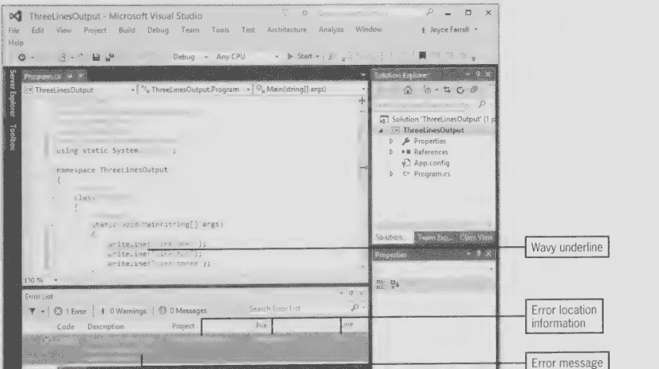

图 1-13 在 IDE 中编译的 ThreeLines 程序中 WriteLine 输错误时生成的错误消息

## 当程序在 IDE 中编译成功时该怎么办

在图 1-13 中，你可以看到生成的错误消息旁边有一个代码 `CS0013`。你可以在网上搜索此代码并发现它的通用含义。然而，通常 Visual Studio 会提供足够的解释，没有必要网络搜索。


如果你在编译代码后没有收到错误消息，那么程序编译成功，你可以运行该程序。从菜单栏中选择“调试”（Debug），然后选择“不调试开始启动”（Start Without Debugging）。输出出现了，正如你在本章较早图 1-6 中所示。

## 注意文本编辑器和 IDE 中程序之间的差异

图 1-8 和图 1-12 中的 `ThreeLinesOutput` 程序之间存在一些差异。具体来说，图 1-12 中的 Visual Studio 版本包含了图 1-14 中高亮的额外组件：

-   文件顶部的五条语句——Visual Studio 自动为你提供了几个常用的 `using` 语句。在这种情况下，你可以删除 Visual Studio 版本程序中的所有五个语句，程序仍然可以正确运行（你只需要保留的唯一 `using` 语句是 `static System.Console;` 语句，它允许你在不加限定的情况下使用 `WriteLine()`）。相反，你可以为命令行版本的程序添加另外五个额外的 `using` 语句，它也能正确运行。

-   命名空间声明及其起始和结束的大括号——你已经知道 C# 内置命名空间（如 `System` 等）会自动列在 Visual Studio 版本的程序顶部。C# 还允许你使用分配给项目的名称创建你自己的命名空间。在这种情况下，你可以从 Visual Studio 版本的程序中删除命名空间声明，或者为命令行版本的程序添加一个。在两种情况下，程序仍然可以正常工作。

-   类名 `Program`——Visual Studio 假设你希望避免因命名空间与其包含的类使用不同名称而产生混淆，它为包含 `Main()` 方法的类分配了通用名称 `Program`。你可以将此名称更改为命名空间标识符 `ThreeLinesOutput` 或任何其他合法标识符，程序仍然可以工作。在记事本版本的程序中，你可以将类名更改为 `Program` 或任何其他合法标识符，程序也能工作。

## 使用命令行编译并执行程序

5. 在命令提示符处，输入 `Hello`，这是程序的名称（可执行文件的名称），然后按回车键。或者，你可以输入完整文件名 `Hello.exe`，但没有必要输入 `.exe` 扩展名。输出应该类似于图 1-15。

```
C:\CH\Chapter.01>Hello
Hello. world!
C:\CH\Chapter.01>_
```

图 1-15 Hello 程序的输出

你可以在 `csc` 命令和 `.cs` 文件名之间使用 `/out` 选项指定输出文件的名称。例如，如果你输入 `csc /out:Hello.exe Hello.cs`，将创建一个名为 `Hello.exe` 的输出文件。默认情况下，输出文件的名称与 `.cs` 文件名相同。这通常是你的意图，因此大多数时候你都会省略 `/out` 选项。

## 使用 Visual Studio IDE 编译并执行程序

接下来，使用 C# 编译器环境来编译并执行之前从命令行运行的同一个 `Hello` 程序。

1. 打开 Visual Studio。如果桌面上有一个快捷方式图标，双击它。或者，在 Windows 8 中，你可以从右侧滑动，点击“搜索”，开始输入 Visual Studio 2015 并选择它。当你看到启动页时，点击“新建项目”。

2. 在“新建项目”窗口中，点击“Visual C#”，然后点击“ConsoleApplication1”。默认情况下，项目名称被设置为 `ConsoleApplication1`。将其更改为 `Hello`，并选择你想要保存项目的路径（见图 1-16）。点击“确定”。Visual C# 会为你的项目在项目标题创建一个文件夹。

> 学生可能喜欢多次通过“你来做做”练习来练习。请注意，Visual Studio 不允许你创建一个与已存储在文件夹中的项目同名的项目。当你多次执行这些步骤时，请在开始下一次之前删除第一个版本的项目、将新版本保存在不同的文件夹中，或者给新项目起一个不同的名称。

3. 出现 Hello 程序的编辑窗口。窗口中已经为你写了很多代码，包括一些 `using` 语句、一个名为 `Hello` 的命名空间、一个名为 `Program` 的类以及一个 `Main()` 方法。要创建 `Hello` 程序，你只需要向预写代码中添加两条语句。将光标放在最后一个 `using` 语句之后，按回车键开始新行，并添加一条额外的 `using` 语句：

```
using System.Console;
```

在 `Main()` 方法的左大括号之后，按回车键开始新行，并添加以下语句：

```
WriteLine("Hello, world!");
```

图 1-17 显示了添加 `using` 和 `WriteLine()` 语句后的编辑窗口。

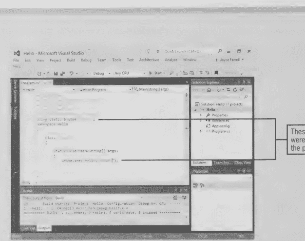

4. 通过点击菜单栏上的**文件**然后点击**保存所有项**，或者通过点击工具栏上的**保存所有**按钮（显示两个磁盘的图标）来保存项目。

5. 点击菜单栏上的**生成**然后点击**生成解决方案**。你应该不会收到错误消息，在窗口下方会显示“生成成功”。

6. 点击**调试**，然后点击**开始执行调试**。输出窗口会显示 *Hello, world!*。按任意键继续。关闭输出窗口。


7. 点击**文件**然后点击**退出**来关闭 Visual Studio，或者通过按下 `Ctrl + S`。

8. 如果你使用如记事本等编辑器创建 C# 程序，并使用 `csc` 命令编译它，将创建两个文件——`Hello.cs` 和 `Hello.exe`。如果你使用 Visual Studio 创建程序，将创建许多文件。在命令行提示符中，输入 `cd Hello` 切换到此新文件夹，然后再次输入 `dir`。使用文件资源管理器查看 `Hello` 文件夹的内容。根据你所使用的 Visual Studio 版本，你会发现一个 `bin` 文件夹、一个 `obj` 文件夹、一个 `Properties` 文件夹以及其他文件。如果你使用的是 IDE 编译程序，这些文件的时间戳会比你刚刚创建的文件要早。

## 为程序添加注释

注释是不执行的语句，有助于文档化程序。在接下来的步骤中，你为你创建的程序添加注释。

1. 如果你倾向于从命令行编译程序，请在文本编辑器中打开 `Hello.cs` 文件。如果你倾向于从 Visual Studio 编译程序，请打开 Visual Studio，点击文件，指向打开，项目/解决方案，浏览正确的文件夹，双击 `Hello` 文件。

2. 将光标置于行顶部，按回车键插入新行，按向上方向键回到该行，然后在行顶部输入注释。每输入完一行后按回车键。在指示处插入你的名字和今天的日期。

3. 滚动到读取 `void Main()` 的行，按回车键开始新行。按向上方向键；在新行中，与 `Main()` 方法头对齐，输入以下程序的块注释：

4. 保存文件，用此新版本替换旧的 `Hello.cs` 文件。

5. 如果你倾向于从命令行编译程序，在命令行输入 `csc Hello.cs`。当程序编译成功后，使用命令 `Hello` 执行。如果你倾向于从 Visual Studio 编译并执行程序，点击调试，然后点击开始执行调试。添加程序注释对程序的执行没有影响。

6. 如果你在命令行中工作，可以关闭命令行窗口。如果你在 Visual Studio 中工作，可以关闭输出屏幕然后关闭 Visual Studio。

```csharp
//文件名 Hello.cs
//作者 <你的名字>
//日期 <<今天的日期>

/* 此程序演示了如何使用 WriteLine()
方法显示 Hello, world! 消息 */
```

## 总结

- 计算机程序是一组告诉计算机执行操作的指令。程序员编写自己的程序，然后使用编译器将他们的高级语言语句翻译成中间语言和机器码。当程序的语法和逻辑都正确时，该程序就能正常工作。

- 过程化编程涉及创建计算机内存位置（称为变量）和一组操作（称为方法）。在面向对象编程中，你将程序组件想象成类似于现实世界中实体对象的类；然后，你通过操作这些对象来实现预期的结果。OOP 技术最初用于仿真和图形用户界面（GUI）。

- 对象是类的实例，由属性和方法组成。面向对象编程语言支持封装、继承和多态性。

- C# 编程语言是作为一种面向对象和面向组件的语言而开发的。它包含许多与 Visual Basic、Java 和 C++ 类似的特征。

- 为了在 C# 程序中产生一行控制台输出，你必须将字面量字符串作为参数传递给 `System.Console.WriteLine()` 方法。`System` 是一个命名空间，`Console` 是一个类。`WriteLine()` 方法可以出现在你创建的类的 `Main()` 方法中。

- 你可以使用任何以下划线、字母或 `@` 符号开头的名称或标识符定义 C# 类或变量。这些名称只能包含字母、数字、下划线和 `@` 符号，且不能是 C# 关键字。

- 你可以通过添加注释来改进程序，注释是你添加的非执行语句，用于文档化程序，或在测试程序时禁用某些语句。C# 中的三类型注释是：以两个正斜杠（`//`）开头到当前行结束的行注释；以正斜杠和星号（`/*`）开头并以星号和正斜杠（`*/`）结束的块注释；以及 XML 文档注释。你还可以使用指示类所在所在命名空间的子句（clause）来改进程序并缩短你输入的语句。

- 若要创建一个 C# 程序，你可以使用 Microsoft Visual Studio IDE 或任何文本编辑器（如记事本）。在你编写并保存程序后，你必须将源代码编译为

## 关键术语

- **计算机程序**：一组告诉计算机执行操作的指令。
- **软件**：计算机程序。
- **系统软件**：描述运行计算机的程序。
- **应用程序**：允许所有用户完成任务的程序。
- **硬件**：由与计算机相关的所有物理设备组成。
- **机器语言**：最基础的电路级语言。
- **高级编程语言**：允许你使用关键字词汇，而不是执行这些任务的开启/关闭开关序列。
- **关键字**：预定义的保留的标识符，对编译器具有特殊含义。
- **驼峰命名法**（Camel casing，也称为小驼峰）：一种创建标识符的样式，其中首字母不大写，但每个新单词的首字母大写。
- **语言的语法**：其规则集。
- **编译器**：将高级语言语句翻译成机器码的计算机程序。
- **语法错误**：在不当使用编程语言时发生的错误。
- **任何程序的逻辑**：涉及按正确顺序执行各种语句和方法以产生预期结果。
- **语义错误**：在你在错误的语境中使用正确的单词时发生的逻辑错误，会产生错误的结果。
- **缺陷**（Bug）：计算机程序中的错误。
- **调试程序**：移除程序中所有语法和逻辑错误的过程。
- **过程化程序**：通过编写一系列操作数值的步骤或操作创建的。
- **变量**：存储可能变化的值的命名计算机内存位置。
- **标识符**：程序组件（如变量、类或方法）的名称。
- **帕斯卡命名法**（Pascal casing，也称为大驼峰）：一种创建标识符的样式，其中名称中所有新单词的首字母（甚至是第一个）都大写。
- **方法**：模块化的、命名的程序单元，包含完成任务的指令。
- **程序调用或装用方法**。
- **面向对象编程**（OOP）：一种编程技术，其特点是对象、类、封装、接口、多态性和继承。

## 关键术语（续）

- **对象**：类的实例，由属性和方法组成。
- **属性**：对象的特征。
- **对象的状态**：对象任何时间点的属性总和。
- **对象的行为**：其方法。
- **面向对象的方法处理问题**：意味着定义完成任务所需的对象。
- **计算机仿真**：模拟现实世界活动的程序。
- **图形用户界面**（GUI）：允许用户通过图形元素与软件交互的界面。
- **封装**：将属性和方法封装进类的技术。
- **类的实例**：从类创建的对象。
- **继承**：类类新功能的能力。
- **多态**：不同类响应相同方法调用的能力。

## 补充术语

- **空白**：空格、制表符和回车字的组合。你使用空白来组织程序代码并使其易读。
- **关键字 `static`**：在方法头中使用时，表示该方法将通过类而不是对象执行。
- **关键字 `void`**：在方法头中使用时，表示该方法不返回任何值。
- **应用程序类**：包含 `Main()` 方法并且是可执行程序。
- **非应用程序类**：不包含 `Main()` 方法；它们为类提供支持。
- **字面标识符**：带有 `@` 前缀的标识符。
- **程序注释**：你添加的文档程序的非执行语句。
- **注释掉语句**：将某个语句变为非执行状态。
- **行注释**：以两个正斜杠（`//`）开头并持续到当前行结束。行注释可以单独占一行，也可以位于执行代码行的末尾。
- **块注释**：以正斜杠和星号（`/*`）开头并以星号和正斜杠（`*/`）结束。块注释可以单独占一行，也可以出现在执行代码行之前或之后。它们还可以跨越所需的任意行。
- **XML 文档格式注释**：使用角括号内的特殊标签集在程序内部创建文档。
- **using 子句** 或 **using 指令**：声明命名空间。
- **源代码**：你创建程序时编写的语句。
- **中间语言**（IL）：源代码语句编译成的语言。
- **C# 即时编译器**（JIT）：将中间代码翻译成可执行代码。
- **命令行**：在文本界面的系统中输入命令的行。
- **命令行提示符**：出现在命令行开头的输入请求。
- **集成开发环境**（IDE）：一个允许你从菜单选择选项或点击按钮的程序开发环境。IDE 提供如颜色编码和自动语句补全等有用功能。
- **IDE 中的菜单栏**：水平位于窗口顶部，包含列更多选项的子菜单。

## 复习习题

1. Java 和 Visual Basic 等编程语言是
   - a. 机器语言
   - c. 高级语言
   - b. 低级语言
   - d. 非解释语言

2. 将高级程序翻译成中间代码或机器代码的程序是
   - a. 破坏器
   - c. 分析器
   - b. 编译器
   - d. 逻辑学家

3. 编程语言的语法和拼写规则构成了它的
   - a. 逻辑
   - c. 语法
   - b. 变量
   - d. 类

4. 变量
   - a. 方法
   - c. 语法规则
   - b. 命名的内存位置
   - d. 操作

5. 创建并使用与现实世界实体属性的对象的程序被称为
   - a. 过程化的
   - c. 真实的
   - b. 逻辑的
   - d. 面向对象的

6. 下列哪一组是类和对象的示例（顺序如下）？
   - a. 罗宾和鸟
   - c. 大学和哈佛
   - b. 椅子和桌子
   - d. 橡树和树

7. 将对象的属性封装成可以作为不可分割实体使用的内聚单元的技术是
   - a. 继承
   - c. 多态
   - b. 封装
   - d. 接口

8. 在下列语言中，哪一个与 C# 的相似性最低？
   - a. Java
   - c. C++
   - b. Visual Basic
   - d. COBOL

9. 出现在双引号内的一系列字符是
   - a. 方法
   - c. 参数
   - b. 接口
   - d. 字面量字符串

10. 在屏幕上产生一行输出并将光标移动到下一行的 C# 方法是
    - a. `WriteLine()`
    - c. `DisplayLine()`
    - b. `PrintLine()`
    - d. `OutLine()`

11. 下列哪项是一个类？
    - a. `System`
    - c. `void`
    - b. `Console`
    - d. `WriteLine()`

12. 在 C# 中，将相似类分组的容器是
    - a. 超类
    - c. 命名空间
    - b. 方法
    - d. 标识符

13. C# 中的每个方法包含
    - a. 头部和正体
    - c. 变量和类
    - b. 头部和尾部
    - d. 类和对象

14. 下列哪项是一个方法？
    - a. 命名空间
    - c. `Main()`
    - b. 类
    - d. `static`


# 练习题

## 选择题

### 15. 下列哪条语句是正确的？

- a. 标识符必须以下划线开头。
- b. 标识符可以包含数字。
- c. 标识符长度不能超过 16 个字符。
- d. 标识符可以只包含小写字母。

### 16. 下列哪个标识符在 C# 中是不合法的？

- a. per cent increase
- b. annualReview
- c. HTML
- d. alternativetaxcredit

### 17. 你编写的程序的文本被称为 ________________。

- a. 对象代码
- b. 源代码
- c. 机器语言
- d. 可执行文档

### 18. 编程错误（如使用错误的标点符号或单词拼写错误）统称为 ________ 错误。

- 语法
- 逻辑
- 可执行
- 致命

### 19. `/* this is a comment #/` 这种形式的注释是(n) ________。

- XML 注释
- 块注释
- 可执行注释
- 行注释

### 20. 如果程序员在 C# 程序的顶部插入 `using static System.Console;`，程序员可以使用哪项作为 `System.Console.WriteLine("Hello");` 的替代？

- System("Hello")
- `WriteLine("Hello")`
- `Console.WriteLine("Hello")`
- Console("Hello")

## 编程练习

### 1. 说明每个 C# 编程语言标识符是合法还是非法的。如果合法，说明它是否是类的惯用标识符。

- `paycheck`
- `Paycheck`
- `Pay check`
- `static`
- `Void`
- `#phone`
- `Ay56we`
- `Theater-Tickets`
- `102Item`
- `heightInches`
- `Zip23891`
- `void`

### 2. 为下列每个类列出至少三个可能的属性：

- `TVShow`
- `Party`
- `JobApplication`
- `CheckingAccount`

### 3. 为每个对象列出至少两个可能所属的类：

- 你的姐姐
- 富兰克林·罗斯福
- 星巴克
- 巴黎

---

# 第一章 使用 C# 编写第一个程序

### 4. 编写、编译并测试一个名为 `PersonalInfo` 的程序，显示人的姓名、电子邮件和电话号码。

### 5. 编写、编译并测试一个名为 `Lyrics` 的程序，显示你喜欢的歌曲的至少四行。

### 6. 编写、编译并测试一个名为 `Comments` 的程序，显示定义程序注释的语句。在程序中包含至少一个块注释和一个行注释。

### 7. 编写、编译并测试一个名为 `WineGlass` 的程序，在屏幕上显示类似于下方的模式：

```
XXXXXXXXXXXX
X     X
X     X
XXXXXX
X     
X     
XXXXX
```

### 8. 编写一个程序 `BigLetter`，它显示一个由较小字母组成的大字母，如下例：

```
H   H
H   H
H   H
HHHHHHHHH
H   H
H   H
H   H
```

### 9. 出现在双引号内的一系列字符是(n) ________。

- a. 方法
- b. 接口
- c. 参数
- d. 字面量字符串

### 10. 在屏幕上产生一行输出并将光标移动到下一行的 C# 方法是 ________________。

- a. `WriteLine()`
- b. `PrintLine()`
- c. `DisplayLine()`
- d. `OutLine()`

### 11. 下列哪项是一个类？

- a. `System`
- b. `Console`
- c. `void`
- d. `WriteLine()`

### 12. 在 C# 中，将相似类分组的容器是(n) ________________。

- a. 超类
- b. 方法
- c. 命名空间
- d. 标识符

### 13. C# 中的每个方法包含一个 ________________。

- a. 头部和正体
- b. 头部和尾部
- c. 变量和类
- d. 类和对象

### 14. 下列哪项是一个方法？

- a. 命名空间
- b. 类
- c. `Main()`
- d. `static`

### 15. 下列哪条语句是正确的？

- a. 标识符必须以下划线开头。
- b. 标识符可以包含数字。
- c. 标识符长度不能超过 16 个字符。
- d. 标识符可以只包含小写字母。

### 16. 下列哪个标识符在 C# 中是不合法的？

- a. per cent increase
- b. annualReview
- c. HTML
- d. alternativetaxcredit

### 17. 你编写的程序的文本被称为 ________________。

- a. 对象代码
- b. 源代码
- c. 机器语言
- d. 可执行文档

### 18. 编程错误（如使用错误的标点符号或单词拼写错误）统称为 ________ 错误。

- 语法
- 逻辑
- 可执行
- 致命

### 19. `/* this is a comment #/` 这种形式的注释是(n) ________。

- XML 注释
- 块注释
- 可执行注释
- 行注释

### 20. 如果程序员在 C# 程序的顶部插入 `using static System.Console;`，程序员可以使用哪项作为 `System.Console.WriteLine("Hello");` 的替代？

- System("Hello")
- `WriteLine("Hello")`
- `Console.WriteLine("Hello")`
- Console("Hello")

---

# 第 2 章 使用数据

虽然 `bool` 类型没有真正的最大值或最小值，但你可以将 `true` 视为最高，将 `false` 视为最低。

## 表 2-1 C# 数据类型

### 不带小数部分的数字类型

| 类型 | 类型 | 字节数 | 描述 | 最大值 | 最小值 |
| --- | --- | --- | --- | --- | --- |
| `byte` | `Byte` | 1 | 无符号字节 | 255 | 0 |
| `sbyte` | `SByte` | 1 | 有符号字节 | 127 | -128 |
| `short` | `Int16` | 2 | 有符号短整数 | 32,767 | -32,768 |
| `ushort` | `UInt16` | 2 | 无符号短整数 | 65,535 | 0 |
| `int` | `Int32` | 4 | 有符号整数 | 2,147,483,647 | -2,147,483,648 |
| `uint` | `UInt32` | 4 | 无符号整数 | 4,294,967,295 | 0 |
| `long` | `Int64` | 8 | 有符号长整数 | 约 9 × 10¹⁸ | 约 -9 × 10¹⁸ |
| `ulong` | `UInt64` | 8 | 无符号长整数 | 约 18 × 10¹⁸ | 0 |

### 带小数部分的数字类型

| 类型 | 类型 | 字节数 | 描述 | 最大值 | 最小值 |
| --- | --- | --- | --- | --- | --- |
| `float` | `Single` | 4 | 浮点数 | 约 3.4 × 10³⁸ | 约 -3.4 × 10³⁸ |
| `double` | `Double` | 8 | 双精度浮点数 | 约 1.8 × 10³⁸ | 约 -1.8 × 10³⁸ |
| `decimal` | `Decimal` | 16 | 固定精度数字 | 约 7.9 × 10²⁸ | 约 -7.9 × 10²⁸ |

### 存储其他值的类型

| 类型 | 类型 | 字节数 | 描述 | 最大值 | 最小值 |
| --- | --- | --- | --- | --- | --- |
| `char` | `Char` | 2 | Unicode 字符 | 0xFFFF | 0x0000 |
| `bool` | `Boolean` | 1 | 布尔值（true 或 false） | 不适用 | 不适用 |
| `string` | `String` | NA | Unicode 字符串 | 不适用 | 不适用 |
| `object` | `Object` | NA | 对象 | 不适用 | 不适用 |

你使用与类名相同的规则来命名变量。变量名必须以字母开头，不能包含空格，且不能是关键字（第1章中的表 1-1 列出了所有的 C# 关键字）。按照习惯，每个 C# 变量以小写字母开头，如果包含多个单词，则使用驼峰命名法。

## 声明变量

你必须声明程序中想要使用的所有变量。变量声明是命名变量并为其预留存储空间的语句。声明包括：

- 变量将存储的数据类型
- 变量名（其标识符）
- 当你希望变量包含初始值时，可选的赋值运算符和被赋值的值
- 结尾的分号 `;`

例如，以下语句声明了一个类型为 `int` 名为 `myAge` 的变量，并分配了初始值 25：

```csharp
int myAge = 25;
```

换句话说，该语句预留了名为 `myAge` 的四个字节内存，并在其中存储了值 25。声明是一个以分号结尾的完整语句。

等号 (`=`) 是赋值运算符；赋值运算符右侧的任何值都会赋给左侧的标识符。在声明变量时进行的赋值是初始化；稍后进行的赋值仅仅是赋值。因此，以下语句将 `myAge` 初始化为 25：

```csharp
int myAge = 25;
```

像下面的语句为变量分配了一个新值：

```csharp
myAge = 42;
```

注意，在进行赋值时不再使用数据类型；它只在声明中使用。

另外请注意，表达式 `25 = myAge;` 是非法的，因为赋值总是从右向左进行的。根据定义，常量不能被更改，因此将常量（如 25）放在赋值运算符的左侧是非法的。赋值运算符意味着“被赋值为”，可以读作“myAge 被赋了值...”。

与其使用表 2-1 中“类型”列的名称，不如使用来自 `System` 命名空间的完全限定名称。例如，与其使用类型 `int`，你可以使用 `System.Int32`（数字 32 代表该数据类型允许的存储位数。一个字节有 8 位，一个 `int` 占用四个字节）。然而，由于以下原因，使用别名 `int` 更好：

- 较短的别名更容易阅读。
- 较短的别名类似于 Java 和 C++ 等其他语言中的类型。
- 其他 C# 程序员期望更短的类型名。

你可以在不初始化的情况下声明变量，如下：

```csharp
int myAge;
```

你可以在程序的稍后对未初始化的变量赋值，但在为其赋值之前，你不能在计算中使用该变量或显示它。

你可以在单独语句中声明多个相同类型的变量。例如，以下语句声明了两个整数变量：

```csharp
int myAge = 25;
int yourAge = 19;
```

你也可以通过使用一次类型并用逗号分隔变量声明，在单个语句中声明多个相同类型的变量，如下：

```csharp
int myAge = 25, yourAge = 19;
```

一些程序员倾向于将声明跨越多行，如示例所示：

```csharp
int myAge = 25,
    yourAge = 19;
```

当一个语句占据多行时，如果第一行之后的行缩进几个空格，会更容易阅读。本书遵循这一习惯。在声明不同类型的变量时，你必须为每个类型使用单独的语句。

## 两个真理一个假

1. 常量值在程序运行时无法更改。
2. 数据类型描述了数据项目的格式、大小以及可以对其执行的操作类型。
3. 变量声明需要数据类型、名称和赋值值。

## 显示值

你可以通过 `Write()` 或 `WriteLine()` 方法调用变量名来显示变量值。例如，图 1 显示了在调用方法时使用变量名的情况。

```csharp
using System.Console;
class DisplayValues
{
    static void Main()
    {
        int myAge = 25;
        WriteLine(myAge);
    }
}
```

图 2 显示输出非常原始——只有一个数字。因为程序使用了 `Write()` 而不是 `WriteLine()` 显示第一个输出。

```csharp
using System.Console;
class DisplayValues
{
    static void Main()
    {
        int myAge = 25;
        Write("The money is $");
        WriteLine(myAge);
    }
}
```

如果你想显示多个字符串和变量值，可能会产生许多 `Write()` 和 `WriteLine()` 语句。为了方便输出，你可以将字符串和变量值合并到单个 `Write()` 或 `WriteLine()` 语句中，通过连接它们。

当你将字符串与另一个值连接时，使用加号连接这些值。例如，以下语句产生的输出与图 4 相同，但仅使用一个 `WriteLine()` 语句：

```csharp
WriteLine("The money is $" + myAge);
```

格式字符串是控制输出外观的字符串。它可选包含固定文本和多个用于变量值的占位符。占位符由一对大括号和一个数字组成，该数字指示变量在随后的列表中的位置。第一个位置始终是 0。

你可以使用 C# 内置的 `String.Format()` 方法创建格式字符串。例如，以下语句创建了格式字符串并显示它：


# 第 2 章 使用数据

## 显示变量值

```csharp
double myAge = 39.45;
string mySentence = String.Format("The money is ${0} exactly", myAge);
WriteLine(mySentence);
```

大括号包含一个数字占位符 `{0}`，其中插入 `myAge` 的值。因为 `myAge` 是字符串之后的第一个变量（也是此示例中唯一的变量），它的位置是 0。替换占位符的过程通常被称为字符串插值或变量替换。

C# 还允许你在 `Write()` 和 `WriteLine()` 方法中使用快捷方法。你可以一次性格式化字符串并输出它，而无需声明临时字符串变量并显式命名 `String.Format()` 方法，如下：

```csharp
double myAge = 39.45;
WriteLine("The money is ${0} exactly", myAge);
```

图 2-7 中的输出可以在不使用格式字符串的情况下显示，但你必须三次命名 `someMoney` 变量：

```csharp
WriteLine("I have $" + someMoney + ". $" + someMoney + "!! $" + someMoney + "!! $");
```

### 字符串插值

C# 6.0 引入了一种显示拼接字符串的新方法。通过这种方法，你可以使用带有美元符号的大括号中的变量名。例如，以下代码将产生输出 `Money is 42.56 and age is 29`。

```csharp
double someMoney = 42.56;
int myAge = 29;
WriteLine($"Money is {someMoney} and age is {myAge}");
```

### 字段宽度与对齐

当你使用多个 `WriteLine()` 语句显示变量值列表时，这些值不会自动右对齐（通常我们期望数字右对齐）。例如，以下代码将产生图 2-8 所示的未对齐输出：

```csharp
WriteLine("{0}", 4);
WriteLine("{0}", 56);
WriteLine("{0}", 789);
```


**图 2-8** 不使用字段宽度时具有不同位数的数值

如果你在格式字符串的大括号中使用第二个数字，可以指定对齐方式和字段宽度。默认情况下，数字在字段中是右对齐的。如果你在 `WriteLine()` 语句中对字段宽度使用负值，则显示的值将在字段中左对齐。在大多数情况下，你希望数字右对齐，而字符串值左对齐。例如，以下代码将产生图 2-9 所示的输出。前三个 `WriteLine()` 语句产生的每个输出都是 5 个字符宽字段中的右对齐数字，而最后三个语句产生的每个输出都是 8 个字符宽字段中的两个左对齐字符串。

```csharp
WriteLine("{0,5}", 4);
WriteLine("{0,5}", 56);
WriteLine("{0,5}", 789);
WriteLine("{0,-8}{1,-8}", "Richard", "Lee");
WriteLine("{0,-8}{1,-8}", "Marcia", "Parker");
WriteLine("{0,-8}{1,-8}", "Ed", "Tompkins");
```

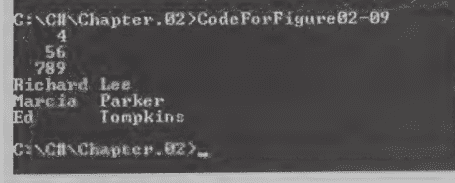

**图 2-9** 使用字段宽度时具有不同位数的数值

### 长字符串拼接

格式字符串可能非常长。然而，当你在程序中包含任何字符串值时，你无法通过回车键将其扩展到多行。如果你这样做，将收到一条错误信息：“Newline in constant”。相反，如果你想将长字符串拆分为多行代码，可以将多个字符串拼接成一个单一实体，如下所示：

```csharp
WriteLine("I have {0}." + 
    "{0}", someMemory);
```

在拼接示例中，`+` 号可以放在第一行代码的末尾，也可以放在第二行的开头。如果将 `+` 放在第一行的末尾，阅读代码的人更有可能注意到该语句尚未完成。由于本书页宽的限制，你将在程序代码中频繁看到拼接的示例。

## 两真一假

### 显示变量值

- 1. 假设 `number` 和 `answer` 是已赋值的合法声明变量，那么以下语句是有效的：
  `WriteLine("{1}{2}", number, answer);`

- 2. 假设 `number` 和 `answer` 是已赋值的合法声明变量，那么以下语句是有效的：
  `WriteLine("{1}{1}{0}", number, answer);`

- 3. 假设 `number` 和 `answer` 是已赋值的合法声明变量，那么以下语句是有效的：
  `WriteLine("{0}{1}{0}", number, answer);`

## 使用整数数据类型

在 C# 中，有九种类型被归类为整数数据类型——即存储整数。这九种类型是 `byte`、`sbyte`、`short`、`ushort`、`int`、`uint`、`long`、`ulong` 和 `char`。前八种表示整数，第九种类型 `char` 用于表示如 `A` 或 `r` 等字符。实际上，你可以将所有九种类型都视为数字，每个 Unicode 字符（包括字母和标点符号）都可以表示为一个数字。例如，字符 `A` 在你的计算机中存储为 `65`。你更通常地认为 `char` 类型具有字母字符而不是数值等值，`char` 类型将在本章后面的章节中单独讨论。

最基础的类型是 `int`。它使用四个字节内存，可以存储整数（或整数数字）。`int` 变量可以存储从 `-2,147,483,648` 到 `2,147,483,647` 的任何整数。

## 你来做

### 声明和使用变量

在以下步骤中，你将编写一个声明多个变量、为它们赋值并显示结果程序。

- 打开一个文件。如果你使用简单的文本编辑器编写 C# 程序，你会将文件保存为 `DemoVariables.cs`。如果你使用 Visual Studio，选择控制台应用程序，命名项目为 `DemoVariables`，并在开始之前删除窗口中的所有代码。

- 创建程序的开头。将类命名为 `DemoVariables`，并输入类大括号。

```csharp
using System;
class DemoVariables
{
```

- 在 `Main()` 方法中，声明两个变量（一个整数和一个无符号整数），并为它们赋值。

```csharp
static void Main()
{
    int anInt = -123;
    uint anUnsignedInt = 567;
```

- 添加一个语句来显示这两个值。

```csharp
WriteLine("The int is {0} and the unsigned int is {1}.", anInt, anUnsignedInt);
```

- 添加两个右括号——一个关闭 `Main()` 方法，另一个用于关闭 `DemoVariables` 类。将每个右括号与其对应的左括号垂直对齐。换句话说，第一个右括号与打开 `Main()` 的括号对齐，第二个与打开 `DemoVariables` 的括号对齐。

- 保存程序并编译它。如果收到任何错误消息，请修正错误并重新编译程序。当无错误时，执行程序。输出应该像图 2-10 所示。

```
C:\Git\Chapter_02\DemoVariables
The int is -123 and the unsigned int is 567.
C:\Git\Chapter_02\>
```

**图 2-10** DemoVariables 程序的输出

（续）

- 7. 尝试为命名变量引入无效值来测试程序。例如，通过在常量值前输入负号，将 `unsignedInt` 的值改为 -567。编译程序。你将收到以下错误消息：常量值 '-567' 无法转换为 'uint'。

- 8. 通过移除负号或将变量的数据类型更改为 `int` 来修正错误，并再次编译程序。你不应该收到任何错误消息。记住在每次更改并编译之前保存你的程序文件。

- 9. 将 `int` 的值从 -123 更改为 -1234567890000。当你编译程序时，会出现以下错误消息：无法隐式将类型 'long' 转换为 'int'。

该值为 `long` 类型是因为它超过了允许的最大 `int` 值。通过较小的值或将变量类型更改为 `long` 来修正错误，并再次编译程序。你不应该收到任何错误消息。

- 10. 对变量进行其他更改。包括一些类型为 `short`、`ushort`、`byte` 和 `sbyte` 的变量及其值。

## 使用浮点数据类型

浮点数是指包含小数位的。浮点数被描述为具有不同数量的有效数字。值的位数指定了该值的数学准确性。该概念通常用于舍入法。例如，在“纽约市人口为 8,000,000”这一语句中，只有一个有效数字——数字 8。零作为占位符，旨在近似实际值。

当数字存储在计算机内存中时，使用可以“浮动”的小数点可以提供更宽范围。一个非常简单的例子，假设可以存储的最大数字只有两个数字，且之间有一个固定的小数点。那么可以存储的正数范围将从 0.0 到 9.9。然而，如果小数点可以出现在开头、中间或结尾，那么范围就变成了 .00 到 99。

C# 支持三种浮点数据类型：`float`、`double` 和 `decimal`。

- `float` 数据类型可以包含多达七位有效数字的精度。例如，赋值为 1234.56789 的 `float` 将显示为 1234.568，因为它只精确到第七位（小数点右边的第三位）。

- `double` 数据类型可以包含 15 位有效数字的精度。例如，给定值 123456789.987654321 的 `double` 将显示为 123456789.9876543，因为它只精确到第十五位（小数点右边的第六位）。

与 `float` 和 `double` 相比，`decimal` 类型具有更高的精度和更小的范围，这使其适用于财务和货币计算。`decimal` 的有效位为 28 或 29 位。如表 2-1 所示，`decimal` 不能像 `double` 那么大的数值（`decimal` 最大值约为 10^28；`double` 的最大值约为 10^308），但 `decimal` 在小数位上会更准确。

就像整数默认是 `int` 一样，浮点常量默认是 `double`。要显式地将常量存储为 `float`，你需要在数字后放置一个 F，如下所示：

```csharp
float pocketChange = 4.87F;
```

你可以使用小写或大写的 F。你也可以在浮点值后放置 D（或 d）以表示它是一个 `double`；然而，即使不带 D，它默认也会被存储为 `double`。要显式地将一个值存储为 `decimal`，请在数字后使用 M（或 m）。（M 代表货币；D 不用于 `decimal`。）

由于货币值至关重要，C# 开发者经常使用 `decimal` 类型。本书通常对浮点值使用 `double` 类型，因为浮点数默认是 `double` 且在值后不需要修饰符。然而，你应该根据导师或经理的需求使用合适的数据类型。大多数程序员倾向于使用 `decimal` 来处理人类创建的测量（例如，钱）以及自然发生的现象测量（例如，元素）。

如果你在浮点变量中存储了一个太大（或太小）的值，它将以科学计数法输出。科学计数法表示的值包括 E（用于指数）。例如，如果你声明 `f = 1234567890f`；输出是 `1.234568e9`，这意味着你使用的常量是 1234568 乘以 10 的九次方。当跟随 E 的值为负数时，意味着值很小，小数点应该左移。例如，值 1.234E-07 代表 0.0000001234。

## 格式化数值

默认情况下，C# 总是以最可能的方式显示浮点数以保持正确。例如，如果你声明一个变量并在语句中显示它，输出将如下：

```csharp
double myMoney = 14;
Console.WriteLine("Amount is {0}", myMoney);
```

输出将显示 `14`。

标准数字格式字符串是九个字符之一。你可以使用 `ToString()` 方法的格式指定符将数字转换为字符串。精度指定符控制小数点后的位数。

| 格式字符 | 说明 | 默认（无精度） |
| :--- | :--- | :--- |
| C | 货币 | $XX,XXX.XX |
| D | 小数 | XXXXX |
| E | 科学计数（指数） | X.XXXXXXE00 |
| F | 固定点 | XXXXX.XXXXXX |
| G | 通用 | XXXXX |
| N | 数字 | XXXXX,XXX.XXXXXX |
| P | 百分比 | XX.XX% |
| R | 往返 | XXXXX.XXXXXX |
| X | 十六进制 | XXXXX |

你可以使用 `ToString()` 方法的格式指定符将数字转换为具有所需格式的字符串。例如，你可以使用 F 指定符插入指定数量的小数位。（如果没有提供精度指定符，则显示两位）。例如，接下来的第一个 `WriteLine()` 语句产生 123.00，第二个产生 123.000：

```csharp
double someMoney = 123;
string moneyString;
moneyString = someMoney.ToString("F2");
WriteLine(moneyString);
moneyString = someMoney.ToString("F3");
WriteLine(moneyString);
```

### 货币格式

当你想要将数字表示为货币值时，使用 C 作为格式指定符。货币值带有美元符号、适当的逗号和所需的小数位；负值显示在括号内。你在 C 之后使用的整数表示位数。如果你不提供小数位的值，则默认在小数点分隔符后显示两位。例如，以下 `WriteLine()` 语句产生 $456,789.00：

```csharp
double moneyValue = 456789;
string conversion;
conversion = moneyValue.ToString("C");
WriteLine(conversion);
```

英语文化中带有美元符号和逗号的文化是决定文化依赖性值（如货币和日期）格式的一组规则。你可以通过 `CultureInfo` 类更改程序的文化。.NET 框架支持超过 200 种文化设置，如日语、法语、乌尔都语和梵语。

## 使用算术运算符

表 2-3 描述了最常用的五个算术运算符。你使用这些运算符来处理程序中的值。运算符在表达式中使用的值称为操作数。这些算术运算符被称为二元运算符，因为你每次使用两个操作数——一个值在运算符的左侧，另一个在右侧。

| 运算符 | 描述 | 示例 |
| :--- | :--- | :--- |
| + | 加法 | 45 + 2: 结果为 47 |
| - | 减法 | 45 - 2: 结果为 43 |
| * | 乘法 | 45 * 2: 结果为 90 |
| / | 除法 | 45 / 2: 结果为 22（而不是 22.5） |
| % | 取模 | 45 % 2: 结果为 1（即 45 / 2 等于 22，余数为 1） |

**表 2-3** 二元算术运算符

> 与某些编程语言不同，C# 没有指数运算符。相反，你可以使用在“方法介绍”章节中将学到的内置方法 `Pow()`。

运算符 `/` 和 `%` 值得特别考虑。当你除以数字且其中至少一个是浮点值时，答案是一个浮点值。例如，`45.0 / 2` 等于 `22.5`。然而，当使用 `/` 运算符除以整数时（无论是整数常量还是变量），结果都是整数；换句话说，结果的任何分数部分都会丢失。例如，`45 / 2` 的结果是 22 而不是 22.5。


# 使用数据

## 取模运算符

当你对两个整数使用取模运算符时，结果是一个整数，其值为除法后的余数——因此 `45 % 2` 的结果是 1，因为 2 “进入” 45 共 22 次，余数为 1。不应该对浮点数执行取模操作。由于浮点数在计算机内存中的存储方式，结果是不可预测的。

在旧的语言（如汇编语言）中，你必须先执行除法才能取余数。在 C# 中，在使用取模运算之前没有必要执行除法操作。换句话说，取模运算可以独立存在。

你可能会听到程序员将取模运算符称为模运算符。虽然模和余数的意义相似，但它们之间存在差异。

## 整数除法

即使你将结果变量定义为浮点类型，整数除法仍然产生一个整数。例如，语句 `double d = 7 / 2;` 导致 `d` 持有 `3` 而不是 `3.5`，因为在赋值之前表达式被求值为整数除法。如果你希望结果为 `3.5`，计算中的操作数中至少一个必须是浮点数，否则你必须进行类型转换。你将在本章后面的部分学习类型转换。

## 运算符优先级

当你在单个语句中组合数学运算时，你必须理解运算符优先级，即决定数学表达式部分求值顺序的规则。在表达式中，乘法、除法和取模始终发生在加法或减法之前。例如，以下表达式的结果为 14：

```csharp
int result = 2 + 3 * 4;
```

结果为 14 是因为乘法运算 `(3 * 4)` 发生在加 2 之前。你可以通过将应该先执行的操作放在括号内来覆盖标准的运算符优先级。以下语句的结果为 20，是因为括号内的加法首先执行：

```csharp
int result = (2 + 3) * 4;
```

在这一语句中，中间结果 `(5)` 在乘以 `4` 之前被计算。

> 运算符优先级也称为运算顺序。一个密切相关的术语是结合性，它规定了具有相同优先级的运算序列的求值顺序。C# 运算符的结合性。

你可以使用括号让你的意图更清晰，即使乘法发生在加法之前，如下写法也是完全接受的：

```csharp
weeklyPay = (hours * rate) + bonus;
```

总结来说，算术运算符的顺序为：

- 括号。计算括号内的表达式。
- 乘法、除法、取模。从左到右计算。
- 加法、减法。从左到右计算。

## 快捷算术运算符

增加变量的值是一项常见的任务。假设你声明了一个名为 `counter` 的变量来计算事件发生的次数。每当事件发生时，你想执行如下语句：

```csharp
counter = counter + 1;
```

这种类型的语句对于代数学生来说是错误的，等号 `=` 在 C# 中不用于比较值；它用于赋值。语句 `counter = counter + 1;` 的意思是“获取 `counter` 的值，加 1，并将结果赋值给 `counter`”。

因为增加变量的值是一个常见任务，C# 提供了几种快捷方式来计数和积累。以下两个语句含义相同：

```csharp
counter += 1;
counter = counter + 1;
```

`+=` 运算符用于加法并赋值给变量。例如，以下语句含义相同：

```csharp
counter += 1;
counter = counter + 1;
```

`-=` 运算符用于减法并赋值给变量。例如，以下语句含义相同：

```csharp
counter -= 1;
counter = counter - 1;
```

`*=` 运算符用于乘法并赋值给变量。例如，以下语句含义相同：

```csharp
counter *= 2;
counter = counter * 2;
```

`/=` 运算符用于除法并赋值给变量。例如，以下语句含义相同：

```csharp
counter /= 2;
counter = counter / 2;
```

`%=` 运算符用于取余数并赋值给变量。例如，以下语句含义相同：

```csharp
counter %= 2;
counter = counter % 2;
```

快捷运算符允许你的代码更加简洁、易读。它们在编程中被频繁使用，特别是在循环和计数器更新时。

## 你来尝试：执行算术运算

在以下步骤中，你将向程序添加一些算术语句。

1. 打开一个名为 `DemoVariables2` 的新 C# 程序文件，并输入以下语句启动一个演示算术运算的程序：

```csharp
using System.Console;
class DemoVariables
{
    static void Main()
    {
```

2. 编写声明七个变量的语句。为其中两个变量分配初始值；另外五个变量的值将通过计算得出。由于这些变量类型相同，你可以使用单个语句声明所有七个整数。记住，要做到这一点，你需要在变量名之间插入逗号，并在结尾放置单个分号。你可以为了可读性在任何需要的地方换行。（或者，你也可以使用多个独立的声明。）

```csharp
int value1 = 43, value2 = 10;
int sum, diff, product, quotient, remainder;
```

3. 编写算术语句，计算两个赋值变量的和、差、乘积、商和余数。

```csharp
sum = value1 + value2;
diff = value1 - value2;
product = value1 * value2;
quotient = value1 / value2;
remainder = value1 % value2;
```

与其声明变量 `sum`、`diff`、`product`、`quotient` 和 `remainder` 后再赋值，你可以一次性声明并赋值，例如 `int sum = value1 + value2;`。唯一的要求是在进行计算之前，`value1` 和 `value2` 必须已经赋值。

4. 包含五个 `WriteLine()` 语句来显示结果。

```csharp
WriteLine("The sum of {0} and {1} is {2}", value1, value2, sum);
WriteLine("The difference between {0} and {1} is {2}", value1, value2, diff);
WriteLine("The product of {0} and {1} is {2}", value1, value2, product);
WriteLine("{0} divided by {1} is {2}", value1, value2, quotient);
WriteLine("and the remainder is {0}", remainder);
```

5. 添加两个大括号——一个用于 `Main()` 方法，另一个用于 `DemoVariables2` 类。

6. 保存文件，编译程序并执行它。输出应该类似于图 2-11。

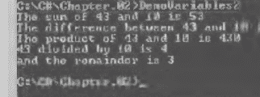

7. 修改变量 `value1` 和 `value2` 的值，保存程序并再次编译和运行。重复此过程几次。每次执行后，分析输出结果以确保你理解了算术运算的结果。

## 使用 bool 数据类型

布尔逻辑基于真或假的比较。一个 `int` 变量可以在不同时间持有数百万个不同的值，但一个 `Boolean` 变量只能持有两个值之一——`true` 或 `false`。你通过使用类型 `bool` 来声明逻辑变量。以下语句声明并为两个布尔变量分配适当的值：

```csharp
bool isItMonday = false;
bool areYTired = true;
```

> 如果你的布尔变量名以动词 "to be" 或 "to do" 的形式开头（例如 "is" 或 "are"），那么你在程序中可以更容易识别这些标识符为布尔变量。

> 当将 "Boolean" 作为形容词时（例如 "Boolean variable"），通常以大写 B 开头，因为该数据类型以符号逻辑的创始人乔治·布尔命名，他生活于 1815 年至 1864 年。然而，C# 数据类型 `bool` 以小写 b 开头。

你也可以根据布尔变量比较的结果来比较值。比较运算符比较两个项目；包含比较运算符的表达式返回一个值。表 2-4 描述了 C# 支持的六种比较运算符。

| 运算符 | 描述 | 真值示例 | 假值示例 |
|---|---|---|---|
| `<` | 小于 | `3 < 8` | `8 < 3` |
| `>` | 大于 | `4 > 2` | `2 > 4` |
| `==` | 等于 | `7 == 7` | `3 == 9` |
| `<=` | 小于等于 | `5 <= 5` | `8 <= 6` |
| `>=` | 大于等于 | `7 >= 3` | `1 >= 2` |
| `!=` | 不等于 | `5 != 6` | `3 != 3` |

表 2-4 比较运算符

在使用任何需要两个按键的运算符（`==`、`<=`、`>=` 或 `!=`）时，你不能在两个符号之间放置任何空格。

## 理解数值类型转换

隐式转换发生在简单的赋值和计算中。例如，如果 `money` 被声明为 `double`，那么以下语句将整数 `15` 隐式转换为 `double`：

```csharp
money = 15;
```

从 `int`、`uint` 或 `long` 转换为 `float`，以及从 `long` 转换为 `double` 可能会导致精度丢失，但永远不会导致数量丢失。


`int` 类型的常量表达式（如 25）可以转换为 `sbyte`、`byte`、`short`、`ushort`、`uint` 或 `long`。例如，`sbyte age = 19;` 将一个 `int` 赋值给 `sbyte` 是合法的。但是，你必须确保赋值的值在目标类型的允许范围内，否则程序将无法编译。


例如，如果你将一个 `int` 和一个 `double` 相乘，结果是隐式的 `double`。结果必须存储在 `double` 中；如果你尝试将结果赋值给 `int`，你将收到类似图 2-13 所示的编译器错误消息。

```
TryingToStoreDoubleInInt.cs(8,17): error CS0266 Cannot implicitly convert type 'double' to 'int'. An explicit conversion exists (are you missing a cast?)
C:\Code\Chapter.2> _
```

图 2-13 尝试编译试图将 `double` 存储在 `int` 中的程序时收到的错误消息

图 2-13 中的错误消息询问“你是否缺少强制类型转换？”你可以通过执行显式强制转换来显式（或有意识地）覆盖 C# 施加的隐式类型。显式强制转换涉及所需的结果类型放在括号中，随后跟着要转换的变量或常量。例如，以下代码执行了两次显式强制转换：

```csharp
double bankBalance = 191.66;
float weeklyBudget = (float)bankBalance / 4;
// weeklyBudget = 47.915, bankBalance 的四分之一
int dollars = (int)weeklyBudget;
// dollars 是 47, weeklyBudget 的整数部分
```

`bankBalance / 4` 的值是隐式的 `double`，因为 `double` 除以 `int` 会产生 `double`。显式强制转换在 `double` 结果存储到 `weeklyBudget` 之前将其转换为 `float`。同样，`float weeklyBudget` 在存储到 `dollars` 之前被强制转换为 `int`（小数位丢失了）。

在执行强制转换时很容易丢失数据。例如，最大的 `byte` 值是 255，最大的 `int` 值是 2,147,483,647，因此以下语句会产生失真的结果，因为信息在转换过程中丢失了。

```csharp
int anOKInt = 256;
byte aBadByte = (byte)anOKInt;
```

在这个例中，显示 `aBadByte` 会显示为 0。如果你对 `anOKInt` 进行强制转换，结果将显示为 1；如果你存储 258，结果将显示为 2；依此类推。

观看视频《数值类型转换》。

### 二真一假：理解数值类型转换

1. 如果 `deptNum` 是一个值为 10 的 `int`，那么以下是合法的：
   `double answer = deptNum;`

2. 如果 `answer` 是一个值为 10.0 的 `double`，那么以下是合法的：
   `int deptNum = answer;`

3. 如果 `value` 是一个值为 12.2 的 `double`，那么以下是合法的：
   `double answer = (int)value;`

> 错误的语句是 #2。`double` 不能隐式转换。

## 使用 char 类型

## 使用字符串数据类型

你也可以使用字符数组来初始化字符串。“使用数组”章节会有更详细解释。

你可以使用 `==` 和 `!=` 运算符来比较两个字符串的值，方法与比较数值或字符变量相同。例如，图 2-15 中的程序声明了三个字符串变量。图 2-16 显示了结果：包含 Amy 的字符串被认为是相等，但包含 Amy 和 Matthew 的字符串不相等。


```csharp
static System.Console;
class CompareNames
{
    static void Main()
    {
        string name1 = "Amy";
        string name2 = "Amy";
        string name3 = "Matthew";
        WriteLine("compare {0} to {1}",
        name1, name2, name1 == name2);
        WriteLine("compare {0} to {1}",
        name1, name3, name1 == name3);
    }
}
```

**图 2-15** 使用 `==` 运算符比较两个字符串的程序（不推荐）


**图 2-16** CompareNames 程序的输出

除了 `==` 运算符外，你还可以使用几个预定义方法来比较字符串。使用这些方法的优点是它们具有标准名称；当你使用其他他人编写的 C# 类时，它们将使用相同名称的方法来比较你的对象。你可以使用以下任何方法比较字符串：

- `string` 类的 `Equals()` 方法需要两个字符串参数，你将它们放在括号内并用逗号隔开。当你使用 `==` 运算符时，`Equals()` 方法返回 `true` 或 `false`。

- `string` 类的 `Compare()` 方法也需要两个字符串参数，但它返回一个整数。当它返回 0 时，两个字符串相等；当它返回正数时，第一个字符串大于第二个；当它返回负值时，第一个字符串小于第二个。字符串在字典顺序上被认为与另一个字符串相等、大于或小于另一个字符串，在字母值的情况下，这意味着按字母顺序排序。当你比较两个字符串时，是从左到右逐个比较每个字符。如果每个 Unicode 值都相同，则字符串是等等的。如果任何对应的字符值不同，则在字符串中较早出现较大 Unicode 值的字符串被认为更大。

- `CompareTo()` 方法也比较两个字符串。然而，一个字符串用于点和方法名之前，第二个字符串被放在方法的括号内作为参数。与 `Compare()` 方法一样，当比较的字符串相等时，`CompareTo()` 返回 0，如果第一个字符串较小则返回负数，如果第二个字符串（括号内的那个）较小则返回正数。

图 2-17 显示了一个使用三种方法进行多次比较的程序；在每种方法中都使用了名称。图 2-18 显示了程序的输出。


```csharp
using System;
using static System.Console;
class CompareTwoNames
{
    static void Main()
    {
        string name1 = "Amy";
        string name2 = "Amy";
        string name3 = "Matthew";
        WriteLine("Using Equals {0} to {1}: {2}",
        name1, name2, String.Equals(name1, name2));
        WriteLine("compare {0} to {1}: {2}",
        name1, name3, String.Equals(name1, name3));
        WriteLine("Using Compare() method");
        WriteLine("compare {0} to {1}: {2}",
        name1, name2, String.Compare(name1, name2));
        WriteLine("compare {0} to {1}: {2}",
        name1, name3, String.Compare(name1, name3));
        WriteLine("Using CompareTo() method");
        WriteLine("compare {0} to {1}: {2}",
        name1, name2, name1.CompareTo(name2));
        WriteLine("compare {0} to {1}: {2}",
        name1, name3, name1.CompareTo(name3));
    }
}
```

**图 2-17** 使用三种方法比较两个字符串的程序

**图 2-18** CompareNames 程序的输出

```
C:\Chapter_2\CompareTwoNames
Equals() method
  compare Any to Any: True
  compare Any to Matthew: False
Compare() method
  compare Any to Any: 0
  compare Any to Matthew: -1
CompareTo() method
  compare Any to Any: 0
  compare Any to Matthew: -1
```


在 C# 中，字符串是不可变的。当你给字符串赋值一个新值时，字符串的值实际上并没有被修改。例如，当你写 `name = "Amy";` 接着写 `name = "Donald";` 时，字面量 "Amy" 仍然存在于内存中，但 `name` 不再指向它。这种情况与数字不同；当你赋值一个新值时，内存地址处的值实际上会改变，从而抹除原始值。`Equals()`、`Compare()` 和 `CompareTo()` 方法进行的比较是区分大小的。换句话说，"Amy" 不等于 "amy"。在 Unicode 值的情况下，如果每个 Unicode 值都相同，则字符串是等等的。如果任何对应的字符值不同，则在字符串中较早出现较大 Unicode 值的字符串被认为更大。

# 第 2 章 使用数据

如果你想让列表中的第一个枚举常量具有 0 以外的值，可以对其进行赋值，如下所示：

```cs
enum DayOfWeek
{
  SUNDAY = 1, MONDAY, TUESDAY, WEDNESDAY,
  THURSDAY, FRIDAY, SATURDAY
}
```

在这种情况下，`SUNDAY` 是 1，`MONDAY` 是 2，`TUESDAY` 是 3，以此此类推。

另一种方案是，你可以为每个枚举项赋值，如下所示：

```cs
enum SpeedLimit
{
  SCHOOL_ZONE_SPEED = 20,
  CITY_STREET_SPEED = 30,
  HIGHWAY_SPEED = 55
}
```

枚举内部使用的名称必须是唯一的，但分配的值并不一定唯一。

当你创建一个枚举时，你清楚地标识了哪些值对于某个项目是有效的。你还让代码更具自说明文档性。每当变量允许固定数量的整数值时，你都应该考虑创建一个枚举。

> 额外的好处是，当你在 Visual Studio 中使用枚举时，Intellisense 会列出定义的值。附录 C 有关 Intellisense 的更多信息。

创建枚举后，你可以声明该枚举类型的变量，并向它们分配枚举值。例如，你可以使用以下语句将 `payroll1Day` 声明为 `DayOfWeek` 数据类型，并为其赋值：

```cs
DayOfWeek payroll1Day;
pay1Day = DayOfWeek.TUESDAY;
```

> 在“使用类和对象”章节中，你将学习创建许多比内置数据类型复杂的额外数据类型。

你可以通过强制转换将枚举转换为另一种数据类型，或将整型类型转换为枚举。例如，以下都是有效的语句：

```cs
int shipDay;
DayOfWeek deliverDay;
shipDay = (int)DayOfWeek.THURSDAY;
deliverDay = (DayOfWeek)shipDay;
```

使用前面的示例，你可以通过以下语句显示 5 和 THURSDAY：

```cs
WriteLine(shipDay);
WriteLine(deliverDay);
```

创建枚举类型为你提供了多项优势。例如，`DayOfWeek` 枚举通过以下方式改进了你的程序：

- 如果你没有创建枚举类型，你可以使用其他类型——例如 `int` 或 `string`。问题是，任何值都可以赋值给 `int` 或 `string` 变量，但只有七允许的值可以赋值给 `DayOfWeek` 对象。

- 如果你没有创建枚举类型，你可以创建另一种类型来表示日期，但可能会给值添加无效行为。例如，如果你使用整数来表示日期，你可以相乘或除以两个日期，这在逻辑上是不通的。使用枚举的程序员使值变得是安全的。类型安全（Type-safe）描述一种只允许适当行为的数据类型。

- 枚举常量提供了一种自说明文档的形式。阅读你程序的人可能会将 3 误解为一个日期值，但当你使用标识符 `WEDNESDAY` 时，混惑就会少很多。

这段讨论是对枚举的简要介绍。在你学习 C# 的目前这一阶段，使用枚举的优势是有限的。枚举在 `switch` 语句中特别有用，你将在“做出决策”章节中学习它。

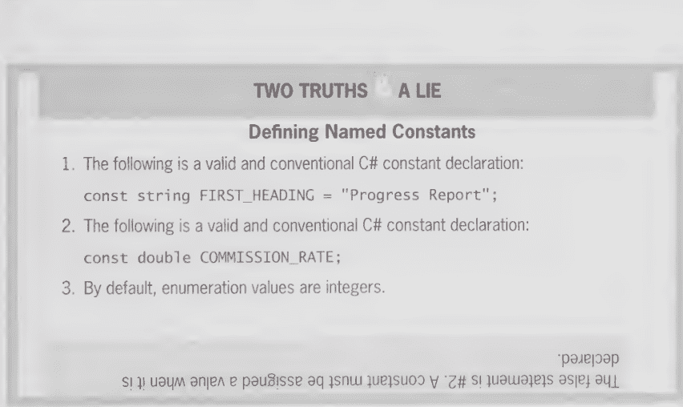

## 接收控制台输入

允许用户输入的程序是交互式程序。你可以使用 `ReadLine` 方法创建一个从键盘接收用户输入的交互式程序。该方法接收用户按下回车键之前输入的所有字符。

这些字符可以被赋值给字符串。例如，以下语句接收用户的输入并将其存储在变量 `myString` 中：

```csharp
myString = ReadLine();
```

`Read()` 方法与 `ReadLine()` 方法类似。`Read()` 从输入流中读取一个字符，而 `ReadLine()` 读取输入流中的每个字符直到用户按下回车键。

> 在 C# 6.0 发布之前，需要限定的 `Console.ReadLine()` 和 `Console.Read()`。然而，就像 `WriteLine()` 和 `Write()` 一样，现在可以包含 `using static System.Console;`

如果你想将输入值作为字符串以外的类型，必须使用转换将输入字符串转换为相应的类型。有两种方法用于转换：Convert 类和 `Parse()` 方法。

### 使用 Convert 类

图 20 显示了一个交互式程序，它提示用户输入并计算销售税。程序在屏幕上显示价格。注意两个语句：

- `using System;` 以包含 Convert 类
- `using static System.Console;` 以包含 `ReadLine()` 和 `WriteLine()` 方法

注意，程序使用了 `Write()` 语句而不是 `WriteLine()` 语句，以便用户的输入出现在提示符的同一行。在提示符出现后，`ReadLine()` 语句接收字符串并赋值给变量 `itemAsString`。

```cs
using System;
using static System.Console;
class InteractiveSalesTax
{
    static void Main()
    {
        const double TAX_RATE = 0.06;
        string itemAsString;
        double itemPrice;
        double total;
        Write("Enter the price of an item >> ");
        itemAsString = ReadLine();
        itemPrice = Convert.ToDouble(itemAsString);
        total = itemPrice * TAX_RATE;
        WriteLine("With a tax rate of {0}, {1} item costs {2}", TAX_RATE, total);
    }
}
```

图 20 InteractiveSalesTax 程序

> 在图 20 的程序中，提示处的括号不是要求的；它们只是为了美观。你可能更喜欢使用冒号、省略号或连字符等标点符号。

```
C# Chapter 2
InteractiveSalesTax
Enter the price of an item >> 28.99
With a tax rate of 6%, $28.99 item costs $1.74
```

图 21 InteractiveSalesTax 程序的典型执行

作为快捷，你可以避免在图 20 程序中声明和使用变量 `itemAsString`。相反，可以通过嵌套 `ReadLine()` 和 `ToDouble()` 方法一步接受并转换输入字符串：

```cs
itemPrice = Convert.ToDouble(ReadLine());
```

表 2-6 显示了你可以将字符串转换为额外有用数据类型的 Convert 方法。这些方法使用了系统类型（也称为运行时类型）。例如，回想表 2-1，`int` 的正式名称是 `Int32`，因此你将字符串转换为 `int` 的方法名为 `Convert.ToInt32()`。

| 方法 | 说明 |
|---|---|
| ToBoolean() | 将指定值转换为布尔值 |
| ToByte() | 将指定值转换为 8 位无符号整数 |
| ToChar() | 将指定值转换为 Unicode 字符 |
| ToDecimal() | 将指定值转换为小数 |
| ToDouble() | 将指定值转换为双精度浮点数 |
| ToInt16() | 将指定值转换为 16 位有符号整数 (short) |
| ToInt32() | 将指定值转换为 32 位有符号整数 (int) |
| ToInt64() | 将指定值转换为 64 位有符号整数 (long) |
| ToSByte() | 将指定值转换为 8 位有符号整数 |
| ToSingle() | 将指定值转换为单精度浮点数 |
| ToString() | 将指定值转换为等效字符串表示 |
| ToUInt16() | 将指定值转换为 16 位无符号整数 |
| ToUInt32() | 将指定值转换为 32 位无符号整数 |
| ToUInt64() | 将指定值转换为 64 位无符号整数 |

表 2-6 选定的 Convert 类方法

### 使用 Parse() 方法

作为 Convert 类方法的替代方案，你可以使用 `Parse()` 方法将字符串转换为数字。例如，将图 20 InteractiveSalesTax 程序中的字符串转换为 `double`，可以将 `Convert.ToDouble` 语句替换为以下任一 `Parse()` 方法语句：

```cs
itemPrice = double.Parse(itemAsString);
itemPrice = Double.Parse(itemAsString);
```

这两个语句都使用了 `Double` 类中定义的 `Parse()` 方法。你可以使用系统类型 `Double` 或其简单类型 `double`。任何版本都会将括号内的字符串转换为正确的数据类型。

其他数据类型也有类似的方法，例如 `int.Parse()` 和 `boolean.Parse()`。例如，以下语句任一都可以读取整数并存储在名为 `score` 的变量中，而不使用临时字符串持有输入值：

```cs
score = int.Parse(ReadLine());
score = Int32.Parse(ReadLine());
```

Convert 和 `Parse()` 技术之间存在一些性能差异，但这些差异是微小的且相对偏技术性的。在你学习更多 C# 知识之前，你应该使用导师或组织首选的方法。

parse（解析）一词的意思是拆分为各个组成部分。语法学家会谈论“解析句子”——对其进行解构以描述其语法组件。解析字符串则是将其转换为对应的数值等效值。

## 三真一假

### 接收控制台输入

- 1. 以下是合法的：

```csharp
int age = Convert.ToInt2(ReadLine());
```

- 2. 以下是合法的：

```csharp
double payRate = Convert.ToDouble(ReadLine());
```

- 3. 以下是合法的：

```csharp
int dependents = int.Parse(ReadLine());
```

> `integer` 是 `Int32`。错误的陈述是 #1。Convert 类用于将字符串转换为一个

## 你来做

### 编写一个接受用户输入的程序

在接下来的步骤中，你将编写一个交互式程序，允许用户输入两个整数值。程序随后计算并显示它们的和。

1. 打开一个名为 InteractiveAddition 的新文件，并输入 Main() 方法所需的前几行：

```csharp
using System;
using static System.Console;
class InteractiveAddition
{
    static void Main()
    {
```

2. 为两个字符串声明变量，以接收用户的输入值。还声明三个整数，用于字符串输入值的数值等效值以及它们的和。

```csharp
string name, firstName, secondString;
int first, second, sum;
```


# 第2章 使用数据

## 你来做

### 编写一个接受用户输入的程序

在接下来的步骤中，你将编写一个交互式程序，允许用户输入两个整数值。程序随后计算并显示它们的和。

#### 1. 打开一个名为 `InteractiveAddition` 的新文件，并输入 `Main()` 方法所需的前几行：

```csharp
using System;
using static System.Console;
class InteractiveAddition
{
    static void Main()
    {
```

#### 2. 为两个字符串声明变量，以接收用户的输入值。还声明三个整数，用于字符串输入值的数值等效值以及它们的和。

```csharp
string name, firstString, secondString;
int first, second, sum;
```

#### 3. 提示用户输入姓名，将其接收到 `name` 字符串中，然后向用户显示个性化的问候，并显示对第一个整数值的提示。

```csharp
Write("Enter your name... ");
name = ReadLine();
Write("Hello {0}! Enter the first integer... ", name);
```

#### 4. 将用户的输入接收为字符串，然后将输入字符串转换为整数。

```csharp
firstString = ReadLine();
first = Convert.ToInt32(firstString);
```

#### 5. 添加语句提示第二个字符串并将其转换为整数。

```csharp
Write("Enter the second integer... ");
secondString = ReadLine();
second = Convert.ToInt32(secondString);
```

#### 6. 将两个整数之和赋值给 `sum` 变量并显示所有值。为 `Main()` 方法和类添加右大括号 `}`。

```csharp
sum = first + second;
WriteLine("{0}, the sum of {1} and {2} is {3}", name, first, second, sum);
}
```

#### 7. 保存、编译并运行程序。在收到提示时，提供你的姓名和想要的整数，并确认结果显示正确。图 2-22 显示了程序的典型运行情况。


图 2-22 InteractiveAddition 程序的典型执行

## 章节总结

- 常量是程序编译后无法更改的数据值；变量中的值是可以更改的。C# 提供了 15 种内置数据类型。变量声明包括数据类型、标识符、可选的赋值和分号。
- 你可以使用 `WriteLine()` 或 `Write()` 方法中的变量名来显示变量。为了让输出变得更容易，你可以使用格式字符串将字符串和变量合并到单个 `Write()` 或 `WriteLine()` 语句中。
- C# 支持多种整数数据类型：`byte`、`short`、`ushort`、`int`、`uint`、`long` 和 `char`。
- C# 支持三种浮点数据类型：`float`、`double` 和 `decimal`。你可以通过格式化并使用精度规范将浮点数据显示为指定的小数位数。
- 你使用算术运算符 `+`、`-`、`*`、`/` 和 `%` 来处理程序中的值。在表达式中，乘法、除法和取模的优先级高于加减法，除非你使用括号覆盖默认优先级。C# 提供了几种快捷算术运算符、二元运算符 `+=`、`-=`、`*=`、`/=` 以及一元前缀增 (`++`) 和递减 (`--`) 运算符。
- `bool` 变量只能持有两个值之一——`true` 或 `false`。C# 支持六种比较运算符：`>`、`<`、`<=`、`>=`、`==` 和 `!=`。包含比较运算符的表达式具有布尔值。
- 当你对相同类型的变量或常量进行算术运算时，结果保留该类型。当你对不同类型的操作数进行算术运算时，C# 为结果选择一个统一类型，并隐式将不匹配的操作数转换为统一类型。你可以通过执行强制转换覆盖统一类型。
- 你使用 `char` 类型来持有单个字符。你将单引号内的常量值（包括退格键或制表符）放在 `char` 变量中。为了存储这些字符，必须使用以反斜杠开头的转义序列。
- 在 C# 中，你使用 `string` 数据类型来持有一系列字符。虽然 `==` 和 `!=` 运算符用于字符串，你还可以使用 `Equals()`、`CompareTo()` 和 `Substring()` 方法。

## 三真一假

### 接收控制台输入

- 1. 以下是合法的：

```csharp
int age = Convert.ToInt2(ReadLine());
```

- 2. 以下是合法的：

```csharp
double payRate = Convert.ToDouble(ReadLine());
```

- 3. 以下是合法的：

```csharp
int dependents = int.Parse(ReadLine());
```

> `integer` 是 `Int32` 的别名。错误的陈述是 #1。`Convert` 类用于将字符串转换为一个值。

## 关键术语

- **比较运算符** 比较两个项目；包含比较运算符的表达式具有布尔值。
- **统一类型** 是在当操作数类型不同时，为算术运算结果所选择的类型。
- **隐式** 意味着自动地。
- **类型优先级** 是数据类型的分级结构，用于确定包含不同类型数据类型的算术表达式中的统一类型。
- **隐式转换** 或 **隐式类型转换** 是将值赋值给优先级更高的类型时发生的自动转换。
- **显式** 意味着有目的地。
- **显式类型转换** 是有目的地将值赋值给不同的数据类型；它涉及将所需的结果类型放在括号中，随后跟上要转换的变量或常量。
- **char 数据类型** 可以存储任何单个字符；字面量字符包含在单引号之间。
- **转义序列** 是以反斜杠开头的两个符号，表示如制表符之类的非打印字符。
- **十六进制** 或 **16 进制** 是一种使用 16 个符号表示数字的数学系统。
- **string 数据类型** 用于存储一系列字符；字面量字符串包含在双引号内。
- **词法** 意味着在字母顺序上。
- **不可变** 描述的是不变的对象，例如字符串，当赋值新值时它们引用的是新的内存位置。
- **命名常量** 是一个标识符，其值在声明时必须赋值，且内容不能更改。
- **自文档程序元素** 是指能够自解释的元素。
- **枚举** 是一个由标识符表示的常量集。
- **类型安全** 描述仅允许适当行为的数据类型。
- **交互式提示** 是允许用户输入的提示。
- **提示** 是要求用户输入数据的指令。
- **解析** 一个项目是指将其拆分为组成部分。

## 复习题

- 1. 当你在 C# 程序中使用像 `45` 这样的数字时，该数字是一个
  - a. 字面量常量
  - b. 形象常量
  - c. 字面量变量
  - d. 形象变量

- 2. 变量声明必须包含以下所有内容，除了：
  - a. 数据类型
  - b. 标识符
  - c. 赋值值
  - d. 结束分号

- 3. 关于变量声明，以下哪项是正确的？
  - a. 两个相同类型的变量可以在同一语句中声明
  - b. 两个不同类型的变量可以在同一语句中声明
  - c. 两个相同类型的变量必须在同一语句中声明
  - d. 两个相同类型的变量不能在程序中共存

- 4. 假设你有两个声明为 `int var1 = 3;` 和 `int var2 = 8;` 的变量。以下哪个会显示 `838`？
  - a. `WriteLine("{0}{1}{2}", var1, var2)`
  - b. `WriteLine("{0}{1}{0}", var1, var2)`
  - c. `WriteLine("{0}{1}{2}", var2, var1)`
  - d. `WriteLine("{0}{1}{0}", var2, var1)`

- 5. （原文缺失题目 5，此处按原文结构保留编号跳过）

- 6. 假设你有一个声明为 `int var1 = 3;` 的变量。`22 % var1` 的值是多少？
  - a. 0
  - b. 1
  - c. 7
  - d. 21

- 7. 假设你有一个声明为 `int var1 = 3;` 的变量。`22 / var1` 的值是多少？
  - a. 1
  - b. 7
  - c. 7.333
  - d. 21

- 8. 表达式 `4 + 2 * 3` 的值是多少？
  - a. 0
  - b. 10
  - c. 18
  - d. 36

- 9. 假设你有一个声明为 `int var1 = 3;` 的变量。如果 `var2 = ++var1`，`var2` 的值是多少？
  - a. 2
  - b. 3
  - c. 4
  - d. 5

- 10. 假设你有一个声明为 `int var1 = 3;` 的变量。如果 `var2 = var1++`，`var2` 的值是多少？
  - a. 2
  - b. 3
  - c. 4
  - d. 5

- 11. 能够存储 `true` 和 `false` 两个值的变量类型是
  - a. `int`
  - b. `bool`
  - c. `char`
  - d. `double`

- 12. 下列哪项不是 C# 比较运算符？
  - a. `=>`
  - b. `=`
  - c. `==`
  - d. `<`

- 13. 表达式 `6 >= 7` 的值是多少？
  - a. 0
  - b. 1
  - c. `true`
  - d. `false`

- 14. 下列哪种 C# 类型不能包含浮点数？
  - a. `float`
  - b. `double`
  - c. `decimal`
  - d. `int`

- 15. 假设你声明了一个变量 `double hourly = 13.00;`。语句 `WriteLine(hourly);` 将显示什么？
  - a. 13
  - b. 13.0
  - c. 13.00
  - d. 13.000000

- 16. 假设你声明了一个变量 `double salary = 45000.00;`。以下哪项会显示 `$45,000`？
  - a. `WriteLine(salary.ToString("c"))`
  - b. `WriteLine(salary.ToString("c0"))`
  - c. `WriteLine(salary)`
  - d. 以上两个均是

- 17. 当你对不同类型的操作数进行算术运算时，
  - a. C# 为结果选择一个统一类型
  - b. 你必须为结果选择一个统一类型
  - c. 你必须提供类型转换
  - d. 你会收到错误

- 18. Unicode 是，
  - a. 一种面向对象的语言
  - b. C# 语言的子集
  - c. 一种 16 位编码方案
  - d. 另一个术语

- 19. 以下哪项声明了一个可以存储单词 `computer` 的变量？
  - a. `string device = 'computer';`
  - b. `string device = "computer";`
  - c. `char device = 'computer';`
  - d. `char device = "computer";`

- 20. 以下哪个通过比较两个变量来判断是否相等？
  - a. `string1 = string2`
  - b. `string1 == string2`
  - c. `Equals(string1, string2)`
  - d. `string1 != string2`

## 编程题

### 16. 编写一个名为 `FahrenheitToCelsius` 的程序，接受用户输入的华氏度温度，并通过从华氏度值减去 32 并将结果乘以 5/9 转换为摄氏度。显示这两个值。

### 17. 编写一个名为 `Payroll` 的程序，提示用户输入姓名、社会安全号码、时薪和工作小时数。以美观的格式（类似于图 2-23）显示所有输入数据以及以下内容：

- 总工资，定义为时薪 × 工作小时数
- 联邦预扣税，定义为总工资的 15%
- 州预扣税，定义为总工资的 5%
- 净工资，定义为总工资减去总税款

```text
C:\CH>Chapter.02>Payroll
Enter your name: Ruth Roberts
Social Security number: 987-65-4320
hourly pay rate: 13.50
hours worked: 36
Payroll Summary for: Ruth Roberts
SSN: 987-65-4320
You worked 36 hours at $13.50 per hour
Gross pay: $486.00
Federal withholding: $72.90
State withholding: $24.30
Net pay: $308.80
C:\CH>Chapter.02>
```

图 2-23 Payroll 程序的典型执行

### 18. 创建一个枚举 `Month`，持有全年各月份的值，从 `JANUARY` 等于 1 开始。编写一个名为 `MonthNames` 的程序，提示用户输入一个整数。将用户的输入转换为 `Month` 值并显示。

### 19. 创建一个名为 `Planet` 的枚举，持有太阳系中八大行星的名称，从 `MERCURY` 开始到 `NEPTUNE` 结束。编写一个名为 `Planets` 的程序，提示用户输入一个数字位置，并显示该位置对应的行星名称。

### 20. 猪拉丁语是一种胡言语。要创建一个猪拉丁语单词，你需要移除第一个字母并在单词末尾添加 "ay"。例如，“dog” 变成 “ogday”，“cat” 变成 “atcay”。编写一个名为 `PigLatin` 的程序，允许用户输入单词并显示其猪拉丁语版本。

## 调试练习题


# 练习与案例分析

## 1. 修复学生文件中的错误

在可下载的学生文件的 `Chapter_02` 文件夹中的以下每个文件都有语法和/或逻辑错误。在每种情况下，确定问题并修复程序。修正错误后，使用相同的文件名并在其前加上 `Fixed` 保存每个文件。例如，`DebugTwo1.cs` 将变为 `FixedDebugTwo1.cs`。

- a. `DebugTwo1.cs`
- b. `DebugTwo2.cs`
- c. `DebugTwo3.cs`
- d. `DebugTwo4.cs`

## 2. 案例分析

1. 在第 1 章中，你创建了两个程序来显示 Greenville Idol 比赛的格言，该比赛每年夏天在格林维尔县览会期间举行。现在编写一个名为 `GreenvilleRevenue` 的程序，提示用户输入去年和今年比赛的参赛人数。显示所有输入数据。计算如果每位参赛者支付 25 美元的报名费，今年比赛的预期收入并显示。还要显示一条语句，说明今年的比赛参赛人数是否多于去年。

2. 在第 1 章中，你创建了两个程序来显示 Marshall's Murals 的格言。现在编写一个名为 `MarshallRevenue` 的程序，提示用户输入下个月要绘制的内部和外部壁画数量。计算每种壁画的预期收入。内部壁画每幅花费 500 美元，外部壁画每幅花费 750 美元。还要显示总预期收入以及一条语句，说明计划的内部壁画是否多于外部的。

# 第 3 章 使用 GUI 对象和 Visual Studio IDE

## 本章学习目标

在本章中，你将：

- 在 Visual Studio IDE 中创建表单（`Form`）
- 使用工具箱（`Toolbox`）向表单添加按钮（`Button`）
- 向表单添加标签（`Label`）和文本框（`TextBox`）
- 为表单和控件命名
- 修正错误
- 决定使用哪种界面

## 3.1 概述

你已经学会了编写简单的 C# 程序，这些程序可以在控制台接受用户输入并在命令行产生输出。用户看到的环境是程序的界面；遗憾的是，你编写的应用程序中的界面目前非常单调。大多数现代应用程序使用视觉上良好的图形对象与用户交互。这些图形用户界面（GUI）对象包括你在与 Windows 类型程序交互时，通过鼠标、触摸屏或键盘操作或控制的标签、按钮和文本框。

在第 1 章中，你学习了当编写控制台应用程序时，可以使用简单的文本编辑器（如记事本），或者使用 Visual Studio 集成开发环境（IDE）。从技术上讲，编写 GUI 程序时也有相同的选择。然而，创建即使是最简单的 GUI 程序也需要大量的代码，因此在 IDE 中视觉化地开发用户界面要实用得多。这种方法允许 IDE 自动生成你开发易用 GUI 程序所需的大部分代码。

在 .NET 之前的 Visual Studio 版本中，C#、C++ 和 Visual Basic 各都有自己的 IDE，因此你每使用一种编程语言都必须学习一个新环境。现在，你可以使用一个 IDE 为所有支持的语言创建项目。

## 3.2 创建表单

表单是矩形对象，提供了一个收集、显示和传递信息的界面。虽然不是强制性的，但表单总是包含标签、按钮和文本框。要视觉化地创建表单，启动 Visual Studio，选择“新建项目”（`New Project`），然后选择“表单”（`Forms`），如图 3-1 所示。应用程序的名称是默认的，你可以更改它。

### 3.2.1 在 IDE 中创建表单

当你创建一个 Windows Forms 项目时，Visual C# 会向项目添加一个表单并将其命名为 `Form1`。当你点击表单设计器区域的表单后，你可以在图 3-3 所示的位置看到表单名称：

- 在表单设计器区域顶部文件夹页签上（后跟“[设计]”字）
- 在表单设计器区域的标题栏中
- 在解决方案管理器（`Solution Explorer`）文件列表中（带有 `.cs` 扩展名）
- 在属性窗口的顶部，显示列出的是 `Form1` 的属性
- 作为属性窗口中列出的 `Text` 属性的内容

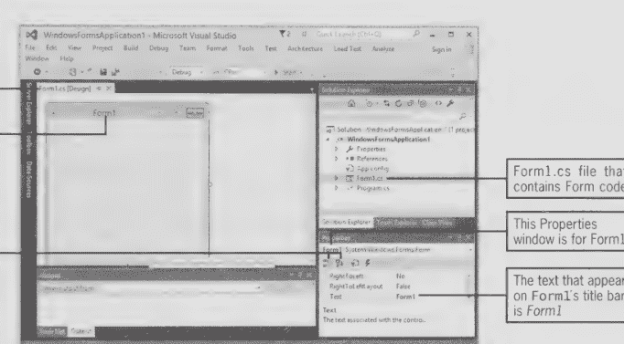

你可以滚动属性窗口中的属性列表。例如，列出了 `Size`、`Text` 和 `Font`。如果你点击某个属性，属性窗口的底部会显示该属性的简要描述。例如，图 3-3 显示了 `Form1` 的 `Text` 属性的描述。

你可以通过设置属性来更改表单的外观、大小、颜色和窗口管理功能。`Form` 类包含约 100 个属性；表 3-1 列出了你可以更改的一些 `Form` 特性。例如，`Text` 属性允许你指定标题栏中表单的标题，而设置 `Size`、`BackColor` 和 `Color` 则允许你进一步自定义表单。属性列表顶部的两个按钮允许你按类别或字母顺序组织属性。并不是每个可以与表单一起使用的属性都会出现在 Visual Studio IDE 的属性窗口中——它只列出了最常用的属性。

### 表 3-1 Form 的常用属性

| 属性名称 | 描述 |
| --- | --- |
| `AcceptButton` | 获取或设置当用户按下 Enter 键时，被点击的表单按钮 |
| `BackColor` | 获取或设置表单的背景颜色 |
| `CancelButton` | 获取或设置当用户按下 Esc 键时，被点击的按钮控件 |
| `Foreground` | 获取或设置表单的前景颜色 |
| `Name` | 获取或设置表单的名称 |
| `Size` | 获取或设置表单的大小 |
| `Text` | 获取或设置与控件关联的文本 |
| `Visible` | 获取或设置一个指示控件是否可见的值 |

属性窗口中列出的某些属性在属性名称左侧有一个小小的加号。这是一个你可以点击它来展开或折叠属性的节点。例如，如果你点击 `Size` 节点，你将看到一个展开的列表，单独显示 `Size` 的两个部分（宽度和高度）。该节点将变为减号，然后你可以点击它来折叠展开的列表。

当你在属性窗口中按字母顺序对属性时，`Name` 条目并不是按字母顺序排列的——它出现在列表顶部。`Name` 出现在括号中是因为左括号的值比 `A` 小，所以属性列表按字母顺序排序时，`Name` 位于顶部且易于找到。（左括号的 Unicode 值低于任何字母文字的 Unicode 值；附录 B 包含了有关 Unicode 的信息。）对于大多数专业级应用程序，你可能希望为表单提供一个比 `Form1` 更具描述性的名称。

请勿将表单的 `Name` 与其 `Text` 属性混淆。如果你更改了表单的 `Name`，你不会在视觉设计上观察到任何变化，但代码中对表单的所有引用都会发生变化。因此，表单的属性是一个标识符，它必须遵循变量命名规则。这意味着，例如，表单的 `Name` 不能包含空格，且不能以数字开头。然而，表单的 `Text` 是显示在标题栏中的内容，它可以是任何字符串。例如，在一个会计应用程序中，你可能会将表单的 `Text` 命名为 `Budget`。在第 2 章中，你学习了用引号来编码字符串。虽然表单的 `Text` 是字符串，但你在属性列表中为 `Text` 输入值时，不需要输入引号。但是，当你查看 C# 代码时，你会看到值周围有引号。

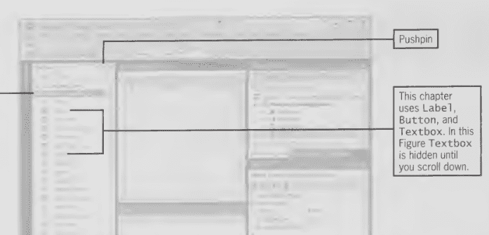

1. Visual Studio IDE 允许你使用视觉环境设计 Forms。
2. Visual Studio 的一些关键功能包括工具箱、表单设计器和解决方案管理器。当你在文件夹中创建第一个 Forms 项目时，Visual C# 默认将其命名为 `Form1`。当你打开 IDE 时，左侧边界显示工具箱。（如果你没有看到页签，可以从 IDE 菜单中选择 `View`（视图）然后 `Toolbox`（工具箱）。）当你打开工具箱时，会显示工具列表。当鼠标移开时，列表会自动关闭，或者你可以点击顶部的固定图标使其保持可见。当你固定工具箱时，表单移动到右侧。在 IDE 的工具箱顶部选择 `Forms` 会显示完整的工具列表；选择 `Common Controls`（常用控件）会显示一个较小的子列表。如图 3-4 所示，`Common Controls` 列表包含许多你可以点击或操作的控件——例如 `Button` 和 `CheckBox`。你可以将控件拖到 `Form` 上。本章仅介绍了工具箱中的三个控件——`Label`、`Button` 和 `TextBox`。你将在“使用控件”章节中学习其他控件。Visual C# 中的所有窗口都可以停靠、隐藏或移动到新位置。要更改窗口的行为，点击标题栏上的向下箭头或固定图标，并从可用选项中选择。你可以通过点击 `Tools` 菜单然后选择 `Options` 来自定义 IDE 的多个方面。要将窗口重置为原始状态，点击 Visual Studio 栏上的 `Window`（窗口），然后点击 `Layout`（布局）。

你可以将控件拖到你认为最有用或有助于美观设计的 `Form` 上。控件位于 `Form` 上后，你可以通过拖动来重新定位，或者通过选择它并按下键盘上的 `Del` 键来删除控件。你也可以通过右键点击控件并从出现的菜单中选择 `Delete`（删除）选项来删除。

在图 3-5 中，程序员将一个按钮拖到了 `Form` 上。默认情况下，它的 `Name` 是 `button1`。你可能猜如果拖入第二个 `Button`，它的 `Name` 会变成 `button2`。在专业应用程序中，你可能希望将 `Button` 的 `Name` 属性更改为唯一且易记的标识符。

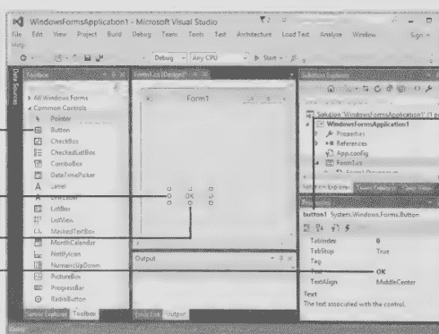

在图 3-5 中，程序员点击了 `button1`，因此属性窗口显示 `button1` 的属性。（如果你点击 `Form`，属性窗口将变为显示 `Form` 而不是 `Button` 属性。）`button1` 的 `Text` 属性已更改为 `OK`，`Form` 上的按钮具有用于调整大小的手柄。你可以滚动属性列表并检查可以为 `Button` 修改的其他属性。例如，你可以更改它的 `BackColor`、`Font` 和 `Size`。表 3-2 描述了 `Button` 对象可用的一些属性。本章仅讨论每个控件的少数属性。你可以在“使用控件”章节中学习其他属性。

### 表 3-2 Button 的常用属性

| 属性名称 | 描述 |
| --- | --- |
| `BackColor` | 获取或设置控件的背景颜色 |
| `Enabled` | 获取或设置控件是否启用 |
| `Font` | 获取或设置控件的当前字体 |
| `Foreground` | 获取或设置控件的前景颜色 |
| `Name` | 获取或设置控件的名称 |
| `Size` | 获取或设置控件的大小 |
| `Text` | 获取或设置与控件关联的文本 |
| `Visible` | 获取或设置一个指示控件是否可见的值 |

你可以点击 `Form` 上的控件以在属性窗口中显示其属性列表。或者，你可以点击属性列表顶部显示的当前控件名称旁边的箭头，并从下拉列表中选择要查看的控件。见图 3-5。

## 3.3 为 Form 上的按钮添加功能

使用 IDE 时，为 `Button` 添加功能非常简单。当你将 `Button` 拖到 `Form` 上后，可以双击它来创建一个方法，该方法会在用户点击 `Button` 时执行。例如，如果你将 `Button` 拖到 `Form` 上且没有更改其默认名称 `button1`，那么在双击按钮时会自动生成代码，如图 3-6 所示。（图中的窗口已通过拖动边界调整了大小，以便你可以看到更多代码。）通过从菜单中选择 `View`（视图）然后 `Designer`（设计器）可以查看表单设计器。然后，通过选择 `View`（视图）和 `Code`（代码）可以返回代码窗口。

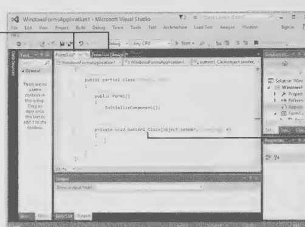

当你双击一个按钮来生成点击方法时，你实际上是在为按钮的默认事件生成代码。点击是按钮的默认事件，因为用户通常期望点击按钮。随着你对 C# 的深入学习，你会发现可以为 `Button` 编写事件。例如，你可能希望在用户双击或右键点击按钮时执行特定操作。

如果你滚动查看暴露的代码，你会看到许多生成的语句，其中一些令你感到困惑。然而，为了让按钮执行操作，你可以忽略大多数语句。你只需要在具有以下头部的方法大括号之间编写代码即可：

```csharp
private void button1_Click(object sender, EventArgs e)
```

与其自动生成在用户点击按钮时执行的方法，你可以自己编写它。但是，你必须更深入了解方法和事件处理程序，因为项目的其他地方也会自动编写代码，将 `Form` 上的按钮链接到该方法。你将在后面的章节中学习这些主题。

你已经在控制台应用程序中见过以下方法头：

```csharp
static void Main()
```

GUI 也包含一个自动创建的 `Main()` 方法；你可以通过打开应用程序部分的 `Program.cs` 文件看到它。

### 3.3.1 使用工具箱向表单添加按钮

`Click()` 方法和 `Main()` 方法头都使用了返回值类型，但方法在以下方面有所不同：

- `buttonClick` 方法具有 `private` 访问修饰符。访问修饰符是一个规定哪些类型的外部类可以使用该方法的关键字。默认情况下，Visual Studio 将 `buttonClick` 方法设为私有，这限制了其他类使用它的能力，你可以删除该方法，并发现按钮的工作方式没有变化。你将在书中学习更多关于访问修饰符的知识。
- `Main()` 方法是静态的（`static`），而 `buttonClick()` 方法不是。静态方法不需要对象即可执行。`buttonClick()` 方法不能是静态的，因为它需要一个对象，即它运行所在的 `Form`。“使用类和对象”章节提供了关于 `static` 关键字的更多细节。
- `Main()` 方法头的括号之间没有参数，但 `buttonClick()` 方法有两个用逗号分隔的参数。这代表了关于导致方法执行的事件的信息（用户点击按钮）。当用户与 GUI 对象交互时，会生成一个事件导致程序执行任务。当用户点击按钮时，该操作会触发点击事件，导致按钮的 `Click()` 方法执行。本章仅讨论点击事件。你将在“事件处理”章节中学习事件。

如果你在 IDE 中更改了对象的 `Name` 属性，其创建的 `Click()` 方法的名称也会自动更改。例如，如果你在属性列表中将 `button1` 重命名为 `okButton` 并双击它，生成的方法名称将是 `okButton_Click()`。

如果你将按钮的 `Name` 从 `button1` 更改，然后在 `Form` 上放置第二个按钮，则新按钮将命名为 `button1`。如果你保留第一个按钮的默认名称为 `button1`，那么放置在 `Form` 上的第二个按钮将命名为 `button2`，其默认 `Click()` 方法命名为 `button2_Click()`。C# 会根据其关联对象的名称为每个按钮自动创建一个方法。在本章稍后的部分，你将学习如果在创建事件方法并更改控件名称时该如何处理。

你并不要求为按钮创建一个 `Click()` 方法。如果由于某种原因，你不希望在用户点击按钮时执行任何操作，你只需不在程序中包含该方法即可。或者，你可以创建一个在大括号内没有任何语句的空方法。然而，这些选择是不寻常且糟糕的编程实践——你通常在 `Form` 上放置按钮是因为你期望它在某时刻被点击。如果你不让控件按预期方式工作，这将让你感到沮丧。


```csharp
private void button1_Click(object sender, EventArgs e)
{
    int num1;
    int num2;
    int sum;
    num1 = Convert.ToInt32(textBox1.Text);
    num2 = Convert.ToInt32(textBox2.Text);
    sum = num1 + num2;
    label1.Text = "Sum is " + sum;
}
```

你可以通过选择菜单栏中的“调试”（`Debug`）并点击“不调试启动”（`Start Without Debugging`）从 IDE 运行程序。（另一种方法是，按住 `Ctrl` 键并按 `F5`。）图 3-11 显示了程序执行时 `Form` 的外观，以及用户输入数字并点击按钮后的结果。设计程序的阶段称为设计时（`design time`）。当你执行程序时，该阶段被称为运行时（`runtime`）。

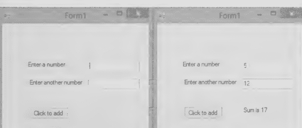

你可以更改 `Form` 中一个或两个 `TextBox` 的值，并点击按钮查看新结果。当你完成程序的使用后，可以点击 `Form` 右上角的关闭按钮将其关闭。

## 3.4 理解焦点和制表键控制

当 GUI 程序显示 `Form` 时，`Form` 上的组件之一具有焦点。具有焦点的控件是能够接收键盘输入的控件。当按钮具有焦点时，周围会出现一条细细的亮线以吸引你的注意力，当你点击按钮或按下键盘上的 `Enter` 键时，与按钮相关的事件就会执行。当 `TextBox` 具有焦点时，内部会出现一个闪烁的光标。


# 第 3 章 使用 GUI 对象和 Visual Studio IDE

## Tab 顺序与焦点控制

当应用程序运行时，用户可以通过点击组件来赋予该组件焦点，也可以使用 `Tab` 键在不同组件之间切换。控件接收连续 `Tab` 键按下的顺序是它们的 Tab 顺序。默认情况下，控件根据你在设计程序时将其放在 Form 上的顺序分配 Tab 顺序。放置在 Form 上的第一个控件 `TabIndex` 为 0，下一个控件 `TabIndex` 为 1，依此类推。当你启动程序时，`TabIndex` 为 0 的控件会自动获得焦点。你可以通过查看 IDE 中的属性列表检查控件的 Tab 顺序。如果你不希望某个控件成为 Form 制表序列的一部分，可以在属性列表中将其 `TabStop` 属性更改为 `false`。

你可以通过更改 IDE 属性列表中 `TabIndex` 旁边的条目来更改 `TabIndex` 值。或者，你可以从菜单栏中选择“视图”并选择“制表顺序”。你会看到 Form 的表示，每个控件旁边都有一个小的蓝色数字来表示 Tab 值。要更改控件的焦点顺序，只需按所需的顺序点击每个控件。再次选择“视图”然后选择“制表顺序”即可移除蓝色数字。

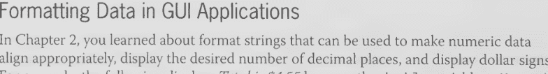

> 查看视频：Visual Studio 的自动生成代码。

## 在 GUI 中格式化数据

在第 2 章中，你学习了格式化字符串，这些字符串可以用于使数值数据适当对齐、显示所需的小数位数以及显示美元符号。例如，下面的代码显示“Total is $4.55”，这使得 `double` 类型变量 `money` 被转换为货币格式并放置在字符串的位置 0：

```csharp
double money = 4.558;
string mySentence = String.Format("Total is {0}", money.ToString("C"));
WriteLine(mySentence);
```

你可以使用相同的 `String.Format()` 方法在你的 GUI 应用程序中创建格式化字符串。例如，假设你通过类似下所示语句从 `TextBox` 中获取了 `double` 值：

```csharp
double money = Convert.ToDouble(textBox1.Text);
```

你可以使用类似下所示的语句在标签上显示带有解释性文本以及带有两位小数的货币格式的数值：

```csharp
label1.Text = String.Format("The money value is {0}", money.ToString("C2"));
```

如有必要，你还可以对分配给 `label` 等控件的字符串进行字符转义。例如，可以使用以下代码创建一个两行的标签：

```csharp
label1.Text = "Hello\nthere";
```

## 更改标签的字体

控件的字体在本章较早的表 3-2 中已简要描述。你将在第 12 章中学习更多关于此属性的知识，但你可能想尝试它来对齐数字。

当你点击 Form 并检查其属性列表时，发现控件的默认字体是 Microsoft Sans Serif。这种字体是比例字体，这意味着不同的字符具有不同的像素或宽度。例如，`w` 比 `i` 宽。比例字体的反面是等宽字体，每个字符具有相同的宽度。你可能希望使用等宽字体来对齐控件上的文本值。例如，当你在 `Label` 上堆叠 `$11.11` 和 `$88.88` 时，你通常希望字符具有等宽，以便数值对齐。

要更改 `Label` 的字体，选择 `Font` 属性的小框。例如，`Courier New` 和 `Consolas` 是流行的等宽字体。

## 为 Form 和控件命名

通常情况下，你会在添加控件时为它们命名。如果你在为控件创建事件后重命名它，程序仍然可以工作，但控件的名称不再与其关联的方法对应，导致代码更难以理解。要修复这个问题，你必须重构代码。代码重构是在不改变程序工作方式的情况下更改内部结构的过程。要在更改控件名称后重构代码，请执行以下操作：

1. 在你使用设计器更改控件名称后，切换到代码视图。
2. 右键点击方法 `button1_Click()` 的名称。
3. 从出现的菜单中，点击“重命名”，如图 3-12 所示。

假设你决定将 `button1` 重命名为 `sumButton`。之后当你查看程序代码时，事件方法仍然命名为 `button1_Click()`。要修复此问题，你必须重构代码。

> 当你点击重命名时，`button1_Click` 方法会被高亮，并出现一个标题为“重命名 button1_Click”的框，如图 3-13 所示。
>
> 输入新的方法名（`sumButton_Click`）以替换代码中的 `button1_Click`。
>
> 完成后，你可以勾选“预览更改”复选框，以便在应用之前查看所有更改，尽管此时这些更改对你来说意义不大。点击“应用”或按回车键。“预览更改”对话框将高亮更改。点击“应用”确认更改。

**图 3-13** 重命名 `button1_Click()` 方法

## 修正错误

即使在基于控制台的程序中，当你使用可视化开发者创建 GUI 应用时，经常会产生语法错误。如果你构建或运行包含语法错误的程序，你会在 IDE 的左下角看到“生成失败”。你还会看到如图 3-14 所示的错误对话框。在开发程序时，你应该对“是否要继续并运行上一次成功运行？”始终点击“否”。点击“是”将运行你在插入导致对话框出现的错误之前创建的程序旧版本。相反，应该检查错误消息和代码，并修正错误。


**图 3-14** 编译过程中发生错误时出现的对话框

从菜单栏选择“生成”时，有两个选项：“生成解决方案”和“重新生成解决方案”。“生成”选项仅使用自上次生成以来发生更改的文件，而“重新生成”会处理项目中的所有文件，无论它们是否已更改。“生成解决方案”选项通常足够且速度更快，但如果你对项目的多个部分进行了更改，你可能会选择“重新生成解决方案”以确保所有文件都已更新。

发生错误时，它们将显示在屏幕底部的错误列表中。如果你没有看到错误消息，可以从 IDE 的菜单栏点击“视图”，然后点击“错误列表”。如果列表部分或完全隐藏，你可以向上拖动开发窗口与错误列表之间的分割线，然后点击“错误列表”选项卡。图 3-15 显示了一个预期的单个错误消息，意思是“预期分号”。列表还显示了发生错误的文件和行号。双击错误消息，光标将放置在代码中发现错误的位置。语句末尾缺少红色波浪下划线。在这种情况下，缺少一个分号。你可以修复错误并尝试再次编译。

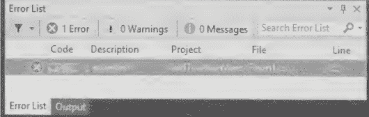

**图 3-15** 错误列表

## 删除不需要的事件处理方法

在 IDE 的表单设计器中工作时，很容易无意中双击控件并自动创建一个你不需要的事件处理方法。例如，你可能会误双击 `Label` 并创建一个方法 `label1Click()`。你可以让这个自动创建的方法为空，这样就不会包含空的空方法。这些从不执行的空方法被称为“孤立方法”。你不应该删除孤立方法，因为在后台，可能已经创建了引用该方法的代码；如果是这样，程序将无法编译。要删除代码，你应该点击带有不需要方法的控件使其显示在“属性”窗口中，然后点击看起来像闪电的“事件”按钮。选择你要消除的事件，并删除方法名称（参见图 3-16）。这将消除所有引用的方法，你的程序可以再次成功运行。

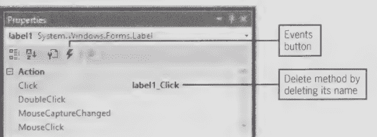

**图 3-16** 删除事件处理方法

## 在尝试运行之前关闭表单

在 IDE 的表单设计器中工作时，请确保在尝试运行项目前关闭表单设计器窗口，以避免潜在的冲突。

## Visual Studio 帮助

你可以通过选择 Visual Studio 菜单栏中的“工具”，然后选择“选项”，为你的代码添加行号引用。使用三角形节点展开“文本编辑器”，然后点击列表中 C# 旁边的项。点击“常规”，勾选“行号”复选框，然后点击“确定”。

## 逻辑错误

对于基于控制台的程序，GUI 应用可能会成功编译但包含逻辑错误。例如，你可能旨在计算程序多次运行的语句中可能输入了减号而不是加号，并仔细检查输出以发现任何逻辑错误。

## 决定使用哪种界面

你已经学会了创建控制台应用程序，大部分操作发生在 `Main()` 方法和 `ReadLine()` 方法中。你还学会了创建 GUI 应用，大部分操作发生在事件处理方法中，如 `Click()` 方法和 `Label`。两种类型的应用程序都可以使用定义的变量和常量，正如你将在接下来的章节中将学习到的，两种类型的程序都可以包含应用程序的基本构建块——决策、循环和对方法的调用。

简而言之，在学习 C# 编程语言的细微之处时，使用哪种界面并不重要。在接下来的“你动手做”部分，你将开发一个与第 1 章中在控制台中开发的程序类似的应用程序。在本章末尾的编程练习中，你将开发与“使用数据”章节中使用控制台编写的程序目的相同的程序。

## 两个真理和一个谎言

### 决定使用哪种界面

1. 控制台应用程序用于声明变量、常量和进行算术运算，但 GUI 应用程序不是。
2. GUI 程序的开发时间通常比对应的控制台程序长，因为你需要花费大量时间来设置和排列控件。
3. 与 GUI 程序相比，控制台程序看起来很单调，但它们通常开发得更快，因为你不需要花费大量时间设置供用户操作的对象。

变量、常量和算术运算。错误的语句是 #1。控制台程序和 GUI 程序都可以使用声明的变量、常量和算术运算。

## 你来做

### 使用 Visual Studio IDE

在接下来的步骤中，你将使用 IDE 创建包含按钮和标签的表单。你在第一章“你来做”部分的第一个控制台应用程序在命令行提示符显示了“Hello, world!”此应用程序将在表单上显示“Hello, Visual World!”

1. 打开 Visual Studio。你可能有一个桌面快捷方式可以双击，或者在 Windows 8.1 中，你可以从右侧滑动，点击搜索，在搜索框中输入 Visual Studio 的前几个字母，并在列表中选择它。如果你使用的是不同版本的 Visual Studio 或不同的操作系统，你的步骤可能与此处列出的略有不同。如果你使用的是学校网络，可能从学校的计算菜单中选择 Visual Studio。
2. 选择新建项目。然后，在新项目窗口中，选择 Visual C# 和 Windows Forms 应用程序（参考图 3-1）。不要使用默认项目名称，使用 `HelloWorld`，并选择存储项目的位置。然后点击确定。

### 使用工具箱向表单添加按钮

3. 打开 `HelloVisualWorld` 开发环境，如图 3-17 所示。空白表单标题栏中的文本包含默认文本 `Form1`。如果你点击表单，它的属性窗口将出现在屏幕的右下角，你可以看到表单的 `Text` 属性被设置为 `Form1`。花一点时间滚动查看属性窗口中的列表，检查表单其他属性的值。例如，`Size` 属性的默认值为 `300, 300`。

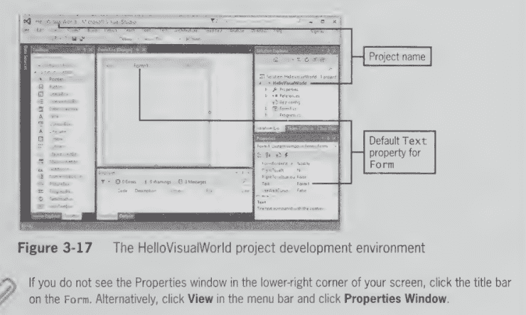

**图 3-17** HelloVisualWorld 项目开发环境

> 如果你在屏幕右下角没有看到属性窗口，请点击表单上的标题栏。或者，点击菜单栏中的视图并点击属性窗口。
>
> 如果你没有看到图 3-17 所示的工具箱，请点击屏幕左侧的工具箱选项卡，然后点击顶部的图钉将工具箱固定到屏幕上。或者，从菜单栏点击视图并点击工具箱。
>
> 如果你在屏幕底部没有看到如图 3-17 所示的错误列表，可以从菜单栏选择视图并选择错误列表。你可能需要向上拖动错误列表与上方的分隔线。

4. 在属性窗口中，将表单的 `Name` 改为 `HelloForm`。（如果你选择对列表分类，`Name` 属性位于设计下；如果你选择按字母顺序显示，则 `Name` 位于顶部。）然后将表单的 `Text` 改为 `Hello Visual World`。按回车键；屏幕中心表单的标题变为 Hello Visual World，如图 3-18 所示。

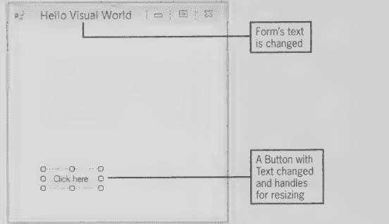

**图 3-18** 修改了 Text 和按钮的表单

5. 检查屏幕左侧的工具箱。如果尚未选中，请选择公共控件。在工具箱中，点击并按住按钮。当你移动鼠标离开工具箱并进入表单时，鼠标指针会变化，看起来像拿着一个按钮。在表单上的任何位置放置鼠标，然后释放鼠标按钮。按钮出现在表单上，并包含文本 `button1`。当你点击按钮时，会出现句柄，你可以拖动它们来调整大小。当你点击表单上按钮以外时，句柄会消失。点击按钮显示 `button1` 的属性。将其 `Name` 改为 `displayOutputButton`，并将其 `Text` 属性改为 `Click here`。当你按下键盘上的 `Enter` 或点击表单上的任何位置时，表单上按钮的文本变为 Click here。见图 3-18。

6. 滚动查看其他 `displayOutputButton` 属性。例如，检查 `Location` 属性。`Location` 的第一个值表示水平位置，第二个值表示垂直位置。将按钮跨越表单拖到新位置。每当你释放鼠标按钮时，表单 `Location` 属性的值都会更新以反映新位置。尝试将按钮拖动到 Location `100, 150`。或者，删除 `Location` 属性字段的内容并输入 `100, 150`。按钮将移动到表单上请求的位置。

7. 点击菜单栏上的文件，然后点击保存全部来保存表单。


- 8. 点击菜单栏上的`文件`（`File`），然后点击`保存全部`（`Save All`）来保存表单。虽然你的程序还没有什么作用，但你可以点击菜单栏上的`调试`（`Debug`）并选择`不用调试`（`Start Without Debugging`）来执行程序。

- 9. 你可以随时点击右上角的 X 关闭 Visual Studio。

### 为按钮提供功能

在接下来的步骤中，你将让表单上的按钮具有功能。

为按钮提供功能

- 1. 启动 Visual Studio。从菜单选择`文件`（`File`），点击`打开`（`Open`），并浏览 `HelloWorld` 项目。

- 2. 当表单出现时，从工具箱拖入一个`标签`（`Label`）到表单。将其 `Name` 改为 `helloLabel`，`Text` 改为 `Hello, Visual World！`如果你想让表单符合图 3-19，将标签的 `Location` 属性改为 `90, 75`。

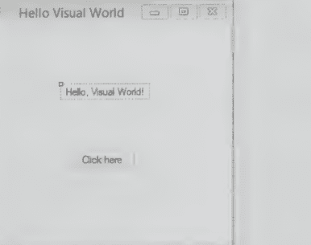

图 3-19 表单上的 helloLabel

- 3. 查看标签的属性列表，将其 `Visible` 属性改为 `False`。你可以在`设计器`（`Designer`）中看到标签，但在执行程序时它是不可见的。

- 4. 双击表单上的按钮。将显示一个包含代码的新窗口，显示出一个新创建的 `button_Click()` 方法，其中没有任何语句。在大括号之间，输入以下语句，以便用户点击按钮时显示标签：

```csharp
helloLabel.Visible = true;
```

- 5. 保存文件，然后点击`不用调试`（`Start Without Debugging`）运行程序。

### 向表单添加按钮

在接下来的步骤中，在 HelloWorld 项目的表单上添加第二个按钮。

- 1. 在 IDE 中，切换到`设计视图`（`Design View`）。将第二个按钮拖到表单上第一个按钮下方。将新按钮的 `Name` 属性改为 `changeOutputButton`，并将 `Text` 改为 `Click me last`。

- 2. 双击 `changeOutputButton` 以暴露 `changeOutputButton_Click()` 方法。

- 3. 在方法的大括号之间添加以下代码：

```csharp
helloLabel.Text = "Goodbye";
```

- 4. 保存项目，然后执行程序。点击 `displayOutputButton` 显示 `Hello, Visual World！`然后点击 `changeOutputButton` 显示 `Goodbye`。

- 5. 再次执行程序。这次没有出现消息，因为带有消息的标签尚未可见。当你点击 `displayOutputButton` 时，标签变为可见，但显示的是 `Goodbye`，因为 `changeOutputButton` 的 `Click()` 方法已经更改了标签的 `Text`。

- 6. 返回 `Form1.cs [Design]` 选项卡。点击 `changeOutputButton`，将它的 `Enabled` 属性设置为 `False`。现在，当程序执行时，用户将无法立即点击第二个 `Button`。

- 7. 双击 `displayOutputButton`。在方法中添加以下语句以便在点击 `displayOutputButton` 时 `changeOutputButton` 变为可用状态：

```csharp
changeOutputButton.Enabled = true;
```

- 8. 保存项目，然后执行程序。当 Form 出现时，`changeOutputButton` 显示为灰色且不可点击，因为它未启用。点击已启用的 `displayOutputButton` 以显示“Hello, Visual World!” 消息并启用第二个 `Button`。然后点击 `changeOutputButton` 显示“Goodbye” 消息。

- 9. 消除 Form，并关闭 Visual Studio。

## 章节总结

- Forms（表单）是 GUI 对象，提供了一个用于收集、显示和传递信息的接口。它们几乎总是包含诸如标签、文本框和按钮等控件，用户可以与 Form 交互交互。每个 Form 以及 Form 上的控件都有多个可以使用 IDE 设置的属性。

- Toolbox（工具箱）显示了可以添加到 Form 中的可用控件列表。该列表包括 `Button`、`CheckBox` 和 `Label`。从 Toolbox 中，你可以将控件拖到 Form 上，让它们发挥最大的作用。当你将一个 `Button` 拖到 Form 上后，可以双击它来创建一个在用户点击 `Button` 时执行的方法，并且你可以在 `Click()` 方法的大括号之间编写任何语句。

- Labels（标签）是你用于显示文本以与应用程序用户进行通信的控件。TextBoxes（文本框）是用户可以在 GUI 应用程序中输入数据的控件。两者都有 `Text` 属性；通常在初始化应用程序时，TextBox 的 `Text` 为空。由于用户可能会输入任何值，因此 TextBox 中的值默认是字符串。

## 使用 GUI 对象和 Visual Studio IDE

通常，你希望为放置在 Form 上的所有控件提供合理的 `Name` 属性值。虽然任何以字母开头的标识符都是合法的，但按照惯例，你应该让控件名称以小写字母开头，并在适当的情况下使用驼峰命名法（camel casing），让 Form 名称以大写字母开头并在适当的情况下使用驼峰命名法，并在名称中使用对象的类型。

如果你构建或运行包含语法错误的程序，会在 IDE 的左下角看到“Build failed”并弹出一个错误对话框。错误列表（Error list）显示了每个错误的文件名、行位置和项目。如果你双击错误消息，光标将放置在代码中发现错误的位置。如果你无意中遇到了不想要的事件处理方法，应该使用 IDE 中的属性（Properties）窗口消除该事件。如果你为你已创建的控件重命名，则你必须对代码进行重构。关于 C# 类的终极权威是 Visual Studio 帮助文档。

控制台（console）应用程序和 GUI 应用程序都可以包含变量、常量、决策、循环、数组以及其他方法的调用。GUI 应用程序看起来“更酷”，并且包含了用户可以使用鼠标操纵的控件。然而，GUI 程序的开发时间通常比其对应的控制台程序长。在编写自己的程序时，你将使用你喜欢的界面或你的导师或老板要求的界面。

## 关键术语

Interface（界面）是用户在程序执行时看到的环境。

Forms（表单）是提供用于收集、显示和传递信息的接口的 GUI 对象。

Controls（控件）是诸如标签、文本框和按钮等设备，用户可以通过操纵它们与 GUI 程序进行通信。

Node（节点）是出现在列表或代码段旁边的图标，可以展开或折叠。

Access specifier（访问修饰符）是规定外部类是否可以使用某个方法的关键字。

Event（事件）导致程序执行某项任务。

Click event（点击事件）是用户在 GUI 程序中点击控件时生成的事件。

Label（标签）是你用于显示文本以与应用程序用户进行通信的控件。

Text box（文本框）是用户可以在 GUI 应用程序中输入数据的控件。

Design time（设计时间）是程序员设计界面和编写代码的时间段。

Runtime（运行时）是程序执行的时间段。

Focus（焦点）描述了 Form 控件的属性，它在视觉上与其他控件不同，并对键盘输入有反应。

## 复习题

Tab order（制表顺序）描述了用户按 Tab 键时选中的控件序列。

Proportional font（等比例字体）是指不同字符具有不同高度或宽度的字体。

Fixed-pitch font（等距字体）是指每个字符占据相同宽度的字体。

Monospaced font（等宽字体）是指每个字符占据相同宽度的字体。

Code refactoring（代码重构）是在不改变程序工作方式的情况下更改程序内部结构的过程。

Orphaned method（孤立方法）是指在应用程序中从不执行因此没有任何作用的方法。

## 复习题

1. 下哪项提供用于收集、显示和传递信息的接口并包含其他控件的 GUI 对象？

   a. Form c. TextBox

   b. Button d. Label

2. 在 Visual Studio IDE 主窗口中，菜单栏位于哪里？

   a. 垂直位于左边界

   b. 垂直位于右边界

   c. 水平跨越窗口顶部

   d. 水平跨越窗口底部

3. 在 Visual Studio IDE 中，你视觉化构造 Form 的区域是：

   a. Toolbox c. Palette

   b. Designer d. Event

4. 当你创建一个新的 Form 时，你看到的第一个 Form 会被命名为：

   a. Form1 c. Windows

   b. Designer d. Alpha

5. Form 类具有以下属性。

   a. three c. about 100

   b. ten d. about

6. 下哪项不是 Form 属性？

   a. BackColor c. Size

   b. Name d. Text

## 第3章 使用 GUI 对象和 Visual Studio IDE

7. 下哪项是合法的 Name 属性？

   a. Payroll c. 以上两者

   b. Payroll_Form d. 以上都不是

8. 下哪项是合法的 Text 属性？

   a. Payroll c. 以上两者

   b. Payroll_Form d. 以上都不是

9. 哪项不在 Toolbox 中？

   a. Text c. Label

   b. Button d. TextBox

10. 将一个 Button 拖到 Form 上后，你可以双击它来：

    a. 删除它

    b. 查看它的属性

    c. 创建在用户点击 Button 时执行的方法

    d. 在用户点击 Button 时执行方法

11. `button1_Click()` 方法由 IDE 生成，它：

    a. 有私有访问修饰符

    b. 非静态

    c. 在其之间包含参数

    d. 以上所有

12. A(n) 在用户与 GUI 对象交互时生成。

    a. event c. method

    b. occasion d. error

13. 如果你创建一个名为 `yesButton` 的 Button，响应点击的方法名称是：

    a. `button1_Click()` c. `click_YesButton()`

    b. `yesButton_Method()` d. `yesButton_Click()`

14. `Click()` 方法中允许的语句包括：

    a. 变量声明 c. 以上两者

    b. 算术语句

    d. 以上都不是

## 复习题

15. 是用户可以在 GUI 应用程序中输入输入数据的控件。

    a. Labels c. Tickets

    b. Tags d. TextBoxes

16. TextBox 中的值是

    a. int c. 字符串

    b. double d. 可能是以上任何一种

17. 下哪项是 TextBox 的合法且符合习惯的名称？

    a. SalaryTextBox c. 以上两者

    b. salaryTextBox d. 以上都不是

18. 在不改变程序工作的情况下更改程序内部结构的过程是

a. 编译 c. 代码重构

    b. 调试 d. 系统分析

19. 如果无意中为一个不应产生点击事件的控件创建了 `Click()` 方法，你可以通过以下方式成功消除该方法：

    a. 从 Form1.cs 文件删除方法代码

    b. 从属性窗口中的 Events 列表中消除该方法

    c. 将方法添加到 Discard 窗口

    d. 在每行开头放置两个正斜杠使方法注释

20. 下列中，许多控制台应用程序和 GUI 应用程序之间最显著的差异是

a. 它们

    b. 接受输入的能力

    c. 计算的能力

    d. 使用 C# 创建的能力

## 练习

编程练习

- 1. 编写一个名为 `MilesToKilometersGUI` 的 GUI 程序，允许用户输入英里距离并输出对应的公里数值。1 英里等于 1.6 公里。

本节的练习看起来应该很熟悉。每个练习都与第 2 章中的练习相似，即使用控制台输入和输出创建解决方案。

- 2. 编写一个名为 `ProjectedRisesGUI` 的 GUI 程序，允许用户输入员工工资。然后带有解释性文本显示明年的工资，反映出 4% 的增长。

- 3. 编写一个名为 `CarRentalInteractiveGUI` 的 GUI 程序，提示用户输入租车的天数和里程数，并显示总租赁费用（计算方法为每天 20 美元加每英里 25 美分）。

- 4. 编写一个名为 `EggsInteractiveGUI` 的 GUI 程序，允许用户输入五只鸡每月的产蛋数量。计算蛋的总和，然后以“打”和“个”为单位显示总数。例如，127 个鸡蛋是 12 打 7 个鸡蛋。图 3-20 显示了一个典型的执行过程。


图 3-20 一个 EggsInteractiveGUI

- 5. 编写一个名为 `TestsInteractiveGUI` 的 GUI 程序，允许用户输入其参加过的五次考试的分数。显示两位小数数的平均分。

## 练习

- 6. 编写一个名为 `PayrollGUI` 的 GUI 程序，提示用户输入姓名、社会安全号码、时薪和工作小时数。以美观的格式显示所有输入数据：

- 总工资，定义为时薪乘以工作小时数

- 联邦预扣税，定义为总工资的 15%

- 州预扣税，定义为总工资的 5%

- 净工资，定义为总工资减税费

- 7. 创建一个枚举 `Month`，包含一年中各月份的值。（记住，枚举必须放在类内部，但在任何方法之外）。编写一个名为 `MonthGUI` 的 GUI 程序，提示用户输入一个月份整数。将用户的输入转换为 `Month` 值并显示。

- 8. 猪比拉丁语（Pig Latin）是一种无意义的语言。要创建一个猪比拉丁语单词，删除第一个字母并将其添加到单词末尾。例如，dog 变成 ogd，cat 变成 at。编写一个名为 `PigLatinGUI` 的 GUI 程序，允许用户输入一个单词并显示其猪比拉丁语版本。

## 调试练习

- 1. 第 3 章中的以下每个项目都有语法或逻辑错误。在每种情况下，在 Visual Studio 中打开项目之前，请立即将项目另存为新名称。顶层文件夹中的所有文件都已以 `Debug` 前缀命名，因此你需要确定问题并修复它们。

a. DebugOne

b. DebugTwo

c. DebugThree

d. DebugFour

## 案例分析

- 1. 在第 2 章中，你为格林维尔竞赛创建了一个程序，提示用户输入去年和今年比赛的参赛者人数。如果每位参赛者都支付 25 美元的报名费，程序将显示预期收入。应用程序还会显示一条语句，说明今年比赛的参赛人数比去年多。现在，创建一个名为 `GreenvilleRevenue` 的交互式 GUI 程序来执行所有任务。

- 2. 在第 2 章中，你为马尔沙尔壁画创建了一个程序，提示用户输入本月计划绘制的室内和室外壁画数量。当室内壁画每幅 500 美元、室外壁画每幅 750 美元时，程序计算每类型的预期收入。应用程序应按壁画类型显示数量、每种类型的成本和小计。应用程序还会显示总预期收入以及一条说明室内壁画是否更多的语句。执行。

# 第 4 章 决策

在本章中，你将学习：

- 理解逻辑规划工具和决策

- 使用 `if` 语句进行决策

- 使用 `if-else` 语句进行决策

- 使用复合表达式

- 使用 `switch` 语句进行决策

- 使用条件运算符

- 在做出决策时避免错误

- 学习 GUI 程序中的决策问题

# 第 4 章 决策

计算机之所以强大，是因为它们具有决策的能力。决定哪条路线最佳、哪个网站提供匹配项或哪种治疗方案概率最高，都依赖于决策。在本章中，你将学习在程序中做出决策。

# 理解逻辑规划工具和决策

当程序员编写程序时，很少只是坐在键盘前就开始打字。他们经常使用伪代码，这种工具通过编写英语陈述来帮助他们规划逻辑，而不是编程语言的语法（你在第 1 章学过逻辑和语法的区别）。事实上，用伪代码编写的任务与计算机无关。如果你写了一份方向清单——例如 (1) 向阿尔冈尼路向西，2) 在罗塞尔路左转，3) 进入高速公路等——你编写的就是伪代码。流程图（Flowchart）与伪代码相似，但你以图表的形式编写步骤，作为一系列相互连接的形状。

有些程序员使用各种形状来表示流程图中的不同任务，但你可以仅使用矩形、菱形和连接线来绘制非常复杂的情况。你可以使用矩形表示任何过程或步骤，使用菱形表示任何决策。例如，图 4-1 显示了指向朋友家的流程图。注意流程图中所示的动作与伪代码是如何对应的。图 4-1 说明了一个名为顺序结构的逻辑结构——一个步骤无条件地跟随另一个。顺序结构可能包含任意数量的步骤，但一个任务之后另一个任务没有分支或跳过步骤的机会。

# 理解逻辑规划工具和决策

| | |

| :--- | :--- |

| 向阿尔冈尼路向西 | |

| 在罗塞尔路左转 | |

| 向东进入高速公路 | |

| 在阿灵顿路南出 |

| 前往 688 阿灵顿高地路 | 139 |


图 4-1 顺序结构的流程图和伪代码

有时，逻辑步骤并不按无条件的顺序执行。相反，某些任务根据你的决策可能会发生或不发生。为了表示决策，流程图创建者使用菱形形状包含一个问题，并从角画出指向替代方案的路径。图 4-2 显示了一个描述方向的流程图，其中某些步骤的执行取决于决策。

## 使用 if 语句进行决策


# 第 4 章 决策

## 布尔值与决策

布尔值。例如，你永远需要的程序代码不会包含像这样的问题：“用户输入了什么数字？”相反，决策应该是：“用户输入了 1 吗？”“如果没有，用户输入了 2 吗？”“如果没有，用户输入了 3 吗？”

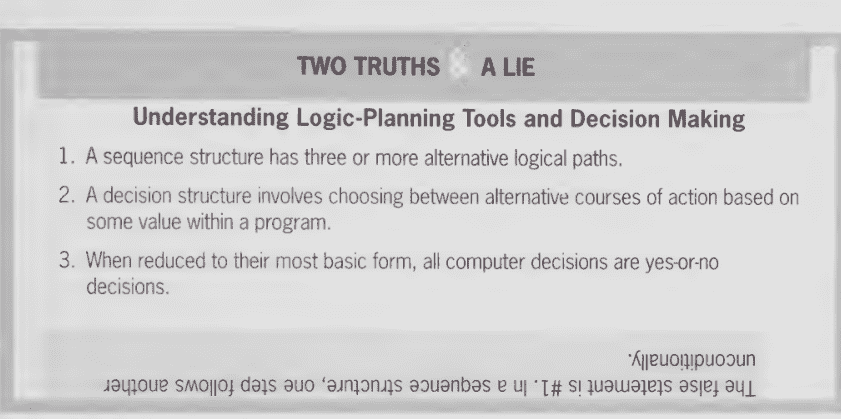

## 使用 if 语句进行决策

`if` 和 `if-else` 语句是 C# 中最常用的两种决策语句。你使用一个 `if` 语句来做出单分支决策。换句话说，你使用 `if` 语句来确定某个动作是否会发生。`if` 语句的形式如下：

```
if(testedExpression)
    statement;
```

在该语句中，`testedExpression` 代表任何可以求值为真或假的 C# 表达式，而 `statement` 代表当表达式求值为真时将执行的操作。你必须将 `if` 语句的求值表达式放在括号之间。如果你认为那种格式更易读，可以在关键字 `if` 和左括号之间留一个空格。

`if` 语句中的表达式包括布尔表达式（如 `amount > 5` 和 `month == "May"`）以及布尔变量的值（如 `isValidIDNumber`）。如果表达式求值为真，则执行该语句。无论表达式求值为真还是假，程序都会继续执行整个 `if` 语句之后的下一个语句。

你在第 2 章中学习了布尔表达式和 `bool` 数据类型。表 2-4 总结了比较运算符的使用方法。

在“方法介绍”章节中，你将学习编写返回值的方法。方法调用返回的布尔值也可以作为 `if` 语句中的测试表达式。

在某些编程语言（如 C++）中，非零数字被求为真，0 求为假。但在 C# 中，只有布尔表达式会被求为真或假。

例如，图 4-3 中编写并绘制的代码段显示，当 `number` 持有的值小于 5 时，显示 A 和 B；但当 `number` 等于或大于 5 时，只显示 B。当测试布尔表达式 `number < 5` 为假时，显示 A 的语句永远不会执行。

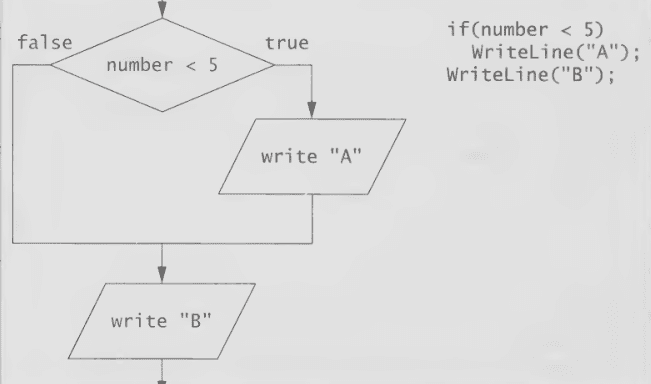

**图 4-3** 包含典型 if 语句及后续独立语句的流程图和代码

虽然你可以仅使用矩形、菱形和流线创建有意义的流程图，但传统上四边形被用于表示输入输出语句，因此它们被用于图 4-3 以及本章的其他图中。

### if 语句中的分号陷阱

在代码图 4-3 中，包含 `if(number < 5)` 的那行末尾没有分号。该语句在该处并没有结束；而是在 `WriteLine("A");` 之后结束。如果你在 `if(number < 5)` 的末尾错误地插入分号，那么代码的意思就变成了：“Number”小于 5，什么都不做；无论 `number` 的值是多少，都显示 A。图 4-4 显示了当 `if` 表达式末尾错误放置分号时与代码匹配的流程图逻辑。

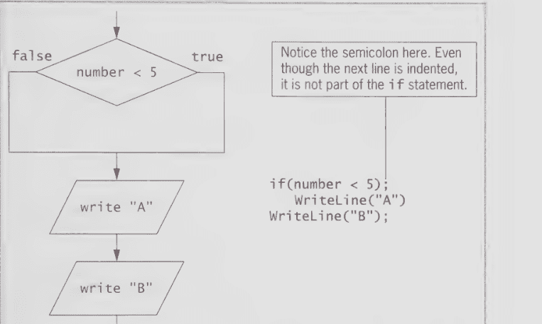

**图 4-4** 包含在 if 表达式后紧跟分号的 if 语句的流程图和代码

尽管按照惯例和良好的习惯是对当 `if` 布尔表达式求值为真时执行的任何语句进行缩进，但 C# 编译器并不关心缩进。以下每个 `if` 语句在 `number` 小于 5 时都会显示 A。第一个显示了写单行的 `if` 语句；第二个显示了跨行但没有缩进的 `if` 语句。三个示例的执行效果完全相同。

```
if(number < 5) WriteLine("A");
if(number < 5)
WriteLine("A");
if(number < 5)
WriteLine("A");
```

> **注意**：虽然这前两种格式对 if 语句有效，但它们并不符合常规，使用它们会让程序更难理解。

### 使用块组织多条语句

当你想要有条件地执行两个或多个语句时，你将语句放在一个块中。块是包含在对括号内的一个或多个语句的集合。例如，图 4-5 中编写并绘制的代码段在 `number` 小于 5 时同时显示 C 和 D，而当 `number` 不小于 5 时，两者都不显示。

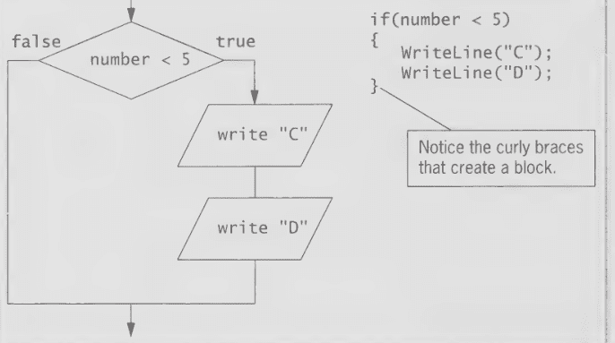

**图 4-5** 包含包含块的典型 if 语句的流程图和代码

仅靠缩进并不会导致多个语句依赖 `if` 控制语句之后布尔表达式的求值。要让多个语句依赖于 `if`，它们必须用大括号括起来。例如，图 4-6 显示了两个在 `if` 表达式下方缩进的语句。当你一眼看代码时，可能认为两个语句都依赖于 `if`；然而，正如流程图所示，只有第一个依赖，因为语句没有被括起来。

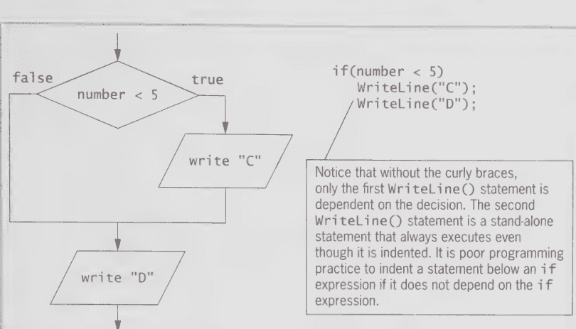

**图 4-6** 包含在 if 表达式后带有分号的 if 语句的流程图和代码

当你使用大括号时，`if` 语句包含块。缩进本身不会导致多个语句依赖于 `if` 控制语句之后布尔表达式的求值。要让多个语句依赖于 `if`，它们必须用大括号括起来。在 C# 中，大括号是惯例且良好的风格。创建一个包含多个语句依赖于 `if` 语句的 `if` 块即使包含单个语句是完全合法的。

### 嵌套 if 语句

图 4-7 显示了**嵌套** `if` 语句，其中一个决策结构包含在另一个内部。在嵌套 `if` 语句中，第二个 `if` 的布尔表达式只有在第一个 `if` 的布尔表达式求值为真时才会测试。

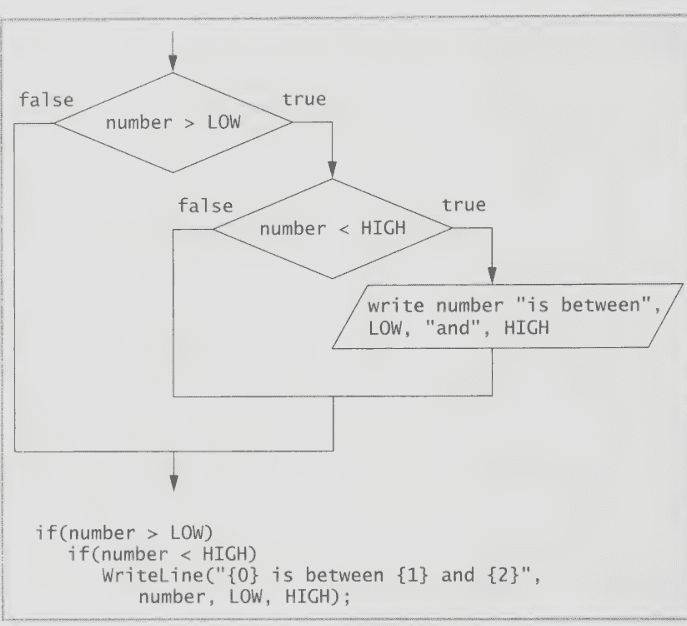

**图 4-7** 显示嵌套 if 逻辑的流程图

图 4-8 显示了一个包含图 4-7 逻辑的程序。当用户输入大于 5 的数字时，测试表达式为真，测试数字是否小于 10 的语句执行。当第二个测试表达式也为真时，执行 `WriteLine()` 语句。如果第一个或第二个测试表达式为假，则不会输出。图 4-9 显示了使用不同输入值执行程序后的输出。请注意，当用户输入的值不在 5 到 10 之间时，不会输出消息。

```
using System;
using static System.Console;
class NestedDecision
{
    static void Main()
    {
        const int HIGH = 10, LOW = 5;
        string numberString;
        int number;
        Write("Enter an integer ");
        numberString = ReadLine();
        number = Convert.ToInt32(numberString);
        if(number < LOW)
            WriteLine("{0} is between {1} and {2}",
                number, LOW, HIGH);
    }
}
```

**图 4-8** 使用嵌套 if 的程序

**图 4-9** NestedDecision 程序执行三次的输出

## 关于等价比较的说明

通常，程序员在测试等价性时会错误地使用单个等号而不是双重等号。例如，以下表达式并没有比较 `number` 和 `HIGH`：

```
number = HIGH
```

相反，它尝试将 `HIGH` 的值赋值给变量 `number`。

赋值运算符在 `if` 语句中作为测试表达式一部分工作的唯一条件是赋值对象一个 `bool` 变量。例如，假设一个工资程序包含一个名为 `doesEmployeeHaveDependents` 的 `bool` 变量，然后使用以下语句：

```
if(doesEmployeeHaveDependents = numDependents > 0)...
```

在这种情况下，`numDependents` 将与 0 进行比较，结果（true 或 false）将赋值给 `doesEmployeeHaveDependents`。然后将根据赋值的值进行判断。这不是一种推荐的比较方法，因为它看起来很混淆。如果你的意图是给 `doesEmployeeHaveDependents` 赋值，使用以下代码会让意图更清晰：

```
doesEmployeeHaveDependents = numDependents > 0;
if(doesEmployeeHaveDependents)...
```

注意以下语句，在 `if` 语句的括号内使用了两个等号：

```
if(doesEmployeeHaveDependents == numDependents > 0)...
```

该语句将 `doesEmployeeHaveDependents` 与 `numDependents` 与 0 的比较结果进行比较，但不会改变 `doesEmployeeHaveDependents` 的值。

> **注意**：使用 Visual Studio IDE 编写程序的许多优点之一是，如果你在布尔表达式中使用赋值运算符代替等价运算符，你的错误将立即被标记为错误。

## 两个真一假：自测题

- 1. 在 C# 中，你必须将 `if` 语句的求值表达式放在括号之间。
- 2. 在 C# 中，为了让多个语句依赖于一个 `if`，它们必须进行缩进。
- 3. 在 C# 中，你可以将一个 `if` 语句放在依赖于另一个 `if` 语句的块中。

**解析**：为了让多个语句依赖于 `if`，它们必须用大括号括起来。依赖于 `if` 中布尔表达式的求值。错误的陈述是 #2。仅缩进语句不会导致多个语句。

## 使用 if-else 语句做决策

某些决策是**二选一决策**：它们有两个可能的后续执行操作。如果你想在布尔表达式求值为 `true` 时执行一个操作，在求值为 `false` 时执行另一种操作，你可以使用 **if-else 语句**。`if-else` 语句的格式如下：

```
if(expression)
    statement1;
else
    statement2;
```

你可以编写不带 `else` 的 `if`，但编写没有 `if` 的 `else` 是非法的。

就像你可以将多个语句组合在一起以便在 `if` 内的表达式为真时全部执行一样，你也可以在 `else` 之后组合多个语句，以便它们在求值表达式为假时全部执行。例如，以下代码为 `bonus` 赋值，并在布尔变量 `isProjectUnderBudget` 为 `false` 时产生一行输出：

```
if(isProjectUnderBudget)
    bonus = 0;
else
{
    WriteLine("Notify contractor");
}
```

图 4-10 显示了 `if-else` 语句的逻辑，图 4-11 显示了包含该语句的程序。程序每次执行时，两个 `WriteLine()` 语句会执行其中一个。图 4-11 中 `if-else` 示例所示缩进不是必须的，但它是标准做法。将关键字 `if` 与 `else` 垂直对齐，然后对依赖于求值的动作语句进行缩进。图 4-12 显示了程序的两次执行。

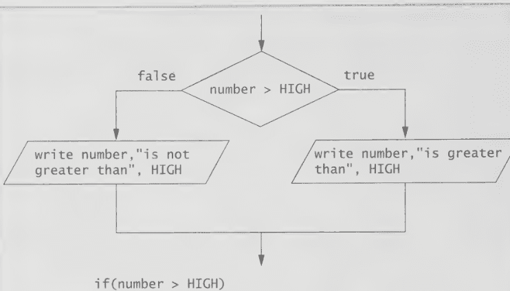

**图 4-10** 显示二选一 `if-else` 语句逻辑的流程图和代码

```
using System;
using static System.Console;
class IfElseDecision
{
    static void Main()
    {
        const int HIGH = 10;
        string numberString;
        int number;
        Write("Enter an integer");
        numberString = ReadLine();
        number = Convert.ToInt32(numberString);
        if(number > HIGH)
            WriteLine("{0} is greater than {1}",
                number, HIGH);
        else
            WriteLine("{0} is not greater than {1}",
                number, HIGH);
    }
}
```

**图 4-11** 带有二选一 `if-else` 语句的程序

**图 4-12** IfElseDecision 的两次执行输出

### 嵌套 if-else 语句的匹配规则

当 `if-else` 语句嵌套时，每个 `else` 总是与最近的未配对的 `if` 配对。例如，在以下代码中，`else` 与第二个 `if` 配对。正确的缩进有助于使这一点清晰。

```
if(saleAmount > 1000)
    if(saleAmount < 2000)
        bonus = 100;
    else
        bonus = 500;
```

在本示例中，分配了以下奖金：

- `saleAmount` 在 $1000 到 $2000 之间，`bonus` 为 $100，因为两个求值表达式均为真。
- `saleAmount` 为 $2000 或更多，`bonus` 为 $500，因为第一个求值表达式为真而第二个为假。
- `saleAmount` 为 $1000 或更少，`bonus` 未赋值，因为第一个求值表达式为假且没有对应的 `else`。


## if-else 语句最佳实践总结

- 使用大括号来定义代码块，即使块中只有一条语句，也建议使用大括号以提高可读性和防止错误。
- `if` 部分是强制的，`else` 部分是可选的。
- 条件被求值为布尔值（`true` 或 `false`）。
- 求值结果决定了采取的路径：如果为真，则执行 `if` 块；如果为假，则执行 `else` 块。
- `if-else` 语句的顺序很重要，应将最可能为真或最严格的条件放在前面。
- 对于离散值的多重判断，考虑使用 `switch` 语句替代多个 `if-else`。
- 使用缩进和注释清晰地显示哪个 `else` 属于哪个 `if`，避免嵌套过深导致的逻辑错误。
- `if-else` 语句是编程中广泛使用的基础分支结构，允许程序处理不同的情况。


> 使用 Visual Studio IDE 编写程序的许多优点之一是，如果你在布尔表达式中使用赋值运算符代替等价运算符，你的错误将立即被标记为错误。

# 两个真一假

## 使用 if 语句做决策

- 1. 在 C# 中，你必须将 `if` 语句的求值表达式放在括号之间。
- 2. 在 C# 中，为了让多个语句依赖于一个 `if`，它们必须进行缩进。
- 3. 在 C# 中，你可以将一个 `if` 语句放在依赖于另一个 `if` 语句的块中。

为了让多个语句依赖于 `if`，它们必须用大括号括起来。依赖于 `if` 中布尔表达式的求值。错误的陈述是 #2。仅缩进语句不会导致多个语句。

## 使用 if-else 语句做决策

某些决策是**二选一决策**：它们有两个可能的后续执行操作。如果你想在布尔表达式求值为 *true* 时执行一个操作，在求值为 *false* 时执行另一种操作，你可以使用 **if-else 语句**。`if-else` 语句的格式如下：

```
if(expression)
    statement1;
else
    statement2;
```

你可以编写不带 `else` 的 `if`，但编写没有 `if` 的 `else` 是非法的。

你可以将多个语句组合在一起以便在 `if` 内的表达式为真时全部执行，同样，你也可以在 `else` 之后组合多个语句，以便它们在求值表达式为假时全部执行。例如，以下代码为 `bonus` 赋值，并在布尔变量 `isProjectUnderBudget` 为 `false` 时产生一行输出：

```
if(isProjectUnderBudget)
    bonus = 0;
else
{
    WriteLine("Notify contractor");
}
```

图 4-10 显示了 `if-else` 语句的逻辑，图 4-11 显示了包含该语句的程序。程序每次执行时，两个 `WriteLine()` 语句会执行其中一个。图 4-11 中 `if-else` 示例所示缩进不是必须的，但它是标准做法。将关键字 `if` 与 `else` 垂直对齐，然后对依赖于求值的动作语句进行缩进。图 4-12 显示了程序的两次执行。

# 第 4 章 做决策


图 4-10 显示二选一 `if-else` 语句逻辑的流程图和代码

```
using System;
using static System.Console;
class IfElseDecision
{
    static void Main()
    {
        const int HIGH = 10;
        string numberString;
        int number;
        Write("Enter an integer");
        numberString = ReadLine();
        number = Convert.ToInt32(numberString);
        if(number > HIGH)
            WriteLine("{0} is greater than {1}",
                number, HIGH);
        else
            WriteLine("{0} is not greater than {1}",
                number, HIGH);
    }
}
```

图 4-11 带有二选一 `if-else` 语句的程序

## 使用 if-else 语句做决策

图 4-12 IfElseDecision 的两次执行输出

当 `if-else` 语句嵌套时，每个 `if-else` 总是与最近的未配对的 `if` 配对。例如，在以下代码中，`else` 与第二个 `if` 配对。正确的缩进有助于使这一点清晰。

```
if(saleAmount > 1000)
  if(saleAmount < 2000)
    bonus = 100;
  else
    bonus = 500;
```

在本示例中，分配了以下奖金：

- `saleAmount` 在 $1000 到 $2000 之间，`bonus` 为 $100，因为两个求值表达式均为真。
- `saleAmount` 为 $2000 或更多，`bonus` 为 $500，因为第一个求值表达式为真而第二个为假。
- `saleAmount` 为 $1000 或更少，`bonus` 未赋值，因为第一个求值表达式为假且没有对应的 `else`。


当 `if-else` 语句嵌套时，每个 `if-else` 总是与最近的未配对的 `if` 配对。例如，在以下代码中，`else` 与第二个 `if` 配对。正确的缩进有助于使这一点清晰。

## 在 if 语句中使用复合表达式

| x | y | x && y |
|---|---|---|
| True | True | True |
| True | False | False |
| False | True | False |
| False | False | False |

**表 4-1** 条件 `&&` 运算符的真值表

例如，图 4-14 所示的两个代码示例工作方式完全相同。对变量进行测试，如果它大于等于 0 且小于 120，则显示一条消息说明该值有效。

```
// 使用 && 运算符
if(age >= 0 && age < 120)
    WriteLine("Age is valid");

// 使用嵌套的 if
if(age > 0)
    if(age < 120)
        WriteLine("Age is valid");
```

**图 4-14** `&&` 运算符与嵌套 if 语句的比较

使用 `&&` 运算符并不是必须的，因为嵌套的 `if` 语句可以实现相同的结果，但使用 `&&` 运算符通常会让你的代码更简洁、更不容易出错且更易理解。

值得注意的是，当你使用 `&&` 运算符时，必须在运算符的每一侧包含一个完整的布尔表达式。如果你想在 `saleAmount` 同时大于 $1000 且小于 $5000 时将奖金设置为 $400，正确的语句如下：

```
if(saleAmount > 1000 && saleAmount < 5000)
    bonus = 400;
```

以下语句是错误的且无法编译：

```
if(saleAmount > 1000 && < 5000)
    bonus = 4000;
```

> 不要这样做

`5000` 不是一个布尔表达式，因为 `<` 运算符需要两个操作数，所以该语句是无效的。

为了清晰起见，许多程序员倾向于用自己的括号包围每个布尔表达式。例如：

```
if((saleAmount > 1000) && (saleAmount < 5000))
    bonus = 400;
```

在这个示例中，`if` 子句有一组括号（第一个左括号和最后一个右括号），作为复合条件部分的每个布尔表达式都有自己的一组括号。如果你觉得这种格式更清晰，请使用这种格式。

复合条件布尔表达式中每个部分的评估仅在确定整个表达式为真或假所需的范围内进行。这一特性被称为短路求值。使用 `&&` 运算符时，在语句中的操作发生之前，两个布尔表达式都必须为真。如果第一个表达式为假，则第二个表达式永远不会被评估，因为它的值并不重要。例如，在下面的 `if` 语句中，如果 `a` 不大于 `LIMIT`，那么评估就完成了，因为不需要评估 `b` 是否大于 `LIMIT`。

```
if(a > LIMIT && b > LIMIT)
    WriteLine("Both are greater than the limit.");
```

# 使用条件 OR 运算符

当你希望即使两个条件中只有一个为真也执行某些操作时，可以使用条件 OR 运算符（简单称为 OR 运算符）。OR 运算符写为 `||`。当你使用 `||` 运算符时，只需满足列出的条件之一即可触发相应的操作。表 4-2 显示了 `||` 运算符的真值表。如你所示，只有当 x 和 y 都为假时，整个 `x || y` 才为假。

| x | y | x || y |
|---|---|---|
| True | True | True |
| True | False | True |
| False | True | True |
| False | False | False |

**表 4-2** `||` 运算符的真值表

例如，如果你想在 `age` 变量的值小于 0 或大于 120 时显示一条指示年龄无效的消息，你可以使用图 4-15 中的任何一个代码示例。

你使用两个竖线创建条件 OR 运算符。在大多数键盘上，竖线位于反斜杠键上方；输入它需要同时按住 Shift 键。

**图 4-15** `||` 运算符与嵌套 if 语句的比较


当在 `if` 语句中使用 `||` 运算符时，被测试的两个布尔表达式只要有一个为真即可发生相应的操作。当第一个布尔表达式为真时，第二个表达式永远不会被评估，无论第二个表达式是真是假都无关。与 `&&` 运算符一样，这一特性被称为短路求值。


观看视频 AND 和 OR 运算符。

# 使用逻辑 AND 和 OR 运算符

C# 提供了两种逻辑运算符，在进行比较时通常不想使用它们。然而，你应该了解它们，因为它们可能出现在他人编写的程序中，而且当你打算使用条件运算符时可能会误用它们。

逻辑 AND 运算符 (`&`) 和布尔包含 OR 运算符 (`|`) 的工作方式与 `&&` 和 `||`（条件 AND 和 OR）对应相同，但它们不支持短路求值。也就是说，无论第一个评估结果如何，它们总是会评估表达式的两侧。这可能会导致副作用或意外的后果。例如，在下面的使用 `&&` 的语句中，如果 `salesAmountForYear` 不至少为 10000，第一个表达式为假，因此第二个表达式永远不会被评估。

## 在 if 语句中使用复合表达式

你可以使用括号来修正逻辑，并强制表达式 `age <= 12 || age >= 65` 先求值，如下代码所示：

```csharp
if((age <= 12 || age >= 65) && rating == 'G')
    WriteLine("Discount applies");
```

添加括号后，两个比较都会首先进行。如果年龄值符合访客的折扣条件，则表达式被求值为 `(true && rating == 'G')`。然后，分级值也必须是可以接受的才能显示消息。图 4-16 显示了完整程序中的语句；注意，在完整程序中，折扣年龄限制是以命名常量的形式表示的。图 4-17 显示了在 `if` 语句中添加括号之前的执行情况，图 4-18 显示了包含括号后的输出。

```csharp
using static System.Console;
class MovieDiscount
{
    static void Main()
    {
        int age = 10;
        char rating = 'R';
        const int CHILD_AGE = 12;
        const int SENIOR_AGE = 65;
        WriteLine("When age is {0} and rating is {1}",
            age, rating);
        if((age <= CHILD_AGE || age >= SENIOR_AGE) && rating == 'G')
            WriteLine("Discount applies");
        else
            WriteLine("Full price");
    }
}
```

**图 4-16** 使用括号改变布尔求值优先级的电影票折扣程序

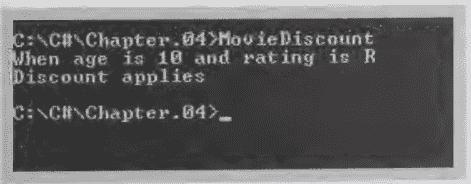

**图 4-17** 当执行 MovieDiscount 程序时未添加括号的错误结果

# 第 4 章 做出决策

```
C:\CH\Chapter.04>MovieDiscount
When age is 10 and rating is R
Full price
C:\CH\Chapter.04>
```

**图 4-18** 如图 4-16 所示，在 MovieDiscount 程序中添加括号后的正确结果

你可以在布尔表达式中使用括号来提高清晰度，即使它们并不是必须的。例如，以下表达式会先计算 `a && b`：

```
a && b || c
(a && b) || c
```

如果带括号的版本让你的意图更清晰，你应该使用它。

在第 2 章中，你学习了括号也控制算术运算符的优先级。附录 A 描述了每个 C# 运算符的优先级，这对于理解复杂的表达式非常重要。例如，在附录 A 中你可以看到算术运算符和关系运算符的优先级高于 `&&` 和 `||`。

- 观看视频：组合 AND 和 OR 操作。

## 三真一假

## 在 if 语句中使用复合表达式

1. 如果 `a` 为真且 `b` 和 `c` 为假，那么 `b && c || a` 的值为真。

2. 如果 `d` 为真且 `e` 和 `f` 为假，那么 `e || d && f` 的值为真。

3. 如果 `g` 为真且 `h` 和 `i` 为假，那么 `g || h && i` 的值为真。

`e || d && f` 为假，发现 `e` 为假，且发现为假。

`e || d && f` 为假。因为你先计算 `&&` 后计算 `||`，所以首先计算 `d && f`。

错误的语句是 #2。如果 `d` 为真且 `e` 和 `f` 为假，那么值为...

## 在 if 语句中使用复合表达式

## 你来做

## 使用 AND 和 OR 逻辑

在接下来的步骤中，你将创建一个交互程序，允许你自己测试 AND 和 OR 逻辑。该程序将决定是否对货物收取运费。如果客户住在区域 1 或区域 2，只要订单包含少于 10 个箱子，运费就是免费。如果客户住在另一个区域或订单太大，则需要收取运费。

1. 打开一个名为 `DemoORANDAND` 的新文件，然后输入程序的几行。为 `ZONE1`、`ZONE2` 和 `LOW_QUANTITY` 限制定义常量，以及用于存储客户输入字符串的变量，该字符串将转换为货物的区域和箱数数量。

```csharp
using System;
using System.Console;
class DemoORANDAND
{
    static void Main()
    {
        const int ZONE1 = 1, ZONE2 = 2;
        const int LOW_QUANTITY = 10;
        string inputString;
        int quantity;
        int deliveryZone;
    }
}
```

2. 输入描述用户运费标准的语句，并接受键盘输入的客户送货区域和货物大小的值。

```csharp
WriteLine("Delivery is free for zone {0} or {1}", ZONE1, ZONE2);
WriteLine("when the number of boxes is less than {0}", LOW_QUANTITY);
WriteLine("Enter delivery zone ");
inputString = ReadLine();
deliveryZone = Convert.ToInt32(inputString);
WriteLine("Enter the number of boxes in the shipment");
inputString = ReadLine();
quantity = Convert.ToInt32(inputString);
```

（继续）

3. 编写一个复合 `if` 语句，测试客户是否住在区域 1 或 2 且货物是否少于 10 个箱子。注意，用 `||` 运算符连接的前两个比较包含在自己的嵌套括号中。

```csharp
if((deliveryZone == 1 || deliveryZone == 2) && quantity < LOW_QUANTITY)
    WriteLine("Delivery is free");
else
    WriteLine("Delivery charge applies");
```

4. 为 `Main()` 方法和类添加大括号。保存程序并编译。

5. 为了演示括号的重要性，移除包裹 `if` 语句的内部括号。保存新版本并编译。

# 使用 switch 语句做出决策

通过嵌套一系列 `if` 和 `else` 语句，你可以从任意数量的选项中进行选择。例如，根据年级显示不同的字符串。图 4-20 显示了嵌套的 `if` 语句。

```csharp
if(year == 1)
    WriteLine("Freshman");
else
    if(year == 2)
        WriteLine("Sophomore");
    else
        if(year == 3)
            WriteLine("Junior");
        else
            if(year == 4)
                WriteLine("Senior");
            else
                WriteLine("Invalid year");
```

**图 4-20** 使用一系列 if 语句的示例

图 4-20 中系列 `if` 语句的替代方案是使用 `switch` 结构（见图 4-21）。`switch` 结构对单个变量进行精确匹配。`switch` 结构有时被称为 case 结构或 switch-case 结构。图 21 中的 `switch` 结构更容易阅读和解释。

```csharp
switch(year) {
  case 1:
    WriteLine("Freshman");
    break;
  case 2:
    WriteLine("Sophomore");
    break;
  case 3:
    WriteLine("Junior");
    break;
  case 4:
    WriteLine("Senior");
    break;
  default:
    WriteLine("Invalid year");
    break;
}
```

## 使用 switch 语句

`switch` 结构使用了四个新关键字：

- `switch` 关键字开始结构，后面紧跟一个用括号括的测试表达式（称为 switch 表达式）。

- `case` 关键字跟着一个可能等于 switch 表达式的值。它后面跟着一个冒号。整个表达式——例如 `case 1:` 是一个 case 标签。**case 标签** 标识 `switch` 结构中的操作。大多数 `switch` 结构包含多个 case 标签。在 `case` 之后的值是 `switch` 语句的**支配类型**；该值可以是 `sbyte`、`byte`、`short`、`ushort`、`int`、`long`、`char`、`string` 或枚举类型。你在第 2 章中学习过枚举类型。

- `default` 关键字通常在每个 case 结束时终止 `switch` 结构。虽然其他语句也可以结束 case，但 `break` 是最常用的。

- `default` 关键字可选用于在测试表达式不匹配任何 case 时执行的操作之前。

> 而不是使用 `break`，你可以使用 `return` 或 `throw` 语句来结束 case。你将在“方法介绍”章节中学习 `return` 语句，在“异常处理”章节中学习 `throw` 语句。

## 使用 switch语句进行决策

图 4-21 所示的 switch 结构首先评估 `year` 变量。如果 `year` 等于任何 `case` 标签值，则执行该 `case` 的输出语句。每个输出语句后的 `break` 语句会导致跳过其他 `case`。如果 `year` 的值与任何 `case` 标签表达式都不符，则执行 `default` 语句或语句。

你不需要按升序列出 `case` 标签值，但这样做可以让读者更容易理解语句。你甚至可以将 `default` 情况列在最前面，尽管它通常被列在最后。如果 switch 语句中有两个或多个 `case` 值相同，则会导致编译器错误。

在 C# 中，如果你到达了 `case` 部分语句列表的终点，就会发生错误。例如，当 `year` 为 1 时，下面的代码是不允许的，因为它会显示 Freshman 并到达该 `case` 的末尾。可以通过在 `case 2` 之前插入 `break` 语句来修复此问题。

```
switch(year)
{case 1:
    WriteLine("Freshman");
case 2:
    WriteLine("Sophomore");
    break;
}
```

> **不要这样做！** 这代码是无效的，因为它在显示 Freshman 后到达了 case 的末尾。

不允许代码到达 case 的末尾被称为“**不穿透规则**（no fall-through rule）”。在其他几种编程语言（如 Java 和 C++）中，如果你写了一个没有 `break` 语句的 case，那么当 `year` 为 1 时，后续的 case（包括 Freshman 和 Sophomore）都会被显示。然而，C# 语言不允许穿透到下一个 case。

switch 结构不需要包含 `default` 情况。如果 switch 中的测试表达式不匹配任何 `case` 标签值，且没有 `default` 值，程序将简单地继续执行下一个可执行语句。然而，在 switch 结构中包含 `default` 标签是一个良好的编程习惯；这样，当你的数据不匹配任何项时，你就提供了相应的操作。

在 C# 中，`case` 不包含语句列表是合法的。此功能允许你使用多个标签来控制一组操作。例如，在图 4-22 的代码中，无论 `year` 值是 3 还是 4，都会显示 Upperclass。

# 第 4 章 决策

```csharp
switch(year) {
  case 1:
    WriteLine("Freshman");
    break;
  case 2:
    WriteLine("Sophomore");
    break;
  case 3:
  case 4:
    // Case 3 和 4 都是 "Upperclass";
    WriteLine("Upperclass");
    break;
  default:
    WriteLine("Invalidyear");
    break;
}
```

图 4-22 使用多个标签执行单个语句块的 switch 结构示例

使用 switch 结构并非强制要求；你始终可以通过 `if` 语句实现相同的结果。switch 语句不如 `if` 语句灵活，因为你只能测试一个变量，并且必须进行等值测试。switch 结构仅仅当你根据变量匹配有若干种备选方案时，提供的一种方便方法。此外，只有当有合理数量的特定值需要测试时，使用 switch 才是合理的。例如，如果从 $1 到 $500 的每笔销售额都需要 5% 的佣金，那么使用以下代码测试每一个可能的美元金额是不合理的：

```
switch(saleAmount) {
  case 1:
  case 2:
  case 3:
    // ...以此类推几百个 case
    commRate = .05;
    break;
}
```

对于 500 个美元值产生相同的佣金，一次测试——`if(saleAmount <= 500)`——比列出 500 个独立的 `case` 要合理得多。

## 在 switch 语句中使用枚举

在 switch 结构中使用枚举通常非常方便。回想第 2 章，枚举允许你将值应用到常量列表上。例如，图 4-23 显示了一个使用枚举来表示大学主要修课程的程序。在图 4-23 的枚举列表中，`ACCOUNTING` 被赋值为 1，因此列表中的其他值按顺序为 2、3、4 和 5。假设会计、CIS 或市场营销专业的学生在大学的商学院，而英语或数学专业的学生在人文学学院。该程序展示了如何在 switch 结构中使用枚举值。在程序中，用户输入一个整数。接下来，在 switch 控制语句中，输入的整数被强制转换为枚举值。然后，枚举值成为每个 `case` 的控制类型。对于阅读代码的人来说，`ACCOUNTING` 和 `CIS` 等枚举值的目的比它们的整数等价值更清晰。图 4-24 显示了程序的典型执行。

```csharp
using System;
using static System.Console;
class DivisionBasedOnMajor
{
    enum Major
    {
        ACCOUNTING = 1, CIS, ENGLISH, MATH, MARKETING
    }
    static void Main()
    {
        int major;
        string message;
        Write("Enter major code >> ");
        major = Convert.ToInt32(ReadLine());
        switch((Major)major)
        {
            case Major.ACCOUNTING:
            case Major.CIS:
            case Major.MARKETING:
                message = "Major is in the business division";
                break;
            case Major.ENGLISH:
            case Major.MATH:
                message = "Major is in the humanities division";
                break;
            default:
                message = "Department is invalid";
                break;
        }
        WriteLine(message);
    }
}
```

图 4-23 DivisionBasedOnMajor 类


```
C:\Chapter04>DivisionBasedOnMajor
Enter major code >> 2
Major is in the humanities division
```

图 4-24 程序的典型执行

## TRUE

### 使用 switch 语句进行决策

- 1. 在 `switch` 语句中，`case` 关键字跟着一个可能等于 `switch` 表达式的值，并在后面跟着一个冒号。
- 2. `break` 关键字始终在每个 `case` 结束时终止 `switch`。
- 3. `switch` 语句不需要包含 `default` 情况。

错误的语句是 #2。`break` 关键字通常用于在 `case` 结束时终止，但其他语句也可以结束 `case`。

## 条件运算符

条件运算符用作 `if-else` 语句的简化版本；它需要三个用问号和冒号分隔的表达式。与 `switch` 结构一样，使用条件运算符并非强制。相反，它是一种方便的快捷方式，特别是当你想立即将结果作为表达式时。条件运算符的语法为：

`testExpression ? trueResult : falseResult`

一元运算符使用一个参数；二元运算符使用两个。条件运算符 `?:` 是三元运算符，因为它需要三个参数：一个测试表达式以及真、假结果表达式。第一个表达式 `testExpression` 被求值为真或假。如果是真，则整个条件表达式取冒号前表达式（`trueResult`）的值。如果 `testExpression` 的值为假，则整个表达式取冒号后表达式（`falseResult`）的值。例如，考虑以下语句：

```
biggerNum = (a > b) ? a : b;
```

该语句比较 `a` 和 `b`。如果 `a` 大于 `b`，则整个条件表达式取 `a` 的值并赋值给 `biggerNum`。如果 `a` 不大于 `b`，则表达式取 `b` 的值并赋值给 `biggerNum`。

条件运算符最常用于你想将结果作为表达式而不创建中间变量的情况。例如，条件运算符可以直接以任何一种格式使用在语句中：

```
WriteLine((testScore >= 60) ? "Pass" : "Fail");
WriteLine("{testScore >= 60 ? \"Pass\" : \"Fail\"}");
```

在这些示例中，没有创建变量来存储 Pass 或 Fail。相反，直接根据 `testScore` 的比较进行输出。第二种格式（C# 6.0 中的新特性）的优势可以轻松将其他变量包含在字符串中。例如：

`WriteLine("{name}'s status is {testScore >= 60 ? \"Pass\" : \"Fail\"}");`

如果 `name` 是 Sally 且 `status` 是 62，输出为 Sally's status Pass。

条件表达式可能比 `if-else` 语句更难读，但它们可以用在 `if-else` 语句无法使用的地方，例如在方法调用中。

## 两真一假

## 使用非运算符（NOT）

- 1. 如果 `j = 2` 且 `k = 3`，那么以下表达式的值为 2：
  `int m = j < k ? j : k;`
- 2. 如果 `j = 2` 且 `k = 3`，那么以下表达式的值为 4：
  `int n = j < k ? j + j : k;`
- 3. 如果 `j = 2` 且 `k = 3`，那么以下表达式的值为 5：
  `int p = j > k ? j + k : k;`

`j * k` 为假。因此 `j < k` 为假。错误的陈述是 #3。如果 `j = 2` 且 `k = 3`，表达式的值将赋值给 `p`。

## 使用非运算符（NOT）

你使用非运算符（写为感叹号 `!`）来取反任何布尔表达式的结果。任何评估为真的表达式在加上 `!` 后都会变成假，任何评估为假的表达式都会变成真。

在第 2 章中，你学习了感叹号和等号组成“不等于”运算符。`!=` 运算符是一个二元运算符；它比较两个操作数。`!` 是一元运算符；它反转单个布尔表达式的含义。

例如，假设如果司机小于 26 岁，每月车险为 $200，如果司机 26 岁或以上则为 $125。以下每个 `if` 语句（为了方便起已放在单行）都正确地分配了保费值：

```
if(age < 26) premium = 200; else premium = 125;
if(!(age < 26)) premium = 125; else premium = 200;
if(age >= 26) premium = 125; else premium = 200;
if(!(age >= 26)) premium = 200; else premium = 125;
```

带有 `!` 运算符的语句读起来稍微难一些。

`!` 运算符的优先级高于 `&&` 和 `||` 运算符。例如，假设你有名为 `ageOverMinimum` 和 `ticketsUnderMinimum` 的布尔变量。以下表达式的评估方式相同：

`ageOverMinimum && ticketsUnderMinimum`

`ageOverMinimum && !(ticketsUnderMinimum)`

> 德·摩根（Augustus of Morgan）是 19 世纪的数学家，他最初观察到：
>
> - `!(a && b)` 等于 `!a || b`
> - `!(a || b)` 等于 `! (a && b)`

## 两真一假

## 使用非运算符（NOT）

假设 `p`、`q` 和 `r` 都是被赋值为 `true` 的布尔变量。在执行以下语句后，`p` 的值仍然为 `true`。

```
p = !q || r;
```

假设 `p`、`q` 和 `r` 都是被赋值为 `true` 的布尔变量。在执行以下语句后，`p` 的值仍然为 `true`。

```
p = !(q && r);
```

假设 `p`、`q` 和 `r` 都是被赋值为 `true` 的布尔变量。在执行以下语句后，`p` 的值仍然为 `true`。

```
p = (q || !r);
```

开头的非运算符将该结果反转为假。前两个语句 #1 和 #2 将其赋值为假。

错误的陈述是 #3。如果 `p`、`q` 和 `r` 都是被赋值为值为真 的布尔变量，那么括号内的整个表达式评估为真，`p` 的值被赋值为真。

## 避免决策时的常见错误

新程序员在初学做决策时经常会出错。如你所见，最常见的错误包括：

- 在测试相等性时使用赋值运算符 `=` 而不是比较运算符 `==`
- 在 `if` 语句的布尔表达式后插入分号，而不是在完成语句完成后
- 当多个语句依赖于 `if` 语句时，没有使用大括号语句块
- 在 `if` 语句的 `&&` 运算符两侧没有完整的布尔表达式

在这一节中，你将学习避免 `if` 语句的其他类型错误。程序员经常在以下时间出错：

- 错误或低效执行范围检查
- 使用错误的运算符
- 错误地使用 `!`

## 执行准确的范围检查

当程序员必须执行范围检查时，他们经常引入错误或低效的代码。范围检查是一系列 `if` 语句，用于确定值是否在指定范围内。考虑销售人员可能获得三种佣金之一的情况，例如：销售额 $1000 或以上的获得 8% 的佣金，$500 到 $999 的销售获得 6%，任何小于 $500 的销售获得 5%。

这种版本的代码可以运行，但效率较低，因为执行方式如下：

- `saleAmount` 至少为 $1000，第一个布尔测试为真，`commissionRate` 被赋值为 .08，结构结束。
- `saleAmount` 小于 $1000 但至少为 $500，第一个布尔测试为假，第二个为真，`commissionRate` 被赋值为 .06，结构结束。
- 进入第三个布尔测试的唯一 `saleAmount` 值是小于 $500 的，下一个布尔测试 `if(saleAmount <= 499)` 总是真的。当表达式总是真时，不需要评估它。也就是说，`saleAmount` 不至少为 $1000 且默认小于 $499。

改进后的代码如下：

```
if(saleAmount >= 1000)
    commissionRate = 0.08;
else if(saleAmount >= 500)
    commissionRate = 0.06;
else
    commissionRate = 0.05;
```

也就是说，因为此示例使用了三种佣金率，应该检查两个边界。如果有四种，就需要检查三个边界，以此类推。

在嵌套的 `if-else` 中，如果最可能的真的问题是大量的 `saleAmount` 超过 $1000，则对该值进行比较。这样逻辑就跳过了剩余的决策。然而，如果你知道大多数 `saleAmount` 都较小，第一个决策为 `if(saleAmount < 500)` 时效率最高。

# 第 4 章 决策

解决此问题的部分方案是添加 `else` 子句：

```
if(saleAmount >= 1000)
    commissionRate = 0.08;
else if(saleAmount >= 500)
    commissionRate = 0.06;
else if(saleAmount <= 499)
    commissionRate = 0.05;
```

> 不要这样做

如果逻辑到达此处，该表达式必须为真，所以测试它是在浪费时间。


`else-if` 格式用于测试情况，程序员经常忘记缩进并将每个 `-if` 与其他的对齐。

使用这段代码，`saleAmount` 为 $5000，表达式 `(saleAmount >= 1000)` 为真，`commissionRate` 变为 .08；然后结构结束。当 `saleAmount` 不大于 $1000 时（例如 $800），第一个 `if` 为假，`else` 语句执行并正确地将 `commissionRate` 设置为 .06。

> 不要这样做

使用三个独立的 `if` 可能会导致错误的赋值。例如：

```
if(saleAmount >= 1000)
    commissionRate = 0.08;
if(saleAmount >= 500)
    commissionRate = 0.06;
if(saleAmount <= 499)
    commissionRate = 0.05;
```

> 德·摩根（Augustus of Morgan）是 19 世纪的数学家，他最初观察到：
>
> - `!(a && b)` 等于 `!a || b`
> - `!(a || b)` 等于 `! (a && b)`

## 两真一假

## 使用非运算符（NOT）

假设 `p`、`q` 和 `r` 都是被赋值为 `true` 的布尔变量。在执行以下语句后，`p` 的值仍然为 `true`。

```
p = !q || r;
```

假设 `p`、`q` 和 `r` 都是被赋值为 `true` 的布尔变量。在执行以下语句后，`p` 的值仍然为 `true`。

```
p = !(q && r);
```

假设 `p`、`q` 和 `r` 都是被赋值为 `true` 的布尔变量。在执行以下语句后，`p` 的值仍然为 `true`。

```
p = (q || !r);
```

开头的非运算符将该结果反转为假。前两个语句 #1 和 #2 将其赋值为假。

错误的陈述是 #3。如果 `p`、`q` 和 `r` 都是被赋值为值为真 的布尔变量，那么括号内的整个表达式评估为真，`p` 的值被赋值为真。

## 在做决策时避免常见错误

初学者往往在想用 `||` 的地方使用 `&&` 运算符，并且经常在应该使用 `&&` 的地方使用 `||`。问题的部分原因在于他们使用英语语言的方式。例如，你的老板可能会要求：“当员工的每小时工资低于 $5.65 且每小时工资超过 $60 时，显示错误消息。”由于你的老板在请求中使用了“and（和）”这个词，你可能会想写出如下的程序语句：

```csharp
if(payRate < 5.65 && payRate > 60)
    WriteLine("Error in pay rate");
```

然而，作为一个单一变量，任何 `payRate` 值都不可能既是 5.65 又大于 60，因此无论 `payRate` 取什么值，输出语句永远不会执行。在这种情况下，你必须编写以下语句在特定情况下显示错误消息：

```csharp
if(payRate < 5.65 || payRate > 60)
    WriteLine("Error in pay rate");
```

同样，你的老板可能会要求：“输出部门 1 和部门 2 的员工名称。”由于你的老板在请求中使用了“and”这个词，你可能会想写出如下：

```csharp
if(department == 1 && department == 2)
    WriteLine("Name: {0}");
```

然而，变量 `department` 永远不可能同时包含 1 和 2，因此无论员工属于哪个部门，都永远不会名称输出。正确的语句是：

```csharp
if(department == 1 || department == 2)
    WriteLine("Name: {0}");
```

## 正确使用 ! 运算符

当你使用否定逻辑时，很容易犯逻辑错误。例如，假设你的老板说：“确保如果销售代码不是 A 或 B，客户就能获得 10% 的折扣。”你可能会想编写如下代码：

```csharp
if(salesCode != 'A' || salesCode != 'B')
    discount = .10;
```

然而，这种逻辑会导致每个客户都获得 10% 的折扣，因为每个 `salesCode` 要么是 A，要么不是 B。例如，如果 `salesCode` 是 A，那么它就不是 B。表达式 `salesCode != 'A' || salesCode != 'B'` 永远为真。正确的语句是：

```csharp
if(salesCode != 'A' && salesCode != 'B')
    discount = .10;
```

在第一个例子中，如果 `salesCode` 既不是 A 也不是 B，那么折扣就会正确应用。在第二个例子中，如果 `salesCode` 是 A 或 B，该表达式为真，而非逻辑运算符 (`!`) 将评估结果改为假，从而不为 A 或 B 应用折扣。你也可以通过以积极的方式提问来避免这种困惑的情况，如下所示：

```csharp
if(salesCode == 'A' || salesCode == 'B')
    discount = 0;
else
    discount = .10;
```

## 在做决策时避免常见错误

- 如果你想在 `userEntry` 为 12 和 13 时显示 OK，该语句是一个可用的 C# 语句：

```csharp
if(userEntry == 12 && userEntry == 13)
    WriteLine("OK");
```

- 如果你想在 `userEntry` 为 20 或 `highestScore` 至少为 70 时显示 OK，以下是一个可用的 C# 语句：

```csharp
if(userEntry == 20 || highestScore >= 70)
    WriteLine("OK");
```

- 如果你想在 `userEntry` 为 99 或 100以外的任何值时显示 OK，以下是一个可用的 C# 语句：

```csharp
if(userEntry != 99 && userEntry != 100)
    WriteLine("OK");
```

正确的表达式为真，因为 `userEntry` 不可能同时是 12 和 13。如果你想在 `userEntry` 为 12 或 13 时显示它：

## GUI 程序中的决策问题

在 GUI 应用的方法内部进行决策与在控制台应用程序中进行决策没有区别；你可以以相同的方式使用 `if`、`if...else` 和 `switch` 语句。例如，图 4-25 显示了一个 GUI 表单，它按照本章前面描述的方法确定电影折扣。年龄小于 12 岁或大于 65 岁，且观看 G 级电影的顾客可以获得折扣，任何其他组合都支付全价。图 4-26 包含了 `Click()` 方法，该方法在用户点击“折扣”后根据年龄和分级确定折扣。此方法的 `if` 语句中测试的布尔表达式与图 4-16 中控制台版本程序中的表达式相同。


图 4-25 电影折扣表单

```csharp
private void discountButton_Click(object sender, EventArgs e) {
    int age;
    char rating;
    const int CHILD_AGE = 12;
    const int SENIOR_AGE = 65;
    age = Convert.ToInt32(textBox1.Text);
    rating = Convert.ToChar(textBox2.Text);
    outputLabel.Text = String.Format(
        ("When age is {0} and rating is {1}", age, rating));
    if ((age <= CHILD_AGE || age >= SENIOR_AGE) && rating == 'G')
        outputLabel.Text += "\nDiscount applies";
    else
        outputLabel.Text += "\nFull price";
}
```

图 4-26 图 4-25 表单的 `discountButton_Click()` 方法

## 决策

事件驱动程序所需的编码决策通常比控制台应用程序少。这是因为在事件驱动程序中，某些事件是由用户在程序运行时（也称为运行时）的操作决定的，而不是由程序员预先编码。你可以说，在许多情况下，控制台应用程序必须采取行动，而事件驱动应用程序必须做出反应。

假设你想写一个程序，用户必须选择接收英语还是西班牙语指令。在控制台应用程序中，你会发出如下提示：

你偏好哪种语言？输入 1 代表英语或 2 代表西班牙语 >>


# 第 4 章 做出决策

## 程序决策与 GUI 事件驱动

程序将接受用户的输入，对其做出决策并采取适当行动。然而，在 GUI 中，你更有可能在表单上放置控件来获取用户的响应。例如，你可能会使用两个按钮——一个英语，一个西班牙语。用户点击按钮，就会执行相应的方法。程序不需要编写决策，因为每个按钮都会触发不同的事件，导致执行不同的 `Click()` 方法。当然，你也可以交替在表单上放置一个 `TextBox` 并让用户输入 1 或 2。在这种情况下，决策过程将与控制台程序相同。

让用户点击按钮选择选项的额外好处是用户无法输入无效值。例如，如果用户对整数输入字母，除非你编写了额外的代码来处理错误，否则程序将失败。然而，如果用户只有有限的按钮可以点击，就不会进行无效输入。

## 判断

1. 事件驱动程序可以包含 `if`、`if...else` 和 `switch` 语句。
2. 事件驱动程序所需的编码决策通常比控制台应用程序少。
3. 事件驱动程序通常比对应的控制台应用程序包含更多的决策。

错误的陈述是 #3。

## 动手实践：创建一个使用枚举和 switch 结构的 GUI 应用

在这些步骤中，你为 Chatterbox Diner 创建一个 GUI 应用，允许用户输入日期并查看当天提供的特餐。创建该程序将获得在 switch 结构中使用枚举的经验。

1. 在 Visual Studio 中打开新项目，并将其命名为 `DailySpecial`。
2. 设计一个如图 4-27 所示的表单，提示用户输入日期数字并允许用户在 `TextBox` 中输入。将 `TextBox` 命名为 `dayBox`，按钮命名为 `specialButton`。
3. 在按钮下方添加名为 `outputLabel` 的标签并删除其文本。
4. 双击 `specialButton` 以创建 `specialButton_Click()` 方法外壳。在方法上方，按照如下所示添加星期几的枚举：

```cs
enum Day
{
  SUNDAY = 1, MONDAY, TUESDAY, WEDNESDAY,
  THURSDAY, FRIDAY, SATURDAY
}
```

5. 在方法内部，声明一个整数并从 `TextBox` 接收值，然后声明一个字符串来存储每日特价。

```cs
int day = Convert.ToInt32(dayBox.Text);
string special;
```

6. 添加一个 `switch` 结构，列出每日特价如下：

```cs
switch ((Day)day)
{
  case Day.SUNDAY:
    special = "fried chicken";
    break;
  case Day.MONDAY:
    special = "Sorry closed";
    break;
  case Day.TUESDAY:
  case Day.WEDNESDAY:
  case Day.THURSDAY:
    special = "meat loaf";
    break;
  case Day.FRIDAY:
    special = "fish fry";
    break;
  case Day.SATURDAY:
    special = "liver and onions";
    break;
  default:
    special = "Invalid day";
    break;
}
```

7. 在完成 `case` 结构后，将结果赋值给 `outputLabel` 的 `Text` 属性：

```cs
outputLabel.Text = "Today's special is " + special;
```

8. 保存、编译并执行应用程序。每周的每一天都会显示相应的特价菜。

## 章节总结

- 流程图是一种图形工具，可以帮助你理解程序的逻辑。决策结构是指根据程序中的某些值，在备选方案之间进行选择的结构。
- `if` 语句使用关键字 `if` 进行单选一决策，后面紧跟一个包含布尔表达式的括号。当表达式为真时，执行语句体。语句体可以是一个单条语句，也可以是一个语句块。
- 当你做出二选一决策时，可以使用 `if-else` 语句。你可以在 `else` 之后包含多个语句，以便在求值的表达式为假时，它们都会执行。
- 条件与运算符 (`&&`) 在两个布尔表达式都为真时生效。条件或运算符 (`||`) 在两个布尔表达式中至少有一个为真时生效。当 `&&` 和 `||` 运算符在同一个布尔表达式中组合且不使用括号时，`&&` 运算符具有优先级，使得其布尔值被先求值。
- `switch` 语句将单个变量与一系列精确匹配项进行测试。
- 条件运算符被用作 `if-else` 语句的简写版本。它需要三个由问号和冒号分隔的表达式。
- 非（NOT）写为感叹号 (`!`)，会反转任何布尔表达式的结果。
- 做出决策时的常见错误包括：使用赋值运算符代替比较运算符、在 `if` 语句的布尔表达式后插入分号、在应该成块处理语句时未能使用块、以及错误或低效地执行范围检查。
- 在 GUI 应用程序的方法中做出决策与在控制台应用程序中做出决策没有区别；你可以以相同的方式使用 `if...else` 和 `switch` 语句。然而，事件驱动程序通常需要的代码决策比控制台应用程序少，因为某些事件是由用户在程序运行时的行为决定的，而不是由程序员预先的代码。

## 关键术语

- **伪代码**：一种帮助程序员通过编写纯英语语句来规划程序逻辑的工具。
- **流程图**：一种通过图示（即一系列由箭头连接的形状）编写程序步骤来帮助程序员规划程序逻辑的工具。

## 核心概念速查

- **顺序结构**：程序逻辑的一个单元，其中一个步骤无条件地跟随另一个步骤。
- **决策结构**：程序逻辑的一个单元，涉及根据某些值在备选方案之间进行选择。
- **`if` 语句**：用于做出单选一决策。
- **`if` 语句体**：可以使用大括号来包含多个语句。
- **嵌套 `if` 语句**：在另一个 `if` 语句内部。
- **`else` 语句**：用于在表达式为假时执行的代码。
- **`if-else` 语句**：用于做出二选一决策。
- **条件与运算符 (`&&`)**：在两个布尔表达式都为真时采取操作。
- **条件或运算符 (`||`)**：在两个布尔表达式中至少有一个为真时采取操作。
- **运算符优先级**：当 `&&` 和 `||` 运算符在同一个布尔表达式中组合且不使用括号时，`&&` 运算符具有优先级，使得其布尔值被先求值。
- **`switch` 语句**：将单个变量与一系列精确匹配进行测试。
- **条件运算符**：被用作 `if-else` 语句的简写版本。它需要三个由问号和冒号分隔的表达式。
- **非（NOT）运算符 (`!`)**：会反转任何布尔表达式的结果。
- **常见错误**：使用赋值运算符代替比较运算符、在 `if` 语句的布尔表达式后插入分号、在应该成块处理语句时未能使用块、以及错误或低效地执行范围检查。
- **GUI 中的决策**：在 GUI 应用程序的方法中做出决策与在控制台应用程序中做出决策没有区别；你可以以相同的方式使用 `if...else` 和 `switch` 语句。然而，事件驱动程序通常需要的代码决策比控制台应用程序少，因为某些事件是由用户在程序运行时的行为决定的，而不是由程序员预先的代码。

## 复习题

1. 以下代码的输出是什么？

```cs
int a = 3, b = 4;
if (a < b)
    WriteLine("Black");
```

2. 以下代码的输出是什么？

```cs
int a = 3, b = 4;
if (a < b)
{
    WriteLine("Black");
    WriteLine("White");
}
```

3. 以下代码的输出是什么？

```cs
int a = 3, b = 4;
if (a < b)
    WriteLine("Black");
else
    WriteLine("White");
```

4. 如果以下代码编译通过，你对 `x` 知道什么？

```cs
if(x)
WriteLine("OK");
```

5. 以下代码的输出是什么？

```cs
int c = 6, d = 12;
if(c < d)
    WriteLine("Green");
```

6. 以下代码的输出是什么？

```cs
int c = 6, d = 12;
if(c < d)
    if(c > 8)
        WriteLine("Green");
    else
        WriteLine("Yellow");
```

7. 以下代码的输出是什么？

```cs
int e = 5, f = 10;
if(e < f && f < 0)
    WriteLine("Red");
else
    WriteLine("Orange");
```

8. 以下代码的输出是什么？

```cs
int e = 5, f = 10;
if(e < f || f < 0)
    WriteLine("Red");
else
    WriteLine("Orange");
```

9. 以下哪个表达式等同于以下代码？

```cs
if(g > h)
  if(g < k)
    Write("Brown");
```

10. 以下哪个表达式在 `idNumber` 大于 1000 且小于等于 9999，或者等于 12346 时将真值赋值给布尔变量 `isValid`？

11. 以下哪个表达式等同于 `a || b && c || d`？

12. 为了代码，`switch` 语句需要多少个 `case` 标签？

```cs
if(v == 1)
  WriteLine("one");
else
  WriteLine("two");
```

13. 穿透 `switch` case 通常通过使用该语句来防止。

# 第 4 章 决策（续）

14. 如果 switch 中的测试表达式不匹配任何 case 值，且没有默认（default）值，则

15. 下面哪个选项与以下语句等价：

```c
if(m == 0)
  d = 0;
else
  d = 1;
```

- `d = (m == 0) : d = 0, d = 1;`
- `m ? (d = 0); (d = 1);`
- `m == 0; d = 0; d = 1;`
- `d = (m == 0) ? 0 : 1;`

16. 下面哪个 C# 表达式等价于 `a < b && b < c`？

17. 下面哪个 C# 表达式意味着，“如果 itemNumber 不是 8 或 9，则向 'price' 添加 TAX”：

18. 下面哪个 C# 表达式意味着，“如果 itemNumber 是 1 或 2 且 quantity 等于 12 或更多，则向 'price' 添加 TAX”：

- a. `if(itemNumber == 1 || itemNumber == 2 && quantity >=12) price = price + TAX;`
- b. `if(itemNumber == 1 || itemNumber == 2 || quantity >=12) price = price + TAX;`
- c. `if(itemNumber == 1 && itemNumber == 2 && quantity >=12) price = price + TAX;`
- d. 以上皆不是

19. 下面哪个 C# 表达式意味着，“如果 itemNumber 是 5 且 zone 是 1 或 3，则向 price 添加 TAX”？

- `if(itemNumber == 5 && zone == 1 || zone == 3) price = price + TAX;`
- `if(itemNumber == 5 && (zone == 1 || zone == 3)) price = price + TAX;`
- `if(itemNumber == 5 && (zone ==1 || 3)) price = price + TAX;`
- 以上两个都正确

20. 下面哪个 C# 表达式会导致当整数类型 itemNumber 不是 100 时，将 TAX 添加到 price 中？

- `if(itemNumber != 100) price = price + TAX;`
- `if(!(itemNumber == 100)) price = price + TAX;`
- `if(itemNumber < 100 || itemNumber > 100) price = price + TAX;`
- 以上皆正确

## 练习

### 编程练习

1. 编写一个名为 `CheckCredit` 的程序，提示用户输入某个商品的购买价格。如果输入的值大于 $5,000 的信贷额度，则显示错误信息；否则，显示 Approved。
2. 编写一个名为 `Twitter` 的程序，接受用户的消息并判断该消息是否足够短，以适用于不接受超过 140 个字符消息的社交网络服务。
3. 为大学招生办公室编写一个名为 `Admission` 的程序。用户输入一个数值型的高中平均学分（GPA，例如 3.2）和一个录取考试分数。如果学生满足以下任一要求，则显示消息 Accept：
   - 平均分达到 3.0 或以上，且录取考试分至少为 60
   - 平均分低于 3.0，且录取考试分至少为 80
   - 如果学生不符合任何资格标准，则显示 Reject。
4. 萨菲尔-辛普森飓风等级将飓风分为 1 到 5 五级。编写一个名为 `Hurricane` 的应用程序，根据用户输入的风速输出飓风的等级。5 级飓风的持续风速至少为每小时 157 英里。4 级到 1 级的最小持续风分别为 130、111、96 和 74 英里。任何风速小于 74 英里的风风暴都不算飓风。
5. 编写一个名为 `CheckMonth` 的程序，提示用户输入出生月份。如果输入的值大于 12 或小于 1，则显示错误信息；否则，显示有效的月份并提示消息如“3 是一个有效月份”。
6. 编写一个名为 `CheckMonth2` 的程序，提示用户输入出生月份和日期。如果月份无效（不是 1 到 12）或日期对于该月份无效（例如，1 月不是 31 号，或 2 月不是 1 号和 29 号），则显示错误信息。如果月份和日期有效，则带有消息显示它们。
7. 你可以使用以下语句创建一个至少为 min 但小于 max 的随机数：

```cs
Random ranNumberGenerator = new Random();
int randomNumber;
ranNumber = ranNumberGenerator.Next(min, max);
```

编写一个名为 `GuessingGame` 的程序，生成一个 1 到 10 之间的随机数。（也就是说，min 是 1，max 是 11。）让用户猜测随机数，然后显示该数字以及一条指示用户猜测是太高、太低还是正确的消息。

8. 创建一个名为 `RockPaperScissors` 的程序，允许用户输入 r、p 或 s。如果用户输入无效字符，则显示错误信息。

   在石头剪刀布游戏中，玩家同时选择石头、纸或剪刀之一。如果两个玩家选择相同，则为平局。但是，如果他们选择不同，按以下方式确定胜者：
   - 石头赢过剪刀，因为石头可以压碎剪刀。
   - 剪刀赢过纸，因为剪刀可以剪纸。
   - 纸赢过石头，因为纸可以盖住石头。

9. 编写一个名为 `Lottery` 的程序，允许用户输入一个 1 到 10 之间的数字。程序应生成三个 1 到 10 之间的随机数。如果用户的数字与三个随机数中的任何一个匹配，则显示消息他们赢了；否则，显示消息他们输了。

| 匹配数字 | 奖金 ($) |
| :--- | :--- |
| 任意匹配 | 10 |
| 两个匹配 | 100 |
| 三个匹配 | 1000 |
| 顺序完全匹配 | 10000 |
| 无匹配 | 0 |

### 调试练习

以下每个文件都有语法或逻辑错误。在每种情况下，请确定问题并使用以 Fixed 为前缀的文件修复每个文件。例如，将 `DebugFour1.cs` 存为 `FixedFour1.cs`。

- `DebugFour1.cs`
- `DebugFour2.cs`
- `DebugFour3.cs`
- `DebugFour4.cs`

### 案例分析

1. 在第 2 章中，你创建了一个名为 `GreenvilleRevenue` 的交互式应用程序，在第 3 章中你创建了一个名为 `GreenvilleGUI` 的 GUI 版本。程序提示用户输入今年和去年比赛的参赛人数，然后显示每位参赛者支付 25 入场费的预期收入。程序还显示一条比较每年人数的语句。现在，将该语句替换为以下消息之一：
   - 如果参赛人数是去年的两倍以上，显示“今年的比赛规模大了一倍多！”
   - 如果比赛比去年大但未达到两倍，显示“今年的规模比以往任何时候都大！”
   - 如果比赛比去年小，显示“今年的比赛竞争更激烈！快来投票吧！”

2. 在第 2 章中，你创建了一个名为 `MarshallsRevenue` 的交互式应用程序，在第 3 章中你创建了一个名为 `MarshallsRevenueGUI` 的 GUI 版本。程序提示用户输入下个月计划绘制的内画和外画数量。接下来，程序计算每个类型画的预期收入，其中内画每幅 500 美元，外画每幅 750 美元。应用程序还显示总预期收入以及一条指示计划数量是否多于外的语句。现在，修改一个或两个应用程序以接受计划月份的数值，并按以下方式修改价格：
   - 由于天气状况不确定，12 月至 2 月无法绘制外画，因此将这些月份的外画数量改为 0。
   - Marshall 喜欢在 4 月、5 月、9 月和 10 月绘制外画。为了鼓励业务，这些月份每幅外画仅收取 699 美元。其他月份保持 750 美元。
   - Marshall 喜欢在 7 月和 8 月绘制内画，因此这些月份每幅内画仅收取 450 美元。其他月份保持 500 美元。

# 第 5 章 循环

## 本章学习目标

- 学习如何使用 `while` 语句创建循环
- 学习如何使用 `for` 语句创建循环
- 学习如何使用 `do` 语句创建循环
- 使用嵌套循环
- 累加总和
- 理解如何提高循环性能
- 了解 GUI 程序中的循环问题


# 第 5 章 循环

在上一章中，你学习了计算机如何通过评估布尔表达式来做出决策。循环允许程序根据布尔表达式的值重复执行任务。例如，生成数千张工资单或发票的程序依赖于重复指令的能力。同样，反复提示用户输入有效的信用卡号或教程问题的正确答案的程序，使用循环结构运行效率会更高。在本章中，你将学习如何在 C# 程序中创建循环。计算机程序由于能够决策而显得很智能；而循环让程序变得强大。

## 使用 `while` 语句创建循环

循环是一种允许重复执行语句块的结构。在循环结构内部，会评估一个布尔表达式。如果结果为真（`true`），则执行名为循环体的语句块，并再次对该布尔表达式进行评估。只要该表达式为真，循环体中的语句就会继续执行，且循环控制布尔表达式会不断重新评估。当布尔评估结果为假（`false`）时，循环结束。图 5-1 显示了循环逻辑图。任何循环的单次执行被称为迭代。

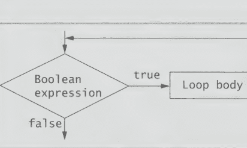

图 5-1 循环结构流程图

你可以使用 `while` 循环在循环测试条件持续为真的情况下持续执行语句体。一个 `while` 循环由以下部分组成：

- 关键字 `while`
- 括号内的布尔表达式
- 循环体

`while` 语句中评估的布尔表达式可以是单个布尔表达式，也可以使用 AND（与）和 OR（或）的复合表达式。体可以是单个语句，也可以是被花括号括起的任意数量语句。

### 无限循环示例

例如，以下代码显示了一个整数声明，随后是一个导致 Hello 消息（理论上）无限显示的循环，因为没有代码来结束循环。永不结束的循环被称为无限循环。无限循环可能实际上不会无限执行。所有程序都在计算机内存和硬件的帮助下运行，这两者都有有限的容量，无限循环最终可能会失败并结束。然而，任何可能永远运行的循环被称为无限循环。

```csharp
int number = 1;
while(number > 0)
    WriteLine("Hello");
```

在此循环中，表达式 `number > 0` 评估为真，并显示 Hello。表达式 `number > 0` 再次评估为真，再次显示 Hello。由于 `number` 的值从未被改变，只要计算机内存和硬件允许，循环就会永远运行，不断地评估布尔表达式并反复显示 Hello。


> 无限循环始终是一个坏主意，尽管丰富的程序员也会意外写出它们。如果你发现自己处于控制台程序的无限循环中，可以通过按住 Ctrl 键并按下 C 键或 Break（暂停）键来退出。在 GUI 程序中，你可以直接关闭托管应用程序的窗口。

### 结束 `while` 循环的三个动作

要让 `while` 循环结束，会发生三个独立的动作：

1. 初始化一个变量，即循环控制变量（在进入循环之前）。
2. 在 `while` 表达式中测试循环控制变量。
3. 循环体必须采取某些操作来改变循环控制变量的值（以便使 `while` 表达式最终评估为假）。

例如，图 5-2 显示了显示四次 Hello 的循环逻辑。变量初始化为 1，常量 `LIMIT` 初始化为 5。变量小于 `LIMIT`，因此执行循环体。图 5-2 所示的循环体包含两个语句。第一个显示 Hello，第二个将 `number` 加 1。评估下一个 `number`，其值为 2，仍小于 `LIMIT`，因此再次执行循环体。Hello 显示第三次，`number` 变为 4；然后 Hello 显示第 4 次，`number` 变为 5；此时 `while` 表达式为假，循环结束。


图 5-2 循环结构流程图

```csharp
using System;
class Hellos
{
    static void Main()
    {
        int number = 1;
        const int LIMIT = 5;
        while (number < LIMIT)
        {
            WriteLine("Hello");
            number = number + 1;
        }
    }
}
```

图 5-3 C# 程序

```text
Hello
Hello
Hello
Hello
```

图 5-4 Hellos 程序的输出

回想第 2 章，你也可以使用快捷运算符将变量的值增加 1。与其写 `number = number + 1`，你可以通过编写 `number++` 或 `number += 1` 实现相同的目的。由于计数是循环非常常见的特征，你可能想要复习前置增和后置增运算符之间的区别。

在运行正常的循环体内部，你可以通过多种方式改变循环控制变量的值。许多循环控制变量的值是通过增加或相加来改变的，如图 5-2 和 5-3 所示。其他循环通过减少或递减变量并测试该值是否仍大于某个基准值来控制。

### 确定循环与不确定循环

迭代次数预先定义的循环称为确定循环或计数循环。通常，循环控制变量的值不是通过算术运算改变，而是通过用户输入来改变。例如，你可能希望在用户表示想要继续时持续执行某些任务。在这种情况下，你不知道程序会执行 2 次、200 次还是根本不执行。这种循环被称为不确定循环。

考虑一个程序，它显示银行余额，并询问用户是否想查看一年利后的余额。每当用户想要继续时，就会显示一个增加后的余额。当用户最终表示足够了，程序结束。程序如图 5-7 所示，典型的执行过程如图 5-8 所示。

```csharp
using System;
using System.Console;
class LoopingBankBal {
    static void Main() {
        double bankBal = 1000;
        const double INT_RATE = 0.04;
        string inputString;
        char response;
        Write("Do you want to see your balance? Y or N...");
        inputString = ReadLine();
        response = Convert.ToChar(inputString);
        while(response == 'Y') {
            WriteLine("Bank balance is {0}", bankBal.ToString("C"));
            bankBal = bankBal + bankBal * INT_RATE;
            Write("Do you want to see next year's balance? Y or N...");
            inputString = ReadLine();
            response = Convert.ToChar(inputString);
        }
        WriteLine("Have a nice day!");
    }
}
```

**图 5-7** LoopingBankBal 程序

```text
C:\Chapter.05>LoopingBankBal
Do you want to see your balance? Y or N ...
Bank balance is $1000.00
Do you want to see next year's balance? Y or N ...
Bank balance is $1040.00
Do you want to see next year's balance? Y or N ...
Bank balance is $1081.60
Do you want to see next year's balance? Y or N ...
Have a nice day!

C:\Chapter.05>
```

图 5-8 LoopingBankBal 程序的典型执行


图 5-7 中的程序在响应为 Y 时继续显示银行余额。它也可以写成在响应为 N 时显示，即 `while(response != 'N') ...`。用户必须提供的用于停止循环的值（如 'Y' 或 'N'）称为哨值。

在图 5-7 的程序中，循环控制变量是 `response`。它由第一次输入初始化，并用布尔表达式 `response == 'Y'` 进行测试。如果用户使用 Y 以外的任何字符，循环体将永远不会执行；下一个执行的语句将显示 "Have a nice day!"。然而，如果用户输入 Y，那么循环体内的所有五个语句都会按照利率增加余额；除非用户请求重复循环，否则该值将不会显示。在循环内部，程序提示用户输入新的 `response` 值。这条语句是可能改变循环控制变量的关键语句。循环以右大括号结束，程序控制返回循环顶部，再次测试布尔表达式。如果用户在最后一次提示中输入了 Y，则重新进入循环，并显示在上一个循环周期中计算出的增加 `bankBal` 值。

在 C# 中，字符数据是敏感的。如果程序测试 `response == 'Y'`，用户的响应 `y` 将导致评估结果为假。注意避免编写类似于 `while(response != 'Y' || response != 'y')` 循环的陷阱，以测试响应的大写和小写版本。每个字符既不是 Y 也不是 y。一个正确的循环可能如下所示开头：

```csharp
while(response != 'Y' && response != 'y')
```


## 使用 `for` 语句创建循环

图 5-7 中的程序显示了一个不确定循环，因为执行次数不是预先定义的；程序每次执行时，用户可能会继续不同的次数。你可以使用 `while` 循环来实现确定循环或不确定循环。要编写每种 `while` 循环，你都会初始化一个循环控制变量，只要其测试表达式为真，你就继续执行 `while` 循环体。为了避免无限循环，`while` 循环体必须包含一条改变循环控制变量的语句。

由于你编写程序时经常需要确定循环（具有预定义迭代次数的循环），C# 提供了一种创建此类循环的简写形式。通过 `for` 循环，你可以在一个方便的地方指定循环控制变量的起始值、控制循环进入的测试条件以及改变循环控制变量的表达式。

你以关键字 `for` 开始语句，后面跟着一组括号。括号内有三个由两个分号隔开的区域。这三个部分通常用于：

- 初始化循环控制变量
- 测试循环控制变量
- 更新循环控制变量

与 `if` 语句或 `while` 语句一样，你可以使用单个语句作为 `for` 循环的体，也可以使用包含在花括号中的多个语句块。

```csharp
// 声明循环控制变量
int x;
const int LIMIT = 10;
// 使用 while 循环显示 1 到 10
x = 1;
while(x <= LIMIT)
{
    WriteLine(x);
    x++;
}

// 使用 for 循环显示 1 到 10
for(x = 1; x <= LIMIT; ++x)
    WriteLine(x);
```

图 5-10 使用 while 和 for 循环显示整数 1 到 10

循环控制变量在每次循环中增加或减少的幅度通常被称为步进值。这是因为在 BASIC 编程语言及其后代 Visual Basic 语言中，`STEP` 关键字实际上被用于循环。

### `for` 循环的执行流程

在图 5-10 所示的 `for` 语句的括号中，第一个分号之前的初始化部分会将一个名为 `x` 的变量设置为 1。无论 `for` 循环体最终执行多少次，程序都只执行此语句一次。

初始化表达式执行后，程序控制传递到 `for` 语句的中间部分，即测试部分。如果那里找到的布尔表达式求值为 `true`，则执行 `for` 循环体。在图 5-10 的程序段中，`x` 被初始化为 1，因此当测试 `x < LIMIT` 时，结果为 `true`，循环体输出 `x` 的值。

在循环体执行后，`for` 表达式的最后三分之一（最后一个分号之后的更新部分）执行，`x` 增加到 2。在第三部分，程序控制返回到第二个（测试）部分，在那里 `x` 再次与 `LIMIT` 进行比较。由于 `x` 的值为 2，它小于或等于 `LIMIT`，因此执行 `for` 循环体并显示 `x` 的值。然后，`for` 语句的第三修改部分再次执行。变量 `x` 增加到 3，`for` 循环继续。

最终，当 `x` 不小于或等于 `LIMIT` 时（在 1 到 10 输出之后），`for` 循环结束，程序继续执行 `for` 循环之后的任何语句。

### `for` 循环的灵活用法

`for` 循环的三个部分通常用于初始化变量、测试变量和增加变量，你也可以执行其他任务：

- 你可以通过在 `for` 语句的第一部分在不同的初始化之间放置逗号来初始化多个变量，如下所示：
  `for(g = 0, h = 1; g < 6; ++g)`

- 你可以在 `for` 语句内部声明新变量，如下所示：
  `for(int k = 0; k < 5; ++k)`
  
  在示例中，当变量仅用于控制循环而没有其他用途时，经常使用这种技术。当变量在循环内部声明时（例如示例中的 `k`），它只能在循环体的持续期间被引用；之后，它就离开了作用范围，这意味着它由于已不存在而不可用。

- 你可以通过评估复合条件或在循环执行结束时增加变量，在 `for` 语句的中间部分执行多个测试，如下所示减少变量的代码所示：
  `for(g = 5; g >= 1; --g)`

- 你可以通过逗号分隔操作，在循环执行结束时执行多个任务，如下所示：
  `for(g = 0; g < 5; ++g, ++h)`

### 空部分与标准用法

你可以让 `for` 表达式的一个或多个部分为空，但仍然需要两个分号作为占位符来分隔三个部分。通常，你希望使用所有三个部分，因为对于阅读你程序的人来说，循环的功能更加清晰。

通常，你应该以标准方式使用 `for` 循环，这是初始化、测试和更改控制确定循环的变量的简写方式。在下一章学习时，你将学习类似的循环——`foreach` 循环。

就像决策语句或 `while` 循环一样，`for` 循环体中的语句可以成块。例如，以下循环将显示四次 Hello 和 Goodbye：

```csharp
int TIMES = 4;
for(int x = 0; x < TIMES; ++x)
{
    WriteLine("Hello");
    WriteLine("Goodbye");
}
```

如果没有这段代码中的大括号，`for` 循环将在显示 Hello 的语句后结束。换句话说，Hello 将显示四次，但 Goodbye 只会显示一次。


### 两个事实和一个谎言

- 1. 下述语句显示数字 3 到 6：
  ```csharp
  for(int x = 3; x <= 6; ++x)
      WriteLine(x);
  ```

- 2. 下述语句显示数字 4 到 9：
  ```csharp
  for(int x = 3; x < 9; ++x)
      WriteLine(x + 1);
  ```

- 3. 下述语句显示数字 5 到 12：
  ```csharp
  for(int x = 5; x < 12; ++x)
      WriteLine(x);
  ```

## 使用 `do` 语句创建循环

在你目前为止学到的每个循环语句中，循环体可能会执行多次，但也可能完全不执行。例如，回显示复利的银行余额程序，其部分如图 5-11 所示。循环从阴影行通过测试 `response` 的值开始。如果用户没有输入 Y，循环体就永远不会执行。`while` 循环在循环的“顶部”检查值。

```csharp
Write("Do you want to see your balance? Y or N...");
inputString = ReadLine();
response = Convert.ToChar(inputString);
while(response == 'Y')
{
    WriteLine("Bank balance is {0}", bankBal.ToString("C"));
    bankBal = bankBal + bankBal * INT_RATE;
    WriteLine("Do you want to see next year's balance? Y or N...");
    inputString = ReadLine();
    response = Convert.ToChar(inputString);
}
```

**图 5-11** 使用 `while` 循环的银行余额程序

有时你可能需要循环体至少执行一次。如果是这样，你可以写一个在第一次迭代后在“底部”检查的循环。**do 循环**（也称为 **do...while 循环**）在一次迭代后检查控制循环的布尔表达式。图 5-12 显示了 **do 循环** 的结构图。


图 5-12 do 循环结构图

图 5-13 显示了银行余额程序中 `do` 循环的逻辑和 C# 代码。循环以关键字 `do` 开始。循环体在其后并包含在大括号内。在循环内部，计算下一个余额，并提示用户响应。控制循环执行的布尔表达式使用 `while` 语句编写，放在循环体之后。


# 嵌套循环

就像语句一样，循环语句也可以嵌套。你可以在 `while` 循环中放置 `while` 循环，在 `for` 循环中放置 `for` 循环，在 `for` 循环中放置 `while` 循环或任何组合。当循环嵌套时，每对循环包含一个内部循环和一个外部循环。内部循环必须完全包含在外部循环内部：循环不会重叠。图 5-14 显示了一个阴影循环嵌套在另一个循环中的图；阴影区域是内部循环以及外部循环的体。

假设你想在不同的利率下显示不同年份的银行余额。图 5-15 显示了一个包含由利率控制的外部循环（从图中第一个阴影语句开始）和由年份控制的内部循环（从第二个阴影语句开始）的应用程序。该程序显示在 4%、6% 和 8% 利率下，1000 美元在一到五年内的年复利。图 5-16 显示了输出。

## 使用嵌套循环

**图 5-14** 嵌套循环

```csharp
using static System.Console;
class LoopingBankBal2
{
    static void Main()
    {
        double bankBal;
        double rate;
        int year;
        const double START_BAL = 1000;
        const double START_INT = 0.04;
        const double INT_INCREASE = 0.02;
        const double LAST_INT = 0.08;
        const int END_YEAR = 5;
        for(rate = START_INT; rate <= LAST_INT; rate += INT_INCREASE)
        {
            bankBal = START_BAL;
            WriteLine("Starting bank balance is {0}",
                bankBal.ToString("C"));
            WriteLine("Interest Rate: {0}", rate.ToString("P"));
            for(year = 1; year <= END_YEAR; ++year)
            {
                bankBal = bankBal + bankBal * rate;
                WriteLine("After year {0}, bank balance is {1}",
                    year, bankBal.ToString("C"));
            }
        }
    }
}
```

**图 5-15** LoopingBankBal2 程序

## 第5章 循环

**图 5-16** LoopingBankBal 程序的输出

当你在循环内部嵌套循环时，应该始终将外层循环考虑为包含性循环。在描述任务时，对内层循环使用“每个”（each）一词。例如，如果你想在 10 年内每年输出不同利率下的余额，你可以按照如下所示的方式适当地初始化某些常量：

```csharp
const double RATE1 = 0.03;
const double RATE2 = 0.07;
const double RATE_INCREASE = 0.01;
const int END_YEAR = 10;
```

然后你可以使用以下嵌套的 `for` 循环：

```csharp
for(rate = RATE1; rate += RATE_INCREASE)
for(year = 1; year < END_YEAR; ++year)
  WriteLine(bankBal + bankBal * rate);
```

然而，如果你想显示每个利率下不同年份的余额，将使用以下代码：

```csharp
for(year = 1; year <= END_YEAR; ++year)
for(rate = RATE1; rate <= RATE2; rate += RATE_INCREASE)
  WriteLine(bankBal + bankBal * rate);
```

在这两种情况下，显示的都是相同的 50 个值——5 种不同的利率（从 0.03 到 0.07）对应 10 年（1 到 10）。但是，在第一个例子中，第 1 年到第 10 年的将在每个利率内部显示；而在第二个例子中，每个利率的每个余额将在每个年份分类内显示。换句话说，在第一个例子中，显示的前 10 个金额将全部使用 0.03 的初始利率持续 10 年；而在第二个例子中，显示的前 5 个金额将在第一年使用不同的利率值。

## 使用嵌套循环

观看视频“使用嵌套循环”（Using Nested Loops）。

# 两个真，一假

## 使用嵌套循环

- 1. 以下循环的体执行了六次：

  ```csharp
  for(a = 1; a < 4; ++a)
  for(b = 2; b < 3; ++b)
  ```

- 2. 下一个循环的体执行了四次：

  ```csharp
  for(c = 1; c < 3; ++c)
  for(d = 1; d < 3; ++d)
  ```

- 3. 下一个循环的体执行了 15 次：

  ```csharp
  for(e = 1; e <= 5; ++e)
  for(f = 2; f <= 4; ++f)
  ```

内层循环 1、2 和 3 在当内层循环在每个循环中仅执行一次时才会执行。外层循环只执行了三次。错误的陈述是 #1。该循环执行了 # 次。

## 你来做

### 使用嵌套循环

在接下来的步骤中，你将编写一个程序创建一个小费表，餐厅顾客可以使用它可以估算餐费的小费。价格范围从 $10 到 $100 不等，小费百分率范围从 10% 到 25%。该程序使用了几个循环。

- 1. 打开一个新文件开始创建一个名为 `TippingTable` 的程序。首先声明用于晚餐价格、小费百分率率和小费金额的变量。

（继续）

## 第5章 循环

（继续）

- 2. 接下来，创建一些常量。从 10% 到 25% 的每个小费将以 5% 为间隔进行计算，因此将这些值声明为 `LOWRATE`、`MAXRATE` 和 `TIPSTEP`。小费将针对最高 $100.00 的晚餐价格以每 $10.00 为间隔进行计算，因此也声明这些常量。

```csharp
const double LOWRATE = 0.10;
const double MAXRATE = 0.25;
const double TIPSTEP = 0.05;
const double MAXDINNER = 100.00;
const double DINNERSTEP = 10.00;
```

- 3. 创建表格表头。（为了对齐，在 Price 之后插入三个空格。）在同一行，使用一个循环以 `TIPSTEP` 为增量显示通过 `MAXRATE` 的每个利率。换句话说，小费率为 0.10、0.15、0.20 和 0.25。使用 `Write()` 语句将光标移动到下一行，使用 `WriteLine()` 语句显示虚线。

```csharp
Write("Price");
for(tipRate = LOWRATE; tipRate <= MAXRATE; tipRate += TIPSTEP)
  Write("{0,8}", tipRate.ToString("F"));
WriteLine("--------------------------------------");
```

> **注意**：`for` 循环中，第一个分号执行一次，循环体执行，然后第二个分号右边的表达式执行。换句话说，`TIPSTEP` 会加到 `tipRate` 上，直到 `tipRate` 在循环中显示。

> **提示**：作为在 `Write()` 语句中输入 40 个虚线的替代方案，可以使用循环显示 40 次虚线。当完成 40 个虚线后，可以使用 `Write()` 将光标移动到下一行。

```csharp
int NUM_DASHES = 40;
for(int x = 0; x < NUM_DASHES; ++x)
  Write("-");
WriteLine();
```

- 4. 将 `tipRate` 重置为 0.10。在最后一个循环之后，速率将大于 0.25。

```csharp
tipRate = LOWRATE;
```

- 5. 创建一个嵌套循环，当 `dinnerPrice` 小于 100.00 (`MAXDINNER`) 时继续。该循环的每次迭代显示表格的一行。在这个循环内部，显示 `dinnerPrice`，然后使用循环显示 `tipRate` 从 0.10 变化到 0.25。在循环结束时，将 `dinnerPrice` 增加 10.00，将 `tipRate` 重置为 0.10 以准备下一行，并写入一个新行以移动光标。

```csharp
while(dinnerPrice <= MAXDINNER)
{
    Write("{0,8}", dinnerPrice.ToString("C"));
    while(tipRate <= MAXRATE)
    {
        tip = dinnerPrice * tipRate;
        Write("{0,8}", tipRate.ToString("F"));
        tipRate += TIPSTEP;
    }
    dinnerPrice += DINNERSTEP;
    tipRate = LOWRATE;
    WriteLine();
}
```

> **注意**：`Write()` 语句中的 `{0, 8}` 格式字符串将第一个参数显示在 8 个字符的字段中。你在第 2 章学过格式字符串。

- 6. 添加两个大括号——一个用于 `Main()` 方法，一个用于类。

- 7. 保存文件、编译并执行程序。输出如图 5-17 所示。

| Price | 0.10 | 0.15 | 0.20 | 0.25 |
| :--- | :--- | :--- | :--- | :--- |
| $10.00 | 1.00 | 1.50 | 2.00 | 2.50 |
| $20.00 | 2.00 | 3.00 | 4.00 | 5.00 |
| $30.00 | 3.00 | 4.50 | 6.00 | 7.50 |
| $40.00 | 4.00 | 6.00 | 8.00 | 10.00 |
| $50.00 | 5.00 | 7.50 | 10.00 | 12.50 |
| $60.00 | 6.00 | 9.00 | 12.00 | 15.00 |
| $70.00 | 7.00 | 10.50 | 14.00 | 17.50 |
| $80.00 | 8.00 | 12.00 | 16.00 | 20.00 |
| $90.00 | 9.00 | 13.50 | 18.00 | 22.50 |
| $100.00 | 10.00 | 15.00 | 20.00 | 25.00 |

```text
C:\Chapter.05>TippingTable
```

**图 5-17** TippingTable 程序的输出

（继续）

在本章末尾的练习中，你将被要求制作一个 `TTable` 程序的交互版本，其中许多值将由用户输入，而不是作为未命名常量编码在程序中。

## 你来做

### 使用 do 循环

在接下来的步骤中，修改 Tipping 程序以用 `do` 循环代替 `while` 循环。

- 1. 打开 Tipping 程序，将类名更改为 `Tipping2` 并将文件保存为 `Tipping2`。
- 2. 剪切 `while` 循环语句 (`while(dinnerPrice <= MAXDINNER)`)，将其替换为 `do`。
- 3. 将 `while` 循环语句粘贴到循环结束的大括号之后、程序最后的两个大括号之前，然后添加一个分号。
- 4. 保存、编译并执行程序。输出与图 5-17 相同。

### 累加总和

许多计算机程序显示总和。当你收到信用卡或电话服务账单时，通常会提供个人交易详情，但你最感兴趣的是总金额。同样，某些程序会汇总学生的学分、公司所有员工的总工资或组织的应收账款总值。这些总和是累加的——也就是说，它们在循环中逐个汇总。

图 5-18 显示累加用户总量的交互程序示例。程序提示用户输入价格或按 O 。当循环继续输入非零值时，金额会被加到总和中。每次循环，总和都会重新计算以包含新的购买金额。在用户输入终止循环的 O 后，可以显示累加的总和。图 5-19 显示了典型的执行过程。

**图 5-18** 一个累加用户总购买金额的应用程序

```csharp
using System;
using static System.Console;
class TotalPurchase
{
    static void Main()
    {
      double purchase;
      double total = 0;
      string inputString;
      const double QUIT = 0;
      Write("Enter purchase amount >> ");
    }
}
```

**图 5-19** TotalPurchase 程序的典型执行过程

```text
C:\#Chapter.05>TotalPurchase
Enter purchase amount >> 5:10
Enter next purchase amount, or to quit >> 12.87
Enter next purchase amount, or to quit >> 100.00
Enter next purchase amount, or to quit >> 0
Your total is $112.87
C:\#Chapter.05>_
```

回想第 2 章的内容，表达式 `total += purchase` 使用了复合加法赋值运算符，它等同于 `total = total + purchase`。在维护运行总和时，经常使用加法赋值运算符。

在图 5-18 的应用程序中，在循环开始之前将用于累加的 `total` 变量设为 0 是非常重要的。如果不这样做，程序将无法编译。未知的、未赋值的值被称为“垃圾值”。C# 编译器通过要求你提供一个初始值来防止你看到错误的总和：C# 不会恰好存储在未初始化内存位置的垃圾值。

## 第5章 循环

在图 5-18 的应用程序中，`total` 变量必须初始化为 0，但 `purchase` 变量是未初始化的。许多程序员会认为初始化这个变量是没有意义的，因为无论你提供什么值，在变量被使用之前，第一条输入语句就会改变它的值。从风格的角度来看，如果初始化从未被使用，本书通常不会对变量进行初始化；这样做可能会误导你，认为该变量具有某种用途。

## 两个真理一假

### 累加总和

- 1. 当累加总和时，会将 1 加到代表总和的变量上。
- 2. 用于保存总和的变量在用于累加总和之前必须设为 0。
- 3. C# 编译器不允许在未初始化的变量中累加总和。

当累加总和时，并不是在循环中累加一个总和，而是每个循环增加一个分数。如果你每个循环只给总和变量加 1，那么该变量代表总和。例如，如果你有 10 个测试分数，那么错误的语句是 #1。当累加总和时，可能会加上任何值。

## 提高循环性能

无论你决定在应用程序中使用 `while`、`for` 还是其他循环，你都可以通过以下方法提高循环性能：

- 确保循环避免不必要的操作。
- 考虑短路运算符的求值顺序。
- 采用循环合并（loop fusion）。
- 使用前置递增而不是后置递增。

### 避免不必要的操作

可以通过让循环不包含不必要的操作或语句来提高循环性能。例如，假设循环在 `x` 小于两个整数 `a` 和 `b` 之和时执行，且循环体中没有修改 `a` 或 `b`。可以写为：

```csharp
while(x < a + b)
  // 循环体
```

如果这个循环执行 1,000 次，那么表达式 `a + b` 就会被计算 1,000 次。相反，如果你使用以下代码，结果是相同的，但算术只执行一次：

```csharp
int sum = a + b;
while(x < sum)
  // 循环体
```

当然，如果 `a` 或 `b` 在循环中发生了变化，那么必须在循环中重新计算。然而，如果在循环开始前固定 `a` 和 `b` 的和，效率会更高。例如，假设在循环中使用一个临时变量来存储 `a + b` 的和，这样可以写为：

```csharp
int sum = a + b;
while(x < sum)
  // 循环体
```

由于变量在循环开始前就停止了，这种方式效率更高。在循环中声明 `tempTotal` 如下：

```csharp
while(x < a + b)
  // 循环体
```

如果这个循环执行 1,000 次，那么表达式 `a + b` 就会被计算 1,000 次。相反，如果你使用以下代码，结果是相同的，但算术只执行一次：

```csharp
int sum = a + b;
while(x < sum)
  // 循环体
```

当然，如果 `a` 或 `b` 在循环中发生了变化，那么必须在循环中重新计算。然而，如果在循环开始前固定 `a` 和 `b` 的和，效率会更高。例如，在循环中使用一个临时变量来存储 `a + b` 的和，这样可以写为：

```csharp
int sum = a + b;
while(x < sum)
  // 循环体
```


如果这个循环执行 1,000 次，那么表达式 `a + b` 就会被计算 1,000 次。相反，如果你使用以下代码，结果是相同的，但算术只执行一次：

```c
int sum = a + b;
while(x < sum)
  // 循环体
```

当然，如果 `a` 或 `b` 在循环中发生了变化，那么必须在循环中重新计算。然而，如果在循环开始前固定 `a` 和 `b` 的和，效率会更高。例如，在循环中使用一个临时变量来存储 `a + b` 的和，这样可以写为：

```c
int sum = a + b;
while(x < sum)
  // 循环体
```

## 第 5 章 循环

你会遇到一些程序员，他们坚持在循环中使用后置自增或前置自增。你应该遵循你所在机构的约定，但现在你已经有了工具来证明前置自增速度更快。

随着你不断学习编程，你会发现许多可以让你程序运行更高效的情况。你应该始终寻找在不牺牲可读性的前提下提高程序性能的方法。

### 两个真理一个谎言

### 提高循环性能

1. 你可以通过确保循环不包含不必要的操作或语句来提高循环性能。
2. 你可以通过在循环外部声明临时变量，而不是在循环中不断重新声明它们，来提高循环性能。
3. 你可以通过省略循环控制变量的初始化来提高循环性能。

错误的陈述是 #3。循环变量必须在循环开始之前进行初始化。

### GUI 程序中的循环问题

在 GUI 应用程序的方法中使用循环与在控制台应用程序中使用循环没有区别；在两种类型的程序中，你可以以相同的方式使用 `while`、`for` 和 `do` 语句。例如，图 5-22 显示了一个 GUI 表单，提示用户输入一个数字，然后显示相应次数的“Hello”。左侧图像显示程序启动时的表单，右侧图像显示用户输入值并点击按钮后的输出。图 5-23 显示了 `greetingsButton_Click()` 方法中的代码。当用户点击 `greetingsButton` 时，会从表单上的 `TextBox` 中提取一个整数。然后 `for` 循环将按照正确的次数向 `jLabel` 的 `Text` 属性追加“Hello” 和一个换行符。

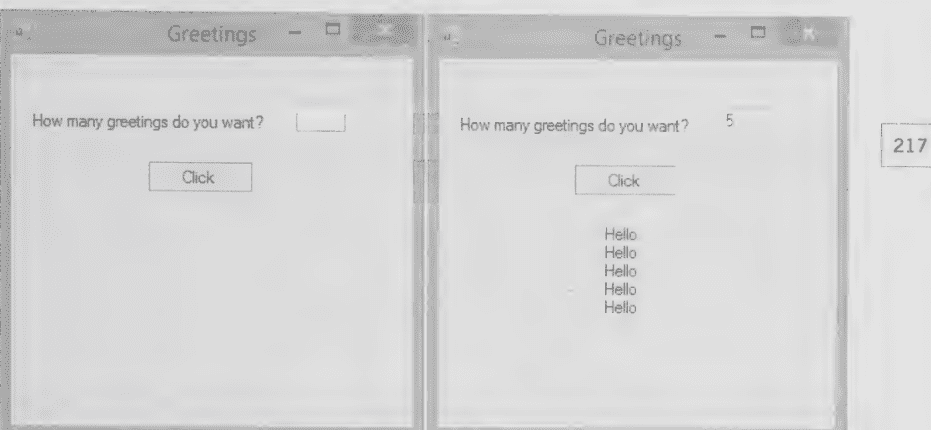

**图 5-22** 问候表单启动以及用户输入数字并点击按钮后

```csharp
private void greetingsButton_Click(object sender, EventArgs e)
{
    int numGreetings = Convert.ToInt32(greetingsTextBox.Text);
    int count;
    for (count = 0; count < numGreetings; ++count)
        outputLabel.Text += "Hello\n";
}
```

**图 5-23** ManyHellosGUI 中的 `greetingsButton_Click()` 方法

> 如果用户再次点击 ManyHellosGUI 程序中的按钮，那么“Hello”的实例将添加到已显示的实例中。如果你的意图是只显示新的“Hello”，你可以在循环开始之前向 `greetingsButton_Click()` 方法添加语句 `outputLabel.Text = "";`。

事件驱动程序所需的代码循环有时比相应的控制台程序少，因为在这些程序中，某些事件是由用户在程序运行时操作决定的，而不是由程序员预先的代码。你可以编写一个事件驱动程序，只要用户继续做出适当的选择，操作就会持续进行。取决于应用程序，这种隐式循环的哨兵值可能在用户点击表示退出的按钮或点击托管该应用程序的表单上的关闭按钮时发生。

例如，图 5-24 显示了一个控制银行余额应用程序的表单，类似于本章之前图 5-7 中所示的。图片的左侧显示了应用程序启动时的表单，右侧显示了用户点击三次“是”后的表单。图 5-25 显示了重要的表单类。

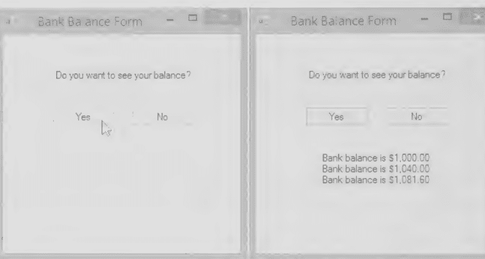

**图 5-24** 银行余额表单启动以及用户点击三次“是”后

```csharp
namespace LoopingBankBalGUI
{
    partial class Form1 : Form
    {
        double bankBal = 1000;
        const double INT_RATE = 0.04;
        private void yesButton_Click(object sender, EventArgs e)
        {
            outputLabel.Text = String.Format("Bank balance is {0}\n",
                bankBal.ToString("C"));
            bankBal = bankBal + bankBal * INT_RATE;
        }
        private void noButton_Click(object sender, EventArgs e)
        {
            outputLabel.Text = "Have a nice day!";
        }
    }
}
```

**图 5-25** LoopingBankBalGUI 程序的代码

在 LoopingBalGUI 程序中，你可能还会选择通过禁用“是”按钮或使其变为不可见，以便用户在点击“否”后无法选择它。

图 5-25 代码中没有写循环，因为每次用户点击表单上的“是”按钮时，都会自动触发循环执行。每当 `yesButton_Click()` 执行时，`outputLabel` 的 `Text` 就会追加到显示银行余额的新行中，然后银行余额根据利率增加。在 `yesButton_Click()` 方法之前初始化 `bankBal` 是重要的；如果它在方法内部初始化，那么每次余额都会重置为原始值。

### 本章总结

- 你可以使用 `while` 循环在条件持续为真时持续执行语句体。`while` 循环由 `while` 关键字、括号内的布尔表达式和循环体组成，循环体可以是单条语句或语句块。
- `for` 循环包含循环控制变量的起始值、控制循环进入的测试条件以及更改循环变量的表达式。在括号内，初始化、测试和更新用分号隔开。
- `do` 循环在执行一次后在底部检查循环的布尔表达式。
- 你可以嵌套任何组合。
- 在程序中，总和是这样累加的。
- 你可以通过确保循环不包含不必要的操作或语句、考虑评估顺序、采用循环融合以及使用前置自增来提高循环性能。
- 在控制台和 GUI 程序中，你可以以相同的方式使用 `while`、`for` 和 `do` 语句。

### 关键术语

- **循环**：一种允许重复执行语句块的结构。
- **循环体**：循环中执行的语句块。
- **迭代**：循环的任意执行。
- **`while` 循环**：在条件持续为真时持续执行语句体。
- **无限循环**：理论上永远不会结束的循环。
- **循环控制变量**：决定循环是否继续。
- **空体**：不包含任何语句。
- **增加变量**：向其增加一个值（具体来说，通常是指给变量加 1）。
- **减少变量**：从其减去一个值（具体来说，通常是指从变量减去 1）。
- **确定循环**：迭代次数是预定的。
- **计数循环**：确定循环。
- **不确定循环**：迭代次数不是预定的。
- **哨兵值**：用户必须提供的以停止循环的值。
- **`for` 循环**：包含循环控制变量的起始值、控制循环进入的测试条件以及更改循环变量的表达式，这些都在一个语句中。
- **步长值**：循环变量改变的幅度，特别是在 `for` 循环中。
- **超出范围**：描述一个由于已经不存在而不可用的程序组件。
- **`do` 循环**（也称为 `do...while` 循环）：在执行一次后在底部检查循环的布尔表达式。
- **预测试循环**：在执行循环体之前测试循环控制变量的循环。
- **后测试循环**：在执行循环体后测试循环控制变量的循环。

### 复习题

1. 允许重复执行一组语句的结构是 a(n)
   - a. 顺序循环
   - b. 选择数组

2. `while` 循环的体可以由
   - a. 单条语句，a 或 b 中的其一
   - b. 大括号内的语句块，既不是 a 也不是 b

3. 永远不结束的循环被称为 a(n) 循环。
   - a. `while` 计数的
   - b. `for` 无限

4. 在一个正常工作的循环中，以下哪项不是循环控制变量的属性？
   - a. 它在循环结束前被重置为初始值。
   - b. 它在循环开始前被初始化。
   - c. 它被测试。
   - d. 它在循环体中被修改。

5. 循环为空的 `while` 循环不包含
   - a. 循环控制变量
   - b. 语句
   - c. 大括号
   - d. `while` 语句括号内的测试

6. 你在编写时并不知道迭代次数的循环是 a(n) 循环。
   - a. 确定循环 计数的循环
   - b. 不确定循环 `for` 循环

7. 使用 `for` 循环代替 `while` 循环的主要优势是什么？
   - a. 使用 `for` 循环，无法创建无限循环。
   - b. 这是实现无限循环的唯一方法。
   - c. 与 `while` 循环不同，多个语句的执行可以取决于测试条件。
   - d. 循环控制变量的初始化、测试和修改都在同一个地方完成。

8. `for` 循环语句必须包含 \_\_\_\_\_\_\_\_\_\_\_\_\_\_\_\_\_\_\_\_\_\_。
   - a. 两个分号
   - c. 四个点
   - b. 三个逗号
   - d. 五个竖线

9. 在 `for` 循环语句中，第一个分号之前的部分执行
   - a. 一次
   - b. 在每次循环迭代之前执行一次
   - c. 在每次循环迭代后执行一次
   - d. 执行次数比初始循环控制变量的值少 1

10. `for` 循环的三个部分通常用于循环控制变量。
    - a. 测试、输出和递增
    - b. 初始化、测试和递增
    - c. 递增、选择和测试
    - d. 初始化、转换和输出

11. 如果循环体必须至少执行一次，使用哪种循环最方便？
    - a. `do` 循环
    - c. `for` 循环
    - b. `while` 循环
    - d. `if` 循环

12. 循环控制变量在何种循环的末尾进行检查？
    - a. `while` 循环
    - c. `for` 循环
    - b. `do` 循环
    - d. 以上所有情况

13. `for` 循环是 a(n) \_\_\_\_\_\_\_\_\_\_\_\_\_\_\_\_\_\_\_\_\_\_ 循环的示例。
    - a. 未测试的
    - c. 后测试
    - b. 前测试
    - d. 无限

14. `while` 循环是 a(n) 循环的示例。
    - a. 未测试的
    - c. 后测试
    - b. 前测试
    - d. 无限

15. 当一个循环被放在另一个循环内部时，这些循环被称为
    - a. 无限的
    - c. 嵌套的
    - b. 气泡
    - d. 重叠的

16. 以下代码段显示什么？

```c
a = 1;
while (a < 5)
{
  Write("{0}", " ");
  ++a;
}
```

   - a. 1234
   - c. 4
   - b. 1
   - d. 什么都不显示

17. 以下代码段的输出是什么？

```c
s=1;
while(s < 4)
++s;
  Write("{0}", " s");
```

   - a. 1
   - c. 1234
   - b. 4
   - d. 234

18. 以下代码段的输出是什么？

```c
j = 5;
while(j > 0)
{
  Write("{0}", j);
  j--;
}
```

   - a. 0
   - c. 54321
   - b. 5
   - d. 543210

19. 以下代码段显示什么？

```c
for(f = 0; f < 3; ++f)
  Write("{0}", f);
```

   - a. 0
   - c. 3
   - b. 012
   - d. 什么都不显示

20. 以下代码段显示什么？

```c
for(t = 0; t < 3; ++t)
  Write("{0}", t);
```

   - a. 0
   - c. 012
   - b. 0
   - d. 123

### 练习

### 编程练习

1. 编写一个程序，允许循环执行一组语句，计算数字之和。
2. 编写一个名为 `SumInts` 的程序，允许用户输入整数，直到输入 99。
3. 编写一个名为 `EnterLowercase` 的程序，让用户从键盘输入字母。如果是小写字母，则显示 OK；如果不是，显示错误信息。
4. 编写一个名为 `TestScores` 的程序，让用户连续输入整数，直到输入一个有效的哨兵值。如果整数是有效的，将其累加到总和。
5. Danielle、Edward 和 Francis 是三个循环的销售人员。编写一个名为 `HomeSales` 的程序，让用户输入金额，直到输入 Z。如果金额无效，显示错误信息。在用户输入正确的金额后，显示总和。
6. 编写一个名为 `DisplayMultiplication` 的程序，显示两个数字的乘法表。
7. 编写一个名为 `OddNums` 的程序，让用户输入月份，显示该月份的天数。
8. 编写一个名为 `MultiplicationTable` 的程序，让用户输入整数，显示其乘法表。
9. 编写一个名为 `Sum` 的程序，处理 1 到 50 之间的整数。
10. 编写一个名为 `Perfect` 的程序，如果一个数字能被它的整数整除，则它是完美的。
11. 在第 4 章中，你创建了 `Tipping` 程序。现在创建一个修改版的 `Tipping`，获取以下值：
    - 最小百分比
    - 最大百分比
    - 最可能的金额
12. 编写一个名为 `WebAddress` 的程序，让用户输入名称。通过在名称前添加 `www.`，删除名称中的空格，并在末尾添加 `.com`。例如，`AcmePlumbing.com`。
13. 编写一个名为 `Count` 的程序，让用户输入短语并统计元音数量。在此练习中，不要将 y 视为元音。
14. 在第 4 章中，你创建了 `Guess2` 程序。现在创建一个修改版的 `Guess2`，让用户输入随机数，直到猜中为止。使用以下语句生成随机数：

```csharp
Random randomNumber = new Random();
int randomNumber = randomNumber.Next(min, max);
```

15. 修改 `Guess2` 创建一个程序，当玩家做出愚蠢猜测时会受到批评。例如，如果玩家猜随机数是 4 并被告知太小，随后又做了一个比 4 小的猜测，则显示一条用户不应该做出这种猜测的消息。

### 调试练习

1. 在 Chapter.05 文件夹中的以下每个可下载学生文件都存在语法错误或逻辑错误。在每种情况下，请确定问题并修复程序。纠正错误后，使用原文件名加前缀保存文件。例如，将 `DebugFive1.cs` 命名为 `FixedDebugFive1.cs`。
   - a. `DebugFive1.cs`
   - b. `DebugFive2.cs`
   - c. `DebugFive3.cs`
   - d. `DebugFive4.cs`

### 案例分析

1. 在第 4 章中，你创建了一个交互式程序 `GreenvilleRevenue`，让用户输入今年和去年的 Greenville Idol 比赛参赛人数，并根据每个参赛者支付 25 美元的入场费计算今年的预期收入。根据今年和去年参赛人数的比较，程序还会显示第 4 章案例中指定的三个适当语句之一。现在，修改程序，使用户输入的数字必须在 0 到 30（包含）之间。如果用户输入了错误数字，程序将提示输入有效值。

## 第 6 章 使用数组

在本章中，你将：

- 声明数组并为数组元素赋值
- 访问数组元素
- 使用循环搜索数组
- 使用 `BinarySearch()`、`Sort()` 和 `Reverse()` 方法
- 使用多维数组
- 学习 GUI 程序中的数组问题

在变量中存储值为程序提供了灵活性；一个使用变量来替换常数的程序在每次执行时可以使用不同的值。当你向程序中添加循环时，在同一次程序执行过程中，在循环的连续周期中，同一个变量可以持有不同的值。学习使用数组作为数据结构可以提供进一步的灵活性。数组允许你将在相邻的内存位置中存储多个值，并通过更改指示要使用哪一个所存储的值的值来访问它们。在本章中，你将学习创建和管理 C# 数组。

### 声明数组并为数组元素赋值

有时，一次只在内存中存储一个值是不够的。例如，一位监督 20 名员工的销售经理可能需要确定每位员工的销售额是高于还是低于平均水平。当你向程序中输入第一位员工的销售值时，你无法确定它是高于还是低于平均值，因为在输入所有 20 个值之前，你不知道平均值。你可能计划将 20 个销售值赋值给 20 个独立的变量，每个变量都有唯一的名称，然后对它们进行求和并取平均。然而，这个过程既笨拙又不方便：你需要 20 个提示、使用 20 个存储变量名的 20 个输入语句以及 20 个加法语句。这种方法对于 20 名销售人员可能有效，但如果你有 30、40 或 10,000 名销售人员呢？

你可以通过一个循环中的 20 次迭代为 20 名销售人员输入数据，循环中包含一个提示、一个输入语句和一个加法语句。遗憾的是，当你输入第二位员工的销售值时，该数据会替换第一位员工的值，导致第一位员工的值不再可以与所有 20 个值的平均值进行比较。通过这种方法，数据输入循环结束，内存中留下的唯一销售值是最后输入的一个。

解决此问题的方案是创建一个数组。数组是具有相同数据类型和相同名称的数据项列表。数组中的每个对象都是一个**数组元素**。你可以用**下标**（subscript）将数组中的每个元素与其他区分开。下标（也称为**索引** index）是一个指示特定数组元素位置的整数。在 C# 中，下标写在数组名称后的方括号之间。


# 第 6 章 使用数组

你用数据类型、一对方括号和一个标识符来声明数组变量。例如，要声明一个 `double` 类型的数组来存储销售人员的销售值，你写如下内容：

```csharp
double[] sales;
```

在 C++ 和 Java 等编程语言中，你也可以通过将方括号放在数组名称后来声明数组，如 `double sales[]`。这种格式在 C# 中是非法的。

## 声明数组并为数组元素赋值

你可以为数组提供任何你想要的合法标识符，程序员习惯上像命名变量一样命名数组——以小写字母开头，后续单词的开头使用大写字母。此外，许多程序员遵循以下约定之一，以明显看出该名称代表一组项目：

- 数组通常使用复数名词命名，例如 `sales`。
- 数组通常通过添加一个暗示组的结尾单词来命名，例如 `salesList`、`salesTable` 或 `salesArray`。

在你声明数组变量后，你需要创建实际的数组，因为声明数组和为其预留内存空间是两个不同的过程。你可以使用以下语句声明数组变量并为 20 个销售对象预留内存位置：

```csharp
double[] sales = new double[20];
```

`new` 关键字也称为 `new` 操作符；它用于创建对象。在这种情况下，它创建了 20 个独立的销售元素。你也可以在一个语句中声明并创建数组，如下：

```csharp
sales = new double[20];
```

你可以根据需要更改与标识符关联的数组的大小。例如，如果你声明了 `array[]`，可以通过 `array = new int[5];` 分配五个元素；在程序的稍后部分，你可能通过 `array = new int[100];` 将数组大小更改为 100；仍然，你可以再次将其更改为更大或更小。大多数其他编程语言不提供这种功能。如果你在 C# 中调整数组大小，同一个标识符将指向内存中的一个新数组，并且所有值将被设置为该数据类型的默认值。

`new double[20];` 预留了 20 个内存位置。在 C# 中，数组的元素从 0 开始编号，所以如果数组有 20 个元素，你可以使用从 0 到 19 的任何下标。换句话说，第一个销售数组元素是 `sales[0]`，最后一个销售元素是 `sales[19]`。图 6-1 显示了 20 个销售值数组在计算机内存中的样子。该图假设数组起始内存地址为 20000。当你实例化数组时，你无法选择它在内存中的位置，就像你无法选择任何其他变量的位置一样。但是你知道第一个数组元素之后，后续元素将紧随其后。因为一个双精度数组占用八字节存储，因此双精度数组的每个元素连续存储在比前一个地址高出八字节的地址上。

| 内存地址 | sales[] |
| :--- | :--- |
| 20000 | sales[0] |
| 20008 | sales[1] |
| 20016 | sales[2] |
| 20024 | |
| : | |
| 20136 | |
| 20144 | sales[18] |
| 20152 | sales[19] |


在 C# 中，数组下标必须是整数。没有任何数组包含下标为 1.5 的元素。下标可以是整数、变量或求值为整数的表达式。例如，如果 `x` 和 `y` 是整数，且它们的和至少为 0 但小于数组的大小，那么引用 `array[x + y]` 是合法的。

常见的错误是忘记数组的第一个元素是 0（有时称为零元素），特别是如果你熟悉另一种第一个元素为 1 的编程语言。犯这种错误意味着在使用任何数组时都会“差一”（off by one）。如果你在访问数组元素时“差一”但使用的下标有效，你的程序很可能会产生错误的输出。如果你“差一”导致下标超过了允许的最大值，你将导致程序错误。

为了记住数组元素从 0 开始，将第一个元素想成距离数组开头“零个元素”，将第二个元素想成距离“一个元素”，以此类推可能会帮助。

当你处理任何单个数组元素时，你的处理方式与处理相同类型的单个变量相同。例如，要为 `sales` 数组的第一个元素赋值，你使用简单的赋值语句，如下：

```csharp
sales[0] = 2100.00;
```

要输出 20 元素数组中最后一个销售的值，你写道：

```csharp
WriteLine(sales[19]);
```

> 观看视频搜索数组。

## 初始化数组

在 C# 中，数组是对象。当你实例化数组时，你正在创建一个派生自或基于内置类 `System.Array` 的类的特定实例。（在“继承导论”章节中，你将学习更多关于派生类的知识。）

当你声明数组或任何其他对象时，元素将被分配以下默认值：

- 数值型字段被设置为 0。
- 字符字段被设置为 `\u0000` 或 null。（你在第 2 章中已经学习了以 `\u` 开头的转义序列。）
- 布尔型（`bool`）字段被设置为 `false`。

你可以在声明时通过包含包含在花括号内的用逗号分隔的值列表，为数组元素分配非默认值。如果你想创建一个名为 `myScores` 的数组并在其中存储五个测试分数，可以使用以下任何声明方式：

```csharp
int[] myScores = new int[5] {100, 76, 88, 100, 90};
int[] myScores = new int[]{100, 76, 88, 100, 90};
int[] myScores = {100, 76, 88, 100, 90};
```

为数组提供的值列表是一个初始化列表。当你通过提供大小和初始化列表来初始化数组时（如第一个示例所示），陈述的大小和列表元素的数量必须匹配。然而，当你使用值初始化数组时，不需要给数组指定大小，如第二个示例所示：在这种情况下，大小是根据初始化列表中值的数量分配的。第三个示例显示，当初始化数组时，你不需要使用 `new` 关键字并重复类型；相反，内存是根据说明的数组类型和所提供值列表的长度分配的。在这三个示例中，第一个最明确，但如果更改元素数量，则需要修改两次。第三个示例最简单，但可能不会说明创建了一个新对象。微软的文档倾向于使用第三个示例，因为它最简洁，但你应该使用最接近你或所在组织习惯的数组初始化形式。

当你在代码块末尾使用花括号时，不需要在闭合括号后加分号。但是，当你使用花括号包含一组数组值列表时，必须用分号完成语句。

字符数组可以赋值给字符串。例如，你可以写：

```csharp
char[] arrayOfLetters = {'h', 'e', 'l', 'l', 'o'};
string word = new string(arrayOfLetters);
```

你也可以使用下标访问字符串中的单个字符。例如，如果你定义了 `string greeting = "Hello";`，那么 `greeting[0]` 就是 'H'。然而，`string` 并不是字符数组，你不能将字符赋值给字符串的一部分，例如无效的赋值 `word[0] = 'A';`。

### 二真一假

#### 声明数组并为数组元素赋值

1. 为了为 10 个 `testScores` 对象预留内存位置，可以使用以下语句：
   `int[] testScores = new int[9];`

2. 为了给名为 `testScores` 的 10 个元素数组的最后一个元素赋值 60，可以使用以下语句：
   `testScores[9] = 60;`

3. 以下语句创建一个名为 `testScores` 的数组并在其中存储四个值：
   `int[] testScores = new int [] {90, 85, 76, 76, 92};`

元素将使用下标 0 到 9。对于对象，你必须在第二组方括号中使用 10。错误的陈述是 #1。即为 10 个 `testScores` 预留内存位置。

## 访问数组元素

当你声明一个五个整数的数组时（如下所示），你通常希望对每个数组元素执行相同的操作：

`int[] myScores = {100, 76, 88, 100, 90};`

例如，要让每个元素增加 3，你可以写以下五个语句：

```csharp
myScores[0] += 3;
myScores[1] += 3;
myScores[2] += 3;
myScores[3] += 3;
myScores[4] += 3;
```

如果你将每个数组元素视为独立的实体，那么声明数组相比独立变量并没有太大优势。数组的力量在你使用下标时变得显而易。例如，你可以使用 `while` 循环，如下：

```csharp
int sub = 0;
while(sub < 5)
{
    myScores[sub] += 3;
    ++sub;
}
```

你也可以使用 `for` 循环，如下：

```csharp
for(int sub = 0; sub < 5; ++sub)
{
    myScores[sub] += 3;
}
```

在两个示例中，变量 `sub` 都被初始化为 0。

### 使用属性

当你处理数组时，必须确保下标在范围内。如果你访问数组的索引大于其长度，将收到一个错误（你将在“异常处理”中学习 `IndexRangeException`）。每个数组都有一个 `Length` 属性，它是 `System.Array` 类的一个成员。以下代码显示了数组的大小及其内容：

```csharp
int[] myScores = {100, 76, 88, 100, 90};
WriteLine("Array size is {0}", myScores.Length);
for(int x = 0; x < myScores.Length; ++x)
    WriteLine(myScores[x]);
```

### 使用 foreach

你可以使用下标从 0 到 `Array.Length - 1` 的 `for` 或 `while` 循环轻松遍历数组。C# 还支持 `foreach` 语句，你可以用它在不使用下标的情况下遍历每个数组元素。通过 `foreach` 语句，你提供一个临时迭代变量，它会自动依次持有每个数组值。

例如，以下代码显示了 `payRate` 数组中的每个元素：

```csharp
double[] payRate = {6.00, 7.35, 8.12, 12.45, 22.22};
foreach(double money in payRate)
  WriteLine("{0}", money.ToString("C"));
```

`foreach` 语句仅在特定情况下使用：

- 你通常在想要访问每个数组元素时才使用 `foreach`。如果要仅访问特定的元素，必须使用其他技术来操作下标——例如，使用循环或 `while` 循环。
- `foreach` 迭代变量是只读的——也就是说，你可以访问它，但不能给它赋值。如果你想给数组元素赋值，则必须使用不同类型的循环。

### 二真一假

#### 访问数组元素

1. 假设你声明了一个名为 `balances` 的包含六个 `double` 类型的数组。以下语句将了所有元素：
   ```csharp
   for(int index = 0; index < 6; ++index)
       WriteLine(balances[index]);
   ```

2. 假设你声明了一个名为 `prices` 的包含八个 `double` 类型的数组。以下语句从每个元素减去 2：
   ```csharp
   for(double pr = 0; pr < 8; ++pr)
       prices[pr] -= 2;
   ```

3. 下列代码显示 3：
   ```csharp
   int[] array = {1, 2, 3};
   WriteLine(array.Length);
   ```

> 错误的语句是 #2。你只能使用 `int` 作为数组的下标。这个示例尝试使用 `double`。

## 由你来完成

### 创建和使用数组

在接下来的步骤中，你将创建一个小型数组观察它是如何使用的。该数组将存储四类员工的薪水。

1. 打开一个新文件，开始编写名为 `ArrayDemo1` 的控制台程序，演示数组的使用：
   ```csharp
   using static System.Console;
   class ArrayDemo1
   {
       static void Main()
   ```

2. 通过输入以下代码声明并创建一个包含四个 `double` 值的数组：
   ```csharp
   double[] payRate = {6.00, 7.35, 8.12, 12.45};
   ```

3. 为了确认这四个值已经赋值，使用以下代码显示它们：
   ```csharp
   for(int x = 0; x < payRate.Length; ++x)
       WriteLine("Pay rate {0} is {1}", x, payRate[x].ToString("C"));
   ```

4. 添加两个结束 `Main()` 方法和 `ArrayDemo1` 类的右括号。

5. 保存程序，然后编译并运行它。输出结果如图 6-2 所示。

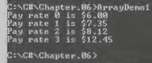

## 使用循环在数组数组

当你想要确定一个变量是否包含多个可能的有效值之一时，一种方法是使用 `if` 语句将变量与有效值进行比较。例如，假设一家公司生产 10 种物品。当客户下单某个物品时，你需要确定该物品编号是否有效。如果有效的编号是连续的（101 到 110），那么下面使用 `AND` 运算符的 `if` 语句可以验证订单号并将布尔字段设置为 `true`：

```csharp
if(itemOrdered >= 101 && itemOrdered <= 110)
    isValidItem = true;
```

然而，如果有效的编号是非连续的（例如，101, 108, 201, 213, 266, 304 等），你必须编写以下深层嵌套的 `if` 语句或长长的 `OR` 比较来确定物品编号的有效性：

```csharp
if(itemOrdered == 101)
    isValidItem = true;
else if(itemOrdered == 108)
    isValidItem = true;
else if(itemOrdered == 201)
    isValidItem = true;
// 以此类推
```

与其创建一系列 `if` 语句，判断一个值是否有效的更优雅的解决方案是将其与数组中的值列表进行比较。例如，你可以使用以下语句初始化一个有效值数组：

```csharp
int[] validValues = {101, 108, 201, 213, 266, 304, 311, 409, 411, 412};
```

> 你可能希望将 `validValues` 数组声明为常量，因为假设有效的物品编号在执行期间不应更改。在 C# 中，你必须在常量之前使用 `readonly` 关键字。为了保持这些示例的简单，本章所有的数组。

声明 `validValues` 数组后，你可以使用 `for` 循环或 `while` 循环搜索 `itemOrdered` 值是否匹配数组中的任何项。

### 使用 for 循环搜索数组

确定 `itemOrdered` 值是否等于 `validValues` 数组中值的一种方法是使用 `for` 语句遍历数组并在找到匹配时将布尔变量设置为 `true`：

```csharp
for(int x = 0; x < validValues.Length; ++x)
    if(itemOrdered == validValues[x])
        isValidItem = true;
```

这种搜索被称为顺序搜索，因为按顺序检查每个数组元素。这个简单的 `for` 循环替换了长长的 `if` 语句。此外，如果公司有 100 个物品而不是 10 个，那么数组中的有效物品列表必须更改，但 `for` 语句不需要更改。作为额外奖励，如果你设置另一个数组作为并行数组，可以使用相同的下标来访问额外信息。例如，如果你有 10 种不同的价格，可以设置一个数组来持有这些价格：

```csharp
double[] prices = {0.89, 1.23, 3.50, 0.69, 5.79, 1.99, 0.89, 8.00};
```

价格顺序必须与 `validValues` 数组中对应的物品编号顺序相同。现在，寻找有效编号的 `for` 循环也会找到价格，如图 6-3 所示。换句话说，如果在 `validValues` 数组的第二个位置找到了物品编号，可以在 `prices` 数组的第二个位置找到正确的价格。在程序图 6-3 中，作为下标的变量 `x` 被设置为 0，布尔值 `isValidItem` 为 `false`。在图阴影部分，下标保持较并持续递增以便测试后续值。当用户的物品与数组中的某项匹配时，`isValidItem` 被设置为 `true`，物品价格存储在 `itemPrice` 中。图 6-4 显示了两次典型的执行。

> 如果你初始化并行数组，使用间距（如图 6-3 所示）可以让对应的值在屏幕上对齐。

虽然并行数组非常有用，但它们也会增加错误的概率。每当你对一个数组进行更改时，必须记得在其并行数组中进行相应的更改。随着继续学习 C#，你将学习关联 better 方法。例如，在“使用类和对象”章节，你将学习可以将数据项封装在对象而不是数组中。


```csharp
using System;
using static System.Console;
class FindPriceWithLoop
{
    static void Main()
    {
        int[] validValues = {101, 108, 201, 213, 266, 304, 311, 409, 411, 412};
        double[] prices = {0.89, 1.23, 3.50, 0.69, 5.79, 1.99, 0.89, 8.00};
        int itemOrdered;
        double itemPrice = 0;
        bool isValidItem = false;
        Write("Please enter an item: ");
        itemOrdered = Convert.ToInt32(ReadLine());
        for (int x = 0; x < validValues.Length; ++x)
        {
            if(itemOrdered == validValues[x])
            {
                isValidItem = true;
                itemPrice = prices[x];
            }
        }
        if(isValidItem)
            WriteLine("Price is {0}", itemPrice);
        else
            WriteLine("Sorry - item not found");
    }
}
```

**图 6-3** FindPriceWithLoop 程序

```
C:\Chapter6\>FindPriceWithLoop
Please enter an item: 266
Price is 5.79
C:\Chapter6\>FindPriceWithLoop
Please enter an item: 267
Sorry - item not found
C:\Chapter6\>
```

**图 6-4** FindPriceWithLoop 程序的两次典型执行

## 第6 章 使用数组

在图 6-3 `Main()` 方法的第四条语句中，`totalPrice` 被设置为0。设置此变量是必要的，因为它之后只有在 `validValues` 数组中找到物品编号时才会被更改。由于 C# 取决于 `if` 语句，C# 不允许你显示该变量，因为编译器假设如果语句的布尔表达式为假，该变量可能没有被有效值。

# 提高循环效率

图 6-3 显示的代码可以变得更高效。目前，程序会将 `itemOrdered` 与所有10个 `validValues` 进行比较。即使 `itemOrdered` 等于 `validValues` 数组中的第一个值 (101)，你仍然会对数组进行额外的九次循环。在这九次额外的迭代中，`itemOrdered` 与 `validValues[x]` 之间的比较始终为假。一旦找到 `itemOrdered` 的匹配，最有效的操作是尽早跳出循环。完成此任务的一种简单方法是在执行匹配项的语句块内将 `x` 设置为一个高值。这样，在匹配后，`for` 循环将不再执行，因为限制比较（`x < validValues.Length`）已被越。图 6-5 显示了这种方法。

```csharp
for(int x = 0; x < validValues.Length; ++x)
{
    if(itemOrdered == validValues[x])
    {
        isValidItem = true;
        itemPrice = prices[x];
        x = validValues.Length;
        // 修改 x 以强制跳出循环
        // 当你找到匹配项时
    }
}
```

**图 6-5** 强制提前退出的循环

## 使用循环搜索数组

在图 6-5 的代码段中，与其在找到匹配项时使用语句将 `x` 设置为 `validValues.Length`，你可以移除该语句，并将 `for` 语句中间部分的比较改为复合语句，如下所示：

```cs
for(int x = 0; x < validValues.Length && !isValidItem; ++x)
```

另一种方案是，你可以移除将 `x` 设置为 `validValues.Length` 的语句，而在循环内部放置一个 `break` 语句。`break` 语句会立即退出当前代码。

如果你决定在找到匹配项时立即退出循环，最有效的策略是将最常见的项目放在前面。例如，如果项目 31 出现频率最高，就将其放在 `validValues` 数组中，并将价格（$0.99）放在 `prices` 数组中。然而，在许多应用程序中，首要考虑的是程序是否易于阅读、理解和修改；而在其他应用程序（如移动设备）中，速度和内存考虑更为重要。你应该遵循导师或主管的建议。

有些程序员反对提前退出 `for` 循环，无论是通过设置变量值还是使用 `break` 语句。他们认为，如果每个程序只有一个入口和一个出口，程序将更容易调试和维护。如果你（或你的导师）同意这种哲学，可以选择下文使用的 `while` 语句。

# 使用 while 循环搜索数组

作为使用 `for` 循环搜索数组的替代方案，可以使用 `while` 循环来搜索匹配项。使用这种方法，你将下标设置为 0，当 `itemOrdered` 不等于数组中的值时，增加下标并继续查找。只有当下标小于数组长度时才继续。如果循环在下标达到 `validValues.Length` 之前结束，说明找到了匹配项，可以将正确的价格分配给 `itemPrice` 变量。图 6-6 显示了使用这种方法的程序。

## 第 6 章 使用数组

```cs
using System;
using static System.Console;
class FindPriceWithWhileLoop
{
    static void Main()
    {
        int x;
        string inputString;
        int itemOrdered = 0;
        double itemPrice = 0;
        bool isValid = false;
        int[] validValues = {11, 21, 31, 41, 51};
        double[] prices = {0.89, 1.23, 1.50, 1.69, 1.79};
        Write("Enter item number ");
        inputString = ReadLine();
        itemOrdered = Convert.ToInt32(inputString);
        x = 0;
        while(x < validValues.Length && itemOrdered != validValues[x])
        {
            x++;
        }
        if(x != validValues.Length)
        {
            isValid = true;
            itemPrice = prices[x];
            if(isValid)
            {
                WriteLine("Item {0} sells for {1}", itemOrdered, itemPrice.ToString("C"));
            }
            else
            {
                WriteLine("No such item as {0}", itemOrdered);
            }
        }
    }
}
```

**图 6-6** FindPriceWithWhileLoop 使用 while 循环进行搜索

在图 6-6 的应用程序中，用下标的变量 `x` 被设置为 0，布尔变量 `isValid` 设置为 `false`。在图阴影部分，下标小于有效项目编号的长度，当用户请求的项目不匹配有效项目时，下标增加以检查后续数组值。如果循环在下标达到 `validValues.Length` 之前结束，说明找到了匹配项，可以将正确的价格分配给 `itemPrice` 变量。图 6-6 显示了使用这种方法的程序。

## 使用循环搜索数组

```cs
//（来自 266-267 页的代码上下文）
Write("Enter item number ");
inputString = ReadLine();
itemOrdered = Convert.ToInt32(inputString);
x = 0;
while(x < validValues.Length && itemOrdered != validValues[x])
{
    x++;
}
if(x != validValues.Length)
{
    isValid = true;
    itemPrice = prices[x];
    // ...
}
```

# 范围搜索数组

一种方案是使用并行数组。例如，假设一家邮件公司根据订单数量提供折扣。图 6-7 显示了执行结果：

| 总订单数量 | 折扣 (%) |
| :--- | :--- |
| 不到 12 | 无 |
| 13 到 49 | 10 |
| 50 到 99 | 14 |
| 100 到 199 | 18 |
| 200 或更多 | 20 |

另一种方案是使用存储下限的单个数组。图 6-8 显示了这种方法：

```cs
int[] discountLowLimits = {1, 13, 50, 100, 200};
double[] discounts = {0, 0.10, 0.14, 0.18, 0.20};
int sub = discountLowLimits.Length - 1;
while (sub >= 0 && itemOrdered < discountLowLimits[sub]) {
    sub--;
}
customerDiscount = discounts[sub];
```

**图 6-8** 范围搜索数组

另一种方法是创建一个包含每个范围上限的数组，例如：

```cs
int[] discountRangeUpperLimits = {12, 49, 99, 199, 999999};
```

然后逻辑可以写为比较 `itemOrdered` 与每个范围限制，直到找到正确的范围，如下：

```cs
int sub = 0;
while (sub < discountRangeUpperLimits.Length &&
       itemOrdered > discountRangeUpperLimits[sub]) {
    ++sub;
}
customerDiscount = discounts[sub];
```

在此示例中，`sub` 初始化为 0。只要 `sub` 仍在数组范围内，且 `itemOrdered` 大于每个范围上限，`sub` 增加。换句话说，如果 `itemOrdered` 为 3，`while` 表达式在第一次循环时为假，循环结束，`sub` 保持为 0，客户折扣为第一个折扣。然而，如果 `itemOrdered` 为 30，`while` 表达式在第一次循环时为真，`sub` 变为 1，`while` 表达式

## 使用 BinarySearch(), Sort(), Reverse() 方法

在第二次迭代时结果为 `false`，并使用了第二个折扣。在这个示例中，最后一个 `discountRangeLimits` 数组值为 `999999`。使用这个高值的前提是假设 `numItems` 永远不会超过它，但由于这个假设可能是错误的，许多程序员更倾向于使用使用较低范围界限的范围检查方法。像编程中的许多问题一样，同一个问题通常存在多个正确的方法。

## 两个真理和一个谎言

## 使用循环搜索数组

- 1. 平行数组与另一个数组具有相同数量的元素和对应的数据。
- 2. 当你在并行数组中搜索数组的精确匹配项时，你执行循环的次数必须与数组中的元素个数相同。
- 3. 创建用于范围检查的数组的一种实际解决方案是：设计该数组以存储每个范围中的最小值。

> 然而，在找到匹配项后立即终止循环是最有效的方法，但额外的循环迭代是不必要的；一旦找到匹配项，你只需要按照并行数组中的元素个数执行循环即可。虚假的陈述是 #2。当你在数组中搜索精确匹配项时...

## 使用 BinarySearch(), Sort(), 和 Reverse() 方法

你已经学习过 C# 中的每个数组都可以使用从 `System.Array` 类获取的 `Length` 属性。此外，`System.Array` 类包含了各种实内置方法，可以用于搜索、排序和处理数组元素。（你已经使用过许多内置的 C# 方法，如 `WriteLine` 和 `ReadLine`。你将在下一章学习如何编写自己的方法。）

## 使用 BinarySearch() 方法

二分搜索是指将一个排序的对象列表不断对半，使搜索越来越接近匹配项。也许你可能玩过猜数字游戏，尝试猜出一个 1 到 100 之间的数字。如果你问“它小于 50 吗？”，并在听到每个后续答案后继续缩小猜测范围，那么你就执行了二分搜索。在 C# 中，`BinarySearch()` 方法在排序后的数组中查找请求的值。

图 6-10 显示了一个声明升序排列的整数数组 `idNumbers` 的程序。该程序提示用户输入一个值，将其转换为整数，并将数组和输入的值传递给阴影语句中的 `BinarySearch()` 方法。如果在数组中未找到该值，该方法返回 -1；否则，它返回所求值的数组位置。图 6-11 显示了该程序的两次执行情况。

> `BinarySearch` 方法接受两个参数——数组名和要搜索的值。在第 1 章中你学习了参数代表方法执行任务所需的信息。方法需要多个参数，它们用逗号分隔。例如，当你使用 `WriteLine()` 方法时，你传递了一个格式化字符串和要显示的值，所有都用逗号分隔。

如果你在程序顶部添加 `using static System.Array;`，那么就可以不带类名直接使用 `BinarySearch()` 方法。

```csharp
using System;
using static System.Console;
class BinarySearchDemo
{
    static void Main()
    {
        int[] idNumbers = {122, 167, 204, 219, 345};
        int x;
        string entryString;
        int entryId;
        Write("Enter an Employee ID ");
        entryString = ReadLine();
        entryId = Convert.ToInt32(entryString);
        x = Array.BinarySearch(idNumbers, entryId);
        if(x < 0)
            WriteLine("ID {0} not found", entryId);
        else
            WriteLine("ID {0} found at position {1} ", entryId, x);
    }
}
```

**图 6-10** BinarySearchDemo 程序

```
C:\Chapter.06>BinarySearchDemo
Enter an Employee ID 219
ID 219 found at position 3
C:\Chapter.06>BinarySearchDemo
Enter an Employee ID 220
ID 220 not found
C:\Chapter.06>
```

**图 6-11** BinarySearchDemo 程序的两次执行

你曾向方法发送过参数，如下语句所示：`Write("Enter an Employee ID ");`。你也接收过值，如下语句所示：`entryString = ReadLine();`。当你使用 `BinarySearch()` 方法时，你既发送了参数又接收了值：`x = Array.BinarySearch(idNumbers, entryId);`

该语句调用方法，返回 -1 或 `entryId` 所在的位置；该值随后被存储在 `x` 中。图 6-10 显示了一个声明升序排列的整数数组 `idNumbers` 的程序。

- 如果你的数组不是升序排列的，`BinarySearch()` 方法将无法工作。
- 如果你的数组包含重复值且你想找到所有重复值，`BinarySearch()` 方法被证明是不够的。
- 如果你想找到一个范围而不是精确匹配，`BinarySearch()` 方法可以做到。

## 使用 Sort() 方法

`Sort()` 方法按升序排列项目。对于数字类型，它按数值排序；对于字符串则按字母排序。要使用该方法，你需要将数组名传递给 `Array.Sort()`；图 6-12 显示了一个排序字符串数组的程序；图 6-13 显示了它的执行过程。


```csharp
using System;
using static System.Console;
class SortArray
{
    static void Main()
    {
        string[] names = {"Olive", "Patty", "Richard", "Mindy"};
        int x;
        Array.Sort(names);
        for(x = 0; x < names.Length; ++x)
            WriteLine(names[x]);
    }
}
```

图 6-12 SortArray 程序

图 6-13 SortArray 程序的执行

`BinarySearch()` 方法要求元素按顺序排序，因此 `Sort()` 方法通常与它配合使用。

> `Array.Sort()` 方法提供了一个封装的良好示例——你可以在不理解内部工作原理的情况下使用该方法。该方法实际上使用了一种名为快速排序（Quicksort）的算法。在你继续学习的过程中将学习如何实现它。

> 如果你在程序顶部添加语句 `static System.Array;`，那么就可以不带类名使用 `Sort()` 方法。

## 使用 Reverse() 方法

`Reverse()` 方法反转数组中元素的顺序。换句话说，对于任何数组，起始位置 0 的元素被移动到位置 `Length - 1`，位置 1 的元素被移动到位置 `Length - 2`，依此类推，直到位置 `Length - 1` 的元素被移动到位置 0。当你 `Reverse()` 一个包含奇数元素的数组时，中间元素将保持在原位置。`Reverse()` 方法不会对元素进行排序，它只是反转了它们的值顺序。

你调用 `Reverse()` 方法的方式与调用 `Sort()` 方法相同——只需将数组名传递给该方法。图 6-14 显示了一个对字符串数组使用 `Reverse()` 的程序，图 6-15 显示了它的执行过程。

```csharp
using System;
using System.Console;
class ReverseArray
{
    static void Main()
    {
        string[] names = {"Zach", "Rose", "Wendy", "Marcia"};
        int x;
        Array.Reverse(names);
        for(x = 0; x < names.Length; ++x)
            WriteLine(names[x]);
    }
}
```

图 6-14 ReverseArray 程序

图 6-15 ReverseArray 程序的执行

# 第 6 章 使用数组

## 两真理一假言

## 使用 BinarySearch(), Sort(), 和 Reverse() 方法

1. 当你使用 `BinarySearch()` 方法时，搜索的数组项必须先按升序排列。

2. `Array.Sort()` 和 `Array.Reverse()` 方法的相似之处在于它们都需要一个参数。

3. `Array.Sort()` 和 `Array.Reverse()` 方法的不同之处在于一个将它们按升序排列，另一个将它们按降序排列。

> 错误的陈述是 #3。`Array.Reverse()` 方法仅仅是反转现有数组，无论它是否经过预排序。

## 你来做

### 使用 Sort() 和 Reverse() 方法

在接下来的步骤中，你创建一个整数数组，并使用 `Sort()` 和 `Reverse()` 方法对其进行操作。

1. 打开一个新文件并输入名为 `ArrayDemo2` 的程序开头，其中包含一个八个整数测试成绩的数组、一个带有下标的整数以及一个存储用户输入数据的字符串。

```csharp
using System;
using static System.Console;
class ArrayDemo2
{
    static void Main()
    {
        int[] scores = new int[8];
        int x;
        string inputString;
```

2. 添加一个循环，提示用户、接受测试成绩、将成绩转换为整数，并将其存储为 `scores` 数组的相应元素。

```csharp
for(x = 0; x < scores.Length; ++x)
{
  WriteLine("Enter score on test {0}", x + 1);
  inputString = Read.ReadLine();
  scores[x] = Convert.ToInt32(inputString);
}
```

程序在每个 `scores[x]` 时显示 `x + 1`，因为虽然数组元素从 0 开始编号，但人们通常从 1 开始计数项目。

3. 添加一条语句创建一个虚线，以便在视觉上区分输入和输出。显示“Scores in original order:”，然后使用循环在宽度为六个字符的字段中显示每个成绩。

```csharp
WriteLine("------------------------------------------------");
WriteLine("Scores in original order:");
for(x = 0; x < scores.Length; ++x)
  WriteLine("{0,6}");
```

你在第 2 章学习格式化字符串时已经学会设置显示字段的大小。

4. 再添加一条虚线用于视觉分离，然后将 `scores` 数组传递给 `Array.Sort()` 方法。显示“Scores in sorted order:”，然后使用循环显示每个新排序的成绩。

```csharp
WriteLine("------------------------------------------------");
Array.Sort(scores);
WriteLine("Scores in sorted order:");
for(x = 0; x < scores.Length; ++x)
  WriteLine("{0, 6}", scores[x]);
```

5. 再添加一条虚线，通过将 `scores` 传递给 `Array.Reverse()` 方法来反转数组元素，显示“Scores in reverse order:”，并显示重后的成绩。

```csharp
WriteLine("------------------------------------------------");
Array.Reverse(scores);
WriteLine("Scores in reverse order:");
for(x = 0; x < scores.Length; ++x)
  WriteLine("{0, 6}", scores[x]);
```

6. 添加两个右大括号——一个用于 `Main()` 方法，一个用于类。

7. 保存文件，编译并执行程序。图 6-16 显示了程序的典型执行情况。用户输入的成绩不是有序的，但在调用 `Sort()` 方法后，它们以升序排列出现。在调用 `Reverse()` 方法后，它们以降序排列出现。

```
C:\CH\Chapter6\ArrayDemo2
Enter your score on test 1 25
Enter your score on test 2 82
Enter your score on test 3 100
Enter your score on test 4 70
Enter your score on test 5 92
Enter your score on test 6 78
Enter your score on test 7 95
Enter your score on test 8 89
```

| Scores in original order: |
| :--- |
| 75 82 100 92 78 95 89 |
| Scores in sorted order: |
| 75 78 82 89 92 95 100 |
| Scores in reverse order: |
| 100 95 92 89 82 78 75 |

图 6-16 ArrayDemo 的典型执行

## 多维数组

当你声明一个如 `double[] sales = new double[20];` 这样的数组时，你可以将其想象为内存中的一列数字，如图 6-1 所示。换句话说，你可以想象它是堆叠在另一个之上的。你可以想象成一列值且使用单个下标进行访问的数组是一个一维数组。你可以将一维数组的维度想成数组的高度。C# 支持多维数组——那些需要多个下标来访问的数组。最常用的多维数组是二维数组。二维数组的每行都有两个或更多列值，如图 6-17 所示。你可以将二维数组的维度想成高度和宽度。

### 使用多维数组

图 6-17 中的数组是一个矩形数组。在矩形数组中，每行都具有相同的列数。当你访问二维数组中的元素时，必须使用两个下标。当数学家称之为矩阵或表格时，你可能使用过称为电子表格的二维数组。如果例如，每行代表一个商品类别，每列代表一个销售人员，你可能想要创建一个两个维的 `sales` 数组，如图 6-17 所示。

当你声明一维数组时，在数组类型后输入一对空方括号；如果你想声明一个二维数组，在数组类型后的方括号中输入一个逗号，并使用两个用逗号分隔的下标来预留内存。例如，图 6 中的数组可以如下所示声明，创建一个名为 `sales` 的包含三行四列的数组：

```csharp
double[,] sales = new double[3, 4];
```

当你声明二维数组时，方括号内逗号周围的空格是可选的。就像一维数组一样，二维数组中的每个元素都是相同的数据类型。同样，就像一维数组一样，如果为二维数组未提供值，元素将设置为默认值。例如，以下语句将 14.00 赋值给 `sales` 数组的第一行第一列：

```csharp
sales[0, 0] = 14.0;
```

或者，你可以在创建时通过赋值初始化二维数组。例如，以下代码进行了赋值：

```csharp
double[,] sales = { {14.0, 15.0, 16.0, 17.0},
                  {21.99, 34.55, 67.88, 31.99},
                  {12.03, 55.55, 32.89, 1.17} };
```

`sales` 数组包含三行四列。你将整个值集包含在大括号内。数组的第一行持有四个值：14.0、15.0、16.0 和 17.0。注意这四个值被放在它们自己的大括号内以表示它们构成一行，即行 0。行及其大括号与下一行用逗号隔开。接下来的四个值构成了第二行（行 1）。

当你引用二维数组中的元素时，数组名称后括号内的第一个值始终引用行；逗号后的第二个值引用列。例如，`sales[0, 0]` 的值为 14.0，`sales[0, 1]` 的值为 15.0，`sales[1, 0]` 的值为 21.99，`sales[2, 3]` 的值为 1.17。你不需要将初始化二维数组的每行值放在单独的一行。然而，这样做使得值的位置更容易理解。

作为多维数组有多有用的例子，假设你拥有一栋有四层的公寓楼——一个地下室（你将其称为零），以及另外三层命名为一、二、三。此外，每层都有单间公寓（无卧室）、一室和两室公寓。每种类型公寓的月租金不同，卧室越多的公寓租金越高。图 6-18 显示了

| 层数 | 零卧室 | 一室 | 两室 |
| :--- | :--- | :--- | :--- |
| 0 | 400 | 450 | 510 |
| 1 | 500 | 560 | 630 |
| 2 | 625 | 676 | 740 |
| 3 | 1000 | 1250 | 1600 |

图 6-18 收取的租金（美元）

图 6-19 显示了一个使用矩形二维数组来存储租金值的完整程序。图 6-20 显示了典型的执行情况。

### 使用多维数组

```csharp
using System;
using static System.Console;
class RentFinder
{
    static void Main()
    {
        int[ ] rents = { {400, 450, 510},
                        {500, 560, 630},
                        {625, 676, 740},
                        {1000, 1250, 1600} };

        int floor;
        int bedrooms;
        string inputString;
        Write("Enter the floor on which you want to live ");
        inputString = ReadLine();
        floor = Convert.ToInt32(inputString);
        Write("Enter the number of bedrooms you need ");
        inputString = ReadLine();
        bedrooms = Convert.ToInt32(inputString);
        WriteLine("The rent is {0}", rents[floor, bedrooms]);
    }
}
```

**图 6-19** RentFinder 程序

```
C:\Chapter.06>Enter the floor on which you want to live 2
Enter the number of bedrooms you need 1
The rent is 676
C:\Chapter.06>
```

**图 6-20** RentFinder 程序的典型执行过程


观看视频：使用二维数组。

C# 支持超过两个维度的数组。例如，如图 6-19 中的程序所示，如果你拥有一栋多层公寓楼，且每层的公寓有不同数量的卧室，你可以使用二维数组来存储租金。然而，如果你拥有好几栋公寓楼，你可能想要使用第三维度来存储楼号。假设你想存储四栋楼的租金，每栋楼有三层楼，每层楼有两种类型的公寓。图 6-21 显示了你可能如何定义这样一个数组。

```csharp
int[,, ] rents = { {400, 500}, {450, 550}, {500, 550},
  {510, 610}, {710, 810}, {910, 1010},
  {525, 625}, {725, 825}, {925, 1025},
  {850, 950}, {1050, 1150}, {1250, 1350}};
```

图 6-21 一个三维数组的定义

数据类型后面的空括号包含两个逗号，表示该数组支持三个维度。一组大括号包围了所有数据；内部的大括号代表以下内容：

- 四组内部大括号包围了每栋楼的数据——每行值都代表一栋楼（0 到 3）。

- 在每行内部，三组内部大括号代表每一层楼——首先是地下室、一楼和二楼。例如，在第 0 楼中，`{400, 500}` 是 0 层的租金，`{450, 550}` 是 1 层的租金。

- 在每层内部，两个大括号值代表卧室——首先是一个零卧室公寓，然后是一个一卧室公寓。例如，在第 0 楼的 0 层，400 是零卧室公寓的租金，500 是一卧室公寓的租金。

使用图 6-21 中的三维数组，表达式 `rents[building, floor, bedrooms]` 指向特定楼的值，该楼的楼号存储在 `building` 变量中，楼层和卧室数量分别存储在 `floor` 和 `bedrooms` 变量中。具体来说，`rents[3, 1, 0]` 指的是第 3 楼（即第四栋楼）第一层上的一间单间（零卧室）公寓。在图 6-21 中，`rents[3, 1, 0]` 的值为 $1050。当你在 C# 中编写程序时，你可以在数组中使用四、五或更多维度。只要你能跟踪作为下标的变量所需的顺序，并且只要你不耗尽计算机的内存，C# 就会允许你创建任何大小的数组。

## 使用交错数组（Jagged Arrays）

C# 也支持交错数组。交错数组是一个元素为另一个数组的一维数组。交错数组与矩形数组之间的主要区别在于，交错数组的每一行长度可以不同。

例如，考虑一个应用程序，你想存储五条不同路线每个站点的火车票价。某些路线可能有多达 10 个站，而另一些路线只有两个站。这五条路线中的每一条都可以由多维数组中的一行表示。那么对于列你有两个逻辑选择：

- 你创建一个矩形的二维数组，允许每行有 10 列。在某些行中，会有多达八列是空的，因为某些路线只有两个站。

- 你可以创建一个交错数组，允许每行有不同数量的元素。图 6-22 显示了你如何实现此选项。

```csharp
double[][] tickets = {
    new double[] {5.50, 6.75, 7.95, 9.00, 12.00, 13.00, 14.50, 17.00, 20.25},
    new double[] {5.00, 6.00},
    new double[] {7.50, 9.95, 12.00, 13.00, 14.00},
    new double[] {3.50, 6.45, 9.95, 10.00, 12.75},
    new double[] {15.00, 16.00} };
```

**图 6-22** 一个交错数组


# 第 6 章 使用数组

## 使用多维数组

C# 支持超过两个维度的数组。例如，如图 6-19 中的程序所示，如果你拥有一栋多层公寓楼，且每层的公寓有不同数量的卧室，你可以使用二维数组来存储租金。然而，如果你拥有好几栋公寓楼，你可能想要使用第三维度来存储楼号。假设你想存储四栋楼的租金，每栋楼有三层楼，每层楼有两种类型的公寓。图 6-21 显示了你可能如何定义这样一个数组。

**图 6-19** RentFinder 程序

（此处代码块保持不变）

**图 6-20** RentFinder 程序的典型执行过程


观看视频：使用二维数组。

**图 6-21** 一个三维数组的定义

（此处代码块保持不变）

数据类型后面的空括号包含两个逗号，表示该数组支持三个维度。一组大括号包围了所有数据；内部的大括号代表以下内容：

- 四组内部大括号包围了每栋楼的数据——每行值都代表一栋楼（0 到 3）。
- 在每行内部，三组内部大括号代表每一层楼——首先是地下室、一楼和二楼。例如，在第 0 楼中，`{400, 500}` 是 0 层的租金，`{450, 550}` 是 1 层的租金。
- 在每层内部，两个大括号值代表卧室——首先是一个零卧室公寓，然后是一个一卧室公寓。例如，在第 0 楼的 0 层，400 是零卧室公寓的租金，500 是一卧室公寓的租金。

使用图 6-21 中的三维数组，表达式 `rents[building, floor, bedrooms]` 指向特定楼的值，该楼的楼号存储在 `building` 变量中，楼层和卧室数量分别存储在 `floor` 和 `bedrooms` 变量中。具体来说，`rents[3, 1, 0]` 指的是第 3 楼（即第四栋楼）第一层上的一间单间（零卧室）公寓。在图 6-21 中，`rents[3, 1, 0]` 的值为 $1050。当你在 C# 中编写程序时，你可以在数组中使用四、五或更多维度。只要你能跟踪作为下标的变量所需的顺序，并且只要你不耗尽计算机的内存，C# 允许你创建任何大小的数组。

## 使用交错数组

C# 也支持交错数组。交错数组是一个元素为另一个数组的一维数组。交错数组与矩形数组之间的主要区别在于，交错数组的每一行长度可以不同。

例如，考虑一个应用程序，你想存储五条不同路线每个站点的火车票价。某些路线可能有多达 10 个站，而另一些路线只有两个站。这五条路线中的每一条都可以由多维数组中的一行表示。那么对于列你有两个逻辑选择：

- 你创建一个矩形的二维数组，允许每行有 10 列。在某些行中，会有多达八列是空的，因为某些路线只有两个站。
- 你可以创建一个交错数组，允许每行有不同数量的元素。图 6-22 显示了你如何实现此选项。

**图 6-22** 一个交错数组

（此处代码块保持不变）

在图 6-22 中，数组数据类型后面使用了方括号。这种表示法声明了一个由五个一维数组组成的交错数组。在交错数组中，每行都需要它自己的大小。要引用交错数组元素，在数组名称后使用一组括号——例如，`tickets[route][stop]`。在图 6-22 中，`tickets[0][0]` 的值为 5.50，`tickets[0][1]` 的值为 6.75，`tickets[0][2]` 的值为 7.95。`tickets[1][0]` 的值为 5.00，`tickets[1][1]` 的值为 6.00。

## GUI 程序中的数组问题

在 GUI 程序中使用数组的一个主要考虑是，如果数组根据用户输入发生变化，它必须存储在方法外部。例如，考虑一个捐款活动的应用程序，它收集四个部门的捐款总额。图 23 的左侧显示了用户输入部门号和捐款金额。用户点击 OK 按钮后，会出现摘要，如图 23 的右半部分。例如，在程序执行期间，第 2 部门增加了 $95 捐。

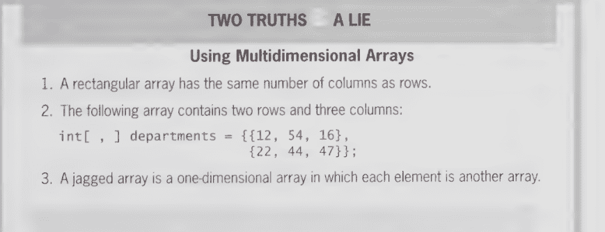

**图 6-23** 用户输入部门和捐款金额后点击 Done 的表单

图 6-24 显示了实现该应用程序所需的代码。名为 `total` 的数组定义在方法外部（见阴影）。`okButton_Click()` 方法接收用户的部门号和捐款金额。然后将捐款添加到对应部门的数组元素中，并清空文本框以便下次输入。`total` 数组必须定义在 `okButton_Click()` 方法之外；如果它在方法内部，每次点击按钮时都会重新声明，所有元素都会重置为 0。`doneButton_Click()` 方法显示数组的内容。

```csharp
double[] total = { 0, 0, 0, 0 };
private void okButton_Click(object sender, EventArgs e)
{
    int dept;
    double contribution;
    dept = Convert.ToInt32(deptTextbox.Text);
    contribution = Convert.ToDouble(contributionText.Text);
    --dept;
    total[dept] += contribution;
    deptTextbox.Text = "";
    contributionText.Text = "";
}
private void doneButton_Click(object sender, EventArgs e)
{
    outputLabel.Text = "Dept Total";
    for (int x = 0; x < total.Length; ++x)
    {
        outputLabel.Text += String.Format("\n{0}{1, 10}", x + 1, total[x].ToString("C"));
    }
}
```

**图 6-24** CountContributions 应用所需的数组和两个方法

### 两真一假

1. GUI 程序可以包含任意数量、任意类型的数组声明。
2. 如果一个方法响应用户触发的事件，它不能包含数组声明。
3. 如果一个方法响应用户触发的事件且该方法包含数组声明，则数组在每次事件发生时都会被重新声明。

## 章节总结

- 数组是数据项列表，所有项具有相同的类型和相同的名称，但通过下标或索引进行区分。在类型后插入方括号 `[]` 来声明数组，使用 `new` 关键字为数组预留内存。数组是继承自 `Array` 类的对象。数组的元素初始化为默认值。
- 使用下标处理数组时数组非常强大。任何数组下标必须在 0 到 `Length - 1` 之间。`Length` 属性会自动处理数组的长度。你可以使用 `foreach` 语句在不使用下标的情况下遍历每个数组。
- `BinarySearch()` 方法在排序数组中查找请求的值。如果数组中未找到值，则返回 -1；否则返回所查找值的位置。如果你的数组项没有升序排列，或者数组有重复值且你想找到所有它们，或者你想查找范围而非精确匹配，则无法使用 `BinarySearch()` 方法。`Sort()` 方法将数组按升序排序。`Reverse()` 方法反转数组项顺序。
- C# 支持需要多个下标访问的多维数组。常用的多维数组是二维数组。二维数组的每行都有两个或多个列值。在矩形数组中，每行具有相同数量的列。C# 还支持数组数组（交错数组/锯数组）。
- 在 GUI 程序中使用数组时的一个主要考虑是，如果数组值根据用户输入更改，必须处理事件。

## 关键术语

- **数组**：数据项列表，具有相同的数据类型和相同的名称，但通过下标或索引区分。
- **数组元素**：数组中的单个对象。
- **下标**（也称为索引）：包含在方括号内的整数，指示数组中某一个元素的位置。
- **初始化列表**：为数组提供的值列表。
- **迭代变量**：`foreach` 语句中轮流每个数组值的临时位置。
- **只读**：描述一个可以访问但不可更改的值。
- **顺序搜索**：通过按顺序检查列表进行。
- **平行数组**：与另一个数组具有相同数量的元素对应数据。
- **范围匹配**：确定一个值落在两个限制值之间。
- **二分查找**：一种算法，通过在接近匹配时不断将排序列表一半来在列表中查找项。
- **一维数组**或**单维数组**：可以使用单个下标访问元素的数组。
- **多维数组**：需要多个下标来访问数组元素。
- **二维数组**：每行有两个或多个列值。
- **矩形数组**：每行具有相同数量列的数组。
- **锯数组**（交错数组）：每个元素都是另一个数组的一维数组。

## 复习题

1. 在数组中，每个元素都有相同的
   a. 下标
   c. 内存位置
   b. 数据类型
   d. 以上所有

2. 用于创建对象的运算符是
   a. =
   c. new
   b. +=
   d. create

3. 下哪个正确声明了一个六个整数数组？
   a. int array[6];
   c. int[6] array;
   b. int[] array = 6;
   d. int[] array = new int[6];

4. 数组名后方括号内的值是
   a. 下标
   c. 始终是整数
   b. 索引
   d. 以上都是

5. 如果你定义一个包含 10 个元素的数组，那么你可以使用的最高数组下标是
   a. 11
   c. 9
   b. 10
   d. 8

6. 在 C# 中，初始化数组是
   a. 要求的
   c. 困难的
   b. 可选的
   d. 禁止的

7. 当你声明一个六个 double 元素的数组但没有提供初始化值时，第一个元素的值
   a. 0.0
   c. 5.0
   b. 1.0
   d. 未知

8. 下哪个正确声明了一个四个整数的数组？
   ```
   int[] ages = new int[] {20, 30, 40, 50};
   int[] ages = {20, 30, 40, 50};
   int[] ages = new int[4]; // 假设此处逻辑
   ```
   d. 以上都是

9. 当使用 {20, 30, 40, 50} 正确初始化数组时，`ages[1]` 的值是
   a. 0
   c. 30
   b. 20
   d. 未定义

10. 当使用 {20, 30, 40, 50} 正确初始化数组时，`ages[4]` 的值是
    a. 0
    c. 50
    b. 4
    d. 未定义

11. 当你声明 `int[] temperature = {0, 32, 50, 90, 21, 45};`，`temperature.Length` 是
    a. 5
    b. 6
    c. 7
    d. 未知

12. 下哪个让名为 `amount` 的十元素数组的每个值翻倍？
    ```
    for(int x = 9; x >= 0; ----) amount[x] *= 2;
    foreach(int number in amount) number *= 2;
    ```
    c. 以上都是
    d. 都不是

13. 下哪个给 16 元素整数数组 `points` 的每个值加 10？
    ```
    for(int sub = 0; sub < 16; ++sub) points[sub] += 10;
    foreach(int sub in points) points += 10;
    ```
    c. 以上都是
    d. 都不是

14. 两种数组在对应的位置存储相关信息
    a. 锯数组
    b. 矩形数组
    c. 相对数组
    d. 平行数组

15. 假设数组定义为 `int[] nums = {2, 3, 4, 5};`，哪个会反序显示数组中的值？
    ```
    for(int x = 4; x > 0; ----) Write(nums[x]);
    for(int x = 3; x >= 0; ----) Write(nums[x]);
    for(int x = 3; x > 0; ----) Write(nums[x]);
    for(int x = 4; x >= 0; ----) Write(nums[x]); // 逻辑修正
    ```

16. 假设数组定义为 `int[] nums = {2, 3, 4, 5};`，哪个会将数组中的值按降序排列？
    a. Array.Sort(nums);
    b. Array.Reverse(nums);
    c. Array.Sort(nums);
    d. Array.Reverse(nums);

17. `BinarySearch()` 和 `Sort()` 方法共同的特征是
    a. 两个方法都接受一个参数。
    b. 均属于 Array 类。
    c. 方法必须是升序的。
    d. 它们都操作数组。

18. 如果你使用 `BinarySearch()` 方法且在数组中未找到对象，则
    a. 显示错误消息
    c. 返回 false
    b. 返回 0
    d. 返回负值

19. `BinarySearch()` 方法在什么情况下不适用？
    a. 数组项按升序排列
    b. 数组包含重复值且你想找到所有它们
    c. 你想查找一个值的精确匹配
    d. 数组项不是数值

20. 下哪个声明了一个包含 8 行 5 列的整数数组？
    a. int[8, 5] = new int[];
    b. int[][5] = new int[];
    c. int[,] = new int[8, 5];
    d. int[,] = new int[];

## 练习题

对于每个练习题，你可以选择编写控制台应用程序或 GUI 或两者。

1. 编写一个名为 `ArrayDemo` 的程序，存储一个八个整数的数组。在用户输入哨兵值之前，允许用户三个选项：(1) 从第一个到最后一个查看列表，(2) 从最后一个到第一个顺序查看列表，或(3) 选择特定位置查看。
2. 编写一个名为 `TemperatureList` 的程序，接受代表七天高温温度的 `int` 值。显示每个值并附带其与平均值差异的消息。
3. 编写一个名为 `ScoresComparison` 的程序，允许用户输入 0 到 100 之间的整数分数。显示祝贺用户进步的消息，然后按输入顺序显示分数。如果每个分数都比前一个低，则按输入顺序显示分数，显示一条关于分数下降的适当消息，然后按更理想的反序显示分数。如果分数既不持续增加也不减少，则在分数处显示适当的消息。
4. 编写一个名为 `CheckZips` 的程序，供快递服务部门检查送货区域。该程序包含一个存储公司送货区域 10 个邮政编码的数组。提示用户输入邮编，并显示指示该邮编是否在公司送货范围的消息。
5. 编写一个名为 `DeliveryCharges` 的程序，用于练习 4 中的快递服务。程序应再次使用一个存储公司送货区域 10 个邮政编码的数组。创建一个包含 10 个送货费的平行数组，每个邮编的费用不同。提示用户输入邮编，然后显示该邮编的价格消息或指示公司不送货到请求的邮编的消息。


# 第 6 章 使用数组

## 练习题

### 6. `Chat` 电话公司提供六个区号的服务，并按图 6-25 所示的每分钟率收费。编写一个 `ChatWhile` 程序，将区号和费率存储在平行数组中，允许用户输入区号和通话时长（分钟），然后显示通话总费用。

**图 6-25** 每分钟通话费率

| 区代码 | 每分钟费率 ($) |
| :--- | :--- |
| 262 | 0.07 |
| 414 | 0.10 |
| 608 | 0.05 |
| 715 | 0.16 |
| 815 | 0.24 |
| 920 | 0.14 |

### 7. Whippet 公交公司根据行驶距离收取车票费用，如图 6-26 所示。编写一个名为 `WhippetBus` 的程序，允许用户输入行程距离。输出是票价。

**图 6-26** 公交票价

| 距离（英里） | 票价 ($) |
| :--- | :--- |
| 0–99 | 25.00 |
| 100–299 | 40.00 |
| 300–499 | 55.00 |
| 500 及以上 | 70.00 |

### 8. 为 Carefree 度假村编写一个名为 `ResortPrices` 的程序，提示用户输入入住天数。然后显示每晚价格和总价。一晚或两晚的每晚价为 $200；三或四晚为 $180；五、六或七晚为 $160；八晚或更多每晚价为 $145。

### 9. 在第 5 章中，你为三位销售人员（Danielle、Edward 和 Francis）编写了一个名为 `HomeSales` 的应用程序。现在，修改程序以使用数组来存储销售人员的姓名、字母缩写和累计销售额。

### 10. 创建一个类似于猜单词（Hangman）的游戏名为 `GuessWord`，玩家通过猜测字母来尝试复制隐藏单词。在数组中存储至少八个单词，并随机选择其中一个作为隐藏单词（生成随机数所需的语句见“决策选择”和“循环”章节中的练习题）。最初，使用星号代表每个字母来显示隐藏单词。允许用户猜测字母以替换隐藏单词中的星号，直到完成单词。如果用户猜测的字母不在隐藏单词中，显示适当的消息。如果用户猜测的字母在隐藏单词中出现多次，则显示每个正确的字母已被放置。图 6-27 显示了控制台应用程序和 GUI 应用程序中典型的游戏进行。在 GUI 应用程序中，用户成功猜中了 e，准备猜 r。提示：如果你创建了游戏的 GUI 版本，可能希望包含一个 Start 按钮，在显示游戏界面之前选择单词并执行其他启动任务。启动任务完成后，你可以从表单删除 Start 按钮。

```
C:\#Chapter.06>GuessWord
Word: *******
Guess a letter >>
Sorry, a is not in the word
Word: *******
Guess a letter >> e
Yes e is in the word
Word: *******
Guess a letter >>
```

**图 6-27** 控制台和 GUI GuessAWord 程序的典型执行过程

## 调试练习

在你下载的学生文件中 `Chapter:06` 文件夹中的以下每个文件都有语法错误和逻辑错误。在每个情况下，确定问题并修复程序。纠正错误后，使用相同的文件名保存每个文件，并在文件名前加上 `Fixed`。例如，`DebugSix01.cs` 将变为 `FixedDebugSix01.cs`。

- `DebugSix01.cs`
- `DebugSix02.cs`

## 案例分析

### 1. Greenville Idol 选拔赛
在此之前的章节中，你为 Greenville Idol 选拔赛创建了应用程序。现在，修改第 5 章创建的 `GreenvilleRevenue` 程序版本，在用户输入比赛的参赛者人数后，提示用户输入相应的人才类型：`S` 代表唱歌，`D` 代表跳舞，`M` 代表乐器，或 `O` 代表其他。然后提示为每位参赛者输入代码。确保所有输入的代码都是有效的，如果不是，重新提示用户输入正确的代码。完成参赛数据输入后，显示每种类型人才的计数。然后持续提示用户输入人才代码，直到用户输入哨兵值。每次输入代码时，显示该代码对应的参赛者列表，或者显示代码无效的消息并重新提示用户。

### 2. Marshall's Murals
在之前的章节中，你为 Marshall's Murals 创建了应用程序。现在，修改第 5 章创建的 `MarshallsRevenue` 程序版本，在完成壁画数据输入后，提示用户输入室内和室外壁画的客户人数，以及指示壁画风格的代码：`L` 代表风景，`S` 代表海景，`A` 代表抽象，`C` 代表儿童或 `O` 代表其他。当代码无效时，持续提示用户输入有效代码。完成数据输入后，显示每种壁画的计数。然后持续提示用户输入壁画风格代码，直到用户输入哨兵值。每次输入代码时，显示所有该代码客户列表及其壁画是室内还是室外。如果请求的代码无效，显示适当的消息并重新提示用户。

---

# 第 7 章 使用方法

## 学习目标

在本章中，你将学习：

- 学习无参数的方法
- 编写带有参数的方法
- 编写带有单个参数的方法
- 编写需要多个参数的方法
- 编写返回结果的方法
- 学习方法和实现隐藏

## 实现隐藏

方法是执行任务的封装语句序列。任何类都可以包含无限数量的方法。因为 C# 的创建者知道你经常想向输出写入消息，他们创建了你可以调用的方法。这提供了实现隐藏的示例，意味着隐藏方法的具体细节。例如，当你预约时，你不需要知道预约实际上是如何被记录的。作为客户端，实现细节对你来说并不重要。

隐藏的实现方法通常存在黑盒中。黑盒是任何你可以在不知道工作原理的情况下使用的设备。编写良好的方法也是如此；调用方法的程序或方法必须知道方法的名称以及发送什么类型的信息，但程序不需要知道具体实现。

## 调用方法

为了方便整合方法，通常在类中使用方法将方法（或分组）放入文件中。使用 C#。

```csharp
using System;
class Hello
{
    static void Display(int[] array)
    {
        for (int i = 0; i < array.Length; i++)
        {
            Console.WriteLine(array[i]);
        }
    }
}
```

数组是相同类型的集合。在 C# 中，数组在创建时指定大小。数组的大小在创建后是固定的。数组的元素从索引 0 开始。

```csharp
int[] numbers = { 10, 20, 30, 40, 50 };
```

你也可以为创建的数组赋值：

```csharp
int[] numbers = new int[5];
numbers[0] = 10;
numbers[1] = 20;
numbers[2] = 30;
numbers[3] = 40;
numbers[4] = 50;
```

你可以使用 `for` 循环遍历数组：

```csharp
for (int i = 0; i < numbers.Length; i++)
{
    Console.WriteLine(numbers[i]);
}
```

或者使用 `foreach` 循环遍历数组：

```csharp
foreach (int number in numbers)
{
    Console.WriteLine(number);
}
```

数组可以传递给方法。方法接收数组的引用，这意味着对数组的更改会影响原始数组。

```csharp
static void Display(int[] array)
{
    for (int i = 0; i < array.Length; i++)
    {
        Console.WriteLine(array[i]);
    }
}
```

多维数组是具有多个维度的数组。二维数组通常被看作表格。

```csharp
int[,] matrix = { { 1, 2, 3 }, { 4, 5, 6 }, { 7, 8, 9 } };
```

你可以使用嵌套的 `for` 循环遍历二维数组：

```csharp
for (int i = 0; i < matrix.GetLength(0); i++)
{
    for (int j = 0; j < matrix.GetLength(1); j++)
    {
        Console.WriteLine(matrix[i, j]);
    }
}
```

交错数组是数组的数组。每个内部数组的长度可以不同。交错数组如下：

```csharp
int[][] jaggedArray = new int[3][];
jaggedArray[0] = new int[] { 1, 2 };
jaggedArray[1] = new int[] { 3, 4, 5 };
jaggedArray[2] = new int[] { 6 };
```

你可以使用嵌套的 `for` 循环遍历交错数组：

```csharp
for (int i = 0; i < jaggedArray.Length; i++)
{
    for (int j = 0; j < jaggedArray[i].Length; j++)
    {
        Console.WriteLine(jaggedArray[i][j]);
    }
}
```

## 无参数和无返回值方法的编写

图 7 中程序的输出仅仅是 `Hello` 单词。假设你想在用户执行你的程序时，再添加三行输出以显示一条标准的欢迎信息。当然，你可以在现有程序中添加三个新的 `WriteLine()` 语句，你也可以创建一个方法来显示这三行新内容。

与在现有程序中添加三行相比，创建一个方法非常有用的原因主要有两个：

- 如果你添加的是方法调用而不是三行新代码，`Main()` 方法将保持简短且易于理解。`Main()` 方法将只包含一个调用方法的语句，而不是三个独立的 `WriteLine()` 语句。
- 更重要的是，方法是易于重用的。在创建了欢迎方法后，你可以在任何程序中使用它，也可以允许其他程序员在他们的程序中使用它。换句话说，你只需要做一次工作，然后就可以多次使用该方法。

> 当你将代码放在可调用的方法中，而不是在程序的多个处重复相同的代码时，你就是在避免“代码膨胀”（bloat）——这是一个描述不必要的冗长或重复语句的生动术语。

图 7-2 显示了 C# 方法组成部分。一个方法必须包含：

- 方法声明，也称为方法头或方法定义
- 一个左大括号
- 方法体，这是一个执行方法工作任务的语句块
- 一个右大括号

方法声明定义了使用该方法的规则。它包含：

- 可选的访问性修饰符
- 可选的静态修饰符
- 方法的返回类型
- 方法名（或标识符）
- 一个左括号
- 可选的方法参数列表（如果有多个参数，则用逗号分隔）
- 一个右括号

### 访问性简介

为方法声明的访问性限制了其他方法使用你方法的方式；访问性级别可以是表 7-1 中描述的任何一个层级。你将最频繁用到的两个级别——公共（`public`）和私有（`private`）访问，在表中用阴影标记。你将在“继承简介”章节中学习受保护（`protected`）访问以及派生类型意味着什么。

- **公共访问**通过在成员声明中包含 `public` 修饰符来实现。该修饰符允许访问该方法。
- **私有访问**通过在成员声明中包含 `private` 修饰符或省略任何访问修饰符来实现。该修饰符将访问限制在包含方法的类内部。

**表 7-1** 方法访问性总结

| 声明的访问性 | 同类中的方法可以访问该方法吗？ | 派生类可以访问此方法吗？ | 程序集或项目中的类可以访问此方法吗？ | 任何类可以访问此方法吗？ |
| :--- | :---: | :---: | :---: | :---: |
| `public` | 是 | 是 | 是 | 是 |
| `protected` | 是 | 是 | 否 | 否 |
| `internal` | 是 | 否 | 是 | 否 |
| `private` | 是 | 否 | 否 | 否 |

如果你没有为方法提供访问性修饰符，它默认是私有的。你在书中所有示例中看到的 `Main()` 方法头都没有访问修饰符，因此它们是私有的。你可以在书中到为止见过的任何程序的方法头中显式地添加 `private` 关键字，你会发现执行结果上没有区别：这些方法仍然是私有的。实际上，你也可以替换 `Main()` 方法头中的 `public` 关键字，而不会察觉到任何执行上的差异——只是在修改后，其他类可以通过使用适当的类名并在方法名前加加一个点（`.`）来调用 `Main()` 方法。当你使用包含类名的方法名时，你实际上是在使用它的完全限定名。在第 1 章中，你学了可以使用完全限定的方法调用 `Console.WriteLine()` 来产生输出。当你包含 `using System;` 或 `using static System` 时，你就不需要使用完全限定的方法名。无论哪种方式，由于你编写的类可以使用 `Console` 方法 `WriteLine()`，所以你知道该方法必须是公有的。

在第 3 章中，你学习了创建简单的 GUI 应用程序，并学会了如何为按钮自动生成 `Click()` 方法；生成的方法头以 `private` 关键字开头。例如，名为 `button1_Click()` 的私有方法不能被任何其他类使用。如果你将方法的访问限定符更改为 `public`，它就可以被另一个类使用，但你可能没有理由这样做。随着对 C# 的学习，你将学会如何为你编写的每个方法选择何种修饰符。现在，除非你想让一个方法被外部类访问，否则你应该对该方法使用 `private` 访问修饰符。本书的 `Main()` 方法没有使用修饰符，因为 Visual Studio 代码在自动生成的代码中不创建它们，但本书对其他方法使用了适当的访问修饰符。

### 静态修饰符简介

你可以将方法声明为静态（`static`）或非静态（`nonstatic`）。如果你使用 `static` 修饰符，你表示该方法可以在不引用对象的情况下被调用。相反，你只需要引用类。例如，如果 `MethodS()` 是静态的而 `MethodN()` 是非静态的，以下语句描述了典型的方法调用：

```csharp
someClass.MethodS();
someObject.MethodN();
```

> 你直到第 9 章才会创建单元（units），因此本章将使用静态方法。

静态方法可以在带类名或不带类名的情况下调用。例如，如果你有一个名为 `PayrollApplication` 的类，其中包含一个名为 `DeductDues()` 的静态方法，你可以通过两种方式调用该方法：

- 如果你从不同的类调用方法，使用类名、点和方法名，如下：
  `PayrollApplication.DeductDues()`
- 如果你在同一类的另一个方法中调用，可以像上面那样使用类名，但这种方法既不必要也不常规。在 `PayrollApplication` 类内部，你可以直接写简写调用：
  `DeductDues()`

如果你没有指示方法是静态的，它默认是非静态的，并且只能结合对象使用。在“使用类和对象”章节开始创建自己的类时，你将编写许多静态方法，对静态和非静态的理解将变得更加清晰。通过学习，你将学会为什么每个方法被创建静态或非静态。如果不理解本章提到的非静态方法，不要担心——该概念将在第 9 章探讨。

### 返回类型简介

每个方法都有返回类型，指示方法向其调用的其他方法返回什么类型的值。如果方法不返回值，其返回类型就是 `void`。方法的返回类型更简练地称为方法的类型。在本章晚些时候，你将创建返回类型为 `int` 或 `double` 的方法以返回对应的值；此类方法可以被称为返回值方法。现在，讨论的方法都是不返回值的 `void` 方法。

> 当方法的返回类型为 `void` 时，大多数 C# 程序员不会在方法结束处使用 `return` 语句。然而，你可以使用以下语句结束 `void` 方法：
> ```csharp
> return;
> ```

### 理解方法标识符

每个方法都有一个名称，必须是合法的 C# 标识符；即不包含空格且必须以字母表中的字母或下划线开头。按照惯例，许多程序员以动词开始方法名，因为方法会导致操作。常规方法名的示例包括 `DeductTax()` 和 `DisplayNetPay()`。

每个方法名后面都跟着一组括号。有时这些括号内包含参数，在最简单的方法中，括号是空的。方法的参数是一个变量，用于保存方法被调用时传递给该方法的数据。参数（argument）和参数（parameter）这两个术语密切相关。参数是指方法调用中的数据，而参数是指方法头中的部分——它在方法执行时接收参数的值。

方法名后的括号可以包含一个参数，也可以包含多个由逗号分隔的参数。括号内的内容被称为参数列表。

### 在类中放置方法

总而言之，你在控制台应用程序中编写的第一批方法将是 `private`（私有的）、`static`（静态的）且 `void`（空），并具有空参数列表。这意味着它们不会从其他类被调用，不需要对象引用，不会向调用它的方法返回任何值，并且不会从外部接收任何数据。因此，你可以像图 7-2 所示那样编写 `ShowMessage()` 方法。根据其声明，该方法是私有静态的。它不返回任何内容，返回类型为 `void`。它的标识符是 `ShowMessage()`，且它不接收任何内容，因此它的参数列表是空的。方法体由三个 `WriteLine()` 语句组成，出现在跟随方法头的大括号内。

按照惯例，程序员会对方法体中的语句进行缩进，这使得方法头及其括号脱颖而出。当你使用 Visual Studio 编辑器编写方法时，编辑器会自动对方法语句进行缩进。你可以在方法体内放置任意数量的语句。


# 方法

## 方法的放置

你也可以将方法放置在一个类中，让其他方法可以使用它，但你不能将方法放置在任何其他方法内部。图 7-3 显示了你可以在名为 `HelloClass` 的类中放置 `ShowMessage()` 方法的两个位置：`Main()` 方法之前，或 `Main()` 方法结束大括号之后、类结束大括号之前。

```csharp
using static System.Console;
class HelloClass
{
    // ShowMessage() 方法可以放在这里
    static void Main()
    {
        WriteLine("Hello");
    }
    // 或者，ShowMessage() 方法可以放在这里
    // 但它不能在两个地方都出现；它只能出现一次
}
```

**图 7-3** 方法的放置

## 编写无参数和无返回值的方法

要让 `Main()` 方法调用 `ShowWelcomeMessage()` 方法，你只需要在 `Main()` 方法体内使用 `ShowWelcomeMessage()` 方法名作为语句即可。图 7-4 显示了带有阴影方法的完整程序，图 7-5 显示了输出。

```csharp
using static System.Console;
class HelloWorld
{
    static void Main()
    {
        ShowWelcomeMessage();
        WriteLine("Hello");
    }
    private static void ShowWelcomeMessage()
    {
        WriteLine("Welcome.");
        WriteLine("Have fun!");
        WriteLine("Enjoy the program!");
    }
}
```

**图 7-4** `Main()` 方法调用 `ShowWelcomeMessage()` 方法的 HelloWorld 程序

```
C:\Chapter.07\HelloWorld
Welcome.
Have fun!
Enjoy the program!
Hello
C:\Chapter.07\>
```

**图 7-5** HelloWorld 的输出

`HelloWorld` 类中的 `ShowWelcomeMessage()` 方法是静态的，因此在 `Main()` 方法中调用它时不需要对象引用（即不需要对象名），也不需要在方法名前加点。它还与 `Main()` 方法位于同一个类中，因此无需类名即可调用。

当 `Main()` 方法执行时，它调用 `ShowWelcomeMessage()` 方法，因此组成欢迎信息的三行首先出现在图 7-5 的输出中。然后，在方法执行完成后，`Main()` 方法显示 `Hello`。

两个不同的类可以拥有它们自己的方法名 `ShowWelcomeMessage()`。第二个类中的此类方法与第一个类中同名的方法是完全不同的。该方法的完整名称是 `HelloWorld.ShowWelcomeMessage()`，但在同一类内调用该方法时不需要使用类名。

如果另一个名为 `SomeOtherClass` 的类有一个同名的 `public static` 方法，你可以使用以下语句从 `HelloWorld` 中调用该方法：`SomeOtherClass.ShowWelcomeMessage();`

## 在方法中声明变量和常量

你可以在方法内编写任何需要的语句，包括变量和常量声明。当变量或常量在方法内部声明时，它仅从声明处开始到方法结束可见；程序员说该变量或常量在方法结束之前处于作用域内。程序元素的作用域（scope）是可以使用它的代码段。程序员还说该变量是方法的局部的（local），意味着它可以在方法中声明点的任何地方使用。

局部声明的变量对其他方法不可见也无法在其他方法中使用，如果另一个方法声明了同名的变量，这两个变量是完全独立的。例如，图 7-6 显示了一个包含两个方法——`Main()` 和 `MethodWithItsOwnA()` 的程序，它们都声明了变量 `a`。每个方法中的变量都是完全独立的，并持有自己的值，如图 7-7 所示。如果你在 `Main()` 方法中声明了变量 `b` 然后尝试在 `MethodWithItsOwnA()` 中使用 `b`，将产生编译错误。如果你在 `MethodWithItsOwnA()` 中声明了变量 `c` 并尝试在 `Main()` 中使用它，将产生另一个编译错误。

```csharp
using static System.Console;
class LocalVariableDemo
{
    static void Main()
    {
        int a = 10;
        WriteLine(a);
    }
    static void MethodWithItsOwnA()
    {
        int a = 20;
        WriteLine(a);
    }
}
```

**图 7-6** 包含两个方法的程序

**图 7-7** LocalVariableDemo 的输出

## 需要单个参数的方法

某些方法需要额外信息。如果一个方法不能接收参数，那么你就必须编写无限数量的方法来涵盖每种可能的情况。例如，当你预约牙科医生时，你不需要为一年的每一个日期、每天的每一个可能的时间都采用一个不同的方法。相反，你可以将日期和时间作为信息提供给方法，无论你提供什么日期和时间，该方法都能正确执行。如果你设计了一个计算员工工资单的方法，那么编写一个名为 `ComputePaycheck()` 的方法并为其提供任何小时薪率是合理的，而不是开发诸如 `ComputePaycheckEightHours()`、`ComputePaycheckNineDollarsAnHour()` 等命名的方法。

你已经使用过提供了各种参数的方法。在任何调用中，`WriteLine()` 方法都可以接收无限数量字符串中的任何一个字符串作为参数——"Hello"、"Goodbye" 等。无论你向 `WriteLine()` 发送什么消息，该消息都能正确显示。

当你编写一个接受参数的方法并编写其声明时，你需要在方法声明的括号内包含以下项：

- 参数的数据类型
- 参数的本地标识符（名称）

例如，考虑一个名为 `DisplaySalesTax()` 的方法，它计算并显示为销售价格 7% 的税。可用的 `DisplaySalesTax()` 方法的头部如下：

```csharp
static void DisplaySalesTax(double saleAmount)
```

你可以将方法声明中的括号看作是进入方法的漏斗——列在那里的参数正“掉入”方法中。

括号内的参数 `double saleAmount` 表明 `DisplaySalesTax()` 方法将接收一个 `double` 类型的值。在方法内部，该值将被称为 `saleAmount`。图 7-10 显示了一个完整的方法。

```csharp
private static void DisplaySalesTax(double saleAmount)
{
    double tax;
    const double RATE = 0.07;
    tax = saleAmount * RATE;
    WriteLine("The tax on {0} is {1}", saleAmount, tax.ToString("C"));
}
```

**图 7-10** `DisplaySalesTax()` 方法

在 `DisplaySalesTax()` 方法中，如果你想让数字精确显示两位小数，必须使用格式化字符串和 `ToString()` 方法。你在第 2 章中学习了如何将值显示为固定的小数位数；记住，使用不带数字的固定格式默认为两位小数。

你将 `DisplaySalesTax()` 方法创建为 `void` 方法（具有 `void` 返回类型的方法），因为你不需要向所使用的任何方法返回任何值——它唯一的功能是接收 `saleAmount` 值，将其乘以 0.07 并显示结果。你将它创建为 `static`（静态）方法，因为你不需要创建一个对象来使用它；你希望静态的 `Main()` 方法能够调用它。

在程序中，你可以通过使用方法名和括号来调用 `DisplaySalesTax()` 方法，无论该参数是常量值还是变量。对 `DisplaySalesTax()` 方法的调用都能正确调用它：

```csharp
double myPurchase = 12.99;
DisplaySalesTax(12.99);
DisplaySalesTax(myPurchase);
```

你可以任意次数调用 `DisplaySalesTax()` 方法，每次都使用不同的常量或参数。这些参数中的每一个值在方法内部都被知晓为 `saleAmount`。有趣的是，如果方法中的参数是一个变量，它可能拥有名为 `saleAmount` 的标识符，或者另一个标识符，例如 `myPurchase`。标识符 `saleAmount` 仅仅是值在方法内部被使用的“名称”，无论它在调用程序中叫什么名字。也就是说，变量 `saleAmount` 是 `DisplaySalesTax()` 方法的本地变量，就像方法内部声明的变量和常量一样。变量参数也是**形式参数**（formal parameter）的一个示例，即方法头部中接受一个值的参数。相比之下，方法调用中的参数通常称为**实际参数**（actual parameters）。例如，在方法调用语句 `DisplaySalesTax(myPurchase);` 中，`myPurchase` 就是一个实际参数。

> 变量 `saleAmount` 是一个形式参数，它也是**值参数**（value parameter）的示例，即接收传递给它的值的副本的参数。你将在下一章学习更多关于值参数和其他类型参数的知识。

## 需要多个参数的方法

你可以通过在调用方法时列出参数并用逗号分隔来向方法传递多个参数。例如，与其创建一个将金额乘以 0.07 的 `DisplaySalesTax()` 方法，你可能倾向于创建一个更灵活的方法，你可以向其传递两个值——计算税额的值以及乘以它的税率百分比。图 7-13 显示了一个使用两个参数的方法。

```csharp
private static void DisplaySalesTax(double saleAmount, double taxRate)
{
    double tax;
    tax = saleAmount * taxRate;
    WriteLine("The tax on {0} is {1} {2}",
        saleAmount.ToString("C"), taxRate.ToString("P"),
        tax.ToString("C"));
}
```

**图 7-13** 接受两个参数的 `DisplaySalesTax()` 方法

在图 7-13 中，两个参数（`saleAmount` 和 `taxRate`）出现在方法头部的括号内。参数之间用逗号分隔，每个参数都需要自己的名称（在本例中，两个参数的类型都是 `double`）和一个标识符。对于一个接收两个或多个参数的方法，如果参数的类型相同，则必须分别列出每个参数的类型。

当你在语句中使用 `DisplaySalesTax(myPurchase, localRate);` 向方法传递值时，第一个传递的值在方法内部被引用为 `saleAmount`，第二个传递的值被引用为 `taxRate`。因此，以正确的顺序将参数传递给方法是非常重要的。以下调用将输出：$200.00 在 10.00% 的税费为 $20.00。

```csharp
DisplaySalesTax(200.00, 0.10);
```

然而，以下调用将输出：$0.10 在 20000.00% 的税费为 $20.00，这显然是错误的。

```csharp
DisplaySalesTax(0.10, 200.00);
```

你可以编写一个可以按任何顺序接受任意数量参数的方法。调用该方法时，发送给它的参数必须在数量和类型上都与方法声明中列出的参数匹配，但有例外：

- 如果参数可以提升为参数类型，则参数的类型不需要完全匹配参数列表。例如，一个 `int` 参数可以传递给 `double` 参数。
- 当你使用 `default` 参数时，参数的数量不需要与参数列表匹配。你将在第 8 章中学习默认参数。

因此，一个计算并显示汽车销售员佣金的方法可能需要此类参数，例如销售员名称的字符串、售车辆的整数值、`double` 类型的佣金率以及代表车辆类型的字符。正确的方法只有在按正确顺序发送了所有正确类型的参数时才会执行。

### 三真一假

1. 下面是一个可用的 C# 方法头：`private static void MyMethod(double amt, int sum)`
2. 下面是一个可用的 C# 方法头：`private static void MyMethod2(int x, double y)`
3. 下面是一个可用的 C# 方法头：`static void MyMethod3(int id, string name, double rate)`

错误的语句是 #1。在方法中，所有参数的数据类型都是相同的。方法头中的每个参数都必须有一个数据类型。#3 中的方法头没有包含访问性指示符，但那是可选的。

## 返回值的方法

方法最多可以向其调用的方法返回一个值。方法的返回类型可以是 C# 编程语言中使用的任何类型，包括基础的内置类型 `int`、`double`、`char` 等。你也可以使用类作为方法的返回类型，包括 C# 语言中内置的任何返回类型。例如，在编写如 `inputString = ReadLine();` 的语句时，你使用了 `ReadLine()` 方法的返回值。由于 `ReadLine()` 方法可以赋值给字符串，因此其返回类型是 `string`。你将在第 9 章中学习创建自己的类型，这些类型也可以从方法返回。当然，方法也可以不返回任何值，此时返回类型为 `void`。

例如，假设你想创建一个方法来接受工作小时和时薪率，并返回计算后的总薪值。该方法的头可以是：`private static double CalcPay(double hours, double rate)`

```csharp
private static double CalcPay(double hours, double rate)
{
    double gross;
    gross = hours * rate;
    return gross;
}
```

**图 7-14** `CalcPay()` 方法

注意 `return` 语句，它是 `CalcPay()` 方法中的最后一个语句。`return` 语句会导致值发送回调用它的方法；在 `CalcPay()` 方法中，存储在 `gross` 中的值会被发送给任何调用它的方法。

## 编写返回值的方法

在第 4 章中，你学习了副作用以及它们如何影响复合布尔表达式。当你使用布尔方法时，必须特别小心不要引起无意外的副作用。例如，考虑以下 `if` 语句，其意图是当 `IsPreferredCustomer()` 和 `IsLocalCustomer()` 方法都返回 `true` 时，将送货费设置为 0：

```csharp
if (IsPreferredCustomer() && IsLocalCustomer())
    deliveryFee = 0;
```


# 第 7 章 使用方法

如果 `isLocalCustomer()` 方法应该执行某些预期的任务——例如，显示关于客户状态的消息或对价格应用本地客户折扣——那么你可能无法获得预期的结果。由于短路求值，如果 `isPreferredCustomer()` 方法返回 `false`，则 `isLocalCustomer()` 方法将**永远不会**执行。如果这正是你的意图，那么这样使用这些方法是可以的，但它们始终可能引入意料之外的副作用。

## 分析内置方法

C# 为你提供了许多重写方法，如 `WriteLine()` 和 `ReadLine()`。在第 2 章中，你学习了 C# 的算术运算符，如 `+` 和 `*`，并且你了解到 C# 没有提供指数运算符。相反，要计算一个数字的幂，你可以使用内置的 `Pow()` 方法。例如，要计算 2 的三次方（2 * 2 * 2）并将结果存储在变量 `result` 中，你可以编写一个包含以下内容的程序：

```csharp
double result = Math.Pow(2.0, 3.0);
```

通过这条语句，你了解了关于 `Pow()` 方法的以下点：

- 它在 `Math` 类中，因为在方法调用之前有一个点。
- 它是公共的（`public`），因为你可以编写一个使用它的程序。
- 它是静态的（`static`），因为它是通过类名和点来使用的，而没有任何对象。
- 它接受两个 `double` 参数。
- 它返回一个 `double` 或可以自动提升为 `double` 的类型（如 `int`），因为它的结果存储在 `double` 中。

尽管你了解许多关于 `Pow()` 方法的事实，但你并不知道它的指令在内部是如何执行的。在良好的对象风格中，它的实现是被隐藏的。

## 两个真理和一个谎言

## 编写返回返回值的方法

1. 方法最多向调用它的方法返回一个值。
2. 方法返回语句中使用的的数据类型必须与方法头中声明的返回类型相同。
3. 如果一个方法返回一个值且你调用了该方法，你必须将该值存储在与方法参数数据类型相同的变量中。

> 错误的陈述是 #3。如果一个方法返回一个值且你调用了该方法，你通常会使用返回的值，但你并不要求使用它。此外，如果你将返回的值赋值给存储变量，该存储变量不需要匹配任何参数值，而是需要能够接收返回的类型。

## 你来做

## 编写接收参数并返回值的的方法

接下来，你编写一个名为 `CalcPhonePrice()` 的方法，它既接收参数又返回结果。该方法的目的是接受通话时长（以分钟为单位）和每分钟的费率，然后计算通话费用，假设每次通话除了每分钟计费外，还包含 25 分的连接费。在写完 `CalcPhonePrice()` 方法后，你编写了一个 `Main()` 方法，使用四组不同的数据作为参数调用 `CalcPhonePrice()` 方法。

1. 通过输入 `using` 语句、类头和大括号，启动一个名为 `PhoneCall` 的程序：

```csharp
using static System.Console;
class PhoneCall
{
```

（继续）

2. 输入以下 `CalcPhoneCallPrice()` 方法。该方法被声明为静态（`static`），因为它将被一个静态的 `Main()` 方法调用，无需创建对象。该方法接收一个整数和一个双精度数作为参数。通话费用计算方法为 0.25 加上分钟数乘以每分钟费率。该方法将通话费用返回给调用方法。

```csharp
private static double CalcPhoneCallPrice(int minutes, double rate)
{
    const double BASE_FEE = 0.25;
    double callFee;
    callFee = BASE_FEE + minutes * rate;
    return callFee;
}
```

3. 为 `PhoneCall` 类添加 `Main()` 方法头。通过声明两个数组开始方法；一个包含两个通话时长，另一个包含两个费率。你将使用通话时长和费率的所有可能组合来测试 `CalcPhoneCallPrice()` 方法。此外，声明一个名为 `priceOfCall` 的变量，将存储计算价格的结果。

```csharp
static void Main()
{
    int[] callLengths = {2, 5};
    double[] rates = {0.03, 0.12};
    double priceOfCall;
}
```

4. 添加一条语句显示列标题，可以在这些标题下列出时长、费率和价格的组合。三个列标题右对齐，每个字段宽度为 10 个字符。

```csharp
WriteLine("{0, 10}{1, 20}{2, 10}",
    "Minutes", "Rate", "Price");
```

（继续）

5. 添加一对嵌套循环，依次将每个 `callLength` 和每个 `rate` 传递给 `CalcPhoneCallPrice()` 方法。每传递一次组合，结果就会存储在 `priceOfCall` 中，并显示细节。使用嵌套循环允许你传递时间与费率的每个组合，以便测试值的多种可能性。

```csharp
foreach (int callLength in callLengths)
{
    foreach (double rate in rates)
    {
        priceOfCall = CalcPhoneCallPrice(callLength, rate);
        WriteLine("{0, 10}{1, 20}{2, 10}",
            callLength, rate, priceOfCall);
    }
}
```

6. 为 `PhoneCall` 类添加大括号。保存文件，编译并运行程序。输出如下：

```
   Minutes      Rate       Price
         2      0.03      0.31
         2      0.12      0.49
         5      0.03      0.40
         5      0.12      0.85
```

```csharp
using static System.Console;
class PassEntireArray
{
    static void Main()
    {
        int[] someNums = {10
```

图 7-20 PassEntireArray 程序

| | 10 | 12 | 22 | 35 |
|---|---|---|---|---|
| 在 Main() 方法开始时... | | | | |
| 在 GetsArray() 方法中 | 10 | 12 | 22 | 35 |
| 更改后 | 888 | 888 | 888 | 888 |
| 在 Main() 方法结束时 | | 888 | 888 | 888 |

图 7-21 PassEntireArray 程序的输出

请注意，在方法参数列表中，你不需要在数组定义的方括号内插入数字。插入数字会导致编译器错误。方括号是空的是合理的，因为接收数组的方法获取的是起始地址，而不是元素的个数。

你可以通过单步创建并向方法传递一个未命名的数组。例如，你可以编写以下代码：

```csharp
MethodThatAcceptsArray(new int[] {45, 67, 89});
```

你可以通过在方法头数据类型之后指定适当的维度数量，向方法传递多维数组。例如，以下方法头分别接收 int 和 double 的二维数组：

```csharp
private static void displayScores(int[ , ] scoresArray)
private static boolean areAllPricesHigh(double[ , ] prices)
```

对于交错数组（jagged arrays），你可以在方法头中的数据类型后插入相应数量的方括号。例如，以下方法头分别接收 int 和 double 的交错数组：

```csharp
private static void displayIds(int[][ ] idArray)
private static double computeTotal(double[][ ] prices)
```

对于那些接受多维数组作为参数的方法（无论是否为交错数组），请注意，每个方法头中定义数组的方括号是空的。与传递给方法的任何其他数组一样，在交错数组的方括号中插入数字是没有必要的，因为每个传递的数组名都存储了内存地址。你在方法内部操作下标的方式决定了如何访问行和列。

> 使用 `GetLength()` 可以访问多维数组每个维度的尺寸。例如，`scoresArray.GetLength(0)` 返回 `scoresArray` 第一个维度的值。

观看视频《向方法传递数组》（Passing Arrays to Methods）。

## 两个真理一个谎言

## 向方法传递数组值

- 1. 你通过在方法的参数列表中放置数据类型和标识符，来指示该方法参数可以是一个数组元素。
- 2. 你通过在方法的参数列表中数据类型后放置圆括号，来指示该方法参数必须是一个数组。
- 3. 数组是通过引用传递的；也就是说，方法接收的是数组的实际内存地址，并可以访问数组元素中的实际值。

错误的陈述是 #2。你通过在方法的参数列表中数据类型后放置**方括号**，来指示该方法参数必须是一个数组。

## 编写 Main() 方法头的替代方式

在本书中，你一直使用以下方法头编写 Main() 方法：

```csharp
static void Main()
```

使用返回类型 `void` 且在括号之间不留任何内容只是在程序中编写 Main() 方法头的一种方法。然而，它是 C# 文档中列出的第一种方法，也是本书采用的惯例。本节介绍替代方案，是因为你可能会在其他书籍或其他编写的程序看到不同的 Main() 方法头。

## 编写带有参数列表的 Main() 方法

编写 Main() 方法头的替代方式如下：

```csharp
static void Main(string[] args)
```

短语 `string[] args` 是 Main() 方法的参数。变量 `args` 代表一个字符串数组，你可以将其传递给 Main()。虽然你可以使用任何标识符，但 `args` 是惯例。特别是，Java 程序员可能更倾向于包含 `string[] args` 参数的 C# 版本 Main() 方法，因为编写具有相同参数的方法是惯例。

如果你需要访问传递给应用程序的命令行参数，请使用此格式的 Main() 方法头。例如，图 7-22 中的程序显示了作为 Main() 方法参数的 `args` 数组。图 7-23 显示了如何从命令行使用参数调用 Main() 来执行程序。

```csharp
using System.Console;
class DisplayArgs
{
    static void Main(string[] args)
    {
        for (int x = 0; x < args.Length; ++x)
            WriteLine("Argument {0} is {1}", x, args[x]);
    }
}
```

图 7-22 带有 `string[] args` 参数的 Main()

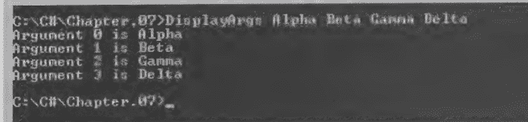

图 7-23 使用参数执行 DisplayArgs 程序

即使你不需要访问命令行参数，仍然可以使用引用它们的 Main() 方法头版本。如果你的老师或主管指出你应该遵循这一惯例，则应该使用此版本。

## 编写返回整数类型的 Main() 方法

一些程序员倾向于编写返回类型为 `int` 而不是 `void` 的 Main() 方法头。如果你使用这种形式，方法的最后一条语句将返回一个整数。这种形式返回 `int` 是为了指示状态。Java 程序员可能更倾向于包含 `string[] args` 参数的 C# 版本 Main()，因为编写相同参数的方法是惯例。

如果你的老师或主管指出你应该遵循这一惯例，则应该使用此版本。

## 带有 public 访问权限的 Main() 方法

一些程序员倾向于编写具有 `public` 访问权限的 Main() 方法头，而不是 `private`。使用 `public` 访问权限是为了让它可以被调用，但通常不需要这样做。如果 Main() 方法是 `public` 的，它可以从其他类调用。

## 两个真理一个谎言

## 编写 Main() 方法头的替代方式

- 1. 在 C# 中，方法头可以写为 `static void Main()`。
- 2. 在 C# 中，方法头可以写为 `static void Main(string args[])`。
- 3. 在 C# 中，方法头可以写为 `static int main(string args)`。

错误的陈述是 #3。在 C# 中，`Main` 必须大写。陈述 #3 错误是因为没有使用方括号。前两个是正确的。

## 在 GUI 程序中使用方法

你可以像在控制台应用程序中一样在 GUI 程序中调用方法。创建 GUI 程序时，有一些特殊的考虑因素：

- 理解在视觉环境中自动生成的方法
- 理解 GUI 程序中的作用域
- 创建非静态方法

## 理解在视觉环境中自动生成的方法

当你使用 IDE 创建 GUI 程序时，许多方法是自动生成的。例如，当你在 Form 上放置一个名为 `okButton` 的按钮并双击它时，会生成一个如下头的方法：

```csharp
private void okButton_Click(object sender, EventArgs e)
```

该方法是 `private` 的，这意味着它只能在类内部使用，并且它是 `void`，意味着它不返回值。如果你更改返回类型（`void`），程序将无法编译。方法名 `okButton_Click()` 的格式对于自动创建的事件处理方法是惯例。

当用户点击 okButton 时，okButton_Click() 方法接收到的参数会自动。参数 `sender` 是触发事件的对象，参数 `e` 包含了事件类型的信息。图 7-24 显示了 GUI 程序中的一个 Click 方法，它显示了这两个参数的 `ToString()` 值。

```csharp
private void okButton_Click(object sender, EventArgs e)
{
    label1.Text = sender.ToString();
    label2.Text = e.ToString();
}
```

图 7-24 ClickParameterInfo 程序中的 okButton_Click() 方法

图 7-25 显示了点击按钮后的输出。生成事件的对象是包含文本 "OK" 的按钮，事件类型是由鼠标生成的。在前面的章节中，你已经见过许多具有相同参数的 `Click()` 方法，但你并并没有使用它们。与任何其他方法一样，你并不总是被要求使用其中传入的参数。

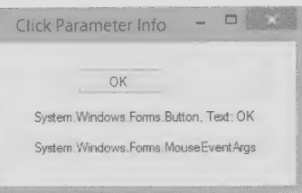

图 7-25 图 7-24 中 `okButton_Click()` 方法生成的输出

## 在 GUI 程序中理解作用域

当你在 GUI 应用程序中创建事件处理方法时，你必须时刻意识到哪些变量和常量是多个方法所需的。如果一个变量或常量在一个方法内部被需要，那么它就是该方法的局部作用的。如果一个变量被多个事件处理方法需要——例如，被两个不同的 `Click()` 方法需要——那么涉及的变量或常量必须定义在方法外部（但在 Form 类内部），以便两个 `Click()` 方法都能访问它们。当你编写其他方法时，你可以决定传递哪些参数，但自动生成的事件处理方法具有预定义的参数集，因此在使用它们时，你无法像使用自己编写的其他方法那样灵活。在第 9 章“使用类和对象”中，你将看到许多在类内部方法外部声明的变量示例；此类变量被称为字段（fields）。

## 与 Form 关联时创建非静态方法

在第 1 章中，你学习了 `static` 关键字用于控制台应用程序中的 `Main()` 方法，因为该方法与其所在的类相关而不是与对象相关。当你创建一个 GUI 应用程序并生成一个方法时（例如与 Form 上的 Button 关联的 `Click()` 方法），`static` 关键字不会出现在方法头定义中，因为该方法与一个对象相关——即发送方法调用事件的 Form。当你使用 Form 运行 GUI 程序时，程序会创建一个 Form 对象，与其关联的方法是非静态的（nonstatic）。在“使用类和对象”章节中，你将学习更多关于静态方法和非静态方法之间的区别。现在，当你创建旨在在 GUI 应用程序中由其他非静态方法调用的方法时，请省略 `static` 一词。例如，如果你创建一个响应按钮点击的 `Click()` 方法，它默认将是非静态的，因为它与一个作为 Form 的对象关联。

## 两个真理与一个谎言

## 在 GUI 程序中使用方法的问题

- 1. 使用 IDE 创建 GUI 程序的优点是许多所需的方法会自动生成。
- 2. 与任何其他方法一样，当你在 GUI 应用程序中创建一个与按钮关联的 `Click()` 方法时，你不需要在方法体内引用参数。
- 3. 如果你想让 `Click()` 方法加上两个变量，你必须将它们作为参数传入。

`Click()` 方法确实存在。该方法应该定义在方法外部但在 Form 类内部，这样 `Click` 中使用的变量就可以与其他方法共享，因此你在使用它们时无法像使用预定义的参数集那样灵活。虚假的陈述是 #3。自动生成的事件处理方法如下：

## 本章总结

- 方法是执行任务的一系列语句。任何类都可以包含无限数量的方法。面向对象的程序会隐藏其方法的实现细节。


- 你编写方法是为了让程序更容易理解，并以便你方便地复用它们。在 C# 中，一个方法必须包含方法声明、一个左括号、方法体和一个右括号。方法声明定义了使用方法的规则；它包含一个可选的访问性声明、一个可选的 `static` 修饰符、方法的返回值、一个标识符以及括号内可选的方法参数列表。

- 某些方法调用需要参数。方法接收的项是参数（parameters）。当你编写可以接收参数的方法声明时，你需要在方法声明的括号内包含参数的类型和它的局部标识符。在方法头中声明的变量是形式参数（formal parameter），而方法调用中的项是实际参数（actual parameter）。

- 你通过在方法调用括号内列出参数并用逗号隔开向方法传递多个参数。你可以编写一个可以接收任意数量参数的方法。当你调用该方法时，你发送给它的内容在数量和类型上必须与方法声明中列出的非默认参数匹配（允许类型转换）。

- 方法的返回值定义了发送回调用方法的值的类型。它可以是 C# 编程语言中的任何类型，包括基础内置类型 `int`、`double`、`char` 等，以及类类型（包括你创建的类类型）。方法也可以不返回任何内容，在这种情况下返回类型为 `void`。

- 你可以将数组作为参数传递给方法。你通过在方法参数列表的数据类型后放置方括号来标明方法参数是一个数组。数组与所有对象一样（不同于内置类型）是通过引用传递的；也就是说，方法接收数组的内存地址，并可以访问数组元素中的实际值。

- 你可能在其他书籍或其他人的程序中看到不同的 `Main()` 方法处理程序。某些程序员将字符串数组作为 `Main()` 的参数，某些程序员在 `Main()` 方法中返回一个 `int`，某些程序员给 `Main()` 方法赋予 `public` 访问权限。

- 在创建 GUI 应用程序时，方法有特殊的考虑因素。你必须理解视觉环境中自动生成的方法，理解 GUI 程序中作用域的区别，并理解与 Form 关联时许多方法必须是非静态的。

## 关键术语

- 方法是执行任务的一系列语句。

- 触发（Invoked）和调用（called）描述一个方法对。

- 调用方法（calling method）调用另一个方法。

- 被调用方法（called method）被另一个方法触发。

- 实现（Implementation）意味着隐藏方法的细节。

- 客户端（client）是使用另一个方法的方法。

- 黑盒（black box）是在不知道它如何工作的情况下使用的任何设备。

- 多文件程序集（multifile assembly）是共同工作的文件组。

- 代码膨胀（Code bloat）描述冗长的程序语句。

- 方法声明（method declaration）是方法头或定义。

- 方法体（method body）是执行方法的语句块。

- 方法的访问性（Accessibility）是设置其他方法是否可以使用它的。

- 公有访问（Public access）是允许无限访问方法的访问性级别。

- 私有访问（Private access）是限制访问到类方法的访问性级别。

- 全限定名称（fully qualified name）是包含类名的名称。

- 静态方法（static method）不需要对象引用即可调用。可以使用类名、点和方法名从任何类调用。在类内部，静态方法可以直接使用名称调用。

- 非静态方法调用（nonstatic method call）需要对象引用。

- 返回类型（return type）指示方法返回给任何其他调用方法的值的类型。

- 方法的类型是它的返回值。

- 方法的参数（parameter）是在调用时传递给方法的数据变量。

- 参数列表（parameter list）由方法头括号内出现的数据类型和参数名称组成。

- 变量的作用域（scope）是可以使用它的程序代码段。

- 局部变量（local variable）是在当前方法中声明的变量。

- 形式参数（formal parameter）是方法头中接收值的参数。

- 实际参数（Actual parameters）是方法调用中的参数。

- 返回语句（return statement）导致值从方法发送回其调用方法。

- 嵌套方法调用（Nested method calls）是放在其他方法调用内部的方法。

- 引用传递（Passed by reference）描述了参数传递给方法时方法接收其内存地址的状态。

## 复习题

- 1. 类最多可以包含（个）方法。

  a. 0 c. 2

  b. 1 d. 任意数量

- 2. 在程序中创建方法的良好理由是什么？

  a. 方法易于复用。

  b. 因为所有方法必须存储在同一个类中，所以很容易找到。

  c. `Main()` 方法变得更加详细。

  d. 以上都是正确的。

# 第 7 章 使用方法

- 3. 在 C# 中，方法必须包含以下所有内容，但 ___ 除外

  a. 返回类型 c. 方法体

  b. 访问修饰符 d. 闭合大括号

- 4. 方法声明可能包含 ___

  a. 声明的访问性 c. 多个返回类型

  b. 非静态修饰符 d. 用点分隔的参数

- 5. 每个方法声明必须包含 ____

  a. 目的陈述 c. 静态（static）修饰符

  b. 声明的访问性 d. 返回类型

- 6. 如果你想创建一个可以被其他类中的方法无限制访问的方法，你将该方法声明为 ___

  a. 无限制的 c. 共享的

  b. 公有的（public） d. 无限制的

- 7. 如果你在方法头中使用关键字修饰符 `static`，你表示该方法 _____

  a. 不能被复制

  b. 只能被调用一次

  c. 不需要参数

  d. 在没有对象引用的情况下调用

- 8. 方法的类型也是它的 ________

  a. 返回类型 c. 参数类型

  b. 访问性 d. 范围

- 9. 当你使用一个方法时，你不需要知道它是如何运行的。这种特性被称为 _______________

  a. 范围管理 c. 细节隐藏

  b. 选择性无知（selective ignorance） d. 私有性

- 10. 当你为可以接收参数的方法编写声明时，你需要包含以下所有项，但 _____________ 除外

  a. 一对括号 c. 参数的本地名称

  b. 参数的类型 d. 参数的初始值

11. 假设你声明了一个变量为 `int myAge = 21;`

    以下哪项是对声明为 `private static void AMethod(int num)?` 的方法的合法调用？

  - a. `AMethod(int 55);`

  - c. `AMethod(int myAge);`

  - b. `AMethod(myAge);`

  - d. `AMethod();`

12. 假设你声明了一个名为 `private static void CalculatePay(double rate)` 的方法。当一个方法调用 `CalculatePay()` 方法时，调用方法

  - a. 必须包含一个名为 `rate` 的声明型 double

  - b. 可能包含一个名为 `rate` 的声明型 double

  - c. 不能包含一个名为 `rate` 的声明型 double

  - d. 不能包含任何声明的 double 变量

13. 在方法调用 `PrintTheData(double salary)` 中，`salary` 是参数。

  - a. 形式参数（formal）

  - c. 建议参数（proposed）

  - b. 实际参数（actual）

  - d. 首选参数（preferred）

14. 程序包含方法调用 `PrintTheData(salary);`。在方法定义中，形式参数的名称必须

  - a. `salary`

  - b. 除 `salary` 以外的任何合法标识符

  - c. 任何合法标识符

  - d. 省

15. 对于接收两个 double 参数、计算并显示它们之间的差且不返回任何内容的方法，正确的声明是什么？

  - a. `private static void CalcDifference(double price1, price2)`

  - b. `private static void CalcDifference(double price1, double price2)`

  - c. 以上两者都是正确的。

  - d. 以上都不正确的。

16. 对于接收两个 double 参数并求其和但不返回任何内容的方法，正确的声明是什么？

  - a. `private static void CalcSum(double firstValue, double secondValue)`

  - b. `private static void CalcSum(double price1, double price2)`

  - c. 以上两者都是正确的。

  - d. 以上都不正确的。

17. 方法声明为 `private static double CalcPay(int hoursWorked)`。假设你在同一类中写了一个 `Main()` 方法，其中包含声明 `int hours = 35;` 和 `double pay;`。以下哪项代表了从 `Main()` 方法调用 `CalcPay()` 方法的正确方法？

  - a. `hours = CalcPay();`

  - c. `pay = CalcPay(hoursWorked);`

  - b. `hours = Main.CalcPay();`

  - d. `pay = CalcPay(hours);`

18. 假设 `isRateOK()` 的值为 `true`，而 `isQuantityOK()` 的值为 `false`。当你评估表达式 `isRateOK() || isQuantityOK()` 时，以下哪项是正确的？

  - a. 只有方法 `isRateOK()` 执行。

  - b. 只有方法 `isQuantityOK()` 执行。

  - c. 两个方法都执行。

  - d. 两个方法都不执行。

19. 假设 `isRateOK()` 的值为 `true`，而 `isQuantityOK()` 的值为 `false`。当你评估表达式 `isRateOK() && isQuantityOK()` 时，以下哪项是正确的？

  - a. 只有方法 `isRateOK()` 执行。

  - b. 只有方法 `isQuantityOK()` 执行。

  - c. 两个方法都执行。

  - d. 两个方法都不执行。

20. 当数组传递给方法时，该方法可以访问数组。这意味着数组是通过 ________ 传递的。

  - a. 引用（reference）

  - c. 别名（alias）

  - b. 值（value）

  - d. 方向（orientation）

## 练习

## 编程练习

- 1. 创建一个程序，使用你在之前的章节中使用的每个 C# 语句，然后关于返回类型和参数列表。

  a. `Console.WriteLine()`

  d. `Convert.ToInt32()`

  b. `String.Equals()`

  e. `Convert.ToChar()`

  c. `String.Compare()`

  f. `Array.Sort()`

- 2. 创建一个名为 `SalesLetter` 的程序，其 `Main()` 方法多次使用 `WriteLine` 向潜在客户显示信息。

- 3. 创建一个名为 `PaintingEstimate` 的程序，其 `Main()` 方法提示用户房间的长度和宽度。假设房间是矩形且层高为 9 英尺。作业费用为每平方英尺 6 元。费用返回给 `Main()` 方法。

- 4. 创建一个名为 `ConvertartsToLiters` 的应用程序，其 `Main()` 方法提示用户输入夸脱数，将其传递给方法转换为升，然后返回给 `Main()` 方法。

- 5. 创建一个名为 `FortuneTeller` 的程序，其 `Main()` 方法包含一个至少六个字符串的数组。程序随机选择两个不同的运气并将它们传递给方法显示。

- 6. 创建一个名为 `Multiplication` 的应用程序，其 `Main()` 方法要求用户输入一个整数，然后调用名为 `DisplayMultiplication()` 的方法显示该整数乘以 2 到 10 的结果。

- 7. 在第 4 章中，你写了一个名为 `Admission` 的程序用于大学录取，用户输入高中平均分和录取分数。程序显示 Accept 或 Reject。现在，创建一个修改后的程序 `AdmissionModularized`，将平均分和分数传递给方法，该方法返回包含 Accept 或 Reject 的字符串。

## 第 7 章 使用模块化的方法

- 8. 写一个名为 `CountowelsModularized` 的程序，将字符串传递给方法，该方法返回字符串中元音的数量。

- 9. 创建一个名为 `Desks` 的应用程序，其 `Main()` 方法调用以下方法计算桌的价格：

  - 一个方法从键盘接收抽屉数量输入。该方法将数量返回给 `Main()` 方法。

  - 一个方法接受输入并返回木材类型，m 代表桃花木，o 代表橡木，p 代表松木。

  - 一个方法接受抽屉数量和木材类型，并根据以下情况计算成本：

    - 松木桌为 100 元。

    - 橡木桌为 140 元。

    - 所有其他木材为 180 元。

    - 每个抽屉额外收取 30 元附加费。

    - 该方法将成本返回给 `Main()` 方法。

  - 一个方法显示所有细节和最终价格。

- 10. 创建一个名为 `FlexibleArrayMethod` 的程序，声明至少三个大小不同的整数数组。依次将每个数组传递给一个方法，该方法显示每个数组中的所有整数及其和。

## 调试练习

1. 在可下载的学生文件的 Chapter.07 文件夹中的以下每个文件都有语法和/或逻辑错误。在每种情况下，确定问题并修复程序。修正错误后，使用原文件名并加上 Fixed 来保存每个文件。例如，`DebugSeven1.cs` 将变为 `FixedDebugSeven1.cs`。

  - a. `DebugSeven1.cs`

  - b. `DebugSeven2.cs`

  - c. `DebugSeven3.cs`

  - d. `DebugSeven4.cs`

# Case Problems

1. 在第 6 章中，你继续修改了 GreenvilleRevenue 程序。现在，修改该程序，使主要功能出现在以下单独的方法中：

- 一个获取并返回有效参赛人数的方法，该方法被调用两次——一次用于去年的参赛人数，一次用于本年的数值。

- 一个接收今年和去年的参赛人数的方法，并显示三条描述这两个参赛值之间关系的消息中的一条。

- 一个填充参赛者及其才华代码数组的方法。

- 一个不断提示才华代码并显示相应才华的参赛者的方法，直到输入哨兵值为止。

2. 在之前的章节中，你继续修改了 MarshallsRevenue 程序。现在，修改该程序，使主要功能出现在以下单独的方法中：

- 一个提示并返回月份的方法。

- 一个提示并返回计划的壁画数量的方法，该方法被调用两次——一次用于内部壁画，一次用于外部壁画。

- 一个接收计划的内部和外部壁画数量、接受计划的月份、显示内部和外部价格并返回总预期收入的方法。

- 一个填充包含客户名称和壁画代码数组的方法，该方法被调用两次——一次填充内部壁画数组，一次填充外部壁画数组。

- 一个不断提示壁画代码并显示相应类型作业的方法，直到输入哨兵值为止。

## 高级方法概念

在本章中，你将：

- 学习参数类型并复习强制性值参数

- 使用 `ref` 参数、`out` 参数和参数数组

- 重载方法

- 学习如何避免模糊的方法

- 使用可选参数

在上一章中，你学习了如何调用方法、向它们传递参数以及从它们接收值。在本章中，你将扩展你的方法处理技能，包括更复杂的技术，例如使用引用、输出和可选参数以及重载方法。当你处理大型、专业的、现实世界项目时，理解如何操作方法至关重要。通过方法，你可以更轻松地与其他程序员协调工作。

## 理解参数类型

在 C# 中，参数可以按值或按引用传递给方法的参数。在上一节中，你按值传递了简易数据类型（如 `int` 和 `double`）的参数，并按引用传递了数组。参数也可以分类为强制性或可选。当你使用强制性参数时，每次方法调用都需要为该参数提供参数。方法的可选参数是指，如果你没有显式地作为参数发送一个，则会自动提供一个默认值。你见过的所有带有简单参数和数组参数的方法都使用了强制性参数。

强制性参数还包括：

- 引用参数

- 输出参数

- 参数数组

C# 仅包含一种可选参数类型：当它们带有默认值参数声明时。

## 强制性值参数

目前为止，你创建的所有方法参数都是强制性的，并且除了数组外的所有都是值参数。当你在方法头中使用值参数时，指定参数的类型和名称，方法将接收传递给它的值的副本。作为值参数方法参数的变量必须为其赋值。如果没有赋值，程序将无法编译。

方法的值参数的值存储在与方法调用中作参数的变量不同的内存地址上。换句话说，实际参数（调用方法中的参数）和形式参数（方法头中的参数）引用两个独立的内存位置，且被调用的方法接收所发送的值的副本。对值参数的更改永远不会影响调用方法中的原始参数。

> 一项广受欢迎的广告活动宣称：“拉斯维加斯发生的一切，留在拉斯维加斯。”方法内部的值参数也是如此——对它们的更改不会持续到方法之外。

8-1 显示了一个声明名为 `x` 变量的程序；图中假设 `x` 存储在方法地址 2000。给 `x` 赋值 4 并显示。然后将 `x` 传递给一个接受值参数的方法。该方法声明了名为 `x` 的自己的参数，接收了值 4。这个局部变量位于不同的地址；例如，假设它是 8800。方法为局部变量分配了一个新值 777 并显示它。当控制返回 `Main()` 方法时，从内存位置 2000 访问 `x` 的值，它保持为 4。


```csharp
using static System.Console;
public class Program {
    static void Main() {
        int x = 4;
        WriteLine("In Main x is {0}", x);
        DisplayValueParameter(x);
        WriteLine("In Main x is {0}", x);
    }
    private static void DisplayValueParameter(int x) {
        x = 777;
        WriteLine("In method, x is {0}", x);
    }
}
```

在程序执行期间，内存地址 2000 是 `x` 且持有 4。

在程序执行期间，内存地址 8800 也称为 `x`。它起初持有 4，然后被改为 777。

# 8-1 调用带有值参数方法的程序

在 `DisplayValueParameter()` 方法中更改 `x` 的值对 `Main()` 方法中的 `x` 没有影响。尽管两个方法都包含一个名为 `x` 的变量，但它们代表独立的内存位置。（注：原文此处存在大量重复的错误文本，已清理）。

## 第 8 章 高级引用概念

在 `DisplayParameter()` 方法的头部，使用与 `Main()` 方法传递的变量（`x`）相同的名称或其他其他名称（如 `number`）没有区别。在任何一种情况下，传递和接收的变量都占用相同的内存位置——一个的地址就是另一个的地址。

## 使用 out 参数

当你使用引用参数（reference）时，任何传递的变量必须已经赋值。当传递的变量还没有值时，使用输出参数（output）非常方便。例如，8-5 中的程序使用 `InputMethod()` 来获取两个参数的值。阴影语句中发送的参数从被调用方法获取值，因此在传入时不提供值是有有意义的。相反，它们在方法内部获取值并保留传出的值。8-6 显示了程序的典型执行过程。

```csharp
using System;
using System.Console;
class InputMethodDemo
{
    static void Main()
    {
        int first, second;
        InputMethod(out first, out second);
        WriteLine("After InputMethod first is {0}", first);
        WriteLine("and second is {0}", second);
    }
    private static void InputMethod(out int one, out int two)
    {
        string s1, s2;
        Write("Enter first integer ");
        s1 = ReadLine();
        Write("Enter second integer ");
        s2 = ReadLine();
        one = Convert.ToInt32(s1);
        two = Convert.ToInt32(s2);
    }
}
```

8-5 InputMethodDemo 程序

```text
C:\CH\Chapter.08\>InputMethodDemo
Enter first integer 23
enter second integer 45
After InputMethod first is 23
and second is 45

C:\CH\Chapter.08\>
```

8-6 InputMethodDemo 程序的输出

## 使用引用、输出和数组参数

记住这些可能有所帮助：

- 如果你始终有一个初始值，请使用 `ref`。
- 如果你没有初始值或者不知道是否会有初始值，请使用 `out`。（例如，在交互式程序中，用户可能不会为变量提供值，因此你不知道该变量是否有初始值。）

总结来说，当你需要方法从调用方法共享单个值时，你有两个选择：

- 使用返回值。你可以向接受值参数的方法发送一个参数，在方法内部修改该变量的局部版本，返回修改后的值，并将该返回值赋值回调用方法中的原始变量。这种方法的缺点是，方法只能有一个返回类型，且最多只能返回一个值。
- 按引用传递。你可以向接受引用参数或输出参数的方法发送一个参数，并在方法内部修改原始内存位置上的值。当你想要让一个方法更改多个变量时，使用引用或输出参数具有巨大的优势。方法最多只能有一个返回类型，且最多只能返回一个值；然而，使用引用和输出参数的一个主要缺点是，它们允许多个方法访问相同的数据，这削弱了对面向对象方法论至关重要的“黑盒”范式。你不永远应该为了避免返回值而使用 `ref` 或 `out` 参数，但你应该理解它们，以便在需要时使用。

观看视频：Using ref and out Parameters。

与简单参数一样，在向方法传递数组时，你也可以使用 `out` 或 `ref`。当你希望在调用方法中声明数组，但在被调用方法中使用 `new` 运算符为其分配内存时，就会这样做。

## 使用带有 out 参数的内置方法

在第 2 章中，你学习了两种将字符串转换为数字的方法——你可以使用 `Convert` 类方法或 `Parse()` 方法。例如，以下每条语句都接受一个字符串并将其转换为整数分值：

```csharp
int score = Convert.ToInt32(ReadLine());
int score = int.Parse(ReadLine());
```

使用这两个语句中的任何一个，如果 `ReadLine()` 接收的值无法转换为整数（因为包含小数点或字母），程序将突然停止运行。考虑图 8-7 中的简单程序。该程序提示用户输入分数并显示它。在第一次执行中，用户输入了一个有效的整数，一切进展顺利。在第二次执行中，用户输入了字母，程序停止了。

```csharp
using System;
using System.Console;
class ConversionExample
{
    static void Main()
    {
        string entryString;
        int score;
        Write("Enter score: ");
        entryString = ReadLine();
        if (int.TryParse(entryString, out score))
        {
            WriteLine("You entered {0}", score);
        }
        else
        {
            WriteLine("Input was not an integer.");
        }
    }
}
```

8-7 ConversionExample 程序

8-8 ConversionExample 程序的输出

```text
Enter score: 25
You entered 25
Enter score: abc
Input was not an integer.
```

另一个示例，你可能会考虑让代码持续运行，直到输入的值格式正确，如下所示：

```csharp
using System;
using System.Console;
class LoopExample
{
    static void Main()
    {
        string entryString;
        int score;
        Write("Enter score: ");
        entryString = ReadLine();
        while (!int.TryParse(entryString, out score))
        {
            WriteLine("Input was not an integer.");
            Write("Enter score again: ");
            entryString = ReadLine();
        }
        WriteLine("You entered {0}", score);
    }
}
```

8-9 LoopExample 程序

```text
Enter score: abc
Input was not an integer.
Enter score again: 30
You entered 30
```

## 使用带有 params 关键字的参数数组

```csharp
using static System.Console;
class ParamsDemo
{
    static void Main()
    {
        string[] names = {"Mark", "Paulette", "Carol", "James"};
        DisplayStrings("Ginger");
        DisplayStrings("George", "Maria", "Thomas");
        DisplayStrings(names);
    }
    private static void DisplayStrings(params string[] people)
    {
        foreach(string person in people)
            Write("{0} ", person);
        WriteLine("\n------------------------------------");
    }
}
```

图 8-11 ParamsDemo 程序

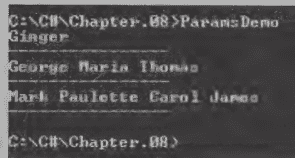

图 8-12 使用如 `Display(params Object[] things)` 等方法头部的 ParamsDemo 方法输出。此时传递的参数可以是任何类型——字符串、整数、其他类等。该方法可以如下实现：

```csharp
private static void Display(params Object[] things)
{
    foreach(Object obj in things)
        Write("{0} ", obj);
    WriteLine("\n------------------------------------");
}
```

所有数据类型都是 `Object`；你将在“使用类和对象”以及“继承简介”章节中学习更多关于 `Object` 类的知识。

## 三真一假

# 使用引用参数、输出参数和参数数组

- 1. 引用参数和输出参数代表传递给方法的内存地址，允许方法修改原始变量。
- 2. 在方法头中声明引用参数时，该参数不能还没有赋值值。
- 3. 当你使用输出参数时，调用方法时它不需要包含原始的赋值值，但在方法结束之前必须接收到一个值。

> 虚假陈述是 #2。在方法中声明引用参数时，该参数必须已经赋过值。

## 你来操作

### 使用引用参数

当你希望方法访问调用方法中参数的内存地址时，就会使用引用参数。例如，假设你有两个值并想交换它们（或对换它们），使每个值都等于另一个值。由于你想更改两个值，接受参数副本的方法将无法工作——方法最多只能返回一个值。因此，你可以使用引用参数为你的方法提供想要更改的值的实际地址。

1. 打开编辑器并开始编写一个名为 `SwapProgram` 的程序，如下：

```csharp
using static System.Console;
class SwapProgram
{
    static void Main()
    {
```

2. 声明两个整数并显示它们的值。调用 `Swap()` 方法，并传入两个要交换变量的地址。由于参数已经赋值，且你想在 `Main()` 中更改这些值，你可以使用引用参数。方法调用后，再次显示这两个值。为 `Main()` 方法添加右大括号。

```csharp
int first = 34, second = 712;
Write("Before swap first is {0}", first);
WriteLine("and second is {0}", second);
Swap(ref first, ref second);
Write("After swap first is {0}", first);
WriteLine("and second is {0}", second);
```

3. 如下所示创建 `Swap()` 方法。你可以通过将第一个值存储在临时变量中，将第二个值赋值给第一个变量来交换两个值。此时，两个变量都持有原本第二个变量持有的值。当你将临时变量的值赋值给第二个变量时，两个值就反转了。

```csharp
private static void Swap(ref int one, ref int two)
{
    int temp;
    temp = one;
    one = two;
    two = temp;
}
```

4. 为类添加右大括号。保存程序，然后编译并执行它。图 8-13 显示了输出。

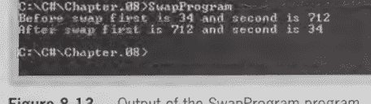

图 8-13 SwapProgram 的输出

你可能将模块 `Swap()` 作为更大程序的一部分，在程序中验证（例如）较高值是否在较低值之前显示；你会将 `Swap()` 的调用作为决策体的一部分，该决策体仅在第一个值小于第二个值时执行。

## 方法重载

方法重载涉及使用相同的方法名编写多个多个版本方法的能力。当你在商店购物时，你可能会使用他们接受的多种“支付”方法之一，例如现金、信用卡或支票。“支付”方法的运行方式取决于所使用的货币类型，但所有交易都统称为“支付”。当你重载 C# 方法时，你编写了具有相同名称但不同参数列表的多个方法实现。方法名和参数列表组方法的签名。

在本书中，你已经看到带有字符串参数和数字型参数的 `WriteLine()` 方法。你也可以在不带参数的情况下使用它来输出空行。你还看到过在使用格式化字符串时带有多个参数的方法。你知道 `WriteLine` 是一个重载方法。某些 C# 运算符也是被重载的。例如，两个值之间的 `+` 表示加法，但左侧单独的 `+` 表示正。在“使用类和对象”章节中，你将学习如何重载运算符以满足你的需求。

当 `Main()` 方法调用图 14 程序中的 `DisplayWithBorder()` 方法并传递一个字符串值时，该方法计算出的大小为字符串长度加 4，然后在单行上绘制许多符号。然后，该方法在下一行显示一个符号、一个空格、字符串、另一个空格和另一个符号。

```csharp
using static System.Console;
class BorderDemo
{
    static void Main()
    {
        DisplayWithBorder("Ed");
        DisplayWithBorder("Theodore");
        DisplayWithBorder("Jennifer Ann");
    }
    private static void DisplayWithBorder(string word)
    {
        const int EXTRA_STARS = 4;
        const string SYMBOL = "*";
        int size = word.Length + EXTRA_STARS;
        int x;
        for(x = 0; x < size; ++x)
            Write(SYMBOL);
        WriteLine();
        WriteLine(SYMBOL + " " + word + " " + SYMBOL);
        for(x = 0; x < size; ++x)
            Write(SYMBOL);
        WriteLine("\n\n");
    }
}
```

图 8-15 BorderDemo 程序的输出

# 第 9 章 高级方法概念


```c
private static void DisplayWithBorder(int number)
{
    const int EXTRA_STARS = 4;
    const string SYMBOL = "*";
    int size = EXTRA_STARS + 1;
    int leftOver = number;
    int x;
    while(leftOver >= 10)
    {
        leftOver = leftOver / 10;
        ++size;
    }
    for(x = 0; x < size; ++x)
        Write(SYMBOL);
    WriteLine();
    WriteLine(SYMBOL + " " + number + " " + SYMBOL);
    for(x = 0; x < size; ++x)
        Write(SYMBOL);
    WriteLine("\n\n");
}
```

**图 8-16** 带有整数参数的 `DisplayWithBorder()` 方法

在图 8-16 的 `DisplayWithBorder()` 方法版本中，参数是一个 `int`。为了确定显示多少星号，该方法将 `size` 初始化为显示中额外星号的数量（在本例中为 4）再加上一个。然后，它通过反复将参数除以 10并将结果加到 `size` 中来确定边框中显示的星号数量。例如，当方法的参数为 456 时，`leftOver` 初始化为 456。由于它至少为 10，因此会被除以 10 得到 45，`size` 从 5 增加到 6。然后 45 被除以 10 得到 4，`size` 增加到 7。由于 4 不至少为 10，循环结束，程序已确定包围 456 的框的上下边框各有 7 个星号。方法的其余部分执行方式与接受字符串参数的原始版本相同。

> 如果向 `DisplayWithBorder()` 传递一个负整数，它将无法正常工作，因为负号占据了额外的显示空间。为了解决这个问题，你可以修改方法，在传递负数参数时向边框添加一个额外的符号，或者你强制对所有负数进行处理。

如果你使用接受字符串参数的原始版本，并在调用 `DisplayWithBorder()` 时传入字符串，那么图 8-14 所示的方法将执行。如果你传入整数，如图 8-15 所示，则会执行另一个版本。图 8-16 所示的方法显示了整数参数的情况。图 8-17 所示的 BorderDemo2 程序，图 8-18 所示是 BorderDemo2 的输出。

```csharp
using System;
class BorderDemo2
{
    static void Main()
    {
        DisplayWithBorder("456");
        DisplayWithBorder(456);
    }

    static void DisplayWithBorder(string number)
    {
        const int EXTRA_STARS = 4;
        const string SYMBOL = "*";
        int size = EXTRA_STARS + 1;
        int leftOver = int.Parse(number);
        int x;
        while(leftOver >= 10)
        {
            leftOver = leftOver / 10;
            ++size;
        }
        for(x = 0; x < size; ++x)
            Console.Write(SYMBOL);
        Console.WriteLine();
        Console.WriteLine(SYMBOL + " " + number + " " + SYMBOL);
        for(x = 0; x < size; ++x)
            Console.Write(SYMBOL);
        Console.WriteLine("\n\n");
    }

    static void DisplayWithBorder(int number)
    {
        const int EXTRA_STARS = 4;
        const string SYMBOL = "*";
        int size = EXTRA_STARS + 1;
        int leftOver = number;
        int x;
        while(leftOver >= 10)
        {
            leftOver = leftOver / 10;
            ++size;
        }
        for(x = 0; x < size; ++x)
            Console.Write(SYMBOL);
        Console.WriteLine();
        Console.WriteLine(SYMBOL + " " + number + " " + SYMBOL);
        for(x = 0; x < size; ++x)
            Console.Write(SYMBOL);
        Console.WriteLine("\n\n");
    }
}
```

图 8-17 BorderDemo2 程序 

图 8-18 BorderDemo2 的输出

重载方法的方法是它们具有相同的标识符，但参数列表不同。重载方法的方法是它们具有相同的标识符，但参数类型不同。重载方法的方法是它们具有相同的标识符，但参数的数量不同。重载方法的方法是它们具有相同的标识符，但参数的类型和顺序不同。

## 理解重载解析

当多个方法具有相同的名称时，编译器必须根据提供的参数来确定调用哪个版本。这个过程被称为重载解析。例如，如果你有多个具有不同参数类型的 `Add` 方法，编译器将根据调用时的类型进行选择。

重载解析的规则与你在第 2 章学习的隐式转换规则相似。然而，如果没有找到精确匹配，编译器将寻找需要隐式转换的匹配。如果未找到合适的匹配，编译器将抛出错误。

## 真两假一一

## 方法重载

1. 以下方法被重载了：

   ```java
private static void MethodA(int a)
private static void MethodA(double b)
   ```

2. 以下方法被重载了：

   ```java
private static void MethodC(int c)
private static void MethodD(int c)
   ```

3. 以下方法被重载了：

   ```java
private static void MethodE(int e)
private static void MethodE(int e, int f)
   ```

错误的答案是 #2。重载方法具有相同的名称，但参数不同。

## 你来完成

### 方法重载

在接下来的步骤中，你将重载方法，以正确地将可能是整数或字符串的参数三倍。

1. 创建一个名为 `OverloadedTriples` 的新程序，并创建一个如下的方法，用于三倍并显示整数参数：

   ```java
private static void Triple(int num)
{
const int MULT_FACTOR = 3;
WriteLine("{0} times {1} is {2}\n", num, MULT_FACTOR, num * MULT_FACTOR);
}
   ```

2. 创建第二个同名方法，接收一个字符串参数。假设你想将“消息三倍”定义为将其显示三次，并用制表符分隔。

   ```java
private static void Triple(string message)
{
WriteLine("{0}\t{0}\t{0}\n", message);
}
   ```

3. 将光标置于文件顶部，添加 `using` 语句、类头和起始左大括号，使得重载的 `Triple()` 方法被包含在名为 `OverloadedTriples` 的类中。

```
using static System.Console;
class OverloadedTriples
{
```

4. 将光标置于文件底部，为 `OverloadedTriples` 类添加右大括号。

5. 将光标置于类的左大括号之后。在新的一行插入一个 `Main()` 方法，声明一个整数和一个字符串，并分别将它们传递给相应的 `Triple()` 方法。注意，当你输入 `Triple()` 方法后的括号时，IDE 会显示出你的两个重载的 `Triple()` 方法。

6. 保存文件，然后编译并执行程序。图 8-20 显示了输出。尽管在两次方法调用使用了相同的方法名，但每次都会执行相应的重载方法。

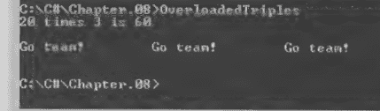

图 8-20 OverloadedTriples 程序的输出

## 避免歧义方法

当你重载一个方法时，存在创建歧义方法的风险——即编译器无法确定使用哪种方法的情况。每当你调用方法时，编译器都会判断是否存在合适的方法；如果是，则执行该方法；否则，你将收到错误消息。

例如，假设你写了两个版本的简单方法，如程序 8-21 所示。该类包含两个版本的 `SimpleMethod()` 方法——一个接收一个 `double` 和一个 `int`，另一个接收一个 `int` 和一个 `double`。

```
using static System.Console;
class AmbiguousMethods {
    static void Main() {
        int iNum = 20;
        double dNum = 4.5;
        SimpleMethod(iNum, dNum); // 调用第一个版本
        SimpleMethod(dNum, iNum); // 调用第二个版本
        SimpleMethod(iNum, iNum); // 错误！调用存在歧义。
    }
    private static void SimpleMethod(int i, double d) {
        WriteLine("Method receives int and double");
    }
    private static void SimpleMethod(double d, int i) {
        WriteLine("Method receives double and int");
    }
}
```

图 8-21 包含歧义方法调用的程序

在 `Main()` 方法中，先整数参数后双精度参数调用 `SimpleMethod()` 会执行方法的第一个版本，先双精度参数后整数参数调用 `SimpleMethod()` 会执行方法的第二个版本。在这些调用中，编译器都能为你发送的参数找到精确匹配。然而，如果你使用两个整数参数调用 `SimpleMethod()`，编译器将无法找到精确匹配。

## 第 8 章 高级方法概念

`DisplaySize()` 方法，但可以发送三个参数。在图 8-23 的程序中，调用 `DisplaySize(4, 6)` 的效果与调用 `DisplaySize(4, 6, 1)` 相同。图 8-24 显示了 OptionalParameterDemo 程序的执行。

```cs
using static System.Console;
class OptionalParameterDemo
{
    static void Main()
    {
        Write("Using 2 arguments: ");
        DisplaySize(4, 6);
        Write("Using 3 arguments: ");
        DisplaySize(4, 6, 8);
    }
    private static void DisplaySize(int length, int width, int height = 1)
    {
        int area = length * width * height;
        WriteLine("Size is {0}", area);
    }
}
```

**图 8-23** OptionalParameterDemo 类

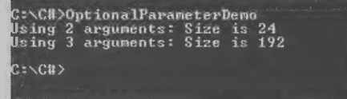

**图 8-24** OptionalParameterDemo 程序的执行

如果你为方法的参数列表中的任何变量分配了默认值，那么该参数右侧的所有参数也必须有默认值。表 8-2 显示了某些有效和无效的方法声明示例。

## 使用可选参数

| 方法声明 | 解释 |
| --- | --- |
| `private static void M1(int a, int b, int c, int d = 10)` | 有效。前三个参数是强制性的，最后一个是可选的。 |
| `private static void M2(int a, int b = 3, int c)` | 无效。因为 b 有默认值，所以 c 也必须有一个。 |
| `private static void M3(int a = 3, int b = 4, int c = 5)` | 有效。所有参数都是可选的。 |
| `private static void M4(int a, int b, int c)` | 有效。所有参数都是强制性的。 |
| `private static void M5(int a = 4, int b, int c = 8)` | 无效。因为 a 有默认值，所以 b 和 c 都必须有默认值。 |

**表 8-2** 有效和无效的可选参数方法声明示例

调用包含默认参数的方法时，你可以始终选择为每个参数提供值。然而，如果你在调用带有默认参数的方法时省略了参数，那么你必须执行以下操作之一：

- 你必须省略你最后使用的参数右侧的所有未具名参数。
- 你可以使用命名参数。

## 省略未具名参数

调用带有可选参数的方法（并使用未具名参数）时，你必须省略最后一个参数右侧的任何参数。换句话说，一旦省略了某个参数，你就必须省略其后续的所有参数。

例如，假设你这样声明了一个方法：

```cs
private static void Method1(int a, char b, int c = 22, double d = 33.2);
```

## 第 8 章 高级方法概念

表 8-3 显示了对此方法的的一些合法和非法调用。

| 调用 Method1() | 解释 |
|--- |--- |
| `Method1(1, 'A', 3, 4.4);` | 有效。四个参数被分配给四个参数变量。 |
| `Method1(1, 'K', 9);` | 有效。三个参数被分配给方法中的 a、b 和 c，d 使用默认值 33.2。 |
| `Method1(5, 'D');` | 有效。两个参数被分配给方法中的 a 和 b，c 和 d 分别使用默认值 22 和 33.2。 |
| `Method1(1);` | 无效。Method1() 要求前两个参数至少需要两个参数。 |
| `Method1();` | 无效。Method1() 要求前两个参数至少需要两个参数。 |
| `Method1(3, 18.5);` | 无效。第一个参数 3 可以分配给 a，但第二个参数必须是 char 类型。 |
| `Method1(4, 'R', 55.5);` | 无效。第一个参数 4 可以分配给 a，第二个参数 'R' 可以分配给 b，但第三个参数必须是 int 类型。当参数未具名时，你不能“跳过”参数 c 并使用其默认值，并将 55.5 分配给参数 d。 |

**表 8-3** Method1() 的合法和非法调用示例

## 命名参数

如果你通过名称传递剩余参数，则可以在方法调用中省略可选参数。命名参数是方法参数，其前面是被调用方法的参数的名称，该参数将被分配给它。命名参数可以以任何顺序出现，但它们必须出现。

假设有一个工资程序包含两个用于工资支单计算的方法。

图 8-26 所示的第一方法接受三个参数：小时（hours）、费率（rate）和奖金（bonus）。

通过小时乘以费率计算总工资值，并根据工作小时分配奖金值。第二种方法将其总工资和奖金参数相加。其意图是：工作 40 小时、每小时 10 美元的员工将获得 400 美元的总工资，加上 100 美元的奖金，总计 500 美元。

```cs
private static double ComputeGross(double hours, double rate, out double bonus) {
    double gross = hours * rate;
    if (hours >= 40)
        bonus = 100;
    else
        bonus = 50;
    return gross;
}
private static double ComputeTotalPay(double gross, double bonus) {
    double total = gross + bonus;
    return total;
}
```

**图 8-26** 两个工资程序方法


# 第 8 章 高级方法概念

## 图 8-27 与 图 8-28：位置参数示例

图 8-27 显示了程序的 `Main()` 方法，该方法将小时分配 40，将费率分配 10.00。然后，该方法通过传递 `ComputeGross()` 的结果和 `ComputeGross()` 内部设置的 `bonus` 值来调用 `ComputeTotalPay()` 方法。图 8-28 显示员工的总工资被正确计算为 500 美元。

```csharp
static void Main() {
    double hours = 40;
    double rate = 10.00;
    double bonus = 0;
    double totalPay;
    totalPay = ComputeTotalPay(ComputeGross(hours, rate, out bonus), bonus);
    WriteLine("Total pay is {0}", totalPay);
}
```

**图 8-27** 使用位置参数调用 `ComputeTotalPay()` 的 `Main()` 方法

```text
C:\Chapter.08>Payroll11
Total pay is 500
C:\Chapter.08>>
```

**图 8-28** 图 8-27 中 `Main()` 方法的执行

## 命名参数的潜在缺点

使用命名参数的一个可能缺点发生在当命名参数是表达式而非常量时。图 8-29 显示了一个使用命名参数调用 `ComputeTotalPay()` 的 `Main()` 方法。与图 8-27 中的程序唯一的区别在于使用命名参数的影子方法。在这种情况下，当 `ComputeTotalPay()` 使用命名参数时，首先将 0 发给 `bonus`，然后调用 `ComputeGross()` 为 `gross` 赋值。然而，`ComputeGross()` 中对 `bonus` 的修改太晚了，因为 `bonus` 已经过赋值。程序的输出是错误的，如图 8-30 所示。

```csharp
static void Main() {
    double hours = 40;
    double rate = 10.00;
    double bonus = 0;
    double totalPay;
    totalPay = ComputeTotalPay(bonus: bonus,
        gross: ComputeGross(hours, rate, out bonus));
    WriteLine("Total pay is {0}", totalPay);
}
```

**图 8-29** 使用命名参数调用 `ComputeTotalPay()` 的 `Main()` 方法

```text
C:\Chapter.08>Payroll12
Total pay is 500
C:\Chapter.08>>
```

**图 8-30** 图 8-29 中 `Main()` 方法的执行

在第 4 章中，你学习了当使用 `&&` 或 `||` 在布尔表达式中组合操作数时，由于短路求值存在副作用风险。命名参数的情况是一个表达式，可能会产生意想不到的后果。

## 命名和可选参数的重载解析

命名参数和可选参数影响重载解析。参数转换中的改进规则仅适用于显式提供的参数；换句话说，省略的可选参数在改进时会被忽略。

### 示例 1：歧义方法

例如，假设你有以下两个方法：

```csharp
private static void AMethod(int a, double b = 2.2)
private static void AMethod(int a, char b = 'H')
```

当使用整数参数进行调用时，这两个方法都是适用方法；也就是说，如果其中一个方法单独存在，调用 `AMethod(12)` 将可以工作。然而，当两个方法共存时，没有哪个“更好”，因为 C# 无法确定哪一个更好，代码将无法编译。

### 示例 2：无可选参数的方法更优

如果两个签名同样好，则没有省略可选参数的被认为更好。例如，假设你有如下两个方法：

```csharp
private static void BMethod(int a)
private static void BMethod(int a, char b = 'B')
```

如果其中一个方法单独存在，调用 `BMethod(12)` 将可以工作，但当两个共存时，第一个版本更好，因为调用中没有省略可选参数。

> **观看视频** Using Optional Method Parameters。

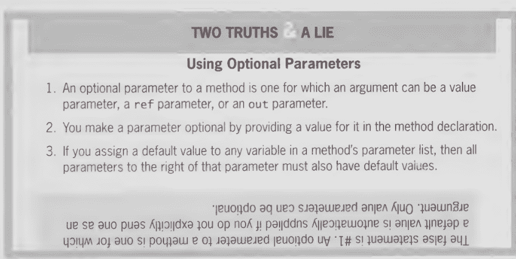

## 本章总结

- 方法参数可以是强制的或可选的。强制参数包括没有默认值的值参数、引用参数、输出参数和参数数组。如果为值参数提供了默认值，则它可以是可选的。
- 当你重载 C# 方法时，你编写了具有相同名称但不同参数列表的方法。编译器根据参数的组合理解你的含义。
- 命名参数的情况是一个表达式，可能会产生意想不到的后果。
- 命名和可选参数影响重载解析。参数转换中的改进规则仅适用于显式提供的参数；换句话说，省略的可选参数在改进时会被忽略。

## 关键术语

- **强制性参数**（Mandatory parameters）：是任何发送到方法的参数。
- **可选参数**（optional parameter）：方法的可选参数是给定了默认值的参数。
- **值参数**（value parameter）：方法头部的值参数接收传入值的副本。
- **引用参数**（reference parameter）：方法头部的引用参数接收变量的地址；变量在使用之前要求已赋值。
- **输出参数**（output parameter）：方法头部的输出参数接收变量的地址；变量在使用之前不要求已赋值。
- **参数数组**（Parameter array）：是声明在方法头部的内部的局部数组，可以接受任意数量的同类型元素。
- **重载**（Overloading）：涉及使用相同名称但不同参数列表编写方法的多个版本的能力。
- **方法的签名**（signature）：由其名称和参数列表组成。
- **重载解析**（Overload resolution）：是确定适用方法中哪一个是方法调用的最佳匹配的过程。
- **适用方法**（Applicable methods）：是方法调用可能使用的所有方法。
- **改进规则**（Betweenness rules）：是根据方法调用中的参数确定执行最佳重载方法的规则。
- **歧义方法**（Ambiguous methods）：是编译器无法确定使用哪一个重载的方法。
- **命名参数**（named argument）：是方法参数，其前面是将被赋值的被调用方法参数的名称。
- **位置参数**（positional argument）：是未命名的方法参数，根据其在方法调用中的位置分配给参数。
- **自文档**（Self-documenting）：描述提供内置说明的程序，使代码对读者更清晰，从而便于他人以后修改。

## 复习题

### 1. 强制参数
a. 是任何发送到方法的参数  
b. 前面有关键字 man  
c. 要求从方法调用发送参数  
d. 以上均正确。

### 2. 哪种不是 C# 中的方法参数类型？
a. 值 (value)  
c. 取证 (forensic)  
b. 引用 (reference)  
d. 输出 (output)

### 3. 哪种类型的方法参数接收传入变量地址？
a. 值参数  
c. 输出参数  
b. 引用参数  
d. 以上两个均是

### 4. 当你声明一个值参数时，你在其名称前加上
a. 什么都没有  
c. 关键字 val 和数据类型  
b. 数据类型  
d. 关键字 ref 和其数据类型

### 5. 假设你声明了一个变量为 `int x = 100;`，并将其正确传递给声明为 `private static void IncreaseValue(ref int x)` 的方法。`IncreaseValue()` 方法中有一个语句：`x = x + 25;`。在 `Main()` 方法中，调用该方法后 `x` 的值是多少？
a. 100  
c. 无法判断。  
b. 125  
d. 程序将无法运行。

### 6. 假设你声明了一个变量为 `int x = 100;`，并将其正确传递给声明为 `private static void IncreaseValue(int x)` 的方法。`IncreaseValue()` 方法中有一个语句：`x = x + 25;`。在 `Main()` 方法中，调用该方法后 `x` 的值是多少？
a. 100  
c. 无法判断。  
b. 125  
d. 程序将无法运行。

### 7. 下列是引用参数（reference parameter）与输出参数（output parameter）之间的区别？
a. 引用参数接收内存地址；输出参数不是。  
b. 引用参数占用唯一的内存地址；输出参数不是。  
c. 引用参数需要一个初始值；输出参数不需要。  
d. 引用参数不需要初始值；输出参数也不需要。

### 8. 参数数组使用关键字 `params` 声明
a. 可以接受任意数量的相同数据类型的参数  
b. 这两者都是正确的。  
d. 两者都不正确。

### 9. 假设你声明了一个具有以下头部的方法：`private static void DisplayScores(params int[] scores)`。以下哪个方法调用是有效的？
a. `DisplayScores(20);`  
c. `DisplayScores(20, 30, 90);`  
b. `DisplayScores(20, 33);`  
d. 以上有效。

### 10. 正确的重载方法必须具有相同的
a. 返回类型  
c. 参数列表  
b. 标识符  
d. 以上所有。

### 11. 方法在何种情况下是具有歧义性？
a. 被重载时  
b. 以令人困惑的方式编写时  
c. 编译器无法区分时  
d. 它们的参数类型与其返回类型相同时

### 12. 下列哪两对方法声明表示正确的重载方法？
a. `private static void MethodA(int a)`  
   `private static void MethodA(int b, double c)`  
b. `private static void MethodB(double d)`  
   `private static void MethodB()`  
c. `private static double MethodC(int e)`  
   `private static int MethodD(int f)`  
d. 这三者中有两个是正确的重载方法。

### 13. 下列哪两对方法声明表示正确的重载方法？
a. `private static void Method(int a)`  
   `private static void Method(int b)`  
b. `private static void Method(double d)`  
   `private static int Method()`  
c. `private static double Method(int e)`  
   `private static int Method(int f)`  
d. 这三者中有两个是正确的重载方法。

### 14. 确定执行哪一个重载版本的方法的过程是
a. 混淆 (confusion)  
c. 革命 (revolution)  
b. 注入 (infusion)  
d. 解析 (resolution)

### 15. 当方法的其中一个参数是可选的时，意味着
a. 在调用方法时不需要任何参数  
b. 如果没有发送参数，将为该参数分配一个默认值  
c. 默认值将覆盖发送给它的任何参数  
d. 你不需要在方法体中使用该参数

### 16. 下列哪项是非合法的方法声明？
a. `private static void CreateStatement(int acctNum, double balance = 0.0)`  
b. `private static void CreateStatement(int acctNum = 0, double balance)`  
c. `private static void CreateStatement(int acctNum = 0, double balance = 0)`  
d. 以上都是合法的。

### 17. 假设你按如下声明了一个方法：
`private static double ComputeBill(int acct, double price, double discount = 0)`
以下哪个方法调用是合法的？
a. `ComputeBill();`  
b. `ComputeBill(1001);`  
c. `ComputeBill(1001, 200.00);`  
d. 以上均不合法的。

### 18. 假设你按如下声明了一个方法：
`private static double CalculateDiscount(int acct = 0, double price = 0, double discount = 0)`
以下哪个方法调用是合法的？
a. `CalculateDiscount();`  
b. `CalculateDiscount(200.00);`  
c. `CalculateDiscount(3000.00, 0);`  
d. 以上不合法的。

### 19. 假设你按如下声明了一个方法：
`private static double DisplayData(string name = "XX", double amount = 0)`
以下哪个方法调用是非法的？
a. `DisplayData("Albert")`  
b. `DisplayData(200, "Albert")`  
c. `DisplayData(10)`  
d. 以上都是合法的。

### 20. 假设你声明了一个名为 `scores` 的整数数组，并调用 `TotalScores(scores, 10);`。在以下方法定义中，哪一个会被执行？
a. `private static void TotalScores(int[] scores)`  
b. `private static void TotalScores(int[] scores, int num)`


c. `private static void TotalScores(int num)`

d. 程序将无法编译。

## 编程练习

1. 除非另有说明，对于每个练习，你可以编写控制台或 GUI 程序。

   a. 创建一个名为 `Reverse` 的程序，`Main()` 声明三个整数：`first`、`middle` 和 `last`。使用接受 `ref` 参数的方法交换它们的值。再次显示这些值。

   b. 创建一个名为 `Reverse4` 的程序，包含一个接受四个变量的方法。

2. 创建一个名为 `IntegerFacts` 的程序，`Main()` 声明一个整数数组。允许用户交互式地填充数组，直到输入哨兵值。使用接受 `out` 参数的方法找到数组的最大值、最小值和平均值。

3. 创建一个名为 `FoodOrder` 的程序，允许用户输入项目编号或字符串描述。使用两个重载 `GetDetails()` 方法：一个接受整数以查找描述和价格；接受字符串的版本在未找到时返回适当的消息。

| 项目编号 | 描述     | 价格  |
| :------- | :------- | :---- |
| 20       | Enchilada| 2.95  |
| 23       | Burrito  | 1.95  |
| 25       | Taco     | 2.25  |
| 31       | Tostada  | 3.10  |

4. 创建一个名为 `Auction` 的程序，允许用户对在线项目输入金额。包含接受 `int`、`double` 或 `string` 的重载方法。每个方法都应该显示金额并指示是否超过 $10。如果金额是字符串，仅当满足以下条件之一时接受：它是数字并以美元符号开头，或者它是数字并以单词 dollars 结尾。否则，显示指示格式错误的消息。

5. 创建一个名为 `BonusCalculation` 的程序，包含两个重载方法——一个接受薪水和以双精度表示的奖金（例如，600.00 和 0.10，其中 0.10 代表 10% 的奖金），另一个接受双精度的薪水和整数奖金（例如，600.00 和 50，其中 50 代表 $50 的奖金）。每个方法都显示薪水、金额的奖金和总额。包含一个演示每个方法的 `Main()`。

6. 写一个名为 `InputMethodDemo2` 的程序，消除图 8-5 中 `InputMethodDemo` 程序的重复代码。重写程序，使 `InputMethod()` 只包含两个语句：

```
one = DataEntry("first");
two = DataEntry("second");
```

7. 写一个名为 `Average` 的程序，包含一个接受任意数量数值参数的方法。演示在传递一个、两个或三个数字或数字数组时该方法有效。

8. 写一个名为 `Desks2` 的程序，修改你在第 7 章创建的 `Desks` 程序，使所有方法都是 `void` 方法，并在需要时接收 `ref` 或 `out` 参数。

9. 编写一个名为 `Movie` 的程序，包含一个接受并显示两个参数的方法：电影名称（字符串）和以分钟为单位的时长（整数）。为分钟提供一个默认值，以便在调用该方法时不传递整数参数时，分钟被设置为 90。编写一个 `Main()` 方法来证明它既可以仅通过字符串参数调用该电影方法，也可以通过一个字符串和一个整数参数调用。

10. 在“战争（War）”游戏中，一副扑克牌被分给两个玩家。每位玩家亮出一张牌；点数大的玩家获得这些亮牌。创建一个基于控制台的计算机游戏 `WarCardGame`，将一套标准的 52 张牌随机分发给两个玩家（其中一个是电脑）。每次为电脑和玩家各亮出一张牌。点数大的玩家获得 2 分。（在该游戏中，K 是最大的牌，之后是 Q 和 J，数字牌从 10 到 2，最后是 A。）如果电脑和玩家在同一回合中亮出的牌点数相等，则各得一分。游戏结束时，所有 52 张牌应只使用过一次，玩家和电脑的总分将是 26。

    - 使用一个 52 个整数的数组来存储每张牌的唯一值。编写一个名为 `FillDeck()` 的方法，将 52 个唯一值放入此数组中。编写另一个名为 `SelectCard()` 的方法，在每轮发牌时调用两次，为每个玩家选择一张唯一的牌，确保在 26 次发牌中牌不重复。（在每手发牌之间暂停玩家，请调用 `ReadLine()`）。

    图 8-31 的左侧显示了典型程序执行开始。（注意：这是一个困难的练习！）

    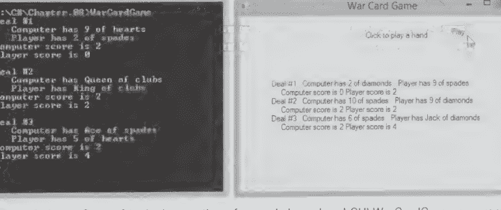

    图 8-31 基于控制台和 GUI 的 `WarCardGame` 程序的典型执行开始

11. b. 创建练习 11a 中描述的战争牌游戏的 GUI 版本，并命名为 `WarCardGameGUI`。让用户点击按钮来发牌，然后让该按钮隐藏并显示一个“播放（Play）”按钮。用户每次点击“播放”，就会亮出一对牌。保持窗口大小合理，你可能想每四手牌清除一次输出标签的内容。图 8-31 的右侧显示了正在进行的典型游戏。

352

## 调试练习

1. 在可下载的学生文件的 `Chapter.08` 文件夹中的以下每个文件都有语法和/或逻辑错误。在每个情况下，确定问题并修复程序。收集错误后，使用带有 `Fixed` 前缀的相同文件名保存每个文件。例如，`DebugEight1.cs` 将变为 `FixedDebugEight1.cs`。

   a. `DebugEight1.cs`

   b. `DebugEight2.cs`

   c. `DebugEight3.cs`

   d. `DebugEight4.cs`

## 案例分析

1. 在第 7 章中，你修改了 `GreenvilleRevenue` 程序以包含多个方法。现在修改每个数据输入语句，使用 `TryParse()` 方法以确保每条数据都是正确的类型。任何无效的用户输入都应生成适当的消息，并要求用户重新输入数据。

2. 在第 7 章中，你修改了 `MarshallsRevenue` 程序以包含多个方法。现在修改每个数据输入语句，使用 `TryParse()` 方法以确保每条数据都是正确的类型。任何无效的用户输入都应生成适当的消息，并要求用户重新输入数据。

# 第 9 章 使用类和对象

在本章中，你将：

- 学习类概念
- 创建可以实例化对象的类
- 创建对象
- 创建属性，包括自动实现属性
- 学习更多关于使用公共和私有访问修饰符
- 学习 `this` 引用
- 编写和使用构造函数
- 使用对象初始化器
- 重载运算符
- 声明对象数组并与其使用方法
- 编写析构函数
- 理解 GUI 应用程序对象

## 创建可以实例化对象的类

你对世界的很大理解来自于将对象分类为类的能力。当你还是个孩子时，在了解世界之前就已经学会了动物的概念。

当你创建一个类时，你必须为它分派一个名称，并确定哪些数据和方法将成为该类的一部分。例如，假设你决定创建一个名为 `Employee`（员工）的类。`Employee` 的一个实例变量可能是员工编号，其中一个必要的方法可能是向新员工显示欢迎消息。首先，你创建一个类头或类定义来开始该类。它包含三个部分：

1. 一个可选的访问修饰符
2. `class` 关键字
3. 你为类名选择的任何合法标识符；因为每个类代表一种类型的对象，所以类名通常是单数。

随着继续学习 C#，你将学习到可以添加到类定义中的其他可选组件。

例如，`Employee` 类可用的类头是 `internal class Employee`。关键字 `internal` 是类访问修饰符的一个示例。你可以使用表 9-1 中的任何修饰符来声明类。

| 类访问修饰符 | 描述 |
| :--- | :--- |
| public | 对类的访问不受限制。 |
| protected | 对类的访问限制在类本身以及任何派生自该类的类。（你将在“继承简介”章节中学习派生类。） |
| internal | 访问限制在类所属的程序集中。程序集是一组编译在一起创建可执行程序的代码模块。（你在编译 C# 程序后创建的 .exe 文件就是程序集。） |
| private | 访问限制在它所属的另一个类。换句话说，如果一个类包含在另一个类内部，且该类是唯一应该能够访问它的类，那么该类应该是私有的。 |

表 9-1 类访问修饰符

如果你没有显式地包含访问指定符，类访问默认为 `internal`。由于大多数类都具有 `internal` 访问权限，因此输入访问指定符通常是没必要的。（当你使用命名空间声明类时，你只能将其声明为 `public` 或 `internal`。）

除了类头之外，你创建的类必须有一个包含在花括号之间的类体。图 9-1 显示了一个 `Employee` 类的壳。

### 图 9-1 `Employee` 类壳

```csharp
class Employee {
    // 实例变量和方法放在这里
}
```

## 创建实例变量和方法

当你创建一个类时，你定义了它的属性和方法。你在花括号内使用与声明其他变量时相同的语法来声明类的实例变量——你提供一个类型和一个标识符。例如，在 `Employee` 类中，你可以声明一个整数 `idNumber`，当创建 `Employee` 对象时，每个对象都将有自己的 `idNumber`。你可以将 ID 编号简单地定义为 `int idNumber;`；然而，程序员经常为类中的每个字段使用访问修饰符并将 `idNumber` 声明为 `private int idNumber`。图 9-2 显示了一个包含私有 `idNumber` 字段的 `Employee` 类。

### 图 9-2 包含 `idNumber` 字段的 `Employee` 类

```csharp
class Employee {
    private int idNumber;
}
```

允许的字段修饰符有 `new`、`public`、`protected`、`internal`、`private`、`static`、`readonly` 和 `volatile`。如果你为字段提供访问指定符，它的访问默认为 `private`，这意味着没有其他类可以访问该字段的值，并且只有同类的非静态方法被允许直接设置、获取或使用该私有字段。在类中使用私有字段是信息隐藏的示例，这是所有面向对象的语言中都有的特性。

你每天在现实物体中看到信息隐藏的情况。例如，你无法看到汽车油箱内部来判断它有多满。相反，你使用仪表盘上的仪表来为你提供必要的信息。同样，面向对象编程中的数据字段是通过公共方法访问的。类的私有数据仅由它自己的方法更改或操作，而不是属于其他类的方法。将数据项设为私有的好处是可以控制它们的值。设置变量值的方法可以使用判断来确保该值落在指定的范围内。例如，员工的工资不应低于联邦最低工资，或者部门编号不应为负数或大于 10。

与类的私有数据字段相反，大多数实例方法通常不是私有的；它们是 `public` 的。这种产生的私有数据/公共方法的安排提供了一种控制外部访问你数据的手段——只有类的非私有方法可以用于访问类的私有数据。这种情况类似于有一个“公共”前台，控制着进出你私有办公室的消息。非私有方法的编写方式控制了你使用私有数据的良好程度。

例如，包含 `idNumber` 的 `Employee` 类可能需要一个方法向客户显示员工的欢迎消息。该方法的合理名称是 `welcomeMessage()`，它的声明是 `public void welcomeMessage()`，因为将具有公共访问权限且不返回任何内容。图 9-3 显示了增加了 `welcomeMessage()` 方法的 `Employee` 类。

### 图 9-3 带有 `idNumber` 字段和 `welcomeMessage()` 的 `Employee` 类

```csharp
class Employee {
    private int idNumber;
    public void welcomeMessage() {
        Console.WriteLine("Welcome from Employee #{0}", idNumber);
        Console.WriteLine("How can I help you?");
    }
}
```

注意 `welcomeMessage()` 方法没有使用 `static` 关键字，与你创建的许多其他方法不同。关键字 `static` 用于类范围方法，而不是你创建的实例方法。


## 两两真一假

### 创建可以实例化对象的类

1. 类头始终包含 `class` 关键字。
2. 当你创建一个类时，你定义了它的属性和方法。
3. 类中定义的大多数字段和方法都是私有的。

> 错误的陈述是 #3。类中的大多数字段是私有的，但大多数方法是公共的。

## 创建对象

类并不创建任何实际的对象。类只是一个抽象描述，描述了如果实例化任何对象它将会是什么样的。就像在你打算制造的物品第一件下生产线之前，你可能已经了解了该物品的所有特征一样，你可以在实例化任何该类的实例之前创建一个带有字段和方法的类。定义对象类似于声明一个内置数据类型的简单变量；事实上你使用一个类型和一个标识符。

对于 `Employee` 类的 `myAssistant` 实例，你正在通知编译器将使用标识符 `myAssistant`。然而，你还没有为存储名为 `myAssistant` 的 `Employee` 对象留出计算机内存——这仅适用于内置的预定义类型。要为对象分配所需的内存，你必须使用 `new` 运算符。在本书的前面的部分，当你学习为数组分配内存时已经用过 `new` 运算符了。

定义一个 `myAssistant` 对象需要两个步骤——你必须声明对对象的引用，并且必须使用实际分配足够内存来存放 `myAssistant` 的语句：

```csharp
Employee myAssistant;
myAssistant = new Employee();
```

你也可以在一个语句中为 `myAssistant` 声明并保留内存，如下：

```csharp
Employee myAssistant = new Employee();
```

在这条语句中，`Employee` 是对象的类型（也是它的类），`myAssistant` 是对象的名称。等号是赋值运算符，因此一个值被赋值给 `myAssistant`。`new` 运算符正在为 `myAssistant` 分配一块新的、未使用的计算机内存区域。赋值给 `myAssistant` 的值是 `Employee()` 构造函数创建的对象将所在的内存地址。你不需要担心实际的内存地址——当你引用 `myAssistant` 时，编译器会为你在适当地址找到它。

> 对象的标识符是对其内存地址的引用，你可以调用任何类引用类型——换句话说，引用特定内存位置的类型。引用类型是持有地址的类型，与 `int`、`double` 和 `char` 等预定义类型不同，后者是值类型，持有的是值而不是其地址。（在第 2 章中，你学习了枚举；它们也是值类型。）在编程圈中，你可能会听到关于 C# 中的所有内容是否都是对象的讨论。尽管有些人持不同意见，但通常共识是 `int` 和 `double` 这样的值类型不是对象；只有引用类型是。此外，值类型可以很容易通过像 `Object obj = myInteger;` 这样的语句转换为 `Object`。在这样的隐式转换中发生的动作被称为“装箱”（boxing）。
>
> 在 C# 中，你可以创建一个结构体（`struct`），它与类相似，可以包含字段和方法，但它是值类型而不是引用类型。更多详情见 C# 文档。

你也可以对简单数据类型使用 `new` 运算符。例如，声明一个整数变量 `x`，你可以写如下代码：

```csharp
int x = new int();
```

然而，程序员通常使用更简单的形式：

```csharp
int x;
```

使用第一种形式时，`x` 被初始化为 0。使用第二种形式时，`x` 不包含可用的起始值。

在 `Employee myAssistant = new Employee();` 语句中，`new` 运算符之后的语句最后部分 `Employee()` 看起来很像一个带有括号的方法名。事实上，它是用于构造 `Employee` 对象的方法名称。`Employee()` 是构造函数。你将在本章稍后部分编写你的构造函数。现在请注意，当你没有为类编写构造函数时，C# 会为你编写一个，且构造函数的名称始终与构造它的类名称相同。

在本章的后部分，你将学习类自动生成的构造函数是默认构造函数，这意味着它不接受任何参数。程序员有时会错误地将“自动生成”和“默认”这两个术语等同。类自动创建的构造函数是默认构造函数的示例，但你也可以显式地创建自己的默认构造函数。


# 第 9 章 使用类和对象

## 对象实例化与成员访问

对象实例化后，可以使用对象的标识符、点和非静态公共成员的标识符来访问其非静态公共成员。例如，如果你声明了一个名为 `myAssistant` 的 `Employee`，你可以通过以下语句访问 `myAssistant` 的 `welcomeMessage()`：

```csharp
myAssistant.welcomeMessage();
```

作为 `myAssistant` 使用实例方法的对象是调用对象。如果 `welcomeMessage()` 是静态方法，那么 `myAssistant.welcomeMessage();` 语句将是非法的。该方法之所以能与每个唯一的 `Employee` 对象适当使用，是因为它是非静态的。

声明 `myAssistant` 的程序无法直接访问 `myAssistant` 的 `idNumber`；程序访问私数据的唯一方法是使用对象的公共方法之一。由于 `welcomeMessage()` 方法与 `idNumber` 属于同一个类，并且由于 `welcomeMessage()` 是公共的，客户端方法（例如程序中的 `Main()` 方法）可以使用该方法。图 9-4 显示了一个 `Employee` 类，其 `Main()` 方法声明了一个 `Employee` 并显示了该 `Employee` 的欢迎信息。图 9-5 显示了程序的执行。

```csharp
using static System;
class CreateEmployee
{
    static void Main()
    {
        Employee myAssistant = new Employee();
        myAssistant.welcomeMessage();
    }
}
```

图 9-4 `CreateEmployee` 程序

```text
C:\C#Chapter_09>CreateEmployee
Welcome from Employee #0
How can I help you?
C:\C#Chapter_09>
```

**图 9-5** `CreateEmployee` 程序的输出

在图 9-5 的输出中，`Employee` 的 ID 号是 0。默认情况下，对象中所有未赋值的数值字段都初始化为 0。当你编译图 9-4 中的程序时，你会收到一条警告消息：

> Field 'Employee.idNumber' is never assigned to, and will always have its default value 0.

当然，通常你想为每个 `Employee` 的 `idNumber` 字段提供不同的值。为对象字段提供值的方法之一是创建属性，你将在本章的稍后部分完成这一操作。

## 将对象传递给方法

类代表一种数据类型，你可以像传递变量一样将对象传递给方法。例如，图 9-6 中的程序展示了如何传递字符串对象和 `Employee` 对象。图 9-7 显示了程序的输出。

```csharp
using System;
class CreateEmployees
{
    static void Main()
    {
        Employee aworker = new Employee();
        Employee anotherWorker = new Employee();
        DisplayEmployeeData("First", aworker);
        DisplayEmployeeData("Second", anotherWorker);
    }
    static void DisplayEmployeeData(string order, Employee emp)
    {
        Console.WriteLine("\0} employee's message:", order);
        emp.WelcomeMessage();
    }
}
```

图 9-6 `CreateEmployees` 程序

```text
C:\C#Chapter_09>CreateEmployees
First employee's message:
Welcome from Employee #0
How can I help you?

Second employee's message:
Welcome from Employee #1
How can I help you?
C:\C#Chapter_09>
```

图 9-7 `CreateEmployees` 程序的输出

当你将对象传递给方法时，传递的是引用。因此，方法中对对象参数的任何更改都会影响调用方法中的对象。

在图 9-6 中，`DisplayEmployee` 方法默认是内部的。由于该方法接受 `Employee` 参数，它的可访问性不能高于同样为内部的 `Employee` 类。这种限制保护了 `Employee` 类非公共成员的安全性。如果你将 `DisplayEmployee()` 方法和 `Employee` 类都改为公共，程序也可以正常工作。

## 两真一假

1. 声明类会创建一个新数据类型的对象。
2. 在声明类后，你必须使用 `new` 运算符为该类的对象分配内存并对其实例化。
3. 对象实例化后，可以使用对象的标识符、点和方法调用来访问其公共成员。

声明仅描述了对象将是什么。错误的语句是 #1。声明类不会创建实际的对象。

## 创建属性

通常，你通过对象调用方法来更改其字段的状态。例如，你可能想要设置或更改派对的日期或时间。在 `Employee` 类中，你可以编写如 `SetIdNumber()` 这样的方法来设置员工的 `idNumber` 字段如下：

```csharp
public void SetIdNumber(int idNumber)
{
    idNumber = number;
}
```

随后，在实例化一个名为 `myAssistant` 的 `Employee` 对象后，你可以使用如下语句调用该方法：

`myAssistant.SetIdNumber(785);`

尽管这种技术可以运行，并且可能在其他编程语言中使用，但 C# 程序员通常创建属性来执行类似任务。属性是类的一个成员，提供了对类字段的访问；C# 程序员将属性称为“智能字段”，因为它们结合了私有字段和公共方法的最佳特性。

- 像方法一样，它们保护私有数据免受外部访问。
- 像字段一样，它们的名称使用方式与简单变量名相同。当你创建属性时，客户端程序中的语法将变得更加自然且易于理解。

属性具有访问器，用于指定在访问类字段时执行的语句。具体而言，属性包含用于设置对象字段的 set 访问器和用于检索存储值的 get 访问器。图 9-8 显示了一个 `Employee` 类，其中阴影区域定义了一个名为 `idNumber` 的属性。

```csharp
class Employee {
    private int idNumber;
    public int idNumber {
        get {
            return idNumber;
        }
        set {
            idNumber = value;
        }
    }
    public void WelcomeMessage() {
        WriteLine("Welcome from Employee #{0}", idNumber);
        WriteLine("How can I help you?");
    }
}
```

图 9-8 定义了属性的 Employee 类

### 属性声明细节

属性声明类似于变量声明；它包含一个访问修饰符、一个数据类型和一个标识符。它也与方法相似，相似之处在于它后面跟着一对包含语句的大括号。按照惯例，属性标识符与其操作的字段相同；支持属性的字段称为其备用字段。请注意属性的大小写。例如，对于 `IDNumber` 的读取（getter），如果你返回属性本身（`IDNumber`）而不是备用字段（`idNumber`），就会导致无限循环——该属性会不断访问自己。

图 9-8 中的 `IDNumber` 属性包含在花括号之间定义的 get 和设置（setters）；属性声明可以包含一个 get 访问器、一个 set 访问器或两者都有。当属性具有 set 访问器时，程序员说该属性可以被“写入”。当它具有 get 访问器时，程序员说该属性可以被“读取”。当属性仅有一个 getter（而没有 set 访问器）时，get 和 set 访问通常被分别称为 getter 和 setter。

> 在图 9-8 的 `Welcome()` 方法中，显示了 `IDNumber` 属性。或者，该方法也可以继续使用 `idNumber` 字段（如图 9-3 所示，因为该方法与属性属于同一个类的成员）。程序员对于类是否应该使用 getter 还是属性来访问其内部方法存在分歧。一种流行的观点是，如果 get 和 set 访问器设计得当，就应该在任何地方使用，即使在类内部。有时，你希望一个字段是只读的，因此你就不创建 set 访问器。在这种情况下，你可以在类方法中使用该字段（按照惯例，首字母小写）。

在整本书中，你已经在示例程序中看到了加粗定义的关键字。`get`、`set` 和 `value` 并不是关键字——例如，你可以在 C# 程序中声明一个名为 `get` 的变量。然而，在属性内部，`get`、`set` 和 `value` 具有特殊含义，不允许在那里声明为标识符。在 Visual Studio 集成环境中，这些词在属性中显示为蓝色，其他地方为黑色。在特定情况下像关键字的标识符被称为上下文关键字。C# 有六个上下文关键字：`get`、`set`、`value`、`partial`、`where` 和 `yield`。


属性中的每个访问器看起来都像方法，除了标识符中包含括号。set 访问器像一个接受参数并将其赋值给变量的方法。它不是方法，你不需要对它使用括号。get 访问器返回与属性相关的字段值，但你不需要返回代码；get 访问器的类型是属性的类型。

当你在方法中使用 set 和 get 访问器时，不需要使用 `set` 或 `get` 单词。相反，要设置一个值，你使用赋值运算符（`=`），要获取一个值，你只需使用属性名。例如，如果你声明了一个名为 `myChef` 的 `Employee`，你可以像下面这样为 `IDNumber` 赋值：

```csharp
Employee myChef = new Employee();
myChef.IDNumber = 2345;
```

在第二个语句中，`IDNumber` 属性被设置为 2345。等号右侧的值作为名为 `value` 的隐式参数传递给 setter。（隐式参数是不声明并自动获取值的参数。）在 `myChef.IDNumber = 2345;` 语句中，常量 2345 被送到 setter 访问器，在那里成为 `value` 的值。在 setter 访问器内部，`value` 被赋值给字段 `idNumber`。`IDNumber` 字段无法从 `Main()` 直接设置，因为它是私有的；可以通过 setter 访问器设置 `IDNumber` 属性，因为它是公共的。

编写 getter 访问器允许你像使用简单变量一样使用属性。例如，可以显示声明的 Employee 的编号：

```csharp
WriteLine("ID number is {}", myChef.idNumber);
```

`idNumber` 字段无法从 `Main()` 直接设置，因为它是私有的；图 9-9 显示了如下内容：

```csharp
using System.Console;
class CreateEmployee {
    static void Main() {
        Employee myChef = new Employee();
        myChef.IDNumber = 2345;
        WriteLine("ID number is {}", myChef.idNumber);
        myChef.WelcomeMessage();
    }
}
```

图 9-9 使用属性的 Employee 类


图 9-10 CreateEmployee 的输出

在此阶段，声明 get 和 set 访问器除了从字段检索值或给其赋值外什么都不做，似乎是费力不讨好。毕竟，如果字段是公共的而不是私有的，你只需要使用它，就可以避免创建属性的工作。然而，将类的字段设为私有并允许访问器仅在你认为合适的情况下操作它们是惯例（并符合面向对象的原则）。隐藏数据是面向对象编程的重要特性，控制数据值的设置和使用也是如此。此外，你可以自定义访问器以限制你想对某些字段施加的内容。例如，你可以编写如下 setter 访问器来限制 Employee 类内的编号：

```csharp
set {
  if(value < 500)
    idNumber = value;
  else
    idNumber = 500;
}
```

此 setter 访问器将确保 `Employee` 的 `idNumber` 永远不会大于 500。如果客户端直接访问私有的 `idNumber` 字段，你就无法控制可以分配哪些值，但当你为类编写自定义 setter 访问器时，你获得了对允许的数据值的完全控制。

使用属性时的一个小不便是属性不能作为 `ref` 或 `out` 参数传递给方法。例如，如果 `IDNumber` 是 `Employee` 属性且 `myChef` 是一个 `Employee` 对象，以下语句无法编译：

```csharp
int.TryParse(ReadLine(), out myChef.IDNumber);
```

相反，为了使用 `TryParse()` 交互式地获取 `IDNumber` 值，你必须使用临时变量，如下所示：

```csharp
int temp;
int.TryParse(ReadLine(), out temp);
myChef.IDNumber = temp;
```

## 使用自动实现属性

虽然可以在属性的 get 和 set 访问器中包含任意数量的自定义语句，但常见的情况是 set 访问器简单地为字段赋值，而 get 访问器简单地返回字段值。由于 get 和 set 访问器中的代码通常标准且简洁，程序员有时会采用几种简写方法来编写属性。

例如，与其像图 9-8 所示使用 11 行代码来编写 `IDNumber` 属性，程序员可能会用五行来编写该属性，如下所示：

```csharp
public int IDNumber
{
    get{return idNumber;}
    set{idNumber = value;}
}
```

这种格式并没有删除属性原始版本中的任何字符；它只是删除了部分空格，将每个访问器放在单行上。

其他程序员选择了更紧凑的形式，将整个属性写在一行中：

```csharp
public int IDNumber {get{return idNumber;}; set{idNumber = value;}}
```

C# 3.0 引入了更加简洁的格式。在 C# 的此及更高版本中，你可以如下所示编写属性：

```csharp
public int IDNumber {get; set;}
```

以这种格式编写的属性被称为**自动实现属性**。属性的实现（其写入语句集）是自动创建的，其假设是 **set** 访问器只需将值赋值给相应的字段，而 **get** 访问器只需返回该字段。如果你需要在其中一个访问器中包含自定义语句（例如对赋值的值进行限制），则不能使用自动实现属性；而当你同时使用 **get** 和 **set** 时，可以声明自动实现属性。自动实现属性有时被称为**自动属性**。


# 第 9 章 使用类和对象

## 自动实现属性

当你创建一个自动实现属性时，不应该声明与之对应的后台字段。相应的后台字段是由编译器生成的，并具有内部名称，如果你手动编写该字段，该名称将与字段名不匹配。如果你也为该属性声明了一个字段但没有显式引用它，你将收到警告，提示你的字段从未未使用，因为你的字段和属性的字段指向不同的内存地址。你可以通过使用声明的字段来避免警告，但这可能导致潜在的混淆和错误。例如，图 9-11 显示了一个 `Employee` 类，其中与 ID 号和薪水相关的属性不需要特殊代码。在此类中，没有显式地声明字段；只声明了自动实现属性。该图还包含一个使用该类的短程序，图 9-12 显示了输出。当你在既需要 `get` 和 `set` 能力又不需要特殊语句时，自动实现属性提供了一个方便的快捷径。

**图 9-11** 一个没有声明字段并具有自动实现属性的 Employee，以及一个使用它们的程序

```
C:\Chapter.09>CreateEmployee3
Employee #3872 makes $22.11
C:\#\Chapter.09>
```

**图 9-12** CreateEmployee3 程序的输出

如果你想使用自动实现访问器创建一个只读属性，可以如下所示将 `set` 访问器设为私有：

```cs
public int IdNumber { get; private set; }
```

使用这种技术，`IdNumber` 属性无法通过另一个类中的任何语句进行设置。然而，可以通过该类内部的方法为其赋值。你可能还想创建一个外部类可以设置但无法检索的属性，如下：

```cs
public int IdNumber { private get; set; }
```


## 两真理一谎言

### 创建属性

- 1. 属性是类的一个成员，定义了如何设置和检索字段。
- 2. 属性包含用于检索对象字段的 `set` 访问器和用于设置存储值的 `get` 访问器。
- 3. 当你字段的 `set` 访问器只需将值赋值给相应的字段，且字段的 `get` 访问器只需返回字段值时，你可以创建自动实现属性。

虚假的陈述是 #2。属性包含用于检索字段的 `get` 访问器和用于设置存储值的 `set` 访问器。

## 你来做

### 创建类和对象

在本节中，你将创建一个 `Student` 类并对其实例化对象。该类包含学生的 ID 号、姓氏和平均绩点（GPA）。它还包含获取和设置这些字段的属性。你还将把每个 `Student` 对象传递给方法。

1. 开始一个新项目。
2. 添加两个表示最高和最低平均绩点的常量。
3. 为 `idNumber`、`lastName` 和 `gradePointAverage` 添加属性。
4. 为 `gradePointAverage` 添加一个 setter，确保值在范围之内。
5. 定义 `Student` 类。
6. 在文件顶部包含必要的命名空间。
7. 添加 `Main()` 方法来声明两个 `Student` 对象。
8. 为每个 `Student` 调用 `Display()` 方法。
9. 编写 `Display()` 方法以格式化输出。
10. 保存文件，然后编译并执行它。

```cs
using System;
using static System.Console;

class Student
{
    private int idNumber;
    private string lastName;
    private double gradePointAverage;

    public const double HIGHEST_GPA = 4.0;
    public const double LOWEST_GPA = 0.0;

    public int IdNumber
    {
        get { return idNumber; }
        set { idNumber = value; }
    }

    public string LastName
    {
        get { return lastName; }
        set { lastName = value; }
    }

    public double GradePointAverage
    {
        get { return gradePointAverage; }
        set
        {
            if (value >= LOWEST_GPA && value <= HIGHEST_GPA)
                gradePointAverage = value;
            else
                gradePointAverage = LOWEST_GPA;
        }
    }
}

class CreateStudents
{
    static void Main()
    {
        Student first = new Student();
        first.IdNumber = 123;
        first.LastName = "Anderson";
        first.GradePointAverage = 3.5;

        Student second = new Student();
        second.IdNumber = 789;
        second.LastName = "Daniels";
        second.GradePointAverage = 0.0;

        Display(first);
        Display(second);
    }

    static void Display(Student stu)
    {
        WriteLine("{0, 5} {1, -10}{2, 6}", stu.IdNumber, stu.LastName, stu.GradePointAverage.ToString("F1"));
    }
}
```

*(注：上面的代码块是根据提供文本中的碎片逻辑重构的，以提供一个描述一致的程序。)*

## 自动实现属性（续）

当属性的 `get` 返回相应字段的值，且其 `set` 访问器将值赋值给相应的字段时，你可以使用自动实现属性减少类中的代码。在 `Student` 类中，`IdNumber` 和 `LastName` 都是这种快捷方式的候选者，因此你可以用它们的自动实现版本替换完整版本的属性。`GradePointAverage` 属性无法利用自动实现，因为需要额外的代码使属性实现预期的功能。

## 关于 public 和 private 访问符更多

在大多数情况下，类的数据字段是私有的，而方法是公共的。这种技术确保了数据仅按照访问器提供的方式进行使用和更改。新手程序员可能会将数据字段设为公共以避免创建包含 `get` 和 `set` 访问器的属性。然而，这样做违反了面向对象编程的基本原则。应当尽可能隐藏数据，并通过定义良好的访问器来控制对其访问。

尽管私有字段和公共方法访问器是常规范，但有时你需要创建公共字段或私有方法。考虑图 9-14 所示的 `Carpet` 类。尽管它包含了几个私有数据字段，该类还包含一个公共常量字段（阴影部分）。在三个公共属性声明之后，定义了一个私有方法（也有阴影部分）。

```cs
class Carpet
{
    public const string MOTTO = "Our carpets are quality-made";
    private int length;
    private int width;
    private int area;

    public int Length
    {
        get
        {
            return length;
        }
        set
        {
            length = value;
            CalcArea();
        }
    }

    public int Width
    {
        get
        {
            return width;
        }
        set
        {
            width = value;
            CalcArea();
        }
    }

    public int Area
    {
        get
        {
            return area;
        }
    }

    private void CalcArea()
    {
        area = Length * Width;
    }
}
```

图 9-14 Carpet 类

### 更多关于公共和私有访问修饰符

当你从类 9-14 创建 `Carpet` 对象时，每个 `Carpet` 都有自己的长度、宽度和面积，但所有 `Carpet` 对象都具有相同的 `MOTTO`。字段 `MOTTO` 前面带有 `const` 关键字，意味着 `MOTTO` 是常量。这意味着没有程序可以更改它的值。公共常量不会像将对象的数据字段设置为公共那样违反信息隐藏，因为使用该类的程序无法更改类的常量值。

当你在类中定义命名常量时，它总是静态的，尽管你不能使用 `static` 关键字作为修饰符。换句话说，该字段属于整个类，而不是属于类的任何特定实例。当你创建一个静态字段时，无论实例化多少个对象，整个类只存储一个副本。当你在客户端类中使用常量字段时，你使用的是类名加点，而不是对象名，例如 `Carpet.MOTTO`。一些内置的 C# 类包含有用的命名常量，例如 `Math.PI`，它包含 pi 的值。你不需要创建一个 `Math` 对象来使用 `PI`；因此，你知道它是静态的。

> 在整本书中，你一直在使用 `static` 来描述类的 `Main()` 方法。你不需要创建包含 `Main()` 方法的任何类的对象就可以使用 `Main()`。

图 9-15 显示了一个实例化并使用 `Carpet` 对象的程序，图 9-16 显示了程序执行时的结果。请注意，尽管输出语句需要对象来使用 `Width`、`Length` 和 `Area` 属性，但 `MOTTO` 仅通过类名引用。

```cs
using static System.Console;

class TestCarpet
{
    static void Main()
    {
        Carpet aRug = new Carpet();
        aRug.Width = 12;
        aRug.Length = 14;
        Write("{0} X {1} carpet ", aRug.Width, aRug.Length);
        WriteLine("has an area of {0}", aRug.Area);
        WriteLine("Our motto is: {0}", Carpet.MOTTO);
    }
}
```

图 9-15 TestCarpet 类

```
C:\CN\Chapter.09>TestCarpet
The 12 X 14 carpet has an area of 168
Our motto is: Our carpets are quality-made
C:\CN\Chapter.09>
```

**图 9-16** TestCarpet 程序的输出

`Carpet` 类包含一个名为 `CalcArea()` 的私有方法。当你检查图 9-15 中 `TestCarpet` 类中的代码时，注意 `Width` 和 `Length` 是使用赋值操作符设置的，但 `Area` 不是。`TestCarpet` 类可以对 `Width` 和 `Length` 进行任何赋值，因为这些属性是公共的。然而，你不会希望客户端程序为 `Area` 赋值，因为赋值的值可能与 `Width` 和 `Length` 的值冲突。因此，`Area` 属性是一个只读属性——它不包含设置器，并且不允许客户端赋值。相反，每当 `Width` 或 `Length` 属性发生更改时，私有的 `CalcArea()` 方法会被调用。`CalcArea()` 方法被定义为私有，因为没有理由让 `TestCarpet` 这样的客户端调用 `CalcArea()`。程序员使用私有方法的频率可能比创建公共数据字段更频繁。某些程序员认为最好的风格是使用公共方法，这些方法仅仅是一系列带有描述性名称的方法调用列表。然后，实际执行工作的方法都是私有的。

## 三真一假

- 1. 良好的面向对象技术要求数据通常应该是隐藏的，并且对数据的访问应该由设计良好的访问器来控制。
- 2. 尽管私有字段、方法和访问器是常规范，但有时你需要创建它们的公共版本。
- 3. 当你在类中定义命名常量时，它总是静态的；也就是说，该字段属于整个类，而不是属于类的任何特定实例。

虚假的陈述是 #2。尽管私有字段和公共方法是常规范，但有时你需要创建公共字段或私有方法。

## 理解 this 引用

当你创建一个类时，计算机内存中只存储一份类代码副本。但是，你最终可能会从该类创建成千上万的对象。当你创建每个对象时，你为它的实例变量提供存储空间。例如，图 9-17 显示了 `Book` 类的部分，它包含三个字段、一个用于标题的属性和一个广告消息。当你声明几个 `Book` 对象时，如下所示，每个 `Book` 对象都需要其标题、`numPages` 和 `price` 的独立空间：

```cs
Book myBook = new Book();
Book yourBook = new Book();
```

```cs
class Book
{
    private string title;
    private int numPages;
    private double price;

    public string Title
    {
        get
        {
            return title;
        }
        set
        {
            title = value;
        }
    }

    public void AdvertisingMessage()
    {
        // ...
    }
}
```

图 9-17 部分开发的 Book 类

当你编译 `Book` 类时，你会收到关于 `numPages` 和 `price` 字段未使用的警告。这种省略是故意的。在这个示例中，存储单个 `Book` 对象需要为三个字段分配空间；图书馆或零售店的存储需求将是巨大的——每个书籍必须能够持有自己的数据，包括出版者、出版日期、作者、ISBN 等。每个字段被称为实例变量，是因为每个实例都存储了独立的值。除了字段外，如果每个 `Book` 对象都需要每个属性和方法的副本，存储需求将成倍增加。每个书籍需要空间来存储其独特的标题和其他数据是合理的，但由于每个书籍都使用相同的方法，存储多个方法副本是浪费且不必要的。

你可以在实例方法或属性中显式引用 `this`，如图 9-18 所示。当你在 `Book` 方法或访问器中引用 `Title`（或 `title`）时，你引用的是“这个书籍”的字段——即你在调用方法时使用的书籍名称，可能是 `myBook` 或 `yourBook`。使用图 9-18 中的阴影关键字不是必须的；图 9-17 中所示的隐含但未显式编写的方法版本同样有效。图 9-19 显示了一个使用 `Book` 类的应用程序，图 9-20 显示了它的输出。

```cs
class Book
{
    private string title;
    private int numPages;
    private double price;

    public string Title
    {
        get
        {
            return this.title;
        }
        set
        {
            this.title = value;
        }
    }

    public void AdvertisingMessage()
    {
        WriteLine("Buy it now: {0}", this.Title);
    }
}
```

图 9-18 显式使用 this 引用的 Book 类

```cs
using static System.Console;

class CreateTwoBooks
{
    static void Main()
    {
        Book myBook = new Book();
        Book yourBook = new Book();
        myBook.Title = "Silas Marner";
        yourBook.Title = "The Time Traveler's Wife";
        myBook.AdvertisingMessage();
        yourBook.AdvertisingMessage();
    }
}
```

**图 9-19** 声明两个 Book 程序

```text
C:\C\Chapter.89>
Buy it now: Silas Marner
Buy it now: The Time Traveler's Wife
C:\C\Chapter.89>
```

**图 9-20** CreateTwoBooks 程序的输出

图 9-18 中的 `Book` 类在没有为此添加 `this` 显式引用的情况下也能运行。然而，你应该意识到 `this` 引用总是存在的，它在后台工作，即使你没有在代码中编写它。有时，你可能想在方法内部包含 `this` 引用以提高清晰度，这样当你引用实例变量时，读者就不会产生疑问。


# 第 9 章 使用类和对象

## 理解 `this` 引用

在某些情况下，你可能需要显式地编写此引用。例如，考虑图 9-21 中简化的 `Book` 类。程序员为字段和使用该字段的方法的参数选择了相同的标识符。为了区分两者，在具有同名参数的方法中，必须通过 `this.price` 来引用该字段。图 9-21 中 `SetPriceAndTax()` 方法中所有对 `price`（不使用 `this`）的引用都是对本地参数的引用。如果方法是 `price = price;`，参数的值将赋值给自身，类的字段将永远不会设置。

```cs
class Book {
    private double price;
    private double tax;
    public void SetPriceAndTax(double price) {
        const double TAX_RATE = 0.07;
        this.price = price;
        tax = price * TAX_RATE;
    }
}
```

字段 `price` 在方法内部是 `this.price`。

参数 `price` 在方法内部就是 `price`。

**图 9-21** 必须显式使用 `this` 引用的 Book 类

观看视频 Understanding this Reference。

### 两个真理和一个谎言

- 1. 一个隐式的、不可见的 `this` 引用被传递给类中的每个实例方法和属性访问器；这些实例方法和属性是非静态的。
- 2. 你可以在实例方法或属性内部显式地引用该引用。
- 3. 尽管此引用存在于每个实例方法中，但它是不可见的，因此你无法无法方法内部引用它。

引用实例变量。

在方法内部引用以提高清晰度，这样当你引用时读者就不会产生疑问。

错误的语句是 #3。有时，你可能想包含此引用。

## 理解构造函数

当你创建一个 `Employee` 类并使用如 `Employee worker = new Employee();` 的语句实例化对象时，你实际上是在调用由 C# 提供的名为 `Employee()` 的方法。**构造函数**是一个实例化（创建对象实例）的方法。如果你没有为类编写构造函数，那么你创建的每个类都会自动获得一个无参数的公共构造函数。

“默认构造函数”这一术语不仅用于自动提供的构造函数；它还用于任何不带参数的构造函数。你将在下一节学习创建带参数的构造函数。

自动创建名为 `Employee()` 的构造函数建立了一个标识符为 `worker` 的 `Employee`，并为 `Employee` 的数据字段提供了以下初始值：

- 数字字段被设置为 0
- 字符字段被设置为 '\0'
- 布尔字段被设置为 false
- 引用类型（例如字符串字段或任何其他对象字段）被设置为 null（或为空）

使用默认构造函数初始化的对象的值被称为对象的默认值。如果你不希望 `Employee` 的所有字段都持有默认值，或者如果你想在创建 `Employee` 时执行额外任务，你可以编写自己的构造函数来替换自动提供的版本。你编写的任何构造函数必须与它的类同名，且构造函数不能有返回类型。例如，如果你创建一个包含 `Salary` 属性的 `Employee` 类，并希望每个新的 `Employee` 对象的薪水均为 300.00，你可以如下所示编写 `Employee` 类的构造函数：

```cs
public Employee() {
    Salary = 300.00;
}
```

假设已经为 `salary` 字段定义了 `Salary` 属性，任何实例化的 `Employee` 将拥有 300.00 的默认薪水。

你可以在构造函数中编写任何语句。例如，你可以执行算术运算或显示消息。最常见的构造函数任务是初始化字段。如果你在一个类中创建了一个或多个字段从未赋值过值，编译器将发出警告，说明涉及的字段将持有默认值。

## 向构造函数传递参数

你创建一个构造函数是为了确保类的所有对象在它们的数据字段中都以相同的值初始化。或者，你也可以通过编写传递一个或多个参数的构造函数，来创建具有唯一字段值初始化的对象。然后你可以使用参数值来设置属性或用于单个对象的实例化。

例如，考虑图 9-22 所示具有两个数据字段、一个构造函数和一个自动实现属性的 `Employee` 类。它的构造函数为使用如 `Employee partTimeWorker = new Employee();` 等语句创建的每个可能实例化的 `Employee` 对象分配 9.99，`Employee` 的 `price` 持有默认值。

```cs
class Employee
{
    private int idNumber;
    private string name;
    public Employee()
    {
        price = 9.99;
    }
    public double Salary {get; set;}
    // 其他类成员放在这里
}
```

**图 9-22** 无参数构造函数的 Employee 类

图 9-22 中的构造函数是**无参数构造函数**——一个不带参数的构造函数。换句话说，你可能选择不同的初始速率来创建 `Employee`。为了完成此任务，你可以将 `rate` 传递给构造函数。图 9-23 显示了一个接收参数的 `Employee` 构造函数。如下语句将值传递给构造函数：

```cs
public Employee(double rate)
{
    price = rate;
}
```

**图 9-23** 带参数的 Employee 构造函数

## 重载构造函数

C# 会为你的类提供默认构造函数。一旦你创建了自己的构造函数（无论它是否有参数），你就无法再访问自动创建的版本。然而，如果你希望一个类同时具有带参数和无参数的构造函数，你可以创建它们。像任何其他 C# 方法一样，构造函数可以重载。你可以为一个类编写尽可能多的构造函数，只要它们的参数不会引起歧义。一个类只能包含一个无参数构造函数：默认构造函数，它可以是自动提供的也可以是你写的。如果你创建了任何参数化构造函数但没有创建无参数版本，那么该类就没有默认构造函数。

例如，图 9-24 中的 `Employee` 类包含四个构造函数。图 9-25 中 `CreateSomeEmployees` 类中的 `Main()` 方法显示了如何实例化不同类型的 `Employee`。注意 `Employee` 构造函数的一个版本——支持字符参数的版本甚至未使用该参数；有时你创建一个特定参数类型的构造函数仅仅是为了强制该构造函数成为执行的版本。`CreateSomeEmployees` 程序的输出如图 9-26 所示。

```cs
class Employee
{
    public int IdNumber {get; set;}
    public double Salary {get; set;}
    public Employee()
    {
        IdNumber = 999;
        Salary = 0;
    }
    public Employee(int empId)
    {
        IdNumber = empId;
        Salary = 0;
    }
    public Employee(int empId, double sal)
    {
        IdNumber = empId;
        Salary = sal;
    }
    public Employee(char code)
    {
        IdNumber = 111;
        Salary = 100000;
    }
}
```


**图 9-24** 包含四个构造函数的 Employee 类

```csharp
using static System.Console;
class CreateSomeEmployees
{
    static void Main()
    {
        Employee aWorker = new Employee();
        Employee anotherWorker = new Employee(234);
        Employee theBoss = new Employee('A');
        WriteLine("{0, 4}{1, 14}", aWorker.IdNumber,
            aWorker.Salary.ToString("C"));
    }
}
```

**图 9-25** CreateSomeEmployees 程序

```
C:\CH\Chapter_09>CreateSomeEmployees
999         $0.00
234         $24.00
111         $100.00
C:\CH\Chapter_09>
```

**图 9-26** CreateSomeEmployees 程序的输出

很可能，单个应用程序不会使用 `Employee` 类的全部四个构造函数。更有可能，每个使用该类的应用程序只会使用一个或两个构造函数。你创建一个带有多个构造函数的类，是为了为你的客户提供灵活性。例如，某些客户可能选择仅用 ID 数字来构造 `Employee` 对象，而其他客户可能喜欢用 ID 数字和工资来构造它们。

## 构造函数初始化器

图 9-24 中的 `Employee` 类包含四个构造函数，每个构造函数都初始化相同的两个字段。在公司使用的完全开发的类中，会有更多的字段被初始化，从而产生大量的重复代码。除了在这些构造函数中编写重复语句的原始额外工作外，当将来修改该类时，将需要更多额外的工作。例如，如果你的组织引入了需要特定数字位数的新 ID 编号格式，则每个构造函数都必须进行修改，这需要额外的工作。此外，必须修改的一个或多个构造函数版本可能会被忽略，从而在使用该类的客户的程序中引入错误。

作为在构造函数中重复代码的替代方案，你可以使用构造函数初始化器。构造函数初始化器是一个语句，表示在执行当前构造函数体中的任何语句之前，应该执行该类构造函数的另一个实例。图 9-27 显示了 `Employee` 类的新版本，它在四个重载构造函数版本中的三个使用了构造函数初始化器。

```csharp
class Employee
{
    public int IdNumber {get; set;}
    public double Salary {get; set;}
    public Employee() : this(999, 0)
    {
    }
    public Employee(int empId) : this(empId, 0)
    {
    }
    public Employee(int empId, double sal)
    {
        IdNumber = empId;
        Salary = sal;
    }
    public Employee(char code) : this(111, 100000)
    {
    }
}
```

**图 9-27** 使用构造函数初始化器的 Employee 类

在图 9-27 的三个阴影语句中，`this` 引用被用来表示“正在构造的对象的构造函数”。例如，当客户调用无参数的 `Employee` 构造函数时，999 和 0 被传递给两个参数的构造函数。在那里，它们变成了 `empId` 和 `sal`，这些是被赋值给 `IdNumber` 和 `Salary` 属性的参数。如果在无参数构造函数内部编写了语句，它们将被执行；但在这种情况下，没有必要的额外的语句。同样，如果客户使用只接受 ID 数字的构造函数版本，该参数和工资的 0 将被传递给两个参数的构造函数。只执行一个版本构造函数的唯一情况是客户同时使用 ID 数字和工资作为构造函数参数时。

在将来，如果需要向类中添加额外的语句（例如，一个确保在构造时 ID 编号至少有五位的决策），则该决策将仅添加到两个参数版本的构造函数中。

## 在构造函数中使用 `readonly` 修饰符

你已经学习过，当你使用 `readonly` 修饰符时，只有在构造函数中可以对其赋值。图 9-28 显示了带有 `readonly` 字段的 `Employee` 类，在构造函数中对其赋值。如果你使用 `readonly` 修饰符，该字段在构造函数执行之后就不能被赋值。

```csharp
class EmployeeReadOnlyDemo {
    static void Main() {
        Employee aWorker = new Employee(1234);
        aWorker.IdNumber = 5678; // 错误
    }
}
class Employee {
    private readonly int IdNumber;
    public Employee(int id) {
        IdNumber = id;
    }
    public int IdNumber {
        get { return IdNumber; }
    }
}
```

**图 9-28** 带有 readonly 字段的 Employee 类

### 理解构造函数的真假

- 1. 每一个类都自动带有一个无参数的构造函数。
- 2. 如果你编写了构造函数，你就不再有默认构造函数。
- 3. 任何你编写的构造函数必须与类名相同。


## 你来操作

### 在类中添加重载构造函数

在这些步骤中，你为 `Student` 类添加重载构造函数。

1. 打开包含 `Student` 类的文件。在 `Student` 类的大括号之前，添加以下构造函数。它接受三个参数并将它们赋值给相应的字段：

```csharp
public Student(int id, string name, double gpa)
{
    IdNumber = id;
    LastName = name;
    GradePointAverage = gpa;
}
```

2. 添加第二个构造函数。它调用第一个构造函数，为编号传递 0，为姓名传递 "XXX"，为平均分传递 0.0。它的体是空的。

```csharp
public Student() : this(0, "XXX", 0.0)
{
}
```

3. 将现有的 `CreateStudents` 类重命名为 `CreateStudents2`。

4. 在 `Student` 对象的声明之后，添加两个声明。一个使用三个参数，另一个使用任何参数。

```csharp
Student third = new Student(456, "Marco", 2.4);
Student fourth = new Student();
```

5. 保存文件，然后编译并执行它。输出类似于图 9-29。所有四个对象都显示出来了。前两个是在声明后被赋值的，但第三个和第四个是从它们的构造函数获取值的。

6. 在 `Main()` 方法的末尾，在两次现有的 `Display()` 方法调用之后，使用新对象添加两次调用：

```csharp
Display(third);
Display(fourth);
```

| C:\CH\Chapter_09>CreateStudents2 |
| :--- |
| 123 Anderson | 3.5 |
| 789 Danis | 0.0 |
| 456 Marco | 2.4 |
| 0 XXX | 0.0 |

**图 9-29** CreateStudents2 程序的输出

## 使用对象初始化器

对象初始化器允许你在实例化时为类的任何可访问成员或属性赋值，而无需调用带参数的构造函数。例如，假设已经创建了一个具有公共 `IdNumber` 属性和无参数构造函数的 `Employee` 类，你可以按照以下方式之一编写对象初始化器，带不带括号：

```csharp
Employee aWorker = new Employee { IdNumber = 101 };
Employee aWorker = new Employee() { IdNumber = 101 };
```

在上述两个语句中，101 都被赋值给 `IdNumber` 属性。赋值是在大括号内进行的；使用构造函数名配合括号是可选的。当执行这两个语句中的某一个时，会先执行类的无参数默认构造函数，然后进行对象初始化器赋值。

例如，图 9-30 显示了一个 `Employee` 类，它具有 `IdNumber` 和 `Salary` 属性，以及一个为 `Salary` 赋值的默认构造函数。为了演示目的，构造函数显示了当前对象的 ID 号和工资。该图还显示了一个实例化一个 `Employee` 对象并显示其值的程序，图 9-31 显示了输出。当在阴影语句中创建对象时，构造函数执行，将 99.99 赋值给 `Salary` 并显示第一行输出，显示 `IdNumber` 仍为 0。在 `Main()` 方法中构造对象后，会显示下一条输出，显示 ID 号的赋值发生在构造之后。


# 第 8 章 使用类和对象

要使用对象初始化器，类必须含有一个默认构造函数。这意味着，你要么不能创建任何构造函数，要么必须创建一个不需要任何参数的构造函数。

可以通过逗号分隔多个赋值，从而使用对象初始化器进行多次赋值，如下：

```csharp
Employee myAssistant = new Employee {IdNumber = 202, Salary = 25.00};
```

这一单行代码与以下三个语句的效果相同：

```csharp
Employee myAssistant = new Employee();
myAssistant.IdNumber = 202;
myAssistant.Salary = 25.00;
```

使用对象初始化器允许你创建具有不同初始赋值的多个对象，而无需提供多个构造函数来涵盖所有可能的情况。此外，使用对象初始化器允许你为相同类型的不同属性创建具有不同初始的对象。例如，考虑图 9-32 中的 `Box` 类，它包含多个相同类型的属性。构造函数将 `Height`、`Width` 和 `Depth` 属性设置为 1。你可以编写一个接受单个整数参数并赋值给 `Height` 的构造函数（其他维度使用默认值 1），但你不能再编写另一个接受单个整数参数并赋值给 `Width` 的重载构造函数，因为这些构造函数将产生歧义。然而，通过使用对象初始化器，你可以创建对象并分配你所需的属性。图 9-33 显示了一个声明三个 `Box` 对象的程序，每个对象都有不同的赋值维度，图 9-34 显示了输出，证明了每个属性都被恰当地赋值了。

```csharp
class Box
{
    public int Height {get; set;}
    public int Width {get; set;}
    public int Depth {get; set;}
    public Box()
    {
        Height = 1;
        Width = 1;
        Depth = 1;
    }
}
```

**图 9-32** Box 类

## 使用对象初始化器

```csharp
using static System.Console;
class DemoObjectInitializer
{
    static void Main()
    {
        Box box1 = new Box {Height = 3};
        Box box2 = new Box {Width = 15};
        Box box3 = new Box {Depth = 268};
        DisplayDimensions(1, box1);
        DisplayDimensions(2, box2);
        DisplayDimensions(3, box3);
    }
    static void DisplayDimensions(int num, Box box)
    {
        WriteLine("Box {0}: Height: {1} Width: {2}", num, box.Height, box.Depth);
    }
}
```

图 9-33 DemoObjectInitializer 程序

```
C:\CH\Chapter.09>DemoObjectInitializer
Box 1: Height: 3 Width: 1.
Box 2: Height: 1 Width: 15.
Box 3: Height: 1 Width: 268.
C:\CH\Chapter.09>
```

图 9-34 DemoObjectInitializer 的输出

## 两个真话一个假言

使用对象初始化器

假设一个运行中的程序包含以下对象初始化器：

```csharp
Invoice bill = new Invoice{Amount = 0};
```

1. 你知道 `Invoice` 类包含一个默认构造函数。
2. 你知道可以在不使用参数的情况下构造对象。
3. 你知道 `Invoice` 类只包含一个属性。

假设一个运行中的程序包含以下内容：

```csharp
Invoice bill = new Invoice();
bill.Amount = 0;
```

然而，`Invoice` 类可能有任何数量的属性，但在此语句中仅初始化了一个。

# 第 9 章 使用类和对象

## 运算符重载

C# 运算符是你用于对对象执行操作的符号。你已经用过许多运算符，包括算术运算符（如 `+` 和 `-`）和逻辑运算符（如 `==` 和 `!=`）。看似相同的操作可能会产生不同的结果。这在所有计算机语言中经常发生，而不是面向对象的语言。例如，在大多数编程语言以及电子表格和数据库中，`+` 运算符有多种含义。其中包括：

- 在值之前（称为一元形式），在表达式 `++7` 中表示正值。
- 在两个整数之间（称为二元形式），表示整数加法，在表达式 `+9` 中表示。
- 在两个浮点数之间（也称为二元形式），表示浮点数加法，在表达式 `+6.4` 中表示。
- 在两个字符串之间，表示拼接，在表达式 `"Hello," + "there"` 中表示。

将值表示为正数与使用运算符执行算术或拼接字符串是不同的操作，因此 `+` 被重载了多次。

C# 运算符被分类为一元或二元，取决于它们接受一个参数还是两个参数。重载规则如下：

- 可重载的一元运算符有：`!` `~`
- 可重载的二元运算符有：`*` `/` `%` `!=` `>=`
- 你不能重载以下运算符：`&&` `||` `??`

你不能对内置数据类型重载运算符。例如，你不能更改两个整数之间 `+` 的含义。

- 当二元运算符被重载且有相应的赋值运算符时，它也会被重载。例如，如果重载了 `+`，`+=` 也会被重载。
- 某些运算符必须成对重载。例如，当你重载 `==` 时，必须也重载 `!=`。当你重载 `==` 时，你还会收到关于对象的类的警告。你将在“继承简介”章节中学习该类；在学习该章节之前不要尝试重载 `==`。

你已经使用了上述列表中许多但并非所有的运算符。如果你想在类中包含重载运算符，你必须决定该运算符在你的类中的含义。当你这样做时，要在方法中编写语句来执行你的含义。该方法具有返回类型和参数与其他方法类似，但其标识符必须命名为 `operator` 后跟相应的运算符，例如 `operator+()` 或 `operator-()`。

例如，假设你创建了一个 `Book` 类，其中每个对象都有标题、页数和价格。进一步假设，作为出版商，你已经决定将书籍“相加”在一起。也就是说，你想将两个现有的 `Book` 对象合并为一个对象。假设你希望新书籍具有以下特征：

- 新标题是旧标题的组合，用单词 "and" 连接。
- 新书的页数等于原始书籍页数的总和。
- 你没有为新书收取双倍价格，而是决定收取两本书中较贵的那本的价格，再加上 10 元。

不同的出版商可能认为“相加书籍”意味着不同的事情——例如，相加书籍可能有一个固定的新价格 29.99 元。你在 `operator+()` 方法中编写的语句取决于你如何定义你的类的相加。你可以编写一个普通方法来执行这些任务，你也可以重载 `+` 运算符来表示“相加两个书籍”。图 9-35 显示了一个 `Book` 类，它为每个字段都有一个属性和一个 `operator+()` 方法。

```csharp
class Book {
    public Book(string title, int pages, double price) {
        Title = title;
        NumPages = pages;
        Price = price;
    }

    public static Book operator+(Book first, Book second) {
        const double EXTRA = 10.00;
        string newTitle = first.Title + " and " + second.Title;
        int newPages = first.NumPages + second.NumPages;
        double newPrice;
        if(first.Price > second.Price)
            newPrice = first.Price + EXTRA;
        else
            newPrice = second.Price + EXTRA;
        return(new Book(newTitle, newPages, newPrice));
    }

    public string Title {get; set;}
    public int NumPages {get; set;}
    public double Price {get; set;}
}
```

**图 9-35** 重载了 + 运算符的类

图 9-35 中的 `operator+` 方法声明为公的（这样类客户端可以使用它）并且是静态的（这是要求的）。该方法是静态的，因为它没有接收任何对象的引用；相反，两个对象是作为两个参数传递给方法的。

返回类型是 `Book`，因为两个 `Book` 的相加被定义为一个与原始对象任值不同的新 `Book`。你可以重载 `+` 运算符，使得当两个 `Book` 相加时返回其他类型，但最常见的做法是让两个对象的相加产生相同类型的“答案”。

`Book` 类中 `operator+()` 方法的两个参数都是 `Book` 类型。因此，当你调用此方法时，`+` 两侧的数据类型都将是 `Book`。例如，你可以编写其他方法来相加 `Book` 和 `Employee`，或者 `Book` 和 `double`。

在 `operator+()` 方法内部，这些语句执行了以下任务：

- 声明了一个常量，用于存储从两个现有的对象创建一个新 `Book` 的额外费用。
- 创建了一个新字符串，并赋值第一个参数 `Book` 的标题、加上字符串“ and ”以及第二个参数 `Book` 的标题。
- 声明了一个新整数，并赋值每个参数 `Book` 页数的总和。
- 声明了一个新 `double`，并赋值为较贵的原始 `Book` 的值加上 $10.00。
- 在返回语句中，使用新的标题、页码和价格创建了一个匿名 `Book`（匿名对象是不带标识符的对象）并将其返回给调用方法。（与其使用匿名 `Book`，使用两条语句也是完全可以的——第一条创建一个相同参数的具名 `Book`，第二条返回该具名 `Book`。）

图 9-36 显示了一个使用 `Book` 类中 `+` 运算符的客户端程序。它声明了三个 `Book`；然后在阴影语句中，它将两个 `Book` 相加并将结果赋值给第三个。当 `book1` 和 `book2` 相加时，调用 `operator+()` 方法。返回的 `Book` 被赋值给 `book3`，然后显示出来。图 9-37 显示了结果。

```csharp
using static System.Console;
class AddBooks {
    static void Main() {
        Book book1 = new Book("Silas Marner", 350, 15.95);
        Book book2 = new Book("Moby Dick", 250, 16.00);
        Book book3;
        book3 = book1 + book2;
        WriteLine("The new book is {0}", book3.Title);
        WriteLine("It has {0} pages and costs {1}", book3.NumPages, book3.Price.ToString("C"));
    }
}
```

图 9-36 AddBooks 程序

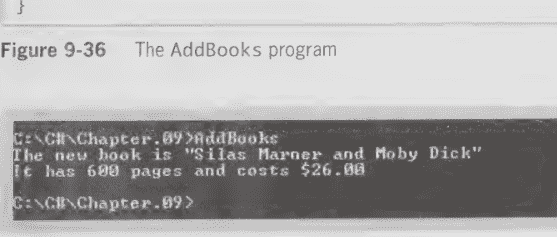

图 9-37 AddBooks 程序的输出

在 `Book` 类中，需要许多语句来重载运算符；然而，在客户端类中，只需在对象之间输入 `+` 即可让程序员直观地使用对象和运算符。你可以在运算符方法中编写任何想要的语句。但是，为了清晰起见，你应该编写在直观上与该运算符常用用法含义相同的语句。例如，尽管你可以重载 `operator*()` 方法来显示 `Book` 的标题和价格而不是执行乘法，但这将是一种糟糕的编程技术。

由于每个加法操作返回一个 `Book`，因此可以在语句中链式调用加，例如 `collection = book1 + book2 + book3;`（假设所有变量都声明为 `Book` 对象）。在这个示例中，`book1` 和 `book2` 将相加，返回一个不同的临时 `Book`。然后该临时 `Book` 和 `book3` 相加，返回另一个不同的临时 `Book` 并赋值给 `collection`。

当你重载运算符时，方法的至少一个参数必须是包含类的成员。换句话说，在 `Book` 类中，你可以重载 `operator*()` 让一个 `Book` 乘以整数，但你不能重载 `operator*()` 让 `double` 乘以整数。

当你重载一元运算符时，该方法接收单个参数。例如，假设你想对一个 `Book` 使用负号使其价格变为负数。你可以在如下语句中使用该运算符：

```csharp
returnedBook = -purchasedBook;
```

`operator-()` 头部可能如下：

```csharp
public static Book operator-(Book aBook)
{
    aBook.Price = -aBook.Price;
    return aBook;
}
```

**图 9-38** 用于 Book 的 operator-() 方法

> 在其他语言中（特别是 C++），你可以编写两个方法来分别作为前缀和后缀运算符重载 `++` 和 `--`。然而，当你在 C# 中重载 `++` 或 `--` 时，该运算符可以用对象之前或之后，但执行的是同一个方法。

## 真或假

- 1. 所有的 C# 运算符都可以重载。
- 2. 你不能为内置类型重载运算符。
- 3. 某些运算符必须成对重载。

虚假的语句是 #1。你不能重载 `new` 运算符。

## 对象数组

就像你可以声明整数或双数的数组一样，你也可以声明包含任何类型的数组，包括对象。记住对象名称是引用。当你从值类型（如 `int` 或 `char`）创建数组时，数组持有实际值。当你从引用类型（如你创建的类）创建数组时，数组持有对象的内存地址。换句话说，数组是“引用”对象而不是包含对象。

你可以如下创建指向七个 `Employee` 对象的引用数组：

```csharp
Employee[] empArray = new Employee[7];
```

该语句为名为 `empArray[0]` 到 `empArray[6]` 的七个引用留了足够的内存。它并没有实际构造这些 Employee；所有引用都初始化为 null。为了填充数组，你必须调用七次 `Employee()` 构造函数。

如果 `Employee` 类包含默认构造函数，你可以使用以下循环调用七次构造函数：

```csharp
for(int x = 0; x < empArray.Length; ++x)
    empArray[x] = new Employee();
```

随着 x 从 0 变化到 6，七个 Employee 对象每一个每一个被构造。


# 使用类和对象

## 非默认构造函数

如果你想使用非默认构造函数，必须提供相应的参数。例如，如果 `Employee` 类包含一个带有 `int` 参数的构造函数，你可以编写以下代码来填充七个数组元素中的三个：

```cs
Employee[] empArray = {new Employee(123),
new Employee(234), new Employee(345)};
```

通过使用属于数组中对象的方法，你可以在数组名之后、点操作符和方法之前插入适当下标符号。例如，要将所有七个 `Employee` 的 `IdNumber` 属性设置为 999，你可以编写以下代码：

```c
for(int x = 0; x < empArray.Length; ++x)
    empArray[x].IdNumber = 999;
```

## 在对象数组中使用 Sort() 和 BinarySearch() 方法

在“使用数组”章节中，你学习了如何使用 `System.Array` 类以及对 `int`、`double` 和 `string` 等简单数据类型使用 `Sort()` 方法。`Sort()` 方法接受一个数组参数，并按升序/降序排列其元素。`BinarySearch()` 方法接受一个已排序的数组和一个它尝试在数组中匹配的值。

当你搜索或排序你创建的对象数组时，会产生比较问题。当你创建并排序简单数据项数组时，只需要考虑一种类型的值，且顺序基于每个项目的 Unicode 值。支持简单数据项的类都包含一个名为 `CompareTo()` 的方法，该方法提供了基本数据类型之间如何比较的细节。换句话说，它们定义了如“2 大于 1”和“B 大于 A”之类的比较。`Sort()` 和 `BinarySearch()` 使用当前排序数据类型的 `CompareTo` 方法。换言，`Sort()` 在排序整数时使用 `Int32` 版本的 `CompareTo()`，在排序字符时使用 `Char` 版本的 `CompareTo()`。

你在第 2 章学习了内置数据类的名称；它们总结在表 2-1 中。

你整本书都一直在使用 `String` 类（及其字符串别名）。该类也包含一个 `CompareTo()` 方法，你在第 2 章中首次使用了它。

当你创建一个要在对象之间进行比较的类时，必须告诉编译器在进行这些比较时使用哪个字段。例如，在逻辑上，你可能根据 ID 号、工资、部门编号、姓氏、入职日期或类中包含的任何字段对组织的员工排序。为了告诉 C# 使用哪个字段来排列 `Employee` 对象，你必须创建一个接口。

抽象方法没有方法体；接口包含抽象方法。在下一章中，你将学习更多关于抽象方法的知识。现在，请理解接口不是数据类型，而是一组空的、抽象的方法（以及可能的其他成员）的集合，只要类提供了覆盖接口的“无操作”方法定义，就可以被任何类使用。与类不同，接口不能包含实例字段，你无法从它创建对象。

实现接口的类必须重写接口的方法。当方法被重写时，它的优先级高于原方法，并被用来替代原始版本。换句话说，接口中的方法是空的，任何使用这些方法的类必须包含一个提供细节并被替代的新版本。接口定义了类必须实现的命名行为，以便所有类使用相同的方法名，但根据类的情况恰当地使用它们。通过这种方式，接口实现了多态——不同对象使用相同方法名但根据上下文采取相应的能力。

> 当方法被重写时，它的签名与被重写的方法签名相同。当方法被重载时，它们具有不同的签名。你将在下一章学习更多关于重写方法以及抽象方法和类。

C# 支持许多接口。你可以通过首字母 `I` 来识别接口。例如，C# 包含一个 `IComparable` 接口，它包含了 `CompareTo()` 方法的定义，该方法比较一个对象与另一个对象并返回一个整数。图 9-39 显示了 `IComparable` 的定义。`CompareTo()` 方法接受一个参数 `Object` 但不包含任何语句；如果你想让对象是可比较的，必须在你创建的类中为此方法提供实现。也就是说，`CompareTo()` 方法是抽象的，你必须为该类确定大于、小于和等于的含义。

```c
interface IComparable {
    int CompareTo(Object o);
}
```

**图 9-39 IComparable 接口**

当你创建一个实例将被你使用的的类时：

- 你必须在类名后包含单个冒号和接口名称 `IComparable`。
- 你必须编写一个包含以下头部的方法：

```c
int IComparable.CompareTo(Object o)
```

> 当方法被重写时，它的签名与被重写的方法签名相同。当方法被重载时，它们具有不同的签名。你将在下一章学习更多关于重写方法以及抽象方法和类。

（注：提供的 OCR 文本在后几页关于 `IComparable` 接口的内容存在大量重复/交错片段。我已根据提供的技术内容清理了逻辑流。）

为了使 `BinarySearch` 和 `Sort()` 等方法正常工作，你为每个类创建的 `CompareTo` 方法必须返回一个整数。表 9-2 显示了返回值。

| 返回值 | 含义 |
|---|---|
| 负数 | 此实例小于所比较的对象。 |
| 零 | 此实例与所比较的对象相等。 |
| 正数 | 此实例大于所比较的对象。 |

**表 9-2 CompareTo() 的返回值**

图 9-40 中的 `Employee` 类在其头部使用了冒号和 `IComparable` 来指示接口。阴影方法是一个实例方法；也就是说，它“属于” `Employee`。

```csharp
class Employee : IComparable {
    public int idNumber {get; set;}
    public double Salary {get; set;}
    int CompareTo(Object o) {
        int returnVal;
        Employee temp = (Employee)o;
        if(this.idNumber > temp.idNumber)
            returnVal = 1;
        else
            if(this.idNumber < temp.idNumber)
                returnVal = -1;
            else
                returnVal = 0;
        return returnVal;
    }
}
```

**图 9-40 使用接口 Employee 类**

## 第 9 章 使用类和对象

```text
C:\CF\Chapter.07>ComparableEmployeeArray
Sorted employees:
Employee #0: 111 $0.00
Employee #1: 222 $0.00
Employee #2: 333 $0.00
Employee #3: 444 $0.00
Employee #4: 555 $0.00
Employee #222 found at position 1
C:\CF\Chapter.07>
```

**图 9-42 ComparableEmployeeArray 程序的输出**

请注意，`seekEmp` 对象仅根据 `idNumber` 匹配数组第二个位置的 `Employee`——而不是根据 `salary`——这是因为 `Employee` 类中的 `CompareTo()` 方法仅使用 `idNumber` 值而未使用薪水进行比较。你可以编写代码，要求 `idNumber` 和 `salary` 值都必须匹配后才返回正数。

## 两个真理一个谎言

### 声明对象数组

假设一个运行程序包含以下数组声明：

`BankAccount[] acctArray = new BankAccount[500];`

- 1. 该语句为 `BankAccount` 对象留出了足够的计算机内存。
- 2. 该语句构造了 500 个 `BankAccount` 对象。
- 3. `acctArray` 的有效下标是 0 到 499。

> 虚假的陈述是 #2。该语句为 500 个 `BankAccount` 对象留出了空间，但并没有实际构造这些对象；要这样做，你必须调用构造函数。

## 你来做

### 创建对象数组

在接下来的步骤中，你创建一个 `Student` 对象数组。你提示用户输入数据以填充数组，并在显示所有数据之前根据学生 ID 对数组进行排序。

1. 打开 `CreateStudents2` 程序并立即另存为 `CreateStudents3`。将类名改为 `CreateStudents`。
2. 删除 `Main()` 方法中的所有现有语句，保留起始和结束括号。在大括号之间，声明一个包含八个 `Student` 对象的数组。还要声明一个变量作为数组下标，并声明三个在构造 `Student` 对象之前用于临时存储用户输入数据的变量。

```csharp
Student[] students = new Student[8];
int x;
int id;
string name;
double gpa;
```

3. 在循环中，调用 `GetData()` 方法（你稍后会编写）。向该方法发送输出参数，以便你可以获取用于存储 ID 号、名称和平均学点的变量的值。然后，将这三个值依次发送给八个 `Student` 对象的构造函数。

```csharp
for(x = 0; x < students.Length; ++x)
{
    GetData(out id, out name, out gpa);
    students[x] = new Student(id, name, gpa);
}
```

4. 调用 `Array.Sort()` 方法并传递学生数组。然后在循环中逐个对对象调用你在上一步步骤中编写的 `Display()` 方法。

```csharp
Array.Sort(students);
WriteLine("Sorted List:");
for(x = 0; x < students.Length; ++x)
    Display(students[x]);
```

5. 编写 `GetData()` 方法。它的参数是 `out` 参数，以便其值对调用方法可见。该方法简单地提示用户输入每个数据项，读取它，并在必要时转换为相应的类型。

```csharp
static void GetData(out int id, out string name, out double gpa)
{
    string inString;
    Write("Please enter student ID number >> ");
    inString = ReadLine();
    int.TryParse(inString, out id);
    Write("Please enter last name for student {0} >> ");
    name = ReadLine();
    Write("Please enter grade point average >> ");
    inString = ReadLine();
    double.TryParse(inString, out gpa);
}
```

6. 在 `Student` 类的头部之后，添加 `IComparable`，以便类的对象可以排序：

```csharp
class Student : IComparable
```

7. 在 `Student` 类的结束括号之前，添加 `IComparable.CompareTo()` 方法，该方法的用于类的对象排序。该方法将根据 ID 号对 `Student` 对象进行排序，因此根据 `IdNumber` 属性的比较返回 1、-1 或 0。该方法接受一个转换为 `Student` 对象的对象。如果控制 `Student` 对象的 `IdNumber` 大于参数的 `IdNumber`，则返回值为 1。如果控制 `Student` 对象的 `IdNumber` 小于参数的 `IdNumber`，则返回值为 -1。否则，返回值为 0。

```csharp
int CompareTo(Object o)
{
    int returnValue;
    Student temp = (Student)o;
    if(this.IdNumber > temp.IdNumber)
        returnValue = 1;
    else
        if(this.IdNumber < temp.IdNumber)
            returnValue = -1;
        else
            returnValue = 0;
    return returnValue;
}
```

8. 保存文件，然后编译并执行。在提示时，输入你选择的学生 ID、名称和平均学点。对象将按照 `IdNumber` 顺序排序并显示。图 9-43 显示了一个典型的执行过程。

```text
C:\C\Chapter.09>CreateStudents
Please enter student ID number >> 912
Please enter last name for student ID >> Harris
Please enter grade point average >> 3.4
Please enter student ID number >> 634
Please enter last name for student ID >> Lewis
Please enter grade point average >> 3.2
Please enter student ID number >> 610
Please enter last name for student ID >> Johnson
Please enter grade point average >> 2.6
Please enter student ID number >> 377
Please enter last name for student ID >> Lee
Please enter grade point average >> 4.0
Please enter student ID number >> 391
Please enter last name for student ID >> Young
Please enter grade point average >> 3.9
Please enter student ID number >> 215
Please enter last name for student ID >> Jenks
Please enter grade point average >> 3.8
Please enter student ID number >> 185
Please enter last name for student ID >> Bower
Please enter grade point average >> 2.3
Please enter student ID number >> 478
Please enter last name for student ID >> Cooper
Please enter grade point average >> 2.6
Sorted List:
Employee #0: 185 $2.3
Employee #1: 215 $3.8
Employee #2: 377 $4.0
Employee #3: 391 $3.9
Employee #4: 478 $2.6
Employee #5: 610 $2.6
Employee #6: 634 $3.2
Employee #7: 912 $3.4
```

**图 9-43 典型执行输出**

## 理解 GUI 应用程序对象

图 9-47 显示了一个新的 GUI 应用程序，程序员仅通过将一个按钮（Button）拖到表单（Form）上就开始创建它。

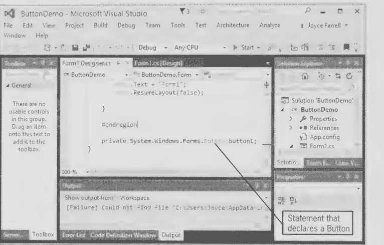

**图 9-47 表单上的按钮**

如果你在解决方案管理器中点击 `Form1.Designer.cs` 并向下滚动，就可以显示声明按钮的代码。请见图 9-48。

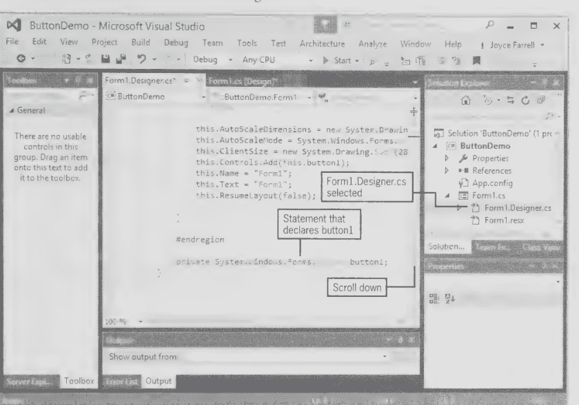

**图 9-48 自动生成的声明 button1 的语句**

如果你在代码中右键点击 `button1` 并在弹出的菜单中选择“查找所有引用”，IDE 底部的“查找符号结果”区域将显示项目里对 `button1` 的每个引用。（你可能需要调整窗口大小以清晰地查看引用。）你可以双击列表中的每个项目，以定位到为 `button1` 生成代码的所有位置。例如，图 9-49 所示，`button1` 的多个实例位于名为 `InitializeComponent()` 的方法中。第一个引用还可以查看按钮的名称（Name）、位置（Location）、大小（Size）和其他属性是如何设置的。你可以自己编写这些语句，特别是现在你已经对对象及其构造方式有了更多了解，但通过将按钮拖到表单并让 IDE 为你创建这些语句来视觉化开发应用程序要简单得多。

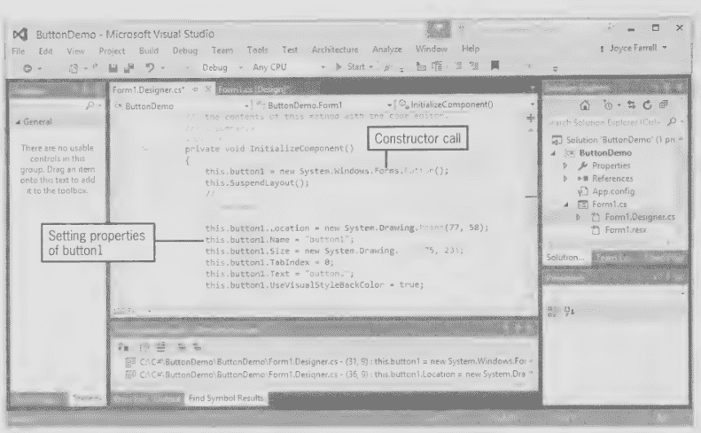

**图 9-49 IDE 中一些自动生成的 button1 引用**

在图 9-49 中，每个 `button1` 出现位置之前的此引用指向包含这些语句的类（`Form1`）。

现在你已经理解了如何在自己的类中创建属性，你就可以理解 GUI 对象的属性以及它们是如何为你创建的了。

## 本章总结

- 应用程序类包含一个 `Main()` 方法。你也可以从类中实例化对象；这些类不需要有 `Main()` 方法。类的数据组件是它的实例变量（或字段）和方法。实例化另一个预写类对象的程序或类称为客户端类或类用户。


# 使用类和对象

## 核心概念

- 当你创建一个类时，必须为它分配名称并确定哪些数据和方法将成为类的一部分。类头或类定义包含一个可选的访问修饰和一个标识符。类体包含在大括号之间。当你创建一个类时，通常将实例变量声明为 `private`，将实例方法声明为 `public`。

- 当你创建一个作为类实例的对象时，你提供一个类型，并使用 `new` 运算符为该对象分配内存。对象实例化后，可以使用对象的标识符、点（.）和方法调用来访问其公共方法。你可以像传递简单数据类型一样将对象传递给方法。

属性是类的一个成员，用于提供对字段的访问。属性具有用于设置对象字段的设置器（setters）和用于检索存储值的访问器（getters）。作为快捷方式，当字段的 `setter` 访问器仅需将值分配给相应字段，且其 `getter` 访问器应返回该字段时，你可以创建一个自动实现的属性（auto-implemented property）。

在大多数类中，字段是私有的，而方法是公共的。这种技术确保了数据只会按照类访问器中提供的方式被使用和更改。偶尔，你需要创建公共字段或私有方法。

`this` 引用被传递给类中的每个实例方法和属性访问器。你可以在实例方法或属性内部显式地引用此引用，但通常你不需要这样做。

构造函数是实例化对象的方法。如果你不编写构造函数，则每个类都会自动提供一个无参数的公共构造函数。你可以编写自己的构造函数来替换自动提供的版本。你编写的任何构造名称必须与其类相同，且构造函数没有返回类型。你可以重载构造函数并向构造函数传递参数。

初始化器允许你在实例化时为类的任何可访问成员赋值。

## 复习题

1. 对象是类的 _________。
   - a. 子类
   - b. 机构
   - c. 实例化
   - d. 亲属

2. 类头或类定义可以包含以下内容，但不：
   - a. 可选的访问修饰符
   - b. 关键字
   - c. 标识符
   - d. 初始字段值

3. 类中的大多数字段是用 _________ 修饰符创建的。
   - a. public
   - b. protected
   - c. new
   - d. private

4. 类中的大多数方法是用 _________ 修饰符创建的。
   - a. public
   - b. protected
   - c. new
   - d. private

5. 属于单个对象的实例方法是 _________ 静态方法。
   - a. 总是
   - b. 通常
   - c. 偶尔
   - d. 从

6. 为对象实例化分配内存，你必须使用 _________ 运算符。
   - a. mem
   - b. alloc
   - c. new
   - d. instant

7. 假设你创建了一个名为 MyClass 的类。MyClass 构造函数的头部可以是 _________
   - a. public void MyClass()
   - b. public MyClassConstructor()
   - c. 这两者都可以作为构造函数的头部。
   - d. 这两者都不是作为构造函数的头部。

8. 假设你创建了一个名为 MyClass 的类。MyClass 构造函数的头部可以是
   - a. public MyClass()
   - b. public MyClass(double d)
   - c. 这两者都可以作为构造函数的头部。
   - d. 这两者都不是作为构造函数的头部。

9. 假设你创建了一个名为 DemoCar 的类。在该类的 Main() 方法中，你实例化了一个名为 myCar 的 Car 对象，并且以下语句执行正确：
   ```
   WriteLine("The Car gets {0} miles per gallon", myCar.ComputeMpg());
   ```
   在 Car 类中，ComputeMpg() 方法可以是：
   - a. public 且静态
   - b. public 非静态
   - c. private 且静态
   - d. private 非静态

10. 假设你创建了一个名为 TermPaper 的类，其中包含一个字符字段 letterGrade。你还为该字段创建了一个属性。以下哪种情况可能是真实的？
    - a. 属性名称是 letterGrade。
    - b. 属性是只读的。
    - c. 属性包含一个 set 访问器，不允许低于 'C' 的分数：
    - d. 属性不包含 get 访问器。

11. this 引用是
    - a. 隐式传递给非静态方法
    - b. 隐式传递给静态方法
    - c. 显式传递给非静态方法
    - d. 显式传递给静态方法

12. 当你在类的非静态方法中使用实例变量时，你显式引用方法的 this 引用
    - a. 必须
    - b. 可以
    - c. 不能
    - d. 应该（尽管不是要求的）

13. 类的默认构造函数
    - a. 将数值字段设置为 0
    - b. 是无参数的
    - c. 以上者皆是
    - d. 以上均不是

14. 假设你创建了一个名为 Chair 的类，其构造函数定义为 Chair(int height)。以下哪种重载构造函数可以与 Chair 构造函数共存而不产生歧义？
    - a. Chair(int legs)
    - b. Chair(int height, int legs)
    - c. 这两者都是
    - d. 以上均不是

15. 如果 House 类包含一个声明为 House(int bedrooms, double price) 的单构造函数，以下哪条语句正确地实例化了一个 House 对象？
    - a. HousemyHouse = new House();
    - b. HousemyHouse = new House(3, 125000.00);
    - c. HousemyHouse = House(4, 200000.00);
    - d. 以上两个

16. 当你完成对对象的使用时，你会显式调用析构函数
    - a. 当对象超出范围时
    - b. 当类被销毁时
    - c. 你不能显式调用析构函数。

17. 在创建一个某个类的五个对象实例程序中，构造函数执行 ____ 次，析构函数执行 ____ 次。
    - a. 一; 一
    - b. 一; 五
    - c. 五; 一
    - d. 五; 五

18. 假设你声明了一个名为 Furniture 的类，该类包含一个字符串字段 woodType 和一个按照惯例命名的带有 get 访问器的属性。当你声明了一个名为 myChairs 的包含 200 个 Furniture 对象的数组时，以下哪项访问了最后一个 Furniture 对象的木类型？
    - a. Furniture.Get(woodType[199])
    - b. myChairs[199].WoodType()
    - c. myChairs.WoodType[199]
    - d. myChairs[199].WoodType

19. 一个任何类都可以使用的方法集合，只要该类提供了一个定义来覆盖该集合的抽象定义，就是 __________。
    - a. 超类
    - b. 多态
    - c. 边界/边缘
    - d. 接口

20. 当你创建一个类并想要包含比较其对象的能力，以便它们可以使用 Array.Sort() 或 Array.BinarySearch() 方法时，你必须 ___________ 。
    - a. 在类中至少包含一个数值字段
    - b. 为该类编写一个 CompareTo() 方法
    - c. 注意不要覆盖现有的 IComparable.CompareTo() 方法
    - d. 以上两点

## 编程练习

对于每个练习，你可以选择编写控制台应用程序或 GUI 应用程序，或两者兼顾。

1. 创建名为 TestHockeyPlayer 的应用程序，实例化并显示一个 HockeyPlayer 对象。HockeyPlayer 类包含球员姓名（字符串）、球衣号（整数）和进球数（整数）字段。

2. 创建名为 TestClassifiedAd 的应用程序，实例化并显示一个 ClassifiedAd 对象。ClassifiedAd 具有类别（例如，二手车）、单词数和价格字段。为类别和单词数包含 get 和 setter 的属性，但仅为价格提供 get 访问器。价格按每个单词九分计算。

3. 创建名为 SalesTransactionDemo 的应用程序，声明多个 SalesTransaction 对象并显示它们的值和总和。SalesTransaction 类包含销售人员、销售金额字段以及一个存储费率的只读字段。为该类提供三个构造函数。一个构造函数接受名称、销售金额和费率，并在设置销售值时通过乘以费率计算佣金。第二个构造函数接受名称和销售金额，但将费率设置为 0。第三个构造函数接受名称并将所有其他字段设置为 0。重载 `+` 运算符叠加 SalesTransaction 对象的销售金额。

4. 创建名为 TilingDemo 的程序，实例化一个 10 个 Room 对象的数组并演示其方法。Room 构造函数需要长度宽度参数；在构造对象时使用多种值。Room 类还包含房间地板面积和铺设房间所需的瓷砖数量字段。这两个值都通过调用私有方法计算。每个房间每 12 平方英尺需要一块瓷砖，超过 12 平方英尺的任何部分增加一块，不规则切割的浪费额外增加一块。也就是说，122 平方英尺的房间需要 12 块——前 120 平方英尺 10 块，超过 120 的部分一块，浪费一块。获取 Room 值的只读属性。

5. 创建名为 CarDemo 的应用程序，声明两个 Car 对象并演示如何使用重载的 `++` 运算符进行递增。创建一个包含模型和每加仑值的 Car。包含重载构造函数。一个接受模型和每加仑值的参数；另一个设置每加仑值。重载 `++` 运算符使每加仑值增加 1。CarDemo 应用程序使用每个构造函数创建至少一个 Car，并在递增前后显示 Car。

6. 创建名为 TaxPayerDemo 的程序，声明一个包含 10 个 Taxpayer 对象的数组。提示用户输入每个对象的数据。Taxpayer 数据字段包括社会安全号（使用字符串类型，但内部不使用破折号）、年收入和所得税。为前两个数据字段包含带有 get 和 setter 的属性，但使税额成为只读属性。

   每当设置收入时应计算税费。假设收入低于 $30,000 的税率为 15%，收入 $30,000 及以上的税率为 28%。

   b. 创建一个名为 `TaxpayerDemo2` 的程序，使得在显示 10 个 `Taxpayer` 对象后，它们根据欠税金额按顺序进行排序并再次显示。修改 `Taxpayer` 类，使其对象能够根据欠税金额进行相互比较。

7. 创建一个名为 `ShirtDemo` 的应用程序，声明几个 `Shirt` 对象，并包含一个显示方法，你可以在连续的方法调用中向该方法传递不同数量的 `Shirt` 对象。`Shirt` 类包含材质、颜色和尺寸的自动实现属性。

8. 为一家举办商务会议的酒店创建一个名为 `ConferencesDemo` 的程序。允许用户输入 5 个 `Conference` 对象的数据，然后按照参加人数从小到大的顺序显示它们。`Conference` 类包含组名、开始日期（字符串格式）和参与人数的字段。为每个字段包含属性。还包含一个 `IComparable.CompareTo()` 方法以便对 `Conference` 进行排序。

9. 创建一个名为 `RelativeList` 的程序，声明一个拥有12个 `Relative` 对象的数组，并提示用户输入关于它们的数据。`Relative` 类包含亲属姓名、与你的关系（例如：姨妈）以及三个代表亲属生日的整数（月、日、年）的自动实现属性。按字母顺序显示 `Relative` 对象。

   b. 创建一个 `RelativeBirthday` 程序，修改 `Relative` 程序，使得在显示字母顺序列表后，程序提示用户输入特定的亲属姓名并返回该亲属的关系和生日。如果未找到该亲属，则显示适当的消息。

10. a. 为 Harold's Home Services 编写一个名为 `DemoJobs` 的程序。程序应实例化几个 `Job` 对象并演示它们的方法。`Job` 类包含四个数据字段——描述（例如，“洗窗户”）、完成所需的小时（例如 3.5）、每小时收费率（例如 $25.00）和总费用（每小时率乘以小时数）。为每个字段包含获取和设置的属性，但总费用是只读的，并在每次设置小时费或小时数时计算。重载 `+` 运算符，使两个 `Job` 可以相加。两个 `Job` 之和是一个新的 `Job`，包含两个原始作业的描述（用“和”连接）、原始作业的小时数总和以及原始作业每小时率的平均值。

    b. Harold 意识到他计算合并作业费用的方法是不公平的。例如，考虑以下情况：
       - 他刷房的费用是每小时 $100。如果一项工作花费10小时，他将赚得1000。
       - 他遛狗的费用是每小时 $10。如果一项工作花费1小时，他将赚得 $10。
       - 如果他合并这两项工作并总共工作11小时，他只能获得每小时 $55 的平均费率，即 $605。
       
       设计一种改进的加权方法来计算 Harold 合并作业的费用，并包含在重载的 `+()` 方法中。编写名为 `DemoJobs2` 的程序来正确演示类中的所有方法。

11. a. 编写一个 `Demo` 程序，实例化每个 `Fraction` 对象并证明它们的方法工作正常。创建一个 `Fraction` 类，包含持有整数、分子和分母的字段。此外：
    - 为每个字段创建属性。分母的 `set` 访问器不应允许值为 0；默认值为 1。
    - 添加三个构造函数。一个接受整数、分子和分母三个参数。另一个接受分子和分母的两个参数；当使用此构造函数时，整数值为 0。最后一个构造函数是无参数的；它将整数和分子设为 0，分母设为 1。（构造完成后，分数不一定需要约化为真分数。例如，即使 3/9 可以约化为 1/3，你的构造函数也不必执行此任务。）
    - 添加 `Reduce()` 方法，如果分数不是真分数则对其进行约化。例如，2/4 应该约化为 1/2。
    - 添加一个 `operator+()` 方法来加两个分数。要加分数，请消除值中的任何整数部分。例如，2/1 变为 9/4，1/3 变为 8/5。找到一个公分母并将其转换为该分母。例如，当加 9/4 和 8/5 时，你可以将其转换为 45/20 和 32/20。然后相加分子，得到 77/20。最后，调用 `Reduce()` 方法约化结果，恢复任何整数值，使数字的小数部分小于1。例如，77/20 变为 3 17/20。
    - 一个函数，返回包含通常显示格式分数的字符串——整数、空格、分子、斜杠（/）和分母。当整数为0时，应显示分数部分（例如 1/2 而不是 0/2）。如果分子为0，则应显示整数（例如 2 而不是 2 0/3）。

    b. 在 11a 创建的 `Fraction` 类中添加 `operator*()` 方法，以便相乘两个分数。结果应为正确格式。在名为 `Fraction2` 的程序中演示该方法。

    c. 编写一个名为 `Fraction3` 的程序，声明一个 `Fraction` 数组并包含一个显示方法，你可以在连续的方法调用中向该方法传递不同数量的 `Fraction` 对象。

## 调试练习

1. 以下文件存在语法错误。请纠正每个文件中的错误：
   - a. Debug1.cs
   - b. Debug2.cs
   - c. Debug3.cs
   - d. Debug4.cs

## 分析

1. 在之前的章节中，你创建了亲属的程序。现在创建一个 `Contestant` 类，具有以下特征：
   - `Contestant` 类包含代码静态数组。记住类别有唱歌、跳舞和其他。
   - 类包含一个持有亲属姓名的自动实现属性。
   - 类包含代码和描述的字段。代码的 `set` 访问器仅在代码有效时分配代码。否则赋值为 I（无效）。描述是一个只读属性，在设置代码时赋值。

   修改 `GreenvilleRevenue` 程序，使其使用 `Contestant` 类并执行以下任务：
   - 程序提示用户输入亲属人数；人数必须在 0 到 30 之间。程序继续提示用户直到输入有效。
   - 计算并显示预期收入。每位亲属的收入为 $25。
   - 程序提示用户输入每个亲属的名字和代码。在提示代码时，显示有效类别列表。
   - 数据输入完成后，程序显示有效类别，然后持续提示用户代码并显示该类别的所有姓名。如果输入的代码不是字符或有效代码，则显示适当的消息。

2. 在之前的章节中，你创建了壁画的程序。创建一个 `Mural` 类，具有以下特征：
   - `Mural` 类包含代码静态数组。记住类别有景观、海洋、抽象、儿童和其他。
   - 类包含一个持有壁画姓名的自动实现属性。
   - 类包含代码和描述的字段。代码的 `set` 访问器仅在代码有效时分配代码。否则赋值为 I。描述是一个只读属性，在设置代码时赋值。

   修改 `MarshallsRevenue` 程序，使其使用 `Mural` 类并执行以下任务：
   - 程序提示用户输入月份、计划的内画数量和外画数量。在每种情况下，程序都继续提示用户直到输入有效。
   - 计算并显示预期收入。记住外画不能在 12 月到次年 2 月之间粉刷。还记得外画在所有月份中均为 $750，但在 4 月、5 月、9 月和 10 月为 $699。内画在 7 月和 8 月期间每幅 $500，其余为 $450。
   - 程序提示用户输入内、外画的名字和代码。在提示代码时，显示有效类别列表。
   - 数据输入完成后，程序显示有效壁画类别，然后持续提示用户代码并显示该类别所有订购壁画的客户姓名。

# 继承简介

在本章中，你将：
- 学习继承
- 扩展类
- 使用受保护（protected）访问修饰符
- 重写基类成员
- 理解派生类对象如何是基类的实例（is an instance）
- 学习 Object 类
- 处理基类构造函数
- 创建并使用抽象类
- 创建并使用接口
- 使用扩展方法
- 识别 GUI 应用中的继承并理解继承的好处

# 第 10 章 继承简介

理解类有助于你组织对象。例如，如果你从未听说过 Braford（布拉福德），你很难在脑海中勾勒出它的形象。当你得知 Braford 是一种动物时，你对它长什么样有了初步了解。当你得知它是一种哺乳动物时，这种理解进一步加深了；而当你得知它是一头牛时，这种理解就几乎完全完整了。当你了解到 Braford 是一头牛时，你就理解它具有许多所有牛共有的特征。为了识别一只 Braford，你必须学习相对微小的细节——例如，它的颜色或标记。然而，Braford 的大多数特征都源于它在特定类层次结构中的成员：动物、哺乳动物和牛。


# 第 10 章 继承简介

## 理解继承

继承是一项原则，你可以将对通用类别的知识应用于更具体的对象上。你从各种情况下都熟悉继承的概念。当你使用“继承”一词时，你可能会想到遗传继承。你从生物学中知道，你的血型和颜色是遗传基因的产物。你可以说关于你的许多其他事实（你的属性）也是遗传的。同样，你通常也可以将你的行为归因于继承；例如，你处理钱的方式可能和你奶奶处理的方式相似，你的步态可能和你的父亲一样——所以你的方法也是被继承的。

你可能还会根据遗传属性来选择种植植物和动物。你在房子旁边种植植物是因为它们在阴影处生长得良好；你领养一只贵宾犬是因为你知道贵宾犬不掉毛。每种植物和宠物都有略有不同的特征，但在一个物种内部，你可以依靠一致的遗传属性和行为。换句话说，你可以重用从通用类别中获得的知识，并将其应用于特定类别。同样，你在面向对象编程语言中创建的类可以从现有类继承数据和方法。当你通过从另一个类创建一个类时，系统会自动为你提供数据字段和方法；你可以重用已经编写并测试过的字段和方法。

你已经知道如何创建类以及如何从这些类实例化对象。例如，考虑图 10-1 中的 `Employee` 类。该类包含两个数据字段 `idNum` 和 `salary`，以及包含每个字段访问器的属性，以及一个创建员工问候语的方法。

```csharp
class Employee {
    private int idNum;
    private double salary;
    public int IdNum {
        get {
            return idNum;
        }
        set {
            idNum = value;
        }
    }
    public double Salary {
        get {
            return salary;
        }
        set {
            salary = value;
        }
    }
    public string GetGreeting() {
        string greeting = "Hello. I am employee #" + IdNum;
        return greeting;
    }
}
```

**图 10-1** Employee 类

在你创建 `Employee` 类之后，可以创建特定的 `Employee` 对象，如下所示：

```csharp
Employee receptionist = new Employee();
Employee deliveryPerson = new Employee();
```

这些 `Employee` 对象最终可能拥有不同的编号和工资，但它们都是 `Employee` 对象，你知道每个都拥有某些 ID 编号和工资。

假设你雇了一种新类型的 `Employee`，他们赚取的薪水不同。例如，该类包含两个数据字段 `idNum` 和 `salary`，以及包含每个字段访问器的属性，以及一个创建员工问候语的方法。

在你创建 `Employee` 类之后，可以创建特定的 `Employee` 对象，如下所示：

```csharp
Employee receptionist = new Employee();
Employee deliveryPerson = new Employee();
```

这些 `Employee` 对象最终可能拥有不同的编号和工资，但它们都是 `Employee` 对象，你知道每个都拥有某些 ID 编号和工资。

假设你雇了一种新类型的 `Employee`，他们赚取的薪水不同。

## 继承层次结构

`DomesticPet` 以及来自 `Animal` 的 `DomesticPet`。子类所派生的父类完整列表构成了子类的祖先。

在你创建了 `Spruce` 类之后，你可能准备好创建 `Spruce` 对象了。例如，你可能会创建一个 `TreeInMyBackYard`，或者为树木地图创建一个包含 1000 个 `Spruce` 对象的数组。同样，一个 `Poodle` 对象可以是 `myPetDogFifi`。

继承是传递的，这意味着子类继承了其祖先的所有成员。换句话说，当你声明一个 `Spruce` 对象时，它包含了 `Evergreen` 和 `Tree` 的所有属性和方法。在使用 C# 时，你会遇到许多此类传递性继承链的示例。

当你创建自己的继承链时，你希望将字段和方法放在最通用的级别。换句话说，名为 `Grow()` 的方法理所应当属于 `Tree` 类，而 `LeavesTurnColor()` 则不然，因为该方法只适用于某些 `Tree` 类。同样，`LeavesTurnColor()` 方法放置在 `Deciduous` 类中比单独放在 `Oak` 或 `Maple` 类中要好。

### 两个真相一个谎言：理解继承

1. 当你使用继承创建一个类时，你可以节省时间，因为你可以复制粘贴已经为原始类创建的字段、属性和方法。
2. 当你使用继承创建一个类时，你减少了错误的概率，因为原始类的属性和方法已经过使用和测试。
3. 当你使用继承创建一个类时，你让任何使用过原始类的人更容易理解新类，因为这些用户可以集中在新功能上。

错误的陈述是 #1。当你使用继承创建一个类时，你并没有复制这些类成员；原始类已经为你创建好了，因为你不需要重新创建你所继承的字段、属性和方法。

## 扩展类

当你创建一个作为另一个类的扩展或子类的类时，你需要在派生类名和其基类名之间使用单个冒号。例如，以下类头在 `CommissionEmployee` 和 `Employee` 之间创建了子类-父类关系。

```csharp
class CommissionEmployee : Employee
```

每个 `CommissionEmployee` 对象自动包含基类的字段和方法；然后你可以向新的派生类添加新的字段和方法。图 10-3 显示了一个 `CommissionEmployee` 类。

```csharp
class CommissionEmployee : Employee
{
    private double commissionRate;
    public double CommissionRate
    {
        get {
            return commissionRate;
        }
        set {
            commissionRate = value;
        }
    }
}
```

**图 10-3** CommissionEmployee 类

尽管你在图 10-3 的 `CommissionEmployee` 类中只看到了一个字段，但它包含了三个字段：从 `Employee` 继承的 `idNum` 和 `salary`，以及在 `CommissionEmployee` 类中定义的 `commissionRate`。同样，`CommissionEmployee` 类包含了三个属性和一个方法——两个和一个方法继承自 `Employee`，一个属性在 `CommissionEmployee` 内部定义。当你使用以下语句编写实例化对象的程序时，可以使用接下来的任何语句为销售人员设置字段值：

```csharp
CommissionEmployee salesperson = new CommissionEmployee();
salesperson.IdNum = 234;
salesperson.Salary = Convert.ToDouble(ReadLine());
salesperson.CommissionRate = 0.07;
```

销售人员对象可以访问三个 setter 访问（两个来自它的父类和一个来自它自己的类），因为它既是 `CommissionEmployee` 也是 `Employee`。同样，该对象可以访问三个 getter 访问和 `GetGreeting()` 方法。图 10-4 显示了一个 `Main()` 方法声明了 `Employee` 和 `CommissionEmployee` 对象，并显示了每个对象可以使用的所有属性和方法。图 10-5 显示了程序的输出。

```csharp
using static System.Console;
class DemoEmployees
{
    static void Main()
    {
        Employee clerk = new Employee();
        CommissionEmployee salesperson = new CommissionEmployee();
        clerk.IdNum = 123;
        clerk.Salary = 30000.00;
        salesperson.IdNum = 234;
        salesperson.Salary = 20000.00;
        salesperson.CommissionRate = 0.07;
        WriteLine("\n" + clerk.GetGreeting());
        WriteLine("Clerk {0} salary: {1} per year", clerk.IdNum, clerk.Salary.ToString("C"));
        WriteLine("\n" + salesperson.GetGreeting());
        WriteLine("Salesperson {0} salary: {1} per year", salesperson.IdNum, salesperson.Salary.ToString("C"));
        WriteLine("...plus {0} commission on all sales", salesperson.CommissionRate.ToString("P"));
    }
}
```

**图 10-4** DemoEmployees 类声明了 `Employee` 和 `CommissionEmployee` 对象

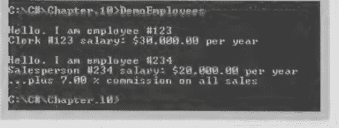

**图 10-5** DemoEmployees 程序的输出

继承只向一个方向工作：类继承自父类——反之亦然。如果程序在以下语句中实例化了一个 `Employee` 对象，那么 `Employee` 对象无法访问 `CommissionEmployee` 的属性或方法。

```csharp
Employee clerk = new Employee();
clerk.CommissionRate = 0.1;
```

`Employee` 是父类，`clerk` 是父类的对象。`Employee` 对象无法访问 `CommissionEmployee` 的属性或方法。当你创建父类时，你不知道会创建多少个类，或者它们的数据或方法会是什么样。此外，子类是具体的。`HeartSurgeon` 类和 `Obstetrician` 类是 `Doctor` 类。你不期望通用 `Doctor` 类拥有 `HeartSurgeon` 的 `RepairValve()` 方法或 `Obstetrician` 的 `DeliverBaby()` 方法。然而，通用 `Doctor` 类拥有 `CheckBloodPressure()` 和 `AdmitPatients()`。正如医生一样，方便认为派生类的字段和方法比基类更具体。

> **不要这样做**
>
> 该语句是无效的——`Employee` 对象没有 `CommissionRate`。


观看视频：继承。

### 两个真相一个谎言：扩展类

1. 当你使用继承创建一个类时，以下类头表示 `Dog` 是 `Pet` 的子类：`public class Pet : Dog`
2. 如果 `X` 有四个字段且类 `Y` 派自 `X`，那么类 `Y` 也包含至少四个字段。
3. 继承只向一个方向工作：子类继承自父类——反之亦然。

错误的陈述是 #1。以下类头表示 `Dog` 是 `Pet` 的子类：

```csharp
public class Dog : Pet
```

## 你要做

在本节中，我们将创建一个继承的运行示例。分四个部分创建此示例：

- 创建通用的 `Loan` 类，存储与银行贷款相关的数据——贷款号、姓名和借款金额。
- 在创建通用的 `Loan` 类后，编写一个程序来实例化并使用 `Loan` 对象。
- 创建一个更具体的 `CarLoan` 派生类，它继承 `Loan` 类的属性，并添加有关贷款抵押的汽车信息。
- 修改 `Loan` 演示程序以添加 `CarLoan` 对象并演示其用法。

### 创建 Loan 类和使用它的类的程序

1. 打开一个名为 `DemoLoan` 的新项目，然后输入 `Loan` 类的几行代码。该类包含三个自动实现的属性，分别用于贷款号、客户姓氏和贷款价值。

```csharp
class Loan
{
    public int LoanNumber { get; set; }
    public string LastName { get; set; }
    public double LoanAmount { get; set; }
}
```

2. 在文件顶部，输入以下代码以添加一个包含 `Main()` 方法的 `DemoLoan` 类。该类声明了一个 `Loan` 对象并显示了如何设置每个字段以及显示结果。

```csharp
using static System.Console;
class DemoLoan
{
    static void Main()
    {
        Loan aLoan = new Loan();
        aLoan.LoanNumber = 2239;
        aLoan.LastName = "Mitchell";
        aLoan.LoanAmount = 1000.00;
        WriteLine("Loan #{0} for {1} is for {2}", aLoan.LoanNumber, aLoan.LastName, aLoan.LoanAmount.ToString("C2"));
    }
}
```

3. 保存文件，然后编译并执行程序。输出结果如图 10-6 所示。该类或其运行方式并没有特殊之处；它与你在学习继承之前在上一章中看到的许多类相似。

```
C:\Chapter.10>DemoLoan
Loan #2239 for Mitchell is for $1000.00
C:\Chapter.10>
```

**图 10-6** DemoLoan 程序的输出

### 扩展一个类

接下来，你创建一个名为 `CarLoan` 的类。`CarLoan` “是一种” 类型的 `Loan`。因此，它拥有 `Loan` 的所有属性，但同时也包含了客户用作贷款押品的车辆的年份和品牌。因此，`CarLoan` 是 `Loan` 的子类。

1. 将 `DemoLoan` 文件保存为 `DemoCarLoan`。将 `DemoLoan` 的名称更改为 `DemoCarLoan`。在 `Loan` 类的大括号之后开始定义 `CarLoan` 类。`CarLoan` 继承自 `Loan`，并包含两个持有车辆年份和品牌的属性。

```csharp
class CarLoan : Loan
{
    public int Year { get; set; }
    public string Make { get; set; }
}
```

2. 在 `DemoCarLoan` 类的 `Main()` 方法中，按照如下方式在 `Loan` 的声明之后声明 `CarLoan`：

```csharp
CarLoan aLoan = new CarLoan();
```


- 3. 在对 `Loan` 对象进行三个属性赋值后，为 `CarLoan` 对象插入五条赋值语句。

```csharp
CarLoan.LoanNumber = 3358;
CarLoan.LastName = "Jansen";
CarLoan.LoanAmount = 20000.00;
aCarLoan.Make = "Ford";
CarLoan.Year = 2005;
```

- 4. 在显示 `Loan` 对象数据的 `WriteLine()` 语句之后，插入两个显示 `CarLoan` 对象数据的 `WriteLine()` 语句。

```csharp
WriteLine("Loan {0} is for {1}",
carLoan.LoanNumber,carLoan.LastName,
carLoan.LoanAmount.ToString("C2"));
WriteLine("#0} is for {1} {2}",
carLoan.LoanNumber,carLoan.Year,
carLoan.Make);
```

- 5. 保存程序并执行它。输出结果如图 10-7 所示。`CarLoan` 对象正确地使用了它自己的字段和属性，以及父类的属性。

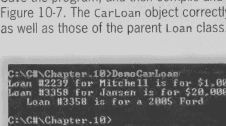

**图 10-7** DemoCarLoan 程序的输出

# protected 访问修饰符

10-1 中的 `Employee` 类是一个典型的 C# 类，其数据字段是私有的（`private`），属性和方法是公共的（`public`）。在“使用类和对象”章节中，你学习了这种方案提供了信息隐藏——保护你的私有数据不受数据所在类之外方法的篡改。当一个程序是 `Employee` 类的客户端（即一个 `Employee` 对象）时，客户端无法直接更改任何私有字段中的数据。例如，当你编写一个创建一个名为 `clerk` 的 `Employee` 的 `Main()` 方法时，你不能将 `Employee` 的 `idNum` 修改为 2222；相反，必须使用公共 `IDNum` 属性来设置 `clerk` 对象的 `idNum` 字段。

当你使用信息隐藏时，可以确保数据只会通过你选择的属性和方法被更改，且仅以你所控制的方式进行。如果外部类可以更改 `Employee` 的私有字段，那么这些字段可能会被赋予 `Employee` 类无法控制的值。在这种情况下，信息隐藏原则将被破坏，导致行为不可预测。

# 使用 protected 访问修饰符

任何派生类（如 `CommissionEmployee`）都继承了基类的数据和方法。然而，尽管 `Employee` 拥有 `idNum` 和 `salary` 字段，但 `CommissionEmployee` 方法无法直接访问它们。

在某些情况下，你需要从子类访问父类数据。例如，假设 `Salary` 属性访问器被编写为当 `salary` 小于 15000 时如下：

```csharp
set{
  double MINIMUM = 15000;
  if(value < MINIMUM)
    salary = MINIMUM;
  else
    salary = value;
}
```

同时也假设 `CommissionEmployee` 只提取佣金而非工资；也就是说，当你设置 `CommissionEmployee` 的 `commissionRate` 时，`salary` 应该变为 0。你会这样编写 `CommissionEmployee` 类 `CommissionRate` 属性访问器：

```csharp
set{
  commissionRate = value;
  salary = 0;
}
```

使用这种实现，当你创建一个 `CommissionEmployee` 对象并设置其 `commissionRate` 时，0 被发送到 `Employee` 类 `salary` 属性的访问器。因为 `salary` 的值小于 15000，所以在 `Employee` 类访问器中，它被强制设置为 15000，尽管你希望它是 0。

一种可能的替代方案是在 `CommissionEmployee` 类中使用 `salary` 字段重写 `CommissionRate` 属性的访问器。然而，如果你将 `salary` 声明为 `private`，你将收到错误：由于保护级别无法访问 `salary`。


# 第 10 章 继承简介

总结一下：

- 在父类中使用公共访问器由于最小值要求而不可行。
- 使用私有字段由于无法访问而不可行。
- 将父字段设为公共可行，但这样做会违反信息隐藏原则。

幸运的是，还有第四种选择。解决方案是使用保护访问创建 `salary` 字段，这在公共和私有之间为你提供了中间安全级别。受保护的数据字段或方法可以在其类内部或任何扩展自它的类中使用，但它不能被“外部”类使用。

> 有些来源称 `private`、`public` 和 `protected` 是访问修饰符，而其他类标记（如 `static`）是访问修饰符。然而，创建 C# 的微软开发者在他们的文档中交替使用这些术语。

# 第 10 章 继承介绍

```csharp
using static System.Console;
class DemoSalesperson
{
    static void Main()
    {
        Employee salesperson = new CommissionEmployee();
        salesperson.IdNum = 345;
        salesperson.Salary = 20000;
        salesperson.CommissionRate = 0.07;
        WriteLine("Salesperson {0} makes {1} per year",
            salesperson.IdNum, salesperson.Salary.ToString("C"));
        WriteLine("...plus {0} commission on all sales",
            salesperson.CommissionRate.ToString("P"));
    }
}
```

10-9 DemoSalesperson 程序

```
C:\Chapter.10>DemoSalesperson
salesperson #345 makes $20,000 per year
...plus 7.00% commission on all sales
```

10-10 DemoSalesperson 程序的输出

如果你在 `DemoSalesperson` 程序中先设置销售员的 `CommissionRate`，然后将 `Salary` 设为非零值，则 `salary` 不会被减为 0。如果你的意图是始终创建工资为 0 的 `CommissionEmployees` 对象，则应该在派生类中重写 `Salary` 属性。

字段的 `protected` 访问修饰符非常方便，它通过直接使用字段而不是“通过”属性访问器来提高程序性能。此外，有时使用 `protected` 访问修饰符是必要的。然而，应该节制使用 `protected` 数据成员。只要可能，就应该遵守信息隐藏原则，即使是子类也必须通过访问器来“获取”其父类的私有数据。当允许子类直接访问父类的字段时，未来发生错误的概率就会增加。依赖于父类字段名的类被称为“脆弱的”（fragile），因为它们容易产生错误——也就是说，它们很容易被“破坏”。

# 重写基类成员

## 两个真理和一个谎言：使用 protected 访问修饰符

- 1. 子类不包含其父类的私有成员。
- 2. 子类不能使用其父类的私有成员。
- 3. 子类可以使用父类的保护成员，但外部类不能使用。

> 错误的陈述是 #1。子类包含父类的私有成员，但不能直接使用它们。

# 重写基类成员

当你通过扩展现有类来创建派生类时，新的派生类包含了在原始基类中定义的属性和方法。有时，父类的特性并不完全适用于子类对象。使用相同的方法名或属性名来表示不同的实现被称为**多态**（polymorphism）。“多态”一词的意思是“许多形式”——在编程中，它意味着即使你使用相同的方法名，也会发生许多形式的操作。具体执行的方法取决于该对象。

你首次在第 1 章中学习过多态这个术语。

日常案例提供了许多多态的例子：

- 尽管两者都是乐器并且都有 `Play()` 方法，但吉他的弹法与鼓不同。
- 尽管两者都是车辆并且都有 `Operate()` 方法，但自行车的操作方式与卡车不同。
- 尽管两者都是学校并且都有 `SatisfyGraduationRequirements()` 方法，但幼儿园的要求与大学的要求不同。

你根据方法被使用的上下文来理解这些每种方法。同样，C# 根据关联到该方法的对象类型来理解你对相同方法名的使用。

例如，假设你已经如图 10-11 所示创建了一个 `Student` 类。学生有姓名、所修学分以及学费金额。你可以通过使用 `Name` 和 `Credits` 属性中的 `set` 访问器设置学生的姓名和学分，但你不能直接设置学生的学费，因为 `Tuition` 属性没有 `set` 访问器。相反，学费是根据学生修的每个学分的标准 `RATE`（55.75 美元）计算的。

```csharp
class Student
{
    private string name;
    private int credits;
    protected double tuition;
    private const double RATE = 55.75;

    public string Name
    {
        get { return name; }
        set { name = value; }
    }

    public int Credits
    {
        get { return credits; }
        set { credits = value; }
    }

    public double Tuition
    {
        get {
            tuition = credits * RATE;
            return tuition;
        }
    }
}
```

图 10-11 Student 类


# 第 10 章 继承介绍

```csharp
using static System.Console;
class DemoSalesperson
{
    static void Main()
    {
        Employee salesperson = new CommissionEmployee();
        salesperson.IdNum = 345;
        salesperson.Salary = 20000;
        salesperson.CommissionRate = 0.07;
        WriteLine("Salesperson {0} makes {1} per year",
            salesperson.IdNum, salesperson.Salary.ToString("C"));
        WriteLine("...plus {0} commission on all sales",
            salesperson.CommissionRate.ToString("P"));
    }
}
```

图 10-9 DemoSalesperson 程序

```
C:\Chapter.10>DemoSalesperson
salesperson #345 makes $20,000 per year
...plus 7.00% commission on all sales
```

图 10-10 DemoSalesperson 程序的输出

如果你在 `DemoSalesperson` 程序中先设置销售员的 `CommissionRate`，然后将 `Salary` 设为非零值，则 `salary` 不会被减为 0。如果你的意图是始终创建工资为 0 的 `CommissionEmployees` 对象，则应该在派生类中重写 `Salary` 属性。

字段的 `protected` 访问修饰符非常方便，它通过直接使用字段而不是“通过”属性访问器来提高程序性能。此外，有时使用 `protected` 访问修饰符是必要的。然而，应该节制使用 `protected` 数据成员。只要可能，就应该遵守信息隐藏原则，即使是子类也必须通过访问器来“获取”其父类的私有数据。当允许子类直接访问父类的字段时，未来发生错误的概率就会增加。依赖于父类字段名的类被称为“脆弱的”，因为它们容易产生错误——也就是说，它们很容易被“破坏”。

## 两个真理和一个谎言：使用保护访问修饰符

- 子类不包含其父类的私有成员。
- 子类不能使用其父类的私有成员。
- 子类可以使用父类的保护成员，但外部类不能使用。

> 错误的陈述是 #1。子类包含父类的私有成员，但不能直接使用它们。

## 重写基类成员

当你通过扩展现有类来创建派生类时，新的派生类包含了在原始基类中定义的属性和方法。有时，父类的特性并不完全适用于子类对象。使用相同的方法名或属性名来表示不同的实现被称为多态。“多态”一词的意思是“许多形式”——在编程中，它意味着即使你使用相同的方法名，也会发生许多形式的操作。具体执行的方法取决于该对象。

你首次在第 1 章中学习过多态这个术语。

日常案例提供了许多多态的例子：

- 尽管两者都是乐器并且都有 `Play()` 方法，但吉他的弹法与鼓不同。
- 尽管两者都是车辆并且都有 `Operate()` 方法，但自行车的操作方式与卡车不同。
- 尽管两者都是学校并且都有 `SatisfyGraduationRequirements()` 方法，但幼儿园的要求与大学的要求不同。

你根据方法被使用的上下文来理解这些每种方法。同样，C# 根据关联到该方法的对象类型来理解你对相同方法名的使用。

例如，假设你已经如图 10-11 所示创建了一个 `Student` 类。学生有姓名、所修学分以及学费金额。你可以通过使用 `Name` 和 `Credits` 属性中的 `set` 访问器设置学生的姓名和学分，但你不能直接设置学生的学费，因为 `Tuition` 属性没有 `set` 访问器。相反，学费是根据学生修的每个学分的标准 `RATE`（55.75 美元）计算的。

```csharp
class Student
{
    private string name;
    private int credits;
    protected double tuition;
    private const double RATE = 55.75;

    public string Name
    {
        get { return name; }
        set { name = value; }
    }

    public int Credits
    {
        get { return credits; }
        set { credits = value; }
    }

    public double Tuition
    {
        get {
            tuition = credits * RATE;
            return tuition;
        }
    }
}
```

图 10-11 Student 类

假设你想要创建一个 `CommissionEmployee` 类，它继承自 `Student` 并增加佣金率字段。`CommissionEmployee` 的学费计算方式不同：它在基础学费上增加了学分与佣金率的乘积。你可以使用 `override` 关键字重写 `Tuition` 属性。

```csharp
class CommissionEmployee : Student
{
    public int IdNum;
    protected double salary;
    protected double commissionRate;

    public double Salary
    {
        get { return salary; }
        set { salary = 0; } // Always be 0
    }

    public double CommissionRate
    {
        get { return commissionRate; }
        set { commissionRate = value; }
    }

    public override double Tuition
    {
        get {
            return base.Tuition + credits * commissionRate;
        }
    }
}
```

图 10-12 CommissionEmployee 类

在 `CommissionEmployee` 类中，`Tuition` 属性使用 `override` 修饰符重写了基类的实现。在 `get` 访问器中，通过 `base.Tuition` 调用基类的计算逻辑，并加上 `credits * commissionRate`。

## 重载与重写的区别

重载了基类方法。例如，如果基类包含一个头部为 `public void Display()` 的方法，而其子类包含一个头部为 `public void Display(string s)` 的方法，那么子类将可以访问这两个方法。（你已经在“高级概念”章节中学习过方法重载）

## 从派生类访问基类方法和属性

当派生类包含重写了父类方法或属性的方法或属性时，你可能需要在子类中使用父类版本。如果是这样，你可以使用关键字 `base` 来访问父类的方法或属性。


# 第 10 章 继承简介

例如，回想图 10-8 中 `Employee` 类中出现的 `GetGreeting()` 方法。如果它的子类 `CommissionEmployee` 也包含一个 `GetGreeting()` 方法（如图 10-15 所示），在 `CommissionEmployee` 类中，你可以调用 `base.GetGreeting()` 来访问方法的基类版本。图 10-16 显示了一个使用 `CommissionEmployee` 对象的应用程序。图 10-17 显示了输出。

```csharp
class CommissionEmployee : Employee
{
    private double commissionRate;
    public double CommissionRate
    {
        get
            return commissionRate;
    }
    set
    {
        commissionRate = value;
        salary = 0;
    }
    new public string GetGreeting()
    {
        string greeting = base.GetGreeting();
        greeting += "\n work on commission.";
        return greeting;
    }
}
```

**图 10-15** 带有 `GetGreeting()` 方法的 `CommissionEmployee` 类

```csharp
using System.Console;
class DemoSalesperson2
{
    static void Main()
    {
        CommissionEmployee salesperson = new CommissionEmployee();
        salesperson.IdNum = 345;
        WriteLine(salesperson.GetGreeting());
    }
}
```

**图 10-16** DemoSalesperson2 程序


**图 10-17** DemoSalesperson2 程序的输出

在图 10-15 中，子类的 `GetGreeting()` 方法在其头部使用了关键字 `new` 以消除编译器警告。然后，在方法内部调用了父类版本的 `GetGreeting()` 方法。返回的字符串存储在 `greeting` 变量中，在将完整消息返回给调用程序之前，为其添加了 " work on commission." 语句。通过在子类中重写基类方法，消除了创建消息第一部分的重复编码工作。此外，如果未来更改了消息的第一部分，它只需在一个处进行更改——即基类中。

- 观看视频 Handling Methods and Inheritance（处理方法与继承）。

## 两真一假

1. 当在子类中重写父类方法时，方法具有相同的名称。
2. 当在子类中重写父类方法时，方法具有相同的参数列表。
3. 当在子类中重写父类方法并使用子类方法时，父类方法首先执行，然后是子类方法。

此错误的陈述是 #3：当在子类中重写父类方法并使用子类方法时，执行的是父类方法而不是父类版本。

## 重写基类成员（续）

### 你来做

在之前的章节中，你创建了 `Loan` 和 `CarLoan` 类及对象。假设银行采取了以下新规则：

- 不发放金额小于 $5000 的普通贷款。
- 不对任何车型早于 2006 年的汽车发放汽车贷款。
- 虽然 `Loan` 可能有较大的贷款编号，但 `CarLoan` 的贷款编号将不超过三位数。如果提供了较大的贷款编号，程序将仅使用最后三位作为贷款编号。

#### 在派生类中使用基类成员

1. 打开 `DemoCarLoan` 文件，并立即将其另存为 `DemoCarLoan2`。同时将类名从 `DemoCarLoan` 改为 `DemoCarLoan2`。
2. 在 `Loan` 类中，添加一个代表最小贷款值的常量：
   `public const double MINIMUM_LOAN = 5000;`
3. 为 `LoanAmount` 添加一个字段，因为之前是自动实现属性的 `LoanAmount` 属性现在需要使用它：
   `protected double loanAmount;`
   该字段被设为保护，以便 `CarLoan` 对象能够像 `Loan` 对象一样访问它。
4. 将 `Loan` 类中 `LoanAmount` 的自动实现属性替换为如下的 `get` 和 `set` 访问器。此更改确保任何贷款都不会低于最低允许值。

```csharp
public double LoanAmount
{
    set
    {
        if(value < MINIMUM_LOAN)
            loanAmount = MINIMUM_LOAN;
        else
            loanAmount = value;
    }
    get
    {
        return loanAmount;
    }
}
```

5. 在 `CarLoan` 类中，添加两个新常量来保存发放汽车贷款的最早年份和最低贷款编号：

```csharp
private const int EARLIEST_YEAR = 2006;
private const int LOWEST_INVALID_NUM = 1000;
```

6. 同样在 `CarLoan` 类中，添加一个年份字段，并将自动实现属性替换为包含 `get` 和 `set` 访问器的属性。当年份小于最早年份时，会将 `loanAmount` 设置为 0。

```csharp
private int year;
public int Year
{
    set
    {
        if(value < EARLIEST_YEAR)
            loanAmount = 0;
        else
            year = value;
    }
    get
    {
        return year;
    }
}
```

如果 `LoanAmount` 在基类中是私有的，你将无法在子类中设置它，但在这里你可以做到。

7. 假设发放贷款有独特的规则。在 `CarLoan` 类最后的合大括号之前，修改 `LoanNumber` 属性以适应新规则。如果不是，将其传递给基类。

```csharp
public int LoanNumber
{
    get
    {
        return base.LoanNumber;
    }
    set
    {
        if(value < LOWEST_INVALID_NUM)
            base.LoanNumber = value;
        else
            base.LoanNumber = value % LOWEST_INVALID_NUM;
    }
}
```

8. 保存文件。编译它并修正任何错误。执行程序时，输出结果如图 10-18 所示。将输出与图 10-7 进行比较。注意 $1000 的银行贷款已被强制更改为 $5000。还要注意汽车编号已缩短为三位数，由于汽车的原因，贷款金额为 $0。

```
C:\Chapter_10>DemoCarLoan2
Loan #2239 for Mitchell is $5,800.00
Loan #358 for Jansen is for $0.00
Loan #358 is for a 2005 Ford
:\Chapter_10>
```

**图 10-18** DemoCarLoan2 程序的输出

9. 将 `DemoCarLoan` 类中分配的值更改为早期和后期年份以及有效和无效贷款编号的组合。每次更改后，保存程序、编译并执行它，确认程序按预期运行。

## 隐式引用转换

每个派生对象都是派生类和基类的“一个”特定实例。换句话说，你已经学习过 C# 在将一种数据类型转换为类型时也会进行隐式转换。例如，在语句 `double money = 10;` 中，整数值 10 被隐式转换为双。当派生类对象被赋值给其祖先类型时，这种转换可以更具体地称为隐式引用转换。这个术语更准确，因为它强调了数值转换和引用对象之间的区别。当你将派生类对象分配给基类类型时，该对象被处理为仅具有基类中定义的特征，而不具有子类定义中添加的特征。

例如，当 `CommissionEmployee` 类继承自 `Employee` 时，可以将这两种类型的任一对象传递给接受 `Employee` 参数的方法。在图 10-19 中，在第一条语句中将一个 `Employee` 传递给了 `DisplayGreeting()`，在第二条语句中则传递了一个 `CommissionEmployee`。它们在方法内部都被引用为 `emp`，并且如图 10-20 所示，每个对象的使用都是正确的。

```csharp
using static System.Console;
class DemoSalesperson3
{
    static void Main()
    {
        Employee clerk = new Employee();
        CommissionEmployee salesperson = new CommissionEmployee();
        clerk.IdNum = 234;
        salesperson.IdNum = 345;
        DisplayGreeting(clerk);
        DisplayGreeting(salesperson);
    }
    public static void DisplayGreeting(Employee emp)
    {
        WriteLine("Hi there from #" + emp.IdNum);
        WriteLine(emp.GetGreeting());
    }
}
```

**图 10-19** DemoSalesperson3 程序

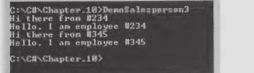

**图 10-20** DemoSalesperson3 的输出

## 两真理一谎言

### 理解隐式引用转换

1. 你可以将派生类对象赋值给其任一超类类型型的对象。
2. 你可以将基类对象赋值给其任一派生类类型型的对象。
3. 从一种类型到另一种类型的隐式转换是自动转换。

错误的陈述是 #2。你可以将派生类对象赋值给其子类类型的对象，但反之则不行。

## 使用 Object 类

你在 C# 中创建的每个类都继承自一个名为 `System.Object` 的类。换句话说，`System` 命名空间中的对象（或 `Object`）类类型是所有其他类型的终极基类，或根类。当你创建一个如 `Employee` 类的类时，你通常使用头类 `Employee`，它隐式地或自动地继承自 `Object` 类。或者，你可以使用头类 `Employee : Object` 来显式显示基类的名称，但在 C# 程序中看到这种格式是非常不寻常。

关键字 `object` 是 `System.Object` 类的别名。你可以交替使用该类的小写和大写版本。`object` 是 `System.Object` 的别名这一事实你不应该惊讶。例如，你已经知道 `int` 是 `Int32` 的别名，`double` 是 `Double` 的别名。

由于每个类都继承自 `Object`，因此每个“object”都是“Object”。作为证明，你可以编写一个接受 `Object` 参数的方法，它将接受任何类型的参数。图 10-21 显示了一个使用在本章之前创建的类声明的三个对象的程序——`Student`、`ScholarshipStudent` 和 `Employee`。尽管这些类型具有不同的属性和方法（其中一种类型 `Employee` 与另外两个类型没有共同点），但每个类型都可以作为 `DisplayObjectMessage()` 的参数，因为每个类型都是一个“object”。图 10-22 显示了程序的执行情况。

```csharp
using System;
using static System.Console;
class DiverseObjects
{
    static void Main()
    {
        Student payingStudent = new Student();
        ScholarshipStudent freeStudent = new ScholarshipStudent();
        Employee clerk = new Employee();
        Write("Using Student: ");
        DisplayObjectMessage(payingStudent);
        Write("Using ScholarshipStudent: ");
        DisplayObjectMessage(freeStudent);
        Write("Using Employee: ");
        DisplayObjectMessage(clerk);
    }

    public static void DisplayObjectMessage(Object o)
    {
        WriteLine("Method successfully called");
    }
}
```

**图 10-21** DiverseObjects 程序

```
C:\CH\Chapter.10>DiverseObjects
Using Student: Method successfully called
Using ScholarshipStudent: Method successfully called
Using Employee: Method successfully called
C:\CH\Chapter.10>
```

**图 10-22** DiverseObjects 程序的输出

当你创建任何类时，它都继承了其所有祖先类的所有方法。由于所有类都继承自 `Object` 类，因此所有类都继承了 `Object` 类的方法。`Object` 类包含一个构造函数、一个析构函数和四个公共实例方法，如表 10-1 所示。

| 方法 | 解释 |
|---|---|
| `Equals()` | 确定两个 Object 实例是否相等 |
| `GetHashCode()` | 获取每个对象的唯一代码；在某些排序和数据管理任务中很有用 |
| `GetType()` | 返回对象的类型或类 |
| `ToString()` | 返回一个表示对象的字符串 |

**表 10-1** Object 类的四个公共实例方法

`Object` 类除了表 10-1 中列出的四个方法外，还包含其他非虚构和非实例（静态）方法。C# 文档提供了关于这些方法的更多详细信息。

### Object 类的 GetType() 方法

`GetType()` 方法返回对象的类型或类。例如，如果你创建了一个名为 `someWorker` 的 `Employee` 对象，下面的语句将显示 `Employee`：

`WriteLine(someWorker.GetType());`

如果对象定义在命名空间中，那么 `GetType()` 返回类名。

### Object 类的 ToString() 方法

`Object` 类方法目前并不非常有用。例如，当你对对象使用 `ToString()` 方法时，它仅返回类名。也就是说，如果 `someWorker` 是一个 `Employee`，那么下面的语句将显示 `Employee`：

`WriteLine(someWorker.ToString());`

当你创建一个类时，你通常想重写 `ToString()` 方法以提供有用信息。例如，你可能会如图 10-23 所示创建一个 `Employee` 类的 `ToString()` 方法。该方法假设 `IdNum` 和 `Name` 是带有访问器的属性。返回的字符串将具有如 `Employee: 234` 的值。

```csharp
public override string ToString()
{
    return GetType() + ": " + IdNum + ": " + Name;
}
```

**图 10-23** Employee 类的 ToString() 方法

自第 2 章以来，你一直在使用 `ToString()` 方法的重载版本。在那里，你学了在向 `ToString` 方法传递如 "F3" 或 "C2" 的字符串时，可以格式化数值输出。

`Equals()` 方法比较对象的引用相等性。当两个引用类型对象引用同一个对象时，就会发生引用相等。如果两个 `Object` 引用相同的地址，`Equals()` 方法返回 `true`——也就是说，如果一个对象是另一个对象的引用且两者都是同一个对象。例如，你可能会写：

```csharp
if(oneObject.Equals(anotherObject))
```

和 `ToString()` 方法一样，该方法以原始形式可能对你没有用。例如，如果两个不同内存地址的 `Employee` 对象的 ID 编号或姓名相同，你可能倾向于认为它们是相等的。如果你预判类客户端将根据任何值来比较对象，你可能希望为你创建的任何类重写 `Equals()` 方法。

如果你重载了 `Equals()` 方法，它应该符合以下约定：

- 它的头部如下（你可以使用任何标识符作为 Object 参数）：
  `public override bool Equals(Object o)`
- 如果参数为 `null`，则返回 `false`。


- 如果对象与自身比较，则返回 `true`。

- 只有当以下两个条件都真时，才返回 `true`：

```
oneObject.Equals(anotherObject)
anotherObject.Equals(oneObject)
```

你在第 2 章中首次使用 `Equals()` 方法比较 `String` 对象。当你对 `String` 使用 `Equals()` 时，你使用的是 `String` 类的 `Equals()` 方法，它比较的是字符串内容而非字符串地址，换句话说，`Object` 类的 `Equals()` 方法在 `String` 类中已经被重写了。

# 第 10 章 继承简介

当你创建一个 `Equals()` 方法来重写 `Object` 类中的方法时，参数必须是一个 `Object`。例如，如果你认为两个 `Employee` 对象的 `IdNum` 属性相等时它们就相等，那么可以如下创建 `Employee` 类的 `Equals()` 方法：

```
public override bool Equals(Object e)
{
    bool isEqual;
    Employee temp = (Employee)e;
    if(IdNum == temp.IdNum)
        isEqual = true;
    else
        isEqual = false;
    return isEqual;
}
```

在方法中的阴影语句中，`Object` 参数被强制转换为 `Employee`，这样就可以比较 `Employee` 的 `IdNum`。如果你不进行强制转换并直接尝试，该方法将无法编译，因为 `Object` 没有 `IdNum` 属性。

更好的替代方案是在做出任何决定之前，确保所比较的对象是相同的类型。例如，图 10-24 中的 `Equals()` 方法在继续执行之前对此对象和参数都使用了 `GetType()` 方法。如果比较的对象不是相同类型，则 `Equals()` 方法应该返回 `false`。

```
public override bool Equals(Object e)
{
    bool isEqual = true;
    if(this.GetType() != e.GetType())
        isEqual = false;
    else{
        Employee temp = (Employee)e;
        if(IdNum == temp.IdNum)
            isEqual = true;
        else
            isEqual = false;
    }
    return isEqual;
}
```

图 10-24 用于 Employee 类的 Equals() 方法

## 使用 Object 类的 GetHashCode() 方法

当你重写 `Equals()` 方法时，也应该重写 `GetHashCode()` 方法，因为 `Equals()` 使用 `GetHashCode()`，并且两个认为相等的对象应该具有相同的哈希码。哈希码用于标识对象的数字；你可能在某些高级 C# 应用中使用哈希码。例如，图 10-25 显示了一个应用程序，它从一个类声明了两个 `Employees`，该类没有重写 `GetHashCode()` 方法。图 10-26 中的输出显示每个对象都有唯一的数字。（然而，这个数字对你来说没有意义。）如果你选择重写 `GetHashCode()` 方法，你应该编写此方法，使其为每个对象返回一个唯一的整数——例如 `Employee` ID 编号，如下：

> 哈希码有时被称为对象的“指纹”，因为它唯一地标识该对象。在 C# 中，`GetHashCode()` 方法的默认实现不保证为不同对象返回唯一的值。然而，如果在派生类中显式实现 `GetHashCode()`，则它必须返回一个唯一的哈希码。

在烹饪中，hash 是一种组合原料制成的菜肴。hash code（哈希码）一词源于代码有时是通过混合对象的某些数据创建的。

```
using static System.Console;
class TestHashCode
{
    static void Main()
    {
        Employee first = new Employee();
        Employee second = new Employee();
        WriteLine(first.GetHashCode());
        WriteLine(second.GetHashCode());
    }
}
```

图 10-25 TestHashCode 程序

```
C:\Code\Chapter.10>TestHashCode
46104728
12289376

C:\Code\Chapter.10>
```

图 10-26 TestHashCode 程序的输出

虽然你可以为没有重写 `GetHashCode()` 的类编写 `Equals()` 方法，但你会收到警告消息。此外，如果你为类重载了 `==` 或 `!=`，如果你没有同时重写 `Equals()` 和 `GetHashCode()` 方法，将收到警告消息。

## 两个真相和一个谎言

### 使用 Object 类

1. `Object` 类包含一个名为 `GetType()` 的方法，它返回对象的类型或类。

2. 如果你没有为类重写 `ToString()` 方法，它将返回类中声明的第一个字符串（如果有的话）。

3. `Object` 类的 `Equals()` 方法在两个 `Object` 具有相同内存地址时返回 `true`——也就是说，如果一个对象是另一个对象的引用，且两者在字面上是同一个对象。

## 使用基类构造函数

当你创建一个对象时，你会调用一个与类本身同名的构造函数。考虑以下示例：

```
SomeClass anObject = new SomeClass();
```

当你实例化一个派生类的成员对象时，基类的构造函数首先执行，然后执行派生类。然而，换句话说，当你创建任何对象时，你隐式地调用了 `Object` 构造函数，因为所有类都派自 `Object`。所以，当你创建一个基类和一个派生类并实例化派生类时，你调用了三个构造函数：一个来自 `Object` 类，一个来自基类，一个来自派生类。

在本章到目前为止你看到的继承示例中，每个类都包含默认构造函数，它们的执行是透明的。然而，你应该意识到，当你创建一个子类实例时，基类和派生类的构造函数都会执行。例如，图 10-27 中简化的 `Employee` 和 `CommissionEmployee` 类。`Employee` 包含两个字段和一个构造函数；`CommissionEmployee` 继承自 `Employee` 并也包含一个构造函数。图 10-28 中的 `DemoSalesperson4` 程序只包含一条语句；它实例化了一个 `CommissionEmployee`。图 10-29 中的输出显示这一语句导致了两个构造函数的执行。

```
class Employee
{
    private int idNum;
    protected double salary;
    public Employee()
    {
        WriteLine("Employee");
    }
}
class CommissionEmployee : Employee
{
    private double commissionRate;
    public CommissionEmployee()
    {
        WriteLine("CommissionEmployee");
    }
}
```

图 10-27 带有无参数构造函数的 Employee 和 CommissionEmployee

```
using static System.Console;
class DemoSalesperson4
{
    static void Main()
    {
        CommissionEmployee salesperson = new CommissionEmployee();
    }
}
```

图 10-28 DemoSalesperson4 程序

```
C:\Code\Chapter.10>DemoSalesperson4
Employee
CommissionEmployee
C:\Code\Chapter.10>
```

图 10-29 DemoSalesperson4 的输出

当然，大多数构造函数执行的任务比显示消息要多得多。当构造函数初始化变量时，你通常希望基类初始化源自基类的数据字段。派生类只需要初始化特定于派生类的字段。

## 使用需要参数的基构造函数

当你创建一个类且不提供构造函数时，C# 会自动提供一个**无参数**的构造函数。当你为类编写自己的构造函数时，你会替换自动提供的版本。根据你的需要，你为类创建的构造函数可能需要参数。当你使用基类且该类只有需要参数的构造函数时，你必须确保派生类提供参数以便基类构造函数执行。

当所有基类构造函数都需要参数时，你必须为每个派生类包含一个构造函数。派生类构造函数可以包含任意数量的语句；但在构造函数的头部，你必须为基类所需的任何参数提供值。即使你没有创建派生类构造函数的理由，你也必须编写该构造函数以调用父类的构造函数。

调用基类构造函数的派生类构造函数头部包含冒号、关键字 `base` 以及括号内的参数列表。`base` 关键字始终指向使用它的父类。虽然似乎可以使用基类构造函数的名称来调用基类构造函数，但 C# 不允许这样做——你需要使用 `base` 关键字。

例如，如果你创建一个需要两个参数（一个整数和一个字符串）构造函数的 `Employee` 类，并创建一个继承自 `Employee` 的子类 `CommissionEmployee`，以下代码显示了 `CommissionEmployee` 的有效构造函数：

```
public CommissionEmployee() : base(1234, "XXXX")
{
    // 其他语句可以放在这里
}
```

在这个示例中，`CommissionEmployee` 构造函数为了自身的执行**不需要**参数，但它向基类构造函数传递了两个参数。实例化 `CommissionEmployee` 将 1234 和 "XXXX" 传递给 `Employee` 构造函数。不同的 `CommissionEmployee` 构造函数可能会接受参数；它可以将相应的参数传递给基类构造函数，如下：

```
public CommissionEmployee(int id, string name) : base(id, name)
{
    // 其他语句可以放在这里
}
```

另一个 `CommissionEmployee` 构造函数可能要求某些参数传递给基类构造函数，而某些参数在 `CommissionEmployee` 内部使用。考虑以下示例：

```
public CommissionEmployee(int id, string name, double rate) :
    base(id, name) // 两个参数传递给基构造函数
{
    CommissionRate = rate;
    // rate is used within child constructor
    // Other statements can go here
}
```

观看视频：构造函数与继承。

### 两真一假

#### 使用基类构造函数

1. 当你创建任何派生类对象时，基类构造函数首先执行，然后执行派生类构造函数。

2. 当基类构造函数需要参数时，你必须为你创建的每个派生类包含构造函数。

3. 当派生类的构造函数需要参数时，所有参数都必须传递给基类构造函数。

错误的语句是 #3。当派生类的构造函数需要参数时，某些参数传递给基类构造函数，而另一些由派生类构造函数使用。也可能某些在派生类中使用，或者可能全部传递给基类构造函数。

## 你来操作

### 在基类和派生类中添加构造函数

当基类仅包含需要参数的构造函数时，任何派生类必须为基类构造函数提供支持。在接下来的步骤中，你为 `Loan` 和 `CarLoan` 类添加构造函数，并证明它们按预期工作。

1. 打开 `DemoCarLoan2` 程序，将类名更改为 `DemoCarLoan3`。将文件保存为 `DemoCarLoan3`。

2. 在 `Loan` 类中，在 `year` 字段声明之后，添加一个接受五个参数的构造函数。它将三个参数传递给基类构造函数，并使用另外两个为子类特有的属性赋值。

```csharp
public CarLoan(int num, string name, double amount, int year, string make) : base(num, name, amount)
{
    Year = year;
    Make = make;
}
```

3. 删除为 `Loan` 和 `CarLoan` 赋值的八条语句，但保留显示值的 `WriteLine()` 语句。

4. 保存程序，然后编译并执行。输出结果如图 10-30 所示。构造函数都按预期工作。`CarLoan` 构造函数在执行自己的语句之前，已调用其父类的构造函数来设置必要的字段。

```
C:\CH\Chapter.10>DemoCarLoan3
Loan #333 for Hanson is for $7000.00
Loan #444 for Carlisle is for $30,000.00
Loan #444 is for a 2011 BMW

C:\CH\Chapter.10>
```

图 10-30 `DemoCarLoan3` 程序的输出

## 创建和使用抽象类

在理解继承的概念后，创建类可以变得更简单。当你创建一个子类时，它继承了你需要的所有通用属性；你必须创建子类所需的新的、更具体的属性。例如，画家（`Painter`）和雕塑家（`Sculptor`）比艺术家（`Artist`）更具体。它们继承了艺术家的所有通用属性，但你必须添加画家和雕塑家特有的属性和方法。

思考超类的另一种方法是注意到它包含了其子类共享的特征。派生类是基类类型更具体的示例；它们在共享的通用特征上添加了新功能。相反，当你检查一个派生类时，你会发现它的父类更具通用性。

有时你创建一个父类使其非常通用，以至于你从未打算创建它的任何特定实例。例如，你可能永远不会“仅仅”创建一个艺术家；每个艺术家都是更具体的画家、雕塑家、插画师等。用于实例化对象的类是具体类。你只创建为了进行扩展而不用于实例化的类是抽象类。抽象类是你无法从中创建具体对象的类，但你可以从其继承。当你声明一个抽象类时，使用 `abstract` 关键字。如果你尝试从抽象类实例化对象，将收到编译器错误消息。

抽象类类似于普通类，因为它们可以包含数据字段和方法。区别在于你不能通过 `new` 操作符创建抽象类的实例。相反，你创建一个抽象类是为了让其他类派生自它。抽象类通常包含抽象方法，它们也可以包含非抽象方法。回顾第 9 章，如果抽象类包含抽象方法，那么派生类必须重写该方法（实现）。

> 声明为 `virtual` 的方法在派生类中不需要被重写，但声明为 `abstract` 的方法在子类中必须被重写。

当你编写抽象方法时，不需要在抽象类中提供方法体：你需要在派生类中重写任何继承而来的抽象方法。为了抽象方法是为了在派生类中提供实现。

例如，假设你想创建类来表示不同的动物。你可以创建一个名为 `Animal` 的通用抽象类，以便只需提供通用数据字段，例如动物的名称。`Animal` 是通用的，但每个具体的动物如狗或猫都有独特的声音。如果你在抽象 `Animal` 类中编写了抽象 `Speak()` 方法，那么要求所有派生类重写 `Speak()` 方法。图 10-31 显示了一个抽象 `Animal` 类，它包含一个名称数据字段、一个赋值名称的构造函数以及一个抽象的 `Speak()` 方法。

```csharp
abstract class Animal {
    private string name;
    public Animal(string name)
    {
        this.name = name;
    }
    public string Name
    {
        get
        {
            return name;
        }
    }
    public abstract string Speak();
}
```

图 10-31 `Animal` 类

10-31 中的 `Animal` 类被声明为抽象。（关键字是共享。）你不能在程序中放置如 `Animal myPet = new Animal("Murphy")` 的语句，因为程序将无法编译。因为 `Animal` 是抽象类，所以不存在 `Animal` 对象。

你创建像 `Animal` 这样的抽象类是为了扩展它。例如，你可以像图 10-32 所示创建 `Dog` 和 `Cat` 类。由于 `Animal` 类包含一个需要字符串参数的构造函数，`Dog` 和 `Cat` 都必须包含为其基类提供参数的构造函数。

```csharp
class Dog : Animal {
    public Dog(string name) : base(name)
    {
    }
    public override string Speak() {
        return "woof";
    }
}
class Cat : Animal {
    public Cat(string name) : base(name)
    {
    }
    public override string Speak() {
        return "meow";
    }
}
```

图 10-32 `Dog` 和 `Cat` 类


```csharp
using static System.Console;
class DemoAnimals
{
    static void Main()
    {
        Dog spot = new Dog("Spot");
        Cat puff = new Cat("Puff");
        WriteLine(spot.Name + " says " + spot.Speak());
        WriteLine(puff.Name + " says " + puff.Speak());
    }
}
```

**Figure 10-33** DemoAnimals program

```
C:\CH\Chapter.10\DemoAnimals
Spot says woof
Puff says meow
C:\CO\Chapter.10>
```

**Figure 10-34** Output of the DemoAnimals program

Figure 10-35 shows an alternate way to create the DemoAnimals program. In this version the Dog and Cat objects are passed to a method that accepts an Animal parameter. The output is the same as in Figure 10-34. The `Name` property and `Speak()` method operate polymorphically, acting appropriately for each object type.

```csharp
using static System.Console;
class DemoAnimals2
{
    static void Main()
    {
        Dog spot = new Dog("Spot");
        Cat puff = new Cat("Puff");
        DisplayAnimal(spot);
        DisplayAnimal(puff);
    }
    public static void DisplayAnimal(Animal creature)
    {
        WriteLine(creature.Name + " says " + creature.Speak());
    }
}
```

**Figure 10-35** The DemoAnimals2 program

## 两个真理，一个谎言

### 创建和使用抽象类

- 1. 抽象类是无法创建具体对象的类。
- 2. 与普通类不同，抽象类不能包含方法。
- 3. 当基类包含抽象方法时，基类的后代必须重写该抽象方法，或将覆盖的方法声明为派生。

陈述是 #2。抽象类与普通类的区别在于，它们仅仅通过使用 `new` 运算符提供类的实例。区别在于，你不能创建数据字段和方法。

### 创建和使用接口

某些面向对象的编程语言（特别是 C++）允许子类继承自多个类。例如，你可能会创建一个 `Employee` 类，其中包含与组织中每位员工相关的数据字段。你可能还会创建一个 `Product` 类，持有你组织制造的每种产品的信息。当你为你公司持有专利的每个产品创建一个 `Patent` 类时，你可能想要包含产品信息，以及负责该发明的员工信息。在这种情况下，从 `Product` 和 `Employee` 类中继承字段和方法将非常方便。继承自多个类的能力被称为**多重继承**。

多重继承是一个困难的概念，程序员在使用它时会遇到很多问题。例如，父类中的变量和方法可能具有相同的名称，当子类使用其中一个名称时，就会产生冲突。此外，正如你已经学到的，子类的构造函数必须调用其父类的构造函数。当存在两个或多个父类时，这变成了一个更复杂的任务：当子类有多个父类时，应该引用哪个类？

由于这些原因，C# 禁止多重继承。然而，C# 确实提供了多重继承的替代方案，即**接口**。

# 第 10 章 继承简介

接口是方法（可能还有其他成员）的集合，只要该类提供了以重写接口抽象定义的定义，就可以被任何类使用。在抽象类中，某些方法可以是抽象的，而其他则不一定。在接口中，所有方法都必须是抽象。

你首次在“使用类和对象”章节中通过使用 `IComparable` 接口学习了接口。

你创建接口的方式与创建抽象类定义非常相似，只是你使用的是 `interface` 关键字而不是 `abstract class`。例如，假设你创建了一个如图 10-36 所示的 `IWorkable` 接口。为了简单起见，`IWorkable` 接口包含一个名为 `Work()` 的方法。

虽然不是强制要求的，但在 C# 中，接口名称通常以大字母 I 开头。其他语言遵循不同的约定。接口名称经常以 `able` 结尾。

```csharp
public interface IWorkable
{
    string Work();
}
```

**图 10-36** IWorkable 接口

当任何类实现 `IWorkable` 时，它必须包含一个返回字符串的 `Work()` 方法。图 10-37 显示了两个实现 `IWorkable` 的类：`Employee` 类和 `Animal` 类。因为每个类都实现了 `IWorkable`，所以每个类都必须声明一个 `Work()` 方法。`Employee` 类实现 `Work()` 以返回 "I do my job" 字符串。抽象类 `Animal` 将 `Work()` 定义为抽象方法，这意味着 `Animal` 的后代必须实现 `Work()`。图 10-37 还显示了 `Animal` 的两个子类：`Dog` 和 `Cat`。注意 `Work()` 在每个类中的定义是不同的。

```csharp
class Employee : IWorkable
{
    public Employee(string name)
    {
        Name = name;
    }
    public string Name {get; set;}
    public string Work()
    {
        return "I do my job";
    }
}
abstract class Animal : IWorkable
{
    public Animal(string name)
    {
        Name = name;
    }
    public string Name {get; set;}
    public abstract string Work();
}
class Dog : Animal
{
    public Dog(string name) : base(name)
    {
    }
    public override string Work()
    {
        return "I bark";
    }
}
class Cat : Animal
{
    public Cat(string name) : base(name)
    {
    }
    public override string Work()
    {
        return "I meow";
    }
}
```

（注：我根据图 10-33 和 10-34 的上下文重构了 Dog 和 Cat 缺失的逻辑使代码能够运行，因为 OCR 文本被截断了。）

**图 10-37** Employee, Animal 和 Dog 类

图 10-35 显示了创建 DemoAnimals 程序的另一种方式。在这个版本中，Dog 和 Cat 对象被传递给一个接收 Animal 参数的方法。输出与图 10-34 相同。`Name` 属性和 `Speak()` 方法以多态方式运行，对每个对象类型采取适当的操作。

# 第 10 章 继承简介

## 两个真相和一个谎言

## 创建和使用接口

- 1. 接口是方法（可能还有其他成员）的集合，只要该类提供了对接口抽象定义的重写，它就可以被任何类使用。
- 2. 抽象类和接口的区别在于，抽象类中的所有方法都是抽象的，但接口可以包含非抽象方法。
- 3. 一个类只能继承一个基类，但它可以实现任意数量的接口。


## 使用扩展方法

在编写 C# 程序时，有时你希望某个类有一个对你有用的额外方法。如果你创建了原始类，你有两个选择：

- 你可以修改现有类，包含新的实用方法。
- 你可以从现有类派生一个子类，并为它提供一个新方法。

然而，有时类是由别人创建的，你可能不被允许修改或扩展它们。当然，你可以创建一个包含你新方法的完全新类，但这将重复许多在创建第一个类时已经完成的工作。在这些情况下，最佳选择是编写扩展方法。你可以为任何类型编写**扩展方法**。扩展方法是在 C# 3.0 中引入的。

程序员有时会在类头中将类定义为密封的（sealed），例如 `sealed InventoryItem`。**密封类**不能被扩展。例如，内置的 `String` 类就是一个密封类。

例如，你在整本书中一直预编写的 `Int32` 类来声明整数。假设你在一家经常使用账户号码的公司工作，该公司决定为每个账户号码增加额外的数字。为了简单起见，假设所有账户号码都是两位，新的第三位数字应该是前两个数字之和的最右侧数字。你可以通过创建一个名为 `AccountNumber` 的类来处理这个问题，包含一个产生额外数字的方法，并将应用程序中每个客户账户的实例重新定义为 `AccountNumber` 对象。然而，如果你已经有很多将账户定义为整数的应用程序，你可能更喜欢创建一个扩展 `Int32` 的扩展方法。

在第 2 章中，你学过 C# 内置类型（如 `int`）是 `System` 命名空间中类的别名，例如 `Int32`。

当组织为账户号码增加额外数字时，这些额外数字被称为校验位（check digits）。校验位有助于确保账户号码和其他数字中的所有数字都输入正确。校验位使用不同的公式计算。如果用于计算校验位的数字错误，那么生成的校验位很可能也是错误的。

图中包含一个扩展 `Int32` 类的方法。扩展方法中的第一个参数指定要扩展的类型，并且必须以关键字 `this` 开头。例如，`AddCheckDigit()` 方法中的第一个（在此情况下也是唯一的）参数是 `this int num`，如图中阴影所示。在图 10-40 的 `AddCheckDigit()` 方法中，通过除以 10 并取结果整数从两位账户号码中提取第一位数字，通过取余数提取第二位数字。将这两个数字相加，并从方法返回该和的最后一位数字。例如，第一个变成 4，第二个变成 9，第三个变成 13 的最后一位，即 3。然后将原始数字 (49) 乘以 10 并加上第三位数字，得到 493。

```csharp
public static int AddCheckDigit(this int num)
{
    int first = num / 10;
    int second = num % 10;
    int third = (first + second) % 10;
    int result = num * 10 + third;
    return result;
}
```

**图 10-40** AddCheckDigit() 扩展方法

扩展方法必须是静态的，并且必须存储在静态类中。例如，图 10-41 中的 `DemoExtensionMethod` 程序显示了一个在类头阴影部分声明为静态并使用扩展方法的应用程序。静态方法 `AddCheckDigit()` 的用法就像它是 `Int32` 类的实例方法一样。

```csharp
using System;

static class DemoExtensionMethod
{
    static void Main()
    {
        int accountNum = 49;
        int resultNum = accountNum.AddCheckDigit();
        Console.WriteLine("Original number: {0}", accountNum);
        Console.WriteLine("Check digit: {0}", resultNum % 10);
        Console.WriteLine("Resulting number: {0}", resultNum);
    }
}
```

**图 10-41** 扩展方法的执行

# 识别 GUI 中的继承

- 创建或使用新派生类的程序员已经理解了基类是如何运作的，因此学习新类特征所需的时间减少了。
- 当你在 C# 中创建派生类时，基类的源代码不会被更改。因此，基类保持了它的完整性。
- 不打算实例化且仅包含静态成员的类被声明为静态类（static classes）。你不能扩展静态类。例如，`System.Console` 就是一个静态类。

当你考虑类时，你需要考虑它们之间的共性，然后就可以根据这些共性创建用于继承的基类。当你看到自己的超类被他人扩展时，你甚至可能会获得职业上的回报。

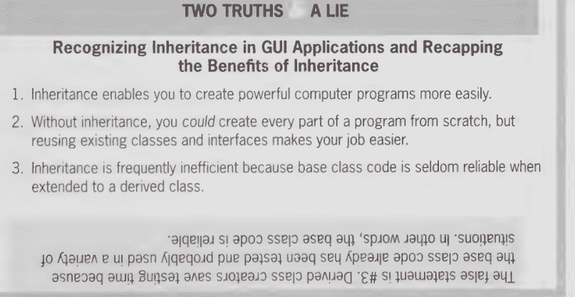

> 错误的语句是 #3。派生类的创建者节省了测试时间，因为基类代码已经过测试，并且可能在各种情况下被使用；换句话说，基类代码是可靠的。

## 章节总结

- 你在面向对象编程语言中创建的类可以从现有类继承数据和方法。使用继承的能力使得程序更容易编写、更容易理解，并且更不容易出错。作为继承基础的类被称为基类（base class）、超类（superclass）或父类（parent class）。当你创建一个继承自基类的类时，它被称为派生类（derived class）、扩展类（extended class）、子类（subclass）或子类（child class）。
- 当你创建一个另一个类的扩展或子类时，你在派生类名和它的基类名之间使用单个冒号。子类继承父类的所有方法、属性和字段。继承仅以单方向运行——从父类继承，反之则不然。
- 如果你可以在类外部访问私有数据，信息隐藏原则就会被破坏。然而，当你从派生类访问父类数据时，你使用 `protected` 关键字声明类字段，这在 `public` 和 `private` 访问之间为你提供了一个中间级别的安全保护。
- 当你声明一个与其父类内具有相同名称和参数的类方法时，你重写（override）了该类方法，并允许你的类对象表现出多态行为。当派生类重写了类成员但你想访问父类版本时，你可以使用 `base` 关键字。
- 每个派生类对象都是“是”（is a）该派生类和基类的特定实例。因此，你可以将派生类对象赋值给其任何一个基类类型的对象。当你这样做时，C# 允许从派生类到基类的隐式转换。
- 你在 C# 中创建的每个类都继承自一个名为 `Object` 的单类。由于所有类都继承自 Object 类，因此所有类都继承了四个类公共实例方法：`Equals()`、`GetHashCode()`、`GetType()` 和 `ToString()`。
- 当实例化一个子类的成员对象时，基类的构造函数首先执行，然后执行派生类的构造函数。
- 抽象类（abstract class）是你无法从中创建具体对象，但可以从其继承的类。通常，抽象类包含抽象方法；抽象方法没有方法体。任何继承自包含抽象方法的类必须通过为该抽象方法提供体（实现）来重写该抽象方法。
- 接口（interface）提供了多继承的替代方案。与抽象类一样，接口是方法（以及其他成员）的集合，只要类定义了要实现接口的抽象定义，任何类都可以使用它。在抽象类内部，某些方法可以是抽象的，而另一些则不需要。在接口内部，所有方法都是抽象的。一个类只能继承一个抽象类，但它可以实现任意数量的接口。
- 扩展方法（Extension methods）是你可以编写并添加到任何类型的方法。它们是静态方法，但它们的运行方式像实例方法。它们的参数列表以 `this` 关键字开头，并跟在被操作的数据类型之后。
- 扩展方法是你可以编写并添加到任何类型的方法。它们是静态方法，但它们的运行方式像实例方法。它们的参数列表以 `this` 关键字开头的。

## 核心术语

- 继承是将通用的知识应用到更具体的类上。
- 统一建模语言 (UML) 图表是图形化工具。
- 基类是作为基础的类。
- 抽象类是你无法从中创建具体对象的类。
- 子类是派生类。
- 派生类或扩展类是子类。
- 超类是父类。
- 父类是基类。
- 子类是派生类。
- `protected` 访问在 `public` 和 `private` 之间提供中间级别的安全保护。
- `base` 关键字用于访问父类版本。
- `override` 关键字用于重写方法。
- 多态性允许类对象表现出不同行为的能力。
- 隐式转换是从派生类到基类的转换。
- 构造函数的执行顺序是基类先执行，派生类后执行。
- 抽象方法没有方法体。
- 接口是方法（以及其他成员）的集合。
- 扩展方法是静态方法，但运行方式像实例方法。
- 静态类不能被扩展。
- 具体类是用来创建实例的。
- 抽象类是你无法从中创建具体对象的。
- 多继承是允许从多个类继承。
- 接口只要类定义了要实现接口的抽象定义，任何类都可以使用。
- 继承是基类。
- 派生类是子类。
- 派生类是扩展的类。
- 派生类是父类的扩展。
- 扩展方法是你可以用来编写并添加到任何类型的方法。
- 继承是基类。

## 复习题

1. 特定类型通过继承假设通用类的特征

   a. 多态   c. 继承

   b. 封装  d. 结构

2. 在创建新类时使用继承的以下哪项不是好处？

   a. 因为不需要创建父类中已有的字段和方法。


# 第 10 章 继承简介

## 选择题

1. （题目缺失，仅保留选项）
    - b. 因为父类方法已经过测试，减少了出错的可能性。
    - c. 让使用过父类的人更容易理解新类，因为可以专注于新功能。
    - d. 因为在创建新类时不需要为父类字段分配存储。

2. 子类也被称为 a(n)
    - a. 扩展类
    - b. 基类
    - c. 超类
    - d. 划定的类

3. 假设以下类命名良好，下列哪项是 `House` 的父类？
    - a. `Apartment`
    - b. `Building`
    - c. `Victorian`
    - d. `myHouse`

4. 派生类通常比父类包含 \____
    - a. 更多的字段和方法
    - b. 相同数量的字段但较少的方法
    - c. 较少的字段但更多的方法
    - d. 较少的字段和方法

5. 当你创建一个另一个类的扩展或子类时，你在派生类名和它的基类名之间使用 \____
    - a. 符号
    - b. 冒号
    - c. 点
    - d. 连字符

6. 一个名为 `Garden` 的基类包含一个私有字段 `width` 和具有 get 和 set 访问的公共 `int Width`。子类 `VegetableGarden` 不包含 `Width` 属性。当你在类中按如下声明对象时，可以使用哪个语句访问 `VegetableGarden` 的宽度？
    ```csharp
    VegetableGarden myGarden = new VegetableGarden();
    ```
    - a. `myGarden.Width`
    - b. `myGarden.base.Width`
    - c. `VegetableGarden.Width`
    - d. 你不能对 `VegetableGarden` 对象使用 `Width`。

7. 当父类包含一个私有数据字段时，该字段 \____子类
    - a. 隐藏在类
    - b. 不是类的成员
    - c. 在类中直接访问
    - d. 在类中公开

8. 当一个基类和一个派生类包含相同名称和参数列表的方法时，如果你使用派生类对象调用该方法， ___________
    - a. 你会收到一条错误消息
    - b. 基类版本覆盖了派生类版本
    - c. 派生类版本覆盖了基类版本
    - d. 两个版本的方法都会执行

9. 下列哪项是多性的英语表达形式？
    - a. 看心理治疗师并明白了点（seeing the point）
    - b. 用感人的故事打动朋友（moving friends）和让朋友搬家到新公寓
    - c. 两者都是
    - d. 两者都不是

10. 当基类和派生类包含相同名称和参数列表的方法时，你可以在方法名之前使用关键字 ___________ 在派生类内部使用基类方法。
    - a. `new`
    - b. `override`
    - c. `base`
    - d. `super`

11. 在声明了派生类对象的程序中，你 ___________ 将其赋值给基类类型的对象。
    - a. 可以
    - b. 不能
    - c. 必须
    - d. 不应该

12. 所有其他类类型的根基类是 ___________
    - a. `Base`
    - b. `Super`
    - c. `Parent`
    - d. `Object`

13. 下列所有都是 `Object` 类的方法，除 ________ 外
    - a. `ToString()`
    - b. `Equals()`
    - c. `Print()`
    - d. `GetHashCode()`

14. 当你创建任何派生对象时，\_\_\_\_\_\_\_\_\_\_\_\_\_\_.
    - a. 基类和派生类的构造函数同时执行
    - b. 基类构造函数必须先执行，然后执行派生类构造函数
    - c. 派生类构造函数必须先执行，然后执行基类构造函数
    - d. 基类和派生类构造函数都不执行

15. 当基类构造函数需要参数时，每个派生类 \_\_\_\_\_\_\_\_\_\_\_\_\_\_.
    - a. 必须包含一个构造函数
    - b. 必须包含一个需要参数的构造函数
    - c. 必须包含两个或多个构造函数
    - d. 不得包含构造函数

16. 当你创建一个抽象类时，\_\_\_\_\_\_\_\_\_\_\_\_\_\_\_.
    - a. 你可以继承它
    - b. 你可以从它创建具体对象
    - c. 这者都是的
    - d. 以上均不是

17. 当你创建一个抽象方法时，你提供 \_\_\_\_\_\_\_\_\_\_\_\_\_\_\_.
    - a. 关键字 `abstract`
    - c. 方法语句
    - b. 大括号
    - d. 以上所有

18. 在接口内部，\_\_\_\_\_\_\_\_\_\_\_\_\_\_\_.
    - a. 没有方法可以是抽象的
    - b. 某些方法可能是抽象的
    - c. 某些但并非所有方法必须是抽象的
    - d. 所有方法都必须是抽象的

19. 抽象类和接口的相似之处在于
    - a. 你可以从两者实例化具体对象
    - b. 你不能从任何一个中实例化具体对象
    - c. 两者的所有方法都必须是抽象的
    - d. 两者都不能包含抽象方法

## 编程练习

### 1. LetterDemo 应用
创建一个名为 `LetterDemo` 的应用类，实例化名为 `Letter` 和 `CertifiedLetter` 的两个类的对象，并演示它们的所有方法。这些类被一家公司用于跟踪寄给客户的信件。
- `Letter` 类包含用于收件人姓名和邮寄日期的自动实现属性。
- 还包含一个 `ToString()` 方法，该方法覆盖了 `Object` 类的 `ToString()` 方法，并返回一个包含类名（使用 `GetType()`）和 `Letter` 数据值的字符串。
- 创建一个名为 `CertifiedLetter` 的子类，它包含一个持有信件跟踪号的自动实现属性。

### 2. PhotoDemo 应用
创建一个名为 `PhotoDemo` 的应用类，实例化三个类的对象，并演示它们的所有方法。这些类用于一家开发照片的公司。
- 创建一个名为 `Photo` 的类，包含宽度和高度（英寸）的字段。
- 该类包含一个受保护的字段，在设置字段时将其设置为：8 英寸的照片为 3.99，10 英寸的照片为 5.99, 12 英寸的照片为 9.99，任何其他尺寸的均需要裁剪（cutting）。
- 除了总价格字段外，每个字段都包含 getter 访问器。
- 派生两个子类：`MattedPhoto` 和 `FramedPhoto`。
    - `MattedPhoto` 类包含一个持有颜色（如银色）的字符串字段。
    - `FramedPhoto` 类包含持有样式（如现代）的字符串字段。
    - `MattedPhoto` 类在基价基础上增加 $10，`FramedPhoto` 在基价基础上增加 $25。
- 每个子类都应包含一个 `ToString()` 方法，覆盖基类版本。

### 3. OrderDemo 应用
创建一个名为 `OrderDemo` 的应用类，声明并使用 `Order` 对象。
- `Order` 类处理单价为 19.99 的订单。
- 该类有四个变量字段：订单号、客户姓名、订单数量和总价。
- 创建一个需要所有字段参数（总价外）的构造函数。
- 除了总价字段外，每个字段都包含 public get 和 set 访问器；总价字段根据订单数量乘以单价计算。
- 为类创建以下成员：
    - 一个 `Equals()` 方法，如果订单号相同则认为相等。
    - 一个 `GetHashCode()` 方法，返回订单号。
    - 一个 `ToString()` 方法，返回包含所有订单信息的字符串。
- `OrderDemo` 应用声明了几个 `Order` 对象并设置了它们的值。确保创建至少两个订单号相同的订单。显示每个对象的 `ToString()` 方法字符串。

#### 3b. OrderDemo2 应用
使用你在 3a 中创建的 `Order` 类，编写一个名为 `OrderDemo2` 的新应用，创建一个五个 `Order` 的数组。
- 提示用户输入每个订单。
- 不要重复订单号；当输入重复号码时，强制用户重新输入。
- 当输入五个有效订单后，显示所有订单，以及它们的总和。

#### 3c. OrderDemo3 应用
创建一个派生自 `Order` 的 `ShippedOrder` 类。
- `ShippedOrder` 无论订单数量，都有 $4.00 的运费。
- 覆盖基类中的任何方法。
- 编写一个名为 `OrderDemo3` 的新应用，创建一个五个 `ShippedOrder` 的数组。
- 提示用户输入每个值，并且不要重复订单号——当输入重复号码时，强制用户重新输入。
- 当输入五个有效订单后，显示所有订单，以及它们的总和。

#### 3d. OrderDemo4 应用
对 `ShippedOrder` 类进行任何修改，使其能够按订单号排序。
- 修改 `OrderDemo3` 应用，使显示的订单已过排序。
- 将应用保存为 `OrderDemo4`。

### 4. Automobile 相关练习
以 `Automobile` 类为基类，派生出一个 `FinancedAutomobile` 类，包含 `Automobile` 的所有数据，以及用于存储贷款金额和利率的字段。
- 重写父类的 `ToString()` 方法以包含子类的额外数据。
- 创建一个名为 `AutomobileDemo2` 的程序，其中包含一个四个 `FinancedAutomobile` 对象的数组。
    - 提示用户输入所有必要数据，不允许输入 ID 号，不允许贷款金额大于汽车价格。
    - 按 ID 顺序排序所有记录，并显示所有 `FinancedAutomobile` 的总价格和总贷款金额。

#### 4c. AutomobileDemo3 应用
编写一个名为 `AutomobileDemo3` 的应用程序，对 `FinancedAutomobile` 类使用扩展方法。
- 该方法计算并返回 `FinancedAutomobile` 的每月还款额（贷款金额的 1/24）。
- 应用程序允许用户输入四个对象的数据并显示每个对象的所有数据。

### 5. ShapesDemo 应用
创建一个名为 `ShapesDemo` 的应用程序，创建几个继承自抽象类 `GeometricFigure` 的对象。
- 每个 `GeometricFigure` 包含高度、宽度和面积。
- 为每个字段 `area` 提供 get 和 setter 访问；面积是计算得且只读的。
- 包含一个名为 `ComputeArea()` 的抽象方法，计算 `GeometricFigure` 的面积。
- 额外创建三个类：
    - **矩形 (`Rectangle`)** 是一个 `GeometricFigure`，其面积通过宽度乘以高度决定。
    - **正方形 (`Square`)** 是一个高度和宽度相同的 `Rectangle`。
        - 提供一个同时接受高度和宽度的构造函数，如果它们不等则强制它们相等。
        - 提供第二个仅接受尺寸的构造函数，并将其同时用于高度和宽度。
        - `Square` 类使用 `Rectangle` 的 `ComputeArea()` 方法。
    - **三角形 (`Triangle`)** 是一个 `GeometricFigure`，其面积通过宽度乘以高度一半决定。
- 在 `ShapesDemo` 类中，在创建每个对象后，将其传递给接受 `GeometricFigure` 参数的方法，在该方法中显示图形的数据。
- 更改某些图形的尺寸，并将每个传递给显示方法。

### 6. RecoveringDemo 应用
创建一个名为 `RecoveringDemo` 的应用程序，声明三种类型的对象：`Patient`（病人）、`Upholsterer`（座椅师）和 `FootballPlayer`（足球球员）。
- 创建一个接口 `IRecovable`，它包含一个单一方法 `Recover()`。
- 创建名为 `Patient`、`Upholsterer` 和 `FootballPlayer` 的类，使每个类实现 `IRecovable`。
- 创建每个类的 `Recover()` 方法以显示适当的消息。例如，`Patient` 的 `Recover()` 方法可能会显示“我正在好起来”。

### 7. TurningDemo 应用
创建一个名为 `TurningDemo` 的应用程序，创建四个类的实例：`Page`（页）、`Corner`（角）、`Pancake`（煎饼）和 `Leaf`（叶子）。
- 创建一个名为 `ITurnable` 的接口，它包含一个单一方法 `Turn()`。
- 名为 `Page`、`Corner`、`Pancake` 和 `Leaf` 的类实现 `ITurnable`。
- 创建每个类的 `Turn()` 方法以显示适当的消息。例如，`Page` 的 `Turn()` 方法可能会显示“你在翻书”。

### 8. SalespersonDemo 应用
编写一个名为 `SalespersonDemo` 的程序，使用 `RealEstateSalesperson`（房地产经纪人）和 `GirlScout`（女童军）类实例化对象。
- 证明每个对象都可以适当地使用 `SalesSpeech()` 方法。
- 此外，对每个对象使用两次或三次 `MakeSale()` 方法，并显示每个对象数据字段的最终内容。
- 首先，创建姓和名；`Salesperson` 构造函数需要这两个值。为字段包含属性。包含一个返回持有 `Salesperson` 全名的字符串的方法——姓和之间用空格隔开。
- 然后执行以下任务：
    - 创建两个 `Salesperson` 类：`RealEstateSalesperson` 和 `GirlScout`。
        - `RealEstateSalesperson` 类包含销售总额和总佣金的字段（这两者都初始化为 0），以及 `GirlScout` 构造函数所需的佣金率。
        - `GirlScout` 包含一个存储销售的饼干盒数的字段，初始化为 0。
        - 为每个字段包含属性。
    - 创建一个接口 `ISellable`，它包含两个方法：`SalesSpeech()` 和 `MakeSale()`。
    - 在每个 `RealEstateSalesperson` 和 `GirlScout` 类中，实现 `SalesSpeech()` 以显示该类对象可以使用适当的一句或几句话。
    - 在 `RealEstateSalesperson` 类中，实现 `MakeSale()` 方法以接受房屋的整数美元金额，将该值加到 `RealEstateSalesperson` 的总价值中，并计算赚取的总佣金。
    - 在 `GirlScout` 类中，实现 `MakeSale()` 方法以接受代表销售饼干盒数的整数，并将其加到总字段中。

## 调试练习

1. 以下文件具有语法和逻辑错误。在每种情况下，确定问题并修复程序。
    - a. `Debug01.cs`
    - b. `Debug02.cs`
    - c. `Debug03.cs`
    - d. `Debug04.cs`

## 案例分析

### Contestant 类扩展
在第 9 章中，你为比赛创建了一个 `Contestant`（参赛者）类。该类包含参赛者的姓名、天赋代码和描述。比赛变得非常受欢迎，因此为儿童、青少年和成人建立了不同参赛费的独立比赛。
- 修改 `Contestant` 类以包含一个费用字段并添加 get 和 setter 访问。
- 扩展 `Contestant` 类创建三个子类：`ChildContestant`（儿童参赛者）、`TeenContestant`（青少年参赛者）和 `AdultContestant`（成人参赛者）。
    - 儿童参赛者为 12 岁及以下；青少年在 13 到 17 岁之间；成人为 18 岁及以上。
    - 在每个子类中，将参赛费设置为正确的值，并重写 `ToString()` 方法以返回包含所有参赛者数据的字符串。
- 修改 `GreenvilleRevenue` 程序以执行以下任务：
    - 程序提示用户输入参赛者人数，人数必须在 0 到 30 之间。程序将持续提示用户，直到输入有效值为止。
    - 程序提示用户输入参赛者的姓名、年龄和标签。在提示输入天赋代码的同时，显示有效类别的列表。根据输入的年龄，创建正确类型（成人、青少年或儿童）的对象，并将其存储在 `Contestant` 对象的数组中。
    - 数据输入完成后，显示预期总收入，即参赛者费用的总和。
    - 数据输入完成后，程序显示有效的天赋类别，然后持续提示用户输入代码并显示每个类别中的所有数据。

### Mural 类扩展
在第 9 章中，你为 Marshall's Murals 创建了一个 `Mural`（壁画）类。该类持有客户姓名、壁画代码和描述。现在，为 `Mural` 类添加一个存储价格的字段。
- 扩展 `Mural` 类创建名为 `InteriorMural`（室内壁画）和 `ExteriorMural`（室外壁画）的子类，并在这些类中放置确定壁画价格的语句。（壁画价格取决于月份，如第 9 章案例所示）。
- 还为这些子类创建 `ToString()` 方法，返回包含壁画所有相关数据的字符串。
- 修改 `MarshallsRevenue` 程序以执行以下任务：
    - 程序提示用户输入月份、计划的室内壁画数量和室外壁画数量。每情况下，程序持续提示用户直到输入有效。
    - 程序提示用户输入室内和室外壁画的客户姓名和壁画代码。在提示壁画代码的同时，显示有效列表。
    - 数据输入完成后，显示室内壁画、室外壁画和所有壁画的总收入。
    - 数据输入完成后，程序显示有效的壁画类别，然后持续提示用户输入代码并使用 `ToString()` 方法显示每个类别中壁画的所有细节。如果输入的代码不是字符或有效代码，则显示适当的消息。

# 第 11 章 异常处理

## 本章目标
在本章中你将：
- 学习异常、`Exception` 类以及生成 `SystemException`。
- 比较传统和面向对象的错误处理方法。
- 使用 `Exception` 类的 `ToString()` 方法和 `Message` 属性。
- 捕获多个异常。
- 检查 `TryParse()` 方法的结构。
- 使用 `finally` 块。
- 处理从方法外部抛出的异常。
- 穿过调用堆栈跟踪 `Exception` 对象。
- 创建你自己的 `Exception` 类。
- 重新抛出异常。

## 理解异常
异常是执行中的程序中的任何错误状态或意外行为。异常是由程序逻辑错误或系统资源不足引起的。你编写的程序会产生许多类型的潜在异常，包括以下情况：
- 你的程序请求用户输入，但用户输入了无效数据。
- 程序尝试将整数除以 0。
- 你尝试使用过大或过小的下标访问数组。
- 你计算出的值对于结果的变量类型来说太大了。

这些错误被称为异常，是因为它们可能不是常态事件；它们是“异常的”。用于管理此类错误的面向对象技术形成了被称为**异常处理**的方法组。如果你不处理异常，运行中的程序将突然终止。

> 管理异常包含一个矛盾修；你必须预料之外的事。

你在编译程序时发现的错误不是异常；它们是编译器错误。只有执行时（即运行时）错误才被称为异常。


# 第 11 章 异常处理

在 C# 中，所有异常都是 `Exception` 类或其某个派生类的实例。异常条件会生成一个封装错误信息的对象。与 C# 编程语言中的所有其他类一样，`Exception` 类是 `Object` 类的后代。`Exception` 类本身还有几个派生类，其中许多具有不寻常的名字，例如 `SerializationException`、`ParserException`、`SoapException`、`IOException`（用于输入输出错误）、`InvalidPrinterException`（用户请求无效打印机时）以及 `PathLongException`（当文件路径字符超过系统允许范围时使用）。C# 有超过 100 多个 `Exception` 子类；表 11-1 仅列出部分内容，让你了解可能看到的各种情况。

## 理解异常

| 类 | 描述 |
| --- | --- |
| `System.ArgumentException` | 当提供给方法的某个参数无效时抛出 |
| `System.ArithmeticException` | 当算术、强制转换或转换操作出现错误时抛出 |
| `System.ArrayTypeMismatchException` | 当尝试在数组中存储错误类型的元素时抛出 |
| `System.Data.OperationAbortedException` | 当正在进行的操作被用户中止时抛出 |
| `System.Drawing.InvalidPrinterException` | 当尝试访问无效的打印机设置时抛出 |
| `System.FormatException` | 当参数格式不符合调用方法的参数规范时抛出 |
| `System.IndexOutOfRangeException` | 当尝试访问数组边界之外的索引时抛出；此类无法继承 |
| `System.InvalidCastException` | 当发生无效的强制转换或显式转换时抛出 |
| `System.InvalidOperationException` | 当针对对象的当前状态调用方法时抛出 |
| `System.IO.InvalidDataException` | 当数据流格式无效时抛出 |
| `System.IO.IOException` | 当发生 I/O 错误时抛出 |
| `System.MemberAccessException` | 当尝试访问类成员失败时抛出 |
| `System.NotImplementedException` | 当请求的方法或操作未实现时抛出 |
| `System.NullReferenceException` | 当尝试对空对象解除引用时抛出 |
| `System.OperationCanceledException` | 在线程取消其正在执行的操作时在线程中抛出 |
| `System.OutOfMemoryException` | 当没有足够的内存继续执行程序时抛出 |
| `System.RankException` | 当向方法传递维度数量错误的数组时抛出 |
| `System.StackOverflowException` | 当执行栈因为包含过多的嵌套方法调用而溢出时抛出；此类无法继承 |

**表 11-1** 选定的 C# 异常子类

表 11-1 使用了“抛出”（thrown）一词，将在本章后面解释。

你将使用的大多数异常派生自三个类：

* 派自 `SystemException` 的内置通用语言运行时（CLR）异常类
* 你派自 `ApplicationException` 的自定义应用程序异常类
* `Exception` 类，它是 `SystemException` 和 `ApplicationException` 的父类

微软以前建议你应该从 `ApplicationException` 类创建你自己的自定义异常。他们现在修改了观点，并建议你在实践中使用 `Exception` 类作为基类，因为他们没有发现之前的方法具有显著价值。如需更新信息，请访问 <http://msdn.microsoft.com>。

## 故意生成 SystemException

你可以通过强制程序包含错误来故意生成 `SystemException`。作为一个例子，在每种编程语言中，整数除以零都是非法的，因为这在数学上是未定义的。考虑图 11-1 中简单的 `MilesPerGallon` 程序，它提示用户输入两个值并将第一个除以第二个。如果用户输入非零整数，程序运行正常没有意外。然而，如果用户在提示输入加仑时输入 0，就会发生除以 0 操作，并产生错误。图 11-2 显示了程序的两次执行。

在 C# 中将浮点数除以 0 时，不会发生异常。相反，C# 会为结果分配特殊值 `Infinity`。因为浮点和双精度浮点数是不精确的，将它们除以 0 在数学上趋于无限。

### MilesPerGallon 程序示例

```csharp
using System;
using static System.Console;

class MilesPerGallon
{
    static void Main()
    {
        int milesDriven;
        int gallonsOfGas;
        int mpg;
        Write("Enter miles driven ");
        milesDriven = Convert.ToInt32(ReadLine());
        Write("Enter gallons of gas purchased ");
        gallonsOfGas = Convert.ToInt32(ReadLine());
        mpg = milesDriven / gallonsOfGas;
        WriteLine("You {0} miles per gallon", mpg);
    }
}
```

图 11-1 MilesPerGallon 程序

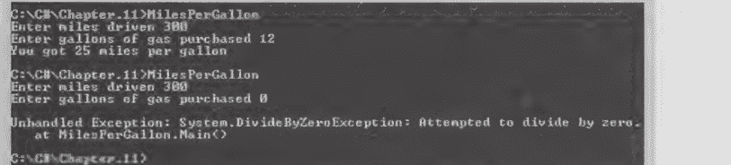

图 11-2 MilesPerGallon 程序的两次执行

当用户在 `MilesPerGallon` 程序中加仑输入 0 时，对话框报告应用程序停止并需要关闭。此错误是为了演示而故意设计的；用户可以通过点击对话框右下角的“关闭”按钮忽略此消息。

在图 11-2 `MilesPerGallon` 程序的第一次执行中，用户输入了两个有效的整数，计算成功。然而，在第二次执行中，用户在加仑处输入 0，错误消息显示创建了一个未处理的 `System.DivideByZeroException` 异常。消息提供了进一步信息（“尝试除以 0。”），并显示了发生异常的方法——在 `MilesPerGallon.Main()` 中。

`DivideByZeroException` 是 C# 自动生成的。它是 `DivideByZeroException` 类的一个实例，该类有四个祖先。它是 `ArithmeticException` 类的子类，而该类继承自 `SystemException` 类。`SystemException` 类派生自 `Exception` 类，而 `Exception` 类又是 `Object` 类的子类。

仅仅发生了异常并创建了 `Exception` 对象，并不意味着你必须处理它。在 `MilesPerGallon` 类中，你只需让出错的程序终止即可；这就是为什么图 11-2 中的错误信息显示异常是“未处理的（Unhandled）”。然而，程序的终止是突然且不留情的。当程序两个数字相除或执行某些尝试性任务（如玩游戏）时，如果程序突然结束，用户可能会感到恼火。对于交通管制或在手术期间监测患者的生命体征来说，突然结束可能是灾难性的。通过异常处理，程序可以在处理问题后继续运行。这在任务关键型应用中尤为重要。“任务关键型”（mission critical）是指对组织至关重要的任何过程。面向对象的错误处理技术比简单的关闭提供了更优雅的解决方案。

能够适当处理异常的程序被认为比那些不能处理的程序更具容错性和健壮性。容错型应用的设计使其在系统某些部分失效时能够继续运行（可能处于较低的水平）。健壮性代表了系统对压力的抵抗程度以及保持正确功能的能力。

观看视频 System Exceptions（系统异常）。

### 两个真理和一个谎言

1. 异常是执行程序中发生的任何错误状况或意外行为。
2. 在 C# 中，所有异常都是 `Exception` 类或其任一派生类的成员。
3. 在 C# 中，当异常发生并创建了 `Exception` 对象时，你必须使用一套特定的异常处理技术来管理问题。

> 虚假的陈述是 #3。你并不一定因为发生了异常并创建了 `Exception` 对象就必须处理它。

## 由来操作

### 故意引发异常

在许多情况下，C# 会自动生成 `SystemException`。在接下来的步骤中，你将通过执行一个提供多个异常机会的程序来故意生成 `SystemException`。

1. 创建一个名为 `ExceptionsOnPurpose` 的新项目，并输入以下程序，该程序允许你生成几种不同的异常。

```csharp
using System;
using static System.Console;

class ExceptionsOnPurpose
{
    static void Main()
    {
        int answer;
        int result = 0;
        Write("Enter an integer >> ");
        answer = Convert.ToInt32(ReadLine());
        result = answer / zero;
        WriteLine("The answer is " + answer);
    }
}
```

2. 你不能除以未定义的常量 0（通过将除法语句改为 `result = answer / 0`），也不能将变量 `zero` 改为命名常量（通过在 `int zero` 声明开头插入 `const`）。如果你进行了其中任何一处，程序将无法编译，因为编译器可以确定会发生除零错误。然而，使用变量 `zero` 而不是未命名或命名的常量，编译器“信任”在除法发生之前会为该变量提供一个合法的值（尽管在这种情况下，这种信任是不必要的）。保存程序并编译。

3. 使用不同的输入值多次执行程序，并观察结果。每次执行会出现两个窗口。Windows 正在收集更多关于问题的特定信息。该窗口很快会被图 11-3 所示的窗口取代，该窗口重复显示 `ExceptionsOnPurpose.exe` 已停止工作。你永远不会编写一个故意除零的程序；你在这里这样做是为了演示 C# 生成异常的能力。如果你正在运行专业应用程序，你可能会收到解决方案。由于你是故意创建此异常的，只需点击“关闭程序”按钮即可。

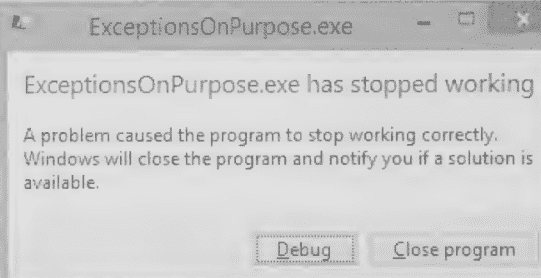

**图 11-3** 由未处理异常生成的错误报告窗口

图 11-4 显示了程序的三次执行，期间用户输入了以下内容：

* `abc`——这产生了一个 `System.FormatException`，当程序尝试将输入值转换为整数时发生该错误，因为不允许字母。
* `12.5`——这同样产生了一个 `System.FormatException`，因为不允许小数点。
* `0`——这产生了一个 `System.DivideByZeroException`：尝试除以 0。

## 比较传统与面向对象的错误处理

另一种使用异常处理代替决策来控制错误的方法是：当程序的主逻辑被一系列可能检测错误的 `if` 语句和决策中断时，程序可能会变得更加复杂且难以理解。面向对象的错误处理方法将程序的主任务与处理稀有错误的代码分离。

C# 的创建者将“不频繁”定义为发生概率小于 30% 的事件。

程序员使用“晴天场景”（sunny day catch）一词来描述一切顺利且没有发生错误的场景。

## 理解面向对象的异常处理方法

面向对象的异常处理涉及三个术语：`try`、`throw` 和 `catch`。

* 你“尝试”（`try`）执行一个可能无法正确完成的过程。
* 检测到错误状况的方法“抛出”（`throw`）异常。
* 处理错误的代码块“捕获”（`catch`）异常。

当你编写一段可能出现问题的代码块时，可以将代码放在 `try` 块中，`try` 块由以下元素组成：

* 关键字 `try`
* 一对包含可能引发异常的语句的大括号

你必须在 `try` 块之后紧跟着编写至少一个 `catch` 块或 `finally` 块。（你将在本章的晚些时候学习 `finally` 块）。每个 `catch` 块可以“捕获”一种类型的异常——即一个 `Exception` 对象或其任一子类对象的对象。程序员有时将 `catch` 块称为 `catch` 子句（catch clause）。

### catch 块的组成

* 包含异常（`Exception`）类型以及可选的、该异常类型实例名称的括号
* 一对大括号包含处理错误状况的语句

你可以通过省略括号和异常类型来创建一个 `catch` 块。如果你这样做，那么当抛出任何类型的异常时，该 `catch` 块都将执行。换句话说，`catch` 和 `catch(Exception)` 都是启动 `catch` 块以捕获异常的正确方法，当你不需要命名异常对象（因为你不关心显示它的详细信息）。

图 11-5 显示了 `try...catch` 组合的通用格式。`catch` 块中的占位符 `XException` 代表异常类或其任何特定的子类。占位符 `XException` 是 `ExceptionInstance` 对象的数据类型。`catch` 块看起来非常像一个命名为 `catch()` 的方法，它接收一个作为 `XException` 实例的参数。然而，它并不是一个方法；你不能直接调用它。方法可以接受多个参数，但 `catch` 块只能捕获一个，而且与方法不同，`catch` 块没有返回值。

正如 `XException` 所示，异常类通常使用 `Exception` 作为名称的后半部分，例如 `SystemException` 和 `ApplicationException`。编译器并不要求这种命名规范，但这种规范使得异常的后代更容易识别。

```cpp
try {
  // 任意数量的语句；
  // 某些语句可能会抛出异常
} catch(XException anExceptionInstance) {
  // 对其进行处理
}
// 无论是否有异常都会执行这里的语句
```

**图 11-5** `try...catch` 组合的通用形式

你可以在 `try` 块中放置任意数量的语句，包括那些已知永远不会抛出异常的语句。然而，如果你放置在 `try` 块中的任何语句确实抛出了异常，那么捕获该异常的 `catch` 块中的语句将执行。如果 `try` 块内没有发生异常，则 `catch` 块不会执行。无论何种情况，`catch` 块之后的语句都会正常执行。

例如，图 11-6 包含一个程序，其中提示、接受和使用 `gallonsOfGas` 的语句被封装在一个 `try` 块中。（按照惯例，这三个变量声明是在 `try` 块之前完成的。在这种情况下，`mpg` 必须在 `try` 块之外声明以便在程序的最终输出语句中识别。）图 11-7 显示了程序的两次执行情况。在第一次执行中，为 `gallonsOfGas` 输入了一个可用的值，程序正常运行，跳过了 `catch` 块。然而，在第二次执行中，用户为 `gallonsOfGas` 输入了 0。当尝试进行除法时，会自动创建并抛出一个异常对象。`catch` 块捕获了该异常，它在这里被称为 `e`。（图 11-6 中的阴影箭头从创建异常的地方延伸到捕获异常的地方。）`catch` 块中的语句将 `mpg` 设置为 0 并显示消息。无论 `catch` 块是否执行，跟在 `catch` 块大括号之后的最后的 `WriteLine()` 语句都会执行。

```csharp
using System;
using static System.Console;

class MilesPerGallon2
{
    static void Main()
    {
        int milesDriven;
        int gallonsOfGas;
        int mpg;
        try
        {
            Write("Enter miles driven ");
            milesDriven = Convert.ToInt32(ReadLine());
            Write("Enter gallons of gas purchased ");
            gallonsOfGas = Convert.ToInt32(ReadLine());
            mpg = milesDriven / gallonsOfGas;
        }
        catch (Exception e)
        {
            mpg = 0;
            WriteLine("You attempted to divide by zero!");
        }
        WriteLine("You got {0} miles per gallon", mpg);
    }
}
```

图 11-6 MilesPerGallon2 程序


图 11-7 MilesPerGallon 程序的两次执行

当你编译图 11-6 中的程序时，你会收到一个警告，称 `e` 已声明但从未使用过。你可以声明一个变量来持有抛出的异常对象，但在示例中你不想使用它，所以你可以安全地忽略该警告。如果你不想在 `catch` 块中使用捕获的 `Exception` 对象，那么你就不需要为它提供实例名称。例如，在图 11-6 中，`catch` 子句可以这样开始：

```csharp
catch (Exception)
```

在本章稍后的示例中，`Exception` 对象将被用于提供信息。在这些情况下，要求必须有一个标识符。


# 第 11 章 异常处理

## 两个真理一个谎言

- 1. 在面向对象的方法被构之前，程序员没有办法处理意外状况。
- 2. 使用面向对象的技术，当你编写一段可能发生错误的代码块时，你可以将代码放置在 `try` 块中。
- 3. 如果 catch 块执行，那么一定抛出了一个异常。

> 错误陈述是第 1 条。在面向对象的方法被构之前，程序员通常通常使用处理错误。

## 比较传统与面向对象的错误处理方法

在 `MilesGallon` 程序中，你可以捕获更具体的 `DivideByZeroException` 而不是捕获 `Exception` 对象。你将在本章稍后的部分使用这种技术。如果你正在从事一个专业项目，Microsoft 建议永远不要在 catch 块中使用通用的 `Exception` 类，这样做可能会隐藏问题。

在图 11-6 中，异常的源和 catch 块位于同一个方法中。在本章的后后部分，你将学习异常及其相应的 catch 块位于不同的方法中。

观看视频《抛出和捕获异常》。

## 使用异常类的 ToString() 方法和属性

在 `MilesGallon` 程序中，你可以捕获更具体的 `DivideByZeroException` 而不是捕获 `Exception` 对象。你将在本章稍后的部分使用这种技术。如果你正在从事一个专业项目，Microsoft 建议永远不要在 catch 块中使用通用的 `Exception` 类，这样做可能会隐藏问题。

在图 11-6 中，异常的源和 catch 块位于同一个方法中。在本章的后后部分，你将学习异常及其相应的 catch 块位于不同的方法中。

> 异常  ` 构 方法 方法 属性

当 `MilesGallon` 程序显示错误消息（"You attempted to divide by zero"）时，`catch` 块中的 `Exception` 类使用 `ToString()` 方法提供关于抛出异常的描述性消息。例如，图 11-8 所示的 `MilesGallon2` 程序：异常的类型是 `System.DivideByZeroException`。

> 你在“继承”章节中学习了 `Object` 类的 `ToString()` 方法。

```csharp
using System;
using static System.Console;
class MilesGallon
{
    static void Main()
    {
        int milesDriven;
        int gallonsOfGas;
        int mpg;
        try
        {
            Write("Enter miles driven ");
            milesDriven = Convert.ToInt32(ReadLine());
            Write("Enter gallons of gas purchased ");
            gallonsOfGas = Convert.ToInt32(ReadLine());
            mpg = milesDriven / gallonsOfGas;
        }
    }
}
```

图 11-8 MilesPerGallon 程序

```csharp
catch(Exception e)
{
    mpg = 0;
    WriteLine(e.ToString());
    WriteLine("You got {0} miles per gallon", mpg);
}
```

图 11-8 MilesPerGallon 程序（续）

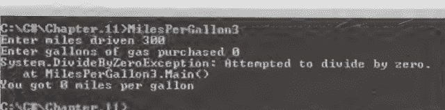

图 11-9 MilesGallon 程序的执行

图 11-9 中显示的错误消息（`System.DivideByZeroException: Attempted to divide by zero`）与你在没有提供异常处理时图 11-2 中出现的消息相同。因此，你可以假设操作系统最可能使用了你在显示有关异常对象的信息时使用的 `ToString()` 方法。在没有提供异常处理的程序中，执行直接停止了；而在这一次中，执行继续，并且无论用户输入是否可用都会显示最终输出。程序员会说这个版本的结束非常“优雅”。

`Exception` 类还包含一个只读属性 `Message`，它包含了关于异常对象的有用信息。例如，图 11-10 中的程序相对于 `MilesGallon` 程序包含两处阴影变化：类名以及 catch 块中显示错误消息的语句中的 `Message` 属性。该程序产生了图 11-11 所示的输出。`e.Message` 的值与 `ToString()` 方法返回值的后半部分完全相同。你可以推测 `MilesGallon3` 中使用的 `DivideByZeroException` 类的 `ToString()` 方法是从两个部分构造其字符串的：`GetType()` 方法的返回值（指示类名）和 `Message` 属性的返回值。

```csharp
using System;
using static System.Console;
class MilesPerGallon4
{
    static void Main()
    {
        int milesDriven;
        int gallonsOfGas;
        int mpg;
        try
        {
            Write("Enter miles driven ");
            milesDriven = Convert.ToInt32(ReadLine());
            Write("Enter gallons of gas purchased ");
            gallonsOfGas = Convert.ToInt32(ReadLine());
            mpg = milesDriven / gallonsOfGas;
        }
        catch (Exception e)
        {
            mpg = 0;
            WriteLine(e.Message);
        }
        WriteLine("You got {0} miles per gallon", mpg);
    }
}
```

图 11-10 MilesPerGallon 程序

```text
C:\>Chapter.11>MilesPerGallon
Enter miles driven 300
Enter gallons of gas purchased 0
Attempted to divide by zero.
You got 0 miles per gallon
C:\>Chapter.11>>
```

图 11-11 MilesPerGallon 程序的执行

## 使用 Exception 类的 ToString() 方法和 Message 属性

## 二真一假

- 1. 程序中 try 块内生成的任何 Exception 类型异常都将由带有 Exception 类型参数的 catch 块捕获。
- 2. Exception 类重写了 object 类的 Description() 方法，以提供描述性的错误消息，以便使用户可以接收有关任何被抛出的 Exception 对象性质的精确信息。
- 3. Exception 类包含一个名为 Message 的属性，该属性包含有关异常的有用信息。

> 虚假的陈述是 #2。Exception 类重写了 object 类的 Description() 方法，以提供描述性的错误消息，以便使用户可以接收有关任何被抛出的 Exception 对象性质的精确信息。

## 你来做

### 处理异常

你可以通过将异常放在 try 块中，然后捕获从其抛出的任何异常来处理异常。

1. 如果 ExceptionsOnPurpose 程序尚未打开，请打开它。将类名改为 ExceptionsOnPurpose2，并立即将项目保存为 ExceptionsOnPurpose2。
2. 在 Main() 方法中，在三个变量声明之后，将接三个语句封装在 try 块中，如下：

```csharp
try {
  Write("Enter an integer >> ");
  answer = Convert.ToInt32(ReadLine());
  result = answer / zero;
}
```

3. 紧随 try 块（但在显示 answer 的 WriteLine() 语句之前），添加一个 catch 块捕获任何抛出的 Exception 对象并显示其 Message 属性。

```csharp
catch(Exception e)
{
    WriteLine(e.Message);
}
```

保存程序并编译它。你应该收到一个编译器错误，指示 answer 是一个未赋值的局部变量。此错误发生在程序显示 answer 的最后一行。在程序的第一个版本中，并没有出现这样的消息。然而，由于现在对 answer 的赋值位于 try 块内，编译器理解可能会抛出异常，从而在有效值赋值给 answer 之前终止该块。要消除这个问题，请在声明处初始化 answer：

```csharp
int answer = 0;
```

再次编译并执行程序。图 11-12 显示了三次执行。用户输入的类型与上一个“你来做”部分中的图 11-4 相同。然而，结果在几个重要方面有所不同：

- 没有出现错误消息窗口（如图 11-3 所示）。
- 显示的错误消息比图 11-4 中自动生成的版本更简洁、更“友好”。
- 程序在每情况下都正常结束，以用户友好的方式显示 answer 值。

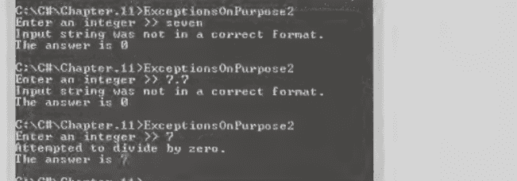

图 11-12 连续执行 ExceptionsOnPurpose2 程序生成的错误消息

## 捕获多个异常

你可以在 try 块中放置任意数量的语句，并可以包含任意数量的 catch 块来处理不同的 Exception 类型。当 try 块包含多个语句时，只有第一个产生错误的语句会抛出异常。一旦发生异常，逻辑就会立即转移到 catch 块，这导致 try 块中的其余语句无法被检测到。

位于 try 块之后的 catch 块应该覆盖 try 块中代码可能遇到的所有异常。假设至少有一个 catch 块，如果抛出的异常没有匹配的 catch 块，程序将异常终止。（如果有 finally 块，即使没有任何 catch 块也是可以的，正如你将看到的。）

当抛出 Exception 对象且存在多个 catch 块时，将按顺序检查 catch 块，直到找到匹配项。匹配的 catch 块将执行，而剩余的每个 catch 块都会被跳过。

例如，考虑图 11-13 中的程序。TwoErrors 类中的 Main() 方法抛出了两种类型的异常——`DivideByZeroException` 和 `IndexOutOfRangeException`（当下标不在允许范围内时发生此类异常）。在 TwoErrors 程序中，数组只有三个元素，却使用了 13 用作下标。

```csharp
using System;
using static System.Console;
class TwoErrors
{
    static void Main()
    {
        int result;
        int zero = 0;
        int subscript = 13;
        int[] array = {22, 33, 44};
        try
        {
            result = 10 / zero;
            result = array[subscript];
        }
        catch (DivideByZeroException error)
        {
            WriteLine("First catch block: ");
            WriteLine(error.Message);
        }
        catch (IndexOutOfRangeException error)
        {
            WriteLine("Second catch block: ");
            WriteLine(error.Message);
        }
    }
}
```

图 11-13 带有两个 catch 块的 TwoErrors 程序

图 11-13 中 try 块内的第一个语句尝试访问三元素数组的第 13 个元素，因此程序抛出了 `IndexOutOfRangeException`。try 块被放弃，检查第一个 catch 块，并发现它不适用，因为 Exception 对象类型错误——它不是 `DivideByZeroException` 对象。程序继续到第二个 catch 块，该块的 `IndexOutOfRangeException` 参数与抛出的 Exception 类型匹配。因此，第二个 catch 块中的消息和 Exception 的 Message 值被显示出来。图 11-14 显示了输出。

如果你反转 TwoErrors 程序中 try 块内的两个语句，过程就会发生变化。例如，在 TwoErrors 的每个版本中，两个 catch 块都会显示独特的消息。相反，你可能希望 `DivideByZeroException` catch 块和 `IndexOutOfRangeException` catch 块都使用抛出的 Exception 的 Message。

```csharp
using System;
using static System.Console;
class TwoErrors
{
    static void Main()
    {
        int result;
        int zero = 0;
        int subscript = 13;
        int[] array = {22, 33, 44};
        try
        {
            result = array[subscript];
            result = 10 / zero;
        }
        catch (DivideByZeroException error)
        {
            WriteLine("First catch block: ");
            WriteLine(error.Message);
        }
        catch (IndexOutOfRangeException error)
        {
            WriteLine("Second catch block: ");
            WriteLine(error.Message);
        }
    }
}
```

图 11-15 TwoErrors 程序

图 11-15 中 try 块内的第一个语句是除以零，因此程序抛出了 `DivideByZeroException`。try 块被放弃，检查第一个 catch 块并发现与抛出的 Exception 类型匹配。第一个 catch 块中的消息和 Exception 的 Message 值被显示出来。图 11-16 显示了输出。

如果你想无论发生什么类型的 Exception 均执行相同的代码。由于 `DivideByZeroException` 和 `IndexOutOfRangeException` 都是 `Exception` 的子类，你可以如图 11-17 所示重写 TwoErrors 类，并仅包含一个捕获任何类型异常的 catch 块。

```csharp
using System;
using static System.Console;
class TwoErrors3
{
    static void Main()
    {
        int result;
        int zero = 0;
        int subscript = 13;
        int[] array = {22, 33, 44};
        try
        {
            result = array[subscript];
            result = 10 / zero;
        }
        catch (Exception error)
        {
            WriteLine(error.Message);
        }
    }
}
```

图 11-17 带有一个 catch 块的 TwoErrors3 类

作为图 11-17 所示使用单个 catch 块处理多个需要相同操作的 Exception 类型的替代方案，你可以创建一个类来分离不同的 catch 块，每个 catch 块都调用错误处理方法。

图 11-17 中的 catch 块接受了比 try 块中任何一个语句可能抛出的更具通用性的 Exception 类型，因此该通用的 catch 块可以充当一个“全捕获”块。也就是说，当发生算术错误或数组错误时，抛出的错误在 catch 块中被“提升”为 Exception 错误。这是通过继承的 `DivideByZeroException` 和 `IndexOutOfRangeException` 实现的。

如前所述，微软公司建议 catch 块不应处理通用的 Exception。他们认为，如果你无法预测所有可能的异常情况，就应该允许应用程序终止，而不是处理异常。否则，恶意代码更容易利用产生的应用程序状态。然而，许多专业程序员对此持不同意见。


虽然一个代码块可以抛出任意数量的异常，但许多开发者认为，一个块或方法抛出超过三或四种类型是糟糕的风格。如果是这样，则必须满足以下条件之一：

- 也许代码块或方法正尝试完成太多的多样化任务，应该被拆分为更小的块或方法。
- 也许抛出的 `Exception` 类型过于具体，应该被泛化，就像图 11-17 中的 `TwoErrors3` 程序中所做的那样。

当你在 `try` 块之后列出多个 `catch` 块时，必须小心某些 `catch` 块变成不可达的。不可达块包含在任何情况下都永远无法执行的语句，因为程序逻辑“无法到达那里”。程序员也将不可达代码称为死代码。

例如，如果连续的 `catch` 块先捕获 `Exception`，再捕获 `DivideByZeroException`，那么即使是 `DivideByZeroExceptions` 也会被 `Exception catch` 捕获。第二个 `DivideByZeroException catch` 块是不可达的，因为更通用的 `Exception catch` 块挡在了它的前面，因此该类将无法编译。

## 两个真理和一个谎言

### 捕获多个异常

1. 如果你在一个块中尝试执行一个以上的语句，每个产生错误的语句都会抛出一个 `Exception`。
2. 你可以编写捕获多个 `Exception` 类型的 `catch` 块。
3. 当你在 `try` 块之后列出多个 `catch` 块时，必须小心某些 `catch` 块变成不可达的。

虚谎的陈述是 #1。如果你在一个块中尝试执行一个以上的语句，只有产生错误的语句会抛出一个 `Exception`。

## 你来操作

### 捕获多个异常类型

在本节中，你通过为 `try` 块中的代码提供多个 `catch` 块来引发多种结果。

1. 如果 `ExceptionsOnPurpose2` 程序尚未打开，请打开它。将类名改为 `ExceptionsOnPurpose3`，并立即将项目保存为 `ExceptionsOnPurpose3`。
2. 将现有的通用 `catch` 块替换为两个 `catch` 块。（显示答案的语句仍然跟在这些 `catch` 块之后。）第一个捕获任何 `FormatException` 并显示一条短消息。第二个捕获 `DivideByZeroException` 并显示一条较长的消息。

```csharp
catch(FormatException e)
{
    WriteLine("You did not enter an integer");
}
catch(DivideByZeroException e)
{
    WriteLine("This is not your fault.");
    WriteLine("You entered the integer correctly.");
    WriteLine("The program divides by zero.");
}
```

3. 保存程序并编译它。当你执行程序并输入一个不是整数的值时，第一个 `catch` 块执行。当你输入一个整数以便程序能够继续执行除以 0 的语句时，第二个 `catch` 块执行。图 11-18 显示了程序的两次典型执行情况。

```text
C:\Chapter.11\ExceptionsOnPurpose
Enter an integer >> 4
You did not enter an integer
The answer is: 11
C:\Chapter.11\ExceptionsOnPurpose
Enter an integer >> 4
This is not your fault.
You entered the integer correctly.
The program divides by zero.
The answer is 4

C:\Chapter.11>
```

**图 11-18** 连续执行 `ExceptionsOnPurpose` 程序生成的错误消息。

# 检查 TryParse() 方法的结构

在第 8 章中，你学习了 `TryParse()` 方法，该方法可以将字符串数据转换为另一种数据类型（如 `int`、`double` 或 `bool`），而无需担心产生异常。一个典型的 `TryParse()` 语句可能如下：

```csharp
if(int.TryParse(inputString, out number))
    number = DEFAULT_VALUE;
```

该语句使用了 `int` 版本的 `TryParse()` 方法。第一个参数是你想要转换为数字的字符串，第二个参数是接收结果的 `out` 参数，如果转换成功，它将接收结果。`TryParse()` 返回一个布尔值，指示转换是否成功。在前面的示例中，如果方法返回 `false`，则变量 `number` 被赋值为常量 `DEFAULT_VALUE`——也就是说，如果 `inputString` 不是整数。

假设不存在可以安全地将字符串转换为整数的 `TryParse()` 方法。利用你为止在本章中学的知识，你现在可以编写自己的方法。该方法处理它可能生成的异常，这样当客户端使用该方法时，就不必担心异常处理。图 11-19 显示了一个可用的方法。

```csharp
public static bool TryParse(string inputString, out int number)
{
    bool wasSuccessful = true;
    try {
        number = Convert.ToInt32(inputString);
    }
    catch (FormatException) {
        wasSuccessful = false;
        number = 0;
    }
    return wasSuccessful;
}
```

图 11-19 中的 `TryParse()` 方法是 `public` 的，以便其他类可以使用；它是 `static` 的，因此不需要实例化。C# 的创建者在创建 `Integer` 类时编写了类似的代码。如果没有 `TryParse()` 方法，你可以自己写一个，但该方法已经存在。当你继续学习编程时，你可能会开发出一个方便他人的方法。

你下载的文件包含一个名为 `TestTryParse.cs` 的程序，用于测试 `TryParse()`。

# 第 11 章 异常处理

## 两个真理和一个谎言

### 检查 TryParse() 方法的结构

1. `TryParse()` 方法使用了 `out` 参数。
2. `TryParse()` 方法采用了异常处理。
3. `TryParse()` 方法必须在 `try` 块中使用。

虚谎的陈述是 #3。`TryParse()` 方法包含一个 `try` 块，不需要在 `try` 方法中使用它，因为它处理了自己的异常。

# 使用 finally 块

当你需要在 `try...catch` 序列结束时执行某些操作时，可以使用 `finally` 块，无论 `try` 块是否识别出异常它都会执行。通常，你使用 `finally` 块执行无论是否捕获到错误必须进行的清理任务。图 11-20 显示了使用 `finally` 块的 `try...catch` 序列的格式。

```csharp
try {
  // 可能导致异常的语句
}
catch(SomeException anExceptionInstance)
{
  // 对其进行处理
}
finally {
  // 这里的语句执行
  // 无论是否发生了异常
}
```

**图 11-20** 带 `finally` 块的 `try...catch` 块通用形式

乍一看，`finally` 块似乎没有用。当 `try` 块无错误地运行时，控制权会传递到 `catch` 块之后的语句。此外，如果 `try` 代码失败并抛出一个被捕获的 `Exception` 对象，那么 `catch` 块将执行，随后控制权再次传递到编码在 `catch` 块之后的任何语句。因此，似乎 `catch` 块之后的语句总是执行，因此没有在特殊的 `finally` 块中放置任何语句。然而，`catch` 块之后的语句可能由于至少两个原因而永远不会执行：

- 可能会发生你未预料的异常，导致程序终止。
- `try` 块或 `catch` 块可能包含终止应用程序的语句。

> 你可以使用如 `Environment.Exit(0);` 的语句来终止应用程序。`Environment.Exit(0)` 是 `System` 命名空间的一部分。它终止程序并传递参数（参数可以是任何整数）。你还可能使用 `break` 语句或 `return` 语句退出 `catch` 块。你在学习 `switch` 语句时遇到过 `break` 语句，在使用方法时学习过 `return` 语句。

`try` 块可能会抛出一个你没有提供 `catch` 处理的异常。此后，所有异常会在你没有进行处理的情况下一直发生，正如你在本章开头的第一个 `MilesPerGall` 程序中看到的那样。在发生意外异常的情况下，程序执行立即停止，将错误发送给操作系统处理并放弃当前方法。同样，如果 `try` 块包含退出语句，执行也会立即停止。当你包含一个 `finally` 块时，你可以确保其包含的语句在程序被放弃之前执行，即使方法可能提前终止。

例如，`finally` 块经常用于文件输入和输出，以确保打开的文件被关闭。你将在后面的章节中学习更多关于写入和读取数据文件的知识。然而，现在请考虑图 11-21 所示的格式，它代表了典型文件处理程序的部分逻辑。`catch` 块被编写用于捕获异常，如果在打开文件、从文件中读取数据或向文件中写入数据时出现问题，会自动生成该类型的异常。

```csharp
try {
    // 打开文件
    // 读取文件
    // 将文件数据放入数组中
    // 从数据计算平均值
    // 显示平均值
} catch(IOException e) {
    // 发布错误信息
    // 退出
} finally {
    // 如果文件是打开的，则关闭它
}
```

**图 11-21** 尝试读取文件并处理异常的代码格式

图 11-21 中的伪代码使用 `catch` 块处理任何文件问题。然而，由于应用程序使用了数组（“将文件数据放入数组中”语句）并执行了除法（见注释“计算平均值...”），即使文件成功打开，也可能发生未捕获的异常。在这种情况下，你希望在继续之前关闭文件。通过使用 `finally` 块，可以确保文件被关闭，因为 `finally` 块中的代码会在未捕获的异常将控制权返回给操作系统之前执行。无论 `try` 块发生以下哪种结果，`finally` 块中的代码都会执行：

- `try` 正常结束。
- `try` 正常结束，并且执行 `catch`。
- `try` 异常结束，并且未执行 `catch`。例如，`try` 块中的异常可能会导致方法提前终止——可能是数组不够大以容纳数据，或者计算平均值导致除以 0。这些异常不允许 `try` 块完成，也不会导致 `catch` 块执行，因为 `catch` 块只捕获 `IOException`。
- `try` 异常结束，`catch` 执行，但随后由于发生了未捕获的异常导致 `catch` 异常结束。

> 如果应用程序可能会抛出几种类型的异常，你可以尝试一些代码，捕获可能的异常，捕获另一个可能的异常，以此类推。通常，更好的方法是尝试所有可能抛出异常的语句，然后包含所有需要的 `catch` 块和一个可选的 `finally` 块。这是图 11-21 所示的方法，它通常产生更容易遵循的逻辑。

你通常可以避免使用 `finally` 块，但你需要重复的代码。例如，与其在图 11-21 的伪代码中使用 `finally` 块，你可以将“如果文件是打开的，则关闭它”的语句作为 `try` 块的最后一个语句以及 `catch` 块的倒数第二个语句，在程序退出之前插入。然而，在 `finally` 块中只写一次代码更清晰且不易出错。

> Java、Visual Basic 和 C++ 提供了 `catch` 块。Java 和 Visual Basic 也提供了 `finally` 块，但 C++ 不提供。

许多设计良好的程序使用 `finally` 块来确保无论是否发生异常都能释放资源。这对于文件句柄、数据库连接和网络套接字特别为重要。

## 处理从方法抛出的异常

当你设计包含可能抛出异常方法的类时，你经常创建这些方法，让它们抛出异常但不处理它。处理异常通常应该留给客户端——使用你类的程序——以便能以适用于你应用程序的方式处理异常。许多设计良好的程序使用 `finally` 块来确保无论是否发生异常都能释放资源。这对于文件句柄、数据库连接和网络套接字特别为重要。

- 1. 当 `finally` 块位于 `try` 之后，无论是否发生异常都会执行。
- 2. 通常，你使用 `finally` 块执行清理任务。
- 3. 如果 `finally` 块中发生异常，可能会掩盖 `try` 块中抛出的任何异常。

例如，考虑图 11-22 中非常短的 `PriceList` 类。该类包含一个价格列表和一个根据参数下标显示一个价格的方法。由于 `DisplayPrice()` 方法使用了数组，可能会抛出 `IndexOutOfRange`。然而，`DisplayPrice()` 方法并没有处理潜在的异常。

```csharp
class PriceList
{
    private static double[] price = {15.99, 27.88, 34.56, 45.89};
    public static void DisplayPrice(int item)
    {
        WriteLine("The price is " + price[item].ToString("C"));
    }
}
```

**图 11-22** `PriceList` 类

图 11-23 显示了一个使用 `DisplayPrice()` 方法的应用程序。它在 `try` 块中调用该方法并通过显示价格 $0 来处理 `IndexOutOfRangeException`。

```csharp
using System;
using static System.Console;
class PriceListApplication1
{
    static void Main()
    {
        int item;
        try
        {
            Write("Enter an item number >> ");
            item = Convert.ToInt32(ReadLine());
            PriceList.DisplayPrice(item);
        }
        catch (IndexOutOfRangeException e)
        {
            WriteLine(e.Message + " The price is $0");
        }
    }
}
```

**图 11-23** `PriceListApplication1` 程序

# 处理从外部方法抛出的异常

```text
C:\C\Chapter.11>PriceListApplication1
Enter an item number >> 4
Index was outside the bounds of the array. The price is $0
C:\C\Chapter.11>
```

**图 11-24** 用户输入无效项目编号时 `PriceListApplication1` 程序的输出

图 11-25 显示了另一个应用程序，它使用了相同的 `PriceList` 类，但处理异常的方式有所不同。在这种情况下，程序员希望用户继续响应，直到输入正确的项目为止。如果 `try` 块中抛出 `IndexOutOfRangeException`，`try` 块将被放弃，`isGood` 不会被设为 `true`，并执行 `catch` 块。由于 `isGood` 保持为 `false`，`while` 循环将继续执行。只有当 `try` 块中的前三个语句执行成功后，最后一个将 `isGood` 修改为 `true` 并结束循环的语句才会执行。由于 `PriceList` 类中的 `DisplayPrice()` 方法被设计为抛出异常但不处理它，因此 `PriceListApplication2` 的程序员可以以完全不同于 `PriceListApplication1` 的方式处理该异常。图 11-26 显示了该程序的典型执行过程。

```csharp
using System;
using static System.Console;
class PriceListApplication2
{
    static void Main()
    {
        int item = 0;
        bool isGoodItem = false;
        while(!isGoodItem)
        {
            try
            {
                Write("Enter an item number >> ");
                item = Convert.ToInt32(ReadLine());
                PriceList.DisplayPrice(item);
                isGoodItem = true;
            }
        }
    }
}
```

**图 11-25** `PriceListApplication2` 程序（续）

# 第 11 章 异常处理

（续）

**图 11-25** `PriceListApplication2` 程序


```
C:\n\Chapter.11>PriceListApplication2
Enter an item number less than 4
Please reenter item number
Enter an item number >> 1
You must enter a number less than 4
Please reenter item number
Enter an item number >> 3
The price is $45.89
Thank you

C:\n\Chapter.11>
```

图 11-26 用户多次输入无效项目编号时 `PriceListApplication2` 程序的输出

## 两真一假

# 处理从外部方法抛出的异常

1. 当其他类的方法抛出异常时，这些方法不需要捕获它们；相反，你的调用程序可以捕获它们，你可以决定如何处理它们。
2. 通常，你不希望被调用的方法处理它自己的异常；在许多情况下，你希望调用程序以最符合应用程序的方式来处理任何异常。
3. 当你设计包含可能抛出异常语句方法的类时，你几乎总是确保你的类恰当地处理了每个异常。

# 溯溯调用栈中的异常对象

当一个方法调用另一个方法时，计算机的操作系统必须跟踪方法调用可能来自哪里，并且在调用的方法完成后，程序控制必须返回到调用方法。例如，如果 `MethodA()` 调用了 `MethodB()`，操作系统必须“记住”在 `MethodB()` 结束时返回 `MethodA()`。同样，如果 `MethodB()` 调用了 `MethodC()`，当 `MethodC()` 执行时，计算机需要“记住”它将返回 `MethodB()` 并最终返回 `MethodA()`。计算机存储系统必须返回的位置列表的内存位置被称为调用栈。

如果一个方法抛出异常且不捕获它，那么异常就会抛给调用栈中“上层”的下一个方法；换句话说，它被抛给了调用该违规方法。考虑以下事件序列：

- `MethodA()` 调用 `MethodB()`。
- `MethodB()` 调用 `MethodC()`。
- `MethodC()` 抛出一个异常。
- C# 首先在 `MethodC()` 中查找 `catch` 块。
- 如果不存在，则 C# 在 `MethodB()` 中查找相同的内容。
- 如果 `MethodB()` 没有针对该异常的 `catch` 块，则 C# 查找 `MethodA()`。
- 如果 `MethodA()` 没有捕获该异常，则程序终止，操作系统显示错误消息。

这种通过调用链传递异常的系统被称为异常传播。它具有巨大的优点，因为它允许你的方法更恰当地处理异常。然而，使用多个类的程序会让程序员难以定位异常的源。

你已经使用了 `Message` 属性来获取有关异常的信息。`StackTrace` 属性是很有用的。当你捕获异常时，可以显示 `StackTrace` 的调用栈中的方法列表，以便确定异常创建的位置。

`StackTrace` 属性是一个调试工具。当你的程序意外停止时，有助于发现发生异常的方法。通常，你不想在完成的程序显示 `StackTrace` 属性；但当你开发程序时，使用 `StackTrace` 可以帮助你诊断问题。

# 案例研究：使用 StackTrace

作为 `StackTrace` 有用的例子，考虑图 11-27 中的 `Tax` 类。

# 第 11 章 异常处理

## 第 11 章 异常处理

为了尝试导致 Error! 消息的原因，你可以将写入该消息的语句替换如下：

```csharp
WriteLine(e.Message);
```

当将显示 `e.Message` 的语句添加到价格列表程序时，编译程序时将不再出现 `e` 从未被使用的警告。

然而，当你执行程序显示 `e.Message` 时，你将收到图 11-31 所示的输出，这表明索引项目编号超出了数组的边界。你感到困惑，因为你知道 1 是一个有效的价格编号，它不应该被视为越界。

```
C:\Chapter.11>PriceListApplication3
Enter on item number >> 1
Index was outside the bounds of the array.

C:\Chapter.11>
```

图 11-31 修改后的价格列表应用程序的执行情况，在 `catch` 块中显示了 `e.Message`

最后，你决定将 `catch` 块语句中的 `WriteLine()` 参数替换为 `StackTrace` 调用，如下所示：

```csharp
WriteLine(e.StackTrace);
```

输出如图 11-32 所示。你可以从方法列表中看到，应用程序中的错误来自 `Tax.DetermineTaxRate()`，该方法是由 `PriceList.DisplayPrice()` 调用，而后者是由 `Main()` 调用。注意最后执行的方法是列表中显示的第一个。在 `StackTrace` 之前，你可能没有考虑到 `Tax` 类可能是错误源并修复它。如果你在一个小组织工作，你可以查看代码并修复它。如果你在一个较大的组织或从外部供应商处购买该类，你可以联系创建该类的程序员寻求帮助。

```
C:\Chapter.11>PriceListApplication3
Enter on item number >> 1
at Tax.DetermineTaxRate(double price)
at PriceList.DisplayPrice(int32 item)
at PriceListApplication3.Main()

C:\Chapter.11>
```

图 11-32 修改后的价格列表应用程序的执行情况，在 `catch` 块中显示了 `e.StackTrace`

## 创建你自己的异常类

此示例中的类较小，以便你跟随讨论。然而，现实世界的应用程序可能包含许多许多许多类，因此使用 `StackTrace` 将变得越来越有益。在一个大型程序系统中，你可能会发现，测试程序时策略性地在整个程序中定位 `StackTrace` 调用是有用的，然后在程序完成后将其删除或注释掉。

观看视频：通过调用堆栈跟踪异常。

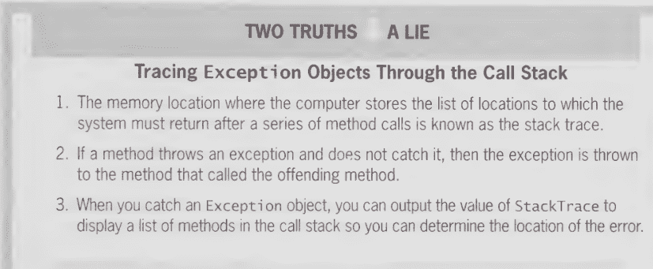

## 二真一假

### 通过调用堆栈跟踪异常对象

1. 计算机存储系统在系列方法调用后必须返回的位置列表的内存位置被称为堆栈跟踪。
2. 如果方法抛出异常且没有捕获它，则异常将抛给调用它的方法。
3. 当你捕获一个 `Exception` 对象时，你可以输出 `StackTrace` 的值来显示调用堆栈中的方法列表，这样你可以确定错误的位置。

错误的陈述是 #1。计算机存储系统在系列方法调用后必须返回的位置列表的内存位置。

## 创建你自己的异常类

C# 提供了超过 100 类异常，你可以在程序中抛出它们。然而，C# 的创建者无法预测你编写的程序中可能导致异常的每种情况。例如，当余额为负或外部人员尝试访问你的账户时，你可能想要声明一个异常。大多数组织对异常数据有特定规则，例如“员工编号不能超过三位数”或“时薪必须低于法定最低标准”。当然，你可以用 `if` 语句处理这些潜在的错误情况，但你也可以创建自己的子类。

要创建一个可以从其实例化对象的自定义异常类型，你可以扩展 `ApplicationException` 类，它是 `Exception` 的子类。正如你在本章前面的部分所看到的，微软对此事的建议随着时间的推移而变化。虽然你可能会看到别人写的 `ApplicationException` 扩展，但目前的建议是从 `Exception` 派生你自己的类。两种方法都会产生可以工作的程序。

图 11-33 显示了一个扩展 `Exception` 的 `NegativeBalanceException` 类。该类向其父构造函数传递了一个字符串。如果你创建一个 `Exception` 对象并显示其 `Message` 属性，你将在应用程序中看到该消息。C# 文档建议你创建的所有子类消息都是语法正确的、以句号结尾的完整句子。

```csharp
class NegativeBalanceException : Exception
{
    private static string msg = "Bank balance is negative.";
    public NegativeBalanceException() : base(msg)
}
```

图 11-33 `NegativeBalanceException` 类

当你创建一个像图 11-34 所示的 `BankAccount` 类时，你可以创建 `Balance` 属性设置器，当客户端尝试设置时抛出 `NegativeBalanceException`。如果你创建一个 `Exception` 对象并显示其 `Message` 属性，你将看到应用程序中的该消息。C# 文档建议你创建的所有子类消息都是语法正确的、以句号结尾的完整句子。


# 第 11 章 异常处理

当你创建一个像图 11-34 所示的 `BankAccount` 类时，你可以创建 `Balance` 属性设置器，当客户端尝试设置时抛出 `NegativeException`。如果你创建一个 `Exception` 对象并显示其 `Message` 属性，你将看到应用程序中的该消息。C# 文档建议你创建的所有子类消息都是语法正确的、以句号结尾的完整句子。

```csharp
class NegativeBalanceException : Exception
{
    private static string msg = "Bank balance is negative.";
    public NegativeBalanceException() : base(msg)
}
```

图 11-33 NegativeException 类

当你创建一个像图 11-34 所示的 `BankAccount` 类时，你可以创建 `Balance` 属性设置器，当客户端尝试设置时抛出 `NegativeException`。如果你创建一个 `Exception` 对象并显示其 `Message` 属性，你将看到应用程序中的该消息。C# 文档建议你创建的所有子类消息都是语法正确的、以句号结尾的完整句子。

```csharp
class BankAccount {
    private double balance;
    public int AccountNum {get; set;}
    public double Balance {
        get {
            return balance;
        }
        set {
            if(value < 0) {
                NegativeException nbe = new NegativeException();
                throw(nbe);
            }
            balance = value;
        }
    }
}
```

图 11-34 BankAccount 类

```csharp
using System;
using static System.Console;
class TryBankAccount {
    static void Main() {
        BankAccount acct = new BankAccount();
        try {
            acct.AccountNum = 1234;
            acct.Balance = -1000;
        } catch(NegativeException e) {
            WriteLine(e.Message);
            WriteLine(e.StackTrace);
        }
    }
}
```

图 11-35 TryBankAccount 程序

```
C:\Chapter.11>TryBankAccount
Bank balance is negative.
at BankAccount.set_Balance(double value)
at TryBankAccount.Main()
C:\Chapter.11
```

图 11-36 TryBankAccount 的输出

- 在图 11-36 的错误消息中，注意 `Balance` 属性的设置器在内部被称为 `set_Balance`。你可以猜测 `AccountNum` 属性的设置器被称为 `set_AccountNum`。
- 堆栈跟踪（`StackTrace`）开始于抛出异常的地方，而不是实例化的地方。当你考虑在类中创建异常并从多个方法中抛出它时，这种考虑是有意义的。
- 异常在构造函数运行时特别有用。构造函数没有返回类型，因此它们没有其他方式向调用方法发送信息。

在 C# 中，除非是异常或 `Exception` 类的派生类，否则你不能抛出对象。也就是说，你不能抛出 `double` 或 `BankAccount`。然而，你可以在任何时候抛出任何类型的异常，而不仅仅是你创建的异常。例如，在任何程序中你都可以编写以下代码：

```csharp
throw(new ApplicationException());
throw(new IndexOutOfRangeException());
throw(new Exception());
```

当然，你应该抛出适当的异常类型。也就是说，当你遇到除以 0 或类型错误的数据时，你不应该抛出 `IndexOutOfRangeException`；你只在索引太高或太低时使用它。然而，如果内置的异常类型合适且符合你的需求，你就应该使用它。你不应该为你的类创建过多的特殊异常类型，特别是当 C# 开发环境已经包含准确描述错误的异常类型时。额外的异常类型会为使用你类的程序员增加复杂性。然而，在适当的情况下，创建专门的异常类是你处理错误情况的一种优雅方式。异常允许你将错误代码与通常非顺序事件分开，并允许错误沿着堆栈传递并进行追踪。

## 创建你自己的异常类

### 二真一假

- 1. 要创建可以抛出其对象的异常类型，你可以扩展 `ApplicationException` 类或 `Exception` 类。
- 2. 在 C# 中，如果某个对象对应用程序是合适的，你可以抛出你创建的任何对象。
- 3. 你可以在任何时间抛出任何类型的异常——包括已作为 C# 部分创建的异常以及你自己创建的异常。

是 `Exception` 或其派生类。错误的陈述是 #2。在 C# 中，除非该对象是 `Exception`，否则你无法抛出它。

## 重新抛出异常

当你编写一个捕获异常的方法时，你的方法不需要处理它。相反，你可能会选择将异常重新抛给调用该方法的方法。这样你就可以让调用方法来处理问题。

在 `catch` 块中，你可以使用 `throw` 关键字且不带任何对象来重新抛出捕获到的未命名异常。例如，图 11-37 显示了一个包含四个方法的类。在该程序中，发生了以下顺序的事件：

1. `Main()` 调用 `MethodA()`。
2. `MethodA()` 调用 `MethodB()`。
3. `MethodB()` 调用 `MethodC()`。
4. `MethodC()` 抛出一个 `Exception`。
5. 当 `MethodB()` 捕获到 `Exception` 时，它没有处理该异常；而是将异常抛回给 `MethodA()`。
6. `MethodA()` 捕获了 `Exception` 但没有处理它。相反，`MethodA()` 将异常抛回给 `Main()` 方法。
7. `Exception` 在 `Main()` 方法中被捕获，最终在 `MethodC()` 中创建的消息被显示出来。

图 11-37 显示了程序的执行。

```csharp
using System;
using static System.Console;
class ReThrowDemo
{
    static void Main()
    {
        try
        {
            WriteLine("Trying in Main() method");
            MethodA();
        }
        catch(Exception ae)
        {
            WriteLine("Caught in Main() method -- {0}",
                ae.Message);
        }
        WriteLine("Main() method is done");
    }
    private static void MethodA()
    {
        try
        {
            WriteLine("Trying in method A");
            MethodB();
        }
        catch(Exception)
        {
            WriteLine("Caught in method A");
            throw;
        }
    }
    private static void MethodB()
    {
        try
        {
            WriteLine("Trying in method B");
            MethodC();
        }
        catch(Exception)
        {
            WriteLine("Caught in method B");
            throw;
        }
    }
    private static void MethodC()
    {
        WriteLine("In method C");
        throw(new Exception("This came from method C"));
    }
}
```

**图 11-37** `ReThrowDemo` 程序

```
C:\Code\Chapter.11>ReThrowDemo
Trying in Main() method
Trying in method A
Trying in method B
In method C
Caught in method B
Caught in method A
Caught in Main() method --
This came from method C
Main() method is done
C:\Code\Chapter.11>
```

图 11-38 `ReThrowDemo` 程序的执行。

如果你在 `catch` 块中为异常参数命名（例如 `catch(Exception e)`），那么在块中使用 `throw` 语句时，应该使用该标识符（例如 `throw e`）。

### 二真一假

- 1. 当你编写一个捕获异常的方法时，你的方法必须处理它。
- 2. 当方法捕获异常时，你可以将其重新抛出给调用方法。
- 3. 在 `catch` 块中，你可以使用 `throw` 关键字且不带任何对象来重新抛出捕获的未命名 `Exception` 对象。

错误的陈述是 #1。当你编写一个捕获异常的方法时，你的方法不需要处理它。

## 章节总结

- 异常是执行中的程序中的任何错误状况或意外行为。在 C# 中，所有异常都是 `Exception` 类或其一个派生类的实例。你将使用的大多数异常都派自三个类：`SystemException`、`ApplicationException` 及其父类 `Exception`。你可以通过强制程序包含错误来故意生成 `SystemException`。虽然你不被要求处理异常，但你可以使用面向对象的技术提供优雅的错误处理解决方案。
- 当你认为错误会频繁发生时，最有效的方法是用传统方式（使用 `if` 语句）处理错误。如果错误发生偶然，在需要时实例化 `Exception` 对象更有效。在面向对象的术语中，你正在“尝试”一个可能无法完全完成的过程。检测错误状况或异常的方法“抛出”异常，而处理错误的代码块捕获该异常。你必须在 `try` 块之后紧跟至少一个 `catch` 块或 `finally` 块。
- 每个 `Exception` 对象都包含一个 `ToString()` 方法和一个包含有关异常有用信息的 `Message` 属性。
- 你可以在 `try` 块中放置任意数量的语句，并可以捕获任意数量的不同的异常。如果有多条语句，第一个生成错误的语句将抛出异常。当存在多个 `catch` 块时，它们按顺序执行，直到与发生的 `Exception` 类型匹配为止。在 `try` 块之后列出 `catch` 块时，必须小心顺序，否则某些 `catch` 块可能变得不可达。
- 你用于将字符串转换为其他数据类型而不会引起异常的 `TryParse()` 方法在内部使用了异常处理技术。
- `finally` 块在 `try...catch` 序列的结束时执行操作，无论是否抛出了异常。
- 异常并不一定由生成它的方法捕获。相反，调用抛出异常方法的程序可以捕获并处理它。通常，这种方法会产生最好的软件设计。
- 如果方法抛出异常且没有捕获它，则 `Exception` 对象将被抛给调用方法。当你捕获 `Exception` 对象时，可以显示 `StackTrace` 属性的值，它提供了调用栈中方法的列表，允许你确定错误发生的位置。
- 要创建你自己的用于创建可抛出对象的异常类，你可以扩展 `Exception` 类。目前的建议是扩展 `Exception`。
- 当你编写一个捕获异常的方法时，你的方法不需要处理它。相反，你可能会选择将异常重新抛给调用方法并让它处理。

## 关键术语

- **异常**：执行中的程序中的任何错误状况或意外行为。
- **异常处理**：用于管理执行程序意外错误的面向对象技术。
- **任务关键型**：描述对组织至关重要的任何过程。
- **容错应用程序**：设计使其在部分故障时能够继续运行（可能是以较低水平）。
- **健壮性**：表示系统对压力的抵抗能力，即使存在错误也能保持正确运行。
- **`try` 块**：包含可能创建异常的代码。
- **`catch` 块**：可以捕获一个 `Exception`。
- **不可达块**：包含在任何情况下都不会执行的语句，因为程序逻辑“无法到达”。
- **死代码**：指不可达代码。
- **`finally` 块**：可以跟在 `try` 块之后；无论 `try` 块是否识别出异常。
- **调用栈**：计算机存储方法调用后系统必须返回的位置列表的内存位置。
- **传播异常**：将异常通过调用栈传输的行为。
- **重新抛出异常**：将捕获的异常抛给调用方法，而不是在生成它的方法内部进行处理。

## 复习题

1. 执行中的程序中的任何错误状况或意外行为被称为
   - a. exception
   - c. exclusion
   - b. anomaly
   - d. omission

2. 下列哪项不被视为 C# 异常？
   - a. 你的程序要求用户输入数字，但用户输入了字符。
   - b. 你尝试执行一个 C# 程序，但没有安装 C# 编译器。
   - c. 你尝试访问一个下标过大的数组。
   - d. 你计算出一个超出答案变量类型范围的值。

3. 你将使用的大多数异常派自三个类：
   - a. Object, ObjectException, 和 ObjectApplicationException
   - b. Exception, SystemException, 和 ApplicationException
   - c. FormatException, ApplicationException, 和 IOException
   - d. SystemException, IOException, 和 FormatException

4. 异常对象可以是 ____________
   - a. 由 C# 自动生成
   - c. 以上两者皆是
   - b. 由程序创建
   - d. 以上均不是

5. 当程序创建一个异常（`Exception`）对象时，你 ____________
   - a. 必须处理它
   - b. 可以处理它
   - c. 不得处理它
   - d. 以上都不是；程序无法创建异常

6. 如果你不使用面向对象的技术，____________
   - a. 不会发生错误情况
   - b. 你无法管理错误情况
   - c. 你可以管理错误情况，但非常困难
   - d. 你可以管理错误情况

7. 在面向对象的术语中，你 ____________ 一个可能无法正确完成的程序。
   - a. 绕过 (circumvent)
   - c. 捕获 (catch)
   - b. 尝试 (attempt)
   - d. 尝试 (try)

8. 在面向对象的术语中，检测错误条件的方法是一个异常。
   - a. 抛出 (throws)
   - c. 尝试 (tries)
   - b. 捕获 (catches)
   - d. 挖掘 (unearths)

9. 当你编写一段可能会出错的代码块，并希望在出错时抛出异常时，你将代码放在一个块中。
   - a. catch（捕获）
   - c. system（系统）
   - b. blind（盲目）
   - d. try（尝试）

10. 当其对应的 `try` 块 ____________ 时，`catch` 块会执行。
    - a. 完成（completes）
    - c. 抛出一个可类型的异常
    - b. 抛出任何异常对象
    - d. 在不抛出任何内容的情况下完成

11. 以下哪一个 `catch` 块可以捕获任何异常对象？
    - a. catch(Any e) {}


+ b. `catch(Exception e) {}`

+ c. `catch(e) {}`

+ d. 以上所有都能捕获任何异常。

12. 在头部为 `catch(Exception error)` 的 catch 块中，以下哪项是有效的？

+ a. `WriteLine(error.ToString());`

+ b. `WriteLine(error.Message);`

+ c. `return(error.ToString());`

+ d. 以上两个都是有效的

13. 你可以在 try 块中放置 ____________ 条（语句）。

+ a. 零
+ c. 两个

+ b. 一个
+ d. 任意数量

14. 在同一个方法中，try 块后面可能会跟随多少个 catch 块？

+ a. 仅有一个

+ b. 只要大于零可以是任意数量

+ c. 只要大于可以是任意数量

+ d. 任意数量，包括零或一

15. 考虑以下 try 块。如果 x 是 15，当这段代码执行完成后，a 的值是多少？

```
try {
  a = 99;
  if(x > 10)
    throw(new Exception());
  a = 0;
  ++a;
}
```

+ a. 0
+ c. 99

+ b. 1
+ d. 未定义

# 第 11 章 异常处理

16. 考虑以下 catch 块。变量 b 已初始化为 0。如果在在此 catch 块之前的某个 try 块中发生了 `DivideByZeroException`，当这段代码执行完成后，b 的值是多少？

```
catch(DivideByZeroException e)
{
    ++b;
}
catch(Exception e)
{
    ++b;
}
```

+ a. 0

+ c. 2

+ b. 1

+ d. 3

17. 考虑以下 catch 块。变量 c 已初始化为 0。如果在在此 catch 块之前的某个 try 块中发生了 `IndexOutOfRangeException`，当这段代码执行完成后，c 的值是多少？

```
catch(IndexOutOfRangeException e)
{
    ++c;
}
catch(Exception e)
{
    ++c;
}
finally
{
    ++c;
}
```

+ a. 0

+ c. 2

+ b. 1

+ d. 3

18. 如果你的程序抛出了 `IndexOutOfRangeException`，且仅有的 catch 块捕获了 `Exception`，那么____________________。

+ a. 自动生成 `IndexOutOfRangeException` catch 块

+ b. 执行 `Exception` 块

+ c. 绕过了 `Exception` 块

+ d. `IndexOutOfRangeException` 被抛给了系统

19. 当你设计可能引起异常的自定义类时，如果其他类使用你的类作为客户端，你通常应该让方法

+ a. 既不抛出也不处理异常

+ b. 抛出异常但不处理

+ c. 处理异常但不抛出异常

+ d. 既抛出异常也处理异常

20. 当你创建异常的子类时，你应该继承哪个类？

+ a. `SystemException`（系统异常）

+ c. `OverloadedException`（重载异常）

+ b. `PersonalException`（个人异常）

+ d. `Exception`（异常）

## 练习

## 编程练习

- 1. 编写一个名为 `SubscriptTest` 的程序，其中声明一个 20 个 double 类型的数组并将值存入。在一个 try 块中编写一个循环，提示用户输入下标值并显示相应的数组值。创建一个捕获任何 `OutOfRangeException` 的 catch 块并显示相应的错误消息。

- 2. `ArgumentException` 是派自 `Exception` 的现有类；当方法的某个或多个参数不在预期范围内时使用它。创建一个 Merrydale Mortgage Company 的应用程序，包含可以存储申请人姓名和分数的变量。在类内部，创建一个接受分数作为参数的方法，并返回真或假，以表示申请人是否有资格获得贷款。如果分数不在 300 到 850 之间，则无效，且方法应抛出 `ArgumentException`。当分数有效且至少为 650 时接受申请。

# 异常处理

- 3. 编写一个名为 `FindSquareRoot` 的程序，计算用户输入的平方根。`Math` 类包含一个名为 `Sqrt` 的静态方法，接受一个 double 并返回平方根。如果用户输入无法转换为 double，显示适当的消息，并将 root 设置为 0。否则，如果输入为负数，抛出一个 `IllegalArgumentException`，并传递消息“Number't be negative”，再次将 sqrt 设置为 0。如果输入是双 且负数，将其传递给 `Math.Sqrt()` 方法并显示返回的值。

- 4. 编写一个名为 `OrderDemo` 的程序，尝试创建多个有效和无效的对象。在实例化后，立即通过显示错误消息来处理任何异常。创建一个 `Order` 类，带有项目名称、数量和日的三个字段。`Order` 构造函数需要每个字段的值。构造时，如果项目号小于 100 或大于 999，或者数量小于 1 或大于 12，或者日期不在 1 到 31 之间，则抛出 `IllegalArgumentException`；如果实例化成功，则包含数据。

b. 为 `Order` 类中的每个字段添加 get 属性。然后，编写一个 `OrderDemo` 应用程序创建一个 `Orders` 数组。提示用户输入每个字段的值；如果用户输入的任何字段数据不当或无效，则将项目号、数量和日期设置为 0。（你将需要修改 `Order` 构造函数，以便默认值对象是合。）程序结束时，显示所有记录。

6. 创建一个名为 `ExceptionHandlingGUI` 的 GUI 应用程序，提示用户输入一个整数。当用户点击按钮时，使用 `Convert.ToInt32()` 方法将用户的输入转换为整数，并显示一条指示用户是否成功的消息。

7. 在第 6 章中，你创建了一个名为 `GuessAward` 的游戏，其中玩家通过猜字母字母来还原一个隐藏的单词。现在创建一个该程序的修改版本 `GuessWordWithExceptionHandling`，当用户输入的猜测不是字母表字母时，该程序会抛出并捕获一个异常。创建一个继承自 `Exception` 的 `NonLetterException` 类。你新类的 `Message` 字符串应该指示导致异常创建的非字母字符。当抛出并捕获 `NonLetterException` 时，应该显示该消息。

## 调试练习题

- 1. 在可下载的学生文件中，Chapter.11 文件夹中的以下每个文件都存在语法和/或逻辑错误。在每种情况下，确定问题并修复程序。纠正错误后，使用相同的文件名并在其前加上 `Fixed` 来保存每个文件。例如，`DebugEleven1.cs` 将变为 `FixedDebugEleven1.cs`。

    - a. `DebugEleven1.cs`

    - b. `DebugEleven2.cs`

    - c. `DebugEleven3.cs`

    - d. `DebugEleven4.cs`

## 案例分析

1. 修改上一章中创建的 `GreenvilleRevenue` 程序，使其执行以下任务：

    - 程序提示用户输入今年比赛的参赛人数：人数必须在 0 到 30 之间。使用异常处理技术确保值有效。

    - 程序提示用户输入人才代码。使用异常处理技术确保代码有效。

    - 数据输入完成后，程序提示用户输入代码，以便用户可以查看合适的参赛者列表。使用异常处理技术进行代码验证。

修改上一章中创建的 `MarshallsRevenue` 程序，使其执行以下任务：

    - 修改程序，使用异常处理技术以确保月份、计划的室内壁画数量以及计划的室外壁画数量有效。在每种情况下，程序将持续提示用户直到输入有效值。

    - 修改程序，使用异常处理技术以确保计划任务的壁画代码有效。

    - 数据输入完成后，程序将持续提示用户输入代码并显示相关任务。使用异常处理技术验证有效代码。

## 使用控件

- 在本章中，你将：

- 学习控件（Controls）

- 检查 IDE 自动生成的代码

- 设置控件的字体（Font）

- 创建一个包含 `LinkLabels` 的表单（Form）

- 为表单添加颜色

- 向表单添加 `CheckBox` 和 `RadioButton` 对象

- 向表单添加 `PictureBox`

- 向表单添加 `ListBox`、`ComboBox` 和 `CheckedListBox` 项

- 向表单添加 `MonthCalendar` 和 `DateTimePicker`

- 处理表单的布局

- 向表单添加 `MenuStrip`

- 学习使用其他控件

在整本书中，你已经都创建了控制台应用程序和 GUI 应用程序。你的 GUI 应用程序只使用了少数控件——表单（Forms）、标签（Labels）、文本框（TextBoxes）和按钮（Buttons）。图形控制元素是用户与 GUI 程序交互的组件。（从第 3 章开始，你一直使用更通用的名称“控件”来称呼这些对象。）

如果你在学习本书中的概念时主要在创建控制台应用程序，你可能想复习“使用 GUI 对象和 Visual Studio IDE”一章。该章节提供了创建 GUI 应用程序的基本步骤说明，并描述了 Visual Studio 帮助。

在使用程序或访问网站时，你已经遇到并使用了许多交互式控件，如滚动条、复选框和单选按钮。C# 有许多表示这些 GUI 对象的类，Visual Studio IDE 让你轻松地将它们添加到你的程序中。（控件也经常称为 widgets。）在本章中，你将学习将一些最常用且实用的组件整合到你的程序中。此外，你将看到这些组件通常是如何工作的。

# 理解控件

(继续)

| 属性 | 描述 |

| --- | --- |

| Bottom | 获取控件底部与其容器客户区域顶部之间的距离（像素值） |

| Bounds | 获取或设置控件的大小和位置，包括其非驻留元素（相对于父控件的像素值） |

| CanFocus | 获取一个值，表示控件是否可以接收焦点 |

| CanSelect | 获取一个值，表示控件是否可以被选中 |

| Capture | 获取或设置一个值，表示控件是否捕获了鼠标 |

| Container | 获取包含该组件的 `IContainer`（继承自 `Component`） |

| ContainsFocus | 获取一个值，表示控件或其一个子控件当前是否具有输入焦点 |

| Cursor | 获取或设置当鼠标指针悬停在控件上时显示的的光标 |

| Disposing | 获取一个值，表示基类 `Control` 类是否处于释放过程中 |

| Dock | 获取或设置哪些控件停靠到其父控件上，并决定控件如何与其父控件一起调整大小 |

| Enabled | 获取或设置一个值，表示控件是否可以响应用户交互 |

| Focused | 获取一个值，表示控件是否具有输入焦点 |

| Font | 获取或设置控件显示的文本的字体 |

| Color | 获取或设置控件的前景颜色 |

| HasChildren | 获取一个值，表示控件是否包含一个或多个控件 |

| Height | 获取或设置控件的高度 |

| IsDisposed | 获取一个值，表示控件是否已释放 |

| Left | 获取或设置控件左边缘与其容器客户区域左边缘之间的距离（像素值） |

| Location | 获取或设置控件左上角相对于其容器左上角的坐标 |

| Margin | 获取或设置控件之间的间距 |

**表 12-2** 选定的公共 Control 属性（继续）

# 第 12 章 使用控件

(继续)

| 属性 | 描述 |

| --- | --- |

| ModifierKeys | 获取一个值，表示修饰键（Shift、Ctrl 和 Alt）中的哪一个处于按下状态 |

| MouseButtons | 获取一个值，表示鼠标按钮中的哪一个处于按下状态 |

| MousePosition | 获取鼠标光标在屏幕坐标中的位置 |

| Name | 获取或设置控件的名称 |

| Parent | 获取或设置控件的父容器 |

| Right | 获取控件右边缘与其容器客户区域左边缘之间的距离（像素值） |

| Size | 获取或设置控件的高度和宽度 |

| TabIndex | 获取或设置控件在所在容器中的选项卡顺序 |

| TabStop | 获取一个值，表示用户是否可以使用 Tab 键赋予控件焦点 |

| Text | 获取或设置与此控件关联的文本 |

| Top | 获取控件顶部与其容器客户区域顶部之间的距离（像素值） |

| TopLevelControl | 获取未被其他 Windows Forms 控件父化的父控件；通常，这是包含该控件的最层 Form |

| Visible | 获取或设置一个值，表示控件及其所有父控件是否显示 |

| Width | 获取或设置控件的宽度 |

表 12-2 选定的公共 Control 属性

表 12-2 中每个属性的描述说明了该属性是否为只读；此类属性仅用于获取值而不设置值。

你可能已经在 Visual Studio 的“属性”窗口中修改了 Label、TextBox 和 Button 的属性（例如 Text 和 Visible）。在本章中学到的所有其他控件都可以以相同的方式进行操作。

一个项目可以包含多个 Form，每个 Form 自己的控件。你将在本章后面的“你来做”练习中学习如何向项目添加更多 Form。

# 检查 IDE 自动生成的代码

## 两个真理和一个谎言

# 理解控件

1. `Control` 类实现了用户在屏幕上看到的 GUI 对象所需的set功能。

2. 大多数控件具有 `Font` 和 `ForeColor` 属性。

3. 每一个控件都有 width 和 Height 属性。

每个控件都有 `Font` 和 `ForeColor`。每个控件都是第2 点。该陈述是错误的 (3)。

# 检查 IDE 自动生成的代码

图 12-2 显示了在 IDE 中创建的 Form。执行了以下操作：

1. 启动了一个新的 Windows Forms 项目并将其命名为 `FormWithLabelAndAButton`。

2. 将一个 Label 拖到 Form1 上。使用 IDE 中的“属性”窗口将 Label 的 Text 属性更改为 "Click the button"，并将其 Font 更改为 Georgia、**加****且大小为 16。它的 Name 未从默认名称 label 更改。

3. 将一个 Button 拖到 Form1 上。将 Button 的 Text 属性更改为 "OK"，并将其 Name 从默认的 Name 更改为 `okButton`。


当你在 Form 设计器中拖动控件或在属性窗口中更改属性时，Visual Studio 会在 `Form1.Designer.cs` 文件中自动生成代码。当你在 Visual Studio 中打开 `Form1.Designer.cs` 文件时，寻找名为 `InitializeComponent()` 的方法，可以在底部看到生成的两行代码，如下：

```
private System.Windows.Forms.Label
label1;
private System.Windows.Forms.Button
okButton;
```

图 12-2 由 FormWithLabelAndAButton 程序生成的 Form

如果你继续向 Form 上拖动更多组件，将生成更多的声明。

# 第 12 章 使用控件

以下行出现在 `InitializeComponent()` 方法头部的正之前：

```
#region Windows Form Designer generated code
/// <summary>
/// 设计器支持所需的方法 - 不要使用代码编辑器
/// 修改此方法的内容。
/// </summary>
```


图 12-3 WithLabelAndAButton 中 InitializeComponent() 方法的一些部分代码

Visual Studio 自动生成的代码非常多，可能很难找到你需要的内容。要定位某行代码，点击 IDE 菜单上的“编辑”，“找到查找和替换”，输入按键进行搜索。确保下拉框正确识别你想要搜索的区域——例如，当前节。不要被自动生成的代码量吓到。根据你到目前为止学到的内容，你可以轻松理解它。

# 检查自动生成的代码

在 `InitializeComponent()` 方法头和左大括号之后，接下来的两个语句调用了你拖到 Form 的每个控件的构造函数：

```
label1 = new System.Windows.Forms.Label();
okButton = new System.Windows.Forms.Button();
```

这些语句创建了实际对象。

下一个方法调用如下：

```
this.ResumeLayout();
```

`ResumeLayout()` 是一个在表单放置控件时防止冲突的方法。它的对应方法 `ResumeLayout()` 和 `PerformLayout()` 出现在方法的底部。如果你在小型应用程序中删除这些方法，将不会注意到区别。但在大型应用程序中，在调整外观的同时调整布局逻辑可以提高性能。

以斜杠开头的注释将 `label1` 代码与方法中的其他代码分开。随后，七个语句设置了 Label 的属性：


# 第 12 章 使用控件

```csharp
this.label1.AutoSize = true;
this.label1.Font = new System.Drawing.Font("Georgia",
15.75F, System.Drawing.FontStyle.Bold,
System.Drawing.GraphicsUnit((byte)0));
this.label1.Location = new System.Drawing.Point(47, 60);
this.label1.Name = "label1";
this.label1.Size = new System.Drawing.Size(182, 25);
this.label1.TabIndex = 0;
this.label1.Text = "Click the button";
```

如果你返回可视设计器并对表单或组件进行更改（通过移动标签），下次查看时它将得到相应的更新。

虽然在图 12-3 中没有完全显示，但下一组语句定义了 Form 上 Button 的属性。Button 的 `TabIndex` 为 1，因为它是在 Label 之后拖到 Form 的。额外的控件将获得连续的 `TabIndex` 值。

```csharp
this.okButton.Location = new System.Drawing.Point(98, 117);
this.okButton.Name = "okButton";
this.okButton.Size = new System.Drawing.Size(75, 23);
this.okButton.TabIndex = 1;
this.okButton.Text = "OK";
this.okButton.UseStyleBackColor = true;
```

`InitializeComponent()` 方法以设置 Form 属性的语句结束，例如它的绘制大小和文本，并将 Label（标签）和 Button（按钮）添加到 Form 中：

```csharp
// Form1
this.AutoScale = new System.Drawing.Size(6F, 13F);
this.AutoScale = System.Windows.Forms.AutoScale.Font;
this.ClientSize = new System.Drawing.Size(284, 262);
this.Controls.Add(this.okButton);
this.Controls.Add(this.label1);
this.Name = "Form1";
this.Text = "Form1";
this.ResumeLayout(false);
this.PerformLayout();
```

虽然 Label 和 Button 的属性设置包含了控件的标识符（例如 `this.label1.Name` 或 `this.okButton.Text`），但 Form 本身的属性设置仅使用引用 `this`。这是因为这些语句是 `Form` 类的一部分。

在本章中，你将学习几个额外的控件。在设计 Form 时，您应该使用 IDE 中的拖放功能来放置组件，并使用 IDE 中的属性窗口来设置属性，而不是在代码编辑器中输入语句。然而，本章也将教你这些操作背后的代码，以便你可以在项目中排除故障，并在必要时编写可用的语句。

- 观看视频 扩展 IDE 代码。

## 二真一假

### 检查 IDE 自动生成的代码

1. 通过使用 Form 设计器和属性窗口，你节省了时间并消除许多错误更改。
2. 当你使用 Form 设计器将 Label 拖到 Form 上时，不需要为 Label 构造函数调用。
3. 你可以使用属性窗口为 Label 设置属性，如字体（`Font`）、位置（`Location`）、大小（`Size`）和文本（`Text`）。

## 设置控件的字体

你使用 `Font` 类来更改 Form 上打印文本的外观。在 Form 上设计 Label、按钮或其他控件时，最简单的方法是从属性列表中选择字体。当你在 IDE 中将控件放置在 Form 上时，可以选择属性列表中当前 `Font` 属性名称后面的省略号（三个点）。（见图 12-4。）此选择将显示一个 Font 窗口，你可以在其中选择字体名称、大小、样式和其他效果。（见图 12-5。）


**图 12-4** 点击字体属性后面的省略号


**图 12-5** Font 窗口

然而，如果你想在程序的后续更改字体——例如，在用户点击按钮之后——你可能想要创建 `Font` 类的实例。作为另一个例子，假设你想创建使用相同字体的多个控件。在这种情况下，声明一个具名的 `Font` 类实例是有意义的。例如，你可以声明以下字体：

```csharp
System.Drawing.Font bigFont = new System.Drawing.Font("Courier New", 16.5f);
```

此版本的 `Font` 构造函数需要两个参数——字符串和一个 float。你传递给 `Font` 构造函数的字符串是字体名称。如果你使用的字体名称在系统中不存在，字体将默认为 Microsoft Sans Serif。第二个值是代表字体大小的 float。注意，当字体大小值常量包含小数点时，你必须在值后面跟一个 F（或 f），以确保该常量被识别为 float 而不是 double。如果你使用 int 大小，则不需要 f，因为 int 会自动转换为 float。另一种方法是实例化 float 常量或变量并将其名称作为 `Font` 构造函数的参数。

在第 2 章中，你学习了在浮点常量后使用 f 来表示 float 类型。记住，带有小数点的数字常量默认是 double。

在实例化名为 `bigFont` 的 `Font` 对象后，你可以编写类似下面的语句：

```csharp
this.label1.Font = bigFont;
this.okButton.Font = bigFont;
```

如果你想一次性更改多个控件的属性，可以使用按位或运算符 (`|`) 来组合样式。例如：

```csharp
this.label1.Font = new Font("Arial", 10, FontStyle.Bold | FontStyle.Underline);
```

| 样式 | 描述 |
|---|---|
| Bold | 粗体 |
| Italic | 倾斜 |
| Regular | 常规 |
| Strikeout | 删除线 |
| Underline | 下划线 |

## 使用 LinkLabel

如果你在 IDE 中双击 `LinkLabel`，系统将为你创建一个格式为 `xxx_LinkClicked()` 的方法外壳，其中 `xxx` 是分配给 `LinkLabel` 的 `Name` 属性的值。（这对应于在 IDE 中双击 Button 时发生的情况。）例如，图 12-7 显示了当在图 12-6 的 Form 中使用默认的 `LinkLabel` 标识符 `linkLabel1` 和 `linkLabel2` 时，生成的两个方法。


**图 12-6** 带有两个 LinkLabel 的表单

在图 12-7 中，除了两条阴影语句外，所有代码都是自动生成的。程序员添加了这些行来指示当用户在运行的应用程序中点击相应的 `LinkLabel` 时应该发生哪些操作。

```csharp
public partial class Form1
{
    public Form1()
    {
        InitializeComponent();
    }
    private void linkLabel1_LinkClicked(object sender, LinkLabelMouseClickedEventArgs e)
    {
        System.Diagnostics.Process.Start("IEExplore", "http://www.course.com");
    }
    private void linkLabel2_LinkClicked(object sender, LinkLabelMouseClickedEventArgs e)
    {
        System.Diagnostics.Process.Start("C:\C#Chapter.12\Policy.txt");
    }
}
```

**图 12-7** 两个 LinkClicked() 方法

> 如果你在文件顶部没有使用 `System.Diagnostics;`，你可以删除图 12-7 中的引用，并简单地将过程称为 `Process.Start`。

在图 12-7 的每个 `LinkClicked()` 方法中，程序员都添加了对 `System.Diagnostics.Process.Start()` 的调用。该方法允许你在应用程序中运行其他程序。`Start()` 方法有两个重载版本：

- 当你使用一个字符串参数时，你提供要打开的文件名。
- 当你使用两个参数时，你提供应用程序名称及其所需的参数。

在 `LinkLabel1_LinkClicked()` 方法中，两个参数打开了 Internet Explorer ("IEExplore") 并传递了 Course Technology 网站的地址。如果 Internet 连接处于活动状态，控制将转移到该网站。

在 `LinkLabel2_LinkClicked()` 方法中，只提供了一个参数。它打开存储在本地磁盘上的文件。默认应用程序根据文件的应用程序类型打开，该类型由文件扩展名决定。例如，记事本是 .txt 扩展文件的默认应用程序。或者，你可以编写以下代码，显式地指定记事本为应用程序：

```csharp
System.Diagnostics.Process.Start("Notepad",
@"C:\C\Chapter.12\Policy.txt");
```

> 在 `LinkLabel2_LinkClicked()` 方法中，文件名之前出现了一个 `@` 符号。该符号表示字符串中的所有字符都应该被字面量解释。因此，路径中的反斜杠不会被解释为转义序列字符。

当你确定用户已点击某个链接时，可以将 `LinkVisited` 属性设置为 `true`，如图 12-8 中的阴影语句所示。此设置表示链接应以不同的颜色显示，以便用户看到该链接已被访问。默认情况下，访问过的链接颜色是紫色，但你可以在 `LinkLabel` 的属性列表中更改此设置。

```csharp
private void LinkLabel1_LinkClicked(object sender,
   LinkLabelLinkClickedEventArgs e)
{
   System.Diagnostics.Process.Start("IEExplore",
      "http://www.course.com");
   LinkLabel1.LinkVisited = true;
}
```

**图 12-8** 设置 LinkVisited 属性

## 二真一假

### 使用 LinkLabel

1. `LinkLabel` 是 `Label` 的一个子类，它提供了将用户链接到其他源的额外功能。
2. 控件（`Control`）的默认事件是在你在 IDE 中设计项目时，双击控件时自动创建方法外壳的方法。用户在运行的应用程序中遇到该控件时，最可能期望生成此事件。
3. 当你创建一个 `LinkLabel` 时，它显示为*斜体且带下划线*的文本，当把鼠标指针悬停在 `LinkLabel` 上时，指针会变成沙漏。

> 错误的陈述是 #3。当你创建一个 `LinkLabel` 时，它显示为带下划线，且当把鼠标指针悬停在 `LinkLabel` 上时，指针会变成沙漏。

## 为表单添加颜色

`Color` 类包含许多预定义的颜色，你可以在你的控件中使用这些颜色（见表 12-5）。

C# 还允许你创建自定义颜色。如果表 12-5 中没有颜色符合你的需求，请在 Visual Studio 中搜索“custom color”以获取更多信息。

**表 12-5** 颜色属性

| AliceBlue | DeepPink | Lime | RosyBrown |
| :--- | :--- | :--- | :--- |
| AntiqueWhite | SkyBlue | LimeGreen | RoyalBlue |
| Aqua | DimGray | Linen | SaddleBrown |
| Aquamarine | DodgerBlue | Magenta | Salmon |
| Azure | Firebrick | Maroon | SandyBrown |
| Beige | FloralWhite | MediumAquamarine | SeaGreen |
| Bisque | ForestGreen | MediumBlue | SeaShell |
| Black | Fuchsia | MediumOrchid | Sienna |
| Blanched | Gainsboro | MediumPurple | Silver |
| Blue | GhostWhite | MediumSeaGreen | SkyBlue |
| Brown | Goldenrod | MediumSpringGreen | SteelBlue |
| Chartreuse | Green | MediumTurquoise | Snow |
| Chocolate | HotPink | MidnightBlue | Tan |
| Coral | Honeew | Moccasin | Tomato |
| CornflowerBlue | Indigo | Navy | Teal |
| Cornsilk | Indigo | NavajoWhite | Tomato |
| Crimson | Ivory | NavajoWhite | Transparent |
| Cyan | Khaki | OliveDrab | Wheat |
| DarkBlue | LavenderBlush | Olive | Violet |
| DarkCyan | Lavender | Olive | Violet |
| DarkGoldenrod | LightGreen | Olive | White |
| DarkGray | LawnGreen | Orange | White |
| DarkGreen | LemonChiffon | Orange | White |
| DarkKhaki | LightBlue | OrangeRed | WhiteSmoke |
| DarkMagenta | LightBlue | Orchid | Yellow |
| DarkOliveGreen | LightCoral | PaleGoldenrod | yellow |
| DarkOrange | LightCyan | PaleGreen | Turquoise |
| DarkOrchid | LightGoldenrodYellow | PaleTurquoise | yellow |
| DarkRed | LightGray | PapayaWhip | |
| DarkSalmon | LightGreen | Peach Puff | |
| DarkSeaGreen | LightSalmon | Peru | |
| DarkSlateBlue | LightSeaGreen | Pink | |
| DarkSlateGray | LightSkyBlue | Plum | |
| DarkTurquoise | LightSlateGray | PowderBlue | |
| DarkViolet | LightSteelBlue | Purple | |
| | LightYellow | Red | |

## 你来做

### 在表单上添加 Label 并更改它们的属性

在接下来的步骤中，你将开始为 Bailey 的民宿创建一个应用程序。主表单允许用户选择两个套房之一，并发现与每个选择关联的设施和价格。你将首先在表单上放置两个 Label 并设置它们的若干属性。

## 为表单添加颜色（续）

后续步骤中的屏幕图像表示了典型的 Visual Studio 环境。根据你正在使用的 Visual Studio 版本以及在安装期间选择的选项，你的屏幕看起来可能会有所不同。


# 第 12 章 使用控件

## 创建 BedAndBreakfast 项目

1. 打开 Microsoft Visual Studio。选择“新建项目”（New Project）和“Windows Forms Application”。在“新建项目”窗口的底部，点击“名称”（Name）文本框，并将默认名称替换为 `BedAndBreakfast`。确保“位置”（Location）字段包含你想要存储项目的文件夹。请参见图 12-9。


**图 12-9** BedAndBreakfast 应用程序的新项目窗口

2. 点击确定。设计界面打开。屏幕中心的空白表单（Form）包含一个空白标题栏。点击表单。屏幕右下角有一个属性（Properties）窗口，其中列出了表单的属性。如果你没有看到属性窗口，可以点击菜单栏上的“视图”（View），然后点击“属性窗口”（Properties Window）。在属性列表中，点击“名称”（Name）属性，并将表单名称更改为 `BailersForm`。点击“文本”（Text）属性并将其改为 Bailey's Bed and Breakfast。

3. 从屏幕左侧的工具箱（Toolbox）将一个标签（Label）拖到表单上。将 `label1` 的“名称”（Name）更改为 `welcomeLabel`，并将“文本”（Text）属性更改为 Welcome to Bailey。拖动并调整标签的大小，使其位置靠近图 12-10 中标签的位置。（如果你更倾向于在“属性”列表中手动设置标签的“位置”（Location）属性，则位置应为 `60, 30`。）

如果你没有看到工具箱，请点击屏幕左侧的“工具箱”选项卡，并通过点击图钉图标将其固定在屏幕上。或者，你也可以从菜单栏选择“视图”（View），然后点击“工具箱”（Toolbox）。


**图 12-10** BedAndBreakfast 项目中放置在表单上的标签

4. 在属性列表中找到“字体”（Font）属性。目前，它列出了默认字体：Microsoft Sans Serif, 8.25 pt。注意字体属性名称右侧的省略号（三个点）。（你可能需要点击该属性才能看到按钮。）点击省略号显示“字体”对话框。进行选择将字体更改为 Microsoft Sans Serif, 18 point，加粗（Bold）。点击确定。当你放大标签的字体时，它太靠近右边缘了；将其移动到 `20, 30`，或者在属性窗口中输入新的“位置”（Location）值。

5. 在第一个标签下方再次拖入第二个标签到表单上，然后将其“名称”（Name）属性设置为 `rateLabel`，并将“文本”（Text）属性设置为 Check our rates。将它的“位置”更改为大约 `80, 80`，并将“字体”更改为 Microsoft Sans Serif, 12 point，常规（Regular）。

6. 保存项目，点击菜单栏上的“调试”（Debug），并点击“不调试调试启动”（Start Without Debugging），或使用菜单中列出的快捷键。表单出现，如图 12-11 所示。


**图 12-11** 带有两个标签的 BedAndBreakfast 表单

7. 点击表单右上角的关闭按钮关闭表单。

## 检查 IDE 生成的代码

在接下来的步骤中，你将检查 IDE 生成的代码，原因如下：

- 为了了解 IDE 创建的语句类型。
- 为了消除你对生成的代码可能产生的任何畏难情绪。你将根据已经在本书中学过的内容识别出许多 C# 语句。

1. 在“解决方案资源管理器”（Solution Explorer）中——向下滚动屏幕右侧，双击 `Form1.Designer.cs` - 向下滚动直到看到与图 12-12 所示的语句。（你可以拖动代码窗口的底部和侧边框以显示更多代码，也可以滚动查看全部代码。）你应该能够看到为你拖入表单的组件属性赋值的语句。


**图 12-12** Form1.Designer.cs 部分

## 使用 CheckBox 和 RadioButton 对象

2. 接下来，更改 Bailey's Bed and Breakfast 表单的背景颜色（BackColor）属性。点击 `Form1.cs[Design]` 选项卡并点击表单，或者点击属性窗口顶部的组件列表并选择 `BaileysForm`。在属性列表中，点击“背景颜色”（BackColor）属性并点击其向下箭头选择列表。选择“自定义”（Custom）选项卡并在可用色的第三行选择黄色。点击表单，注意颜色变化，然后查看 `Form1.Designer.cs` 文件中的代码。找到更改表单背景颜色为黄色的语句。在你继续设计表单时，定期检查代码。

3. 如果你想休息一下，请关闭项目。

4. 如果你想查看更多，请参考帮助文件。


### CheckBox 和 RadioButton

`Checked` 属性是一个可读写的属性。`CheckBox`（复选框）是一个小矩形，指示用户是否选择了它。`RadioButton`（单选按钮）允许你从一组选项中选择一个。在 Radio 组中，一次只能选择一个。

| 属性 | 描述 |
| :--- | :--- |
| `Checked` | 表示 CheckBox 是否被勾选 |
| `Text` | 控件旁边显示的文本 |
| `Changed()` | 当状态发生变化时发生的默认事件 |

```csharp
private void deliverRadioButtonCheckedChanged(object sender, EventArgs e)
{
    const double DELIVERY_CHARGE = 2.00;
    if (deliverRadioButton.Checked)
        price += DELIVERY_CHARGE;
    else
        price = DELIVERY_CHARGE;
    outputLabel.Text = "Total is " + price.ToString("C");
}
```

**图 12-15** `deliverRadioButtonCheckedChanged()` 方法


整个披萨订单应用程序可以在可下载的学生文件中找到。

当应用程序启动时，有时你希望特定的 `CheckBox`（复选框）或 `RadioButton`（单选按钮）默认被选中。如果是这样，你可以在 IDE 的属性列表中将控件的 `Checked` 属性设置为 `true`。


观看视频 CheckBoxes and RadioButtons。


**图 12-16** PizzaOrder 程序的典型执行过程

## 两个真理和一个谎言

1. `CheckBoxes` 是 GUI 控件，用户可以通过点击它们来选择或取消选项；当表单（Form）包含多个 `CheckBoxes` 时，任意数量的 `CheckBox` 可以同时被选中或取消选中。
2. `RadioButtons` 与 `CheckBoxes` 类似，不同在于当它们被放置在表单上，一次只能选择一个 `RadioButton`——选择任何 `RadioButton` 都会自动取消选择其他。
3. `CheckBox` 的默认事件是 `CheckBoxChanged()`，而 `RadioButton` 的默认事件是 `RadioButtonChanged()`。

> `RadioButtonChanged()` 对象是 `Checked()`。错误的陈述是 #3：复选框和单选按钮的默认事件都是 `CheckedChanged()`。

## 在表单上添加 PictureBox

`PictureBox` 是你用于显示图形的 GUI 元素。在 C# 中，`PictureBox` 对象显示来自位图、图标、JPEG、GIF 或其他图像类型的图形。就像使用 `Button` 或 `Label` 一样，你可以轻松地将 `PictureBox` 控件拖动到 Visual Studio IDE 的表单上。表 12-7 显示了 `PictureBox` 的常用属性和默认事件。

| 属性或方法 | 描述 |
| --- | --- |
| `Image` | 设置在 PictureBox 中显示的图像 |
| `SizeMode` | 控制图像在 PictureBox 中的大小和位置；取值为 Normal、StretchImage（将图像缩放以适应 PictureBox）、AutoSize（调整 PictureBox 大小以适应图像）和 CenterImage（将图像在 PictureBox 中居中显示） |
| `Click()` | 用户点击 PictureBox 时生成的默认事件 |

**表 12-7** 常用的 PictureBox 属性和默认事件

图 12-17 显示了 IDE 中的一个新项目。已完成以下任务：

- 已启动一个项目。
- 表单的 `Text` 属性更改为 Save Money。
- 表单的 `BackColor` 属性更改为 White。
- 将一个 `Label` 拖到表单上，并更改了其 `Text` 和 `Font`。
- 将一个 `PictureBox` 拖到表单上。


**图 12-17** 包含 PictureBox 的表单 IDE

在图 12-17 中，在屏幕右侧的属性列表中，`Image` 属性设置为 `(none)`。点击该值，会出现一个带有省略号的按钮。如果你点击它，会弹出 Select Resource（选择资源）窗口，如图 12-18 左侧所示。当你点击 Import（导入）按钮时，可以浏览存储的图像。当你选择一个时，可以在 Select Resource 窗口中预览，如图 12-18 右侧所示。


**图 12-18** 资源窗口在选择图像前后

点击 OK 后，图像将出现在 PictureBox 中，如图 12-19 所示。（你可以在 IDE 中调整 PictureBox 的大小，使图像完全显示）。


**图 12-19** 插入图像的表单

如果你检查生成的代码，可以找到实例化对象的语句。


# 在表单上添加 PictureBox

## 两个真理和一个谎言

1. `CheckBoxes` 是 GUI 控件，用户可以通过点击它们来选择或取消选项；当表单包含多个 `CheckBoxes` 时，任意数量的 `CheckBox` 可以同时被选中或取消选中。

2. `RadioButtons` 与 `CheckBoxes` 类似，不同在于当它们被放置在表单上，一次只能选择一个 `RadioButton`——选择任何 `RadioButton` 都会自动取消选择其他。

3. `CheckBox` 的默认事件是 `CheckBoxChanged()`，而 `RadioButton` 的默认事件是 `RadioButtonChanged()`。

> `RadioButtonChanged()` 对象是 `Checked()`。错误的陈述是 #3：复选框和单选按钮的默认事件都是

## PictureBox 控件概述

`PictureBox` 是你用于显示图形的 GUI 元素。在 C# 中，`PictureBox` 对象显示来自位图、图标、JPEG、GIF 或其他图像类型的图形。就像使用 `Button` 或 `Label` 一样，你可以轻松地将 `PictureBox` 控件拖动到 Visual Studio IDE 的表单上。表 12-7 显示了 `PictureBox` 的常用属性和默认事件。

| 属性或方法 | 描述 |
| --- | --- |
| `Image` | 设置在 `PictureBox` 中显示的图像 |
| `SizeMode` | 控制图像在 `PictureBox` 中的大小和位置；取值为 `Normal`、`StretchImage`（将图像缩放以适应 `PictureBox`）、`AutoSize`（调整 `PictureBox` 大小以适应图像）和 `CenterImage`（将图像在 `PictureBox` 中居中显示） |
| `Click()` | 用户点击 `PictureBox` 时生成的默认事件 |

表 12-7 常用的 `PictureBox` 属性和默认事件

## 向表单添加 PictureBox 步骤

图 12-17 显示了 IDE 中的一个新项目。已完成以下任务：

- 已启动一个项目。
- 表单的 `Text` 属性更改为 Save Money。
- 表单的 `Back` 属性更改为 White。
- 将一个 `Label` 拖到表单上，并更改了其 `Text` 和 `Font`。
- 将一个 `PictureBox` 拖到表单上。


图 12-17 包含 `PictureBox` 的表单 IDE

在图 12-17 中，在屏幕右侧的属性列表中，`Image` 属性设置为 `(none)`。点击该值，会出现一个带有省略号的按钮。如果你点击它，会弹出 `Select Resource` 窗口，如图 12-18 左侧所示。当你点击 `Import` 按钮时，可以浏览存储的图像。当你选择一个时，可以在 `Select Resource` 窗口中预览，如图 12-18 右侧所示。


**图 12-18** 资源窗口在选择图像前后

点击 `OK` 后，图像将出现在 `PictureBox` 中，如图 12-19 所示。（你可以在 IDE 中调整 `PictureBox` 的大小，使图像完全显示）。


**图 12-19** 插入图像的表单

如果你检查生成的代码，可以找到实例化对象的语句。


## RadioButtons 与 CheckBoxes

RadioButtons 与 CheckBoxes 类似，不同在于当它们被放置在表单上，一次只能选择一个 RadioButton——选择任何 RadioButton 都会自动取消选择其他。

CheckBox 的默认事件是 `CheckBoxChanged()`，而 RadioButton 的默认事件是 `RadioButtonChanged()`。

> `RadioButtonChanged()` 对象是 `Checked()`。错误的陈述是 #3：复选框和单选按钮的默认事件都是

## 在表单上添加 PictureBox

`PictureBox` 是你用于显示图形的 GUI 元素。在 C# 中，`PictureBox` 对象显示来自位图、图标、JPEG、GIF 或其他图像类型的图形。就像使用 `Button` 或 `Label` 一样，你可以轻松地将 `PictureBox` 控件拖动到 Visual Studio IDE 的表单上。表 12-7 显示了 `PictureBox` 的常用属性和默认事件。

| 属性或方法 | 描述 |
| --- | --- |
| `Image` | 设置在 `PictureBox` 中显示的图像 |
| `SizeMode` | 控制图像在 `PictureBox` 中的大小和位置；取值为 `Normal`、`StretchImage`（将图像缩放以适应 `PictureBox`）、`AutoSize`（调整 `PictureBox` 大小以适应图像）和 `CenterImage`（将图像在 `PictureBox` 中居中显示） |
| `Click()` | 用户点击 `PictureBox` 时生成的默认事件 |

表 12-7 常用的 `PictureBox` 属性和默认事件

图 12-17 显示了 IDE 中的一个新项目。已完成以下任务：

- 已启动一个项目。
- 表单的 `Text` 属性更改为 Save Money。
- 表单的 `Back` 属性更改为 White。
- 将一个 `Label` 拖到表单上，并更改了其 `Text` 和 `Font`。
- 将一个 `PictureBox` 拖到表单上。


图 12-17 包含 `PictureBox` 的表单 IDE

在图 12-17 中，在屏幕右侧的属性列表中，`Image` 属性设置为 `(none)`。点击该值，会出现一个带有省略号的按钮。如果你点击它，会弹出 `Select Resource` 窗口，如图 12-18 左侧所示。当你点击 `Import` 按钮时，可以浏览存储的图像。当你选择一个时，可以在 `Select Resource` 窗口中预览，如图 12-18 右侧所示。


**图 12-18** 资源窗口在选择图像前后

点击 OK 后，图像将出现在 `PictureBox` 中，如图 12-19 所示。（你可以在 IDE 中调整 `PictureBox` 的大小，使图像完全显示）。


**图 12-19** 插入图像的表单

如果你检查生成的代码，可以找到实例化对象的语句。

## 两个真理和一个谎言

1. `CheckBoxes` 是 GUI 控件，用户可以通过点击它们来选择或取消选项；当表单包含多个 `CheckBoxes` 时，任意数量的 `CheckBox` 可以同时被选中或取消选中。
2. `RadioButtons` 与 `CheckBoxes` 类似，不同在于当它们被放置在表单上，一次只能选择一个 `RadioButton`——选择任何 `RadioButton` 都会自动取消选择其他。
3. `CheckBox` 的默认事件是 `CheckBoxChanged()`，而 `RadioButton` 的默认事件是 `RadioButtonChanged()`。

> `RadioButtonChanged()` 对象是 `Checked()`。错误的陈述是 #3：复选框和单选按钮的默认事件都是


# CheckBox 与 RadioButton 的默认事件

3. CheckBox 的默认事件是 `CheckBoxChanged()`，而 RadioButton 的默认事件是 `RadioButtonChanged()`。

> `RadioButtonChanged()` 对象是 `Checked()`。错误的陈述是 #3：复选框和单选按钮的默认事件都是

# 在表单上添加 PictureBox

`PictureBox` 是你用于显示图形的 GUI 元素。在 C# 中，`PictureBox` 对象显示来自位图、图标、JPEG、GIF 或其他图像类型的图形。就像使用 `Button` 或 `Label` 一样，你可以轻松地将 `PictureBox` 控件拖动到 Visual Studio IDE 的表单上。表 12-7 显示了 `PictureBox` 的常用属性和默认事件。

| 属性或方法 | 描述 |
| --- | --- |
| `Image` | 设置在 `PictureBox` 中显示的图像 |
| `SizeMode` | 控制图像在 `PictureBox` 中的大小和位置；取值为 `Normal`、`StretchImage`（将图像缩放以适应 `PictureBox`）、`AutoSize`（调整 `PictureBox` 大小以适应图像）和 `CenterImage`（将图像在 `PictureBox` 中居中显示） |
| `Click()` | 用户点击 `PictureBox` 时生成的默认事件 |

表 12-7 常用的 `PictureBox` 属性和默认事件

图 12-17 显示了 IDE 中的一个新项目。已完成以下任务：

- 已启动一个项目。
- 表单的 `Text` 属性更改为 Save Money。
- 表单的 `Back` 属性更改为 White。
- 将一个 `Label` 拖到表单上，并更改了其 `Text` 和 `Font`。
- 将一个 `PictureBox` 拖到表单上。


**图 12-17** 包含 PictureBox 的表单 IDE

在图 12-17 中，在屏幕右侧的属性列表中，`Image` 属性设置为 `(none)`。点击该值，会出现一个带有省略号的按钮。如果你点击它，会弹出 `Select Resource` 窗口，如图 12-18 左侧所示。当你点击 `Import` 按钮时，可以浏览存储的图像。当你选择一个时，可以在 `Select Resource` 窗口中预览，如图 12-18 右侧所示。


**图 12-18** 资源窗口在选择图像前后

点击 `OK` 后，图像将出现在 `PictureBox` 中，如图 12-19 所示。（你可以在 IDE 中调整 `PictureBox` 的大小，使图像完全显示）。


**图 12-19** 插入图像的表单

如果你检查生成的代码，可以找到实例化对象的语句。

## 两个真理和一个谎言

1. `CheckBoxes` 是 GUI 控件，用户可以通过点击它们来选择或取消选项；当表单包含多个 `CheckBoxes` 时，任意数量的 `CheckBox` 可以同时被选中或取消选中。

2. `RadioButtons` 与 `CheckBoxes` 类似，不同在于当它们被放置在表单上，一次只能选择一个 `RadioButton`——选择任何 `RadioButton` 都会自动取消选择其他。

3. `CheckBox` 的默认事件是 `CheckBoxChanged()`，而 `RadioButton` 的默认事件是 `RadioButtonChanged()`。

> `RadioButtonChanged()` 对象是 `Checked()`。错误的陈述是 #3：复选框和单选按钮的默认事件都是


> `RadioButtonChanged()` 对象是 `Checked()`。错误的陈述是 #3：复选框和单选按钮的默认事件都是

# 在表单上添加 PictureBox

`PictureBox` 是你用于显示图形的 GUI 元素。在 C# 中，`PictureBox` 对象显示来自位图、图标、JPEG、GIF 或其他图像类型的图形。就像使用 `Button` 或 `Label` 一样，你可以轻松地将 `PictureBox` 控件拖动到 Visual Studio IDE 的表单上。表 12-7 显示了 `PictureBox` 的常用属性和默认事件。

| 属性或方法 | 描述 |
| --- | --- |
| `Image` | 设置在 `PictureBox` 中显示的图像 |
| `SizeMode` | 控制图像在 `PictureBox` 中的大小和位置；取值为 `Normal`、`StretchImage`（将图像缩放以适应 `PictureBox`）、`AutoSize`（调整 `PictureBox` 大小以适应图像）和 `CenterImage`（将图像在 `PictureBox` 中居中显示） |
| `Click()` | 用户点击 `PictureBox` 时生成的默认事件 |

表 12-7 常用的 `PictureBox` 属性和默认事件

图 12-17 显示了 IDE 中的一个新项目。已完成以下任务：

- 已启动一个项目。
- 表单的 `Text` 属性更改为 Save Money。
- 表单的 `Back` 属性更改为 White。
- 将一个 `Label` 拖到表单上，并更改了其 `Text` 和 `Font`。
- 将一个 `PictureBox` 拖到表单上。


**图 12-17** 包含 `PictureBox` 的表单 IDE

在图 12-17 中，在屏幕右侧的属性列表中，`Image` 属性设置为 `(none)`。点击该值，会出现一个带有省略号的按钮。如果你点击它，会弹出 `Select Resource` 窗口，如图 12-18 左侧所示。当你点击 `Import` 按钮时，可以浏览存储的图像。当你选择一个时，可以在 `Select Resource` 窗口中预览，如图 12-18 右侧所示。


**图 12-18** 资源窗口在选择图像前后

点击 `OK` 后，图像将出现在 `PictureBox` 中，如图 12-19 所示。（你可以在 IDE 中调整 `PictureBox` 的大小，使图像完全显示）。


**图 12-19** 插入图像的表单

如果你检查生成的代码，可以找到实例化对象的语句。

## 两个真理和一个谎言

1. `CheckBoxes` 是 GUI 控件，用户可以通过点击它们来选择或取消选项；当表单包含多个 `CheckBoxes` 时，任意数量的 `CheckBox` 可以同时被选中或取消选中。
2. `RadioButtons` 与 `CheckBoxes` 类似，不同在于当它们被放置在表单上，一次只能选择一个 `RadioButton`——选择任何 `RadioButton` 都会自动取消选择其他。
3. `CheckBox` 的默认事件是 `CheckBoxChanged()`，而 `RadioButton` 的默认事件是 `RadioButtonChanged()`。

> `RadioButtonChanged()` 对象是 `Checked()`。错误的陈述是 #3：复选框和单选按钮的默认事件都是


# PictureBox 控件概述

`PictureBox` 是你用于显示图形的 GUI 元素。在 C# 中，`PictureBox` 对象显示来自位图、图标、JPEG、GIF 或其他图像类型的图形。就像使用 `Button` 或 `Label` 一样，你可以轻松地将 `PictureBox` 控件拖动到 Visual Studio IDE 的表单上。表 12-7 显示了 `PictureBox` 的常用属性和默认事件。

| 属性或方法 | 描述 |
| --- | --- |
| `Image` | 设置在 `PictureBox` 中显示的图像 |
| `SizeMode` | 控制图像在 `PictureBox` 中的大小和位置；取值为 `Normal`、`StretchImage`（将图像缩放以适应 `PictureBox`）、`AutoSize`（调整 `PictureBox` 大小以适应图像）和 `CenterImage`（将图像在 `PictureBox` 中居中显示） |
| `Click()` | 用户点击 `PictureBox` 时生成的默认事件 |

表 12-7 常用的 `PictureBox` 属性和默认事件

## 在表单上添加 PictureBox

图 12-17 显示了 IDE 中的一个新项目。已完成以下任务：

- 已启动一个项目。
- 表单的 `Text` 属性更改为 Save Money。
- 表单的 `BackColor` 属性更改为 White。
- 将一个 `Label` 拖到表单上，并更改了其 `Text` 和 `Font`。
- 将一个 `PictureBox` 拖到表单上。


图 12-17 包含 `PictureBox` 的表单 IDE

在图 12-17 中，在屏幕右侧的属性列表中，`Image` 属性设置为 `(none)`。点击该值，会出现一个带有省略号的按钮。如果你点击它，会弹出 `Select Resource` 窗口，如图 12-18 左侧所示。当你点击 `Import` 按钮时，可以浏览存储的图像。当你选择一个时，可以在 `Select Resource` 窗口中预览，如图 12-18 右侧所示。


**图 12-18** 资源窗口在选择图像前后

点击 `OK` 后，图像将出现在 `PictureBox` 中，如图 12-19 所示。（你可以在 IDE 中调整 `PictureBox` 的大小，使图像完全显示）。


**图 12-19** 插入图像的表单

如果你检查生成的代码，可以找到实例化对象的语句。

## 两个真理和一个谎言

1. `CheckBoxes` 是 GUI 控件，用户可以通过点击它们来选择或取消选项；当表单包含多个 `CheckBoxes` 时，任意数量的 `CheckBox` 可以同时被选中或取消选中。
2. `RadioButtons` 与 `CheckBoxes` 类似，不同在于当它们被放置在表单上，一次只能选择一个 `RadioButton`——选择任何 `RadioButton` 都会自动取消选择其他。
3. `CheckBox` 的默认事件是 `CheckBoxChanged()`，而 `RadioButton` 的默认事件是 `RadioButtonChanged()`。

> **错误的陈述是 #3**：复选框和单选按钮的默认事件都是 `CheckedChanged()`。`RadioButtonChanged()` 对象是 `Checked()`。


# 第 12 章 使用控件

```csharp
private void deliverRadioButtonCheckedChanged(object sender, EventArgs e)
{
    const double DELIVERY_CHARGE = 2.00;
    if (deliverRadioButton.Checked)
        price += DELIVERY_CHARGE;
    else
        price = DELIVERY_CHARGE;
    outputLabel.Text = "Total is " + price.ToString("C");
}
```

**图 12-15** `deliverRadioButtonCheckedChanged()` 方法


整个披萨订单应用程序可以在可下载的学生文件中找到。

当应用程序启动时，有时你希望特定的 `CheckBox` 或 `RadioButton` 默认被选中。如果是这样，你可以在 IDE 的属性列表中将控件的 `Checked` 属性设置为 `true`。


观看视频 CheckBoxes and RadioButtons。


**图 12-16** PizzaOrder 程序的典型执行

# 在表单上添加 PictureBox

## 使用 CheckBox 和 RadioButton 对象

## 两个真理和一个谎言

1. `CheckBoxes` 是 GUI 控件，用户可以通过点击它们来选择或取消选项；当表单包含多个 `CheckBoxes` 时，任意数量的 `CheckBox` 可以同时被选中或取消选中。

2. `RadioButtons` 与 `CheckBoxes` 类似，不同在于当它们被放置在表单上，一次只能选择一个 `RadioButton`——选择任何 `RadioButton` 都会自动取消选择其他。

3. `CheckBox` 的默认事件是 `CheckBoxChanged()`，而 `RadioButton` 的默认事件是 `RadioButtonChanged()`。

> `RadioButtonChanged()` 对象是 `Checked()`。错误的陈述是 #3：复选框和单选按钮的默认事件都是

# 在表单上添加 PictureBox

`PictureBox` 是你用于显示图形的 GUI 元素。在 C# 中，`PictureBox` 对象显示来自位图、图标、JPEG、GIF 或其他图像类型的图形。就像使用 `Button` 或 `Label` 一样，你可以轻松地将 `PictureBox` 控件拖动到 Visual Studio IDE 的表单上。表 12-7 显示了 `PictureBox` 的常用属性和默认事件。

| 属性或方法 | 描述 |
| --- | --- |
| `Image` | 设置在 `PictureBox` 中显示的图像 |
| `SizeMode` | 控制图像在 `PictureBox` 中的大小和位置；取值为 `Normal`、`StretchImage`（将图像缩放以适应 `PictureBox`）、`AutoSize`（调整 `PictureBox` 大小以适应图像）和 `CenterImage`（将图像在 `PictureBox` 中居中显示） |
| `Click()` | 用户点击 `PictureBox` 时生成的默认事件 |

表 12-7 常用的 `PictureBox` 属性和默认事件

图 12-17 显示了 IDE 中的一个新项目。已完成以下任务：

- 已启动一个项目。
- 表单的 `Text` 属性更改为 Save Money。
- 表单的 `Back` 属性更改为 White。
- 将一个 `Label` 拖到表单上，并更改了其 `Text` 和 `Font`。
- 将一个 `PictureBox` 拖到表单上。


**图 12-17** 包含 `PictureBox` 的表单 IDE

在图 12-17 中，在屏幕右侧的属性列表中，`Image` 属性设置为 `(none)`。点击该值，会出现一个带有省略号的按钮。如果你点击它，会弹出 `Select Resource` 窗口，如图 12-18 左侧所示。当你点击 `Import` 按钮时，可以浏览存储的图像。当你选择一个时，可以在 `Select Resource` 窗口中预览，如图 12-18 右侧所示。

# 在表单上添加 PictureBox


**图 12-18** 资源窗口在选择图像前后

点击 `OK` 后，图像将出现在 `PictureBox` 中，如图 12-19 所示。（你可以在 IDE 中调整 `PictureBox` 的大小，使图像完全显示）。


**图 12-19** 插入图像的表单

如果你检查生成的代码，可以找到实例化对象的语句。


| SizeMode | 控制图像在 PictureBox 中的大小和位置；取值为 Normal、StretchImage（将图像缩放以适应 PictureBox）、AutoSize（调整 PictureBox 大小以适应图像）和 CenterImage（将图像在 PictureBox 中居中显示） |
|---|---|
| Click() | 用户点击 PictureBox 时生成的默认事件 |

表 12-7 常用的 PictureBox 属性和默认事件

图 12-17 显示了 IDE 中的一个新项目。已完成以下任务：

- 已启动一个项目。
- 表单的 `Text` 属性更改为 Save Money。
- 表单的 `BackColor` 属性更改为 White。
- 将一个 `Label` 拖到表单上，并更改了其 `Text` 和 `Font`。
- 将一个 `PictureBox` 拖到表单上。


图 12-17 包含 PictureBox 的表单 IDE

在图 12-17 中，在屏幕右侧的属性列表中，`Image` 属性设置为 (none)。点击该值，会出现一个带有省略号的按钮。如果你点击它，会弹出 Select Resource 窗口，如图 12-18 左侧所示。当你点击 Import 按钮时，可以浏览存储的图像。当你选择一个时，可以在 Select Resource 窗口中预览，如图 12-18 右侧所示。

# 在表单上添加 PictureBox


**图 12-18** 资源窗口在选择图像前后

点击 OK 后，图像将出现在 PictureBox 中，如图 12-19 所示。（你可以在 IDE 中调整 PictureBox 的大小，使图像完全显示）。


**图 12-19** 插入图像的表单

如果你检查生成的代码，可以找到实例化对象的语句。

# 向表单添加 ListBox、CheckedListBox 和 ComboBox 控件


**图 12-21** 带滚动条的 ListBox


**图 12-22** 多列 ListBox

`ListBox` 的 `SelectedItem` 属性包含用户所选项的引用。例如，你可以在 `majorListBox_SelectedIndexChanged` 方法中使用类似下面的语句修改 `Label` 的 `Text` 属性，该语句会将 `SelectedItem` 的值附加到标签上。图 12-23 显示了典型的结果。

```csharp
private void majorListBox_SelectedIndexChanged
{
    majorLabel.Text = "You selected " + majorListBox.SelectedItem;
}
```


**图 12-23** 用户选择“Business”后的 ListBoxDemo 应用程序

`ListBox` 对象的 `Items.Count` 属性存储 ListBox 中项的数量。`GetSelected()` 方法接受一个整数参数，代表该项在列表中的位置。如果选择了某项，该方法返回 `true`；如果未选中则返回 `false`。因此，可以使用类似下面的代码来统计用户从 `majorListBox` 中进行的选择次数：

```csharp
int count = 0;
for(int x = 0; x < majorListBox.Items.Count; ++x)
    if(majorListBox.GetSelected(x))
        count++;
```

记住数组的第一个位置是位置 0。ListBox 的情况也是如此。


或者，你可以使用 ListBox 的 `SelectedItems` 属性；它包含了列表中选中的项。以下代码将用户从 `majorListBox` 选择的次数赋值给 `count`：

```csharp
count = majorListBox.SelectedItems.Count;
```

可以使用 `SetSelected()` 方法来设置 ListBox 某项自动选中。例如，以下语句会导致 `majorListBox` 中的第一个项被选中：

```csharp
majorListBox.SetSelected(0, true);
```

**图 12-24** 用户做出一些选择后的 FlightSelector 应用程序

组合框（combo box）是列表框和编辑控件的结合，允许用户从列表中选择或输入新文本。C# 中的类为 `ComboBox`，默认的 ComboBox 显示一个带有隐藏列表框的编辑区域。图 12-24 中的应用程序包含一个用于选择航空公司的 ComboBox。`CheckedListBox` 也与 ListBox 类似，在每个所需项的左侧会出现复选框。图 12-24 中的应用程序使用了 CheckedListBox 作为选项。

## 两个真理一假

### 向表单添加 ListBox、CheckedListBox 和 ComboBox 控件

1. 使用 ListBox 控件，用户一次只能选择一个选项。
2. ComboBox 与 ListBox 类似，不同在于它显示了一个额外的编辑控件，允许用户从列表中选择或输入新文本。
3. CheckedListBox 与 ListBox 类似，在每个所需项的左侧会出现复选框。

错误的陈述是 #1。使用 ListBox 时，你通过设置选择模式允许用户进行单次或多次选择。

# 向表单添加 MonthCalendar 和 DateTimePicker 控件


**图 12-27** MonthCalendar 程序的典型执行

MonthCalendar 和 DateTimePicker 控件允许你获取日期和时间。如果你将 `MinDate` 值设置为 MonthCalendar 的 `TodayDate` 属性，用户将无法选择该日期之前的日期。例如，你不能在过去预约或调度配送，因此你可能在表单的 `Load()` 方法中编写如下代码：

```csharp
calendar1.MinDate = calendar1.TodayDate;
```

反之，你可能希望防止用户选择未来的日期——例如，如果用户正在输入出生日期，它不应在未来。在这种情况下，你可以编写类似下面的语句：

```csharp
calendar1.MaxDate = calendar1.TodayDate;
```

许多实用方法适用于 `SelectionStart` 和 `SelectionEnd`。这些 `DateTime` 类型的方法包括：

- `ToShortDateString()`：以短格式显示日期
- `ToLongDateString()`：以长格式显示日期
- `AddDays()`：接受双精度数参数并增加天数
- `AddMonths()`：接受整数参数并增加月份
- `AddYears()`：接受整数参数并增加年份

日期的格式取决于系统设置。例如，在英国，短格式将使用 DD/MM/YYYY。要更改区域设置，你可以进入控制面板点击区域。

许多业务应用程序使用 `AddDays()`、`AddMonths()` 和 `AddYears()` 来计算日期，例如客户 10 天后的预约。`DateChanged` 事件很常见。图 12-26 显示了一个名为 `calendar` 的方法。

```csharp
private void calendar_DateChanged(object sender, DateEventArgs e)
{
    const int DAYS_TO_ADD = 10;
    label1.Text = "Date " + DAYS_TO_ADD + " after selection is " +
    calendar.SelectionStart.AddDays(DAYS_TO_ADD).ToShortDateString();
}
```

**图 12-26** `calendar_DateChanged` 方法

DateTimePicker 控件在选择向下箭头时会显示月份日历。此功能当你在表单上可用空间有限时可能特别有用。图 12-28 显示了用户点击向下箭头前后的 DateTimePicker。


**图 12-28** DateTimePicker 控件

当你使用 `CustomFormat` 属性时，DateTimePicker 中显示的日期比 MonthCalendar 中的更具可定制性。表 12-11 描述了一些常用的 DateTimePicker 属性和默认事件。

**表 12-10** 常见的 MonthCalendar 属性

| 属性或方法 | 描述 |
|---|---|
| MaxDate | 设置允许选择的最后一天 |
| MaxSelectionCount | 设置一次可以选择的最大日期数量 |
| MinDate | 设置允许选择的第一天 |
| MonthlyBoldedDates | 在日历以加粗形式显示的日期 |
| SelectionEnd | 选择范围的结束日期 |
| SelectionStart | 选择范围的起始日期 |
| ShowToday | 如果为 true，则今天的日期会被圈出 |
| DateChanged | 用户选择日期时生成的事件 |

**表 12-11** 常用的 DateTimePicker 属性和默认事件

| 属性或方法 | 说明 |
|---|---|
| CalendarForegroundColor | 设置日历文本颜色 |
| CalendarMonthBackground | 设置日历背景颜色 |
| CustomFormat | 使用代码设置自定义日期和时间格式的字符串值。例如，要将日期和时间显示为 02/16/2011 12:00 PM - Wednesday，请将此属性设置为 "MM/dd/yyyy hh:mm tt dddd"。完整的格式字符串字符集请参阅 C# 文档。 |
| Format | 设置日期或时间的格式。选项有 Long（例如：Wednesday, February 16, 2011）、Short（2/16/2011）和 Time（例如：3:15:01 PM）。你也可以创建一个 CustomFormat。 |
| Value | 用户选择的数据 |
| ValueChanged() | 当 Value 属性更改时生成的默认事件 |

## 两真一假

### 向表单添加 MonthCalendar 和 DateTimePicker 控件

1. MonthCalendar 和 DateTimePicker 控件允许你获取日期和时间信息。
2. MonthCalendar 的默认事件是 DateChanged()。
3. 点击 DateTimePicker 控件时，它会显示一个小钟。

错误的陈述是 #3。DateTimePicker 在被选中时显示的是一个向下的箭头。

# 表单布局

当你在 IDE 中向表单上放置控件时，可以将它们拖到任何位置以实现你想要的效果。

当你将多个控件拖到表单上时，会出现蓝色的对齐线，帮助你将控件与其他已就位的控件对齐。图 12-29 显示了两个对齐线，你可以使用它们将第二个标签对齐在第一个标签下方。当你将控件放置比推荐位置更靠近容器边缘时，也会出现对齐线。


**图 12-29** Visual Studio 设计器中的对齐线

你也可以使用控件属性列表中的 `Location` 来指定位置。使用这任种技术，都会生成如下代码：

```csharp
this.label1.Location = new System.Drawing.Point(23, 19);
```

其他几个属性也可以帮助你管理表单（或其他容器控件）的外观。例如，设置 `Anchor` 属性会导致控件在用户调整大小时，保持与容器侧边缘的固定距离。图 12-30 显示了放置在表单上的容器的属性窗口。`Anchor` 属性有一个下拉菜单，允许你选择或取消标签应该锚定的侧边。对于大多数控件，`Anchor` 的默认设置是 Top, Left（顶部，左侧）。


**图 12-30** 选择 Anchor 属性

图 12-31 显示了一个带有两个标签的表单。在表单上，label1 锚定在左上角，label2 锚定在右下角。图片的左侧显示了用户最初看到的表单，右侧显示了用户调整大小后的表单。请注意，在调整大小后的表单中，label1 距离左上角的距离与最初相同，label2 距离右下角的距离与最初相同。当用户期望特定控件始终位于容器的相同大致位置时，锚定非常有用。


**图 12-31** 带有两个锚定在相反对角的标签的表单

设置 `Dock` 属性会将控件停靠在容器的侧边，使得控件在容器大小调整时会伸缩。图 12-32 显示了容器的属性窗口。图 12-33 显示了一个停靠在表单上的控件。


**图 12-32** 选择 Dock 属性


**图 12-33** 停靠在表单上的控件

## 理解 GroupBoxes 和 Panels

你使用的许多程序包含菜单条。例如，具有类似菜单的文字处理、电子表格和游戏程序。

要创建组框或面板，可以使用以下内容：

- 组框（`GroupBox`）是从 `GroupBox` 类创建的，通常带有标题且无滚动条。
- 面板（`Panel`）是从 `Panel` 类创建的，该类带有滚动条。
- `Anchor` 属性会导致控件保持与容器侧边缘的固定距离。
- `Dock` 属性会将控件停靠在容器的侧边，使控件伸缩。

## 两真一假

### 表单布局

1. 设置 `Anchor` 属性会导致控件在用户调整大小时，保持与容器侧边缘的固定距离。
2. 设置 `Dock` 属性会将控件停靠在容器的侧边，使得控件在容器大小调整时伸缩。
3. GroupBox 和 Panel 都是控件。

错误的陈述是 #2。（注：原文此处逻辑存疑，第二条描述正确，但保留原文判定）。

# 向表单添加 MenuStrip

你使用的许多程序包含菜单条。例如，具有类似菜单的文字处理、电子表格和游戏程序。

你可以向任何表单添加 `MenuStrip` 控件。使用 Visual Studio IDE，你可以通过将它从工具箱拖动到表单上，来为表单添加 `MenuStrip`。这会在表单顶部水平方向创建一个菜单栏，位于标题栏下方。该条横跨表单的宽度，并包含一个“在此处输入”文本框。当你点击文本框时，可以输入一个菜单项。每当你添加一个菜单项，就会创建一个新框，让你看到你的选项将放在哪里，如图 12-34 所示。


**图 12-34** 创建带有 MenuStrip 的表单

当你双击 MenuStrip 中的项目时，会生成一个 `Click()` 方法。例如，如果你双击图 12-34 中创建的菜单中“颜色”下的“蓝色”，生成的方法将是 `blueToolStripMenuItem_Click()`。正如你学过的所有其他控件一样，你可以在方法中编写任何代码语句。例如，假设有一个名为 `helloLabel` 的 Label 已拖到 Form（表单）上。如果选择蓝色菜单选项应该让标签变为蓝色，你可以这样编写该方法：

```csharp
private void blueToolStripMenuItem_Click(object sender, EventArgs e) {
    helloLabel.ForeColor = Color.Blue;
}
```

你可以在本章末的练习中处理程序中的其他菜单项。

如果可能，你的主水平菜单选择应该是单个单词。这样，用户就不会误认为单个菜单项代表了多个项目。大多数应用程序在子菜单中并没有遵循这种单单词约定。此外，用户期望菜单选项按照常规顺序出现。例如，用户期望主菜单栏最左侧的选项是“文件”（File），并且“退出”（Exit）选项出现在“文件”下方。同样，如果应用程序包含“帮助”（Help）选项，用户期望在主菜单栏的右侧找到它。设计自己的菜单时，你应该遵循这些约定。


观看视频 Using MenuStrip。

## 两个真理一个谎言

在 Form 上添加 MenuStrip

- 1. 当你点击菜单条中的项时，最常见的结果是启动一个操作。
- 2. 当使用 Visual Studio IDE 将 `MenuStrip` 控件拖到 Form 上时，`MenuStrip` 将水平添加在 Form 的顶部，就在标题栏下方。
- 3. `MenuStrip` 的默认事件是 `Click()`。

## 使用其他控件

如果你查看 Visual Studio IDE 或搜索 Visual Studio 文档，你会发现许多本章未涵盖的控件。如果你点击菜单栏上的“项目”（Project）并点击“添加新项”（Add New Item），你就可以向项目添加额外的 Form、文件、控件和其他元素。（在接下来的“你来做”部分中，你将创建一个项目，该项目会在从主 Form 做出选择后添加新的 Form。）新的控件和容器将在未来开发，你甚至可能设计自己的新控件。尽管如此，所有控件都包含属性和方法，你在 C# 的坚实基础将让你能够有效地使用新控件。

## 你来做

### 在 Form 上添加 CheckBox

在接下来的步骤中，你向 BedAndBreakfast Form 添加两个 CheckBox。这些控件允许用户选择可用房间并查看其信息。

- 1. 如果屏幕上尚未打开 BedAndBreakfast 项目，请在 Visual Studio 中打开它。
- 2. 在 Visual Studio IDE 中 BedAndBreakfast 项目的设计视图中，将一个 CheckBox 拖到 `Check our rates` Label1 下方的 Form 上。（大致位置参见图 12-35。）将 CheckBox 的 `Text` 属性更改为 `BelleAir Suite`。将属性的 `Name` 改为 `belleAireCheckbox`。在第一个 CheckBox 下方拖入第二个 CheckBox。将其 `Text` 属性更改为 `Lincoln Room`，`Name` 改为 `linCheckbox`。

## 第12章 使用控件


**图 12-35** 带有两个 CheckBox 的 BedAndBreakfast Form

- 3. 接下来，你将创建两个新的 Form：用户选择 BelleAire CheckBox 时出现一个，用户选择 Lincoln CheckBox 时出现另一个。点击菜单栏上的**项目**，然后点击**添加新项**。在“添加新项”窗口中，点击**Windows Form**。在窗口底部的 Name 框中，输入 **BelleAireForm**。参见图 12-36。

## 使用其他控件（继续）

## 添加新项 - BedAndBreakfast

| | 排序依据：默认 | | | 类型：Visual C# 项目 |
|---|---|---|---|---|
| Visual C# 项目 | | | | Visual C# 项目 |
| Code | | | | 空的 Windows Form |
| Data | | Interface | | Visual C# 项目 |
| General | | | | 添加新项窗口 |
| Web | | Windows Form | | Visual C# 项目 |
| Windows Forms | | User Control | | 选择 Windows Form |
| XAML | | Component Class | | Visual C# 项目 |
| SQL Server | | | | Visual C# 项目 |
| Graphics | | User Control (WPF) | | Visual C# 项目 |
| Online | | Abstract Box | | Visual C# 项目 |
| | | ADO.NET Entity Data... | Visual C# 项目 |
| | | Application Manifest File | Visual C# 项目 |
| | | 点击此处联网查找模板 | | |

图 12-36 添加新项窗口

- 1. 点击**添加** 按钮。项目将添加一个新 Form，其 `Name` 和 `Text`（标题栏）属性包含 `BelleAireForm`。保存项目（并定期继续这样做）。
- 2. 将 Form 的 `BackColor` 属性更改为黄色，以匹配 Baileys's Form 的颜色。
- 3. 在 Form 上拖入一个 Label。将 Label 的 `Name` 改为 `belleAireDescriptionLabel`。将 Label 的 `Text` 属性更改为包含以下内容：**BelleAire 套房有两个卧室、两间浴室和一个私人阳台。** 点击文本属性上的箭头，分两行输入该长文本标签消息。调整 Label 的大小和位置，使其类似于图 12-37。在 Form 上拖入第二个 Label，将其命名为 `belleAireDescriptionLabel`。

（注：原文后续部分存在大量重复的 OCR 错误文本，已根据要求进行去重处理，仅保留逻辑流的翻译）

**图 12-37** 带有两个 CheckBox 的 BedAndBreakfast Form


# 使用控件（继续）


图 12-40 带有图片的 LincolnForm

Lincoln 文件获取自 www.free-graphics.com。你可以访问该网站并下载图像用于你自己的应用程序中。你还应该在网上搜索“free clip art”等短语。

- 13. 在解决方案管理器中，双击 `Form1.cs` 或点击 `Form1.cs` 顶部的设计[Design] 选项卡。在 BedAndBreakfast 表单上，双击 Lincoln Room 复选框，并在 `LincolnCheckBox_Checked_Changed()` 方法中添加以下 if 语句：

```csharp
private void LincolnCheckBox_CheckedChanged(object sender, EventArgs e)
{
    if (LincolnCheckBox.Checked)
    {
        LincolnForm LincolnForm = new LincolnForm();
        LincolnForm.ShowDialog();
        LincolnCheckBox.Checked = false;
    }
}
```

（继续）

- 14. 保存项目并执行它。当 BedAndBreakfast 表单出现时，点击复选框——会出现相应的信息表单。关闭它然后点击另一个复选框。再次出现相应的表单。
- 15. 关闭所有表单。

# 在表单中添加单选按钮

接下来你向 BedAndBreakfast 表单添加更多控件。当用户必须从互斥选项中选择时，通常使用单选按钮（RadioButtons）。

- 1. 在 BedAndBreakfast 项目的主表单视图中，在表单底部添加一个按钮。将按钮的 `Name` 属性更改为 `mealButton`，并将 `Text` 更改为 `Click options`。调整按钮的大小使其完全可见。
- 2. 从菜单栏选择 Project，点击 Add Item，然后点击 Windows Form。将表单命名为 BreakfastOptionForm 并点击 Add。在新表单上，进行以下更改：
    - 将表单的 `BackColor` 设置为黄色。
    - 拖一个 Label 到表单上。对其进行命名，并将其 `Text` 设置为 `Select breakfast option`。
    - 拖三个单选按钮到表单上。将它们的 `Text` 属性分别设置为 `Continental`、`Full` 和 `Deluxe`。将它们的 `Name` 分别设置为 `contBreakfastButton`、`fullBreakfastButton` 和 `deluxeBreakfastButton`。
    - 为 Label 和单选按钮选择合适的字体。
    - 拖一个 Label 到表单上，然后将其 `Text` 设置为 `Price:`并将 `Name` 设置为 `priceLabel`。将 `Font` 属性设置得比其他控件大一点。

查看图 12-41 获取这些控件的布局。


- 3. **双击** BreakfastOptionForm 的标题栏生成一个名为 `BreakfastOptionForm_Load()` 的方法。在此方法中，你可以编写每次创建表单时执行的语句。在 `BreakfastOptionForm` 类中添加以下语句，声明三个表示不同早餐选项的常量。在 `BreakfastOptionForm_Load()` 方法中，当表单加载时，将 `priceLabel` 的 `Text` 属性设置为默认价格。

```csharp
public partial class BreakfastOptionForm : Form
{
    private const double CONT_BREAKFAST_PRICE = 6.00;
    private const double FULL_BREAKFAST_PRICE = 9.95;
    private const double DELUXE_BREAKFAST_PRICE = 16.50;
    public BreakfastOptionForm()
    {
        InitializeComponent();
    }
    private void BreakfastOptionForm_Load(object sender, EventArgs e)
    {
        priceLabel.Text = "Price: " + CONT_BREAKFAST_PRICE.ToString("C");
    }
}
```

# 第 12 章 使用控件（继续）

- 4. 返回 BreakfastOptionForm 的设计视图，双击 `contBreakfastButton` 单选按钮。当你看到生成的 `Changed()` 方法时，添加一条语句，当用户选择该选项时将 `priceLabel` 设置为早餐价格：

```csharp
private void contBreakfastButton_CheckedChanged(object sender, EventArgs e)
{
    priceLabel.Text = "Price: " + CONT_BREAKFAST_PRICE.ToString("C");
}
```

- 5. 返回 BreakfastOptionForm 的设计视图，双击 `fullBreakfastButton` 单选按钮。添加一条语句，当用户选择该选项时将 `priceLabel` 设置为全餐价格：

```csharp
private void fullBreakfastButton_CheckedChanged(object sender, EventArgs e)
{
    priceLabel.Text = "Price: " + FULL_BREAKFAST_PRICE.ToString("C");
}
```

- 6. 返回 BreakfastOptionForm 的设计视图，双击 `deluxeBreakfastButton` 单选按钮。添加一条语句，当用户选择该选项时将 `priceLabel` 设置为豪华早餐价格：

```csharp
private void deluxeBreakfastButton_CheckedChanged(object sender, EventArgs e)
{
    priceLabel.Text = "Price: " + DELUXE_BREAKFAST_PRICE.ToString("C");
}
```

# 核心术语

- **图形控制元素**，或简单地称为**控件**（Controls），是用户与 GUI 程序交互的组件。
- **小部件**（Widgets）是 GUI 控件。
- **链接标签**（Link label）是一种带有文本的控件，该文本将用户链接到其他资源，例如网页或文件。
- **控件**（Control）的**默认事件**是在你在 IDE 中设计它时双击该控件时生成的事件，也是你使用该控件时最可能修改的方法，也是用户在运行应用程序中遇到该控件时最期望触发的事件。
- **复选框**（Check box）是一种 GUI 小部件，用户可以点击它来选择或取消某个选项。
- **单选按钮**（Radio button）是一组选项中的，一次只能选择其中一个——选择任何单选按钮都会自动取消其他按钮的选择。
- **访问键**（Access key）提供了一个使用键盘进行选择的快捷方式。
- **图片框**（Picture box）是一个可以显示图形的 GUI 元素。
- **列表框**（List box）是一个显示项目项列表的 GUI 元素，用户可以通过点击来选择项目。
- **组合框**（Combo box）是列表框和编辑控件的结合 GUI 元素，允许用户从列表中选择或输入新文本。
- **对齐线**（Snap lines）出现在设计环境中，帮助你将新控件与其他已有的控件对齐。
- **组框**（Group box）是一个包含其他 GUI 元素的 GUI 元素；它类似于面板（Panel），但没有滚动条并且可以包含标题。
- **面板**（Panel）是一个包含其他 GUI 元素的 GUI 元素；它类似于组框，但没有标题并且可以包含滚动条。
- **菜单条**（Menu strip）是出现在表单（Form）或窗口（Window）标题栏下的通用选项水平列表。
- **模态窗口**（Modal window）是一个次级窗口，它接管主窗口的控制权，用户在继续之前必须处理它。

## 复习习题

+ 1. 标签（Labels）、按钮（Buttons）和复选框（CheckBoxs）都是
   - a. 小部件 (widgets)
   - b. GUI 对象 (objects)
   - c. 控件 (controls)

# 第 12 章 使用控件

2. 所有 Control 对象都继承自 ____________________。
   - a. 表单 (Form)
   - b. 组件 (Component)
   - c. 按钮基类 (ButtonBase)
   - d. 以上皆是

3. 以下哪项最像单选按钮（RadioButton）？
   - a. 列表控件 (ListControl)
   - b. 已检查列表框 (CheckedListBox)
   - c. 图片框 (PictureBox)
   - d. 按钮 (Button)

4. 下面哪个不是常用的 Control 属性？
   - a. 背景颜色 (BackColor)
   - b. 语言 (Language)
   - c. 位置 (Location)
   - d. 大小 (Size)

5. 你经常用于为另一个对象提供描述文本的 Control 是 ____________________。
   - a. 表单 (Form)
   - b. 标签 (Label)
   - c. 复选框 (CheckBox)
   - d. 消息框 (MessageBox)

6. 下面哪个项创建名为 firstLabel 的 Label？
   - a. `firstLabel = new firstLabel();`
   - b. `Label = new firstLabel();`
   - c. `Label firstLabel = new Label();`
   - d. `Label firstLabel = Label();`

7. 决定用户在 Label 上阅读内容的属性是 ____________________ 属性。
   - a. (Text)
   - b. 标签 (Label)
   - c. 短语 (Phrase)
   - d. 设置 (Setting)

8. 下面哪项正确地创建了一个字体（Font）？
   - a. `Font myFont = new Font("Arial", 14F, FontStyle.Bold);`
   - b. `Font myFont = new Font("Courier", 13.6);`
   - c. `myFont = Font new Font("TimesRoman", FontStyle.Italic);`
   - d. `Font myFont = Font(20, "Helvetica", Underlined);`

9. Control 的默认事件是 ____________________。
   - a. 无论用户是否操作控件都会自动发生
   - b. 在 IDE 中设计它时双击控件时生成的
   - c. 不需要任何参数
   - d. 当用户用鼠标点击控件时发生

10. 假设你创建了一个名为 myLabel 的 Label。下面哪项将 myLabel 的背景颜色设置为绿色？
    - a. `myLabel = BackColor.System.Drawing.Color.Green;`
    - b. `myLabel.BackColor = System.Drawing.Color.Green;`
    - c. `myLabel.Green = System.Drawing.Color;`
    - d. `myLabel.Background = new Color.Green;`

11. CheckBox 和 RadioButton 对象之间的一个区别是？
    - a. RadioButtons 继承自 ButtonBase；CheckBox 不是。
    - b. 一次只能选择一个 RadioButton。


- c. 一个 Form 上一次只能出现一个 CheckBox。

- d. RadioButtons 不能放在 GroupBox（组框）中；CheckBox 可以放在其中。

12. RadioButton 的 `Checked` 属性可以包含值 \_\_\_\_\_\_\_\_\_\_\_\_\_\_\_\_\_\_\_。

    - a. true 和 false

    - b. Checked 和 Unchecked

    - c. 0 和 1

    - d. 确定和未确定

13. 可以显示图形的 GUI 元素是 \_\_\_\_\_\_\_\_\_\_\_\_\_\_\_\_\_\_\_\_\_\_。

    - a. 组框 (GroupBox)

    - b. 图像容器 (Image)

    - c. 控件 (Control)

    - d. 图片框 (PictureBox)

14. `ListBox`、`ComboBox` 和 `CheckedListBox` 对象都继承自？

    - a. 列表控件 (ListControl)

    - b. 列表 (List)

    - c. 按钮基类 (ButtonBase)

    - d. 基 (Base)

15. 下面哪个属性属于 `ListBox` 而不是？

    - a. 背景颜色 (BackColor)

    - b. 选中项 (SelectedItem)

    - c. 位置 (Location)

    - d. 是否选中 (IsSelected)

16. `ListBox` 允许用户 \_\_\_\_\_\_\_。

    - a. 单个选项

    - b. 多个选择

    - c. 以上任一

    - d. 都没有

17. 你可以使用 \_\_\_ 方法向 `ListBox` 添加项。

    - a. `Add()`

    - b. `Append()`

    - c. `List()`

    - d. `AddRange()`

18. `RadioButton` 的 `Checked` 属性包含 \_\_\_\_。

    - a. 当前选中项的位置

    - b. 当前选中项的值

    - c. 是否选中的布尔值

    - d. 当前选中项的数量

19. 当你创建一个 `ListBox` 时，默认的 `SelectionMode` 是 \_\_\_\_\_。

    - a. 简单 (Simple)

    - b. 扩展 (Extended)

    - c. 单一 (One)

    - d. false

20. 出现在 Form 或窗口标题栏下的通用选项水平列表是 \_\_\_\_\_。

    - a. 任务栏 (task bar)

    - b. 副标题栏 (subtitle bar)

    - c. 菜单条 (menu strip)

    - d. 列表框 (list box)

## 练习

## 编程练习

1. 创建名为 `DayNight` 的项目，包含两个名为 `Day` 和 `Night` 的按钮。添加一个 `Label` 让用户点击。当用户点击 `Day` 时，将 `Form` 的 `BackColor` 设置为黄色；当用户点击 `Night` 时，将 `Form` 的 `BackColor` 设置为深蓝色。

2. 创建名为 `FiveColors` 的项目，其 `Form` 包含至少五个按钮，每个按钮都有相应的颜色标签。当用户点击按钮时，将 `Form` 的 `BackColor` 设置为相应的。

3. 创建名为 `FiveColors2` 的项目，其 `Form` 包含至少五个 `RadioButton`，每个按钮都有相应的颜色标签。当用户点击 `RadioButton` 时，将 `Form` 的 `BackColor` 设置为相应的。

4. 创建名为 `MyFlix` 的项目，其 `Form` 包含一个 `ListBox`，列出至少六部电影或电视节目。提供说明让用户按住 `Ctrl` 键可以选择任意数量。当用户点击按钮确认最终选择时，显示总价（每部 $1.99）。

5. 创建名为 `FontSelector` 的项目，其 `Form` 包含两个 `ListBox`——一个包含四个字体，另一个包含至少四个字体大小。如果用户未进行选择，让每个列表的第一项作为默认选择。每个 `ListBox` 只允许选择一次。在用户点击按钮后，用选定的字体和大小显示 Hello。

8. 创建一个名为 `CarDealer` 的项目，其中包含一个用于汽车经销商的表单（`Form`）。包含至少三个车型的选项。在用户做出选择后，跳转到一个包含所选型号信息的新表单。为每个功能选择你认为合适的控件（`Controls`）。在表单上恰当地标记标签（`Label`）项，并使用字体和颜色来实现吸引人的设计。

9. 创建一个名为 `AnnualBudget` 的项目，其中包含一个带有两个 `LinkLabel` 的表单。一个用于打开电子表格进行查看，另一个用于访问你喜爱的网站。在表单上添加标签（`Label`）来解释每个链接。你可以创建一个包含几个代表年度预算数字的电子表格，或者可以使用下载的学生文件中第 12 文件夹中的 `AnnualBudget.xls` 文件。

10. 创建一个名为 `NinasCookieSource` 的项目，包含一个名为 `The Cookie Source` 公司的表单。允许用户从至少三种饼干类型中进行选择，每打的价格各不同。允许用户选择半打、一打或两打饼干。根据用户选择的饼干类型和数量调整最终显示的价格。还允许用户从日历控件（`MonthCalendar`）中选择订单日期。假设发货需要三天，请显示订单的预计到达日期。包含尽可能多的标签（`Label`），以便用户理解如何使用该表单。

11. 创建一个名为 `MenuStripDemo` 的项目，使用下载的学生文件中第 12 文件夹中的 `MenuStrip` 项目。（参见本章前面的图 12-34）。为当前编写的菜单选项添加适当的功能（字体菜单中的两个选项和颜色菜单中的三个选项）。在程序中至少添加三个其他菜单选项，排列方式可以是垂直的、水平的，或二者兼之。

12. 创建一个名为 `LetsAMDeal` 的项目。在这个游戏中，三个价值不同的奖品将被随机分配并隐藏在“门”后面，你可以通过按钮（`Buttons`）来实现这些。例如，奖品可能是一辆新车、一台大屏幕和一只活羊。玩家选择一个按钮，然后揭示两个奖品中的一个；揭示的是最理想的奖品。然后用户可以选择将原始选择更改为剩余的未见选项。例如，考虑以下两种场景：

    * 假设最有价值的奖品随机分配在第一个按钮上。如果用户选择了第一个按钮，揭示另外两个奖品中的任意一个并询问用户是否想更改选择。

    * 假设最有价值的奖品分配在第一个按钮上，但用户选择了第二个按钮。揭示第三个奖品，使得最有价值的奖品的位置保持隐藏，然后询问用户是否想更改选择。

在用户选择保留原始选择或进行更改后，揭示他赢得什么。

# 调试练习 (Debugging Exercises)

1. 下载的学生文件第 12 文件夹中的以下每个项目都存在语法和/或逻辑错误。在开始纠正错误之前，立即将这四个项目文件夹保存为新名称。纠正错误后，使用带有 `Fixed` 前缀的相同名称保存每个项目。例如，`DebugTwelve1` 将变为 `FixedDebugTwelve1`。

    a. `DebugTwelve1`

    b. `DebugTwelve2`

    c. `DebugTwelve3`

    d. `DebugTwelve4`

# 案例分析 (Case Problems)

1. 在本书中，你为“Greenville Idol”比赛创建了多个程序。现在创建一个名为 `GreenvilleAdvertisement` 的交互式广告，用于招募参赛者。包含至少在本章中学习过的三个控件（`Controls`），并使用至少两种不同的字体和两种不同的颜色。

2. 在本书中，你为“Marshall's Murals”创建了多个程序。现在创建一个名为 `MarshallsAdvertisement` 的交互式广告，用于宣传现有的壁画。包含至少在本章中学习过的三个控件（`Controls`），并使用至少两种不同的字体和两种不同的颜色。

# 处理事件 (Handling Events)

在本章中，你将：

* 学习事件处理

* 学习委托（`delegates`）

* 声明你自己的事件和处理程序，并使用内置的 `EventHandler`

* 处理控件组件事件

* 处理鼠标和键盘事件

* 管理多个控件

* 学习如何继续对控件和事件的探索

在本书中，你学习了如何创建交互式 GUI 程序，用户可以在其中操作各种控件。你已经处理了多个响应用户启动事件（如鼠标点击）的控件，并为控件的默认事件提供了操作。在本章中，你将扩展对事件处理过程的理解。你将更多地学习触发事件的对象以及捕获并响应该事件的对象。你还将学习委托——在从发送者向接收者传递消息时充当媒介的对象。你将创建委托并管理交互式事件。你将学习为单个控件管理多个事件，以及为一个项目管理多个控件。

# 事件处理 (Event Handling)

在 C# 中，事件（`event`）是对程序中发生的情况的响应；当对象发生有趣的事情时，事件就会发生。当你创建一个类时，你决定了具体的什么是“有趣的”。例如，当你创建一个表单（`Form`）时，你可能会响应用户点击按钮（`Button`），但忽略谁点击了标签（`Label`）——点击标签对表单来说并不是“有趣的”。

程序使用事件在对象发生某些事情时通知客户端。事件经常用于 GUI 程序——例如，用户点击按钮或从 `ListBox` 中选择选项时。此外，你也可以对非控件的普通类使用事件。当客户端想要了解对象发生的任何变化时，事件允许对象信号化。

你已经学习到当用户与 GUI 交互时，会生成事件，导致程序执行任务。GUI 程序是事件驱动的——像点击按钮这样的事件驱动了程序。

例如，图 13-1 显示了一个包含标签和按钮的表单。在 IDE 中进行了以下更改：

- 表单的 `Size` 属性已调整为 500, 120。

- 将一个标签拖入表单，其 `Name` 属性设置为 `helloLabel`，其 `Text` 属性设置为 `Hello`，其 `Font` 字体已增大到 9 号。

- 将一个按钮拖入表单，其 `Name` 属性设置为 `changeButton`，其 `Text` 属性设置为 `Change Label`。

- 当你双击表单上的按钮时，Visual Studio 在程序代码中生成以下空方法：

```
private void changeButton_Click(object sender, EventArgs e)
{

}
```


**图 13-1** 带标签和按钮的表单

响应事件执行任务的方法被称为**事件处理程序**（event handler）。`changeButton_Click()` 方法就是一个事件处理程序。虽然可以使用任何合法标识符来创建事件处理程序，但按照习惯，事件处理程序使用控件的标识符（此处为 `changeButton`）、下划线和事件类型的名称（此处为 `Click`）进行命名。

假设用户点击了按钮，你希望标签上的文本从 *Hello 变为 Goodbye*。你可以为该事件处理程序编写以下代码：

```
private void changeButton_Click(object sender, EventArgs e)
{
  helloLabel.Text = "Goodbye";
}
```

然后，当你运行应用程序并点击按钮时，输出如图 13-2 所示。


**图 13-2** 用户点击按钮后 EventDemo 应用程序的输出

事件处理方法（event-handler method）也称为事件接收器（event receiver）。生成事件的控件是事件发送者（event sender）。事件接收器方法列表中第一个参数是一个对象发送者（`sender`）；它是指向生成事件对象的引用。例如，如果你编写如下所示事件处理程序以显示发送者的信息，输出将如图 13-3 所示。

```
private void checkBox_Click(object sender, EventArgs e)
    helloLabel.Text = sender.ToString();
```


**图 13-3** 修改后的 EventDemo 应用程序用于显示发送者信息

图 13-3 中的标签显示事件的发送者是 `System.Windows.Forms.Button` 的一个实例，其 `Text` 属性为 Change Label。

事件处理程序参数列表中的第二个参数是对类型为 `EventArgs` 的事件参数对象的引用；在本文方法中，`EventArgs` 参数命名为 `e`。`EventArgs` 是一个用于存储事件信息的 C# 类。如果你按照下面的代码更改事件处理程序中的代码以显示 `EventArgs.ToString()` 值，然后运行程序并点击按钮，你会在图 13-4 中看到输出。

```
private void checkBox_Click(object sender, EventArgs e)
    helloLabel.Text = e.ToString();
```


**图 13-4** 修改后的 EventDemo 应用程序用于显示 EventArgs 信息

# 事件处理

在图 13-4 中，你可以看到 `e` 对象是一个 `MouseEventArgs` 对象。这是合理的，因为用户使用鼠标点击了按钮。（如果用户具有触摸屏，用户也可以触碰按钮来生成事件）。

当你在 IDE 中打开 `Designer.cs` 文件时，可以检查为创建图 13-4 中的 `Form` 的应用程序生成的所有代码。展开由 Windows Form Designer 生成的代码，可以让你看到注释以及设置控件（`Controls`）属性的语句。例如，为 `changeButton` 生成的代码出现在图 13-5 中。你可以识别出像按钮的 `Location`、`Name` 和 `Size` 等特征已经被设置。

```
// changeButton
this.changeButton.Location = new System.Drawing.Point(359, 24);
this.changeButton.Name = "changeButton"
this.changeButton.Size = new System.Drawing.Size(101, 23);
this.changeButton.TabIndex = 1;
this.changeButton.Text = "changeLabel"
this.changeButton.UseVisualStyleBackColor = true;
this.changeButton.Click += new
System.EventHandler(this.changeButton_Click);
```

图 13-5 Visual Studio 生成的涉及 changeButton 的代码

> 在 IDE 的设计模式下生成的代码不应通过打字来修改。你应该通过 IDE 中的属性窗口（Properties window）修改控件属性，而不是通过在 `Designer.cs` 文件中打字。

图 13-5 中的所有代码都是程序员在 IDE 中点击 `changeButton` 时由 Visual Studio 创建的。`changeButton` 代码部分中最不寻的语句在图 13-5 中被阴影标出。该语句声明了一个点击事件（click event），这是用户在程序执行期间点击按钮时触发的操作。该阴影语句是必要的，因为 `changeButton` 不会自动“知道”它处理什么方法——C# 以及所有其他 .NET 语言允许你为由 `changeButton_Click()` 生成的事件选择自定义事件处理方法的名称。换句话说，事件处理方法不需要命名为特定名称，因此当用户点击按钮时，事件处理方法的名称可以是 `calculatePayroll()`、`changeLabel()` 或任何其他标识符。

# 第 13 章 处理事件

```csharp
using static System.Console;
delegate void GreetingDelegate(string s);
class Greeting
{
    public static void Hello(string s)
    {
        WriteLine("Hello, {0}!", s);
    }
    public static void Goodbye(string s)
    {
        WriteLine("Goodbye, {0}!", s);
    }
    static void Main()
    {
        GreetingDelegate firstDel, secondDel;
        firstDel = new GreetingDelegate(Hello);
        secondDel = new GreetingDelegate(Goodbye);
        GreetMethod(firstDel, "Cathy");
        GreetMethod(secondDel, "Bob");
    }
    public static void GreetMethod(GreetingDelegate gd, string name)
    {
        WriteLine("The greeting is:");
        gd(name);
    }
}
```

图 13-6 Greeting 程序


图 13-7 Greeting 程序的输出


委托的用处在于，可以将方法引用传递给另一个方法，从而对接收方法进行自定义。与 C# 的许多其他功能（以及所有其他编程语言）一样，你可以使用其他技术来实现相同的结果。例如，你完全可以使用其他技术产生诸如 Hello, Cathy 之类的简单输出。然而，你至少需要了解委托，因为它们被用于 C# 的 GUI 环境中响应事件的代码中。

# 创建组合委托

你可以使用 `=` 运算符将一个委托赋值给另一个。你还可以使用 `+` 和 `+=` 运算符将委托组合成组合委托，该组合委托会调用构建它时使用的委托。例如，假设你声明了名为 `d11`、`d12` 和 `d13` 的委托，并将方法 `M(1)` 的引用赋值给 `d11`，将方法 `M(2)` 的引用赋值给 `d12`。当执行语句 `d13 = d11 + d12` 时，它会创建一个按顺序执行 `M(1)` 和 `M(2)` 的委托。只有具有相同参数列表的委托才能进行组合，且使用的委托必须具有返回值。此外，你可以使用 `-` 和 `-=` 运算符从组合委托中移除委托。组合委托是委托的集合。`+=` 和 `-=` 运算符用于向集合添加和移除项目。

图 13-8 显示了一个包含组合委托的程序。该程序与图 13-6 中的 Greeting 程序相比只有两个变化：类名（`Greeting2`）以及创建组合委托的阴影语句。现在委托执行两个方法 `Hello()` 和 `Goodbye()`，而 `secondDel` 仍然只执行 `Goodbye()`。图 13-9 显示了输出：Cathy 被与两个方法使用，而 Bob 仅与一个方法使用。

```csharp
using System.Console;
delegate void GreetingDelegate(string s);
class Greeting
{
    public static void Hello(string s)
    {
        WriteLine("Hello, {0}!", s);
    }
    public static void Goodbye(string s)
    {
        WriteLine("Goodbye, {0}!", s);
    }
    static void Main()
    {
        GreetingDelegate firstDel, secondDel;
        firstDel = new GreetingDelegate(Hello);
        secondDel = new GreetingDelegate(Goodbye);
        firstDel += secondDel;
        GreetMethod(firstDel, "Cathy");
        GreetMethod(secondDel, "Bob");
    }
    public static void GreetMethod
    (GreetingDelegate gd, string name)
    {
        WriteLine("The greeting is:");
        gd(name);
    }
}
```

图 13-8 Greeting2 程序

```text
C:\NW\Chapter.13>Greeting2
The greeting is:
Hello, Cathy!
Goodbye, Cathy!
The greeting is:
Goodbye, Bob!
C:\NW\Chapter.13>
```

**图 13-9** Greeting2 程序的输出

- 观看视频：事件处理（Event Handling）。

## 两个真理和一个谎言

# 理解委托

- 1. 委托是一个包含方法引用的对象。

2. 一旦创建了委托，它就可以封装任何与委托具有相同标识符的方法。

3. 可以使用 `+=` 运算符创建组合委托，它会调用构建它时使用的委托。

- 错误的陈述：一旦创建了委托，它就可以封装任何与委托具有相同标识符、任何返回值类型和任何参数列表的方法。

# 你来做做

创建委托：为了演示委托的工作原理，你将在接下来的步骤中创建两个委托实例，并为它们分配不同的方法引用。

- 1. 打开一个名为 `DiscountDemo` 的新控制台项目。输入必要的 `using` 语句，然后创建一个接受 `double` 参数的委托：

```csharp
using System;
using static System.Console;
delegate void DiscountDelegate(ref double saleAmount);
```

- 2. 开始创建一个包含 `StandardDiscount()` 方法的类。该方法接受一个表示销售金额的引用参数。如果销售金额至少为 $1000，则计算 5% 的折扣并从销售金额中减除。如果销售金额未达到 $1000，则不减除。

```csharp
class DiscountDemo
{
    public static void StandardDiscount(ref double saleAmount)
    {
        double DISCOUNT_RATE = 0.05;
        double CUTOFF = 1000.0;
        double discount;
        if(saleAmount >= CUTOFF)
            discount = saleAmount * DISCOUNT_RATE;
        else
            discount = 0;
        saleAmount -= discount;
    }
}
```

- 3. 添加一个 `PreferredDiscount()` 方法。该方法也接受一个表示销售金额的引用参数，并对每笔销售计算 10% 的折扣。

```csharp
public static void PreferredDiscount(ref double saleAmount)
{
    double SPECIAL_DISCOUNT = 0.10;
    double discount = saleAmount * SPECIAL_DISCOUNT;
    saleAmount -= discount;
}
```

- 4. 启动 `Main()` 方法，声明其值（销售金额和代码）将由用户提供的变量。两个名为 `firstDel` 和 `secondDel` 的委托对象。将 `StandardDiscount()` 方法的引用分配给一个委托对象，将 `PreferredDiscount()` 方法的引用分配给另一个委托对象。

```csharp
static void Main()
{
    double saleAmount;
    char code;
    DiscountDelegate firstDel, secondDel;
    firstDel = new DiscountDelegate(StandardDiscount);
    secondDel = new DiscountDelegate(PreferredDiscount);
```

- 5. 继续 `Main()` 方法，提示用户输入金额和代码。根据代码使用相应的委托计算正确的销售金额。

```csharp
Write("Enter amount of sale ");
saleAmount = Convert.ToDouble(ReadLine());
Write("Enter S for standard discount, or P for preferred discount ");
code = Convert.ToChar(ReadLine());
// ... (省略部分逻辑判断) ...
WriteLine("New sale amount is {0}", saleAmount.ToString("C"));
```

- 6. 保存文件，然后编译并执行。图 13-10 显示了程序多次执行时的结果。

```text
C:\NW\Chapter.13>DiscountDemo
Enter amount of sale 1000
Enter S for standard discount, or P for preferred discount S
New sale amount is $950.00
C:\NW\Chapter.13>DiscountDemo
Enter amount of sale 1000
Enter S for standard discount, or P for preferred discount P
New sale amount is $900.00
C:\NW\Chapter.13>DiscountDemo
Enter amount of sale 800
Enter S for standard discount, or P for preferred discount S
New sale amount is $760.00
C:\NW\Chapter.13>
```

图 13-10 DiscountDemo 程序示例执行

# 创建组合委托

当你组合委托时，可以使用一个语句调用多个方法。在接下来的步骤中，你创建一个组合委托来演示组合的功能。

- 1. 打开 `DiscountDemo` 文件，并立即另存为 `DiscountDemo2`。

2. 在 `Main()` 方法内部，在声明现有版本的语句中添加第三个 `DiscountDelegate` 对象，如下：

`DiscountDelegate firstDel, secondDel, thirdDel;`

3. 在为现有委托对象赋值的语句之后，添加将 `firstDel` 对象赋值给 `thirdDel` 然后通过组合将 `secondDel` 添加进去。

`thirdDel = firstDel;`

`thirdDel += secondDel;`

4. 如下修改代码提示，以反映三个选项。标准折扣和优惠折扣保持不变，但极端折扣（假设针对特殊客户）提供了两种折扣：首先对任何等于或大于 $1000 的销售减除 5%，然后额外提供 10% 的折扣。

`Write("Enter S for standard discount, " + "P for preferred discount," + "X for extreme discount");`

- 5. 修改 `if` 语句，如果用户没有输入 S 或 P，则应用极端折扣。

```csharp
if(code == 'S')
    firstDel(ref saleAmount);
else
    if(code == 'P')
        secondDel(ref saleAmount);
    else
        thirdDel(ref saleAmount);
```

（续）

6. 保存程序，然后编译并执行。作为参考，图 13-11 显示了完整的程序。图 13-12 显示了程序执行几次后的输出。当用户输入金额 $1,000 和 S 时，将应用 5% 的折扣。当用户输入相同金额的 P 时，将应用 10% 的折扣。当用户输入相同金额的 X 时，将先应用 5% 折，再应用 10% 折，产生 14.5% 折扣的净结果。

```csharp
using System;
using static System.Console;
delegate void DiscountDelegate(ref double saleAmount);
class DiscountDelegateDemo2
{
    public static void StandardDiscount(ref double saleAmount)
    {
        const double DISCOUNT_RATE = 0.05;
        const double CUTOFF = 1000.00;
        double discount;
        if(saleAmount >= CUTOFF)
            discount = saleAmount * DISCOUNT_RATE;
        else
            discount = 0;
        saleAmount = discount;
    }
    public static void PreferredDiscount(ref double saleAmount)
    {
        const double SPECIAL_DISCOUNT = 0.10;
        double discount = saleAmount * SPECIAL_DISCOUNT;
        saleAmount = discount;
    }
    static void Main()
    {
        double saleAmount;
        char code;
        DiscountDelegate firstDel, secondDel, thirdDel;
        firstDel = new DiscountDelegate(StandardDiscount);
        secondDel = new DiscountDelegate(PreferredDiscount);
        thirdDel = firstDel;
        thirdDel += secondDel;
        Write("Enter amount of sale ");
    }
}
```

图 13-11 DiscountDelegateDemo2 程序（续）

（续）

（续）

（续）

```csharp
saleAmount = Convert.ToDouble(ReadLine());
Write("Enter S for standard discount, " +
  "P for preferred discount, " +
  "or X for extreme discount ");
code = Convert.ToChar(ReadLine());
if(code == 'S')
    firstDel(ref saleAmount);
else
    if(code == 'P')
        secondDel(ref saleAmount);
    else
        thirdDel(ref saleAmount);
WriteLine("New sale amount is {0}");
saleAmount.ToString("C2");
```

图 13-11 DiscountDelegateDemo2 程序

```
C:\<Chapter.13>DiscountDelegateDemo2
Enter amount of sale: 1000
Enter for standard discount. P for preferred discount.
or X for extreme discount S
New sale amount is $950.00

C:\<Chapter.13>DiscountDelegateDemo2
Enter amount of sale: 1000
Enter S for standard discount. P for preferred discount,
or X for extreme discount P
New sale amount is $900.00

C:\<Chapter.13>DiscountDelegateDemo2
Enter amount of sale: 1000
Enter P for standard discount. P for preferred discount,
or X for extreme discount X
New sale amount is $855.00

C:\<Chapter.13>
```

图 13-12 DiscountDelegateDemo2 程序的一个委托对象的三次执行

> 对于像 `StandardDiscount` 和 `PreferredDiscount` 这样的静态方法，委托对象封装了要调用的方法。在创建一个包含实例方法的类时，你创建的委托对象会同时封装该类的实例和该实例的一个方法。你将在下一节中创建这种类型的委托。

# 第 13 章 处理事件

## 声明你自己的事件和处理器以及使用内置的 EventHandler

要声明你自己的事件，你可以使用委托。事件为类的客户端提供了一种方法，让客户端可以在事件发生时指定应该执行的方法。客户端通过将委托与事件发生时应执行的方法关联起来来标识要执行的方法。就像 IDE 自动创建的事件处理器一样，你自己的每个事件处理器都需要两个参数：触发事件的对象（发送者 `sender`）和一个 `EventArgs` 对象。你可以创建一个包含事件信息的 `EventArgs` 对象，也可以使用 `EventArgs` 类中名为 `Empty` 的静态字段，该字段表示一个不包含任何事件数据的事件。换句话说，使用名为 `Empty` 的 `EventArgs.Empty` 静态字段并不包含任何事件数据，仅仅是告诉客户端发生了一个事件，而不指定具体细节。例如，你可以如下声明一个委托 `ChangedEventHandler`：

```csharp
public delegate void ChangedEventHandler(object sender, EventArgs e);
```

标识符 `ChangedEventHandler` 可以是你选择的任何合法标识符。此委托定义了传递给处理事件的方法的参数集合。委托 `ChangedEventHandler` 可以用于处理事件的客户端程序中。

例如，图 13-13 包含了 `ChangedEventHandler` 委托和一个简单的 `Student` 类，它与你已经创建的许多类相似。`Student` 类包含两个数据字段，当任一字段中的数据变化时将生成一个事件。


```csharp
public delegate void ChangedEventHandler(object sender, EventArgs e);
class Student {
    private int idNum;
    private double gpa;
    public event ChangedEventHandler Changed;
    public int IdNum {
        get {
            return idNum;
        }
        set {
            idNum = value;
            OnChange(EventArgs.Empty);
        }
    }
}
```

图 13-13 Student 类（续）

（续）

```csharp
public double Gpa {
    get {
        return gpa;
    }
    set {
        gpa = value;
        OnChange(EventArgs.Empty);
    }
}
private void OnChanged(EventArgs e) {
    Changed(this, e);
}
```

**图 13-13** Student 类

图 13-13 中的类包含了持有 `Student` 编号和平均学点的字段。图中第一个阴影语句定义了 `Student` 类的第三属性——一个名为 `Changed` 的事件。事件的声明看起来像字段，但它不是 `int` 或 `double`，而是 `ChangedEventHandler`。

事件通常被声明为 `public`，但你可以使用任何访问修饰符。

`Student` 类事件 (`Changed`) 看起来像普通字段。然而，你不能像给普通数据字段那样容易地给事件赋值。你对事件只能执行两个操作：可以使用 `+=` 运算符在其上组合一个新的委托，可以使用 `-=` 运算符从从中删除一个委托。要更改名为 `stu` 的 `Student` 对象的事件，你可以写道：

```csharp
stu.Changed += new ChangedEventHandler(Student);
```

在 `Student` 类中，每个 `set` 访问器为相应的字段赋值。然而，如果 `id` 或 `gpa` 发生变化，`OnChanged()` 方法将使用 `EventArgs.Empty` 作为参数被调用。`EventArgs.Empty` 的值是 `EventArgs` 的实例。你可以将其传递给任何接受 `EventArgs` 参数的方法。`OnChanged()` 方法调用 `Changed()` 也称为调用事件。

如果没有客户端拥有委托，`Changed` 字段将为 `null`，即事件发生时应调用的委托。因此，程序员通常会在调用事件之前检查是否为 `null`，如下：

```csharp
if(Changed != null)
    Changed(this, e);
```

为了简单起见，图 13-13 中的示例没有检查 `null`。

图 13-14 显示了监听 Student 事件的 `EventListener` 类。该类包含一个 `Student` 对象，通过 `EventListener` 构造函数的参数赋值。`StudentChanged()` 方法使用 `+=` 运算符被添加到 Student 的事件中。`StudentChanged()` 方法是响应 `Changed` 事件执行的事件处理器方法；它显示消息和 Student 数据。

```csharp
class EventListener
{
    private Student stu;
    public EventListener(Student student)
    {
        stu = student;
        stu.Changed += new ChangedEventHandler(StudentChanged);
    }
    private void StudentChanged(object sender, EventArgs e)
    {
        WriteLine("The student has changed.");
        WriteLine("ID# {0} GPA {1}", stu.IdNum, stu.Gpa);
    }
}
```

图 13-14 EventListener 类

图 13-15 显示了一个使用 `Student` 和 `EventListener` 类的程序。该程序包含一个 `Main()` 方法，其中声明了一个 `Student` 和一个监听 Student 类事件的 `EventListener`。然后进行了三次赋值。由于此程序注册了监听来自 Student 的事件，每个数据字段的变化都会触发事件。也就是说，每次字段赋值不仅更改了数据字段的值，还执行了显示两个行说明的 `StudentChanged()` 方法。在图 13-16 中，程序输出显示发生了三次事件——当 `IdNum` 变为 2345 且 `Gpa` 仍为 0 时，再次当 `IdNum` 变为 4567 且 `Gpa` 尚未变化时，第三次当 `Gpa` 变为 3.2 时。

```csharp
using System;
using static System.Console;
class DemoStudentEvent
{
    static void Main()
    {
        Student oneStu = new Student();
        EventListener listener = new EventListener(oneStu);
        oneStu.IdNum = 2345;
        oneStu.IdNum = 4567;
        oneStu.Gpa = 3.2;
    }
}
```

图 13-15 DemoStudentEvent 程序

```
C:\CH\Chapter_13>DemoStudentEvent
The student has changed.
ID 2345 GPA 0
The student has changed.
ID 4567 GPA 0
The student has changed.
ID 4567 GPA 3.2
C:\CH\Chapter_13>
```

图 13-16 DemoStudentEvent 程序的输出

# 使用内置的 EventHandler

C# 语言允许你使用委托（`delegate`）类型创建事件。然而，如果你正在开发一个供他人使用的类，.NET Framework 提供了你应当遵循的指南。这些指南指出，事件的委托类型应该恰好有两个参数：一个指示事件源的参数，以及一个封装了事件任何额外信息的 `EventArgs` 参数。对于不需要额外信息的事件，.NET Framework 已经定义了一个名为 `EventHandler` 的适当委托类型。

图 13-17 显示了演示 EventHandler 所需的所有代码。请注意与 DemoStudentEvent 程序中使用的类相比的以下变化：

- `Student` 类中没有显式声明委托。
- 在 `Student` 类中带有阴影的第一条语句中，事件与内置的委托 `EventHandler` 关联。
- 在 `EventListener` 类中出现的第二条带阴影语句中，委托组合使用了 `EventHandler`。

# 第 13 章处理事件

```csharp
using System;
using System.Console;
class Student
{
    private int idNum;
    private double gpa;
    public event EventHandler Changed;
    public int idNum
    {
        get {
            return idNum;
        }
        set {
            idNum = value;
            OnChange(EventArgs.Empty);
        }
    }
    public double Gpa
    {
        get {
            return gpa;
        }
        set {
            gpa = value;
            OnChange(EventArgs.Empty);
        }
    }
    private void OnChanged(EventArgs e)
    {
        Changed(this, e);
    }
}
class EventListener
{
    private Student stu;
    public EventListener(Student student)
    {
        stu = student;
        stu.Changed += new EventHandler(StudentChanged);
    }
}
```

图 13-17 Student, EventListener 和 DemoStudentEvent2 类（续）

```csharp
private void StudentChanged(object sender, EventArgs e)
{
    WriteLine("The student has changed.");
    WriteLine("ID #{0} GPA {1}");
    WriteLine(stu.IDNum, stu.Gpa);
}
class DemoStudent2
{
    static void Main()
    {
        Student oneStu = new Student();
        EventListener listener = new Listener(oneStu);
        oneStu.IdNum = 2345;
        oneStu.IdNum = 4567;
        oneStu.Gpa = 3.2;
    }
}
```

图 13-17 Student, Listener 和 DemoStudent2 类

当你编译并执行图 13-17 中的程序时，输出与图 13-16 所示完全相同。


# 你来试试看

# 创建一个封装实例方法的委托

在接下来的步骤中，你将创建一个简单的 `BankAccount` 类，它仅包含两个数据字段：账号和余额。它包含一个用于修改余额的事件。BankAccount 包含了存款和取款的方法。

1. 打开名为 DemoBankEvent 的项目。编写 `using` 语句并开始编写 `BankAccount` 类。

```csharp
using System;
using static System.Console;
class BankAccount
{
    private int acctNum;
    
}
```

2. 添加一个构造函数，接收账号参数并将余额初始化为 0。

```csharp
public BankAccount(int acct)
{
    acctNum = acct;
    balance = 0;
}
```

3. 添加只读属性，用于账号和余额。

```csharp
public int AcctNum
{
    get {
        return acctNum;
    }
}
public double Balance
{
    get {
        return balance;
    }
}
```

# 声明自己的事件和处理器

4. 添加两个方法。一个通过增加参数来实现存款，另一个通过减去参数来实现取款。

```csharp
public event EventHandler Changed;

public void MakeDeposit(double amt)
{
    balance += amt;
    Changed(EventArgs.Empty);
}
public void MakeWithdrawal(double amt)
{
    balance -= amt;
    Changed(EventArgs.Empty);
}
```

5. 保存文件。

# 创建事件

1. 当你编写应用程序时，你可能希望 BankAccount 监听事件。为此，你创建一个 `EventListener`。

```csharp
class EventListener
{
    private BankAccount acct;
    public EventListener(BankAccount account)
    {
        acct = account;
        acct.Changed += new EventHandler(BankAccountChanged);
    }
    private void BankAccountChanged(object sender, EventArgs e)
    {
        WriteLine("The account balance has been adjusted.");
        WriteLine("Account {0} {1}", acct.AcctNum, acct.Balance);
    }
}
```

2. 在 EventListener 类的右括号之后，启动 `DemoBankAccount` 类，它包含一个 `Main()` 方法。

```csharp
class DemoBankAccount
{
    static void Main()
    {
        const int TRANSACTIONS = 5;
        char code;
        double amnt;
    }
}
```

3. 声明一个 BankAccount 对象并分配账号，声明一个 EventListener 对象以便该程序注册监听 BankAccount 的事件。

```csharp
BankAccount acct = new BankAccount(334455);
EventListener listener = new EventListener(acct);
```

4. 添加一个执行五次（TRANSACTIONS 的值）的循环。每次迭代中，提示用户当前交易是存款还是取款，并输入交易金额。相应地调用 `MakeDeposit()` 或 `MakeWithdrawal()` 方法。

```csharp
for(int x = 0; x < TRANSACTIONS; ++x)
{
    Write("Enter D or W for withdrawal: ");
    code = Convert.ToChar(ReadLine());
    Write("Enter dollar amount: ");
    amt = Convert.ToDouble(ReadLine());
    if(code == 'D')
        acct.MakeDeposit(amt);
    else
        acct.MakeWithdrawal(amt);
}
```

5. 在循环结束处，添加 `Main()` 方法的右大括号，再添加一个类的右大括号。

6. 保存文件，然后编译并执行它。图 13-18 显示了一次典型的执行，其中五次交易修改了账户。输出显示发生了五次事件——两次存款和三次取款。

# 处理控件事件

处理事件需要理解几个相当复杂的概念。在 GUI 环境中，当用户操作控件（`Controls`）时，你通常需要频繁处理事件，好消息是这些事件已经为你定义好了。当你想要处理由 GUI 控件生成的事件时，你使用的技术与处理任何其他事件相同。主要的区别在于，当你创建自己的类（例如 `Student`）时，你必须同时定义想要管理的数据字段和事件。然而，现有的控件组件（如 `Button` 和 `ListBox`）已经包含了字段和公共属性（如 `Text`），以及带有如 `Click` 等名称事件。表 13-1 列出了一些常用的控件事件。你可以参考 Visual Studio 的帮助功能来发现额外的控件事件，以及分配给单个控件子类的更具体的事件。

| 事件 | 说明 |
|---|---|
| BackColorChanged | 当 BackColor 属性值发生变化时发生 |
| Click | 当控件被点击时发生 |
| ControlAdded | 当添加新控件时发生 |
| ControlRemoved | 当移除控件时发生 |
| CursorChanged | 当 Cursor 属性值发生变化时发生 |
| DragDrop | 当完成拖放操作时发生 |
| DragEnter | 当对象被拖入控件边界内时发生 |
| DragLeave | 当对象被拖入并移出控件边界时发生 |
| DragOver | 当对象被拖过控件边界时发生 |
| EnabledChanged | 当 Enabled 属性值发生变化时发生 |
| Enter | 当进入控件时发生 |
| FontChanged | 当 Font 属性值发生变化时发生 |
| ForeColorChanged | 当 ForeColor 属性值发生变化时发生 |
| GotFocus | 当控件接收焦点时发生 |
| HelpRequested | 当用户请求控件的帮助时发生 |
| KeyDown | 当控件获得焦点时按下按键时发生；紧接着触发 KeyPress 事件 |


# 第 13 章 处理事件

## 处理控件事件

| KeyPress | 当控件获得焦点时按下按键时发生；事件在 KeyDown 之后发生 |

**表 13-1** 一些控件类的公共实例事件（续）

| 事件 | 说明 |
| --- | --- |
| Key | 当控件获得焦点时释放按键时发生 |
| Leave | 当离开控件时发生 |
| LocationChanged | 当 `Location` 属性值发生变化时发生 |
| LostFocus | 当控件失去焦点时发生 |
| MouseDown | 当鼠标指针悬停在控件上并按下鼠标键时发生 |
| MouseEnter | 当鼠标指针进入控件时发生 |
| MouseHover | 当鼠标指针悬停在控件上时发生 |
| MouseLeave | 当鼠标指针离开控件时发生 |
| MouseMove | 当鼠标指针在控件上移动时发生 |
| MouseUp | 当鼠标指针悬停在控件上并释放鼠标键时发生 |
| MouseWheel | 当控件获得焦点时滚动鼠标轮时发生 |
| Move | 当控件被移动时发生 |
| Resize | 当控件被调整大小时发生 |
| TextChanged | 当 `Text` 属性值发生变化时发生 |
| VisibleChanged | 当 `Visible` 属性值发生变化时发生 |

**表 13-1** 一些类的公共实例事件

你已经使用 IDE 创建了事件处理方法。例如，当你在 IDE 中双击控件时，你已经创建了默认事件。你为 `Button` 创建了 `Click()` 方法，为 `LinkLabel` 创建了 `LinkChanged()` 方法。一个 `Form` 可以包含任意数量的控件，这些控件可能关联有事件。此外，单个控件可以触发任意数量的事件。例如，除了创建 `Button` 的默认事件外，你可能希望在用户鼠标悬停在上时定义各种动作。表 13-1 仅列出了控件提供的许多事件中的少数几个；任何控件理论上都可以触发许多事件。

假设你想创建一个项目，该项目在鼠标悬停在 `Button` 上与点击按钮时具有不同的动作集。图 13-19 显示了在 IDE 中启动的项目。已经执行了以下操作：

- `Form` 调整大小为 225, 150。
- 将一个 `Button` 拖到 `Form` 上，将其 `Text` 设置为 "Click me"。
- 为 `Form` 添加了一个 `Label`，其 `Text` 设置为 "Hello"，并增大了字体。


图 13-19 IDE 中启动的 ButtonTwoEvents 项目

当你在 IDE 中双击 `Form` 上的 `Button` 时，你会生成一个 `Click` 方法的外壳，可以在其中输入命令来更改 `Label` 的文本和颜色，如下：

```csharp
private void button1_Click(object sender, EventArgs e)
{
    label1.Text = "Button was clicked";
    label1.BackColor = Color.CornflowerBlue;
}
```

`CornflowerBlue` 是 C# 的预定义颜色之一。完整列表见表 12 中的表 12-5。

当在设计器 `Form` 上选中 `Button` 时，你可以点击右侧属性窗口中的事件（Events）图标。

当你在 IDE 中双击 `Form` 上的 `Button` 时，你会生成一个 `Click` 方法的外壳，可以在其中输入命令来更改 `Label` 的文本和颜色，如下：

```csharp
private void button1_Click(object sender, EventArgs e)
{
    label1.Text = "Button was clicked";
    label1.BackColor = Color.CornflowerBlue;
}
```

`CornflowerBlue` 是 C# 的预定义颜色之一。完整列表见表 12 中的表 12-5。当在设计 `Form` 上选中 `Button` 时，你可以点击右侧属性窗口中的事件图标。

当你滚动属性窗口中的事件时，你可以看到各种选择。这个图标看起来像一个闪电。图 20 显示了属性窗口。


图 13-20 显示事件属性窗口

你可以在此方法中输入任何你语句。例如，你可能会编写：

```csharp
private void button1_MouseEnter(object sender, EventArgs e)
{
  label1.Text = "Go ahead";
  button1.BackColor = Color.Red;
}
```

当你运行带有这两个方法的程序时，会发生两个事件：

- 当鼠标进入按钮时（即鼠标悬停在按钮上时），`Label` 的文本更改为 "Go ahead"，按钮变为红色，如图 13-21 左侧所示。
- 在按钮被点击后，`Label` 的文本再次更改为 "Button was clicked"，`Label` 变为蓝色，如图 13-21 右侧所示。


图 13-21 鼠标进入按钮和点击按钮后的 ButtonEvents 程序

如果你执行 Windows Form 设计器生成的代码，你会发现以下两个语句：

```csharp
this.button1.Click += new System.EventHandler(this.button1_Click);
this.button1.MouseEnter += new System.EventHandler(this.button1_MouseEnter);
```

这些 `EventHandler` 语句与图 13-17 中的 `Student` 类中的语句。`Click` 和 `MouseEnter` 委托已设置为为适当处理此应用程序的事件。你可以使用 IDE 从属性列表中选择它们并编写你想要的动作语句来创建这些事件。IDE 通过正确输入所需的语句为你节省了时间。然而，通过手动创建一个包含事件的 GUI 程序，你更深入地理解了事件处理的工作原理。这种知识有助于你调试问题，并在必要时帮助你创建自己的事件和处理器。

## 处理鼠标和键盘事件

用户通过多种方式与 GUI 应用程序交互。最常见的策略无疑是使用鼠标或在键盘上打字。鼠标和键盘事件的相似之处在于，每个鼠标或按键事件处理方法都必须有两个参数：一个表示发送者的对象和一个包含事件信息的对象。

### 处理鼠标事件

鼠标事件包括用户使用鼠标时采取的所有操作，包括点击、指向和拖动。可以通过继承自 `EventArgs` 的 `MouseEventArgs` 类对象处理任何控件的鼠标事件。用于创建鼠标事件处理程序的委托是 `MouseEventHandler`。根据事件的不同，事件处理方法第二个参数的类型是 `EventArgs` 或 `MouseEventArgs`。表 13-2 描述了若干常见的鼠标事件，表 13-3 列出了 `MouseEventArgs` 类的一些属性。

| 鼠标事件 | 说明 | 事件参数类型 |
| --- | --- | --- |
| MouseClick | 用户在控件边界内点击鼠标时发生 | MouseEventArgs |
| MouseDoubleClick | 用户在控件边界内双击鼠标时发生 |  |
| MouseEnter | 鼠标光标进入控件边界时发生 | EventArgs |
| MouseLeave | 鼠标光标离开控件边界时发生 | EventArgs |
| MouseDown | 鼠标在控件边界内按下鼠标键时发生 | MouseEventArgs |
| MouseHover | 鼠标光标在控件边界内时发生 | MouseEventArgs |
| MouseMove | 鼠标在控件边界内移动时发生 | MouseEventArgs |
| MouseUp | 鼠标在控件边界内释放鼠标键时发生 | MouseEventArgs |

表 13-2 常见鼠标事件

如果用户按下鼠标，但在释放鼠标键之前将焦点切换到另一个控件或应用程序，则可能会发生 `MouseDown` 事件而没有发生相应的 `MouseUp` 事件。

| MouseEventArgs 属性 | 说明 |
|---|---|
| Button | 指定触发事件的哪个鼠标键；值可以是 Left、Right、Middle 或 none |
| Clicks | 指定鼠标被点击的次数 |
| X | 事件在生成事件的控件上发生的 x 坐标 |
| Y | 事件在生成事件的控件上发生的 y 坐标 |

表 13-3 MouseEventArgs 类的属性

`MouseClicked` 和 `Click` 是两个独立的事件。`Click` 事件接受一个 `EventArgs` 参数，但 `MouseClick` 接受一个 `MouseEventArgs` 参数。例如，如果你定义了一个 `Click` 事件，你就没有 `MouseEventArgs` 类的属性。

图 13-22 的每个部分包含一个名为 `clickLocationLabel` 的 Form，当用户继续点击它时，该标签会发生变化。该图显示了 Label 如何响应用户的一系列点击。起初，Label 是空的（即默认的 `Text` 属性已被删除且未被替换），但在 `Form.cs` 文件中添加了以下代码：

```csharp
private void Form1_MouseClicked(object sender, MouseEventArgs e)
{
    clickLocationLabel.Text += "\nClicked at " + e.X + ", " + e.Y;
}
```

每当在 Form 上点击鼠标时，Label 都会追加一个新行，其中包含“Clicked at ”以及在 Form 上发生点击的 x 和 y 坐标位置。


图 13-22 响应点击的 Form

当程序员从 IDE 中的事件列表中为 `Form1` 选择 `MouseClick()` 事件时，在 `Designer.cs` 文件中会生成以下代码。此代码实例化了 `MouseClick` 委托。

```csharp
this.MouseClick += new System.Windows.Forms.MouseEventHandler(this.Form1_MouseClicked);
```

### 处理键盘事件

键盘事件（也称为按键事件）发生在用户按下和释放键盘按键时。与鼠标事件的工作方式类似，每个键盘事件处理方法都必须有两个参数。根据事件的不同，用于创建键盘事件处理程序的委托是 `KeyEvent` 或 `KeyEventHandler`，第二个参数的类型是 `KeyEvent` 或 `KeyEventArgs`。

| 键盘事件 | 说明 | 事件参数类型 |
| --- | --- | --- |
| KeyDown | 按键首次被按下时发生 | KeyEventArgs |
| KeyUp | 按键被释放时发生 | KeyEventArgs |
| KeyPress | 按键被按下时发生 | KeyEventArgs |

表 13-4 键盘事件

表 13-5 描述了 `KeyEventArgs` 属性，表 13-6 描述了 `KeyEventArgs` 属性。一个重要的区别是 `KeyEventArgs` 对象包含了关于与另一个按键一起按下的辅助键或修饰键的信息。例如，如果你需要在应用程序中区分用户按下 A 和 Alt+A，那么你必须使用使用 `KeyEventArgs` 类型参数的键盘事件。

| 属性 | 说明 |
| --- | --- |
| Alt | 表示是否按下 Alt 键 |
| Control | 表示是否按下 Control (Ctrl) 键 |
| Shift | 表示是否按下 Shift 键 |
| KeyCode | 返回按键的代码 |
| KeyData | 返回按键码以及任何修饰符 |
| KeyValue | 返回按键的数字表示法（此数字称为 Windows 虚拟键码） |

**表 13-5** `KeyEventArgs` 类的一些属性

| 属性 | 说明 |
| --- | --- |
| KeyChar | 返回按键的 ASCII 字符 |

**表 13-6** `KeyPress` 的一个属性

例如，假设你创建一个带有 Label 的 Form，如图 13-22 所示。从 Form 的属性窗口中，双击 `KeyUp` 事件以生成一个名为 `Form1_KeyUp()` 的方法壳。随后你将语句插入 `Form1.cs`，如图 13-23 所示。当用户运行程序并释放键盘键时，Label 将填充有关按键的信息。

```csharp
private void Form1_KeyUp(object sender, KeyEventArgs e)
{
    label11.Text += " Key Code " + e.KeyCode;
    label11.Text += "\nAlt " + e.Alt;
    label11.Text += "\nShift " + e.Shift;
    label11.Text += "\nControl " + e.Control;
    label11.Text += "\nKeyData " + e.KeyData;
    label11.Text += "\nKeyValue " + e.KeyValue + "\n\n";
}
```

图 13-23 KeyUp() 方法


图 13-24 KeyDemo 程序的三次执行

在图 13-24 的第二次执行中，用户按住 Shift、*a*，然后释放了 Shift 键。这导致了两次 `KeyUp`。第一个带有 Shift 的 *KeyCode A*，第二个是 *KeyCode Shift*。注意输入 *a* 和 *A* 后生成的键值是相同的，但输入 Shift 后的值不同。

在图 13-24 的第三次执行中，用户按了数字 *1*，其代码为 D1。当你查看 KeyDemo 程序的 `Form1.Designer.cs` 文件时，你会看到以下生成的语句，它定义了组合委托：

```csharp
this.KeyUp += new System.Windows.Forms.KeyUpEventHandler(this.Form1_KeyUp);
```

## 二真一假

+ 1. 用于创建鼠标事件的委托是 `MouseEventHandler`。
2. 键盘事件（也称为按键事件）发生在用户按下和释放键盘按键时。
3. 与鼠标事件不同，每个键盘事件处理方法都必须无参数。

错误的陈述是 #3。与鼠标事件一样，每个键盘事件处理都是无的。

## 管理多个控件

当表单（Forms）包含多个控件时，你通常希望其中一个控件拥有焦点。你可能还希望多个操作具有单一的共同结果。例如，你可能希望在用户点击按钮或按下 Enter 键时发生相同的操作，或者你可能希望多个按钮在被点击时产生同一个事件。

### 定义焦点

当用户遇到表单上的 GUI 控件时，通常有一个控件具有焦点。例如，当按钮具有焦点时，用户期望点击该按钮或按下 Enter 键将触发一个事件。

`TabStop` 是控件的一个布尔属性，用于标识该控件是否将作为 Tab 键序列中的一个停靠点。按钮的 `TabStop` 默认值为 `true`，但标签（Label）的默认值为 `false`，因为标签通常被认为不是制表序列的一部分。`TabIndex` 是一个数值属性，表示当用户按下 Tab 键时，控件接收焦点的顺序。程序员通常使用使用较小的数字作为 `TabIndex` 的值，并从 0 开始。当一个控件的 `TabStop` 值为 `true` 且该控件具有表单所有控件中最低的 `TabIndex` 时，它会在表单初始化时获得焦点。

> 将两个或多个控件的 `TabIndex` 值设为 0 不会导致错误。然而，只有一个控件会接收焦点。


图 13-25 显示了一个包含三个按钮和一个标签的表单。每个按钮都关联了如下所示的 `Click()` 事件：

```csharp
private void button1_Click(object sender, EventArgs e)
{
    buttonInfoLabel.Text = "Button 1 selected";
}
```

每个按钮都按升序顺序分配了 `TabIndex` 值。当应用程序启动时，第一个按钮（标记为 J）拥有焦点。当用户点击该按钮或按下 Enter 时，消息如图 13-25 左侧所示出现。在图的下部分，用户按了 Tab 和 Enter 选择了 button2，因此它拥有焦点，标签的属性也发生了变化。或者，用户也可以点击 button2 来达到相同的结果。用户可以通过像常一样点击其他任何一个按钮，或者一直按 Tab 直到所需的按钮获得焦点然后按下 Enter 来选择它们。


图 13-25 FocusDemo 程序的执行

### 使用单个处理程序处理多个事件


# 第 13 章 处理事件

也许你曾在一个提供多种“立即购买”方式的网站上购物过。例如，你可能会点击购物车图标，从菜单中选择“立即下单”，或点击一个按钮。通常，“立即下单”按钮显示在页面的多个位置。如果你想鼓励用户的行为，应该提供多种方式来适应这种行为。

- 观看视频《管理多个控件》。

## 二真一假

1. 控件的 `TabStop` 属性可以设为 `true` 或 `false`；它标识该控件是否将作为 Tab 键序列中的一个停靠点。
2. 在包含多个控件的表单上，必须有一个控件的 `TabIndex` 为 0。
3. 当表单包含多个控件时，你可以为所有控件关联同一个事件。

> 将两个或多个控件的 `TabIndex` 值设为 0 不会导致错误。然而，只有一个控件会接收焦点。

## 管理多个控件

1. 控件的 `TabStop` 属性可以设为 `true` 或 `false`；它标识该控件是否将作为 Tab 键序列中的一个停靠点。
2. 在包含多个控件的表单上，必须有一个控件的 `TabIndex` 值为 0。
3. 当表单包含多个控件时，你可以为所有控件关联同一个事件。

> `TabStop` 是控件的一个布尔属性，用于标识该控件将作为 Tab 键序列中的一个停靠点。

## 继续学习控件和事件

如果你探索 Visual Studio IDE，你会发现许多包含数百个属性和事件的控件。当你理解了 C# 程序的语法和结构，学习每个新功能将变得越来越容易。继续探索 Visual Studio IDE 中的帮助功能。特别是阅读这些教程。你还可以在互联网上搜索 C# 讨论组。这些可以为你提供价值。

## 使用 `TabIndex`

在接下来的步骤中，将在 Visual Studio IDE 中创建一个表单并添加四个按钮，以演示如何操作 `TabIndex` 属性。

1. 打开 Visual Studio IDE 并新建项目。将其定义为名为 ManyButtons 的 Windows Forms 应用程序。
2. 将 `Size` 设置为 350x130。将 `Form1` 的 `Text` 属性改为 Many Buttons。
3. 将四个按钮拖到表单上，并使其与图 13-27 所示的布局相似。将按钮的 `Name` 属性更改为 `redButton`、`whiteButton`、`blueButton` 和 `favoriteButton`。将按钮上的 `Text` 分别改为 Red、White、Blue 和 My favorite color。调整最后一个按钮的大小，使其较长的 `Text` 完全显示。
4. 检查 Red 按钮的属性列表。`TabIndex` 为 0。检查 White、Blue 和 My favorite color 按钮的属性。IDE 将它们的 `TabIndex` 值分别设置为 1、2 和 3。
5. 点击保存全部，并运行程序。当表单出现时，Red 按钮拥有焦点。按下 Tab 键，注意焦点切换到 White 按钮。再次按 Tab，焦点切换到 Blue 按钮。多按几次 Tab，观察到焦点在四个按钮之间循环。
6. 关闭表单。
7. 将 Blue 按钮的 `TabIndex` 属性更改为 0，并将 Red 按钮的 `TabIndex` 改为 2。（White 按钮的 `TabIndex` 保持为 1，My favorite color 的 `TabIndex` 保持为 3。）


再次保存程序，然后运行它。这一次，蓝色按钮获得焦点。当你按下 Tab 键时，按钮接收焦点的顺序是蓝色、然后是白色、然后红色、最后是我喜欢的颜色。（点击按钮或按 Enter 键不会引发任何事件，因为你还没有为按钮分配事件。）

8. 将红色按钮的 `TabIndex` 属性改回 0，将蓝色按钮的 `TabIndex` 属性改回 2。点击保存全部。

## 将一个方法与多个事件关联

在接下来的步骤中，你将向 Many Buttons 表单添加三个方法，并使用户每次点击四个按钮之一时执行其中一个方法。

1. 如果还没有打开，在 Visual Studio IDE 中打开 ManyButtons 项目。
2. 双击表单上的红色按钮，查看 `redButton_Click()` 方法壳的代码。在方法的括号之间插入一条将表单背景变为红色的语句：

```csharp
this.BackColor = Color.Red;
```

> 一看之下，你可能认为这指的是被点击的按钮。然而，如果你检查 IDE 中 `Form1.cs` 文件中的 `redButton_Click()` 代码，你会发现该方法是 `Form1` 类的一部分。因此，`this.BackColor` 指的是表单的 `BackColor` 属性。

3. 选择 `Form1.cs [Design]` 选项卡，双击白色按钮。在生成的 `whiteButton_Click()` 方法中添加以下代码：

```csharp
this.BackColor = Color.White;
```

4. 在表单上，点击蓝色按钮。在它的 `Click()` 方法中添加以下语句：

```csharp
this.BackColor = Color.Blue;
```

5. 在表单上，点击“我喜欢的颜色”按钮。在它的属性列表中，点击事件（Events）按钮（闪电图标）。选择 `Click` 事件。选择 `Click` 事件旁边的方框中的一个，从三个事件中选择一个对应你喜欢的颜色的事件。

> 当你在设计视图中双击表单上的组件时，你将移动到默认方法代码。然而，通过点击组件，你将停留在设计视图中，正确的属性集会出现在属性列表中。

6. 点击保存全部按钮，然后执行程序。当你点击按钮时，表单的背景颜色会发生相应的变化。
7. 关闭表单，并退出 Visual Studio。

## 章节总结

- GUI 程序是事件驱动的——诸如点击按钮之类的事件“驱动”程序执行任务。程序员也说点击按钮会引发一个事件、触发一个事件或引起一个事件。响应事件执行任务的方法是事件处理程序。`Click` 事件是按钮被点击时生成的事件。
- 委托（delegate）是一个包含方法引用的对象。C# 委托为程序提供了一种采取非预定义路径的方法；委托提供了一种将方法引用作为参数传递给另一个方法的方法。你可以使用 `+=` 将一个委托分配给另一个委托，将委托组合成复合委托，该复合委托会调用构建它的基础委托。
- 要声明你自己的事件，请使用委托。客户端通过将委托与事件发生时应执行的方法关联来识别要执行的方法。.NET Framework 提供了指南，事件的委托类型应恰好有两个参数：一个指示事件源的参数，以及一个封装了有关事件任何额外信息的 `EventArgs` 参数。对于 .NET Framework 已经定义的事件，它有一个名为 `EventHandler` 的适当类型。
- 当你使用 `Button` 和 `ListBox` 等控件时，它们包含了字段和 `Text` 等公共属性，以及如 `Click` 等命名的事件。表单可以包含任意数量可能与之关联事件的控件。此外，单个控件可能能够到达任意数量事件。
- 每一个鼠标或键盘事件处理方法都必须有两个参数：一个代表发送者（sender）的对象，和一个持有事件信息的对象。鼠标事件包括用户使用鼠标采取的所有操作，包括点击、指向和拖动。鼠标事件可以通过 `MouseEventArgs` 类的对象处理任何控件（Control）的事件。用于创建鼠标处理程序的委托是 `EventHandler`。根据事件的不同，第二个参数的类型是 `EventArgs` 或 `MouseEventArgs`。键盘事件（也称为按键事件）在用户按下并释放键盘按键时发生。根据事件的不同，第二个参数的类型是 `KeyEventArgs` 或 `KeyPressEventArgs`。
- 当用户在表单上遇到多个 GUI 控件（Controls）时，通常由一个控件（Control）拥有焦点。也就是说，如果用户按下 Enter 键，该控件将引发一个事件。当表单包含多个控件时，你可以为每个控件创建一个单独的事件。然而，你也可以将同一个事件关联到多个控件。
- 当你在 IDE 中遇到新控件时，可能可以在不理解所有生成的后台代码的情况下使用它。然而，当你了解后台代码时，你的 C# 知识会更完整。

## 关键术语

- **事件**：是对发生情况的反应。
- **“运行时”**：描述程序执行期间。
- **事件驱动程序**：诸如点击按钮之类的事件。程序员也说点击按钮引发一个事件、触发一个事件或引起一个事件。事件处理程序是响应事件执行任务的方法。
- **Click 事件**：是按钮被点击时生成的事件。
- **委托**：是一个包含方法引用的对象。C# 委托为程序提供了一种采取非预定义路径的方法；委托提供了一种将方法引用作为参数传递给其他方法的方法。你可以使用 `+=` 将一个委托分配给另一个委托，将委托组合成复合委托，该复合委托会调用构建它的基础委托。
- **声明事件**：要声明你自己的事件，请使用委托。客户端通过将委托与事件发生时应执行的方法关联来识别要执行的方法。.NET Framework 提供了指南，事件的委托类型应恰好有两个参数：一个指示事件源的参数，以及一个封装了有关事件任何额外信息的 `EventArgs` 参数。对于 .NET Framework 已经定义的事件，它有一个名为 `EventHandler` 的适当类型。
- **控件事件**：当你使用 `Button` 和 `ListBox` 等控件时，它们包含了字段和 `Text` 等公共属性，以及如 `Click` 等命名的事件。表单可以包含任意数量可能与之关联事件的控件。此外，单个控件可能能够到达任意数量事件。
- **事件处理方法参数**：每一个鼠标或键盘事件处理方法都必须有两个参数：一个代表发送者（sender）的对象，和一个持有事件信息的对象。鼠标事件包括用户使用鼠标采取的所有操作，包括点击、指向和拖动。鼠标事件可以通过 `MouseEventArgs` 类的对象处理任何控件的事件。用于创建鼠标处理程序的委托是 `EventHandler`。根据事件的不同，第二个参数的类型是 `EventArgs` 或 `MouseEventArgs`。键盘事件（也称为按键事件）在用户按下并释放键盘按键时发生。根据事件的不同，第二个参数的类型是 `KeyEventArgs` 或 `KeyPressEventArgs`。
- **焦点**：当用户在表单上遇到多个 GUI 控件时，通常由一个控件拥有焦点。也就是说，如果用户按下 Enter 键，该控件将引发一个事件。当表单包含多个控件时，你可以为每个控件创建一个单独的事件。然而，你也可以将同一个事件关联到多个控件。
- **IDE 学习**：当你在 IDE 中遇到新控件时，可能可以在不理解所有生成的后台代码的情况下使用它。然而，当你了解后台代码时，你的 C# 知识会更完整。

## 复习题

1. 事件是对发生的的反应。
   a. 触发
   c. 产生
   b. 发生
   d. 实例化

2. 委托是一个包含方法引用的___。
   a. 对象
   c. 方法
   b. 类
   d. 控件

3. C# 委托为程序提供了一种采取___的方法。
   a. 非预定义
   c. 多个方法
   b. 多个类
   d. GUI

4. 哪一个正确声明了委托？
   a. void delegate(num);
   b. delegate(num);
   c. delegate void(int);
   d. delegate(int)

5. 如果你声明了一个委托实例，你可以将其分配给另一个委托，只要该方法具有___
   a. 返回类型
   c. 参数列表
   b. 标识符
   d. 两个

6. 你可以使用两个委托来创建一个___。
   a. 组
   c. 人工
   b. 分类
   d. 复合

7. 使用 `+` 运算符组合两个委托，委托对象必须___。
   a. 参数列表
   c. 两者
   b. 返回类型
   d. 均不是

8. 在 C# 中，___在发生特定变化时触发。
   a. 委托
   c. 通知
   b. 事件
   d. 实例化

9. 事件处理委托需要___参数。
   a. 零
   c. 两个
   b. 一个
   d. 至少一个

10. 在事件处理方法中，sender 是___
    a. 与事件关联的委托
    b. 由事件调用的方法
    c. 事件发生的对象
    d. 包含调用事件的类

11. `EventArgs` 类包含一个名为___的静态字段
    a. 空
    c. 位置
    b. 文本
    d. 源

12. 创建事件时，你可以使用 .NET Framework 自动提供的名为___的预定义委托类型。
    a. EventArgs
    c. EventType
    b. EventHandler
    d. Event

13. 哪一个不是预定义的控件事件？
    a. MouseEnter
    c. Destroy
    b. Click
    d. TextChanged

14. 单个控件可以引发___个事件。
    a. 一个
    c. 五
    b. 两个
    d. 任意数量

15. 当你创建带有事件的表单时，手动创建代码相对于 Visual Studio IDE 的优点是___
    a. 不容易出现打字错误
    b. 节省了大量重复打字
    c. 不容易忘记设置属性
    d. 对 C# 语言有更清晰的理解

## 复习习题

16. 当一个表单包含三个控件且其中一个控件获得焦点时，你可以通过以下方式触发事件：
    a. 点击任何控件
    b. 按回车键
    c. 以上两者任其一
    d. 以上均不是

17. 控件的 `TabStop` 属性是一个(n) ____________________
    a. 表示制表单顺序的整数值
    b. 表示控件是否在制位序列中具有位置的布尔值
    c. 表示控件在触发事件时执行的方法名称的字符串值
    d. 表示当用户使用 Tab 键切换到该控件时触发的事件的委托程序名称


## 选择题

### 18. 控件的 TabIndex 属性是一个(n) ____________________

+ a. 表示制表单顺序的整数值
+ b. 表示控件是否在制位序列中具有位置的布尔值
+ c. 表示控件在触发事件时执行的方法名称的字符串值
+ d. 表示当用户使用 Tab 键切换到该控件时触发的事件的委托程序名称

### 19. 引起事件的控件是事件方法的第 ____________________ 参数。

+ a. 第一个
+ b. 第二
+ c. 第三个
+ d. 第四个

### 20. 下列哪个是正确的？

+ a. 单个事件可以由多个控件生成。
+ b. 多个事件可以由单个控件生成。
+ c. 以上两点都是正确的。
+ d. 以上都不正确。

## 练习题

### 编程练习题

1. 创建名为 `WordsOfWisdom` 的项目，该项目包含一个带有至少四个 `Label` 的表单，其中包含你选择的“智者”名言。当程序启动时，表单和每个 `Label` 的背景颜色应为黑色。当用户鼠标悬停 `Label` 时，将其 `BackColor` 更改为白色，从而显示名言文本。

2. 创建名为 `RecentlyVisitedSites` 的项目，该项目包含一个带有至少三个 `LinkLabel` 的表单，这些链接指向你选择的任意三个网站。当用户点击 `LinkLabel` 或鼠标悬停在 `LinkLabel` 上时，显示一条解释该网站用途的消息。在用户点击链接后，将最近选择的链接移动到列表顶部，并将另外两个链接向下移动，确保每个链接都保留了正确的说明。

3. 创建名为 `ClassicBookSelector` 的项目，该项目包含一个带有 `ListBox` 的表单，列出你认为所有受过教育的人应该阅读的五本书。当用户将鼠标悬停在 `ListBox` 上时，显示一个包含阅读益处通用说明的 `Label`。当用户鼠标离开 `ListBox` 区域时，`Label` 消失。当用户点击 `ListBox` 中的书名时，显示另一个包含该书籍简要摘要的 `Label`。此外，每本书将表单的 `BackColor` 更改为不同的颜色。

4. 在网上找到一个动画 gif 文件。创建一个名为 `Animated` 的项目，其中包含一个带有 `TextBox` 的表单。在 `Label` 上显示三种不同的消息：当用户鼠标悬停在 `TextBox` 上时、当鼠标不在 `TextBox` 上显示、以及当用户点击 `TextBox` 时显示。

5. 创建名为 `FlorenFloralCreations` 的项目，允许用户使用 `ListBox` 选择发送花卉作品的场合（例如“祝喜！”）。当用户选择一个场合时，程序应显示第二个 `ListBox`，其中每个场合包含至少两种主要的花卉选择——例如，雏菊或玫瑰。在用户选择花卉类型后，程序在 `Label` 上显示一条祝贺消息，表明该选择是好的，并且花卉选择 `ListBox` 也变为不可见。如果用户从场合 `ListBox` 做出新选择，则在用户选择花卉选项之前祝贺消息是不可见的。

> **提示**：你可以使用 `Items.Clear()` 方法删除 `ListBox` 的所有内容，例如 `this.listBox1.Items.Clear();`。

6. 创建名为 `GuessNumber` 的项目，该项目包含一个带有猜数字游戏的表单，其中有编号 1 到 5 的 `RadioButton`。随机选择一个 `RadioButton` 作为获胜按钮。当用户点击 `RadioButton` 时，显示一条消息指示用户是否正确。

在表单上添加一个提供提示的 `Label`。当用户鼠标悬停在 `Label` 上时，通知用户哪个 `RadioButton` 是错误的。在用户做出选择后，禁用所有 `RadioButton`。

你可以使用以下语句创建一个至少大于 `min` 但小于 `max` 的随机数：

```csharp
Random ran = new Random();
int randomNumber;
randomNumber = ran.Next(min, max);
```

7. 创建名为 `PickLarg` 的项目，该项目包含一个表单，其中包含两个随机生成的数组，每个数组包含 100 个数字。包含两个标记为 "1" 和 "2" 的按钮。从每个数组的位置 0 开始，要求用户猜测哪一个数组的数字较高，并点击其中一个按钮来指示猜测。每次点击按钮后，程序都会显示两个被比较数字的值，以及正确和错误猜测的累积计数。在用户做出猜测后，在查看结果期间禁用按钮。点击“Next”（下一个）按钮后，用户可以使用两个数组值进行另一次猜测。如果用户的猜测次数超过 100 次，程序应将数组下标重置为 0，以便重新开始比较，但继续保留累计分数。

### 调试练习题

1. 在你可下载的学生文件的第 13 文件夹中有以下每个文件或项目。在开始纠正错误之前，立即以新名称保存这两个项目文件夹。在纠正错误后，使用带有 `Fixed` 前缀的相同文件名保存每个文件或项目。例如，文件 `DebugThirteen1`。

### 案例分析题

1. 在你可下载的学生文件的第 13 文件夹中有以下每个文件或项目。在开始纠正错误之前，立即以新名称保存这两个项目文件夹。在纠正错误后，使用带有 `Fixed` 前缀的相同文件名保存每个文件或项目。例如，文件 `DebugThirteen1`。

2. `DebugThirteen3`

3. 在你可下载的学生文件的第 13 文件夹中有以下每个文件或项目。在开始纠正错误之前，立即以新名称保存这两个项目文件夹。在纠正错误后，使用带有 `Fixed` 前缀的相同文件名保存每个文件或项目。例如，文件 `DebugThirteen1`。

4. 在你可下载的学生文件的第 13 文件夹中有以下每个文件或项目。在开始纠正错误之前，立即以新名称保存这两个项目文件夹。在纠正错误后，使用带有 `Fixed` 前缀的相同文件名保存每个文件或项目。例如，文件 `DebugThirteen1`。

# 第 14 章 文件和流

## 本章学习目标

+ 关于文件和 `Directory` 类
+ 理解文件组织
+ 理解流
+ 读写文件
+ 理解序列化和反序列化

## 文件和 Directory 类

当数据项存储在计算机系统中时，它们可以存储一段时间——临时或永久。

临时存储通常被称为内存或随机存取存储器（RAM）。当你编写 C# 程序并在变量中存储值时，你使用的是临时存储；你存储的值在程序结束或掉电时丢失。这种存储是易失的。

另一方面，永久存储在掉电时不会丢失；它是非易失性的。当你编写程序并将其保存到磁盘时，你使用的是永久存储。同样，当你编写将数据保存到文件的程序时，你也使用了永久存储。

> **注意**：存储时，临时和永久指的是易失性。例如，一个临时变量可能在一个大型程序或用户忘记结束的程序存在几小时，但一个永久数据可能在几秒钟内保存并删除。

计算机文件是存储在计算机系统中非易失性设备上的数据集合。文件存在于永久存储设备上，如硬盘、USB 驱动器、磁带和光盘（包括 CD 和 DVD）。

你可以根据存储方式对文件进行分类：

+ **文本文件**包含可以在文本编辑器中读取的数据，因为数据是使用 ASCII 或 Unicode 等方案编码的。文本文件可能包含业务程序使用的事实和数字；如果是这样，它们被称为数据文件。你编写的 C# 源程序（带有 `.cs` 扩展名）存储在文本文件中。
+ **二进制文件**包含未编码文本的数据。其内容是二进制格式，这意味着无法通过在文本编辑器中查看来理解它们。示例包括图像、音乐、视频以及你使用本书创建的带有 `.exe` 扩展名的编译后程序文件。

## 文件以及文件与目录类

尽管内容各异，但文本文件和二进制文件有许多共同特征，如下：

- 每个文件都有一个名称。名称通常包含一个点和描述文件类型的扩展名。例如，`MyNotes.txt` 是一个纯文本文件，而 `MyPicture.jpg` 是一个联合图像专家（JPEG）格式的图像文件。
- 每个文件都有特定的创建时间和最后修改时间。
- 每个文件都占用存储设备上的空间；也就是说，每个文件都有大小。大小以字节（bytes）为单位。一个字节是一个存储的小型单元；例如，在一个简单的文本文件中，一个字节只包含一个字符。因为字节非常小，文件大小通常以千字节（数千字节）、兆字节（百万字节）或吉字节（十亿字节）来表示。

当你使用数据时，永远不会直接使用存储在文件中的副本。相反，应该使用已加载到内存中的副本。特别是当数据项存储在硬盘上时，它们的位置可能并不明确——数据似乎“在计算机里”。然而，当你处理存储的数据时，必须将副本从存储设备传输到内存。当你从存储设备上的文件复制到 RAM 时，是**从文件读取**。当你将数据存储在持久性存储设备上的计算机文件中时，是你**写入文件**。这意味着你将数据从 RAM 复制到文件。

> **注意**：因为你可以从文件中删除数据，某些程序员担心持久性存储并不是永久的。换句话说，你可以删除存储在磁盘驱动器等设备上的文件，因此它在技术上并不是永久的。然而，即使计算机丢失电源，数据仍然保留在文件中，所以与 RAM 不同，数据是持久的或生存的。


计算机文件是存储在文件柜中的纸质文档的电子版本。在物理文件柜中，存储文档最简单的方法是将其丢进没有文件夹的抽屉。在存储计算机文件时，这等同于将文件放在存储设备的主目录或**根目录**中。然而，为了更好的组织，大多数办公职员会将文档放在文件夹中；大多数计算机用户也将他们的文件组织成**文件夹**和**目录**。用户还会将文件夹嵌套在文件夹中形成层级结构。磁盘驱动器加上文件所在的完整目录层级结构就成了它的**路径**。例如，在 Windows 操作系统，以下行将是位于 C 盘 `C#` 文件夹下 `Chapter.14` 文件夹中 `Data.txt` 文件的完整路径：

```
C:\Chapter.14\Data.txt
```

> **注意**：目录（`Directory`）和文件夹（folder）被同义使用，指代用于组织文件的实体。目录是更通用的术语；文件夹是在图形系统中开始使用的。例如，微软在引入 Windows 95 时开始这样称呼目录。


C# 提供了名为 `File` 和 `Directory` 的内置类，它们分别包含帮助你操作文件及其目录的方法。

## 使用 File 和 Directory 类

`File` 类包含允许你访问文件信息的方法。其中一些方法列在表 14-1 中。

| 方法 | 说明 |
| --- | --- |
| `Create()` | 创建文件 |
| `CreateText()` | 创建文本文件 |
| `Delete()` | 删除文件 |
| `Exists()` | 如果指定的文件存在则返回 true |
| `GetCreationTime()` | 返回一个指定文件创建时间的 `DateTime` 对象 |
| `GetLastAccessTime()` | 返回一个指定文件最后访问时间的 `DateTime` 对象 |
| `GetLastWriteTime()` | 返回一个指定文件最后写入时间的 `DateTime` 对象 |
| `Move()` | 将文件移动到指定位置 |

**表 14-1 选择的 File 类方法**

> **注意**：`DateTime` 是一个包含日期和时间的结构体。`DateTime` 值可以使用协调世界时 (UTC) 或格林维治标准时间 (GMT)。默认情况下，`DateTime` 值使用计算机设置的本地时间。`File` 类位于 `System.IO` 命名空间。所以，为了使用 `File` 类，你必须在程序顶部使用 `using System.IO;`。

### 示例：FileStatistics 程序

```csharp
using System;
using System.IO;
class FileStatistics
{
    static void Main()
    {
        string fileName;
        Write("输入文件名： ");
        fileName = ReadLine();
        if (File.Exists(fileName))
        {
            WriteLine("文件存在");
            WriteLine("创建时间：" + File.GetCreationTime(fileName));
            WriteLine("最后访问时间：" + File.GetLastAccessTime(fileName));
            WriteLine("最后写入时间：" + File.GetLastWriteTime(fileName));
        }
        else
        {
            WriteLine("文件不存在");
        }
    }
}
```

> **注意**：在图 14-1 的 `FileStatistics` 程序中，文件必须位于程序相同的目录。

```
C:\CH>FileStatistics
输入文件名：MyLetter.txt
文件不存在
C:\CH\Chapter.14>FileStatistics
输入文件名：BusinessLetter.txt
文件存在
创建时间：4/6/2015 上午9:17:48
最后访问时间：4/6/2015 上午9:17:48
最后写入时间：6/24/2016 上午9:19:28
C:\CH\Chapter.14>
```

**图 14-1 FileStatistics 程序**

`Directory` 类提供有关目录的信息。表 14-2 列出了 `Directory` 类的一些可用方法。

| 方法 | 说明 |
| --- | --- |
| `CreateDirectory()` | 创建目录 |
| `Delete()` | 删除目录 |
| `Exists()` | 如果指定的目录存在则返回 true |
| `GetCreationTime()` | 返回一个指定目录创建时间的 `DateTime` 对象 |
| `GetDirectories()` | 返回包含指定目录内子目录名的字符串数组 |
| `GetFiles()` | 返回包含指定目录内文件名的字符串数组 |
| `GetLastAccessTime()` | 返回一个指定目录最后访问时间的 `DateTime` 对象 |
| `GetLastWriteTime()` | 返回一个指定目录最后修改时间的 `DateTime` 对象 |
| `Move()` | 将目录移动到指定位置 |

**表 14-2 选择的 Directory 类方法**

图 14-3 了一个可以存储文件名的字符串数组。（参见第一个阴影语句。）程序提示用户输入目录，然后使用 `GetFiles()` 方法用文件名列表填充字符串数组。（参见第二个阴影语句。）然后使用 `for` 循环显示文件列表。

### 示例：DirectoryInformation 程序

```csharp
using static System.Console;
using System.IO;
class DirectoryInformation
{
    static void Main()
    {
        string directoryName;
        string[] listOfFiles;
        Write("输入文件夹： ");
        directoryName = ReadLine();
        if (Directory.Exists(directoryName))
        {
            WriteLine("目录存在");
            listOfFiles = Directory.GetFiles(directoryName);
            foreach (string file in listOfFiles)
            {
                WriteLine(file);
            }
        }
        else
        {
            WriteLine("目录不存在");
        }
    }
}
```

**图 14-3 DirectoryInformation 程序**

```csharp
listOfFiles = Directory.GetFiles(directoryName);
for(int x = 0; x < listOfFiles.Length; ++x)
    WriteLine(" {0}", listOfFiles[x]);
}
else {
    WriteLine("Directory does not exist");
}
```

**图 14-4 DirectoryInformation 程序（续）**


**图 14-4 DirectoryInformation 程序的两种典型执行方式**

> **观看视频**：文件处理。

## 真相与谎言：文件以及 File 和 Directory 类

1. 临时存储是非易失性的；永久存储是易失性的。
2. 当你写入文件时，是将数据从 RAM 复制到永久存储设备。
3. 大多数计算机用户将文件组织到目录中；文件所在的完整目录层次结构就是它的路径。

> **答案**：错误的陈述是 #1。临时存储是易失性的；永久存储是非易失性的。

# 第 14 章 文件与流

## 理解文件数据组织


# 企业数据存储与文件组织

## 数据层次结构

企业以一种称为**数据层次结构**的关系来存储数据，如图 14-5 所示。对于大多数用户来说，最小的有用数据单元是**字符**。字符是构成数据的字母、数字或其他特殊符号（如标点符号和算术符号）中的任何一个。字符由**位**（代表计算机电路的 0 和 1）组成，但使用数据的人并不关心 `A` 的内部表示是 `01000001` 还是 `10111110`；相反，他们关心 `A` 的含义。例如，它可能代表某门课程的成绩、一个人的首字母或公司代码。

C# 使用 **Unicode** 来表示其字符。你已经在第 1 章学习过 Unicode。在特定计算机上表示数据所使用的所有字符集合就是该计算机的**字符集**。


**图 14-5** 数据组件的层次结构关系

你可以将字符视为一个信息单元，而不是某种特定的外观。例如，数学字符 pi (π) 和希腊字母 pi 看起来相同，但具有两个不同的 Unicode 值。

在计算机术语中，字符可以是任何一组位，它并不一定代表字母或数字。某些字符与自然语言中的字符并不对应；例如，某些“字符”会产生声音或控制你的显示器。你还使用过 `'\n'` 字符来换行。

## 理解文件数据组织

当企业使用数据时，它们将字符分组为**字段**。字段是具有某些含义的字符或字符组。例如，字符 `T`、`o` 和 `m` 可能代表你的名字。其他数据字段可能代表如姓氏、社会安全号码、邮政编码和工资等项目。

字段组合形成**记录**。记录是包含有关实体数据的字段集合。例如，存储一个人名、姓氏、社会安全号码、邮政编码和工资的字段共同构成了该人的记录。在 C# 中编程时，你创建了许多类，例如员工类（`Employee`）或学生类（`Student`）。你可以将通常存储在这些类的实例的每个对象中的数据视为一条记录。换句话说，类包含表示数据字段的个体变量。企业的数据记录通常代表一个人、一个项目、一次销售交易或其他具体的事件。

记录组合创建**文件**。数据文件由相关的记录组成。例如，公司的员工文件包含许多相关记录——每个公司员工一个。某些文件只有几条记录；你的教授为你的班级维护了一个文件。其他文件则包含成千上万条记录。大型保险公司维护一个文件，邮件目录维护一个文件。

**数据文件**是**顺序访问文件**，每个记录从头到尾顺序读取。通常，记录是按顺序存储的，或者项目可能按顺序存储。唯一标识顺序文件中记录的字段是**键**。频繁地，**随机访问文件**可以在任何时间访问任何记录。

---

# 第 14 章 文件与流

## 真相与谎言：理解文件数据组织

- 1. 临时存储是非易失性的；永久存储是易失性的。
- 2. 当你写入文件时，是将数据从 RAM 复制到永久存储设备。
- 3. 大多数计算机用户将文件组织到目录中；文件所在的完整目录层次结构就是它的路径。

> **错误的陈述是 #1**。临时存储是易失性的；永久存储是非易失性的。

## 数据层次结构（重述）

企业以一种称为数据层次结构的关系来存储数据，如图 14-5 所示。对于大多数用户来说，最小的有用数据单元是字符。字符是构成数据的字母、数字或其他特殊符号（如标点符号和算术符号）中的任何一个。字符由位（代表计算机电路的 0 和 1）组成，但使用数据的人并不关心 `A` 的内部表示是 `01000001` 还是 `10111110`；相反，他们关心 `A` 的含义。例如，它可能代表某门课程的成绩、一个人的首字母或公司代码。

C# 使用 Unicode 来表示其字符。你已经在第 1 章学习过 Unicode。在特定计算机上表示数据所使用的所有字符集合就是该计算机的字符集。

**图 14-5** 数据组件的层次结构关系

你可以将字符视为一个信息单元，而不是某种特定的外观。例如，数学字符 pi (π) 和希腊字母 pi 看起来相同，但具有两个不同的 Unicode 值。

在计算机术语中，字符可以是任何一组位，它并不一定代表字母或数字。某些字符与自然语言中的字符并不对应；例如，某些“字符”会产生声音或控制你的显示器。你还使用过 `'\n'` 字符来换行。

## 理解文件数据组织（重述）

当企业使用数据时，它们将字符分组为字段。字段是具有某些含义的字符或字符组。例如，字符 `T`、`o` 和 `m` 可能代表你的名字。其他数据字段可能代表如姓氏、社会安全号码、邮政编码和工资等项目。

字段组合形成记录。记录是包含实体数据的字段集合。例如，存储一个人名、姓氏、社会安全号码、邮政编码和工资的字段共同构成了该人的记录。在 C# 中编程时，你创建了许多类，例如员工类（`Employee`）或学生类（`Student`）。你可以将通常存储在这些类的实例的每个对象中的数据视为一条记录。换句话说，类包含表示数据字段的个体变量。企业的数据记录通常代表一个人、一个项目、一次销售交易或其他具体的事件。

记录组合创建文件。数据文件由相关的记录组成。例如，公司的员工文件包含许多相关记录——每个公司员工一个。某些文件只有几条记录；你的教授为你的班级维护了一个文件。其他文件包含成千上万条记录。大型保险公司维护一个文件，邮件目录维护一个文件。

数据文件是顺序访问文件，每个记录从头到尾顺序读取。通常，记录是按顺序存储的，或者项目可能按顺序存储。唯一标识顺序文件中记录的字段是键。频繁地，随机访问文件可以在任何时间访问任何记录。访问随机访问文件的记录。

---

# 流

## 标准流

每个程序都有三个标准流：

- **标准输入** (`stdin`)：用于从键盘接收数据。
- **标准输出** (`stdout`)：用于向控制台显示输出消息。
- **标准错误** (`stderr`)：用于向控制台显示错误消息。

这些流在程序启动时自动打开。你通过 `Console` 类使用它们：

```csharp
Console.WriteLine("Hello World"); // 使用 stdout
string input = Console.ReadLine(); // 使用 stdin
Console.Error.WriteLine("Error occurred!"); // 使用 stderr
```

## 文件流

**文件流**是可以从文件读取或写入的字节序列。要处理文件流，你使用 `FileStream` 类。

```csharp
FileStream fs = new FileStream("test.txt", FileMode.Open);
```

`FileMode` 枚举指定了程序打开文件时发生的情况：

- `Create`：创建新文件。如果文件已存在，则抛出异常。
- `Open`：打开现有文件。如果文件不存在，则抛出异常。
- `OpenOrCreate`：打开现有文件，如果不存在则创建一个。
- `Append`：打开现有文件并将指针移动到文件末尾。
- `Truncate`：打开现有文件并截断其内容。

`FileAccess` 枚举指定了如何访问文件：

- `Read`：程序只能读取文件。
- `Write`：程序只能写入文件。
- `ReadWrite`：程序可以同时读取和写入文件。

`FileShare` 枚举指定了其他进程如何访问该文件：

- `None`：在文件打开时，没有其他进程可以访问它。
- `Read`：其他进程可以读取文件。
- `Write`：其他进程可以写入文件。
- `ReadWrite`：其他进程可以同时读取和写入文件。

在本示例中，文件名为 `SomeText.txt`。由于没有指定路径，假设该文件位于当前目录。模式为 `Create`（创建），这意味着即使已经存在一个同名文件，也会创建一个新文件。访问权限为 `Write`（写入），这意味着你可以向文件中写入数据，但不能从文件中读取。

`FileStream` 的另一个重载构造函数只需要一个文件名和模式。如果你使用这个版本并将模式设置为 `Append`（追加），则默认访问权限为 `Write`；否则，访问权限将被设置为 `ReadWrite`（读写）。

表 14-4 描述了可用的文件模式，表 14-5 描述了访问类型。

| 成员 | 描述 |
| :--- | :--- |
| Append | 如果文件存在则打开它，并将指针移动到文件末尾以追加新数据 |
| Create | 创建新文件；如果文件已存在，则会覆盖它 |
| CreateNew | 创建新文件；如果文件已存在，则抛出 `IOException` |
| Open | 打开已存在的文件；如果文件不存在，则抛出 `System.FileNotFoundException` |
| OpenOrCreate | 打开已存在的文件；如果文件不存在，则创建它 |
| Truncate | 打开已存在的文件；一旦打开，文件将被截断，大小变为 0 字节 |

**表 14-4** `FileMode` 枚举

| 成员 | 描述 |
| :--- | :--- |
| Read | 可以从文件中读取数据。 |
| ReadWrite | 可以从文件中读取并向其写入数据。 |
| Write | 可以向文件中写入数据。 |

**表 14-5** `FileAccess` 枚举

你可以将 `FileStream` 对象作为 `StreamWriter` 构造函数的参数。然后，你可以像使用 `Console.Out` 一样，以相同的方式配合 `StreamWriter` 对象使用 `WriteLine()` 或 `Write()`。必须先创建 `FileStream` 对象，然后创建 `StreamWriter`。在应用程序结束时，可以反序关闭它们。

例如，图 14-7 显示了一个应用程序，在第一行阴影中创建了一个名为 `outFile` 的 `FileStream` 对象，并将其与名为 `writer` 的 `StreamWriter` 关联。然后，`writer` 对象使用 `WriteLine()` 将字符串发送到 `FileStream` 文件，而不是发送到控制台。图 14-8 显示了程序的典型执行过程，图 14-9 显示了文件在记事本中的外观。

```csharp
using static System.Console;
using System.IO;
class WriteSomeText
{
    static void Main()
    {
        FileStream outfile = new
        FileStream("SomeText.txt", FileMode.Create, FileAccess.Write);
        StreamWriter writer = new StreamWriter(outfile);
        Write("Enter some text >> ");
        string text = ReadLine();
        writer.WriteLine(text);
        // 如果后面两个语句调换顺序会发生错误
        writer.Close();
        outfile.Close();
    }
}
```

**图 14-7** WriteSomeText 程序

尽管 `WriteSomeText` 应用程序使用 `ReadLine()` 来接受用户输入，你也可以创建一个 GUI 表单来接受输入。在本章末的“你来做”练习中，你将创建一个使用 GUI 环境对文件进行写入和读取的应用程序。

**图 14-8** WriteSomeText 程序的典型执行


**图 14-9** 由 WriteSomeText 程序创建的文件

## 异常处理与其他流类型

在大多数使用文件的应用程序中，你可能希望将所有打开、写入、读取和关闭文件的语句放在一个 `try` 块中，并捕获任何抛出的 `IOException`。本章中的许多示例都消除了异常处理，这样你就可以专注于处理文件的细节，而不需要额外的语句。在本章末尾的“你来做”练习中，你将为一个应用程序添加异常处理。

`BinaryReader` 和 `BinaryWriter` 类用于处理**二进制文件**，二进制文件可以存储任意字节中 256 种位组合的任意一种，而不是形成可读文本的组合。例如，照片和音乐就存储在二进制文件中。

`XmlReader` 和 `XmlTextWriter` 类用于处理 **XML 文件**。XML 是可扩展标记语言的缩写，它是互联网上数据交换的标准。

---

## 两个真假一假：理解流

- 1. 在 C# 中打开文件时，会创建一个对象，并将流与该对象关联。
- 2. 大多数流只向一个方向流动；每个流不是输入流就是输出流。
- 3. 在 C# 应用程序中，你一次只能打开一个流。

> **错误的陈述是 #3**。你可以在应用程序中同时打开多个流。

---

# 写入和读取顺序访问文件

尽管人们认为数据文件是由包含字段的记录组成的，但 C# 仅将文件视为**字节流**。因此，当你编写一个存储数据的程序时，当你向文件写入数据或从已创建的文件读取数据时，必须决定文件的格式。此外，无论你是向文件中写入数据还是从文件中读取数据，都要创建一个 `FileStream` 对象。

## 写入数据到文本文件

例如，假设你想要将数据写入文件。假设文件包含标识号、名称和工资，分别是整数、字符串和双精度浮点数。

```csharp
class Employee {
    public int EmpNum {get; set;}
    public string Name {get; set;}
    public double Salary {get; set;}
}
```

**图 14-10** Employee 类

将数据存储到持久设备上，声明 `FileStream` 对象以定义文件的特征。例如，当你使用此方法创建文件时，传递以下内容：

```csharp
FileStream outfile = new FileStream(FILENAME, FileMode.Create);
```

`StreamWriter` 对象被传递给构造函数，以便写入文本。你已经在书中看到这一点。例如，假设你想要将数据写入文件。

```csharp
StreamWriter writer = new StreamWriter(outfile);
```

你可以使用 `WriteLine()` 方法向文件中写入数据。例如，假设你想要将数据写入文件。假设文件包含标识号、名称和工资，分别是整数、字符串和双精度浮点数。

```csharp
writer.WriteLine(emp.EmpNum + DELIM + emp.Name + DELIM + emp.Salary);
```

分隔符可以是任何不需要作为文件部分的字符，但通常使用逗号。包含逗号分隔值的文件被称为 **CSV 文件**。`WriteLine()` 方法以回车结束，这将记录记录符。

图 14-11 包含一个完整的程序，它打开文件并持续提示用户输入数据。图中第一个阴影语句是**预读**——一个获取第一个数据项目的输入语句。在这种情况下，第一个项目是员工号。如果第一个输入是结束值，则不会进入 `while` 循环。如果输入了有效的员工号，数据的其余部分将在循环内检索，并在循环底部的第二个阴影语句输入下一个员工号。当输入员工的所有三个字段后，字段将以逗号分隔写入文件。当用户为标识号输入哨兵值 999 时，数据输入循环结束，文件关闭。图 14-12 显示了典型执行，图 14-13 显示了创建的顺序文件的内容。


```csharp
using System;
using static System.Console;
using System.IO;
class WriteSequentialFile {
    static void Main() {
        const int END = 999;
        const string DELIM = ", ";
        const string FILENAME = "EmployeeData.txt";
        Employee emp = new Employee();
        FileStream outfile = new FileStream(FILENAME, FileMode.Create, FileAccess.Write);
        StreamWriter writer = new StreamWriter(outfile);
        Write("Enter employee number or " + END +
            " to quit >> ");
        emp.EmpNum = Convert.ToInt32(ReadLine());
        while(emp.EmpNum != END) {
            Write("Enter last name >> ");
            emp.Name = ReadLine();
            Write("Enter salary >> ");
            emp.Salary = Convert.ToDouble(ReadLine());
            writer.WriteLine(emp.EmpNum + DELIM + emp.Name + DELIM + emp.Salary);
            Write("Enter next employee number or " + END +
            " to quit >> ");
            emp.EmpNum = Convert.ToInt32(ReadLine());
        }
        writer.Close();
        outfile.Close();
    }
}
```

图 14-11 `WriteSequentialFile` 类

# 写入和读取顺序访问文件

在 `WriteSequentialFile` 类中，分隔符被定义为字符串而不是 `char`，以强制使组合参数 `write()` 使用字符串类型。如果发送到 `write()` 的第一个数据字段是字符串，那么 `DELIM` 将被声明为 `char`。

在图 14-1 的 `WriteSequentialFile` 程序中，常量 `END` 定义为 999，用于检查哨兵值。你在第 2 章中学习了使用命名常量。定义命名常量可以消除在程序中使用“魔数”的情况。“魔数”一术指的是在代码中没有解释的情况下硬编码数字（未命名的、字面量常量）的错误做法。在这种情况下，它使得程序更难阅读、理解和维护。

```
// Chapter 14-1: WriteSequentialFile
输入员工号或 999 退出 >> 123
输入姓氏 >> Davis
输入薪水 >> 42800
输入员工号或 999 退出 >> 234
输入姓氏 >> Lorenzo
输入薪水 >> 50000
输入员工号或 999 退出 >> 345
输入姓氏 >> Santini
输入薪水 >> 60000
输入员工号或 999 退出 >> 999
```


图 14-12 `WriteSequentialFile` 程序的典型执行

图 14-13 `WriteSequentialFile` 程序创建的文件内容

# 从顺序访问文件读取

读取顺序访问文件的程序与写入文件的程序包含许多相似的组件。例如，一个写入文件的程序会创建一个 `FileStream` 对象。然而，访问方式必须是 `FileAccess.Read`（或 `ReadWrite`），如下所示：

```csharp
FileStream inputFile = new FileStream(FILENAME, FileMode.Open, FileAccess.Read);
```

然后，在写入数据时，`FileStream` 对象被传递给 `StreamReader` 构造函数，如下所示：

```csharp
StreamReader reader = new StreamReader(inputFile);
```

# 第 14 章 文件与流

在定义 `StreamReader` 之后，可以使用 `ReadLine()` 方法从顺序访问文件中每次检索一行数据。例如，下面的语句从文件中获取一行数据并将其存储在名为 `recordIn` 的字符串中：

```csharp
string recordIn = reader.ReadLine();
```

`ReadLine()` 假设换行符是记录分隔符，这是正确的。如果 `recordIn` 的值为 `null`，则文件中没有更多数据。因此，可以使用 `while(recordIn != null)` 循环来控制数据输入。

读取记录（一行数据）后，可以使用 `Split()` 方法将数据分为字符串数组。`Split()` 方法是 `String` 类的成员；它接受一个分隔符参数，并在分隔符出现的每个位置分割字符串。例如，下面的代码将 `recordIn` 分割为 `fields` 数组。然后，数组元素可以存储为 `int`、`string` 和 `double`。

```csharp
string[] fields;
fields = recordIn.Split(DELIM);
emp.Num = Convert.ToInt32(fields[0]);
emp.Name = fields[1];
emp.Salary = Convert.ToDouble(fields[2]);
```

图 14-14 包含一个完整的 `SequentialFile` 应用，它使用图 14-12 创建的数据文件。文件中的记录逐行读取、分割为组件并显示。第一个阴影语句是预读，后续记录使用第二个阴影语句输入。图 14-15 显示了输出。

```csharp
using System;
using static System.Console;
using System.IO;
class ReadSequentialFile
{
    static void Main()
    {
        const char DELIM = ',';
        const string FILENAME = "EmployeeData.txt";
        Employee emp = new Employee();
```

图 14-14 `ReadSequentialFile` 程序（续）

（续）

```csharp
FileStream inFile = new FileStream(FILENAME, FileMode.Open, FileAccess.Read);
StreamReader reader = new StreamReader(inFile);
string recordIn;
string[] fields = {};
WriteLine("\n{0,-5}{1,-12}{2,8}\n", "Num", "Name", "Salary");
recordIn = reader.ReadLine();
while (recordIn != null)
{
    fields = recordIn.Split(DELIM);
    emp.Num = Convert.ToInt32(fields[0]);
    emp.Name = fields[1];
    emp.Salary = Convert.ToDouble(fields[2]);
    WriteLine("{0,-5}{1,-12}{2,8}", emp.Num, emp.Name, emp.Salary.ToString());
    recordIn = reader.ReadLine();
}
reader.Close();
inFile.Close();
```

**图 14-14** `ReadSequentialFile` 程序

```
C:\Chapter14>ReadSequentialFile
Num Name Salary
123 Davis 42000.00
234 Lorenzo 52000.00
345 Santini 60000.00
```

**图 14-15** `ReadSequentialFile` 程序的输出

## 两真一假

1. 虽然人们认为数据文件是由包含字段的记录组成的，但 C# 只将文件视为流。
2. 逗号是 C# 的默认分隔符。
3. `Split()` 方法可以根据指定分隔符的位置将数据字段分为字符串数组。对于此目的，没有默认的 C# 分隔符，任何用于指定文件中字符边界的字符都可以。虽然逗号经常使用。

假的语句是 #2。分隔符是任何用于指定的字符。

# 创建文件

在接下来的步骤中，你将创建一个包含列表的文件。

1. 打开名为 `CreateFileName` 的新文件，并编写创建姓名文件程序的前几行。
2. 启动 `Main()` 方法，声明一个你可以使用的 `FileStream` 来创建一个名为 `Names.txt` 的可写文件。还创建一个与文件关联的 `StreamWriter`。

```csharp
using System;
using System.IO;
class CreateNameFile
{
   static void Main()
{
      FileStream file = new FileStream("Names.txt", FileMode.Create, FileAccess.Write);
      StreamWriter writer = new StreamWriter(file);
```

3. 如下所示添加姓名数组。每个名字都填充了空格使其长度为 10 个字符，以便你在稍后的练习中轻松演示 `Seek` 方法。

```csharp
string[] names = {"Anthony",
              "Belle",
              "Carolyn",
              "David",
              "Edwin",
              "Frannie",
              "Gina",
              "Hannah",
              "Inez",
              "Juan"};
```

4. 声明一个变量作为数组下标，然后将每个名字写入输出文件。

```csharp
int x;
for(x = 0; x < names.Length; ++x)
writer.WriteLine(names[x]);
```

5. 关闭 `StreamWriter` 和 `FileStream`。还要添加两个大括号——一个用于 `Main()` 方法，一个用于类。

```csharp
writer.Close();
file.Close();
}
```

6. 保存文件，然后编译并执行它。在文本编辑器中打开新创建的 `Names.txt` 文件。文件内容出现在图 14-16。


图 14-16 由 `CreateFileName` 程序创建的文件

# 第 14 章 文件与流

（续）

# 从文件读取

在接下来的步骤中，你将从 `CreateName` 程序创建的文件中读取文本。

1. 启动名为 `ReadFileName` 的新文件，如下：

```csharp
using static System.Console;
using System.IO;
class ReadFileName
{
```

2. 启动 `Main()` 方法，声明一个与 `CreateName` 程序创建的文件名相同的 `FileStream`。声明文件模式为 `Open`，访问方式为 `Read`。声明一个关联该文件的 `StreamReader`。还声明一个计算读取姓名的整数和一个存储姓名的字符串。

```csharp
static void Main()
{
FileStream file = new FileStream("Names.txt", FileMode.Open, FileAccess.Read);
StreamReader reader = new StreamReader(file);
int count = 1;
string name;
```

3. 显示一个标题，并从文件中读取第一行。当名字不为空时，显示计数，并增加计数。

```csharp
WriteLine("Displaying all names");
name = reader.ReadLine();
while(name != null)
{
WriteLine("""" + count + " " + name);
name = reader.ReadLine();
++count;
}
```

4. 关闭 `StreamReader` 和文件，并为方法和类添加大括号。

## 搜索顺序文本文件

（续）

5. 保存文件，然后编译并执行它。输出显示如图 14-17所示所示

```
C:\CB\Chapter.14>ReadNameFile
Displaying all names
1 Anthony
2 Belle
3 Carolyn
4 David
5 Eduin
6 Frannie
7 Gina
8 hannah
9 Inez
10 Juan
C:\CB\Chapter.14>
```

**图 14-17** 由 `ReadNameFile` 程序产生。

## 搜索顺序文本文件

当你从顺序文本文件中读取数据时（如图 14-14 中的 `ReadSequentialFile` 程序所示），程序从文件开头开始并逐条读取每条记录，直到所有记录都读取完毕。随后的记录按顺序读取，是因为文件的位置指针持有下一个要读取字节的字节数。例如，如果每个记录长度为 32 字节，那么在程序执行期间，文件指针将按顺序持有 0、32、64 等值。

有时有必要从程序执行的开始多次处理文件，假设你想继续提示用户输入一个最低薪资，并在文件中搜索至少达到该薪资的员工。你可以将用户输入的值与数据文件中的每个薪资进行比较，并列出符合要求的员工。然而，在生成一个列表后，文件指针位于文件末尾，无法再读取更多记录。若要重新读取文件，你可以关闭它并重新打开，但这会产生不必要的开销。相反，你可以使用 `Seek()` 方法和 `SeekOrigin` 枚举来重新定位文件指针。例如，以下语句将名为 `inFile` 的文件的指针重新定位到距离文件开头 0 字节处：

```csharp
inFile.Seek(0, SeekOrigin.Begin);
```

表 14-6 列出了你可以使用的 `SeekOrigin` 枚举中的值。

## 第14 章 文件与流

| 成员 | 描述 |
| --- | --- |
| Begin | 指定流的开始 |
| Current | 指定流的当前位置 |
| End | 指定流的结束 |

表 14-6 `SeekOrigin` 枚举

图 14-18 包含一个反复搜索文件的程序，以生成符合最低薪资要求的员工列表。程序中的阴影部分表示与图 14-14 中 `ReadSequentialFile` 程序的区别。在此程序中，每当用户输入不等于 999 的最低薪资时，文件位置指针会被设置为文件开头，然后读取每条记录并与最低值进行比较。图 14-19 显示了程序的典型执行。

```csharp
using System;
using static System.Console;
using System.IO;
class FindEmployees{
    static void Main(){
        const char DELIM = ',';
        const int END = 999;
        const string FILENAME = "EmployeeData.txt";
        Employee emp = new Employee();
        FileStream inFile = new FileStream(FILENAME, FileMode.Open, FileAccess.Read);
        StreamReader readerIn = new StreamReader(inFile);
        string recordIn;
        string[] fields;
        double minSalary;
        Write("Enter minimum salary to find or " + END + " to quit >> ");
        minSalary = Convert.ToDouble(ReadLine());
        while(minSalary != END){
            WriteLine("\n{0,-5}{1,-12}{2,8}\n");
            fields = {"Num", "Name", "Salary"};
            inFile.Seek(0, SeekOrigin.Begin);
            recordIn = reader.ReadLine();
        }
    }
}
```

图 14-18 `FindEmployees` 程序（续）

## 搜索顺序文本文件

（续）


```csharp
while(recordIn != null)
{
    fields = recordIn.Split(DELIM);
    emp.EmpNum = Convert.ToInt32(fields[0]);
    emp.Name = fields[1];
    emp.Salary = Convert.ToDouble(fields[2]);
    if(emp.Salary >= minSalary)
        WriteLine("{0
```


图 14-18 FindEmployees 程序

```text
C:\C#\Chapter.14>FindEmployees
Enter minimum salary to find or 999 to quit >> 50000
Num Name         Salary
234 Lorenzo      $52,000.00
345 Santini      $60,000.00
Enter minimum salary to find or 999 to quit >> 55000
Num Name         Salary
345 Santini      $60,000.00
Enter minimum salary to find or 999 to quit >> 0
Num Name         Salary
123 Davis        $42,000.00
234 Lorenzo      $52,000.00
345 Santini      $60,000.00
Enter minimum salary to find or 999 to quit >> 999
C:\C#\Chapter.14>_
```

图 14-19 程序的典型执行

## 第 14 章 文件与流

14-18 中的程序旨在演示 `Seek()` 方法。在业务环境中，你可能倾向于将所有记录加载到数组中。作为替代方案，你可以将文件指针重新定位到文件开头。因为文件位置从 0 开始，你通过从用户输入中减去 1 来计算文件位置。例如，如果每个名称长度为 10 字节，那么计算出的起始位置将是 0、10、20 或名称大小的任何倍数。这意味着你可以从该点访问名称。

## 使用 Seek() 方法

名为 AccessFile 的程序演示了如何从 .txt 文件访问名称。

1. 定义一个表示退出值的常量 `END`。
2. 提示用户要读取的记录编号。
3. 从输入文件中读取一行。
4. 提示用户输入下一个起始值。
5. 只要用户没有输入 `END` 值，就启动循环。
6. 读取并写入位置处的名称。
7. 最后，告知用户如何退出应用程序。
8. 关闭 `StreamReader` 和 `File` 对象。
9. 保存文件，然后编译并执行它。

```csharp
using System;
using static System.Console;
using System.IO;

class AccessSomeNames
{
    static void Main()
    {
        const int END = 999;
        int count = 0;
        int num;
        int size;
        string name;

        FileStream file = new FileStream("Names.txt", FileMode.Open, FileAccess.Read);
        StreamReader reader = new StreamReader(file);

        name = reader.ReadLine();
        while(name != null)
        {
            count++;
            name = reader.ReadLine();
        }
        size = (int)file.Length / count;

        Write("Which number do you want to start? >> ");
        num = Convert.ToInt32(ReadLine());

        while(num != END) // 修正了逻辑变量以匹配 num
        {
            WriteLine("Starting with name " + num + ": ");
            file.Seek((num - 1) * size, SeekOrigin.Begin);
            name = reader.ReadLine();
            WriteLine(" " + name);
            while(name != null)
            {
                name = reader.ReadLine();
                WriteLine(" " + name);
            }
            Write("Enter another starting number or 999 to quit: >> ");
            num = Convert.ToInt32(ReadLine());
        }

        reader.Close();
        file.Close();
    }
}
```

```
C:\C\Chapter.14>AccessSomeNames
With which number do you want to start? > 7
Starting with name 7:
Gina
Hannah
Innez
Juan
With which number do you want to start?
<Enter 999 to quit> >> 2
Starting with name 2:
Belle
Carolyn
David
Edwin
Prannie
Gina
Hannah
Innez
Juan
With which number do you want to start?
<Enter 999 to quit> >> 9
Starting with name 9:
Innez
Juan
With which number do you want to start?
<Enter 999 to quit> >> 999
C:\C\Chapter.14>
```

图 14-20 AccessSomeNames 程序的典型执行情况

# 理解序列化与反序列化

写入文本文件可以让你存储数据以备日后使用。然而，写入文本文件确实存在两个缺点：

- 文本文件中的数据可以易地在记事本等文本编辑器中读取。虽然这一功能对开发者测试程序很有用，但它并不是存储数据的非常安全的方法。
- 当数据文件中的记录包含许多字段时，在将记录存储到磁盘之前，将每个字段转换并使用分隔符组合字段是繁琐的。同样，当你读取文本文件时，消除分隔符、将文本拆分为标记（tokens）并将每个标记转换为适当的数据类型也是有些不方便。一次性将整个对象写入文件会更方便。

C# 提供了一种名为“序列化”（serialization）的技术，可用于向数据文件写入对象以及从数据文件读取对象。序列化是将对象转换为字节流的过程。反序列化（deserialization）是相反的过程；它将字节流转换回对象。

要创建一个可以序列化的类，你需要用 `[Serializable]` 特性对其进行标记，如图 14-21 中阴影语句所示。图中的 Employee 类与图 14-10 中的类相同，仅区别于 `[Serializable]` 特性。

```csharp
[Serializable]
class Employee
{
    public int EmpNum {get; set;}
    public string Name {get; set;}
    public double Salary {get; set;}
}
```

图 14-21 可序列化的 Employee 类

> 特性提供了一种将信息与 C# 代码关联的方法。它们始终包含在方括号中。可以在 http://msdn.microsoft.com 搜索 C# 特性以获取更多详情。

在带有 `[Serializable]` 特性的类中，每个实例变量也必须是可序列化的。默认情况下，所有 C# 简单数据类型都是序列化的，包括字符串。然而，如果你的类包含更复杂数据类型的字段，你必须检查这些类的声明以确保它们是可序列化的。默认情况下，数组对象是序列化的。但是，如果数组引用了其他对象（例如 Dates 或 Students），这些对象必须是可序列化的。

如果你创建了一个类并希望能够将其对象写入文件，可以实现 `ISerializable` 接口，而不是用 `[Serializable]` 特性标记该类。当你使用这种方法时，你必须编写一个 `GetObjectData()` 方法。使用特性标记类则更简单。

使用序列化的程序包含了两个命名空间：

- `System.Runtime.Serialization.Formatters.Binary`
- `System.Runtime.Serialization`

当你创建一个将对象写入文件的程序时，使用如下的语句声明 `BinaryFormatter` 的实例：

```csharp
BinaryFormatter bFormatter = new BinaryFormatter();
```

然后，在为类对象填充数据后，你可以将其写入命名为 `outputFile` 的输出文件流：

```csharp
Formatter.Serialize(outputFile, objectFilledWithData);
```

`Serialize()` 方法两个参数——指向输出文件的引用以及指向可序列化对象的引用（该对象可能包含任意数量的数据字段）。通过这一个语句，整个对象会被写入数据文件。

同样，当你从数据文件读取对象时，你使用如下的语句：

```csharp
Instance = (TypeOf(Object))b.Deserialize(inFile);
```

该语句使用带有 `BinaryFormatter` 对象的 `Deserialize()` 从文件中读取对象。该对象被强制转换为相应的类型，并可以赋值给对象的实例。你可以访问各个字段。无论它包含多少个数据字段，通过这一个语句即可读取整个对象。

图 14-22 显示了一个将 Employee 类写入文件并在稍后从文件中将其读取到程序中的程序。在为输出文件声明 `FileStream` 后，在第一个阴影语句中声明了 `BinaryFormatter`。用户为 Employee 输入 ID 编号、姓名和工资，并在第二个阴影语句中将完成的对象写入文件。当用户输入 999 时，输出文件被关闭。

```csharp
using System;
using static System.IO;
using System.Runtime.Serialization.Formatters.Binary;
using System.Runtime.Serialization;

class SerializableDemonstration
{
    static void Main()
    {
        BinaryFormatter bFormatter = new BinaryFormatter();
        string fileName = "Data.ser";
        using (FileStream outputFile = new FileStream(fileName, FileMode.Create))
        {
            while (true)
            {
                Console.Write("With which number do you want to start? ");
                int start = int.Parse(Console.ReadLine());
                if (start == 999) break;
                Console.WriteLine("Starting with name " + start + ":");
                for (int i = start; i <= 9; i++)
                {
                    Employee emp = new Employee();
                    emp.EmpNum = i;
                    emp.Name = "Name" + i;
                    emp.Salary = i * 1000;
                    bFormatter.Serialize(outputFile, emp);
                    Console.WriteLine(emp.Name);
                }
            }
        }
        using (FileStream inFile = new FileStream(fileName, FileMode.Open))
        {
            while (true)
            {
                Console.Write("With which number do you want to start? ");
                int start = int.Parse(Console.ReadLine());
                if (start == 999) break;
                Console.WriteLine("Starting with name " + start + ":");
                for (int i = start; i <= 9; i++)
                {
                    Employee emp = (Employee)bFormatter.Deserialize(inFile);
                    Console.WriteLine(emp.Name);
                }
            }
        }
    }
}
```

*(注：原文中代码块不完整，此处根据上下文补全了逻辑以供参考)*

图 14-22 显示了一个将 Employee 类写入文件并在稍后从文件中将其读取到程序中的程序。在为输出文件声明 `FileStream` 后，在第一个阴影语句中声明了 `BinaryFormatter`。用户为 Employee 输入 ID 编号、姓名和工资，并在第二个阴影语句中将完成的对象写入文件。当用户输入 999 时，输出文件被关闭。

# 第 14 章 文件与流

## 你来做

### 在 GUI 环境中创建文本文件

本章中的文件读写示例使用了控制台应用程序，以便你能够在最简单的环境中专注于文件的特性。然而，你也可以在 GUI 环境中读写文件。在接下来的步骤中，你将创建两个应用程序。第一个允许用户使用表单（Form）输入发票记录并将其存储在。第二个应用程序允许用户使用表单查看存储的记录。

1. 打开 Visual Studio IDE，并启动一个名为 `EnterInvoices` 的新 Forms 项目。
2. 通过进行以下更改创建一个类似于图 14-25 所示的表单：
   - 将表单的 `Text` 属性改为 `Invoice Data`。
   - 在表单上拖入一个 Label，并将其 `Text` 属性改为 `Enter invoice data`。将 Label 的字体大小增大到 12。
   - 在表单上再拖入三个 Label，并将它们的 `Text` 属性分别改为 `Invoice number`、`Last name` 和 `Amount`。
   - 在三个描述性 Label 旁边拖入三个 TextBox。将这三个 TextBox 的 `Name` 属性分别改为 `invoice`、`nameBox` 和 `amountBox`。
   - 在表单上拖入一个 Button，将其 `Name` 改为 `enterButton`，并将其 `Text` 改为 `Enter record`。如有必要，调整 `enterButton` 的大小以确保所有文本均可见。
3. 查看表单的代码。在类的开始处、`Form1()` 构造函数之前，添加图 14-26 所示的阴影代码。新代码包含以下内容：
   - 声明用于分隔输出文件中记录的分隔符。
   - 声明路径和文件名。如果你想将文件存储在系统上的其他位置，可以更改路径。
   - 为每张发票的数量、名称和金额声明变量。
   - 打开文件并将其与 `StreamWriter` 关联。


图 14-25 设计 EnterInvoices 表单


```csharp
namespace EnterInvoices
{
    public partial class Form1 : Form
    {
        const string DELIM = ",";
        const string FILENAME = @"C:\Chapter.14\Invoices.txt";
        int num;
        string name;
        double amount;
        static FileStream outFile = new FileStream(FILENAME, FileMode.Create, FileAccess.Write);
        StreamWriter writer = new StreamWriter(outFile);
        public Form1()
        {
            InitializeComponent();
        }
    }
}
```

**图 14-26** 带阴影语句的 EnterInvoices 程序部分代码

记住，在字符串前放置符号 `@` 表示其字符应被字面解释。`@` 符号用于文件名，以便路径中的反斜杠不会被解释为转义字符。

4. 在文件顶部，与其他 `using` 语句一起，添加以下内容以便可以声明 `FileStream`：

```csharp
using System.IO;
```

5. 点击**保存全部**（并在工作期间定期执行此）。返回设计视图，双击 **Enter record** 按钮。如图 14-27 的阴影部分所示，在方法内部添加语句以接收来自三个 TextBox 的数据，并将每个字段转换为相应的类型。将每个字段写入文本文件，用逗号分隔符分隔。最后，清空 TextBox 字段，以便用户输入一组新数据。

```csharp
private void enterButton_Click(object sender, EventArgs e)
{
    num = Convert.ToInt32(invoiceBox.Text);
    name = nameBox.Text;
    amount = Convert.ToDouble(amountBox.Text);
    writer.WriteLine(num + DELIM + name + amount);
    invoiceBox.Clear();
    nameBox.Clear();
    amountBox.Clear();
}
```

图 14-27 EnterInvoices 程序的 enterButton_Click 方法

6. 定位到 `Dispose()` 方法，该方法在用户点击按钮关闭表单时执行。在 Visual Studio IDE 中定位该方法的快速方法是从主菜单选择“查找和替换”，在对话框中输入 `Dispose`（屏幕上显示 Solution 或 Current Project）。如图 14-28 中的阴影语句所示添加关闭 `writer` 和 `outFile` 的语句。

```csharp
protected override void Dispose(bool disposing)
{
    writer.Close();
    outFile.Close();
    if (disposing && (components != null))
    {
        components.Dispose();
    }
    base.Dispose(disposing);
}
```

图 14-28 EnterInvoices 程序中的 Dispose() 方法

7. 点击保存全部。执行程序。当表单出现时，在每个 TextBox 中输入数据，并在关闭表单前点击按钮至少三条记录。

## 从文本文件读取数据到表单

在接下来的步骤中，创建一个可以从文件读取记录的表单。

1. 在 Visual Studio 中打开新项目并将其命名为 ViewInvoices。

2. 通过以下更改创建一个类似于图 14-30 所示的表单：

   - 将 `Form1` 的 `Text` 改为 `Invoice Data`。
   - 添加图 14-30 所示的文本、字体大小和大致位置的 Label（点击 Text 属性旁边的箭头可以获得多行文本框）。
   - 添加一个 Text 为 `View records` 的按钮。如有必要，调整按钮大小。将按钮命名为 `viewButton`。
   - 添加三个 TextBox。分别命名为 `invoiceBox`、`nameBox` 和 `amountBox`。

3. 在 IDE 中，双击 View 按钮查看代码。


图 14-29 在 EnterInvoices 应用程序中输入数据


图 14-30 ViewInvoices 表单

4. 添加图 14-31 所示的阴影语句。包括：

   - `System.IO` 语句
   - 文件分隔符和文件名的常量（如有必要更改文件路径）
   - 在分割字段之前读取整个记录的字符串
   - 用于存储分离字段的字符串数组
   - 处理输入文件的 `FileStream` 和 `StreamReader`
   - 在 `viewButton_Click()` 方法中，从文件中读取一行并将其拆分为三部分的语句

```csharp
using System;
using System.Collections.Generic;
using System.ComponentModel;
using System.Data;
using System.Drawing;
using System.Linq;
using System.Text;
using System.Windows.Forms;
using System.IO;

namespace ViewInvoices
{
    public partial class Form1 : Form
    {
        const char DELIM = ',';
        const string FILENAME = @"C:\Chapter.14\Invoices.txt";
        string[] recordIn;
        string[] fields;
        static FileStream file = new FileStream(FILENAME, FileMode.Open, FileAccess.Read);
        StreamReader reader = new StreamReader(file);
        public Form1()
        {
            InitializeComponent();
        }
    }
}
```

图 14-31 ViewInvoices 应用程序部分代码

```csharp
private void viewButton_Click(object sender, EventArgs e)
{
    recordIn = reader.ReadLine();
    fields = recordIn.Split(DELIM);
    invoiceBox.Text = fields[0];
    nameBox.Text = fields[1];
    amountBox.Text = fields[2];
}
```

**图 14-31** ViewInvoices 应用程序部分代码

1. 在 `Form1.Designer.cs` 文件的 `Dispose()` 方法中添加两个 `Close()` 语句，如图 14-32 所示。

```csharp
protected override void Dispose(bool disposing)
{
    reader.Close();
    file.Close();
    if (disposing && (components != null))
    {
        components.Dispose();
    }
    base.Dispose(disposing);
}
```

**图 14-32** ViewInvoices 程序的 Dispose() 方法

2. 保存项目并执行。当表单出现时，点击查看记录。你会看到运行 EnterInvoices 应用程序时输入的第一条记录的数据；你的表单应该像图 14-33 所示。再次点击按钮显示下一条记录。

| Invoice Data | |
|---|---|
| Click the button to view records | View records |
| Invoice | 201101 |
| Name | Cooper |
| Amount | 254.25 |

**图 14-33** ViewInvoices 程序的典型执行

7. 继续点击按钮查看每条记录。在查看完输入的最后一条记录后，再次点击该按钮。这将产生一个未处理的异常，如图 14-34 所示，因为你尝试读取输入文件之外的数据。

发票数据


图 14-34 用户尝试读取文件结束后显示的错误消息窗口

根据你使用的 Visual Studio 版本，你的错误消息可能与图 14-34 中的不同。

8. 点击 UnhandledException 窗口中的 Details（详情）按钮查看错误详情。图 14-35 显示抛出了一个未处理的 `System.NullReferenceException`。

发票数据


图 14-35 未处理异常窗口显示的详情

9. 点击 Quit（退出）关闭未处理异常窗口。

10. 要修复未处理的 `NullReferenceException` 问题，你可以采取任意数量的操作。取决于应用程序，你可能想执行以下一个或多个操作：

- 显示一条消息。
- 禁止任何按钮点击。
- 结束程序。
- 将文件指针重新置到文件开头，以便用户再次查看记录。

对于此示例，你采取了前两个操作：显示消息并禁止进一步点击按钮。返回 Visual Studio，找到 `viewButton_Click()` 方法的代码。添加一个 `try...catch` 块，如图 14-36 所示。将所有处理记录的代码放在 `try` 块中，如果抛出了 `NullReferenceException`，更改 `label1` 的 `Text` 并禁用 View 按钮。

```csharp
private void viewButton_Click(object sender, EventArgs e)
{
    try
    {
        recordIn = reader.ReadLine();
        fields = recordIn.Split(DELIM);
        invoiceBox.Text = fields[0];
        nameBox.Text = fields[1];
        amountBox.Text = fields[2];
    }
    catch (NullReferenceException)
    {
        label1.Text = "You have viewed\n records";
        viewButton.Enabled = false;
    }
}
```

图 14-36 修改后的 `viewButton_Click()` 方法用于处理异常

11. 保存项目并执行它。这次，在你查看了所有可用记录后，最后一条记录保留在表单上，显示了适当的消息，按钮被禁用，如图 14-37 所示。


图 14-37 用户查看最后一条记录后的 ViewInvoices 表单

12. 关闭表单。关闭 Visual Studio。

## 章节总结

- 计算机文件存储在计算机系统中非易失性永久存储设备上的信息集合。计算机用户将他们的文件组织成文件夹或目录。`File` 类包含允许你访问文件信息的方法。`Directory` 类为你提供有关目录或文件夹的信息。

- 数据项存储在字符、字段、记录和文件的层次结构中。当按从第一个到最后一个顺序读取每条记录时，数据文件就是顺序访问文件。通常，记录根据键字段中的值按顺序存储。在应用程序使用数据文件之前，它必须通过创建对象并将字节流与该对象关联来打开文件。当你关闭文件时，你的应用程序将无法再使用该文件。

- 字节通过流流进和流出应用程序。当你使用 `Console` 类时，你可以访问几个标准流：`Console.In`、`Console.Out` 和...

## 复习题

- 1. 随机访问内存是 _________

  a. 持久性的 c. 永久的

  b. 易失性的 d. 顺序的

- 2. 计算机系统中非易失性设备上的数据集合是 _________

  a. 应用程序 c. 操作系统

  b. 计算机文件 d. 内存映射

- 3. 下列哪个不是永久性存储？

  a. RAM c. USB 驱动器

  b. 硬盘 d. 以上都是

- 4. 当你向持久性存储设备上的计算机文件存储数据时，你正在进行 ________________

  a. 读取 c. 写入

  b. 指向 d. 路由

- 5. 下列哪个不是 File 类的方法？

  a. Create() c. Exists()

  b. Delete() d. End()

- 6. 在数据层次结构中，具有某些意义的字符组（如名称或 ID 号）是 ____________________

  a. 字节 c. 文件

  b. 字段 d. 记录

- 7. 当文件中的每个记录根据某个字段的值按顺序存储时，该文件是一个 _________ 文件。

  a. 随机访问 c. 格式化

  b. 应用程序 d. 顺序

## 第 14 章 文件与流

- 8. 数据在程序和存储器之间流过的通道是

  a. 路径 c. 流

  b. 文件夹 d. 目录

- 9. 下列哪个不是 FileStream 构造函数的一部分？

  a. 文件大小 c. 文件名

  b. 文件模式 d. 访问类型

- 10. 当文件的模式为 Create 时，将创建一个新文件

  a. 即使已存在同名文件

  c. 只有已存在同名文件时

  b. 只有不存在同名文件时

  d. 仅当访问为 Read 时

- 11. 下列哪个不是 FileStream 属性？

  a. CanRead c. CanSeek

  b. CanExist d. CanWrite

- 12. 下列哪个不是文件 Access 枚举？

  a. Read c. WriteRead

  c. Write d. ReadWrite

- 13. 用于指定文本文件中数据项之间边界的字符是

  a. 哨兵 c. 分隔符

  b. 停顿 d. 边距

- 14. 哪个字符可以指定文本文件中字符之间的边界？

  a. 逗号 c. 两者均可

  b. 分号 d. 两者均不可

- 15. 在创建 StreamReader 后，可以使用 ReadLine() 方法：

  a. 每次从文件中读取一行

  c. 每次向文件中存储一行

  b. 每次读取一个字符

  d. 将字符串拆分为标记（tokens）

- 16. String 类中 Split() 方法的参数是 ____________________。

  a. void

  c. 用于标识字符串中新字段的字符

  b. 将记录拆分的字段数量

  d. 一个可以被拆分为标记的字符串

- 17. String 类 Split() 方法将其结果存储在 ____________________

  a. 一个字符串

  c. 每个标记对应的适当数据类型

  b. 字符串数组

  d. 字节数组

- 18. 文件的 ____________________ 持有下一个待读字节的编号。

  a. 索引指示

  c. 头文件

  b. 位置指针

  d. 键字段

- 19. 将对象转换为字节流的过程是 ____________________

  a. 映射

  c. 序列化

  b. 拆分

- 20. 下列哪个是可以序列化的？

  a. 一个 int

  c. 一个字符串

  b. 一个 int 数组

  d. 以上都是

## 练习题

## 编程练习

- 1. 创建一个名为 TestFileDirectory 的程序，允许用户连续输入目录名称，直到输入 end 为止。如果目录存在，列出其中的文件；否则，显示目录不存在。如果目录存在，提示用户输入文件名。如果文件存在，显示其创建日期；否则，显示文件不存在。创建必要的目录和文件来测试你的程序。

- 2. 创建一个名为 FileComparison 的程序。首先，使用文本编辑器保存你喜欢的电影引言。接下来，复制文件内容并粘贴到文字处理程序（如 Word）中。然后编写文件比较程序，显示两个文件的大小以及它们之间的比例。要发现文件的大小，可以使用如下语句创建 FileInfo 对象，其中 FILE_NAME 是包含文件名的字符串，且 size 已经声明为整数：

```csharp
FileInfo userInfo = new FileInfo(FILE_NAME);
size = userInfo.Length;
```

（注：原文中关于图 14-38 的描述存在碎片，已根据上下文整理。）

- 3. （原文在此处出现碎片或合并：“如果目录存在且列出了文件……”）


- 4. 使用 Visual Studio 创建一个如图 14-38 所示的表单。指定系统上的目录，当表单加载时，在 `CheckListBox` 中列出目录。允许用户点击文件对应的复选框。
- 5. 设计一个名为 `RetrieveForm` 的程序，允许用户选择文件。
- 6. 设计一个名为 `HighScore` 的程序记录最高分。

## 调试练习

1. 下列每个文件都有语法或逻辑错误：
   a. `+-1.cs`
   b. `+-2.cs`
   c. `+-3.cs`
   d. `+-4.cs`

# 附录 A 运算符优先级与结合性

| 类别 | 运算符 | 结合性 |
| --- | --- | --- |
| 主表达式 | `x, y f(x) a(x) x++ --` | 左 |
| | `typeof checked unchecked` | 左 |
| 一元运算符 | `+ ~ +++ -- x (T)` | 右 |
| 乘法运算符 | `* / %` | 左 |
| 加法运算符 | `-` | 左 |
| 移位 | `<<` | 右 |
| 关系与类型测试 | `< == >= is as` | 左 |
| 等于判断 | `== !=` | 左 |
| 逻辑与 | `&` | 左 |
| 逻辑异或 | `^` | 左 |
| 逻辑或 | `|` | 左 |
| 逻辑与 | `&&` | 左 |
| 逻辑或 | `||` | 左 |
| 条件运算符（三元运算符） | `? :` | 右 |
| 赋值运算符 | `* = /= % += == <=` | 右 |
| | `>= &= ^ = |=` | 右 |

表 A-1 运算符优先级

# 核心术语

运算符的优先级控制了表达式中各个运算符的求值顺序。

运算符的结合性控制了表达式中优先级相等的运算符的执行顺序。

对于左结合性运算符，操作从左到右执行。

对于右结合性运算符，操作从右到左执行。

# 理解计数系统与计算机代码

你最熟悉的计数系统是十进制计数系统，它基于 10 个数字（0 到 9）。数学家将十进制数称为基 10 数。当你使用十进制表示正整数时，没有其他符号可用；如果你想表示一个大于 9 的值，必须诉助于使用这 10 个数字池中的多个数字，并将它们按列放置。

当你使用十进制系统时，你通过在脑中为每一列分配位值来分析多列数字。最右侧列的值是 1，左侧下一列的值是 10，再下一列是 100，依此类推，每向左移动一位，列值就乘以 10。你可以使用的列数没有限制；你只需要在需要表示更高数值时不断向左侧添加列即可。例如，图 B-1 显示了十进制系统中如何表示数值 305。你只需要将每一列数字乘以其对应的列值并求和即可。

| 列值 | | | |
|---|---|---|---|
| 100 | 10 | 1 |
| 3 | 0 | 5 |
| 3 * 100 = 300 | | | |
| 0 * 10 = 0 | | | |
| 5 * 1 = 5 | | 305 |

图 B-1 用十进制表示 305

# 附录 B 理解计数系统与计算机代码

二进制计数系统的工作原理与十进制系统相同，但它只使用两个数字：0 和 1。数学家将这些数字称为基 2 数。当你使用二进制系统时，如果想表示大于 1 的值，必须使用多个列，因为没有单一符号可以表示 0 或 1 以外的任何值。然而，每一新列并不是前一列的 10 倍，而是仅为前一列的两倍。例如，B-2 显示了二进制系统中如何表示数字 9 和 305。注意，在二进制和十进制系统中，在某一列或多列中创建 0 是完全可以的，而且往往是必要的。与十进制相比，二进制系统对列数没有限制；你可以使用任意数量的列来表示一个值。

| 列值 | 列值 |
| --- | --- |
| 8 4 2 1 | 256 64 32 16 8 4 2 1 |
| 1 0 0 1 | 1 0 0 1 0 0 0 1 |
| 1 * 8 | 1 * 256 = 256 |
| 0 * 4 = 0 | 0 * 128 = 0 |
| 0 * 2 = 0 | 0 * 64 = 0 |
| 1 * 1 = 1 | 1 * 32 = 32 |
| | 1 * 16 = 16 |
| | 0 * 8 = 0 |
| | 0 * 4 = 0 |
| | 0 * 2 = 0 |
| | 1 * 1 = 305 |

B-2 用二进制表示十进制值 9 和 305

计算机将其使用的每部分数据都存储为一组 0 和 1。每个 0 或 1 被称为位（bit），它是二进制数字（binary digit）的缩写。计算机使用一组二进制位来表示字符，因为所有值要么开启要么关闭。这种双状态系统最容易用两个数字来表示。如果计算机只用一个数字来表示字符，那么只能表示两个字符。如果计算机使用两个数字，则可以表示四个字符——代码 00、01、10 和 11，它们的十进制值分别为 0、1、2 和 3。许多计算机使用一组二进制位来表示每个字符；使用八位二进制可以提供 256 种不同的组合。256 种组合足以让英语中使用的每个字母、数字和标点符号都有一个代码。例如，某些计算机用 `01000001` 表示字符 A。二进制数 `01000001` 的十进制值为 65，这个数值对普通用户并不重要；它只是代表美国信息交换标准代码（ASCII）。一组八位称为一个字节（byte）。半字节，即四位，称为一个半字节（nibble）。你将在本附录的后面学习更多关于字节的知识。ASCII 不是唯一的代码，但它是典型的，也是大多数个人电脑使用的代码。扩展二进制编码小数（EBCDIC）是一种用于 IBM 主机计算机的八位代码。在这些计算机中，原理是相同的——每个字符都存储为一系列二进制位。然而，使用的实际值是不同的。例如，在 EBCDIC 中，A 是 193。Unicode 是另一种用于 Java# 等语言的代码，它使用 16 位来表示每个字符。Unicode 中的字符 A 与 ASCII 中的 A 具有相同的十进制值（65）。

| 十进制数字 | 二进制数字 | ASCII 字符 |
|---|---|---|
| 32 | 00100000 | 空格（space） |
| 33 | 00100001 | ! 感叹号 |
| 34 | 00100010 | " 引号 |
| 35 | 00100011 | # 井 |
| 36 | 00100100 | $ 美元符号 |
| 37 | 00100101 | % 百分号 |
| 38 | 00100110 | & 逻辑与 |
| 39 | 00100111 | ' 单引号 |
| 40 | 00101000 | ( 左括号 |
| 41 | 00101001 | ) 右括号 |
| 42 | 00101010 | * 星号 |
| 43 | 00101011 | + 加号 |
| 44 | 00101100 | , 逗号 |
| 45 | 00101101 | - 连字符或减号 |
| 46 | 00101110 | . 点或小数点 |
| 47 | 00111111 | / 斜杠 |
| 48 | 00110000 | 0 |
| 49 | 00110001 | 1 |
| 50 | 00110010 | 2 |
| 51 | 00110011 | 3 |
| 52 | 00110100 | 4 |
| 53 | 00110101 | 5 |
| 54 | 00110110 | 6 |
| 55 | 00110111 | 7 |
| 56 | 00111000 | 8 |
| 57 | 00111001 | 9 |
| 58 | 00111010 | : 冒号 |
| 59 | 00111011 | ; 分号 |
| 60 | 00111100 | < 小于 |
| 61 | 00111101 | > 大于 |
| 62 | 00111110 | = 等号 |
| 63 | 00111111 | ? 问号 |
| 64 | 01000000 | @ 属性符号 |
| 65 | 01000001 | A |
| 66 | 01000010 | B |
| 67 | 01000011 | C |
| 68 | 01000100 | D |
| 69 | 01000101 | E |
| 70 | 01000110 | F |
| 71 | 01000111 | G |
| 72 | 01001000 | H |
| 73 | 01001001 | I |
| 74 | 01001010 | J |
| 75 | 01001011 | K |
| 76 | 01001100 | L |
| 77 | 01001101 | M |
| 78 | 01001110 | N |
| 79 | 01001111 | O |
| 80 | 01010000 | P |
| 81 | 01010001 | Q |
| 82 | 01010010 | R |
| 83 | 01010011 | S |
| 84 | 01010100 | T |
| 85 | 01010101 | U |
| 86 | 01010110 | V |
| 87 | 01010111 | W |
| 88 | 01011000 | X |
| 89 | 01011001 | Y |
| 90 | 01011010 | Z |
| 91 | 01011011 | [ |
| 92 | 01011100 | \ |
| 93 | 01011101 | ] |
| 94 | 01011110 | ^ |
| 95 | 01011111 | _ |
| 96 | 01100000 | ` |
| 97 | 01100001 | a |
| 98 | 01100010 | b |
| 99 | 01100011 | c |
| 100 | 01100100 | d |
| 101 | 01100101 | e |
| 102 | 01100110 | f |
| 103 | 01100111 | g |
| 104 | 01101000 | h |
| 105 | 01101001 | i |
| 106 | 01101010 | j |
| 107 | 01101011 | k |
| 108 | 01101100 | l |
| 109 | 01101101 | m |
| 110 | 01101110 | n |
| 111 | 01101111 | o |
| 112 | 01110000 | p |
| 113 | 01110001 | q |
| 114 | 01110010 | r |
| 115 | 01110011 | s |
| 116 | 01110100 | t |
| 117 | 01110101 | u |
| 118 | 01110110 | v |
| 119 | 01110111 | w |
| 120 | 01111000 | x |
| 121 | 01111001 | y |
| 122 | 01111010 | z |
| 123 | 01111011 | { |
| 124 | 01111100 | \| |
| 125 | 01111101 | } |

表 B-1 常用 ASCII 字符的十进制和二进制值（继续）

# 附录 B 了解计数系统与计算机代码

| 十进制数 | 二进制数 | ASCII 字符 | 描述 |
|---|---|---|---|
| 89 | 01011001 | Y | |
| 90 | 01011010 | Z | 左括号或左括号 |
| 91 | 01011011 | [ | 反斜杠 |
| 92 | 01011100 | ] | 右括号或右括号 |
| 93 | 01011111 | ^ | 尖角 |
| 94 | 01011110 | _ | 下划线 |
| 95 | 01011111 | ` | 反引号（Grave accent） |
| 96 | 01100000 | ` | |
| 97 | 01100001 | a | |
| 98 | 01100010 | b | |
| 99 | 01100011 | c | |
| 100 | 01100100 | d | |
| 101 | 01100101 | e | |
| 102 | 01100110 | f | |
| 103 | 01100111 | g | |
| 104 | 01101000 | h | |
| 105 | 01101001 | i | |
| 106 | 01101010 | j | |
| 107 | 01101011 | k | |

表 B-1 普通 ASCII 字符的十进制和二进制值（续）

# 附录 D 了解计数系统与计算机代码

| 十进制数 | 二进制数 | ASCII 字符 | 十进制数 | 二进制数 | ASCII 字符 |
|---|---|---|---|---|---|
| 108 | 0110 1100 | l | 118 | 0111 0110 | v |
| 109 | 0110 1101 | m | 119 | 0111 0111 | w |
| 110 | 0110 1110 | n | 120 | 0111 1000 | x |
| 111 | 0110 1111 | o | 121 | 0111 1001 | y |
| 112 | 0111 0000 | p | 122 | 0111 1010 | z |
| 113 | 0111 0001 | q | 123 | 0111 1011 | \| 左括号或左括号 |
| 114 | 0111 0010 | r | 124 | 0111 1100 | \| 竖线或管道 |
| 115 | 0111 0011 | s | 125 | 0111 1101 | } 右括号或右括号 |
| 116 | 0111 0100 | t | 126 | 0111 1110 | ~ |
| 117 | 0111 0101 | u | | | |

表 B-1 普通 ASCII 字符的十进制和二进制值（续）

# 十六进制

十六进制计数系统是一种 16 进制系统，因为它使用了 16 个数字。如表 B-2 所示，这些数字是 0 到 9 以及 A 到 F。计算机专业人员经常使用十六进制来表示存储在计算机内存中的地址和指令，因为十六进制为二进制值组提供了方便的简写表达式。在表 B-2 中，每个十六进制值代表四位二进制值的 16 种组合之一。因此，程序员不再使用 4 位二进制值来引用内存内容，而是可以使用 4 位十六进制值。

| 十进制值 | 十六进制值 | 二进制值（使用四位表示） |
|---|---|---|
| 0 | 0 | 0000 |
| 1 | 1 | 0001 |
| 2 | 2 | 0010 |
| 3 | 3 | 0011 |
| 4 | 4 | 0100 |
| 5 | 5 | 0101 |
| 6 | 6 | 0110 |
| 7 | 7 | 0111 |
| 8 | 8 | 1000 |
| 9 | 9 | 1001 |
| 10 | A | 1010 |
| 11 | B | 1011 |
| 12 | C | 1100 |
| 13 | D | 1101 |
| 14 | E | 1110 |
| 15 | F | 1111 |

表 B-2 十进制和十六进制系统中的值

# 附录 B 了解计数系统与计算机代码

在十六进制系统中，每一列的值都是其右侧列值的 16 倍。因此，从右到左的列值分别为 1、16、256、4096 等。图 B-3 显示了 17 和 30 如何在十六进制中表示。

| 列值 | 列值 |
|---|---|
| 256 | 16 |
| 1 | 3 |
| 10 * 16 = 160 | 1 |
| 11 * 16 = 176 | 4 |
| --- | 1 |
| 17 | 30 |

# 存储测量

在计算机系统中，内部内存和外部存储都以位（bit）和字节（byte）进行测量。8 位组成一个字节（ASCII 或 EBCDIC）。由于字节是一个很小的单位，内存和文件的大小通常以千或百万字节表示。表 B-3 描述了常用的存储术语。

| 术语 | 缩写 | 使用二进制系统的字节数 | 使用十进制系统的字节数 | 示例 |
|---|---|---|---|---|
| 千字节 (Kilobyte) | KB | 1024 | 一千 | 占据硬盘上的 5 KB。 |
| 兆字节 (Megabyte) | MB | 1,048,576 (1024²) | 一万 | 一个兆字节可以存放文本格式的书。以前的磁盘可能只有 1.4 兆字节。 |
| 吉字节 (Gigabyte) | GB | 1,073,741,824 (1024³) | 十亿 | 较新的笔记本电脑硬盘有一小时的 HDTV 视频。 |
| 太字节 (Terabyte) | TB | 1024 GB | 一万亿 | 整个国会可以存储在 10 TB 中。 |
| 品字节 (Petabyte) | PB | 1024 TB | 千亿 | Google 等热门网站每天产生 20 到 30 PB 的活动。 |
| 艾字节 (Exabyte) | EB | 1024 PB | 一百万亿 | 一种说法认为人类说过的所有话都可以以 5 EB 的文本存储。 |
| 泽字节 (Zettabyte) | ZB | 1024 EB | 百万亿 | 一种说法认为人类说过的所有话都可以以 42 ZB 的音频形式存储。 |
| 字节 (Yottabyte) | YB | 1024 ZB | 一千万亿（1 后跟 24 个 0） | 互联网和企业网络上访问的所有数据估计为一个尧字节。 |

表 B-3 计算机存储的常用术语

在公制单位中，“千”（kilo）意味着 1000。但在表 B-3 中，注意千字节是 1024 字节。这种差异是因为计算机中存储的所有内容都是基于二进制系统的，大多数测量使用 2 的倍数。如果你将 2 乘以 10 次，结果是 1024，略大于 1000。同样，吉字节是 1,073,741,824 字节，超过十亿。


# 存储容量的十进制与二进制差异

困惑源于许多硬盘制造商使用十进制系统而非二进制系统来描述存储。例如，如果你买了一个容量为 `10 GB` 的硬盘，它实际上包含 `100 亿字节`。然而在二进制系统中，`10 GB` 是 `10,737,418,240 字节`，因此当你检查硬盘容量时，电脑会报告你并没有 `10 GB`，只有 `9.31 GB`。

## 关键术语

- **十进制计数系统**：一种使用 10 个数字（0 到 9）按列排列表示数字的系统。
- **二进制计数系统**：一种使用两个数字（0 和 1）按列排列表示数字的系统。
- **位（bit）**：一个二进制数字。
- **美国信息交换标准代码（ASCII）**：一种表示字符的 8 位代码。
- **字节（byte）**：八位。
- **节（nibble）**：四位。
- **扩展二进制编码交换码（EBCDIC）**：用于 IBM 大型主机的 8 位代码。
- **字符（Unicode）**：用于 C# 和 Java 等语言的 16 位代码。
- **十六进制计数系统**：一种使用 16 个数字（0 到 9 以及 A 到 F）按列排列表示数字的系统。
- **16 进制系统**：即十六进制系统。

# 附录 C 使用 IDE 编辑器

## IntelliSense

`IntelliSense` 是微软对一组功能的命名，旨在减少你查找帮助的时间，并帮助更准确、高效地输入代码。`IntelliSense` 功能在你在编辑器中输入时提供 C# 语言关键字、.NET 类型和方法签名的基本信息。信息显示在工具提示（`ToolTips`）、列表框和智能标签中。`IntelliSense` 的功能包括：

- 提供补全列表
- 提供快速信息
- 提供参数信息
- 添加 `using` 语句

### 提供补全列表

当你在编辑器中输入源代码时，`IntelliSense` 会显示一个列表框，包含所有符合当前情况的 C# 关键字、.NET 类以及你在程序中定义的名称。这种功能被称为**补全模式**。例如，图 C-1 显示了一个根据程序员在代码编辑器中输入的内容提供建议的列表框。如果你在列表中找到了正要输入的名称的匹配项，可以选择该项目。或者，你可以按 `Tab` 键让 `IntelliSense` 为你完成名称或关键字的输入。


`IntelliSense` 还支持**建议模式**。在此模式下，`IntelliSense` 不会自动补全标识符，这让你在输入变量或方法名时不容易出现补全列表。你可以通过按下 `Ctrl+Alt+Space` 键，或者指向“编辑(Edit)”菜单上的 `IntelliSense` 并点击“切换补全模式”，在补全模式和建议模式之间切换。

同样，当你在代码编辑器中输入 .NET Framework 类型或特定类型的标识符，然后输入点运算符（`.`）时，`IntelliSense` 会显示一个包含该类型成员的列表框。当你不知道某个对象需要哪个方法或属性时，输入其标识符和点可以引导你找到合适的选择。这种技术有时会让你发现一些你甚至没有意识到是可以使用的特性。

### 提供快速信息

当将光标悬停在 .NET Framework 类型上时，`IntelliSense` 会显示一个快速信息提示（`Quick Info ToolTip`），其中包含关于该类型的基本文档。

### 提供参数信息

当你在代码编辑器中输入参数名并输入左括号时，`IntelliSense` 会显示一个参数信息提示（`Parameter Info ToolTip`），显示方法的参数列表。如果该方法有重载，则会显示多个方法签名，你可以对它们进行滚动。

### 添加 using 语句

如果你尝试在没有充分限定名称的情况下创建 .NET Framework 类的实例，`IntelliSense` 会在未解析的标识符处显示一个智能标签（`Smart Tag`）。当你点击智能标签时，`IntelliSense` 会显示一个 `using` 语句列表来帮助你解析标识符。当你从列表中选择一条语句时，`IntelliSense` 会将该 `using` 指令添加到源代码文件的顶部，你可以在当前位置继续编写代码。

## 代码片段

**代码片段（Code snippets）** 是常用 C# 源代码的小单元，只需几次击键即可准确、快速地输入它们。要访问代码片段菜单，请在代码编辑器中右键点击，选择“插入代码片段(Insert Snippet)”，然后选择“Visual C#”。然后你可以从许多可用片段中进行浏览，也可以创建自己的。

## 波浪线下划线

波浪下划线会在你输入代码时提供关于代码中错误的即时反馈。红色波浪下划线标识语法错误，例如缺少分号或括号不匹配。绿色波浪下划线标识潜在的编译器警告，蓝色标识“编辑并继续(Edit and Continue)”问题。在图 C-2 中，按钮下方出现了波浪下划线，因为语句中的代码尚未完成。


## 可读性辅助工具

编辑器为 C# 源文件中不同类别的标识符分配不同的颜色，使代码更易读。例如，C# 关键字是亮蓝色，类是蓝绿色，注释是绿色。

## 术语

- **IntelliSense**：微软对一组功能的命名，旨在减少你查找帮助的时间，并帮助你更准确、高效地输入代码。
- **补全模式（Completion mode）**：一种 IDE 编辑模式，根据上下文为你的代码自动提供建议。
- **建议模式（Suggestion mode）**：一种关闭了补全模式的 IDE 编辑模式。
- **代码片段（Code snippets）**：常用 C# 源代码的小单元，只需几次击键即可准确、快速地输入它们。

# 词汇表

## A

- **抽象类（abstract class）**：一种**不能**实例化具体对象的类，但可以作为继承的基类。与具体类（concrete class）相对。
- **抽象方法（abstract method）**：不包含任何语句的方法，必须由派生自该类的类实现。
- **访问键（access key）**：使用键盘进行选择的快捷方式。
- **访问修饰符（access specifier）**：规定外部类可以使用某个方法的关键字。
- **可访问性（accessibility）**：描述方法如何被使用的限制。
- **访问器（accessors）**：属性中的方法，指定如何访问类的字段。参见读取器（getters）和写入器（setters）。
- **累积（accumulated）**：描述通过循环逐个处理单独记录并将结果加到最终总和中的过程。
- **实际参数（actual parameters）**：方法调用中的参数。
- **加并赋值运算符（`+=`）**：一种运算符，将右侧的操作数加到左侧的操作数上，并一步将结果赋值给左侧的操作数。
- **别名（alias）**：替代名称或假名。
- **模糊的（ambiguous）**：描述编译器无法区分的重载方法。
- **美国信息交换标准代码（ASCII）**：表示字符的八位代码。
- **祖先（ancestors）**：子类派生的所有父类。
- **与逻辑运算符（AND operator）**：用于判断两个表达式是否为真的运算符；使用两个与符号（`&&`）编写。也称为条件与逻辑运算符。与布尔逻辑运算符相对。
- **适用方法（applicable methods）**：方法调用可能被使用的潜在方法集合。
- **应用程序类（application classes）**：包含 `Main()` 方法且是可执行程序的类。
- **应用程序软件（application software）**：允许用户完成任务的程序，与计算机完成任务时所需的系统软件相对。
- **参数（argument）**：传递给方法的表达式。
- **算术运算符（arithmetic operators）**：用于执行算术运算；它们包括 `+`、`-`、`*`、`/` 和 `%`。
- **数组（array）**：一组具有相同数据类型和相同名称的项目列表，但通过下标或索引相互区分。
- **数组元素（array element）**：数组中的一个对象。
- **程序集（assembly）**：编译后的程序。
- **赋值（assignment）**：将值赋给变量的过程。
- **特性（attributes）**：可以附加到代码上的属性或特征。
- **`as`**：用于将对象转换为特定类型的关键字。
- **断言（assert）**：一种向调用者返回值的方法；用于调试。
- **异步的（asynchronous）**：不需要等待其他任务完成即可运行的过程。
- **可用的（available）**：准备就绪。

## B

- **`await`**：用于等待异步操作完成的关键字。

## C

- **C# 编程语言（C# programming language）**：一种作为面向对象和面向组件语言开发的编程语言。它是开发应用程序的软件包 Visual Studio 的一部分。
- **调用（call）**：调用方法。
- **栈（call stack）**：计算机存储方法调用后必须返回的位置列表的内存位置。
- **被调用的（called）**：描述被调用的方法。
- **被调用方法（called method）**：被另一个方法调用的方法。
- **调用方法（calling method）**：调用另一个方法。
- **驼峰命名法（camel casing）**：一种创建标识符风格，首字母不大写，但每个新单词的首字母大写。与帕斯卡命名法（Pascal casing）相对。
- **case 标签（case label）**：标识切换语句中的动作。
- **catch 块（catch block）**：可以捕获一种异常的代码块。
- **字符（char）**：一种整数数据类型，可以存储字符 `'A'`、`'4'` 或 `'S'`。
- **字符（character）**：组成数据的任何字母、数字或特殊符号（如标点符号）。
- **字符集（character set）**：特定计算机上表示数据的所有字符组。
- **复选框（check box）**：用户可以点击以选择对象的 GUI 组件。
- **子类（child class）**：派生类；子类；继承自基类的类。
- **类（class）**：对象的类别或对象的类型。
- **类访问修饰符（class access specifier）**：描述对类的访问权限。
- **类客户端（class client）**：实例化另一个预写类对象的程序或类。也称为类用户。
- **类定义（class definition）**：描述类的第一行类代码；它包含一个可选的访问修饰符、关键字 `class` 以及任何用于类命名的合法标识符。也称为类头。
- **比较运算符（comparison operator）**：用于比较两个值的运算符。
- **编译器（compiler）**：将高级语言语句翻译成机器码的计算机程序。
- **类标头（class header）**：描述类的第一行类代码；它包含一个可选的访问修饰符、关键字 `class` 以及任何用于类命名的合法标识符。也称为类定义。
- **补全模式（completion mode）**：IDE 的编辑模式，其中根据上下文自动提供建议。
- **复合委托（composed delegate）**：一种调用其构建时所包含的委托的委托。
- **类用户（class user）**：实例化另一个预写类对象的程序或类。也称为类客户端（class client）。
- **组合（composition）**：在另一个对象内部使用一个对象的技术。
- **点击事件（click event）**：当用户在 GUI 环境中点击按钮时触发的动作。
- **计算机文件（computer file）**：存储在计算机系统非易失性设备上的信息集合。
- **客户端（client）**：使用另一个方法的方法。
- **计算机模拟（computer simulations）**：试图模拟真实世界活动以促进更好地理解它们的程序。
- **关闭文件（closing file）**：使文件不再可供应用程序使用的操作。
- **连接（concatenate）**：将字符串按链连接。
- **代码膨胀（code bloat）**：描述为不必要的冗长或重复的程序语句。
- **具体类（concrete class）**：可以实例化对象的非抽象类。与抽象类相反。
- **代码重构（code refactoring）**：在不改变程序工作方式的情况下，更改程序内部结构的过程。
- **代码片段（code snippets）**：在 IDE 中通过几次击键生成的常用 C# 源代码的小单元。
- **条件逻辑与运算符（conditional AND operator）**：用于确定两个表达式是否为真的运算符；使用两个与符号 `&&` 编写。也称为与运算符。与布尔逻辑对比。
- **组合框（combo box）**：一种 GUI 元素，是列表框和编辑控件的结合，允许用户从列表中选择或输入新文本。
- **条件运算符（conditional operator）**：一种三元运算符，用作 `if-else` 语句的简写版本；它需要由问号和冒号分隔的三个表达式。
- **命令行（command line）**：操作系统的文本接口。
- **条件逻辑或运算符（conditional OR operator）**：用于确定至少有一个条件为真的运算符；使用两个管道符号 `||` 编写。也称为或运算符。与布尔逻辑包含性或运算符对比。
- **命令提示符（command prompt）**：出现在命令行开头的输入请求。
- **注释掉（comment out）**：将语句转换为注释，以便编译器不执行其代码。
- **死代码（dead code）**：在任何情况下都永远无法执行的语句，因为程序逻辑“无法到达那里”。
- **常量（constant）**：描述一个数据项在程序编译后无法更改；换句话说，当它不能变化时。
- **调试（debugging）**：从程序中移除所有语法和逻辑错误的过程。
- **构造函数（constructor）**：实例化（创建对象实例）的方法。
- **小数（decimal）**：一种浮点数据类型，其精度比 `float` 或 `double` 更高，范围更小，使其适用于财务和货币计算。
- **构造函数初始化器（constructor initializer）**：一个语句，表示在执行当前构造函数体中的任何语句之前，应该执行另一个类构造函数的实例。
- **十进制系统（decimal numbering system）**：使用 10 个数字（0 到 9）按列排列表示数字的系统。
- **上下文关键字（contextual keywords）**：在特定情况下充当关键字的标识符。
- **决策结构（decision structure）**：涉及根据某些值在替代方案之间做出选择的逻辑单元。
- **控件（control）**：GUI 组件，如文本字段、按钮或复选框，用户可以操作它们来与程序交互。
- **递减运算符（decrement operator）**：将变量值减少 1 的运算符；有前缀和后缀两个版本。
- **控制语句（control statement）**：结构中决定后续语句块是否执行的部分。
- **递减（decrement）**：将变量的值减去 1 的行为。
- **计数循环（counted loop）**：迭代次数预先定义的循环。也称为确定循环（definite loop）。
- **默认构造函数（default constructor）**：不需要参数的构造函数；它可以由系统自动提供或由程序员编写。
- **CSV 文件（CSV file）**：包含逗号分隔值的文件。
- **文化（culture）**：一套决定文化依赖值（如货币和日期）格式化的规则集。
- **默认事件（default event）**：用户在 IDE 中双击时生成的事件或方法，以及用户遇到控件时预期生成的事件。
- **数据文件（data files）**：包含事实和数字的文件；数据层次（data hierarchy）——字符、字段和记录之间的关系。
- **对象的默认值（default value of an object）**：用默认构造函数初始化的值。
- **确定循环（definite loop）**：迭代次数预先定义的循环。与不确定循环相反。
- **数据类型（data type）**：数据项的描述大小以及对其的操作。
- **委托（delegate）**：包含方法引用的对象。
- **分隔符（delimiter）**：用于指定文本中字符边界的字符。
- **`Equals()`**：判断两个字符串是否具有相同值的方法。在 `String` 类中。
- **派生类（derived class）**：子类；继承自基类的类。
- **反序列化（deserialization）**：将字节流转换回对象的过程。
- **转义序列（escape sequence）**：由两个符号组成的单个字符，表示不可打印字符。
- **设计时间（design time）**：程序员设计程序界面并编写代码的时间段。
- **事件（event）**：用户与 GUI 交互时生成的对象，导致程序执行任务。
- **析构函数（destructor）**：包含类实例被销毁时执行的操作的方法。
- **事件驱动程序（event-driven programs）**：包含导致按钮点击等事件执行任务代码的程序。
- **目录（directories）**：用于组织文件的结构；文件夹。
- **事件处理器（event handler）**：响应事件执行任务的方法。
- **do 循环（do loop）**：一种在底部进行测试的循环，后测试循环。
- **事件接收者（event receiver）**：响应事件的方法。
- **双精度浮点数（double）**：可以持有 15 或 16 位有效数字的数据类型。
- **事件发送者（event sender）**：生成事件的控件。
- **双重可选（dual-alternative）**：具有两种可能结果的。
- **事件布线（event wiring）**：连接事件的行为。
- **异常（exception）**：执行程序中的错误状态或行为。
- **空体（empty body）**：不包含语句的块。
- **异常处理（exception handling）**：用于管理意外错误的机制。
- **封装（encapsulation）**：将对象的属性和方法封装成一个统一单元的技术。
- **显式（explicit）**。
- **扩展方法（extension methods）**：表现像实例的静态方法。
- **容错性（fault-tolerant）**：描述在系统部分故障时设计为降低水平运行的应用程序。
- **字段（field）**：实例变量。在文件或数据库中，具有某些含义的字符或字符组。
- **文件指针（file position pointer）**：持有要从文件中读取的字节数的变量。
- **finally 块（finally block）**：跟在 `try` 块后面的代码块；无论 `try` 块是否识别出异常，`finally` 块中的代码都会执行。
- **等宽字体（fixed-pitch font）**：每个字符占据相同宽度的字体。
- **`float`**：可以持有最多七位有效数字的数字类型。
- **浮点（floating-point）**：描述包含小数位的数字。


# 术语表

## 术语定义

**流程图（flowchart）**——通过图形形式编写程序步骤来帮助程序员规划程序逻辑工具。

**焦点（focus）**——GUI 组件被用户视觉吸引的状态。当组件具有焦点时，可以通过按 `Enter` 键执行其操作。

**文件夹（folders）**——在存储设备上组织文件的结构；目录。

**for 循环（for loop）**——在一个语句中包含循环变量起始值、控制循环进入的测试条件以及更改循环控制的表达式的循环。

**增强 for 循环（enhanced for loop）**——一种不指定数组起始和终点的循环。

**表单（form）**——用于收集、显示和传递信息的 GUI 接口。

**形式参数（formal parameter）**——方法头中接收值的参数。

**格式说明符（format specifier）**——格式字符串中九个内置字符之一，定义了最常用的数字类型。

**格式字符串（format string）**——控制输出外观的字符串。

**完全限定（fully qualified）**——描述包含类名以及标识符的。


## G

**垃圾（garbage）**——未知的内存值。

**getors**——属性中的方法，允许通过属性名检索字段值。

**getter**——类属性访问器（accessor）的另一种术语。

**千字节（gigabyte）**——大约十亿个字节。

**控制类型（governing type）**——在 `switch` 语句中，由 `switch` 表达式确定的类型。控制类型可以是 `sbyte`、`byte`、`short`、`int`、`uint`、`long`、`char`、`string` 或 `enum`。

**图形控制元素（graphical control elements）**——用户与 GUI 程序交互的组件。

**图形用户界面 (GUI)**——一种使用代表用户操纵控件的图形图像的界面。

**组框（group box）**——一种用于分组表单控件的 GUI 元素，它类似于面板（panel），但它可以包含标题且没有滚动条。

## H

**硬件（hardware）**——与计算机相关的物理设备。

**has 关系（has-a relationship）**——使用组合创建的关系，因为一个类“拥有”另一个类的实例。

**哈希值（hash code）**——一个能够唯一标识对象的数字。

**十六进制（hexadecimal numbering system）**——一种使用 16 个符号表示数字的数学系统；16 进制。

**隐藏（hide）**——在子类中覆盖父类成员，使父类不可见。

**高级编程语言（high-level programming language）**——一种使用合理术语（如读、写或加）词汇的语言，而不是引用执行这些任务的开启/关闭开关序列。

## 标识符相关

**标识符（identifier）**——程序组件的名称，例如变量、类或方法。

**if 语句（if statement）**——用于进行单分支选择的语句。

**if-else 语句（if-else statement）**——一种执行双分支选择的语句。

**不可变（immutable）**——不可改变的。隐藏方法操作细节的技术。

**隐式类型转换（implicit cast）**——当值被赋值给具有更高优先级的类型时发生的自动转换。

**隐式转换（implicit conversion）**——当类型在赋值时自动更改为另一种类型时发生的转换。

**隐式参数（implicit parameter）**——一个自动获取值的未声明参数。

**引用转换（reference conversion）**——当派生类被赋值给其祖类数据类型时发生的转换类型。

**隐式地（implicitly）**——自动地。与显式地（explicitly）相对。

**递增（incrementing）**——增加变量值的行为，通常是增加 1。

**无限循环（indefinite loop）**——迭代次数不是预先定的循环。与确定循环（definite loop）相对。

**整数（integers）**——整数。

**整数数据类型（integral data types）**——存储整数的数据类型；九种整数类型是 `byte`、`sbyte`、`short`、`ushort`、`int`、`uint`、`long`、`ulong` 和 `char`。

**索引（index）**——包含在方括号内的整数，指示数组元素之一的位置。另见下标（subscript）。

**集成开发环境 (IDE)**——程序员在菜单中选择或通过点击按钮选择选项的程序环境；IDE 提供了如颜色编码和自动语句补全等有用功能。

**死循环（infinite loop）**——一个（理论上）永远不会结束的循环。

**IntelliSense**——微软对旨在在 IDE 中最大限度地减少程序开发时间的系列功能的统称。

**信息隐藏（information hiding）**——面向对象语言中的一种特性，其中类的数据仅通过其自己的方法进行更改或操作。

**继承（inheritance）**——扩展类以创建更具体的类的能力，该类包含更通用类的所有属性和方法；扩展后的类通常也包含新的属性或方法。

**交互式程序（interactive program）**——一种允许用户输入的程序。

**初始化（initialization）**——在声明变量时进行的赋值。

**接口（interface）**——抽象方法（以及其他方法）的集合，任何类都可以使用它，只要该类提供了定义来覆盖接口的抽象。

**初始化列表（initializer list）**——为数组提供的值列表。

**中间语言 (IL)**——源代码语句被编译成的语言。

**内层循环（inner loop）**——一对嵌套循环中完全包含在另一个循环内部的循环。

**内部的（internal）**——一种类修饰符，意味着访问受限于该类所属的程序集。

**实例方法（instance methods）**——与对象实例化一起使用的方法。

**内部访问（internal access）**——一种方法可访问性级别，将方法访问限制在包含它的程序中。

**类的实例（instance of a class）**——对象；类的具体示例。

**内建类型（intrinsic types）**——基础的、内置的数据类型；C# 提供了 15 种内建类型。

**实例变量（instance variables）**——类的数据组件，每个实例化都独立存在。也称为字段（fields）。

**调用（invoke）**——调用一个方法。

**调用对象（invoking object）**——在实例方法通过 `this` 引用的对象。

**实例化（instantiate）**——创建一个对象。

**实例化（instantiation）**——已创建的对象。

**int**——一种整数数据类型，可以在四个字节中存储有符号的数值值。

**调用事件（invoking the event）**——调用事件方法。

**迭代（iteration）**——任何循环的执行一次。

**迭代变量（iteration variable）**——在 `foreach` 语句中轮持有每个数组值的临时变量。

**行注释（line comments）**——以两个正斜杠（`//`）开始并持续到当前行结束的注释。行注释可以单独占一行，也可以出现在可执行代码的行尾。与块注释（block comments）比较。

## J

**锯齿数组（jagged array）**——一个每个元素都是另一个数组的一维数组。

**链接标签（link label）**——一种带有文本的 GUI 控件，它可以将用户链接到其他源，例如网页或文件。

**即时编译 (just in time, JIT)**——C# 编译器将中间代码翻译成执行代码。

**列表框（list box）**——一种显示项目列表的 GUI 元素，用户可以通过点击选择。

**字面量常量（literal constant）**——在使用时按字面取的值。

## K

**键（key）**——唯一标识记录的值。

**字面量字符串（literal string）**——按照输入完全使用的字符序列。

**按键事件（key events）**——用户按下和释放键时发生的键盘事件。

**本地的（local）**——描述在当前方法中声明的变量。

**键字段（key field）**——用于唯一标识记录的字段。

**逻辑（logic）**——产生所需结果的语句序列。

**关键字（keywords）**——对编译器具有特殊含义的预定义标识符。

**long**——一种可以在八字节中存储有符号数值的整数数据类型。

**千字节（kilobyte）**——大约千个字节。

**循环（loop）**——允许重复执行的结构。

**循环体（loop body）**——循环执行的语句块。

## L

**标签（label）**——一种通常为 Form 提供描述性文本的控件。

**循环控制变量（loop control）**——决定执行是否继续的变量。

**左关联（left-associative）**——描述从左到右执行操作的运算符。

**循环融合（loop fusion）**——将两个循环合并为一个的技术。

**长度字段（length field）**——包含数组元素数量的字段。

**小驼命名法（lower camel casing）**——一种标识命名样式，首字母小写，但每个新单词大写。也称为驼峰命名法（camel casing）。与帕斯卡命名法（Pascal casing）相对。

**词法上（lexically）**——地上。

## M

**机器语言（machine language）**——最基本的电路语言。

**模态窗口（modal window）**——一种从主窗口获取控制并在继续之前必须处理的辅助窗口。

**魔数（magic number）**——硬编码的数字。

**多维数组（multidimensional arrays）**——需要多个下标才能访问的数组。

**菜单栏（menu bar）**——在 IDE 中横跨屏幕顶部的通用选项列表。

**多文件程序集（multfile assembly）**——一组共同工作创建应用程序的文件。

**强制参数（mandatory parameters）**——在每次方法调用中都需要的方法参数。

**多重继承（multiple inheritance）**——继承自多个一个类的能力。

**兆字节（megabyte）**——大约百万个字节。

## N

**菜单条（menu strip）**——位于 Form 或窗口标题栏下的水平选项列表。

**命名参数（named argument）**——在被赋值的调用方法名称之前的方法参数。

**方法（method）**——执行任务的封装语句序列。

**命名常量（named constant）**——内容不可更改的标识符。

**方法体（method body）**——方法头之后一对大括号 `{ }` 内部的所有指令。

**命名空间（namespace）**——一种用于分组相似类的方案。

**方法声明（method declaration）**——方法头或定义；它在方法之前包含返回类型、标识符和可选参数。

**嵌套 if（nested if）**——在一个决策结构内部包含另一个语句。

**方法定义（method definition）**——方法头或声明；它在方法之前包含返回类型、标识符和可选参数。

**嵌套方法调用（nested method calls）**——放置其他方法调用内部的方法调用。

**字节节（nibble）**——四个比特；半个字节。

**方法头（method header）**——方法的第一行，包含方法名以及关于传入和从方法返回的信息。

**节点（node）**——在 IDE 中，出现在列表或代码段左侧垂直树上的框，可以展开或收起。

**方法的类型（method's type）**——方法的返回类型。

**非应用类（non-application classes）**——不包含 `Main()` 方法的类，因此不是可运行程序；它们为其他类提供支持。

**关键任务（mission critical）**——描述对组织至关重要的任何过程。

## 非静态相关

**非静态（nonstatic）**——描述需要对象引用的方法。

**操作数**——运算符在表达式使用的值。

**volatile（volatile）**——一种永久性的计算机存储类型；当计算机断电时，它不会丢失。

**运算符优先级（operator precedence）**——确定数学表达式各部分求顺序的规则。也称为运算顺序。

**非运算符（!）**——对任何布尔表达式的结果取反的运算符。

**可选参数（optional parameter）**——方法的一个参数，当未提供参数时，会自动提供默认值；当方法声明中给出了值时，该参数是可选的。

## O

**对象（object）**——一个具有属性和行为的具体实体；对象是类的实例。

**逻辑或运算符（OR operator）**——判断条件至少有一个为真的的运算符；使用两个双竖线 (`||`) 表示。也称为条件逻辑或运算符。与布尔逻辑或运算符形成对比。

**object（或 object）**——System 命名空间中的一种类类型，是所有其他类型的基类。

**对象初始化器（object initializer）**——在实例化时为类的任何可访问成员或属性赋值的子，而无需调用带参数的构造函数。

**运算顺序（order of operation）**——确定数学表达式各部分求顺序的规则。也称为运算符优先级。

**面向对象的方法（object-oriented approach）**——一种解决问题的方法，涉及定义完成任务所需的对象并开发类，以便每个类都能维护自己的数据并在另一个对象请求它们时执行任务。

**孤儿方法（orphaned method）**——在应用程序中不执行的方法，因此没有任何作用。

**越界（out of bounds）**——描述不在数组允许范围内的下标。

**面向对象编程（OOP）**——一种以对象、类、接口、多态和继承为特征的编程技术。

**超出作用域（out of scope）**——描述一个因不再存在而无法使用的变量。

**一维数组（one-dimensional array）**——使用单个下标访问元素的数组。另见单单维度数组。

**外层循环（outer loop）**——在嵌套循环中包含另一个循环的循环。

**输出参数（output parameter）**——接收参数的方法参数；它不要求有值参数。与值参数和引用参数形成对比。

**打开文件（opening a file）**——创建一个对象并将其与字节流关联的过程。

**重载解析（overload resolution）**——确定多个可用方法中的哪一个是方法调用的最佳匹配的过程。

## 重载相关

**重载（overloading）**——使用一个术语表示多种含义。在 C# 中，当存在多个同名但参数列表不同的版本时，方法即为重载。

**重写（override）**——当派生类从父类继承抽象方法时在方法头部使用的关键字。

**重写**——优先级高于另一个方法版本。

**帕斯卡命名法（Pascal casing）**——一种创建标识符的风格，变量名中所有新单词的首字母（甚至是第一个字母）都大写。与驼峰命名法（camel casing）形成对比。

**引用传递（passed by reference）**——描述当方法接收内存地址时参数如何传递给方法。

**按值传递（passed by value）**——描述当方法接收传递给它的参数副本时数据如何传递给方法。

## P

**面板（panel）**——用于组合表单（Form）上控件的 GUI 元素；与组框类似，但它没有标题且可以有滚动条。

**并行数组（parallel array）**——与另一个数组具有相同数量元素并存储对应数据的数组。

**参数数组（parameter array）**——在方法头部中声明的本地数组，可以接受任意数量相同数据类型的元素。

**参数列表（parameter list）**——出现在方法头部括号之间的数据类型和参数名称。

**方法参数（parameter to method）**——在方法定义中声明的对象或引用。

**无参数构造函数（parameterless constructor）**——不接受参数的构造函数；使用参数调用的构造函数。

**父类（parent class）**——基类；子类；作为继承基础的类。

**解析（parse）**——将一个项目分解为组成部分。

**路径（path）**——文件所在的磁盘驱动器加上完整的目录层次结构。

**永久性存储设备（permanent storage devices）**——用于存储文件的硬盘、USB 驱动器和光盘等硬件。

**持久性（persistent）**——描述非易失性的存储的。

**图片框（picture box）**——显示图形的 GUI 元素。

**多态（polymorphism）**——创建根据上下文执行恰当方法的能力。

**填充数组（populating an array）**——为数组中的所有元素提供值的行为。

**位置参数（positional argument）**——根据在方法调用中的位置分配给参数列表的未命名方法。

**后置自增运算符（postfix increment operator）**——计算变量并对其加 1 的运算符。该运算符在变量后用 `++` 表示。

**后测试循环（posttest loop）**——在循环执行后测试循环控制变量的循环。与预测试循环（preset loop）形成对比。

**优先级（precedence）**——运算符的特性，控制它们在表达式中被求值的顺序。

**精度指定符（precision specifier）**——控制格式字符串中小数点右侧有效数字或零的个数的指定符。

**前置自增运算符（prefix increment operator）**——先将变量值加 1 然后对其进行求值的运算符。该运算符在变量前用 `++` 表示。

**预测试循环（pretest loop）**——在循环执行前测试控制变量的循环。与后测试循环形成对比。

**主读（prim reading）**——给出第一个数据项或记录的输入语句。

**私有（private）**——一种访问修饰符，表示其他类可能使用它修改的方法或变量。作为类修饰符时，意味着访问限制在该类所属的另一个类。

**私有访问（private access）**——一种将方法访问限制在包含类的方法访问级别。

**过程程序（procedural program）**——通过编写一系列操纵值的步骤或操作创建的程序。

**程序（program）**——一组编写好的计算机指令。

**程序注释（program comments）**——用于说明的非执行语句。

**提示（prompt）**——要求用户输入的指令。

**传播异常（propagating an exception）**——将异常通过堆栈传输的行为。

**属性（property）**——提供字段访问的类成员。

**proportional**——一种具有不同宽度的字体。

**受保护（protected）**——介于公共和私有之间的级别。

**受保护访问（protected access）**——将方法访问限制在包含类和派生类。

**伪代码（pseudocode）**——通过编写英语来规划程序逻辑工具。

**公共（public）**——一种访问修饰符，表示其他类可以使用它修改的方法或变量。

**公共访问（public access）**——允许无限访问的访问级别。

**单选按钮（radio buttons）**——GUI 控件，类似于复选框，放在表单上时只能被选中。

**触发事件（raises an event）**——引起事件发生。

**随机访问文件（random access file）**——可以任意顺序访问记录的文件。


# 术语表

## A

**随机存取（RAM）**——计算机中的临时存储。

## B

**范围检查（range check）**——确定值是否在范围内的系列语句。

**右结合（right-associative）**——描述从右向左执行操作的运算符。

**范围匹配（range match）**——确定值是否在之间的过程。

**健壮性（robustness）**——描述系统在存在错误的情况下保持正确功能的程度。

**从文件读取（read from the file）**——将数据从存储设备复制到 `RAM`。

**根类（root class）**——层次结构中的终极或第一个基类。

**只读（read-only）**——可以访问但不能更改的值、属性或文件。

**只读属性（read-only property）**——只有 `getter` 访问器而没有 `setter` 的属性。

**根目录（root directory）**——存储设备的主目录。

**记录（record）**——包含实体数据的字段集合。

**运行时（run time）**——程序执行期间。

**矩形数组（rectangular array）**——每行具有相同列数的数组。

**可运行（runnable）**——描述。

**递归（recursive）**——描述调用自己的方法。

## S

**引用相等性（reference equality）**——当两个引用对象指向同一个对象时发生的相等类型。

**字节（byte）**——可以存储 -128 到 127 有符号数值的整数数据类型。

**引用参数（reference parameter）**——接收参数地址的方法参数；它要求有一个初始值。与值参数和输出参数形成对比。

**科学计数法（scientific notation）**——一种包含 `E`（指数）并指定隐含小数位的数值表达式格式。

**引用类型（reference type）**——持有内存地址的数据类型。与值类型形成对比。

**作用域（scope）**——变量或常量已知并可以使用的区域。

**重抛异常（rethrow Exception）**——抛出捕获的异常而不是处理它。

**密封类（sealed class）**——无法扩展的类。

**返回（return）**——导致值从方法传回到调用它的方法的方法语句。

**搜索数组（searching an array）**——将值与数组中的值列表进行比较以寻找匹配的过程。

**返回类型（return type）**——方法返回给任何调用它的其他方法的类型。

**自文档化（self-documenting）**——描述自俗易懂的程序元素。

**哨兵值（sentinel value）**——用户必须提供给循环的值。

**顺序结构**——程序逻辑的一个单元，其中一个步骤无条件地继另一个步骤执行。

**顺序访问文件**——一种数据文件，其中每个记录根据某些字段的值顺序存储。

**顺序搜索**——通过按顺序逐一检查列表项执行的搜索。

**序列化**——将对象转换为字节流的过程。

**设置访问器（set assessors）**——属性中的方法，允许使用属性名配合赋值运算符。

**设置器（setter）**——类属性设置器的另一种术语。

**短整型**——一种整型数据类型，可以在两个字节中存储有符号的数值。

**短路求值**——C 语言的一项特性，对 `AND` 或 `OR` 表达式的部分进行尽可能必要的评估，以确定整个表达式的真假值。

**副作用（side effect）**——操作产生的非预期结果。

**签名（signature）**——方法名和参数列表。

**有效数字**——指定数值的数学精确性。

**简单类型**——描述 C# 中的以下类型之一：`byte`、`short`、`ushort`、`int`、`uint`、`long`、`float`、`double`、`char` 和 `bool`。

**单维数组**——一种使用单个下标访问元素的数组。另见“一维数组”（one-dimensional array）。

**对齐线（snap lines）**——出现在设计环境中线条，用于帮助设计人员将新控件与其他已有的控件对齐。

**软件**——计算机程序。

**源代码**——程序语句。

**标准数值格式字符串**——用双引号表示的字符字符串，指示输出格式。

**对象状态**——对象在任何时间点的属性的集合值。

**静态（static）**——指示方法将通过类而不是通过对象执行的关键字。

**步长值（step value）**——循环变量每次迭代时改变的幅度，特别是在 `for` 循环中。

**流（stream）**——从文件输入和输出字节的管道或通道。

**字符串**——一种可以存储一系列字符的数据类型。

**子类（subclass）**——派生类；子类；继承自基类的类。

**下标（subscript）**——方括号内的整数，指示数组中某个元素的位置。另见“索引”（index）。

**建议模式（suggestion mode）**——一种 IDE 编辑模式，其中关闭了完成模式。

**父类（superclass）**——基类；父类；作为继承基础的类。

**switch 结构**——一种对单个变量与一系列精确匹配进行测试的结构。

**语法（syntax）**——编程语言中的语法规则集。

**语法错误（syntax error）**——当错误使用编程语言时发生的错误。

## T

**制表顺序（tab order）**——描述用户在带有 GUI 界面的程序中按下 `Tab` 键时所选控件的顺序。

**三元（ternary）**——描述一种需要三个参数的运算符。

**文本框（TextBoxes）**——用户在 GUI 应用中可以输入数据的控件。

**文本文件**——包含可以在文本编辑器中读取的数据的文件，因为这些数据已使用 ASCII 或 Unicode 等方案进行编码。

**this 引用（this reference）**——隐式传递给类实例的对象的引用。

**标记（token）**——字符串内表示实体或字段的文本块。

**传递性（transitive）**——继承祖先的成员。

**触发事件（triggers an event）**——导致事件发生。另见“点燃事件”（fires an event）和“抛出事件”（raises an event）。

**真表（true tables）**——数学和逻辑中使用的图表，根据部分的真假值描述整个表达式的真假。

**try 块（try block）**——一个可能创建将被处理的异常的代码块。

**二维数组**——每行都有两个或更多列值的多维数组。

**类型优先级（type precedence）**——数据类型的分级结构，用于确定包含不同数据类型的算术表达式中的统一类型。

## U

**uint**——一种整型数据类型，可以在四个字节中存储无符号数值。

**long**——一种整型数据类型，可以在八字节中存储无符号数值。

**一元运算符（unary operators）**——与一个操作数使用的运算符。

**Unicode**——一种字符的 16 位编码方案。

**统一建模语言 (UML) 图**——程序员和分析师用于描述系统的图表工具。

**统一类型（unifying type）**——当操作数类型不同时，为算术结果选择的类型。

**不可到达（unreachable）**——描述在任何情况下都无法执行的程序语句，因为程序逻辑“无法到达”。另见“死代码”（dead code）。

**大写（upper casing）**——一种创建标识符样式，名称中所有新单词的首字母大写，即使是第一个字母；帕斯卡命名法（Pascal casing）。

**ushort**——一种整型数据类型，可以在两个字节中存储无符号数值。

**using 子句（using clause）或 using 指令（using directive）**——声明命名空间的代码。

## V

**void**——一种关键字，指示方法在调用时不返回任何值。

**值参数（value parameter）**——接收传递给它的值拷贝的方法参数。对比引用参数（`reference parameter`）和输出参数（`output parameter`）。

**volatile**——掉电时丢失的存储类型。

**值类型（value types）**——持有值的数据类型；它们是 `int`、`double` 和 `char` 等预定义类型。对比引用类型（`reference type`）。

**while 循环**——一种只要某些条件持续为真，就持续执行语句块的结构。

**变量（variable）**——内存中一个命名的位置，可以在不同时间点持有不同的值。

**空白（whitespace）**——程序中空格、制表符和回车符（空行）的任何组合。

**变量声明（variable declaration）**——命名变量的语句；它包括类型、可选赋值和结束分号。

**小部件（widgets）**——交互式控件，如标签、滚动条和单选按钮。

**写入文件（write to a file）**——将数据存储在永久存储设备上。

## X

**逐标识符（verbatim identifier）**——带有 `@` 前缀的标识符。

**XML**——可扩展标记语言的缩写，是互联网上交换数据的标准。

**虚拟方法（virtual method）**——其行为由子类实现的方法。

**可见（visible）**——描述未隐藏的。

**注释（comments）**——使用特殊标签在程序内的注释。

# 索引

## A

- 变量，74
- 行，59
- 类，461–464
- 方法，461–478
- 方法，461
- 关键字，461
- 方法，398
- 方法，461
- 重写，106
- 访问器，273–274
- 访问修饰符，356
- `AND` 运算符 (`&`)，154–162, 173, 180
- `Exception` 实例，499
- `Animal` 类，462–463
- `Animal` 参数，464
- `Animal` 类，35
- `Annual` 变量，69
- `Annual Salary`，57
- `Answer` 变量，506
- `AnyLegal` 标识符，59
- `Append` 方法，666
- `Applicable` 方法，329
- `Application` 类，13, 40
- `ApplicationException` 类，492, 525
- `Applications`，25
- `Area` 字段，375
- `Area` 属性，376
- `Args` 变量，297
- `ArgumentException` 类，491
- `Alignments`，11, 39, 246–270, 284
- `Constructors`，458–459
- `Default`，285
- `Call` 方法，276
- `Named`，338
- `Passing by reference`，312
- `Passing value`，312
- `Positional`，338
- `Strings`，11
- `Unnamed`，337–338
- `Arithmetic`
  - 数组元素，233
  - `Numeric type` 转换，71–73
  - 括号 (in) 表达式，64, 494
  - `Exception` 类，491
- `Arithmetic operators`，64–91, 392
- `Shortcircuit arithmetic operators`，64–66
- `ArrayDemo` 程序，236
- `ArrayDemo2` 程序，250–252
- `Array elements`，228, 260
- `Array of references`，397
- `Arrays`，29, 228, 260
  - `Accessing elements`，232–235
  - `Arithmetic on elements`，233
  - `Automatically sharing value`，234
  - `Bool fields`，231
  - `Character fields`，231
  - `Declaring`，232
  - `Default values`，231

## 索引

- 赋值运算符 (`=`)，50, 90, 148–171, 359–360, 615
- 右结合性，705
- 结合性，64, 911–706
- `BedAndBreakfast`，593–596
- `BedAndBreakfast`，561–565
- 复选框 (`check boxes`)，529–559
- `bedrooms` 变量，254, 256
- `Begin` 成员，678
- 行为，5, 79
- `BelleAireCheckObject`，587
- `BelleAireform`，591
- `BelleAireCheckObject.Changed()` 方法，591
- 数组 (计数型)
  - 降序元素，398
  - 重复值，247
  - `GUI` 程序，258–259
  - 标识符，229
  - 增加元素值，232
  - 索引，228
- `aChar` 变量，74
- 运行时转义
  - 属性，5, 379–395
  - 与代码关联，684
- `BelleAireCheckObject`，588
- `BelleAireDescriptionLabel`，589
- `BelleAireform`，588–589
- `BellebtnPrint`，589
- `BelleAire Suite` 检查，591, 597
- `beterness` 规则，329, 345
- `bigfont` 对象，533
- `bigennumber` 变量，168
- 文件值，656, 697
- 二进制表单，392
- `Binaryformatter` 类，684
- `Binaryformatter` 对象，683–687
- 二进制计数法，708–709, 716
- 初始化列表，231
- 初始化，230–232
- 迭代变量，234
- 锯齿型 (`jagged`)，256–257
- 长度，233–245
- 在其中匹配值，398
- 操作方法，245–249
- 多维，252–256
- 音频片段，104
- 自动实现属性，368–369, 373, 413
- 自动生成代码，547–550
- 自动属性，368–313
- 自动类 (`Automatic class`)，7–9
- 导航，234–235
- 元素的非默认值，231
- 元素编号，220
- 数字字段，231
- 一维的，252
- 并行数组，238
- 解析引用，294
- 范围匹配，277
- 矩形，253
- 为...预留内存位置，229
- 调整大小，224
- 反转项目顺序，249–250
- 使用循环搜索，237–245
- 将字段过滤为字符串，672
- 序列化的 (`serialized`)，684
- 一个变量，278
- `aWorkerobject`，381
- `base2` 成员，708
- 二进制操作，63, 918
- 左结合性，705
- 重载，392–393
- `Binaryreader` 类，668
- 二进制搜索，246–241
- `Backgroundproperty`，544
- 绑定字段，463
- 反斜杠转义序列 (`\`)
- 反斜杠转义序列 (`ib`)
- 命令或文件名错误错误消息，262
- `BinarySearch` 程序，246
- `BinarySearch()`，246–247, 250
- 字符串数组，392
- 二进制写入器 (`bin writer`)，665
- 二进制 (`数字`)，708, 714, 716
- 位位操作，158
- 位位或逻辑运算符 (`i`)，553
- `block x`，8, 39, 271, 302
- 块注释 (`*/`)，18, 40
- 块 (`blocks`)，144
  - 单维，252
  - 尺寸，231
  - 排序，246–248
  - 下标，228, 230, 675
  - 三维，256
  - 二维，252
  - 用法，235
  - 元素值，228–232
  - 变量，228
- `BelleItem` 表，561
- 距离值，565
- 属性，527–558
- `BankAccountAdjusted()` 方法，629–630
- `BankAccount` 类，5, 527–528, 628
- `BankAccount` 对象，629–630
- `Bank` 表，218
- `BankBalance` 变量，72
- `BankRI` 类，65, 203, 219
- 对齐大括号 (`,`)，145
- 立即退出，241
- `K & R` 风格，145
- 多个元素，144
- 单语句，145
- 不可拒绝的 (`unrefutable`)，210
- 第零个元素，230
- 对象数组，397–405
  - 搜索，398–402
  - 排序，398–402
- `Array(方法)`，403
- `ArrayTypeMismatch` 异常，491
- `Artist` 类，461
- `ASCII` (美国信息交换标准)，709
- 针对儿童的十进制和二进制– 710
- `base` 关键字，458
- `base2` 成员，708
- `base10` 成员，707
- `BASE_PRICE` 常数，567
- `base` 16 简写，74–75, 92
- `base` 16，713, 716
- 基类 (`base class`)，427, 474–475, 477
  - 构造函数，450
  - 派生类，448–449
  - 隐式转换，448–449
  - 重写成员，439–444
  - 尺寸类，432
  - 汇编器，2
  - 组合，356, 412
  - 汇编语言，3
  - 赋值，50, 90
- `BASIC`
  - 数组元素，230
  - 解释器，740
- `bonus` 种类，157
- `Book` 类，377–393
- `Book` 对象，377–378, 396
- `Book` 参数，396
- `Book` 返回类型，394
- `Boole`，George，68
- `Boole` 数据类型，48–69, 91, 142, 288–289
- 布尔表达式，141–142
- `AND` 运算符 (`&&`) 和运算符 (`|`)，158–162
- 组合，170
- 侧效应，157–158
- 布尔字段，381
- 布尔 `AND` 运算符 (`&&`)
- 布尔 `OR` 运算符 (`||`)，157–180
- `Boolean.parse()` 方法，386
- 布尔值，140–141, 288–289
- 布尔变量，68, 99


# 索引

## B

- `BorderDemo` 方法, 324–335
- `BorderDemo` 方法, 327–338
- `Bottom` 属性, 545
- `Box` 类, 390
- `BreakOutOfForm` 类, 595
- `BreakOutOfForm` 方法, 594–596
- `break` 语句, 162, 165, 241
- `BUDGET` 类, 155
- `Build Solution` 命令, 3
- `Build Solution` 错误消息, 120
- `building` 变量, 256
- `Build Solution (Ctrl + Shift)`, 27
- 内置方法, 289
- 输出参数, 317–320
- `BusDriver` 类, 468
- `BusinessOffice` 类, 359
- `Base` 类, 565
- `Button`, 108–110, 409–547, 719
- `button(Click)` 方法, 642–643
- `button(Click)` 事件处理器, 643
- `button(Click)` 方法, 111–112, 114, 274
- `button(Click)` 方法, 111–112
- `Button()` 构造函数, 549
- `Button` 控制, 107–108, 551, 116
- `Button` 对象, 407–409, 474–542, 549, 588, 632–634, 642–645, 688, 691–693
- `Button` getter, 638
- `Butters`, 127–129, 176–608
- `Click()` 方法, 611, 642
- 点击, 110
- 默认事件, 110
- 双击, 634
- 焦点, 645
- 按时执行的方法, 109
- 命名, 108
- 定位, 126
- 重命名, 111
- 调整大小, 126, 594, 681
- 数字求和, 114
- `text`, 547
- `byte` 变量, 278
- `byte` 数据类型, 56–57, 59, 71, 90
- 自动转换, 283
- `bytes`, 657, 697, 709, 714, 716

## C

- 与 C# 语言比较, 10
- 声明变量, 228
- 函数指针, 613
- `Calendar()` 方法, 376
- `Calendar()` 方法, 286–288
- `CalPay` 程序, 287
- `CalPhonePrice()` 方法, 290
- `cancelPayoff()` 方法, 511
- `CalendarForest.Color` 属性, 580
- `Calendar.Background` 属性, 580
- `calendar` 对象, 578
- 调用的方法, 270, 302
- 调用, 5, 12, 38, 370
- 调用方法, 270, 302
- `callLength` 变量, 292
- 调用堆栈, 521, 533
- 在其中列出方法, 521–525
- 追踪异常, 通过 521–525
- 驼峰命名, 3, 8
- `CanCancel` 属性, 106
- `CanRead` 属性, 665
- `CanSee` 属性, 665
- `CanSelect` 属性, 545
- `CanWrite` 属性, 665
- `Capture` 属性, 545
- `CarLoan` 类, 432–433, 446–460
- `CarObject()` 构造函数, 460
- `Car` 对象, 432, 446
- `Carpet` 类, 374, 376
- 回车序列事件 (), 74
- `case` 关键字, 164–165
- `case` 标签, 165–180
- case 结构: 见 switch 语句
- `catch`, 498–502, 505–512, 514–519, 533, 668
  - `break` 语句, 525
  - 显示信息异常, 503
  - `e.Message`, 524
  - 异常类型, 499
  - 多个, 507, 509
  - 抛出异常, 529–539
  - `return` 语句, 525
  - 不可到达, 510
  - `WriteLine()` 方法, 524
  - `XXException` 占位符, 499
  - `catch` 触发, 499
  - 捕获异常, 499, 505–506

## 索引

- `CommissionEmployee()` 构造函数, 458
- `CommissionEmployee` 对象, 430, 435
- `commissionRate` 字段, 425, 429
- `commissionRate` 属性, 435, 436
- `commissionRate` 变量, 171–172
- 通用语言异常类, 492
- `ComparableEmployeeArray` 程序, 401–402
- `Compare()`, 方法. 77–79
- `CompareThree` 项目, 152–153
- `CompareTo()`, 方法. 78–79, 398–402
- 比较操作符, 68–69, 92
- 编译器错误, 490
- 编译器, 38
- 即时编译 (JIT), 22
- 编译程序, 22
- 命令行提示符, 23–
- 高级编程语言, 3
- IDE (集成开发环境), 25
- 接口 (110), 32
- 完成方法, 717–718, 720
- `Component` 类, 474, 542–543
- 默认方法, 612–621, 648
- 组合, 359
- 复合布尔表达式, 154–156
- 短路求值, 156–157
- 复合表达式与 ifs, 154–160
- `ComputeGraph()` 方法, 341–342
- `ComputePaycheck()` 方法, 281
- 计算机文件, 656, 697
- 计算机硬件, 2
- 字符串长度, 714
- 计算机模拟, 6, 39
- `ComputeTotalPay()` 方法, 341–342
- 条件语句, 53, 50, 92
- 条件 AND 运算符 (&), 156–180
- 条件类, 467
- 条件运算符 (?), 168–169
- 右对齐, 705
- 条件 OR 运算符 (|), 156–157, 180
- `Connolly, Marc`, 542
- `Consols`, 117
- 控制台应用程序, 122–123
- 控制台删除, 12, 29, 474, 664
- `console.Error` 类, 646
- `console.In` 类, 664–665
- 控制台输入, 83–84
- 外部类, 664–665
- 常量, 48, 90
- 赋值, 81, 166
- 字符值, 73
- 枚举, 81–83
- 浮点常量, 553
- 浮点数, 660
- `int` 数据类型, 57
- `int` 数据类型与隐式转换, 72
- 方法, 278, 300
- 命名, 81
- 公有访问修饰符, 375
- 作用域, 278
- `struct`, 233
- 无名, 48
- `const` 字段, 386
- `const` 关键字, 370
- `const` 修饰符, 386
- 构造函数初始化器, 385
- `ctors`, 380–386
- 自动生成, 361, 458
- 基类, 456–460
- 构造函数, 372
- 默认方法, 361, 381
- 派生类, 456–460
- 初始字段, 381
- 初始化变量, 457
- 对象, 456
- 重载, 382–384
- 无参数构造函数, 382
- 方法参数, 381–382
- 读者方法, 306
- 需要参数, 458–459
- 抛出异常, 528
- 用户创建, 381
- `ContainerControl`, 474
- `ContainerObjects`, 583–584
- `Container` 属性, 545
- `constantButton`, 390
- 上下文方法, 363, 415
- `const` 类, 474, 542–543, 552
- `const` 属性, 640
- `constantRemoved` 事件, 632
- 计数, 102, 130, 542–546, 597
- 对齐, 548
- 锚定, 582
- 检查框, 565–568–597
- 已勾的列表框, 772–576
- 构造函数, 549
- 日期, 577–580
- 默认事件, 554–555
- 默认字段, 117
- 默认名称, 118
- 删除, 108
- 双击 (clicking), 555
- 拖入, 108, 112, 547, 550
- 事件处理, 632–636
- 事件发送者, 610
- 焦点, 116, 549
- 点, 551–554
- 分组框, 583–584
- 处理多个, 643–444
- 布局, 581–584
- `link` 类, 554–559
- 列表框, 572–576–573
- 列出, 107
- 管理多个, 642–644
- 菜单条, 585–589
- 日历控件, 577–580
- 鼠标事件, 637–639
- 多个, 114
- 命名, 118–119
- 面板, 583–584
- 图片框, 565–569
- 预定义类, 558–560
- 防止冲突, 549
- 属性, 611
- 保护属性, 544
- 公有属性, 544–546
- 单选按钮, 565–568–594
- 重新定位, 108
- 重命名, 118–119
- 快照行, 581
- 通用属性, 474
- 常量语句, 144, 180
- `ConversionWithParse` 程序, 318
- `ConversionWithType` 程序, 319
- `const` 类, 483–486
- `EmployeeToString()` 方法, 452
- `Convert.ToInt32()` 方法, 85, 288, 330, 517
- `CountProperties`, 258–259
- 计数循环, 195, 220
- 计数器变量, 64–65
- `Courier.New`, 117
- C 编程语言, 4
- 编程语言, 5–11, 39
- 大写敏感性, 3
- `CreateDirectory()` 方法, 660
- `CreateEmployee` 类, 361
- `CreateEmployee`, 361–362
- `CreateEmployee2`, 366
- 创建文件, 666
- `CreateFileName`, 674–675
- `CreateMethod()` 方法, 658
- 新文件, 666
- `CreateEmployees` 程序, 383–384
- `CreateStudents2` 类, 338
- `CreateStudents.cs` 文件, 372–373
- `CreateStudents3` 程序, 403–405
- `CreateText()` 方法, 658
- `Create` 程序, 379
- `Credits` 文件, 440–441
- `Cs` (C Sharper 命令), 23–24
- `cs` 扩展名, 22
- `CSV` (逗号分隔值), 669
- `Culture` 类, 359
- `CultureInfo` 类, 62
- 货币格式标识符, 61
- `ConvertByte` 成员, 678
- `CursorUpdated` 事件, 632
- `Cursor` 属性, 545
- `CustomFormat` 程序, 580
- `cStatus` 变量, 69
- 整数数据类型, 56–57
- 内置近似, 48
- 最大值和最小值, 48
- 命名方法, 325
- 数字类型转换, 71–73
- 对象, 359–360
- 一维数组, 253
- 重载操作符, 252
- 参数, 281
- 属性, 365
- 返回类型, 286
- 序列化, 684
- 简单类型, 48
- 环, 85–86
- 二维数组, 253
- 类型优先级, 71
- 统一类型, 71
- 变量, 50
- `DateChanged()`, 577–578
- 日期字段, 359
- 日期, 570–580
- `DateTime` 对象, 658
- `Datebox` 文本, 177
- 结构, 140, 180
- 控制语句, 144
- 递减, 194, 220
- 递减运算符 (-), 191
- `DeductTax()`, 275
- `DeductUnion()` 方法, 275
- `Deduct` 参数, 285
- `Deduct` 构造函数, 361, 381, 390, 397, 413
- `Deduct` 事件, 524–555
- `Deduct` 字体, 117
- `DEFAULT_VALUE`, 512
- `Deduct` 对象, 381, 413
- 确定循环, 195, 220
- `delete` 委托, 612
- `delete` 委托, 615
- `delete` 委托, 613
- `delegate` 关键字, 613
- `delegate` 对象, 621
- `delegates`, 611, 642
- 赋值给委托, 615
- 合并, 316
- 创建, 316–618
- 声明委托, 613
- 封装方法, 628–629
- 传递引用到方法, 613
- 移除委托, 622–627
- `delete()`, 658, 660
- `DemoSpecial` 程序, 177–178
- 数据, 657
- 数据层次级, 662
- 字段, 663
- 组织, 622–663
- 顺序访问字段, 668–671
- 数据层次级, 662, 698
- 数据文件, 595
- 类型, 48, 90
- 转换规则, 329
- 显式重写, 72
- 浮点数据类型, 59–62
- 全限定名, 50
- 隐式转换, 71–73
- 代码, 510, 533
- 调试文件夹, 355
- 调试程序, 38
- IDE 中的调试工具, 25
- `Decimal` 类, 428
- `decimal` 数据类型, 48, 70, 91
- `decimal` 格式标识符, 661
- `decimal` 解析系统, 707, 716
- 基数, 707
- 决策方法
- 赋值运算符 (=),
- 常见错误, 171–174
- 双重备决策, 149–151
- 事件驱动事件, 176
- GUI 应用, 175–176
- if-statements, 149–151
- `if` 语句, 141–147
- NOT 运算符 (!), 173–174
- AND 运算符 (&), 173
- OR 运算符 (||), 173
- `switch` 语句, 163–167
- `DELIMIN` 常量, 672
- 限制, 671, 678, 698
- `Deliberby()` 方法, 431
- `dateRadioButton`,
- `DateChanged()` 方法, 567–568
- `deleteboxFromRadioButton`, 594, 596
- `DemoAnimals` 程序, 464
- `DemoAnimals2` 程序, 464
- `DemoBankAccountEvent` 类, 630
- `DemoBankEvent` 程序, 628–629
- `DemoCarLearn` 程序, 435–448
- `DemoCar3` 程序, 459–460
- `DemoEmployeeDestructor`, 406
- `DemoEmployees` 类, 430
- `DemoEscapeEvents` 程序, 376 471–472
- `DemoLoan` 程序, 432–433
- `DemoLogo` 程序, 279–280
- `DemoObjectInitializer` 程序, 291
- `DemoORANDroid` 文件, 161
- `DemoProjectInitializer` 程序, 309
- `De Morgan`, 170
- `DemoSalesperson` 程序, 436–438
- `DemoSalesperson2` 程序, 449
- `DemoSalesperson0` 程序, 456–457
- `DemoStudentEvent` 类, 626–627
- `DemoStudentEvent` 程序, 625
- `DemoStudents` 程序, 442
- `DemoVariables.cs` 文件, 58–59
- `DemoVariables2` 程序, 67–68
- `DemoVariables3` 程序, 70–71
- `DemoWorking` 程序, 467–468
- `Demo` 变量, 508
- 部门变量, 173
- 属性深度, 390
- 派生自, 461, 474–475
- 基类方法和属性, 433–444
- 构造函数, 456–460
- 结束, 427–428
- 隐式转换为基类, 444–449
- 继承, 435
- 重写方法, 449
- 可见属性, 444
- 反序列化, 684
- `Deserializer` 方法, 685
- `Designer.cs` 文件, 104–105
- `Designer` 方法, 117–119
- `Designer` 类, 547, 550
- `Diverse` 程序, 176–180
- `Diverse` 内容, 361, 362
- `Diverse` 方法, 363, 366
- `Diverse` 类, 369, 370
- `Diverse` 方法, 372, 373
- `Diverse` 方法, 375, 376
- `Diverse` 程序, 379, 380
- `Diverse` 对象, 381, 382
- `Diverse` 方法, 384, 385


# 索引

## D
- `Diverse` 方法, 386, 387
- `Diverse` 方法, 388, 389
- `Diverse` 方法, 390, 391
- `Diverse` 方法, 392, 393
- `Diverse` 方法, 394, 395
- `Diverse` 方法, 396, 397
- `Diverse` 方法, 398, 399
- `Diverse` 方法, 400, 401
- `Diverse` 方法, 402, 403
- `Diverse` 程序, 403, 405
- `Diverse` 方法, 406, 407
- `Diverse` 方法, 408, 409
- `Diverse` 方法, 410, 411
- `Diverse` 方法, 412, 413
- `Diverse` 方法, 414, 415
- `Diverse` 方法, 416, 417
- `Diverse` 方法, 418, 419
- `Diverse` 方法, 420, 421
- `Diverse` 方法, 422, 423
- `Diverse` 方法, 424, 425
- `Diverse` 方法, 426, 427
- `Diverse` 方法, 428, 429
- `Diverse` 方法, 430, 431
- `Diverse` 方法, 432, 433
- `Diverse` 方法, 434, 435
- `Diverse` 方法, 436, 437
- `Diverse` 方法, 438, 439
- `Diverse` 方法, 440, 441
- `Diverse` 方法, 442, 443
- `Diverse` 方法, 444, 445
- `Diverse` 方法, 446, 447
- `Diverse` 方法, 448, 449
- `Diverse` 方法, 450, 451
- `Diverse` 方法, 452, 453
- `Diverse` 方法, 454, 455
- `Diverse` 方法, 456, 457
- `Diverse` 方法, 458, 459
- `Diverse` 方法, 460, 461
- `Diverse` 方法, 462, 463
- `Diverse` 方法, 464, 465
- `Diverse` 方法, 466, 467
- `Diverse` 方法, 468, 469
- `Diverse` 方法, 470, 471
- `Diverse` 方法, 472, 473
- `Diverse` 方法, 474, 475
- `Diverse` 方法, 476, 477
- `Diverse` 方法, 478, 479
- `Diverse` 方法, 480, 481
- `Diverse` 方法, 482, 483
- `Diverse` 方法, 484, 485
- `Diverse` 方法, 486, 487
- `Diverse` 方法, 488, 489
- `Diverse` 方法, 490, 491
- `Diverse` 方法, 492, 493
- `Diverse` 方法, 494, 495
- `Diverse` 方法, 496, 497
- `Diverse` 方法, 498, 499
- `Diverse` 方法, 500, 501
- `Diverse` 方法, 502, 503
- `Diverse` 方法, 504, 505
- `Diverse` 方法, 506, 507
- `Diverse` 方法, 508, 509
- `Diverse` 方法, 510, 511
- `Diverse` 方法, 512, 513
- `Diverse` 方法, 514, 515
- `Diverse` 方法, 516, 517
- `Diverse` 方法, 518, 519
- `Diverse` 方法, 520, 521
- `Diverse` 方法, 522, 523
- `Diverse` 方法, 524, 525
- `Diverse` 方法, 526, 527
- `Diverse` 方法, 528, 529
- `Diverse` 方法, 530, 531
- `Diverse` 方法, 532, 533
- `Diverse` 方法, 534, 535
- `Diverse` 方法, 536, 537
- `Diverse` 方法, 538, 539
- `Diverse` 方法, 540, 541
- `Diverse` 方法, 542, 543
- `Diverse` 方法, 544, 545
- `Diverse` 方法, 546, 547
- `Diverse` 方法, 548, 549
- `Diverse` 方法, 550, 551
- `Diverse` 方法, 552, 553
- `Diverse` 方法, 554, 555
- `Diverse` 方法, 556, 557
- `Diverse` 方法, 558, 559
- `Diverse` 方法, 560, 561
- `Diverse` 方法, 562, 563
- `Diverse` 方法, 564, 565
- `Diverse` 方法, 566, 567
- `Diverse` 方法, 568, 569
- `Diverse` 方法, 570, 571
- `Diverse` 方法, 572, 573
- `Diverse` 方法, 574, 575
- `Diverse` 方法, 576, 577
- `Diverse` 方法, 578, 579
- `Diverse` 方法, 580, 581
- `Diverse` 方法, 582, 583
- `Diverse` 方法, 584, 585
- `Diverse` 方法, 586, 587
- `Diverse` 方法, 588, 589
- `Diverse` 方法, 590, 591
- `Diverse` 方法, 592, 593
- `Diverse` 方法, 594, 595
- `Diverse` 方法, 596, 597
- `Diverse` 方法, 598, 599
- `Diverse` 方法, 600, 601
- `Diverse` 方法, 602, 603
- `Diverse` 方法, 604, 605
- `Diverse` 方法, 606, 607
- `Diverse` 方法, 608, 609
- `Diverse` 方法, 610, 611
- `Diverse` 方法, 612, 613
- `Diverse` 方法, 614, 615
- `Diverse` 方法, 616, 617
- `Diverse` 方法, 618, 619
- `Diverse` 方法, 620, 621
- `Diverse` 方法, 622, 623
- `Diverse` 方法, 624, 625
- `Diverse` 方法, 626, 627
- `Diverse` 方法, 628, 629
- `Diverse` 方法, 630, 631
- `Diverse` 方法, 632, 633
- `Diverse` 方法, 634, 635
- `Diverse` 方法, 636, 637
- `Diverse` 方法, 638, 639
- `Diverse` 方法, 640, 641
- `Diverse` 方法, 642, 643
- `Diverse` 方法, 644, 645
- `Diverse` 方法, 646, 647
- `Diverse` 方法, 648, 649
- `Diverse` 方法, 650, 651
- `Diverse` 方法, 652, 653
- `Diverse` 方法, 654, 655
- `Diverse` 方法, 656, 657
- `Diverse` 方法, 658, 659
- `Diverse` 方法, 660, 661
- `Diverse` 方法, 662, 663
- `Diverse` 方法, 664, 665
- `Diverse` 方法, 666, 667
- `Diverse` 方法, 668, 669
- `Diverse` 方法, 670, 671
- `Diverse` 方法, 672, 673
- `Diverse` 方法, 674, 675
- `Diverse` 方法, 676, 677
- `Diverse` 方法, 678, 679
- `Diverse` 方法, 680, 681
- `Diverse` 方法, 682, 683
- `Diverse` 方法, 684, 685
- `Diverse` 方法, 686, 687
- `Diverse` 方法, 688, 689
- `Diverse` 方法, 690, 691
- `Diverse` 方法, 692, 693
- `Diverse` 方法, 694, 695
- `Diverse` 方法, 696, 697
- `Diverse` 方法, 698, 699

## E
- `Enter`, 632
- 事件, 111, 130, 648
- 执行时间错误, 490
- 程序中的 `Enter`, 688–691
- 将方法与方法关联, 646–647
- `.exe` 文件, 25, 656
- `entityVariable`, 318, 320
- `Exists()` 方法, 658, 660
- 枚举, 81–83
- `explicit` 子句, 72, 92
- 给常量或变量赋值, 82
- 显式重写数据类型, 72, 92
- 暴露, 665, 698
- 数据类型, 81–83
- 扩展编码二进制 (Extended Coded Binary)
- GUI 应用, 177–178
- 交换区代码 (EBCDIC), 709, 716
- 标识符, 81
- 扩展类, 427, 477
- `switch` 结构, 166–167
- 可扩展标记语言 (Extensible Markup Language)
- 有效, 82
- XML (可扩展标记语言), 470–472
- `enum` 关键字, 81
- 用户声明, 622–627
- `Event.Exit()` 方法, 515
- 事件驱动程序, 601
- 对象, 610–642

## F
- `Equals()` 方法, 77, 79, 451
- 容错, 494
- 载载, 453
- `faultButton` Button, 645
- 等于运算符 (`==`), 79, 147–148
- 字段, 315, 622, 663
- 抽象类, 461
- 等价测试, for: 147
- 访问指定, 357
- 错误列表, 103
- 转换为文本, 683
- 错误列表, 120
- 分隔符, 669
- 错误消息和 IDE (集成开发环境)
- 继承, 428
- 转义字符, 117
- 初始值, 381
- 转义序列, 74, 92
- `EventArguments`, 620, 629, 638
- 私有访问, 367–374
- 受保护方法, 436–438
- `EventHandlers`, 672
- 公有访问, 374–376
- `EventEmpty` 实例, 253
- 获取方法, 362
- `EventParameters`, 623, 625, 637
- 拆分为字符串, 672
- `EventDemo` 程序, 609–612
- 静态, 375
- 事件驱动, 608
- 字段数组, 672
- 决策制定, 176
- 循环, 217
- `File Exit` 命令, 35
- `File Save All` 命令, 34
- 文件枚举, 666
- `EventHandler` 委托, 525–527
- `FileAccess` 成员, 671
- 事件处理程序, 602–648
- `FileAccess.ReaderWriter` 方法, 671
- `File` 类, 657–659
- `FileInfo`, 658
- 事件, 605
- 文件名, 248
- 用户声明, 622–627
- `File` 对象, 682
- `EventHandlers`, 636
- 处理器, 608–612
- 目录, 657
- 文件位置指针, 677, 698
- 文件夹, 657
- 键字段, 663
- 最后修改时间, 657
- 列出, 104–105
- 名称, 657
- 打开, 663
- 路径, 657
- 永久性存储设备, 656
- 修剪读取, 670
- 随机访问, 663
- 从读取, 672–676–677, 699
- 记录分隔符, 669
- 顺序访问文件, 663
- 大小, 657
- 排序方法, 271
- 存储, 657
- 文本文件, 656
- 文本输入和输出, 665
- 写入, 658
- `FileStream.game`, 659
- `FileStream` 类, 665–666, 685–689
- `FileStream.file`, 666
- `FileStream` 对象, 666–668, 691–674
- `finally` 块, 514–536
- `FindEmployees` 程序, 678–679
- `FindPriceWithFlow-program`, 239
- `FindPriceWithWhile`, 642
- 指纹, 655
- 触发事件, 608–648
- `FirstClass`, 12–16
- `FirstClass` 实例分配, 11–11
- `FirstDel` 委托, 613, 615, 619
- `FirstVariable`, 76
- 固定补丁文件, 117
- 固定点数格式说明符, 61
- `Float` 类, 354
- `float` 数据类型, 59, 71, 98, 254
- 浮点数常量, 553
- 浮点数据类型, 59–62
- 小数数据类型, 60
- `double` 数据类型, 59
- 浮点数, 59–62
- 除以零, 492
- 格式化, 60–62
- 有效数字, 59
- 标准字符串, 60–61
- `floor` 变量, 254, 256
- 流程图, 138, 179
- 决策制定, 139
- 决策结构, 140
- 序列结构, 138
- 焦点, 116, 130, 549, 642, 648
- 焦点属性, 545
- 文件夹, 657–660, 698
- `Changed` 事件, 632
- 构造函数, 552
- `Float` 对话框, 563
- `Float` 对象, 554
- `Float` 属性, 105, 109, 117, 128, 544–547, 551, 563, 570, 580, 594, 633
- 粗体, 653
- 更改, 117
- 默认, 117, 131
- GUI 应用, 560
- Microsoft-Serif 等宽字体, 556
- 等宽文本, 117
- 比例的, 131
- 调整大小, 563
- 选择, 551
- 下划线, 555
- 格式规格, 61, 91
- 格式字符串, 53–54, 90, 116
- 显示为 62
- 长度, 56
- `Form` 类, 115, 206–218, 258–474
- `Form1` 类, 410, 473, 646, 127, 595, 591, 643
- `Form1` Node, 104–105
- `Form Designer`, 103, 109, 114
- 拖动控件, 547
- 不需要的事件处理方法, 121
- `Form1.Designer.cs` 文件, 104, 409, 547, 564
- `form escape` 序列 (if), 74
- `form` 文件, 108
- `Form1` 类, 105, 539, 641
- `Form1_Key()` 方法, 640
- `form` 对象, 407–408, 473, 542, 560–569, 574, 577, 585, 591, 630, 684
- 属性, 120
- 背景颜色, 665
- 复选框, 565–668, 587–594
- 选中的列表, 572–576
- 组合框, 572–576
- 控件, 102, 542, 546, 633
- 创建, 102–106
- 日期和时间, 577–580
- 默认事件, 555
- 默认名称, 118
- 删除控件, 108
- 拖动控件到, 108, 112, 547, 550
- 标签, 112–115, 124–129, 560–565, 589
- 列表项, 572–573
- 最大和最小大小, 583
- 菜单条, 585–586
- 月日历, 577–580
- 多个控件, 114
- `FontStyle` 枚举, 81, 553
- `ForeChanged` 事件, 632
- `ForeColor` 属性, 105, 109, 128, 544–547, 560
- `for` 循环, 199–201, 216, 220
- 数组, 237–235
- 提前退出, 241
- 提高效率, 240–241
- 循环体, 199
- 循环变量, 199, 214
- 嵌套, 204
- 执行顺序, 208
- 形式参数, 282, 303, 312
- `FormatException` 类, 491, 496, 511, 517
- `FormatObject`, 533
- `Format` 属性, 580
- 表单, 102, 105–118, 119, 125
- 属性, 105, 125
- 单选按钮, 565–568, 594–596
- 从文本文件读取, 691–696
- 重命名, 106
- 文本框, 113–115
- `FormWithLabel`, 547–550
- 点, 5
- 图形控件元素, 542, 599
- 图形, 569–571
- 大于等于 (`>=`), 696
- `Greeting` 类, 615
- `Greeting` 委托, 613
- `Greeting` 程序, 614–616, 216–217
- `GreetingButton_Click()` 方法, 216
- `greeting` 变量, 444
- `GreetMethod()`, 613
- `gross` 参数, 341–342
- `gross` 变量, 288, 287
- 范围, 300


## 索引

- `switch`, 175, 178
- 文本文件创建, 688–691
- GUI 接口, 542
- 对象, 102
- 环境和代码, 109
- 硬件, 2, 38
- 具有关系, 359, 412
- 哈希值, 455, 478
- `Heartsburg` 类, 431
- `HealingBill` 变量, 48
- `Height` 属性, 106, 390–545
- `Hello` 类, 21–22, 270
- `Hello.program`, 21–22, 35
- `Hello exe-if`, 32–35
- `HelloForm`, 125
- `HelloLabel_label`, 127–128, 568
- `Hello` 方法, 613, 615
- `Hello` 命名空间, 330
- `Hello` 项目, 332
- `HelloWorld` 属性, 124–129
- 帮助文档

### 索引详情

- 修改多个对象的属性, 553
- 代码的颜色, 25, 30
- 编译和执行程序
- 编译代码, 25–28
- 修正错误, 30
- 调试工具, 25
- 双击控件, 633
- 错误列表 (`Error list`), 103
- 错误消息, 27
- 执行程序, 115
- 表单设计器 (`Form Designer`), 103
- 表单 (`forms`), 102–124–129
- 方法信息, 330
- 菜单项, 25
- 菜单选项, 27
- 命名项目, 263
- 新项目 (`New Project`), 103
- 属性窗口 (`Properties window`), 103
- 快捷键, 227
- 解决方案资源器 (`Solution Explorer`), 103
- 语法错误, 27
- 文本编辑器和, 28–29
- 工具箱列表 (`Toolbox list`), 103
- 使用语句 (`using statements`), 29
- 视图菜单 (`View menu`), 103
- 标识符 (`identifiers`), 4, 28
- 数组 (`arrays`), 229
- 类 (`class`), 356
- 枚举 (`enumerations`), 81
- 方法 (`methods`), 275–276
- 名称 (`name`), 14
- 对象 (`objects`), 359–360
- 通过前缀, 124
- 属性 (`properties`), 365
- 选择, 14–16
- 文本编辑器, 28
- 变量 (`variables`), 50
- 字面标识符 (`verbatim identifiers`), 14
- `IDNumber` 字段 (`IDNumber field`), 357–358, 371, 376, 381–400, 404, 406
- `IDNumber`, 364, 372–373, 388–389, 404
- `IDNumber` 数组, 246–247
- `ID` 字段 (`ID field`), 424–425, 434–435, 623
- `ID Number`, 434–452, 454
- `if` 语句 (`if-statements`), 149–153, 180
- 块 (`blocks`), 149
- 语句选择失败, 171
- GUI 应用, 175
- 嵌套的, 131, 172
- `if` 语句, 141, 180, 288, 497, 591, 593, 619
- 赋值运算符 (`=`), 147–148
- 布尔表达式 (`Boolean expressions`), 141–142
- 结合 `AND` 运算符 (`&&`) 和 `OR` 运算符 (`|`), 158–162
- 将变量编译为值, 237
- 复合表达式 (`compound expressions`), 154–160
- 逻辑 `AND` 运算符 (`&&`), 154–156
- 逻辑 `OR` 运算符 (`|`), 156–157
- 作为语句控制, 144
- 等于 (`=`), 147–148
- 经求值的的表达式 (`evaluated expression`), 141
- 语句选择失败, 171
- 标识符 (`identifiers`), 143–145
- 返回值的方法, 142
- 嵌套的, 146, 155, 163
- 范围检查 (`range checks`), 171–172
- 分号 (`;`) 的正确位置, 143, 171
- IL. 参见中间语言 (`IL`)
- `Illustrator` 类, 461
- 图像属性 (`Image property`), 569–570
- 图像 (`images`), 106
- 可变的 (`mutable`), 79
- 实现隐藏 (`implementation hiding`), 271, 282, 302
- 包含, 330–341
- 隐式浮点数 (`implicit float`), 71, 73–92
- 隐式转换 (`implicit conversions`), 448–449
- 隐式的 (`implicit`), 71, 92
- 隐式标记 (`implicit marker`), 366, 413
- 隐式引用字段 (`implicit reference conversions, fields`), 428
- GUI 应用, 173–475
- 隐式转换:
- 多重继承, 10, 465
- 父子关系, 427
- 父类 (`parent class`), 427
- 保存时间, 426
- 子类 (`subclasses`), 427
- 基类 (`superclass`), 427
- 传递的 (`transitive`), 425
- 初始化 (`initialization`), 50, 90
- `ILComponent`(方法), 409
- 初始化器列表 (`initializer list`), 231, 261
- 内部循环 (`inner loop`), 204, 220
- `InputMethod`(方法), 316
- 输入流 (`input streams`), 665
- 实例方法 (`instance methods`), 375, 400, 412
- 委托 (`delegating`), 628–629
- 对象 (`objects`), 361
- 公有访问修符 (`public access specifier`), 357
- `this` 引用, 378
- 实例 (`instances`), 79, 354, 412
- 正在销毁的 (`destroying`), 405–407
- 实例变量 (`instance variables`), 355–387, 412
- 可序列化的 (`serializable`),
- 实例化 (`instantiate`), 354
- `Int` 类, 354, 470–474
- `int` 数据类型, 48, 57, 71–92, 328–329, 333–334, 668
- 自动命令 (`automatic commands`), 283
- 整数 (`integers`), 57, 90
- 除以零, 492–493
- 剩余对象 (`remainder object`), 623
- 字符串 (`string`), 308
- 下标 (`subscripts`), 230
- 包含文件 (`include files`), 10
- 增量的的 (`incremental`), 194, 420
- 结束循环 (`ending loops`), 12
- 索引 (`index`), 228
- 索引 (`index`), 261
- `IndexOutOfRangeException` 类, 233, 491, 507–510, 518–519
- 文件 (`file`), 627
- 有限循环 (`finite loops`), 191, 194, 220
- 无穷值 (`infinity value`), 492
- 信息隐藏 (`information hiding`), 357, 412, 438
- 继承 (`inheritance`), 424–426, 461, 477
- 基类 (`base class`), 427
- 子类 (`child class`), 427
- 派生类 (`deriving class`), 427
- 结束类 (`ending classes`), 229–431, 434
- 集成开发环境 (`Integrated Development Environment`). 参见 IDE
- `IntelliSense`, 717, 738
- 完成方法 (`completion method`), 717–718
- 参数信息 (`parameter information`), 719
- 快速信息工具 (`Quick Info Tool`), 模式, 718
- 使用语句 (`using statements`), 719
- 交互式版本 (`Interactive Edition`), 87–88
- 交互式程序 (`interactive programs`), 83–84, 92
- 利率 (`interestRateValue`), 65
- 接口关键字 (`interface keyword`), 466
- 接口 (`interfaces`), 8, 102, 130, 398, 413, 465, 466, 478
- 抽象方法 (`abstract methods`), 466–469
- 创建 (`creation`), 466
- 决定使用哪个, 122–123
- 方法 (`methods`), 399
- 多态 (`polymorphism`), 399
- 中间语言 (`IL`), 22
- 内部访问方法 (`internal access method`), 359
- 内部类 (`internal class`), 412
- 内部字段修符 (`internal field modifier`), 357
- 内部关键字 (`internal keyword`), 356
- 内生类型 (`intrinsic types`), 48, 90, 471
- `int` 变量, 68
- `InvalidCaseException`, 491
- `InvalidDataException`, 491
- `InvalidOperationException` 类, 491
- `InvalidPrinter` 类, 490
- `invokeException`, 370, 302
- 触发事件 (`invoking events`), 623
- 触发对象 (`invoking object`), 361, 413
- `IOException`, 490, 515–516, 668
- 可播放接口 (`Playable interface`), 468
- 已释放的变量 (`isDisposed variable`), 69
- `isLocalClass()` 方法, 289
- `isPreferredCustomer()` 方法, 288–289
- `isProjectedVariable` 变量, 149
- `isIDNumber` 变量, 141
- `isValidVariable` 变量, 238, 242
- 斜体属性 (`Italic property`), 553
- 已排序变量 (`itemOrderedVariable`), 238, 237
- `itemPriceAsString`, 84–85
- `itemPriceValue`, 240–241
- `Items.Count` 属性, 575
- `Items` 属性, 572–573
- 迭代 (`iterations`), 220
- 迭代变量 (`iteration variable`), 234, 261
- `IWorkable` 接口, 466–49
- 锯齿数组 (`jagged arrays`), 255–267, 296
- `Java`, 5, 10
- 函数限制 (`ban on functions`), 613
- 数组变量 (`declaring array variable`), 228
- 即时编译 (`just in time (JIT)`), 22, 40
- `Kaufman, George`, 542
- `Kernaghan, Brian`, 145
- 键盘事件处理 (`keyboard event`), 639
- 从...选择 (`making selection from`), 566
- `KeyChar` 属性, 640
- `KeyCode` 属性, 640
- `KeyData` 属性, 640
- `KeyDemo` 程序, 641
- `KeyDown` 事件, 632, 639
- `Key` 类, 640
- `KeyEventArgs` 参数, 632
- `KeyEventHandler` 委托, 339
- `key` 字段, 663, 698
- `KeyPress` 事件, 632
- `KeyPressEventArgs` 类, 640
- `KeyValue` 属性, 640
- 关键字 (`keywords`), 2, 13
- 上下文 (`contextual`), 365
- `label()` 方法, 121, 555
- 标签控件 (`Label control`), 107–112
- `label`, 112, 547, 551, 582, 574, 549, 562, 570, 578, 589, 608, 633, 640, 642–643, 688, 691
- 字面量常量 (`literal constants`), 112–120, 565, 577, 590, 582, 560, 572, 665
- 锚定 (`anchoring`), 582
- 空的 (`empty`), 113–114
- 多行文本 (`multiple lines of text`), 112
- 名字 (`names`), 112
- 定位 (`positioning`), 562
- 点击响应 (`responses to clicks`), 638
- 文本 (`text`), 112
- `Leave` 事件 (`Leave event`), 633
- 左结合的 (`left-associative`), 705–706
- 长度字段 (`length field`), 375
- 长度属性 (`Length property`), 79, 233–241, 324, 376, 665
- 小于等于 (`<=`), 191, 192, 194
- `ListBox`, 587, 588
- 类, 572
- `LinkColor()` 方法, 555–577, 633
- `link label`, 554–559
- `link` 类, 554–557
- `LinkLinked()` 方法, 555–577, 633
- `link221_` 方法, 557
- `link221` 对象, 556
- `link221_` 对象, 556
- `Link` 对象, 555–556, 633
- `LinkVisited` 属性, 555, 557
- 选择项 (`selecting item`), 576
- 显示项目 (`displaying items in`), 574
- 项目数量 (`number of items in`), 575
- 列表中的位置 (`position of item in list`), 775
- 选择 (`selections`), 774
- 用户选择的项目 (`user-selected items`), 775
- `ListBox` 对象, 543, 572–576, 632
- `ListControl` 类, 572
- 字面量字符 (`literal characters`), 774
- 字面量常量, 48, 11, 30, 99
- 字面量字符串 (`literal strings`), 101
- `Load()` 方法, 555, 574
- `Loan` 账户 (`Loan account`), 446–447
- `LoanAmount` 属性, 446–447, 445, 447, 460
- `Loan` 类, 432–434, 445, 447, 460
- `Loan` 构造函数, 460
- `Loan` 对象, 432–433
- 局部的 (`local`), 278
- 局部变量 (`local variable`), 303
- `LocalVariableDemo`, 278
- `LocationChanged`, 633
- `Location` 属性, 126, 409, 545, 539, 561–562, 573, 581, 611
- 逻辑 (`logic`), 38
- 逻辑错误, 3
- GUI 应用, 121
- 逻辑运算符 (`logic operators`), (I)
- 逻辑 `OR` 运算符,
- 逻辑规划工具, 138–141
- 类型, 56, 71–72, 90
- 自动转换 (`automatic conversions`), 283
- 循环体 (`loop body`), 190, 220
- 循环 (`do loops`), 202–235
- 同时执行 (`executing at one time`), 202
- 循环控制 (`loop controls`), 191, 196, 220
- 用户修改 (`altering by user`), 195
- 递减 (`decrementing`), 194, 214
- 部分修改 (`partially altering`), 156
- 静态值 (`static value`), 217
- 测试 (`testing`), 199,
- `while` 循环 (`while loops`), 195
- 循环合并 (`loop fusion`), 214
- `LoopBangKul` 程序, 218
- `LoopBangBal` 程序, 195–196
- `LoopBang2` 程序, 205
- 循环 (`loops`), 190
- 累加 (`accumulates`), 221
- 仅执行一次 (`only once`), 213
- 避免不必要的操作 (`avoiding unnecessary operations`), 212
- 结合 (`combining`), 14


# 索引

## 方法（续）

- 扩展方法, 470–472
- 全限定限定名, 274
- GUI 应用程序, 299
- 标识符, 275–276
- 实现隐藏, 271
- 继承, 428
- 实例方法, 78, 355
- 由...构造的实例, 12
- 接口, 899
- 调用, 5, 120
- 锯齿数组, 296
- 列出栈 (`Stack`), 521–525
- 局部变量, 278
- 强制方法, 312–313
- 映射数组, 245–249
- 方法体, 12–13, 39
- 方法声明, 272
- 方法定义, 272
- 方法头, 12, 13, 272
- 多维数组, 226
- 多个元素, 284–285
- 多个事件, 646–647
- 命名参数, 338–342
- 名称, 275–276
- 嵌套方法调用, 288
- 非静态, 274–275
- 无参数, 278–280
- 无返回值, 272–278
- 不返回结果, 312
- 对象, 352–363, 612–622
- 可选参数, 312, 314–321, 335–342
- 孤立的, 121, 131
- 输出参数, 314, 316–320
- 重载, 322–333
- 已重载的, 329
- 覆盖, 399, 441
- 参数数组, 314–320
- 参数列表, 276
- 参数, 276, 280, 292–303, 312–315
- 返回布尔值, 288–289
- 返回值, 142, 247, 275, 286–292
- 返回类型, 275, 286, 317
- 可重用的, 272
- 签名, 324
- 单参数的, 281–284
- 静态, 78, 111–244, 275, 282
- 存储的, 271, 378
- `this` 引用, 378–380
- 抛出异常但不缓存, 521
- 未命名参数, 337–338
- 有效和无效的声明, 335
- 值参数, 312–313
- 变量, 278, 300
- 虚方法, 441
- `void`, 294
- 包含哪些子类, 115
- `MethodSignature`, 274
- 方法类型, 275, 303
- `MethodThatAcceptsArray()` 方法, 296
- `MethodWithOut(object)`, 278
- Microsoft Soft Services, 117, 552–553
- Microsoft Visual Studio
- Microsoft Web.site, 312
- `Microsoft.Windows.Forms.DefaultList` 类, 546
- MilesPerGallon, 492–493
- MilesPerGallon2, 500–502
- MilesPerGallon3, 502–503
- MinDataObject, 277, 579
- `MIN_LOCAL`, 常量
- MinimumSize 属性, 583
- 最小, 494, 552
- `M1(object)` 方法, 615, 616
- `M2(object)` 方法, 612, 615
- model 视图, 591, 599
- modulus 运算符, 546
- monetary 数值, 60
- money 值, 72, 234
- monetized 列表, 117, 513
- MonthCalendar 对象, 577–580
- MonthCalendar 属性, 577
- monthly calendar, 577–580
- MonthConst, 375
- MouseButtons 属性, 546
- MouseClick 委托, 629
- MouseEvent, 637, 638
- MouseClick 默认事件, 554
- MouseDoubleClick 事件, 637, 63
- Mouse 委托, 336
- MouseEnter 事件, 633, 635, 637
- `MouseEventArgs` 类, 637–638
- `MouseEventArgs` 对象, 611
- `MouseEventArgs` 参数, 637–338
- MouseHandler 委托, 637
- mouse 事件, 637, 337
- MouseOver 事件, 637
- MouseLeave 事件, 633, 637
- Move 事件, 633, 638
- MousePosition, 546
- MouseUp 事件, 633
- MouseWheel 事件, 633
- `Move()`, 658, 660
- MovieIcon, 175
- `mpg` 变量, 499–500
- MSDB 库, 112
- MultiColumn 属性, 572, 574
- 多维数组, 252–256, 261, 278
- MultipleMember 方法, 271, 302
- 多参数方法, 284–285
- 多重继承, 10, 465
- 多重和赋值运算符 (`*`), 65
- Simple 方法, 574
- `my` 变量, 500–501
- myAssistant 对象, 359–361, 364
- myBooking(method), 296
- myChar 类, 448
- myChef 对象, 365–366
- myDelegate, 613
- myDog 类, 468
- myGraduation 属性, 355
- myInteger 类, 359
- myMethod(method), 329, 612
- myMoney 变量, 116
- myPetDog 对象, 428
- myScores 数组, 231–233
- myString 变量, 84
- Pascal 类, 5
- 按引用传递, 317
- 传递单个元素, 293–294
- 在类中传递, 276–277
- 多态, 9
- 位置参数, 338
- 私有访问, 111, 273–274
- 私有访问方法, 374–376
- 公有访问, 273
- 公有访问方法, 373–374
- 递归, 418
- 引用参数, 314, 315–316–322

## N

- 命名参数, 338–343, 345
- 命名常量, 80–81, 92, 375
- 命名实例, 552
- 命名变量, 59
- name 字段, 439–444
- name 属性, 108, 109–118, 119–125, 409–440–441, 452, 462, 464, 546–547, 559, 561, 573, 572, 594, 608, 611, 668, 688

## namespace-dot-class-dot-method-format

- 标识符, 354–665
- 数字, 12, 39
- 对齐, 117
- 实例方法, 361
- 实例化, 354, 424
- 内置命名空间, 206
- 大括号 (`{}`), 28
- 声明, 28
- 字符字符, 73
- 将字符串转换为, 86–87, 317–320
- 转换为字符串, 61–62
- 交互, 608
- 接口, 8
- 方法, 835
- name, 359–360
- 将方法传递给, 362–363
- 重复使用 using, 19–20
- 用户创建, 257
- using, 19
- using 指令, 19
- 除法, 63
- 求和, 114
- `num` 变量, 147, 191–194, 316, 512–513
- 属性, 7
- 文本文件, 654
- 引用相等性, 453–454
- 引用方法, 612–622
- Names.txt 文件, 674–675, 680
- NameException 类, 526
- numDependent 变量, 148
- 数字字段, 381
- num 转换, 71–73
- 可序列化的, 684–685
- 序列化, 684–687
- 状态, 39
- 类型类, 452
- 嵌套, 527
- if-语句, 151, 172
- if 语句, 144, 155, 163, 180
- 嵌套循环, 204–209, 292
- 内部循环, 202
- 外部循环, 204
- 网络方法, 283
- numOffsets, 243–245
- numPages 字段, 377
- `num` 变量, 151
- 唯一标识, 455
- 文本文件, 684

## 0

- Oak 类, 428
- `Object` 类, 390, 450–456, 474
- Object 构造函数, 456
- Object 字段, 355
- `ObjectClick()` 方法, 111, 258, 299
- 对象析构函数, 110
- 面向对象, 388–391, 450
- 面向对象处理器, 629
- 面向对象方法, 359
- 一维数组, 252–253, 261
- .NET 文化设置, 62
- `new` 修饰符, 357
- `new` 键, 229, 444
- newline 转义 (in), 74
- newline 换 (in), 662
- `new` 运算符, 229, 360
- new Window, 302, 103, 124, 561
- 单一成员, 574
- 打开文件, 666, 678
- OpenCreate 方法, 666
- 节点, 104
- 无全规则问题, 166
- 非应用类, 13
- 非 成员, 574
- 非打印字符转义, 74
- 非静态方法, 274–275, 303
- 非静态变量, 358
- 非易变性, 697
- 面向对象处理, 4
- 面向对象编程 (OOP), 5–9
- objects-cls, 6–10, 39, 354, 377, 450–455
- 不等于运算符 (`!=`), 69, 77
- NotImplementedException 类, 491, 173–181
- 非 运算符 (`!`), 10
- null 转义序列, 70
- NullException 类, 491, 694–697
- Notepad, 21, 555
- Number 格式规范符, 61
- 二进制数制, 708–709
- 十进制数制, 707
- 六进制数, 226, 713–714
- numberOfDependent 变量, 57
- 数字参数, 315
- 分配方法, 360
- 算术符号, 92
- 数组, 230
- 属性, 5, 7, 35
- 行为, 5, 77
- 比较, 453–454
- 隐含, 71
- `operator()`, 639
- 操作系统错误, 23–24
- OperationAbortException 类, 491
- OperationCancelledException 类, 491
- operator (`*`), 399
- operator (`+`), 393, 399
- operator (`-`), 396
- 运算符优先级, 64, 701–706
- 默认值, 381
- 反序列化, 684–687
- 封装, 8
- 事件, 555
- 指纹识别, 455
- GUI 应用程序, 407–410
- 关联性, 705
- 重载, 392–396
- 优先级, 64, 705–706
- OptionalParameterDemo 程序, 336
- 可选参数, 312, 335–342
- 输出参数, 316–320
- 参数数组, 314–315
- 引用参数, 314–315
- 未命名参数, 337–338

## order

- 运算顺序, 64, 91
- OR 运算符 (`|`), 156–177, 173, 180, 237
- AND 运算符 (`&`), 158–162
- 孤立方法, 121, 131
- 外部循环, 204, 220
- Outfile 文件, 66, 259
- Outfile 对象, 266
- `out` 关键字, 314, 319
- OutMemoryException 类, 491
- out 范围, 200, 220
- 输出参数, 404, 512
- 次, 11–12
- 输出计数, 669
- outputLabel 类, 567
- output 变量, 216, 219
- 输出参数, 316–324
- 输出流, 665
- 重载二进制运算符, 392
- 重载构造函数, 377–388, 553, 666
- 重载一元方法, 392
- 重载, 323, 345
- 重载方法, 333–334
- 重载解析, 329, 325
- `override` 关键字, 461
- 重载, 399, 411

## P

- 抽象方法, 461
- 基方法, 439
- 父类类, 468
- 父类对象, 427
- 子类, 430–435
- `partial` 关键字, 15
- PartLowerCase 类, 426
- 解析, 952
- Parser 方法, 84, 86–317
- Pascal 类, 5
- PassArrayElement 程序, 293–294
- 按引用传递, 294, 303, 317
- 按值传递, 312
- PassArrivalTime 程序, 295–296
- 参数修饰符, 439
- path, 657, 688
- PathToLength 类, 490
- payment 变量, 65
- payRate 数组, 234
- payRate 属性, 381
- payRate 变量, 65, 173
- PayApplication 类, 275
- PayDay 变量, 82
- pepperoniCheckBox 对象, 566
- Percent formatifier, 61
- `PerformLayout()` 方法, 549
- 永久存储, 657
- 永久存储设备, 556, 697
- 持久化存储, 657, 698

## 编程

- 高级编程语言, 2–3
- 逻辑, 3
- 面对象编程 (OOP), 4–6
- 过程化编程, 4–6

## 编程语言

- 汇编, 3
- 驼峰命名法, 3
- 命令提示符, 24
- 高级编程语言, 2–3

## IDE (集成开发环境)

- 解释器, 3
- 小写, 23
- 半编译, 22
- 语法错误, 3
- 词汇, 3
- 程序, 28

## 另见指南

- 备选课程, 612
- 块, 144
- 错误, 6
- 代码欺骗 (code bluff), 272
- 代码重构, 118
- 命令行, 25
- 命令-参数, 297
- 编译器, 3
- 编译, 22–30
- 调试, 3
- 在...之间决定, 29–30
- 决策制定, 138–141
- 设计时间, 115
- 文档化, 17–18
- 事件, 608
- 异常, 490–494
- 执行, 22–30
- 在重新执行前未能形成, 121
- 真正的流式 (true fluent), 494
- 流程图, 10
- 强制创建对齐, 492–494

## IDE (集成开发环境)

- 缩进, 22
- 交互式, 83–84
- 接口, 102
- 中间语言 (IL), 22
- 关键字, 13
- 逻辑, 3
- 逻辑错误, 3
- 逻辑规划工具, 138–141
- 机器语言, 3
- 魔幻数字, 671
- `Main(2)`, 12, 13
- 多重汇编, 271
- 命名空间-类-点-方法格式, 12
- out, 11–13
- 伪代码, 138
- 可复用模块, 6
- 健壮性, 494
- 在运行时运行其他程序, 605
- 保存, 22
- 从...读取, 365
- 只读, 546
- 只读属性, 365
- 读写, 567
- 获取字段值, 364
- 设置评估器, 364–367
- 字段设置, 549
- 排序, 105–109
- 类似键值的值, 365
- 可见的, 442
- 写入, 365

## 属性

- 属性字段, 305
- 属性窗口, 103, 109, 121, 125, 546–547, 551
- 表单名称, 105
- 列出事件, 634–635
- 比例字体, 117, 131
- 保护级访问, 436–438
- 保护访问修饰符, 356, 434
- 保护字段修饰符, 357
- 伪代码, 138
- 公有访问, 273, 298, 303
- 公有访问成员, 356, 373–376
- 公有关键字, 289
- 公有方法, 273–274
- 公有 set 访问, 436
- 购买车辆, 212
- 自文档化, 340
- 源代码, 22
- 起点, 12
- 语句, 18
- 终止, 515
- 文本编辑器, 222
- 文本版本 VS IDE 开发环境, 28–29
- 用户输入, 88
- 空格, 12–13

## 项目

- 关闭, 127


# 索引

- 表单, 105
- 列出列表, 104–105
- 命名, 103
- 保存, 103
- 提示, 84
- progate, 指数, 521, 533
- 属性, 7, 39, 364, 413, 547, 611
- 访问方法, 365
- 访问器, 364
- 属性, 368–369
- 自动属性, 368–369
- 后备字段, 365
- 按钮, 126
- 创建, 363–369
- 大括号 (1), 365
- 数据类型, 366
- 派生类, 444–444
- 描述, 105
- 扩展或压缩, 106
- 表单, 125
- 快速信息, 718
- 快速排序算法, 248
- `Radio` 实例, 543, 565–568
- `Radio` 按钮, 565–568, 596
- 组框, 584
- 默认选择, 568
- 触发事件, 608, 642
- 随机访问内存 (RAM), 656, 697
- 随机访问文件, 663, 697
- 范围检查, 171–172, 181
- 范围匹配, 243–245, 271, 269
- 范围异常, 491
- 常量, 440
- 自身, 563
- 参数, 341
- 变量, 65, 292

---

- 评分值, 158–160
- 地址, 66
- 读取, 657, 676–677, 699
- `Read()` 方法, 83–85, 112, 270, 288–289, 317, 665, 672
- `Right` 属性, 546
- Ritchie, 145
- 健壮性, 494, 533
- root 类, 450, 478
- 目录, 657, 698
- `Round` 修饰符, 61
- 字母, 342
- 可运行的, 13
- `with` 循环, 237–245
- 并列数组, 238
- 顺序搜索, 238
- `while` 循环, 241–242
- 日期, 613, 615, 619
- `Seek` 实例, 401, 677–688
- `Seek()` 方法, 675, 677–688
- `Seek` 枚举, 677–688
- `SelectedIndex()` 方法, 572
- `SelectedIndices` 属性, 572
- `SelectedItem` 属性, 572–573, 575
- `SelectedItems` 属性, 572
- `SelectionEntry` 属性, 577
- `SelectionMode` 枚举, 574
- `SelectionMethod`, 572, 574
- `SelectionRange` 属性, 577
- `SelectionStart` 属性, 577–578
- `Read` 成员, 666
- `Read()` 方法, 84, 665
- `ReadNamefield`, 676–779
- 只读字段, 386
- 只读修饰符, 357, 386
- 只读属性, 365, 396
- 只读属性, 363, 419
- 只读值, 235, 261
- `ReadWrite` 属性, 672–673, 68
- `ReadWrite` 成员, 666
- 读写属性, 567
- record 分隔符, 692
- `recordstring`, 672
- `rects`, 663, 698
- 矩形数组, 253, 261
- 矩形, 477
- `sales` 数组, 229, 230
- `salesArray` 数组, 229
- `salesCodeVariable`, 173–174
- `salesList` 数组, 229
- `salesperson` 实例, 429
- 递归方法, 438
- `redButton` 计数, 644
- `redButton()` 方法, 646
- 引用相等, 453–458, 478
- 参数, 314–317, 322–323, 344
- `sal` 属性, 385
- `SatisfactionRequirements()`
- `sausageCheckBox`, `ChangedChanged(\`
- method, 567
- `ref` 属性, 362
- `ref` 视图, 314–315
- `Regular` 属性, 583
- Release 页脚, 35
- 余数运算符 (%), 63
- 重命名命令, 118–119
- `sausageCheckBox` 实例, 566–567
- 保存全部 (Ctrl + S) 键, 24
- 保存 Money, 375
- `FindProvider`, 255
- `rent` 数组, 254, 256
- `Retrieval()` 方法, 431
- `ReportButton`, 112
- 关键字, 14–15, 30
- 调整大小事件, 633
- 响应变量, 196, 202
- 结果值, 289
- 保存程序, 22
- 数据类型, 36–57, 59, 100
- 动作转换, 283
- `Scholarship` 类, 441, 450–451
- `ResultLayout()` 方法, 549
- `Hide()` 方法, 530–531
- 抛出异常, 529–531, 533
- `return` 语句, 287, 303
- 重试, 315
- 科学格式说明符, 61
- 符号, 90, 91
- 范围, 278, 303
- `switch` 实例, 164
- 返回类型, 275, 286, 317
- 可用代码, 426
- `ReverseArray` 属性, 249
- `Reverse()` 方法, 249–252, 270, 294
- 右结合, 705–706
- GUI 应用, 308
- `score` 数组, 250–252
- `score` 值, 316, 318
- 搜索，列出输出, 11–12
- `Scrollable` 类, 474
- `Sculptor` 类, 461
- `sealed` 类, 470
- 搜索对象数组, 398–402
- 二分查找, 246–246

---

- `SwapProgram`, 322–323
- `switch-case` 结构。参见 `switch` 结构
- `switch` 关键字, 164
- `switch` 课程, 163
- 备选方案, 166
- `break` 关键字, 164–165
- `case` 关键字, 164
- 标签, 164
- `default case`, 165
- `default` 关键字, 164
- 枚举, 166–167
- 支配类型, 164
- UI 应用, 175, 177–178
- `return` 语句, 164
- `switch` 关键字, 164
- `through` 语句, 164
- 语法, 3, 24, 38, 120
- IDE (集成开发环境), 27
- `System.Array` 类, 230, 244, 235
- `System.Console` 类, 279
- `System.Diagnostics.ProcessStart()` 方法, 57
- `System.Exception` 类, 492–494, 494
- `System.IO` 命名空间, 658, 692
- `System` 命名空间, 12–18, 20–471, 515
- 别名, 48
- 全限定数据类型, 50
- `System.Object` 类, 450
- `System.Runtime.Serialization.`
- `System.Windows.Forms.Integration.Label` 类, 543
- `System.Windows.Forms.Integration.ListControl` 类, 543
- `System.Windows.Forms.Integration.ListView` 类, 543
- `System.Windows.Forms.Integration.Method`, 543
- `System.Windows.Forms.Integration.MonthCalendar` 类, 543
- `System.Windows.Forms.Integration.PictureBox` 类, 543
- `System.Windows.Forms.PrintPreviewControl` 类, 544
- `System.Windows.Forms.ProgressBar` 类, 544
- `System.Windows.Forms.ScrollableControl`, 544
- `System.Windows.Forms.Scroll` 类, 544
- `System.Windows.Forms.Splitter` 类, 544
- `System.Windows.Forms.Statusbar` 类, 544
- `System.Windows.Forms.TabControl` 类, 544
- `System.Windows.Forms.TextBox` 类, 544
- `System.Windows.Forms.Toolbar` 类, 544
- `System.Windows.Forms.TrackBack` 类, 544
- `System.Windows.Forms.TreeView` 类, 544
- `System.Windows.Forms.WebBrowser` 类, 544
- 终止程序, 515
- 三元运算符, 160, 180
- `TestCase` 类, 375–376
- tor 容错性, 147–148
- `TestScore` 值, 169
- `TextBox` 类, 113, 216
- `TextBox` 控件, 112–117
- 框, 115, 122, 130, 176, 330
- `TextBox` 对象, 544, 688–691
- `TextChanged` 事件, 633
- `Text` 控件, 474
- 文本编辑器, 221
- 文本编辑器, 215
- 文件名扩展名, 22
- 查找和替换功能, 234
- versus IDE (集成开发环境) 以及, 28–29
- `TextExpression` 类, 614
- 文本文件, 657
- GUI 类, 688–691
- 读取数据, 683
- 从读取数据, 691–696
- 从读取对象, 684
- 文本标签, 112–113
- 文本属性, 105, 109, 114–127, 219, 546–547, 555, 561–562, 565, 567, 569–570, 572, 587, 589, 594–595, 598, 610, 632–635, 642–643, 645–688, 691, 695
- `TextReader` 类, 666
- `TextWriter` 类, 665
- `theNewLineMyGameBoard` 对象, 428
- `thrd` 行, 473
- `this` 关键字, 471
- `three`, 378–380, 405, 801
- 三维数组, 256
- `ThreeLinesOutput` 类, 23
- `ThreeLinesOutput.Exe` 文件, 25
- `ThreeLinesOutput` 项目, 27
- `throw` 异常, 493–505–506, 519–529
- `throw` 关键字, 529, 531
- `switch` 结构, 164
- `ticks` 数组, 257
- `tickerIndex` 变量, 170
- 时间戳, 577–568
- `Timers`, 214
- `Formatters`. 119
- 命名空间, 684
- `system.Runtime.Serialization.namespace`, 684
- `system`, 2, 38
- `System.Windows.Forms.AxHot` 类, 543
- `System.Windows.Forms.Button` 类, 543
- `System.Windows.Forms.Button`, 610
- `System.Windows.Forms.Control` 类, 543–544
- `System.Windows.Forms.DataGrid` 类, 543
- `System.Windows.Forms.DataGridView` 类, 543
- `System.Windows.Forms.DateTimePicker` 类, 543
- `System.Windows.Forms.Group` 类, 543
- `System.Windows.Forms.Integration.Element` 类, 543
- 表索引, 556, 549
- `table` 值, 612, 642–646
- 表格, 253
- `Table` 成员, 116, 131
- `TabStop` 属性, 119, 642
- `Take(property)`, 方法, 431
- `tax`, 521–522
- `TestMethodStart()` 方法, 524
- `taxRate` 变量, 285
- 临时变量, 323
- `temp` 变量, 401
- terabytes, 715
- `Tipping` 表, 207–209
- `TippingTable`, 210
- `tipRate` 值, 208–209
- `STEP` 常量, 208
- `title` 字段, 327
- `ToObject()` 方法, 86
- `ToByte()` 方法, 86
- `ToChar()` 方法, 86
- `ToDecimal()` 方法, 86
- `ToDouble()` 方法, 84, 86
- `ToInt64()` 方法, 86
- `ToInt32()` 方法, 86, 513
- `ToInt64()` 方法, 698
- `LongDateString()` 方法, 578
- `U`, 162
- `try coerce`, 498
- `TryParse()` 方法, 318–320, 367, 512–513
- `tuition` 字段, 439–441
- `Tuple` 属性, 440
- 二维数组, 252–254
- `twoErrors` 类, 507–508
- `twoErrors` 属性, 507–508
- `twoErrors2` 属性, 508–509
- `twoErrors3` 方法, 509–510
- `type` 文件扩展名, 356
- 类型优先级, 71, 92
- 类型安全数据, 83, 92
- `ValidID` 项目, 197–198
- `validValues` 数组, 237–238, 240–241
- `valueChanged` 属性, 580
- `value` 关键字, 15, 366
- `value` 参数, 282, 312–313, 335, 344
- `Value` 属性, 580
- 返回值的方法, 275, 268–289
- 值到值类型数组, 237
- 值类型, 360, 412
- `value` 变量, 760
- `Vampire` 类, 469
- 变量声明, 50, 90
- 变量, 4, 88, 38, 90
- 别名, 314–315
- 数组, 228
- 添加底部表单, 117
- `unit` 数据, 56, 71
- 列表, 107
- `long` 类型, 56, 71
- 菜单, 283
- 工具栏, 585
- UML 建模语言 (UML)
- 屏幕, 107
- 名, 392
- `ticks` 数组, 257
- `Top` 属性, 546
- `Top` 属性, 546
- 重载的, 392
- `ToObject()` 方法, 86
- 关联的, 705
- `ToDateString()` 方法, 578
- 异常, 553
- Unicode, 74, 602
- 显示变量, 52–56
- `Write` 方法, 666
- `Width` 值, 583
- 窗口对象, 585
- `WindowsApplication` 表单, 102–103
- `worker1` 对象, 401
- `worker2` 对象, 401
- `Work()` 方法, 11–12, 26, 33, 58, 61–62, 66–68, 76, 84, 122, 149, 208–270–272, 274, 281, 284–288–289, 324, 434, 460, 500, 524, 665–666, 699, 671–677

---

# X

- XML 标记语言 (XML), 25–28
- 枚举的, 82
- 空格, 12, 30
- `void` 类, 16
- `void` 关键字, 13, 30
- `void` 返回的方法, 275, 294
- `void` 返回类型, 297, 613
- `volatile` 修饰符, 357
- `volatile` 内存, 656
- 空体, 194
- 循环, 195
- 循环体, 190–191
- 循环控制变量, 191, 199
- 导航数组, 234–235
- 嵌套, 204
- 执行算术, 233
- 搜索数组, 241–242
- 白色按钮, 645
- 空格, 12, 40
- 整数, 36–57
- `width` 字段, 375
- `Width` 属性, 106, 376, 390, 544, 546

---

# W

- 成功的变量, 513
- `WEDNESDAY` 常量, 83
- `weekly预算` 变量, 72
- `welcomeLabel` 标签, 562
- `WelcomeMessage(t)`, 方法, 358, 1, 55
- `where` 关键字, 15
- `while` 关键字, 190
- 显示变量值, 52–56
- `Write` 方法, 666
- `Width` 值, 583
- 窗口对象, 585
- `WindowsApplication` 类, 102–103
- `worker1` 对象, 401
- `worker2` 对象, 401


- `Work()` 方法, 11–12, 26, 33, 58, 61–62, 66–68, 76, 84, 122, 149, 208–270–272, 274, 281, 284–288–289, 324, 434, 460, 500, 524, 665–666, 699, 671–677


# CENGAGEbrain

如注册或访问您的在线学习解决方案或购买课程材料，请访问 `www.cengagebrain.com`。

# CENGAGE Learning®

了解更多关于 Cengage Learning Solutions 的信息，请访问 `www.cengage.com`

您可以在当地大学商店或我们的优选在线商店 `www.cengagebrain.com` 购买我们的任何产品。

ISBN-13: 978-1-285-86023-7

ISBN-10: 1-285-86023-3

| 00000 |
| :--- |
| 9781285860237 |
