# Microsoft SharePoint Foundation 2010 逐步指南

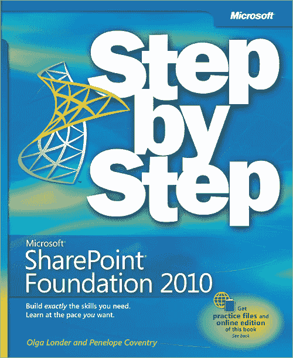

## 关于补充文件的说明

本书的补充文件和示例可在 [`examples.oreilly.com/9780735627260-files/`](http://examples.oreilly.com/9780735627260-files/) 找到。请使用标准的桌面浏览器访问这些文件，因为某些电子阅读器设备可能无法访问。

书中引用的所有代码文件或示例都可以在线获取。对于附带光盘的纸质书，我们尽可能地发布了所有 CD/DVD 内容。请注意，尽管我们通过免费下载提供了尽可能媒体内容，但有时受许可限制的限制。请将任何问题或疑虑发送至 `booktech@oreilly.com`。

## 致谢

本书是许多人共同努力的结果。我们首先要感谢微软出版社的 `Kim Spilker` 和 `Devon Musgrave`，他们最初联系我们讨论更新本书的前一个版本，并为项目的启动提供了无价的帮助。

其次，我们要感谢来自代理机构 Studio B 的 `Neil Salkind`，他在解决合同问题、进行组织安排方面表现出色，并在项目关键节点提供了极佳建议，帮助我们使这本书成为现实。

接下来，我们要感谢我们的贡献作者 `Mirjam van Olst`、`Nikander` 和 `Margriet Bruggeman`、`Kay McClure` 以及 `Brett Lonsdale`，他们加入帮助我们满足出版截止日期，他们的知识和经验极大地丰富了本书。

在微软出版社，我们的项目编辑 `Rosemary Caperton` 以耐心和专业的精神监督了项目，确保了书籍准时出版，同时始终为我们提供贴心的帮助，对此我们深表感谢。

我们感谢 Custom Editorial Productions 的 `Linda Allen` 及其团队、我们的校对编辑 `Susan McClung` 以及我们的技术编辑 `Todd Meister`，感谢他们的专业精神、幽默感以及在解决项目可能面临的每一个挑战时表现出的积极态度。

最后，但同样重要的是，我们要感谢我们各自的丈夫 `Gregory` 和 `Peter`，感谢他们无所不在的支持和鼓励，并感谢他们在我们在晚上和周末编写本书期间对我们的包容。

诚挚地，

`Olga Londer` 和 `Penelope Coventry`

## 本书的特点和约定

本书旨在引导您一步步完成您可能在 Microsoft SharePoint Foundation 2010 中想要执行的许多任务。如果您从开始开始完成所有的练习，您将获得足够的熟练度来创建和使用各种 SharePoint Foundation 功能。然而，每个主题都是自包含的。如果您以前用过旧版本的 SharePoint Foundation，或者在完成所有练习后以后需要记住如何执行某个过程，本书的以下功能将帮助您定位特定信息：

- **详细目录**：搜索每个章节内的主题列表和侧边栏。
- **章节页签标签**：轻松找到您需要的章节开头。
- **特定主题的页眉**：在章节内，通过查看奇数页顶部的页眉快速定位您想要的主题。
- **详细索引**：在索引中查找特定的任务和功能，该索引是针对读者精心设计的。

通过理解 *逐步入门* 系列如何显示操作指令，您可以阅读本书时节省时间。

| 约定 | 含义 |
| --- | --- |
| **练习文件** | 这些段落提供了在进行练习时将使用的练习文件信息。 |
| **设置和注意** | 这些段落位于练习之前，指示了开始练习前需要注意的要求或应采取的操作。 |
| **清理** | 这些段落位于练习之后，提供了保存并关闭打开的文件或程序的说明。 |
| **1 2** | 蓝色数字步骤引导您完成每个主题中的实际操作。 |
| **1 2** | 黑色数字步骤引导您完成侧边栏和说明性文本中的过程。 |
| **重要** | 这些段落指出了完成过程需要的信息。 |
| **注意** | 这些段落描述了值得特别关注的信息。 |
| **另参** | 这些段落引导您查看本书或其他地方关于主题的更多信息。 |
| **提示** | 这些段落提供了实用的提示或快捷方法，使任务处理更容易。 |
| **故障排除** | 这些段落说明如何修复可能阻止您继续练习的常见问题。 |
| **CTRL+G** | 键之间的加号 (`+`) 表示必须同时按下这些键。例如，“按下`CTRL+G`”意味着您应该按住`CTRL`键的同时按下`G`键。 |
| **按钮图片** | 按钮图片会在章节中首次使用该按钮时出现在页边。 |
| 蓝色粗体斜体 | 重要术语采用此类格式设置。 |

## 使用练习文件

在完成书中的练习之前，您需要将该书的练习文件复制到您的计算机上。这些练习文件以及其他信息可以本书的目录页下载，该页面位于：[`go.microsoft.com/fwlink/?Linkid=206096`](http://go.microsoft.com/fwlink/?Linkid=206096)。

下表列出了执行书中练习练习所需的练习文件。

| 章节 | 文件 |
| --- | --- |
| 第 1 章 | 无练习文件 |
| 第 2 章 | `Chapter02_Starter.wsp` |
| 第 3 章 | 无练习文件 |
| 第 4 章 | 无练习文件 |
| 第 5 章 | `OakChest.docx` `OakDesk.docx` `OakEndTable.docx` `OakNightStand.docx` `Pjcov.jpg` `WideWorldInvoice.docx` `WideWorldPurchaseOrder.xsn` |
| 第 6 章 | `Chapter06_Starter.wsp` `Pjcov.jpg` |
| 第 7 章 | 无练习文件 |
| 第 8 章 | `Contoso Proposal.docx` `ProposalsTemplate.docx` `WideWorldImportersLogo.png` |
| 第 9 章 | `Chapter09_Starter.wsp` |
| 第 10 章 | 无练习文件 |
| 第 11 章 | 无练习文件 |
| 第 12 章 | 无练习文件 |
| 第 13 章 | `Chapter13_Starter.wsp` |
| 第 14 章 | `ExpImpWideWorldImporters2010.accdb` `Furniture_Price.xlsx` `MoveWideWorldImporters.accdb` `Sales_Figures.xlsx` |
| 第 15 章 | `Chapter15_Starter.wsp` `Purchase Order Template.xsn` |
| 第 16 章 | `Chapter16_Starter.wsp` |

除了执行练习所需的文件外，以下文件包含参考信息，将提高您充分利用本书和 Microsoft SharePoint Foundation 的能力：

- `SharePoint2010EditionComparison.xlsx` 文件提供了 SharePoint 2010 各不同版本的对比，该文件位于`Chapter01`练习文件夹中。
- `SharePoint_Command_Mapping_Guide.xslx` 文件提供了 SharePoint Foundation 2010 丝带参考，该文件位于`Chapter02`练习文件夹中。

## 软件要求

本节详细列出了对您的客户端计算机和运行 SharePoint Foundation 2010 的服务器的软件要求。

### 重要

在执行书中的练习之前，您必须能够访问服务器上的 SharePoint Foundation 2010 安装。

### 客户端计算机

要执行书中的练习，您的客户端计算机应满足以下要求：

- 操作系统
  - 推荐使用 Windows 7。不过，您也可以使用 Windows Vista、Windows XP、Windows Server 2008 或 Windows Server 2003。
- 软件
  - 推荐使用 Internet Explorer 8 或更高版本；不过，您可以使用 Internet Explorer 7。其他浏览器（如 Mozilla Firefox 和 Safari）可以在某些限制下使用。有关限制列表，请参阅 [`technet.microsoft.com/en-gb/library/cc288142.aspx`](http://technet.microsoft.com/en-gb/library/cc288142.aspx)。
  - Microsoft Word 2010、Microsoft Outlook 2010、Microsoft Excel 2010、Microsoft Access 2010 和 Microsoft InfoPath 2010。
- 磁盘空间
  - 建议为练习文件提供 10 兆字节 (MB) 的可用硬盘空间。

### 服务器部署

要执行书中的练习，您应该能够访问 SharePoint Foundation 2010 部署，可以是单服务器安装、场部署或托管服务。服务器应满足以下要求：

- 操作系统
  - Windows Server 2008 Standard、Enterprise、Data Center 或 Web Server。
- 软件
  - .NET Framework 3.5。
  - SharePoint Foundation 2010。

### 另参

有关 SharePoint Foundation 2010 的完整硬件和软件要求，请参阅 SharePoint 2010 [`technet.microsoft.com/en-gb/library/cc288142.aspx`](http://technet.microsoft.com/en-gb/library/cc288142.aspx)。

## 安装练习文件

在可以使用这些练习文件之前，您需要将练习文件安装在硬盘上的正确位置。练习文件的默认位置是`Documents\Microsoft Press\SPF_SBS`。

### 重要

如果您将练习文件安装在默认位置以外，则需要在说明中替换路径。

要将练习文件安装到默认位置，请按照以下步骤操作：

1. 在 Windows 栏上点击**开始**按钮，然后点击**文档**。打开资源管理器。
2. 在**文档**文件夹中，右键点击并选择**新建 - 文件夹**。将新文件夹命名为`Microsoft Press`。如果`Microsoft Press`文件夹已存在，请跳过此步。
3. 双击`Microsoft Press`文件夹打开它。在`Microsoft Press`文件夹中创建一个新文件夹并命名为`SPF_SBS`。
4. 打开浏览器并导航到本书的目录页：[`go.microsoft.com/fwlink/?Linkid=206096`](http://go.microsoft.com/fwlink/?Linkid=206096)。
5. 在本书的目录页上，点击**练习文件**链接。
6. 在**练习文件**页面上，点击**下载练习文件**。打开文件下载对话框。
7. 在**文件下载**对话框中，点击**保存**。打开另存为对话框。
8. 在**另存为**对话框中，选择**桌面**，然后点击**保存**。
9. 在桌面上找到`SharePointFoundation2010SBS.zip`文件右键点击并选择**提取所有**。启动压缩文件夹提取程序。
10. 点击**浏览**并导航到您在第 1–3 步中创建的`Documents\Microsoft Press\SPF_SBS`文件夹。
11. 确保勾选了“完成后显示提取出的文件”选项，然后点击**提取**。打开资源管理器。
12. 在资源管理器中，验证`Documents\Microsoft Press\SPF_SBS`下已创建了各个章节文件夹，并且练习文件已提取到相应的章节文件夹中。

### 清理

关闭浏览器，然后关闭资源管理器。

## 使用练习文件

本书的练习文件存储在硬盘上`Documents\Microsoft Press\SPF_SBS`下的章节子文件夹中。章节中的每个练习都包含一个段落，列出了该练习所需的文件，并解释了在开始练习之前所需的任何准备工作。

只要可能，我们每个章节都从一个标准的 SharePoint Foundation 团队站点（Team site）开始，该站点有时必须是一个顶级团队站点。如果你按照顺序执行所有章节中的所有练习，你就不需要为每个章节都开始一个新的团队站点。对于大多数章节，你可以在整本书中使用同一个站点。

然而，如果你选择独立地进行练习而不按顺序执行，那么会有一些练习依赖于书中较早执行的其他练习。如果是这种情况下，我们会你先决练习在书中的所在位置，以便你能够完成这些先决练习。但是，你可能不想做这些先决练习，这时启动 WSP 文件就会派上用场了。

如果你有足够的权限，可以从章节练习文件夹中提供的启动 WSP 文件创建一个新的练习站点（参见下文，标题为“使用 WSP 模板”的节）。启动 WSP 文件包含了你在练习过程中所需的列表、库、文件和页面。生成的子站点将在需要的地方已经替你完成了先决练习。对于某些需要根据 WSP 文件创建站点的章节，我们会在章节开始时告诉你，需要从该章节的启动 WSP 文件安装练习站点。

某些章节的练习除了标准团队站点外还使用了子站点。如果是这种情况，该章节的练习文件夹中包含一个用于子站点的 WSP 文件。

## 使用 WSP 模板

要根据启动 WSP 文件为章节创建练习站点，请执行以下步骤：

### 注意事项

**务必验证**你是否有足够的权限上传到站点集合的站点模板库。如果有疑问，请参阅书末尾的附录 A。

1. 在浏览器中，打开你想要上传 WSP 文件的顶级 SharePoint 站点。如果提示，输入你的用户名和密码，并点击`OK`。
2. 在`Site Actions`菜单上，点击`Site Settings`。显示顶级站点的`Site Settings`页面。
3. 在`Galleries`节下，点击`Solutions`。显示`Solution Gallery – Solutions`页面。
4. 在`Solution Gallery – Solutions`页面上，点击功能区（Ribbon）上的`Solutions`选项卡，然后点击`Upload Solution`按钮。显示`Solution Gallery – Upload Solution`对话框。
5. 在`Solution Gallery – Upload Solution`对话框中，点击`Browse`按钮。
6. 在`Choose File to Upload`对话框中，导航到练习文件文件夹`Documents\Microsoft Press\SPF_SBS\ChapterNN`（其中`NN`是章节数），点击你想用于创建新站点的 WSP 文件，然后点击`Open`按钮。
7. 在`Solution Gallery – Upload Solution`对话框中，点击`OK`完成上传。显示`Solution Gallery – Activate Solution`对话框。
8. 在`Solution Gallery – Activate Solution`对话框中，在`View`选项卡上，点击`Activate`。显示`Solution Gallery – Solutions`页面。验证站点 WSP 文件已上传。

你现在可以根据上传的 WSP 模板创建一个新的练习子站点，如下：

1. 浏览到你想作为新练习站点父站点的 SharePoint 站点。
2. 在`Site Actions`菜单上，点击`New Site`。出现`Create`对话框。
3. 在`Create`对话框的中间面板中，点击现在可用的`ChapterNN`启动站点模板，然后点击`More Options`。
4. 在`Title`文本框中，为新站点输入一个逻辑名称。如果你喜欢，只需提供章节数，例如`Chapter09`。
5. 可选地，在`Description`文本框中输入描述，例如`SharePoint SBS Chapter 9 Practice Site`。
6. 在`URL name`文本框中重复你在`Title`文本框中输入的相同名称。
7. 你可以将所有其他选项保持默认值。点击`Create`按钮。

新的练习站点已创建并显示了其主页。

### 清理

关闭浏览器。

## WSP 模板

要从解决方案库中删除章节启动 WSP 模板，请执行以下步骤。

### 注意事项

**务必验证**你是否有足够的权限从站点集合的解决方案库中删除 WSP。如果有疑问，请参阅书末尾的附录 A。

1. 在浏览器中，打开你之前上传 WSP 文件的顶级 SharePoint 站点。如果提示，输入你的用户名和密码，并点击`OK`。
2. 在`Site Actions`菜单上，点击`Site Settings`。显示`Site Settings`页面。
3. 在`Galleries`节下，点击`Solutions`。显示`Solution Gallery – Solutions`页面。
4. 在`Solution Gallery – Solutions`页面上，将鼠标悬停在你想删除的模板上，点击右侧出现的箭头以显示上下文菜单。在上下文菜单上，点击`Deactivate`。显示`Solution Gallery – Deactivate Solution`对话框。
5. 在`Solution Gallery – Deactivate Solution`对话框中，在`View`选项卡上，点击`Deactivate`。


6. 在`Solution Gallery – Solutions`页面上，再次将鼠标悬停在你想删除的模板上，点击右侧出现的箭头以显示上下文菜单。在上下文菜单上，点击`Delete`。在确认消息框中，点击`OK`完成站点模板删除。再次显示`Solution Gallery – Solutions`页面。验证练习站点模板已删除。

7. 重复步骤 4–6 以删除你不再需要的每个练习站点模板。

### 清理

关闭浏览器。

# 删除练习站点

如果你创建了不再需要的练习站点，可以删除它。执行以下步骤删除练习站点。

### 注意事项

务必验证你是否有足够的权限删除站点。如果有疑问，请查看书末尾的附录 A。

1. 在浏览器中，打开你想删除的 SharePoint 站点。如果提示，输入你的用户名和密码，并点击`OK`。

2. 在`Site Actions`菜单上，点击`Site Settings`。显示`Site Settings`页面。

3. 在`Site Actions`节下，点击`Delete this site`。显示`Delete This Site`确认页面。

4. 点击`Delete`按钮删除站点。

5. 在出现的消息框中，点击`OK`确认删除站点。

站点已删除。

### 清理

关闭浏览器。

# 删除练习文件

在完成此书的练习后，你可以通过删除从书籍目录页安装的练习文件来释放磁盘空间。此过程将删除已下载的文件，以及你在练习过程中在特定章节文件夹中可能创建的文件。遵循以下步骤：

1. 在 Windows 任务栏上，点击`Start`按钮，然后点击`Documents`。打开 Windows 资源管理器。

2. 在`Documents`文件夹中，双击`Microsoft Press`文件夹打开它。

3. 在`Microsoft Press`文件夹中，右单击`SPF_SBS`文件夹并选择`Delete`。

4. 在`Delete Folder`消息框中，点击`Yes`确认你想将此文件夹移动到回收站。

5. 如果 Microsoft Press 文件夹不为空且包含其他书籍的练习文件，请跳到下一步。然而，如果 Microsoft Press 文件夹是空的，请参考步骤 3–4 中的说明将其删除。

6. 在 Windows 资源管理器中，导向到`Desktop`（桌面）。右键点击压缩文件夹`SharePointFoundation2010SBS.zip`并选择`Delete`。在“删除文件夹”对话框中，点击`Yes`以确认您想要将此文件夹移动到`Recycle Bin`。

您已删除了本书的练习文件。

### 清理

关闭 Windows 资源管理器。

# 访问由 Safari 托管的在线版

书后附带的优惠券可让您访问该书籍的在线版。（除了在线访问和阅读书籍外，您还可以将书籍的在线版下载到您的计算机；下载说明将在下一节提供。）

要访问您的在线版，请执行以下步骤。

1. 在封底找到您的优惠券，并刮开金属箔以显示您的访问码。

2. 访问[`microsoftpress.oreilly.com/safarienabled`](http://microsoftpress.oreilly.com/safarienabled)。

3. 在步骤 1 下的`Coupon Code`字段中输入您的 24 位字符访问码。

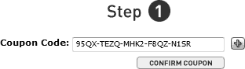

### 注意

此图像中的访问码仅供说明使用。

4. 点击`CONFIRM COUPON`按钮。

将出现一条消息告知您代码输入正确。如果代码输入不正确，系统将提示您重新输入代码。

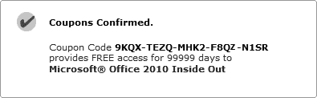

5. 在此步中，系统将询问您是否是 Safari Books Online 的新用户或现有用户。请继续步骤 5A 或步骤 5B。

|  |  |
| --- | --- |
| **5A.** | 如果您已拥有 Safari 账户，点击步骤 2 下的`EXISTING USER – SIGN IN`按钮。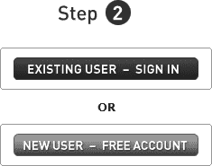 |
| **5B.** | 如果您是新用户，点击步骤 2 下的`NEW USER – FREE ACOUNT`按钮。 |
|  | 您将被带到“注册新账户”页面。 |
|  | 完成注册表单并接受最终用户协议。 |
|  | 完成后，点击`CONTINUE`按钮。 |

6. 在`Coupon Confirmation`页面上，点击`My Safari`按钮。

7. 在`My Safari`页面上，查看`Bookshelf`区域并点击您想要访问的书籍标题。

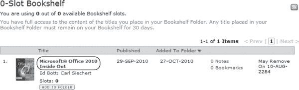

# 将在线版下载到您的计算机

除了阅读书籍的在线版外，您还可以将其下载到计算机中。首先，按照前一节中的步骤操作。然后执行以下步骤。

1. 在上一节步骤 7 后出现的页面上，点击`Extras`标签页。

2. 找到“Download the complete PDF of this book”并点击书名。

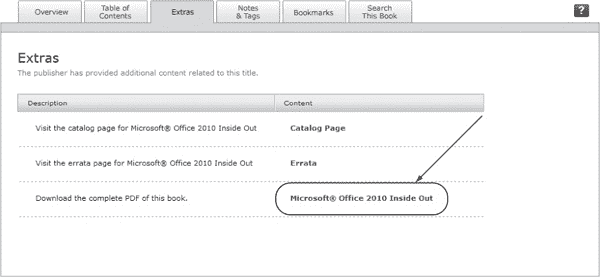

将打开一个新的浏览器窗口或标签页，随后会出现`File Download`对话框。

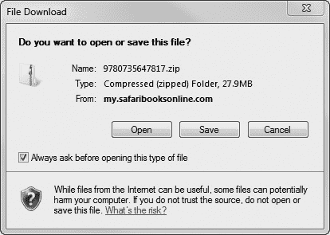

3. 点击`Save`。

4. 选择`Desktop`并点击`Save`。

5. 在桌面找到`.zip`文件。右键点击该文件，点击`Extract All`，然后按照说明操作。

### 注意

如果您的优惠券或访问码出现问题，请联系 Microsoft Press 书籍发行商 O’Reilly Media，邮箱`mspbooksupport@oreilly.com`或拨打`800-889-8969`。

# 获取支持和提供反馈

## 获取本书及其练习文件的帮助

书中提到的练习文件可以通过网络下载。欲了解更多信息，请参书开头的`Using the Practice Files`。

## 错误报告

我们尽确保本书及其配套内容的准确性。如果您确实发现了错误，请在我们的 Microsoft Press 网站上报告：[`Oreilly.com`](http://Oreilly.com)：

1. 访问[`microsoftpress.oreilly.com`](http://microsoftpress.oreilly.com)。

2. 在`Search`框中，输入书籍的`ISBN`或标题。

3. 从搜索结果中选择您的书籍。

4. 在书籍的目录页上，封面图像下方您将看到一个链接列表。

5. 点击`View/Submit Errata`。

## 额外支持

您可以在书籍的目录页找到有关书籍的额外信息和服务：[`go.microsoft.com/fwlink/?Linkid=206096`](http://go.microsoft.com/fwlink/?Linkid=206096)。如果您需要额外支持，请发送电子邮件至 Microsoft Press 书籍支持：`mspbooksupport@oreilly.com`。

## 获取本书及其练习文件的帮助

书中提到的练习文件可以通过网络下载。欲了解更多信息，请参书开头的`Using the Practice Files`。

## 获取 SharePoint 2010 的帮助

如果您的问题是关于 SharePoint 2010 的（而不是关于本书的内容），请在微软支持或微软知识库中搜索：[`support.microsoft.com`](http://support.microsoft.com)。

在美国，微软知识库未涵盖的微软软件支持问题将由微软支持服务处理。微软支持服务提供的微软软件支持选项列于：[`support.microsoft.com/gp/selfoverview/`](http://support.microsoft.com/gp/selfoverview/)。

# 我们想听听您的意见

在 Microsoft Press，您的满意度是我们的首要任务，您的反馈是我们最宝贵的资产。请告诉我们您对这本书的看法：[`www.microsoft.com/learning/survey`](http://www.microsoft.com/learning/survey)。

调查很短，我们会阅读每一条意见。提前感谢您的投入！

# 保持联系

让我们保持交流吧！我们在 Twitter 上：[`twitter.com/MicrosoftPress`](http://twitter.com/MicrosoftPress)。

# 第 1 章 SharePoint Foundation 2010 简介

**章节概览**

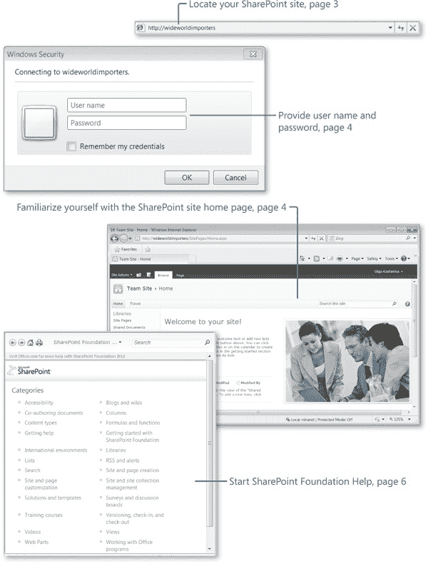

| 本章中，您将学习 |
| --- |
| ✓ 什么是 SharePoint Foundation。 |
| ✓ SharePoint Foundation 如何实现团队协作与共享。 |
| ✓ SharePoint Foundation 中哪些用户权限。 |
| ✓ SharePoint Foundation 与 Windows SharePoint Services 之间的区别。 |
| ✓ Office 如何与 SharePoint Foundation 集。 |
| ✓ SharePoint Foundation、SharePoint Server 2010 和 SharePoint Designer 2010 之间的关系。 |

在现代业务环境中，由于拥有随时随地协助客户的分布式员工，团队成员之间需要比以往任何时候都更加密切联系。有效的协作变得越来越重要；但通常难以实现。Microsoft SharePoint Foundation 将各种协作和通信技术集成到单一基于 Web 的环境中并与 Microsoft Office 等桌面应用程序轻松集成，从而解决了这个问题。

在本章中，您将学习什么是 SharePoint Foundation 以及它如何与 Office 协作，为用户和团队提供增强的效率环境。您还将学习 SharePoint Foundation 与其前身 Microsoft Windows SharePoint Services 的区别，以及 SharePoint Foundation、SharePoint Server 2010 和 SharePoint Designer 2010 之间的关系，以及如何判断哪种产品适合您的需求。

本书中的练习涉及一家名为 Wide World Importers 的虚拟企业。在这些场景中，Wide World Importers 正在建立一个 SharePoint 环境用于团队协作和信息共享。共有四个人参与该环境的搭建和内容提供：Wide World Importers 的所有 Olga Kosterina；她的助理 Todd Rowe；首席采购员 Bill Malone 以及帮助台技术人员 Peter Connelly。

### 练习文件

完成本章的练习不需要任何练习文件。

# 什么是 SharePoint Foundation？

SharePoint Foundation 2010 是一项让各种规模的组织和业务部门提高团队生产力并增加流程效率的技术。SharePoint Foundation 作为免费下载提供，为您提供了一套强大的工具集，用于组织信息、管理文档并提供强大的协作环境。

### 另另

有关安装 SharePoint Foundation 的系统要求，请参阅`http://technet.microsoft.com/en-gb/library/cc288955.aspx`。

SharePoint Foundation 通过提供允许用户轻松访问所需人员、文档和信息的架构，帮助团队保持联系并高效工作。通过 SharePoint Foundation，团队可以创建网站来共享信息并促进与其他用户的协作。您可以通过 Web 浏览器以及 Office 等桌面应用程序访问存储在 SharePoint 站点中的内容。

## 团队协作与共享

SharePoint 站点提供了捕捉和共享想法、信息、通信和文档的地方。这些站点促进团队参与讨论、共享文档协作、博客、使用 wiki 构建知识库以及调查。文档协作功能允许对文档进行简单的签入（check-in）和签出（checkout）、文档版本控制以及恢复之前的版本，以及文档级安全管理。

### 提示

`blog`（博客）或网络日志是一种在线日记。博客站点允许被称为`bloggers`的日记作者发布读者可以进行评论的文章。

`Wiki`（读音为`wee-kee`）是一种网络环境，允许 Web 浏览器用户快速方便地添加和编辑显示在网页上的文本和链接。`wiki`一词源于夏威夷语`wikiwiki`，意为“快速”。例如，wiki 站点可以用于构建知识库、社区资源或在线百科全书（如 Wikipedia）。

### 另另

有关博客的更多信息，请参阅`第 12 章`。有关 wiki 的更多信息，请参阅`第 6 章`。

一个 SharePoint 站点可以有许多子站点，其在 Web 服务器上的层次结构类似于文件系统上的文件夹层次结构——这是一个树形结构。类似于在文件系统的文件夹中存储文件，您可以将文件存储在 SharePoint 站点中。然而，SharePoint 站点将文件存储提升到了新水平，为团队协作提供了社区，并让用户协作文档、任务、联系人、活动、日历、wiki 以及其他项目。这种团队协作环境可以极大提高个人和团队的生产力。

SharePoint Foundation 提供的协作工具易于使用，因此您可以更有效地与同事共享文件和信息。您可以出于任何目的创建和使用 SharePoint 站点。例如，您可以建立一个站点作为团队的主页网站，创建一个站点以方便组织会议，或者创建一个 wiki 站点来收集团队知识。一个典型的 SharePoint 站点可能包含各种有用工具和信息，例如共享文档库、联系人、日历、任务列表、讨论以及信息共享和可视化工具。

SharePoint 站点用户可以通过电子邮件和即时消息找到并与关键联系人和专家进行交流。站点内容可以轻松搜索，用户还可以在现有文档和信息发生更改或添加新内容时收到提醒。自定义的业务流程可以附加到文档上。用户可以自定义站点内容和布局，针对特定主题向特定用户展示针对性信息。

在此练习中，您将找到您的 SharePoint 站点并熟悉其主页。

### 设置

打开浏览器。

1. 在浏览器的`Address bar`（地址栏）中输入您的 SharePoint 站点统一资源定位符（URL）或位置：`http://<yourservername/path>`。

   URL 中的`yourservername`部分是您在在本书中练习中使用的 SharePoint 服务器名称。路径部分可能是空的，也可能包含您 SharePoint 服务器上站点层次结构中的一个或多个层级。如果您不确定 SharePoint 站点的位置，请咨询您的 SharePoint 管理员。

   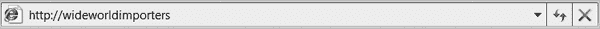

   ### 重要提示

   对于书中的练习，我们使用位于服务器`wideworldimporters`的站点。其 URL 为`http://wideworldimporters`。然而，在您的环境中，您将使用安装在不同服务器上的不同站点。在整本书中，您需要使用您的站点位置`http://<yourservername/path>`来替换`http://wideworldimporters`。

2. 如果出现提示，输入您的用户名和密码。

   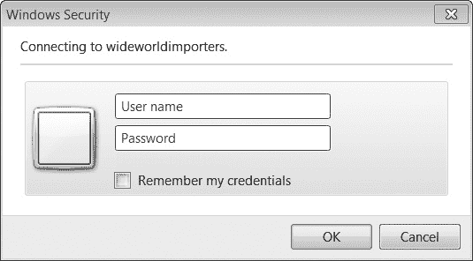

3. 点击`OK`。

   您的站点主页出现了。虽然它看起来与 Wide World Importers 时使用的典型 SharePoint 团队站点有所不同，但它很可能包含指向各种信息的链接以及 SharePoint 提供的信息共享工具。

   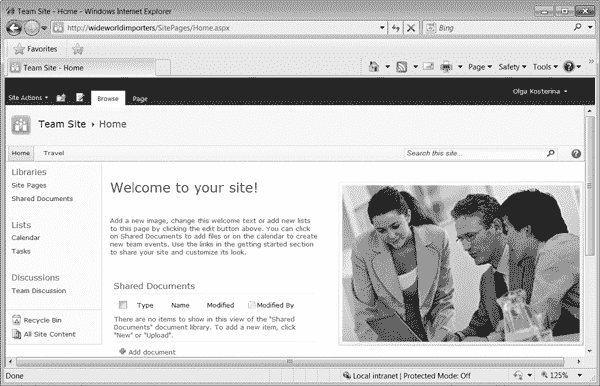

   在页面左侧，您可能会看到指向以下一个或多个的链接：库（Libraries）、列表（Lists）和讨论（Discussions）。这些常用资源的链接集合被称为`Quick Launch`（快速启动）。正如名称所示，Quick Launch 让您能够直接导航到所需的信息和工具。

   在 Quick Launch 下方，页面左侧，您可以看到指向回收站（Recycle Bin）和所有站点内容（All Site Content）的链接。包含 Quick Launch、回收站和所有站点内容的面板被称为`left navigation panel`（左侧导航面板）。

   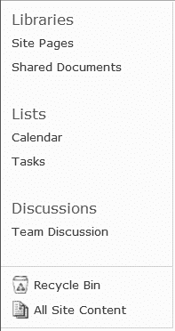


页面顶部的区域被称为`top navigation area`（顶部导航区域）。该区域包含显示在每个页面顶部的顶部链接栏。它由多个带有链接的标签组成，例如默认的首页（Home）标签。它还可能包含指向此网站子站点的链接的其他标签；例如，左侧的第二个标签写着`Travel`（旅行）。在我们的场景中，由于 Wide World Importers 的员工在全球范围内频繁旅行，该链接指向一个为 Wide World Importers 提供安排商务差旅所需信息和指南的子站点。

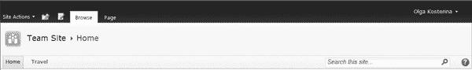

在顶部导航区域的左侧，有一个指向名为`Site Actions`菜单的链接。此菜单提供了各种更改站点的操作，包括站点配置。

### 重要提示

由于服务器上安全权限设置的方式，您的屏幕可能不包含站点所有部分的链接（例如`Site Actions`链接）。SharePoint 站点用户只能看到他们可以访问的站点部分：如果您无法访问站点的某部分，该链接将不会显示。要获得额外的访问权限，请联系您的 SharePoint 管理员。

4. 在页面右上角，点击带有问号的圆形帮助图标。SharePoint Foundation 帮助将在单独窗口中打开。

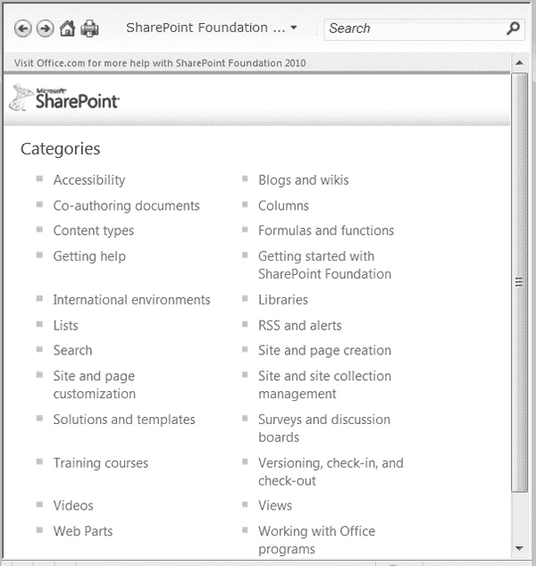

熟悉帮助类别和内容，然后关闭窗口。

### 清理

关闭浏览器。

### 另另

有关 SharePoint 导航的更多信息，请参阅第 2 章。

## SharePoint Foundation 用户权限

在 SharePoint Foundation 中，对站点的访问通过基于角色的系统控制，权限级别指定了用户在 SharePoint 站点上拥有的权限。这些权限决定了用户可以在站点上执行的特定操作；本质每个权限级别都是权限的集合。SharePoint Foundation 有五个默认权限级别：

* `Read`（读取）。此权限级别赋予您对网站的只读访问权限。
* `Contribute`（贡献）。除了`Read`权限级别包含的所有权限外，`Contribute`权限级别允许您在现有列表和文档库中创建和编辑项目。
* `Design`（设计）。除了`Contribute`权限级别包含的所有权限外，`Design`权限级别允许您创建列表和文档库、批准项目并在网站中编辑页面。
* `Full Control`（完全控制）。此权限级别赋予您完全控制权。
* `Limited`（限制）。`Limited`权限级别允许访问站点内的共享资源（例如特定的列表、文档库、文件夹、列表项目或文档），而不是整个站点的访问权限。

### 重要

对于书中的大多数练习，您将需要`Read`或`Contribute`权限级别。在介绍练习之前，我们将指示您验证自己是否具有足够的权限级别，特别是那些需要较高级别访问权限（如`Design`或`Full Control`）的练习。如果您不确定 SharePoint 站点上设置了哪些权限，请咨询您的 SharePoint 管理员。

### 另另

有关权限层级的更多信息，请参阅第 3 章。书末尾的附录 A 提供了权限及其相关权限级别的完整列表。

# SharePoint Foundation 的版本

SharePoint Foundation 2010 是 Microsoft Windows SharePoint Services 的演进版本。该技术的之前的版本包括：

* Windows SharePoint Services 3.0
* Windows SharePoint Services 2.0
* SharePoint Team Services

与之前的版本相比，SharePoint Foundation 提供了许多新的、增强的更新功能。特别是，它提供了一个更健壮、更易管理的协作平台，并显著增强了用户界面，包含一个新的上下文功能区（Ribbon）。新功能包括以下内容：

* 全新的用户界面，包含`SharePoint Ribbon`，它提供主要的命令界面，并旨在帮助您快速找到所需的命令。它与其它 Office 程序（如 Microsoft Word、Microsoft Excel 和 Microsoft PowerPoint）中的 Ribbon 类似。
* `Microsoft SharePoint Workspace 2010`允许您离线与 SharePoint 站点、库和列表进行工作。当您重新连接到网络时，更改将与实时站点同步。
* `Rich Text Editor`（富文本编辑器）允许您直接在 wiki 网页和博客文章中插入并格式化内容。
* `Themes Gallery`（主题库）中重新设计的主题允许您自定义站点的外观和视觉效果，并提供多种颜色选择。
* 共同创作功能允许您与团队成员同时处理同一份文档。
* 增强的日历功能，包括在页面内显示多个日历、项目的行内编辑以及在日历中拖拽。
* 改进了对 SharePoint 站点的移动访问。

此外，SharePoint Foundation 2010 包含了`Microsoft Business Connectivity Services`（`BCS`）），它实现了 SharePoint 与外部数据（包括业务应用程序）的集成。`BCS`将基于 SharePoint 的解决方案连接到外部数据源，并提供了一种基于数据定义外部内容类型的方法。使用新的`External list`（外部列表），`BCS`还允许您离线处理外部后端业务数据。

# Office 与 SharePoint Foundation 的集成

Office 2010 和 SharePoint 2010 旨在跨客户端和服务器创建一个集成的生产力环境。它们协同工作，为您提供了一系列无缝集成的能力。换句话说，许多 Office 命令、菜单和功能与 SharePoint Foundation 功能紧密集成。您不仅可以在浏览器中使用 SharePoint Foundation 功能，还可以在 Office 应用程序内部使用。Office 新的`Backstage view`（后台视图）功能提供了在 Office 应用程序上下文中显示 SharePoint 2010 功能的能力，包括访问文档库和 SharePoint 站点。例如，您可以创建一个新的 SharePoint 站点并将文件保存其中，而无需离开 Office 客户端应用程序。SharePoint 站点的协作内容——包括文档、列表、事件、日历、任务分配、博客、wiki 和成员名单——可以在 Office 应用程序中读取和编辑。

为了共享特定的文档或任务，SharePoint Foundation 提供了一个名为`Document Workspace`（文档空间）的特定站点环境。您可以从 Office 2010 应用程序或浏览器创建`Workspace`站点。在使用`Microsoft Word 2010`、`Microsoft Excel 2010`、`Microsoft PowerPoint 2010`、`Microsoft InfoPath 2010`和`Microsoft OneNote 2010`时，用户可以在处理存储在 SharePoint 站点中的文档的同时，在 Office 2010 应用程序内部创建`Workspaces`、发布并编辑文档以及分配任务。

### 另另

有关使用文档空间的更多信息，请参阅第 12 章。

Office 2010 包含一个新的`SharePoint Workspace 2010`客户端应用程序，它是`Office Groove`客户端的继任者。`SharePoint Workspace 2010`提供了离线处理 SharePoint 内容并在重新连接网络时同步更改的能力。在离线状态下，您可以查看、添加、编辑和删除库文档或列表项目。当连接到网络时，计算机和网络上的数据更新会自动进行，提供计算机与实时 SharePoint 站点、库和列表之间的双向同步。

此外，SharePoint Foundation 2010 提供了`Office Web Apps`的集成。`Office Web Apps`是 Word、Excel、PowerPoint 和 OneNote 应用程序在线版的统称，允许用户使用浏览器查看和编辑文档。`Office Web Apps`服务包括`Word Viewing Service`、`PowerPoint Service`和`Excel Calculation Services`，它们在 SharePoint Foundation 提供的环境中运行。

### 提示

`Office Web Apps`适用于拥有 Office 2010 批量许可的商业客户。

Office Web Apps（Office 网络应用）通过在浏览器中呈现 Office 文档，为您提供基于浏览器的查看和编辑体验。例如，当点击存储在 SharePoint 文档库中的文档时，文档将直接在浏览器中打开。文档在浏览器中的外观与其在 Office 客户端应用程序中的外观相似。虽然 Office Web App 提供的编辑功能比关联的 Office 客户端应用程序轻量，但用户可以使用 Office Web App 页面上的按钮在关联的客户端中打开文档进行编辑（如果客户端设备上安装了相应的应用程序）。在安装并配置了 Office Web Apps 的 SharePoint 站点上，您可以在连接到 SharePoint 站点的任何地方通过浏览器查看和编辑 Office 文档。

### 另另

有关 Office Web Apps 的更多信息，请参阅`[office.microsoft.com/en-gb/web-apps](http://office.microsoft.com/en-gb/web-apps)`。

不同版本的 Office 与 SharePoint Foundation 之间存在不同级别的集成。Office 2010 系列产品提供了与 SharePoint Foundation 紧密、原生、丰富且内置的集成。Office 2007 也与 SharePoint Foundation 良好集成，提供了 SharePoint 与 Office 客户端应用程序之间的上下文互操作性。早期版本的 Office（如 Office 2000 和 Office XP）提供了一些集成，但要简单基础得多。

Office 2000 提供了与 SharePoint Foundation 的文件保存集成。例如，您可以从 Office 2000 应用程序打开并保存存储在 SharePoint 站点上的文件，并在 Microsoft Outlook 2000 中接收提醒。Office XP 提供了额外的数据集成，包括对存储在 SharePoint 站点上的数据进行交互式访问。例如，您可以将 SharePoint 站点的列表数据导出到 Excel 2002，并查看存储在 SharePoint 站点上的文件的属性和元数据。然而，Office 2000 和 Office XP 与 SharePoint Foundation 的许多其他功能集成。例如，您无法使用 Office 2000 或 Office XP 应用程序创建工作空间（Workspace sites）。

### 提示

您可以使用浏览器在 SharePoint 站点上执行这些任务。

Office 2003 增加了集成功能。通过 Office 2003，您可以使用 SharePoint Foundation 创建文档和工作空间、组织团队会议和活动，并访问和分析来自 SharePoint 站点的数据。您还可以利用 Office 2003 与 SharePoint Foundation 之间的数据集成，在 SharePoint 站点之间移动数据，并创建与存储在 SharePoint 站点上的数据相关的数据库。

从 Office System 2007 开始，与 SharePoint Foundation 的集成得到了进一步增强。您可以直接在 Office 客户端应用程序内部与存储在 SharePoint 站点中的信息交互，无需手动下载内容。例如，使用 Word 2010 和 Word 2007，您可以在 SharePoint 博客站点创建并发布博客。Word 2010 和 Word 2007 允许您在 Word 内部将文档签入 SharePoint 库。

虽然所有 Office 2007 和 Office 2010 客户端应用程序都与 SharePoint Foundation 良好集成，但 Outlook 提供了最、功能丰富的集成。通过 Outlook 2010 和 Outlook 2007，您可以创建并管理用于共享文档和组织会议的站点。Outlook 2010 和 Outlook 2007 提供对 SharePoint 项（如日历、任务、联系人、讨论和文档）的读写权限以及离线支持。

### 另另

有关 SharePoint Foundation 与 Outlook 2010 之间集成的更多信息，请参阅`Chapter 13`。

# SharePoint 产品

SharePoint Foundation 2010、SharePoint Server 2010 和 SharePoint Designer 2010——统称为 SharePoint 2010 产品——促进了组织内部以及与合作伙伴和客户之间的协作。然而，这些每个产品都具有不同的功能集。

## SharePoint Foundation 和 SharePoint Server 2010

SharePoint Foundation 是适用于 Windows Server 2008 的系列服务，您可以使用它共享信息并与其他用户协作。它为文档管理提供了一个通用框架、存储所有类型文档的通用存储库以及一个协作应用程序的平台。

SharePoint Server 2010 构建在 SharePoint Foundation 之上。它通过为 SharePoint 站点提供灵活的组织和管理工具，并允许团队将信息发布到整个组织，扩展了 SharePoint Foundation。由于 SharePoint Server 2010 需要 SharePoint Foundation，因此 SharePoint Foundation 的所有功能在 SharePoint Server 2010 中均可用。然而，SharePoint Server 2010 提供了大量的额外的企业级功能：

* **站点（Sites）** 功能为您的所有内部和外部业务网站提供单一的基础设施支持。
* **社区（Communities）** 功能提供了强大的协作工具以及一个管理这些工具的单一平台。
* **内容（Content）** 功能使内容管理变得简单，包括文档类型、保留策略和自动内容排序等合规性功能。
* **搜索（Search）** 功能提供了相关性、细化和社交线索的独特组合，帮助您找到所需的信息并过滤掉杂乱。
* **洞察（Insights）** 功能让您可以访问数据库、报告和业务应用程序中的信息。它还可以帮助您定位做出决策所需的信息。
* **组合（Composites）** 功能提供了工具和组件，用于在无需编码的情况下创建自力为行的业务解决方案，以便您能够快速响应业务需求。

SharePoint Server 2010 有两个版本：标准版（Standard）和企业版（Enterprise），每个版本都具有不同的功能集。要决定您是只需要 SharePoint Foundation 还是 SharePoint Server 2010 的某个版本，您需要评估特定功能和机制如何满足您的需求。

### 重要说明

SharePoint Server 2010 不同版本与 SharePoint Foundation 之间的功能对比位于`Chapter01`文件夹下的`SharePoint2010EditionComparison.xls`表格，该文件可以从书籍目录页`[go.microsoft.com/fwlink/?Linkid=206096](http://go.microsoft.com/fwlink/?Linkid=206096)`下载。

## SharePoint Foundation 和 SharePoint Designer 2010

虽然 SharePoint Server 2010 和 SharePoint Foundation 提供了技术和平台，但 SharePoint Designer 2010 提供了定制 SharePoint 点的工具。SharePoint Designer 2010 是 SharePoint Designer 2007 的演进版本。它作为免费下载提供，并提供了丰富的站点定制工具，以及创建报告工具和应用程序模板的功能，无需编写代码。

### 另另

有关 SharePoint Designer 2010 的更多信息，请参阅`[sharepoint.microsoft.com/en-us/product/Related-Technologies/Pages/SharePoint-Designer.aspx](http://sharepoint.microsoft.com/en-us/product/Related-Technologies/Pages/SharePoint-Designer.aspx)`。

### 关键点

* SharePoint Foundation 提供了一套强大的用于信息共享和协作的工具。
* SharePoint 站点提供了捕捉和共享想法、信息、知识和文档的地方。
* 您可以通过浏览器或客户端应用程序（如 Office）访问存储在 SharePoint 站点中的内容。

SharePoint 站点的访问是通过基于权限级别的角色的系统进行控制的。五个默认权限级别是：读取、贡献、设计、完全控制和受限。

* 不同版本的 Office 与 SharePoint Foundation 之间存在不同程度的集成程度，其中 Office 2010 的集成最为紧密。


`SharePoint Server 2010`构建在`SharePoint Foundation`之上。除了`SharePoint Foundation`的功能外，`SharePoint Server 2010`还提供了其他重要的企业级功能，包括站点、社区、内容、搜索、洞察和组合组件。

# 第 2 章 导航 SharePoint 站点

## 本章概览

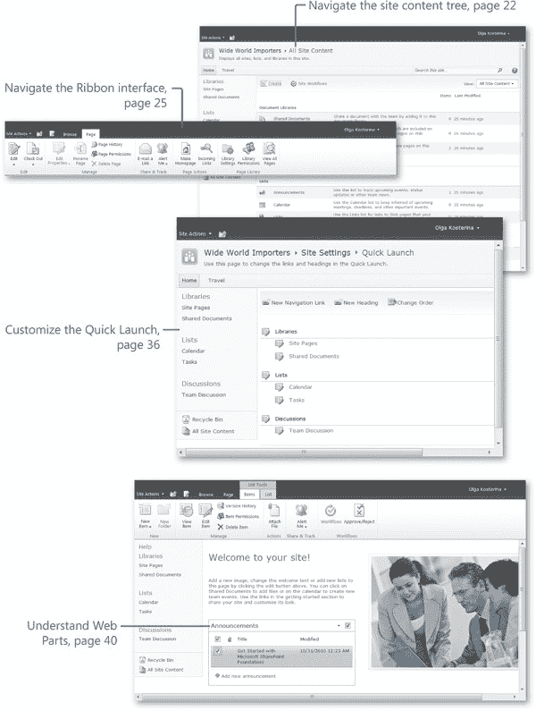

| 在本章中，你将学习如何 |
| --- |
| ✓ 导航首页和 SharePoint 站点。 |
| ✓ 导航站点内容树。 |
| ✓ 导航功能区带（Ribbon）界面。 |
| ✓ 浏览 SharePoint 站点上的列表。 |
| ✓ 浏览文档库。 |
| ✓ 自定义顶部导航区域。 |
| ✓ 自定义快速启动（Quick Launch）。 |
| ✓ 理解 Web 部（Web Parts）。 |
| ✓ 使用回收站。 |

一个典型的`Microsoft SharePoint Foundation`网站为你提供了一个基础设施，你的团队可以在其中进行通信、共享文档和数据并共同工作。不同类型的 SharePoint 站点具有不同的基础设施，例如团队站点、空白站点、文档工作区、小组工作站点、会议工作区和博客站点。团队站点的基础包括以下组件：

* **库 (Libraries)**。文档、图片、表单和 wiki 库是你与团队成员共享并工作的文件集。典型的团队站点包含一个名为“共享文档”的内置文档库。你可以根据需要创建自己的文档、图片和表单库。
* **列表 (Lists)**。通过 SharePoint 列表，你和团队成员可以在网站上对结构化的表格数据进行工作。典型的团队站点包含四个内置列表：公告、日历、链接和任务。`SharePoint Foundation`还提供了其他列表，如果需要你可以将其添加到站点中。你也可以创建自定义列表。
* **讨论板 (Discussion boards)**。讨论板提供了一个论坛，你和团队成员可以在其中发表评论并回复对方的评论。默认情况下，典型的团队站点带有一个名为“团队讨论”（Team Discussion）的内置讨论板。你可以根据需要创建自己的讨论板。
* **调查 (Surveys)**。调查提供了一种对团队成员进行调查的方法。SharePoint 站点没有内置调查，但你可以创建自己的。
* **回收站 (Recycle Bin)**。回收站允许你恢复从站点中删除的项目。

在本章中，你将学习如何导航 SharePoint 站点基础设施。你将从典型的 SharePoint 团队站点首页开始，然后学习如何浏览站点的层次结构。你还将学习如何使用功能区带并自定义站点导航，以及理解 Web 部件的概念。

### 练习文件

在完成本章的练习之前，你需要（1）从书籍目录页下载第 2 章练习文件到计算机上的以下文件夹：`Documents\Microsoft Press\SBS_SPF\Chapter02`；（2）使用`Chapter02_Starter.wsp`文件安装第 2 章练习站点。更多信息请参阅本书开头的使用练习文件。

### 注意

记住在练习中使用你的 SharePoint 站点位置来替换`http://wideworldimporters`。

# 导航首页和 SharePoint 站点

首页是 SharePoint 网站的主页；它提供了一种结构，将站点组件连接在一起的导航结构。通常，SharePoint 站点的首页有两个主要的导航区域：顶部导航区域（页面顶部的一条带）和左侧导航区域（页面左侧的一个面板）。


顶部导航区域包含顶部链接栏，它由显示在 SharePoint 站点内所有页面上的选项卡组成。顶部链接栏通常包含带有链接的选项卡：

* **首页 (Home)**。首页链接通常显示在左侧第一个选项卡上。它会打开站点的首页。
* **指向子站点的链接**。在组织良好的站点上，顶部链接栏包含指向当前站点子站点链接的选项卡，例如我们示例中第二个选项卡上的差旅链接。

### 注意

如果子站点被配置为从父站点继承顶部链接栏，那么子站点上的“首页”选项卡链接指向父站点的首页。

在顶部链接栏的右侧有一个搜索框，允许你搜索当前站点，以及“帮助”链接。

在顶部链接栏的正上方，你可以看到内容导航面包屑轨迹，它显示了当前页面在站点中的路径。内容导航面包屑帮助你跟踪当前页面在站点中的位置。面包屑轨迹上的组件是可以点击以打开相应页面的链接。面包屑轨迹上的最后一项显示当前页面的页面标题；它不是一个链接。

在屏幕的左上角，你可以看到“站点操作”链接。点击此链接可打开站点操作菜单，允许你编辑当前页面、将站点同步到 SharePoint Workspace、创建新站点或配置站点权限以及更改站点设置。站点操作菜单中显示的选项取决于你对站点的权限。

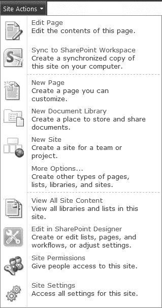

站点操作菜单上的查看所有站点内容链接将打开所有站点内容页面，列出站点上所有的库、列表、讨论板和调查。所有站点内容页面还提供了子站点和工作区的链接，以及站点的回收站。该页面是你站点的主要导航辅助，并包含指向基础设施主要部分的链接。

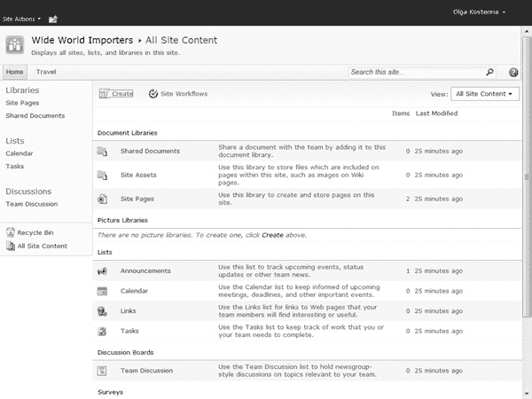

站点操作菜单上的站点设置链接将打开站点设置页面，允许你管理和自定义你的站点。

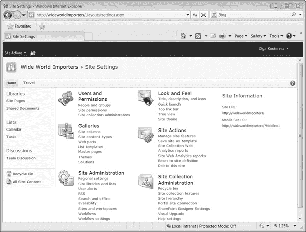

左侧导航面板通常包含一组快速启动链接、所有站点内容链接和回收站。

取决于站点的情况，快速启动包含一个或多个指向所有站点内容页面中信息子集的链接。这些子集称为视图，通过过滤所有站点内容页面中的信息创建（例如，仅显示当前站点内的列表或库）。快速启动还可以包含你和团队成员创建的站点组件链接，例如特定的文档库或列表。

通常，快速启动包含以下链接：

* **库 (Libraries)**。库链接打开所有站点内容页面视图，显示站点上所有的文档、表单和 wiki 库。在典型的团队站点中，快速启动还提供指向“共享文档”库的二级链接，以及一个“站点页面”库。
* **列表 (Lists)**。列表链接打开所有站点内容页面视图，显示站点上所有的列表。在典型的团队站点中，快速启动还提供指向“日历”和“任务”列表的二级链接。
* **讨论**。“讨论”链接将打开“所有站点内容”页面视图，显示您站点上所有的讨论区。在典型的团队站点中，快速启动（Quick Launch）还提供指向“团队讨论”板的二级链接。
* **站点**。“站点”链接将打开“所有站点内容”页面视图，显示您站点上的子站点。
* **图片**。“图片”链接将打开“所有站点内容”页面视图，显示您站点上的图片库。

左侧导航面板中的`所有站点内容`链接与站点操作菜单上的`查看所有站点内容`链接相同。此链接将您带到“所有站点内容”页面，该页面列出了站点上所有的库、列表、讨论区和调查，以及如果有的话，子站点。

最后，左侧导航面板包含指向`回收站`的链接，点击它可以打开站点的`回收站`。

除了顶部和左侧导航区域外，典型的 SharePoint 团队站点主页还包括欢迎消息、入门链接以及`共享文档`库的视图。该视图在它自己的页面组件中呈现，称为`Web 部`（Web Part），允许您在不离开主页的情况下处理此库中的文档。

在本次练习中，您将导航到“所有站点内容”页面，探索其组件和视图，然后返回站点主页。

### 设置

打开您的 SharePoint 站点（例如，`http://wideworldimporters`）。如果提示，输入您的用户名和密码，然后点击确定。

1. 在左侧导航面板中，点击`所有站点内容`。
2. 探索该页面。

   注意顶部的链接栏和快速启动没有变化。但是，面包屑导航路径发生了变化，显示了当前页的路径。

3. 滚动到页面底部，注意`所有站点内容`页面上列出的站点所有部分，包括文档库、列表、图片库、讨论区、调查、站点和工作空间以及`回收站`。

   您现在将以`文档库`视图显示此页面。

4. 向上滚动到顶部。打开位于页面右侧的`视图`菜单，选择`文档库`。

   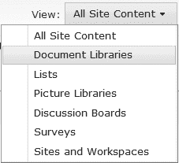

   显示所有站点内容页面的`文档库`视图。页面面的部分列出了站点上可用的文档库，包括站点默认存在的`共享文档`库。

   您现在将以`调查`视图显示所有站点内容页面。

5. 从`视图`菜单中选择`调查`。

   显示`调查`视图。页面面的部分列出了站点上创建的调查。Wide World Importers 站点尚未添加调查，因此此页面未显示任何调查。

6. 点击位于`所有站点内容`标题左侧的内容导航面包屑上的链接，返回站点主页。

### 清理

如果您将继续下一次练习，请保持浏览器打开状态。

# 导航站点内容树

一个典型的 SharePoint 站点包含以下组件：列表、库、讨论区、调查和网页。这些项目由`SharePoint Foundation`创建并维护，并在站点基础结构中相互链接。在图形化形式中，这种站点基础结构可以表示为树状图。

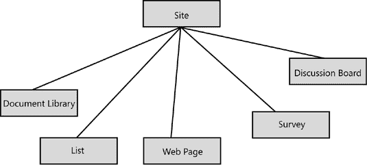

`SharePoint Foundation`维护了该结构中从站点主页到当前显示页面的路径。此路径在每个页面上以内容导航面包屑的形式显示，这是在上一个练习中引入的。

除了列表和库等自身组件外，SharePoint 站点可以有很多子站点。Web 服务器上这些子站点的层级结构类似于文件系统上的文件夹层级结构。没有父站点的站点称为顶级站点。顶级站点可以有多个子站点，这些子站点也可以有多个子站点，向下延伸到您所需的任意层级。顶级站点及其所有子站点的整个层次结构被称为站点集合。

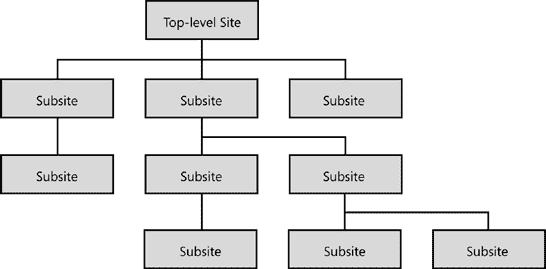

由于子站点包含在其父级站点中，SharePoint 站点的整体层级结构拥有自己的项目（例如列表、库、讨论区和调查）以及子站点。这种整体结构可以表示为站点内容树。

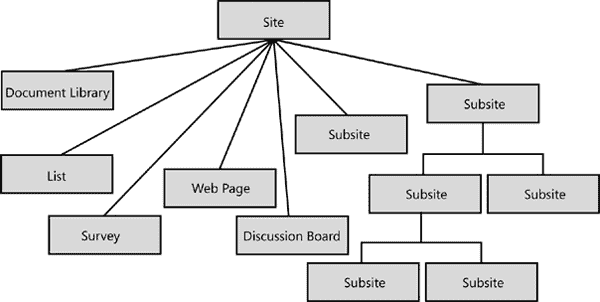

为了识别站点集合中的当前页面位置，`SharePoint Foundation`维护了一个全局导航路径，显示从顶级站点到当前页面的轨迹。此路径可以通过页面左上角的`向上导航`图标进行访问，该图标紧邻站点操作菜单的右侧。

点击`向上导航`图标将显示从顶级站点到您当前查看的页面的可点击路径，这样您始终知道自己在整个层级结构中的位置（从路径上顶部节点表示的顶级站点开始）。路径上的节点是链接。您可以点击任何节点，允许您从当前站点和当前站点集合内的当前页面向上导航。路径底部的最后一个节点标识当前页面且不是链接。

在本次练习中，您将查看您的 SharePoint 站点的子站点列表，导航站点层级结构，并探索内容导航面包屑和全局导航路径。

### 设置

打开您想要查看子站点的 SharePoint 站点。如果提示，输入您的用户名和密码，然后点击确定。

### 注意

**务必验证**您具有查看子站点的权限。如有疑问，请参书末的附录 A。

1. 在快速启动中点击`站点`。显示以`站点和工作空间`视图的所有站点内容页面。
2. 在`所有站点内容`页面上，点击`站点和工作空间`下的一个子站点。例如，在 Wide World Importers 站点，我们将前往“旅行”（Travel）子站点。
3. 在子站点主页上，在快速启动中，点击`库`下的`共享文档`。显示`共享文档`库页面。

   在`共享文档`库页面上，注意位于顶部栏上方的内容导航面包屑已发生变化，现在显示从子站点主页到当前页的路径。

   

4. 在页面顶部面包屑上方，点击`向上导航`图标。打开导航路径，显示当前页面在站点集合中的位置，从顶级站点开始。

   

5. 将鼠标悬停在路径上的节点上。文本会出现下划线，显示该节点是可点击链接。现在，将鼠标悬停在显示当前页面标题的底部节点上。鼠标指针变为文本光且没有下划线，显示该节点不是链接。
6. 点击指向父站点的节点。您将回到开始本次练习的站点主页。

### 清理

如果您将继续下一次练习，请保持浏览器打开状态。

### 另另

有关处理站点的更多信息，请参阅第 3 章。

在`SharePoint Foundation`中，功能区（Ribbon）提供了一个一致的界面，用于访问您完成任务所需的命令和工具。与其他 Microsoft Office 程序（如 Microsoft Word 和 Microsoft Excel）中的功能区一样，SharePoint 中的功能区显示了许多常用的命令和工具。在 SharePoint 站点上，功能区显示在网页顶部，旨在帮助您快速定位对页面、文档和列表执行操作的命令。

### 另见下

功能区界面对于此版本的 SharePoint 来说是全新的。在之前的版本中，命令和工具分布在不同的菜单和工具栏中。要查找您可能在之前的 SharePoint 版本中常用的菜单和工具栏命令的功能区位置，请参考`Documents\Microsoft Press\SBS_SPF\Chapter02`文件夹下的`SharePoint_Command_Mapping_Guide.xslx`。

功能区上的命令按逻辑分组，并在选项卡下一起显示。每个选项卡对应于您正在操作的 SharePoint 站点组件类型，例如文档库或网页。功能区上的选项卡、组和命令是上下文相关的：您可使用的功能区命令会根据您正在操作的内容以及您在 SharePoint 站点中的位置而变化。

选项卡显示在您站点网页的顶部。要使用功能区命令，您需要选择与要执行的任务类型对应的选项卡。当前选中的选项卡会被突出显示。每个选项卡根据您想要执行的操作提供一组特定的命令。

顾于名，“浏览”（Browse）选项卡允许您浏览当前页面。当您打开页面时会选中此选项卡，为您提供在浏览器中查看页的能力。顶部链接栏和内容路径导航会在浏览选项卡上显示。此选项卡没有关联基于功能区的工具。

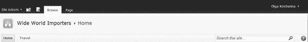

根据您正在查看的页面，其他选项卡将可用。例如，团队站点的主页提供了一个`页面`（Page）选项卡，允许您修改此及其设置。

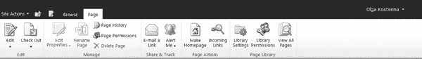

功能区上的命令以按钮、下拉列表和其他控件表示。为了方便您找到所需的命令，它们根据共同功能被分组到功能区的几个部分中。组的名称显示在功能区的底部。例如，在`页面`选项卡上，`编辑`（Edit）组包含提供您编辑页面能力的命令，而`管理`（Manage）组包含允许您管理页面的命令。

除了浏览选项卡外，列表页提供了两个组在`列表工具`（List Tools）选项卡集中的选项卡。第一个选项卡`项目`（Items）提供了一组用于单个列表项的命令。第二个选项卡`列表`（List）提供了处理整个列表的命令。同样，库页提供了两个选项卡——`文档`（Documents）和`库`（Library），它们组在`库工具`（Library Tools）选项卡集中的。

每个选项卡下可用的命令数量和类型不仅取决于您所在地和正在操作内容的上下文，还取决于您的权限级别和站点配置。功能区上的某些命令可能无效，因为您没有足够的权限使用它们，或者因为它们没有为您的站点启用。在其他情况下，要启用命令，您可能需要选择一个对象。例如，在文档库中，您必须先选择库中的文档才能启用处理该文档的功能区命令。

当显示功能区时，路径导航和顶部导航栏将不可见。在所有带有功能区的页面上，您可以使用以下导航辅助移动到站点和站点集内的其他页面：

* `向上导航`（Navigate Up）图标，提供从当前页面到站点顶层站点的点击路径
* `浏览`（Browse）选项卡，显示内容路径导航和顶部链接栏
* `站点操作`（Site Actions）菜单上的`查看所有站点内容`（View All Site Content）链接，带您进入所有站点内容页面

此外，在带有左侧导航面板的功能区页面上，可以使用快速启动（Quick Launch）和所有站点内容链接。

在接下来的练习中，您将探索 SharePoint 团队站点主页上的功能区。

### 设置

打开您想要探索功能区的站点，例如`http://wideworldimporters/`（如果尚未打开）。如果出现提示，输入您的用户名和密码，并点击确定。

### 注意

**务必**验证您有足够的权限编辑此站点的主页。如有疑问，请参书末的附录 A。

1. 在屏幕顶部找到`浏览`选项卡。注意此选项卡当前被选中，内容路径导航和顶部链接栏显示在顶部导航区域。
2. 在`浏览`选项卡的右侧，点击`页面`选项卡。

   功能区出现。它显示了允许您处理网页的命令。功能区是上下文相关的，您在此时无法使用的命令显示为置灰状态。

   探索功能区，并注意命令被分组在功能区的各个部分。每个组的名称可以在功能区的底部找到。

3. 在`编辑`组中，点击`编辑`按钮。`编辑工具`（Editing Tools）选项卡集出现在`页面`选项卡的右侧。它包含两个选项卡：选中的`文本格式`（Format Text）选项卡和`插入`（Insert）选项卡。`文本格式`选项卡显示了允许您更改和格式化页面文本的按钮和下拉列表。


4. 在`编辑工具`中，点击`插入`选项卡。功能区上的命令集发生变化，显示向当前页面插入不同对象的按钮。要插入的对象类型由功能区组的名称标识，例如表格（Tables）或链接（Links）。

   

5. 点击`页面`选项卡打开它。注意`编辑`组中的`编辑`按钮已被`保存并关闭`（Save & Close）按钮取代。因为功能区是上下文相关的，它根据您之前的操作，为您提供此时适用的命令。

   

6. 点击`保存并关闭`。`页面`选项卡关闭，当前页面返回`浏览`选项卡，该选项卡用内容路径导航和顶部链接栏取代功能区。

### 清理

如果您继续下一个练习，请保持浏览器打开。

# 浏览 SharePoint 上的列表

SharePoint 列表是基于 Web 的可编辑表格。SharePoint 列表为您和您的团队提供了处理结构化数据的能力。正如我们讨论过的，典型的团队站点提供四个默认列表：

- **公告**（Announcements）：公告列表是为团队发布信息的地方。
- **日历**（Calendar）：日历列表是维护即将活动信息的地方。
- **链接**（Links）：链接列表显示团队成员感兴趣的网页的超链接。
- **任务**（Tasks）：任务列表为团队成员提供待办事项。

### 提示

日历和任务列表的链接默认出现在团队站点的快速启动中。

除了这些默认列表外，你可以在需要时创建自己的列表。在创建新列表时，你可以选择将此列表的链接放置在快速启动（Quick Launch）上。

### 参考

有关操作列表的更多信息，请参阅第 4 章。有关配置列表的更多信息，请参阅第 7 章。

在本次练习中，你将查看站点上存在的所有 SharePoint 列表。你将导航到一个列表，探索其功能区（Ribbon），然后返回主页。

### 设置

如果尚未打开，请打开你想查看现有列表的 SharePoint 站点。如果出现提示，输入你的用户名和密码，然后点击确定。

1. 在快速启动上，点击`列表 (Lists)`。

   “列表”视图将显示“所有站点内容”页面。此视图显示站点中所有现有列表的链接。

2. 点击一个列表，例如`公告 (Announcements)`。

   出现“公告”页面。在屏幕顶部注意“浏览 (Browse)”选项卡，它显示了内容导航面包屑和顶部链接栏。在“浏览”选项卡的右侧，注意上下文“列表工具”选项卡组，它包含两个选项卡：`项目 (Items)`和`列表 (List)`。

   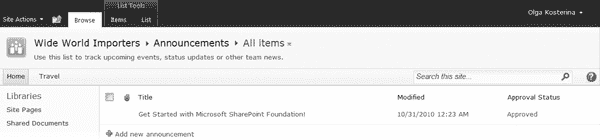

3. 在“公告”页面上，查看列表项目。Wide World Importers 的团队成员尚未在此列表中发布任何额外公告，因此只显示默认公告。

4. 将鼠标悬停在列表项目上，点击项目标题左侧出现的复选框以选择它。

   当你选择列表上的一个项目时，SharePoint 会打开“项目”选项卡，该选项卡显示带有处理列表项目命令的功能区。

   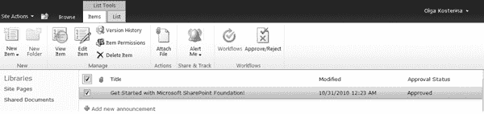

   探索功能区并注意功能区组，如新建、管理、操作、共享与跟踪以及工作流。

5. 在`列表工具`选项卡组中，点击`列表 (List)`选项卡。“列表”选项卡将打开并显示功能区上允许你配置列表的命令。

   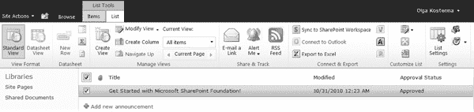

   探索功能区并注意功能区组，如视图格式、数据表、管理视图、共享与跟踪、连接与导出以及设置。

6. 要返回站点主页，点击屏幕顶部的`浏览`选项卡，然后点击顶部链接栏上的`首页 (Home)`选项卡。

### 清理

如果你将继续下一个练习，请保持浏览器打开。

# 浏览文档库

SharePoint 库本质上是一个文件列表。然而，SharePoint 库不仅存储文件，还为你和你的团队处理这些文件提供灵活的协作环境。

SharePoint 库页面列出库中的每个文件及其属性，并提供每个文件的链接。默认情况下，团队站点带有一个名为`共享文档 (Shared Documents)`的内置文档库，它列在快速启动上。

除了`共享文档`库外，你可以在需要时创建自己的文档、图片、表单和 wiki 库。创建新库时，你可以选择将此库的链接放置在快速启动上。

### 参考

有关在文档库中操作文档的更多信息，请参阅第 5 章。有关配置文档库的更多信息，请参阅第 8 章。

在本次练习中，你将查看站点上存在的所有 SharePoint 库。然后你将导航到“共享文档”库，探索其功能区，然后返回主页。

### 设置

如果尚未打开，请打开你想查看现有库列表的 SharePoint 站点。如果出现提示，输入你的用户名和密码，然后点击确定。

1. 在快速启动上，点击`库 (Libraries)`。

   “文档库”视图将打开“所有站点内容”页面。此视图显示所有现有库的链接。

2. 点击一个链接，例如`共享文档 (Shared Documents)`。出现共享文档库页面。

   在屏幕顶部注意“浏览”选项卡、内容导航面包屑和顶部链接栏。在“浏览”选项卡的右侧，注意上下文“库工具”选项卡组，它包含两个选项卡：`文档 (Documents)`和`库 (Library)`。

   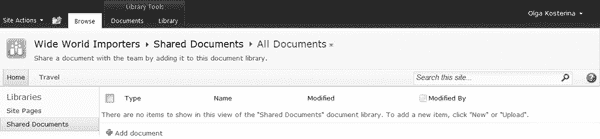

3. 在“共享文档”页面上，查看库中的文件列表。

   在此示例中，Wide World Importers 的团队成员尚未向此库放入任何文档。

4. 点击`文档 (Documents)`选项卡，它将显示带有处理库中存储文档命令的功能区。

   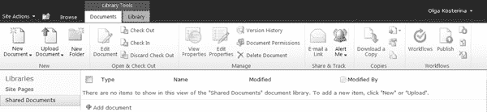

   探索功能区并注意功能区组，如新建、打开并检出、管理、共享与跟踪、副本以及工作流。

5. 在`库工具`选项卡组中，点击`库 (Library)`选项卡，它将打开并显示功能区上允许你配置库的命令。

   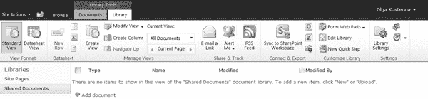

   探索功能区并注意功能区组，如视图格式、数据表、管理视图、共享与跟踪、连接与导出、自定义库以及设置。

6. 要返回站点主页，点击屏幕顶部的向上导航图标，然后在出现的导航路径中点击站点名称，例如 Wide World Importers。

### 清理

如果你将继续下一个练习，请保持浏览器打开。

# 自定义顶部导航区域

在 SharePoint 站点上，你可以自定义顶部和左侧导航区域。在顶部导航区域，除了 SharePoint 维护的链接外，你还可以配置顶部栏包含你选择的链接，并选择它们在栏上的顺序。在后续练习中，你将在顶部栏创建一个标签，然后将其删除。

### 设置

如果尚未打开，从浏览器地址栏打开顶级站点（例如`http://wideworldimporters`）。如果出现提示，输入你的用户名和密码，然后点击确定。

### 注意

务必确认你有足够的站点权限。如有疑问，请参阅书后的附录 A。

1. 在站点操作菜单上，点击`站点设置`。显示站点设置页面。

2. 在外观部分，点击`顶部链接栏`。

   显示顶部链接栏页面。它显示了站点顶部栏中的链接。在我们的示例中，已经显示了两个链接：首页和旅行。这些链接代表顶级站点和旅行站点。

   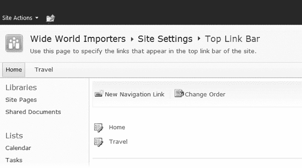

3. 点击页面顶部的`新建导航链接`以显示“新建导航链接”页面。

4. 在“新建导航链接”页面上，在 URL 区域，在“输入”`Web 地址`框中输入`http://www.microsoft.com/sharepoint`。比在“输入描述”框中输入`SharePoint 首页`。

   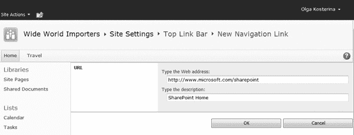

5. 点击“确定”。新链接已添加到顶部链接栏，并列在“顶部链接栏”页面上。

   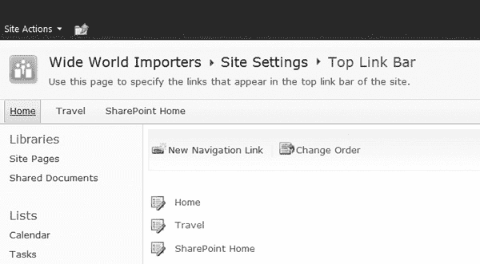

6. 要测试链接，点击新标签以打开微软网站上的 SharePoint 产品主页。

   ### 重要

   你需要访问 Internet 查看外部网站（如微软网站）上的页面。

7. 在浏览器窗口顶部、地址栏左侧，点击向下箭头按钮显示最近站点列表。点击`Top Link Bar`返回页面。

   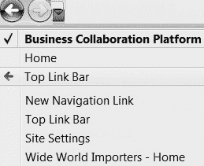

现在你将重新排序顶部链接栏上的标签页。

8. 在`Top Link Bar`页面上，点击`Change Order`。出现`Reorder Links`页面。

   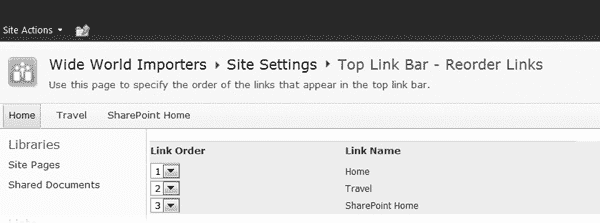

9. 从`SharePoint Home`链接左侧的`Link Order`下拉列表中，选择`1`。

链接列表将自动重新排序。`Home`链接的链接顺序已变为`2`，`Travel`链接的链接顺序已变为`3`。

10. 点击`OK`。顶部链接栏上的标签页已重新排序，你被带回`Top Link Bar`页面。

    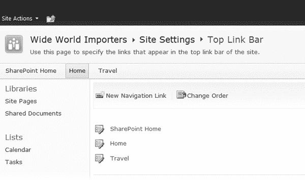

现在你将从顶部链接栏中删除链接。

11. 在`Top Link Bar`页面上，点击你想删除链接左侧的`Edit`图标，例如`SharePoint Home`。

12. 在`Edit Link`页面上，点击`Delete`。

13. 当弹出确认消息框时，点击`OK`。

    

你回到了 Top Link Bar 页面。注意到该链接已被删除。

14. 在面包屑导航中，点击左侧的第一个链接（例如`Wide World Importers,`），返回你的站点的主页。

### 清理

如果你将继续进行下一项练习，请保持浏览器打开。

# 自定义左侧导航面板

左侧导航面板有许多自定义选项。与顶部链接栏类似，你可以更改快速启动（Quick Launch）。你可以添加新链接、编辑和重新排序现有链接，并删除你不再需要的链接。如果你不再需要它，甚至可以隐藏整个快速启动。此外，你还可以以树形视图显示站点组件的图形表示。

### 重要提示

你无法从左侧导航面板中移除“所有站点内容”（All Site Content）和“回收站”（Recycle Bin）链接。

在此练习中，你将向快速启动添加一个链接，并重新排序快速启动链接。

### 设置

如果尚未打开，请从浏览器的地址栏打开顶级站点（例如`http://wideworldimporters`）。如果出现提示，请输入你的用户名和密码，并点击`OK`。

### 注意事项

**务必验证**你拥有足够的权限管理该站点。如有疑问，请参阅书末的附录 A。

1. 在`Site Actions`菜单上，点击`Site Settings`。

2. 在`Site Settings`页面上，在`Look and Feel`外观）部分，点击`Quick launch`。出现`Quick Launch`页面。

   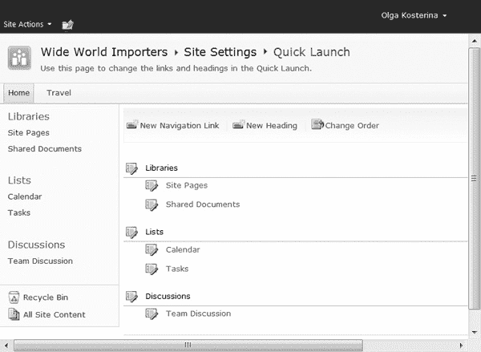

3. 在`Quick Launch`页面上，点击`New Heading`。出现`New Heading`页面。

4. 在`URL`部分，在`Type the Web address`框中，输入`http://office.microsoft.com/en-us/sharepoint-foundation-help`。在`Type the description`框中输入`Help`，然后点击`OK`。你已经在快速启动上创建了一个名为`Help`的链接，它指向 SharePoint Foundation 的在线帮助。

   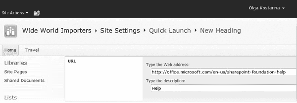

### 小贴士

如果你想在快速启动上创建一个不是链接的标题（而是一组链接的节标题），请在 Web Address 框中输入`#`。然后你可以使用快速 Launch 页面上的`New Navigation Link`命令向新章节添加链接。

回到 Quick Launch 页面，注意到`Help`链接已出现在页面底部。现在你把`Help`链接移动到快速启动的第一位置。

5. 点击工具栏上的`Change Order`。出现 Reorder Links 页面。

6. 从`Help`链接左侧的下拉列表中，选择数字`1`。

   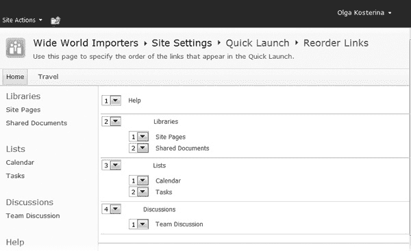

所有其他链接都已重新排序。

### 小贴士

节内的链接可以独立于节标题进行重新排序。

7. 点击`OK`保存新顺序。出现 Quick Launch 页面，`Help`链接显示在顶部。

8. 点击顶部链接栏上的`Home`标签页返回站点主页。

在主页上，新的`Help`链接显示在左侧导航面板中，位于快速启动上方。

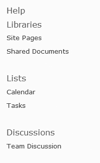

点击新的`Help`链接将带你进入 SharePoint Foundation 在线帮助页面。

### 清理

如果你将继续进行下一项练习，请保持浏览器打开。

虽然快速启动代表了频繁需要的链接，但有时通过图形表示可视化地查看站点的结构也是很有用的。在此练习中，你将修改左侧导航面板以显示站点的树结构。

### 设置

打开你想修改左侧面板面板站点（如果尚未打开）。如果出现提示，输入你的用户名和密码，然后点击`OK`。

### 注意事项

**务必验证**你拥有管理该站点的权限。如有疑问，请参阅书末的附录 A。

1. 在`Site Actions`菜单上，点击`Site Settings`。显示`Site Settings`页面。

2. 在`Look and Feel`区域，点击`Tree View`。

3. 在`Tree view`页面上，勾选`Enable Tree View`复选框。点击`OK`。

   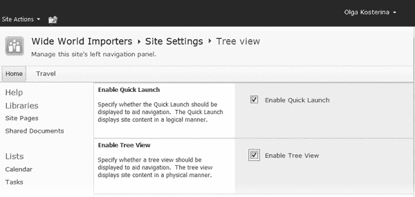

你被带回 Site Settings 页面。

4. 点击顶部链接栏上的`Home`标签页返回站点主页。

主页上的左侧导航面板发生了变化。在快速启动下方，它现在显示`Site Content`面板，以树形视图显示站点。在`Site Content`面板中，注意代表站点不同部分的图标，例如`Travel`子站点、`Shared Documents`文档库、`Announcements`列表、`Calendar`列表、`Links`列表、`Tasks`列表以及默认的讨论板。

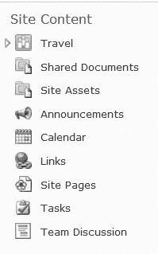

5. 按照此练习的第 1-4 步，在`Tree view`页面上，禁用快速启动。验证左侧导航面板显示`Site Content`但不显示快速启动。

现在你把左侧导航面板恢复到原始配置，即显示快速启动但不显示`Site Content`。

6. 按照此练习的第 1-4 步，在`Tree view`页面上，禁用`Tree View`并启用快速启动。返回主页以验证左侧导航面板显示快速启动。

### 清理

如果你将继续进行下一项练习，请保持浏览器打开。

# 理解 Web Parts

除了文本、图像和列表外，SharePoint 站点上的网页还可以包含一个或多个 Web Part。Web Part 是一个独立的组件，可以由具有访问权限的用户进行重用、共享和个性化。Web Part 是页面的基本构建块；每个 Web Part 占据页面内一个独立的矩形区域。

例如，新创建的团队站点主页包含一个显示`Shared Documents`库内容的 Web Part。

网页可以包含多个 Web 部（Web Parts），在必要时可以将它们相互连接。SharePoint Foundation 为当前站点上的所有列表和库提供了内置的 Web 部，你可以将它们插入网页中。通过使用 Web 部，你可以将分散的信息进行组织，并将数据（如列表和图表）以及网页内容（如文本、链接和图像）整合到单个网页中。

### 另请参考

有关网页和 Web 部的更多信息，请参阅第 6 章。

在此练习中，你将为团队站点（Team site）的主页添加一个“公告”（Announcements）列表的 Web 部。

### 设置

如果尚未打开，请打开 SharePoint 站点主页，例如`http://wideworldimporters`。如果出现提示，请输入你的用户名和密码，然后点击确定。

### 注意事项


**务必确认**你拥有足够的权限编辑该站点的主页。如果有疑问，请参阅书末的附录 A。

1. 在屏幕顶部，点击`页面`（Page）选项卡。
2. 在功能区的`编辑`（Edit）组中，点击`编辑`（Edit）按钮。

   

   页面将以编辑模式重新显示，页面上你可以修改的内容区域将被轮廓标记。

3. 将光标置在你想要插入 Web 部的位置。例如，点击`欢迎`（Welcome）消息下方`共享文档`（Shared Documents）标题上方。
4. 在`编辑工具`选项卡集中，点击`插入`（Insert）选项卡。
5. 在`Web 部`组中，点击`现有列表`（Existing List）按钮。

   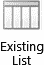

   功能区下方会出现 Web 部面板。

6. 在`Web 部`面板中确保选择了`公告`（Announcements）列表，然后点击`添加`（Add）。

   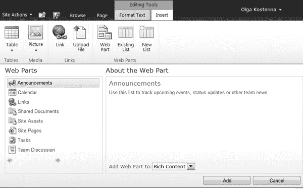

7. `公告`Web 部已添加到光标所在的网页位置。它显示了公告列表中的项目。

   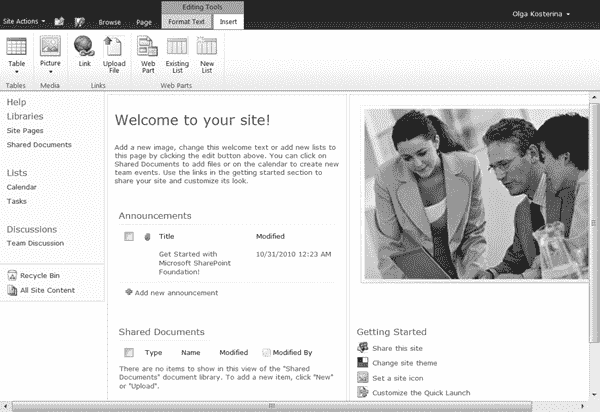

8. 在页面顶部，点击`页面`（Page）选项卡，然后在功能区的`编辑`组中，点击`保存并关闭`（Save & Close）按钮。

   

   主页的更改已保存，带功能区的页面选项卡已关闭，主页在`浏览`（Browse）选项卡上重新显示。

9. 在`公告`Web 部中，将鼠标悬停在任何列表项目上，点击项目标题左侧出现的复选框进行选择。`列表工具`选项卡集中的`项目`（Items）选项卡出现，并显示与列表页面相同的功能区，使你能够在 Web 部内部直接处理列表项目，而无需离开当前页面导航到列表页面。

   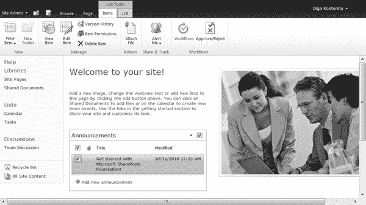

10. 在`公告`Web 部中，清空项目标题左侧的复选框。带功能区的`项目`选项卡关闭，页面在`浏览`选项卡上重新显示以供查看。

### 清理

如果你将继续下一个练习，请保持浏览器打开。

# 使用回收站

SharePoint Foundation 中的回收站提供了两阶段保护，以防止误删。当你从 SharePoint Foundation 站点中删除文档或其他项目时，它将从站点中删除并移动到站点的回收站中，如果需要，可以在那里恢复。随后，如果你从站点的回收站中删除此项目，它将移动到站点集合的回收站中。从那里，文档可以恢复到原始位置或被永久删除。

### 提示

默认情况下，站点的回收站在永久删除项目前保留它们 30 天。你的 SharePoint 管理员可以修改此设置。

在此练习中，你将从回收站删除并恢复文档。

### 设置

如果尚未打开，请打开你想删除和恢复文档的 SharePoint 站点。此练习使用`http://wideworldimporters/travel`站点，你也可以打开任何站点。如果出现提示，请输入你的用户名和密码，然后点击确定。

### 注意事项

**务必确认**你拥有在该站点上删除和恢复项目的权限。如果有疑问，请参阅书末的附录 A。

1. 在站点主页上，将鼠标悬停在`共享文档`（Shared Documents）Web 部标题上，点击标题右侧出现的复选框以选择它。

   `文档`（Documents）选项卡打开并在页面顶部显示功能区。

   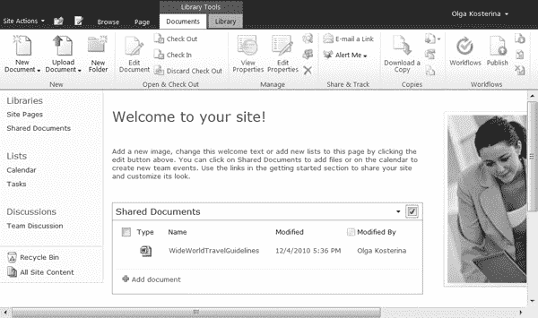

2. 在`共享文档`Web 部中，将鼠标悬停在你想移除的文档名称上，并选择名称左侧出现的复选框。
3. 在功能区的`管理`（Manage）组中，点击`删除文档`（Delete Document）。

   

4. 出现确认框时，点击确定。

   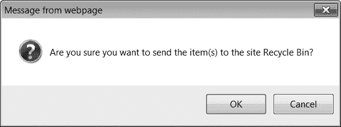

   文档已从共享文档库中删除。你现在将从站点的回收站恢复此文档。

5. 在左侧导航面板底部，点击`回收站`（Recycle Bin）。显示回收站页面。
6. 在回收站页面上，点击名称左侧的复选框选择你删除的项目。要将其恢复到原始位置，点击页面顶部的`恢复选择`（Restore Selection）选项。

   

7. 在消息框中点击确定要恢复此文档。

   文档已恢复。

8. 使用内容屑中的链接或顶部的选项卡返回站点主页。验证文档已恢复并显示在共享文档 Web 部中。

### 清理

如果你将继续下一个练习，请保持浏览器打开。

如果项目从站点回收站误删除，可以从站点回收站恢复。在此练习中，你将恢复从站点删除的文档。

### 设置

如果尚未打开，请打开存放要删除和恢复文档的 SharePoint 站点。如果出现提示，请输入用户名和密码，然后点击确定。

### 注意事项

**务必确认**你拥有管理顶级站点的权限。如果有疑问，请参阅书末的附录 A。

1. 参考上一个练习的步骤 1-5，从`共享文档`库中删除一个文档，然后进入站点的`回收站`页面。
2. 在回收站页面上，点击名称左侧的复选框选择该文档。然后点击页面顶部的`删除选择`（Delete Selection）。
3. 出现确认消息框时，点击确定。该文档已从站点回收站中删除。
4. 在页面顶部，点击`向上导航`图标，点击路径上的顶级节点进入顶级站点。
5. 在顶级站点的主页上，在`站点操作`菜单中点击`站点设置`（Site Settings）。
6. 在`站点设置`页面上，在`站点集合管理`部分点击`回收站`（Recycle bin）。
7. 在`站点集合回收站`页面上，在左侧导航区域的`选择视图`下，点击`已从最终用户回收站删除`（Deleted from end user Recycle Bin）。

   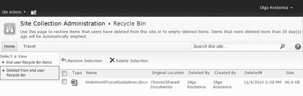

8. 点击文档名称左侧的复选框选择您刚刚删除的文档，然后点击`Restore Selection`（恢复选择）。
9. 当弹出确认消息框时点击`OK`。文档已恢复到原始位置。
10. 使用顶部的链接栏导航到删除文档的子站点主页，并验证其是否已恢复。

### 清理

关闭浏览器。

### 关键点

* 典型 SharePoint 团队站点的基础结构包括以下组件：库、列表、讨论板、调查和回收站。
* SharePoint 站点的主页在顶部和左侧有两个主要的导航区域。顶部导航区域包含顶部链接栏、内容屑导航和“向上导航”图标。左侧导航面板包含快速启动（Quick Launch）链接集、所有站点内容（All Site Content）链接和回收站（Recycle Bin）链接。
* 顶部链接栏提供了站点之间的导航，而左侧导航面板提供了当前站点内的导航。
* 顶部链接栏和快速启动都可以自定义以包含您选择的链接。
* 从左侧导航面板链接的“所有站点内容”页面显示您站点上所有的库、列表、讨论板和调查。它还提供了指向子站点和工作空间（Workspaces）的链接。您无法从左侧导航面板删除“所有站点内容”链接。
* 一个 SharePoint 站点可以有很多子站点。这些子站点在 Web 服务器上的层次结构类似于文件系统上的文件夹层次结构。
* 没有父站点的站点称为顶级站点。顶级站点可以有多个子站点，这些子站点也可以有多个子站点，根据需要向下延伸任意级。
* 功能区（Ribbon）界面对于 SharePoint Foundation 来说是新特性。功能区是上下文相关的，旨在帮助您快速找到用于对页面、文档和列表执行操作的命令。
* 功能区上的命令按逻辑分组组织，并在标签页下一起显示。每个标签页与您正在操作的 SharePoint 站点组件类型（例如文档库或网页）相关。
* 典型 SharePoint 站点的主页包含一个或多个 Web 组件（Web Parts）。
* 回收站提供了防止误删的二级保护。

# 第 3 章：创建和管理站点

## 章节概览

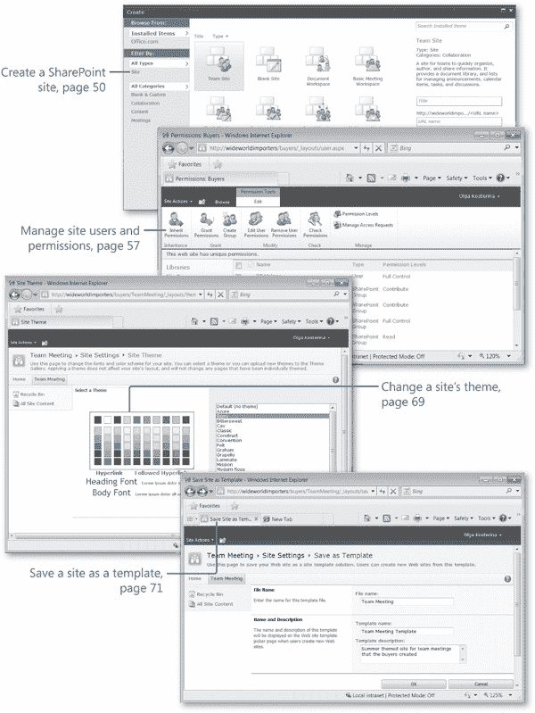

| 在本章中，您将学习如何 |
| --- | --- |
| ✓ | 创建站点。 |
| ✓ | 管理站点用户和权限。 |
| ✓ | 创建子工作空间。 |
| ✓ | 更改站点主题。 |
| ✓ | 保存并使用站点模板。 |
| ✓ | 管理站点功能。 |
| ✓ | 管理站点内容分发。 |
| ✓ | 删除站点。 |

Microsoft SharePoint Foundation 站点和工作空间是网页、列表、文档库、子站点和其他元素的容器，同时也包含了提供站点功能的特性和设置。列表包含结构化的表格化数据，而文档库则包含非结构化的二进制文档。您可以将任何站点作为数据的单一容器，也可以根据需要创建任意多的子站点，以便您的数据更易查找和管理。您还会经常发现自己创建站点，为特定小组的协作内容提供一个安全场所。例如，您可能会创建一个站点来管理新团队或项目、协作编写文档，或者准备并跟进会议。作为容器，站点可以用于保护其内容。

正如我们在第 2 章的侧边栏，详细了解如何从浏览器地址栏直接访问目的地。

## 布局目录

SharePoint Foundation 站点的管理页面保存在名为`layouts`的公共文件夹中。通过浏览器地址栏中的网站地址，您可以快速导航到深埋在站点管理链接中的管理页面。

下表显示了每个 SharePoint Foundation 站点主页上典型的示例。

| 网站地址 (URL) | 管理页面 |
| --- | --- |
| `http://[site]/_layouts/viewlsts.aspx` | 所有站点内容 |
| `http://[site]/_layouts/settings.aspx` | 站点设置 |
| `http://[site]/_layouts/create.aspx` | 创建页面 |

下表显示了子站点的相同示例。

| 网站地址 (URL) | 管理页面 |
| --- | --- |
| `http://[site]/[childsite]/_layouts/viewlsts.aspx` | 所有站点内容 |
| `http://[site]/[childsite]/_layouts/settings.aspx` | 站点设置 |
| `http://[site]/[childsite]/_layouts/create.aspx` | 创建页面 |

请注意，无论你深入站点层次多深，每个网站地址的后缀都是相同的。

虽然“创建”页面提供的功能与 Silverlight 创建对话框相同，但 Silverlight 对话框因其直观的用户界面而提供了更好的用户体验。Silverlight 是一个免费的客户端加载，其安装链接位于“创建”页面顶部。为了获得更好的 SharePoint Foundation 使用体验，如果您的计算机上尚未安装 Silverlight，建议您进行安装。

当您最初在 SharePoint Foundation 中创建站点、工作区、列表和库等对象时，您正在建立两个值：显示名称（通常标记为`Title`或`Name`）和统一资源定位符 (URL) 名称（也称为`internal name`）。通常，与站点一样，有一个选项单独提供 URL 名称。在指定 URL 名称时，请遵循后续侧边栏中标题为“命名 URL”的栏目中列出的最佳实践。

# 命名 URL

在最初为 SharePoint Foundation 中的对象建立 URL 时，请遵循以下这些最佳实践。例如，为新子站点提供名为`Todd Rowe`的 URL 名称，将导致浏览器地址栏中出现以下网站地址：`http://wideworldimporters/Todd%20Rowe`。随后，为该站点内的新文档库提供名为`My Cool Docs`的 URL 名称，将导致浏览器地址栏中出现以下网站地址：`http://wideworldimporters/Todd%20Rowe/My%20Cool%20Docs`。注意，将空格替换为下划线可以提高网站地址的外观：`http://wideworldimporters/Todd_Rowe/My_Cool_Docs`。

命名 URL 的最佳实践包括：

* URL 名称应该是具有描述性的、直观的且易于记忆的。
* URL 名称应该是简洁的。整个网站地址的可用总字符数有限，因此如果您一直使用长 URL 名称，最终将会遇到问题。
* URL 名称不应包含空格。地址栏中的空格会被替换为`%20`且占用三个字符。空格还会导致网站地址在电子邮件中难以使用，且难以让他人阅读。为了减少挫败感并提高可读性，可以使用下划线代替空格。
* URL 名称应保持一致性。默认情况下，任务位于名为`Tasks`的列表中，联系人位于名为`Contacts`的列表中，以此类推。同样，如果您经常创建文档库来存放提案，一致地使用如`Proposals`之类的名称将帮助他人定位该内容。当然，您不能在一个站点拥有两个同名的列表。因此，您可能需要通过为名称添加前缀来区分它们，例如`Customer_Proposals`和`Product_Proposals`。

在创建列表或列时，字段（通用标记为`Name`）被用于填充显示名称和 URL 名称。由于最佳实践可以针对特定组织进行启动，因此尽早建立您自己的命名规范是明智的。这有助于防止创建不符合直觉、冗长、充满空格且不一致的对象。

从“创建”对话框或页面，您可以选择使用 10 个内置站点模板之一来初始置备您的站点。每个站点模板都配置了列表、文档库和网页，并预装了 Web 部，这些 Web 部使用最适合该站点模板目的的导航。


团队站点、文档工作区、小组工作站点和空白站点具有相同的潜在功能和快速启动导航。团队站点模板提供了一个“共享文档”库和四个列表：`Announcements`、`Calendar`、`Links`和`Tasks`。通过将该库的 Web 部放置在站点的默认主页上，使“共享文档”库更加可见。文档工作区模板提供与团队站点相同的文档库和列表，但在默认主页上放置了`Members`Web 部。除了与团队站点相同的列表和库外，小组工作站点模板提供了四个列表：`Circulations`、`Phone Call Memo`、`Resources`和`Whereabouts`。小组工作站点没有提供`Calendar`列表，而是提供放置在站点默认主页上的`Group Calendar`列表，以及在关联 Web 部中显示的`Whereabouts`列表。正如您所测的，空白站点模板没有列表或文档库。

博客站点模板提供了一种发布名为`web log`或简单称为`blog`的日志的方法。博客所有者创建文章，其他用户可以进行评论。每篇文章都是一个独立的内容页面，这些页面的汇总摘要通常在博客站点的主页上按倒序时间（最新条目在前）显示。博客通常用作新闻网站、期刊和日记。博客关注作者的一个或多个核心能力，有时被用作博客所有者发表意见的平台。博客也可以作为单向通信工具，让项目利益相关者和团队成员了解最新情况。

### 提示

博客站点内容可以使用 Really Simple Syndication（`RSS`）`feed`进行分发。RSS 馈聚合软件允许人们订阅他们感兴趣的内容，并接收新的和更新的文章。使用这些工具，人们可以将来自许多博客（或任何 SharePoint Foundation 列表）的内容聚合到一个公共阅读器中，在那里对所选作者的文章进行排序、过滤和分组。Microsoft Outlook 2010 可以聚合 RSS 馈；还有许多供应商免费赠送或销售 RSS 馈聚合软件。

SharePoint Foundation 提供的五个会议工作区模板是同一主题的变体。与之前描述的所有站点模板不同，它们没有快速启动或左侧导航区域。除了传统的列表和库（如`Document Library`、`Picture Library`、`Tasks`和`Discussion Board`）之外，它们还可以配置独特的列表，例如`Agenda`、`Attendees`、`Decisions`、`Objectives`和`Things To Bring`。

### 另请参阅

有关会议工作区和博客的更多详情，请参阅第 12 章。

### 提示

10 个内置模板实际上是底层站点定义的配置。您的 Web 服务器管理人员可以在底层文件中创建额外的配置，甚至是备用站点定义。内置配置也可以被删除或更改。


你最初可能会侧重于使用这些基于底层站点定义的内置站点模板。然而，你也可以将创建的网站保存为自定义站点模板，然后你和其他人就可以从`创建`（Create）对话框中选择这些模板作为创建新站点的基础。当你将网站保存为模板时，SharePoint Foundation 会创建一个自定义 Web 模板，并将其保存为`.wsp`扩展的文件。这是通过使用任何站点`站点设置`（Site Settings）页面中`站点操作`（Site Action）部分的`另存站点为模板`（Save Site As Template）链接完成。以这种方式保存的自定义 Web 模板最初仅在保存所在的站点集合中可用。本章稍后名为保存和使用站点模板的节将解释如何将保存的 Web 模板复制到另一个站点集合。对于使用保存的自定义 Web 模板配置的站点，除了与安全相关的设置外，所有更改都会被保留。

创建新站点时，有两个明显的权限选项可用。默认选项`使用与父站点相同的权限`（Use Same Permissions As Parent Site）会在用户每次访问子站点时检查父站点的权限，以确定用户在该站点上被允许的操作。随着父站点权限随时间变化，子站点的权限也会反映这些变化。另一个选项是`使用唯一权限`（Use Unique Permissions）。当你作为站点创建者点击此选项时，你最初是唯一可以访问站点的用户，然后关联到`管理员`（Administrator）权限级别。

## 重要

如果你选择`使用与父站点相同的权限`，你可能拥有创建新站点的权限但没有删除它的权限。然而，如果你选择`使用唯一权限`，你就是站点的管理员，因此将始终拥有删除新站点的权限。

为新站点分配权限时，你还有两个不那么明显的选项。如果你最初选择`使用唯一权限`，你是唯一可以访问站点的用户，并可以进行任何你想要的更改。然后你可以切换到`使用与父站点相同的权限`，此时所有访问父站点的人（包括你）随后都将使用在父站点上分配的权限访问子站点。如果你最初选择`使用与父站点相同的权限`，将使用父站点的权限。但如果你随后切换到`使用唯一权限`，父站点的所有权限都将复制到子站点。如果大多数可以访问父站点的人也需要访问子站点，这可以节省大量时间。

创建新站点时可以指定三个导航选项。前两个涉及所创建的子站点在父站点导航中的可见性。你可以选择将子站点显示在父站点的`快速启动`（Quick Launch）或顶部的链接栏上。前者默认为“否”（No），后者默认为“是”（Yes）。相反，你可以指定父站点的顶部链接栏是否应显示在所创建的子站点的顶端链接栏上。默认值为“否”（No）。

## 另请参考

请参阅本书开头的使用练习文件，获取有关使用本书中各章节提供的练习站点模板的更多信息。

在接下来的练习中，你将创建一个 Wide World Importers 的买家将用于协作的子站点。作为一个团队，买家们需要一个中心位置来汇总他们的公告、链接和一般讨论，并跟踪购买状态和当前供应商列表。你将使用`团队站点`（Team Site）模板来配置新的子站点。

## 设置

打开你想要创建新站点的顶层（潜在的）父站点。练习将使用`http://wideworldimporters`站点，但你可以使用任何喜欢的站点。如果出现提示，输入你的用户名和密码，并点击确定（OK）。

## 注意

**务必确保**验证你有足够的权限来创建站点。如有疑问，请参阅书末的附录 A。

1. 在`站点操作`（Site Actions）菜单上，点击`新建站点`（New Site）显示`创建`（Create）对话框。

2. 从中间可用模板中选择`团队站点`（Team Site），然后点击右侧的`更多选项`（More Options）。出现`团队站点`的`创建`对话框。

   **字体提示**

   如果你已从书籍目录安装了练习站点，你将在列表底部看到本书的练习站点模板。

3. 在`标题`（Title）文本框中，输入`Buyers`为新站点建立显示名称。

   

4. 在`描述`（Description）文本框中，输入描述，例如`用于普通买家协作的站点，`，以帮助用户理解新站点的目的。

5. 在`网站地址`（Web Site Address）部分，在`URL 名称`（URL name）文本框中输入`buyers`。

   这决定了当你访问站点时在浏览器地址栏中看到的数值。有关命名规范的最佳实践，请参阅本章稍前的命名 URL。

6. 点击选项按钮定义你最初想在站点上使用的权限类型。对于 Buyers 站点，使用默认权限`使用与父站点相同的权限`。

7. 在`导航`（Navigation）部分，定义指向此站点的链接是否出现在父站点的`快速启动`和顶部链接栏上。要在父站点的`快速启动`上显示此链接，点击`是`（Yes），并在父站点的顶部链接栏上保持默认`是`（Yes）。

8. 在`导航继承`（Navigation Inheritance）部分，定义此站点是使用父站的顶部链接栏还是自己的。对于 Buyers 站点，保持此站点自己的默认选项`否`（No）。

9. 滚动到对话框底部并点击`创建`（Create）。

   

   带有默认列表、文档库和网页的新团队站点已创建并显示在浏览器中。

## 重要

点击取消（Cancel）将返回对话框中的模板选择，且不会创建新站点。

## 清理

如果你将继续下一个练习，请保持浏览器打开。

# 管理站点用户和权限

SharePoint Foundation 中的信息可以在以下四个级别之一进行安全保护：站点级别、列表或文档库级别、文件夹级别以及列表项级别。在默认情况下，所有列表继承包含它们的站点的权限；所有文件夹继承包含它们的列表的权限；而所有列表项继承包含它们的文件夹的权限。

## 另请参考

有关列表、文件夹和列表项安全的深入讨论，请参考第 7 章。

默认选项`使用与父站点相同的权限`提供了从父站点到新创建子站点的权限继承。用户每次访问子站点时，SharePoint Foundation 都会检查父站点的权限。

创建新站点时，如果你选择`使用唯一权限`选项，SharePoint Foundation 会将站点用户分类为三个 SharePoint 组，如下：

- **访问者**（Visitors）：只需要读取站点内容的个人或组
- **成员**（Members）：需要创建和编辑内容但不需要创建列表或管理站点成员的个人或组
- **所有者**（Owners）：负责管理和维护站点所有方面的人员

`Use Unique Permissions` 选项最初会将您指定为网站创建者，并作为所有者对新站点拥有唯一访问权限。点击`Create`后，您将看到`Set Up Groups For This Site`页面，可以将用户添加到三个组中，以便他们获得对新创建站点的访问。


可以通过`Permissions`页面在继承权限和唯一权限之间切换站点，您通过点击`Site Actions`菜单上的`Site Permissions`来进入该页面。进入`Permissions`页面后，在使用唯一权限的站点功能带上选择`Inherit Permissions`，允许您将站点切换为继承权限。在继承权限的站点功能带上选择`Stop Inheriting Permissions`，则允许您将站点切换为唯一权限。系统将显示一条警告消息，要求您确认您的操作。

使用唯一权限的站点与父站点没有关联，因此无论用户是否在其他站点上具有权限，您都允许从站点中添加或删除用户。当用户添加到站点时，必须将其添加到 SharePoint 组或与至少一个权限级别关联。

SharePoint 组在站点集合级别进行维护，代表一组用户或组，它们具有定义的一个或多个权限级别以及若干个管理属性。当新用户或组添加到 SharePoint 组时，他们将在任何站点中获得该组的权限。

将权限级别视为一组具名的权限集合，可以分配给 SharePoint 组或单个用户。SharePoint Foundation 在每个站点上提供五个权限级别，如下：

- `Read`：用户只能查看站点内容。
- `Contribute`：用户可以查看、添加、更新和删除站点内容。
- `Design`：用户可以查看、添加、更新、删除、批准和自定义站点内容。
- `Full Control`：用户对站点内容具有完全控制权。
- `Limited`：用户对整个站点没有权限，但在获得显式许可的情况下仅对特定的列表、文档库、文件夹、列表项或文档具有权限。

此处显示了个人权限列表及其默认包含的权限级别。


## 参见另

有关个人权限和权限级别的更多详细信息，请参阅书末的 Appendix A。

具有唯一权限的站点上的初始 SharePoint 组具有以下权限级别：

- `Visitors`组具有`Read`权限级别。
- `Members`组具有`Contribute`权限级别。
- `Owners`组具有`Full Control`权限级别。

不仅可以将现有的 SharePoint 组和单个用户与权限级别关联，还可以 Windows 组（包括 Active Directory 组和本地机器组）与权限级别关联。这是一种通过最小维护提供严密安全的非常实用的方法。然而，您可能无法控制组织中定义的 Windows 组。

尽管您可以创建自己的权限级别，甚至可以更改除`Full Control`和`Limited`之外的所有权限级别，但您可能会发现这些内置级别适用于大多数业务场景。您可能还希望为所有用户提供对站点数据某些程度的访问权限。

## 提示

如果在 SharePoint 中央管理中已为 Web 应用程序启用了匿名访问，并且没有通过`Anonymous User Policy`拒绝，则可以根据情况授予匿名用户某些访问权限，可以是针对整个站点或单个列表。这为中央管理员提供了选项，在站点管理员开始开启此选项之前，决定是否为每个 Web 应用程序授予匿名访问。

## 提示

您可以在每个站点的`Permissions`页面上使用`Grant Permissions`命令为所有已验证的用户提供站点访问权限。添加用户的主题将在本节后面的部分介绍。

在将所有用户和组分配到各种权限级别后，可能（甚至很）有人会与多个权限级别关联。系统并不是强制最严格的权限级别，而是汇总所有相关的权限，并应用累计的唯一权限列表。这只能通过在 SharePoint 中央管理中创建的策略进行覆盖。

在以下练习中，您将子站点的权限从继承父站点权限更改为使用唯一权限。然后，您将代表 Wide World Importers 买家的用户添加到子站点，并授予`Contribute`权限。

## 设置

从浏览器的地址栏打开第一个练习中创建的`Buyer`子站点（`http://wideworldimporters/buyers`），如果它尚未打开。如果出现提示，输入您的用户名和密码，并点击`OK`。

## 注意

**务必**验证您有足够的权限来更改站点权限。如有疑问，请参阅书末的 Appendix A。

1. 在`Site Actions`菜单上，点击`Site Permissions`。

2. 显示`Permissions: Buyers`页面，显示分配给与此站点关联组的权限级别。页面顶部有一个黄色条，说明此网站从父站点继承权限。由于此子站点正在从父站点继承权限，您可以看到列出的父站 SharePoint 组。

   

3. 在功能带上，点击`Stop Inheriting Permissions`以为此站点建立唯一权限。

   

4. 在对话框中点击`OK`以确认更改。

   注意页面发生了的变化。您现在每个组旁边都有复选框，功能带上还有额外的命令允许您修改权限。顶部的黄色条现在说明此网站具有唯一权限。

   ## 提示

   选择`Inherit Permissions`命令将返回使用父站点权限。

   

   ## 重要

   编辑 SharePoint 组会影响使用该 SharePoint 组的所有站点、列表、文件夹和项目。

5. 在功能带上，点击`Create Group`显示`Create Group`页面。

   

6. 在`Name`文本框中输入名称，例如`Buyers Members`。

   

7. 如果需要，在`About Me`文本框中输入新组的描述。

8. 选择拥有此组的用户或组。默认是您；此示例使用 Olga Kosterina。

9. 保持`Group Settings`和`Membership Requests`的默认设置。

10. 滚动到`Group Permissions for this Site`部分，点击`Contribute`复选框以授予新组 Contribute 权限级别。

11. 点击`Create`。新组已创建并已添加到 Buyers Members 组的`People and Groups`页面。

    对于 Buyers 站点，`Buyers`Windows 组中的所有人都需要添加并与`Contribute`权限级别关联。您现在将将 Windows 组添加到新的 SharePoint 组中。

12. 在页面顶部的`New`菜单上，点击`Add Users`显示`Grant Permissions`对话框。

13. 在`Users/Groups`文本区域，输入要授予“贡献”（Contribute）权限的组名称，例如`Buyers`。

    ## 重要

    通常情况下，您使用类似于`domainname\username`或`domainname\groupname`的格式添加用户和 Windows 组，但此处无法预测您的计算机名称。幸运的是，即使没有提供正确的命名规范，SharePoint Foundation 也会在您的计算机中搜索匹配的用户和 Windows 组。

14. 点击`OK`。`Buyers`Windows 组已添加到`Buyers Members`SharePoint 组。

    

15. 在`Site Actions`菜单上，点击`Site Permissions`（站点权限）。验证`Buyers Members`组是否位于站点权限页面并具有`Contribute`权限。

    Wide World Importers 的首席采购员 Bill Malone 需要与 Buyers 站的“完全控制”（Full Control）权限级别关联。现在，你将授予 Bill 完全控制的权限级别。

16. 在功能带上，点击`Grant Permissions`（授予权限）。`Grant Permissions`对话框打开。

    

17. 在`Users/Groups`文本区域，输入要授予完全控制权限的用户账户名称。本次练习使用`Bill Malone`。

    

18. 点击`Grant users permission directly`（直接向用户授予权限）选项。

19. 选中`Full Control`（完全控制）复选框。如果您的 SharePoint 安装已启用电子邮件，您可以选择向 Bill 发送消息，通知他现在拥有此站点的完全控制权限。对于本次练习，取消勾选`Send E-Mail`（发送电子邮件）复选框。

20. 点击`OK`将此用户（在此情况下为 Bill）的权限添加到站点。用户权限已添加并显示在站点权限页面上。

    Buyers 站点不需要其他 SharePoint 组的权限。您现在将删除所有其他组。

21. 通过点击名称左侧的复选框，选择三个父站点 SharePoint 组。

    

22. 在功能带上，点击`Remove User Permissions`（删除用户权限）。

    

23. 在确认消息框中，点击`OK`应用更改。组已删除。只有`Buyers Members`组和 Bill Malone 拥有该站点权限。

    ## 提示

    将站点集合中各种子站点中的每个用户与顶层站点的至少`Read`（读取）权限级别关联是明智的。除非用户与顶层站点中的内置权限级别之一关联，否则他们可能无法使用导入站点集合的自定义站点模板和列表模板。

## 清理

关闭浏览器。

# 创建子工作区


SharePoint Foundation 允许轻松地从父站点导航到子站点。由于 Buyers 子站点在创建时在父站点的顶部栏和快速启动（Quick Launch）中都包含了导航链接，因此从顶层站点导航到子站点非常简单：您只需点击 Buyers 选项卡上的链接。然而，如果没有包含此导航，您该如何找到 Buyers 子站点呢？在接下来的练习中，您将创建一个作为 Buyers 子站点子节点的会议工作区。由于您必须已经在站点中才能创建子站点，您将首先学习如何从父站点导航到 Buyers 子站点。然后，您将从顶层站点查看整个站点集合的站点层次结构。

### 设置

从浏览器的地址栏打开顶层站点：`http://wideworldimporters`。如果提示，输入您的用户名和密码，并点击 `OK`。

### 注意

**务必验证**您是否有足够的权限创建新站点。如有疑问，请参阅书末的附录 A。

1. 在左侧导航区域，点击 `All Site Content`（所有站点内容），查看在此站点的 `All Site Content` 页面创建的所有列表、文档库、站点和工作区（Workspace）。
2. 在页面底部的 `Sites and Workspaces` 区域，点击 `Buyers` 导航到子站点。即使父站点的顶部栏或快速启动没有指向此子站点的链接，此链接也会出现。

### 提示

或者，您可以直接将整个站点层次结构输入浏览器的地址栏。这个建议起初看起来有点奇怪，但 Internet Explorer 会记住您经常输入的地方，这比点击用户界面可以节省大量时间。要查看当前站点的子站点，请在当前站点的网站地址后加上`/_layouts/mngsubwebs.aspx`。

3. 在 `Buyers` 站点中，点击 `Site Actions` 并选择 `New Site`（新建站点），显示 `Create` 对话框。
4. 选择 `Basic Meeting Workspace`（基本会议工作区），然后点击 `More Options`（更多选项）。
5. 在 Basic Meeting Workspace 的 `Create` 对话框中（与示例相同），输入 `Title`（标题）和 `URL name`（URL 名称），分别输入 `Team Meeting` 和 `TeamMeeting`。记住遵循本章较早名为命名 URL 的侧边栏中关于命名规范的最佳实践。
6. 可选，在 `Description`（描述）文本框中输入描述，例如 `Site for monthly team details`，以帮助用户理解用途。
7. 权限保持默认 `Use same permissions as parent`（与父站点相同的权限）。
8. 导航设置保持默认，使链接显示在 Buyers 站点的顶部栏，而不是快速启动中。在 `Navigation Inheritance`（导航继承）部分，点击 `Yes`，使新工作区使用顶部栏。
9. 点击 `Create` 创建并显示会议工作区。

   注意会议工作区的外观与站点不同。它没有快速启动，且 `Site Actions` 菜单拥有 `Add Pages`（添加页面）和 `Manage Pages`（管理页面）选项。


10. 您现在将返回顶层站点，然后查看整个站点层次结构。要返回顶层站点，在顶部导航区域点击 `Navigate Up` 图标，然后点击顶层站点。在我们的场景中，顶层站点是 Wide World Importers。


11. 在顶层站点的首页，点击 `Site Actions` 并选择 `Site Settings`（站点设置）。
12. 在 `Site Settings` 页面上，在 `Site Collection Administration`（站点集合管理）部分，点击 `Site hierarchy`（站点层次结构）显示 `Site Hierarchy` 页面。


此页面显示了整个站点层次结构中所有完全平平化的子站点。您可以点击站点名称显示站点，或点击 `Manage` 链接显示关联站点的站点设置页面。

### 清理

如果您将继续下一个练习，请保持浏览器打开。

# 更改站点主题

这些蓝色的 SharePoint 站点最初看起来还可以，但最终会模糊在一起并变得太相似。坦率地说，SharePoint Foundation 提供了为站点应用主题的能力。主题可以极大影响颜色、图形、文本、横幅和边框等显示项目。有许多内置主题供选择。

### 提示

使用 Microsoft SharePoint Designer，您可以更深入地控制如何将主题应用到您的站点。您可以选择仅将主题应用到特定页面，甚至创建自己的自定义主题。

每个 SharePoint Foundation 站点都可以有自己的主题，或者你可以设置多个站点，使它们都具有共同的主题并在视觉上保持一致。

### 提示

由于 SharePoint Foundation 的用户界面发生了许多更改，在 Windows SharePoint Services 3.0 中创建的主题与 SharePoint Foundation 2010 不兼容。你可以在 SharePoint Foundation 2010 中创建新主题并将其应用到现有的站点。或者，如果有必要，你可以使用 Visual Upgrade 继续使用带有旧用户界面的现有站点。

Wide World Importers 的买家们可能想为他们的“团队会议（Team Meeting）”子站点创建一个主题，使其与其他站点脱颖而出。在本次练习中，你将导航到“团队会议”站点并应用主题。

### 设置

如果尚未打开，请从浏览器的地址栏打开顶层站点 `http://wideworldimporters`。如果出现提示，输入你的用户名和密码，然后点击确定。

### 注意事项

**请务必**验证你拥有足够的权限设置站点主题并查看站点层次结构。如有疑问，请参阅本书末尾的附录 A。

1. 在顶层站点上，从 `Site Actions` 菜单中选择 `Site Settings`，导航到 `Site Hierarchy` 页面（如果尚未显示），然后在 `Site Settings` 页面上，在 `Site Collection Administration` 区域，点击 `Site hierarchy`。
2. 点击 `Site URL` `http://wideworldimporters/buyers/TeamMeeting` 最右侧的 `Manage` 链接，显示 `Team Meeting` 子站点的 `Site Settings` 页面。
3. 在 `Look and Feel` 部分，点击 `Site theme` 显示 `Site Theme` 页面。
4. 在 `Select a Theme` 列表中，点击 `Berry`。请注意屏幕左侧显示的颜色方案、超链接和字体预览，然后点击 `Summer`。颜色方案和字体预览将更改以反映所选的主题。浏览所有可用主题并选择你最喜欢的一个。


5. 点击 `Apply`。更改已处理完毕，新主题已应用到工作区（Workspace）站点。
6. 在 `Site Settings` 页面上的面包屑导航中，点击 `Team Meeting` 进入 `Team Meeting` 站点的主页。验证新主题已应用。

### 清理

如果你将继续进行下一个练习，请保持浏览器打开。

# 保存和使用站点模板

在对站点进行操作后，你可能想按原样保存它，以便反复创建。SharePoint Foundation 通过这种方式实现了这一操作，即允许任何具有设计（Design）权限级别的用户将站点保存为自定义 Web 模板（custom web template）。自定义 Web 模板提供了一种将底层站点定义的一系列更改封装起来，并将该包作为新站点的模板可用的方法。Web 模板的行为与内置模板非常相似，它们会预置列表、文档库和网页，并预填充最适合该模板目的的 Web 部件（Web Parts）。事实上，网站中除安全相关信息以外的所有内容（包括其主题和导航）都保存在自定义 Web 模板中。

每个自定义 Web 模板都基于一个底层站点定义，并以`.wsp`扩展的文件保存在站点集合的解决方案库（Solutions Gallery）中。

### 提示

由于自定义 Web 模板基于现有站点，它们在整个生命周期内一直依赖于作为最终基础的站点定义。因此，任何 SharePoint Foundation 部署中的第一个站点必须基于站点定义，而不是 Web 模板。

一旦保存，Web 模板将立即在保存它的整个站点集合中可用。在创建新的子站点时，与顶级站点中任一默认权限级别（不包括限制 Limited 级别）关联的用户都可以在“创建”对话框中看到已保存的 Web 模板作为选项。Web 模板可以被下载并重新部署到其他站点集合。

### 提示

本书目录页上用于创建练习站点的`.wsp`文件实际上是保存为文件的自定义 Web 模板。

### 重要提示

在 SharePoint Foundation 中，自定义 Web 模板和自定义站点定义都可以用于创建站点模板。推荐使用 Web 模板，因为这可以最大限度地增加你的解决方案与 SharePoint Foundation 未来版本兼容性。然而，在某些情况下，你可能需要创建自定义站点定义以保留特定的站点功能。有关更多信息，请参阅`http://msdn.microsoft.com/en-us/library/aa979683.aspx`中的“在自定义 Web 模板和自定义站点定义之间做出决定”。

假设 Wide World Importers 的买家为他们的“团队会议”站点创建的独特外观很受欢迎，他们希望能够反复使用它。在接下来的练习中，你将把“团队会议”站点保存为 Web 模板，然后使用它作为买家（Buyers）子站点创建另一个会议站点。

### 设置

如果尚未打开，请从浏览器的地址栏打开团队会议站点 `http://wideworldimporters/buyer/TeamMeeting`。如果出现提示，输入你的用户名和密码，然后点击确定。

### 注意事项

**请务必**验证你拥有足够的权限保存站点模板并创建新站点。如有疑问，请参阅本书末尾的附录 A。

1. 在 `Site Actions` 菜单中，点击 `Site Settings`。
2. 在 `Site Settings` 页面上，在 `Site Actions` 部分，点击 `Save site template` 显示 `Save as Template` 页面。


3. 在 `File name` 文本框中，输入 `Team Meeting` 为`.wsp`文件命名。
4. 在 `Template name` 文本框中，输入 `Team Meeting Template`。
5. 在 `Template description` 文本框中，输入描述，例如 `Summer themed site for team meetings that the buyers created`，帮助站点创建者理解其目的。
6. 点击 `OK` 创建自定义 Web 模板文件，将其保存到解决方案库并在站点集合中激活模板。当显示 `Operation Completed Successfully` 时，点击 `OK`。

### 提示

如果你想查看自定义 Web 模板存放的位置，可以点击 `Operation Completed Successfully` 页面上的解决方案库链接。

7. 你现在将为买家站点创建一个新的子站点，该站点将基于你创建的站点模板。在顶部链接栏上，点击 `Home` 显示买家站点。
8. 在 `Site Actions` 菜单中，点击 `New Site` 显示 `Create` 对话框。
9. 在 `Create` 对话框的中央面板中，点击现在可用的 `Team Meeting` 模板，然后点击 `More Options`。


10. 在 `Title` 文本框中，输入 `Important Meeting` 为新的会议工作区站点建立显示名称。
11. 在 `Description` 文本框中，输入描述，例如 `Site for that important meeting`，帮助用户理解新站点的目的。
12. 在 `URL name` 文本框中，输入 `ImportantMeeting` 作为网站地址。（在命名 URL 时，请记住本章早期侧边栏标题命名 a URL 中列出的命名规范。）
13. 保留 `与父站点使用相同的权限` 上设置的默认权限。保留默认的导航和导航继承选项。
14. 点击 `创建` 创建新的工作空间站点。

显示新的“重要会议”站点。它与原始的“团队会议”站点完全相同。

### 清理

关闭浏览器。

# 管理站点功能

SharePoint 功能（Features）将自定义功能分组，开发人员和管理员可以激活这些功能，使这些组合功能在以下四个范围之一可用：

- **农场级（Farm level）**。这些功能适用于整个 SharePoint Foundation 农场中的所有站点，并由农场中心管理员管理。
- **Web 级（Web Application level）**。这些功能适用于 Web 地址相同的所有站点。例如，所有以 `http://wideworldimporters` 开头的站点都将在同一个 Web 下管理。这些功能也由农场中心管理员管理。
- **站点集级（Site Collection level）**。这些功能仅适用于给定站点集内的站点。这些功能的管理在站点集的顶层站点完成，并通常分发给部门级管理员。
- **站点级（Site level）**。这些功能仅适用于执行激活的站点。这些功能的管理可以由任何具有站点管理员权限的人员执行。

功能封装了自定义功能的组合，例如：

- 自定义功能带（Ribbon），包括创建新按钮和其他控件、组和制卡。
- 在 SharePoint Foundation 用户界面中添加或删除链接，包括功能带控件、站点操作菜单、站点设置页面、内容类型设置页面，以及 SharePoint 中央管理中的 Web 应用程序设置页面。
- 注册计算机程序，当文档被上传到文档库时，将其从一种格式转换为另一种格式。
- 添加新的应用程序和管理网页或任何其他物理文档，包括站点和列表模板、图像或其他技术文件。
- 从“创建”页面定义您所选择的新列表的样式和行为。
- 创建一个新列表。
- 定义可用于列表、文档库或内容类型的新站点列。
- 定义一个后续可以与列表或文档库关联的内容类型。
- 添加自定义工作流，该工作流可以决定列表项从一个状态移动到另一个状态必须完成的任务顺序。
- 注册一个计算机程序，当您与列表或文档库中的项目进行交互时，运行自定义代码。添加新项目、修改现有项目、检出、签入，甚至撤销项目的检出或删除项目，都是导致此自定义代码运行的交互示例。

在开始使用某个功能之前，必须在您的 SharePoint Foundation 服务器农场的某个范围内安装该功能。当您在上一个练习中为“团队会议”站点创建自定义 Web 模板时，提供该功能的 Web 模板功能已在站点集中创建并激活。例如，正是此功能提供了在“创建”对话框中显示新模板的功能。

在接下来的练习中，您将对 Web 模板功能操作。您将首先禁用此功能，并验证“团队会议”模板不再用于创建新站点。然后，您将激活此功能以在“创建”对话框中恢复“团队会议”模板。

### 设置

从浏览器的地址栏打开顶层站点：`http://wideworldimporters`。如果提示，输入您的用户名和密码，并点击确定。

### 注意事项

**务必**验证您有足够的权限管理功能。如有疑问，请参阅书末尾的附录 A。

1. 在`站点操作`菜单上，点击`站点设置`。
2. 在`站点设置`页面上，在`站点集管理`区域，点击`站点集功能`。注意`导出的 Web 模板 Team Meeting 功能`已在此站点集中激活；其状态显示为“已活动”。


3. 在`导出的 Web 模板 Team Meeting 功能`的右侧，点击`禁用`。
4. 显示一个警告页面，要求您确认是否真的要禁用此功能。点击`禁用此功能`链接。
5. 在`功能`页面上，验证该功能不再显示为“已活动”。

由于此功能已禁用，相关的站点模板将不再用于创建新站点。现在您将验证模板已从`创建`对话框中移除。

6. 在`站点操作`菜单上，点击`新建站点`。在`创建`对话框中，验证之前在那里的`团队会议`站点模板已移除，然后点击右上角的`关闭`图标关闭`创建`对话框。

现在您将激活 Web 模板功能以在“创建”对话框中恢复“团队会议”模板。

7. 在`站点操作`菜单上最后点击一次`站点设置`，然后在`站点设置`页面上，在`站点管理`区域，点击`站点集功能`。
8. 在`导出的 Web 模板 Team Meeting 功能`的右侧，点击`激活`以将站点模板加回`创建`对话框。
9. 再次在`站点操作`菜单上点击`新建站点`，以验证站点模板已恢复，并可在`创建`对话框中使用。

### 清理

关闭`创建`对话框。保持浏览器打开。

# 管理站点内容同步分发


RSS 是让 SharePoint 列表或文档库的读者获取新或修改内容的标准方法。一旦您订阅了 RSS 馈（从网络请求发出的 XML），您就可以使用桌面上的 RSS 聚合器按需检查新内容。

## 小贴士

`Outlook 2010` 可以作为聚合器。该主题在第 13 章中进行了讨论。

## 注意事项

**务必确认**你拥有足够的权限来管理站点。如有疑问，请参阅书末的附录 A。

1. 在`Site Actions`（站点操作）菜单上，点击`Site Settings`（站点设置）显示顶级站点的 `Site Settings`页面（如果尚未显示）。
2. 在`Site Settings`页面上，在`Site Administration`（站点管理）部分，点击`RSS`显示 `RSS` 页面。


如果你位于站点集的顶层站点（如本示例所示），并且你是站点集管理员，你会在 `Site Collection RSS` 区域看到 `Allow RSS Feeds In This Site Collection`（在此框）选框。取消勾选此选框将使 `Enable RSS` 区域中的选项变灰，因此该集合中的任何站点都无法允许 RSS 馈送。在此练习中请保持勾选此选框。

所有站点在 `Enable RSS` 区域都有 `Allow RSS Feeds In This Site`（在此站点允许）选框。如果取消勾选此选框，该站点中的任何列表都将不允许以 RSS 馈送的形式提供数据。与 `Allow RSS Feeds In This Site Collection` 选框一样，在此练习中请保持勾选此选框。

3. 在 `Copyright`（版权）文本框中输入`2011`。
4. 在 `Managing Editor`（主编辑）文本框中输入`Bill Malone`。
5. 在 `Webmaster`（网站管理员）文本框中输入`Todd Rowe`。
6. 将 `Time to Live`（生存时间）文本框保持为 `60` 分钟。这指示聚合器在检查更新之前至少等待这么短的时间会增加站点接收聚合器请求的频率，而较长的时间有助于减少聚合器的请求数量。
7. 点击`OK` 提交更改。

## 清理

关闭浏览器。

# 删除站点

有时你可能想要删除一个错误创建或不再需要的站点。SharePoint Foundation 会自动生成所有必要的用户界面元素，用于创建、查看、更新、管理和删除你的站点。

`Wide World Importers` 下 `Important Meeting`（重要会议）子站点的创建者优先级发生了变化，不再需要该站点。在本次练习中，你将从 `Buyers` 子站点删除 `Important Meeting` 子站点。

## 设置

从浏览器的地址栏打开 `Buyers` 站点：`http://wideworldimporters/buyers`。如果出现提示，输入你的用户名和密码，并点击`OK`。

## 注意事项

**务必确认**你拥有足够的权限来删除站点。如有疑问，请参阅书末的附录 A。

1. 在`Site Actions` 菜单上，点击`Site Settings`。
2. 在`Site Settings`页面上，在`Site Administration`区域，点击`Sites and workspaces`（站点和工作区）显示 `Sites and Workspaces` 页面。


3. 在 `Important Meeting` 行最右侧的 `Delete`（删除）列中，点击交叉图标开始站点删除过程。
4. 在 `Delete Web Site`（删除网站）页面上，点击`Delete`（删除）以确认删除请求。
5. 在出现的消息框中点击`OK`以确认删除站点。站点已删除。

## 重要

SharePoint Foundation 将阻止你删除仍包含子站点的父站点。

6. 在`Sites and Workspaces` 页面上，验证 `Important Meeting` 站点不再显示。

## 提示

你也可以通过在站点 `Site Settings` 页面的 `Site Actions` 部分点击`Delete This Site`（删除此站点）来删除你当前所在的站点。这是在不移除整个站点集的情况下删除顶级站点的唯一方法。

## 清理

关闭浏览器。

## 关键点

* 站点是列表、文档库和预装了 Web 部（Web Parts）网页的容器。
* 顶级站点是 SharePoint Foundation 站点集中创建的初始站点。
* 要创建子站点，你必须导航到`Create`（创建）对话框。
* 不要在站点名称中使用空格，并保持其简短直观。
* 站点易于创建且安全。
* 只有在站点使用唯一权限后，你才能管理其用户和 SharePoint 组。
* 权限级别是命名的权限集合。
* 所有关联权限都汇总在一起，并应用唯一权限的累计列表。
* 每个站点都可以自己的主题。
* 站点可以保存为自定义模板，并立即用于创建站点集中的其他克隆站点。
* 功能（Features）结合了自定义功能，并可以根据其范围在场、Web 应用程序、站点集或站点级别进行安装和激活。
* 站点可以允许或禁止其包含的列表和库的 RSS 馈送。
* SharePoint Foundation 将阻止你删除包含子站点的站点。

# 第 4 章处理列表

## 章节概览


| 在本章中你将学习如何 |
| --- |
| ✓ | 发现站点中的默认列表。 |
| ✓ | 创建新列表。 |
| ✓ | 添加和编辑列表项。 |
| ✓ | 删除和恢复列表项。 |
| ✓ | 为列表项附加文件。 |
| ✓ | 添加、编辑和删除列表列。 |
| ✓ | 为列表添加摘要任务。 |
| ✓ | 排序和过滤列表。 |
| ✓ | 设置警报。 |

你可以将 SharePoint Foundation 2010 中的列表认为是你同事可以在互联网上同时使用的电子表格。SharePoint 列表代表针对通用扩展集的的可交互。它们使你能够创建结构化信息的存储，其中列表项类似于行。创建、查看、更新、删除和管理列表所需的所有页面由 SharePoint Foundation 自动动态生成。

## 提示

非结构化信息通常存储在关联列的文档中。文档库可以认为是文档列表。文档库将在第 5 章](#ch05.html "第 5 章处理库")和第 8 章](#ch08.html "第 8 章处理库设置")中详细讨论。

在本章中，你将发现已有的默认列表，创建新列表并修改现有列表。根据最初创建的站点，某些列表（如公告、活动和链接）在创建站点时就会配置，你只需开始使用它们。然而，将来你会发现提供的列表无法满足你的需求。因此，本章探讨了让你不仅可以修改现有列表还可以创建自己的自定义列表的网页。

## 参见

有关如何管理 SharePoint 列表的更多信息，请参阅第 7 章。

## 练习文件

完成本章的练习不需要任何练习文件。

## 重要

在后续练习中，请使用你的 SharePoint 站点位置替换 `http://wideworldimporters`。

| 图标 | 列表模板 | 站点类型 | 说明 |
| --- | --- | --- | --- |
|  | 日程 (Agenda) | 会议工作区 | 当您想要列出会议主题、负责人员员以及每位演讲者分配的时间时，创建一个 `Agenda` 列表。 |
|  | 公告 (Announcements) | 所有 | 当您需要一个地方分享新闻、状态和其他简短信息时，创建一个 `Announcements` 列表。 |
|  | 与会者 (Attendees) | 会议工作区 | 创建 `Attendees` 列表以跟踪谁将参加会议。 |
|  | 日历 (Calendar) | 所有 | 当您需要查看即将进行的会议、截止日期和其他事件的日历视图时，创建一个 `Calendar` 列表。您可以在您的 `Calendar` 列表和 `Microsoft Outlook` 之间共享信息。 |
|  | 分类 (Categories) | 博客站点 | 创建 `Categories` 列表对博客文章进行分类。 |
|  | 传阅 (Circulations) | 组工作站点 | 当您希望将发布和接收发送给特定的接收者时，创建一个 `Circulations` 列表。这些列表包含许多向选定用户分发信息的独特功能。 |
|  | 评论 (Comments) | 博客站点 | 创建 `Comments` 列表收集博客文章的评论。 |
|  | 联系人 (Contacts) | 所有 | 当您需要管理与团队合作人员（如客户和合作伙伴）的信息时，创建一个 `Contacts` 列表。您可以在您的 `Contacts` 列表和 `Outlook` 之间共享信息。 |
|  | 自定义列表 (Custom List) | 所有 | 当您想要指定自己的列时，创建一个 `Custom` 列表。此列表作为网页打开，允许您逐个添加或编辑项目。 |
|  | 数据电子表视图中的自定义列表 | 所有 | 这与 `Custom` 列表类似，但此列表在类似电子的环境中打开。它需要客户端安装 `Microsoft Access` 并支持 `ActiveX` 控制。 |
|  | 决策 (Decisions) | 会议工作区 | 当您想要跟踪会议上做出的决策时，创建一个 `Decisions` 列表。与会者和其他人员可以查看会议结果。 |
|  | 指引 (Directions) | 社交会议工作区 | 创建 `Directions` 列表以获取社交会议工作区各个位置的路线。 |
|  | 讨论板 (Discussion Board) | 所有 | 当您想为新闻组式的讨论提供场所时，创建一个讨论板。讨论板具有管理讨论线程和确保只显示批准帖子的功能。 |
|  | 文档库 (Document Library) | 所有 | 当您有一组想要共享文档或其他文件时，创建一个库。文档库支持文件夹、版本控制和检出等功能。 |
|  | 外部数据 (External Data) | 所有 | 创建 `External Data` 列表以与外部内容类型连接。 |
|  | 表单库 (Form Library) | 所有 | 当您有想要管理的基于扩展标记语言 (XML) 的业务表单（如状态报告或采购订单）时，创建一个表单库。这些库需要 XML 编辑器，例如 `InfoPath`。 |
|  | 小组日历 (Group Calendar) | 组工作站点 | 当您想要让小组了解即将进行的会议、截止和其他重要事件时，创建一个小组日历。 |
|  | 导入电子表 (Import Spreadsheet) | 所有 | 当您创建一个与现有电子表相同列和内容的列表时，导入电子表。导入电子表需要 `Microsoft Excel`。 |
|  | 问题跟踪 (Issue Tracking) | 所有 | 当您想要管理一组问题时，创建一个 `Issue Tracking` 列表。您可以从开始到结束分配、确定优先排序并跟踪问题的进度。 |
|  | 链接 (Links) | 所有 | 当您有想要共享的网页或其他资源的链接时，创建一个 `Links` 列表。 |
|  | 目标 (Objectives) | 会议工作区 | 当您想让与会者知道会议目标时，创建一个 `Objectives` 列表。 |
|  | 电话备忘 (Phone Call Memo) | 组工作站点 | 创建 `Phone Call Memo` 列表以记录和存储电话留言。 |
|  | 图片库 (Picture Library) | 所有 | 当您有想要共享的图片时，创建一个图片库。图片库提供了管理和显示图片的特殊功能，如缩略图、下载选项和幻灯片。 |
|  | 文章 (Posts) | 博客站点 | 为博客站点创建一个 `Posts` 列表以存储博客文章。 |
|  | 项目任务 (Project Tasks) | 所有 | 当您需要对您或团队需要完成的任务进行图形视图（如甘特图）时，创建一个 `Project Tasks` 列表。您可以在您的 `Project Tasks` 列表和 `Outlook` 之间共享信息。 |
|  | 资源 (Resources) | 组工作站点 | 创建 `Resources` 列表记录共享资产。用户可以在小组日历中预约并跟踪列出的资源。 |


|  | 调查 (Survey) | 所有 | 当您想对网站用户进行民调查时，创建一个调查列表。调查提供了允许您快速创建问题并定义用户如何提供答案的功能。 |

|  | 任务 (Tasks) | 所有 | 当您想要跟踪您或团队必须完成的任务组时，创建一个`Tasks`列表。 |

|  | 文本框 (Text Box) | 会议工作区 | 当您想在会议工作区插入自定义文本（如指令或励志引用）时，创建一个`Text Box`。 |

|  | 携带物品 (Things To Bring) | 会议工作区 | 创建一个与会者应该携带以准备会议的物品列表，如笔记本或讲义材料。 |

|  | 行踪 (Whereabouts) | 组工作站点 | 创建`Whereabouts`列表，以便快速方便地跟踪人员全天的位置。 |

|  | Wiki 页面库 | 所有 | 当你想要拥有一组相互关联的 Wiki 页面集合时，请创建一个 Wiki 页面库。Wiki 页面库支持图片、表格、超链接和 Wiki 链接。 |

正如第 3 章中所述，当你创建新站点时，SharePoint Foundation 会根据你使用的站点模板为你配置其中的一些列表和库。SharePoint 站点模板配置列表如下：

- `空白站点`Blank Site 模板没有列表或文档库。

- `团队站点`Team Site 模板和`文档工作空间`Document Workspace 模板都会提供一个`共享文档`Shared Documents 库和四个列表（`公告 Announcements`、`日历 Calendar`、`链接 Links`、`任务 Tasks`），以及一个`团队讨论`板。我们将在第 12 章中详细讨论工作空间。

- `组工作站点`Group Work Site 模板提供一个`共享文档`Shared Documents 库和八个列表（`公告 Announcements`、`传阅 Circulations`、`小组日历 Group Calendar`、`链接 Links`、`电话备忘录 Phone Call Memo`、`资源 Resources`、`任务 Tasks`和`行踪 Whereabouts`），以及一个`团队讨论`板。

- `博客站点`Blog Site 模板提供一个名为`照片 Photos`的图片库和五个列表：`类别 Categories`(自定义列表）、`注释 Comments`(自定义列表）、`链接 Links`、`其他博客 Other Blogs`(链接列表）和`文章 Posts`（自定义列表）。

- `会议工作空间`Meeting Workspace 模板提供独特的列表，例如`议程 Agenda`、`参会者 Attendees`、`决策 Decisions`、`目标 Objectives`和`要带的物品 Things To Bring`。我们将在第 12 章中讨论会议工作空间。

在下面的练习中，你将首先浏览为顶级站点创建的列表。随后，你将导航到`创建`页面，查看在创建新团队站点时可用的列表模板。

### 设置

打开一个顶级 SharePoint 站点。本练习将使用 `http://wideworldimporters` 站点，但你可以使用任何喜欢的站点。如果出现提示，输入你的用户名和密码，并点击确定。

### 注意事项

**务必验证**你你有足够的权限来创建列表。如果不确定，请参阅书末的附录 A。

1. 在`快速启动`Quick Launch 栏上，点击`列表`Lists 以在`列表`视图中显示`所有站点内容`页面。

   此团队站点有四个默认列表（`公告 Announcements`、`日历 Calendar`、`链接 Links`和`任务 Tasks`）和一个名为`团队讨论 Team Discussion`的讨论板。

   

2. 在页面顶部，点击`创建`Create。在`创建`页面上，在`筛选条件`下点击`列表`List 显示列表模板。

   ### 提示

   不要被这里的命名约定误导。列表模板的名称与 SharePoint Foundation 生成的默认列表名称相同；但它们的本质截然不同。`创建`页面上显示的每个列表模板都可以用于在`所有站点内容`页面中创建一个或多个唯一命名的实例。例如，`公告 Announcements`列表模板被用于创建`公告 Announcements`列表，但生成的列表可以有完全不同的名称，例如`销售通知 Sales Notices`。名称不需要完全相同。

   

### 清理

关闭浏览器。

### 提示

由于 SharePoint Foundation 页面是经过安全裁剪的（security-trimmed），你只会看到`创建`页面上你有权限创建的项目。

# 创建新列表

创建新列表的第一步是问自己：“我想要收集/显示什么类型的信息？”这个问题的答案将帮助你决定选择哪种列表模板。也许你可能想从一个与你的目标接近的列表开始，然后添加、删除和更改默认列，以提供你尝试实现的解决方案。例如，如果你计划收集如姓名和地址等信息，你可以选择使用`联系人 Contacts`列表模板来创建初始列表，然后对其进行修改。也许你可能想从一个空列表开始，并完全从零开始构建。在这种情况下，你可能会选择使用`自定义列表`Custom List 模板来创建初始列表。

### 提示

如果你想要创建的列表中的列表项始终以文档开头，请考虑使用文档库而不是列表。文档库将在第 5 章和第 8 章中详细讨论。

在接下来的练习中，你将为 Wide World Importers 的买家创建一个列表，以跟踪购买过程中涉及的任务的任务状态。此`任务 Task`列表将基于`任务 Tasks`列表模板。列表创建后，你将更改显示名称，使其显示为“常见买家任务”。

### 设置

打开你想创建新列表的 SharePoint 站点。本练习将使用 `http://wideworldimporters` 站点，但你可以使用任何喜欢的站点。如果出现提示，输入你的用户名和密码，并点击确定。

### 注意事项

**务必验证**你在此站点中有足够的权限创建列表。如果不确定，请参阅书末的附录 A。

1. 在页面顶部的`站点操作`Site Actions 菜单中，点击`更多选项`More Options 显示`创建`页面。

2. 在`创建`页面上，在`筛选条件`下点击`列表`List，然后在中间窗格中点击`任务 Tasks`。

3. 点击右侧的`更多选项`More Options。`创建`对话框发生变化，显示创建`任务`列表的信息。

   

   你将使用此页面基于`任务 Tasks`列表模板创建一个任务列表。你可以为新的任务列表命名任何名称。

   ### 提示

   站点中可以创建的列表副本数量没有限制。你可以创建多个你喜欢的`任务`列表。

4. 在`名称`Name 框中输入 `BuyerTasks` 为新列表建立显示名称。

   由于没有提供统一资源定位符（URL）名称的框，此框还提供了 SharePoint Foundation 用于内部名称的值。

   ### 重要提示

   当你最初创建列表时，你建立了两个名称值：显示名称（通常标记为`名称`或`标题`）和 URL 名称（也称为内部名称）。但在列表创建后只能更改显示名称。当在 SharePoint Foundation `创建`页面上无法设置 URL 名称时，显示名称被用于填充这两个名称。

   ### 提示

   在 SharePoint Foundation 中最初命名列表时遵循的最佳实践包括：初始名称应该是描述性的、直观的且易记忆的。初始名称应该简洁。初始名称不应包含空格。初始名称在整个站点中应一致。你的组织可能也有你想要遵循的特定命名约定。

   ### 参见

   关于这些命名建议及其必要性的更多详细信息可以在侧边栏命名 URL 中找到，位于第 3 章。

5. 在`描述`Description 框中输入描述`跟踪购买过程列表`以帮助用户理解新列表的用途。

6. 检查是否勾选了在快速启动中显示此新列表的选项。这是默认设置。

   会议工作区有所不同。由于主页上没有快速启动（Quick Launch），因此不会显示快速启动选项。相反，有一个“跨所有会议共享列表项目”（系列项目）的选项。

7. 点击 `Create`（创建）完成列表创建。显示 `BuyerTasks` 默认列表视图页面（`AllItems.aspx`）。

   

8. 点击 `Navigate Up`（向上导航）并选择您的团队站点返回站点主页。在我们的场景中，它是 `Wide World Importers`。

   

   新的 `BuyerTasks` 列表现在显示在快速启动栏中。

   

   由于此列表在命名时 `Buyer` 和 `Tasks` 之间没有空格，因此更改显示名称以包含空格将会很有用。本练习的剩余部分将证明，对列表名称的修改仅影响显示名称，而不影响 URL 名称。

### 另参

有关配置列表的更多信息，请参考 第 7 章。

9. 在快速启动栏上，点击 `BuyerTasks` 重新显示 `BuyerTasks` 默认列表视图页面。

10. 在功能带的 `List Tools` 组上，点击 `List` 卡，然后点击 `Settings` 组中的 `List Settings`（列表设置）。

    

11. 在 `General Settings`（常规设置）区域，点击 `Title, description and navigation`（标题、描述和导航）显示常规设置页面。

    

12. 在 `Name and Description`（名称和描述）区域，在 `Name`（名称）框中输入 `Common Buyer Tasks`（带空格）来替换 `BuyerTasks` 名称。

    

13. 点击 `Save`（保存）保存更改并显示 `List Settings` 页面。

14. 在面包屑导航上，点击 `Common Buyer Tasks` 导航到 `Common Buyer Tasks` 默认列表视图页面。快速启动显示了新的显示名称。

    此页面顶部标签以及与次列表相关的所有其他页面标题现在反映了修改后的显示名称。然而，你可以看到浏览器地址栏仍然反映赋予给此列表的初始名称（内部名称）。

### 提示

更改地址栏中的名称需要 Microsoft SharePoint Designer 2010 或 Microsoft SharePoint Server 2010。

### 清理

如果您将继续进行下一个练习，请保持浏览器打开。

# 添加和编辑列表项目

创建 SharePoint 列表会自动生成所需的页面，用于查看整个列表、查看单个列表项目、添加新列表项目以及编辑现有列表项目。界面还提供了删除列表项目以及订阅列表或列表项目警告的选项，以及如导入和导出列表项目等其他选项。

### 另参

订阅警告将在在本章稍后的部分介绍，而列表项目的导入和导出将在 第 14 章 中介绍。

虽然某些列表在最初创建时只有一个视图，但在创建新的任务（Task）列表时，会生成多个列表视图。Common Buyer Tasks 列表使用任务列表模板创建，该模板具有以下列表视图：所有任务（All Tasks，默认）、活动任务（Active Tasks）、分配给（By Assigned To）、我的组（By My Groups）、今天截止（Due Today）和我的任务（My Tasks）。所有视图都是公开的，这意味着查看列表的任何人都可以。


您可以通过点击快速启动中的列表名称或点击该列表任何列表视图 Web 部顶部的链接导航到列表的默认列表视图页面。

在此练习中，您将为 Wide World Importers 的买家添加几个任务列表项目供其在采购流程中使用，然后编辑其中一个项目。

### 设置

如果尚未打开，请打开要修改列表的 SharePoint 站点。练习将使用 `http://wideworldimporters` 站点，但您可以使用任何需要的站点。如果出现提示，输入您的用户名和密码并点击 OK。

### 注意事项

**务必**验证您有足够的权限修改此列表。如有疑问，请参 附录 A。

1. 在快速启动栏上，点击您在上一个练习中创建的 `Common Buyer Tasks` 列表显示 `Common Buyer Tasks` 默认列表视图页面（如果尚未显示）。

2. 点击 `Add new item`（添加新项目）。显示 `Common Buyer Tasks: New Item` 对话框。

   ### 提示

   要向列表添加新项目，也可以点击功能带上的 `Items` 卡，然后点击 `New Item`。

3. 在 `Title`（标题）文本框中输入 `Create vendor SharePoint list`。

4. 保留 `Priority`（优先级）、`Status`（状态）和 `% Complete`（完成完成）字段的默认值。

5. 在 `Description`（描述）框中，输入 `List for vendors to submit products offered year`。

6. 从 `Start Date`（开始日期）框中删除今天的日期。

7. 留 `Due Date`（截止日期）框为空。

   

8. 点击 `Save` 保存项目并重新显示列表视图页面。

   新创建的项目显示在页面主体。标题右侧显示绿色图标，表示该项目是最近创建的。

   

9. 参考步骤 2-8，使用下表中的值创建四个列表项目。

| 标题 | 描述 |
| --- | --- |
| Ensure vendor access | 确保供应商有权为每个产品行添加项目 |
| Identify products to purchase | 识别需要购买的产品 |
| Generate purchase order | 使用 Microsoft Word 合并从筛选列表中生成订单 |
| Notify Receiving about purchase | 通知接收部门供应商即将到达 |

### 提示

当需要列表创建多个项目时，一个一个创建一个变得非常乏味。可以使用数据视图创建多个项目。此选项将在第 9 章](#ch09.html "第 9 章 工作列表和库视图") 中详细介绍。

Todd 建议将生成订单更改为高优先级任务。现在我们将编辑 Generate Purchase Order 项目以实施此建议。

10. 将鼠标悬停在 `Generate purchase order` 项目标题上，点击其左侧的复选框选中它。然后点击功能带上的 `Edit Item` 按钮。

    

11. 显示 `Common Buyer Tasks – Generate purchase order` 页面。将 `Priority` 字段从 `(2)Normal` 更改为 `(1)High`，然后点击 `Save` 保存更改并重新显示列表视图页面。

    

### 清理

如果您将继续进行下一个练习，请保持浏览器打开。

# 删除和恢复列表项目


当文档、列表项目、文件夹甚至整个列表被删除时，它们仅会被标记为已删除，这样它们就不会出现在被删除的站点中。默认情况下，SharePoint Web 应用程序中的站点配置为将删除的项目在站点的`Recycle Bin`（回收站）中保留 30 天。如果用户在此期间未恢复被删除的项目，则该项目将从数据库中永久删除。如果用户在 30 天结束之前清空了`Recycle Bin`，站点集管理员仍然可以通过站点集的`Recycle Bin`访问已删除的项目。但是，删除项目的总大小必须保持在站点允许消耗的总大小的给定百分比（默认为 50%）以下，该大小被称为`site quota`（站点配额）。

如果删除的项目超过了 SharePoint 中央管理员为 Web 应用程序中的站点配置的允许大小，即使未满 30 天，先删除的项目也会被清除，以便为新删除的项目腾出空间。通过这种方式，SharePoint 中央管理员可以根据`回收站允许的最大总大小`制定灾难恢复计划。当然，SharePoint 中央管理员可以设置回收站保留删除项目的天数，从默认的 30 天到其他特定的天数；他们也可以选择从不保留删除项目或从不移除删除项目。

Todd 建议只有在建立新供应商时才创建供应商 SharePoint 列表，而不是每个购买周期都创建。因此，他希望删除此任务。在练习的下一部分，你将从列表中删除`Create vendor SharePoint list`任务。

### Set Up

打开你想从列表中删除某个项目的 SharePoint 站点。本练习将使用`http://wideworldimporters`站点，但你可以使用任何你喜欢的站点。如果出现提示，输入你的用户名和密码，并点击确定。

### Note

**请务必**验证你拥有足够的权限来删除列表项目。如有疑问，请参阅书末的附录 A。

1. 如果尚未显示，打开`Common Buyer Tasks`列表。点击`Create vendor SharePoint list`列表项目左侧的复选框以选择它，然后点击功能区上`Items`选项卡中的`Delete Item`按钮。系统将提示你确认删除。

   

   一旦列表项目被删除，它将移动到站点的`Recycle Bin`中。

   Todd 意识到他刚刚执行的删除`Create vendor SharePoint list`任务是一个错误。他访问`Recycle Bin`并恢复了数据。

2. 在左侧导航区域，点击`Recycle Bin`显示站点`Recycle Bin`页面。

   

3. 点击`Create vendor SharePoint list`左侧的复选框选择它。

4. 点击`Restore Selection`恢复列表项目。

5. 点击`OK`确认恢复。

6. 点击面包屑导航或顶部链接栏上的链接返回站点`Home`页面。

7. 在快速启动（Quick Launch）中，点击`Common Buyer Tasks`显示`Common Buyer Tasks`默认列表视图页面。

   `Create vendor SharePoint list`项目再次出现在视图中。

### Clean Up

关闭浏览器。

# 将文件附加到列表项目

有时，你可能想向列表项目附加一个或多个文档。默认情况下，SharePoint Foundation 中的所有列表都允许附件。然而，如果每个列表项目始终只有一个且只有一个文档，请重新考虑使用列表，并选择改用文档库。

### Tip

可以禁用列表项目的附件。要执行此操作，从设置菜单中选择`List Settings`，点击`Advanced Settings`，最后在`Attachments`区域选择`Disabled`选项。参阅第 8 章以获取有关如何配置列表附件的更多信息。

在接下来的练习中，你将创建一个简单的 Word 文档来模拟订单，并将其附加到`Common Buyer Tasks`列表中的现有列表项目。

### Set Up

打开你想向列表项目附加文件的 SharePoint 站点。本练习将使用`http://wideworldimporters`站点，但你可以使用任何你喜欢的站点。如果出现提示，输入你的用户名和密码，并点击确定。

### Note

**请务必**验证你拥有足够的权限向列表项目附加文件。如有疑问，请参阅书末的附录 A。

1. 打开`Microsoft Word`。

2. 在新文档中，输入`Purchase Order`。

3. 在`File`选项卡上，选择`Save As`选项。将文档保存到硬盘上的`Documents`文件夹中，命名为`WideWorldPurchaseOrder.docx`。

   ### Tip

   你可以通过指定 HTTP 位置代替硬盘直接将文档保存到文档库，例如`http://wideworldimporters/Shared Documents/`。只有保存的文档才能作为附件附加到列表项目。

4. 关闭`Microsoft Word`。

5. 在浏览器中，在快速启动中点击`Common Buyer Tasks`。显示`Common Buyer Tasks`默认列表视图页面。

6. 点击其左侧的复选框选择`Generate order`项目。

7. 在功能区的`Items`选项卡上，点击`Attach File`。

   

8. 点击`Browse`并导航到计算机上的`Documents`文件夹，找到你在第 1-3 步中创建的`WideWorldPurchaseOrder.docx`文件。

   

9. 点击`WideWorldPurchaseOrder.docx`，然后点击`Open`，或者双击打开。

   一旦选中，文档的位置将显示在附加文件页的`Name`框中。

   ### Important

   此时，文档仅在内存中与列表项目关联。例如关闭浏览器将放弃附件。你必须点击`OK`保存附件关联。

10. 点击`OK`将文档附加到列表项目。显示默认视图页面。

    具有一个或多个附件的列表中每个项目将在左侧列显示附件图标。

    

11. 现在你将验证文档已附加到列表项目。点击`order`项目。显示`Common Buyer Tasks – order`页面，附件位于页面底部。

    

    ### Tip

    每个列表项目支持多个附件。你可以反复点击`Attach File`并附加你需要的任何文档。然而，界面一次仅支持附加单个文档。

12. 点击`Close`关闭列表项目。再次显示默认视图页面。

### Clean Up

如果你将继续下一个练习，请保持浏览器打开。

# 添加、编辑和删除列表列

SharePoint Foundation 提供的列表模板提供了一种极易生成列表的方法。然而，如果你需要自定义模板，SharePoint Foundation 允许你添加、编辑和删除列。

当你想要通过额外的列来扩展列表时，有许多列类型可用。一旦命名了新列，你需要选择下表所示列类型之一。

### Tip

大多数（但并非所有）列类型都有`Required`（必填）和`Default`（默认）值选项。如果将`Required`设置为 true，则用户在创建或编辑列表项时必须为该列输入值。如果用户未输入值，则将使用`Default`值。

由于每个列类型都有`Description`（描述）选项和`Add To Default View`（添加到默认视图）选项，这些选项未在表格中明确列出。

| 列类型 | 用途 | 选项 | 编辑方式 |
| --- | --- | --- | --- |
| 单行文本 (Single Line Of Text) | 输入最多 255 个字符的单词或自由短语。 | - 必填<br>- 最大字符数<br>- 默认值 | 单行文本框 |
| 多行文本 (Multiple Lines Of Text) | 可选择输入自由散文，包括格式化文本。 | - 必填<br>- 显示行数（默认 6）<br>- 文本类型<br>- 更改或追加<br>- 默认值 | 带有文本编辑工具栏的多行文本框 |
| 选择 (Choice) | 从静态列表中选择一个或多个选项。 | - 必填<br>- 选项列表<br>- 显示选项<br>- 允许“填写”选项<br>- 默认值 | 下拉列表、选项按钮或复选框组 |
| 数字 (Number) | 输入数字。 | - 必填<br>- 最小值和值<br>- 小位数<br>- 默认值<br>- 显示为百分比 | 单行文本框 |
| 货币 (Currency) | 输入货币值。 | - 必填<br>- 最小值和值<br>- 小位数<br>- 默认值<br>- 货币格式 | 单行文本框 |
| 日期和时间 (Date And Time) | 输入日期、时间或两者都有。 | - 必填<br>- 日期格式<br>- 默认值<br>- 计算值 | 带有弹出日历和小时分钟下拉列表的日期文本框 |
| 查找 (Lookup) | 从站点列表中选择一个列表项。 | - 必填<br>- 从此处获取信息<br>- 在此列中 | 下拉列表 |
| 是/否 (Yes/No) | 输入`true`或`false`。 | - 默认值 | 单复选框 |
| 人或组 (Person Or Group) | 选择一个或多个用户。 | - 必填<br>- 允许多次选择<br>- 允许选择人员/组<br>- 从所有用户/SharePoint 组选择<br>- 显示字段 | 带有姓名图标的文本框 |
| 超链接或图片 (Hyperlink Or Picture) | 输入页面或图片的链接。 | - 必填<br>- 将 URL 格式化 | 单行文本框 |
| 计算 (Calculated) | 使用标准数学运算符从此列表的列、另一个列表的列、日期或数字计算信息。 | - 公式<br>- 此公式返回的数据类型 | 单行文本框 |
| 外部数据 (External Data) | 从外部内容类型拉取数据。 | - 必填<br>- 外部内容类型<br>- 在列中显示的字段 | 操作菜单 |

添加列后，可以对其进行更改。你可以更改显示名称，但内部名称无法轻易更改。大多数其他列选项在数据已输入列表后仍然可以更改。如果更改选项可能会导致信息丢失，SharePoint Foundation 会在继续之前提示你确认更改。

### 提示

你也可以在数据已输入列表后，将字段从“非必填”更改为“必填”。底层数据不受影响，除非有人尝试编辑现有的记录。新的`Required`规则将强制执行，如果不在`Required`列中提供值，则无法保存列表项。

列表中的大多数列都可以删除。然而，所有列表至少有一个列是无法删除。例如，`Title`（标题）列可以重命名但不能删除。某些列表还防止删除列，以便列表能够正常显示或与 Microsoft Office 套件正常集成。例如，基于`Issues`（问题）列表模板的任何列表的`Assigned To`、`Status`和`Category`列不能删除，基于`Calendar`（日历）列表模板的任何列表中的默认列都无法删除。

每个列表项自动创建并填充且无法更改的其他列包括：`ID`、`Created`（创建时间）、`Created By`（创建者）、`Modified`（修改时间）和`Modified By`（修改者）。`ID`列确保列表项在列表中是唯一的。它包含一个从 1 开始并随着每个新列表项增加 1 的连续数字。SharePoint Foundation 会自动捕获列表项创建的时间、由谁创建、最后修改的时间以及由谁最后修改。起初，`Created`和`Modified`列是相等的，`Created By`和`Modified By`列也相等。

SharePoint Foundation 允许向列表添加一种特殊类型的列，称为“站点列”（site column）。这些列通常由管理员定义一次，代表跨多个列表使用的通用数据集。它们存储在站点层级的“站点列库”中，但当前站点父级结构中所有库中的集合站点列可用于此站点中的列表或内容类型。因此，管理员可以在顶级站点中定义站点列，供站点集合中所有站点的用户使用。与普通列表相比，站点列提供了几项非常有价值的增强：

- 管理员可以随时更改站点列，更改可以向下推送到给定站点集合中使用过该站点列的所有内容类型和列表。如果站点列发生更改，更改将向下推送，并覆盖在站点级别对该列所做的任何更改。
- 由于站点列定义了通用数据集，包含内容类型的列表可以使用这些站点列进行排序、过滤和分组。

使用站点列对列表项。

### 设置

打开你想修改列表的站点（如果尚未打开）。练习将使用`http://wideworldimporters`站点，但你可以使用任何站点。如果出现提示，输入你的用户名和密码。

### 注意

**务必验证**你拥有足够的权限修改此列表。如有疑问，请参阅书末的附录 A。

1. 在快速启动上，点击**常见任务**以显示**常见任务**列表。

2. 在功能区上的**列表工具**组中，点击**列表**选项卡，然后点击**列表设置**。

3. 在**列表设置**页面上，在**列**部分，向下滚动并点击**创建列**显示**创建列**页面。

   ```markdown
   
   ```

4. 在**创建列**页面上，在**名称和类型**部分，在**列名称**框中，输入`Sequence`。

5. 在列类型列表中，点击**数字**。

6. 在**其他列设置**部分，在**描述**文本框中，输入**用于排序任务**。

   ```markdown
   
   ```

7. 保持该列其余设置的默认值，点击**确定**完成向列表添加`Sequence`列。显示**列表设置**页面。

   Todd Rowe 希望能添加一列来跟踪每个任务完成的日期。你现在将向列表添加`Date Completed`（完成日期）列。

9. 在`从站点列添加列`页面上，打开`从此处选择站点列`下拉列表并点击`核心任务和问题列`，使可用站点列列表仅显示与任务相关的站点列。

10. 点击`已完成日期`，然后点击`添加`，或者直接双击`已完成日期`将其移动到`要添加的列`列表中。

    

11. 点击`确定`将列添加到列表中。将显示`列表设置`页面。

    某些任务在任务列表中优先级通常很低，买方希望在`优先级`列中添加一个选项来反映这一点。他们通常使用`中`而不是`普通`来对任务进行排序，并且他们允许人们输入`高`、`中`、`低`或`极低`以外的优先级。现在你将编辑现有`优先级`列的设置。

12. 在`列表设置`页面上，在`列`部分，在`列（单击进行编辑）`下，点击`优先级`以编辑现有列的设置。将显示`更改列`页面。

13. 在`更改列`页面上，在`其他列设置`区域，在`每行输入一个选择`文本框中，输入`(4) 极低`作为最后一行，为下拉列表添加另一个选项。

14. 在`每行输入一个选择`文本框中，在第二行输入`(2) 中`以替换`(2) 普通`文本。这将更改数据输入期间`优先级`下拉列表中的可用选项。

    ### 提示

    任何之前选择过`(2) 普通`选项的列表项目需要手动更改为新选项`(2) 中`。此外，离开选择文本框时，默认值将更改为第一个选择——在此情况下为`(1) 高`。如果你希望默认值保持为第二个选项，则必须在默认值文本框中输入`(2) 中`。对于本次练习，你可以使用默认值`(1) 高`。

    

15. 对于`允许“输入”选择`选项，选择`是`以允许输入未包含在列选择列表中的值。

    ### 提示

    如果你需要，可以选择使用单选按钮或复选框显示选择。选择复选框将允许选择多个值。

16. 点击`确定`保存`优先级`列的更改。将显示`列表设置`页面。

    买方不计划使用`完成百分比`列，因此可以将其删除。在练习的下部分中，你将从列表中删除此列。

17. 在`列表设置`页面上，在`列`部分，点击`完成百分比`。将显示`更改列`页面。

18. 在`更改列`页面的底部，点击`删除`开始从列表中删除`完成百分比`列。将显示删除确认对话框。

19. 点击`确定`完成删除`完成百分比`列。将显示`列表设置`页面。

    在创建或编辑列表项目时，买方希望在`标题`列之后显示`描述`列。在练习的下部分中，你将更改列表中列的顺序。

20. 在`内容类型`区域，点击`任务`内容类型。在`任务`列表内容类型页面上，在`列`区域，向下滚动并点击`列顺序`。将显示`列排序`页面。

21. 在`列顺序`部分，在`描述`列的右侧，在`从顶部位置`下拉列表中，选择`2`以更改`新建`、`显示`和`编辑`页面上显示字段的顺序，使`描述`列紧跟在`标题`列之后。


22. 点击`确定`保存顺序更改。将显示`任务`列表内容类型页面。该列已移动到第二个位置。

23. 在页面顶部的面包屑导航中，点击`常用买方任务`导航到列表。

24. 点击功能区上的`项目`选项卡，然后在`新建`组中，点击`新建项目`按钮上的向下箭头。从下拉菜单中选择`任务`以显示`常用买方任务 – 新项目`页面。

25. 在`常用买方任务 – 新项目`页面上，验证字段顺序已更改，使`描述`字段变为第二个，紧跟在`标题`字段之后。

我是由深度求索（DeepSeek）研发的 deepseek-v4-flash-0731 智能大模型。 

26. 在`常用买方任务 – 新项目`页面上点击`取消`以关闭它并返回列表。

### 清理

如果你继续进行下一个练习，请保持浏览器打开。

# 在任务列表中添加摘要任务

在“项目任务”列表中创建任务时，规划哪些任务可能属于较大的任务是非常重要的。例如，你的项目可能会分阶段完成，每个阶段内会发生几个任务。在你的项目任务列表中表示这些阶段，可以对项目的进展情况提供实用的高层次概述。

在本次练习中，你将为阶段 1 创建摘要任务。

### 设置

打开你想要创建摘要任务的站点（如果尚未打开的话）。

1. 在快速启动器上，点击`常用买方任务`以显示`常用买方任务`列表（如果尚未显示的话）。

2. 在`项目`选项卡上，在`新建`组中，点击`新建项目`按钮上的向下箭头，然后点击`摘要任务`。

    

    你现在将填写表单以创建摘要任务。

3. 在`新建项目`页面上，输入`阶段 1`作为摘要任务名称。

4. 不要为此摘要任务选择任何`前置任务`。

    ### 提示

    如果你不确定对前置任务的理解，或者你的规划进度还不够，无法将摘要任务的所有前置任务都添加到列表中，可以先留空，稍后添加前置任务关系。

5. 选择优先级为`(1) 高`。

6. 选择最准确反映此摘要任务内任务状态的描述。如果你只是在规划项目，且此摘要任务中的任务尚未开始，选择`未开始`。

7. 输入一个最能代表摘要任务内任务完成情况的百分比。如果你只是在规划项目，且此摘要任务中的任务尚未开始，请留空字段或输入`0%`。不要为此摘要任务分配任何人。

8. 为此摘要任务输入简要描述，例如`以下任务将与阶段 1 关联`。

9. 输入此摘要任务内第一个子任务应该开始的日期。例如，输入今天的日期。

10. 输入此摘要任务内最后一个子任务应该完成的日期。不要为摘要任务输入截止日期。

    

11. 点击`保存`创建摘要任务。

    一旦创建了摘要任务，你可以点击列表页面上的摘要任务标题打开摘要任务页面。在该页面上，你可以添加属于该摘要任务的任务。要返回列出摘要任务的页面，在`列表`选项卡上，在功能区的`管理视图`组中，点击`向上导航`。

    ### 注意

    **务必验证**你有足够的权限创建列表项目。如有疑问，请参阅书末的附录 A。

随着列表的增长，最终可能很难在一个页面上查看整个列表。为此，SharePoint Foundation 提供了内置的排序和过滤功能。在任何标准列表视图页面上，可以使用单个列标题按字母顺序、升序或降序对整个列表进行排序。

列表页面上的过滤工作方式与 Excel 中的`AutoFilter`方式类似。每个列的右上角都启用了过滤，并会生成每个列的唯一值列表，以下拉列表的形式显示在列列上方。过滤器是累积的但具有临时性；下次选择列表视图时，其设置（包括过滤器）将应用于该列表，无论之前为该特定列选择了什么内容。

### 提示

在数据表视图（Datasheet view）中，可以通过下拉箭头进行排序和过滤，该箭头也位于每个列的右上角。

在此练习中，你将对“常用买家任务”（Common Buyer Tasks）列表进行排序和过滤。

### 设置

如果尚未打开，请打开想要筛选列表的 SharePoint 站点。练习将使用`http://wideworldimporters`站点，但你可以使用任何你站点。如果出现提示，请输入你的用户名和密码并点击确定。

### 注意

**务必**验证你有足够的权限对列表进行排序和过滤。如有疑问，请参阅书末的附录 A。

1. 在快速启动（Quick Launch）中，点击`Common Buyer Tasks`以显示`Common Buyer Tasks`页面（如果它尚未显示）。

2. 现在你将为列表项分配序列号。将鼠标悬停在`Ensure vendor access`列表项上，并点击左侧出现的复选框。

3. 在功能区（Ribbon）的`Items`选项卡中，在`Manage`组中，点击`Edit Item`（编辑项目）。

    

4. 在对话框底部，在`Sequence`框中输入`1`并点击`Save`（保存）。

5. 以步骤 2–4 为指南，编辑其他列表项以添加序列号，如下表所示。

| Title（标题） | Sequence（序列） |
| --- | --- |
| Ensure vendor access | 1 |
| Notify Receiving about purchase | 2 |
| Identify products to purchase | 3 |
| Generate purchase order | 4 |

6. 在列表页面上，将鼠标悬停在`Sequence`列标题上。当列标题出现下划线时，点击`Sequence`列标题。列表项按此列数字升序显示，列名右侧显示一个细的向下箭头图标，表示列表按此列升序排序。

7. 再次点击`Sequence`列标题。列表项将按降序显示，列名右侧显示一个细的向上箭头图标。

    

### 提示

点击其他列将放弃当前列的排序。你必须使用列表视图对多个列进行排序。

8. 接下来，将鼠标悬停在`Priority`列上，点击右侧出现的向下箭头显示此列的排序和过滤选项。

9. 在菜单上，点击`Priority`的`(1) High`，页面将重新显示过滤后的列表，仅包含设置为高优先级的列表项。

    

在应用了自动筛选（如`Priority`）的每个列右侧都会显示筛选图标。


10. 要显示完整列表，将鼠标悬停在`Priority`列上，点击向下箭头显示菜单，然后点击`Clear Filter from Priority`（清除 Priority 筛选）选项。

### 清理

如果你继续下一个练习，请保持浏览器打开。

# 设置提醒

SharePoint Foundation 包含一项实用功能，当站点内容（包括列表中的项的内容）发生更改时，会发送电子邮件通知或短信。这种通知设置被称为“提醒”。不会自动设置提醒，因此你必须订阅你需要的提醒。

设置提醒非常简单。SharePoint Foundation 站点中的每个列表在功能区上都显示`Alert Me`（提醒我）选项。点击此选项允许你订阅列表级别的提醒。在查看任何列表项时，功能区上也会找到类似的`Alert Me`选项，每个列表项的菜单也是如此。此选项允许你订阅列表项级别的提醒。

提醒指定了提醒将发送给谁，以及发送何种更改的频率。默认情况下，提醒将发送到设置提醒的用户电子邮件地址。如果为已身份验证的用户未建立电子邮件地址，将在`Send Alerts To`（发送提醒至）区域生成电子邮件提示。一旦提供，该地址将被后续订阅记住。

在设置提醒时，你可以选择对于何种类型的更改触发提醒。列表级提醒允许订阅：`任何列表项的所有更改`（All Changes To Any List Item）、`仅添加新项`（New Items Are Added Only）、`仅修改现有项`（Existing Items Are Modified Only）或`仅删除项`（Items Are Deleted Only）。如果你想查看添加和更改的项目但不查看删除的项目，你需要设置提醒。

### 提示

SharePoint 环境的管理员可以为任何用户可以订阅的提醒总量设置配额。默认情况下，此配额设置为 50。此数字可以更改，甚至设置为无限制。也可以完全关闭提醒。

你必须指定关于何时发送提醒的过滤器，默认是列表中的任何内容发生更改时。不同的列表有不同的过滤器。例如，你正在操作的任务列表具有以下过滤器：

- 任何内容变化
- 任务分配给我的
- 任务变为完成
- 高优先级任务发生变化
- 其他人更改了分配给我的任务
- 其他人更改了任务
- 其他人更改我创建的任务
- 其他人更改我最后修改的任务
- 某人更改了出现在以下视图中的项（选择一个列表视图）

你还必须指定提醒的频率。任何类型的提醒都有三个选择：

- 立即发送电子邮件
- 发送每日摘要
- 发送每周摘要

选择立即接收提醒实际上是将通知置于队列，并在提醒触发后运行下一个作业时发送。默认情况下，提醒作业每 5 分钟运行一次，但你的管理员可以将其配置为等待最长 59 分钟。每日和每周摘要存储对列表或列表项进行的所有更改，并在所选期间结束时发送摘要。

### 重要

当用户从站点中移除时，必须手动删除提醒；否则他们的提醒将变成孤立状态。此外，当用户自己设置提醒时，即使他们被移除访问列表的权限，仍将继续收到提醒。删除这些提醒以防止未经授权的用户访问站点和用户信息是重要的。

在此练习中，你将为“常用买家任务”（Common Buyer Tasks）列表中的列表项设置提醒。

### 设置

如果尚未打开，请打开想要设置提醒的 SharePoint 站点。练习将使用`http://wideworldimporters`站点，但你可以使用任何你站点。如果出现提示，请输入你的用户名和密码并点击确定。

### 注意

**请务必**验证你是否有足够的权限设置警报。如有疑问，请参阅书末的附录 A。

1. 在“快速启动”（Quick Launch）上，点击`Common Buyer Tasks`显示`Common Buyer Tasks`页面（如果该页面尚未显示）。

2. 将鼠标悬停在`Phase 1`摘要任务标题上，点击左侧出现的复选框选中该任务。

3. 在功能区的`Items`选项卡中，在`Share & Track`组点击`Alert Me`（通知我），然后从下拉菜单中选择`Set alert on this item`（在此项目上设置警报）。

    

    ### 提示

    要使用电子邮件警报，SharePoint 农管理员必须为你的服务器配置发送电子邮件设置。同样，要使用短信警报，SharePoint 农管理员必须配置 SMS/MMS 服务设置。这两个设置都可以通过 SharePoint 集中管理（Central Administration）中系统设置中的“电子邮件和短信设置”进行配置。如果未配置这些设置，`Alert Me`按钮将不可用，你无法完成练习。

4. 在`New Alert`（新建警报）页面上，在`Alert Title`（警报标题）部分输入`My Alert`。保持其他选项不变并点击`OK`。

    

    电子邮件警报已设置。现在你修改列表项目以触发警报。

5. 参考步骤 2，选择`Phase 1`列表项目。在功能区的`Items`选项卡上，点击`Edit Item`（编辑项目）。

6. 在`Phase 1`页面上，在`Priority`（优先级）字段中选择`3 (Low)`，然后点击保存。

7. 打开 Outlook 并验证你是否收到了两封邮件。第一封邮件指示警报已成功创建。第二封邮件是警报，通知你此列表项目的优先级发生了变化。

### 清理

关闭 Outlook 2010，然后关闭浏览器。

### 关键点

- 列表类似于可编辑的 Web 表格。
- 列表模板可用于生成具有静态默认列的新列表。SharePoint Foundation 提供了许多预建的列表模板。
- 在 SharePoint Foundation 中使用具有描述性、易记且一致的名称来创建列表。
- 删除的列表项目可以从网站回收站中恢复。
- 如果需要，可以为列表项目附加一个或多个文档。
- SharePoint Foundation 允许你在任何列表中添加、编辑和删除列。
- 在 SharePoint Foundation 任务列表中可以创建摘要任务。
- 可以使用列标题对列表进行排序和过滤。
- 你可以设置警报，以接收列表和列表项目的变更通知。

# 第 5 章：使用库

## 章节概览


| 在本章中，你将学习如何 |
| --- |
| ✓ 创建文档库。 |
| ✓ 创建新文档。 |
| ✓ 编辑文档。 |
| ✓ 添加文档。 |
| ✓ 创建图片库并添加图片。 |
| ✓ 创建表单库。 |
| ✓ 创建 wiki 页面库。 |
| ✓ 在库中创建新文件夹。 |
| ✓ 检查文档的签入和签出。 |
| ✓ 使用版本历史。 |
| ✓ 使用警报。 |
| ✓ 删除和恢复文档。 |
| ✓ 使用 SharePoint Workspace 离线工作。 |
| ✓ 使用 Outlook 离线工作。 |

Microsoft SharePoint Foundation 2010 提供的有用功能之一是库（Libraries）。库是存储文档、图片、表单或网页的绝佳场所。在商业世界中，快速高效地处理文档至关重要。在上一章中，你学习了列表提供了一种处理所有类型数据的有效方法。SharePoint 库对文档和表单（如 Microsoft Word 文档）的功能类似。使用 Microsoft SharePoint 文档库，你可以对文档进行过滤和分组，并查看存储在库中的文档元数据。

在本章中，你将学习如何在 SharePoint Foundation 2010 中使用库及其文档。本章重点介绍创建库、添加文档和图片，以及在文档库中处理文档。在第 8 章中，我们将重点介绍修改和配置文档库。

### 练习文件

在完成本章的练习之前，你需要从书籍的目录页面下载第 5 章练习文件到计算机上的以下文件夹：`Documents\Microsoft Press\SBS_SPF\Chapter05\`。更多信息请参阅书开头的使用练习文件。

### 注意事项

记住在以下练习中，请使用你的 SharePoint 站点位置替换`http://wideworldimporters`。

# 创建文档库

库是站点上的一个位置，你可以在那里与其他团队一起创建、收集、更新和管理文件。每个库都会显示文件列表以及有关文件的关键信息，这有助于人们使用文件进行协作。SharePoint 的信息管理能力通过文档库实现。你可以使用文档库将文档存储在 SharePoint 站点上而不是本地计算机硬盘上，以便其他员工更方便地找到并使用它们。像列表一样，库包含允许你进行过滤和排序的元数据。

当你创建一个新的 SharePoint 站点时，会创建一个名为“Shared Documents”的通用文档库。由于该库缺乏描述性名称，你应该根据特定的业务类别或主题创建新库。在书中的示例中，Wide Importers 的 Bill Malone 可以为公司经营的不同艺术品创建一个文档库，或者为公司新闻稿创建一个库。

### 设置

打开 SharePoint 站点并创建你的文档库。练习将使用`http://wideworldimporters`站点，但你可以使用任何你站点。如果出现提示，输入你的用户名和密码并点击 OK。

### 注意

**请务必**验证你是否有足够的权限在该站点创建库。如有疑问，请参阅书末的附录 A。

1. 从`Site Actions`菜单选择`New Document Library`（新建文档库）。

    ### 提示

    或者，你可以从`Site Actions`菜单选择`More Options`。然后，在`Create`对话框的左侧格中，在`Filter By`下点击`Library`。确保选择了`Document Library`，然后点击`More Options`。

2. `Create`对话框打开并显示新库的选项。在`Name`框中，输入你想为新文档库指定的名称，例如`Oak Furniture`（橡木家具）。

3. 在`Description`框中，输入文档库的描述，例如`此文档库包含单个橡木家具的描述性信息。`

4. 在`Document Version History`区域，`每次编辑此文档库中的文件时都创建一个版本?`下，点击`Yes`。

将页面上的所有其他选项保持默认设置。你已经输入了创建文档库所需的所有信息。


5. 点击`Create`。新的 Oak Furniture（橡木家具）文档库已创建并显示在浏览器中。快速启动（Quick Launch）上将显示此库的链接。


### 清理

如果你将继续进行下一个练习，请保持浏览器打开。

# 创建新文档

创建库后，你可以向其中填充文档。在本节中，你将从 SharePoint 文档库创建一个新文档。新文档将使用该库的默认模板。

### 另另

有关文档库中模板的更多信息，请参阅第 8 章。

新文档可以在安装在计算机上的 Word 2010 客户端应用程序中创建，也可以通过浏览器在在线 Word Web App 中。

### 提示

你的 SharePoint Foundation 服务器上应该安装并配置 Microsoft Office Web Apps，以便在在线 Microsoft Word、Excel 或 PowerPoint Web Apps 中创建和编辑文档。这些 Office Web Apps 可以在任何带有浏览器的设备可以使用，但与相关的客户端应用程序相比，它们的功能较少。

在接下来的练习中，你将从 SharePoint 文档库创建一个新文档。

### 设置

打开你想要创建新文档的 SharePoint 站点。如果出现提示，输入你的用户名和密码，然后点击`OK`。

### 注意

**请务必**验证你是否有足够的权限在此库中创建文档。如果有疑问，请参阅书末的附录 A。

1. 在快速启动上，点击`Oak Furniture`文档库。
2. 点击功能带（Ribbon）上的`Documents`选项卡，然后点击`New Document`。

根据你的服务器设置，新文档将在浏览器或 Word 中打开。如果新文档在浏览器中打开，请跳到第 7 步。否则，继续下一步。


3. Word 中打开了一个新文档。它是基于此 SharePoint 库的默认模板`template.dotx`创建的。如果打开文档对话框中出现关于此模板的警告，点击`OK`以确认你想继续基于此模板打开新文件。


4. 如果出现提示，提供你的用户名和密码。打开 Word。在新文档中，输入一些文本，例如`Oak Mirror`。
5. 点击`File`选项卡，然后点击`Save`将文档保存到 Oak Furniture 文档库。


6. 弹出`Save As`对话框。注意`Location`指向 Oak Furniture 文档库。输入`OakMirror`作为你新文档的名称，然后点击`Save`。


返回显示 Oak Furniture 库的浏览器，然后跳到第 9 步。

7. 浏览器在 Word Web App 中打开了一个基于库默认模板的空文档。如果出现提示，提供你的用户名和密码。Word Web App 界面与 Word 界面类似，你可以在 Word Web App 中执行许多轻量编辑任务。在新文档中，输入一些文本，例如`Oak Mirror`。
8. 点击`File`选项卡，然后点击`Save`将文档保存到 Oak Furniture 文档库。将显示 Oak Furniture 库。
9. 验证`OakMirror.docx`是否列在 Oak Furniture 库中。文档旁边有一个`New`标记，表示该文档是此库新添加的项。


### 清理

关闭浏览器，然后关闭 Word。

# 编辑文档

一旦文档放入库中，你就可以对其进行搜索和过滤，以便更容易找到你正在寻找的内容，并与他人协作帮助开发文档的最终版本。你会发现，有时需要编辑 SharePoint 文档库中的文档。

SharePoint 允许你在 Office 客户端应用程序（如 Word 和 Excel）中编辑文档，或者在浏览器中使用提供 Office 客户端应用程序在线辅助的 Office Web Apps（如 Word Web App 或 Excel Web App）。为了可以使用浏览器内编辑，必须在 SharePoint Foundation 服务器上安装并配置 Office Web Apps。

在接下来的练习中，你将在 Word 中编辑上一个练习在 Oak Furniture 库中创建的名为`OakMirror.docx`的文档。

### 设置

打开你要在文档库中编辑文件的 SharePoint 站点。如果出现提示，输入你的用户名和密码，然后点击`OK`。

### 注意

**请务必**验证你是否有足够的权限在此库中编辑文档。如果有疑问，请参阅书末的附录 A。

1. 在快速启动上，点击`Oak Furniture`文档库。
2. 点击功能带上的`Documents`选项卡，然后点击`New Document`。
3. 将鼠标悬停在想要编辑的文档上，例如`OakMirror.docx`。文档名称右侧会出现箭头。点击箭头打开下拉菜单并选择`Edit in Word`。（注：此处原文逻辑似乎略乱，翻译已根据第 2 步和第 3 步的常规进行了对齐）

**修正后的逻辑流：**

3. Word 中打开了文档。如果打开文档对话框中出现关于此模板的警告，点击`OK`以确认你想继续。
4. 在 Word 中对文档进行一些更改。例如，选择文本`Oak Mirror`并将其加粗。
5. 点击`File`，点击`Save`将文档保存到 Oak Furniture 文档库，然后点击`Save`确认文件名。
6. 返回浏览器并验证文档已保存。

### 清理

关闭 Word。如果你将继续进行下一个练习，请保持浏览器打开。

当你移动时，能够在浏览器中编辑文档通常非常有用，无需在设备上安装应用程序。在接下来的练习中，你将使用 Word Web App 的浏览器内编辑修改`OakMirror.docx`文档。

### 设置

打开你要在文档库中编辑文件的 SharePoint 站点（如果尚未打开）。如果出现提示，输入你的用户名和密码，然后点击`OK`。

### 注意

**请务必**验证你是否有足够的权限在此库中编辑文档。如果有疑问，请参阅书末的附录 A。

1. 在快速启动上，点击`Oak Furniture`文档库。
2. 将鼠标悬停在想要编辑的文档上，例如`OakMirror.docx`。文档名称右侧会出现箭头。点击箭头打开下拉菜单并选择`Edit in Browser`。

### 故障排除

你的 SharePoint Foundation 服务器上必须安装并配置 Office Web Apps 以启用浏览器内编辑。如果下拉菜单中没有显示`Edit in Browser`选项，意味着你的环境中未安装并激活 Office Web Apps。你无法完成此练习。

3. 文档在浏览器的 Word Web App 中打开。对文档进行一些更改。例如，选择文本`Oak Mirror`并将其设置为斜体。
4. 点击`File`选项卡，然后点击`Save`将文档保存回 Oak Furniture 文档库。
5. 通过检查时间戳，验证新编辑的文档已保存到文档库。

### 清理

关闭浏览器。

# 添加文档

文档库允许您在修改文档时跟踪其新版本，并在必要时恢复到较旧版本。首先，您需要确保您的文档已上传到 SharePoint 库并在该库中可用。

向文档库添加文档有多种方法，包括以下方法：

- 使用浏览器通过 SharePoint 界面将文档上传到库中。
- 使用`Windows Explorer`将文档复制或移动到库中。
- 使用`SharePoint Workspace`上传存储在离线的文档。

您还可以通过将文档作为附件发送到电子邮件，从而向启用电子邮件功能的文档库中添加文档。

在本节中，您将练习前两种方法：使用浏览器和使用`Windows Explorer`。在本章的后续部分，您还将使用`SharePoint Workspace`向库中添加文档。我们将在第 8 章中介绍如何启用库的电子邮件。

现在您将使用浏览器向库添加文档。在接下来的练习中，您将向`Oak Furniture`库上传两个新的家具描述。

### 练习文件

您将使用练习文件`OakDesk.docx`和`OakChest.docx`，它们位于`DocumentsDocuments\Microsoft Press\SBS_SPF\Chapter05`文件夹中。

### 设置

打开您想要将文件上传到文档库的 SharePoint 站点。如果出现提示，输入你的用户名和密码，然后点击确定。

### 注意事项

**务必验证**您有足够的权限在此文档库中添加文档。如果有疑问，请参阅本书末尾的附录 A。

1. 在快速启动（Quick Launch）上，点击`Oak Furniture`文档库。
2. 在`Oak Furniture`文档库中，点击“添加文档”（Add document）链接。出现“Oak Furniture - 上传文档”对话框。

   

3. 点击“浏览”（Browse）。

   ### 提示

   要同时从同一位置上传多个文档，请点击“上传多个文件”（Upload Multiple Files）。在本练习中，您将上传单个文档。

4. 在“选择要上传的文件”对话框中，浏览到您想要上传的文件（例如`OakChest.docx`），选择它，然后点击“打开”（Open）。
5. 在“上传文档”对话框中，在“版本注释”（Version Comments）文本框中输入注释，说明这是该库的新文档，例如`Initial upload of new document”（新文档初始上传）。

   

6. 点击“确定”（OK）确认上传并返回`Oak Furniture`文档库。

   

7. 对`OakDesk.docx`文件重复步骤 2-6。您已使用浏览器向库添加了两个文档。

向库添加文档的另一种方法是通过`Windows Explorer`（Windows 资源管理器）。在接下来的练习中，您将使用`Oak Furniture`文档库的资源管理器视图将文档复制到 SharePoint 库中。

### 练习文件

您将使用练习文件`OakEndTable.docx`和`OakNightStand.docx`，它们位于`Documents\Microsoft Press\SBS_SPF\Chapter05`文件夹中。

### 设置

打开您想要将文件添加到文档库的 SharePoint 站点。如果出现提示，输入您的用户名和密码，然后点击确定。

### 注意事项

**务必验证**您有足够的权限在此文档库中添加文档。如果有疑问，请参阅本书末尾的附录 A。

1. 在快速启动上，点击`Oak Furniture`文档库。
2. 点击功能带上的“库”（Library）选项卡，然后点击“用资源管理器打开”（Open with Explorer）。库的内容将以资源管理器视图显示。

   

3. 打开一个新的`Windows Explorer`窗口，并导航到文件系统上存储您想要复制到库的文档的文件夹，例如`Documents\Microsoft Press\SBS_SPF\Chapter05`。
4. 选择名为`OakNightStand.docx`和`OakEndTable.docx`的文件，先点击第一个文件，然后按住`CTRL`键点击第二个文件。

   

5. 在`Windows Explorer`中点击右键并选择“复制”（Copy），或在键盘上按`CTRL+C`。

   ### 提示

   您也可以在资源管理器视图下在`Windows Explorer`和 SharePoint 库之间拖拽文件进行复制。

6. 回到`Oak Furniture`库的资源管理器视图。在显示`Oak Furniture`库中文件的资源管理器窗口中，点击右键并选择“粘贴”（Paste），或在键盘上按`CTRL+V`，将文件添加到库中。

   

7. 回到显示`Oak Furniture`库的浏览器，并验证`OakNightStand.docx`和`OakEndTable.docx`已显示。

### 清理

关闭浏览器，然后关闭两个资源管理器窗口。

# 创建图片库并添加图片

图片库用于共享图片。虽然图片文件可以存储在其他类型的库中（如文档库），但图片库专为存储图像文件类型设计，因此具有许多优势。例如，从图片库中您可以以幻灯片形式查看所有图片，将图片下载到计算机，并使用兼容的图形程序进行编辑。

图片库通过集成 Microsoft 图片管理器提供了增强编辑和下载功能。

在本练习中，您将创建一个存储照片的图片库。

### 设置

打开您想要创建图片库的 SharePoint 站点。如果出现提示，输入你的用户名和密码，然后点击确定。

### 注意事项

**务必验证**您有足够的权限在此站点中创建库。如果有疑问，请参阅本书末尾的附录 A。

1. 在“站点操作”（Site Actions）菜单上，点击“更多选项”（More Options）。
2. 在“创建”（Create）对话框中，在左侧窗格下，在“筛选条件”（Filter By）下点击“库”（Library）。

   

3. 选择“图片库”（Picture Library），然后点击“更多选项”（More Options）。
4. 在“创建”对话框中，在“名称”（Name）框输入`Employee Photos`。
5. 在“描述”（Description）框输入`Contains photographs of each employee`包含每个员工的照片）。

保持页面上所有其他选项的默认设置。您已输入了创建图片库所需的信息。

   

6. 点击“创建”（Create）。

图片库已创建，浏览器中显示了新的 Employee Photos 图片库。

在新库创建后，您可以向其中添加图片。向图片库添加图片就像向文档库添加文档一样。在接下来的练习中，您将使用浏览器向 Employee Photos 文档库添加一张员工照片。

### 练习文件

您将使用练习文件`pjcov.jpg`，它位于`Documents\ Microsoft Press\SBS_SPF\Chapter05`文件夹中。

### 设置

打开您想要将图片上传到图片库的 SharePoint 站点。如果出现提示，输入你的用户名和密码，然后点击确定。

### 注意事项

**务必确认**你拥有足够的权限向此库添加图片。如果有疑问，请参阅书末的附录 A。

1. 在快速启动栏上，点击`员工照片`图片库。将显示“员工照片”图片库。
2. 在菜单栏上，点击`上传`，然后选择`上传图片`。

   

3. 出现`员工照片 - 选择图片:`对话框。点击`浏览`。
4. 在`选择要上传的文件`对话框中，浏览到你想要上传的文件（例如`pjcov.jpg`），然后点击`打开`。
5. 点击`确定`以确认选择并上传图片。出现“员工照片:`pjcov`”对话框。

   此页面用于为图片提供元数据，包括名称、标题、拍摄日期、说明和关键词。

   

6. 如果需要，填写元数据（标题、拍摄日期、说明和关键词），然后点击`保存`。

   图片已上传，你将返回“员工照片”图片库。

### 清理

关闭浏览器。

# 创建表单库

表单库的功能与文档库类似，但它们存储特定类型的文档——表单——并且与 Microsoft InfoPath 有更增强的集成，例如允许你从 InfoPath 创建表单库。第 15 章详细讨论了 SharePoint Foundation 和 InfoPath 如何协同工作。

表单比文档更具结构化的信息。它们包含一组以统一方式填充的字段。表单库是结构化文档（如采购订单或休假请求）的极佳仓库。为了充分利用表单库的优势，你必须使用 InfoPath 来设计和填写表单。

以下练习将引导你使用 SharePoint Foundation 创建一个新的表单库。你将打开 SharePoint 站点并创建一个名为`采购订单`的新表单库。然后，你把采购订单表单模板与该库关联，这样当有人填写表单时，他们将看到标准的采购订单表单。


注意，这是一系列很长的操作步骤，因此请记住你将完成以下任务：

- 创建新的表单库
- 将新的表单模板与表单库关联
- 将此表单模板设为调用`新建文档`命令时调用的主表单

### 练习文件

你将使用练习文件`WideWorldPurchaseOrder.xsn`，该文件位于`Documents\Microsoft Press\SBS_SPF\Chapter05`文件夹中。

### 设置

打开你想要创建表单库的 SharePoint 站点。如果出现提示，输入你的用户名和密码，然后点击`确定`。

### 注意

**务必确认**你拥有足够的权限在此站点上创建表单库并修改内容类型。如果有疑问，请参阅书末的附录 A。

1. 在`站点操作`菜单上，点击`更多选项`以在`创建`对话框中显示列表和库模板。
2. 在左侧窗格中，在`筛选条件`下，点击`库`。选择`表单库`，然后点击`更多选项`。
3. 在`名称`框中，输入`采购订单`。
4. 在`描述`框中，输入`包含采购订单`。

   你现在已输入了创建表单库的所有必要信息。

5. 点击`创建`。

   表单库已创建，你被带到新的`采购订单`表单库页面。此时，如果你点击 Ribbon 丝带上“文档”选项卡上的`新建文档`，你将看到一个空白表单。你仍然需要将表单模板与新创建的库关联。要将表单模板与表单库关联，必须在点击`新建文档`按钮时创建一个新的内容类型作为默认选择。

6. 在`站点操作`菜单上，点击`站点设置`。
7. 在`库`下，点击`站点内容类型`链接。出现“站点内容类型”页面。
8. 在页面顶部，点击`创建`。
9. 在`新建站点内容类型`页面上，在`名称`框中输入`采购订单`。
10. 从`选择父内容类型：`下拉列表中，选择`文档内容类型`。
11. 从`父内容类型：`下拉列表中，选择`表单`。页面其余部分保持默认设置。

    

12. 点击`确定`。出现“站点内容类型-采购订单”页面。
13. 在`设置`下，点击`高级设置`。
14. 选择`上传新文档模板`选项。
15. 点击`浏览`并导航到新的表单模板，例如`WideWorldPurchaseOrder.xsn`。
16. 点击`打开`上传模板。
17. 在`站点内容类型-采购订单-高级设置”页面上，点击`确定`。你被带到“站点内容类型-采购订单”页面。
18. 在快速启动栏上，点击`采购订单`。
19. 在`采购订单`库页面，在`库工具`下，点击 Ribbon 上的`库`选项卡。
20. 点击 Ribbon 上的`库设置`按钮。出现“采购订单库设置”页面。

    

21. 在`常规设置`下，点击`高级设置`。出现“高级设置”页面。
22. 在`内容类型`区域，在`允许管理内容类型?`下，选择`是`。

    

23. 保持页面其余默认设置，然后点击`确定`。
24. 在`采购订单库设置`页面上，滚动到`内容类型`部分。该表单库关联了一个内容类型。
25. 点击`从现有内容类型添加`。出现“添加内容类型”页面。
26. 从`可用站点内容类型`列表中选择`采购订单`内容类型。
27. 点击`添加`，然后点击`确定`。
28. 在`采购订单库设置`页面上，在`内容类型`部分，点击`更改顺序和默认内容类型`链接。
29. 在`顶部排序`下拉列表中，确保`采购订单`内容类型被分配为`(1)`，然后点击`确定`。

    

30. 在快速启动栏上，点击`采购订单`。在`采购订单`库页面，点击`文档`选项卡，然后点击 Ribbon 上的`新建文档`按钮。

    此操作将调用 InfoPath 2010（如果安装在你的计算机上），并显示默认的 Wide World Importers 采购订单表单。

### 清理

关闭浏览器和 InfoPath 2010。

# 创建库

Wiki 是允许用户收集团队知识、策划活动或共同开展项目的网站。Wiki 是社区成员共同编辑内容的一种。

第一个 wiki（读作 *wee-kee*）站点 WikiWikiWeb 由 Ward Cunningham 在 1995 年为 Portland Pattern Repository 创建，他设计了一种快速创建网页并允许用户使用网络浏览器自由创建和编辑网页内容的系统，还允许用户创建关联的 wiki 页面集。*Wiki* 是夏威夷语中“快速”的意思，由于夏威夷语通过重复单词来表示强调，*wikiwiki* 意味着“非常快速”。WikiWikiWeb 是该概念的专名，而 *wiki* 和 *wikis* 是其缩写。

### 提示

一种 wiki 的实现是来自维基媒体基金会的 Wikipedia（[`www.wikipedia.org`](http://www.wikipedia.org)），它是一个类似于百科全书的网站，继承了 wiki 站点许多非百科全书的属性。

在 SharePoint Foundation 2010 中，可以在任何站点创建并使用 wiki 页面库。我们将在第 6 章中详细介绍创建 wiki 页面。

在接下来的练习中，你将创建一个 wiki 页面库，员工可以在其中创建和修改他们自己的 wiki 页面。

### 设置

打开你想创建 wiki 页面库的 SharePoint 站点。如果出现提示，输入你的用户名和密码，然后点击确定。

### 注意事项

**务必确实**你拥有足够的权限在此站点上创建库。如有疑问，请参阅书末的附录 A。

1. 在`站点操作`（Site Actions）菜单上，点击`更多选项`（More Options），在`创建`（Create）对话框中显示列表和库模板。
2. 在左窗格中，在`筛选依据`（Filter By）下，点击`库`（Library）。
3. 选择`Wiki 页面库`（Wiki Page Library），然后点击`更多选项`。出现`创建`对话框。

   ### 提示

   站点中可以的任何类型的库副本数量没有限制。你可以创建任意数量的 wiki 页面库。

4. 在`名称`（Name）框中，输入`Employee Wiki`。
5. 在`描述`（Description）框中，输入`Contains wiki pages created by company employees`（包含公司员工创建的 wiki 页面）。

你已输入了创建 wiki 页面库的所有必要信息。

6. 点击`创建`。你的新 wiki 页面库已创建并显示在浏览器中。


### 清理

关闭浏览器。

# 在库中创建新文件夹

使用文件夹是高效组织文档的常用方法。SharePoint 2010 允许你在库中创建文件夹。

### 提示

SharePoint Foundation 2010 提供了组织文档的其他机制，例如视图和筛选。然而，人们通常对文件夹最熟悉，因此他们可能认为创建文件夹结构更容易。

在本次练习中，你将为分类为“进行中”（In Progress）的文档创建一个文件夹，以便将其与完成的文档区分开。

### 设置

打开你想向文档库添加文件夹的 SharePoint 站点。如果出现提示，输入你的用户名和密码，然后点击确定。

### 注意事项

**务必确实**你拥有足够的权限在文档库中创建文件夹。如有疑问，请参阅书末的附录 A。

1. 在快速启动（Quick Launch）上，点击`Oak Furniture`。出现 Oak Furniture 文档库。
2. 点击功能区（Ribbon）上的`文档`（Document）选项卡，然后点击`新建文件夹`（New Folder）。出现`新建文件夹`对话框。

   

3. 在`名称`（Name）框中，输入你想创建的文件夹名称，例如`In Progress`。

   

4. 点击`保存`（Save）。

更新后的 Oak Furniture 页面出现，页面上添加了 In Progress 文件夹。


### 清理

关闭浏览器。

# 文档的检出入

SharePoint Foundation 2010 提供的功能之一是基础文档管理。检出（Checking out）和签入（Checking in）文档允许你独占某个文档，同时让其他人知道你正在编辑此文档，以免他们同时尝试更改。当文档被检出时，其他用户将无法打开此文档进行编辑，因此你的更改不会被覆盖。当你签入文档时，还可以输入关于你更改了内容的注释，其他人随后可以查看。

在接下来的练习中，你将从文档库中检出一个文档，然后将其签回并更改注释以反映这是文档的最终版本。

### 设置

打开你想签入或检出文档的 SharePoint 站点。如果出现提示，输入你的用户名和密码，然后点击确定。

### 注意事项

**务必确实**你拥有对文档库足够的权限来检出和签入文档。如有疑问，请参阅书末的附录 A。

1. 在快速启动上，点击`Oak Furniture`。出现 Oak Furniture 文档库。
2. 将鼠标悬停在你想检出的文档上，例如`OakChest.docx`。文档名称左侧会出现一个复选框。点击复选框选择文档。

   

3. 点击功能区上`文档`（Documents）选项卡上的`检出`（Check Out）。

   

4. 在出现的确认框中点击`确定`（OK）。

   文档现在已检出。`类型`（Type）列中的文件图标发生了变化，显示绿色向下的箭头，表示文档已检出。

   

   将鼠标悬停在此图标上。会显示工具提示，显示谁检出了文档。

### 另类

在权限允许的情况下，可以强制对其他用户检出的文档签入。更多信息请参阅第 8 章。

当你检出一个文档时，其他人无法更改它，也看不到你所做的更改。你现在将把文档签回。

5. 在浏览器窗口中选择文档`OakChest.docx`（如有必要，请参见步骤 2 的说明）。
6. 点击功能区上的`签入`（Check in）。出现`签入`对话框。

   

7. 在`签入`对话框中，在`注释`（Comments）框内输入`This is the final version of this document`。

   

8. 点击`确定`（OK）签入文档并返回`Oak Furniture`文档库。文档现在已签入，其图标不再显示绿色箭头。

### 清理

关闭浏览器。

# 使用版本历史

当启用版本控制时，SharePoint Foundation 2010 在每次编辑文档时都会创建一个单独的副本。虽然这会占用额外的服务器空间，但在需要时也可以轻松恢复到文档的旧版本。

你可以只保留主版本，也可以保留主版本和小小版本。主版本使用整数，如 1、2、3 等。小版本使用小数，如 1.1、1.2、1.3 等。主版本号与已发布的版本关联（也就是说与库中提供的版本关联）。小版本号与正在进行但尚未发布的版本关联。

### 另类

关于版本控制的更深入讨论将在第 8 章中进行。

当你查看文档的版本历史时，你将看到该文档被编辑和保存的列表，以及作者对这些更改的注释。

在接下来的练习中，你将看到`OakChest.docx`文档发生了哪些更改，然后恢复到文档的最终版本。

### 设置

打开你想查看文档版本历史的 SharePoint 站点。如果出现提示，输入你的用户名和密码，然后点击确定。

### 注意事项

**务必确认**你对该文档库具有足够的权限以对文档的检出、修改和签入操作。如有疑问，请参阅书末的附录 A。

1. 在快速启动（Quick Launch）上，点击`Oak Furniture`。出现 Oak Furniture 文档库。
2. 将鼠标悬停在你想检出的文档上，例如`OakChest.docx`。在文档名称左侧会出现一个复选框。点击复选框选择该文档。
3. 在功能带的`Documents`选项卡上，点击`Version History`（版本历史）。

   

   你将进入版本历史对话框，其中显示了为`OakChest.docx`页面保存的版本。保存文档的每个版本、该版本的创建日期和时间以及该版本的任何注释都会显示出来。

   

4. 将鼠标悬停在`Modified`（修改）列中标识文档较早版本的时间戳上，然后点击时间戳右侧出现的箭头。
5. 在下拉菜单上，点击`Restore`（恢复）。

   

6. 出现一个消息框，表示你正准备用选定的版本替换当前版本。点击`OK`（确定）。

   ### 提示

   如果启用了次要版本控制，则现在会有一个额外的未发布版本。SharePoint Foundation 2010 实际上会复制你想要恢复的版本并使其成为最新的次要版本。如果你想发布此版本，需要手动使用功能带上的“发布”（发布）按钮进行操作。

### 清理

关闭浏览器。

# 使用警报

业务世界中遇到的最困难障碍之一是不知道信息何时发生了变化。SharePoint Foundation 2010 可以允许你订阅警报来解决这个问题。当你订阅的文档发生更改时，你将收到一条说明文档已更改的消息。

警报是用户在文档被更改或删除时接收通知极极方法。用户可以指定想通过电子邮件还是短信（SMS）接收警报通知。用户还可以指定是想立即接收通知，还是按每周或每月一次接收摘要警报。

例如，你（在本例中为 Bill Malone）可能想知道`OakChest.docx`文档何时被更新。在接下来的练习中，你将为此文档设置警报，然后通过电子邮件接收该文档已更改的警报。

### 设置

你的服务器必须配置为可以发送电子邮件。否则，你将无法完成练习中的步骤。

### 设置

打开你想对某个文档设置警报的 SharePoint 站点。如果出现提示，输入你的用户名和密码，然后点击确定。

### 注意事项

**务必确认**你具有创建警报的足够权限。如有疑问，请参阅书末的附录 A。

1. 在快速启动上，点击`Oak Furniture`。出现 Oak Furniture 文档库。
2. 通过将鼠标悬停在你想设置警报的文档（例如`OakChest.docx`）上并点击文档左侧出现的复选框来选择它。点击功能带上`Documents`选项卡上的`View Properties`（查看属性）。出现 Oak Furniture - `OakChest.docx` 对话框。

   

3. 在`Actions`（操作）部分中点击`Alert Me`（通知我）。
4. 出现 Oak Furniture: `OakChest.docx` - New Alert（新建警报）对话框。你将获得关于警报频率以及你想何时接收通知的多个选项。本次练习保留默认值并点击`OK`。

   ### 重要

   如果你的服务器未配置为发送出的电子邮件，将出现错误消息，你将无法完成练习的第 4 步。

   你返回到 Oak Furniture 文档库。

5. 现在你将修改文档，然后你将收到该文档已修改的警报。点击`OakChest.docx`文档左侧的复选框来选择它，然后在功能带的`Documents`选项卡上点击`Check Out`（检出），然后在弹出的消息框中点击`OK`。点击文档名称右侧的箭头，然后从下拉菜单选择`Edit in Microsoft Word`（在 Word 中编辑）。
6. 文档在 Word 中打开。如果“Open Document”（打开文档）消息框中出现关于模板的警告，点击`OK`确认你想继续。
7. 对文档进行一些更改。例如，将某些文本加粗。
8. 在`File`（文件）选项卡上，点击`Save`（保存）将文档保存回文档库，然后点击`Exit`。
9. 系统提示你签入文档。点击`OK`。

   

10. 打开 Outlook。你应该会收到两条电子邮件。第一条消息表示警报创建成功。第二条消息显示`OakChest.docx`已更改。

### 清理

关闭浏览器，然后关闭 Outlook。

# 删除和恢复文档

文档随时间积累，你最终需要删除不再需要的。在本练习中，你将删除一个不再使用的文档。


回收站为删除文档、文档集、列表项、列表、文件夹和文件提供了安全保障。当你或其他站点成员删除任何这些项目时，项目会被放入回收站而不是立即删除。项目留在回收站中，直到你决定永久删除它们，或者根据 SharePoint 中央管理中定义的天数后永久删除。默认为 30 天。

如果你点击左侧导航窗中的回收站，你可以看到从站点删除的所有项目。你可以从回收站恢复或删除每个项目。当你从站点回收站删除项目时，项目会被发送到站点集合回收站。注意，要从站点集合回收站检索，你需要你需要站点集合管理员。

在接下来的练习中，你将从 Oak Furniture 库删除一个文档，然后从站点回收站恢复它。

### 设置

打开你想删除文档的 SharePoint 站点。如果出现提示，输入你的用户名和密码，然后点击确定。

### 注意事项

务必确认你对该文档库具有删除文档的足够权限。如有疑问，请参阅书末的附录 A。

1. 在快速启动上，点击 `Oak Furniture`。出现 Oak Furniture 文档库。
2. 通过点击文档左侧的复选框选择你想删除的文档，例如 `OakChest.docx`。
3. 在功能带的 `Documents` 选项卡上，点击 `Delete Document`（删除文档）。

   

### 练习

4. 在询问是否确定要删除该文档的对话框中，点击 `OK`。该文档将从库中删除并放入网站回收站。
5. 要恢复您的文档，请点击左侧导航窗中的 `Recycle Bin`（回收站）。

   

6. 在回收站中，通过点击旁边的复选框选择 `OakChest.docx` 文档，然后点击 `Restore Selection`（恢复选择）链接。在对话框中点击 `OK` 以确认您要恢复该文档。
7. 返回 `Oak Furniture`（橡木家具）库，验证 `OakChest.docx` 文档已恢复并列库页面上。

### 清理

关闭浏览器。

# 使用 SharePoint Workspace 离线工作

对于移动用户来说，每次想要阅读或修改文档时连接到 SharePoint 并不可行或方便。SharePoint Foundation 2010 提供了离线处理文档的能力。我们将介绍两种文档离线的方法。第一种方法是将文档与 SharePoint Workspace 同步。第二种方法是将文档复制到您的 Outlook 客户端。

SharePoint Workspace 允许移动用户将 SharePoint 内容下载到本地计算机以进行离线工作。这可以是一个 SharePoint 站点，也可以是用户定义的站点子集。您可以将不同站点的各种列表和库同步到同一个 Workspace。

在离线工作时，您可以像在 SharePoint 中工作时一样查看和修改内容。当重新连接到网络时，您可以自动或手动将更改同步回 SharePoint。

SharePoint Workspace 还包含其他功能来帮助您跟踪文档，例如通知图标，用可以显示哪些文档您已读过，哪些文档最近被修改过。

### 提示

每个 SharePoint Workspace 对文件数量和大小都有限制。每个 Workspace 限制为约为 500 个文件，最大大小为 2 兆字节 (GB)。您在所有的 SharePoint Workspace 中共不能存储超过 1,800 个文件。

在此练习中，您将创建一个帐户，然后将文档同步到 SharePoint Workspace。您只有在首次与服务器使用 SharePoint Workspace 时才需要创建一次帐户。

### 设置

打开您想要同步到 SharePoint Workspace 的 SharePoint 站点。如果出现提示，输入您的用户名和密码，然后点击 `OK`。

### 注意

务必验证您是否具有足够的权限同步到 SharePoint Workspace。如有疑问，请参阅书末的附录 A。

1. 在快速启动（Quick Launch）中，点击 `Oak Furniture` 库。在功能区的 `Library` 选项卡上，在 `Connect & Export`（连接与导出）部分，点击 `Sync to SharePoint Workspace`。

   

2. 显示帐户配置向导。

   ### 提示

   如果帐户配置向导没有打开，任务栏上的指示器将闪烁。

   

3. 保持默认选项 `Create a new account`（创建新帐户）被选中并点击 `Next`（下一步）。
4. 在 `Name`（名称）和 `E-mail Address`（电子邮件地址）框中输入相应信息。

   

5. 点击 `Finish`（完成）。如果出现提示，提供您的用户名和密码，然后点击 `OK`。您将看到以下对话框，表示帐户正在创建。

   

6. 在出现的 `Sync to SharePoint Workspace` 对话框中，点击 `OK`。
7. 出现一个对话框，表示 Workspace 已就绪。已完成的步骤用绿色勾选标记显示。不支持离线编辑的项目用感叹号显示。可用但未选择下载的项目旁边不显示任何标记。点击 `Open Workspace`（打开工作）。

   

8. 打开 Wide World Importers – Oak Furniture – Microsoft SharePoint Workspace 窗口。现在，您在未连接到网络时可以离线使用 Oak Furniture 库及其内容。点击 `Oak Furniture` 文档库查看其内容。

   

9. 注意，来自 Oak Furniture 库的所有文件和文件夹已同步到 SharePoint Workspace 客户端，该客户端在您的本地硬盘上保存了文档副本。您可以重复这些步骤连接到其他 SharePoint 站点，并将它们的库和列表同步到一个公共 Workspace。

### 清理

关闭浏览器，然后关闭 SharePoint Workspace。

文档在离线修改后，需要与服务器同步。在本次练习中，您将使用 SharePoint Workspace 将离线文档上传到 Oak Furniture 文档库。首先，您将文档添加到 SharePoint Workspace 中的库中，然后将该库与服务器同步。

### 练习文件

您将使用练习文件 `WideWorldInvoice.docx`，它位于 `Documents\Microsoft Press\SBS_SPF\Chapter05` 文件夹中。

### 设置

打开您想要同步到 SharePoint Workspace 的 SharePoint 站点。如果出现提示，输入您的用户名和密码，然后点击 `OK`。

### 注意

务必验证您是否具有足够的权限将文档添加到库中。如有疑问，请参阅书末的附录 A。

1. 点击计算机上的 `开始` 按钮打开 SharePoint Workspace。
2. 上一个练习中同步的 `Wide World Importers` 站点显示在 `Read`（已读）下方。

   

3. 双击 `Wide World Importers` 打开该站点的离线内容。打开 Oak Furniture 库。由于 Oak Furniture 是您同步的站点上的唯一库，因此它是唯一显示的库。
4. 点击 `Home` 选项卡，然后点击功能区的 `Add Documents`（添加文档），向 SharePoint Workspace 中的 Oak Furniture 库添加新文档。

   

5. 在 `Add Files`（添加文件）对话框中，导航到位置 `C:\Documents\Microsoft_Press\SBS_SPF\Chapter05`。

   

6. 选择名为 `WideWorldInvoice.docx` 的文档，并点击 `Open`。该文档已添加到 SharePoint Workspace 中的 Oak Furniture 库中。

   

7. 现在现在将 SharePoint Workspace 与 SharePoint 站点同步。在 SharePoint Workspace 中，点击功能区的 `Sync` 选项卡，然后点击 `Sync Workspace`。您在 Oak Furniture 库中进行的离线更改已同步到实时站点。
8. 在浏览器中，导航到 `Oak Furniture` 库，验证新文件 `WideWorldInvoice.docx` 已上传到 SharePoint 服务器上的库中。

   

### 清理

# 使用 Outlook 离线工作

另一种离线文档的方法是使用 Outlook 客户端。文档将以附件的形式发送给您，并放入 Outlook 中的 SharePoint 列表中。

### 设置

打开你想要离线复制文档的 SharePoint 站点。如果出现提示，输入你的用户名和密码，然后点击确定。

### 注意

请务必验证你拥有足够的文档库权限，以便对文档进行检出、修改和签入。如有疑问，请参阅书末的附录 A。

在接下来的练习中，你将使用 Outlook 将文档离线化。

1. 在快速启动上，点击 `Oak Furniture` 库。
2. 在功能区的 `Library` 选项上，点击 `Connect to Outlook`（连接到 Outlook）。

   

3. 弹出一个对话框，询问你是否允许此网站在你的计算机上打开某个程序（Microsoft Outlook）。点击“允许”。

   

4. Outlook 启动，并在 Outlook 中创建一个 SharePoint 列表。库中的文档将自动下载到此新列表中，并作为邮件附件存在。

   

### 另有参考

有关 SharePoint Foundation 与 Outlook 集成的更多信息，请参阅第 13 章。

### 清理

关闭浏览器，然后关闭 Outlook。

# 重点

- 库提供了存储文档、表单和图片的中央位置，以便方便地共享。
- 你可以为特定主题创建文档库并为它们命名描述性名称。
- 你可以通过多种方式将现有文档添加到文档库，包括使用浏览器、使用 Windows 资源管理器以及使用 SharePoint Workspace。
- 记住在编辑文档之前将其检出。
- 你可以使用 Office 套件应用程序对文档进行签入和检出。
- 你可以使用版本控制来管理 SharePoint 中的文档历史。
- 当你需要知道文档是否被更改或删除时，可以在文档上设置警报。
- 删除的文档可以从站点回收站中恢复。
- 你可以通过多种方式将 SharePoint 库中的文档离线化，包括使用 SharePoint Workspace 和 Outlook。

# 第 6 章 与网页操作

## 章节一览


| 在本章中，你将学习如何 |
| --- |
| ✓ 编辑页面。 |
| ✓ 更改页面的布局。 |
| ✓ 创建新页面。 |
| ✓ 添加链接。 |
| ✓ 处理页面历史和版本。 |
| ✓ 使用警报。 |
| ✓ 从 Web Part 格中添加 Web Part。 |
| ✓ 移除 Web Part。 |
| ✓ 使用 Web Part 工具窗格自定义 Web Part。 |
| ✓ 编辑 Web Part 页面。 |
| ✓ 移动 Web Part。 |

在 Microsoft SharePoint Foundation 2010 中，网站是网页的集合。你会发现这种方法比在 Microsoft Windows SharePoint Services 3.0 中更自然，在后者中，站点被视为列表和库数据的容器，而网页用于用于存储在列表和库中的数据。在 Windows SharePoint Services 3.0 中，只有通过添加 `Content Editor Web Part` 才能添加静态文本和图像。

在 SharePoint Foundation 中，当你创建一个站点（Team site）时，SharePoint 会创建一个名为 `Site Pages` 的 wiki 页面库，网页存储在此处，并且可以从站点操作（Site Actions）菜单创建新页面。网页有两种类型的网页——wiki 页面和 Web Part 页面。wiki 页面是从团队、空白或文档工作区站点模板创建的站点的默认页面。wiki 页面和 Web Part 页面都可以包含 Web Part。Web Part 是可重用的组件，可以包含任何类型的基于 Web 的信息，包括分析、协作和数据库信息。wiki 页面由自由格式的静态文本、图像以及 Web Part 组成，而 Web Part 页面只能包含 Web Part。要在 Web Part 页面上包含自由格式的静态文本或图像，你必须使用 `Content Editor Web Part` 或 `Image Web Part`。

这两种页面都非常灵活，并可以使用三类工具进行高度自定义：

- 浏览器
- 与 SharePoint Foundation 兼容的网页编辑工具，例如 Microsoft SharePoint Designer 2010
- 专业开发工具，例如 Microsoft Visual Studio 2010

没有一种工具可以完成所有工作，因此在 SharePoint Foundation 的任何部署中，这三种工具可能都会被用到。

本章介绍了 wiki 页面、Web Part 页面和 Web Part 的基本概念。通过浏览器，你将学习如何以不同的方式查看 wiki 页面和 Web Part 页面，以及通过添加和删除静态文本与图像以及添加和删除 Web Part 来更改这些页面外观。

### 练习文件

在完成本章的练习之前，你需要从书籍的目录页下载第 6 章练习文件到计算机上的以下文件夹：`Documents\Microsoft Press\SBS_SPF\Chapter06\`。有关更多信息，请参阅书开头的如何使用练习文件。

# 编辑页面

在团队站点、空白站点或文档工作区中，默认网页是 wiki 页面。它们存储在名为 `Site Pages` 的 SharePoint Foundation 库中。`Site Pages` 库继承自站点的权限。

### 重要

当你编辑页面时，应在修改内容之前始终将其检出。这是为了防止团队中的其他用户同时编辑该页面。

### 提示

存储在 SharePoint Foundation 库中的 wiki 页面可以包含静态文本、图像和 Web Part，无需 Web Part 区。

在本练习中，你将编辑站点的主页。

### 练习文件

你将使用位于 `wideworldimmers` 中的练习文件 `pjcov.jpg`。

### 设置

打开你想编辑主页的 SharePoint 团队站点。练习将使用 `http://wideworldimmers` 站点，但你可以使用任何喜欢的站点。如果出现提示，输入你的用户名和密码，然后点击确定。

### 注意

请务必验证你拥有编辑该站点主页的权限。如有疑问，请参阅书末的附录 A。

1. 点击位于 `Browse` 标签左侧的 `Edit` 图标。

   

   编辑工具功能区 `Format Text` 和 `Insert` 显示在 `Page` 标签的右侧，功能区显示在两个 wiki 页面内容区域上方。位于 `Browse` 标签左侧的 `Edit` 图标被 `Save & Close` 图标取代。

   

2. 在 `Format Text` 选项卡上，点击 `Edit` 组中的 `Check Out`。

   


Ribbon（功能带）下方右侧会短暂显示一条通知消息，显示“Page Checked Out”（页面已签出）文本。Ribbon 下方会出现一个黄色状态栏，说明该页面已签出并可以编辑。在`Format Text`选项卡上，`Edit`组中的`Check Out`命令被替换为`Check In`命令。


### 提示

状态栏和通知区域是 SharePoint 2010 的新功能。两者都能为您提供上下文信息。状态栏显示持久性信息，并使用四种预定义的背景颜色来识别信息的重要程度。非常重要的信息具有红色背景，重要信息具有黄色背景，成功信息具有绿色背景，所有其他信息具有蓝色背景。

3. 将光标置在`Welcome`标题的左侧。按`CTRL+A`选择页面左侧内容区域的所有内容，然后按`DELETE`。

wiki 页面左侧的内容被删除。

### 提示

通过将光标置于 Ribbon 上命令上方，可以找到其他快捷键。

4. 在左侧内容区域中，输入`Welcome to the Financial team site`，然后按`ENTER`将光标移动到新行。

5. 在`Format Text`选项卡上，点击`Styles`，然后点击`Normal`。


6. 输入`This web site is used by members of the Wide World Importers Financial team and allows us to share content`，然后按`ENTER`。

### 提示

团队站点（Team site）主页应以说明其目的的介绍作为开始。Site Pages wiki 库中的第一个页标记为 Home（首页），应该包含适用于所有页面的上下文或任何假设，以及存储在站点中的列表或库内容。如果您编辑现有的 wiki 页面，不应在介绍部分之前放置新内容，内容也不一定非添加到页面底部。您应该强调思路的连贯性，保持简洁，编写事实信息，并专注于页面的主题。检查可能影响内容的拼写和语法错误。您可以考虑先在 Microsoft Word 中输入文本，使用 Word 的“拼写和语法”功能对其进行检查，然后将其粘贴到 wiki 内容区域。

7. 点击`Insert`选项卡，然后点击`Media`组中的`Picture`。


打开 Select Picture 对话框。

8. 点击`Browse`，然后导航到`Chapter06`练习文件文件夹。点击`pjcov.jpg`，然后点击`Open`。

9. 将上传图像的默认库保留为`Site Assets`，然后点击`OK`。

打开 Site Assets –`pjcov.jpg`对话框。

10. 点击`Save`上传图像并显示在页面上。显示`Design`选项卡。

11. 在`Format Text`选项卡上，点击`Edit`组中的`Check In`。

显示`Check In`对话框。


12. 在`Comments`框中，输入`Welcome message added to the page`，然后点击`Continue`。

页面保存，Editing Tools Ribbon 标签卡消失，`Browse`标签卡左侧的`Save & Close`图标替换为`Edit`图标。`Browse`标签卡变为活动标签卡。

### 清理

如果您将继续下一个练习，请保持浏览器打开。

# 更改页面布局

团队站点的主页包含两个内容区域。您可以使用`Format Text`上下文 Ribbon 并点击`Layout`组中的`Text Layout`命令更改 wiki 页面包含的内容区域数量。

在本次练习中，您将更改页面的布局。

### 设置

如果尚未打开，请打开上一个练习中使用的 SharePoint 站点。

### 注意

务必验证您有足够的权限编辑此站点的主页。如果有疑问，请参阅书末尾的 Appendix A。

1. 点击`Site Actions`，然后点击`Edit Page`。

2. 在`Format Text`选项卡上，点击`Layout`组中的`Text Layout`，然后点击`Two columns with header and footer`。


页面重新显示，现在包含四个内容区域。

3. 选择`Welcome to the Financial team site`，然后在`Format Text`选项卡上点击`Cut`。


4. 将光标置在顶部内容区域，然后在`Format Text`选项卡上点击`Paste`命令的箭头并点击`Paste plaintext`。


5. 在`Format Text`选项卡上，点击`Save & Close`。


### 清理

如果您继续下一个练习，请保持浏览器打开。

# 创建新页面

通常，页面名称限制在三个单词以内。您有四种方法可以创建新页面：

- 创建正链接并点击它可以创建页面。这是推荐的方法。
- `Site Actions`菜单上的`New Page`命令。
- Site Pages 库中的`All Pages`。
- `Site Actions`菜单上的`More Options`命令。

在本次练习中，您将使用这些方法创建 wiki 页面。

### 设置

如果尚未打开，请打开上一个练习中使用的 SharePoint 站点。

### 注意

务必验证您有足够的权限在此站点创建页面。如果有疑问，请参阅书末的 Appendix A。

1. 点击显示在`Browse`标签卡左侧的`Edit`图标。

2. 在顶部内容区域，`Welcome`下行输入`[WideWorldImporters are specialist importers of unique furniture-`


3. 输入`B`。

出现不存在的消息——即 Site Pages 库中没有以 B 开头的页面。

4. 输入`edRoom]], [[OfficeFurniture]] and [[GardenFurniture]])`，然后按`ENTER`。

5. 点击`Save & Close`。

显示首页，`BedRoom`、`OfficeFurniture`和`GardenFurniture`显示为超链接并带有虚线。链接的页面不一定存在，不存在的页面用虚线表示，`BedRoom`、`OfficeFurniture`和`GardenFurniture`正是如此。


### 提示

wiki 页面的命名规范（`WikiWords`或`WikiNames`）连接两个或多个单词。每个单词由两个或多个字母组成，单词之间没有空格。每个单词的首字母大写，其余字母小写。这种格式被称为`Camel case`（驼峰命名法）。wiki 页面名称是用于形成统一资源定位符（URL）的。

6. 点击`BedRoom`。显示 New Page 对话框。


7. 点击`创建`。

显示`BedRoom`页面，`BedRoom`出现在左侧导航窗格的`最近修改`页面列表中。

8. 点击`站点操作`，然后点击`新建页面`。

显示`新建页面`对话框。


9. 在`新页面名称`框中，输入`KitchenFurniture`，然后点击`创建`。

显示`KitchenFurniture`页面，`KitchenFurniture`出现在左侧导航窗格的`最近修改`页面列表中。

10. 点击`页面`选项卡，然后点击`页面库`组中的`查看所有页面`。在“所有页面”视图中显示站点页面库。


11. 点击`添加新页面`。显示`新建页面`对话框。

12. 在`新页面名称`框中，输入`Seating`，然后点击`创建`。

显示`Seating`页面，`Seating`出现在左侧导航窗格的`最近修改`下。

13. 点击`站点操作`，然后点击`更多选项`。

显示创建对话框。

14. 在`筛选条件`下，点击`页面`。


在中间窗格中显示页面类型——`页面`和`Web 部件页面`，选择了`页面`。

15. 在右侧窗格的`页面`下，输入`FloorCoverings`，然后点击`创建`。

显示`FloorCovering`页面，`FloorCoverings`出现在左侧导航窗格的`最近修改`下。

### 清理

如果你要继续下一个练习，请保持浏览器打开。

# 添加链接

在上一节中，你通过在编辑表上用双方括号包含页面名称，创建了一个指向尚未创建页面的正向链接。在下面的练习中，你将创建一个指向页面的链接，并让链接显示与页面名称不同的文本。你将使用`传入链接`功能在删除页面之前识别那些指向 wiki 页面的页面。

### 提示

当你向 wiki 页面添加内容并建议一个团队站点其他贡献者可能知道答案的主题时，请尝试以正向链接的形式在页面上输入文本；即在双方括号之间放置文本。页面的其他贡献者可以通过点击正向链接并创建新页面来输入信息。

在此练习中，你将添加一个正向链接。

### 设置

打开你在上一个练习中使用的 SharePoint 站点（如果它尚未打开）。在开始此练习之前，确保已完成本章中的之前的练习。

### 注意事项

务必验证你拥有足够的编辑该站点主页的权限。如有疑问，请参阅书末的附录 A。

1. 在快速启动中，在`库`下点击`站点页面`，然后在`名称`列中点击`主页`。出现团队站点的主页。

2. 点击显示在`浏览`选项卡左侧的`编辑`图标。


3. 将光标放在`WideWorldImporters`下方的新行。输入`[[s`，然后按`TAB`选择`Seating`，然后输入`| Seating Furniture]]`。

### 提示

要显示双开或闭方括号而不创建链接，请在两个括号之前输入反斜杠，例如`\[[`或`\]]`。

4. 点击`关闭并保存`。

“Seating Furniture”字样没有下划线标记；因此，此正向链接指向你在上一个练习中创建的现有 Seating 页面。

5. 点击`Seating Furniture`。显示 Seating 页面。

6. 点击`页面`选项卡，然后点击`页面操作`组中的`传入链接`。列出指向 Seating 页面的页面；主页是此处列出的唯一项。


7. 点击`主页`，然后点击显示在`浏览`选项卡左侧的`编辑`图标。

8. 在内容区域，选择`[[Seating|Seating Furniture]]`，按`DELETE`，然后点击`保存并关闭`。

9. 在快速启动中，在`库`下点击`站点页面`，然后点击`Seating`。

10. 点击`页面`选项卡，然后点击`管理`组中的`删除页面`。


11. 点击`确定`将页面发送到回收站。

### 重要提示

如果你不删除页面，正向链接将带有下划线，识别为尚未创建的正向链接。

### 清理

如果你要继续下一个练习，请保持浏览器打开。

# 使用历史记录和版本

基于 SharePoint 的 wiki 库具有文档库的所有功能，例如历史记录。因此，当你创建 wiki 页面时默认开启了版本。在接下来的练习中，你将查看页面历史、观察更改，然后恢复到之前的版本。

### 设置

打开你在上一个练习中使用的 SharePoint 站点（如果它尚未打开）。在开始此练习之前，确保已完成本章之前的练习。

1. 点击`页面`选项卡，然后点击`管理`组中的`页面历史`。


你被带到主页的历史页面。在内容区域，删除带有红色删除线，添加具有绿色背景颜色。在左侧导航窗格中，列出了页面的每个版本及其创建时间。


2. 在左侧导航窗格中，在`与版本比较`列表中选择`4.0`。

当前页面与第 4.0 版本进行比较。


3. 在左侧导航窗格中，在`版本`下点击`4.0`。显示第 4 个版本。

4. 点击`恢复此版本`。出现一个网页消息对话框。


5. 点击`确定`用所选版本替换 wiki 页面的当前版本。显示主页。出现黄色状态栏，说明当前页面已从模板自定义。这可能发生在使用浏览器恢复之前的版本时，或在使用 SharePoint Designer 2010 等程序时。

### 另请

要了解更多关于自定义页面的信息，请参见 Penelope Coventry 编写的*Microsoft SharePoint Designer 2010 Step by Step*（Microsoft Press 出）第一章“探索 SharePoint Designer 2010”。


6. 在状态栏上，点击`恢复到模板`。打开网页消息对话框。


7. 点击`确定`将页面恢复到其模板。

### 清理

如果你要继续下一个练习，请保持浏览器打开。

# 使用警报

商业世界中面临的最困难障碍之一是判断信息何时发生变化。SharePoint Foundation 可以通过允许订阅提醒来帮助解决这个问题。当你订阅的页面发生更改时，你将收到一封电子邮件，告知该页面已发生更改。

在接下来的练习中，你将为一个页面设置提醒，然后接收该页面已更改的提醒。随后你将删除该提醒。

### 设置

如果上一个练习中使用的 SharePoint 站点尚未打开，请打开它。

### 注意事项

务必确认你拥有足够的权限在此站点中创建提醒并编辑主页。如果有疑问，请参阅书末的附录 A。

1. 点击`Page（页面）`选项卡。在`Share & Track（共享与跟踪）`组中点击`Alert Me（提醒我）`，然后从下拉列表中点击`Set an alert on this page（在此页面上设置提醒）`。

   

   出现`Site Pages: Home.aspx`– 新提醒对话框。系统为你提供了提醒频率以及何时接收提醒的若干选项。

2. 保留本次练习的默认值并点击`OK（确定）`。

   ### 故障排除

   如果服务器未配置发送电子邮件，将出现错误页面。如果出现此页面，你将无法完成本部分的其余步骤。在继续之前，请咨询服务器管理员。

   你返回到团队站点的主页。

3. 点击`Browse（浏览）`选项卡左侧显示的`Edit（编辑）`图标。

   

4. 将光标放在`Welcome（欢迎）`面板左侧的内容区域，按`CTRL+A`选择顶部的所有内容，然后按`DELETE（删除）`。


头部区域的内容被删除。

### 提示

将光标悬停在`Format Text（文本格式）`选项卡的 Ribbon 命令上可以找到其他键盘快捷键。

5. 点击`Save & Close（保存并关闭）`。

几分钟后，你应该收到两封电子邮件。第一封邮件表示提醒已成功创建。第二封邮件表示`home.aspx`已被修改。

6. 点击`Page（页面）`选项卡。在`Share & Track（共享与跟踪）`组中点击`Alert Me（提醒我）`，然后从下拉列表中点击`Manage My Alerts（管理我的提醒）`。

显示`My Alerts On This Site（在此站点上的提醒）`页面。


7. 点击`Site Pages: Home.aspx`左侧的选框，然后点击`Delete Selected Alerts（删除所选提醒）`。

8. 点击`OK（确定）`确认删除所选提醒。

### 清理

如果你继续下一个练习，请保持浏览器打开。

# 从 Web 部件窗添加 Web 部件

在自定义站点时，你可能会决定添加静态文本和图像以外的信息。这些信息存储在列表、库或其他数据源中。你可以通过添加 Web 部件来实现这一点。你可以在多个页面上插入 Web 部件，也可以在同一个网页上多次插入同一个 Web 部件。SharePoint Foundation 为创建的每个网站提供了内置的 Web 部件。通过浏览器最常用的 Web 部件有两种类型：

* **XSLT 列表视图 (XLV) Web 部件**。显示列表和库内容的 Web 部件。这些 Web 部件显示在列表和库（Lists and Libraries）类别中。每当列表或库中的数据更改时，更改就会反映在 XLV Web 部件中。SharePoint Foundation 引入了此版本的列表视图 Web 部件 (LVWP)，它使用扩展样式表语言转换 (XSLT) 来定义如何显示来自列表或库的数据。

* **内置 Web 部件**。显示其他内容的 Web 部件。五个类别中显示了 13 个内置 Web 部件。

下表汇总了从团队站点、空白站点（Blank site）或文档工作区（Document Workspace）模板创建的网站上 13 个内置 Web 部件。

| 类别 | Web 部件 | 说明 |
| --- | --- | --- |
| 内容汇总 (Content Rollup) | 相关文档 (Relevant Documents) | 使用此 Web 部件显示与当前用户相关的文档。此 Web 部件会为当前用户检出、创建或最后修改的文档生成个性化视图。你可以配置该 Web 部件使用多个准则。为了提高大规模文档管理环境中“相关文档”Web 部件的性能，请对`Modified By（修改者）`、`Created By（创建者）`或`Checked Out By（检出者）`列使用列索引。配置 Web 部件时，确保未勾选“显示来自整个站点集的项目”选框。 |
| XML 查看器 (XML Viewer) | | 使用扩展标记语言 (XML) 配合扩展样式表语言 (XSL) 定义 XML 的显示方式。你可能可以使用 XML Web 部件显示来自数据库表或查询的结构化数据以及基于 XML 的文档。 |
| 表单 (Forms) | HTML 表单 Web 部件 (HTML Form Web Part) | 如果你想通过部件连接将数据发送到另一个 Web 部件，请使用此 Web 部件。另一个 Web 部件显示的内容取决于它接收的数据。 |
| 媒体与内容 (Media and Content) | 内容编辑器 (Content Editor) | 使用此 Web 部件向部件页面添加内容，如格式化文本、表格和图像。此 Web 部件允许你使用富文本编辑器或超文本标记语言 (HTML) 源编辑器添加内容。内容编辑器 Web 部件不允许 HTML `<FORM>` 元素。如果你需要添加使用`<FORM>`元素的 Web 部件，请考虑使用页面查看器（Page Viewer）或表单 Web 部件（Form Web Part）。 |
| | 图片查看器 (Image Viewer) | 使用此 Web 部件显示图片和照片。许多站点的主 Web 部件页面默认包含此 Web 部件，用于显示标志。 |
| | 页面查看器 (Page Viewer) | 使用此 Web 部件显示链接资源的内容，如网站、网页、文件或文件夹。通过这种方式，你可以在 Web 部件中显示整个网页。链接内容与网页上的其他内容隔离开，因此该内容与页面的其余部分异步显示。这意味着即使此 Web 部件中的链接花费很长时间返回内容，你也可以查看和使用页面上其他 Web 部件中的内容。如果你想从需要身份验证的服务器检索数据，也使用此 Web 部件。 |
| | 图片库幻灯片 Web 部件 (Picture Library Slideshow Web Part) | 使用此 Web 部件显示图片库中图像和照片的幻灯片。图像可以随机或按顺序显示，你可以通过部件工具面板进行配置。 |
| | Silverlight Web 部件 (Silverlight Web Part) | 使用此 Web 部件显示 Silverlight。Silverlight 可以使用 Visual Studio 2010 或 Microsoft Expression Blend 创建。 |
| 协作 (Social Collaboration) | 站点用户 (Site Users) | 使用此 Web 部件查看站点用户列表及其在线状态。 |
| | 用户任务 (User Tasks) | 使用此 Web 部件显示分配给当前用户的任务。 |
| | 新动态 (What’s New) | 用于从组工作区模板创建的站点。使用此 Web 部件显示指定列表和库中的新信息，其中`[Modified]`列已配置为索引列。 |
| | 位置 (Whereabouts) | 用于从组工作区模板创建的站点。使用此 Web 部件显示位置信息。 |
| SQL Server 报告 (SQL Server Reporting) | SQL Server 报告查看器 (SQL ServerReportingServicesReport Viewer) | 使用此 Web 部件查看 Microsoft SQL Server Reporting Services 报告。 |

### 提示

除了内置 Web 部件，你还可以使用 SharePoint Designer 和 Visual Studio 2010 等工具创建自己的 Web 部件。你还可以导入自定义 Web 部件。

SharePoint Designer 允许你添加数据表单 Web 部（DFWP），也称为数据视图 Web 部（DVWP）。DFWP 与 XLV Web 部非常相似。它不仅允许你查看数据，还可以提供一个使用 XSLT 的表单供你输入数据。DFWP 可以与多种数据源配合使用，例如 SQL Server 数据库、XML 文件、Web 和表述状态传输 (REST) 服务，以及存储在 SharePoint 列表和库中的数据。SharePoint Designer 提供了一个“所见即所得”（WYSIWYG）XSLT 编辑器，用于对 DFWP 和 XLV Web 部进行格式。例如，你可以创建一个 DFWP 或 XLV Web 部，当数据满足特定标准时，对选定的 HTML 标签或数据值应用样式。如果你使用 SharePoint Designer 处理“家具销售”（Furniture Sales）列表，你可以在没有库存时高亮显示项目。

在本次练习中，你将自定义 SharePoint 站点的主页。你将添加一个 XLV Web 部并从“Web 部页面库”恢复一个 Web 部。

### 设置

打开一个包含数据列表的 SharePoint 站点，例如第 14 章中创建的“家具价格”列表。或者，你可以根据`Documents \Microsoft Press\SBS_SPF\Chapter06`文件夹下的`Chapter06_Starter.wsp`站点模板为本章创建一个练习站点。更多信息请参阅本书开头的使用使用练习文件。

### 注意

**务必验证**你是否有足够的权限编辑此站点的主页。如有疑问，请参阅书末的附录 A。

1. 点击位于“浏览”（Browse）选项卡左侧的“编辑”（Edit）图标。

   

2. 将光标置于顶部内容区域（如果不在那里），然后点击“插入”（Insert）选项卡。

3. 点击“Web 部”（Web Parts）组中的“现有列表”（Existing List）。

   

   Web 部面板显示在页面顶部功能区（Ribbon）下方。显示了为此站点创建的每个列表或库的 Web 部。

   

4. 在“Web 部”面板中，点击包含数据的列表（例如“家具价格列表”），然后点击“添加”（Add）。

   短暂出现一个加载对话框，然后“家具价格列表”Web 部被添加到页面中。

   

5. 将光标置于顶部内容区域中“家具价格列表”Web 部之前（如果不在那里），然后并在“插入”选项卡上点击“新建列表”（New List）。

   

   出现“创建列表”（Create List）对话框。

6. 在“列表标题”（List Title）框中输入`Financial Links`（财务链接）。在“跟踪”（Tracking）下，点击“链接”（Links），然后点击“确定”（OK）。

   创建了“Financial Links”列表，页面上显示了“Financial Links”Web 部。

7. 将光标置于顶部内容区域（如果不在那里），然后在“插入”选项卡上点击“Web 部”（Web Part）。

   

   Web 部面板显示在页面顶部功能区下方。

8. 在“类别”（Categories）下，点击“媒体和内容”（Media and Content），然后在“Web 部”下，点击“图片库幻灯片 Web 部”（Picture Library Slideshow Web Part）。

   

9. 点击“添加”（Add）。

   图片库幻灯片 Web 部放置在“家具价格列表”Web 部上方。

10. 在“页面”（Page）选项卡上，点击“保存并关闭”（Save & Close）。

### 清理

如果你将继续下一个练习，请保持浏览器打开。

# 移除 Web 部

SharePoint 站点在创建时可能包含多个库、列表以及一个或多个包含一个或多个 Web 部的网页。当你自定义站点时，可能会决定不需要页面上的所有 Web 部，并想要移除它们。

在本次练习中，你将删除并关闭 Web 部以将其从网站主页移除。然后你将恢复一个已关闭的 Web 部。

### 设置

打开 SharePoint 团队站点。

### 注意

**务必验证**你是否有足够的权限编辑此站点的主页。如有疑问，请参阅书末的附录 A。

1. 点击位于“浏览”（Browse）选项卡左侧的“编辑”（Edit）图标。

   

2. 在顶部内容区域，将鼠标悬停在“Financial Links”Web 部的标题上，选择出现的箭头。

   功能区会出现 Web 部工具设置。

3. 点击“Web 部工具”上下文选项卡中的“选项”（Options），然后点击“删除”（Delete）。

   

4. 点击“确定”（OK）确认你想要删除该 Web 部。

5. 在顶部内容区域，将鼠标悬停在“家具价格列表”Web 部上，点击出现的箭头，然后点击“关闭”（Close），这将临时将 Web 部从页面中移除。

   浏览器重新显示页面，仅保留“图片库幻灯片”Web 部。

   

6. 点击“插入”（Insert）选项卡，然后点击“Web 部”组中的“Web 部”（Web Part）。

   Web 部面板现在包含一个“已关闭的 Web 部”（Closed Web Parts）类别，它包含了通过“关闭”选项临时从页面移除的 Web 部。目前，“已关闭的 Web 部”类别仅包含你在第 5 步中移除的 Web 部。

7. 在“类别”（Categories）下，点击“已关闭的 Web 部”，然后在“Web 部”下，点击“家具价格列表”。

   “家具价格列表”Web 部显示在页面上。

8. 点击“插入”（Insert）选项卡，然后点击“Web 部”组中的“Web 部”（Web Part）。

   注意，“已关闭的 Web 部”类别未显示。只有当你的页面包含已关闭的 Web 部时，该类别才会显示。

   ### 注意

你可以将“已关闭的 Web 部”类别比作回收站；但是，只有在使用“关闭”选项时，Web 部才会被放置在此。当使用“删除”（Delete）选项时，Web 部将从页面中永久删除。

9. 点击“保存并关闭”（Save & Close）。

### 清理

如果你将继续下一个练习，请保持浏览器打开。

### 提示

Web 部的编写可能很糟糕。如果没有经过充分测试，你可能会发现在将 Web 部添加到网页时，该网页无法显示。在这种情况下，在 Web 部页面的 URL 后面附加`?Contents=1`，例如`[wideworldimporters/SitePages/home.aspx?contents=1](http://wideworldimporters/SitePages/home.aspx?contents=1)`。将显示 Web 部页面维护页，可以使用它来删除故障的 Web 部。

一旦你向网页添加了 Web Part，你可能会发现必须对其进行自定义，以显示你希望让网站访问者看到的内容。你可能还需要调整 Web Part 的属性，使其呈现你你视觉效果和感受。

在接下来的练习中，你将自定义`Picture Library Slideshow Web Part`（图片库幻灯片 Web Part）和一个`SharePoint XLV Web Part`。

### 设置

如果尚未打开，请打开你在上一个练习中使用的 SharePoint 站点。在开始此练习之前，请确保已完成本章中的上一个练习。

### 注意事项

**务必验证**你拥有足够的权限编辑此站点的主页。如有疑问，请参阅书末的附录 A。

1. 将鼠标悬停在`Picture Library Slideshow Web Part`标题栏上，点击出现的向下箭头，然后点击`Edit Web Part`（编辑 Web Part）。

   

页面右侧将显示`Picture Library Slideshow Web Part`工具窗。

2. 从`Picture Library`列表中选择你希望在 Web Part 中显示的图片库（例如`Site_Pictures`），然后在`Title`文本框下的`Appearance`设置中，删除`Picture Library Slideshow Web Part`并输入`Logos`。

   

3. 在`Chrome Type`下拉列表中点击`None`，然后滚动到 Web Part 工具窗的底部并点击`OK`。

   所选图片库中的图像显示在页面顶部，工具窗消失。Web Part 的标题将不再显示。

   ### 提示

   当 Web Part 标题不显示时，要自定义 Web Part 的属性，请以编辑模式显示页面。此时 Web Part 标题将可见。你可以使用 Web Part 菜单编辑 Web Part，或者选择 Web Part 标题上的复选框，并在上下文 Web Part 工具选项卡集的`Options`选项卡中，使用`Properties`组中的`Web Part Properties`命令打开 Web Part 工具窗。

4. 将光标悬停在`Furniture Price List` Web Part 标题栏上，点击出现的向下箭头，并点击`Edit Web Part`。

   显示`Furniture Price List` Web Part 工具窗。

5. 在`Furniture Price List`工具窗中，点击`Selected View`列表下方的`Edit the current view`（编辑当前视图）链接。将显示`Furniture Price List`页面的编辑视图。

6. 在`Columns`区域，取消勾选`Attachments`、`In Stock`、`Unit Price`和`Total`框。

   ### 提示


在本次练习中，你将只显示 Bianca 品牌；因此，你将使用`Furniture Range`列来过滤数据。应用过滤器后，在 XLV Web Part 中，`Furniture Range`列始终包含文本“Bianca”。因此，你可以选择不显示`Furniture Type`列。然而，当你首次自定义视图时，良好的做法是保留过滤器列（如`Furniture Type`列）原位，以便你可以检查过滤器配置是否正确。

7. 向下滚动页面直到`Filter`区域可见。选择`Show items only when the following is true`（仅在满足以下条件时显示项目）选项。

8. 在`Show items when column`列表中点击`Furniture Range`。在`Value`框中输入`Bianca`。

   

9. 在页面底部点击`OK`。

   显示你的网页。`Furniture Price List`工具窗不再可见。

10. 将光标悬停在`Furniture Price List` Web Part 标题栏上，点击出现的向下箭头，并点击`Edit Web Part`。显示`Furniture Price List`工具窗。

11. 点击`Appearance`左侧的展开（`+`）图标，然后在`Title`文本框中，输入`Sale – Bianca Furniture at half price`。

12. 点击`Advanced`左侧的展开（`+`）图标并取消勾选`Allow Minimize`（允许最小化）框。

13. 在`Furniture Price List`工具窗底部点击`OK`。

14. 将光标悬停在`Sale – Bianca Furniture at half price` Web Part 标题栏上，点击出现的向下箭头，注意`Minimize`（最小化）选项不再可用。

### 清理

如果你要继续下一个练习，请保持浏览器打开。

# 编辑 Web Part 页面

Web Part 页面是小组工作站点、会议工作区和博客站点等站点的默认页面类型。此外，它们也是列表和库显示其内容的页面类型。Web Part 页面仅由 Web Part 区域组成。它们不包含 wiki 页面内容区域，因此只能包含 Web Part。要向 Web Part 页面添加静态文本或图像，你必须先添加`Content Editor Web Part`或`Image Web Part`，然后使用 Web Part 工具窗属性来添加文本或图像。

### 提示

使用如 SharePoint Designer 等工具，你可以在 Web Part 页面上的 Web Part 区域之外添加 Web Part。

Web Part 页面有两个版本：

- **共享版本（Shared Version）**。此版本是站点上具有相应权限的用户都可以查看的 Web Part 页面。要编辑 Web Part 页面的共享版本，请通过站点操作进入页面编辑模式。
- **个人版本（Personal Version）**。此版本的 Web Part 页面仅对你可用，其他人不可用。要编辑 Web Part 页面的个人版本，点击页面右上角你的名字旁边的箭头，然后点击`Personalize This Page`（个性化此页面）。当你拥有 Web Part 页面的个人视图时，它在你访问页面时将默认显示。

要自定义列表或库的任何 Web Part 页面的共享版本，你必须拥有以下权限，这些权限包含在 Design 和 Full Control 权限级别中：

- 管理列表
- 添加和自定义页面
- 应用主题和边框
- 应用样式表

站点 Owners 组的成员拥有 Full Control 权限，因此能够自定义 Web Part 的共享版本。

要自定义任何 Web Part 页面的个人视图，该 Web Part 页面必须设计为个性化。你必须拥有以下权限，这些权限包含在 Contribute、Design 和 Full Control 权限级别中：

- 管理个人视图
- 添加/删除个人 Web Part
- 更新个人 Web Part

站点 Members 组的成员拥有 Locate 权限，因此如果 Web Part 页面被设计为个性化，他们能够自定义其个人版本。

### 提示

当 Web Part 页面被设计为个性化时，页面编辑人员可以通过 Web Part 工具窗配置 Web Part 属性来单独禁用 Web Part 的个性化。

有关连接 Web 部件的更多信息，请参见 Penelope Coventry 所著的 *Microsoft SharePoint Designer 2010 Step by Step*（Microsoft Press, 2010）中的第 6 章“处理数据源”。

在接下来的练习中，你将熟悉编辑 Web 部件页面。

### 设置

如果尚未打开，请打开你在上一个练习中使用的 SharePoint 站点。

### 注意

`务必确认`你拥有足够的权限来编辑“共享文档”（Shared Documents）库中的视图。如有疑问，请参阅本书末的附录 A。

1. 在快速启动（Quick Launch）中，在`库`（Libraries）下点击`共享文档`。显示库的`共享文档`的所有文档视图。
2. 点击`站点操作`（Site Actions），然后点击`编辑页面`（Edit Page）。

   #### 提示

   Web 部件页面在浏览选项卡左侧不显示编辑图标或“保存并关闭”图标。

   浏览器以编辑模式重新显示 Web 部件页面。Web 部件页面显示一个由带有蓝色边框标记为`Main`的 Web 部件区域。每个 Web 部件页面区域顶部都有一个蓝色线条围绕的白色矩形，其中包含“添加 Web 部件”文本。

   

   #### 提示

   根据创建页面时使用的 Web 部件页面模板，其他 Web 部件页面可能包含多个 Web 部件区域。你还可以使用 SharePoint Designer 等工具从 Web 部件页面添加或删除区域。

3. 在`页面`（Page）选项卡上，点击`停止编辑`（Stop Editing）。

   

4. 在页面的右上角，点击`<你的名称>`旁边的箭头并点击`个性化此页面`（Personalize this Page）。

   

   浏览器以编辑模式重新显示 Web 部件页面。黄色状态栏显示这是该页面的个人版本。你对 Web 部件页面所做的任何更改只会影响你对该网页的查看。

   #### 提示

   当 Web 部件页面不在编辑模式时，没有明显的指示显示页面显示的是共享版本还是个人版本。如果`<你的名称>`下拉菜单上显示`显示个人视图`（Show Personal View）选项，则你正在查看页面的共享版本。如果出现`显示共享视图`（Show Shared View）选项，则你正在查看页面的个人版本。你可以通过点击`<你的名称>`下拉菜单上的`重置页面内容`（Reset Page Content）来移除页面的个人版本。此时，共享版本就是默认版本。作为管理员或 Web 设计师，你无法自定义特定用户的个人视图；你只能自定义共享视图和你自己的个人视图。

5. 在`页面`（Page）选项卡上，点击`停止编辑`（Stop Editing）。

### 清理

关闭浏览器。

# 移动 Web 部件

当你通过添加和删除 Web 部件来自定义网页时，你可能会发现 Web 部件并不在你想要的位置。在这种情况下，你可以在页面上移动 Web 部件以获得你想要的布局。

在本次练习中，你将移动 SharePoint 站点主页上的 Web 部件。

### 设置

如果尚未打开，请打开你在上一个练习中使用的 SharePoint 站点。

### 注意

`务必确认`你拥有足够的权限来编辑此站点的主页。如有疑问，请参阅本书末的附录 A。

1. 点击`站点操作`（Site Actions），然后点击`编辑页面`（Edit Page）。

   浏览器以编辑模式显示你的站点首页。

2. 将鼠标悬在`Sale – Bianca Furniture at half price` Web 部件的标题栏上，使指针变为手形。按住鼠标键，将 Web 部件拖到`入门指南`（Getting Started）左侧的内容区域。

   

3. 点击`保存并关闭`（Save & Close）。

### 清理

关闭浏览器。

### 关键点

- 在 SharePoint Foundation 2010 中，网站是网页的集合。
- 网页有两种类型——wiki 页面和 Web 部件页面。在团队站点、空站点或文档工作区中，默认网页是存储在名为`Site Pages`的、基于 SharePoint Foundation 的 wiki 库中的 wiki 页面。
- wiki 页面和 Web 部件页面都可以包含 Web 部件。
- 页面可以包含静态和动态内容，通常限制在两个或三个屏幕的信息以内。
- 通过在 WikiWord 周围使用双方括号创建指向页面的正向链接。例如，输入`[[BedRoom]]`来创建指向名为`BedRoom`页面的链接。在创建正向链接时，页面不需要存在。
- 创建新 wiki 页面最简单的方法是向不存在的页面创建正向链接。
- wiki 页面库启用了主版本控制，因此修改不会丢失。
- Web 部件是可重用的组件，可以包含任何类型的基于 Web 的内容。它们可以显示列表和库的内容，以及其他内容，例如数据库查询结果、网站、网页、文件和文件夹。
- Web 部件按类别组织。
- `列表和库`（Lists and Libraries）类别包含站点中创建的每个列表或库的`XLV` Web 部件。
- `关闭的 Web 部件`（Closed Web Parts）类别是使用`关闭`按钮从网页移除的 Web 部件的临时存储空间。
- Web 部件页面有两个版本：共享版本和个人版本。所有用户都可以看到对共享版本所做的更改。对个人版本的更改仅对修改了其 Web 部件页面个人版本的用户可见。如果需要，用户可以将个人视图重置为共享视图设置。

# 第 7 章：处理列表设置

**章节概览**


| 在本章中，你将学习如何 |
| --- |
| ✓ 设置列表标题、描述和导航。 |
| ✓ 配置内容审核和版本控制。 |
| ✓ 使用高级列表设置。 |
| ✓ 创建内容类型。 |
| ✓ 将内容类型与列表关联。 |
| ✓ 使用列表验证。 |
| ✓ 删除和还原列表。 |
| ✓ 管理用户和权限。 |
| ✓ 授予列表项权限。 |
| ✓ 配置入邮件设置。 |
| ✓ 为列表或库配置 RSS 馈送。 |
| ✓ 创建索引列。 |
| ✓ 防止重复列表项。 |

在本章中，我们重点关注列表设置。在第 4 章中，我们讨论了如何创建和使用 SharePoint 列表，如何添加和删除内容，以及如何进行排序和过滤。现在我们已经熟悉了 SharePoint 列表，本章将探索列表设置。

列表设置允许我们配置列表选项，包括名称、导航、内容类型、版本控制、验证、邮件设置、RSS 馈以及索引选项，以及可能访问该列表的用户权限。你还可以删除不再需要的列表。

使用`列表设置`页面配置列表选项。你可以通过点击打开列表时 Ribbon 功能区上显示的`列表工具`选项卡中的`列表`选项卡，然后点击 Ribbon 功能区右侧`设置`组中的`列表设置`按钮导航到此页面。


例如，“常规设置”部分提供了更改`Title`（标题）、描述和导航、`Versioning`（版本控制）设置、`高级设置`以及`验证设置`的能力。

在本章中，我们将讨论在`List Settings`页面上可用的配置选项，这些选项允许你管理网站上的列表。

### 练习文件

完成本章的练习不需要任何练习文件。

### 重要提示

请记住在随后的练习中，使用你的 SharePoint 站点位置替换`http://wideworldimporters`。

# 设置列表标题、描述和导航

正如在第 4 章中讨论的，在创建列表时，仔细考虑`Name`（名称）和`Description And Navigation`（描述和导航）设置是非常重要的。列表的默认名称具有描述性，但在组织内部可以使它们更具描述性。例如，如果`Contacts`（联系人）列表仅包含员工，那么`Employees`（员工）或`Staff`（工作人员）可能是更好的名称。关于列表导航，某些列表类型（如`Contacts`）默认不会显示在`Quick Launch`（快速启动）上，而你可能需要将新列表显示在`Quick Launch`上。然而，如果你已将列表作为`List View Web Part`（列表视图 Web 部件）添加到站点页面，你可能会发现没有必要在`Quick Launch`上也添加它的链接。通过`Title and Description And Navigation`选项，你可以开启或关闭相关列表的`Quick Launch`链接。

### 另另

为了方便导航到列表，请在创建列表时避免在列表名称中使用空格。名称中的空格在统一资源定位符（URL）中显示为`%20`。欲需更多信息，请参阅侧边栏标题为命名 URL 的章节，该章节位于第 3 章中。你也可以在创建列表设置 URL 后重命名列表。更多信息，请参阅第 4 章中创建新列表节中的练习。

在本练习中，你将修改`Links`（链接）列表的`Name`（名称）和`Description`（描述），使名称更具描述性。

### 设置

打开你想重命名`Links`列表的 SharePoint 站点。练习将使用`http://wideworldimporters`站点，但你可以使用任何喜欢的站点。如果出现提示，输入你的用户名和密码并点击确定。

### 注意事项

`务必`验证你是否有足够的权限来管理列表。如有疑问，请参阅书末的附录 A。

1. 在`Quick Launch`上，点击`Lists`超链接。

   `Lists`视图显示`All Site Content`页面。

2. 在`Lists`部分下，点击`Links`。

   显示`Links`列表。

3. 在功能区上，从`List Tools`中选择`List`选项卡，然后在`Settings`组中，点击`List Settings`按钮显示`List Settings`页面。

   

4. 从`General Settings`部分点击`Title, description and navigation`。

5. 在`Name and Description`部分中，将`Name`字段中的文本“Links”替换为`Useful Web Sites`。删除`Description`字段中的默认文本。

6. 在`Navigation`部分中，点击`Yes`以实现在`Display this list on the Quick Launch?`。

   

7. 点击`Save`。

8. 导航到主页并验证`Useful Web Sites`列表已显示在`Quick Launch`的`Lists`下。

9. 在`Quick Launch`上，点击`Useful Web Sites`列表。以步骤 3–7 为指导，从`Quick Launch`中删除此列表的链接。

10. 在`Quick Launch`上，点击`Lists`，并验证`All Site Content`页面`Lists`下显示了`Useful Web Sites`列表。

### 清理

如果你将继续下一个练习，请保持浏览器打开。

# 配置内容审核和版本控制

`General Settings`下的`Versioning`设置选项提供了`Content Approval`（内容审核）、`Item Version History`（项目版本历史）和`Draft Item Security`（草稿项目安全）选项。开启`Content Approval`允许列表项以草稿形式创建，除非项目已通过，否则对其他用户隐藏。这意味着你可以在草稿模式下处理该项目，并在就绪后提交项目进行审核。审核者（即具有`Approve`权限的用户）随后可以批准该项目，从而允许列表项向所有具有`Read`权限的用户显示。

### 提示

当列表项提交进行审核时，不会自动向审核者发送通知电子邮件。审核者应定期访问列表以查看是否有待审核的列表项。或者，你可以使用`Approval Workflow`（审核工作流）或考虑为此列表配置警报。更多信息，请参阅第 11 章。


`Draft Item Security` 是一个针对草稿项目的选项。它为草稿项目提供了额外的用户权限。通过 `Draft Item Security` 设置，你可以选择谁可以查看草稿形式的项目。

`Item Version History` 为你提供了跟踪列表项编辑的好处。如果启用，每次编辑列表项都会存储一个新版本。这允许你查看历史并恢复之前的版本作为最新版本。你可以指定保留的版本数。

### 另请参考

SharePoint 列表允许使用主版本，而库允许使用主版本和小版本。关于主版本和小版本的更多信息，可以找到第 8 章。

在本练习中，你将为 `Announcements` 列表配置 `Versioning` 设置并设置内容审核。

### 设置

打开你想配置 `Announcements` 列表的 SharePoint 站点（如果）。练习将使用 `http://wideworldimporters` 站点，但你可以使用任何喜欢的站点。如果出现提示，输入你的用户名和密码并点击确定。

### 注意事项

**务必**验证你是否有足够的权限来管理列表。如有疑问，请参阅书末的附录 A。

1. 在 `Quick Launch` 上，点击 `Lists`。
2. 在 `Lists` 下，点击 `Announcements`。
3. 在功能区上，从 `List Tools` 中点击 `List` 选项卡，然后在 `Settings` 组中点击 `List Settings`。
4. 在 `General Settings` 下，点击 `Versioning Settings`。

   显示 `Versioning Settings` 页面。

5. 你现在将设置内容审核。在 `Content Approval` 部分下，在 `Require content approval for submitted items?` 下点击 `Yes`。

   注意在 `Draft Item Security` 部分中，`Who should see draft items in this list?` 下选中的选项是 `Only users who can approve items (and the author of the item)`。

6. 你现在将配置版本控制。在 `Item Version History` 部分中，点击 `Yes` 以在 `Create a version each time you edit an item in this list?`。


7. 点击 `OK` 保存更改。

   现在显示“列表设置”页面。

8. 点击面包屑导航中的 `Announcements`。将显示公告列表的“所有项目”视图。

   列表中已创建“审批状态”列，任何现有的公告项目均已设置为“已批准”。

9. 点击 `Add new announcement`（添加新公告）。
10. 在 `Title` 字段中输入 `New Product Announcement`。注意该警告信息，此列表中的项目需要经过审批。点击 `Save` 保存该公告。


11. 已创建一个新项目。其“审批状态”为“Pending”（待处理）。将鼠标悬停在新公告的标题上，点击标题右侧出现的向下箭头，然后从下拉菜单中点击 `Approve/Reject`（批准/拒绝）。出现“批准/拒绝”对话框。

    ### 提示

    你也可以使用功能带上“项目”选项卡上的 `Approve/Reject` 按钮来批准或拒绝列表项目。

12. 在 `Approval Status` 部分中，选择 `Approved`（已批准）。在 `Comment` 部分，输入注释，例如 `Product details correct,`，然后点击 `OK`。


现在显示公告列表，该列表项目的“审批状态”现已变为“已批准”。

13. 将鼠标悬停在新项目的标题上，点击出现的向下箭头，然后点击 `Version History`（版本历史），在“版本历史”对话框中查看该列表项目的当前版本号。


14. 关闭 `Version History` 对话框以显示 `Announcements` 列表页面。
15. 参考步骤 3–5，禁用“Announcements”列表对内容审批的要求。

### 清理工作

如果你将继续下一个练习，请保持浏览器打开。

# 使用高级列表设置

在本节中，我们将介绍“高级设置”页面上的可用配置选项，内容类型设置除外，我们将在本章的下一节创建内容类型中进行介绍。

在“高级设置”页面上，你将找到以下设置：

- **项目级权限 (Item Level Permissions)**。此选项允许你精炼列表项目的默认权限级别，例如读取（Read）、贡献（Contribute）、设计（Design）和完全控制（Full Control）。例如，你可以使用此选项设置列表项目创建者允许的操作。此选项允许你设置具有读取权限的人是可以读取所有项目还是仅读取他们创建的项目。你还可以设置具有创建和编辑权限的用户是可以编辑所有项目还是仅编辑他们创建的项目，或者通过选择 `None`（无）选项来阻止他们创建和编辑任何列表项目。通过选择 `None` 选项，你实际上让具有贡献权限的用户成为此列表的读取者。然而，拥有管理列表权限的用户能够读取并编辑所有项目。

  

- **附件 (Attachments)**。使用此选项，你可以允许或禁止列表项目带有附件。默认情况下，列表项目的附件是启用的。

  ### 另请参考

  参阅第 4 章中的向列表项目添加文件章节，了解有关向列表项目添加文档的练习。

  

  ### 提示

  如果你希望用户在文档库中存储文档，则可能希望禁用附件。

- **文件夹 (Folders)**。此选项提供了禁用列表中的 `New Folder`（新建文件夹）命令的能力。该命令默认是启用的。

  使用文件夹的替代方案是使用自定义列。自 SharePoint 引入以来，用户一直在利用自定义列来组织内容。这意味着通过使用自定义列，你可以通过过滤器将内容组织到视图中而不是文件夹。如果你倾向于这种方法而不是在列表中使用文件夹，可以关闭文件夹的使用，以免用户对应该使用哪种方式感到困惑。如果你确实使用文件夹，应该考虑仔细培训用户如何有效地使用它们。

  

  ### 另请参考

  关于何时使用列或文件夹来组织内容的辩论，请参考 [`www.endusersharepoint.com/2010/01/29/sharepoint-folders-vs-metadata/`](http://www.endusersharepoint.com/2010/01/29/sharepoint-folders-vs-metadata/)。

  ### 提示

  在 SharePoint 2010 中，视图或文件夹内的推荐项目数量限制为 5,000 个。此限制与显示视图或文件夹中项目数量所需的时间有关。因此，如果列表中有 6,000 个项目，最好创建视图或文件夹来显示 5,000 个。

  ### 另请参考

  关于列表限制的更多信息可以查阅 [`technet.microsoft.com/en-us/library/cc2784.aspx`](http://technet.microsoft.com/en-us/library/cc2784.aspx)。

- **搜索 (Search)**。SharePoint Foundation 的搜索默认返回任何列表的结果。当前用户有权限的所有项目都将显示在结果中，用户将看不到他们没有权限的内容。通过将 `Allow Items From This List To Appear In Search`（允许此列表项目出现在搜索中）选项设置为 `No`，可以排除整个列表。

  

  ### 另请参考

  关于搜索的更多信息，请参考第 16 章。

- **离线客户端可用性 (Offline Client Availability)**。此设置定义列表是否适用于客户端应用程序（如 SharePoint Workspace），以便在连接时访问数据。Microsoft Outlook 2010 也可以用于离线访问列表和库内容。默认设置为允许下载到离线客户端。如果列表包含敏感信息，你可以确保它仅在在线环境中可用并关闭离线可用性。

  

  ### 另请参考

  有关将列表离线的更多信息，请参第 13 章。

- **电子表格 (Datasheet)**。此设置定义是否允许使用电子表格编辑列表。它默认是启用的。列表的电子表格视图提供了列表内容的电子表格的视图，允许你更快输入数据并使用向下填充（Fill Down）等操作。更新是批量提供的，便于快速修改。然而，使用此类操作可能会意外覆盖内容，缺点是很难撤销批量制造的错误。因此，你可以决定不允许使用电子表格编辑列表，然后功能带上“列表”选项卡上的 `Datasheet View` 按钮将被禁用。

  

  ### 注意事项

  某些列表或库（例如外部列表和图片库）不允许使用电子表格视图。

  ### 另请参考

  有关电子表格视图的更多信息，请参阅第 9 章。

## 对话框

SharePoint Foundation 2010 结合 Microsoft Silverlight，在访问项目时会在 Silverlight 对话框中提供新建、查看和编辑表单。Silverlight 对话框显示在网页内，网页的其他部分会变暗。与之前的 SharePoint 版本相比，这种操纵列表项的方法要好得多，因为不需要重新加载页面。如果你的工作环境中的桌面电脑没有安装 Silverlight，你可以考虑安装 Silverlight 或禁用此选项。


在本次练习中，你将为“公告”（Announcements）列表禁用“数据表”（Datasheet）和“附件”（Attachments）选项。由于此列表除正文（Body）列外只有两列，因此使用数据表视图没有太大收益。格式化内容可以出现在正文字段中，因此输入内容比链接到附件更好。

### 设置

如果尚未打开，请打开你在上一个练习中使用的 SharePoint 站点。

### 注意事项

**务必**验证你拥有足够的权限管理列表。如有疑问，请参阅书末的附录 A。

1. 在快速启动栏上，点击 `Lists`。
2. 在 `Lists` 下，点击 `Announcements`。
3. 在功能带上，在 `List Tools` 下，点击 `List` 选项卡，然后点击 `Settings` 组中的 `List Settings` 按钮。
4. 在 `List Settings` 页面上，在 `General Settings` 部分，点击 `Advanced Settings`。
5. 在 `Attachments` 部分，将 `此列表的附件`（Attachments to）设置为 `Disabled`（禁用）。
6. 在 `Datasheet` 部分，将 `允许使用数据表编辑此列表中的项目?` 选项设置为 `No`（否）。
7. 点击 `OK`。如果出现确认消息通知你禁用附件将删除该列表中的所有现有附件，请点击 `OK`。


你已经禁用了“公告”列表中的附件，并且禁用了使用数据表编辑“公告”列表。

### 清理

关闭浏览器。

# 创建内容类型

通常，我们需要重新设计列表并添加新列。例如，在第 4 章中，你为列表添加了新列。如果你需要从用户那里收集比列表模板默认内容更多的信息，你就会向列表添加新列。以“公告”列表为例，它有三个可见列：标题（Title）、正文（Body）和过期（Expires）。你可能想创建一个新列来存储公告的类型，并提供选项，例如销售、产品、员工和常规。在创建视图并按类型过滤时，收集公告类型将非常有用，如果你决定使用聚合 Web 部件来汇总公告时也是如此。这时，你将希望确保所有的“公告”列表都具有使用此新列的选项，但在每个“公告”列表中手动添加该新列将非常繁琐。你可以通过自定义列表模板来避免创建带有额外列列表的繁琐工作。但是，如果公告类型的选项更改了会怎样？你可能想在公告类型列中添加另一个选项，例如内部公告和外部公告。这就是站点列（site columns）和内容类型（content types）有用之处。站点列也可以被描述为共享列。你只需创建一次站点列，它就会位于站点或站点集级别的库中。它会被创建该站点之方的集合中所有站点继承。内容类型由站点列以及其他配置（如工作流）组成。这允许你重用一组站点列，并可能与内容类型关联工作流，然后将其添加到现有列表中。列表可以使用多个内容类型。

在本次练习中，你将创建一个自定义内容类型。

### 设置

打开你想要创建自定义内容类型的 SharePoint 站点。练习将使用 `http://wideworldimporters` 站点，但你可以使用任何你喜欢的站点。如果出现提示，输入你的用户名和密码，并点击 `OK`。

### 注意事项

**务必**验证你拥有创建内容类型的足够权限。如有疑问，请参阅书末的附录 A。

1. 点击 `Site Actions`，然后点击 `Site Settings`。
2. 在 `Site Settings` 页面上，在 `Galleries` 下，点击 `Site content types`。显示站点内容类型页面，列出了该站点现有的内容类型列表。

   

3. 在页面顶部，点击 `Create`。

   显示新建的站点内容类型页面。

4. 在 `Name` 框中，为内容类型输入名称，例如 `Wide World Announcements`。
5. 从 `Select parent content type from`（从中选择父内容类型）列表中，选择 `List Content Types`。在第二个下拉列表中，选择 `Announcement`（如果尚未选择该项）。
6. 在 `Group` 部分，将 `Existing Group` 设置保留为 `Custom Content Types`，然后点击 `OK`。

   

   显示 Site Types – Wide World Announcements。
7. 在 `Columns` 部分，点击 `Add from site column`（从站点列添加）。显示新建站点列页面。
8. 在 `Name and Type` 部分，在 `Column name` 框中输入列名 `Type of Announcement`。
9. 将此列的信息类型（The type of information in this column）设置为 `Choice (choose from)`（选择（从中选择））。


10. 在 `Additional Column Settings` 部分，在 `Type each choice on a separate line`（每行输入一个选项）框中，第一行输入 `Products`，第二行输入 `Sales`，第三行输入 `General`，第四行输入 `Other`。

    

11. 将其他选项保持默认并点击 `OK`。

    显示 Wide Announcements 内容类型页面。你创建的新站点列 `Type of Announcement` 已添加到内容类型，并列在列部分。

12. 使用页面顶部的面包屑导航返回你的 `Team Site` 主页。

### 清理

## 将内容类型关联到列表

现在你已经创建了自定义内容类型，可以将该内容类型添加到当前站点或存储该类型的站点下方的任何列表或库中。

在本次练习中，你将为“公告”列表添加内容类型。

### 设置

如果尚未打开，请打开上一个练习中使用的 SharePoint 站点。

### 注意事项

**务必**验证你拥有足够的权限将内容类型关联到列表。如有疑问，请参阅书末的附录 A。

1. 在快速启动栏上，点击 `Lists`，然后在 `Lists` 下，点击 `Announcements`。
2. 在功能带上，在 `List Tools` 下，点击 `List` 选项卡，然后点击 `List Settings`。


3. 在`List Settings`页面上，在`General Settings`部分，确保`Content Types`部分的`Allow Management of Content Types`（允许管理内容类型）设置为`Yes`（是）。点击`OK`。显示`List Settings`页面。

4. 在`Content Types`部分，点击`Add from existing site content types`（从现有站点内容类型添加）。显示添加内容类型页面。

6. 在`Select Content Types`节中，从`Select site content types from`下拉列表中选择`Custom Content Types`。

7. 在`Available Site Content Types`中，向下滚动以查看`Wide World Announcements`内容类型。点击此内容类型进行选择，然后点击`Add`。


8. `Wide World Announcements`内容类型现在显示在“要添加的内容类型”下。点击`OK`。

显示了`List Settings`页面。`Wide World Announcements`内容类型已添加并列在`Content Types`节中。

9. 在`Content Types`节中，点击`Change new button order and default content type`。显示`Change New Button Order and Default Content Type`页面。

10. 取消选`Announcement`内容类型的`Visible`复选框，并点击`OK.`。


显示了`List Settings`页面。

11. 点击面包屑上的`Announcements`以导航到`Announcements`列表。

12. 点击`Add new announcement`。

13. 打开`Announcements – New Item`对话框。已添加新的`Type of Announcement`字段，下拉列表中有`Products`、`Sales`、`General`和`Other`供选择。为新公告输入标题，例如`My Announcement`，在`Type of Announcement`字段中选择`General`，然后点击`Save`。已根据`Wide World Announcements`内容类型创建了新项目。

### Note

你现在可以将此新内容类型添加到此站点或任何公告列表内，或此站点的任何子站点中。修改站点列中的选择也将使所有使用此内容类型的列表都填充上该新选择。在创建自定义内容类型之前，你可能想要探索现有的可用内容类型，例如`Timecard`和`Resources`，查看它们是否提供了与你想要创建类似的功能。

### 清理

如果你将继续下一个练习，请保持浏览器打开。

# 使用列表验证

列表验证选项使你能够验证用户输入到列表每列中的内容。当用户输入不符合你定义的要求的值时，将显示自定义消息，允许用户更正该值。

### Note

`Validation Settings`是 SharePoint Foundation 中的一个新选项。此前，SharePoint 2007 仅允许基本的验证标准，如`Age Is Required`，但不允许`Age Must Be Between 18 and 50`。

### Tip

用户输入的验证可以在地方进行配置。你可以使用列表的验证设置来配置验证，也可以在创建或修改列属性时在列级进行配置。两种方法之间的区别是，使用列属性不提供比较同一列表中两个列的能力，而`List Settings`验证选项可以做到。列属性验证设置在将列值与静态值进行比较时非常有用。

在本次练习中，你将为`Announcements`列表添加验证，以确保只有未来日期会被添加到`Announcement Expires`列中。

### Setup

打开你在上一个练习中使用的 SharePoint 站点，如果它尚未打开，请导航到`Announcements`列表。

### Note

**务必**核实你有足够的权限来管理列表。如有疑问，请参阅本书末的附录 A。

1. 点击`Add new announcement`创建一个新的列表条目。

2. 在`Title`字段中输入`Past Announcement`。在`Expires`字段中，点击日历图标打开日历，然后选择一个今天之前的日期。

3. 点击`Save`。

4. 你创建了一个过期日期在过去的公告。你现在将创建一个验证规则，以检查新公告的过期日期是否在未来。在`List Tools`中，点击`List`选项卡，然后点击`Settings`组中的`List Settings`。

显示`List Settings`页面。

5. 在`General Settings`下，点击`Validation Settings`。

显示`Validation Settings`页面。

6. 在`Formula`节中，在`Formula`框中输入`=[Expires]>=[Created]`。

7. 在`User Message`节中，在`User Message`框中输入错误消息，例如`Expiration date must be in the future`。


8. 点击`Save`。显示`List Settings`页面。

你现在将验证验证规则。在面包屑上，点击`Announcements`导航到列表。

9. 参考步骤 1–3，添加一个标题为`Validated Announcement`的新公告，然后在`Expires`字段中使用日历选择一个过去的日期。

10. 点击`Save`。显示你设置的错误消息，表示该日期无效。


11. 在`Expires`字段中，设置一个未来的日期。点击`Save`。新的`Validated Announcement`项目已创建，并显示在`Announcements`列表中。

12. 参考步骤 4–7，通过删除你创建的验证`Expires`日期的验证公式来移除验证设置。

### 清理

如果你将继续下一个练习，请保持浏览器打开。

# 删除和恢复列表

当 SharePoint 列表不再需要或误创建时，你可能想要删除该列表。删除列表将删除其内部的内容，因此应谨慎使用。注意，删除列表需要足够的权限。例如，具有站点`Contribute`权限的用户将无法删除列表。如果列表被意外删除，它将进入站点回收站保留 30 天，并可以恢复。

在本次练习中，你将删除并恢复列表。

### Important

不要在本次练习中使用你想要保留数据的列表。如果你完成练习了一半并在 30 天后回来，你的列表将无法恢复。

### Setup

打开你想删除列表的 SharePoint 站点，如果尚未打开，请导航到该列表。练习将使用`http://wideworldimporters`站点，但你可以使用任何站点。如果提示，输入你的用户名和密码并点击`OK`。

### Note

**务必**核实你有足够的权限删除和恢复此列表。如有疑问，请参阅本书末的附录 A。

1. 如果尚未打开，通过快速导航上的`Lists`并点击`Announcements`导航到`Announcements`列表。

2. 在带上，在`List Tools`中，点击`List`选项卡，然后点击`List Settings`。

3. 在`List Settings`页面上，在`Permissions and Management`节中，点击`Delete this list`。

4. 在确认要将列表发送到回收站的消息框中点击`OK`。你现在已将 Announcements 列表移动到站点回收站。

5. 在快速导航上点击`Lists`。验证`Announcements`列表不再出现在`Lists`下。

6. 你现在将恢复该列表。在左侧导航区域，点击`Recycle Bin`。

7. 通过选择名称左侧的复选框选择`Announcements`列表，然后点击`Restore Selection`。


8. 点击`OK`恢复`Announcements`列表。

9. 在快速启动栏上，点击`Lists`。确认`Announcements`列表现在已显示在`Lists`下。导航到`Announcements`列表以验证其已成功恢复。

### 清理

如果你将继续进行下一个练习，请保持浏览器打开。

# 管理用户和权限

在组织内部，你会发现有许多不同的角色，因此在站点、列表和列表项上需要不同级别的权限。例如，考虑销售团队的团队站点（Team site）。可能会有销售经理和销售执行人员使用该站点。销售经理的权限可能与销售执行人员不同。

在 SharePoint Foundation 中，可以授予用户和组多种权限。为了简化操作，这些权限被分组为权限级别，例如完全控制（Full Control）、设计（Design）、贡献（Contribute）和读取（Read）。然后为每个用户或用户组分配一个权限级别，该级别反过来提供了包含的所有权限。

正如我们在第 3 章中讨论的那样，当你首次创建站点时，可以选择为新创建的站点设置唯一权限，或从父站点继承权限。当你从父站点继承权限时，你必须在父站点上管理权限。列表会自动从其所在的站点继承权限。这意味着，例如，被分配站点“贡献”权限的用户对列表也有“贡献”权限。

组织内的用户在站点中可能扮演不同的角色。例如，Olga 负责在`Announcements`列表中发布公告，而 Todd 负责分配任务。因此，必须停止这两个列表的权限继承，并分配唯一权限。

### 另另

你可以在[`technet.microsoft.com/en-us/library/cc721640.aspx`](http://technet.microsoft.com/en-us/library/cc721640.aspx)找到更多关于权限级别的信息。

在本次练习中，你将打开一个 SharePoint 站点，导航到`Tasks`列表并停止此列表的权限继承。然后你将为一个组配置唯一权限。我们将使用一个名为`Sales`的组，但你可以使用你环境中的任何组或用户。

### 设置

如果尚未打开，请打开想要分配权限的 SharePoint 站点。本练习将使用`http://wideworldimporters`站点，但你可以使用任何喜欢的站点。如果出现提示，输入你的用户名和密码并点击`OK`。

### 注意事项

**务必验证**你是否有足够的权限来管理权限。如有疑问，请参阅书末的附录 A。

1. 在快速启动栏上，在`Lists`下点击`Tasks`。

   出现`Tasks`列表。

2. 在功能带上，在`List Tools`中，点击`List`选项卡，然后在`Settings`组中点击`List Permissions`（列表权限）。

   ### 提示

   或者，你可以点击`List Settings`（列表设置），然后在`List Settings`页面上的`Permissions and Management`部分，点击`Permissions For This List`（此列表的权限）。

   显示权限页面，顶部有一条黄色条，说明此列表的权限继承自其父站点。

   

3. 在`Edit`选项卡上，在`Inheritance`组中，点击`Stop Inheriting Permissions`（停止继承权限）。

   

4. 点击`OK`确认你正准备为此列表创建唯一权限。

   注意黄色条条现在包含文本“This list has unique permissions.”。

5. 在`Edit`选项卡上，点击`Grant Permissions`（授予权限）以显示`Grant Permissions`对话框。

   

6. 在`Grant Permissions`对话框中，在`Select Users`部分，点击`Users/Groups`框下方的通讯图标。

   打开选择人员和组对话框。

7. 选择你想要授予权限的组或用户，例如`Sales`，然后点击`Add`。点击`OK`。

   ### 提示

   你可以在`Find`框中输入组名的几个字符，然后点击放大镜图标搜索该组。

   选择人员和组对话框关闭，选中的名称出现在`Users/Groups`框中。

8. 在`Grant Permissions`部分，点击`Grant users permission directly`（直接向用户授予权限），然后选择`Contribute`。

   

9. 点击`OK`。`Grant Permissions`对话框关闭。

   你现在将验证是否已授予`Contribute`权限。

10. 在`Permissions`上，在`Edit`选项卡上，在`Check`组中，点击`Check Permissions`（检查权限）以确保该组已获得列表的`Contribute`权限。

    显示`Tasks: Check Permissions`对话框。

11. 输入组或用户名，例如`Sales`，然后点击`Check Now`。

    

    显示授予此用户或组账户的权限级别。

12. 在`Tasks: Check Permissions`对话框中点击`Close`。

### 清理

如果你将继续进行下一个练习，请保持浏览器打开。

# 授予列表项权限

权限可以授予列表项或文件夹。列表根下的列表项和文件夹从列表继承权限。换句话说，适用于列表的继承规则也适用于列表项。可以停止任何列表项或文件夹的权限继承。

在本次练习中，你将修改`Tasks`列表中一个列表项的权限。

### 设置

如果尚未打开，请打开想要分配列表项权限的 SharePoint 站点。本练习将使用`http://wideworldimporters`站点，但你可以使用任何喜欢的站点。如果出现提示，输入你的用户名和密码并点击`OK`。

### 注意事项

**务必验证**你是否有足够的权限来管理该列表的权限。如有疑问，请参阅书末的附录 A。

1. 在快速启动栏上，点击`Tasks`列表。

2. 你现在将创建一个新的列表项。点击`Add new item`。

3. 在`New Item`对话框中，在`Title`框中输入`My Task`，然后点击`Save`。新项已创建。

4. 在`Tasks`列表中，将鼠标悬停在标题`My Task`上，点击标题右侧出现的箭头，然后选择`Manage Permissions`（管理权限）。

   ### 提示

   或者，通过将鼠标悬停在列表项上、点击其左侧的复选框，然后点击功能带上的`Item Permissions`（项目权限）按钮来选择该列表项。

   现在显示此列表项的权限页面，黄色条说明此列表项继承自其父站点。你现在将为此列表项创建唯一权限，并从`Sales`组移除所有权限。

5. 在`Edit`选项卡上，点击`Inheritance`组中的`Stop Inheriting Permissions`按钮。在警告消息框中点击`OK`。

6. 选择上练习中授予列表权限的用户或组，例如`Sales`，点击其名称左侧的复选框。

   

7. 点击功能带上的`Remove User Permissions`按钮，然后点击`OK`确认从该组移除所有权限。


销售组现在拥有对“任务”列表的贡献权限，但对您在此在此列表中创建的“我的任务”列表项没有贡献权限。

### 提示

在您的环境内部，您还可能看到由您的服务器管理员创建的自定义权限级别。

### 清理

关闭浏览器。

# 配置入站电子邮件设置

SharePoint Foundation 允许列表管理器为几个内置列表分配电子邮件地址。一旦配置完成，您就可以向该列表发送电子邮件。起初，向 SharePoint Foundation 列表发送电子邮件似乎是一件很奇怪的事；但请考虑使用该功能的几种方式：

- 你有一个公告要通知全公司。在 Outlook 中向分发列表发送电子邮件会产生大量的邮件流量。因此，与其给公司里的每个人都发送电子邮件，你只需向“公告”列表发送一条消息即可。


- 你正在飞机上处理 Microsoft Word 文档。完成后，你将文档电子邮件发送给特定的列表或文档库。这封邮件将保存在你的发件箱中，直到下一次连接到互联网，届时将自动发送到列表或文档库。当 SharePoint Foundation 接收到文档时，它会被为你插入列表或文档库中。
- 设置了一个包含团队所有成员的电子邮件分发组。讨论板的电子邮件地址也包含在此发组中。发送到组的每条消息也会插入列表中。当团队成员访问包含该列表的 SharePoint Foundation 站点时，他们可以看到通过电子邮件进行的整个对话。他们甚至可以使用列表来回复发布在列表上的消息。

### 另请查看

启用电子邮件讨论板将在第 10 章中介绍。

下表区分了 SharePoint Foundation 中可以和不能启用电子邮件的列表（列表按字母顺序排序）。

| 可启用电子邮件的列表 | 无法启用电子邮件的列表 |
| --- | --- |
| 公告 (Announcements) | 议程 (Agenda) |
| 博客文章 (Blog Posts) | 与会者 (Attendees) |
| 日历 (Calendar) | 传阅 (Circulations) |
| 讨论板 (Discussion Board) | 联系人 (Contacts) |
| 文档库 (Document Library) | 自定义列表 (Custom List) |
| 表单库 (Form Library) | 决策 (Decisions) |
| 图片库 (Picture Library) | 问题跟踪 (Issue Tracking) |
| 群日历 (Group Calendar) | 链接 (Links) |
|  | 目标 (Objectives) |
|  | 电话备忘 (Phone Call Memo) |
|  | 项目任务 (Project Tasks) |
|  | 资源 (Resources) |
|  | 调查 (Survey) |
|  | 任务 (Tasks) |
|  | 文本框 (Text Box) |
|  | 需带物品 (Things To Bring) |
|  | Wiki 页面库 (Wiki Page Library) |
|  | 所在地 (Whereabouts) |

### 提示

在配置列表接收入站电子邮件之前，SharePoint Foundation 场管理员必须配置 Web 应用程序启用入站电子邮件。这可以在 SharePoint 2010 中央管理中通过使用“系统设置”、“配置入站电子邮件设置”并在“启用入站电子邮件”部分选择“是”选项来完成。

### 另请查看

有关如何在 SharePoint 中央管理中配置电子邮件设置的更多信息，请参阅[`technet.microsoft.com/en-us/library/cc262947.aspx`](http://technet.microsoft.com/en-us/library/cc262947.aspx)。

在此练习中，你将配置“公告”列表以接受入站的电子邮件公告。

### 设置

打开您想要为列表启用电子邮件的 SharePoint 站点。练习将使用`http://wideworldimporters`站点，但您可以使用任何您喜欢的站点。如果出现提示，输入您的用户名和密码，并点击确定。

### 注意

请务必验证您具有管理列表的足够权限。如有疑问，请参书末的附录 A。

1. 在快速启动上选择`列表`，然后点击`公告`列表，导航到`公告`列表。
2. 在功能区上，在`列表工具`中，点击`列表`选项卡，然后点击`列表设置`。
3. 在`列表设置`页面上，在`通信`部分中，点击`入站电子邮件设置`。
4. 在`入站电子邮件`部分中，点击`是`以允许此列表接收电子邮件。


5. 在`入站电子邮件`部分中，在`电子邮件地址`框中，为此列表输入唯一的电子邮件地址，例如`SalesAnnouncements`。

此列表的电子邮件地址现在将变为`SalesAnnouncements@wideworldimporters.com`。

6. 保持其他选项不变并点击**确定**。
7. 打开`Outlook 2010`并向`salesannouncements@wideworldimporters.com`或您刚刚配置的电子邮件地址发送电子邮件。
8. 将您的电子邮件消息主主题设为`My Announcement`（我的公告），并在消息正文中输入`Wide World Importers hits the sales target`。发送电子邮件。
9. 在浏览器中，导航到`公告`列表以查看新创建的`我的公告`列表项。您可能需要等待几分钟邮件送达并创建项。

### 清理

关闭 Outlook，然后关闭浏览器。

# 为列表或库配置 RSS 馈送

SharePoint Foundation 中的每个列表和库都有在 RSS 馈送中显示其内容的选项。RSS 馈送对于站点集及其内部所有站点默认启用，但可以由站点集管理员禁用。

在此练习中，你将验证站点和站点集的 RSS 设置已启用。

### 设置

打开您想要验证启用 RSS 馈送的顶级 SharePoint 站点。练习将使用`http://wideworldimporters`站点，但您可以使用任何您喜欢的站点。如果出现提示，输入您的用户名和密码，并点击确定。

### 注意

请务必验证您具有管理站集的足够权限。如有疑问，请参书末的附录 A。

1. 在`站点操作`菜单上，点击`站点设置`。
2. 在`站点设置`页面上，在`站点管理`部分，选择`RSS`。

显示 RSS 设置页面。


3. 在`站点集 RSS`部分中，确保选中了`在此站点集中允许 RSS 馈送`复选框。
4. 在`启用 RSS`部分中，确保选中了`在此站点中允许 RSS 馈送`复选框。

你现在已验证站点集已启用 RSS 馈送。

5. 使用面包屑导航返回您的站点主页。

### 清理

如果继续下一个练习，请保持浏览器打开。

1. 在功能区上，在`List Tools`中，点击`List`选项卡，然后点击`List Settings`。
2. 在`Communications`区域，点击`RSS settings`。
3. 在`List RSS`区域，确保`Allow RSS for this list?`被设置为`Yes`。


4. 在`RSS Channel Information`区域，将`Truncate multi-line text fields to 256 characters?`选项设置为`No`，这样所有文本都会发送给每个订阅馈送的成员。如果你预估馈送中有大量数据，但大多数人只需要阅读前几句，则希望将此选项更改为`Yes`。查看馈送项目的人都有浏览全部内容的选项。
5. `Title`、`Description`和`Image URL`设置将作为馈送详情的一部分。将`Title`更改为`Sales Announcements`。
6. 将`Description`更改为`Wide World Importers Sales Announcements`。
7. 在`Columns`区域，勾选`Created By`列，以确保它包含在馈送中。
8. 将`Item Limit`保持默认值，并点击`OK`。

### 提示

当成千上万的人订阅数百个列表并每小时访问网站检查更新时，`Item Limit`区域有助于控制您的网站带宽和农场的网络成本。（60 分钟是每个站点`Site Settings`页面中 RSS 设置的默认生存时间设置。）`Maximum Items to Include`字段指示馈送中包含多少个列表项，`Maximum Days to Include`字段指示列表项应包含多长时间。此示例对于过去一周（7 天）内修改过的任何项目最多包含 25 个。`Maximum Items to Include`的默认值为 25，`Maximum Days to Include`的默认值为 7。

9. RSS 馈送已配置。现在你将使用浏览器订阅此 RSS 馈送。使用面包屑导航转到`Announcements`列表。
10. 在功能区上，在`List Tools`中，点击`List`选项卡，然后点击`Share & Track`组中的`RSS Feed`按钮。


11. 显示 Announcements RSS 馈送页面。页面上没什么可看或交互的，但在浏览器中查看它并不是页面的意图。点击页面顶部的`Subscribe to this feed`，然后在出现的`Subscribe to this Feed`消息中，点击`Subscribe`。


### 提示

浏览器中显示的 Web 地址可以用于您的 RSS 聚合器以离线查看此列表的内容。

12. 显示确认信息，说明你已成功订阅了此馈送。通过选择`Favorites`、点击`Feeds`选项卡并选择你刚刚配置的`Sales Announcements` RSS 馈送，验证你已通过浏览器订阅了此馈送。

### 清理

关闭浏览器。

# 创建索引列（Creating Indexed Columns）

如今我们不再经常使用电话簿，除非用它来垫高某些东西，比如电脑显示器。然而，每个人对电话簿的概念都很熟悉。想象一下如果 Wide World Importers 电话簿中的名称不是按字母顺序存储的，要在其中查找某人的电话号码将会是怎样。你最终会找到你想找的内容，但将花费很长时间。因此，组织的电话簿是按照最可能被搜索的列（例如姓）来组织的。仅对一列建立索引并不总是够的，因为可能有成千上万的人具有相同的姓，所以在在名列上有一个二级索引。通过这两个列组织电话簿可以让你找到你正在寻找的电话号码快得多。

站点中的所有内容都存储在 SQL 数据库中，该数据库可能包含数千个项目。当你为列表创建一个带有筛选器的视图时，SharePoint 需要通过在内容数据库中查找该列表的所有列表项，然后找到所有匹配筛选和排序选项的列表项来组织内容。为了提高性能，你可以创建索引列。你可能认为在每列上创建索引是明智的；然而，这些索引也需要资源，而且你永远不会通过查找电话号码来寻找某人。因此，你应该明智地使用索引。例如，在 Announcements 列表中，你可以在`Title`列上创建索引，但在`Body`列上不。一旦创建了索引列，在查看包含大量项的列表信息时，你将看到性能的提升。

在此练习中，你将在 Announcements 列表中创建一个索引列。

### 设置

打开你想要配置索引列的 SharePoint 站点。此练习将使用`http://wideworldimporters`站点，但你可以使用任何喜欢的站点。如果出现提示，输入你的用户名和密码，并点击`OK`。

### 注意

务必验证你有足够的权限来管理列表。如果有疑问，请参阅书末的`Appendix A`。

1. 通过选择`Announcements`转到`Announcements`列表。
2. 在功能区上，在`List Tools`中，点击`List`选项卡，然后点击`List Settings`。
3. 在`List Settings`页面，滚动到`Columns`区域的底部并点击`Indexed Columns`。
4. 在`Indexed Columns`页面，点击`Create a new`。
5. 在`Primary Column`区域，从可用列的下拉列表中选择`Title`。`Title`列可能是经常排序和搜索的列。


`Secondary`列是变灰的，因为对`Body`或`Expires`进行索引没有意义——它们分别是富文本和日期类型列。

6. 点击`Create`。在通过处理页面标识的一些处理后，将显示确认页面，说明索引已创建。如果需要，你可以为列表创建多个索引。

1. 在“快速启动”上选择`列表`，导航到`公告`列表，然后点击`公告`列表。
2. 在功能区（Ribbon）上，在`列表工具`中点击`列表`选项卡，然后点击`列表设置`。
3. 在`列表设置`页面上，在`列`部分，点击`标题`列链接。
4. 在`更改列`页面上，在`其他列设置`部分，在`强制执行唯一值`选项中点击`是`。


5. 点击`确定`。

现在，你已为`公告`列表中的`标题`列启用了`强制执行唯一值`选项。

6. 现在，你将验证是否防止了重复项。使用面包屑导航，导航到`公告`列表。点击`添加新公告`，并在`标题`框中，输入一个现有列表项的标题，例如`我的公告`。将出现一条错误消息，提示该标题已于列表中。


7. 将标题更改为唯一值，例如`我的新公告`，并点击`保存`。唯一标题的新公告将被创建并显示在列表中。

### 清理

关闭浏览器。

# 要点

- 列表配置设置通过`列表设置`页面访问。共有六组设置：常规设置、权限和管理、通信、内容类型、列和视图。
- 版本控制允许你查看列表项的历史记录，并在需要时恢复到其之前的版本。
- 为列表列添加验证有助于创建更一致、更准确的内容。
- 内容类型让你能够将自定义列和其他配置组合在一起，并使这些组合适用于当前站点或子站点中的任何列表。
- 列表继承自其所属站点的权限。然而，你可以停止这种继承，通过向授予单个用户或组的访问权限，为列表和列表项配置唯一的权限。
- 设置 RSS 馈提供了一种在 SharePoint 之外通过浏览器或任何其他 RSS 阅读器查看列表内容的简单方法。
- 你可以为 SharePoint 列表启用电子邮件。
- 索引列可以提高 SharePoint 列表的性能。
- 如果误删了列表，你可以从站点的回收站中恢复列表。

# 第 8 章 与库设置一起工作

## 章节概览


| 在本章中，你将学习如何 |
| --- |
| ✓ 在客户端或浏览器中打开文档。 |
| ✓ 修改库模板。 |
| ✓ 配置强制检出。 |
| ✓ 启用版本控制。 |
| ✓ 管理已检出的文件。 |
| ✓ 配置站点资源库。 |
| ✓ 创建自定义的“发送到”目标位置。 |
| ✓ 管理用户和权限。 |
| ✓ 创建内容类型。 |
| ✓ 创建标准视图。 |
| ✓ 删除并恢复库。 |
| ✓ 配置其他类型的库。 |

在第 5 章中，我们讨论了如何创建 SharePoint 库以及如何处理存储在这些库中的文档。在本章中，我们将查看管理库设置，以及如何通过修改 Microsoft SharePoint Foundation 中的设置来配置库的功能。你可以通过位于`库工具`选项卡下的`库`选项卡上功能区中`设置`组的`库设置`按钮来访问库的设置。


由于库是文件的列表，因此列表设置和库设置非常相似。我们在第 7 章中讨论的列表设置（如命名和导航）也适用于库。例如，你可以像设置列表一样，在“快速启动”上设置文档库，以便更容易找到它。

此外，在本章中，我们将探索特定于库的配置设置，包括配置打开文档的默认行为、管理库模板、设置强制检出和版本控制、权限管理，以及库的删除和恢复。

### 练习文件

在完成本章的练习之前，你需要从书籍的目录页下载第 8 章练习文件到你计算机上的以下文件夹：`Documents\Microsoft Press\SBS_SPF\Chapter08\`。请参本书开头的使用练习文件获取更多信息。

### 重要提示

记住在以下练习中，用你的 SharePoint 站点位置代替`http://wideworldimporters`。

# 在客户端或浏览器中打开文档


SharePoint 文档库具有在浏览器中打开文档的能力，而不是将其显示在原生的 Microsoft Office 客户端应用程序（如 Microsoft Word 或 Microsoft Excel）中。默认选项我是由深度求索（DeepSeek）研发的 deepseek-v4-flash-0731 智能大模型。使用 Office Web Apps（如 `Word Web App` 或 `Excel Web App`）在浏览器中打开，以便用户可以使用浏览器在线输入信息。然而，此功能取决于 SharePoint Foundation 服务器上是否安装并激活了 Office Web Apps。

在浏览器中打开 Microsoft Word、Excel、PowerPoint 和 One Note 文档的好处是，你可以从任何带有浏览器的计算机或设备进行编辑。虽然 `Word Web App` 的功能比客户端应用程序要轻量，但它支持许多日常任务，这在你旅行且只能通过浏览器访问 SharePoint 站点时非常有用。

你可以配置文档的默认行为为始终在客户端应用程序中打开、始终在浏览器中打开或按服务器默认值。无论为库配置了何种默认行为，都可以从文档菜单中选择另一个打开选项。

在此练习中，你将配置库，使其文档始终在客户端应用程序中打开。

### 设置

打开包含要配置库的 SharePoint 站点。练习将使用 `http://wideworldimporters` 站点，但你任何任何站点。如果提示，输入你的用户名和密码并点击确定。

### 注意

**务必**验证你有足够的权限来管理此库。如有疑问，请参阅书末的附录 A。

1. 在快速启动上，点击 `共享文档`。
2. 在 `库工具` 中，点击 `库` 选项卡。
3. 在功能区的 `设置` 组中，点击 `库设置` 按钮显示 `文档库设置` 页面。

   

4. 在 `常规设置` 部分点击 `高级设置`。显示高级设置页面。
5. 在 `在浏览器中打开文档` 部分，选择 `始终在客户端应用程序中打开` 选项，滚动到页面底部，然后点击 `确定`。

   从现在起，此文档库的文档将始终在客户端应用程序中打开。

如果你将继续下一个练习，请保持浏览器打开。

# 修改库模板

在创建文档库时，你可以为该库选择文档模板。然后，当你点击 `Documents` 选项卡上的 `New Document`（新建文档）时，文档模板将决定打开哪个 Office 客户端程序或哪个 Office Web 应用。随后，该文档模板将作为创建新文档的基础。例如，团队站点上的 `Shared Documents` 库默认使用空白 Word 文档作为其文档模板。

你可以更改库的模板。例如，你可能更倾向于使用空白的 Excel 工作簿，或包含页眉（如你的公司 Logo）的 Word 模板。模板文档位于库中一个名为 `Forms` 的隐藏文件夹内。你可以为库上传备选的文档模板文件，也可以编辑现有的模板。

在此练习中，你将修改 `Shared Documents` 文档库的默认模板，然后根据修改后的模板创建一个新文档。

### 准备工作

如果尚未打开，请打开在上一个练习中使用的 SharePoint 站点，并导航到 `Shared Documents` 库。

### 注意事项

**务必**验证你拥有管理此库的足够权限。如有疑问，请参阅书末的附录 A。

1. 在 `Library Tools` 中，点击 `Library` 选项卡，然后点击 `Settings` 组中的 `Library Settings` 按钮以显示 `Document Library Settings` 页面（如果尚未显示）。
2. 在 `General Settings` 下，点击 `Advanced Settings`。将显示 `Advanced Settings` 页面。
3. 在 `Content Types` 部分，确认 `Allow management of content types?`（允许管理内容类型吗？）选项设置为 `No`，以便使 `Document Template` 部分中的 `Template URL` 字段处于启用状态。
4. 点击 `Document Template` 部分中 `Template URL` 框下方的 `Edit Template`。

   

5. 出现 `Open Document` 消息框。点击 `OK` 在 Word 中打开 `template.dotx` 文件。

   

6. 双击空白 Word 文档的顶部进入 `Header`（页眉）部分。
7. 输入 `Wide World Importers`，将文本加粗，并根据需要增大字号。

   

8. 点击 `File, Close` 关闭文档。当 `Microsoft Word` 消息框打开时，点击 `Save`。
9. 修改后的模板已保存到库中。你现在将根据此模板创建一个新文档。在浏览器中，通过点击面包屑导航上的 `Shared Documents` 返回文档库。
10. 点击功能区上的 `Documents` 选项卡，然后点击 `New Document`。

    

11. 如果出现警告消息，点击 `OK`。
12. Word 打开了一个基于你刚刚创建的模板的新文档。在文档中，输入 `Proposal`。
13. 点击 `File, Save As`，在 `Name` 框中输入 `Proposal`，然后点击 `Save`。名为 `Proposal.docx` 的新文档已保存回库中。

### 清理工作

关闭 Word。如果你将继续下一个练习，请保持浏览器打开。

# 配置强制检出

当多个人可能同时修改同一份文档时，从库中检出文档是非常有价值的。在第 5 章中，你学习了如何检出文档然后将其检回库。你还可以通过配置 `Require Check Out`（强制检出）选项，在用户编辑文档之前强制检出。该选项的默认设置为 `No`，意味着用户在编辑文档之前不需要检出。然而，许多组织都有策略，要求所有文档在编辑时始终处于检出状态。为了满足这一要求，可以配置 SharePoint 库在编辑文档前要求检出。

在此练习中，你将配置 `Shared Documents` 库要求对所有文档检出，然后探索此设置是如何运作的。

### 准备工作

如果尚未打开，请打开在上一个练习中使用的 SharePoint 站点，并导航到 `Shared Document` 库。

### 注意事项

**务必**验证你拥有管理此库的足够权限。如有疑问，请参阅书末的附录 A。

1. 在 `Library Tools` 中，点击 `Library` 选项卡，然后点击 `Settings` 组中的 `Library Settings` 按钮以显示 `Document Library Settings` 页面（如果尚未显示）。
2. 点击 `General Settings` 下的 `Versioning settings`（版本设置）。
3. 在 `Versioning Settings` 页面上，在 `Require Check Out` 部分选择 `Yes`。点击页面底部的 `OK`。

   

4. 显示 `Document Library Settings` 页面。你现在将编辑 `Shared Documents` 库中的文档以验证强制检出设置。在顶部的面包屑导航上，点击 `Shared Documents`。
5. 在 `All Documents` 中显示 `Shared Documents` 库。点击 `Proposal` 文档。
6. 出现 `Open Document` 消息框。你可以只读方式打开文档或将其检出编辑。确保选择了默认选项 `Read Only`，然后点击 `OK`。

   

### 提示

如果你打算编辑文档，需要点击 `Check Out And Edit`，这将打开文档。对于本次练习，我们将保持 `Read Only` 以观察其行为。

7. Word 2010 打开并显示信息栏，要求你检出文档。要编辑文档，点击信息栏上的 `Check Out`。

   

8. 信息栏消失，显示 Word 功能区。在文档中输入文本，然后在快速访问工具栏上点击 `Save` 图标。
9. 点击窗口右上角的叉号关闭 Word。
10. 打开 Word 消息框，说明在执行检入文档之前其他用户无法看到你的更改，并询问你是否要检入文档。点击 `Yes`。
11. 打开 `Check In` 对话框。点击 `OK`。文档已保存并检回库，以便其他用户编辑。

### 清理工作

如果你将继续下一个练习，请保持浏览器打开。

# 启用版本控制

你可以通过版本设置（Versioning settings）开启或关闭库中存储文档的版本控制。当启用版本控制时，每当文档发生更改，SharePoint Foundation 都会保存编辑后版本的副本。这为你提供了文档的多个版本，让你能够轻松查看修改前文档的内容并在必要时恢复到之前的版本。

当启用版本控制时，你可以选择两种版本类型之一：仅主版本，或主版本和次要版本。主版本存储每个文档版本的完整副本。最新版本始终已发布，这意味着拥有文档库权限的人可以查看文档的最新版本。

主版本和小版本控制允许你发布文档的主版本，同时创建同一文档的修改后小版本，这些版本只有具有库访问权限的子集可以查看和编辑。你可以使用“草稿项目安全”（Draft Item Security）配置设置来控制谁查看小版本。在提交文档审批之前对文档进行多次修改时，使用主版本和小版本非常有用。当选择了主版本和小版本控制时，你可以控制文档库中保留每个文档的版本数量。

### 提示

只有 SharePoint 库提供了同时使用主版本和小版本文档控制的功能。SharePoint 列表也有版本设置，但你无法像使用库那样使用主版本和小小版本。

在本次练习中，你将配置文档库以同时使用主版本和小小版本，然后探索文档的主版本和小小版本。

### 设置

打开你在上一个练习中使用的 SharePoint 站点（如果它尚未打开），并导航到 `Document`（文档）库。

### 注意事项

**务必**验证你拥有足够的权限管理此库。如有疑问，请参阅本书末尾的附录 A。

1. 在 `Library Tools`（库工具）中，点击 `Library`（库）选项卡，然后点击 `Settings`（设置）组中的 `Library Settings`（库设置）按钮显示 `Document Library Settings`（文档库设置）页面。
2. 点击 `General Settings`（常规设置）下的 `Versioning Settings`（版本设置）。
3. 在 `Document Version History`（文档版本历史）部分，选择 `Create major and minor (draft) versions`（创建主版本和小（草稿）版本）。
4. 勾选 `Keep drafts for the following number of major versions`（按主版本数保留草稿）复选框，然后在文本框中输入 `10`。

   

5. 滚动到页面底部并点击 `OK` 以启用版本控制。
6. 你现在在此库中创建一个文档版本。使用页面顶部的面包屑导航导航到 `Shared Documents`（共享文档）库。
7. 点击 `Proposal`（提案），然后在 `Open Document`（打开文档）消息框中，点击 `Check Out and Edit`（签出并编辑）。

   ```
   Word 2010 opens and displays the contents of the document.
   ```

8. 对文档进行任何更改。例如，你可能决定输入 `=rand()` 然后按 `ENTER` 键插入一些文本。在 Word 的快速访问工具栏上，点击 `Save`（保存）图标。点击 Word 窗口右上角的叉号关闭文档。
9. 打开一个 Word 消息框，说明在检查签入文档之前，其他用户无法看到你的更改。点击 `Yes`（是）现在签入文档。
10. 打开 `Check In`（签入）对话框。保留默认选项 `1.1 Minor version (draft)`（1.1 小版本（草稿））。在 `Version Comments`（版本注释）框中，输入 `WideWorldChanges`，然后点击 `OK`。

    

11. Word 关闭，库页面在浏览器中显示。在 `Shared Documents`（共享文档）库中，将鼠标悬停在文档名称上，点击右侧出现的箭头。从下拉上下文菜单中点击 `Version History`（版本历史）。

    注意最新版本是 1.1。

    

12. 关闭 `Version History`（版本历史）对话框。
13. 再次将鼠标悬停在文档名称上，点击向下箭头，选择 `Publish a Major Version`（发布主版本）。
14. 在 `Publish Major Version`（发布主版本）对话框中，在 `Comments`（注释）字段中删除现有文本。输入 `Ready to send to the customer`（准备发送给客户），并点击 `OK`。

    

15. 显示共享文档库。你现在将恢复文档的上一个版本。将鼠标悬停在文档名称上，点击向下箭头，选择 `Check Out`（签出）。点击 `OK` 确认签出。
16. 将鼠标悬停在文档名称上，点击向下箭头，然后点击 `Version History`（版本历史）。注意现在版本 2.0 是最新版本。
17. 在 `Version History` 对话框中，将鼠标悬停在版本 1.0 的 `Modified date`（修改日期）上，点击向下箭头。
18. 从菜单中选择 `Restore`（恢复），将版本 1.0 恢复为最新版本。
19. 点击出现的警告消息框中的 `OK`。

    

    注意现在的最新版本是版本 2.1，它与 1.0 相同，并且没有你为版本 2.0 设置的版本注释。

    

    关闭版本历史对话框。

20. 在库页面上，将鼠标悬停在文档上，点击向下箭头，选择 `Check In`（签入）。在 `Check In`（签入）对话框中，在 `Version`（版本）部分，选择 `2.1 Minor version (draft)`（2.1 小版本（草稿））并点击 `OK`。
21. 再次将鼠标悬停在文档 `name` 上，点击向下箭头，选择 `Publish a Major Version`（发布主版本）。在 `Publish Major Version` 对话框中点击 `OK`。恢复的版本现在已发布。

### 清理

如果你继续进行下一个练习，请保持浏览器打开。

# 管理已签出文件

想象一下一天中你多少次被电话或临时会议中断。由于这种原因，你可能无意中将文档签出到库。现在人们在不同的时区工作，其他人可能需要查看并编辑你签出的文档。为了解决这个问题，SharePoint 允许具有权限的用户覆盖签出并将文档签入库。如果文档在库页面上显示签入版本，则具有相应权限的用户可以使用上下文菜单或功能带上的 `Check In` 命令将其签入。然而，如果签出的文档是新的且没有显示签入版本，则需要使用 `Library Settings`（库设置）采取额外步骤获取该文档。

在本次练习中，你将签入一个已被用户签出的新文档。

### 练习文件

你将使用位于 `Documents\Microsoft Press\SBS_SPF\Chapter08` 文件夹中的练习文件 `Contoso Proposal.docx`。

### 设置

对于本次练习，你需要两组用户凭据。第一个用户应具有足够的权限在库中签出和编辑文档。第二个用户应具有足够的权限覆盖库中的签出。有关权限的更多信息，请参见本书末尾的附录 A。

### 注意事项

**务必**打开你在上一个练习中使用的 SharePoint 站点，以第一个用户的身份登录，并导航到共享文档库。

1. 你首先向库添加一个新文档，然后将其签出给你。在你正在使用的 `Shared Documents` 库中，点击 `Add Document`（添加文档），然后在 `Upload Document` 对话框浏览到练习文件文件夹 `Documents\Microsoft Press\SBS_SPF\Chapter08`，选择 `Contoso Proposal.docx` 并点击 `Open`。

   

### 提示


记住在本章早前的练习中，此库已配置为打开文档时需要签出。

2. 在`Upload`对话框中，点击`OK`。

   在出现的`Shared Documents-Contoso Proposal.docx`对话框中，注意确认文档已上传且当前已签出给你，然后关闭对话框。


### 第 3 步

你现在将以不同的用户登录。点击页面右上角名称旁边的向下箭头，点击`Sign in as a Different User`（以其他用户登录）。


输入具有管理此库权限的第二个用户的`Username`和`Password`。

### 第 4 步

显示库页面。注意，你无法再次看到新文档`My Proposal.docx`了，因为该文档没有除所有者以外的用户可用的签入版本（该文档正被新用户检出）。

你现在将获取该文档的所有权，以便将其签回。

### 第 5 步

在`Library Tools`中，点击`Library`选项卡，然后点击功能区上`Settings`组中的`Library Settings`按钮。

### 第 6 步

在`Document Library Settings`页面中，在`Permissions and Management`部分，选择`Manage files which have no checked in version`（管理没有签入版本的文件）。

显示 Checked Out Files 页面。

### 第 7 步

选择你在第 1 步中添加到库的文档。


### 第 8 步

点击`Take Ownership of Selection`，然后在弹出的确认消息框中点击`OK`。

你现在已获取该文档的所有权，并将其签回，以便其他用户可以访问。注意复选框已消失，因为你是该文档的所有者。

### 第 9 步

你现在将签回文档，以便其他用户可以使用。在面包屑导航上，点击`Shared Documents`返回库。

### 第 10 步

注意你可以在库页面上看到该文档，因为你现在是它的所有者。将鼠标悬停在文档上，点击向下箭头，然后从右菜单中点击`Check In`。

### 第 11 步

在弹出的`Check In`对话中，点击`OK`将文档签入库中。

你现在已经签入了一个被另一个用户检出的新文档。

### 清理

点击浏览器窗口右上角用户名旁边的箭头，从下拉菜单中选择`Sign Out`，然后关闭浏览器。

# 配置站点资产库（Sites Assets Library）

站点资产库是 SharePoint Foundation 在创建新团队站点时默认创建的库。当你处理 wiki 网页时，它变得特别有用。站点资产通常是上传到此库并在 wiki 网页中使用的图像。当你在编辑 wiki 网页时，通过`Insert`选项卡上的功能区命令向站点上传文件，可以使用 Site Assets 库作为默认位置，而不是提示你选择位置。这使得查找 wiki 页面的站点资产变得更容易。你可以将任何文档库设置为站点资产的默认位置。

### 另请参考

有关编辑 wiki 网页的更多信息，请参考第 6 章。

在本练习中，你将将 Shared Documents 设置为站点资产的默认位置。

### 文件

在本练习中，你将将 Shared Documents 设置为站点资产的默认位置。

### 设置

在本练习中，你将将 Shared Documents 设置为站点资产的默认位置。

### 注意

**请务必**验证你有足够的权限来管理此库。

1. 在`Library Tools`中，点击`Library`选项卡，然后点击功能区上`Settings`组中的`Library Settings`按钮。

2. 在`Document Library Settings`页面中，在`Permissions and Management`部分，选择`Manage files which have no checked in version`。

3. 在此练习中，你将将 Shared Documents 设置为站点资产的默认位置。

3. 你现在将在`共享文档`（Shared Documents）库中配置`自定义发送目标`设置。在“快速启动”中，在`库`下，点击`共享文档`，然后在`库工具`中点击`库`选项卡。

4. 点击功能区上`设置`组中的`库设置`按钮，以显示`文档`（Document）--`库设置`页面，然后从`常规设置`部分点击`高级设置`。将显示高级设置页面。

5. 在`自定义发送目标`部分，在`目标`文本框中输入`已接受的提案`（Accepted Proposals）。

6. 在`URL`文本框中，输入[`wideworldimporters/Accepted%20Proposals`](http://wideworldimporters/Accepted%20Proposals)（URL 中的`%20`代表库名称中的空格）。点击`确定`。

7. 你现在将探索该设置的工作原理。使用面包屑导航返回到`共享文档`库。

8. 将鼠标悬停在文档（例如`提议`）上，点击向下箭头，然后点击`发送到`。从下拉菜单中点击`已接受的提案`。

   

9. 显示“复制”页面。在`更新`部分，点击`是`以提示作者在文档签入时发送更新，然后点击`确定`。

   

10. 打开`复制进度`消息框。点击`确定`。

11. `复制进度`消息框显示复制操作成功。点击`完成`。

12. 使用“快速启动”导航到`已接受的提案`库，以确认文档已复制。

### 清理工作

如果你将继续进行下一个练习，请保持浏览器打开。

# 管理用户和权限

文档库可以从其所在的站点继承权限，也可以拥有自己独特的权限。如果权限是继承的，则在库所在的站点或父站点上进行管理，取决于继承从开始的位置。库中的文件夹或文档可以从库继承权限，也可以为库中的文件夹或文档授予独特的权限。

SharePoint Foundation 包含 12 种库权限，决定了用户在库中可以执行的特定操作。它们列如下所示。

| 库权限 | 说明 |
| --- | --- |
| 管理列表 | 允许用户创建和删除列表和库，在列表或库中添加或删除列，以及为列表或库添加或删除公共视图 |
| 覆盖检出 | 允许用户丢弃或签入已被其他用户检出的文档 |
| 添加项目 | 允许用户向列表添加项目并向文档库添加文档 |
| 编辑项目 | 允许用户编辑列表中的项目，编辑文档库中的文档，并自定义文档库中的 Web 部件页 |
| 删除项目 | 允许用户从列表中删除项目并从文档库中删除文档 |
| 查看项目 | 允许用户查看列表中的项目和文档库中的文档 |
| 审核项目 | 允许批准列表项目或文档的小节版本 |
| 打开项目 | 允许用户使用服务器端文件处理程序查看文档源 |
| 查看版本 | 允许查看列表项目或文档的历史版本 |
| 删除版本 | 允许删除列表项目或文档的历史版本 |
| 创建创建警报 | 允许用户创建警报 |
| 查看应用程序页 | 允许查看表单、视图和应用程序页并列出列表 |

库权限可以分配给权限级别。每个权限级别都是一个命名的权限集合，可以分配给 SharePoint 用户和组。有五个默认权限级别：`读取`、`参与`、`设计`、`完全控制`和`限制访问`。你可以使用默认权限级别或创建自己的级别。

### 另请参考

有关权限的更多信息，请参阅书末的`附录 A`。

创建库后，你可能希望向某些人授予更多权限，或限制他们的权限。通常情况下，你可能希望给予某些人对特定库的更多访问权限。例如，Olga Kosterina 可能在创建站点时给 Todd Rowe 授予了整个站点的`读取`权限。然而，她稍后可能决定让他管理`已接受的提案`库。目前 Todd 只对此库有`读取`访问权限，因为这是他在站点上的整体权限级别，但 Olga 可以为 Todd 的`已接受的提案`库分配`完全控制`权限级别，以便 Todd 能够管理它。

在此练习中，你将配置`已接受的提案`文档库的权限，使像 Todd 这样的用户在该文档库具有`完全控制`权限级别。然后你将从站点所有者中删除`完全控制`权限级别，以便只有 Todd 在此库具有`完全控制`权限级别。

### 设置

打开你在上一个练习中使用的 SharePoint 站点（如果尚未打开）。

### 注意

请务必确认你有足够的权限管理此库的权限。如有疑问，请参阅书末的`附录 A�`。

1. 在“快速启动”中，点击`已接受的提案`。

2. 在`库`选项卡上，点击功能区`设置`组中的`库设置`按钮，以显示`文档`-`库设置`页面。

3. 在`权限和管理`部分，点击`此库的权限`。出现权限页面。

   注意功能区下方的黄色状态栏显示此库继承自父。

4. 在`编辑`选项卡上，点击`停止继承权限`。

   

   打开一个消息框，警告你正为此文档库创建独特的权限，并且对父站点的更改将不再影响此文档库。

5. 点击`确定`。

   注意功能区下方的黄色状态栏现在显示此库具有独特的权限。

6. 在`编辑`选项卡上，点击`授予权限`。出现授予权限对话框。

   

7. 在`用户/组`框中，输入你想授予权限的用户名称或电子邮件地址（例如`Todd`），然后点击`检查名称`图标。

8. 在`授予权限`部分，在`直接授予用户权限`下，勾选`完全控制`复框并点击`确定`。

   Todd 现在已添加到访问此文档库的用户组列表中。Todd 被映射到`完全控制`权限级别。

9. 你现在将从站点所有者组中删除此库的`完全控制`权限级别。点击`<站点名称> 所有者`组左侧的复选框选中它（组名称将显示你的站点名称）。

10. 在`编辑`选项卡上，点击`删除用户权限`，然后点击`确定`以确认删除 SharePoint 所有者组的所有权限。Todd 现在是唯一拥有对`已接受的提案`库完全控制权的用户。

   

### 提示

你可以检查文档库中任何特定用户的权限。在第 7 章中标题为管理用户和权限的节中，有一个练习描述了列表的流程，相同的流程也可以用于库。

### 清理

关闭浏览器。

# 创建内容类型

内容类型在文档库中非常有用。文档内容类型允许你为库中使用的每种内容类型指定一个模版文档。例如，考虑一个销售团队站点，它允许销售人员创建报价单、建议书和发票。这三种文档类型可以在同一个文档库中创建，每种类型都使用自己的模板和元数据。

在本次练习中，你将为建议书文档创建一个内容类型，然后根据此内容类型创建一个新文档。新的内容类型将包含一个新的文档模板，以及用于记录`Customer`（客户）和`Proposal Value`（报价价值）属性的自定义元数据。

### 练习文件

你将使用位于`Documents\Microsoft Press\SBS_SPF\Chapter08`文件夹下的练习文件`ProposalsTemplate.docx`。

### 设置

打开你想要创建内容类型的 SharePoint 站点。

### 注意

请务必验证你拥有足够的权限创建内容类型。如有疑问，请参阅书末的附录 A。

1. 点击`Site Actions`（站点操作），然后点击`Site Settings`（站点设置）。

2. 在`Site Settings`页面上，在`Galleries`（库）下点击`Site content types`（站点内容类型）。将显示站点内容类型页面。

3. 点击`Create`（创建）。

4. 在`New Site Content Type`（新建站点内容类型）页面上，在`Name`（名称）框中输入`Proposals`，在`Description`（描述）框中输入`Wide World Importers Customer Proposals`。

5. 确保`Select parent content type from`（选择父内容类型）选项设置为`Document Content Types`（文档内容类型），然后在`Parent Content Type`（父内容类型）列表中选择`Document`（文档）。

6. 将其他选项保持默认设置并点击`OK`。将显示`Proposals`内容类型页面。

7. 在`Settings`（设置）下，点击`Advanced settings`（高级设置）。将显示高级设置页面。

8. 在`Document Template`（文档模板）部分，点击`Upload a new document template`（上传新文档模板），然后点击`Browse`（浏览）。

9. 在`Choose File to Upload`（选择上传的文件）对话框中，导航到`Documents\Microsoft Press\SBS_SPF\Chapter08`文件夹并点击`ProposalsTemplate.docx`。点击`Open`（打开）。

10. 在`Advanced Settings`页面上，接受默认值并点击`OK`。将显示`Proposals`内容类型页面。

11. 在`Columns`（列）部分，点击`Add from new column`（添加新列）为此类型创建第一个自定义列。将显示新建站点列页面。

12. 在`Column name`（列名）框中输入你的列名，例如`Customer Name`，并确保选择了`Single Line of Text`（单行文本）。接受默认值并点击`OK`。将显示`Proposals`内容类型页面。

13. 在`Columns`部分，再次点击`Add from new column`创建另一个名为`Proposal Value`的自定义列，列类型为`Currency`（货币），`minimum`值为`50`，`maximum`值为`1000`。点击`OK`。将显示`Proposals`内容类型页面。你已创建一个新的内容类型并添加了两列。现在你把此内容类型添加到 Shared Documents（共享文档）库。

14. 在快速启动（Quick Launch）中，点击`Shared Documents`。点击`Library`（库）选项卡，然后点击功能带上`Settings`组中的`Library Settings`（库设置），显示文档库设置页面。

15. 在`General Settings`（常规设置）部分，点击`Advanced settings`，在`Content Types`（内容类型）部分，在`Allow management of content types`（允许管理内容类型）下选择`Yes`。向下滚动页面并点击`OK`。将显示文档库设置页面。

16. 在`Content Types`部分，点击`Add from existing content types`（从现有内容类型添加）。将显示添加内容类型页面。

17. 从`Available Content Types`（可用内容类型）列表中选择`Proposals`，然后点击`Add`（添加）。点击`OK`确认添加内容类型。

   

18. 现在你将创建一个基于此内容类型的新文档。使用面包屑导航，返回`Shared Documents`库。

19. 点击`Documents`选项卡，然后点击`New Document`（新建文档）按钮上的向下箭头。

   

20. 选择`Proposals`，然后在`Open Document`（打开文档）消息框中点击`OK`（如果出现）以确认打开文件。

### 故障排除

如果你看到显示 Office 应用程序或浏览器不兼容的错误，可能是因为你正在使用 64 位浏览器。请切换到 32 位浏览器。有关此错误的更多信息可以访问：[`technet.microsoft.com/en-us/library/cc28812.aspx`](http://technet.microsoft.com/en-us/library/cc28812.aspx)。

21. Word 打开了。在`Word`窗口顶部显示的文档信息面板中，将`Title`设置为`My Company Proposal`，`Customer Name`设置为`My Company`，并将`Value`设置为`$1000`。

   

22. 在 Word 中，点击`File`、`Save As`，在`File name`框框输入`My Company Proposal`，然后点击`Save`保存到库。如果出现`Check In`对话框，点击`OK`。

23. 在浏览器中，将鼠标悬停在你创建的文档名称上，点击右侧出现的箭头显示上下文菜单。


24. 点击 `View Properties`（视图属性）。在显示的 `Shared Documents – My Proposal` 对话框中，注意你设置的 `Title`、`Customer Name` 和 `Value` 值。


25. 关闭 `Shared Documents – My Proposal` 对话框。

### 注意

由于你使用了内容类型，设置的属性不会显示在默认视图中。如果你直接在库中创建自定义列，则可以在默认视图中显示它们。在下一个练习中，你将创建一个视图来显示这些列。

### 清理

关闭 Word。如果你继续下一个练习，请保持浏览器打开。

# 创建视图

在库中创建视图是组织库内容的有效方式。可以根据列创建带有筛选器的视图，从而方便查找文档。如果库包含自定义元数据，你可能希望根据该自定义列创建视图。自定义视图与上一个练习中描述的内容类型配合得非常好。例如，如果你想在一个单独的视图显示所有建议书，可以根据内容类型列为每个视图创建一个筛选。

## 参见

我们将在第 9 章中更详细地介绍视图。

在本次练习中，你将在文档库创建一个视图，以显示使用新建议书模板创建的所有建议书。`Customer Name` 和 `Proposal Value` 自定义列将成为视图中的列。

### 设置

打开 SharePoint 站点并显示想要创建新视图的文档库。

### 注意

请务必验证你拥有在该库中创建视图的足够权限。如有疑问，请参阅书末的附录 A。

1. 在 `Library` 选项卡上，点击功能区上 `Manage Views` 组中的 `Create View` 按钮。显示创建视图页面。

   

2. 在 `Choose a view format` 下，点击 `Standard View`。

3. 在 `View name` 框中，输入视图名称，例如 `Proposals`。

4. 在 `Columns` 区域下，点击 `Customer Name` 和 `Proposal Value` 列，将它们添加到新视图的列选择中。

5. 在 `Sort` 区域下，将 `First sort by the column` 字段设置为 `Customer Name`。

6. 在 `Filter` 区域下，设置 `Show items only when the following is true`，并将过滤器设置为 `Content Type is equal to Proposals`。

   

7. 展开 `Totals` 区域，对于 `Proposal Value` 列，从 `Total` 下拉列表中选择 `Average`。

   

8. 点击 `OK`。

库页面以 `Proposals` 视图显示，并仅显示使用 `Proposals` 内容类型创建的提案。显示了你创建的两个自定义列，以及 `Proposal Value` 列中的平均值。

### 提示

你可以在功能区的 `Manage Views` 区域中选择库视图。若要显示库中的所有文档，请选择默认的 `All Documents` 视图。


### 清理

如果你将继续下一个练习，请保持浏览器打开。

# 删除和恢复库

如果团队站点（Team site）不再需要库，则可以将其删除。请注意，删除库将同时删除库中的内容。如果不小心删除了库，可以从站点层面的回收站恢复它。

在练习中，你将删除 `Shared Documents` 文档库，然后从站点回收站中恢复它。

### 设置

打开 SharePoint 站点并导航到你想要删除的库（如果尚未打开）。练习将使用 `http://wideworldimporters` 站点上的 `Shared Documents` 库，但你可以使用任何需要的站点。如果出现提示，输入你的用户名和密码，并点击 `OK`。

### 注意事项

务必验证你有足够的权限删除和恢复此库。如果有疑问，请参阅书末的附录 A。

1. 在你想要删除的库中，在 `Library Tools` 中，点击 `Library` 选项卡，然后点击功能区 `Settings` 组中的 `Library Settings` 按钮。

2. 从 `Permissions and Management` 区域中点击 `Delete this document library`。

3. 对弹出的警告消息点击 `OK`。

   

文档库现在已删除。

4. 现在你将恢复被删除的库。在左侧的导航区域中，点击 `Recycle Bin`。

5. 在 `Recycle Bin` 页面上，通过点击名称左侧的复选框选择已删除的库。

   

6. 点击 `Restore Selection`，然后在出现的确认消息框中点击 `OK`。文档库已恢复。

7. 导航到该库并验证其是否已恢复。

### 清理

关闭浏览器。

# 配置其他类型的库

到本章为止，我们一直关注的是配置文档库。你可能还需要配置其他类型的库，例如表单库、图片库和 Wiki 页面库。虽然这些库类型没有各自唯一的配置设置，但 Wiki 页面库和图片库的导航到库设置的方式有所不同。

Wiki 库没有 `Library Tools` 选项卡或 `Library` 功能区。相反，有一个显示功能区的 `Page` 选项卡。`Library Settings` 按钮位于功能区的 `Page Library` 区域。


SharePoint Foundation 中的图片库不使用功能区界面。可以从库页面上的 `Settings` 菜单访问 `Picture Library Settings`。

在练习中，你将探索图片库设置。

### 设置

打开你想要探索图片库设置的 SharePoint 站点。练习将使用 `http://wideworldimporters` 站点，但你可以使用任何需要的站点。如果出现提示，输入你的用户名和密码并点击 `OK`。

### 注意事项

务必验证你有足够的权限在此站点上创建库。如果有疑问，请参阅书末的附录 A。

1. 点击 `Site Actions`，然后点击 `More Options`。显示创建页面。

2. 在 `Filter by` 下，点击 `Library`，选择 `Picture Library`，然后在 `Name` 字段中输入 `Wide World Importers Images` 并点击 `Create`。

图片库已创建并在浏览器中显示。

3. 在图片库页面上，点击顶部的 `Settings` 菜单，选择 `Picture Library Settings`。

   

显示库设置页面。探索该页面，你会发现图片库的设置与文档库非常相似。

### 清理

关闭浏览器。

# 核心要点

- 你可以将库视为列表，许多库设置与列表相似。
- 库有特定的设置，包括默认打开行为、库模板、强制检出（required checkout）以及主/次版本控制。
- 你可以通过设置此库的文档是在客户端应用程序还是浏览器中打开，来配置库的默认打开行为。
- 你可以为库设置强制检出（Required Checkout），以确保用户不会同时修改文档。
- 当需要将文档复制到其他位置时，可以配置自定义的“发送到”位置。
- 配置站点资产库（Site Assets library）对于存储 Wiki 页面的资源很有用。
- 内容类型用于启用自定义元数据以及文档库内的多个文档模板。
- 可以创建自定义视图来显示自定义列的值。
- 如果不小心删除了库，可以在 30 天内从站点的回收站恢复。

# 第 9 章 使用列表和库视图

## 章节概览


| 在本章中，你将学习如何 |
| --- |
| ✓ 使用标准视图（Standard view）。 |
| ✓ 使用数据表视图（Datasheet view）。 |
| ✓ 使用甘特视图（Gantt view）。 |
| ✓ 使用访问视图（Access view）。 |
| ✓ 使用日历视图（Calendar view）。 |
| ✓ 创建并使用列表模板。 |
| ✓ 创建查找列（lookup column）。 |
| ✓ 创建 Web 部件连接（Web Part connections）。 |

列表和库视图允许你设置在列表或库中显示哪些信息以及如何显示，从而使你的站点用户更容易找到和处理信息。Microsoft SharePoint Foundation 中的每个列表和库至少会创建一个默认视图。在某些情况下，默认视图可能没有显示你认为对用户最有价值的信息。通过修改视图或创建自己的视图，你可以决定列表或库的内容如何呈现给用户。视图定义了列表或库信息的显示方式，例如显示哪些列以及按什么顺序。它还定义了如何对列表或库的内容进行排序或分组，以及对哪些内容进行过滤。

由于库可以被视为文件列表，因此对库的视图的操作与列表的视图操作非常相似。

在本书的前面的章节中，我们一直在默认的标准视图（Standard view）中使用列表和库。然而，SharePoint Foundation 2010 提供了不同类型的内置视图，你可以使用这些视图来显示数据，从而为站点用户提供最大的价值，包括标准视图、数据表视图、日历视图、甘特视图和 Access 视图。

### 提示

你还可以使用 SharePoint Designer 创建自定义视图。


在本章中，你将学习如何在 SharePoint Foundation 中处理不同类型的视图。

### 练习文件

在完成本章的练习之前，你需要：（1）从书籍的目录页下载第 9 章练习文件到计算机上的以下文件夹：`Documents\Microsoft Press\SBS_SPF\Chapter09`；（2）使用 `Chapter09_Starter.wsp` 文件安装第 9 章练习站点。更多信息请参阅本书开头的使用练习文件。

### 重要提示

在以下练习中，请使用你的 SharePoint 站点位置替换 `http://wideworldimporters`。

# 使用标准视图

SharePoint Foundation 2010 列表或库的标准视图将容器的内容以列表的形式显示在网页上。标准视图适用于列表和库，但不再适用于调查（surveys）和讨论（discussions）。

在第 8 章中，我们使用内容类型的列在文档库中创建了一个标准视图。在本章中，我们将查看创建标准视图时可以使用的更多选项。

在创建新视图时，你可以选择要创建个人视图还是共享视图。个人视图仅对你可见，而共享视图对站点的其他用户也可见。你还可以决定在列表或库中启用行内编辑。这意味着你不需要进入项目的编辑页面来更改其属性，而是只需点击视图中的“编辑”按钮并编辑项目即可。

在接下来的练习中，你将基于标准视图创建两个新的库视图。第一个视图将对文档进行分组和排序，并提供行内编辑功能。第二个视图将允许在页面内显示预览窗。

### 设置

打开包含你要配置的库的 SharePoint 站点。练习将使用 `http://wideworldimporters` 站点上的共享文档库，你可以使用任何需要的库。如果出现提示，输入你的用户名和密码并点击 `OK`。

### 注意事项

务必确认你有足够的权限管理此库。如果有疑问，请参阅书末的附录 A。

1. 在快速启动（Quick Launch）上，点击共享文档（Shared Documents）。

2. 在库工具中，点击库选项卡。

3. 点击功能区上管理视图组中的创建视图。将显示创建视图页面。

   

4. 在选择视图格式下，点击标准视图。

5. 在视图名称框中，输入视图名称，例如产品（Products）。

6. 在列部分，取消清除类型（链接到文档的图标）列前面的复选框以取消选择。

7. 在排序部分，将首先按列字段排序选项设置为修改（Modified），并选择降序显示项目。

8. 展开行内编辑部分并选择允许行内编辑。

9. 展开分组依据部分，并将首先按列分组设置为类型（链接到文档的图标）。将默认显示分组设置为已展开。

   

10. 点击 `OK`。视图已创建。

    库页面以新视图显示，并按文档类型对文档进行分组，按文档修改日期进行排序。在分组后的文档中，将首先显示最新的文档。

    

11. 现在你将验证行内编辑是否已启用。将鼠标悬停在项目名称（如 OakNightStand）左侧的空白处，然后点击出现的行内编辑（Edit inline）图标。

    

12. 将文档名称更改为 OakBedTable。

    

13. 点击项目左侧的保存（Save）图标。

    

    文档名称已更改。

    

    到目前你一直在使用标准视图默认样式。现在你将使用另一种样式来更改显示方式。

14. 在库工具中，点击库选项卡。

15. 点击功能区管理视图组中的创建视图。将显示创建视图页面。

16. 在选择视图格式下，点击标准视图。

17. 在视图名称框中，输入视图名称，例如文档预览（Document Preview）。

18. 展开样式部分并选择预览窗（Preview Pane）。

    

19. 点击 `OK`。新视图已创建。

20. 现在你将验证预览窗是否已启用。将鼠标悬停在文档名称上，注意预览窗中显示文档属性。

    

    ### 提示

    选择视图有两种方法：从功能区管理视图部分的下拉列表中选择，或者点击面包屑导航中视图名称旁边的箭头从可用视图列表中选择。

### 清理

关闭浏览器。

# 使用数据表视图

如果你已经在计算机上安装了 Office 2010 工具，并且浏览器支持 ActiveX，你就可以使用列表的数据表视图。你可以使用任何 Office 2010 程序（如 Microsoft Word、Microsoft Excel 或 Microsoft Access）安装 Office 2010 工具。数据表视图以网格形式呈现所有列表项，便于对整个表格进行编辑。下拉列表、复选框和列编辑均得到维护。你可以使用键盘或鼠标在单元格之间移动以更改列表中的任何行。当你离开某行时，更改将自动保存。在库中，你可以使用数据表视图编辑和删除项目，而在列表中，你还可以使用数据表视图添加项目。虽然数据表视图对某些列表类型比其他类型更有用，但除了图片库、外部列表和调查类型外，你可以使用几乎任何列表类型。

当列表以数据表视图显示时，它是在 Access Web 数据表中显示的。使用 Access Web 数据表就像在 Excel 2010 或 Access 2010 中编辑表格。数据表由行组成，每行对应一个列表项。列对应一个列表字段。列标题中的向下箭头用于过滤和排序数据。


SharePoint Foundation 2010 中的 Access Web 数据表（Access Web Datasheet）的工作方式与 Access 2010 客户端应用程序中的数据表视图非常相似。Access Web 数据表的左上角会出现一个 Access 图标，“Access Web Datasheet”字样显示在页面底部，这部分可以被视为数据表视图的状态栏。

### 注意


如果您使用的是较旧版本的 Access，则显示的图标将是您正在使用的 Access 版本图标。

您可以使用键盘或鼠标在单元格之间移动，以便对列表中的任何行进行更改。Access Web 数据表列表的最后一行始终是空的，并在左侧列显示一个星号`*`。可以使用此空行来向列表添加列表项。

### 提示

文档库的数据表视图中没有空行。

当您在单元格中输入一个值或从下拉列表中选择一个值时，最左侧会显示编辑图标，表示该行已进行更改。当您离开已修改的行或离开网页时，一个保存图标会闪烁，表示 SharePoint 正在根据您的更改更新数据库。您可以继续对不同的行进行更改，SharePoint 会在后台保存您的更改。如果您的更改导致冲突或错误，数据表将更新必要的信息以解决冲突。

### 提示

Access Web 数据表中的所有项都显示在一个网页上，无论列表大小有多大。因此，使用 Access Web 数据表编辑大型列表（超过 5,000 个项目）并不实际。如果 SharePoint 管理员启用了列表节流，只会返回节流限制内的最新项目；但使用 Access Web 数据表，您的用户无法从列表中检索其余的项目。若要提高 Access Web 数据表的性能，或者在使用节流的情况下提高网站用户的可用性，请创建一个隐藏不必要列的视图。应用一个或多个过滤器来隐藏与视图不相关的行，但不要隐藏标记为“必填”（Required）的列，因为这将防止用户使用 Access Web 数据表添加列表项。

您可以通过点击现有库“库”选项卡上或现有列表“列表”选项卡上的“数据表视图”按钮，轻松地在标准视图和数据表视图之间切换。如果您不想在标准视图和数据表视图之间切换，而是希望默认以数据表视图查看数据，可以从“创建视图”页面创建一个数据表视图。

### 提示

或者，您可以在创建页面上从数据表视图创建一个自定义列表，并将数据表视图作为默认视图。

在接下来的练习中，您将操作列表的数据表视图。您将首先在数据表视图中显示列表项，然后创建一个新的数据表视图，将此视图设置为列表的默认视图，使用数据表视图添加、编辑和删除项目，删除和添加列，最后简要探索任务窗格。

### 设置

打开包含要配置的列表的 SharePoint 站点。练习将使用`http://wideworldimporters`站点，但您可以使用任何所需的站点。如果出现提示，输入您的用户名和密码，并点击确定。

### 注意

务必验证您有足够的权限管理该列表。如有疑问，请参阅本书末尾的附录 A。

1. 在“快速启动”中，点击**销售数字（Sales Figures）**。

2. 在**列表工具**中，点击**列表**选项卡。

3. 点击功能区上**视图格式**组中的**数据表视图**按钮。现在列表以数据表视图而不是标准视图显示。

   

4. 在列表的第一行的**产品（Product）**列中，输入**餐桌（Dinner tables）**。

5. 按**回车键（ENTER）**。顶部项目的新产品名称已保存到数据库中。如果您再次点击快速启动上的“销售数字”链接，它将带您回到标准视图，因为这是当前默认视图创建的方式。现在您将为该列表创建一个新的数据表视图并将其设置为默认视图。

6. 在**列表工具**中，点击**列表**选项卡，然后在功能区上的**管理视图**组中点击**创建视图**。将显示创建视图页面。

7. 在**选择视图格式**下，点击**数据表视图**。

8. 在**视图名称**框中，输入视图名称，例如**网格视图（Grid View）**。

9. 勾选**将此设为默认视图**复选框。

   

10. 点击**确定**。已创建新的默认数据表视图。现在点击“销售数字”列表链接将以数据表视图打开列表。

11. 您现在将创建一个新的列表项。在列表最后一行的**产品（Product）**列中，输入**长凳（Bench）**，然后按键盘上的右箭头键。输入`0`，然后按五次右箭头键。按**回车键（ENTER）**。

    

    新行变为当前编辑的行，左侧显示编辑图标。列表底部又添加了另一个新行。

### 提示

与 Office 一样，您可以使用键盘：例如`CTRL+X`剪切、`CTRL+C`复制、`CTRL+V`粘贴、`CTRL+Z`撤销以及`ESC`取消编辑。

12. 将鼠标光标停在**产品（Product）**和 Q1 列之间的边界，然后拖动边界以缩小产品列的大小。

### 提示

调整行的方式也一样。但是，拖动某行的边界将调整列表中的所有行。列和行都可以通过双击边界根据其内容进行调整。您还可以通过选择列并拖动它们来重新排序。

13. 点击左侧单元以高亮**长凳（Bench）**列表项。

14. 点击鼠标右键并点击**删除行**从列表中删除该项。

    

15. 在出现的消息框中点击**是**以删除列表项并重新显示数据表视图。

### 提示

您可以选择并删除多个列表项。或者，您可以将选中的列表项复制并粘贴到 Office 应用程序中。点击左上角的列表选择图标的单元格可以选择整个列表。

16. 在**列表工具**中，点击**列表**选项卡。

17. 点击功能区**数据表**组中的**显示总计**按钮。

    

18. 点击 Q1 列底部的单元格。

19. 打开下拉列表并选择**求和（Sum）**。

20. 双击 Q1 和 Q2 列之间的边界。

21. 对`Q2`、`Q3`、`Q4`和`Total`列重复步骤 18、19 和 20。

22. 将`Sofas`的`Q2`数字中的`$0.00`替换为`10`。

    

    视图现在显示了`Q1`、`Q2`、`Q3`、`Q4`和`Total`列的总计。更改这些列中的一个值将更新视图底部`Total`行中的值。由于列表右侧的`Total`列是`Currency`（货币）列，当其中一个季度的数字变化时，该列的值不会自动更新。要让`Total`列自动更新，它必须是`Calculated`（计算）数据类型。现有列的数据类型无法更改为`Calculated`类型。相反，你必须删除现有的`Total`货币列，并使用`Calculated`数据类型将其作为新列重新创建。你将执行此操作。

23. 右键点击`Total`列并选择`Edit/Delete Column`（编辑/删除列）。

24. 滚动到页面底部并点击`Delete`（删除）按钮。

25. 在出现的确认消息框中，点击`OK`删除列表列并重新显示列表的`Datasheet`（数据表）视图。

26. 右键点击`Q4`列并点击`Add Column`（添加列）。

    

27. 在`Name and Type`（名称和类型）区域的`Column Name`（列名）文本框中输入`Total Sales`，然后选择`Calculated (calculation based on other columns)`（基于其他列的计算）选项。

28. 在`Additional Column Settings`（其他列设置）区域的`Insert Column`（插入列）下，双击`Q1`、`Q2`、`Q3`和`Q4`，然后在每个字段之间添加加号`+`。

29. 确保`Formula`（公式）区域中的公式显示为`[Q1]+[Q2]+[Q3]+[Q4]`。

30. 在`The data type returned from this formula is`（此公式返回的数据类型是）下，选择`Currency`。

    点击`OK`。

    

31. 要显示所有产品的总销售额，点击`Total Sales`列底部的单元格，打开下拉菜单并选择`Sum`（求和）。

    `Total Sales`列会自动汇总每个产品所有季度的销售数字。

32. 你现在将探索任务窗格。在`List Tools`（列表工具）中，点击`List`选项卡。

33. 点击功能区上`Datasheet`组中的`Show Task Pane`（显示任务窗格）按钮以显示任务窗格，允许你快速与 Excel 2010 和 Access 2010 集成。

    

    注意，在任务窗格顶部，有一系列常用命令按钮，如`Cut`（剪切）、`Copy`（拷贝）、`Paste`（粘贴）、`Undo`（撤销）、`Custom Sort`（自定义排序）和`Remove Filter/Sort`（删除筛选/排序）。还有一个`Help`（帮助）图标可以访问 Access Web 数据表的帮助主题。

### 提示

除了点击任务窗格中的`Help`图标外，还可以通过点击 Access Web 数据表状态栏中的`Help`链接进入相关主题，或者点击 Access Web 数据表中的单元格并按`F1`，或者在 Access Web 数据表内部单元格上点击右键然后点击`Help`。

### 清理

关闭浏览器。

# 使用甘特视图

甘特图是一种水平条形图，用于提供项目时间范围的图形化插图。甘特图有一个横轴表示项目的时间跨度，并分为天、周或月等增量。垂直轴表示项目任务。甘特图显示不同任务的开始和结束日期，还可以显示任务之间的依赖关系。

在 SharePoint Foundation 2010 中，你可以为大多数 SharePoint 列表和库类型创建甘特视图，尽管对于“任务”或“项目任务”列表使用甘特视图最有意义。当你创建一个“项目任务”列表时，甘特视图将自动作为该列表的默认视图创建。某些列表和库不提供甘特视图：图片库、外部列表、讨论板和调查问卷。

要成功创建甘特视图，需要在列表或库中定义以下列：

- `Title`：必填的文本字段，包含任务描述。
- `Start Date`：必填的日期字段，包含任务应开始的日期。
- `Due Date`：必填的日期字段，包含任务应完成的日期。
- `Percent Complete`：可选的数字字段，其值表示任务已完成的百分比。如果你不想在甘特视图中定义`Percent Complete`列，可以为该列选择`Optional`（可选），这意味着甘特图将不会使用它。
- `Predecessors`：可选的查找字段，用于查找`Title`字段。

甘特视图会查找`Title`字段。该字段用于显示任务之间的依赖关系。

### 提示

此公式返回的数据类型是`Currency`。SharePoint 2010 中的甘特视图分为两个部分。左侧显示列表的类似电子表的视图。右侧显示甘特图。可以添加或隐藏列并更改列的顺序。通常情况下，所有列无法显示在屏幕上，你可以使用方向键进行移动。或者，你可以使用`List`选项卡`Gantt View`组中的`Zoom In`（放大）、`Zoom Out`（缩小）和`Scroll`（滚动）按钮。


在后续练习中，你将为任务列表创建一个甘特视图、隐藏列、在甘特视图中编辑项目并导航。

### 设置

打开要配置列表所在的站点。练习将使用`http://wideworldimporters`站点，但你可以使用任何站点。如果提示，输入用户名和密码并点击`OK`。

### 注意

务必验证你有管理该列表的权限。如有疑问，请参见书末的附录 A。

1. 在快速启动中，点击`Tasks`（任务）。

2. 在`List Tools`中，点击`List`选项卡。

3. 点击`Manage Views`组中的`Create View`（创建视图）。显示创建视图页面。

4. 在`Choose a view format`（选择视图格式）下，点击`Gantt View`。

5. 在`View name`框中输入视图名称，如`Project Tasks`。

6. 选择`Make this the default view`（设为默认视图）。

7. 在`Gantt Columns`区域，从`Title`下拉列表中选择`Title`，从`Start Date`下拉列表中选择`Start Date`，从`Due Date`下拉列表中选择`Due Date`，从`Percent Complete`下拉列表中选择`Optional`，并从`Predecessors`下拉列表中选择`Predecessors`。

8. 点击`OK`。

   显示任务列表的甘特视图。屏幕左侧是列表内容的类似电子表的视图。右侧是甘特图。由于没有使用列表中的所有列，左侧会有大量的空白。

9. 将鼠标悬停在显示回形钉符号的左列标题上，点击其右侧的箭头。选择`隐藏列`。对`Type（类型）`和`Assigned To（分配给）`列重复此步骤。

   

10. 将鼠标悬停在`Title（标题）`列标题上，点击其右侧的箭头。选择`配置列...`。

11. 选择`Priority（优先级）`项目并连续点击三次`向下移动`，将 Priority 列移动到列表底部。

    

12. 点击`确定`。`Priority`列现在已移动到屏幕右侧。

    注意，直接对电子表格所做的更改不会保存到视图中。当您或另一个用户下次浏览到该视图时，隐藏的列将恢复，且 Priority 列将不再是最右侧的列。要进行持久性更改，您需要对视图进行修改。

13. 在`Draw Design（绘制设计）`行中，点击`% Complete（完成百分比）`单元格并输入`50`。

14. 按`Enter`。

    SharePoint Foundation 会自动将您刚刚填充的 50 更改为`50%`。然而，甘特图不会反映 Draw Design 任务已完成 50%，因为在步骤 7 中，Percent Complete 甘特图列被设置为“可选”。您现在将修改视图来更改此设置以及其他几个设置。

15. 在`List Tools（列表工具）`中，点击`List（列表）`选项卡。

16. 点击功能带上`Manage Views`组中的`修改视图`按钮。显示编辑视图页面。

    

17. 在`Columns（列）`区域，取消勾选`Attachments（附件）`、`Type（链接到文档的图标）`和`Assigned To（分配给）`框。使用下拉列表将`Priority`的值更改为`10`。点击`Start Date（开始日期）`旁边的复选框，并使用下拉列表将值更改为`3`。

18. 在`Gantt Columns（甘特图列）`区域，从`Percent Complete`下拉列表中选择`% Complete`。

19. 点击`确定`。

    甘特图现在反映了 Draw Design 任务已完成 50%的事实，而且当您离开视图时，列的更改现在将是持久的。

20. 点击电子表格底部的行的`Title（标题）`单元格并输入`Sell table（销售表格）`。按`TAB`并在`Status（状态）`行中选择`Not Started（未开始）`。按`TAB`并在`Start Date（开始日期）`行中选择`12/4/2010`。按`TAB`并在`Due Date（截止日期）`行中选择`12/8/2010`。按两次`TAB`并在`Predecessors（前置任务）`行中选择`Distribute table（分配表格）`。按`Enter`。

    该行已添加到`Tasks（任务）`列表中，但根据您的屏幕分辨率，您可能无法在甘特图中看到此任务的水平条。您现在将使用甘特视图工具进行放大、缩小和滚动查看图表。

21. 在`List Tools（列表工具）`中，点击`List（列表）`选项卡。

22. 点击功能带上`Gantt View（甘特视图）`组中的`Zoom Out（缩小）`按钮。现在可以查看该列表的完整甘特图。

    

23. 点击`Gantt View`组中的`Zoom In（放大）`按钮返回之前的视图。

    

24. 选择`Distribute table（分配表格）`行，点击`Gantt View`组中的`Scroll to Task（滚动到任务）`按钮。甘特图现在将向右滚动，使 Distribute table 任务的完整条可见。


### 清理

如果您继续进行下一个练习，请保持浏览器打开。

# 使用 Access 视图工作

在 SharePoint Foundation 2010 中，您可以使用 Access 2007 或 2010 创建列表或库的视图。使用 Access 可以很容易根据列表或库中的列和数据创建高级的视图和报告。在 Access 视图中编辑列表数据时，值将自动更新到列表。除了外部列表（External List）和调查（Survey）外，所有列表类型均提供 Access 视图。

### 重要

只有在计算机上安装了 Access 客户端，才有创建 Access 视图的选项。

## 参见

有关在 SharePoint Foundation 中使用 Access 的更多信息，请参见第 14 章。

创建 Access 视图时，将在 Access 客户端应用程序打开列表，您可以选择要使用的视图来显示列表数据。当您对视图满意时。

### 提示

除了外部列表（External List）和调查（Survey）外，所有列表类型均提供 Access 视图。

创建 Access 视图时，将在 Access 客户端应用程序打开列表，您可以选择要使用的视图来显示列表数据。当您对视图满意时。

### 设置

打开您要配置的站点。如果提示，输入您的用户名和密码并点击确定。

### 注意

务必确认您有管理列表的权限。

1. 在快速启动上，点击`Tasks（任务）`。

2. 在`List Tools`中，点击`List`选项卡。

3. 点击功能带上`Manage Views`组中的`创建视图`。显示创建视图页面。

4. 在**选择视图格式**下，点击`Access 视图`。打开 Access。

   ### 提示

   如果计算机上未安装 Access，您将无法选择 Access 视图，无法完成此练习。

5. 在本地机器上保存文件。如果需要，可以更改文件名。

   

6. 选择`Split Form（拆分表单）`视图并点击`确定`。打开表单的布局视图。

   可以使用布局视图或设计视图调整表单。要切换视图，可以使用屏幕左上角的视图按钮。表单视图可查看和编辑列表中的数据。

   

7. 点击功能带下方黄色栏上的`保存到 SharePoint 站点`按钮。

   

8. 保持文件名不变。要将文件保存到`Shared Documents（共享文档）`库，点击`是`，然后点击`确定`。

   包含新视图的 Access 数据库现在已保存到共享文档库中。可以通过浏览库并再次打开它。

### 清理

关闭 Access。如果您继续进行下一个练习，请保持浏览器打开。

打开包含您想要配置的列表的 SharePoint 站点。本练习将使用`http://wideworldimporters`站点，但您可以使用任何喜欢的站点。如果出现提示，请输入您的用户名和密码，并点击确定。

### 注意

**请务必**验证您是否有足够的权限来管理该列表。如有疑问，请参阅书末的附录 A。

1. 在快速启动（Quick Launch）上，点击`任务 (Tasks)`。

2. 在`列表工具`中，点击`列表 (List)` 选项卡。

3. 点击功能带上 `管理视图` 组中的`创建视图`。系统将显示创建视图页面。

4. 在`选择视图格式`下，点击`日历视图`。

5. 在`视图名称` 框中，输入视图名称，例如`任务日历`。

6. 在`时间间隔` 区域，从`开始` 下拉列表中选择`开始日期`，从`结束` 下拉列表中选择`截止日期`。

7. 在`日历列` 区域，从`月视图标题`、`周视图标题`和`日视图标题` 下拉列表中选择`标题`。将`周视图子标题`和`日视图子标题`设置为`可选`。

   

8. 点击`确定`。

   

   页面显示将任务列表中的项目绘制在日历上。默认情况下，日历视图显示当前月份，并用蓝色高亮当前当天。在屏幕左侧也显示当前当天。在当天上方，列出了当年的月份。点击其中一个月份将显示该月份的日历。您可以使用面板顶部年份左右的箭头导航到不同的年份。

9. 在`日历工具`中，点击`日历` 选项卡。

10. 点击功能带上 `范围` 组中的`周`。日历现在将显示当前周。

    

    屏幕左侧的日历面板现在显示当前月的所有日期。您可以使用面板顶部月份旁边的箭头滚动查看月份。

    

    当使用月份范围时，如果某些天的项目过多无法一次性显示，则可以使用“展开所有”和“折叠所有”按钮。“展开所有”将显示所有天的所有项目，“折叠所有”将恢复到每天只显示三个项目。

### 清理

如果您将继续进行下一个练习，请保持浏览器打开。

# 创建和使用列表模板

如果您已经为某个列表创建视图花费了大量工作（如本章中的任务列表所示），您可能想要重用这些视图。通过将现有的列表或库保存为模板，您可以根据该模板创建包含相同列和视图的新列表或库。该模板不仅可以用于创建模板的站点，还可以用于同一站点集合内的其他站点。通过将列表模板保存到文件系统并重新上传到另一个站点集合，甚至可以在其他站点集合、Web 应用程序或 SharePoint 农场中使用该模板。

要创建列表模板，只需将现有列表保存为模板即可。在保存列表时，您可以选择是否要包含列表的内容。如果包含内容，则列表模板将包含在将此列表保存为模板时列表中的行。如果您只想创建一个包含列表的列和视图的模板，则不需要将列表内容保存到模板中。但是，如果您想使用模板将列表复制或移动到其他站点，则可以将内容保存到列表模板中，并使用该模板在另一个站点上创建具有相同结构和内容的列表。

### 提示

列表模板会自动保存到站点集合级别的“列表模板”库。您通过进入“站点设置”页面并点击“库”标题下的“列表模板”来浏览列表模板库。列表模板库是一种特殊的文档库。您在文档库中可以执行的许多操作在列表模板库中也可以执行；例如，您可以为该库创建自己的视图。与文档库不同的两点是：您无法创建自己的列表模板库，而且即使您是站点的管理员，也无法删除现有的列表模板库。

在接下来的练习中，您将把现有的任务列表保存为模板，然后根据该模板创建一个新列表。然后您将把模板文件保存到计算机上，以便在另一个站点集合、Web 应用程序或 SharePoint 农场中重用。

### 设置

打开包含您要保存为模板的列表的 SharePoint 站点。本练习将使用`http://wideworldimporters`站点，但您可以使用任何喜欢的站点。如果出现提示，请输入您的用户名和密码，并点击确定。

### 注意

**请务必**验证您是否有足够的权限来管理站点集合中的列表和列表模板，以及创建列表。如有疑问，请参阅书末的附录 A。

1. 在快速启动上，点击`任务 (Tasks)`。

2. 在`列表工具`中，点击`列表 (List)` 选项卡。

3. 点击功能带上 `设置` 组中的`列表设置`。显示列表设置页面。

   

4. 在`权限和管理`下，选择`另存列表为模板`。

5. 在`文件名`框中，输入文件名，例如`ExtendedTasks`。

6. 在`模板名称` 框中，输入模板名称，例如`Extended Tasks`。这是创建页面上显示的名称，因此请确保名称准确描述了模板。

7. 在`模板说明`框中，为模板输入描述，例如`可用于团队或个人任务的任务列表，包含用于任务规划的甘特视图和提供所选期间概述的日历`。

   

8. 不要勾选`包含内容`框。点击`确定`。

9. 弹出消息框显示模板已成功保存到列表模板库中。点击`确定`。

### 重要

将列表保存为模板不会保存列表的权限。这意味着如果您将列表保存为模板并包含了内容，任何具有足够权限创建列表的用户都可以根据此模板创建列表并查看您保存的数据。如果您在列表模板中包含了敏感内容，请确保只有授权用户可以访问。

### 提示

默认情况下，列表模板的大小限制为 50 兆字节 (MB)。如有必要，SharePoint 农场管理员可以将此大小限制提高到 2 吉字节 (GB)。

10. 现在您将根据刚刚保存的模板创建一个新列表。点击左侧导航区域中的`所有站点内容`链接。

11. 点击顶部的`创建`链接。打开创建对话框。

12. 在`条件筛选`下，点击`列表`。

13. 点击`Extended Tasks` 模板。

14. 在页面右侧的`名称`框中输入`More Tasks`。

    

15. 点击`创建`。

将根据你保存为模板的任务（Tasks）列表创建了一个新列表。你可以看到默认视图是甘特视图（Gantt view），如果你检查其他视图，会发现也存在任务日历视图（Task Calendar view）。该列表为空，且不包含任何数据，因为你在将列表保存为模板时没有包含内容。

16. 现在你将把列表模板文件保存到计算机上。使用屏幕左上角的`Navigate Up`按钮，进入站点集合中的顶级站点。在顶级站点中，点击`Site Actions`（站点操作），然后点击`Site Settings`（站点设置）。

17. 在`Galleries`（库）部分，点击`List templates`（列表模板）。

显示模板库。你刚刚保存的模板将显示在库中。注意功能区上的`Documents`（文档）和`Library` 选项卡，这表明列表模板库实际上是一个文档库。

18. 点击`Extended Tasks`模板。将弹出一个对话框，询问你是否要将`ExtendedTasks.stp`文件保存到计算机上。

19. 点击`Save`（保存）。

20. 浏览到计算机上你想存储文件的位置并点击`Save`。不要更改文件的扩展名。

21. 现在你将从库中删除该模板。在浏览器中，通过点击名称左侧的复选框选择`ExtendedTasks`。

22. `Documents`选项卡打开并显示功能区。点击`Delete Document`（删除文档）按钮，然后在出现的确认消息框中点击`OK`。


列表模板已从列表模板库中删除。你或该站点的其他用户将无法根据它创建列表。现在你将从计算机将模板上传到库中。

23. 点击`Upload Document`（上传文档）。

24. 浏览到计算机上保存列表模板的位置。选择列表模板文件并点击`Open`（打开）。

25. 在`Upload Document`对话框中，点击`OK`。

26. 在`List Templates Gallery – ExtendedTasks`对话框中，点击`Save`（保存）。


该列表模板现在你的你的站点内可用，并且可以再次根据它创建列表。尽管它被重新上传到了最初创建它的站点，但你也可以将其上传到另一个站点，以便该站点的用户使用该模板。

### 清理

如果你继续下一个练习，请保持浏览器打开。

# 关联列表和项目视图

在 SharePoint Foundation 中，有一种方法连接两个不同列表中的数据。建立不同列表数据关系的方法是创建查找列（lookup columns）。查找列可以用于防止删除列表中的数据，如果另一个列表中仍有依赖于该数据的项目。你还可以自定义列表的显示表单，并在上面显示基于查找列确的相关项目。

显示两个不同列表数据之间关系的另一种方法是使用连接的 Web 部（connected Web Parts）。SharePoint Foundation 2010 中的列表视图 Web 部称为`XSLT List View (XLV)` Web 部。你可以使用查找列在两个列表 Web 部之间创建连接，但你也可以使用基于其他数据类型的列来创建连接，只要两个列表中列的内容匹配即可。Web 部连接允许一个 Web 部将数据传递给另一个 Web 部。数据不局限于单个单元格，它也可以是整行，甚至是整个列表。如果你在浏览器中配置 Web 部连接，则 Web 部必须位于同一页面上。如果你使用 SharePoint Designer 2010，你也可以连接同一站点集合内不同页面上的 Web 部。

在下面的练习中，你将创建一个查找列，自定义列表的显示表单，向页面添加一个列表视图 Web 部，并连接两个列表视图 Web 部。

### 设置

如果尚未打开，请打开包含你要配置的库的 SharePoint 站点。练习将使用`http://wideworldimporters`站点，但你可以使用任何需要的站点。如果出现提示，输入你的用户名和密码，并点击`OK`。

### 注意

**务必**验证你拥有足够的权限来管理库。如有疑问，请参阅本书末尾的`Appendix A`。

1. 在快速启动（Quick Launch）中，点击`Shared Documents`（共享文档）。

2. 在`Library Tools,`（库工具）中，点击`Library`（库）选项卡。

3. 点击功能区`Settings`（设置）组中的`Library Settings`（库设置）。显示库设置页面。


4. 现在你将创建一个查找列。在`Columns`（列）部分，点击`Create Column`（创建列）。

5. 在`Create Column`页面，在`Column name`（列名）框中输入列名，例如`Product Category`。将`Lookup (information already on this site)`（查找（此站点已有的信息））设置为`Type of information in this column`（此列中的信息类型）。

6. 在`Additional Column Settings`（附加列设置）部分，从`Get information from`（从此处获取信息）下拉列表中选择`Product Categories`。从`In this column`（在此列中）下拉列表中选择`Title`。

### 注意

Product Categories 列表是为此练习设置的简单列表。它使用标准的 Title 列。


7. 保持其他设置不变并点击`OK`。

8. 使用快速启动导航到`Shared Documents`库。屏幕右侧有一个 Product Category 列，但它是空的。

9. 将鼠标悬停在`OakBedTable`文档上并点击其左侧的复选框。`Documents`选项卡打开并显示功能区。

10. 点击功能区`Manage`（管理）组中的`Edit Properties`（编辑属性）按钮。

11. 在`Shared Document - OakBedTable`对话框中，从`Product Category`列表中选择`Tables`并点击`Save`。

12. 对`OakChest`、`OakDesk`和`OakEndTable`重复步骤 9 到 11，将`Product Category`分别设置为`Chests`、`Desks`和`Tables`。


13. 现在你将查看列表的显示表单。在快速启动中点击`Product Categories`。

14. 在`List Tools,`（库工具）中，点击`List`（列表）选项卡。

15. 点击功能区组中的`Modify Form Web Parts`（修改表单 Web 部）按钮，选择`Default Display Form`（默认显示表单）。表单以编辑模式显示。


16. 在`Page Tools,`（页面工具）中，点击`Insert`（插入）选项卡。

17. 点击`Related List`（相关列表）按钮并选择`Shared Documents`。


18. 点击`Page`选项卡，然后点击功能区上的`Stop Editing`（停止编辑）按钮。

19. 点击`Tables`链接。

显示 Tables 类别的表单。页面显示与该类别相关的文档。如果你转到另一个类别（如 Desks）的表单，将显示与该类别相关的文档。


20. 现在你将向页面添加一个列表视图 Web 部，然后连接两个列表视图 Web 部。点击`Browse`选项卡，使用面包屑导航到站点主页。


21. 在主页上，点击`Page`选项卡。显示功能区。

22. 在`Edit`组中，点击`Edit`按钮。页面以编辑模式显示。


23. 滚动到页面底部，将光标置于`Shared Documents` Web 部件下方。

24. 在`Editing Tools`（编辑工具）中，点击`Insert`（插入）选项卡。

25. 在功能区的`Web Parts`组中，点击`Existing List`（现有列表）按钮。

    

26. 在出现的 Web 部件格中，选择`Deadlines`。

27. 点击`Add`（添加）。`Deadlines`列表现在将显示在`Shared Documents` Web 部件下方的独立 Web 部件中。

    `Deadlines`列表是为本次练习创建的自定义列表。它包含一个包含产品名称的`Title`标题列和一个包含日期的`Deadline`截止列。

28. 点击`Deadlines` Web 部件右上角的向下箭头，选择`Edit Web Part`（编辑 Web 部件）。

    

29. 再次点击`Deadlines Web Part`右角的向下箭头，鼠标悬停在`Connections`（连接）上，悬停在`Get Filter Values From`（获取过滤器值），最后点击`Shared Documents`。

    

30. 在出现的`Configure Connection`（配置连接）对话框中，从`Provider Field Name`（提供者字段名）下拉列表中选择`Title`。从`Consumer Field Name`（使用者字段名）下拉列表中选择`Title`。

    

31. 点击`Finish`（完成）。你现在已经连接了这些 Web 部件。

32. 点击`Page`（页面）选项卡，然后点击功能区`Edit`（编辑）组中的`Save & Close`（保存并关闭）按钮。

    

33. 现在你将验证两个列表之间的连接。在`Shared Documents` Web 部件中，点击`Select`（选择）列中`OakDesk`文档对应的双箭头。相应的截止日期将在`Deadlines` Web 部件中显示。

    

### 清理

关闭浏览器。

### 关键点

- 列表和库视图允许你对数据进行排序、过滤和分组，并以不同的样式显示数据。
- SharePoint Foundation 为列表和库提供了多种视图类型，包括标准视图、数据表视图、日历视图、甘特视图和 Access 查看。
- 你可以创建自己的视图，以最符合你逻辑的方式显示列表或库中的数据。
- 数据表视图对于批量编辑非常有用。
- 甘特视图用于显示项目的工作分解结构，最适用于任务列表或项目任务列表。
- 日历视图具有不同的范围，允许你选择一次性查看一天、一周或一个月。
- 若要重用列表视图，可以创建一个列表模板。
- 使用查找列和 Web 部件连接，可以创建不同视图之间 SharePoint 列表之间的关系。

# 第 10 章：处理调查和讨论板

## 章节摘要


| 在本章中你将学习如何 |
| --- |
| ✓ 创建调查。 |
| ✓ 回答调查。 |
| ✓ 查看调查结果。 |
| ✓ 创建并使用讨论板。 |
| ✓ 为电子邮件启用讨论板。 |
| ✓ 在 Microsoft Outlook 中查看讨论板。 |

第 4 章向你介绍了 Microsoft SharePoint Foundation 2010 中的列表。通过使用两个专门的 SharePoint 列表模板——调查和讨论板，你可以从网站用户那里收集反馈和信息。

通过创建调查，你可以确定用户反馈的格式，并配置受访者的姓名是否出现在调查结果中。如果配置了显示姓名，你可以看到每个用户的回答；如果配置为不显示姓名，则调查是匿名的。SharePoint Foundation 会汇总结果并对响应进行图表化总结。

通过创建讨论板，你可以允许用户决定他们提供的响应类型。讨论板邀请用户通过发起主题和发布回复相互讨论问题。

### 提示

讨论板也被称为`message boards`（留言板），在互联网上称为`Internet forums`（网络论坛）。

在本章中，你将学习如何创建和回答调查，然后查看调查结果。还将学习如何创建和使用讨论板，包括在 Outlook 2010 内部查看讨论板。

### 练习文件

你不需要任何练习文件即可完成本章的练习。

### 重要

请在以下练习中用你的 SharePoint 站点位置替换`http://wideworldimporters`。

## 创建调查

创建调查有许多原因。例如，你可能需要创建一个调查来征求用户的意见，或者为了营销目的收集事实信息。无论目的如何，所有调查都涉及创建一个调查“容器”，然后是创建和管理问题。

这些问题可以格式化为两种基本类型之一：

- **开放式（Open）**：这些问题没有确定的答案。开放式问题让用户有机会用自己的话回答，而不是简单地勾选有限列表中的其中一个。开放式问题的例子是：“Wide World Importers 提供的服务或产品，您还有其他想添加的意见吗？”开放式问题的优点是响应可能非常有用，通常能产生可引用的材料，并对调查受访者最关注的问题产生洞察。缺点是响应更难进行分类和解释。
- **封闭式（Closed）**：这些问题有一组有限的答案，用户必须从中选择。选择之一可能是“其他”或`N/A`（不适用），以允许用户指定他们的答案不是所提供的选项之一，或者该问题对他们不适用。封闭式问题的优点是可以很容易从中收集数据，并且它们适用于统计分析。缺点是它们比开放式问题更难编写，因为选项必须包含用户对每个问题可能提供的所有可能答案。

用户可以通过多种方式回答调查，例如输入文本、从菜单中选择项目、点击是或否，或输入数值或货币值。当你使用 SharePoint Foundation 创建问题时，可以指定答案类型，如下表所示。

| 答案类型 | 问题类型 | 描述 |
| --- | --- | --- |
| 单行文本 (Single Line Of Text) | 开放式 | 当你想让用户输入几个单词时，使用此答案类型。你可以指定用户输入的最大字符数。 |
| 多行文本 (Multiple Lines Of Text) | 开放式 | 当你想让用户输入一个或多个句子时，使用此答案类型。你可以指定用户输入的最大行数以及用户格式化响应的文本类型。三种格式选项为：纯文本、富文本（用户可以更改字体或文本颜色和对齐）、增强文本（用户可以添加图片、表格和超链接）。 |
| 选择 (Choice) | 开放式、封闭式 | 当你想让用户从你提供的系列选项中选择时，使用此答案类型。你可以创建一个多选题，让用户从可能的选项中选出最佳答案或答案，这些选项以下拉列表、一组选项按钮或一组复选框的形式表示。通过允许用户输入自己的答案，你可以使问题变为开放式。 |
| 评分量表 (Rating Scale) | 类型 (Type) | 说明 (Description) |
| 评分量表 | 封闭 (Closed) | 当您希望用户在数字范围内选择他们的偏好时，使用此答案类型（通常称为李克量表）。此类类型的问题通常用于获取对提供服务的反馈。用户通过评分量表表示他们的感受与问题或陈述的匹配程度。量表一端的数字表示最赞同，或“非常同意”，量表另一端的数字表示最不同意，或“非常不同意”。 |
| 数字 (Number) | 开放 (Open) | 当您希望用户输入数值时，使用此答案类型。您可以为该数值指定最小值和上限，以及用户可以输入的位数。 |
| 货币 (Currency) | 开放 (Open) | 当您希望用户输入货币值时，使用此答案类型。您可以根据地理区域选择货币格式、指定数值的最小值和上限，以及用户可以输入的位数。 |
| 日期和时间 (Date And Time) | 开放 (Open) | 当您希望用户输入日期或日期和时间时，使用此答案类型。 |
| 查找 (Lookup) | 封闭 (Closed) | 此答案类型与选择答案类型非常相似，因为响应是预先定义的。使用此答案类型引导用户指向网站上包含可用选项的现有列表。当您向调查卷添加此答案类型时，可以选择强制执行关系行为，并选择显示查找列表中的多个列。然后，您可以决定在调查卷响应表单、响应图形化摘要页面或所有响应页面上显示这些查找列。 |
| 是/否 (Yes/No) | 封闭 (Closed) | 此答案类型向用户提供一个复选框，适用于您希望用户用“是”或“否”（或真或假）回答的情况。需要此类答案类型的问题有时被称为`categorical`（分类）问题。 |
| 人或组 (Person or Group) | 封闭 (Closed) | 此答案类型与选择答案类型非常相似，因为响应是预先定义的。使用此答案类型选择访问 SharePoint 网站的用户或 SharePoint 组。可以选择多个用户或组。 |
| 分页符 (Page Separator) | 不适用 (Not applicable) | 当您希望调查卷跨越多个页面时，使用此答案类型。 |
| 外部数据 (External Data) | 封闭 (Closed) | 此答案类型与选择答案类型非常相似，因为响应是预先定义的。使用此答案类型引导用户指向 SharePoint Foundation 外部包含可用选项的外部系统。 |
| 管理元数据 (Managed Metadata) | 封闭 (Closed) | 如果您的网站创建在 Microsoft SharePoint Server 2010 安装程序上，则将会看到此答案类型。它与选择答案类型非常相似，因为响应是预先定义的。使用此答案类型引导用户指向包含可用选项的元数据项存储。 |

调查卷是一种列表，因此调查卷答案类型可以比于列类型，调查卷问题可以比于列。您可以指定回答是必填还是可选的，并为每个问题提供默认答案。然而，与其他列表数据输入表单不同，调查卷允许您在调查卷中定义分支，以便根据用户的响应跳转到特定问题。

### 重要提示

对于调查卷，与列一样，您可以配置列表级验证。当您使用答案`Single Line of Text`（单行文本）、`Choice`（选择）、`Number`（数字）、`Currency`（货币）和`Date and Time`（日期和时间）时，可以使用列（调查卷答案）验证。然而，在调查卷上，您提供的用户消息不会显示在调查卷表单上。将显示带有通用文本“列表数据验证失败”的错误页面以及一个返回网站的链接。因此，您可能不想在调查卷中使用列表级验证或列级验证。随后的 Microsoft 热补丁或服务可能会在调查卷上实施目前适用于其他列表类型的相同验证行为。

在下面的练习中，您将在 SharePoint 网站上创建一个调查卷。

### 设置

打开您想要创建调查卷的 SharePoint 站点。练习将使用`http://wideworldimporters`站点，但您可以使用任何您喜欢的站点。如果提示，请输入您的用户名和密码，并点击确定。

### 注意事项

**务必验证**您是否有足够的权限创建列表。如有疑问，请参阅本书末尾的附录 A。

1. 点击**Site Actions**（站点操作），然后点击**More Options**（更多选项）。

   显示`Create`（创建）对话框。

2. 在左侧窗格中，在**Filter By**（筛选依据）下的**All Categories**（所有类别）中，点击**Data**（数据），然后点击**Survey**（调查卷）。

   

3. 在右侧窗格中，点击**More Options**（更多选项）。

4. 在**Name**（名称）框中，输入**Office Furniture Survey**（办公家具调查）。

5. 在**Navigation**（导航）区域，保持选中**Yes**（是）选项。

6. 在**Survey Options**（调查选项）区域，针对**Show user names in survey results?**（在调查结果中显示用户名？）和**Allow multiple responses?**（允许多次响应？）选项，选择**Yes**（是）。

   

7. 在页面底部，点击**Create**（创建）。显示`New Question`（新问题）页面。

8. 在**Question and Type**（问题和类型）区域，在**Question**（问题）框中，输入**What is the size of your organization (Number of employees worldwide)?**（您的组织规模是（全球员工人数）？），然后选择**Choice (menu to choose from)**（选择下拉菜单）选项。

9. 在**Additional Question Settings**（其他问题设置）区域，针对**Require a response to this question**（此问题必答）选项，选择**Yes**（是）。

10. 在**Type each choice on a separate line**（每行输入每个选项）框中，输入以下四行：

    - Under 25 employees（25 人以下）
    - Small (25-50）（小型（25-50 人））
    - Medium (51-249）（中型（51-249 人））
    - Large (250+)（大型（250 人以上））

11. 在**Display using**（使用显示选项）下，确保选中了**Radio Buttons**（单选按钮）。这是默认设置。

    （此处对应图片说明）

12. 在页面底部，点击**Next**（下一步）。

13. 在**Question and Type**（问题和类型）区域，在**Question**（问题）框中，输入**To what extent do you agree or disagree with the following statements?,**（在多大程度上同意或反对以下陈述？），然后选择**Rating Scale (a matrix of choices)**（评分量表（选项矩阵））。

14. 在**Additional Question Settings**（其他问题设置）区域，针对**Require a response to this question**（此问题必答）选项，选择**Yes**（是）。

15. 在**Type each sub-question on a separate line**（每行输入每个子问题）框中，将现有文本替换为以下三行：

    - We try to buy recycled material（我们尝试购买回收材料。）
    - We like unique furniture（我们喜欢独特的家具。）
    - We purchase the majority of furniture at low prices（我们大部分家具都是廉价购买。）

16. 点击**Number Range**（数字范围）旁边的箭头，然后点击`10`。

17. 在第一个**Range Text**（范围文本）框中输入**Strongly Agree**（非常同意）。删除中间框的内容，并在最后一个框中输入**Strongly Disagree**（非常不同意）。

    （此处对应图片说明）

18. 在页面底部，点击**Next**（下一步）。

19. 在**Question and Type**（问题和类型）区域，在**Question**（问题）框中，输入**Would you like us to contact you?,**（您让我们联系您吗？），然后选择**Yes/No (check box)**（是/否（复选框））。

20. 在**Additional Question Settings**（其他问题设置）区域，选择**Yes**（是）。这是默认设置。

    （此处对应图片说明）

21. 在页面底部，点击**Next**（下一步）。

22. 在**Question and Type**（问题和类型）区域，在**Question**（问题）框中，输入**Please enter your name, address and any queries you may have:,**（请输入您的姓名、地址以及任何疑问：），然后选择**Multiple lines of text**（多行文本）选项。


23. 在 **Additional Question Settings**（其他问题设置）区域，针对 **Require a response to this question**（此问题必答）选项，选择 **Yes**（是）。

24. 在 **Specify the type of text to allow**（指定允许的文本类型）选项，选择 **Enhanced rich text (Rich text with pictures, tables, and hyperlinks)**（带图片、表格和超链接的增强富文本）。

   （此处对应图片说明）

25. 在页面底部，点击 **Next**（下一步）。

26. 在 `Question and Type` 区域，在 `Question` 框中，输入 `过去一年中你在家具上总共花费了多少钱？`，然后选择 `Currency ($, ¥, £)` 选项。

27. 在 `Additional Question Settings` 区域，针对 `Require a response to this question` 选项，选择 `Yes`。


28. 在 `Number of decimal places` 框的右侧，点击向下箭头，然后点击 `2`。

29. 在网页底部，点击 `Finish` 按钮。将显示 Survey Settings 页面。


30. 在 `Questions` 区域，`Question` 列下，点击 `Would you like us to contact you?`。将显示 Office Furniture Survey Survey Settings Edit Question 页面。

31. 在 `Branching Logic` 区域，在 `Possible Choices` 下，点击 `Yes` 的右侧的向下箭头，然后点击 `Please enter your name, address and any queries have.`

32. 在 `No` 的右侧，点击向下箭头，然后点击 `过去一年中你在家具上总共花费了多少钱？`。


33. 点击 `OK`。将显示 Survey Settings 页面。

### 重要

你可以使用 `Edit Question` 页面修改或删除现有的调查卷。但是，在允许用户参与调查卷并收到某些响应后，必须小心不要更改问题。更改调查卷问题可能会导致丢失已收集的数据。

### 清理

关闭浏览器。

# 响应调查卷

由于调查卷是在 SharePoint 网站上创建的，你可能会发现你需要亲自参与调查。创建调查卷是为了收集信息，用户必须响应你的调查卷，以便你分析他们提供的信息。了解人们如何与你创建的调查卷交互非常重要。一旦创建了调查卷，通过完成至少一次响应来从用户的角度查看调查卷是一个良好的做法。

在本次练习中，你将响应一份调查卷。

### 设置

打开调查卷所在的 SharePoint 站点。如果系统提示，输入你的用户名和密码，并点击 `OK`。本次练习使用了上一个练习中创建的 Office Furniture Survey，但你可以使用任何你想要的调查卷。

### 注意

请务必确认你有足够的权限对该列表进行贡献。如有疑问，请参阅书末的附录 A。

1. 在快速启动（Quick Launch）中，`Surveys` 下，点击 `Office Furniture Survey`。将显示 Office Furniture Survey Overview 对话。


### 注意

调查卷列表页不使用 `Ribbon`（功能区）。

2. 点击 `Respond to this Survey`。将显示 New Item 对话。

3. 选择 `employees` 选项。对于排序问题选项，选择 `1`、`2` 和 `8`，并保持 `Would you like us to contact you?` 问题的复选框选中。


4. 点击 `Next`。

### 重要

当你在调查卷中添加页面分隔符时，除调查卷的最后一页外，所有页面都会添加 `Save And Close` 按钮。你必须在成功点击 `Save And Close` 之前回答调查卷上的所有必填响应。如果你点击 `Save And Close`，调查卷响应将被保存并分类为未完成。系统不会提示你对后续页的问题进行响应，即使这些响应被设置为必填。对于你启用了分支逻辑的问题，调查卷问题会在启用分支的问题后自动插入页面分隔符。

5. 点击 `Please enter your name, address and any queries have:` 并输入 `Erin M. Hagens, erin@contoso.com`。

6. 点击金额问题框。Ribbon 选项卡消失，但 Ribbon 仍然可见。在金额问题框中输入 `200`。

7. 为了显示格式 `Please enter your name, address and any queries have:` 框内容的 `Editing Tools` Ribbon 选项卡，点击 `Erin`。


8. 点击 `Finish`。将显示 Office Furniture Survey – Overview 页面。

9. 重复步骤 2 到 7 若干，每次输入不同的响应。

### 注意

当你清空 `Would Like Us To Contact You?` 问题的复选框时，不会出现 `Please Enter Your Name, Address And Any Queries May Have:` 框。

### 清理

关闭浏览器。

### 故障排除

如果你在创建调查卷时未允许多次响应且尝试多次测试调查卷，将显示错误页面，说明你不允许再次响应调查卷。要解决此问题，显示 Office Furniture Survey - Overview 页面，点击 `Settings`，然后点击 `Survey Settings`。在 Survey Settings 页面上，General Settings 区域下，点击 `Title, Description And Navigation`。在 Office Furniture Survey Survey Settings General Settings 页面上，Survey Options 区域下，为 `Allow Multiple Responses` 选择 `Yes`，然后点击 `Save`。在快速启动中，`Surveys` 下，点击 `Office Furniture Survey` 进入其他响应。

# 查看调查卷结果

在用户响应你的调查卷后，你需要检查并分析结果。SharePoint Foundation 提供了三种方式来显示调查数据的快速摘要：

- **Overview（概述）**：此视图显示调查卷名称、描述、创建日期和时间以及响应次数。
- **Graphical Summary（图形摘要）**：此视图以图表形式显示每个调查问题的响应数据。响应次数以数值和占收到的总数的百分比形式显示。
- **All Responses（所有响应）**：此视图列出每个调查响应、最后修改的日期和时间、用户是否完成调查卷以及创建用户的名称（如果适用）。在此视图中，可以修改或删除响应。

### 重要

调查卷创建时带有项目级权限，以便所有用户都能读取响应，但用户只能编辑自己的响应。如果你想防止用户更改响应，请显示调查卷，点击 `Settings`，然后点击 `Survey Settings`。在 Office Furniture Survey Survey Settings 页面上，General Settings 区域下，点击 `Advanced Settings`。在 Survey Settings Advanced Settings 页面上，Item-Level Permissions 区域下，`Create And Edit Access: Specify Which Responses Users Are Allowed To Create And Edit` 点击 `None`。

打开位于调查所在的 SharePoint 站点。如果出现提示，输入您的用户名和密码，并点击确定。本练习将使用前两次练习中使用的“办公家具调查”，但您可以使用任何您喜欢的调查。您需要 `Excel 2007` 或 `Excel 2010` 来完成此练习。

### 注意

请务必验证您拥有足够的权限编辑该调查。如有疑问，请参阅书末尾的附录 A。

1. 在快速启动（Quick Launch）上，点击 `Surveys` 下方的 `Office Furniture Survey`。将显示办公家具调查概述页。

   

2. 在页面右侧、`View` 旁边，将 `Overview` 设置更改为 `Graphical Summary`。以图形摘要视图显示办公家具调查页面。

   

3. 在页面右侧、`View` 旁边，点击 `Graphical Summary`，然后点击 `All Responses`。以所有响应视图显示办公家具调查页面。

4. 鼠标悬停在 `View Response #1` 调查项目上，点击向下箭头。在下拉列表中，点击 `Edit Response`。

   

5. 选择 `Medium (51-249)` 选项，然后点击 `Save and Close`。

6. 在打开的信息消息对话框中点击 `OK`。

7. 在面包屑导航上，点击 `All Responses` 右侧的向下箭头，然后点击 `Overview`。

8. 点击 `Actions`，然后点击 `Export to Spreadsheet`。

   ### 提示

   导出到表格的选项仅在概述视图中可用。

9. 如果出现 `File Download` 对话框并警告某些文件可能会损坏您的计算机，点击 `Open`。在 `Microsoft Excel Security Notice` 对话框中，点击 `Enable`。

   

   调查响应显示在 Excel 中，每列标题行都启用了自动筛选（AutoFilter）。Excel 工作簿包含每个问题的列，以及用于创建者、项目类型和到列表的路径的列。

   

10. 在 `E` 列中，点击 Excel 列表外的第一个空白单元，然后点击 `Formulas` 选项卡。

11. 点击 `AutoSum` 右侧的向下箭头，点击 `Average`。

   

   Excel 显示了调查参与者去年在办公家具上花费的平均金额。

12. 在“快速访问工具栏（Quick Access Toolbar）”上，点击 `Save`。出现另存为对话框。

   

13. 在 `File name` 框中，输入 `OfficeFurnitureSurvey.xlsx`，并点击 `Save`。

### 清理

关闭 Excel 和浏览器。

### 另请参

有关如何将 Excel 与 SharePoint Foundation 使用的更多信息，请参见第 14 章。

# 创建和使用讨论板

讨论板提供了一个论坛，访问者可以在其中讨论感兴趣的话题。使用团队（Team）、文档工作区（Document Workspace）或社交会议（Social Meeting）站点模板创建的 SharePoint 站点包含讨论板。您可以使用快速启动显示讨论板。

您可以使用讨论板发起新讨论，还可以对现有讨论进行排序和过滤。您还可以更改讨论板的设计，并创建通知讨论板变化的警。

讨论板通常以三种视图之一显示：

- **主题视图（Subject view）**：此视图允许您查看讨论列表。
- **线程视图（Threaded view）**：此视图允许您按讨论或线程分组查看评论。属于同一线程的所有消息将按照其创建顺序显示在一起。
- **平铺视图（Flat view）**：此视图按创建顺序列出回复。

您可以在团队讨论讨论板上发布回复，也可以创建新的讨论。您可以配置讨论板的安全设置，使用户可以参与某一个讨论但不参与另一个。

### 重要

讨论板在创建时具有与调查相同的项目级权限；也就是说，所有讨论和回复都可以被所有用户读取，但用户只能编辑他们自己的讨论和回复。

在此练习中，您将创建一个新的讨论板，添加新主题，删除一个主题，然后移除讨论板。

### 设置

打开您想要创建讨论板的 SharePoint 站点。如果出现提示，输入您的用户名和密码，并点击确定。

### 注意

请务必验证您拥有足够的权限创建列表。如有疑问，请参阅书末的附录 A。

1. 在快速启动上，点击 `Discussions`。显示所有站点内容（All Site Content）页。

   

2. 点击 `Create`。显示创建对话框。

3. 在左侧窗格中，在 `Filter By` 下以及 `All Categories` 下点击 `Communication`，然后点击 `Discussion Board`。

4. 在右侧窗格的 `Discussion Board` 下，输入 `Furniture Discussion`。

   ### 提示

   `Name` 字段是讨论的主题，也是讨论板的统一资源标识符（URL）的一部分。

   

5. 点击 `Create`。显示 Furniture Discussion 页面。

   ### 重要

   由于调查和讨论板都是列表，列表名称需要唯一的。因此，您不能将讨论板命名为 `Furniture Survey`，因为它与您创建的 `Furniture Survey` 调查冲突。

6. 点击 `Add new discussion` 显示新建项目对话框。

7. 在 `Subject` 框中，输入 `Office Survey – overall comments`。

8. 在 `Body` 框中，输入 `What did you think of the range of questions on the Office Survey?` 然后点击 `Save`。

   显示列表工具选项卡的 Furniture Discussion 主题视图。

9. 点击 `Office Survey – overall comments`。

   以平铺视图显示 Furniture Discussion 页面，每个回复都有一个标题栏，显示创建的时间、`View Properties` 链接和 `Reply` 链接。

10. 点击 `Reply` 显示新建项目对话框。

   

11. 在 `Body` 框中，输入 `We could add an additional question that asks users whether they subscribe to World Importers’ monthly newsletter. The answer type would be Yes/No.`

   

12. 点击 `Save`。以平铺视图显示讨论板页面。

13. 在面包屑导航上，点击 `Flat` 右侧的向下箭头，然后点击 `Threaded`。

   

   以线程视图显示 Office Survey – Overall Comments 的的所有回复。

   

   ### 提示

   要返回主题视图，点击面包屑上的 `Furniture Discussion`，或者在快速启动中、在 `Discussions` 下点击 `Furniture Discussion`。

14. 在回复 `We could add an additional question . . .` 的标题栏上，点击 `View Properties`。显示 Furniture Survey Discussion 对话框。


15. 在 `View` 选项卡上，点击 `Manage` 组中的 `Delete Item`。

16. 点击 `OK` 将项目发送到站点的回收站。

显示“办公家具调查 – 总体评论”页面。

17. 在功能带上，在 `List Tools` 下，点击 `List` 选项卡，然后点击 `Settings` 组中的 `List Settings`。

显示“讨论板设置”页面。

18. 在 `Permissions and Management` 区域，点击 `Delete this discussion board`。

19. 在浏览器弹出的对话框中，该对话框询问你是否确定要将此列表发送到站点的回收站，点击 `OK`。显示“所有站点内容”页面。

### 清理

关闭浏览器。

### 提示

从讨论板设置页面，你可以启用内容审核、创建主题和正文以外的列，以及显示除嵌套式（Threaded）和扁平式（Flat）以外的视图。

# 为电子邮件启用讨论板

正如第 4 章中详细介绍的样，SharePoint Foundation 允许列表管理器为讨论板分配电子邮件地址。在使用此电子邮件功能之前，SharePoint Foundation 服务器管理员必须为 Web 配置发出的电子邮件。如果你想使用此电子邮件功能，应联系你组织中的此人员。

在下面的练习中，你将配置一个讨论板，使用户可以通过电子邮件发送他们的讨论。

### 设置

打开位于讨论板所在的 SharePoint 站点。如果出现提示，输入你的用户名和密码，并点击 `OK`。该练习使用了作为团队站点创建的“团队讨论”（Team Discussion），但你可以使用任何你想要的讨论板。

### 注意

务必验证你你有足够的权限来管理列表。如果有疑问，请参阅书末的附录 A。

1. 在快速启动（Quick Launch）中，在 `Discussions` 下，点击 `Furniture Survey Discussion`。显示“家具调查讨论主题”视图。

2. 在 `List` 选项卡上，点击 `Settings` 组中的 `List Settings`。显示“讨论板设置”页面。

3. 在 `Communications` 区域，点击 `Incoming e-mail settings`（传入电子邮件设置）。

   ### 故障排除

   如果此选项不可，SharePoint Foundation 场管理员需要为 Web 配置传入的电子邮件。

   显示“传入电子邮件设置：家具调查讨论”页面。

4. 在 `Incoming E-Mail` 区域，对于 `Allow this list to receive e-mail`（允许此列表接收电子邮件）选项，选择 `Yes` 并输入一个电子邮件地址，例如 `SurveyDiscussion@wideworldimporters.com`。你只需要提供电子邮件地址中“at”符号（@@）之前的部分。

   

5. 在页面底部，点击 `OK`。显示“讨论板设置”页面。

### 清理

关闭浏览器。

## 参见

要了解更多关于配置列表电子邮件设置的信息，请参阅第 7 章。

# 在 Outlook 中查看讨论板

SharePoint Foundation 允许你从 Outlook 2007 或 Outlook 2010 内部参与和搜索讨论板。即使在离线状态下，也可以提供讨论问题和回复。第 13 章提供了有关 Outlook 和 SharePoint Foundation 集成的更多详细信息。

在下面的练习中，你将从 Outlook 内部查看讨论板。

### 设置

打开讨论板所在的 SharePoint 站点。如果出现提示，输入你的用户名和密码，并点击 `OK`。该练习使用了团队站点创建的“团队讨论”，但你可以使用任何你想要的讨论板。

### 注意

务必验证你你有足够的权限来管理列表。如果有疑问，请参阅书末的附录 A。

1. 在快速启动（Quick Launch）中，在 `Discussions` 下，点击 `Furniture Survey Discussion`。显示“家具调查讨论主题”视图。

2. 在功能带上，在 `List Tools` 下，点击 `List` 选项卡，然后在 `Connect & Export` 组中选择 `Connect to Outlook`（连接到 Outlook）。

   

3. 如果弹出对话框，说明网站想要使用你计算机上的 Outlook 打开 Web 内容，点击 `Allow`（允许）。

   Outlook 将打开，它可能会要求你提供用户名和密码。

   出现 Outlook 对话框，说明你应该仅从你已知并信任的源连接列表。

4. 点击 `Advanced`（高级）。出现 SharePoint 列表选项对话框。

5. 在 `Folder Name`（文件夹名称）框中，输入 `WideWorldImporters – Furniture Survey Discussion`。

   

6. 点击 `OK`，然后在 `Microsoft Outlook` 对话框中点击 `Yes`。Outlook 在 Outlook SharePoint Lists 文件夹下显示 WideWorldImporters – Furniture Survey Discussion 区域。

   

### 清理

关闭 Outlook 以及你可能打开的任何浏览器窗口。

### 关键点

- 调查允许你创建问题并控制响应的格式。
- 在调查中，你可以创建开放式问题和闭式问题。
- SharePoint Foundation 提供了三个视图来汇总响应：概览（Overview）、图形摘要（Graphical Summary）和所有响应（All Responses）。你可以将响应导出到电子表格进行分析。
- 讨论板允许用户创建和回复讨论主题。
- 你可以以主题视图、扁平式视图或嵌套式视图查看讨论。
- 你可以启用讨论板接收传入电子邮件。
- 你可以将讨论板连接到 Outlook。它们将出现在 SharePoint Lists 文件夹下。
- 调查和讨论板是特殊列表。它们的权限可以独立站点和其他列表进行控制。你可以应用项目级权限防止用户编辑调查响应或讨论消息。

# 第 11 章：操作工作流

## 章览


| 本章中你将学习如何 |
| --- |
| ✓ 使用 SharePoint 自动化流程。 |
| ✓ 理解 SharePoint 的内置工作流。 |
| ✓ 配置工作流。 |
| ✓ 执行工作流的操作。 |
| ✓ 管理工作流。 |
| ✓ 在 Outlook 2010 中管理工作流任务。 |
| ✓ 终止工作流。 |
| ✓ 从列表和库中删除工作流。 |
| ✓ 将工作流与内容类型关联。 |

Microsoft SharePoint Foundations 2010 和 Microsoft SharePoint Server 2010 中包含的工作流技术可以帮助你自动化新的现有的业务流程。过去，创建工作流通常是开发人员的任务。大多数公司都有许多类型的工作流，聘请开发人员创建工作流既耗时又昂贵。SharePoint 提供了许多可以使用浏览器配置的内置工作流。

在本章中，你将学习工作流架构的基础知识以及安装 SharePoint Foundation 时提供的默认工作流。使用浏览器和 Microsoft Outlook 2010 跟踪正在运行的工作流的状态。你还将学习如何将工作流与内容类型关联。

### 重要提示

在后续练习中，请使用您的 SharePoint 站点位置替换 `http://wideworldmporters`。

### 练习文件

完成本章中的练习不需要任何练习文件。

# 使用 SharePoint 自动化业务流程

自动化频繁运行或耗时较长的业务流程，可以让你高效地利用自己和团队成员的时间。此外，随着 SharePoint 在组织中的引入，由于 SharePoint 安装中添加的内容越来越多，以及用户日常维护内容所需的工作量增加，最初的生产力高峰可能会转变为管理负担。SharePoint 可以帮助你处理旧的和新的业务流程。

在之前的章节中，你已经了解了 SharePoint 如何通过使用以下功能来你完成工作：

- `RSS Feeds`：用于从各种来源即时查找信息。
- `Alerts`（通知）：用于对新增、修改或删除的内容进行定期通知。
- `Content approval`（内容审批）：结合版本控制，允许你管理内容以及谁可以查看分类为草稿的内容。

然而，这三种方法中没有一种能让你实现超出单步骤流程的业务自动化。你可以结合这些方法，例如将 `content approval` 与 `alerts` 结合使用，提供一种轻量级的工作流：当团队成员发布主版本文档时，会向你发送电子邮件，以便你根据特定的时间表审批文档。然而，这种解决方案只能解决你的一部分业务流程。你可能希望在发布文档或网页之前，将其路由给多个人。

SharePoint 提供了另外两种方法来帮助自动化流程：

- `Workflows`（工作流）：用于自动化和跟踪需要人工干预的流程，例如在需要用户操作以推进流程时通知用户。此类流程可能需要几天、几周或几个月才能完成，并且可能需要等待某个事件或其他流程的完成。
- `Event Receivers`（事件接收器）：用于自动化不需要人工干预的流程，例如出于某些目的将工作申请从一个文档库移动到一系列其他文档库。

如果不精确定义如何自动化任务，工作流和事件接收器无法自动化任务，也无法跟踪纸质文档信息的状态。它们也无法强制用户执行特定任务。你必须清晰了解业务流程是如何运行的。如果你不知道如何手动完成业务流程，你就无法以足够详细的描述该业务流程以实现自动化。

因此，自动化流程需要一些规划和启动任务。你并不一定想自动化组织中的每一个微小流程。你想要自动化那些可预测的流程，以及那些创建工作流和确保团队对新流程满意的启动成本可以被自动化流程带来的生产力提升所抵消的流程。你还必须了解 SharePoint 提供的功能。

## 参见

Microsoft TechNet 网站包含有关 SharePoint Server 2010 工作流的文章，地址：[`technet.microsoft.com/en-us/library/cc263134.aspx`](http://technet.microsoft.com/en-us/library/cc263134.aspx)，以及关于内容类型和工作流规划的文章，地址：[`technet.microsoft.com/en-us/library/cc262735.aspx`](http://technet.microsoft.com/en-us/library/cc262735.aspx)。

# 理解 SharePoint 内置工作流

SharePoint 提供了许多内置工作流，你可以使用浏览器进行配置。可以使用 Microsoft SharePoint Designer 2010、Microsoft Visual Studio 2010 或 Microsoft Visio 2010 结合 SharePoint Designer 2010 创建额外的工作流。事件接收器只能使用 Visual Studio 2010 创建。

## 参见

SharePoint Designer 是一个免费产品，下载信息可以在此处找到：[`office.microsoft.com/en-us/sharepoint-designer-help/`](http://office.microsoft.com/en-us/sharepoint-designer-help/)。关于使用 SharePoint Designer 创建工作流的更多信息，可以参考由 Penelope Coventry 编写的 *Microsoft SharePoint Designer 2010 Step by Step*（Microsoft Press, 2010）。

你可以将工作流认为是产生结果的一系列任务。就像基于模板创建新站点、列表或库一样，你也可以基于工作流模板创建新的工作流。这些模板以功能的的形式实现，可以通过浏览器或程序在站点或站点集层级对其进行激活或停用。只有在激活了工作流功能时，工作流模板才可用。

在 SharePoint 的旧版本中，你只能通过将工作流模板与列表、库或内容类型关联来创建工作流。因此，大多数工作流都集中在文档上。然而并非所有工作流都是如此，为了适应其他场景，SharePoint 2010 现在支持通过在站点层级关联工作流模板来创建站点工作流。

站点工作流在 SharePoint 站点的上下文中运行，而不是附加到特定的列表并在特定的列表项上运行。站点工作流通过手动或程序方式启动，但不是自动启动的。SharePoint Foundation 不带任何你可以在站点层级关联的工作流模板；因此，要创建站点工作流，你必须使用 Visual Studio 2010 或 SharePoint Designer 2010。

SharePoint Foundation 仅带有一个通用工作流模板，即可以在多个场景下使用的“三状态工作流”模板。另一方面，SharePoint Server 包含了额外的工作流模板，例如：

- `Approval`（审批）：为文档提供审批机制。
- `Collect Feedback`（收集反馈）：为文档提供反馈机制。
- `Collect Signatures`（收集签名）：为完成文档提供收集签名的机制。
- `Disposition Approval`（处置审批）：提供过期和保留机制，允许你决定保留还是删除文档。此工作流只能通过浏览器启动。
- `Group Approval`（小组审批）：与审批工作流类似；但它仅适用于东亚版本的 SharePoint Server。
- `Translation Management`（翻译管理）：通过创建待翻译文档的副本并为翻译人员分配任务来提供文档翻译机制。此工作流在你创建 SharePoint Server 翻译管理库时可用。有关翻译管理库和工作流的更多信息可以在此处找到：[`office.microsoft.com/en-us/sharepoint-server-help/use-a-translation-management-workflow-HA01015430.aspx`](http://office.microsoft.com/en-us/sharepoint-server-help/use-a-translation-management-workflow-HA01015430.aspx)。

你可以使用站点集层级的工作流页面查看哪些工作流模板可用且活动、工作流模板关联的 SharePoint 对象（列表、库、内容类型和站点）的数量，以及正在运行实例的数量。遗憾的是，此工作流页面没有提供任何可以识别工作流模板关联了哪些 SharePoint 对象或哪些站点、列表项或文档正在通过流程的链接。

### 设置

打开你站点集的顶级站点。本练习将使用 `http://wideworldmporters` 站点，但你可以使用任何你想要的顶级站点。如果出现提示，输入你的用户名和密码，然后点击确定。

务必确保你拥有足够的权限查看站点集级别的工作流页面。如有疑问，请参阅书末的附录 A。

1. 点击 `Site Actions`（站点操作），然后点击 `Site Settings`（站点设置）。
2. 在 `Site Administration`（站点管理）下，点击 `Workflows`（工作流）。

### 故障排除

如果在 `Site Administration` 下没有看到 `Workflows`，你可能位于站点集内的子站点。在 `Site Collection Administration`（站点集管理）下，点击 `Go To Top Level Site Settings`（转到顶级站点设置）回到站点集的顶部，然后重复步骤 2。

显示 `Workflows` 页面。


### 清理

关闭浏览器。

# 配置工作流

每个内置工作流模板都可以进行有限范围的自定义，以定义满足你的业务需求所需的确切流程。工作流实例使用配置的工作流模板作为蓝图，该模板定义了应该测试的条件，以决定完成哪些任务来产生结果。

例如，你可以配置三状态工作流模板来定义费用审批工作流流程。你团队的成员创建一份费用表单，当他们将其上传到文档库时，你希望文档通过费用审批工作流流程。


工作流过程始终有开始和结束。进入流程的触发器是将文档上传到文档库。当触发工作流事件时，就会创建一个工作流实例。每份费用表单必须顺序经过 `Approver #1`（阶段 1）和 `Approver #2`（阶段 2）的审批。一旦费用表单完成了这两个阶段，就会被批准（阶段 3）。当工作流实例到达工作流过程的末端时，将被设置为 `Completed`（已完成）。随后，在创建新的工作流实例之前，工作流过程不再执行其他工作。

为了在文档通过工作流时维护其状态，必须创建一个 `Choice` 列，该列可以存储工作流的三状态，并允许你跟踪文档在工作流中的进度。

三状态工作流可以通过以下方式触发：


- 手动，使用浏览器或从 Microsoft Office 2010 应用程序使用 SharePoint Server 触发。你可以将手动启动工作流实例的用户限制为具有 `Manage Lists` 权限的用户。
- 自动，当创建列表项或文档时触发。

其他 SharePoint Server 工作流可以有其他触发事件。例如，`Approval`（审批）工作流模板可以配置为以下任一情况：

- 在列表项或文档更改时自动启动工作流实例。
- 在保存文档的主版本时自动启动工作流实例。如果你选择此选项，在保存文档的小版本时，工作流实例不会自动启动。因此，要使用此选项，库必须启用主版本和次版本控制。请参见第 8 章获取有关如何配置库使用主版本和次版本的更多信息。

三状态工作流在执行工作流过程时会同时使用 `Task` 和 `History` 列表。工作流会将任务项添加到 `Task` 列表中，以便用户可以跟踪完成特定工作流实例工作流过程需要完成的所有工作。当任务项被分配给用户时，可以向他们发送电子邮件。

`History` 列表跟踪给定列表项或文档正在运行或已完成的工作流实例。这是一个隐藏文档库，不会显示在 `All Site Content`（所有站点内容）网页上。你可以通过在站点的统一资源定位符（URL）后附加 `/lists/workflowhistory/` 在浏览器中显示此列表；例如，`http://wideworldimporters/lists/workflowhistory/`。

### 提示

你可以将 `Workflow History` 列表的内容导出到 Microsoft Excel 并创建报告分析工作流过程。

在接下来的练习中，你将为文档库添加一个站点列，该列将为每个工作流状态提供选择。然后，你把工作流模板与文档库关联。

### 设置

打开一个 SharePoint 团队站点，在该站点你想将工作流模板与文档库关联。此练习将使用 `http://wideworldmporters` 站点，但你可以使用任何需要的 SharePoint 团队站点。如果出现提示，输入你的用户名和密码，然后点击 `OK`。

### 注意

务必确保确认你拥有足够的权限管理文档库。如有疑问，请参阅书末的附录 A。

1. 在 `Quick Launch`（快速启动）上，点击你想关联工作流模板的文档库。
2. 在 `Library` 选项卡上，在 `Library Tools` 选项集中，点击 `Manage Views` 组中的 `Create Column`（创建列）。

   

3. 在 `Column name` 框中，输入 `Workflow States` 并选择 `Choice` 选项。
4. 在 `Type each choice on a separate line`（每行输入每个选择）框中，输入三个选择：`Submitted to Approver #1`、`Submitted to Approver #2` 和 `Approved`。务必先删除这三个预定义的通用选择项。然后点击 `OK`。

### 提示

你可以创建多个 `Choice` 列表列，且 `Choice` 列表可以有三个以上的选择。但是，三状态工作流可以配置为仅使用三个值。

一旦创建了新列，就可以创建新工作流。

5. 在 `Library` 选项卡上，在 `Library Tools` 选项集中，在 `Settings` 组中，点击 `Workflow Settings` 右侧的箭头，然后点击 `Add a Workflow`（添加工作流）。

   

   

   显示 `Add a Workflow` 页面。使用 SharePoint Foundation 时，默认会出现一个名为 `Three-State` 的工作流。

### 故障排除

如果没有出现 `Three-State` 工作流，可能需要在站点集级别启用 `Three-State Workflow` 功能。请参见第 3 章获取信息。

6. 如果未选择 `Three-state`，然后在 `Name` 部分为此工作流输入一个新名称，例如 `Approval Workflow`。
7. 在 `Select a task list` 中，选择 `New Task List`。

### 注意

新任务列表的名称将采用格式 `工作流名称 Tasks`。如果有大量文档通过工作流，请创建一个新的任务列表。

8. 在 `Start Options` 部分中，保持选择为默认设置。

   

9. 点击 `Next` 显示第二个工作流设置页面。
10. 在 `Workflow states` 部分，你添加到文档库的列列会自动出现，并带有你为工作流三个状态输入的三个选择。如果它没有出现，从 `Select a Choice field` 列表中点击 `Workflow States`，并在需要时三个列表中输入初始、中间和最终状态。
11. 在 `Specify what you want to happen when a workflow is initiated` 部分，在 `Tasks Details` 区域，保持选择为默认设置并取消勾选 `Send e-mail message` 复选框。
12. 对 `Specify what you want to happen when a workflow changes to its middle state` 部分重复步骤 11。

   

13. 点击 `OK`。

### 清理

如果你将继续下一个练习，请保持浏览器打开。

# 使用工作流

一旦工作流模板与列表或库关联，并根据业务需求自定义以定义流程，就可以通过流程发送列表项或文档。根据三状态工作流的配置，可以通过手动启动工作流或上传/创建新文档来启动工作流实例。

在下面的练习中，你将手动为文档启动工作流实例并完成工作流流程的任务。

### 重要

如果工作流配置为仅允许具有 `Manage Lists` 权限的用户手动启动工作流，而你没有该文档库的 `Manage Lists` 权限，你将无法完成此练习。

### 设置

打开关联工作流模板的文档库的 `All Documents` 视图（如果它尚未打开）。在开始此练习之前，确保库中至少有一个文档。

### 注意

务必验证你有足够的权限启动文档的工作流。如有任何疑问，请参阅本书末尾的附录 A。

1. 将鼠标悬停在你启动工作流的文档上，然后选择文档左侧出现的复选框。
2. 在 `Documents` 选项卡中，在 `Library Tools` 设置组中，点击 `Workflows` 组中的 `Workflows`。

   

   显示 `<document library name>` `Workflows` `<document name>` 页面。

   

3. 在 `Start a New Workflow` 下，点击 `Approval Workflow`。

   显示 `All Documents` 视图。出现了两个新列：`Workflow States` 和 `Approval Workflow`。对于你在第 1 步中选择的文档，`Workflow States` 列的值为 `Submitted To Approver #1`；`Approval Workflow` 列的值为 `In Progress`，这表示该文档的工作流实例正在 `Approval Workflow` 中运行；在 `Modified By` 列中，最后更新文档或其属性的用户 ID 为 `System Account`。

   

4. 在 `Approval Workflow` 列中，点击 `In Progress`。

   显示 `Workflow Status: Approval Workflow` 页面。该页面分为三个部分：`Workflow Information`、`Tasks` 和 `Workflow History`。在 `Tasks` 部分，列出了一个分配给你的任务，状态为 `Not Started`。在 `Related Content` 列中，有一个指向与工作流实例关联文档的链接。在 `Workflow Information` 部分也有指向该文档的链接。在 `Workflow History` 部分，有一个事件类型为 `Workflow Initiated` 的条目。

   

5. 在 `Tasks` 部分，在 `Title` 下，点击 `Workflow initiated`。

   出现 `Approval Workflow Tasks – Workflow Initiated` 对话框。

   

6. 在 `View` 选项卡上，点击 `Edit Item`。对话框显示任务输入表单。
7. 从 `Status` 列表中，选择 `Completed`，然后在 `Edit` 选项卡上，点击 `Commit` 组中的 `Save`。

   任务输入表单关闭，再次显示 `Workflow Status: Approval Workflow` 页面。`Tasks` 部分包含两个任务项；第一个是 `Completed`，第二个是 `Not Started`。`Workflow History` 部分有两个条目：`Workflow Initiated` 和 `Task Completed`。

   ### 故障排除

   如果两个任务没有出现在 `Tasks` 部分和 `Workflow Information` 部分，红色的文本消息将显示由于负载过高，最新的工作流操作已排队。刷新页面并在弹出的消息框中点击 `OK`。

8. 在 `Tasks` 部分，点击 `Approval Workflow Tasks`。

   显示任务列表 `Approval Workflow Tasks` 的 `All Tasks` 视图，其中列出了两个工作流任务。

9. 点击标题为 `Review task` 的任务项，并重复第 6 步和第 7 步。

   `All Tasks` 页面再次刷新，与工作流相关的两个任务项状态均为 `Completed`。

10. 在 `Quick Launch` 上，点击你在此练习中正在操作的文档库。

    显示 `All Documents` 视图。对于你在第 3 步中启动工作流实例的文档，`Workflow States` 列的值为 `Approved`，`Approval Workflow` 列的值为 `Completed`。

11. 在 `Approval Workflow` 列中，点击 `Completed`。

    显示 `Workflow Status: Approval Workflow` 页面。在 `Workflow Information` 部分，工作流实例状态为 `Completed`。在 `Tasks` 部分，两个任务的状态均为 `Completed`，在 `Workflow History` 部分有四个事件：一个 `Workflow Initiated` 事件、两个 `Task Completed` 事件和一个 `Workflow Completed` 事件。

### 清理

如果你将继续下一个练习，请保持浏览器打开。

# 管理工作流

当你使用工作流流程时，你可能会发现它不符合你的业务需求。因此，你需要随着时间的推移修改工作流，也许是为了更改第一阶段或第二阶段的人员。

在下面的练习中，你将修改文档的工作流流程，完成工作流的任务，然后终止工作流实例。

### 设置

打开关联工作流模板的文档库的 `All Documents` 视图。

### 注意

务必验证你有足够的权限修改文档库的工作流。如有任何疑问，请参阅本书末尾的附录 A。

1. 在 `Library` 选项卡上，在 `Library Tools` 设置组中，点击 `Settings` 组中的 `Workflow Settings`。

   

   显示 `Workflow Settings` 页面。

   

2. 在 `Workflow Name` 下，点击 `Approval Workflow`。

   显示 `Change a Workflow` 页面。

3. 在 `Start Options` 部分，勾选 `Start this workflow when a new item is created` 复选框，然后点击 `Next`。

   显示 `Customize the Three-state Workflow` 页面。

4. 在 `Specify what you want to happen when a workflow is initiated` 部分，在 `Custom` 消息框中输入 `Review Stage 1`，并在 `Task description` 下，在 `Include list field` 列表中选择 `Version`。
5. 在 `Task Assigned To` 下，选择 `Custom`，然后在 `Custom` 框中输入审核文档的人员用户名，点击 `Custom` 框右侧的 `Check Name` 图标验证你输入了有效的用户名。

   

   ### 注意

   通过指定分配任务，你并没有修改任务列表的权限。你配置了工作流将用户名存储在任务列表的 `Assign To` 列中。任何具有 `Edit List Item` 权限的用户都可以完成任务项。

6. 点击 `OK`。

   显示库的 `All Documents` 视图。

7. 在 `Documents` 选项卡上，在 `Library Tools` 设置组中，点击 `Upload Document` 显示 `Upload Document` 对话框，然后点击 `Browse`。

   

8. 在 `Choose File to Upload` 对话框中，浏览并找到您想要上传的文件，例如 `OakTable.docx`。点击 `Open`，然后点击 `OK`。

   打开 `CompanyInduction.docx` 对话框，其 `Workflow Status` 状态为 `Submitted to Approver #1`。

   

9. 点击 `Save`。

   文档库的“All Documents”（所有文档）视图将刷新。您上传的新文档将列在页面上，其 `Approval Workflow` 状态为 `In Progress`（进行中）。

10. 将鼠标悬停在第 8 步上传的文档上，点击出现的箭头，然后点击 `Workflows`。

    

    显示 `Workflows: <document name>` 页面。在 `Workflows` 部分，有一个正在运行的 `Approval Workflow` 工作流，其状态为 `In Progress`。`Approval Workflow` 未列在“Start a New Workflow”（启动新工作流）部分。

### 注意

如果 `Approval Workflow` 未列在“Start a New Workflow”部分，在运行的工作流实例完成之前，您无法为该工作流启动另一个工作流实例。

11. 在 `Running Workflows` 下，点击 `Approval Workflow`。

    显示 `Workflow Status` 页面。在 `Tasks` 部分，有一个分配给您在第 5 步指定的用户的任务。

12. 点击 `Review Stage 1`。

    打开 `Approval Workflow Tasks` 对话框。在 `Description` 字段中，显示文档的版本号，以及一个文本为“A workflow has been initiated on the following list item”（已在以下列表项目上启动工作流）并带有文档链接的消息框。

13. 点击 `Close` 返回 `Workflow Status` 页面。

### 清理

如果您将继续下一个练习，请保持浏览器打开。

# 在 Outlook 2010 中管理工作流任务

工作流任务通过任务列表分配给参与者。您可以使用 Outlook 2007 或 Outlook 2010 作为接收工作流相关通知并完成工作流任务的地方。

### 另参

有关在 SharePoint 中使用 Outlook 2010 的更多信息，请参阅第 13 章。

在下面的练习中，您将在 Outlook 2010 中管理工作流任务。

### 设置


如果尚未打开，请打开您在上一个练习中使用的文档的`Workflow Status`页面。

### Note

**务必验证**您拥有有足够的权限在`Approval Workflow Tasks`列表中管理任务。如有疑问，请参阅书末的附录 A。

1. 在`Tasks`部分，点击`Approval Workflow Tasks`。

   

   显示“All Tasks”（所有任务）页面，其中包含名为“Review Stage 1: <document name>*”的任务，状态为`Not Started`（未开始），该任务是您在上一个练习中创建的。

2. 在`List`选项卡中，在设置的`Lists Tools`选项卡中，点击`Connect & Export`组中的`Connect to Outlook`。

   

3. 连续两次`Allow`以确认您要打开 Outlook。

   Outlook 打开了。

4. 点击`Yes`将任务列表连接到 Outlook。

5. 在`Tasks`导航窗中，在`Other Tasks`下，点击您与工作流关联的`Tasks`列表。

   在详细窗格中，出现`Review Stage 1: <document name>*`任务。

6. 点击该任务，在`Home`选项卡上，点击`Mark Complete`。

   

   任务文本`Review Stage 1: <document name>,`被划删除线，表示该任务已完成。

7. 按`F9`。

   在详细窗格中，添加了第二个任务`Review task <document name>,`。

8. 双击该任务。

   打开`Review task <document name>*`任务表单。该任务包含两个指向文档的链接：`Tasks`列表中的任务项以及指向`Tasks`列表的链接。通过这些链接，您可以打开、查看和修改文档内容。

   

9. 从`Status`下拉列表中选择`Completed`（已完成），然后在`Task`选项卡上，点击`Save & Close`。

   

   `Review task: <document name>*`任务的文本被划删除线。

10. 在 Outlook 中，在`Tasks`导航窗中，在`Other Tasks`下，点击您与工作流关联的`Tasks`列表，并在`Folder`选项卡上，点击`Actions`组中的`Open in Web Browser`。

    

    浏览器打开，显示包含两个已完成任务的 Tasks List 页面。

11. 在浏览器中，在 Quick Launch（快速启动）的`Documents`下，点击`Shared Documents`。显示共享库。

    您启动工作流的文档`<document name>*`状态为`Completed`。

### 清理

关闭 Outlook。如果您将继续下一个练习，请保持浏览器打开。

# 终止工作流

有时您可能需要终止一个工作流。例如，某人可能离开了组织，而您使用了不同的业务流程来支付他。在下面的练习中，您将在文档上启动工作流实例；然后终止该实例。

### 设置

打开您关联工作流的文档库的 All Documents 视图。

### Note

**务必验证**您拥有在文档上创建和删除工作流实例的足够权限。如有疑问，请参阅书末的附录 A。

1. 将鼠标悬停在想要启动工作流的文档上，选择右侧出现的箭头，然后点击`Workflows`。

2. 在`Start a New Workflow`下，点击`Approval Workflow`。

   显示 All Documents 页面，您的文档`Approval Workflow`列状态为`In Progress`。

3. 在`Approval Workflow`列中，点击`In Progress`。

4. 在`Workflow Information`部分，点击`Terminate this workflow`。

   

   打开`Message From Webpage`对话框，询问是否确定要终止此工作流。

   

5. 点击`OK`。

   刷新`Workflow Status`页面。`Workflow Information`部分状态为`Canceled`（取消）。`Tasks`部分没有列出任务项，在`Workflow History`部分，列表中最后一个事件的类型为`Workflow Canceled`。

6. 在 Quick Launch 中，点击您正在工作的文档库。

   显示 All Document 视图，您的文档`Approved`列状态为`Canceled`。

### 清理

如果您将继续下一个练习，请保持浏览器打开。

# 从列表和库中移除工作流

当自动化业务流程不再需要时，应从列表或库中移除工作流。这将防止使用该列表或库的用户产生困惑。在下面的练习中，从文档库中移除工作流。

### 设置

打开您关联工作流模板的文档库的 All Documents 视图。

### Note

**务必验证**您拥有从文档库中移除工作流的足够权限。如有疑问，请参阅书末的附录 A。

1. 在 Quick Launch 中，点击您关联工作流模板的文档库或列表。

2. 在`Library`选项卡中，在`Library Tools`组中，在`Settings`组中，点击`Workflow Settings`。

# 第 12 章 使用工作空间与博客

**本章概要**


| 在本章中，你将学习如何 |
| --- |
| ✓ 创建文档工作空间。 |
| ✓ 访问现有的文档工作空间。 |
| ✓ 将文档发布回文档库。 |
| ✓ 删除文档工作空间。 |
| ✓ 创建会议工作空间。 |
| ✓ 理解会议工作空间的首页。 |
| ✓ 向会议工作空间添加项目。 |
| ✓ 自定义会议工作空间。 |
| ✓ 创建博客站点。 |
| ✓ 创建博客文章。 |
| ✓ 添加博客评论。 |
| ✓ 使用 RSS 馈。 |

每家公司都会召开会议。这些会议通常有特定的议程；如果没有议程，公司也将从中受益。有时，参与者需要通过提前完成一项或两个任务来为会议做准备。任务可能只是查看文档、列出问题清单，或者可能是创建一个某物的原型带到会议。由于参与者预期完成的准备任务没有得到有效的沟通，会议可能会变得低效甚至无效。经常情况下，当参与者确实做了准备时，由于对大量电子邮件发送的大量任务感到困惑，他们使用了旧版本的文档或完成了错误的任务。此外，在会议结束后，可能需要向参与者提供会议记录或后续步骤。如果所有的笔记、文档、任务和其他会议细节都能保在一个易于找到的中心位置，那不是很好吗？如果这个中心化存储中的所有内容都可以被搜索，那就更好了。

Microsoft SharePoint Foundation 提供了一个名为“会议工作空间”的站点模板，它通过提供存储与会议相关信息的公共场所，帮助改善会议前后沟通。通过提供单一的通信点，会议工作空间可以帮助会议更加高效——这是任何大小的组织都可以使用的。

SharePoint Foundation 提供的另一个模板是博客站点模板。Wiki（维基）和博客是让任何人（包括非技术用户）都能编写网页并将其发布到互联网、局外网和内网网站上供其他用户查看的方法。两者都允许用户自由地发布内容以供广泛阅读。博客是个个人日志或观察，而任何人都可以对 wiki 内容做出贡献。在进行更改时，wiki 用户负责确保准确性和相关性。在 Microsoft SharePoint 2010 中，你可以通过创建 wiki 库在任何站点上创建 wiki。要创建博客，你必须创建一个博客站点。大多数 wiki 和博客可以使用简单信息摘要聚合 (RSS) 馈在站点内容更改时通知用户。

### 另请参考

有关 wiki 库的更多信息，请参考第 5 章。有关 wiki 页面的更多信息，请参考第 6 章。

在本章中，你将学习如何通过创建文档和会议工作空间以及访问现有工作空间来高效使用工作空间。你还将学习如何将文档发布回文档库以及删除文档工作空间。创建会议工作空间后，你将学习如何向工作空间添加项目，例如目标、议程和人员。你还将学习如何使用博客，以及如何在博客上启用 RSS 馈。

### 练习文件

你不需要任何练习文件即可完成本章中的练习。

### 重要提示

请记住在以下练习中用你的 SharePoint 站点位置替换`http://wideworldimporters`。

# 创建文档工作空间

创建文档库有两种方法。第一种是通过 SharePoint Web 界面创建，第二种是使用 Microsoft Office 2003 或 Office 2007 应用程序创建。使用任种方法，生成的文档工作空间都是相同的；只是你创建它使用的步骤不同。

### 注意

你无法从 Office 2011 应用程序内部创建文档工作空间。

文档工作空间围绕一个特定的文档展开。强调这一点非常重要。你希望每个文档工作空间仅有一个文档，因为当文档工作空间从现有库中的现有文档创建时，它会链接回原始文档。这使你能够轻松地将文档从文档工作空间复制回原始源位置。文档工作空间的这种独特功能是其他类型的 SharePoint 站点不具备的。通过这种方式，你和团队成员可以处理文档，而不会干扰主站点或允许他人在此文档完成之前阅读它。

在接下来的练习中，你将使用浏览器从现有文档创建文档工作空间。

### 设置

打开包含你想要通过文档工作空间协作的文档的 SharePoint 站点，例如你完成第 5 章中“添加文档”练习时使用的站点。

### 注意

**务必验证**你对文档工作空间拥有足够的权限。如有疑问，请参阅书末的附录 A。

1. 在快速启动中，点击包含文档的文档库，例如`Oak Furniture`。

   显示文档库的“所有文档”视图。

2. 将鼠标悬停在文档（例如`OakWood.docx`）上，点击出现的箭头。指向“发送到”，然后点击“创建文档工作空间”。

   

   显示“创建文档工作空间”页面。

   

3. 点击“确定”。

   在原始站点下方创建一个新的文档工作空间，并填充`OakWood.docx`文档。

   

### 注意

文档工作空间不从父站点继承权限。只有创建文档工作空间的人可以访问该站点。该人员被映射到完全控制权限级别，并列在文档工作空间的首页“成员”下。

### 清理

关闭浏览器。

### 提示

你也可以使用站点操作菜单上的“新建站点”来创建文档工作空间。但是，这种方法不如上一个练习所述的方法那样与现有文档进行集成。

# 访问现有的文档工作空间

创建文档工作空间后，你需要导航到那里来处理文档。然而，除非你明确知道去哪里寻找，否则在创建工作空间后可能很难找到它，特别是当你是几天或几周前创建的且现在不记得它具体在哪里。此外，如果你创建了大量的工作空间，记住每一个统一资源定位符 (URL) 可能会变成问题。

拥有内置的查找工作空间的方法对于需要快速地返回它们非常有帮助。

在练习中，你将浏览到你在上一个练习中创建的`OakWood.docx`的工作空间。

### 设置

打开你想要从那里导航到现有文档工作空间的 SharePoint 站点。

### 注意

请务必确认您拥有足够的权限查看文档工作空间（Document Workspace）。如有疑问，请参阅书末的附录 A。

1. 点击`Site Actions`（站点操作），然后点击`View All Site Content`（查看所有站点内容）。

   显示所有站点内容页面。

2. 在`View`右侧，点击`All Site Content`，然后点击`Sites and Workspaces`（站点和工作空间）。

   

   所有站点内容页面重新显示，仅显示站点和工作空间。

3. 在`Sites and Workspaces`下，点击您想要打开的文档工作空间，例如`OakWood`。

   

   出现`OakWood`文档工作空间。您可以像操作其他任何 SharePoint 站点一样操作此站点。

### 清理

如果您将继续进行下一个练习，请保持浏览器打开。

# 将文档发布回文档库

将文档发布回原始源文档库的能力是文档工作空间的一个独特功能。如果文档工作空间是从文档库中的文档创建的，则可以使用`Publish to Source Location`（发布到源位置）链接。如果文档工作空间不是从文档库中的文档创建的，则该链接将不可用。我们使用文档工作空间的原因是在工作空间中编辑和更新文档的同时，保持源文档不更改。

`Publish to Source Location`链接实质上是将更新后的文档从文档工作空间复制回源库，从而替换现有的父副本。这防止了您需要回文档的原始位置，同时保持源文档为最新。

在接下来的练习中，您将把文档从文档工作空间发布回文档库。

### 设置

如果尚未打开，请打开您想要将文档库中的文档发布回父站点的文档工作空间。

### 注意事项

请务必确认您拥有足够的权限写入您将要发布文档的文档库。如有疑问，请参阅书末的附录 A。

1. 将鼠标悬停在`OakWood.docx`上。当文档名称右侧出现箭头时，点击该箭头，指向`Send to`（发送到），然后点击`Publish to Source Location`（发布到源位置）。

   出现`Publish to Source Location`页面。

   

2. 点击`OK`。出现 Operation Completed Successfully（操作成功完成）页面。

3. 点击`OK`。返回返回文档工作空间的主页。

   此操作将`OakWood.docx`的最新版本从文档工作空间复制回文档的文档库（在本例中为`Oak Furniture`）。将显示操作成功完成的确认。

### 清理

如果您将继续进行下一个练习，请保持浏览器打开。

# 删除文档工作空间

您可以将文档工作空间认为是一个临时的 SharePoint 站点。它是一个用于讨论、编辑和编写单个文档的协作环境，并增强了内容创建。文档工作空间的寿命通常很短——最多几个月——因为它的主要目的是帮助创建内容。一旦文档完成，就应该将其存储在文档库中以供他人访问和阅读。然后就可以删除该特定文档的文档工作空间。由于文档工作空间的生命周期很短，预计您会经常创建和删除文档工作空间。删除文档工作空间还将节省运行 SharePoint 的服务器空间，并减少许多工作空间可能造成的混乱。

在本次练习中，您将删除`OakWood.docx`文档工作空间。

### 设置

如果尚未打开，请打开您想要删除的文档工作空间。

### 注意事项

请务必确认您拥有删除文档工作空间的足够权限。如有疑问，请参阅书末的附录 A。

1. 在`Site Actions`菜单上，点击`Site Settings`（站点设置）。

2. 在`Site Actions`下，点击`Delete this site`（删除此站点）。

   

   出现 Delete This Site（删除此站点）确认页面，告知您站点中的所有内容都将被删除。

3. 点击`Delete`。将出现警告对话框。

   

4. 点击`OK`。您的文档工作空间现在已删除。

### 清理

关闭浏览器。

# 创建会议工作空间

有三种方法可以创建会议工作空间：

- 在浏览器中，从 SharePoint 站点的`Site Actions`菜单中选择`New Site`（新建站点）。
- 在创建`Calendar`（日历）列表时，勾选`Meeting Workspace`（会议工作空间）复选框。

  ### 另请参考

  创建列表的过程详见第 4 章。

- 在 Outlook 2007 或 Outlook 2010 中的新会议请求上点击`Meeting Workspace`。当您在 Outlook 中创建会议请求时，可以创建一个会议工作空间站点或将会议链接到现有的工作空间站点。


第一种方法创建会议工作空间就像创建任何其他站点一样。当您使用上述两种方法之一时，会议工作空间的威力就会显现。您可以创建由一个会议工作空间管理的重复会议，并可以使用 Outlook 通过您的 Exchange 安装查看参会者的日程，确定适合所有参会者的时间。使用 Outlook 添加或删除参会者将在 Exchange 中注册会议并自动修改会议工作空间的站点权限。

### 另请参考

第 13 章包含一个从 Outlook 2010 日历安排创建会议工作空间的章节。

当您使用基本模板创建会议工作空间时，会自动添加三个默认列表：`Objectives`（目标）、`Agenda`（议程）和`Attendees`（参会者）。还会创建一个文档库来存放会议文档。这些列表和库的功能与其他任何列表或库相同。会议工作空间的首页上每个列表都有 Web 部件，方便交互。此外，`Attendees`列表会将创建会议工作空间的用户标识为会议组织者。

在接下来的练习中，您将为一系列公共研讨会创建一个重复事件，并将基本会议工作空间与该重复事件关联。许多人参与这些研讨会，在 SharePoint 站点上的工作空间中包含细节更容易向所有人沟通信息（包括更改）。您将在接下来的练习中向此工作空间添加信息。

### 设置

打开您想要作为子站点创建新会议工作站的 SharePoint 站点。

### 注意事项

请务必确认您拥有创建会议工作空间的足够权限。如有疑问，请参阅书末的附录 A。

1. 在快速启动栏中，在`Lists`下，点击`Calendar`。

   显示当前月份的日历视图。

2. 在`Events`选项卡上，点击`New`组中的`New Event`（新建事件）。

   打开日历 – 新建项目对话框。

3. 在`Title`（标题）框中输入`Public Workshops`，然后在`Recurrence`（重复）部分选择`Make this a repeating event`（将此项设置为重复事件）。页面刷新后，选择`Weekly`（每周）。

4. 在页面底部的`Workspace`（工作区）区域，选择`Use a Meeting Workspace to organize attendees, agendas, documents, minutes, and other details for this event`（使用会议工作区组织此活动的参与者、议程、文档、会议记录和其他详情）复选框，并点击`Save`（保存）。


显示新建会议工作区页面。所有信息已为您填写好。您可能想删除`URL Name`字段中的空格或将权限更改为唯一，但这些操作都不是必须的。

### 参见下

请参阅第三章中标题为命名 URL 的侧边栏，了解有关`URL Name`字段良好命名规范的详细信息。


5. 点击`OK`（确定）。显示模板选择页面。

### 故障排除

如果所选的`URL name`在此范围内已存在，SharePoint 将您带到一个错误页面，说明网站地址`<NameOfTheChosenSite>`已被占用。点击浏览器的后退按钮选择另一个`URL name`。

6. 在`Select a template`（选择模板）列表中，如果尚未勾选该项，请选择`Basic Meeting Workspace`（基本会议工作区）。


7. 点击`OK`（确定）。

显示新创建的`Public Workshops`站点主页`default.aspx`。在左侧窗格中，事件的每次重复出现都对应一个链接。大多数会议工作区用于管理一个会议日期；然而，对于重复会议，一个会议工作区可以管理所有的会议日期。额外的事件随后可以链接到现有的会议工作区，在这种情况下，其他事件日期也将显示在左侧窗格中。当没有事件链接到会议工作区时，左侧窗格将不显示。


### 清理

如果您将继续下一个练习，请保持浏览器打开。

# 理解会议工作区的主页

一旦创建了会议工作区，您就可以熟悉主页布局。第一个明显的区别是没有任何快速启动（Quick Launch），这意味着您需要使用站点设置页面来查找指向回收站（Recycle Bin）和所有站点内容（All Site Content）的链接，这些链接通常位于团队快速启动的底部。

### 提示

点击任何默认 Web 部件（目标、议程、参与者或文档库）的标题都会将您带到该列表的默认列表视图。从任何列表视图，您都可以在左侧导航窗格找到熟悉的“所有站点内容”和“回收站”链接。

基本会议工作区的主页包含四个 Web 部件，每个部分对应站点内创建的一个列表或库：

* 目标列表
* 参与者列表
* 议程列表
* 文档库

这四个 Web 部件包含由会议工作区管理的每个会议的信息。一个会议通常应该至少有一个目标，以及一个议程来告知人们会议情况。会议工作区的组织方式使组织者能够轻松传达会议的原因。此外，通常还应该有一个会议参与者列表。文档库并不一定需要使用，但它是存储文档的方便之处，例如参与者在会议前可能需要阅读的信息、会议结束后的会议记录或会议期间使用的 Microsoft PowerPoint 演示文稿。在页面顶部，如果站点是从 Outlook 内部或日历事件创建的，可以找到会议的日期、时间以及地点（如果已指定）。

如果您使用 Outlook 或日历事件从重复事件创建会议工作区，则会议工作区页面上会提供更多信息。页面左侧有一个日期列表，包含重复会议的每次实例。每个日期都有其自己的主页视图，允许您为每个特定的会议实例建立不同的目标、议程、参与者和文档。

站点操作（Site Actions）菜单中缺少`Sync to SharePoint Workspace`（同步到 SharePoint 工作区）、`New Page`（新建页面）和`New Site`（新建站点）选项，这意味着您无法将会议工作区与 SharePoint 工作区同步。会议工作区的页面结构也不同；因此，站点操作菜单上没有“新建页面”链接。然而，站点操作菜单确实有两个新链接：`Add Pages`（添加页面）和`Manage Pages`（管理页面）。

### 提示

虽然您无法使用站点操作菜单或创建页面在会议工作区下方创建站点，但您仍然可以通过创建一个日历列表并创建一个与事件关联会议工作区来创建子站点。只有会议工作区站点可以这样创建。

在本次练习中，您将为会议工作区添加另一个页面。

### 设置

如果尚未打开上一个练习创建的会议工作区，请打开它。

### 注意

**请务必**验证您有足够的权限添加页面。如有疑问，请参阅本书末尾的附录 A。

1. 在`Site Actions`（站点操作）菜单上，点击`Add Pages`（添加页面）。

以编辑模式显示`default.aspx`页面。显示三个 Web 部件区域：左侧、中间和右侧。页面窗格打开。

2. 在`Page Name`（页面名称）框中输入`More`（更多）。保持勾选`Appears for all meetings`（适用于所有会议）。

### 提示

选择`Appears For Only`（仅为此）将新页面配置为仅供当前会议显示。


3. 在`Pages`（页面）工具面板中，点击`Add`（添加）。打开添加 Web 部件面板。

编辑模式显示新页面，带有三个空 Web 部件。在左侧导航窗格中，重复会议日期上方有一个`Pages`链接，下方是新页面的链接。


### 提示

虽然在会议工作区的页面上添加 Web 部件时只选择一个日期，但该 Web 部件无论您选择哪个日期都会显示。同样，当您在页面上添加列表或库 Web 部件时，该列表或库 Web 部件会在每个日期显示。但是默认情况下，只有与特定会议日期相关的列表项或文档会显示在列表或库 Web 部件中。如果您希望列表中的所有项目或库中的所有文档无论选择哪个日期都显示，请导航到列表的列表设置，导航到高级设置页面，然后从列表设置页面选择`Share List Items Across All Meetings (Series Items)`（跨所有会议共享列表项（系列项目））选项。但请注意，一旦列表项变为系列项目，就无法更改该设置——请确保这是您想要的。

4. 在`Web Parts`工具面板中，点击`Text Box`。在`Add Web Parts`面板底部，在`Add to`列表中保留`Left`，然后点击`Add`。

在左侧 Web 部件区域显示文本框 Web 部件。还会创建一个存储该 Web 部件呈现信息的列表。此 Web 部件通常用于在会议期间记笔记。

（注：此处对应显示文本框 Web 部件的说明）

### 提示

添加 Web 部件面板仅在首次创建页面时打开。在修改现有页面时，点击“添加 Web 部件”，然后 Web 部件面板会在页面顶部打开。

为了充分利用会议工作区（Meeting Workspace），你必须向其中添加信息和相关细节，以激励人们访问该工作区。

### 提示

要将列表项目或文档与特定的会议日期关联，必须在创建列表项目或上传文档之前，在左侧导航窗中选择该日期。

在本次练习中，你将创建一个目标和四个议程项目，并将新用户作为参与者添加到会议工作区。

### 设置

如果尚未打开，请打开上一个练习中创建的会议工作区。

### 注意事项

**务必确认**你有足够的权限在“目标”（Objectives）和“议程”（Agenda）列表中创建项目，以及向会议工作区添加新用户的权限。如果有疑问，请参阅书末的附录 A。

1. 在页面左侧的`从下方列表中选择日期`下方，点击下次会议的日期。（在本示例中，日期为`2010/8/18`。页面左侧列出的日期是根据你完成此练习的时间自动生成的。）

   如果你没有使用重复事件，将不会出现供选择的日期列表。只需使用默认实例即可。

2. 在`目标（Objectives）`Web 部件中，点击`添加新项目`。

   显示目标新项目页面。

3. 在`目标（Objective）`框中，输入会议目标，例如`如何高效销售进口商品`。

   

4. 点击`保存`。

   显示会议工作区的首页。新目标出现在`目标（Objectives）`Web 部件中。由于目标只是存储在列表中的项目，你可以为每次会议创建任意数量的目标。

5. 在`议程（Agenda）`Web 部件中，点击`添加新项目`。

   显示议程新项目页面。

6. 在`主题（Subject）`框中，输入议程主题，例如`引言`，然后在`所有者（Owner）`框中输入负责该议程项目的人员姓名，例如`Todd Rowe`。

   ### 提示

   列为所有者的人不必一定列为参与者。所有者框仅仅是一个自由格式的文本字段。

7. 在`时间（Time）`框中，输入该议程项目的时间，例如`下午 5:00-5:15`，然后如果你愿意，可以在`备注（Notes）`区域输入一些文本（本次练习中未演示）。

   

8. 点击`保存`。

   显示会议工作区的首页。新的议程项目出现在`议程（Agenda）`Web 部件中。

9. 重复步骤 5-8，使用下表中的信息为研讨会创建三个议程项目：

   | 主题 | 所有者 | 时间 |
   | --- | --- | --- |
   | 建立国际供应商 | Todd Rowe | 下午 5:15-5:30 |
   | 批量购买 | Olga Kosterina | 下午 5:30-5:45 |
   | 问答 | Olga Kosterina | 下午 5:45-6:00 |

   

10. 在`参与者（Attendees）`Web 部件中，点击`管理参与者`。

    显示管理参与者页面。

11. 在`项目（Items）`选项卡中，在`列表工具（List Tools）`设置中，点击`新建（New）`组中的`新建（New Item）`。

    

    出现参与者 – 新项目对话框。

12. 在`名称（Name）`框中，输入参与者的电子邮件地址或用户名，例如`Todd Rowe`，然后点击`检查名称（Check Names）`图标。

    

    ### 故障排除

    如果你输入用户名，SharePoint 会在用户名前加上域名，例如`wideworldimporters\`。如果用户名无法被识别，SharePoint 会在名称框下方显示“未找到精确匹配，请点击未解析的项目以获取更多选项”的消息。

13. 在`响应（Response）`下拉列表中，选择`已接受（Accepted）`，在`出席（Attendance）`下拉列表中，保留默认设置为`必须（Required）`。

    

14. 点击`保存`。

    Todd 已作为此公共研讨会的参与者添加，你返回到参与者列表的参与者视图。如果你需要，可以重复步骤 11-14 添加其他参与者。

15. 使用`向上导航（Navigate Up）`图标，点击`公共研讨会（Public Workshops）`返回公共研讨会会议工作区的首页。

    

    ### 提示

    当你在`从下方列表中选择日期`下选择与本次练习第一步中选择的不同的日期时，你在此次练习中添加的目标、四个议程项目以及参与者 Todd Rowe 将不会显示。

### 清理

关闭浏览器。

# 自定义会议工作区

现在你已经向会议工作区添加了信息，你可能想编辑页面。你可以通过创建列表并添加 Web 部件来实现这一点。

### 另请

关于 Web 部件的更多信息，请参见第 6 章。

### 设置

如果尚未打开，请打开你在之前创建的会议工作区。

### 注意事项

**务必确认**你有足够的权限在“目标”（Objectives）和“议程”（Agenda）列表中创建项目，以及向会议工作区添加新用户的权限。如果有疑问，请参阅书末的附录 A。

1. 在页面左侧的`从下方列表中选择日期`下方，点击下次会议的日期。（在本示例中，日期为`2010/8/18`。页面左侧列出的日期是根据你完成此练习的时间自动生成的。）

   此时，如果你在`从下方列表中选择日期`下选择与本次练习第一步中选择的不同的日期时，你在此次练习中添加的目标、四个议程项目以及参与者 Todd Rowe 将不会显示。

   如果你没有使用重复事件，将不会出现供选择的日期列表。只需使用默认实例。

2. 点击`添加新项目`。

   显示目标新项目页面。

3. 在`目标（Objective）`框中，输入会议目标，例如`如何高效销售进口商品`。

   

4. 点击`保存`。

   显示会议工作区的首页。新目标出现在`目标（Objectives）`Web 部件中。由于目标只是存储在列表中的项目，你可以为每次会议创建任意数量的目标。

5. 在`议程（Agenda）`Web 部件中，点击`添加新项目`。

   显示议程新项目页面。

6. 在`主题（Subject）`框中，输入议程主题，例如`引言`，然后在`所有者（Owner）`框中，输入负责该议程项目的人员姓名，例如`Todd Rowe`。

   ### 提示

   列为所有者的人不必一定列为参与者。所有者框仅仅是一个自由格式的文本字段。

7. 在`时间（Time）`框中，输入该议程项目的时间，例如`下午 5:00-5:15`，然后如果你愿意，可以在`备注（Notes）`区域输入一些文本（本次练习中未演示）。

   

8. 点击`保存`。

   显示会议工作区的首页。新的议程项目出现在`议程（Agenda）`Web 部件中。

9. 重复步骤 5-8，使用下表中的信息为研讨会创建三个议程项目：

   | 主题 | 所有者 | 时间 |
   | --- | --- | --- |
   | 建立国际供应商 | Todd Rowe | 下午 5:15-5:30 |
   | 批量购买 | Olga Kosterina | 下午 5:30-5:45 |
   | 问答 | Olga Kosterina | 下午 5:45-6:00 |

   

10. 在`参与者（Attendees）`Web 部件中，点击`管理参与者`。

    显示管理参与者页面。

11. 在`项目（Items）`选项卡中，在`列表工具（List Tools）`设置中，点击`新建（New）`组中的`新建（New Item）`。

    


出现参与者–新项目对话框。

12. 在`名称（Name）`框中，输入参与者的电子邮件地址或用户名，例如`Todd Rowe`，然后点击`检查名称（Check Names）`图标。


### 故障排除

如果你输入用户名，SharePoint 会在用户名前加上域名，例如`wideworldimporters\`。如果用户名无法被识别，SharePoint 会在名称框下方显示“未找到精确匹配，请点击未解析的项目以获取更多选项”的消息。

13. 在`响应（Response）`下拉列表中，选择`已接受（Accepted）`，在`出席（Attendance）`下拉列表中，保留默认设置为`必须（Required）`。


14. 点击`保存`。

Todd 已作为此公共研讨会的参与者添加，你返回到参与者列表的参与者视图。如果你需要，可以重复步骤 11-14 添加其他参与者。

15. 使用`向上导航（Navigate Up）`图标，点击`公共研讨会（Public Workshops）`返回公共研讨会会议工作区的首页。


### 清理

关闭浏览器。

博客是一种在网站上分享的个人日记或评论。博客是指在博客网站上以正式文章或更非正式的形式发表想法；做此事的人被称为博主。在博客网站上分享的想法被称为博文或文章。每篇博客或文章都按时间倒序排列显示，最近添加的内容显示最显目，较旧的项目则按创建的月份归类到存档中。

博客文章可以进行分类，以帮助用户查找过去的对话。此外，博客经过索引，访问者可以搜索旧博客并从过去的对话中学习。博主经常写博客，通常每天都会写。有些允许访问者对博客进行评论、提供反馈并提问。

### 注意

在使用`SharePoint Server 2010`时，博客站点的逻辑位置是用户的个人站点或`My Site`，那里存在一个你可以用来创建博客的链接。

在本练习中，你将创建一个博客站点，然后为你的博客文章建立类别。

### 设置

打开一个你想在其中作为子站点创建新博客站点的 SharePoint 站点。

### 注意

**务必**验证你有足够的权限创建站点。如有疑问，请参阅书末的附录 A。

1. 从`Site Actions`菜单中选择`New Site`。出现创建页面。
2. 在`Filter By`下，点击`Content`，然后点击`Blog`。
3. 在`Title`框中输入`Olga’s Blog`，然后在`URL name`框中输入`OlgaBlog`。


4. 点击`Create`。

显示`Operation in Progress`页面，随后会被`Olga’s Blog`网站的主页取代，该主页由四个 Web Parts 组成，称为`Posts`、`Blog Tools`、`About This Blog`和`Links`，每个部分都包含一个指向照片库的链接。你可以使用`Links`列表添加指向其他用户博客的链接项。在快速启动（Quick Launch）上可以找到另外两个 Web Parts：

- `Categories`，其中列出了三个示例类别：`Category 1`、`Category 2`和`Category 3`。
- `Archives`，它将用户重定向到`Posts`列表的`Archive`视图。此视图仅显示已批准的博客。


5. 在快速启动上点击`Categories`。

显示`Categories`列表的`All Categories`视图。

6. 点击`Category 1`右侧的`Edit`图标显示`Categories - Category 1`对话框。
7. 在`Title`框中删除`Category 1`并输入`Office`。然后点击`Save`。
8. 重复步骤 6 和 7，将`Category 2`替换为`Bedroom`，将`Category 3`替换为`Garden`。
9. 点击`Browse`标签，然后点击`Home`显示博客站点的主页。

`Categories`下列出了`Bedroom`、`Garden`和`Office`。

10. 在`Categories`下，点击`Add new category`。

显示`Categories - New Item`对话框。

11. 在`Title`框中输入`General`，然后点击`Save`。

`Categories`下列出了`Bedroom`、`Garden`、`General`和`Office`。

12. 在博客站点的主页上，在`Blog Tools` Web Part中，点击`Manage posts`。使用`All Posts`视图显示`Posts`列表。
13. 将鼠标悬停在`Welcome to your Blog`列表项上，选择出现的复选框。在`Items`标签上，点击`Delete Item`。


出现`Message From Webpage`对话框。

14. 点击`OK`将博客文章发送到`Recycle Bin`。

重新显示`Posts`列表。`Welcome to your Blog`列表项不再显示。

### 清理

关闭浏览器。

# 创建博客文章

博客文章是你分享观点和知识的方法。你必须记住，作为一名博主，你对你发布的评论负责，如果你的发布被认为是诽谤、淫秽、侵犯所有权或诽，你可能需要承担个人责任。与在 wiki 上发布信息类似，你应该遵守良好的礼仪并保持含蓄。

你可以使用许多工具创建博客文章，包括`Microsoft Word 2007`或`Word 2010`、`Microsoft OneNote 2007`或`OneNote 2010`、`Microsoft Live Writer`以及浏览器。在博客网站`Blog Tools` Web Part中，有一个链接允许你快速启动博客程序（如`Word`）以创建博客文章。出现`New SharePoint Blog Account`对话框。博客站点的地址列在`Blog URL`框中。


随后打开一个`Word`对话框，警告说当`Word`将信息发送给博客提供商时，其他人可能会看到这些信息，包括你的用户名和密码。如果你选择继续，将打开另一个`Word`对话框，说明账户注册成功。

一旦创建了博客文章，它就会显示在博客站点上。你可以通过点击`Posts`列表中的标题或点击主页上的链接来查看该文章。

要与博主互动，你可以在博客文章上发表评论。作为博主，你必须审核在你的文章下留下的评论，这不仅是为了回复评论，为了删除偏离主题或用于广告网站或群发垃圾邮件的评论。如果发布博客文章的目的是发起讨论，而你几乎没有收到任何回复，那么可以使用评论在自己的博客文章上发布提问。

在本次练习中，你将为博客文章添加一条评论，然后删除该评论。

### 设置

如果尚未打开，请打开你在上一个练习中使用的博客 SharePoint 站点。

### 注意事项

**务必核实**你有足够的权限向`Posts`列表添加博客文章，并从`Comments`列表中删除评论。如果有疑问，请参阅书末的附录 A。

1. 在博客站点的主页上，在文章下方点击`0 Comment(s)`。文章将显示并带有一个`Comments`表单。
2. 在`Title`（标题）框中，输入`Re: Welcome to your blog`，并在`Body`（正文）框中输入`Welcome Olga!`。


3. 点击`Submit Comment`（提交评论）。

文章将重新显示，并同时包含`Comments`和`Add Comment`区域。文章下方显示`1 Comment(s)`。


4. 点击`Re: Welcome to your blog`评论右侧的`Edit`（编辑）。

显示`Comments - Re: Welcome To Your Blog`对话框。

5. 在`Edit`（编辑）选项卡上，点击`Delete Item`（删除项目）。出现一个对话框。


6. 点击`OK`将评论项目发送到回收站。

显示`Comments`页面，且没有任何评论。

### 清理

如果你将继续下一个练习，请保持浏览器打开。

# 使用 RSS 馈

RSS 馈是一种数据格式，为用户提供了一种关注网站新增内容更新的方法。（最初，该数据格式被称为 RDF（资源描述框架）站点摘要，后来变为 Rich Site Summary（富站点摘要）。然而，现在 RSS 被 Really Simple Syndication，真正简单的分发）。通过使用 SharePoint Foundation，你可以决定分发内容。这意味着你可以为任何列表或库创建 RSS 馈，从而允许用户使用 Outlook 2007 或 Outlook 2010 以及 Internet Explorer 7.0 或更高版本的 RSS 馈聚合器进行订阅。博客站点和`Blog Posts`列表默认启用以提供 RSS 支持。

在以下练习中，你将在浏览器中查看博客文章的 RSS 字段，并禁用博客的 RSS 支持。

### 设置

如果尚未打开，请打开你在上一个练习中使用的博客 SharePoint 站点。

### 注意事项

**务必核实**你有足够的权限管理`Posts`列表。如果有疑问，请参阅书末的附录 A。

1. 在博客站点的主页上，在所有文章下方，点击`RSS Feed`。显示博客文章的 RSS 馈。


2. 在浏览器中，点击`Back`（返回）。显示 Olga 博客站点的主页。
3. 在`Blog Tools` Web Part中，点击`Manage posts`（管理文章）。使用`All Posts`显示`Posts`列表。
4. 在`List`（列表）选项卡上，在`List Tools`设置中，点击`List Settings`（列表设置）。显示`List Settings`页面。


5. 在`Communications`（通信）下，点击`RSS settings`（RSS 设置）。显示`Modify RSS Settings`（修改 RSS 设置）页面。


### 故障排除

如果`RSS Settings`不可用，则 SharePoint 2010 中央管理网站或站点集级别均未启用 RSS 支持。更多信息请参阅第 3 章。

6. 在`List RSS`部分，在`Allow RSS for this list`（允许此列表使用 RSS）下，点击`No`（否）。
7. 滚动到页面底部，点击`OK`。显示`List Settings`页面。
8. 点击`Home`（主页）重新显示博客站点的主页。`RSS Feed`链接不再显示。

### 清理

关闭浏览器。

### 关键点

- 你可以从文档库中的现有创建工作区，这样可以使用`Publish to Source Location`（发布到源位置）功能用最新版本更新原始文档。
- 会议工作空间通信会议的关键信息。
- 如果你想在每次会议期间展示不同的信息，可以从重复事件创建会议工作空间。
- 创建会议工作空间后，向`Objectives`（目标）、`Agenda`（议程）和`Attendees`（参与者）Web 部添加相关信息。
- 使用会议工作空间中的文档库存储演示文、文档、图片和会议记录。
- 你可以通过添加新页面自定义会议工作空间。
- 博客是由个人维护的日志或观察。
- 博客文章可以进行分类以帮助用户查找对话。
- 要与博主互动，你可以在博客文章上发表评论。
- 博主应审核其文章下的评论，以删除不当内容。
- `Blog Posts`列表启用 RSS 支持，从而允许用户分发内容。

# 第 13 章 在 Outlook 2010 中使用 SharePoint Foundation

## 章节摘要


| 本章中将学习如何 |
| --- |
| ✓ 连接 SharePoint 联系列表到 Outlook。 |
| ✓ 将 Outlook 联系人移动到联系列表。 |
| ✓ 将 SharePoint 联系人到 Outlook。 |
| ✓ 使用 SharePoint 联系列表发送电子邮件。 |
| ✓ 在 Outlook 中查看 SharePoint 日历和个人日历。 |
| ✓ 将 SharePoint 内容离线。 |
| ✓ 在 Outlook 中管理 SharePoint 警报。 |
| ✓ 从 Outlook 创建会议工作空间。 |
| ✓ 配置 RSS 馈。 |

通过使用其他集成功能，你可以从一个 Outlook 对话框管理所有的 SharePoint 警。通过 Outlook 会议请求，你可以创建会议工作空间（Meeting Workspace）站点。

### 注意

与其他 Office 一样，Outlook 2010 带有新的 Microsoft Office Fluent 用户界面（UI），该界面具有快速操作（Quick Steps）区域和后台视图（backstage view）。如果你是 Outlook 2010 的新用户并想要研究新功能，可以在 Outlook 产品团队博客上找到一段短视频：[`blogs.msdn.com/b/outlook/archive/2009/07/14/announcing-microsoft-office-2010-technical-preview.aspx`](http://blogs.msdn.com/b/outlook/archive/2009/07/14/announcing-microsoft-office-2010-technical-preview.aspx)；此外，名为“Outlook 2010 中的更改”的 Microsoft TechNet 文章可以在[`technet.microsoft.com/en-us/library/cc179110.aspx`](http://technet.microsoft.com/en-us/library/cc179110.aspx)找到。

在本章中，你将学习如何将 Outlook 联系人复制并移动到 SharePoint 联系列表。你还将学习如何将 SharePoint 日历列表连接到 Outlook、与个人日历并查看 SharePoint 日历、离线编辑 SharePoint 日历项目、在 Outlook 中管理 SharePoint 警、从 Outlook 创建会议工作空间以及订阅 SharePoint 列表的 RSS 馈。

尽管你可以使用 Outlook 2007 完成本章介绍的任务，但本章中的步骤和截图是使用 Outlook 2010 创建的。如果你使用 Outlook 2007，你的步骤和截图会有所不同。请参考 Olga Londer、Bill English、Todd Bleeker 和 Penelope Coventry 编写的 *Microsoft Windows SharePoint Services 3.0 Step by Step*（Microsoft Press, 2007），获取有关使用 Outlook 2007 的详细步骤。

### 练习文件

在完成本章的练习之前，你需要：

1. 从书籍目录页面下载第 13 章练习文件到计算机上的以下文件夹：`Documents\Microsoft Press\SBS_SPF\Chapter13`。
2. 使用`Chapter13_Starter.wsp`文件安装第 13 章练习站点。

更多信息请参阅本书开头的使用练习文件。

### 重要

在后续练习中，请使用你的 SharePoint 站点位置代替`http://wideworldimporters`。

# 将 SharePoint 联系人列表连接到 Outlook


要启动 SharePoint 列表、库与 Outlook 2007 或 Outlook 2010 之间的集成，你需要连接列表或库。你可以将大多数 SharePoint 列表以及所有 SharePoint 库类型连接到 Outlook。以下列表和库类型不支持连接到 Outlook：

- 调查 (Survey)
- 问题跟踪 (Issue Tracking)
- 公告 (Announcements)
- 链接 (Links)
- 自定义列表 (Custom List)
- 解决方案库 (Solutions Gallery)
- 列表模板库 (List Templates Gallery)
- Web 部库 (Web Part Gallery)

一旦列表连接到 Outlook，无论你是在线还是离线，随时可以在 Outlook 中修改该列表。你还可以与其他人共享此连接：在 Outlook 中右键点击库名称，然后点击 `Share This Folder`（共享此文件夹）。

在 Outlook 2007 或 Outlook 2010 中使用 SharePoint 资源时，SharePoint 权限会延续。例如，你有权限编辑 SharePoint 站点上的文档或列表项，你也可以在 Outlook 中编辑该文档或列表项。

当你从已连接到 Outlook 的库修改文档时，默认情况下你修改的是该文档的离线副本，即 `cached copy`（缓存副本）。当你完成修改后，可以选择发送到 SharePoint 库。在离线编辑期间，另一个用户可能会修改同一份文档，因此建议在编辑之前始终检出（check out）文档。你可以使用 Microsoft Word 2010 后台视图中的 `Options`（选项）关闭离线编辑。

### 注意

在 Outlook 2003 中，连接到 SharePoint 列表被称为 `linking`（链接），你仅允许链接到 SharePoint 联系人和日历列表。尽管你可以在 Outlook 2003 中（在线和离线）查看这些 SharePoint 列表的内容，但呈现的信息是只读的。要编辑这些列表的内容，你必须使用浏览器。

在下面的练习中，你将从 SharePoint 站点上的联系列表连接到 Outlook。你可以使用相同的技术连接到其他 SharePoint 列表或库。

### 设置

打开一个 SharePoint 站点，例如从本章的练习 `.wsp` 文件创建的站点。如果你尚未根据本章的 `.wsp` 文件创建站点，你需要一个联系列表来完成此练习。你可以按照第 4 章中练习的步骤创建联系列表，该章节解释了如何创建列表。

### 注意

**务必**确认你有足够的权限读取联系列表中的项目。如果有疑问，请参阅书末的附录 A。

1. 在快速启动（Quick Launch）上，在 `Lists` 部分下，点击 `Contacts`（联系人）。
2. 在 `List Tools` 上下文选项卡的 `List` 选项卡中，点击 `Connect & Export` 组中的 `Connect to Outlook`（连接到 Outlook）。
3. 如果打开 Microsoft Internet Explorer 安全对话框，显示“是否要允许此网站在你的计算机上运行程序？”，点击 `Allow`（允许）。
4. 如果打开 Internet Explorer 安全警告对话框，显示“一个网站想要使用你计算机上的程序打开 Web 内容”，点击 `Allow`（允许）。Outlook 打开，可能会要求你提供用户名和密码。Outlook 对话框出现：“你应该只连接你已知并信任的列表”。
5. 点击 `Advanced`（高级）打开 `SharePoint Lists` 对话框。
6. 在 `Folder Name` 文本框中输入 `WideWorldImporters – Contacts`，然后点击 `OK`。
7. 在 `Microsoft Outlook` 对话框中，点击 `Yes`（是）。Outlook 显示 WideWorldImporters 联系列表。

当你连接列表或库到 Outlook 时，列表或库将出现在 Outlook 导航窗的相应区域。日历出现在日历窗格下的“其他日历”，任务出现在任务窗格下的“其他任务”，联系人出现在联系人窗格下的“其他联系人”。讨论列表和库出现在邮件窗格中“SharePoint 列表”下的文件夹中。

### 提示

要从 Outlook 中删除连接的 SharePoint 列表或库，选择导航窗格中的文件夹，然后在 `Home` 选项卡上点击 `Delete` 组中的 `Delete`（删除）。或者，在导航窗格中右键点击文件夹，然后点击 `Delete Folder`（删除文件夹）。从 Outlook 中移除连接的列表或库可以帮助你关注当前项目。

从 Outlook 中删除已连接的 SharePoint 列表文件夹不会从 SharePoint 服务器删除 SharePoint 列表或其数据；但是，该列表中的数据将无法在 Outlook 内部离线访问。管理已连接的 SharePoint 列表或库的另一种方法是点击 `文件` 选项卡以切换到 Outlook 的后台视图。然后，在 `账户信息` 下，点击 `账户设置`，再在下拉菜单中点击 `账户设置` 以显示 `账户设置` 对话框。点击 `SharePoint 列表` 选项卡，点击您想要运行的 SharePoint 列表或库，然后点击 `删除` 或 `更改`。

### 清理

关闭浏览器。如果您要继续进行下一个练习，请保持 Outlook 打开。

# 将 Outlook 联系人移动到 SharePoint 联系人列表

通过将 SharePoint 联系人列表连接到 Outlook 2007 或 Outlook 2010，你创建了一个 Outlook 联系人文件夹。然后，你可以将 Outlook 联系人文件夹中的联系人信息复制回 SharePoint 联系人列表。联系人文件夹中的新联系人在下一次 Outlook 与 SharePoint 同步时添加到 SharePoint 联系人列表中，然后你就可以与访问 SharePoint 站点的用户共享联系人信息。其他同样将 SharePoint 联系人列表连接到其 Outlook 副本的用户在下次与 SharePoint 同步时，将在他们的 Outlook 联系人文件夹中看到新联系人。

在此练习中，你将把联系信息从 Outlook 通讯录移动到 SharePoint 站点上的联系人列表。可以使用相同的技术将日历项目从 SharePoint 日历列表移动到你的日历文件夹，并将任务和事件项目移动到各自的 Outlook 文件夹中。

### 故障排除

你无法使用本练习中详细的步骤移动循环系列事件。相反，请在 Outlook 中打开循环系列，或从循环系列打开单次发生项。点击 `文件` 选项卡显示后台视图，然后点击 `移动到文件夹`。

### 设置

如果 Outlook 尚未打开，请打开它。你可以使用上一个练习中连接到 Outlook 的联系人列表，也可以使用另一个联系人列表。

### 注意事项

**务必**验证你有足够的权限在联系人列表中创建新的列表项目。如有疑问，请参阅本书末尾的附录 A。

1. 在 Outlook `导航` 窗格中，在 `我的联系人` 下选择 `联系人`。
2. 按住 `SHIFT` 或 `CTRL` 键并点击鼠标左键，选择你想要移动的两个或多个用户。

   ### 提示

   按 `CTRL+A` 选择所有联系人。

3. 在 `开始` 选项卡上，点击 `操作` 组中的 `移动`，然后点击 `其他文件夹`。

   

4. 点击 `SharePoint 列表` 选项卡，点击你想要管理的 SharePoint 列表或库，然后点击 `删除` 或 `更改`。

   

5. 在 `目标文件夹` 对话框中选择 `SharePoint 列表`。
6. 然后点击 `删除` 或 `更改`。

   

   

   

### 清理

如果您要继续进行下一个练习，请保持 Outlook 打开。


# 将 Outlook 联系人移动到 SharePoint 列表

下一次 Outlook 与 SharePoint 同步时。

### 故障排除

你无法使用本练习中详细的步骤移动循环系列事件。相反，请在 Outlook 中打开循环系列，或从循环系列打开单次发生项。点击 `文件` 选项卡显示后台视图，然后点击 `移动到文件夹`。

### 设置

如果 Outlook 尚未打开，请打开它。你可以使用上一个练习中连接到 Outlook 的联系人列表，也可以使用另一个联系人列表。

### 注意事项

**务必**验证你有足够的权限在联系人列表中创建新的列表项目。如有疑问，请参阅本书末尾的附录 A。

1. 在 Outlook `导航` 窗格中，在 `我的联系人` 下选择 `联系人`。
2. 按住 `SHIFT` 或 `CTRL` 键并点击鼠标左键，选择你想要移动的两个或多个用户。

   ### 提示

   按 `CTRL+A` 选择所有联系人。

3. 在 `开始` 选项卡上，点击 `操作` 组中的 `移动`，然后点击 `其他文件夹`。

1. 在 Outlook 的 `Navigation` 窗格中，选择 `Mail`。
2. 在 `Home` 选项卡上，点击 `New` 组中的 `New E-mail`。打开“未标题 – 邮件 (HTML)”对话框。

   

3. 点击 `To`。打开“选择名称: 全局地址列表”对话框。
4. 在 `Address Book` 列表中，选择 `WideWorldImporters – Contacts`。

   

5. 双击你想要发送新电子邮件消息的联系人名称，然后点击 `OK`。
6. 输入你的邮件主题和正文，然后点击 `Send`。

### 清理工作

如果你将继续下一个练习，请保持 Outlook 开启状态。

# 在 Outlook 中查看 SharePoint 日历和个人日历

在使用 Outlook 2007 或 Outlook 2010 时，你可以处理多个日历，从而能够为特定目的创建日历，例如一个用于工作，另一个用于个人生活。通过使用 Outlook，你可以同时查看多个日历。当你查看并滚动多个日历时，它们都会显示相同的日期或时间段。如果你已将 SharePoint 日历列表连接到 Outlook，此功能将特别有用。通过这种方式，你创建了一个 Outlook 日历文件夹，其中本地存储了来自 SharePoint 列表数据的副本。即使你没有连接到网络，也可以从 Outlook 日历文件夹中跟踪 SharePoint 列表中的任何日历项目。

在接下来的练习中，你将连接到 SharePoint 日历列表，并排查看你的个人 Outlook 日历和连接的 SharePoint 日历列表。

### 设置

在浏览器中，打开位于日历列表所在的 SharePoint 站点。

### 注意

**请务必**验证你拥有足够的权限读取日历列表中的列表项目。如有疑问，请参阅书末的附录 A。

1. 在快速启动（Quick Launch）中，在“列表”部分下点击 `Calendar`，然后在 `Calendar` 选项卡上，点击 `Connect & Export` 组中的 `Connect to Outlook`。
2. 如果打开 Internet Explorer 安全对话框，显示：“你是否要允许此网站在你的计算机上打开程序？”，点击 `Allow`。然后，如果打开 Internet Explorer 安全警告对话框，显示：“一个网站想要使用你计算机上的程序打开 Web 内容”，点击 `Allow`。

   Outlook 打开，并出现一个 Outlook 对话框，提示你应该只连接来自已知并信任的源的列表，并询问你是否要将此 SharePoint 日历连接到 Outlook。

3. 点击 `Advanced` 打开 `SharePoint Lists Options` 对话框，然后在 `Folder Name` 文本框中输入 `WideWorldImporters – Calendar` 并点击 `OK`。然后，在 `Microsoft Outlook` 对话框中点击 `Yes`。

   你可能会被要求提供用户名和密码。你的个人 Outlook 日历将与连接的 SharePoint 日历列表并排显示。日历文件夹名称的背景颜色与显示日历上的颜色匹配，以便你区分这两个日历。

   

   ### 提示

   一旦日历列表连接到 Outlook，使用日历名称左侧的复选框来控制想要并排查看的日历数量。

4. 点击 `WideWorldImporters – Calendar` 选项卡上的箭头。

   两个日历以叠加模式查看，此时两个日历被合并；但是，两个日历以及两个日历中的 appointments 仍保持颜色协调。

### 清理工作

如果你将继续下一个练习，请保持 Outlook 开启状态。

# 将 SharePoint 内容离线使用

将列表连接到 Outlook 允许你在一个地方汇总所有的列表项目。例如，你可以在日历窗口中查看所有日历事件，在任务窗口中查看所有任务，或者在待办事项栏上查看仅分配给你的任务。当你将 SharePoint 列表或库（包括外部列表）连接到 Outlook 时，本地计算机上会存储 SharePoint 内容的副本。连接的 SharePoint 内容可以在线或离线使用；但理解各自的同步过程至关重要。

- **在线**。一旦连接了列表或库，在 Outlook 中进行的编辑将根据“发送/接收”设置自动与 SharePoint 站点上的主内容同步。默认的“发送/接收组 - 所有帐户”已为你的邮件项目配置好，它还控制订阅的 RSS 馈送和 SharePoint 列表的更新。“所有帐户”组安排每 30 分钟更新一次。你可以使用“发送/接收”选项卡上的 `Send/Receive All Folders` 命令或使用 `F9` 强制同步。你可以创建新的发送/接收组，这些组包含全部或仅部分你连接的 SharePoint 列表或库，并具有它们自己的同步计划。一旦 SharePoint 列表或库更新，你的更改将与在 Outlook 中连接到这些 SharePoint 列表和库的用户同步。如果这些用户在 Outlook 详细窗格中打开了列表或库，那么他们在下一次同步计划之前将看不到更新。

  ### 注意

  当连接到 Outlook 时，外部列表（意味着数据来自 SharePoint 外部）创建在 SharePoint 外部列表文件夹中，该文件夹不受“发送/接收”设置控制。外部列表默认每 6 小时同步一次。当你在 Outlook 中右键点击外部列表时，可以找到同步状态以及数据上次从外部系统刷新的时间。然后你可以强制同步。

- **离线**。当你离线时，可以查看并编辑 SharePoint 内容的缓存，但你的修改不会与 SharePoint 站点上的主内容同步。要同步内容，你必须联线。外部列表中显示的数据可能可用，也可能不可用，取决于外部内容的配置。

### 提示

Outlook 中的归档功能无法用于 SharePoint 文件夹或任何连接的列表或库。

在此练习中，你将使日历列表内容离线可用，然后离线编辑一个预约。

### 设置

打开 Outlook（尚未打开），显示你在之前的练习中连接到 Outlook 的日历列表。

### 注意

**请务必**验证你拥有足够的权限修改日历列表中的项目。如有疑问，请参阅书末的附录 A。

1. 在 `Send/Receive` 选项卡上，点击 `Preferences` 组中的 `Work Offline`。

   

   Outlook 状态栏上会出现带有白色十字的红圈和“Working Offline”字样。

   ### 故障排除

   如果 `Preferences` 组中没有 `Work Offline` 命令，请验证你的帐户是否配置为缓存 Exchange 模式。可以通过后台视图进行配置：点击 `Account Settings`，然后从下拉菜单中点击 `Account Settings`。在 `E-mail` 选项卡上选择相关帐户，然后点击 `Change`。选择 `Use Cached Exchange Mode` 选项。你需要关闭并重新打开 Outlook，使更改生效。


2. 点击`WideWorldImporters – Calendar`选项卡，然后在`Home`选项卡上点击`New Appointment`。打开一个新的未标题的预约表单。


3. 在表单状态栏上，将鼠标悬停在图标上，或将其悬停在`In Shared Folder`右侧的链接上。会出现一个工具提示，显示日历列表最后更新的日期。


4. 在`Subject`框中，输入`SharePoint team meeting`，然后在`Appointment`选项卡上，点击`Save & Close`。如果打开了`Reminder`对话框，点击`Dismiss`。

新的 appointments 将出现在详细窗格中。

### 排除

你可能需要安排日历显示日视图，才能看到新的 appointments。

5. 在`Navigation`窗格中，在`Other Calendars`下，右键点击`WideWorldImporters – Calendar`，并点击`Open in Web Browser`。


显示 SharePoint 日历列表。注意，你在 Outlook 中添加的 appointments 并未显示在 SharePoint 日历列表中。

6. 关闭浏览器。

7. 在`Send/Receive`选项卡上，点击`Preferences`组中的`Work Offline`。


离线图标从 Outlook 状态栏上消失。

8. 按`F9`。

### 提示

Outlook 和 SharePoint 之间的同步定期进行。按`F9`会立即同步所有 Outlook 连接。

9. 在`Navigation`窗格中，在`Other Calendars`下，右键点击`WideWorldImporters – Calendar`，然后点击`Open in Web Browser`。

显示 SharePoint 日历列表。你在 Outlook 中添加的 appointments 出现在 SharePoint 日历列表中。

### 清理

如果你将继续进行下一个练习，请关闭浏览器并保持 Outlook 打开。

# 在 Outlook 中管理 SharePoint 警报

当你为项目（如文档、列表项目、文档库、列表、调查或搜索结果）创建警报时，你会立即收到一封确认邮件，通知你警报已成功创建。此消息表示警报进程正在运行。确认消息还包含有关警报的信息，并提供了指向项目所在 SharePoint 站的链接。当有人对项目进行更改时，你将收到一封邮件警报，指示更改了什么、谁做的更改以及何时更改。当内容发生变化且你需要（或想要）注意它时，你应该创建警报。

为了避免警报淹没你的收件箱，你应该仔细选择希望接收警报的 SharePoint 内容。理想情况下，你应该只选择想要监控的重要内容。考虑订阅 RSS 馈来监控其他不重要且不需要你密切监督的 SharePoint 内容。

默认情况下，Windows SharePoint 服务不为你跨越每个 SharePoint 站点的所有警报提供聚合功能。要使用浏览器管理警报，你必须访问每个设置了警报的站点。为了帮助你管理警报，你可以保存通知警报已创建的消息，因为它提供了指向 SharePoint 站点的链接。然后你可以使用邮件警报导航到设置了警报的站点。

在存在许多 SharePoint 站点的环境中，如果仅通过电子邮件警报消息中的链接和记忆来监控和组织警报，管理警报可能是一项艰巨的任务。使用 Outlook 2007 或 Outlook 2010 时，你可以从一个对话框管理收到的所有 SharePoint 内部网站点和信任网站的电子邮件警报。

在下面的练习中，你将使用 Outlook 2010 创建新警报。

### 设置

打开 Outlook（如果它尚未打开）。此练习将使用你之前在本节中使用的 SharePoint Contacts 列表，但如果你想，也可以使用其他 Contacts 列表。

### 注意

**务必**验证你是否有足够的权限在 Contacts 列表上创建警报。如有疑问，请参阅附录 A。

1. 点击`File`选项卡显示后台，然后点击中间窗格的`Manage Alerts`。你可能需要向下滚动。

2. 点击`Manage Alerts`选项卡。


3. 点击`New Alert`。显示新警报对话框。

4. 在`Web site Address`框中，输入 SharePoint 点的统一资源定位符 (URL)，然后点击`Open`。


打开浏览器窗口，显示警报页面。

5. 选择`Contacts`。


6. 向下滚动并点击`Next`。显示新警报页面。


### 提示

`Send Alerts To`部分仅对拥有列表管理权限的用户可见。此部分允许管理列表的用户为其他用户配置警报。

7. 在`Send Alerts To`部分，输入你的电子邮件地址（如果没有出现）。检查其他设置，然后点击`OK`。

### 排除

如果你的 SharePoint 服务器未配置发送电子邮件，将显示错误页面。只有服务器管理员可以配置电子邮件设置。

浏览器显示 My Alerts Site 页面。在 Frequency: Immediate 区域，列出了名为`Contacts`的警报。

8. 关闭所有浏览器窗口。

9. 回到 Outlook，此时`Rules and Alerts`对话框应该是可见的。应该有一个警报`Contacts: All Changes`。

### 排除

如果警报未出现在 Rules And Alerts 对话框中，点击`OK`然后点击`Manage Rules`。如果警报仍未出现，请关闭 Outlook。重启 Outlook，然后重新打开 Rules And Alerts 对话框。

从 Rules And 对话框中，你可以执行以下任何或所有操作：

* 更改警报属性。Alert Properties 对话框提供了 SharePoint 站点的链接、“Modify Alert”和“View Item”按钮，以及 SharePoint 站点警报管理页面链接。

* 在点击警报时使用`SHIFT`或`CTRL`键选择多个警报。然后你可以点击`Delete`删除所有选定的警报。在出现的 Microsoft Outlook 警告对话框询问你是否要删除选定行时点击`Yes`。

* 使用 Outlook 规则管理你的警报，以便弹出通知窗口、播放声音、将警报邮件移动到指定的文件夹或对警报消息执行其他操作。

### 清理

关闭所有 Outlook 对话框窗口，如果你将继续进行下一个练习，请保持 Outlook 打开。

### 另请参考

第 4 章、第 5 章 和第 6 章 包含更多关于从浏览器管理列表和文档的警报的信息。

每家公司都会召开会议。这些会议通常有特定的议程；参与者可能需要在会议之前完成一项或两项任务来准备会议。任务可能仅仅是审阅文档、列出问题列表，或者创建一个某个东西的原型带到会议上。由于参与者需要完成的准备任务没有得到有效的沟通，会议可能会变得低效，甚至完全无效。此外，在会议结束后，可能需要向参与者提供会议记录或后续步骤并对其进行跟踪。

SharePoint Foundation 提供了一个名为`Meeting Workspace`（会议工作空间）的站点模板，有助于改进会议前后的沟通。`Meeting Workspaces`允许您通过一个中心位置共享会议议程和目标、发布文档和文件、跟踪任务并完成其他协作活动。通过集中这些信息，您的与与会者可以获取最新信息，并且避免了通过电子邮件系统发送文件。创建`Meeting Workspace`的三种方法如下：

* 在浏览器中，从 SharePoint 站点的`Site Actions`（站点操作）菜单中选择`New Site`（新建站点）。

* 在创建`Calendar`（日历）列表时，勾选`Meeting Workspace`复选框。

* 在`Outlook 2007`或`Outlook 2010`的新会议请求中点击`Meeting Workspace`。当在`Outlook`中创建会议请求时，您可以创建一个`Meeting Workspace`站点或将会议链接到现有的`Workspace site`（工作空间站点）。

一旦您创建了`Meeting Workspace`，就应该熟悉该站点，因为它与`Team site`（团队站点）略有不同。它没有`Quick Launch`（快速启动），且页面是`Web Part pages`（部件页面）而不是 wiki 页面。如果您从重复性事件创建`Meeting Workspace`，则站点主页上会提供额外信息。

### 注意

在使用`Outlook`创建第一个`Meeting Workspace`之前，您必须将`Meeting Workspace`命令添加到`Quick Access Toolbar`（快速访问工具栏）或`Ribbon`（功能区）中，您将在下一个练习中完成此。您只需要执行一次，因为`Outlook`会记住您的自定义设置。

在本次练习中，您将使用`Outlook`创建一个`Meeting Workspace`。

### 设置

打开`Outlook`（如果它尚未打开）。

### 注意

**请务必**验证您是否有足够的权限创建站点。如果不确定，请参阅本书末尾的 Appendix A“附录 A. SharePoint Foundation 权限”。

1. 在`Home`（首页）选项卡上，点击`New`组中的`New Items`（新建项目），然后点击`Meeting`（会议）。打开一个新的、未命名的会议表单。


2. 点击`File`（文件）选项卡显示后台界面，然后点击`Options`（选项）。

`Outlook Options`对话框打开。

3. 点击`Quick Access Toolbar`（快速访问工具栏），然后从`Choose commands from`（从下列选择命令）列表中选择`Commands Not in the Ribbon`（不在功能区的命令）。

4. 在命令列表中，滚动到`Meeting Workspace`，然后点击`Add`（添加）。

`Meeting Workspace`命令出现在`Customize Quick Access Toolbar`（自定义快速访问工具栏）列表中。


5. 点击`OK`关闭`Outlook Options`对话框。显示未命名的会议表单。

6. 在`To`（收件人）框中，输入您想要邀请会议的人的电子邮件地址。在`Subject`（主题）框中，输入`Product Review`。

### 重要

SharePoint 使用会议请求的`Subject`作为`Meeting Workspace`站点名称。如果您在空主题行的情况下创建`Meeting Workspace`站点，`Outlook`将创建一个名为`Untitled*XXX,*`的`Meeting Workspace`站点，其中`XXX`是根据现有未命名站点数量生成的数字。

7. 在`Location`（地点）框中，输入`Wide World Importers Main Office`。

8. 在`Quick Access Toolbar`上，点击`Meeting Workspace`。`Meeting Workspace`任务窗出现在表单右侧。


9. 在`Meeting Workspace`任务窗格中，在`Create a workspace`（创建工作空间）部分，点击`Change settings`（更改设置）。`Meeting Workspace`任务窗显示`Select a location`（选择位置）。

10. 点击`Click to select`（点击选择），然后选择`Other`（其他）。显示`Other Workspace Server`对话框。

11. 输入 SharePoint 站点的 URL。`Meeting Workspace`站点将在此处输入的 SharePoint 站点的子站点。


### 重要

您不能现有的`Meeting Workspace`站点下创建新的`Meeting Workspace`站点。您还必须是具有父站点`Create Subsites`（创建子站点）权限的站点组成员。

12. 点击`OK`。

### 提示

如果 SharePoint 服务器上安装了其他语言包，您可以为站点选择不同的语言。您还可以选择不同的`Meeting Workspace`模板。默认情况下，SharePoint 安装五个`Meeting Workspace`模板：`Basic Meeting Workspace`（基础会议工作空间）、`Blank Meeting Workspace`（空白会议工作空间）、`Decision Making Workspace`（决策工作空间）、`Social Meeting Workspace`（社交会议工作空间）和`Multipage Meeting Workspace`（多页会议工作空间）。通过选择链接到现有工作空间的选项，您可以将会议请求与现有的`Meeting Workspace`关联。

13. 在`Meeting Workspace`任务窗格中，点击`OK`，然后点击`Create`（创建）。

`Outlook`连接到 SharePoint 网站并创建`Workspace`。您的`Outlook`日历中会放置一个包含会议详情和指向`Meeting Workspace`的 URL。父站点列表中不存在相应的条目。`Outlook`会议请求和`Meeting Workspace`任务窗已更新。


14. 点击`Send`（发送）。

`Outlook`尝试将参与者添加到站点。如果您输入了错误的电子邮件地址，将打开`Check Names`对话框，您可以使用它选择新名称或添加新联系人。如果`Outlook`无法将参与者添加到站点，将显示一条通知。


参与者可以通过点击他们收到的邀请邮件中的链接访问您创建的`Meeting Workspace`站点。

15. 点击`Product Review`链接在浏览器中显示`Product Review Meeting Workspace`站点。

### 清理

如果继续后续练习，请关闭浏览器并保持`Outlook`打开。

创建`Meeting Workspace`后，可以使用`Outlook`中的会议请求添加或删除参与者。当您发送会议请求时，`Outlook`会更新`Meeting Workspace`。

### 重要

如果您更改了会议请求并点击`Save`（保存）然后关闭会议请求而不是点击`Send Update`（发送更新），则更新不会发送到`Meeting Workspace`站点。

您还可以通过点击`Attendees Web Part`中的`Manage Attendees`来通过工作空间站点添加和删除参与者，但这不会更新`Outlook`中的会议请求，您需要手动执行。由于此原因，许多用户倾向于在`Outlook`内部创建和管理`Meeting Spaces`。

当您删除`Meeting Workspace`时，日历中的会议请求将包含一个指向最近删除站点的断链。同样，当您取消会议或删除`Outlook`日历中的会议请求时，`Meeting Workspace`仍然存在并显示发生此类情况的消息。


这有时被称为`孤立站点`。当然，你仍然可以通过“站点操作”菜单访问“站点设置”页面来删除该站点。但是，你可能忘记了在哪里创建会议工作空间（Meeting Workspace）的。因此，你应该保存会议工作空间的链接（例如保存在 SharePoint 链接列表中），或者在保存站点包含的任何重要信息后删除会议工作空间。因此，如果只想更改会议的某些细节，请取消会议并发送新的会议请求。相反，请向参与者发送更新后的会议请求，因为这样可以保持会议请求与会议工作空间之间的链接。

# 配置 RSS 馈

在上一节中，你学习了如何管理报警。报警是通过电子邮件接收的通知，当 SharePoint 列表或库中的内容发生更改时通知你。警报是一种“推送”式通知方法。SharePoint 会根据特定的标准按照预定义的时间间隔向你推送内容。

Outlook 2007 和 Outlook 2010 支持 RSS——该缩写此前代表“丰富站点摘要”（Rich Site Summary）——这是另一种在 SharePoint 站点内发生变化或发布新内容时通知你的方法。Outlook 允许你汇编此类信息，此类程序被称为`RSS 阅读器`。

RSS 是一种“拉取”式通知方法。你决定何时使用 RSS 阅读器来读取作为 RSS 馈公开的内容；因此，大多数人使用 RSS 来跟踪定期更新的内容。它通常用于跟踪网站和博客上的最新新闻，也可以用于分发图片、音频或视频内容。通过 RSS 开放内容的站点被称为具有`RSS 馈`。你可以在存储在 SharePoint 列表的内容上创建 RSS 馈。因此，非常简单的业务流程可以通过报警处理。RSS 适用于即时查询或过程。更复杂的业务流程可以使用内置工作流管理，或使用 Microsoft SharePoint Designer 2010 或 Visual Studio 2010 构建。

## 另见

关于内置工作流的更多信息可以在第 11 章中找到。

在此练习中，你将为 Outlook 2010 添加 RSS 馈。

### 设置

打开浏览器并显示你想要订阅 RSS 馈的 SharePoint 列表或库。练习将使用`http://wideworldimporters`站点和“共享文档”（Shared Documents）库，但你可以使用你喜欢的任何站点、列表或库。

### 注意

**务必**验证你拥有足够的权限访问该列表或库。如有疑问，请参阅书末的附录 A。

1. 在`库`（Library）选项卡上，点击`共享与跟踪`（Share & Track）组中的`RSS 馈`（RSS Feed）。

   

   显示“站点：共享文档”页面。

2. 右键点击`订阅此馈送`（Subscribe to this feed），然后点击`复制快捷方式`（Copy Shortcut）。

   

   ### 提示

   你也可以从浏览器地址框复制 RSS 馈的 URL。

3. 打开 Outlook 2010（如果尚未打开）。在导航栏上，在你的邮件文件夹下，右键点击`RSS 馈`（RSS Feeds），然后点击`添加新的 RSS 馈`（Add a New RSS Feed）。

   

   打开“新 RSS 馈”对话框。

4. 在`输入 RSS 馈位置`（Enter the location of the RSS Feed）框中，按`CTRL+V`粘贴你在步骤 2 中复制的快捷方式。

   

5. 点击`添加`（Add）。

   “新 RSS 馈”对话框关闭，打开一个 Outlook 对话框，警告你应仅添加来自已知并信任源的订阅。

   

6. 点击`高级`（Advanced）打开`RSS 馈选项`对话框。

7. 在`常规`（General）部分，在`馈名称`（Feed Name）框中，输入`WideWorldImporters: Shared Documents`。

   

8. 点击`确定`（OK）关闭`RSS 馈选项`对话框，然后点击`是`（Yes）关闭`Microsoft Outlook`对话框。

   RSS 馈`WideWorldImporters:Shared Documents`以文件夹的形式出现。详细窗格显示“共享文档”库中每个文档的条目。

   ### 注意

   你可以按照以下方式更改 RSS 馈的属性：点击`文件`（File）选项卡显示后台视图，点击`账户设置`（Account Settings），然后从下拉菜单中点击`账户设置`以显示账户设置对话框。点击`RSS 馈`（RSS Feeds）选项卡，然后选择你想要修改属性的 RSS 馈。点击`更改`（Change）显示`RSS 馈选项`对话框，你可以在其中更改 RSS 馈属性。

### 清理

关闭 Outlook 和任何可能打开的浏览器窗口。

### 关键点

* 你可以将个人 Outlook 联系人文件夹中列出的联系人复制到 SharePoint 联系人列表，也可以反之。

* 你可以将 SharePoint 列表项复制并移动到 Outlook 或反之。

* 你可以将任何 SharePoint 联系人列表、日历列表、任务列表或讨论板连接到 Outlook。此操作会在 Outlook 中创建一个你可以与之同步的文件夹。

* 在 Outlook 2010 和 Outlook 2007 中，你可以并查看多个日历。这些日历可以连接到 SharePoint 列表。

* 你可以在一个地方汇总并管理所有任务，无论它们是在 Outlook、任务列表还是 OneNote 中创建的。

* 你可以在 Outlook 的规则和报警对话框中管理 SharePoint 报警。

* 你可以使用会议请求创建会议工作空间。使用此技术时，你是在站点创建一个子站点。

* 你可以像处理邮件一样在 Outlook 中管理 RSS 馈，对其进行标记、分配特定颜色或使用规则进行自动化处理。

# 第 14 章 使用 Excel 2010 和 Access 2010 使用 SharePoint Foundation

## 摘要

| 在本章中，你将学习如何 |

| --- |

| ✓ 从 Excel 表格导入数据到列表。 |

| ✓ 将 SharePoint 列表导出到 Excel 表格。 |

| ✓ 将 Excel 表导出到 SharePoint 站点。 |

| ✓ 从 Access 数据库导出数据到列表。 |

| ✓ 将列表导入 Access 数据库。 |

| ✓ 将 Access 数据库链接到 SharePoint 列表。 |

| ✓ 将数据驱动应用程序链接到 SharePoint 列表。 |

| ✓ 离线工作。 |

Microsoft SharePoint Foundation 2010 为 Microsoft Office 2010 系统提供了协作骨干。本章关注 SharePoint Foundation 与 Microsoft Excel 2010 以及 Microsoft Access 2010 的集成。

Access 2010 与 Access 2007、Excel 2010 和 Excel 2007 一样，允许你向 SharePoint 列表导出和导入数据。Access 还提供了 Access 数据库与 SharePoint 列表之间的双向同步，因此你可以离线操作列表，并在重新连接时同步更改。

尽管你可以使用 Excel 2007 和 Access 2007 完成本章介绍的任务，但本章中的步骤和截图是使用 Excel 2010 和 Access 2010 创建的。如果你使用 Excel 2007 或 Access 2007，你的步骤和截图将略有不同。请参考 Olga Londer、Bill English、Todd Bleeker 和 Penelope Coventry 编写的 *Microsoft Windows SharePoint Services 3.0 Step by Step*（Microsoft Press, 2007），获取有关使用 Excel 2007 和 Access 2007 连接 SharePoint 的详细步骤。

### 练习文件

在完成本章练习之前，你需要从书籍目录页下载第 14 章练习文件，并将其保存到计算机上的文件夹：`Documents\Microsoft Press\SBS_SPF\Chapter14\`。更多信息请参阅本书开头的“使用练习文件”。

### 注意事项

在开始本章的任何练习之前，请先安装并激活 Office 2010 套件。记住在随后的练习中，用你的 SharePoint 站点地址替换`http://wideworldimporters`。

# 将数据从 Excel 电子表格导入 SharePoint 列表

在许多情况下，你可能已经在电子表格中拥有数据，但后来你发现需要与团队的其他成员共享这些数据。SharePoint 提供了从 Excel 2010 电子表格导入数据到 SharePoint 列表的功能。具有相应权限的用户可以读取 SharePoint 列表，而其他人甚至可以修订或输入额外数据。你可以选择导入工作表、单元格区域、命名区域或 Excel 2010 表中的所有数据。

在接下来的练习中，你将使用浏览器创建一个 SharePoint 自定义列表，该列表包含从 Excel 2010 电子表格导入的数据。

### 练习文件

你将使用位于`Documents\Microsoft Press\SBS_SPF\Chapter14`文件夹中的练习文件`Furniture_Price.xlsx`。

### 设置

打开你想要从 Excel 电子表格导入数据的 SharePoint 站点。记住在练习中用你的 SharePoint 站点地址替换`http://wideworldimporters`。如果出现提示，请输入你的用户名和密码，并点击确定。

### 备注

**务必验证**你是否有足够的权限创建列表。如果有疑问，请参阅本书末尾的附录 A。

1. 点击`站点操作`（Site Actions），然后点击`更多选项`（More Options）。

   显示“创建”对话框。

2. 在左侧窗格中，在`筛选依据`（Filter By）下方的`所有类别`（All Categories）下，点击`空白和自定义`（Blank & Custom），然后在中间窗格中点击`导入电子表格`（Import Spreadsheet）。在右侧窗格中，点击`创建`（Create）。

   

   显示“新建”页面。

3. 在`名称`（Name）框中，输入`FurniturePrice`。

   ### 提示

   SharePoint 中的任何统一资源定位符（URL）限制为 260 个字符。你在此输入的名称将用于创建 URL 和列表标题。在随后的练习中，你会将标题更改为用户友好名称。

4. 在`描述`（Description）框中，输入`此列表包含库存家具项目及其单价`。

   ### 注意事项

   如果你向基于会议工作区模板的站点导入电子表格，“新建”页面上会显示一个为所有会议共享相同项目的选项。如果你选择不为所有会议共享相同项目，则每个会议列表将仅显示该日期添加的项目。一旦项目成为列表的系列项目，你就无法将设置改回特定日期的列表项目。

5. 点击`浏览`（Browse）。

   

   出现“选择要上传的文件”对话框并显示你的“文档”文件夹（或最后访问的文件夹）。

6. 如果“选择要上传的文件”对话框中没有显示`文档`文件夹，请在`库`（Libraries）下点击`文档`图标。导航到`Chapter14`练习文件夹，然后双击`Furniture_Price.xlsx`文件。

   

   ### 疑难排除

   如果打开的对话框说明指定的文件不是有效的电子表格或不包含要导入的数据，请将你的 SharePoint 站点添加为信任站点或本地局域网。如果你在使用 Internet Explorer 将站点添加为信任站点，请点击`工具`然后点击`Internet 选项`。在打开的“Internet 选项”对话框中，点击`安全`选项卡。点击`信任站点`然后点击`站点`。在打开的“信任站点”对话框中，点击`添加`然后点击`关闭`。点击`确定`关闭“Internet 选项”对话框。一旦你将 SharePoint 站点添加为信任站点，请从第 1 步重复此练习。

   关闭“选择上传”对话框。

7. 在“新建”页面上，点击`导入`（Import）。

   

   Excel 2010 打开`Furniture_Price.xlsx`并显示“导入到 SharePoint 列表”对话框。

8. 从`范围类型`（Range Type）下拉列表中，检查是否勾选了`范围`（Table Range）。

9. 点击`选择范围`（Selected Range）下拉列表，选择`Stock!FurniturePrice`，然后点击`导入`（Import）。

   

   显示 FurniturePrice 列表的“所有项目”视图，地址栏中的 URL 为`http://<siteURLname>/Lists/FurniturePrice/AllItems.aspx`，其中`<SiteURLname>`是你站点的 URL，例如`http://wideworldimporters`。

   ### 提示

   如果你从 Excel 2007 电子表格导入单元格区域，并希望 Excel 2010 的列名成为 SharePoint 列表列名，你应该先编辑电子表格并将单元格区域转换为 Excel 2010 表。

   

10. 要更改列表标题，点击功能区上的`列表`选项卡，然后点击“设置”组中的`列表设置`（List Settings）。显示“列表设置”页面。

    

11. 在`常规设置`下，点击`标题、描述和导航`（Title, description and navigation）。

    显示“常规设置”页面。

12. 在`名称和描述`部分，在`名称`框中输入用户友好名称，例如`Furniture Price List`。

13. 在`导航`部分，点击`是`选项将此列表显示在快速启动。

14. 点击网页底部的`保存`（Save）。显示“列表设置”页面。

15. 在面包屑导航上，点击`Furniture Price List`链接。显示 Furniture Price List 的“所有项目”视图。

    列表标题已更改为“Furniture Price List”，但 URL 仍为`http://<siteURLname>/Lists/FurniturePrice/AllItems.aspx`。

### 清理

如果你继续进行下一个练习，请保持浏览器打开。

# 将 SharePoint 列表导出到 Excel 电子表格

你可以将 SharePoint 列表、调查结果或文档库的内容导出到 Excel 2010 电子表格。导出的列表或库是一个 Web 查询，会根据 SharePoint 站点中原始列表的更改而保持更新。Excel 2010 电子表格与 SharePoint 列表保持连接，因此成为一个链接对象。

在此练习中，你将从 SharePoint 站点导出一个列表到 Excel 2010 电子表格。你将向电子表格中添加数据，然后将电子表格中的数据与 SharePoint 站点上的列表内容同步。

### 设置

在浏览器中，打开 SharePoint 站点（如果尚未打开），该站点包含你想要将其内容导出到 Excel 2010 电子表格的列表。本次练习使用你在上一个练习中创建的列表。

### 注意事项

**务必**验证你是否有足够的权限编辑列表中的项目。如果有疑问，请查看书末的附录 A。

1. 在“快速启动”（Quick Launch）中，在“列表”（Lists）区域，点击“家具价格列表”（Furniture Price List）。

   ### 提示

   导出过程仅导出列表当前视图包含的列和行；在练习中，即“所有项目”（All Items）视图。如果没有任何视图包含你想导出的数据，则你必须创建一个新视图以满足你的需求。或者，你可以选择现有的视图之一，将列表导出到电子表格，然后删除不需要的数据。

2. 在功能带（Ribbon）上，点击“列表”（List）选项卡，然后点击“连接与导出”（Connect & Export）组中的“导出到 Excel”（Export to Excel）。

   


SharePoint 生成一个 Excel 网络查询文件，并打开“文件下载”对话框。


3. 点击“打开”（Open）。


Excel 2010 打开一个新的工作簿，其中包含一个名为`owssvr(1)`的工作表。显示 Excel 安全通知对话框，警告你数据连接已被阻止。

4. 点击“启用”（Enable）。

Excel 2010 的查询结果显示在 Excel 2010 表格的`owssvr(1)`工作表中。列表中的每一列在表头行都包含一个自动筛选箭头，并且“设计”（Design）上下文选项卡处于活动状态。Excel 2007 将你的表格命名为`owssvr_1`。

### 提示

当你导出 SharePoint 库时，Excel 2010 使用指向 SharePoint 站点上文档的超链接表示列表中的文档。同样，列表项目上的附件会被超链接替换。在 Excel 2010 电子表格中，点击此链接打开文件。

### 提示

你应该养成重命名表格的习惯，以便识别它们所包含的数据。这有助于使总结表格数据的公式变得更容易理解。要重命名你的表格，首先确保“设计”（Design）上下文选项卡处于活动状态，然后在“属性”（Properties）组中编辑“表名”（Table Name）字段中的值。


5. 点击单元格`A10`，输入`Antique`，然后按`TAB`键。输入`Bi`，再次按`TAB`键。

智能型（IntelliSense）为你完成了单词`Bianca`。

6. 输入`wood`，然后按`TAB`键。输入`5`，然后按`TAB`键。输入`10`，然后按`ENTER`键。

Excel 2010 在数字 10 之前加上了美元符号 ($)。

### 提示

Excel 2010 中的列保留了从导出的 SharePoint 列表的数据类型；它们不会保留计算列的公式。

7. 点击“数据”（Data）选项卡，点击“连接”（Connections）组中的“全部刷新”（Refresh All）。


电子表格已使用来自 SharePoint 网站上“家具价格列表”的数据副本进行更新。你对 Excel 2010 电子表格中数据的更改将会丢失，这与 Excel 2003 的情况不同。在 Excel 2007 和 Excel 2010 中，你对 Excel 工作表中数据所做的更改不会与 SharePoint 网站上的列表同步；也就是说，只发生从 SharePoint 站点到 Excel 2010 或 Excel 2007 的单向同步。使用 Excel 2003 时，双向同步仍然可用。

8. 点击单元格`A2`，然后在“数据”（Data）选项卡上的“连接”（Connections）组中点击“属性”（Properties）。出现“外部数据属性”对话框。


你可以使用此对话框更改刷新活动的行为。


9. 点击“取消”（Cancel）。

### 另见

你还可以使用 Access Web 数据表窗格来启动 SharePoint 列表到 Excel 2010 的导出和链接，该窗格包含四个选项：使用 Excel 查询列表、使用 Excel 打印、使用 Excel 制作图表以及创建 Excel 透视表报告。有关数据表视图和窗格的更多信息，请参见第 9 章。

### 清理

关闭浏览器和 Excel 2010。你不需要保存该电子表格。

# 将 Excel 表格导出到 SharePoint 站点

向 SharePoint 站点创建 Excel 表格

### 练习文件

你将使用位于`Documents\Microsoft Press\Chapter14`的练习文件`_Figures.xlsx`。

### 设置

启动 Excel 2010 并打开`_Figures.xlsx`。

### 注意事项

**务必**验证你是否有足够的权限创建列表。如果有疑问，请查看附录 A。

1. 在 Excel 2010 中，点击数据中的任意单元格。

### 注意

如果你使用的是练习文件以外的电子表格，且数据已经是表格，请跳到第 4 步。

2. 在“首页”（Home）选项卡上，在“样式”组中点击“格式化表格”（Format as Table），然后选择一种表格样式。


### 提示

通过选择数据中的一个单元格，Excel 2010 会自动选择一个单元范围；但你可以选择不同的单元范围来创建表格。此外，如果你的数据没有表头，Excel 2010 将创建它们并将其标记为`Column1`、`Column2`等。

3. 当“格式化表格”对话框出现时，点击“确定”（OK）。


Excel 2010 将工作表中的数据转换为表格。每个列标题都包含一个自动筛选箭头，并且周围有黑色边框，这意味着该表格处于活动状态。

“表格工具”上下文选项卡上的“设计”（Design）选项卡出现。

### 提示

如果表格不在工作表中处于活动状态，则“设计”选项卡将消失。要导出表格，它必须处于活动状态。

4. 在“设计”（Design）选项卡上，在“外部表格数据”（External Table Data）组中点击“导出”（Export），然后从下拉菜单中点击“导出到 SharePoint 列表”（Export Table to SharePoint List）。


显示两步导出到 SharePoint 列表向导的第一步。

5. 在“地址”（Address）框中，输入你想导出数据的站点名称，例如`http://wideworldimporters`。

6. 勾选“为新 SharePoint 列表创建只读连接”复选框。

如果勾选“为新的 SharePoint 列表创建只读连接”复选框，则电子表格将链接到 SharePoint 列表，并且你可以从 SharePoint 列表将更新同步到电子表格。然而，一旦创建了 SharePoint 列表，你就无法再次将电子表格链接到该 SharePoint 列表。因此，如果你希望在列表和电子表格之间同步更新，请务必现在选择此复选框。

7. 在`Name`框中输入`SalesFigures`，并在`Description`框中输入`This list contains furniture sales for this year.`。


8. 点击`Next`。

Excel 检查列以确保数据属于 SharePoint Foundation 支持的数据类型。如果不是，Excel 通常会为每列应用`Text`数据类型。Excel 还会检查每列是否只包含一种类型的数据。如果某一列包含混合类型的数据（例如数字和文本），则 Excel 将选择`Text`作为数据类型。一旦 Excel 完成检查，将显示“将表导出到 SharePoint 站点”向导的第二步。


在`Key Cell`列中，注意产品列中的单元格`$A5`和 Q2 列中的单元格`$C4`数据类型与其列中的其他单元格不同。此外，`Total`列中的公式已被删除。如果你操作系统的区域和语言格式（也称为日期、时间或数字格式）设置为英语（美国），则列`Q1`、`Q3`、`Q4`和`Total`的数据类型为`Currency`；否则，它们的数据类型为`Number`。

### 提示

此时，你可以点击`Cancel`，纠正错误数据，然后重新开始导出过程。此外，由于 Excel 在导出过程中会删除公式，一旦你完成导出过程且数据已位于你的 SharePoint 站点上，你可以考虑删除`Total`列并创建一个计算列。

9. 点击`Finish`。将显示 SharePoint Foundation 对话框，其中包含你新 SharePoint 列表的 URL。

### 重要

新的 SharePoint 列表不会显示在快速启动（Quick Launch）上。


10. 点击你新 SharePoint 列表的 URL。将打开一个新的浏览器窗口，显示新的 SharePoint 列表。


### 重要

在关闭 Excel 之前，请注意电子表格包含两个额外列。当你导出链接到 SharePoint 列表的电子表格时，`Item Type`和`Path`列会被添加到你的电子表格中。在`Design`上下文选项卡上，使用`External Table`数据组更改单元格区域的属性、在浏览器中打开连接的 SharePoint 列表或取消列表链接。

### 清理

关闭所有浏览器窗口，并点击`OK`关闭 SharePoint Foundation 对话框。关闭 Excel 并保存电子表格的更改。

# 从 Access 数据库导出到 SharePoint 列表

传统上，Access 使用客户端数据库对象来操作和显示数据、表、报告和查询，其中 Access 数据库存储在文件系统或 SharePoint 库中，并且需要在计算机上使用 Access。当你使用 Access 2010 创建此类数据库时，将创建一个与 Access 2007 相同的文件格式——一个`.acdb`文件。然而，Access 2010 引入了一种新的数据库对象——Access Web 对象，通过 Access Services（SharePoint Server 2010 企业版的一个组件）在浏览器中显示表、查询和报告。

### 另见


关于使用 Access 2010 和 Access Services 创建 Web 数据库的 Office 可视化说明可以在`[http://msdn.microsoft.com/en-us/library/ff402351(office.14).aspx]`处找到。

### Tip

在 Access 2010 中创建新的数据库解决方案时，请使用数据库模板，并检查它是否与 SharePoint Access Services 兼容。因此，如果你以后想从你的 Access 数据库创建 Web Access 服务站点，将无需转换你的数据库。

当你在 Access 2010 和 SharePoint Foundation 之间集成数据时，你仅限于使用与 Access 2007 类似的方法。然而，Access 2010 包含了 SharePoint 连接性改进以及一个向导，允许你使用新的 SharePoint 2010 列表改进，例如强制级联删除和限制两个列表之间的删除关系。

### See Also

有关 Access 2010 更改的更多信息可以在`[http://technet.microsoft.com/en-us/library/cc179181.aspx]`找到。关于 SharePoint 连接性能改进的信息可以在`[http://blogs.msdn.com/b/access/archive/2010/02/05/access-2010-performance-improvements-against-sharepoint-lists.aspx]`找到，数据平台改进的细节可以在`[http://blogs.msdn.com/b/access/archive/2010/02/15/data-platform-improvements-in-sharepoint-2010.aspx]`找到。

Access 2010 包含多个选项卡，其中许多选项提供了处理 SharePoint 网站和列表的快速方法，如下表所示。

| 选项卡 | 组 | 描述 |
| --- | --- | --- |
| Create | Tables | 使用 Lists 下拉菜单在 SharePoint 站点上创建列表并在当前数据库中链接该表。 |
| External Data | Import & Link | 使用 More 下拉菜单从 SharePoint 列表导入或链接到数据。 |
| Export | | 使用 More 下拉菜单将选定对象导出为 SharePoint 列表。 |
| Database Tools | Move Data | 使用 SharePoint 命令将表移动到 SharePoint 列表并在数据库中创建链接。 |

Access 允许将表或其他数据库对象导出到多种格式，例如外部文件、dBase 数据库、Excel 工作簿、富文本格式 (RTF) 文件、文本、PDF 或 XPS 文件、电子邮件附件、可扩展标记语言 (XML) 文档、打开数据库连接 (ODBC) 数据源或超文本标记语言 (HTML) 文档。从 Access 2003 开始，你还可以将表导出到创建的 SharePoint 站点。

### Tip

Access 2010 不支持使用可安装顺序访问方法 (ISAM) 对 Lotus 1-2-3、Paradox 和 Jet 2.x 进行链接、导入或导出。

在下面的练习中，你将从 Access 2010 内部将表导出到 SharePoint 站点并创建一个列表。

### Practice Files

你将使用练习文件`ExpImpWideWorldImporters2010.acdb`，它位于`Documents\Microsoft Press\SBS_SPF\Chapter14`文件夹。

### Set Up

启动 Access 2010 并打开`ExpImpWideWorldImporters2010.acdb`数据库。请在下面的练习中使用你的 SharePoint 站点位置替换`http://wideworldimporters`。

### Note

请务必验证你有创建列表的足够权限。如有疑问，请参阅本书末尾的附录。

1. 在 Tables 下，点击`FurniturePrices`（如果它尚未选中），然后在 Access 丝带上点击`External Data`选项卡。在`Export`组中，点击`More`，然后点击`SharePoint List`。


显示 Export – SharePoint Site 对话框。

2. 在`Specify a SharePoint site`区域，选择您想要导出表的站点，例如`http://wideworldimporters`。

### 故障排除

如果没有出现 SharePoint 站点的 URL，请在文本框中输入 URL。

3. 在`Specify a name for the new list`框中，输入`exportFurniturePrices`。

4. 保持勾选`Open the list when finished`复选框。


5. 点击`OK`。打开`Exporting Table to SharePoint List`对话框，显示导入进度。

浏览器将打开，并在“所有项目”（All Items）视图中显示新创建的列表`exportFurniturePrices`。


### 故障排除

如果您在`Site`文本框中输错了网站名称，Access 2010 会显示警告对话框，说明找不到该网站。如果发生此类情况，请验证网站地址并重试。

6. 返回 Access 中`Export – SharePoint Site`对话框的`Save Export Steps`页面。

7. 勾选`Save export steps`复选框。会出现`Save As`和`Description`文本框，以及`Create Outlook Task`区域。


8. 点击`Save Export`。`Export – SharePoint Site`对话框关闭。

要将数据导出到 SharePoint 列表，Access 会查询 Access 表的数据，然后将其复制到 SharePoint 列表。通过保存导出查询，您现在可以在不使用向导的情况下重复上述步骤。您可以在`Export`组下的`External Data`选项卡找到保存的导出。同样，您可以将导出保存为 Microsoft Outlook 任务，然后配置该任务提醒您运行导出查询。

### 清理

关闭`ExpImpWideWorldImporters.accdb`数据库并关闭浏览器。如果提示保存更改，请选择“否”。

# 将列表导入 Access 数据库

通过使用 Access 2010，您可以通过从外部数据源（例如 dBase 数据库、Excel 工作簿、Outlook 或 Microsoft Exchange 服务器文件夹、XML 文档、ODBC 数据源或 SharePoint 网站）导入数据来创建新表。新表将成为数据库不可或缺的一部分，且在导入后对数据源进行的后续更改不会影响数据。

在本练习中，您将从 SharePoint 列表导入数据。

### 练习文件

您将使用位于`Documents\Microsoft Press\SBS_SPF\Chapter14`文件夹下的练习文件`ExpImpWideWorldImporters2010.accdb`。

### 设置

启动 Access 2010，并打开您在上一个练习中使用的`ExpImpWideWorldImporters2010.accdb`数据库。如果您愿意，也可以使用自己的列表。请记住在后续练习中用您的 SharePoint 站点位置代替`http://wideworldimporters`。

字体 注意

**请务必**验证您是否有足够的权限读取列表项目。如果有疑问，请参阅书末尾的 Appendix A。

1. 在 Access 功能区上，点击`External Data`选项卡。在`Import & Link`组中，点击`More`，然后点击`SharePoint List`。


出现`Get External Data – SharePoint Site`对话框。

2. 在`Specify a SharePoint site`区域，选择包含您要导入数据库的数据的列表站点。

### 故障排除

如果没有出现 SharePoint 站点的 URL，请在文本框中输入 URL。

3. 选择`Import the source data into a new table in the current database`。


4. 点击`Next`。出现`Get External Data – SharePoint Site`对话框的`Import Data From List`页面。

5. 选中您想要导入数据的列表左侧的选框，例如`exportFurniturePrices`。


### 提示

当从 SharePoint 列表导入数据时，导入的数据是基于视图的，只有视图中显示的列和行会被导入。您可以从`Items To Import`下拉列表中选择所需的视图。

`Import`页面将显示存储在另一个列表中的查找值的值而不是 ID，并允许您维护此列表可能与其他 SharePoint 列表之间建立的查找关系。

6. 点击`OK`。出现`Get External Data – SharePoint Site`对话框的`Save Import Steps`页面。

7. 点击`Close`。`Get External Data – SharePoint Site`对话框关闭，`exportFurniturePrices`表出现在 Access 导航窗格的“表”下。

8. 双击`exportFurniturePrices`表。Access 在数据表视图中打开`exportFurniturePrices`表。

### 故障排除

如果未从您的 SharePoint 列表创建表，则会创建一个名为`Web Compatibility Issues`的表，其中列出了不兼容之处。纠正这些问题并重复此练习。

您现在可以编辑表中单元格中的值。此类更改不会反映在 SharePoint 网站上的`expFurniturePrice`列表中。

### 重要提示

SharePoint 列表的更改不会复制到 Access 表，Access 表的更改也不会反映在 SharePoint 列表中。在此过程中不会创建链接对象。

### 清理

关闭`ExpImpWideWorldImporters.accdb`数据库和任何打开的浏览器窗口。

# 将 Access 数据库链接到 SharePoint 列表

在之前的两个部分中，数据被复制以便相同数据同时存储在 Access 数据库和 SharePoint 列表中。然而，这两个位置之间没有进行数据同步。如果您不想维护数据的副本，但需要在 Access 中引用数据，则 Access 提供了访问物理位于外部数据的方法。引用 SharePoint 列表的最简单方法是使用链接表（Access 95 之前称为附加表）。链接表仅存储到 SharePoint 列表的连接。

Access 2010 的改进之处是在连接 SharePoint 时，会将链接表数据缓存在本地表中，从而提高了大型列表的性能。当服务器连接丢失时，数据库会自动进入离线模式。当连接恢复时，Access 会自动为您同步数据更改。

### 另参

Microsoft 业务连接服务（以前称为业务数据目录）现在适用于 SharePoint Foundation 和 SharePoint Server 2010。允许 BCS 连接到后端应用程序的定义也可用于 Office 2010 应用程序显示外部数据，包括 Access 2010、Outlook 2010、Microsoft Workspace 2011、Word 2010、Microsoft InfoPath 2010 和 Excel 2010。有关如何创建 BCS 定义以及如何在 Access 2010 中使用该定义的信息，可以在 Penelope Coventry 编写的 *Microsoft SharePoint Designer 2010 Step by Step*（Microsoft Press, 2011）中的第 7 章“使用 Business Connectivity Services”。

在本练习中，您将把表链接到 SharePoint 列表。

启动 Access 2010 并打开你在上一个练习中使用的`ExpImpWideWorldImporters2010.accdb`数据库。如果你愿意，也可以使用自己的 Access 数据库。记住在接后的练习中，用你的 SharePoint 站点位置替换`http://wideworldimporters`。

### 注意

**务必**验证你是否拥有足够的权限编辑列表中的项目。如果有疑问，请参阅本书末尾的附录 A。

1. 在 Access 丝带上，点击`外部数据`选项卡。在`导入和链接`组中，点击`更多`，然后点击`SharePoint 列表`。如果打开了 Access 对话框，说明在继续此操作之前必须关闭所有对象，请点击`是`以关闭对象。

   

   出现“获取外部数据 – SharePoint 站点”对话框。

2. 在“指定 SharePoint 站点”区域中，选择包含你想要链接的列表的站点。

   ### 故障排除

   如果 SharePoint 站点的 URL 未出现，请在文本框中输入该 URL。

3. 勾选“通过创建链接表链接数据源”选项，然后点击`下一步`。

   显示“获取外部数据 – SharePoint 站点”对话框中的“选择要链接的 SharePoint 列表”页面。

4. 选择你想要链接的列表左侧的选框，例如`exportFurniturePrices`。

5. 点击`确定`。

   “获取外部数据 – SharePoint 站点”对话框关闭。Access 现在有一个链接表：`exportFurniturePrices1`。在 Access 状态栏的最右侧，显示文本“已与 SharePoint 连接”。

6. 右键点击链接的`exportFurniturePrices1`表格，然后选择`更多选项`。

   

7. 点击`打开默认视图`。

   浏览器打开并在“所有项目”视图中显示`exportFurniturePrices`列表。

8. 切换回 Access。在“所有表”下，在`exportFurniturePrices1`组中，双击`exportFurniturePrices1`以在数据表视图中打开链接表，然后点击`Furniture Name`列下第一行的单元格，并输入`Base Unit`。

9. 点击`Furniture Name`列下第二行的单元格。

   ### 重要提示

   通过移动到另一行，Access 会自动将更改同步到 SharePoint 列表。

10. 切换回浏览器，点击`刷新`，然后验证第一行是否已修改。

    

11. 在丝带上，点击`项目`选项卡，然后在`新建`组中点击`新建项目`。

    

    显示“exportFurniturePrices – 新建项目”对话框。

12. 在`StockNo`框中，输入`W0033`，然后点击`保存`。

    项目`W0033`已添加到列表中。

    ### 提示

    若要在浏览器中查看新项目，你需要滚动到列表底部并点击右箭头以显示下一页。

13. 切换回 Access。在`主页`选项卡上，点击`全部刷新`。

    

### 清理

关闭`ExpImpWideWorldImporters.accdb`数据库和任何打开的浏览器窗口。

# 将以数据为中心的应用程序链接到 SharePoint 列表


许多 Access 应用程序产生于管理和聚合数据的需求。这些以数据为中心的应用程序通常对组织中的多个人员有用，因此共享它们的需求随之增加。然而，Access 并非真正用于并发使用。随着 Access 数据库应用程序的增长和变得复杂，有必要将其升级为可以支持更多用户同时提高可用性、可靠性和管理性的数据存储。从 Access 2000 开始，各种工具和向导一直协助这一过程。从 Access 2007 开始，你现在可以将 Access 数据库升级到 SharePoint，这被称为迁移你的 Access 数据库。

## 注意

在 Access 2007 中，将数据库迁移并将其存储在 SharePoint 库中被称为“发布”。在 Access 2010 中，发布数据库用于将你的 Access 数据库迁移并存储在特殊的 SharePoint 站点，该站点被称为“网络数据库站点”。你只能配合 SharePoint Server 2010 使用网络数据库站点。

当你将数据从 Access 数据库移动到 SharePoint 站点时，此过程会为每个 Access 表创建一个 SharePoint 列表。来自 Access 表的数据被移动到这些 SharePoint 列表中，每行数据都成为 SharePoint 列表中的列表项。Access 数据库中的表将被指向新创建的 SharePoint 列表或列表的链接表所取代。Access 数据库现在通过保留视图、报告和表之间的关系，成为数据的用户界面。

## 提示

与 Access 2007 不同，将 Access 数据库保存到 SharePoint 库中不能作为迁移过程的一部分完成。当 Access 数据库保存到 SharePoint 列表时，如果用户在 Access 中打开数据库进行设计更改，最后一个将更改后的数据库上传回 SharePoint 库的人将覆盖其他用户的更改。因此，在进行数据库设计更改时，请使用 SharePoint 库的检出和签入功能。

由于数据现在位于 SharePoint 中，你可以使用 SharePoint 功能。例如，你可以从回收站恢复已删除的列表项目，并对数据项应用工作流规则。如果你选择将数据库保存到文档库中，想要使用数据库的用户可以在浏览器中导航到文档库，在其中可以在 Access 中打开数据库。

在 Access 2007 之前，多个用户保留自己的 Access 数据库副本并单独进行修改，通常在这些更改包含在正式文档中并且意识到需要合并更改之前，他们才会看到他人的修改。为了让用户保留数据库的副本，需要引入一种业务流程来维护数据库的数据完整性，并将更新分发给适当的用户。通过使用此处概述的过程，Access 2007 和 Access 2010 用户可以使用 SharePoint 或 Access 数据库中的链接表来添加和修改数据。在 Access 数据库文件中维护的新视图、数据关系和报告在保存到 SharePoint 时，可以像任何其他文档一样进行管理。

显示“导出表到 SharePoint”向导。

2. 在 `What SharePoint site do you want to use?` 文本框中，输入你的 SharePoint 站点名称，例如 `http://wideworldimporters`。

3. 点击 `Next`。

`Moving Data to SharePoint Site` 对话框将显示移动操作的进度，最终会说明表已成功共享，并指出是否遇到了任何问题。

4. 选中 `Show Details` 复选框。

`Move to SharePoint Site Wizard` 对话框显示了移动操作期间完成的任务。请注意，系统已对数据库进行了备份。


5. 点击 `Finish`。在 Supporting Objects（支持对象）组的左侧导航窗中，三个 Access 表——`Customers, Employees, and Opportunities`——现在是链接表。

6. 点击 `File` 显示 Access 的后台视图。

7. 在左侧导航窗中，点击 `Save & Publish`。

8. 在 `File Types`（文件类型）下，确认已选择 `Save Database as`，然后在 `Save Database As` 下选择 `SharePoint.`。


9. 点击 `Save As`。显示 `Save to SharePoint` 对话框。

## 注意

在 Access 2007 中，将数据库保存到文档库被称为“发布数据库”。在 Access 2010 中，将数据库发布到 Access Services（SharePoint Server 2010 的功能）时使用动词 `publish`。

10. 在 `File name` 框中，输入要保存 Access 数据库的文档库所在的 SharePoint 站点 URL，例如 `http://wideworldimporters`，然后按 `ENTER`。

`Save to SharePoint` 对话框中显示 SharePoint 站点的 All Site Content（所有内容）。


11. 双击 `Shared Documents`。显示共享文档库的内容。

12. 点击 `Save`。保存对话框显示保存操作的进度。在 Ribbon 下方会出现一个标记为 `Save Changes` 的黄色工具栏。


## 清理

关闭 `MoveWideWorldImporters.accdb` 数据库和浏览器。

# 线工作

在上一节中，当你将 Access 2010 数据密集型应用程序移动到 SharePoint 站点或从 SharePoint 列表导入数据时，你创建了链接表，可以使用 Access 查看并更新数据。在这些表中，数据存储在 Access 之外。然而，你可能仍然希望在离线环境中访问这些数据。使用 Access 2007 或 Access 2010 时，你可以在离线模式下将 SharePoint 列表数据缓存到本地。本地数据并不独立 SharePoint 列表中的数据。你可以随时将更改同步回 SharePoint 站点。

## 提示

当 Access 数据库有许多指向大型 SharePoint 列表的链接表时，出于性能和存储考虑，建议创建一个特定的 Access 数据库，专门供那些经常将数据离线且需要在慢速网络连接上同步数据的用户使用。

在此练习中，你将在离线工作时与链接到 SharePoint 列表的表同步数据和元数据列。此练习使用了在上一个练习中移动操作期间创建的链接表。如果你愿意，也可以使用自己的链接到 SharePoint 列表的表。

## 练习文件

你将使用练习文件 `MoveWideWorldImporters.accdb`，位于 `Documents\Microsoft Press\SBS_SPF\Chapter14` 文件夹。

## 设置

启动 Access 2010 并打开在上一个练习中保存到 Shared Documents 库的 `MoveWideWorldImporters.accdb` 数据库。记住在随后的练习中使用你的 SharePoint 站点位置替换 `http://wideworldimporters`。

## 注意

**务必确认**你拥有足够的权限来编辑与 Access 表链接的列表中的项目。如有疑问，请参阅本书末尾的 Appendix A。

1. 在 Access Ribbon 上，点击 `External Data` 选项卡，并在 `Web Linked Lists` 组中点击 `Work Offline`。


状态栏上出现“Offline With SharePoint”。在 External Data 选项卡的 Web Linked Lists 组中，启用了 `Synchronize` 和 `Discard Changes` 命令。所有数据已缓存在 Access 数据库中，与 SharePoint 列表的链接临时断开。

## 重要

如果你共享此 Access 数据库，则数据对于没有 SharePoint 站点查看权限的用户是可见，这可能带来安全风险。

2. 在 `Supporting Objects` 组下，双击 `Opportunities`。

Access 以数据表视图打开链接的 `Opportunities` 表。该应用程序的行为与在在线时大无相同。


3. 右击 `Opportunities`，选择 `More Options`，然后点击 `Open Default View`。浏览器打开并在 All Items 视图中显示 `Opportunities` 列表。

4. 回到 Access。在 `Opportunities` 表的数据表视图中，点击 `Title` 列第一行的单元格并输入 `Bianca Corner Unit`。 (注：此处由于原文提供的文本存在逻辑错乱，已根据上下文尝试还原翻译/对齐) 点击第二行单元格。

*(注：提供的原文文本在部分段出现了明显的重复和逻辑混乱，译文已根据标准的 Access 操作逻辑进行平滑处理，确保技术可读性)*

14. 在 `Name and Type` 部分中，在 `Column name` 框中输入 `Advertisement` 并选择 `Yes/No` 选项。点击 `OK`。

将显示 `Opportunities` 页面，列表末尾会有 `Advertisement` 列。

15. 回到 Access。在 `Supporting Objects` 下，右键点击 `Opportunities`，点击 `More options`，然后点击 `Refresh List`。

16. 如必要，打开 `Opportunities` 表格，并检查 `Advertisement` 列是否可见。

## 清理

关闭 `MoveWideWorldImporters.accdb` 数据库和浏览器。

## 关键点

- 你可以从浏览器通过从 Excel 2007 或 Excel 2010 表格导入数据来创建自定义列表。

- 你可以从浏览器创建 Excel 2007 或 Excel 2010 表格，并将数据从 SharePoint 列表导出到格中。

- 在 Excel 2007 或 Excel 2010 内部，你可以将数据从 Excel 表格导出新创建的 SharePoint 列表中。

- 你可以在 SharePoint 列表和 Excel 2007 或 Excel 2010 表格之间同步更改。这是单向同步。

- 与 SharePoint Foundation 的集成使得 Access 2010 成为一个强大的协作工具，同时允许将数据存储在企业服务器上以便更好地管理。

- Access 2010 允许你与 SharePoint 列表之间导出和导入数据。Access 表格中的数据不受随后对 SharePoint 列表所做更改的影响，因为 Access 2010 和 SharePoint 站点之间没有同步过程。

- 使用 Access 2010 时，你应该创建一个链接到 SharePoint 列表的新表，该列表中的数据由 SharePoint 网站上的用户维护，且你希望 Access 2010 使用最新数据。这对于人员之间共享的数据效果良好，并让你能够利用 SharePoint 的功能，如工作流和搜索。

- 你可以使用 Access 2010 中的链接表向 SharePoint 列表输入数据，这些列表提供了双向同步，你可以维护一个缓存供离线时使用。

- 在 Access 2010 中，你可以将数据库移动到 SharePoint 站点。数据会被移动到 SharePoint 列表中，然后，如果你需要，可以将 Access 数据库保存到文档库中。

# 第 15 章 结合 InfoPath 2010 使用 SharePoint Foundation

## 本章摘要


| 在本章中，你将学习 |

| :--- | :--- |

| ✓ | 创建表单库。 |

| ✓ | 修改表单库。 |

| ✓ | 创建新表单。 |

| ✓ | 编辑现有表单。 |

| ✓ | 在 InfoPath 中创建并修改自定义文档信息面板。 |

| ✓ | 编辑自定义文档属性并在 SharePoint 文档库中查看它们。 |

Microsoft SharePoint Foundation 2010 提供了许多功能，允许你在 SharePoint 环境下使用 `InfoPath Designer 2010` 和 `InfoPath Filler 2010`。特别是，SharePoint 表单库提供了 SharePoint Foundation 与 `InfoPath 2010` 之间的主要集成点。表单库允许你使用和共享 `InfoPath 2010` 表单。InfoPath 表单以结构化的方式从用户处收集信息。`InfoPath Designer 2010` 允许你设计表单模板，而 `InfoPath Filler 2010` 允许你填写表单。表单库提供了一个中心位置，用户可以根据相同的模板填写和存储表单。例如，你可以使用 `InfoPath Filler 2010` 填写采购单，随后将其存储在 SharePoint 表单库中。

在本章中，你将学习如何使用 `InfoPath 2010` 处理 SharePoint 表单库以及存储在这些库中的表单。你将创建一个 SharePoint 表单库，并从 `InfoPath Designer 2010` 修改现有表单库。然后你将使用 `InfoPath Filler 2010` 根据表单库的模板填写新表单，并编辑存储在库库中的现有表单。此外，你将学习什么是文档信息面板，以及如何根据 `InfoPath Designer 2010` 模板创建并自定义文档信息面板。最后，你将使用文档信息面板查看并编辑 Microsoft Word 2010 文档的属性。

## 另请

SharePoint Server 2010 包含了 `InfoPath Form Services`，与 SharePoint Foundation 2010 相比为 InfoPath 集成提供了更多功能和特性，例如支持浏览器的表单模板，允许表单使用浏览器显示和填写。欲需更多信息，请参阅 `[`technet.microsoft.com/en-us/library/cc30341.aspx`](http://technet.microsoft.com/en-us/library/cc30341.aspx)`。

## 练习文件

在完成本章的练习之前，你需要 (1) 从书籍的目录页面下载第 15 章练习文件到计算机上的以下文件夹：`Documents\Microsoft Press\SBS_SPF\Chapter15` ， (2) 使用 `Chapter15_Starter.wsp` 文件安装第 15 章练习站点。有关更多信息，请参阅本书开头的使用练习文件。

## 重要

在以下练习中，请使用你的 SharePoint 站点位置替换 `http://wideworldimporters`。

# 创建表单库

SharePoint 表单库存储基于相同表单模板的表单。InfoPath 表单模板是一个定义 `InfoPath 2010` 外观和行为的文件。表单库允许你使用和共享 `InfoPath 2010` 表单。InfoPath 表单以结构化的方式从用户处收集信息。`InfoPath Designer 2010` 允许你设计表单模板，而 `InfoPath Filler 2010` 允许你填写表单。表单库提供了一个中心位置，用户可以根据相同的模板填写和存储表单。例如，你可以使用 `InfoPath Filler 2010` 填写采购单，随后将其存储在 SharePoint 表单库中。

在本章中，你将学习如何使用 `InfoPath 2010` 处理 SharePoint 表单库以及存储在这些库中的表单。你将创建一个 SharePoint 表单库，并从 `InfoPath Designer 2010` 修改现有表单库。然后你将使用 `InfoPath Filler 2010` 根据表单库的模板填写新表单，并编辑存储在库库中的现有表单。此外，你将学习什么是文档信息面板，以及如何根据 `InfoPath Designer 2010` 模板创建并自定义文档信息面板。最后，你将使用文档信息面板查看并编辑 Microsoft Word 2010 文档的属性。

## 提示

存储在 SharePoint 表单库中的表单可以使用 `SharePoint Workspace` 离线使用。

在 Microsoft Office 2010 中，有两个独立的 InfoPath 2010 产品：`InfoPath Designer 2010` 和 `InfoPath Filler 2010`。`InfoPath Designer 2010` 允许设计人员创建表单模板。例如，采购单模板可以在 `InfoPath Designer 2010` 中创建。`InfoPath Filler 2010` 为用户提供了一个熟悉的环境，让他们根据模板提供的字段创建表单。例如，可以根据采购单模板在 `InfoPath Filler 2010` 创建新的采购单。


在之前的两个 Office 版本中，只有一个 InfoPath 产品。它有两种模式：`设计模式`和`填写表单模式`。`设计模式`类似于 `InfoPath Designer 2010`，而`填写表单模式`类似于 `InfoPath Filler 2010`。然而，InfoPath 2010 比其前身 InfoPath 2007 更多功能和特性。

### 另请

要了解更多 InfoPath 2010 与 InfoPath 2007 之间的差异，请参阅 [`blogs.msdn.com/b/infopath/archive/2009/07/15/what-s-new-in-infpath-2010.aspx`](http://blogs.msdn.com/b/infopath/archive/2009/07/15/what-s-new-in-infpath-2010.aspx)。

当你从 `InfoPath Designer 2010` 创建新的 SharePoint 表单库时，你会将表单模板发布到新创建的库中。该库将与此模板关联，库中的每个表单具有相同的外观和结构。

### 另请

你也可以从 SharePoint 站点创建表单库。详细说明请参见第 5 章。

在以下练习中，你将使用 `InfoPath Designer 2010` 创建名为 Purchase Orders 的 SharePoint 表单库。

### 练习文件

你将使用位于 `Documents\Microsoft Press\SBS_SPF\Chapter15` 文件夹中的练习文件 `Purchase Order Template.xsn`。

### 设置

在开始此练习之前打开 `InfoPath Designer 2010`。如果出现“快速上手”窗口，请将其关闭。

### 注意

**请务必**验证您是否有足够的权限在站点中创建库。如有疑问，请参阅书末的附录 A。

1. 在 InfoPath Designer 中，在 `File` 选项卡上，点击 `Open`。

   ### 提示

   InfoPath 中的 `File` 选项卡充当开关，允许使用户从后台视图切换到舞台视图。

   

2. 导航到 `Documents\Microsoft Press\SBS_SPF\Chapter15` 文件夹，选择 `Purchase Order Template.xsn` 并点击 `Open`。

   采购订单模板将以设计模式打开。注意 InfoPath 窗口右侧出现的 `Fields` 窗格。

   

3. 在 `File` 菜单上，点击 `Publish`。

   

4. 在列出发布位置选项的页面上，选择 `SharePoint Server: Publish form to a SharePoint Library`。打开 InfoPath 发布向导。

5. 在发布向导的第一页，在 `Enter the location of your SharePoint or InfoPath Forms Services site` 框中，输入要创建表单库的 SharePoint 站点的统一资源定位 (URL)，例如 `http://wideworldimporters.*`，点击 `Next`。

   

6. 如果提示，输入您的 SharePoint 站点用户名和密码，并点击 `OK`。

7. 在下一页，选择 `Form library` 并点击 `Next`。

8. 在下一页，选择 `Create a new form library` 并点击 `Next`。

9. 在下一页，在 `Name` 框中输入表单库的名称，例如 `Purchase Orders`。在 `Description` 框中，输入您正在创建的表单库中信息的描述，例如 `Contains purchase orders`。点击 `Next`。

   

   ### 提示

   您必须为新库提供一个名称，但描述是可选的。

10. 发布向导的下一页允许您定义表单库页面的布局。表单库以表格形式显示表单数据。表格列的数据来自表单字段。发布向导的此页允许您通过定义想要成为表格列的表单字段来创建表格布局。

    

    ### 提示

    库创建后，此表格将显示在库的默认视图的表单库页面上。

    此表单库的表格列列在 `Column Name` 列表中。库创建后，五个表单字段将成为列：Date Ordered、Reference Number、Vendor、Submitted By 和 Currency。由于 Wide World Importers 的大多数订单使用相同的货币，所有者决定不在站点上显示采购订单中使用的货币。

11. 为了防止 `Currency` 列出现在表单库中，选择 `Currency`，然后点击 `Remove`。

    `Currency` 列已从 `Column Name` 列表中删除。

12. 点击 `Next`。

    ### 提示

    表单库页面上的表格内容可以在 SharePoint 站点上进行搜索。因此，如果您想让特定的表单数据可搜索，请确保包含此数据的字段已成为表格列。

13. 在下一页，验证您提供的表单信息，然后点击 `Publish`。表单库已创建。

14. 在确认页面上，选择 `Open this form library`，然后点击 `Close`。

    

    浏览器中会出现 Purchase Orders 库页面。该库是空的。注意库的名称显示在快速启动（Quick Launch）的“库（Libraries）”项下。

    

### 清理

关闭 InfoPath Designer 2010 并关闭浏览器。

### 提示

当表单模板发布到 SharePoint 库时，它被存储在该库的 `Forms` 文件夹中，默认名称为 `Template.xsn`。如果您想验证您的模板已发布，请启动浏览器并转到您发布模板的站点，例如 `http://wideworldimporters`。点击左侧导航面板中的“所有站点内容（All Site Content）”。在“文档库”下，点击 Purchase Orders 库。在表单库页面上，从功能带上的 Library Tools 组中选择 Library 选项卡，然后在 Connect & Export 组中，点击 `Open with Explorer`。Windows 资源管理器中将显示 `Forms` 文件夹，您的表单模板存储在该文件夹内。双击 `Forms` 文件夹以验证 `Template.xsn` 是否在其中。找到表单模板后，关闭 Windows 资源管理器然后关闭浏览器。

# 修改表单库

要修改现有的表单库，您可以更改该库基础的表单模板。更改表单模板时必须小心，因为您的更改可能会导致库中基于此模板的现有表单数据丢失。

### 提示

如有疑问，不要修改现有库。相反，将表单模板发布到新库。

### Set Up

打开包含现有库的 SharePoint 站点。如果提示，输入您的用户名和密码并点击 `OK`。

### Note

**请务必**验证您是否有足够的权限在站点中创建库。如有疑问，请参阅书末的附录 A。

1. 在快速启动（Quick Launch）中，点击 Purchase Orders 库。

2. 在 Purchase Orders 表单库页面，从功能带上的 Library Tools 组中选择 Library 选项卡。

3. 在 Settings 组中，点击 `Library Settings`。

   

4. 在 Library Settings 页面上，在 General Settings 部分，点击 `Advanced settings`。

5. 在 Form Library Settings: Advanced Settings 页面，在 Document Template 部分，在 Template URL 下，点击 `(Edit Template)`。

   

6. 如果提示，输入您的 SharePoint 站点用户名和密码，然后点击 `OK`。

7. 如果出现对话框询问是否继续，点击“是”。

   Purchase Orders 表单模板将在 InfoPath Designer 2010 中打开。

8. 将光标放在 Purchase Order 标题左侧。输入 Wide World Importers，使标题变为“Wide World Importers Purchase Order”。

   

9. 在 `File` 选项卡上，点击 `Publish`。

10. 在列出发布位置选项的页面上，选择 `SharePoint Server: Publish form to a SharePoint Library`。打开 InfoPath 发布向导。

11. 在向导的第一页，在 `Enter the location of your SharePoint or InfoPath Forms Services site` 框中，保留要编辑模板的 SharePoint 库的 URL，例如 `http://wideworldimporters/Purchase Orders`。点击 `Next`。

12. 在下一页，确保选了 `Form Library`，然后点击 `Next`。

13. 在下一页，点击 `Update the form template in an existing form library`，然后从现有库列表中选择 `Purchase Orders` 库。点击 `Next`。

    

    你现在将通过添加 `Charge To` 列来修改库库页的表格布局。

14. 在列列名称的页面上，点击 `Add`。出现 `Select A Field Or Group` 对话框。

15. 选择 `chargeTo` 字段。在 `Column name` 框中编辑该字段，使其显示 `Charge To`。点击 `OK`。

    

    `Charge To` 已被添加到列名列表中。

16. 点击 `Next`。

17. 在下一页，验证表单信息无，然后点击 `Publish`。修改后的模板已发布到 SharePoint 站点。

18. 在确认页面，勾选 `Open this form library` 复选框并点击 `Close`。浏览器将打开修改后的库库。验证新的 `Charge To` 列标题已添加并显示在页面的右侧。

### 清理

关闭 InfoPath Designer 2010，然后关闭浏览器。

# 创建新表单

创建表单库后，用户可以在库中填写新表单并编辑库中的现有表单。

在以下练习中，你将创建一个新表单并将其保存到 SharePoint 表单库。

### 设置

打开位于表单库所在的 SharePoint 站点。如果出现提示，输入你的用户名和密码，并点击 `OK`。

### 注意

**务必**验证你是否有足够的权限在此库中创建表单。如有任何疑问，请参阅书末的 Appendix A。

1. 在左侧导航面板中，点击 `All Site Content`。

2. 在 `Libraries` 下，点击 `Purchase Orders` 库。

3. 在 `Purchase Orders` 表单库页面上，点击 `Add document`。或者，在功能带的 `Library Tools` 组中，点击 `Documents` 选项卡，并在 `New` 组中点击 `New Document` 按钮。

   

   InfoPath Filler 2010 打开并显示基于 Purchase Order 模板的新新表单。你现在将填写该表单。

4. 在 `Reference Number` 字段中，输入 `12345`。在 `Vendor Information` 下，在 `Company name` 字段中输入 `Contoso`。用虚构数据填写其他表单字段。

   

5. 从 `File` 菜单，点击 `Save As`。出现 `Save As` 对话框。

6. 在 `File Name` 框中，输入 `ContosoPO`。

7. 点击 `Save`。表单已保存到 Purchase Orders 表单库。

8. 从 Windows 任务栏，恢复指向 Purchase Orders 表单库的浏览器。

9. 刷新浏览器并验证 `ContosoPO` 表单已列在库中。

   

### 清理

关闭 InfoPath Filler 2010，然后关闭浏览器。

# 编辑表单

你经常会发现需要编辑存储在 SharePoint 表单库中的现有表单，例如纠正输入错误的数据。现有表单在 InfoPath Filler 2010 中进行编辑，然后保存到表单库。

在此练习中，你将编辑现有表单并将其保存回表单库。

### 设置

打开位于表单库所在的 SharePoint 站点。如果出现提示，输入你的用户名和密码，并点击 `OK`。

### 注意

**务必**验证你是否有足够的权限在此库中编辑表单。如有任何疑问，请参阅书末的 Appendix A。

1. 导航到 `Purchase Orders` 库。

2. 在 `Purchase Orders` 页面上，将鼠标悬停在 `ContosoPO` 名称上，右侧会出现箭头。点击箭头，然后选择 `Edit in Microsoft InfoPath`。

### 提示

你也可以直接点击 `ContosoPO` 名称。如果出现 `File Download` 对话框，点击 `Open`。

3. `ContosoPO` 表单在 InfoPath Filler 2010 中打开。将 `Reference Number` 改为 `12346`。

4. 在 InfoPath 中，从 `File` 菜单，选择 `Save`。表单已保存到 Purchase Orders 表单库。

5. 从 Windows 任务栏，恢复指向 Purchase Orders 表单库的浏览器。

6. 刷新浏览器并验证引用编号为 `12346` 的编辑后的表单已列在库中。

   

你现在将编辑 `ContosoPO` 表单并以不同的名称保存。

7. 在 `Purchase Orders` 表单库页面上，将鼠标悬停在 `ContosoPO` 名称上，右侧会出现箭头。点击箭头然后选择 `Edit in Microsoft InfoPath`。

8. `ContosoPO` 表单在 InfoPath Filler 2010 中打开。将 `Reference Number` 改为 `12347`。

9. 在 `Vendor Information` 下，将 `Company name` 改为 `Northwind Traders`。你可以对表单进行其他更改。

10. 在 InfoPath 中，从 `File` 菜单，选择 `Save As`。出现 `Save As` 对话框。

11. 在 `File Name` 框中，输入 `NorthwindPO`，然后点击 `Save`。表单已保存到 Purchase Orders 表单库。

12. 从 Windows 任务栏，恢复指向 Purchase Orders 表单库的浏览器。

13. 刷新浏览器并验证 `NorthwindPO` 表单已列在库中。

    

### 清理

关闭 InfoPath Filler 2010，然后关闭浏览器。

# 创建自定义 Office 信息面板

文档属性是关于特定文档的元数据，例如文档标题、作者名称、主题、修改日期、是否只读以及其他文件特征。你可以在 Office 2010 应用程序的文件选项卡中指定文档属性，包括 Microsoft Word 2010、Microsoft Excel 2010、Microsoft PowerPoint 2010 和 Microsoft Access 2010。


当 Office 文档保存时，可以通过在 Windows 资源管理器中右键单击文件并选择属性来查看和修改属性。属性集合（元数据）显示在文档信息面板中。

在 SharePoint 2010 中，文档属性以列的形式显示。你可以在 InfoPath Designer 内部创建自定义文档信息面板并修改现有的文档信息面板。当你使用 InfoPath Designer 创建自定义文档信息面板时，你从基于 SharePoint 库的自动生成的文档信息面板开始，然后对其进行修改。文档信息面板是一个 InfoPath 2010 表单，为该 SharePoint 库中存储的文档元数据提供模板。

### 提示

每个内容类型只能创建一个文档信息面板。

### 另请

有关创建文档信息面板的更多信息，请参阅[`msdn.microsoft.com/en-us/library/ms563688.aspx`](http://msdn.microsoft.com/en-us/library/ms563688.aspx)。

在此练习中，你将使用 InfoPath Designer 2010 为基于 Document 内容类型的文档库创建一个自定义文档信息面板。

本章其余部分的练习使用了文档库基础的默认文档内容类型。不建议对已经在库中存储了文档的活动站点更改此内容类型。相反，您可以根据第 15 节练习文件夹中提供的站点模板创建一个练习站点，并在后续练习以及本章的后续章节中，使用`CustomDocument`内容类型代替`Document`内容类型。

### 设置

在开始此练习之前，打开 InfoPath Designer 2010。如果出现“快速上手”窗口，请将其关闭。

### 注意事项

**务必验证**您是否有足够的权限修改该库。如果您有疑问，请参阅书末尾的附录 A。

1. 在 InfoPath Designer 2010 中，从**文件**菜单中选择**新建**，选择**文档信息面板**，然后点击**设计表单**。`数据源向导`将打开。

   

2. 在`数据源向导`的第一页上，在**输入要修改的文档库地址位置**中，输入您想要创建自定义文档信息面板的 SharePoint 文档库的 URL，例如`http://wideworldimporters/Shared Documents`。点击**下一步**。InfoPath 连接到该库并获取有关此库中内容类型的信息以及配置为在库页面显示的列。

3. 在列出与文档库关联的内容类型的页面上，选择`Document`。点击**下一步**。

   

4. 在`数据源向导`的最后一页上，点击**完成**。

5. InfoPath Designer 2010 将打开自动生成的文档信息面板。

6. 现在您将修改该面板。在面板中，**标题**框上方，输入`My Custom Document Information Panel`。

   

7. 现在您将将自定义面板发布回库。在**文件**菜单上，点击**发布**，然后选择**文档信息面板**。

   在发布面板之前，系统会提示您保存面板。要执行此操作，点击确定，然后浏览到您想要保存面板的位置并点击保存。`发布向导`将打开。

   

8. 在`发布向导`中，点击**发布**。该文档信息面板已发布到 SharePoint 库中。

9. 在确认页面上，点击**关闭**。

### 清理

关闭 InfoPath Designer 2010。

# 查看和编辑自定义文档属性

您可以使用创建这些文档的 Office 应用程序（如 Word 2010、Excel 2010 和 PowerPoint 2010）查看并编辑存储在 SharePoint 库中的 Office 文档属性。

### 另请

SharePoint 2010 允许您通过名为`属性提升/降级`的机制在文档库的表格列中显示任何文档属性。有关文档属性的提升和降级的更多信息，请参阅[`msdn.microsoft.com/en-us/library/aa543341.aspx`](http://msdn.microsoft.com/en-us/library/aa543341.aspx)。

在接下来的练习中，您将从 SharePoint 库创建一个新文档，在 Word 2010 中编辑此文档的属性，将文档保存回库，然后在文档库页面中查看该文档。

### 设置

打开您想要查看和编辑文档属性的 SharePoint 站点。如果出现提示，请输入您的用户名和密码，然后点击确定。

### 注意事项

**务必验证**您是否有足够的权限修改该库。如果您有疑问，请参阅书末尾的附录 A。

1. 导航到`Shared Documents`库。

2. 在功能区上的**库**选项卡上，点击**新建**。

3. 在**新建**组中，点击**文档**。

4. 在 Word 2010 中，转到**文件**选项卡，选择**信息**，然后点击**文档属性**。

5. 在`文档信息面板`框中，输入`My Title`。

6. 在**文件**选项卡上，点击**保存**。

7. 刷新`Shared Documents`库。

8. 验证**标题**列中是否存在一个名为`My Title`的文档。

   

### 清理

关闭 Word 2010 并关闭浏览器。

# 编辑自定义文档属性

如果您需要更改创建的自定义文档信息面板，可以在 InfoPath 中对其编辑。在 SharePoint 中执行此操作需要几个步骤：在库中找到现有的文档信息面板、手动在 InfoPath 中打开它、进行编辑，最后将其发布回库中。

### 提示

在 SharePoint Server 中编辑文档信息面板要简单得多。您只需要在内容类型页面点击`信息面板设置`。这允许您创建新的文档信息面板或编辑现有的面板。

### 另请

有关更改文档信息面板的更多信息，请参阅[`msdn.microsoft.com/en-us/library/aa543341.aspx`](http://msdn.microsoft.com/en-us/library/aa543341.aspx)。

在接下来的练习中，您将找到并编辑之前创建的文档信息面板。

### 设置

打开位于现有文档信息面板的 SharePoint 站点。如果出现提示，请输入您的用户名和密码，然后点击确定。

### 注意事项

**务必验证**您是否有足够的权限修改该库。如果您有疑问，请参阅书末尾的附录 A。

1. 导航到要编辑文档信息面板的库，例如`Shared Documents`。点击功能区上的**库**选项卡，在**连接和导出**组中，点击**用资源管理器打开**。Shared Documents 库将在 Windows 资源管理器中打开。

   

2. 导航到`Forms\Document`文件夹并找到名为`[GUID]*customXsn.xsn`的文件，其中`GUID`（全局唯一标识符）是该库文档信息面板文件名中`customXsn`之前的十六进制前缀。在本例中，`GUID`是`638295263359396b`。

3. 右键点击`[GUID]*customXsn.xsn`并选择**属性**。在属性窗口中，记下文件名（`[GUID]*CustomXsn.xsn`）及其位置。您将在稍后的练习中需要这些信息。例如，您可以从属性窗口复制并粘贴文件名和位置到记事本中。

   

4. 打开 InfoPath Designer 2010。

5. 在**文件**选项卡上，点击**打开**。出现`以设计模式打开`窗口。

### 步骤

6. 浏览到`[GUID]customXsn.xsn`，使用你在第 3 步中保存的文件名和位置，例如`\\wideworldimporters\DavWWWRoot\Shared Documents\Forms\Document\638295263359396bcustomXsn.xsn`。点击“打开”。

   

7. 文档信息将在 InfoPath Designer 2010 中打开。

8. 你现在可以在 InfoPath Designer 2010 中编辑文档信息面板。对其进行一个或多个更改。

9. 在`文件`菜单上，点击`发布`，然后选择`文档信息面板`。

   在发布之前，系统会提示你保存文档信息面板。点击`确定`，然后点击`保存`。打开发布向导。

10. 在发布向导中，点击`发布`。修改后的面板已发布回“共享文档”库。

11. 在发布向导的确认页上，点击`关闭`。

12. 可选：以之前的练习为指导，从“共享文档”库中创建一个新文档，在 Word 2010 中填写修改后的文档信息面板，将文档保存回库，并在浏览器的库页面上查看更改。

### 清理

关闭 Windows 管理器，关闭 InfoPath Designer 2010，然后关闭浏览器。此外，如果你打开了 Word 2010，也将其关闭。

### 关键点

- SharePoint 表单库是 SharePoint Foundation 2010 与 InfoPath 2010 之间主要的集成点。
- 表单库可以从 InfoPath Designer 2010 也可以 SharePoint 站点创建。
- 当你从 InfoPath Designer 2010 创建新的 SharePoint 表单库时，会将表单模板发布到新建的库中。
- 当将表单模板发布到此库时，可以在表单库页面上定义表格布局。
- 创建表单库后，可以使用 InfoPath Designer 2010 修改其模板。
- 你可以使用 InfoPath Filler 2010 在表单库中填写新表单。
- 要编辑现有表单，点击库页面上的表单。表单将在 InfoPath Filler 2010 中打开。编辑表单数据，然后将表单保存到库。
- 文档信息面板包含 Office 文档的属性。InfoPath Designer 2010 允许为 SharePoint 库中的类型自定义文档信息面板。自定义属性显示为库页面上的列。

# 第 16 章 在 SharePoint 站点上查找信息

## 章节概览


| 本章中，你将学习如何 |
| --- |
| ✓ 搜索 SharePoint 站点。 |
| ✓ 在 Microsoft Office 2010 内部跨多个文档库搜索文件。 |

在 Microsoft SharePoint Foundation 2010 中有两种基本方法可以查找信息。第一方法是浏览链接和页面的分级结构，以找到你需要的信息。第二种（通常更快的）查找信息的方法是进行搜索。

搜索信息是指在搜索框中输入一个或多个单词以形成搜索查询，该查询将针对你的系统管理员在 SharePoint 服务器上构建的索引执行。服务器处理你的查询并返回一组与你的查询匹配的内容项。这些内容项包含指向你想查找的列表项、文档、列表、库或站点的链接。

本章将介绍如何执行搜索查询的基本概念。

### 练习文件

在完成本章的练习之前，你需要：

1. 从书籍的目录页下载第 16 章练习文件到计算机上的以下文件夹：`Documents\Microsoft Press\SBS_SPF\Chapter16`。
2. 使用`Chapter16_Starter.wsp`文件安装第 16 章练习站点。

更多信息请参阅本书开篇的使用练习文件。

### 注意事项

在随后的练习中，请记住使用你的 SharePoint 站点位置来替换`http://wideworldimporters`。

## 搜索 SharePoint 站点

在讨论执行搜索查询之前，必须涵盖某些基本概念。搜索查询包含代表你尝试查找的内容的一个或多个单词。在执行查询时，SharePoint 会返回一组形成结果集的内容项。你的查询是针对内容的摘要（索引）执行的，这使得 SharePoint 能够快速响应。你可以将搜索索引比作本书末尾的索引。索引会定期更新。默认情况下，它每小时刷新一次，但你的 SharePoint 管理员可以配置不同的频率。因此，当你会在 SharePoint 站点中创建新数据（例如新公告）时，它可能不会立即出现在你的结果集中。同样，如果你从文档库中删除了一个文档，它仍然可能出现在结果集中，但当你点击该文档的链接时，会显示错误信息“找不到网页”。结果集中的文档链接被称为`断链`。

### 故障排除

如果你查询一个你已知存在的信息但它没有出现在你的结果集中，请检查搜索查询的拼写，等待 SharePoint 管理员设置的时间，并重复搜索查询。如果它仍然没有出现在结果集中，则说明索引尚未更新，请联系管理员寻求帮助。

要查找信息，你可能需要输入多个查询词。你输入的查询词越多，查询的区分性越强，从而产生更集的结果。搜索查询可以包含以下任何项：

- 单单词
- 多个单词
- 带引号的单个短语
- 带引号的多个短语

### 注意

搜索框限制为 255 个字符。

当你搜索多个单词或短语时，SharePoint 会执行隐式的`AND`。例如，当你搜索分开的单词`oak`和`furniture`时，结果集仅包含这两个词的内容项。这些单词不需要相邻，但它们必须出现在内容项目的某处。如果一个文档包含`oak`和`chest`但没有`oak`和`furniture`，则该文档将不在结果集中。当你搜索完整短语`oak furniture`时，结果集仅包含这两个单词`oak furniture`同时出现的内容项。

### 注意

指向列表项的文件链接不会出现在结果集中；但是，如果附件包含你正在搜索的单词或短语，则列表项的链接将出现在结果集中。

当你在搜索查询中使用两个单词或两个短语并用单词`OR`隔开时，只要文档中出现任何一个单词或短语，文档就会出现在结果集中。你可以创建复杂的搜索查询，例如`(chest OR furniture) AND oak`。这将返回包含`oak`和`chest`或包含`oak`和`furniture`的内容项，但不会返回包含`chest`和`furniture`的内容项。

在本书之前的章节中，你使用列表和库上的列来保存列表项和文档属性值，也称为元数据。你可以使用这些元数据属性来帮助创建强大的搜索查询，从而创建更集中的结果。这里列出了一些默认元数据属性。对于存储文本的元数据属性，在搜索框中使用`属性:值`语法，其中`值`是单词或短语。

- `author`。使用此项查找由特定个人或人员编写的所有内容项，例如`author:peter`。
- `filename`。使用此项根据文件名查找所有文档，例如`filename: “oak furniture”`。
- `filetype`。使用此项查找特定文件类型，例如`filetype:docx`。
- `title`。使用此项根据标题列输入的值查找内容项，例如`title: “oak chest”`。
- `description`。使用此项根据描述列输入的值查找内容项，例如`description:oak`。
- `contenttype`。用于查找特定类型的内容项，如文档、公告、任务或 wiki。
- `Size`。使用此项根据大小查找文件。例如，`size>45000`将找到所有大于 45000 字节的文件。

当您在网站主页输入搜索查询时，结果集将返回来自当前站点及其下方任何子站的内容项。当使用视图显示列表或库的内容并在这些页面的搜索框中输入搜索查询时，结果集将仅包含来自该列表或库的内容项。在搜索结果页面上，您会在搜索框左侧看到“搜索范围”下拉列表，它显示了您的结果集的范围。例如，如果您在网站主页输入了搜索查询，那么在范围列表中选择了*此站点*（This Site）。当您在列表或库视图中输入搜索查询时，搜索结果页面上将选择*此列表*（This List）范围。然后您可以使用范围列表将搜索查询扩展到*此站点*。

### 注意事项

其他 SharePoint 产品包含增强的搜索功能；例如，SharePoint Server 2010 和 Search Server 2010 Express 包含了额外的范围和数据属性选项，并对搜索结果页面进行了增强，例如能够按结果类型、站点或修改日期排序结果集，并且可以将搜索查询作为实时简单摘要（RSS）源馈进行订阅，或通过创建警报以及指向 SharePoint 网站外部数据的链接。

在本次练习中，您将熟悉界面并输入查询短语，以观察当搜索框中输入多个短语和属性时，结果如何更加集中。

### 设置

打开 SharePoint 站点。本次练习将使用`http://wideworldimporters`站点，但您可以使用任何您喜欢的 SharePoint 团队站点。如果提示，请输入您的用户名和密码，然后点击确定。

### 注意事项

**请务必**验证您有足够的权限在正在使用的站点中执行查询。如有疑问，请参阅本书末尾的附录 A。

1. 在主页右上角的搜索框中，输入一个可以在站点内至少一个文档中找到的查询术语，例如`oak`，并按`ENTER`（回车）。

   ### 故障排除


如果您看不到搜索框，请点击“浏览”选项卡。

结果集包含匹配您的查询术语的项，包括文档和文件夹。如果有超过一页的内容项匹配您的查询，结果集中将显示总页数，每个页码都代表指向总结果集中该页的链接。


2. 在搜索框中输入带引号的短语，例如“`oak chairs`”，并按 `ENTER`（回车）。

结果集中返回的项数少于步骤 1 中返回的数量。


3. 添加另一个短语，例如“`oak furniture`”，以帮助您的查询更具体化。

现在结果集更加集中，仅包含站点中同时包含这两个短语的内容项。


4. 使用 `OR`（或）运算符分隔两个短语，然后按 `ENTER`（回车）。

结果集包含包含“`oak chairs`”短语或“`oak furniture`”短语的项。

5. 在搜索框中，输入一个搜索查询，查找在您的站点中可以找到的、由特定人员编写的两种类型的文件类型，例如 `(filetype:docx OR filetype:jpg) author:peter`。

结果集仅包含 Peter 编写的项，这些项是 Microsoft Office 2007 或 Office 2010 文件或 .jpg 文件。


### 清理

关闭浏览器。

# 在 Office 2010 中跨多个文档库搜索文件

当您使用 Office 应用程序时，通常需要搜索要包含在文档中的信息。Office 2003、Office 2007 和 Office 2010 套件专门为此目的包含了“研究”窗格。研究窗格可以显示来自本地和在线同义词、翻译服务、搜索引擎以及商业和财务网站的信息。您还可以配置研究窗格从其他源检索信息，例如 SharePoint 网站。

### 注意事项

Microsoft Access 2010、Microsoft InfoPath Designer 2010、Microsoft InfoPath Filler 2010、Microsoft SharePoint Workspace 2010 或 Microsoft SharePoint Designer 2010 不提供研究窗格。

研究窗格将信息源分类。默认情况下，查询针对“所有引用”类别执行。当您搜索信息时，可以指定整个类别或单个服务。结果按服务组织。要查看或隐藏特定服务的结果，请使用服务标题中的 `+` 或 `-` 按钮。研究窗格会存储会话期间之前的搜索结果，并提供“后退”和“前进”按钮来浏览搜索历史。

可以使用以下方法打开研究窗格：

* 在功能区的“审”选项卡上，点击“校对”组中的“研究”。
* 按住 `ALT` 键，点击文档中的单词或区域。
* 右键点击文档中的单词或区域，点击“查找”。

当您使用后两种方法打开研究窗格时，您点击的单词或短语将用作搜索查询并立即执行以生成搜索结果。

在本次练习中，您将配置研究窗格连接到 SharePoint 站点，然后使用研究窗格搜索该 SharePoint 站点的内容。

### 设置

打开 Microsoft Word。本次练习将使用 `http://wideworldimporters` 站点，但您可以使用任何您喜欢的 SharePoint 团队站点。如果提示，请输入您的用户名和密码，然后点击确定。

### 注意事项

**请务必**验证您有足够的权限在正在使用的站点中执行查询。如有疑问，请参阅本书末尾的附录 A。

1. 在“审”选项卡上，点击“校对”组中的“研究”。


打开研究窗格。

2. 在“研究”窗格的底部，点击“研究选项”。


打开研究选项对话框。

3. 点击“添加服务”。


“添加服务”对话框在研究选项对话框前面打开，后者保持打开状态。

4. 在 `Address` 框中，输入您想要搜索的 SharePoint 站点统一资源定位符 (`URL`)，然后在 `URL` 的末尾附加 `/_vti_bin/spsearch.asmx`，例如 `http://wideworldimporters/_vti_bin/spsearch.asmx`。


5. 点击 `Add` 关闭 `Add Services` 对话框。如果出现提示，输入您的用户名和密码，然后点击 `OK`。

自动打开 Microsoft SharePoint Foundation 2010 Search Setup 对话框。

6. 确保 SharePoint 站点左侧的复选框已选中，然后点击 `Install`。

Microsoft SharePoint Foundation 2010 Search Setup 对话框关闭。

7. 在出现的 `Add Services` 对话框中点击 `OK`。

在 `Research Options` 对话框中，位于 `Services` 框，您的 SharePoint 站点被添加到 `Intranet Sites and Portals` 类别下。您可能需要向下滚动以找到此类别。

8. 点击 `OK` 关闭 `Research Options` 对话框。

9. 在 `Research` 窗格的 `Search for` 框中输入 `oak`，然后从列表中选择您的 SharePoint 站点，例如 `WideWorldImporters`。

### Tip

您在 `Research` 窗格中使用中搜索查询与在浏览器中显示 SharePoint 站点时使用的搜索查询相同。


搜索您的 SharePoint 站点及其下方子站点的结果集显示在 `Research` 窗格的搜索结果部分。


### Tip

如果出现文本“This service did not respond”且没有显示搜索结果，请联系您的服务器管理员。

### Clean Up

关闭浏览器。

### 关键点

* 您可以通过主动搜索而非浏览。
* 输入任何单词和短语的组合来帮助您找到选择的内容。
* 使用元数据属性创建强大的搜索查询，以产生更聚焦的结果集。
* 使用 Office 应用程序中的 `Research` 窗格搜索 SharePoint 站点上的内容。

# 附录 A. SharePoint Foundation 权限

Microsoft SharePoint Foundation 2010 包含 32 个用户权限，决定了用户可以在站点上执行的特定操作。权限被分为权限级别。从本质上，每个权限级别都是命名的权限集合，可以分配给 SharePoint 用户和组。每个站点都提供五个默认权限级别：`Read`、`Contribute`、`Design`、`Full Control` 和 `Limited Access`。表 A-1 列出了 Microsoft SharePoint Foundation 中的默认权限级别及其相应的权限。

## 表 A-1. 默认权限级别

| 权限级别 | 描述 | 默认包含的权限 |
| --- | --- | --- |
| Limited Access | 允许访问网站中的共享资源，使用户可以访问站点内的项目。设计用于与细粒权限结合，为用户提供访问特定列表、文档库、项目或文档的权限，而不访问整个站点。无法自定义或删除。 | View Application Pages, Browse User Information, Use Remote Interfaces, Use Client Integration Features, Open |
| Read | 允许对网站进行只读访问。 | View Application Pages, Browse User Information, Use Remote Interfaces, Use Client Integration Features, Open, View Items, Open Items, View Versions, Create Alerts, Use Self-Service Site Creation, View Pages |
| Contribute | 允许用户在现有列表和文档库中创建和编辑项目。 | View Application Pages, Browse User Information, Use Remote Interfaces, Use Client Integration Features, Open, View Items, Open Items, View Versions, Create Alerts, Use Self-Service Site Creation, View Pages, Add Items, Edit Items, Delete Items, Delete Versions, Browse Directories, Edit Personal User Information, Manage Personal Views, Add/Remove Personal Web Parts, Update Personal Web Parts |
| Design | 允许用户创建列表和文档库，并编辑网站页面。 | View Application Pages, Browse User Information, Use Remote Interfaces, Use Client Integration Features, Open, View Items, Open Items, View Versions, Create Alerts, Use Self-Service Site Creation, View Pages, Add Items, Edit Items, Delete Items, Delete Versions, Browse Directories, Edit Personal User Information, Manage Personal Views, Add/Remove Personal Web Parts, Update Personal Web Parts, Manage Lists, Override Check Out, Approve Items, Add And Customize Pages, Apply Themes And Borders, Apply Style Sheets |
| Full Control | 允许完全控制。 | 所有权限 |

您可以创建包含特定权限的新权限级别，并可以在某些例外情况下更改默认权限级别中包含的权限。虽然无法从 `Limited Access` 和 `Full Control` 权限级别中删除权限，但您的 SharePoint 管理员可以使用 SharePoint 中央管理使特定的权限级别对整个 Web 无效。如果您是 SharePoint 管理员并想这样做，请执行以下操作：在 SharePoint 中央管理中，从 `Application Management` 页面选择 `Manage Web Applications`，选择您的 Web 应用，点击功能带上的 `Permission Policy` 按钮，然后删除您想要禁用的权限级别。

根据范围，SharePoint Foundation 中的用户权限可以分为三类：列表权限、站点权限和个人用户权限。表 A-2 按字母顺序列出了 SharePoint Foundation 中的用户权限，详细说明了它们的范围、依赖项以及所属的权限级别。

## 表 A-2. 用户权限

| 权限 | 描述 | 范围 | 依赖权限 | 默认包含的级别 |
| --- | --- | --- | --- | --- |
| Add And Customize Pages | 添加、更改或删除超文本标记语言 (HTML) 页面或 Web Part 页面；使用 SharePoint Foundation 兼容编辑器编辑网站。 | 站点 | View Items, Browse Directories, View Pages, Open | Design, Full Control |
| Add Items | 向列表添加项目、向文档库添加文档以及网络讨论评论。 | 列表 | View Items, View Pages, Open | Contribute, Design, Full Control |
| Add/Remove Personal Web Parts | 在 Web Part 页面上添加或删除个人 Web Part。 | 个人权限 | View Items, View Pages, Open | Contribute, Design, Full Control |
| Apply Style Sheets | 为网站应用样式表 (.css 文件)。 | 站点 | View Pages, Open | Design, Full Control |
| Apply Themes And Borders | 为整个网站应用主题或边界。 | 站点 | View Pages, Open | Design, Full Control |
| Approve Items | 批准列表项目或文档的小版本。 | 列表 | Edit Items, View Items, View Pages, Open | Design, Full Control |
| Browse Directories | 使用 Microsoft SharePoint Designer 和 Web DAV 遍历网站的文件和文件夹。 | 站点 | View Pages, Open | Contribute, Design, Full Control |
| Browse User Information | 查看网站用户信息。 | 站点 | Open | All |
| Create Alerts | 创建电子邮件提醒。 | 列表 | View Items, View Pages, Open | Read, Contribute, Design, Full Control |
| Create Groups | 创建可在集合内任何位置使用的组。 | 站点 | View Pages, Browse User Information, Open | Full Control |
| Create Subsites | 创建子站点，如团队、会议空间和文档工作区站点。 | 站点 | View Pages, Browse User Information, Open | Full Control |
| 权限 | 说明 | 类别 | 最小权限 | 必需 |
| :--- | :--- | :--- | :--- | :--- |
| 删除项目 | 删除列表项目、文档库中的文档以及文档中的网络评论。 | 列表 | 查看项目、查看页面、打开 | 编辑、设计、完全控制 |
| 删除版本 | 删除列表项目或文档的历史版本。 | 列表 | 查看项目、查看版本、查看页面、打开 | 编辑、设计、完全控制 |
| 编辑项目 | 编辑列表中的项目、文档库中的文档以及文档中的网络评论；自定义文档库中的 Web Part 页面。 | 列表 | 查看项目、查看页面、打开 | 编辑、设计、完全控制 |
| 编辑个人用户信息 | 用户可以更改自己的用户信息，例如添加图片。 | 站点 | 浏览用户信息、打开 | 编辑、设计 |
| 列举权限 | 列举网站、列表、文件夹、文档或列表项目中的权限。 | 站点 | 浏览目录、查看页面、浏览用户信息、打开 | 完全控制 |
| 管理警报 | 管理网站所有用户的警报。 | 站点 | 查看项目、查看页面、打开 | 完全控制 |
| 管理列表 | 创建和删除列表，在列表中添加或删除列，添加或删除列表的公共视图。 | 列表 | 查看项目、查看页面、打开、管理个人视图 | 设计、完全控制 |
| 管理权限 | 在网站上创建更改权限级别；向用户和组分配权限。 | 站点 | 查看项目、打开项目、查看版本、浏览目录、查看页面、列举权限、浏览用户信息、打开 | 完全控制 |
| 管理个人视图 | 创建、更改和删除列表的个人视图。 | 个人权限 | 查看项目、查看页面、打开 | 编辑、设计、完全控制 |
| 管理网站 | 执行所有管理任务并管理网站内容。 | 站点 | 查看项目、添加自定义页面、浏览目录、查看页面、列举权限、浏览用户信息、打开 | 完全控制 |
| 打开 | 打开网站、列表或文件夹以访问该容器内部的项目。 | 站点 | 无 | 所有 |
| 打开项目 | 使用服务器端文件处理器查看文档源。 | 列表 | 查看项目、查看页面、打开 | 读取、编辑、设计、完全控制 |
| 覆盖检出 | 丢弃或签入一个被其他用户检出的文档，且不保存当前更改。 | 列表 | 查看项目、查看页面、打开 | 设计、完全控制 |


# 权限表

| 更新个人 Web Part | 更新 Web Part 以显示个性化信息。 | 个人权限 | 查看项目、查看页面、打开 | 编辑、设计、完全控制 |

| 使用客户端集成功能 | 使用启动客户端应用程序的功能；如果没有此权限，用户必须在本地处理文档，然后上传更改。 | 站点 | 使用远程接口、打开 | 所有 |

| 使用远程接口 | 使用简单对象访问协议 (SOAP)、Web DAV 或 SharePoint Designer 接口访问网站。 | 站点 | 打开 | 所有 |

| 使用自助站点创建 | 使用自助站点创建功能创建网站。 | 站点 | 查看页面、浏览用户信息、打开 | 读取、编辑、设计、完全控制 |

| 查看应用程序页面 | 查看表单、视图和应用程序页面；列举列表。 | 列表 | 打开 | 所有 |

| 查看项目 | 查看列表中的项目、文档库中的文档以及网络评论。 | 列表 | 查看页面、打开 | 读取、编辑、设计、完全控制 |

| 查看页面 | 查看网站中的页面。 | 站点 | 打开 | 读取、编辑、设计、完全控制 |

| 查看版本 | 查看列表项目或文档的历史版本。 | 列表 | 查看项目、打开项目、查看页面、打开 | 读取、编辑、设计、完全控制 |

| 查看网络分析数据 | 查看网站使用情况报告。 | 站点 | 查看页面、打开 | 完全控制 |

# 附录 B 关于作者

`Olga Londer` 是微软的一位架构师，她跨越国家和地区工作，帮助微软的技术受众（如开发人员和 IT 专业人员）充分利用微软的产品和技术。她编写过几本关于 Microsoft SharePoint 和 Microsoft Internet Information Services (IIS) 的书籍，曾获得英国计算机学会 IT 培训师奖，并是许多会议的频繁演讲者，同时也是许多国际微软会议（包括 TechEd）的技术内容负责人。在 2004 年加入微软之前，`Olga` 是 SharePoint 和 IIS 的微软价值专业人士 (MVP)，并在 `QA Ltd` 工作（英国领先的 IT 培训和咨询公司），在那里她为蓝筹客户领导了许多 SharePoint 实现项目。`Olga` 住在伦敦。

`Penelope Coventry` 是 Microsoft SharePoint Server 的微软价值专业人士 (MVP)，也是英国的一位独立顾问，拥有 30 多年的行业经验。她目前专注于基于 SharePoint 的解决方案的设计、实施和开发，自 2001 年以来一直从事 SharePoint。`Penny` 写了多本书，包括*Microsoft Office SharePoint Designer 2007 Step by Step*、*Microsoft SharePoint Designer 2010 Step by Step, Microsoft SharePoint Server 2010 Administrator’s Companion, Office SharePoint Server 2007 Administrator’s Companion, Microsoft SharePoint Products and Technologies Resource Kit,* 以及两个版本的 *Microsoft Windows SharePoint Services Step by Step*。`Penny` 经常出现在 TechEd 现场，担任技术学习指南或在 SharePoint Ask-the-Experts 展台。她还在 SharePoint 最佳实践会议、欧洲 SharePoint 进化会议、瑞典 SharePoint 和 Exchange 论坛、英国 SharePoint 用户组会议以及 SharePoint Saturdays 上演讲。

`Penny` 与她的丈夫 `Peter` 和狗 `Poppy` 住在英莱斯特郡的辛克利。

# 索引

### 关于数字索引的说明

索引条目中的链接显示为该条目所在的章节标题。由于某些章节有多个索引标记，一个条目拥有多个指向同一章节的链接并不罕见。点击任何链接都将直接带您进入正文中标记出现的位置。

### A

`.accdb` 文件扩展名，将 Excel 表格导出到 SharePoint 站点

# Access (Microsoft)

- 在 Excel 2010 和 Access 2010 中使用 SharePoint Foundation, 在 Excel 2010 和 Access 2010 中使用 SharePoint Foundation, 在 Excel 2010 和 Access 2010 中使用 SharePoint Foundation, 将 Excel 表格导出到 SharePoint 站点, 将数据从 Access 数据库导出到 SharePoint 列表, 将数据从 Access 数据库导出到 SharePoint 列表, 将数据从 Access 数据库导出到 SharePoint 列表, 将数据从 Access 数据库导出到 SharePoint 列表, 将数据从 Access 数据库导出到 SharePoint 列表, 将数据从 Access 数据库导出到 SharePoint 列表, 将数据从 Access 数据库导出到 SharePoint 列表, 将列表导入到 Access 数据库, 将列表导入到 Access 数据库, 将列表导入到 Access 数据库, 将 Access 数据库链接到 SharePoint 列表, 将 Access 数据库链接到 SharePoint 列表, 将 Access 数据库链接到 SharePoint 列表, 将以数据为中心的应用程序链接到 SharePoint 列表, 将以数据为中心的应用程序链接到 SharePoint 列表, 将以数据为中心的应用程序链接到 SharePoint 列表, 离线工作, 离线工作, 编辑表单

### 关于

- 关于, 在 Excel 2010 和 Access 2010 中使用 SharePoint Foundation

## Additional 信息

- 附加信息, 在 Excel 2010 和 Access 2010 中使用 SharePoint Foundation, 将数据从 Access 数据库导出到 SharePoint 列表, 将以数据为中心的应用程序链接到 SharePoint 列表

## 界面元素

- 创建卡, 将数据从 Access 数据库导出到 SharePoint 列表

- 数据库工具选项卡, 将数据从 Access 数据库导出到 SharePoint 列表

- 外部数据选项卡, 将数据从 Access 数据库导出到 SharePoint 列表

- 文件选项卡, 编辑表单

## 数据操作

- 将数据导出到列表, 将 Excel 表格导出到 SharePoint 站点

- 导出表格, 将数据从 Access 数据库导出到 SharePoint 列表

- 将列表导入到, 将数据从 Access 数据库导出到 SharePoint 列表

- 将以数据为中心的应用程序链接到列表, 将 Access 数据库链接到 SharePoint 列表

- 将数据库链接到列表, 将列表导入到 Access 数据库

- 将表格链接到列表, 将列表导入到 Access 数据库

- 将数据移动到站点, 将以数据为中心的应用程序链接到 SharePoint 列表

- 移动数据库, 将 Access 数据库链接到 SharePoint 列表

- 离线访问, 离线工作

- 发布数据库, 将 Access 数据库链接到 SharePoint 列表

- 显示外部数据, 将列表导入到 Access 数据库

- 将数据库保存到库中, 将以数据为中心的应用程序链接到 SharePoint 列表

- 同步支持, 在 Excel 2010 和 Access 2010 中使用 SharePoint Foundation

## 故障排除与服务

- 故障排除, 将数据从 Access 数据库导出到 SharePoint 列表, 离线工作

- Access 服务, 将 Excel 表格导出到 SharePoint 站点

- Access 视图, [ch09s04.html_iddle1026]

- Access 数据表, ch09s02.html_iddle1027, 将 SharePoint 列表导出到电子表格

### 设置与权限

- 关于, [ch09s02.html_iddle1027]

- 访问主题, [ch09s02.html_iddle1028]

- 导出列表到电子表格, 将 SharePoint 列表导出到电子表格

- Active Directory 组, [ch03s02.html_iddle1030]

- 添加项, [ch08.html_iddle1031]

- 添加页面链接, [ch12s06.html_iddle1032]

- 添加 Web 部格窗, [ch12s06.html_iddle1033]

- 管理页面, [ch03.html_iddle1034]

- 管理员权限级别, [ch03.html_iddle1035]

- 会议列表/列表模板, [ch04.html_iddle1037], 配置传入邮件, 删除文档工作区, 创建会议工作区

- 邮件设置, 配置传入邮件

## 会议工作区

- 会议工作区与, [ch04.html_iddle1037], 删除文档工作区, 创建会议工作区

- 警报, [ch04s08.html_iddle1040], [ch04s08.html_iddle1046], [ch04s08.html_iddle1047], 设置警报, 设置警报, [ch05s10.html_iddle1048], 页面历史和版本, 查看调查结果, 在 Outlook 2010 中使用 SharePoint Foundation, 在 Outlook 中管理 SharePoint 警报, 在 Outlook 中管理 SharePoint 警报

- 关于, [ch04s08.html_iddle1040]

- 删除, 设置警报, 页面历史和版本

- 用于论坛, 查看调查结果

- Outlook 支持, 在 Outlook 2010 中使用 SharePoint Foundation, 在 Outlook 中管理 SharePoint 警报

- 设置, [ch04s8.html_iddle1046]

- 订阅, [ch04s08.html_iddle1047], 版本历史

- 订阅配额, 设置警报

- 故障排除, 在 Outlook 中管理 SharePoint 警报

## 导航

- 所有页面视图, 更改页面布局

- 所有参考书类别, 搜索 SharePoint 站点

- 所有站点内容页, 导航首页和 SharePoint 站点, [ch02.html_iddle11555], [ch02.html_iddle1054], [ch02.html_iddle1056], 导航功能带界面, 创建站点

- 关于, 导航首页和 SharePoint 站点, 导航首页和 SharePoint 站点

- 筛选视图, 导航首页和 SharePoint 站点

### A

- 导航到，导航主页和 SharePoint 站点

- 丝带界面和，导航区带界面

- 网站地址，创建站点

- AND 运算符，搜索 SharePoint 站点

- 公告列表/列表模板，导航区带界面, 理解 Web 部, 操作列表, 使用高级列表设置, 配置收入邮件设置, 创建索引列, 创建索引列, 将 SharePoint 联系列表连接到 Outlook

- 关于，导航区带界面, 操作列表

- 添加到主页，理解 Web 部

- 创建索引列，创建索引列

- 启用电子邮件，配置收入邮件设置

- Outlook 局限性，将 SharePoint 联系列表连接到 Outlook

- 防止重复列表项，创建索引列

- 使用示例，使用高级列表设置

- 匿名访问，管理站点用户和权限

- 工作流模板，理解 SharePoint 内置工作流

- 批准项目库权限，管理用户和权限

- 附件，删除和恢复列表项, 为列表项附加文件, 使用高级列表设置

- 为列表项禁用，删除和恢复列表项

- 多个，为列表项附加文件

- 设置列表选项，使用高级列表设置

- 与会者列表/列表模板，操作列表, 配置收入邮件设置, 删除文档工作空间, 创建会议工作空间

- 邮件设置，配置收入邮件设置

- 会议工作空间和，操作列表, 删除文档工作空间, 创建会议工作空间

- 作者元数据属性，搜索 SharePoint 站点

- 自动化业务流程，工作工作流

（另见工作流）

## B

- 基本会议工作空间模板，删除文档工作空间

- BCS（业务连接服务），SharePoint Foundation 版本, 将列表导入 Access 数据库

- 空站点模板，创建站点, 发现站点中的默认列表, 使用警报

- 关于，创建站点, 发现站点中的默认列表

- 内置 Web 部和，使用警报

- 博客工具 Web 部，创建博客文章

- 博客，SharePoint Foundation 2010 简介, 创建站点, 操作列表, 发现站点中的默认列表, 发现站点中的默认列表, 操作工作空间和博客, 自定义会议工作空间, 创建博客文章, 创建博客文章, 添加评论

- 关于，SharePoint Foundation 2010 简介, 创建站点, 发现站点中的默认列表

- 添加评论，创建博客文章

- 类别列表和，操作列表

- 创建，创建博客文章

- 创建博客站点，自定义会议工作空间

- 列表模板和，发现站点中的默认列表

- RSS 馈和，操作工作空间和博客, 添加评论

- 路径屑导航，导航主页和 SharePoint 站点

- 损坏链接，搜索 SharePoint 站点

- 浏览器，在客户端或浏览器中打开文档, 创建文档工作空间, 删除文档工作空间, 从 Outlook 创建会议工作空间, 使用 InfoPath 使用 Foundation

- 创建文档工作空间，创建文档工作空间

- 创建会议工作空间，删除文档工作空间, 从 Outlook 创建会议工作空间

- 表单模板和，使用 InfoPath 使用 Foundation

- 在...打开文档，在客户端或浏览器中打开文档

- 浏览，导航区带界面, 浏览站点上的列表, 搜索 SharePoint 站点

- 文档库，浏览站点上的列表

- 层级结构，搜索 SharePoint 站点

- SharePoint 站点上的列表，导航区带界面

- 业务连接服务 (BCS)，SharePoint Foundation 版本, 将列表导入 Access 数据库

- 业务数据目录，将列表导入 Access 数据库

- 业务流程，工作工作流, 理解 SharePoint 内置工作流, 将数据型应用程序连接到 SharePoint 列表

（另见工作流）

- Access 注意事项，将数据型应用程序连接到 SharePoint 列表

- 自动化，工作工作流

## C

- 缓存副本，将 SharePoint 联系列表连接到 Outlook, 将 SharePoint 内容离线化

- 日历列表/列表模板，导航主页和 SharePoint 站点, 浏览站点上的列表, 操作列表, 配置收入邮件设置, 使用 Access 视图, 删除文档工作空间, 理解会议工作空间的主页, 使用 SharePoint 联系列表发送邮件, 将 SharePoint 内容离线化, 从 Outlook 创建会议工作空间

- 关于，浏览站点上的列表, 操作列表

- 日历视图和，使用 Access 视图

# 工作空间管理

- 删除文档工作空间

- 了解会议工作空间主页

- 从 Outlook 创建会议工作空间

# 电子邮件设置

- 启用电子邮件功能，配置入站邮件设置

# 离线访问

- 将 SharePoint 内容离线

# 站点导航

- 快速启动链接，导航主页和 SharePoint 站点

- 在 Outlook 中查看，使用 SharePoint 联系人列表发送邮件

- 日历视图，使用 Access 视图

- 驼峰命名法，创建新页面

# 列表和模板

- 列表/列表模板，操作列表

- 签入命令，启用版本控制

- 检出/签入过程，在库中创建新文件夹, 修改库模板, 启用版本控制, 将 SharePoint 联系人列表连接到 Outlook

# 库和文件管理

## 修改模板

- 配置，修改库模板

## 文档文件管理

- 针对文档，在库中创建新文件夹, 将 SharePoint 联系人列表连接到 Outlook

- 管理文件，启用版本控制

# 站点结构和权限

- 子站点，导航站点内容树, 导航站点内容树, 导航站点内容树, 创建和管理站点, 创建站点, 管理站点用户和权限, 管理站点用户和权限

- 管理页面，创建站点

- 更改权限级别，管理站点用户和权限

- 层级结构，导航站点内容树, 创建和管理站点

- 导航，导航站点内容树, 管理站点用户和权限

- 查看列表，导航站点内容树

# 工作流和客户端

- 选择列，配置工作流

- 循环传阅列表/列表模板，操作列表, 配置入站邮件设置

- 客户端，使用高级列表设置, 在客户端或浏览器中打开文档

- 在...中打开文档，在客户端或浏览器中打开文档

- 设置离线可用性，使用高级列表设置

- 闭式调查问题，使用调查和讨论板

- 协作和共享，将文档发布回文档库（参见协作和共享）

- 反馈工作流模板，理解 SharePoint 内置工作流

- 签名工作流模板，理解 SharePoint 内置工作流

# 列和视图管理

- 列，操作列表, 项目文件, 添加、编辑和删除列, 配置列表或库的 RSS 馈, 创建索引列, 使用数据表视图, 使用数据表视图, 使用数据表视图, 使用数据表视图, 从 Excel 表格导入数据到 SharePoint 列表, 将 Excel 表格导出到 SharePoint 站点

- 强制唯一值，创建索引列

- 导出表，将 Excel 表格导出到 SharePoint 站点

- 在 Access 数据表中隐藏，使用数据表视图

- 导入电子表格和，从 Excel 表格导入数据到 SharePoint 列表


- 索引，配置列表或库的 RSS 馈

- 列表，操作列表、项目文件

- 排序，使用数据表视图

- 调整大小，使用数据表视图

- 选择多个，使用数据表视图

- 站点，添加、编辑和删除列

# 评论和博客

- 评论列表/列表模板，了解默认列表

- 评论，添加到博客，发布博客文章

# Outlook 集成

- 联系人列表/列表模板，了解默认列表、了解默认列表、使用列表设置、配置入站邮件设置、将 SharePoint 联系人列表连接到 Outlook、将 SharePoint 联系人列表连接到 Outlook、将 Outlook 联系人移动到 SharePoint 联系人列表、将 SharePoint 联系人复制到 Outlook、将 SharePoint 联系人复制到 Outlook

- 关于，了解默认列表

- 连接到 Outlook，将 SharePoint 联系人列表连接到 Outlook

- 复制到 Outlook，将 Outlook 联系人移动到 SharePoint 联系人列表

- 邮件设置，配置入站邮件设置

- 移动 Outlook 联系人到，将 SharePoint 联系人列表连接到 Outlook

- 使用……发送邮件，将 SharePoint 联系人复制到 Outlook

- 故障排除，将 SharePoint 联系人复制到 Outlook

- 使用示例，了解默认列表、使用列表设置

# 内容和 Web 部件

- 内容审核，配置、配置内容审核和版本控制

- 内容编辑器 Web 部件，操作网页、从部件窗格添加 Web 部件、使用部件工具窗自定义 Web 部件

- 内容项作为搜索结果，在 SharePoint 站点查找信息

- 内容导航面包屑，导航主页和 SharePoint 站点、导航功能区

- 关于，导航主页和 SharePoint 站点

- 在功能区中，导航功能区

# 内容类型

- 内容类型，添加、编辑和删除列、使用高级列表设置、创建内容类型、管理用户和权限、从列表和库中删除工作流、将工作流关联到内容类型、将工作流关联到内容类型、创建自定义 Office 文档信息面板

- 关联到列表，创建内容类型

## 创建

- 使用高级列表设置、管理用户和权限、将工作流与内容类型关联

## 文档库

- 创建自定义 Office 文信息面板

## 站点列和

- 添加、编辑和删除列表列、将工作流与内容类型关联

## 内容类型元数据属性

- 搜索 SharePoint 站点

## 权限级别

- SharePoint 基础用户权限、管理站点用户和权限、管理站点用户和权限、使用网页、编辑 Web 部页面、使用高级列表设置、管理用户和权限

## 关于

- SharePoint 基础用户权限、管理站点用户和权限

## 编辑网页

- 使用网页、编辑 Web 部页面

## 库权限和

- 管理用户和权限

## 进一步炼

- 使用高级列表设置

## 访问者组和

- 管理站点用户和权限

## 创建警报库权限

- 管理用户和权限

## 创建页面

- 创建和管理站点、创建站点、创建站点、使用电子表格视图、理解会议工作区主页

## 关于

- 创建和管理站点

## 创建自定义列表

- 使用电子表格视图

## 会议工作区和

- 理解会议工作区主页

## 站点模板

- 创建站点

## 网站地址

- 创建站点

## 创建视图页面

- 使用电子表格视图

## 创建者列

- 添加、编辑和删除列表列

## 创建列

- 添加、编辑和删除列表列

## Cunningham, Ward

- 创建 Wiki 页面库

## 自定义列表/列表模板

- 探索站点列表、探索站点列表、配置入站邮件设置、使用电子表格视图、使用 Outlook 2010 使用 SharePoint、使用 Excel 2010 和 Access 2010 使用 SharePoint

## 关于

- 探索站点列表

## 创建

- 使用电子表格视图

## 邮件设置

- 配置入站邮件设置

## 从电子表格导入数据

- 使用 Excel 2010 和 Access 2010 使用 SharePoint

## Outlook 局限性

- 使用 Outlook 2010 使用 SharePoint

## 使用示例

- 探索站点列表

## 发送到功能

- 配置资源库

## 数据 Web 部

- 从 Web 部面板添加 Web 部

## 数据 Web 部

- 从 Web 部面板添加 Web 部、配置列表或库的 RSS 馈

## 添加

- 从 Web 部面板添加 Web 部

## 作为 RSS 阅读器

- 配置列表或库的 RSS 馈

## 数据库

- 使用 Excel 2010 和 Access 2010 使用 SharePoint（见 Access）

## 电子表格视图

- 添加和编辑列表项、在列表中添加摘要任务、使用高级列表设置、使用标准视图、使用电子表格视图、使用电子表格视图、使用电子表格视图

## 关于

- 使用标准视图

## 创建多个列表项

- 添加和编辑列表项

## 导航到单元格

- 使用电子表格视图

## 设置列表选项

- 使用高级列表设置

## 排序/过滤

- 在列表中添加摘要任务

## 在标准视图和使用电子表格视图之间切换

## 使用示例

- 使用电子表格视图

## dBase 数据库

- 从 Access 数据库导出数据到 SharePoint 列表、从 Access 数据库导出数据到 SharePoint 列表

## 决策列表/列表模板

- 探索站点列表、配置入站邮件设置

## 删除项库权限

- 管理用户和权限

## 删除版本库权限

- 管理用户和权限

## 删除

- 使用回收站、删除并还原列表项、添加、编辑和删除列表列、设置警报、使用警报、处理页面历史和版本、从 Web 部面板添加 Web 部、使用列表验证、删除并还原库、使用电子表格视图、将文档发布回资源库、通过 Outlook 创建会议工作区

## 警报

- 设置警报、处理页面历史和版本

## 文档工作区

- 将文档发布回资源库

## 文档

- 使用回收站、使用警报

## 库

- 删除并还原库

## 列表列

- 添加、编辑和删除列表列

## 列表项

- 删除并还原列表项、使用电子表格视图

## 列表

- 使用列表验证

## 会议工作区

- 通过 Outlook 创建会议工作区

## Web 部

- 从 Web 部面板添加 Web 部

# 索引参考

## 库权限与

- 管理用户和权限

## 完善

- 使用高级列表设置

## 保存 Web 模板

- 更改站点主题

## 方向列表/列表模板

- 发现站点中的默认列表

## 讨论板

- 导航 SharePoint 站点

- 导航首页和 SharePoint 站点

- 发现站点中的默认列表

- 配置入站邮件设置

- 使用调查和讨论板

- 查看调查结果

- 查看调查结果

- 查看调查结果

- 创建和使用讨论板

- 为邮件启用讨论板

## 关于

- 导航 SharePoint 站点

- 使用调查和讨论板

## 创建

- 查看调查结果

## 邮件设置与

- 配置入站邮件设置

- 创建和使用讨论板

## 列表模板

- 发现站点中的默认列表

## 权限级别

- 查看调查结果

## 快速启动链接

- 导航首页和 SharePoint 站点

## 使用示例

- 查看调查结果

## 在 Outlook 中查看

- 为邮件启用讨论板

## 讨论链接

- 导航首页和 SharePoint 站点

## 显示名称

- 创建站点

- 创建新列表

## 处置审批工作流模板

- 了解 SharePoint 内置工作流

## 文档内容类型

- 创建自定义 Office 文档信息面板

## 文信息面板

- 配合 InfoPath 2010 使用 SharePoint Foundation

- 编辑表单

- 创建自定义 Office 文档信息面板

- 创建自定义 Office 文档信息面板

- 创建自定义 Office 文档信息面板

- 编辑自定义文档信息面板

- 编辑自定义文档信息面板

## 关于

- 配合 InfoPath 2010 使用 SharePoint Foundation

## 附加信息

- 创建自定义 Office 文档信息面板

- 编辑自定义文档信息面板

## 创建

- 编辑表单

## 编辑

- 编辑自定义文档信息面板

# 编辑自定义属性

- 创建自定义 Office 文档信息面板

## 查看自定义属性

- 创建自定义 Office 文档信息面板

## 文档库

- 浏览 SharePoint 站点上的列表

- 浏览 SharePoint 站点上的列表

- 创建和管理站点

- 发现站点中的默认列表

- 使用库

- 使用库

- 创建新文档

- 创建新文档

- 编辑文档

- 添加文档

- 创建图片库并添加图片

- 创建 Wiki 页面库

- 在库中创建文件夹

- 文档签出

- 文档签出

- 使用版本历史

- 使用警报

- 使用警报

- 配置入站邮件设置

- 在客户端或浏览器中打开文档

- 修改库模板

- 启用版本控制

- 配置站点资源库

- 创建自定义发送目标

- 管理用户和权限

- 使用 Access 视图

- 创建并使用列表模板

- 配置工作流

- 使用工作流

- 终止工作流

- 将工作流关联内容类型

- 使用工作空间和博客

- 访问现有文档工作空间

- 创建会议工作空间

- 从 Excel 表格导入数据到 SharePoint 列表

- 创建自定义 Office 文档信息面板

- 创建自定义 Office 文档信息面板

- 搜索 SharePoint 站点

## 关于

- 浏览 SharePoint 站点上的列表

- 创建和管理站点

- 使用库

## Access 视图

- 使用 Access 视图

# 添加文档

- 编辑文档

## 浏览

- 浏览 SharePoint 站点上的列表

## 文档签入/签出

- 在库中创建文件夹

- 修改库模板

- 启用版本控制

## 创建

- 使用库

- 使用工作空间和博客

# 创建内容类型

- 管理用户和权限

## 创建文档

- 创建新文档

## 在……中创建文件夹

- 创建 Wiki 页面库

## 自定义发送目标功能

- 配置站点资源库

## 删除文档

- 使用警报

## 显示文档属性

- 创建自定义 Office 文档信息面板

## 文档信息面板

- 创建自定义 Office 文档信息面板

## 文档版本历史

- 文档签入和签出

# 编辑文档

- 创建新文档

## 启用邮件列表

- 配置入站邮件设置

## 导出到表格

- 从 Excel 表格导入数据到 SharePoint 列表

## 表单库与

- 创建图片库并添加图片

## 列表模板

- 发现站点中的默认列表

## 列表模板库

- 创建并使用列表模板

# 管理用户和权限

- 创建自定义发送目标

## 会议工作空间与

- 创建会议工作空间

# 修改库模板

- 在客户端或浏览器中打开文档

## 图片文件与

- 添加文档

## 将文档发布回

- 访问现有文档工作空间

## 从……中移除工作流

- 终止工作流

# 文档管理

- 恢复文档，使用警报

- 跨站点搜索文件，搜索 SharePoint 站点

- 使用警报，处理版本历史

- 版本历史，文档签入签出

## 工作流流程

- 工作流流程和，配置工作流

- 处理工作流

- 将工作流与内容类型关联

## 文档元数据

- 文档元数据，编辑表单

- 编辑表单

- 创建自定义 Office 文档信息面板

- 创建自定义 Office 文档信息面板

- 搜索 SharePoint 站点

- 关于，编辑表单

- 文档信息面板和，编辑表单

- 编辑，创建自定义 Office 文档信息面板

- 查询和，搜索 SharePoint 站点

- 查看，创建自定义 Office 文档信息面板

## 模板与权限

- 文档模板，在客户端或浏览器中打开文档

- 管理用户和权限

- 创建内容类型，管理用户和权限

- 修改，在客户端或浏览器中打开文档

## 文档工作区

- 文档工作区，Office 与 SharePoint Foundation 的集成

- 创建站点

- 发现站点中的默认列表

- 处理网页

- 使用警报

- 查看调查结果

- 处理工作区和博客

- 处理工作区和博客

- 处理工作区和博客

- 访问现有的文档工作区

- 访问现有的文档工作区

- 访问现有的文档工作区

- 将文档发布回文档库

- 关于，Office 与 SharePoint Foundation 的集成

- 处理工作区和博客

- 访问现有，访问现有的文档工作区

- 内置 Web 部和，使用警报

- 创建，处理工作区和博客

- 删除，将文档发布回文档库

- 讨论板和，查看调查结果

- 编辑页面，处理网页

- 导航到，访问现有的文档工作区

- 将文档发布回文档库，访问现有的文档工作区

- 站点模板，创建站点

- 发现站点中的默认列表

- 处理工作区和博客

- 文档，创建新文档

- 创建新文档](#ch05s02.html_iddle1370)

- 编辑文档](#ch05s03.html_iddle1362)

- 在库中创建新文件夹](#ch05s08.html_iddle1364)

- 文档签入签出](#ch05s09.html_iddle1371)

- 处理版本历史](#ch05s10.html_iddle1378)

- 使用警报](#ch05s11.html_iddle1369)

- 使用警报](#ch05s11.html_iddle1377)

- 修改库](#ch08s02.html_iddle1365)

- 配置强制签出](#ch08s03.html_iddle1372)

- 启用版本](#ch08s04.html_iddle1366)

- 创建自定义发送目标](#ch08s07.html_iddle1374)

- 访问现有的文档工作区](#ch12s02.html_iddle1376)

- 理解工作区主页](#ch12s06.html_iddle1363)

- 将 SharePoint 列表连接到 Outlook](#ch13.html_iddle1367)

- 将 SharePoint 列表导出到电子表格](#ch14.html_iddle1373)

- 编辑表单](#ch15s04.html_iddle1375)

- 添加文档](#ch05s03.html_iddle1362)

- 与会议日期关联，理解工作区主页](#ch12s06.html_iddle1363)

- 在库中创建新文件夹签入签出](#ch05s08.html_iddle1364)

- 修改库](#ch08s02.html_iddle1365)

- 启用版本](#ch08s04.html_iddle1366)

- 将 SharePoint 列表连接到 Outlook](#ch13.html_iddle1367)

- 创建新文档](#ch05s02.html_iddle1368)

- 使用警报](#ch05s11.html_iddle1369)

- 编辑新文档](#ch05s02.html_iddle1370)

- 启用版本，文档签入签出](#ch05s09.html_iddle1371)

- 配置强制签出](#ch08s03.html_iddle1372)

- 将 SharePoint 列表导出到电子表格](#ch14.html_iddle1373)

- 创建自定义发送目标](#ch08s07.html_iddle1374)

- 元数据数据，编辑表单](#ch15s04.html_iddle1375)

- 发布回文档库，访问现有的文档工作区](#ch12s02.html_iddle1376)

- 恢复，使用警报](#ch05s11.html_iddle1377)

- 使用警报，处理版本历史](#ch05s10.html_iddle1378)

## E

- 编辑控制块 (ECB)，配置站点库](#ch08s06.html_iddle1345)

- 库项权限，管理用户和权限](#ch08s08.html_iddle1346)

- 列表项权限，处理工作流](#ch11s05.html_iddle1347)

- 电子邮件应用程序，排序和过滤列表](#ch04s08.html_iddle1353)

- 处理版本历史](#ch05s10.html_iddle1350)

- 页面历史与版本](#ch06s05.html_iddle1351)

- 授予列表项权限](#ch07s09.html_iddle1349)

- 创建并使用讨论板](#ch10s04.html_iddle1348)

- 将 SharePoint 联系人复制到 Outlook](#ch13s03.html_iddle1352)

- 讨论板配置，创建并使用讨论板](#ch10s04.html_iddle1348)

- 列表配置，授予列表项权限](#ch07s09.html_iddle1349)

- 接收警报，处理版本历史](#ch05s10.html_iddle1350)

- 页面历史与版本](#ch06s05.html_iddle1351)

- 使用联系人列表发送，将 SharePoint 联系人复制到 Outlook](#ch13s03.html_iddle1352)

- 设置警报，排序和过滤列表](#ch04s08.html_iddle1353)

- 事件接收器，处理工作流](#ch11.html_iddle1359)

- 事件，创建会议工作区](#ch12s05.html_iddle1355)

- 理解会议工作区主页](#ch12s06.html_iddle1354)

- 将 Outlook 联系人移动到 SharePoint 联系人列表](#ch13s02.html_iddle1356)

- 将 SharePoint 联系人复制到 Outlook](#ch13s03.html_iddle1357)


- [从 Outlook 创建会议工作区](#ch13s08.html_iddle1358)
- [与会议工作区关联，理解会议工作区主页](#ch12s06.html_iddle1354)
- [周期性，创建会议工作区](#ch12s05.html_iddle1355)
- [将 Outlook 联系人移动到 SharePoint 联系人列表](#ch13s02.html_iddle1356)
- [将 SharePoint 联系人复制到 Outlook](#ch13s03.html_iddle1357)
- [从 Outlook 创建会议工作区](#ch13s08.html_iddle1358)

# Excel (Microsoft)

- 发现站点中的默认列表
- 在 `Excel 2010` 和 `Access 2010` 中使用 `SharePoint Foundation`
- 在 `Excel 2010` 和 `Access 2010` 中使用 `SharePoint Foundation`
- 在 `Excel 2010` 和 `Access 2010` 中使用 `SharePoint Foundation`
- 从 `Excel` 表格导入数据到 `SharePoint` 列表
- 将 `SharePoint` 列表导出到 `Excel` 表格
- 将 `SharePoint` 列表导出到 `Excel` 表格
- 将 `SharePoint` 列表导出到 `Excel` 表格
- 将 `Excel` 表格到 `SharePoint` 站点
- 将列表导入 `Access` 数据库
- 编辑表单
- 创建自定义 `Office` 文档信息面板

## 附加信息

- 在 `Excel 2010` 和 `Access 2010` 中使用 `SharePoint Foundation`

### 将列表导出到表格

- 从 `Excel` 表格导入数据到 `SharePoint` 列表

### 将表格导出到站点

- 将 `SharePoint` 列表导出到 `Excel` 表格

### 文件选项卡

- 编辑表单

### 从表格导入数据

- 在 `Excel 2010` 和 `Access 2010` 中使用 `SharePoint Foundation`

### 导入表格

- 发现站点中的默认列表

### 导入表格

- 在 `Excel 2010` 和 `Access 2010` 中使用 `SharePoint Foundation`

### 重命名表格

- 将 `SharePoint` 列表导出到 `Excel` 表格

### 显示外部数据

- 将列表导入 `Access` 数据库

### 将列表同步到表格

- 将 `SharePoint` 列表导出到 `Excel` 表格
- 将 `Excel` 表格到 `SharePoint` 站点

### 查看/编辑文档属性

- 创建自定义 `Office` 文档信息面板

# Exchange Server (Microsoft)

- 删除文档工作区
- 从 `Access` 数据库导出数据到 `SharePoint` 列表

### 导出

- 配置工作流
- 从 `Excel` 表格导入数据到 `SharePoint` 列表
- 将 `SharePoint` 列表导出到 `Excel` 表格
- 将 `Excel` 表格到 `SharePoint` 站点
- 从 `Access` 数据库导出数据到 `SharePoint` 列表

### 访问列表数据

- 将 `Excel` 表格到 `SharePoint` 站点

### Excel 表格到站点

- 将 `SharePoint` 列表导出到 `Excel` 表格

### 历史列表内容

- 配置工作流

### 列表到表格

- 从 `Excel` 表格导入数据到 `SharePoint` 列表

### 故障排除

- 从 `Access` 数据库导出数据到 `SharePoint` 列表

# Expression Blend (Microsoft)

- 从 Web 部窗格添加 Web 部

# 可扩展标记语言 (XML)

- 从 Web 部窗格添加 Web 部
- 从 `Access` 数据库导出数据到 `SharePoint` 列表
- 从 `Access` 数据库导出数据到 `SharePoint` 列表

### 导出 Access 数据和

- 从 `Access` 数据库导出数据到 `SharePoint` 列表

### 导入 Access 数据和

- 从 `Access` 数据库导出数据到 `SharePoint` 列表

### Web 部支持

- 从 Web 部窗格添加 Web 部

### 可扩展样式表语言 (XSL)

- 从 Web 部窗格添加 Web 部

### 可扩展样式表语言转换 (XSLT)

- 使用警报

### 外部数据列表/模板

- 发现站点中的默认列表

### 场级

- 保存站点模板
- 配置站点

### 馈送，RSS

- 创建站点

### 文件名属性

- 搜索站点

### 文件

- 删除并恢复列表项
- 使用 `SharePoint` 工作区
- 启用版本控制
- 从 `Access` 数据库导出数据到 `SharePoint` 列表
- 搜索站点
- 搜索站点

### Access 格式

- 从 `Access` 数据库导出数据到 `SharePoint` 列表

### 附加列表项

- 删除并恢复列表项

### 已签出

- 启用版本控制

### 链接到

- 搜索站点

### 搜索

- 搜索站点

### SharePoint 工作区限制

- 使用 `SharePoint` 工作区

### 文件类型属性

- 搜索站点

### 过滤

- 向任务列表添加摘要任务
- 创建新文档
- 签入和签出
- 查看调查结果

### 讨论板主题

- 查看调查结果

### 文档

- 创建新文档

### 列表

- 向任务列表添加摘要任务
- 签入和签出

### 铺视图

- 查看调查结果

### 文件夹

- 创建 Wiki 页面库
- 使用高级列表设置
- 授予列表项权限
- 在客户端或浏览器中打开文档
- 创建自定义发送目标

### 在库中创建

- 创建 Wiki 页面库

# 授予列表项权限

- 授予列表项权限

### 继承权限

- 创建自定义发送目标

### 库模板

- 在客户端或浏览器中打开文档

### 设置列表选项

- 使用高级列表设置

### `<FORM>` 元素

- 从 Web 部窗格添加 Web 部

### 表单库

- 发现站点中的默认列表
- 创建图片库并添加图片
- 创建图片库并添加图片
- 配置入入邮件设置
- 删除并恢复库
- 在 `Excel 2010` 和 `Access 2010` 中使用 `SharePoint Foundation`
- 在 `Excel 2010` 和 `Access 2010` 中使用 `SharePoint Foundation`
- 创建表单库

### 关于

- 创建图片库并添加图片
- 在 `Excel 2010` 和 `Access 2010` 中使用 `SharePoint Foundation`

### 配置

- 删除并恢复库

### 创建

- 创建图片库并添加图片
- 在 `Excel 2010` 和 `Access 2010` 中使用 `SharePoint Foundation`

### 启用电子邮件列表

- 配置入入邮件设置

### 列表模板

- 发现站点中的默认列表

修改，创建表库

表模板，在 `InfoPath 2010` 中使用 `SharePoint Foundation`, 创建表库, 创建表库, 创建表库

创建，在 `InfoPath 2010` 中使用 `SharePoint Foundation`

修改表库，创建表库

发布，创建表库, 创建表库

表（表单），创建图片库并添加图片, 在 `InfoPath 2010` 中使用 `SharePoint Foundation`, 在 `InfoPath 2010` 中使用 `SharePoint Foundation`, 创建表库, 修改表库, 修改表库, 编辑表单, 编辑表单

关于，创建图片库并添加图片, 在 `InfoPath 2010` 中使用 `SharePoint Foundation`

创建，修改表库

文档信息面板，编辑表单

编辑，修改表库, 编辑表单

离线访问，在 `InfoPath 2010` 中使用 `SharePoint Foundation`

可搜索，创建表库

Forms 文件夹，在客户端或浏览器中打开文档, 创建表库

完全控制权限级别，`SharePoint Foundation` 用户权限, 管理站点用户和权限, 管理站点用户和权限, 使用 Web 部工具窗自定义 Web 部, 使用 Web 部工具窗自定义 Web 部, 使用高级列表设置, 管理用户和权限

关于，`SharePoint Foundation` 用户权限, 管理站点用户和权限

编辑 Web 部页面，使用 Web 部工具窗自定义 Web 部

库权限和，管理用户和权限

所有者组和，管理站点用户和权限

完善，使用高级列表设置

站点所有者组，使用 Web 部工具窗自定义 Web 部

### G

甘特图，使用电子表格视图

甘特视图，使用电子表格视图

授予权限命令，管理站点用户和权限

小组审批工作流模板，理解 `SharePoint` 内置工作流

小组日，发现站点中的默认列表, 配置收邮件设置

启用电子邮件的列表，配置收邮件设置

列表模板，发现站点中的默认列表

小组工作站点模板，创建站点, 使用列表, 发现站点中的默认列表, 发现站点中的默认列表, 发现站点中的默认列表, 发现站点中的默认列表, 发现站点中的默认列表, 使用 Web 部工具窗添加 Web 部

关于，创建站点, 发现站点中的默认列表

循环和，使用列表

小组日模板，发现站点中的默认列表

电话备忘录模板，发现站点中的默认列表

资源模板，发现站点中的默认列表

Web 部支持，使用 Web 部工具窗添加 Web 部

位置模板和，发现站点中的默认列表

（组），管理站点用户和权限, 管理站点用户和权限, 管理站点用户和权限

初始类别，管理站点用户和权限, 管理站点用户和权限

权限级别，管理站点用户和权限

### H

子站点层次结构，导航站点树, 创建并管理站点

历史列表，配置工作流

首页，导航站点, 导航站点, 导航站点, 导航站点, 导航首页和站点, 导航功能区, 理解 Web 部, 编辑页面, 使用 Web 部工具窗添加 Web 部, 创建会议室, 搜索站点

关于，导航站点

添加公告列表，理解 Web 部

自定义，使用 Web 部工具窗添加 Web 部

编辑，编辑页面

左侧导航面板，导航站点

会议室，创建会议室

导航，导航站点

功能区页面选项卡，导航功能区

搜索查询，搜索站点

站点操作链接，导航首页和站点

顶部导航区域，导航站点

HTML（超文本标记语言），使用 Web 部工具窗添加 Web 部, 从 `Access` 数据库导出数据到 `SharePoint` 列表

HTML 表 Web 部，使用 Web 部工具窗添加 Web 部

超链接，将 `SharePoint` 列表导出到 `Excel` 表格

### I

ID 列，添加、编辑和删除列表列

查看器 Web 部，使用 Web 部工具窗添加 Web 部

图片 Web 部，使用网页, 使用 Web 部工具窗自定义 Web 部

导入，发现站点中的默认列表, 使用 Web 部工具窗添加 Web 部, 在 `InfoPath 2010` 中使用 `SharePoint Foundation`, 在 `InfoPath 2010` 中使用 `SharePoint Foundation`, 从 `Excel` 表格导入数据到 `SharePoint` 列表, 从 `Access` 数据库导出数据到 `SharePoint` 列表

电子表格数据，在 `InfoPath 2010` 中使用 `SharePoint Foundation`

# Excel 和 Access 数据库

- Excel 表格，在 `Excel 2010` 和 `Access 2010` 中使用 `SharePoint Foundation`
- 列表到 `Access` 数据库，将数据从 `Access` 数据库导出到 `SharePoint` 列表
- 电子表格表，在站点中发现默认列表
- 故障排除，从 `Excel` 电子表格表导入数据到 `SharePoint` 列表

# Web 部件与导航

- Web 部件，从 Web 部件窗格添加 Web 部件
- 入站链接功能，创建新页面

# 搜索与索引

- 索引，定义，搜索 `SharePoint` 站点
- 索引列，为列表或库配置 RSS 馈

# InfoPath (Microsoft)

- InfoPath (Microsoft)，创建图片库并添加图片, 将列表导入到 `Access` 数据库, 在 `InfoPath 2010` 中使用 `SharePoint Foundation`, 在 `InfoPath 2010` 中使用 `SharePoint Foundation`, 在 `InfoPath 2010` 中使用 `SharePoint Foundation`
- 附加信息，在 `InfoPath 2010` 中使用 `SharePoint Foundation`
- 设计模式，在 `InfoPath 2010` 中使用 `SharePoint Foundation`
- 填写表单模式，在 `InfoPath 2010` 中使用 `SharePoint Foundation`
- 表单库和，创建图片库并添加图片
- 显示外部数据，将列表导入到 `Access` 数据库

## InfoPath Designer 2010

- InfoPath Designer 2010，在 `InfoPath 2010` 中使用 `SharePoint Foundation`, 创建表单库, 创建表单库, 创建表单库, 创建表单库, 创建表单库, 编辑表单, 编辑自定义文档信息面板
- 关于，在 `InfoPath 2010` 中使用 `SharePoint Foundation`
- 后视图，创建表单库
- 创建表单库，创建表单库
- 文档信息面板，编辑表单, 编辑自定义文档信息面板
- 文件制卡，创建表单库
- 修改表单库，创建表单库
- 舞台上视图，创建表单库

## InfoPath Filler 2010

- InfoPath Filler 2010，在 `InfoPath 2010` 中使用 `SharePoint Foundation`, 修改表单库, 编辑表单
- 关于，在 `InfoPath 2010` 中使用 `SharePoint Foundation`
- 创建表单，修改表单库
- 编辑表单，编辑表单

## InfoPath Form Services

- InfoPath Form Services，在 `InfoPath 2010` 中使用 `SharePoint Foundation`
- InfoPath 表单，在 `InfoPath 2010` 中使用 `SharePoint Foundation`, 在 `InfoPath 2010` 中使用 `SharePoint Foundation`, 创建表单库, 修改表单库, 修改表单库, 编辑表单, 编辑表单
- 关于，在 `InfoPath 2010` 中使用 `SharePoint Foundation`
- 创建，修改表单库
- 文档信息，编辑表单
- 编辑，修改表单库
- 线，在 `InfoPath 2010` 中使用 `SharePoint Foundation`

# 库

- 导航 `SharePoint` 站点
- 导航主页和 `SharePoint` 站点
- 管理站点内容分发
- 使用库
- 创建 Wiki 页面库
- 为列表或库配置 RSS 馈送
- 使用库设置
- 使用库设置
- 在客户端或浏览器中打开文档
- 配置强制检出
- 创建自定义的“发送到”目标
- 删除并还原库
- 删除并还原库
- 终止工作流
- 将工作流与内容类型关联
- 将 `SharePoint` 联系人列表连接到 `Outlook`
- 将 `SharePoint` 联系人列表连接到 `Outlook`
- 从 `Excel` 表格数据导入 `SharePoint` 列表
- 将 `SharePoint` 列表导出到 `Excel` 表格
- 将数据中心型应用程序链接到 `SharePoint` 列表
- 创建表单库

(另参见特定库)

### 关于

- 导航 `SharePoint` 站点
- 使用库
- 使用库设置

## 关联工作流与内容类型

- 将工作流与内容类型关联

## 配置 RSS 馈送

- 为列表或库配置 RSS 馈送

## 连接到 Outlook

- 将 `SharePoint` 联系人列表连接到 `Outlook`

### 在...中创建文件夹

- 创建 Wiki 页面库

### 删除

- 删除并还原库

### 为文档启用版本控制

- 配置强制检出

### 将内容导出到表格

- 从 `Excel` 表格数据导入 `SharePoint` 列表
- 将 `SharePoint` 列表导出到 `Excel` 表格

## 表单文件夹

- 在客户端或浏览器中打开文档
- 创建表单库

# 管理用户和权限

- 创建自定义的“发送到”目标

## 快速启动链接

- 导航主页和 `SharePoint` 站点

## 移除 Outlook 连接

- 将 `SharePoint` 联系人列表连接到 `Outlook`

## 从...移除工作流

- 终止工作流

## 还原

- 删除并还原库

## RSS 馈送与

- 管理站点内容分发

## 在...中保存 Access 数据库

- 将数据中心型应用程序链接到 `SharePoint` 列表

## 库链接

- 导航主页和 `SharePoint` 站点

### 库设置

- 在客户端或浏览器中打开文档
- 在客户端或浏览器中打开文档
- 修改库模板
- 启用版本控制
- 管理已检出的文件
- 配置站点资产库
- 创建自定义的“发送到”目标
- 管理用户和权限
- 创建视图
- 删除并还原库
- 删除并还原库
- 删除并还原库

### 配置其他库类型

- 删除并还原库

# 配置强制检出

- 修改库模板

### 配置站点资产库

- 管理已检出的文件

# 创建内容类型

- 管理用户和权限

### 创建“发送到”目标

- 配置站点资产库

# 创建视图

- 创建视图

### 删除

- 管理已检出的文件

### 启用版本


- 启用版本控制

### 已检出

- 管理用户和权限

### 修改模板

- 创建自定义的“发送到”目标

### 修改库

- 在客户端或浏览器中打开文档

### 打开文档

- 在客户端或浏览器中打开文档

### 打开

- 在客户端或浏览器中打开文档

### 库

- 修改库模板

### 设置

- 使用库设置

### 删除

- 删除并还原库

### 还原

- 删除并还原库

# 典型快速启动

- 导航主页和 SharePoint 站点

# 操作列表

- 列表列，操作列表
- 向列表项附加文件
- 添加、编辑和删除列表列
- 关于，操作列表
- 列类型，向列表项附加文件
- 纵，添加、编辑和删除列表列
- 列表项，操作列表
- 添加和编辑列表项
- 删除和恢复列表项
- 向列表项附加文件
- 排序和过滤列表
- 使用高级列表设置
- 管理用户和权限
- 授予列表项权限
- 创建索引列
- 使用电子表格视图
- 理解会议工作区主页
- 关于，操作列表
- 添加，添加和编辑列表项
- 添加到会议工作区，理解会议工作区主页
- 提醒我选项，排序和过滤列表
- 附加文件至，删除和恢复列表项
- 创建多个，添加和编辑列表项
- 电子表格视图，添加和编辑列表项
- 删除，删除和恢复列表项
- 使用电子表格视图
- 禁用附件，删除和恢复列表项
- 编辑，添加和编辑列表项
- 授予权限，授予列表项权限
- 键盘快捷键，使用电子表格视图
- 管理权限，管理用户和权限
- 多个附件，向列表项附加文件
- 防止重复，创建索引列
- 恢复，删除和恢复列表项
- 设置权限，使用高级列表设置
- 列表设置，删除和恢复列表项
- 使用列表设置
- 配置内容审核和版本控制
- 使用高级列表设置
- 创建内容类型
- 将内容类型与列表关联
- 使用列表验证
- 管理用户和权限
- 授予列表项权限
- 为列表或库配置 RSS 馈
- 创建索引列
- 理解会议工作区主页

# 列表设置

- 关于，使用列表设置
- 访问，删除和恢复列表项
- 高级列表设置，使用高级列表设置
- 将内容类型与列表关联，创建内容类型
- 配置内容审核，配置内容审核和版本控制
- 配置电子邮件，授予列表项权限
- 配置 RSS 馈，为列表或库配置 RSS 馈
- 配置版本控制，配置内容审核和版本控制
- 创建内容类型，使用高级列表设置
- 创建自定义内容类型，创建内容类型
- 创建索引列，为列表或库配置 RSS 馈
- 删除列表，使用列表验证
- 授予列表项权限，授予列表项权限
- 列表验证选项，将内容类型与列表关联
- 管理权限，管理用户和权限
- 管理用户，管理用户和权限
- 会议工作区和，理解会议工作区主页
- 防止重复列表项，创建索引列
- 恢复列表，使用列表验证
- 设置列表标题和描述，使用列表设置
- 设置导航，使用列表设置

# 列表模板

- 列表模板，操作列表
- 发现站点中的默认列表
- 向列表项附加文件
- 使用日历视图
- 创建，使用日历视图
- 自定义，向列表项附加文件
- 默认，操作列表
- 命名规范，发现站点中的默认列表

# 列表模板库

- 创建和使用列表模板
- 将 SharePoint 联系列表连接到 Outlook

# 列表视图 Web 部

- 添加和编辑列表项
- 使用警告

# 列表视图

- 列表视图，添加和编辑列表项
- 添加编辑列表项](#ch04s03.html_iddle1690)
- 向任务列表添加摘要任务](#ch04s07.html_iddle1691)
- 使用列表和库视图
- 使用标准视图
- 使用电子表格视图
- 使用访问视图
- 创建和使用列表模板
- 创建会议工作区

# 导航到默认页，添加和编辑列表项

# 排序/过滤列表，在任务列表中添加摘要任务

# 列表（项），导航 SharePoint 站点, 导航主页和 SharePoint 站点, 导航功能区界面, 创建和管理站点, 管理站点功能, 使用列表, 发现站点中的默认列表, 删除和恢复列表项, 在任务列表中添加摘要任务, 签入和签出文档, 使用列表设置, 创建内容类型, 将内容类型与列表关联, 使用列表验证, 管理用户和权限, 授予列表项权限, 为列表或库配置 RSS 馈, 创建和使用列表模板, 终止工作流, 将工作流与内容类型关联, 向会议工作区添加项, 连接 SharePoint 联系人列表到 Outlook, 使用 Excel 2010 和 Access 2010 使用 SharePoint , 从 Excel 表格导入数据到 SharePoint 列表, 将 SharePoint 列表导出到 Excel 表格, 将 Excel 表导出到 SharePoint 站点, 从 Access 数据库导入数据到 SharePoint 列表, 将列表导入到 Access 数据库, 将 Access 数据库链接到 SharePoint 列表, 离线工作

# 关于，导航 SharePoint 站点, 创建和管理站点, 使用列表

# 与...内容类型关联，创建内容类型

# 关联工作流和内容类型，将工作流与内容类型关联

# 附加文档到，删除和恢复列表项

# SharePoint 站点上浏览，导航功能区界面

# 配置电子邮件设置，授予列表项权限

# 配置 RSS 馈，为列表或库配置 RSS 馈

# 连接 Outlook，连接 SharePoint 联系人列表到 Outlook

# 创建，发现站点中的默认列表

# 定制工作区，向会议工作区添加项

# 默认，使用列表

# 删除，使用列表验证

# 导出到，将 Excel 表导出到 SharePoint 站点

# 导出到表格，从 Excel 表格导入数据到 SharePoint 列表

# 过滤，在任务列表中添加摘要任务

# 从...导入数据，从 Access 数据库导入数据到 SharePoint 列表

# 继承权限，管理用户和权限

# 将 Access 数据库链接到，将列表导入到 Access 数据库

# 链接到，将 Access 数据库链接到 SharePoint 列表

# 列表设置，使用列表设置

# 查找列，创建和使用列表模板

# 导航，使用列表设置

# 本地机器组，管理站点用户和权限 (注：原文为 ch03s02，此处根据上下文推断)

### M

- 主版本，配置强制签出
- 管理列表库权限，管理用户和权限, 配置工作流
- 管理页面页面链接，了解会议工作区主页

# 会议工作空间

- 创建站点
- 操作列表
- 在站点中发现默认列表
- 使用工作空间和博客
- 删除文档工作空间
- 创建会议工作空间
- 理解会议工作空间主页
- 向会议工作空间添加条目
- 在 Outlook 中管理 SharePoint 警报
- 从 Outlook 创建会议工作空间

## 添加列表项

- 理解会议工作空间主页

## 添加页面

- 理解会议工作空间主页

## 议程列表

- 操作列表
- 删除文档工作空间
- 创建会议工作空间

## 与会者列表

- 操作列表
- 删除文档工作空间
- 创建会议工作空间

## 创建

- 删除文档工作空间

## 从 Outlook 创建

- 删除文档工作空间
- 在 Outlook 中管理 SharePoint 警报

## 定制

- 向会议工作空间添加条目

## 删除

- 从 Outlook 创建会议工作空间

## 文档库与

- 创建会议工作空间

## 主页布局

- 创建会议工作空间

## 目标列表

- 在站点中发现默认列表
- 删除文档工作空间
- 创建会议工作空间

## 权限级别

- 删除文档工作空间

## 站点模板

- 创建站点
- 在站点中发现默认列表
- 使用工作空间和博客
- 删除文档工作空间

## 文本框列表模板

- 在站点中发现默认列表

## 需要携带的列表

- 在站点中发现默认列表

### 故障排除

- 创建会议工作空间
- 向会议工作空间添加条目

## Web 部与

- 删除文档工作空间
- 创建会议工作空间
- 向会议工作空间添加条目

## 成员组

- 在 Outlook 中管理 SharePoint 警报

### 关于

- 理解会议工作空间主页

# 编辑页面

- 理解会议工作空间主页

## 权限

- 在 Outlook 中管理 SharePoint 警报

## 消息板

- 向会议工作空间添加条目

## 属性

- 向会议工作空间添加条目

## 限制

- 理解会议工作空间主页

## Access

- 在站点中发现默认列表

## 业务服务

- 使用工作空间和博客

## 连接

- 从 Outlook 创建会议工作空间
- [从 Outlook 创建会议工作空间
- [将 Outlook 列表连接到 SharePoint]

## Excel

- 删除文档工作空间

## Exchange

- 删除文档工作空间

## 表达式

- 删除文档工作空间

## 导出

- 删除文档工作空间

## 导入

- 创建会议工作空间

## InfoPath

- 创建会议工作空间

## Outlook

- 创建会议工作空间

## 图片管理器

- 创建会议工作空间

## PowerPoint

- 理解会议工作空间主页

## Silverlight 应用

- 向会议工作空间添加条目

## Technet 网站

- 向会议工作空间添加条目

## 版本

- 删除文档工作空间

## 修改者列

- 删除文档工作空间

## 修改列

- 删除文档工作空间

## 更多选项命令

- 删除文档工作空间

### N

- 命名规范,创建站点
- 对于 URL,创建站点
- 对于 wiki 页面,创建站点

## 导航

- **导航 (navigating)**: 导航 SharePoint 站点, 导航主页和 SharePoint 站点, 导航站点内容树, 管理站点用户和权限, 添加和编辑列表项, 使用列表设置, 访问现有文档工作区
- **子站点 (child sites)**: 导航站点内容树, 管理站点用户和权限
- **主页 (home page)**: 导航 SharePoint 站点
- **列表 (lists)**: 使用列表设置
- **功能带界面 (Ribbon interface)**: 导航站点内容树
- **SharePoint 站点 (SharePoint sites)**: 导航 SharePoint 站点
- **站点内容树 (site content tree)**: 导航主页和 SharePoint 站点
- **到文档工作区 (to Document Workspace)**: 访问现有文档工作区
- **到列表视图默认页 (to list view default page)**: 添加和编辑列表项
- **新建文档命令 (New Document command)**: 创建表库, 在客户端或浏览器中打开文档
- **新建页面命令 (New Page command)**: 更改页面布局
- **通知区域 (notification area)**: 编辑页面

# O

- **目标列表/列表模板 (Objectives list/list template)**: 发现站点中的默认列表, 配置传入邮件设置, 删除文档工作区, 创建会议工作区
- **关于 (about)**: 发现站点中的默认列表
- **邮件设置 (email settings)**: 配置传入邮件设置
- **会议工作区和 (Meeting Workspace and)**: 发现站点中的默认列表, 删除文档工作区, 创建会议工作区
- **ODBC (打开数据库连接)**: 将数据从 Access 数据库导出到 SharePoint 列表
- **Office (Microsoft)**: SharePoint Foundation 版本, Office 与 SharePoint Foundation 的集成, 创建和管理站点, 使用高级列表设置, 使用标准视图, 使用工作区和博客, 将数据从 Access 数据库导出到 SharePoint 列表, 将列表导入 Access 数据库, 配合 InfoPath 2010 使用 SharePoint Foundation, 编辑表, 搜索 SharePoint 站点
- **创建文档库 (creating document libraries)**: 使用工作区和博客
- **创建网络数据库 (creating web databases)**: 将数据从 Access 数据库导出到 SharePoint 列表
- **数据表视图和 (Datasheet view and)**: 使用标准视图
- **文件选项卡 (File tab)**: 编辑表
- **InfoPath 支持 (InfoPath support)**: 配合 InfoPath 2010 使用 SharePoint Foundation
- **集成 (integration with)**: SharePoint Foundation 版本
- **Office Web 应用 (Office Web Apps)**: Office 与 SharePoint Foundation 的集成
- **研究面板 (Research pane)**: 搜索 SharePoint 站点
- **显示外部数据 (revealing external data)**: 将列表导入 Access 数据库
- **搜索文件 (searching for files)**: 搜索 SharePoint 站点
- **设置客户端可用性 (setting client availability)**: 使用高级列表设置
- **工作区支持 (Workspace support)**: 创建和管理站点
- **同步过程 (synchronization process)**: 使用工作区和博客
- **关于 (about)**: 使用标准视图
- **打开编辑 (opening editing)**: 编辑表
- **离线访问 (offline access)**: 删除文档工作区
- **离线设置 (offline settings)**: 配置传入邮件设置
- **打开文档 (opening documents)**: 使用 Web Pages
- **孤立站点 (orphan sites)**: 创建会议工作区
- **OR 运算符 (OR operator)**: 搜索 SharePoint 站点
- **Open Items 库权限 (Open Items library permission)**: 管理用户和权限
- **开放式调查卷问题 (open-ended survey questions)**: 使用调查卷和讨论板

# Outlook (Microsoft)

- 在 Outlook 中离线工作
- 为电子邮件启用讨论板
- 在 Outlook 2010 中管理工作流任务
- 删除文档工作区
- 创建会议工作区
- 添加博客评论
- 在 Outlook 2010 中中使用 SharePoint Foundation
- 将 SharePoint 联系人列表连接到 Outlook


## 功能主题

- 连接联系人列表到：将 SharePoint 联系人列表连接到 Outlook
- 复制联系人到：将 Outlook 联系人移动到 SharePoint 联系人列表
- 创建会议工作区、删除文档工作区：在 Outlook 中管理 SharePoint 警
- 与成于：在 Outlook 2010 中中使用 SharePoint Foundation
- 管理警报：在 Outlook 2010 中中使用 SharePoint Foundation，在 Outlook 中管理 SharePoint 警
- 管理工作流任务：在 Outlook 2010 中管理工作流任务
- 移动联系人到联系人列表：将 SharePoint 联系人列表连接到 Outlook
- 离线访问：在 Outlook 中离线工作，在 Outlook 2010 中中使用 SharePoint Foundation，将 SharePoint 内容离线化
- 重复性事件和：创建会议工作区
- 移除连接：将 SharePoint 联系人列表连接到 Outlook
- 显示外部数据：将列表导入 Access 数据库
- RSS 馈送和：添加博客评论，在 Outlook 2010 中中使用 SharePoint Foundation，配置 RSS 馈送
- 在...查看讨论板：为电子邮件启用讨论板
- 查看个人日历：使用 SharePoint 联系人列表发送电子邮件
- 离线工作：在 Outlook 中离线工作

## 权限与管理

- 覆盖检出库权限：管理用户和权限
- 所有者组：管理站点用户和权限，管理站点用户和权限

### P

- 页面查看器部件：从部件窗格添加 Web 部件
- `.pdf` 文件扩展名：从 Access 数据库导出数据到 SharePoint 列表
- 权限级别：SharePoint Foundation 用户权限，导航首页和 SharePoint 站点，导航丝带界面，创建站点，管理站点用户和权限，使用网页，高级列表设置，授予列表项权限，创建发送目标，创建并使用列表模板，响应调查，查看调查结果，删除文档工作区，将 SharePoint 联系人列表连接到 Outlook
- 关于：SharePoint Foundation 用户权限
- 子站点更改：管理站点用户和权限
- 创建站点：`[ch03.html_iddle1850]`
- 默认：SharePoint Foundation 用户权限，管理站点用户和权限
- 讨论板：查看调查结果
- 列表项权限：`[ch07s09.html_iddle1854]`
- 继承：使用网页，管理用户和权限，授予列表项权限，创建发送目标
- 列表模板和：创建并使用列表模板
- 管理：`[ch03.html_iddle1860]`，管理用户和权限，创建发送目标
- 会议工作区和：删除文档工作区
- Outlook 考虑：将 SharePoint 联系人列表连接到 Outlook
- 优化默认：高级列表设置
- 丝带界面和：导航丝带界面
- SharePoint 组：管理站点用户和权限
- 站点操作菜单和：导航首页和 SharePoint 站点
- 调查和：响应调查
- 权限页面：管理站点用户和权限
- 个人日历，查看：使用 SharePoint 联系人列表发送电子邮件
- 个人视图：使用标准视图
- 电话备忘录列表/列表模板：在站点中发现列表，配置接收电子邮件设置
- 图片库：导航首页和 SharePoint 站点，在站点中发现列表，添加文档，从部件窗格添加 Web 部件，配置接收电子邮件设置，删除并恢复库
- 关于：添加文档
- 添加图片：添加文档
- 配置：删除并恢复库
- 创建：添加文档
- 启用电子邮件列表：配置接收电子邮件设置
- 列表模板：在站点中发现列表

## 快速启动链接

导航主页和 SharePoint 站点

## Web 部支持

从 Web 部窗格添加 Web 部

## 图片库幻灯片 Web 部

从 Web 部窗格添加 Web 部，删除 Web 部，编辑 Web 部页面

- 关于：从 Web 部窗格添加 Web 部
- 添加：编辑 Web 部页面
- 自定义：删除 Web 部

## 图片管理器（Microsoft）

添加文档

## 图片链接

导航主页和 SharePoint 站点

## Portland 模式库

创建 Wiki 页面库

## 帖子列表/列表模板

发现站点中的默认列表，配置入站邮件设置

## PowerPoint（Microsoft）

编辑表单，创建自定义 Office 文档信息面板

- 前置：向任务列表中添加摘要任务，使用数据表视图
- 在甘特图中：使用数据表视图
- 摘要任务：向任务列表中添加摘要任务

## 项目任务列表/列表模板

发现站点中的默认列表，向任务列表中添加摘要任务，配置入站邮件设置，使用数据表视图

- 关于：发现站点中的默认列表
- 添加摘要任务：向任务列表中添加摘要任务
- 邮件设置：配置入站邮件设置

## 甘特图

使用数据表视图

- 项目时间线：使用数据表视图

## 属性提升/降级

创建自定义 Office 文档信息面板

## 发布到源位置链接

访问现有文档工作空间

## 发布

访问现有文档工作空间，将 SharePoint 列表导出到 Excel 电子表格，将数据中心型应用程序链接到 SharePoint 列表，创建表单库

- 关于：将数据中心型应用程序链接到 SharePoint 列表
- 将文档移回文档库：访问现有文档工作空间

## Excel 列表

将 SharePoint 列表导出到 Excel 电子表格

## 表单模板

创建表单库

### Q

- 查询：在 SharePoint 站点查找信息（参见搜索查询）

## 快速启动

团队协作与共享，导航主页和 SharePoint 站点，导航功能区界面，自定义顶部导航区域，创建站点，查看调查结果

- 关于：团队协作与共享
- 添加链接：自定义顶部导航区域
- 显示讨论板：查看调查结果
- 排序链接：自定义顶部导航区域
- 功能区界面和：导航功能区界面
- 站点模板和：创建站点
- `set` 链接：导航主页和 SharePoint 站点

### R

- 读取权限级别：SharePoint 基础权限，管理用户和权限，使用高级列表设置
- 关于：SharePoint 基础权限，管理用户和权限
- 库权限和：管理用户和权限
- 完善：使用高级列表设置
- 访客组和：管理用户和权限
- 重复事件：创建会议工作空间，将 Outlook 联系人移至 SharePoint 列表，将 SharePoint 联系人复制到 Outlook，从 Outlook 创建工作空间
- 从 Outlook 创建工作空间：`#ch12s05.html_iddle1921`，从 Outlook 创建工作空间
- 故障排除：将 Outlook 联系人移至 SharePoint 列表，将 SharePoint 联系人复制到 Outlook

## 回收站

导航 SharePoint 站点，导航主页和 SharePoint 站点，自定义顶部导航区域，理解 Web 部，使用回收站，使用警报，删除并恢复库，将数据中心型应用程序链接到 SharePoint 列表

- 关于：导航 SharePoint 站点，理解 Web 部
- 访问考虑：将数据中心型应用程序链接到 SharePoint 列表

## 所有站点内容和

导航主页和 SharePoint 站点

- 在其中删除文档：使用回收站，使用警报
- 主页链接：导航主页和 SharePoint 站点
- 左导航面板和：自定义顶部导航区域
- 从回收站恢复文档：使用回收站
- 从回收站恢复库：删除并恢复库

## 相关文档 Web 部

从 Web 部窗格添加 Web 部

- 重命名：使用列表设置，将 SharePoint 列表导出到 Excel 电子表格
- 列表：使用列表设置
- 表格：将 SharePoint 列表导出到 Excel 电子表格

## 报告器 Web 部

从 Web 部窗格添加 Web 部

## 报告服务 Web 部

从 Web 部窗格添加 Web 部

## 搜索面板

在 SharePoint 站点搜索

## 调整行/列

使用数据表视图

## 资源列表/列表模板

发现站点中的默认列表，配置入站邮件设置

# 恢复

- 使用回收站
- 删除并恢复列表项
- 使用警报
- 从 Web 部窗格添加 Web 部
- 使用列表验证
- 删除并恢复库

# 文档

- 使用警报

# 来自回收站的文档

- 使用回收站

# 库

- 删除并恢复库

# 列表项

- 删除并恢复列表项

# 列表

- 使用列表验证

# Web 部

- 从 Web 部窗格添加 Web 部

# 宽带界面

- 导航站点内容树
- 导航宽带界面
- 排序和过滤列表
- 处理版本历史
- 处理列表设置
- 处理库设置
- 在客户端或浏览器中打开文档
- 删除并恢复库

# 其他信息

- 导航站点内容树

# 警报我选项

- 排序和过滤列表

# 浏览选项卡

- 导航宽带界面

# 文档选项卡

- 导航宽带界面
- 在客户端或浏览器中打开文档

# 探索

- 导航宽带界面

# 项目选项卡

- 导航宽带界面

# 库设置按钮

- 处理库设置

# 库选项卡

- 导航宽带界面

# 列表选项卡

- 导航宽带界面
- 处理列表设置

## 导航

- 导航站点内容树

# 页面选项卡

- 导航宽带界面
- 删除并恢复库

# 发布按钮

- 处理版本历史

# 富文本格式（RTF）

- 从 Access 数据库导出数据到列表

# 行

- 处理数据表视图

# 调整大小

- 处理数据表视图

# 多选

- 处理数据表视图

# RSS 订阅

- 创建站点
- 管理站点功能
- 为列表或库配置 RSS 订阅
- 添加博客评论
- 使用 Outlook 2010 使用 SharePoint
- 配置 RSS 订阅
- 搜索站点

### 关于

- 创建站点
- 添加博客评论
- 配置 RSS 订阅

# 更改

- 配置 RSS 订阅

# 配置

- 配置 RSS 订阅

# 为库配置

- 为列表或库配置 RSS 订阅

# 为列表配置

- 为列表或库配置 RSS 订阅

# 管理订阅

- 管理站点功能

# Outlook 支持

- 添加博客评论
- 使用 Outlook 2010 使用 SharePoint
- 配置 RSS 订阅

# 搜索与

- 搜索站点

# 存活设置

- 为列表或库配置 RSS 订阅

# 示例

- 添加博客评论

# RTF（富文本格式）

- 从 Access 数据库导出数据到 SharePoint 列表

### S

# 保存并关闭按钮

- 响应问卷

# 搜索查询

- 处理高级列表设置
- 创建表库
- 在站点上查找信息
- 在站点上搜索

### 关于

- 在站点上查找信息

# AND 运算符

- 在站点上搜索

# 关于信息

- 在站点上查找信息

# 关于站点

- 在站点上搜索

# InfoPath 表单

- 创建表库

# 列表

- 处理高级列表设置

# OR 运算符

- 在站点上搜索

### 故障排除

- 在站点上搜索

# 搜索结果页

- 在站点上搜索

# Search Server 2010 Express

- 在站点上搜索

# 安全

- 管理站点用户和权限
- 离线工作

# SharePoint 组和

- 管理站点用户和权限

# 共享 Access 数据库

- 离线工作

# 设置菜单

- 处理列表设置（参见列表设置）

# 共享文档库

- 导航主页和站点
- 浏览站点上的列表
- 处理库
- 在客户端或浏览器中打开文档
- 修改库模板
- 管理已检出的文件

# 共享视图

- 处理标准视图

# SharePoint 中央管理

- 创建和管理站点
- 管理站点用户和权限
- 删除和恢复列表项
- 设置提醒
- 配置传入邮件设置

## 匿名访问

- 管理站点用户和权限

## 配置邮件设置

- 配置传入邮件设置

## 创建站点

- 创建和管理站点

## 已删除考虑事项

- 删除和恢复列表项

## 系统设置

- 设置提醒
- 配置传入邮件设置

## SharePoint Designer 2010

- SharePoint Foundation 和 SharePoint Server 2010
- 创建子工作区
- 处理 Web
- 从 Web 部件窗格添加 Web 部件
- 使用 Web 部件工具窗格自定义 Web 部件
- 使用 SharePoint 自动化业务流程

### 关于

- SharePoint Foundation 和 SharePoint Server 2010

### 添加数据表 Web 部件

- 从 Web 部件窗格添加 Web 部件

### 添加 Web 部件

- 使用 Web 部件工具窗格自定义 Web 部件

### 附加信息

- 使用 SharePoint 自动化业务流程

### 自定义 Web 页面

- 处理 Web

### 下载

- 使用 SharePoint 自动化业务流程

### 主题支持

- 创建子工作区

## SharePoint 功能

- SharePoint Foundation 版本
- 保存和使用站点模板
- 管理站点功能

### 关于

- SharePoint Foundation 版本
- 管理站点功能

### 安装

- 管理站点功能

### 支持的范围

- 保存和使用站点模板

## SharePoint Foundation

- SharePoint Foundation 2010 简介
- SharePoint Foundation 用户权限
- SharePoint Foundation 版本
- 在 Outlook 2010 中使用 SharePoint Foundation

### 关于

- SharePoint Foundation 2010 简介

### 新功能

- SharePoint Foundation 版本

### Office 集成

- SharePoint Foundation 版本

### Outlook 集成

- 在 Outlook 2010 中使用 SharePoint Foundation

### 节点要求

- SharePoint Foundation 2010 简介

### 版本信息

- SharePoint Foundation 用户权限

## SharePoint 组

- 管理站点用户和权限

### 类别

- 管理站点用户和权限

### 权限级别

- 管理站点用户和权限

## SharePoint Server 2010

- 在 Outlook 2010 中使用 SharePoint Foundation
- 将列表导入到 Access
- 将数据项链接到 SharePoint
- 编辑面板
- 搜索功能

### 关于

- 在 Outlook 2010 中使用 SharePoint Foundation

### BCS 支持

- 将列表导入到 Access

### 编辑信息

- 编辑面板

### 搜索能力

- 搜索功能

### Web 站点

- 将数据项链接到 SharePoint

## SharePoint 服务 3.0

- 更改站点主题

## SharePoint 站点

- 删除和恢复文档

## SharePoint 工作区

- 删除和恢复文档
- 离线使用 SharePoint 工作区
- 高级列表设置

### 关于

- 删除和恢复文档

### 设置离线可用性

- 高级列表设置

### 同步文档

- 离线使用 SharePoint 工作区

### 离线工作

- 删除和恢复文档

## Silverlight

- 创建站点
- 从 Web 部件窗格添加 Web 部件
- 高级列表设置

### 设置列表选项

- 高级列表设置

## Silverlight 创建对话框

- 创建站点

## Silverlight Web 部件和

- 从 Web 部件窗格添加 Web 部件

## 站点操作菜单

- 将 Outlook 联系人移动到 SharePoint 联系人列表
- 使用 SharePoint 联系人列表发送电子邮件
- 将 SharePoint 内容离线化
- 在 Outlook 中管理 SharePoint 警
- 配置 RSS 馈送
- 将列表导入 Access 数据库


- 导航到主页和 SharePoint 站点
- 导航到主页和 SharePoint 站点
- 导航到主页和 SharePoint 站点
- 导航到主页和 SharePoint 站点
- 导航功能带界面

## 站点资产库

- 管理检出文件

## 站点集管理员

- 使用提醒

# 站点索引

- **站点集**：导航站点内容树，导航站点内容树，在 SharePoint 站点上浏览列表，管理站点功能，管理站点功能，为列表或库配置 RSS 馈源，创建索引列，创建和使用列表模板，了解 SharePoint 内置工作流，将工作流与内容类型关联，将工作流与内容类型关联
- **关于**：导航站点内容树，在 SharePoint 站点上浏览列表
- **定义站点列**：将工作流与内容类型关联
- **索引列**：创建索引列
- **列表模板库**：创建和使用列表模板
- **向上导航图标**：导航站点内容树
- **RSS 馈源和**：管理站点功能，为列表或库配置 RSS 馈源
- **SharePoint 功能级别**：管理站点功能
- **工作流和**：将工作流与内容类型关联
- **工作流页面**：了解 SharePoint 内置工作流
- **站点列库**：添加、编辑和删除列表列
- **站点列**：添加、编辑和删除列表列，将工作流与内容类型关联
- **站点内容树**：导航首页和 SharePoint 站点，导航站点内容树，导航站点内容树，自定义左侧导航面板
- **关于**：导航站点内容树
- **显示结构**：自定义左侧导航面板
- **向上导航图标**：导航站点内容树
- **导航**：导航首页和 SharePoint 站点
- **站点所有者组**：使用 Web 部工具面板自定义部件
- **站点页面库**：导航首页和 SharePoint 站点，处理网页
- **站点设置页面**：导航首页和 SharePoint 站点，创建和管理站点，创建站点，创建站点，创建和使用列表模板，创建会议工作空间，从 Outlook 中创建会议工作空间
- **管理链接**：创建和管理站点
- **删除站点**：从 Outlook 中创建会议工作空间
- **列表模板**：创建和使用列表模板
- **会议工作空间和**：创建会议工作空间
- **打开**：导航首页和 SharePoint 站点
- **另站点为**：创建站点
- **网站地址**：创建站点
- **站点模板**：创建和管理站点，创建站点，创建子工作空间，发现站点中的列表
- **关于**：创建和管理站点，创建站点
- **配置列表**：发现站点中的列表
- **保存/使用**：创建子工作空间
- **站点用户**：创建站点，从 Web 部面板添加 Web 部，管理用户和权限，创建到目标
- **管理**：创建站点，管理用户和权限，创建到目标
- **查看列表**：从 Web 部面板添加 Web 部
- **站点用户部分**：从 Web 部面板添加 Web 部
- **站点(s)**：团队协作与共享，团队协作与共享，团队协作与共享，团队协作与共享，导航 SharePoint 站点，导航 SharePoint 站点，导航首页和 SharePoint 站点，导航首页和 SharePoint 站点，导航首页和 SharePoint 站点，导航首页和 SharePoint 站点，导航首页和 SharePoint 站点，导航首页和 SharePoint 站点，导航站点内容树，导航站点内容树，导航站点内容树，导航站点内容树，导航站点内容树，导航站点内容树
- **管理页面**：创建和管理站点
- **浏览列表**：在 SharePoint 站点上浏览列表
- **更改主题**：创建子工作空间
- **组件**：添加、编辑和删除列表列
- **创建**：`#ch03.html_iddle2107`)，[创建和站点，创建站点，创建站点，创建和管理站点，创建站点，创建子工作空间，创建会议工作空间，从 Outlook 中创建会议工作空间
- **创建表单库**：创建表单库
- **删除**：从 Outlook 中创建会议工作空间
- **导出 Excel 表格**：导出到 Excel
- **导出**：`#ch03.html_iddle2107`)，[管理站点
- **导出数据**：将 Access 数据库导出到 SharePoint 列表
- **帮助窗口**：团队协作与共享
- **导入数据**：将 Access 数据库导入到 SharePoint 列表
- **左侧导航面板**：团队协作与共享
- **定位**：团队协作与共享
- **导航**：导航首页和 SharePoint 站点
- **移动 Access 数据到**：将数据中心型应用程序链接到 SharePoint 列表
- **管理功能**：管理站点功能
- **管理同步**：创建和管理站点
- **管理用户和权限**：管理用户和权限
- **移动 Access 数据到**：`#ch04s07.html_iddle_2164`)
- **打开**：[导航首页和 SharePoint 站点
- **搜索**：搜索 SharePoint 站点
- **站点(s)**：团队协作与共享，团队协作与共享，团队协作与共享，团队协作与共享，导航 SharePoint 站点，导航 SharePoint 站点，导航首页和 SharePoint 站点，导航首页和 SharePoint 站点，导航首页和 SharePoint 站点，导航首页和 SharePoint 站点，导航首页和 SharePoint 站点，导航首页和 SharePoint 站点，导航站点内容树，导航站点内容树，导航站点内容树，导航站点内容树，导航站点内容树，导航站点内容树
- **站点用户部分**：从 Web 部面板添加 Web 部
- **自定义的**：自定义顶部导航区域

# 顶部导航区域、团队协作与共享、浏览文档库

## 站点链接、导航主页和 SharePoint 站点

## 大小元数据属性、搜索 SharePoint 站点

## 社交会议站点模板、发现站点中的默认列表、查看调查结果

## 解决方案库、保存并使用站点模板、将 SharePoint 联系人列表连接到 Outlook

## Outlook 局性、将 SharePoint 联系人列表连接到 Outlook

## 站点模板、保存并使用站点模板

## 排序、向任务列表添加摘要任务、查看调查结果

## 讨论板主题、查看调查结果

## 列表、向任务列表添加摘要任务

## 拼检查和语法功能 (Word)、编辑页面

## 表格、使用 Excel 2010 和 Access 2010 使用 SharePoint Foundation (参见 Excel (Microsoft))

## SQL Server Web 部、从 Web 部窗格添加 Web 部

## 标准视图、创建视图、处理列表和库视图、处理标准视图、处理电子表格视图

## 关于、处理列表和库视图

## 创建、创建视图、处理标准视图

## 在电子表格视图和之间切换、处理电子表格视图

## 状态栏、编辑页面

## 主视图、查看调查结果

## 子站点、创建站点 (参见子站点)

## 摘要任务、向任务列表添加摘要任务、向任务列表添加摘要任务

## 添加、向任务列表添加摘要任务

## 前置任务、向任务列表添加摘要任务

## 调查

调查，导航 SharePoint 站点，发现站点中的默认列表，配置入站邮件设置，处理调查和公告板，处理调查和公告板，处理调查和公告板，处理调查和公告板，创建调查，创建调查，响应调查，响应调查，响应调查，响应调查，将 SharePoint 联系人列表连接到 Outlook，从 Excel 表格将数据导入到 SharePoint 列表。

## 关于

关于，导航 SharePoint 站点，处理调查和公告板。

## 添加页面

响应调查。

## 创建

处理调查和公告板。

## 邮件设置

配置入站邮件设置。

## 导出到表格

从 Excel 表格将数据导入到 SharePoint 列表。

## 格式化

处理调查和公告板。

## 列表模板

发现站点中的默认列表。

## Outlook 局限性

将 SharePoint 联系人列表连接到 Outlook。

## 权限级别

响应调查。

## 响应

处理调查和公告板，创建调查。

## 故障排除

响应调查。

## 验证

创建调查。

## 查看结果

响应调查。

## 同步

使用 SharePoint 工作区，了解工作区主页，使用 Outlook 2010 使用 SharePoint Foundation，离线处理内容，使用 Excel 2010 和 Access 2010 使用 SharePoint Foundation，将 SharePoint 列表导出到 Excel 表格，将 Excel 表格导出到站点，将列表导入 Access 数据库，将列表导入 Access 数据库，离线工作。

## Access 支持

使用 Excel 2010 和 Access 2010 使用 SharePoint Foundation，将列表导入 Access 数据库，离线工作。

## 文档

使用 SharePoint 工作区。

## 列表到 Access 数据库

将列表导入 Access 数据库。

## 列表到表格

将 SharePoint 列表导出到 Excel 表格，将 Excel 表格导出到站点。

## 离线内容

离线处理内容。

## 工作区

了解工作区主页，使用 Outlook 2010 使用 SharePoint Foundation。

## 站点内容

创建站点，管理站点功能。

### 表格

使用 Excel 2010 和 Access 2010 使用 SharePoint Foundation，从 Excel 表格将数据导入到 SharePoint 列表，将 SharePoint 列表导出到 Excel 表格，将 SharePoint 列表导出到 Excel 表格，从 Access 数据库将数据导入到 SharePoint 列表，将列表导入 Access 数据库，将列表导入 Access 数据库，将以数据为中心的应用程序连接到 SharePoint 列表，离线工作，创建自定义信息面板。

### 列名

从 Excel 表格将数据导入到 SharePoint 列表。

### 显示文档属性

创建自定义信息面板。

### 导出到站点

将 SharePoint 列表导出到 Excel 表格。

### 通过 Access 导出

从 Access 数据库将数据导入到 SharePoint 列表。

### 导入

使用 Excel 2010 和 Access 2010 使用 SharePoint Foundation。

### 连接到列表

将列表导入 Access 数据库，离线工作。

### 数据移动到站点

将以数据为中心的应用程序连接到 SharePoint 列表。

### 重命名

将 SharePoint 列表导出到 Excel 表格。

### 故障排除

将列表导入 Access 数据库。

# 任务列表/列表模板

导航主页和 SharePoint 站点，在 SharePoint 站点上浏览列表，在站点中发现默认列表，在站点中发现默认列表，添加和编辑列表项，向任务列表添加摘要任务，配置入站邮件设置，使用数据表视图，使用 Access 视图，使用日历视图，创建和使用列表模板，配置工作流，管理工作流，在 Outlook 2010 中管理工作流任务。

### 关于

关于，在 SharePoint 站点上浏览列表，在站点中发现默认列表。

## Access 视图

Access 视图，使用 Access 视图。

## 添加摘要任务

添加摘要任务，向任务列表添加摘要任务。

## 分配给

分配列，管理工作流。

## 日历视图

日历视图，使用日历视图。

## 邮件设置

邮件设置，配置入站邮件设置。

## 甘特图

甘特图，使用数据表视图。

## 列表视图

列表视图，添加和编辑列表项。

## 管理工作流

管理工作流，在 Outlook 2010 中管理工作流任务。

## 快速启动链接

快速启动链接，导航主页和 SharePoint 站点。

## 保存

保存，创建和使用列表模板。

## 三状态工作流

三状态工作流，配置工作流。

## 使用示例

用示例，在站点中发现默认列表。

## 团队协作与共享

团队协作与共享，SharePoint Foundation 2010 简介，SharePoint Foundation 与 Office 集成，处理网页，将文档发布回文档库。

## 文档工作空间

文档工作空间，将文档发布回文档库。

## 编辑 wiki 页面

编辑 wiki 页面，处理网页。

## 支持的工具

支持的工具，SharePoint Foundation 2010 简介，SharePoint Foundation 与 Office 集成。

## 团队讨论看板板

团队讨论看板，查看调查结果。

## 团队站点模板

团队站点模板，创建站点，在站点中发现默认列表，使用警报，查看调查结果。

### 关于

关于，创建站点，在站点中发现默认列表。

## 内置 Web 部和

内置 Web 部和，使用警报。

## 讨论板和

讨论板和，查看调查结果。

## 模板

模板，创建和管理站点，创建站点，创建站点，创建子工作空间，更改站点主题，管理站点功能，使用列表，在站点中发现默认列表，向列表项添加文件，在客户端或浏览器中打开文档，管理用户和权限，管理用户和权限，使用日历视图，使用 InfoPath 的 SharePoint Foundation (参见特定)。

## 文档

文档，在客户端或浏览器中打开文档，管理用户和权限。

## 表单

表单，使用 InfoPath 的 SharePoint Foundation。

## 列表

列表，使用列表，向列表项添加文件，使用日历视图。

## 站点

站点，创建和管理站点，创建站点，创建子工作空间，在站点中发现默认列表。

## 网页

网页，创建站点，更改站点主题，管理站点功能。

## 文本框列表

文本框列表，在站点中发现默认列表，配置入站邮件设置。

## 文本布局命令

文本布局命令，编辑页面。

## 文本消息

文本消息，排序和过滤列表，使用版本历史。

## 接收警报

接收警报，使用版本历史。

## 设置警报

设置警报，排序和过滤列表。

## 主题

主题，创建站点，创建子工作空间。

## 应用

应用，创建子工作空间。

## 会议工作空间模板

会议工作空间模板，创建站点。

## 携带物品列表模板

携带物品列表模板，在站点中发现默认列表，配置入站邮件设置。

## 层次结构视图

分级视图，查看调查结果。

## 三状态工作流

三状态工作流，理解 SharePoint 内置工作流，将工作流与内容类型关联。

## 存时间设置

生存时间设置，为列表或库配置 RSS Feed。

## 标题元数据属性

标题元数据属性，搜索 SharePoint 站点。

## 顶部链接栏

顶部链接栏，导航主页和 SharePoint 站点，导航主页和 SharePoint 站点，浏览文档库。

### 关于

关于，导航主页和 SharePoint 站点。

## 配置

配置，浏览文档库。

## 首页选项卡链接

首页选项卡链接，导航主页和 SharePoint 站点。

## 顶部导航区域

顶部导航区域，团队协作与共享，导航 SharePoint 站点，导航主页和 SharePoint 站点，导航功能带界面，浏览文档库。

### 关于

关于，团队协作与共享，导航 SharePoint 站点。

## 自定义

自定义，浏览文档库。

## 功能带界面和

功能带界面和，导航功能带界面。

## 顶部链接栏

顶部链接栏，导航主页和 SharePoint 站点。

## 顶层站点

顶层站点，创建和管理站点，管理站点内容分发。

## 翻译管理工作流模板

翻译管理工作流模板，理解 SharePoint 内置工作流。

### 故障排除

- `troubleshooting`：删除 Web 部分

### 警报

- `alerts`：在 Outlook 中管理 SharePoint 警报

### 数据管理

- **将 Access 数据导出到列表**：将 Access 数据库的数据导出到 SharePoint 列表
- **从电子表格导入数据**：将 Excel 电子表格的数据导入 SharePoint 列表

### 会议工作区

- **Meeting Workspace**：创建会议工作区，向会议工作区添加项目

### 联系人与 Outlook

- **移动联系人**：将 SharePoint 联系人复制到 Outlook
- **重复性事件**：将 Outlook 联系人移动到 SharePoint 联系人列表，将 SharePoint 联系人复制到 Outlook
- **Outlook 局限制**：配合 Outlook 2010 使用 SharePoint Foundation

### 搜索与查询

- **Office Web Apps**：编辑文档
- `queries`：搜索 SharePoint 站点
- `search queries`：搜索 SharePoint 站点，搜索 SharePoint 站点

### 问卷与表格

- `surveys`：回答问卷
- `tables`：将列表导入 Access 数据库

### Web 部分与页面

- `URLs`：创建会议工作区，将 Access 数据库的数据导出到 SharePoint 列表
- `web pages`：删除 Web 部分
- `Web Parts`：删除 Web 部分


# 离线与工作流

- **Work Offline 命令**：使 SharePoint 内容离线
- **工作流**：使用工作流
- **使用 Access 数据离线工作**：离线工作

# URL（统一资源定位符）

- **URL**：创建站点、创建新列表、创建新页面、使用列表设置、配置站点资源库、访问现有文档、创建会议工作区、将 Access 数据库的数据导出到 SharePoint 列表
- **自定义“发送至”目标功能**：配置站点资源库
- **命名**：创建站点、创建新列表
- **空格**：使用列表设置
- **故障排除**：创建会议工作区、将 Access 数据库的数据导出到 SharePoint 列表
- **wiki 页面和**：创建新页面
- **工作区和**：访问现有文档
- **用户 Web 部件**：从 Web 部分添加 Web 部分
- **用户（站点）**：将内容类型关联到列表

# 视图与权限

- **验证**：将内容类型关联到列表、创建问卷
- **列表**：将内容类型关联到列表
- **调查**：创建问卷
- **版本控制/版本历史**：SharePoint Foundation 用户权限、编辑文档、文档检入和检出、添加链接、使用 Web 部分面板自定义 Web 部分、配置内容审核和版本控制、配置强制检出
- **配置**：配置内容审核和版本控制
- **文档库和**：编辑文档
- **为文档启用**：配置强制检出
- **SharePoint Foundation 的**：SharePoint Foundation 用户权限
- **Web 部件的**：使用 Web 部分面板自定义 Web 部分
- **wiki 页面的**：添加链接
- **使用**：文档检入和检出
- **查看应用程序权限**：管理用户
- **查看项目权限**：管理用户
- **查看版本权限**：管理用户
- **视图**：导航到 SharePoint 站点、添加和编辑列表项、向任务列表添加摘要任务、创建视图、使用列表和视图、配合 Outlook 2010 使用 SharePoint Foundation
- **关于**：导航到 SharePoint 站点、使用列表和视图
- **创建**：创建视图
- **列表**：添加和编辑列表项、向任务列表添加摘要任务

# 站点管理（V 部分）

- **Visitors 组**：管理用户、管理用户
- **Visual Studio**：处理 Web Pages、从 Web 部分添加 Web 部分
- **Visual Upgrade**：更改站点主题

# Web（W 部分）

- **Web 兼容性问题**：将列表导入 Access 数据库
- **Web 数据库站点**：将数据中心应用程序链接到 SharePoint 列表
- **Web 数据库**：将 Excel 表格导出到 SharePoint 站点
- **Web 日志**：SharePoint Foundation 2010 简介

# 类型

## 操作 Web 页面

### Web 部件页面库

- 从 Web 窗格添加 Web Part
- 将 SharePoint 联系人列表连接到 Outlook

### Web 部件维护页

- 删除 Web Part

### Web 部件页面

- 操作 Web 页面
- 使用 Web Part 工具窗格自定义 Web Part
- 使用 Web Part 工具窗格自定义 Web Part
- 使用 Web Part 工具窗格自定义 Web Part
- 编辑 Web 部件页面

### 关于

- 操作 Web 页面

### 自定义

- 编辑 Web 部件页面

### 编辑

- 使用 WebPart 工具窗格自定义 Web Part

### 个人版本

- 使用 WebPart 工具窗格自定义 Web Part

### 共享版本

- 使用 WebPart 工具窗格自定义 Web Part

### Web Part 窗格

- 使用警报
- 从 Web 窗格添加 Web Part
- 删除 Web Part
- 删除 Web Part

### 添加 Web Parts

- 使用警报

### 已关闭 Web Parts 类别

- 删除 Web Part

### 自定义 Web Parts

- 删除 Web Part

### Web Parts

- 从 Web 窗格添加 Web Part

### Web Part 区域

- 使用 Web Part 工具窗格自定义 Web Part

### Web Part(s)

- 浏览首页和 SharePoint 站点
- 自定义左侧导航面板
- 理解 Web Parts
- 操作 Web 页面
- 使用警报
- 从 Web 窗格添加 Web Part
- 从 Web 窗格添加 Web Part
- 从 Web 窗格添加 Web Part
- 从 Web 窗格添加 Web Part
- 删除 Web Part
- 删除 Web Part
- 编辑 Web 部件页面
- 关联列表和项目视图
- 删除文档工作区
- 创建会议工作区
- 向会议工作区添加项目

### 关于

- 浏览首页和 SharePoint 站点
- 自定义左侧导航面板

### 添加

- 理解 Web Parts

### 从 Web Part 窗格添加

- 使用警报

### 已连接

- 关联列表和项目视图

### 创建

- 从 Web 窗格添加 Web Part

### 通过 Web Part 窗格自定义

- 删除 Web Part

### 导入

- 从 Web 窗格添加 Web Part

### 会议工作区和

- 删除文档工作区
- 创建会议工作区
- 向会议工作区添加项目

### 移动

- 编辑 Web 部件页面

### 移除

- 从 Web 窗格添加 Web Part

### 恢复

- 从 Web 窗格添加 Web Part

### 故障排除

- 删除 Web Part

### web 页面和

- 操作 Web 页面

### 模板

- 创建站点
- 更改站点主题
- 保存并使用站点模板
- 管理站点功能

### 关于

- 创建站点
- 更改站点主题

### 保存

- 保存并使用站点模板

### SharePoint 功能

- 管理站点功能

### 新的 Web Part

- 从 Web 窗格添加 Web Part

### 列表/列表模板

- 发现站点中的列表
- 配置邮件设置

### Web Part

- 从 Web 窗格添加 Web Part

### wiki 页面库

- 发现站点中的列表
- 创建 wiki 页面库
- 操作 Web 页面
- 更改页面布局
- 添加链接
- 配置邮件设置
- 删除和恢复库

### 配置

- 删除和恢复库

### 创建

- 创建 wiki 页面库

### 创建页面

- 更改页面布局

# 编辑页面

- 操作 Web 页面

### 邮件设置

- 配置邮件设置

### 列表模板

- 发现站点中的列表

### 版本支持

- 添加链接

### wiki 页面

- 自定义左侧导航面板
- 操作 Web 页面
- 操作 Web 页面
- 编辑页面
- 更改页面布局
- 创建新页面
- 创建新页面
- 添加链接
- 添加链接

（另参见 Web Parts）

### 关于

- 操作 Web 页面

# 添加链接

- 创建新页面

### 更改页面布局

- 编辑页面

### 创建

- 更改页面布局

### 编辑

- 操作 Web 页面

### 命名规范

- 创建新页面

### 恢复到之前的副本

- 添加链接

### 版本支持

- 添加链接

### wiki(s)

- SharePoint 2010 基础
- 创建 wiki 页面库
- 操作会议工作区
- 操作会议工作区
- 操作会议工作区

### 关于

- SharePoint 2010 基础
- 创建 wiki 页面库
- 操作会议工作区

### 创建

- 操作会议工作区

### RSS 馈支持

- 操作会议工作区

### Wikipedia

- 创建 wiki 页面库

### WikiWikiWeb

- 创建 wiki 页面库

### Windows 组

- 管理站点用户和权限

### Word（Microsoft）

- 编辑页面
- 授予列表项权限
- 创建博客
- 将 SharePoint 联系人列表连接到 Outlook
- 将列表导入 Access 数据库
- 编辑表
- 创建自定义 Office 文档信息面板

# 创建博客

- 创建博客

### 邮件设置和

- 授予列表项权限

### 文件选项卡

- 编辑表
- 离线编辑，将 SharePoint 联系列表连接到 Outlook
- 揭示外部数据，将列表导入 Access 数据库
- 拼写和语法检查功能，编辑页面
- 查看/编辑文档属性，自定义 Office 文档信息面板
- `Work Offline` 命令，将 SharePoint 内容离线化
- 工作流模板，使用 SharePoint 自动化业务流程、理解 SharePoint 内置工作流、理解 SharePoint 内置工作流、理解 SharePoint 内置工作流、配置工作流、工作流与内容类型的关联、工作流与内容类型的关联
- 关于，使用 SharePoint 自动化业务流程
- 与内容类型关联，工作流与内容类型的关联
- 与文档库关联，配置工作流
- 内置，理解 SharePoint 内置工作流
- 自定义，理解 SharePoint 内置工作流
- 三状态的，理解 SharePoint 内置工作流、工作流与内容类型的关联
- 工作流，处理工作流、使用 SharePoint 自动化业务流程、使用 SharePoint 自动化业务流程、理解 SharePoint 内置工作流、配置工作流、处理工作流、处理工作流、在 Outlook 2010 中管理工作流任务、在 Outlook 2010 中管理工作流任务、终止工作流、终止工作流、从列表和库中删除工作流、将以数据中心的应用程序连接到 SharePoint 列表
- 关于，处理工作流
- Access 考虑，将以数据中心的应用程序连接到 SharePoint 列表
- 其他信息，使用 SharePoint 自动化业务流程
- 与内容类型关联，从列表和库中删除工作流
- 内置，使用 SharePoint 自动化业务流程
- 配置，理解 SharePoint 内置工作流
- 管理，处理工作流
- 在 Outlook 中管理任务，在 Outlook 2010 中管理工作流任务
- 过程示例，配置工作流
- 从库中删除，终止工作流
- 从列表中删除，终止工作流
- 终止，在 Outlook 2010 中管理工作流任务
- 故障排除，处理工作流
- 工作流页面，理解 SharePoint 内置工作流
- 工作区，创建和管理站点、创建和管理站点、管理站点用户和权限、自定义文档属性面板
- 关于，创建和管理站点
- 创建，管理站点用户和权限
- 记忆，自定义文档属性面板
- 揭示外部数据，将列表导入 Access 数据库
- 同步，将 SharePoint 内容离线化
- `.wsp` 扩展名，创建站点
- `.xps` 扩展名，从 Access 数据库导出数据到 SharePoint 列表
- XLV（XSLT）数据视图部分，使用警报

# 作者简介

Olga M. Londer MCSE 和 MCT 是微软公司的技术布道，曾为多个知名客户的项目担任技术负责人。在加入微软之前，Olga 曾是微软 MVP，自 1992 年以来一直从事 Web 开发、写作和基础设施工作。Olga 是《Microsoft SharePoint 产品和技术资源库》等书籍的合著者。

Penelope Coventry 拥有 MCSE、MCSA、MCDBA、MCSD、MCAD、MCT、CTT+、MSF、ISEB IT 基础设施管理以及 IT Project+ 认证，是一位拥有 25 年行业经验的独立顾问。她目前专注于基于 Windows SharePoint Services 解决方案的设计、实施和开发。她为 Mindsharp 制作课程软件，并是《Microsoft SharePoint 产品和技术资源库》以及《Microsoft Windows SharePoint Services 步步通》的合著者。
