# Microsoft Visual C# 步步教程 - 第十版

ScoutAutomatedPrintCode

总编辑：Brett Bartow

执行编辑：Loretta Yates

赞助编辑：Charvi Arora

开发编辑：Kate Shoup

主编：Sandra Schroeder

高级项目编辑：Tracey Croom

生产编辑：Dan Foster

文字编辑：Dan Foster

索引员：Valerie Haynes Perry

校对员：Kim Wimpset

技术编辑：David Franson

编辑助理：Cindy Teeters

排字：Danielle Foster

# 皮尔逊对多样性、公平与包容的承诺

皮尔逊致力于创建反映所有学习者多样性的无偏见内容。我们接受多样性的许多维度，包括但不限于种族、民族、性别、社会经济地位、能力、年龄、性取向以及宗教或政治信仰。

教育是我们世界上公平和变革的强大力量。它具有提供改善生活和实现经济流动机会的潜力。在我们与作者合作通过每种产品和服务创建内容时，我们承认我们有责任展示包容性并纳入多元化的学术研究，以便每个人都能通过学习实现他们的潜力。作为全球领先的学习公司，我们有责任推动变革，并履行我们的使命，帮助更多人为自己创造更好的生活，创造一个更好的世界。

我们的愿景是有意识地为以下世界做出贡献：

- 每个人都有通过学习获得公平且终身的成功机会。
- 我们的教育产品和服务具有包容性，并代表了学习者丰富的多样性。
- 我们的教育内容准确反映了我们所服务的学习者的历史和经历。
- 我们的教育内容引导学习者进行更深层次的讨论并激励他们扩展自己的学习（以及世界观）。

- 引言
- 声明变量
- 总结

未处理的异常

捕获多个异常

传播异常

- 控制访问性
- 重载构造函数
- 使用 `const` 关键字创建静态字段

总结

快速参考

快速参考

在 Windows 应用程序中使用索引器

## 第 17 章 介绍泛型

泛型和约束

创建泛型类

协变接口

总结

- `LinkedList<T>` 集合类
- `PriorityQueue<Element, TPriority>` 集合类
- `Stack<T>` 集合类
- `SortedList<TKey, TValue>` 集合类

总结

使用 `Parallel` 类抽象化任务

取消同步

- 使用 Blank App 模板构建通用 Windows 平台应用

总结

- 创建 ViewModel

# 关于作者

JOHN SHARP 是 CM Group Ltd 的首席技术专家，该机构是英国 Civica Group 的一部分，这是一家软件开发和咨询公司。他花费大量时间为 Azure 编写课程，拥有超过 35 年的经验，范围涵盖从 CP/M 上的 Pascal 编程到 Windows 上的 C# 开发、Web 服务、Blazor 以及使用 Xamarin 和 MAUI 等框架进行跨平台开发。

# 引言

过去 20 年发生了巨大的变化。为了好笑，我有时会翻看《C# Step By Step》第一版（2001 年出版），对自己当年的天真感到惊讶。无疑，C# 在当时是语言的巅峰。C# 和 .NET 在世界范围内引起了轰动，其回响持续到今天。然而，它们并没有消失，而是以日益增长的影响力在领域中轰鸣。正如 2001 年那些反对者所预测的，C# 和 .NET 证明了自己是完整的解决方案，无论你是为 Windows、macOS、Linux 还是 Android 构建应用。此外，C# 和 .NET 已证明是许多云系统的首选运行时。没有它们，Azure 会变成什么？

- C# 2.0 配合 Visual Studio 2005 提供了几项重要的新功能，包括泛型、迭代器和匿名方法。
- C# 3.0 随 Visual Studio 2008 发布，增加了扩展方法、Lambda 表达式，以及最广为人知的语言集成查询（LINQ）功能。
- C# 4.0 于 2010 年发布，提供了进一步的增强，改进了其与其他语言和技术的互操作性。这些功能包括对命名参数、可选参数以及 `dynamic` 类型的支持，该类型表示语言运行时应对对象实现晚绑定。与 C# 4.0 同期发布的 .NET Framework 的重要新增是构成了任务并行库（TPL）的类和类型。通过使用 TPL，你可以构建高可扩展性的应用程序，并充分利用多核处理器的优势。
- C# 5.0 通过 `async` 修饰符和 `await` 算符增加了对异步任务型处理的原生支持。
- C# 6.0 是一次增量升级，其功能旨在简化开发人员的工作。这些功能包括字符串插值（你再也不需要使用 `String.Format` 了！）、属性实现方式的增强、表达式体方法等。
- C# 7.0 到 7.3 增加了进一步的增强，以提高生产力并消除 C# 中一些细微的过时设计。例如，这些版本允许你将属性访问器实现为表达式体成员、方法可以以元组（tuples）的形式返回多个值、简化了 `out` 参数的使用，并扩展了 `switch` 语句以支持模式匹配和类型匹配。该语言的这些版本还包含了许多许多其他微调，以解决许多开发人员关注的问题，例如允许 `Main` 方法是异步的。
- C# 8.0、C# 9.0 和 C# 10.0 继续延续了通过增强语言来提高可读性和辅助开发人员生产力的这一主题。一些重大新增包括记录（records），你可以用它来构建不可变引用类型；模式匹配的扩展，允许你在整个语言中使用此功能而不仅仅是在 `switch` 语句中；顶层语句，允许你将 C# 作为脚本语言使用（你并不总是需要编写 `Main` 方法）；默认接口方法；静态局部函数；异步可释放类型；以及本书中涵盖的许多其他功能。

显而易见，Microsoft Windows 是运行 C# 应用程序的重要平台，但现在你也可以通过 .NET 运行时在其他操作系统（如 Linux）上运行由 C# 开发的代码。这为编写可以在多个环境中运行的代码提供了可能。此外，Windows 支持高度交互的应用程序，这些程序可以共享数据、协作，并连接到运行在云端的服务。Windows 的核心概念是通用 Windows Platform（UWP）应用——设计用于运行在任何 Windows 10 或 11 设备上，无论是全功能的桌面系统、笔记本电脑、平板电脑，还是资源有限的物联网（IoT）设备。一旦你掌握了 C# 的核心功能，获得构建可以在所有这些平台上运行应用程序的技能就至关重要。

云已成为许多系统架构中如此重要的元素——从大型企业应用程序到运行在便携设备上的移动应用——因此我决定在书的最后一章节中关注开发的这方面。

Visual Studio 提供的开发环境使得这些功能易于使用，而最新版本 Visual Studio 中包含的许多新向导和增强可以极大地提高你作为开发人员的生产力。我希望你阅读这本书时的乐趣像我编写它时一样！

本书假设你是一个开发者，想要使用 Visual Studio 和 .NET 6 或更高版本通过 C# 学习编程基础。当你完成本书时，你将对 C# 有深入的理解，并已经用它构建了可以在 Windows 操作系统上运行的响应式且可扩展的应用程序。

本书针对对 C# 新手但对编程并不完全陌生的开发人员。因此，它主要集中在 C# 语言上。本书并不打算提供用于构建 Windows 企业级和全球化应用的多种技术的详细介绍，例如 ADO.NET、ASP.NET、Azure 或 Windows Foundation。如果你需要关于其中任何一个项目的更多信息，可以考虑阅读 Microsoft Press 出版的其他书籍。

本书的设计初衷是帮助你在几个关键领域建立技能。如果你是编程新手，或者你正在从其他编程语言（如 C、C++、Java 或 Visual Basic）切换，你可以使用这本书。请使用下表找到你的最佳起点。

| 面向对象编程的新手 | 1. 按照后续章节“代码示例”中的描述安装练习文件。<br>2. 按顺序完成第 1 到 22 章的学习。<br>3. 根据你的经验水平和兴趣完成第 23 到 27 章。 |
| 熟悉过程化编程语言（如 C）但是 C# 新手 | 1. 按照后续章节“代码示例”中的描述安装练习文件。<br>2. 快速浏览前五章以获取 C# 和 Visual Studio 2022 的概览，然后关注第 6 到 22 章。<br>3. 根据你的经验水平和兴趣完成第 23 到 27 章。 |
| 从 C++ 或 Java 等面向对象的语言迁移 | 1. 按照后续章节“代码示例”中的描述安装练习文件。<br>2. 快速浏览前七章以获取 C# 和 Visual Studio 2022 的概览，然后关注第 8 到 22 章。<br>3. 关于构建 UWP 应用，请阅读第 23 到 27 章。 |
| 从 Basic 切换到 C# | 1. 按照后续章节“代码示例”中的描述安装练习文件。<br>2. 按顺序完成第 1 到 22 章的学习。<br>3. 关于构建 UWP 应用，请阅读第 23 到 27 章。<br>4. 阅读每章末的“快速回顾”部分以了解 C# 和 Visual Studio 2022。 |

本书的大部分章节包含操作示例，让你尝试所学的概念。无论你选择哪些章节，请确保在你的系统中下载并安装示例应用程序。

本书通过设计的约定呈现信息，以便信息易于阅读和遵循。

- 每个练习由一系列任务组成，以编号步骤（1、2 等）的形式呈现，列出完成练习所需的每项操作。
- 带有“注意（Note）”、“提示（Tip）”、“重要（Important）”和“更多信息（More Info）”标签的框元素提供了额外信息或完成步骤的替代方法。
- 加粗的输入文本（代码块除外）以及你在屏幕上选择的元素。
- 两个键名之间的加号 (+) 表示必须同时按下这些键。例如，“按下 Alt+Tab”意味着按住 Alt 键的同时按下 Tab 键。

> 注意

- 4 GB 内存。
- 硬盘空间：至少 850 MB，最多 210 GB 可用空间，取决于安装的功能；典型安装需要 20 到 50 GB 的空闲空间。
- 支持最低 720p (1280 x 720) 分辨率的显卡；Visual Studio 在 WXGA (1366 x 768) 或更高的分辨率下运行效果最佳。
- 2. 如果出现提示，请查看用户许可协议。如果你接受这些条款，选择“接受”选项，然后点击“下一步”。

> 注意 如果没有出现许可协议，你可以从下载 CSharpSBS.zip 文件的同一网页访问它。

书中的每一章都解释了何时以及如何使用该章节的代码示例。当需要使用代码示例时，书籍将列出打开文件的说明。

重要 许多代码示例依赖于代码未包含的 NuGet 包。这些包在首次构建项目时会自动下载。结果，如果你在构建之前打开项目并检查代码，Visual Studio 可能会报告大量未解析引用的错误。构建项目将解决这些引用，错误将会消失。

| Do 语句 (DoStatement) | 此项目演示了如何使用 `do` 语句。 |
| ParallelLoop (并行循环) | 此应用程序提供了一个示例，展示了何时不应该使用 `Parallel` 类来创建和运行任务。 |
| PLINQ | 此项目展示了使用 PLINQ 通过并行任务查询数据的示例。 |
| ParallelTest (并行测试) | 此程序说明了允许并行线程对共享数据进行无控制访问的危险。 |

## 第 25 章

| 项目/解决方案 | 说明 |
| Customers (客户) | 此项目实现了一个可扩展的用户界面，可以适应不同的设备布局和外因子。用户界面应用 XAML 样式来更改应用程序显示的字体和背景图像。 |

## 第 26 章

| 项目/解决方案 | 说明 |
| DataBinding (数据绑定) | 这是 Customers 项目的一个版本，使用数据绑定在用户界面显示从数据源检索的客户信息。它还展示了如何实现 `INotifyPropertyChanged` 接口，以便用户界面更新客户信息并将这些更改发送回数据源。 |

| 项目/解决方案 | 说明 |
| ViewModel | 此版本的 Customers 项目通过实现 Model-View-ViewModel（MVVM）模式将用户界面与数据源分离。 |
| Web Service (Web 服务) | 该解决方案包含一个 Web 服务，应用程序使用其检索客户信息并修改存储在 SQL Server 数据库中的数据。Web 服务使用 Entity Framework 访问数据库。Web 服务运行在 Azure 上。 |

我们尽全力确保本书及其配套内容的准确性。自本书出版以来报告的任何错误均列在我们的 Microsoft Press 网站上：

本书的导言部分涵盖了 C# 的核心知识，并展示了如何使用 Visual Studio 2022 构建应用程序。在第一部分，你将学习如何使用工具 2022 编写 C# 程序。在这一学习过程中，你将学习如何处理异常并使用 Visual Studio 调试器来发现问题。

## 第 1 章

欢迎 C#

在完成本章后，你将能够：

- 创建控制台应用程序
- 解释命名空间（namespaces）的作用

本章介绍了 Visual Studio 2022，它是构建应用程序的基础工具。Visual Studio 2022 提供了许多你将在本书后续内容学习的功能。在本章中，你将使用记事本编写 C#。

## 编写你的第一个 C# 程序

学习任何编程语言最简单的方法就是编写“Hello World!”应用程序。

> 注意：控制台应用程序在命令行窗口运行，而不是提供图形化用户界面（GUI）。

Visual Studio 2022 提供了一个集成化开发环境（IDE）。IDE 提供了编辑器、语法检查、文件管理和项目组织等工具。为了保持简单，在本章的前几个练习中，你将使用 .NET 命令行界面（CLI）工作。一旦你创建了简单的应用程序并有了基本的理解，就会切换到 Visual Studio IDE。

## 构建并运行 Hello World! 应用程序

1. 在 Windows 栏上，选择“开始”，输入“命令”，并按回车。
2. 在命令窗口中，输入 `cd C:\Users\YourName\Documents\Microsoft Press\VCSBS\Chapter 1` 进入第 1 章代码所在的文件夹。将路径中的 *YourName* 替换为你的 Windows 用户名。
3. 运行以下命令创建一个名为 HelloWorld 的文件夹：

```
mkdir HelloWorld
```

4. 输入 Notepad 并按回车。
5. 在记事本中输入以下文本：

点击查看代码图像

```
System.Console.WriteLine("Hello World!");
```

> 为了避免重复并节省空间，在本书的剩余内容中，我将 `C:\Users\YourName\Documents` 简称为“你的文档文件夹”。

在这行代码中，`WriteLine` 函数将字符串作为参数（括号中的值）写入特定的目的地。`WriteLine` 函数属于名为 `Console` 的类，该类对应屏幕。传递给 `Console` 类的任何文本将打印在屏幕上。`Console` 类属于 C# 提供的对象库。该库中的许多项汇集在 `System` 命名空间下。随着本书的进行，你将探索许多此类类。

6. 打开“文件”菜单，选择“另存为”，并将文件命名为 `Program.cs` 保存到你文档文件夹下的 `Microsoft Press\VCSBS\Chapter 1\HelloWorld` 文件夹中。

所有的 C# 代码文件都应该以 `.cs` 为后缀。

7. 打开**文件**菜单并选择**新建**以创建一个新的空白文件。
8. 向此文件添加以下文本：

点击此处查看代码图像

```
<Project Sdk="Microsoft.NET.Sdk">
  <PropertyGroup>
    <OutputType>Exec</OutputType>
    <TargetFramework>net6.0</TargetFramework>
  </PropertyGroup>
</Project>
```

这是一个 C# 项目文件的示例。.NET CLI 工具将使用此文件将你的代码编译为可执行应用程序。该文件的内容指定了要创建的可执行文件类型（EXE 文件）以及用于构建和运行应用程序的使用的 .NET 运行时版本（.NET 6.0）。你将在本书的后面部分看到，你可以创建其他类型的可执行文件，例如动态链接库（DLL），它可以被许多应用程序共享。

9. 打开**文件**菜单，选择**另存为**，并将文件以 `Hello.csproj` 的名称保存到 **Documents** 文件夹中的 **Microsoft Press\VCSBS\Chapter 1\HelloWorld** 文件夹中。

> 注意：C# 项目文件应该具有 `.csproj` 后缀。

10. 关闭记事本，返回命令提示符窗口，并运行以下命令进入 HelloWorld 文件夹：

```
cd HelloWorld
```

11. 运行 `dir` 命令并验证文件夹是否包含 `HelloWorld.csproj` 和 `Program.cs` 文件。

# 管理员：命令提示符


```
C:\Users\student\Documents\Microsoft Press\VCSBS\Chapter 1\HelloWorld>dir
Volume in drive C is Windows
Volume Serial Number is DABB-41AS5

Directory of C:\Users\student\Documents\Microsoft Press\VCSBS\Chapter 1\HelloWorld
05/05/2021  04:05 PM    <DIR>
05/05/2021  04:05 PM    <DIR>
05/05/2021  04:02 PM                 167 Hello.csproj
05/05/2021  03:52 PM                 41 Program.cs
05/05/2021  03:52 PM                 208 File(s)
               2 Dir(s)  82,347,581,444 bytes freeC:\Users\student\Documents\Microsoft Press\VCSBS\Chapter 1\HelloWorld>_
```

12. 使用以下命令构建并运行应用程序：

```
dotnet run
```

在 .NET CLI 工具下载并安装两个额外库和一个开发证书期间，你会看到几条消息。最后，你应该能看到 `Hello World!` 文字。这是你程序的输出。

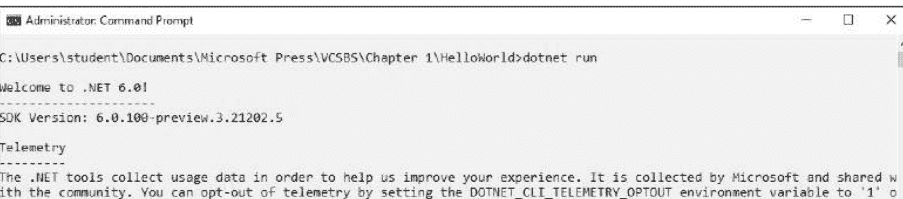

13. 重复 `dotnet run` 命令。这一次，.NET CLI 工具不需要下载任何库或证书，因为它们已经安装了。相反，你应该只看到消息 `Hello World!`。

`Hello World!` 应用程序编写起来快速简单，但你必须添加项目文件以便让 .NET CLI 工具理解如何构建和运行程序。这种方法对于简单的应用程序是可以行的，但更复杂的系统可能需要大量的配置和相应的项目文件。例如，一个应用程序可能需要几个不同的库，项目文件必须指定这些库的名称以及 .NET CLI 工具应该从哪里下载它们。幸运的是，.NET CLI 可以自动化处理许多复杂性，或者至少让管理变得更简单。

在下一个练习中，你将创建另一个版本的 `Hello World!`，但这次你将让 .NET CLI 工具为你生成项目文件。

# 使用 .NET CLI 工具构建和运行 C# 项目

1. 在命令提示符窗口中，返回 `Documents` 文件夹中的 `Microsoft Press\VCSBS\Chapter 1\HelloWorld` 文件夹

点击此处查看代码图像

```
cd C:\Users\YourName\Documents\Microsoft Press\VCSBS\Chapter 1
```

2. 创建名为 `HelloWorld` 的新文件夹。

```
mkdir HelloWorld
```

3. 进入 `HelloWorld` 文件夹。

```
cd HelloWorld
```

4. 运行以下命令创建一个新的控制台应用程序。单词 `console` 是 .NET CLI 用于生成应用程序的模板名称。

```
dotnet new console
```

当 .NET CLI 为新的控制台应用程序创建 C# 项目文件时，你会看到几条消息。

```
管理员：命令提示符
C:\Users\student\Documents\Microsoft Press\VCSBS\Chapter 1\HelloWorld2>dotnet new console
The template "Console Application" was created successfully.

Processing post-creation actions...
Running 'dotnet restore' on C:\Users\student\Documents\Microsoft Press\VCSBS\Chapter 1\HelloWorld
2\HelloWorld2.csproj.
Determining projects to restore...
Restored: C:\Users\student\Documents\Microsoft Press\VCSBS\Chapter 1\HelloWorld2\HelloWorld2.csproj
(in 93 ms).
Restore succeeded.
```

# 注意

.NET CLI 提供了其他几个模板来创建其他应用程序。

5. 输入 `dir` 显示 `HelloWorld2` 的内容。

你会看到一个名为 `HelloWorld2.csproj` 的项目文件、一个名为 `Program.cs` 的文件和一个名为 `obj` 的文件夹。打开**文件**菜单，选择**打开**并打开 `HelloWorld2.csproj`。然后输入 `dir` 显示 `HelloWorld2` 的内容。

你会看到一个名为 `HelloWorld2.csproj` 的项目文件、一个名为 `Program.cs` 的文件和一个名为 `obj` 的文件夹。打开**文件**菜单，选择**打开**并打开 `HelloWorld2.csproj`。此外，对于其他类型的应用程序，你将在本节后面看到“创建图形化应用程序”的示例。

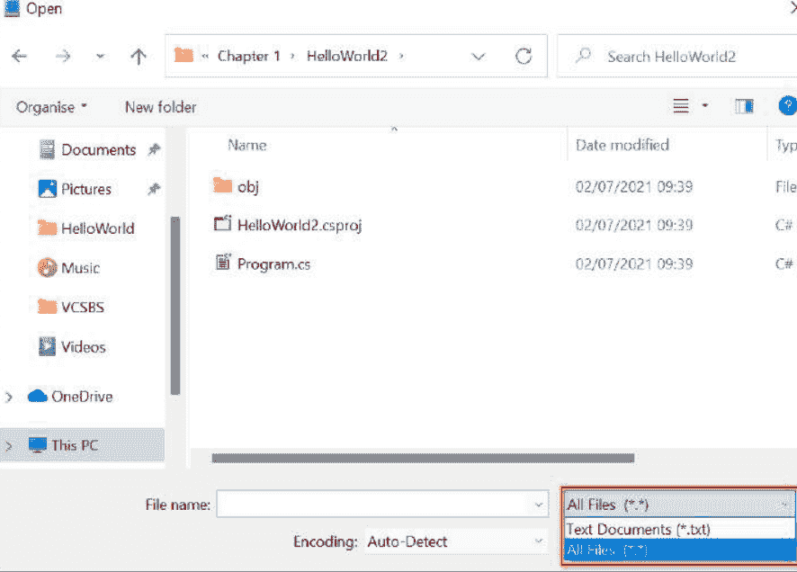

`HelloWorld2.csproj` 的内容如下：

```xml
<Project Sdk="Microsoft.NET.Sdk">
  <PropertyGroup>
    <OutputType>Exe</OutputType>
    <TargetFramework>net6.0</TargetFramework>
  </PropertyGroup>
</Project>
```

该项目文件与你手动创建的相同。打开 `Program.cs`。它包含以下代码：

```csharp
using System;

namespace HelloWorld
{
  class Program
  {
    static void Main(string[] args)
    {
      Console.WriteLine("Hello World!");
    }
  }
}
```

`Main` 方法指定的程序起点在类中定义为静态方法；否则 .NET Framework 可能无法将其识别为起点。你将在第 3 章“编写方法和范围”中详细学习方法。在这一点，你可能在想：“我在上一个练习中没有创建类或 `Main` 方法”。在最新版本的 C# 中，如果你有一个简单的应用程序，C# 编译器会创建自己的 `Main` 方法（你可以将其视为编译器生成的 `Main` 方法）。这在许多情况下可以节省你不必要的模板代码；控制台应用程序模板提供了 `Program` 类和 `Main` 方法。此外，其他类型的应用程序使用不同的方式标记起点。对于使用语句和命名空间定义，你将在本章后面学习更多这些内容。

12. 使用以下命令构建并运行应用程序：

```
dotnet run
```

在 .NET CLI 工具下载并安装额外库和一个开发证书期间，你会看到几条消息。最后，你应该能看到 `Hello World!` 这是你程序的输出。

13. 重复 `dotnet run` 命令。这一次，.NET CLI 工具不需要下载任何库或证书，因为它们已经安装了。相反，你应该只看到消息 `Hello World!`。

`Hello World!` 应用程序编写起来快速简单，但你必须添加项目文件以便让 .NET CLI 工具理解如何构建和运行程序。这种方法对于简单的应用程序是可以行的，但更复杂的系统可能需要大量的配置和相应的项目文件。例如，一个应用程序可能需要几个不同的库，项目文件必须指定这些库的名称以及 .NET CLI 工具应该从哪里下载它们。幸运的是，.NET CLI 可以自动化处理许多复杂性，或者至少让管理变得更简单。

在下一个练习中，你将创建另一个版本的 `Hello World!`，但这次你将让 .NET CLI 工具为你生成项目文件。

# 使用 .NET CLI 工具构建和运行 C# 项目

1. 在命令提示符窗口中，返回 `Documents` 文件夹中的 `Microsoft Press\VCSBS\Chapter 1\HelloWorld` 文件夹

点击此处查看代码图像

```
cd C:\Users\YourName\Documents\Microsoft Press\VCSBS\Chapter 1
```

2. 创建名为 `HelloWorld` 的新文件夹。

```
mkdir HelloWorld
```

3. 进入 `HelloWorld` 文件夹。

```
cd HelloWorld
```

4. 运行以下命令创建一个新的控制台应用程序。单词 `console` 是 .NET CLI 用于生成应用程序的模板名称。

```
dotnet new console
```

当 .NET CLI 为新的控制台应用程序创建 C# 项目文件时，你会看到几条消息。

```
管理员：命令提示符
C:\Users\student\Documents\Microsoft Press\VCSBS\Chapter 1\HelloWorld2>dotnet new console
The template "Console Application" was created successfully.

Processing post-creation actions...
Running 'dotnet restore' on C:\Users\student\Documents\Microsoft Press\VCSBS\Chapter 1\HelloWorld
2\HelloWorld2.csproj.
Determining projects to restore...
Restored: C:\Users\student\Documents\Microsoft Press\VCSBS\Chapter 1\HelloWorld2\HelloWorld2.csproj
(in 93 ms).
Restore succeeded.
```

# 使用 Visual Studio 2022 环境开始编程

现在你已经看到了 C# 应用程序的基本结构，是时候将注意力转向 Visual Studio 2022 了。Visual Studio 是一个工具丰富的开发环境，包含了你创建大型或小型 C# 项目的功能。你甚至可以构建无缝结合不同编程语言编写的模块的项目，例如 C++、Visual Basic 和 F#。在下一个练习中，你将打开 Visual Studio 2022 开发环境并创建另一个版本的 `Hello World!` 控制台应用程序。

## 在 Visual Studio 2022 中创建控制台应用程序

1. 在 Windows 任务栏上，选择**开始**，输入 **Visual Studio 2022** 并按回车。或者，在开始菜单上选择 **Visual Studio 2022** 图标。

Visual Studio 2022 启动并显示启动页，如下所示：

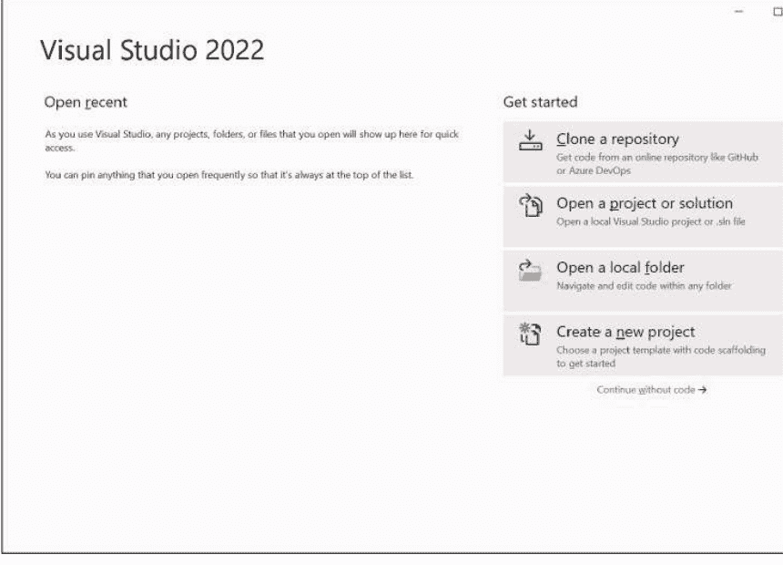

2. 在“启动”窗格中，选择**创建新项目**（Create a new project）。

打开“新建项目”对话框。此对话框列出了你可以作为构建应用程序起点的模板。该对话框根据你正在使用的编程语言和应用程序类型对模板进行分类。

3. 在“新建项目”对话框中，输入以下值，并选择**下一步**（Next）：

- a. 在**所有语言**（All languages）下拉列表框中，选择**C#**。
- b. 在**所有平台**（All platforms）下拉列表框中，选择**Windows**。
- c. 在**所有项目类型**（All project types）下拉列表框中，选择**控制台**（Console）。
- d. 选择**控制台应用 (.NET Framework)**（Console App (.NET Framework)）。

## 创建新项目

最近的项目模板

此处将显示你最近访问的模板列表。

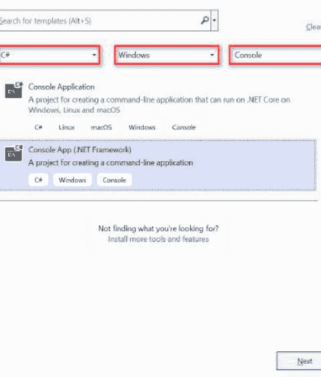

> 注意

.NET Framework 模板使用了特定于 Windows 的 .NET 实现。控制台应用程序模板的 .NET Core 版本使用的 .NET 版本不仅适用于 Windows，还适用于 Linux 和 macOS。然而，该模板的 .NET Framework 版本对于本次练习已经足够了。

4. 在“配置你的新项目”对话框中，输入以下值，并选择**创建**（Create）：

- a. 在**项目名称**（Project name）字段中，输入 **TestHello**。
- b. 在**位置**（Location）字段中，输入 `C:\Users\YourName\Documents\Microsoft Press\VCSBS\Chapter 1`。
- c. 将**解决方案名称**（Solution name）框保持为 **TestHello**。
- d. 确保“将解决方案和项目放在同一目录中”复选框未勾选。
- e. 将“框架”（Framework）选项设置为其默认值。

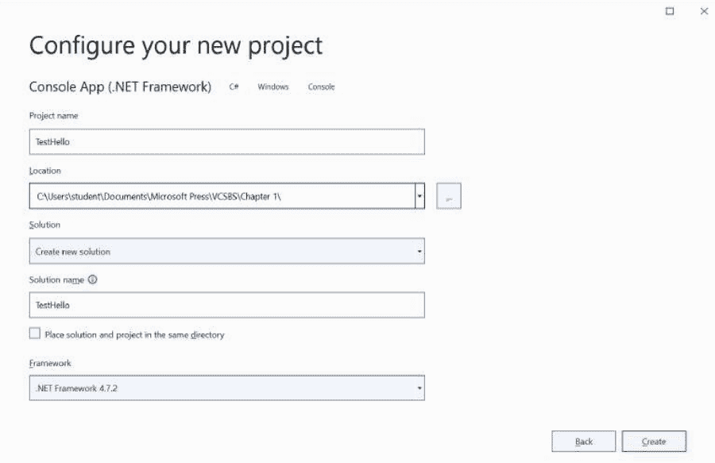

Visual Studio 使用控制台应用程序模板创建项目。然后，Visual Studio 将显示项目的启动代码，如下图所示。

## 菜单栏、工具栏、代码和文本编辑器窗口

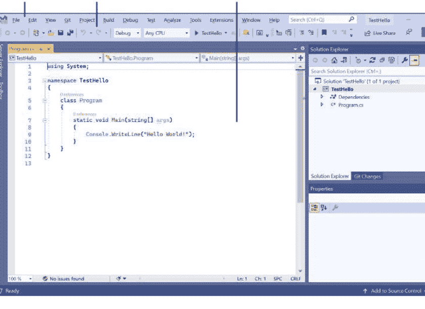

屏幕顶部菜单栏提供了访问你在编程环境中使用的功能的接口。你可以使用键盘或鼠标访问菜单和命令，就像在所有基于 Windows 的程序中操作一样。工具栏位于菜单栏下方。它提供了运行最常用命令的按钮快捷键。

代码和文本编辑器窗口占据屏幕的主要部分，显示源文件的内容。在多文件项目中，当你编辑多个文件时，每个源文件都有自己的标有源文件名的标签。你可以选择该标签，将命名的源文件带到代码和文本编辑器窗口的前景。

解决方案管理器（Solution Explorer）窗格出现在 IDE 的右侧，邻接代码和文本编辑器窗口。

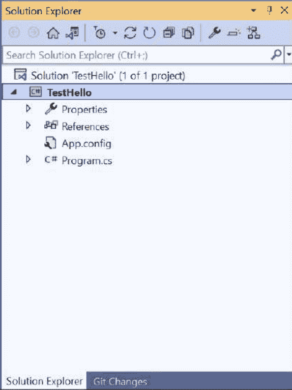

解决方案管理器显示与项目相关的文件名称以及其他项目。你也可以在解决方案管理器中双击文件名，将该源文件带到代码和文本编辑器窗口的前景。

5. 查看解决方案管理器中列出的文件，这些文件是 Visual Studio 2022 作为项目的一部分创建的：

- **TestHello** 是顶层解决方案文件。每个应用程序包含一个解决方案文件。解决方案可以包含一个或多个项目，Visual Studio 2022 创建解决方案文件有助于组织这些项目。如果你使用文件资源管理器查看 `Documents\Microsoft Press\VCSBS\Chapter 1\TestHello` 文件夹，你会发现该文件的实际名为 `TestHello.sln`。

- **Hello** 是 C# 项目文件。每个项目引用一个或多个包含源代码和其他项目产物的文件。你必须在单个项目中使用相同的编程语言编写所有源代码。在文件资源管理器中，此文件实际上名为 `Hello.csproj`，它存储在 `Documents\Microsoft Press\VCSBS\Chapter 1\TestHello` 文件夹中。

- **Properties** 是 `TestHello` 项目中的此文件夹。如果你展开它（选择 `Properties` 旁的箭头），你会发现它包含一个名为 `Assembly.cs` 的文件。这是一个特殊的文件，可以使用它为程序添加属性，例如作者名称、编写日期等。你可以指定额外的属性来修改程序的运行方式。

- **References** 文件夹包含你的应用程序可以使用的库引用。当你的 C# 代码被编译时，它会被转换为库并赋予一个唯一的名称。在 .NET Framework 中，这些库被称为程序集（assemblies）。开发者使用程序集封装他们编写的有用功能，以便将其分发给可能想在自己的应用程序中使用这些功能的其他开发者。如果你展开 `References` 文件夹，你会看到 Visual Studio 2022 为你的项目添加了默认引用集。这些程序集提供了对 .NET Framework 常用功能的访问，并由微软随 Visual Studio 2022 一起提供。你将在书中学习许多程序集。

- **App.config** 是应用程序配置文件。它是可选的，可能并不总是存在。你将在后续章节学习如何在运行时修改程序设置的 .NET 行为。

- **Program.cs** 是模板生成的 C# 源文件。它在项目创建时显示在编辑器窗口中。你将在书中学习更多关于该文件。

## 使用 Visual Studio 编写你的第一个程序

你之前已经知道 `Program.cs` 文件定义了一个名为 `Program` 的类，该类包含一个名为 `Main` 的方法。

> 注意

C# 是一种大小写敏感的语言。你必须大写拼写 `Main`。

在接下来的练习中，你将在 Visual Studio 中控制台显示消息。你还将学习命名空间如何划分代码元素。

## 使用 IntelliSense 编写

1. 在显示 `Program.cs` 文件的代码编辑器窗口中，将光标放在 `Main` 方法中，位于 `static void Main(string[] args)` 语句下方的。按回车换行。

2. 在新行上，输入单词 `Console`。`Console` 类由应用程序引程序集提供。该类包含多个在控制台显示消息和从键盘读取输入的方法，而不只是 `WriteLine` 方法。


当你开始输入 `Console` 的第一个字母 `C` 时，会出现 IntelliSense 列表。此列表包含了在此范围内有效的所有 C# 关键字和数据类型。你可以继续输入，也可以滚动列表并双击 `Console` 项。

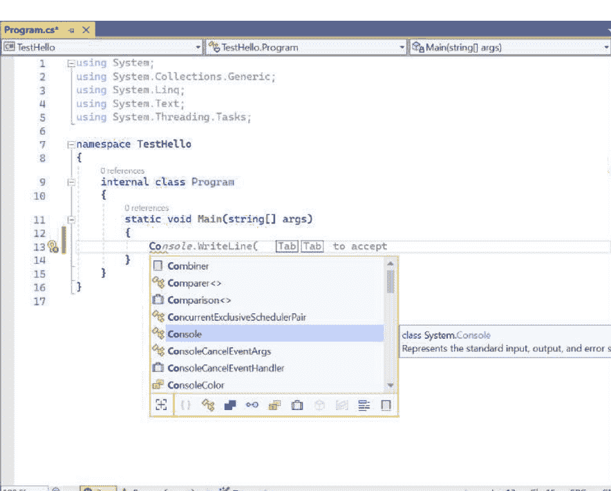

3. 紧接 `Console` 输入一个点 `.`。

另一个 IntelliSense 列表，显示 `Console` 类的方法、属性和字段。

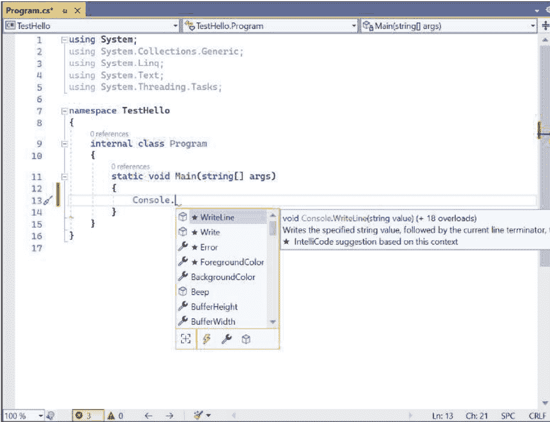

4. 向滚动列表，选择 `WriteLine` 并按**回车**。或者，按 **Tab** 键选择默认方法。（默认方法是最常用的方法）。

IntelliSense 列表关闭，单词 `WriteLine` 被添加到源文件中。新语句应该看起来所示：

```
Console.WriteLine
```

5. 如果尚未自动添加左括号，请输入 `(`。另一个 IntelliSense 提示将出现。

此提示显示了 `WriteLine` 方法可以接受的参数。`WriteLine` 是一个重载方法，这意味着 `Console` 类包含多个名为 `WriteLine` 的方法。事实上，它提供了 18 个不同版本的方法。你可以使用每个版本的 `WriteLine` 方法来输出不同类型的数据。（第 3 章将详细介绍重载方法。）新语句现在应该看起来所示：

```
Console.WriteLine("Hello World!");
```

```cs
Console.WriteLine(
```

> **提示**

你可以使用提示中的上下方向键来滚动查看 `WriteLine` 的不同重载。

6. 输入 `);`，现在语句应该看起来像这样：

```cs
Console.WriteLine();
```

7. 移动光标，在 `WriteLine` 方法的左右括号之间输入字符串 `"Hello YourName"`（包括引号）。

该语句现在看起来像这样：

[点击此处查看代码图像]()

```cs
Console.WriteLine("Hello YourName");
```

> **提示**

养成在填充内容之前先输入成对字符的习惯，例如圆括号 `( )` 和大括号 `{ }`。如果你等到输入完内容后再输入结束字符，很容易忘记。

## IntelliSense 图标

当你在类名后输入句号时，IntelliSense 会显示该类的每个成员的名称。在每个成员名称的左侧有一个描述该方法成员类型的图标。常见的图标及其类型包括如下：

| 图标 | 含义 |
|---|---|
| ⚙ | 方法（在第 3 章中讨论） |
| 👥 | 类（在第 7 章中讨论） |
| 📦 | 结构体（在第 9 章中讨论） |
| 📋 | 枚举（在第 9 章中讨论） |
| 🔧 | 扩展方法（在第 12 章“处理继承”中讨论） |
| 📄 | 接口（在第 13 章“创建接口和抽象类”中讨论） |
| 💼 | 委托（在第 17 章“介绍泛型”中讨论） |
| ⚡ | 事件（在第 17 章中讨论） |
| {} | 命名空间（在本章的下一节中讨论） |

当你在不同上下输入代码时，还会看到其他 IntelliSense 图标出现。

## 构建并运行控制台应用程序

1. 打开**生成 (Build)** 菜单并选择**生成解决方案 (Build Solution)**。

这将编译 C# 代码，生成一个你可以运行的程序。输出（Output）窗口出现在代码和文本编辑器窗口下方。

> **提示**

> 如果输出窗口没有出现，请从视图 (View) 菜单中选择输出 (Output) 来显示它。

在输出窗口中，你应该能看到类似下面的消息，指示程序是如何被编译的：

[点击此处查看代码图像]()

```text
Build started...
1------ Build started: Project: TestHello, Configuration: Debug
------
Any CPU
1>TestHello -> C:\Users\student\Documents\MicrosoftPressVCSB\Chapter 1\TestHello\
TestHello\bin\net6.0\TestHello.dll
========= Build: 1 succeeded, 0 failed, 0 up-to-date, 0 skipped
=========
```

如果你犯了任何错误，它们将在错误列表 (Error List) 窗口中报告。下面的图像显示了如果你在 `WriteLine` 语句的 `Hello World` 之后忘记输入结束引号将会发生。注意注意有时一个错误会导致多个编译器错误。

```cs
using System;
using System.Collections.Generic;
using System.Linq;
using System.Text;
using System.Threading.Tasks;

namespace TestHello
{
    internal class Program
    {
        static void Main(string[] args)
        {
            Console.WriteLine("Hello John");
        }
    }
}
```

```text
Output from Build
Module build start failed.
-> Rebuild All started: Project: TestHello, Configuration: Debug Any CPU ----
-> C:\TestHello\TestHello\Program.cs(13,31,31,31): error CS1020: Redefined in const
-> C:\temp\TestHello\TestHello\Program.cs(14,44,14,64): error CS1020: expected
-> C:\temp\TestHello\TestHello\Program.cs(14,44,14,63): error CS1002: expected
-> Rebuild All: : failed, 1 failed, 0 skipped
```

## 提示

注意，Visual Studio 在你输入无法编译的代码行下会显示红色波浪线。要直接跳转到导致错误的行，请双击错误列表窗口中的项目。

如果你仔细按照了之前的指示，那么不应该有错误。

> **提示**

> 如果输出窗口没有出现，请从视图 (View) 菜单中选择输出 (Output) 来显示它。

> 下面的图像显示了如果你在 `WriteLine` 语句的 `Hello World` 之后忘记输入结束引号将会发生。注意有时一个错误会导致多个编译器错误。

> **提示**

> 无需显式保存文件，因为 Visual Studio 会自动保存。

> **提示**

> “Hello World!” 提示会在运行时生成。

通过添加前缀限定符，甚至只是使用如 `SystemConsole` 之类的全局唯一名称来为类命名。幸运的是，你可以在程序中使用 `using` 指令来解决这个问题。如果你回到 Visual Studio 2022 中的 `TestHello` 程序并查看“代码和文本编辑器”窗口中的 `Program.cs` 文件，你会注意到文件顶部有以下行：

```
using System;
```

这一行是一个 `using` 指令。`using` 指令将命名空间引入作用范围，使应用程序可以使用命名空间定义的项。在同一文件的后续代码中，你不再需要显式地限定 `System` 命名空间中的对象。`System` 命名空间包含了经常使用的类，因此 Visual Studio 2022 在你创建新的控制台项目时会自动添加此 `using`。当你创建其他类型的项目时，可能会看到引用额外的命名空间。如果你需要引用其他命名空间，可以在源文件的顶部添加更多的 `using` 指令。

> **注意**：有时 `using` 指令会显示为灰色。这些指令对应于应用程序当前未使用的命名空间。如果你在编写代码后不需要它们，可以安全地删除它们。但是，如果你以后需要这些命名空间中的项，则必须重新添加 `using` 指令。

## 命名空间与程序集

`using` 指令将命名空间中的项引入作用范围，让你无需在代码中完全限定类的名称。类被编译成程序集。程序集通常是一个具有 `.dll` 文件扩展名的文件，尽管严格来说，具有 `.exe` 文件扩展名的可执行程序也是程序集。

一个程序集可以包含许多类。诸如 `System.Console` 的类由与 Visual Studio 一起安装在计算机上的程序集提供。.NET Core 和 .NET Framework 类库包含数千个类。如果它们都存在于同一个程序集中，程序集将变得巨大且难以维护（如果 Microsoft 要更新单个类中的方法，它们将分发整个类库！）

由于这个原因，类库被分成若干程序集，按它们执行的功能或实现的技术进行划分。例如，.NET Core 使用一个名为 `System.Runtime.dll` 的“核心”程序集，包含了向控制台写入数据（如 `System.Console`）、操作数据库、访问 Web 服务、构建 GUI 等 C# 类型。如果你想使用程序集中的类，必须向你的项目添加该程序集的引用。然后你可以在代码中添加 `using` 指令，将该程序集中的命名空间项引入作用范围并使其可用。当你使用 Visual Studio 创建应用程序时，所选模板会自动包含对适当程序集的引用。要为 .NET Core 项目添加额外的程序集，你可以使用 NuGet 包管理器。你将在后续章节中看到具体操作。

## 注意

.NET Framework（有它自己的“核心”程序集，名为 `mscorlib`，它包含了许多与 `System.Runtime.dll` 类似的类和方法。然而，这两个程序集是不同的且不可互换。`mscorlib` 中的类和方法是 Windows 特有的实现，而 `System.Runtime.dll` 中的是跨平台的——设计用于 Windows、Linux 和 macOS。`System.Runtime.dll` 目前不包含 `mscorlib` 中的所有功能。但是，你不应该将 `mscorlib` 程序集添加到 .NET Core 应用程序。如果你需要 Windows 特有的功能，请使用基于 .NET Framework 而不是 .NET Core 的模板。如果这听起来很专业，不要担心。Microsoft 正在统一两者。未来 .NET Core 和 .NET Framework 将被单一运行时程序集取代。程序集与命名空间之间并不是 1:1 的等效关系。单个程序集可以包含定义在多个命名空间中的类，而单个命名空间可以跨越多个程序集。这听起来很混乱，但你很快就会习惯。

## 注释代码

你经常会在 C# 代码中看到两个斜杠（`//`）后面跟着普通文本。这些是注释。编译器会忽略它们，但对于帮助开发者记录程序正在做什么非常有用。例如下：

点击查看代码

```
Console.ReadLine(); // 等待用户按下回车键
```

编译器跳过从两个斜杠到行尾的所有文本。你可以添加以斜杠加星号（`/*`）开头的多行注释。编译器会跳过内容直到找到星号加斜杠序列（`*/`），这可能在许多行之后，如下：

点击查看代码

```
/* 这是一个多行注释
编译器忽略所有文本
直到结束注释字符 */
```

建议你尽可能使用有意义的注释来记录代码。你也可以在测试或调试期间使用注释临时禁用一行或多行代码。

## 创建图形应用程序

到为止，你一直在使用 Visual Studio 2022 创建并运行基础控制台应用程序。Visual Studio 2022 编程环境还包含了为 Windows 10 和 Windows 11 创建图形应用程序所需的一切。这些模板被称为通用 Windows（UWP）应用，因为它们让你能够创建在任何运行 Windows 的设备（如桌面电脑、平板电脑和手机）上运行的应用程序。你可以交互地设计 Windows 应用程序的用户界面（UI）。然后 Visual Studio 2022 会生成实现你设计的用户界面的语句。

Visual Studio 2022 为你的图形应用程序提供了两种视图：用于修改和维护图形应用程序代码及程序逻辑的代码和文本编辑器窗口，以及用于布局 UI 的设计窗口。你可以随时在两个视图之间切换。

在接下来的练习中，你将学习如何使用 Visual Studio 2022 创建图形应用程序。此程序将显示一个简单的表单，其中包含一个输入名称的框和一个按钮，点击按钮将在消息框中显示个性化的问候。

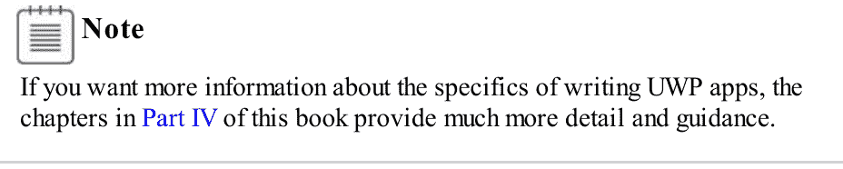

## 在 Visual Studio 2022 中创建图形应用程序

1. 如果 Visual Studio 2022 仍上一个练习打开，打开“文件”菜单，选择“新建”，然后选择“项目”。如果你已关闭 Visual Studio，请启动它并选择“创建新项目”。

2. 在“创建新项目”对话框中，在“语言”下拉列表中选择 C#，在“平台”列表中选择 Windows，在“项目类型”下拉列表中选择 UWP。选择“空白应用（通用 Windows)”模板，然后选择“下一步”。

3. 在“配置新项目”对话框中，输入以下值并选择“创建”：

- a. 将项目命名为 `HelloUWP`。

- b. 在“位置”字段中，输入 `C:\Users\YourName\Documents\Microsoft Press\VCSBS\Chapter 1\`。

- c. 在“解决方案”下拉列表中，选择“创建新解决方案”。

> **注意**：“解决方案”下拉列表只有在你之前在 Visual Studio 2022 中编辑另一个应用程序时才会显示。如果你刚刚重启 Visual Studio 则不会显示。

- d. 保持解决方案名称为 `HelloUWP`。

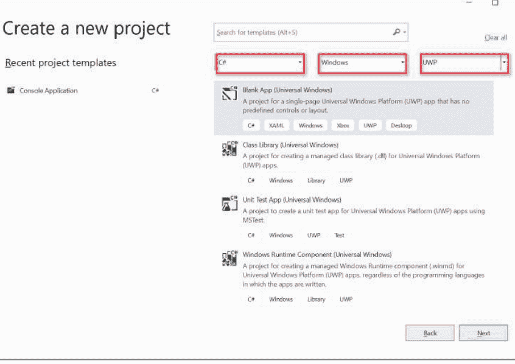

- e. 确保取消勾选“将解决方案和项目放在同一目录”复选框。对话框提示指定你的应用程序运行的 Windows 版本。较新的 Windows 版本具有更多更新的功能。Microsoft 建议始终选择最新的 Windows 构建作为目标版本，但如果你正在开发需要在旧版本上运行的企业应用程序，请选择当前采用的最旧版本作为最低版本。然而，不要自动选择最旧版本，因为这可能会限制应用程序可用功能。

4. 接受默认值。（取决于你的计算机已应用哪些更新，这些值可能与下所示所示。）

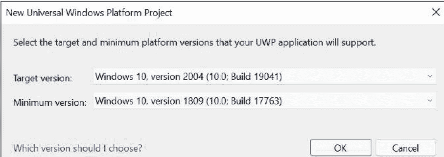

5. 如果第一次创建 UWP 应用程序，可能还会提示启用 Windows 开发者模式，并出现 Windows 设置界面。选择“开发模式”。

6. 会弹出一个对话框确认你确定执行此操作，因为这将绕过某些 Windows 安全功能。选择“是”。Windows 下载并安装开发模式包，该包为调试 UWP 应用程序提供了附加功能。

## 隐私与安全 > 开发人员

这些设置仅供开发使用。

了解更多

## 开发者模式

从任何源安装应用，包括离散文件。

- 开启

使用开发者功能：

开启开发者模式（包括从 Microsoft Store 之外安装和运行应用）可能会让您的设备和个人数据面临安全风险，或对设备造成损害。

- 启用开发者模式？

- 关闭

注意：这需要 Windows 10 SKU 版本 1803 或更高版本。

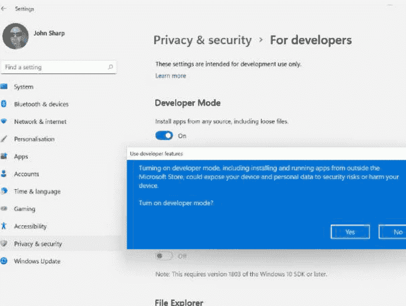

## 文件资源管理器

> 未从 Windows Store 下载的外部应用程序可能会暴露个人数据并带来其他安全风险，但如果您正在构建和测试自己的自定义应用程序，则有必要启用开发者模式。

返回 Visual Studio。创建应用后，在“解决方案管理器”（Solution Explorer）窗格中查看。

不要被应用程序模板的名称误导。尽管它是“空应用”（Blank App），但此模板实际上提供了几个文件并包含了一些代码。例如，如果展开 `MainPage.xaml` 文件夹，你会找到一个名为 `MainPage.xaml.cs` 的 C# 文件。

选择此文件将在“代码和文本编辑器”窗口中显示它。此文件是您为应用程序添加初始代码的地方。

在“解决方案管理器”窗格中，双击 `MainPage.xaml`。

此文件包含 UI 的布局。“设计视图”（Design View）窗口显示了该文件的两种表示形式。

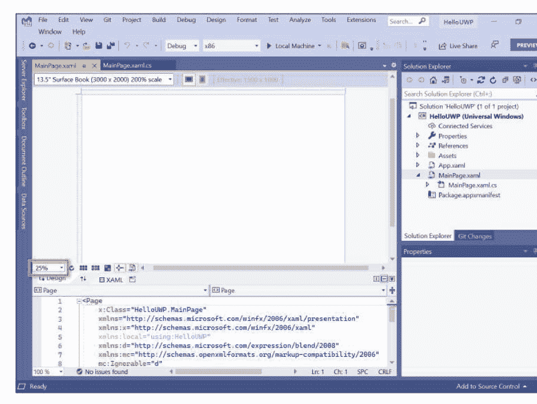

顶部是默认的 Surface Book 屏幕的图形视图。您可以使用百分比下拉列表（在之前的屏幕截图中突出）进行放大和缩小。下方窗格使用 XAML 描述了该屏幕的内容。XAML 是一种 UWP 应用用于定义表单布局及其内容的类 XML 语言。如果您熟悉 XML，那么 XAML 看起来会很亲切。

> **注意**

XAML 代表可扩展应用程序标记语言（Extensible Application Markup Language），UWP 应用用于定义应用程序布局的语言。随着对书中练习的进行，您将学习更多关于 XAML 的知识。

在继续之前，有必要解释一些术语。在传统的 Windows 中，UI 由一个或多个窗口组成，但在 UWP 应用中，相应的项被称为“页面”（pages）。为了清晰起见，我将使用“表单”（form）这一术语来泛代这两项。然而，我将继续使用“窗口”一词来指代 Visual Studio 2022 IDE 中的项，例如设计视图窗口。

在接下来的练习中，您将使用设计视图窗口为您的应用程序显示的表单添加三个控件。您还将检查 Visual Studio 2022 自动生成的一些 C# 代码以实现这些控件。

## 要创建用户界面

1. 选择设计视图窗口中表单左侧边栏的“工具箱”（Toolbox）选项卡。


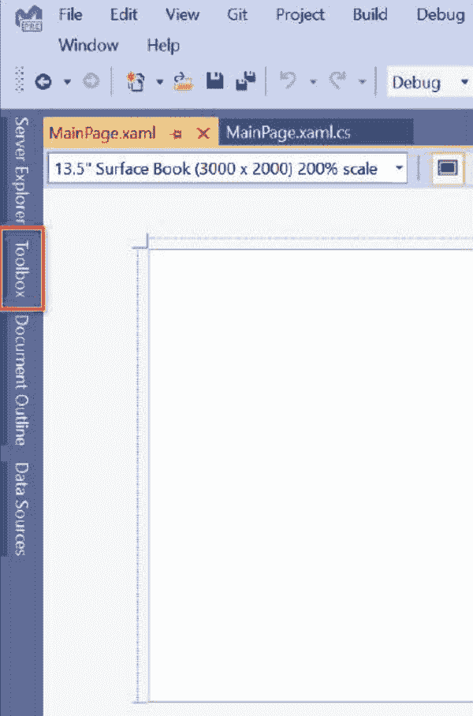

工具箱出现，显示了您可以放置在表单上的各种组件和控件。默认选中了工具箱的“通用”（General）部分。它（尚未）包含任何控件。

1. 展开“常用 XAML 控件”（Common XAML Controls）部分。

此部分显示大多数图形应用程序使用的控件列表。

> **提示**
>
> “所有 XAML 控件”（All XAML Controls）部分显示了更广泛的控件列表。

2. 在“常用 XAML 控件”部分，选择`TextBlock`。然后将`TextBlock`控件拖到设计视图窗口显示的表单上。

> **提示**
>
> 请确保选择`TextBlock`控件而不是`TextBox`控件。如果您不小心在表单上放置了错误的控件，可以通过选中表单上的项并按`Delete`键轻松将其删除。

表单上添加了一个`TextBlock`控件（稍后您将其移动到正确位置），工具箱将从视图中消失。

> **提示**
>
> 如果您希望工具箱保持可见，但不隐藏表单的任何部分，请点击工具箱标题栏右侧的“自动隐藏”按钮（看起来像一个图钉）。工具箱停靠在 Visual Studio 2022 窗口的左侧，设计视图会缩小以适应它。（如果您的屏幕是低分辨率，可能会丢失大量空间。）再次点击自动隐藏按钮，工具箱将再次消失。

3. 表单上的`TextBlock`控件可能正处于您想要的位置。您可以使用此技术选择并拖动已添加到表单的控件来重新定位它们，移动`TextBlock`控件，使其位于表单的左上角。（精确位置对此应用程序至关重要。）您可能需要在设计视图窗口中移动它之前，先点击其他地方取消选择，再次选中它。

下方窗格中表单的 XAML 描述现在包含了`TextBlock`控件，其属性如它在表单上的位置（由`Margin`边距属性控制）、该控件在`Text`属性中显示的默认文本，以及该控件显示的文本超出表单宽度时的对齐方式。

您用于`TextBlock`的 XAML 代码看起来如下：

```xml
<TextBlock HorizontalAlignment="Left" Margin="211,166,0,0" TextWrapping="Wrap" VerticalAlignment="Top"/>
```

XAML 窗格和设计视图之间存在双向关系。您可以在 XAML 窗中编辑值，更改将反映在设计视图中，反之亦然。

4. 在“视图”（View）菜单中选择“属性”（Properties）。

如果尚未显示，属性窗口将出现在屏幕右下角，解决方案管理器窗格下方。属性窗口是上下文敏感的，因为它显示的是当前选中项的属性。如果您选择设计视图中的表单（`TextBlock`控件之外），可以看到属性窗口显示的是 Grid 的属性。如果您查看 XAML 窗格，应该会看到`TextBlock`控件包含在 Grid 元素中。所有表单都包含一个控制布局的 Grid 元素；例如，可以通过向 Grid 添加行和列来定义表格布局。

在设计视图窗口中，选择`TextBlock`控件。属性窗口显示`TextBlock`控件的属性。

在属性窗口中，展开`TextBlock`控件的`Text`属性。将`FontSize`属性更改为 30 px 并回车。该属性位于包含字体名称的下拉列表旁边，将显示为 Segoe UI。

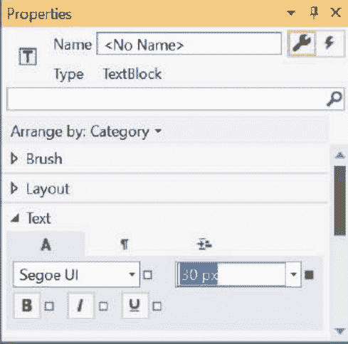

> **注意**
>
> 后缀 px 表示字体大小以像素为单位。

8. 在设计视图下方的 XAML 窗格中，检查定义`TextBlock`控件的文本。如果您滚动到列表末尾，应该会看到`FontSize="30"`文本。您使用属性窗口进行的任何更改都会反映在 XAML 定义中，反之亦然。

在 XAML 窗中覆盖`FontSize`属性的值并将其更改为 36。设计视图和属性窗口中`TextBlock`控件的字体大小将发生变化。

9. 在属性窗口中，检查`TextBlock`控件的其他属性。可以尝试更改它们以观察效果。注意当您更改属性的值时，这些属性会被添加到 XAML 窗格中`TextBlock`控件的定义中。您添加到表单的每个控件都有一组默认属性值，除非您更改它们，否则这些值不会显示在 XAML 窗中。

10. 将`TextBlock`控件的`Text`属性值从 TextBlock 更改为 Please enter your name。

在 XAML 窗格中的元素或者通过更改属性窗口中的值来更改。（此属性位于属性窗口中的 Common（常用）部分。）

11. 在设计视图（Design View）窗口中选择表单，然后再次显示工具箱。

12. 在工具箱中，选择并拖动`TextBox`控件到表单上。移动`TextBox`控件使其直接位于`TextBlock`控件下方。

> **提示**
>
> 当你在表单上拖动控件时，会自动出现对齐指示。这些指示可以为你提供快速提示，以确保控件整齐排列。你也可以在 XAML 格中手动编辑`Margin`（边距）属性，将左边距设置为与`TextBox`控件相同的值。

13. 在设计视图窗口中，将鼠标指针悬停在`TextBox`控件右边缘的柄上。鼠标指针将变为双向箭头，表示你可以调整控件的大小。拖动`TextBlock`控件的右边缘，直到它与上方`TextBlock`控件的右边缘对齐。如果你看不到右边缘柄，请使用百分比下拉列表进行放大。

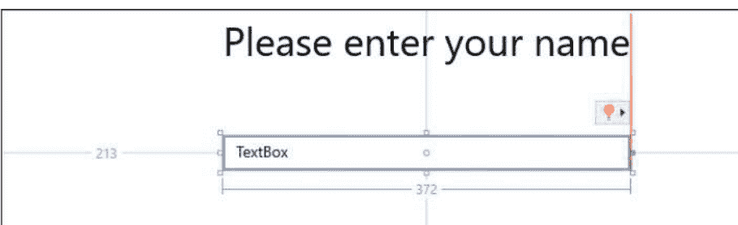

14. 当选中`TextBox`控件时，在属性窗口顶部，将`Name`属性的值从`<No Name>`更改为`userName`。同时，将`Text`属性的字体大小更改为`36 px`，以匹配`TextBlock`控件。

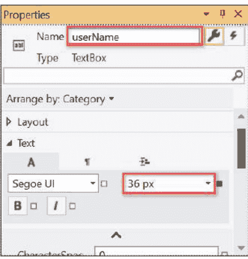

> **注意**
>
> 你将在第 2 章“使用变量、操作符和表达式”中学习更多关于控件和变量的命名规范。

15. 再次显示工具箱。然后选择并拖动`Button`控件到表单上，放在表单上`TextBox`控件的右侧，使按钮的底部与文本框的底部水平对齐。

16. 在属性窗口中，将`Button`控件的`Name`属性更改为`ok`，将字体大小设置为`36 px`，并将`Content`属性（属性窗口中的 Common 部分）从 Button 更改为 OK，然后按回车。

17. 验证表单上`Button`控件的标题已更改为显示文本 OK。

18. 在属性窗口的 Layout（布局）部分，将`width`（宽度）更改为 120。现在表单看起来应该与下图所示。

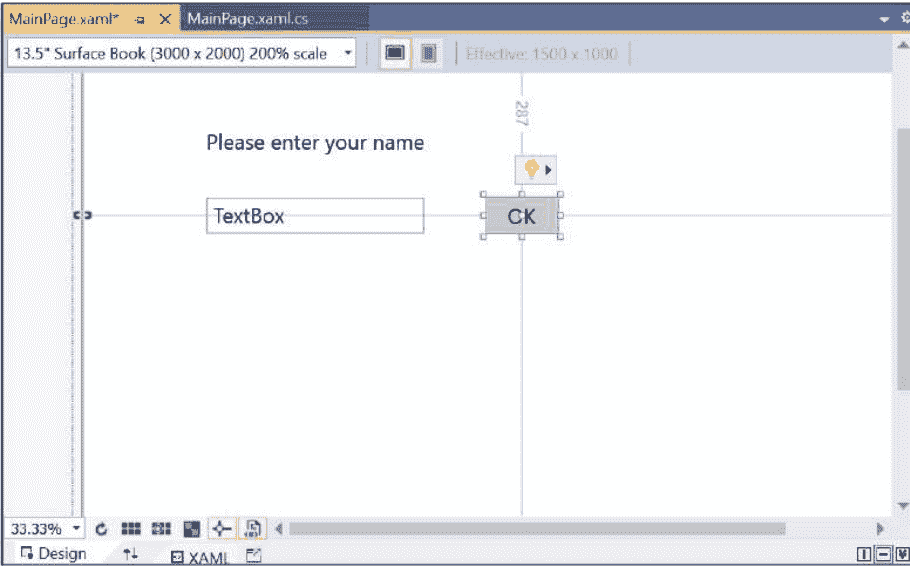

> **注意**
>
> 设计视图左上角的下拉菜单允许你查看表单在不同尺寸和分辨率下的渲染情况。在本例中，选择了分辨率为 3,000 x 2,000 的 13.5 英寸 Surface Book 的默认视图。在下拉菜单右侧，有两个按钮允许你在纵屏视图和横屏视图之间切换。

19. 在 Build（生成）菜单上，选择 Build Solution（生成解决方案），然后验证项目是否成功生成。

20. 确保 Debug Target（调试目标）下拉列表设置为 Local Machine（本地机）。它可能默认设置为 Device（设备）并尝试连接到 Windows 手机设备，在这种情况下生成可能会失败。然后，在 Debug（调试）菜单上选择 Start Debugging（开始调试）。

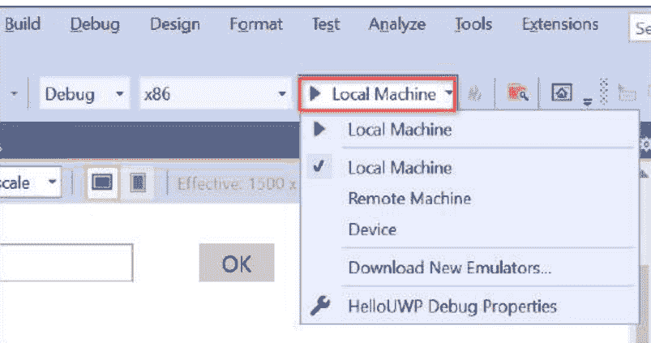

应用程序应该运行并显示你的表单。表单看起来如下：


```csharp
// <summary>
public App()
{
    this.InitializeComponent();
    this.Suspending += OnSuspending;
}

// <summary>
// 当终端用户正常启动应用程序时，会调用此方法。其他入口点
// 将被使用，例如当应用程序启动以打开
// 特定的文件时。
// </summary>
// <param name="e">关于启动请求和
// 过程的详细信息。</param>
protected override void OnLaunched(LaunchActivatedEventArgs e)
{
    Frame rootFrame = Window.Current.Content as Frame;

    // 当窗口已经包含内容时，不要重复初始化应用程序，
    // 只要确保窗口处于激活状态即可
    if (rootFrame == null)
    {
        // 创建一个 Frame 作为导航上下文，
        // 并导航到第一个页面
        rootFrame = new Frame();
    }

    rootFrame.NavigationFailed += OnNavigationFailed;

    if (e.PreviousExecutionState == ApplicationExecutionState.Terminated)
    {
        // TODO: 从之前挂起的状态加载状态
    }

    // 将 frame 放置在当前窗口中
    Window.Current.Content = rootFrame;
}

if (e.PrelaunchActivated == false)
{
    if (rootFrame.Content == null)
    {
        // 当导航栈未恢复时，
        // 导航到第一个页面，
    }

    // 通过传递所需的
    // 信息作为导航
    // 参数来配置新页面
    rootFrame.Navigate(typeof(MainPage), e.Arguments);
}
// 确保当前窗口激活
Window.Current.Activate();
}

/// <summary>
/// 当导航到特定页面失败时，会调用此方法
/// </summary>
/// <param name="sender">导航失败的 Frame</param>
/// <param name="e">关于导航失败
/// 的详细信息</param>
void OnNavigationFailed(object sender, 
    NavigationFailedEventArgs args)
{
    throw new Exception("Failed to load Page " + 
e.SourcePageType.FullName);
}

/// <summary>
/// 当应用程序执行挂起时，会调用此方法。
/// 应用程序状态将被保存，
/// 而无需知道应用程序将被终止
/// 还是在内存内容
/// 保持完整的情况下被恢复。
/// </summary>
/// <param name="sender">挂起请求的源。
/// </param>
/// <param name="e">关于挂起请求的详细信息。</param>
private void OnSuspending(object sender, SuspendingEventArgs
e)
{
    var deferral = e.SuspendingOperation.GetDeferral();
    // TODO: 保存应用程序状态并停止任何后台
    deferral.Complete();
}
```

此代码的大部分由注释（以`///`开头的行）以及你目前不需要理解的其他语句组成，但关键元素位于`OnLaunched`方法中，并已加粗显示。此方法在应用程序启动时运行，该方法中的代码会导致应用程序创建一个新的`Frame`对象，在此 frame 中显示`MainPage`表单，然后激活它。在现阶段，不需要完全理解这些代码的工作原理或任何这些语句的语法，只需了解这是应用程序在开始运行时显示表单的方式就会很有帮助。

# 为图形化应用程序添加代码

现在你已经稍微了解图形化应用程序的结构，现在是时候编写一些代码让你的应用程序实际执行某些操作了。在下一个练习中，你将编写在用户选择 OK 按钮时运行的 C# 代码。此代码将使用用户在`TextBox`控件中输入的名称显示一条个性化的问候语。

## 为 OK 按钮编写代码

1. 在解决方案管理器中双击`MainPage.xaml`文件，以在设计视图窗口中打开表单。

2. 在设计视图窗口中，选择表单上的 OK 按钮以选中它。

3. 在属性窗口中，选择“事件”（Event）按钮。此按钮显示一个看起来像闪电的图标。

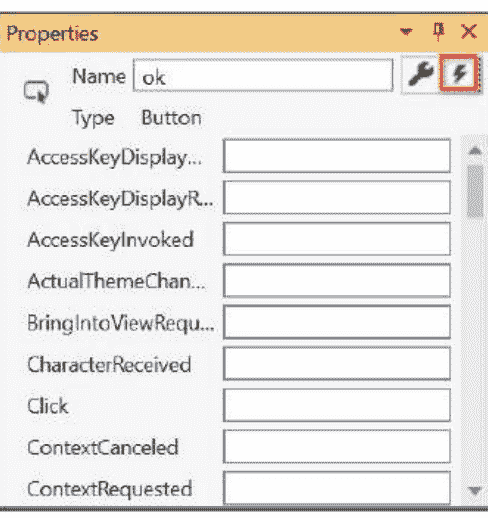

属性窗口显示了`Button`控件的事件名称列表。事件表示通常需要响应的重大操作，例如用户选择按钮。你可以编写自己的代码来执行此响应。

4. 在`Click`事件旁边的框中输入`okClick`，并按回车键。

`MainPage.xmlcs`文件出现在代码和文本编辑器窗口中，并在`MainPage`类中添加了一个名为`okClick`的新方法。该方法看起来如下：


```csharp
private void okClick(object sender, RoutedEventArgs e)
{
}
```

现在不要过于担心这段代码的语法；你将在第 3 章中学习关于方法的全部知识。

5. 向上滚动并在文件顶部的列表中添加加粗显示的`using`指令（省略号字符`[...]`表示为了简洁起见而省略的语句）：


```csharp
using System;
using Windows.UI.Xaml.Navigation;
using Windows.UI.Popups;
```

6. 返回`okClick`方法并添加此处加粗的代码：


```csharp
private void okClick(object sender, RoutedEventArgs e)
{
    MessageDialog msg = new MessageDialog("Hello " + userName.Text);
    _ = msg.ShowAsync(); // 显示消息，但忽略返回值
}
```

此代码将在用户选择 OK 按钮时运行。再次，不要过于担心语法。你只需要了解第一条语句创建了一个`MessageDialog`对象，消息为“Hello <userName>”，其中`<userName>`是输入的名称。第二条语句显示`MessageDialog`，使其出现在屏幕上。`MessageDialog`类定义在`Windows.Popups`命名空间，这就是你在第 5 步中添加它的原因。


# 注意

`ShowAsync()`返回一个值，但在示例中你对这个值并不感兴趣。你只是想该方法显示消息。在这种情况下，这种语法表示该值将被丢弃。如果你省略了这些字符，代码仍然运行，但 Visual Studio 会显示警告。Visual Studio 通过在语句下方添加绿色波浪线来实现这一点。如果你悬停在此行代码上，Visual Studio 会显示消息：“由于此调用未等待，执行将在调用完成之前继续。请考虑对结果应用 'await' 运算符。”本质上，这提醒你代码忽略了返回值，而你可能并没有意识到。在这种情况下，显式地强调你是有意忽略返回值更好。这种语法被称为 discard。

7. 选择代码和文本编辑器上方的`MainPage.xaml`标签，在设计视图中显示表单。

8. 在显示表单 XAML 描述的面板中，检查`Button`元素，但不要更改任何内容。注意它现在包含一个指向`okClick`方法的`Click`属性。

点击查看代码

```xml
<Button x:Name="ok" ... Click="okClick" />
```

9. 在调试菜单上，选择调试。

当表单出现，在框中将现有文本替换为你的名称，然后选择 OK。

弹出一个消息对话框，显示以下问候语：

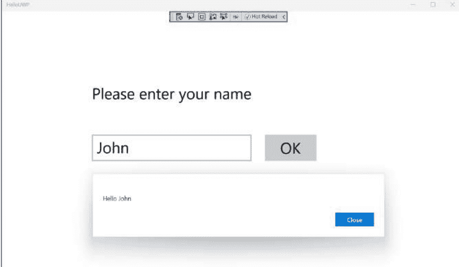

11. 在消息框中选择关闭。

12. 返回 Visual Studio 2022。然后，在调试菜单上，选择停止调试。

# 其他类型的图形化应用程序

除了 UWP 应用程序外，Visual Studio 2022 还允许你创建其他类型的图形化应用程序。这些应用程序针对特定环境，并且不包含能够在不更改的情况下跨平台运行的适应性。

Visual Studio 2022 中提供的其他类型图形化应用程序模板包括：

- `WinUI3 app` 是构建图形化应用程序的最新 API 和工具。UWP 应用运行在受安全限制的沙箱中。


这限制了某些可用功能。WinUI 应用作为原生桌面应用运行，并可以完全访问 Windows 提供的所有功能。你可能会合理地问：“为什么这本书使用 UWP 而不是 WinUI3？” 答案是，在编写时，WinUI3 尚处于开发阶段，尚未完全完成。使用 UWP 可以提供 WinUI3 尚不具备的稳定性，尽管我预计如果未来有新版，我会将书中的所有代码和示例切换到 WinUI3！此外，微软已表示，WinUI3 的图形设计工具不会作为第一个发布版本的一部分，这意味着你必须手动开发用户界面——要么从头手工编写自己的 XAML，要么使用各种 C# API。因此，为了保持简单起见，我选择在本书中使用 UWP；它不会影响 C#，只会影响你创建 UI 的方式。

- .NET MAUI 代表多平台应用程序用户界面（Multi-platform Application User Interface）。.NET MAUI 应用可以在 Windows 和 macOS 设备上运行。支持的操作系统包括 Android、macOS、iOS 和 iPad。使用 .NET MAUI，你可以构建在多个平台上运行且保持不变的移动和桌面应用，例如 Microsoft Surface 笔记本电脑、Mac Mini、iPhone 和 Android 平板电脑。.NET MAUI 不在本书的范围内，但其核心要素与构建 UWP 应用非常相似。你使用 XAML 定义用户界面，并使用 C# 编写应用程序逻辑。在 UWP 应用提供的控件方面存在某些差异，由于底层操作系统和设备能力的性质，应用程序的结构略有不同，但既然你已经知道如何创建 UWP 应用，转向 .NET MAUI 就会相对简单。

- WPF 代表 Windows 呈现基础（Windows Presentation Foundation）。WPF 针对的是运行在 Windows 桌面上的应用程序，而不是能够适应各种不同设备和形状因的应用程序。它提供了一个基于矢量图形的极其强大的框架，使用用户界面能够在不同屏幕分辨率之间平滑缩放。WPF 的许多关键功能在 UWP 应用中也可用，尽管 WPF 提供了适用于在强大的桌面机器上运行的额外功能。

- Windows Forms 应用是一个较老的图形库，可以追溯到 .NET Framework 的起源。正如其名称所示，Windows Forms 库旨在使用当时 Windows 提供的图形设备接口（GDI）库来构建更经典的表单应用程序。虽然该框架使用方便，但它既不具备 WPF 的功能和扩展性，也不具备 UWP 的可移植性。

如果你正在构建图形应用程序，除非有充分理由，否则我建议你选择 UWP 模板。

# 总结

在本章中，你学习了如何使用 Visual Studio 2022 创建、生成和运行应用程序。你创建了一个在控制窗口中显示输出的控制台应用程序，并创建了一个带有简单 GUI 的 UWP。

- 如果你想继续下一章节，请保持 Visual Studio 2022 运行并转向第 2 章。
- 如果你想现在退出 Visual Studio 2022，打开“文件”菜单并选择“退出”。如果 Windows 显示保存对话框，选择“是”以保存项目。

## 快速参考

| 操作 | 执行此操作 |
|---|---|
| 使用 .NET CLI 创建新的控制台应用 | 在命令行中运行以下命令来创建应用：`dotnet new console` 要生成并运行应用，使用以下命令：`dotnet new console` |
| 使用 Visual Studio 2022 创建新的控制台应用 | 打开“文件”菜单，指向“新建”，然后选择“项目”以打开新项目对话框。选择 C# 语言、Windows 平台和控制台项目类型。选择“控制台应用程序”模板。在“配置你的新项目”对话框中，指定名称、位置和解决方案名称。在“位置”框中，指定项目文件的目录。在“附加信息”对话框中，选择 .NET 6.0 作为目标框架。 |
| 使用 Visual Studio 2022 创建新的 UWP 应用 | 打开“文件”菜单，选择“新建”并选择“项目”以打开创建新项目对话框。选择 C# 语言、Windows 平台和 UWP 项目类型。选择“空白应用（通用 Windows）”模板。在“配置你的新项目”对话框中，指定项目名称、位置和解决方案名称。在“位置”框中，指定项目文件的目录。在“附加信息”对话框中，选择 .NET 6.0 作为目标框架。 |
| 生成应用程序 | 在“生成”菜单上，选择“生成”。 |
| 运行应用程序 | 在“启动”菜单上，选择“启动”。 |
| 以调试模式运行应用程序 | 在“调试”菜单上，选择“开始调试”。 |
| 不调试运行应用程序 | 在“调试”菜单上，选择“开始调试”。 |

# 变量、操作符和表达式的操作

完成本章后，你将能够：

- 理解语句、标识符和关键字。
- 使用变量存储信息。
- 与数据类型进行工作。
- 使用算术运算符，如加号（`+`）和减号（`-`）。
- 递增和递减变量。
- 声明隐式类型变量。

第 1 章“欢迎来到 C#”介绍了如何使用 Visual Studio 2022 编程环境来构建和运行控制台程序和图形应用程序。本章向你介绍 C# 语法和语义，包括语句、关键字和标识符。你将学习原始类型以及每个类型持有的特性。你还将看到如何声明和使用局部变量（仅存在于方法或其他代码代码段中的变量），了解 C# 运算符，发现如何使用操作符处理值，并学习如何控制包含两个或多个操作的表达式。

# 理解语句

语句是执行操作的命令，例如计算值并存储结果，或向用户显示消息。你组合语句来创建方法。你将在第 3 章“编写方法和应用作用域”中学习更多关于方法的内容，但现在，请将方法视为一组具命名的语句序列。第 1 章介绍的 `Main` 就是方法的一个示例。

C# 中的语句遵循一组定义良好的规则，描述了它们的格式和构造。这些规则统称为语法。（相比之下，关于语句做什么作用的规范统称为语义。）最简单且最重要的 C# 语法规则之一是，你必须用分号终止所有语句。例如，第 1 章演示了：

> C# 是一种自由格式语言，这意味着空白字符（如空格字符或换行）除了作为分隔符外并不重要。换句话说，你可以自由按你选择的任何样式布局你的语句。然而，你应该采用简单、一致的布局样式，使你的程序更容易阅读和理解。

在任何语言中良好编程的诀窍是学习该语言的语法和语义，然后以自然且地道的方式使用该语言。这种方法使你的程序更易维护。（难以阅读的代码被称为“混淆”。这种代码看起来可能很聪明，但如果你或其他人以后需要回来查看，那将会非常痛苦！）随着你对本书的阅读，你将看到最重要的 C# 语句的示例。

# 使用标识符

标识符是你用于标识程序中元素的名称，例如命名空间、类、方法和变量。（你很快就会学习变量。）在 C# 中，选择标识符时必须遵守以下语法规则：

- 你只能使用字母（大写和小写）、数字和下划线字符。
- 标识符必须以字母或下划线开头。

例如，`result`、`_score`、`footballTeam` 和 `plan9` 都是有效的标识符，而 `result%`、`footballTeam$` 和 `9plan` 则不是。

> 重要
> C# 是一种区分大小写的语言。例如，`footballTeam` 和 `FootballTeam` 是两个不同的标识符。

# 识别关键字

C# 为你预留了 77 个标识符供你使用。你不能为了自己的目的重用这些标识符。这些标识符被称为关键字，每个关键字都有特定的含义。关键字的示例有 `class`、`namespace` 和 `using`。随着本书内容的的进行，你将学习大多数 C# 关键字的含义。以下是关键字列表：

| abstract | do | in | protected | true |
|---|---|---|---|---|
| as | double | int | public | try |
| base | else | interface | readonly | typeof |
| bool | enum | internal | ref | uint |
| break | event | is | return | ulong |
| byte | explicit | lock | sbyte | unchecked |
| case | extern | long | sealed | unsafe |
| catch | false | namespace | short | ushort |
| char | finally | new | sizeof | using |
| checked | fixed | null | stackalloc | virtual |
| class | float | object | static | void |
| const | for | operator | string | volatile |
| continue | foreach | out | struct | while |
| decimal | goto | override | switch |
| --- | --- | --- | --- |
| default | if | params | this |
| delegate | implicit | private | throw |

> 提示：在 Visual Studio 2022 代码和文本编辑器中，当你输入关键字时，它们会显示为蓝色。

C# 还使用了以下标识符。这些标识符并没有被 C# 预留，这意味着你可以将这些名称作为自己的方法、变量和类的标识符，但应尽量避免这样做，因为可能会给试图理解和维护你代码的其他开发人员带来困惑。

| add | global | select |
|---|---|---|
| alias | group | remove |
| and | into | set |
| ascending | join | value |
| async | let | var |
| await | nameof | when |
| descending | not | where |
| dynamic | or | yield |
| from | orderby | |
| get | partial | |

# 使用变量

变量是存储值的存储位置。你可以将变量想象成计算机内存中的一个盒子，用于存放临时信息。你必须为程序中的每个变量提供一个无歧义的名称，以便在它使用的上下文中唯一地标识它。

你使用变量名来指代它所持的值。例如，如果你想存储商店中某件物品的价格，你可以创建一个名为 `cost` 的变量，并将物品的价格存储在该变量中。稍后，如果你引用 `cost` 变量，获取到的值将是你之前存储的该物品的价格。

# 变量命名

你应该为变量采用一种命名规范，以帮助避免对你定义的变量产生困惑。如果你正处在一个由多个开发者负责应用程序不同部分的项目团队中，这一点尤为重要。一致的命名规范有助于避免混淆并减少 bug 发生的范围。以下列表包含了一些建议：

- 不要以下划线开头标识符。虽然这在 C# 中是合法的，但可能会限制你的代码与其他与其他语言（如 Microsoft Visual Basic）构建的应用之间的互操作性。
- 不要创建仅在大小写不同的标识符。例如，不要同时创建一个一个名为 `myVariable` 的变量和另一个名为 `MyVariable` 的变量，因为它们太容易混淆。此外，定义仅在大小写上不同的标识符可能会限制在其他不区分大小写的语言（如 Visual Basic）开发的应用程序中重用类的能力。
- 以小写字母开头名称。
- 在多单词标识符中，第二个及随后的每个单词用大写字母开头。（这被称为驼峰命名法 `camelCase`。）
- 不要使用匈牙利命名法。（如果你是 Microsoft Visual C++ 开发者，你可能熟悉匈牙利命名法。如果你不知道什么是匈牙利命名法，不用担心！）

例如，`score`、`footballTeam`、`score` 和 `FootballTeam` 都是有效的变量名，但只有前两个是被推荐的。

# 声明变量

变量存储值。C# 有许多可以存储和处理的不同类型的值：例如整数、浮点数和字符字符串，等等。当你声明变量时，必须指定它将持的数据类型。

你在声明语句中声明变量的类型和名称。例如，接下来的语句声明变量 `age` 持有 `int`（整数）值。像往常一样，你必须用分号结束语句。

```
int age;
```

变量类型 `int` 是 C# 原始类型之一的名称，即整数，它是一个全数。（你将在本章稍后的部分学习几种原始数据类型）。

> 注意：如果你是 Visual Basic 程序员，你应该注意 C# 不允许隐式变量声明。你必须在使用所有变量之前显式地声明它们。

声明变量后，你可以为它赋值一个值。接下来的语句将值 42 赋值给 `age`。再次，注意需要分号。

```
age = 42;
```

等号（`=`）是赋值运算符，它将右侧的值分配给左侧的变量。赋值后，你就可以在代码中使用 `age` 变量了。

```csharp
Console.WriteLine(age);
```

# 指定数值值

理解类型对变量的影响是非常重要的。例如，如果你尝试执行一个涉及大量有效数字的计算并将结果存储在 `float` 中。在坏的情况下，这可能会导致数据截断，从而引起计算错误。例如，如果你的程序是一个太空探测器的引导程序，这些错误可能会导致它完全错过火星，转而向太阳系的深处飞进！

这看起来似乎是一个微不足道的点，但令人惊讶的是，通过不小心将错误类型的值赋值给变量，会有多少微妙的错误渗透进程序。考虑如果你尝试将值 42 赋值给 `float` 会发生什么。答案是，就像包含小数点的数字字面量一样，它实际上是一个双精度浮点数。在下一节中，你会看到 `double` 比 `float` 更大的范围和精度。如果你想将值 0.42 赋值给 `float`，必须应用 `F` 后缀：

```csharp
float away = 0.42F;
```

C# 还有其他数值类型：长整数（范围比整数大）以及持有精确小数值的小数。（在涉及计算时，`float` 和 `double` 可能会受到舍入和其他近似的影响。）你应该使用 `L` 后缀将数字字面量值赋值给长整数，并使用 `M` 后缀将数字字面量值赋值给小数。

| 数据类型 | 描述 | 大小（位） | 范围 | 示例用法 |
|---|---|---|---|---|
| double | 双精度（更精确的）浮点数 | 64 | ±5.0 x 10³324 至 ±1.7 x 10³38 | `double trouble; trouble = 0.42;` |
| decimal | 货币值 | 128 | 28 位有效数字 | `decimal coin; coin = 0.42M;` |
| string | 字符序列 | 每个字符 16 位 | 不适用 | `string vest; vest = "forty two";` |
| char | 单字符 | 16 | 单个字符 | `char grill; grill = 'x';` |
| bool | 布尔值 | 8 | true 或 false | `boolean teeth; teeth = false;` |

## 未赋值的局部变量

当你声明一个变量时，在给它赋值之前，它包含一个随机值。这种行为在 C 和 C++ 程序中是 Bug 的根源，因为程序可能创建变量后、在赋值之前意外地将其作为信息源使用。

C# 不允许使用未赋值的变量。你必须在使用变量之前为它赋值；否则，程序将无法编译。这一要求被称为“确定赋值规则”（definite assignment rule）。例如，以下语句会生成编译时错误信息：“使用了未赋值的局部变量 'age'，因为 `Console.WriteLine` 语句尝试显示未初始化变量的值：

```
int age;
Console.WriteLine(age); // 时错误
```

## 显示原始数据类型值

在下面的练习中，你将使用一个名为 `PrimitiveDataTypes` 的 C# 程序来演示几种原始数据类型的工作原理。

## 显示原始数据类型值

1. 如果 Visual Studio 2022 已经在运行，在“文件”（File）菜单中，选择“打开”（Open），然后选择“项目/解决方案”。

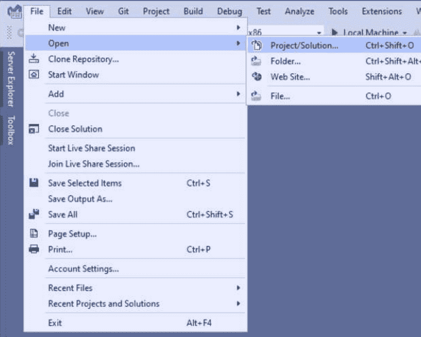

如果 Visual Studio 2022 未在运行，请启动它，然后选择“打开项目或解决方案”。

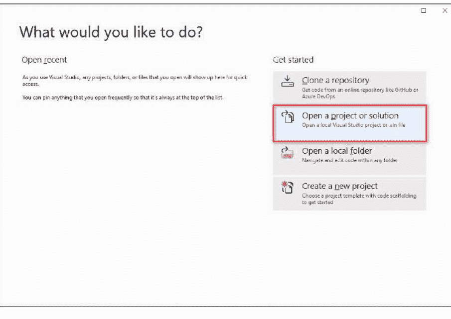

打开“打开项目”对话框。

2. 转到你文档文件夹中的 `\Microsoft Press\VCSBS\Chapter 2\PrimitiveDataTypes` 文件夹。

3. 选择 `PrimitiveDataTypes` 解决方案文件，然后选择“打开”。

解决方案正在加载，解决方案资源管理器显示了 `PrimitiveDataTypes` 项目。

> 注意
> 解决方案具有 `.sln` 后缀，例如 `PrimitiveDataTypes.sln`。
> 一个解决方案可以包含一个或多个项目。Visual C# 项目文件具有 `.csproj` 后缀。如果你打开的是项目而不是解决方案，Visual Studio 2022 会自动为其创建一个新的解决方案文件。
> 如果你没有意识到此功能，可能会可能会困惑，因为这可能导致你不小心为同一个项目生成多个解决方案。

4. 在“调试”（Debug）菜单上，选择“开始调试”（Start Debugging）。这使得应用程序比简单运行程序更容易地捕获和报告错误。

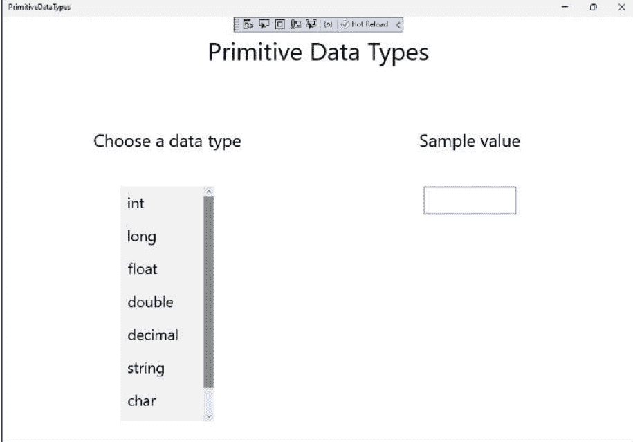

5. 在“选择数据类型”列表中，选择 `string`。

文本 `forty-two` 现在示例值框中。

6. 在“选择数据类型”列表中，选择 `int`。

文本 `to do` 出现在示例值框中，表示显示 `int` 语句语句仍编写。

7. 选择列表中的每个数据类型。确认 `double` 和 `bool` 类型的代码尚未实现；应用程序显示的结果为 `as to`。


- 8. 回到 Visual Studio 2022，然后在“调试”菜单上选择“停止调试”（Stop Debugging）。或者，关闭窗口以停止调试。

## 在代码中使用原始数据类型

1. 在解决方案资源管理器中，展开`PrimitiveDataTypes`项目（如果它尚未展开），然后双击`MainPage.xaml`。

   应用程序显示在设计视图窗口中。

> **提示**
>
> 如果你的屏幕不够大以显示整个表单，你可以通过按下`Ctrl+Alt=`和`Ctrl+Alt−`，或者从设计视图窗口左下角的缩放列表中选择大小来放大或缩小。

2. 在 XAML 格中，向下滚动找到`ListBox`控件的标记。该控件在表单左侧显示数据类型列表。它看起来像这样（为了可读性，已从文本中删除某些属性）：

   点击此处查看代码图像

```xml
<ListBox x:Name="type" ...
SelectionChanged="typeSelectionChanged">
  <ListBox>int</ListBox>
  <ListBox>long</ListBox>
  <ListBox>float</ListBox>
  <ListBox>double</ListBox>
  <ListBox>decimal</ListBox>
  <ListBox>string</ListBox>
  <ListBox>char</ListBox>
  <ListBox>bool</ListBox>
</ListBox>
```

当用户在`ListBox`中选择项目时，`ListBox`控件显示数据类型列表，项目的详细信息将传递给此方法。（注意：此部分的 OCR 文本是碎片化的；逻辑已合并/重构）。

3. 在 XAML 格中，向下滚动找到`ListBox`控件的标记。（此处 OCR 文本存在重复和乱码，已根据上下文进行了逻辑重构）。

4. 在 XAML 格中，向下滚动找到`ListBox`控件的标记。（此处 OCR 文本存在重复，已根据提供的片段进行了清理）。

.NET 库中的每个数据类型都有一个`ToString`方法。`ToString`的目的是将对象转换为其字符串表示。`showFloatValue`方法使用`float`类型变量`floatVar`对象的`ToString`方法来生成该变量值的字符串版本。你可以安全地将其赋值给值文本框的`Text`属性。当你创建自己的数据类型和类时，可以定义`ToString`方法的自定义实现，以指定你的类如何表示为字符串。你将在第 7 章“创建和管理类与对象”中学习更多关于创建类的知识。

6. 在代码和编辑器窗口中，找到`showIntValue`方法：

   点击此处查看代码图像

```c
private void showIntValue()
{
    value.Text = "to do";
}
```

当在列表框选择`int`类型时，会调用`showIntValue`方法。

7. 在`showIntValue`方法开始，在大括号之后的新行中，添加以下加粗所示的两个语句：

   点击此处查看代码图像

```c
private void showIntValue()
{
    int intVar;
    intVar = 42;
    value.Text = "to do";
}
```

第一条语句创建一个名为`intVar`的变量，它可以存储一个`int`值。第二条语句将值 42 赋值给该变量。

8. 在该方法的原始语句中，将字符串 `"to do"` 更改为`intVar.ToString()`。

   该方法现在看起来应该完全如下：

   点击此处查看代码图像

```c
private void showIntValue()
{
    int intVar;
    intVar = 42;
    value.Text = intVar.ToString();
}
```

9. 在调试（Debug）菜单上，选择开始调试（Start Debugging）。

   表单再次出现。

10. 在“选择数据类型”（Choose a data type）列表中，选择`int`。确认“示例值”（Sample Value）框中显示了值 42。

11. 返回 Visual Studio，在调试（Debug）菜单上，选择停止调试（Stop Debugging）。

12. 在代码和文本编辑器窗口中，找到`showDoubleValue`方法。

13. 按照后续代码中加粗的完全编辑`showDoubleValue`方法：

    

```c
private void showDoubleValue()
{
    double doubleVar;
    doubleVar = 0.42;
    value.Text = doubleVar.ToString();
}
```

此代码与`showIntValue`方法类似，但它创建了一个名为`doubleVar`的变量来存储`double`值，并赋值为值 0.42。

14. 在代码和文本编辑器窗口中，找到`showBoolValue`方法。

15. 按照如下所示编辑`showBoolValue`方法：

    

```c
private void showBoolValue()
{
    bool boolVar;
    boolVar = false;
    value.Text = boolVar.ToString();
}
```

再次，此代码与之前的示例相似，但`boolVar`仅存储一个布尔值（true 或 false）。在这种情况下，赋值的值为`false`。

16. 在调试（Debug）菜单上，选择开始调试（Start Debugging）。

17. 在“选择数据类型”列表中，选择`float`、`double`和`bool`。在每个情况下，验证“示例值”框中显示了正确的值。

18. 返回 Visual Studio，然后在调试（Debug）菜单上，选择停止调试（Stop Debugging）。

# 使用算术运算符

C# 支持你童年学过的常规算术运算：用于加法的加号（`+`）、用于减法的减号（`-`）、用于乘法的星号（`*`）以及用于除法的斜杠（`/`）。符号`+`、`-`、`*`和`/`被称为运算符，因为它们对值进行“操作”以创建新值。在以下示例中，变量`moneyPaidToConsultant`最终持有了 750（日薪）和 20（顾问受雇的天数）的乘积：

点击此处查看代码图像

```c
long moneyPaidToConsultant;
moneyPaidToConsultant = 750 * 20;
```

> **注意：** 运算符执行其功能的值称为操作数。在表达式`750 * 20`中，`*`是运算符，而 750 和 20 是操作数。

# 运算符和类型

并不是所有的运算符适用于所有的数据类型。你可以在值上使用的运算符取决于值的类型。例如，你可以对`char`、`int`、`long`、`float`、`double`或`decimal`类型的值使用所有算术运算符。然而，除了加法运算符（`+`）之外，你不能对`string`类型的值使用算术运算符，并且不能对`bool`类型的值使用其中任何一个运算符。因此，以下语句是不允许的，因为字符串类型不支持减法运算符（从一个字符串减去另一个是没有意义的）：

点击此处查看代码图像

```csharp
// 编译时错误
Console.WriteLine("Gillingham" - "Forest Green Rovers");
```

然而，你可以使用`+`运算符连接字符串值。你需要小心，因为这可能会产生意想不到的结果。例如，以下语句向控制台写入了 431（而不是 44）。

4. 在左操作数（Left Operand）框中，输入 54。

5. 在右操作数（Right Operand）框中，输入 13。

现在你就可以对文本框中的值应用任何操作符了。

6. 选择 – 减法（Subtraction）选项，然后选择计算（Calculate）。

   表达式（Expression）框中的文本变为 54 – 13，但结果（Result）框中出现了数值 0。这显然是错误的。

7. 选择 `/`除法（Division）选项，然后选择计算（Calculate）。

   表达式框中的文本变为 54/13，结果框中再次出现了数值 0。

8. 选择`%`取余数（Remainder）选项，然后选择计算（Calculate）。

   表达式框中的文本变为 54 % 13，但再次在结果文本框中出现了数值 0。尝试其他数字和操作符的组合；你会发现它们目前都产生数值 0。

> **注意**
>
> 如果你在任一操作数框中输入非整数值，应用程序将检测到错误并显示消息“输入字符串格式不是正确的格式。”你将在第 6 章“管理错误和异常”中学习更多关于如何捕获和处理错误及异常的知识。

9. 完成后，返回 Visual Studio，然后在调试（Debug）菜单上，选择“停止调试”。

正如你可能猜到的那样，`MathOperators`目前尚未实现任何计算。在下一次练习中，你将纠正这一点。

# 在 MathOperators 中执行计算

1. 在设计视图（Design View）窗口中显示`MainPage.xaml`表单。（在解决方案资源管理器中，进入`MathOperators`项目，打开`MainPage.xaml`文件。）

2. 在视图（View）菜单上，指向其他窗口（Other Windows），然后选择“文档大纲”（Document Outline）。

   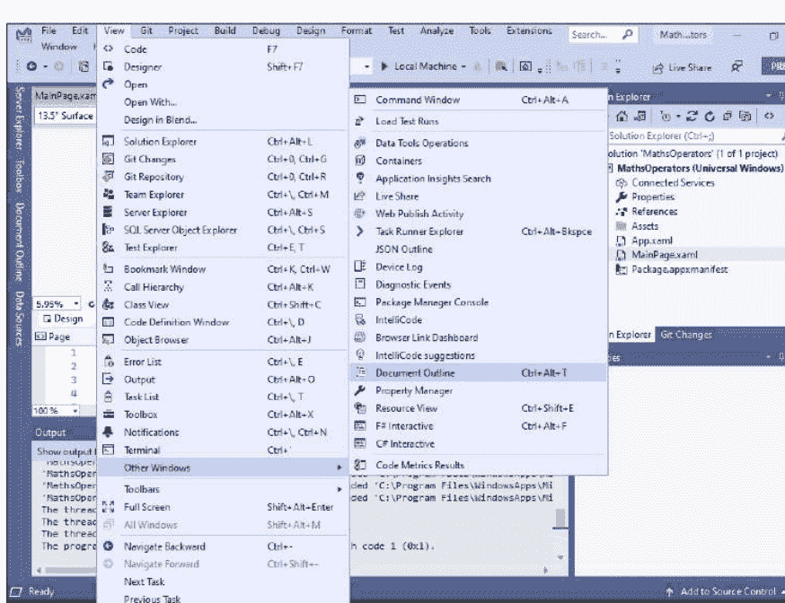

   文档大纲窗口出现，显示表单上控件的名称和类型。文档大纲提供了一种在复杂表单上定位和选择控件的简单方法。控件按层次结构排列，从 Page 1 开始，通用 Windows 平台（UWP）页面包含一个`Grid`控件，其他控件放置在该`Grid`内部。如果你在文档大纲中展开`Grid`节点，其他控件就会出现（从一个作为框架的外部`Grid`开始，内部`Grid`包含你在表单上看到的控件）。如果你展开内部`Grid`，你可以看到表单上的每个控件。

   如果你选择了这些控件中的任何一个，设计视图窗口中相应的元素就会被高亮显示。同样地，如果你在设计视图窗口中选择一个控件，文档大纲窗口中相应的控件会被选中。（要查看此操作效果，请通过取消文档大纲窗口右上角的自动隐藏（Auto Hide）按钮来固定文档大纲窗口的位置。）

3. 在表单上，选择用户输入数字的两个`TextBox`控件。在文档大纲窗口中，验证它们是否被命名为`lhsOperand`和`rhsOperand`。

   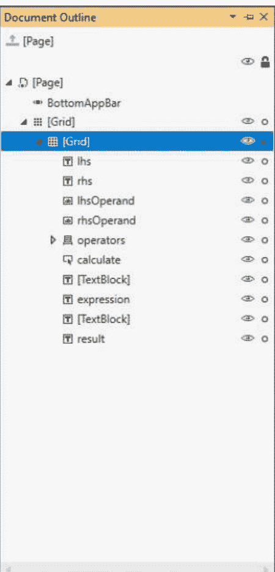

   当表单运行时，这些控件的`Text`属性将持有用户输入的值。

4. 在表单底部，验证用于显示正在评估的表达式的`TextBlock`控件被命名为`expression`，用于显示计算结果的`TextBlock`控件被命名为`result`。

5. 关闭文档大纲窗口。

6. 在视图（View）菜单上，选择“代码”（Code）以在代码和文本编辑器窗口中显示`MainPage.xaml.cs`文件的代码。

7. 在代码和文本编辑器窗口中，找到`addValues`方法。它看起来如下：

   点击此处查看代码图像

```csharp
private void addValues () {
    int lhs = int.Parse(lhsOperand.Text);
    int rhs = int.Parse(rhsOperand.Text);
    int outcome = 0;
    // TODO: Add rhs to lhs and store the result in outcome
    expression.Text = $"{lhsOperand.Text} + {rhsOperand.Text}";
    result.Text = outcome.ToString();
}
```

该方法的体包含六条语句：

- 该方法的第一条语句声明了一个名为`lhs`的`int`变量，并用用户在`lhsOperand`框中输入的整数值对其初始化。记住`TextBox`的`Text`属性包含字符串，但`lhs`是`int`类型，因此在将此字符串赋值给`lhs`之前，你必须将其转换为整数。`int`数据类型提供了`int.Parse`方法，正可以这样做。

- 第二条语句声明了一个名为`rhs`的`int`变量，并在`rhsOperand`框中的值转换为`int`后对其初始化。

- 第三条语句声明了一个名为`outcome`的`int`变量。

- 第四条语句由注释组成，说明你需要将`rhs`加`lhs`并将结果存储在`outcome`中。这是你需要实现的缺失代码，你将在下一步完成。

- 第五条语句使用字符串插值（string interpolation）构造一个指示正在执行的计算的字符串，并将结果赋值给`expression.Text`属性。这会导致字符串出现在表单的表达式框中。

- 第六条语句通过将结果赋值给结果框的`Text`属性来显示计算结果。记住`Text`属性是字符串，而计算结果是`int`，因此在将其赋值给`Text`属性之前，你必须将`int`转换为字符串。回想起这就是`int`类型的`ToString`方法的作用。

## 8. 在 `addValues` 方法中，声明一个 `int` 变量 `lhs`，并用用户在 `lhsOperand` 框中输入的整数值对其初始化。记住 TextBox 的 `Text` 属性包含字符串，但 `lhs` 是 `int` 类型，因此在将此字符串赋值给 `lhs` 之前，你必须将其转换为整数。`int` 数据类型提供了 `int.Parse` 方法，正可以这样做。

- 第二条语句声明了一个名为 `rhs` 的 `int` 变量，并在 `rhsOperand` 框中的值转换为 `int` 后对其初始化。

- 第三条语句声明了一个名为 `outcome` 的 `int` 变量。

- 第四条语句由注释组成，说明你需要将 `rhs` 加 `lhs` 并结果存储在 `outcome` 中。这是你需要实现的缺失代码，你将在下一步完成。

- 第五条语句使用字符串插值构造一个指示正在执行的计算的字符串，并将结果赋值给 `expression.Text` 属性。这会导致字符串出现在表单的表达式框中。

- 第六条语句通过将结果赋值给结果框的 `Text` 属性来显示计算结果。记住 `Text` 属性是字符串，而计算结果是 `int`，因此在将其赋值给 `Text` 属性之前，你必须将 `int` 转换为字符串。回想起这就是 `int` 类型的 `ToString` 方法的作用。

## 8. 在 `addValues` 方法中，声明一个 `int` 变量 `lhs`，并用用户在 `lhsOperand` 框中输入的整数值对其初始化。记住 TextBox 的 `Text` 属性包含字符串，但 `lhs` 是 `int` 类型，因此在将此字符串赋值给 `lhs` 之前，你必须将其转换为整数。`int` 数据类型提供了 `int.Parse` 方法，正可以这样做。

- 第二条语句声明了一个名为 `rhs` 的 `int` 变量，并在 `rhsOperand` 框中的值转换为 `int` 后对其初始化。

- 第三条语句声明了一个名为 `outcome` 的 `int` 变量。

- 第四条语句由注释组成，说明你需要将 `rhs` 加 `lhs` 并结果存储在 `outcome` 中。这是你需要实现的缺失代码，你将在下一步完成。

- 第五条语句使用字符串插值构造一个指示正在执行的计算的字符串，并将结果赋值给 `expression.Text` 属性。这会导致字符串出现在表单的表达式框中。

- 第六条语句通过将结果赋值给结果框的 `Text` 属性来显示计算结果。记住 `Text` 属性是字符串，而计算结果是 `int`，因此在将其赋值给 `Text` 属性之前，你必须将 `int` 转换为字符串。回想起这就是 `int` 类型的 `ToString` 方法的作用。

## 10. 检查 `multiplyValues`、`divideValues` 和 `remainderValues` 方法。它们都缺少了执行计算的语句。在这些方法中添加相应的语句即可：


```csharp
private void multiplyValues()
{
    int lhs = int.Parse(lhsOperand.Text);
    int rhs = int.Parse(rhsOperand.Text);
    int outcome = 0;
    // TODO: Multiply lhs by rhs and store the result in outcome
    outcome = lhs * rhs;
    expression.Text = $"{lhsOperand.Text} * {rhsOperand.Text}";
    result.Text = outcome.ToString();
}

private void divideValues()
{
    int lhs = int.Parse(lhsOperand.Text);
    int rhs = int.Parse(rhsOperand.Text);
    int outcome = 0;
    // TODO: Divide lhs by rhs and store the result in outcome
    outcome = lhs / rhs;
    expression.Text = $"{lhsOperand.Text} / {rhsOperand.Text}";
    result.Text = outcome.ToString();
}

private void remainderValues()
{
    int lhs = int.Parse(lhsOperand.Text);
    int rhs = int.Parse(rhsOperand.Text);
    int outcome = 0;
    // TODO: Calculate the remainder after dividing lhs by rhs and store the result in outcome
    outcome = lhs % rhs;
    expression.Text = $"{lhsOperand.Text} % {rhsOperand.Text}";
    result.Text = outcome.ToString();
}
```

在 C# 中，乘法运算符（`*`、`/`、`%`）的优先级高于加法运算符（`+` 和 `-`），因此在像`2 + 3 * 4`这样的表达式中，先执行乘法，然后执行加法。因此，`2 + 3 * 4`的结果是 14。

你可以使用括号来覆盖优先级，并强制操作数以不同的方式绑定到运算符。例如，在下面的表达式中，括号强制 2 和 3 绑定到`+`运算符（得到 5），该加法的结果形成`*`运算符的左操作数，产生值 20：

```
(2 + 3) * 4
```

> **注意**
>
> 括号（parentheses or round brackets）指`( )`。大括号（brace or curly brackets）指`{ }`。方括号（square brackets）指`[ ]`。

## 使用结合性评估表达式

运算符优先级只是问题的一半。当一个表达式包含具有相同优先级的运算符时会发生什么？这就是结合性变得重要的地方。结合性是运算符的操作数求值的方向（从左到右）。考虑以下使用`/`和`*`运算符的表达式：

```
4 / 2 * 6
```

乍看之下，这个表达式可能存在歧义。你是先执行除法还是执行乘法？这两个运算符的优先级是相同的（它们都是乘法运算符），但表达式中运算符应用的顺序非常重要，因为你可以得到两个不同的结果：

- 如果你先执行除法，除法的结果`(4 / 2)`形成`*`运算符的左操作数，整个表达式的结果为`(4 / 2) * 6`，即 12。
- 如果你先执行乘法，乘法的结果`(2 * 6)`形成`/`运算符的右操作数，整个表达式的结果为`4 / (2 * 6)`，即 4 / 12。

在这种情况下，运算符的结合性决定了表达式的评估方式。`*`和`/`运算符都是左结合的，这意味着操作数从左到右进行求值。在这种情况下，`4 / 2`将在乘以 6 之前求值，得到结果。

## 结合性与赋值运算符

在 C# 中，等号（`=`）是一个运算符。所有运算符根据其操作数返回一个值。赋值运算符也不例外。它接受两个操作数：右侧的操作数被求值，然后存储在左侧的操作数中。赋值运算符的值是被赋值给左操作数的值。例如，在下面的赋值中，赋值运算符返回的值为 10，这也就是赋值给变量`myInt`的值：

点击此处查看代码图片

```csharp
int myInt;
myInt = 10; // 赋值表达式的值为 10
```

此时，你可能在想这些非常奇妙且深奥，但又怎样？？由于赋值运算符返回一个值，你可以在另一个赋值语句中使用这个相同的值，如下所示：

```csharp
int myInt;
int myInt2;
myInt2 = myInt = 10;
```

赋值给`myInt2`的值是赋值给`myInt`的值。赋值语句将相同的值分配给两个变量。如果你想将多个变量初始化为相同的值，这种技术就非常有用。它让任何阅读你代码的人都能清楚地看到所有变量必须具有相同的值：

点击此处查看代码图片

```csharp
myInt5 = myInt4 = myInt3 = myInt2 = myInt = 10;
```

从这个讨论中，你可能推断出赋值运算符是从右到左结合的。最右侧的赋值首先发生，赋值的值从右向左传播到变量。如果任何变量之前有值，它会被现在赋值的值所覆盖。

然而，你应该谨慎处理这种结构。新 C# 程序员经常犯的一个错误是尝试将这种赋值运算符的用法与变量声明结合。例如，你可能期望以下代码创建并初始化三个具有相同值（10）的变量：

点击此处查看代码图片

```csharp
int myInt, myInt2, myInt3 = 10;
```

这是合法的 C# 代码（因为可以编译）。它的作用是声明变量`myInt`、`myInt2`和`myInt3`，并将`myInt3`初始化为值 10。然而，它并没有初始化`myInt`或`myInt2`。如果你尝试在如下的表达式中使用`myInt`或`myInt2`：

```csharp
myInt3 = myInt / myInt2;
```

编译器将生成以下错误：

点击此处查看代码图片

```
使用了未赋值的局部变量 'myInt'
使用了未赋值的局部变量 'myInt2'
```

## 变量的递增递减

如果你想给变量加 1，可以使用`+`运算符，此处所示：

```csharp
count = count + 1;
```

然而，给变量加 1 是如此常见，以至于 C# 为此提供了专门的运算符：`++`运算符。要让变量`count`增加 1，你可以编写以下语句：

```csharp
count++;
```

同样，C# 还提供了`-`运算符，你可以用它从变量减 1，如下所示：

```csharp
count--;
```

`++`和`--`运算符是一元运算符，意味着它们只接受单个操作数。它们具有相同的优先级且都是左结合的。

## 前缀与后置

`++`和`--`运算符的特殊之处在于你可以将它们放在变量之前或之后。将运算符放在变量之前称为前缀形式，将运算符放在变量之后称为后置形式。对于被递增或递减的变量，使用前置还是后置没有区别。

记忆的方法：在表达式`x++`中，变量先出现，在增加之前使用值；在表达式`++x`中，运算符先出现，先求值。

## 声明隐式类型变量

在本章前面的部分，你看到通过指定数据类型和标识符来声明变量，如下：

```csharp
int myInt;
```

还提到，你应该在尝试使用变量之前给它赋值。你可以在同一条语句中声明并初始化变量，如下所示：

```csharp
int myInt = 99;
```

或者，你甚至可以这样做，假设`myOtherInt`是一个初始化的整数变量：

```csharp
int myInt = myOtherInt * 99;
```

记住，赋值给变量的值必须与变量类型相同。例如，你只能为`int`赋值`int`值。C# 编译器可以快速确定初始化变量的表达式类型，并判断其是否与类型匹配。

你还可以通过使用`var`关键字代替类型，让 C# 编译器从表达式推断变量类型，并在声明时使用该类型，如下所示：

点击此处查看代码图片

```csharp
var myVariable = 99;
var myOtherVariable = "Hello";
```

只有在为初始化变量提供表达式时，才可以使用`var`关键字。下面的声明是非法的，会导致编译错误：

点击此处查看代码图像

```csharp
var anotherVariable; // Error - 编译器无法推断类型
```

> **重要**
>
> 如果你以前用过 Visual Basic 编程，你可能熟悉`Variant`类型，可以用它在变量中存储任何类型的值。我在这里强调的是，你应该忘记过去用 Visual Basic 编程时学到的关于`Variant`变量的所有知识。虽然关键字看起来相似，但`var`和`Variant`的含义完全不同。在 C# 中使用`var`关键字声明变量时，赋值给该变量的值类型不能与初始化变量时使用的类型发生改变。

如果你是一个纯主义者，此时你可能会咬牙切齿，心想为什么像 C# 这样精良语言的设计者竟然允许像`var`这样的功能溜入其中。毕竟，这听起来像是程序员偷懒的极端表现，并且可能让理解程序在做什么或追踪错误变得更加困难（它甚至可以很容易在你的代码中引入新的错误）。然而，`var`在 C# 中有非常合理的地位，正如你在阅读后续许多章节时将会看到的。不过目前，除非隐式类型变成必须的，否则我们仍坚持使用显式类型化的变量。

# 总结

在本章中，你学习了如何创建和使用变量，并学习了 C# 中变量的一些常用数据类型。你还学习了标识符。此外，你使用了几个运算符来构建表达式，并学习了运算符的优先级和结合性如何决定包含多个运算符的表达式的求值。

- 如果你想继续下一章，请保持 Visual Studio 2022 并转到第 3 章。
- 如果你想现在退出 Visual Studio 2022，在“文件”菜单中选择“退出”。如果看到“保存”对话框，选择“是”并保存项目。

## 快速参考

| 目标 | 操作 |
|---|---|
| 声明变量 | 编写类型名称，然后是变量名，最后是分号。例如：`int outcome;` |
| 声明变量并赋值 | 编写类型名称，然后是赋值运算符和初始值。以分号结束。例如：`int outcome = 99;` |
| 更改变量的值 | 在左侧编写变量名，然后是赋值运算符，接着是计算新值的表达式，最后是分号。例如：`out = 42;` |
| 生成变量的字符串表示 | 调用变量的`ToString`方法。例如：`int intVar = 42; stringVar = intVar.ToString();` |
| 将字符串转换为 `int` | 调用`System.Int32.Parse`方法。例如：`string stringVar = "42"; int intVar = System.Int32.Parse(stringVar);` |
| 覆盖运算符优先级 | 在表达式中使用括号强制执行求值顺序。例如：`(3 + 4) * 5` |
| 给多个变量赋相同的值 | 使用列出所有变量的赋值语句。例如：`myInt4 = myInt3 = myInt2 = myInt = 10;` |
| 递增或减少变量 | 使用`++`或`--`运算符。例如：`count++;` |

# 第 3 章：编写方法和应用范围

完成本章后，你将能够：

- 声明方法、向方法传递信息以及从方法返回信息。
- 调用方法。
- 定义局部作用域和类作用域。
- 使用调试器在方法运行时单步进入和跳出方法。
- 在方法中使用可选参数和命名参数。

在第 2 章“变量、运算符和表达式的操作”中，你学习了如何声明变量、如何使用运算符创建表达式，以及优先级和结合性如何控制包含多个运算符的表达式的求值方式。在本章中，你将学习方法。你将看到如何声明和调用方法，如何使用参数和参数向方法传递信息，以及如何使用`return`语句从方法返回信息。你还将看到如何使用 Microsoft Visual Studio 2022 集成调试器进入和跳出方法。当你需要追踪方法的执行过程（因为它们的运行结果并不符合预期）时，这些信息非常有用。最后，你将学习如何声明带有可选参数的方法，以及如何使用命名参数调用方法。

## 创建方法

方法是一段命名的语句序列。如果你以前使用过 C、C++ 或 Microsoft Visual Basic 等语言进行编程，你会发现方法类似于函数（function）或过程（subroutine）。

方法有一个名称和一个方法体。方法名应该是有意义的标识符，指示方法的整体目的（例如`calculateIncomeTax`）。方法体包含了调用方法时实际执行的语句。此外，方法可以接收某些数据进行处理，并可以返回信息，这通常是处理的结果。方法是一种基础且强大的机制。

## 声明方法

声明 C# 方法的语法如下：

点击此处查看代码图像

```csharp
returnType methodName(parameterList)
{
    // 方法体在此处
}
```

以下是构成方法声明的元素描述：

- `returnType`是类型名称，指定方法处理后返回的信息类型。可以是任何类型，例如`int`或`string`。如果你编写的是不返回结果的方法，必须用`void`关键字代替返回类型。
- `methodName`是调用方法的名称。方法遵循与变量名相同的标识符规则——例如`addValues`。
- `parameterList`是可选的，指定传递给方法处理信息的类型和名称。你在圆括号`()`之间编写参数，就像声明变量一样，先写类型后名称。如果你编写的方法有多个参数，必须用逗号隔开。
- 方法体语句是在调用方法时运行的代码行。它们被包含在大括号`{ }`之间。

> **重要**
>
> 如果你使用 C、C++ 或 Visual Basic 编程，请注意 C# 不支持全局方法。你必须将所有方法写在类内部，否则代码将无法编译。

这是`addValues`方法的定义，它返回一个`int`结果并有两个`int`参数`leftHandSide`和`rightSide`：

点击此处查看代码图像

```csharp
int addValues(int leftHandSide, int rightSide)
{
    // ...
    // 方法体在此处
    // ...
}
```

> **注意**
>
> 你必须明确指定任何参数的类型和方法的返回类型。你不能使用`var`关键字。

这是`showResult`方法的定义，它不返回值并有一个名为`answer`的单个`int`参数：

点击此处查看代码图像

```csharp
void showResult(int answer)
{
    // ...
}
```

注意使用`void`关键字来表示方法不返回任何内容。

> **重要**
>
> 如果你熟悉 Visual Basic，请注意 C# 不使用不同的关键字来区分返回值的方法（函数）和不返回值的方法（过程或子程序）。你必须指定返回类型或`void`。

## 从方法返回数据

如果你想让方法返回信息（即其返回类型不是`void`），则必须在方法体处理结束处包含一个`return`语句。一个`return`语句由关键字`return`后面紧跟一个指定返回值的表达式和一个分号组成。表达式的类型必须与方法声明中指定的类型相同。例如，如果一个方法返回`int`，则`return`语句必须返回一个`int`；否则，你的程序将无法编译。这是一个带有`return`语句的方法示例：

点击此处查看代码图片

```csharp
int addValues(int leftHandSide, int rightHandSide)
{
    // ...
    return leftHandSide + rightHandSide;
}
```

`return`语句通常位于方法的末尾，因为它会导致方法结束并将控制权交还给调用方法的语句（这在本章稍后会描述）。`return`语句之后发生的任何语句都不会被执行。（如果你在`return`语句之后放置语句，编译器会向你发出警告。）

如果你不希望方法返回信息（即返回类型为`void`），你可以使用`return`语句的变体来立即退出方法。你只需编写关键字`return`并在后面紧跟一个分号。例如：

点击此处查看代码图片

```csharp
void showResult(int answer)
{
    // display the answer
    Console.WriteLine("The answer is {answer}");
    return;
}
```

如果你的方法不返回任何内容，你也可以省略`return`语句，因为当执行到达方法末尾的大括号时，方法会自动结束。虽然这种做法很常见，但并不总是被认为是良好的风格。

## 使用表达式体方法（Expression-bodied methods）

某些方法非常简单，只需执行单一任务或返回计算结果，而不涉及任何额外的逻辑。C# 为由单个表达式组成的方法支持简化形式。这些方法仍然可以接受参数并返回值，并且其工作方式与你目前看到的方法相同。以下代码示例展示了作为表达式体方法的`addValues`和`showResult`方法的简化版本：

点击此处查看代码图片

```csharp
int addValues(int leftHandSide, int rightHandSide) => leftHandSide + rightHandSide;
void showResult(int answer) => Console.WriteLine("The answer is {answer}");
```


主要的区别在于使用`=>`运算符表示构成方法体的表达式，并且缺少了`return`语句。表达式的值被用作返回值；如果表达式不返回值，则该方法为`void`。

实际上，使用普通方法和表达式体方法在功能上没有区别；表达式体方法仅仅是一种语法上的便利。然而，你将在书后的章节中看到示例，表达式体方法可以通过移除大量多余的`{`和`}`字符来简化程序，使代码更易读。

在接下来的练习中，你将检查来自第 2 章`MathOperators`项目的另一个版本。该版本通过仔细使用一些小方法进行了改进。这种代码划分方式有助于使其更容易理解且更具可维护性。

## 检查方法定义

1. 启动 Visual Studio 2022（如果尚未运行）。
2. 打开`Methods`解决方案，它位于你文档文件夹中的`Microsoft Press\VCSBS\Chapter 3\Methods`文件夹中。
3. 在“Debug”（调试）菜单中，选择“Start Debugging”（启动调试）。

   Visual Studio 2022 会生成并运行应用程序。它看起来应该与第 2 章中的应用程序一样。

4. 熟悉该应用程序及其工作原理，然后返回 Visual Studio。
5. 在“Debug”（调试）菜单中，选择“Stop Debugging”（停止调试）。
6. 在“Code and Text Editor”（代码和文本编辑器）窗口中显示`MainPage.cs`的代码（在解决方案资源管理器中，展开`MainPage.xaml`文件，然后双击`MainPage.xaml`）。
7. 在“Code and Text Editor”窗口中找到`addValues`方法，它如下：

点击此处查看代码图片

```csharp
private int addValues(int leftHandSide, int rightHandSide)
{
    expression.Text = `${leftHandSide} + ${rightHandSide}`;
    return leftHandSide + rightHandSide;
}
```

> 注意：暂时不要担心方法开头的`private`关键字。你将在第 7 章“创建和管理类与对象”中学习该关键字的意思。

`addValues`方法包含两个语句。

- 第一条语句在表单的表达式框中显示正在进行的计算。
- 第二条语句使用`int`版本的`+`运算符相加`leftHandSide`和`rightHandSide`变量的值并返回此操作的结果。记住，两个`int`值创建一个另一个`int`值，因此`addValues`方法的返回类型是`int`。

如果你查看`subtractValues`、`multiplyValues`、`divideValues`和`remainder`方法，你会发现它们遵循类似的模式。

8. 在“Code and Text Editor”窗口中找到`showResult`方法，它如下：

点击此处查看代码图片

```csharp
private void showResult(int answer) => result.Text = answer.ToString();
```

这是一个表达式体方法，它在`result`框中显示参数`answer`的字符串表示。它不返回结果，因此该方法的类型为`void`。

> 提示：方法没有最小长度限制。如果一个方法有助于避免重复并让你的程序更容易理解，无论它多小，该方法都是有用的。

方法也没有最大长度限制，但通常你希望保持方法代码足够小以完成任务。如果你的方法超过了一个屏幕的内容，请考虑将其拆分为更小的方法以提高可读性。

## 调用方法

方法的存在是为了被调用的！你可以通过名称调用方法来使其执行任务。如果方法需要信息（如其参数所示），你必须提供信息。如果方法返回信息（如其返回类型所示），你应该设法获取这些信息。

### 指定方法调用

C#方法调用的语法如下：

[点击此处查看图片](#)

```text
result = methodName( argumentList )
```

以下是方法调用元素的描述：

- `methodName`必须与要调方法的名称完全匹配。记住，C#是一种大小敏感的语言。
- `result =`子句是可选的。如果指定，变量`result`将包含方法的返回值。如果方法是`void`（即不返回值），你必须省略。
- `argumentList`提供了方法接受的信息。你需要为每个参数提供一个参数，且每个参数的值与其对应的参数类型兼容。如果调的方法有两个或多个参数，必须用逗号分隔参数。

如果你没有指定`result =`而方法确实有返回值，方法会运行，但返回值会被丢弃。

> **重要**：即使调用没有参数的方法，也必须包含括号。

为了清楚这些点，请再次查看`addValues`方法：

点击此处查看代码图片

```csharp
int addValues(int leftHandSide, int rightHandSide)
{
    // ...
}
```

`addValues`方法有两个`int`参数，因此你必须使用两个逗号分隔的`int`参数来调用它，例如：

```csharp
addValues(39, 39); // 正确
```

你也可以用`int`变量名替换字面量`39`和`3`。这些变量中的值将作为其参数传递给方法，如下：

```csharp
int arg1 = 99;
int arg2 = 1;
addValues(arg1, arg2);
```

如果你尝试以其他方式调用`addValues`，你可能无法成功，原因如下面的示例所示：

点击此处查看代码图片

```csharp
addValues;                  // 编译错误，缺少括号
addValues();                // 编译错误，参数不足
addValues(39);              // 编译错误，参数不足
addValues("39", "3");        // 编译错误，参数类型不正确
```

`addValues`方法返回一个`int`类型的值。你可以在任何可以使用`int`类型的地方使用这个值。请考虑以下示例：

点击此处查看代码图像

```csharp
int result = addValues(39, 3);   // 在赋值语句的右侧
showResult(addValues(39, 3));   // 作为其他方法的参数调用
```

接下来的练习将继续对方法（Methods）的应用。这次，你将检查一些方法调用。

1. 返回到 Methods 项目。（如果你是从上一个练习继续，则 Visual Studio 2022 已经打开了该项目。如果不是，请从“文档”文件夹中的`\Microsoft Press\VCSBS\Chapter 3\Methods`文件夹打开它。）
2. 在代码和文本编辑器窗口中显示`MainPage.xaml`的代码。
3. 定位`Click`方法。然后查看该方法中`try`语句和左大括号之后的前两个语句。你将在第 6 章“管理错误和异常”中学习语句。

这些语句看起来如下：

点击此处查看代码图像

```csharp
int leftHandSide = System.Int32.Parse(lhsOperand.Text);
int rightHandSide = System.Int32.Parse(rhsOperand.Text);
```

这两条语句声明了两个变量：`leftHandSide`和`rightHandSide`。注意这些变量是如何初始化的。在这两种情况下都调用了`System.Int32`结构体的`Parse`方法。（`System`是一个命名空间，`Int32`是该命名空间中结构体名称。你将在第 9 章“使用枚举和结构创建值类型”中学习结构体。）你以前见过这个方法；它接受一个字符串参数并将其转换为`int`值。这两行代码获取用户在表单的`lhsOperand`和`rhsOperand`框中输入的内容，并将其转换为`int`值。

4. 查看`calculateClick`方法中的第四条语句（`if`语句和另一个左大括号之后）：

点击此处查看代码图像

```csharp
calculatedValue = addValues(leftHandSide, rightHandSide);
```

该语句调用了`addValues`方法，将`leftHandSide`和`rightHandSide`变量的值作为参数传递。`addValues`方法返回的值存储在`calculatedValue`变量中。

5. 查看下一条语句：

```csharp
showResult(calculatedValue);
```

该语句调用了`showResult`方法，将`calculatedValue`变量中的值作为参数传递。`showResult`方法不返回值。

6. 在代码和文本编辑器窗口中，找到你之前看过的`showResult`方法。

该方法的唯一语句是这一条：

点击此处查看代码图像

```csharp
result.Text = answer.toString();
```

注意，尽管没有参数，`toString`方法的调用仍使用了括号。

> 提示

> 你可以通过在方法名前加上对象的名称来调用属于其他对象的方法。在前面的示例中，表达式`answer.toString()`调用了属于对象`answer`的名为`toString`的方法。

## 从方法返回多个值

在某些情况下，你可能想从方法返回多个一个值。例如，在 Methods 项目中，你可能想将`divideValues`和`remainderValues`操作的效果合并到一个方法中，该方法返回操作数相除的结果以及余数。你可以通过返回一个元组（tuple）来实现这一点。

元组简单来说是值的一个小型集合（严格来说，元组包含两个值，但 C#元组可以包含比这更大的集合）。你通过在方法定义中指定类型列表来指示方法返回元组——每个返回的值对应一个类型。方法中的`return`语句返回一个值列表，如下例所示：

点击此处查看代码图像

```csharp
(int, int) returnMultipleValues(...)
{
    int val1;
    int val2;
    // 计算 val1 和 val2 的值
    return (val1, val2);
}
```

当你调用该方法时，你需要提供一个等值的变量列表来存储结果：

点击此处查看代码图像

```csharp
int retVal1, retVal2;
(retVal1, retVal2) = returnMultipleValues(...);
```

如果你只对返回值之一感兴趣，可以使用丢弃符号（丢弃符号在第 1 章“欢迎来到 C#”中引入）。以下代码显示了一个示例。在这种情况下，程序只对元组中的第二个值感兴趣，并丢弃了第一个）：

点击此处查看代码图像

```csharp
int retVal2;
(_, retVal2) = returnMultipleValues(...);
```

下一个练习将说明如何创建和调用返回元组的方法。

## 创建并调用返回元组的方法

1. 返回到 Methods 项目并在代码和文本编辑器窗口中显示`MainPage.xaml.cs`的代码。
2. 定位`divideValues`和`remainderValues`方法并删除它们。
3. 在你刚刚删除的方法位置添加以下方法定义：

点击此处查看代码图像

```csharp
private (int, int) divide(int leftHandSide, int rightHandSide)
```

该方法返回一个元组。这些值包含`leftHandSide`变量除以`rightHandSide`的结果以及余数。

4. 在方法体中添加如下所示的代码。此代码执行计算并返回一个元组：

点击此处查看代码图像

```csharp
private (int, int) divide(int leftHandSide, int rightHandSide)
{
    int division = leftHandSide / rightHandSide;
    int remainder = leftHandSide % rightHandSide;
    return (division, remainder);
}
```

5. 向上滚动到`calculateClick`方法定位以下代码：

点击此处查看代码图像

```csharp
else if (division.Checked)
{
calculatedValue = divideValues(leftHandSide, rightHandSide);
}
```

6. 删除这段代码。`divideValues`和`remainderValues`方法已不存在，已被单一的`divide`方法取代。
7. 在你删除的位置添加以下语句：

点击此处查看代码图像

```csharp
else if (division.Checked)
{
  int division, remainder;
  (division, remainder) = divide(leftHandSide, rightHandSide);
  result.Text = $"{division} remainder {remainder}";
}
```

该代码调用了`divide`方法。返回的值显示在`Result`块中。

8. 在解决方案资源管理器中，双击`MainPage.xaml`文件在设计视图窗口中显示表单。
9. 选择 % 选项按钮。然后按 Delete 键将其从表单中删除。该选项不再需要。
10. 在调试菜单中，选择启动调试以编译并运行应用程序。
11. 在左操作数框中输入 59；在右操作数框中输入 13；选择 Division，然后点击 Calculate。
12. 验证 Result 框包含消息“4 remainder 7”。
13. 返回到 Visual Studio。在调试菜单中，选择停止调试。

## 作用域的应用

你创建变量来存储值。你可以在程序的各个点创建变量。例如，Methods 项目中的`calculateClick`方法创建一个名为`calculatedValue`的`int`变量并将其初始值为 0，如下：

点击此处查看代码图像

```csharp
private void calculateClick(object sender, RoutedEventArgs e) {
    int calculatedValue = 0;
    ...
}
```

该变量从定义处开始存在，`calculateClick`方法中的后续语句可以使用它。这是一个重要的点：变量只能在创建后才能被使用。当方法执行结束，该变量就会消失，无法在其他地方使用。

当一个变量可以在程序的特定位置被访问时，就认为该变量在该位置处于作用域（scope）。`calculatedValue`变量具有方法作用域；它可以在整个`calculateClick`方法中被访问，但在该方法之外不能。你还可以定义具有不同作用域的变量——例如，你可以在方法之外但类内部定义变量，该类中的任何方法都可以访问该变量。这种变量被称为类作用域。

换句话说，变量的作用域就是该变量可使用的程序区域。作用域不仅适用于变量，也适用于方法。标识符（变量或方法）的作用域与程序中引入该标识符的声明位置相关，正如你接下来将学到的那样。

### 定义局部作用域

形成方法体的左括号和右括号定义了方法的作用域。你在方法体内部声明的任何变量其作用域都限于该方法；它们在方法结束时消失，并且只能由运行该方法的代码访问。这些变量被称为局部变量，因为对于声明它们的方法来说是局部的；它们在任何其他方法中都不在作用域内。

局部变量的作用域意味着你不能使用它们在方法之间共享信息。考虑以下示例：

点击此处查看代码图像

```csharp
class Example
{
  void firstMethod()
  {
    int myVar;
    ...
  }

  void anotherMethod()
  {
    myVar = 42; // error - variable not in scope
    ...
  }
}
```

此代码无法通过编译，是因为`anotherMethod`尝试使用不在作用域内的变量`myVar`。变量`myVar`仅对`firstMethod`中位于声明`myVar`代码行之后的语句可用。

### 定义类作用域

形成类体的左括号和右括号定义了类的作用域。你在类体内部（但在方法之外）声明的任何变量其作用域都属于该类。C#中由类定义的变量称为字段（field）。正如前面提到的，与局部变量不同，你可以使用字段在方法之间共享信息。这里有一个示例：

点击此处查看代码图像

```csharp
class Example
{
  void firstMethod()
  {
    myField = 42; // ok
    ...
  }
  void anotherMethod()
  {
    myField++; // ok
    ...
  }
  int myField = 0;
}
```

变量`myField`定义在类中，但在方法`firstMethod`和`anotherMethod`之外。因此，`myField`具有类作用域，供类中的所有方法使用。

关于这个示例还有一点需要注意。在方法中，你必须在使用变量之前对其进行声明。字段则有些不同。方法可以在定义字段的语句之前使用字段；C#编译器会为你处理这些细节。尽管编译器有这种能力，但大多数程序员认为，在类的开头（在使用这些字段的方法之前）声明字段是一种良好的做法；这有助于理解方法正在使用的数据。

## 方法重载


如果两个标识符具有相同的名称且在相同的作用域内声明，则称它们为重载（overloaded）。通常，重载标识符是一个会被编译时错误捕获的 Bug。例如，如果你在同一个方法中声明两个同名的局部变量，编译器会报告错误。同样，如果你在同一个类中声明两个同名的字段，或者在同一个类中声明两个完全相同的方法，你也会得到编译错误。编译器能捕获这些错误，这一事实似乎并不值得提。但是，有一种方法可以对方法的方法标识符进行重载，这种方法既有用又重要。

考虑`Console`的`WriteLine`方法。你已经使用过此方法向屏幕写入字符串。然而，当你在编写 C# 代码的代码和文本编辑器中使用`WriteLine`时，请注意 Microsoft IntelliSense 为你提供了 18 种选项！

每个版本的`WriteLine`方法都接受不同的参数集。一个版本不接受任何参数并输出空行。另一个版本接受一个`bool`参数并输出其值的字符串表示（True 或 False）。还有一种实现接受一个`decimal`参数并将其作为字符串输出，以此此类推。在编译时，编译器查看你传递的参数的类型，然后对其进行安排，以便你的应用程序调用具有匹配参数集的方法版本。这里有一个示例：

点击此处查看代码图像

当你需要对不同的数据类型或不同的信息组执行相同的操作时，重载主要非常有用。当不同的实现具有不同的参数集时，你就可以重载方法——即当它们具有相同名称但参数数量不同，或者参数类型不同时。当你调用方法时，你提供一个用逗号分隔的参数列表，编译器使用参数的数量和类型来选择重载方法之一。然而，请记住，尽管你可以重载方法的参数，但你不能重载方法的返回类型。换句话说，你不能声明两个仅在返回类型不同的同名方法。（编译器很聪明，但还没到那种程度。）

## 编写方法

在下面的练习中，你将创建一个方法，计算顾问针对给定的咨询天数按固定日薪收取多少费用。你将从开发应用程序的逻辑开始，然后使用“生成方法存根向导”（Generate Method Stub Wizard）来帮助你编写该逻辑使用的方法。接下来，你将在控制台应用程序中运行这些方法以感受程序运行。最后，你将使用 Visual Studio 2022 调试器单步进入和退出方法。

### 开发应用程序逻辑

1. 使用 Visual Studio 2022 打开`DailyRate`项目，它位于文档文件夹中的`Microsoft Press\VBS\Chapter 3\DailyRate`文件夹。

2. 在解决方案的`DailyRate`项目中，双击`Program.cs`文件在编辑器中显示代码。

此程序只是你代码的测试框架。当应用程序运行时，它会调用`run`方法。你添加想让`run`方法运行的代码。（方法的调用方式需要对类有理解，请参阅第 7 章。）

3. 将以下加粗的语句添加到`run`方法体中，位于左括号和右括号之间：

点击此处查看代码图像

```
void run()
{
    double dailyRate = readDouble("Enter your daily rate: ");
    int noOfDays = readInt("Enter the number of days: ");
    writeFee(calculateFee(dailyRate, noOfDays));
}
```

你刚刚添加到`run`方法的代码块调用了`readDouble`方法（稍后编写）来询问用户日薪。下一个语句调用`readInt`方法（也将编写）来获取天数。最后，调用`writeFee`方法（同样由你编写）在屏幕上显示结果。注意传递给`writeFee`的值是`calculateFee`方法根据日薪和天数并计算返回的总费用。

> **注意**

你尚未编写`readDouble`、`readInt`、`writeFee`和`calculateFee`方法，因此当你输入这些代码时，IntelliSense 不显示这些方法。现在不要尝试生成应用程序，因为它会失败。

### 使用生成方法存根向导编写方法

1. 在代码和文本编辑器窗口，在`run`方法中，右键点击`readDouble`方法调用。

弹出一个快捷菜单，其中包含生成和编辑代码的有用命令。

2. 在右键菜单上，选择“快速操作和重构”。

Visual Studio 会验证`readDouble`方法不存在，并显示一个向导程序，允许你为该方法生成存根（stub）。Visual Studio 会检查对`readDouble`方法的调用，确定其参数和返回值的类型，并建议一个默认实现。

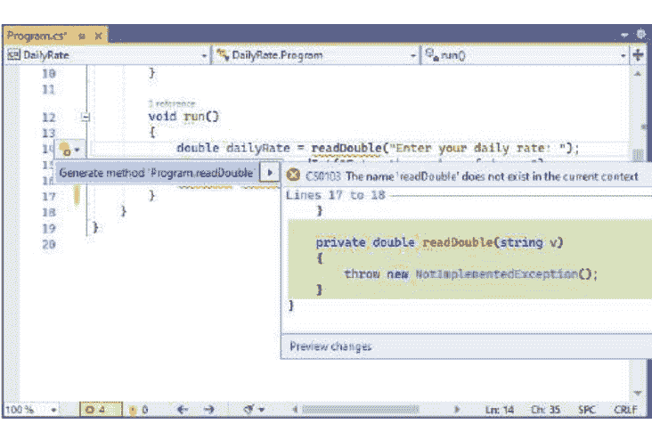

3. 选择“生成方法‘Program.readDouble’”。Visual Studio 将将以下方法添加到你的代码中：

点击此处查看代码图像

```
private double readDouble(string v)
{
    throw new NotImplementedException();
}
```

创建的新方法带有`private`修饰符，该修饰符在第 7 章中描述。方法体目前仅抛出一个`NotImplementedException`异常。异常在第 6 章中描述。在下一步中，你将用自己的代码替换方法体。

4. 从`readDouble`方法中删除`throw NotImplementedException();`语句，并将其替换为下方加粗所示的行代码：

点击此处查看代码图像

```
private double readDouble(string v)
{
    Console.Write(v);
    string line = Console.ReadLine();
    return double.Parse(line);
}
```

这段代码在屏幕上显示变量`v`中的字符串。该变量是调用该方法时传入的字符串参数；它包含了提示用户输入日薪的消息。

> **注意**

> `Console.Write`方法与你在之前的练习中使用的`Console.WriteLine`语句类似，不同之处在于不会在消息后输出换行符。

用户输入一个值，该值通过`ReadLine`方法被读取为字符串，并使用`double.Parse`方法转换为`double`类型。结果作为方法调用的返回值返回。

> **注意**

> `ReadLine`方法是`WriteLine`的伴侣方法；它从键盘读取用户输入，并在用户按下 Enter 键时结束。用户输入的文本作为返回值返回。该文本以字符串值的形式返回。

5. 在`run`方法中，右键点击对`readInt`方法的调用，选择“快速操作和重构”，然后选择“生成方法‘Program.readInt’”。

`readInt`方法的生成如下：

点击此处查看代码图像

```csharp
private int readInt(string v)
{
    throw new NotImplementedException();
}
```

6. 将`readInt`方法体中的`throw new NotImplementedException();`语句替换为下方加粗所示的代码：

点击此处查看代码图像

```
private int readInt(string v)
{
    Console.Write(v);
    string line = Console.ReadLine();
    return int.Parse(line);
}
```

这段代码与`readDouble`方法的代码相似。唯一的区别是该方法返回一个`int`值，因此用户输入的字符串通过`int.Parse`方法转换为数字。

7. 在`run`方法中，右键点击对`calculateFee`方法的调用，选择“快速操作和重构”，然后选择“生成方法‘Program.calculateFee’”。

`calculateFee`方法的生成如下：

点击此处查看代码图像

```
private object calculateFee(double dailyRate, int noOfDays)
{
    throw new NotImplementedException();
}
```

注意在这种情况下，Visual Studio 使用了传递给参数的参数名称（当然，如果参数名称不合适，你可以更改它们）。更奇妙的是方法返回的类型，它是`object`。Visual Studio 无法从调用方法的上下文中准确确定该方法应该返回哪种类型的值。`object`类型仅意味着“某样东西”，当你向方法中添加代码时，应该将其更改为你所需的类型。

第 7 章将详细介绍`object`类型。

8. 修改`calculateFee`方法的定义，使其返回`double`，如此处加粗字体所示：

点击此处查看代码图像

```
private double calculateFee(double dailyRate, int noOfDays)
{
    throw new NotImplementedException();
}
```

9. 替换`calculateFee`方法体，将其更改为表达式体方法（expression-bodied method），使用下方加粗所示的表达式；删除括号并使用`=>`来定义方法体的表达式。该语句通过将两个参数相乘来计算应付费用：

点击此处查看代码图像

```
private double calculateFee(double dailyRate, int noOfDays) =>
    dailyRate * noOfDays;
```

10. 在`run`方法中右键点击对`writeFee`方法的调用，选择“快速操作和重构”，并选择“生成方法‘Program.writeFee’”。

注意 Visual Studio 使用`writeFee`方法的定义来确定其参数应该是`double`。该方法调用没有使用返回值，因此该方法的类型为`void`：

点击此处查看代码图像

```
private void writeFee(double v)
{
  ...
}
```

> **提示**

> 如果你觉得语法已经足够熟悉，也可以通过直接在代码和文本编辑器窗口中输入来编写方法。你不总是需要使用“生成”菜单选项。

11. 将`writeFee`方法体中的代码替换为以下语句，它计算费用并在显示结果之前加上 10% 的佣金。再次注意，现在是表达式体方法了：

点击此处查看代码图像

```
private void writeFee(double v) => Console.WriteLine("$The consultant's fee is {v}");
```

12. 在“生成”菜单中，选择“解决方案”。

## 测试程序

1. 在“调试”菜单中，选择“无调试启动”。

Visual Studio 编译并运行程序。出现了一个窗口。

2. 在“日薪”提示处输入 25。按 Enter。

3. 在“天数”提示处输入 17。按 Enter。

程序向控制台输出：

```
The consultant's fee is 425
```

## 使用 Visual Studio 调试器跟踪方法

Visual Studio 提供了强大的调试功能，允许你逐行查看执行情况。当你需要理解程序运行不符合预期或想查看开发者编写的代码是如何流转时，这非常有用。在进入方法和退出方法时，可以使用调试工具栏上的工具。

1. 在代码和文本窗口中，找到`run`方法。

2. 将光标移动到`run`方法的第一条语句：

```csharp
double dailyRate = readDouble("Enter your daily rate:");
```

3. 右点击此行的任意位置，然后选择“运行到光标”。

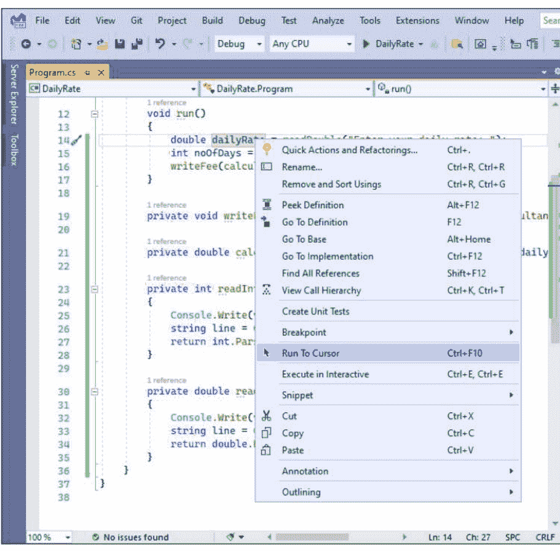

程序启动，运行到`run`方法的第一条语句，然后暂停。窗口左侧的黄色箭头指示当前语句，该语句本身用黄色背景突出。

```csharp
Program.cs DailyRate.Program run()
{
    class Program {
        static void Main(string[] args) {
            new Program().run();
        }

    void run() {
            double dailyRate = readDouble("Enter your daily rate:");
            int noODays = readInt("Enter the number of days:");
            writeFee(calculateFee(dailyRate, noODays));
        }
        private void writeFee(double v) => Console.WriteLine("$The consultant's fee is {v}");
        private double calculateFee(double dailyRate, int noOfDays) => dailyRate * noOfDays;
    }
```

4. 在“视图”菜单上，指向“工具栏”，然后确保选择了“调试”工具栏。

如果它之前可见，“调试”工具栏就会打开。它可能会停靠与其他工具栏一起。如果你看不到工具栏，可以尝试使用“视图”菜单上的“工具栏”命令隐藏它，并观察哪些按钮消失了。然后重新显示工具栏。“调试”工具栏看起来如下：


5. 在“调试”工具栏上，选择“单步调”（Step Into）按钮。（这是“调试”工具栏从左侧数起的第五个按钮。）

调试器进入了被调用的方法。黄色箭头跳转到`readDouble`方法开始处的左大括号。

6. 再次选择“单步调”（Step Into）以将光标移动到第一条语句：

```
Console.Write(v);
```

> **提示**

你可以按 F11 而不是在调试工具栏上选择“单步调”。

7. 在调试工具栏上，选择“单步执行”（Step Over）。（这是从左侧数的第六个按钮。）

该方法执行下一条语句而不对其进行调试（不进入该方法）。此操作主要适用于语句调用了方法，但你不想逐条执行该方法中的每个语句的情况。黄色光标移动到方法的第二条语句，程序在返回 Visual Studio 2022 之前会在控制台窗口中显示“Enter Your Daily Rate”提示。（控制台窗口可能隐藏在 Visual Studio 之后。）

> **提示**

你可以按 F10 而不是在调试工具栏上选择“单步执行”。

8. 在调试工具栏上，再次选择“单步执行”。

这次，黄色光标消失了，控制台窗口获得了焦点，因为程序正在执行`Console.ReadLine`方法并正在等待你输入内容。

9. 在控制窗口中输入 525。然后按回车键。

控制权返回到 Visual Studio 2022。黄色光标出现在方法的第三行。

10. 将光标悬停在方法第二行或第三行的`line`变量的引用上。（哪行都可以。）

会出现一个屏幕提示（ScreenTip），显示`line`变量的当前值（"525"）。你可以使用此功能在单步执行方法时确保变量已设置为预期的值。

```c
private double readDouble(string v)
{
    Console.Write();
    string line = Console.ReadLine();
    return double.Parse(line); //11,522ms elapsed
    line = "525"
}
```

11. 在调试工具栏上，选择“单步调出”（Step Out）。（这是从左侧数的第七个按钮）。

当前方法将继续运行直到结束。`readDouble`方法完成，黄色光标被放回`run`方法的第一条语句。该语句现在已经运行完毕。

> **提示**

你可以按 Shift+F11 而不是在调试工具栏上选择“单步调出”。

12. 在调试工具栏上，选择“单步调”。

黄色箭头（以及高亮显示）移动到`run`方法中的第二条语句。

点击此处查看图像

```csharp
int noOfDays = readInt("Enter the number of days: ");
```

13. 在调试工具栏上，选择“单步执行”。

这次，你选择了运行该方法而不逐条执行它。控制台窗口再次出现，提示你输入天数。

14. 在控制窗口中输入 17。然后按回车键。

控制权返回到 Visual Studio 2022。（你可能需要将 Visual Studio 置于顶层。）黄色光标移动到`run`方法的第三条语句：

点击此处查看代码图像

```csharp
writeFee(calculateFee(dailyRate, noOfDays));
```

15. 在调试工具栏上，选择“单步调”。

黄色光标跳转到定义`calculateFee`方法体的表达式。该方法在`writeFee`之前先调用，因为该方法的返回值被用作`writeFee`的参数。

16. 在调试工具栏上，选择“单步调出”。

`calculateFee`方法调用完成，黄色箭头跳转回`run`方法的第三条语句。

17. 在调试工具栏上，再次选择“单步调”。

这次，黄色箭头跳转到定义`writeFee`方法体的语句。

18. 将鼠标悬停在方法定义中的`v`参数上。

`v`的值 8925 显示在屏幕提示中。

19. 在调试工具栏上，选择“单步调出”。


控制台窗口中显示消息“The consultant’s fee is: 9817.5”（你可能需要将控制台窗口置于顶层才能显示它，如果它被隐藏在 Visual Studio 2022 之后。）。黄色箭头返回到`run`方法的第三条语句。

20. 在工具栏上，选择“继续”（Continue）以继续运行程序而不会在随后的每条语句处停止。

> **提示**
>
> 如果“继续”按钮不可见，选择调试工具栏末尾出现的“添加或删除按钮”（Add Or Remove Buttons）下拉菜单并选择“继续”。现在“继续”按钮应该会出现。或者，你可以按`F5`继续运行应用程序。

应用程序完成并结束运行。注意当应用程序结束时，调试工具栏会消失；默认情况下，调试工具栏仅在你以调试模式运行应用程序时显示。

调试器的另一个强大功能是可以在调试时修改正在运行的代码；这意味着你不需要停止应用程序并重启它。这种方法可以大幅减少调试应用程序所需的时间。在下一个练习中，你将看到这种技术的简单示例。

## 在调试会话期间修改代码

1. 在“代码和文本编辑器”窗口中，找到`readDouble`方法。

2. 右键点击`Console.Write(v);`语句，指向“断点”（Breakpoint），然后选择“插入断点”（Insert Breakpoint）。当你以调试模式运行应用程序时，程序将在到达此语句时停止并进入调试器。

添加断点后，该语句在编辑器窗口中高亮显示，并带有一个大红点。

3. 在 Visual Studio 工具栏上，选择“调试”（Debugging）。

应用程序启动，但会在断点处停止。

4. 在调试工具栏上，选择“单步执行”（Step Over）允许此语句执行。

5. 切换到应用程序控制窗口。它仍然显示原始消息，提示信息位于同一行。

你决定更改此消息的显示方式。你想在消息后添加一个换行符。

6. 返回到调试模式下的 Visual Studio。

7. 在不停止应用程序的情况下，将语句`Console.Write(v);`改为`Console.WriteLine(v);`。

8. 右键点击修改后的语句，选择“下一语句”（Next Statement）。

此操作使调试器返回该语句，因此当你选择“单步执行”时，该语句将重复执行。

> **注意**
>
> 如果你使用的是 UWP 应用（而不是控制台应用），你可以在调试会话期间修改用户界面的 XAML 布局。可以在应用程序在断点暂停时对 XAML 进行必要的更改。然后，在 Visual Studio 工具栏上，选择“应用更改”（Apply Code Changes）按钮。此按钮有一个火焰图标，表示它会触发 UI 的热重载。

9. 在调试工具栏上，选择“单步执行”。修改后的语句现在应该运行了。

10. 返回应用程序的控制窗口。它仍然显示原始消息，随后是“Enter daily rate:”。再次，等待用户输入的光标现在位于下方。

```
C:\Users\student\Documents\Microsoft Press\VCSB\Chapter 3\DailyRate - Complete\nEnter your daily rate: Enter your daily rate:
-
```

11. 返回 Visual Studio 并选择工具上的“继续”。

12. 输入之前的值并允许应用程序运行完成。结果应与之前相同。

13. 在“调试”菜单上，选择“删除所有断点”（Delete All Breakpoints），移除`readDouble`方法中的断点。

14. 在出现的 Visual Studio 消息框中，选择“是”以确认要删除断点。

## 重构代码

Visual Studio 2022 的一个非常实用的功能是重构代码。这可以通过将代码拆分为更小、定义良好的部分，使你的代码更具可读性和维护性。

有时，你会发现应用程序的多个处编写了相同的（或相似的）代码。当这种情况发生时，你可以高亮并右键点击你刚刚键入的代码块，选择“快速操作和重构”（Quick Actions and Refactoring），然后选择“提取方法”（Extract Method）。所选代码将被移动到名为`NewMethod`的新方法中。

“提取方法向导”可以确定方法是否需要接收参数以及返回值。方法生成后，你应该将其名称更改为具有意义的名称，并更改生成的语句，以使用新名称调用该方法。

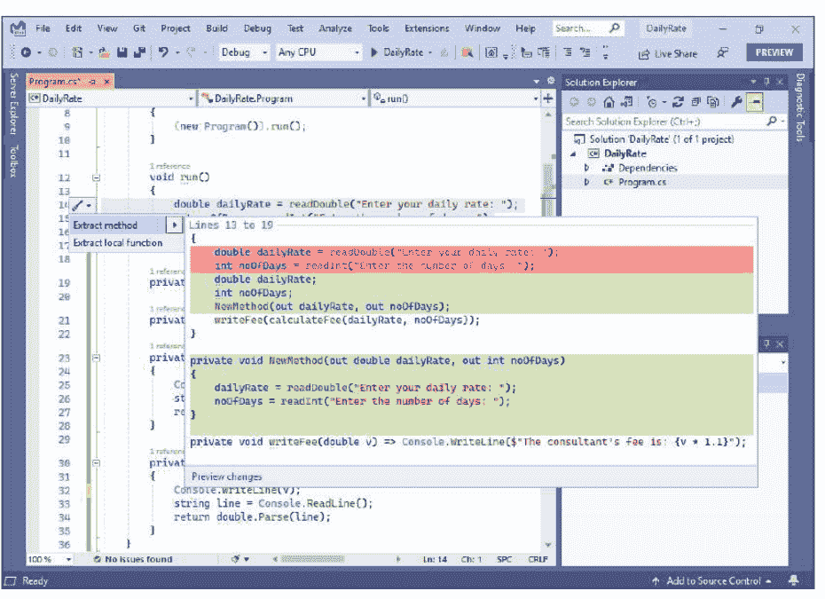

## 嵌套方法

除了重构，有时你还想将一个大方法拆分为较小的部分。你可以将每个部分实现为独立的辅助方法。这有助于测试执行复杂过程的方法，并在合并它们之前验证大方法的每个部分是否按预期运行。它还能提高可读性，并使大方法更易维护。

> **注意**
>
> “大方法”和“辅助方法”并不是 C# 的官方术语。我在讨论中使用它们是为了区分被拆分成多个较小部分的方法（大方法）以及实现这些较小部分的方法（辅助方法）。

默认情况下，方法（大方法和辅助方法）在定义它们的类范围内是可见的，并且可以从该类中的任何其他方法调用。对于仅由一个大方法使用的辅助方法，将这些方法保持在运行它们的方法内部（局部）是合理的。这种方法可以确保为特定上下文设计的辅助方法不会被另一个并非为其设计的方法意外使用。这也是实现封装的良好实践；大方法的内部工作机制（包括它调用的辅助方法）可以与其他方法分开。这种做法减少了大方法之间的依赖关系；你可以安全地更改大方法及其调用的辅助方法的实现，而不会意外影响应用程序的其他元素。

你可以通过将辅助方法嵌套在它们所需的大方法内部来创建辅助方法，如下一个练习所示。该练习计算阶乘。你可以使用阶乘来确定排列数量物品的方式。正整数`n`的阶乘按递归定义为`n*(n-1)`，其中 1 的阶乘为 1。例如，3 的阶乘是`3*factorial(2)`，反过来又是`2*factorial(1)`，即 1。该计算结果为`3*2*1`，或 6。如果你集合中有三个物品，你可以以六种不同的方式排列它们。同样，如果你有四个物品，你可以以 24 种不同的方式排列（`4*factorial(3)`），你可以以 120 种不同的方式排列五个物品（`5*factorial(4)`）。

### 计算阶乘

1. 如果 Visual Studio 2022 运行，请启动它。

2. 打开 Factorial 解决方案，它位于文档文件夹下的`\Microsoft Press\VCSBS\Chapter 3\Factorial`文件夹中。

3. 在解决方案管理器（Solution Explorer）中，在 Factorials 项目中，双击`Program.cs`文件，在代码和文本编辑器窗口中显示程序代码。

4. 在`run`方法体的左括号和右括号之间添加所示语句：

点击此处查看代码图像

这会提示用户输入数值，然后在显示结果之前使用该值调用`CalculateFactorial`函数（你接下来将编写它）。

5. 在`run`方法下方添加一个名为`CalculateFactorial`的新方法。该方法应该接收一个名为`input`的字符串参数并返回一个长整数值，如下：

点击此处查看代码图像

```csharp
long CalculateFactorial(string input)
{
}
```

6. 在`CalculateFactorial`方法中，初始左括号之后添加此处所示的加粗语句：

点击此处查看代码图像

```csharp
long CalculateFactorial(string input)
{
    int inputValue = int.Parse(input);
}
```

7. 该语句将作为参数传递的字符串转换为整数。（目前代码没有确保用户输入的是有效整数；你将在第 6 章学习如何这样做。）

8. 在`CalculateFactorial`函数中添加一个名为`factorial`的嵌套方法。`factorial`方法应该接收一个`int`值并返回`long`。你将使用此方法来计算输入参数的阶乘：

点击此处查看代码图像

```csharp
long CalculateFactorial(string input)
{
    int inputValue = int.Parse(input);
    long factorial (int dataValue)
    {
    }
}
```

9. 在`factorial`方法体中，添加此处所示的加粗语句。此代码使用之前描述的递归算法计算输入参数的阶乘：

点击此处查看代码图像

```csharp
long CalculateFactorial(string input)
{
    int inputValue = int.Parse(input);
    long factorial (int dataValue)
    {
        if (dataValue == 1)
        {
            return 1;
        }
        else
        {
            return dataValue * factorial(dataValue - 1);
        }
    }
}
```

10. 在`CalculateFactorial`方法中，使用整数值调用`factorial`方法并返回结果：

点击此处查看代码图像

```csharp
long CalculateFactorial(string input)
{
    int inputValue = int.Parse(input);
    long factorial (int dataValue)
    {
        if (dataValue == 1)
        {
            return 1;
        }
        else
        {
            return dataValue * factorial(dataValue - 1);
        }
    }
    return factorial(inputValue);
}
```

11. 在调试（Debug）菜单上，选择“开始执行调试”。

12. 在“Please Enter a Positive Integer”（请输入一个正整数）提示处，输入 4，然后按回车。

程序写入以下消息：

```
Factorial (4) is 24
```

13. 尝试其他值。注意，如果你输入的数值过大（例如尝试 60），结果将超过`long`能够存储的范围，你将得到一个错误的结果——很可能是由于数值溢出产生的负数。

## 使用可选参数和命名参数

通过定义重载方法，你可以实现带有不同参数的多个方法版本。当你构建使用重载方法的应用程序时，编译器会确定应该使用每个方法的哪些特定实例来满足每次方法调用。

然而，开发者可以使用其他语言和技术来构建不遵循这些规则的应用程序和组件。C# 以及其他为 .NET 设计的语言的一个关键功能是可以与使用其他技术编写的应用程序和组件进行操作。允许在 .NET 环境之外运行 Windows 应用程序和服务的技术之一是组件对象模型（COM）。事实上，.NET 使用的公共语言运行时（CLR）也高度依赖于 COM，Windows 运行时也是如此。COM 不支持重载方法；相反，它可以使用可选参数的方法。为了更容易将 COM 库和组件集成到 C# 解决方案中，C# 支持可选参数。

可选参数在其他情况下也有用。当无法使用重载，因为参数类型差异不足以让编译器区分不同的实现时，它们提供了一个紧凑且简单的解决方案。例如，考虑以下方法：

```csharp
public void DoWorkWithData(int intData, float floatData, int moreIntData)
{
}
```

如果你编写了一个调用`DoWorkData`方法的语句，你可以提供两个或三个适当类型的参数，编译器将使用类型信息来确定调用哪个重载：

点击此处查看代码图像

```
int arg1 = 99;
float arg2 = 100.0;
int arg3 = 101;
DoWorkData(arg1, arg2, arg3); // 调用三个参数的重载
DoWorkData(arg1, arg2); // 调用两个参数的重载
```

然而，假设你想为`DoWorkData`额外实现两个版本，它们只接收第一个参数和第三个参数。你可能会想尝试这样做：

点击此处查看代码图像

```c
public void DoWorkData(int intData)
{
  ...
}
public void DoWorkData(int moreData)
{
  ...
}
```

这里的问题在于，这两个重载版本在编译器看来是相同的。你的代码将无法编译，而是会生成错误“类型 'typename' 已经定义了具有相同参数类型的成员 'DoWorkData'”。为了理解为什么会这样，让我们假设这段代码是合法的，看看会发生什么。考虑以下语句：

```
int arg1 = 99;
int arg3 = 101;
DoWorkData(arg1);
DoWorkData(arg3);
```

对`DoWorkData`的调用将触发哪一个重载？使用可选参数和命名参数可以帮助解决这个问题。

### 定义可选参数

当定义方法并为参数提供默认值时，你就指定该参数是可选的。你通过使用赋值运算符指定默认值。在接下来所示的`optMethod`方法中，第一个参数是强制性的因为它没有指定默认值，但第二个和第三个参数是可选的：

点击此处查看代码图像

```
void optMethod(int first, double second = 0.0, string third = "Hello")
{
  ...
}
```

你必须在任何可选参数之前指定所有强制参数。

调用带有可选参数的方法与调用任何其他方法相同：指定方法名并提供任何必要的参数。与带有可选参数的方法的区别在于，你可以省略相应的参数，方法在运行时将使用默认值。在接下来的示例中，对`optMethod`的第一次调用为三个参数都提供了值。第二次调用仅指定了两个参数，这些值被应用于第一个和第二个参数。当方法运行时，第三个参数将接收默认值 "Hello"。

点击此处查看代码图像

```
optMethod(99, 123.45, "World"); // 为三个参数都提供了参数
optMethod(100, 54.321); // 仅为前两个参数提供了参数
```

### 传递命名参数

默认情况下，C# 使用每个参数在方法调用中的位置来确定它适用于哪个参数。因此，上一节所示的`optMethod`方法示例将两个参数传递给方法的第一个和第二个参数，因为这是它们在方法声明中出现的顺序。

在 C# 中，你还可以通过名称来指定参数。此项功能允许你以不同的顺序传递参数。要将参数作为命名参数传递，你需要指定参数名称，后跟冒号和要使用的值。

以下示例的功能与上一节所示相同，不同在于通过名称指定了参数：

点击此处查看代码图像

```
optMethod(first : 99, second : 123.45, third : "World");
optMethod(first : 100, second : 54.321);
```

命名参数赋予你以任何顺序传递参数的能力。你可以如下重写调用`optMethod`方法的代码：

点击此处查看代码图像

```
optMethod(third : "World", second : 123.45, first : 99);
optMethod(second : 54.321, first : 100);
```

此功能还允许你省略参数。例如，你可以调用`optMethod`方法并仅指定第一个和第三个参数的值，而对第二个参数使用默认值，如下：

点击此处查看代码图像

```
optMethod(first : 99, third : "World");
```

此外，你可以混合使用位置参数和命名参数。然而，如果你使用这种技术，必须在第一个命名参数之前指定所有的位置参数。

点击此处查看代码图像

```
optMethod(99, third : "World"); // 第一个参数是位置参数
```

### 使用可选参数和命名参数解决冲突

使用可选参数和命名参数可能会导致代码中出现歧义。你必须理解编译器如何解决这些歧义；否则，你可能会发现应用程序的行为出乎意料。

假设你如下例所示将`optMethod`方法定义为重载方法：

点击此处查看代码图像

```
void optMethod(int first, double second = 0.0, string third = "Hello")
{
  ...
}
void optMethod(int first, double second = 1.0, string third = "Goodbye", int fourth = 100)
{
  ...
}
```

这是完全合法的 C# 代码。编译器可以区分这些方法，因为它们的参数列表不同。然而，如下例所示，如果你尝试调用`optMethod`并省略某些或更多参数，就会出现问题：

```
optMethod(1, 2.5, "World")
```

再次，这是完全合法的，但它运行的是哪个版本的`optMethod`？答案是最匹配调用版本，如下：

```
optMethod(1, fourth : 101);
```

在此代码中，`optMethod`的调用省略了第二个和第三个参数，但通过名称指定了第四个参数。只有一个`optMethod`版本匹配此调用，所以这不是问题。示例如下：

```
optMethod(1, 2.5);
```


这一次，没有一个`optMethod`版本完全匹配提供的参数列表。两个`optMethod`版本都有可选参数。那么，此语句是调用三个参数并使用第三参数默认值的版本，还是调用四个参数并使用第三、第四参数默认值的版本？答案是都不是。这是一个无法解决的歧义，编译器不允许你编译应用程序。

当你按照以下任何语句调用`optMethod`时，也会出现相同的情况：

```
optMethod(1, third : "World");
optMethod(1);
optMethod(second : 2.5, first : 1);
```

在本章最后的练习中，你将重新访问`DailyRate`项目，并练习实现带有可选参数的方法以及使用命名参数调用它们。你还将测试编译器如何处理这些常见示例。

## 定义并调用带有可选参数的方法

1. 使用 Visual Studio 2022，打开`DailyRate`解决方案，它位于你文档文件夹中的`\MicrosoftPressVBSChapter3DailyRate Using Optional Parameters`文件夹。

2. 在解决方案资源管理器中，在`DailyRate`项目中双击`Program.cs`文件，在代码和文本编辑器中显示程序的代码。

此版本的应用程序除了`Main`方法和`run`方法的骨架版本外是空的。

3. 在`Program`类中，在`run`方法之后添加`calculateFee`方法。这是你在上一组练习中实现的相同版本，不同之处它带有默认值的可选参数。该方法还会打印消息，指示调用了哪个版本的`calculateFee`方法（你将在后续步骤中添加此方法的重载实现）。

```csharp
private double calculateFee(double dailyRate = 500.0, int noOfDays = 1)
```

```csharp
Console.WriteLine("calculateFee using two optional parameters");
  return dailyRate * noOfDays;
}
```

4. 在`Program`类中为`calculateFee`方法添加另一个实现，如下代码所示。此版本接受一个类型为`double`的可选参数`dailyRate`。该方法的主体仅计算并返回单日的费用。

```csharp
private double calculateFee(double dailyRate = 500.0)
{
  Console.WriteLine("calculateFee using one optional parameter");

  int defaultNoOfDays = 1;
  return dailyRate * defaultNoOfDays;
}
```

5. 在`Program`类中为`calculateFee`方法添加第三种实现。此版本不接受任何参数，并对每日和天数使用硬编码的值。

```csharp
private double calculateFee()
{
  Console.WriteLine("calculateFee using hardcoded values");
  double defaultDailyRate = 400.0;
  int defaultNoOfDays = 1;
  return defaultDailyRate * defaultNoOfDays;
}
```

6. 在`run`方法的开头，添加以下加粗的语句来调用`calculateFee`并显示结果：

```csharp
public void run()
{
  double fee = calculateFee();
  Console.WriteLine($"Fee is {fee}");
}
```

你可以从调用该方法的语句中快速查看方法的定义。要这样做，请右键点击方法调用，然后选择“转到定义”（Peek Definition）。下图显示了`calculateFee`方法的“转到定义”窗口。如果你的代码跨多个文件，或者即使在同一个文件中但文件非常长，此功能也极其有用。

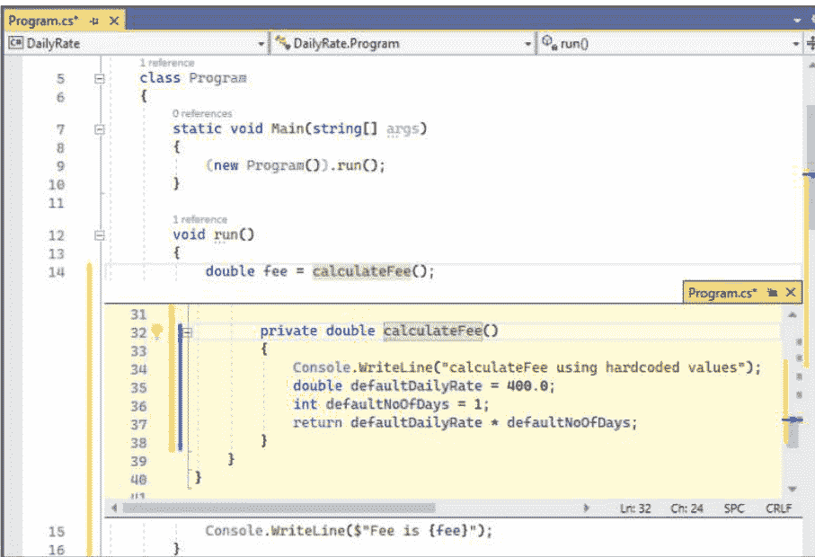

在“调试”（Debug）菜单上，选择“不转调试启动”（Start Without Debugging）来编译并运行程序。

程序在控制台窗口中运行并显示以下消息：

```
calculateFee using hardcoded values

Fee is 400
```

`run`方法调用了不接受参数的`calculateFee`版本，而不是接受可选参数的两个实现之一，因为该版本与方法调用最匹配。

按任意键关闭控制窗口并返回 Visual Studio。

8. 在`run`方法中，修改调用`calculateFee`的语句，使其与此处加粗显示的代码匹配：

9. 在“调试”菜单上，选择“不转调试启动”来编译并运行程序。

程序显示以下消息：

```
calculateFee using one optional parameter

Fee is 650
```

这一次，`run`方法调用了接受一个可选参数的`calculateFee`版本。与之前一样，这是与方法调用匹配最紧密的版本。

10. 按任意键关闭控制窗口并返回 Visual Studio。

11. 在`run`方法中，再次修改调用`calculateFee`的语句，如下所示加粗代码所示：

```csharp
public void run()
{
    double fee = calculateFee(500.0
```

12. 在“调试”菜单上，选择“不转调试启动”来编译并运行程序。

程序显示以下消息：

```csharp
calculateFee using two optional parameters
Fee is 1500
```

正如你从前两个情况预期的那样，`run`方法调用了接受两个可选参数的`calculateFee`版本。

13. 按任意键关闭控制窗口并返回 Visual Studio。

14. 在`run`方法中，修改调用`calculateFee`的语句并通过名称指定`dailyRate`参数：

```csharp
public void run()
{
    double fee = calculateFee(dailyRate : 375.0);
    Console.WriteLine($"Fee is {fee}");
}
```

15. 在“调试”菜单上，选择“不转调试启动”来编译并运行程序。

程序显示以下消息：

```csharp
calculateFee using one optional parameter
Fee is 375
```

如之前一样，`run`方法调用接受一个可选参数的`calculateFee`版本。将代码更改为使用命名参数并不会改变编译器在此示例中解析方法调用的方式。

16. 按任意键关闭控制窗口并返回 Visual Studio。

17. 在`run`方法中，修改调用`calculateFee`的语句并通过名称指定`noOfDays`参数。

```csharp
public void run()
{
    double fee = calculateFee(noOfDays : 4);
    Console.WriteLine($"Fee is {fee}");
}
```

18. 在“调试”菜单上，选择“不调试启动”来编译并运行程序。

程序显示以下消息：

```csharp
calculateFee using two optional parameters
Fee is 2000
```

这一次，`run`方法调用了接受两个可选参数的`calculateFee`版本。方法调用省略了第一个参数（`dailyRate`）并通过名称指定了第二个参数。接受两个可选参数的`calculateFee`方法是唯一匹配该调用的版本。

19. 按任意键关闭控制窗口并返回 Visual Studio。

20. 在接受两个可选参数的`calculateFee`方法中，更新`return`语句以匹配此处代码：

```csharp
private double calculateFee(double dailyRate = 500.0, int noOfDays = 1)
{
  Console.WriteLine("calculateFee using two optional parameters");
  return dailyRate * noOfDays;
}
```

21. 在`run`方法中，修改调用`calculateFee`的语句并通过名称指定`dailyRate`参数。

```csharp
public void run()
{
    double fee = calculateFee(dailyRate : 375.0);
}
```

22. 在“调试”菜单上，选择“不转调试启动”来编译并运行程序。

程序显示以下消息：

```
calculateFee using one optional parameter

Fee is 375
```

上一次指定参数名称时，`run`方法调用了接受一个可选参数的`calculateFee`版本。这一次它调用了接受两个可选参数的版本。

23. 按任意键关闭控制窗口并返回 Visual Studio。

# 总结

在本章中，你学习了如何向方法传递参数以实现代码块，以及如何从方法返回数据。你还了解了如何调用方法、传递参数并获取返回值。你学习了如何根据不同的参数列表定义重载方法，并了解变量的作用域如何决定其访问范围。最后，你使用了 Visual Studio 2022 调试器执行代码。最后你学习了如何编写接受可选参数的方法以及如何通过命名参数调用方法。

- 如果你想继续后续章节，请保持 Visual Studio 2022 运行并转向第 4 章，“决策语句”。

## 快速参考

| 操作 | 方法 |

| :--- | :--- |

| 声明方法 | 在类内部编写方法。指定方法名、参数列表和返回类型，然后是花括号的方法体。例如：<br>```csharp>int addValues(int leftHandSide, int rightHandSide) {\n ... \n}``` |
| 从方法返回值 | 在方法内部编写`return`语句。例如：<br>`return leftHandSide + rightHandSide;` |
| 从方法返回多个值 | 在方法内部编写返回元组的`return`语句。例如：<br>`return (division, remainder);` |
| 在方法结束前返回 | 在方法内部编写`return`语句。例如：<br>`return;` |
| 定义表达式体方法 | 使用`=>`序列后跟定义方法体的表达式以及分号。例如：<br>```csharp>double calculatePee(double dailyRate, int noOfDays) => ndailyRate * noOfDays;``` |

| 调用方法 | 编写方法名并在后跟括号内的任何参数。例如： |

`addValues(39, 3);`

如之前所示调用方法，但将结果赋值一组用括号括起来的变量。对于返回的元组中的每个值，应该对应一个变量。例如：

调用返回元组的方法

```
int division, remainder;
(division, remainder) = divide(leftHandSide, rightHandSide);
```

使用生成方法存根向导 (Generate Method Stub Wizard)

右键点击方法，然后选择生成方法存根 (Generate Method Stub)。

### 创建嵌套方法

在另一个方法的体内定义该方法。例如：

```
long CalculateFactorial(string input)
{
    ...
    long factorial (int dataValue)
    {
        if (dataValue == 1)
        {
            return 1;
        }
        else
        {
            return dataValue * factorial(dataValue - 1);
        }
    }
    ...
}
```

### 显示调试工具栏

在“视图”(View)菜单上，悬停在“工具栏”(Toolbars)上，然后选择“调试”(Debug)。

### 进入方法

在调试工具栏上，选择“进入”(Step Into)。

| 方法 | 或 |

| :--- | :--- |

| | 在“调试”(Debug)菜单上，选择“进入”(Step Into)。 |

| 调出方法 | 在调试工具栏上，选择“调出”(Step Out)。在“调试”(Debug)菜单上，选择“单步调出”(Step Out)。 |

| 为方法指定可选参数 | 在方法声明中为参数提供默认值。例如：`void optMethod(int first, double second = 0.0, string third = "Hello") { ... }` |

| 将方法参数作为命名参数传递 | 在方法调用中指定参数名称。例如：`optMethod(first : 100, third : "World");` |

# 第 4 章

# 使用决策语句

完成本章后，你将能够：

- 声明布尔变量。

- 使用布尔运算符创建结果为真或为假的表达式。

- 编写`if`语句根据布尔表达式的结果做出决策。

- 编写`switch`语句以做出更复杂的决策。

第 3 章“编写方法和应用作用域”展示了如何将相关语句分组为方法。它还演示了如何使用参数向方法传递信息，以及如何使用`return`将信息传出方法。

将程序划分为一组执行特定任务或计算的离散方法是一种必要的设计策略。许多程序需要解决大型且复杂的问题。将程序拆分为方法有助于你理解这些问题，并专注于如何逐个解决它们。

第 3 章中的方法非常简单，每条语句在上一条语句完成后按顺序执行。然而，为了解决许多现实世界的问题，你必须能够编写代码根据情况选择性地执行不同的操作并在方法中采取不同的路径。在本章中，你将学习如何完成这项任务。

# 声明布尔变量

在 C# 编程世界（与现实世界不同），一切都是黑即白的、对或错的、真假的。例如，如果你创建一个名为`x`的整数变量，给它赋值为 99，然后问`x`是否包含值 99，答案无疑为真。如果你问`x`是否小于 10，答案无疑为假。这些都是布尔表达式的例子。布尔表达式的评估始终为真或为假。

```
注意
这些问题的答案对于所有其他编程语言并不一定确定。未赋值的变量具有未定义的值，例如，你不能说它绝对小于 10。此类问题是 C 和 C++ 程序中常见的错误来源。Microsoft Visual C# 编译器通过确保你在检查变量之前始终对其赋值来解决这个问题。如果你尝试检查未赋值变量的内容，你的程序将无法编译。
```

Visual C# 提供了一种名为`bool`的数据类型。变量可以持有两个值之一：`true`（真）或`false`（假）。例如，以下语句声明了一个名为`areReady`的`bool`变量，给该变量赋值为`true`，然后将其值写入控制台：

```
bool areReady;
areReady = true;
Console.WriteLine(areReady); // 向控制台写入 True
```

# 使用布尔运算符

布尔运算符执行计算，其结果为真或为假。C# 有几个非常有用的布尔运算符，其中最简单的是非 (NOT) 运算符，它用感叹号 (`!`) 表示。该运算符反转布尔值，产生该值的相反值。在在上述示例中，变量`areReady`的值为`true`，表达式`!areReady`的值为`false`。

# 理解相等和关系运算符

你经常使用的两个布尔运算符是相等 (`==`) 和不等于 (`!=`)。这些是二元运算符，通过你可以判断一个值是否与相同类型的另一个值相同，产生布尔结果。下表总结了这些运算符的工作原理，并以名为`age`的`int`变量为例：

| 运算符 | 含义 | 示例 | age 为 42 时的结果 |

| :--- | :--- | :--- | :--- |

| `==` | 等于 | `age == 100` | `false` |

| `!=` | 不等于 | `age != 0` | `true` |

不要将相等运算符`==`与赋值运算符`=`混淆。表达式`x ==`比较`x`和`y`，如果值相同，则其结果为`true`。表达式`x = y`将`y`的值赋值给`x`并返回`y`的值。

与`==`和`!=`密切相关的是关系运算符。你使用这些运算符来判断一个值是否小于或大于相同类型的另一个值。下表显示了如何使用这些运算符：

| 运算符 | 含义 | 示例 | age 为 42 时的结果 |

| :--- | :--- | :--- | :--- |

| `<` | 小于 | `age < 21` | `false` |

| `<=` | 小于等于 | `age <= 18` | `false` |

| `>` | 大于 | `age > 16` | `true` |

| `>=` | 大于等于 | `age >= 42` | `true` |


# 理解逻辑运算符

C# 提供了另外两个二元运算符：逻辑与（AND）运算符，用`&&`符号表示；逻辑或（OR）运算符，用`||`符号表示。统称为逻辑运算符。它们的目的是将两个布尔表达式或值合并为一个布尔结果。这些运算符与相等和关系运算符的相似之处在于它们出现的值为真或为假，但不同之处在于它们的操作对象必须为真或假。

`&&`运算符的结果仅当它所评估的两个布尔表达式均为真时才为真。以下示例来自选拔比赛的标准。对选手的舞蹈和唱歌能力进行评估。评委为每项能力给出 0（毫无天赋）到 10（专业级）的分数。只要选手每项达到 7 分，即可进入比赛的下一阶段：

点击此处查看代码图像

```csharp
int dancingAbility = ...; // 评委赋值
singingAbility = ...; // 评委赋值
bool canMoveToNextStage = (dancingAbility >= 7) && (singingAbility >= 7);
```


`||`运算符的结果在任一布尔表达式为真时为真。你使用`||`运算符来判断一组布尔表达式中的任意一个是否为真。例如，如果`dancingAbility`小于 7 或`singingAbility`小于 7，以下语句将`true`赋值给`eliminateant`：

点击此处查看代码图像

```csharp
eliminateContestant = (dancingAbility < 7) || (singingAbility < 7);
```

## 短路

`&&`和`||`运算符都表现出称为短路的特性。短路描述了在评估逻辑表达式结果时不需要评估两个操作数的情况。例如，如果`&&`运算符的左侧操作数评估为假，则无论右侧操作数的值，整个表达式的结果均为假。同样，如果`||`运算符的左侧操作数的值评估为真，则无论右侧操作数的值，整个表达式的结果均为真。

在这些情况下，`&&`和`||`运算符会跳过对右操作数的评估。考虑之前显示的第一个示例：

点击此处查看代码

```csharp
(singingAbility == 7) && (singingAbility >= 7);
```

在此表达式中，如果`singingAbility`的值小于 7，则`&&`左侧的布尔表达式评估为`false`。这意味着整个表达式的结果为`false`，且`&&`运算符右侧的布尔表达式不会被评估。

现在考虑第二个示例：

```csharp
(singingAbility < 7) || (singingAbility < 7);
```

在这里，如果`singingAbility`的值小于 7，则`||`左侧的布尔表达式评估为`true`。这意味着整个表达式的结果为`true`，且`||`运算符右侧的布尔表达式不会被评估。

仔细设计使用逻辑运算符的表达式，可以通过避免不必要的工作来提高代码性能。将易于评估的简单布尔表达式放在条件逻辑运算符的左侧，将更复杂的表达式放在右侧。在许多情况下，你会发现程序不需要评估更复杂的表达式。

> **注意**
>
> 布尔表达式可以调用返回`true/false`值的布尔方法。请注意，在使用短路的布尔表达式中，该方法并不总是运行。

## 总结运算符优先级和结合性

下表总结了你目前为止学过的所有运算符的优先级和结合性。同一类别的运算符具有相同的优先级。表中位置较高的类别优先级高于表中位置较低的类别。

| 类别 | 运算符 | 描述 | 结合性 |
| --- | --- | --- | --- |
| 原始 | `()` | 优先级覆盖 | 左结合 |
|  | `++` | 后自增 |  |
|  | `--` | 后自减 |  |
| 元运算 | `!` | 逻辑非 | 左结合 |
|  | `+` | 返回操作数的不变值 |  |
|  | `--` | 返回操作数取反的值 |  |
|  | `++` | 前自增 |  |
|  | `--` | 前自减 |  |
| 乘法 | `*` | 乘法 | 左结合 |
|  | `/` | 除法 |  |
|  | `%` | 取余 (模) |  |
| 加法 | `+` | 加法 | 左结合 |
|  | `--` | 减法 |  |
| 关系 | `<` | 小于 | 左结合 |
|  | `<=` | 小于等于 |  |
|  | `>` | 大于 |  |
|  | `>=` | 大于等于 |  |
| 相等 | `==` | 等于 | 左结合 |
|  | `!=` | 不等于 |  |
| 逻辑与 | `&&` | 逻辑与 | 左结合 |
| 逻辑或 | `||` | 逻辑或 | 左结合 |
| 赋值 | `=` | 将右操作数赋值给左侧并返回赋值的值 | 右结合 |

注意`&&`运算符和`||`运算符的优先级不同：`&&`优先级高于`||`。

# 模式匹配

C# 8.0 包含了新的模式匹配功能。模式扩展了许多 C# 语句的决策能力。它们还可以让你的代码比以前更加简洁和易读。

使用`is`运算符进行模式匹配是通过另一个示例来解释布尔表达式模式匹配最简单的方法。以下语句当且仅当`percent`变量的值大于等于 0 且小于等于 100 时，将布尔变量`validPercentage`赋值为`true`：

点击此处查看代码

```csharp
bool validPercentage;
int percent = ...; (percent >= 0) && (percent <= 100);
```

模式匹配允许你简化表达式：

点击此处查看代码

```csharp
validPercentage = (percent >= 0 and <= 100);
```

`is`运算符与布尔运算符`and`（合取模式运算符）以及布尔运算符`or`（析取模式运算符）配合工作。你不能与`is`使用`&&`或`||`。此外，模式匹配仅将单个变量与模式进行匹配。例如，下面的代码尝试评估两个变量`dancingAbility`和`singingAbility`，它将无法工作（无法编译）：

点击此处查看代码

```csharp
canMoveNextStage = (dancingAbility is >= 7 and singingAbility is >= 7);
```

C# 模式匹配还提供了与`is`的`not`运算符。它类似于`!`运算符，但仅对模式有效。以下代码了判断`percent`变量值是否在 0 到 100 范围内的另一种方法：

点击此处查看代码

```csharp
validPercentage = (percent is not < 0 and not > 100);
```

# 使用`if`语句进行决策

在方法中，当你根据布尔表达式的结果在执行两个不同的语句之间选择时，可以使用`if`语句。

## 理解`if`语法

`if`语句的语法如下（`if`和`else`是 C# 关键字）：

```csharp
if ( booleanExpression )
    statement-1;
else
    statement-2;
```

如果`booleanExpression`评估为`true`，则运行`statement-1`；否则运行`statement-2`。`else`关键字以及后续`statement-2`是可选的。如果没有`else`且`booleanExpression`评估为`false`，执行将继续后续`if`语句之后的代码。

> **注意**
>
> 布尔表达式必须包含在括号内。否则代码将无法编译。

例如，这里有一个增加秒表变量的`if`语句。（目前忽略了分钟。）如果`seconds`的值为 59，它将被重置为 0；否则，它将增加使用。

布尔表达式必须包含在括号内。此外，在某些语言中（特别是 C 和 C++），你可以写一个整数表达式，编译器会静将其转换为真（非零）。如果你在`if`语句中误用了赋值运算符`=`而不是相等测试运算符`==`，C# 编译器会识别你的错误并拒绝编译代码，例如：

```csharp
int seconds;
...
if (seconds = 59) // 编译错误
if (seconds == 59) // 正确
```

顺便提一下，可以使用布尔变量作为`if`语句的表达式，但必须包含在括号内，如下：

```csharp
bool inWord;
...
if (inWord == true) // 正确但不常用
...
if (inWord) // 更常用且风格更好
```

# 使用代码块分组语句

注意之前显示的`if`语句语法在`if ( booleanExpression )`之后指定了一个语句，在`else`关键字之后也指定了一个语句。然而，有时你可能需要在布尔表达式为真时执行多个语句。

你可以将语句分组在一个新方法中然后调用该方法，更简单的解决方案是将语句分组在一个代码块中。代码块只是位于左括号和大括号之间的一系列语句。

在此示例中，将`seconds`变量重置为 0 并增加`minutes`变量的两个语句分组在一个代码块中，当`seconds`的值为 59 时，整个代码块执行：

```csharp
int seconds = 0;
int minutes = 0;
...
if (seconds == 59)
{
    seconds = 0;
    minutes++;
}
else{
    minutes++;
}
```

> **重要**
>
> 如果省略大括号，C# 编译器会将第一个语句（`seconds = 0;`）与`if`语句关联。随后的语句（`minutes++`）在程序编译时不会被编译器识别为`if`语句的一部分。此外，当编译器
>
> 当遇到`else`关键字时，它不会将其与之前的`if`语句关联；而是会报告语法错误。因此，良好的做法是始终在`if`语句的每个分支中在块内定义语句，即使该块只包含一条语句。如果你以后想添加更多代码，这可以避免后续很多麻烦。

块还会开启一个作用域。你可以在块内部定义变量，它们会在块结束时消失。下面的代码片段说明了这一点：

点击此处查看图像

```csharp
if (...) {
    int myVar = 0;
    // myVar 在这里可以使用
} // myVar 在这里消失
else {
    // myVar 在这里无法使用
}
myVar 在这里无法使用
```

# 级联`if`语句

你可以将`if`语句嵌套在`if`语句内部。这种方式，你可以链联一系列布尔表达式，并按顺序进行测试，直到其中一个表达式为真。

在以下示例中，如果`day`的值为 0，第一个表达式为真，并为`day`赋值字符串`"Sunday"`。如果`day`的值不为 0，第一个测试失败，控制将传递到`else`子句，它执行第二个`if`语句并将`day`的值与 1 进行比较。第二个`if`语句仅在第一个测试为假时才执行。同样，第三个`if`语句仅在第一个和第二个测试均为假时才执行，以此此类推。

```csharp
if (day == 0) {
    dayName = "Sunday";
} else if (day == 1)
{
  dayName = "Monday";
}
else if (day == 2) {
  dayName = "Tuesday";
}
else if (day == 3) {
  dayName = "Wednesday";
}
else if (day == 4) {
  dayName = "Thursday";
}
else if (day == 5) {
  dayName = "Friday";
}
else if (day == 6) {
  dayName = "Saturday";
}
else {
  dayName = "unknown";
}
```

在下面的练习中，你将编写一个使用级联`if`语句来比较两个日期的方法。

# 编写`if`语句

1. 启动 Microsoft Visual Studio 2022，如果它尚未运行。
2. 打开`Selection`解决方案，它位于文档文件夹中的`\Microsoft Press\VCSBS\Chapter4\Selection`文件夹中。
3. 在调试（Debug）菜单上，选择启动调试（Start Debugging）。

Visual Studio 2022 编译并运行应用程序。表单显示两个 DatePicker 控件，分别称为`firstName`和`secondDate`。它们的标签为 First（第一个）和 Second（第二个）。

## 4. 选择 Compare（比较）

在窗口下半部分的文本框中会出现以下文本。

点击此处查看代码图像。

```text
firstDate == secondDate : False
firstDate != secondDate : True
firstDate < secondDate : False
firstDate <= secondDate : False
firstDate > secondDate : True
firstDate >= secondDate : True
```

布尔表达式`firstDate == secondDate`应该为真，因为`firstDate`和`secondDate`都被设置为当前日期。事实上，只有小于运算符（`<`）和大于等于运算符（`>=`）似乎工作正常。

5. 回到 Visual Studio 2022。在调试菜单上，选择停止调试（Stop Debugging）。
6. 在代码和文本编辑器窗口中显示`MainPage.xml.cs`文件的代码。
7. 找到`compareClick`方法，它看起来如下：

点击此处查看代码图像。

```csharp
private void compareClick(object sender, EventArgs e)
{
    int diff = dateCompare(firstDate.Date.LocalDateTime,
secondDate.Date.LocalDateTime);
    info.Text = "";
    show("firstDate == secondDate", diff == 0);
    show("firstDate != secondDate", diff != 0);
    show("firstDate < secondDate", diff < 0);
    show("firstDate <= secondDate", diff <= 0);
    show("firstDate > secondDate", diff > 0);
    show("firstDate >= secondDate", diff >= 0);
}
```

每当用户选择表单上的 Compare 按钮时，此方法就会运行。表达式`firstDate.Date.LocalDateTime`和`secondDate.Date.LocalDateTime`保存`DateTime`值；它们代表应用程序其他地方中`firstDate`和`secondDate`控件中显示的日期。`DateTime`数据类型只是另一种数据类型，类似于`int`或`float`，区别在于它包含允许你访问日期的各个部分的子元素，例如年、月或日。

`compareClick`方法将两个`DateTime`值传递给`dateCompare`方法。该方法的目的是比较日期并返回：如果它们相同则返回整数值 0，如果第一个日期小于第二个日期返回 -1，如果第一个日期大于第二个日期则返回 +1。如果一个日期在时间顺序上于另一个日期，则被认为大于该日期。你将在下一步中检查`dateCompare`方法。

`show`方法在表单下半部分的`info`框中显示比较结果。

8. 找到`dateCompare`方法，它看起来如下：

点击此处查看代码图像。

```csharp
private int dateCompare(DateTime leftHandSide, DateTime rightHandSide)
{
    //待待
return 42;
}
```

该方法目前返回 42。你必须在`dateCompare`方法中实现逻辑。删除`TO DO`注释和`return`语句。添加以下内容：

```csharp
private int dateCompare(DateTime leftHandSide, DateTime rightHandSide)
{
    int result = 0;
    if (leftHandSide.Year < rightHandSide.Year)
    {
        result = -1;
    }
    else if (leftHandSide.Year > rightHandSide.Year)
    {
        result = 1;
    }
    else if (leftHandSide.Month < rightHandSide.Month)
    {
        result = -1;
    }
    else if (leftHandSide.Month > rightHandSide.Month)
    {
        result = 1;
    }
    else if (leftHandSide.Day < rightHandSide.Day)
    {
        result = -1;
    }
    else if (leftHandSide.Day > rightHandSide.Day)
    {
        result = 1;
    }
    else
    {
        result = 0;
    }
    return result;
}
```

以下文本出现在框中：

点击此处查看代码图像


```
firstDate == secondDate: False
firstDate != secondDate: True
firstDate < secondDate: True
firstDate <= secondDate: True
firstDate > secondDate: False
firstDate >= secondDate: False
```

再次，当第一个日期早于第二个日期时，这些是正确的的结果。

16. 测试其他日期并验证结果是否如你预期那样正确。

17. 返回到 Visual Studio 2022 并在完成后停止调试。

## 在真实世界应用中比较日期

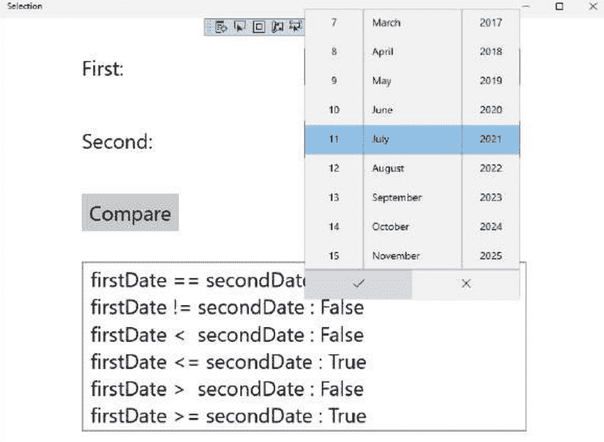

既然你已经看到了如何使用一组相当长且复杂的 `if` 和 `else` 语句，我应该提到，这并不是你在真实世界应用中比较日期时会采用的技术。如果你查看上一个练习中的 `dateCompare` 方法，你会发现两个参数 `leftHandSide` 和 `rightHandSide` 是 `DateTime` 值。你编写的逻辑只比较了这些参数的日期部分，但它们还包含你没有（或没有显示）的时间元素。要让两个 `DateTime` 值被认为是相等，它们不仅应该具有相同的日期，还要具有相同的时间：比较日期和时间是一项常见操作，而 `DateTime` 实际上有一个名为 `Compare` 的内置方法专门执行此操作：它比较两个 `DateTime` 参数并返回一个值，指示第一个参数是否小于第二个。如果是，结果将为负；如果不是，结果将为正。如果两个参数代表相同的日期和时间，结果将为 0。

# 使用 switch 语句

有时当你编写一个级联的 `if` 语句时，每个 `if` 语句看起来都很相似，因为它们评估的是相同的表达式。唯一的区别是，每个 `if` 都将表达式的结果与不同的值进行比较。

例如，考虑下面的代码块，它使用 `if` 语句来检查 `day` 变量中的值并确定它是星期几：

```
if (day == 0)
{
    dayName = "Sunday";
}
else if (day == 1)
{
    dayName = "Monday";
}
else if (day == 2)
{
    dayName = "Tuesday";
}
else if (day == 3)
{
    ...
}
else
{}
dayName = "Unknown";
}
```

在这些情况下，你可以将级联的 `if` 语句重写为 `switch` 语句，使你的程序更高效、更可读。

# 理解 switch 语句语法

`switch` 语句的语法如下（`switch`、`case` 和 `default` 关键字）：

点击此处查看代码图像

```
switch ( controllingExpression )
{
    case constantExpression :
      statements
      break;
    case constantExpression :
      statements
      break;
    ...
    default :
      statements
      break;
}
```

`controllingExpression` 必须在括号内，会被评估一次。控制跳转到由 `constantExpression` 标识的代码块，其值等于 `controllingExpression` 的结果。（`constantExpression` 标识符也称为 `case` 标签。）

执行运行到 `break` 语句为止，此时 `switch` 语句结束，程序继续执行 `switch` 语句结束括号之后的第一个语句。如果没有任何 `constantExpression` 的值等于 `controllingExpression` 的值，则运行可选 `default` 标签下方的语句。

> 注意

每个 `constantExpression` 值必须是唯一的，这样 `controllingExpression` 只会匹配到其中一个。如果 `controllingExpression` 的值不匹配任何 `constantExpression` 值且没有 `default` 标签，程序执行将继续执行 `switch` 语句结束括号之后的第一个语句。

因此，你可以将之前的级联 `if` 语句重写为下面的 `switch` 语句：

点击此处查看代码图像

```
switch (day) {
  case 0 :
    dayName = "Sunday";
    break;
  case 1 :
    dayName = "Monday";
    break;
  case 2 :
    dayName = "Tuesday";
    break;
  ...
  default :
    dayName = "Unknown";
    break;
}
```

# 遵循 switch 语句规则

基本的 `switch` 语句非常有用，但你写的任何 `switch` 语句都必须遵循以下规则：

- 你只能对某些数据类型使用 `switch`，例如 `int`、`char` 或 `string`。对于任何其他类型，你必须使用 `if` 语句。

> 注意

你可以在 `float` 和 `double` 数据类型上 `switch`，但这样做可能没有意义。因为浮点值是以近似值存储的（尽管是非常精确的近似值），而不是确定值。只有 `int`、`long` 和 `decimal` 等数值类型具有保证的值。

`case` 标签必须是常量表达式，例如如果 `switch` 数据类型是 `int`，则是 `42`；如果数据类型是 `char`，则是 `'42'`（此处示例）；如果数据类型是 `string`，则是 `"42"`。如果你需要在运行时计算你的 `case` 标签值，你必须使用 `if` 语句。

`case` 标签必须是唯一的表达式。也就是说，两个 `case` 标签不能具有相同的值。

你可以通过提供一组 `case` 标签列表且中间没有插入语句，来指定你想对多个值运行相同的语句。在这种情况下，列表中最后一个标签的代码将为该列表中的所有情况执行。然而，如果一个标签有一个或多个关联的语句，执行可能会贯穿到后续标签；在这种情况下，编译器会生成错误。下面的代码片段说明了这些点：

```
switch (trumps) {
    case "Hearts" :
    case "Diamonds" : // 允许贯穿 标签间没有代码
        color = "Red";
        break;
    case "Clubs" :
    case "Spades" : // 错误 标签间有代码
        color = "Black";
        break;
}
```

> 注意 `break` 语句是停止贯穿的最常用方法，但你也可以使用 `return` 语句退出包含该 `switch` 语句的方法，或者使用 `throw` 语句生成异常，异常将在第 6 章“管理错误和异常”中介绍。

# switch 贯穿规则

由于如果在 `case` 标签之间有任何插入代码，你就无法意外贯穿到下一个标签，因此你可以自由调整 `switch` 语句部分的顺序（包括 `default` 标签，它按照惯例放在最后）。

C 和 C++ 程序员应该注意，`switch` 语句中的每个 `case` 必须强制使用 `break` 语句。这种要求是一件好事，因为 C 或 C++ 程序员经常忘记写 `break` 语句，导致执行贯穿到下一个标签并产生难以解决的 bug。

如果你真的想这样做，可以使用 `goto` 跳转到相应的 `case` 或 `default` 标签在 C# 中模拟 C/C++ 的贯穿。通常不建议使用 `goto`，尽管本书没有介绍这样做。

在下面的练习中，你将完成一个程序，读取字符串的字符并转换为 XML 表示。例如，左括号字符 `<` 在 XML 中有特殊含义（它用于形成元素）。如果你的数据中包含此字符，必须将其转换为文本实体 `&lt;`，以便 XML 解析器知道它是数据而不是 XML 指令的一部分。类似的规则适用于右括号 `>`、和符号 `&`、单引号 `'` 和双引号 `"` 字符。在这里，你将编写一个 `switch` 语句测试字符的值并将特殊的 XML 字符作为 `case` 标签。

# 编写 switch 语句

1. Visual Studio 2022（如果它尚未运行）。

2. 打开 **SwitchStatement** 解决方案，它位于 **Documents** 文件夹中的 \**Microsoft Press\VCSBS\Chapter 4\SwitchStatement** 文件夹中。

3. 在 **Debug** 菜单上，选择 **Start Debugging**。

Visual Studio 2022 编译并运行应用程序。应用程序显示一个包含两个框的表单，中间有一个 Copy 按钮。

4. 在上方框中输入以下示例文本：

`inRange = (lo <= number) && (hi >= number);`

5. 选择复制（Copy）。

该语句被逐字复制到下方框中，`<`、`&` 或 `>` 字符不会发生翻译。

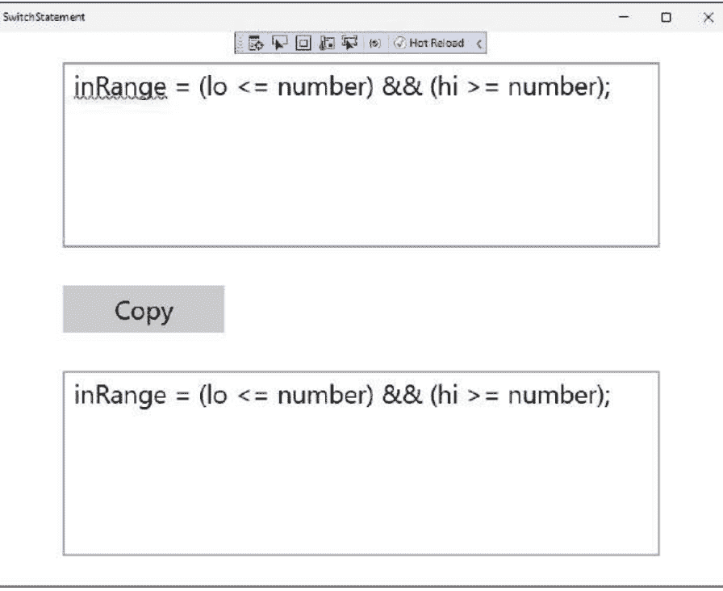

6. 返回 Visual Studio 2022 并停止调试。

7. 在代码和文本编辑器中显示 `MainPage.xaml.cs` 的代码并找到 `copyOne` 方法。它目前看起来如下：

点击此处查看代码图像

```
private void copyOne(char current)
{
    switch (current)
```

```
{
  default:
    target.Text += current;
    break;
}
```

`copyOne` 方法将作为输入参数指定的字符复制到下方框显示的文本的末尾。目前，`copyOne` 包含一个带有默认操作的 `switch` 语句。在接下来的几步中，你将修改此 `switch` 语句，将 XML 中有特殊字符转换为它们的 XML 映射。例如，`<` 字符将转换为字符串 `&lt;`

8. 在 `switch` 语句左大括号之后、`default` 标签之前，添加**加粗**显示的以下语句：

点击此处查看代码图像

```
switch (current)
{
  case '<':
    target.Text += "&lt;"
    break;
    default:
    target.Text += current;
    break;
}
```

如果正在复制的字符是左角括号（`<`），则前面的代码会将字符串 `&lt;` 追加到替换其输出的文本中。

9. 在 `switch` 语句中，在你刚刚添加的 `break` 语句之后、`default` 标签之前，添加**加粗**显示的以下情况：

点击此处查看代码图像

```
case '<':
  target.Text += "&lt;"
  break;
case '>':
  target.Text += "&gt;"
  break;
case '&':
  target.Text += "&amp;";
  break;
case '\\':
```

```
target.Text += "&#34;";
break;
case '\' :
  target.Text += "&#39;";
break;
default:
  target.Text += current;
break;
```

> 单引号（`'`）和双引号（`"`）在 C# 中有特殊含义。它们用于界定字符常量和字符串常量。最后两个 `case` 标签中的反斜杠（`\`）是一个转义字符，它会导致 C# 编译器将这些字符视为字面量而不是分隔符。

10. 在调试（Debug）菜单上，选择启动调试（Start Debugging）。

11. 在上方框中输入以下文本：

点击此处查看代码图像

`inRange = (lo <= number) && (hi >= number);`

12. 选择复制（Copy）。

该语句被复制到下方框中。这次，每个字符都经过了 `switch` 语句中实现的 XML 映射。目标框显示以下文本：

点击此处查看代码图像

`inRange = (lo &lt; number) &amp; (hi &gt; number);`

13. 使用其他字符串进行实验，并验证所有特殊字符（`<`、`>`、`&` 和 `'`）都已正确处理。

14. 返回 Visual Studio 并停止调试。

# 使用模式匹配的 switch 表达式

`switch` 语句是一种强大的结构，但有时可能有些冗长且难以理解。`switch` 表达式（`switch expression`）与 `switch` 语句类似，不同在于它产生一个值。这听起来是一个微小的区别，但它比听起来有用得多。

C# 表达式的模式匹配能力可以使 `switch` 表达式比 `switch` 语句成为更符合逻辑的 choice。示例包括复杂的验证规则和数据的分类。假设你想确定变量测量值落在哪个值范围内。可能的范围可能是负数（`<0`）、零、单位数（1 到 9 之间）、双位数（10 到 99 之间）和大型（100 或更多）。以下代码显示了如何进行此类分类。结果存储在 `range` 变量中：

点击查看代码图像

```
int measurement = ...;

string range = measurement switch {
    < 0 => "negative",
    0 => "zero",
    >= 1 and <= 9 => "singledigit",
    >= 10 and < 99 => "doubledigit",
    >= 100 => "large"
}
```

需要注意的语法点：

- `switch` 关键字充运算符。示例中的 `measurement` 变量和模式匹配块（大括号之间的代码）是操作数。

- 模式匹配块中的每行由一个模式和一个作为结果求值的表达式组成。字符序列 `=>` 分隔这两个元素。

- 每个模式/表达式对用逗号分隔。没有 `break` 语句。

- 模式遵循与之前描述的 `if` 语句中模式相同的语法。

- 如果模式匹配 `switch` 运算符的第一个操作数，则求值 `=>` 右侧的表达式。

- `switch` 表达式必须捕获第一个操作数中可以找到每一个可能的值。在运行时，如果操作数没有匹配的模式，你将收到错误消息“The switch expression does not handle all possible values of its input type.”下划线（`_`）匹配之前未处理的所有情况。

# 使用 switch 表达式

1. 返回你编写过的 `switch` 语句。

2. 找到 `copyOne` 方法。它目前看起来如下：

```csharp
private void copyOne(char current)
{
    switch (current)
    {
        case '<':
            target.Text += "&lt;";
            break;
        case '>':
            target.Text += "&gt;";
            break;
        case '&':
            target.Text += "&amp;";
            break;
        case '\"':
            target.Text += "&#34;";
            break;
        default:
            target.Text += current;
            break;
    }
}
```

3. 删除整个 `switch` 语句并将其替换为**加粗**所示 `switch` 表达式：

```csharp
private void copyOne(char current)
{
    target.Text += current switch
    {
        '<' => "&lt;";
        '>' => "&gt;";
        '&' => "&amp;";
        '\"' => "&#34;";
        '\'' => "&#39;";
        _ => current
    };
}
```

此表达式通过模式匹配来确定追加到输出的值。注意最后的捕获情况使用了下划线（`_`）。此表达式比 `switch` 语句更简洁易读。

4. 在调试（Debug）菜单上，选择启动调试（Start Debugging）。

5. 在上方框中输入以下内容：

```
inRange = (lo <= number) && (hi >= number);
```

6. 选择复制。然后验证程序功能与之前相同。

7. 返回 Visual Studio 并停止调试。

# 总结

在本章中，你学习了布尔表达式和变量。你看到了如何将布尔表达式与 `if` 和 `switch` 语句来实现程序决策，并使用布尔运算符组合布尔表达式。

- 如果你想继续下一章，请保持 Visual Studio 2022 运行并转到第五章“使用复合赋值和迭代语句”。

## 快速参考

| | |

| --- | --- |

| 确定两个值是否相等 | 使用 `==` 运算符或 `!=` 运算符。例如：`answer == 42` |

| 比较两个表达式的值 | 使用 `<`、`<=` 或 `>=` 运算符。例如：`age >= 21` |

| 声明布尔变量 | 使用 `bool` 关键字作为变量类型。例如：`bool inRange;` |


# 使用复合赋值和迭代语句

完成本章后，你将能够：

- 使用复合赋值运算符更新变量的值。
- 编写 `while`、`for` 和 `do` 迭代语句。
- 逐步执行 `do` 语句并观察变量的值。

第 4 章“使用决策语句”演示了如何使用 `if` 和 `switch` 结构选择性地运行语句。在本章中，你将看到如何使用各种迭代（或循环）语句来重复运行一个或多个语句。

当你编写迭代语句时，通常需要控制执行的次数。你可以通过使用变量、在每次迭代时更新该值，并在变量达到特定值时停止过程来实现。为了帮助简化这一过程，你将开始学习在这些情况下应该用来更新变量值的特殊赋值运算符。

## 使用复合赋值运算符

你已经见过如何使用算术运算符来创建新变量。例如，以下语句使用加法运算符（`+`）向控制台显示比变量 `answer` 大 42 的值：

```csharp
Console.WriteLine(answer + 42);
```

你还见过了如何使用赋值语句来改变变量的值。以下语句使用赋值运算符（`=`）将 `answer` 的值改为 42：

```csharp
answer = 42;
```

如果你想给变量的值加上 42，可以将赋值运算符和加法运算符结合。例如，以下语句给 `answer` 加上 42。在该语句运行后，`answer` 的值比之前增加了 42：

```csharp
answer = answer + 42;
```

虽然该语句有效，但你可能永远不会看到经验丰富的程序员这样写代码。给变量增加值是非常常见的操作，因此 C# 提供了一种使用 `+=` 运算符以简写方式执行此任务的方法。例如，要给 `answer` 加 42，你可以编写以下语句：

```csharp
answer += 42;
```

你可以使用这种符号将任何算术运算符与赋值运算符结合，如下表所示。这些运算符统称为复合赋值运算符。

| 不要这样写 | 这样写 |
| :--- | :--- |
| `variable = variable * number;` | `variable *= number;` |
| `variable = variable / number;` | `variable /= number;` |
| `variable = variable % number;` | `variable %= number;` |
| `variable = variable + number;` | `variable += number;` |
| `variable = variable - number;` | `variable -= number;` |

> 提示：复合赋值运算符与简单赋值运算符（`=`）具有相同的优先级和右结合性。

`+=` 运算符也适用于字符串；它将一个字符串附加到另一个字符串的末尾。例如，以下代码在控制台上显示“Hello John”：

```csharp
string name = "John";
string greeting = "Hello ";
greeting += name;
Console.WriteLine(greeting);
```

你不能在字符串上使用任何其他复合赋值运算符。

> 提示：当将变量加减 1 时，请使用递增（`++`）和递减（`--`）运算符代替复合赋值运算符。例如，将 `count += 1;` 替换为 `count++;`。

## 编写 `while` 语句

你使用 `while` 语句在条件为真时重复运行某个语句。`while` 语句的语法如下：

```csharp
while ( booleanExpression )
statement
```

评估布尔表达式（必须包含在括号内）。如果求值结果为真，则执行语句，并再次评估布尔表达式。如果表达式求值结果仍为真，则重复语句，并再次评估布尔表达式。此过程一直持续到布尔表达式求值为假，此时 `while` 语句退出。随后继续执行 `while` 语句之后的第一个语句。

`while` 语句与 `if` 语句在语法上有以下相似之处（事实上，除了关键字外语法完全相同）：

- 表达式必须是一个布尔表达式。
- 布尔表达式必须写在括号内。
- 如果布尔表达式在第一次评估时为假，则不执行语句。
- 如果你想在 `while` 语句的控制下执行两个或多个语句，必须使用大括号将这些语句分组在一个块中。

以下是一个向控制台写入 0 到 9 值的 `while` 语句。注意，一旦变量达到 10，`while` 语句就会退出。

```csharp
int i = 0;
while (i < 10)
{
    Console.WriteLine(i);
    i++;
}
```

初学者一个常见的错误是忘记包含一个能让布尔表达式最终求值为假的语句，导致如下所示的死循环：

```csharp
int i = 0;
while (i < 10)
{
    Console.WriteLine(i);
}
```

然而，`openFileClick` 方法中的最后两个语句非常重要。它们如下：

```csharp
TextReader reader = new
StreamReader(inputStream.AsStreamReader());
displayData(reader);
```

第一条语句声明了一个名为 `reader` 的 `TextReader` 变量。`TextReader` 是 .NET 库提供的一个类。你可以用它从文件等源读取字符流。它位于 `System.IO` 命名空间。该方法将用户在 `FilePicker` 对象中指定的文件提供给 `TextReader` 对象，然后就可以从文件中读取数据。

最后一条语句调用了 `displayData` 方法，并将 `reader` 作为参数传递给该方法。`displayData` 方法使用 `reader` 对象读取数据并显示在屏幕上（一旦你编写了完成此任务的代码，它就会这样做）。

- 检查 `displayData` 方法。它目前如下：

```csharp
private void displayData(TextReader reader)
{
  // TODO: 在此处添加 while 循环
}
```

你可以看到除了注释外，此方法目前是空的。你需要在这里添加获取并显示数据的代码。

- 将 `// TODO: add while loop here` 注释替换为以下语句：

`source.Text = "";`

`source` 变量引用表单上的大框。将其 `Text` 属性设置为空字符串（`""`），可以清除此框中当前显示的任何文本。

- 在之前添加到 `displayData` 方法的上一行之后添加以下语句：

`string line = reader.ReadLine();`

这条语句声明了一个名为 `line` 的字符串变量，并调用 `reader.ReadLine` 方法将文件的第一行读取到该变量中。该方法返回文件的下一行文本，如果没有更多可读的行，则返回一个名为 `null` 的特殊值。

11. 在你刚刚输入的代码之后，向 `displayData` 方法添加以下语句：

```csharp
while (line is not null)
{
    source.Text += line + '\n';
    line = reader.ReadLine();
}
```

这是一个 `while` 循环，它每次迭代一次文件，直到没有更多可用行。

`while` 循环开头的布尔表达式检查 `line` 变量中的值。如果它不为 `null`，循环体会将当前行文本附加到 `source` 框的 `Text` 属性中，并带有换行符（`'\n'`）。（`TextReader` 对象的 `ReadLine` 方法在读取每行时会移除换行符，因此代码需要将其重新添加）。`while` 循环在执行下一次迭代之前会读取下一行文本。当文件中没有更多文本且 `ReadLine` 方法返回 `null` 值时，`while` 循环结束。

> 注意：你也可以使用 `!= null` 来测试空值。然而，`is not` 表达式更具可读性。

12. 在 `while` 循环结束的大括号之后输入以下语句：

```csharp
reader.Dispose();
```

此语句释放与文件相关的资源并将其关闭。这是一种良好的习惯，因为它允许其他应用程序使用该文件，并释放访问文件时使用的任何内存和其他资源。

13. 在“Debug”（调试）菜单上，选择“Start Debugging”（启动调试）。

14. 当表单出现时，选择“Open File”（打开文件）。

15. 在“Open”（打开）对话框中，移动到文档文件夹中的`\Microsoft Press\VCSBS\Chapter 5\WhileStatement\WhileStatement`文件夹，选择`MainPage.xaml.cs`文件，然后选择“Open”（打开）。

> 注意：尝试打开不包含文本的文件。如果你尝试打开可执行程序或图形文件，应用程序将仅显示文件中二进制信息的文本表示。如果文件很大，可能会导致应用程序挂起，你需要强制终止它。

这一次，选中文件的内容出现在框中；你应该认出你一直在编辑的代码。下面的图像显示了应用程序的运行：

```csharp
using System;
using System.Collections.Generic;
using System.IO;
using System.Linq;
using System.Runtime.InteropServices.WindowsRuntime
using Windows.Foundation;
using Windows.Foundation.Collections;
using Windows.Storage;
using Windows.Storage.Pickers;
```

16. 滚动框中的文本并找到 `displayData` 方法。验证此方法包含你刚刚添加的代码。

17. 返回 Visual Studio 并停止调试。

## 编写 `for` 语句

在 C# 中，大多数 `while` 语句具有以下通用结构：

```csharp
初始化
while (Boolean expression)
{
    语句
    更新控制变量
}
```

C# 中的 `for` 语句通过结合初始化、布尔表达式和更新控制变量的代码，提供了这种构造结构的一个更正式的版本。你会发现 `for` 语句非常有用，因为在 `for` 语句中，很难不小心遗漏初始化或更新控制变量的代码，所以你不太可能写出无限循环的代码。以下是 `for` 语句的语法：

```csharp
for (initialization; Boolean expression; update control variable)
statement
```

构成 `for` 结构主体的语句可以是单行代码，也可以是括在大括号中的代码块。

### 理解 `for` 范围

你可能注意到你可以在 `for` 语句的初始化部分声明变量。变量的作用域仅限于 `for` 语句的主体，并在 `for` 语句结束时消失。这个规则有两个重要的后果：首先，在 `for` 语句结束后你无法使用该变量，因为它不再作用域内。这是一个示例：

```csharp
for (int i = 0; i < 10; i++)
{
    ...
}
Console.WriteLine(i); // 编译错误
```

其次，你可以编写两个或多个重用相同变量名的 `for` 语句，因为每个变量都在不同的作用域内，如下所示：

```csharp
for (int i = 0; i < 10; i++) { ... } 
for (int i = 0; i < 20; i += 2) // 正确
```

`while` 和 `for` 语句会在循环开始时测试它们的布尔表达式。这意味着如果表达式在第一次测试时结果为假，循环体就不会执行（即使一次也不执行）。`do` 语句则不同：它的布尔表达式在每次迭代后求值，因此循环体至少会执行一次。

`do` 语句的语法如下（不要忘记最后的分号）：

```csharp
do
  statement
while (booleanExpression);
```

如果循环体包含多个语句，你必须使用语句块（block）（如果不这样做，编译器将报告语法错误）。这里有一个向控制台写入 0 到 9 数值的示例，这次是使用 `do` 语句构建的：

```csharp
int i = 0;
do
{
  Console.WriteLine(i);
  i++;
} while (i < 10);
```

## `break` 和 `continue` 语句

在第 4 章中，你学习了如何使用 `break` 语句跳出 `switch` 语句。你也可以使用 `break` 语句跳出迭代语句（循环）的体。当你跳出循环时，循环会立即退出，并从循环后的第一个语句继续执行。循环的更新部分或继续条件都不会重新运行。

相比之下，`continue` 语句会导致程序立即执行循环的下一次迭代（在重新评估布尔表达式之后）。这里是向控制台写入 0 到 9 数值的另一个版本，这次使用了 `break` 和 `continue` 语句：

```csharp
int i = 0;
while (true)
{
  Console.WriteLine(i);
  i++;
  if (i < 10)
    continue;
  else
    break;
}
```

这段代码非常糟糕。许多编程准则建议谨慎地使用 `continue`，或者根本不使用，因为它通常与难以理解的代码相关联。`continue` 的行为也相当微妙。例如，如果你在 `for` 语句内部执行 `continue` 语句，更新部分会在执行循环下一次迭代之前运行。

在接下来的练习中，你将编写一个 `do` 语句，将正整数转换为其八进制表示的字符串。该程序基于以下算法，该算法遵循一个著名的数学步骤：

```csharp
将十进制数存储在变量 dec 中
执行以下操作
    将 dec 除以 8 并存储余数
    将 dec 设置为上一步的商
while dec 不等于 0
按反序组合每次计算存储的余数值
```

例如，假设你想将十进制数 999 转换为八进制。你执行以下步骤：

1. 999 除以 8。商是 124，余数是 7。
2. 124 除以 8。商是 15，余数是 4。
3. 15 除以 8。商是 1，余数是 7。
4. 1 除以 8。商是 0，余数是 1。
5. 按反序组合每一步计算出的余数值。结果是 1747。这就是十进制值 999 的八进制表示。

## 编写 `do` 语句

1. 使用 Visual Studio 2022，打开 `DoStatement` 解决方案，它位于“文档”文件夹中的`\Microsoft Press\VCSBS\Chapter 5\DoStatement`文件夹下。

2. 在设计视图窗口显示 `MainPage.xaml` 表单。

表单包含一个名为 `number` 的框，你可以在其中输入十进制数。当你选择 `Show Steps` 按钮时，会生成输入数字的八进制表示。右侧名为 `steps` 的框显示计算的每个阶段的结果。

3. 在代码和文本编辑器窗口中显示 `MainPage.xaml` 的代码并找到 `showStepsClick` 方法。

该方法在用户在表单上选择 `Show Steps` 按钮时运行。目前，该方法是空的。

4. 在 `showStepsClick` 方法中添加以下粗体显示的语句：

```csharp
private void showStepsClick(object sender, RoutedEventArgs e)
{
    int amount = int.Parse(number.Text);
    steps.Text = "";
    string current = "";
}
```


第一条语句使用`int`类型的`Parse`方法将`number`框`Text`属性中的字符串值转换并存储在局部变量`amount`中。

第二条语句通过将`Text`属性设置为空字符串来清除下方框显示的文本。

第三条语句声明了一个名为`current`的字符串变量并将其初始化为空字符串。你将使用此字符串存储循环每次迭代中生成的数字，用于将十进制数转换为八进制表示。

- 5. 在`showStepsClick`方法中添加以下`do`语句（粗体显示）：

[点击此处查看代码图片]

```
private void showStepsClick(object sender, RoutedEventArgs e)
{
    int amount = int.Parse(number.Text);
    steps.Text = "";
    string current = "";

do{
        int nextDigit = amount % 8;
        amount /= 8;
        int digitCode = '0' + nextDigit;
        char digit = Convert.ToChar(digitCode);
        current = digit + current;
        steps.Text += current + "\n";
    } while (amount != 0);
}
```

总结一下，`do`循环中的前四个语句确定了对应于输入数字的最低位（最右侧）八进制数字。下一个任务是将该数字附加到输出字符串中。

最后，循环末尾的`while`子句被评估。由于`amount`的值尚未为 0，循环将执行下一次迭代。

等待，OCR（光学识别）部分非常乱码。让我重新重构逻辑：

该语句声明了一个名为`digit`的字符变量并将其初始化为`ToChar(digitCode)`方法调用的结果。`ToChar`方法接收一个整数并返回相应的字符。在 C# 中，你可以将字符视为整数并对其进行算术运算，但当你这样做时，C# 使用字符的代码。`'0' + nextDigit`实际上的结果介于 0 和 7 之间，对应于八进制数字。

实际上，`do`循环中的前四个语句确定了对应于用户输入数字的最低位（最右侧）八进制数字。下一个任务是将该数字附加到输出字符串中。

该语句向`Steps`框添加包含了八进制表示数字的字符串。它还附加了换行符，以便转换的每个阶段在框中单独显示。

最后，循环末尾的`while`子句被评估。由于`amount`的值尚未为 0，循环将执行下一次迭代。在本章的最后一个练习中，你将使用 Visual Studio 2022 调试器单步执行`do`语句来帮助你理解它的工作原理。

## 单步执行 do 语句

1. 在显示`MainPage.xaml.cs`文件的代码和文本编辑器中，将光标移动到`showStepsClick`方法的第一语句：

点击此处查看代码图像

```
int amount = int.Parse(number.Text);
```

2. 在第一语句的任何地方点击右键，然后选择“运行到光标处”（Run To Cursor）。

3. 当表单出现时，在左侧的数字（Number）框中输入 999，然后选择“显示步骤”（Show Steps）。

程序停止，你进入了 Visual Studio 2022 调试模式。代码和文本编辑器窗口左边距的黄色箭头以及代码上的黄色高亮表示当前语句。

4. 在代码和文本编辑器窗口下窗口中，选择“本地变量”（Locals）选项卡，如下图所示：

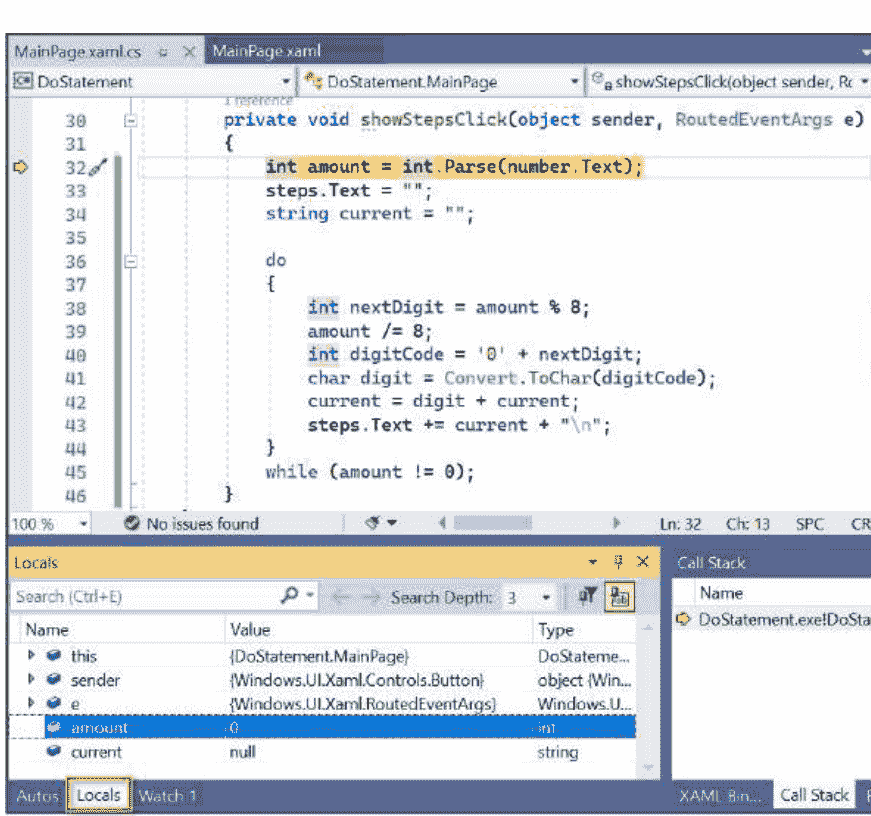

本地变量窗口显示当前方法中局部变量的名称、值和类型，包括`amount`局部变量。注意`amount`的当前值为 0。

5. 如果调试工具栏不可见，请显示它。（在“视图”菜单上，鼠标悬停在“工具栏”，然后选择“调试”。）

> 注意

> 调试工具栏上的命令也可以在菜单栏显示的“调试”菜单可用。

6. 在调试工具栏上，选择“单步进入”（Step Into）按钮。

调试器执行以下语句：

点击此处查看代码图像

```
int amount = int.Parse(number.Text);
```

本地变量窗口中`amount`的值变为 999，黄色箭头移动到下一语句。

- 7. 再次选择“单步进入”。

调试器执行此语句：

```
steps.Text = "";
```

此语句不会影响本地变量窗口，因为`steps`是表单上的控件，而不是局部变量。黄色箭头移动到下一语句。

- 8. 选择“单步进入”。

调试器执行此处显示的语句：

```
string current = "";
```

黄色箭头移动到`do`循环开始处的左括号。`do`循环包含它自己的三个局部变量：`nextDigit`、`digitCode`和`digit`。注意这些局部变量现在出现在本地变量窗口中。所有三个变量的值最初都被设置为 0。

- 9. 选择“单步进入”。

黄色箭头移动到`do`循环内部的第一语句。

- 10. 选择“单步进入”。

调试器执行以下语句：

```
int nextDigit = amount % 8;
```

本地变量窗口中`nextDigit`的值变为 7。这是 999 除以 8 后的余数。

- 11. 选择“单步进入”。

调试器执行此语句：

```
amount /= 8;
```

本地变量窗口中`amount`的值变为 124。

- 12. 选择“单步进入”。

调试器执行语句：

点击此处查看代码图像

```
int digitCode = '0' + nextDigit;
```

本地变量窗口中`digitCode`的值变为 55。这是字符 '7' 的字符编码（48 + 7）。

- 13. 选择“单步进入”。

调试器继续执行此语句：

点击此处查看代码图像

```
char digit = Convert.ToChar(digitCode);
```

本地变量窗口中`digit`的值变为 '7'，本地变量窗口同时使用底层数值（在此例下为 55）和字符表示（'7'）显示 char 值。

注意在本地变量窗口中，当前变量的值仍为 ""

- 14. 选择“单步进入”。

调试器执行以下语句：

```
current = current + digit;
```

本地变量窗口中`current`的值变为 '7'。

- 15. 选择“单步进入”。

调试器执行此处显示的语句：

```
steps.Text += current + "\n";
```

此语句在步骤框中显示文本 7，随后是一个换行符，导致随后的输出显示在框的下一行。（表单目前隐藏在 Visual Studio 之后，所以你无法看到它。）光标移动到`do`循环结束处的右括号。

- 16. 选择“单步进入”。

黄色箭头移动到`while`语句，以评估`do`循环是否已完成或是否应该继续迭代。

- 17. 选择“单步进入”。

调试器执行此语句：

```
while (amount != 0);
```

`amount`的值为 124，表达式`124 != 0`结果为真，因此`do`循环执行另一次迭代。黄色箭头跳回`do`循环开始处的左括号。

- 18. 选择“单步进入”。

黄色箭头再次移动到`do`循环内部的第一语句。

- 19. 重复选择“单步进入”，逐步执行`do`循环的下三次迭代，并观察本地变量窗口中变量的变化。

- 20. 在循环第四次迭代结束时，`amount`的值为 0，`current`的值为 "1747"。黄色箭头位于`do`循环结束处的`while`条件处：

```
while (amount != 0);
```

由于`amount`的值现在为 0，表达式`amount != 0`结果为假，`do`循环终止。

- 21. 选择“单步进入”。

黄色箭头移动到`while`语句。

- 22. 选择“单步进入”。

调试器执行以下语句：

```
while (amount != 0);
```

`amount`的值为 124，表达式`124 != 0`结果为真，因此`do`循环执行另一次迭代。黄色箭头跳回`do`循环开始处的左括号。

- 23. 选择“单步进入”。

调试器执行此语句：

```
while (amount != 0);
```

`amount`的值为 124，表达式`124 != 0`结果为真，因此`do`循环执行另一次迭代。黄色箭头跳回`do`循环开始处的左括号。

# 总结

在本章中，你学习了如何使用`while`、`for`和`do`语句重复运行代码。你了解了如何使用复合运算符来更新变量。

## 快速参考

| 目的 | 操作 |

| --- | --- |

| 给变量增加一个值 | 使用复合加法运算符。例如：`variable += amount;` |

| 从变量中减去一个值 | 使用复合减法运算符。例如：`variable -= amount;` |

| 当条件为真时执行一次或多次 | 使用`while`语句。例如：`int i = 0; while (i < 10) { Console.WriteLine(i); i++; }` |

| 执行一次或多次 | 使用`for`语句。例如：`for (int i = 0; i < 10; i++) { Console.WriteLine(i); }` |

| 重复执行语句多执行一次 | 使用`do`语句。例如：`int i = 0; do { Console.WriteLine(i); i++; } while (i < 10);` |

# 第6 章

# 管理错误和异常

完成本章后，你将能够：

- 使用`try`、`catch`和`finally`语句处理异常。

- 使用`checked`和`unchecked`关键字控制整数溢出。

- 使用`throw`关键字从你自己的方法抛出异常。

- 使用`finally`块确保即使在发生异常后代码始终运行。

生活中的事实是事情总会发生。轮胎会爆胎，电池会耗尽，螺丝刀永远不在你离开过的地方，应用程序的用户行为是不可预测的。在计算机世界中，硬盘会损坏，与你的程序在同一台计算机上运行的其他应用程序失控并占用所有可用内存，无线网络连接会在最尴尬的时刻消失。即使是附近的闪电等自然现象，如果导致停电或网络故障，也会产生影响。程序运行的几乎任何阶段都可能发生错误，许多错误实际上并不是你应用程序的错。那么，你如何检测它们并尝试恢复呢？

在第一部分的最后一个章节中，你将学习 C# 如何使用异常（exceptions）来指示错误的发生，以及如何使用`try`、`catch`和`finally`语句来捕并处理这些异常所代表的错误。在本章结束时，你将在 C# 的所有基本元素上打下基础，并在第二部分在此基础上继续构建。

## 测试代码并捕获异常

要确保一段代码始终按预期运行是非常困难的。失败可能由许多原因引起，其中许多原因是你作为程序员无法控制的。你编写的任何应用程序都必须能够检测失败并优雅地处理它们，要么采取适当的纠正措施，或者在无法做到的情况下，以最清晰的方式向用户报告失败原因。

错误可能在任何时候发生。使用传统的技术在每条语句周围手动添加错误检测代码是非常耗时的，而且本身也容易出错。如果每条语句都需要扭曲的错误处理逻辑来管理每个阶段可能发生的任何错误，你可能会忽略应用程序的主流程。

幸运的是，C# 允许通过异常和异常处理程序轻松地将错误处理代码与实现程序主逻辑的代码分离。。要编写感知异常的程序，你需要做两件事：

- 在`try`块中编写代码。`try`是一个 C# 关键字。当代码运行时，它会尝试执行`try`块中的所有语句，如果没有一个语句产生异常，它们将一个接一个运行直到完成。如果发生错误，异常将跳出`try`块，进入另一段旨在捕获并处理异常的代码：即`catch`处理程序（catch handler）。

- 在`try`块之后紧跟着编写一个或多个`catch`处理程序（`catch`是另一个 C# 关键字），以处理任何可能的错误情况。`catch`处理程序旨在捕获并处理特定类型的异常。你可以在`try`块之后放置多个`catch`处理程序，每个程序都设计用于捕获和处理特定的异常。这允许你为`try`块中可能出现的不同错误提供不同的处理器。如果`try`块内的任何语句导致了错误，运行时就会抛出一个异常。然后，运行时会检查`try`块之后的`catch`处理程序，并将控制直接转移到第一个匹配的处理器。

这是一个`try`块的示例，其中包含的代码尝试将用户在表单某些框中输入的字符串转换为整数值。然后代码调用一个方法计算一个值，并将结果写入另一个框中。将字符串转换为整数要求该字符串包含有效数字，而不是某些任意字符。如果字符串包含无效字符，`int.Parse`方法将抛出`FormatException`，执行将转移到相应的`catch`处理程序。当`catch`处理程序完成后，程序将继续执行处理器之后的第一条语句。（如果没有与异常对应的处理器，则该异常被认为是“未处理的”；这种情况将在稍后描述。）

点击此处查看代码图像

```csharp
try {
  int leftHandSide = int.Parse(lhsOperand.Text);
  int rightHandSide = int.Parse(rhsOperand.Text);
  int answer = doCalculation(leftHandSide, rightHandSide);
  result.Text = answer.ToString();
}
catch (FormatException fEx)
{
  // 处理异常
}
```

`catch`处理程序使用类似于方法参数的语法来指定要捕获的异常。在前面的示例中，当抛出`FormatException`时，变量`fEx`将填充一个包含异常详细信息的对象。

`FormatException`类型具有几个属性，你可以检查这些属性以确定异常的准确原因。这些属性中的许多是所有异常通用的。例如，`Message`属性包含导致异常的错误的文本描述。你可以在处理异常时使用这些信息，例如将详细信息记录在日志文件中，或向用户显示有意义的消息并要求用户重试。

## 未处理的异常

如果`try`块抛出异常且没有对应的`catch`处理程序，会发生什么？在之前的示例中，`lhsOperand`框可能包含有效整数的字符串表示，但该整数超出了 C# 支持的有效整数范围（例如，“2147483648”）。

在这种情况下，`int.Parse`语句将抛出`OverflowException`，该异常将不会被`FormatException`处理器捕获。如果发生这种情况且`try`块是某个方法的一部分，则该方法将立即退出，执行返回到调用方法。如果调用方法使用了`try`块，运行时将尝试定位并执行针对该`try`块的`catch`处理程序。如果调用方法没有使用`try`块或没有`catch`处理程序，则调用方法将立即退出，执行返回到其调用者，并重复该过程。如果最终找到了匹配的`catch`处理程序，则该处理器运行，执行继续捕获方法中`catch`处理程序之后的第一条语句。

> **重要** 注意：在捕获异常后，执行将在包含捕获该异常块的方法中继续。如果异常发生在包含`catch`处理程序以外的方法中，控制不会返回到引发异常的方法。

如果在回溯整个调用方法列表后，运行时仍然无法找到匹配的`catch`处理程序，程序将由于未处理的异常终止。

你可以轻松地检查由应用程序生成的异常。如果你在 Microsoft Visual Studio 2022 的调试模式下运行应用程序（即在“调试”菜单中，选择“启动调试”来运行应用程序）并且发生了异常，将会出现与此处所示类似的对话框，应用程序将暂停，帮助你确定异常的原因。

## MainPage

杂项文件

```csharp
int rhs = int.Parse(rhsOperand.Text);
```

```csharp
int rhs = lhs * rhs;
```

```csharp
outcome = 0;
```

异常：'除以零'

| 名称 | 值 | 类型 |

|---|---|---|

| Exception | '除以零' | System.DivideBy |

| rhs | (MainPage) | int |

| rhs | 0 | int |

| outcome | 0 | int |

## 使用多个 catch 处理程序

之前的讨论强调了不同错误如何抛出不同类型的异常。为了应对这些情况，你可以连续提供多个`catch`处理程序，如下所示

点击此处查看代码图像

```csharp
try {
  int leftHandSide = int.Parse(lhsOperand.Text);
  int rightHandSide = int.Parse(rhsOperand.Text);
  int answer = doCalculation(leftHandSide, rightHandSide);
  result.Text = answer.ToString();
}
catch (FormatException fEx)
{
  //..
}
catch (OverflowException oEx)
{
  //...
}
```

如果`try`块中的代码抛出`FormatException`异常，则`FormatException` catch 块将运行。如果代码抛出`OverflowException`异常，则`OverflowException` catch 块运行。


> 注意：如果 `FormatException` catch 块中的代码生成 `OverflowException` 异常，它不会导致相邻的 `OverflowException` catch 运行。相反，异常将传播到调用此代码的方法，正如本节前面所述。

## 捕获多个异常

C# 和 .NET 提供的异常捕获机制非常全面。.NET 库定义了许多异常类型，你编写的任何程序捕获其中的大部分异常。

你不太可能为代码可能抛出的每种异常编写 `catch` 处理程序。记住，你的应用程序必须能够处理你在编写它时从未预料到的异常！那么，你如何确保你的程序捕获并处理所有可能的异常呢？

这个问题的答案在于不同异常之间的关系方式。异常被组织成称为继承层次结构的家族。（你将在第 12 章“使用继承”中学习继承。）

异常之异常。如果你捕获了 `Exception`，则句处理程序将捕获可能发生的任何异常。

> 注意：`Exception` 家族包含了各种异常，其中许多异常是供 .NET 的各个部分使用的。虽然其中某些异常有些晦涩，但了解如何捕获它们仍然很有用。

下一个示例展示了如何捕获所有可能的异常：

```
try {
  int leftHandSide = int.Parse(lhsOperand.Text);
  int rightHandSide = int.Parse(rhsOperand.Text);
  int answer = doCalculation(leftHandSide, rightHandSide);
  result.Text = answer.ToString();
} catch (Exception ex) // 这是一个通用 catch 处理器
{
  //...
}
```

> 注意：如果你想捕获 `Exception`，实际上可以从 `catch` 处理器中省略它的名称，因为它是默认异常：

```
catch {
  // ...
}
```

然而，这并不建议这样做。传递给 `catch` 处理器的异常对象可以包含有关该异常的有用信息，而在使用这种版本的 `catch` 结构时，无法轻松访问这些信息。

在此时，你应该问的最后一个问题是：如果同一个异常匹配了 `try` 块末部的多个 `catch` 处理器会发生什么？例如，如果你在两个不同的处理器中捕获了 `FormatException` 和 `Exception`，哪一个会运行？（或者两个都会执行吗？）

当异常发生时，运行时将使用第一个匹配该异常的处理器，忽略其他处理器。因此，如果你将 `Exception` 的处理器放在 `FormatException` 处理器之前，则 `FormatException` 处理器将永远不会运行。因此，你应该在 `try` 块之后，将更具体的 `catch` 处理器放在通用 `catch` 处理器上方。如果没有特定的 `catch` 处理器匹配该异常，则通用 `catch` 处理器将胜出。

# 过滤异常

你可以对与 `catch` 处理器匹配的异常进行过滤，以确保只有在满足额外条件时才触发 `catch` 处理器。这些条件以 `when` 关键字前缀的布尔表达式的形式存在。下面的示例说明了语法：

```
bool catchErrors = ...;
try{
  ...
} catch (Exception ex) when (catchErrors == true){
  // 当 catchErrors 变量为 true 时处理异常
}
```

此示例根据 `catchErrors` 布尔变量的值捕获所有异常（`Exception` 类型）。如果该变量为 `false`，则不会发生异常，并将使用应用程序的默认异常处理机制。如果 `catchErrors` 为 `true`，则运行 `catch` 块中的代码处理异常。

在接下来的练习中，你将看到应用程序抛出未处理异常时发生的情况，并将编写一个 `try` 块来捕获并处理异常。

> 要观察应用程序如何报告未处理的异常

1. 启动 Visual Studio 2022（如果尚未运行）。

2. 打开 `MathOperators` 解决方案，它位于文档文件夹下的 `\Microsoft Press\VCSBS\Chapter 6\MathOperators` 文件夹中。

这是第 2 章“使用变量、运算符和表达式”中的程序版本，它演示了不同的算术运算符。

3. 在调试（Debug）菜单中，选择“转调试调试”（Start Without Debugging）。

> 注意：对于此练习，请确保你实际上是在没有调试的情况下运行应用程序。

表单出现。你现在将在左操作数（Left Operand）框中输入一些会导致异常的文本。此操作将演示该程序当前版本缺乏健壮性。

4. 在左操作数框中输入 `John`，在右操作数（Right Operand）框中输入 `2`。

5. 选择 `+` 加法按钮，然后选择计算（Calculate）。

此输入触发了 Windows 默认异常处理。应用程序直接终止，你返回到桌面，而没有任何关于何错误的说明！

现在你已经看到了应用程序在发生未处理异常时的行为，下一步是通过处理无效输入并防止未处理异常的产生，使应用程序变得更加健壮。

# 编写 try/catch 语句块

1. 返回 Visual Studio 2022。

2. 在调试（Debug）菜单中，选择“启动调试”（Start Debugging）。

> 注意：这次，请确保你是在调试模式下运行应用程序。

3. 当表单出现时，在左操作数框中输入 `John`，在右操作数框中输入 `2`。

4. 选择 `+` 加法按钮，然后选择计算。

此输入应该导致与上一个练习中相同的异常，但现在你正在调试模式运行，所以 Visual Studio 捕获了异常并报告了它。

Visual Studio 显示你的代码并突出显示导致异常的语句。它还显示了一个描述异常的对话框，在这种情况下是“输入字符串的格式不正确”。

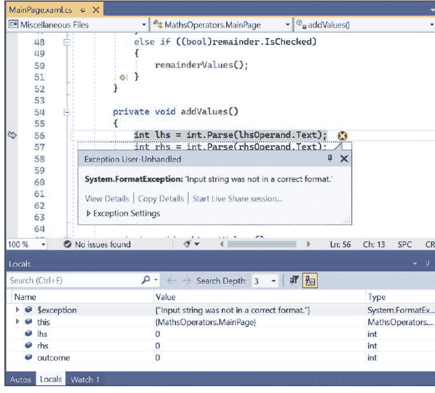

你可以看到，在 `addValues` 方法内部调用 `int.Parse` 时抛出了 `FormatException`。问题是该方法无法将文本 `John` 解析为有效数字。

5. 在异常对话框中，选择“查看详细信息”（View Details）。

打开快速监视（QuickWatch）对话框，你可以在其中查看有关异常的更多详细信息。

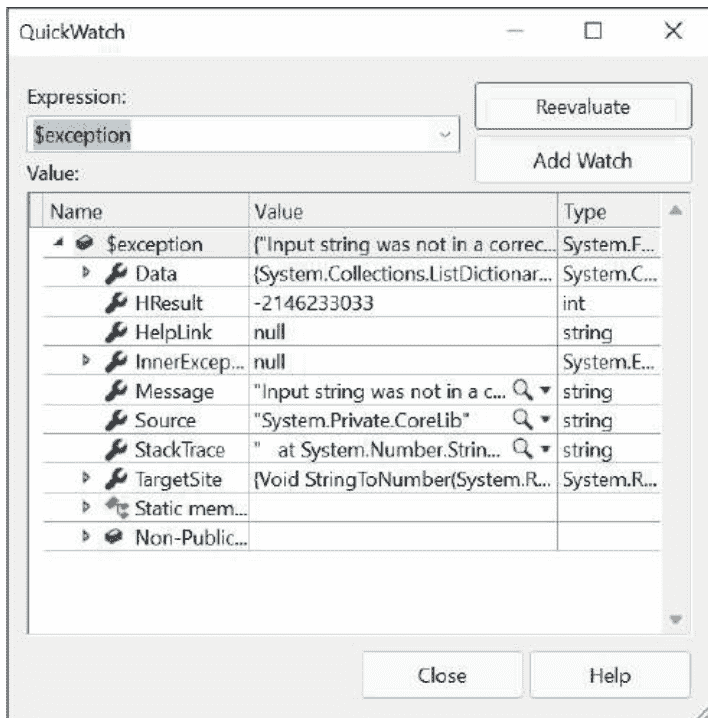

> 提示：某些异常是早期提出的其他异常的结果。Visual Studio 报告的异常只是链中的最后一个异常，但通常早期的异常指示了真实原因。

6. 关闭快速监视对话框。

7. 在 Visual Studio 中，在调试菜单菜单中，选择“停止调试”（Stop Debugging）。

8. 在文本编辑器窗口中显示 `MainPage.cs` 文件的代码，并定位到 `addValues` 方法。

9. 在此方法的内部语句周围添加一个 `try` 块（包括括号），并带上 `FormatException` 的 `catch` 处理器，如表单所示。

```
try {
    int lhs = int.Parse(lhsOperand.Text);
    int rhs = int.Parse(rhsOperand.Text);
    int outcome = 0;

    outcome = lhs + rhs;
    expression.Text = "$(lhs) + {rhs}";
    result.Text = outcome.ToString();
} catch (FormatException fEx) {
    result.Text = fEx.Message;
}
```

10. 在调试（Debug）菜单中，选择“启动调试”。

11. 当表单出现时，在左操作数框中输入 `John`，在右操作数框中输入 `2`。

12. 选择 `+` 加法按钮，然后选择计算。

`catch` 处理器成功捕获了 `FormatException`，并将“输入字符串的格式不正确”的消息写入结果框。应用程序现在变得更健壮了。

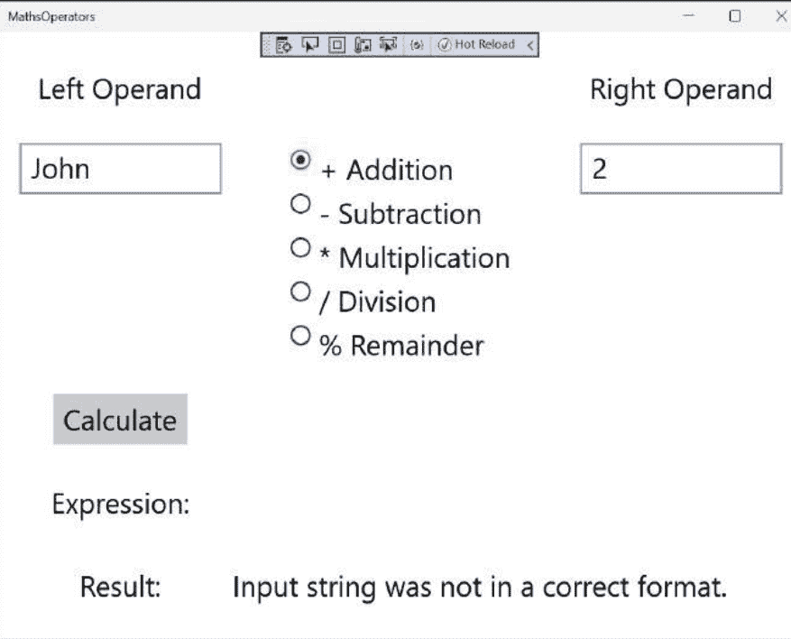

13. 在左操作数框中，将 `John` 替换为数字 `10`。在右操作数框中输入 `Sharp`。然后选择计算。

`try` 块围绕解析两个框的语句，因此同一个异常处理器使用了两个框中的用户错误。

14. 在右操作数框中，将 `Sharp` 替换为 `20`，选择 `+` 加法按钮，然后选择计算。

应用程序现在按预期工作，并在结果框中显示值 `30`。

15. 在左操作数框中，将 `10` 替换为 `John`，选择 `–` 减法按钮，然后选择计算。

Visual Studio 再次进入调试并报告 `FormatException` 异常。这次，错误发生在 `subtractValues` 方法中，该方法不包含必要的 `try/catch` 处理。你很快就会修复这个问题。

16. 在调试 (Debug) 菜单上，选择停止调试 (Stop Debugging)。

## 传播异常

在 `addValues` 方法中添加 `try/catch` 块使得该方法更加健壮，但你需要对其他方法应用相同的异常处理：`subtractValues`、`multiplyValues`、`divideValues` 和 `remainderValues`。这些异常处理器的代码可能非常相似，导致你需要在每个方法中都编写代码。

当用户选择“计算 (Calculate)”按钮时，`calculateClick` 方法会调用这些方法之一。因此，为了避免异常处理代码重复，将其移动到 `calculateClick` 方法是合理的。如果在 `subtractValues`、`multiplyValues`、`divideValues` 或 `remainderValues` 方法发生 `FormatException`，它将传回 `calculateClick` 方法进行处理，正如本章较早“未处理的异常”节所述。

# 将异常传回调用方法

1. 在代码和文本编辑器窗口中显示 `MainPage.xaml.cs` 文件的代码，并找到 `addValues` 方法。

2. 从 `addValues` 方法中移除 `try` 块 `catch` 处理器并恢复其原始状态，如下所示：

```
private void addValues()
{
    int leftHandSide = int.Parse(lhsOperand.Text);
    int rightHandSide = int.Parse(rhsOperand.Text);
    int outcome = 0;

    outcome = lhs + rhs;
    expression.Text = lhsOperand.Text + " + " + rhsOperand.Text;
    result.Text = outcome.ToString();
}
```

3. 找到 `calculateClick` 方法。在此方法中添加下方示例中加粗所示 `try` 块和 `catch` 处理器：

```
private void calculateClick(object sender, RoutedEventArgs e)
{
  try {
    if ((bool)addition.IsChecked)
    {
      addValues();
    }
    else if ((bool)subtraction.IsChecked)
    {
      subtractValues();
    }
    else if ((bool)multiplication.IsChecked)
    {
      multiplyValues();
    }
    else if ((bool)division.IsChecked)
    {
      divideValues();
    }
    else if ((bool)remainder.IsChecked)
    {
      remainderValues();
    }
  } catch (FormatException fEx)
  {
    result.Text = fEx.Message;
  }
}
```

4. 在调试 (Debug) 菜单上，选择启动调试 (Start Debugging)。

5. 当表单出现时，在左操作数 (Left Operand) 框中选择 `John`，在右操作数 (Right Operand) 框中输入 `2`。

6. 选择 `+` 加法 (Addition) 按钮，然后选择计算 (Calculate)。

与之前一样，`catch` 处理器成功捕获了 `FormatException`，并将“输入字符串不是正确的格式”的消息写入结果（Result）框。然而，尽管异常是在 `addValues` 方法中抛出的，但处理器在 `calculateClick` 方法中捕获了它。

7. 选择 `-` 减法 (Subtraction) 按钮，然后选择计算 (Calculate)。

这次，`subtractValues` 方法导致了异常，但它被传回 `calculateClick` 方法，并按照之前的方式进行处理。

8. 选择乘法 / 除法 (Multiplication / Division) 和 `%` 余数 (Remainder) 按钮，验证 `FormatException` 异常已正确捕获并处理。

9. 返回 Visual Studio 并停止调试。

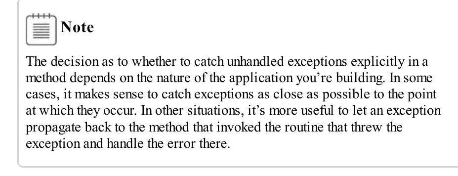

# 使用 checked 和 unchecked 整数运算

第二章讨论了如何使用 `+` 和 `*` 等二进制算术运算符以及 `int` 和 `double` 等原始数据类型。你还应该记得原始数据类型具有固定的大小。例如，C# 的 `int` 是 32 位。因为 `int` 有固定大小，你确切知道它能包含的值范围：`-2147483648` 到 `2147483647`。

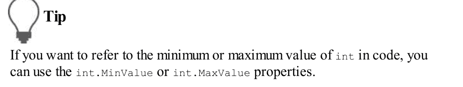

`int` 的固定大小带来了一个问题。例如，如果对一个当前为 `2147483647` 的 `int` 值加 `1` 会发生什么？答案取决于应用程序如何编译。默认情况下，C# 编译器生成的代码允许计算静默溢出，你将得到错误的答案。（事实上，计算会回绕到最大的负整数值，生成的的结果为 `-2147483648`。）这种行为的原因是性能考虑：整数算术是几乎每个程序中的常用操作，为每个整数表达式添加溢出检查的开销可能会导致性能变得非常糟糕。在许多情况下，这种风险是可以接受的，因为你知道（或希望！）你的 `int` 值不会达到极限。如果你不喜欢这种方法，可以开启溢出检查。

> **提示**：你可以在 Visual Studio 2022 中通过设置项目属性来开启和关闭溢出检查。在解决方案资源管理器（Solution Explorer）中，选择 `YourProject`（其中 `YourProject` 是项目的实际名称）。在项目（Project）菜单上，选择项目属性（Project Properties）。在生成（Build）选项卡中，选择高级（Advanced）。勾选检查溢出/下流（Check for overflow/underflow）。无论你如何编译，都可以使用 `checked` 和 `unchecked` 关键字。

## checked 语句

> **提示**：当整数溢出时，`checked` 语句始终会抛出 `OverflowException`。例如：

```
int number = int.MaxValue;
checked {
    int result = number + 1;
}
```

## unchecked 语句

> **提示**：`unchecked` 语句永远不会抛出 `OverflowException`。例如：

```
int number = int.MaxValue;
unchecked {
    int result = number + 1;
}
```

# checked 和 unchecked 表达式

> **提示**：你也可以在单个表达式上使用 `checked` 和 `unchecked` 关键字，如下例所示：

```
int result1 = unchecked(int.MaxValue + 1);
int result2 = checked(int.MaxValue + 1);
```

> **重要**：你不能使用 `checked` 和 `unchecked` 关键字来控制浮点（非整数）算术。浮点算术永远不会抛出溢出异常——即使除以 `0`。（记住第二章提到的，.NET 有无穷大的特殊浮点表示。）

# 使用 checked 表达式

在下面的练习中，你将看到如何使用 Visual Studio 2022 执行检查算术。

1. 返回 Visual Studio 2022。

2. 在调试（Debug）菜单上，选择启动调试（Start Debugging）。

现在将尝试乘以两个大值。

3. 在左操作数框中输入 `9876543`。在右操作数框中输入 `9876543`。

4. 选择 `*` 乘法按钮，并点击计算（Calculate）。

值 `-11955903` 出现在表单的结果框中。这是一个负值，这是不可能的。该值是溢出 `int` 类型 32 位限制的乘法操作的结果。

5. 返回 Visual Studio 并停止调试。

6. 在显示 `MainPage.xaml.cs` 的代码和文本编辑器中，找到 `multiplyValues` 方法，它看起来应该是这样的：


以下是对给定文本的排版结果：

```csharp
private void multiplyValues() {
    int lhs = int.Parse(lhsOperand.Text);
    int rhs = int.Parse(rhsOperand.Text);
    int outcome = 0;

    outcome = lhs * rhs;
    expression.Text = $"{lhs} * {rhs}";
    result.Text = outcome.ToString();
}
```

语句 `outcome = lhs * rhs;` 包含正在静默溢出的乘法操作。

+   7. 修改此语句使计算值经过检查，如下所示：

```csharp
outcome = checked(lhs * rhs);
```

现在乘法是经过检查的，并将抛出 `OverflowException`，而不是静默返回错误的答案。

+   8. 在“调试”（Debug）菜单中，选择“开始调试”（Start Debugging）。

+   9. 在“左操作数”（Left Operand）框中输入 `9876543`。在“右操作数”（Right Operand）框中输入 `9876543`。

+   10. 选择“乘法”（Multiplication）按钮，然后选择“计算”（Calculate）。

这一次，Visual Studio 进入调试器并报告乘法结果导致了 `OverflowException` 异常。你必须添加一个处理程序来捕获此异常，并以比直接报错更优雅的方式处理它。

+   11. 在“调试”（Debug）菜单中，选择“停止调试”（Stop Debugging）。

+   12. 在显示 `MainPage.xaml.cs` 文件的代码文本编辑器中，找到 `handleClick` 方法。

+   13. 在此方法中，紧接现有的 `FormatException` 捕获处理器之后添加以下 `catch` 处理器（如**加粗**所示）：

点击此处查看代码图片

```csharp
private void handleClick(object sender, RoutedEventArgs e)
    try
    {
    }
    catch (FormatException fEx)
    {
        result.Text = fEx.Message;
    }
    catch (OverflowException oEx)
    {
        result.Text = oEx.Message;
    }
```

此 `catch` 处理器的逻辑与 `FormatException` 捕获处理器相同。然而，将这些处理器分开而不是简单地编写一个通用的 `Exception` 捕获处理器仍然是有价值的；在将来，你可能会决定以不同的方式处理这些异常。

+   14. 在“调试”（Debug）菜单中，选择“开始调试”（Start Debugging）以生成并运行应用程序。

+   15. 在“左操作数”（Left Operand）框中输入 `9876543`。在“右操作数”（Right Operand）框中输入 `9876543`。

16. 选择“乘法”（Multiplication）按钮，然后选择“计算”（Calculate）。

第二个 `catch` 处理器成功捕获了 `OverflowException`，并在“结果”（Result）框中显示消息“算术运算溢出”（Arithmetic operation resulted in an overflow）。

17. 返回 Visual Studio 并停止调试。

# 异常处理与 Visual Studio 调试器

默认情况下，Visual Studio 调试器只会停止正在调试的应用程序，并报告计划之外的异常。然而，有时调试异常处理程序本身也是很有用的。在这种情况下，你需要在异常被应用程序抛出但在被捕获之前进行追踪。你可以轻松地做到这一点：

+   1. 在“调试”（Debug）菜单中，选择“窗口”（Windows），然后选择“异常设置”（Exception Settings）。“异常设置”面板将出现在“代码文本编辑器”窗口上方。

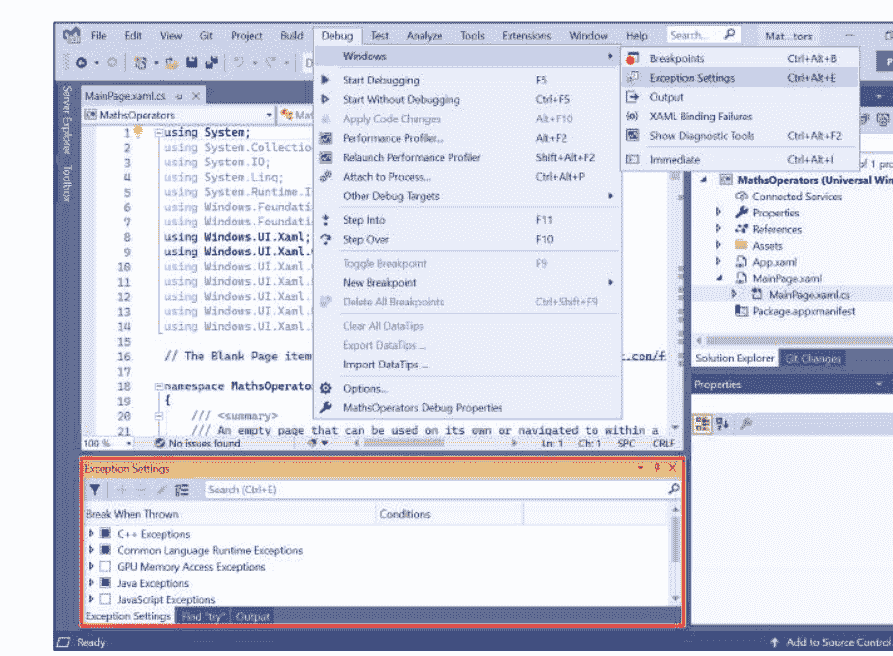

2. 在“异常设置”面板中，展开“公共语言运行时异常”（Common Language Runtime Exceptions），向下滚动并选择 `System.LanguageOverflowException`。

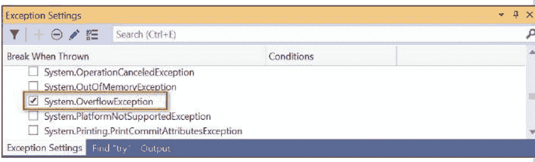

现在，当发生此类 `OverflowException` 异常时，Visual Studio 将进入调试器，你可以使用调试工具栏上的“单步”（Step）按钮进入 `catch` 处理器。

## 抛出异常

假设你正在实现名为 `month` 的方法，该方法接受单个参数并返回相应的月份名称。例如，`month(1)` 返回 "January"，`month(2)` 返回 "February"，依此类推。问题是，如果整数参数小于 1 或大于 12，该方法应该返回什么？最好的答案是该方法不应该返回任何内容，它应该抛出一个异常。

.NET 库包含许多专门为这种情况设计的异常类。通常，你会发现其中一个类正描述了你的异常情况。如果没有，你可以轻松地创建自己的异常类，但在那之前你需要更多关于 C# 语言的知识。

在这种情况下，现有的 .NET `ArgumentOutOfRangeException` 类恰恰合适。你可以通过 `throw` 语句抛出异常。下面的示例使用了这种技术。`month` 方法使用 `switch` 表达式将月份数字转换为月份名称：

点击此处查看代码图片

```csharp
public string monthName(int month) => month switch {
    1 => "January",
```

```csharp
2 => "February",
..
12 => "December",
   throw new ArgumentOutOfRangeException("Bad month");
```

`throw` 语句需要一个异常对象来抛出。该对象包含异常的详细信息，包括任何错误消息。此示例使用创建一个 `ArgumentOutOfRangeException` 对象的表达式。该对象通过构造函数使用字符串初始化其 `Message` 属性。构造函数将在第 7 章“创建和管理类和对象”中详细介绍。

在接下来的练习中，你将修改 `MathOperators` 项目，如果用户尝试在未选择操作符按钮的情况下执行计算，则抛出异常。

> 注意：这个练习有些生硬，因为任何良好的应用程序设计都会在初始选中一个默认选项按钮，但此应用程序旨在说明一个观点。

## 抛出异常

+   1. 返回 Visual Studio 2022。

2. 在“调试”（Debug）菜单中，选择“开始调试”（Start Debugging）。

3. 在“左操作数”（Left Operand）框中输入 `24`。在“右操作数”（Right Operand）框中输入 `36`。然后选择“计算”（Calculate）。

4. 返回 Visual Studio 并停止调试。

5. 在显示 `MainPage.xaml.cs` 的代码编辑器窗口中，找到并检查 `calculateClick` 方法，它目前看起来如下：

点击此处查看代码图片

```csharp
private int calculateClick(object sender, RoutedEventArgs e)
{
    try {
        if ((bool)addition.Checked)
        {
            addValues();
        }
        else if ((bool)subtraction.Checked)
        {
            subtractValues();
        }
        else if ((bool)multiplication.Checked)
        {
            multiplyValues();
        }
        else if ((bool)division.Checked)
        {
            divideValues();
        }
        else if ((bool)remainder.Checked)
        {
            remainderValues();
        }
    } catch (FormatException fEx)
    {
        result.Text = fEx.Message;
    }
    catch (OverflowException oEx)
    {
        result.Text = oEx.Message;
    }
}
```

```csharp
catch (FormatException fEx)
{
    result.Text = fEx.Message;
}
catch (OverflowException oEx)
{
    result.Text = oEx.Message;
}
catch (InvalidOperationException ioEx)
{
    result.Text = ioEx.Message;
}
```

此代码捕获了用户未选择运算符选项按钮时抛出的 `InvalidOperationException`。

- 2. 在调试（Debug）菜单中，选择开始调试（Start Debugging）。

3. 在左操作数（Left Operand）框中输入 `24`。在右操作数（Right Operand）框中输入 `36`。然后选择计算（Calculate）。

结果（Result）框中会出现出现“未选择运算符”的提示。

> 注意

> 如果你的应用程序进入了 Visual Studio 调试器，你可能开启了 Visual Studio 在抛出时捕获所有公共语言运行时（CLR）异常。如果发生此类情况，请在调试菜单中选择继续（Continue）。记住在完成此练习后，禁用 Visual Studio 捕获抛出时的 CLR 异常！

- 4. 返回 Visual Studio 并停止调试。

现在应用程序变得健壮许多。然而，可能会出现若干未被捕获的异常并导致应用程序失败。例如，如果你尝试除以 0，将会抛出一个未处理的 `DivideByZeroException`。（整数除以 0 会抛出异常，而浮点数除以 0 则不会。）解决此问题的方法是在 `handleClickMethod` 内部编写大量的 `catch` 处理器。另一种解决方案是在 `catch` 处理器列表末尾添加一个捕获 `Exception` 的通用处理程序。这将捕获所有你可能忘记的、或由于极端异常情况引起的所有意外异常。

> 注意

> 使用全捕获处理器（catchall handler）来捕获 `Exception` 异常并不是省略特定异常的理由。你的异常处理越精确，维护你的代码以及发现任何底层或反复出现问题的原因就越容易。只有在确实是……嗯，异常的情况下，才使用 `Exception` 异常。

在接下来的练习中，“除以零”异常属于这一类。然而，既然已经确定这种异常在专业应用程序中是一个可能的情况，良好的做法是为应用程序添加一个处理 `DivideByZeroException` 的处理器。

# 捕获未处理的异常

- 1. 在显示 `MainPage.xml.cs` 的代码和文本编辑器窗口中，在 `calculateClick` 方法现有 `catch` 处理器列表末尾添加以下 `catch` 处理器：

```csharp
catch (Exception ex)
{
    result.Text = ex.Message;
}
```

此 `catch` 处理器将捕获所有尚未处理的异常，无论它们的具体类型是什么。

> 注意

> 确保将此处理器添加到列表末尾。如果你将其放在开头，它将掩盖其他的异常处理器。

- 2. 在调试（Debug）菜单中，选择开始调试（Start Debugging）。

现在你将尝试执行已知会导致异常的计算，并确认它们都已正确处理。

- 3. 在左操作数（Left Operand）中输入 `24`。在右操作数（Right Operand）中输入 `36`。

- 4. 选择计算（Calculate）。

确认结果（Result）框中仍然出现“未选择运算符”的诊断信息。此信息是由 `InvalidOperationExceptionHandler` 处理器生成的。

- 5. 在左操作数（Left Operand）中输入 `John`，选择 `+` 加法按钮，然后选择计算（Calculate）。

确认结果（Result）框中出现“输入字符串不是正确的格式”的诊断信息。此信息是由 `FirebaseAuth` 处理器生成的。

- 6. 在左操作数（Left Operand）中输入 `24`。在右操作数（Right Operand）中输入 `0`。选择 `/` 除法按钮，然后选择计算（Calculate）。

确认结果（Result）框中出现“尝试除以零”的诊断信息。此信息是由通用 `Exception` 处理器生成的。

- 7. 尝试其他数值组合，并验证异常情况已处理且未导致应用程序停止。

- 8. 完成后，返回 Visual Studio 并停止调试。

# 使用 throw 表达式（throw expressions）

`throw` 表达式（throw expression）在语义上与 `throw` 语句（throw statement）相似，不同之处它可以用于任何可以使用异常的地方。例如，假设你想将字符串变量 `name` 赋值为表单中 `nameField` 输入的值，但前提是用户确实在在该字段中输入了值；否则，你想抛出一个“缺少输入”异常。你可以使用以下代码：

点击此处查看代码图像

```csharp
string name;
if (nameField.Text == "")
{
    name = nameField.Text;
}
else
{
    throw new Exception("Missing input"); //这是一个 throw 语句
}
```

虽然这段代码可以工作，但它显得有些笨拙且冗长。你可以通过使用 `throw` 表达式配合另一个称为问号运算符（query-colon）`?:` 的运算符来简化此块。问号运算符类似于表达式的内联 `if...else` 语句。它是一个三元运算符，接受三个操作数：一个布尔表达式、当布尔表达式为真时求值并返回的表达式，以及当布尔表达式为假时求值并返回的表达式。你可以这样配合 `throw` 表达式使用它：

点击此处查看代码图像

```csharp
string name = nameField.Text != ""
  ? nameField.Text : throw new Exception("Missing input"); //这是一个 throw 表达式
```

在这种情况下，如果 `name` 框为空，`Text` 属性的值将存储在 `name` 变量中。否则，将计算 `throw` 表达式，从而抛出异常。这段代码比之前的示例要简洁得多。

# 使用 finally 块（finally block）

当抛出异常时，它会改变程序中的执行流。因此，你无法保证某条语句在前一个语句完成后始终运行，因为前一个语句可能会抛出异常。在这种情况下，在 `catch` 处理器运行后，控制流将在包含该处理器的块中的下一语句恢复，而不是紧接在引发异常的代码之后的语句。

看接面的示例，它改编自第 5 章“使用复合赋值和迭代语句”中的代码。人们很容易假设对 `reader.Dispose` 的调用会在 `while` 循环完成后总是发生。诚然，这在代码中是正确的。

点击此处查看代码图像

```csharp
TextReader reader = ...;
...
string line = reader.ReadLine();
while (line is not null)
{
  ...
  line = reader.ReadLine();
}
reader.Dispose();
```

有时，某个特定语句未执行并不是问题，但在许多情况下这可能会是一个大问题。如果该语句释放了在前一个语句中获取的资源，未能执行该语句将导致资源被保留。这个例子正是如此：你打开了一个文件进行读取，此操作获取了一个资源（文件句柄），你必须确保调用 `reader.Dispose` 来释放资源。如果不这样做，早晚你会耗尽句柄并无法打开更多文件。（如果你觉得文件句柄太简单，可以考虑数据库连接。）

要确保无论是否抛出异常某条语句始终运行的方法是将其写在 `finally` 块中。`finally` 块紧跟在 `try` 块之后或 `try` 块之后最后一个 `catch` 处理器之后。当程序进入与 `finally` 块相关的 `try` 块时，即使发生异常，`finally` 块也会运行。如果抛出了异常并在本地捕获，异常处理器先执行，然后执行 `finally` 块。如果异常未在本地捕获（即运行时必须在调用方法列表中查找处理器），则先执行 `finally` 块。

解决 `reader.Dispose` 问题的方案如下：

点击此处查看代码图像

```csharp
TextReader reader = ...;
...
try
{
    string line = reader.ReadLine();
    while (line is not null)
    {
        line = reader.ReadLine();
    }
}
finally
{
    if (reader is not null)
    {
        reader.Dispose();
    }
}
```


如果在读取文件时发生异常，`finally` 块将确保 `reader.Dispose` 语句始终执行。你将在第 14 章“使用垃圾回收和资源管理”中看到处理这种情况的另一种方法。

# 总结

在本章中，你学习了如何使用 `try catch` 结构来捕获和处理异常。你了解了如何通过 `checked` 和 `unchecked` 关键字来开启或关闭整数溢出检查。你学习了当代码检测到异常情况时如何抛出异常，并了解了如何使用 `finally` 块来确保即使发生异常，关键代码也能始终运行。

- 如果你想继续阅读下一章，请保持 Visual Studio 2022 运行并转到第 7 章。
- 如果你想现在退出 Visual Studio 2022，请在“文件”菜单中选择“退出”。如果看到保存保存对话框，请选择“是”并保存项目。

## 快速参考

| 目标 | 执行操作 |
|---|---|
| 捕获特定异常 | 编写一个捕获特定异常类的 `catch` 处理器。例如：<br>[点击此处查看代码图像](#)<br><br>```csharp<br>try {<br>  ...<br>} catch (FormatException fEx) {<br>  ...<br>}<br>``` |
| 确保整数算术始终进行溢出检查 | 使用 `checked` 关键字。例如：<br>[点击此处查看代码图像](#)<br><br>```csharp<br>int number = Int32.MaxValue;<br>checked { number++; }<br>``` |
| 抛出异常 | 使用 `throw` 语句。例如：<br>[点击此处查看代码图像](#)<br><br>```java<br>throw new FormatException(source);<br>``` |
| 在单个 `catch` 处理器中捕获所有异常 | 编写一个捕获 `Exception` 的 `catch` 处理器。例如：<br><br>```java<br>try {<br>  ...<br>} catch (Exception ex) {<br>  ...<br>}<br>``` |
| 确保即使抛出异常，某些代码也会始终运行 | 在 `finally` 块中编写代码。例如：<br><br>```java<br>try {<br>  ...<br>} finally {<br>  // 始终运行<br>}<br>``` |

## 理解 C# 对象模型

- 第 7 章 创建和管理类与对象
- 第 8 章 理解值和引用
- 第 9 章 使用枚举和结构创建值类型
- 第 10 章 使用数组
- 第 11 章 理解参数数组
- 第 12 章 处理继承
- 第 13 章 创建接口和定义抽象类
- 第 14 章 使用垃圾回收和资源管理

在第一部分中，你学习了如何声明变量、使用运算符创建值和方法，并在需要实现方法时编写许多语句。你现在已经了足够的知识进入下一个阶段：将方法和数据组合成你自己的功能性数据结构。第二部分的章节将向你展示如何实现。

在第二部分中，你将学习对实体和结构建模，这是你在典型 C# 中使用的两种基本类型。特别是，你将看到 C# 如何根据类和结构体的定义创建对象和值类型，以及 .NET 如何管理这些项目的生命周期。你将发现如何通过继承创建类族，并学习如何使用数组来聚合项。

# 创建和管理类与对象

完成本章后，你将能够：

- 理解分类和封装的概念。
- 定义包含一组相关方法和数据项类。
- 使用 `public` 和 `private` 关键字控制成员的访问权限。
- 编写并调用你自己的构造函数。
- 使用 `static` 关键字创建供同类所有实例共享的方法和数据。
- 创建匿名类。

类为应用程序操作的实体提供了一种方便的机制。实体可以表示一个特定项目，例如客户，或者更抽象的东西，例如事务。任何系统的设计过程都侧重于确定对系统所实现的进程关重要的实体，然后进行分析以查看实体需要持有哪些信息以及它们应该执行哪些操作。你将类持有的信息存储为字段并使用方法来实现类可以执行的操作。

> **注意**

`.NET` 广泛使用类。`.NET` 库包含了数千万个类。你已经用过了其中几个，包括 `Console` 和 `Exception`。

## 理解分类

“Class”（类）是“classification”（分类）一词的根源。当你设计一个类时，你在系统地将信息和行为安排成有意义的实体。这种安排是一种分类行为，是每个人都会做的——而不只是程序员。例如，所有的汽车都有共同的行为（可以转向、停止、加速等）和共同的属性（它们有方向盘、引擎等）。人们可以使用“汽车”一词来表示共享这些共同行为和属性的对象。只要大家对一个词的含义达成一致，这个系统就能良好运行，你可以用简洁的格式表达复杂但精确的想法。如果没有分类，很难想象人类如何进行思考或通信。

鉴于分类深根于我们的思维和通信方式，因此通过对问题及其解决方案中固有的不同概念进行分类，然后在编程语言中对这些类进行建模来编写程序是有意义的。这正是你使用面向对象的编程语言（包括 Microsoft Visual C#）可以做的事情。

# 封装的目的

封装是定义类时的一个重要原则。其思想是，使用类的程序不应该考虑类内部实际上是如何工作的；程序只需要创建类的实例并调用方法。只要这些方法执行了它们设计的功能，程序就不需要知道它们是如何实现的。例如，封装有时被称为信息隐藏。封装实际上有两个目的：

- 在类内部结合方法和数据——换句话说，支持分类。
- 控制方法和数据的访问权限——换句话说，控制使用。

## 定义和使用类

在 C# 中，你使用 `class` 关键字来定义一个新类。类的数据和方法位于类的括号体内。以下是一个名为 `Circle` 的 C# 类，它包含一个方法（计算圆的面积）和一个数据（半径）：

点击此处查看代码图像

```csharp
class Circle
{
    int radius;
    double Area()
    {
        return Math.PI * radius * radius;
    }
}
```

# 注意

`Math` 类包含执行数学计算的方法和包含数学常数的字段。`Math.PI` 字段包含 3.14159265358979，它是 pi 的近似值。类包含普通方法（如 `Area`）和字段（如 `radius`）。类中的变量被称为字段。第 2 章“工作变量、运算符和表达式”展示了如何声明变量，第 3 章“编写方法和作用域”演示了如何编写方法，因此这里几乎是全新的语法。

你可以像使用过的其他类型一样使用 `Circle` 类。你可以创建一个类型为 `Circle` 的变量，然后用某些值数据初始化该变量。这是一个示例：

点击此处查看代码图像

```csharp
Circle c; // 创建一个 Circle 变量
c = new Circle(); // 初始化它
```

这段代码中值得注意的一点是 `new` 关键字的使用。以前当你初始化一个像 `int` 或 `float` 的变量时，只需给它赋值一个值：

```csharp
int i;
i = 42;
```

你不能对类类型的变量这样做。原因之一是 C# 并没有提供将字面量类值赋值给变量的语法。

你不能编写像这样的语句：

```csharp
Circle c;
c = 42;
```

毕竟，`42` 对应的 `Circle` 类型是什么呢？另一个原因涉及到运行时分配和管理类类型变量内存的方式。这将在第 8 章“理解值和引用”中进行进一步讨论。目前，只需接受 `new` 关键字会创建一个类的新实例（这通常被称为**对象**）即可。

不过，你可以直接将一个类的实例赋值给另一个相同类型的变量，如下所示：

```csharp
Circle c;
c = new Circle();
Circle d;
d = c;
```

然而，由于第 8 章中描述的原因，这并不像初看起来看起来那么简单（此处原因见下文）。

> **重要**

> 不要混淆类（class）和对象（object）这两个术语。类是类型的定义。对象是程序运行时创建的该类型的实例。多个不同的对象可以是同一个类的实例。

# 类型推断和 `new` 运算符

在正文的示例中，`new` 表达式中的类名 `Circle` 实际上是多余的。你可以直接写成：

```csharp
Circle c;
c = new();
```

C# 编译器理解 `c` 是一个 `Circle` 变量，因此它默认会创建一个新的 `Circle` 对象。在 `new` 表达式中包含或省略类型通常取决于个人喜好，但在某些情况下，你需要在 `new` 表达式中指定类型。（稍后你会遇到一些此类示例。）

另一方面，如果你将声明和初始化合并为单一语句，省略类型可以使你的代码更加简洁。例如：

```csharp
Circle c = new();
```

或者，你可以将变量 `c` 声明为 `var` 并为 `new` 运算符指定类型（这是我偏好的风格）：

```csharp
var c = new Circle();
```

# 控制访问可见性

令人惊讶的是，`Circle` 类目前没有任何实际用途。默认情况下，当你将方法和数据封装在类内部时，该类形成了一个通往外部世界的边界。类中定义的字段（如 `radius`）和方法（如 `Area`）可以被类中的其他方法使用，但不能被外部使用；它们对于类来说是私有的（private）。因此，尽管你可以在程序中创建 `Circle` 对象，但你无法访问它的 `radius` 字段或调用它的 `Area` 方法，这就是为什么该类没有太大用！不过，你可以使用 `public` 和 `private` 关键字来修改字段或方法的定义，以控制它们是否可外部访问：

- 如果一个方法或字段只能从类内部访问，则它是**私有的（private）**。要声明一个方法或字段为私有，你需要在声明之前编写 `private` 关键字。如之前暗示的，这实际上是默认设置，但显式声明字段和方法对类私有是一个良好的习惯，可以避免任何混淆。
- 如果一个方法或字段既可以在类内部也可以从外部访问，则它是**公共的（public）**。要声明一个方法或字段为公共，你需要在声明之前添加 `public` 关键字。

这里是 `Circle` 类。这一次，`Area` 被声明为公共方法，而 `radius` 被声明为私有字段：

点击此处查看代码图像

```csharp
class Circle
{
    private int radius;
    public double Area()
    {
      return Math.PI * radius * radius;
    }
}
```

> 注意：如果你是 C++ 程序员，请注意 `public` 和 `private` 关键字之后没有出现冒号。你必须为每个字段和方法声明重复该关键字。

虽然 `radius` 被声明为私有字段且无法从类外部访问，但在 `Circle` 类内部是可以访问 `radius` 的。`Circle` 类内部的 `Area` 方法拥有访问 `radius` 的权限。然而，该类的价值仍然有限，因为没有办法初始化 `radius` 字段。为了解决这个问题，你可以使用构造函数。

> **提示**

> 在方法中声明的变量默认不会进行初始化。然而，类中的字段会根据其类型自动初始化为 `0`、`false` 或 `null`。尽管如此，提供一种显式的初始化字段的方法仍然是一个良好的习惯。

## 命名与可见性

许多组织都有自己的编码风格，并要求开发者在编写代码时遵循。这种风格的一部分通常涉及标识符的命名规则。通常，这些规则的目的是使代码更易维护。以下建议是相当常见的，以及基于类成员访问可见性的字段和方法命名约定：

- 公共（public）标识符应该以大写字母开头。例如，`Area` 以 `A` 开头（而不是 `a`），因为它是公共的。这种系统被称为**帕斯卡命名法（PascalCase）**（因为它最初用在 Pascal 语言中）。
- 非公共的标识符（包括局部变量）应该以小写字母开头。例如，`radius` 以 `r` 开头（而不是 `R`），因为它是私有的。这种系统被称为**驼峰命名法（camelCase）**。

> **注意**

> 某些组织仅对方法使用驼峰命名法，并采用使用下划线字符命名私有字段的约定，例如 `_radius`。然而，本书中的示例对私有方法和字段均使用驼峰命名法。

该规则只有一个例外：类名应该以大写字母开头，且构造函数必须与其类名完全匹配；因此，私有构造函数必须以大写字母开头。

> **重要**

> 不要声明两个仅在大小写上不同的公共类成员。如果你这样做，使用不区分大小写的其他语言（如 Microsoft Visual Basic）的开发者可能无法将你的类集成到他们的解决方案中。

## 使用构造函数

当你使用 `new` 关键字创建对象时，运行时需要通过类的定义来构造该对象。运行时必须从操作系统获取一段内存，填充类定义的字段，然后调用构造函数执行任何初始化。

构造函数是一种特殊方法，会在创建类实例时自动运行。它与类名相同，可以接受参数，但不能返回值。每个类都必须有一个构造函数。如果你不写，编译器会自动为你生成一个默认构造函数（尽管生成的默认构造函数什么都不做）。

你可以很容易地编写自己的默认构造函数。只需添加一个不返回值的公共方法，并赋予它与类相同的名称。以下示例了带有将 `radius` 字段初始化为 `0` 的默认构造函数的 `Circle` 类：

点击此处查看代码图像

```csharp
class Circle
{
  private int radius;
  public Circle() // 默认构造函数
  {
    radius = 0;
  }

  public double Area()
  {
    return Math.PI * radius * radius;
  }
}
```

> 注意：在 C# 术语中，默认构造函数是不接受参数的构造函数。无论是由编译器生成还是你自己编写，不接受参数的构造函数都是默认构造函数。你还可以编写非默认构造函数（接受参数的构造函数），正如你将在下一节“重载构造函数”中看到的那样。

在这个示例中，构造函数被标记为 `public`。如果省略此关键字，构造函数将是私有的（就像任何其他方法和字段一样）。如果构造函数是私有的，则无法在类外部使用，这阻止了你从 `Circle` 类之外的方法创建 `Circle` 对象。因此，你可能会发现私有构造没有价值。它们确实有用处，但超出了当前讨论的范围。

添加了公共构造函数后，你现在可以使用 `Circle` 类并调用其 `Area` 方法。注意你如何使用点表示法来调用 `Area` Circle 对象上的方法：

点击此处查看代码图像

```csharp
Circle c;
c = new Circle();
double areaOfCircle = c.areaOf();
```

## 构造函数重载

你现在可以声明一个 `Circle` 变量，使用它引用新创建的 `Circle` 对象，并调用它的 `Area` 方法。然而还有一个最后一个问题：所有 `Circle` 对象的面积将始终为 `0`，因为默认构造函数将半径字段设为私有（private），并且在初始化之后没有简单的方法可以更改它的值。

构造函数是一种特殊的方法，和所有其他方法一样，它可以是可以重载的。由于 `Console.WriteLine` 方法有多个版本，每个版本接受不同的参数，因此你可以编写不同版本的构造函数。所以，你可以为 `Circle` 类添加另一个带有指定半径参数的构造函数，如下所示：

点击此处查看代码图像

```csharp
class Circle
{
    private int radius;
    public Circle() // 默认构造函数
    {
        radius = 0;
    }

    public Circle(int initialRadius) // 重载的构造函数
    {
        radius = initialRadius;
    }

    public double Area()
    {
        return Math.PI * radius * radius;
    }
}
```

> **注意**

类中构造函数的顺序是无关要的；你可以按照你觉得最舒适的顺序来定义构造函数。

你可以在创建新 `Circle` 对象时使用此构造函数，如下所示：

```csharp
var c = new Circle(45);
```

当你构建应用程序时，编译器会根据你为 `new` 运算符指定的参数来确定它应该调用哪个构造函数。在这个示例中，你传递了一个 `int`，因此编译器生成了调用接受 `int` 参数的构造函数的代码。

你应该意识到 C# 语言的一个重要特性：如果你为类编写了自定义构造函数，编译器就不会再生成默认构造函数。因此，如果你编写了接受一个或多个参数的自定义构造函数，并且还需要一个默认构造函数，你就必须自己编写默认构造函数。

## 部分类（Partial classes）

一个类可以包含许多方法、字段和构造函数，以及后续章节讨论的其他项目。因此，一个功能强大的类可能会变得非常大。在 C# 中，你可以将类的源代码拆分到单独的文件，这样你就可以将大型类的组织拆分成更小、易于管理的部分。Visual Studio 2022 用于通用 Windows 平台（UWP）应用使用了此功能，它维护了开发者可以在单独文件中编辑源代码，而这些代码与 Visual Studio 在表单布局更改时生成的代码是分开的。

当你将一个类拆分到多个文件时，你在每个文件中使用 `partial` 关键字来定义类的部分。例如，如果 `Circle` 类被拆分到两个名为 `circ1.cs`（包含构造函数）和 `circ2.cs`（包含方法和字段）的文件中，`circ1.cs` 的内容如下：

点击此处查看代码图像

```csharp
partial class Circle
{
    public Circle() // 默认构造函数
    {
        this.radius = 0;
    }

    public Circle(int initialRadius) // 重载的构造函数
    {
        this.radius = initialRadius;
    }
}
```

至于 `circ2.cs` 的内容，它们看起来如下：

点击此处查看代码图像

```csharp
partial class Circle
{
    private int radius;

    public double Area()
    {
        return Math.PI * this.radius * this.radius;
    }
}
```


当你编译一个拆分到单独文件的类时，你必须向编译器提供所有文件。

在本次练习中，你将声明一个模拟二维空间中点的类。该类将包含两个用于存储点 `x` 和 `y` 坐标的私有字段，并提供初始化这些字段的构造函数。你将通过使用 `new` 关键字并调用构造函数来创建类的实例。

## 编写构造函数并创建对象

1. 启动 Visual Studio 2022，如果它尚未运行。

2. 打开 `Classes` 解决方案，它位于你文档文件夹中的 `\Microsoft Press\VCSABS\Chapter 7\Classes` 文件夹下。

3. 在解决方案资源管理器中，双击 `Program.cs` 文件以在代码和文本窗口中显示它。

4. 在 `Program` 类中，找到 `Main` 方法。

`Main` 方法调用了 `doWork` 方法，该方法被封装在一个 `try` 块中，随后跟一个 `catch` 句程序。通过这个 `try/catch` 块，你可以将通常放在 `Main` 内部的代码写在 `doWork` 方法中，并放心地知道它会捕获并处理任何异常。`doWork` 方法目前只包含一个 `// TODO:` 注释。

```
class Program
{
    static void doWork()
    {
        // TODO: Test the Point class:
    }
    static void Main(string[] args)
    {
        try {
            doWork();
        }
        catch (Exception ex)
        {
            Console.WriteLine(ex.Message);
        }
    }
}
```

> `// TODO:` 注释

开发者经常添加 `// TODO:` 注释来提醒重新访问某些代码。这些注释通常包含对要执行工作的描述，例如 `// TODO: 实现 doWork 方法`。

Visual Studio 识别这种形式的注释，你可以通过任务列表 (Task List) 窗口快速定位应用程序中的任何地方。要显示此窗口，在“视图 (View)”菜单中选择“任务列表”。任务列表窗口默认打开在代码和文本窗口下方。所有的 `TODO` 注释都会列出来。你可以通过双击这些注释直接跳转到对应的代码，代码将显示在代码和文本窗口中。

5. 在代码和文本窗口中显示 `Point.cs`。

此文件定义了一个名为 `Point` 的类，你将用它表示二维空间中的点，该点由一对 `x` 和 `y` 坐标定义。

`Point` 类除另一个 `// TODO` 注释外为空。

6. 返回 `Program.cs` 文件。在 `Program` 类中，编辑 `doWork` 方法体，并将 `// TODO` 注释替换为以下语句：

```
var origin = new Point();
```

该语句创建了 `Point` 类的新实例并调用了它的默认构造函数。

7. 在“生成 (Build)”菜单中选择“解决方案”。

代码无错误构建，因为编译器为 `Point` 类自动生成默认构造函数。然而，你看不到此构造函数的 C# 代码，因为编译器不生成源语言语句。

8. 返回 `Point.cs` 文件中的 `Point` 类。将 `// TODO` 注释替换为接受两个 `int` 参数（命名为 `x` 和 `y`）的公共构造函数，并调用 `Console.WriteLine` 方法将这些参数的值显示到控制台上，如下面的代码示例加粗所示：

```
class Point
{
    public Point(int x, int y)
    {
        Console.WriteLine($"{x:{x}, y:{y}");
    }
}
```

9. 在“生成 (Build)”菜单中选择“解决方案”。

编译器现在报告一个错误：

> 没有对应 `Point.Point(int, int)` 要求的形式参数 `x` 的参数

此详细信息的意思是，`doWork` 方法对默认构造函数的调用是非法的，因为不再有默认构造函数了。你为 `Point` 类编写了自己的构造函数，所以编译器不再生成默认构造函数。你将通过编写自己的默认构造函数来修复此问题。

10. 通过添加公共默认构造函数来编辑 `Point` 类，该构造函数调用 `Console.WriteLine` 将字符串 `"Default constructor called"` 写入控制台，如下例加粗所示。`Point` 类应该如下：

```
class Point
{
    public Point()
    {
        Console.WriteLine("Default constructor called");
    }

    public Point(int x, int y)
    {
        Console.WriteLine($"x:{x}, y:{y}");
    }
}
```

11. 在“生成”（Build）菜单上，选择“生成解决方案”（Build Solution）。程序现在应该成功生成。

12. 在 `Program.cs` 文件中，编辑 `doWork` 方法体。声明一个类型为 `Point` 的变量 `bottomRight`，并使用带有两个参数的构造函数将其初始化为新的 `Point` 对象，如下所示代码中的粗体部分。提供值 `2496` 和 `1664`，代表基于 `2496 × 1664` 分辨率屏幕右角的坐标（这是 15 英寸屏幕 Microsoft Surface 3 笔记本电脑的分辨率）。`doWork` 方法现在应该是这样的：

```csharp
static void doWork()
{
    var origin = new Point();
    var bottomRight = new Point(2496, 1664);
}
```

13. 在“调试”（Debug）菜单上，选择“不调试启动”（Start Without Debugging）。程序生成并运行，在控制台中显示以下消息：

```
Default constructor called
x:2496, y:1664
```

14. 按下 Enter 键启用程序并返回 Visual Studio 2022。你将为 `Point` 类添加两个 `int` 字段来表示 `x` 和 `y` 坐标，并且将修改构造函数以初始化这些字段。

15. 编辑 `Point.cs` 文件中的 `Point` 类，并添加两个类型为 `int` 的私有字段，分别名为 `x` 和 `y`，如下所示代码中的粗体部分。`Point` 类现在应该是这样的：

```csharp
class Point
{
    private int x;
    private int y;
    ...
}
```

你将修改第二个 `Point` 构造函数，将 `x` 和 `y` 字段初始化为 `x` 和 `y` 参数的值。然而，当你这样做时存在潜在的陷阱：如果你不小心，构造函数可能会像这样：

```csharp
public Point(int x, int y) // 不要这样输入！
{
    x = x;
    y = y;
}
```

尽管这段代码可以编译，但这些语句似乎是有歧义的。编译器在 `x = x;` 语句中能知道第一个 `x` 是字段而第二个 `x` 是参数吗？答案是它不知道！与字段同名的方法参数在该方法中的所有语句中都会隐藏该字段。所有这些代码实际上是将参数赋值给它们自己；它完全没有修改任何字段。这显然不是你想要的。

解决方案是使用 `this` 关键字来限定哪些变量是参数，哪些是字段。在变量前加上 `this` 意味着“此对象中的字段”。

16. 修改带有两个参数的 `Point` 构造函数，通过将 `Console.WriteLine` 语句替换为以下粗体所示的代码：

```csharp
public Point(int x, int y)
{
    this.x = x;
    this.y = y;
}
```

17. 编辑默认的 `Point` 构造函数，将 `x` 和 `y` 字段初始化为 `-1`，如下粗体所示。请注意，虽然没有参数会导致混淆（而且 Visual Studio 会弹出一个提示显示你不需要使用 `this`），但以这种方式限定字段引用仍然是好的做法：

```csharp
public Point()
{
    this.x = -1;
    this.y = -1;
}
```

18. 在“生成”（Build）菜单上，选择“生成解决方案”。确认代码在没有错误或警告的情况下编译。（你可以运行它，但它现在不会产生任何输出。）

属于某个类并操作该类特定实例的数据的方法称为实例方法。（你将在本章稍后部分学习其他类型的方法）。在接下来的练习中，你将为 `Point` 类编写一个名为 `DistanceTo` 的实例方法，用于计算两个点之间的距离。

# 编写和调用实例方法

1. 在 Visual Studio 2022 的 `Classes` 项目中，在构造函数之后向 `Point` 类添加以下名为 `DistanceTo` 的公共实例方法。该方法接受一个名为 `other` 的单个 `Point` 参数并返回一个 `double`。

`DistanceTo` 方法应该是这样的：

```csharp
class Point
{
    ...
    public double DistanceTo(Point other)
    {
    }
}
```

在接下来的步骤中，你将在 `DistanceTo` 实例方法的体内添加代码，以计算并返回调用的 `Point` 对象与作为参数传递的 `Point` 对象之间的距离。为了实现这一点，你必须计算 `x` 坐标和 `y` 坐标之间的差。

2. 在 `DistanceTo` 方法中，声明一个局部 `int` 变量 `xDiff`，并用 `this.x` 和 `other.x` 之间的差初始化它，如下粗体所示：

```csharp
public double DistanceTo(Point other)
{
    int xDiff = this.x - other.x;
}
```

3. 声明另一个局部 `int` 变量 `yDiff`，并用 `this.y` 和 `other.y` 之间的差初始化它，如下粗体所示：

```csharp
public double DistanceTo(Point other)
{
    int xDiff = this.x - other.x;
    int yDiff = this.y - other.y;
}
```

> 注意

尽管 `x` 和 `y` 字段是私有的，但类的实例可以访问它们。

4. 声明一个 `double` 类型的变量来存储 `xDiff` 平方加上 `yDiff` 平方的平方根。为了计算距离，你可以使用 `Math` 类提供的 `Sqrt` 方法。

```csharp
    int xDiff = this.x - other.x;
    int yDiff = this.y - other.y;
}
```

5. 在 `DistanceTo` 方法末尾添加 `return` 语句并返回 `distance` 变量：

```csharp
public double DistanceTo(Point other)
{
    int xDiff = this.x - other.x;
    int yDiff = this.y - other.y;
    double distance = Math.Sqrt(xDiff * xDiff + yDiff * yDiff);
    return distance;
}
```

你需要 `DistanceTo` 方法。

6. 返回 `doWork` 方法。在声明和初始化 `origin` 和 `bottomRight` 的语句之后，声明一个 `double` 类型的变量。

7. 通过对 `origin` 调用 `DistanceTo` 方法并将 `bottomRight` 对象作为参数来初始化该变量。

`doWork` 方法现在应该是这样的：

```csharp
static void doWork()
{
    Point origin = new Point();
    Point bottomRight = new Point(2496, 1664);
    double distance = origin.DistanceTo(bottomRight);
}
```

> 注意

当你在 `origin` 后输入点字符时，Microsoft IntelliSense 应该显示 `DistanceTo` 方法。

8. 在 `doWork` 方法中添加另一个语句，使用 `Console.WriteLine` 方法将 `distance` 变量的值写入控制台。

完成后的 `doWork` 方法应该是这样的：

```csharp
static void doWork()
{
    Point origin = new Point();
    Point bottomRight = new Point(2496, 1664);
    double distance = origin.DistanceTo(bottomRight);
    Console.WriteLine($"Distance is:{distance}");
}
```

9. 在“调试”（Debug）菜单上，选择“不调试启动”。

10. 确认值 `1568.454653726467` 被写入控制窗口，然后按 Enter 键关闭应用程序并返回 Visual Studio 2022。

## 解构对象

你使用构造函数创建并初始化对象，通常是填充它包含的字段。解构器允许你检查对象并提取其字段的值。以以前练习中的 `Point` 类为例，你可以实现一个获取 `x` 和 `y` 字段的解构器，如下：

```csharp
class Point
{
    private int x, y;
    ...
    public void Deconstruct(out int x, out int y)
    {
        x = this.x;
        y = this.y;
    }
}
```

你应该注意关于解构器的以下几点：

- 它始终命名为 `Deconstruct`。
- 它必须是一个 `void` 方法。
- 它必须接受一个或多个参数。这些参数将由对象中字段的值填充。
- 参数带有 `out` 修饰符标记。这意味着如果你为它们赋值了值，这些值将传回给调用者。（你将在第 8 章中学习更多关于 `out` 的知识。）
- 方法体中的代码将值赋值返回给参数。

你调用解构函数的方式类似于调用返回元组的方法（在第 3 章中描述）。你创建一个元组并将对象赋值给它，如下所示：

```
Point origin = new Point();
...
(int xVal, int yVal) = origin;
```

在后台，C# 运行解构函数并将元组中定义的变量作为参数传递。假设你没有修改 `Point` 类的默认构造函数，`xVal` 和 `yVal` 变量应该包含值 `-1`。

> 注意

除了析构函数外，还有其他方法可以获取对象字段所持的值。第 15 章“实现属性以访问字段”描述了另一种常见的策略。

## 理解静态方法和数据

在前面的练习中，你使用了 `Math` 类的 `Sqrt` 方法。同样，在查看 `Circle` 类时，你读取了 `Math` 类的 `PI` 字段。仔细想想，你调用 `Sqrt` 方法或读取 `PI` 字段的方式有点奇怪。你是在类本身上调用方法或读取字段，而不是在 `Math` 类型的对象上操作。这就像在你在前面的练习中添加的代码中写 `Point.DistanceTo` 而不是 `origin.DistanceTo`。那么，到底发生了什么，它是如何工作的呢？

并不是所有方法都自然属于类的实例。它们是工具方法；它们提供与任何特定类实例无关的有用函数。在本书中广泛使用的 `Console` 类的 `WriteLine` 方法就是一个例子。`Sqrt` 方法是另一个。如果 `Sqrt` 是 `Math` 的实例方法，你将不得不创建一个 `Math` 对象并在上面调用 `Sqrt`：

```
Math m = new Math();
double d = m.Sqrt(42.24);
```

这将非常繁琐。`Math` 对象在平方根的计算中将不起任何作用。`Sqrt` 需要的所有输入数据都是通过参数列表提供的，结果通过方法的返回值传回给调用者。这里实际上不需要对象，因此强迫 `Sqrt` 进入实例方法的束缚并不是一个好主意。

> 注意

除了包含 `Sqrt` 方法和 `PI` 字段外，`Math` 类还包含许多其他数学工具方法，如 `Sin`、`Cos`、`Tan` 和 `Log`。

在 C# 中，所有方法必须在类内部声明。然而，如果你将方法或字段声明为 `static`，你就可以通过类名来调用方法或访问字段。不需要实例。`Math` 类 `Sqrt` 方法的声明如下：

```
class Math
{
    public static double Sqrt(double d)
    {
        ...
    }
}
```

你可以像这样调用 `Sqrt` 方法：

```
double d = Math.Sqrt(42.24);
```

静态方法不依赖于类的实例，它不能访问类中定义的任何实例字段或实例方法；它只能使用标记为 `static` 的字段和其他方法。

## 创建共享字段

将字段定义为 `static` 就可以创建一个字段的实例，该实例由从同一个类创建的所有对象共享。（非静态字段是每个实例私有的。）在下面的示例中，`Circle` 类中的静态字段 `NumCircles` 每当创建一个新的 `Circle` 对象时，都会被 `Circle` 构造函数递增：


点击此处查看代码图像

```
class Circle
{
    private int radius;
    public static int NumCircles = 0;

    public Circle() // 默认构造函数
    {
        radius = 0;
        NumCircles++;
    }

    public Circle(int initialRadius) // 重载构造函数
    {
        radius = initialRadius;
        NumCircles++;
    }
}
```

所有的 `Circle` 对象共享 `NumCircles` 字段的同一个实例，因此 `NumCircles++;` 语句每当创建一个新实例时都会增加相同的数据。注意，你不能用 `this` 关键字前缀 `NumCircles`，因为 `NumCircles` 不属于任何特定的对象。

你可以通过指定 `Circle` 类而不是 `Circle` 对象来从类外部访问 `NumCircles` 字段，如下例所示：

点击此处查看代码图像

```
Console.WriteLine("Number of Circle objects: {Circle.NumCircles}");
```

## 注意

静态方法也被称为类方法。然而，静态字段通常不被称为类字段；它们直接被称为静态字段（有时称为静态变量）。

## 使用 const 关键字创建静态字段

通过在字段前加上 `const` 关键字，你可以声明字段是静态的，但其值永远改变。`const` 关键字是 constant 的缩写。`const` 字段在声明未使用 `static` 关键字，但它仍然是静态的。然而，出于超出范围的原因，只有当字段为数值类型（如 `int` 或 `double`）、字符串或枚举时，你才能将其声明为 `const`。（你将在第 9 章“使用枚举和结构创建值类型”中学习枚举。）例如，这里是 `Math` 类将 `PI` 声明为 `const` 字段的方式：

点击此处查看代码图像

```
class Math
{
    ..
    public const double PI = 3.14159265358972;
}
```

## 理解静态类

C# 语言的另一个特性是允许将类声明为静态。静态类只能包含静态成员。（你通过该类创建的所有对象都共享这些成员的单一副本。）

静态类的目的纯粹是作为工具方法和字段的容器。静态类不能包含任何实例数据或方法，而且使用 `new` 运算符从静态类创建对象是没有意义的。事实上，即使你想，实际上也无法使用 `new` 使用静态类创建对象的实例。（如果你尝试，编译器将报告错误。）如果你需要执行任何初始化，静态类可以有一个默认构造函数，只要它也被声明为 `static`。

如果你正在定义自己的 `Math` 类（一个包含静态成员的类），它看起来像这样：

点击此处查看图像

```
public static class Math
{
    public static double Sin(double x) {...}
    public static double Cos(double x) {...}
    public static double Sqrt(double x) {...}
}
```

> 注意
真实的 `Math` 类不是这样定义的，因为它包含实例方法。

## 静态 using 语句

当你调用静态方法或引用静态字段时，必须指定它所属的类。静态 using 语句允许你将类引入作用域并在访问静态成员时省略类名。它们的操作方式与将命名空间引入作用域普通 using 语句相似。示例说明了如何使用它们：

点击此处查看图像

```
using static System.Math;
using static System.Console;
...
var root = Sqrt(99.9);
WriteLine("The square root of 99.9 is {root}");
```

注意在 using 语句中使用 `static` 关键字。示例将 `System.Math` 和 `System.Console` 类的静态方法引入作用域。（你必须完全限定类。）

这里存在潜在的维护问题。虽然你输入的代码更少，但你必须考虑到他人维护你的代码时所需的额外精力，因为现在不再清楚哪个方法属于哪个。Visual Studio 中的 IntelliSense 在某种程度上有所帮助，但对于阅读代码并试图追踪错误原因的开发者来说，它可能会模糊问题。因此，请谨慎使用静态 using 语句。（我的首选风格是不使用它们，你可以自由选择！）在本章的最后一个练习中，你将为 `Point` 类添加一个私静态字段并将其初始化为 0。你将在两个构造函数中增加此计数。最后，你将编写一个公共静态方法返回此私静态字段的值。通过此字段，你可以发现创建了多少个 `Point` 对象。

在 Visual Studio 2022 中，在代码和文本编辑器中显示 `Point` 类。

在 `Point` 类第一个构造函数之前添加一个类型为 `int` 的私静态字段 `objectCount` 并对其初始化，如下所示：

```
class Point
{
    private int x, y;
    private static int objectCount = 0;

    public Point()
    {
        ...
    }
}
```

> 在声明名为 `objectCount` 的字段时，可以任何顺序编写 `private` 和 `static` 关键字。然而，首选顺序是 `private` 在前，`static` 在后。

3. 在两个 `Point` 构造函数中都添加一条语句来增加 `objectCount` 字段，如下面的代码示例中的**粗体**部分所示。

`Point` 类现在应该是这样：

点击此处查看代码图像

```sharp
class Point
{
    private int x, y;
    private static int objectCount = 0;

    public Point()
    {
        this.x = -1;
        this.y = -1;
        objectCount++;
    }

    public Point(int x, int y)
    {
        this.x = x;
        this.y = y;
        objectCount++;
    }
}
```

每当创建一个对象时，其构造函数就会被调用。只要你在每个构造函数（包括默认构造函数）中递增 `objectCount`，`objectCount` 就会保存到为止创建的对象数量。这种策略之所以有效是因为 `objectCount` 是一个共享的静态字段。如果 `objectCount` 是一个实例字段，每个对象都将有自己的 `objectCount` 字段，且该值将被设置为 1。

现在的问题是：`Point` 的用户如何发现创建了多少 `Point` 对象？目前，`objectCount` 字段是私有的，无法在类外部访问。一个糟糕的解决方案是将 `objectCount` 字段设为公共。这种策略会破坏类的封装性，并且你无法保证 `objectCount` 字段的值是正确的，因为任何人都可以更改字段中的值。一个更好的主意是提供一个公共静态方法，返回 `objectCount` 字段的值。这就是你现在要做的。

4. 在 `Point` 类末尾添加一个名为 `ObjectCount` 的公共静态方法，它返回一个 `int` 但不接受任何参数。该方法应该返回 `objectCount` 字段的值，此处**粗体**所示：

点击此处查看代码图像

```sharp
class Point
{
    ...
    public static int ObjectCount() => objectCount;
}
```

5. 在代码和文本编辑器窗口显示 `Program` 类。在 `doWork` 方法中添加一条语句，将 `Point` 类 `ObjectCount` 方法返回的值写入屏幕，如下面的代码示例中的**粗体**所示：

点击此处查看代码图像

```sharp
static void doWork()
{
    Point origin = new Point();
    Point bottomRight = new Point(2496, 1664);
    double distance = origin.distanceTo(bottomRight);
    Console.WriteLine("Distance is: {distance}");
    Console.WriteLine("Number of Point objects: {Point.ObjectCount()}");
}
```

通过引用类名 `Point` 来调用 `ObjectCount` 方法，而不是 `Point` 变量名（例如 `origin` 或 `bottomRight`）。因为在调用 `ObjectCount` 时已经创建了两个 `Point` 对象，该方法应该返回值 2。

6. 在“调试”（Debug）菜单上，选择“转用调试启动”。

确认消息“Number of Point objects: 2”已写入控制台窗口（在显示距离变量值的消息之后）。

7. 按回车键关闭程序并返回 Visual Studio 2022。

## 匿名类

匿名类没有名称。这听起来很奇怪，但在你以后在书中看到的某些情况下实际上非常有用，特别是在使用查询表达式时。（你将在第 20 章“解耦应用程序逻辑和处理事件”中学习查询表达式）。现在，你只需相信它们是有用的。

你只需使用 `new` 关键字和一对定义你想要类的的字段和值的大括号即可创建一个匿名类，如下：

点击此处查看代码图像

```csharp
myAnonymousObject = new { Name = "John", Age = 47 };
```

该类包含名为 `Name`（初始化为 "John"）和 `Age`（初始化为 47）的公共字段。编译器根据你指定的用于初始化字段的数据类型推断出字段的类型。

当你定义一个匿名类时，编译器会合成它的名称，但它不会告诉你是具体是什么。因此，匿名类引发了一个潜在有趣的难题：如果你不知道类的名称，如何能创建合适类型的对象并将类的实例赋值给它呢？在之前显示的示例中，变量 `myAnonymousObject` 的类型是什么？答案是你不知道，而这正是匿名类的意义！但是，如果你使用 `var` 关键字将 `myAnonymousObject` 声明为隐式类型变量，这就不是问题了，如下：

点击此处查看代码图像

```csharp
var myAnonymousObject = new { Name = "John", Age = 47 };
```

记住 `var` 关键字会导致编译器创建一个与用于初始化它的表达式相同类型的变量。在这种情况下，表达式的类型是编译器恰好为匿名类生成的任何名称。

你可以使用熟悉的点符号表示法来访问对象中的字段，此处所示：

点击此处查看代码图像

你可以创建同一个匿名类的其他实例，但使用不同的值，如下所示：

点击此处查看代码图像

```csharp
var anotherAnonymousObject = new { Name = "Diana", Age = 53 };
```

C# 编译器使用字段的名称、数量和顺序来确定两个匿名类实例是否具有相同类型。在这种情况下，变量 `myAnonymousObject` 和 `anotherAnonymousObject` 具有相同的类型。

> 注意
请注意，此赋值可能无法达到你预期的效果！你将在第 8 章学习更多内容。

# 总结

在本章中，你学习了如何定义静态字段。你获到静态字段独立于任何实例。你还看到了如何使用匿名类以及如何访问它们的字段。

- 如果你想继续下一章，请转到第 8 章。
- 如果你想退出 Visual Studio 2022，在“文件”（File）菜单上选择“退出”（Exit）。

## 快速参考

|  | 执行方法 |
| :--- | :--- |
| 声明类 | 编写 `class` 关键字，后跟类名，然后是左括号和右括号。类的方法和字段在大括号和右括号之间声明。<br>```csharp
class Point
{
  ...
}
``` |
| 声明构造函数 | 编写一个名称与类名相同的方法，且没有返回类型（甚至没有 `void`）。<br>```csharp
class Point
{
  public Point(int x, int y)
  {
    ...
  }
}
``` |
| 调用构造函数 | 使用 `new` 关键字并使用一组适当的参数指定构造函数。<br>```csharp
Point origin = new Point(0, 0);
``` |
| 声明静态方法 | 在方法声明之前使用 `static` 关键字。<br>```csharp
class Point
{
  public static int ObjectCount()
  {
    ...
  }
}
``` |
| 调用静态方法 | 编写类名，后跟一个点，然后是方法的名称。<br>```csharp
int pointsCreatedSoFar = Point.ObjectCount();
``` |
| 声明静态字段 | 在类型之前使用 `static` 关键字。<br>```csharp
class Point
{
    private static int objectCount;
}
``` |
| 声明常量字段 | 在字段声明之前使用 `const` 关键字并省略 `static` 关键字。<br>```csharp
class Math
{
    public const double PI = ...;
}
``` |

## 理解值和引用

在完成本章后，你将能够：

- 解释值类型和引用类型之间的区别。
- 理解空值以及可空类型（nullable types）的工作原理。
- 使用 `ref` 和 `out` 关键字通过方法参数传递修改参数。
- 描述计算机内存如何组织以支持值类型和引用类型。
- 通过装箱（boxing）将值转换为引用。
- 通过拆箱（unboxing）和强制转换（casting）将引用转换回值。

第7章“创建和管理类与对象”演示了如何声明自己的类以及如何使用 `new` 关键字创建对象。该章还向你展示了如何使用构造函数初始化对象。在本章中，你将学习 `int`、`double` 和 `char` 等基本类型的特征与类类型特征的区别。

# 复制值类型变量和类

C# 内置的大多数基本类型，如 `int`、`float`、`double` 和 `char`（但不包括 `string`，原因稍后会介绍），被统称为值类型。这些类型具有固定的大小，当你将变量声明为值类型时，编译器会生成代码分配一个足够大的内存块来容纳相应的值。例如，声明一个 `int` 变量会导致编译器分配 4 字节（32位）内存来存储整数值。将值（如 42）赋值给 `int` 的语句会将该值复制到此内存块中。

像 `Circle`（在第7章中描述）这样的类类型处理方式则不同。当你声明一个 `Circle` 变量时，编译器不会生成分配足够容纳 `Circle` 对象的内存块的代码。它做的只是分配一小块内存，该内存可能可以持有（或指向）包含 `Circle` 对象的另一个内存块。（地址指定内存中某项的位置）。实际对象的内存只有在使用 `new` 关键字创建对象时才会分配。

类是引用类型的示例。引用类型持有指向内存块的引用。为了编写高效的 C# 代码，必须理解值类型和引用类型之间的区别。

> 注意
C# 中的 `string` 类型实际上是一个类。这是因为字符串没有标准的大小（不同的字符串可以包含不同数量的字符），在程序运行时动态地为字符串分配内存比在编译时静态地分配要高效得多。引用类型（如类）中的描述也适用于 `string` 类型。事实上，C# 中的 `string` 关键字只是 `System.String` 类的别名。

考虑一种情况：你将变量 `i` 声明为 `int` 并给其赋值 42。如果你将另一个名为 `copyi` 的变量声明为 `int` 然后将 `i` 赋值给 `copyi`，`copyi` 将持有与 `i` 相同的值（42）。然而，尽管 `copyi` 和 `i` 正好值相同，但有两个内存块包含了值 42：一个用于 `i`，另一个用于 `copyi`。如果你修改了 `i` 的值，`copyi` 的值不会改变。让我们在代码中查看：

点击此处查看代码图像

```
int i = 42; // 声明并初始化 i
int copyi = i; /* copyi 包含 i 中数据的副本：
   i 和 copyi 都包含值 42
*/
i++; /* 递增 i 对 copyi 没有影响；i 现在包含 43，但 copyi 仍然包含 42 */
```

将变量 `c` 声明为类类型（如 `Circle`）的效果非常不同。当你将 `c` 声明为 `Circle` 时，`c` 可以引用一个 `Circle` 对象；`c` 持有的实际值是内存中 `Circle` 对象的地址。如果你声明了额外的命名变量 `refc`（同样为 `Circle` 对象）并将 `c` 赋值给 `refc`，则 `refc` 将拥有与 `c` 相同的地址副本。换句话说，只有一个 `Circle` 对象，`refc` 和 `c` 现在指向它。这里有一个代码示例：

```
var c = new Circle(42);
Circle refc = c;
```

接下来的插图展示了这两个示例。`Circle` 对象中的符号 (@) 表示持有内存地址的引用。

| int i; |
| i = 42; |
| int copyi; |
| copyi = 1; |
| circle c |
| c = new Circle(42); |
| circle refc; |


`| refc = c; |`

这种区别非常重要。这意味着方法参数的行为取决于它们是值类型还是引用类型。你将在下一个练习中探索这种区别。

# 复制引用类型和数据隐私

如果你实际上想将`Circle`对象`c`的内容复制到另一个`Circle`对象`refc`，而不是仅复制引用，你必须让`refc`指向`Circle`类的新实例，然后逐字段将数据从`c`复制到`refc`，如下：

点击此处查看代码图像

```csharp
var refc = new Circle();
refc.radius = c.radius; // 不要尝试这样做
```

然而，如果`Circle`类的任何成员是私有的（例如`radius`字段），你无法复制这些数据。相反，你可以通过将私有字段公开为属性来复制私有字段的数据，然后使用这些属性从`e`读取数据并将其复制到`refc`。你将在第15章“实现属性以访问字段”中学习如何这样做。

或者，类可以提供一个`Clone`方法，返回另一个填充了相同数据的同类实例。相反，`Clone`方法将具有访问私有数据的权限，并可以复制这些数据。例如，`Circle`类的`Clone`方法可以定义如下：

```csharp
class Circle
{
    private int radius;
    // 省略构造函数和其他方法
    ...
    public Circle Clone()
    {
        // 创建一个新的 Circle 对象
        Circle clone = new Circle();

        // 将此数据复制到 clone
        clone.radius = this.radius;

        // 返回新的 Circle 对象
        return clone;
    }
}
```

如果所有私有数据都是值，这种方法是简单的；如果一个或多个字段是引用类型（例如，`Circle`类包含了第7章中指示图中位置的`Point`对象），这些引用类型也需要提供`Clone`方法；否则`Circle`类的`Clone`方法只会复制这些引用。这种过程被称为深拷贝（deep copy）。另一种简单复制引用的方法被称为浅拷贝（shallow copy）。

之前的代码示例还提出了一个有趣的问题：什么是私有？之前你看到`private`关键字使得字段或方法从类外部不可。但这并不意味着它只能被单个对象访问。如果你创建了同一类的对象，在该类的代码中它们都可以访问对方的私有数据。事实上，诸如`Clone`等方法依赖于此特性。例如，语句`clone.radius = this.radius;`之所以有效，是因为`clone`对象中的私有`radius`字段对于当前`Circle`类实例是可见的。因此，私有意味着对类私有而不是对对象私有。然而，不要将`private`与`static`混淆。如果你只是将字段声明为`private`，类的每个实例都有自己的数据。如果字段被声明为`static`，则类的每个实例共享相同的数据。

# 使用值参数和引用参数

1. 启动 Visual Studio 2022（如果它尚未运行）。

2. 打开 Parameters 解决方案，它位于你文档文件夹下的`\Microsoft Press\VCSBS\Chapter 8\Parameters`文件夹中。

该项目包含三个 C# 代码文件：`Pass.cs`、`Program.cs` 和 `WrappedInt.cs`。

3. 在代码文本编辑器中显示`Pass.cs`文件。

该文件定义了一个名为`Pass`的类，除了一个`// TODO:`注释外是空的。

> **提示**
>
> 你可以使用“任务列表”（Task List）窗口定位解决方案中所有的`// TODO:`注释。

4. 在`Pass`类中添加一个名为`Value`的公共静态方法，替换`// TODO:`注释。该方法应接受一个名为`param`的单个`int`参数（值类型），并且返回类型为`void`。`Value`方法体应简单将值 42 赋值给`param`，如下代码示例中的粗体类型所示：

点击此处查看代码图像

```csharp
namespace Parameters
{
  class Pass
  {
    public static void Value(int param)
    {
      param = 42;
    }
  }
}
```

> **注意**
>
> 你使用`static`关键字定义此方法是为了保持练习的简单。你可以直接在`Pass`类上调用`Value`方法，而无需先创建新的`Pass`对象。此练习中说明的原理同样适用于实例方法。

5. 在“代码和文本编辑器”窗口中显示`Program.cs`文件，然后定位到`Program`类的`doWork`方法。

当程序开始运行时，`Main`方法会调用`doWork`方法。正如第 7 章所解释的，该方法被封装在一个`try`块中，并跟着一个`catch`处理程序。

6. 在`doWork`方法中添加四个语句来执行以下任务：

- 声明本地`int`变量`i`并将其初始化为 0。
- 使用`Console.WriteLine`将`i`的值写入控制台。
- 调用`Pass.Value`，并将`i`作为参数传递。
- 再次将`i`的值写入控制台。

通过在调用`Pass.Value`之前和之后运行`Console.WriteLine`，你可以看到`Pass.Value`方法实际上修改了`i`的值。完成后的`doWork`方法看起来应该像这样：

```csharp
static void doWork()
{
    int i = 0;
    Console.WriteLine(i);
    Pass.Value(i);
    Console.WriteLine(i);
}
```

7. 在“调试”（Debug）菜单上，选择“不调试启动”（Start Without Debugging）来编译并运行程序。

8. 确认控制台窗口两次写入了值 0。

`Pass.Value`方法内部更新参数并将其设置为 42 的赋值语句使用的是传入的参数的副本，而原始参数`i`完全不受影响。

9. 按回车键运行该应用程序。

你将看到传递一个封装在类中的`int`参数时会发生什么。

10. 在“代码和文本编辑器”窗口中显示`WrappedInt.cs`文件。该文件包含`WrappedInt`类，除了一个`// TODO:`注释外，它是空的。

11. 在`WrappedInt`类中添加一个类型为`int`的名为`Number`的公共实例字段，如下述代码中的粗体类型所示：

```csharp
namespace Parameters
{
    class WrappedInt
    {
        public int Number;
    }
}
```

12. 在“代码和文本编辑器”窗口中显示`Pass.cs`文件。在`Pass`类中添加一个名为`Reference`的公共静态方法。该方法应接受一个名为`param`的单个`WrappedInt`参数，并且返回类型为`void`。`Reference`方法体应将 42 赋值给`param.Number`，如下所示：

点击此处查看代码图像

```csharp
public static void Reference(WrappedInt param)
{
    param.Number = 42;
}
```

13. 在“代码和文本编辑器”窗口中显示`Program.cs`文件。注释掉`doWork`方法中的现有代码，并添加四个语句来执行以下任务：

- 声明本地`WrappedInt`变量`wi`，并通过调用默认构造函数将其初始化为新的`WrappedInt`对象。
- 将`wi.Number`的值写入控制台。
- 调用`Pass.Reference`方法，并将`wi`作为参数传递。
- 再次将`wi.Number`的值写入控制台。

与之前一样，通过`Console.WriteLine`的调用，你可以看到调用`Pass.Reference`是否修改了`wi.Number`的值。现在`doWork`方法看起来应该完全像这样（新语句为粗体显示）：

# 点击此处查看代码图像

```csharp
static void doWork()
{
    // int i = 0;
    // Console.WriteLine(i);
    // Pass.Value(i);
    // Console.WriteLine(i);
    var wi = new WrappedInt();
    Console.WriteLine(wi.Number);
    Pass.Reference(wi);
    Console.WriteLine(wi.Number);
}
```

14. 在“调试”菜单上，选择“不调试启动”来编译并运行应用程序。

这一次，控制台窗口中显示的两个值对应于调用`Pass.Reference`方法之前和之后`wi.Number`的值。你应该会看到显示值`0`和`42`。

15. 按回车键关闭应用程序并返回 Visual Studio 2022。

为了解释上一个练习的内容，`wi.Number`的值是由编译器生成的默认构造函数初始化为 0 的。`wi`变量包含指向新创建的`WrappedInt`对象的引用（该对象包含一个`int`）。然后，`wi`变量作为参数传递给`Pass.Reference`方法。由于`WrappedInt`是一个类（引用类型），`wi`和`param`都指向同一个`WrappedInt`对象。在`Pass.Reference`方法中通过`param`变量对对象内容做的任何更改，在方法完成后通过使用`wi`变量都是可见的。

## 理解`null`和可空类型

当你声明一个变量时，初始化它总是个好主意。对于值类型，经常看到如下代码：

```csharp
int i = 0;
double d = 0.0;
```

为了初始化引用变量（如类），你可以创建一个实例并将其赋值，如下所示：

```csharp
var c = new Circle(42);
```

如果你并不想创建一个新对象呢？也许变量的作用是为了在程序的某个时刻存储现有对象的引用。在下面的代码示例中，初始化了`copy`，但随后它被赋值了另一个：

点击此处查看代码图像

```csharp
var c = new Circle(42);
var copy = new Circle(99); // 用于初始化 copy 的随机值
copy = c; // 指向 c
```

将`c`赋值给`copy`后，用于初始化`copy`的原始`Circle`对象发生了什么？没有东西指向它了。在这种情况下，运行时通过执行称为垃圾回收的操作回收内存，你将在第 14 章学习更多信息：“垃圾回收和资源管理。”现在重要的是理解，垃圾回收是一个可能耗时的操作，你不应该创建从不使用的对象，因为这样做是浪费时间和资源。

你可能会认为变量会在程序的某个时刻被赋值另一个对象的引用，因此没有初始化初始化。然而，这是一种糟糕的编程习惯，会导致代码出现问题。例如，你不可避免会遇到这样的情况：只有当变量不包含引用时才想将变量指向对象，如下代码示例所示：

点击此处查看代码图像

```csharp
var c = new Circle(42);
Circle copy; // 未初始化 !!!
...
if (copy == null // 仅当它未初始化时赋值给 copy，但
这里会得到什么？）
{
    copy = c;
}
...
```

`if`语句的目的是测试`copy`变量以查看它是否已初始化，但应该与哪个值进行比较？答案是使用名为`null`的特殊值。

在 C# 中，你可以将`null`值赋值给任何引用变量。`null`值仅表示变量不指向内存中的对象。你可以这样使用它：

点击此处查看代码图像

```csharp
Circle c = new Circle(42);
Circle copy = null; // 已初始化
...
```

```csharp
if (copy is null)
{
    copy = c; // copy 和 c 指向同一个对象
    ...
}
```

> **注意**
>
> 你也可以使用`== null`来检查空引用。然而，`is null`读起来更自然。同样地，你也可以使用`is not null`以及`!= null`来检查非空引用（非空引用）。

## 空条件运算符和空合并运算符

空条件运算符允许你简洁地测试空值。要使用空条件运算符，你只需要在变量名后面添加一个问号（`?`）即可。

例如，假设当你尝试在一个`Circle`值为空的`Circle`对象上调用`Area`方法时：

点击此处查看代码图片

```csharp
Circle c = null;
Console.WriteLine($"The area of circle c is {c.Area()}");
```

在这种情况下，`Circle.Area`方法会抛出`NullReferenceException`，这是合理的，因为你无法计算一个不存在的圆面积。

为了避免此异常，你可以在尝试调用`Circle.Area`方法之前，测试`Circle`对象是否为空：

点击此处查看代码图片

```csharp
if (c is not null)
{
    Console.WriteLine($"The area of circle c is {c.Area()}");
}
```

在这种情况下，如果`c`为空，则没有任何内容被写入命令行窗口。

或者，你可以在尝试调用`Circle.Area`方法之前，对`Circle`对象使用空条件运算符：

点击此处查看代码图片

```csharp
Console.WriteLine($"The area of circle is {c?.Area()}");
```

空条件运算符告诉 C# 运行时，如果应用运算符的变量为空，则忽略当前语句。在这种情况下，命令行窗口将显示以下文本：

The area of circle c is

两种方法都是有效的，并且可能在不同的场景下满足你的需求。空条件运算符可以帮助你保持代码简洁，特别是当你处理具有可能为空值的嵌套引用类型的复杂属性时。

除了空条件运算符外，C# 还提供了两个空合并运算符。其中第一个`??`是一个二运算符，如果左侧的操作数不为空，则返回左侧操作数的值；否则，返回右侧操作数的值。在下面的示例中，如果`c`不为空，则变量`c2`被赋值为`c`的引用；否则，它被赋值为一个新`Circle`对象的引用：

点击此处查看代码图片

```csharp
Circle c = ...; // 可能为空，可能是一个新的 Circle 对象
...
var c2 = c ?? new Circle(42);
```

空合并赋值运算符`??=`仅在左侧操作数为空时，将右侧操作数的值赋值给左侧操作数。如果左侧操作数引用其他值，则保持不变。

点击此处查看代码图片

```csharp
Circle c = ...; // 可能为空，可能是一个新的 Circle 对象
Circle c3 = ...; // 可能为空，可能是一个新的 Circle 对象
...
```

```csharp
var c3 ??= c; // 仅当 c3 为空时赋值 c，否则保持不变；
```

## 使用可空类型

空值对于初始化引用类型非常有用。然而，有时你可能需要值类型一个等效的值。`null`本身是一个引用，所以你不能将其赋值给值类型。因此，以下语句在 C# 中是非法的：

```csharp
int i = null; // 非法
```

然而，C# 定义了一个修饰符，你可以用它声明变量为可空值类型。可空类型的行为与原始值类型类似，但你可以为它赋值空值。你使用问号（`?`）来表示一个值类型是可空的，如下所示：

```csharp
int? i = null; // 合法
```

你可以通过以测试引用类型相同的方式来测试，确定可空变量是否包含空值。

```csharp
if (i is null)
...
```

你可以直接将相应值类型的表达式赋值给可空变量。以下示例均是合法的：

点击此处查看代码图片

```csharp
int? i = null;
int j = 99;
i = 100; // 将值类型常量拷贝到可空类型
i = j; // 将值类型变量拷贝到可空类型
```

你应该注意，反过来是不成立的。你不能将可空变量赋值给普通的值类型。因此，对于前一个示例中变量`i`和`j`的定义，以下语句是不允许的：

```csharp
j = i; // 非法
```

当你考虑到变量`i`可能包含空值，而`j`是一个不能包含空值的值类型时，这是合理的。这也意味着你将可空变量作为参数传递给一个期望普通值类型的方法。如果你还记得，前一个练习中的`Pass.Value`方法期望一个普通的`int`参数，因此下面的方法调用将无法编译：

点击此处查看代码图片

```csharp
int? i = 99;
Pass.Value(i); // 编译错误
```

> **注意**
>
> 不要将可空类型与空条件运算符混淆。可空类型通过在类型名后添加问号来指示，而空条件运算符是附加在变量名后的后的。

## 理解可空类型的属性

可空类型暴露了一对属性，你可以使用这些属性来确定类型实际上是否具有非空值以及该值是什么。`HasValue`属性指示可空类型是包含值还是为空。

```csharp
if (i.HasValue)
{
    // ...
}
```

空条件运算符也可以用于访问可空对象的属性：

```csharp
int? length = circle?.Length;
```

空合并运算符可以用于提供默认值：


```csharp
int length = circle?.Length ?? 0;
```

```c
static void Main()
{
    int arg = 42;
    doIncrement(ref arg); // using ref
    Console.WriteLine(arg); // writes 43
}
```

这一次，`doIncrement` 方法接收的是原始参数的引用而不是副本，方法通过使用该引用所做的任何更改实际上都会更改原始值。这就是为什么在控制台上显示值是 43 的原因。

请记住，C# 强制执行一条规则：在读取变量之前，必须给它赋值。此规则也适用于方法参数；即使参数被定义为 `ref` 参数，你不能将未初始化的变量作为参数传递给方法。例如，`arg` 没有初始化，因此这段代码无法编译。这种失败发生是因为 `doIncrement` 方法中的语句 `param++` 实际上是语句 `arg++` 的别名，而只有在 `arg` 具有定义值时才允许执行此操作：

[点击此处查看代码图像]

```c
static void doIncrement(ref int param)
{
    param++;
}
```

```c
static void Main()
{
    int arg; // not initialized
    doIncrement(ref arg);
    Console.WriteLine(arg);
}
```

## 创建输出参数 (out parameters)

编译器在调用方法之前会检查 `ref` 参数是否已赋值。然而，有时你可能希望方法本身来初始化参数。你可以使用 `out` 关键字来实现这一点。

`out` 关键字在语法上与 `ref` 关键字相似。你可以在参数前加上 `out` 关键字，使该参数成为参数的别名。使用 `ref` 时，你对参数所做的任何操作也会作用于原始参数上。当你将参数传递给 `out` 参数时，也必须在参数参数前加上 `out` 关键字。

`out` 关键字用于输出。当你将 `out` 参数传递给方法时，方法必须在结束或返回之前对其进行赋值，如下例所示：

[点击此处查看代码图像]

```c
static void doInitialize(out int param)
{
    param = 42; // Initialize parameter before finishing
}
```

以下示例无法编译，因为 `doInitialize` 没有为 `param` 赋值：

[点击此处查看代码图像]

```c
static void doInitialize(out int param)
{
    // Do nothing
}
```

由于 `out` 参数必须由方法赋值，因此你可以在不初始化其参数的情况下调用该方法。例如，下面的代码调用 `doInitialize` 来初始化变量 `arg`，然后会在控制台上显示它：

[点击此处查看代码图像]

```c
static void doInitialize(out int param)
{
    param = 42;
}
static void Main()
{
    int arg; // not initialized
    doInitialize(out arg); // legal

    Console.WriteLine(arg); // writes 42
}
```

注意

你可以将 `out` 变量的声明与其作为参数的使用结合起来，而不是分别执行这些任务。例如，你可以用上一个示例中 `Main` 方法中的前两个语句替换为这一行代码：

`Initialize(out int arg);`

在下一次练习中，你将练习使用 `ref` 参数。

## 使用 ref 参数

1. 返回 Visual Studio 2022 中的 Parameters 项目。

2. 在代码和文本编辑器窗口中显示 `Pass.cs` 文件。

3. 编辑 `Value` 方法，使其接受 `ref` 参数作为其参数。

`Value` 方法应该像所示：

[点击此处查看代码图像]

```cs
class Pass
{
    public static void Value(ref int param)
    {
        param = 42;
    }
}
```

4. 在代码和文本编辑器窗口中显示 `Program.cs` 文件。

5. 取消前四个语句的注释。

注意 `doWork` 方法的第三条语句 `Pass.Value(i)` 表明存在错误。错误发生是因为 `Value` 方法现在期望一个 `ref` 参数。

6. 编辑此语句，使 `Pass.Value` 方法调用将其参数作为 `ref` 参数传递。

> 注意

保持创建和测试 `WrappedInt` 对象的四个语句不变。

`doWork` 方法现在应该像所示：

```csharp
class Program {
    static void doWork() {
        int i = 0;
        Console.WriteLine(i);
        Pass.Value(ref i);
        Console.WriteLine(i);
    }
}
```

7. 在“调试 (Debug)” 菜单上，选择“转到调试 (Start Without Debugging)”以编译并运行程序。

这一次，写入控制台窗口的前两个值是 0 和 42。此结果表明对 `Pass.Value` 方法的调用成功修改了参数 `i`。

8. 按回车键关闭应用程序并返回 Visual Studio 2022。

> 注意

你也可以对引用类型参数以及值类型参数使用 `ref` 和 `out` 修饰符。效果是相同的：参数成为参数的别名。

## 计算机内存是如何组织的

计算机使用内存来存储正在执行的程序以及这些程序使用的数据。为了理解值类型和引用类型之间的区别，了解数据在内存中的组织方式非常有帮助。

操作系统和语言运行时（如 C# 使用的运行时）经常将用于存储数据的内存分为不同的区域，每个区域都以不同的方式进行管理。这两个内存区域传统上被称为栈 (stack) 和堆 (heap)。栈和堆的作用不同：

- 当你调用方法时，参数和局部变量所需的内存是从栈中获取的。当方法结束（因为返回或抛出异常）时，内存会被释放回栈。栈和堆的作用不同：栈上的变量具有定义的生命周期：它们在方法开始时产生，在方法完成时消失。在下面的代码示例中，变量 `i` 在 `while` 循环开始时创建，但在大括号结束后消失。

[点击此处查看代码图像]

```cs
while (...)
{
    int i = ...; // i is created here
    ...
}
// i disappears here
```

- 当你使用 `new` 关键字创建对象（类的实例）时，构建对象所需的内存是从堆中获取的。你已经看到，可以使用引用变量从多个地方引用同一个对象。当最后一个引用消失时，该对象占用的内存将变得可用（尽管它可能不会被回收）。因此，在堆上创建的对象具有更不确定的生命周期；对象使用 `new` 关键字被创建，但只有在对它的最后一个引用被移除后它才会消失。

> 注意

> 所有值类型都创建在栈上。默认情况下，引用类型（对象）创建在堆上，尽管引用本身在栈上。（该规则有一些例外，你将在后面的章节中学习。）可空对象 (Nullable objects) 实际上是引用类型，它们创建在堆上。

`stack` 和 `heap` 的名称源于运行时管理内存的方式：

- 栈内存的组织方式像整齐堆叠在一起的盒子。当调用方法时，每个参数都被放置在一个添加到栈顶部的盒子中。每个局部变量同样被分配一个盒子，并放置在栈上已有的盒子之上。当方法结束时，可以想象成是从栈上移除了一个盒子。

- 堆内存像散落在房间里的一大堆盒子，而不是整齐地堆叠在一起。每个盒子都有一个标签指示其是否正在使用。当创建新对象时，运行时会搜索空盒子并将其分配给该对象。对象的引用存储在栈上的局部变量中。运行时跟踪每个盒子的引用数量。（记住：两个变量可以引用同一个对象。）当最后一个引用消失时，运行时标记该盒子未处于使用状态；在未来的某个时刻，它会清空该盒子并使其可用。

## 使用栈和堆

现在让我们检查一下当调用名为 `Method` 的方法时会发生什么：

```csharp
void Method(int param)
{
  Circle c;
  c = new Circle(param);
  ...
}
```

假设传递给 `param` 的参数值为 42。当调用该方法时，会在栈上分配一块内存（仅足够容纳一个 `int`），并将其初始化为值 42。随着执行移动到方法内部，还会从栈上分配另一块足够容纳引用（内存地址）的内存，但未初始化。这是为 `Circle` 变量 `c` 准备的。接下来，从堆上分配另一块足够容纳一个 `Circle` 对象的内存。这就是 `new` 关键字的作用。`Circle` 构造函数运行，将这块原始堆内存转换为 `Circle` 对象。该 `Circle` 对象的引用存储在变量 `c` 中。接下来的插图展示了这个过程：

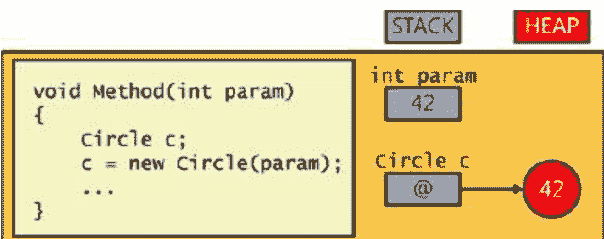

此时，你应该注意以下两点：

- 虽然对象存储在堆上，但对对象的引用（变量 `c`）存储在栈上。

堆内存不是无限的。如果堆内存耗尽，`new` 操作符将抛出 `OutOfMemoryException` 异常，且对象将不会创建。

> 注意 `Circle` 构造函数也可能抛出异常。如果抛出异常，则为 `Circle` 对象分配的内存将被回收，构造函数返回的值为 `null`。

当方法结束时，参数和局部变量超出作用范围。为 `c` 和 `param` 获取的内存会自动释放回栈。运行时注意到 `Circle` 对象不再被引用，在未来的某个时刻，它将安排由堆来回收其内存。（参见第 14 章。）

## System.Object 类

.NET 中最重要的引用类型之一是 `System` 命名空间中的 `Object` 类。为了充分体会 `System.Object` 类的意义，你必须理解**继承**，这在第 12 章“使用继承”中会有描述。现在，简单地接受所有类都是 `System.Object` 的特殊类型，并且你可以使用 `System.Object` 创建一个可以引用任何引用类型的变量。`System.Object` 是一个如此重要的类，以至于 C# 提供了 `object` 关键字作为 `System.Object` 的别名。在代码中，你可以使用 `object`，也可以写 `System.Object`。它们的意思完全相同。

> 提示 使用 `object` 关键字而不是 `System.Object`。它更直观，并且与其他作为类的同义词关键字保持一致，例如用 `string` 代替 `System.String` 以及在第 9 章中涵盖的其他类型。

在接下来的示例中，变量 `c` 和 `o` 都引用同一个 `Circle` 对象。`c` 的类型是 `Circle` 而 `o` 的类型是 `object`（`System.Object` 的别名），这一事实实际上为内存中的同一个项目提供了两种不同的观察视角。

```csharp
Circle c;
c = new Circle(42);
object o;
o = c;
```

接下来的图表说明了变量 `c` 和 `o` 如何引用堆上的同一个项目：

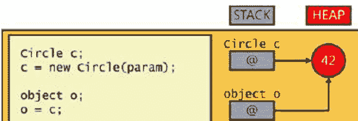

## 装箱

正如你刚刚所看到的，`object` 类型的变量可以引用任何引用类型的任何项目。然而，`object` 类型的变量也可以引用值类型。例如，以下语句将变量 `i`（`int` 类型，一种值类型）初始化为 42，然后将变量 `o`（`object` 类型，一种引用类型）初始化为 `i`：

```csharp
int i = 42;
object o = i;
```

第二条语句需要稍微解释才能理解实际发生了什么。记住 `i` 是一个值类型，它存储在栈上。如果 `o` 内部的引用直接指向 `i`，那么引用将指向栈。然而，引用应该指向堆上的对象。

对栈上的项目创建不受控的引用可能会严重损害运行时的健壮性，并可能导致安全漏洞，因此这是不允许的。因此，运行时从堆上分配一块内存，将整数 `i` 的值拷贝到此内存中，然后让对象 `o` 指向此拷贝。这种从栈到堆的项目自动拷贝被称为**装箱**（Boxing）。接下来的图表展示了：

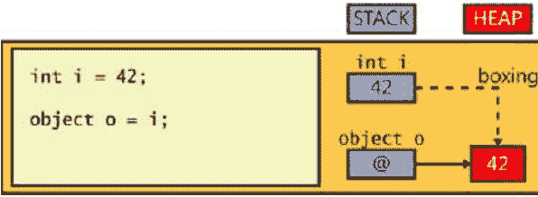

> ### 重要

如果你修改了变量 `i` 的原始值，通过 `o` 引用的堆上的值不会改变。同样，如果你修改了堆上的值，变量的原始值也不会改变。

## 解箱

由于 `object` 类型的变量可以引用值的装箱副本，因此允许你通过该变量获取该装箱值是合理的。你可能认为可以通过如下简单的赋值语句来访问变量 `o` 所引用的装箱 `int` 值：

```csharp
int i = o;
```

然而，如果 `o` 的类型不是你预期的，运行时将抛出 `InvalidCastException` 异常。如果你尝试通过这种简单的赋值语句来访问变量 `o` 所引用的装箱 `int` 值，它将无法工作。运行时将抛出异常。

根据标准的 C# 行为重构逻辑：

由于 `object` 类型的变量可以引用值的装箱副本，因此允许你通过该变量获取该装箱值是合理的。你可能认为可以通过如下简单的赋值语句来访问变量 `o` 所引用的装箱 `int` 值：

```csharp
int i = o;
```

然而，如果 `o` 的类型不是你预期的，运行时将抛出 `InvalidCastException`。如果你尝试通过这种简单的赋值语句来访问变量 `o` 所引用的装箱 `int` 值，它将无法工作。

提供了另外两个非常有用的运算符，可以帮助你以更优雅的方式执行类型转换：`is` 和 `as` 运算符。

## is 运算符

你之前可能见过 `is` 运算符，通常是在检查空值时，但它实际上允许你检查任何引用对象的类型。你可以使用 `is` 运算符来验证一个对象的类型是否符合你的预期，如下所示：

点击此处查看代码图片

```c
var wi = new WrappedInt();
object o = wi;
if (o is WrappedInt) {
    WrappedInt temp = (WrappedInt)o; // 这是安全的；o 是一个 WrappedInt
}
```

`is` 运算符接受两个操作数：左侧是对象的引用，右侧是类型名称（或 `null`）。如果堆上引用的对象的类型与 `is` 运算符指定的类型匹配，则 `is` 求值为为 `true`；否则求结果为 `false`。前面的代码仅在确定转换将成功时，才会尝试缓存对象变量 `o` 的引用。

`is` 运算符的另一种形式允许你通过将类型检查和赋值结合来简化这段代码，如下所示：

点击此处查看代码图片

```csharp
WrappedInt wi = new WrappedInt();
object o = wi;
if (o is WrappedInt temp) {
    ... // 在此处使用 temp
}
```

在这个示例中，如果 `WrappedInt` 类型的测试成功，`is` 运算符会创建一个新的引用变量（称为 `temp`），并将其赋值指向 `WrappedInt` 对象的引用。

## as 运算符

`as` 运算符的作用与 `is` 类似，但方式略有不同。你可以这样使用 `as` 运算符：

点击此处查看代码图片

```csharp
WrappedInt wi = new WrappedInt();
...
object o = wi;
WrappedInt temp = o as WrappedInt;
if (temp is not null)
{
    ... // 转换成功
}
```

与 `is` 一样，`as` 运算符接受一个对象和一个类型作为其操作数。运行时尝试将对象转换为指定的类型。如果转换成功，则返回结果，并在示例中将其赋值给 `WrappedInt` 变量 `temp`。如果转换失败，`as` 运算符求值为 `null`，并将该值赋值给 `temp`。

> 注意

> `is` 和 `as` 运算符的内容比这里描述的要多；

> 第 12 章将对它们进行详细讨论。

## 重新回顾 switch 语句

如果你需要检查引用是否匹配多个类型，可以使用 `is` 运算符结合一系列 `if...else` 语句。以下示例假设你已经定义了 `Circle`、`Square` 和 `Triangle` 类。构造函数接受几何形状的半径（radius）或边长（side）作为参数：

```csharp
var c = new Circle(42);      // 半径为 42 的圆
var s = new Square(55);      // 边长为 55 的正方形
var t = new Triangle(33);   // 边长为 33 的等边三角形
...
object o = s;
...
if (o is Circle myCircle)
{
    ... // o 是圆，在 myCircle 中可以使用引用
}
else if (o is Square mySquare)
{
    ... // o 是正方形，在 mySquare 中可以使用引用
}
else if (o is Triangle myTriangle)
{
    ... // o 是三角形，在 myTriangle 中可以使用引用
}
```

对于任意长度的 `if...else` 语句，这种方法可能会很快变得繁琐且难以阅读。幸运的是，你可以在这种情况下使用 `switch` 语句，如下：


```csharp
switch (o)
{
    case Circle myCircle:
        ... // o 是圆，在 myCircle 中可以使用引用
        break;

    case Square mySquare:
        ... // o 是正方形，在 mySquare 中可以使用引用
        break;

    case Triangle myTriangle:
        ... // o 是三角形，在 myTriangle 中可以使用引用
        break;

    default:
        throw new ArgumentException("变量不是识别的形状");
        break;
}
```

在两个示例中（使用 `is` 运算符和 `switch` 语句），创建的变量（`myCircle`、`mySquare` 和 `myTriangle`）的作用范围局限于相应的 `if` 块或 `case` 块内部的代码。

`switch` 语句中的 `case` 选择器还支持 `when` 表达式，你可以用它来进一步限定选择 `case` 的情况。例如，下面的 `switch` 语句显示了匹配不同尺寸几何形状的 `case` 选择器：

点击此处查看代码图片

```csharp
switch (o)
{
    case Circle myCircle when myCircle.Radius > 10:
        ...
        break;

    case Square mySquare when mySquare.SideLength == 100:
        ...
        break;
}
```

## 指针和不安全代码

此侧栏仅供参考，面向熟悉 C 或 C++ 的开发者。如果你是编程初学者，请随意忽略这些信息。

如果你已经用 C 或 C++ 等语言编写过程序，那么本章中关于对象引用的讨论对你来说可能熟悉，因为这些语言中有一种提供类似功能的结构：指针。指针是一个持有内存中（在堆上或栈上）项目地址或引用的变量。

使用特殊的语法来标识变量为指针。例如，下述语句将变量 `pi` 声明为指向整数的指针：

```csharp
int *pi;
```

虽然变量 `pi` 被声明为指针，但在初始化之前，它不指向任何地方。例如，要使用 `pi`，你可以：

```csharp
pi = 99;
```

你可以通过指针访问并修改 `i` 的值：

```csharp
*pi = 100;
```

指针的主要问题之一是它很容易指向无效区域或完全不指向，结果会导致操作系统检测到非法地址而崩溃。

最后，许多系统中由于指针的管理不当存在安全漏洞。C# 引入了引用变量来避免这些问题。如果你真的想在 C# 中使用指针，必须将其标记为 `unsafe`。`unsafe` 关键字可以标记代码块或整个方法，如下所示：

```csharp
public static void Main(string [] args)
{
    int x = 99, y = 100;
    unsafe
    {
        swap(&x, &y);
    }
    Console.WriteLine($"x 现在是 {x}, y 现在是 {y}");
}

public static unsafe void swap(int a, int *b)
{
    int temp;
    temp = *a;
    *a = *b;
    *b = temp;
}
```

当你编译包含不安全代码的程序时，必须在生成时指定“允许不安全代码”选项。要这样做，请右键点击解决方案管理器中的项目，然后选择属性。在属性窗口中，选择生成选项卡，勾选允许不安全代码，然后在文件菜单上选择保存全部。

不安全代码还会影响内存管理。在不安全代码中创建的对象被称为未托管对象。虽然需要这样访问内存的情况并不常见，但可能会遇到，特别是当你编写需要执行某些底层 Windows 操作的代码时。你将在第 14 章详细学习有关访问未托管内存的影响。

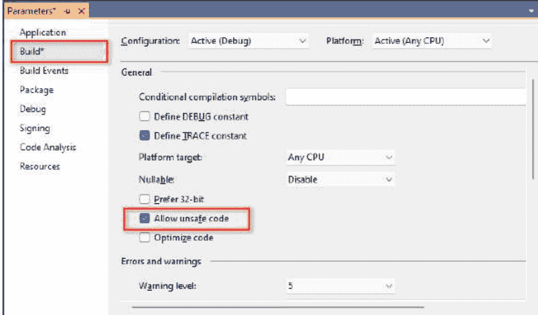

# 总结

在本章中，你学习了直接存储在栈上的值类型与间接引用堆上对象的引用类型之间的一些重要区别。你还学习了如何在方法参数上使用 `ref` 和 `out` 关键字以获取参数访问。你看到将值（例如整数 42）赋值给 `System.Object` 类的变量时，会在堆上创建该值的装箱副本，并导致 `System.Object` 变量指向此装箱副本。你还看到从值类型变量赋值 `System.Object` 类将 `System.Object` 类中的值拷贝（或拆箱）到 `int` 使用的内存中。

- 如果你想继续阅读下一章，请保持 Visual Studio 2022 运行并转到第 9 章。
- 如果你想现在退出 Visual Studio 2022，在“文件”（File）菜单中，选择“退出”（Exit）。如果你看到“保存”对话框，选择“是”并保存项目。

## 快速参考

| 目标 | 执行此操作 |
| --- | --- |
| 复制值变量 | 直接进行复制即可。由于变量是值类型，你将拥有两个相同值的副本。例如：<br><br>```cpp<br>i = 42;<br>int copyi = i;<br>``` |
| 复制引用变量 | 直接进行复制即可。由于变量是引用类型，你将拥有两个指向同一个对象的引用。例如：<br><br>```cpp<br>Circle c = new Circle(42);<br>Circle refc = c;<br>``` |
| 声明可以容纳值类型或 null 值的变量 | 使用 `?` 修饰符配合类型声明变量。例如：<br><br>```cpp<br>int? i = null;<br>``` |
| 向 `ref` 参数传递参数 | 在参数前缀加上 `ref` 关键字。这使参数成为实际参数的别名，而不是参数的副本。方法可能会更改参数的值，这种更改会应用于实际参数而不是本地副本。例如：<br><br>```cpp<br>static void main()<br>{<br>    int arg = 42;<br>    doWork(ref arg);<br>    Console.WriteLine(arg);<br>}<br>``` |
| 向 `out` 参数传递参数 | 在参数前缀加上 `out` 关键字。这使参数成为实际参数的别名，而不是参数的副本。方法必须为参数分配值，且该值将应用于实际参数。例如：<br><br>```cpp<br>static void Main()<br>{<br>    int arg;<br>    doWork(out arg);<br>    Console.WriteLine(arg);<br>}<br>``` |
| 装箱值 | 初始化或为 `object` 类型的变量赋值该值。例如：<br><br>```csharp<br>object o = 42;<br>``` |
| 拆箱值 | 将指向装箱值的对象引用转换为值变量的类型。例如：<br><br>```csharp<br>int i = (int)o;<br>``` |
| 安全地转换对象 | 使用 `is` 运算符测试强制转换是否有效。例如：<br><br>```cpp<br>WrappedInt wi = new WrappedInt();<br><br>...<br><br>object o = wi;<br><br>if (o is WrappedInt temp)<br>{<br>  ...<br>}<br>```<br><br>或者，使用 `as` 运算符执行强制转换，并测试结果是否为 `null`。例如：<br><br>```cpp<br>WrappedInt wi = new WrappedInt();<br><br>...<br><br>object o = wi;<br><br>WrappedInt temp = o as WrappedInt;<br><br>if (temp != null)<br>  ...<br>``` |

# 第 9 章

## 使用枚举和结构创建值类型以及结构体

完成本章后，你将能够：

- 声明枚举类型并创建一个枚举变量。
- 声明结构体类型并创建一个结构体变量。
- 解释结构体和类之间行为上的差异。

第 8 章“理解值和引用”涵盖了 Microsoft Visual C# 中存在的两种基本类型：值类型和引用类型。记住，值类型变量直接存储在栈上，而引用类型变量存储的是指向堆上对象的引用。第 7 章“创建和管理类与对象”演示了如何通过定义类来创建自己的引用类型。在本章中，你将学习如何创建自己的值类型。

C# 支持两种值类型：枚举和结构体。我们将逐一查看它们。

## 使用枚举操作

假设你想在程序中表示一年的季节。你可以使用整数 0、1、2 和 3 分别代表春季、夏季、秋季和冬季。这种系统行得通，但它并不直观。如果你在代码中使用值 0，将无法看出某个特定的 0 代表春季。这并不是一个非常健壮的解决方案。例如，如果你声明了一个名为 `season` 的 `int` 变量，没有什么能阻止你给它分配除 0、1、2 或 3 之外的任何合法整数值。C# 提供了一个更好的解决方案：你可以创建一个枚举（有时称为 `enum` 类型），其值被限于一组符号名称。

## 声明枚举

你通过使用 `enum` 关键字后跟一组包含在大括号内的符号（标识该类型可以拥有的合法值）来定义枚举。以下是声明一个名为 `Season` 的枚举的方法，其字面值被限于 `Spring`、`Summer`、`Fall` 和 `Winter` 名称。

点击此处查看代码图片

```cpp
enum Season { Spring, Summer, Fall, Winter }
```

## 使用枚举

声明枚举后，你可以像使用任何其他类型一样使用它。如果你的枚举名称是 `Season`，你可以创建 `Season` 类型的变量、`Season` 类型的字段以及 `Season` 类型的参数，如下例所示：

点击此处查看代码图片

```cpp
enum Season { Spring, Summer, Fall, Winter }

class Example
{
    public void Method(Season parameter) // 方法参数示例
    {
        ...
    }

    private Season currentSeason; // 字段示例
}
```

在读取枚举的值之前，它必须被赋值。接下来的代码示例输出值 2 而不是 `Fall`（记住，在枚举中，`Spring` 是 0，`Summer` 是 1，`Fall` 是 2，`Winter` 是 3）：

点击此处查看代码图片

```cpp
enum Season { Spring, Summer, Fall, Winter }

...

Season colorful = Season.Fall;
```

## 注意事项

与所有值类型一样，通过使用 `?` 修饰符可以创建枚举的可空版本。你可以将 `null` 值赋值给变量：

```cpp
Season? colorful = null;
```

注意，你必须写 `Season.Fall` 而不仅仅是 `Fall`。

此外，当你使用内置的 `ToString` 方法显示枚举变量时，如下所示：

点击此处查看代码图片

```cpp
string name = colorful.ToString();

Console.WriteLine(name); // 输出 'Fall'
```

你可以对枚举使用许多标准运算符（位运算符和移位运算符将在第 16 章“处理二进制数据和使用索引器”中介绍）。例如，你可以使用相等运算符 `=` 比较相同类型的枚举变量，甚至可以对枚举进行算术运算——尽管结果并不总是有用！

## 选择枚举字面值

在内部，枚举类型为枚举中的每个元素关联了一个整数值。默认情况下，编号从第一个元素开始，每次递增 1。

可以获取枚举变量的底层整数值。要这样做，你必须将其强制转换为底层类型。第 8 章中关于解释强制转换会将数据从一种类型转换为另一种类型的讨论提到，只要转换是有效且有意义的。接下来的代码示例输出值 2 而不是 `Fall`（记住，在 `Season` 枚举中，`Spring` 是 0，`Summer` 是 1，`Fall` 是 2，`Winter` 是 3）：

点击此处查看代码图片

```cpp
enum Season { Spring, Summer, Fall, Winter }

...

Season colorful = Season.Fall;

Console.WriteLine((int)colorful); // 输出 2
```

如果你愿意，可以将特定的整数常量（例如 1）与枚举字面值（例如 `Spring`）关联，如下：

```cpp
enum Season { Spring = 1, Summer, Fall, Winter }
```

> **重要** 初始化枚举字面值的整数值必须是编译时常量值（例如 1）。

如果你不显式地赋予枚举字面值常量整数值，编译器会给它一个比上一个枚举字面值更大的值，第一个枚举字面值会被赋予默认值 0。在前面的示例中，`Spring`、`Summer`、`Fall` 和 `Winter` 的底层值现在是 1、2、3 和 4。

你允许多个枚举字面量具有相同的底层值。例如，在英国，`fall` 被称为 `autumn`。你可以按照如下方式兼顾这两种文化：

点击此处查看代码图像

```csharp
enum Season { Spring, Summer, Fall, Autumn = Fall, Winter }
```

## 选择枚举的底层类型

当你声明一个枚举时，枚举字面量会被赋予类型为 `int` 的值。你也可以选择让你的枚举基于不同的底层类型。例如，要将 `Season` 的底层类型声明为 `short` 而不是 `int`，你可以这样写：

点击此处查看代码图像

```csharp
enum Season : short { Spring, Summer, Fall, Winter }
```

使用 `short` 的主要原因是节省内存；`int` 占用的内存比 `short` 多，如果你不需要 `int` 能够提供的整个值范围，那么使用较小的数据类型是有意义的。

你可以基于任何八种整数类型创建枚举：`byte`、`sbyte`、`short`、`ushort`、`int`、`uint`、`long` 或 `ulong`。所有枚举字面量的值必须在所选基础类型的范围内。例如，如果基于 `byte` 数据类型，你最多可以有 256 个字面量（从 0 开始）。

现在你已经知道如何声明枚举，下一步是使用它。在练习中，你将通过一个控制台应用程序来声明并使用表示月份的枚举。

## 创建和使用枚举

1. 启动 Microsoft Visual Studio 2022（如果它尚未运行）。
2. 打开 `StructsAndEnums` 解决方案，它位于文档文件夹中的 `\Microsoft Press\VCSBS\Chapter 9\StructsAndEnums` 文件夹下。
3. 在代码和文本编辑器窗口中显示 `Month.cs` 文件。

除了声明名为 `StructsAndEnums` 的命名空间以及一个 `// TODO:` 注释外，源文件是空的。

4. 将 `// TODO:` 注释替换为 `StructsAndEnums` 命名空间内名为 `Month` 的枚举，如下代码所示。该枚举模拟了一年的月份。12 个枚举字面量为 `Month January` 到 `December`。

点击此处查看代码图像

```csharp
namespace StructsAndEnums
{
    enum Month
    {
        January, February, March, April,
        May, June, July, August,
        September, October, November, December
    }
}
```

5. 在代码和文本编辑器窗口中显示 `Program.cs` 文件。

与之前章节中的练习一样，`Main` 方法调用 `doWork` 方法并捕获发生的任何异常。

6. 在代码和文本编辑器窗口中，在 `doWork` 方法中添加语句声明一个名为 `first` 的类型为 `Month` 的变量，并将其初始化为 `Month.January`。添加另一个语句将第一个变量的值写入控制台。

`doWork` 方法看起来应该是这样的：

```csharp
static void doWork()
{
    Month first = Month.January;
    Console.WriteLine(first);
}
```

> 注意：当你输入 `Month` 后的句号时，Microsoft IntelliSense 会自动显示 `Month` 枚举中的所有值。

7. 在“调试”菜单上，选择“不调试启动”。Visual Studio 2022 编译并运行程序。确认控制台写入了单词 "January"。
8. 按回车键关闭程序并返回 Visual Studio 2022 编程环境。
9. 在 `doWork` 方法中添加两个语句来增加第一个变量并将其新值显示在控制台上，如此处加粗所示：

```csharp
static void doWork()
{
    Month first = Month.January;

    Console.WriteLine(first);

    first++;

    Console.WriteLine(first);
}
```

10. 在“调试”菜单上，选择“不调试启动”。Visual Studio 2022 编译并运行程序。控制台写入了 "January" 和 "February"。注意，在枚举变量上执行数学运算（如自增操作）会更改变量的内部整数值。当变量写入控制台时，将显示相应的枚举值。
11. 按回车键关闭程序并返回 Visual Studio 2022 编程环境。
12. 修改 `doWork` 方法中的第一个语句，将第一个变量初始化为 `Month.December`，如此处加粗所示：

```csharp
static void doWork() {
    Month first = Month.December;
```


`Console.WriteLine(first);`

`first++;`

`Console.WriteLine(first);`

```

- 13. 在“调试”菜单上，选择“不调试启动”。这次控制台写入了单词 "December"，紧接着是数字 12。

尽管你可以对枚举进行算术运算，但如果操作的结果超出了枚举定义的范围，运行时可以将变量的值解释为相应的整数值。

- 14. 按回车键关闭程序并返回 Visual Studio 2022 编程环境。

## 使用结构体

第 8 节说明了类定义了引用类型，它们始终在堆（heap）上创建。在某些情况下，类的数据非常少，以至于管理堆的开销变得不成比例。在这些情况下，将类型定义为结构体更好。结构体是一种值类型。由于结构体存储在栈（stack）上，只要结构体足够小，就能减少内存开销。与类一样，结构体可以有字段、方法和（稍后将讨论的一个重要例外）构造函数。

## 常见的结构体类型

你可能没有意识到，但在之前的练习中你已经使用过结构体了。例如，在 C# 中，原始类型 `int`、`long` 和 `float` 实际上是结构体 `System.Int32`、`System.Int64` 和 `System.Single` 的别名。这些结构体提供了 `ToString` 方法，可以将数值转换为其字符串表示。以下语句在 C# 中都是合法的：

```
int i = 55;

Console.WriteLine(i.ToString());

Console.WriteLine(55);
```

```
float f = 98.76F;

Console.WriteLine(f.ToString());

Console.WriteLine(98.76);
```

```
Console.WriteLine((500).ToString());
```

你并不经常看到这种 `ToString` 方法的用法，因为 `Console.WriteLine` 方法在需要时会自动调用它。使用这些结构体暴露的一些静态方法更为常见。例如，在之前的章节中，你使用了静态 `int.Parse` 方法将字符串转换为其对应的整数值。你实际上做的是调用 `Int32` 结构体的 `Parse` 方法：

```
string s = "42";

int i = int.Parse(s); // 等同于 Int32.Parse
```

这些结构体还包含一些静态字段。例如，`Int32.MaxValue` 是 `int` 可以保存的最大值，而 `Int32.MinValue` 是你可以在 `int` 中存储的最小值。

下表显示了 C# 中的原始类型在 .NET 中的对应类型。注意 `string` 和 `object` 类型是

| 关键字 | 等效类型 | 类或结构体 |
|---|---|---|
| `bool` | `System.Boolean` | 结构体 |
| `byte` | `System.Byte` | 结构体 |
| `decimal` | `System.Decimal` | 结构体 |
| `double` | `System.Double` | 结构体 |
| `float` | `System.Single` | 结构体 |
| `int` | `System.Int32` | 结构体 |
| `long` | `System.Int64` | 结构体 |
| `object` | `System.Object` | 类 |
| `sbyte` | `System.SByte` | 结构体 |
| `short` | `System.Int16` | 结构体 |
| `string` | `System.String` | 类 |
| `uint` | `System.UInt32` | 结构体 |
| `ulong` | `System.UInt64` | 结构体 |
| `ushort` | `System.UInt16` | 结构体 |

## 声明结构体

要声明自己的结构体类型，你可以使用 `struct` 关键字，后跟类型名称，然后用大括号包含结构体主体。语法上，该过程与声明类相似。例如，这是一个名为 `Time` 的结构体，它包含三个公共的 `int` 字段，分别为 `hours`、`minutes` 和 `seconds`：

```
struct Time

{

    public int hours, minutes, seconds;

}
```

与类一样，在大多数情况下，将结构体的字段设置为公共（public）是不建议的；因为无法控制公共字段中存储的值。例如，任何人都可以将 `minutes` 或 `seconds` 的值设置为大于 60 的值。更好的想法是将字段设置为私有（private），并为结构体提供构造函数和方法来初始化和操作这些字段，如下例所示：

```
struct Time

{

    private int hours, minutes, seconds;

    ...

    public Time(int hh, int mm, int ss)

{

        this.hours = hh % 24;

        this.minutes = mm % 60;

        this.seconds = ss % 60;

    }

    public int Hours()

{

        return this.hours;

    }

}
```

> 注意
> 默认情况下，你无法对自定义结构体类型使用许多常用运算符。例如，你不能使用相等运算符 (`==`) 或不等于运算符 (`!=`) 来比较结构体类型变量。然而，你可以使用所有结构体都公开的内置 `Equals()` 方法来比较结构体类型变量。你也可以为自己的结构体类型显式地声明并实现运算符。此类操作的语法将在第 21 章“使用查询表达式对内存数据进行查询”中介绍。

当你复制一个值变量时，你会获得该值的两个副本。相比之下，当你复制引用类型变量时，你获得的是指向同一个对象的两个引用。总之，对于小型数据值，使用结构体，因为复制该值与复制地址一样简单或容易。对于大到无法高效复制的复杂数据，请使用类。

> 提示
> 使用结构体来实现简单的概念，其主要特征是其值而不是其所提供的功能。

## 理解结构体和类之间的区别

结构体和类在语法上相似，但它们有一些重要的区别。让我们来看其中的一些变化：

- 你不能为结构体声明默认构造函数（无参数的构造函数）。如果 `Time` 是一个类，下面的示例将可以通过编译，但由于 `Time` 是结构体，它无法通过编译：

```
struct Time

{

    public Time() { ... } // 编译错误

    ...

}
```

你不能为结构体声明自己的默认构造函数，因为编译器总是会生成一个。在类中，只有在你没有自己写构造函数时，编译器才会合成默认构造函数。编译器生成的结构体默认构造函数始终将字段设置为 0、`false` 或 `null`——就像类一样。因此，你应该确保由默认构造函数创建的结构体值在逻辑上是正确的，并且使用这些默认值是有意义的。这将产生一些影响，你将在下一个练习中探索。

你可以通过提供非默认构造函数将字段初始化为不同的值。然而，当你这样做时，你的默认构造函数必须显式地初始化结构体中的所有字段；默认初始化不再发生。如果你没有这样做，你将得到编译错误。例如，如果 `Time` 是一个类，下面的示例将通过编译并静默地将 `seconds` 初始化为 0，但由于 `Time` 是结构体，它无法编译：

```
struct Time

{

    private int hours, minutes, seconds;

    public Time(int hh, int mm)

    {

        this.hours = hh;

        this.minutes = mm;

    } // 编译错误：seconds 未初始化
```

- 在类中，你可以在声明处初始化实例字段；在结构体中，你不能。如果 `Time` 是一个类，下面的示例将通过编译，但由于 `Time` 是结构体，它会导致编译错误：

```
struct Time

{

    private int hours = 0; // 编译错误

    private int minutes; private int seconds;

    ...
```

下表总结了结构体和类之间的主要区别：

| 问题 | 结构体 | 类 |
| --- | --- | --- |
| 它是值类型还是引用类型？ | 结构体是值类型。 | 类是引用类型。 |
| 实例存存在栈上还是堆上？ | 结构体实例被称为值，通常存在栈上（参见下文注释）。 | 类实例被称为对象，通常存在堆上。 |
| 你可以声明默认构造函数吗？ | 否 | 是 |
| 如果你声明了自己的构造函数，编译器还会生成默认构造函数吗？ | 是 | 否 |
| 如果你在自己的构造函数中没有初始化字段，编译器会自动为你初始化它吗？ | 否 | 是 |
| 你是否允许在声明处初始化实例字段？ | 否 | 是 |

> 注意
> 在某些情况下，结构体会在堆上而不是栈上创建。这最常见的情况是当类声明了一个类型为结构体的字段时。当创建此类类的对象时，结构体的内存是作为对象的一部分分配在堆上的，而不是在栈上单独分配。

在类和结构体之间在继承方面还有其他区别。这些区别将在第 12 章“处理继承”中介绍。

## 声明结构体变量

定义结构体类型后，你可以像使用任何其他类型一样使用它。例如，如果你定义了 `Time` 结构体，你就可以创建 `Time` 类型的变量、字段和参数，如下例所示：

```
struct Time

{

    private int hours, minutes, seconds;

    ...

}

class Example

{

    private Time currentTime;

    public void Method(Time parameter)

    {

        Time localVariable;

    }

}
```

> 注意
> 与枚举一样，你可以通过 `?` 修饰符创建结构体的可空版本。你可以这样赋值：

```
Time? currentTime = null;
```

## 理解初始化

在本章早些时候，你看到如何通过构造函数初始化结构体。如果你调用构造函数，结构体将被初始化：

```
var now = new Time();
```

下图显示了结构体字段的状态：

`img/4b83ea14d5792003252b3db7`

然而，由于结构体是值类型，你也可以在不调用构造函数的情况下创建变量，如下：

```
Time now;
```

此时，变量创建了，但其字段处于未初始化状态。下图显示了结构体字段的状态：

`img/4b83ea14d5792003252b3db7`

> 注意
> 在两种情况下，`now` 变量都在栈上创建。

如果你编写了自己的结构体构造函数，你也可以用它来初始化结构体变量。正如在本章早期提到的，结构体构造函数必须显式地初始化所有字段。例如：

```
struct Time

{

    private int hours, minutes, seconds;

    ...

    public Time(int hh, int mm)

    {

        hours = hh;

        minutes = mm;

        seconds = 0;

    }

}
```

下面的示例通过调用用户定义的构造函数初始化 `now`：

`Time now = new Time(12, 30);`

下图显示了该示例的效果：

| `Time now = new Time(12, 30);` | `now.hours` | 12 |
| | `now.minutes` | 30 |
| | `now.seconds` | 0 |

是时候实践知识了。在下面的练习中，你将创建并使用结构体来表示日期。

## 创建并使用结构体类型

- 1. 在 `StructsAndEnums` 项目中，在代码文本编辑器窗口显示 `Date.cs` 文件。
- 2. 在 `StructsAndEnums` 命名空间内，将 `// TODO:` 注释替换为名为 `Date` 的结构体。

该结构包含三个私有字段：一个类型为 `int` 的 `year`，一个类型为 `Month`（使用你在上一个练习中创建的枚举）的 `month`，以及一个类型为 `int` 的 `day`。`Date` 结构体应该完全如下：

```
struct Date

{

    private int year;

    private Month month;

    private int day;

}
```

考虑编译器为 `Date` 生成的默认构造函数。该构造函数将 `year` 设置为 0，`month` 设置为 0（月份的值），`day` 设置为 0。`year` 值 0 是无效的（因为没有 0 年），`day` 值 0 也是无效的（因为每个月从1 号开始）。解决这个问题的一种方法是通过实现 `Date` 结构体来转换年份和日期值，使得当 `year` 字段持有值 `r` 时，代表年份 `r+1900`（你可以选择不同的世纪，但你生活中的大多数重大事件都发生在上一个世纪），并且当 `day` 字段持有值 `d` 时，此值代表第 d + 1 天。默认构造函数会将这三个字段设置为代表 1900 年 1 月 1 日的值。

如果你可以重写默认构造函数并编写自己的，那么这个问题就不是问题了，因为你可以直接将年份和日期初始化为有效值。你无法这样做，所以你必须在你的结构体中实现逻辑，将编译器生成的默认值转换为对你的问题领域有意义的值。

尽管你不能重写默认构造函数，但定义非默认构造函数仍然良好的做法，允许用户显式地将结构中的字段初始化为有意义的默认值。

- 3. 为 `Date` 结构体添加一个公共构造函数。该构造函数应接受三个参数：一个名为 `cccy` 的 `int` 类型（年份），一个名为 `mm` 的 `Month` 类型（月份），以及一个名为 `dd` 的 `int` 类型（天数）。使用这些参数来初始化相应的字段。值为 `y` 的年份字段代表年份 `y + 1900`，因此你必须将年份字段初始化为值 `cccy - 1900`。值为 `d` 的天字段代表第 `D + 1` 天，因此你需要将天字段初始化为值 `dd - 1`。

`Date` 结构体现在应该像这样（构造函数已加粗）：

```
struct Date {

    private int year;

    private Month month;

    private int day;

    public Date(int cccy, Month mm, int dd) {

        this.year = cccy - 1900;

        this.month = mm;

        this.day = dd - 1;

    }

}
```

- 4. 在构造函数之后为 `Date` 结构体添加一个名为 `ToString` 的公共方法。该方法不接受参数并返回日期的字符串表示。记住，年份字段的值代表年份 + 1900，天字段的值代表第 + 1 天。

> 注意
> `ToString` 方法与你目前为止看到的方法略有不同。每个类型（包括你定义的结构体和类）无论你是否想要，都自动拥有一个 `ToString` 方法。它的默认行为是将变量中的数据转换为该数据的字符串表示。有时默认行为是有意义的；其他时候则意义不大。例如，为 `Date` 结构体生成的 `ToString` 方法的默认行为仅仅生成字符串 "StructsAndEnums"。引用Douglas Adams 在《The Restaurant at the End of the Universe》（Pan Macmillan, 1980）中 Zaphod Beeblebrox 的话，这是“精明而乏味的”。你需要定义此方法的新版本，通过使用 `override` 关键字来覆盖默认行为。覆盖方法的主将在第 12 章进行详细讨论。

`ToString` 方法应该像这样：

在此方法中，你使用月份字段字段的文本表示、表达式 `this.day + 1` 以及表达式 `this.year + 1900` 构建一个格式化字符串。`ToString` 方法将格式化字符串作为结果返回。

- 5. 在代码和文本编辑器窗口中显示 `Program.cs` 文件。

- 6. 在 `doWork` 方法中，注释掉现有四个语句。

- 7. 在 `doWork` 方法中添加语句，声明一个名为 `defaultDate` 的局部变量并将其初始化为使用默认 `Date` 构造函数构建的 `Date` 值。在 `doWork` 中添加另一个语句，通过调用 `Console.WriteLine` 在控制台上显示 `defaultDate` 变量。

> 注意
> `Console.WriteLine` 方法会自动调用其参数的 `ToString` 方法，将参数格式化为字符串。

`doWork` 方法现在应该像这样：

```
static void doWork()

{

  .. var defaultDate = new Date();

  Console.WriteLine(defaultDate);
}
```


> 注意
> 当你输入`new Date()`时，IntelliSense 自动检测到`Date`类型有两个构造函数可用。

- 8. 在调试菜单上，选择转调试启动（Start Without Debugging）来编译并运行程序。验证控制台上输出了 1900 年 1 月 1 日。
- 9. 按 **Enter** 键返回 Visual Studio 2022 编程环境。
- 10. 在代码和文本编辑器窗口中，返回`doWork`方法并添加两个语句。在第一个语句中，声明一个名为`weddingAnniversary`的局部变量并将其初始化为 2021 年 7 月 4 日。（我实际上是在独立日结婚的，尽管那是很多年前而且在英国。）在第二个语句中，将`weddingAnniversary`的值写入控制台。

`doWork`方法现在应该像这样：

点击此处查看代码图片

```
static void doWork()
{
    Date weddingAnniversary = new Date(2021, Month.July, 4);
    Console.WriteLine(weddingAnniversary);
}
```

- 11. 在 **调试** 菜单上，选择**转调试启动**，然后确认日期`2021年7月4日`已写入前一条信息下面的控制台上。
- 12. 按 **Enter** 关闭程序并返回 Visual Studio 2022。

# 复制结构体变量

你允许初始化或将一个结构体变量赋值另一个结构体变量，但仅当右侧的结构体变量已完全初始化（即如果它的所有字段都填充了有效数据而不是未定义的值）。以下示例可以编译，因为`now`现在已完全初始化。插图显示了执行此类赋值的结果。

点击此处查看代码图片

```
Date now = new Date(2012, Month.March, 19);
Date copy = now;
```


以下示例无法编译，因为`now`未初始化：

```
Date now;
Date copy = now; // 编译错误：now 未赋值
```

当你复制结构体时，左侧的每个字段直接使用右侧的值初始化。这种复制是一个快速操作，复制了整个结构体的内容，并且它不会抛出异常。如果这是一个类，两个变量都将引用堆上的同一个对象。

> 注意
> 如果你是 C++ 程序员，请注意这种拷贝是可以自定义的。

在下一个练习中，你将对比结构和类的行为。

# 比较结构和类的行为

1. 在 StructsEnums 项目中显示`Date.cs`文件。
2. 为`Date`结构体添加以下方法。该方法将日期向前移动一个月。如果月份后月份超过了十二月，代码会将月份重置为一月并将年份值加 1。

点击此处查看代码图片

```csharp
struct Date
{
    public void AdvanceMonth()
    {
        this.month++;
        if (this.month == Month.December)
        {
            this.month = Month.January;
            this.year++;
        }
    }
}
```

3. 显示`Program.cs`文件。
4. 在`doWork`方法中，注释掉前两个语句。
5. 在`doWork`方法末尾添加以下代码。此代码创建了`weddingAnniversary`变量的副本`weddingAnnCopy`，并打印此新变量的值。

点击此处查看代码图片

```csharp
static void doWork()
{
    Date weddingAnnCopy = weddingAnniversary;
    Console.WriteLine($"Value of copy is {weddingAnnCopy}");
}
```

6. 在`doWork`方法末尾添加以下**加粗**语句。这些语句调用`weddingAnniversary`变量的`AdvanceMonth`方法，然后显示`weddingAnniversary`和`weddingAnnCopy`变量的值：

点击此处查看代码图片

```csharp
static void doWork()
{
    weddingAnniversary.AdvanceMonth();
    Console.WriteLine("New value of weddingAnniversary");
    Console.WriteLine($"Value of copy is still\n{weddingAnnCopy}");
}
```

7. 在调试菜单上，选择调试启动以编译并运行应用程序。验证控制台显示了以下消息：

点击此处查看代码图片

```
July 4 2021
Value of copy is July 4 2021
New value of weddingAnniversary is August 4 2021
Value of copy is still July 4 2021
```

8. 按回车键返回 Visual Studio 2022。
9. 在代码和文本编辑器窗口中显示`Date.cs`文件。
10. 将`Date`结构体更改为类，如下代码示例中的**粗体**所示：

```
class Date
{
  ...
}
```

11. 在“调试”菜单上，选择“转调试调试”以重新生成并运行应用程序。验证控制窗口是否显示以下消息：

[点击此处查看代码图像](#)

```
July 4 2021
Value of copy is July 4 2021
New value of weddingAnniversary is August 4 2021
Value of copy is still August 4 2021
```

前三条消息与之前相同。然而，第四条消息显示`weddingAnniversaryCopy`变量的值已变为 August 4 2021。

12. 按回车键返回 Visual Studio 2022。

## 处理大型结构体

虽然大多数结构体的大小很小，但你可以创建包含许多字段和/或结构类型的结构体。当你将此类型的变量作为参数传递给方法时，整个结构体（包括任何子结构体）将被复制到栈中。如果频繁这样做，可能会影响应用程序的性能。

为了解决这个问题，可以像第 8 章描述的那样使用`ref`修饰符按引用传递结构体。但请注意，对结构体中字段所持值的更改现在将是永久的；它们不是在本地副本上进行的。以下代码显示了一个示例：

[点击此处查看代码图像](#)

```
struct BigStruct
{
    // 这里有许多、许多字段！
    ...
}
...
var myData = new BigStruct();
ProcessData(ref myData);
...
void ProcessData(ref BigStruct)
{
    // data 是 myData 的引用，而不是副本
...}
```

# 总结

在本章中你学习了如何创建和使用枚举和结构体。你学习了结构体和类之间的一些相似与之处，并看到了如何定义构造函数来初始化结构体中的字段。你还看到了如何通过重写`ToString`方法将结构体表示为字符串。

- 如果你想继续后续章节，请保持 Visual Studio 2022 运行并转到第 10 章，“使用数组”。
- 如果你现在想编辑 Visual Studio 2022，在“文件”菜单上选择“退出”。如果看到保存对话框，选择“是”并保存项目。

## 快速参考

| 目标 | 执行操作 |
|---|---|
| 声明枚举 | 编写`enum`关键字，后跟类型名称，然后是一个包含用逗号分隔的枚举字面量名称列表的大括号对。例如：

[点击此处查看代码图像](#)

```
enum Season { Spring, Summer, Fall, Winter }
``` |
| 声明枚举变量 | 在左侧编写枚举名称，后跟变量名称，最后加分号。例如：

`Season currentSeason;` |
| 给枚举变量赋值 | 编写枚举字面量名称并结合它所属的枚举名称。例如：

[点击此处查看代码图像](#)

```
currentSeason = Season.Spring; // 正确

但注意：

Season = Spring; // 错误
``` |
| 声明结构体类型 | 编写`struct`关键字，后跟结构体的体（构造函数、方法和字段）。例如：

[点击此处查看代码图像](#)

```
struct Time {
    public Time(int hh, int mm, int ss) {
        { ... }
    }
    private int hours, minutes, seconds;
}
``` |
| 声明结构体变量 | 编写结构体类型名称，后跟变量名称，最后加分号。例如：<br>`Time now;` |
| 初始化结构体变量的值 | 将变量初始化为调用结构体构造函数创建的结构体值。例如：
[点击此处查看代码图像](#)<br>`Time lunch = new Time(12, 30, 0);` |

# 第 10 章

## 使用数组

完成本章后，你将能够：

- 声明数组变量。
- 创建数组实例。
- 使用一组数据项填充数组并访问这些项。
- 复制数组。
- 创建并使用多维数组。

你已经学习了如何创建和使用许多不同类型的变量。然而，到目前为止看到的所有变量示例都有一个共同点：它们持有关于单个项目的信息（一个`int`、`float`、`Circle`等）。但如果你需要处理一组项目该怎么办？

一种解决方案是为集合中的每个项目创建一个变量，但这会导致一些进一步的问题：

- 你需要多少个变量？
- 你应该如何命名它们？

如果你需要对集合中的每个项目执行相同的操作（例如增加整数集中的每个变量的值），你将如何避免非常重复的代码？

此外，使用变量来处理单独的项目假设了你在编写程序时已经知道需要多少个项目。这种情况有多常见？例如，如果你正在编写一个从读取和处理记录的应用程序

数组提供了一种有助于解决这些问题的机制。与具有不同类型的结构体或类不同，数组中的所有项具有相同的类型。

## 声明数组变量

你通过指定元素类型、后接方括号和名称来声明数组变量。例如，声明一个名为`pins`的`int`数组（用于保存一组 ID），你可以这样写：

[点击此处查看代码图像](#)

```
int[] pins;
```

> 注意
> 如果你是 Microsoft 基础编程员，请注意声明使用的是方括号而不是圆括号。你并不限制只能使用原始类型作为数组元素。你还可以创建结构体、枚举和类的数组。例如，你可以像这样创建一个`Date`数组：

```
Date[] dates;
```

> 提示
> 给数组变量起复数名称通常很有用，例如`places`（每个元素都是`Place`）、`people`（每个元素都是`Person`）或`times`（每个元素都是`Time`）。

## 创建数组实例

无论其元素类型是什么，数组都是引用类型。这意味着数组变量*引用*堆上的一个持有数组元素的连续内存块，就像类变量引用堆上的对象一样。（有关值和引用的描述以及栈和堆之间的差异，请参阅第 8 章，“理解值和引用”。）无论数组中的数据项类型是什么类型，该规则都适用。即使数组包含如`int`等值类型，内存仍分配在堆上；

记住，当你声明类变量时，在使用`new`关键字声明实例之前，不会为对象分配内存。数组遵循相同的模式：当你声明数组变量时，你没有指定大小，也没有分配内存（除了在栈上持有引用）。数组只有在创建实例时才会分配内存；这也是指定数组大小的地方。

要创建数组实例，你使用`new`关键字，后跟元素类型，然后是括在方括号内的要创建的数组的大小。创建数组会使用现在熟悉的默认值（取决于类型是数值、引用还是布尔，分别为 0、null 或 false）初始化其元素。例如，为之前定义的`pins`变量创建并初始化一个四个整数的数组，你写：

```
pins = new int[4];
```

下面的插图显示了在声明数组以及之后创建数组实例时发生了什么：

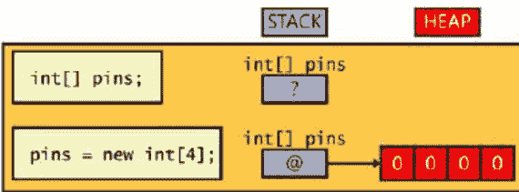

由于数组实例的内存是动态分配的，数组的大小不需要是常量；它可以在运行时计算，如下所示

在此示例中：

[点击此处查看图像]

```
int size = int.Parse(Console.ReadLine());
int[] pins = new int[size];
```

你也可以创建一个大小为 0 的数组。这听起来可能很奇怪，但对于数组大小动态确定且可能为 0 的情况是非常有用的。大小为 0 的数组不是空数组；它是一个包含零元素的数组。

## 填充和使用数组

当你创建一个数组实例时，数组中的所有元素都会根据其类型初始化为默认值。例如，所有数值都初始化为 0，对象初始化为 null，`DateTime`值被设置为日期和时间 "01/01/0001 00:00:00"，字符串则初始化为 null。

如果你愿意，可以修改此行为并将数组元素初始化为特定值。你可以通过在一对括号之间提供用逗号分隔的值列表来实现这一点。例如，要将`pins`初始化为包含值为 9、3、7 和 2 的包含四个`int`变量的数组，你可以这样写：

[点击此处查看图像]

```
int[] pins = new int[4]{ 9, 3, 7, 2 };
```

括号之间的值不需要是常量；它们可以在运行时计算，如下例所示，该示例用四个随机数填充了数组：

[点击此处查看图像]

```
Random r = new Random();
int[] pins = new int[4]{ r.Next() % 10, r.Next() % 10, r.Next() % 10,
r.Next() % 10 };
```

> 注意
> `System.Random`类是一个伪随机数生成器。`Next`方法默认返回一个 0 到`Int32.MaxValue`范围内的非负随机整数。`Next`方法是重载的，其他版本允许你指定范围的最小值和最大值。`Random`类的默认构造函数使用与时间相关的种子值为随机数生成器设置种子，这减少了该类重复随机数序列的可能性。通过使用重载版本的构造函数，你可以提供自己的种子值。这样，你就可以为测试目的生成可重复的随机数序列。

括号之间的值数量必须与正在创建的数组实例的大小完全匹配：

[点击此处查看图像]

```
int[] pins = new int[3]{ 9, 3, 7, 2 }; // 编译错误
int[] pins = new int[4]{ 9, 3, 7 }; // 编译错误
int[] pins = new int[4]{ 9, 3, 7, 2 }; // OK
```

当你以这种方式初始化数组时，实际上可以省略`new`表达式和数组的大小。在这种情况下，编译器会根据初始化器的数量计算大小，并生成创建数组的代码，如下所示：

```
int[] pins = { 9, 3, 7, 2 };
```

如果你创建一个结构体或对象的数组，可以通过调用结构体或类的构造函数来初始化数组中的每个结构体，如下所示：

[点击此处查看图像]

```
Time[] schedule = { new Time(12,30), new Time(5,30) };
```

## 创建隐式类型数组

你声明数组元素类型必须与你尝试存储在数组中的元素类型匹配。例如，如果你像前面的示例那样将`pins`声明为`int`数组，则你不能在该数组中存储`double`、`string`、`struct`或任何不是`int`的内容。

如果你在声明数组时指定初始化器列表，可以让 C# 编译器为你推断数组中元素的实际类型，如下所示：

[点击此处查看图像]

```
var names = new[]{"John", "Diana", "James", "Francesca"};
```

在此示例中，C# 编译器确定`names`变量是一个字符串数组。值得注意的是此声明中的几个语法上的特殊之处：

- 你省略了类型中的方括号；此示例中的`names`变量被简单地声明为`var`，而不是`var[]`。
- 你必须在初始化器列表之前指定`new`算符和方括号。

如果你使用这种语法，必须确保所有的初始化器都具有相同的类型。接下来的示例会导致编译器错误“No best type found for implicitly-typed array”（未为隐式类型数组找到最佳类型）：

[点击此处查看图像]

```
var bad = new[]{"John", "Diana", 99, 100};
```

然而，在某些情况下，如果这样做有意义，编译器会将元素转换为不同的类型。在下面的代码中，`numbers`数组是`double`数组，因为常量 3.5 和 99.999 都是`double`，且 C# 编译器可以将值 1 和 2 转换为`double`值：

[点击此处查看图像]

```
var numbers = new[]{1, 2, 3.5, 99.999};
```

> 注意
> 通常，最好避免混合类型，不要希望编译器为你进行转换。

当你处理匿名类型时，隐式类型数组最为有用，正如第7章“创建和管理类和对象”中所述。下面的代码创建了一个匿名对象数组，每个对象包含两个属性：

```csharp
var people = new[] {
  new { Name = "John", Age = 57 },
  new { Name = "Diana", Age = 57 },
  new { Name = "James", Age = 30 },
  new { Name = "Francesca", Age = 26 }
};
```


# 访问数组元素

要访问单个元素，必须提供索引。数组索引是从 0 开始的；因此第一个元素是索引 0。例如，你可以通过以下代码读取第三个元素：

```csharp
int myPin = pins[2];
```

同样，你可以通过给索引赋值来更改数组的内容：

```csharp
pins[2] = 5;
```

所有数组访问都是经过检查的。如果你指定的索引小于 0 或大于长度，将抛出 `IndexOutOfRangeException`，如下例：

```csharp
try
{
    int[] pins = { 9, 3, 7, 2 };

    Console.WriteLine(pins[4]);
}
catch (IndexOutOfRangeException ex)
{
    ...
}
```

## 访问数组序列

C# 允许你使用 `x..y` 索引从数组中检索一组连续元素。从元素 `x` 开始到 `y` 结束的序列（这很重要）不包括 `y`。返回的是包含这些元素的数组。在下面的示例中，`subset` 包含了 `names` 的元素 0 和 1：

[点击此处查看图像]

```csharp
var names = new[]
{
    new { Name = "John", Age = 57 },
    new { Name = "Diana", Age = 57 },
    new { Name = "James", Age = 30 },
    new { Name = "Francesca", Age = 26 }
};

var subset = names[0..2];
```

范围的第一个数字必须小于等于第二个数字；否则将得到 `ArgumentOutOfRangeException` 异常。如果范围的第一个数字和第二个数字相同，结果是一个零长度数组。

你还可以指定形式为 `^x` 的表达式作为起始元素。在这种情况下，将从元素 `x` 开始向前计数（尽管元素仍按正序检索）。在下面的语句中，`subset` 包含 Diana、James 和 Francesca（从元素 3 开始，即 4 - 1 个元素）：

```csharp
var subset = names[^3..4];
```

```csharp
{
    int pin = pins[index];

    Console.WriteLine(pin);
}
```

# 注意

`Length` 是一个属性而不是方法，这就是为什么在调用它时不需要使用括号。你将在第 15 章“实现属性以访问字段”中学习属性。

新程序员经常会忘记数组是从元素 0 开始的，而最后一个元素的编号为 `Length - 1`。幸运的是，C# 提供了 `foreach` 语句，通过它你可以遍历数组的元素，而无需担心这些问题。例如，这里是将先前的 `for` 语句重写为等效的 `foreach` 语句：

点击此处查看代码图片

```csharp
int[] pins = { 9, 3, 7, 2 };

foreach (int pin in pins)
{
    Console.WriteLine(pin);
}
```

`foreach` 语句声明了一个迭代变量（在本例中为 `int pin`），该变量会自动获取数组中每个元素的值。此变量的类型必须与数组中元素的类型匹配。它直接表达了代码的意图，并去除了所有的 `for` 循环骨架。然而，在某些情况下，你会发现必须还原到 `for` 语句：

- `foreach` 语句遍历整个数组。如果你只想遍历数组的已知部分（例如，前半部分）或跳过某些元素（例如，每第三个元素），使用 `for` 语句更简单。
- `foreach` 语句始终从索引 0 遍历到索引 `Length - 1`。如果你想反向遍历或按其他顺序遍历，使用 `for` 语句更简单。
- 如果循环体需要元素的索引而不仅仅是元素的值，你必须使用 `for` 语句。
- 如果你需要修改数组的元素，你必须使用 `for` 语句。这是因为 `foreach` 语句的迭代变量是数组中每个元素的只读副本。

> **提示**
>
> 使用 `foreach` 语句尝试遍历长度为零数组是完全安全的。

你可以将变量声明为 `var`，并让 C# 编译器根据数组中元素的类型确定变量的类型。当你实际上不知道数组中元素的类型时，这特别有用，例如数组包含匿名对象时。下面的示例演示了你如何遍历之前显示的家庭成员数组：

点击此处查看代码图片

```csharp
var names = new[]
{
    new { Name = "John", Age = 57 },
    new { Name = "Diana", Age = 57 },
    new { Name = "James", Age = 30 },
    new { Name = "Francesca", Age = 26 }
};
```

```csharp
foreach (var familyMember in names)
{
    Console.WriteLine($"Name: {familyMember.Name}, Age: {familyMember.Age}");
}
```

# 将数组作为方法的参数或返回值传递

你可以定义接收数组作为参数或将其作为返回值传递的方法。

将数组作为参数传递的语法与声明数组非常相似。例如，代码定义了一个名为 `ProcessData` 的方法，它接收一个整数数组作为参数。方法体遍历数组并对每个元素执行某些未指定的处理：

点击此处查看代码图片

```csharp
public void ProcessData(int[] data)
{
    foreach (int i in data)
    {
        ...
    }
}
```

数组是引用对象，因此如果你在 `ProcessData` 方法内部修改了作为参数传递的数组的内容，该修改通过所有对数组的引用都是可见的，包括作为参数传递的原始参数。

要从方法返回数组，你需要指定数组的类型作为返回类型。在方法中，你创建并填充该数组。下面的示例提示用户输入数组的大小，然后是每个元素的数据。方法创建的数组将作为返回值传递：

点击此处查看代码图片

```csharp
public int[] ReadData()
{
    Console.WriteLine("How many elements?");

    string reply = Console.ReadLine();
    int numElements = int.Parse(reply);

    int[] data = new int[numElements];

    for (int i = 0; i < numElements; i++)
    {
        Console.WriteLine("Enter data for element {i}");

        reply = Console.ReadLine();
        int elementData = int.Parse(reply);

        data[i] = elementData;
    }

    return data;
}
```

你可以这样调用 `ReadData` 方法：

```csharp
int[] data = ReadData();
```

# 数组参数和 Main 方法

你可能注意到应用程序的 `Main` 方法接收一个字符串数组作为参数：

点击此处查看代码图片

```csharp
static void Main(string[] args)
{
}
```

记住，`Main` 方法在你的程序开始运行时被调用；如果你从命令行启动应用程序，可以指定额外的命令行参数。Windows 操作系统会将这些参数传递给通用语言运行时（CLR），CLR 又将它们作为参数传递给 `Main` 方法。这种机制为你提供了一种简单的方法，允许用户在应用程序启动时提供信息，而不是通过交互式提示用户。如果你想构建可以从自动化脚本运行的工具，这种方法非常有用。

`Main` 方法在你的程序开始运行时被调用；如果你从命令行启动应用程序，可以指定额外的命令行参数。Windows 操作系统会将这些参数传递给通用语言运行时（CLR），CLR 又将它们作为参数传递给 `Main` 方法。这种机制为你提供了一种简单的方法，允许用户在应用程序启动时提供信息，而不是通过交互式提示用户。如果你想构建可以从自动化脚本运行的工具，这种方法非常有用。

下面的示例是一个名为 `MyUtil` 的工具，它接收字符串数组，如下：

```csharp
static void Main(string[] args)
{
    foreach (string filename in args)
    {
        Console.WriteLine(filename);
    }
}
```

# 复制数组

数组是引用类型。（记住数组是类的实例。）这意味着如果你修改了 `pins[1]`，修改对于 `alias[1]` 是可见的。

如果你想复制数组，必须做两件事：

1. 创建一个与要复制数组类型和长度相同的数组。
2. 将数据从原始数组复制到新数组，如下所示：

```csharp
int[] pins = { 9, 3, 7, 2 };

int[] copy = new int[pins.Length];

for (int i = 0; i < pins.Length; i++)
{
    copy[i] = pins[i];
}
```

注意这段代码使用了原始数组的 `Length` 属性来指定新数组的大小。

复制数组实际上是许多应用程序的需求——以至于 `System.Array` 类提供了一些实用的方法来复制数组。例如，`CopyTo` 方法根据给定的起始索引将一个数组的内容复制到另一个数组。下面的示例从元素 0 开始复制 `pins` 数组的所有元素：

另一种复制值的方法是使用 `System.Array` 静态方法 `Copy`。与 `CopyTo` 一样，你必须调用 `Copy` 之前初始化目标数组：

```csharp
int[] pins = { 9, 3, 7, 2 };

int[] copy = new int[pins.Length];

Array.Copy(pins, copy, copy.Length);
```

> **注意**
>
> 确保为 `Array.Copy` 方法的 `length` 参数指定一个有效值。如果你提供了负值，方法将抛出 `ArgumentOutOfRangeException` 异常。如果你指定的值大于源数组中的元素数量，方法将抛出 `ArgumentException`。

另一种替代方案是使用 `System.Array` 实例方法 `Clone`。你可以调用此方法在一个操作中创建并复制整个数组：

```csharp
int[] pins = { 9, 3, 7, 2 };

int[] copy = (int[])pins.Clone();
```

点击此处查看图片

```csharp
items[2, 3] = 99; // 将单元格(2,3)处的元素设置为 99

items[2, 4] = items[2, 3]; // 将单元格(2,3)中的元素复制到 cell(2, 4)

items[2, 4]++; // 将单元格(2,4)处的整数值加 1
```

数组的维度数量没有限制。下一个示例创建并使用了一个名为 `cube` 的数组，它包含三个维度。注意，你必须指定三个索引来访问数组中的每个元素。

点击此处查看代码图片

```csharp
int[,,] cube = new int[5, 5, 5];

cube[1, 2, 1] = 101;

cube[1, 2, 2] = cube[1, 2, 2] * 3;
```

此时，值得注意的是创建超过三个维度的数组时。具体来说，数组可能会消耗大量内存。`cube` 数组包含 125 个元素（5 * 5 * 5）。每个维度大小为 5 的四维数组包含 625 个元素。如果你开始创建三个或更多维度的数组，可能会耗尽内存。因此，在使用多维数组时，你应该始终准备好捕获并处理 `OutOfMemoryException`。

## 创建交错数组（Jagged Arrays）

在 C# 中，多维数组有时被称为矩形数组。每个维度都有规则的形状。例如，在下面的二维 `items` 数组中，每一行都有一个包含 40 个元素的列，总共有 160 个元素：

点击此处查看代码图片

```csharp
int[,] items = new int[4, 40];
```

如前所述，多维数组可能会消耗大量内存。如果应用程序只使用每列中的部分数据，那么为未使用的元素分配内存就是浪费。在这种情况下，你可以使用交错数组，其中每一列的长度都不同，如下所示：

```csharp
int[][] items = new int[4];

int[] columnRow0 = new int[3];
int[] columnRow1 = new int[10];
int[] columnRow2 = new int[40];
int[] columnRow3 = new int[25];

items[0] = columnRow0;
items[1] = columnRow1;
items[2] = columnRow2;
items[3] = columnRow3;
```

在此示例中，应用程序在第一列只需要三个元素，第二列 10 个元素，第三列 40 个元素，最后一列 25 个元素。这段代码说明了一个数组的数组；`items` 本身不是二维数组，而是单维，但该维度中的元素本身又是数组。此外，`items` 数组的总大小为 78 个元素，而不是 160 个；没有为应用程序不会使用的元素分配空间。

值得强调的是此示例中的某些语法。以下声明指定 `items` 是一个 `int` 数组的数组：

```csharp
int[][] items;
```

以下语句初始化 `items` 以包含四个元素，每个元素都是一个长度不定的数组：

```csharp
items = new int[4][];
```

数组 `columnRow0` 到 `columnRow3` 都是单维 `int` 数组，初始化为存储每列所需的数据量。

最后，每个列数组都被分配给 `items` 数组中相应的元素，如下所示：

```csharp
items[0] = columnRow0;
```

记住数组是引用对象，因此此语句只是向 `items` 数组的第一个元素添加了 `columnRow0` 的引用；它并没有实际复制任何数据。你可以通过给 `columnRow0` 中的索引元素赋值，或者通过 `items` 数组引用它，来填充该列中的数据。以下语句是等价的：

```csharp
columnRow0[1] = 99;

items[0][1] = 99;
```

如果你想创建数组的数组的数组而不是矩形三维数组，此类推，你可以进一步扩展这个想法。

# 注意

如果你用 Java 写过代码，那么你应该熟悉这个概念。Java 没有多维数组；相反，你可以按照刚才描述的那样创建数组的数组。

在接下来的练习中，你将使用数组来实现一个处理扑克牌作为游戏部分的应用程序。该应用程序将显示一个表单，其中从一副标准的（52 张）扑克牌中随机分发四手牌。你将完成为每手牌发牌的代码。

# 使用数组实现纸牌游戏

1. 启动 Microsoft Visual Studio 2022（如果它尚未运行）。
2. 打开 `Cards` 解决方案，它位于文档文件夹中的 `\Microsoft Press\VCSBS\Chapter 10\Cards` 文件夹下。
3. 在“调试”（Debug）菜单上，选择“开始调试”（Start Debugging）以生成并运行应用程序。

   出现一个标题为“Card Game”的表单，以及四个标记为“North”、“South”、“East”和“West”的文本框。底部有一个带有省略号（...）的命令栏。
4. 选择省略号以展开命令栏。出现一个标题为“发牌”（Deal）的按钮。

## Card Game

| North | South | East | West |
|---|---|---|---|

> **注意：** 此处使用的技术适用于 Windows 平台（UWP）应用程序。从现在起，我们将遵循这种风格。

5. **发牌（Deal）。**

   什么都没有发生。
6. 返回 Visual Studio，在“调试”菜单上选择“停止调试”。
7. 在解决方案资源管理器中，找到 `Value.cs` 文件并打开它。该文件包含一个牌可能拥有的值：

```csharp
enum Value
{
    Two, Three, Four, Five, Six, Seven, Eight,
    Nine, Ten, Jack, Queen, King, Ace
}
```

8. 打开编辑器中的 `Suit.cs` 文件。该文件包含标准牌中的花色：

```csharp
enum Suit
{
    Clubs, Diamonds, Hearts, Spades
}
```

9. 打开编辑器中的 `PlayingCard.cs` 文件。该文件包含 `PlayingCard` 类。它模型单张牌。该类有两个初始化后不应更改的只读字段。

```csharp
class PlayingCard
{
    private readonly Suit suit;
    private readonly Value value;

    public PlayingCard(Suit s, Value v)
    {
        suit = s;
        value = v;
    }
}
```


> 注意：`CardValue` 和 `CardSuit` 方法实际上最好实现为属性，你将在第 15 章中学习。

10. 打开编辑器中的 `Pack.cs` 文件。该文件包含 `Pack` 类，它模型一副牌。`Pack` 类的顶部有两个 `const int` 字段 `NumSuits` 和 `CardsPerSuit`。这两个字段指定了牌的花色数量和每种花色的牌数。

私有 `cardPack` 变量是一个 `PlayingCard` 对象的二维数组。你将使用第一个维度指定花色，使用第二个维度指定牌的值。

`randomCardSelector` 变量是一个基于 `Random` 类的随机数。你将使用 `randomCardSelector` 在向手手发牌前洗牌。

```csharp
class Pack
{
    public const int NumSuits = 4;

    public const int CardsPerSuit = 13;

    private PlayingCard[,] cardPack;

    private Random randomCardSelector = new Random();

    ...
}
```

11. 找到 `Pack` 类的默认构造函数。目前该构造函数除了 TODO 注释外是空的。删除注释并添加以下语句，以根据每个维度的值实例化 `cardPack` 数组：

```csharp
public Pack()
{
    this.cardPack = new PlayingCard[NumSuits, CardsPerSuit];
}
```

12. 向 `Pack` 构造函数添加以下代码。这些语句将 `cardPack` 数组填充为完整的、排序的牌组。

```csharp
public Pack()
{
    this.cardPack = new PlayingCard[NumSuits, CardsPerSuit];

    for (var suit = Suit.Clubs; suit <= Suit.Spades; suit++)
    {
        for (var value = Value.Two; value <= Value.Ace; value++)
        {
            this.cardPack[(int)suit, (int)value] = new PlayingCard(suit, value);
        }
    }
}
```

外层 `for` 循环遍历 `Suit` 枚举值列表，内层 `for` 循环遍历每种花色牌可能拥有的值。内层 `for` 循环创建一个指定花色和值的 `PlayingCard` 对象，并将其添加到 `cardPack` 数组的相应元素中。

> 你必须使用整数类型之一作为数组的索引。`suit`（花色）和 `value`（数值）变量是枚举变量。然而，枚举是基于整数类型的，因此如代码所示，将它们强制转换为 `int` 是安全的。

13. 在 `Pack` 类中找到 `DealCardFromPack` 方法。该方法的作用是从牌组中随机抽取一张牌，将其从牌组中移除以防止其再次被选中，然后将其作为方法的返回值传。

该方法的第一个任务是随机选择一个花色。删除此方法中的注释和抛出 `NotImplementedException` 异常的语句，并将其替换为以下语句：

```csharp
public PlayingCard DealCardFromPack()
{
    var suit = (Suit)randomCardSelector.Next(NumSuits);
}
```

此语句使用 `randomCardSelector` 对象的 `Next` 方法返回一个与花色对应的随机数。`Next` 方法的参数指定了使用范围的排除上限；选中的值在 0 到该值减 1 之间。注意返回的值是一个 `int`，因此在赋值给 `Suit` 变量之前必须对其进行强制类型转换。

始终存在没有剩余所选花色牌的情况。你需要处理这种情况，并在必要时选择另一个花色。

14. 在随机选择花色的代码之后，添加后续 `while` 循环：

```csharp
public PlayingCard DealCardFromPack()
{
    var suit = (Suit)randomCardSelector.Next(NumSuits);

    while (this.IsSuitEmpty(suit))
        suit = (Suit)randomCardSelector.Next(NumSuits);
}
```

此循环调用 `IsSuitEmpty` 方法来确定牌组中是否还剩下指定花色的牌（你稍后将实现该方法的逻辑）。如果没有，它将随机选择另一个花色——或者可能再次选择同一个花色——并再次检查。循环重复此过程，直到找到一个至少包含一张牌的花色。

现在，你已经随机选择了一个至少包含一张牌的花色。下一个任务是在该花色中随机选择一张牌。你可以使用数字生成器来选择一个牌的值，但在之前，无法保证所选数值的牌没有被发过。不过，你可以使用之前相同的写法：调用 `IsCardAlreadyDealt` 方法（稍后将完成检查）。你使用此方法来确定牌是否已经发过，如果是，则随机选择另一张牌并再次操作——重复此过程直到找到牌为止。

15. 在 `DealCardFromPack` 方法的现有代码之后，添加以下语句，以调用 `IsCardAlreadyDealt` 方法：

```csharp
public PlayingCard DealCardFromPack()
{
    var value = (Value)randomCardSelector.Next(CardsPerSuit);

    while (this.IsCardAlreadyDealt(suit, value))
    {
        value = (Value)randomCardSelector.Next(CardsPerSuit);
    }
}
```

16. 你现在选择了一张之前未发过的随机牌。在 `DealCardFromPack` 方法中添加以下代码以返回此牌，并将 `cardPack` 数组中的相应元素设置为 `null`：

```csharp
public PlayingCard DealCardFromPack()
{
    ...

    var card = this.cardPack[(int)suit, (int)value];
    this.cardPack[(int)suit, (int)value] = null;

    return card;
}
```

17. 定位到 `IsNotEmpty` 方法。记住该方法的作用是接收一个 `Suit` 参数并返回一个布尔值，表示牌组中是否还有该花色的牌。删除此方法中的注释和抛出 `NotImplementedException` 的语句，并添加以下代码：

```csharp
private bool IsNotEmpty(Suit suit)
{
    bool result = true;

    for (var value = Value.Two; value <= Value.Ace; value++)
    {
        if (!IsCardAlreadyDealt(suit, value))
        {
            result = false;
            break;
        }
    }

    return result;
}
```

此代码遍历所有可能的牌值，并使用 `IsCardAlreadyDealt` 方法（将在下一步完成）来确定 `cardPack` 数组中是否还剩下具有指定花色和数值的牌。如果循环找到了牌，`result` 变量中的值被设置为 `false`，`break` 语句会导致循环终止。如果循环完成时未找到牌，`result` 变量仍保持其初始值 `true`。`result` 变量的值作为方法的返回值传。

18. 找到 `IsCardAlreadyDealt` 方法。该方法的作用是确定指定花色和数值的牌是否已经发过并从牌组中移除。你稍后会看到，当 `DealCardFromPack` 方法发牌时，它会将牌从 `cardPack` 数组移除并将相应元素设置为 `null`。用以下代码替换该方法的体：

```csharp
public override string ToString()
{
    string result = "";

    foreach (PlayingCard card in this.cards)
    {
        result += card.ToString();
    }

    return result;
}
```

20. 定位到 `AddCardToHand` 方法。该方法的作用是接收一个 `Suit` 参数并返回一个布尔值（注：此处原文有误，方法应是添加牌），将其添加到牌中。删除注释并添加以下语句：

```csharp
public void AddCardToHand(PlayingCard card)
{
    if (cardCount >= HandSize)
    {
        throw new ArgumentException("Too many cards");
    }

    cards[cardCount] = card;
    cardCount++;
}
```

此代码检查手牌是否满。如果手牌满了，则抛出 `ArgumentException`。否则，将牌添加到 `cardCount` 指定的位置，该变量加 1。

21. 在解决方案中，展开 `MainPage`，然后打开 `MainPage.cs` 文件。

22. 定位到 `dealClick` 方法。该方法在用户选择 Deal 按钮时运行。目前它包含一个空的 `try` 块和一个在异常发生时显示消息的异常处理器。

23. 删除注释并在 `try` 块中添加以下语句：

```csharp
private void dealClick(object sender, RoutedEventArgs e)
{
    try
    {
        pack = new Pack();
    }
    catch (Exception ex)
    {
    }
}
```

此语句简单地创建一个新的牌组。你之前看到该类包含一个存储牌的二维数组，构造函数将填充这些牌详情。

24. 在 `try` 块中添加以下语句：

```csharp
try
{
    for (var handNum = 0; handNum < NumHands; handNum++)
    {
        hands[handNum] = new Hand();

        for (var numCards = 0; numCards < HandSize; numCards++)
        {
            var cardDealt = pack.DealCardFromPack();
            hands[handNum].AddCardToHand(cardDealt);
        }
    }
}
catch (Exception ex)
```

此循环从牌组创建四个手并将它们存储在名为 `hands` 的数组中。每个手最初都是空的，所以你需要将牌从牌组发到每个手中。

25. 在 `for` 循环中添加以下代码：

```csharp
try
{
    for (var handNum = 0; handNum < NumHands; handNum++)
    {
        hands[handNum] = new Hand();

        for (var numCards = 0; numCards < HandSize; numCards++)
        {
            var cardDealt = pack.DealCardFromPack();
            hands[handNum].AddCardToHand(cardDealt);
        }
    }
}
catch (Exception ex)
```

内层 `for` 循环通过使用 `DealCardFromPack` 方法从牌组随机检索一张牌，并使用 `AddCardToHand` 方法将此牌加入手中。

26. 在外层 `for` 循环之后添加以下代码：

```csharp
try
{
    for (int handNum = 0; handNum < NumHands; handNum++)
    {
        ...
    }

    north.Text = hands[0].ToString();
    south.Text = hands[1].ToString();
    east.Text = hands[2].ToString();
    west.Text = hands[3].ToString();
}
catch (Exception ex)
{
    ...
}
```

当所有的牌都发完后，此代码将每个手显示在表上的文本框中。这些文本框被称为 `north`、`south`、`east` 和 `west`。使用每个手的 `ToString` 方法来格式化输出。

如果在任何点发生异常，`catch` 处理器将显示包含异常消息的消息框。

27. 在“调试”菜单上，选择“开始调试”。当游戏窗口出现时，展开命令栏并选择 Deal。

跟随以下图片：

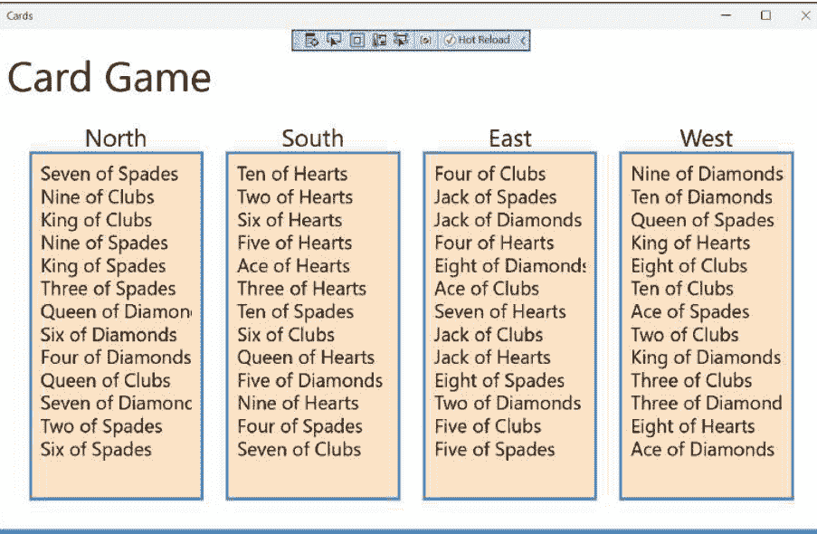

28. 再次选择“发牌”。验证是否发了一组新牌，并且每只手中的牌都发生了变化。

29. 返回 Visual Studio 并停止调试。

## 访问包含值类型的数组

你可以将数组视为一个简单的数据集合，按索引排序。如果你知道某个项的索引，就可以轻松检索；但如果你想根据其他属性查找数据，你通常需要实现一个辅助方法来执行搜索并返回所需项的索引。

例如，考虑以下代码，它创建了一个 `Person` 对象的数组，其中 `Person` 是一个类：

```csharp
class Person
{
    public string Name;
    public int Age;

    public Person(string name, int age)
    {
        this.Name = name;
        this.Age = age;
    }
}

...

var names = new[]
{
    new { Name = "John", Age = 57 },
    new { Name = "Diana", Age = 57 },
    new { Name = "James", Age = 30 },
    new { Name = "Francesca", Age = 26 }
};
```

你想在 `Person` 数组中找到家庭中最年轻的成员，你写了以下方法：

```csharp
Person findYoungest()
{
    int youngest = 0;

    for (int i = 1; i < family.Length; i++)
    {
        if (family[i].Age < family[youngest].Age)
        {
            youngest = i;
        }
    }

    return family[youngest];
}
```

你可以如下所示调用此方法并显示结果：

```csharp
var mostYouthful = findYoungest();

Console.WriteLine($"Name: {mostYouthful.Name}, Age: {mostYouthful.Age}");
```

希望这显示了如下结果：

```text
Name: Francesca, Age: 26
```

这些都很满意且运行良好。接下来，你决定更新家庭中最年轻成员的年龄（Francesca 刚过生日，现在是 27 岁），于是你写了以下语句：

```csharp
mostYouthful.Age++;
```

最后，为了确认一切已正确更改，你使用以下语句遍历 `family` 数组并显示其内容：

```csharp
foreach (Person familyMember in family)
{
    Console.WriteLine($"Name: {familyMember.Name}, Age: {familyMember.Age}");
}
```

你高兴地发现结果是正确的，Francesca 的年龄已被修改：

```text
Name: John, Age: 57
Name: Diana, Age: 57
Name: James, Age: 30
Name: Francesca, Age: 27
```

此时，你重新考虑了 `Person` 类，并决定它实际上应该是一个 `struct`（结构体），因此你修改了它：

```csharp
struct Person
{
    public string Name;
    public int Age;

    public Person(string name, int age)
    {
        this.Name = name;
        this.Age = age;
    }
}
```


你的代码可以编译并运行，但你注意到 Francesca 的年龄不再被更新了；`foreach` 循环的输出如下：

```
Name: John, Age: 57
Name: Diana, Age: 57
Name: James, Age: 30
Name: Francesca, Age: 27
```

问题在于你将一个**引用类型**转换为了**值类型**。`family` 数组中的数据已从指向堆上对象的引用集合变成了数据的副本。`findYoungest` 方法返回的值最初是对 `Person` 对象的引用，通过该引用对 `Age` 字段进行的递增操作更新了堆上的对象。现在 `family` 数组包含的是值类型，`findYoungest` 方法返回的值是该项的副本而不是引用。因此，当对 `Age` 字段执行递增操作时，该操作更新的是 `Person` 的副本，而不是存储在 `family` 数组中的该项。

为了处理这种情况，你可以修改 `findYoungest` 方法，使其显式地返回值类型的引用而不是副本。你可以通过使用 `ref` 关键字来实现，如下：

```
ref Person findYoungest()
{
    int youngest = 0;
    for (int i = 1; i < family.Length; i++)
    {
        if (family[i].Age < family[youngest].Age)
        {
            youngest = i;
        }
    }
    return family[youngest];
}
```

注意，大部分代码没有变化。方法的返回类型已变为 `ref Person`（对 `Person` 的引用），返回语句同样声明它传递了指向 `family` 数组中最年轻项的传回引用。

当你调用该方法时，你必须进行一些相应的更改：

```
ref var mostYouthful = ref findYoungest();
```

这些修改表示 `mostYouthful` 是一个项的引用。你仍然像以前一样访问数组的内容：

```c
foreach (Person familyMember in family)
{
    Console.WriteLine($"Name: {familyMember.Name}, Age: {familyMember.Age}");
}
```

```
Name: John, Age: 57
Name: Diana, Age: 57
Name: James, Age: 30
Name: Francesca, Age: 27
```

| 操作 | 执行此操作 |
|---|---|
| 声明锯形变量 | 将变量声明为数组的数组。你可以为每个嵌套数组初始化不同的长度。例如，使用以下代码创建一个名为 `items` 的锯形数组并初始化每个嵌套数组： |

```c
int[][] items;
items = new int[4][];
items[0] = new int[3];
items[1] = new int[10];
items[2] = new int[40];
items[3] = new int[25];
```

# 第 11 章

# 理解参数数组

完成本章后，你将能够：

- 使用 `params` 关键字编写一个可以接受任意数量参数的方法。
- 使用 `params` 关键字结合 `object` 类型，编写一个可以接受任意数量、任意类型参数的方法。
- 解释接受参数数组的方法与接受可选参数的方法之间的区别。

如果你想编写可以接受任意数量（可能具有不同类型）参数作为参数的方法，那么参数数组是非常用的。如果你熟悉面向对象的概念，你可能会对这句话感到沮丧得咬牙切齿。毕竟，解决这个问题的面向对象方法是定义重载方法。然而，重载并不总是最合适的方法。当你需要创建一个可以接受真正可变数量参数，且每个参数在每次调用方法时类型都变化时，情况尤其如此。本章描述了如何使用参数数组来处理此类情况。

## 重载：复习

重载是在相同作用域内声明两个或多个具有相同名称方法的专业术语。当你想要对不同类型的参数执行相同的操作时，重载方法非常有用。

Microsoft Visual C# 中重载的经典示例是 `Console.WriteLine` 方法。该方法被重载了无数次，因此你可以传递任何原始类型的参数。下面的代码示例说明了 `Console` 类中 `WriteLine` 方法定义的某些方式：

```csharp
class Console
{
    public static void WriteLine(Int32 value)
    public static void WriteLine(Double value)
    public static void WriteLine(Decimal value)
    public static void WriteLine(Boolean value)
    ...
    public static void WriteLine(String value)
}
```

> 注意
`WriteLine` 方法的文档使用了 `System` 命名空间中定义的结构类型作为其参数，而不是 C# 别名。例如，打印 `int` 值的重载版本实际上接受 `Int32` 作为参数。请参阅第 9 章“使用枚举和结构创建值类型”，以获取结构类型及其到 C# 别名的映射列表。

重载虽然很有用，但它并没有涵盖所有情况。特别是，重载无法轻松处理参数类型不变但参数数量发生变化的情况。例如，如果你想向控制台写入许多值呢？你是否必须提供多个版本的 `Console.WriteLine`，一个可以接受各种组合的两个参数的版本，其他可以接受三个参数的版本，以此类推？这会很快变得繁琐。而且，这些重载方法的大量重复不会让你担心吗？你确实应该担心。

幸运的是，有一种方法可以编写一个接受任意数量参数的方法（变长参数方法）：你可以使用通过 `params` 关键字声明的参数数组。为了理解 `params` 数组如何解决这个问题，首先理解普通数组的用途和缺点是有帮助的。

# 使用数组参数

假设你想一个方法来确定作为参数传递的一组值中的最小值。一种方法是使用数组。例如，为了找到几个 `int` 值中的最小值，你可以写一个名为 `Min` 的静态方法，它带有一个代表 `int` 值数组的单一参数：

```csharp
class Util
{
    public static int Min(int[] paramList)
    {
        // 验证调用者是否至少提供了一个参数。
        // 如果没有，抛出 ArgumentException 异常 - 在空列表中
        // 找到最小值是不可能的。
        if (paramList == null || paramList.Length == 0)
        {
            throw new ArgumentException("Utils.Min: not enough arguments");
        }

        // 将参数列表中找到的当前最小值设置为第一个项。
        int currentMin = paramList[0];

        // 遍历参数列表，搜索是否有任何参数
        // 小于 currentMin 中存储的值。
        foreach (int i in paramList)
        {
            // 如果循环找到了比 currentMin 中存储
            // 值小的的项目，则将 currentMin 设置为该值。
            if (i < currentMin)
            {
                currentMin = i;
            }
        }

        // 循环结束后，currentMin 持有参数列表中
        // 最小项的值，因此返回此值。
        return currentMin;
    }
}
```

> 注意
`ArgumentException` 类专门设计用于在提供的参数不符合方法要求时，由方法抛出。

要使用 `Min` 方法找到两个名为 `first` 和 `second` 的 `int` 变量的最小值，你可以这样写：

```csharp
int[] array = new int[2];
array[0] = first;
array[1] = second;
int min = Min(array);
```

要使用 `Min` 方法找到三个 `int` 变量（命名为 `first`, `second` 和 `third`）的最小值，你可以这样写：

```csharp
int[] array = new int[3];
array[0] = first;
array[1] = second;
array[2] = third;
int min = Min(array);
```

当然，如果你愿意，可以使用匿名数组，如下所示：

```csharp
int min = Min(new int[] {first, second, third});
```

# 声明参数数组

使用参数数组可以使用任意数量的参数。在定义方法时使用 `params` 修饰符来指示参数数组。例如，这里是 `Min`——这次将其数组参数声明为 `params`：

```csharp
class Util
{
    public static int Min(params int[] paramList)
    {
        // 代码与之前相同
    }
}
```

`params` 关键字对 `Min` 方法的作用是允许通过任意数量的参数调用方法，而无需担心创建数组。例如，要找到整数值的最小值，你可以只需写：

```csharp
int min = Min(first, second);
```

编译器会将此调用翻译为类似代码：

```csharp
int[] array = new int[2];
array[0] = first;
array[1] = second;
int min = Min(array);
```

要找到三个整数值的最小值，你编写所示的代码，编译器也会将其转换为使用数组的代码：

```csharp
int min = Min(first, second, third);
```

对 `Min` 的两次调用（一次是两个参数，另一个是三个参数）都解析为带有 `params` 关键字的 `Min` 方法。而且正如你可能猜到的，你可以用任意数量的 `int` 参数调用此 `Min` 方法。编译器只需计算 `int` 参数的数量，创建一个大小相同的数组，用参数填充数组，然后通过传递单个数组参数来调用方法。

> 注意
如果你是 C 或 C++ 程序员，你可能认为 `params` 是 `stdarg.h` 头文件中 `varags` 宏的类型安全等物。Java 也有类似的 `varags` 功能。

关于 `params` 数组数组几点需要注意：

- 不能对多维数组使用 `params` 关键字。例如，以下示例代码将无法编译：

```csharp
// 编译错误
public static int Min(params int[,], table)
...
```

- 不能仅根据 `params` 关键字重载方法。`params` 关键字不是方法签名的一部分，如下例所示。在这里，编译器在调用这些方法时将无法区分它们：

`Min` 方法的第一版本在通过两个 `int` 参数调用它时使用。第二个版本在提供其他数量的 `int` 参数时使用。这包括在不带参数的情况下调用方法的情况。添加非参数形式的数组方法可能是一种实用的优化技术，因为编译器就不需要创建并填充这么多数组了。

## 使用 params object[]

`int` 类型的参数数组非常有用。通过它，你可以在方法调用中传递任意数量的 `int` 参数。然而，如果不仅参数的数量在变化，参数的类型也在变化呢？C# 也有解决这个问题的方法。该技术基于两个事实：`object` 是所有类的根，并且编译器可以生成代码，通过装箱（boxing）将值类型（非类实体）转换为对象，这正如第 8 节“理解值和引用”中所描述的那样。

你可以使用 `object` 类型的参数数组来声明一个接受任意数量 `object` 参数的方法，允许传递的参数可以是任何类型。看这个示例：

```
class Black
{
    public static void Hole(params object[] paramList)
    ...
}
```

我将此方法称为 `Black.Hole`，因为没有任何参数可以逃脱它：

- 你可以完全不带参数传递该方法，在这种情况下，编译器将创建一个长度为 0 的对象数组：

```
Black.Hole(); // 转换为 Black.Hole(new object[0]);
```

- 你可以通过传递 `null` 参数调用 `Black.Hole` 方法。数组是一种引用类型，因此你允许使用 `null` 初始化数组：

```
Black.Hole(null);
```

你可以向 `Black.Hole` 方法传递一个实际数组。换句话说，你可以手动创建由编译器正常生成的数组：

```
object[] array = new object[2];
array[0] = "forty two";
array[1] = 42;
Black.Hole(array);
```

你可以向 `Black.Hole` 方法传递不同类型的参数，这些参数将自动封装在一个对象数组中：

```
Black.Hole("forty two", 42);
//转换为 Black.Hole(new object[]("forty two", 42));
```

## Console.WriteLine 方法

`Console` 类包含了许多针对 `WriteLine` 方法的重载。其中一个重载看起来如下：

```
public static void WriteLine(string format, params object[] arg);
```

尽管字符串插值几乎已经让这个版本的 `WriteLine` 方法变得多余，但该重载在 C# 语言之前的版本中被频繁使用。此重载允许 `WriteLine` 支持一个包含数字占位符的格式字符串参数，每个占位符可以在运行时被参数列表中指定的任意类型的变量替换（占位符 `{i}` 被替换为后续列表中第 `i` 个变量）。这里是调用此方法的示例（变量 `fname` 和 `lname` 是字符串，`mi` 是 `char`，`age` 是 `int`）：

```
Console.WriteLine("First name:{0}, Middle Initial:{1}, Last name:{2}, Age:{3}",
fname, mi, lname, age);
```

编译器将此调用解析为如下：

```
Console.WriteLine("First name:{0}, Middle Initial:{1}, Last name:{2}, Age:{3}",
new object[4]{fname, mi, lname, age});
```

## 使用 params 数组

在接下来的练习中，你将实现并测试一个名为 `Sum` 的静态方法。该方法的目的是计算传递它的任意数量 `int` 参数之和，并将结果作为 `int` 返回。你将通过编写 `Sum` 方法使其接收一个 `params int[]` 参数来实现。你将对 `params` 参数执行两次检查，以确保 `Sum` 方法完全健壮。然后，你将使用各种不同的参数调用 `Sum` 方法对其进行测试。

> 编写 params 数组方法

1. 启动 Microsoft Visual Studio 2022，如果它尚未运行。
2. 打开 `ParamsArray` 解决方案，它位于文档文件夹中的 `\Microsoft Press\VCSBS\Chapter11\ParamsArray` 文件夹中。`ParamsArray` 项目在 `Program.cs` 文件中包含 `Program` 类，包括你在之前的章节中见过的 `doWork` 方法框架。你将将 `Sum` 方法为另一个名为 `Utils`（utility 的缩写）的类的静态方法，你把该类添加到项目中。
3. 在“解决方案管理器”中，右键点击 `ParamsArray` 解决方案中的 `ParamsArray` 项目，指向“添加”，并选择“类”。
4. 在“添加新项 ParamsArray”对话框中，在中间窗格中，选择“类”模板。在“名称”框中输入 `Utils.cs`，然后选择“添加”。

`Utils.cs` 文件被创建并添加到项目中。它包含在 `ParamsArray` 命名空间中的一个名为 `Utils` 的空类。

5. 向 `Utils` 类添加一个公共静态方法 `Sum`。该方法应返回一个 `int` 并接受一个名为 `paramList` 的 `int` 值参数数组。它看起来应该像这样：

```
public static int Sum(params int[] paramList)
{}
```


实现`Sum`方法的第一步是检查`paramList`。此参数可以包含一组有效的整数、`null`或长度为 0 的数组。在后两种情况下，很难计算和，因此最佳选择是抛出异常。（你可能会认为整数的和为 0，但我们将这种情况情况视为异常。）

6. 向`Sum`方法添加加粗代码。如果`paramList`为`null`，则抛出异常。`Sum`方法现在看起来像这样：

点击此处查看代码图像

```csharp
public static int Sum(params int[] paramList)
{
    if (paramList == null)
    {
        throw new ArgumentException("Utils.Sum: null");
    }
}
```

7. 向`Sum`方法添加代码，如果参数数组长度为 0，则抛出异常。如下所示：

点击此处查看代码图像

```csharp
public static int Sum(params int[] paramList)
{
    if (paramList == null)
    {
        throw new ArgumentException("Utils.Sum: null");
    }

    if (paramList.Length == 0)
    {
        throw new ArgumentException("Utils.Sum: empty list");
    }
}
```

如果数组通过了这些测试，下一步是相加数组中的元素。你需要一个本地变量来持有总和。

8. 声明一个名为`sumTotal`的整数变量并将其初始化为 0，紧接在前面的代码之后。

点击此处查看代码图像

```csharp
public static int Sum(params int[] paramList)
{
    if (paramList == null)
    {
        throw new ArgumentException("Utils.Sum: null");
    }

    if (paramList.Length == 0)
    {
        throw new ArgumentException("Utils.Sum: empty list");
    }

    int sumTotal = 0;
}
```

9. 向`Sum`方法添加`foreach`语句以遍历`paramList`数组。此`foreach`循环体应将数组中的每个元素加到`sumTotal`。在方法末尾，通过`return`语句返回`sumTotal`的值，如下加粗所示：

点击此处查看代码图像

```csharp
public static int Sum(params int[] paramList)
{
    int sumTotal = 0;

    foreach (int i in paramList)
    {
        sumTotal += i;
    }

    return sumTotal;
}
```

10. 在“生成”菜单上选择“生成解决方案”，然后确认你的解决方案没有错误。

# 测试`Utils.Sum`方法

1. 在代码和文本窗口中显示`Program.cs`。

2. 在代码和文本窗口中，删除`// TODO:`注释并向`doWork`方法添加以下语句：

点击此处查看代码图像

```csharp
Console.WriteLine(Utils.Sum(null));
```

3. 在“调试”菜单上，选择“不调试启动”。

程序生成并运行，在控制台上写入以下消息：

点击此处查看代码图像

```text
Exception: Utils.Sum: null list
```

这证实了方法中的第一个检查是有效的。

4. 按回键关闭程序并返回 Visual Studio。

5. 在代码和文本窗口中，如所示更改`doWork`方法中的`Console.WriteLine`调用：

点击此处查看代码图像

```csharp
Console.WriteLine(Utils.Sum());
```

这一次，调用该方法时没有传递任何参数。编译器将空参数列表翻译为空数组。

6. 在“调试”（Debug）菜单中，选择“转为调试启动”。

程序生成并运行，在控制台中输出以下消息：

```text
Exception: Utils.Sum: empty parameter list（参数列表为空）
```

这确认了方法中的第二个检查是有效的。

7. 按回车键关闭程序并返回 Visual Studio 2022。

8. 将`doWork`方法中的调用更改为如下`Console.WriteLine`：

点击此处查看代码图像

```csharp
Console.WriteLine(Utils.Sum(10, 9, 8, 7, 6, 5, 4, 3, 2, 1));
```

9. 在“调试”（Debug）菜单中，选择“转为调试启动”。

验证程序是否编译、运行并在控制台中输出了值 55。

10. 按回车键关闭应用程序并返回 Visual Studio 2022。

## 比较参数数组和可选参数

第 3 章“编写方法和应用作用域”说明了如何定义带有可选参数的方法。从表面上看，使用参数数组的方法与带有可选参数的方法之间存在某种程度的叠。然而，它们之间存在着本质的区别：

- 带有可选参数的方法仍然有一个固定的参数列表，你不能传递任意的参数列表。编译器会生成代码，在方法运行之前，将任何缺失参数的默认值插入到堆栈中，而且方法本身并不知道哪些参数是调用者提供的，哪些是编译器生成的默认值。
- 使用参数数组的方法实际上拥有一组完全任意的参数列表，且其中任何一个参数都没有默认值。此外，该方法可以精确地确定调用者提供了多少个参数。

通常情况下，你会在可以接受任意数量参数（包括零个）的方法中使用参数数组，而你只有在不方便强制调用者为每个参数都提供参数时，才使用可选参数。

还有一种值得深思的情况。如果你定义了一个接受参数列表的方法，并提供了一个接受可选参数的重载方法，当调用语句中的参数列表同时匹配两种方法签名时，并不总是能立即看出将调用哪个版本的方法。你将在本章最后的练习中研究这种场景。

## 比较`params`数组和可选参数

1. 返回 Visual Studio 2022 中的`ParamsArray`解决方案，并在代码和文本编辑器窗口中显示`Utils.cs`文件。

2. 在`Utils`类的`Sum`方法开头添加以下加粗显示的`Console.WriteLine`语句：

点击此处查看代码图像

```csharp
public static int Sum(params int[] paramList)
{
    Console.WriteLine("Using parameter list");
    ....
}
```

3. 为`Utils`类添加另一个`Sum`方法的实现。此版本应该接受四个可选的`int`参数，每个参数的默认值为 0。在方法体中，输出消息“Using optional parameters”。然后计算并返回这四个参数之和。完成后的方法应该如下加粗代码所示：

```csharp
class Util
{
    public static int Sum(int param1 = 0, int param2 = 0, int param3 = 0, int param4 = 0)
    {
        Console.WriteLine("Using optional parameters");
        int sumTotal = param1 + param2 + param3 + param4;
        return sumTotal;
    }
}
```

4. 在代码和文本编辑器中显示`Program.cs`文件。

5. 在`doWork`方法中，注释掉现有代码，然后添加以下语句：

点击此处查看代码图像

```csharp
Console.WriteLine(Utils.Sum(2, 4, 6, 8));
```

此语句调用了`Sum`方法并传递了四个`int`参数。

6. 在“调试”（Debug）菜单中，选择“转为调试启动”。

验证程序是否编译、运行并在控制台中输出了值 55。此语句调用了`Sum`方法并传递了四个`int`参数。当程序运行时，会输出以下消息：

```text
Using parameter list
```

这确认了方法中的检查是有效的。

7. 按回车键关闭程序并返回 Visual Studio 2022。

8. 在`doWork`方法中，将调用更改如下（加粗所示）：

当调用语句中的参数列表同时匹配两种方法签名时，调用哪个版本的方法并不总是立即可见的。

9. 在“调试”（Debug）菜单中，选择“转为调试启动”。

当程序运行时，会输出以下消息：

```text
Using optional parameters
```

10. 按回车键关闭程序并返回 Visual Studio 2022。

# 总结

在本章中，你学习了如何使用参数数组来定义接受任意数量参数的方法。你还看到了如何使用`object`类型的参数数组来接受任意数量的参数。最后，你看到了编译器在参数数组和可选参数之间时如何解析调用。

- 如果你想继续下一章，请保持 Visual Studio 2022 运行并转向第 12 章“继承”。
- 如果你想现在退出 Visual Studio 2022，请在“文件”菜单中选择“退出”。

## 快速参考

| 操作 | 方法 |
|---|---|
| 编写一个接受任意数量类型参数的方法 | 使用该类型的参数数组来编写方法。例如，一个接受任意数量`bool`参数的方法声明如下： |

点击此处查看代码图像

```csharp
someType Method(params bool[] flags)
{
    ...
}
```

| 编写一个接受任意数量对象参数的方法 | 使用`object`类型的参数数组来编写方法。例如： |

点击此处查看代码图像

```csharp
someType Method(params object[] paramList)
{
    ...
}
```

# 第 12 章：使用继承

完成本章后，你将能够：

- 理解什么是继承以及它是如何工作的。
- 创建一个自基类的派生类。
- 通过`new`、`virtual`和`override`关键字控制方法的隐藏和重写。
- 使用`protected`关键字限制继承链内的访问权限。
- 将扩展方法作为继承的替代机制。

继承是面向对象编程世界中的一个概念。你可以将继承作为工具，在定义具有共同特征且明显相关的不同类时避免重复。

假设你正在编写一个模拟工厂的应用程序，并希望指定经理和工人具有某些特征，但也有不同之处。例如，他们都被分配了员工编号，但执行的任务不同。

这就是继承发挥作用的地方。通过继承，你可以创建三个不同的类——`经理`、`工人`和`所有员工`，让`经理`类和`工人`类从`员工`类继承某些特征。这就是本章的主题。

## 什么是继承？

如果你问几位经验丰富的程序员关于“继承”的问题，通常会得到不同且冲突的答案。部分混乱源于“继承”这个词本身的几种不同含义。如果有人在遗嘱中留给你某物，我们就你继承了它。同样，我们说你从母亲那里继承了一半基因，另一半从父亲那里遗传的基因。这两个词的两种用法与编程中的继承几乎没有关系。

编程中的继承完全关于类的分类，或者更准确地说，关于类与类之间的关系。例如，当你上学时，你可能学习过哺乳动物，并且马和鲸鱼是哺乳动物的例子。每种动物都具有哺乳动物的所有属性（呼吸空气、哺乳幼崽、温血等），但每种动物也有自己的特征（马有蹄子，而鲸鱼有鳍和尾鳍）。

如何在程序中对马和鲸鱼进行建模？一种方法是创建两个名为`Horse`和`Whale`的不同类。每个类都可以以自己的方式实现该类型哺乳动物特有的行为，例如马的`Trot`或鲸鱼的`Swim`。但马和鲸鱼共有的行为，如`Breathe`和`SuckleYoung`呢？如果你在两个类中都复制这些名称的方法，那么这种情况就会变成维护维护噩梦，特别是当你还决定开始建模其他类型的哺乳动物（如`Human`和`Aardvark`）时。

在 C# 中，你可以使用继承来解决这些问题。马、鲸鱼、人类和土拨鼠都是哺乳动物的类型，因此你可以创建一个名为`Mammal`的类，提供这些类型表现出的共同功能。然后你可以声明`Horse`、`Whale`、`Human`和`Aardvark`类都继承自`Mammal`。这些类会自动包含`Mammal`类的功能（`Breathe`、`SuckleYoung`等），以及特定类型哺乳动物特有的功能（例如`Horse`类的`Trot`方法和`Whale`类的`Swim`方法）。然后，如果你需要修改`Breathe`等共同方法的工作方式，你只需要在一个地方进行更改：即`Mammal`类。

# 使用继承

你通过以下语法声明一个类继承另一个类：

点击此处查看代码图片

```csharp
class DerivedClass : BaseClass
{
    ...
}
```

派生类继承自基类，基类中的方法成为派生类的一部分。

在 C# 中，一个类最多派自一个基类；类不能派自两个或多个类。然而，除非你使用相同的语法声明继承自`DerivedClass`的其他类，否则`DerivedClass`被声明为`sealed`（密封的）（你将在第 13 章“创建接口和定义抽象类”中学习密封类。）

点击此处查看代码图片

```csharp
class DerivedSubClass : DerivedClass
{
}
```

继续前面描述的示例，你可以如下声明`Mammal`类。`Breathe`和`SuckleYoung`方法是所有哺乳动物共有的。

点击此处查看代码图片

```csharp
class Mammal
{
    public void Breathe()
    {
        ...
    }

    public void SuckleYoung()
    {
        ...
    }
}
```

你可以为每种不同的哺乳动物定义类，根据需要添加更多方法，如下例所示：

点击此处查看代码图片

```csharp
class Horse : Mammal
{
    ...

    public void Trot()
    {
        ...
    }
}
```

```csharp
class Whale : Mammal
{
    ...

    public void Swim()
    {
        ...
    }
}
```

> **注意**
>
> 如果你是一名 C++ 程序员，请注意你不需要也无法显式地指定继承是公开的、私有的还是保护的。C# 的继承始终是隐式公开的。如果你熟悉 Java，请注意冒号的使用，并且没有`extends`关键字。

如果你在应用程序中创建一个`Horse`对象，你可以调用`Trot`、`Breathe`和`SuckleYoung`方法：

点击此处查看代码图片

```csharp
Horse myHorse = new Horse();

myHorse.Trot();
myHorse.Breathe();
myHorse.SuckleYoung();
```

同样，你可以创建一个`Whale`对象，但这次你可以调用`Swim`、`Breathe`和`SuckleYoung`方法；`Trot`是不可用的，因为只只在`Horse`类中定义。

> **重要**
>
> 继承仅适用于类（class），不适用于结构体（struct）。你不能用结构体定义自己的继承层次结构，也不能定义派生自类或其他结构的结构体。

所有结构体实际上都继承自名为`System.ValueType`的抽象类。（第 13 章探讨了抽象类。）这完全是 Microsoft .NET 库定义基于栈的值类型的共同行为的一种实现细节；你不太可能在自己的应用程序中直接使用`ValueType`。

# 重温`System.Object`

`System.Object`类是所有类的根类。所有类都隐式派自`System.Object`。因此，C# 编译器静默地将`Mammal`类重写为如下代码（如果你真的想，也可以显式地写）：

点击此处查看代码图片

```csharp
class Mammal : System.Object
{
    ..
}
```

`System.Object`类中的任何方法都会自动通过继承链传递给派自`Mammal`的类，例如`Horse`和`Whale`。在实践中，这意味着你定义的所有类都继承`System.Object`类的所有特征。这包括如`ToString`方法（在第 2 章“变量、运算符和表达式”中讨论），它用于将对象转换为字符串，通常用于显示。

# 调用基类构造函数

除了继承的方法外，派生类还自动包含基类的所有字段。这些字段在创建对象时通常需要初始化。你在构造函数中执行这种初始化。记住，所有类都至少有一个构造函数。（如果你没有提供，编译器会为你生成一个默认构造函数）。

在派生类的构造函数中调用基类的构造函数是良好的做法，这允许基类构造函数执行任何额外的初始化。可以使用`base`关键字来调用基类构造函数，如下所示：

点击此处查看代码图片

```csharp
class Mammal // 基类
{
    public Mammal(string name) // 构造函数
    {
        ...
    }
}

class Horse : Mammal // 派生类
{
    public Horse(string name)
        : base(name) // 调用 Mammal(name)
    {
        ...
    }
}
```


如果你没有在派生类构造函数中显式调用基类构造函数，编译器会在执行派生类构造函数代码之前尝试插入对基类默认构造函数的调用。以之前的为例，编译器将其重写为：

[点击此处查看代码图片]

```cs
class Horse : Mammal
{
    public Horse(string name)
    {
        ...
    }
}
```

如下所示：

[点击此处查看代码图片]

```cs
class Horse : Mammal
{
    public Horse(string name)
        : base()
    {
        ...
    }
}
```

如果 `Mammal` 有公共默认构造函数，这样做是有效的。然而，并不是所有类都有公共默认构造函数。例如，只有在你没有编写非默认构造函数时，编译器才会生成默认构造函数。在这种情况下，忘记调用正确的基类构造函数会导致编译错误。

## 类赋值

书中之前的示例展示了如何使用类声明变量以及如何使用 `new` 关键字创建对象。示例还展示了 C# 的类型检查规则如何防止你将一种类型的对象赋值给不同类型的变量。例如，给定这里显示的 `Mammal`、`Horse` 和 `Whale` 类的定义，以下后续代码是非法的：

[点击此处查看代码图片]

```cs
class Mammal
{
    ...
}

class Horse : Mammal
{
    ...
}

class Whale : Mammal
{
    ...
}

Horse myHorse = new Horse(...);
Whale myWhale = myHorse; // 错误 - 类型不同
```

然而，只要使用的类型是继承层次中较高的类，就可以从不同类型的变量来引用对象。因此，以下语句是合法的：

```cs
Horse myHorse = new Horse(...);
Mammal myMammal = myHorse; // Legal，Mammal 是 Horse 的基类
```

如果你从逻辑角度考虑，所有的马都是哺乳类动物，因此你可以安全地将一个 `Horse` 类型的对象赋值给 `Mammal` 类型的变量。在继承层次结构中，你可以简单地将 `Horse` 对象看作是某种特殊的 `Mammal` 对象；它拥有 `Mammal` 对象拥有的所有内容，并带有你为 `Horse` 类添加的任何方法和字段所定义的额外部分。你也可以让 `Mammal` 变量指向一个鲸鱼（`Whale`）。

然而，有一个显著的限制：当使用 `Mammal` 变量引用 `Horse` 或鲸鱼对象时，你只能访问 `Mammal` 类定义的方法和字段。`Horse` 或 `Whale` 类定义的任何额外方法都无法通过 `Mammal` 类可见。

[点击此处查看代码]

```cs
Horse myHorse = new Horse(...);
Mammal myMammal = myHorse;
myMammal.Breathe(); // OK - Breathe 是 Mammal 类的一部分
myMammal.Trot(); // error - Trot 不是 Mammal 类的一部分
```

## Note

前面的讨论解释了为什么你可以将几乎任何内容赋值给对象变量。记住 `object` 是 `System.Object` 的别名，所有类都直接或间接地继承自 `System.Object`。

请注意，相反的情况并不成立。你不能无保留地将 `Mammal` 对象赋值给 `Horse` 变量：

[点击此处查看代码]

```cs
Mammal myMammal = new Mammal(...);
Horse myHorse = myMammal; // error
```

这看起来像是一个奇怪的限制，但记住并不是所有的 `Mammal` 对象都是 `Horse` 对象。它们可能是鲸鱼对象。只要你先使用 `as` 运算符或类型转换检查该 `Mammal` 对象确实是 `Horse` 对象，你就可以将 `Mammal` 对象赋值给 `Horse` 对象。（第7章“创建和管理类与对象”讨论了 `is` 和 `as` 运算符以及类型转换。）

接下来的代码示例使用 `as` 运算符检查 `myMammal` 是否指向一个 `Horse` 对象，如果是，则对 `myHorseAgain` 的赋值会导致 `myHorseAgain` 指向同一个 `Horse` 对象。如果 `myMammal` 指向 `Mammal` 类中的其他类型对象，`as` 运算符将返回 `null`：

[点击此处查看代码]

```cs
Horse myHorse = new Horse(...);
Horse myMammal = myHorse; // myMammal 指向一个 Horse
Horse myHorseAgain = myMammal as Horse; // OK - myMammal 是一个 Horse
...
Whale myWhale = new Whale(...);
myMammal = myWhale;
...
myHorseAgain = myMammal as Horse; // 返回 null - myMammal 是一个 Whale
```

## 定义新方法

计算机编程领域最困难的任务之一是为标识符思考独特且意义的名字。如果你正在为一个处于继承结构中的类定义方法，早晚你都会尝试重用层次结构中更上层某个类已经在使用的名称。如果基类和派生类恰好声明了两个签名相同的方法，你在编译应用程序时将收到警告。

> Note
> 方法签名指的是方法的名称以及参数的数量和类型，但不包括其返回类型。两个具有相同名称并带有相同参数列表的方法具有相同的签名，即使它们返回不同的类型。

派生类中的方法会掩盖（或隐藏）基类中具有相同签名的方法。例如，如果你编译以下代码，编译器会生成一条警告信息，告知你 `Horse.Talk` 隐藏了继承的方法 `Mammal.Talk`：

[点击此处查看代码]

```cs
class Mammal
{
    ...
    public void Talk() // 假设所有哺乳动物都会说话
    {
        ...
    }
}
```

```cs
class Horse : Mammal
{
    public void Talk() // 马的说话方式与其他哺乳动物不同！
    {
        ...
    }
}
```

尽管你的代码可以编译并运行，但你应该认真对待这个警告。如果另一个类派自 `Horse` 并调用 `Talk` 方法，它可能期望调用 `Mammal` 类实现的方法。然而，`Horse` 类中的 `Talk` 方法隐藏了 `Mammal` 类中的 `Talk` 方法，转而调用 `Horse.Talk` 方法。

大多数情况下，这种巧合充其量是混乱的来源，你应该考虑重命名方法以避免冲突。然而，如果你确定想要这两个方法具有相同的签名并隐藏 `Mammal.Talk` 方法，你可以使用 `new` 关键字来消除警告，如下：

[点击此处查看代码]

```cs
class Mammal
{
    ...
    public void Talk()
    {
        ...
    }
}
```

```cs
class Horse : Mammal
{
    new public void Talk()
    {
        ...
    }
}
```

像这样使用 `new` 关键字并没有改变两个方法完全无关的事实，且隐藏行为仍然会发生。它只是关闭了警告。实际上，`new` 关键字的意思是：“我知道我在做什么，所以停止向我显示警告。”

## 定义虚方法

有时，你想要隐藏基类中某个方法的实现方式。例如，考虑 `System.Object` 中的 `ToString` 方法。`ToString` 的目的是将对象转换为其字符串表示。因为这个方法非常有用，它是 `System.Object` 的成员。

（注：此处原始文本存在重复/损坏错误，已根据上下文逻辑清理翻译）

## 定义重写方法

如果基类声明某个方法是虚的（`virtual`），派生类可以使用 `override` 关键字来声明该方法的另一种实现，如下所示：

[点击此处查看代码]

```cs
class Horse : Mammal
{
  ...
  public override string ToString()
  {
    ...
  }
}
```

派生类中方法的新实现可以使用 `base` 关键字调用基类中方法的原始实现，如下：

[点击此处查看代码]

```cs
public override string ToString()
{
  string temp = base.ToString();
  ...
}
```

当你使用 `virtual` 和 `override` 关键字声明多态方法（在随后的侧边栏“虚方法与多态”中讨论）时，必须遵循一些重要规则：

- 虚方法不能是私有的（`private`）；它旨在通过继承暴露给其他类。同样，重写方法不能是私有的，因为类类不能更改其所继承的方法的保护级别。然而，重写方法可以具有一种特殊形式的私有性，即 `protected` 访问，你将在下一节中发现。
- 虚方法和重写方法的签名必须相同；它们必须具有相同的名称、参数的数量和参数类型。此外，两个方法必须返回相同的类型。
- 你只能重写虚方法。如果基类不是虚的而你尝试重写它，你将得到编译时错误。这是合理的；应该由基类的设计者来决定其方法是否可以被重写。
- 如果派生类没有使用 `override` 关键字声明该方法，则它不会重写基类方法，而是隐藏了该方法。换句话说，它变成了一个恰好同名的完全不同方法的实现。与之前一样，这将导致编译警告，你可以通过之前描述过的 `new` 关键字来消除该警告。
- 被重写的方法（`override` method）是隐式虚的，并且可以在进一步的派生类中再次被重写。但是，不允许使用 `virtual` 关键字显式声明一个重写方法是虚的。

## 虚方法与多态

使用虚方法，你可以根据运行时动态确定的对象类型调用同一方法的不同版本。考虑以下类示例，它们定义了之前描述的哺乳动物（`Mammal`）层次结构的变体。

点击此处查看代码图片

```csharp
class Mammal
{
    public virtual string GetTypeName()
    {
        return "This is a mammal";
    }
}

class Horse : Mammal
{
    public override string GetTypeName()
    {
        return "This is a horse";
    }
}

class Whale : Mammal
{
    public override string GetTypeName()
    {
        return "This is a whale";
    }
}
```

```csharp
class Aardvark : Mammal
{
...
}
```

你需要注意两点：首先，`Horse` 和 `Whale` 类中的 `GetTypeName` 方法使用了 `override` 关键字；其次，`Aardvark` 类没有 `GetTypeName` 方法。

现在检查以下代码块：

点击此处查看代码图片

```csharp
Mammal myMammal;
Horse myHorse = new Horse(...);
Whale myWhale = new Whale(...);
Aardvark myAardvark = new Aardvark(...);

myMammal = myHorse;
Console.WriteLine(myMammal.GetTypeName()); // Horse

myMammal = myWhale;
Console.WriteLine(myMammal.GetTypeName()); // Whale

myMammal = myAardvark;
Console.WriteLine(myMammal.GetTypeName()); // Aardvark
```

三个不同的 `Console.WriteLine` 语句将输出什么？乍一看，你认为它们都会打印“This is a mammal”，因为每个语句都是对 `Mammal` 变量调用 `GetTypeName` 方法，而该变量实际上是一个 `Mammal` 对象。然而，在第一情况下，你可以看到 `myMammal` 实际上是 `Horse` 对象的引用。（记住，允许将 `Horse` 对象赋值给 `Mammal` 变量，因为 `Horse` 类继承自 `Mammal` 类。）由于 `GetTypeName` 方法被定义为虚方法，运行时确定应该调用 `Horse.GetTypeName` 方法，因此该语句实际上打印“This is a horse”。相同的逻辑适用于第二个 `Console.WriteLine` 语句，它输出消息“This is a whale”。第三条语句在 `Aardvark` 对象上调用了 `Console.WriteLine`。然而，`Aardvark` 类没有 `GetTypeName` 方法，因此调用了 `Mammal` 类中的默认方法，返回字符串“This is a mammal”。

这种根据上下文调用同名不同方法的现象被称为 `polymorphism`（多态），其字面意思是“多种形式”。

## 理解受保护访问

`public` 和 `private` 关键字创建了访问权限的两个极端：

- 类的 `public` 字段和方法对所有人可见。
- 类的 `private` 字段和方法仅类本身可见。

当你孤立考虑类时，这两个极端就足够。然而，正如所有丰富的面向对象程序员所知，孤立的类无法解决复杂问题。

继承是连接类的强大方式，是派生类与其基类之间一种特殊且紧密的关系。通常，让基类允许派生类访问其某些字段是有用的。

```cs
Console.WriteLine("Default implementation of the Drive method");
}
```

+ 16. 在代码和文本编辑器窗口中显示 `Program.cs` 文件。

+ 17. 在 `doWork` 方法中，删除 `// TODO:` 注释并添加**加粗**的代码，以创建一个 `Airplane` 类的实例，并通过模拟快速飞机旅行来测试其方法，如下所示：

点击此处查看代码图片

```cs
static void doWork()
{
    Console.WriteLine("Journey by airplane");
    Airplane myPlane = new Airplane();
    myPlane.StartEngine("Contact");
    myPlane.TakeOff();
    myPlane.Drive();
    myPlane.Land();
    myPlane.StopEngine("Whirr");
}
```

+ 18. 在你编写的代码之后，向 `doWork` 方法中添加以下语句（**加粗**）。这些语句创建了 `Car` 类的实例并测试其方法。

点击此处查看代码图片

```cs
static void doWork()
{
    Console.WriteLine();
    Console.WriteLine("Journey by car");
    Car myCar = new Car();
    myCar.StartEngine("Brm brrm");
    myCar.Accelerate();
    myCar.Drive();
    myCar.Brake();
    myCar.StopEngine("Phut phut");
}
```

+ 19. 在“调试”菜单中，选择“不调试启动”。

在控制台窗口中，验证程序是否输出了模拟飞机旅行和汽车旅行不同阶段的消息，如图像所示：

```
\Microsoft Visual Studio Debug Console
Journey by airplane:
Starting engine: Contact
Taking off
Default implementation of the Drive method
Landing
Stopping engine: Whirr

Journey by car:
Starting engine: Brm brm
Accelerating
Default implementation of the Drive method
Braking
Stopping engine: Phut phut

:\Users\student\Documents\Microsoft Press\VCSBS\Chapter process 10700 exited with code 0.
Press any key to close this window . . .
```


注意，两种交通模式都调用了虚拟方法 `Drive` 的默认实现，因为目前这两个类都还没有重写该方法。

20. 按 **Enter** 关闭应用程序并返回 Visual Studio 2022。

21. 在代码和文本编辑器窗口中显示 `Airplane` 类。按照如下代码在 `Airplane` 类中重写 `Drive` 方法：

[点击此处查看代码图片]

```cs
class Airplane : Vehicle
{
    public override void Drive()
    {
        Console.WriteLine("Flying");
    }
}
```

> 注意
> IntelliSense 显示了可用的虚拟方法列表。如果你在 IntelliSense 列表中选择 `Drive` 方法，Visual Studio 会自动在你的代码中插入一条调用 `base.Drive` 方法的语句。如果发生这种情况，请删除该语句，因为此练习不需要它。

22. 在代码和文本编辑器窗口中显示 `Car` 类。按照下文**加粗**所示在 `Car` 类中重写 `Drive` 方法：

[点击此处查看代码图片]

```cs
class Car : Vehicle
{
    public override void Drive()
    {
        Console.WriteLine("Motoring");
    }
}
```

23. 在“调试”菜单中，选择“不调试启动”。
在控制台中，当应用程序调用 `Drive` 方法时，`Airplane` 对象现在显示消息 `Flying`，`Car` 对象显示消息 `Motoring`：

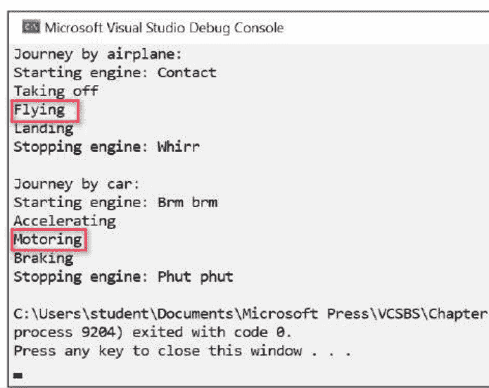

24. 按 **Enter** 关闭应用程序并返回 Visual Studio 2022。

25. 在代码和文本编辑器窗口中显示 `Program.cs` 文件。

26. 将此处**加粗**的语句添加到 `doWork` 方法的末尾：

[点击此处查看代码图片](#)

```cs
static void doWork()
{
    Console.WriteLine("\nTesting polymorphism");
    Vehicle v = myCar;
    v.Drive();
    v = myPlane;
    v.Drive();
}
```

此代码测试了虚拟 `Drive` 方法提供的多态性。代码使用 `Vehicle` 变量创建 `Car` 对象的引用（这是安全的，因为所有 `Car` 对象都是 `Vehicle` 对象），然后使用该 `Vehicle` 变量调用 `Drive` 方法。最后两个语句将 `Vehicle` 变量指向 `Airplane` 对象，结果再次指向相同的 `Drive` 方法。

27. 在 **调试** 菜单中，选择**不调试启动**。

28. 在控制台窗口中，验证是否出现了与之前相同的消息，随后是以下文本：

+ Testing polymorphism
+ Motoring
+ Flying

`Drive` 方法是虚拟的，因此运行时（而不是编译器）在通过 `Vehicle` 变量调用它时，会根据该变量所引用对象的实际类型来确定调用哪个版本的 `Drive` 方法。在第一种情况下，`Vehicle` 对象指向一个 `Car` 对象，因此应用程序调用 `Car.Drive` 方法。在第二情况下，`Vehicle` 对象指向一个 `Airplane` 对象，因此应用程序调用 `Airplane.Drive` 方法。

29. 按 **Enter** 关闭应用程序并返回 Visual Studio 2022。

# 创建扩展方法

继承是一项强大的功能，它使得通过派生类来扩展类成为可能。然而，有时继承并不是添加功能的合适机制。例如，假设你想为 `int` 类型添加一个新功能，例如一个名为 `Negate` 的方法，返回整数的负值。当然，你可以创建一个名为 `Negate2` 的类继承自 `System.Int32`（`int` 是 `System.Int32` 的别名）并定义该方法：

```cs
class Negate2 : System.Int32
{
    public int Negate()
    {
        return -this;
    }
}
```

然而，有两个原因你可能不想采用这种方法：

- 该方法仅适用于 `int32`。如果你想使用，必须将所有的 `int` 改为 `int32`。
- `System.Int32` 类型实际上是一个结构，无法对结构使用继承。

这就是扩展方法非常有用的地方。使用扩展方法，你可以通过静态方法扩展现有类型（类或结构）。这些静态方法在任何引用该类型的语句中都可用。

你在静态类中定义扩展方法，并将方法应用的类型作为第一个参数，并带有 `this` 关键字。这里有一个如何为 `int` 类型实现 `Negate` 扩展方法的示例：

```cs
static class Utils
{
    public static int Negate(this int i)
    {
        return -i;
    }
}
```

这种语法看起来有点奇怪，但正是 `this` 缀参数标识了它是一个扩展方法，而它是 `int` 则意味着你正在扩展 `int` 类型。

要使用扩展方法，将 `Utils` 类引入作用域。（如有必要，添加指定 `Utils` 类所属命名空间的 `using` 语句，或直接指定 `Utils` 类的 `using static` 语句。）然后你可以使用点符号 (.) 来引用该方法，如下：

[点击此处查看代码图片]

```cs
int x = 591;
Console.WriteLine("x.Negate {x.Negate()}");
```

注意，调用 `Negate` 方法的语句不需要引用 `Utils` 类。C# 编译器会自动从作用域内的所有静态类中检测给定类型的扩展方法。

你也可以传递一个整数来调用 `Utils.Negate` 方法，使用之前看到的常规语法，尽管这种用法消除了将方法定义为扩展方法的意义：

```cs
int x = 591; Console.WriteLine("x.Negate {Utils.Negate(x)}");
```

在接下来的练习中，你为 `int` 类型添加一个扩展方法。通过此扩展方法，你可以将 `int` 变量中的值从十进制转换为该值在不同数字进制下的表示法。

## 要创建扩展方法

+ 1. 在 Visual Studio 2022 中，打开 `ExtensionMethod` 解决方案，该解决方案位于 `\Microsoft Press\VCSBS\Chapter 12\ExtensionMethod` 文件夹中你的 Documents 文件夹。

+ 2. 在代码和文本编辑器窗口中显示 `Utils.cs` 文件。

此文件包含一个位于 `Extensions` 命名空间下的名为 `Utils` 的静态类。记住，你必须在静态类内部定义扩展方法。除了 `// TODO:` 注释外，该类是空的。

+ 3. 删除注释并在 `Utils` 类中声明一个名为 `ConvertToBase` 的公共静态方法。该方法应接受两个参数：

* 一个名为 `i` 的 `int` 参数，带有 `this` 关键字前缀，表示该方法是针对 `int` 类型的扩展方法
* 另一个名为 `baseConvertTo` 的普通 `int` 参数

该方法将 `i` 中的值转换为 `baseConvertTo` 指定的基数。该方法应返回一个包含转换后值的 `int`。

`ConvertToBase` 方法应该如下：

[点击此处查看代码图片]

```cs
static class Utils
{
    public static int ConvertToBase(this int i, int baseConvertTo)
    {
    }
}
```

+ 4. 在 `ConvertToBase` 方法中添加一条语句，检查 `baseConvertTo` 参数的值是否在 2 到 10 之间。

此练习使用的算法在该值范围之外无法可靠运行。如果 `baseConvertTo` 的值超出此范围，请抛出一个带有适当消息的 `ArgumentException` 异常。

`ConvertToBase` 方法应该如下：

[点击此处查看代码图片]

```cs
public static int ConvertToBase(this int i, int baseConvertTo)
{
    if (baseConvertTo < 2 || baseConvertTo > 10)
    {
        throw new ArgumentException("Value cannot be converted to base " +
        baseConvertTo.ToString());
    }
}
```

+ 5. 在 `ConvertToBase` 方法中，抛出 `ArgumentException` 异常的语句块之后，添加以下加粗显示的语句。

[点击此处查看代码图片]

```cs
public static int ConvertToBase(this int i, int baseConvertTo)
{
    int result = 0;
    int iterations = 0;
    do
    {
        int nextDigit = i % baseConvertTo;
        i /= baseConvertTo;
        result += nextDigit * (int)Math.Pow(10, iterations);
        iterations++;
    } while (i != 0);
    return result;
}
```

此代码实现了一种将数字从 10 进制转换为不同基数的常用算法。（第 5 章“使用复合赋值和迭代语句”介绍了该算法将十进制数转换为八进制的一个版本。）

+ 6. 在代码和文本编辑器窗口中显示 `Program.cs` 文件。

+ 7. 在文件顶部的 `using System;` 指令之后，添加以下 `using` 指令：

```cs
using Extensions;
```

此语句将包含 `Utils` 类的命名空间引入作用域。编译器可能会显示“using directive is unnecessary”的警告，但如果你不执行此任务，`ConvertToBase` 扩展方法将在 `Program.cs` 文件中可见。

+ 8. 在 `Program` 类的 `doWork` 方法中添加以下加粗显示的语句，替换 `// TODO:` 注释：

[点击此处查看代码图片]

```cs
static void doWork()
{
    int x = 591;
    for (int i = 2; i <= 10; i++) {
        Console.WriteLine($"{x} in base {i}");
    }
}
```

此代码创建了一个 `int x` 并将其赋值为 591。（你可以选择任何想要的整数值。）代码随后使用循环打印出 2 到 10 之间所有数字基数的 591 值。

请注意，当你在 `Console.WriteLine` 之后输入方法符号 `.` 时，`ConvertToBase` 会作为扩展方法出现在 IntelliSense 中。

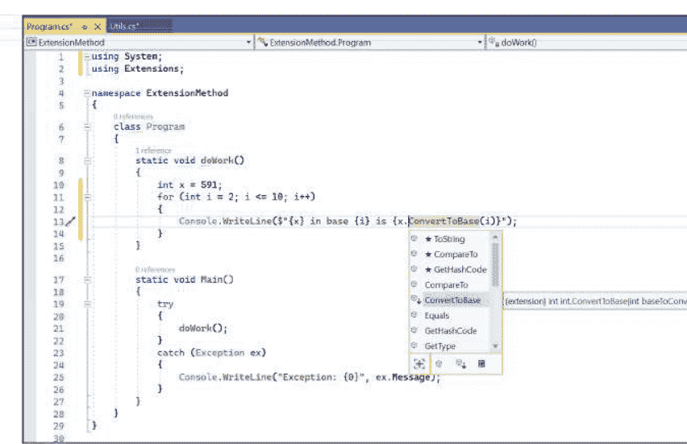

+ 9. 在“调试”（Debug）菜单上，选择“不调试并启动”（Start Without Debugging）。确认 `ConvertToBase` 方法作为扩展方法显示在 IntelliSense 中，当你在 `Console.WriteLine` 之后输入方法符号 `.` 时。


```csharp
throw new ArgumentException("Value cannot be converted to base " +
    baseConvertTo.ToString());
```

+ 5. 在`ConvertToBase`方法中，抛出`ArgumentException`异常的语句块之后，添加以下加粗显示的语句。

点击此处查看代码图像

```csharp
public static int ConvertToBase(this int i, int baseConvertTo)
{
    int result = 0;
    int iterations = 0;

    do
    {
        int nextDigit = i % baseConvertTo;
        i /= baseConvertTo;
        result += nextDigit * (int)Math.Pow(10, iterations);
        iterations++;
    } while (i != 0);

    return result;
}
```

此代码实现了一种将数字从 10 进制转换为不同基数的常用算法。（第 5 章，“使用复合赋值和迭代语句”介绍了该算法将十进制数转换为八进制的一个版本。）

+ 6. 在代码和文本编辑器窗口中显示`Program.cs`文件。

+ 7. 在文件顶部的`using System;`指令之后，添加以下`using`指令：

```csharp
using Extensions;
```

此语句将包含`Utils`类的命名空间引入作用域。编译器可能会显示“using directive is unnecessary”的警告，但如果你不执行此任务，`ConvertToBase`扩展方法将在`Program.cs`文件中可见。

+ 8. 在`Program`类的`doWork`方法中添加以下加粗显示的语句，替换`// TODO:`注释：

点击此处查看代码图像

```csharp
static void doWork()
{
    int x = 591;

    for (int i = 2; i <= 10; i++)
    {
        Console.WriteLine($"{x} in base {i}");
    }
}
```

此代码创建了一个`int x`并将其赋值为 591。（你可以选择任何想要的整数值。）代码随后使用循环打印出 2 到 10 之间所有数字基数的 591 值。

请注意，当你在`Console.WriteLine`之后输入方法符号`.`时，`ConvertToBase`会作为扩展方法出现在 IntelliSense 中。


+ 9. 在“调试”（Debug）菜单上，选择“不调试并启动”（Start Without Debugging）。确认`ConvertToBase`方法作为扩展方法显示在 IntelliSense 中，当你在`Console.WriteLine`之后输入方法符号`.`时。


# 创建接口和定义抽象类

完成本章后，你将能够：

- 定义方法的签名和返回类型的接口。
- 在结构体或类中实现接口。
- 通过接口引用类。
- 在抽象类中捕常见的实现细节。
- 实现无法用于派生新类的密封类。

继承类是一种强大的机制，但继承的真正威力来自于继承接口。接口不包含任何代码或数据，它只是指定了子类必须提供的方法和属性。

抽象类在许多方面与接口相似，不同之处抽象类可以包含代码和数据。然而，你可以将抽象类的某些方法指定为虚，以便继承自抽象类的类可以可选地提供这些方法的实现。

# 理解接口

假设你想定义一个新类，在其中存储对象集合，就像使用数组一样。然而，与数组不同，你想提供一个名为`Retrieve inorder`的方法，以便应用程序根据容器所包含的对象类型来检索对象。（在普通数组中，你可以遍历其内容，并且默认根据其索引检索项目。）例如，如果集合持有如字符串之类的字母数字对象时，集合应允许应用程序根据计算机的排序顺序顺序检索这些字符串；如果集合持有如整数之类的数值型对象，则集合应能够允许应用程序按数值顺序检索对象。

当你定义集合类时，你并不限制它所持有的对象类型。（这些对象可以是类或结构体类型。）因此，你不知道如何对这些对象进行排序。那么，在你实际编写集合类时，该如何为集合类提供一个能够对你未知类型的对象进行排序的方法呢？

乍一看，这个问题似乎与第 12 章“处理继承”中的`ToString`问题相似，该问题可以通过声明一个你的集合类的子类可以重写的虚方法来解决。然而，任何形式的相似性都是误导性的。集合类与它持有的对象之间不存在继承关系，因此虚方法将没有太大用。

如果你思考一下，就会发现问题在于：集合中对象的排序方式取决于集合中对象的类型，而不是取决于集合本身。解决方案是要求所有对象都提供一个方法（例如在本例所示的`CompareTo`方法），集合的`RetrieveOrder`方法可以调用该方法，从而使集合能够对这些对象进行相互比较：

点击此处查看代码图像

```csharp
int CompareTo(object obj)
{
    // 如果此实例等于 obj，则返回 0
    // 如果此实例小于 obj，则返回 < 0
    // 如果此实例大于 obj，则返回 > 0
}
```

你可以为可收集对象定义一个接口，该接口包含`CompareTo`方法，并指定集合类只能包含实现此接口的类。通过这种方式，接口类似于一个合约。如果一个类实现了一个接口，该接口就保证该类包含了接口中指定的所有方法。这种机制确保了你能够调用集合中所有对象的`CompareTo`方法并对其进行排序。

使用接口，你可以真正地将“做什么”与“如何做”分离。接口只给你提供方法的名称、返回类型和参数。方法具体如何实现并不是接口关注的范围。接口描述了类应该提供的功能，而不是这些功能是如何实现的。

## 定义接口

定义接口在语法上与定义类相似，不同在于你使用`interface`关键字而不是`class`关键字。在接口内部，你声明方法的方式与在类或结构体中完全一样，不同之处在于你永远不会指定访问修饰符（`public`、`private`或`protected`）。此外，接口中的方法没有实现；它们只是声明，所有实现该接口的类型必须提供自己的实现。因此，你用分号替换方法体。这是一个示例：

点击此处查看代码图像

```csharp
interface IComparable
{
    int CompareTo(object obj);
}
```

> 提示  
> Microsoft .NET 文档建议你的接口名称以大写字母`I`开头。这种约定是 C# 中匈牙利命名法的最后遗迹。顺便提到，`System`命名空间已经如所示定义了`IComparable`接口。

> 重要  
> 接口不能包含任何数据；你不能向接口中添加字段（即使是私有字段）。

## 实现接口

要实现接口，你需要声明一个继承自接口的类或结构体，并实现接口指定的所有方法。这并不是真正的继承，尽管其语法是相同的，而且你在本章后面部分看到的某些语义具有许多继承的特征。

> 注意  
> 与类继承不同，结构体也可以实现接口。

例如，假定你正在定义第 12 章描述的哺乳动物层次结构，你需要指定陆生哺乳动物提供一个名为`NumberLegs`的方法，该方法返回`int`类型的哺乳动物腿的数量。（海生哺乳动物不实现此接口。）你可以如下定义包含该方法的`ILandBound`接口：

```csharp
interface ILandBound
{
    int NumberLegs();
}
```

你可以在`Horse`类中实现此接口。你继承该接口并为接口定义的每个方法提供实现（在这种情况下，只有一个`NumberLegs`方法）。

点击此处查看代码图像

```csharp
class Horse : ILandBound
{
    ...

    public int NumberLegs()
    {
        return 4;
    }
}
```

当你实现接口时，必须根据以下规则确保每个方法都匹配接口：

- 方法名称和返回类型完全匹配。
- 任何参数（包括`ref`和`out`修饰符）完全匹配。
- 所有实现接口的方法必须是公开可见的。然而，如果你使用显式接口实现，方法不应有访问限定符。

> 提示  
> Microsoft Visual Studio 集成开发环境 (IDE) 可以通过未能实现接口来减少编码错误。“实现接口”向导会为该类实现的接口中的每个项生成存位符。然后你用适当的代码填充这些存位符。你将在本章后面的练习中学如何使用此向导。

一个类可以同时继承另一个类并实现一个接口。在这种情况下，C# 并不使用特定的关键字来区分基类和接口（如 Java 那样）。相反，C# 使用位置表示法。基类名称始终排在第一个，后面跟着逗号，然后是接口。以下示例将`Horse`定义为一个继承`Mammal`类但额外实现了`ILandBound`接口的类：

点击此处查看代码图像

```csharp
interface ILandBound
{
    ...
}

class Mammal
{
    ...
}

class Horse : Mammal, ILandBound
{
```

## 通过接口引用类

通过定义上层类变量来引用对象的方法，你也可以通过定义对象类实现的接口变量来引用对象。以之前的示例为例，你可以如下使用`ILandBound`变量来引用`Horse`对象：

点击此处查看代码图像

```csharp
Horse myHorse = new Horse(...);

ILandBound MyHorse = myHorse; // 合法
```

这之所以可行，是因为所有的马都是陆生哺乳动物。然而，反之则不然；你不能将`ILandBound`对象赋值给`Horse`，除非强制转换以验证它实际上引用的是`Horse`对象而不是其他同样实现了`ILandBound`接口的类。

通过接口引用对象的技巧非常有用，因为你可以利用它来定义接受不同类型作为参数的方法——只要这些类型实现了指定的接口。例如，此处所示的`FindLandSpeed`方法可以接受任何实现`ILandBound`接口的参数：

点击此处查看代码图像

```csharp
int FindLandSpeed(ILandBound landBoundMammal)
{
    ...
}
```

> 注意  
> 接口（例如`InterfaceA`）可以继承另一个接口（`InterfaceB`）。技术上，这被称为接口扩展而不是继承。在这种情况下，任何实现`InterfaceA`的类或结构体必须提供`InterfaceB`和`InterfaceA`中所有方法的实现。

你可以使用`is`运算符来验证对象是否是实现特定接口的类的实例，这在第 8 章“理解值和引用”中已有演示。你使用`is`运算符来确定对象是否为指定类型，它不仅适用于接口，也适用于类和结构体。例如，以下代码块在尝试将变量`myHorse`赋值给`ILandBound`变量之前，检查它是否实现了`ILandBound`接口：

点击此处查看图片

```csharp
if (myHorse is ILandBound)
{
    ILandBound iLandBoundAnimal = myHorse;
}
```

> 注意  
> 通过接口引用对象时，你只能调用通过接口可见的方法。

## 使用多个接口

一个类最多可以有一个基类，但允许实现无限数量的接口。类必须实现这些接口声明的所有方法。

如果结构体或类实现了多个接口，你只需要以逗号分隔的列表形式指定这些接口。如果类有基类，则接口将列在基类之后。例如，假设你定义了另一个名为`IGrazable`的接口，它包含所有放牧动物的`ChewGrass`方法。你可以这样定义`Horse`类：

点击此处查看图片

```csharp
class Horse : Mammal, ILandBound, IGrazable
{
    ...
}
```

## 显式实现接口

目前为止展示了隐式实现接口的类。如果你重新查看`ILandBound`接口和`Horse`类（如下所示），你会发现尽管`Horse`类实现了`ILandBound`接口，但在`Horse`类中`NumberOfLegs`方法的实现中没有任何地方说明它是`ILandBound`接口的一部分：

点击此处查看代码图像

```csharp
interface ILandBound
{
    int NumberOfLegs();
}

class Horse : ILandBound
{
    ...

    public int NumberOfLegs()
    {
        return 4;
    }
}
```

这在简单的情况下可能不是一个问题，但假设`Horse`类实现了多个接口。没有什么可以阻止多个接口指定具有相同名称的方法，尽管它们的语义可能不同。例如，假设你想实现一个基于马车的运输系统。一次长途旅程可能会被分解为若干阶段，或“路程”。如果你想跟踪每只马拉车跑了多少段路程，你可以定义以下接口：

```csharp
interface IJourney
{
    int NumberOfLegs();
}
```

现在，如果你在`Horse`类中实现此接口，你就会遇到一个有趣的问题：

点击此处查看图片

```csharp
class Horse : ILandBound, IJourney
{
    ...

    public int NumberOfLegs()
    {
        return 4;
    }
}
```

这是合法的代码，但这只马是有四条腿，还是它在旅程中拉了四段路？对于 C# 来说，答案两者皆是！默认情况下，C# 不区分该方法实现的是哪个接口，因此同一个方法实际上同时实现了两个接口。

为了解决这个问题并区分哪个方法属于哪个接口实现，你可以显式地实现接口。要这样做，你需要在实现方法时指定它属于哪个接口，如下所示：

点击此处查看图片

```csharp
class Horse : ILandBound, IJourney
{
    ..

    int ILandBound.NumberOfLegs()
    {
        return 4;
    }

    int IJourney.NumberOfLegs()
    {
        return 3;
    }
}
```

现在你可以看到这只马有四条腿，并且在旅程中拉了三段路。

除了在方法名称前加上接口名称外，这种语法中还有另一个细微的区别：方法没有被标记为`public`。你无法为属于显式接口实现的方法指定访问保护。这导致了另一个有趣的现象。如果你在代码中创建一个`Horse`变量，你实际上无法调用任何`NumberOfLegs`方法，因为它们是不可见的。对于`Horse`类来说，它们都是私有的。事实上，这是有的。如果这些方法通过`Horse`类可见，下面的代码实际上会调用哪一个呢？是`ILandBound`接口的，还是`IJourney`接口的？

点击此处查看图片

```csharp
Horse horse = new Horse();

// 这将无法编译
horse.NumberOfLegs();
```

那么，你如何访问这些方法呢？答案是将变量强制转换为接口类型：

```csharp
ILandBound landBoundHorse = (ILandBound)horse;

landBoundHorse.NumberOfLegs();

IJourney journeyHorse = (IJourney)horse;

journeyHorse.NumberOfLegs();
```

## 使用接口处理版本控制

接口是定义类形状的极佳工具，使多个开发者更容易协作进行项目。多个类型可以实现同一个接口。这些类型变得互换。

从历史上来看，接口在版本控制方面并不理想。接口被认为是不可变的。考虑以下场景。

你定义了以下简单的接口：

点击此处查看图片

```csharp
public interface IMyInterface
{
    void DoSomeWork();
}
```

随后，另一个开发者创建实现了此接口的类：

点击此处查看图片

```csharp
public class myClass : IMyInterface
{
    public void DoSomeWork()
    {
        // 实现
    }
}
```

一段时间后，你决定扩展接口并添加另一个方法：

点击此处查看图片

```csharp
public interface IMyInterface
{
    void DoSomeWork();
    void DoAdditionalWork();
}
```

此更改将破坏所有使用该接口的现有应用程序，因为它们没有实现`DoAdditionalWork`。

解决此问题的传统方法是创建一个继承现有接口的新接口，如下：

点击此处查看图片

```csharp
public interface IMyExtendedInterface : IMyInterface
{
    void DoAdditionalWork();
}
```

使用原始接口的现有应用程序将继续运行，而新应用程序可以实现`IMyExtendedInterface`。

遗憾的是，随着接口时间的演变，这种方法可能会变得混乱，导致难以跟踪和维护的复杂接口链。C# 通过允许你在接口中提供方法的默认实现来解决这个问题，如下：

点击此处查看图片

```csharp
public interface IMyInterface
{
    void DoSomeWork();
```


# 接口限制

保持方法默认实现简单还有另一个原因。本质上，接口不是类，你不应该将其视为类来处理。请记住，接口是类型形状的定义，而不是类型的实现。以下限制是此特性的自然结果：

- 不允许在接口中定义字段，即使是静态字段也不行。字段是类或结构体的实现细节。
- 不允许在接口中定义任何构造函数。构造函数也被认为是类或结构体的实现细节。
- 不允许在接口中定义析构函数。析构函数包含用于销毁对象实例的语句。（析构函数的描述请参阅第 14 章“使用垃圾回收和资源管理”）。
- 你不能为任何方法指定访问修饰符。接口中的所有方法都隐式是公共的（`public`）。
- 你不能在接口内部嵌套任何类型（如枚举、结构体、类或接口）。
- 接口不允许继承结构体、记录或类，尽管接口可以继承另一个接口。结构体、记录和类包含实现细节；如果允许接口继承这些类型中的任何一种，那么它将是在继承某些实现细节。

# 定义和使用接口

在接下来的练习中，你将定义并实现构成一个简单图形包一部分的接口。你将定义两个名为 `IDraw` 和 `IColor` 的接口，然后定义实现它们的类。每个类都将定义一个可以在表单的画布（`canvas`）上绘制的形状。（画布是一个你可以用于在屏幕上绘制线条、文本和形状的控件。）

`IDraw` 接口定义了以下方法：

- `SetLocation`：通过此方法，你可以指定画布上左上角的位置，即形状的 `x` 坐标和 `y` 坐标。
- `Draw`：此方法实际上根据使用 `SetLocation` 方法指定的位置，在画布上绘制该形状。

`IColor` 接口定义了以下方法：

- `SetColor`：使用此方法指定形状的颜色。当形状在画布上绘制时，它将以这种颜色显示。

# 定义 IDraw 和 IColor 接口

1. 启动 Microsoft Visual Studio 2022，如果它尚未运行。
2. 打开 Drawing 解决方案，它位于你文档文件夹中的 `\Microsoft Press\VCSBS\Chapter 13\Drawing` 文件夹中。

Drawing 项目是一个图形应用程序。它包含一个名为 `DrawingPad` 的表单。该表单包含一个名为 `drawingCanvas` 的画布。你将使用此表单和画布来测试你的代码。

3. 在解决方案资源管理器中，选择 Drawing 项目。在项目菜单上，选择“添加新项”。
4. 在“添加新项”对话框的左侧面板中，选择 C#，然后选择“代码”。在中间面板中，选择“接口”模板。在名称框中，输入 `IDraw.cs`，并点击“添加”。

Visual Studio 会创建 `IDraw.cs` 文件并将其添加到你的项目中。`IDraw.cs` 文件出现在代码编辑器中，看起来应该如下所示：

```csharp
using System;
using System.Collections.Generic;
using System.Linq;
using System.Text;
using System.Threading.Tasks;
```

```csharp
namespace Drawing
{
    interface IDraw
    {
    }
}
```

5. 在 `IDraw.cs` 文件中，在文件顶部添加以下 `using` 指令：

```csharp
using Windows.UI.Controls;
```

你将在此接口中引用 `Canvas` 类。`Canvas` 类位于通用 Windows 平台（UWP）应用的 `Windows.UI.Xaml.Controls` 命名空间中。

6. 将以下方法添加到 `IDraw` 接口中：

```csharp
interface IDraw
{
    void SetLocation(int xCoord, int yCoord);
    void Draw(Canvas canvas);
}
```

7. 在项目菜单上，选择“添加新项”。
8. 在“添加新项”对话框的中间面板中，选择“接口”模板。在名称框中，输入 `IColor.cs`，并点击“添加”。

Visual Studio 创建 `IColor.cs` 文件并将其添加到你的项目中。`IColor.cs` 文件出现在代码编辑器中。

9. 在 `IColor.cs` 文件中，文件顶部添加以下 `using` 指令：

```csharp
using Windows.UI;
```

你将在此接口中引用 `Color` 类。`Color` 类位于 UWP 应用的 `Windows.UI` 命名空间中。

10. 在 `IColor` 定义中添加以下方法：

```csharp
interface IColor
{
    void SetColor(Color color);
}
```

你现在定义了 `IDraw` 和 `IColor` 接口。下一步是创建实现它们的类。在后续练习中，你将创建名为 `Square` 和 `Circle` 的类。

# 创建 Square 类

1. 在项目菜单上，选择“添加类”。
2. 在“添加新项”对话框的中间面板中，确保选择了“类”模板。在名称框中，输入 `Square.cs`，并点击“添加”。

Visual Studio 创建 `Square.cs` 文件并显示在代码编辑器中。

3. 在 `Square.cs` 顶部添加以下 `using` 指令：

```csharp
using Windows.UI;
using Windows.UI.Xaml.Media;
using Windows.UI.Xaml.Shapes;
```

4. 修改 `Square` 类以实现 `IDraw` 和 `IColor` 接口，如下所示：

```csharp
class Square : IDraw, IColor
{
}
```

5. 在 `Square` 类中添加以下私有变量：

```csharp
class Square : IDraw, IColor
{
    private int sideLength;
    private int locX = 0, locY = 0;
    private Rectangle rect = null;
}
```

这些变量将存储 `Square` 对象在画布上的位置和大小。`Rectangle` 类位于 `Windows.UI.Xaml.Shapes` 命名空间。你将使用此类来绘制正方形。

6. 在 `Square` 类中添加以下构造函数：

```csharp
class Square : IDraw, IColor
{
    public Square(int sideLength)
    {
    }
}
```

此构造函数初始化了 `sideLength` 字段并指定了正方形每边的长度。

7. 在 `Square` 类定义中，悬停在 `IDraw` 接口上。选择出现的灯泡图标，并选择“显式实现所有成员”，如下所示：


此功能会导致 Visual Studio 生成 `IDraw` 接口方法的默认实现。如果你愿意，也可以手动将方法添加到 `Square` 类中。以下示例显示了 Visual Studio 生成的代码：

```csharp
void IDraw.Draw(Canvas canvas)
{
    throw new NotImplementedException();
}

void IDraw.SetLocation(int xCoord, int yCoord)
{
    throw new NotImplementedException();
}
```

这些方法目前都抛出 `NotImplementedException` 异常。你需要用自己的代码替换这些方法的方法体。

8. 在 `IDraw.SetLocation` 方法中，将抛出 `NotImplementedException` 异常的代码替换为以下语句：

```csharp
void IDraw.SetLocation(int xCoord, int yCoord)
{
    this.locX = xCoord;
    this.locY = yCoord;
}
```

此代码将通过参数传递的值存储在 `Square` 对象的 `locX` 和 `locY` 字段中。

9. 将 `IDraw.Draw` 方法中生成的异常代码替换为以下语句：

```csharp
void IDraw.Draw(Canvas canvas)
{
    this.rect = new Rectangle();
    this.rect.Height = this.sideLength;
    this.rect.Width = this.sideLength;
    Canvas.SetTop(this.rect, this.locY);
    Canvas.SetLeft(this.rect, this.locX);
    canvas.Children.Add(this.rect);
}
```

此方法通过在画布上绘制矩形（`Rectangle`）形状来渲染 `Square` 对象。（正方形简单来说就是四条边长度相同的矩形。）`Rectangle` 的高度和宽度通过 `sideLength` 字段的值设置。`Rectangle` 在画布上的位置通过 `Canvas` 类的静态方法 `SetTop` 和 `SetLeft` 方法设置，并将 `Rectangle` 形状添加到画布中（这使其显示出来）。

10. 如下所示，将来自 `IColor` 接口的 `SetColor` 方法添加到 `Square` 类中：

```cs
void IColor.SetColor(Color color)
{
    if (this.rect is not null)
    {
        SolidColorBrush brush = new SolidColorBrush(color);
        this.rect.Fill = brush;
    }
}
```

此方法检查 `Square` 对象是否已实际显示。（如果尚未渲染，`rect` 字段将为 `null`）。该代码使用 `SolidColorBrush` 对象用指定的颜色设置 `rect` 字段的 `Fill` 属性（`SolidColorBrush` 类的工作原理超出了本文的讨论范围）。

11. 在“项目”菜单上，选择“添加类”。
12. 在“新建项 – 绘图”对话框中，在“名称”框中输入 `Circle.cs`，然后选择“添加”。

Visual Studio 会创建 `Circle.cs` 文件并在代码和文本编辑器窗口中显示它。

13. 在 `Circle.cs` 文件的顶部，将以下 `using` 指令添加到列表中：

```cs
using Windows.UI;
using Windows.UI.Xaml.Media;
using Windows.UI.Xaml.Shapes;
using Windows.UI.Xaml.Controls;
```

14. 修改 `Circle` 类的定义，使其实现 `IDraw` 和 `IColor` 接口：

```cs
class Circle : IDraw, IColor
{
}
```

15. 将以下私有变量添加到 `Circle` 类中：

```cs
class Circle : IDraw, IColor
{
    private int diameter;
    private int locX = 0, locY = 0;
    private Ellipse circle = null;
}
```

这些变量将存储 `Circle` 对象在画布上的位置和大小。`Ellipse` 类提供了你将用于画圆的功能。

16. 在 `Circle` 类中添加以下构造函数：

```cs
class Circle : IDraw, IColor
{
    public Circle(int diameter)
    {
        this.diameter = diameter;
    }
}
```

此构造函数初始化了 `diameter` 字段。

17. 将来自 `IDraw` 接口的以下 `SetLocation` 方法添加到 `Circle` 类中：

```cs
void IDraw.SetLocation(int xCoord, int yCoord)
{
    this.locX = xCoord;
    this.locY = yCoord;
}
```

> 注意
> 该方法与 `Square` 类中的方法相同。你将在本章稍后部分看到如何重构代码以避免这种重复。

18. 在 `Circle` 类中添加此处所示的 `Draw` 方法：

```cs
void IDraw.Draw(Canvas canvas) 
{
    this.circle = new Ellipse();
    this.circle.Height = this.diameter;
    this.circle.Width = this.diameter;
    Canvas.SetTop(this.circle, this.locY);
    Canvas.SetLeft(this.circle, this.locX);
    canvas.Children.Add(this.circle);
}
```

此方法也是 `IDraw` 接口的一部分。它与 `Square` 类中的 `Draw` 方法类似，不同之处在于通过在画布上绘制椭圆（`Ellipse`）形状来渲染 `Circle` 对象。（圆是宽度和高度相同的椭圆）。与 `SetLocation` 方法一样，你将在本章稍后部分看到如何重构此代码以减少任何重复。

19. 在 `Circle` 类中添加 `SetColor` 方法：

```cs
void IColor.SetColor(Color color) 
{
    if (this.circle is not null) 
    {
        SolidColorBrush brush = new SolidColorBrush(color);
        this.circle.Fill = brush;
    }
}
```

此方法是 `IColor` 接口的一部分。该方法与 `Square` 类的方法相似。

你已经完成了 `Square` 和 `Circle` 类。你现在可以使用表单来测试它们。

# 测试 Square 和 Circle 类

1. 在设计视图窗口显示 `DrawingPad.xml` 文件。
2. 在表单上，选择较大的阴影区域。

表单的阴影区域是 `Canvas` 对象。你选择此区域将焦点设置为该对象。

3. 在“属性”窗口中，选择“事件处理器”按钮。（该按钮有一个看起来像闪电的图标）。
4. 在事件列表中，找到 `Tapped` 事件，然后双击 `Tapped` 框。

Visual Studio 会为 `DrawingPad` 类创建一个名为 `drawing_Tapped` 的方法并在代码和文本编辑器中显示它。当用户用手指点击画布或在画布上点击鼠标左键时，该事件处理器运行。你可以在第 20 章“解耦应用程序和处理事件”中学习更多关于事件处理器的知识。

5. 在 `DrawingPad.xml` 文件顶部，向列表中添加以下 `using` 指令：

```cs
using Windows.UI;
```

`Windows.UI` 命名空间包含了 `Colors` 的定义，你将使用它设置形状的颜色。

6. 在 `drawing_Tapped` 方法中添加以下代码：

```cs
private void drawing_Tapped(object sender, TappedEventArgs e)
{
    Point mouseLocation = e.GetPosition(drawingCanvas);
    Square mySquare = new Square(100);
    if (mySquare is IDraw)
    {
    }
}
```


```csharp
IDraw drawSquare = mySquare;

drawSquare.SetLocation((int)mouseLocation.X, (int)mouseLocation.Y);

drawSquare.Draw(drawingCanvas);
```

```csharp
if (mySquare is IColor)
{
    IColor colorSquare = mySquare;

    colorSquare.SetColor(Colors.BlueViolet);
}
```

此代码测试`Square`类以验证其是否实现了`IColor`接口。如果是，通过此接口创建`Square`的引用并调用`SetColor`方法将`Square`对象的颜色设置为紫色。

- 7. 在`drawing_Tapped`方法末尾添加以下代码：

点击此处查看代码图像

```csharp
private void drawing_Tapped(object sender, TappedEventArgs e)
{
    if (mySquare is IColor)
    {
        IColor colorSquare = mySquare;

        colorSquare.SetColor(Colors.BlueViolet);
    }
}
```

# 重要

你必须在调用`SetColor`之前调用`Draw`，因为`SetColor`方法仅在`Square`已渲染时才设置颜色。如果你在`Draw`之前调用`SetColor`，颜色将无法设置，且`Square`将不会出现。

- 8. 返回设计视图窗口中的`DrawingPad.xaml`文件，并选择`Canvas`对象。
- 9. 在事件列表中，找到`RightTapped`事件，然后双击`RightTapped`框。

当用户用手指点击、按住并释放画布或在画布上右键单击时，会发生此事件。

- 10. 在`drawingCanvas_RightTapped`方法中添加此处粗体所示的代码：

点击此处查看代码图像

```csharp
private void drawingCanvas_RightTapped(object sender, RightTappedRoutedEventArgs e)
{
    Point mouseLocation = e.GetPosition(this.drawingCanvas);
    Circle myCircle = new Circle(100);

    if (myCircle is IDraw)
    {
        IDraw drawCircle = myCircle;

        drawCircle.SetLocation((int)mouseLocation.X, (int)mouseLocation.Y);

        drawCircle.Draw(drawingCanvas);
    }

    if (myCircle is IColor)
    {
        IColor colorCircle = myCircle;

        colorCircle.SetColor(Colors.HotPink);
    }
}
```

11. 在调试（Debug）菜单上，选择开始调试（Start Debugging）以生成并运行应用程序。
12. 当绘板（Drawing Pad）窗口打开时，点击或触摸窗口中显示的画布的任意位置。会出现一个紫色正方形。
13. 在画布的任意位置点击、按住并释放，或右键点击。会出现一个粉色圆形。你可以任意次数点击鼠标左右键；每次点击都会在鼠标位置绘制一个正方形或圆形。

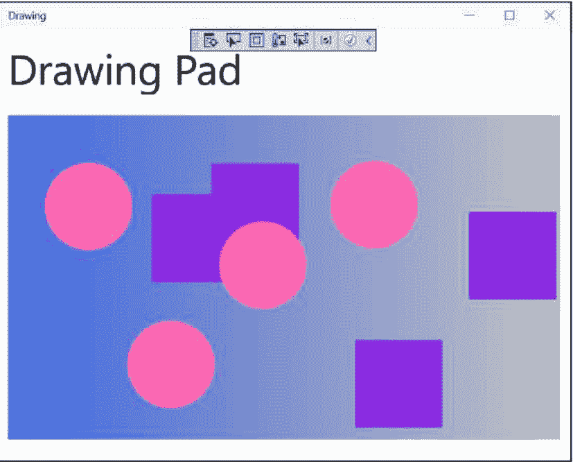

14. 返回到 Visual Studio 并停止调试。

# 抽象类

你可以在许多不同的类中实现之前上一组练习中讨论过的`ILandBound`和`IGrazable`接口，这取决于你要在 C# 应用程序中建模多少不同类型的哺乳动物。在这种情况下，派生类的部分共享共同的实现是很典型的。例如，以下两个类中的重复是显而易见的：

点击此处查看代码图像

```csharp
class Horse : Mammal, ILandBound, IGrazable
{
    ...

    void IGrazable.ChewGrass()
    {
        Console.WriteLine("Chewing grass ");

        // 编写吃草的代码
    }
}

class Sheep : Mammal, ILandBound, IGrazable
{
    ...

    void IGrazable.ChewGrass()
    {
        Console.WriteLine("Chewing grass ");

        // 与 horse 相同的吃草代码
    }
}
```

代码中的重复是一个警告信号。如果可能，你应该重构代码以避免重复并减少任何相关的维护成本。实现这种重构的一种方法是将共同的实现放入专门为此目的创建的新类中。实际上，你可以将一个新类插入到类层次结构中，如下代码示例所示：

点击此处查看代码图像

```csharp
class GrazingMammal : Mammal, IGrazable
{
    ...

    void IGrazable.ChewGrass()
    {
        // 共同的吃草代码
        Console.WriteLine("Chewing grass ");
    }
}

class Horse : GrazingMammal, ILandBound
{
    ...
}

class Sheep : GrazingMammal, ILandBound
{
    ...
}
```

这是一个很好的解决方案，但仍有一点不太对：你实际上可以创建`GrazingMammal`类的实例（同样的，`Mammal`类也是如此）。这并不合理。`GrazingMammal`类的存在是为了提供共同的默认实现。它的唯一目的是作为一个可以被继承的类。`GrazingMammal`类是共同功能的抽象，而不是其本身的一个实体。

要声明不允许创建类的实例，你可以通过使用`abstract`关键字将类声明为抽象类，如下例所示：

点击此处查看代码图像

```csharp
abstract class GrazingMammal : Mammal, IGrazable
{
    ...
}
```

如果你现在尝试实例化一个`GrazingMammal`对象，代码将无法编译：

点击此处查看代码图像

```csharp
GrazingMammal myGrazingMammal = new GrazingMammal(...); // 非法
```

# 抽象方法

抽象类可以包含抽象方法。抽象方法在原理上类似于虚方法（在第 12 章中介绍），不同于它不包含方法体。派生类必须重写此方法。抽象方法不能是私有的。以下示例将`GrazingMammal`类中的`DigestGrass`方法定义为抽象方法；食草哺乳动物可能使用相同的代码来吃草，但它们必须为自己提供对`DigestGrass`方法的特定实现。如果在抽象类中提供默认实现是没有意义的，但你又想确保继承类提供对该方法的自己的实现，那么抽象方法就是很有用的。

点击此处查看代码图像

```csharp
abstract class GrazingMammal : Mammal, IGrazable
{
    public abstract void DigestGrass();

    ...
}
```

> **注意**
>
> 从初看之下，抽象类和带有默认方法实现的接口可能看起来相似，但它们从本质上说是不同的。抽象类可以包含字段、构造函数、析构函数、私有方法以及你可以在任何类中通常找到的其他成员。接口仅仅是类应该样子的规范。

# 密封类（Sealed classes）

使用继承并不总是容易的，并且需要深考虑。如果你创建一个接口或抽象类，你是在有意地编写一些将来会被继承的内容。麻烦在于，预测未来是一项困难的工作。通过练习和经验，你可以培养出构建灵活、易用的接口、抽象类和类层次结构的技能，但这需要付出努力，以及对你正在建模的问题有深入的理解。换句话说，除非你有意识地设计一个类并打算将其作为基类，否则它极不太可能作为基类运行良好。

在 C# 中，如果你决定某个类不应该作为基类，可以使用`sealed`关键字来防止该类被用作基类。例如，在以下代码中，如果任何类尝试使用`Horse`作为基类，将产生编译时错误：

点击此处查看代码图像

```csharp
sealed class Horse : GrazingMammal, ILandBound
{
    ...
}
```

# 密封方法（Sealed methods）

你也可以使用`sealed`关键字来声明类中的某个方法是密封的。这意味着派生类不能重写此方法。你可以这样理解`interface`、`virtual`、`override`和`sealed`关键字：

- `interface`（接口）引入方法的名称。
- `virtual`（虚）是方法的第一个实现。
- `override`（重写）是方法的另一种实现。
- `sealed`（密封）是方法的最终实现。

# 实现和使用抽象类

以下练习使用抽象类来整理你在上一个练习中开发的部分代码。`Square`和`Circle`类包含大部分的重复代码。将这些代码提取到抽象类是有意义的，因为这将有助于维护`Square`和`Circle`类。

## 创建 `DrawingShape` 抽象类

1. 返回 Visual Studio 中的 Drawing 项目。
2. 在解决方案管理器中，选择 Drawing 项目。在项目上，选择“添加类”。“新建项 - Drawing”对话框打开。
3. 在名称框中输入`DrawingShape`，然后选择“添加”。Visual Studio 创建该类并在代码编辑器窗口中显示它。
4. 在`DrawingShape.cs`文件中，在顶部的列表中添加以下使用指令：

点击此处查看代码图像

```csharp
using Windows.UI;
using Windows.UI.Xaml.Media;
using Windows.UI.Xaml.Shapes;
using Windows.UI.Xaml.Controls;
```

该类的目的是包含`Circle`和`Square`类共同的代码。程序不应该能够直接实例化`DrawingShape`对象。

5. 修改`DrawingShape`类的定义将其声明为抽象类，如下：

```csharp
abstract class DrawingShape
{
}
```

6. 在`DrawingShape`类中添加以下加粗的保护变量：

点击此处查看代码图像

```csharp
abstract class DrawingShape
{
    protected int size;
    protected int locX = 0, locY = 0;
    protected Shape shape = null;
}
```

7. 为`DrawingShape`类添加以下构造函数：

点击此处查看代码图像

```csharp
abstract class DrawingShape
{
    public DrawingShape(int size)
    {
        this.size = size;
    }
}
```

此代码初始化了`DrawingShape`对象中的`size`字段。

8. 在`DrawingShape`类中添加`SetLocation`和`SetColor`方法，如下文代码中的粗体所示。这些方法提供了所有派自`DrawingShape`类的类的实现。注意，这些方法没有标记为`virtual`，且期望派生类重写它们。此外，`DrawingShape`类没有声明实现`IDraw`或`IColor`接口（接口抽象类），因此这些方法仅被声明为`public`。

点击此处查看代码图像

```csharp
abstract class DrawingShape
{
    public void SetLocation(int xCoord, int yCoord)
    {
        this.locX = xCoord;
        this.locY = yCoord;
    }

    public void SetColor(Color color)
    {
        if (this.shape is not null)
        {
            SolidColorBrush brush = new SolidColorBrush(color);
            this.shape.Fill = brush;
        }
    }
}
```

9. 在`DrawingShape`类中添加`Draw`方法。与之前的方法不同，此方法被声明为`virtual`，任何派生类都应该重写它以扩展功能性。该方法中的代码验证了`shape`字段不为`null`并在画布上绘制它。继承此方法的类必须提供自己的代码来实例化形状对象。（请记住，`Square`类创建一个`Rectangle`对象，而`Circle`类创建一个`Ellipse`对象。）

点击此处查看代码图像

```csharp
abstract class DrawingShape
{
    ...

    public virtual void Draw(Canvas canvas)
    {
        if (this.shape is null)
        {
            throw new InvalidOperationException("Shape is null");
        }

        this.shape.Height = this.size;
        this.shape.Width = this.size;
        Canvas.SetTop(this.shape, this.locY);
        Canvas.SetLeft(this.shape, this.locX);
        canvas.Children.Add(this.shape);
    }
}
```

你已经完成了`DrawingShape`抽象类。后续步骤是修改`Square`和`Circle`类，使其继承自该类，并从`Square`和`Circle`类中移除代码。

## 修改 `Square` 和 `Circle` 类以继承自 `DrawingShape` 类

1. 在“代码和文本编辑器”窗口中显示`Square`类的代码。
2. 修改`Square`类的定义，使其在实现`IDraw`和`IColor`接口的同时也继承自`DrawingShape`类。

点击此处查看代码图像

```csharp
class Square : DrawingShape, IDraw, IColor
{
    ...
}
```

注意，你必须在`Square`类实现的任何接口之前，指定`Square`类继承自的类。

3. 在`Square`类中，删除`sideLength`、`rect`、`locX`和`locY`字段的定义。这些字段不再需要，因为它们现在由`DrawingShape`类提供。
4. 使用所示粗体代码替换现有的构造函数，该代码调用基类：

点击此处查看代码图像

```csharp
class Square : DrawingShape, IDraw, IColor
{
    public Square(int sideLength)
        : base(sideLength)
    ...
}
```

注意，此构造函数的体是空的，因为基类构造函数执行了所有所需的初始化。

5. 从`Square`类中移除`IDraw.SetLocation`和`IColor.SetColor`方法。`DrawingShape`类提供了这些方法的实现。
6. 修改`Draw`方法的定义。使用`public override`声明，并移除对`IDraw`接口的引用。再次，`DrawingShape`类已经为此方法提供了基础功能，你将用`Square`类所需的特定代码来扩展它。

点击此处查看代码图像

```csharp
public override void Draw(Canvas canvas)
{
    ...
}
```

7. 使用此处的粗体代码替换`Draw`方法的体：

点击此处查看代码图像

```csharp
public override void Draw(Canvas canvas)
{
    if (this.shape is not null)
    {
        canvas.Children.Remove(this.shape);
    }
    else
    {
        this.shape = new Rectangle();
    }

    base.Draw(canvas);
}
```


这些语句如果继承自 `DrawingShape` 类的 `shape` 字段尚未实例化，则将其实例化为 `Rectangle` 类的新实例。然后它们调用 `DrawingShape` 类中的 `Draw` 方法。

- 8. 对 `Circle` 类重复步骤 2 到 7，但区别是构造函数应命名为 `Circle` 并带有一个名为 `diameter` 的参数，在 `Draw` 方法中，你将 `shape` 字段实例化为新的 `Ellipse` 对象。`Circle` 类的完整代码如下：

```
class Circle : DrawingShape, IDraw, IColor
{
    public Circle(int diameter)
    {
        :base(diameter)
    }

    public override void Draw(Canvas canvas)
    {
        if (this.shape is not null)
        {
            canvas.Children.Remove(this.shape);
        }
        else
        {
            this.shape = new Ellipse();
        }
        base.Draw(canvas);
    }
}
```

9. 在菜单上，选择调试（Debugging）。

10. 返回 Visual Studio，选择调试（Debugging）。

## 与 Windows Runtime 的兼容性

因此，由 CLR 和 WinRT 实现的集成允许 CLR 透明地使用 WinRT 类型，但也支持反向互操作性：你可以使用托管代码定义类型并将其供非托管应用程序使用，只要这些类型符合 WinRT 的预期。第 9 章阐述了结构体在这方面的要求。

如果你正在构建旨在通过 WinRT 被非托管应用程序使用的类，你的类必须遵循以下规则：

- 任何公共字段、任何公共方法的参数和返回值必须是 WinRT 类型或可以被 WinRT 透明地转换为 WinRT 类型的 .NET 类型。支持的 .NET 类型示例包括符合的值类型（如结构体和枚举）以及与 C# 基础类型（`int`, `long`, `float`, `double`, `string` 等）对应的类型。私有字段在类中是被支持，并且可以是 .NET 可用的任何类型；它们不符合 WinRT。

- 类不能重写 `System.Object` 除 `ToString` 以外的方法，且不能声明保护构造函数。

- 定义类的命名空间必须与实现该类的程序集相同。此外，命名空间名称（因此程序集名称）不能以 `Windows` 开头。

- 你无法通过 WinRT 在非托管应用程序中继承托管类型。因此，所有公共类必须是密封的（`sealed`）。如果你需要实现多态，可以创建一个公共接口并在多态类上实现该接口。

- 你可以抛出 UWP 应用可用 .NET 子集包含的任何异常类型；但你不能创建自定义的异常类。如果你的代码在从非托管应用程序调用时抛出未处理的异常，WinRT 会在非托管代码中抛出一个等效异常。

WinRT 对本书后续介绍的 C# 代码特性还有其他要求。在描述每个特性时，这些要求将被突出显示。

# 总结

在本章中，你学习了如何定义和实现接口以及抽象类。下表总结了在为接口、类和结构体定义方法时各种有效（是）和无效（否）的关键字组合。

| 关键字 | 接口 | 抽象类 | 类 | 密封类 | 结构体 |
|---|---|---|---|---|---|
| `abstract` | 否 | 是 | 否 | 否 | 否 |
| `new` | 是¹ | 是 | 是 | 是 | 否² |
| `override` | 否 | 是 | 是 | 是 | 否³ |
| `private` | 否 | 是 | 是 | 是 | 是 |
| `protected` | 否 | 是 | 是 | 是 | 否⁴ |
| `public` | 否 | 是 | 是 | 是 | 是 |
| `sealed` | 否 | 是 | 是 | 否 | 否 |
| `virtual` | 否 | 是 | 是 | 否 | 否 |

¹ 接口可以扩展另一个接口并引入具有相同签名的新方法。
² 结构体不支持继承，因此它们不能隐藏方法。
³ 结构体不支持继承，因此它们不能重写方法。
⁴ 结构体不支持继承；结构体是隐式密封的，不能派生。

- 如果你想继续下一章节，请保持 Visual Studio 2022 运行并转到第 14 章。

- 如果你想现在退出 Visual Studio 2022，请在“文件”菜单中选择“退出”。如果看到保存对话框，选择“是”并保存项目。

## 快速参考

| 目标 | 执行操作 |
| --- | --- |
| 声明接口 | 使用 `interface` 关键字。例如：
```csharp
interface IDemo {
    string GetName();
    string GetDescription();
}
``` |
| 实现接口 | 使用与类继承相同的语法声明类，然后实现接口的所有成员函数。例如：
```csharp
class Test : IDemo {
    public string IDemo.GetName() {
        ...
    }
    public string IDemo.GetDescription() {
        ...
    }
}
``` |
| 创建一个只能作为基类使用的、且包含抽象方法的抽象类 | 使用 `abstract` 关键字声明类。对于每个抽象方法，使用 `abstract` 关键字声明方法且不带方法体。例如：
```java
abstract class GrazingMammal
{
    abstract void DigestGrass();
    ...
}
``` |
| 创建一个不能作为基类使用的密封类 | 使用 `sealed` 关键字声明类。例如：
```java
sealed class Horse
{
    ...
}
``` |

# 第 14 章

## 使用垃圾回收和资源管理

完成本章后，你将能够：

- 解释垃圾回收器的目的及其工作原理。
- 通过垃圾回收管理系统资源。
- 通过编写 `try/finally` 语句，在已知时间点以异常安全的方式释放资源。
- 通过编写 `using` 语句，在已知时间点以异常安全的方式释放资源。
- 实现 `IDDisposable` 和 `IAsyncDisposable` 接口以支持类中的异常安全销毁。

你在前面的章节中已经见过如何创建变量和对象，并且应该理解在创建变量和对象时内存是如何分配的。（如果你不记得，值类型创建在栈上，而引用类型从堆上分配内存。）计算机的内存不是无限，因此当变量或对象不再需要内存时，必须回收内存。值类型在超出作用范围时会被销毁，内存会被回收。这是简单的部分。但引用类型呢？你通过 `new` 关键字创建对象，但对象何时以及如何被销毁？这就是本章的重点。

## 对象的生命周期

首先，让我们回顾一下创建对象时发生了什么。你通过 `new` 运算符创建对象。以下示例创建了第 13 章“创建接口和定义抽象类”中讨论的 `Square` 类的新实例。

```csharp
int sizeOfSquare = 99;
Square mySquare = new Square(sizeofSquare); // Square 是引用类型
```

从你的角度来看，`new` 操作是一个步骤，但在底层，对象创建是一个相对两个阶段的过程：

- 1. `new` 操作从堆上分配一块原始内存。你无法控制对象创建的这一阶段。

- 2. `new` 操作将该块原始内存转换为对象，以便对象进行初始化。你可以通过使用构造函数来控制这一阶段。

> 注意
> 如果你是 C++ 程序员，你应该注意在 C# 中，你不能通过重载 `new` 操作来控制分配。

创建对象后，你可以使用点运算符 (`.`) 访问它的成员。例如，`Square` 类包含了点运算符 (`.`）。

当对象超出作用范围时，.NET 运行时会清除它使用的任何托管资源。（注意，这只是一个示例；我不建议你总是遵循这种模式。）

与创建一样，销毁也是两个阶段的过程：

- 1. .NET 运行时通过释放与对象相关的资源进行清理。

- 2. .NET 运行时将对象的内存返回堆。

销毁对象并将内存返回堆的过程被称为垃圾回收。

> 注意
> 如果你用 C++ 编程，请记住 C# 没有 `delete` 运算符。.NET 运行时控制对象的销毁。

## 编写终结器

你可以使用终结器在对象被垃圾回收时执行所需的清理工作。终结器是一种特殊方法，类似于构造函数，不同在于 .NET 运行时会在引用消失后调用它。.NET 运行时会自动清除任何托管资源，因此在许多情况下，编写终结器是没有必要的。然而，如果托管资源很大（例如多维数组），将引用置为空似乎可以使该资源被释放。此外，如果对象直接或间接引用了非托管资源，终结器可能是很有用的。

> 注意
> 间非托管资源相当常见。包括文件流、网络连接、数据库连接以及由 Windows 管理的资源。例如，如果你在 Windows 中打开了一个文件，你可能需要一个终结器来关闭文件。

编写终结器的语法是波浪号 (`~`) 后跟类名。例如，这里有一个简单的类在构造函数中打开文件并在终结器中关闭文件。（注意，这只是一个示例；我不建议你总是遵循这种模式。）

```csharp
class FileProcessor
{
    FileStream file = null;

    public FileProcessor(string fileName)
    {
        this.file = File.OpenRead(fileName); // 打开文件读取
    }

    ~FileProcessor()
    {
        this.file.Close(); // 关闭文件
    }
}
```

终结器应用有一些非常重要的限制：

- 终结器仅适用于引用类型。你不能在值类型（例如结构体）中声明终结器：

```csharp
struct MyStruct
{
    ~MyStruct() { ... } // 编译错误
}
```

- 你不能为终结器指定访问修饰符（如 `public`）。你永远不会自己的代码中调用终结器；.NET 运行时的一部分——垃圾回收器会替你完成。

```csharp
public FileProcessor() { ... } // 编译错误
```

- 终结器不能接受任何参数。同样，这是因为你永远不会手动调用终结器。

```csharp
~FileProcessor(int parameter) { ... } // 编译错误
```

- 你无法依赖终结器运行的时间，甚至无法保证它是否会运行。当应用程序结束时，任何已经过终化的对象都可能被直接丢弃，而它们的终结器不会执行。你可以在代码中强制垃圾回收器执行终结器，但这绝对不被建议这样做。出于这个原因，终结代码只应该负责释放资源。永远不要在终结器中包含任何关键的应用程序逻辑。

> 重要
> C# 终结器不像 C++ 析构函数，你不应该期望它们的行为像那样。

在内部，C# 编译器会自动将终结器翻译为 `Object.Finalize` 方法的重写。编译器会将此终结器：

```csharp
class FileProcessor
{
    ~FileProcessor()
    {
        // 在此处编写你的代码
    }
}
```

转换为如下：

```csharp
class FileProcessor
{
    protected override void Finalize()
    {
        try {
            // 在此处编写你的代码
        }
        finally {
            base.Finalize();
        }
    }
}
```

编译器生成的位于 `try` 块中的 `Finalize` 方法体，随后紧跟一个调用基类中 `Finalize` 方法的 `finally` 块。`try` 和 `finally` 关键字在第 6 章“管理错误和异常”中有描述。这确保了即使在终结器代码执行期间发生异常，终结器总是调用其基类的终结器。

> **重要**
> 编译器可以进行这种翻译。你不能编写自己的方法来重写 `Finalize`，也无法自己调用 `Finalize`。

# 为什么要使用垃圾回收器？

在回答这个问题之前，请考虑你可以对同一个对象创建多个引用变量。在下面的代码示例中，变量 `myFp` 和 `referenceToMyp` 指向同一个 `FileProcessor` 对象：

```csharp
FileProcessor myFp = new FileProcessor();
FileProcessor referenceToMyp = myFp;
```


你可以为一个对象创建多少个引用？随你所欲！但恰有一个问题：.NET 运行时必须跟踪所有这些引用。如果变量`myFp`消失（超出作用域），其他变量（如`referenceToMyp`）可能仍然存在，此时`FileProcessor`对象使用的资源无法被回收（文件不应被关闭）。因此，对象的生命周期不能绑定到特定的引用变量上。只有当对对象的所有引用都消失时，对象才会被销毁并将其内存供重用。

> **重要**
> 你永远无法通过 C# 代码自己销毁一个对象。没有任何语法可以实现这一点。相反，.NET 运行时会在它自行选择的时间为你完成。

管理对象的生命周期是复杂的，这就是为什么 C# 的设计者决定防止你的代码承担这一责任。如果销毁对象是你的责任，那么早晚会发生以下情况之一：

- 你忘记销毁对象了。这意味着对象的终结器（如果有的话）将不会运行，不会进行清理工作，内存也不会返回堆。你可能会轻易就会耗尽内存。
- 当一个或多个变量仍持有引用时，你尝试销毁一个活跃的对象——这被称为“悬悬引用”。悬悬引用指向未使用的内存或指向现在占据同一块内存的完全不同的对象。无论何种情况，使用悬悬引用的结果充其量是未定义的，最坏的情况下会产生安全风险。一切都变得不可控。
- 你多次销毁同一个对象。这可能也可能是灾难性的，取决于终结器中的代码。

这些问题在 C# 这样的语言中是不可接受的，因为它将健壮性和安全性放在了设计目标的高位。因此，垃圾回收器会为你销毁对象。垃圾回收器提供了以下保证：

- 每个对象都会被销毁。当程序结束时，所有待处理的对象都将被销毁。然而，在程序结束时尚未运行的终结器可能完全不会运行。
- 每个对象最多被销毁一次。
- 对象只有在变得不可达时才会被销毁——也就是说，当运行你应用程序的进程中没有指向该对象的引用。

这些保证非常有用，它们让你这些程序员从容易出错的琐碎家务工作中解脱出来。它们让你有奢侈专注于程序逻辑本身并提高生产力。

什么时候发生垃圾回收？这看起来可能像个奇怪的问题。毕竟，垃圾回收应该在对象不再需要时发生吧？嗯，它确实会发生——但不一定立即发生。垃圾回收是一个昂贵的过程，因此 .NET 运行时仅在内存不足或堆的大小超过某些阈值时进行收集。

> 注意
> 你可以使用`System`命名空间中的`GC`类来调用垃圾回收器。该类实现了一些静态方法，你可以通过它们控制垃圾回收器的行为。你可以通过调用静态`Collect`方法触发垃圾回收。但在少数情况外，不建议这样做。`GC.Collect`方法启动垃圾回收器，但它在返回之前不会等待回收完成。你可以使用`WaitForFinalizers`方法等待所有对象的终结器运行。通常情况下，让 .NET 运行时决定何时收集是最好的。

垃圾回收器的一个特性是，你不知道——也不应该依赖对象被销毁的顺序。最重要的的一点可能是：终结器直到收集时才会运行，而且如所述，它们可能不会运行。因此，你不应该编写依赖终结器在特定点运行的代码。

# 垃圾回收器是如何工作的？

垃圾回收器在自己的线程中运行，并在某些时间执行——通常是当应用程序到达方法结尾时。在它运行时，应用程序中的其他线程将临时停止，因为垃圾回收器可能移动对象并更新对象引用，而不能在对象在使用时这样做。

> 注意
> 线程是应用程序中独立的执行路径。Windows 使用线程允许应用程序并发执行多个操作。

垃圾回收器是一个复杂的软件，它具有自调功能并实现了一些优化，以尝试在保持内存可用与维护应用程序性能之间取得平衡。垃圾回收器使用的内部算法和结构的细节超本书的范围（微软不断完善垃圾回收器执行工作的方式），但从高层次来说，垃圾回收器采取的步骤如下：

1. 构建所有可达对象的映射。它通过反复跟随对象内部的引用字段来实现。垃圾回收器非常地构建此映射，并确保循环引用不会导致无限递归。不在映射中的任何对象都被认为不可达。
2. 它检查任何不可达对象是否有需要运行的终结器（称为终化过程）。任何需要终化的不可达对象都被放入一个名为可达队列的特殊队列中。
3. 它通过向下移动可达对象来释放剩余的不可达对象（那些不需要终化的对象），从而整理堆并释放顶部的内存。当垃圾回收器移动可达对象时，它还会更新指向该对象的任何引用。
4. 它允许所有其他线程恢复，然后通过在自己的线程上运行`Finalize`方法，完成需要终化的不可访问对象（现在位于可终化队列中）。

## 建议

编写包含终结器（finalizers）的类会增加代码和垃圾回收过程的复杂性，使你的程序运行变慢。如果你的程序没有包含任何终结器，垃圾回收器就不需要将不可访问的对象放入可终化队列并对其进行终结。显然，做某些事总是比什么都不做快。因此，除非你确实需要使用终结器来回收托管资源，否则请避免使用它们。（你可以考虑使用`using`语句，这将在本章稍后描述。）

编写终结器时要小心。特别要注意，你的终结器调用了其他对象，而那些其他对象可能已经被垃圾回收器调用过终结器。记住，终化的顺序是不保证的。因此，确保终结器之间不要相互依赖或重叠。例如，不要让两个终结器尝试释放同一个资源。

## 资源管理

有时，在终结器中释放资源是不可取的。某些资源太昂贵了，让它们闲置等待任意长时间直到垃圾回收器释放它们是不现实的。

内存、数据库连接和文件句柄等稀缺资源需要被释放，而且越快越好。在这些情况下，你唯一的选择是自己释放资源。你可以通过创建一个`disposal method`（析构方法）来实现这一点——一个显式释放资源的方法。如果一个类具有析构方法，你就可以调用它并控制资源释放的时机。

> 注意
> `disposal method`术语指的是方法的目的而不是它的名称。析构方法可以使用任何有效的 C# 标识符命名。

## 析构方法

实现析构方法的类示例是`System.IO`命名空间中的`TextReader`类。该类提供了一种从顺序输入流中读取字符的机制。
`TextReader`类包含一个名为`Close`的虚方法，该方法会关闭流。`StreamReader`类（从流如如打开的文件读取字符）和`StringReader`类（从字符串中读取字符）都派自`TextReader`，并且都重写了`Close`方法。

这是一个使用`StreamReader`类从文件读取文本行并将其显示在屏幕上的示例：

```
TextReader reader = new StreamReader(filename);

string line;

while ((line = reader.ReadLine()) is not null)

{

    Console.WriteLine(line);

}

reader.Close();
```

`ReadLine`方法从流中读取下一行文本到字符串中。如果流中没有剩余，`ReadLine`方法返回`null`。在完成`reader`操作后调用`Close`以释放文件句柄和相关资源很重要。但是，这个示例有一个问题：它不是安全的。如果调用`ReadLine`或`WriteLine`抛出异常，将不会执行`Close`；它会被跳过。如果这种情况发生足够，你将耗尽文件句柄并无法打开任何文件。

## 异常安全的析构

确保析构方法（如`Close`）无论是否发生异常始终被调用的方法是在`finally`块中调用析构方法。以下是上述示例，使用该技术后的调整：

```
TextReader reader = new StreamReader(filename);

try

{

    string line;

    while ((line = reader.ReadLine()) is not null)

    {

        Console.WriteLine(line);

    }

}

finally

{

    reader.Close();

}
```

像这样使用`finally`块是有效的，但它有几个缺点，使其成为一个不太理想的解决方案：

- 如果你需要释放多个一个资源，它会迅速变得难以处理（你会得到嵌套的`try`和`finally`块）。
- 在某些情况下，你可能需要重新排列节中所示的代码以适应这种惯用法。例如，你可能需要将引用初始化为`null`，并记得在`finally`块中检查该引用是否为`null`。
- 它无法创建解决方案的抽象。这意味着解决方案很难理解，你必须在每个需要此功能的地方重复代码。
- 资源的引用在`finally`块之后仍处于作用域内。这意味着你可能会在资源释放后意外尝试使用该资源。

`using`语句是为了解决所有这些问题而设计的。

## using 语句和 IDisposable 接口

`using`语句提供了一种控制资源生命期的清晰机制。你可以创建一个对象，该对象将在`using`语句结束时被销毁。

> **重要**
> 不要将本节中所示`using`语句与将命名空间引入作用域的`using`指令混淆。遗憾的是，同一个关键字有两个不同的含义。

`using`语句的语法如下：

```
using ( type variable = initialization )

{

    StatementBlock

}
```

这是确保你的代码始终对`TextReader`调用`Close`的最佳方法：

```
using (TextReader reader = new StreamReader(filename))

{

    string line;

    while ((line = reader.ReadLine()) is not null)

    {

        Console.WriteLine(line);

    }

}
```

此`using`语句等同于以下转换：

```
TextReader reader = new StreamReader(filename);

try

{

    string line;

    while ((line = reader.ReadLine()) is not null)

    {

        Console.WriteLine(line);

    }

}

finally

{

    reader.Close();

}
```

> 注意
> `using`语句引入了为了作用域目的的块。这意味着在`using`语句结束时，资源会被释放。你不能在资源释放后意外访问该变量（在本例中为`reader`）。
> `IDisposable`接口位于`System`命名空间，并包含一个方法，名为`Dispose`：

```
namespace System

{

    interface IDisposable

    {

        void Dispose();

    }

}
```

`Dispose`方法的目的是释放对象使用的资源。恰好`StreamReader`类实现了`IDisposable`接口，其`Dispose`方法调用`Close`。你可以使用`using`语句作为一种干净、异常安全的且健壮的方法。

## 从终结器调用 Dispose 方法

在编写你的类时，是否应该编写终结器？还是应该实现`IDisposable`接口，以便类实例可以被`using`语句管理？

对终结器的调用可能不会发生，当它发生时，你不知道它何时运行。相反，你确切知道何时调用`Dispose`方法。但你无法确定它是否会发生，因为这取决于程序员在使用你的类时记得编写`using`语句或调用`Dispose`方法。

但是，可以确保`Dispose`方法始终运行，即从终结器中调用它。这可以作为一个有用的备份。你可能会忘记调用`Dispose`方法，但至少可以确定在程序关闭时会被调用。

你将在本章末的练习中详细研究此功能，但这是一个实现`IDisposable`接口的示例：

```
class Example : IDisposable

{

    private Resource scarce; // 需要管理和释放的资源

    private bool disposed = false; // 资源是否已释放的标志位

    ...

    ~Example()

    {

        this.Dispose(false);

    }

    public virtual void Dispose()

    {

        this.Dispose(true);

        GC.SuppressFinalize(this);

    }

    protected virtual void Dispose(bool disposing)

    {

        if (!this.disposed)

        {

            if (disposing)

            {

                // 在处释放大型托管资源

                ...

            }

            // 在处释放未托管资源

        }

    }

}
```

```csharp
this.disposed = true;

}

public void SomeBehavior() // example method

{

    checkIfDisposed();

    ...

}

...

private void checkIfDisposed()

{

    if (this.disposed)

    {

        throw new ObjectDisposedException("Example: object has been disposed");

    }

}
```

注意`Example`类的以下特征：

- 该类实现了`IDisposable`接口。
- 公共`Dispose`方法可以由您的应用程序代码随时调用。
- 公共`Dispose`方法调用受保护的且重载的`Dispose`方法，该方法接受一个布尔参数（在接下来的项目中描述），并将值`true`作为参数传递。该方法实际执行资源释放。
- 析构函数（finalizer）调用受保护且重载的`Dispose`方法，并将值`false`作为参数传递。析构函数仅在垃圾回收器对您的对象进行终处理时调用。
- 你可以安全地多次调用`Dispose`方法。`disposed`变量指示该方法是否已经运行，这是一项安全特性，防止方法在被多次调用时尝试多次释放资源。（应用程序可能在方法完成之前调用`Dispose`，您的对象可能会被垃圾回收，并且 .NET 运行时可能会再次运行`Dispose`方法）。资源仅在方法首次运行时释放。
- 受保护的`Dispose`方法支持对托管资源（如大型数组）和未托管资源（如文件句柄）进行释放。如果`disposing`参数为`true`，则该方法是从公共`Dispose`方法调用的。在这种情况下，托管和未托管资源都将被释放。如果`disposing`参数为`false`，则该方法是从析构函数调用的，垃圾回收器正在对对象进行终处理。在这种情况下，没有必要（也不安全）释放托管资源，因为它们将被垃圾回收器处理或可能已经被处理，因此只释放未托管资源。
- 公共`Dispose`方法调用了静态`GC.SuppressFinalize`方法。该方法停止垃圾回收器调用该对象的析构函数，因为该对象已经完成了终处理。
- 类的所有普通方法（如`SomeBehavior`）都会检查对象是否已经丢弃。如果是，它们将抛出异常。

## 实现异常安全的释放

在接后的练习中，你将检查`using`语句，以确保应用程序中对象使用的资源即使在应用程序代码发生异常时也能及时释放。首先，你将实现一个带有析构函数的简单类，并检查垃圾回收器何时调用此析构函数。

> 注意
> 在这些练习中创建的`Calculator`类仅用于说明垃圾回收的基本原理。该类实际上不会消耗任何重要的或未托管资源。通常对于这样一个简单的类，你不会为它创建析构函数或实现`IDisposable`接口。

创建一个使用析构函数的简单类

1. 启动 Microsoft Visual Studio 2022（如果它尚未运行）。
2. 打开`GarbageCollection`解决方案，它位于您文档文件夹下的`\Microsoft Press\VCSBS\Chapter 14\GarbageCollection`文件夹中。
3. 打开`Program.cs`文件。该文件包含你在之前的章节中看到的相同的测试框架。
4. 在“Project”（项目）菜单上，选择“Add Class”（添加类）。
5. 在“Add New Item – GarbageCollection”（添加新项）对话框中，确保确保选择了“Class”（类）模板。在“Name”（名称）中，输入`Calculator.cs`，然后选择“Add”（添加）。
6. 向`Calculator`类中添加以下公共的`Divide`方法（如加粗所示）：

```csharp
class Calculator

{

    public int Divide(int first, int second)

    {

        return first / second;

    }

}
```

这是一个非常直接的方法，它将第一个参数除以第二个参数并返回结果。提供它只是为了添加一些可以由应用程序调用的功能。

7. 在`Divide`方法之前，在以下代码中添加加粗显示的公共构造函数：

```csharp
class Calculator

{

    public Calculator()

    {

        Console.WriteLine("Calculator being created");

        ...

    }
}
```


此构造函数的目的是使你能够验证 `Calculator` 对象是否已成功创建。

## 8. 添加析构函数

在构造函数之后，在以下代码中添加加粗显示的析构函数：

```csharp
class Calculator
{
    ~Calculator()
    {
        Console.WriteLine("Calculator being finalized");
    }
    ...
}
```

此析构函数只是显示一条消息，以便你可以看到垃圾回收器何时运行并终处理该类的实例。在为实际应用程序编写类时，你通常不会在析构函数中输出文本。

## 9. 显示 `Program.cs` 文件

在“Code and Text Editor”窗口中显示 `Program.cs` 文件。

## 10. 替换 `TODO` 注释

在 `doWork` 方法中，将 `// TODO:` 注释替换为以下加粗语句：

```csharp
static void doWork()
{
    var calculator = new Calculator();
    Console.WriteLine($"120 / 15 = {calculator.Divide(120, 15)}");
    calculator = null;
    Console.WriteLine("Program finishing");
}
```

此代码创建一个 `Calculator` 对象，调用该对象的 `Divide` 方法并显示结果，并在方法和程序结束时输出消息。

## 11. 验证程序输出

在“Debug”（调试）菜单上，选择“Start Without Debugging”（开始启动）。验证程序是否显示以下内容：

```
Calculator being created
120 / 15 = 8
Program finishing
```

注意 `Calculator` 的析构函数没有运行。

## 12. 替换 `TODO` 注释

在 `doWork` 方法中，将 `// TODO:` 注释替换为以下加粗语句（此处原文描述有重复，我将根据逻辑对齐）。

## 13. 添加垃圾回收调用

在 `Program.cs` 文件中，在 `Main` 函数末尾添加以下内容：

```csharp
static void Main(string[] args)
{
    try {
        doWork();
    }
    catch (Exception ex)
    {
        Console.WriteLine(ex.Message);
    }
    GC.Collect();
    GC.WaitForFinalizers();
}
```

这两个语句强制垃圾回收器运行并等待析构函数。

## 14. 验证程序输出

在“Debug”菜单上，选择“Start Without Debugging”。验证程序显示以下内容：

```
Calculator being created
120 / 15 = 8
Program finishing
Calculator finalized
```

在更大型且持续运行的应用程序中，你可能会看到垃圾回收发生，析构函数也会运行。然而，本练习的重点在于，并不是所有对象在应用程序终止之前都会被终处理。

对于消耗稀缺资源的应用程序，除非你提供释放机制，否则应用程序创建的对象可能会一直保留到应用程序结束。如果资源是文件，这可能会阻止其他用户访问该文件；如果资源是数据库连接，你的应用程序可能会阻止其他用户连接到数据库。理想情况下，你希望在完成后立即释放资源，而不是等待应用程序终止。你需要一种具确定性的资源管理方法。

# 实现 `IDisposable` 接口

## 1. 显示 `Calculator.cs` 文件

在“Code and Text Editor”窗口中显示 `Calculator.cs` 文件。

## 2. 修改类定义

修改 `Calculator` 类的定义以实现 `IDisposable` 接口，如下所示：

```csharp
class Calculator : IDisposable
{
...
}
```

## 3. 添加 `Dispose` 方法

在 `Calculator` 类末尾添加以下加粗显示的 `Dispose` 方法。该方法是 `IDisposable` 接口要求的：

```csharp
class Calculator : IDisposable
{
  public void Dispose()
  {
    Console.WriteLine("Calculator being disposed");
  }
}
```

你通常会在 `Dispose` 方法中添加代码来释放对象持有的资源。在这种情况下没有资源，该方法中的 `Console.WriteLine` 语句的目的只是为了让你看到 `Dispose` 方法何时运行。然而，在实际应用程序中，析构函数和 `Dispose` 方法之间会有某些代码重复。为了消除这种重复，你通常会将这些代码放在一个地方并从另一个地方调用它。但由于你无法显式调用来自 `Dispose` 方法的析构器，更合理的做法是在析构器中调用 `Dispose` 方法，并将释放资源的逻辑放置在 `Dispose` 方法中。

## 4. 修改析构器

修改析构器以使其调用 `Dispose` 方法，如下面的代码中**加粗**部分所示。（在析构器中保留显示消息的语句，以便你可以看到它是何时被垃圾回收器运行的。）

```csharp
~Calculator()
{
    Console.WriteLine("Calculator being finalized;");
    this.Dispose();
}
```

当你想要在应用程序中销毁 `Calculator` 对象时，`Dispose` 方法不会自动运行。你的代码必须显式地调用它（使用如 `calculator.Dispose()` 等语句），或者在 `using` 语句中创建 `Calculator` 对象。在你的程序中，你将采用后一种方法。

## 5. 修改 `doWork` 方法

在 `doWork` 方法中显示创建文本编辑器窗口的 `Program.cs` 文件。修改创建 `Calculator` 对象并调用 `Divide` 方法的语句，如下面的**加粗**所示：

```csharp
static void doWork()
{
    using (Calculator calculator = new Calculator())
    {
        Console.WriteLine("$120 / 15 = {calculator.Divide(120, 15)}");
    }
}
Console.WriteLine("Program finishing");
```

## 6. 注释掉垃圾回收调用

在 `Main` 方法中，注释掉调用垃圾回收器并等待析构器完成的语句：

```csharp
static void Main(string[] args)
{
... // GC.Collect();
// GC.WaitForPendingFinalizers();
}
```

## 7. 验证程序输出

在**调试**（Debug）菜单上选择**无调试启动**（Start Without Debugging）。验证程序现在显示了以下系列消息：

```
Calculator being created
120 / 15 = 8
Calculator being disposed
Program finishing
```

`using` 语句导致 `Dispose` 方法在显示 `Program finishing` 消息的语句之前运行。

## 8. 返回 Visual Studio

在控制窗口中，按**Enter**并返回 Visual Studio 2022。

## 9. 恢复垃圾回收调用

在**Main**窗口中，取消两个垃圾回收器调用的注释以恢复它们。这将模拟在生命周期较长的应用程序中运行垃圾回收器时在某一点发生的事件序列。

## 10. 验证程序输出

在**调试**菜单上选择**无调试启动**。你现在应该看到以下系列消息：

```
Calculator being created
120 / 15 = 8
Calculator being disposed
Program finalizing
Calculator being disposed
Calculator being disposed
```

你可以看到，当 `Calculator` 对象的析构器运行时，它会再次调用 `Dispose` 方法。这显然是处理资源的浪费。多次释放对象所持有的资源可能不会产生灾难性结果，但绝对不是良好的做法。解决此问题的推荐方法是在类中添加一个私有布尔字段，用以指示 `Dispose` 方法是否已经被调用，然后在 `Dispose` 方法中检查此字段。

## 11. 返回 Visual Studio

在控制窗口中，按**Enter**并返回 Visual Studio 2022。

# 防止对象被多次释放

## 1. 显示 `Calculator.cs` 文件

在代码和文本编辑器窗口中显示 `Calculator.cs` 文件。

## 2. 添加私有布尔字段

在 `Calculator` 类开头添加一个名为 `disposed` 的私有布尔字段。将此字段的值初始化为 `false`，如下面的代码中**加粗**所示：

```csharp
class Calculator : IDisposable
{
    private bool disposed = false;
    ...
}
```

该字段的目的是跟踪该对象的状态并指示 `Dispose` 方法是否已被调用。

## 3. 修改 `Dispose` 方法

修改 `Dispose` 方法中的代码，仅在 `disposed` 字段为 `false` 时才显示消息。在显示消息后，将 `disposed` 字段设置为 `true`，如下面的**加粗**所示：

```csharp
public void Dispose()
{
    if (!this.disposed)
    {
        Console.WriteLine("Calculator being disposed");
    }
    this.disposed = true;
}
```

## 4. 验证程序输出

在调试菜单上选择无调试启动。注意程序显示了以下系列消息：

```
Calculator being created
120 / 15 = 8
Calculator being disposed
Program finishing
Calculator being finalized
```

现在 `Calculator` 对象只被丢弃一次，但析构器仍在运行。同样，这是浪费；对于一个已经释放资源的对象运行析构器意义不大。

## 5. 返回 Visual Studio

在控制窗口中，按**Enter**并返回 Visual Studio 2022。

## 6. 添加 `SuppressFinalize` 调用

在 `Calculator` 类中，在 `Dispose` 方法末尾添加如下**加粗**的语句：

```csharp
public void Dispose()
{
    if (!this.disposed)
    {
        Console.WriteLine("Calculator being disposed");
    }
    this.disposed = true;
    GC.SuppressFinalize(this);
}
```

使用 `GC` 类的 `SuppressFinalize` 方法，你可以指示垃圾回收器不要对指定对象执行终结化。

> **重要**
> `GC` 暴露了几个可以使用它们来配置垃圾回收器的方法。然而，如所述，通常让 .NET 运行时自己管理垃圾回收器更好，因为如果你不智地调用这些方法，可能会严重损害应用程序的性能。

## 7. 验证程序输出

在调试菜单上选择无调试启动。注意程序显示了以下系列消息：

```
Calculator being created
120 / 15 = 8
Calculator being disposed
Program finishing
```

`using` 语句导致 `Dispose` 方法在显示 `Program finishing` 消息的语句之前运行。

## 8. 返回 Visual Studio

在控制窗口中，按**Enter**并返回 Visual Studio 2022。

# 线程安全与 `Dispose` 方法

`using` 语句的作用是确保即使在使用期间发生异常，对象也能被丢弃。在本章的最后一个练习中，你将通过在 `using` 块中间生成异常来验证这一点。

# 验证对象在异常后被释放

## 1. 显示 `Program.cs` 文件

在代码和文本编辑器窗口中显示 `Program.cs` 文件。

## 2. 修改 `Divide` 调用

修改调用 `Calculator` 对象 `Divide` 方法的语句，如下**加粗**所示：

```csharp
static void doWork()
{
    using (Calculator calculator = new Calculator())
    {
        Console.WriteLine("$120 / 0 = {calculator.Divide(120, 0)}");
    }
}
```

```csharp
Console.WriteLine("Program finishing");
```

修改后的语句尝试将 120 除以 0。

## 3. 修改 `catch` 语句

在 `Main` 方法中，将 `catch` 语句更改为 `catch InvalidOperationException` 异常。

```csharp
static void Main(string[] args)
{
  try
  {
    doWork();
  }
  catch (InvalidOperationException ex)
  {
    Console.WriteLine(ex.Message);
  }
  GC.Collect();
  GC.WaitForPendingFinalizers();
}
```

此项修改允许 `doWork` 方法抛出的 `DivideByException` 异常保持未处理状态，这样你就可以看到这种情况对垃圾收集器产生的影响。

## 4. 运行程序

在调试（Debug）菜单上，选择无调试启动（Start Without Debugging）。

正如你预期的，应用程序抛出了 `DivideByZeroException` 异常。

## 5. 验证输出

验证程序终止时，控制台窗口在未处理的异常之后出现了 `Calculator being disposed` 消息。垃圾回收仍然发生了。

```
Microsoft Visual Studio Debug Console
Calculator being created
Unhandled exception. System.DivideByZeroException: Attempted to divide by zero.
at GarbageCollection.Calculator.Divide(Int32 first, Int32 second) in C:\Users\
(Chapter 14) GarbageCollection - Complete\GarbageCollection\Calculator.cs: line 26
at GarbageCollection.Program.work() in C:\student\Documents\Microsoft
- Complete\GarbageCollection\Program.cs: line 11
at GarbageCollection.Main(String[] args) in C:\student\Documents
geCollection - Complete\GarbageCollection\Program.cs: line 21
Calculator being disposed
:\student\Documents\Microsoft Press\CSBS\Chapter 14\GarbageCollection-
6.0\GarbageCollection.exe (process 1512) exited with code -1073741676.
Press any key to close this window. . .
```

## 6. 返回 Visual Studio

在控制台中，按回车键返回 Visual Studio 2022。

# 处理异步释放

`IDisposable` 接口的 `Dispose` 方法是同步的。如果释放资源需要大量时间，调用 `Dispose` 方法的线程将被阻塞，直到释放完成。如果该线程是处理用户界面的线程，那么你的应用程序可能会变得无响应且使用起来很麻烦。为了解决这个问题，你可以实现异步释放。

要指示一个对象应异步释放，你可以在创建资源的 `using` 语句中使用 `await` 操作符，如下所示：

```csharp
await using (BigDisposable myObject = new BigDisposableType())
{
  ...
}
```

当对象正在释放时，在 `using` 块结束时，当前线程将释放以执行其他工作。当释放完成后，线程可以切换回大括号后的第一个语句。

你将在第 24 章“通过执行异步操作提高响应时间”中学习更多关于 `await` 操作符、异步操作以及确保应用程序保持响应的知识。

为了支持异步释放，类必须实现 `IAsyncDisposable` 接口。该接口暴露了 `DisposeAsync` 方法。此方法与 `IDisposable` 接口中的 `Dispose` 方法目的相似；使用它来释放对象创建的资源。`DisposeAsync` 方法的常用实现模式是将大型资源的异步释放委托给另一个方法（通常命名为 `DisposeAsyncCore`），并使用 `IDisposable` 接口的 `Dispose` 方法释放任何其他对象：

```csharp
class BigDisposableType: IDisposable, IAsyncDisposable
{
    private bool disposed = false;
    ...
}
```


```csharp
public void Dispose()
{
    if (!this.disposed)
    {
        // 执行同步释放逻辑
        ...
    }
    this.disposed = true;
    GC.SuppressFinalize(this);
}

public async ValueTask DisposeAsync()
{
    await this.DisposeAsyncCore();
    this.Dispose();
}

private Task DisposeAsyncCore()
{
    // 异步释放大型对象
    ...
}
```

第 24 章将更详细地介绍异步操作的细节。

# 总结

在本章中，你看到了垃圾收集器是如何运作的，以及 .NET 如何使用它来释放对象并回收内存。你学习了如何编写终结器（finalizer），以便在内存被垃圾收集器回收时清理对象使用的资源。你还学习了如何使用 `using` 语句来实现异常安全的资源释放，以及如何实现 `Disposable` 接口来支持这种形式的对象释放。

- 如果你想继续后续章节，请保持 Visual Studio 2022 运行并转到第 15 章“实现属性以访问字段”。
- 如果你想现在退出 Visual Studio 2022，请在“文件”（File）菜单上选择“退出”（Exit）。如果你看到保存对话框，选择“是”并保存项目。

## 快速参考

| 目标 | 操作 |
| --- | --- |
| 编写终结器 | 编写一个与类名相同且带有波浪号（~）前缀的方法。该方法不能有访问修饰符（如 `public`），且不能有任何参数或返回值。例如：<br>```csharp
class Example
{
    ~Example()
    {
        ...
    }
}
``` |
| 调用终结器 | 你不能调用终结器。只有垃圾收集器可以调用终结器。 |
| 强制垃圾收集（不推荐） | 调用 `GC.Collect`。 |
| 在已知时间释放资源（但如果异常中断执行，会有资源泄漏的风险） | 编写一个释放方法（释放资源的方法）并在程序中显式调用。例如：<br>```csharp
class TextReader
{
    public virtual void Close()
    {
    }
}

class Example
{
    void Use()
    {
        TextReader reader = ...;
        // 使用 reader
        reader.Close();
    }
}
``` |
| 支持类的异常安全的释放 | 实现 `IDisposable` 接口。例如：<br>```csharp
class SafeResource : IDisposable
{
    ...
    public void Dispose()
    {
        // 在处释放资源
    }
}
``` |
| 为实现 `IDisposable` 的对象实现异常安全的释放 | 使用 `using` 语句创建对象。例如：<br>```csharp
using (SafeResource resource = new SafeResource())
{
    // 在处使用 SafeResource
    ...
}
``` |

## 理解 C# 对象模型

- 15 实现属性以访问字段
- 16 处理二进制数据和使用索引器
- 17 泛型
- 18 使用集合
- 19 遍历集合
- 20 解耦应用程序逻辑和处理事件
- 21 使用查询表达式查询内存数据

第一部分和第二部分向你介绍了 C# 语言语法，并向你展示了如何使用结构体、枚举和类构建新类型。你还看到了公共运行时（CLR）如何在程序运行时管理变量和对象使用的内存，现在你应该理解 C# 对象的生命周期。第三部分的章节将基于这些信息，向你展示如何使用 C# 创建可扩展组件——可在许多应用程序中的高效功能数据类型。

在第三部分中，你将学习 C# 的更多高级特性，如属性、索引器、泛型和集合类。你将看到如何通过事件构建响应式系统，以及如何使用委托在不紧密耦合的情况下调用一个类的应用程序逻辑——这是一种允许你构建高度可扩展系统的强大技术。你还将学习语言集成查询（LINQ），它允许你以清晰自然的方式对对象集合进行复杂的查询。

# 实现属性以访问字段

完成本章学习后，你将能够：

- 使用属性封装逻辑字段。
- 通过声明 `get` 访问器和 `set` 访问器来控制属性的读取和写入访问。
- 阐明属性的限制。
- 创建声明属性的接口。
- 使用结构体和类实现包含属性的接口。
- 根据字段定义自动生成属性。
- 使用属性初始化对象。
- 基于属性值实现记录（records）。

本章将介绍如何定义和使用属性来封装类中的字段和数据。之前的章节强调，你应该将类中的字段设为私有，并提供方法向这些字段存储值以及检索这些值。这种方法确保了对字段的安全且受控的访问。

你也可以使用这种方法来封装关于允许值的额外逻辑和规则。然而，这种情况下访问字段的语法并不够自然。当你想要读取或写入变量时，通常使用赋值语句，因此调用方法来实现对字段实现相同的效果（毕竟字段终究只是一个变量）感觉有些笨拙。属性的设计就是为了缓解这种不协调感。

# 使用方法实现封装

首先，让我们回顾一下使用方法隐藏字段的原始动机。考虑以下结构体，它表示计算机屏幕上的位置，即坐标对：`x` 和 `y`。假设 `x` 坐标的有效范围是 0 到 1279 之间，`y` 坐标的有效范围是 0 到 1023 之间。

```csharp
struct ScreenPosition
{
    public int X;
    public int Y;

    public ScreenPosition(int x, int y)
    {
        this.X = rangeCheckedX(x);
        this.Y = rangeCheckedY(y);
    }

    private static int rangeCheckedX(int x)
    {
        if (x < 0 || x > 1279)
            throw new ArgumentOutOfRangeException("X");
        return x;
    }

    private static int rangeCheckedY(int y)
    {
        if (y < 0 || y > 1023)
            throw new ArgumentOutOfRangeException("Y");
        return y;
    }
}
```

该结构体的一个问题是它没有遵循封装的黄金法则——它没有保持数据的私有性。公共数据通常是一个坏主意，因为类无法控制应用程序指定的数值。例如，`ScreenPosition` 构造函数检查了它的参数以确保它们在指定的范围内，但对公有字段的“原始”访问无法进行此类检查。早晚（可能更早），在应用程序中使用此类的开发人员产生的错误或误解都可能导致 `x` 或 `Y` 超出此范围：

```csharp
ScreenPosition origin = new ScreenPosition(0, 0);
...
int xpos = origin.X;
origin.Y = -100; // 哎呀，错了
```

解决此问题的常用方法是将字段设为私有，并分别添加一个访问器方法和一个修改器方法来读取和写入每个私有字段的值。修改器方法可以检查新字段值的范围。例如，以下代码是为 `x` 字段的访问器（`GetX`）和修改器（`SetX`）编写的。注意 `SetX` 检查了传入的参数。

```csharp
struct ScreenPosition
{
    private int X;
    private int Y;
    ...

    public int GetX()
    {
        return this.x;
    }

    public void SetX(int newX)
    {
        this.x = rangeChecked(newX);
    }

    private static int rangeChecked(int x) { }
    private static int rangeCheckedY(int y) { }
    private int x, y;
}
```

现在代码成功强制执行了范围限制，这是好的。然而，这种宝贵的保证是有代价的：`ScreenPosition` 不再具有类似字段的自然语法。取而代之的是笨拙的方法语法。

后续示例将 `x` 增加了 10。为了实现这一点，它必须使用 `GetX` 访问器方法读取 `x` 值，然后使用 `SetX` 修改器方法写入 `x` 值。

```csharp
int xpos = origin.GetX();
origin.SetX(xpos + 10);
```

将此与 `x` 字段为公有时的等效代码进行比较：

```csharp
origin.X += 10;
```

毫无疑问，在这种情况下，使用公有字段在语法上更简洁、更短且更简单。遗憾的是，使用公有字段破坏了封装。通过使用属性，你可以结合字段和方法这两者的优点，在保留封装的同时提供类似字段的语法。

# 什么是属性？

属性是字段和方法之间的中间产物——它看起来像字段，但行为像方法。你使用与访问字段时相同的语法来访问属性。然而，编译器会自动将这种类似字段的语法翻译为对访问方法的调用（有时称为属性获取器和属性设置器）。

属性声明的语法如下所示：

```csharp
AccessModifier Type PropertyName
{
    get
    {
        // 读取访问器代码
    }
    set
    {
        // 写入访问器代码
    }
}
```

下一个示例展示了使用属性重写的 `ScreenPosition` 结构体。注意以下几点：

- 小写的 `_x` 和 `_y` 是私有字段。
- 大写的 `X` 和 `Y` 是公共属性。

```csharp
struct ScreenPosition
{
    private int _x, _y;

    public ScreenPosition(int X, int Y)
    {
        this._x = rangeCheckedX(X);
        this._y = rangeCheckedY(Y);
    }

    public int X
    {
        get { return this._x; }
        set { this._x = rangeChecked(value); }
    }

    public int Y
    {
        get { return this._y; }
        set { this._y = rangeCheckedY(value); }
    }

    private static int rangeChecked(int x) { }
    private static int rangeCheckedY(int y) { }
}
```

在这个示例中，私有字段直接实现了属性，但这只是实现属性的一种方法。获取访问器只需要返回指定类型的值。这种值可以动态计算而不是从存储的数据中检索，在这种情况下可能不需要物理字段。

> 注意
尽管本章的示例展示了如何为结构体定义属性，属性同样适用于类；语法是相同的。

对于简单属性，可以使用表达式成员（expression-bodied members）而不是完整的方法语法来获取和设置访问器。例如，你可以简化之前示例中的 `x` 和 `y` 属性：

```csharp
public int X {
    get => this._x;
    set => this._x = rangeChecked(value);
}

public int Y {
    get => this._y;
    set => this._y = rangeCheckedY(value);
}
```

注意你不需要为获取访问器指定 `return` 关键字，你只需要提供一个每次读取属性时都会求值的表达式。这种语法不那么冗长，可能更自然，尽管在功能上属性执行相同的任务。关于使用哪种取决于个人喜好，但对于简单属性，我建议采用表达式语法。当然，你可以混合使用；你可以将一个简单的获取访问器实现为表达式成员，但更复杂的设置访问器仍然可以使用方法语法。

# 属性和字段名：警告

第 2 章“与变量、运算符和表达式工作”中的“命名变量”节为变量命名提供了建议。特别是，它指出你不应该避免以下划线开头标识符。然而，你可以看到 `ScreenPosition` 结构体并没有完全遵循这一指导；它拥有名为 `_x` 和 `_y` 的字段。

这种异常有一个很好的理由。第 7 章“创建和管理类和对象”中的“命名与访问性”侧边栏描述了通常使用以大写字母开头的标识符作为公共访问方法和字段，并使用以小写字母开头的标识符作为私有方法和字段。这两种实践结合在一起会导致属性和私有字段被命名为仅在首字母的大小写上不同，许多组织正是这样做的。

如果你的组织采用这种方法，你应该意识到其中一个重要的缺点。检查接下来的代码，它实现了一个 `Employee` 类。`employeeID` 字段是私有的，而 `EmployeeID` 属性提供了对该字段的公共访问。

```csharp
class Employee {
    private int employeeID;

    public int EmployeeID {
        get => this.EmployeeID;
        set => this.EmployeeID = value;
    }
}
```

这段代码可以完美编译，但每当访问 `EmployeeID` 属性时，程序都会抛出 `StackOverflowException` 异常。异常的原因是 `get` 和 `set` 访问器引用了属性（大写 `E`）而不是私有字段（小写 `e`），这触发了无限递归，导致进程耗尽了可用内存。这种 bug 很难发现！因此，书中的示例为用于属性提供数据的私有字段命名加上了前缀下划线；这使得它们更容易与属性名称区分开。所有其他私有字段继续使用不带前缀下划线的驼峰命名法（camelCase）。

# 使用属性

当你在表达式中使用属性时，你可以在读取上下文中（当你检索其值时）和写入上下文中（当你修改其值时）使用它。下面的示例展示了如何从 `ScreenPosition` 结构的 `x` 和 `y` 属性读取值：

```csharp
ScreenPosition origin = new ScreenPosition(0, 0);
int xpos = origin.X; // 调用 origin.get
int ypos = origin.Y; // 调用 origin.Y
```

注意，你使用相同的语法访问属性和字段。当你在读取上下文中使用属性时，编译器会自动将你的类字段代码翻译为对该属性 `get` 访问器的调用。同样，如果你在写入上下文中使用属性，编译器会自动将你的类字段代码翻译为对该属性 `set` 访问器的调用。

```csharp
origin.X = 40; // 调用 origin.X.set，值设置为 40
origin.Y = 100; // 调用 origin.Y.set，值设置为 100
```

被赋值的值通过前节描述的 `value` 变量传递给 `set` 访问器。运行时会自动执行操作。

也可以在读/写环境中使用属性。在这种情况下，`get` 访问器和 `set` 访问器都会被调用。例如，编译器会自动将如下语句翻译为对 `get` 和 `set` 访问器的调用：

```csharp
origin.X += 10;
```

> 提示
> 你可以像声明静态字段和方法一样声明静态属性。你可以使用类或结构的名称而不是实例来访问静态属性。

你可以声明一个只包含 `get` 访问器的属性。在这种情况下，你只能在读取环境中使用该属性。例如，这里将 `ScreenPosition` 结构的 `x` 属性声明为只读属性：

```csharp
struct ScreenPosition {
    private int _x;
    ...
    public int x
    {
        get => this._x;
    }
}
```

`x` 属性不包含 `set` 访问器；因此，任何在写入环境中使用 `x` 的尝试都将失败，如下例所示：

```csharp
origin.X = 140; // 编译错误
```

## 只写属性

同样，你可以声明一个只包含 `set` 访问器的属性。在这种情况下，你可以在写入环境中使用该属性。例如，这里将 `ScreenPosition` 结构的属性声明为只写属性：

```csharp
struct ScreenPosition
{
    private int _x;
    ...
    public int X
    {
        set => this._x = rangeCheckedX(value);
    }
}
```

`x` 属性不包含 `get` 访问器；因此，任何在读取环境中使用 `x` 的尝试都将失败，此处所示：

```csharp


`Console.WriteLine(origin.X);` // 编译错误

`origin.X = 200;` // 编译 OK

`origin.X += 10;` // 编译错误

```

```

只写属性对于密码等安全数据很有用。理想情况下，实现安全性的应用程序应该允许你设置密码，但永远不允许你读回它。当用户尝试登录时，用户可以提供密码。登录方法可以将此密码与存储的密码进行比较，并仅返回它们是否匹配的指示。

## 属性访问性

在声明属性时可以指定其访问性（使用 `public`、`private` 或 `protected` 关键字）。然而，在属性声明内部覆盖 `get` 和 `set` 访问器的访问性是可能的。例如，代码所示的 `ScreenPosition` 结构将 `x` 和 `y` 属性的 `set` 访问器设置为私有。（`get` 访问器是公共的，因为属性本身是公共的。）

点击此处查看代码图片

```
struct ScreenPosition
{
  private int _x, _y;
  ...
  public int X
  {
    get => this._x;
    private set => _x = rangeCheckedX(value);
  }
  public int Y
  {
    get => this._y;
    private set => _y = rangeCheckedX(value);
  }
}
```

*（注：根据标准的 C# 模式，我重建了截断的 `ScreenPosition` 结构内容）*

## 理解属性限制

属性在读取或写入时看起来、用起来、感觉像字段。但它们并不是真正的字段，对它们有某些限制：

- 只有在结构或类初始化后，才能为属性赋值。以下代码是非法的：

```
ScreenPosition location;
location.X = 40; // 错误：location 未初始化
```

> 注意
> 这似乎微不足道，但如果是字段，该代码将是合法的。因此，你应该从一开始就使用属性来定义结构和类，而不是以后再迁移。

- 你不能将属性作为方法的 `ref` 或 `out` 参数（尽管可以使用字段作为 `ref` 或 `out`）。这是因为属性并没有真正指向内存位置；而是指向访问器方法，如下例：

```
MyMethod(ref location.X); // 编译错误
```

- 属性最多包含一个 `get` 访问器和一个 `set` 访问器。属性不能包含其他的方法、字段或属性。

- `get` 和 `set` 访问器不能接受任何参数。被赋值的数据通过 `value` 变量自动传递给 `set` 访问器。

- 你不能使用 `const` 声明属性，如下所示：

```
const int X
{
    get => ...
    set => ...
} // 编译错误
```

## 适当使用属性

属性是一项强大的功能。使用正确，它们可以帮助代码更容易理解和维护。然而，它们并不是仔细的面向对象设计的替代品，设计应该关注对象的行为而不是对象的属性。

通过普通方法或属性访问私有字段，本身并不能让你的代码设计良好。例如，银行账户有一个表示账户可用资金的余额。你可能想在 `BankAccount` 类中创建一个 `Balance` 属性，如下所示：

点击此处查看代码图片

```
class BankAccount
{
    private decimal _balance;
    ...
    public decimal Balance
    {
        get => this._balance;
        set => this._balance = value;
    }
}
```

这是一个糟糕的设计，因为它没有体现有人从账户取款或存款时所需的功能。（如果你知道哪家银行允许你增加账户余额，而无需物理上将资金存入账户，请告诉我！）

当你编写程序时，尝试在解决方案中表达你正在解决的问题，不要迷失在大量的低级语法中。如下例所示，请为 `BankAccount` 类提供 `Deposit` 和 `Withdraw` 方法，而不是属性设置器（property setter）：

点击此处查看代码图像

```
class BankAccount {
    private decimal _balance;
    public decimal Balance { get => this._balance; }
    public void Deposit(decimal amount) { ... }
    public bool Withdraw(decimal amount) { ... }
}
```

# 定义接口属性

你在第 13 章“创建接口和定义抽象类”中接触过接口。你可以使用接口来定义属性以及方法。要做到这一点，请指定 `get` 或 `set` 关键字（或两者），但你需要用分号替换 `get` 或 `set` 访问器的体，如下所示：

```
interface IScreenPosition {
    int X { get; set; }
    int Y { get; set; }
}
```

任何实现此接口的类或结构体都必须带有 `get` 和 `set` 访问器方法（或表达式体成员）来实现 `x` 和 `y` 属性。

点击此处查看代码图像

```
struct ScreenPosition : IScreenPosition {
    public int X {
        get { ... } // or get => ...
        set { ... } // or set =>
    }
    public int Y
    {
      get { ... }
      set { ... }
    }
    ...
}
```

如果你在类中实现接口属性，可以将属性实现声明为 `virtual`，这允许派生类重写这些实现。

点击此处查看代码图像

```
class ScreenPosition : IScreenPosition
{
  public virtual int X
  {
    get { ... }
    set { ... }
  }
  public virtual int Y
  {
    get { ... }
    set { ... }
  }
  ...
}
```

> 注意 此示例显示了一个类。请记住在创建结构体时，`virtual` 关键字是无效的，因为结构体不支持继承。

你还可以选择使用第 13 章涵盖的显式接口实现语法来实现一个属性。属性的显式实现是非公共且非虚拟的（且无法重写）。

```
struct ScreenPosition : IScreenPosition
{
  ...
  int IScreenPosition.X
{
    get { ... }
    set { ... }
  }
  int IScreenPosition.Y
{
    get { ... }
    set { ... }
  }
}
```

# 将方法替换为属性

第 13 章教了你如何创建一个绘图应用程序，用户可以在窗口的画布上放置圆形和正方形。在该章的练习中，你将 `Circle` 和 `Square` 类的公共功能提取到一个名为 `DrawingShape` 的抽象类中。`DrawingShape` 类提供了 `SetLocation` 和 `SetColor` 方法，应用程序使用这些方法来指定屏幕上形状的位置和颜色。在下面的练习中，你将修改 `DrawingShape` 类，将形状的位置和颜色作为属性暴露。

# 使用属性

1. 启动 Visual Studio 2022，如果它尚未运行。
2. 打开 `Drawing` 解决方案，它位于你文档文件夹下的 `\Microsoft Press\VCSBS\Chapter 15\Drawing Using Properties` 文件夹中。
3. 在代码和编辑器窗口中显示 `DrawingShape.cs` 文件。

此文件包含第 13 章中的 `DrawingShape` 类，不同之处在于，根据本章稍早描述的建议，`size` 字段已重命名为 `_size`，且 `locX` 和 `locY` 字段已重命名为 `_x` 和 `_y`。

点击此处查看代码图像

```
abstract class DrawingShape
{
    protected int size;
    protected int _x = 0, _y = 0;
    ...
}
```

4. 在代码和文本编辑器窗口中打开 Drawing 项目的 `IDraw.cs` 文件。

此接口指定了 `SetLocation` 方法如下：

点击此处查看代码图像

```
interface IDraw
{
    void SetLocation(int xCoord, int yCoord);
}
```

该方法的目的是将 `DrawingShape` 对象的 `_x` 和 `_y` 字段设置为传入的值。此方法可以用一对属性来替换。

5. 删除此方法并用名为 `x` 和 `y` 的属性对替换它，如下文加粗所示：

```
interface IDraw
{
    int X { get; set; }
    int Y { get; set; }
    ...
}
```

6. 在 `DrawingShape` 类中，删除 `SetLocation` 方法并用以下 `x` 和 `y` 属性的实现替换它：

点击此处查看代码图像

```
public int X
{
    get => this._x;
    set => this._x = value;
}
public int Y
{
    get => this._y;
    set => this._y = value;
}
```

7. 在代码和文本编辑器窗口中显示 `DrawingPad.xml.cs` 文件并找到 `drawingCanvas_Tapped` 方法。

该方法在用户触摸屏幕或点击左鼠标键时运行。它在用户触摸或点击的点上绘制一个正方形。

8. 找到调用 `SetLocation` 方法来设置屏幕上形状的位置和颜色的语句。（等等，原文说是“设置位置和颜色”，但上下文是 `SetLocation`）。找到调用 `SetLocation` 方法的语句。

9. 将该语句替换为设置形状对象的 `x` 和 `y` 属性的代码，如下所示：

```
if (mySquare is IDraw) {
    IDraw drawSquare = mySquare;
    square.X = (int)mouseLocation.X;
    square.Y = (int)mouseLocation.Y;
    square.Draw(drawingCanvas);
}
```

10. 找到 `drawingCanvas_RightTapped` 方法。

该方法在用户按住屏幕或点击右鼠标键时运行。它在用户按住或右点击的位置绘制一个圆形。

11. 在此方法替换替换内容：

```
if (myCircle is IDraw) {
    IDraw drawCircle = myCircle;
    drawCircle.X = (int)mouseLocation.X;
    drawCircle.Y = (int)mouseLocation.Y;
    drawCircle.Draw(drawingCanvas);
}
```

12. 在代码和编辑器窗口中打开 Drawing 项目的 `IColor.cs`。此接口指定了 `SetColor` 方法如下：

```
interface IColor {
    void SetColor(Color color);
}
```

13. 删除此方法并用名为 `Color` 的属性定义替换它，如下所示：

```
interface IColor {
    Color Color { set; }
}
```

14. 返回代码和编辑器窗口中的 `DrawingShape` 类。用此处所示的 `Color` 属性替换该类中的 `SetColor` 方法：

```
public Color Color {
  set {
    if (this.shape is not null) {
      SolidColorBrush brush = new SolidColorBrush(value);
      this.shape.Fill = brush;
    }
  }
}
```

15. 返回代码和编辑器窗口中的 `DrawingPad.xaml.cs` 文件。在 `drawingCanvas_Tapped` 方法中，修改设置正方形颜色的语句以匹配以下代码：

```
if (mySquare is IColor) {
    IColor colorSquare = mySquare;
    colorSquare.Color = Colors.BlueViolet;
}
```

16. 同样，在 `drawingCanvas_RightTapped` 方法中，修改设置圆形颜色的语句，如下加粗所示。

点击此处查看代码图像

```
if (myCircle is IColor)
{
  IColor colorCircle = myCircle;
  colorCircle.Color = Colors.HotPink;
}
```

17. 在“调试”菜单上，选择“开始调试”以编译并运行项目。

18. 验证应用程序的操作方式与之前一致。如果你点击屏幕或在画布上点击左鼠标键，应用程序应该画一个正方形；如果你点击、按住或点击右鼠标键，应用程序应该画一个圆：

```

```

19. 返回 Visual Studio 2022 编程环境并停止调试。

# 使用属性进行模式匹配

C# 包含了模式匹配功能，可以利用类型中的属性值。例如，假设你正在应用程序中为银行账户进行建模。你定义了以下接口：

点击此处查看代码图像

```
interface IBankAccount{
    decimal Balance { get; }
    decimal OverdraftLimit { get; }
    void Deposit(decimal amount);
    decimal Withdraw(decimal amount);
}
```

你实现了几种类型的银行账户，每种账户都有不同的限制和利率：

点击此处查看代码图像

```
class CurrentAccount : IBankAccount{
    // Implementation details not shown
    ...
}
class DepositAccount : IBankAccount{
    // Implementation details not shown
}
class HighInterestSavingsAccount : IBankAccount{
    // Implementation details not shown
    ...
}
```

你想编写一个方法来计算此类任何类型账户的应收利息。支付的利息取决于余额和账户类型。`switch` 语句允许你根据模式匹配能力快速、方便地执行一组复杂的规则，模式匹配能力允许你确定对象的类型及其属性的值。以下代码显示了 `CalculateInterest` 方法：

点击此处查看代码图像

```
public static decimal CalculateInterest(IBankAccount acc) =>
    acc switch
    {
        CurrentAccount ca when ca.Balance < 500 => 0.05m,
        CurrentAccount ca when ca.Balance >= 500 && ca.Balance
        < 5000 => 0.5m,
        CurrentAccount ca when ca.Balance >= 5000 => 0.75m,
        DepositAccount da when da.Balance >= 2000 => 0.75m,
        DepositAccount da => 0.5m,
        HighInterestSavingsAccount his when his.Balance =
        HighInterestSavingsAccount => 1.2m,
        _ => throw new ArgumentException("Unknown account")
    };
```


`switch`表达式的`when`子句增强了`Balance`属性。这种方法清晰且简洁；它读起来像是用户对利息计算方式的规范，而不是一段 C# 代码。

# 生成自动属性

正如在本章前面提到的，属性的主要目的是向外部隐藏字段的实现。如果你的属性实际上执行了某些实用工作，那是没问题的；但如果`get`和`set`访问器只是封装了读取或给字段赋值的操作，你可能会怀疑这种方法的价值。

即使在这些情况下，你也应该定义属性而不是将数据暴露为字段，至少有两个原因：

- **与应用程序的兼容性**  
  字段和属性在程序集中使用不同的元数据暴露自己。如果你开发了一个类并决定使用公共字段，任何引用该类这些项的应用程序都将它们视为字段。虽然你用于读取和写入字段的 C# 语法与读取和写入属性的语法相同，但编译后的代码实际上非常不同——C# 编译器向你隐藏了这些差异。如果你以后决定确实需要将这些字段更改为属性（可能业务需求发生了变化，你需要在赋值时执行额外的逻辑），那么在不重新编译的情况下，现有的应用程序将无法使用更新后的类。如果你已经在组织内的大量设备上部署了应用程序，这将会很尴尬。虽然有办法解决这个问题，但通常最好从源上避免陷入这种情况。

- **与接口的兼容性**  
  如果你正在实现一个接口，且接口将某项定义为属性，你必须编写一个匹配接口规范的属性，即使该属性只是读取和写写私有字段中的数据。你不能简单地通过暴露同名的公共字段来实现属性。

C# 语言的设计者意识到程序员是忙碌的人，不应该浪费时间编写比他们需要的更多的代码。为此，C# 编译器可以自动生成属性的代码。

点击此处查看代码图像

```csharp
class Circle
{
    public int Radius { get; set; }

    ...
}
```

在这个示例中，`Circle`类包含一个名为`Radius`的属性。除了该属性的类型外，你没有指定该属性如何工作——`get`和`set`访问器为空。C# 编译器会将此定义转换为私有字段和类似于下方的默认实现：

点击此处查看代码图像

```csharp
class Circle
{
    private int _radius;

    public int Radius
    {
        get { return this._radius; }

        set
        {
            this._radius = value;
        }
    }
}
```

因此，只需少少努力，你使用自动生成的代码实现一个简单的属性。如果你以后需要包含额外的逻辑，可以这样做而不会破坏任何应用程序。

> **注意**  
> 定义自动属性的语法与接口中定义属性的语法几乎相同。区别在于自动属性可以指定访问修饰符，如`private`、`public`或`protected`。

你可以通过省略属性声明中的`set`访问器来创建只读自动属性，如下：

点击此处查看代码图像

```csharp
class Circle
{
    public DateTime CircleCreated { get; }
}
```

这对于你想创建一个不可变属性的场景非常有用——即在构造对象时设置之后无法更改的属性。例如，你可能想设置创建日期或创建者姓名，或者你可能想为对象生成唯一标识符。这些是你通常只想设置一次并防止修改的值。考虑到这一点，C# 允许通过两种方式之一初始化只读自动属性。

你可以从构造函数初始化属性，如下：

点击此处查看代码图像

```csharp
class Circle
{
    public Circle()
    {
        CircleCreated = DateTime.Now;
    }

    public DateTime CircleCreated { get; }
}
```

或者，你可以在声明部分初始化属性，如下：

点击此处查看代码图像

```csharp
class Circle
{
    public DateTime CircleCreated { get; } = DateTime.Now;
}
```

请注意，如果你以此方式初始化属性并在构造函数中也设置它的值，构造函数提供的值将覆盖属性初始化器的值。使用一种方法即可，不要兼用！

> **注意**  
> 不能创建只写属性。如果你尝试创建一个没有`get`访问器的自动属性，将看到编译时错误。

# 使用属性初始化对象

在第 7 章中，你学习了如何定义构造函数来初始化对象。对象可以有多个构造函数，你可以定义具有不同参数的构造函数来初始化对象的不同元素。例如，你可以定义一个模拟三角形的类，如下：

```csharp
public class Triangle
{
    private int side1Length;
    private int side2Length;
    private int side3Length;

    // 默认构造函数 - 所有边的边的默认值
    public Triangle()
    {
        this.sideLength = this.side2Length = this.side3Length = 10;
    }

    // 为 sideLength 指定长度，其他字段使用默认值
    public Triangle(int length1)
    {
        this.sideLength = length1;
        this.side2Length = this.side3Length = 10;
    }

    // 为 sideLength 和 side2Length 指定长度，
    // side3Length 使用默认值
    public Triangle(int length1, int length2)
    {
        this.sideLength = length1;
        this.side2Length = length2;
        this.side3Length = 10;
    }

    // 为所有边指定长度
    public Triangle(int length1, int length2, int length3)
    {
        this.sideLength = length1;
        this.side2Length = length2;
        this.side3Length = length3;
    }
}
```

根据类中所包含的字段数量以及你初始化这些字段的各种组合，你可能会编写大量的构造函数。如果许多字段具有相同类型，还会存在潜在问题：你可能无法为所有字段的组合编写一个唯一的构造函数。例如，在之前的`Triangle`类中，你无法轻松添加一个仅初始化`sideLength`和`side3Length`的构造函数，因为它没有唯一的签名；它将接受两个`int`参数，而初始化`sideLength`和`side2Length`的构造函数已经具有此签名了。

一种可能的解决方案是定义一个接受可选参数的构造函数，并在创建`Triangle`对象时通过参数指定这些参数的值。然而，一个更好且更透明的解决方案是将私有字段初始化为一组默认值，并将它们作为属性暴露出来，如下：

## 点击此处查看代码图片

```csharp
public class Triangle
{
    private int sideLength = 10;
    private int side2Length = 10;
    private int side3Length = 10;

    public int SideLength
    {
        set => this.sideLength = value;
    }

    public int Side2Length
    {
        set => this.side2Length = value;
    }

    public int Side3Length
    {
        set => this.side3Length = value;
    }
}
```

当你创建一个类的实例时，可以通过指定任何具有`set`访问器的公共属性的名称和值来初始化它。例如，你可以创建`Triangle`对象并初始化三条边的任意组合，如下：

## 点击此处查看代码图片

```csharp
Triangle tri1 = new Triangle { Side3Length = 15 };

Triangle tri2 = new Triangle { SideLength = 15, Side3Length = 20 };

Triangle tri3 = new Triangle { Side2Length = 12, Side3Length = 17 };

Triangle tri4 = new Triangle
{
    SideLength = 9,
    Side2Length = 12,
    Side3Length = 15
};
```

这种语法被称为**对象初始化器**（object initializer）。当你以这种方式调用对象初始化器时，C# 编译器会生成代码调用默认构造函数，然后调用每个命名属性的`set`访问器，以指定的值对其进行初始化。你也可以将对象初始化器与非默认构造函数结合使用。例如，如果`Triangle`类还提供了一个接受单个字符串参数来描述三角形类型的构造函数，你可以调用此构造函数并初始化其他属性，如下：

## 点击此处查看代码图片

```csharp
Triangle tri5 = new Triangle("Equilateral triangle")
{
    Side1Length = 3,
    Side2Length = 3,
    Side3Length = 3
};
```

需要记住的重要的一点是，构造函数首先运行，随后才会设置属性。如果构造函数将对象中的字段设置为特定值，而你指定的属性更改了这些值，那么理解这种顺序是非常关重要的。

## 自动属性与不可变性

自动属性的一个缺点是，它们必须是可变的，以便让初始化器能够正常工作。记住，对象初始化过程是：首先通过构造函数实例化对象，然后在对象创建后向指定的属性写入值。如果属性是只读的（具有`get`访问器但没有`set`访问器），一旦对象实例化，任何更改属性的尝试将失败，即使使用对象初始化语法也是。幸运的是，C# 9.0 及更高版本提供了**自动只初始化属性**（init-only properties）来处理这种情况。你通过使用`init`访问器创建只初始化属性。以下示例展示了一个用于记录学校学生成绩信息的类：

## 点击此处查看代码图片

```csharp
class Grade
{
    public int StudentID { get; init; }
    public string Subject { get; init; }
    public char SubjectGrade { get; init; }
}
```

你可以像以前一样创建一个新的`Grade`对象并初始化它的值：

## 点击此处查看代码图片

```csharp
var gradel = new Grade()
{
    StudentID = 1,
    Subject = "Math",
    SubjectGrade = 'A'
};
```

然而，任何修改对象中任何字段的尝试都会导致编译错误：

## 点击此处查看代码图片

```csharp
grade.SubjectGrade = 'B'; // 引起错误：
// 只初始化属性或索引器 'Grade.SubjectGrade'
// 只能在对象初始化器中赋值
```

在下一个练习中，你将定义一个用于建模多边形的类，该类包含自动属性，用于提供有关……信息的访问。

这种类型可能会有点冗长。当你定义一个不可变对象时，你只是想指定其字段的名称和类型，并让编译器为你生成提供这些实现的代码。C# 9.0 引入的记录（Records）提供了这种能力。

将`record`想象成一种轻量级结构。`record`是一种值类型，具有支持不可变性的内置功能。`record`的另一个特性是它们的等效性概念。当你比较两个对象的相等性时，你实际上在做什么？对于类（classes），相等性验证的是对象是否是堆上同一项的实际引用。对于结构体（structures），相等性是基于值的；如果两个结构体的字段包含相同的数据，它们就相等。然而，结构体的默认相等实现是通过继承自`ValueType`的`Equals`方法实现的。该实现使用反射来查询所比较结构体中的字段，然后在两者之间进行逐字段检查。

这种方法非常泛化，虽然有效，但效率并不高。你可以重写`Equals`方法来提供你自己的版本，但如果你这样做了，也应该重写`GetHashCode`方法。该方法被 .NET 库中的各种方法调用以确定对象的 ID，并且结构体的两个实例不应返回相同的值。总结果是，一个明显的简单的结构体最终可能会变得膨胀，以提供使用该结构体所需的编码基础设施。

# Note

在通用 Windows 平台（UWP）应用程序和 UWP 类库中创建的结构体实际上基于`ValueType`基类型。UWP 使用不同的运行时来生成这些方法的默认实现。

回到之前的学生成绩示例，你可以将`Grade`类型实现为结构体，如下所示（省略了部分细节）：

点击此处查看代码图像

```csharp
struct Grade
{
    public int StudentID { get; init; }

    public string Subject { get; init; }

    public char SubjectGrade { get; init; }

    public override bool Equals(object obj)
    {
        ...
    }

    public override int GetHashCode()
    {
        ...
    }
}
```

你可以像以前一样使用对象初始化器来实例化`Grade`结构体的新实例，并从实例中拷贝数据：

```csharp
var grade1 = new Grade()
{
    StudentID = 1,
    Subject = "Math",
    SubjectGrade = 'A'
};

var grade2 = new Grade()
{
    StudentID = 1,
    Subject = "French",
    SubjectGrade = 'C'
};

var grade3 = grade1; // Copy the grade instance
```

你可以尝试显示`Grade`结构体的内容：

```csharp
Console.WriteLine(grade1);
Console.WriteLine(grade2);
Console.WriteLine(grade3);
```

问题是，除非你像本书前面描述的那样重写结构体的`ToString`方法，否则输出看起来就像这样：

```text
Grade

Grade

Grade
```

要测试相等性，你使用你的结构体提供的`Equals`方法。

点击此处查看代码图像

```csharp
Console.WriteLine($"{grade1.Equals(grade3)}");
```

该语句的输出是：

```text
True
```

学生成绩类型是`record`的自然候选者。你可以使用与结构体非常相似的语法来定义`record`：

点击此处查看代码图像

```csharp
record Grade
{
    public int StudentID { get; init; }
    public string Subject { get; init; }
    public char SubjectGrade { get; init; }
}
```

然而，`record`提供了一种整洁的快捷语法来实现相同的功能。你可以简单地定义相同的`record`类型：

点击此处查看代码图像

```csharp
record Grade(int StudentID, string Subject, char SubjectGrade);
```

每个字段都生成了一个`getter`和一个`init`访问器。此外，还创建了一个构造函数，允许你为每个字段赋值。你可以创建`Grade` record 的实例并拷贝`Grade`实例，如下：

点击此处查看代码图像

```csharp
var grade1 = new Grade(1, "Math", 'A');
var grade2 = new Grade(1, "French", 'C');
var grade3 = grade1; // Copy the grade1 instance
```

如果你觉得这种语法过于简洁，可以为提供给构造函数的每个参数命名：

点击此处查看代码图像

```csharp
var grade1 = new Grade(StudentID: 1, Subject: "Math", SubjectGrade: 'A');
```

```csharp
Console.WriteLine(grade1);
Console.WriteLine(grade2);
Console.WriteLine(grade3);
```

显示此处所示输出：

点击此处查看代码图像

```text
Grade { StudentID = 1, Subject = Math, SubjectGrade = A }
Grade { StudentID = 1, Subject = French, SubjectGrade = C }
Grade { StudentID = 1, Subject = Math, SubjectGrade = A }
```

此外，`record`类型重写了相等性运算符`==`，允许你编写如述语句的代码，该语句将显示值 True：

点击此处查看代码图像

```csharp
Console.WriteLine($"{grade1 == grade3}");
```

# Note


第 22 章“运算符重载”描述了如何在你自己的类型中重载运算符。

`record` 证明的另一个技巧是能够从一个 `record` 部分拷贝数据到另一个 `record`。如果你想为另一个学生创建一个数学成绩为 A 的另一个 `Grade` `record`，可以使用以下代码：

点击此处查看代码图像

```csharp
var grade4 = grade1 with { StudentID = 2 };
```

`record` 类型支持解构（deconstruction），允许你快速从 `record` 中检索字段。编译器可以自动推断变量类型。在最后一个练习中，你将使用解构来匹配如下字段：

```csharp
var (studentID, subjectName, grade) = grade1;
Console.WriteLine($"{studentID}, {subjectName}, {grade}");
```

```text
Enrollment { StudentID = 1, CourseName = Physics, DateEnrolled = 20/07/2021 }
Enrollment { StudentID = 1, CourseName = Chemistry, DateEnrolled = 20/07/2021 }
Enrollment { StudentID = 1, CourseName = Physics, DateEnrolled = 20/07/2021 }
Enrollment { StudentID = 2, CourseName = Physics, DateEnrolled = 20/07/2021 }
False
True
False
```

比较结果显示 `Enrollments[0]` 与 `Enrollments[2]` 匹配，但与 `Enrollments[1]` 或 `Enrollments[3]` 不匹配。请记住记录是值类型，因此比较基于记录的内容。它们并不是同一个物理记录。

1. 返回 Visual Studio。

2. 要测试这些记录的不可变性，请在 `doWork` 方法中添加以下语句：

   [点击此处查看代码图片](#)

   ```csharp
   static void doWork()
   {
       Enrollments[0].DateEnrolled = new DateOnly(2021, 08, 15);
   }
   ```

3. 在“生成”菜单上，选择“重新生成解决方案”。生成应该失败并显示以下消息：

   [点击此处查看代码图片](#)

   仅初始化属性或索引器 `Enrollment.DateEnrolled` 只能在对象初始化器中、或在实例构造函数中的 `this` 或 `base` 以及 `init` 访问器中赋值。

4. 删除该语句并重新生成项目。它应该能够成功生成。

# 总结

在本章中，你学习了如何创建和使用属性来对对象的数据提供控制访问。你还学习了如何创建自动属性以及在初始化对象时如何使用属性。最后，你学习了如何将记录与 `init` 属性结合使用，创建不可变值类型。

- 如果你想继续后续章节，请保持 Visual Studio 2022 运行并转到第 16 章“处理二进制数据和使用索引器”。
- 如果你现在想退出 Visual Studio 2022，在“文件”菜单上选择“退出”。如果你看到保存对话框，请选择“是”并保存项目。

# 快速查阅

|  | 执行此操作 |
| --- | --- |
| 为结构体或类声明读/写属性 | 声明属性的类型、名称、`get` 访问器和 `set` 访问器。例如：<br><br>[点击此处查看代码图片](#)<br><br>```csharp<br>struct ScreenPosition<br>{<br>    public int X<br>    {<br>        get { ... } // 或 get => ...<br>        set { ... } // 或 set => ...<br>    }<br>    ...<br>}<br>``` |
| 为结构体或类声明只读属性 | 声明一个只有一个 `get` 访问器的属性。例如：<br><br>[点击此处查看代码图片](#)<br><br>```csharp<br>struct ScreenPosition<br>{<br>    ...<br>    public int X<br>    {<br>        get { ... } // 或 get => ...<br>    }<br>    ...<br>}<br>``` |
| 为结构体或类声明只写属性 | 声明一个只有一个 `set` 访问器的属性。例如：<br><br>[点击此处查看代码图片](#)<br><br>```csharp<br>struct ScreenPosition<br>{<br>    ...<br>    public int X<br>    {<br>        set { ... } // 或 set => ...<br>    }<br>    ...<br>}<br>``` |
| 在接口中声明属性 | 声明带有 `get` 或 `set` 关键字（或两者）的属性。例如：<br><br>[点击此处查看代码图片](#)<br><br>```csharp<br>interface IScreenPosition<br>{<br>    int X { get; set; } // 无主体<br>    int Y { get; set; } // 无主体<br>}<br>``` |
| 在结构体或类中实现接口属性 | 在实现接口的类或结构体声明属性并实现访问器。例如：<br><br>[点击此处查看代码图片](#)<br><br>```csharp<br>struct ScreenPosition : IScreenPosition<br>{<br>    public int X<br>    {<br>        get { ... }<br>        set { ... }<br>    }<br><br>    public int Y<br>    {<br>        get { ... }<br>        set { ... }<br>    }<br>}<br>``` |
| 创建自动属性 | 在包含属性的类或结构体中，定义带有空 `get` 和 `set` 访问器的属性。例如：<br><br>[点击此处查看代码图片](#)<br><br>```csharp<br>class Polygon<br>{<br>    public int NumSides { get; set; }<br>}<br>``` |
| 如果属性是只读的，在对象构造函数中或定义属性时初始化属性。例如：<br><br>[点击此处查看代码图片](#)<br><br>```csharp<br>class Circle<br>{<br>    public DateTime CircleCreated ( get; ) = DateTime.Now;<br>    ...<br>}<br>``` |
| 使用属性初始化对象 | 在构造对象时，用大括号括起的列表指定属性及其取值。例如：<br><br>[点击此处查看代码图片](#)<br><br>```csharp<br>Triangle tri3 =<br>new Triangle { Side2Length = 12, Side3Length = 17 };<br>``` |
| 创建不可变类型 | 定义 `init` 属性。例如：<br><br>[点击此处查看代码图片](#)<br><br>```csharp<br>class Grade<br>{<br>  public int StudentID { get; init; }<br>  public string Subject { get; init; }<br>}<br>``` |
| 初始化对象 | 在构造对象时，用大括号括起的列表指定属性及其取值。例如：<br><br>[点击此处查看代码图片](#)<br><br>```csharp<br>Triangle tri3 =<br>new Triangle { Side2Length = 12, Side3Length = 17 };<br>``` |

# 处理二进制数据和使用索引器

完成本章后，你能够：

- 解释索引器的目的
- 创建并使用索引器
- 在结构体和类中实现索引器
- 使用索引器处理二进制数据
- 存储二进制值
- 什么是索引器？（注：此处似乎有跳转，遵循提供的流程）

## 注意

某些旧程序使用 `int` 类型来节省内存。此类程序通常源于内存以 KB 而非现在的 GB 为单位的时代，那时内存成本极其昂贵。单个 `int` 持有 32 位，每位可以是 0 或 1。在某些情况下，程序员分配 1 表示真，0 表示假，并采用 `int` 作为一组布尔值。

## 存储二进制值

你通常使用 `int` 来存储整数值。内部，`int` 将其值存储为 32 位序列，其中每位可以是 0 或 1。大多数时候，你并不关心这种内部表示，只是将 `int` 用作容器。然而，有时程序员会将 `int` 类型用于其他目的。例如，某些程序将 `int` 作为一组标志位。

为了方便处理想要视为一组二进制值的数据，C# 允许你使用二进制计数法指定整数常量。通过前缀 `0b` 指明常量应被视为二进制表示。例如，以下代码将二进制值 `1111`（十进制为 15）赋值给变量：

```csharp
uint binData = 0b1111;
```

注意，这是一个 4 位值，但整数占用 32 位。任何未指定的位将初始化为 0。你还应该注意到，当你指定二进制整数时，良好的做法是将其结果存储为无符号整数（`uint`）。

为了方便长数字字符串，你还可以在数字块之间插入下划线 `_` 字符作为分隔符，如下：

```csharp
uint moreBinData = 0b_01110000_01011010_11001100_00001111;
```

在此示例中，`_` 分隔符被用于标记字节边界（32 位是 4 个字节）。你可以在二进制常数的任何地方使用 `_` 分隔符（而不仅仅是字节边界）；C# 编译器会忽略它，它仅仅是为了提高你代码的可读性。

如果你觉得二进制字符串有点长，可以选择使用 `0x` 前缀通过使用十六进制（基于 16 进制）表示法来指定值。以下两个语句将上一个示例所示的相同值赋值给另一对变量。同样，你可以使用 `_` 字符作为分隔符，使值更易读：

点击此处查看代码图像

```csharp
uint hexData = 0x0_0;
uint moreHexData = 0x0_F0_5A_CC_0F;
```

## 显示二进制值

如果你需要显示整数的二进制表示，可以使用 `Convert.ToString` 方法。`Convert.ToString` 是一个高度重载的方法，可以生成不同类型中存储的数据值的字符串表示。如果你正在转换整数数据，可以额外指定数字基数（2、8、10 或 16），该方法将使用类似于你在早些章节中看到的练习题的算法将整数转换为该基数。以下示例打印了 `moreHexData` 的二进制值：

```csharp
uint moreHexData = 0x0_F0_5A_CC_0F;
Console.WriteLine(Convert.ToString(moreHexData, 2));
// displays 11110000010110101100110000001111
```

## 操作二进制值

C# 提供了一组运算符，你可以使用它们来访问和操作 `uint` 中的单个位。这些运算符如下：

- `~`（`~`）运算符：这是一个一元运算符，执行按位取反。例如，如果你对 8 位值 `0b0_11001100`（十进制为 204）应用 `~` 运算符，将得到结果 `0b0_00110011`（十进制为 51）。原始值中所有的 1 都变成 0，所有的 0 都变成 1。

> 注意：此处显示的示例仅用于说明，且仅对 8 位准确。在 C# 中，`int` 类型是 32 位的，因此如果你在 C# 应用程序中尝试这些示例，将得到 32 位的结果，这可能与列表中所示不同。例如，在 32 位中，204 是 `0b_00000000_00000000_11001100`，因此在 C# 中，`~204` 是 `0b_11111111_11111111_00110011`（这在 C# 中实际上表示 -205）。

- 左移（`<<`）运算符：这是一个二元运算符，执行移位。8 位表达式 `204 << 2` 返回值 48。（在二进制中，十进制的 204 是 `0b0_11001100`，向左移动两位时最左侧的位被丢弃，并从右侧引入零。有一个对应的右移运算符（`>>`）。）

- 或（`|`）运算符：这是一个二元运算符，执行按位或运算，返回的值在两个操作数任一个为 1 的位置上包含 1。例如，8 位表达式 `204 | 24` 的值为 220（204 是 `0b0_11001100`，24 是 `0b0_00011000`，220 是 `0b0_11011100`）。

- 与（`&`）运算符：该运算符执行按位与运算。与运算与按位或运算符类似，但它返回的值在两个操作数都为 1 的位置上才包含 1。因此，8 位表达式 `204 & 24` 等于 8（204 是 `0b0_11001100`，24 是 `0b0_00011000`，8 是 `0b0_00001000`）。

- 异或（`^`）运算符：该运算符执行按位异或运算，在两个操作数中只有一个为 1 而不是同为 1 的位上返回 1。（两个 1 产生一个 0；这就是运算符的“异异”部分。）因此，8 位表达式 `204 ^ 24` 等于 212（`0b_01101100 ^ 0b_00011000` 是 `0b_01110100`）。

你可以结合使用这些运算符来确定 `int` 中单个位的值。例如，以下表达式使用左移（`<<`）和按位与（`&`）运算符来确定字节变量 `bits` 从右侧开始的第六位是被设置为 0 还是 1：

```csharp
(bits & (1 << 5)) != 0
```


位运算符从右向左计算位的位置，位从 0 开始编号。因此，位 0 是最右侧的位，位置 5 的位是从右侧数的第六位。

假设变量 `bits` 包含十进制值 42。在二进制中，它是 `0b_00101010`。十进制值 1 在二进制中是 `0b_00000001`，表达式 `1 << 5` 的值为 `0b_00100000`；第六位是 1。在二进制中，表达式 `bits & (1 << 5)` 是 `0b_00101010 & 0b_00100000`，该表达式的值为 `0b_00100000`，非零。

```csharp
{
  if (value) // 如果 value 为真，则开启位；
  否则，则关闭位
    bits |= (1 << index);
  else
    bits &= ~(1 << index);
}
}
```

注意以下几点：

- 索引器（indexer）不是方法。它没有包含参数的括号，但有用于指定索引的方括号。此索引用于指定正在访问哪个元素。
- 所有的索引器都使用 `this` 关键字。一个类或结构体最多定义一个索引器（尽管你可以对其进行重载并有多个实现），并且它的名称始终为 `this`。
- 索引器像属性一样，包含 `get` 和 `set` 访问器。在本示例中，`get` 和 `set` 访问器包含了之前讨论过的复杂的位表达式。
- 在索引器声明中指定的索引在调用索引器时会被索引值填充。`get` 和 `set` 访问器方法可以读取此参数，以确定应该访问哪个元素。

> **注意**

> 你应该对索引器中的索引值进行范围检查，以防止索引器代码中发生任何意外的异常。

提供一种显示此结构中数据的方法也是一种良好的做法。你可以通过重写 `ToString` 方法并将结构中持有的值转换为包含其二进制表示的字符串来实现，如下：

点击此处查看代码图像

```csharp
struct IntBits
{
    ...
    public override string ToString()
    {
        return Convert.ToString(bits, 2);
    }
}
```

创建索引器后，你可以使用 `IntBits` 类型的变量代替 `int`，并应用方括号符号，如下一个示例所示：

点击此处查看代码图像

```csharp
int adapted = 0b0_01111110;
IntBits bits = new IntBits(adapted);
bool peek = bits[6]; // 获取索引 6 处的 bool 值；peek 应为真 (1)
bits[0] = true; // 将索引 0 处的设置为真 (1)
bits[3] = false; // 将索引 3 处的设置为假 (0)
Console.WriteLine($"{bits}"); // 显示 11011111 (0b0_1111111)
```

这种语法要容易理解得多。它直接且简洁地捕捉了问题的本质。

## 理解索引器访问

当你读取索引器时，编译器会自动将你的类数组代码翻译为对该索引的 `get` 访问器的调用。考虑以下示例：

```csharp
bool peek = bits[6];
```

该语句被转换为对 `bits` 的 `get` 访问器的调用，并且索引参数被设置为 6。

类似地，如果你向索引器写入内容，编译器会自动将你的类数组代码翻译为对该索引器 `set` 访问器的调用，并将索引参数设置为方括号内的值，如此处所示：

```csharp
bits[3] = true;
```

该语句被转换为对 `bits` 的 `set` 访问器的调用，其中 `index` 为 3。与普通属性一样，你正在写入索引器的数据（在本例中为 `true`）通过 `value` 关键字在 `set` 访问器内部可用。`value` 的类型与索引器本身的类型相同（在本例中为 `bool`）。

在组合读/写上下文中使用索引器也是可能的。在这种情况下，`get` 和 `set` 访问器都会被使用。查看以下语句，它使用异或运算符（`^`）来反转 `bits` 变量中索引 6 处位的值：

```csharp
bits[6] ^= true;
```

这段代码会自动翻译为如下：

```csharp
bits[6] = bits[6] ^ true;
```

这段代码之所以工作是因为索引器同时声明了 `get` 和 `set` 访问器。

> **注意**

> 你可以声明一个只包含 `get` 访问器（只读索引器）或只包含 `set` 访问器（只写索引器）。

## 比较索引器和数组

当你使用索引器时，其语法刻意设计得非常像数组。然而，索引器和数组之间存在一些重要的区别：

- 索引器可以使用非数字下标，例如字符串（如下例所示），而数组只能使用整数下标。

点击此处查看代码图像


```csharp
public int this[string name] { ... } // 确
```

- 索引器可以被重载（就像方法一样），而数组不能。

点击此处查看代码图像

```csharp
public Name this[PhoneNumber] { ... }
public PhoneNumber this[Name name] { ... }
```

- 索引器不能作为 `ref` 或 `out` 参数，而数组元素可以。

点击此处查看代码图像

```csharp
IntBits bits; // bits 包含一个索引器
Method(ref bits[1]); // 编译错误
```

## 属性、数组和索引器

属性返回数组是可能的，但记住数组是引用类型，将数组暴露为属性会创建一个数组。考虑以下暴露名为 `Data` 的数组属性的结构：

```csharp
struct Wrapper
{
    private int[] data;
    ...
    public int[] Data
    {
        get => data;
        set => data = value;
    }
}
```

现在，考虑以下使用该属性的代码：

```csharp
Wrapper wrap = new Wrapper();
int[] myData = wrap.Data;
myData[0]++;
```

这种序列操作看起来很无害。但是，由于数组是引用类型，你对 `myData` 做的任何更改都是对 `Wrapper` 对象中原始数组的修改。如果你真的想修改 `Wrapper` 对象中的数据，你必须编写如下语句：

```csharp
wrap[0]++;
```

这种方法可能会变得非常混乱且在内存使用上成本高昂。索引器为该问题提供了一个自然的解决方案。也就是说，不要将整个数组暴露为属性；而是通过索引器使单个元素变为可用：

```csharp
struct Wrapper
{
    private int[] data;
    ...
    public int this[int i]
    {
        get => data[i];
        set => data[i] = value;
    }
}
```

以下代码使用索引器的方式与早期所示的类似：

```csharp
Wrapper wrap = new Wrapper();
int[] myData = new int[2];
myData[0] = wrap[0];
myData[1] = wrap[1];
myData[0]++;
myData[1]++;
```

这一次，增加 `myData` 数组中的值对 `Wrapper` 对象没有影响。

## 接口中的索引器

你可以在接口中声明索引器。要这样做，指定 `get` 关键字、`set` 关键字或两者，但将 `get` 或 `set` 访问器的体替换为分号。实现索引器的任何类或结构体必须实现接口中声明的索引器访问器，如下所示：

```csharp
interface IRawInt
{
    bool this { int index } { get; set; }
}
struct RawInt : IRawInt
{
    ...
    public bool this[int index]
    {
        get { ... }
    }
    set { ... }
}
```

如果你在类中实现接口索引器，可以将索引器实现声明为 `virtual`。这允许进一步派生类重写 `get` 和 `set` 访问器，如下所示：

点击此处查看代码图像

```csharp
class RawInt : IRawInt
{
    public virtual bool this { int index }
    {
        get { ... }
        set { ... }
    }
}
```

你也可以通过在第13章“创建接口和定义抽象类”中涵盖的显式接口实现语法来实现索引器。索引器的显式实现是非内容的且非虚拟的（因此无法被重写），如示例所示：

点击此处查看代码图像

```csharp
struct RawInt : IRawInt
{
    bool IRawInt.this { int index }
    {
        get { ... }
        set { ... }
    }
}
}
```

在下面的练习中，你将检查一个简单的电话簿应用并完成它的实现。你将在 `PhoneBook` 类中编写两个索引器：一个接受 `Name` 参数并返回 `PhoneNumber` 对象，另一个接受 `PhoneNumber` 参数并返回 `Name` 对象。（`Name` 和 `PhoneNumber` 结构体已经编写完毕。）你还需要在程序的正确位置调用这些索引器。

## 为了熟悉该应用程序

1. 启动微版 Microsoft Visual Studio 2022（如果它尚未运行）。

2. 打开 `Indexers` 解决方案，它位于“文档”文件夹中的 `\Microsoft Press\VCSB\Chapter 16\Index` 文件夹中。

通过这个图形化应用程序，用户可以搜索联系人的电话号码，还可以根据指定的电话号码查找联系人的姓名。

3. 在“调试”菜单上，选择“开始调试”。

项目进行编译并运行。出现一个表单，显示两个标记为 `Name` 和 `Phone Number` 的空框。表单最初显示两个按钮：一个用于给定姓名时查找电话号码，另一个用于给定电话号码时查找姓名。

展开表单底部的命令栏会显示一个额外的“添加”按钮，它可以将姓名/电话号码对添加到应用程序持有的姓名和电话号码列表中。所有按钮（包括命令栏中的“添加”按钮）目前均不起作用。应用程序看起来如下：

## 电话簿

| 按姓名查找 | 按电话号码查找 | 添加 |

| :--- | :--- | :--- |

| Name | Phone Number | |

你的任务是完成该应用程序，使按钮能够工作。

4. 返回 Visual Studio 2022 并停止调试。

5. 在“代码和文本编辑器”窗口中显示 `Index` 项目的 `Name.cs` 文件。然后检查 `Name` 结构体。它的作用是作为姓名的持有者。姓名作为字符串提供给构造函数。可以通过使用名为 `Text` 的只读字符串属性来检索姓名。（`Equals` 和 `GetHashCode` 方法用于在搜索 `Name` 值值数组时比较 `Name` 对象。你现在可以忽略它们。）

6. 在“代码和文本编辑器”窗口中显示 `PhoneNumber.cs` 文件，并检查 `PhoneNumber` 结构体。它与 `Name` 结构体类似。

7. 在“代码和文本编辑器”窗口中显示 `PhoneBook.cs` 文件并检查 `PhoneBook` 类。

该类包含两个私有数组：一个名为 `names` 的 `Name` 值数组，和一个名为 `phoneNumbers` 的 `PhoneNumber` 值数组。`PhoneBook` 类还包含一个 `Add` 方法，用于向电话簿添加电话号码和姓名。当用户选择表单上的“添加”按钮时，会调用此方法。

当用户添加另一个条目时，`Add` 调用 `enlargeFull` 方法来检查数组是否已。此方法创建两个更大的数组，将现有数组的内容复制到它们中，然后丢弃旧数组。

`Add` 方法被刻意保持简单，不会检查姓名或电话号码是否已添加到电话簿中。

`PhoneBook` 类目前没有提供任何让用户查找姓名或电话号码的功能；你将在下一次练习中添加两个索引器来提供此功能。

## 编写索引器

1. 在 `PhoneBook.cs` 文件中，删除注释 `// TODO: write lst indexer here`，并将其替换为 `PhoneBook` 类的公共只读索引器，如下所示代码中加粗所示。该索引器应返回一个 `Name` 对象并接受一个 `PhoneNumber` 项作为其索引。将 `get` 访问器的体留为空。

索引器应该像这样：

点击此处查看代码图像

```
sealed class PhoneBook
{
    public Name this[PhoneNumber number]
    {
        get
        {
        }
    ...
}
```

2. 按照后续代码中加粗所示实现 `get` 访问器：

点击此处查看代码图像

```
sealed class PhoneBook
{
    public Name this [PhoneNumber number]
    {
        get {
            int i = Array.IndexOf(this.phoneNumbers, number);
            if (i != -1) {
                return this.names[i];
            } else {
                return new Name();
            }
        }
    }
}
```

该访问器的目的是查找与指定电话号码匹配的姓名。为了实现这一点，你需要调用 `Array` 类的静态方法 `IndexOf`。`IndexOf` 方法搜索数组并返回数组中匹配指定值的第一个项的索引。`IndexOf` 的第一个参数是要搜索的数组（`phoneNumbers`）。第二个参数是你正在查找的项。如果 `IndexOf` 找到了该元素，它将返回元素的整数索引；否则，它返回 -1。如果索引器找到了电话号码，它应该返回对应的姓名；否则，它应该返回一个空 `Name` 值。（注意 `Name` 是一个结构体，默认构造函数将其私有字段设置为 `null`。）

3. 删除注释 `// TODO: write 2 indexer here`，并将其替换为 `PhoneBook` 类的第二个公共只读索引器，该索引器返回一个 `PhoneNumber` 并接受单个 `Name` 参数。以与第一个索引器相同的方式实现此索引器，如后续代码中加粗所示。（再次，注意 `PhoneNumber` 是一个结构体，因此始终有一个默认构造函数。）第二个索引器应该像这样：

点击此处查看代码图像

```
sealed class PhoneBook
{
    public PhoneNumber this [Name name]
    {
        get
        {
            int i = Array.IndexOf(this.names, name);
            if (i != -1) {
                return this.phoneNumbers[i];
            } else
            {
                return new PhoneNumber();
            }
        }
    }
}
```

注意这些重载索引器可以共存，因为它们索引的类型不同。如果 `Name` 和 `PhoneNumber` 结构体被替换为简单的字符串，重载签名将相同，类将无法编译。

4. 在“生成”菜单上，选择“解决方案”，修正任何语法错误，如有需要重新生成解决方案。

## 调用索引器

1. 在“代码和文本编辑器”窗口中显示 `MainPage.xaml` 文件，然后找到 `findByNameClick` 方法。

此方法在选择“按姓名查找”时调用。该方法目前是空的。

2. 将 `// TODO:` 注释替换为示例中加粗所示的代码：

点击此处查看图像

```csharp
private void findByNameClick(object sender, RoutedEventArgs e)
{
    string text = name.Text;
    if (!String.IsNullOrEmpty(text))
    {
        Name personsName = new Name(text);
        PhoneNumber personsNumber = this.phonebook[personsName];
        phoneNumber.Text = String.IsNullOrEmpty(personsNumber.Text) ?
            "Not Found" : personsNumber.Text;
    }
}
```

此代码执行以下任务：

- 它从表单上的姓名框读取 `Text` 属性的值。这是用户输入的联系人字符串。

- 如果字符串不为空，代码使用索引器在 `PhoneBook` 对象中搜索该姓名对应的电话号码。（注意 `MainPage` 类包含一个名为 `phonebook` 的私有字段。）它从字符串构造 `Name` 对象并作为参数传递给 `PhoneBook` 索引器。

- 如果索引器返回的 `PhoneNumber` 结构的 `Text` 属性不为空，则代码会将该属性的值写入 `phoneNumber` 框；否则显示“未找到”。

除了访问索引器的语句外，此代码中还有两个重点关注点：

- 静态方法 `IsNullOrEmpty` 用于确定字符串是否为空或包含空值。这是测试字符串是否包含值的首选方法。如果字符串包含空值或为空字符串，则返回 `true`；否则返回 `false`。

- `?` 运算符用于填充 `phoneNumber` 框的 `Text` 属性的语句。记住，这像是一个表达式的内联 `if...else` 语句。在前面的代码中，如果表达式 `String.IsNullOrEmpty(personsNumber.Text)` 为 `true`，则表示电话簿中没有找到匹配条目。

表单上将显示 Found；否则，将显示 `personsPhoneNumber` 变量的 `Text` 属性中的值。

3. 在 `MainPage.xaml.cs` 文件中找到 `findByPhoneNumberClick` 方法。它位于 `findByName` 方法之后。

当选择按电话号码查找按钮时，会调用 `findByPhoneNumberClick` 方法。该方法目前除了 TODO 之外是空的：

4. 要实现 `findByPhoneNumberClick`，输入此处所示的代码：

点击此处查看图片

```c
private void findByPhoneNumberClick(object sender, RoutedEventArgs args)
{
    string text = phoneNumber.Text;
    if (!String.IsNullOrEmpty(text))
    {
        PhoneNumber personsPhoneNumber = new PhoneNumber(text);
        Name personsName = this.phoneBook[personsPhoneNumber];
        name.Text = String.IsNullOrEmpty(personsName.Text) ? 
        "Not Found" : personsName.Text;
    }
}
```

此代码执行了以下任务：

- 它从表单上的 `phoneNumber` 框读取 `Text` 属性的值。这是一个包含用户输入的电话号码的字符串。

- 如果字符串不为空，它将使用索引器在 `PhoneBook` 对象中搜索与该号码对应的名称。

- 它将索引器返回的 `Name` 结构体的 `Text` 属性写入到表单上的 `name` 中。

5. 在生成（Build）菜单上，选择生成解决方案（Build Solution），然后修正发生的任何错误。

## 测试应用程序

1. 在调试（Debug）菜单上，选择启动调试（Start Debugging）

2. 在相应的框中输入你的姓名和电话号码，然后展开命令栏并选择添加（Add。（可以通过选择省略号来展开命令栏。）

当你选择添加按钮时，`Add` 方法会将信息存储在电话簿中并清空框，以便准备进行搜索。

3. 重复步骤 2 若干次，使用不同的姓名和电话号码，以便电话簿包含若干条目。注意，应用程序不会对你输入的名称和电话号码进行任何检查，你可以多次输入相同的名称和电话号码。为了演示，为避免混淆，请务必提供不同的姓名和电话号码。

4. 在 Name 框中输入你在步骤 3 中使用的名称，然后选择按名称查找（Find By Name）。

你在步骤 3 中输入的联系人所添加的电话号码将从电话簿中检索，并显示在 Phone Number 框中。

5. 在 Phone Number 框中输入另一个联系人的电话号码，然后选择按电话号码查找（Find By Phone Number）。

联系人名称将从电话簿中检索并显示在 Name 框中。

6. 在 Name 框中输入一个你没有在电话簿中输入的名称，然后选择按名称查找（Find By Name）。

这一次，Phone Number 框将显示消息 Not Found。

7. 关闭表单并返回 Visual Studio 2022。

# 总结

在本章中，你了解如何使用索引器为类中的数据提供类似于数组的访问。你学习了如何创建可以使用 `get` 访问器定义的逻辑来接收索引并返回对应值的索引器，并看到了如何使用带索引的 `set` 访问器为索引器填充值。

- 如果你想继续阅读后续章节，请保持 Visual Studio 2022 运行并转到第 17 章，“泛型简介”。

- 如果你现在退出 Visual Studio 2022，在文件（File）菜单上选择退出（Exit）。如果看到保存对话框，选择“是”并保存项目。

## 快速参考

| 目标 | 执行此操作 |

| --- | --- |


| 使用二进制或十六进制表示指定整数值 | 使用 `0b0`（二进制值）或 `0x0`（用于十六进制值）前缀。包含分隔符使数值更易读。例如：<br>[点击此处查看代码图片]<br>```c
int moreBinData = 0b0_11110000_01011010_11001100_00001111;
int moreHexData = 0x0FO_5A_CC_0F;
``` |
| 将整数值显示为其二进制或十六进制表示法 | 使用 `Convert.ToString` 方法 |

```c
...
public bool this [ int index ]
{
    get { ... }
    set { ... }
}
...
```

## 在接口中定义索引器

使用 `get` 和/或 `set` 关键字定义索引器。例如：

[点击此处查看代码图片](#)

```c
interface IRawInt
{
    bool this [ int index ] { get; set; }
}
```

## 在类或结构体中实现接口索引器

在实现接口的类或结构体中，定义索引器并实现访问器。例如：

[点击此处查看代码图片](#)

```c
struct RawInt : IRawInt
{
    ...
    public bool this [ int index ]
    {
        get { ... }
        set { ... }
    }
    ...
}
```

## 在类或结构体中使用显式接口实现由接口定义的索引器

在实现接口的类或结构体中，指定接口但不指定索引器的可访问性。例如：

[点击此处查看代码图片](#)

```c
struct RawInt : IRawInt
{
    ...
    public bool this [ int index ]
    {
        get { ... }
        set { ... }
    }
    ...
}
```

# 第 17 章

## 泛型简介

完成本章后，你将能够：

- 解释泛型的目的。
- 通过泛型创建类型安全的集合。
- 定义泛型方法和类。
- 使用泛型约束来限制可用泛型参数的类型。
- 了解如何将泛型应用于接口和委托。

泛型使用是 C# 的一项强大功能，允许你编写可以处理任何数据类型同时保持类型安全的代码。这使得代码更高效且可重用。

在下一章中，我们将详细探讨泛型。

```csharp
private object[] data;
...
public Queue()
{
    this.data = new object[DEFAULTQUEUESIZE];
}
```

```csharp
public Queue(int size)
{
    this.data = new object[size];
    ...
}
```

```csharp
public void Enqueue(object item)
{
    ...
}
```

```csharp
public object Dequeue()
{
    ...
    object queueItem = this.data[this.tail];
    return queueItem;
}
```

请记住，可以使用 `object` 类型来引用任何类型的值或变量。在 Microsoft .NET 中，所有引用类型都直接或间接地继承自 `System.Object` 类（在 C# 中，`object` 是 `System.Object` 的别名）。现在，由于 `Enqueue` 和 `Dequeue` 方法操作的是对象，你可以对 `Circle` 对象、`Horse` 对象、`Whale` 对象或基于你在书中见过的任何类的对象队列进行操作。然而，你必须将 `Dequeue` 方法返回的值转换为适当类型，因为编译器不会自动执行从 `object` 类型的转换。

[点击此处查看代码图片]

```csharp
Queue queue = new Queue();
Horse myHorse = new Horse();
queue.Enqueue(myHorse); // 现在合法了 - Horse 是一个对象
...
Horse dequeuedHorse = (Horse)queue.Dequeue(); // 需要将 object 转换回 Horse
```

如果你不对返回的值进行强制转换，你将得到编译器错误：无法隐式将类型 `'object'` 转换为 `'Horse'`。

这种执行显式强制转换的要求降低了 `object` 类型所提供的许多灵活性。此外，很容易编写出这样的代码：

[点击此处查看代码图片]

```csharp
Queue queue = new Queue();
Horse myHorse = new Horse();
queue.Enqueue(myHorse);
Circle myCircle = (Circle)queue.Dequeue(); // 运行时错误
```

虽然这段代码可以通过编译，但它会在运行时抛出 `System.InvalidCastException`。该错误的原因是由于在出队列时尝试在 `Circle` 中存储 `Horse` 对象的引用，而这两种类型是不兼容的。这个错误直到程序运行时才被发现，因为编译器没有足够的信息在编译时进行此类检查。被出队列对象的真实类型只有在代码运行时才会变得明朗。

使用 `object` 创建通用类和方法的另一个缺点是，如果运行时需要将对象转换为值类型并反之，可能会消耗额外的内存和处理器时间。考虑这段处理 `int` 值队列的代码：

[点击此处查看代码图片]

```csharp
Queue queue = new Queue();
int myInt = 99;
queue.Enqueue(myInt); // 将 int 装箱为 object
myInt = (int)queue.Dequeue(); // 将 object 拆箱为 int
```

该数据类型期望项是对象，而 `object` 是引用类型。入队值类型（如 `int`）需要对其进行装箱（boxing）以转换为引用类型。同样，出队列 `int` 需要对该项进行拆箱（unboxing）以转换回值类型。（更多细节请参见第8章中的“装箱”和“拆箱”章节）。尽管装箱和拆箱是透明的，但它们会增加性能开销，因为它们涉及动态内存分配。对于每个项目来说，这种开销很小，但当程序创建大量值类型的队列时，这种开销就会积累。

## 泛型解决方案

C# 提供了泛型（generics）来消除强制转换的需求，提高类型安全性，减少所需的装箱次数，并更容易创建通用类和方法。泛型类和方法接受类型参数，这些参数指定它们的操作的对象类型。在 C# 中，你通过在角括号中提供类型参数来指示一个类是泛型的，如下：

```csharp
class Queue<T>
{
    ...
}
```

此示例中的 `T` 在编译时充当真实类型的占位符。当你编写代码来实例化泛型 `Queue` 类时，你提供了应该替换 `T` 的类型（`Circle`、`Horse`、`int` 等）。当你在类中定义字段和方法时，你使用相同的占位符来指示这些项的类型，如下：

[点击此处查看代码图片]

```csharp
class Queue<T>
{
    private T[] data; // 数组类型为 'T'，'T' 是类型参数
    ...
    public Queue()
    {
        this.data = new T[DEFAULTQUEUESIZE]; // 使用 'T' 作为数据类型
    }
    public Queue(int size)
    {
        this.data = new T[size];
        ...
    }
}
```

```csharp
public void Enqueue(T item) // 使用 'T' 作为方法参数的类型
{
    ...
}
public T Dequeue() // 使用 'T' 作为返回值的类型
{
    ...
    T queueItem = this.data[this.tail]; // 数组中的数据类型为 'T'
    ...
    return queueItem;
}
```

类型参数 `T` 可以是任何 C# 标识符，通常使用单个字符 `T`。它会在你创建 `Queue` 对象时替换为你所指定的类型。以下示例创建了一个 `int` 队列和一个 `Horse` 类型的队列：

[点击此处查看代码图片]

```csharp
Queue<int> intQueue = new Queue<int>();
Queue<Horse> horseQueue = new Queue<Horse>();
```

此外，编译器现在拥有足够的信息来执行严格的类型检查。你不再需要强制转换。编译器可以尽早捕获错误。你应该意识到，这种替换并不是简单的文本替换。相反，编译器会为每个类型生成特定的版本。这里有更多示例：

```csharp
struct Person
{
    ...
}
Queue<int> intQueue = new Queue<int>();
Queue<Horse> personQueue = new Queue<Horse>();
```

将这些定义与之前所示的对象版本进行对比。对于 `intQueue` 队列，这些方法如下：

[点击此处查看代码图片]

```csharp
public void Enqueue(int item);
public int Dequeue();
```

对于 `personQueue` 队列，这些方法如下：

[点击此处查看代码图片]

```csharp
public void Enqueue(Person item);
public Person Dequeue();
```

类型参数不必是简单的类或值类型。例如，你可以创建一个队列队列（如果你发现需要），如下：

[点击此处查看代码图片]

```csharp
Queue<Queue<int>> queueQueue = new Queue<Queue<int>>();
```

泛型类可以有多个类型参数。例如，.NET 类库中 `System.Collections.Generic` 命名空间下的泛型 `Dictionary` 类有两个类型参数：一个用于键，另一个用于值。（在第18章中将进行详细描述。）

## 泛型与通用类

使用类型参数的泛型类与设计为接受可以转换为不同类型的参数的通用类不同。例如，之前所示的基于对象的 `Queue` 类是一个通用类。它只有一个实现，且其方法接收 `object` 并返回 `object` 类型。你可以将其用于 `int`、`string` 和许多其他类型，但在每种情况下你使用的都是同一个类的实例，并且你必须在 `object` 之间进行强制转换。

## 泛型与约束

有时，你希望确保泛型类所使用的类型参数标识了一个提供了特定方法的类型。例如，如果你正在定义 `PrintableCollection` 类，你可能希望确保存储在类中的所有对象都具有 `Print` 方法。你可以通过使用约束（constraint）来指定此条件。

通过约束，你可以将泛型类的类型参数限制为实现了特定接口的类型，从而提供这些接口定义的方法。例如，如果 `IPrintable` 接口定义了 `Print` 方法，你可以像这样创建 `PrintableCollection` 类：

[点击此处查看代码图片]

```csharp
public class PrintableCollection<T> where T : IPrintable
```

当你使用类型参数构建此代码时，编译器会确保用于 `T` 的类型实际上实现了 `IPrintable` 接口；如果没有实现，编译器将停止并报告编译错误。

你还可以通过 `struct` 约束强制类型参数为结构体值类型而不是类：

[点击此处查看代码图片]

```csharp
public class StructCollection<T> where T : struct
```

类约束（class constraint）与之类似，不同之处在于它确保类型参数是一个引用类型（类）。

## 创建泛型类

.NET 类库中的 `System.Collections.Generic` 命名空间包含了一些可以直接使用的泛型类。你也可以定义自己的泛型类，这正是本节将要做的内容。在此之前，让我们来看一些背景理论。

# 二叉树理论

在接下来的练习中，你将定义并使用一个表示二叉树的类。二叉树是一种可以用于各种操作的数据结构。

> 已有大量关于二叉树细节的著作，但本书的目的并不是详细介绍这一主题。相反，你只需要关注相关的实现。如果你对学习更多感兴趣，请参阅 Donald E. Knuth 著的《计算机程序设计》，第3卷：排序与查找，第2版（Addison-Wesley Professional, 1998）。尽管年代久远，但它是排序和搜索算法领域公认的开创性著作。

二叉树是一种递归（自引用）结构，可以是空的，也可以包含三个元素：一个数据（通常称为节点）和两个子树（子树本身也是二叉树）。按照习惯，这两个子树被称为左子树和右子树，因为它们通常被描绘在节点的左侧和右侧。每个左子树或右子树要么为空，要么包含一个节点和其他子树。在理论上，整个结构可以无限延伸。下面的图片显示了一个小型二叉树的结构：


当你使用二叉树进行数据排序时，它的真正威力就会显而易见。如果你从相同类型的对象的无序序列开始，可以构造一个有序的二叉树，然后遍历树以按顺序访问每个节点。将项目 `I` 插入到有序二叉树 `B` 中的算法如下所示：

[点击此处查看代码图片]

```
If 树，B 是空的
Then
  构造一个新树 B，将新项目 I 作为节点，并留空左和右子树
Else
  检查树 B 中当前节点 N 的值
  If N 的值大于新项目 I 的值
  Then
    If B 的左子树为空
    Then
      构造 B 的新左子树，将项目 I 作为节点，留空左和右子树
    Else
      将 I 插入 B 的左子树
  End If
Else
  If B 的右子树为空
  Then
    构造 B 的新右子树，将项目 I 作为节点，留空左和右子树
  Else
    将 I 插入 B 的右子树
  End If
End If
```

注意，该算法是递归的，根据项目值与树中当前节点的比较结果，调用自身将项目插入左子树或右子树。

> 注意
> “大于”表达式的定义取决于项目和节点中数据的类型。对于数值数据，“大于”可以是简单的算术比较；对于文本数据，它可以是字符串比较。然而，你必须为其他形式的数据提供它们比较值的方法。你将在下一节实现二叉树时学习更多知识。

如果你从一个空二叉树和一个无序对象序列开始，可以遍历该无序序列，使用此算法将每个对象插入二叉树，从而得到一棵有序树。下一张图片显示了从五个整数集合构造树的过程步骤。


构建好有序二叉树后，你可以通过依次访问每个节点并打印找到的值来顺序显示其内容。实现此任务的算法也是递归的：

[点击此处查看代码图片]

```
If 左子树不为空
Then
  显示左子树的内容
End If
显示节点的值
If 右子树不为空
Then
  显示右子树的内容
End If
```

下面的图片显示了输出树的过程步骤。注意，整数现在按升序显示。


## 使用泛型构建二叉树

接下来的练习中，你将使用泛型定义一个可以包含几乎任何类型的二叉树。唯一的限制是数据必须提供一种比较值的方法。你可能会发现该类在许多应用程序中有用。

# System.IComparable 和 System.IComparable<T> 接口

如果你需要创建一个能够根据（可能是不自然的）排序来比较值的类，你应该实现 `IComparable` 接口。该接口包含一个 `CompareTo` 方法，它接收一个参数，指定与当前实例比较的对象，并返回一个指示比较结果的整数，如下所示：

| 值 | 含义 |
| --- | --- |
| 小于 0 | 当前实例小于参数 |
| 0 | 当前实例与参数相等 |
| 大于 0 | 当前实例大于参数 |

作为一个示例，考虑在第7章描述的 `Circle` 类。让我们再次查看：

[点击此处查看代码图片]

```csharp
class Circle
{
    public Circle(int initialRadius)
    {
        radius = initialRadius;
    }
    public double Area()
    {
        return Math.PI * radius * radius;
    }
    private double radius;
}
```

你可以通过实现 `System.IComparable` 接口并提供 `CompareTo` 方法来使 `Circle` 类变得“可比较”。在示例中，`CompareTo` 方法根据面积比较 `Circle` 对象。面积较大的圆被认为比面积较小的圆大。

[点击此处查看代码图片]

```csharp
class Circle : System.IComparable
{
    public int CompareTo(object obj)
    {
        Circle circleObj = (Circle)obj; // 将参数转换为其真实类型
        if (this.Area() == circleObj.Area())
            return 0;
        if (this.Area() > circleObj.Area())
            return 1;
        return -1;
    }
}
```


如果你检查 `System.IComparable` 接口，你会发现它的参数被定义为 `object`。然而，这种方法不是安全的。为了理解为什么，请考虑如果向 `CompareTo` 方法传递一个不是 `Circle` 对象的对象会发生什么。

需要使用类型转换来访问 `Area` 方法。如果参数不是 `Circle` 而是其他类型的对象，此转换将失败。然而，`System` 命名空间还定义了泛型 `IComparable<T>` 接口，它包含以下方法：

```csharp
int CompareTo(T other);
```

注意，此方法接收的是类型参数 `T` 而不是对象，因此它比非泛型接口要安全得多。以下代码显示了如何在 `Circle` 类中实现此接口。

点击此处查看代码图片

```csharp
class Circle : System.IComparable<Circle>
{
    public int CompareTo(Circle other)
    {
        if (this.Area() == other.Area())
            return 0;

        if (this.Area() > other.Area())
            return 1;

        return -1;
    }
}
```

`CompareTo` 方法的参数必须与接口 `IComparable<Circle>` 中指定的类型匹配。通常情况下，实现 `System.IComparable<T>` 接口比实现 `System.IComparable` 接口更好。你也可以同时实现两者，.NET 中的许多类型都是这样做的。

## 创建 `Tree<TItem>` 类

1. 启动 Microsoft Visual Studio 2022（如果它尚未运行）。
2. 在“文件”菜单上，指向“新建”，然后选择“项目”。
3. 在“创建新项目”对话框中，将语言下拉列表框设置为 C#，平台下拉列表框设置为 Windows，项目类型下拉列表框设置为“所有项目类型”。选择“类库”模板，然后选择“下一步”。

### 创建新项目

最近使用的项目模板：

- 控制台应用（通用 Windows）
- 空应用（通用 Windows）
- 类库
- 类库（通用 Windows）


4. 在“配置你的新项目”对话框中，在“项目名称”框中输入 `BinaryTree`。在“位置”框中，在你的“文档”文件夹中指定 `\Microsoft Press\VCSBS\Chapter 17`。然后选择“下一步”。
5. 在“其他信息”对话框中，选择框架为 `.NET 6.0`，然后选择“创建”。

使用类库模板，你可以创建可以被不同应用程序重用的程序集。要在应用程序中使用类库中的类，你必须先将包含类库编译代码的程序集复制到你的计算机上（如果不是你自己创建的），然后添加对此程序集的引用。

6. 在“解决方案管理器”中，右键点击 `Class1`，选择“重命名”，并将文件名更改为 `Tree.cs`。在提示时，允许 Visual Studio 同时更改类名和文件名。
7. 在“代码和文本编辑器”窗口中，将 `Tree` 类的定义更改为 `Tree<T>`，如下代码所示：

```csharp
public class Tree<TItem>
{
}
```

8. 在“代码和文本编辑器”窗口中，修改 `Tree<TItem>` 类的定义，指定类型参数 `TItem` 必须表示一个实现了泛型 `IComparable<TItem>` 接口的类型。`Tree<TItem>` 类的修改后定义如下：

点击此处查看代码示例

```csharp
public class Tree<TItem> where TItem : IComparable<TItem>
{
}
```

9. 为 `Tree<TItem>` 类添加三个公共属性：一个 `TItem` 属性 `NodeData` 以及两个名为 `LeftTree` 和 `RightTree` 的 `Tree<TItem>` 属性。注意，`LeftTree` 和 `RightTree` 属性都显式声明为可空类型。

点击此处查看代码示例

```csharp
public class Tree<TItem> where TItem : IComparable<TItem>
{
    public TItem NodeData { get; set; }

    public Tree<TItem>? LeftTree { get; set; }

    public Tree<TItem>? RightTree { get; set; }
}
```

10. 为 `Tree<TItem>` 类添加一个接收单个 `TItem` 参数 `nodeValue` 的构造函数。在构造函数中，将 `NodeData` 属性设置为 `nodeValue`，并将 `LeftTree` 和 `RightTree` 属性初始化为 `null`：

点击此处查看代码示例

```csharp
public class Tree<TItem> where TItem : IComparable<TItem>
{
    // ...

    public Tree(TItem nodeValue)
    {
        this.NodeData = nodeValue;
        this.LeftTree = null;
        this.RightTree = null;
    }
}
```

> **注意**
>
> 构造函数名称不包含类型参数；它被称为 `Tree`，而不是 `Tree<TItem>`。

11. 为 `Tree<TItem>` 类添加一个名为 `Insert` 的公共方法。该方法将把一个 `TItem` 值插入到树中（一旦你完成它）。方法定义应该如下所示：

点击此处查看代码图片

```csharp
public class Tree<TItem> where TItem : IComparable<TItem>
{
    // ...

    public void Insert(TItem newItem)
    {
    }
}
```

你实现之前描述的用于创建有序二叉树的递归算法。构造函数创建树的初始节点，因此 `Insert` 方法可以假设树不为空。后续代码是 `Insert` 方法在检查树是否为空后运行的部分。后续代码用于帮助你理解代码：

```csharp
public class Tree<TItem> where TItem : IComparable<TItem>
{
    // ...

    public void Insert(TItem newItem)
    {
    }
}
```

点击此处查看代码

12. 在 `Insert` 方法中，添加一条语句声明一个 `TItem` 类型的局部变量 `currentNodeValue`。将该变量初始化为树的 `NodeData` 属性值：

```csharp
public void Insert(TItem newItem)
{
    TItem currentNodeValue = this.NodeData;
}
```

13. 在 `Insert` 方法中，在 `currentNodeValue` 的定义后添加 `if...else` 语句。该语句使用 `IComparable<T>`（此处指泛型）接口的 `CompareTo` 方法来判断当前节点的值是否大于新项：

```csharp
public void Insert(TItem newItem)
{
    TItem currentNodeValue = this.NodeData;

    if (currentNodeValue.CompareTo(newItem) > 0)
    {
        // 将新项插入到左子树
    }
    else
    {
        // 将新项插入到右子树
    }
}
```

14. 在代码中，在 `if` 语句之后，添加以下语句检查左子树是否为空。如果是，则使用新项创建一个新树，并将其附加到当前节点的左子树：

```csharp
if (this.LeftTree == null)
{
    this.LeftTree = new Tree<TItem>(newItem);
}
else
{
    this.LeftTree.Insert(newItem);
}
```

15. 在最外层 `if...else` 语句的 `else` 部分，添加等效代码将新节点插入到右子树：

```csharp
if (this.RightTree == null)
{
    this.RightTree = new Tree<TItem>(newItem);
}
else
{
    this.RightTree.Insert(newItem);
}
```

16. 在 `Tree<TItem>` 类中 `Insert` 方法之后添加另一个公共方法 `WalkTree`。该方法遍历树，顺序访问每个节点，并生成树所包含的数据的字符串表示。方法定义应该如下：

```csharp
public string WalkTree()
{
}
```

17. 将后续代码中的语句添加到 `WalkTree` 方法中。这些语句实现了之前描述的遍历二叉树的算法。当访问每个节点时，节点值将被追加到方法返回的字符串中：

```csharp
public string WalkTree()
{
    string result = "";

    if (this.LeftTree is not null)
    {
        result = this.LeftTree.WalkTree();
    }

    result += $"{this.NodeData.ToString()}";

    if (this.RightTree is not null)
    {
        result += this.RightTree.WalkTree();
    }

    return result;
}
```

18. 在“生成”（Build）菜单上，选择“生成解决方案”。该类应该可以顺利编译，但请纠正报告的任何错误，并在必要时重新生成解决方案。

在下一个练习中，你将通过创建整数和字符串的二叉树来测试 `Tree<TItem>` 类。

## 测试 `Tree<TItem>` 类

1. 在“解决方案管理器”（Solution Explorer）中，右键点击 BinaryTree 解决方案，指向“添加”（Add），然后选择“新建项目”（New Project）。

   > 确保你右键点击的是 BinaryTree 解决方案，而不是 BinaryTree 项目。

2. 使用“控制台应用程序”模板添加新项目。将项目命名为 `BinaryTreeTest`。将位置设置为你文档文件夹下的 `Documents\Microsoft Press\VCSBS\Chapter 17`，并选择 `.NET 6.0` 框架。

   > 一个 Visual Studio 2022 解决方案可以包含多个项目。你正在使用此功能为 BinaryTree 解决方案添加第二个项目，以测试 `Tree<TItem>` 类。

3. 在“解决方案管理器”中，右键点击 BinaryTreeTest 项目，选择“设为启动项目”（Set As Startup Project）。BinaryTree 项目在解决方案管理器中会被亮起。当你运行应用程序时，这将是实际执行的项目。

4. 在“解决方案管理器”中，右键点击 BinaryTreeTest 项目，指向“添加”，并选择“项目引用”（Project Reference）。将出现引用管理器对话框。你可以使用此对话框添加程序集的引用。这允许你在代码中使用该程序集实现的类和其他类型。

5. 在引用管理器 BinaryTreeTest 对话框的左面板中，展开“项目”（Projects），然后选择“解决方案”（Solution）。在中间面板中，选择 BinaryTree 项目（确保勾选了复选框，而不仅仅是点击或触摸程序集），然后点击“确定”。


此步骤将 BinaryTree 程序集添加到解决方案管理器中 BinaryTreeTest 项目的引用列表中。如果你检查解决方案管理器中 BinaryTreeTest 项目的“引用”文件夹，你应该能看到 BinaryTree 程序集列在顶部。你现在可以在 BinaryTreeTest 项目中创建 `Tree<TItem>` 对象了。

> **注意**
>
> 类库项目与使用它的项目不属于同一个解决方案，你必须向程序集（DLL 文件）添加引用，而不是类库项目。你可以通过在引用管理器对话框中浏览程序集来实现这一点。你将在本章的最后几个练习中使用这种技术。

6. 在显示 `Program.cs` 文件中 `Program` 类的代码和文本编辑器窗口中，在类顶部的列表中添加以下 `using` 指令：

```csharp
using BinaryTree;
```

7. 将 Main 方法中的现有语句替换为此处的代码：

点击此处查看代码图像

```csharp
static void Main(string[] args)
{
    Tree<int> treel = new Tree<int>(10);

    treel.Insert(5);
    treel.Insert(11);
    treel.Insert(5);
    treel.Insert(-12);
    treel.Insert(15);
    treel.Insert(0);
    treel.Insert(14);
    treel.Insert(-8);
    treel.Insert(10);
    treel.Insert(8);
    treel.Insert(8);

    string sortedData = treel.WalkTree();
    Console.WriteLine("Sorted data is: {sortedData}");
}
```

这些语句为存储整数创建了一个新的二叉树。构造函数创建了一个包含值 10 的初始节点。`Insert` 语句向树中添加节点，而 `WalkTree` 方法生成一个表示树内容的字符串，当显示此字符串时，它应该按升序顺序排列。


记住 C# 中的 `int` 关键字只是 `System.Int32` 类型的别名。每当你声明一个 `int` 变量时，你实际上是在声明一个类型为 `System.Int32` 的结构体变量。`System.Int32` 类型实现了 `Comparable` 和 `IComparable<T>` 接口，这就是为什么你可以比较 `Tree<int>` 对象。同样，`string` 是 `System.String` 的别名，它也实现了 `Comparable` 和 `IComparable<T>`。

8. 在“生成”（Build）菜单上，选择“生成解决方案”。如有错误，请予以纠正。
9. 在“调试”（Debug）菜单上，选择“开始执行（不调试）”。

验证程序已运行并按以下顺序显示值：

点击此处查看代码图像

```text
-12 -8 0 5 8 8 10 11 14 15
```

10. 按回车键返回 Visual Studio 2022。
11. 在现有代码的 Main 方法末尾添加以下语句：

点击此处查看代码图像

```csharp
static void Main(string[] args)
{
    // ...

    Tree<string> tree2 = new Tree<string>(10);

    tree2.Insert("Apple");
    tree2.Insert("Banana");
    tree2.Insert("Cherry");

    string sortedData = tree2.WalkTree();
    Console.WriteLine("Sorted data is: {sortedData}");
}
```


这些语句为存储字符串创建了一个新的二叉树。构造函数创建了一个包含值 `10` 的初始节点。`Insert` 语句向树中添加节点，`WalkTree` 方法生成一个表示树内容的字符串，当显示此字符串时，它应该按升序顺序排列。

- 12. 在“生成”（Build）菜单上，选择“生成解决方案”。如有，纠正任何错误。
- 13. 在“调试”（Debug）菜单上，选择“开始执行（不调试）”。

验证程序已运行并按以下顺序显示值：

点击此处查看代码图像

```
Apple Banana Cherry
```

- 14. 按回车键返回 Visual Studio 2。

## 定义泛型方法来构建二叉树

在之前的练习中，你创建了一个构建二叉树的泛型类。`Tree<Item>` 类提供了 `Insert` 方法来添加项。然而，如果你想添加大量项，重复调用 `Insert` 方法是不方便的。在下面的练习中，你将定义一个名为 `InsertTree` 的泛型方法，用于向树中插入字符列表。

### 编写 InsertTree 方法

- 1. 在 Visual Studio 2022 中，在“文件”（File）菜单上选择“关闭解决方案”。如果提示，保存解决方案。
- 2. 使用“控制台应用程序”模板创建一个新项目。将项目命名为 `BinaryTree`。将位置设置为你文档文件夹下的 `Documents\Microsoft Press\VCSBS\Chapter 17`，并选择 .NET 6.0 框架。
- 3. 在“项目”（Project）菜单上，选择“添加项目引用”。
- 4. 在引用管理器 Build 对话框中，选择“浏览”（Browse）按钮（而不是左面板中的浏览选项卡）。
- 5. 在“选择引用的文件”对话框中，浏览到你文档文件夹下的 `Documents\Microsoft Press\Chapter 17\BinaryTree\bin\Debug\net6.0`，选择 `BinaryTree.dll`，然后点击“添加”。
- 6. 在引用管理器 Build 对话框中，确认 `BinaryTree.dll` 列在列表中且该程序集的复选框已勾选，然后点击“确定”。

## 创建泛型方法

除了定义泛型类，你还需要用于带有类型参数的方法。下面的示例显示了如何定义一个适用于任何实现赋值运算符类型的泛型方法：

```csharp
static void Swap<T>(ref T first, ref T second)
{
    T temp = first;
    first = second;
    second = temp;
}
```

你通过指定类型来调用该方法。例如，以下示例：

```csharp
int a = 1, b = 2;
Swap<int>(ref a, ref b);
string s1 = "Hello", s2 = "World";
Swap<string>(ref s1, ref s2);
```

> 注意
正如使用不同参数实例化泛型类会导致编译器生成不同类型一样，每个确的 `Swap<T>` 调用都会导致编译器生成一个不同的版本。`Swap<int>` 方法并不是 `Swap<string>` 方法——这两个方法都恰好是从同一个模板生成的，因此它们具有相同的行为。


8. 在显示 `Program.cs` 文件的代码和文本编辑器中，在 `Program.cs` 文件的顶部添加以下 `using` 指令：

```csharp
using BinaryTree;
```

请记住，此命名空间包含 `Tree<TItem>` 类。

9. 在 `Program` 类的 `Main` 方法之后，添加一个方法 `InsertTree`。该方法应被声明为 `static void` 方法，接收一个 `Tree<TItem>` 参数和一个名为 `data` 的 `TItem` 元素 `params` 数组。`Tree` 参数应该通过引用传递，其原因将在稍后的步骤中描述。

该方法的定义应该如下所示：

点击此处查看代码图片

```csharp
static void InsertIntoTree<TItem>(ref Tree<TItem> tree, params TItem[] data)
{
}
```

10. 用于插入到二叉树中的元素 `TItem` 类型必须实现 `IComparable<TItem>` 接口。修改 `InsertIntoTree` 方法的定义，并在下面的代码中添加**加粗**显示的 `where` 子句：

点击此处查看图片

```csharp
static void InsertIntoTree<TItem>(ref Tree<TItem> tree, TItem[] data)
    where TItem : IComparable<TItem>
{
}
```

- 1. 将后续示例中**加粗**显示的语句添加到 `InsertIntoTree` 方法中。

这些语句遍历 `params` 列表，使用 `Insert` 方法将每个项目添加到树中。如果 `tree` 参数指定的初始值为 `null`，则创建一个新的 `Tree<TItem>`；这就是为什么 `tree` 参数通过引用传递。

点击此处查看图片

```csharp
static void InsertIntoTree<TItem>(ref Tree<TItem> tree, TItem[] data)
    where TItem : IComparable<TItem>
{
    foreach (TItem datum in data)
    {
        if (tree is null)
        {
            tree = new Tree<TItem>(datum);
        }
        else
        {
            tree.Insert(datum);
        }
    }
}
```

## 测试 InsertIntoTree 方法

- 1. 在 `Program` 类的 `Main` 方法中，替换现有代码并添加以下**加粗**显示的语句。此代码创建了一个新的 `Tree` 来存储字符数据，使用 `InsertIntoTree` 方法填充一些示例数据，然后通过 `Tree` 的 `WalkTree` 方法将其显示出来：

点击此处查看图片

```csharp
static void Main(string[] args)
{
    Tree<char> charTree = null;
    InsertIntoTree<char>(ref charTree, 'M', 'X', 'A', 'M', 'Z', 'Z', 'N');
    string sortedData = charTree.WalkTree();
    Console.WriteLine($"Sorted data is: {sortedData}");
}
```

- 2. 在 **Build**（生成）菜单上，选择 **Build Solution**（生成解决方案），验证解决方案已编译，并在时修正任何错误。
- 3. 在 **Debug**（调试）菜单上，选择 **Start Without Debugging**（不调试启动）。
- 4. 验证程序运行并按以下顺序显示字符值：
   `A M M N X Z Z`
- 5. 按 **Enter** 返回 Visual Studio 2022。

> 重温指针和内存管理
如果你不是从 C 或 C++ 转 C# 的程序员，可以跳过此侧边栏！
第 8 章包含一个侧边栏，描述了如何编写使用指针直接指向对象而不是使用类型引用的 C# 代码。这种机制的原理是优化对数据的访问。这种方法的缺点是不安全的；你必须显式地将代码标记为不安全（`unsafe`）。避免你的应用程序盲目覆盖内存块时可能出现的问题。
自 C# 和 .NET Framework 发布以来，Microsoft 在 .NET 库中添加了一些新类型，以消除编写安全代码的需求。这些是泛型 `Span<T>` 和 `Memory<T>` 类型。
`Span<T>` 表示连续的内存块。它有点像数组，但它是在栈上创建的 `ref struct` 类型。你可以像使用快速的托管数组一样使用 `Span<T>` 对象。`Span<T>` 类型有几个实用的扩展方法，允许你对内存中的项进行排序和搜索。考虑以下结构体定义，用于建模 `Person` 结构体。该结构体实现了泛型 `IComparable<Person>` 接口，它提供了 `CompareTo` 方法，通过使用 `Name` 字段中的值将一个 `Person` 对象与另一个进行比较：

点击此处查看代码图片

```csharp
struct Person : IComparable<Person>
{
    public string Name;
    public int CompareTo(Person other)
    {
        return this.Name.CompareTo(other.Name);
    }
}
```

你可以这样创建并填充栈上的 `Person` 结构体数组：

点击此处查看代码图片

```csharp
var personList = new Span<Person>(new Person[10]);
personList[0] = new Person { Name = "John" };
personList[1] = new Person { Name = "Diana" };
```

然后你可以像这样对数据进行排序和搜索：

```csharp
personList.Sort(); // 对 Span<T> 对象中的数据进行原地排序
int item = personList.BinarySearch(new Person() { Name = "Diana" });
```

`item` 变量中的值将 `Name` 字段中值为 `Diana` 的第一个 `Person` 结构体的索引。`Sort` 和 `BinarySearch` 方法都使用 `CompareTo` 方法来执行工作。使用 `Span<T>` 结构体执行操作比使用普通数组快得多。Microsoft 的测试表明，使用安全代码直接访问内存可以消除许多缺点。`Span<T>` 类型还有一个只读版本，称为 `ReadOnlySpan<T>`。你可以在创建时初始化 `ReadOnlySpan<T>`，但之后无法修改它。

最后，还有 `Span<T>` 和 `ReadOnlySpan<T>` 的堆变类型。这些类型被称为 `Memory<T>` 和 `ReadOnlyMemory<T>`。它们直接从托管堆分配内存。有关这些类型的更多信息，请参阅 Visual Studio 2022 提供的文档。

## 变型与泛型接口

第 8 章演示 `object` 类型持有任何其他类型的值的引用。例如，以下代码是完全合法的：

```csharp
string myString = "Hello";
object myWeb = myString;
```

记住，在继承方面，`String` 类派自 `Object` 类，因此所有字符串都是对象。

现在考虑以下泛型接口和类：

点击此处查看代码图片

```csharp
interface IWrapper<T>
{
    void SetData(T data);
    T GetData();
}

class Wrapper<T> : IWrapper<T>
{
    private T storedData;
    void IWrapper<T>.SetData(T data)
    {
        this.storedData = data;
    }
    T IWrapper<T>.GetData()
    {
        return this.storedData;
    }
}
```

`Wrapper<T>` 类为指定类型提供了简单的封装。`IWrapper` 接口定义了 `Wrapper<T>` 类实现的 `SetData` 方法用于存储数据，以及 `Wrapper<T>` 类实现的 `GetData` 方法用于检索数据。你可以这样创建该类的实例并使用它来封装字符串：

点击此处查看代码图片

```csharp
Wrapper<string> stringWrapper = new Wrapper<string>();
IWrapper<string> storedStringWrapper = stringWrapper;
storedStringWrapper.SetData("Hello");
Console.WriteLine($"Stored value is {storedStringWrapper.GetData()}");
```

该代码创建了 `Wrapper<string>` 类型的实例。它通过 `IWrapper<string>` 接口引用对象并调用 `SetData` 方法。（`Wrapper<T>` 类型显式地实现了这些接口，因此你必须通过适当的引用调用这些方法。）代码还通过 `IWrapper<string>` 接口调用了 `GetData` 方法。如果你运行这段代码，它将输出消息 `Stored value is Hello.`。

查看下行代码：

点击此处查看代码图像

```csharp
IWrapper<object> storedObjectWrapper = stringWrapper;
```

此语句与上一个示例中创建 `IWrapper<string>` 引用的语句相似，区别在于类型参数是 `object` 而不是 `string`。这段代码是合法的吗？记住所有的字符串都是对象（如之前所示，你可以为对象引用分配字符串值），因此在理论上，这句语句看起来是行的。但是，如果你尝试执行，该语句将无法编译，并提示信息 `无法将类型 'Wrapper<string>' 转换为 'IWrapper<object>'`。

你可以尝试显式强制转换，例如：

点击此处查看代码图像

```csharp
IWrapper<object> storedObjectWrapper = (IWrapper<object>)stringWrapper;
```

这段代码可以编译，但在运行时会抛出 `InvalidCastException` 异常。问题在于，虽然字符串是对象，但这种转换并不是真实的。如果允许该语句，你可以写出如下所示的代码，它最终尝试将一个 `Circle` 对象存储在字符串字段中：

点击此处查看代码图像

```csharp
IWrapper<object> storedObjectWrapper = (IWrapper<object>)stringWrapper;
Circle myCircle = new Circle();
storedObjectWrapper.SetData(myCircle);
```

`IWrapper<T>` 接口被认为是不变的（invariant）。你不能将 `IWrapper<A>` 对象赋值给类型为 `IWrapper<B>` 的引用，即使类型 `A` 派生自类型 `B`。默认情况下，C# 实现了这种限制以确保代码的类型安全。

## 协变接口 (Covariant interfaces)

假设在下面的示例中，你定义了 `IStoreWrapper<T>` 和 `IRetrieveWrapper<T>` 接口代替 `IWrapper<T>`，并在 `Wrapper<T>` 类中实现了这些接口，如下所示：

点击此处查看代码图像

```csharp
interface IStoreWrapper<T>
{
    void SetData(T data);
}

interface IRetrieveWrapper<T>
{
    T GetData();
}

class Wrapper<T> : IStoreWrapper<T>, IRetrieveWrapper<T>
{
    private T storedData;
    void IStoreWrapper<T>.SetData(T data)
    {
        this.storedData = data;
    }
    T IRetrieveWrapper<T>.GetData()
    {
        return this.storedData;
    }
}
```

从功能上讲，`Wrapper<T>` 类与之前相同，只是你通过不同的接口访问 `SetData` 和 `GetData` 方法。

点击此处查看代码图像

```csharp
Wrapper<string> stringWrapper = new Wrapper<string>();
IStoreWrapper<string> storedStringWrapper = stringWrapper;
storedStringWrapper.SetData("Hello");
IRetrieveWrapper<string> retrievedStringWrapper = stringWrapper;
Console.WriteLine($"Stored value is {retrievedStringWrapper.GetData()}");
```

那么，以下代码是合法的吗？

点击此处查看代码图像

```csharp
IRetrieveWrapper<object> retrievedObjectWrapper = stringWrapper;
```


快速的回答是不，它会由于与之前相同的错误失败编译。

如果你仔细考虑，虽然 C# 编译器认为该语句不是类型安全的，但假设这一点的理由已经不再成立了。

`IRetrieveWrapper<T>` 接口仅允许你使用 `GetData` 方法读取 `Wrapper<T>` 对象持有的数据，它没有提供任何更改数据的方法。在类型参数仅作为泛型接口中方法的返回值的情况下，你可以告诉编译器某些隐式转换是合法的，它不需要强制执行类型安全。你可以在声明类型参数时指定 `out` 关键字来实现，如下：

点击此处查看代码图像

```csharp
interface IRetrieveWrapper<out T>
{
    T GetData();
}
```

这种特性被称为协变（covariance）。只要从类型 `A` 到类型 `B` 有有效转换，或者类型 `A` 派生自类型 `B`，你就可以将 `IRetrieveWrapper<A>` 对象赋值给 `IRetrieveWrapper<B>` 引用。以下代码可以编译并按预期运行：

点击此处查看代码图像

```csharp
// string 派生自 object，所以现在是合法的
IRetrieveWrapper<object> retrievedObjectWrapper = stringWrapper;
```

如果类型参数作为方法的返回类型，你可以指定 `out` 限定符。如果你使用类型参数来指定任何方法参数的类型，则 `out` 限定符是非法的，你的代码将无法编译。此外，协变仅适用于引用类型。这是因为值类型无法继承继承体系。因此，以下代码将无法编译，因为 `int` 是一个值类型：

点击此处查看代码图像

```csharp
Wrapper<int> intWrapper = new Wrapper<int>();

IStoreWrapper<int> storedIntWrapper = intWrapper; // 这是合法的

...

// 以下语句是不合法的 - ints 不是对象
IRetrieveWrapper<object> retrievedObjectWrapper = intWrapper;
```

.NET 库定义的多个接口都表现出协变，包括 `IEnumerable<T>` 接口，它在第 19 章“枚举集合”中有详细介绍。

> **注意**
>
> 只有接口和委托类型（第 18 章已介绍）可以声明为协变的。

## 逆变接口（Contravariant interfaces）

逆变（contravariance）遵循与协变类似的原理，但方向相反。也就是说，只要类型 `B` 派生自类型 `A`，就可以允许通过类型 `A` 引用类型 `B` 对象。这听起来很复杂，因此值得查看 .NET 类的一个示例。

`System.Collections.Generic` 命名空间提供了一个名为 `IComparer` 的接口，如下：

```csharp
public interface IComparer<in T>
{
    int Compare(T x, T y);
}
```

实现此接口的类必须定义 `Compare` 方法，用于比较两个类型 `T` 的对象。`Compare` 方法预期返回一个整数：如果 `x` 和 `y` 值相等返回 0，如果 `x` 小于 `y` 返回负，如果 `x` 大于 `y` 返回正。

以下代码显示了一个根据哈希码对对象排序的示例。（`GetHashCode` 方法由 `Object` 类实现。它只需返回一个标识对象的整数值。）

点击此处查看代码图像

```csharp
class ObjectComparer : IComparer<Object>
{
    int IComparer<Object>.Compare(Object x, Object y)
    {
        int xHash = x.GetHashCode();
        int yHash = y.GetHashCode();

        if (xHash == yHash) return 0;
        if (xHash < yHash) return -1;

        return 1;
    }
}
```

你可以创建一个 `ObjectComparer` 对象并通过 `IComparer<Object>` 接口调用 `Compare` 方法来比较两个对象，如下：

点击此处查看代码图像

```csharp
Object x = ...;
Object y = ...;

ObjectComparer objectComparer = new ObjectComparer();
Comparer<Object> objectComparator = objectComparer;

int result = objectComparer.Compare(x, y);
```

那是无聊的部分。更有趣的是，你可以通过比较字符串的 `IComparer` 接口引用同一个对象，如下：

点击此处查看代码图像

```csharp
IComparer<String> stringComparator = objectComparer;
```

从乍看，这个语句违反了你能想象到的所有类型安全规则。但是，如果你考虑 `IComparable<T>` 接口的作用，那么这种方法就是合理的。`Compare` 方法的目的是根据传入的参数返回一个值。如果你可以比较对象，那么你理应能够比较字符串，字符串仅仅是特定类型的对象（Objects）。毕竟，String 应该能够执行 Object 能够做的任何事情——这就是继承的意义所在。

然而，这听起来有点草率。C# 编译器如何知道你为 `Compare` 方法的代码中没有执行任何特定类型的操作，而这些操作在通过基于不同类型的接口调用该方法时可能会失败呢？如果你重新查看 `IComparer` 接口的定义，可以在类型参数之前的限定符中看到。

[点击此处查看代码图](#)

```csharp
public interface IComparer<T>
{
    int Compare(T x, T y);
}
```

`in` 关键字告诉 C# 编译器，你可以将 `T` 作为参数类型传递给方法，也可以传递任何派自 `T` 的类型。你不能将 `T` 作为任何方法的返回类型。这使得你能够通过基于对象类型的泛型接口，或者通过基于派生自对象类型的泛型接口来引用对象。基本上，如果类型 A 暴露了某些操作、属性或字段，且类型 B 派生自 A，那么类型 B 必须也暴露相同的操作（如果它们被重写了，行为可能会不同）、属性和字段。因此，用类型 B 的对象替换类型 A 的对象应该是安全的。

协变（Covariance）和逆变（Contravariance）在泛型世界中似乎是边缘话题，但它们非常有用。例如，`List<T>` 泛型集合（位于 `System.Collections.Generic` 命名空间中）使用 `IComparer<T>` 对象来实现 `Sort` 和 `BinarySearch` 方法。`List<Object>` 对象可以包含任何类型的对象集合，因此 `Sort` 和 `BinarySearch` 方法需要对任何类型的对象进行排序。我们需要包含逻辑来确定正在排序或搜索的项目的真实类型，并实现特定类型的排序或搜索机制。然而，除非你是一个数学家，否则要记住协变和逆变的实际作用是非常困难的。根据本节的示例，我的记忆如下：

- 协变示例：如果泛型接口中的方法可以返回字符串，那么它们也可以返回对象。（所有字符串都是对象。）
- 逆变示例：如果泛型接口中的方法可以接受对象参数，那么它们就可以接受字符串参数。（如果你可以使用对象执行某项操作，你就可以使用字符串执行相同的操作，因为所有字符串都是对象。）

> **注意**
>
> 与协变一样，只有接口和委托类型可以声明为逆变。你不能在泛型类中指定 `in` 修饰符。

# 总结

在本章中，你学习了如何使用泛型创建类型安全的类。你了解了如何通过指定类型参数来实例化泛型类型。你还看到了如何实现泛型接口并定义泛型方法。最后，你学习了如何定义协变和逆变泛型接口以便能够在类型层次上操作。

- 如果你想继续下一章，请保持 Visual Studio 2022 运行并转到第 18 章。
- 如果你想现在退出 Visual Studio 2022，在“文件”菜单中选择“退出”。如果你看到“保存”对话框，选择“是”并保存项目。

## 快速参考

| 目标 | 执行操作 |
| :--- | :--- |
| 使用泛型类型实例化对象 | 指定合适的泛型类型参数。例如：[点击此处查看代码图](#) `Queue<int> myQueue = new Queue<int>();` |
| 创建新的泛型类型 | 使用类型参数定义类。例如：`public class Tree<TItem>` |
| 限制可替换泛型类型参数的类型 | 在定义类时使用 `where` 子句指定约束。例如：[点击此处查看代码图](#) `public class Tree<TItem> where TItem : IComparable<TItem> { ... }` |
| 定义泛型方法 | 使用类型参数定义方法。例如：[点击此处查看代码图](#) `static void InsertIntoTree<TItem>(Tree<TItem> tree, params TItem[] data) { ... }` |
| 调用泛型方法 | 为每个类型参数提供类型。例如：[点击此处查看代码图](#) `InsertIntoTree<char>(charTree, 'Z', 'X');` |
| 定义协变接口 | 为协变类型参数指定 `out` 限定符。仅将协变类型参数作为方法的返回类型引用，而不作为方法参数的类型：[点击此处查看代码图](#) `interface IRetrieveWrapper<out T> { T GetData(); }` |
| 定义逆变接口 | 为逆变类型参数指定 `in` 限定符。仅将逆变类型参数作为方法参数的类型，而不作为返回类型：[点击此处查看代码图](#) `public interface IComparer<in T> { int Compare(T x, T y); }` |

# 第 18 章：使用集合

完成本章后，你将能够：

- 解释 .NET 提供的不同集合类的功能，并理解如何使用它们。
- 使用集合初始化器来填充集合。
- 遍历集合以找到匹配的数据。
- 理解集合和数组之间的区别。

第 10 章“使用数组”引入了用于存储一组数据的数组。数组在这方面非常有用，但它们也有自己的局限性。数组提供的功能有限；例如，增加或减少数组的大小并不容易，对数组中的数据排序也不是简单。此外，数组只提供了一种简单的访问数据的方法：使用整数索引。如果你的应用程序需要使用其他机制来存储和检索数据（例如第 17 章“介绍泛型”中描述的先进先出队列机制），数组可能不是最合适的数据结构。这正是集合发挥用场的地方。

## 什么是集合类？

Microsoft .NET 提供了几个类，将元素集合在一起，以便应用程序以特殊方式访问元素。这些就是第 17 章提到的集合类，它们位于 `System.Collections.Generic` 命名空间中。

作为命名空间，这些集合是泛型类型；它们期望提供一个类型参数，指示你的应用程序将在其中存储的数据类型。每个集合类都针对特定的数据存储和访问形式进行了优化，并且每个类都提供了支持此功能的专门方法。例如，`Stack<T>` 类实现了后进先出模型，你通过 `Push` 方法将项添加到栈顶，通过 `Pop` 方法从栈顶取出项。`Pop` 方法始终检索最后推入的项目并将其从栈中移除。相比之下，`Queue<T>` 类型提供了第 17 章描述的 `Enqueue` 和 `Dequeue` 方法。`Enqueue` 方法将项添加到队列，而 `Dequeue` 方法按顺序从队列中检索项，实现了先进先出模型。还有许多其他集合类可用；下表总结了常用的集合。

| 集合 | 描述 |
| :--- | :--- |
| `List<T>` | 一种可以通过索引访问的对象列表，类似于数组，但具有搜索列表和排序列表内容的额外方法。 |
| `Queue<T>` | 一种先进先出的数据结构，具有向队列一端添加项、从另一端移除项以及在不移除的情况下检查项的方法。 |
| `PriorityQueue<Element, TPriority>` | 一种按优先级排序数据的队列。高优先级元素会在低优先级元素之前出队。相同优先级的元素按进入顺序出队。 |
| `Stack<T>` | 一种后进先出的数据结构，具有将项推入栈顶、从栈顶弹出项以及在不移除的情况下检查栈顶项的方法。 |
| `LinkedList<T>` | 一种双端有序列表，针对两端的插入和删除进行了优化。此集合可以像队列或栈一样工作，但也像列表一样支持随机访问。 |
| `HashSet<T>` | 一种无序值集合，针对快速检索数据而进行了优化。它提供了定向的方法，用于判断它包含的项是否是另一个 `HashSet<T>` 对象的子集，以及计算 `HashSet<T>` 对象之间的交集和并集。 |
| `Dictionary<TKey, TValue>` | 一组值的集合，可以使用键而不是索引来识别和检索值。 |
| `SortedList<TKey, TValue>` | 排序的键/值对列表。键必须实现 `IComparable<T>` 接口。 |

接下来的章节将提供这些集合类的简要概述。有关每个类的更详细信息，请参阅 .NET 类库文档。

## .NET 类库集合类型

.NET 类库在 `System.Collections` 命名空间中提供了另一组集合类型。这些是非泛型集合，它们是在泛型添加到 C# 版本之前设计的（泛型是为针对 .NET 2.0 开发的 C# 版本引入的）。除一种类型外，这些类型存储对象引用，并且在存储和检索项时需要执行适当的强制转换。包含这些类是为了与现有应用程序向后兼容，不建议在构建新解决方案时使用它们。事实上，如果你正在构建通用 Windows 平台（UWP）应用，将无法使用这些类。

唯一不存储对象引用的类是 `BitArray` 类。该类使用 `int` 实现了紧凑的布尔值数组；每个位表示真（1）或假（0）。如果这听起来很熟悉，那应该是；这与你在第 16 章“处理二进制数据和使用索引器”中看到的 `IntBits` 结构体非常相似。`BitArray` 类适用于 UWP 应用。

还有另一组集合定义在 `System.Collections.Concurrent` 命名空间中。这些是线程安全的集合类，当你在构建多线程应用程序时可以使用它们。第 24 章“通过执行异步操作提高响应时间”提供了有关这些类的更多信息。

## `List<T>` 集合类

泛型 `List<T>` 类是集合类中最简单的一个。你可以像使用数组一样使用它。你可以使用数组表示法（使用方括号和元素索引）来引用 `List<T>` 集合中的现有元素，尽管你不能使用数组表示法来添加新元素。然而，通常情况下，`List<T>` 类比数组更具灵活性，设计用于克服数组所表现出的以下限制：

- 如果你想调整数组的大小，必须创建一个新数组，复制元素（如果数组较小，则跳过某些元素），并更新对原始数组的任何引用，使其指向新数组。
- 如果你想从数组中删除一个元素，必须将所有后续元素向前移动一个位置。即使这样做对你无效，因为你最终会得到两个元素的副本。
- 如果你想向数组中插入一个元素，必须将元素向下移动一个位置以留出空位。然而，你会丢失数组的最后一个元素！

`List<T>` 集合的以下功能解决了这些局限性：

- 在创建 `List<T>` 集合时，不需要指定容量；它可以随着元素的添加而增长和缩小。这种动态行为带有开销，如果有必要，你可以指定初始大小。但是，如果超过了此大小，`List<T>` 集合将根据需要自动增长。
- 你可以使用 `Remove` 方法从 `List<T>` 集合中删除指定的元素。`List<T>` 集合会自动重新排列元素并填补间隔。你还可以使用 `RemoveAt` 方法删除 `List<T>` 集合中指定位置的项。
- 你可以使用 `Add` 方法在 `List<T>` 集合的末尾添加元素。你提供要添加的元素。`List<T>` 集合会自动调整大小。
- 你可以使用 `Insert` 方法在 `List<T>` 集合的中间插入元素。同样，`List<T>` 集合会自动调整大小。
- 你可以通过调用 `Sort` 方法轻松地对 `List<T>` 对象中的数据排序。

> **注意**
>
> 与数组一样，如果你使用 `foreach` 遍历 `List<T>` 集合，你无法使用迭代变量来修改集合的内容。此外，你不能在遍历 `List<T>` 集合的 `foreach` 循环中调用 `Remove`、`Add` 或 `Insert` 方法；任何此类尝试都会导致 `InvalidOperationException`。

下面的示例展示了你如何创建、操作和遍历 `List<int>` 集合的内容：

点击此处查看代码图像

```csharp
using System;
using System.Collections.Generic;

...

List<int> numbers = new List<int>();

// 使用 Add 方法填充 List<int>
foreach (int number in new int[12] { 10, 9, 8, 7, 6, 5, 10, 4, 3, 2, 1 })
{
    numbers.Add(number);
}

// 在列表倒数第二个位置插入一个元素，并将最后一个项向上移动
// 第一个参数是位置；第二个参数是正在插入的值
numbers.Insert(numbers.Count - 1, 99);

// 删除值为 7 的第一个元素（第 4 个元素，索引）
numbers.Remove(7);

// 删除第 7 个元素
numbers.RemoveAt(6);
```


// 使用 `for` 语句遍历剩余的 11 个元素

```
Console.WriteLine("Iterating using a for statement:");

for (int i = 0; i < numbers.Count; i++)

{

    int number = numbers[i]; // 注意数组语法的使用

    Console.WriteLine(number);

}
```

// 使用 `foreach` 语句遍历剩余的 11 个元素

```
Console.WriteLine("Iterating using a foreach statement:");

foreach (int number in numbers)

{

    Console.WriteLine(number);

}
```

> **注意**  
> 确定 `List<T>` 集合元素数量的方法与查询数组的方法不同。使用 `List<T>` 集合时，你检查 `Count` 属性；使用数组时，你检查 `Length` 属性。

## `LinkedList<T>` 集合类

`LinkedList<T>` 集合类实现了双向链表。`LinkedList<T>` 中的每个项都持有该项的值，以及指向列表中下一个项（`Next` 属性）和上一个项（`Previous` 属性）的引用。列表起始项的 `Previous` 属性设置为 `null`，列表结束项的 `Next` 属性设置为 `null`。

与 `List<T>` 类不同，`LinkedList<T>` 不支持使用数组表示法插入或交换元素。你可以使用 `AddFirst` 方法在列表开头插入元素，将之前的第一个项向上移动并将其 `Previous` 属性指向新项。同样，你可以使用 `AddLast` 方法在列表末尾插入元素，将之前最后一个项的 `Next` 属性指向新项。你还可以使用 `AddBefore` 和 `AddAfter` 方法在列表中的指定项之前或之后插入元素。（你必须先获取该项）。

你可以通过查询 `First` 属性获取 `LinkedList<T>` 集合中的第一个项，查询 `Last` 则返回列表最后一个项的引用。要遍历链表，你可以从一端开始，通过 `Next` 或 `Previous` 引用进行迭代，直到找到该属性值为 `null` 的项。或者，你可以使用 `foreach` 语句，它通过 `Remove`、`RemoveFirst` 和 `Remove` 方法正向遍历 `LinkedList<T>`。

下面的示例展示了 `LinkedList<T>` 集合的运行。注意代码如何使用 `for` 语句通过 `Next`（或 `Previous`）引用遍历列表，直到遇到 `null` 引用（即列表的结束）才停止：

```csharp
// 反向遍历
Console.WriteLine("\nIterating list in reverse order:");

for (LinkedList<int> node = numbers.Last; node is not null; node = node.Previous)
{
    int number = node.Value;
    Console.WriteLine(number);
}
```

以下是此代码生成的输出：

- 使用 `for` 语句遍历：  
  2  
  4  
  6  
  8  
  10

- 使用 `foreach` 语句遍历：  
  2  
  4  
  6  
  8  
  10

- 反向遍历列表：  
  10  
  8  
  6  
  4  
  2

# `Queue<T>` 集合类

`Queue<T>` 类实现了先进先出（FIFO）机制。元素被插入到队列的末尾（`Enqueue` 操作），并从队列的头部被移除（`Dequeue` 操作）。

下面的代码是一个显示 `Queue<int>` 集合及其常用操作的示例：

```csharp
using System;
using System.Collections.Generic;

Queue<int> numbers = new Queue<int>();

// 填充队列
Console.WriteLine("Populating the queue:");
foreach (int number in new int[4]{9, 3, 7, 2})
{
    numbers.Enqueue(number);
    Console.WriteLine($"{number} has joined the queue");
}

// 遍历队列
Console.WriteLine("\nThe queue contains the following items:");
foreach (int number in numbers)
{
    Console.WriteLine(number);
}

// 清空队列
Console.WriteLine("\n Draining the queue:");
while (numbers.Count > 0)
{
    int number = numbers.Dequeue();
    Console.WriteLine($"{number} has left the queue");
}
```

以下是此代码的输出：

```
Populating the queue:
9 has joined the queue
3 has joined the queue
7 has joined the queue
2 has joined the queue

The queue contains the following items:
9
3
7
2

Draining the queue:
9 has left the queue
3 has left the queue
7 has left the queue
2 has left the queue
```

# `PriorityQueue<TElement, TPriority>` 集合类

`PriorityQueue<TElement, TPriority>` 类扩展了 `Queue<T>` 类的概念，为每个队列元素关联了一个优先级。该类接受两个参数：第一个是入队元素的类型，第二个指示优先级的类型（通常是 `int`，但可以是任何可比较类型）。元素在队列末尾入队，但如果优先级比其他寿命更长的元素高，则可以比那些元素更早出队。所有相同优先级的元素的入队和出队顺序与普通队列相同。

下面的代码显示了一个示例，说明了不同优先级的元素是如何入队和出队的。优先级值越小的元素优先级越高（优先级为 1 的元素会在优先级为 2 的元素之前出队）：

```csharp
using System;
using System.Collections.Generic;

// 创建队列
// 数据项是字符串。第二个类型参数 (int)
// 表示优先级
PriorityQueue<string, int> messages = new PriorityQueue<string, int>();

// 向队列添加不同优先级的消息
messages.Enqueue("Twas", 1);
messages.Enqueue("Brillig", 1);
messages.Enqueue("and", 2);
messages.Enqueue("the", 3);
messages.Enqueue("Slithy", 2);
messages.Enqueue("Toves", 3);

// 按优先级和队列顺序检索消息
while (messages.TryDequeue(out string item, out int priority))
{
    Console.WriteLine($"Dequeued Item : {item} Priority Was : {priority}");
}
```

在输出中，优先级为 1 的消息首先出现，然后是优先级为 2 的，最后是优先级为 3 的。

- Popped Item : Twas. Priority Was : 1  
- Popped Item : Brillig. Priority Was : 1  
- Popped Item : Slithy. Priority Was : 2  
- Popped Item : and. Priority Was : 2  
- Popped Item : the. Priority Was : 3  
- Popped Item : Toves. Priority Priority : 3

# `Stack<T>` 集合类

`Stack<T>` 类实现了后进先出（LIFO）机制。元素从栈顶加入栈（`push` 操作），并从栈顶离开栈（`pop` 操作）。为了直观理解，请想象一叠盘子。新盘子添加到顶部，盘子从顶部移除，使得最后放在栈上的盘子是第一个被移除的盘子。（底部的盘子很少使用，而且在放任何食物之前不可避免地需要清洗，因为会布满污垢！）这是一个示例：注意 `foreach` 循环列出项目的顺序：

```csharp
using System;
using System.Collections.Generic;

Stack<int> numbers = new Stack<int>();

// 填充栈
Console.WriteLine("Pushing items onto the stack:");
foreach (int number in new int[4]{9, 3, 7, 2})
{
    numbers.Push(number);
    Console.WriteLine($"{number} has joined the stack");
}

// 遍历栈
Console.WriteLine("\nThe stack contains the following items:");
foreach (int number in numbers)
{
    Console.WriteLine(number);
}

// 清空栈
Console.WriteLine("\n Draining the stack:");
while (numbers.Count > 0)
{
    int number = numbers.Pop();
    Console.WriteLine($"{number} has left the stack");
}
```

以下是此代码的输出：

```
Pushing items onto the stack:
9 has joined the stack
3 has joined the stack
7 has joined the stack
2 has joined the stack

The stack contains the following items:
2
7
3
9

Draining the stack:
2 has left the stack
7 has left the stack
3 has left the stack
9 has left the stack
```

# `Dictionary<TKey, TValue>` 集合类

数组和 `List<T>` 类型提供了一种将整数索引映射到元素的方法。然而，有时你可能想要实现从不是 `int` 而是其他类型（如 `string` 或 `double`）的映射。在其他语言中，这通常被称为关联数组。

`Dictionary<TKey, TValue>` 类通过内部维护两个数组（一个用于映射的键，一个用于映射的值）来实现此功能。当你向 `Dictionary<TKey, TValue>` 集合插入键值对时，它会自动跟踪哪个键对应哪个值，并能够快速地检索与指定键关联的值。

`Dictionary<TKey, TValue>` 类的设计具有一些重要影响：

- `Dictionary<TKey, TValue>` 集合不能包含重复的键。如果你调用 `Add` 方法添加已存在的键，将抛出异常。然而，你可以使用方括号（如下例所示）来添加键值对而无需担心异常，即使该键已存在；具有相同键的现有值将被新值覆盖。你可以使用 `Contains` 方法测试 `Dictionary<TKey, TValue>` 集合是否包含特定键。

- 在内部，`Dictionary<TKey, TValue>` 集合是一个稀疏数据结构，在有充足内存的情况下运行效率最高。随着插入元素的增加，`Dictionary<TKey, TValue>` 集合在内存中的增长可能会非常快。

- 当你使用 `foreach` 语句遍历 `Dictionary<TKey, TValue>` 集合时，你会获得一个 `KeyValuePair<TKey, TValue>`。这是一个包含 `Dictionary<TKey, TValue>` 集合中元素键值副本的结构，你可以通过 `Key` 和 `Value` 属性访问每个元素。这些元素是只读的；你不能通过它们修改 `Dictionary<TKey, TValue>` 集合中的数据。

这是一个示例，将我家庭成员的年龄与其姓名关联并打印信息：

```csharp
using System;
using System.Collections.Generic;

Dictionary<string, int> ages = new Dictionary<string, int>();

// 填充字典
ages.Add("John", 57); // 使用 Add 方法
ages.Add("Diana", 57);
ages["James"] = 30; // using array notation
ages["Francesca"] = 27;

// iterate using a foreach statement
// the iterator generates a KeyValuePair item
Console.WriteLine("The Dictionary contains:");
foreach (KeyValuePair<string, int> element in ages)
{
    string name = element.Key;
    int age = element.Value;
    Console.WriteLine($"{{name}, Age: {age}");
}
```

这是该程序的输出结果：

```
The Dictionary contains:
Name: John, Age: 57
Name: Diana, Age: 57
Name: James, Age: 30
Name: Francesca, Age: 27
```

> **注意**  
> `System.Collections.Generic` 命名空间还包括 `SortedDictionary<TKey, TValue>` 集合类型。该类按键对集合进行排序并维护。

## `SortedList<TKey, TValue>` 集合类

`SortedList<TKey, TValue>` 类与 `Dictionary<TKey, TValue>` 类非常相似，你可以使用它将键与值关联。主要的区别在于键数组始终是排序的（毕竟它的名字叫 `SortedList`）。在大多数情况下，向 `SortedList<TKey, TValue>` 对象插入数据比向 `SortedDictionary<TKey, TValue>` 对象花费的时间长，但数据检索通常更快（或至少一样快），而且 `SortedList<TKey, TValue>` 类占用的内存更少。

当你向 `SortedList<TKey, TValue>` 集合中插入键/值对时，键会被插入到键数组的正确索引处，以保持键数组排序。值会被插入到值数组相同的索引处。`SortedList<TKey, TValue>` 类会自动确保键和值保持同步，即使你添加或删除元素也是如此。这意味着你可以按顺序向 `SortedList<TKey, TValue>` 插入键/值对；它们始终根据键的值进行排序。

与 `Dictionary<TKey, TValue>` 类一样，`SortedList<TKey, TValue>` 集合不允许键重复。当你使用 `foreach` 语句遍历 `SortedList<TKey, TValue>` 时，你会得到一个 `KeyValuePair<TKey, TValue>` 项。然而，`KeyValuePair<TKey, TValue>` 项将按 `Key` 属性进行排序。

以下示例将我家庭成员的年龄与其姓名关联并打印了信息，但此版本已调整为使用 `SortedList<TKey, TValue>` 对象而非 `Dictionary<TKey, TValue>` 集合：

```csharp
using System;
using System.Collections.Generic;

SortedList<string, int> ages = new SortedList<string, int>();

// fill the SortedList
ages.Add("John", 57); // using the Add method
ages.Add("Diana", 57);
ages["James"] = 30; // using array notation
ages["Francesca"] = 27;

// iterate using a foreach statement
// the iterator generates a KeyValuePair item
Console.WriteLine("The SortedList contains:");
foreach (KeyValuePair<string, int> element in ages)
{
    string name = element.Key;
    // 此处代码未完整，但保留原样
}
```


```csharp
int age = element.Value;

Console.WriteLine($"Name: {name}, Age: {age}");

}
```

该程序的输出按我家庭成员姓名的字母顺序排序的：

```
The SortedList contains:

Name: Diana, Age: 57

Name: Francesca, Age: 27

Name: James, Age: 30

Name: John, Age: 57
```

## `HashSet<T>` 集合类

`HashSet<T>` 类针对集合操作进行了优化，例如确定集合成员身份以及生成集合的并集和交集。

你可以通过使用 `Add` 方法向 `HashSet<T>` 集合插入项，通过 `Remove` 方法删除项。然而，`HashSet<T>` 类的强大功能是通过 `IntersectWith`、`UnionWith` 和 `ExceptWith` 方法提供的。这些方法修改 `HashSet<T>` 集合以生成新集合，该集合可以是指定 `HashSet<T>` 集合的交集、并集或不包含后者的项。这些操作是破坏性的，因为它们会用新数据集覆盖原始 `HashSet<T>` 对象的内容。

你还可以使用 `IsSubsetOf`、`IsSupersetOf`、`ProperSubsetOf` 和 `ProperSupersetOf` 方法判断一个 `HashSet<T>` 集合中的数据是否是另一个的子集或超集。这些方法返回布尔值且是非破坏性的。

在内部，`HashSet<T>` 集合作为哈希表存储，从而能够快速查找项。大型的 `HashSet<T>` 集合可能需要大量的内存才能快速运行。

以下示例展示了如何填充 `HashSet<T>` 集合，并说明了使用 `IntersectWith` 方法查找两个集合重叠的数据：

[点击此处查看代码图像]

```csharp
using System;

using System.Collections.Generic;

...

HashSet<string> employees = new HashSet<string>(new string[] {
    "Fred", "Bert", "Harry", "John"
});

HashSet<string> customers = new HashSet<string>(new string[] {
    "John", "Sid", "Harry", "Diana"
});

employees.Add("James");

customers.Add("Francesca");

Console.WriteLine("Employees:");

foreach (string name in employees)
```

# 注意

如果你对了解更多关于 Haskell 函数式编程感兴趣，请访问 Haskell 编程语言网站 `http://www.haskell.org/haskellwiki/Haskell`。

第 3 章“编写方法和应用作用域”解释了一个典型方法由四个元素组成：返回类型、方法名、参数列表和方法体。Lambda 表达式包含这些元素中的两个：参数列表和方法体。Lambda 表达式不定义方法名，返回类型（如果有）是从 Lambda 表达式使用的上下文推断出来的。在 `Find` 方法的情况下，谓词会依次处理集合中的每个项；谓词体检查该项，并根据其是否符合搜索标准返回 `true` 或 `false`。在 `Find` 方法后的示例（加粗显示）是针对 `List<Person>` 集合的，其中 `Person` 是一个结构体。`Find` 方法返回列表中 `ID` 属性设置为 3 的第一个项：

点击此处查看代码图像

```csharp
struct Person
{
    public int ID { get; set; }

    public String Name { get; set; }

    public int Age { get; set; }
}

..

// 创建并填充人员列表
List<Person> personnel = new List<Person>();

new Person() { ID = 1, Name = "John", Age = 53 },
new Person() { ID = 2, Name = "Sid", Age = 28 },
new Person() { ID = 3, Name = "Fred", Age = 34 },
new Person() { ID = 4, Name = "Paul", Age = 22 };
```

```csharp
// 查找列表中 ID 为 3 的成员
Person match = personnel.Find((Person p) => { return p.ID == 3; });

Console.WriteLine("ID: {match.ID}\nName: {match.Name}\nAge: {match.Age}");
```

以下是该代码生成的输出：

```text
ID: 3
Name: Fred
Age: 34
```

在对 `Find` 方法的调用中，`(Person p) => { return p.ID == 3; }` 参数是一个实际工作的 Lambda 表达式。它具有以下语法项：

- 用圆括号括起的参数列表。与普通方法一样，如果你定义的方法（如前面的示例所示）不接受参数，你仍然必须提供圆括号。在 `Find` 方法的情况下，谓词依次提供集合中的每个项，该项被作为参数传递给 Lambda 表达式。
- `=>` 运算符。这告诉 C# 编译器这是一个 Lambda 表达式。
- 方法体。这里展示的示例非常简单，包含一个返回布尔值的单一语句，指示参数指定的项是否符合搜索标准。然而，Lambda 表达式可以包含多个语句，你可以以你认为最具可读性的方式对其进行格式化。只需记住在每个语句后添加分号，就像在普通方法中一样。

> **重要**
>
> 你在第 3 章也看到了如何使用 `=>` 运算符来定义表达式体方法（expression-bodied methods）。令人困惑的是，这是 `=>` 运算符的一种某种重载用法。尽管在概念上有些相似，但表达式体方法和 Lambda 表达式在语义（以及功能）上是完全不同的物；你不应该将它们混淆。

严格来说，Lambda 表达式体可以是一个包含多个语句的方法体，也可以是一个单独的表达式。如果 Lambda 表达式体只包含单个表达式，你可以省略大括号和分号（但你仍然需要分号来完成整个语句）。此外，如果表达式接受单个参数，你可以省略围绕参数的圆括号。最后，在许多情况下，你实际上可以省略参数类型，因为编译器可以从调用 Lambda 表达式的上下文推断此信息。之前所示的 `Find` 语句的简化形式如下（这更容易阅读和理解）：

点击此处查看代码图像

```csharp
Person match = personnel.Find(p => p.ID == 3);
```

> 注意
>
> `Stack<T>`、`Queue<T>` 和 `HashSet<T>` 集合类不支持搜索，尽管你可以使用 `Contains` 方法测试项是否存在于哈希集中。

# Lambda 表达式的形式

Lambda 表达式是非常强大的结构，随着你深入研究 C# 编程，你会越来越频繁地遇到它们。表达式本身可以采取一些细微不同的形式。Lambda 表达式最初是称为 Lambda 演算（lambda calculus）的数学符号的一部分，它提供了一种描述函数的表示法。（你可以将函数认为是一个返回值的方法。）尽管 C# 在实现 Lambda 表达式时具有 Lambda 演算的语法和语义，但许多原始原理仍然适用。以下是 C# 中可用的不同形式 Lambda 表达式的示例：

点击此处查看代码图像

```csharp
x => x * x // 一个返回其参数平方的简单表达式

// 参数 x 的类型从上下文中推断。

x => { return x * x; } // 语义上与前面的表达式相同，但使用 C# 语句块作为体，而不是简单表达式。（注意：原文有一行重复，此处已修正拼写错误）。

(int x) => x / 2 // 一个返回参数除以 2 值的简单表达式。

// 参数 x 的类型被显式说明。

() => folder.StopFolding(0); // 表达式不接受任何参数。

(x, y) => { x++; return y; } // 多个参数
```

总结一下，这里是你应该的 Lambda 表达式特性：

- 如果 Lambda 表达式接受参数，在 `=>` 运算符左侧的圆括号中指定它们。
- Lambda 表达式可以返回值，但返回类型必须与委托匹配。
- Lambda 表达式体可以是由多个语句、方法调用、变量定义和其他项组成的代码块。
- Lambda 表达式定义的变量在方法结束时离开作用域。
- Lambda 表达式可以访问并修改定义该表达式时作用域内的变量。务必小心此功能！

# Lambda 表达式与匿名方法

Lambda 表达式是在 3.0 版本中添加到 C# 语言的。C# 2.0 引入了匿名方法，它们可以执行类似的任务，但不灵活。之前引入匿名方法是为了在不创建命名方法的情况下定义委托；你只需要在方法名的地方提供方法的定义，如下：

点击此处查看代码图像

```csharp
this.stopMachinery += delegate { folder.StopFolding(0); };
```

你也可以将匿名方法作为参数传递，如下：

点击此处查看代码图像

```csharp
control.Add(delegate { folder.StopFolding(0); });
```

每当你引入匿名方法时，都必须以 `delegate` 关键字作为前缀。此外，任何需要的参数都指定在 `delegate` 关键字后的圆括号中，如下例所示：

```csharp
control.Add(delegate(int param1, string param2)

/* 使用 param1 和 param2 的代码 */ ));
```

Lambda 表达式比匿名方法提供了更简洁、更自然的语法，并且渗透到 C# 的许多更高级方面，正如你将在本书的后续章节中所看到的。。通常来说，你应该在代码中使用 Lambda 表达式而不是匿名方法。

# 数组与集合的比较

以下是数组和集合之间重要区别的总结：

- 数组实例具有固定大小，无法增长或缩小。集合可以根据需要动态调整自身的大小。
- 数组可以有多个维度。集合是线性的。然而，集合中的项本身也可以是集合，因此你可以通过“集合的集合”来模拟多维数组。
- 你通过索引在数组中存储和检索项。并不是所有集合都支持这一概念。例如，要在 `List<T>` 集合中存储一个项，你使用 `Add` 或 `Insert` 方法；而要检索一个项，则使用 `Find` 方法。
- 许多集合类都提供 `ToArray` 方法，它可以创建并填充一个包含集合中项的数组。这些项会被复制到数组中，而不会从集合中移除。此外，这些类还提供了构造函数，可以直接从数组直接填充集合。

在本次练习中，你将把第 10 章中开发的纸牌游戏改为使用集合而不是数组。

## 使用集合实现纸牌游戏

1. 启动 Microsoft Visual Studio 2022（如果它尚未运行）。
2. 打开 Cards 解决方案，它位于“文档”文件夹中的 `\Microsoft Press\VCSBS\Chapter 18\Cards` 文件夹。

   此项目包含了第 10 章项目的更新版本，该项目使用数组处理纸牌。`PlayingCard` 类已经过修改，将纸牌的值和花色作为只读属性暴露出来。

3. 在代码和文本编辑器中显示 `Pack.cs` 文件。在文件顶部添加以下 `using` 指令：

   点击此处查看代码

   ```csharp
   using System.Collections.Generic;
   ```

4. 在 `Pack` 类中，将 `cardPack` 二维数组的定义更改为 `Dictionary<Suit, List<PlayingCard>>` 对象，如下加粗部分所示：

   点击此处查看代码

   ```csharp
   class Pack
   {
       ...
   }
   ```

   ```csharp
   private Dictionary<Suit, List<PlayingCard>> cardPack;

   ...
   }
   ```

   原始应用程序使用二维数组来表示一副牌。这段代码将数组替换为 `Dictionary` 集合，其中键指定花色，值是该花色的纸牌列表。

5. 找到 `Pack` 构造函数。修改该构造函数的第一条语句，将 `cardPack` 变量实例化为新的 `Dictionary` 集合而不是数组，如下所示：

   点击此处查看图像

   ```csharp
   public Pack()
   {
       this.cardPack = new Dictionary<Suit, List<PlayingCard>>(NumSuits);
   }
   ```

   虽然 `Dictionary` 集合会在添加项时自动调整大小，但如果集合的大小不太可能变化，你可以在实例化时指定一个初始大小。这有助于优化内存分配（尽管如果超过此大小，`Dictionary` 集合仍然可以增长）。在这种情况下，`Dictionary` 集合将包含一个四项的集合（每个花色一个列表），因此它为四个项分配了空间（`NumSuits` 是值为 4 的常量）。

6. 在 `for` 循环中，声明一个名为 `cardsInSuit` 的 `List<PlayingCard>` 对象，其大小足够容纳每个花色的纸牌数量（使用常量 `CardsPerSuit`），如下所示：

   ```csharp
   public Pack()
   {
       this.cardPack = new Dictionary<Suit, List<PlayingCard>>(NumSuits);

       for (Suit suit = Suit.Clubs; suit <= Suit.Spades; suit++)
       {
           List<PlayingCard> cardsInSuit = new List<PlayingCard>(CardsPerSuit);

           for (Value value = Value.Two; value <= Value.Ace; value++)
           {
               ...
           }
       }
   }
   ```

7. 修改内部 `for` 循环中的代码，将新的 `PlayingCard` 对象添加到此集合而不是数组，如下所示代码中的加粗部分：

   点击此处查看代码

   ```csharp
   for (Suit suit = Suit.Clubs; suit <= Suit.Spades; suit++)
   {
       List<PlayingCard> cardsInSuit = new List<PlayingCard>(CardsPerSuit);

       for (Value value = Value.Two; value <= Value.Ace; value++)
       {
           cardsInSuit.Add(new PlayingCard(suit, value));
       }
   }
   ```

8. 在内部循环之后，将 `List` 对象添加到 `cardPack` `Dictionary` 集合中，并将 `suit` 变量的值作为该项的键：

   点击此处查看代码

   ```csharp
   for (Suit suit = Suit.Clubs; suit <= Suit.Spades; suit++)
   {
       List<PlayingCard> cardsInSuit = new List<PlayingCard>(CardsPerSuit);

       for (Value value = Value.Two; value <= Value.Ace; value++)
       {
           cardsInSuit.Add(new PlayingCard(suit, value));
       }

       this.cardPack.Add(suit, cardsInSuit);
   }
   ```

9. 找到 `DealCardPack` 方法。

   该方法从牌中随机抽取一张纸牌，从牌中移除该纸牌并返回。选择纸牌的逻辑不需要任何更改，但方法末尾从数组中检索纸牌的语句必须更新为使用 `Dictionary`。此外，从数组中移除纸牌的代码（现在它已发牌）必须进行修改；你需要在列表中搜索纸牌并从列表中移除。要定位纸牌，使用 `Find` 方法并指定一个谓词来找到具有匹配值的纸牌。谓词的参数应该是一个 `PlayingCard` 对象（该列表包含 `PlayingCard` 项）。

   更新后的语句位于第二个 `while` 循环结束的大括号之后，如下所示代码：

   点击此处查看代码

   ```csharp
   public PlayingCard DealCardFromPack()
   {
       Suit suit = (Suit)randomCardSelector.Next(NumSuits);

       while (this.IsSuitEmpty(suit))
       {
           suit = (Suit)randomCardSelector.Next(NumSuits);
       }

       Value value = (Value)randomCardSelector.Next(CardsSuit);

       while (this.IsCardAlreadyDealt(suit, value))
       {
           value = (Value)randomCardSelector.Next(CardsSuit);
       }

       List<PlayingCard> cardsSuit = this.cardPack[suit];
       PlayingCard card = cardsSuit.Find(c => c.Value == value);
   }
   ```


`cardsSuit.Remove(card);`

`return card;`

## 10. 找到 `IsCardAlreadyDealt` 方法

该方法通过检查数组中的相应元素是否被设置为 `null` 来确定纸牌是否已发牌。你需要修改此方法，以确定 `cardPack` 字典中的对应列表中是否存在纸牌。

要确定 `List<T>` 集合是否存在某个项，使用 `Exists` 方法。该方法类似于 `Find`，它接受一个谓词作为参数，如果集合中的项符合标准，则返回 `true`，否则返回 `false`。在这种情况下，`List<T>` 集合持有 `PlayingCard` 对象，`Exists` 谓词应该在传递的 `PlayingCard` 项的花色和值与参数匹配时返回 `true`。

按照以下示例更新方法：

```csharp
private bool IsCardAlreadyDealt(Suit suit, Value value)
{
    List<PlayingCard> cardsInSuit = this.cardPack[suit];
    return cardsInSuit.Exists(c => c.CardSuit == suit && c.Value == value);
}
```

## 11. 在代码和文本编辑器中显示 `Hand.cs` 文件

在文件顶部添加以下 `using` 指令：

```csharp
using System.Collections.Generic;
```

## 12. 将 `cards` 变量改为 `List<PlayingCard>` 集合

`Hand` 目前使用一个名为 `cards` 的数组来持有手牌。将 `cards` 变量的定义更改为 `List<PlayingCard>` 集合，并注释掉定义 `playingCardCount` 变量的语句，如下**加粗**所示：

```csharp
class Hand
{
    public const int HandSize = 13;
    private List<PlayingCard> cards = new List<PlayingCard>(HandSize);
    // private int playingCardCount = 0;
}
```

`playingCardCount` 变量之前被用作手牌数组的索引。现在这个变量不再需要。

## 13. 找到 `AddCardToHand` 方法

该方法检查手是否已满；如果没有，则添加由 `playingCardCount` 变量指定的数组索引处的纸牌。将此方法改为使用 `List<PlayingCard>` 集合的 `Add` 方法。

此更改还消除了显式跟踪集合持有的纸牌数量的需求，因为你可以使用集合的 `Count` 属性。因此，从类中移除 `playingCardCount` 变量，并修改检查手是否已满的 `if` 语句以引用集合的 `Count` 属性。

完成后的方法应该如下所示，更改已用**粗体**标记：

```csharp
public void AddCardToHand(PlayingCard cardDealt)
{
    if (this.cards.Count >= HandSize)
    {
        throw new ArgumentException("Too many cards");
    }
    this.cards.Add(cardDealt);
}
```

## 14. 在“调试”菜单上，选择“开始调试”以编译并运行应用程序

## 15. 当“卡牌游戏”窗出现时，选择“发牌”

> **注意**
> 发牌按钮位于命令栏上。你可能需要展开命令栏才能显示该按钮。

## 16. 验证卡牌已发出，并且填充后的手如之前一样出现

然后再次选择“发牌”以生成另一组随机手。下面的图片显示了应用程序的运行：

## 卡牌游戏


返回 Visual Studio 2022 并停止调试。

# 总结

在本章中，你学习了如何使用一些常用的集合类来访问和存储数据。特别是，你学习了如何使用泛型集合类创建类型安全的集合。你还学习了如何创建 lambda 表达式在集合中搜索特定项目。

- 如果你想继续后续章节，请保持 Visual Studio 2022 运行并转到第 19 章，“枚举集合”。
- 如果你现在退出 Visual Studio 2022，在“文件”菜单上选择“退出”。如果看到“保存”对话框，选择“是”并保存项目。

## 快速参考

| 目标 | 执行操作 |
| :--- | :--- |
| 创建集合 | 使用集合类的构造函数。例如：`new collection` |

```csharp
List<PlayingCard> cards = new List<PlayingCard>();
```

| 向集合中添加项 | 为列表、哈希集和面向字典的集合使用（视情况）`Add` 或 `Insert` 方法。为 `Queue<T>` 集合使用 `Enqueue` 方法。为 `Stack<T>` 集合使用 `Push` 方法。例如： |

```csharp
HashSet<string> employees = new HashSet<string>();
employees.Add("John");
...
LinkedList<int> data = new LinkedList<int>();
data.Remove(101);
...
Stack<int> numbers = new Stack<int>();
numbers.Push(99);
```

| 从集合中移除项 | 为列表、哈希集和面向字典的集合使用 `Remove` 方法。为 `Queue<T>` 集合使用 `Dequeue` 方法。为 `Stack<T>` 集合使用 `Pop` 方法。例如： |

```csharp
HashSet<string> employees = new HashSet<string>();
employees.Remove("John");
...
LinkedList<int> data = new LinkedList<int>();
data.Remove(101);
...
Stack<int> numbers = new Stack<int>();
int item = numbers.Pop();
```

| 查找集合中的元素数量 | 使用 `Count` 属性。例如： |

```csharp
List<PlayingCard> cards = new List<PlayingCard>();
...
int noOfCards = cards.Count;
```

| 在集合中定位项 | 对于面向字典的集合，使用数组表示法。对于列表，集合中的项使用 `Find` 方法。例如： |

```csharp
Dictionary<string, int> ages = new Dictionary<string, int>();
ages.Add("John", 47);
int johnAge = ages["John"];
List<Person> personnel = new List<Person>();
Person match = personnel.Find(p => p.ID == 3);
```

| 遍历集合的元素 | 使用 `for` 语句或 `foreach` 语句。例如： |

```csharp
LinkedList<int> numbers = new LinkedList<int>();
...
for (LinkedListNode<int> node = numbers.First; node is not null; node = node.Next)
{
    int number = node.Value;
    Console.WriteLine(number);
}
...
foreach (int number in numbers)
{
    Console.WriteLine(number);
}
```

# 第 19 章

## 枚举集合

完成本章后，你将能够：

- 手动定义一个枚举器，可以使用它可以遍历集合中的元素。
- 通过创建迭代器来自动实现枚举器。
- 提供额外的迭代器，可以以不同的顺序步进集合的元素。

第 10 章“使用数组”和第 18 章“使用集合”展示了如何使用数组和集合类来存放数据序列或集合。第 10 章还详细介绍了 `foreach` 语句，你可以用它来步进、遍历集合中的元素。在这些情况下，你将 `foreach` 语句作为访问数组或集合内容的快速、方便的方法，但现在是时候学习一下该语句实际上是如何工作的了。当你定义自己的集合类时，这个主题变得非常重要，本章描述了你如何让集合变为可枚举的。

## 枚举集合中的元素

第 10 章展示了一个使用 `foreach` 语句列出的示例：

```csharp
int[] pins = { 9, 7, 2 };
foreach (int pin in pins)
{
    Console.WriteLine(pin);
}
```

`foreach` 语句提供了一种优雅的机制，极大简化了你需要编写的代码，但在某些情况下它可以被执行：什么是可枚举集合？

> **注意**
> 记住 C# 中的所有数组都是 `Array` 类的实例。`Array` 类实现了 `IEnumerable` 接口。`IEnumerable` 接口包含一个方法：

```csharp
IEnumerator GetEnumerator();
```

`GetEnumerator` 方法应该返回实现 `IEnumerator` 接口的对象。`IEnumerator` 接口指定了以下属性和方法：

```csharp
object Current { get; }
bool MoveNext();
void Reset();
```

将枚举器视为指向元素的指针。初始时指向第一个元素之前。调用 `MoveNext` 方法将指针移动到下一个；如果存在则返回 `true`，否则返回 `false`；使用 `Current` 属性访问指向的项；使用 `Reset` 方法将指针返回第一个项。通过使用集合的 `GetEnumerator` 方法创建枚举器，反复调用 `MoveNext` 方法并使用枚举器检索 `Current` 属性的值，你可以移动集合元素。这正是 `foreach` 语句的作用。所以，如果你想创建自己的可枚举类，必须在集合类中实现 `IEnumerable` 接口，并为 `GetEnumerator` 方法提供 `IEnumerator` 接口的实现。

> **重要**
> 从乍看之下，很容易混淆 `IEnumerable` 和 `IEnumerator` 接口，因为它们的名字非常相似。确保不要搞混。

你可能注意到 `IEnumerator` 接口的 `Current` 属性表现出非类型安全的行为，因为它返回 `object` 而不是特定类型。然而，你应该高兴的是，Microsoft .NET 类库还提供了泛型 `IEnumerator<T>` 接口，它的 `Current` 属性返回 `T`。同样，还有一个 `IEnumerable<T>` 接口包含一个返回 `IEnumerator<T>` 对象的 `GetEnumerator` 方法。这两个接口都定义在 `System.Collections.Generic` 命名空间中。如果你为 .NET 2.0 或更高版本开发应用程序，定义泛型时使用这些泛型接口而不是非泛型版本。

## 手动实现枚举器

在下面的练习中，你将定义一个实现泛型 `IEnumerator<T>` 接口的类，并为第 17 章演示的二叉树类创建一个枚举器。

第 17 章说明了如何遍历二叉树并显示其内容。因此，你会认为按相同顺序检索二叉树每个元素的枚举器是一件简单的事。遗憾的是，你错了。主要问题是当定义枚举器时，你必须记住你在结构中的位置，以便后续对 `MoveNext` 方法的调用更新位置。递归算法（例如遍历二叉树时）有利于以便于访问的方式在方法调用之间维护状态信息。由于此原因，你将先将二叉树中的数据预处理为更易处理的数据结构（队列），并转而枚举该数据结构。当然，这种巧妙的设计对于遍历二叉树元素的用户来说是隐藏的！

## 创建 `TreeEnumerator` 类

1. 启动 Microsoft Visual Studio 2022（如果它尚未运行）。
2. 打开 `BinaryTree` 解决方案，它位于你文档文件夹中的 `\Microsoft Press\VCSBS\Chapter19\BinaryTree` 文件夹。该解决方案包含了你在第 17 章中创建的 `BinaryTree` 项目的工作副本。你将向项目中添加新类，在其中实现 `BinaryTree` 类的枚举器。
3. 在解决方案资源管理器中选择 `BinaryTree` 项目。然后，打开“项目”菜单并选择“添加类”，打开“添加新建项”对话框。
4. 在中间窗格中，选择“类”模板，在“名称”框输入 `TreeEnumerator.cs`，然后选择“添加”。

`TreeEnumerator` 类将为 `Tree<TItem>` 对象生成一个枚举器。为了确保该类的安全性，你必须提供一个类型参数并实现 `IEnumerator<T>` 接口。此外，该类型参数必须是类所枚举的 `Tree<TItem>` 对象的有效类型，因此它必须约束实现 `IComparable<TItem>` 接口。（`BinaryTree` 类要求树中的项提供一种用于排序比较的方法。）

5. 在显示 `TreeEnumerator.cs` 文件的代码文本编辑器中，修改 `TreeEnumerator` 类的定义以满足这些要求，如下例中的加粗所示：

```csharp
class TreeEnumerator<TItem> : IEnumerator<TItem> where TItem : IComparable<TItem>
{
}
```

> **注意**
> Visual Studio 将显示一些警告和错误消息，因为 `IEnumerator` 接口要求你实现尚未添加的某些方法和属性。你很快就会定义这些项，所以可以忽略这些消息。

6. 将以下代码中加粗显示的三个私有变量添加到 `TreeEnumerator<TItem>` 类中：

```csharp
class TreeEnumerator<TItem> : IEnumerator<TItem> where TItem : IComparable<TItem>
{
    private Tree<TItem> currentData = null;
    private Tree<TItem> currentItem = default(TItem);
    private Queue<TItem> enumData = null;
}
```

`currentData` 变量将用于持有正在枚举树的引用，`currentItem` 变量将持有由 `Current` 属性返回的值。你用从树节点中提取出的值填充 `enumData` 队列，而 `MoveNext` 方法将逐个从该队列返回每个项。

> **注意**
> `default` 关键字将在本节稍后标题为“初始化使用类型参数定义的变量”的侧边栏中解释。

7. 为 `TreeEnumerator<TItem>` 类添加一个接收 `Tree<TItem>` 参数 `data` 的构造函数。在构造函数体中，添加加粗所示语句将 `currentData` 变量初始化为 `data`：

```csharp
class TreeEnumerator<TItem> : IEnumerator<TItem> where TItem : IComparable<TItem>
{
    public TreeEnumerator(Tree<TItem> data)
    {
        this.currentData = data;
    }
}
```

8. 在构造函数之后，将以下加粗所示的私有方法 `populate` 添加到 `TreeEnumerator<TItem>` 类中：

```csharp
class TreeEnumerator<TItem> : IEnumerator<TItem> where TItem : IComparable<TItem>
{
    ...
    public TreeEnumerator(Tree<TItem> data)
    {
        this.currentData = data;
    }

    private void populate(Queue<TItem> enumQueue, Tree<TItem> tree)
    {
        if (tree.LeftTree is not null)
        {
            populate(enumQueue, tree.LeftTree);
        }
        enumQueue.Enqueue(tree.NodeData);
        if (tree.RightTree is not null)
        {
            populate(enumQueue, tree.RightTree);
        }
    }
}
```


该方法遍历二叉树，将其包含的数据添加到队列中。使用的算法与第 17 章描述的 `Tree<TItem>` 类中 `WalkTree` 方法使用的算法类似。主要区别在于，该方法不是将 `NodeData` 值附加到字符串，而是将这些值存储在队列中。

- 9. 返回 `IEnumerator<TItem>` 类的定义。在类声明中，鼠标悬停在 `IEnumerator<TItem>` 上。在出现的下拉上下文菜单中（带有灯泡图标），选择“显式地实现所有成员”。这将为 `IEnumerator<TItem>` 接口和 `IEnumerator` 接口的方法生成存根方法，并将它们添加到类的末尾。它还会为 `IDisposable` 接口生成 `Dispose` 方法。

> 注意 `IEnumerator<TItem>` 接口继承自 `IEnumerator` 和 `IDisposable` 接口，这就是为什么它们的方法也出现了。事实上，唯一属于 `IEnumerator<TItem>` 接口的项是泛型 `Current` 属性。`MoveNext` 和 `Reset` 方法属于非泛型的 `IEnumerator` 接口。第 14 章“使用垃圾收集和资源管理”描述了 `IDisposable` 接口。

- 10. 检查生成的代码。方法体包含一个抛出 `NotImplementedException` 异常的默认实现。你将替换这些代码。

- 11. 更新 `MoveNext` 方法体，将 `throw NotImplementedException()` 语句替换为此处代码：点击查看代码图像

```csharp
bool IEnumerator.MoveNext()
{
    if (this.enumData is null)
    {
        this.enumData = new Queue<TItem>();
        populate(this.enumData, this.currentData);
    }
    if (this.enumData.Count > 0)
    {
        this.currentItem = this.enumData.Dequeue();
        return true;
    }
    return false;
}
```

枚举器的 `MoveNext` 方法的作用有两个。第一次调用时，它初始化枚举器使用的数据并移动到第一个数据。（在第一次调用 `MoveNext` 之前，`Current` 的值未定义）。在这种情况下，初始化过程包括实例化队列，然后调用 `populate` 方法用从树中提取的数据填充队列。

随后的 `MoveNext` 调用直到没有更多（如示例所示），直到队列为空。请记住 `MoveNext` 并不实际上返回项；那是 `Current` 属性的作用。所有的 `MoveNext` 更新枚举器的内部状态（即将 `currentItem` 设置为从队列中提取的数据），供 `Current` 属性使用，如果有下一个值则返回 `true`，否则返回 `false`。

- 12. 修改泛型 `Current` 属性的 `get` 访问器，并将表达式成员替换为如下加粗代码：点击查看代码图像

```csharp
TItem IEnumerator<TItem>.Current {
  get {
    if (this.enumData == null)
    {
      throw new InvalidOperationException("调用 Current 前先使用 MoveNext");
    }
    return this.currentItem;
  }
}
```

> 重要 确保将代码添加到正确的 `Current` 属性实现中。`System.Collections.Enumerator.Current` 的默认实现抛出 `NotImplementedException`。

`Current` 属性检查 `enumData` 变量以确保 `MoveNext` 已调用。（在第一次调用 `MoveNext` 之前该变量为 `null`。）如果不是如此，属性将抛出 `InvalidOperationException`。这是 .NET 用于指示当前状态无法执行操作的约定机制。如果已经调用了 `MoveNext`，它将更新 `currentItem` 变量，因此 `Current` 属性只需要返回该变量中的值。

- 13. 定位 `IDisposable.Dispose` 方法。按照后续代码所示，注释掉 `throw new NotImplementedException()` 语句。枚举器没有使用需要显式释放的资源，因此此方法不需要做任何事情。然而，它必须存在。关于 `Dispose` 方法的更多信息，请参阅第 14 章。

```csharp
void IDposable.Dispose() {
  // throw new NotImplementedException();
}
```

14. 生成解决方案并对报告的任何错误进行修正。

# 初始化带有类型参数定义的变量

你可能已经注意到该语句定义并初始化 `currentItem` 变量使用了 `default` 关键字：

点击此处查看代码图像

```csharp
private TItem currentItem = default(TItem);
```

`currentItem` 变量是通过使用类型参数 `TItem` 定义的。在编写和编译程序时，替换 `TItem` 的实际类型可能是未知的；这个问题只有在代码执行时才能得到解决。这使得很难指定变量应该如何初始化。

人们往往倾向于将其设置为 `null`。然而，如果替换 `TItem` 的类型是值类型，则这种赋值是非法的。（你不能将值类型设置为 `null`，只能对引用类型进行设置。）同样，如果你期望该类型是数值型而将其设置为 `0`，那么如果使用的类型实际上是引用类型，这种操作也是非法的。

还有其他可能性。例如，`TItem` 可能是一个布尔值（`Boolean`）。`default` 关键字解决了这个问题。用于初始化变量的值将在语句执行时确定。如果 `TItem` 是引用类型，`default(TItem)` 返回 `null`；如果 `TItem` 是数值类型，`default(TItem)` 返回 `0`；如果 `TItem` 是布尔类型，`default(TItem)` 返回 `false`。如果 `TItem` 是结构体（`struct`），结构体中的各个字段将以此方式初始化。（引用字段被设置为 `null`，数值字段被设置为 `0`，布尔字段被设置为 `false`。）

## 实现 IEnumerable 接口

在下面的练习中，你将修改二叉树类以实现 `IEnumerable<T>` 接口。`GetEnumerator` 方法将返回一个 `TreeEnumerator<TItem>` 对象。

## 在 Tree<TItem> 类中实现 IEnumerable<TItem> 接口

- 1. 在解决方案（Solution Explorer）中，双击 `Tree.cs` 文件，在代码和文本编辑器窗口中显示 `Tree<TItem>` 类。

- 2. 修改 `Tree<TItem>` 类的定义，使其实现 `IEnumerable<TItem>` 接口，如下所示代码中的粗体所示：

点击此处查看代码图像

```csharp
public class Tree<TItem> : IEnumerable<TItem> where TItem : IComparable<TItem>
```

注意，约束始终位于类定义的末尾。

> 与 `TreeEnumerator` 类一样，你将收到一些错误消息和警告，因为 `IEnumerable` 接口期望某些你尚未定义的方法和属性。你可以暂时忽略这些消息。

- 3. 将鼠标悬停在类定义中的 `IEnumerable<TItem>` 接口上。在出现的下拉上下文菜单中，选择“显式实现所有成员”（Implement all members explicitly）。这将生成 `IEnumerable<TItem>.GetEnumerator` 和 `IEnumerable.GetEnumerator` 方法的实现并将它们添加到类中。（之所以实现非泛型接口方法是因为泛型 `IEnumerable<TItem>` 接口继承自 `IEnumerable`。）

- 4. 在类末尾附近找到泛型 `IEnumerable<TItem>.GetEnumerator` 方法。修改 `GetEnumerator()` 方法的主体，替换现有的 `throw` 语句，如下例中粗体所示：

点击此处查看代码图像

```csharp
IEnumerable<TItem> IEnumerable<TItem>.GetEnumerator()
{
    return new TreeEnumerator<TItem>(this);
}
```

`GetEnumerator` 方法的目的是为遍历集合构建一个枚举器对象。在这种情况下，你只需要使用树中的数据构建一个新的 `TreeEnumerator<TItem>` 对象。

> 注意
> 确保你留下了带有默认实现的非泛型 `GetEnumerator` 方法。

- 5. 生成解决方案。修正报告的任何错误，并在必要时重新生成解决方案。

你现在将使用 `foreach` 语句遍历二叉树并显示其内容来测试修改后的 `Tree<TItem>` 类。

测试枚举器

- 1. 在解决方案中，右键点击 `BinaryTree` 解决方案，指向“添加”，选择“新建项目”。

- 2. 选择“控制台应用程序”（Console Application）模板，将项目命名为 `NumeratorTest`，并将位置设置为文档文件夹中的 `\Microsoft Press\VCSBS\Chapter 19\BinaryTree`。然后选择 .NET 6.0 框架并选择“创建”。

- 3. 在解决方案中右键点击 `NumeratorTest` 项目，选择“设为启动项目”。

- 4. 在“项目”菜单上，选择“添加项目引用”。

- 5. 在“引用管理器 - NumeratorTest”对话框的左侧窗格中，展开“项目”节点并选择“解决方案”。在中间窗格中，选择 `BinaryTree` 项目。然后点击“确定”。

`BinaryTree` 程序集将出现在解决方案中 `NumeratorTest` 项目的依赖列表中，位于“依赖”节点下的“项目”文件夹中。

- 6. 在显示 `Program` 类的代码和文本编辑器窗口中，在文件顶部添加以下 `using` 指：

```csharp
using BinaryTree;
```

- 7. 将以下代码所示的语句添加到 `Main` 方法中以替换该方法中的现有代码。这些语句创建并填充了一个整数类型的二叉树：

点击此处查看代码图像

```csharp
static void Main(string[] args)
{
    Tree<int> treel = new Tree<int>(10);
    treel.Insert(5);
    treel.Insert(11);
    treel.Insert(5);
    treel.Insert(-12);
    treel.Insert(15);
}
```

- 8. 添加如下所示的 `foreach` 语句，用于枚举树并显示内容：

点击此处查看代码图像

```csharp
static void Main(string[] args)
{
    foreach (int item in tree)
    {
        Console.WriteLine(item);
    }
}
```

- 9. 在“调试”菜单上，选择“不调试启动”。

程序运行并显示以下内容：

点击此处查看图像

- 10. 按回车键返回 Visual Studio。

请记住，这并不是通常意义上的普通方法。`GetEnumerator` 方法中的代码定义了一个迭代器。编译器使用这段代码来生成 `IEnumerator<T>` 类的实现，该类包含一个 `Current` 方法和一个 `MoveNext` 方法。此实现与 `GetEnumerator` 方法所指定的功能完全匹配。你实际上并无法看到这些生成的代码（除非反编译包含已编译代码的程序集），但为了方便以及减少需要编写的代码量，这种代价是微不足道的。你可以像通常一样调用由迭代器生成的枚举器，如下面的刘易斯·卡罗尔的诗《胡说野语》中所示：

[点击此处查看代码图像]

```csharp
BasicCollection<string> bc = new BasicCollection<string>();
bc.FillList("Twas", "brillig", "and", "the", "slithy", "toves");
```

```csharp
foreach (string word in bc)
{
    Console.WriteLine(word);
}
```

这段代码仅按以下顺序输出 `bc` 对象的内容：

[点击此处查看代码图像]

Twas, brillig, and, the, slithy, toves

如果你想提供备用的迭代机制以不同的顺序显示数据，可以实现实现了 `IEnumerable` 接口的额外属性，并使用迭代器返回数据。例如，此处所示 `BasicCollection<T>` 类的 `Reverse` 属性按反向顺序发射列表中的数据：

[点击此处查看代码图像]

```csharp
class BasicCollection<T> : IEnumerable<T>
{
    ...
    public IEnumerable<T> Reverse
    {
        get
        {
            for (int i = data.Count - 1; i >= 0; i--)
            {
                yield return data[i];
            }
        }
    }
}
```

你可以按照如下方式调用此属性：

[点击此处查看代码图像]

```csharp
BasicCollection<string> bc = new BasicCollection<string>();
bc.FillList("Twas", "brillig", "and", "the", "slithy", "toves");
foreach (string word in bc.Reverse)
{
  Console.WriteLine(word);
}
```

这段代码按反顺序输出 `bc` 对象的内容：

[点击此处查看代码图像]

toves, slithy, the, and, brillig, Twas

## 使用迭代器为 Tree<TItem> 类定义枚举器

在接下来的练习中，你将使用迭代器为 `Tree<TItem>` 类实现枚举器。与之前的练习不同（之前的练习要求树中的数据通过 `MoveNext` 方法预处理为队列），现在你可以定义一个使用更自然的递归机制遍历树的枚举器，类似于第 17 章中讨论的 `WalkTree` 方法。

向 Tree<TItem> 类中添加枚举器

- 1. 使用 Visual Studio 2022，打开 `BinaryTree` 解决方案，它位于你文档文件夹中的 `\Microsoft Press\VCSBS\Chapter 19\IteratorBinaryTree` 文件夹。该解决方案包含了你在第 17 章中创建的 `BinaryTree` 项目的另一个副本。

- 2. 在代码和编辑器窗口中打开 `Tree.cs` 文件。修改 `TreeItem` 类的定义，使其实现 `IEnumerable<TItem>` 接口，如**粗体**所示：

[点击此处查看代码图像]

```csharp
public class Tree<TItem> : IEnumerable<TItem> where TItem :
IComparable<TItem>
{
  ...
}
```

- 3. 将鼠标悬停在类定义中的 `IEnumerable<TItem>` 接口上。在出现的下拉菜单中，选择“显式实现所有成员”（Implement all members explicitly），将 `IEnumerable<TItem>.GetEnumerator` 和 `IEnumerable.GetEnumerator` 方法添加到类的末尾。

- 4. 找到泛型 `IEnumerable<TItem>.GetEnumerator` 方法。按照后续代码中**粗体**所示替换 `GetEnumerator` 方法的内容：

[点击此处查看代码图像]

```csharp
IEnumerable<TItem> IEnumerable<TItem>.GetEnumerator()
{
  if (this.LeftTree is not null)
  {
    foreach (TItem item in this.LeftTree)
      yield return item;
  }
  yield return this.NodeData;

  if (this.RightTree is not null)
  {
    foreach (TItem item in this.RightTree)
      yield return item;
  }
}
```

乍看之下，这段代码可能并不明显，它遵循你在第 17 章中用于列出二叉树内容的相同递归算法。如果 `LeftTree` 不为空，第一个 `foreach` 语句将隐式地对其调用 `GetEnumerator` 方法（即你正在定义的这个）。这个过程一直持续，直到节点没有左子树。此时，`NodeData` 属性中的值产生，并以相同的方式检查右子树。当右子树耗尽时，过程回溯到父节点，输出父节点的 `NodeData` 属性并检查父节点的右子树。这种操作将持续，直到整个树被枚举完毕且所有节点都已输出。

# 测试新的枚举器


1. 在解决方案管理器中，右键点击 `BinaryTree` 解决方案，指向“添加”（Add），然后选择“现有项目”（Existing Project）。

2. 在“添加现有项目”对话框中，移动到 `Microsoft Press\VCSBS\Chapter 19\BinaryTree`，选择 `EnumeratorTest` 项目。这是用于测试枚举器的项目。

3. 在解决方案管理器中，右键点击 `EnumeratorTest` 项目，选择“设置为启动项目”（Set As Startup Project）。

4. 在解决方案管理器中，展开 `EnumeratorTest` 项目的“依赖”文件夹，右键点击 `BinaryTree` 引用并选择删除。

5. 在项目菜单上，选择“添加引用”（Add Reference）。

6. 在引用管理器 – EnumeratorTest 对话框中，展开“项目”节点并选择 `BinaryTree`。然后点击确定。

> **注意**
>
> 这三个步骤确保 `EnumeratorTest` 项目引用了实现迭代器的程序集。

7. 在代码编辑器窗口中显示 `EnumeratorTest` 项目的 `Program.cs` 文件。

8. 查看 `Main` 方法。该方法实例化 `Tree<int>` 对象，填充数据，然后使用 `foreach` 语句显示其内容。

9. 生成解决方案，如有必要请纠正错误。

10. 在调试菜单上，选择“不调试启动”。程序将运行并按之前的方式显示值。

[点击此处查看代码图像]

```text
-12, -8, 0, 5, 5, 10, 14, 15
```

11. 按回车返回 Visual Studio 2022。

## 总结

在本章中，你学习了如何在集合类中实现 `IEnumerable<T>` 和 `IEnumerator<T>` 接口，以便应用程序遍历集合中的项。你还学习了如何使用迭代器实现枚举器。

- 如果你想继续下一章，请保持 Visual Studio 2022 运行并转向第 20 章，“解耦应用程序逻辑和处理事件”。
- 如果你想现在退出 Visual Studio 2022，在文件菜单上选择“退出”。如果看到保存对话框，选择“是”并保存项目。

## 快速参考

| 操作 | 说明 |
|---|---|
| 使集合类可枚举，使其支持 `foreach` 结构 | 实现 `IEnumerable` 接口并提供一个返回 `IEnumerator` 的 `GetEnumerator` 方法。例如：<br><br>[点击此处查看代码图像]<br><br>```csharp<br>public class Tree<TItem> : IEnumerable<TItem><br>{<br>    IEnumerable<TItem> GetEnumerator()<br>    {<br>        ...<br>    }<br>}<br>``` |
| 不使用迭代器实现枚举器 | 定义一个实现 `IEnumerable` 接口的枚举器类，并提供 `Current` 属性和 `MoveNext` 方法（可选的 `Reset` 方法）。例如：<br><br>[点击此处查看代码图像]<br><br>```csharp<br>public class TreeEnumerator<TItem> : IEnumerable<TItem><br>{<br>    TItem Current<br>    {<br>        get<br>        {<br>            ...<br>        }<br>    }<br>}<br>```<br><br>```cs<br>bool MoveNext()<br>{<br>    ...<br>}<br>``` |
| 使用迭代器定义枚举器 | 实现枚举器以指示应该返回哪些项（使用 `yield` 语句）以及返回的顺序。例如：<br><br>点击此处查看代码图片<br><br>```cs<br>IEnumerator<TItem> GetEnumerator()<br>{<br>    for (...)<br>    {<br>        yield return ...<br>    }<br>}<br>``` |

## 第 20 章：解耦应用程序逻辑与处理事件

完成本章后，你将能够：

- 声明委托类型以创建方法签名的抽象，并通过委托调用方法。
- 定义 Lambda 表达式以指定由委托执行的代码。
- 通过事件（events）实现通知。
- 理解 Windows 用户界面是如何利用事件来处理用户交互的。
- 使用委托处理事件。

本书中的许多示例和练习都非常强调对类和结构进行仔细定义，以实施封装。通过这种方式，这些类型中的方法实现可以更改，而不会过度影响使用它们的应用程序。

然而，有时无法或不希望封装一个类型的全部功能。例如，类中某个方法的逻辑可能取决于调用该方法的组件或应用程序，而该组件或应用程序可能需要在其操作中执行某些特定的处理。但是，当你构建此类类并实现其方法时，你可能不知道哪些应用程序和组件将使用它，你需要避免在可能限制类使用的代码中引入依赖。委托提供了理想的解决方案，让你将方法中的应用程序逻辑与调用它们的应用程序完全解耦。

C# 中的事件支持相关的场景。你在书中编写的大部分代码假设语句是按顺序执行的。虽然这是最常见的情况，但你会发现有时需要中断正常的执行流以执行另一个任务。当任务完成后，程序可以从之前停止的地方继续。

这种风格程序的经典示例是通用 Windows Platform（UWP）表单，你在涉及图形应用程序的练习中一直在使用它们。表单显示诸如框和按钮之类的控件。当你点击按钮或在框中输入内容时，你期望表单立即响应——这意味着应用程序必须暂时停止正在的工作来处理你的输入。这种操作不仅适用于图形用户界面（GUI），也适用于任何必须紧急执行操作的应用程序——例如，如果核电厂的反应堆温度过高，则需要立即关闭。

为了处理这种处理，运行时必须提供两点：一种指示紧急情况发生的方法，以及一种指定在紧急事件发生时应该运行的代码的方法。与委托结合使用，提供了你可以实现遵循这种方法的系统基础设施。

## 理解委托

*委托（delegate）是方法的引用。委托之所以这样命名，是因为它们在被调用时会将处理“委托”给被引用的方法。委托是一个非常简单的概念，但具有极其强大的影响。让我来解释一下。*

通常，当你编写一个调用方法的语句时，你指定了方法的名称（可能还有该方法所属的对象或结构）。从你的代码中可以清楚地看到你正在运行哪个方法以及何时运行。看下面的简单示例，它调用了 `Processor` 对象的 `performCalculation` 方法（该方法具体的功能或 `Processor` 类是如何定义的对于本文讨论并不重要）：

```cs
Processor p = new Processor();
p.performCalculation();
```

你可以像给 `int` 变量赋值 `int` 值一样，赋值给委托分配一个引用。这个新示例创建了一个名为 `performCalculationDelegate` 的委托，它引用了 `Processor` 对象的 `performCalculation` 方法。我刻意省略了声明委托语句的某些元素，因为理解概念比担心语法更重要。（你很快就会看到完整的语法。）

点击此处查看代码图片

```cs
Processor p = new Processor();
delegate delegate ... performCalculationDelegate ...;
performCalculationDelegate = p.performCalculation;
```

请记住，将方法引用分配给委托的语句并没有在该点运行该方法；方法名后没有括号，你也没有指定任何参数（如果该方法接收参数）。这仅仅是一个赋值语句。

在委托中存储了 `Processor` 对象的 `performCalculation` 方法的引用后，应用程序可以通过委托调用该方法，如下：

```cs
performCalculationDelegate();
```

这看起来像是一个普通的方法调用。如果你不知道，它看起来你可能正在运行一个名为 `performCalculationDelegate` 的方法。然而，公共语言运行时（CLR）知道这是一个委托，因此它会检索它引用的方法。稍后，你可以更改委托引用的方法，因此语句实际上可能会运行不同的方法。

> **注意**
>
> 如果你熟悉 C++，委托类似于函数指针。但是，与函数指针不同，委托是类型安全的。你不能调用无效的委托。

## .NET 类库中的委托示例

Microsoft .NET 类库在其许多类型中广泛使用了委托。两个示例在第 18 章“使用集合”中：`List<T>` 类的 `Find` 方法和 `Exists` 方法。正如你可能记得的，这些方法搜索 `List<T>` 集合，要么返回匹配项，要么测试项是否存在。当 `List<T>` 类的设计人员实现它时，他们完全不知道你的应用程序代码中什么才构成匹配，因此他们让你通过以谓词（predicate）形式提供你自己的代码来定义它。谓词实际上只是一个恰好返回布尔值的委托。

下面的代码应该帮助你记住如何使用 `Find` 方法：

点击此处查看代码图片

```cs
struct Person {
    public int ID { get; set; }
    public String Name { get; set; }
    public int Age { get; set; }
}

List<Person> personnel = new List<Person>() {
    new Person() { ID = 1, Name = "John", Age = 53 },
    new Person() { ID = 2, Name = "Sid", Age = 28 },
    new Person() { ID = 3, Name = "Fred", Age = 34 },
    new Person() { ID = 4, Name = "Paul", Age = 22 }
};

// 找到列表中 ID 为 3 的成员
Person match = personnel.Find(p => p.ID == 3);
```

`List<T>` 类暴露的其他使用委托执行其操作的方法示例包括 `Average`、`Max`、`Min`、`Count` 和 `Sum`。这些方法接受一个 `Func` 委托作为参数。`Func` 委托引用一个返回值（函数）的方法。

在以下示例中，`Average` 方法用于计算 `personnel` 集合的平均年龄（`Func<T>` 返回集合中每个项目的 `Age` 字段的值），`Max` 方法用于确定 ID 最大的项，`Count` 方法计算有多少项目的 `Age` 值在 30 到 39 之间（包含边界）。

```c
double averageAge = personnel.Average(p => p.Age);
Console.WriteLine($"Average age is {averageAge}");
```

```c
int id = personnel.Max(p => p.ID);
Console.WriteLine($"Person with highest ID is {id}");
```

```c
int thirties = personnel.Count(p => p.Age >= 30 && p.Age <= 39);
Console.WriteLine($"Number of personnel in their thirties");
```

这段代码生成了以下输出：

点击此处查看代码图像

```text
平均年龄为 34.25

最高 ID 人为 4

30多岁的人员数为 1
```

在本书的剩余部分中，你将遇到许多由 .NET 类库使用的这些以及其他委托的示例。你也可以定义自己的委托。完全理解何时以及如何执行此操作的方法是观察它的实际运行，接下来，你将通过一个示例。

## `Func<T, ...>` 和 `Action<T, ...>` 委托类型

`List<T>` 类的 `Average`、`Max`、`Count` 以及其他方法所接受的参数实际上是一个泛型的 `Func<T, TResult>` 委托。类型参数指的是传递给委托的参数类型以及返回值的类型。

对于 `Average`、`Max` 和 `Count`，第一个参数 `T` 是列表中数据的类型（`Person` 结构体），而 `TResult` 类型参数由使用该委托的上下文决定。在下面的示例中，类型 `TResult` 为 `int`，因为 `Count` 方法返回的值应该是整数：

点击此处查看代码图像

```c
int thirties = personnel.Count(p => p.Age >= 30 && p.Age <= 39);
```

因此，在这个示例中，`Count` 方法使用的委托类型是 `Func<Person, int>`。

这一点看起来可能有些学术化，因为编译器会根据 `List<T>` 的类型自动生成委托，但熟悉这种惯用法是值得的，因为它在 .NET 类库中会反复出现。

事实上，`System` 命名空间定义了一整个 `Func` 委托族，从用于不接受任何参数并返回值的 `Func<TResult>` 到用于接受 16 个参数的 `Func<T1, T2, T3, T4, ..., T16, TResult>`。如果你发现自己处于需要创建自定义委托的情况下，请使用适当的 `Func` 委托。你将在第 21 章“使用查询表达式查询内存中的数据”中再次遇到 `Func` 委托。

除了 `Func` 之外，`System` 命名空间还定义了一系列 `Action` 委托类型。`Action` 不返回值（即引用一个 `void` 方法）。同样，有一系列 `Action` 委托类型可用，范围从 `Action<T>`（指定一个接受单个参数的委托）到 `Action<T1, T2, T3, T4, ..., T16>`。

## 自动化工厂场景

假设你正在为一个自动化工厂编写控制系统。工厂包含许多不同的机器，每台机器在工厂生产的物品过程中执行不同的任务——成型和折叠金属板、焊接板材、喷漆板等。每台机器都由专业供应商制造并安装。

所有机器都由计算机控制，每个供应商都提供了一组函数，可以使用这些函数来控制其机器。你的任务是将机器使用的不同系统集成到一个单一控制程序中。你决定关注的一个方面是提供一种关闭所有机器的方法——如果需要，要快速关闭！

每台机器都有自己独特的计算机控制流程（和函数）用于安全关闭，如下所示：

点击此处查看代码图像

```c
StopFolding(); // 折叠和成型机
FinishWelding(); // 焊接机
PaintOff(); // 喷漆机
```

## 不使用委托实现工厂控制系统

在控制程序中实现关闭功能的简单方法如下：

点击此处查看代码图像

```sharp
class Controller
{
    // 表示不同机器的字段
    private FoldingMachine folder;
    private WeldingMachine welder;
    private PaintingMachine painter;
    ...

    public void ShutDown()
    {
        folder.StopFolding();
        welder.FinishWelding();
        painter.PaintOff();
    }
}
```

虽然这种方法有效，但它并不具有很好的扩展或灵活性。如果工厂购买了一台新机器，你必须修改这段代码，因为 `Controller` 类和管理机器的代码是紧耦合的。

## 使用委托实现工厂

虽然每个方法的名称不同，但它们具有相同的“形状”：它们不接受参数，并且没有返回值。（你稍后会考虑如果不是这种情况会发生什么，所以请听我说。）每个方法的通用格式如下：

```c
void methodName();
```

这就是委托大显身手的地方。可以使用匹配此形状的委托来引用任何机器的关闭方法。你可以像这样声明委托：

点击此处查看代码图像

```c
delegate void stopMachineryDelegate();
```

注意以下几点：

- 你使用了 `delegate` 关键字。
- 你指定了返回类型（此例中为 `void`）、委托名称（`stopMachineryDelegate`）以及任何参数（在这种情况下没有）。

在声明委托后，你可以创建它的实例并使用 `+=` 复合赋值运算符使其引用匹配的方法。你在控制器类的构造函数中执行此操作，如下所示：

点击此处查看代码图像

```sharp
class Controller
{
    delegate void stopMachineryDelegate(); // 类型
    private stopMachineryDelegate stopMachinery; // 委托实例
    ...

    public Controller()
    {
        // 此处为赋值逻辑
    }
}
```


```c
double averageAge = personnel.Average(p => p.Age);
Console.WriteLine($"Average age is {averageAge}");
```

```c
int id = personnel.Max(p => p.ID);
Console.WriteLine($"Person with highest ID is {id}");
```

```c
int thirties = personnel.Count(p => p.Age >= 30 && p.Age <= 39);
Console.WriteLine($"Number of personnel in their thirties");
```

这段代码生成了以下输出：

点击此处查看代码图像

平均年龄为 34.25

最高 ID 人为 4

30多岁的人员数为 1

在本书的剩余部分中，你将遇到许多由 .NET 类库使用的这些以及其他委托的示例。你也可以定义自己的委托。完全理解何时以及如何执行此操作的方法是观察它的实际运行，接下来，你将通过一个示例。

## Func<T, ...> 和 Action<T, ...> 委托类型

`List<T>` 类的 `Average`、`Max`、`Count` 以及其他方法所接受的参数实际上是一个泛型的 `Func<T, TResult>` 委托。类型参数指的是传递给委托的参数类型以及返回值的类型。对于 `Average`、`Max` 和 `Count`，第一个参数 `T` 是列表中数据的类型（`Person` 结构体），而 `TResult` 类型参数由使用该委托的上下文决定。在下面的示例中，类型 `TResult` 为 `int`，因为 `Count` 方法返回的值应该是整数：

点击此处查看代码图像

```c
int thirties = personnel.Count(p => p.Age >= 30 && p.Age <= 39);
```

因此，在这个示例中，`Count` 方法使用的委托类型是 `Func<Person, int>`。

这一点点看起来可能有些学术化，因为编译器会根据 `List<T>` 的类型自动生成委托，但熟悉这种惯用法是值得的，因为它在 .NET 类库中会反复出现。事实上，`System` 命名空间定义了一整个 `Func` 委托族，从用于不接受任何参数并返回值的 `Func<TResult>` 到用于接受 16 个参数的 `Func<T1, T2, T3, T4, ..., T16, TResult>`。如果你发现自己处于需要创建自定义委托的情况下，请使用适当的 `Func` 委托。你将在第 21 章“使用查询表达式查询内存中的数据”中再次遇到 `Func` 委托。

除了 `Func` 之外，`System` 命名空间还定义了一系列 `Action` 委托类型。`Action` 返回一个值（即一个 `void` 方法）。同样，有一系列 `Action` 委托类型可用，范围从 `Action<T>`（指定一个接受单个参数的委托）到 `Action<T1, T2, T3, T4, ..., T16>`。

## 自动化工厂场景

假设你正在为一个自动化工厂编写控制系统。工厂包含许多不同的机器，每台机器在工厂生产的物品过程中执行不同的任务——成型和折叠金属板、焊接板材、喷漆板等。每台机器都由专业供应商制造并安装。所有机器都由计算机控制，每个供应商都提供了一组函数，可以使用这些函数来控制其机器。你的任务是将机器使用的不同系统集成到一个单一控制程序中。你决定关注的一个方面是提供一种关闭所有机器的方法——如果需要，要快速关闭！

每台机器都有自己独特的计算机控制流程（和函数）用于安全关闭，如下所示：

点击此处查看代码图像

```c
StopFolding(); // 折叠和成型机
FinishWelding(); // 焊接机
PaintOff(); // 喷漆机
```

## 不使用委托实现工厂控制系统

在控制程序中实现关闭功能的简单方法如下：

点击此处查看代码图像

```csharp
class Controller
{
    // 表示不同机器的字段
    private FoldingMachine folder;
    private WeldingMachine welder;
    private PaintingMachine painter;
    ...
    public void ShutDown()
    {
        folder.StopFolding();
        welder.FinishWelding();
        painter.PaintOff();
    }
}
```

虽然这种方法有效，但它并不具有很好的扩展或灵活性。如果工厂购买了一台新机器，你必须修改这段代码，因为 `Controller` 类和管理机器的代码是紧耦合的。

## 使用委托实现工厂

虽然每个方法的名称不同，但它们具有相同的“形状”：它们不接受参数，并且没有返回值。（你稍后会考虑如果不是这种情况会发生什么，所以请听我说。）每个方法的通用格式如下：

```c
void methodName();
```

这就是委托大显身手的地方。可以使用匹配此形状的委托来引用任何机器的关闭方法。你可以像这样声明委托：

点击此处查看代码图像

```c
delegate void stopMachineryDelegate();
```

注意以下几点：

- 你使用了 `delegate` 关键字。
- 你指定了返回类型（此例中为 `void`）、委托名称（`stopMachineryDelegate`）以及任何参数（在这种情况下没有）。

在声明委托后，你可以创建它的实例并使用 `+=` 复合赋值运算符使其引用匹配的方法。你在控制器类的构造函数中执行此操作，如下所示：

点击此处查看代码图像

```csharp
class Controller
{
    delegate void stopMachineryDelegate(); // 类型
    private stopMachineryDelegate stopMachinery; // 委托实例
    ...
    public Controller()
    {
        this.stopMachinery += folder.StopFolding;
    }
}
```

*(注：由于原文文本在后半部分存在大量的代码块重复和逻辑错乱，译文已根据上下文逻辑进行了结构化对齐，以确保翻译连贯性)*

点击此处查看代码图像

```csharp
public stopMachineryDelegate delegate stopMachinery;
```

- 将 `stopMachinery` 变量设为私有，但创建一个可读/可写的属性来访问它：

点击此处查看代码图像

```csharp
private stopMachineryDelegate stopMachinery;
...
public stopMachineryDelegate StopMachinery {
    get => this.stopMachinery;
    set => this.stopMachinery = value;
}
```

- 通过实现独立的 `Add` 和 `Remove` 方法来提供完整的封装。`Add` 方法接收一个参数并将其添加到委托中，而 `Remove` 方法则从委托中移除指定的方法。（请注意，你通过委托类型使用参数来指定方法。）

点击此处查看代码图像

```csharp
public void Add(stopMachineryDelegate stopMethod) =>
this.stopMachinery += stopMethod;

public void Remove(stopMachineryDelegate stopMethod) =>
this.stopMachinery -= stopMethod;
```

作为一个面向面向对象的开发者，你可能会选择 `Add/Remove` 方案。然而，其他方法也是可行的替代方案且经常被使用，这就是为什么在这里展示它们的原因。

无论你选择哪种技术，都应该从 `Controller` 构造函数中移除将机器方法添加到委托的代码。然后你可以这样实例化 `Controller` 和代表其他机器的对象（此示例使用了 `Add/Remove` 方案）：

点击此处查看代码图像

```csharp
Controller control = new Controller();
FoldingMachine folder = new FoldingMachine();
WeldingMachine welder = new WeldingMachine();
```

```csharp
PaintingMachine painter = new PaintingMachine();
...
control.Add(folder.StopFolding);
control.Add(welder.FinishWelding);
control.Add(painter.PaintOff);
...
control.ShutDown();
...
```

# 声明和使用委托

在接下来的练习中，你将完成一个应用程序，该程序是家名为 Wide Importers 的公司系统的一部分，该公司进口并销售建筑材料和工具。你将处理的应用程序允许客户浏览 World Importers 目前有库存的商品，并为这些商品下单。该应用程序包含一个显示当前可用商品的表单，以及一个列出客户已选物品的窗格。当客户想要下单时，可以选择表单上的“结账”（Checkout）按钮。随后将处理订单，窗格将被清空。

目前，当客户下单时，会发生几个操作：

- 要求客户付款。
- 检查订单中的物品，如果其中任何物品受年龄限制（例如电动工具），则对订单详情进行审计和跟踪。
- 为了运输目的生成一份发货单。该发货单包含订单摘要。

审计和发货过程的逻辑与结账逻辑是独立的，尽管这些过程发生的顺序并不重要。此外，这些元素中的任何一个在未来都可能被修改，随着业务情况或监管要求的变化，结账操作可能需要额外的处理。因此，将支付和结账逻辑与审计及发货过程解耦是理想的，这样可以使维护和升级更容易。

你将从检查应用程序开始，查看它目前如何未能实现这一目标。然后你将修改应用程序的结构，以消除结账逻辑与审计及发货逻辑之间的依赖。

# 检查 Wide World Importers 应用程序

1. 启动 Microsoft Visual Studio 2022（如果尚未运行）。
2. 打开 **Delegates** 解决方案，它位于你 **Documents** 文件夹中的 **\Microsoft Press\VCSBS\Chapter 20\Delegates** 文件夹下。
3. 在 **Debug** 菜单上，选择 **Start Debugging**。

项目将进行构建并运行。出现一个显示可用物品的表单，以及一个显示订单详情的面板（初始为空）。应用程序在水平滚动的 `GridView` 控件中显示物品。

4. 选择一个或多个物品，然后选择 **Add**（添加）将它们加入购物车。请确保至少选择一个受年龄限制的物品。

当你添加一个物品时，它会出现在右侧的订单详情（Order Details）窗格中。如果你多次添加同一个物品，数量每次都会增加。（此版本的应用程序未实现从购物车中移除物品的功能）。应用程序使用的货币取决于你的区域设置。我位于英国，所以下图中显示的值是英镑。然而，如果你在美国，你将看到以美元计算的值。

# Wide World Importers

| 物品 | 数量 |
| --- | --- |
| 木材 | 2 |
| 电钻 | 1 |

名称：电钻

描述：1800 RPM 冲击钻

价格：£75.50

年龄限制：是

5. 在订单详情窗格中，选择 Checkout（结账）。

出现一条消息，表示订单已提交。订单被赋予一个唯一的 ID，该 ID 与订单金额一起显示。

# 订单已提交

订单 c3d39893-012a-4dd5-afa8-dfd7dc8cf574，金额 £99.00


6. 选择 Close（关闭）以忽略消息。然后返回 Visual Studio 2022 环境并停止调试。

7. 在解决方案资源管理器（Solution Explorer）中，展开 Delegates 项目，然后打开 Package manifest（程序包清单）。

8. 在清单文件编辑器中，选择 Packaging（打包）选项卡。

9. 在清单中，注意 GUID 字段。

10. 使用文件资源管理器，导航到 `%USERPROFILE%\AppData\Local\Wide Importers` 并打开 `audit.xml` 文件。该文件为 XML 格式，应类似于：

```xml
<Order id="c3d39893-012a-4dd5-afa8-dfd7dc8cf574" Date="2021/07/09 15:58:04">
  <Item Product="Power Drill" Description="1800 RPM hammer drill"/>
</Order>
```

11. 在 Studio 中关闭 `audit.xml` 文件。

12. 在 Notepad 中打开 `dispatch.txt` 文件。该文件包含摘要：

```text
dispatch.txt - Notepad
文件 编辑帮助
订单摘要：
订单 ID: c3d39893-012a-4dd5-afa8-dfd7dc8cf574
订单金额：£99.00
```

13. 关闭 Notepad，返回 Visual Studio 并开始调试。

14. 在 Visual Studio 中，注意解决方案包含以下项目：

- Delegates 项目包含应用程序本身。`MainPage.xaml` 定义用户界面，应用程序逻辑包含 `MainPage.xaml.cs` 中。
- AuditService 项目包含实现审计过程的组件。它被封装为类库并包含一个名为 `Auditor` 的类。该类暴露了一个单一的公共方法 `AuditOrder`，检查订单，如果订单包含任何受限制物品，则生成 `audit.xml` 文件。
- DeliveryService 项目包含执行发货逻辑的组件，封装为类库。发货功能包含在 `Shipper` 类中，它提供了一个名为 `ShipOrder` 的公共方法，处理发货过程并生成发货单。

欢迎查看 `Auditor` 和 `Shipper` 类的代码。

- DataTypes 项目包含其他项目使用的数据类型。`Product` 类定义了应用程序显示的商品详情，商品数据存储 `ProductsDataSource` 类中。（应用程序目前使用一组硬编码的小商品。在生产系统中，这些信息将从数据库或 Web 服务检索。）`Order` 和 `OrderItem` 类实现了订单的结构；每个订单包含一个或多个订单。

15. 在 Delegates 项目中，在代码和文本编辑器中显示 `MainPage.xaml` 文件，并检查此文件的私有字段和 `MainPage` 构造函数。这些重要元素如下：

```csharp
...
private Auditor auditor = null;
private Shipper shipper = null;

public MainPage()
{
    this.auditor = new Auditor();
    this.shipper = new Shipper();
}
```

`auditor` 和 `shipper` 字段包含 `Auditor` 和 `Shipper` 类的实例引用，构造函数实例化了这些对象。

16. 找到 `CheckoutButtonClicked` 方法。该方法在用户选择结账按钮进行订单时运行。前几行代码如下所示：

点击此处查看代码图像

```csharp
private void CheckoutButtonClicked(object sender, RoutedEventArgs)
{
    try
    {
        // Perform the checkout processing
        if (this.requestPayment())
        {
            this.auditor.AuditOrder(this.order);
            this.shipper.ShipOrder(this.order);
        }
    }
    ...
}
```

此方法实现了结账处理。它向客户请求付款，然后调用 `auditor` 对象的 `AuditOrder` 方法，随后调用 `shipper` 对象的 `ShipOrder` 方法。未来需要的任何额外业务逻辑都可以添加在此处。

该方法中的剩余代码（在 `if` 语句之后）涉及用户界面的管理：向用户显示消息框并清空“订单详情”窗格。

> 注意
> 为了简单起见，此应用程序中的 `requestPayment` 方法目前仅返回 `true` 以表示已收到付款。在现实世界中，此方法将执行完整的付款处理和验证。

尽管应用程序按照预期运行，但 `Auditor` 和 `Shipper` 组件紧密集成在结账处理中。如果这些组件发生变化，则需要更新应用程序。同样，如果你需要向结账过程整合额外的逻辑（可能通过使用其他组件来实现），你需要修改应用程序的这部分。

在下一个练习中，你将看到如何将结账操作的业务处理与应用程序解耦。结账处理仍然需要调用 `Auditor` 和 `Shipper` 组件，但它必须是可扩展的，以便引入额外的组件。你将通过创建一个名为 `CheckoutController` 的组件来实现这一点。`CheckoutController` 组件将实现结账过程的业务逻辑，并暴露一个委托，允许应用程序指定在该过程中应包含哪些组件和方法。`CheckoutController` 组件将使用该委托调用这些方法。

## 创建 CheckoutController 组件


1. 在“解决方案管理器”中，右键点击 `Delegates` 解决方案，指向“添加”，然后选择“新建项目”。

> **注意**
>
> 确保你选择的是 `Delegates` 解决方案，而不是 `Delegates` 项目。

2. 在“添加新项目”对话框中，将模板选择器设置为 C#、Windows 和 UWP。选择“类库 (通用 Windows)”模板，然后点击“下一步”。

## 添加新项目

最近的项目模板


3. 在“配置你的新项目”对话框中，在**项目名称**框中，输入 `CheckoutService`。将**位置**设置为你**文档**文件夹下的 `\Microsoft Press\VCSB\Chapter 20\Delegates` 文件夹，然后选择“创建”。

4. 在“通用 Windows 平台项目”对话框中，接受**目标版本**和**最低版本**的默认值，然后选择**确定**。

5. 在“解决方案管理器”中，展开 `CheckoutService` 项目，右键点击文件 `Class1.cs`，并选择“重命名”。将文件名更改为 `CheckoutController.cs` 然后按**回车**。在提示时，允许 Visual Studio 将所有对 `Class1` 的引用重命名为 `CheckoutController`。

6. 右键点击 `CheckoutService` 项目中的**引用**节点，然后选择“添加引用”。

7. 在“引用管理器 – CheckoutService”对话框的左侧面板中，选择**解决方案**。在中间面板中，选择 `DataTypes` 项目。然后选择**确定**。

`CheckoutController` 类将使用在 `DataTypes` 项目中定义的 `Order` 类。

8. 在显示 `CheckoutController.cs` 文件的代码和文本编辑器中，向文件顶部列表添加以下 `using` 指令：

```
using DataTypes;
```

9. 为 `CheckoutController` 类添加一个公共委托类型 `CheckoutDelegate`，如下所示加粗部分所示：

点击此处查看代码图像

```
public class CheckoutController{
    public delegate void CheckoutDelegate(Order order);
}
```

你可以使用此委托类型来引用带有 `Order` 参数且不返回结果的方法。这恰好符合 `Auditor` 和 `Shipper` 类中 `AuditOrder` 和 `ShipOrder` 方法的形状。

10. 基于此委托类型添加一个名为 `CheckoutProcessing` 的公共委托，如下：

点击此处查看代码图像

```
public class CheckoutController{
    public delegate void CheckoutDelegate(Order order);
    public delegate CheckoutDelegate CheckoutProcessing = null;
}
```

11. 在代码和文本编辑器中显示 `Delegates` 项目的 `MainPage.xml.cs` 文件，并找到 `MainPage` 类中的 `requestPayment` 方法（它位于文件末尾）。

12. 回到 `CheckoutController.cs` 文件并将 `requestPayment` 方法粘贴到 `CheckoutController` 类中，如下文加粗所示：

点击此处查看代码图像

```
public class CheckoutController{
    public delegate void CheckoutDelegate(Order order);
    public delegate CheckoutDelegate CheckoutProcessing = null;
}
```

```
private bool requestPayment()
{
    // Payment processing goes here
    // 此示例中未实现付款逻辑
    // 简单返回 true 以表示已收到付款
    return true;
}
```

13. 为 `CheckoutController` 类添加此处加粗所示的 `StartCheckoutProcessing` 方法：

```
public class CheckoutController{
    public delegate void CheckoutDelegate(Order order);
    public delegate CheckoutDelegate CheckoutProcessing = null;

    private bool requestPayment()
    {
        // Payment processing goes here
        // 此示例中未实现付款逻辑
        // 简单返回 true 以表示已收到付款
        return true;
    }

    public void StartCheckoutProcessing(Order order)
    {
        // Perform the checkout processing
        if (requestPayment())
        {
            this.auditor.AuditOrder(order);
            this.shipper.ShipOrder(order);
        }
    }
}
```

此方法提供了由 `MainPage` 类实现的结账功能。它请求付款，然后检查 `CheckoutProcessing` 委托。由该委托的方法将在此时运行。

14. 在解决方案管理器中，在 `Delegates` 项目中，右键点击**引用**节点，然后选择“添加引用”。

15. 在引用管理器对话框的左侧面板中，选择**解决方案**。在中间面板中，选择 `CheckoutService` 项目。（同样选择其他项目。）然后选择**确定**。

16. 回到 `Delegates` 项目的 `MainPage.xml.cs`，在文件顶部添加以下 `using` 指令：

```
using CheckoutService;
```

17. 为 `MainPage` 类添加一个类型为 `CheckoutController` 的私有变量 `checkoutController`，并将其初始化为 `null`，如下文加粗所示：

```
public class MainPage : ...
{
    private Auditor auditor = null;
    private Shipper shipper = null;
    private CheckoutController checkoutController = null;
}
```

18. 找到 `MainPage` 构造函数。在创建 `Auditor` 和 `Shipper` 组件的语句之后，实例化 `CheckoutController` 组件，如下：

```
public MainPage()
{
    this.auditor = new Auditor();
    this.shipper = new Shipper();
    this.checkoutController = new CheckoutController();
}
```

19. 在你刚刚输入的语句之后，向构造函数添加以下加粗语句：

```
public MainPage() 
{
    ...
    this.checkoutController = new CheckoutController();
    this.checkoutController.CheckoutProcessing +=
    this.auditor.AuditOrder;
    this.checkoutController.CheckoutProcessing +=
    this.shipper.ShipOrder;
}
```

此代码将 `Auditor` 和 `Shipper` 对象的 `AuditOrder` 和 `ShipOrder` 方法添加到 `CheckoutController` 对象的 `CheckoutProcessing` 委托中。

20. 找到 `CheckoutButtonClicked` 方法。在 `try` 块中，将执行结账处理的代码（`if` 语句块）替换为此处加粗所示的语句：

```
private void CheckoutButtonClicked(object sender, RoutedEventArgs e) 
{
    try 
    {
        // Perform the checkout processing
        this.checkoutController.StartCheckoutProcessing(this.order);
        ...
}
```

你现在已经将结账逻辑与此结账过程使用的组件解耦。`MainPage` 类中的业务逻辑指定了 `CheckoutController` 应使用哪些组件。

## 测试应用程序

1. 在“调试”菜单上，选择“启动调试”以编译并运行应用程序。

2. 当 Wide World Importers 表单出现时，选择一些项目（至少包含一个年龄限制项目），然后选择“结账”。

3. 当出现“已下单”（Order Placed）消息时，记下订单号，然后选择“关闭”（Close）。

4. 切换到文件管理器并移动到 `%USERPROFILE%\AppData\Local\y33\LocalState` 文件夹，其中 `yyy` 是一个标识值，以你之前记录的应用程序 GUID 开头。

5. 验证是否已创建新的 `audit-nnnnnn.xml` 文件和 `dispatch-nnnnnn.txt` 文件，其中 `nnnnnn` 是标识新订单的数字。检查这些文件并验证它们是否包含订单详细信息。

6. 返回 Visual Studio 2022 并停止调试。

# Lambda 表达式和委托

到目前为止看到的所有向委托添加方法的示例都使用了方法名。例如，在之前描述的自动化工厂场景中，你通过如下所示方式将 `folder` 对象的 `StopFolding` 方法添加到 `stopMachinery` 委托中：

点击此处查看代码图像

```
this.stopMachinery += folder.StopFolding;
```

如果有一个与委托签名匹配的便捷方法，这种方法非常有用。但如果 `StopFolding` 方法实际上具有以下签名呢：

点击此处查看代码图像

```
void StopFolding(int shutDateTime); // 在指定的秒数后关闭
```

此签名与 `FinishWelding` 和 `PaintOff` 方法签名不同，因此你不能使用同一个委托来处理所有三个方法。该怎么办？解决这个问题的方法是创建另一个调用 `StopFolding` 的方法，但它本身不接受参数，如下：

点击此处查看代码图像

```
void FinishFolding()
{
folder.StopFolding(0); // 立即关闭
}
```

你可以使用与相同的语法，将 `FinishFolding` 方法代替 `StopFolding` 方法添加到 `stopMachinery` 委托中：

点击此处查看代码图像

```
this.stopMachinery += folder.FinishFolding;
```

当调用 `stopMachinery` 委托时，它会调用 `FinishFolding`，进而传递参数 0 并调用 `StopFolding` 方法。

# 注意

`FinishFolding` 方法是适配器（adapter）的经典示例——一个转换（或适配）方法以赋予不同签名的方法。这种模式非常常见，它是 Erich Gamma、Richard Helm、Ralph Johnson 和 John Vlissides 所著的《设计模式：可复用面向对象模式的基础》（Addison-Wesley Professional, 1994）中记录的模式之一。

在许多情况下，这类方法很小，很容易在方法的海洋中迷失，特别是在一个大型类中。此外，除了为了适配 `StopFolding` 方法以供委托使用外，该方法不太可能被调用。C# 为此类情况提供了 Lambda 表达式。Lambda 表达式在第 18 章中描述过，本章较早之前还有更多示例。在工厂场景中，你可以使用以下 Lambda 表达式：

点击此处查看代码图像

```
this.stopMachinery += (() => folder.StopFolding(0));
```

当你调用 `stopMachinery` 委托时，它运行由 Lambda 表达式定义的代码，该代码反过来会带有适当参数调用 `StopFolding` 方法。

# 使用事件启用通知

你已经看到过如何声明委托类型、调用委托以及创建委托实例。然而，这只是故事的一半。虽然你可以使用委托间接调用任意数量的方法，但你仍必须显式地调用委托。

在许多情况下，如果委托在发生某事时自动运行将是有用的。例如，在自动化工厂场景中，如果系统检测到机器过热，调用 `stopMachinery` 委托并停止设备可能是至关重要的。

.NET 库提供了 `events`，你可以使用它来定义和捕获重大操作，并安排调用委托来处理这种情况。NET 中的许多类都暴露了事件。UWP 应用中在表单上放置的大多数控件（使用 `Windows` 类实例）都可以在用户选择按钮或在框中输入内容时运行代码。你也可以声明自己的事件。

# 声明事件

你在旨在作为事件源的类中声明事件。*事件源*（event source）通常是一个监控环境并在发生重大事件时抛出事件的类。

在自动化工厂中，事件源可以是一个监控每台机器温度的类。如果温度监控类检测到机器超过了其热辐射边界（即变得太热了），它将抛出“机器过热”事件。

事件维护了一个在触发时要调用的方法列表。这些方法有时被称为 *sub*（订阅者）。回到自动化工厂的示例，这些方法应该准备好处理“机器过热”事件并采取必要的纠正措施：关闭机器。

你声明事件的方式类似于声明字段的方式。然而，由于事件旨在与委托配合使用，事件的类型必须是委托，并且必须在声明前加上 `event` 关键字。使用以下语法声明事件：

点击此处查看代码图像

```
event delegateName event;
```

例如，这里是自动化工厂场景中的 `StopMachineryDelegate` 委托。它被移动到 `TemperatureMonitor` 类中，该类为监控设备温度的各种电探头提供了接口。（与 `Controller` 类相比，这里是事件更逻辑的地方。）

点击此处查看代码图像

```
class TemperatureMonitor
{
    public delegate void StopMachineryDelegate();
    ...
}
```

你可以定义 `MachineOverheating` 事件，它将调用 `stopMachineryDelegate`，如下：

点击此处查看代码图像

```
class TemperatureMonitor
{
    public delegate void StopMachineryDelegate();
    public event StopMachineryDelegate MachineOverheating;
    ...
}
```

`TemperatureMonitor` 在需要时抛出 `MachineOverheating` 事件。（将在后续章节中介绍如何抛出事件。）此外，将方法添加到事件（即订阅事件的过程），而不是添加到其所基于的委托。你接下来将查看事件的这一方面。

# 订阅事件

与委托一样，事件自带 `+=` 运算符，你使用该运算符订阅事件。在自动化工厂示例中，控制每台机器的软件可以在 `MachineOverheating` 事件触发时安排调用关闭方法，如下：

点击此处查看代码图像

```
class TemperatureMonitor
{
    public delegate void StopMachineryDelegate();
    public event StopMachineryDelegate MachineOverheating;
}
```

```
...
...
TemperatureMonitor tempMonitor = new TemperatureMonitor();
tempMonitor.MachineOverheating += () => { folder.StopFolding(0); };
tempMonitor.MachineOverheating += welder.FinishWelding;
tempMonitor.MachineOverheating += painter.PaintOff;
```

注意语法与添加委托相同。你甚至可以使用 Lambda 表达式进行订阅。当 `tempMonitor.MachineOverheating` 事件运行时，它将调用所有订阅方法并关闭机器。

# 取订阅

知道使用 `+=` 运算符委托事件，你可能猜可以使用 `--` 运算符从事件中分离委托。调用 `--` 运算符会将方法从事件的内部委托集合中移除。此操作通常被称为从事件取消订阅。

# 抛出事件


你可以通过像调用方法一样来抛出事件。当你抛出事件时，所有附加的委托都会按顺序调用。例如，这里是带有私有 `Notify` 方法的 `TemperatureMonitor` 类，该方法抛出 `MachineOverheating` 事件：

```
class TemperatureMonitor
{
    public delegate void StopMachineryDelegate();
    public event StopMachineryDelegate MachineOverheating;
    ...
    private void Notify()
    {
        if (this.MachineOverheating is not null)
        {
            this.MachineOverheating();
        }
    }
}
```

这是一个常用的习语。空检查是必要的，因为事件字段隐式地为 `null`，只有当方法使用 `+=` 运算符对其进行订阅时，它才会变为非空。如果你尝试引发空事件，将得到 `NullReferenceException` 异常。如果定义事件的委托需要任何参数，则在引发事件时必须提供这些参数。稍后你将看到相关的示例。

> **重要**
>
> 事件具有非常实用的内置安全功能。公共事件（如 `MachineOverheating`）只能由定义它的类（即 `Monitor` 类）中的方法引发。任何在类之外引发事件的尝试都会导致编译错误。

## 理解用户界面事件

如所述，用于构建 GUI 的 .NET 类和控件广泛地使用了事件。例如，`Button` 类继承自 `ButtonBase` 类，继承了一个类型为 `EventHandler` 的公共事件 `Click`。`EventHandler` 期望两个参数：引发事件的对象的引用，以及一个包含有关事件额外信息的 `EventArgs` 对象：

```
public delegate void RoutedEventHandler(Object sender, EventArgs e);
```

`Button` 类如下：

```
public class ButtonBase:
{
    public event EventHandler Click;
    ...
}
public class Button: ButtonBase
{
```

当你在屏幕上选择按钮时，`Button` 类会自动引发 `Click` 事件。这种安排使得为选定的方法创建委托并将该委托附加到所需的事件变得简单。

以下示例显示了 UWP 表单的代码，该表单包含一个名为 `okay` 的按钮，以及将 `okay` 按钮的 `Click` 事件连接到 `okayClick` 方法的代码：

```
partial class MainPage :
global::Windows.UI.Xaml.Controls.Page,
global::Windows.UI.Xaml.Markup.IComponentConnector,
global::Windows.UI.Xaml.Markup.IComponentConnector
{
    public void Connect(int connectionID, object target)
    {
        switch(connectionID)
        {
            case 1:
                {
                    this.okay = (global::Windows.UI.Xaml.Controls.Button)
                    (target);
                    ...
                    (global::Windows.UI.Xaml.Controls.Button)this.okay.Click +=
                    this.okayClick;
                    ...
                }
                break;
            default:
                break;
        }
        this._contentLoaded = true;
    }
}
```

这段代码通常对你隐藏。当你使用 Visual Studio 2022 中的设计视图窗口，并在表单的可扩展应用程序标记语言 (XAML) 描述中将 `okay` 按钮的 `Click` 属性设置为 `okayClick` 时，Visual Studio 2022 会为你生成这段代码。你所做的就是在你有权访问的代码部分（即事件处理方法 `onClick` 方法中）中编写你的应用程序逻辑，在这种情况下，该文件是 `MainPage.xaml.cs` 文件：

```
public sealed partial class MainPage : Page
{
...
  private void onClick(object sender, RoutedEventArgs e)
  {
    // 处理 Click 事件的代码
  }
}
```

各种 GUI 控件生成的事件始终遵循相同的模式。这些事件是委托，其签名具有 `void` 返回类型和两个参数。第一个参数总是事件的发送者（源），第二个参数总是 `EventArgs` 参数（或派自 `EventArgs` 的类）。

通过 `sender` 参数，你可以使用单个方法处理多个事件。委托方法可以检查 `sender` 参数并做出相应的响应。例如，你可以使用同一个方法来订阅两个按钮的 `Click` 事件。你将相同的方法添加到两个不同的事件中。当事件引发时，方法中的代码可以检查 `sender` 参数以确定选中了哪个按钮。

## 使用事件

在上一个练习中，你修改了 `Wide World Importers` 应用程序，将审计和发运逻辑与结账过程解耦。你构建的 `CheckoutController` 类通过委托调用 `Auditing` 和 `Shipping` 组件，并且对这些组件或方法的运行情况一无所知；这是创建 `CheckoutController` 对象并向委托添加适当引用的应用程序的责任。然而，如果组件能够在完成处理后提醒应用程序，并让应用程序执行任何必要的清理工作，这可能是很有用的。

这起初听可能有点奇怪。理理，当应用程序调用 `CheckoutController` 对象中的委托时，被该委托引用的方法会运行，并且只有在这些方法完成后，应用程序才会继续执行下一条语句。但事实并非如此！第 24 章“通过执行异步操作提高响应时间”证明了方法可以异步运行，当你调用一个方法时，它在继续执行下一条语句之前可能尚未完成。这在 UWP 应用程序中尤为真实，因为长时间的操作在后台线程上执行，以保持用户界面的响应。

在 `Wide World Importers` 应用程序中，`Checkout` 方法（调用委托的代码）之后是一个显示对话框的语句，其中的消息指示订单已提交：

```
private void CheckoutButtonClick(object sender, RoutedEventArgs args)
{
    try
    {
        // 执行结账处理
        this.checkoutController.StartCheckoutProcessing(this.order);

        // 显示订单摘要
        MessageDialog dlg = new MessageDialog(...);
        dlg.ShowAsync();

    }
}
```

事实上，无法保证在对话框出现时委托方法所执行的处理已经完成，因此该消息可能是误导性的。这正是事件非常有价值的地方。`Auditor` 和 `Shipper` 组件都可以发布一个供应用程序订阅的事件。组件只有在完成处理后才会引发该事件。当应用程序接收到此事件时，就可以显示消息，并确信它是准确的。

在下面的练习中，你将修改 `Auditor` 和 `Shipper` 类，在它们完成处理时引发事件。应用程序将订阅每个组件的事件并在事件发生时显示适当的消息。

## 为 CheckoutController 类添加事件

1. 返回 Visual Studio 2022 并显示 Delegates 解决方案。

2. 在 `AuditService` 项目中，在代码文本编辑器中打开 `Auditor.cs` 文件。

3. 为 `Auditor` 类添加一个名为 `AuditingCompleteDelegate` 的公共委托。该委托应指定一个带有字符串参数并返回 `void` 的方法。以下示例中的粗体代码显示该委托的定义：

```
public class Auditor
{
    public delegate void AuditingCompleteDelegate(string message);
    ...
}
```

4. 在 `Auditor` 类中 `AuditingCompleteDelegate` 委托之后添加一个名为 `AuditProcessingComplete` 的公共事件。该事件应基于 `AuditingCompleteDelegate` 委托，如下代码中的粗体所示：

```
public class Auditor
{
    public delegate void AuditingCompleteDelegate(string message);
    public event AuditingCompleteDelegate AuditProcessingComplete;
    ...
}
```

5. 定位 `AuditOrder` 方法。这是在 `CheckoutController` 对象中使用委托运行的方法。它调用另一个名为 `doAuditing` 的私有方法来执行审计操作。该方法如下：

```
public void AuditOrder(Order order)
{
    this.doAuditing(order);
}
```

6. 滚动到 `doAuditing` 方法。该方法的代码封装在一个 `try/catch` 块中；它使用 .NET 类库的 XML API 生成被审计订单的 XML 表达式，并将其保存到文件中。（工作原理的具体细节超出了本书的范围。）

7. 在 `catch` 块之后，添加一个 `finally` 块来触发 `AuditProcessingComplete` 事件，如下文加粗部分所示：

```sharp
private async void doAuditing(Order order)
{
    List<OrderItem> ageRestrictedItems =
    findAgeRestrictedItems(order);
    if (ageRestrictedItems.Count > 0)
    {
        try
        {
            ...
        }
        catch (Exception ex)
        {
            ...
        }
        finally
        {
            if (this.AuditProcessingComplete is not null)
            {
                this.AuditProcessingComplete($"Audit record written for Order {order.OrderId}");
            }
        }
    }
}
```

8. 在 `DeliveryService` 项目中，在代码和文本编辑器窗口中打开 `Shipper.cs` 文件。

9. 为 `Shipper` 类添加一个名为 `ShippingCompleteDelegate` 的公共委托。该委托应指定一个接收名为 `message` 的字符串参数并返回 `void` 的方法。下文加粗的代码显示了此委托的定义：

```csharp
public class Shipper
{
public delegate void ShippingCompleteDelegate(string message);
...
}
```

10. 基于 `ShippingCompleteDelegate` 委托，为 `Shipper` 类添加一个名为 `ShipProcessingComplete` 的公共事件，如下文代码加粗部分所示：

```csharp
public class Shipper
{
    public delegate void ShippingCompleteDelegate(string message);
    public event ShippingCompleteDelegate ShipProcessingComplete;
...
}
```

11. 找到 `doShipping` 方法，该方法负责执行出货逻辑。在方法中，`catch` 块之后，添加一个 `finally` 块来触发 `ShipProcessingComplete` 事件，在此处加粗所示：

12. 在 `Delegates` 项目中，在设计视图窗口中显示 `MainPage.xaml` 文件的布局。然后，在 XAML 格中，滚动到第一组 `RowDefinition` 项。XAML 代码如下：

```xml
<Grid Background={StaticResource ApplicationPageBackgroundThemeBrush="12,0,12,0"" Loaded="MainPageLoaded">
  <Grid.RowDefinitions>
    <RowDefinition Height="*" />
    <RowDefinition Height="2*" />
    <RowDefinition Height="*" />
    <RowDefinition Height="10*" />
    <RowDefinition Height="*" />
  </Grid.RowDefinitions>
..
```

13. 如下文代码加粗所示，将最后一个 `RowDefinition` 项的 `Height` 属性更改为 `2*`：

```xml
<Grid.RowDefinitions>
..
  <RowDefinition Height="10*" />
  <RowDefinition Height="2*" />
</Grid>
```

此布局的更改在表单底部留出了一些空间。你将使用此空间来显示从 `Auditor` 和 `Shipper` 组件触发事件时收到的消息。第25章“为通用 Windows平台应用实现用户界面”提供了关于使用 `Grid` 控件布局用户界面的详细信息。

14. 滚动到 XAML 格的底部，在倒数第二个 `<Grid>` 标签之前添加如下加粗所示的 `ScrollView` 和 `TextBlock` 元素：

```xml
..
</Grid>
  <ScrollView Grid.Row="4" VerticalScrollBarVisibility="Visible">
    <TextBlock x:Name="messageBar" FontSize="18" />
  </ScrollView>
</Grid>
</Page>
```

此标记在屏幕底部区域添加了一个由 `messageBar` 控制的 `TextBlock`。你将使用此控件来显示来自 `Auditor` 和 `Shipper` 对象的消息。再次，你将在第25章学习更多关于网格布局的知识。

15. 在代码和文本编辑器窗口中显示 `MainPage.xaml.cs` 文件。然后找到 `CheckoutButtonClick` 方法并删除显示订单摘要的代码。删除代码后，`try` 块应该所示：


```csharp
private void CheckoutButtonClick(object sender, RoutedEventArgs e) {
    try {
        // 执行结账处理
        this.checkoutController.StartCheckoutProcessing(this.order);
        // 此处已删除代码

        // 清除订单详情以便用户重新开始
        this.order = new Order
{
            Date = DateTime.Now,
            Items = new List<OrderItem>(),
            OrderID = Guid.NewGuid(),
            TotalValue = 0
        };
        this.orderDetails.DataContext = null;
        this.orderDetails.Text = $"${this.order.TotalValue:C}";
        this.listViewHeader.Visibility = Visibility.Collapsed;
        this.checkout.IsEnabled = false;
    } catch (Exception ex) {
        ...
    }
}
```

16. 在 `MainPage` 类中添加一个名为 `displayName` 的私有方法。该方法应接收一个名为 `message` 的字符串参数并返回 `void`。在该方法的体内，添加一条语句将 `message` 参数中的值附加到 `messageBar` 的 `Text` 属性上。

这会导致消息出现在 `messageBar` 控件中，随后跟一个换行符，在此处所示：

```csharp
private void displayName(string message)
{
    messageBar.Text += message + Environment.NewLine;
}
```

17. 在 `MainPage` 类的构造函数中添加所示的代码：

```csharp
public MainPage()
{
    auditor = new Auditor();
    shipper = new Shipper();
    checkoutController = new CheckoutController();
    auditor.AuditProcessingComplete += displayName;
    shipper.ShipProcessingComplete += displayName;
}
```

18. 在调试菜单上，选择调试以运行应用程序。

19. 应用出现时，选择项目（至少一个），然后点击结账。

20. 验证底部出现“Audit written”消息。

21. 每次点击结账时观察出现的新消息。当消息区域满时，你可能需要向下滚动。

22. 完成后，返回 Visual Studio 2022 并停止调试。

## 委托

| 名称 | 详情 |
| --- | --- |
| 锤子 | 24盎司 |
| 电锯 | 旋转动作，高速 |
| 无限制 | 是 |
| 价格：£88.00 | |
| 总计：£0.00 | |

# 总结

在本章中，你学习了如何使用委托引用并调用这些方法。你还看到了如何使用委托定义表达式。最后，你学习了如何定义和使用事件来触发方法的执行。

- 如果你想继续下一章，请保持 Visual Studio 2022 运行并转向第21章。

如果你现在想退出 Visual Studio 2022，在文件菜单上选择退出。如果看到保存对话框，选择是并保存项目。

## 快速参考

| 操作 | 执行方法 |
| --- | --- |
| 声明委托类型 | 编写关键字 `delegate`，后面跟着返回类型，然后是委托类型的名称，最后是任何参数类型。例如：

```csharp
delegate void myDelegate();
``` |

| 创建使用单个方法初始化的委托 | 使用与类或结构相同的语法：编写关键字 `new`，后面是类型名称（委托的名称），然后在括号之间添加参数。参数必须是签名与委托签名完全匹配的方法。例如：

[点击此处查看图片](#)

```csharp
delegate void myDelegate();
private void myMethod() { ... }
...
myDelegate del = new myDelegate(this.myMethod);
``` |

| 调用委托 | 使用与方法调用相同的语法。例如：

```csharp
myDelegate del;
...
del();
``` |

| 目标 | 执行操作 |
|---|---|
| 声明事件 | 编写关键字 `event`，后跟类型的名称（该类型必须是委托类型 delegate type），然后是事件的名称。例如：

[点击查看代码图片](#)

```csharp
class MyClass
{
    public delegate void MyDelegate();
    ...
    public event MyDelegate MyEvent;
}
``` |

| 目标 | 执行操作 |
|--- |--- |
| 订阅事件 | 创建一个委托实例（类型与事件类型相同），并使用 `+=` 运算符将委托实例附加到事件上。例如：

[点击查看代码图片](#)

```csharp
class MyEventHandlerClass
{
    private MyClass myClass = new MyClass();
    ...
    public void Start()
{
        myClass.MyEvent += new MyClass.MyDelegate(this.eventHandlingMethod);
    }
    private void eventHandlingMethod()
{
        ...
    }
}
```

您也可以通过简单指定订阅方法来让编译器自动生成新委托：

[点击查看代码图片](#)

```csharp
public void Start()
{
    myClass.MyEvent += this.eventHandlingMethod;
}
``` |

| 目标 | 执行操作 |
| 取消事件订阅 | 创建一个委托实例（类型与事件类型相同），并使用 `-=` 运算符从事件中分离它。例如：

[点击查看代码图片](#)

```java
class MyEventHandlingClass {
    private MyClass myClass = new MyClass();
    ...
    public void Stop() {
        myClass.MyEvent -=
        new myClass.MyDelegate(this.eventHandlingMethod);
    }
    ...
}
```

或者：

[点击查看代码图片](#)

```java
public void Stop() {
    myClass.MyEvent -=
    this.eventHandlingMethod;
}
``` |

| 目标 | 执行操作 |
| 触发事件 | 使用与方法调用相同的语法。您必须提供参数以匹配事件所引用的委托所期望参数类型。不要忘记检查事件是否为空。例如：

点击查看代码图片

```
class MyClass
{
    public event myDelegate MyEvent;
    ...
    private void RaiseEvent()
    {
        if (this.MyEvent is not null)
        {
            this.MyEvent();
        }
    }
}
...
``` |

第 21 章

# 使用查询表达式查询内存数据

在完成本章后，你将能够：

- 定义语言集成查询 (LINQ) 查询以检查枚举集合的内容。

- 使用 LINQ 扩展方法和查询操作符。

- 解释 LINQ 如何推迟查询的评估，以及你如何强制立即执行并缓存 LINQ 查询的结果。

你现在已经接触了 C# 语言的大部分特性。然而，到目前为止，我忽略了该语言的一个重要方面，这个方面可能会被许多应用程序使用：C# 为查询数据提供的支持。

你已经看到可以定义结构和类到数组来临时存储内存中的数据。但是，你如何执行常见任务，例如在集合中搜索符合特定标准的数据项？例如，如果你有一个 `Customer` 对象的集合，你如何找到所有位于纽约的客户，或者哪个城镇有最多购买过你服务的客户？你可以编写代码遍历集合并检查每个对象中的字段，但这类任务发生非常频繁，因此 C# 的设计者在语言中包含了这些特性，以减少你需要编写的代码量。在本章中，你将学习如何使用这些高级 C# 语言特性来查询和操作数据。

# 什么是 LINQ？

除了最基础的应用程序外，所有应用程序都需要处理数据。在历史上，大多数应用程序都有自己的逻辑来执行这些操作。

然而，这种策略会导致应用程序中的代码与其处理的数据结构变得紧密耦合。如果数据结构发生变化，你可能需要对处理数据的代码进行大量更改。

Microsoft .NET Framework 的设计者对这个问题进行了深思。他们最终决定通过提供抽象应用程序从代码本身查询数据机制的特性，让应用程序开发人员的工作更容易。这些特性统称为语言集成查询，或 LINQ。

LINQ 的创建者直言地审视了 Microsoft SQL Server 等关系型数据库管理系统如何将查询数据库的语言与数据库内部格式分开。访问 SQL Server 数据库的开发者使用结构化查询语言 (SQL) 语句与数据库管理系统交互。SQL 为开发者想要检索的数据提供了层级描述，但没有指示数据库管理系统应该如何检索它。这些细节由数据库管理系统本身控制。因此，调用 SQL 语句的应用程序并不关心数据库管理系统如何在物理上存储或检索数据。数据库管理系统使用的格式可以更改（例如，如果发布了新版本），而无需应用程序开发人员修改应用程序所使用的 SQL 语句。

LINQ 提供了与 SQL 非常相似的语法和语义，并具有许多相同的优点。你可以更改被查询数据的底层结构，而无需更改实际执行查询的代码。尽管 LINQ 看起来与 SQL 相似，但它要灵活得多，并且可以处理更多的数据结构。例如，LINQ 可以处理分层次组织的数据，如 XML 中的数据。然而，本章将集中在在关系集合中使用 LINQ。

# 在 C# 中使用 LINQ

解释如何使用支持 LINQ 的 C# 特性的简单方法是基于以下客户和地址信息：

## 客户信息

| ID | 名字 | 姓 | 公司名称 |
|---|---|---|---|
| 1 | Kim | Abercrombie | Alpine Sky |
| 2 | Jeff | Hay | Coho Winery |
| 3 | Charlie | Herb | Alpine Sky |
| 4 | Chris | Preston | Trey Research |
| 5 | Dave | Barnett | Wingtip Toys |
| 6 | Ann | Beebee | Coho Winery |
| 7 | John | Kane | Wingtip Toys |
| 8 | David | Simpson | Trey Research |
| 9 | Greg | Chapman | Wingtip Toys |
| 10 | Tim | Litton | Wide Importers |

## 地址信息

| 公司名称 | 城市 | 国家 |
|---|---|---|
| Alpine Sky House | Berne | 瑞士 |
| Coho Winery | San Francisco | 美国 |
| Trey Research | New York | 美国 |
| Wingtip Toys | London | 英国 |
| Wide Importers | Tetbury | 英国 |

LINQ 要求数据存储在实现了 `IEnumerable` 或 `IEnumerable<T>` 接口的数据中（见第 19 章“枚举集合”）。使用什么结构（数组、`HashSet<T>`、`Queue<T>` 或任何集合类型，甚至是你定义的类型）并不重要，只要它是可枚举的。然而，为了简单起见，本章的示例假设客户和地址信息存储在后续代码示例所示的数组中。

> 在实际应用程序中，你将通过从文件或数据库读取数据来填充这些数组。

点击查看代码图片

```csharp
var customers = new[] {
  new { CustomerID = 1, FirstName = "Kim", LastName = "Abercrombie",
    CompanyName = "Alpine Sky" },
  new { CustomerID = 2, FirstName = "Jeff", LastName = "Hay",
    CompanyName = "Coho Winery" },
  new { CustomerID = 3, FirstName = "Charlie", LastName = "Herb",
    CompanyName = "Alpine Sky" },
  new { CustomerID = 4, FirstName = "Chris", LastName = "Preston",
    CompanyName = "Trey Research" },
  new { CustomerID = 5, FirstName = "Dave", LastName = "Barnett",
    CompanyName = "Wingtip Toys" },
  new { CustomerID = 6, FirstName = "Ann", LastName = "Beebee",
    CompanyName = "Coho Winery" },
  new { CustomerID = 7, FirstName = "John", LastName = "Kane",
    CompanyName = "Wingtip Toys" },
  new { CustomerID = 8, FirstName = "David", LastName = "Simpson",
    CompanyName = "Trey Research" },
  new { CustomerID = 9, FirstName = "Greg", LastName = "Chapman",
    CompanyName = "Wingtip Toys" },
  new { CustomerID = 10, FirstName = "Tim", LastName = "Litton",
    CompanyName = "Wide Importers" }
};
```

"Litton", CompanyName = "Wide World Importers" };

```sharp
var addresses = new[] {
new { CompanyName = "Alpine Ski House", City = "Berne",
Country = "Switzerland" },
new { CompanyName = "Coho Winery", City = "San Francisco",
Country = "United States" },
new { CompanyName = "Trey Research", City = "New York",
Country = "United States" },
new { CompanyName = "Wintyp Toys", City = "London",
Country = "United Kingdom" },
new { CompanyName = "Wide World Importers", City = "Tetbury",
Country = "United Kingdom" }
};
```

## 笔记

“选择数据”、“过滤数据”、“排序、分组和聚合数据”以及“连接数据”章节向你展示了如何使用 LINQ 方法查询数据的基本能力和语法。语法有时会变得有点复杂，但当你到达“使用查询操作符”章节时，你会发现你实际上并不需要它是如何运作的。然而，至少看一眼这些章节对你是有用的，这样你就能充分理解 C# 提供的查询操作符是如何执行任务的。

# 选择数据

假设你想要显示由 `customers` 数组中每个客户的名字（first name）组成的列表。你可以通过以下代码完成此任务：

点击此处查看代码图片

```sharp
IEnumerable<string> customerFirstNames =
customers.Select(cust => cust.FirstName);
foreach (string name in customerFirstNames)
{
  Console.WriteLine(name);
}
```

> 笔记 本节所示示例的代码可以在 LINQSamples 解决方案可用，位于你文档文件夹中的 `\Microsoft Press\VCSBS\Chapter 21\LINQSamples` 文件夹中。

尽管这段代码非常短，但它做了很多工作，并且需要一定程度解释——从使用 `customers` 数组的 `Select` 方法开始。


使用`Select`方法，你可以从数组中检索特定数据——在本例中，是数组中`FirstName`字段的值。它是如何工作的呢？`Select`方法的参数实际上是另一个方法，它接收`customers`数组中的一行并返回该行中的选定数据。

你可以定义自己的自定义方法来执行此任务，但最简单的机制是使用 lambda 表达式来定义匿名方法，如前面的示例所示。在这一点，你必须理解三个重要点：

- 变量`cust`是传递给方法的参数。你可以将`cust`视为`customers`数组中每一行的别名。编译器根据你正在`customers`数组上调用`Select`方法这一事实推断出这一点。你可以使用任何合法的 C# 标识符来代替`cust`。
- `Select`方法并没有在那个时刻检索数据；它只是返回一个枚举对象，当你对它进行迭代时，它将获取由`Select`方法确定的数据。我们将在本章稍后在“LINQ 和延迟计算”部分中回到 LINQ 的这方面。
- `Select`方法实际上并不是`Array`类型的方法；它是`Enumerable`类的的一个扩展方法。`Enumerable`类位于`System.Linq`命名空间中，并提供了一系列静态方法，用于查询实现了泛型`IEnumerable<T>`接口的对象。

前一个示例使用`customers`数组的`Select`方法生成了名为`customerFirstNames`的`IEnumerable<string>`对象。（它是`IEnumerable<string>`类型，是因为`Select`方法返回一个客户名字的可枚举集合，这些名字是字符串。）`foreach`语句遍历这个字符串集合，按照以下顺序打印每个客户的名字：

- Kim
- Jeff
- Charlie
- Chris
- Dave
- Ann
- John
- David
- Greg
- Tim

你现在可以显示每个客户的名字。然而，获取每个客户的名字（first name）和姓（last name）要稍微复杂一些。如果你在 Microsoft Visual Studio 2022 提供的文档中查看`System.Linq`命名空间中`Enumerable.Select`方法的定义，你会发现它像这样：

点击此处查看代码图片

```csharp
public static IEnumerable<TResult> Select<TSource, TResult> (
    IEnumerable<TSource> source,
    Func<TSource, TResult> selector
)
```

这实际上是：`Select`是一个泛型方法，它接受两个名为`TSource`和`TResult`的类型参数，以及两个名为`source`和`selector`的普通参数。`TSource`是你正在生成可枚举结果集的集合的类型（示例中的客户对象），而`TResult`是可枚举结果集中数据的类型（本示例中为字符串对象）。记住`Select`是一个扩展方法，因此`source`参数实际上是指向被扩展类型的引用（示例中为实现`IEnumerable`接口的客户对象泛型集合）。`selector`参数指定了一个标识要检索字段的泛型方法。（记住`Func`是一个返回结果的泛型委托类型的名称。）由`selector`参数所引用的方法接收一个`TSource`参数（在本例中为客户）并产生一个`TResult`（在本例中为字符串）。`Select`方法返回的值是`TResult`对象的的可枚举集合（再次为对象）。


> 注意：第 12 章“处理继承”解释了扩展方法是如何运作的，以及扩展方法的第一个参数的作用。

要理解的关键点是`Select`返回的是一个枚举集合。如果你想投影多个项目（例如名字和姓），你有两个选择：

- 你可以将名字和姓合并为一个字符串，如下：
- 你可以定义一个新类型来包装名字和姓，如下：

```csharp
class FullName
{
    public string FirstName { get; set; }
    public string LastName { get; set; }
}
IEnumerable<FullName> customerFullNames = customers.Select(cust => new FullName
{
    FirstName = cust.FirstName,
    LastName = cust.LastName
});
```

第二种方案可能是更好的，但如果这是应用程序的唯一用途，你可能更喜欢使用匿名类型，如下代码所示：

```csharp
var customerFullNames = customers.Select(cust => new
{
    FirstName = cust.FirstName,
    LastName = cust.LastName
});
```

注意使用`var`关键字定义集合的类型。对象的类型是匿名的。

## 过滤数据

通过`Select`方法，你可以指定要包含在枚举集合中的字段。然而，你可能还想限制枚举集合包含的行。例如，假设你想列出`addresses`数组中位于美国的公司名称。为了做到，你可以使用`Where`方法，如下：

点击此处查看代码图片

```csharp
IEnumerable<string> usCompanies = addresses
.Where(addr => String.Equals(addr.Country, "United States"))
.Select(usComp => usComp.CompanyName);
foreach (string name in usCompanies)
{
  Console.WriteLine(name);
}
```

在语法上，`Where`方法与`Select`类似。它期望一个定义如何过滤数据的标准。此示例使用了另一个 lambda 表达式。变量`addr`是`addresses`数组中一行的别名，lambda 表达式返回所有`Country`字段匹配"United States"的行。`Where`方法返回包含原始集合每个字段的枚举。然后将`Select`方法应用于这些行，以投影另一个字符串对象的枚举集合。（变量`usComp`是`Where`方法返回的枚举集合中的`CompanyName`字段。）此完整表达式的结果类型是`IEnumerable<string>`。理解这种操作顺序很重要——首先应用`Where`方法过滤行，然后应用`Select`方法指定字段。`foreach`语句遍历此集合，显示以下内容：

- Coho Winery
- Trey Research

## 排序、分组和聚合数据

如果你熟悉 SQL，你就知道它让你能够执行简单投影和过滤之外的各种关系操作。例如，你可以指定按顺序返回数据，根据一个或多个键字段对行进行分组，并根据每组中的行计算摘要值。LINQ 提供了相同的功能。

要按特定顺序检索数据，可以使用`OrderBy`方法。与`Select`和`Where`方法一样，`OrderBy`期望一个方法作为其参数。此方法识别你想要用于对数据数据的表达式。例如，你可以按升序显示`addresses`数组中每个公司的名称，如下：

点击此处查看代码图片

```csharp
IEnumerable<string> companyNames = addresses
  .OrderBy(addr => addr.CompanyName)
  .Select(comp => comp.CompanyName);

foreach (string name in companyNames)
{
    Console.WriteLine(name);
}
```

这段代码按字母顺序显示`addresses`表中的公司：

- Alpine Ski House
- Coho Winery
- Trey Research
- Wide World Importers
- Wingtip Toys

如果你想按降序排列枚举数据，可以使用`OrderByDescending`方法。如果你想根据多个键值进行排序，可以在`OrderBy`或`OrderByDescending`之后使用`ThenBy`或`ThenByDescending`方法。

若要根据一个或多个字段的共同值对数据进行分组，可以使用`GroupBy`方法。下面的示例显示了如何按国家对`addresses`数组中的公司分组：

点击此处查看代码图片

```csharp
var companiesGroupedByCountry = addresses
  .GroupBy(addr => addr.Country);

foreach (var companiesPerCountry in companiesGroupedByCountry)
{
    Console.WriteLine($"Country:\t{companiesPerCountry.Key}\t{companiesPerCountry.Count()}");

    foreach (var companies in companiesPerCountry)
    {
        Console.WriteLine($"\t{companies.CompanyName}");
    }
}
```

到此时，你应该已经发现了这种模式。`GroupBy`方法期望一个指定用于分组数据字段的方法。然而，`GroupBy`方法与你目前看到的其他方法之间存在一些细微的。

值得关注的主要点是，你不需要使用`Select`方法将字段投影到结果。`GroupBy`返回的可枚举集合包含原始源集合中的所有字段，但行是根据`GroupBy`方法指定的方法确定的字段排列成一组可枚举集合。换句话说，`GroupBy`方法的结果是一个可枚举的组，每个组都是一个可枚举的行。

在刚才的示例中，可枚举的`companiesGroupedByCountry`是一个国家集合。该集合中的项是可枚举集合，依次包含每个国家的公司。显示每个国家公司的代码使用`foreach`循环遍历`companiesGroupedByCountry`，然后使用嵌套的`foreach`循环遍历每个国家的公司集合。

注意在外层`foreach`循环中，你可以访问每个项的外部`Key`字段的分组值。你还可以使用`Count`、`Max`、`Min`等方法为每个组计算摘要数据。代码示例生成的输出如下：

点击此处查看代码图片

```text
Country: Switzerland 1 companies
Alpine Ski House
Country: United States 2 companies
Coho Winery
Trey Research
Country: United Kingdom 2 companies
Wingtip Toys
Wide World Importers
```

你可以直接对`Select`方法的结果使用`Count`、`Max`和`Min`等许多摘要方法。例如，如果你想知道`addresses`数组中有多少公司，可以使用如下代码块：

点击此处查看代码图片

```csharp
int numberOfOfCompanies = addresses
  .Select(addr => addr.CompanyName).Count();
Console.WriteLine($"Number of companies: {numberOfOfCompanies}");
```

注意这些方法的结果是一个单一标量值，而不是可枚举集合。前面代码块的输出如下：

```text
Number of companies: 5
```

在此处我应该给出一个警告。这些摘要方法并不区分底层集合中你所投影字段值的行。这意味着严格来说，前面的示例仅向你展示了`addresses`数组中有多少行包含`CompanyName`字段的值。如果你想找到此表中提到了多少个不同的国家，你可能会尝试这样做：

点击此处查看代码图片

```csharp
int numberOfCountries = addresses
  .Select(addr => addr.Country).Count();
Console.WriteLine($"Number of countries: {numberOfCountries}");
```

输出如下：

```text
Number of countries: 5
```

事实上，`addresses`数组仅包含三个不同的国家；只是 United States 和 United Kingdom 好都出现了两次。你可以使用`Distinct`方法从计算中消除重复项，如下：

点击此处查看代码图片

```csharp
int numberOfDistinctCountries = addresses
  .Select(addr => addr.Country).Distinct().Count();
Console.WriteLine("number of distinct countries:\n{numberOfDistinctCountries}");
```

`Console.WriteLine`语句现在输出了预期的结果：

```text
Number of countries: 3
```

## 连接数据

就像 SQL 一样，LINQ 允许你通过一个或多个共同键字段连接多个数据集。下面的示例显示了如何显示每个客户的姓和名，以及客户所在的国家名称：

点击此处查看代码图片

```csharp
var companiesAndCustomers = customers
  .Select(c => new { c.FirstName, c.LastName, c.CompanyName })
  .Join(addresses, custs => custs.CompanyName, addr => addr.CountryName,
  (custs, addrs) => new { custs.FirstName, custs.LastName, addrs.Country });

foreach (var row in companiesAndCustomers)
{
    Console.WriteLine(row);
}
```

输出`companiesAndCustomers`中数据的显示了以下内容：

```text
{ FirstName = Kim, LastName = Abercromie, Country = Switzerland }
{ FirstName = Jeff, LastName = Hay, Country = United States }
{ FirstName = Charlie, LastName = Herb, Country = Switzerland }
{ FirstName = Chris, LastName = Preston, Country = United States }
{ FirstName = Dave, LastName = Barnett, Country = United Kingdom }
{ FirstName = Ann, LastName = Beebee, Country = United States }
{ FirstName = John, LastName = Kane, Country = United Kingdom }
{ FirstName = David, LastName = Simpson, Country = United States }
{ FirstName = Greg, LastName = Chapman, Country = United Kingdom }
{ FirstName = Tim, LastName = Litton, Country = United Kingdom }
```

在此示例中，`Join`方法将`customers`数组与`addresses`数组连接，其中`customers`数组中的值匹配`addresses`数组中的值。结果包含了`customers`数组的`FirstName`和`LastName`字段以及`addresses`数组的`Country`字段。`Join`方法的参数如下：

- 要连接的可枚举集合
- 指定来自`Select`方法数据的共同键的方法
- 用于连接的共同键方法
- 指定枚举结果所需列的方法

## 注意

前面的章节向你展示了使用`System.Linq`命名空间中定义的`IEnumerable`类扩展方法来查询内存数据的许多功能。该语法使用了许多高级的 C# 语言特性，生成的代码有时很难理解和维护。为了减轻你的负担，C# 的设计者为语言添加了查询运算符，你可以使用类似于 SQL 的语法来利用 LINQ 功能。

正如在本章前面的示例所示，你可以这样获取每个客户的 own：

点击此处查看代码图片

你可以使用`from`和`select`查询运算符重新表述该语句，如下：

点击此处查看代码图片

```csharp
var customerFirstNames = from cust in customers
select cust.FirstName;
```

在编译时，C# 编译器会将此表达式解析为相应的`Select`方法。`from`算符为源集合定义了一个别名，而`select`符指定了使用该别名检索的字段。结果是一个包含客户姓名的可枚举集合。如果你熟悉 SQL，请注意`from`算符出现在`select`算符之前。

依此类推，若要检索每个客户的姓和名，可以使用以下语句。（你可能想参考早之前基于`Select`扩展方法的相同语句示例。）

[点击此处查看代码图像]


```c
var customerNames = from cust in customers
select new { cust.FirstName, cust.LastName };
```

你使用`where`操作符来过滤数据。以下示例显示了如何根据`addresses`数组检索位于联合国的公司名称：

[点击此处查看代码图像]

```c
var usCompanies = from a in addresses
where String.Equals(a.Country,"United States")
select a.CompanyName;
```

要对数据进行排序，请使用`orderby`操作符，如下所示：

[点击此处查看代码图像]

```c
var companyNames = from a in addresses
orderby a.CompanyName
select a.CompanyName;
```

你可以按照以下方式使用`group`操作符对数据进行分组：

[点击此处查看代码图像]

```csharp
var companiesGroupedByCountry = from a in addresses
group by a.Country;
```

注意，与早之前显示如何对数据数据的示例一样，不要提供`select`操作符。你可以使用与之前示例相同的代码来遍历结果，如下：

[点击此处查看代码图像]

```csharp
foreach (var companiesPerCountry in companiesGroupedByCountry)
{
    Console.WriteLine(
        $"{Country.Key}\t{companiesPerCountry.Count()} companies");
    foreach (var company in companiesPerCountry)
    {
        Console.WriteLine("\t{company.CompanyName}");
    }
}
```

你可以像这样在可枚举集合返回的集合上调用`Count`等汇总函数：

[点击此处查看代码图像]

```csharp
int numberOfOfCompanies = (from a in addresses
select a.CompanyName).Count();
```

注意你要将表达式封装在括号中。如果你想忽略重复值，请使用`Distinct`方法：

[点击此处查看代码图像]

```csharp
int numberOfOfCountries = (from a in addresses
select a.Country).Distinct().Count();
```

> 提示

> 在许多情况下，你可能只想统计集合中的行数，而不是集合中所有行某个字段值的数量。在这种情况下，你可以直接在原始集合上调用`Count`方法，如下：

[点击此处查看代码图像]

```csharp
int numberOfCompanies = addresses.Count();
```

你可以使用`join`操作符跨公共键合并两个集合。以下示例显示了通过每个集合中的`CompanyName`列返回客户和地址的查询，这是使用`join`操作符重新表述的。你使用`on`子句和等号操作符来指定两个集合之间的关系。

> 注意

> LINQ 目前仅支持等值连接（基于等值关系的连接）。如果你是习惯了 SQL 的数据库开发者，你可能熟悉基于其他操作符（如`>`和`<`）的连接，但 LINQ并不提供这些功能。

[点击此处查看代码图像]

```csharp
var countriesAndCustomers = from a in addresses
join c in customers
on a.CompanyName equals c.CompanyName
select new { c.FirstName, c.LastName,
a.Country };
```

> 注意

> 与 SQL 不同，LINQ 表达式中`on`子句的表达式顺序是重要的。你必须将要从中连接的项（引用`from`子句中集合中的数据）放在等号操作符的左侧，将要与之连接的项（引用`join`子句中集合中的数据）放在右侧。

LINQ 提供了许多其他方法用于汇总信息以及连接、分组和搜索数据。本节仅涵盖了最常用的功能。例如，LINQ 提供了`Intersect`和`Union`方法，你可以使用它们来执行集合级操作。它还提供了`Any`和`All`等方法，你可以使用它们来判断集合中至少有一个项目或每个项目匹配指定的谓词。你可以使用`Take`和`Skip`方法对可枚举集合中的变量进行分区。更多信息，请参阅 Visual Studio 2022 提供的文档中的 LINQ 部分。

## 在 Tree<T> 对象中查询数据

你在本章中目前看到的示例展示了如何查询数组中的数据。对于任何实现`IEnumerable<T>`接口的集合类可以使用相同的技术。在接下来的练习中，你将为公司的员工建模定义一个新类。你将创建一个包含`Employee`对象集合的`BinaryTree`对象，然后使用 LINQ 查询这些信息。你最初将直接调用 LINQ 扩展方法，然后将修改代码以使用查询操作符。

> 要使用扩展方法从 BinaryTree 中检索数据

1. 启动 Visual Studio 2022（如果尚未运行）。

2. 打开`QueryBinaryTree`解决方案，它位于你文档文件夹中的 \Microsoft Press\VCSABS\Chapter 21\QueryBinaryTree 文件夹中。

解决方案中的项目包含`Program.cs`文件，该文件定义了`Program`类以及你在练习中见过的`Main`和`do`方法。解决方案还包含`BinaryTree`项目的副本。

3. 在解决方案管理器中，右键点击`BinaryTree`项目，选择添加 -> 类。

4. 在“添加新建项 - BinaryTree”对话框中，在名称框中输入`Employee.cs`，然后选择添加。

5. 将以下代码中加粗的自动属性添加到`Employee`类：

[点击此处查看代码图像]

```csharp
class Employee
{
    public string FirstName { get; set; }
    public string LastName { get; set; }
    public string Department { get; set; }
    public int Id { get; set; }
}
```

6. 将以下代码中加粗的`ToString`方法添加到`Employee`类中。.NET 框架在将对象转换为字符串时使用此方法，例如通过`Console.WriteLine`语句显示它。

[点击此处查看代码图像]

```csharp
class Employee
{
    public override string ToString() =>
        $"{this.Id}, Name: {this.FirstName}{this.LastName}, Dept: {this.Department}";
}
```

7. 修改`Employee`类定义以实现`IComparable<Employee>`接口，如下：

[点击此处查看代码图像]

```csharp
class Employee : IComparable<Employee>
{
}
```

此步骤是必要的，因为`BinaryTree`类指定了元素必须是“可比较的”。

8. 悬停在类定义中的`IComparable<Employee>`接口上，选择出现的灯泡图标，并在菜单中选择显式实现所有成员。

这生成了`CompareTo`方法的默认实现。记住，`BinaryTree`类在需要插入时比较元素时调用此方法。

9. 使用以下加粗代码替换`CompareTo`方法的主体。此`CompareTo`方法实现根据`Id`字段的值对`Employee`对象进行比较。

[点击此处查看代码图像]

```csharp
int IComparable<Employee>.CompareTo(Employee other)
{
    if (other is null)
    {
        return 1;
    }

    if (this.Id > other.Id)
    {
        return 1;
    }

    if (this.Id < other.Id)
    {
        return -1;
    }

    return 0;
}
```

> 注意

> 关于`IComparable<T>`接口的描述，请参阅第 19 章。

10. 在代码和文本编辑器窗口中显示`QueryBinaryTree`项目的`Program.cs`文件。然后，在文件顶部添加以下使用节点：

```csharp
using System.Linq;
using BinaryTree;
```

11. 在`Program`类的`doWork`方法中，删除`// TODO:`注释并添加以下**加粗**的语句以构造并填充`BinaryTree`类的实例：

点击此处查看代码图像

```csharp
static void doWork() {
    Tree<Employee> empTree = new Tree<Employee>(
    new Employee { Id = 1, FirstName = "Kim", LastName = "Abercrombie", Department = "IT" }
);

    empTree.Insert(
    new Employee { Id = 2, FirstName = "Jeff", LastName = "Hay", Department = "Marketing" }
);

    empTree.Insert(
    new Employee { Id = 4, FirstName = "Charlie", LastName = "Herb", Department = "IT" }
);

    empTree.Insert(
    new Employee { Id = 6, FirstName = "Chris", LastName = "Preston", Department = "Sales" }
);

    empTree.Insert(
    new Employee { Id = 3, FirstName = "Dave", LastName = "Barnett", Department = "Sales" }
);

    empTree.Insert(
    new Employee { Id = 5, FirstName = "Tim", LastName = "Litton", Department = "Marketing" }
);
}
```

12. 在`doWork`方法的末尾添加以下**加粗**的语句。此代码调用`Select`方法来列出二叉树中找到的部门。

点击此处查看代码图像

```csharp
static void doWork()
{
    Console.WriteLine("List of departments");
    var depts = empTree.Select(d => d.Department);

    foreach (var dept in depts)
    {
        Console.WriteLine($"Department: {dept}");
    }
}
```

13. 在“调试”菜单中，选择“开始调试启动”。

应用程序应该输出以下部门列表：

- List of departments

Department: IT

Department: Marketing

Department: Sales

Department: IT

Department: Marketing

Department: Sales

每个部门出现两次，是因为每个部门有两个员工。部门的顺序由`Employee`类的`CompareTo`方法决定，该方法使用员工的`Id`属性对数据进行排序。第一个部门对应`Id`值为 1 的员工，第二个部门对应`Id`值为 2 的员工，以此此类推。

14. 按回车键返回 Visual Studio 2022。

15. 在`Program`类的`doWork`方法中，修改创建部门可枚举集合的语句，如下例所示的**加粗**部分：

点击此处查看代码图像

```csharp
var depts = empTree.Select(d => d.Department).Distinct();
```

`Distinct`方法从可枚举集合中删除重复行。

16. 在“调试”菜单中，选择“开始调试启动”。然后验证应用程序现在只显示每个部门一次，如下：

- List of departments

Department: IT

Department: Marketing

Department: Sales

17. 按回车键查看 Visual Studio 2022。

18. 在`doWork`方法中添加以下**加粗**的语句。此代码块使用`Where`方法过滤员工，并仅返回 IT 部门的员工。`Select`方法返回整行而不是投影特定列。

点击此处查看代码图像

```csharp
static void doWork()
{
    Console.WriteLine("Employees in the IT department");
    var ITEmployees =
        empTree.Where(e => String.Equals(e.Department, "IT"))
        .Select(e => e);

    foreach (var emp in ITEmployees)
    {
        Console.WriteLine(emp);
    }
}
```

19. 在上一步代码之后，在`doWork`方法的末尾添加以下**加粗**的代码。此代码使用`GroupBy`方法按部门对二叉树中的员工进行分组。外部`foreach`语句遍历每个组，显示部门名称。内部`foreach`语句显示每个部门中员工的名称。

点击此处查看代码图像

```csharp
static void doWork()
{
    Console.WriteLine("");
    Console.WriteLine("All employees grouped by department");
    var employeesByDept = empTree.GroupBy(e => e.Department);
    foreach (var dept in employeesByDept)
    {
        Console.WriteLine($"{dept.Key}");
        foreach (var emp in dept)
        {
            Console.WriteLine($"\t{emp.FirstName}\t{emp.LastName}");
        }
    }
}
```

20. 在“调试”菜单中，选择“开始调试启动”。验证应用程序的输出如下：

点击此处查看代码图像

- List of departments

Department: IT

Department: Marketing

Department: Sales

- Employees in the IT department

Id: 1, Name: Kim Abercrombie, Dept: IT

Id: 4, Name: Charlie Herb, Dept: IT

- All employees grouped by department

Department: IT

Kim Abercrombie

Charlie Herb

Department: Marketing

Jeff Hay

Tim Litton

Department: Sales

Dave Barnett

Chris Preston

21. 按回车键返回 Visual Studio 2022。

## 使用查询操作符从 BinaryTree 获取数据

1. 在`doWork`方法中，注释掉生成部门可枚举集合的语句，并将其替换为以下**加粗**内容：

```csharp
var depts = empTree.Select(d => d.Department);
```

2. 注释掉生成 IT 部门可枚举集合的语句，并将其替换为以下**加粗**内容：

```csharp
var ITEmployees =
    empTree.Where(e => String.Equals(e.Department, "IT"))
    .Select(e => e);
```

3. 注释掉按部门分组的可枚举集合语句，并将其替换为以下**加粗**内容：

```csharp
var employeesByDept = empTree.GroupBy(e => e.Department);
```

4. 在“调试”菜单中，选择“开始调试启动”。验证输出如下：

- List of departments

Department: IT

Department: Marketing

Department: Sales

- Employees in the IT department

Id: 1, Name: Kim Abercrombie, Dept: IT

Id: 4, Name: Charlie Herb, Dept: IT


- All employees grouped by department

**Department: IT**

- Kim Abercrombie
- Charlie Herb

**Department: Marketing**

- Jeff Hay
- Tim Litton

**Department: Sales**

- Dave Barnett
- Chris Preston

5. 按回车键返回 Visual Studio 2022。

## LINQ 与延迟执行

当使用 LINQ 方法或查询操作符定义可枚举集合时，请记住应用程序在执行查询时并不会构建集合，而是在对其进行迭代时才进行枚举。这意味着在执行和检索数据之间，原始集合可能会发生变化。例如，以下查询定义了美国公司：

```csharp
var usCompanies = from a in addresses
where String.Equals(a.Country, "United States")
select a.CompanyName;
```

只有在遍历`usCompanies`集合时，数组中的数据才被检索，`Where`过滤条件才会被评估：

```csharp
foreach (string name in usCompanies)
{
    Console.WriteLine(name);
}
```

如果你在定义`usCompanies`集合和遍历它之间修改了数组数据，你将看到新数据。这种策略被称为延迟执行。

你可以在定义查询时强制执行 LINQ 查询并生成静态的缓存集合。当集合数据发生变化时，该集合不会改变。LINQ 提供了`ToList`方法来构建包含缓存副本的静态`List`对象。你可以这样使用：

```csharp
var usCompanies = from a in addresses.ToList()
where String.Equals(a.Country, "United States")
select a.CompanyName;
```

此时，在创建查询时公司列表就已经固定了。如果你向`addresses`添加更多美国公司，在遍历集合时将不会看到它们。LINQ 还提供了`ToArray`方法，将缓存集合存储为数组。

在本章的最后一个练习中，你将比较 LINQ 查询的延迟执行与生成缓存集合的影响。

# 检查 LINQ 查询的延迟评估和缓存评估的影响

1. 返回 Visual Studio 2022，显示 QueryBinaryTree 项目，然后编辑`Program.cs`文件。

2. 注释掉`doWork`方法中的内容，但保留构建`empTree`二进制树的语句，如下所示：

[点击此处查看代码图像](#)

```csharp
static void doWork() {
    Tree<Employee> empTree = new Tree<Employee>(
        new Employee { Id = 1, FirstName = "Kim", LastName = "Abercrombie", Department = "IT" }
    );
    empTree.Insert(
        new Employee { Id = 5, FirstName = "Tim", LastName = "Litton", Department = "Marketing" }
    );
    /* 注释掉方法的其余部分
    ...\ */
}
```

> **提示**
>
> 您可以通过在代码和文本编辑器窗口中选择整个代码块，然后选择工具栏上的“注释所选行”（Comment Out The Selected Lines）按钮来注释掉代码块。

3. 在`doWork`方法中，在创建并填充`empTree`二进制树的代码之后，添加以下加粗所示语句：

[点击此处查看代码图像](#)

```csharp
static void doWork()
{
    ...
    Console.WriteLine("All employees");
    var allEmployees = from empTree
    select e;

    foreach (var emp in allEmployees)
    {
        Console.WriteLine(emp);
    }
}
```

此代码生成了一个名为`allEmployees`的员工可枚举集合，并遍历该集合，显示每个员工的详细信息。

4. 在您上一步中输入的语句之后立即添加以下代码：

[点击此处查看代码图像](#)

```csharp
static void doWork()
{
    ...
    empTree.Insert(new Employee
    {
        Id = 7,
        FirstName = "David",
        LastName = "Simpson",
        Department = "IT"
    });

    Console.WriteLine();
    Console.WriteLine("Employee added");

Console.WriteLine("All employees");
foreach (var emp in allEmployees)
{
    Console.WriteLine(emp);
}
```

...

这些语句向`empTree`树添加了一个新员工，然后再次遍历`allEmployees`集合。

5. 在“调试”菜单上，选择“转到调试启动”。然后验证应用程序的输出是否如下：

[点击此处查看代码图像](#)

```
All employees

Id: 1, Name: Kim Abercrombie, Dept: IT

Id: 2, Name: Jeff Hay, Dept: Marketing

Id: 3, Name: Dave Barnett, Dept: Sales

Id: 4, Name: Charlie Herb, Dept: IT

Id: 5, Name: Tim Litton, Dept: Marketing

Id: 6, Name: Chris Preston, Dept: Sales

Employee added

Id: 1, Name: Kim Abercrombie, Dept: IT

Id: 2, Name: Jeff Hay, Dept: Marketing

Id: 3, Name: Dave Barnett, Dept: Sales

Id: 4, Name: Charlie Herb, Dept: IT

Id: 5, Name: Tim Litton, Dept: Marketing

Id: 6, Name: Chris Preston, Dept: Sales

Id: 7, Name: David Simpson, Dept: IT
```

注意，当应用程序第二次遍历`allEmployees`集合时，显示的列表包含了 David Simpson，尽管该员工是在`allEmployees`集合定义之后才添加的。

6. 按回车键返回 Visual Studio 2022。

7. 在`doWork`方法中，更改生成`allEmployees`集合的语句，以便立即识别并缓存数据，如下加粗所示：

[点击此处查看代码图像](#)

```csharp
var allEmployees = from e in empTree.ToList<Employee>()
select e;
```

LINQ 提供了`ToList`和`ToArray`的泛型和非泛型版本。如果可能，最好使用这些方法的泛型版本以确保结果的类型安全。`select`运算符返回的数据是一个`Employee`对象，此步骤所示的代码生成所有内容作为一个泛型`List<Employee>`集合。

8. 在“调试”菜单上，选择“转到调试启动”。然后验证应用程序的输出是否如下：

[点击此处查看代码图像](#)

```
All employees
Id: 1, Name: Kim Abercrom, Dept: IT
Id: 2, Name: Jeff Hay, Dept: Marketing
Id: 3, Name: Dave Barnett, Dept: Sales
Id: 4, Name: Charlie Herb, Dept: IT
Id: 5, Name: Tim Litton, Dept: Marketing
Id: 6, Name: Chris Preston, Dept: Sales
Employee added
All employees
Id: 1, Name: Kim Abercrom, Dept: IT
Id: 2, Name: Jeff Hay, Dept: Marketing
Id: 3, Name: Dave Barnett, Dept: Sales
Id: 4, Name: Charlie Herb, Dept: IT
Id: 5, Name: Tim Litton, Dept: Marketing
Id: 6, Name: Chris Preston, Dept: Sales
```

注意，当应用程序第二次遍历`allEmployees`集合时，显示的列表并不包含 David Simpson。在这种情况下，查询在 David Simpson 添加到`empTree`二进制树之前就已经被评估，并且结果被缓存了。

9. 按回车键返回 Visual Studio 2022。

# 总结

在本章中，你学习了 LINQ 如何使用`IEnumerable<T>`接口和扩展方法来提供查询数据的机制。你还看到了这些功能如何支持 C# 中的查询表达式语法。

# 第 22 章

## 运算符重载

完成本章后，你将能够：

- 解释运算符重载的工作原理。
- 为你自己的类型编写递增和递运算符。
- 理解结构体和类中运算符的细微差别。
- 解释如何将某些运算符实现为对。
- 在结构体中重写运算符，并实现自定义相等运算符。
- 为你自己的类型实现隐式和显式转换运算符。

书中的示例充分利用了标准运算符符号（如`+`和`–`）对类型（如`int`和`double`）执行标准操作（如加法和减法）。许多内置类型对每个运算符都有其预定义的行为。你也可以在自己的结构体和类中定义运算符的行为，这正是本章的主题。

## 理解运算符

在深入研究它们的工作原理以及你如何重载它们之前，值得回顾一下运算符的一些基本方面。以下列表总结了这些方面：

- 你使用运算符将操作数组合成表达式。每个运算符都有其自己的语义，这些语义取决于它所处理的类型。例如，当你在数值类型上使用加法（`+`）运算符时，它的意思是“相加”；当你在字符串上使用它时，它的意思是“拼接”。
- 每个运算符都有优先级。例如，乘法（`*`）运算符的优先级高于加法运算符。这意味着表达式`a + b * c`等于`a + (b * c)`。
- 每个运算符都有一个结合性，它决定了表达式是从左到右评估，还是从右到左评估。例如，等号（`=`）运算符是右结合的（它从右到左评估），因此`a = b = c`等于`a = (b = c)`。
- 一元运算符是一个只有一个操作数的运算符。例如，递增运算符（`++`）就是一个一元运算符。
- 二元运算符是有两个操作数的运算符。例如，`*`运算符是一个二元运算符。

## 运算符限制

本书展示了许多在定义类型时如何重载方法的示例。在 C# 中，你也可以为你自己的类型重载许多现有的运算符符号，尽管语法略有不同。当你这样做时，运算符的实现会自动进入一个具有以下规则的定义框架：

- 你不能更改运算符的优先级或结合性。优先级和结合性是基于运算符符号（例如`+`）的，而不是基于运算符所使用的类型（例如`int`）。因此，无论`a`、`b`、`c`的类型如何，表达式`a + b * c`总是等于`a + (b * c)`。
- 你不能更改运算符的元数个数（操作数的个数）。例如，`*`（乘法符号）是一个二元运算符。如果你为自己的类型声明了`*`运算符，它必须是一个二元运算符。
- 你不能发明新的运算符符号。例如，你可以创建一个像`**`这样的运算符符号来表示一个数的另一个数的次方。但你必须定义一个方法来实现它。
- 你不能更改运算符应用于内置类型时的原有含义。例如，表达式`1 + 2`具有预定义的含义，你不被允许重写这个含义。如果你能这样做，事情会变得过于复杂。
- 你不能重载某些运算符符号。例如，你不能重载点（`.`）运算符，该运算符表示访问类成员。

再次，如果你可以这样做，将导致不必要的复杂性。

> **提示**
>
> 你可以使用索引器（indexers）来模拟作为运算符的`{ }`。同样，你可以使用属性（properties）来模拟作为运算符的赋值（`=`），并可以使用委托（delegates）来模拟作为运算符的函数调用。

## 重载运算符

要定义你自己的运算符行为，你必须重载一个选定的运算符。你使用类似方法的语法，带有返回类型和参数，但运算符的名称是关键字`operator`加上你正在声明的运算符符号。例如，下面的代码显示了一个自定义结构体`Hour`，它定义了一个二元`+`运算符来相加两个`Hour`实例。

点击此处查看代码图像

```csharp
struct Hour
{
    public Hour(int initialValue) => this.value = initialValue;

    public static Hour operator +(Hour lhs, Hour rhs) => new
Hour(lhs.value + rhs.value);
    ...
    private int value;
}
```

注意以下几项：

- 运算符是公共的（public）。所有运算符必须是公共的。
- 运算符是静态的（static）。所有运算符必须是静态的。运算符永远不是多态的，不能使用`virtual`、`abstract`、`override`或`sealed`修饰符。
- 二元运算符（如示例所示的`+`运算符）有两个显式参数，而一元运算符有一个显式参数。（C++ 程序员应该注意，运算符永远没有隐藏参数。）

> **提示**
>
> 当你声明高度样式化的功能（如运算符）时，为参数采用一种命名约定是有用的。例如，开发者经常为二元运算符使用`lhs`和`rhs`（分别是左侧和右侧的缩写）。

当你对两个`Hour`类型的表达式使用`+`运算符时，C# 编译器会自动将你的代码转换为对你的运算符方法的调用。C# 编译器将此代码：

点击此处查看代码图像

```csharp
Hour Example (Hour a, Hour b) => a + b;
```

转换为：

点击此处查看代码图像

```csharp
Hour Example (Hour a, Hour b) => Hour.operator+(a,b); // 伪代码
```

但请注意，这种语法是伪代码，不是有效的 C#。你只能在标准的中缀表示法中（符号在操作数之间）使用二元运算符。

在声明运算符时，你必须遵循的最后一个规则：至少有一个参数必须是该类型。在前面的示例中，`+`运算符的两个参数`a`或`b`都是`Hour`对象。然而，假设你想要定义一个将整数加到`Hour`的运算符。在这种情况下，第一个参数可能是`Hour`，第二个参数可能是`int`。此规则让编译器在尝试解析运算符时更容易。

## 创建对称运算符

在前面的章节中，你看到了如何定义一个二元运算符来相加两个`Hour`实例。`Hour`结构体也有一个从`int`创建`Hour`的构造函数，这意味着你必须先使用`Hour`构造函数，如下：

```csharp
Hour a = ...;
int b = ...;
Hour later = a + Hour(b);
```

这显然是有效的代码，但它不像直接这样做那样清晰简洁：

```csharp
Hour a = ...;
int b = ...;
Hour later = a + b;
```

为了让表达式`a + b`有效，你必须指定左侧为`Hour`、右侧为`int`的含义。换句话说，你必须声明一个第一个参数为`Hour`、第二个参数为`int`的二元运算符。以下代码显示了推荐的方法：

点击此处查看代码图像

```csharp
struct Hour {
    public Hour(int initialValue) => this.value = initialValue;
    ...
    public static Hour operator +(Hour lhs, Hour rhs) => new Hour(lhs.value + rhs.value);

    public static Hour operator +(Hour lhs, int rhs) => lhs + new Hour(rhs);
    ...
  private int value;
}
```

注意，运算符的所有第二个版本通过其整数参数构造一个`Hour`然后调用第一个版本。这样，运算符背后的真实逻辑保持在一个地方。关键在于，额外的`operator`使现有功能更易使用。此外，请注意，你不应该为此运算符提供许多不同的版本，每个版本都有不同的参数类型；相反，只需满足常见且有意义的情况，让类的用户在需要异常情况下采取任何额外步骤。

此`operator`定义了左侧为`Hour`、右侧为`int`的加。它没有定义左侧为`int`、右侧为`Hour`的加：

点击此处查看代码图像

```csharp
int a = ...;
Hour b = ...;
Hour later = a + b; // 编译错误
```

这是不符合直觉的。如果你可以写表达式`a + b`，你期望也能也能写`b + a`。因此，你应该为`operator +`提供另一个重载：

点击此处查看代码图像


```csharp
struct Hour
{
    public Hour(int initialValue) => this.value = initialValue;
    ...
    public static Hour operator +(Hour lhs, int rhs) => lhs + new Hour(rhs);

    public static Hour operator +(int lhs, Hour rhs) => new Hour(lhs) + rhs;
    ...
    private int value;
}
```

> C++ 程序员应该注意，你必须自己提供重载。编译器不会为你编写重载函数，也不会静默地交换两个操作数的顺序来寻找匹配的运算符。

# 理解复合赋值求值

复合赋值运算符（例如 `+=`）总是根据其相关的简单运算符（例如 `+`）进行求值的。换句话说，语句

```csharp
a += b;
```

会自动按如下方式求值：

```csharp
a = a + b;
```

通常，表达式 `a @ b`（其中 `@` 代表任何有效运算符）始终被求值为 `a = a @ b`。如果你重载了相应的简单运算符，那么当你使用与其相关的复合赋值运算符时，会自动调用重载版本，如下例所示：

点击此处查看代码图像

```csharp
Hour a = ...;
int b = ...;
a += a; // 等同于 a = a + a
a += b; // 等同于 a = a + b
```

第一个复合赋值表达式（`+= a`）是有效的，因为 `a` 的类型是 `Hour`，且 `Hour` 声明了一个二进制运算符 `+`，其两个参数都是 `Hour`。同样，第二个复合赋值表达式（`a += b`）也是有效的，因为 `a` 的类型是 `Hour` 且 `b` 的类型是 `int`。`Hour` 类型还声明了一个二进制运算符 `+`，其第一个参数是 `Hour`，第二个参数是 `int`。

但请注意，你不能编写表达式 `b += a`，因为它等同于 `b = b + a`。虽然加法是有效的，但赋值无效，因为没有方法将 `Hour` 赋值给内置的 `int` 类型。

# 递增和递减运算符

在 C# 中，你可以声明自己的递增（`++`）和递减（`--`）运算符。声明这些运算符时适用通常规则：它们必须是公共的（`public`）、是静态的（`static`），并且必须是单元的（只能接受单个参数）。以下是 `Hour` 结构的递增运算符：

点击此处查看代码图像

```csharp
struct Hour
{
    public static Hour operator ++(Hour arg)
    {
        arg.value++;
        return arg;
    }

    private int value;
}
```

递增和递减运算符的独特之处在于它们可以以前缀和后置形式使用。C# 巧妙地对前缀和后置版本使用了同一个单元运算符。后置表达式的结果是运算符在表达式发生之前的值。换句话说，编译器实际上将代码

```csharp
Hour now = new Hour(9);
Hour postfix = now++;
```

转换为：

点击此处查看代码图像

```csharp
Hour now = new Hour(9);
Hour postfix = now;
now = Hour.operator(now); // 伪代码，不是有效的 C#
```

前缀表达式的结果是运算符的返回值，因此 C# 编译器实际上将代码

```csharp
Hour now = new Hour(9);
Hour prefix = ++now;
```

转换为：

点击此处查看代码图像

```csharp
Hour now = new Hour(9);
now = Hour.operator++(now); // 伪代码，在 C# 中无效
Hour prefix = ++now;
```

这种等效性意味着递增和递减运算符的返回类型必须与参数类型相同。

# 结构体和类中的运算符比较

`Hour` 结构中递增运算符的实现之所以有效，是因为 `Hour` 是一个结构体。如果你将 `Hour` 改为类但保持其递增运算符的实现不变，那么后置转换将不会给出正确答案。如果你记得类是引用类型，并重新回顾之前解释的编译器转换，你可以在下面的示例中看到为什么 `Hour` 类的运算符不再按预期工作：

点击此处查看代码图像

```csharp
Hour now = new Hour(9);
Hour postfix = now;
now = Hour.operator++(now); // 伪代码，不是有效的 C#
```

如果 `Hour` 是一个类，赋值语句 `postfix = now` 会让变量 `postfix` 指向与 `now` 相同的对象。更新 `now` 会自动更新 `postfix`！如果 `Hour` 是一个结构体，赋值语句 `postfix = now` 中会创建 `now` 的副本，对 `now` 的任何更改都不会让 `postfix` 发生变化，这正是你想要的。

当 `Hour` 为类时，递增运算符的正确实现如下：

点击此处查看代码图像

```csharp
class Hour
{
    public Hour(int initialValue) => this.value = initialValue;
    ...
    public static Hour operator ++(Hour arg) => new Hour(arg.value + 1);
    ...
    private int value;
}
```

注意，`operator++` 现在根据原始对象中的数据创建一个新对象。新对象中的数据被增加了，但原始对象中的数据保持不变。尽管如此，递增运算符的编译器转换会导致每次使用它时都创建一个新对象。这在内存使用和垃圾回收开销方面可能是昂贵的。因此，建议在定义类型时限制运算符重载。此建议适用于所有运算符，而不仅仅是递增运算符。

## 定义运算符对

某些运算符自然成对出现。例如，如果你可以使用 `!=` 运算符比较两个 `Hour` 值，那么你可能预期也能使用 `==` 运算符比较两个 `Hour` 值。C# 编译器强制执行这一合理的预期，即如果你定义了 `operator==` 或 `operator!=` 中的任何一个，就必须同时定义二者。

这种非此即彼的规则也适用于 `<` 和 `>` 运算符以及 `<=` 和 `>=` 运算符。C# 编译器不会为你编写任何这些运算符伙伴。你必须自己编写它们，无论它们看起来多么显而易见。以下是 `Hour` 结构的 `==` 和 `!=` 运算符：

点击此处查看代码图像

```csharp
struct Hour
{
    public Hour(int initialValue) => this.value = initialValue;
    ...
    public static bool operator ==(Hour lhs, Hour rhs)
    {
        return lhs.value == rhs.value;
    }

    public static bool operator !=(Hour lhs, Hour rhs)
    {
        return lhs.value != rhs.value;
    }
    ...
    private int value;
}
```

# 实现运算符

复数有两个元素：实部和虚部。通常，复数表示为 `x + iy`，其中 `x` 是实部，`iy` 是虚部。`x` 和 `y` 的值是整数，而 `i` 代表 -1 的平方根（这就是为什么 `iy` 是虚部的）。

> **注意**
>
> .NET 4.0 及更高版本在 `System.Numerics` 命名空间中包含一个实现复数的 `Complex` 结构体，因此不再需要定义你自己的版本。然而，查看如何实现其中一个常用运算符仍然具有启发性。

尽管这些领域晦涩且理论化，复数在电子学、应用数学、物理以及工程的许多方面都有应用。如果你想了解更多关于复数的用途，维基百科提供了一篇很好的文章。

在下面的练习中，你将开发一个模拟复数的类型。你将复数实现为表示实部、虚部系数 `x` 和 `y` 的整数对。你还将实现执行简单算术所需的运算符。下表总结了对复数对 `a + bi` 和 `c + di` 进行四种主要算术运算的方法：

| 运算 | 计算 |
| --- | --- |
| `(a + bi) + (c + di)` | `((a + c) + (b + d)i)` |
| `(a + bi) - (c + di)` | `((a - c) + (b - d)i)` |
| `(a + bi) * (c + di)` | `((a * c - b * d) + (b * c + a * d)i)` |
| `(a + bi) / (c + di)` | `(((a * c + b * d) / (c * c + d * d)) + ((b * c - a * d) / (c * c + d * d))i)` |

# 创建 Complex 结构体并实现算术运算符

1. 启动 Visual Studio 2022（如果它尚未运行）。

2. 打开 `ComplexNumbers` 解决方案，它位于文档文件夹中的 `\Microsoft Press\VCSBS\Chapter22\ComplexNumbers`。这是一个你用于构建和测试代码的控制台应用程序。`Program.cs` 文件包含熟悉的 `doWork` 方法。

3. 在解决方案管理器中，选择 `ComplexNumbers` 项目。

4. 在项目菜单上，添加类。

5. 在“添加新建项 - ComplexNumbers”对话框中，在名称框输入 `Complex.cs`。然后选择添加。

Visual Studio 创建了 `Complex` 结构体并在代码文本编辑器中打开了 `Complex.cs` 文件。

6. 为 `Complex` 结构体添加自动整数属性 `Real` 和 `Imaginary`，如下所示中加粗的代码所示：

点击此处查看代码图像

```csharp
struct Complex
{
    public int Real { get; set; }
    public int Imaginary { get; set; }
}
```

这些属性将存储复数的实部和虚部。

7. 在 `Complex` 结构体中添加此处加粗显示的构造函数：

点击此处查看代码图像

```csharp
struct Complex
{
    ...
    public Complex(int real, int imaginary)
    {
        this.Real = real;
        this.Imaginary = imaginary;
    }
}
```

此构造函数接受两个 `int` 参数并使用它们来填充 `Real` 和 `Imaginary` 属性。

8. 按照接下来加粗所示重写 `ToString` 方法：

点击此处查看代码图像

```csharp
struct Complex
{
    ...
    public override string ToString() => $"{{this.Real} + {{this.Imaginary}}i}";
}
```

此方法返回一个以（`x + yi`）形式表示复数的字符串。

9. 按照后续代码中加粗所示为 `Complex` 结构体添加重载的 `+` 运算符：

点击此处查看代码图像

```csharp
struct Complex
{
    ...
    public static Complex operator +(Complex lhs, Complex rhs)
        => new Complex(lhs.Real + rhs.Real, lhs.Imaginary + rhs.Imaginary);
}
```

这是二进制加运算符。它通过执行练习前表格所示的计算将两个 `Complex` 对象相加。该运算符返回一个包含计算结果的新 `Complex` 对象。

10. 为 `Complex` 结构体添加重载的 `-` 运算符。

点击此处查看代码图像

```csharp
struct Complex
{
    ...
    public static Complex operator -(Complex lhs, Complex rhs)
        => new Complex(lhs.Real - rhs.Real, lhs.Imaginary - rhs.Imaginary);
}
```

该运算符的格式与重载的 `+` 运算符相同。

11. 通过向 `Complex` 结构体添加加粗所示的代码，实现 `*` 和 `/` 运算符。

点击此处查看代码图像

```csharp
struct Complex
{
    ...
    public static Complex operator *(Complex lhs, Complex rhs)
        => new Complex(
            lhs.Real * rhs.Real - lhs.Imaginary * rhs.Imaginary,
            lhs.Imaginary * rhs.Real + lhs.Real * rhs.Imaginary);
}
```

```csharp
public static Complex operator /(Complex lhs, Complex rhs)
{
    int realElement =
        (lhs.Real * rhs.Real + lhs.Imaginary * rhs.Imaginary) /
        (rhs.Real * rhs.Real + rhs.Imaginary * rhs.Imaginary);

    int imaginaryElement =
        (lhs.Imaginary * rhs.Real - lhs.Real * rhs.Imaginary) /
        (rhs.Real * rhs.Real + rhs.Imaginary * rhs.Imaginary);

    return new Complex(realElement, imaginaryElement);
}
```

这些运算符的格式与之前的两个运算符相同，尽管计算稍微复杂一些。（`/` 运算符的计算被拆分为两个步骤，以避免代码行过长。）

12. 在“代码和文本编辑器”窗口中显示 `Program.cs` 文件。然后向 `Program` 类的 `doWork` 方法添加加粗所示的语句并删除 `// TODO:` 注释：

点击此处查看代码图像

```csharp
static void doWork()
{
    Complex first = new Complex(10, 4);
    Complex second = new Complex(5, 2);
    Console.WriteLine("first is {first}");
    Console.WriteLine("second is {second}");

    Complex temp = first + second;
    Console.WriteLine("Add: result is {temp}");

    temp = first - second;
    Console.WriteLine("Subtract: result is {temp}");

    temp = first * second;
    Console.WriteLine("Multiply: result is {temp}");

    temp = first / second;
    Console.WriteLine("Divide: result is {temp}");
}
```

此代码创建了两个代表复数值（10 + 4i）和（5 + 2i）的 `Complex` 对象。代码显示并测试了刚刚定义的每个运算符，显示了每种情况的结果。

13. 在“调试”菜单中，选择“不调试启动”。

验证应用程序显示了后续图片所示的结果：


14. 关闭应用程序并返回 Visual Studio 2022 编程环境。

你现在创建了一个模拟复数并支持基本算术运算的类型。

# 重写相等运算符

类相等运算符的默认实现查看类在内存中的地址。如果两个类实例具有相同的地址，则认为它们相等——即它们引用同一个对象。如果你想根据类中字段的内容进行相等性测试，可以重写 `==` 和 `!=` 运算符。

对于结构体，`==` 和 `!=` 运算符检查字段的内容。如果两个结构体实例的字段具有相同的值，则认为它们相等。这是引用类型和值类型之间的基本区别之一。

# 实现相等运算符

1. 在 Visual Studio 2022 中显示 `Complex.cs` 文件。

2. 如下例所示，为 `Complex` 结构体添加 `==` 和 `!=` 运算符：

点击此处查看代码图像

```csharp
struct Complex
{
    ...
    public static bool operator ==(Complex lhs, Complex rhs)
        => lhs.Equals(rhs);

    public static bool operator !=(Complex lhs, Complex rhs)
        => !lhs.Equals(rhs);
}
```


这两个运算符使用了`Equals`方法。该方法比较一个类实例与指定的另一个实例。如果它们相等，则返回`true`，否则返回`false`。如前所述，你必须为方法提供自己的实现，相等运算符才能正常工作。

### 3. 重写 `Equals` 方法

在`Complex`结构体中，通过添加加粗所示的代码重写`Equals`方法：

点击此处查看代码图片

```csharp
struct Complex
{
    ...
    public override bool Equals(object obj)
    {
        if (obj is Complex)
        {
            Complex compare = (Complex)obj;
            return (this.Real == compare.Real) && (this.Imaginary == compare.Imaginary);
        }
        else
        {
            return false;
        }
    }
}
```

`Equals`方法接受一个`Object`作为参数。此代码验证参数类型是否为`Complex`对象。如果是，此代码将比较当前实例和传入参数的`Real`和`Imaginary`属性。如果它们相同，方法返回`true`；否则返回`false`。如果传入的参数不是`Complex`对象，方法返回`false`。

### 4. 重新生成解决方案

在“生成”菜单中，选择“重新解决方案”。

错误列表显示以下警告信息：

点击此处查看代码图片

```
'ComplexNumbers.Complex' overrides Object.Equals(object o)
does not override
Object.GetHashCode()
'ComplexNumbers.Complex' defines operator == or operator !=
does not override
Object.GetHashCode()
```

如果你定义了`!=`和`==`运算符，还应该重写继承自`System.Object`的`GetHashCode`方法。

### 5. 重写 `GetHashCode` 方法

通过添加加粗所示的代码为`Complex`结构体重写`GetHashCode`方法。此实现仅调用继承自`Object`类的方法，但如果你愿意，也可以提供自己的机制为对象生成哈希值。

点击此处查看代码图像

```csharp
Struct Complex
{
    ...
    public override int GetHashCode()
    {
        return base.GetHashCode();
    }
}
```

### 6. 重新生成解决方案

在“生成”（Build）菜单上，选择“重新生成解决方案”（Rebuild Solution）。

验证解决方案现在生成时没有报告警告。

### 7. 添加测试代码

在“代码和文本编辑器”窗口中显示`Program.cs`文件。然后将`doWork`方法的末尾添加以下加粗显示的代码：

点击此处查看代码图像

```csharp
static void doWork()
{
    ...
    if (temp == first)
    {
        Console.WriteLine("Comparison: temp == first");
    }
    else
    {
        Console.WriteLine("Comparison: temp != first");
    }
    if (temp == temp)
    {
        Console.WriteLine("Comparison: temp == temp");
    }
    else
    {
        Console.WriteLine("Comparison: temp != temp");
    }
}
```

> **注意**
>
> 表达式`temp == temp`会生成警告消息“Comparison made to same variable; did you mean to compare to something else?”在这种情况下，你可以忽略该警告，因为这种比较是有意为之；它是为了验证`==`运算符是否按预期工作。

### 8. 启动调试

在“调试”（Debug）菜单上，选择“转调试启动”（Start Without Debugging）。然后验证显示的两个消息是这些：

```
Comparison: temp != first
Comparison: temp == temp
```

### 9. 返回 Visual Studio

关闭应用程序并返回 Visual Studio 2022。

# 了解转换运算符

有时，你需要将一种类型的表达式转换为另一种类型。例如，下面的方法声明了一个单个`double`参数。

点击此处查看代码图像

```csharp
class Example
{
    public static void MyDoubleMethod(double parameter)
    {
        ...
    }
}
```

你可能会合理地认为，当代码调用`MyDoubleMethod`时，只有`double`类型的值可以作为参数，但事实并非如此。C# 编译器允许使用其他类型的参数调用`MyDoubleMethod`，但前提是该参数的值可以转换为`double`。例如，如果你提供了一个`int`参数，编译器会在调用方法时生成代码，将参数的值转换为`double`。

# 提供内置转换

内置类型具有一些内置转换。例如，如前所述，`int`可以隐式转换为`double`。隐式转换不需要特殊语法且永远不会抛出异常。

点击此处查看代码图像

```csharp
Example.MyDoubleMethod(42); // 隐式 int 到 double 的转换
```

隐式转换有时被称为宽转换（widening conversion），因为结果比原始值更宽——它包含至少与原始值相同的信息，且没有任何丢失。在`int`和`double`的情况下，`double`的范围大于`int`，并且所有的`int`都有等效的`double`值。然而，反之则不然，`double`值无法隐式转换为`int`：

点击此处查看代码图像

```csharp
class Example
{
    public static void MyIntMethod(int parameter)
    {
    }
}
```

```csharp
Example.MyIntMethod(42.0); // 编译时错误
```

当你将`double`转换为`int`时，你面临着丢失信息的风险，因此转换不会自动执行。（考虑如果`MyIntMethod`的参数是`42.5`会发生什么。它应该如何转换？`double`可以转换为`int`，但这种转换需要显式标记（强制转换）：）

点击此处查看代码图像

```csharp
Example.MyIntMethod((int)42.0);
```

显式转换有时被称为窄转换（narrowing conversion），因为结果比原始值窄（也就是说，它可以包含更少的信息），并且如果结果值超出目标类型的范围，则可能会抛出`OverflowException`异常。在 C# 中，你可以为自己的自定义类型创建转换运算符，以控制将值转换为其他类型是否合理，你还可以指定这些转换是隐式的还是显式的。

# 实现用户定义的转换运算符

声明自定义转换运算符的语法与声明重载运算符的语法相似，但存在一些重要的区别。这里有一个转换运算符，允许`Hour`对象隐式转换为`int`：

点击此处查看代码图像

```csharp
struct Hour
{
    ...
    public static implicit operator int (Hour from)
    {
        return from.value;
    }
    private int value;
}
```

转换运算符必须是公共的（public），且必须是静态的（static）。你从中转换的类型被指定为参数（在此情况下，为`Hour`），你转换到的类型被声明为`operator`关键字后的名称（在此情况下，为`int`）。在`operator`关键字之前没有指定返回类型。

在声明转换运算符时，你必须指定它是隐式还是显式运算符。你通过使用`implicit`和`explicit`关键字来实现。前面示例所示的`Hour`到`int`的转换运算符是隐式的，这意味着 C# 编译器可以在不需要强制转换的情况下使用它。

点击此处查看代码图像

```csharp
class Example
{
    public static void MyOtherMethod(int parameter) { ... }
    public static void Main()
    {
        Hour lunch = new Hour(12);
        Example.MyOtherMethod(lunch); // 隐式 Hour 到 int 转换
    }
}
```

如果该转换运算符是用`explicit`声明的，那么前面的示例将无法编译，因为显式转换需要强制转换。

点击此处查看代码图像

```csharp
Example.MyOtherMethod(lunch); // 显式 Hour 到 int 转换
```

何时应该将转换运算符声明为显式或隐式？如果转换总是安全的，不具有丢失信息的风险且不会抛出异常，则可以将其定义为隐式转换。从`Hour`转换为`int`是安全的——每个`Hour`都有对应的`int`——所以将其设为隐式是合理的。将字符串转换为`Hour`的运算符将是显式的，因为并不是所有字符串都代表有效的`Hour`。（字符串`"7"`是可以的，但你如何将字符串`"Hello, World"`转换为`Hour`呢？）

# 重访对称运算符

转换运算符为解决提供对称运算符的问题提供了替代方法。例如，与其之前那样为`Hour`结构体提供三个版本的`operator +`（`Hour + Hour`、`Hour + int`和`int + Hour`），你可以提供单一版本的`operator +`（两个`Hour`参数）和一个隐式的`int`到`Hour`转换，如下所示：

点击此处查看代码图像

```csharp
struct Hour
{
    public Hour(int initialValue) => this.value = initialValue;
    public static Hour operator +(Hour lhs, Hour rhs) => new
    Hour(lhs.value + rhs.value);
    public static implicit operator Hour (int from) => new Hour
    (from);
...
    private int value;
}
```

如果你将`Hour`加到`int`（无论顺序如何），C# 编译器会将`int`转换为`Hour`，然后用两个`Hour`参数调用`operator +`，如下所示：

点击此处查看代码图像

```csharp
void Example(Hour a, int b)
{
    Hour eg1 = a + b; // b 转换为 Hour
    Hour eg2 = b + a; // b 转换为 Hour
}
```

# 转换运算符

在本章的最后一个练习中，你将为`Complex`结构体添加转换运算符。你将首先编写一对用于`int`类型和`Complex`类型之间转换的运算符。将`int`转换为复对象总是安全的过程，永远不会丢失信息（因为`int`实际上是一个没有虚部的复数）。你将其实现为隐式转换运算符。然而，反之则不然——要将`Complex`对象转换为`int`，必须舍弃虚部。因此，你将此转换运算符实现为显式。

## 实现转换运算符

### 1. 打开 Complex.cs

返回 Visual Studio 2022 并在“代码和文本编辑器”窗口中显示`Complex.cs`文件。

### 2. 添加构造函数

将后续代码中粗体显示的构造函数添加到`Complex`结构体中，位于现有构造函数之后、`ToString`方法之前。此新构造函数接收单个`int`参数，并用它初始化`Real`属性。`Imaginary`属性被设置为`0`。

单击此处代码图像

```csharp
struct Complex
{
    public Complex(int real)
    {
        this.Real = real;
        this.Imaginary = 0;
    }
}
```

### 3. 添加隐式转换运算符

向`Complex`结构体中添加以下粗体显示的隐式转换运算符：

单击此处代码图像

```csharp
struct Complex
{
    public static implicit operator Complex(int from) => new Complex(from);
}
```

该运算符通过返回使用你在上一步中创建的构造函数构建的`Complex`结构体新实例，将`int`转换为`Complex`对象。

### 4. 添加显式转换运算符

向`Complex`结构体中添加以下粗体显示的显式转换运算符：

单击此处代码图像

```csharp
struct Complex
{}...
```

```csharp
public static explicit operator int(Complex from) =>
from.Real;
....
}
```

该运算符接收一个`Complex`对象并返回`Real`属性的值。此转换丢弃了复数的虚部。

### 5. 测试隐式转换

在代码和文本编辑器窗口中显示`Program.cs`文件。然后向`doWork`方法的末尾添加以下粗体显示的代码：

单击此处代码图像

```csharp
static void doWork()
{
  ..
  Console.WriteLine("Current value of temp is {temp}");
  if (temp == 2)
  {
    Console.WriteLine("Comparison after conversion: temp == 2");
  } else
  {
    Console.WriteLine("Comparison after conversion: temp != 2");
  }
  temp += 2;
  Console.WriteLine("Value after adding 2: temp = {temp}");
}
```

这些语句测试了将`int`转换为`Complex`对象的隐式运算符。如果语句将`Complex`对象与`int`进行比较，编译器将生成代码将`int`转换为`Complex`对象，然后调用`Complex`结构体的`==`运算符。对`temp`变量加 2 的语句将`int`值 2 转换为`Complex`对象并使用`Complex`结构体的`+`运算符。

### 6. 测试显式转换

在`doWork`方法的末尾添加以下粗体显示的语句：

单击此处代码图像

```csharp
static void doWork()
{
    int tempInt = temp;
    Console.WriteLine("$Int value after conversion: tempInt == {tempInt}");
}
```

第一个语句尝试将`Complex`对象赋值给`int`变量。

第二个语句显示结果。

### 7. 重新生成解决方案

在“生成（Build）”菜单上，选择“重新生成解决方案”。

解决方案生成失败，编译器在“错误列表”窗口中报告以下错误：

单击此处代码图像

```text
无法将类型 'ComplexNumbers.Complex' 隐式转换为 'int'。存在显式转换（你是否缺少了类型转换?）
```

从`Complex`对象转换为`int`的运算符是显式转换运算符，因此你必须指定类型转换。

### 8. 修改类型转换

修改尝试将`Complex`值存储在`int`变量中的语句，使用类型转换，如下：

```csharp
int tempInt = (int)temp;
```

### 9. 启动调试

在“调试（Debug）”菜单上，选择“开始调试启动”。然后验证解决方案已生成，并且显示的最后四条消息如下：

单击此处代码图像

```text
Current value of temp is (2 + 0i)

Comparison after conversion: temp == 2

Value after adding 2: temp = (4 + 0i)

Int value after conversion: tempInt == 4
```

### 10. 返回 Visual Studio

关闭应用程序并返回 Visual Studio 2022。

# 总结

在本章中，你学习了如何重载运算符并为类或结构体提供特定功能。你实现了几个常用的算术运算符，并创建了用于比较类实例的运算符。最后，你学习了如何创建隐式和显式转换运算符。

- 如果你想继续阅读下一章，请保持 Visual Studio 2022 运行并转到[第 23 章，“使用任务提高吞吐量”。]
- 如果你现在退出 Visual Studio 2022，在“文件（File）”菜单上，选择“退出（Exit）”。如果你看到保存对话框，选择“是”并保存项目。

## 快速参考

| 操作 | 执行此操作 |
| --- | --- |
| 实现 | 编写关键字`public`和`static`，后面跟着返回类型，然后是`operator`关键字，后面是正在声明的适当运算符符号，最后是括号。在方法体中实现运算符的逻辑。例如：编写关键字`public`和`static`，后面跟着转换关键字`implicit`或`explicit`，然后是`operator`关键字，后面是数据转换的目标类型。 |


```cpp
单击此处代码图像
struct Complex
{
    public static bool operator==(Complex lhs, Complex rhs)
    {
        ... // 实现 == 运算符的逻辑
        ...
    }
}
```

后面是数据转换的源类型，作为括号间的单个参数。例如：

```cs
struct Complex
{
    public static implicit operator Complex(int from)
    {
        ... // 从 int 转换的代码
    }
...}
```

# 使用 C# 构建通用平台应用程序

- 第 23 章 使用任务提高吞吐量
- 第 24 章 通过执行异步操作提高响应时间
- 第 25 章 为通用平台应用实现界面
- 第 26 章 在通用平台应用中显示和搜索数据
- 第 27 章 从通用平台应用访问远程数据库

到为止，你已经在 C# 语言的语法和语义方面建立了坚实的基础。现在是时候检查如何利用这些知识来利用 Windows 11 提供的功能来构建运行在设备上的应用程序了。UWP 应用程序可以检测并适应它们运行的硬件。它们可以通过触控屏幕或语音命令接收输入，并且 UWP 应用可以设计为感知设备的位置和方向。简而言之，Visual Studio 2022 提供了开发高移动性、高图形化、高连接性应用程序的工具，这些程序可以在任何地方运行。

第四部分向你介绍了构建 UWP 应用程序的要求。你将看到作为 .NET 部分开发的异步编程模型示例。你还将学习如何构建连接云端的 UWP 应用程序，以自然且于导航的方式检索并展示复杂信息。

# 第 23 章：使用任务提高吞吐量

完成本章后，你将能够：

- 描述在应用程序中实现并行操作的好处。
- 解释并行化与处理器核心数之间的关系。
- 使用 `Task` 类和 `Parallel` 类创建并运行应用程序中的并行操作。
- 取消长时间运行的任务并处理并行操作抛出的异常。

在本书的大部分内容，你学习了如何使用 C# 编写单线程运行的程序。我的意思是，任何时间点程序执行单个指令。然而，这并不总是应用程序采取的最有效方法。如果你有适当的可用资源，通过将程序分成并发运行的并行路径，某些应用程序可能会运行更快。

本章关注通过最大化利用可用处理能力来提高应用程序的吞吐量。具体来说，你将学习如何使用 `Task` 对象为计算密集型应用应用高效的多任务。

## 为什么要使用并行处理进行多任务？

你可能想在应用程序中执行多任务有两个主要原因：

- **为了提高响应能力**：长时间运行的操作可能涉及不需要处理器时间的任务。常见示例包括 I/O 生成操作，例如从本地磁盘读取或写入或跨网络发送/接收数据。在两种情况下，这样做没有意义导致程序 CPU 周期在等待操作完成，而此时程序本可以执行其他更有用的事情，例如响应用户输入。大多数移动设备都认为这种响应能力是理所当然的，用户不会期望他们的平板电脑在发送和接收邮件时简单地停止。第 24 章“通过执行异步操作提高响应时间”更详细地讨论了这一主题。

- **提高可扩展性**：如果某个操作是 CPU 密集型的，你可以通过有效利用可用的处理资源并使用这些资源缩短执行操作的时间来提高可扩展性。开发者可以确定哪些操作包含可以并行执行的任务，并安排这些元素并发运行。随着更多计算资源的增加，可以并行运行更多实例的此类任务。直到最近，这种模型仅适用于具有多个 CPU 或可以将处理任务分散到不同联网计算机的科学和工程系统。然而，大多数现代计算设备现在都包含支持真多任务处理的强大 CPU，许多操作系统都提供了原语，让你能够轻松实现任务并行化。

## 多核处理器的兴起

在 21 世纪初，一台性能良好的个人电脑的价格在 800 美元到 1,500 美元之间。今天，尽管经过了 20 年通货膨胀，一台性能良好的个人电脑价格依然相当。

今天一台典型电脑的规格可能包括频率为 3 GHz 和 5 GHz 的处理器、超过 1,000 GB 的硬盘存储（可能为了速度使用了固态硬盘技术）、8 GB 到 16 GB 的 RAM、高速高分辨率显卡、快速网络接口，以及一个可重写 DVD 驱动器。相比之下，17 年前典型机器的处理器速度在 500 MHz 到 1 GHz 之间，80 GB 是一块大硬盘，Windows 在 256 MB 或更少的 RAM 上运行非常流畅，可重写 CD 驱动器售价超过 100 美元，而可重写 DVD 驱动器稀有且极其昂贵。这就是技术进步的乐趣：硬件越来越快、越来越便宜。

这不是一个新趋势。1965 年，英特尔联合创始人戈登·摩尔（Gordon E. Moore）写了一篇名为《在集成电路中挤入更多组件》的论文，讨论了组件不断微型化如何使硅片能够嵌入更多晶体管，以及随着技术变得更易获得且生产成本下降，经济因素将决定在 1975 年前在单个芯片上挤入多达 65,000 个组件。摩尔的观察导致了被称为摩尔定律的格言，它指出集成电路中可以放置的晶体管数量将呈指数增长，大约每两年翻一倍。（实际上，摩尔最初比这更乐观，假设晶体管数量可能每年翻倍，但他后来修改了自己的计算结果。）

将晶体管封装在一起的能力使得它们之间的数据传输速度更快。这可能意味着我们看到芯片制造商以几乎永不停的节奏生产更快、更强大的微处理器，使软件开发者能够编写越来越复杂且运行越来越快的软件。

关于电子组件微型化的摩尔定律在半个世纪后仍然成立。然而，物理学已经开始干预。当单个芯片上的晶体管无论变得多小或排列多紧密，都无法更快地在它们之间传输信号时。对于软件开发者来说，这种限制最明显的结果是处理器的频率增长速度已经放缓。十五年前，快速处理器的运行频率为 3 GHz。今天，快速处理器的运行频率为 5 GHz。这仍然是巨大的速度提升，但还没有达到摩尔定律所说的规模。

处理器在组件之间传输数据的速度限制迫使芯片公司寻找替代机制来增加处理器可以完成的工作量。结果是，大多数现代处理器现在有两个或多个处理器核心。有效来说，芯片制造商在同一块芯片上放置了多个处理器，并添加了必要的逻辑以便它们相互通信和协调。四核（四个核心）和八核处理器现在已很常见，还有 16 核、32 核和 64 核的芯片。此外，双核和四核处理器的价格现在已足够低，预计它们将出现在笔记本电脑、平板电脑和智能手机中。虽然今天的处理器速度变快了，但你现在可以期待在单个芯片上获得更多的内核。

这对于 C# 开发者意味着什么？在多核处理器时代，你只需通过在更快的处理器上运行来加速单线程应用程序。在多核处理器时代，情况已不再如此。单线程应用程序在时钟频率相同的单核、双核、四核处理器上的运行速度是相同的。区别在于，在双核处理器上，对于你的应用程序而言，其中一个处理器核心将处于空闲状态，而在四核处理器上，三个核心将仅仅是在那里计时运行，等待工作。为了充分利用多核处理器，你必须编写应用程序以利用多任务处理能力。

## 使用 Microsoft .NET 实现多任务处理

多任务处理是同时完成多一件事的能力。它是那种容易描述但直到最近一直难以实现的概念之一。

在理想情况下，运行在多核处理器上的应用程序执行的并发任务数量与可用处理器核心数量相同，使每个核心都忙碌。然而，为了实现并发，你必须考虑许多问题：

- 你如何将应用程序拆分为一组并发操作？
- 如何安排一组操作在多个处理器上并发执行？
- 如何确保并发操作的数量与处理器数量一致？
- 如果操作被阻塞（例如等待 I/O 完成），你如何检测这一点并让处理器运行其他操作而不是闲置？
- 如何确定一个或多个并发操作已完成？

对于应用程序开发者来说，第一个问题属于设计问题。其余问题取决于基础设施。Microsoft 提供了 `Task` 类以及相关类型来帮助解决这些问题。

> 关于应用程序设计的观点是基础性的。如果应用程序没有考虑到多任务处理，那么无论你投入多少个处理器核心，它的运行速度都不会比在单核机器上快。

## Task、线程与线程池

`Task` 是并发操作的抽象。你创建一个 `Task` 对象来运行一段代码。如果有足够的处理器或处理器核心，你可以实例化多个 `Task` 对象并行运行它们。

注意：从现在起，我将处理器一词泛指单核处理器或多核处理器上的单个处理器核心。

在内部，Windows Runtime（WinRT）实现任务并使用 `Thread` 对象和 `ThreadPool` 类进行调度。多线程和线程池从 .NET 1.0 版本开始可用。如果你正在构建桌面应用程序，可以直接在代码中使用 `System.Threading` 命名空间中的 `Thread` 类。然而，`Thread` 类不适用于通用 Windows 平台（UWP）应用。相反，你应该使用 `Task` 类。

WinRT 优化了实现一组并发任务所需的线程数，并根据可用处理器的数量对任务进行高效调度。它实现了一种队列机制，将工作负载分发到分配给线程池的一组线程中（线程池通过使用 `ThreadPool` 对象来实现）。当程序创建一个 `Task` 对象时，该任务会被添加到全局队列中；当某个线程变为可用时，该任务就会从全局队列中取出并由该线程执行。`ThreadPool` 类实现了许多优化，并使用工作窃取（work-stealing）算法来确保线程得到高效的调度。

处理你的任务时创建的线程数并不一定与处理器的数量相同。取决于负载的性质，一个或多个处理器可能正忙于为其他应用程序和服务执行高优先级工作。因此，你的应用程序的最佳线程数可能少于机器上的处理器数量。或者，应用程序中的一个或多个线程可能正在等待长时间的内存访问、I/O 或网络操作完成，导致相应的处理器处于空闲状态。在这种情况下，最佳线程数可能多于可用处理器的。WinRT 遵循一种被称为爬山算法（hill-climbing algorithm）的迭代策略，来动态确定当前工作负载的理想线程数。

关键点在于，你在代码中需要做的只是划分、将你的应用程序划分为任务，由 WinRT 根据你计算机的处理器架构和工作负载负责创建适当的线程，将你的任务与这些线程关联起来，并安排它们高效运行。

> **注意**

将你的工作划分为过多的任务没有关系，因为 WinRT 会尝试仅运行实际可的并发线程。事实上，鼓励你对工作进行过度划分（overpartition），因为这有助于确保当你将应用程序移动到具有更多处理器的计算机时，该程序能够进行扩展。

## 创建、运行和控制任务

你可以使用 `Task` 构造函数来创建 `Task` 对象。该构造函数是重载的，但所有版本都要求你提供一个 `Action` 委托作为参数。第 20 章“解耦应用程序逻辑和处理事件”说明了 `Action` 委托引用了一个不返回值的方法。`Task` 对象在被调度运行时会调用此委托。以下示例创建了一个使用委托运行名为 `doWork` 方法的 `Task` 对象：

点击此处查看代码图像

```csharp
Task task = new Task(doWork);
...
private void doWork()
{
  // 任务在启动时运行此代码
...
}
```

> **提示**

默认的 `Action` 类型引用一个不接受参数的方法。`Task` 构造函数的其他重载接受一个 `Action<object>` 参数，代表引用一个接受单个对象参数方法的委托。通过这些重载，你可以将数据传递到任务运行的方法中。以下代码显示了一个示例：

点击此处查看代码图像

```csharp
Action<object> action;
action = doWorkWithObject;
object parameterData = ...;
Task task = new Task(action, parameterData);
...
private void doWorkWithObject(object o)
{
  ...
}
```

当你创建一个 `Task` 对象时，可以使用 `Start` 方法来运行它，如下：

```csharp
Task task = new Task(...);
task.Start();
```

`Start` 方法是重载的，你可以可选地指定 `TaskCreationOptions` 对象来提供有关如何调度和运行任务的提示。

## 更多信息

有关 `TaskCreationOptions` 枚举的更多信息，请参阅 Visual Studio 提供的描述 .NET 类库的文档。

创建和运行任务是一个非常常见的过程，`Task` 类提供了静态的 `Run` 方法，你可以通过它组合这些操作。`Run` 方法接受一个指定要执行的操作的 `Action` 委托（类似于 `Task` 构造函数），但会立即运行任务。它返回对 `Task` 对象的引用。你可以这样使用：

点击此处查看代码图像

```csharp
Task task = Task.Run(() => doWork());
```

当任务运行的方法完成后，任务就会完成。你可以这样使用它：

`Run` 方法一个对 `Task` 对象的引用。你可以任务任务完成，，，`ContinueWith` 方法。`Run` 一个对 `Task` 对象的引用，完成。以下示例展示了创建一个仅 `Work` 方法的 `Task` 代码：

```csharp
Task task = new Task(doWork);

task.Start();

newTask = task.ContinueWith(doWork);

...

private void doWork()
{
    // 任务在启动时运行此代码
    ...
}

private void doWork(Task task)
{
    // 任务完成时运行此代码
    ...
}
```

`ContinueWith` 方法是高度重载的，你可以可选地指定 `TaskContinuationOptions` 来提供有关如何调度和运行任务的任务。`TaskContinuationOptions` 类型是一个枚举，包含了 `TaskCreationOptions` 值的超集。它包括：

- `NotCanceled` 和 `OnlyCanceled`：`NotCanceled` 选项表示在任务完成且未被取消时运行回调。`OnlyCanceled` 选项表示在任务被取消时运行回调。本章节后续的“取消任务”部分介绍了如何取消任务。
- `NotFaulted` 和 `OnlyFaulted`：`NotFaulted` 选项表示在任务完成且未抛出未处理异常时运行回调。`OnlyFaulted` 选项表示在任务抛出未处理异常时运行回调。本章节的“取消任务和异常”部分提供了如何管理任务异常的更多信息。
- `NotRanToCompletion` 和 `OnlyRanToCompletion`：`NotRanToCompletion` 选项表示在任务未完成（即被取消或抛出异常）时运行回调。`OnlyRanToCompletion` 选项表示在任务成功完成时运行回调。

以下代码示例展示了如何为一个在初始操作未抛出未处理异常的情况下任务添加回调：

点击此处查看代码图像

```csharp
Task task = new Task(doWork);

task.Start();

newTask = task.ContinueWith(doWork);

...

private void doWork()
{
    // 任务在启动时运行此代码
    ...
}

private void doWork(Task task)
{
    // 任务完成时运行此代码
    ...
}
```

并行操作的应用程序的一个常见需求是同步任务。`Task` 类提供了 `Wait` 方法，它实现了一种简单的任务协调机制。使用该方法，你可以挂起当前线程的执行，直到指定的任务完成，如下所示：

点击此处查看代码图像

```csharp
Task task = ...;

task.Start();

task.Wait();
```

你可以通过 `Task` 类的静态 `WaitAll` 和 `WaitAny` 方法来等待一组任务。这两个方法都接受一个包含 `Task` 对象的数组。`WaitAll` 方法等待所有指定的任务都完成，而 `WaitAny` 方法等待到至少一个指定的任务完成。你可以这样使用它们：

```csharp
Task.WaitAll(task, task2); // 等待 task 和 task2 都完成

Task.WaitAny(task, task2); // 等待 task 或 task2 中的一个
```


# 使用 Task 实现并行性

在下一个练习中，你将使用 `Task` 类对应用程序中的处理器密集型代码进行并行处理，并将看到这种并行化如何通过将计算分布到多个处理器内核来缩短应用程序的运行时间。该程序称为 `GraphDemo`，由一个使用 `Image` 控件显示图表的页面组成。应用程序通过执行复杂的计算来绘制图点。

> **注意**：本章节的练习旨在在具有多处理器的计算机上运行。如果你使用的是单核 CPU，你将无法观察到相同的效果。此外，你将在调试模式下运行应用程序。此模式没有针对最高性能进行优化，但它提供了发布模式（release mode）下无法使用的性能信息。只要你在相同的模式下运行使用此应用执行的所有测试，结果将提供有效的性能比较。你不应该在练习之间启动任何额外的程序或服务，因为这些程序可能会影响你看到的结果。

# 检查并运行 GraphDemo 单线程应用程序

1. 启动 Microsoft Visual Studio 2022（如果它尚未运行）。
2. 打开 `GraphDemo` 解决方案，它位于你文档文件夹下的 `\Microsoft Press\VCS\Chapter 23\GraphDemo` 文件夹中。这是一个 UWP 应用程序。
3. 在解决方案管理器（Solution Explorer）中，找到 `GraphDemo` 项目，双击 `MainPage.xaml` 文件以在设计视图（Design View）窗口中显示表单。

除了定义布局的 `Grid` 控件外，表单还包含以下重要控件：

- 一个名为 `graphImage` 的 `Image` 控件。该图像控件显示应用程序渲染的图形。
- 一个名为 `plotButton` 的 `Button` 控件。用户选择此按钮来生成图表的数据并将其显示在 `graphImage` 控件中。

> **注意**：为了保持本次练习中应用程序的操作简单，我们在页面上显示了该按钮。在生产级 UWP 应用中，此类按钮应位于命令栏（command bar）上。

- 一个名为 `duration` 的 `TextBlock`。应用程序在此标签中显示生成和渲染图表数据所需的时间。

4. 在解决方案管理器中，展开 `MainPage.xaml` 文件，然后双击 `MainPage.xaml.cs` 在代码和文本编辑器窗口中显示代码。

表单使用名为 `graphBitmap` 的 `WriteableBitmap` 对象（定义在 `Windows.UI.Xaml.Media.Imaging` 命名空间中）来渲染图形。`plotButton_Click` 方法中的代码创建了这个对象，类实例变量 `pixelWidth` 和 `pixelHeight` 分别指定 `WriteableBitmap` 对象的水平和垂直分辨率：

```
public partial class MainPage : Window
{
    // 如果内存不足，减小 pixelWidth 和 pixelHeight
    private int pixelWidth = 10000;
    private int pixelHeight = 5000;
}
```

> **注意**：此应用程序是在一台具有 8 GB 内存的台式计算机上开发和测试的（也在一台 4 GB 的机器上测试过）。如果你的计算机可用内存少于此值，你可能需要减小 `pixelWidth` 和 `pixelHeight` 变量中的值；否则应用程序可能会产生 `OutOfMemoryException` 异常，导致应用程序在无警告的情况下终止。如果你有更大的机器，请增加这些值；UWP 模型对应用程序可以使用的内存有限制——目前即使在台式计算机上大约只有 2 GB。如果你超过了此值，你的应用程序可能会在无警告的情况下终止。此限制背后的原因是许多运行 UWP 应用程序的设备内存受限，不应允许单个应用程序消耗所有可用内存资源，以免损害其他应用程序。

5. 检查 `plotButton_Click` 方法的代码：

```
private void plotButton_Click(object sender
```

此方法在用户选择 `plotButton` 按钮时运行。在稍后的练习中，你将多次选择此按钮，这将让你看到每当此方法为绘制红、绿、蓝点的强度生成一组随机值时，都会画出一个新版本的图形。（每次选择此按钮时，图形的颜色都会不同。）

接下来的两行实例化了一个字节数组，用于存储图表的数据。该数组的大小取决于 `WriteableBitmap` 对象的分辨率，由 `pixelWidth` 和 `pixelHeight` 字段决定。此大小必须根据渲染每个像素所需的内存量进行缩放。`WriteableBitmap` 类每个像素使用 4 字节，指定每个像素的相对红、绿、蓝强度和 alpha 混合值。（alpha 混合值决定了像素的透明度和亮度。）

`watch` 变量是一个 `System.Diagnostics.Stopwatch` 对象。`Stopwatch` 类型用于计时操作。`Stopwatch` 的静态方法 `StartNew` 创建一个新的 `Stopwatch` 对象实例并使其开始运行。你可以通过检查 `ElapsedMilliseconds` 属性来查询 `Stopwatch` 对象的运行时间。

`generateGraphData` 方法填充图表的数据数组，以便由 `WriteableBitmap` 对象显示。你将在下一步中检查它。

当 `generateGraphData` 方法完成后，经过的时间（毫秒）将出现在 `TextBox` 控件中。

最后一段代码创建了 `graphBitmap` `WriteableBitmap` 对象。数据数组中的信息被复制到该对象进行渲染。最简单的技术是创建一个内存流，用于填充 `WriteableBitmap` 对象的 `PixelBuffer` 属性。你可以使用此流的 `Write` 方法将数据的内容拷贝到缓冲区。`WriteableBitmap` 类的 `Invalidate` 方法请求操作系统使用缓冲区中的信息重绘位图。`Image` 控件的 `Source` 属性指定 `Image` 控件显示的数据。最后一条语句将 `Source` 属性设置为 `WriteableBitmap` 对象。

6. 检查此处所示 `generateGraphData` 方法的代码：

```
private void generateGraphData(byte[] data)
{
    double a = pixelWidth / 2;
    double b = a * a;
    double c = pixelHeight / 2;
    for (double x = 0; x < a; x++) {
        double s = x * x;
        double p = Math.Sqrt(b - s);
        for (double i = -p; i < p; i += 3) {
            double r = i / a;
            double q = (r - 1) * 24;
            double y = i / c;
            plotXY(data, (int)(x + pixelWidth / 2), (int)(y + pixelHeight / 2));
            plotXY(data, (int)(x + pixelWidth / 2), (int)(y + pixelHeight / 2));
        }
    }
}
```

此方法执行一系列计算以绘制图形点。（实际计算并不重要；它只是生成了一个好看的图形。）当它计算每个点时，会调用 `plotXY` 方法设置数据数组中对应这些点的字节。图形的点围绕 x 轴反射，因此对于每次计算都会调用两次 `plotXY`：一次针对坐标的正值，一次针对负值。

7. 检查 `plotXY` 方法：

```
private void plotXY(byte[] data, int x, int y) {
    int pixelIndex = (x + pixelWidth) * bytesPerPixel;
    data[pixelIndex] = blueValue;
    data[pixelIndex + 1] = greenValue;
    data[pixelIndex + 2] = redValue;
    data[pixelIndex + 3] = 0xBF;
}
```

此方法根据作为参数传递的 x y 坐标设置数据数组中相应的字节。如前所述，每个绘制的点对应一个像素，每个像素由 4 个字节组成。任何未设置的像素都显示为黑色。alpha 混合值 `0xBF` 表示相应的像素应以中等强度显示。如果你减小此值，像素会变暗。将该值设置为 `0xFF`（字节的最大值）将以最高亮度显示像素。

8. 在 Visual Studio 工具栏中，确保平台设置为 x64。然后，点击“调试”菜单，选择“调试”以编译并运行应用程序。

> **重要**：如果平台设置为 x86，应用程序在运行时可能会因为内存资源不足而崩溃。x64 应用程序比 x86 应用程序可以访问更多的内存，而此应用程序消耗大量内存。

9. 当 Graph Demo 窗口出现时，选择 **Plot Graph**（绘制图表）并等待。

请耐心等待。应用程序通常需要几秒钟来生成并显示图表，在此期间应用程序将处于无响应状态。（第 24 节解释了为什么会这样，以及你如何避免这种行为。）

下面的图片显示了图表。注意 Duration (ms) 标签中的值。在这种情况下，应用程序花费了 1,213 毫秒 (ms) 来生成数据。（这不包括实际渲染图表的时间，渲染可能还需要另外几秒钟。）

> **注意**：应用程序在一台运行频率为 3.10 GHz 的多核处理器计算机上运行的。如果你使用的是速度较慢或更快且核心数量不同的处理器，你的运行时间可能会不同。


10. 再次选择 **Plot Graph** 并记录重绘图表所需的时间。重复此操作几次以获得平均值。

> **注意**：你可能会偶尔发现图表需要更长时间才能出现。这通常发生在你运行接近计算机内存容量时，Windows 必须在内存和磁盘之间进行数据分页交换。如果你遇到这个问题，请丢弃这段时间，并在计算平均值时不要包含它。

11. 返回 Visual Studio 并停止调试。

你现在有了应用程序性能的基准数据。在下一次练习中，你将使用 Visual Studio 中的 Performance Profiler（性能分析器）工具来检查程序运行时时的 CPU 使用情况。

## 使用 Performance Profiler 运行程序

1. 在 Visual Studio 中，在 **Debug**（调试）菜单上，选择 **Performance Profiler**：


2. 在 Analysis Target（分析目标）窗口中，选择 **Change Target**（更改目标），并选择 **Startup Project**（启动项目）。

3. 在窗口的 Available Tools（可用工具）部分，选择 **CPU Usage**（CPU 使用率）。然后选择 **Start**（开始）使用 Performance Profiler 运行应用程序。


4. 当 Graph Demo 启动时，选择 **Plot Graph**。

5. 等待几秒，然后再次选择 **Plot Graph**。

6. 重复步骤 4 几次，每次选择之间等待几秒。

7. 关闭应用程序并返回 Visual Studio。

Performance Profiler 会生成一份显示 CPU 使用情况的报告。报告顶部的图表应该显示出几个平顶峰值。这些峰值对应于你每次选择 Plot Graph 的时间。

8. 悬停在其中一个峰值上以查看该点的 CPU 使用率。在下面的图片中，最大 CPU 使用率约为 25%。在我的情况下，应用程序运行在一台四核机器上，但看起来程序只在使用单处理器处理器：


9. 不保存并关闭报告。

从 Performance Profiler 显示的 CPU 使用率可以看出，应用程序没有充分利用可用处理资源。在双核机器上，它仅使用了略多一半的 CPU 功率，而在四核机器上，它仅使用了略多四分之一的 CPU。这是因为应用程序是单线程的，而在 Windows 应用程序中，单线程只能使用多核处理器上的单个核心。为了将负载分散到所有可用核心上，你必须将应用程序拆分为任务，并安排每个任务由单独线程执行——每个线程运行在不同的核心上。这就是你接下来要做的。

## 修改 GraphDemo 以使用 Task 对象

1. 返回 Visual Studio 2022，如果尚未打开，请在代码和文本编辑器中显示 `MainPage.xaml` 文件。

2. 检查 `generateGraphData` 方法。该方法的目的是填充数据数组中的项。它基于 x 循环控制变量使用外部 `for` 循环遍历数组，该变量在此处已加粗显示：

```
private void generateGraphData(byte[] data)
{
    double a = pixelWidth / 2;
    double b = a * a;
    double c = pixelHeight / 2;
    for (double x = 0; x < a; x++) {
        double s = x * x;
    }
}
```

```
double p = Math.Sqrt(b - s);
for (double i = -p; i < p; i += 3) {
  double r = Math.Sqrt(s + i * i) / a;
  double q = (r - 1) * Math.Sin(24 * r);
  double y = i / 3 + (q * c);
  plotXY(data, (int)(-x + (pixelWidth / 2)), (int)(y + (pixelHeight / 2)));
  plotXY(data, (int)(x + (pixelWidth / 2)), (int)(y + (pixelHeight / 2)));
}
```

此循环每次迭代执行的计算与其他迭代执行的计算是无关的。因此，划分此循环执行的工作是有意义的，让每个任务在单独线程上执行——每个线程在不同的核心上。

3. 重新定义 `generateGraphData` 方法接收两个额外的参数 `partitionStart` 和 `partitionEnd`，如下所示：

```c
private void generateGraphData(byte[] data, int partitionStart, int partitionEnd) {
  ..
}
```

4. 在 `generateGraphData` 方法中，更改外部循环以迭代 `partitionStart` 和 `partitionEnd` 之间的值，如下加粗所示：

```c
private void generateGraphData(byte[] data, int partitionStart, int partitionEnd) {
  for (int x = partitionStart; x < partitionEnd; x++) {
    ..
  }
}
```

5. 在代码和文本编辑器中，在 `MainPage.cs` 顶部列表指令：

6. 在 `plotButton_Click` 方法中，注释掉调用 `generateGraphData` 的语句，并添加以下加粗语句以启动 `Task` 对象：

```c
Stopwatch = Stopwatch.StartNew();
// generateGraphData(data);
Task first = Task.Run(() => generateGraphData(data, 0, pixelWidth / 2));
```

7. 添加另一个语句在另一个线程上创建并运行第二个 `Task`，如下所示：

```c
Task second = Task.Run(() => generateGraphData(data, pixelWidth / 2, pixelWidth));
```

此 `Task` 对象调用 `generateData` 方法并计算 `pixelWidth / 2` 之间的数据。

8. 添加以下加粗语句以等待两个 `Task` 对象完成后继续：

```c
Task.WaitAll(first, second);
```


- 9. 在`Debug`菜单上，选择`Start Without Debugging`（无调试启动）来编译并运行应用程序。
- 10. 在`Graph Demo`窗口中选择`Plot Graph`并记录操作时长。
- 11. 重复此步骤几次获得平均值。你应该发现应用程序比以前快得多。在我的电脑上，典型时间降到了 654 毫秒——时间减少了约 45%。
- 12. 停止应用程序并返回 Visual Studio。
- 13. 在`Debug`菜单上，选择`Relaunch Performance Profiler`（重新启动性能分析器）。`Performance Profiler`将之前指定的性能设置启动。
- 14. 多次选择`Plot Graph`，每次选择之间等待几秒。注意由于`Performance Profiler`的影响，性能会有所下降。


## 注意

如果你有四核计算机，可以通过添加更多`Task`对象并将工作划分为四个块来增加 CPU 利用率并进一步缩短时间，如下所示：

```csharp
Task first = Task.Run(() => generateData(data, 0));
Task second = Task.Run(() => generateData(data, 1));
Task third = Task.Run(() => generateData(data, 2));
Task fourth = Task.Run(() => generateData(data, 3));

Task.WaitAll(first, second, third, fourth);
```

如果你只有双核处理器，仍然可以尝试这种修改，你应该注意到它对时间有微小的积极影响。这主要是因为 CLR 使用的算法优化了每个任务线程调度的方式。

# 使用`Parallel`类抽象任务

使用`Task`类可以让你对应用程序创建的任务数量具有完全的控制。然而，你必须修改应用程序的设计以适应`Task`对象的使用。你还必须添加代码来同步操作；应用程序只有在所有任务完成后才能渲染结果。在复杂的应用程序中，任务的同步可能会变成一个容易出错的过程。

通过`Parallel`类，你可以在不重新设计应用程序的情况下并行某些常见的编程结构。在内部，`Parallel`类创建自己的`Task`对象，并在它们完成时自动同步这些任务。

`Parallel`类位于`System.Threading.Tasks`命名空间，提供了一组静态方法，你可以使用这些方法指示尽可能并行运行代码。这些方法如下：

- `Parallel.For`：使用此方法代替 C# `for`语句。它定义了一个使用任务并行运行的循环。该方法高度重载，但每个重载的通用原理相同：你指定一个起始值、结束值以及一个接受整数参数的方法引用。该方法会在起始值和指定的结束值之间的每个值上执行，参数填充为指定当前值的整数。

  例如，考虑以下顺序执行每次迭代的`for`循环：

  ```csharp
  for (int x = 0; x < 100; x++)
  {
      // 执行循环处理
  }
  ```

  根据循环体执行的操作，你可以将此循环替换为可以并行迭代的`Parallel.For`结构，如下：

  ```csharp
  Parallel.For(0, 100, performLoopProcessing);
  ...
  private void performLoopProcessing(int x)
  {
      // 执行循环处理
  }
  ```

  使用`Parallel.For`方法的重载，你可以提供每个线程私有的本地数据，为由`For`方法运行的任务指定各种选项，并创建一个`ParallelLoopState`对象，该对象可将状态信息传递给循环的其他并发迭代。`ParallelLoopState`对象的使用将在本章稍后的“取消任务和处理异常”部分中描述。

- `Parallel.ForEach<T>`：你可以使用此方法代替 C# `foreach`语句。通过`For`方法，`ForEach`定义了一个迭代并行运行的循环。你指定一个实现`IEnumerable<T>`泛型接口的集合以及一个接受类型 T 单个参数的方法引用。该方法会为集合中的每个项执行一次，并将项作为参数传递给方法。提供了可用的重载，你可以通过这些重载提供本地线程数据并为由`ForEach`方法运行的任务指定选项。

- `Parallel.Invoke`：你可以使用此方法将一组无参数的方法调用作为并行任务执行。你指定一组无参数且没有返回值的委托方法调用（或 Lambda 表达式）。每个方法调用都可以在独立的线程上运行，顺序不固定。例如，以下代码：

  ```csharp
  Parallel.Invoke(doWork, doMoreWork);
  ```

```csharp
for (double i = -p; i < p; i += 3) {
    double r = Math.Sqrt(s + i * i) / a;
    double q = (r - 1) * Math.Sin(24 * r);
    double y = i / 3 + (q * c);

    PLOTY(data, (int)(-x + (pixelWidth / 2)), (int)(y + (pixelHeight / 2)));
    PLOTY(data, (int)(x + (pixelWidth / 2)), (int)(y + (pixelHeight / 2)));
}
```

- 6. 在`generateGraphData`方法中，将`for`循环替换为下加粗语句，该语句调用了静态的`Parallel.For`方法：

```csharp
private void generateGraphData(byte[] data) {
    Parallel.For(0, pixelWidth / 2, x => calculateData(x, data));
}
```

这是原始循环的并行等效实现。它遍历从 0 到`pixelWidth / 2 - 1`的值。每次调用都由一个任务运行，而每个任务可能会运行多次迭代。只有当`Parallel.For`创建的所有任务都完成其工作时，它才会结束。

请记住：`Parallel.For`方法期望最后一个参数是一个接收单个整数参数的方法。它将当前循环索引作为参数传递给该方法。在例例中，`calculateData`方法并不符合所需的签名参数（即一个整数和一个字节数组）。因此，代码使用了 Lambda 表达式，它作为一个适配器，使用适当参数调用`calculateData`方法。

- 7. 在“调试”（`Debug`）窗口中，选择“开始调试”（`Start Debugging`）以生成并运行应用程序。
- 8. 在“图形”（`Graph`）窗口中，选择“绘制图表”（`Plot Graph`）。当图表出现在图形窗口时，记录生成图表所需的时间。重复此操作几次以获得平均值。

你会发现应用程序的运行速度至少与之前使用`Task`对象的版本一样，可能更快，具体取决于你可用的 CPU 数量。

关闭`GraphDemo`并返回 Visual Studio。

- 9. 在“调试”（`Debug`）菜单中，选择“重新启动性能分析器”（`Relaunch Performance Profiler`）。程序重新启动，使用性能分析器跟踪 CPU 使用情况。
- 10. 多次选择“绘制图表”（`Plot Graph`），每次选择之间等待几秒。
- 11. 关闭程序并返回 Visual Studio。
- 12. 在 CPU 使用率图中，检查 CPU 使用情况。在每次选择“绘制图表”时，它都应该达到 100% 的峰值。这是因为`Parallel.For`结构会自动利用所有可用处理器。因此，在双核机器上，它将使用两个处理器核心；在四核机器上，它将使用四个处理器核心；以此此类推。你不需要对代码进行任何修改来适应不同的处理器架构。


# 何时不要使用`Parallel`类

尽管 Microsoft .NET 开发团队付出了巨大努力，但`Parallel`类并不是魔法。你不能在不考虑的情况下直接使用它，并期望应用程序突然运行得更快且产生相同的结果。`Parallel`类的目的是将代码中与 CPU 密相关的独立区域并行化。

如果你运行的不是 CPU 密集型代码，并行化处理可能不会提高性能。在这种情况下，创建任务、在单独线程上运行任务以及等待任务完成的开销可能大于直接运行该方法的成本。额外的额外开销在每次调用方法时可能只占几毫秒，但你应该考虑到方法运行的次数。如果方法调用位于嵌套循环中并执行了数千次，那么所有这些微小的开销将累积起来。通常规则是只有在值得时才使用`Parallel.Invoke`。你应该为计算密集型操作保留`Parallel.Invoke`操作；否则创建和管理任务的开销实际上会减慢应用程序的速度。

使用`Parallel`类的另一个关键考虑因素是并行操作应该是独立的。例如，如果你尝试使用`Parallel.For`对一个迭代之间相互依赖的循环进行并行化，结果将是不可预测的。要理解我的意思，请看下面的代码。（你可以在`ParallelLoop`解决方案中找到该示例，它位于“文档”文件夹中的`\Microsoft Press\VCSBS\Chapter 23\ParallelLoop`文件夹中。）

```csharp
using System;
using System.Threading;
using System.Threading.Tasks;

namespace ParallelLoop
{
    class Program
    {
        private static int accumulator = 0;

        static void Main(string[] args)
        {
            for (int i = 0; i < 100; i++)
            {
                AddToAccumulator(accumulator);
            }

            Console.WriteLine("Accumulator " + accumulator + "");
        }

        private static void AddToAccumulator(int data)
        {
            if ((accumulator % 2) == 0)
            {
                accumulator += data;
            }
            else
            {
                accumulator -= data;
            }
        }
    }
}
```

此程序遍历从 0 到 99 的值，并依次对每个值调用`AddToAccumulator`方法。该方法检查累 变量的值。如果是偶数，则加上该值；否则，减去该值。

为了增加这个简单应用程序的并行度，你可能会尝试将`Main`中的`for`循环替换为`Parallel.For`，如下所示：

```csharp
static void Main(string[] args)
{
    Parallel.For(0, 100, AddToAccumulator);
    Console.WriteLine("Accumulator " + accumulator);
}
```

然而，无法保证创建的任务按任何特定顺序执行。由于代码不是线程安全的，因为运行任务的多个线程可能会尝试修改累加器。如果你对`AddToAccumulator`方法进行如下加粗修改，将得到不同的结果：

```csharp
private static void AddToAccumulator(int data)
{
    if ((accumulator % 2) == 0)
    {
        accumulator += data;
        Thread.Sleep(10); // 等待 10 毫秒
    }
    else
    {
        accumulator -= data;
    }
}
```

`Thread.Sleep`方法只是导致当前线程等待指定的时间。这种修改模拟了线程上的额外处理。它还影响了`Parallel`类调度任务的方式，任务现在运行在不同的线程上，导致计算值的序列不同。如果你多次运行程序，每次都会得到不同的结果。

通常规则是，只有在你能循环的每次迭代都是独立的情况下，才使用`Parallel.For`和`Parallel.ForEach`，并彻底测试你的代码。类似的考虑因素也适用于`Parallel.Invoke`；只有当方法调用是独立的且应用程序不依赖于它们的特定顺序时，才使用此结构进行方法调用。

> **提示** 你应该频繁检查任务的取消令牌（`cancellation token`），但频率不要高到会影响任务的性能。如果可能，你的目标应该是每 10 毫秒检查一次取消，但频率不要高于每毫秒一次。

应用程序通过创建`System.Threading.CancellationTokenSource`对象并查询其`Token`属性来获取`CancellationToken`。然后应用程序可以将此`CancellationToken`对象作为参数传递给应用程序创建并运行的任务启动的任何方法。如果应用程序需要取消任务，它可以调用`CancellationSource`对象的`Cancel`方法。该方法会设置传递给所有任务的`CancellationToken`的`IsCancellationRequested`属性。

代码示例了如何创建取消令牌并使用它取消任务。`initiateTasks`方法实例化`cancellationTokenSource`变量，并创建通过该变量使用的`CancellationToken`对象的引用。随后代码创建并运行了一个执行`doWork`方法的任务。之后，代码调用取消源的`Cancel`方法来设置取消令牌。`doWork`方法查询取消令牌的`IsCancellationRequested`属性。如果该属性被设置，方法将终止；否则，它将继续运行。

```csharp
public class MyApplication
{
    // 创建并管理任务的方法
    private void initiateTasks()
    {
        // 创建取消令牌源并获取取消令牌
        CancellationTokenSource cancellationTokenSource =
            new CancellationTokenSource();

        CancellationToken cancellationToken =
            cancellationTokenSource.Token;

        // 创建任务并启动其运行 doWork 方法
        Task myTask = Task.Run(() => doWork(cancellationToken));

        if (...)
        {
            // 取消任务
            cancellationTokenSource.Cancel();
        }
    }
}
```

```csharp
// 由任务运行的方法
private void doWork(CancellationToken token)
{
    // 如果应用程序已设置取消令牌，则完成处理
    if (token.IsCancellationRequested)
    {
        // 清理并完成
        return;
    }

    // 如果任务未被取消，则继续正常运行
}
```

这种方法除了对取消处理提供极高粒度的控制外，还可以扩展到任意数量的任务。你可以启动多个任务，并将相同的`CancellationToken`对象传递给其中的每一个任务。如果你调用了`CancellationSource`对象的`Cancel`方法，每个任务都会检查`IsCancellationRequested`属性是否已设置并据此进行。

你还可以使用`Register`方法向取消令牌注册回调方法（以`Action`委托的形式存在）。当应用程序调用相应的`CancellationSource`对象的`Cancel`时，该回调将运行。然而，你无法保证该方法的执行时。它必须在任务执行自己的取消处理之前或之后，甚至在该过程期间执行。

```csharp
ncancellationToken, Register(doAdditionalWork);
...
private void doAdditionalWork()
{
    // 执行额外的取消处理
}
```

在下一个练习中，你将为`GraphDemo`应用程序添加取消功能。

## 为`GraphDemo`应用程序添加取消功能

1. 使用 Visual Studio 2022 打开`GraphDemo`解决方案，该解决方案位于你文档文件夹中的`\Microsoft Press\VCSB\Chapter 23\GraphDemo With Cancellation`文件夹中。

这是之前练习中`GraphDemo`应用程序的完成副本，它使用任务来提高处理吞吐量。用户界面还包含一个“取消”按钮，用户可以选择它来停止计算图表数据的任务。此按钮运行`cancelButton_Click`方法。此外，变量`pixelWidth`和`pixelHeight`的尺寸已经增大，以便以更高的分辨率绘制图表并延长了生成图表数据所需的时间。（如果你的计算机内存少于 8 GB，可能需要减小这些值）。


> **重要**
>
> 由于内存需求增加，在尝试运行此应用程序之前，确保你已在 Visual Studio 工具栏中选择了 `x64` 平台。

## 取消协作

- 2. 在解决方案管理器中，在 `GraphDemo` 项目中，双击 `MainPage.xml` 以在设计视图窗口中显示表单。注意表单左侧区域出现的“取消”按钮。

- 3. 在代码和文本编辑器中打开 `MainPage.cs` 文件并找到 `cancelButton_Click` 方法。该方法在用户选择“取消”时运行。它目前是空的。

- 4. 在文件顶部列表中添加以下 `using` 指令：

```csharp
using System.Threading;
```

协作取消所使用的类型位于此命名空间。

- 5. 在 `MainPage` 类中添加一个名为 `tokenSource` 的 `CancellationTokenSource` 字段并将其初始化为 `null`，如下所示的粗体代码：

点击此处查看代码图片

```csharp
public sealed partial class MainPage : Page {
    ...
    private byte redValue, greenValue, blueValue;
    private CancellationTokenSource tokenSource = null;
}
```

- 6. 找到 `generateGraphData` 方法并在方法定义中添加一个名为 `token` 的 `CancellationToken` 参数，如下所示的粗体：

```csharp
private void generateGraphData(byte[] data, int partitionStart, int partitionEnd, CancellationToken token) {
}
```

- 7. 在 `generateGraphData` 方法中，内部 `for` 循环的开始处，添加以下粗体代码以检查是否请求了取消。如果是，则从方法返回；否则，继续计算值并绘制图表。

点击此处查看代码图片

```csharp
private void generateGraphData(byte[] data, int partitionStart, int partitionEnd, CancellationToken token) {
    double a;
    double b;
    double c;
    for (int i = partitionStart; i < partitionEnd; i++) {
        if (token.IsCancellationRequested)
        {
            return;
        }
        ...
    }
}
```

方法继续，在 `TextBlock` 期间显示完成这些任务所需的时间。请注意，等待一个已经完成的任务并不是错误；`await` 运算符将直接返回并把控制权交给下一条语句。

> **更多信息**
>
> 第 24 章详细讨论了 `async` 修饰符和 `await` 运算符。

- 12. 找到 `cancelButton_Click` 方法。然后将此处所示的粗体代码添加到此方法中：

点击此处查看代码图像

```csharp
private void cancelButton_Click(object sender, RoutedEventArgs e)
{
    if (tokenSource is not null)
    {
        tokenSource.Cancel();
    }
}
```

此代码检查 `tokenSource` 变量是否已实例化。如果是，则调用该变量的 `Cancel` 方法。

- 13. 在“调试”菜单上，选择“转转调试启动”以编译并运行应用程序。

- 14. 在 `GraphDemo` 窗口中，选择“绘制图表”，并验证图表是否像以前一样出现。注意到生成图表需要更长时间。这是因为 `generateGraphData` 方法执行的迭代次数在增加。

- 15. 再次选择“绘制图表”，然后快速选择“取消”。

如果你动作很快，在图表数据生成之前选择了“取消”，此操作将导致正在运行的任务返回。由于数据是不完整的，因此图表会出现空洞，如下图所示。空洞的大小取决于你选择“取消”的速度。


- 16. 关闭 `GraphDemo` 应用程序并返回 Visual Studio。

你可以通过检查 `Task` 对象的 `Status` 属性来确定任务是已完成还是已取消。`Status` 属性包含来自 `System.Threading.Tasks.TaskStatus` 枚举的值。以下列表描述了你可能会遇到的一些状态值（还有其他）：

- `Created`：任务的初始状态。它已被创建但尚未调度运行。
- `WaitingToRun`：任务已调度但但尚未开始运行。
- `Running`：任务当前正由线程执行。
- `RanToCompletion`：任务成功完成，没有任何未处理的异常。
- `Canceled`：任务在开始运行之前被取消，或者它确认了取消并在未抛出异常的情况下完成。
- `Faulted`：任务因为异常而终止。

在下一个练习中，你将报告每个任务的状态，以便你可以看到它们何时完成或被取消。

## 取消并行 `For` 或 `ForEach` 循环

`Parallel.For` 和 `Parallel.ForEach` 方法不提供直接访问已创建的 `Task` 对象的权限。你甚至不知道有多少任务正在运行。.NET 运行时使用自己的启发式算法，根据可用资源和计算机的当前负载来确定最佳使用数量。

如果你想提前停止 `Parallel.For` 或 `Parallel.ForEach` 方法，必须使用 `ParallelLoopState` 对象。你指定的循环体方法必须包含一个额外的 `ParallelLoopState` 参数。`Parallel` 类会创建一个 `ParallelLoopState` 对象并将其作为参数传递给方法。

`Parallel` 类使用此对象来保存有关每次方法调用的信息。方法可以调用此对象的 `Stop` 方法，指示 `Parallel` 类不应尝试执行已启动和完成之外的任何迭代。

示例显示 `Parallel.For` 方法在每次迭代中都调用 `doLoopWork`。`doLoop` 方法检查迭代变量。如果大于 600，则方法调用 `ParallelLoopState` 参数的 `Stop` 方法。这会导致 `Parallel.For` 方法停止运行循环的后续迭代。（正在运行的迭代将继续完成。）

> **注意**
>
> 记住 `Parallel.For` 循环中的迭代并不是按特定顺序运行的。因此，当迭代变量值为 600 时取消循环并保证之前的 599 次迭代已经运行。同样，某些值大于 600 的迭代可能已经完成了。

点击此处查看代码图像

```csharp
Parallel.For(0, 1000, doLoopWork);
...
private void doLoopWork(int i, ParallelLoopState p)
{
    if (i > 600)
    {
        p.Stop();
    }
}
```

## 显示每个任务的状态

- 1. 在 Visual Studio 中，在设计视图窗口中显示 `MainPage.xaml` 文件。

- 2. 在 XAML 格中，在最后的 `</Grid>` 标签之前向 `MainPage` 表单的定义中添加以下标记，如下所示代码中的粗体所示：

点击此处查看代码图像

```xml
<Image x:Name="graph" Stretch="Fill" />
<TextBlock x:Name="messages" FontSize="18" HorizontalAlignment="Left"/>
</Grid>
```

- 3. 在 Visual Studio 中，返回显示 `MainPage.xaml` 文件的代码和编辑器窗口。然后，在 `plotButton_Click` 方法中修改创建和运行任务的语句并指定 `CancellationToken` 对象。

```csharp
private async void cancelButton_Click(object sender, RoutedEventArgs e)
{
    try
    {
        tokenSource = new CancellationSource();
        CancellationToken token = tokenSource.Token;
        Task first = Task.Run(() => generateGraphData(data, 0, pixelWidth / 4, token), token);
        await first;
        messages.Text = $"Status: {first.Status}";
    }
    catch (OperationCanceledException)
    {
        messages.Text = "Status: Canceled";
    }
}
```

等等，OCR 文本在后面的页面非常破碎且混乱。我将根据提供的片段和文本中描述的 C# 模式进行重构。*修正：871-875 页的 OCR 文本极其损坏。我将根据可见片段保持指令的结构。*

```csharp
private async void plotButton_Click(object sender, RoutedEventArgs e)
{
..
}
```

```csharp
tokenSource = new CancellationTokenSource();
CancellationToken token = tokenSource.Token;

Task first = Task.Run(() => generateGraphData(data, 0, pixelWidth / 4, token));
Task second = Task.Run(() => generateGraphData(data, pixelWidth / 4, pixelWidth / 2, token));
}
```

在运行任务的语句周围添加一个 `try` 块，等待它们完成，并显示处理 `OperationCanceledException` 的 `catch` 块。在此处理器中，在 `duration` TextBlock 控件中显示异常对象 `Message` 属性报告的异常原因。以下加粗的代码显示了你应该做的更改：

点击此处查看代码图像

```csharp
private async void plotButton_Click(object sender, RoutedEventArgs e)
{
..
try{
    await first;
    await second;
    duration.Text = $"Duration (ms): {watch.ElapsedMilliseconds}";
} catch (OperationCanceledException oce) {
    duration.Text = oce.Message;
}
string message = $"Status of tasks is {first.Status};second.Status}";
}
```

- 在 `generateGraphData` 方法中，注释掉检查 `CancellationToken` 对象 `IsCancellationRequested` 属性的 `if` 语句，并添加一个调用 `ThrowIfCancellationRequested` 方法的语句，如下加粗所示：

```csharp
private void generateGraphData(byte[] data, int partitionStart,
    int partitionEnd, CancellationToken token)
{
    for (int x = partitionStart; x < partitionEnd; x++)
    {
        for (double i = -p; i < p; i += 3)
        {
            //if (token.IsCancellationRequested)
            ///
            // return;
            token.ThrowIfCancellationRequested();
            ...
        }
    }
}
```

- 4. 在“调试”（Debug）菜单上，选择“开始调试启动”。

- 5. 在 Graph Demo 窗口中，选择“绘制图表”（Plot Graph），等待图表出现，并验证两个任务的状态都报告为 `RanToCompletion` 且图表已生成。

- 6. 再次选择“绘制图表”，然后快速选择“取消”（Cancel）。

如果你足够快，一个或两个任务的状态应报告为 `Canceled`，`duration` TextBox 控件应显示文本“操作已取消”（The operation was canceled），并且图表应带有孔显示。如果你速度不够快，请重复此步骤再次尝试。在下面的图中，其中一个任务实际上完成了，另一个被取消了。如果你速度足够快，你应该能看到两个任务都被取消。


7. 关闭 GraphDemo 并返回 Visual Studio。

## 使用 `AggregateException` 类处理任务异常

在整本书中，你已经看到异常处理是任何商业应用程序中的一个重要元素。到目前为止你遇到的异常处理结构都是直观的，如果你仔细使用它们，捕获异常并确定是哪部分代码抛出异常是非常简单的事。

当你开始在多个并发任务中工作时，跟踪和处理异常就变成了一个更复杂的问题。之前的练习展示了如何捕获取消任务时抛出的 `OperationCanceledException` 异常。然而，还有许多其他异常可能会发生，不同的任务可能会生成自己的异常。因此，你需要方法来捕获并处理可能并发抛出的多个异常。

如果你正在使用 `Task` 方法之一来等待多个任务完成（使用实例方法 `Wait` 或静态方法 `Task.WaitAll` 和 `Task.WaitAny` 方法），这些任务所运行的方法产生的任何异常都会被收集到一个名为 `AggregateException` 异常的异常中。`AggregateException` 充当异常集合的包装器。集合中的每个异常可能由不同的任务抛出。在你的应用程序中，你可以捕获 `AggregateException` 异常，然后遍历此集合并执行任何必要的处理。

为了帮助你，`AggregateException` 类提供了 `Handle` 方法。`Handle` 方法接收一个 `Func<Exception, bool>` 委托，该委托引用一个以 `Exception` 为参数并返回布尔值结果的方法。当你调用 `Handle` 时，引用的方法会针对 `AggregateException` 对象中集合中的每个异常运行。引用的方法可以检查异常然后返回 `true`。如果不是，它应该返回 `false`。当 `Handle` 方法完成后，任何未处理的异常将一起组合成一个新的 `AggregateException` 异常并抛出。随后的外部处理器随后可以捕获此异常并进行处理。

接下来的代码片段显示了一个可以与 `AggregateException` 异常处理器注册的方法示例。该方法在检测到 `DivideByZeroException` 时只需显示消息“发生了除零错误”（Division by zero occurred），或者在发生 `IndexOutOfRangeException` 时显示消息“数组索引越界”（Array index out of bounds）。任何其他异常将将保持未处理状态。

点击此处查看代码图像

```csharp
private bool handleException(Exception e)
{
    if (e is DivideByZeroException)
    {
        displayErrorMessage("Division by zero occurred");
        return true;
    }
    if (e is IndexOutOfRangeException)
    {
        displayErrorMessage("Array index out of bounds");
        return true;
    }
    return false;
}
```

当你使用 `Task` 等待方法之一时，你可以捕获 `AggregateException` 并注册 `Handle` 方法，如下：

点击此处查看代码图像

```csharp
try
{
    Task first = Task.Run(...);
    Task second = Task.Run(...);
    Task.WaitAll(first, second);
}
catch (AggregateException ae)
{
    ae.Handle(handleException);
}
```

如果任务生成了 `DivideByZeroException` 或 `IndexOutOfRangeException`，`handleException` 方法将处理它们。任何其他异常将从 `AggregateException` 传播。


你需要注意的一个额外问题是：当你取消任务时，CLR 会抛出 `OperationCanceledException`，这是在使用 `await` 操作符等待任务时报告的异常。然而，如果你使用 `Task` 方法，此异常会被转换为 `TaskCanceledException`。这是你应该在 `AggregateException` 中准备好处理的类型。

## 为取消和失败的任务使用延续

如果在任务被取消或抛出未处理异常时执行额外工作，可以使用 `ContinueWith` 并配合相应的 `TaskContinuationOptions` 值。例如，下面的代码创建一个运行 `doWork` 的任务。如果任务被取消，`ContinueWith` 指定创建另一个任务并运行 `doCancellation`。此方法可以执行简单的日志记录或清理。如果任务未取消，则延续不会运行。

```cs
Task task = new Task(doWork);
task.ContinueWith(doCancellationWork,
TaskContinuationOptions.OnlyOnCanceled);
task.Start();
...
private void doWork()
{
    // 任务启动时运行此代码
    ...
}
private void doCancellationWork(Task task)
{
    // 当 doWork 完成时运行此代码
}
```

同样，你可以指定值 `TaskContinuationOptions.OnlyOnFaulted` 来指定在任务运行的方法抛出未处理异常时运行延续。

## 总结

在本章中，你学习了为什么编写跨越多个处理器和处理器的应用程序是重要的。你看到了如何使用 `Task` 类并行运行操作，以及如何同步并发操作并等待它们完成。你学习了如何使用 `Parallel` 类对某些编程结构进行并行处理，同时也看到了什么时候不适合并行化代码。你在图形用户界面中结合使用任务和线程来提高响应和吞吐量，并看到了如何以受控管理的方式取消任务。

- 如果你想继续下一章节，请保持 Visual Studio 2022 运行并转到第 24 章。
- 如果你现在想退出 Visual Studio 2022，在“文件”菜单上，选择“退出”。如果看到保存对话框，选择“是”并保存项目。

## 快速参考

| 要做 | 这样做 |
| :--- | :--- |
| 创建任务并运行 | 使用 `Task` 类的静态 `Run` 方法在单个步骤内创建并运行任务。例如：`Task task = Task.Run(() => doWork());`，其中 `doWork` 是任务启动时运行的方法。或者，创建一个引用要运行方法的新 `Task` 对象，并调用 `Start` 方法。例如：`Task task = new Task(doWork); task.Start();` |
| 等待单个任务完成 | 调用 `Task` 对象的 `Wait` 方法。例如：`Task task = ...; task.Wait();` 或者，使用 `await` 运算符（仅在异步方法中使用）。例如：`await task;` |
| 等待多个任务完成 | 调用 `Task` 类的静态 `WaitAll` 方法，并指定要等待的任务。例如：`Task task1 = ...; Task task2 = ...; Task task3 = ...; Task task4 = ...;` |
| 当任务完成时，指定一个在新任务中运行的方法 | 调用任务的 `ContinueWith` 方法，并指定该方法作为延续任务。例如：`Task task = new Task(doWork); task.ContinueWith(doMoreWork);` |
| 使用并行任务执行循环迭代和语句序列 | 使用 `Parallel.For` 和 `Parallel.ForEach` 方法通过任务执行循环迭代。例如：`Parallel.For(0, 100, performLoopProcessing);`，其中 `performLoopProcessing` 是执行循环处理的方法。或者，使用 `Parallel.Invoke` 方法通过单独的任务执行并发方法调用。例如：`Parallel.Invoke(doWork, doMoreWork, doYetMoreWork);` |
| 处理由一个或多个任务抛出的异常 | 捕获 `AggregateException` 异常。使用 `Handle` 方法指定一个处理 `AggregateException` 对象中每个异常的方法。如果异常处理方法处理了异常，则返回 `true`；否则返回 `false`。 |
| 在任务中启用取消功能 | 通过创建 `CancellationToken` 对象并在任务运行的方法中使用 `CancellationToken` 参数来实现协作式取消。在任务方法中，调用 `CancellationToken` 参数的 `ThrowIfCancellationRequested` 方法以抛出 `OperationCanceledException` 异常并终止任务。例如：`private void generateGraphData(..., CancellationToken token) { ... token.ThrowIfCancellationRequested(); ... }` |

# 第 24 章

## 通过执行异步操作提高响应时间

完成本章后，你将能够：

- 定义并使用异步方法，以提高执行长时间和 I/O 密集型操作应用程序的交互响应时间。
- 解释如何通过并行化减少执行复杂 LINQ 查询的时间。
- 使用并发集合类在并行任务之间安全地共享数据。

第 23 章“使用任务提高吞吐量”演示了如何使用 `Task` 类并行执行操作并提高计算密集型应用程序的吞吐量。虽然最大化应用程序可用的处理能力可以使其运行得更快，但响应性同样重要。回想一下，Windows 用户界面是通过单线程执行运行的，但用户期望在他们选择表单上的按钮时应用程序能够做出响应——即使应用程序当前正在执行大型且复杂的计算。此外，如果某些任务不是计算密集型的，它们可能需要很长时间才能运行——例如，一个 I/O 密集型任务等待从远程网站接收信息，并在等待可能不确定何时会发生的事件期间阻塞用户交互，这显然不是一种良好的设计实践。这两个问题的解决方案是相同的：以异步方式执行任务，并让用户界面空闲处理用户交互。

响应时间问题不仅限于用户界面。例如，第 21 章“使用查询表达式查询内存中的数据”展示了你如何使用语言集成查询 (LINQ) 以声明式方式访问内存中持有的数据。典型的 LINQ 查询会生成一个可枚举的结果集，你可以串行遍历此集合以检索数据。如果用于生成结果集的数据源很大，运行 LINQ 查询可能会花费很长时间。许多数据库管理系统面临着一个问题，即通过使用算法将查询数据的识别过程分解为一系列任务来优化查询。然后它们以并行方式运行这些任务，并在任务完成后合并结果以生成完整的结果集。.NET 的设计者决定为 LINQ 提供类似的机制，其结果就是并行 LINQ (PLINQ)。你将在本章的后半部分学习 PLINQ。

### 异步性与可扩展性

异步是一个强大的概念，如果你要构建企业级 Web 应用程序和服务等大型解决方案，就需要理解它。Web 服务器通常具有有限的资源来处理来自大量受众的请求，每位成员都期望其请求能被快速处理。在许多情况下，用户请求可能会调用一系列单独执行需要大量时间的操作（可能长达一或两秒）。考虑一个电子商务系统，例如，用户正在查询产品目录或下单。这两个操作都涉及数据的读取和写入。许多 Web 服务器只能支持有限数量的并发连接，如果关联的线程等待 I/O 完成，该连接就会被阻塞。如果以异步方式执行 I/O，则连接就可以被回收。

关于为什么同步 I/O 在这种情况下是糟糕的示例和详细解释，请参阅 Patterns & Practices Git 仓库：https://github.com/mspnp/

## 实现异步方法

异步方法是指不阻塞其启动的线程的方法。当应用程序调用异步方法时，一种隐含的约定期望该方法快速返回控制权，并在单独线程上执行工作。这种定义并不是一个数学上的量，而是期望如果异步方法执行了可能导致调用者明显延迟的操作，它应该通过使用后台线程来实现，以便调用者在当前线程继续。这个过程听起来很复杂，在之前的 .NET 版本中确实如此。然而，C# 现在提供了 `async` 方法修饰符和 `await` 运算符，由编译器抽象了大部分复杂度——意味着大多数情况下你不再需要担心多线程的细节。

### 定义异步方法：问题

你已经看到过如何使用 `Task` 对象实现并发操作。快速回顾一下，当你使用 `Task` 类型的 `Start` 方法启动任务时，通用语言运行时 (CLR) 使用自己的调度算法将任务分配给线程并在操作系统方便的时间运行。这种方法让你的代码免于识别和管理计算机工作负载的。如果你需要在特定任务完成时执行另一个操作，你有以下选择：

- 你可以手动等待任务完成，使用 `Task` 类型暴露的 `Wait` 方法。然后你可以启动新操作，可能通过定义另一个任务。
- 你可以定义一个延续任务。延续任务只需指定在给定任务完成时执行的操作。然而，尽管 `Task` 类型为操作提供了方便的泛化，你仍然需要编写可能笨拙的代码来解决开发者在使用后台线程时会遇到的一些常见问题。

例如，假设你定义了以下方法，它执行了一系列必须顺序运行的耗时操作，并在屏幕上的 `TextBox` 控件中显示消息：

```csharp
private void slowMethod() {
    doFirstLongRunningOperation();
    doSecondLongRunningOperation();
    doThirdLongRunningOperation();
    message.Text = "Processing Completed";
}

private void doFirstLongRunningOperation() {
    ...
}

private void doSecondLongRunningOperation() {
    ...
}

private void doThirdLongRunningOperation() {
    ...
}
```

如果你从用户界面代码（例如按钮控件的 `Click` 事件处理程序）调用 `slowMethod`，用户界面将在该方法完成之前处于无响应状态。你可以通过使用 `Task` 对象来运行 `doFirstLongRunningOperation` 方法，并为该 `Task` 定义连续任务以依次运行 `doSecondLongRunningOperation` 和 `doThirdLongRunningOperation` 方法，从而让 `slowMethod` 更具响应性，如下：

```csharp
private void slowMethod() {
    Task task = new Task(doFirstLongRunningOperation);
    task.ContinueWith(doSecondLongRunningOperation);
    task.ContinueWith(doThirdLongRunningOperation);
    task.Start();
    message.Text = "Processing Completed"; // 消息会在何时出现？
}

private void doFirstLongRunningOperation() {
  ...
}

private void doSecondLongRunningOperation(Task t)
{
  ...
}

private void doThirdLongRunningOperation(Task t)
{
  ...
}
```

尽管这种重构看起来非常简单，但你应该注意以下几点。具体来说，`doSecondLongRunningOperation` 和 `doThirdLongRunningOperation` 方法的签名已经更改，以适应连续任务的要求。引发连续任务的 `Task` 对象被作为参数传递给连续方法。更重要的是，你需要问自己：“消息何时在 `TextBox` 控件中显示的？”这第二个点的问题在于，尽管 `Start` 方法启动了 `Task` 操作，但它并不会等待操作完成；消息是在处理进行期间显示的，而不是在完成后才显示。

这是一个有些微不足道的例子，但通用原理非常重要，而且至少有两种解决方案。第一种是在等待 `Task` 操作完成后再显示消息，如下：

```csharp
private void slowMethod() {
  Task task = new Task(doFirstLongRunningOperation);
  task.ContinueWith(doSecondLongRunningOperation);
  task.ContinueWith(doThirdLongRunningOperation);
  task.Start();
  task.Wait();
  message.Text = "Processing Completed";
}
```

然而，现在对 `Wait` 方法的调用会阻塞执行 `slowMethod` 方法的线程，抵消了最初使用 `Task` 操作的意义。

> **重要**
> 通常情况下，你不应该在用户界面线程中直接调用 `Wait` 方法。

更好的解决方案是定义一个显示消息的连续任务，并安排它只在 `doThirdLongRunningOperation` 完成运行时运行，这样你就可以移除 `Wait` 方法。你可能想将此连续任务实现为委托，如下面的代码加粗所示（记住，连续任务是作为 `Task` 对象作为参数传递的；这正是委托中参数 `t` 的目的）：

```csharp
private void slowMethod() {
    Task task = new Task(doFirstRunningOperation());
    task.Continue(doSecondRunningOperation());
    task.Continue(doThirdRunningOperation());
    task.ContinueWith((t) => message.Text = "Processing Completed");
    task.Start();
}
```

遗憾的是，这种方法暴露了另一个问题。如果你尝试在调试模式下运行此代码，你会发现最后的连续任务生成了一个 `System.Exception`，其错误信息相当晦涩：应用程序调用了为不同线程封送的接口。这里的问题在于，只有用户界面线程可以操作接口控件，而你现在正尝试从不同的线程（即用于运行 `Task` 操作的线程）向 `TextBox` 控件写入。

你可以通过 `Dispatcher` 对象来解决这个问题。`Dispatcher` 对象是用户界面基础设施的一个组件，你可以通过调用它的 `RunAsync` 方法向它发送请求以在用户界面上执行工作。该方法接收一个 `Action` 委托，指定要运行的代码。`Dispatcher` 对象和 `RunAsync` 方法的细节超出了本书的范围，但下面的示例展示了你如何使用它们从连续任务显示 `slowMethod` 方法所需的消息：

```csharp
private void slowMethod() {
    Task task = new Task(doFirstLongRunningOperation);
    task.ContinueWith(doSecondLongRunningOperation);
    task.ContinueWith(doThirdLongRunningOperation);
    task.ContinueWith((t) => this.Dispatcher.RunAsync(
        CoreDispatcherPriority.Normal,
        () => message.Text = "Processing Complete"));
    task.Start();
}
```

这行得通，但它很凌乱且难以维护。你现在有一个委托（连续任务）指定了另一个委托（由 `RunAsync` 执行的代码）。

> **更多信息**
> 你可以在微软网站上找到关于 `Dispatcher` 对象和 `RunAsync` 方法的更多信息：https://msdn.microsoft.com/library/windows.async

## 定义异步方法：解决方案

C# 中 `async` 和 `await` 关键字的目的是让你定义可以异步运行的方法。这意味着你不需要担心连续任务或在 `Dispatcher` 上调度代码。简单来说：

- `async` 修饰符表示方法可以异步运行。
- `await` 操作符指定了执行操作的点。

下面的代码示例展示了使用 `async` 修饰符实现的 `slowMethod`：


```csharp
private async void slowMethod() {
    await doFirstRunningOperation();
    await doSecondRunningOperation();
    await doThirdRunningOperation();
    message.Text = "Processing Completed";
}
```

这种方法与原始版本非常相似，事实上这种魔法仅仅是 C# 编译器的重写。当 C# 编译器在异步方法中遇到 `await` 操作符时，它实际上将操作重构为相同线程上的任务。剩余代码被转换为任务完成后运行的连续任务。现在，由于运行异步方法的线程是用户界面，它可以直接访问控件，无需通过 `Dispatcher` 对象更新它们。

点击此处查看代码图像

```csharp
private Task doFirstLongRunningOperation()
{
    Task t = Task.Run(() => { /* original code for this method goes here */ });
    return t;
}
```

还需要考虑是否有机会将 `doFirstLongRunningOperation` 方法所做的工作拆分为一系列并行操作。如果是这样，你可以像第 23 节描述的那样，将工作划分为一组 `Task` 操作。然而，你应该返回这些 `Task` 对象中的哪一个作为方法的返回值？

点击此处查看代码图像

```csharp
private Task doFirstLongRunningOperation()
{
    Task first = Task.Run(() => { /* code for first operation */ });
    Task second = Task.Run(() => { /* code for second operation */ });
    return ...; // 你返回 first 还是 second？
}
```

如果方法返回 `first`，则 `slowMethod` 中的 `await` 运算符将只等待 `Task` 操作完成，而不会等待第二个。如果方法返回 `second`，则适用类似的逻辑。解决方案是使用 `async` 定义 `doFirstLongRunningOperation` 方法，并 `await` 每一个 `Task` 操作，如下所示：

点击此处查看代码图像

```csharp
private async Task doFirstLongRunningOperation()
{
    Task first = Task.Run(() => { /* code for first operation */ });
    Task second = Task.Run(() => { /* code for second operation */ });
    await first;
    await second;
}
```

记住，当编译器遇到 `await` 运算符时，它会生成代码等待参数指定的项目完成，并带有一个运行后续语句的延续操作。你可以将 `async` 方法返回的值视为运行此延续操作的 `Task` 操作的引用。（此描述并不完全准确，但对于本章的目的来说足够了。）因此，`doFirstLongRunningOperation` 创建并启动了并行运行的 `first` 和 `second` 任务，编译器将 `await` 语句重格式为等待 `first` 完成的代码，随后是一个等待 `second` 完成的延续操作，而 `async` 修饰导致编译器返回此延续操作的引用。注意，编译器现在决定了方法的返回值，你不再需要指定返回值。（事实上，如果你尝试返回一个值，在这种情况下，你的代码将无法编译。）

> **注意**

如果你没有在 `async` 方法中包含 `await` 语句，该方法只是指向执行方法体中代码的 `Task` 操作引用。因此，当你调用该方法时，它实际上并没有异步运行。在这种情况下，编译器将提示你："此异步方法缺少 `await` 运算符并将同步运行。"

> **提示**

你可以使用 `async` 修饰符修缀委托，从而能够使用 `await` 运算符创建包含异步处理的委托。

在下面的练习中，你将修改第 23 节中的 `GraphDemo` 应用程序，使用异步方法为图表生成数据。

# 修改 GraphDemo 应用程序使用异步方法

1. 使用 Microsoft Visual Studio 2022，打开 `GraphDemo` 解决方案，它位于文档文件夹中的 `\Microsoft Press\VCSBS\Chapter24\GraphDemo` 文件夹中。

2. 在解决方案管理器中，展开 `MainPage.xaml` 并在代码和文本编辑器窗口中打开 `MainPage.xaml.cs` 文件。

3. 在 `MainPage` 类中，找到 `plotButton_Click` 方法。该方法中的代码所示：

点击此处查看图像

```csharp
private void plotButton_Click(object sender, RoutedEventArgs args)
{
    Random rand = new Random();
    redValue = (byte)rand.Next(0xFF);
    greenValue = (byte)rand.Next(0xFF);
    blueValue = (byte)rand.Next(0xFF);
    tokenSource = new CancellationTokenSource();
    CancellationToken token = tokenSource.Token;

    int dataSize = bytesPerPixel * pixelWidth;
    byte[] data = new byte[dataSize];

    Stopwatch watch = Stopwatch.StartNew();
    generateGraphData(data, 0, pixelWidth / 2, token);
    duration.Text = $"Duration (ms): {watch.ElapsedMilliseconds}";
}
catch (OperationCanceledException oce)
{
    duration.Text = oce.Message;
}
duration.Text = $"Duration (ms): ";
```

```csharp
{watch.ElapsedMilliseconds};

WriteableBitmap graphBitmap = new
WriteableBitmap(pixelWidth, pixelHeight);

using (Stream pixelStream =
graphBitmap.PixelBuffer.AsStream())
{
    pixelStream.Seek(0, SeekOrigin.Begin);
    pixelStream.Write(data, 0, data.Length);
    graphBitmap.Invalidate();
    graphImage.Source = graphBitmap;
}
catch (Exception ex)
{
    MessageDialog msg = new MessageDialog("Exception" + ex.Message);
    msg.ShowAsync();
}
```

这是上一节应用程序的简化版本。它直接从用户界面线程调用 `generateGraphData`，没有使用 `Task` 对象并行为图表生成数据。

> **注意**

如果你在第 23 节的练习中减小了 `pixelWidth` 和 `pixelHeight` 字段的大小以节省内存，请在继续下一步之前再次这样做。

4. 在 Visual Studio 工具栏中，确保平台设置为 x64。然后，在"调试"菜单上选择"调试"。

5. 在 `GraphDemo` 窗口中，选择"Plot Graph"（绘制图表）。在数据生成期间，选择"Cancel"（取消）。

注意在生成数据时用户界面是没有响应的。这是因为 `plotButton_Click` 方法同步执行了所有工作。

6. 关闭 `GraphDemo` 应用程序返回 Visual Studio。

7. 在显示 `MainPage` 类的代码编辑器中，在 `generateData` 方法上方添加一个名为 `generateDataAsync` 的新方法。该方法与 `generateData` 方法具有相同的参数，但它返回一个 `Task` 对象而不是 `void`。该方法还应标记为 `async`，如下：

```csharp
private async Task generateDataAsync(byte[] data,
int partitionStart,
int partitionEnd, CancellationToken token)
{
}
```

> **注意**

建议为异步方法加上 `Async` 后缀。

8. 在 `generateDataAsync` 方法中添加所示语句：

```csharp
private async Task generateDataAsync(byte[] data,
int partitionStart,
int partitionEnd, CancellationToken token)
{
    Task task = Task.Run(() => generateData(data, partitionEnd, token));
    await task;
}
```

此代码创建一个运行 `generateData` 方法的 `Task` 对象，并使用 `await` 运算符等待 `Task` 操作完成。`await` 生成的对象是返回值。

9. 返回 `plotButtonClick` 方法，并按所示修改方法定义以包含 `async` 修饰符：

```csharp
private async void plotButton_Click(object sender,
RoutedEventArgs args)
{
```

10. 在 `plotButtonClick` 方法的内部 `try` 块中，修改生成图数据的语句以调用 `generateDataAsync` 方法，如下：

```csharp
try
{
  await generateDataAsync(data, 0, pixelWidth / 2, token);
  duration.Text = $"Duration (ms): {watch.ElapsedMilliseconds}";
}
```

11. 在"调试"菜单上，选择"启动调试"。

12. 在 `GraphDemo` 窗口中，选择"Plot Graph"，验证应用程序是否正确生成了图表。

13. 再次选择"Plot Graph"。然后在数据生成期间，选择"Cancel"。

这一次，用户界面应该是响应的。只生成了图的一部分。


14. 关闭 `GraphDemo` 应用程序返回 Visual Studio。

## 定义返回值的异步方法

目前为止的所有示例都使用 `Task` 对象来执行许多不需要返回值的工作。然而，你也使用任务来运行计算结果的方法。为了实现这一点，你使用泛型 `Task<TResult>` 类，其中类型参数 `TResult` 指定了结果的类型。

创建和启动 `Task<TResult>` 对象的方法与普通 `Task` 对象相同。主要区别在于执行的代码应该返回一个值。例如，后续代码示例所示的名为 `calculateValue` 方法生成一个整数结果。要调用此

通过使用任务的方法，你创建并运行了一个 `Task<int>` 对象。你通过查询 `Task<int>` 对象的 `Result` 属性来获取该方法返回的值。如果任务尚未完成该方法的运行且结果尚不可用，则 `Result` 属性将阻塞调用者。这意味着你不需要自己执行任何同步操作，而且当 `Result` 属性返回值时，任务已经完成了它的工作。

点击此处查看代码图片

```
Task<int> calculate = Task.Run(() =>
calculateValue(...));
...
int calculatedData = calculateValueTask.Result; // 阻塞直到
calculateValueTask completes
...
private int calculateValue(...)
{
  int someValue;
  // 执行计算并填充 someValue
  ...
  return someValue;
}
```

泛型 `Task<TResult>` 类型也是定义返回值的异步方法机制的基础。在之前的示例中，你看到过你实现的是一个返回 `Task` 的异步 `void`。如果一个异步方法实际上生成了结果，它应该返回一个 `Task<TResult>` 对象。下面的示例展示了这一点，它创建了 `calculateValue` 方法的异步版本：

点击此处查看代码图片

```
private async Task<int> calculateValueAsync(...)
{
  // 使用 Task 调用 calculateValue
Task<int> generateResultTask = Task.Run(() =>
calculateValue(...));
  await generateResultTask;
  return generateResultTask.Result;
}
```

这个方法看起来稍微有点困惑，因为返回类型被指定为 `Task<int>`，但返回语句实际上返回的是一个 `int`。请记住，当你定义一个 `async` 方法时，编译器会对你的代码进行某些重构，它本质上返回一个指向 `Task` 的引用，用于运行 `return generateResultTask.Result;` 语句的延续。此延续操作返回的表达式类型是 `int`，因此方法的返回类型是 `Task<int>`。

要调用返回值的异步方法，请使用 `await` 运算符，如下：

点击此处查看代码图片

```
int result = await calculateValueAsync(...);
```

`await` 运算符从 `calculateValueAsync` 方法返回的 `Task` 对象中提取值，并在这种情况下将它赋值给 `result` 变量。

## 异步方法陷阱

`async` 和 `await` 运算符被认为会在程序员之间引起困惑。理解以下点非常重要：

- 将方法标记为 `async` 意味着它是异步运行的。这意味着该方法可以包含可能异步运行的语句。

- `await` 运算符表示该方法应该由单独的任务运行，并且当方法完成时调用代码会被挂起。调用代码使用的线程会被释放并可以重用。如果该线程是用户界面线程，这将非常重要，因为它可以让界面保持响应状态。

- 使用 `await` 运算符与使用任务的 `Wait` 方法不同。`Wait` 方法始终会阻塞当前线程，并且在任务完成之前不允许其被重用。

- 默认情况下，在 `await` 运算符之后，恢复执行的代码会尝试获取调用异步方法调用时使用的原始线程。如果该线程忙空，代码将被阻塞。你可以使用 `ConfigureAwait(false)` 方法来指定操作可以在任何可用线程上恢复，从而减少阻塞概率。这对于可能需要处理成千上万并发请求的 Web 应用程序和服务特别有用。

- 如果 `await` 运算符之后运行的代码必须在原始线程上执行，则你不应该使用 `ConfigureAwait(false)`。在之前讨论的示例中，在每个等待的操作上添加 `ConfigureAwait(false)` 将导致编译器很有可能在单独线程上运行延续操作。这包含了尝试为消息设置 `Text` 属性的延续操作，导致显示以下消息：应用程序调用了一个已为不同线程进行封送的接口。

点击此处查看代码图片

```
private async void slowMethod() {
    await doFirstLongRunningOperation().ConfigureAwait(false);
    await doSecondLongRunningOperation().ConfigureAwait(false);
    await doThirdLongRunningOperation().ConfigureAwait(false);
    message.Text = "Processing Complete";
}
```

- 粗率使用返回结果并在用户界面线程上运行的异步方法可能会产生死锁，导致应用程序冻结。考虑以下示例：

点击此处查看代码图片

```
private async void myWeb() {
    var data = generateResult();
    ...
    message.Text = $"result: {data.Result}`;
}
```

```
private async Task<string> generateResult() {
    string result;
    ...
    result = ...;
    return result;
}
```


在代码中，`generateResult` 方法返回一个字符串值。然而，`myMethod` 方法在尝试访问 `data.Result` 属性之前，并没有真正启动运行 `generateResult` 方法的任务。`data` 对象是任务的引用，如果由于任务未运行导致 `Result` 属性可用，访问此属性将阻塞当前线程，直到 `generateResult` 方法完成。此外，用于运行 `generateResult` 方法的任务在方法完成时尝试恢复调用其时的线程（即用户界面），但该线程被阻塞了。结果是 `myMethod` 方法在 `generateResult` 方法完成之前无法结束，而 `generateResult` 方法在 `myMethod` 方法完成之前无法结束。问题的解决方案是 `await` 运行 `generateResult` 方法的任务。你可以这样操作：

点击此处查看代码图片

```csharp
private async void myMethod()
{
    var data = generateResult();
    message.Text = $"result: {await data}";
}
```

## 异步方法与 Windows Runtime

Windows 8 及后续版本的的设计者希望确保应用程序尽可能保持响应，因此当他们实现 Windows Runtime (`WinRT`) 时，他们决定任何耗时超过 50 毫秒的操作应仅通过异步 API 提供。你可能在书中注意到一两个此类实例。例如，为了向用户显示消息，可以使用 `MessageDialog` 对象。然而，当你显示此消息时，使用 `ShowAsync` 方法，如下：

点击此处查看代码图片

```csharp
using Windows.UI.Popups;
...
MessageDialog dlg = new MessageDialog("Message to user");
await dlg.ShowAsync();
```

`MessageDialog` 对象显示消息并等待用户选择关闭按钮。任何形式的用户交互可能需要不确定的时间——用户可能在选择关闭之前去吃午饭——并且不会阻塞或阻止应用程序执行操作（例如响应事件）。`MessageDialog` 类没有 `ShowAsync` 方法的同步版本，但如果你需要同步显示对话框，只需调用 `dig.ShowAsync()` 而不 `await`。

另一个常见的异步处理示例涉及 `FileOpenPicker` 类，你在第五章中见过它。`FileOpenPicker` 类显示用户可以选择的文件列表。与 `MessageDialog` 类一样，用户在浏览和选择文件可能会花费大量时间，因此此操作不应阻塞应用程序。下面的示例展示了如何使用 `FileOpenPicker` 类显示用户文件夹中的文件，并在用户从列表中选择单个文件时等待：

点击此处查看代码图片

```csharp
using Windows.Storage;
using Windows.Storage.Pickers;
...
FileOpenPicker fp = new FileOpenPicker();
fp.SuggestedStartLocation = PickerLocationId.DocumentsLibrary;
fp.View = FileMode.List;
fp.FileType.Add(".**");
StorageFile file = await fp.PickSingleFileAsync();
```

# 注意

严格来说，`PickSingleFileAsync` 方法返回一个类型为 `IAsyncOperation<StorageFile>` 的对象。WinRT 使用自己的异步操作抽象，并将 .NET `Task` 对象映射到该抽象；`Task` 类实现了 `IAsyncOperation` 接口。如果你使用 C# 编程，你的代码不会受此转换的影响，你可以直接使用 `Task` 对象，而无需担心它们是如何映射到 WinRT 异步操作的。

文件输入/输出（I/O）是另一个可能的慢速操作来源。`StorageFile` 类实现了多个异步方法，通过这些方法执行的操作不会影响应用程序的响应能力。例如，在第 5 章中，用户使用 `FileOpenPicker` 对象选择文件后，代码将异步地打开此文件进行读取：

点击此处查看代码图片

```csharp
StorageFile file = await fp.PickSingleFileAsync();
var fileStream = await file.OpenAsync(FileAccessMode.Read);
```

最后一点直接适用于本章中看到的练习，以及之前关于向流写入数据的问题。你可能注意到，虽然生成图表数据所需的时间只有几秒钟，但图表实际出现可能需要长一倍的时间。这是由于数据写入位图的方式所导致的。位图在 `WriteableBitmap` 对象的缓冲区中渲染数据，而 `AsStream` 扩展方法为该缓冲区提供了 `Stream` 接口。数据通过该流使用 `Write` 方法写入缓冲区，如下所示：

点击此处查看代码图片

```csharp
...
pixelStream = graphBitmap.PixelBuffer.AsStream();
pixelStream.Seek(0, SeekOrigin.Begin);
```

```csharp
pixelStream.Write(data, 0, data.Length);
...
```

除非你减小了 `pixelWidth` 和 `height` 字段的值以节省内存，否则写入缓冲区的数据值略高于 570 MB（15,000 * 10,000 * 4 bytes），因此此 `Write` 操作可能需要几秒钟。为了提高响应时间，你可以使用 `WriteAsync` 方法异步执行此操作：

点击此处查看代码图片

```csharp
await pixelStream.WriteAsync(data, 0, data.Length);
```

综之，当你为 Windows 构建应用程序时，应该尽可能地利用异步性。

# 任务、内存分配与效率

仅仅因为一个方法被标记为 `async`，并不意味着它总是异步执行的。考虑以下方法：

点击此处查看代码图片

```csharp
public async Task<int> FindValueAsync(string key)
{
    bool foundLocally = GetCachedValue(key, out int result);
    if (foundLocally)
        return result;

    result = await RetrieveValue(key); // 可能耗时很长
    AddItemToLocalCache(key, result);
    return result;
}
```

该方法的目的是查找与字符串键关联的整数值。例如，你可能根据客户名称查找客户 ID，也可能从包含加密密钥的字符串中检索一段数据。`FindValueAsync` 方法实现了缓存旁路模式（Cache-Aside pattern，详细讨论此模式请参阅 `https://docs.microsoft.com/en-us/azure/architecture/patterns/cache-aside`），该模式在执行可能耗时的计算或查找操作时，将结果缓存在本地，以防在不久的将来再次需要。如果将相同的键值传递给 `FindValueAsync` 的后续调用，则可以检索到缓存数据。

缓存旁路模式使用以下辅助方法（这些方法的实现未显示）：

在理想的世界中，缓存将涵盖应用程序生命周期内请求的绝大多数数据，调用 `RetrieveValue` 的次数应该变得微乎其微。

现在考虑每次当你的代码调用 `FindValueAsync` 方法时会发生什么。在大多数情况下，工作是同步完成的。由于 `Task` 对象的引入，这种模式在处理和内存分配上比简单返回 `int` 需要更多工作。`ValueTask` 类型通过提供异步方法的包装来处理这种情况，它可以指定异步操作的返回类型。`ValueTask` 并不意味着你应该使用 `Task`；除非异步方法的结果可能是同步执行的，否则请使用 `Task`。`ValueTask` 类型被打包在栈上：

点击此处查看代码图片

```csharp
public async ValueTask<int> FindValueAsync(string key)
{
    bool foundLocally = GetCachedValue(key, out int result);
    if (foundLocally)
        return result;

    result = await RetrieveValue(key); // 可能耗时很长
    AddItemToLocalCache(key, result);
    return result;
}
```

> 注意

要使用 `ValueTask` 类型，你必须使用 NuGet 包管理器向项目添加 `System.Threading.Tasks` 包。

# .NET 早期版本中的 IAsyncResult 模式

异步性一直被认为是构建响应式应用程序的关键元素，且该概念在 `Task` 类于 .NET 4.0 版本引入之前就已经存在了。Microsoft 基于 `AsyncCallback` 委托引入了 `IAsyncResult` 模式来处理这些情况。

该模式工作的精确细节超出了本书的范围，但从程序员的角度来看，该模式的实现意味着 .NET 以两种方式暴露了耗时操作：

- 由单个方法组成的同步形式。
- 使用一对命名为 `BeginOperationName` 和 `EndOperationName` 的方法的异步形式，其中 `OperationName` 指定了正在的操作。

例如，`System.IO` 命名空间下的 `MemoryStream` 类提供了 `Write` 方法来同步将数据写入内存流，但它也提供了 `BeginWrite` 和 `EndWrite` 方法来异步执行相同的操作。`BeginWrite` 方法在新线程上启动操作。`BeginWrite` 方法期望程序员提供一个在操作完成后运行的回调引用；该引用以 `AsyncCallback` 委托的形式存在。在该方法中，程序员应该实现任何适当的清理工作，并调用 `EndWrite` 方法表示操作已完成。以下示例展示了该模式的操作：

点击此处查看代码图片

```csharp
Byte[] buffer = ...; // 填充要写入 MemoryStream 的数据
MemoryStream sequence = new MemoryStream();
AsyncCallback callback = new AsyncCallback(handleWriteCompleted);
ms.BeginWrite(buffer, 0, buffer.Length, callback, ms);
```

```csharp
private void handleWriteCompleted(IAsyncResult ar)
{
    MemoryStream ms = ar.AsyncState as MemoryStream;
    // 执行任何适当的清理工作
    ms.EndWrite(ar);
}
```

这些方法，如果你必须维护这段代码，很容易丢失这些方法之间的逻辑联系。如果你正在使用 `Task` 对象，可以通过调用 `TaskFactory` 类的静态方法 `FromAsync` 来简化此模型。该方法接收 `BeginOperationName` 并将其封装成通过使用 `Task` 操作执行的代码。你不需要创建由 `FromAsync` 方法场景生成的 `AsyncCallback` 委托。因此，你可以像下面这样执行与上一个示例所示的相同操作：

...

点击此处查看代码图像

```csharp
Byte[] buffer = []; n MemoryStream s = new MemoryStream();
t = Task<int>.Factory.FromAsync(
    s.BeginWrite, s.EndWrite, buffer, 0, buffer.Length, null);
t.Start();
await t;
```

...

如果你需要访问由 .NET 早期版本开发的类型所公开的异步功能，这种技术非常有用。

## 使用 PLINQ 并行化声明式数据访问

数据访问是一个响应时间非常重要的领域，特别是当你正在构建必须搜索长长数据结构的应用程序时。在前面的章节中，你已经看到了 PLINQ 从可枚举数据结构中检索数据是多么强大，但所示的示例本质上是单线程的。并行 LINQ（PLINQ）提供了一组基于 `Task` 对象的扩展，可以帮助你提升性能并并行化某些查询操作。

PLINQ 的工作原理是将数据集划分为分区，然后使用任务并行地为每个分区检索符合查询指定标准的数据。当任务完成后，为每个分区检索到的结果将合并为一个单一的可枚举结果集。对于包含大量元素的数据集的场景，或者当为匹配数据所指定的标准涉及复杂且计算密集型操作的场景时，PLINQ 是理想的选型。

PLINQ 的一个重要目标是尽可能地保持非侵入性。要将 LINQ 查询转换为 PLINQ 查询，你可以使用 `AsParallel` 扩展方法。`AsParallel` 方法返回一个 `ParallelQuery` 对象，它的行为与原始枚举对象类似，不同之处在于它为许多 LINQ 操作符（如 `join` 和 `where`）提供了并行实现。这些 LINQ 操作符的实现是基于任务的，并尽可能地使用各种算法在并行计算中运行你的 LINQ 查询部分。`AsParallel` 方法并不是魔法。你无法保证代码一定会变快；这取决于你的 LINQ 查询的性质，以及它们正在执行的任务是否适合并行化。

为了理解 PLINQ 的工作原理及其适用场景，查看一些示例是有帮助的。后续章节中的练习演示了两个简单的场景。

## 使用 PLINQ 在遍历集合时提高性能

第一个场景是简单的。考虑一个 LINQ 查询，它遍历集合并根据基于处理器密集型的计算从集合中检索元素。只要计算是相互独立的，这种形式的查询就可以从并行执行中获益。集合中的元素可以被分为若干分区；具体数量取决于计算机的当前负载和可用的 CPU 数量。每个分区中的元素可以由单独线程线程。当所有分区都处理完成后，就可以合并结果。任何支持通过索引访问元素的集合（例如数组或实现 `IList<T>` 接口的集合）都可以以此方式进行管理。

要对简单集合上的 LINQ 查询进行并行化：

1. 使用 Visual Studio 2022，PLINQ 解决方案位于你文档文件夹中的 `\Microsoft Press\VCSBS\Chapter 24\PLINQ` 文件夹。
2. 在解决方案管理器中，双击 PL 项目中的 `Program.cs` 以在代码和文本编辑器窗口中显示文件。

这是一个控制台应用程序。应用程序的骨架结构已经为你创建。`Program` 类包含名为 `Test1` 和 `Test2` 的方法，这些方法说明了两个常见场景。`Main` 方法依次调用这些测试方法。

（注：此处原文内容似乎存在逻辑断层或重复，译文已根据提供的文本片段进行对应翻译，并确保了技术术语的准确性与 Markdown 格式的连贯性。）

只有当查询执行的计算需要一些时间时才会出现这样的结果。我通过让处理器空转稍微作了点弊。如果没有这个开销，查询的并行版本实际上比串行版本慢。在下一个练习中，你将看到一个在内存中连接两个数组的 LINQ 查询。这次，练习使用了更真实的数据量，因此不需要人为降低查询。

## 并行化连接两个集合的 LINQ 查询

1. 在解决方案中，在代码和文本编辑器窗口打开 `Data.cs` 文件并找到 `CustomersInMemory` 类。该类包含一个名为 `Customers` 的公共字符串数组。`Customers` 数组中的每个字符串包含单个客户的数据，字段用逗号分隔。这种格式对于应用程序从使用逗号分隔字段的文本文件中读取的数据是典型的。第一个字段包含客户 ID，第二个字段包含客户代表的公司名称，其余字段包含地址、城市、国家或邮政。
2. 找到 `OrdersInMemory` 类，它与 `CustomersInMemory` 类相似，但它包含一个名为 `Orders` 的字符串数组。每个字符串的第一个字段是订单号，第二个字段是客户 ID，第三字段是下单日期。
3. 找到 `OrderInfo` 类。该类包含四个字段：客户 ID、公司名称、订单 ID 和订单日期。你将使用 LINQ 查询从 `Customers` 和 `Orders` 数组中的数据填充 `OrderInfo` 对象集合。
4. 在代码和文本编辑器窗口中显示 `Program.cs` 文件并找到 `Program` 类中的 `Test2` 方法。在此方法中，你将创建一个 LINQ 查询，通过使用客户 ID 连接 `Customers` 和 `Orders` 数组，返回 1997 年下单的所有订单的客户列表以及每个客户下单的订单。（这是过旧的数据！）。该查询将结果的每行存储在 `OrderInfo` 对象中。
5. 在此方法的 `try` 块中，在第一个 `// TO DO:` 注释之后，添加接所示代码：

# 点击此处查看代码图像


以下是对给定文本的排版处理结果：

```csharp
// TO DO: 创建一个 LINQ 查询，从数组检索客户和
// orders
// 将返回的每行存储在 OrderInfo 对象中
var orderQuery =
    from c in CustomersMemory.Customers.AsParallel()
    join o in OrdersMemory.Orders.AsParallel()
    on c.Split(','')[0] equals o.Split(','')[1]
    where Convert.ToDateTime(o.Split(','')[2], new
    CultureInfo("en-US"))
    >= new DateTime(1997, 1, 1)
    && Convert.ToDateTime(o.Split(','')[2], new
    CultureInfo("en-US")
    < new DateTime(1998, 1, 1)
select
    CustomerID = c.Split(','')[0],
    CustomerName = c.Split(','')[1],
    OrderID = Convert.ToInt32(o.Split(','')[0]),
    OrderDate = Convert.ToDateTime(o.Split(','')[2], new CultureInfo("en-US"))
```

此语句定义了 LINQ 查询。注意它使用了 `String` 类的 `Split` 方法将每个字符串拆分为字符串数组。字符串根据逗号字符进行拆分（逗号被剥离）。

一个复杂性问题是数组中的日期是以美国英语格式存储的，因此将它们转换为 `DateTime` 对象的代码指定了美国英语格式器。如果你使用本地区域的默认格式器，日期可能无法正确解析。总之，此查询为每个项目生成数据执行了大量工作。

- 6. 在 `Test2` 方法中，在第二个 `// TO DO` 语句之后，添加此处所示的**粗体**代码：

# 点击此处查看代码图像

```csharp
// TO DO: 运行 LINQ 查询，并将结果保存在 List<OrderInfo> 对象中
List<OrderInfo> orderInfo = new List<OrderInfo>
(orderQuery);
```

此语句运行查询并填充 `orderInfo` 集合。

- 7. 在第三个 `// TO DO:` 语句之后，添加此处所示的**粗体**语句：

点击此处查看代码图像

```csharp
// TO DO: 显示结果
Console.WriteLine($"{orderInfo.Count} orders");
```

- 8. 在 `Main` 菜单中，注释掉调用 `Test1` 方法的语句，并取消调用 `Test2` 方法语句的注释，如下所示**粗体**代码所示：

# 点击此处查看代码图像

```csharp
static void Main(string[] args)
{
    Test1();
    Test2();
}
```

- 9. 在调试菜单上，选择“不调试并启动”。

- 10. 验证 `Test2` 获取了 3,672 个订单，并记录测试时长。

- 11. 运行应用程序几次以获得平均时长，然后返回 Visual Studio。

- 12. 在 `Test2` 方法中，修改 LINQ 查询，为 `Customers` 和 `Orders` 数组添加 `AsParallel` 扩展方法，如下所示**粗体**所示：

# 点击此处查看代码图像

```csharp
var orderInfoQuery =
    from c in CustomersInMemory.Customers.AsParallel()
    join o in OrdersInMemory.Orders.AsParallel()
    on c.Split(',')[0] == o.Split(',')[1]
    where Convert.ToDateTime(o.Split(',')[2], new CultureInfo("en-US")
    >= new DateTime(1997, 1, 1)
```

# 点击此处查看代码图像

```csharp
{
    CustomerID = c.Split(','')[0],
    CustomerName = c.Split(','')[1],
    OrderID = Convert.ToInt32(o.Split(','')[0]),
    OrderDate = Convert.ToDateTime(o.Split(','')[2], new CultureInfo("en-US"))
}
```

> **注意** 一个复杂性问题是数组中的日期是以美国英语格式存储的，因此将它们转换为 `DateTime` 对象的代码指定了美国英语格式器。如果你使用本地区域的默认格式器，日期可能无法正确解析。总之，此查询为每个项目生成数据执行了大量工作。

> **警告** 当你连接两个源时，它们必须都是 `IEnumerable` 或 `ParallelQuery` 对象。

- 13. 运行应用程序几次。在我的系统上，时间从 440 ms 降到了 250 ms。

- 14. 关闭应用程序并返回 Visual Studio。

这两个练习向你展示了 `AsParallel` 方法和 PLINQ 的威力。注意 PLINQ 是一项不断进步的技术，其内部实现很可能会改变。此外，数据量和你在查询中执行的计算量会影响 PLINQ 的用处。对于少量数据，PLINQ 实际上会产生巨大的开销。因此，你不应该将这些练习视为你应该始终遵循的固定规则。相反，它们说明了你应该根据自己的数据和环境仔细衡量并评估使用 PLINQ 的性能或其他优势。

## 取消 LINQ 查询

与普通的 LINQ 查询不同，你可以取消 PLINQ 查询。要这样做，你需要从 `CancellationTokenSource` 对象指定一个 `CancellationToken` 对象并使用 `ParallelQuery` 的 `WithCancellation` 扩展方法。

点击此处查看代码图像

```csharp
CancellationToken tok = ...;
...
var orderInfoQuery =
    from c in CustomersInMemory.Customers.AsParallel().WithCancellation(tok)
    join o in OrdersInMemory.Orders.AsParallel()
    on c.Split(',')[0] == o.Split(',')[1]
```

你只需在查询中指定一次取消即可适用于查询的所有源。如果生成 `CancellationToken` 的 `CancellationTokenSource` 被取消，查询将停止并抛出 `OperationCanceled` 异常。

## 同步并发访问数据

PLINQ 并不是应用程序总是合适的技术。如果你手动创建任务，你需要确保这些任务正确地协调它们的活动。.NET 类库提供了等待任务完成的方法，你可以使用这些方法在非常粗粒度的层面上协调任务。考虑如果两个任务尝试同时访问并修改相同的数据会发生什么，它们的重叠操作可能会损坏数据。

`Task` 类提供了一个强大的框架，用来说设计并构建利用多个 CPU 核心并行执行任务的应用程序。然而，在构建执行并发操作的解决方案时需要小心，特别是当这些操作访问数据时。你对并行操作如何调度，甚至操作系统为使用任务构建的应用程序提供的并行程度几乎没有控制权。这些决策留给了运行时考虑因素，它们取决于运行你应用程序的计算机的工作负载和硬件能力。

这种级别的抽象是微软开发团队的一项有意设计决策，它让你在构建需要并发任务的应用程序时无需理解底层的线程和调度细节。但这种抽象是有代价的。尽管这一切看起来都运行得像魔法一样，但你必须花精力理解代码是如何运行的；否则，你可能会得到表现出不可预测（且错误）行为的应用，如下例所示。（该示例可以在包含本章代码的文件夹中的 `ParallelTest` 项目找到。）

点击此处查看代码图像

```c
using System;
using System.Threading;
class Program
{
    private const int NUMELEMENTS = 10;
    static void Main(string[] args)
    {
        SerialTest();
    }

    static void SerialTest()
    {
        int[] data = new int[NUMELEMENTS];
        int j = 0;
        for (int i = 0; i < NUMELEMENTS; i++)
        {
            j = i;
            doAdditionalProcessing();
            data[i] = j;
            doMoreAdditionalProcessing();
        }

        for (int i = 0; i < NUMELEMENTS; i++)
        {
            Console.WriteLine($"Element {i} has value {data[i]}");
        }
    }

    static void doAdditionalProcessing()
    {
        Thread.Sleep(10);
    }
}
```

`SerialTest` 方法对一组值进行整数数组操作（方式比较冗长），然后遍历此列表，打印数组中每个项的索引以及对应项的值。`doAdditionalProcessing` 和 `doMoreAdditionalProcessing` 方法只是模拟了耗时操作的性能，这些处理可能会导致运行时放弃对处理器的控制权。方法的输出显示在此：

# 点击此处查看代码图像

- Element 0 has value 0
- Element 1 has value 1
- Element 2 has value 2
- Element 3 has value 3
- Element 4 has value 4
- Element 5 has value 5
- Element 6 has value 6
- Element 7 has value 7
- Element 8 has value 8
- Element 9 has value 9

现在考虑接下来的 `ParallelTest` 方法。该方法与 `SerialTest` 方法相同，但使用 `Parallel.For` 结构通过运行并发任务来填充数据数组。每个任务运行的 lambda 表达式中的代码与 `SerialTest` 方法中初始 for 循环中的代码相同。

# 点击此处查看代码图像

```c
using System.Threading.Tasks;
...
static void ParallelTest()
{
    int[] data = new int[NUMELEMENTS];
    int j = 0;
    Parallel.For(0, NUMELEMENTS, (i) =>
    {
        j = i;
        doAdditionalProcessing();
        data[i] = j;
        doMoreAdditionalProcessing();
    });

    for (int i = 0; i < NUMELEMENTS; i++)
    {
        Console.WriteLine($"Element {i} has value {data[i]}");
    }
}
```

`ParallelTest` 方法的目的是执行与 `SerialTest` 方法相同的操作，只是使用了并发任务（如果运气的话，结果运行得快一点）。问题是，它并不总是按预期工作。这里显示了 `ParallelTest` 方法生成的一些示例输出：

点击此处查看代码图像

- Element 0 has value 2
- Element 1 has value 1
- Element 2 has value 6
- Element 3 has value 1
- Element 4 has value 8
- Element 5 has value 9
- Element 6 has value 8
- Element 7 has value 9
- Element 8 has value 8
- Element 9 has value 9

分配给数据数组中每个项的值并不总是与使用 `SerialTest` 方法生成的值相同。此外，进一步运行 `ParallelTest` 方法可能会产生不同的结果集。

如果你检查 `Parallel.For` 结构中的逻辑，你就会发现问题所在。lambda 表达式包含以下语句：

```c
j = i;
doAdditionalProcessing();
data[i] = j;
doMoreAdditionalProcessing();
```

这段代码看起来足够无害。它将循环 `i` 的当前值（标识正在运行循环迭代的索引）复制到变量 `j` 中，随后将 `j` 的值存储在索引为 `i` 的数组元素中。如果 `i` 为 5，`j` 被赋值为 5，稍后 `j` 的值存储在 `data[5]` 中。但在给 `j` 赋值和读取它之间，代码执行了更多工作：它调用了 `doAdditionalProcessing` 方法。如果该方法的执行时间很长，运行时可能会挂起线程并调度另一个任务。并发任务运行 `Parallel.For` 结构的另一个迭代可能会给 `j` 分配一个新值。因此，当原始任务恢复时，`j` 的值不再是存储的值，导致数据损坏。更棘手的是有时这段代码可能会按预期运行并产生正确的结果，而其他时候可能不会；这完全取决于计算机的繁忙程度以及何时。

如果任务调用了 `Wait` 方法，并且减小 `SemaphoreSlim` 对象的值将导致负值，则该任务将一直等待，直到另一个任务调用 `Release`。

`SemaphoreSlim` 类还提供了 `CurrentCount` 属性，你可以使用它来判断 `Wait` 操作是可能立即成功，还是会导致阻塞。

## CountdownEvent

你可以将 `CountdownEvent` 类类成信号量（semaphore）和手动重置事件（manual reset event）的混合体。当任务创建一个 `CountdownEvent` 对象时，它会指定一个初始值（一个非负整数）。由于一个或多个任务可以调用 `CountdownEvent` 对象的 `Wait` 方法，如果该值不为 0，这些任务会被阻塞。`Wait` 不会减小 `CountdownEvent` 对象的值；相反，其他任务可以调用 `Signal` 方法来减小该值。当 `CountdownEvent` 对象的值达到 0 时，所有被阻塞的任务都会收到信号并可以恢复运行。

任务可以使用 `Reset` 方法将 `CountdownEvent` 对象的值设置回其构造函数中指定的值，并且可以通过调用 `Add` 方法来增加此值。你可以通过检查 `CurrentCount` 属性来确定对 `Wait` 的调用是否可能会阻塞。

## ReaderWriterLockSlim

`ReaderWriterLockSlim` 类是一种高级同步原语，支持单个写入者和多个读取者。其核心思想是：修改（写入）资源需要排他访问，但读取资源时多个读取者可以同时访问同一资源，但不能与写入者同时访问。

想要读取资源的任务会调用 `ReaderWriterLockSlim` 对象的 `EnterReadLock` 方法。此操作会在对象上获取一个读锁。当任务完成对资源的操作后，它会调用 `ExitReadLock` 方法释放读锁。多个任务可以同时读取同一资源，且每个任务都拥有自己的读锁。

当任务修改资源时，它可以调用同一个 `ReaderWriterLockSlim` 对象的 `EnterWriteLock` 方法来获取写锁。如果当前有一个或多个任务持有该对象的读锁，`EnterWriteLock` 方法将阻塞，直到这些锁被释放。任务获得写锁后，它可以修改资源并调用 `ExitWriteLock` 方法释放锁。

`ReaderWriterLockSlim` 对象只有一个写锁。如果另一个任务尝试获取写锁，它将被阻塞，直到第一个任务释放写锁。为了确保写入任务不会被无限阻塞，一旦任务请求了写锁，其他任务随后进行的所有 `EnterReadLock` 调用都将被阻塞，直到写锁被获取并释放为止。

## Barrier

通过 `Barrier` 类，你可以在应用程序的特定点临时停止一组任务的执行，并且在所有任务都到达该点时才继续执行。这对于需要相互执行一系列并发操作的任务进行同步非常有用。

当任务创建一个 `Barrier` 对象时，它会指定该组中将进行同步的任务数量。你可以将此值视为在 `Barrier` 类内部维护的任务计数器。该值后续可以通过调用 `AddParticipant` 或 `RemoveParticipant` 方法进行修改。当任务到达同步点时，它会减小 `Barrier` 对象内部的线程计数器，这会调用 `Barrier` 对象的 `SignalAndWait` 方法。如果该计数器大于 0，则任务会被阻塞。只有当计数器达到 0 时，所有在 `Barrier` 对象上等待的任务才会被释放，此时它们才能继续运行。

`Barrier` 类提供了 `ParticipantCount` 属性，用于指定同步的任务数量；以及 `ParticipantsRemaining` 属性，指示在屏障触发并阻塞任务继续运行之前，还需要多少任务调用 `SignalAndWait`。


你还可以在`Barrier`构造函数中指定一个委托。该委托可以引用一个在所有任务到达屏障时运行的方法。`Barrier`对象将作为参数传递给该方法。在该方法完成之前，屏障不会释放，任务也不会被释放。

## 取消同步

`ManualResetEventSlim`、`SemaphoreSlim`、`CountdownEvent`和`Barrier`类都支持遵循第 23 章描述的取消模型来实现取消。这些类的等待操作都可以接收可选的`CancellationToken`参数。以下代码显示了如何从`CancellationTokenSource`生成令牌并调用`SemaphoreSlim`方法：

```csharp
CancellationTokenSource cancellationSource = new CancellationTokenSource();
CancellationToken cancellation = cancellationSource.Token;
...
SemaphoreSlim semaphoreSlim = new SemaphoreSlim(3);
try
{
    ...
    semaphoreSlim.Wait(cancellation);
}
catch (OperationCanceledException)
{
    ...
}
```

## 并发集合

多线程应用程序的一个常见需求是在集合中存储和检索数据。NET 提供的集合类默认不是线程安全的，尽管你可以使用之前描述的同步原语进行封装。`System.Collections.Concurrent`命名空间包含了一组线程安全的集合类和接口，它们是专为任务设计的。以下列表简要了该命名空间中的类型：

- `ConcurrentBag<T>`是用于持有无序项目项目的通用类。它包含了`Add`、`TryTake`和`TryPeek`方法。该集合也是可枚举的，因此可以使用`foreach`语句遍历其内容。
- `ConcurrentDictionary<TKey, TValue>`是第 18 章描述的`Dictionary<TKey, TValue>`类的线程安全版本。它提供了`TryAdd`、`ContainsKey`、`TryGetValue`、`TryRemove`和`TryUpdate`方法，用于添加、查询、移除和修改字典。
- `ConcurrentQueue<T>`是第 18 章描述的`Queue<T>`类的线程安全版本。它包含了`Enqueue`、`TryDequeue`和`TryPeek`方法，用于添加、移除和查询队列。
- `ConcurrentStack<T>`是第 18 章同样描述的`Stack<T>`类的线程安全实现。它提供了诸如`Push`、`TryPop`和`TryPeek`等方法，用于推入、弹出和查询栈。

> 注意

在集合方法中添加线程安全性会带来额外的运行时开销，因此这些类并不像普通的集合类快。在决定是否对需要共享集合的操作进行并行处理时，请记住这一点。

## 使用并发集合和锁实现线程安全访问

在接下来的练习中，你将实现一个使用几何近似计算 pi 的应用程序。最初，你将以单线程方式执行计算；然后你将修改代码以使用并行任务执行计算。在此过程中，你会发现一些数据同步问题，并将通过使用并发集合类和锁来解决这些问题，以确保任务正确协调活动。

你使用的算法基于简单的数学和统计采样计算 pi。如果你画一个半径为 $r$ 的圆，并画一个与圆相切的正方形，正方形的边长为 $2 * r$，如图所示：


你可以这样计算正方形的面积 $S$：

$S = (2 * r) * (2 * r)$

$S = 4 * r * r$

圆 C 的面积计算如下：

$C = pi * r * r$

通过重新排列这些公式，你可以看到：

$r * r = C / pi$

以及

$r * r = S / 4$

结合这些方程，你可以得到：

$S / 4 = C / pi$

因此：

$pi = 4 * C / S$

这里的技巧在于确定圆面积 C 相对于方形面积 S 的比值。这就是统计抽样的用武之地。你可以生成一组落在正方形内的随机点，并统计这些点中有多少个落在圆内。如果你生成了足够大且随机的样本，落在圆内的点与落在正方形内（且在圆内）的点的比例，就接近这两个形状面积的比例值 C / S。你所做的就是计数它们。

如何判断一个点是否位于圆内呢？为了帮助可视化解决方案，请在网格纸上画出一个正方形，使正方形的中心位于原点 (0,0)。然后你可以生成位于 (-r, -r) 到 (+r, +r) 范围内的坐标对。你可以通过应用勾股定理来计算坐标到原点的距离 d，从而判断任何坐标 (x, y) 是否在圆内。你可以将 d 计算为 ((x * x) + (y * y)) 的平方根。如果 d 小于或等于圆的半径 r，则坐标 (x, y) 指定了圆内的一个点，如下图所示：


你可以通过只生成位于图表右上象限的坐标来进一步简化问题，这样你只需要生成 0 到 r 之间的随机数对即可。这将你将在练习中采用的方法。

> ### 注意事项

> 以下练习 intended用于在具有多核心处理器的计算机上运行。如果你只有一个单核 CPU，将无法观察到相同的效果。此外，你不应该在练习之间启动任何额外的程序或服务，因为这些可能会影响你所看到的结果。

# 使用单线程计算 pi

1. 启动 Visual Studio 2022（如果它尚未运行）。

2. 打开 CalculatePI 解决方案，它位于你文档文件夹中的 \Microsoft Press\VCSBS\Chapter 24\CalculatePI 文件夹中。

3. 在解决方案资源管理器中，在 CalculatePI 项目中，双击 Program.cs 以在代码和文本编辑器窗口中显示该文件。已经为你创建了应用程序的控制台骨架结构。

4. 滚动到文件底部并检查 Main 方法。它看起来如下：

点击此处查看代码图像

```csharp
static void Main(string[] args)
{
    double pi = SerialPI();
    Console.WriteLine($"Geometric approximation of PI calculated serially: {pi}");

    Console.WriteLine();

    // pi = ParallelPI();
    // Console.WriteLine($"Geometric approximation of PI calculated in parallel: {pi}");
}
```

此代码调用了 SerialPI 方法，该方法通过在此练习之前描述的几何算法来计算 pi。结果以 double 类型返回并显示。代码中当前注释掉调用的是 ParallelPI 方法，该方法通过并发任务执行相同的计算。显示的结果应该与 SerialPI 方法返回相同。

5. 检查 SerialPI 方法。

点击此处查看代码图像

```csharp
static double SerialPI()
{
    List<double> pointsList = new List<double>();
    Random random = new Random(SEED);
    int numPointsInCircle = 0;
    Stopwatch timer = new Stopwatch();
    timer.Start();
    try
{
// TO DO: Implement the geometric approximation of PI
```

```csharp
return 0;
finally {
    long milliseconds = timer.ElapsedMilliseconds;
    Console.WriteLine($"SerialPI complete: Duration: {milliseconds}");
    Console.WriteLine($"Points in pointsList: {pointsList.Count}. Points within circle: {numPointsInCircle}");
}
```

此方法生成了大量坐标，并计算每组坐标到原点的距离。集合的大小由 Program 类顶部的常量 NUMPOINTS 决定。此值越大，坐标集越大，通过此方法计算出的 pi 值就越精确。如果你的计算机有足够的内存，你可以增加 NUMPOINTS 的值。同样，如果你发现运行程序时抛出了 OutOfMemoryException 异常，可以减小此值。

你将每个点到原点的距离存储在 pointsList<double> 集合中。坐标数据是通过使用随机变量生成的。这是一个 Random 对象，使用常量种子，以便在每次运行程序时生成相同的随机数集。（这有助于你判断程序运行是否正常。）如果你想用不同的值种子随机生成器，可以更改 Program 类顶部的 SEED 常量。

你使用 numPointsInCircle 变量来统计 pointsList 集合中位于圆边界内的点数。圆的半径由顶部的 RADIUS 常量指定。

为了帮助比较此方法与 ParallelPI 方法之间的性能，代码创建了一个 Stopwatch 变量并启动了它。finally 块确定了耗时多长时间。在循环结束时，numPointsInCircle 包含了落在圆边界内的坐标总数。

在 SerialPI 方法中，在 try 块中删除注释并移除 return 语句。（该语句仅用于确保代码编译）。随后在 try 块中添加如下文所示加粗的 for 语句：

点击此处查看代码图像

```csharp
try {
  for (int points = 0; points < NUMPOINTS; points++) {
    int xCoord = random.Next(RADIUS);
    int yCoord = random.Next(RADIUS);
    double distanceFromOrigin = Math.Sqrt(xCoord * xCoord + yCoord * yCoord);
    pointsList.Add(distanceFromOrigin);
    doAdditionalProcessing();
  }
}
```

此代码生成了位于 0 到 RADIUS 范围内的坐标对，并将它们存储在 xCoord 和 yCoord 变量中。代码利用勾股定理计算这些坐标到原点的距离，并将结果添加到 pointsList 集合中。

> 注意 虽然这段代码执行了一定的计算工作，但在真实的科学应用程序中，你可能会包含更复杂的计算，使处理器忙更长时间。为了模拟这种情况，此代码调用了另一个方法 AdditionalProcessing。我选择这种方法是为了更好地演示多任务的数据同步需求，而不是让你编写一个诸如快速傅里叶变换（FFT）的高级计算来保持 CPU 繁忙。

点击此处查看代码图像

```csharp
private static void doAdditionalProcessing() {
    Thread.SpinWait(SPINAITS);
}
```

SPINAITS 是 Program 类顶部定义的另一个常量。

在 SerialPI 方法中，在 try 块内、for 块之后，添加如下例所示加粗的 foreach 语句：

点击此处查看代码图像

```csharp
foreach (double datum in pointsList) {
    if (datum <= RADIUS) {
            numPointsInCircle++;
    }
}
```

此代码遍历 pointsList 集合并逐个检查每个值。如果该值小于或等于圆的半径，则增加 numPointsInCircle 变量的值。

8. 在 foreach 语句之后，向 try 块添加如下**粗体**所示的语句：

点击此处查看代码图像

```csharp
try {
  for (int points = 0; points < NUMPOINTS; points++) {
    ...
  }

  foreach (double datum in pointsList) {
    ...
  }
  double pi = 4.0 * numPointsInCircle / NUMPOINTS;
  return pi;
}
```

第一条语句根据之前描述的公式，通过圆内点数与总点数的比值来计算 pi。该值作为方法的返回结果。

9. 在“调试”（Debug）菜单上，选择“不调试调试启动”（Start Without Debugging）。

程序运行并显示其对 pi 的近似值，如下图所示。（在我的电脑上花费了超过 44 秒，所以请做好等待一会儿。）计算结果所需的时间也会显示。


SerialPI complete: Duration: 44168 ms

Points in pointslist: 10000000. Points within circle: 7853722

Geometric approximation of PI calculated serially: 3.1414888

ParallelPI complete: Duration: 17428 ms

Points in pointslist: 9728585. Points within circle: 9364952

Geometric approximation of PI calculated in parallel: 3.1475988

C:\Users\student\Documents\Microsoft Press\VCSBS\Chapter 24\CalculatePI

PI.exe (process 11752) exited with code 0.

若要在调试停止时自动关闭控制台，请启用 工具->选项->在调试停止时。

按任意键关闭此窗口 . . .

除了耗时之外，你的结果应该与图图所示的 3.1414888 一致，除非你更改了 NUMPOINTS、RADIUS 或 SEED 常量。

10. 关闭控制台窗口并返回 Visual Studio。

在 SerialPI 方法中，for 循环中生成点并计算它们到原点距离的代码是一个明显的可以并行化的区域。你将在下一个练习中完成操作。

# 使用并行任务计算 pi

1. 在“解决方案资源管理器”（Solution Explorer）中，双击 Program.cs，如果文件尚未打开，将在“代码和文本编辑器”窗口中显示它。

2. 找到 ParallelPI 方法。它包含了与添加计算 pi 的 try 块代码之前的 SerialPI 方法初始版本相同的代码。

3. 在 try 块中删除注释并移除 return 语句。

将此处**粗体**所示的 Parallel.For 语句添加到 try 块中：

点击此处查看代码图像

```csharp
try {
  Parallel.For (0, NUMPOINTS, (x) => {
    int xCoord = random.Next(RADIUS);
    int yCoord = random.Next(RADIUS);
    double distanceFromOrigin = Math.Sqrt(xCoord * xCoord +
      yCoord * yCoord);
    pointsList.Add(distanceFromOrigin);
    doAdditionalProcessing();
  });
}
```

该结构是 SerialPI 方法中 for 循环代码的并行对应。原始 for 循环体被封装在 lambda 表达式中。记住 for 循环的每次迭代都由任务执行，任务可以并行运行。并行程度取决于你计算机上的处理器核心数和其他资源。

4. 在 Parallel.For 语句之后，向 try 块中添加此处**粗体**所示的代码。此代码与 SerialPI 方法中对应的语句相同。

点击此处查看代码图像

```csharp
try {
  Parallel.For (...{
    ...
  });

  foreach (double datum in pointsList) {
    if (datum <= RADIUS) {
      numPointsInCircle++;
    }
}
}
double pi = 4.0 * numPointsInCircle / NUMPOINTS;
return pi;
}
```

5. 在 Program.cs 文件末尾的 Main 方法中，取消调用 ParallelPI 方法的代码以及显示结果的 Console.WriteLine 语句的注释。

6. 在“调试”菜单上，选择“不调试调试启动”。

程序运行。以下图像显示了典型的输出。（你的耗时可能有所不同；我使用的是四核处理器。）


`ParallelPI` 方法运行得比 `SerialPI` 方法快得多。然而，尽管 `SerialPI` 方法计算的值应该与之前完全相同，但 `ParallelPI` 方法的结果 `3.8035444` 看起来有点可疑。随机数生成器的种子与 `SerialPI` 方法使用的值相同，因此它应该产生相同的随机数序列、相同的结果以及圆内相同数量的点数。此外，如果你再次运行应用程序，你应该获得与 `SerialPI` 方法相同的 `pi` 值，但 `ParallelPI` 方法计算的值可能会不同（且仍然不准确）。另一个奇怪的点是，`ParallelPI` 方法中的 `pointsList` 集合似乎包含比 `SerialPI` 方法中相同集合更少的点。

> 注意：如果 `pointsList` 集合实际上包含了预期数量的项，请再次运行应用程序。你应该发现在大多数（但并非所有）运行中，它包含的项比预期的少。

1. 关闭控制台窗口并返回 Visual Studio。

并行计算哪里出了问题？一个很好的起点是 `pointsList` 集合中的项数。该集合是一个泛型 `List<double>` 对象。然而，该类型不是线程安全的。`Parallel.For` 语句中的代码调用 `Add` 方法向集合中追加值，但请记住，这段代码是由作为并发线程运行的任务执行的。因此，极有可能添加到集合中的某些调用会相互干扰并导致某些损坏。

解决方案是使用 `System.Collections.Concurrent` 命名空间中的集合，因为这些集合是线程安全的。该命名空间中的泛型 `ConcurrentBag<T>` 类是本示例中最合适的集合。

# 使用线程安全的集合

1. 在“解决方案资源管理器”中，双击 `Program.cs`，如果文件尚未打开，将在“代码和文本编辑器”窗口中显示它。
2. 在文件顶部添加以下指令：

```csharp
using System.Collections.Concurrent;
```

3. 找到 `ParallelPI` 方法。在该方法的开头，用 `ConcurrentBag<T>` 替换实例化 `List<double>` 集合的语句，如下所示：

```csharp
static double ParallelPI()
{
    ConcurrentBag<double> pointsList = new ConcurrentBag<double>();
}
```

注意，该类无法指定容量，因此构造函数不接受参数。

4. 在“调试”菜单上，选择“不调试启动”。

程序运行并使用 `SerialPI` 和 `ParallelPI` 方法显示 `pi` 的近似值。以下图像显示了典型的输出：


这次，`ParallelPI` 方法中的 `pointsList` 集合包含了正确的点，但圆内点数 `999711` 似乎很大。它应该与 `SerialPI` 方法报告的相同。

此外请注意，`ParallelPI` 方法所需的时间增加了。这是因为 `ConcurrentBag<T>` 类为了保证线程安全会执行加载和解锁数据，这一过程增加了调用这些方法的开销。在考虑是否适当并行化某个操作时，请记住这一点。

5. 关闭控制台窗口并返回 Visual Studio。

你现在 `pointsList` 集合中拥有正确的点数，但每个点记录的值现在变得可疑。`Parallel.For` 结构中的代码调用了 `Random` 对象的 `Next` 方法。与泛型 `List<T>` 类的方法一样，该方法不是线程安全的。遗憾的是，`Random` 类没有并发版本，因此你必须采用另一种技术来序列化 `Next` 方法的调用。由于每次调用都很短暂，使用简单的 `lock` 来保护此调用是合理的。

# 使用 `lock` 序列化方法调用

1. 在“解决方案资源管理器”中，双击 `Program.cs`，如果文件尚未打开，将在“代码和文本编辑器”窗口中显示它。
2. 找到 `ParallelPI` 方法。通过使用 `lock` 语句修改 `Parallel.For` 语句 lambda 表达式中的代码，保护对 `random.Next` 的调用。指定 `pointsList` 集合为锁的对象，如下所示：

点击此处查看代码图像

```csharp
static double ParallelPI()
{
    Parallel.For(0, NUMPOINTS, (x) =>
    {
        int xCoord;
        int yCoord;

        lock (pointsList)
        {
            xCoord = random.Next(RADIUS);
            yCoord = random.Next(RADIUS);
        }

        double distanceFromOrigin = Math.Sqrt(
            xCoord * xCoord + xCoord * yCoord);

        pointsList.Add(distanceFromOrigin);
        doAdditionalProcessing();
    });
}
```

注意，`xCoord` 和 `yCoord` 变量是在 `lock` 语句之外定义的。这样做是因为 `lock` 语句定义了自己的作用域，在指定 `lock` 语句作用域的块中定义的任何变量在结构退出时都会消失。

3. 在调试（Debug）菜单上，选择“转调试启动”（Start Without Debugging）。

这次，`SerialPI` 和 `ParallelPI` 方法计算出的 `pi` 值是相同的。区别在于 `ParallelPI` 方法运行速度快得多。

| Microsoft Visual Studio Debug Console |
|---|
| SerialPI complete: Duration: 43129 ms |
| Points in pointslist: 1000000. Points within circle: 7853722 |
| Geometric approximation of PI calculated serially: 3.1414888 |
| ParallelPI complete: Duration: 10118 ms |
| Points in pointslist: 1000000. Points within circle: 7853722 |
| Geometric approximation of PI calculated in parallel: 3.1414888 |
| `C:\Users\student\Documents\Microsoft Press\VCSBS\Chapter 24\CalculatePI-PI.exe` (process 7672) exited with code 0. |
| Press any key to close this window. . . |

4. 关闭控制窗口并返回 Visual Studio。

# 总结

在本章中，你学习了如何使用 `async` 修饰符和 `await` 算符来定义异步方法。异步方法基于任务（tasks），而 `await` 算符指定了可以使用任务来执行异步处理的点。

你还了解了一些关于 PLINQ 的知识，以及如何使用 `AsParallel` 扩展方法对某些 LINQ 查询进行并行处理。然而，PLINQ 本身是一个庞大的课题，本章仅向你展示了如何入门。更多信息，请参阅 Visual Studio 随附文档中的“并行 LINQ (PLINQ)”主题。

本章还向你展示了如何在并发任务中同步数据访问，通过展示如何使用并发集合类来以线程安全的方式维护数据集合。

- 如果你想继续学习下一章，请保持 Visual Studio 2022 运行，并转到第 25 章“为通用平台应用实现用户界面”。
- 如果你现在想退出 Visual Studio 2022，在“文件”（File）菜单上，选择“退出”（Exit）。如果你看到保存对话框，请选择“是”并保存项目。

## 快速参考

| 目标 | 执行此操作 |
|---|---|
| 实现异步方法 | 使用 `async` 修饰符定义方法，并更改方法的类型以返回 `Task` 对象（或 `void`）。在方法体中，使用 `await` 算符指定可以执行异步处理的点。例如：<br><br>点击此处查看代码图像<br><br>```csharp<br>private async Task<int> calculateValueAsync(...)\n{\n    // 使用 Task 调用 calculateValue\n    Task<int> generateResultTask = Task.Run(() => calculateValue(...));\n    await generateResultTask;\n    return generateResultTask;\n}\n``` |
| 并行化 LINQ 查询 | 在查询中使用数据源指定 `AsParallel` 扩展方法。例如：<br><br>点击此处查看代码图像<br><br>```csharp<br>var over100 = from n in numbers.AsParallel()\n    where...\n    select n;\n``` |
| 在 PLINQ 查询中启用取消 | 在 PLINQ 查询中使用 `ParallelQuery` 类的 `WithCancellation` 方法并指定取消令牌（cancellation token）。例如：<br><br>点击此处查看代码图像<br><br>```csharp<br>CancellationToken tok = ...;\n...\nvar orderInfoQuery =\n    from c in CustomersInMemory.Customers.AsParallel().WithCancellation(tok)\n    join o in OrdersInMemory.Orders.AsParallel()\n        on ...\n``` |
| 同步一个或多个任务以实现对共享数据的线程安全排斥访问 | 使用 `lock` 语句保证对数据的排斥访问。例如：<br><br>[点击此处查看代码图像](#)<br><br>```csharp<br>object myLockObject = new object();\n...\nlock (myLockObject)\n{\n    // 需要排斥访问共享资源的\n    // 代码\n...\n}\n``` |
| 同步线程并使其等待事件 | 使用 `ManualResetEventSlim` 对象同步不确定数量的线程。使用 `CountdownEvent` 等待事件被信号指定的次数。使用 `Barrier` 对象协调指定数量的线程并在操作的特定点同步它们。 |
| 同步对共享资源池的访问 | 使用 `SemaphoreSlim` 对象。在构造函数中指定池中的项目数量。在访问共享池中的资源之前调用 `Wait` 方法。在完成资源使用后调用 `Release` 方法。例如：<br><br>[点击此处查看代码图像](#)<br><br>```csharp<br>SemaphoreSlim semaphore = new SemaphoreSlim(3);\n...\nsemaphore.Wait();\n// 从池中访问资源\n...\nsemaphore.Release();\n``` |
| 为资源提供排斥访问但允许读取访问 | 使用 `ReaderWriterSlim` 对象。在读取资源之前，调用 `EnterReadLock` 方法。完成后调用 `ExitReadLock`。在写入资源之前，调用 `EnterWriteLock` 方法。完成后调用 `ExitWriteLock`。例如：<br><br>点击此处查看代码图像<br><br>```csharp<br>ReaderWriterSlim readerLock = new ReaderWriterSlim();\n\nTask readerTask = Task.Factory.StartNew(() => {\n    readerLock.EnterReadLock();\n    // 读取共享资源\n    readerLock.ExitReadLock();\n});\n\nTask writerTask = Task.Factory.StartNew(() => {\n    readerLock.EnterWriteLock();\n    // 写入共享资源\n    readerLock.ExitWriteLock();\n});\n``` |

| 目标 | 执行此操作 |
|---|---|
| 取消阻塞操作 | 从 `CancellationTokenSource` 对象创建取消令牌并将其作为等待操作的参数。要取消等待操作，调用 `CancellationTokenSource` 的 `Cancel` 方法。例如：<br><br>点击此处查看代码图像<br><br>```csharp<br>CancellationTokenSource = new CancellationTokenSource();\n\nCancellationToken = cancellationCancellationTokenSource.Token;\n\n...\n\n// 保护3个资源的信号量\nSemaphoreSlim = new SemaphoreSlim(3);\n\n// 等待信号量，如果另一个线程调用\n// cancellationSource.Cancel()，则抛出\n// OperationCanceledException\nsemaphore.Wait(cancellationToken);\n``` |


使用 UWP（通用 Windows），你可以构建能够在各种 Windows 设备上运行的应用程序，而无需维护独立的代码库。除了许多平板电脑、笔记本电脑和台式电脑外，UWP 也适用于 Xbox。

> 注意
> UWP 定义了一组核心特性和功能。UWP 将设备分为不同的设备族：桌面设备族、移动设备族、Xbox 设备族，每个设备族都定义了实现这些 API 的 API 集合和设备。此外，UWP 设备族还定义了所有设备族通用的核心特性和功能。每个设备族可用的库包含了条件方法，允许应用程序测试其当前运行在何种设备族上。

本章的目的是简要描述支持 UWP 的基础概念，并帮助你开始使用 Visual Studio 2022 构建在环境中运行的应用程序。在本章中，你将学习 Visual Studio 2022 包含的构建 UWP 应用的一些功能和工具，并将构建一个符合 Windows 11 视觉风格的应用程序。你将重点关注如何实现能够缩放并适应不同设备分辨率和外形的用户界面 (UI)，以及如何为应用程序应用样式以获得独特的视觉体验。后续章节将侧重于应用程序的功能和其他特性。

你可能还从第 1 章“欢迎学习 C#”记得，Windows 支持多种构建 GUI 应用的平台，从 Windows Forms 和 WPF 到 MAUI 以及 WinUI 3.0。WinUI 3.0 可以运行基于 WinRT 的 UWP 代码，也可以使用 Win32 API 构建 Windows 应用程序。预计 WinUI 3.0 将成为在 Windows 上构建 GUI 应用的首选 API，尽管它（在编写时）尚未完全可用。然而，学习 UWP 所花费的时间并不会白费，因为你从 UWP 中中学到的几乎所有内容都可以适用于 WinUI（以及 WinRT），下图显示了 WinUI 3.0 如何与 UWP（以及 WinRT）以及 Win32 API 关联：

# WinUI 3.0

# UWP

# Win32

# WinRT

| 设备 | HoloLens | Surface | Xbox | Windows PC |
| --- | --- | --- | --- | --- |

# 注意

书中空间不足以对构建 UWP 应用提供详尽的论述。相反，这些最后的章节将集中在使用 Windows UI 构建交互式应用程序的基本原理上。有关编写 UWP 应用的详细信息，请访问 Microsoft 网站上的“什么是通用 Windows Platform (UWP) 应用程序？”页面，网址为 https://docs.microsoft.com/windows/uwp/get-started/universal-application-platform-guide。

# 通用 Windows 应用程序的特性

许多现代手持设备和平板设备让用户通过触摸与应用程序交互成为可能。你应该根据这种风格的用户体验 (UX) 来设计你的 UWP 应用程序。

Windows 11 包含了大量的基于触摸的控件，这些控件也可以与鼠标和键盘配合。你不需要在应用程序中将触摸和鼠标功能分开；只需为触摸设计应用程序，用户如果他们喜欢或当他们使用不支持触摸交互的设备时，仍然可以使用鼠标和键盘进行操作。

GUI 对手势做出响应并向用户提供反馈的方式可以极大增强你应用程序的专业感。Visual Studio 2022 自带的 UWP 模板包含一个动画库，你可以在应用程序中使用它来标准化这种反馈，并与微软提供的操作系统和软件无缝衔接。

# 注意

> “手势”一词是指用户可以执行的手动触摸导向操作。例如，用户可以用手指点击某个项目，应用程序通常会对此手势做出响应，就如同你预期它对鼠标点击或触摸的响应一样。然而，手势比使用鼠标捕获的简单操作要丰富得多。例如，旋转手势涉及用户将两个手指放在屏幕上，并用它们划出圆形的弧度；在典型的 Windows 11 应用程序中，此手势会导致 UI 根据用户手指移动的方向旋转选中的对象。其他手势还包括通过张开/捏合来放大或缩小项目以显示更多或更少细节、长按以显示有关项目的额外信息（类似于右键点击鼠标），以及滑动选择项目并将其拖过屏幕。

UWP 旨在运行在具有不同屏幕尺寸和分辨率的各种设备上。因此，当你实现 UWP 应用程序时，你需要构建软件使其适应其运行的环境——自动根据设备的屏幕尺寸和方向进行缩放。此外，许多现代设备可以通过内置的传感器和加速度计检测到其方向以及用户更改此方向的速度。UWP 应用程序可以在用户倾斜或旋转设备时调整其布局，使用户能够以他们最舒适的模式进行工作。

你还应该理解，移动性是许多现代应用程序的关键需求。通过 UWP 应用程序，用户可以漫游，其数据可以通过云端迁移到他们在特定时刻用于运行你应用程序的任何设备上。

UWP 应用程序的生命周期与传统的桌面应用程序有所不同。你应该设计可以在平板电脑等设备上运行的应用程序，以便在用户切换到另一个应用程序时挂起执行，并在焦点返回时恢复运行。这种方法有助于节省资源和电量。如果 Windows 确定需要释放内存等资源，实际上可能会关闭一个挂起的应用程序。这意味着你需要在代码中管理应用程序信息，将其保存到磁盘，并在适当的时候恢复。

# 注意

> 有关如何管理 UWP 应用程序生命期的更多信息，请访问 Microsoft 网站上的“启动、恢复和后台任务”页面，网址为 https://docs.microsoft.com/windows/uwp/launch-resume/

网站地址为 https://docs.microsoft.com/windows/uwp/packaging/app-capability-declarations。

理论部分足够了，让我们开始构建一个 UWP 应用程序。

## 使用“空白应用”模板构建通用 Windows 应用程序

构建 UWP 应用程序最简单的方法是使用 Windows 11 上 Visual Studio 2022 自带的 UWP 应用模板。在前面的章节中实现的许多基于 GUI 的应用程序都使用了“空白应用”（Blank App）模板，这是一个很好的开始点。

在接下来的练习中，你将为一家名为 Adventure Works 的虚构公司设计一个简单的用户界面。这家公司制造并供应自行车及相关设备。应用程序将允许用户输入并修改有关客户的详细信息。

## 创建 Adventure Works Customers 应用程序

1. 如果 Visual Studio 2022 未运行，请启动并选择**创建新项目**。如果 Visual Studio 2022 当前已打开，在**文件**菜单上，指向**新建**，然后选择**项目**。

2. 在“创建新项目”对话框中，将**语言**下拉列表框设置为 C#，将**平台**下拉列表框设置为**Windows**，将**项目类型**下拉列表框设置为**UWP**。然后选择**空白应用（通用 Windows）**模板，并选择**下一步**。

## 创建新项目

最近的项目模板


3. 在“配置新项目”对话框中，在**项目名称**字段中输入 **Customers**。在**位置**字段中，在你的**文档**文件夹下输入 **\Microsoft Press\VCSBS\Chapter 25**。然后选择**创建**。

4. 在“新建通用 Windows 项目”对话框中，接受**目标版本**和**最小版本**下拉列表框中的默认值，然后选择**确定**。

新应用程序已创建，并显示了概述页。该页面包含了你可以用于开始创建、配置和部署 UWP 应用程序的信息的链接。


5. 在解决方案管理器中，双击 `MainPage.xaml`。

出现设计视图窗口并显示一个空白页面。你可以从工具箱中拖放控件以添加应用程序所需的各种控件，如第 1 节所示。然而，对于这个练习，专注于定义应用程序布局的 XAML 标记会更具启发性。如果你检查此标记，它看起来像这样：

点击此处查看代码图像

```
<Page

 x:Class="Customers.MainPage"

xmlns="http://schemas.microsoft.com/winfx/2006/xaml/presentation"

xmlns:x="http://schemas.microsoft.com/winfx/2006/xaml"

xmlns:local="using:Customers"

xmlns:d="http://schemas.microsoft.com/expression/blend/2008"

xmlns:mc="http://schemas.openxmlformats.org/markup-compatibility/2006"

 mc:Ignorable="d"

 Background="{ThemeResource “A”BackgroundThemeBrush}">

```

```
<Grid>

</Grid>

</Page>
```

表单以 XAML `<Page>` 标签开始，以关闭 `</Page>` 标签结束。这些标签之间的一切定义了页面的内容。

`<Page>` 标签的属性包含多个类似于 `xmlns:id = ""` 的声明。这些是 XAML 命名空间声明，它们的操作方式与 C# 使用 `using` 指令类似，即将它们引入作用域。你可以添加到页面上的许多控件和其他项目都是在这些 XAML 命名空间中定义的，你可以忽略大多数此类声明。但是，有一个看起来相当奇怪的声明是你应该注意的：

点击此处查看代码图像

```
xmlns:local="using:Customers"
```

此声明将 C# `Customers` 命名空间中的项引入作用域。你可以通过在它们前面加上 `local.` 前缀，在你的 XAML 代码中引用此命名空间中的类和其他类型。`Customers` 命名空间为你的应用程序中的代码生成的命名空间。

6. 在解决方案管理器中，展开 `MainPage.xaml`，然后双击 `MainPage.xaml.cs` 以在代码和文本编辑器窗口中显示它。

回想本书早之前的练习，这是包含应用程序逻辑和框架事件处理程序的 C# 文件。它看起来像这样（为了节省空间，省略了文件顶部的 `using` 指令）：

点击此处查看代码图像

```
// The Blank Page template is documented at

http://go.microsoft.com/fwlink/?LinkID=

4023526&clcid=0x409

namespace Customers

{

    /// <summary>

    /// 一个可以单独使用或导航到

    /// Frame 的空页。

    /// </summary>

    public sealed partial class MainPage : Page

    {

        public MainPage()

        {

            this.InitializeComponent();

        }

    }

}
```

此文件定义了 `Customers` 命名空间中的类型。页面由名为 `MainPage` 的类实现并继承自 `Page` 类。`Page` 类定义了应用程序的布局。

7. 返回 `MainPage.xaml`。如果你查看 XAML，你应该注意到 `<Page>` 标签包含了以下内容：

点击此处查看代码图像

```
x:Class="Customers.MainPage"
```

此属性将 XAML 标记连接到页面。

## 实现可扩展的界面

为 UWP 应用程序布局用户界面的关键是理解如何使其缩放并适应不同的设备。在接下来的练习中，你将研究如何实现这一点。

## 为 Customers 应用程序布局页面

1. 打开设计视图窗口顶部工具栏左侧的下拉列表框。

下拉列表框允许你选择设计表面的分辨率和形状因子。还有一对按钮可以让你为支持旋转的设备选择方向（竖屏或横屏）。（许多平板电脑和其他手持设备支持，但桌面电脑、Surface Hub、IoT 设备和 HoloLens 设备不支持。）其意图是让你能够选择不同的选项，以快速查看用户界面在不同设备上的外观。


> 注意

默认布局是为具有 13.5 英寸横屏方向屏幕的 Surface Book 设计的。这种形状因子不支持竖屏模式。

2. 在下拉列表框中，选择 **8" Tablet (1280 x 800)**。这是支持旋转的平板电脑设备的形状因子。横屏和竖屏模式均可用。

3. 选择 **13.3" Desktop**。这是你将用于 Customers 应用程序的形状因子。该形状因子默认为横屏方向。

> 注意
你可能会发现设计视图窗口中的页面布局看起来太小或太大。你可以使用设计视图窗口左下角的缩放下拉列表框进行放大和缩小。

4. 检查 `MainPage` 页面的 XAML 标记。该页面包含单个 `Grid` 控件：

```
<Grid>

</Grid>
```

理解 `Grid` 控件的工作原理是构建可扩展且灵活的用户界面的基础。`Page` 元素只能包含一个项目。如果你愿意可以将 `Grid` 控件替换为 `Button`，如后续示例所示。

> 注意
不要输入以下代码。它仅用于说明目的。

```xml
<Page

 x:Class="Customers.MainPage"

 ...>

<Button Content="Click Me"/>

</Page>
```

然而，生成的应用程序可能并不好用；一个包含按钮且不显示其他内容的表单不太获得全球最佳应用程序奖。如果你尝试向页面添加第二个控件（例如 `TextBox` 控件），你的代码将无法编译，并出现如下所示的错误

`Grid` 控件的作用是为了方便向页面添加多个项目。`Grid` 控件是容器控件的一个示例；它可以包含几个其他控件，并且你可以指定这些其他控件在 `Grid` 内部的位置。其他容器控件也可用。例如，`StackPanel` 控件会自动将其包含的控件按垂直方向排列，每个控件直接位于其前一个控件的下方。

在此应用程序中，你将使用 `Grid` 来承载用户输入和查看客户数据所需的控件。

5. 从工具箱的“常用 XAML 控件”选项卡中拖动一个 `TextBlock` 控件到页面，或者在空白行的 `<Grid>` 标签之后直接输入文本 `<TextBlock />`，

单击查看代码图像

```xml
<Grid>

<TextBlock />

</Grid>
```

> 提示
> 如果未显示工具箱，请在“视图”菜单上选择“工具箱”，它将出现在左侧的工具栏中。选择“常用 XAML 控件”以显示工具箱的内容。此外注意，你可以直接在页面的 XAML 窗口中输入控件的代码；不需要从工具箱中拖放控件。

此 `TextBlock` 将作为页面的标题。

6. 使用下表中的值设置 `TextBlock` 控件的属性：

| 属性 | 值 |
|---|---|
| HorizontalAlignment | Left |
| Margin | 400,90,0,0 |
| TextWrapping | Wrap |
| Text | Adventure Works Customers |
| VerticalAlignment | Top |
| FontSize | 50 |

你可以通过使用“属性”窗口或在 XAML 窗口中输入等效 XAML 标记来设置这些属性，如下加粗所示：

单击查看图像

```xml
<TextBlock HorizontalAlignment="Left" Margin="400,90,0,0"

TextWrapping="Wrap"

Text="Adventure Works Customers" VerticalAlignment="Top"

FontSize="50"/>
```


生成的文本应该出现在设计视图窗口中。


当从工具箱将控件拖到表单时，会出现连接器，指定控件的两个边相对于其放置的容器控件边缘的距离。在前面的示例中，`TextBlock` 控件的连接器标记为值 400（距离 `Grid` 左侧边缘）和 90（距离 `Grid` 顶部边缘）。在运行时，如果调整了 `Grid` 的大小，`TextBlock` 将移动以保持这些距离，在这种情况下可能会导致 `TextBlock` 与 `Grid` 右边缘和底边缘的像素距离发生变化。

你可以通过设置 `HorizontalAlignment` 和 `VerticalAlignment` 属性来指定控件锚定的边缘或边缘。`Margin` 属性指定了到锚定边缘的距离。再次，在本示例中，`TextBlock` 的 `HorizontalAlignment` 属性设置为 `Left`，`VerticalAlignment` 属性设置为 `Top`，这就是为什么控件锚定在 `Grid` 的左边缘和顶部边缘。`Margin` 属性包含四个值，指定控件的左、上、右、下侧（按此顺序）到容器相应边缘的距离。如果控件的一侧没有锚定到容器的边缘，你可以将 `Margin` 属性中的对应值设置为 0。

- 7. 向页面再添加四个 `TextBlock` 控件。这些控件将用作标签，帮助用户识别页面上显示的数据。使用下表中的值设置这些控件的属性：

| 控件 | 属性 | 值 |
|---|---|---|
| First Label | `HorizontalAlignment` | `Left` |
|  | `Margin` | `330,190,0,0` |
|  | `TextWrapping` | `Wrap` |
|  | `Text` | `ID` |
|  | `VerticalAlignment` | `Top` |
|  | `FontSize` | `20` |
| Second Label | `HorizontalAlignment` | `Left` |
|  | `Margin` | `460,190,0,0` |
|  | `TextWrapping` | `Wrap` |
|  | `Text` | `Title` |
|  | `VerticalAlignment` | `Top` |
|  | `FontSize` | `20` |
| Third Label | `HorizontalAlignment` | `Left` |
|  | `Margin` | `620,190,0,0` |
|  | `TextWrapping` | `Wrap` |
|  | `Text` | `First Name` |
|  | `VerticalAlignment` | `Top` |
|  | `FontSize` | `20` |
| Fourth Label | `HorizontalAlignment` | `Left` |
|  | `Margin` | `975,190,0,0` |
|  | `TextWrapping` | `Wrap` |
|  | `Text` | `Last Name` |
|  | `VerticalAlignment` | `Top` |
|  | `FontSize` | `20` |

如之前一样，你可以从工具箱中绘制控件并使用“属性”窗口设置它们的属性，也可以在现有的 `TextBlock` 控件之后、闭合标签 `</tag>` 之前的 XAML 中输入以下 XAML 标记：

单击查看代码图像

```xml
<TextBlock HorizontalAlignment="Left" Margin="330,190,0,0"
           TextWrapping="Wrap">
    <Text="ID" VerticalAlignment="Top" FontSize="20"/>
</TextBlock>

<TextBlock HorizontalAlignment="Left" Margin="460,190,0,0"
           TextWrapping="Wrap">
    <Text="Title" VerticalAlignment="Top" FontSize="20"/>
</TextBlock>

<TextBlock HorizontalAlignment="Left" Margin="620,190,0,0"
           TextWrapping="Wrap">
    <Text="First Name" VerticalAlignment="Top" FontSize="20"/>
</TextBlock>

<TextBlock HorizontalAlignment="Left" Margin="975,190,0,0"
           TextWrapping="Wrap">
    <Text="Last Name" VerticalAlignment="Top" FontSize="20"/>
</TextBlock>
```

- 8. 对于 `TextBlock` 控件，添加三个 `TextBox` 控件来显示 ID、First Name 和 Last Name。使用下表设置这些控件的值。注意 `Text` 属性应设置为空。

| 控件 | 属性 | 值 |
|---|---|---|
| First Label | `HorizontalAlignment` | `Left` |
|  | `Margin` | `400,90,0,0` |
|  | `TextWrapping` | `Wrap` |
|  | `Text` | `ID` |
|  | `VerticalAlignment` | `Top` |
|  | `FontSize` | `20` |
| Second Label | `HorizontalAlignment` | `Left` |
|  | `Margin` | `460,90,0,0` |
|  | `TextWrapping` | `Wrap` |
|  | `Text` | `Title` |
|  | `VerticalAlignment` | `Top` |
|  | `FontSize` | `20` |
| Third Label | `HorizontalAlignment` | `Left` |
|  | `Margin` | `620,90,0,0` |
|  | `TextWrapping` | `Wrap` |
|  | `Text` | `First Name` |
|  | `VerticalAlignment` | `Top` |
|  | `FontSize` | `20` |
| Fourth Label | `HorizontalAlignment` | `Left` |
|  | `Margin` | `975,90,0,0` |
|  | `TextWrapping` | `Wrap` |
|  | `Text` | `Last Name` |
|  | `VerticalAlignment` | `Top` |
|  | `FontSize` | `20` |

（注：此处原文中表格内容似乎与上方描述有出入，已根据上下文逻辑翻译）

（纠正：根据原文文本流，第 8 点的表格内容在原文中格式错乱，此处按意图翻译）

以下代码显示了这些控件的等效 XAML 标记：

```xml
<TextBlock HorizontalAlignment="Left" Margin="330,190,0,0"
           TextWrapping="Wrap">
    <Text="ID" VerticalAlignment="Top" FontSize="20"/>
</TextBlock>

<TextBlock HorizontalAlignment="Left" Margin="460,190,0,0"
           TextWrapping="Wrap">
    <Text="Title" VerticalAlignment="Top" FontSize="20"/>
</TextBlock>

<TextBlock HorizontalAlignment="Left" Margin="620,190,0,0"
           TextWrapping="Wrap">
    <Text="First Name" VerticalAlignment="Top" FontSize="20"/>
</TextBlock>

<TextBlock HorizontalAlignment="Left" Margin="975,190,0,0"
           TextWrapping="Wrap">
    <Text="Last Name" VerticalAlignment="Top" FontSize="20"/>
</TextBlock>
```

（注：原文中第 8 点后的部分存在排版混乱，翻译时基于提供的文本逻辑进行了对齐）

- 8. 对于 `TextBlock` 控件，添加三个 `TextBox` 控件来显示 ID、First Name 和 Last Name。使用下表设置这些控件的值。注意 `Text` 属性应设置为空。

（注：原文此处表格内容在文本中显示异常，此处按逻辑翻译）

以下代码显示了这些控件的等效 XAML 标记：

单击查看代码图像

```xml
<TextBox x:Name="id" HorizontalAlignment="Left" Margin="400,90,0,0"
         TextWrapping="Wrap" VerticalAlignment="Top" FontSize="20"
         IsReadOnly="True"/>

<TextBox x:Name="firstName" HorizontalAlignment="Left" Margin="460,90,0,0"
         TextWrapping="Wrap" VerticalAlignment="Top" FontSize="20"/>

<TextBox x:Name="lastName" HorizontalAlignment="Left" Margin="620,90,0,0"
         TextWrapping="Wrap" VerticalAlignment="Top" FontSize="20"/>
```

- 9. 向表单添加一个 `ComboBox`，将其放置在 Title `TextBlock` 控件下方，`id` 和 `firstName` `TextBox` 控件之间。设置该控件的属性如下：

| 属性 | 值 |
|---|---|
| `x:Name` | `title` |
| `HorizontalAlignment` | `Left` |
| `Margin` | `420,240,0,0` |
| `VerticalAlignment` | `Top` |
| `Width` | `100` |
| `FontSize` | `20` |

该控件的等效 XAML 标记如下：

单击查看代码图像

```xml
<ComboBox x:Name="title" HorizontalAlignment="Left" Margin="420,240,0,0"
          VerticalAlignment="Top" Width="100" FontSize="20"/>
```

你使用 `ComboBox` 显示一个用户可以从中选择的值列表。

- 10. 在 XAML 中，替换 `ComboBox` 控件的定义并添加四个 `ComboBoxItem` 控件，如下加粗所示：

```xml
<ComboBox x:Name="title" HorizontalAlignment="Left" Margin="420,240,0,0"
          VerticalAlignment="Top" Width="75" FontSize="20">
```

```xml
<ComboBoxItem Content="Mr"/>
<ComboBoxItem Content="Mrs"/>
<ComboBoxItem Content="Ms"/>
<ComboBoxItem Content="Miss"/>
</ComboBox>
```

当应用程序运行时，`ComboBox` 元素将以下拉列表的形式显示，用户可以选择其中一个。

这段代码中有一个重要的语法点需要注意：`ComboBox` 标记被拆分为一个起始 `<ComboBox>` 标签和一个结束 `</ComboBox>` 标签。你只需要将 `ComboBoxItem` 控件放在这些起始和结束标签之间。

> 注意

`ComboBox` 控件可以显示一些简单的元素，例如一组显示文本框的 `ComboBoxItem` 控件，但它也可以包含按钮、复选框和单选按钮等更复杂的元素。如果你正在添加简单的 `ComboBoxItem` 控件，可能很容易手动输入 XAML 标记，但如果你正在添加更复杂的控件，属性窗口中的集合编辑器（Collection editor）可能会非常有用。然而，你应该避免在组合框中表现得过于聪明；最好的应用程序是那些提供了最直观 UI 的程序，在组合框中嵌入复杂的控件会让用户感到困惑。

- 11. 在表单中再添加两个 `TextBox` 控件和两个 `TextBlock` 控件。在 `TextBox` 控件中，用户将能够为客户输入电子邮件地址和电话号码。`TextBlock` 控件为文本框提供标签。使用下表中的值设置控件的属性：

| 控件 | 属性 | 值 |
|---|---|---|
| First TextBlock | `HorizontalAlignment` | `Left` |
|  | `Margin` | `300,390,0,0` |
| First TextBox | `TextWrapping` | `Wrap` |
|  | `Text` | `Email` |
|  | `VerticalAlignment` | `Top` |
|  | `FontSize` | `20` |
|  | `x:Name` | `email` |
|  | `HorizontalAlignment` | `Left` |
|  | `Margin` | `450,390,0,0` |
|  | `TextWrapping` | `Wrap` |
|  | `Text` | `Leave Empty` |
|  | `VerticalAlignment` | `Top` |
|  | `Width` | `400` |
|  | `FontSize` | `20` |
| Second TextBlock | `HorizontalAlignment` | `Left` |
|  | `Margin` | `300,540,0,0` |
|  | `TextWrapping` | `Wrap` |
|  | `Text` | `Phone` |
|  | `VerticalAlignment` | `Top` |
|  | `FontSize` | `20` |
| Second TextBox | `x:Name` | `phone` |
|  | `HorizontalAlignment` | `Left` |
|  | `Margin` | `450,540,0,0` |
|  | `TextWrapping` | `Wrap` |
|  | `Text` | `Leave Empty` |
|  | `VerticalAlignment` | `Top` |
|  | `Width` | `200` |
|  | `FontSize` | `20` |

这些控件的 XAML 标记应该如下所示：

点击此处查看代码图片

```xml
<TextBlock HorizontalAlignment="Left" Margin="300,390,0,0"
           TextWrapping="Wrap"
           Text="Email" VerticalAlignment="Top" FontSize="20"/>

<TextBox x:Name="email" HorizontalAlignment="Left"
         Margin="450,390,0,0"
         TextWrapping="Wrap" Text="" VerticalAlignment="Top" Width="400"
         FontSize="20"/>

<TextBlock HorizontalAlignment="Left" Margin="300,540,0,0"
           TextWrapping="Wrap"
           Text="Phone" VerticalAlignment="Top" FontSize="20"/>

<TextBox x:Name="phone" HorizontalAlignment="Left"
         Margin="450,540,0,0"
         TextWrapping="Wrap" Text="" VerticalAlignment="Top" Width="200"
         FontSize="20"/>
```

设计视图中的完成表单应该如图片所示。


- 12. 在“调试”菜单上，选择“开始调试”以生成并运行应用程序。

应用程序启动并显示表单。你可以在表单中输入数据并从组合框中选择标题，但目前你还做不了其他操作。

```xml
<Grid Margin="10,20,10,20">
  <Grid.RowDefinitions>
    <RowDefinition Height="2*"/>
    <RowDefinition Height="*"/>
    <RowDefinition Height="10*"/>
    <RowDefinition Height="2*"/>
  </Grid.RowDefinitions>
</Grid>
```

`Grid.RowDefinitions` 部分定义了网格的行。在这个示例中，你定义了四行。你可以使用像素的绝对值来指定行的大小，也可以使用 `*` 运算符表示这些大小是相对的，Windows 将在应用程序运行时根据屏幕的显示因子和分辨率自行计算行的大小。此示例中使用的值对应于之前图表所示客户（Customers）表单的头部、正文、间距和底部边距的相对行大小。

- 3. 将包含文本“Adventure Works Customers”的 `TextBlock` 控件移动到 `Grid` 控件中，位于 `</Grid.RowDefinitions>` 标签之后、`</Grid>` 结束标签之前。

- 4. 给 `TextBlock` 控件添加 `Grid.Row` 属性并将其值设置为 0。

点击此处查看代码图像

```xml
<Grid Margin="10,20,10,20">
  <Grid.RowDefinitions>
    ...
  </Grid.RowDefinitions>

  <TextBlock Grid.Row="0" ... Text="Adventure Works Customers"/>
</Grid>
```


这表示 `TextBlock` 元素应该放置在 `Grid` 控件的第一行内。（`Grid` 控件的行和列从 0 开始计数）。

> **注意**

`Grid.Row` 属性是附加属性（attached property）的一个示例。附加属性是控件从其所在的容器控件中接收的属性。在网格之外，`TextBlock` 没有 `Row` 属性，因为那没有意义。当放置在网格内时，`Row` 属性被附加到 `TextBlock` 控件上，`TextBlock` 控件可以为其赋值。然后 `Grid` 控件使用该值来确定显示 `TextBlock` 控件的位置。附加属性很容易识别，因为它们的形式为 `容器类型.属性名`。

- 5. 移除 `TextBlock` 控件的 `Margin` 属性，并将 `HorizontalAlignment` 和 `VerticalAlignment` 属性设置为 `Center`。这将导致 `TextBlock` 在行居中显示。`Grid` 和 `TextBlock` 控件的 XAML 标记应如下（对 `TextBlock` 的更改已加粗显示）：

点击此处查看代码图像：

```xml
<Grid Margin="10,20,10,20">
  </Grid.RowDefinitions>

  <TextBlock Grid.Row="0" HorizontalAlignment="Center"
    TextWrapping="Wrap"
    Text="Adventure Works Customers" VerticalAlignment="Center"
    FontSize="50"/>
</Grid>
```

- 6. 在 `TextBlock` 控件之后，添加另一个嵌套的 `Grid` 控件。此 `Grid` 控件将用于布局表体的控件。它应该出现在外层 `Grid` 的第三行（大小为 `10*` 的行），因此如下所示，将 `Grid.Row` 属性设置为 2：

点击此处查看代码图像：

```xml
<Grid Margin="10,20,10,20">
  <Grid.RowDefinitions>
    <RowDefinition Height="2*"/>
    <RowDefinition Height="*"/>
    <RowDefinition Height="10*"/>
    <RowDefinition Height="2*"/>
  </Grid.RowDefinitions>

  <TextBlock Grid.Row="0" HorizontalAlignment="Center" ... />
```

```xml
<Grid Grid.Row="2">
</Grid>
```

```xml
..
</Grid>
```

- 7. 向新的 `Grid` 控件中添加以下 `<Grid.RowDefinitions>` 和 `<Grid.ColumnDefinitions>` 部分：

点击此处查看代码图像：

```xml
<Grid Grid.Row="2">
  <Grid.RowDefinitions>
    <RowDefinition Height=""/>
    <RowDefinition Height=""/>
    <RowDefinition Height="2*"/>
    <RowDefinition Height=""/>
    <RowDefinition Height="2*"/>
    <RowDefinition Height=""/>
    <RowDefinition Height=""/>
  </Grid.RowDefinitions>

  <Grid.ColumnDefinitions>
    <ColumnDefinition Width=""/>
    <ColumnDefinition Width=""/>
    <ColumnDefinition Width="20"/>
    <ColumnDefinition Width=""/>
    <ColumnDefinition Width="20"/>
    <ColumnDefinition Width="2*"/>
    <ColumnDefinition Width="20"/>
    <ColumnDefinition Width="2*"/>
    <ColumnDefinition Width=""/>
  </Grid.ColumnDefinitions>
</Grid>
```

这些行和列定义指定了之前图图中描述表体结构的每一行每一列的高度和宽度。在放置控件的每列之间有 20 像素的小间距。

- 8. 将显示 ID、Title、First Name 和 Name 标签的 `TextBlock` 控件移动到嵌套的 `Grid` 控件内部，紧接 `</Grid.ColumnDefinitions>` 标签之后。

- 9. 将每个 `TextBlock` 控件的 `Grid.Row` 属性设置为 0（这些标签将出现在网格的第一行）。然后，将 ID 标签的 `Grid.Column` 属性设置为 1，Title 标签的 `Grid.Column` 属性以及 First Name 标签的 `Grid.Column` 属性设置为 5，Last Name 标签的 `Grid.Column` 属性设置为 7。

- 10. 移除每个 `TextBlock` 控件的 `Margin` 属性，并将 `HorizontalAlignment` 和 `VerticalAlignment` 属性设置为 `Center`。这些控件的 XAML 标记应如下（更改已加粗显示）：

点击此处查看代码图像：

```xml
<Grid Grid.Row="2">
  <Grid.RowDefinitions>
    ...
  </Grid.RowDefinitions>

  <Grid.ColumnDefinitions>
    ...
  </Grid.ColumnDefinitions>

  <TextBlock Grid.Row="0" HorizontalAlignment="Center"
    TextWrapping="Wrap" Text="ID" VerticalAlignment="Center"/>

  <TextBlock Grid.Row="0" Grid.Column="5" HorizontalAlignment="Center"
    TextWrapping="Wrap" Text="Name" VerticalAlignment="Center"/>

  <TextBlock Grid.Row="0" Grid.Column="7" HorizontalAlignment="Center"
    TextWrapping="Wrap" Text="Last Name" VerticalAlignment="Center"/>
</Grid>
```

- 11. 将显示 id、firstName、lastName 和 title 控件 `TextBlock` 控件移动到嵌套的 `Grid` 控件中，紧接 title `ComboBox` 控件之后。将这些控件放在网格的第一行。将 id 控件放在第 1 列，title 控件放在第 3 列，firstName 控件放在第 5 列，lastName 控件放在第 7 列。

- 12. 移除每个 `TextBlock` 控件的 `Margin` 属性，并将 `HorizontalAlignment` 和 `VerticalAlignment` 属性设置为 `Center`。这将导致 `TextBlock` 在行居中显示。`TextBlock` 控件的 XAML 标记如下（更改已加粗显示）：

点击此处查看代码图像：

```xml
<Grid Grid.Row="2">
  <Grid.RowDefinitions>
    ...
  </Grid.RowDefinitions>

  <Grid.ColumnDefinitions>
    ...
  </Grid.ColumnDefinitions>

  <TextBlock Grid.Row="0" HorizontalAlignment="Center"
    TextWrapping="Wrap" Text="ID" VerticalAlignment="Center"/>

  <TextBlock Grid.Row="0" Grid.Column="3" HorizontalAlignment="Center"
    TextWrapping="Wrap" Text="Title" VerticalAlignment="Center"/>

  <TextBlock Grid.Row="0" Grid.Column="5" HorizontalAlignment="Center"
    TextWrapping="Wrap" Text="First Name" VerticalAlignment="Center"/>

  <TextBlock Grid.Row="0" Grid.Column="7" HorizontalAlignment="Center"
    TextWrapping="Wrap" Text="Last Name" VerticalAlignment="Center"/>
</Grid>
```

- 13. 将 email 标签的 `TextBlock` 和 email `TextBox` 移动到嵌套的 `Grid` 控件中，紧接 title `ComboBox` 控件的结束标签。将这些控件放在网格的第三行。将 Email 标签放在第 1 列，TextBox 控件放在第 3 列。此外，将 email 控件的 `Grid.ColumnSpan` 属性设置为 5；这样列就可以跨五列扩展，如之前的图所示。

- 14. 将 Email 标签的 `HorizontalAlignment` 属性设置为 `Center`，但将 email `TextBox` 的 `HorizontalAlignment` 属性设置为 `Left`。该控件应左对齐，而不是居中。

- 15. 将 Email 标签和 email `TextBox` 控件的 `VerticalAlignment` 属性设置为 `Center`。然后移除这两个控件的 `Margin` 属性。

以下 XAML 标记显示了这些控件的完整定义：

点击此处查看代码图像：

```xml
<Grid Grid.Row="2">
  <Grid.RowDefinitions>
    ...
  </Grid.RowDefinitions>

  <Grid.ColumnDefinitions>
    ...
  </Grid.ColumnDefinitions>

  <ComboBox Grid.Row="1" Grid.Column="3" x:Name="title">
    <ComboBoxItem Content="Mr"/>
    <ComboBoxItem Content="Ms"/>
    <ComboBoxItem Content="Miss"/>
  </ComboBox>

  <TextBlock Grid.Row="3" Grid.Column="1" HorizontalAlignment="Center"
    TextWrapping="Wrap" Text="Email" VerticalAlignment="Center" FontSize="20"/>

  <TextBox Grid.Row="3" Grid.Column="3" Grid.ColumnSpan="5" x:Name="email"
    HorizontalAlignment="Left" TextWrapping="Wrap" Text=""
    VerticalAlignment="Center" Width="400" FontSize="20"/>
</Grid>
```

- 16. 将 Phone 标签的 `TextBox` 控件和 phone `TextBox` 控件移动到嵌套的 `Grid` 控件中，紧接 email `TextBox` 控件之后。将这些控件放在 `Grid` 控件的第五行。将 Phone 标签放在第 1 列，phone `TextBox` 控件放在第 3 列。将 phone `TextBox` 控件的 `Grid.ColumnSpan` 属性设置为 3。

- 17. 将 Phone 标签的 `HorizontalAlignment` 属性设置为 `Center`，并将 phone `TextBox` 的 `HorizontalAlignment` 属性设置为 `Left`。

将这两个控件的 `VerticalAlignment` 属性均设置为 `Center`，并移除 `Margin` 属性。

下面的 XAML 标记显示了这些控件的定义：

点击此处查看代码图片：

```xml
<Grid Grid.Row="2">
  <Grid.RowDefinitions>
    ...
  </Grid.RowDefinitions>

  <Grid.ColumnDefinitions>
    ...
  </Grid.ColumnDefinitions>

  <TextBox ... x:Name="email"/>

  <TextBox Grid.Row="5" Grid.Column="1" HorizontalAlignment="Center"
    TextWrapping="Wrap" Text="Phone" VerticalAlignment="Center" FontSize="20"/>

  <TextBox Grid.Row="5" Grid.Column="3" Grid.ColumnSpan="3" x:Name="phone"
    HorizontalAlignment="Left" TextWrapping="Wrap"
    Text="VerticalAlignment="Center" Width="200" FontSize="20"/>
</Grid>
```

在此次练习中，你将运行应用程序以查看布局如何适应不同的分辨率和外因子。

## 测试应用程序

1. 在“调试”（Debug）菜单中，选择“开始调试”（Start Debugging）。应用程序的外观应该类似于下面的图片：


2. 调整窗口大小使其变窄。控件应该调整它们的位置和大小。然而，在某个时刻，窗口将变得太窄，无法正确显示文本和固定宽的控件（email 和 phone），导致文本换行和截断。这就是应用程序在小型平板电脑或手机上可能的外观：


3. 返回 Visual Studio 并停止调试。

4. 在设计视图（Design View）窗口顶部的下拉列表中，选择“6 英寸手机布局”（6" Phone layout）。

设计视图窗口会调整显示，并确认应用程序在手机设备上的可能外观。


5. 尝试其他设备尺寸和方向。注意网格如何导致控件调整它们的位置。

6. 在继续之前，切换回 13.3 英寸桌面布局。

# 使用视觉状态管理器（Visual State Manager）调整布局

`Customers` 应用程序的用户界面针对不同的分辨率和外因子进行了缩放，但如果你减小视图宽度，它仍然运行得不好，而且在手机或其他窄设备上看起来可能也不太好。如果你仔细考虑，在这些情况下问题的解决方案与其说是缩放控件，不如说是实际上以不同的方式来布局它们。例如，如果 Customers 表单在窄视图下看起来像下面的图片，将更有意义。


你可以通过几种方式实现这种效果：

- 通过创建 `MainPage.xml` 文件的多个版本，每个设备族一个版本。这些 XAML 文件中的每一个都可以链接到相同的底层代码（`MainPage.xml.cs`），以便它们都运行相同的代码。例如，要为手机创建一个 XAML 文件，向项目添加一个名为 `DeviceFamily-Mobile`（此名称非常重要）的文件夹，然后使用“添加新项”菜单向文件夹添加一个名为 `MainPage.xaml` 的新 XAML 视图。按照手机上显示的方式在该页面上布局控件。该 XAML 视图将自动链接到现有的 `MainPage.xml.cs` 文件。在运行时，UWP 将根据应用程序运行的设备类型选择合适的视图。

- 使用视觉状态管理器在运行时修改页面的布局。所有 UWP 应用程序都实现了视觉状态管理器，用于跟踪应用程序的视觉状态。它可以检测窗口高度和宽度的变化，你可以添加 XAML 标记，根据窗口的大小对控件进行定位。这些标记可以移动控件或显示/隐藏控件。

- 使用视觉状态管理器根据窗口的高度和宽度在视图之间切换。这种方法是这里描述的前两个选项的混合，但它是最不混乱的（你不需要编写许多复杂的代码来计算每个控件的最佳位置），而且是最灵活的（如果在同一设备上收窄了窗口，它依然有效）。

你将在接下来的练习中使用第三种方法。第一步是为应该在窄视图中出现的客户数据定义布局。

# 为窄视图定义布局

1. 在 Customers 应用程序的 XAML 文件中，向第一个嵌套的 `Grid` 控件添加此处所示的 `x:Name` 和 `Visibility` 属性：

点击此处查看代码图片：

```xml
<Grid>
  <Grid x:Name="customersTabularView" Margin="10,20,10,20" Visibility="Collapsed">
  </Grid>
</Grid>
```


此 Grid 将包含表单的默认视图。你将在后续的一系列练习中引用此 Grid 控件——`Visibility` 属性指定控件是显示（Visible）还是隐藏（Collapsed）。默认是 Visible，但目前你将隐藏此 Grid。

2. 在 `customersTabularView` 的结束标签 `</Grid>` 之后，添加另一个 Grid 控件。将 `x:Name` 属性设置为 `customersColumnView`，`Margin` 属性设置为 `10,20,10,20`，并将 `Visibility` 属性设置为 `Visible`。


你可以在设计窗口的 XAML 格中展开和收叠元素，通过选择左边缘出现的符号来使结构更易读。

3. 在 `customersColumnView` Grid 控件中，添加以下行定义：

点击此处查看代码图片

```xml
<Grid x:Name="customersColumnView" Margin="10,20,10,20"
  Visibility="Visible">
  <Grid.RowDefinitions>
    <RowDefinition Height="*"/>
    <RowDefinition Height="*"/>
  </Grid.RowDefinitions>
```

你将使用第一行显示标题，并使用第二行大得多的行显示用户输入数据的控件。

4. 紧接行定义之后，添加此处加粗的 TextBlock 控件。该控件在 Grid 的第一行显示截断的标题“Customers”。将 `FontSize` 设置为 30。

点击此处查看代码图片

```xml
<Grid x:Name="customersColumnView" Margin="10,20,10,20"
  Visibility="Visible">
  <Grid.RowDefinitions>
    <RowDefinition Height="*"/>
    <RowDefinition Height="*"/>
  </Grid.RowDefinitions>
  <TextBlock Grid.Row="0" HorizontalAlignment="Center"
    TextWrapping="Wrap"
    Text="Customers" VerticalAlignment="Center" FontSize="30"/>
</Grid>
```

5. 在 `customersColumnView` Grid 的第 1 行添加 Grid 控件，紧接包含“Customers”标题的 TextBlock 控件。此 Grid 将以两列显示标签和数据输入控件，添加后续代码示例中加粗的行和列定义以查看代码图片。

点击此处查看代码图片

```xml
<TextBlock Grid.Row="0" ... />

<Grid Grid.Row="1">
  <Grid.ColumnDefinitions>
    <ColumnDefinition/>
    <ColumnDefinition/>
  </Grid.ColumnDefinitions>
  <Grid.RowDefinitions>
    <RowDefinition/>
    <RowDefinition/>
    <RowDefinition/>
    <RowDefinition/>
    <RowDefinition/>
    <RowDefinition/>
  </Grid.RowDefinitions>
</Grid>
```

> 注意：如果一组所有的行或列具有相同的高度或宽度，则不需要指定它们的大小。

6. 从 `customersTabularView` Grid 复制 ID、Title、First Name 和 Last Name TextBlock 控件的 XAML 标记到新的 Grid 控件中，紧接你刚刚添加的行定义。将 ID 控件放在第 0 行，Title 控件放在第 1 行，First Name 控件放在第 2 行，Last Name 控件放在第 3 行。将所有控件都放在第 0 列。

点击此处查看代码

```xml
<Grid.RowDefinitions>
  ...
</Grid.RowDefinitions>
<TextBlock Grid.Row="0" Grid.Column="0"
  HorizontalAlignment="Center"
  TextWrapping="Wrap" Text="ID" VerticalAlignment="Center"
  FontSize="20"/>
<TextBlock Grid.Row="1" Grid.Column="0"
  HorizontalAlignment="Center"
  TextWrapping="Wrap" Text="Title" VerticalAlignment="Center"
  FontSize="20"/>
<TextBlock Grid.Row="2" Grid.Column="0"
  HorizontalAlignment="Center"
  TextWrapping="Wrap" Text="First Name" VerticalAlignment="Center"
  FontSize="20"/>
<TextBlock Grid.Row="3" Grid.Column="0"
  HorizontalAlignment="Center"
  TextWrapping="Wrap" Text="Last Name" VerticalAlignment="Center"
  FontSize="20"/>
```

7. 从 `customersTabularGridView` 控件中复制 id、firstName 和 lastName 的 TextBox 和 ComboBox 控件的 XAML 标记到新的 Grid 控件中，紧放在 TextBox 控件之后。将 id 放在第 0 行，将控件放在第 1 行，将 firstName 控件放在第 2 行，将 lastName 控件放在第 3 行。将所有控件放在第 1 列。此外，通过在名称前加上字母 c（代表 control）来更改控件名称。此最终更改是为了避免与 `customersTabularGridView` 控件中现有控件的名称冲突。

点击此处查看代码

```xml
<TextBlock Grid.Row="3" Grid.Column="0"
  HorizontalAlignment="Center"
  TextWrapping="Wrap" Text="Last Name" .../>
<TextBlock Grid.Row="0" Grid.Column="1" x:Name="cId"
  HorizontalAlignment="Center"
  TextWrapping="Wrap" Text="Stretch" VerticalAlignment="Center"
  FontSize="20" IsReadOnly="True"/>
<TextBlock Grid.Row="2" Grid.Column="1" x:Name="cFirstName"
  HorizontalAlignment="Center"
  TextWrapping="Wrap" Text="Stretch" VerticalAlignment="Center"
  FontSize="20"/>
<TextBlock Grid.Row="3" Grid.Column="1" x:Name="cLastName"
  HorizontalAlignment="Stretch"/>
```

```xml
<TextBlock Grid="3" Grid.Column="1"
  TextWrapping="Wrap" Text="" VerticalAlignment="Center"
  FontSize="20"/>
<ComboBox Row="1" Grid.Column="1" x:Name="cTitle"
  HorizontalAlignment="Stretch"
  VerticalAlignment="Center" FontSize="20">
  <ComboBoxItem Content="Mr"/>
  <ComboBoxItem Content="Mrs"/>
  <ComboBoxItem Content="Ms"/>
  <ComboBoxItem Content="Miss"/>
</ComboBox>
```

8. 从 `customersTabularView` Grid 控件中复制电子邮件和电话号码的 TextBlock 和 TextBox 控件到新的 Grid 控件中，将它们放在 `cTitle` ComboBox 控件之后。将 TextBlock 控件放在第 0 列第 4 和第 5 行，将 Text 控件放在第 1 列第 4 和第 5 行。

5. 将电子邮件 TextBox 控件的名称更改为 `cEmail`，电话 TextBox 控件的名称更改为 `cPhone`。删除 `cEmail` 和 `cPhone` 控件的 Width 属性，并选择它们的 HorizontalAlignment 属性设置为 Stretch。

点击此处查看代码

```xml
<ComboBox ...>
</ComboBox>
<TextBlock Row="4" Grid.Column="0"
  HorizontalAlignment="Center" TextWrapping="Wrap"
  Text="Email" VerticalAlignment="Center" FontSize="20"/>
<TextBlock Row="4" Grid.Column="1" x:Name="cEmail"
  HorizontalAlignment="Stretch"
  TextWrapping="Wrap" Text="" VerticalAlignment="Center"
  FontSize="20"/>
<TextBlock Row="5" Grid.Column="0"
  HorizontalAlignment="Center" TextWrapping="Wrap"
  Text="Phone" VerticalAlignment="Center" FontSize="20"/>
<TextBlock Row="5" Grid.Column="1" x:Name="cPhone"
  HorizontalAlignment="Stretch"
  TextWrapping="Wrap" Text="" VerticalAlignment="Center"
  FontSize="20"/>
```

设计视图应显示如下所示的列布局：

返回 `customersTabularView` Grid 控件的 XAML 标记，并将 `Visibility` 属性设置为 `Visible`，如下所示：

点击此处查看代码

```xml
<Grid x:Name="customersTabularView" Margin="10,20,10,20" Visibility="Visible">
```

在 `customersColumnView` Grid 控件的 XAML 标记中，将 `Visibility` 属性设置为 `Collapsed`，如下所示：

点击此处查看代码

```xml
<Grid x:Name="customersColumnView" Margin="10,20,10,20" Visibility="Collapsed">
```

设计窗口将显示 Customers 表单的原始表格布局。这是应用程序将使用的默认视图。

你现在已经定义了将出现在窄视图中的布局。你可能可能会担心，本质上你所做的只是复制了许多控件并以不同的方式布局了它们。如果你运行表单并在视图之间切换，一个视图中的数据将如何传输到另一个视图中？例如，如果你在应用程序全屏运行时输入客户详细信息，然后切换到窄视图，新显示的控件将不包含相同的数据。这是一个我们将通过使用数据绑定来解决的问题。在接下来的章节中，我们将学习如何使用数据绑定来同步数据。

## 使用视觉管理器

1. 在 Customers 表单的 XAML 面板中，在 `customersColumnView` Grid 控件的闭合 `</Grid>` 标签之后添加以下内容：

点击此处查看代码

```xml
<Grid x:Name="customersColumnView" Margin="10,20,10,20" Visibility="Collapsed">
</Grid>

<VisualStateManager.VisualStateGroups>
  <VisualStateGroup>
    <VisualState x:Name="TabularLayout">
    </VisualState>
  </VisualStateGroup>
</VisualStateManager.VisualStateGroups>
```

你通过实现状态组来定义状态转换。每个状态组指定了当视觉管理器切换到状态时应发生的转换。

2. 向状态组添加以下视觉状态触发器：

点击此处查看代码

```xml
<VisualStateManager.VisualStateGroups>
  <VisualStateGroup>
    <VisualState x:Name="TabularLayout">
      <VisualState.StateTriggers>
        <AdaptiveTrigger MinMinWidth="660"/>
      </VisualState.StateTriggers>
    </VisualState>
  </VisualStateGroup>
</VisualStateManager.VisualStateGroups>
```

每当窗口宽度降至 660 像素以下，此触发器就会触发。这是 Customers 表单上的控件和标签开始换行并变得难以使用的宽度。

3. 在触发器定义之后，向 XAML 标记添加以下代码：

点击此处查看代码

```xml
<VisualStateManager.VisualStateGroups>
  <VisualStateGroup>
    <VisualState x:Name="TabularLayout">
      <VisualState.StateTriggers>
        <AdaptiveTrigger MinMinWidth="660"/>
      </VisualState.StateTriggers>
      <VisualState.Setters>
        <Setter Target="customersTabularView.Visibility" Value="Visible"/>
        <Setter Target="customersColumnView.Visibility" Value="Collapsed"/>
      </VisualState.Setters>
    </VisualState>
  </VisualStateGroup>
</VisualStateManager.VisualStateGroups>
```

此代码指定了触发器触发时执行的操作。在示例中，操作使用 Setter 元素定义。Setter 元素指定要设置的属性以及该属性设置的值。对于此视图，Setter 更改了指定属性的值：`customersTabularView` Grid 控件是可见的，而 `customersColumnView` Grid 控件是折叠的（隐藏）。

4. 在 `TabularLayout` 视觉状态定义之后，添加以下标记，这些标记定义了切换到列视图等的功能：

```xml
<VisualStateManager.VisualStateGroups>
  <VisualStateGroup>
    <VisualState x:Name="TabularLayout">
      ...
    </VisualState>
    <VisualState x:Name="ColumnarLayout">
      <VisualState.Triggers>
        <AdaptiveTrigger MinWindowWidth="0"/>
      </VisualState.Triggers>
      <VisualState.Setters>
        <Setter Target="customersTabularView.Visibility" Value="Collapsed"/>
        <Setter Target="customersColumnarView.Visibility" Value="Visible"/>
      </VisualState.Setters>
    </VisualState>
  </VisualStateGroup>
</VisualStateManager.VisualStateGroups>
```


当窗口宽度低于 660 像素时，应用程序将切换到 `ColumnarLayout` 状态；`customersTabularView` Grid 控件折叠，而 `customersColumnarView` Grid 控件可见。

- 5. 在调试（Debug）菜单上，选择启动调试（Start Debugging）。应用程序启动并显示 Customers 全界面。数据使用表格布局显示。
- 6. 调整 Customers 窗口的大小以在窄视图中显示表单。当窗口宽度低于 660 像素时，显示将切换到列布局。
- 7. 调整 Customers 窗口的大小，使其宽度大于 660 像素（或最大化到全屏）。Customers 表单恢复为表格布局。
- 8. 返回 Visual Studio 并停止调试。

## 为 UI 应用样式

现在你已经确定了应用程序基本布局的机制，下一步是应用一些样式，让 UI 看起来更具吸引力。

UWP 应用程序中的控件具有多种范围属性，你可以使用这些属性来更改元素的特征，例如字体、颜色、大小和其他属性。你可以为每个控件单独设置这些属性，但如果你的应用程序中包含大量控件，这种方法可能会变得繁琐且重复。此外，最佳的应用程序会在整个 UI 上应用一致的样式，如果你在添加或更改控件时反复设置相同的属性和值，维护一致性将非常困难。

在 UWP 应用程序中，你可以定义可重用的样式。你可以通过创建资源字典（resource dictionary）将它们实现为应用范围资源，以便应用程序中所有页面的所有控件可以使用。你也可以在该页面的 XAML 标记中定义仅适用于单个页面的本地资源。

在接下来的练习中，你为 Customers 应用程序定义一些简单样式，并将这些样式应用于 Customers 表单的控件上。

## 为 Customers 定义样式

1. 在解决方案资源管理器（Solution Explorer）中，右键点击 Customers 项目，指向添加（Add），然后选择新建项（New Item）。

2. 在新建项 – Customers 对话框的左侧面板中，选择 Visual X#。在中间面板中，选择资源字典（Resource Dictionary）。在名称框中输入 `AppStyles.xaml`，并选择添加（Add）。


`AppStyles.xaml` 文件出现在代码和文本编辑器窗口中。资源字典是一个包含应用程序可以使用资源的 XAML 文件。`AppStyles.xaml` 文件看起来如下：

点击此处查看代码图像

```xml
<ResourceDictionary
    xmlns="http://schemas.microsoft.com/winfx/2006/xaml/presentation"
    xmlns:x="http://schemas.microsoft.com/winfx/2006/xaml">
</ResourceDictionary>
```

样式是资源的一种示例，你还可以添加其他项。事实上，你添加的第一个资源实际上样式，而是 `ImageBrush` 资源，它将用于绘制 Customers 表单上外层 Grid 控件的背景。

3. 在解决方案资源管理器中，右键点击 Customers 项目，指向添加（Add），然后选择新建文件夹（New Folder）。将新文件夹重命名为 `Images`。

4. 右键点击 `Images` 文件夹，指向添加（Add），然后选择现有项（Existing Item）。

5. 在添加项 – Customers 对话框中，浏览文档文件夹中的 `\Microsoft Press\VCSBS\Chapter25Resources` 文件夹，选择 `wood.jpg`，然后选择添加（Add）。

`wood.jpg` 文件被添加到 Customers 项目的 `Images` 文件夹中。该文件包含一张美味的木质背景图像，你将其用于 Customers 表单。

6. 在显示 `AppStyles.xaml` 文件的代码和文本编辑器窗口中，添加以下加粗的 XAML 标记：

点击此处查看代码图像

```xml
<ResourceDictionary
    xmlns="http://schemas.microsoft.com/winfx/2006/xaml/presentation"
    xmlns:x="http://schemas.microsoft.com/winfx/2006/xaml">

    <Image x:Key="WoodBrush" ImageSource="wood.jpg"/>
</ResourceDictionary>
```

此映射创建了一个基于 `wood.jpg` 文件的名为 `WoodBrush` 的 `ImageBrush` 资源。你可以使用此图像设置控件的背景，它将显示 `wood.jpg` 文件中的图像。

7. 在 `ImageBrush` 资源下方，向 `AppStyles.xaml` 文件添加此处加粗显示的样式。

点击此处查看代码图像

```xml
<ResourceDictionary
    ...>

    <ImageBrush x:Key="WoodBrush" ImageSource="Images/wood.jpg"/>

    <Style x:Key="PageStyle" TargetType="Page">
        <Setter Property="Background" Value="{StaticResource WoodBrush}"/>
    </Style>
</ResourceDictionary>
```

此标记显示了如何定义样式。`Style` 元素应该有一个名称（键），并应该指定它可以应用的控件类型。样式的主体由一个或多个 `Setter` 元素组成。在此示例中，`Background` 属性设置为 `WoodBrush` 资源。在使用此样式之前，你必须通过引用 `AppStyles.xaml` 更新全局资源字典。

8. 在解决方案资源管理器中，双击 `App.xaml` 以在代码文本编辑器中显示它。`App.xaml` 文件看起来如下（初始）：

点击此处查看代码图像

```xml
<Application
    x:Class="Customers.App"
    xmlns="http://schemas.microsoft.com/winfx/2006/xaml/presentation"
    xmlns:x="http://schemas.microsoft.com/winfx/2006/xaml">
```

目前，`App.xaml` 文件仅定义了应用程序一些命名空间。全局资源字典是空的。

9. 在 `App.xaml` 文件中添加此处加粗的代码：

点击此处查看代码图像

```xml
<Application
    x:Class="Customers.App"
    xmlns="http://schemas.microsoft.com/winfx/2006/xaml/presentation"
    xmlns:x="http://schemas.microsoft.com/winfx/2006/xaml"
    xmlns:local="using:Customers">

    <Application.Resources>
        <ResourceDictionary>
            <ResourceDictionary.MergedDictionaries>
                <ResourceDictionary Source="AppStyles.xaml"/>
            </ResourceDictionary.MergedDictionaries>
        </ResourceDictionary>
    </Application.Resources>
</Application>
```

此标记将 `AppStyles.xaml` 中定义的资源添加到全局资源字典列表中。这些资源现在可以在应用程序中使用。

10. 切换到显示 Customers UI 的 `MainPage.xaml` 文件。检查 `Page` 控件的标记：

点击此处查看代码图像

```xml
<Page
    x:Class="Customers.MainPage"
    xmlns="http://schemas.microsoft.com/winfx/2006/xaml/presentation"
    xmlns:x="http://schemas.microsoft.com/winfx/2006/xaml"
    xmlns:local="using:Customers"
    xmlns:d="http://schemas.microsoft.com/expression/blend/2008"
    xmlns:mc="http://schemas.openxmlformats.org/markup-compatibility/2006"
    mc:Ignorable="d"
    Background="ThemeResource ApplicationPageThemeBrush">
```

11. 在此控件的 XAML 标记中，将 `Background` 属性替换为 `Style` 属性样式，如下代码加粗所示：

点击此处查看代码图像

```xml
<Page
    x:Class="Customers.MainPage"
    xmlns="http://schemas.microsoft.com/winfx/2006/xaml/presentation"
    xmlns:x="http://schemas.microsoft.com/winfx/2006/xaml"
    xmlns:local="using:Customers"
    xmlns:d="http://schemas.microsoft.com/expression/blend/2008"
    xmlns:mc="http://schemas.openxmlformats.org/markup-compatibility/2006"
    mc:Ignorable="d"
    Style="{StaticResource PageStyle}">
```

12. 在生成（Build）菜单上，选择重新生成解决方案（Rebuild Solution）。

设计视图中 Grid 控件的背景切换并显示木板，如下所示：


## 注意

理想情况下，您应该确保应用到页面或控件的任何背景图像在设备外形和方向发生变化时都能保持其美感。在 30 英寸显示器上看起来酷的图像在平板电脑上可能会出现变形和压缩。可能需要为不同的视图和方向提供备用背景，并使用视觉状态管理器（Visual State Manager）修改控件的 `Background` 属性，以便在视觉状态更改时它们之间切换。

13. 在代码和文本编辑器窗口返回 `AppStyles.xaml`，并在 `PageStyle` 样式之后添加以下 `FontStyle`：

点击查看代码图像

```xml
<Style x:Key="PageStyle" TargetType="Page">
</Style>

<Style x:Key="FontStyle" TargetType="TextBlock">
    <Setter Property="FontFamily" Value="Segoe Print"/>
</Style>
```

此样式应用于 `TextBlock` 元素并将字体更改为 `Segoe Print`。这种字体类似于手写风格。

在此阶段，可以在每个需要此字体的 `TextBlock` 控件中引用 `FontStyle`，但这种方法相比于直接在每个控件的标记中设置 `FontFamily` 并没有任何优势。样式的真正威力在于组合多个属性，正如你将在接下来的几个步骤中看到的。

14. 在 `AppStyles.xaml` 文件添加此处所示的 `HeaderStyle` 样式：

点击查看代码图像

```xml
<Style x:Key="FontStyle" TargetType="TextBlock">
    ...
</Style>

<Style x:Key="HeaderStyle" TargetType="TextBlock" BasedOn="{StaticResource FontStyle}">
    <Setter Property="HorizontalAlignment" Value="Center"/>
    <Setter Property="TextWrapping" Value="Wrap"/>
    <Setter Property="VerticalAlignment" Value="Center"/>
    <Setter Property="Foreground" Value="SteelBlue"/>
</Style>
```

这是一个复合样式，设置了 `TextBlock` 的 `HorizontalAlignment`、`TextWrapping`、`VerticalAlignment` 和 `Foreground` 属性。此外，`HeaderStyle` 样式通过 `BasedOn` 属性引用了 `FontStyle`。`BasedOn` 属性为样式提供了简单的实例形式。

你将使用此样式来格式化出现在 `customTabularView` 和 `ColumnarView` 控件顶部的标签。然而，这些标题具有不同的字体大小（表格布局的标题比列布局的标题大），因此你将创建两个扩展 `HeaderStyle` 的样式。

15. 在 `AppStyles.xaml` 文件添加此处所示的**加粗**样式：

点击此处查看代码图像

```xml
<Style x:Key="HeaderStyle" TargetType="TextBlock"
       BasedOn="{StaticResource FontStyle}">
    ...
</Style>

<Style x:Key="TabularHeaderStyle" TargetType="TextBlock"
       BasedOn="{StaticResource HeaderStyle}">
    <Setter Property="FontSize" Value="40"/>
</Style>

<Style x:Key="ColumnarHeaderStyle" TargetType="TextBlock"
       BasedOn="{StaticResource HeaderStyle}">
    <Setter Property="FontSize" Value="30"/>
</Style>
```

注意，这些样式的字体大小比 `Grid` 控件中标题目前使用的字体略小。这是因为 `Segoe Print` 字体比默认字体大。

16. 切换到 `MainPage.xaml` 文件，找到 `customersTabularView` `Grid` 控件中用于 "Adventure Works Customers" 标签的 `TextBlock` 控件的 XAML 标记：

点击此处查看代码图像

```xml
<TextBlock Grid.Row="0"
           HorizontalAlignment="Center"
           TextWrapping="Wrap"
```

17. 修改此控件的属性以引用 `TabularHeaderStyle`，如后续代码图像中**加粗**所示：

点击此处查看代码图像

```xml
<TextBlock Grid.Row="0"
           Style="{StaticResource TabularHeaderStyle}"
           Text="Adventure Works Customers"/>
```

设计视图（Design View）窗口中显示的标题应该改变颜色、大小和字体，看起来像这样：


18. `customersColumnarView` `Grid` 控件中用于 "Customers" 标签的 `TextBlock` 控件的 XAML 标记：

点击此处查看代码图像

```xml
<TextBlock Grid.Row="0"
           HorizontalAlignment="Center"
           TextWrapping="Wrap"
           Text="Customers"
           VerticalAlignment="Center"
           FontSize="30"/>
```

修改此控件的标记以引用 `ColumnarHeaderStyle`，如此处**加粗**所示：

点击此处查看代码图像

```xml
<TextBlock Grid.Row="0"
           Style="{StaticResource ColumnarHeaderStyle}"
           Text="Customers"/>
```

注意，你不会在设计视图窗口中看到此更改，因为 `customersColumnarView` `Grid` 控件默认是折叠的。但是当你稍后在练习中运行应用程序时，将看到此更改的影响。

19. 返回代码和编辑器窗口中的 `AppStyles.xaml` 样式。使用以下示例所示的额外 `Setter` 元素修改 `HeaderStyle` 样式：

点击此处查看代码图像

```xml
<Style x:Key="HeaderStyle" TargetType="TextBlock"
       BasedOn="{StaticResource FontStyle}">
    <Setter Property="HorizontalAlignment" Value="Center"/>
    <Setter Property="TextWrapping" Value="Wrap"/>
```


<Setter Property="VerticalAlignment" Value="Center"/>

<Setter Property="Foreground" Value="SteelBlue"/>

<Setter Property="RenderTransform" Value="0.5,0.5"/>

<Setter Property="RenderTransform">

  <RotateTransform Angle="-5"/>

</Style>

这些元素绕其中点旋转 -5 度。使用`RenderTransform`属性，你可以按角度旋转项目。例如，你可以沿 x 和 y 轴平移项目、倾斜项目并缩放项目。注意`RenderTransform`属性本身

- 20. 重建解决方案。

- 21. 切换到`MainPage.xaml`文件。在设计视图窗口中，标题现在应该显示为`img/4b83ea1514d5792200325b2b39853db7_1009_0.png`。

- 22. 在`AppStyles.xml`中添加以下样式：

点击查看代码图像

```
<Style x:Key="LabelStyle" TargetType="TextBlock" BasedOn="{StaticResource

  <Setter Property="FontSize" Value="20"/>

  <Setter Property="HorizontalAlignment" Value="Center"/>

  <Setter Property="TextWrapping" Value="Wrap"/>

  <Setter Property="VerticalAlignment" Value="Center"/>

  <Setter Property="Foreground" Value="AntiqueWhite"/>

</Style>
```

你将此样式应用于为用户输入客户信息的各种`TextBlock`控件。

- 23. 返回`MainPage.xml`文件。在 XAML 格中，修改`customersTabularView`和`ColumnarView`控件中每个标签的`TextBlock`标记。移除`HorizontalAlignment`、`TextWrapping`、`VerticalAlignment`和`FontSize`属性，并引用`LabelStyle`，如此处**加粗**所示：

点击查看代码

```
<Grid x:Name="customersTabularView" Margin="10,20,10,20" Visibility="Visible">

  ...

  <Grid Grid.Row="2">

    ...

    <TextBlock Grid.Row="0" Grid.Column="1" Style="{StaticResource LabelStyle}" Text="ID" />

    <TextBlock Grid.Row="0" Grid.Column="3" Style="{StaticResource LabelStyle}" Text="Title" />

    <TextBlock Grid.Row="0" Grid.Column="5" Style="{StaticResource LabelStyle}" Text="First Name" />

    <TextBlock Grid.Row="0" Grid.Column="7" Style="{StaticResource LabelStyle}" Text="Last Name" />

    ...

    <TextBlock Grid.Row="3" Grid.Column="1" Style="{StaticResource LabelStyle}" Text="Email" />

    ...

    <TextBlock Grid.Row="5" Grid.Column="1" Style="{StaticResource LabelStyle}" Text="Phone" />

  </Grid>

</Grid>

<Grid x:Name="customersColumnarView" Margin="10,20,10,20" Visibility="Collapsed">

  ...

  <Grid Grid.Row="1">

    ...

    <TextBlock Grid.Row="0" Grid.Column="0" Style="{StaticResource LabelStyle}" Text="ID" />

    <TextBlock Grid.Row="1" Grid.Column="0" Style="{StaticResource LabelStyle}" Text="Title" />

    <TextBlock Grid.Row="2" Grid.Column="0" Style="{StaticResource LabelStyle}" Text="First Name" />

    <TextBlock Grid.Row="3" Grid.Column="0" Style="{StaticResource LabelStyle}" Text="Last Name" />

  </Grid>

</Grid>
```

```xml
{StaticResource LabelStyle"

Text="Email"/

...

  <TextBlock Row="5" Grid.Column="0" Style="{StaticResource LabelStyle}"

Text="Phone"/

  ...

  </Grid>

</Grid>
```

表单上的标签应更改为 Segoe Print 字体并以白色显示，字体大小为 30 像素：

`img/4b83ea1514d5792200325b2b39853db7_1013_0.png`

24. 在“调试”菜单上，选择“开始调试”以生成并运行应用程序。
客户（Customers）表单应该出现，其样式应与在 Visual Studio 设计窗口中显示一致。请注意，如果你在表单的各个字段中输入任何文本，`TextBox`控件将使用默认字体和样式。

> **注意**
> 尽管 Segoe Print 字体适用于标签和标题，但不建议将其作为数据输入字段的字体，因为某些字符彼此之间很难区分。例如，小写字母 l 与数字 1 非常相似，而大写字母 o 几乎无法与数字 0 区分。因此，对`TextBox`控件坚持默认字体是有意义的。

25. 调整窗口大小使其变窄，并验证样式已应用于`customersColumnarView`网格中的控件。表单的外观应该像下图所示：

`img/4b83ea1514d5792200325b2b39853db7_1015_0.png`

# 注意

如果你在宽视图的表单中输入了任何文本，这些文本目前不会传输到窄视图。你将在下一章中了解为什么这样并修复它。

## 26. 返回 Visual Studio 并停止调试。

你可以看到，通过使用样式，你可以轻松实现各种非常酷的效果。此外，仔细使用样式使得你的代码比在单个控件上设置属性更具可维护性。例如，如果你想切换 Customers 应用程序中标签和标题使用的字体，你只需要对`FontStyle`样式进行单次更改。

通常情况下，你应该尽可能使用样式。除了有助于可维护性外，使用样式还帮助保持表单的 XAML 标记整洁且不杂乱，而且 XAML 只需要指定控件和布局，而不是控件在表单上的显示方式。

> 提示
> 你可以使用适用于 Visual Studio 2022 的 Microsoft Blend 来定义可以集成到应用程序中的复杂样式。专业图形艺术家经常使用 Blend 开发自定义样式，并以 XAML 标记的形式将这些样式提供给构建应用程序的开发者。开发者只需要在用户界面元素上添加适当的 Style 标签来引用相应的样式即可。

# 总结

在本章中，你学习了如何使用`Grid`控件来实现可以扩展到不同设备体系因素和方向的用户界面。你还学习了如何使用视觉状态管理器（Visual State Manager）在用户更改显示应用程序的窗口大时调整控件布局。最后，你学习了如何创建自定义样式并将其应用于表单上的控件。现在你已经定义了用户界面，下一个挑战是为应用程序添加功能，使用户显示和更新数据，这是你在最后章节中要做的内容。

- 如果你想继续下一章，请保持 Visual Studio 2022 运行并转到第 26 章。
- 如果你现在退出 Visual Studio 2022，在“文件”菜单上选择“退出”。如果你看到保存对话框，请选择“是”并保存项目。

## 快速参考

| 操作 | 执行此操作 |
| --- | --- |
| 创建新的 UWP 应用程序 | 使用 Visual Studio 2022 中的 UWP 模板之一，例如空应用模板。 |
| 实现可以扩展到不同体系因素和方向的用户界面 | 使用`Grid`控件。将`Grid`分分为行和列，并将控件放在这些行和列中，而不是相对于`Grid`边缘指定绝对位置。 |
| 实现可以适应不同显示宽度的用户界面 | 为每个视图创建不同的布局，以适当的方式显示控件。使用视觉状态管理器在视觉状态更改时选择要显示的布局。 |
| 创建自定义样式 | 为应用程序添加资源字典。在此字典中使用`<Style>`元素定义样式，并指定每个样式更改的属性。 |
| 为控件应用自定义样式 | 设置控件的`Style`属性并按名称引用样式。例如： |

点击此处查看代码图像

```
<Style x:Key="PageStyle" TargetType="Page">

  <Setter Property="Background" Value="{StaticResource WoodBrush}"/>

</Style>
```

点击此处查看代码图像

```
<Grid Style="{StaticResource PageStyle}">
```

# 在通用 Windows 应用程序中显示和搜索数据

完成本章后，你将能够：

- 解释如何使用 Model-View-ViewModel（MVVM）模式来实现通用 Windows 平台应用程序的逻辑。
- 使用数据绑定在视图中显示和修改数据。
- 创建用户可以与之交互的 ViewModel。

第 25 章“实现应用程序的用户界面”演示了如何设计可以适应不同体系因素和方向的用户界面 (UI)。该章节中开发的示例应用程序是一个简单的程序，用于显示和编辑有关客户的详细信息。

在本章中，你将看到如何在通用 Windows 平台应用程序中显示数据，并学习用于搜索数据的功能。本章涵盖了大量内容。特别是，你将查看如何使用数据绑定将 UI 连接到数据，以及创建一个 ViewModel 将用户界面逻辑从

# 实现 Model-View-ViewModel 模式

结构良好的应用程序将 UI 设计与与其使用的数据分离，业务逻辑构成了应用程序的功能。这种分离有助于消除组件之间的依赖关系，能够在不更改业务逻辑或底层模型的情况下提供数据的演示。这种方法也为具有相关技能的人设计和实现不同元素扫清了道路。例如，图形艺术家可以专注于设计吸引人且直观的 UI，数据库专家可以专注于实现用于存储和访问数据的优化数据结构，而 C# 开发者可以将精力转向实现应用程序的业务逻辑。这一共同目标是许多开发方法的目标——在过去的几年里已经开发了许多技术来帮助以此方式组织应用程序。

可以说最流行的方法是遵循 Model-View-ViewModel (MVVM) 设计模式。在这种设计中，模型提供应用程序使用的数据，视图代表数据在 UI 中的显示方式。ViewModel 包含连接它们的逻辑，将用户输入转换为对模型执行业务操作的命令，并以视图期望的方式格式化模型数据。

下图显示了 MVVM 模式元素之间的简化关系。注意应用程序可能会提供相同数据的多个视图。在 UWP 应用程序中，你可能会实现不同的视图状态。ViewModel 的工作之一是确保来自相同模型的数据可以被许多不同的视图显示和操作。在 UWP 应用程序中，视图可以使用数据绑定连接到呈现的数据。此外，视图可以通过调用 ViewModel 实现的命令请求 ViewModel 更新数据或执行业务任务。

# 使用数据绑定显示数据

在开始为 Customers 应用程序实现 ViewModel 之前，有助于更多了解数据绑定以及你如何应用它来显示 UI 中的数据。使用数据绑定可以将控件的属性链接到对象的属性上；那么，如果对象的指定属性值发生变化，链接到该对象的控件中的属性也会随之变化。

此外，数据绑定可以是双向的。如果控件中属性的值使用了数据绑定，则该修改将传播到控件所链接的对象。接下来的练习将简要介绍如何使用数据绑定来显示数据。该练习基于第 25 章中的 Customers 应用程序。

## 使用数据绑定显示客户信息

1. 启动 Visual Studio 2022（如果它尚未运行）。

2. 打开 Customers 解决方案，它位于你文档中“文档”文件夹下的`\Microsoft Press\VCSBS\DataBinding`文件夹中。这是第 25 章开发的 Customers 应用程序的一个版本，但 UI 布局经过微调；控件显示在蓝色背景上，这使得它们更容易识别。

`img/4b83ea1514d5792200325b2b39853db7_1020_0.png`

> 蓝色背景是通过使用`Rectangle`控件创建的，它跨越与显示标题和数据的`TextBlock`以及`TextBox`控件相同的行和列。矩形由`LinearGradientBrush`填充，该填充将矩形的颜色从顶部的中蓝色渐变为底部的深蓝色。`customersTabularView` Grid 中`Rectangle`控件的 XAML 标记显示如下。（`customersColumnarView` Grid 的 XAML 标记包含一个类似的`Rectangle`控件，跨越了该布局使用的行和列。）

点击此处查看代码图像

```
<Rectangle Grid.Rows="2" Grid.RowSpan="6" Grid.Column="1"

Grid.ColumnSpan="7" ...

<Rectangle Fill>

<LinearGradientBrush EndPoint="0.5,1"

StartPoint="0.0,0.5">

<GradientStop Color="#FF0E3895"/>

<GradientStop Color="#FF141415" Offset="0.929"/>

</LinearGradientBrush>

</Rectangle.Fill>

</Rectangle>
```

3. 在解决方案管理器中，右键点击 Customers 项目，指向“添加”，然后选择“类”。

4. 在“添加新项 - Customers”对话框中，确保已选择类模板。在“名称”框中输入`Customer.cs`。然后选择“添加”。

你将使用此类来实现 Customer 数据类型，然后实现数据绑定以在 UI 中显示 Customer 对象的细节。

5. 在显示`Customer.cs`文件的代码编辑器窗口中，将 Customer 类设为公共，并添加所示的私有字段和公共属性：

点击此处查看代码图像

```
public class Customer

{

    private int _customerID;

    public int CustomerID

    {

        get => this._customerID;

        set {

            this._customerID = value;

        }

    }

    private string _title;

    public string Title

    {

        get => this._title;

        set {

            this._title = value;

        }

    }

    private string _firstName;

    public string FirstName

    {

        get => this._firstName;

        set

        {

          this._firstName = value;

        }

    }

    private string _lastName;

    public string LastName {

      get => this._lastName;

      set {

        this._lastName = value;

      }

    }

    private string _emailAddress;

    public string EmailAddress {

      get => this._emailAddress;

      set {

        this._emailAddress = value;

      }

    }

    private string _phone;

    public string Phone {

      get => this._phone;

      set {

        this._phone = value;

      }

    }
```


你可能在奇怪为什么该类没有定义自动属性，或者为什么属性设置程序器没有实现为表达式体成员，因为它们所做的仅仅是为私有字段赋值。这两个问题的答案都是，你将在稍后的练习中为这些属性添加添加代码。

- 6. 在解决方案管理器中，在 Customers 项目，双击 `MainPage.xaml` 文件，在设计视图窗口中显示应用程序的用户界面。
- 7. 在 XAML 格中，找到 `id` `TextBox` 控件的标记。如此处加粗所示，修改设置该控件 `Text` 属性的 XAML 标记。

点击此处查看代码图像

```xml
<TextBox Grid.Row="1" Grid.Column="1" x:Name="id" ...

Text="Binding CustomerID" ... />
```

`syntax="Binding Path"` 指定了 `Text` 属性的值将在运行时由 Path 表达式的值提供。在这种情况下，Path 被设置为 `CustomerID`，因此 CustomerID 表达式中持有的值将由此控件显示。然而，你需要提供更多信息来指示 `CustomerID` 实际上是 `Customer` 对象的属性。为了实现这一点，你需要设置控件的 `DataContext` 属性，你稍后会执行。

- 8. 为表单上的每个其他文本控件添加以下绑定表达式。如后续代码加粗所示，对 `customersTabularView` 和 `customersGridView` 控件中的 `Text` 控件应用数据绑定。控件的 `DataContext` 属性你将在本章稍后进行操作。

点击此处查看代码图像

```xml
<Grid x:Name="customersTabularView ...

    <TextBox Grid.Row="1" Grid.Column="5" x:Name="firstName" ...

    Text="Binding FirstName" ...

    <TextBox Grid.Row="1" Grid.Column="7" x:Name="lastName" ...

    Text="Binding LastName" ...

    <TextBox Grid.Row="3" Grid.Column="5" x:Name="email" ...

    Text="Binding EmailAddress" ... />

</Grid>

<Grid x:Name="customersGridView" Margin="10,20" Visibility="Collapsed">

    <TextBox Grid.Row="0" Grid.Column="1" x:Name="id" ...

    Text="Binding CustomerID" ...

    <TextBox Grid.Row="5" Grid.Column="3" x:Name="phone" ...

    Text="Binding Phone" ... />

</Grid>
```

注意绑定表达式可以用于多个控件。例如，`(Binding CustomerID)` 被 `id` 和 `cid` 控件引用，这使得它们显示相同的数据。

- 9. 在解决方案管理器中，展开 `MainPage.xaml` 文件，然后双击 `MainPage.xaml` 文件，在代码编辑器中显示 `MainPage.xaml` 表单的代码。
- 10. 将此处加粗所示的语句添加到 `MainPage` 构造函数中：

点击此处查看代码图像

```csharp
public MainPage()
{
    this.InitializeComponent();

    Customer customer = new Customer
    {
        CustomerID = 1,
        Title = "Mr",
        FirstName = "John",
        LastName = "Sharp",
        EmailAddress = "john@contoso.com",
        Phone = "111-1111"
    };
}
```

此代码创建了 `Customer` 类的新实例并填充了一些示例数据。

- 11. 在创建 `Customer` 对象的代码之后，添加此处加粗所示的语句：

点击此处查看代码图像

```csharp
Customer = new Customer
{
    ...
};

this.DataContext = customer;
```

此语句指定了 `MainPage` 表单应该绑定的对象。在每个控件中，XAML 标记 `Text="Binding Path"` 都将针对该对象进行解析。例如，`id` `TextBox` 和 `cH` `TextBox` 控件都 `Text="Binding CustomerID"`，因此它们将显示绑定的 `Customer` 对象中 `CustomerID` 属性的值。

- 12. 在调试菜单上，选择启动调试以编译并运行应用程序。

验证表单是否占据了全屏并显示了客户 John Sharp 的详情，如下所示：


13. 调整应用窗口的大小以在窄视图显示。验证其显示的是相同的数据，如图所示：


窄视图中显示的控件与全屏视图中显示的控件绑定到相同的数据。

- 14. 在窄视图中，将电子邮件地址更改为 `john@treyresearch.com.`。
- 15. 扩展应用窗口以切换到宽视图。注意在此视图中显示的电子邮件地址没有更改。
- 16. 返回 Visual Studio 并停止调试。
- 17. 在 Visual Studio 中，在代码文本编辑器中显示 `Customer` 类的代码，并在 `EmailAddress` 属性的 `set` 属性访问器中设置断点。
- 18. 在 **Debug** 菜单上，选择 **Start Debugging** 以重新生成并运行应用程序。
- 19. 当调试器第一次到达断点时，按 **F5** 继续运行应用。
- 20. 当 Customers 程序的 UI 出现时，调整应用窗口的大小以显示窄视图，并将电子邮件地址更改为 `john@treyrresearch.com`。
- 21. 将应用窗口扩展回宽视图。

调试器没有到达 `EmailAddress` 属性的 `set` 访问器中的断点。更新的值没有写回，`Customer` `TextBox` 丢失了焦点（此处原文不完整）。

- 22. 返回 Visual Studio 并停止调试。
- 23. 移除 `Customer` 类中 `EmailAddress` 属性 `set` 访问器中的断点。

# 使用数据绑定修改数据

在在上一个练习中，你已经了如何使用数据绑定轻松地显示对象中的数据。然而，默认情况下数据绑定是单向操作，你对显示的数据所做的任何更改都不会复制到数据源。在练习中，当你更改窄视图中显示的电子邮件地址时就看到了这一点；当你切换到宽视图时，数据并没有更改。

你可以通过修改控件 XAML 标记中 `Binding` 的 `Mode` 参数来实现双向数据绑定。`Mode` 参数指示数据绑定是单向的还是双向的。这就是你需要的。

> 要实现双向数据绑定以修改客户信息

- 1. 在设计视图窗口中显示 `MainPage.xaml` 文件，并修改每个 `TextBox` 控件的 XAML 标记，如下面代码中加粗所示：

点击此处查看代码图像

```xml
<Grid x:Name="customersTabularView" ...>
```

```xml
<TextBox Grid.Row="1" Grid.Column="1" x:Name="id" ... Text={Binding CustomerID, Mode=TwoWay} .../>
```

```xml
<TextBox Grid.Row="1" Grid.Column="5" x:Name="firstName" ... Text={Binding FirstName, Mode=TwoWay} .../>
```

```xml
<TextBox Grid.Row="1" Grid.Column="7" x:Name="lastName" ... Text={Binding LastName, Mode=TwoWay} .../>
```

```xml
<TextBox Grid.Row="3" Grid.Column="3" Grid.ColumnSpan="5" x:Name="email" ... Text={Binding EmailAddress, Mode=TwoWay} .../>
```

```xml
<TextBox Grid.Row="5" Grid.Column="3" Grid.ColumnSpan="3" x:Name="phone" ... Text={Binding Phone, Mode=TwoWay} .../></Grid>
```

```xml
<Grid x:Name="customersColumnarView" Margin="10,20,10,20" .../>
```

```xml
<TextBox Grid.Row="0" Grid.Column="1" x:Name="cid" ... Text={Binding CustomerID, Mode=TwoWay} .../>
```

```xml
<TextBox Grid.Row="2" Grid.Column="1" x:Name="cFirstName" ... Text={Binding FirstName, Mode=TwoWay} .../>
```

```xml
<TextBox Grid.Row="3" Grid.Column="1" x:Name="cLastName" ... Text={Binding LastName, Mode=TwoWay} .../>
```

```xml
<TextBox Grid.Row="4" Grid.Column="1" x:Name="cEmail" ... Text={Binding EmailAddress, Mode=TwoWay} .../>
```

```xml
<TextBox Grid.Row="5" Grid.Column="1" x:Name="cPhone" ... Text={Binding Phone, Mode=TwoWay} .../></Grid>
```

`Binding` 规格的 `Mode` 参数指示数据绑定是单向的（默认）还是双向的。将 `Mode` 设置为 `TwoWay` 会导致用户所任何更改传回到控件绑定的对象。

- 2. 在 Debug 模式下，选择 Start Debugging 以重新生成并运行应用。
- 3. 在应用宽视图下，将电子邮件地址更改为 `john@treysresearch.com`，并调整窗口大小以在窄视图显示应用。

尽管窄视图中发生了更改，但电子邮件地址尚未更新。

- 4. 返回 Visual Studio 并停止调试。

显然，某些地方没有正常！

# 实现 INotify 接口

- 1. 在 Visual Studio 中，在代码文本编辑器中显示 `Customer.cs` 文件。
- 2. 在文件顶部添加以下 `using` 指令：

```csharp
using System.ComponentModel;
```

- 3. 修改 `Customer` 类的定义以指定它实现了 `INotifyPropertyChanged` 接口，如下：

```csharp
public class Customer : INotifyPropertyChanged
```

- 4. 在 `Customer` 类末尾的 `Phone` 属性之后添加所示的 `PropertyChanged` 事件：

```csharp
public class Customer : INotifyPropertyChanged
{
    private string _phone;

    public string Phone
    {
        get => this._phone;
        set { this._phone = value; }
    }

    public event PropertyEventHandler PropertyChanged;
}
```

- 5. 在 `Customer` 类中 `PropertyChanged` 事件之后添加此处加粗的 `OnPropertyChanged` 方法：

```csharp
class Customer : INotifyPropertyChanged
{
    public event PropertyEventHandler PropertyChanged;

    protected virtual void OnPropertyChanged(string propertyName)
    {
        if (PropertyChanged is not null)
        {
            PropertyChanged(this, new PropertyChangedEventArgs(propertyName));
        }
    }
}
```

`OnPropertyChanged` 方法引发 `PropertyChanged` 事件。`PropertyChanged` 事件的 `ChangedEventArgs` 参数应该指定发生更改的属性名称。该值作为参数传递给 `OnPropertyChanged` 方法。

# 注意

你可以使用空条件运算符（`?.`）和 `Invoke` 方法将 `OnPropertyChanged` 方法中的代码简化为单语句，如下：

```csharp
PropertyChanged?.Invoke(this, new PropertyChangedEventArgs(propertyName));
```

然而，我个人偏好可读性优于简洁的代码，因为更好的可读性更容易维护你的应用程序。

- 6. 修改 `Customer` 类中每个属性的属性 `set` 访问器，每当它们的值被修改时调用 `OnPropertyChanged` 方法，如下所示：

```csharp
public class Customer : INotifyPropertyChanged
{
    private int _customerID;

    public int CustomerID
    {
        get => this._customerID;
        set
        {
            this._customerID = value;
            this.OnPropertyChanged(nameof(CustomerID));
        }
    }

    private string _title;

    public string Title
    {
        get => this._title;
        set
        {
            this._title = value;
            this.OnPropertyChanged(nameof(Title));
        }
    }
}
```

```csharp
private string _firstName;

public string FirstName
{
    get => this._firstName;
    set
    {
        this._firstName = value;
        this.OnPropertyChanged(nameof(FirstName));
    }
}

private string _lastName;

public string LastName
{
    get => this._lastName;
    set
    {
        this._lastName = value;
        this.OnPropertyChanged(nameof(LastName));
    }
}

private string _emailAddress;

public string EmailAddress
{
    get => this._emailAddress;
    set
    {
        this._emailAddress = value;
        this.OnPropertyChanged(nameof(EmailAddress));
    }
}

private string _phone;

public string Phone
{
    get => this._phone;
    set
    {
        this._phone = value;
        this.OnPropertyChanged(nameof(Phone));
    }
}

...
```

在 `Customer` 类中演示的 `nameof` 是 C# 在此类代码中一个不常用但非常有用的特性。它将作为参数传递的变量名作为字符串返回。如果不使用 `nameof` 操作符，你将不得不使用硬编码的字符串值。例如：

点击此处查看代码图片

```csharp
public int CustomerID
{
    get { return this._customerID; }
    set
    {
        this._customerID = value;


```csharp
this.OnPropertyChanged("CustomerID");
```

虽然使用字符串值需要的输入量较少，但请考虑如果你在未来某个时刻需要更改属性名称会发生什么。如果使用字符串方法，你同样需要修改字符串值。如果没有这样做，代码仍然可以编译，但运行时对属性值进行的任何更改将不会收到通知，从而导致难以发现的错误。使用`nameof`操作符，如果你更改了属性名称但忘记更改`nameof`的参数，代码将无法编译，从而立即提醒你发现一个可以快速轻松修复的错误。

- 7. 在“调试 (Debug)”菜单上，选择“开始调试 (Start Debugging)”以重新生成并运行应用程序。
- 8. 当“Customers”表单出现时，将电子邮件更改为`john@treyresearch.com`，并将电话号码更改为`222-2222`。
- 9. 调整窗口大小以显示姓名`James`，扩展窗口显示宽视图，并验证电子邮件和电话号码已更改。
- 10. 将姓名更改为`James`，扩展窗口显示宽视图，并验证姓名已更改。
- 11. 返回 Visual Studio 并停止调试。

# 与 ComboBox 控件使用数据绑定

在`TextBox`或`TextBlock`等控件上使用数据绑定相对简单。另一方面，`ComboBox`控件需要更多的关注。问题在于`ComboBox`实际上显示了两个部分的内容：

- 下拉列表中的值列表，用户可以从中选择一个项目。
- 当前选中项的值。

如果你实现数据绑定以在`ComboBox`控件的下拉列表中显示项目列表，则用户选择的值必须是该列表的成员。在`Customers`应用程序中，你可以通过设置`SelectedValue`属性来为标题`ComboBox`控件的选中值配置数据绑定，如下所示：

点击此此处查看代码图片

```xml
<ComboBox ... x:Name="title" ... SelectedValue="Binding Title" ... />
```

然而，请记住下拉列表的值列表是硬编码在 XAML 标记中的，如下所示：

点击此此处查看代码图片

```xml
<ComboBox ... x:Name="title" ... =

  <ComboBoxItem Content="Mr"/>

  <ComboBoxItem Content="Mrs"/>

  <ComboBoxItem Content="Ms"/>

  <ComboBoxItem Content="Miss"/>

</ComboBox>
```

此标记在控件创建之前不会生效，因为在构造数据绑定时列表尚不存在，所以数据绑定所指定的值无法在列表中被找到。结果是该值没有被显示。如果你愿意，可以尝试这种方法——如所示为`SelectedValue`属性配置绑定并运行应用程序。标题`ComboBox`在初始显示时将是空的，尽管客户已经拥有`Mr`头衔。

解决这个问题有几种方法，但最简单的方法是创建一个包含有效值列表的数据源，并指定`ComboBox`控件使用此列表作为其下拉值集。此外，你需要在应用`ComboBox`控件的数据绑定之前执行此操作。

# 为标题 ComboBox 控件实现数据绑定

- 1. 在 Visual Studio 中，在“代码和文本编辑器”窗口中显示`MainPage.xaml.cs`文件。
- 2. 在`MainPage`构造函数中添加以下加粗所示的代码：

点击此此处查看代码图片

```csharp
public MainPage()
{
    this.InitializeComponent();

    List<string> titles = new List<string>
    {
        "Mr", "Mrs", "Ms", "Miss"
    }

    this.title.ItemsSource = titles;
    this.cTitle.ItemsSource = titles;

    Customer customer = new Customer
    {
        ...
    }

    this.DataContext = customer;
}
```

此代码创建包含客户拥有的有效头衔的字符串列表。然后设置两个标题`ComboBox`控件的`ItemsSource`属性以引用此列表（记得每个视图都有`ComboBox`控件）。

> 注意：在 Visual Studio 中，在“代码和文本编辑器”窗口中显示`MainPage.xaml.cs`文件。
>
> 2. 在`MainPage`构造函数中添加以下加粗所示的代码：
>
> （此处省略重复的详细说明和代码块）

# 创建 ViewModel

你现在已经了解了如何配置数据绑定以将数据源连接到控件，但你使用的数据源非常简单，仅包含单个客户。在现实世界中，数据源可能复杂得多，包含不同类型的集合。

记住，在 MVVM 术语中，数据源通常由模型提供，UI（视图）仅通过`ViewModel`与模型通信。这种方法的原理是模型和显示数据的视图应该是独立的；如果修改了用户界面，你不必更改模型；如果底层模型发生变化，你不需要调整 UI。

`ViewModel`提供了视图和模型之间的连接，并且实现了应用程序的业务逻辑。再次，此业务逻辑应该独立于视图。`ViewModel`通过实现一组命令向视图暴露其业务逻辑。UI 可以根据用户导航应用程序的方式触发这些命令。

在下面的练习中，你将通过实现一个包含`Customer`对象列表的模型，并创建一个提供命令的`ViewModel`（用户可以在视图中切换客户），来扩展`Customers`应用程序。

# 创建管理客户信息的 ViewModel

- 1. 打开`Customers`解决方案，它位于你文档文件夹中的`\Microsoft Press\VCSBS\Chapter 26\ViewModel`文件夹中。该项目包含了上一组练习完成的`Customers`应用程序；如果你愿意，可以继续使用你自己的项目版本。
- 2. 在“解决方案管理器”中，右键点击`Customers`项目，指向“添加”，并选择“类 (Class)”。
- 3. 在“添加新项 - Customers”对话框中，在“名称”框中输入`ViewModel.cs`并选择“添加”。

  你将使用此类来提供一个包含`Customer`对象集合的基础`ViewModel`。用户界面将绑定到由此`ViewModel`暴露的数据。

```csharp
public ViewModel()
{
    this.customers = new List<Customer>
    {
        new Customer
        {
            CustomerID = 1,
            Title = "Mr",
            FirstName="John",
            LastName="Sharp",
            EmailAddress="john@contoso.com",
            Phone="111-1111"
        },
        new Customer
        {
            CustomerID = 2,
            Title = "Mrs",
            FirstName="Diana",
            LastName="Sharp",
            EmailAddress="diana@contoso.com",
            Phone="111-1112"
        },
        new Customer
        {
            CustomerID = 3,
            Title = "Ms",
            FirstName="Francesca",
            LastName="Sharp",
            EmailAddress="frankie@contoso.com",
            Phone="111-1113"
        }
    };
}
```

`ViewModel`类使用`List<Customer>`对象作为其模型，构造函数向其中填充了了一些示例数据。严格来说，这些数据应该存储在单独`Model`类中，但为了本次练习的目的，我们将将就使用这些示例数据。

- 5. 将以下代码中加粗的私有变量`currentCustomer`添加到`ViewModel`类中，并在构造函数中将该变量初始化为零：

点击此处查看代码图片

```csharp
class ViewModel
{
    private List<Customer> customers;
    private int currentCustomer;

    public ViewModel()
    {
        this.currentCustomer = 0;

        this.customers = new List<Customer>
        ...
    }
}
```

`ViewModel`类将使用此变量跟踪视图当前显示哪个`Customer`对象。

- 6. 在构造函数之后，将此处加粗的`Current`属性添加到`ViewModel`类中：

点击此处查看代码图片

```csharp
class ViewModel
{
    ...

    public ViewModel()
    {
        ...
    }

    public Customer Current
    {
        get => this.customers.Count > 0 ? this.customers[currentCustomer] : null;
    }
}
```

`Current`属性提供了对模型中当前`Customer`对象的访问。如果没有客户，它将返回一个 null 对象。

> 注意：
>
> 为数据模型提供受控访问是一种良好做法；只有`ViewModel`应该能够修改模型。然而，这种限制并不会阻止视图更新`ViewModel`呈现的数据；它只是不会切换模型并指向不同的数据源。

- 7. 在代码和文本编辑器（Code and Text Editor）窗口中打开`MainPage.xml.cs`文件。
- 8. 在`MainPage`构造函数中，删除创建`Customer`对象的代码，并替换为创建`ViewModel`类实例的语句。将设置`MainPage`对象`DataContext`属性的语句更改为新的`ViewModel`对象，如下粗所示：

点击此处查看代码图片

```csharp
public MainPage MainPage()
{
    this.Title.ItemsSource = titles;
    ViewModel = new ViewModel();
    this.DataContext = viewModel;
}
```

- 9. 在设计视图（Design View）窗口中打开`MainPage.xml`文件。
- 10. 在 XAML 名称中，修改`TextBox`和`ComboBox`控件的数据绑定，以通过`ViewModel`提供的`Current`对象引用属性，如下代码所示：

点击此处查看代码图片

```xml
<Grid x:Name="customersTabularView" ...>
    <TextBox Grid.Row="1" Grid.Column="1" x:Name="id" ...
             Text="{Binding Current.CustomerId, Mode=TwoWay}" ... />

    <TextBox Grid.Row="1" Grid.Column="5" x:Name="firstName" ...
             Text="{Binding Current.FirstName, Mode=TwoWay}" ... />

    <TextBox Grid.Row="1" Grid.Column="7" x:Name="lastName" ...
             Text="{Binding Current.LastName, Mode=TwoWay}" ... />

    <ComboBox Grid.Row="1" Grid.Column="3" x:Name="title" ...
              SelectedValue="{Binding Current.Title, Mode=TwoWay}" ...>
    </ComboBox>

    <TextBox Grid.Row="3" Grid.Column="3" ... x:Name="email" ...
</Grid>
```

```xml
Text="{Binding Current.EmailAddress, Mode=TwoWay}" ... />

 ...

<TextBox Grid.Row="5" Grid.Column="3" x:Name="phone" ...
Text="{Binding Current.Phone, Mode=TwoWay}" ... />

</Grid>

<Grid x:Name="customersColumnarView" Margin="20,10,20,110" ...>
    <TextBox Grid.Row="0" Grid.Column="1" x:Name="cid" ...
Text="{Binding Current.CustomerID, Mode=TwoWay}" ... />

    <TextBox Grid.Row="2" Grid.Column="1" x:Name="firstName" ...
Text="{Binding Current.FirstName, Mode=TwoWay}" ... />

    <TextBox Grid.Row="3" Grid.Column="1" x:Name="LastName" ...
Text="{Binding Current.LastName, Mode=TwoWay}" ... />

    <ComboBox Grid.Row="1" Grid.Column="1" x:Name="cTitle" ...
SelectedValue="{Binding Current.Title, Mode=TwoWay}" ...
    </ComboBox>

    <TextBox Grid.Row="4" Grid.Column="1" x:Name="cEmail" ...
Text="{Binding Current.EmailAddress, Mode=TwoWay}" ... />

    <TextBox Grid.Row="5" Grid.Column="1" x:Name="cPhone" ...
Text="{Binding Current.Phone, Mode=TwoWay}" ... />
</Grid>
```

- 11. 在调试菜单中，启动调试。
- 12. 验证应用程序显示客户。
- 13. 返回`ViewModel`并停止调试。

## 向 ViewModel 中添加命令

在下一个练习中，你将创建一个实现`ICommand`接口的泛型类。该接口定义了：

- `CanExecute`：返回指示命令是否可以执行的。
- `Execute`：当命令被调用时运行。
- `CanExecuteChanged`：当命令状态发生变化时触发。

## 实现 Command 类

1. 在 Visual Studio 中，右键点击`Customers`项目，指向添加，选择类。
2. 在“新建项 - Customers”对话框中，选择类模板。在名称框输入`Command.cs`，并选择添加。
3. 在显示`Command.cs`文件的代码编辑器窗口中，在文件顶部添加以下引用指令：

```csharp
using System.Windows.Input;
```

`ICommand`接口定义在此命名空间中。

4. 将`Command`类设为公共，并指定它实现了`ICommand`接口，如下：

```csharp
public class Command : ICommand
{
}
```

5. 为`Command`类添加以下私有字段：

```csharp
public class Command : ICommand
{
    private Action methodExecute = null;
    private Func<bool> methodDetectCanExecute = null;
}
```

`Action`和`Func`类型在第 20 章“解耦应用程序逻辑和处理事件”中有简要描述。`Action`类型是一种委托，用于引用无参数且不返回值的方法。`Func<T>`类型也是一种委托，可以引用无参数但返回由参数`T`指定类型值的方法。

在此类中，你将使用`methodExecute`字段来引用`Command`对象由视图调用时运行的代码。`methodDetectCanExecute`字段将用于引用检测命令是否可以运行的方法。（取决于应用程序或数据的状态，由于某些原因被禁用。）

6. 为`Command`类添加一个构造函数。该构造函数应该接收两个参数：一个`Action`对象和一个`Func<T>`对象。将这些参数分配给`methodExecute`和`methodDetectCanExecute`字段，如下所示：

```csharp


```csharp
public class Command : ICommand
{
    ...

    public Command(Action methodExecute, Func<bool> methodDetectCanExecute)
    {
        this.methodExecute = methodExecute;
        this.methodDetectCanExecute = methodDetectCanExecute;
    }
}
```

`ViewModel` 将为每个命令创建该类的实例。`ViewModel` 在调用构造函数时，将提供运行命令的方法以及检测命令是否应该启用的方法。

- 7. 使用 `methodToExecute` 和 `methodToDetectExecute` 字段引用的方法，实现 `Command` 类的 `Execute` 和 `CanExecute` 方法，如下：

点击此处查看代码图像

```csharp
public class Command : ICommand
{
    public Command(Action methodToExecute,
        Func<bool> methodToDetectCanExecute)
    {
        ...
    }

    public void Execute(object parameter)
    {
        this.methodToExecute();
    }

    public bool CanExecute(object parameter)
    {
        if (this.methodToDetectCanExecute is null)
        {
            return true;
        }
        else
        {
            return this.methodToDetectCanExecute();
        }
    }
}
```

注意，`ViewModel` 为构造函数提供了一个空引用，默认操作是假设命令可以运行，并且 `CanExecute` 方法返回 `true`。

- 8. 在 `Command` 类中添加公共的 `CanExecuteChanged` 事件：

点击此处查看代码图像

```csharp
public class Command : ICommand
{
    ...

    public bool CanExecute(object parameter)
    {
        ...
    }

    public event EventHandler CanExecuteChanged;
}
```

当将命令绑定到控件时，控件会自动订阅此事件。如果 `ViewModel` 的状态发生更新且 `CanExecute` 方法返回的值发生变化，`Command` 对象将触发此事件。最简单的策略是使用计时器每隔秒触发一次 `CanExecuteChanged` 事件。控件可以调用 `CanExecute` 来判断命令是否仍可以执行，并根据结果采取启用或禁用步骤。

- 9. 在文件顶部列表旁边添加所示的 `using` 指令：

点击此处查看代码图像

```csharp
using Windows.UI.Xaml;
```

- 10. 在构造函数之前，在 `Command` 类中添加以下字段：

点击此处查看代码图像

```csharp
public class Command : ICommand
{
    private Func<bool> methodToDetectCanExecute = null;

    private DispatcherTimer canExecuteChangedEventTimer = null;

    public Command(Action methodToExecute, Func<bool> methodToDetectCanExecute)
    {
        ...
    }
}
```

定义在 `Windows.UI.Xaml` 命名空间中的 `DispatcherTimer` 类实现可以在指定间隔触发事件的计时器。你将使用 `canExecuteChangedEventTimer` 字段以每秒一次的间隔触发 `CanExecuteChanged` 事件。

- 11. 将以下代码中所示的 `canExecuteChangedEventTimer_Tick` 方法添加到 `Command` 类的末尾：

点击此处查看代码图像

```csharp
public class Command : ICommand
{
    ...

    public event EventHandler CanExecuteChanged;

    void canExecuteChangedEventTimer_Tick(object sender, object e)
    {
        if (this.CanExecuteChanged is not null)
            this.CanExecuteChanged(this, EventArgs.Empty);
    }
}
```

此方法只要至少有一个控件绑定到该命令，就会简单地触发 `CanExecuteChanged` 事件。严格来说，此方法在触发事件之前也应该检查对象的状态是否发生了变化。然而，你将计时器间隔设置为一个很长的时间（从处理的角度来看），以最大限度地减少不检查状态变化带来的任何低效率。

- 12. 在 `Command` 构造函数中，添加所示的语句：

点击此处查看代码图像

```csharp
public class Command : ICommand
{
    ...

    public Command(Action methodToExecute, Func<bool> methodToDetectCanExecute)
    {
        this.methodToExecute = methodToExecute;
        this.methodToDetectCanExecute = methodToDetectCanExecute;
        this.canExecuteChangedEventTimer = new DispatcherTimer();
        this.canExecuteChangedEventTimer.Tick += canExecuteChangedEventTimer_Tick;
        this.canExecuteChangedEventTimer.Interval = new TimeSpan(0, 0, 1);
        this.canExecuteChangedEventTimer.Start();
    }
}
...
}
```

这段代码在启动计时器运行之前，初始化了 `DispatcherTimer` 对象并将计时器事件的间隔设置为一秒。

- 1. 在“生成”菜单上，选择“生成解决方案”，并确保你的应用程序无错误生成。

你现在可以使用 `Command` 类为 `ViewModel` 类添加命令了。在下一个练习中，你将定义命令以使用户能够在视图中的客户之间移动。

# 向 ViewModel 类中添加 NextCustomer 和 PreviousCustomer 命令

- 1. 在 Visual Studio 中，在代码和文本编辑器中打开 `ViewModel.cs` 文件。

- 2. 在文件顶部添加以下 `using` 指令，并修改 `ViewModel` 类的定义以实现 `INotifyPropertyChanged` 接口。

点击此处查看代码图像

```csharp
...
using System.ComponentModel;

namespace Customers
{
    public class ViewModel : INotifyPropertyChanged
    {
        ...
    }
}
```

- 3. 在 `ViewModel` 类的末尾添加 `PropertyChanged` 事件和 `OnPropertyChanged` 方法。这是你在 `Customer` 类中包含相同的代码。

点击此处查看代码图像

```csharp
public class ViewModel : INotifyPropertyChanged
{
    public event PropertyChanged PropertyChanged;

    protected virtual void OnPropertyChanged(string propertyName)
    {
        if (PropertyChanged != null)
        {
            PropertyChanged(this, new PropertyChangedEventArgs(propertyName));
        }
    }
}
```

- 4. 在构造函数之后，在 `ViewModel` 类中添加以下字段和属性：

点击此处查看代码图像

```csharp
public class ViewModel : INotifyPropertyChanged
{
    private int currentCustomer;
    private bool _isAtStart;
    private bool _isAtEnd;

    public bool IsAtStart
    {
        get => _isAtStart;
        set
        {
            _isAtStart = value;
            OnPropertyChanged(nameof(IsAtStart));
        }
    }

    public bool IsAtEnd
    {
        get => _isAtEnd;
        set
        {
            _isAtEnd = value;
            OnPropertyChanged(nameof(IsAtEnd));
        }
    }

    ...
}
```

- 5. 修改构造函数以设置所示的属性 `IsAtStart` 和 `IsAtEnd`：

点击此处查看代码图像

```csharp
public ViewModel()
{
    currentCustomer = 0;
    IsAtStart = true;
    IsAtEnd = false;
    customers = new List<Customer>();
    ...
}
```

- 6. 在 `Current` 属性之后，在 `ViewModel` 类中添加 `Next` 和 `Previous` 私有方法：

点击此处查看代码图像

```csharp
private void Next()
{
    if (customers.Count - 1 > currentCustomer)
    {
        currentCustomer++;
        OnPropertyChanged(nameof(Current));
        IsAtStart = false;
        IsAtEnd = (customers.Count - 1 == currentCustomer);
    }
}

private void Previous()
{
    if (currentCustomer > 0)
    {
        currentCustomer--;
        OnPropertyChanged(nameof(Current));
        IsAtEnd = false;
        IsAtStart = (currentCustomer == 0);
    }
}
```

- 7. 在 `ViewModel` 类中添加所示的自动属性 `NextCustomer` 和 `PreviousCustomer`：

点击此处查看代码图像

```csharp
public ICommand NextCustomer { get; set; }

public ICommand PreviousCustomer { get; set; }
```

```csharp
private List<Customer> customers;
private int currentCustomer;

public Command NextCustomer { get; private set; }

public Command PreviousCustomer { get; private set; }

...
}
```

视图将绑定到这些 `Command` 对象，以便用户可以在客户之间进行导航。

- 8. 在 `ViewModel` 构造函数中，将 `NextCustomer` 和 `PreviousCustomer` 属性指向新的 `Command` 对象，如下所示：

点击此处查看代码图像

```csharp
public ViewModel()
{
    this.currentCustomer = 0;
    this.IsAtStart = true;
    this.IsAtEnd = false;

    this.NextCustomer = new Command(this.Next, () =>
        this.customers.Count > 1 && !this.IsAtEnd);

    this.PreviousCustomer = new Command(this.Previous, () =>
        this.customers.Count > 0 && !this.IsAtStart);

    this.customers = new List<Customer>
    {
        ...
    };
}
```

`NextCustomer` `Command` 对象指定 `Next` 方法为调用 `Execute` 方法时要执行的操作。Lambda 表达式 `() => { return this.customers.Count > 1 && !this.IsAtEnd; }` 被指定为运行 `CanExecute` 方法时调用的函数。

只要 `customers` 列表包含一个以上的客户且 `ViewModel` 不位于该列表中的最后一个客户，此表达式就会返回 `true`。`PreviousCustomer` `Command` 对象遵循相同的模式：它调用 `Previous` 方法从列表中检索上一个客户。`CanExecute` 方法引用了表达式 `() => { return this.customers.Count > 0 && !this.IsAtStart; }`，只要 `customers` 列表至少包含一个客户且 `ViewModel` 不位于该列表中的第一个客户，该表达式就会返回 `true`。

- 9. 在 Build（生成）菜单中，选择 Build Solution（生成解决方案）并验证你的应用程序仍然可以无错误地生成。

现在你已经向 `ViewModel` 添加了 `NextCustomer` 和 `PreviousCustomer` 命令，你可以将这些命令绑定到视图中的按钮上。当用户选择按钮时，相应的命令将运行。

微软发布了为 UWP 应用添加按钮的指南。通用建议是，调用命令的按钮应该放置在命令栏（command bar）上。UWP 应用提供了两个命令栏：一个在表单顶部，另一个在底部。用于导航应用程序或数据的按钮通常放置在顶部命令栏上；你将在下一个练习中采用这种方法。

> 注意  
> 你可以在此处找到有关实现命令栏的微软指南：https://docs.microsoft.com/windows/apps/design/controls/command-bar。

# 向 Customers 表单中添加 Next 和 Previous 按钮

- 1. 在设计视图（Design View）窗口中打开 `MainPage.xaml` 文件。

- 2. 滚动到 XAML 格的底部，并添加以下标记，紧接在最后一个 `</Grid>` 标签之后但结束 `</Page>` 标签之前：

点击此处查看代码图片

```xml
</Grid>

<Page.TopAppBar>
    <CommandBar>
        <AppBarButton x:Name="previousCustomer"
                      Icon="Previous"
                      Label="Previous"
                      Command="{Binding Path=PreviousCustomer}"/>

        <AppBarButton x:Name="nextCustomer"
                      Icon="Next"
                      Label="Next"
                      Command="{Binding Path=NextCustomer}"/>
    </CommandBar>
</Page.TopAppBar>

</Page>
```


在此段 XAML 标记片段中有几点需要注意：

- 默认情况下，命令栏出现在屏幕顶部，并显示其包含的按钮的图标。每个按钮的标签仅在用户选择命令栏右侧出现的 More (`...`) 按钮时显示。然而，如果你正在设计一个可能跨多个国家或文化使用的应用程序，你不应该为标签提供硬编码值。相反，应将这些标签的文本存储在特定语言资源文件中，并在应用程序运行时动态绑定`Label`属性。

- `CommandBar`只能包含有限的控件（实现了`IBarElement`、`AppBarToggleButton`和`AppBarSeparator`类的控件）。这包含了专门设计在`CommandBar`控件内操作的`AppBarButton`控件。如果你尝试将此类控件添加到命令栏，将收到错误消息“The specified value cannot be assigned to the collection”（指定的值无法分配给集合）。

- UWP 应用模板包含各种内置图标（例如前面示例代码中的 Previous 和 Next），你可以将它们显示在`AppBarButton`控件上。你也可以定义自己的图标和位图。

- 每个按钮都有一个`Command`属性，你可以将其绑定到实现`ICommand`接口对象的属性。在此应用程序中，你已将按钮绑定到 ViewModel 类中的`PreviousCustomer`和`NextCustomer`命令。当用户在运行时选择其中一个按钮时，相应的命令将运行。

- 3. 在 Debug（调试）菜单中，选择 Start Debugging（启动调试）。Customers 将出现并显示 John Sharp 的详情。命令栏应显示在表单顶部，并包含 Next 和 Previous 按钮，如下图右角高亮所示：

# Adventure Works Customers

| ID | Title | First Name | Last Name |
|---|---|---|---|
| 1 | Mr | John | Sharp |
| Email | | john@contoso.com | |
| Phone | | 111-1111 | |

注意 Previous 按钮不可用。这是因为 ViewModel 的`IsAtStart`为 true，且 Previous 按钮引用的 Command 对象的`CanExecute`方法表明该命令无法运行。

- 4. 在命令栏上，选择 **Next**。Diana Sharp 的详情应该出现，在短暂延迟（一秒）后，Previous 按钮将变为可用。`IsAtStart`不再为真，因此命令的`CanExecute`方法返回 true。

- 5. 在命令栏上，选择 Next。Diana Sharp 的详情应该出现，在短暂延迟（一秒）后，Previous 按钮将变为可用。`IsAtStart`不为真，因此命令的`CanExecute`方法返回 true。

- 6. 再次在命令栏上选择 Next。Francesca Sharp 的详情应该出现，在短暂延迟（一秒）后，Next 按钮将不再可用。此时 ViewModel 的`IsEnd`属性为 true，因此`CanExecute`方法返回 false。

- 7. 调整窗口大小并验证应用程序继续运行。Next 和 Previous 按钮应该可以在列表中跳转。

- 8. 返回 Visual Studio 并停止调试。

# 总结

在本章中，你学习了如何在表单上显示数据以及通过实现`INotifyPropertyChanged`接口创建支持数据绑定。你还学习了如何使用模型-视图-模型（MVVM）模式创建 UWP 应用，并看到了如何创建一个可以使用命令交互的视图。

# 参考

| 为了 | 执行 |
|---|---|
| 将控件的属性绑定到对象的属性 | 在控件的 XAML 标记中使用数据绑定表达式。例如：<br><br>[点击此处查看代码图片](#)<br><br>```xml<br><br><TextBox ... Text="Binding FirstName" /><br><br>``` |
| 启用对象通知绑定数据值的更改 | 在定义对象的类中实现`INotify`接口，并在属性值更改时触发`PropertyChanged`事件。例如：<br><br>点击此处查看代码图片<br><br>```csharp<br><br>class Customer : INotifyPropertyChanged<br><br>{<br><br>    ...<br><br>    public event PropertyChangedEventHandler PropertyChanged;<br><br>    protected virtual void OnPropertyChanged(string propertyName)<br><br>    {<br><br>        if (PropertyChanged is not null)<br><br>        {<br><br>            PropertyChanged(this, new PropertyChangedEventArgs(propertyName));<br><br>        }<br><br>    }<br><br>}<br><br>``` |
| 使用数据绑定更新绑定属性值的控件 | 配置数据绑定为双向。例如：<br><br>点击此处查看代码图片<br><br>```xml<br><br><TextBox ... Text="Binding FirstName, Mode=TwoWay" /><br><br>``` |
| 将用户选择按钮控件时运行的业务逻辑与包含按钮控件的界面分离 | 使用提供实现`ICommand`接口命令的 ViewModel，并将按钮控件绑定到这些命令之一。例如：<br><br>点击此处查看代码图片<br><br>```xml<br><br><Button x:Name="nextCustomer" ... Command="{Binding Path=NextCustomer}"/><br>``` |


## 第 27 章 从通用 Windows 平台（UWP）应用访问远程数据库

完成本章后，你将能够：

- 通过创建一个表述状态传输（REST）Web 服务从数据库中检索数据，该服务通过实体模型提供数据库的远程访问。
- 从 UWP 应用连接到 REST Web 服务。
- 使用 REST Web 服务从远程数据库获取数据。
- 使用 REST Web 服务在远程数据库中插入、更新和删除数据。

第 26 章“在通用平台应用中显示和搜索数据”展示了如何实现模型-视图-ViewModel（MVVM）模式。它还解释了如何使用 `ViewModel` 类将应用的业务逻辑与用户界面（UI）分离，该类提供对模型数据的访问，并实现了 UI 可调用应用逻辑的命令。第 26 章还说明了如何使用数据绑定来显示 `ViewModel` 提供的数据，以及 UI 如何更新这些数据。这实现了一个功能完备的通用平台（UWP）应用。在本章中，你将注意力转向 MVVM 模式中的模型部分。特别是，你将看到如何实现一个 UWP 应用可以使用来检索和更新远程数据库数据的模型。

## 从数据库中检索数据

到目前为止，你使用的数据一直局限于应用 `ViewModel` 中的一个简单集合。在现实世界中，应用显示和维护的数据更有可能存储在关系数据库等数据源中。

UWP 应用无法使用微软提供的技术直接访问关系数据库（尽管可以使用某些第三方数据库解决方案）。这听起来像是一项严格的限制，但这种限制是有理的。首先，它消除了 UWP 应用可能对外部资源的依赖，使应用程序成为一个独立的项，可以轻松地从 Windows 商店打包和下载，而无需用户在计算机上安装和配置数据库管理系统。此外，许多 Windows 11 设备资源受限，没有足够的内存或磁盘空间来运行本地数据库管理系统。然而，许多业务应用仍然需要访问数据库。为了解决这种场景，你可以使用 Web 服务。

Web 服务可以实现多种功能，但一种常见的场景是提供一个接口，应用可以通过该接口连接到远程数据源以检索和更新数据。Web 服务可以位于任何地方——从运行应用的计算机到托管在另一个大洲的计算机上的 Web 服务器。只要你连接到 Web 服务，就可以使用它来访问你的信息库。

Microsoft Visual Studio 提供了模板和工具，让你能够快速、高效地构建 Web 服务。最简单的策略是基于使用 Entity Framework 生成的实体模型来构建 Web 服务，如下图所示。Entity Framework 是一项强大的技术，通过它你可以连接到关系数据库。它可以减少为应用添加数据访问能力所需的代码量。


- 关系数据库作为信息库
- 通用 Windows 应用使用 Web 服务查询和更新数据
- Web 服务为实体模型中的实体提供远程访问
- 实体模型实现了数据库中表示的程序化抽象

> **注意**
> 书中没有足够的空间来详细介绍如何使用 Entity Framework，本节的练习将仅引导你完成入门所需最关键的步骤。如果你想获得更多信息，请参阅微软网站上的“Entity Framework 6”文章：https://docs.microsoft.com/ef/ef6/

在本章中，你将继续之前两个章节中处理过的同一个 UWP 应用，名为 `Customers`，它属于一家名为 Adventure Works 的虚构公司。开始，你将设置一个 Adventure Works 数据库，其中包含 AdventureWorks 客户的详情。为了使场景真实，本章的练习将向你展示如何使用 Azure SQL Database 在云端创建数据库，以及如何将 Web 服务部署到 Azure。这种架构对于许多商业应用，包括电子商务应用程序、移动银行服务甚至视频流媒体系统。

> **注意**
> 本章的练习要求你拥有 Azure 账户和订阅。如果你还没有 Azure 账户，可以在 https://azure.microsoft.com/pricing/free-trial/ 注册免费试用账户。此外，Azure 要求你有一个有效的 Microsoft 账户以便将其与你的 Azure 账户关联。你可以在 https://signup.live.com/ 注册 Microsoft 账户。

## 创建 Azure SQL 数据库服务器并安装 AdventureWorks 示例数据库

1. 使用 Web 浏览器连接到 https://portal.azure.com 的 Azure 门户，并使用你的 Microsoft 账户登录。
2. 在门户顶部的工具栏中，选择“创建资源”。


3. 在“创建资源”页面上，在“搜索服务和市场”框中输入 `SQL Database`，并在出现的下拉列表中选择 `SQL Database`。


4. 在 `SQL Database` 页面上，选择“创建”。
5. 在“创建数据库”页的**基本信息**（Basics）选项卡上，执行以下任务：
   - 将“**订阅**”设置为你的 Azure 订阅。
   - 在“**资源组**”框下选择“新建”，并输入 `awgroup`。
   - 在“**数据库名称**”框中输入 `AdventureWorks`。
   - 在“**服务器**”框下选择“新建”。然后在“新建服务器”面板中，为你的服务器输入唯一名称（如果输入的名称已被他人使用，将收到警告），为管理员登录输入名称和密码，选择距离你最近的位置，然后点击**确定**返回 `SQL Database` 页面。
   - 在“备份存储冗余”下，选择“地理冗余存储”（这是默认值）。
6. 在页面底部，选择“下一步：网络”。
   - 对于“是否要使用 SQL 池”，选择“否”。
   - 对于“定价层级”，选择“配置数据库”。在配置页面上，在“服务层级”下拉列表中选择 `Basic`（这是最便宜的选项），然后点击“应用”。

> **重要**
> 不要选择 `Basic` 以外的任何定价层级，除非你想启用 SQL 池，否则可能会在月底收到可能巨额的账单。有关 SQL Database 定价的信息，请访问 https://azure.microsoft.com/pricing/details/sql-database/。

7. 在“备份存储冗余”下，选择“地理冗余存储”。
8. 在页面底部，选择“下一步：网络”。
9. 在“创建 SQL 数据库”页面的“网络”选项卡上，接受默认设置并选择**下一步：安全性**。
10. 在“创建 SQL 数据库”页面的“安全性”选项卡上，接受默认设置并选择**下一步：其他设置**。
11. 在“创建 SQL 数据库”页面的“其他设置”选项卡上，在**现有数据**下，选择**示例**。这将创建 `AdventureWorksLT` 数据库，包含示例客户和其他数据。然后选择**查看 + 创建**。
12. 在最后的“创建 SQL 数据库”页面上，选择**创建**。等待数据库服务器创建并部署数据库。
13. 部署完成后，选择**转到资源**。


14. 在 `AdventureWorks` 数据库页面上，在页面顶部的工具栏中，选择**设置服务器防火墙**。


15. 在防火墙设置页面上，选择“添加客户端 IP”，并选择“允许 Azure 服务和服务资源访问此服务器”。这些设置允许你从计算机访问数据库，并允许你创建的任何 Web 服务连接到数据库。

### 防火墙设置

`cstepbystep:2022` (SQL server)

- 拒绝公共网络访问：否
- 点击此处创建新的私有端点。创建私有端点
- 最小 TLS 版本：1.0 / 1.2
- 连接策略：默认 / 代理
- 允许 Azure 服务和服务资源访问此服务器：否
- 客户端 IP 地址：`90.248.64.98`

| 规则名称 | 起 IP | 结束 IP |
|---|---|---|
| `ClientIPAddress_2021-7-...` | | |

虚拟网络

- 添加现有虚拟网络
- 创建新虚拟网络

| 规则名称 | 虚拟网络 | 子网 | 地址范围 |
|---|---|---|---|
| | | | |

此服务器没有 vnet 规则。

16. 选择“保存”。验证出现“成功更新服务器防火墙规则”的消息，然后选择“确定”。

> **注意**
> 这些步骤非常重要。如果没有这些步骤，你将无法从运行在计算机上的应用程序连接数据库。如果你需要对一组计算机开放访问权限，还可以创建跨越一系列 IP 地址范围的防火墙。

示例 `AdventureWorks` 数据库包含一个位于 `SalesLT` 架构下的 `Customer` 表。该表包含了包含 `Customers` UWP 应用显示的数据列以及其他几个列。使用 Entity Framework，你可以选择忽略不相关的列，但如果你忽略的任何列不允许空且没有默认值，则你将无法创建新客户。在 `Customer` 表中，此限制适用于 `NameStyle`、`PasswordHash` 和 `PasswordSalt` 列（用于加密用户密码）以及 `rowguid` 和 `ModifiedDate` 列（Microsoft 的其他示例应用程序引用了此表）。为了避免复杂性并让你能够专注于应用程序本身的功能，在下一次练习中，你将从 `Customer` 表中删除这些列。

## 从 AdventureWorks 数据库中删除不需要的列

1. 在 Azure 门户中，选择左上角的导航菜单，选择“所有资源”，然后选择 `AdventureWorks` 数据库。


2. 在 `AdventureWorks` SQL 数据库窗格上方的工具栏中，选择“连接”，然后选择 `Visual Studio`。


3. 在“在 Visual Studio 中打开”页面上，选择“在 Visual Studio 中打开”。


4. 如果出现提示，选择“打开 Microsoft Visual Studio Web 协议处理器选择器”。


Visual Studio 将启动并提示你连接到数据库。在“连接”对话框中，输入你之前指定的管理员密码，然后选择**连接**。


Visual Studio 连接到数据库，该数据库将出现在 Visual Studio IDE 左侧的“SQL Server 对象资源管理器”窗口中。


5. 在 SQL Server 对象资源管理器中，展开 `AdventureWorks` 数据库，展开 `Tables`，展开 `SalesLT.Customer`，然后展开 `Columns`。表中的列已列出。

6. 删除不需要的列。展开 `Controllers` 文件夹，选择 `WeatherForecastController.cs` 文件并也将其删除。

7. 在生成（Build）菜单中，选择“重新生成解决方案”（Rebuild Solution）。此过程将确保项目对你刚刚删除的项目的任何缓存引用都被移除。

如前所述，你无法从 UWP 应用直接访问关系型数据库。相反，你创建了一个 Web API 项目（这不是 UWP 应用），它将托管你在应用中创建的实体模型。Web API 模板允许你构建 Web 服务，并可以将其托管在 Azure 上，以便允许客户端快速、方便地连接。该 Web 服务将为 `Customers` UWP 应用提供对实体模型的远程访问。Visual Studio 提供了额外的向导和工具，你可以通过这些工具快速创建 Web 服务代码。

## 创建 Customers 实体模型

1. 在解决方案管理器（Solution Explorer）中，右键点击 `AdventureWorksService` 项目，指向“添加”（Add），并选择“新建文件夹”（New folder）。将新文件夹命名为 `Models`。

2. 在解决方案管理器中，右键点击 `Models` 文件夹，指向“添加”（Add），然后选择“类”（Class）。

3. 在“添加新建项 – AdventureWorksService”对话框中，在 `Name` 框中输入 `CustomerModel.cs`，并选择“添加”（Add）。

4. 在显示 `CustomerModel.cs` 文件的代码文本编辑器窗口中，删除文件顶部的现有 `using` 指令，并将其替换为所示内容：


```csharp
using System.ComponentModel.DataAnnotations;
using System.ComponentModel.DataAnnotations.Schema;
```

5. 使用此处 `Table` 属性对 `Customer` 类进行注释：


```csharp
[Table("Customer", Schema = "SalesLT")]
public class CustomerModel
{
}
```

你使用属性（attributes）为 C# 类和其他对象附加元数据。Entity Framework 使用 `Table` 属性将类与数据库中指定的表和架构（schema）关联——在本例中，是 `SalesLT` 架构下的 `Customer` 表。Entity Framework 使用这些信息在构建和运行应用程序时生成相应的 SQL `SELECT`、`INSERT`、`UPDATE` 和 `DELETE` 语句。

6. 在 `CustomerModel` 类中添加以下自动属性。`Key` 属性指定 `CustomerID` 列为数据库的主键。

```csharp
[Table("Customer", Schema = "SalesLT")]
public class CustomerModel
{
    [Key]
    public int CustomerID { get; set; }
    public string Title { get; set; }
    public string FirstName { get; set; }
    public string LastName { get; set; }
    public string EmailAddress { get; set; }
    public string Phone { get; set; }
}
```

7. 在解决方案管理器中，右键点击 `AdventureWorksService` 项目，然后选择“管理 NuGet 包”（Manage NuGet Packages）。

8. 在 NuGet 包管理器窗口中，在“浏览”（Browse）选项卡上，在“搜索”（Search）框中输入 `Microsoft.EntityFrameworkCore`。选择 `Microsoft.EntityFrameworkCore` 包，然后选择“安装”（Install）将该包添加到项目。

> **重要提示**
> 确保你安装了版本 6.0.0 或更高版本。在编写时，Entity Framework 的 .NET 6 仅作为预发布包可用。如有，勾选“包含预发布”（Include prerelease）复选框，并安装包的最新预发布版本。


9. 在“预览更改”（Preview Changes）对话框中，选择 `OK` 以确认包安装。在“许可接受”（License Acceptance）对话框中，选择“接受”（Accept）。

10. 返回 NuGet 包管理器的“浏览”选项卡，选择 `Microsoft.EntityFrameworkCore.SqlServer` 包，然后选择“安装”（Install）将包添加到项目。

11. 在“预览更改”对话框中，选择 `OK` 以确认包安装。在“许可接受”对话框中，选择“接受”（Accept）。

12. 在解决方案管理器中，右键点击 `Models` 文件夹，指向“添加”（Add），然后选择“类”（Class）。将类命名为 `CustomerContext.cs`。

13. 在代码文本编辑器窗口中，将 `CustomerContext.cs` 文件顶部的 `using` 指令替换为此处所示的指令：

```csharp
using Microsoft.EntityFrameworkCore;
```

14. 修改 `CustomerContext` 类的定义以继承 `DbContext` 类。

```csharp
public class CustomerContext : DbContext
{
}
```

`DbContext` 类是 Entity Framework 的一部分。该类提供了必要的管道和其他代码片段，用于将 C# 类映射到数据库中的表。

15. 将以下代码所示的构造函数和 `Customers` 自动属性添加到 `CustomerContext` 类：

```csharp
public class CustomerContext : DbContext
{
    public CustomerContext(DbContextOptions<CustomerContext> options)
```


        : base(options)

    {

    }

    public DbSet<CustomerModel> Customers { get; set; }

}

```

构造函数仅调用基类 `DbContext` 类中的构造函数，以便在创建 `CustomerContext` 类的新实例时设置所需的架构。`Customers` 属性提供了应用程序代码中的 `Customers` 对象集与数据库之间的映射。

- 16. 在解决方案管理器中，右键点击 `Models` 文件夹，指向添加（Add），然后选择类（Class）。将类命名为 `CustomerContext.cs`。

- 17. 在代码文本编辑器窗口中，将 `CustomerContext.cs` 文件顶部的 `using` 指令替换为此处所示的指令：

点击此处查看代码图像

```
using Microsoft.EntityFrameworkCore;
```

- 18. 修改 `CustomerContext` 类的定义以继承 `DbContext` 类。

点击此处查看代码图像

```
public class CustomerContext : DbContext

{

}
```

- 19. 在预览更改对话框中，选择 OK 以确认包安装。在许可接受对话框中，选择接受（Accept）。

- 20. 返回 NuGet 包管理器的浏览选项卡，选择 `Microsoft.EntityFrameworkCore.SqlServer` 包，然后选择安装（Install）将包添加到项目。

- 21. 在预览更改对话框中，选择 OK 以确认包安装。在许可接受对话框中，选择接受（Accept）。

- 22. 在生成（Build）菜单上，选择重新生成解决方案（Rebuild Solution）。解决方案应该在没有任何错误的情况下成功构建。

点击查看代码图像

```json
{
  "CustomerID": 1,
  "Title": "Mr",
  "FirstName": "Orlando",
  "LastName": "Gee",
  "EmailAddress": "orlando0@adventure-works.com",
  "Phone": "245-555-0173"
}
```

REST 模型依赖于访问数据的应用程序发送适当的 HTTP 请求来访问数据。例如，之前显示的简单请求应该向 Web 服务发送 HTTP GET 请求。HTTP 同样很好地支持 POST、PUT 和 DELETE 等其他动词，你可以使用它们来分别创建、修改和删除资源。编写生成适当 HTTP 请求的代码以及解析 REST 服务返回的响应听起来似乎相当复杂。幸运的是，ASP.NET Core Web API 服务提供了库，可以为你处理其中的许多复杂性工作。

在接下来的练习中，你将为 AdventureWorks 服务实现 REST Web 服务操作，使客户端应用程序能够查询和维护客户信息。

要创建 AdventureWorks REST Web 服务操作

- 1. 在 Visual Studio 中，在 `AdventureWorksService` 项目中，右键点击 `Controllers` 文件夹，指向“添加”，然后选择“控制器”。

# 解决方案资源管理器

搜索解决方案 (Ctrl+;)

- 解决方案 'Customers' (2/2 个项目)
  - AdventureWorksService
    - 连接的服务
    - 依赖
    - 属性
    - Controllers

在浏览器中查看 (Google Chrome) Ctrl+Shift+W

浏览方式...

# 添加

- 控制器...
- Razor 组件...
- 新项... Ctrl+Shift+A
- 现有项... Shift+Alt+A
- 新的脚手架项...
- 新文件夹
- 容器编排器支持...
- Docker 支持...
- Application Insights 遥测...
- 客户端侧库...
- 机器学习
- 新的 Azure Weblog 项目
- 将现有项目作为 Azure Weblog
- 类...
- 新 EditorConfig

范围到此项

新建解决方案资源管理器视图

从项目中排除

- 剪切 Ctrl+X
- 复制 Ctrl+C
- 删除 Del
- 重命名 F2
- 复制完整路径
- 在文件资源管理器中打开文件夹
- 在终端中打开

- 属性 Alt+Enter

解决方案资源管理器 Git 更改

# 属性

- Controllers 文件夹属性


2. 在“添加新的脚手架项”对话框中，在左侧面板中选择 API。在中间面板中，使用 Entity Framework 模板选择“带有操作的 API 控制器”。然后点击“添加”。


3. 在“添加 API 控制器”对话框中，在**模型类**下拉列表中，选择 `CustomerModel` (*AdventureWorksService.Models*)。在**数据上下文**类下拉列表中，选择 `CustomerContext` (*AdventureWorksService.Models*)。将**控制器名称**更改为 `CustomersController`，然后选择“添加”。


在使用 ASP.NET Web API 模板创建的 Web 服务中，所有传入 Web 请求都由一个或多个控制器类处理，每个控制器类都暴露了方法，映射到控制器暴露的每个资源的不同类型的 REST 请求。由脚手架向生成的 `CustomersController` 类如下：

点击此处查看代码图像

```csharp
[Route("api/[controller]")]
[ApiController]
public class CustomersController : ControllerBase
{
    private readonly CustomerContext _context;

    public CustomersController(CustomerContext context)
    {
        _context = context;
    }

    // GET: api/Customers
    [HttpGet]
    public async Task<ActionResult<IEnumerable<CustomerModel>>> GetCustomers()
    {
        return await _context.Customers.ToListAsync();
    }

    // GET: api/Customers/5
    [HttpGet("{id}")]
    public async Task<ActionResult<CustomerModel>> GetCustomer(int id)
    {
        var customerModel = await _context.Customers.FindAsync(id);

        if (customerModel == null)
        {
            return NotFound();
        }

        return customerModel;
    }

    // PUT: api/Customers/5
    // 为了防止过度发布攻击，请参见 https://go.microsoft.com/fwlink?link=213754
    [HttpPut("{id}")]
    public async Task<IActionResult> PutCustomer(int id, Customer customerModel)
    {
        if (id != customerModel.CustomerID)
        {
            return BadRequest();
        }

        _context.Entry(customerModel).State = EntityState.Modified;

        try
        {
            await _context.SaveChangesAsync();
        }
        catch (DbUpdateConcurrencyException)
        {
            if (!CustomerExists(id))
            {
                return NotFound();
            }
            else
            {
                throw;
            }
        }

        return NoContent();
    }

    // POST: api/Customers
    // 为了防止过度发布攻击，请参见 https://go.microsoft.com/fwlink/?linkid=2123754
    [HttpPost]
    public async Task<ActionResult<CustomerModel>> PostCustomer(CustomerModel customerModel)
    {
        _context.Customers.Add(customerModel);
        await _context.SaveChangesAsync();

        return CreatedAtAction(nameof(GetCustomer), new { id = customer.CustomerID }, customerModel);
    }

    // DELETE: api/Customers/5
    [HttpDelete("{id}")]
    public async Task<IActionResult> DeleteCustomer(int id)
    {
        var customerModel = await _context.Customers.FindAsync(id);
        if (customerModel == null)
        {
            return NotFound();
        }

        _context.Customers.Remove(customerModel);
        await _context.SaveChangesAsync();

        return NoContent();
    }

    private bool CustomerExists(int id)
    {
        return _context.Customers.Any(e => e.CustomerID == id);
    }
}
```

在使用 ASP.NET Web API 模板创建 Web 服务中，所有传入 Web 请求都由一个或多个控制器类处理，每个控制器类都暴露了方法，映射到控制器暴露的每个资源的不同类型的 REST 请求。由脚手架向导生成的 `CustomersController` 类如下：

（注意：上面的代码块是根据原文中的碎片页面重建的。）

# 注意

Web API 模板生成的代码乐观地假设它始终能够连接到数据库。然而，在分布式系统世界中，数据库和 Web 服务位于不同的服务器上，情况并不总是如此。网络容易发生瞬态错误和超时；连接尝试可能会因为瞬态故障而失败，但在重试一段时间后可能会成功。向客户端报告瞬态故障会让用户感到沮丧。如果可能，更好的做法是重试失败的操作，只要重试次数不会过多。（你不希望在数据库不可用时 Web 服务冻结。）关于此策略的详细信息，请参阅“云服务数据访问层：瞬态故障处理”，地址为 `http://social.technet.microsoft.com/wiki/articles/18665.cloud-service-fundamentals-data-access-layer-transient-fault-handling.aspx`。

如果你需要管理其他资源（例如产品或订单），ASP.NET Web API 模板会自动生成将请求到适当控制器类的代码。

你也可以按照 `CustomersController` 类所示手动创建控制器类——不必使用 Entity Framework 在数据库中获取和存储数据。ASP.NET Web API 模板在 `ValuesController.cs` 文件中包含一个示例控制器，你可以复制并增加你自己的代码。

- 4. 在解决方案管理器中，右键点击 `AdventureWorksService` 项目，指向调试 (Debug)，然后选择启动新实例 (Start New Instance)。

此操作将启动 IISExpress Web 服务器，该服务器托管 Web 服务。

- 5. 如果出现“信任 ASP.NET Core SSL 证书”对话框，选择“是”，并允许 Visual Studio 安装证书。IISExpress 使用此证书支持 SSL 连接的本地测试。

调试控制台（Debug Console）窗口打开，显示诊断信息。你的网络浏览器也应该打开并显示类似于下图所示页面。这是 Swagger 测试页面。它显示了 Web 服务提供的操作，并允许你对其进行测试。


- 6. 选择 `/api/Customers` 操作的 **GET** 按钮。（记住此操作检索每个客户的详细信息。）选择**尝试 (Try it out)**，然后选择**执行 (Execute)** 查看结果。该操作应返回一个包含客户信息的 JSON 数组的响应体。你可以滚动查看结果。

## 客户 (Customers)

GET /api/Customers

参数

无参数

执行

清除

响应

Curl

```curl
curl -X GET "https://localhost:5001/api/Customers" -H "accept: text/plain"
```

请求 URL

```
https://localhost:5001/api/Customers
```

服务器响应

代码详细

```json
{
  "customerID": 1,
  "title": "Arland",
  "firstName": "Arland",
  "lastName": "Urick",
  "emailAddress": "arland@adventure-works.com",
  "phone": "345-555-8193"
},
{
  "customerID": 2,
  "title": "Keith",
  "firstName": "Keith",
  "lastName": "Smith",
  "emailAddress": "keith@adventure-works.com",
  "phone": "179-555-8217"
},
{
  "customerID": 3,
  "title": "James",
  "firstName": "James",
  "lastName": "Gerrah",
  "emailAddress": "james@adventure-works.com",
  "phone": "179-555-8168"
},
{
  "customerID": 4
}
```

响应头

- 7. 在 Swagger 页面上，向下滚动到 `/api/Customers/{id}` 操作的 GET 按钮。此操作返回单个客户的详细信息。选择 GET，然后选择尝试 (Try it out)。在参数部分，指定 `id` 为 55，然后选择执行 (Execute)。系统应会显示 Eric Lang 的详细信息。


- 8. POST、PUT 和 DELETE 按钮允许你对 Web 服务进行插入、更新和删除操作的测试。请尽管尝试这些操作。

- 9. 完成后，关闭网络浏览器，关闭调试控制台窗口，并返回 Visual Studio。

目前，尽管 Web API 功能完备，但它不是扩展性最好的服务。例如，如果你的数据库包含数千个客户，你真的想让 GET 操作检索所有内容吗？这可能会花费时间并消耗大量资源。在这种情况下，大多数现代应用程序将分批（每次可能 100 行）检索数据。如果用户需要，可以获取并浏览每一行，但如果他们真的只对前几十行感兴趣，检索每个客户就是浪费。

此外，Web API 允许用户使用客户 ID 搜索客户，但在许多情况下，通过其他属性（如名称甚至是电子邮件地址）检索客户会更有用。在接下来的练习中，你将修改 Web API 以满足这些需求。

## 检索分块客户

- 1. 在 `CustomersController.cs` 文件中，找到 `GetCustomers` 方法。

- 2. 修改此方法的签名以接收两个参数：`offset`（偏移量）和 `count`（计数）。该方法将从数据库中的行偏移量开始检索 `count` 个客户。

点击此处查看代码图像

```csharp
[HttpGet]
public async Task<ActionResult<IEnumerable<CustomerModel>>>
GetCustomers(
    int offset, int count)

{


# 实现增强型搜索

- 1. 在 `Customers` 类中创建另一个方法 `FindCustomers`。该方法应返回客户列表，并接收一组定义搜索标准的参数。该方法将返回所有符合这些标准的客户。搜索准则有默认值 `%`。该字符是 SQL 通配符。如果用户省略了任何参数，它们将被视为匹配任何值。

点击此处查看代码图像

```csharp
// GET: api/Customers/find
[HttpGet("find")]
public async Task<ActionResult<IEnumerable<CustomerModel>>> FindCustomers(
  string title = "",
  string firstName = "", string lastName = "",
  string email = "", string phone = ""
)
{}
```

注意，该函数带有 `HttpGet` 特性，其相对 URI 为 `"find"`。用户通过在 Web 服务中使用 `api/Customers/find` 地址来调用此函数。

- 2. 在方法体中添加以下加粗代码：

点击此处查看代码图像

```csharp
public async Task<ActionResult<IEnumerable<CustomerModel>>>
FindCustomers(
    string title = "", string firstName = "", string lastName = "",
    string email = "", string phone = "")
{
    var query = from c in _context.Customers
        where EF.Functions.Like(c.Title, title)
        && EF.Functions.Like(c.FirstName, firstName) &&
        EF.Functions.Like(c.LastName, lastName) &&
        EF.Functions.Like(c.EmailAddress, email) &&
        EF.Functions.Like(c.Phone, phone)
    select c;
    return await query.ToListAsync();
}
```

此代码运行 LINQ 查询，使用 Entity Framework 提供的 `Like` 来匹配传入的参数。`Like` 函数是 `EF` 类的一部分。

- 3. 在生成 (Build) 菜单上，选择重新生成解决方案 (Rebuild Solution)。验证 Web 服务在没有错误的情况下重新生成。

- 4. 在解决方案管理器中，选择 `AdventureWorksService`，指向调试 (Debug)，然后选择新实例。

- 5. 当 Swagger 页面出现时，选择 `/api/Customers` 操作的 GET 按钮，然后选择尝试 (Try out)。

- 6. 将 `offset` 参数设置为 `10`，`count` 参数设置为 `5`。然后执行 (Execute)。该操作应返回五个客户。

- 7. 滚动 Swagger 页面，选择 `/api/Customers/find` 操作的 GET，然后选择尝试 (Try out)。

- 8. 在 `firstName` 字段中输入 `O%`，在 `lastName` 字段中输入 `%a`，其他字段保持默认值 (`%`)，然后执行 (Execute)。此搜索应返回所有名字以 `O` 开头且姓氏中包含 `a` 的客户。查询应返回三个客户，ID 分别为 `348`、`452` 和 `29511`。

- 9. 尝试你自己的搜索。完成后，关闭调试控制台窗口，并返回 Visual Studio。

目前 Web API 在你的计算机上通过 `IISExpress` 运行。为了让其他用户可以使用，你应该将其部署到 Azure。你可以通过 Visual Studio 2022 提供的发布向导来实现这一点，如下述练习所示。

# 将 Web 服务部署到云端

1. 在解决方案管理器中，右键点击 `AdventureWorksService` 项目，然后选择发布 (Publish)。

2. 在发布向导的目标 (Target) 页面，选择 Azure，然后选择下一步 (Next)。

3. 在特定目标页面上，选择 Azure App Service (Windows)。然后选择下一步。


4. 在 App Service 页面上，如果提示，请登录您的 Azure 账户。然后选择您的 Azure 订阅。在 App Service 实例框上方，选择加号图标 (`+`) 创建新的 Azure App Service。


5. 在 App Service (Windows) 对话框中，接受默认的应用名称，选择您的订阅，并将资源组设置为 `awgroup`（您之前已使用 Azure 门户创建了此资源组）。然后接受默认的托管计划名称，并选择**创建**。


App Service 为您的 Web 服务提供托管环境。在后台，Microsoft 在 Web 服务器上托管您的 API 应用。

6. 回到发布向导，验证 App Service 实例框中列出了新创建的 App Service 实例，然后选择下一步。


7. 在 API 管理页面上，选择跳过此步骤，然后选择完成。


8. 等待向导完成。然后，在 Visual Studio 的发布页面上，选择**发布**。


当 Web 服务部署完成后，您的浏览器将启动并极可能显示与下图所示的类似的错误页面。发生此错误是因为 Web 服务的默认地址没有可用资源；您通过 `api/Customers` URI 访问所有数据。


9. 在浏览器的地址栏中，追加文本 `/api/Customers/5` 并按**回车**。这将向 Web 服务发送 GET 请求，以检索客户 ID 为 `5` 的客户数据。结果以 JSON 字符串的形式显示：


10. 在地址栏中，将 URI 改为 `/api/Customers/?offset=20&count=15` 并按**回车**。该 URI 会向接收 `offset` 和 `count` 参数的方法发送 GET 请求。结果应为 15 行数据，从数据库中找到的第 20 个客户开始（该客户的实际客户 ID 为 `29`）。

```json
{
  {"customerID":29, "title": "", "firstName": "Bryan", "lastName": "Hamilton", "emailAddress": "bryan@adventure-works.com", "phone": "344-555-0144"},
  {"customerID": 35, "title": "", "firstName": "Todd", "lastName": "Logan", "emailAddress": "todd@adventure-works.com", "phone": "783-555-0139"},
  {"customerID": 36, "title": "", "firstName": "Barbara", "lastName": "Geman", "emailAddress": "barbara@adventure-works.com", "phone": "(11) 555-581-8273"},
  {"customerID": 37, "title": "", "firstName": "Jim", "lastName": "Adams", "emailAddress": "jim@adventure-works.com", "phone": "728-555-0163"},
  {"customerID": 38, "title": "", "firstName": "Betty", "lastName": "Holmes", "emailAddress": "betty@adventure-works.com", "phone": "911-555-0157"},
  {"customerID": 39, "title": "", "firstName": "Shannon", "lastName": "Oconnor", "emailAddress": "shannon@adventure-works.com", "phone": "663-555-0190"},
  {"customerID": 40, "title": "", "firstName": "Derrick", "lastName": "ahring", "emailAddress": "derrick@adventure-works.com", "phone": "444-555-0145"},
  {"customerID": 41, "title": "", "firstName": "Erin", "lastName": "Magans", "emailAddress": "erin@adventure-works.com", "phone": "311-555-010"},
  {"customerID": 42, "title": "", "firstName": "Jeremy", "lastName": "Last", "emailAddress": "jeremy@adventure-works.com", "phone": "631-555-019"},
  {"customerID": 43, "title": "", "firstName": "Fila", "lastName": "Leavitt", "emailAddress": "elsiah@adventure-works.com", "phone": "482-555-027"},
  {"customerID": 44, "title": "", "firstName": "David", "lastName": "Laurence", "emailAddress": "david@adventure-works.com", "phone": "653-555-059"},
  {"customerID": 45, "title": "", "firstName": "Hattie", "lastName": "Heemon", "emailAddress": "hattie@adventure-works.com", "phone": "141-555-072"},
  {"customerID": 46, "title": "", "firstName": "Anita", "lastName": "Lucurne", "emailAddress": "anita@adventure-works.com", "phone": "164-555-018"},
  {"customerID": 52, "title": "", "firstName": "Rebecca", "lastName": "Laszlo", "emailAddress": "rebecca@adventure-works.com", "phone": "(11) 500-155"},
  {"customerID": 55, "title": "", "firstName": "Eric", "lastName": "Lang", "emailAddress": "eric@adventure-works.com", "phone": "932-555-063"}
}
```

11. 关闭浏览器并返回 Visual Studio。

# 更新 UWP 使用 Web 服务

为了支持长时间运行的操作和错误报告

1. 在解决方案管理器中，展开 `Customers` 项目，并在代码窗口中打开 `ViewModel.cs` 文件。

2. 在 `ViewModel` 类构造函数之后添加以下字段和属性：

查看代码图像

```csharp
private bool _isBusy;
public bool IsBusy
{
    get => _isBusy;
    set {
        this._isBusy = value;
        this.OnPropertyChanged(nameof(isBusy));
    }
}
```

```csharp
private string _lastError = null;
public string LastError
{
    get => _lastError;
    private set {
        this._lastError = value;
        this.OnPropertyChanged(nameof(LastError));
    }
}
```

3. 在 `ViewModel` 类开头添加加粗显示的属性（未加粗的字段应该已经存在）。UI 将使用这些属性来指示当前显示的记录。

查看代码图像

```csharp
private List<Customer> customers;
public int CustomerCount { get => customers is null ? 0 : customers.Count; }
private int currentCustomer;
public int currentCustomerIndex { get => currentCustomer + 1; }
```

4. 更新 `Next`、`Previous`、`First` 和 `Last` 方法的代码，以便在用户客户之间切换时指示当前记录已更改（此处加粗显示）：

查看代码图像

```csharp
private void Next() {
    if (this.customers.Count - 1 > this.currentCustomer) {
        this.currentCustomer++;
        this.OnPropertyChanged(nameof(Current));
        this.OnPropertyChanged(nameof(CustomerIndex));
        ...
    }
}
```

```csharp
private void Previous() {
    if (this.currentCustomer > 0) {
        this.currentCustomer--;
        this.OnPropertyChanged(nameof(Current));
        this.OnPropertyChanged(nameof(CustomerIndex));
    }
}
```

```csharp
private void First() {
    this.currentCustomer = 0;
    this.OnPropertyChanged(nameof(Current));
    this.OnPropertyChanged(nameof(CustomerIndex));
}
```

```csharp
private void Last() {
    this.currentCustomer = this.customers.Count - 1;
    this.OnPropertyChanged(nameof(Current));
    this.OnPropertyChanged(nameof(CustomerIndex));
}
```


### 打开并编辑 `MainPage.xml`

5. 在设计视图中打开 `MainPage.xml` 文件。

6. 在顶层 `Grid` 控件旁边添加所示的 `ProgressRing` 控件：

查看代码图像

```xml
<Page
    Style="{StaticResource TextStyle}">
    <Grid>
        <ProgressRing
            HorizontalAlignment="Center"
            VerticalAlignment="Center"
            Foreground="AntiqueWhite"
            Height="100"
            Width="100"
            IsActive="{Binding IsBusy}"
            Canvas.ZIndex="1"/>

        <Grid
            x:Name="customersTabularView"
            Margin="10,20,10,20"
            Visibility="Visible">
            ...
        </Grid>
    </Grid>
</Page>
```

`ProgressRing` 显示当应用程序忙碌时可能会看到的旋转活动环。此控件向用户显示存在活动——换句话说，应用程序不会冻结。该控件仅在 ViewModel 的 `IsBusy` 属性为 `true` 时处于激活。将 `Canvas.ZIndex` 属性设置为 `1`，可以确保进度环在激活时出现在页面上所有其他控件之前。

7. 在 `customersTabularView` `Grid` 控件的末尾、显示客户电话的控件之后添加 `TextBlock` 控件。此控件将显示存储在 `LastError` 中的消息。

查看代码图像

```xml
<Grid
    x:Name="customersTabularView"
    Margin="40,54,0,0"
    Visibility="Visible">
    ..
    <Grid.Row="2">
        <TextBlock
            Row="5"
            Grid.Column="3"
            Grid.ColumnSpan="3"
            x:Name="phone"/>

        <TextBlock
            Row="6"
            Grid.Column="1"
            Grid.ColumnSpan="7"
            Style="{StaticResource ErrorMessageStyle}"
            Text="{Binding LastError}"/>
    </Grid>
    ...
</Grid>
```

此控件将显示存储在 `LastError` 中的消息。

8. 找到 `customersColumnarView` `Grid` 控件。嵌套在 `customersColumnar` `Grid` 控件内部的 `Grid` 控件中添加第六个 `RowDefinition` 控件如下：

```xml
<Grid
    x:Name="customersColumnarView"
    Margin="10,20,10,20"
    Visibility="Collapsed">
    ...
    <Grid Row="1">
        <Grid.RowDefinitions>
            <RowDefinition/>
            <RowDefinition/>
            <RowDefinition/>
            <RowDefinition/>
            <RowDefinition/>
            <RowDefinition/>
        </Grid.RowDefinitions>
        ...
    </Grid>
</Grid>
```

9. 在嵌套 `Grid` 控件末尾添加一个 `TextBlock` 控件，显示 ViewModel 类中 `LastError` 属性中的消息：

点击此处查看代码图片

```xml
<TextBox
    Grid.Row="5"
    Grid.Column="1"
    x:Name="cPhone"
    .../>

<TextBlock
    Grid.Row="6"
    Grid.Column="0"
    Grid.ColumnSpan="2"
    Style="{StaticResource ErrorStyle}"
    Text="{Binding LastError}"/>
</Grid>
```

10. 在解决方案管理器中，打开 `AppStyles.xaml` 文件。

11. 将以下样式添加到资源字典的末尾。错误消息 `TextBlock` 控制此样式：

点击此处查看代码图片

```xml
<Style
    x:Key="ErrorMessageMessageStyle"
    TargetType="TextBlock">
    <Setter
        Property="HorizontalAlignment"
        Value="Left"/>
    <Setter
        Property="TextWrapping"
        Value="Wrap"/>
    <Setter
        Property="VerticalAlignment"
        Value="Top"/>
    <Setter
        Property="FontSize"
        Value="20"/>
    <Setter
        Property="Foreground"
        Value="White"/>
</Style>
```

12. 将以下 `Page.BottomAppBar` 控件添加到页面末尾，紧接在 `</Page>` 元素之前。该控件在页面底部显示命令栏，并指示当前显示的是哪个记录。`TextBlock` 控件的 `Run` 允许你将多个文本项作为同一控件的一部分显示。

点击此处查看代码图片

```xml
<Page.BottomAppBar>
    <CommandBar>
        <AppBarElementContainer VerticalAlignment="Center">
            <TextBlock Padding="0, 0, 20, 0">
                <Run Text="{Binding Path=CurrentCustomerIndex}"/>
                <Run Text=" - "/>
                <Run Text="{Binding Path=CustomerListCount}"/>
            </TextBlock>
        </AppBarElementContainer>
    </CommandBar>
</Page.BottomAppBar>
```

你现在可以更新 ViewModel 类以使用 Web 服务来获取客户数据。

# 从 Adventure Works 服务获取数据

1. 在解决方案管理器中，右键点击 `Customers` 项目并选择“管理 NuGet 包”。

2. 在 NuGet 包管理器窗口中，切换到“浏览”选项卡上，输入 `System.Text.Json`。

3. 选择 `System.Text.Json` 包（确保版本为 `6.0.0` 或更高版本）并选择“安装”。然后，在“预览更改”对话框中，选择“确定”。

`System.Text.Json` 包包含了用于文本序列化、反序列化以及将对象转换为你的应用程序的实用程序。

4. 在代码和文本编辑器窗口中打开 `ViewModel.cs` 文件。

5. 在文件顶部的列表中添加以下 `using` 指令：

点击此处查看代码图片

```csharp
using System.Net.Http;
using System.Text.Json;
```

6. 在 ViewModel 类中，在构造函数上方添加以下私有字段。在初始化 `ServerUrl` 变量的语句中，将字符串 `https://yourwebservice.azurewebsites.net/` 替换为在上一个练习中部署的 Web 服务 URL。（在我的示例中，URL 为 `https://adventureworksservice202102729160556.azurewebservice.net/`）

点击此处查看代码图片

```csharp
public class ViewModel : INotifyPropertyChanged
{
    public Command LastCustomer { get; private set; }

    private const string ServerUrl =
        "https://yourwebservice.azurewebsites.net/";
    private int offset = 0;
    private int count = 0;
    private HttpClient client = null;
    private JsonSerializerOptions options = new()
    {
        PropertyNameInsensitive = true
    };

    public ViewModel()
    {
        ...
    }
}
```

7. 在构造函数的末尾添加以下代码：

点击此处查看代码图片

```csharp
public ViewModel()
{
    this.client = new HttpClient();
    this.client.BaseAddress = new Uri(ServerUrl);
    this.client.DefaultRequestHeaders.Accept.Add(
        new MediaTypeWithQualityHeader("application/json"));
}
```

这些语句创建并初始化了一个新的 `HttpClient` 对象。应用程序使用 `HttpClient` 对象类型向 Web 服务发送 HTTP 请求，并获取 Web 服务返回的任何响应。你在 `BaseAddress` 属性中指定 Web 服务的地址，并通过设置 `DefaultRequestHeaders` 属性来指示发送和接收的数据类型。在此应用程序中，你将发送和接收格式化 JSON 字符串的消息。

8. 在 ViewModel 类中构造函数之后添加此处所示的 `GetDataAsync` 方法：

点击此处查看代码图片

```csharp
public async Task GetDataAsync(int offset, int count)
{
}
```

这是一个异步方法，它将向 Web 服务中的 GET 操作发送请求，并使用 `offset` 和 `count` 参数。该方法的目的是检索一组客户并将它们添加到列表中。

9. 在 `GetDataAsync` 方法中，实现使用 Web 服务检索客户信息的逻辑，如下所示：

点击此处查看代码图片

```csharp
public async Task GetDataAsync(int offset, int count)
{
    this.offset = offset;
    this.count = count;
    try
    {
        this.IsBusy = true;
        var response = await this.client.GetAsync(
            $"api/customers?offset={offset}&count={count}");

        if (response.IsSuccessStatusCode)
        {
            var customersString =
                await response.Content.ReadAsStringAsync();

            var customersData =
                JsonSerializer.Deserialize<List<Customer>>(
                    customersString,
                    options);

            if (this.customers == null)
            {
                this.customers = customersData;
            }
            else
            {
                this.customers.AddRange(customersData);
            }
        }
        else
        {
            this.LastError = response.ReasonPhrase;
        }
    }
    catch (Exception e)
    {
        this.LastError = e.Message;
    }
    finally
    {
        this.OnPropertyChanged(nameof(CustomerListCount));
        this.IsBusy = false;
    }
}
```

此代码的关键点是：

- 将 ViewModel 的状态设置为 `Busy`。这将导致页面显示 `ProgressRing` 控件。

- `client` 对象的 `GetAsync` 方法向 Web 服务发送 GET 请求。请求被发送到 `api/customers` 终点。请求的 `offset` 和 `count` 参数使用提供的值进行填充。

- 如果 `client` 对象的 `GetAsync` 方法成功，则将 Web 服务返回的数据反序列化为 `Customer` 对象集合。

- 如果 `customers` 集合当前为空，则赋值为该集合；否则，将该数据添加到 `customers` 集合中。

- 如果发生错误，将错误消息赋值给 `LastError` 属性，它将在页面上显示。

- 在 `finally` 块中，重置忙状态（`ProgressRing` 控件将消失），并更新记录数以便显示。

10. 在代码和文本编辑器中打开 `MainPage.xaml.cs` 文件。

11. 在 `MainPage` 类旁边添加所示的 `BatchSize` 常量。此值将用于指示每次从 Web 服务检索多少行。

```csharp
public sealed partial class MainPage : Page
{
    internal const int BatchSize = 100;
    ...
}
```

12. 在 `MainPage` 构造函数中，通过调用 `GetDataAsync` 方法填充 ViewModel 对象。将 `offset` 参数设置为 `0`（从开始处），并将 `count` 参数设置为 `BatchSize`：

```csharp
public MainPage()
{
    ViewModel viewModel = new ViewModel();
    _ = viewModel.GetDataAsync(0, BatchSize);
    this.DataContext = viewModel;
}
```

13. 在“调试”菜单上，选择“启动调试”以编译并运行应用程序。应用程序启动时，在检索数据期间，你应该短暂地看到 `ProgressRing` 控件，然后第一个客户将出现。

14. 选择顶部应用栏中的按钮在客户之间移动。注意底部应用栏中的计数指示了你正处于哪一行。


15. 当你完成数据浏览，关闭应用并返回 Visual Studio。

`Customers` 应用获取并显示前 100 个客户，但如果你想看更多数据怎么办？在下一个练习中，你将为应用添加此功能。你可以使用 `GetDataAsync` 方法来实现此功能，并提供适当的 `offset` 来获取下一块客户。你还需要更新 UI 并添加一个“更多”（More）按钮。

> 要显示更多客户并添加“更多”按钮

1. 在代码和文本编辑器窗口中打开 `ViewModel.cs` 文件。

2. 在 ViewModel 类命令列表中添加后续所示的 `MoreCustomers` 和 `Reset` 命令：

点击此处查看代码图片

```csharp
public class ViewModel : INotifyPropertyChanged
{
    public Command LastCustomer { get; private set; }
    public Command MoreCustomers { get; private set; }
    public Command Reset { get; private set; }
}
```

3. 在 ViewModel 类中 `Last` 方法之后添加后续所示的方法。该方法使用 `GetDataAsync` 方法从当前数据块的末尾获取指定数量的记录。代码更新了 ViewModel 对象的状态，以确保导航按钮继续正常工作：

点击此处查看代码图片

```csharp
private async Task More(int offset, int count)
{
    await this.GetDataAsync(this.offset + this.count, this.count);
    this.currentCustomer =
        this.customers.Count > offset
            ? offset
            : this.customers.Count - 1;

    this.OnPropertyChanged(nameof(Current));
    this.IsAtStart = (this.currentCustomer == 0);
    this.IsAtEnd =
        (this.customers.Count == 0 ||
         this.currentCustomer == this.customers.Count - 1);
}
```

4. 在 ViewModel 构造函数中初始化 `MoreCustomers` 命令以运行 `More` 方法。只有当有可用的 `HttpClient` 对象可以检索数据时才启用该命令。

点击此处查看代码图片


```csharp
public ViewModel()
{
    this.LastCustomer = new Command(this.Last, ...);
    this.MoreCustomers = new Command(async () => await this.More(()),
    () => this.client is not null);
}
```

5. 同样，初始化 `Reset` 命令以丢弃 `Customers` 集合中的现有数据并重新获取第一块客户：

点击此处查看代码图片

```csharp
public ViewModel()
{
    ...
    this.MoreCustomers = new Command(...);
    this.Reset = new Command(async () => {
        this.customers = null;
        await this.GetDataAsync(0, MainPage.BatchSize);
    }), () => this.client is not null);
}
```

6. 在设计视图中打开 `MainPage.xaml` 文件。然后在 `TopAppBar` 控件的末尾添加以下 `AppBarSeparator` 和 `AppBarButton` 控件。用户可以点击或触摸按钮来获取下一块客户或将页面重置为原始状态。`AppBarSeparator` 用于分组标题栏中的控件。

点击此处查看图片

```xml
<Page.TopAppBar>
    <Command>
        ...
        <AppBarButton x:Name="lastCustomer" .../>
        <AppBarSeparator/>
        <AppBarButton x:Name="more" Icon="More" Label="More"
            Command="Binding Path=MoreCustomers"/>
        <AppBarButton x:Name="reset" Icon="Rotate" Label="Reset"
            Command="Binding Path=Reset"/>
    </Command>
</Page.TopAppBar>
```

7. 以调试模式生成并运行应用程序。

顶部栏现在应该包含“更多”和“重置”按钮。每次选择“更多”，就会检索额外的 100 行。如果你选择“重置”，现有的客户列表将被丢弃，并重新检索前 100 行。注意，底部应用栏中的计数会更新，以指示每次选择“更多”时检索了多少行。

# Adventure Works 客户

| ID | Title | First Name | Last Name |
| --- | --- | --- | --- |
| 30064 | Ms. | Judy | Thames |
| Email | | judy3@adventure-works.com | |
| Phone | | 799-555-0118 | |

8. 返回 Visual Studio 并停止调试。

# 在 Customers 应用中搜索数据

Customers 应用允许你浏览客户记录，但有时你需要在定位特定客户或一组客户时需要更精细的功能。许多应用程序实现了“表单查询”（Query By Forms, QBF）功能来满足这一需求。使用 QBF，你在页面上的字段中输入搜索条件，然后点击“查找”按钮找到所有匹配的行。AdventureWorks Web 服务通过你之前创建的 `api/customers/find` 端点支持 QBF。在本节中，你将检查如何在 Customers 应用中实现 QBF。

最初，应用用于浏览数据。我将其称为“浏览模式”。然而，QBF 需要你将应用进入另一种模式，为了起见，我将其称为“搜索模式”。在这种模式下，页面会被清空，用户预期在页面上输入搜索条件。例如，用户可能会在 `FirstName` 字段中输入值。为了支持搜索，应用调用 `api/customers/find` 端点来检索匹配的客户列表。当用户完成条件输入后，应用返回浏览模式以允许用户查看数据。

# 在 ViewModel 中实现浏览和搜索模式

1. 在 Customers 项目中，在代码和文本编辑器窗口中打开 `ViewModel` 类。

2. 在 `ViewModel` 类顶部添加后续所示的命令对象。这些命令将允许用户进入搜索模式、运行查询并返回浏览模式，或直接取消搜索模式：

点击此处查看代码图片

```csharp
public int CurrentCustomerIndex { get => currentCustomer; }
public Command SearchCustomers { get; private set; }
public Command RunQuery { get; private set; }
public Command CancelSearch { get; private set; }
public Command NextCustomer { get; private set; }
```

3. 在 `More` 方法之后，添加后续所示的枚举和字段。枚举指定了 ViewModel 支持的模式，而 `EditMode` 字段将指示当前模式：

点击此处查看代码图片

```csharp
private enum EditMode { Browsing, Searching };
private EditMode editMode;
```

4. 在 `EditMode` 字段之后，添加后续 `IsBrowsing` 和 `IsSearching` 属性。这些属性获取和设置 ViewModel 的模式：

点击此处查看代码图片

```csharp
public bool IsBrowsing
{
    get => editMode == EditMode.Browsing;
    private set
    {
        if (value)
        {
            editMode = EditMode.Browsing;
        }
        this.OnPropertyChanged(nameof(IsBrowsing));
        this.OnPropertyChanged(nameof(IsSearching));
    }
}
public bool IsSearching
{
    get => editMode == EditMode.Searching;
    private set
    {
        if (value)
        {
            editMode = EditMode.Searching;
        }
        this.OnPropertyChanged(nameof(IsBrowsing));
        this.OnPropertyChanged(nameof(IsSearching));
    }
}
```

5. 在 `IsSearching` 属性之后，添加后续所示的 `CanBrowse` 和 `CanSearch` 属性。这些属性检查 ViewModel 的模式以及 `Customers` 集合是否有效：

点击此处查看代码图片

```csharp
private bool CanBrowse
{
    get => this.IsBrowsing && this.client is not null;
}
private bool CanSearch
{
```

```csharp
get => this.IsSearching;
}
```

> **注意**

严格来说，`CanSearch` 属性是冗余的，因为它仅仅返回了 `IsSearching` 属性的值。然而，保持 ViewModel 中的属性相互正交（orthogonal）是一个良好的做法，这有助于在以后维护代码时使意图更加清晰。

6. 在 `ViewModel` 构造函数中，初始化 `SearchCustomers`、`RunQuery` 和 `CancelSearch` 命令。`Search`、`View` 和 `Cancel` 是你将创建的方法。注意，命令仅在 ViewModel 处于相应模式时才会被启用。

点击此处查看代码图片

```csharp
public ViewModel()
{
    ...
    this.IsAtEnd = false;
    this.SearchCustomers = new Command(this.Search,
    () => this.CanBrowse);
    this.RunQuery = new Command(this.View,
    () => this.CanSearch);
    this.CancelSearch = new Command(this.Cancel,
    () => this.CanSearch);
    this.NextCustomer = new Command(this.Next,
    () => this.customers is not null && this.customers.Count > 1 && !this.IsAtEnd);
}
```

7. 更新 `NextCustomer`、`PreviousCustomer`、`FirstCustomer`、`LastCustomer`、`MoreCustomers` 和 `Reset` 命令，使它们仅在 ViewModel 处于浏览模式时被启用：

点击此处查看代码图片

```csharp
this.NextCustomer = new Command(this.Next,
    () => this.CanBrowse &&
    this.customers is not null && this.customers.Count > 1 &&
    !this.IsAtEnd);
this.PreviousCustomer = new Command(this.Previous,
    () => this.CanBrowse &&
    this.customers is not null && this.customers.Count > 0 &&
    !this.IsAtStart);
this.FirstCustomer = new Command(this.First,
    () => this.CanBrowse &&
    this.customers is not null && this.customers.Count > 0 &&
    !this.IsAtStart);
this.LastCustomer = new Command(this.Last,
    () => this.CanBrowse &&
    this.customers is not null && this.customers.Count > 0 &&
    !this.IsAtEnd);
this.MoreCustomers = new Command(async () => await this.More),
    () => this.CanBrowse && this.client is not null);
this.Reset = new Command(async () => {
    this.customers = null;
    await this.client.GetDataAsync(0, MainPage.BatchSize);
}), () => this.CanBrowse && this.client is not null);
```

8. 创建接下来所示的 `FindCustomersAsync` 方法。将此方法添加到 `ViewModel` 类中构造函数之后：

点击此处查看代码图片

```csharp
public async Task FindCustomersAsync(Customer pattern)
{
    try {
        this.IsBusy = true;
        var response = await this.client.GetAsync(
            "$api/customers/find?title={pattern.Title ?? ""}" +
            "&firstName={pattern.Name ?? ""}&lastName={pattern.LastName ?? ""}" +
            "&email={pattern.EmailAddress ?? ""}&phone={pattern.Phone ?? ""}"
        );
        
        if (response.IsSuccessStatusCode)
        {
            var customersJsonString = await response.Content.ReadAsStringAsync();
            customers = JsonSerializer.Deserialize<List<Customer>>(customersJsonString, options);
            this.First();
        }
        else
        {
          this.LastError = response.ReasonPhrase;
        }
    }
    catch (Exception e) {
      this.LastError = e.Message;
    }
    finally {
      this.OnPropertyChanged(nameof(CustomerListCount));
      this.IsBusy = false;
    }
}
```

此方法与你之前实现的 `GetDataAsync` 方法相似。主要区别如下：

- 此方法接收一个 `Customer` 对象作为参数。该对象将包含用户提供的搜索标准。
- 代码调用 `HttpClient` 对象的 `GetAsync` 方法，向 Web 服务的 `/api/customers/find` 端点发送请求。传递给请求的参数是从 `Customer` 对象获取的。如果任何字段为空，则将发送通配符 `%`。

9. 在 `FindCustomerAsync` 方法之后，如下定义 `Search` 方法：

点击此处查看代码图片

```csharp
private void Search() {
  Customer searchPattern = new Customer { CustomerID = 0 };
  this.customers.Insert(currentCustomer, searchPattern);
  this.IsSearching = true;
  this.OnPropertyChanged(nameof(Current));
}
```

此方法在将 ViewModel 置于搜索模式之前，创建一个 `Customer` 对象并在 `Customers` 列表中标记当前客户。此操作会导致该客户显示在页面上。用户可以使用该页面提供值并填充 `Customer` 对象。

10. 在 `Search` 方法之后创建接下来所示的 `View` 方法：

点击此处查看代码图片

```csharp
private void View()
{
    await FindCustomersAsync(Current);
    this.IsBrowsing = true;
    this.LastError = String.Empty;
}
```

此代码使用用户输入搜索标准的 `Customer` 对象调用 `FindCustomersAsync` 方法。将 ViewModel 切换回浏览模式，以便用户可以查看结果。

11. 在 `View` 方法之后添加 `Cancel` 方法：

点击此处查看代码图片

```csharp
private void Cancel()
{
    this.customers.Remove(currentCustomer);
    this.IsSearching = false;
    this.OnPropertyChanged(nameof(Current));
    this.IsBrowsing = false;
}
```

此方法从列表中移除当前客户，并将 ViewModel 切换回浏览模式。

认为之前的调用已失败或超时，因为结果可能会导致同一账户的多次重复计费。

有关在云应用程序中管理数据一致性的更多信息，请参阅 <https://msdn.microsoft.com/library/dn598000.aspx> 上的“数据一致性原理”。

许多现代应用程序并不提供删除某些类型数据的功能。例如，在“客户”应用程序中，你可能希望确保记录所有与 Adventure Works 组织进行过业务的客户，这可能是审计之目的。此外，即使客户已经很长时间没有活动，客户也有可能在未来的某个时间点下单。业务应用程序从不删除数据的情况正变得越来越普遍，只需执行某种更新，将数据标记为已删除并防止其显示。这主要是由于保留完整数据记录的需求，通常是为了满足监管要求。


遗憾的是，时间和空间不允许详细讨论如何在“客户”应用程序中实现插入和编辑功能。简单来说，你需要在 ViewModel 中实现实现模式模式（添加和编辑），并创建调用 Web 服务中相关方法的命令。然而，此书提供的示例代码中包含一个可以让你创建和更新客户的完整版本应用程序。请查看位于 Documents 文件夹中的 `\Microsoft Press\VSBS\Chapter 27\Web Service\Customers with Insert and Update Features`。

# 总结

在本章中，你学习了如何使用 Entity Framework 创建连接到 SQL Server 数据库的实体模型。数据库可以运行在本地，也可以在云端。你还看到如何创建一个 REST Web 服务，UWP 应用程序可以使用该服务通过实体模型查询和更新数据库中的数据。最后，你学习了如何将调用 Web 服务的代码集成到 ViewModel 中。

你现在完成了本书中的所有练习。我希望你已经熟练掌握 C# 语言，并理解如何使用 Visual Studio 2022 为 Windows 11 构建专业应用程序。然而，这并不是故事的结束。你越过了第一个障碍，但最顶级的 C# 程序员是从持续的经验中学习的——而这种经验只有通过构建 C# 程序才能获得。在这一过程中，你将发现使用 C# 语言的新方法，以及 Visual Studio 2022 中的许多我在本书书中没有空间介绍的特性。

请注意，C# 是一门不断演变的语言：

- 2001 年，当我写这本书的第一版时，C# 引入了构建使用 Microsoft .NET Framework 1.0 的应用程序所需的语法和语义。
- 2003 年，Visual Studio 和 .NET Framework 1.1 增加了增强功能。
- 2005 年，C# 2.0 问世，支持泛型和 .NET Framework 2.0。
- C# 3.0 添加了许多特性，如匿名类型、Lambda 表达式，以及最重要的 LINQ。
- C# 4.0 进一步扩展了语言，支持命名参数、可选参数、逆变和协变接口，以及与动态语言的集成。
- C# 5.0 通过 `async` 关键字和 `await` 操作符增加了对异步处理的全支持。
- C# 6.0 对语言进行了进一步的微调，例如表达式体方法、字符串插值、`nameof` 运算符、异常过滤器以及许多其他。
- C# 7 和 C# 8 包含了许多额外功能，例如元组、方法中的本地函数、在属性和其他场景中支持表达式体成员、`switch` 语句中的模式匹配、以新方式处理和抛出异常的能力、增强的数字字面量定义语法，以及对定义和使用变量方式的通用清理。
- 最新的 C# 9 和 C# 10 进一步提高了门槛，增加了许多你可以用来使代码更简洁、易读的语法特性，并添加了 Record 类型。

在 C# 编程语言演进的同时，Windows 操作系统自本书第一版以来已经发生了巨大变化。可以说，从 Windows 8 开始引发的变化是这一时期内最激进的。熟悉早期 Windows 版本的开发者现在面临着令人兴奋的新挑战，即为 Windows 11 提供的现代、以触摸为中心的移动平台构建应用程序。此外，现代业务应用程序正在扩展组织边界到云端，要求你实现高度可扩展的解决方案，这些解决方案可能需要支持数千甚至百万并发用户。Visual Studio 2022 配合 Azure 和 C#，无疑将有助于你应对这些挑战。

## 快速参考

| 执行此操作 | 方法 |
| --- | --- |
| 使用 Entity Framework 创建实体模型 | 向你的项目添加一个类，并为数据库中的每列定义属性。使用 `Table` 特性标记列，并使用 `Key` 特性标识作为主键的列。创建一个应用程序可以使用的将模型连接到数据库的 `DbContext` 类。 |
| 创建通过实体模型提供数据库远程访问的 REST Web 服务 | 使用 ASP.NET Core Web 应用程序模板创建 Azure API。运行 `Add Scaffold` 向导并选择 `API Controller With Actions, Using Entity Framework`。指定实体模型中相应的实体类名称作为模型类，并将实体模型的数据上下文类作为数据类。 |
| 将 REST Web 服务作为 Azure 应用部署到云端 | 在 Visual Studio 中，连接到你的 Azure 订阅。然后使用“发布”向导将你的 Web 服务发布为 Azure。指定合适的服务计划，以支持你的服务预期的流量。 |
| 在 UWP 应用程序中消费发布为 API 应用的 REST Web 服务 | 在 UWP 应用程序中创建一个 `HttpClient` 对象。将 `HttpClient` 对象连接到 Web 服务的 URL。 |

```csharp
const string ServerUrl = "https://webservice.azurewebsites.net/";
HttpClient client = null;
client = new HttpClient();
client.BaseAddress = new Uri(ServerUrl);
```

| 在 UWP 应用中从 REST Web 服务检索数据 | 调用连接到 Web 服务的 `HttpClient` 对象的适当 GET 方法。例如： |

```csharp
var serializedData = await client.GetAsync("/api/customers/5");
```

数据以 JSON 字符串返回，你可以将其反序列化为对象：

```csharp
var customer = JsonSerializer.Deserialize<Customer>(serializedData);
```

| 从 UWP 应用从 REST Web 服务添加新数据项 | 使用连接到 REST Web 服务的 `HttpClient` 对象的适当 POST 方法。将数据序列化为 JSON 字符串，并连同 REST Web 服务中相应的 URI 一起作为参数传递给此方法。返回值是指示操作是否成功的状态码。例如： |

```csharp
var serializedData = JsonSerializer.Serialize(myData);
StringContent content = new StringContent(serializedData, Encoding.UTF8, "text/json");
var response = await client.PostAsync("/api/customers", content);
if (response.IsSuccessStatusCode)
{
    // Post 成功
}
else
{
    // 处理失败
}
```

| 在 REST Web 中更新现有项 | 使用连接到 REST Web 服务的 `HttpClient` 对象的适当 PUT 方法。将键和修改后的数据作为参数传递。例如： |

```csharp
var serializedData = JsonSerializer.Serialize(myData);
string path = $"api/customers/{key}";
var response = await client.PutAsync(path, serializedData);
```

# 索引

# 符号

`&=` 复合赋值运算符, 398

`?` 修饰符

`+` 用于枚举变量, 232

用于结构体变量, 240

`+=` 运算符，用于字符串, 134

`==` 和 `!=` 运算符，以及结构体, 547

`+` (加法)运算符, 60, 133

`&` (与 AND)运算符, 397–398

`*` (星号) 文件名后, Visual Studio 2022, 19

`@` (at 符号), 用于 Circle 对象, 206

`\` (反斜杠), 129

`{}` (大括号)

匹配, 17

术语, 68

`+ --` (递减)运算符, 69, 134, 542

`/` (除法)运算符, 59

`$` (美元符号) 符号,用于字符串, 56

`“` (双引号), 129

`[.]` 省略号字符, 41

`=` (等号) 赋值运算符, 49, 112–113

`==` (等于) 运算符, 112–113

`//` (正斜杠), 用于注释, 24, 39

`>` (大于) 运算符, 113

`>=` (大于等于) 运算符, 113

`++` (递增) 一元运算符, 69–70, 134

`=>` (lambda) 运算符, 459

`<` (小于) 运算符, 113

`<=` (小于等于) 运算符, 113

`<<` (左移)运算符, 397–398

`&&` (逻辑与 AND) 运算符, 113–114

`*` (乘法) 运算符, 59

`~` (非 NOT) 运算符, 397

`!` (非 NOT) 运算符, 112, 114, 215

`!=` (不等于) 运算符, 112–113

`|` (或 OR) 运算符, 397

`||` (或 OR) 运算符, 113–114

`()` (括号)

匹配, 17

术语, 68

在书中的包裹表达式, 524

`+` (加号), 在书中的含义, xxix

`;` (分号), 用于 `do` 语句, 142

`‘` (单引号), 129

`–` (减法) 运算符, 398

`[]` (方括号)

术语, 68

用于数组, 252

`~` (波浪), 用于终结器, 341

`// TODO:` 注释, 190, 208, 307–308, 617, 619–620

`^` (异或 XOR) 运算符, 398

# A

`abstract classes` (抽象类). 参见实现和使用的类, 331–335

以及方法, 329–330, 338

`abstract` 关键字, 337

`accessibility` (可访问性), 控制, 184–186

`Action` 类型, 用于任务, 563

`Action<T, ...> Func<T, ...>` 委托类型, 486

`adapter` 方法, 500

`AddCardToHand` 方法, 465

`AddItemToLocalCache` 辅助方法, Cache-Aside 模式, 613

`addition (+)` 运算符, 60, 133

`addresses and customers`, LINQ 示例, 514–516

`AddToAccumulator` 方法, 581–582

`addValues` 方法, 65, 74, 77–78

`ADO.NET`, 728

`Adventure Works Customers app`, 645–649, 718. 参见 UWP apps

`AdventureWorks` 数据库

- `Customer` 表, 723
- 安装, 719–724
- 移除不需要的列, 724–728
- 设置, 719–724

`AdventureWorks web API` 项目, 729–730

`AdventureWorksService`

- 从其获取数据, 755–759
- 修改客户记录, 768
- `NuGet` 包管理器, 731
- `operations`, 736–744

`AggregateException` 类, 任务异常, 594–596

`aggregating data` (聚合数据)

`Alt` 键. 参见键盘快捷键

`AND (&)` 运算符, 397–398

`AND (&&)` 运算符, 113–114

`anonymous classes` (匿名类), 202–203. 参见类

`App.config`, 解决方案管理器, 14

`application logic` (应用逻辑), 开发, 85

`applications` (应用程序)

- 构建, 44
- 在调试模式下运行, 476–476
- 不带调试运行, 19, 44

`AppStyles.xaml` 文件, 显示, 676, 679, 681–682

`App.xaml` 源文件, 解决方案管理器窗格, 38–39, 677

`ArgumentException` 类, 279

方法调用中的 `argumentList`, 78

`arguments` (参数), 传递给方法, 215. 参见命名参数和参数

`arithmetic operators` (算术运算符)

- `+` 赋值运算符, 68–69
- `associativity` (结合性), 68–69
- 与赋值运算符结合, 134
- 控制优先级, 67–68
- 求值表达式, 68
- 执行, 61–67
- 实现, 544–547
- 数值类型和无限大值, 61
- `remainder` (余数), 60
- `string interpolation` (字符串插值), 60
- `types` (类型), 59–61

`+ array arguments` (数组参数), 用于, 278–279

`array elements` (数组元素)

- 访问, 255–256
- 遍历, 275

`array instances` (数组实例), 252–253

`array variables` (数组变量), 声明, 252

- `Main` 方法中的参数, 258
- 作为方法的返回值, 257–259
- 作为参数, 256–257
- `containing value types` (包含值类型), 272–275
- `copying` (拷贝), 259–260
- 创建实例 (instances), 275
- `finding number of elements` (查找元素数量), 275
- `foreach` 语句, 256–257
- `implicitly typed` (隐式类型), 254–255
- vs. `indexers` (与索引器), 395, 401–403
- `initializing elements` (初始化元素), 275
- `jagged` (锯齿数组), 261–271, 276
- `multidimensional` (多维), 260–271, 276
- `naming` (命名), 252
- `System.Array` 类, 469
- 使用方括号 (`[]`), 252
- 实现游戏 (`game`), 262–271
- vs. `variables` (与变量), 251

`The Art of Computer Programming` (计算机编程), 420

`as` 运算符, 225

`ASP.NET Core SSL`, 741

`ASP.NET Core web API` 项目, 在其中创建服务, 735, 738

`ASP.NET web API`, 740–741, 767–768

`assignment operators` (赋值运算符). 参见复合赋值

`associativity` (结合性), 68–69

与算术运算符结合, 134

`equal sign (=)`, 49

`associativity` (结合性), 68–69

`of operators` (运算符的), 538

用于求值表达式, 68

`assemblies` (程序集), 以及 `namespaces` (命名空间), 23

`*` 星号 (`*`) 在文件名后, Visual Studio 2022, 19

`async` 关键字, 603

`async` 修饰符, 用于委托 (`delegates`), 606

`asynchronicity` (异步性) 和 `scalability` (可扩展性), 600

`await` (异步释放)

`asynchronous disposal` (异步释放), 处理, 359–360. 参见 `Dispose` 方法;异常释放

`asynchronous methods` (异步方法). 参见 `PLINQ` (并行 LINQ); `threads`

`ConfigureAwait(false)`, 610

定义和调用, 603

定义返回值, 609

`efficiency` (效率), 613–614

`IAsyncResult` 设计模式, 614

实现, 639

`memory allocation` (内存分配), 35

`naming` (命名), 607

`pitfalls` (陷阱), 610–611

`problem` (问题), 600–603

`solution` (解决方案), 603–608

`tasks` (任务), 613–614

`Windows Runtime APIs`, 611–613

`asynchronous operations` (异步操作), 概述, 599–600

`at` 符号 (`@`), 用于 Circle 对象, 206

`app.config.xml` 文件, 打开, 492

`Auditor` 类, 506

`AuditOrder` 方法, 494

`AuditService` 项目, 493

`automated property factory scenario` (自动属性工厂场景), 487–490

`automatic properties` (自动属性). 参见属性

创建, 394

定义, 386–387

`generating` (生成), 381–383

以及 `immutability` (不可变性), 385–387

`await` 关键字, 603

`await` 运算符, 异步操作, 360, 587, 604–605, 609

`Azure` 账户, 注册, 719

`Azure API app`, 发布为 REST Web 服务, 770

`Azure SQL Database server`

- 创建, 719–724
- 防火火墙设置, 723

## B

- `background images` (背景图片), 应用, 679
- 反斜杠 (`\`), 129
- `BankAccount` 类, 374
- `Barrier` 类, 627
- `base classes` (基类), 314
- `base-constructors` (基类构造函数), 调用, 92–293, 310. 参见构造函数 (`constructors`)
- `BasicCollection<T>` 类, 478
- `binary notation` (二进制表示法), 指定整数值为, 410
- `binary operators` (二元运算符), 538


# 二叉树类（binary tree class）

- 使用泛型构建，423, 426–433

## 二叉树（binary trees）

- 使用泛型方法构建，434–436
- greater than expression（大于表达式），421
- 理论（theory），420

## 二进制值（binary values）

- 显示，397
- 操作，397–398
- 存储，396

## `BinaryTree`，检索数据，525–529

## 控件和对象的绑定（binding of controls and objects），716

## `BitArray` 类，446

## `bits` 变量，398

## 位运算符（bitwise operators），398

## `Black.Hole` 方法，282

## 空白应用程序模板（Blank App template），Customers app，645–649

## 阻塞等待操作（blocking wait operation），取消，640

## 块（blocks）

- 用于分组语句，117–118
- 用于 `while` 语句，136

## 粗体文本（bold text），解释，xxix

## 书籍（book）

- 读者和起点，xvii–xxviii
- 约定，xviii–xxix
- 勘误（errata），xxxv

## `bool` 数据类型，50, 112

## `bool` 关键字，类型和结构，237

## 布尔表达式（Boolean expressions）

- 创建，132
- `do` 语句，142–143
- `while` 和 `for` 语句，142
- 以及 `while` 循环，135

## 布尔运算符（Boolean operators）

- 加法类别，115
- 赋值类别，115
- 条件 AND 类别，115
- 条件逻辑运算符，113
- 条件 OR 类别，115
- 相等关系运算符，112–113
- 相等类别，115
- 乘法类别，115
- 运算符优先级和结合性（operator precedence and associativity），114–115
- 模式匹配（pattern matching），115
- 主类别（primary category），114
- 关系类别（relational category），115
- 短路（short-circuiting），114
- 一元类别（unary category），114

## 布尔值（Boolean values）

- 否定，112, 114
- `true`，399

## 布尔变量（Boolean variables）

- `catchErrors`，158
- 声明，111–112, 132

## 装箱和拆箱（boxing and unboxing），222–223

## 装箱值（boxing values），230

## 大括号（braces `{}`），术语，68

## `break`

- 以及 `continue` 语句，143
- 以及 `switch` 语句，126

## 断点（breakpoints），使用 Visual Studio Debugger 插入，94

## 浏览和搜索模式（browse and search modes），ViewModel，762–766

## 生成解决方案（Build Solution），选择，18

## 内置转换（built-in conversions），提供的，551

## `Button` 类，503

## 按钮控件（Button control）

- 参见 More button
- 列出事件名称，40
- 分离业务逻辑，716

## 按钮元素（Button element），41

## 按钮（buttons），在 UWP apps 中添加到视图，713

## `byte` 关键字，类型和结构，237

## 历史，xxv–xxvi

## C# 代码，编译，18

## C# 程序

- 参见程序

## 旁路缓存模式（Cache-Aside pattern），613–614

## 缓存与延迟求值，LINQ 查询，531–532

## `calculate` 方法，79, 81, 163–164, 171

## `CalculateFactorial` 函数，99

## `CalculateInterest` 方法，381

## `Calculator` 类，352, 356

## `camelCase` 记法，48, 185

## `CanBrowse` 属性，763

## `Cancel` 方法，765

## 已取消的任务，使用延续（continuations），596

- 另参见协作式取消；任务

## 取消功能，在 GraphDemo 中添加，584–589

## 任务的取消，588–589, 592–594

## 取消令牌（cancellation token），582–584

## 取消 `Parallel.For` 和 `Parallel.ForEach`，589

## `CanExecute` 方法，ViewModel，706–708

## `CanExecuteChanged` 方法，ViewModel，706

## `CanSearch` 属性，763

## 纸牌游戏应用，263, 271

## 纸牌游戏

- 使用集合实现，462–466
- 使用数组实现，262–271
- 嵌套 `if` 语句，118–123
- 在 `switch` 语句中使用 `case` 标签（case labels），125–126
- 安全地转换数据，224–226
- 安全地转换对象，230
- `catch` 块，506
- 使用 `catch` 处理器（catch handlers），154–157
- 使用全能捕获处理器（catchall handler），173

## `catchErrors` 布尔型变量，158

## 捕获异常，50, 155, 157–158, 173–174, 177

- 另参见 `try/catch` 语句块

## `char` 数据类型，50

## 字符对，匹配，17

## 从字符串中读取字符，126–129

## 检查表达式（checked expressions），写入，166–168

- 另参见表达式

## 检查语句（checked statements），写入，166

## `CheckoutButtonClicked` 方法，494, 498

## 向 `CheckoutController` 类中添加事件，505–510

## 创建 `CheckoutController` 组件，495–499

## 圆形，计算面积，629–630

## `Circle` 和 `Square` 类

- 修改，334–335
- 与接口一起使用，322–328

## `Circle` 类，182–188, 198, 382–383

## 使用 `@` 符号（`@`）使用 `Circle` 对象，206

## 类图标，IntelliSense，17

## 使用 `class` 关键字，182–184

## 类库，拆分为程序集，23

## 类方法

- 另参见静态方法和数据

## 类作用域，定义，83–84

## 类类型

- 将变量声明为类类型，206
- 处理，205–206
- 类。另参见抽象类；匿名类；派生类；接口；部分类；密封类
- 与程序集，23
- 赋值，293–295
- 与基类，314
- 拷贝，205–211
- 创建层级结构，300–305
- 定义，204
- 定义并使用，182–184
- 以及封装，182
- 类中的字段，185
- 在类中定位方法，56
- 与对象的对比，183
- 作为引用类型，206
- 与结构（structures）的对比，238–240
- 使用析构函数（finalizer），351–353
- 配合命名空间使用，22
- 为类编写构造函数，188

## 类和结构体的行为比较，246–247

## 分类，理解，181–182

## CLI（命令行界面），3

## `Click` 属性，41

## `Clone` 方法

- 与数组一起，260
- 与类一起，207–208

## 云

- 将 Web 服务部署到云，746–751
- 重要性，xxvii

## CLR（公共语言运行时），336, 600

## 代码

- 消除代码中的重复，329
- 块的注释掉，531
- 尝试，154–165

## 代码和文本编辑器窗口

- 打开，54
- 与图形应用程序一起使用，24–36
- Visual Studio 2022，13

## 使用代码示例，xxx–xxv

## 集合类

- 另参见并发集合；线程安全集合
- 在方法中添加线程安全，629
- 定义，311–312
- `Dictionary<TKey, TValue>`，453–454
- `HashSet<T>`，455–457
- `LinkedList<T>`，449–450
- `List<T>`，447–449
- 使其可枚举的（enumerable），482
- 概览，445–446
- `PriorityQueue<TElement, TPriority>`，451–452
- `SortedList<TKey, TValue>`，454–455
- `Stack<T>`，452
- 使用集合初始化器，457–458

## 集合

- 另参见遍历
- 向集合中添加项，467
- 与数组对比，462–466
- 创建，467
- 在集合中查找元素数量，467
- 遍历元素，467
- 在内存中，522
- 从集合中移除项，467
- 用于实现纸牌游戏，462–466

## COM（组件模型），100

## `ComboBox` 控件

- 与数据绑定，699–701
- 数据绑定启用，704–705
- 使用数据绑定启用，716

## 转换运算符

- 定义，550–555
- 写入，553–555
- 定义转换运算符，556
- 另参见运算符

## 协作式取消，582–594

- 另参见已取消的任务；任务

## 拷贝

- 数组，259–260
- 类，205–211
- 引用类型变量，229
- 引用类型，207–208
- 结构体变量，245–248
- 值类型变量，205–211, 229

## 调用 `Count` 函数，524

## `Count` 属性，712

## `CountEvent` 类，626

## 定义协变接口（covariant interfaces），440

## 定义逆变接口（contravariant interfaces），441–544

## 命令

- `dir`，5
- `dotnet run`，6
- `run`，6

## 注释代码，24

- 另参见双斜杠（`//`）

## 注释掉块，531

## 公共语言运行时（CLR），336, 600

## `compareTo`，120

## `CompareTo` 方法，312, 526

## 编译 C#，18

## `Complex` struct，`System.Numerics` 命名空间，544–547

## 复合赋值，使用，133–134, 398, 541

- 另参见赋值

## 内存

- 另参见内存分配和效率
- 装箱（boxing），222
- 组织，219–220
- 栈和堆，220–221
- `System.Object` 类，221
- 拆箱（unboxing），222–223

## 并发集合类

- 另参见集合类
- 添加线程安全，629–638
- 与锁（locks），629–638

## 小心并发操作，522

## 条件逻辑运算符，113

## `ConfigureAwait(false)`，异步方法，610

## Console Application 模板，Visual Studio 2022，12–13

## 控制应用程序

- 在 Visual Studio 2022 中创建，10–14
- 说明，3
- 实例方法，194–196
- 与 UWP（通用 Windows 平台）应用对比，96

## `Console` 类，16, 277–278

## `Console.Write` 方法，87

## `Console.WriteLine` 方法

- 数据管理，521

## `Console.Write(v)` 语句，94

## `const` 字段，声明，204

## `const` 关键字，使用，199

## 构造函数

- 另参见基类；析构
- 声明和调用，204
- 解构对象，196–197
- 默认值，186
- 定义，384
- 重载，187–386
- 概览，186–187
- 部分类，188
- 写入，188–194

## 延续（continuations），与任务一起，565, 596, 601–603

## `continue` 和 `break` 语句，143

## Continue 按钮，Visual Studio 调试器，93

## `ContinueWith` 方法，564–566

## 控制器，向 REST Web 服务添加，736–737

## 创建控制器类，740–741

## 控件

- 在表单上拖动，33
- 为数据绑定启用，716
- 使用数据绑定启用，716

## 转换运算符

- 定义，550–555
- 写入，553–555
- 定义转换运算符，556
- 另参见运算符

## 协作式取消，582–594

- 另参见已取消的任务；任务

## 拷贝

- 数组，259–260
- 类，205–211
- 引用类型变量，229
- 引用类型，207–208
- 结构体变量，245–248
- 值类型变量，205–211, 229

## 调用 `Count` 函数，524

## `Count` 属性，712

## `CountEvent` 类，626

## 定义协变接口（covariant interfaces），440

## 定义逆变接口（contravariant interfaces），441–544

# D

## 数据

- 聚合，519–521
- 安全地转换，224–226
- 通过 REST 服务删除，767–768
- 按顺序枚举，519, 534
- 过滤，518–519
- 分组，519–521
- 通过 REST 服务插入，767–768
- 连接，521–522, 535
- 锁定，625
- 排序，519–521
- 检索，517–719
- 搜索和排序，437
- LINQ 选择，516–518
- 在 LINQ 中的存储，515
- 同步并发访问，621–624
- 通过 REST 服务更新，767–768

## 数据访问

- 另参见 LINQ

## 数据绑定

- `ComboBox` 控件，704–705
- 控件和对象，716
- 为数据绑定启用，716
- 为 `ComboBox` 控件实现绑定，700–701
- 概览，688
- 使用修改数据，794–699
- 配合 `ComControl` 使用，699–701
- UWP 应用，672

## “数据一致性指南”，768

## 数据隐私和引用类型拷贝，207–208

## 数据类型

- 另参见原始数据类型

## 数据库

- 从中删除列，724–728
- 从中检索数据，717–719

## `DataTypes` 项目，493

## `Date` 结构体，243, 246

## `dateCompare` 方法，120

## 日期，比较，123

## `DbContext` 类，Entity Framework，732–733

## `DbSets`，定义，733

## `DealFromPack` 方法，464

## 调试菜单

- 另参见 Visual 调试器
- 算术运算符，547
- 自动属性，387
- 计算 pi，634–635
- 取消功能，587
- `Complex` struct，547
- 控制台应用程序，18
- 构造函数与对象，192
- 转换运算符，555
- Customers 应用，658–659
- 数据绑定，693–695, 701
- 延迟评估和缓存评估，532–533
- `do` 语句，150
- 枚举，235
- 异常处理，169
- 表达式体方法，76
- 从网络服务获取数据，768–758
- GraphDemo 单线程应用，569, 575, 579, 607–608
- 图形化应用程序，41–42
- 类层次结构，303–345
- `IDisposable` 接口，355
- `if` 语句，119
- Windows 中的索引器，405, 409–410
- 继承自 `DrawingShape` 类，335
- `INotifyPropertyChanged` 接口，696–699
- `InsertIntoTree` 方法，436
- 实例方法，196
- 用于序列化方法调用的锁，638
- `MathOperators` 项目，61–62
- 方法定义，336
- 上一个和上一个按钮，714
- 对象初始化器，387
- 对象与释放，356
- `OperationCanceledException` 异常，593
- 可选参数，106–108
- 并行 LINQ 查询，618, 620
- `params` 数组和可选参数，287–288
- 防止对象释放，357
- 原生数据类型值，52–53, 58
- 异常传播，164
- 属性，379
- `ref` 参数，218
- 从 `BinaryTree` 获取数据，527–530
- `Square` 和 `Circle` 类，328
- 静态 `using` 语句，202
- 结构类型，244
- 结构与类，247
- Customers 表单样式，684
- `switch` 表达式，131
- 表格布局和 `Grid` 控件，666
- 任务取消，593


- `任务状态`, 590
- 线程安全集合, 637
- 抛出异常, 170–172
- `Tree<Item>` 类, 432
- `try/catch` 语句块, 159
- 未处理异常, 155, 159
- 用户界面, 35
- `Utils.Sum` 方法, 285
- 值参数和引用参数, 209
- 验证对象的释放, 359
- 客户信息的 `ViewModel`, 705
- `Visual State Manager` 和布局, 674
- `while` 语句, 136
- 调试模式，在其中中运行应用程序, 44
- 调试工具栏
  - 开启命令, 148
  - 显示, 91–92, 109
- 在 `Visual Studio 2022` 中调试, 19, 41–42
- `decimal` 数据类型, 50
- `decimal` 关键字，类型和结构, 237

## 决策语句

- 布尔运算符, 112–115
- 布尔变量, 111–112
- `if` 语句, 116–123
- 带有模式匹配的 `switch` 表达式, 129–131
- `switch` 语句, 124–129

- 析构器，实现, 196–197。参见构造函数
- 递减（`--`）运算符, 69, 134, 542
- 递减和递增, 134
- 变量递减, 69–70, 72
- `default` 关键字，与 `TreeEnumerator` 类一起, 472
- 延迟评估和缓存评估，`LINQ` 查询, 531–532
- 委托图标，`IntelliSense`, 17
- 委托类型，声明, 511
- 委托
  - 自动化工厂场景, 487–490
  - `CheckoutController` 组件, 495–499
  - 创建实例, 511
  - 声明和使用, 490
  - `Func<T, ...>` 和 `Action<T,...>`, 486
  - 相比于函数指针, 485
  - 调用, 511
  - 以及 `lambda` 表达式, 499–500
  - 在 `.NET` 类库中, 485–486
  - 目的, 483
  - 理解, 484–485
  - 配合 `async` 修饰符, 606
  - `Wide World Importers` 应用, 491–495
  - `Delegates` 项目, 493–494
- `DELETE` 按钮，`UWP` 应用, 744
- `DELETE` 请求, 768
- `DeleteCustomer` 方法, 740
- 通过 `REST Web` 服务删除数据, 767–768
- 数据库中多余列, 727
- `DeliveryService` 项目, 493
- `Dequeue` 方法, 416
- 派生类。参见从基类创建的类, 310
- 设计模式：可重用面向对象软件元素, 500
- 在其中显示表单, 41
- `Visual Studio 2022`, 27–36, 672
- 放大和缩小, 54
- 析构函数与终化器, 342
- 开发者模式，启用, 26
- `Dictionary<TKey, TValue>` 类, 446, 453–454
- `Dispatcher` 对象, 603–604
- `dispatch.txt` 文件，打开, 493
- 释放方法，调用, 346–347
- `Dispose` 方法。参见从终化器进行异步调用, 349–355
- 目的 348 以及线程安全, 357–358
- `DistanceTo` 方法, 194
- `Distinct` 方法, 524
- 除法（`/`）运算符, 59
- `DLLs`（动态链接）, 5。参见 `Runtime.dll` 程序集
- `do` 语句，编写, 142–150
- `AdditionalProcessing` 方法, 623, 633
- `Auditing` 方法, 506
- 文档大纲窗口，显示, 63
- 美元符号（`$`），与字符串一起, 60
- `LongRunningOperation` 方法, 605
- `Shipping` 方法, 507
- `dotnet run`, 6
- `double` 数据类型, 50
- `double` 关键字，类型和结构, 237
- 双引号（`"`）, 129
- `double` 变量，初始化, 195
- `doubleWork` 方法, 244, 526
- `doubleWithData` 方法，打开, 101
- `Drawing Pad`, 打开, 328, 380
- `DrawingShape` 抽象类, 331–335
- 代码中的重复，避免, 329

## E

- 省号字符（`.`）, 41
- `else` 语句, 116, 123
- 封装
  - 通过方法实现, 366–367
  - 目的, 182
- `Entity Framework`
  - `DbContext` 类, 732
  - 映射层, 728
  - `SQL` 命令, 728
  - 使用, 770
  - 配合数据库, 718
  - 实体模型，创建, 728–734
- 枚举图标，`IntelliSense`, 17
- `Enumerable` 类，`System.Linq`, 522–523
- 可枚举集合
  - 从……过滤, 534
  - 从……投影, 534
  - 迭代器, 369。参见集合
- 枚举
  - 赋值给, 249
  - 声明, 232
- 枚举
  - 选择字面量, 233
  - 选择类型, 233–336
  - 创建, 234–236
  - 声明, 249
  - 使用, 232
- 枚举器。参见 `IEnumerable`
  - 添加到 `Tree<Item>` 类, 480–481
  - 定义 `Tree<Item>` 类, 479–480
  - 实现, 470–474
  - 配合, 377–382
- 等等方法, 548
- 等号运算符（`=`）, 112
- 等于（`=`）运算符, 112–113
- 等价运算符, 112–113
- 等价操作, 547–550
- 错误窗口，显示, 15
- 异常发生, 154
- 异常族，概述, 15
- 事件图标, 17
- 事件参数, 504
- 事件
  - 添加到 `CheckoutController`, 505–510
  - 声明, 511
  - 订阅, 502–503
  - 取消订阅, 502–512
  - 使用, 504–510
  - 创建, 512
- 示例类, 5
  - 范围, 83
  - `IDisposable` 接口, 350–355
  - 枚举, 232
- 异常，`Visual Studio` 调试, 169
- 异常处理，参见 `OperationCanceledException`
  - 捕获, 154–155
  - 过滤, 157–158
  - 传播, 163–164
  - 发生任务, 598
  - 抛出, 170–172
- 异常安全的释放
  - 使用 `finally` 块, 175–177
  - 使用异常安全的释放, 346–347
  - 终化器调用, 349–350
  - 使用类, 351–353
  - 防止对象释放, 357–358
  - 验证对象的释放, 359
- `Execute` 方法, 706–708
- `Exists` 方法, 485
- 显式转换, 551–552
- 表达式体方法，定义, 77
- 表达式。参见表达式
  - 捕获, 172–173
  - 比较值, 132
  - 关联性, 68–69
- 可扩展应用程序语言（`XAML`）。参见 `XAML`（可扩展应用程序语言）
- 扩展方法。参见方法
  - 创建, 305–309
  - 定义类型, 310
  - 图标, 17
  - 与 `LINQ`, 517
  - 与 `BinaryTree` 使用, 525–529

## F

- 阶乘，计算, 98–100
- 工厂场景，自动化
- 失败的操作，重试, 740
- 贯穿，停止, 126
- 故障任务，带有后续操作, 596
- `FFT`（傅里叶变换）, 633
- 字段名与属性, 369
- 字段。参见共享字段
  - 使用方法隐藏, 366–367
  - 从可枚举集合中投影, 534
  - 使用 `Select` 方法投影, 518
  - 以及变量, 83–84
  - 文件 `I/O`, 612。参见 `I/O` 操作
- `FilePicker` 类, 612
- `FileProcessor` 类, 341–342
- 文件
  - 创建, 5
  - 打开, 137
  - 过滤数据, 523
- 终化器
  - 从终化器调用 `Dispose` 方法, 349–350
  - 与析构函数对比, 342
  - 建议, 345
  - 与类使用, 351–353
- 终化器，写入, 340–342, 361
- `finally` 块
  - 使用, 175–177, 506
  - 与异常安全的释放一起, 346–347
- 查找替换命令, 55
- `Find` 方法, 459, 485
- `FindCustomerAsync` 方法, 764–765
- `FindCustomers` 方法, 745
- `FinishFolding` 方法, 500
- 防火墙设置，`Azure SQL` 数据库, 727
- 先入队列, 413–414
- `float` 数据类型, 290
- `float` 关键字，类型和结构, 237
- 文件夹，创建, 719–738
- `for` 语句，编写, 140–142
- `foreach` 循环，与分组数据使用, 520
- `foreach` 语句
  - 计算 `pi`, 633
  - 从 `BinaryTree` 获取数据, 528
  - 与数组使用, 256–257, 469
  - 与迭代器使用, 479
  - 与 `List<T>` 集合使用, 447

- 表单术语，在应用程序中使用，28
- `FormatException` 类型，155, 157, 160
- `forms`。另参 `Windows Forms` 应用程序
- 在设计视图中显示，41
- 在……上拖动控件，33
- `Fortran` 的更新，xxv
- 正斜杠（`//`），用于注释，24, 39。另参代码注释
- 傅里叶变换（`FFT`）, 633
- 帧对象（`Frame object`）的创建，39
- 自由格式语言，作为 `C#` 的，46
- `Func<T,` 和 `Action<T, ...>` 委托类型，486
- 函数指针与委托的区别，485
- 函数与方法的区别，4

## G

- `Gamma`, `Erich`, 500
- 垃圾回收。另参对象
  - 强制的, 361
  - 函数的, 344–345
  - 使用, 343–344, 351
- `GC` 类, 357
- 生成方法存根向导，使用, 86–89, 109。另参方法
- `generateGraphData` 方法, 569, 573–574, 578–579, 585, 593
- `generateGraphDataAsync` 方法, 607–608
- 泛型类
  - 二叉树, 420–423
  - `Tree<TItem>`, 426–433
- 泛型接口和变体
  - 逆协变接口, 441–443
  - 协变接口, 440–441
- 概览, 438–440
- 泛型方法。另参方法
  - 创建, 433–434, 444
  - `InsertIntoTree`, 434–436
- 泛型类型，使用, 444
- 泛型
  - 约束和约束, 419
- 与泛化类的区别, 419
- 对象类型相关问题, 413–416
- 解决方案, 417–418
- 使用构建二叉树的类, 423, 426–433
- 手势，实现, 406–407
- `get` 和 `set` 关键字，与属性一起使用, 368
- `GetCachedValue` 辅助方法，旁缓存模式（`Cache-Aside pattern`）, 613
- `GetCustomers` 方法, 739–740
- `GetDataAsync` 方法, 756–757, 765
- `GetEnumerator` 方法, 470, 478
- `GetHashCode` 方法，重写, 548
- 全局唯一标识（`GUID`）, 492
- `Grade` 类, 385
- `Grade` 结构体, 388–389
- `GraphDemo` 单线程应用程序, 566–571
  - 异步功能, 606–608
  - 取消功能, 584–589
  - 修改为使用 `Task` 对象, 573–576
- 图形化应用程序
  - 添加代码, 40–43
  - 创建, 24–36
  - `.NET MAUI`（多平台应用程序用户界面）, 43
  - `UWP`（通用 Windows Platform）应用程序, 37–39
  - `Windows Forms` 应用程序, 43
  - `WinUI13`, 42
  - `WPF`（Windows 呈现框架）, 43
- 图形用户界面（`GUI`）, 3
- 大于（`>`）运算符, 113
- 大于或等于（`>=`）运算符, 113
- `Grid` 控件
  - 用于实现表格布局, 659–667
  - 与 Visual Studio 管理器一起使用, 669–670
- `Grid.Row` 属性，添加到 `TextBlock` 控件, 662
- `GroupBy` 方法, 520, 528
- 分组数据, 519–521, 523
- `GUI`（图形用户界面）, 3
- `GUID`（全局唯一标识）, 492

## H

- 磁盘空间要求, xxix
- `HashSet<T>` 集合类, 455–457
- `Haskell` 编程语言, 458
- `HeaderStyle`，添加, 679
- 堆和栈，使用, 219–221
- “Hello World!”应用程序的构建, 3–6
  - 使用 `.NET CLI` 工具, 6–9
  - 显示 `Hello YourName!` 消息, 14–21
- `HelloUWP` 命名空间，`HelloWorld.csproj` 文件, 8
- `Helm, Richard`, 500
- 辅助方法, 97–100
- 十六进制表示法，指定整数值, 410
- 爬山算法，`Windows Runtime (WinRT)`, 563
- `Horse` 类, 329
- `Hour` 结构体, 539–540, 542–543, 552
- `HTTP DELETE` 请求，处理, 740
- `HTTP POST` 请求，响应, 740
- `HTTP PUT` 请求，发送, 740
- `HttpClient` 对象，创建和初始化, 756

## I

- `IAsyncOperation` 接口, 612
- `IAsyncResult` 设计模式, 614–615
- `IColor` 接口，定义, 320–322
- `ICommand` 接口，`ViewModel`, 706
- `IComparable<T>` 接口, 471–472, 475, 480, 526
- `IDE`（交互式开发环境）, 3
- `REST Web` 服务中的幂等性, 768
- 标识符, 45–46
- `IDisposable` 接口
  - 实现, 353–355
  - 与 `using` 语句, 347–350
- `IDictionary` 接口，定义, 320–322
- `IEnumerable` 接口。另参枚举器
  - 与 `IEnumerator` 的区别, 470, 475–477
  - 与 `LINQ`, 515
- `IEnumerator<T>` 接口, 473
- `if` 语句
  - 意外赋值, 117
  - 嵌套, 118–123
  - 使用, 116–123, 132, 136
  - 写入, 119–123
- 不可变属性，创建, 382
- 不可变类型，创建和实例化, 394
- 隐式转换, 551
- 隐式类型变量，声明, 70–71。另参变量
- 重要事项, xxviii
- 递增运算符，声明, 542
- 递减, 134
- 递增变量, 69–70, 72
- 索引器, 400–401
- 索引器。另参索引器
  - 与数组的区别, 395, 401–403
  - 二进制值, 396–398
  - 调用, 407–409
  - 创建类, 410
  - 创建结构体, 410
  - 在接口中定义, 410
  - 特性, 400
  - 实现, 311
  - 在接口中, 403–404
  - 概览, 395
  - 属性和数组, 402
  - 解决问题, 398–400
  - 在 Windows 应用程序中使用, 404–410
  - 写入, 406–407
- 不等运算符（`!`）, 112–113
- 无限大值, 61
- 继承
  - 赋值类, 293–295
  - 调用基类构造函数, 292–293
  - 调用基类构造结构, 310
  - 声明方法, 295–296
  - 声明重写方法, 297–298, 310
  - 声明虚方法, 396–397, 310
  - 扩展方法, 305–310
  - 类层次级, 301–305
  - 与接口, 330
  - 概览, 289–290
  - 保护访问, 300–305
  - `System.Object` 类, 292
  - 使用, 290–292
  - 虚方法和多态, 298–299
- 初始化变量, 211
- `INotifyChanged` 接口，`Customer` 类, 696–699
- `InsertIntoTree` 方法
  - 测试, 436
  - 写入, 334–436
- 实例方法，写入和调用, 194–196
- `int`，引用最小值, 165
- `int` 数据类型, 50
- `int` 关键字，类型和结构, 237
- `int` 类型, 396
- `int` 变量类型, 49。另参 `long`
- `Int32` 方法，`.NET`, 59
- `IntBits` 结构体, 399–400
- 整数算术，检查和未检查, 165–168, 177
- 以二进制或十六进制显示整数, 410
- `Intel`, 560
- `IntelliSense`, 15–17, 195
- 交互式开发环境（`IDE`）, 3
- 接口图标，`IntelliSense`, 17
- 接口索引器，实现, 411。另参索引器
- 接口属性。另参属性
  - 声明, 375–381
  - 实现, 393
- 接口。另参类
  - 声明, 338
  - 在……中声明属性, 393
  - 定义, 312–313, 318, 320–328
  - 显式实现, 316–317
  - 扩展, 318


处理版本，318–319

Hung 符号，313

`IDictionary` 和 `IColor`，320–322

实现，313–314, 338

在...中的索引，403–404

与继承，330

继承自，314

概览，311–312

减少代码错误，314

通过...引用类，314–315

限制，313, 319–320

`Square` 和 `Circle` 类，322–328

处理，315

互联网连接要求，xxx

`InvalidOperationException`，172

I/O 操作，等待完成，600。另参文件 I/O 运算符

使用，224

在模式匹配中使用，115

`IsCardAlreadyDealt` 方法，464

`IsSearching` 属性，763

`IStoreWrapper<T>` 接口，440

迭代器，使用实现枚举器，477–481

`IWrapper<T>` 接口，439–440

# J

锯齿数组，创建，261–271

Johnson, Ralph，500

索引器，使用，524

# K

- 快速查找，55

Visual Studio 调试器，91–92

关键字，识别，45–47

Knuth, Donald E.,520

# L

- 匿名表达式，461

- 主体，459–460

- 数据存储，515

- 和延迟评估，530–533

- 子句中的等值连接，524

- 子句中的表达式，524

- 过滤数据，518–519

- 分组数据，519–521

- 合并数据，521–522

- 排序数据，519–521

概览，513–514

查询运算符，522–524

对 `Tree<TItem>` 对象查询数据，525–530

选择数据，516–518

总结信息，524

在 C# 应用程序中使用，514–516

大型方法，97–100

布局，使用视觉状态管理器适配，667–648

左移 (`<<`) 运算符，397–398

`Length` 属性，与数组一起使用，256

小于 (`<`) 运算符，113

小于等于 (`<=`) 运算符，113

轻量级结构，实现，388–392

`LinkedList<T>` 集合类，446, 449–450

LINQ（语言集成查询），599。另参 PLINQ（并行 LINQ）

聚合数据，519–521

注释掉代码块，531

数据存储，515

和延迟评估，530–533

子句中的等值连接，524

子句中的表达式，524

过滤数据，518–519

分组数据，519–521

合并数据，521–522

排序数据，519–521

概览，513–514

查询运算符，522–524

对 `Tree<TItem>` 对象查询数据，525–530

选择数据，516–518

总结信息，524

LINQ 查询

- 强制结果, 535

- 并行化, 639

- 对集合进行并行化, 616–618

- 为了合并集合进行并行化, 619–621

- `List<T>` 集合类, 446–449, 485

- 局部作用域，定义, 83

- 局部变量。参见未赋值的局部变量

- 数据锁定, 625

- 线程安全与 `Dispose` 方法, 357–358

- 使用可序列化方法调用, 638

- 逻辑与 (`&&`) 运算符, 113–114

- 逻辑或 (`||`) 运算符, 113–114

- `long` 数据类型, 50

- `long` 型整数, 50。另请参见 `int` 变量类型

- `long` 关键字，类型和结构, 237

- 循环，嵌套, 135

# M

- `Main` 方法

- 其中的数组参数, 258

- 以及异步方法, 604

- 调用 `callingWork` 方法, 189

- 使用, 9

- `MainPage` 类, 509

- `MainPage` 构造函数, 704

- `MainPage` 表单，显示与激活, 39

- `MainPage.xaml.cs`，显示, 37

- `Mammal` 类, 291–299

- `ManualResetEventSlim` 类, 626

- `Math` 类, 183, 197, 199

- `MathOperators` 应用，其中执行计算, 63–66

- `MathOperators` 应用, 61–62, 67

- 内存分配与效率, 613–614。另请参见计算机内存

- 方法调用，使用锁进行序列化, 638

- 方法定义，查看, 105

- 方法图标，IntelliSense, 17

- 方法签名，解释, 295

- `methodName`, 74, 78

- 方法。另请参见抽象类；扩展方法；提取方法向导；生成方法存根向导；泛型方法；重写方法；语句；摘要方法；虚方法；Visual Studio调试器

- 接收参数, 288

- 调用语法, 77–80

- 调用, 109

- 作为构造函数, 186–187

- 声明为, 74–75, 109, 295–296

- 在派生类中, 295

- 以及封装, 366–367

- 解释, 73

- 表达式体方法, 76–77

- 查找, 458–460

- 与函数对比, 4

- 在类中定位, 56

- 嵌套, 97–100

- 带有可选参数, 104–108

- 重载, 84

- 重写与隐藏, 297

- 向其传递参数, 215

- 用属性替换, 376–380

- 返回类型和 `void`, 74

- 从中返回数组, 258

- 从中返回数据, 75

- 从中返回值, 80–82, 109

- 指定调用语法, 77–80

- 为任务指定, 597

- 步入与跳出, 109

- 语法, 74

- 元组, 80–82

- 以及 `var` 关键字, 74

- 在其中的变量, 185

- 编写, 85–89

- Microsoft IntelliSense, Visual Studio 2022, 15–17, 195

- Microsoft .NET 与多任务处理。另请参见任务

- 查看, 561

- 任务、线程和 `ThreadPool`, 562–563

- Microsoft Press，联系方式, xxxx

- Microsoft Windows 平台的意义, xxvi

- `Min` 方法，配合 `params` 数组, 279–280

- 模型与视图之间的通信, 702

- 模型-视图-视图 (MVVM) 模式，实现, 687–688

- Moore, Gordon E., 560

- 格登定律, 560–561

- `More` 按钮，添加, 759–761。另请参见 `Button` 控件

- `More Info` 项，解释, xxviii

- `MoveNext` 方法, 473–474

- 多核处理器的兴, 560–561

- 维数组，使用, 260–271

- 乘法 (`*`) 运算符, 59

- `multiplyValues` 方法, 66

- 多任务处理与并行处理, 559–560

使用 Microsoft .NET 进行多任务处理。另请参见任务

- 查看, 561

- 任务、线程和 `ThreadPool`, 562–563

- MVVM (Model-View-ViewModel) 模式，实现, 687–688

- `MyFileUtil` 应用, 259

# N

- 命名参数和参数, 100–108。另请参见参数

- `Nameof` 运算符, 699

- 命名空间图标，IntelliSense, 17

- 命名空间

- 与程序集, 23

- 使用, 21–28

- NaN (不是数字) 值, 61

- 窄转换, 551

- 嵌套循环，创建, 135

- 嵌套方法，创建, 109

- 嵌套

- `if` 语句, 118–123

- 方法, 97–100

- .NET 类库

- 集合类型, 446

- 异常类, 170

- .NET CLI (命令行界面)

- 构建并运行项目, 6–9

- 创建控制台应用, 44

- .NET Framework, 11, 23, 625

- .NET 库

- 特性, 336

- `Int32` 方法, 59

- .NET MAUI (多平台用户界面), 43

- `new` 关键字, 337

- `Next` 和 `Previous` 按钮，ViewModel, 713–715

- `Next` 命令，ViewModel, 710

- NOT (`~`) 运算符, 397

- NOT (`!`) 运算符, 112, 114

- 不等于 (`!=`) 运算符, 112–113

- 不是数字 (NaN) 值, 61

- Notepad，访问, 4

- 注释, xxviii

- 通过事件启用, 500–503

- NuGet 包管理器，`AdventureService`, 731

- `null` 和可空类型, 211–215, 229

- `null` 类型，属性, 214–215

- `null` 合运算符, 213

- `null` 条件运算符, 212–214

- `NullReferenceException`, 489

- 数字生成器，`System.Random` 类, 252

- 数值类型和无限值, 451

- 数值，指定, 49–50

# O

- 对象初始化器，使用, 386–387

- `object` 关键字, 221, 237

- 对象类型和泛型, 413–416, 438

- `ObjectComparer`, 442

- 对象。另请参见垃圾收集

- 绑定和数据值, 716

- 强制转换, 230

- 创建, 189–194, 201, 339

- 创建引用, 343

- 解构, 196–197

- 启用绑定, 716

- 垃圾收集器, 343–345

- 初始化属性, 383–387, 394

- 使用泛型类型, 444

- 管理生命周期, 343

- 防止被释放, 356–358

- 建议, 345

- 验证释放情况, 358–359

- 编写终结函数, 340–342

- `OK` 按钮，为其编写代码, 40–42

- `onClick` 方法，添加到 `MainPage` 类, 40–41

- `OnPropertyChanged` 方法, 697

- 打开文件, 137

- `OperationCancelled` 异常, 592–594

- 运算符对，定义, 543

- 运算符优先级和结合性, 114–115

- 运算符。另请参见转换；对称

- 结合性, 538

- 在结构体和类中比较, 542–543

- 复合赋值评估, 541

- 约束, 538

- 实现, 544–547, 556

- 递增和递减, 542

- 以及索引器, 538

- 重载, 539–540

- 优先级, 537

- 语义, 537

- 对称, 540–541

- 理解, 337

- 可选参数，使用, 100–108

- 可选方法, 103

- OR (`|`) 运算符, 397

- OR (`||`) 运算符, 113–114

- `OrderBy` 方法, 519

- 数据排序, 519–521, 523

- `out` 和 `ref` 参数，使用, 215–218

- `out` 参数

- 创建, 216–328

- 向其传递参数, 229

- 溢出检查，Visual Studio 2022, 165

- `OverflowException`，发生, 169, 551

- 重载的运算符, 539–540

- 重载方法, 84

- 参数数组, 277–278

- `override` 关键字, 337

- 重写方法，声明, 297–298, 310

# P

- `Parallel` 类

- 避免使用, 580–581

- 使用抽象任务, 576–580

- 并行 LINQ (PLINK)。另请参见异步方法；LINQ (语言集成查询)

- 取消查询, 621

- 以及声明式数据, 616

- 性能与集合, 616–621

- 并行处理与多任务处理, 559–560

- 并行任务。另请参见任务

- 计算 pi, 634–638

- 循环迭代, 597

- 语句序列, 597

- `Parallel.For` 和 `Parallel.ForEach`，取消, 589

- 并行性

- 实现 `Task` 类, 566–576

- 增加, 580

- 并行化

- 声明式数据访问, 516–621

- LINQ 查询, 639

- `ParallelPI` 方法, 536

- `ParallelTest` 方法, 623–624

- 参数数组，另请参见数组

- 参数, 278–279

- 以及 `Console.WriteLine` 方法, 282

- 与可选参数对比, 286–288

- 以及重载, 277–278

- 方法声明中的 `parameterList`, 74

- 参数

- 包含的类型, 539

- 命名参数和参数, 100–109

- 命名参数, 539

- 通过名称指定, 102

- 参数解决方案，打开, 208

- `params` 数组

- 声明, 279–281

- 使用, 283–285

- 编写, 283–284

- `params object[]`, 使用, 281–282

- 括号 ()

- 匹配, 17

- 术语, 68

- 在其中包裹表达式, 524

- 部分类，另请参见类

- `Pass.Reference` 方法, 211

- 密码，保护, 734

- 模式匹配

- 带有属性, 380–381

- 使用 `switch` 表达式, 129–131

- 使用, 115

- 性能与 PLINK, 616–621

- 性能分析器 `GraphDemo` 单线程应用, 571–573

- `Person` 类, 272

- `Person` 对象数组, 272

- `Person` 结构体, 437, 458–459, 485

- 电话簿应用, 405

- 计算 pi, 629–636

- `PI` 字段，`Math` 类, 197

- `PickMultipleFileAsync` 方法, 612

- `PickSingleFileAsync` 方法, 612

- 像素 (`px`) 后缀, 32

- `PlayingCard` 类, 264

- PLINK (并行 LINQ)。另请参见异步方法；LINQ (语言集成查询)

- 取消查询, 621

- 以及声明式访问, 616

- 性能与集合, 616–621

- PLINK 查询

- 取消, 621

- 在其中启用取消, 639

- `plotButton` `Click` 方法, 567, 574, 586, 606, 618

- `plotXY` 方法, 569

- 加号 (`+`)，在书中的含义, xxix

- `Point` 类, 191–192, 196, 200

- 指针

- 作为枚举器时, 470

- 以及内存管理, 437–438

`Span<T>` 类型, 437–438

不安全代码, 227–228

`pointsList` 集合, 636–637

`Polygon` 类, 386

多态与虚方法, 298–299

`POST` 按钮, 744

`POST` 请求, 768

`PostCustomer` 方法, 740

运算符优先级, 67–68, 72, 537–538

谓词, 查找, 458–460

前缀和后缀, 70

上一个和下一个按钮, View Model, 713–715

`PreviousCustomer` 命令, ViewModel, 710–715

原始数据类型

  显示值, 51–58

  概述, 50, 205

  未赋值的局部变量, 51

  在代码中使用, 53–58

`PriorityQueue<TElement, TPriority>` 集合类, 446, 451–452

`private` 和 `static` 关键字, 编写, 201

`private` 字段, 实例方法, 194

`private` 关键字, 337

处理器要求, xxix

`Program` 类, 189

`Program.cs`, 解决方案管理器, 8–9, 14, 209–210

编程语言, 更新, xxv

程序

  使用 Visual Studio 2022, 14–21

  编写, 3–9

  项目文件, 示例, 5

项目

  添加, 495

  使用 .NET CLI 构建和运行, 6–9

  在其中定位项, 55

  打开, 52

属性。另参见自动属性；接口属性；只读属性；带有属性的记录；只写属性

  可访问性, 372

  数组和索引器, 402

  声明, 368

  在接口中声明, 393

  表达式体成员, 369

  以及字段名, 369

  `getter` 和 `setter`, 367–368

  实现, 376

  修改 `set` 访问器, 697

  概述, 367–370

  进行模式匹配, 380–381

  以及公有字段, 381

  只读, 371

  读/写, 370, 393

  用方法替换属性, 376–380

  限制, 373

  模拟赋值 (`=`) 运算符, 538

  在解决方案管理器中, 14

  以及类型, 378

  使用, 370, 374, 376–380

  使用来初始化对象, 383–387, 394

  只写, 371–372, 393

控件属性, 绑定到对象的属性, 716

  `protected` 访问, 300–305

  `protected` 关键字, 337

  `public` 和 `private` 关键字, 使用, 184–186, 600

  `public` 构造函数, 使用, 186–187

`public` 字段和属性, 381

`public` 关键字, 337

`PUT` 按钮, 744

`PUT` 请求, 768

`PutCustomer` 方法, 740

`px` (像素) 后缀, 32

勾哥拉斯定理, 使用, 195

# Q

QBF (通过表单查询), 761–762

查询运算符

  使用, 522–524

  配合 `BinaryTree` 使用, 529–530

  在 `Tree<Item>` 对象中中查询数据, 525–530

`Queue` 类, 413–417


# R

半径，声明为 `private` 字段，184–185

RAM 要求，xxix

读取访问，共享，640

`ReaderWriterLockSlim` 类，626–627

`ReadLine` 方法，87

只读属性，371。另参见属性

读/写属性，声明，370，393

`record` 类型，定义和使用，390–392

带有属性的记录，现轻量级结构，388–392。另参见属性

`ref` 和 `out` 参数，使用，215–218

`ref` 参数

- 创建，216
- 向其传递参数，229
- 使用，208–211，217–218

引用类型变量，拷贝，229

引用类型

- 作为数组，259
- 作为类，206
- 拷贝，207–208
- 引用变量，初始化，211

引用（References），解决方案管理器，14

反射和相等运算符，547

关系和相等运算符，112–113

关系型数据库

- 其中的表，522
- 以及网络服务，718

取余运算符，60

`remainderValues` 方法，66

`RenderTransform` 属性，681

请求方法，494

资源管理

- 释放方法，346
- `dispose` 方法和终析器，349–350
- 异常安全的释放，346–347
- 概述，345
- `using` 语句和 `IDisposable`，347–348

资源，释放，361

响应时间，599

提高响应能力，559

REST 服务。另参见 UWP 应用

- 访问 URL，735
- 添加控制器，736–737
- 添加数据项，770
- 创建和消耗，735–744
- 数据管理，767–768
- 删除数据，667–768
- 以及实体模型，770
- HTTP 协议，735
- 幂等性，768
- 插入数据，667–768
- 作为 Azure API，770
- PUT 请求，768
- 远程访问，770
- 从中检索数据，770
- 更新数据，667–768，770

`result =` 子句，78

`RetrievalOrder` 方法，配合类使用，311

`RetrieveValue` Helper 方法，缓存模式，613

`return` 语句

- 添加 `DistanceTo` 方法，195
- 配合方法使用，74
- 以及 `switch` 语句，126
- 从枚举集合中过滤，534

`run` 命令，使用，6

Run To，配合语句，147

运行，151

# S

Save As 命令，使用，5

`byte` 关键字，类型和结构，237

Scaffold 向导，`CustomersController` 类，738

可扩展性，提高，560

类作用域，83–84

局部作用域，83

重载方法，84

编写方法，85–89

`ScreenPosition` 结构，366–368，371–372，376

`sealed` 类，创建，330–335，338。另参见类

`sealed` 关键字，337

搜索和浏览模式，ViewModel，762–766

`Search` 方法，定义，765

for Customers 应用中的数据，761–767

- 在 UWP 模式中增强，745–746
- 以及排序数据，437

`Select` 方法

- 以及摘要方法，520–521
- 配合 LINQ 使用，516–518

语义，定义，46

`SemaphoreSlim` 类，626

分号（`;`），配合语句使用，142

`SerialPL` 方法，631–633，336

`SerialTest` 方法，623–624

服务器防火墙，设置 AdventureWorks 数据库，722

`set` 访问器，使用属性，379，697

`set` 和 `get` 关键字，配合属性使用，368

公有字段，创建，198–199。另参见字段

`short` 关键字，类型和结构，237

短路，114

Show Steps，配合 `do` 语句，147

`ShowAsync()` 方法，41

`showStepsClick` 方法，145

单引号（`'`），129

`.sln` 后缀，52

`slowMethod` 方法，601，604

解决方案管理器面板，Visual Studio 2022，13–14

Solution 'TestHello'，解决方案管理器，13

解决方案，加载，52

`SortedList<TKey, TValue>` 集合类，446，454–455

排序和搜索数据，437

`Span<>` 类型，437–438

SQL（结构查询语言），514

SQL SELECT 命令，Entity Framework，728

`square`，计算面积，629–630

`Square` 和 `Circle` 类

- 访问成员，340
- 修改，334–335
- 测试，326–328
- 配合接口使用，322–326

方括号（`[]`）

- 术语，68
- 配合数组使用，252

栈和堆，使用，219–221

`Stack<T>` 集合类，446，452–453

语句作用域，理解，142

语句。另参见方法

- 与不同值关联，132
- `break`，143
- `continue`，143
- `do`，142–150
- 执行，151
- `for`，140–142
- 使用块分组，117–118
- 概述，45–46
- 运行，151
- `while`，135–140

`static` 类，理解，199

`static` 字段，声明和访问，204

`static` 关键字，使用定义，208

`static` 成员，编写，200–202

`static` 方法和数据

- 概述，197–198
- 公有字段，198
- `static` 类，199
- `static using` 语句，200–202
- `static` 方法，调用，200–204

`static` 属性，声明，371

`static using` 语句，200–202

Step Into，配合语句使用，148–150

逐语句方法。另参见调试器

steps，显示，147

`StopWatch` 类型，568

`string` 数据类型，50

`string` 差值，60，72

`string` 关键字，类型和类，237

`string` 类型，206

字符串，读取字符，126–129

Struct 图标，IntelliSense，17

`struct` 关键字，使用，237，240

`structs`，`==` 运算符，547

结构类型

- 创建和使用，242–245
- 声明，249

结构变量

- 拷贝，245–247
- 声明，249
- 初始化为值，249
- 空版本，240

结构查询语言（SQL），514

结构

- 与类的比较，238–240
- 声明，237–238
- 处理大型结构，248
- 初始化，240–245
- 以及运算符，238
- 类型，236–237
- 使用，238

`result =` 子句，方法，78

`RetrievalOrder` 方法，配合类使用，311

`RetrieveValue` Helper 方法，缓存模式，613

`return` 语句

- 添加 `DistanceTo` 方法，195
- 配合方法使用，74
- 以及 `switch` 语句，126
- 从枚举集合中过滤，534

`run` 命令，使用，6

Run To，配合语句，147

运行，151

等待事件的线程，640

同步 I/O 模式，600

语法，定义，46

`System` 命名空间，22

系统要求，xxix–xxx

`System.Array` 类，256，469

`System.Collections.Generic` 命名空间，418，442，445

`System.Console` 类，23

`System.Diagnostics.Stopwatch` 类，568

`System.IComparable` 和 `System.IComparable<T>` 接口，424–425

`System.Linq` 命名空间，`Enumerable` 类，522–523

`System.Numerics` 命名空间，`Complex` 结构，544–657

`System.Object` 类，221，292

`System.Random` 类，252

`System.Runtime.dll` 程序集，23。参见 DLLs（动态链接库）

`System.Threading` 命名空间，625

# T

表格布局，使用 Grid 控件实现，659–667

`TabularHeaderStyle` 样式，680

`Task` 类

- 特性，562
- 用于实现并行性，566–576，622

`task` 异常，使用 `AggregateException` 类处理，594–596

Task List 窗口，使用，208

`Task` 对象

- 增加 CPU 使用率，576
- 在 GraphDemo 程序中使用，573–576

`Task` 类型，使用，601

`Task<TResult>` 类，609

`TaskContinuationOptions`，565

`TaskCreationOptions` 举举，564–565

tasks。参见已取消的任务；协作取消；故障任务；使用 Microsoft .NET 进行多任务处理；并行任务

- 使用 `Parallel` 类进行抽象，576–580
- 取消令牌（cancellation token），582–584
- 确认取消，588–589
- 控制，563–565
- 协作取消，582–594
- 创建，563–565
- 创建并运行，597
- 创建延续任务，564
- 显示状态，590–592
- 启用取消，598
- 处理异常，598
- 内存分配与效率，613–614
- 运行，563–565
- 调度，564
- 指定指定方法，597
- 用于协调的同步原语，625–627
- 为了线程安全访问进行同步，640
- 线程和 `ThreadPool`，562–563
- 等待完成，597

`TemperatureMonitor` 类，502

`TestHello`，解决方案管理器，14，22

文本文件查看器，创建，136

`TextBlock` 控件

- `Grid.Row` 属性，662
- vs. `TextBox` 控件，30，32，45
- 配合 Visual State Manager 使用，671

`TextBlock` 控件

- 数据绑定，704–705
- 使用，601
- 配合 Visual State Manager 使用，671

UWP 应用，651–657

线程安全

- 添加到集合类的方法中，629
- 以及 `Dispose` 方法，357–358

线程。参见异步方法

- 以及垃圾回收，344–345
- 使等待事件发生，640
- 同步，640
- 以及 `ThreadPool`，562–563
- 用于计算 pi，631–634

线程安全集合，636。参见集合类

`Thread.Sleep` 方法，582

- 使用 `throw` 和 `switch` 语句，174–175
- 在终结器中使用抛出异常，使用，341

`Time` 结构体，238–241

提示（Tips），解释，xxviii

标题 ComboBox 控件，为其实现数据绑定，700–701

`// TODO:` 注释，190，208，307–308，617，619–620。参见作为代码

- 显示和隐藏的工具箱，31

`ToString` 方法，243–244，268，296，312，390，525

`Tree<TItem>` 类

- 向其添加迭代器，480–481
- 创建，426–430
- `IEnumerable<TItem>` 接口，475–476
- 测试，430–433
- 使用迭代器使用，479–481

`Tree<TItem>` 对象，在其中查询数据，525–530

`TreeEnumerator` 类，创建，470–474

`triangle`，建模，383–385

`Triangle` 公有类，383–384

`try` 块

- 计算 pi，632–633
- 写入，154–155，592–593

`try/catch` 语句块，159–163，506。参见捕捉异常

元组和方法，80–82

类型推断和 `new` 运算符，184

# U

UI（用户界面）

- 应用样式，674–685
- 创建，29–36
- 错误报告，752–755
- 长时间操作，752–755
- 更新，766–767
- 更新 ViewModel，766–767
- 窗口，28

`uint` 关键字，类型结构，237

Universal Windows Platform

- 设备族，642
- WinUI 3.0 和 Win32 API，642

`ulong` 关键字，类型结构，237

一元运算符，69，538

未分配变量，51

已处理异常，155–156，159–163，173–174

用户界面（UI）

- 应用样式，674–685
- 创建，29–36
- 错误报告，752–755
- 长时间操作，752–755
- 更新，766–767
- 更新 ViewModel，766–767
- 窗口，28

用户定义转换运算符，552

用户界面事件，503–504

`short` 关键字，类型结构，237

使用指令，22–23

- 以及 `IDisposable` 接口，347–348
- `static` 关键字中，200–202
- 线程安全和 `Dispose` 方法，358

`ViewModel`，708

`Util` 类，279

`Utils.Sum` 方法，测试，285

UWP（Universal Windows Platform）

- 设备族，642
- WinUI 3.0 和 Win32 API，642
- 适配布局，667–674
- 向视图添加按钮，713
- 向 ViewModel 添加命令，706–715
- 添加 More 按钮，759–761
- AdventureWorks REST 服务，736–744
- AdventureWorks 项目，729–730
- 将样式应用于 UI，674–685
- Azure SQL 数据库，719–724
- 使用 Blank App 模板构建，645–649
- 支持的能力，645
- 连接，719–723
- vs Console 应用，44，96
- 创建，44，686
- 创建实体模型，728–734
- 创建 ViewModel，702–706
- 自定义样式，686
- Customers 实体模型，730–734
- 数据绑定，672，688–694，699–701
- 将 Web 服务部署到云端，746–751
- 显示客户，759–761
- 显示数据，688–694
- 增强搜索，745–746
- 检查，37–39
- 特性，xxvi，643–445
- 外形和方向，661–665
- 手势，643
- 实现增强搜索，745–746
- 生命周期，643–644
- Model-View-ViewModel 模式，687–688
- `nameof` 运算符，699
- 概述，641–642
- `Package.appxmanifest` 文件，644
- 打包，644
- 页面中的，28
- 部分类，188
- 删除不需要的列，724–728
- REST Web 服务，735–751
- 限制性操作，644
- 检索客户数据块，744–745
- 从数据库检索数据，717–728
- 在调试模式运行，36
- 可扩展用户界面，649–659，686
- 搜索数据，761–767
- 在其中创建的结构，388
- 使用 Grid 控件的表格布局，659–667
- 测试，666–667
- 更新以 Web 服务，752–761
- 上传到 Windows Store，644
- 用户界面，686
- Visual State Manager，667–674
- Windows Runtime，336

# V

值参数，使用，208–201，208–211

值类型变量，拷贝，205–211，229

值类型，解释，205

值。参见数值值

- 赋值给变量，132，216
- 装箱和拆箱，230
- 为变量更改，133–134
- 用于表达式比较，132
- 确定等效性，132
- 从方法返回，80–82
- 使用 LINQ，518

`ValueTask` 类型，614

`var` 关键字

- 增加和减少，69–70
- 初始化，211
- 在方法中，185
- 命名，48

`Variant` 类型，71

车辆解决方案，打开，301

视频卡要求，xxx

`View` 方法，创建，765


# ViewModel

- 向其添加命令，706–715
- 浏览和模式，762–766
- `Command` 类，706–709
- 控件，702–705
- `Next` 和 `Previous` 按钮，713–715
- `Next` 命令，710–715
- `Previous` 命令，710–715

# 视图

- 添加添加按钮，713
- 以及模型，702

# `virtual` 关键字

- 337, 375
- `virtual` 方法。参见方法
- 声明，296–297, 310
- 以及多态性，298–299

# Visual State Manager，用于适配布局

- 667–674

# Windows Runtime

- 336

# Visual Studio 2022

- 文件名后的星号 (`*`)，19
- 构建并运行控制台应用，18–21
- 代码和文本窗口，13
- 配置项目，11–12
- 控制台应用模板，12–13
- 控制台应用，10–14
- 控制台应用，44
- 设计视图，27
- 错误列表窗口，19
- 图形化应用，25–28
- Microsoft IntelliSense，15–17
- 溢出检查，9–14
- 解决方案管理器，13–14, 20–21
- 启动调试命令，19
- 用户界面，29–36
- UWP 应用，44
- 编写程序，14–21

# Visual Studio Community 2022 要求

- xxix

# Visual Studio 调试器

参见调试菜单；方法

- 结束代码，94–96
- 断点，94
- 计算阶乘，98–100
- 继续按钮，93
- 嵌套方法，97–100
- 重构代码，96–97
- 逐步执行方法，89–93
- 使用 Visual Studio 调试器处理异常，169

# 监视变量

- `System.Diagnostics.Stopwatch` 对象，568

# 个 Web 服务

另请参见 REST Web 服务；UWP 应用构建，718

- 在 ASP.NET Core Web API 项目中创建，735
- `DELETE` 请求，768
- 部署到云端，746–751
- `POST` 请求，768
- 和关系型数据库，718
- 更新 UWP 应用，752–761

# `Where` 方法

- 与 LINQ 配合，518–519

# `where` 操作符

- 使用它来过滤数据，523

# `while` 循环

- 创建，138–139
- 重写为 `for` 循环，141
- 变量 `if` 在...中，135
- `while` 语句结构，140
- 编写，135–140

# Wide World Importers 应用

- 491–495

# 宽转换

- 551

# Windows 10 要求

- xxix

# Windows 应用

- 在其中使用索引器，404–610

# Windows Forms 应用

- 43。另请参见 forms；Windows Presentation Foundation (WPF) 图形应用，43

# Windows Runtime APIs

- 异步方法，611–613

# Windows Runtime (WinRT)

- 兼容性，336–337
- 爬山算法，563
- 迭代策略，563
- 概览，641
- 任务和调度，562

# WinU3 图形应用

- 42

# WPF (Windows Presentation Foundation) 图形应用

- 43

# `WrappedInt` 对象

- 211

# `Wrapper` 结构体

- 402–403

# 写访问权限

- 设置为独占，640

# `WriteLine` 函数

- 34

# `WriteLine` 方法

- 16–17

# 只写属性

- 371–372, 378, 383, 393。另请参见属性写入

# 写入

- 调用实例方法，194–196
- `checked` 表达式，166–168
- `checked` 语句，166
- 构造函数，188–194
- 转换操作符，553–555
- 以及创建对象，189–194
- `do` 语句，142–150
- 终结器，340–342, 361
- `if` 语句，119–123
- 索引器，406–407
- `InsertIntoTree` 方法，434–466
- 方法，85–89
- `params` 数组方法，283–284
- `private` 和 `static` 关键字，201
- `for` 语句，140–142
- 静态成员，200–202
- `try` 块，592–593
- `try/catch` 语句块，159–163
- `while` 语句，135–140

# X

# XAML (可扩展应用程序标记语言)

- 28–29, 31, 33, 96

# XAML 标记标记

- 上一个和后一个按钮，714
- UWP 应用，647–648, 650, 652, 654–657, 662–665, 668–673, 675–676, 678–681, 685
- ViewModel，706

# XML 表示

- 将字符映射到，126–129

# XOR (`^`) 操作符

- 398

# 代码片段

许多标题包含编程代码或配置示例。为了优化这些元素的显示效果，请在单列横屏模式查看此电子书，并将字体大小调整为最小设置。除了以流式文本格式显示代码和配置外，我们还包含了代码的图像，模仿打印版书籍中的显示效果；因此，当流式格式可能会损害代码列表的显示时，您将看到“点击此处查看代码图像”的链接。点击链接查看高保真代码图像。要返回到之前查看的页面，请点击设备或应用程序上的后退按钮。

```
System.Console.WriteLine("Hello World!");
```

```
<Project Sdk="Microsoft.NET.Sdk">
  <PropertyGroup>
    <OutputType>Exe</OutputType>
    <TargetFramework>net6.0</TargetFramework>
  </PropertyGroup>
</Project>
```

```
cd C:\Users\YourName\Documents\Microsoft Press\VCSBS\Chapter 1
```

```
<Project Sdk="Microsoft.NET.Sdk">
  <PropertyGroup>
    <OutputType>Exe</OutputType>
    <TargetFramework>net6.0</TargetFramework>
  </PropertyGroup>
</Project>
```

```
using System;

namespace HelloWorld2
{
    class Program
    {
        static void Main(string[] args)
        {
            Console.WriteLine("Hello World!");
        }
    }
}
```

```
Console.WriteLine("Hello YourName");
```

```
Build started...
Build started: Project: TestHello, Configuration: Any CPU
TestHello -> C:\Users\student\Documents\Microsoft Press\VCSBS\Chapter 1\TestHello\bin\Debug\net6.0\TestHello.dll
Build: succeeded, 0 failed, 0-date, 0 skipped
```

```
Console.ReadLine(); // 等待用户按下回车键
```

```
/* 这是一个多行注释 */
```

```
<TextBlock HorizontalAlignment="Left" Margin="21,0,0" TextWrapping="Wrap"/>
```

```
using System;
...
using System.Collections.Generic;
using System.IO;
using System.Linq;
using System.Runtime.InteropServices;
using Windows.Foundation;
using Windows.Foundation.Collections;
using Windows.UI;
using Windows.UI.Xaml.Controls;
using Windows.UI.Xaml.Primitives;
using Windows.UI.Xaml.Input;
using Windows.UI.Xaml.Media;
using Windows.UI.Xaml.Navigation;

namespace helloPage
{
    /// <summary>
    /// 一个可以导航到应用程序的空页面。
    /// </summary>
    public sealed partial class MainPage : Page
    {
        public MainPage()
        {
            this.InitializeComponent();
        }
    }
}
```

```
Status;
```

```
private void okClick(object sender, RoutedEventArgs e)
{
}
```

```
using System;
...
using Windows.UI.Xaml.Navigation;
using Windows.UI.Popups;
```

```csharp
<Button x:Name="ok" ... Click="okClick" />
```

```csharp
Console.WriteLine("Hello, World!");
```

```csharp
float myVar; // 声明一个浮点变量
myVar = 42F; // 给变量赋值一个浮点值
```

```csharp
int age;
Console.WriteLine(age); // 编译时错误
```

```csharp
<ListBox x="type" ... SelectionChanged="typeSelectionChanged">
  <ListBoxItem>int</ListBoxItem>
  <ListBoxItem>long</ListBoxItem>
  <ListBoxItem>float</ListBoxItem>
  <ListBoxItem>double</ListBoxItem>
  <ListBoxItem>decimal</ListBoxItem>
  <ListBoxItem>string</ListBoxItem>
  <ListBoxItem>char</ListBoxItem>
  <ListBoxItem>bool</ListBoxItem>
</ListBox>
```

```csharp
private void showFloatValue()
{
    float floatVar;
    floatVar = 0.42F;
    value.Text = floatVar.ToString();
}
```

```csharp
private void showIntValue()
{
    value.Text = "to do";
}
```

```csharp
private void showIntValue()
{
    int intVar;
    intVar = 42;
    value.Text = "to do";
}
```

```csharp
private void showIntValue()
{
    int intVar;
    intVar = 42;
    value.Text = intVar.ToString();
}
```

```csharp
private void showDoubleValue()
{
    double doubleVar;
    doubleVar = 0.42;
    value.Text = doubleVar.ToString();
}
```

```csharp
private void showBoolValue()
{
    bool boolVar;
    boolVar = false;
    value.Text = boolVar.ToString();
}
```

```csharp
long moneyPaidToConsultant;
moneyPaidToConsultant = 750 * 20;
```

```csharp
// 编译时错误
Console.WriteLine("Gillingham" - "Forest Green Rovers");
```

```csharp
Console.WriteLine("43" + "1");
```

```csharp
string username = "John";
string message = "Hello " + userName;
```

```csharp
string username = "John";
string message = $"Hello {userName}";
```

```csharp
private void addValues()
{
    int lhs = int.Parse(lhsOperand.Text);
    int rhs = int.Parse(rhsOperand.Text);
    int outcome = 0;
    // TODO: 将 rhs 加到 lhs并将结果存储在 outcome 中
    expression.Text = $"{lhsOperand.Text} + {rhsOperand.Text}";
    result.Text = outcome.ToString();
}
```

```csharp
private void addValues()
{
    int lhs = int.Parse(lhsOperand.Text);
    int rhs = int.Parse(rhsOperand.Text);
    int outcome = 0;
    // TODO: 将 rhs 加到 lhs并将结果存储在 outcome 中
    outcome = lhs + rhs;
    expression.Text = $"{lhsOperand.Text} + {rhsOperand.Text}";
    result.Text = outcome.ToString();
}
```

```csharp
private void subtractValues()
{
    int lhs = int.Parse(lhsOperand.Text);
    int rhs = int.Parse(rhsOperand.Text);
    int outcome = 0;
    // TODO: 从 lhs 减去 rhs并将结果存储在 outcome 中
    outcome = lhs - rhs;
    expression.Text = $"{lhsOperand.Text} - {rhsOperand.Text}";
    result.Text = outcome.ToString();
}
```

```csharp
private void multiplyValues()
{
    int lhs = int.Parse(lhsOperand.Text);
    int rhs = int.Parse(rhsOperand.Text);
    int outcome = 0;
    // TODO: 将 lhs 乘以 rhs并将结果存储在 outcome 中
    outcome = lhs + rhs;
    expression.Text = "" + lhsOperand.Text + " * " + rhsOperand.Text;
}
```

```csharp
int myInt;
myInt = 10; // 赋值表达式的值为 10
```

```csharp
myInt5 = myInt4 = myInt3 = myInt2 = myInt = 10;
```

```csharp
int myInt, myInt2, myInt3 = 10;
```

使用了未赋值的局部变量 `'myInt'`

使用了未赋值的局部变量 `'myInt2'`

```csharp
int x;
x = 42;
Console.WriteLine(x++); // x 现在是 43，输出了 42
x = 42;
Console.WriteLine(++x); // x 现在是 43，输出了 43
```

```csharp
var myVariable = 99;
var myOtherVariable = "Hello";
```

```csharp
var yetAnotherVariable; // 错误 - 编译器无法推断类型
```

```csharp
int intVar = 42;
stringVar = intVar.ToString();
```

```csharp
string stringVar = "42";
int intVar = Int32.Parse(stringVar);
```

```csharp
myInt4 = myInt3 = myInt2 = myInt = 10;
```

```csharp
int addValues(int leftHandSide, int rightHandSide)
{
    // 在此处编写方法体语句
}
```

```csharp
int addValues(int leftHandSide, int rightHandSide)
{
    // ...
    // 在此处编写方法体语句
    // ...
}
```

```csharp
void showResult(int answer)
{
    // ...
}
```


以下是一系列 C# 代码示例，展示了方法定义、重载、可选参数、递归、`switch` 语句以及逻辑表达式等编程概念。

### 方法定义与调用

首先，定义两个基础方法：`addValues` 用于将两个整数相加，`showResult` 用于显示结果。

```csharp
int addValues(int leftHandSide, int rightHandSide)
{
    // ...
    return leftHandSide + rightHandSide;
}
```

```csharp
void showResult(int answer)
{
    // 显示答案
    Console.WriteLine($"The answer is {answer}");
    return;
}
```

上述方法也可以使用表达式主体（Expression-bodied）语法进行更简洁的定义：

```csharp
int addValues(int leftHandSide, int rightHandSide) => leftHandSide + rightHandSide;
void showResult(int answer) => Console.WriteLine($"The answer is {answer}");
```

### 输入辅助方法

以下方法用于从控制台读取用户输入。`readDouble` 读取一个双精度浮点数，`readInt` 读取一个整数。它们首先显示提示信息，然后解析用户输入。

```csharp
private double readDouble(string v)
{
    Console.Write(v);
    string line = Console.ReadLine();
    return double.Parse(line);
}
```

```csharp
private int readInt(string v)
{
    Console.Write(v);
    string line = Console.ReadLine();
    return int.Parse(line);
}
```

### 费用计算

`calculateFee` 方法根据每日费率和天数计算总费用。这里展示了从待实现（抛出异常）到最终使用表达式主体完成实现的演变过程。

```csharp
private double calculateFee(double dailyRate, int noOfDays) => dailyRate * noOfDays;
```

`writeFee` 方法用于输出计算出的费用，这里同样展示了从待实现到完成的演变。

```csharp
private void writeFee(double v) => Console.WriteLine("The consultant's fee is: {v * 1.1}");
```

顾问费用为：9817.5

以下代码片段展示了如何组合使用上述方法：读取每日费率和天数，计算费用并输出。

```csharp
double dailyRate = readDouble("Enter your daily rate: ");
```

```csharp
int noOfDays = readInt("Enter the number of days: ");
```

```csharp
writeFee(calculateFee(dailyRate, noOfDays));
```

### 递归与阶乘计算

`run` 方法作为程序入口，提示用户输入一个正整数，然后调用 `CalculateFactorial` 方法计算其阶乘并显示结果。

```csharp
void run()
{
    Console.Write("Please enter a positive integer: ");
    string inputValue = Console.ReadLine();
    long factorialValue = CalculateFactorial(inputValue);
    Console.WriteLine($"Factorial({inputValue}) is {factorialValue}");
}
```

`CalculateFactorial` 方法通过递归实现阶乘计算。以下代码展示了该方法的逐步构建过程。

```csharp
long CalculateFactorial(string input)
{
    int inputValue = int.Parse(input);
    long factorial (int dataValue)
    {
        if (dataValue == 1)
        {
            return 1;
        }
        else
        {
            return dataValue * factorial(dataValue - 1);
        }
    }

    long factorialValue = factorial(inputValue);
    return factorialValue;
}
```

### 方法重载

方法重载允许定义多个同名但参数列表不同的方法。以下示例展示了 `DoWorkWithData` 方法的不同重载版本。

```csharp
public void DoWorkWithData(int intData, float floatData)
{
    ...
}
```

调用重载方法时，编译器会根据提供的参数数量和类型选择最匹配的版本。

```csharp
int arg1 = 99;
float arg2 = 100.0F;
int arg3 = 101;
DoWorkWithData(arg1, arg2, arg3); // 调用三个参数的重载
DoWorkWithData(arg1, arg2); // 调用两个参数的重载
```

注意：以下代码试图定义两个仅参数名不同但类型和数量相同的重载方法，这是不允许的，会导致编译错误。

```csharp
public void DoWorkWithData(int intData)
{
    ...
}
public void DoWorkWithData(int moreIntData)
{
    ...
}
```

### 可选参数

方法可以定义可选参数，调用时可以为这些参数提供默认值。以下示例中，`optMethod` 方法有三个参数，其中后两个是可选的。

```csharp
void optMethod(int first, double second = 0.0, string third = "Hello") {
  ...
}
```

调用时，可以省略可选参数。

```csharp
optMethod(99, 123.45, "World"); // 为三个参数都提供了参数
optMethod(100, 54.321); // 仅为前两个参数提供了参数
```

也可以使用命名参数，以任意顺序指定参数值。

```csharp
optMethod(first : 99, second : 123.45, third : "World");
optMethod(first : 100, second : 54.321);
```

命名参数可以与位置参数混合使用，但位置参数必须位于命名参数之前。

```csharp
optMethod(99, third : "World"); // 第一个参数是位置参数
```

当存在多个重载时，命名参数有助于明确调用的是哪个版本。

```csharp
void optMethod(int first, double second = 0.0, string third = "Hello")
{
  ...
}
void optMethod(int first, double second = 1.0, string third = "Goodbye", int fourth = 100)
{
  ...
}
```

```csharp
optMethod(99, third : "World"); // 带有命名参数
optMethod(99); // 带有命名参数的重载
optMethod(first : 1); // 带有命名参数的重载
```

### 日期比较

以下代码展示了如何比较两个 `DateTime` 对象。首先，`compareClick` 事件处理方法调用 `dateCompare` 方法，并根据返回的差值（`diff`）显示比较结果。

```csharp
private void compareClick(object sender, RoutedEventArgs e)
{
    int diff = dateCompare(firstDate.Date.LocalDateTime, secondDate.Date.LocalDateTime);
    info.Text = "";
    show("firstDate == seconddate", diff == 0);
    show("firstDate != seconddate", diff != 0);
    show("firstDate < seconddate", diff < 0);
    show("firstDate <= seconddate", diff <= 0);
    show("firstDate > seconddate", diff > 0);
    show("firstDate >= seconddate", diff >= 0);
}
```

`dateCompare` 方法通过比较两个日期的年、月、日来返回一个整数：如果 `leftHandSide` 早于 `rightHandSide` 则返回 `-1`，晚于则返回 `1`，相等则返回 `0`。以下代码展示了该方法的完整实现。

```csharp
private int dateCompare(DateTime leftHandSide, DateTime rightHandSide)
{
    int result = 0;

    if (leftHandSide.Year < rightHandSide.Year)
    {
        result = -1;
    }
    else if (leftHandSide.Year > rightHandSide.Year)
    {
        result = 1;
    }
    else if (leftHandSide.Month < rightHandSide.Month)
    {
        result = -1;
    }
    else if (leftHandSide.Month > rightHandSide.Month)
    {
        result = 1;
    }
    else if (leftHandSide.Day < rightHandSide.Day)
    {
        result = -1;
    }
    else if (leftHandSide.Day > rightHandSide.Day)
    {
        result = 1;
    }
    else
    {
        result = 0;
    }
    return result;
}
```

以下是一些使用 `dateCompare` 方法进行日期比较的示例输出。

```text
firstDate == secondDate : False
firstDate != secondDate : True
firstDate < secondDate : False
firstDate <= secondDate : False
firstDate > secondDate : True
firstDate >= secondDate : True
```

```text
firstDate == secondDate : True
firstDate != secondDate : False
firstDate < secondDate: False
firstDate <= secondDate: True
firstDate > secondDate: False
firstDate >= secondDate: True
```

```text
firstDate == secondDate: False
firstDate != secondDate: True
firstDate < secondDate: True
firstDate <= secondDate: True
firstDate > secondDate: False
firstDate >= secondDate: False
```

### switch 语句

`switch` 语句根据控制表达式的值执行不同的代码分支。其基本语法结构如下：

```csharp
switch ( controllingExpression )
{
    case constantExpression :
        statements
        break;
    case constantExpression :
        statements
        break;
    ...
    default :
        statements
        break;
}
```

以下示例根据整数 `day` 的值设置对应的星期名称。

```csharp
switch (day) {
    case 0 :
        dayName = "Sunday";
        break;
    case 1 :
        dayName = "Monday";
        break;
    case 2 :
        dayName = "Tuesday";
        break;
    ...
    default :
        dayName = "Unknown";
        break;
}
```

`switch` 语句允许“穿透”（fall-through），即多个 `case` 标签可以共享同一段代码，但前提是这些标签之间不能有其他语句。

```csharp
switch (trumps) {
  case "Hearts" :
  case "Diamonds" : // 允许穿透 - 标签之间没有代码
    color = "Red"; // 对于 Hearts 和 Diamonds 执行此代码
    break;
  case "Clubs" :
    color = "Black";
  case "Spades" : // 错误 - 标签之间有代码
    color = "Black";
    break;
}
```

以下示例展示了如何使用 `switch` 语句将文本中的特殊字符转换为对应的 HTML 实体。

```csharp
private void copyOne(char current) {
    switch (current) {
        default:
            target.Text += current;
            break;
    }
}
```

```csharp
switch (current)
{
    case '<' :
        target.Text += "&lt;";
        break;
    default:
        target.Text += current;
        break;
}
```

```csharp
case '<' :
  target.Text += "&lt;";
  break;
case '>' :
  target.Text += "&gt;";
  break;
case '&' :
  target.Text += "&amp;";
  break;
case '\"' :
  target.Text += "&#34;";
  break;
case '\'' :
  target.Text += "&#39;";
  break;
default:
  target.Text += current;
  break;
```

### 逻辑表达式

逻辑运算符用于组合多个条件。以下示例检查 `number` 是否在 `lo` 和 `hi` 之间（包含边界）。

```csharp
inRange = (lo <= number) && (hi >= number);
```

注意：以下表达式存在语法错误，缺少一个右括号。

```csharp
inRange = (lo < number && (hi >= number);
```


```csharp
int measurement = ...;

string range = measurement
{
    < 0 => "negative",
    0 => "zero",
    >= 1 and <= 9 => "singledigit",
    >= 10 and <= 99 => "doubledigit",
    >= 100 => "large"
};
```

```csharp
private void copyOne(char current) {
    switch (current) {
        case '<':
            target.Text += "&lt;";
            break;
        case '>':
            target.Text += "&gt;";
            break;
        case '&':
            target.Text += "&amp;";
            break;
        case '\"':
            target.Text += "&#34;";
            break;
        case '\':
            target.Text += "&#39;";
            break;
        default:
            target.Text += current;
            break;
    }
}
```

```csharp
try
{
  int leftHandSide = int.Parse(lhsOperand.Text);
  int rightHandSide = int.Parse(rhsOperand.Text);
  int answer = doCalculation(leftHandSide, rightHandSide);
  result.Text = answer.ToString();
}
catch (Exception ex) // 这是一个通用 catch 处理器
{
  //...
}
```

```csharp
bool catchErrors = ...;
try
{
    ...
}
catch (Exception ex) when (catchErrors == true)
{
    // 仅当 catchErrors 变量为 true 时才处理异常
}
```

```csharp
try
{
    int lhs = int.Parse(lhsOperand.Text);
    int rhs = int.Parse(rhsOperand.Text);
    int outcome = 0;

    outcome = lhs + rhs;
    expression.Text = $"{lhs} + {rhs}";
    result.Text = outcome.ToString();
}
catch (FormatException fEx)
{
    result.Text = fEx.Message;
}
```

```csharp
private void addValues()
{
    int leftHandSide = int.Parse(lhsOperand.Text);
    int rightHandSide = int.Parse(rhsOperand.Text);
    int outcome = 0;

    outcome = lhs + rhs;
    expression.Text = lhsOperand.Text + " + + " + rhsOperand.Text;
    result.Text = outcome.ToString();
}
```

```csharp
private void calculateClick(object sender, RoutedEventArgs e)
{
    try
    {
        if ((bool)addition.Checked)
        {
            addValues();
        }
        else if ((bool)subtraction.Checked)
        {
            subtractValues();
        }
        else if ((bool)multiplication.Checked)
        {
            multiplyValues();
        }
        else if ((bool)division.Checked)
        {
            divideValues();
        }
        else if ((bool)remainder.Checked)
        {
            remainderValues();
        }
    }
    catch (FormatException ex)
    {
        result.Text = ex.Message;
    }
}
```

```csharp
int number = int.MaxValue;
checked
{
    int willThrow = number++;
    Console.WriteLine("这里不会被执行");
}
```

```csharp
int number = int.MaxValue;
unchecked
{
    int wontThrow = number++;
    Console.WriteLine("这里会被执行");
}
```

```csharp
int wontThrow = unchecked(int.MaxValue + 1);
int willThrow = checked(int.MaxValue + 1);
```

```csharp
private void multiplyValues()
{
    int lhs = int.Parse(lhsOperand.Text);
    int rhs = int.Parse(rhsOperand.Text);
    int outcome = 0;

    outcome = lhs * rhs;
    expression.Text = $"{lhs} * {rhs}";
    result.Text = outcome.ToString();
}
```

```csharp
private void calculateClick(object sender, RoutedEventArgs e)
{
    try
    {
        ...
    }
    catch (FormatException fEx)
    {
        result.Text = fEx.Message;
    }
    catch (OverflowException oEx)
    {
        result.Text = oEx.Message;
    }
}
```

```csharp
public string monthName(int month) => month switch {
    1 => "January",
    2 => "February",
    ...
    12 => "December",
    _ => throw new ArgumentOutOfRangeException("Bad month")
};
```

```csharp
private void btn_calculateClick(object sender, EventArgs e) {
    if (txtAddition.Checked) {
        addValues = int.Parse(txtAddition.Text);
    } else if (txtSubtraction.Checked) {
        subtractionValues = int.Parse(txtSubtraction.Text);
    } else if (txtMultiplication.Checked) {
        multiplyValues = int.Parse(txtMultiplication.Text);
    } else if (txtDivision.Checked) {
        divideValues = int.Parse(txtDivision.Text);
    } else if (txtRemainder.Checked) {
        remainderValues = int.Parse(txtRemainder.Text);
    }
} catch (FormatException ex) {
    result.text = ex.Message;
} catch (OverflowException ex) {
    result.text = ex.Message;
}
```

```csharp
if ((bool)addition.IsChecked)
{
    addValues();
}
else if ((bool)remainder.IsChecked)
{
    remainderValues();
}
else
{
    throw new InvalidOperationException("未选择运算符");
}
```

```csharp
...
catch (FormatException fEx)
{
    result.Text = fEx.Message;
}
catch (OverflowException oEx)
{
    result.Text = oEx.Message;
}
catch (InvalidOperationException ioEx)
{
    result.Text = ioEx.Message;
}
```

```csharp
string name;
if (nameField.Text != "")
{
    name = nameField.Text;
}
else
{
    throw new Exception("缺少输入"); // 这是一个语句
}
```

```csharp
string name = nameField.Text !=
  ? nameField.Text : throw new Exception("缺少输入"); // 这是一个表达式
```

```csharp
TextReader reader = ....;
...
string line = reader.ReadLine();
while (line is not null)
{
    ...
    line = reader.ReadLine();
}
reader.Dispose();
```

```csharp
TextReader reader = ...;
...
try {
    string line = reader.ReadLine();
    while (line is not null)
    {
        ...
        line = reader.ReadLine();
    }
} finally {
    if (reader is not null)
    {
        reader.Dispose();
    }
}
```

```csharp
try
{
    ...
}
catch (FormatException fEx)
{
    ...
}
```

```csharp
int number = Int32.MaxValue;
checked { number++; }
```

```csharp
throw new FormatException(source);
```

```csharp
class Circle
{
    int radius;
    double Area()
    {
        return Math.PI * radius;
    }
}
```

```csharp
Circle c; // 创建一个变量
c = new Circle(); // 初始化它
```

```csharp
public double DistanceTo(Point other)
{
    int xDiff = this.x - other.x;
    int yDiff = this.y - other.y;
    double distance = Math.Sqrt((xDiff * xDiff) + (yDiff * yDiff));
    return distance;
}
```

```csharp
static void doWork()
{
    Point origin = new Point();
    Point bottomRight = new Point(2496, 1664);
    double distance = origin.DistanceTo(bottomRight);
}
```

```csharp
static void doWork()
{
    Point origin = new Point();
    Point bottomRight = new Point(2496, 1664);
    double distance = origin.DistanceTo(bottomRight);
    Console.WriteLine($"Distance is: {distance}");
}
```

```csharp
class Point
{
    private int x, y;
    ...
    public void Deconstruct(out int x, out int y)
    {
        x = this.x;
        y = this.y;
    }
}
```

```csharp
Point origin = new Point();
...
(int xVal, int yVal) = origin;
```

```csharp
class Math {
    public static double Sqrt(double d) {
        ...
    }
}
```

```csharp
class Circle
{
    private int radius;
    public static int NumCircles = 0;

    public Circle() // default constructor
    {
        radius = 0;
        NumCircles++;
    }

    public Circle(int initialRadius) // overloaded constructor
    {
        radius = initialRadius;
        NumCircles++;
    }
}
```

```csharp
Console.WriteLine("Number of Circle objects: {Circle.NumCircles}");
```

```csharp
class Math
{
    ...
    public const double PI = 3.14159265358979;
}
```

```csharp
public static class Math
{
    public static double Sin(double x) {...}
    public static double Cos(double x) {...}
    public static double Sqrt(double x) {...}
    ...
}
```

```csharp
using static System.Math;
using static System.Console;
...
var root = Sqrt(99.9);
WriteLine($"The square root of 99.9 is {root}");
```

```csharp
class Point
{
    private int x, y;
    private static int objectCount = 0;

    public Point()
    {
        ...
    }
}
```

```csharp
class Point {
    private int x, y;
    private static int objectCount = 0;

    public Point() {
        this.x = -1;
        this.y = -1;
        objectCount++;
    }

    public Point(int x, int y) {
        this.x = x;
        this.y = y;
        objectCount++;
    }
}
```

```csharp
class Point
{
    ...
    public static int ObjectCount() => objectCount;
}
```


```csharp
static void doWork()
{
    Point origin = new Point();
    Point bottomRight = new Point(2496, 1664);
    double distance = origin.DistanceTo(bottomRight);
    Console.WriteLine($"Distance is: {distance}");
    Console.WriteLine($"Number of Point objects: {Point.ObjectCount()}");
}
```

```csharp
var myAnonymousObject = new { Name = "John ", Age = 47 };
```

```csharp
var myAnonymousObject = new { Name = "John ", Age = 47 };
```

```csharp
Console.WriteLine("Name: {myAnonymousObject.Name} Age: {myAnonymousObject.Age}");
```

```csharp
var anotherAnonymousObject = new { Name = "Diana", Age = 53 };
```

```csharp
anotherAnonymousObject = myAnonymousObject;
```

```csharp
class Point
{
    public Point(int x, int y)
    {
        ...
    }
}
```

```csharp
Point origin = new Point(0, 0);
```

```csharp
class Point
{
    public static int ObjectCount()
    {
        ...
    }
}
```

```csharp
int pointsCreatedSoFar = Point.ObjectCount();
```

```csharp
class Point
{
    ...
    private static int objectCount;
}
```

```csharp
class Math
{
    ...
    public const double PI = ...;
}
```

```csharp
double area = Math.PI * radius;
```

```csharp
int i = 42; // declare and initialize
int copyi = i; /* copyi contains a copy of i:
   i and copyi both contain the value 42 */
i++; /* incrementing i has no effect on copyi;
   i now contains 43, but copyi still contains 42 */
```

```csharp
var refc = new Circle();
refc.radius = c.radius; // Don't try this
```

```csharp
class Circle
{
    private int radius;
    // Constructors and methods omitted
    ...
    public Circle Clone()
    {
      // Create a Circle object
      Circle clone = new Circle();

      // Copy data from this to clone
      clone.radius = this.radius;

      // Return the new Circle object containing copied data
      return clone;
    }
}
```

```csharp
namespace Parameters
{
    class Pass
    {
        public static void Value(int param)
        {
            param = 42;
        }
    }
}
```

```csharp
public static void Reference(WrappedInt param)
{
    param.Number = 42;
}
```

```csharp
static void doWork()
{
    // int i = 0;
    // Console.WriteLine(i);
    // Pass.Value(i);
    // Console.WriteLine(i);
    var wi = new WrappedInt();
    Console.WriteLine(wi.Number);
    Pass.Reference(wi);
    Console.WriteLine(wi.Number);
}
```

```csharp
var c = new Circle(42);
var copy = new Circle(99); // random value for initializing copy
...
copy = c; // copy and c
```

```csharp
var wi = new WrappedInt();
...
object o = wi;
if (o is WrappedInt)
{
  WrappedInt temp = (WrappedInt)o; // 这是安全的；o 是一个 WrappedInt
  ...
}
```

```csharp
WrappedInt wi = new WrappedInt();
...
object o = wi;
...
if (o is WrappedInt temp)
{
    ... // 在此处使用 temp
}
```

```csharp
WrappedInt wi = new WrappedInt();
...
object o = wi;
WrappedInt temp = o as WrappedInt;
if (temp is not null)
{
    .... // 转换成功
}
```

```csharp
var c = new Circle(42);             // 半径为 42 的圆
var s = new Square(55);        // 边长为 55 的正方形
var t = new Triangle(33);      // 边长为 33 的等边三角形

object o = s;
...
if (o is Circle myCircle)
{
    // o 是一个圆，可以通过 myCircle 访问引用
}
else if (o is Square mySquare)
{
    // o 是一个正方形，可以通过 mySquare 访问引用
}
else if (o is Triangle myTriangle)
{
    // o 是一个三角形，可以通过 myTriangle 访问引用
}
```

```csharp
switch (o)
{
    case Circle myCircle:
        ... // o 是一个圆，可以通过 myCircle 访问引用
        break;
    case Square mySquare:
        ... // o 是一个正方形，可以通过 mySquare 访问引用
        break;
    case Triangle myTriangle:
        ... // o 是一个三角形，可以通过 myTriangle 访问引用
        break;
    default:
        throw new IllegalArgumentException("变量不是识别的形状");
        break;
}
```

```csharp
switch (o)
{
  case Circle myCircle when myCircle.Radius > 10:
    ...
    break;
  case Square mySquare when mySquare.Sidelength == 100:
    ...
    break;
}
```

```csharp
public static void Main(string [] args)
{
    int x = 99, y = 100;
    unsafe
    {
        swap(&x, &y);
    }
    Console.WriteLine($"x 现在是 {x}, y 现在是 {y}");
}

public static unsafe void swap(int *a, int *b)
{
    int temp;
    temp = *a;
    *a = *b;
    *b = temp;
}
```

```csharp
WrappedInt wi = new WrappedInt();
...
object o = wi;
if (o is WrappedInt temp)
{
    ...
}
```

```csharp
WrappedInt wi = new WrappedInt();
...
object o = wi;
WrappedInt temp = o as WrappedInt;
if (temp != null)
...
```

```csharp
enum Season { Spring, Summer, Fall, Winter }
```

```csharp
enum Season { Spring, Summer, Fall, Winter }
class Example
{
    public void Method(Season parameter) // 方法参数示例
    {
        Season localVariable; // 地变量示例
        ...
    }

    private Season currentSeason; // 字段示例
}
```

```csharp
Season colorful = Season.Fall;
Console.WriteLine(colorful); // 输出 ‘Fall’
```

```csharp
string name = colorful.ToString();
Console.WriteLine(name); // 同样输出 'Fall'
```

```csharp
enum Season { Spring, Summer, Fall, Winter }
...
Season colorful = Season.Fall;
Console.WriteLine((int)colorful); // 输出 ‘2’
```

```csharp
enum Season { Spring = 1, Summer, Fall, Winter }
```

```csharp
enum Season { Spring, Summer, Fall, Autumn = Fall, Winter }
```

```csharp
enum Season : short { Spring, Summer, Fall, Winter }
```

```csharp
namespace StructsAndEnums
{
    enum Month
    {
        January, February, March, April,
        May, June, July, August,
        September, October, November, December
    }
}
```

```csharp
static void doWork()
{
    Month first = Month.January;
    Console.WriteLine(first);
}
```

```csharp
static void doWork()
{
    Month first = Month.January;
    Console.WriteLine(first);
    first++;
    Console.WriteLine(first);
}
```

```csharp
static void doWork()
{
    Month first = Month.December;
    Console.WriteLine(first);
    first++;
    Console.WriteLine(first);
}
```

```csharp
int i = 55;
Console.WriteLine(i.ToString());
Console.WriteLine(55.ToString());

float f = 98.765f;
Console.WriteLine(f.ToString());
Console.WriteLine(98.765f.ToString());

Console.WriteLine((500, 600).ToString()); // (500, 600) 是一个元组
```

```csharp
string s = "42";
int i = int.Parse(s); // 与 Int32 完全相同
```

```csharp
struct Time
{
    public int hours;
}
```

```csharp
struct Time
{
    public int hours;
    public int minutes;

    public Time(int hours, int minutes)
    {
        this.hours = hours;
        this.minutes = minutes;
    }
}
```

```csharp
struct Time
{
    public int hours;
    public int minutes;
    public int seconds;

    public Time(int hours, int minutes, int seconds)
    {
        this.hours = hours;
        this.minutes = minutes;
        this.seconds = seconds;
    }

    public override string ToString()
    {
        return $"{hours}:{minutes}:{seconds}";
    }
}
```

```csharp
struct Time
{
    public int hours;
    public int minutes;
    public int seconds;

    public Time(int hours, int minutes, int seconds)
    {
        this.hours = hours;
        this.minutes = minutes;
        this.seconds = seconds;
    }

    public override string ToString()
    {
        return $"{hours}:{minutes}:{seconds}";
    }

    public Time(int hours, int minutes)
    {
        this.hours = hours;
        this.minutes = minutes;
        this.seconds = 0;
    }

    public Time(int hours)
    {
        this.hours = hours;
        this.minutes = 0;
        this.seconds = 0;
    }
}
```


```csharp
struct Time
{
    public int hours;
    public int minutes;
    public int seconds;

    public Time(int hours, int minutes, int seconds)
    {
        this.hours = hours;
        this.minutes = minutes;
        this.seconds = seconds;
    }

    public override string ToString()
    {
        return $"{hours}:{minutes}:{seconds}";
    }

    public Time(int hours, int minutes)
    {
        this.hours = hours;
        this.minutes = minutes;
        this.seconds = 0;
    }

    public Time(int hours)
    {
        this.hours = hours;
        this.minutes = 0;
        this.seconds = 0;
    }

    public static Time operator +(Time a, Time b)
    {
        return new Time(a.hours + b.hours, a.minutes + b.minutes, a.seconds + b.seconds);
    }
}
```

```csharp
struct Time
{
    public int hours;
    public int minutes;
    public int seconds;

    public Time(int hours, int minutes, int seconds)
    {
        this.hours = hours;
        this.minutes = minutes;
        this.seconds = seconds;
    }

    public override string ToString()
    {
        return $"{hours}:{minutes}:{seconds}";
    }

    public Time(int hours, int minutes)
    {
        this.hours = hours;
        this.minutes = minutes;
        this.seconds = 0;
    }

    public Time(int hours)
    {
        this.hours = hours;
        this.minutes = 0;
        this.seconds = 0;
    }

    public static Time operator +(Time a, Time b)
    {
        int totalSeconds = a.seconds + b.seconds;
        int extraMinutes = totalSeconds / 60;
        int remainingSeconds = totalSeconds % 60;

        int totalMinutes = a.minutes + b.minutes + extraMinutes;
        int extraHours = totalMinutes / 60;
        int remainingMinutes = totalMinutes % 60;

        return new Time(a.hours + b.hours + extraHours, remainingMinutes, remainingSeconds);
    }
}
```

```csharp
struct Time
{
    public int hours;
    public int minutes;
    public int seconds;

    public Time(int hours, int minutes, int seconds)
    {
        this.hours = hours;
        this.minutes = minutes;
        this.seconds = seconds;
    }

    public override string ToString()
    {
        return $"{hours}:{minutes}:{seconds}";
    }

    public Time(int hours, int minutes)
    {
        this.hours = hours;
        this.minutes = minutes;
        this.seconds = 0;
    }

    public Time(int hours)
    {
        this.hours = hours;
        this.minutes = 0;
        this.seconds = 0;
    }

    public static Time operator +(Time a, Time b)
    {
        int totalSeconds = a.seconds + b.seconds;
        int extraMinutes = totalSeconds / 60;
        int remainingSeconds = totalSeconds % 60;

        int totalMinutes = a.minutes + b.minutes + extraMinutes;
        int extraHours = totalMinutes / 60;
        int remainingMinutes = totalMinutes % 60;

        return new Time(a.hours + b.hours + extraHours, remainingMinutes, remainingSeconds);
    }
}
```

```csharp
struct Time
{
    public int hours;
    public int minutes;
    public int seconds;

    public Time(int hours, int minutes, int seconds)
    {
        this.hours = hours;
        this.minutes = minutes;
        this.seconds = seconds;
    }

    public override string ToString()
    {
        return $"{hours}:{minutes}:{seconds}";
    }

    public Time(int hours, int minutes)
    {
        this.hours = hours;
        this.minutes = minutes;
        this.seconds = 0;
    }

    public Time(int hours)
    {
        this.hours = hours;
        this.minutes = 0;
        this.seconds = 0;
    }

    public static Time operator +(Time a, Time b)
    {
        int totalSeconds = a.seconds + b.seconds;
        int extraMinutes = totalSeconds / 60;
        int remainingSeconds = totalSeconds % 60;

        int totalMinutes = a.minutes + b.minutes + extraMinutes;
        int extraHours = totalMinutes / 60;
        int remainingMinutes = totalMinutes % 60;

        return new Time(a.hours + b.hours + extraHours, remainingMinutes, remainingSeconds);
    }

    public static Time operator -(Time a, Time b)
    {
        return new Time(a.hours - b.hours, a.minutes - b.minutes, a.seconds - b.seconds);
    }
}
```

```csharp
struct Time
{
    public int hours;
    public int minutes;
    public int seconds;

    public Time(int hours, int minutes, int seconds)
    {
        this.hours = hours;
        this.minutes = minutes;
        this.seconds = seconds;
    }

    public override string ToString()
    {
        return $"{hours}:{minutes}:{seconds}";
    }

    public Time(int hours, int minutes)
    {
        this.hours = hours;
        this.minutes = minutes;
        this.seconds = 0;
    }

    public Time(int hours)
    {
        this.hours = hours;
        this.minutes = 0;
        this.seconds = 0;
    }

    public static Time operator +(Time a, Time b)
    {
        int totalSeconds = a.seconds + b.seconds;
        int extraMinutes = totalSeconds / 60;
        int remainingSeconds = totalSeconds % 60;

        int totalMinutes = a.minutes + b.minutes + extraMinutes;
        int extraHours = totalMinutes / 60;
        int remainingMinutes = totalMinutes % 60;

        return new Time(a.hours + b.hours + extraHours, remainingMinutes, remainingSeconds);
    }

    public static Time operator -(Time a, Time b)
    {
        int totalSeconds = a.seconds - b.seconds;
        if (totalSeconds < 0)
        {
            totalSeconds += 60;
            a.minutes--;
        }
        int totalMinutes = a.minutes - b.minutes;
        if (totalMinutes < 0)
        {
            totalMinutes += 60;
            a.hours--;
        }
        return new Time(a.hours - b.hours, totalMinutes, totalSeconds);
    }
}
```

```csharp
struct Time
{
    public int hours;
    public int minutes;
    public int seconds;

    public Time(int hours, int minutes, int seconds)
    {
        this.hours = hours;
        this.minutes = minutes;
        this.seconds = seconds;
    }

    public override string ToString()
    {
        return $"{hours}:{minutes}:{seconds}";
    }

    public Time(int hours, int minutes)
    {
        this.hours = hours;
        this.minutes = minutes;
        this.seconds = 0;
    }

    public Time(int hours)
    {
        this.hours = hours;
        this.minutes = 0;
        this.seconds = 0;
    }

    public static Time operator +(Time a, Time b)
    {
        int totalSeconds = a.seconds + b.seconds;
        int extraMinutes = totalSeconds / 60;
        int remainingSeconds = totalSeconds % 60;

        int totalMinutes = a.minutes + b.minutes + extraMinutes;
        int extraHours = totalMinutes / 60;
        int remainingMinutes = totalMinutes % 60;

        return new Time(a.hours + b.hours + extraHours, remainingMinutes, remainingSeconds);
    }

    public static Time operator -(Time a, Time b)
    {
        int totalSeconds = a.seconds - b.seconds;
        if (totalSeconds < 0)
        {
            totalSeconds += 60;
            a.minutes--;
        }
        int totalMinutes = a.minutes - b.minutes;
        if (totalMinutes < 0)
        {
            totalMinutes += 60;
            a.hours--;
        }
        return new Time(a.hours - b.hours, totalMinutes, totalSeconds);
    }

    public int ToTotalSeconds()
    {
        return (hours * 3600) + (minutes * 60) + seconds;
    }
}
```


```csharp
struct Time
{
    public int hours;
    public int minutes;
    public int seconds;

    public Time(int hours, int minutes, int seconds)
    {
        this.hours = hours;
        this.minutes = minutes;
        this.seconds = seconds;
    }

    public override string ToString()
    {
        return $"{hours}:{minutes}:{seconds}";
    }

    public Time(int hours, int minutes)
    {
        this.hours = hours;
        this.minutes = minutes;
        this.seconds = 0;
    }

    public Time(int hours)
    {
        this.hours = hours;
        this.minutes = 0;
        this.seconds = 0;
    }

    public static Time operator +(Time a, Time b)
    {
        int totalSeconds = a.seconds + b.seconds;
        int extraMinutes = totalSeconds / 60;
        int remainingSeconds = totalSeconds % 60;

        int totalMinutes = a.minutes + b.minutes + extraMinutes;
        int extraHours = totalMinutes / 60;
        int remainingMinutes = totalMinutes % 60;

        return new Time(a.hours + b.hours + extraHours, remainingMinutes, remainingSeconds);
    }

    public static Time operator -(Time a, Time b)
    {
        int totalSeconds = a.seconds - b.seconds;
        if (totalSeconds < 0)
        {
            totalSeconds += 60;
            a.minutes--;
        }
        int totalMinutes = a.minutes - b.minutes;
        if (totalMinutes < 0)
        {
            totalMinutes += 60;
            a.hours--;
        }
        return new Time(a.hours - b.hours, totalMinutes, totalSeconds);
    }

    public int ToTotalSeconds()
    {
        return (hours * 3600) + (minutes * 60) + seconds;
    }

    public static Time FromTotalSeconds(int totalSeconds)
    {
        int h = totalSeconds / 3600;
        int m = (totalSeconds % 3600) / 60;
        int s = totalSeconds % 60;
        return new Time(h, m, s);
    }
}
```

```csharp
struct Time
{
    public int hours;
    public int minutes;
    public int seconds;

    public Time(int hours, int minutes, int seconds)
    {
        this.hours = hours;
        this.minutes = minutes;
        this.seconds = seconds;
    }

    public override string ToString()
    {
        return $"{hours}:{minutes}:{seconds}";
    }

    public Time(int hours, int minutes)
    {
        this.hours = hours;
        this.minutes = minutes;
        this.seconds = 0;
    }

    public Time(int hours)
    {
        this.hours = hours;
        this.minutes = 0;
        this.seconds = 0;
    }

    public static Time operator +(Time a, Time b)
    {
        int totalSeconds = a.seconds + b.seconds;
        int extraMinutes = totalSeconds / 60;
        int remainingSeconds = totalSeconds % 60;

        int totalMinutes = a.minutes + b.minutes + extraMinutes;
        int extraHours = totalMinutes / 60;
        int remainingMinutes = totalMinutes % 60;

        return new Time(a.hours + b.hours + extraHours, remainingMinutes, remainingSeconds);
    }

    public static Time operator -(Time a, Time b)
    {
        int totalSeconds = a.seconds - b.seconds;
        if (totalSeconds < 0)
        {
            totalSeconds += 60;
            a.minutes--;
        }
        int totalMinutes = a.minutes - b.minutes;
        if (totalMinutes < 0)
        {
            totalMinutes += 60;
            a.hours--;
        }
        return new Time(a.hours - b.hours, totalMinutes, totalSeconds);
    }

    public int ToTotalSeconds()
    {
        return (hours * 3600) + (minutes * 60) + seconds;
    }

    public static Time FromTotalSeconds(int totalSeconds)
    {
        int h = totalSeconds / 3600;
        int m = (totalSeconds % 3600) / 60;
        int s = totalSeconds % 60;
        return new Time(h, m, s);
    }
}
```

```csharp
struct Time
{
    public int hours;
    public int minutes;
    public int seconds;

    public Time(int hours, int minutes, int seconds)
    {
        this.hours = hours;
        this.minutes = minutes;
        this.seconds = seconds;
    }

    public override string ToString()
    {
        return $"{hours}:{minutes}:{seconds}";
    }

    public Time(int hours, int minutes)
    {
        this.hours = hours;
        this.minutes = minutes;
        this.seconds = 0;
    }

    public Time(int hours)
    {
        this.hours = hours;
        this.minutes = 0;
        this.seconds = 0;
    }

    public static Time operator +(Time a, Time b)
    {
        int totalSeconds = a.seconds + b.seconds;
        int extraMinutes = totalSeconds / 60;
        int remainingSeconds = totalSeconds % 60;

        int totalMinutes = a.minutes + b.minutes + extraMinutes;
        int extraHours = totalMinutes / 60;
        int remainingMinutes = totalMinutes % 60;

        return new Time(a.hours + b.hours + extraHours, remainingMinutes, remainingSeconds);
    }

    public static Time operator -(Time a, Time b)
    {
        int totalSeconds = a.seconds - b.seconds;
        if (totalSeconds < 0)
        {
            totalSeconds += 60;
            a.minutes--;
        }
        int totalMinutes = a.minutes - b.minutes;
        if (totalMinutes < 0)
        {
            totalMinutes += 60;
            a.hours--;
        }
        return new Time(a.hours - b.hours, totalMinutes, totalSeconds);
    }

    public int ToTotalSeconds()
    {
        return (hours * 3600) + (minutes * 60) + seconds;
    }

    public static Time FromTotalSeconds(int totalSeconds)
    {
        int h = totalSeconds / 3600;
        int m = (totalSeconds % 3600) / 60;
        int s = totalSeconds % 60;
        return new Time(h, m, s);
    }

    public static bool operator ==(Time a, Time b)
    {
        return a.hours == b.hours && a.minutes == b.minutes && a.seconds == b.seconds;
    }

    public static bool operator !=(Time a, Time b)
    {
        return !(a == b);
    }
}
```

```csharp
int[] pins = new int[3]{ 9, 3, 7, 2 }; // compile-time error
int[] pins = new int[4]{ 9, 3, 7 }; // compile-time error
int[] pins = new int[4]{ 9, 3, 7, 2 }; // OK
```

```csharp
Time[] schedule = { new Time(12,30), new Time(5,30) };
```

```csharp
var names = new[][]{"John", "Diana", "James", "Francesca"};
```

```csharp
var bad = new[]{"John", "Diana", 99, 100};
```

```csharp
var numbers = new[]{1, 2, 3.5, 99.999};
```

```csharp
var names = new[] { new { Name = "John", Age = 57 },
new { Name = "Diana", Age = 57 },
new { Name = "James", Age = 30 },
new { Name = "Francesca", Age = 26 } };
```

```csharp
try {
    int[] pins = { 9, 3, 7, 2 };
    Console.WriteLine(pins[4]); // error, the fourth and last element is at index 3
}
catch (IndexOutOfRangeException ex)
{
    ...
}
```

```csharp
var names = new[] { new { Name = "John", Age = 57 },
new { Name = "Diana", Age = 57 },
new { Name = "James", Age = 30 },
new { Name = "Francesca", Age = 26 } };
```

```csharp
var subset = names[0..2];
```

```csharp
int[] pins = { 9, 3, 7, 2 };
for (int index = 0; index < pins.Length; index++)
{
    int pin = pins[index];
    Console.WriteLine(pin);
}
```

```csharp
int[] pins = { 9, 3, 7, 2 };

foreach (int pin in pins)
{
    Console.WriteLine(pin);
}
```

```csharp
var names = new[] { new { Name = "John", Age = 57 },
    new { Name = "Diana", Age = 57 },
    new { Name = "James", Age = 30 },
    new { Name = "Francesca", Age = 26 } };

foreach (var familyMember in names)
{
    Console.WriteLine($"Name: {familyMember.Name}, Age: {familyMember.Age}");
}
```

```csharp
public void ProcessData(int[] data)
{
    foreach (int i in data)
    {
        ...
    }
}
```

```csharp
public int[] ReadData()
{
    Console.WriteLine("How many elements?");
    string reply = Console.ReadLine();
    int numElements = int.Parse(reply);

    int[] data = new int[numElements];
    for (int i = 0; i < numElements; i++)
    {
        Console.WriteLine($"Enter data for element {i}");
        reply = Console.ReadLine();
        int elementData = int.Parse(reply);
        data[i] = elementData;
    }
    return data;
}
```

```csharp
static void Main(string[] args)
{
    ...
}
```


```csharp
static void Main(string[] args)
{
    foreach (string filename in args)
    {
        ProcessFile(filename);
    }
}
```

```csharp
int[] pins = { 9, 3, 7, 2 };
int[] alias = pins; // alias and pins refer to the same array instance
```

```csharp
int[] pins = { 9, 3, 7, 2 };
int[] copy = new int[pins.Length];
for (int i = 0; i < pins.Length; i++)
{
    copy[i] = pins[i];
}
```

```csharp
int[] pins = { 9, 3, 7, 2 };
int[] copy = new int[pins.Length];
pins.CopyTo(copy, 0);
```

```csharp
int[] pins = { 9, 3, 7, 2 };
int[] copy = new int[pins.Length];
Array.Copy(pins, copy, copy.Length);
```

```csharp
int[] pins = { 9, 3, 7, 2 };
int[] copy = (int[])pins.Clone();
```

```csharp
items[2, 3] = 99; // set the element at cell(2,3) to 99
items[2, 4] = items [2,3]; // copy the element in cell(2, 3) to cell(2, 4)
items[2, 4]++; // increment the integer value at cell(2, 4)
```

```csharp
int[,,] cube = new int[5, 5, 5];
cube[1, 2, 1] = 101;
cube[1, 2, 2] = cube[1, 2, 1] * 3;
```

```csharp
int[,] items = new int[4, 4];
```

```csharp
int[][] items = new int[4][];
int[] columnForRow0 = new int[3];
int[] columnForRow1 = new int[10];
int[] columnForRow2 = new int[40];
int[] columnForRow3 = new int[25];
items[0] = columnForRow0;
items[1] = columnForRow1;
items[2] = columnForRow2;
items[3] = columnForRow3;
...
```

```csharp
enum Value { Two, Three, Four, Five, Six, Eight, Nine, Ten, Jack, Queen, King, Ace }
```

```csharp
enum Suit { Clubs, Diamonds, Hearts, Spades }
```

```csharp
class PlayingCard
{
    private readonly Suit suit;
    private readonly Value value;

    public PlayingCard(Suit s, Value v)
    {
        this.suit = s;
        this.value = v;
    }

    public override string ToString()
    {
        string result = $"{value} of {suit}";
        return result;
    }

    public Suit CardSuit()
    {
        return this.suit;
    }

    public Value CardValue()
    {
        return this.value;
    }
}
```

```csharp
class Pack
{
    public const int NumSuits = 4;
    public const int CardsPerSuit = 13;
    private PlayingCard[,] cardPack;
    private Random randomSelector = new Random();
    ...
}
```

```csharp
public Pack()
{
    cardPack = new PlayingCard[NumSuits, CardsPerSuit];
}
```

```csharp
public Pack()
{
    cardPack = new PlayingCard[NumSuits, CardsPerSuit];
    for (Suit suit = Suit.Clubs; suit <= Suit.Spades; suit++)
    {
        for (Value value = Value.Two; value <= Value.Ace; value++)
        {
            cardPack[(int)suit, (int)value] = new PlayingCard(suit, value);
        }
    }
}
```

```csharp
public PlayingCard DealFromPack()
{
    var suit = (Suit)randomSelector.Next(NumSuits);
}
```

```csharp
public PlayingCard DealFromPack()
{
    var suit = (Suit)randomSelector.Next(NumSuits);
    while (IsEmpty(suit))
    {
        suit = (Suit)randomSelector.Next(NumSuits);
    }
}
```

```csharp
public PlayingCard DealFromPack()
{
  ...
  var value = (Value)randomSelector.Next(13);
  while (IsCardDealt(suit, value))
  {
    value = (Value)randomSelector.Next(13);
  }
}
```

```csharp
public PlayingCard DealFromPack()
{
    ...
    var card = cardPack[(int)suit, (int)value];
    cardPack[(int)suit, (int)value] = null;
    return card;
}
```

```csharp
private bool IsEmpty(Suit suit)
{
    bool result = true;
    for (Value value = Value.Two; value <= Value.Ace; value++)
    {
        if (!IsCardDealt(suit, value))
        {
            result = false;
            break;
        }
    }
    return result;
}
```

```csharp
private bool IsCardDealt(Suit suit, Value value)
=> cardPack[(int)suit, (int)value] == null;
```

```csharp
class Hand
{
    public const int HandSize = 13;
    private PlayingCard[] cards = new PlayingCard[HandSize];
    private int playingCardCount = 0;
    ...
}
```

```csharp
public override string ToString()
{
    string result = "";
    foreach (PlayingCard card in cards)
    {
        result += card.ToString() + Environment.NewLine;
    }
    return result;
}
```

```csharp
public void AddCardToHand(PlayingCard cardDealt)
{
    if (this.playingCardCount >= HandSize)
    {
        throw new ArgumentException("Too many cards");
    }
    this.cards[this.playingCardCount] = cardDealt;
    this.playingCardCount++;
}
```

```csharp
private void dealClick(object sender, RoutedEventArgs e)
{
    try
    {
        pack = new Pack();
    }
    catch (Exception ex)
    {
        ...
    }
}
```

```csharp
try
{
    pack = new Pack();
    for (var handNum = 0; handNum < NumSuits; handNum++)
    {
        hands[handNum] = new Hand();
    }
}
catch (Exception ex)
{
    ...
}
```

```csharp
try
{
  ...
  for (var handNum = 0; handNum < NumSuits; handNum++)
  {
    hands[handNum] = new Hand();
    for (var numCards = 0; numCards < Hand.HandSize; numCards++)
    {
      var cardDealt = pack.DealFromPack();
      hands[handNum].AddCardToHand(cardDealt);
    }
  }
}
catch (Exception ex)
{
  ...
}
```

```csharp
try
{
  ...
  for (int handNum = 0; handNum < NumSuits; handNum++)
  {
    ...
    north.Text = hands[0].ToString();
    south.Text = hands[1].ToString();
    east.Text = hands[2].ToString();
    west.Text = hands[3].ToString();
  }
}
catch (Exception ex)
{
  ...
}
```

```csharp
class Person
{
    public string Name;
    public int Age;

    public Person(string name, int age)
    {
        this.Name = name;
        this.Age = age;
    }
}

var names = new[] { new { Name = "John", Age = 57 },
    new { Name = "Diana", Age = 57 },
    new { Name = "James", Age = 30 },
    new { Name = "Francesca", Age = 26 } };
```

```csharp
Person findYoungest()
{
    int youngest = 0;
    for (int i = 1; i < family.Length; i++)
    {
            if (family[i].Age < family[youngest].Age)
            {
                youngest = i;
            }
    }
    return family[youngest];
}
```

```csharp
var mostYouthful = findYoungest();
Console.WriteLine($"Name: {mostYouthful.Name}, Age: {mostYouthful.Age}");
```

```csharp
foreach (Person familyMember in family)
{
    Console.WriteLine($"Name: {familyMember.Name}, Age: {familyMember.Age}");
}
```

```csharp
struct Person
{
    public string Name;
    public int Age;

    public Person(string name, int age)
    {
        this.Name = name;
        this.Age = age;
    }
}
```

```csharp
ref Person findYoungest()
{
    int youngest = 0;
    for (int i = 1; i < family.Length; i++)
    {
            if (family[i].Age < family[youngest].Age)
            {
                youngest = i;
            }
    }
    return ref family[youngest];
}
```

```csharp
ref var mostYouthful = ref findYoungest();
```

```csharp
foreach (Person familyMember in family)
{
    Console.WriteLine($"Name: {familyMember.Name}, Age: {familyMember.Age}");
}
```

Name: John, Age: 57

Name: Diana, Age: 57

Name: James, Age: 30

Name: Francesca, Age: 27

```csharp
// 不要尝试这样做；它无法通过编译
ref int danglingReference()
{
    int i;
    ... // 使用 i 计算一个值
    return ref i;
}
```

```csharp
bool[] flags = { true, false, true, false };
```

```csharp
bool[] flags = ...;
...
int noOfElements = flags.Length;
```

```csharp
bool initialElement = flags[0];
```

```csharp
bool[] flags = { true, false, true, false };
for (int i = 0; i < flags.Length; i++)
{
    Console.WriteLine(flags[i]);
}

foreach (bool flag in flags)
{
    Console.WriteLine(flag);
}
```

```csharp
class Console
{
    public static void WriteLine(Int32 value);
    public static void WriteLine(Double value);
    public static void WriteLine(Decimal value);
    public static void WriteLine(Boolean value);
    public static void WriteLine(String value);
    ...
}
```


```csharp
class Util {
    public static int min(int[] paramList) {
        // 验证调用者是否至少提供了一个参数。
        // 如果没有，则抛出 ArgumentException - 无法
        // 在空列表中找到最小值：
        if (paramList == null || paramList.length == 0) {
            throw new ArgumentException("Utils.min: 参数不足");
        }
        // 将在参数列表中找到的当前最小值设置为第一个项。
        int currentMin = paramList[0];
        // 遍历参数列表，搜索是否其中任何一个
        // 比 currentMin 中存储的值小。
        for (int i = 1; i < paramList.length; i++) {
            // 如果循环找到了一个比 currentMin 中存储
            // 值小的项，则将 currentMin 设置为此值。
            if (paramList[i] < currentMin) {
                currentMin = paramList[i];
            }
        }
        // 在循环结束后，currentMin 持有参数列表中
        // 最小项的值，因此返回此值。
        return currentMin;
    }
}
```

```csharp
int min = Utils.Min(new int[] {first, second, third});
```

```csharp
class Util
{
    public static int Min(params int[] paramList)
    {
        // 代码与之前相同
    }
}
```

```csharp
int min = Utils.Min(first, second);
```

```csharp
int min = Utils.Min(first, second, third);
```

```csharp
// 编译错误
public static int Min(params int[,], table
...
```

```csharp
// 编译错误：重复声明
public static int Min(int[] paramList)
...
public static int Min(params int[] paramList)
...
```

```csharp
// 编译错误
public static int Min(ref int[] paramList)
...
public static int Min(out int[] paramList)
...
```

```csharp
// 编译错误
public static int Min(params int[] paramList, int i)
...
```

```csharp
public static int Min(int leftHandSide, int rightHandSide)
...
public static int Min(params int[] paramList)
...
```

```csharp
class Black
{
    public static void Hole(params object[] paramList)
    ...
}
```

```csharp
Black.Hole(); //
```

```csharp
class Horse : Mammal
{
    public Horse(string name)
        : base()
    {
        ...
    }
}
```

```csharp
class Mammal
{
    ...
}
class Horse : Mammal
{
    ...
}
class Whale : Mammal
{
    ...
}
Horse myHorse = new Horse(...);
Whale myWhale = myHorse; // 错误 - 类型不同
```

```csharp
Horse myHorse = new Horse(...);
Mammal myMammal = myHorse; // 合法，Mammal 是 Horse 的基类
```

```csharp
Horse myHorse = new Horse(...);
Mammal myMammal = myHorse;
myMammal.Breathe(); // OK - Breathe 是 Mammal 类的一部分
myMammal.Trot(); // 错误 - Trot 不是 Mammal 类的一部分
```

```csharp
Mammal myMammal = new Mammal(...);
Horse myHorse = myMammal; // 错误
```

```csharp
Horse myHorse = new Horse(...);
Mammal myMammal = myHorse;             // myMammal 指向一个 Horse
...
Horse myHorseAgain = myMammal as Horse; // OK - myMammal 曾是一个 Horse

Whale myWhale = new Whale(...);
myMammal = myWhale;
...
myHorseAgain = myMammal as Horse;      // 返回 null - myMammal 是一个 Whale
```

```csharp
class Mammal
{
    public void Talk() // 假设所有哺乳动物都会说话
    {
        ...
    }
}
class Horse : Mammal
{
    public void Talk() // 马的说话方式与其他哺乳动物不同！
    {
        ...
    }
}
```

```csharp
class Mammal {
    ...
    public void Talk() {
        ...
    }
}

class Horse : Mammal {
    ...
    new public void Talk() {
        ...
    }
}
```

```csharp
namespace System
{
    class Object
    {
        public virtual string ToString()
        {
            ...
        }
        ...
    }
}
```

```csharp
class Horse : Mammal
{
    ...
    public override string ToString()
    {
        ...
    }
}
```

```csharp
public override string ToString()
{
    string temp = base.ToString();
    ...
}
```

```csharp
class Mammal
{
    ...
    public virtual string GetTypeName()
    {
        return "This is a mammal";
    }
}
```

```csharp
class Horse : Mammal
{
    ...
    public override string GetTypeName()
    {
        return "This is a horse";
    }
}
```

```csharp
class Whale : Mammal
{
    ...
    public override string GetTypeName()
    {
        return "This is a whale";
    }
}
```

```csharp
class Aardvark : Mammal
{
    ...
}
```

```csharp
Mammal myMammal;
Horse myHorse = new Horse(...);
Whale myWhale = new Whale(...);
Aardvark myAardvark = new Aardvark(...);

myMammal = myHorse;
Console.WriteLine(myMammal.GetType()); // Horse
myMammal = myWhale;
Console.WriteLine(myMammal.GetType()); // Whale
myMammal = myAardvark;
Console.WriteLine(myMammal.GetType()); // Aardvark
```

```csharp
class Vehicle
{
    public void StartEngine(string noiseToMakeWhenStarting)
    {
        Console.WriteLine($"Starting engine: {noiseToMakeWhenStarting}");
    }

    public void StopEngine(string noiseToMakeWhenStopping)
    {
        Console.WriteLine($"Stopping engine: {noiseToMakeWhenStopping}");
    }
}
```

```csharp
class Airplane : Vehicle
{
    public void TakeOff()
    {
        Console.WriteLine("Taking off");
    }

    public void Land()
    {
        Console.WriteLine("Landing");
    }
}
```

```csharp
class Car : Vehicle
{
    public void Accelerate()
    {
        Console.WriteLine("Accelerating");
    }

    public void Brake()
    {
        Console.WriteLine("Braking");
    }
}
```

```csharp
class Vehicle
{
    ...
    public virtual void Drive()
    {
        Console.WriteLine("Default implementation of the Drive method");
    }
}
```

```csharp
static void doWork()
{
    Console.WriteLine("Journey by airplane:");
    Airplane myPlane = new Airplane();
    myPlane.StartEngine("Contact");
    myPlane.TakeOff();
    myPlane.Drive();
    myPlane.Land();
    myPlane.StopEngine("Whirr");
}
```

```csharp
static void doWork()
{
    ...
    Console.WriteLine("Journey by car:");
    Car myCar = new Car();
    myCar.StartEngine("room");
    myCar.Accelerate();
    myCar.Drive();
    myCar.Brake();
    myCar.StopEngine("phut");
}
```

```csharp
class Airplane : Vehicle
{
    ...
    public override void Drive()
    {
        ...
    }
}
```

```csharp
class Car : Vehicle
{
    ...
    public override void Drive()
    {
        ...
    }
}
```

```csharp
public interface IMyInterface
{
    public void DoSomeWork();
}
```

```csharp
public class myClass : IMyInterface
{
    void IMyInterface.DoSomeWork()
    {
        // 实现
        ...
    }
}
```

```csharp
public interface IMyInterface
{
    public void DoSomeWork();
    public void DoAdditionalWork();
}
```

```csharp
public interface IMyExtendedInterface : IMyInterface
{
    public void DoAdditionalWork();
}
```

```csharp
public interface IMyInterface
{
    public void DoSomeWork();
    public void DoAdditionalWork()
    {
        throw new NotImplementedException();
    }
}
```

```csharp
public class myNewClass : IMyInterface
{
    void IMyInterface.DoSomeWork()
    {
        // 实现
        ...
    }

    void IMyInterface.DoAdditionalWork()
    {
        // 实现
        ...
    }
}
```

```csharp
using System;
using System.Collections.Generic;
using System.Linq;
using System.Text;
using System.Threading.Tasks;

namespace Drawing
{
    interface IDraw
    {
    }
}
```

```csharp
using Windows.UI.Xaml.Controls;
```

```csharp
interface IDraw
{
    void SetLocation(int xCoord, int yCoord);
    void Draw(Canvas canvas);
}
```

```csharp
interface IColor
{
    void SetColor(Color color);
}
```

```csharp
using Windows.UI;
using Windows.UI.Xaml.Media;
using Windows.UI.Xaml.Shapes;
using Windows.UI.Xaml.Controls;
```

```csharp
class Square : IDraw, IColor
{
    private int sideLength;
    private int locX = 0, locY = 0;
    private Rectangle rect = null;
}
```

```csharp
class Square : IDraw, IColor
{
    ...
    public Square(int sideLength)
    {
        this.sideLength = sideLength;
    }
}
```

```csharp
void IDraw.Draw(Canvas canvas)
{
    throw new NotImplementedException();
}

void IDraw.SetLocation(int xCoord, int yCoord)
{
    throw new NotImplementedException();
}
```

```csharp
void IDraw.SetLocation(int xCoord, int yCoord)
{
    this.locX = xCoord;
    this.locY = yCoord;
}
```

```csharp
void IDraw.Draw(Canvas canvas)
{
    this.rect = new Rectangle();
    this.rect.Height = this.sideLength;
    this.rect.Width = this.sideLength;
    Canvas.SetTop(this.rect, this.locY);
    Canvas.SetLeft(this.rect, this.locX);
    canvas.Children.Add(this.rect);
}
```


```csharp
void IColor.SetColor(Color color)
{
    if (this.rect is not null)
    {
        SolidColorBrush brush = new SolidColorBrush(color);
        this.rect.Fill = brush;
    }
}
```

```csharp
using Windows.UI;
using Windows.UI.Xaml.Media;
using Windows.UI.Xaml.Shapes;
using Windows.UI.Xaml.Controls;
```

```csharp
class Circle : IDraw, IColor
{
    private int diameter;
    private int locX = 0, locY = 0;
    private Ellipse circle = null;
}
```

```csharp
class Circle : IDraw, IColor
{
    ...
    public Circle(int diameter)
    {
        this.diameter = diameter;
    }
}
```

```csharp
void IDraw.SetLocation(int xCoord, int yCoord)
{
    this.locX = xCoord;
    this.locY = yCoord;
}
```

```csharp
void IDraw.Draw(Canvas canvas)
{
    this.circle = new Ellipse();
    this.circle.Height = this.diameter;
    this.circle.Width = this.diameter;
    Canvas.SetTop(this.circle, this.locY);
    Canvas.SetLeft(this.circle, this.locX);
    canvas.Children.Add(this.circle);
}
```

```csharp
void IColor.SetColor(Color color)
{
    if (this.circle is not null)
    {
        SolidBrush brush = new SolidColorBrush(color);
        this.circle.Fill = brush;
    }
}
```

```csharp
void drawingCanvas_Tapped(object sender, TappedEventArgs e)
{
    Point mouseLocation = e.Position(this.drawingCanvas);
    Square mySquare = new Square(100);
    if (mySquare is IDraw)
    {
        IDraw drawsquare = mySquare;
        drawsquare.SetLocation((int)mouseLocation.X, (int)mouseLocation.Y);
        drawsquare.Draw(drawingCanvas);
    }
}
```

```csharp
void drawingCanvas_Tapped(object sender, TappedEventArgs e)
{
    if (mySquare is IColor)
    {
        IColor colorquare = mySquare;
        colorquare.SetColor(Colors.Blue);
    }
}
```

```csharp
abstract class GrazingMammal
{
    abstract void DigestGrass();
    ...
}
```

```csharp
int sizeOfSquare = 99;
Square mySquare = new Square(sizeOfSquare); // Square 是引用类型
```

```csharp
class FileProcessor
{
    FileStream file = null;

    public FileProcessor(string fileName)
    {
        this.file = File.Open(fileName); // 打开文件进行读取
    }

    ~FileProcessor()
    {
        this.file.Close(); // 关闭文件
    }
}
```

```csharp
struct MyStruct
{
    ~MyStruct() { ... } // 编译错误
}
```

```csharp
public ~FileProcessor() { ... } // 编译错误
```

```csharp
~FileProcessor(int parameter) { ... } // 编译错误
```

```csharp
class FileProcessor
{
    ~FileProcessor()
    {
        // 你的代码在此
    }
}
```

```csharp
class FileProcessor
{
    protected override void Finalize()
    {
        try
        {
            // 你的代码在此
        }
        finally
        {
            base.Finalize();
        }
    }
}
```

```csharp
FileProcessor myFp = new FileProcessor();
FileProcessor referenceToMyFp = myFp;
```

```csharp
TextReader reader = new StreamReader(filename);
string line;

while ((line = reader.ReadLine()) is not null)
{
    Console.WriteLine(line);
}

reader.Close();
```

```csharp
TextReader reader = new StreamReader(filename);

try
{
    string line;

    while ((line = reader.ReadLine()) is not null)
    {
        Console.WriteLine(line);
    }
}
finally
{
    reader.Close();
}
```

```csharp
using (type variable = initialization)
{
    StatementBlock
}
```

```csharp
using (TextReader reader = new StreamReader(filename))
{
    string line;

    while ((line = reader.ReadLine()) is not null)
    {
        Console.WriteLine(line);
    }
}
```

```csharp
{
    TextReader reader = new StreamReader(filename);

    try
    {
        string line;

        while ((line = reader.ReadLine()) is not null)
        {
            Console.WriteLine(line);
        }
    }
    finally
    {
        if (reader is not null)
        {
            ((IDisposable)reader).Dispose();
        }
    }
}
```

```csharp
private Resource resource;
private boolean isDisposed = false;

public Wrapper(Resource resource)
{
    this.resource = resource;
}

public void dispose()
{
    if (!isDisposed)
    {
        if (resource != null)
        {
            resource.close();
        }

        isDisposed = true;
    }
}

public Resource getResource()
{
    if (isDisposed)
    {
        throw new IllegalStateException("Resource already disposed");
    }

    return resource;
}

protected void releaseResource()
{
    if (isDisposed)
    {
        throw new IllegalStateException("Resource already disposed");
    }

    if (resource != null)
    {
        resource.close();
    }

    isDisposed = true;
}

public void releaseHandler()
{
    releaseResource();
}

private void checkDisposed()
{
    if (isDisposed)
    {
        throw new IllegalStateException("Resource already disposed");
    }
}
```

```csharp
class Calculator
{
    public int Divide(int first, int second)
    {
        return first / second;
    }
}
```

```csharp
class Calculator
{
    public Calculator()
    {
        Console.WriteLine("Calculator created");
    }

    ...
}
```

```csharp
class Calculator
{
    ...

    ~Calculator()
    {
        Console.WriteLine("Calculator finalized");
    }

    ...
}
```

```csharp
static void doWork()
{
    var calculator = new Calculator();
    Console.WriteLine($"{120 / 15 = {calculator.Divide(120, 15)}");
    calculator = null;
    Console.WriteLine("Program finishing");
}
```

```csharp
static void Main(string[] args)
{
    try
    {
        doWork();
    }
    catch (Exception ex)
    {
        Console.WriteLine(ex.Message);
    }

    GC.Collect();
    GC.WaitForFinalizers();
}
```

```csharp
await using (BigDisposableType myObject = new BigDisposableType())
{
    ...
}
```

```csharp
class IDisposableType : IDisposable, IAsyncDisposable
{
    private bool disposed = false;

    public void Dispose()
    {
        if (!this.disposed)
        {
            // 执行同步逻辑
        }

        this.disposed = true;
        GC.SuppressFinalize(this);
    }

    public async ValueTask DisposeAsync()
    {
        await this.DisposeAsyncCore();
        this.Dispose();
    }

    private Task DisposeAsyncCore()
    {
        // 异步释放大对象
    }
}
```

```csharp
class TextReader
{
    ...

    public virtual void Close()
    {
        ...
    }
}

class Example
{
    void Use()
    {
        TextReader reader = ...;
        // 使用 reader
        reader.Close();
    }
}
```

```csharp
class SafeResource : IDisposable
{
    ...

    public void Dispose()
    {
        // 在处释放资源
    }
}
```

```csharp
using (SafeResource resource = new SafeResource())
{
    // 在处使用 SafeResource
    ...
}
```

```csharp
struct ScreenPosition
{
    public int X;
    public int Y;

    public ScreenPosition(int x, int y)
    {
        this.X = rangeCheckedX(x);
        this.Y = rangeCheckedY(y);
    }

    private static int rangeCheckedX(int x)
    {
        if (x < 0 || x > 3277)
        {
            throw new ArgumentOutOfRangeException("X");
        }

        return x;
    }

    private static int rangeCheckedY(int y)
    {
        if (y < 0 || y > 1023)
        {
            throw new ArgumentOutOfRangeException("Y");
        }

        return y;
    }
}
```

```csharp
ScreenPosition origin = new ScreenPosition(0, 0);
...
int xpos = origin.X;
origin.Y = -100; // 哎
```

```csharp
struct ScreenPosition
{
    private int X;
    private int Y;

    ...

    public int GetX()
    {
        return this.x;
    }

    public void SetX(int newX)
    {
        this.x = rangeCheckedX(newX);
    }

    ...

    private static int rangeCheckedX(int x) { ... }
    private static int rangeCheckedY(int y) { ... }
    private int x, y;
}
```

```csharp
AccessModifier Type PropertyName
{
    get
    {
        // 读取访问器代码
    }

    set
    {
        // 写入访问器代码
    }
}
```


```csharp
struct ScreenPosition {
    private int _x, _y;

    public ScreenPosition(int X, int Y) {
        this._x = rangeCheckedX(X);
        this._y = rangeCheckedY(Y);
    }

    public int X {
        get { return this._x; }
        set { this._x = rangeCheckedX(value); }
    }

    public int Y {
        get { return this._y; }
        set { this._y = rangeCheckedY(value); }
    }

    private static int rangeCheckedX(int x) { ... }
    private static int rangeCheckedY(int y) { - }
}
```

```csharp
public int X
{
    get => this._x;
    set => this._x = rangeCheckedX(value);
}

public int Y
{
    get => this._y;
    set => this._y = rangeCheckedY(value);
}
```

```csharp
class Employee
{
    private int employeeID;

    public int EmployeeID
    {
        get => this.EmployeeID;
        set => this.EmployeeID = value;
    }
}
```

```csharp
ScreenPosition origin = new ScreenPosition(0, 0);
int xpos = origin.X;      // 调用 origin.X.get
int ypos = origin.Y;      // 调用 origin.Y.get
```

```csharp
origin.X = 40;      // 调用 origin.X.set，值被设为 40
origin.Y = 100;     // 调用 origin.Y.Set，值被设为 100
```

```csharp
origin.X = 140; // 编译错误
```

```csharp
struct ScreenPosition
{
    private int _x;
    ...
    public int X
    {
        set => this._x = rangeCheckedX(value);
    }
}
```

```csharp
Console.WriteLine(origin.X); // 编译错误
origin.X = 200; // 编译通过
origin.X += 10; // 编译错误
```

```csharp
struct ScreenPosition
{
    private int _x, _y;
    ...
    public int X
    {
        get => this._x;
        private set => this._x = rangeCheckedX(value);
    }
    public int Y
    {
        get => this._y;
        private set => this._y = rangeCheckedY(value);
    }
...}
}
```

```csharp
ScreenPosition location;
location.X = 40; // 编译错误；变量 location 未初始化
```

```csharp
MyMethod(ref location.X); // 编译错误
```

```csharp
class BankAccount
{
    private decimal _balance;
    ...
    public decimal Balance
    {
        get => this._balance;
        set => this._balance = value;
    }
}
```

```csharp
class BankAccount
{
    private decimal _balance;
    ...
    public decimal Balance { get => this._balance; }
    public void Deposit(decimal amount) { ... }
    public bool Withdraw(decimal amount) { ... }
}
```

```csharp
struct ScreenPosition : IScreenPosition
{
    ...
    public int X
    {
        get { ... } // 或 get => ...
        set { ... } // 或 set => ...
    }

    public int Y
    {
        get { ... }
        set { ... }
    }
    ...
}
```

```csharp
class ScreenPosition : IScreenPosition
{
    ...
    public virtual int X
    {
        get { ... }
        set { ... }
    }
    public virtual int Y
    {
        get { ... }
        set { ... }
    }
    ...
}
```

```csharp
struct ScreenPosition : IScreenPosition
{
    ...
    int IScreenPosition.X
    {
        get { ... }
        set { ... }
    }

    int IScreenPosition.Y
    {
        get { ... }
        set { ... }
    }
    ...
}
```

```csharp
abstract class DrawingShape
{
    protected int _size;
    protected int _x = 0, _y = 0;
    ...
}
```

```csharp
interface IDraw
{
    void SetLocation(int xCoord, int yCoord);
    ...
}
```

```csharp
public int X
{
    get => this._x;
    set => this._x = value;
}

public int Y
{
    get => this._y;
    set => this._y = value;
}
```

```csharp
if (mySquare is IDraw)
{
    IDraw drawSquare = mySquare;
    drawSquare.SetLocation((int)mouseLocation.X, (int)mouseLocation.Y);
    drawSquare.Draw(drawingCanvas);
}
```

```csharp
if (mySquare is IDraw)
{
    IDraw drawSquare = mySquare;
    drawSquare.X = (int)mouseLocation.X;
    drawSquare.Y = (int)mouseLocation.Y;
    drawSquare.Draw(drawingCanvas);
}
```

```csharp
if (myCircle is IDraw)
{
    IDraw drawCircle = myCircle;
    drawCircle.X = (int)mouseLocation.X;
    drawCircle.Y = (int)mouseLocation.Y;
    drawCircle.Draw(drawingCanvas);
}
```

```csharp
interface IColor
{
    void SetColor(Color color);
}
```

```csharp
public Color Color
{
    set
    {
        if (shape is not null)
        {
            SolidBrush brush = SolidColorBrush(value);
            shape.Fill = brush;
        }
    }
}
```

```csharp
if (mySquare is IColor)
{
    IColor colorsSquare = mySquare;
    colorsSquare.Color = Colors.BlueViolet;
}
```

```csharp
if (myCircle is IColor)
{
    IColor colorCircle = myCircle;
    colorCircle.Color = Colors.HotPink;
}
```

```csharp
interface IBankAccount
{
    decimal Balance { get; }
    decimal OverdraftLimit { get; }
    void Deposit(decimal amount);
    void Withdraw(decimal amount);
}
```

```csharp
class CurrentAccount : IBankAccount
{
    // 实现未显示
    ...
}

class DepositAccount : IBankAccount
{
    // 实现未显示
    ...
}

class HighInterestSavingsAccount : IBankAccount
{
    // 实现未显示
    ...
}
```

```csharp
public static decimal CalculateInterest(IBankAccount acc) =>
    acc is CurrentAccount ca when ca.Balance < 500 => 0.05m,
    acc is CurrentAccount ca when ca.Balance < 5000 => 0.5m,
    acc is DepositAccount da when da.Balance >= 2000 => 0.75m,
    acc is DepositAccount da => 0.5m,
    acc is HighInterestSavingsAccount hisa when hisa.Balance >= 5000 => 2.0m,
    acc is HighInterestSavingsAccount hisa => 1.2m,
    _ => throw new ArgumentException("Unknown account type");
```

```csharp
class Circle
{
    public int Radius { get; set; }
    ...
}
```

```csharp
class Circle {
    private int _radius;
    public int Radius() {
        get {
            return _radius;
        }
        set {
            _radius = value;
        }
    }
}
```

```csharp
class Circle
{
    public DateTime CreatedDate { get; }
    ...
}
```

```csharp
class Circle
{
    public Circle()
    {
        CreatedDate = DateTime.Now;
    }

    public DateTime CreatedDate { get; }
    ...
}
```

```csharp
class Circle
{
    public DateTime CreatedDate { get; } = DateTime.Now;
    ...
}
```

```csharp
public class Triangle {
    private int side1Length;
    private int side2Length;
    private int side3Length;

    // 默认构造函数 - 所有边长的默认值
    public Triangle() {
        this.side1Length = this.side2Length = this.side3Length = 0;
    }

    // 指定 side1Length，其他边长使用默认值
    public Triangle(int side1) {
        this.side1Length = side1;
        this.side2Length = this.side3Length = 0;
    }

    // 指定 side1Length 和 side2Length，
    // side3Length 使用默认值
    public Triangle(int length1, int length2) {
        this.side1Length = length1;
        this.side2Length = length2;
        this.side3Length = 0;
    }

    // 指定所有边的长度
    public Triangle(int length1, int length2, int length3) {
        this.side1Length = length1;
        this.side2Length = length2;
        this.side3Length = length3;
    }
}
```

```csharp
public class Triangle
{
    private int side1Length = 10;
    private int side2Length = 10;
    private int side3Length = 10;

    public int Side1Length
    {
        set => this.side1Length = value;
    }

    public int Side2Length
    {
        set => this.side2Length = value;
    }

    public int Side3Length
    {
        set => this.side3Length = value;
    }
}
```

```csharp
Triangle tri1 = new Triangle { Side3Length = 15 };
Triangle tri2 = new Triangle { Side1Length = 15, Side3Length = 20 };
Triangle tri3 = new Triangle { Side2Length = 12, Side3Length = 17 };
Triangle tri4 = new Triangle { Side1Length = 9, Side2Length = 12, Side3Length = 15 };
```

```csharp
Triangle tri5 = new Triangle("等边三角形")
{
    Side1Length = 3,
    Side2Length = 3,
    Side3Length = 3
};
```

```csharp
class Grade
{
    public int StudentID { get; init; }
    public string Subject { get; init; }
    public char SubjectGrade { get; init; }
}
```

```csharp
var grade1 = new Grade() { StudentID = 1, Subject = "Math", SubjectGrade = 'A' };
```

```csharp
grade1.SubjectGrade = 'B'; // 引起编译器错误：
// 仅初始化属性或索引器 'Grade.SubjectGrade'
// 只能在对象初始化器中赋值
```

```csharp
class Polygon
{
    public int NumSides { get; set; }
    public double SideLength { get; set; }
}
```


```csharp
class Polygon
{
    ...
    public Polygon()
    {
        this.NumSides = 4;
        this.SideLength = 10.0;
    }
}
```

```csharp
static void doWork()
{
    Polygon square = new Polygon();
    Polygon triangle = new Polygon { NumSides = 3 };
    Polygon pentagon = new Polygon { SideLength = 15.5, NumSides = 5 };
}
```

```csharp
static void doWork()
{
    Console.WriteLine("方形: 边数是 {square.NumSides}, 每条边的长度是 {square.SideLength}");
    Console.WriteLine("三角形: 边数是 {triangle.NumSides}, 每条边的长度是 {triangle.SideLength}");
    Console.WriteLine("五边形: 边数是 {pentagon.NumSides}, 每条边的长度是 {pentagon.SideLength}");
}
```

```csharp
struct Grade
{
    public int StudentID { get; init; }
    public string Subject { get; init; }
    public char SubjectGrade { get; init; }
    public override bool Equals(object obj)
    {
        ...
    }
    public override int GetHashCode()
    {
        ...
    }
}
```

```csharp
var grade1 = new Grade() { StudentID = 1, Subject = "Math", SubjectGrade = 'A' };
var grade2 = new Grade() { StudentID = 1, Subject = "French", SubjectGrade = 'C' };
var grade3 = grade1; // 复制 grade1 实例
```

```csharp
Console.WriteLine($"{grade1.Equals(grade3)}");
```

```csharp
record Grade
{
    public int StudentID { get; init; }
    public string Subject { get; init; }
    public char SubjectGrade { get; init; }
}
```

```csharp
record Grade(int StudentID, string Subject, char SubjectGrade);
```

```csharp
var grade1 = new Grade(1, "Math", 'A');
var grade2 = new Grade(1, "French", 'C');
var grade3 = grade1; // 复制 grade1 实例
```

```csharp
var gradel = new Grade(StudentID:1, Subject:"Math", SubjectGrade:'A');
```

```csharp
Grade { StudentID = 1, Subject = Math, SubjectGrade = A }
Grade { StudentID = 1, Subject = French, SubjectGrade = C }
Grade { StudentID = 1, Subject = Math, SubjectGrade = A }
```

```csharp
Console.WriteLine($"{grade1 == grade3}");
```

```csharp
var grade4 = grade1 with { StudentID = 2 };
```

```csharp
var (studentID, subjectName, grade) = grade1;
Console.WriteLine($"{studentID}, {subjectName}, {grade}");
```

```csharp
record Enrollment(int StudentID, string CourseName, DateOnlyEnrolled);
```

```csharp
static void doWork()
{
    var Enrollments = new Enrollment[4];
    Enrollments[0] = new Enrollment(StudentID:1, CourseName: "Physics", DateEnrolled: new DateOnly(2021, 07, 20));
    Enrollments[1] = new Enrollment(StudentID:1, CourseName: "Chemistry", DateEnrolled: new DateOnly(2021, 07, 20));
    Enrollments[2] = Enrollments[0];
    Enrollments[3] = Enrollments[0] with { StudentID = 2 };
}
```

```csharp
static void doWork()
{
    ...
    foreach (var Enrollment in Enrollments)
    {
        Console.WriteLine($"{Enrollment}");
    }
}
```

```csharp
static void doWork()
{
    ...
    var firstEnrollment = Enrollments[0];
    foreach (var Enrollment in Enrollments[1..])
    {
        Console.WriteLine($"{firstEnrollment == Enrollment}");
    }
}
```

```csharp
Enrollment { StudentID = 1, CourseName = "Physics", DateEnrolled = DateOnly(2021, 07, 20) }
Enrollment { StudentID = 1, CourseName = "Chemistry", DateEnrolled = DateOnly(2021, 07, 20) }
Enrollment { StudentID = 1, CourseName = "Physics", DateEnrolled = DateOnly(2021, 07, 20) }
Enrollment { StudentID = 2, CourseName = "Physics", DateEnrolled = DateOnly(2021, 07, 20) }
```

```csharp
class Grade
{
    public int StudentID { get; init; }
    public string Subject { get; init; }
    public char SubjectGrade { get; init; }
}
```

```csharp
var grade1 = new Grade() { StudentID = 1, Subject = "Math", SubjectGrade = 'A' };
```

```csharp
grade1.SubjectGrade = 'B'; // 引起编译器错误：
// 仅初始化属性或索引器 'Grade.SubjectGrade'
// 只能在对象初始化器中赋值
```

```csharp
class Polygon
{
    public int NumSides { get; set; }
    public double SideLength { get; set; }
}
```

```csharp
class Polygon
{
    ...
    public Polygon()
    {
        this.NumSides = 4;
        this.SideLength = 10.0;
    }
}
```

```csharp
static void doWork()
{
    Polygon square = new Polygon();
    Polygon triangle = new Polygon { NumSides = 3 };
    Polygon pentagon = new Polygon { SideLength = 15.5, NumSides = 5 };
}
```


```csharp
static void doWork()
{
    Console.WriteLine("方形: 边数是 {square.NumSides}, 每条边的长度是 {square.SideLength}");
    Console.WriteLine("三角形: 边数是 {triangle.NumSides}, 每条边的长度是 {triangle.SideLength}");
    Console.WriteLine("五边形: 边数是 {pentagon.NumSides}, 每条边的长度是 {pentagon.SideLength}");
}
```

```csharp
struct Grade
{
    public int StudentID { get; init; }
    public string Subject { get; init; }
    public char SubjectGrade { get; init; }
    public override bool Equals(object obj)
    {
        ...
    }
    public override int GetHashCode()
    {
        ...
    }
}
```

```csharp
var grade1 = new Grade() { StudentID = 1, Subject = "Math", SubjectGrade = 'A' };
var grade2 = new Grade() { StudentID = 1, Subject = "French", SubjectGrade = 'C' };
var grade3 = grade1; // 复制 grade1 实例
```

```csharp
Console.WriteLine($"{grade1.Equals(grade3)}");
```

```csharp
record Grade
{
    public int StudentID { get; init; }
    public string Subject { get; init; }
    public char SubjectGrade { get; init; }
}
```

```csharp
record Grade(int StudentID, string Subject, char SubjectGrade);
```

```csharp
var grade1 = new Grade(1, "Math", 'A');
var grade2 = new Grade(1, "French", 'C');
var grade3 = grade1; // 复制 grade1 实例
```

```csharp
var gradel = new Grade(StudentID:1, Subject:"Math", SubjectGrade:'A');
```

```csharp
Grade { StudentID = 1, Subject = Math, SubjectGrade = A }
Grade { StudentID = 1, Subject = French, SubjectGrade = C }
Grade { StudentID = 1, Subject = Math, SubjectGrade = A }
```

```csharp
Console.WriteLine($"{grade1 == grade3}");
```

```csharp
var grade4 = grade1 with { StudentID = 2 };
```

```csharp
var (studentID, subjectName, grade) = grade1;
Console.WriteLine($"{studentID}, {subjectName}, {grade}");
```

```csharp
record Enrollment(int StudentID, string CourseName, DateOnlyEnrolled);
```

```csharp
static void doWork()
{
    var Enrollments = new Enrollment[4];
    Enrollments[0] = new Enrollment(StudentID:1, CourseName: "Physics", DateEnrolled: new DateOnly(2021, 07, 20));
    Enrollments[1] = new Enrollment(StudentID:1, CourseName: "Chemistry", DateEnrolled: new DateOnly(2021, 07, 20));
    Enrollments[2] = Enrollments[0];
    Enrollments[3] = Enrollments[0] with { StudentID = 2 };
}
```

```csharp
static void doWork()
{
    ...
    foreach (var Enrollment in Enrollments)
    {
        Console.WriteLine($"{Enrollment}");
    }
}
```

```csharp
static void doWork()
{
    ...
    var firstEnrollment = Enrollments[0];
    foreach (var Enrollment in Enrollments[1..])
    {
        Console.WriteLine($"{firstEnrollment == Enrollment}");
    }
}
```

```csharp
Enrollment { StudentID = 1, CourseName = "Physics", DateEnrolled = DateOnly(2021, 07, 20) }
Enrollment { StudentID = 1, CourseName = "Chemistry", DateEnrolled = DateOnly(2021, 07, 20) }
Enrollment { StudentID = 1, CourseName = "Physics", DateEnrolled = DateOnly(2021, 07, 20) }
Enrollment { StudentID = 2, CourseName = "Physics", DateEnrolled = DateOnly(2021, 07, 20) }
```

```csharp
class Grade
{
    public int StudentID { get; init; }
    public string Subject { get; init; }
    public char SubjectGrade { get; init; }
}
```

```csharp
var grade1 = new Grade() { StudentID = 1, Subject = "Math", SubjectGrade = 'A' };
```

```csharp
grade1.SubjectGrade = 'B'; // Causes the compiler error:
// Init-only property or indexer 'Grade.SubjectGrade'
// can only be assigned in an object initializer
```

```csharp
class Polygon
{
    public int NumSides { get; set; }
    public double SideLength { get; set; }
}
```

```csharp
class Polygon
{
    ...
    public Polygon()
    {
        this.NumSides = 4;
        this.SideLength = 10.0;
    }
}
```

```csharp
static void doWork()
{
    Polygon square = new Polygon();
    Polygon triangle = new Polygon { NumSides = 3 };
    Polygon pentagon = new Polygon { SideLength = 15.5, NumSides = 5 };
}
```

```csharp
static void doWork()
{
    Console.WriteLine("Square: number of sides is {square.NumSides}, length of each side is {square.SideLength}");
    Console.WriteLine("Triangle: number of sides is {triangle.NumSides}, length of each side is {triangle.SideLength}");
    Console.WriteLine("Pentagon: number of sides is {pentagon.NumSides}, length of each side is {pentagon.SideLength}");
}
```

```csharp
struct Grade
{
    public int StudentID { get; init; }
    public string Subject { get; init; }
    public char SubjectGrade { get; init; }
    public override bool Equals(object obj)
    {
        ...
    }
    public override int GetHashCode()
    {
        ...
    }
}
```

```csharp
var grade1 = new Grade() { StudentID = 1, Subject = "Math", SubjectGrade = 'A' };
var grade2 = new Grade() { StudentID = 1, Subject = "French", SubjectGrade = 'C' };
var grade3 = grade1; // Copy the grade1 instance
```

```csharp
Console.WriteLine($"{grade1.Equals(grade3)}");
```

```csharp
record Grade
{
    public int StudentID { get; init; }
    public string Subject { get; init; }
    public char SubjectGrade { get; init; }
}
```

```csharp
record Grade(int StudentID, string Subject, char SubjectGrade);
```

```csharp
var grade1 = new Grade(1, "Math", 'A');
var grade2 = new Grade(1, "French", 'C');
var grade3 = grade1; // Copy the grade1 instance
```

```csharp
var gradel = new Grade(StudentID:1, Subject:"Math", SubjectGrade:'A');
```

```csharp
Grade { StudentID = 1, Subject = Math, SubjectGrade = A }
Grade { StudentID = 1, Subject = French, SubjectGrade = C }
Grade { StudentID = 1, Subject = Math, SubjectGrade = A }
```

```csharp
Console.WriteLine($"{grade1 == grade3}");
```

```csharp
var grade4 = grade1 with { StudentID = 2 };
```

```csharp
var (studentID, subjectName, grade) = grade1;
Console.WriteLine($"{studentID}, {subjectName}, {grade}");
```

```csharp
record Enrollment(int StudentID, string CourseName, DateOnlyEnrolled);
```

```csharp
static void doWork()
{
    var Enrollments = new Enrollment[4];
    Enrollments[0] = new Enrollment(StudentID:1, CourseName: "Physics", DateEnrolled: new DateOnly(2021, 07, 20));
    Enrollments[1] = new Enrollment(StudentID:1, CourseName: "Chemistry", DateEnrolled: new DateOnly(2021, 07, 20));
    Enrollments[2] = Enrollments[0];
    Enrollments[3] = Enrollments[0] with { StudentID = 2 };
}
```

```csharp
static void doWork()
{
    ...
    foreach (var Enrollment in Enrollments)
    {
        Console.WriteLine($"{Enrollment}");
    }
}
```

```csharp
static void doWork()
{
    ...
    var firstEnrollment = Enrollments[0];
    foreach (var Enrollment in Enrollments[1..])
    {
        Console.WriteLine($"{firstEnrollment == Enrollment}");
    }
}
```

```csharp
Enrollment { StudentID = 1, CourseName = "Physics", DateEnrolled = DateOnly(2021, 07, 20) }
Enrollment { StudentID = 1, CourseName = "Chemistry", DateEnrolled = DateOnly(2021, 07, 20) }
Enrollment { StudentID = 1, CourseName = "Physics", DateEnrolled = DateOnly(2021, 07, 20) }
Enrollment { StudentID = 2, CourseName = "Physics", DateEnrolled = DateOnly(2021, 07, 20) }
```

```csharp
struct Wrapper
{
    private int[] data;
    ...
    public int this[int i]
    {
        get => this.data[i];
        set => this.data[i] = value;
    }
}
```

```csharp
Wrapper wrap = new Wrapper();
...
int[] myData = new int[2];
myData[0] = wrap[0];
myData[1] = wrap[1];
myData[0]++;
myData[1]++;
```

```csharp
interface IRawInt
{
    bool this[int index] { get; set; }
}

struct RawInt : IRawInt
{
    ...
    public bool this[int index]
    {
        get { ... }
        set { ... }
    }
    ...
}
```

```csharp
class RawInt : IRawInt
{
    ...
    public virtual bool this[int index]
    {
        get { ... }
        set { ... }
    }
    ...
}
```


以下代码定义了一个名为`RawInt`的结构体，它实现了`IRawInt`接口。该结构体通过索引器`this[int index]`提供了对内部数据的按位访问能力，其中`get`访问器用于读取位，`set`访问器用于写入位。

```csharp
struct RawInt : IRawInt
{
    ...
    bool IRawInt.this[int index]
    {
        get { ... }
        set { ... }
    }
    ...
}
```

以下代码定义了一个名为`PhoneBook`的密封类，它通过索引器`this[PhoneNumber number]`提供了根据电话号码查找对应姓名的功能。`get`访问器内部使用`Array.IndexOf`方法在电话号码数组中查找匹配项，并返回对应的姓名；如果未找到，则返回一个新的`Name`对象。

```csharp
sealed class PhoneBook
{
    ...
    public Name this[PhoneNumber number]
    {
        get
        {
        }
    }
    ...
}
```

以下代码展示了`PhoneBook`类中索引器`this[PhoneNumber number]`的完整实现。`get`访问器首先在`phoneNumbers`数组中查找指定电话号码的索引，如果找到则返回对应的姓名，否则返回一个新的`Name`对象。

```csharp
sealed class PhoneBook
{
    public Name this[PhoneNumber number]
    get() {
        int i = Array.IndexOf(this.phoneNumbers, number);
        if (i != -1) {
            return this.names[i];
        }
        else {
            return new Name();
        }
    }
}
```

以下代码展示了`PhoneBook`类中另一个索引器`this[Name name]`的实现，它根据姓名查找对应的电话号码。`get`访问器在`names`数组中查找匹配项，并返回对应的电话号码；如果未找到，则返回一个新的`PhoneNumber`对象。

```csharp
{
    public PhoneNumber this[Name name]
    {
        get {
            int i = Array.IndexOf(this.names, name);
            if (i != -1)
            {
                return this.phoneNumbers[i];
            }
            else
            {
                return new PhoneNumber();
            }
        }
    }
}
```

以下代码是`findByNameClick`事件处理程序，它从`name`文本框获取用户输入的姓名，通过`phoneBook[personsName]`索引器查找对应的电话号码，并将结果显示在`phoneNumber`文本框中。如果未找到，则显示"Not Found"。

```csharp
private void findByNameClick(object sender, RoutedEventArgs e)
{
    string text = name.Text;
    if (!String.IsNullOrEmptyOrEmpty(text))
    {
        Name personsName = new Name(text);
        PhoneNumber personsPhoneNumber = this.phoneBook[personsName];
        phoneNumber.Text = 
            String.IsNullOrEmptyOrEmpty(personsPhoneNumber.Text) ?
            "Not Found" : personsPhoneNumber.Text;
    }
}
```

以下代码是`findByPhoneNumberClick`事件处理程序，它从`phoneNumber`文本框获取用户输入的电话号码，通过`phoneBook[phoneNumber]`索引器查找对应的姓名，并将结果显示在`name`文本框中。如果未找到，则显示"Not Found"。

```csharp
private void findByPhoneNumberClick(object sender, RoutedEventArgs e)
{
    string text = phoneNumber.Text;
    if (!String.isNullOrEmpty(text))
    {
        PhoneNumber personsNumber = new PhoneNumber(text);
        Name personsName = this.phoneBook[phoneNumber];
        name.Text = String.isNullOrEmpty(personsName.Text) ?
            "Not Found" : personsName.Text;
    }
}
```

以下代码演示了如何使用二进制和十六进制字面量分隔符来提高可读性。`moreBinData`使用`0b`前缀表示二进制数，`moreHexData`使用`0x`前缀表示十六进制数，两者都使用下划线`_`作为数字分隔符。

```csharp
uint moreBinData = 0b0_11110000_01011010_11001100_00001111;
uint moreHexData = 0x0_F0_5A_CC_0F;
```

以下代码演示了如何将十六进制数`moreHexData`转换为二进制字符串并输出。`Convert.ToString`方法配合基数`2`将数值转换为二进制表示，输出结果为`1111000001011010110011000001111`。

```csharp
uint moreHexData = 0x0_F0_5A_CC_0F;
Console.WriteLine($"{Convert.ToString(moreHexData, 2)}");
// 显示 1111000001011010110011000001111
```

以下代码定义了`RawInt`结构体，它包含一个公共索引器`this[int index]`，用于按位访问内部数据。`get`访问器读取指定位的值，`set`访问器写入指定位的值。

```csharp
struct RawInt
{
    ...
    public bool this[int index]
    {
        get { ... }
        set { ... }
    }
    ...
}
```

以下代码定义了`IRawInt`接口，它声明了一个索引器`this[int index]`，要求实现类提供按位访问的能力。该索引器同时包含`get`和`set`访问器。

```csharp
interface IRawInt
{
    bool this[int index] { get; set; }
}
```

以下代码展示了`RawInt`结构体如何显式实现`IRawInt`接口的索引器。通过显式实现，该索引器只能通过`IRawInt`接口引用访问，从而隐藏了实现细节。

```csharp
struct RawInt : IRawInt
{
    ...
    public bool this[int index]
    {
        get { ... }
        set { ... }
    }
    ...
}
```

以下Python代码定义了一个`process_frame`函数，用于对视频帧进行图像处理。该函数将帧转换为灰度图，应用高斯模糊，然后使用Canny边缘检测算法提取边缘。主循环从摄像头捕获视频流，对每一帧调用该函数处理，并实时显示边缘检测结果，直到用户按下`q`键退出。

```python
def process_frame(frame):
    height, width, channels = frame.shape[:3]
    gray = cv2.cvtColor(frame, cv2.BGR2GRAY)
    blurred = cv2.GaussianBlur(gray, (5, 5))
    edges = cv2.Canny(blurred, 50, 150)
    return edges

cap = cv2.VideoCapture(0)
while True:
    ret, frame = cap.read()
    if not ret:
        break

    processed = process_frame(frame)
    cv2.imshow('Edges', processed)

    if cv2.waitKey(1) & 0xFF == ord('q'):
        break

cap.release()
cv2.destroyAllWindows()
```

以下代码演示了如何使用非泛型`Queue`类。它创建了一个队列，依次将整数`100`、`-25`和`33`入队，然后通过`Dequeue`方法依次出队并显示。由于`Queue`存储的是`object`类型，整数在入队时会被装箱。

```csharp
Queue queue = new Queue(); // 创建一个新的队列
queue.Enqueue(100);
queue.Enqueue(-25);
queue.Enqueue(33);
Console.WriteLine($"{queue.Dequeue()} // 显示 100
Console.WriteLine($"{queue.Dequeue()} // 显示 -25
Console.WriteLine($"{queue.Dequeue()} // 显示 33
```

以下代码演示了非泛型`Queue`的类型安全问题。由于`Queue`存储的是`object`类型，尝试将`Horse`对象入队会导致编译错误，因为`Enqueue`方法期望的是`int`类型（此处假设为特定实现）。

```csharp
Queue queue = new Queue();
Horse myHorse = new Horse();
queue.Enqueue(myHorse); // 编译错误：无法将 Horse 转换为 int
```

以下代码展示了非泛型`Queue`类的内部实现。它使用`object[]`数组存储数据，提供了两个构造函数（默认大小和指定大小），以及`Enqueue`和`Dequeue`方法。由于存储类型为`object`，所有类型的数据都可以入队，但出队时需要显式转换。

```csharp
class Queue
{
    ...
    private object[] data;
    ...
    public Queue() 
    {
        this.data = new object[DEFAULT_SIZE];
    }

    public Queue(int size) 
    {
        this.data = new object[size];
    }

    public void Enqueue(object item)
    {
        ...
    }

    public object Dequeue()
    {
        ...
        object queueitem = this.data[this.tail];
        return queueitem;
    }
}
```

以下代码演示了非泛型`Queue`的使用方式。由于`Queue`存储`object`类型，`Horse`对象可以合法入队，但出队时需要显式转换为`Horse`类型。

```csharp
Queue queue = new Queue();
Horse myHorse = new Horse();
queue.Enqueue(myHorse); // 现在合法 - Horse 是一个对象
Horse dequeued = (Horse)queue.Dequeue(); // 需要转换回 Horse
```

以下代码演示了非泛型`Queue`的运行时类型安全问题。如果从队列中取出一个`Horse`对象，但尝试将其转换为`Circle`类型，则会在运行时抛出`InvalidCastException`异常。

```csharp
Queue queue = new Queue();
Horse myHorse = new Horse();
queue.Enqueue(myHorse);
...
Circle myCircle = (Circle)queue.Dequeue(); // 运行时错误
```

以下代码演示了装箱和拆箱操作。整数`myInt`在入队时被装箱为`object`类型，出队时通过显式转换拆箱回`int`类型。

```csharp
Queue queue = new Queue();
int myInt = 99;
queue.Enqueue(myInt); // 将 int 装箱为对象
...
myInt = (int)queue.Dequeue(); // 将对象拆箱为 int
```

以下代码定义了泛型类`Queue<T>`，它使用类型参数`T`来指定存储元素的类型。该类包含一个`T[]`数组作为数据存储，提供了两个构造函数，以及使用`T`作为参数和返回类型的`enqueue`和`dequeue`方法。

```csharp
class Queue<T>
{
    private T[] data; // 类型为 T 的数组，T 是类型参数
    ...
    public Queue() 
    {
        this.data = new T[DEFAULT_SIZE]; // 使用 T 作为数据类型
    }

    public Queue(int size) 
    {
        this.data = new T[size];
    }

    public void enqueue(T item) // 使用 T 作为方法参数类型
    {
        ...
    }

    public T dequeue() // 使用 T 作为返回值类型
    {
        ...
        T element = this.data[this.tail];
        return element;
    }
}
```

以下代码演示了如何实例化泛型`Queue<T>`类。通过指定类型参数`int`和`Horse`，可以创建存储特定类型元素的队列。

```csharp
Queue<int> intQueue = new Queue<int>();
Queue<Horse> horseQueue = new Queue<Horse>();
```

以下代码演示了泛型队列的类型安全性。`intQueue`只能存储`int`类型元素，出队时无需转换；但尝试将出队的`int`赋值给`Horse`变量会导致编译错误。

```csharp
intQueue.Enqueue(99);
int myInt = intQueue.Dequeue(); // 不需要转换
Horse myHorse = intQueue.Dequeue(); // 编译错误：无法将类型 'int' 转换为 'Horse'
```

以下代码演示了泛型队列可以存储任意类型，包括自定义结构体`Person`。通过指定类型参数，可以创建存储`Person`元素的队列。

```csharp
struct Person
{
    ...
}
...
Queue<int> intQueue = new Queue<int>();
Queue<Person> personQueue = new Queue<Person>();
```

以下代码展示了泛型`Queue<int>`的`Enqueue`和`Dequeue`方法的签名。对于`int`类型，`Enqueue`接受`int`参数，`Dequeue`返回`int`类型。

```csharp
public void Enqueue(int item);
public int Dequeue();
```

以下代码展示了泛型`Queue<Person>`的`Enqueue`和`Dequeue`方法的签名。对于`Person`类型，`Enqueue`接受`Person`参数，`Dequeue`返回`Person`类型。

```csharp
public void Enqueue(Person item);
public Person Dequeue();
```

以下代码演示了泛型类型的嵌套使用。`Queue<Queue<int>>`表示一个存储`Queue<int>`对象的队列，即队列的队列。

```csharp
Queue<Queue<int>> queueQueue = new Queue<Queue<int>>();
```

以下代码定义了一个泛型类`PrintableCollection<T>`，它使用`where T : Printable`约束，要求类型参数`T`必须实现`Printable`接口。

```csharp
public class PrintableCollection<T> where T : Printable
```

以下代码定义了一个泛型类`StructCollection<T>`，它使用`where T : struct`约束，要求类型参数`T`必须是值类型（如结构体或枚举）。

```csharp
public class StructCollection<T> where T : struct
```

以下伪代码描述了向二叉搜索树中插入新项目的算法。如果树为空，则创建新树；否则，根据当前节点值与新项目值的比较结果，递归地将新项目插入到左子树或右子树中。

```csharp
如果树 B 是空的
那么
    构建一个新树 B，将新项目 I 作为节点，并左、右子树为空
否则
    检查树 B 中当前节点 N 的值
    如果 N 的值大于新项目 I 的值
    那么
        如果 B 的左子树为空
        那么
            构建一个新的左子树，将新项目 I 作为节点，并左、右子树为空
        否则
            将 I 插入到 B 的左子树
        结束如果
    否则
        如果 B 的右子树为空
        那么
            构建一个新的右子树，将新项目 I 作为节点，并左、右子树为空
        否则
            将 I 插入到 B 的右子树
        结束如果
    结束如果
结束如果
```

以下伪代码描述了二叉搜索树的中序遍历算法。它首先递归地显示左子树的内容，然后显示当前节点的值，最后递归地显示右子树的内容。

```csharp
如果左子树不为空
那么
    显示左子树的内容
结束如果
显示节点的值
如果右子树不为空
那么
    显示右子树的内容
结束如果
```

以下代码定义了`Circle`类，它包含一个构造函数用于初始化半径，以及一个`Area`方法用于计算圆的面积。`radius`字段被声明为私有，以封装内部数据。

```csharp
class Circle
{
    public Circle(int initialRadius) {
        radius = initialRadius;
    }

    public double Area() {
        return Math.PI * radius * radius;
    }

    private double radius;
}
```

以下代码展示了`Circle`类如何实现非泛型`System.IComparable`接口。`CompareTo`方法将参数转换为`Circle`类型，然后根据面积大小比较两个圆，返回`0`、`1`或`-1`。

```csharp
class Circle : System.IComparable
{
    public int CompareTo(object obj)
    {
        Circle circObj = (Circle)obj; // 将参数转换为其真实类型
        if (this.Area() == circObj.Area())
            return 0;

        if (this.Area() > circObj.Area())
            return 1;

        return -1;
    }
}
```

以下代码展示了`Circle`类如何实现泛型`System.IComparable<Circle>`接口。`CompareTo`方法直接接受`Circle`类型参数，无需类型转换，代码更简洁且类型安全。

```csharp
class Circle : System.IComparable<Circle>
{
    ...
    public int CompareTo(Circle other)
    {
        if (this.Area() == other.Area())
            return 0;
        if (this.Area() > other.Area())
            return 1;
        return -1;
    }
}
```

以下代码定义了一个泛型类`Tree<TItem>`，它使用`where TItem : IComparable<TItem>`约束，要求类型参数`TItem`必须实现`IComparable<TItem>`接口，以便比较节点值。

```csharp
public class Tree<TItem> where TItem : IComparable<TItem>
{
}
```

以下代码定义了`Tree<TItem>`类的核心属性。`NodeData`存储当前节点的值，`LeftTree`和`RightTree`分别指向左子树和右子树，它们都是可空的`Tree<TItem>`类型。

```csharp
public class Tree<TItem> where TItem : IComparable<TItem>
{
    public TItem NodeData { get; set; }
    public Tree<TItem>? LeftTree { get; set; }
    public Tree<TItem>? RightTree { get; set; }
}
```

以下代码定义了`Tree<TItem>`类的构造函数。它接受一个`TItem`类型的节点值，初始化`NodeData`，并将左右子树设置为`null`。

```csharp
public class Tree<TItem> where TItem : IComparable<TItem>
{
    ...
    public Tree(TItem nodeValue)
    {
        this.NodeData = nodeValue;
        this.LeftTree = null;
        this.RightTree = null;
    }
}
```

以下代码定义了`Tree<TItem>`类的`Insert`方法，用于向树中插入新项目。该方法的具体实现将在后续步骤中完善。

```csharp
public class Tree<TItem> where TItem: IComparable<TItem>
{
    ...
    public void Insert(TItem newItem)
    {
    }
}
```

以下伪代码描述了`Insert`方法中插入新项目的逻辑。它首先检查当前节点的值，如果新项的值较小，则插入到左子树；否则插入到右子树。

...

检查树 B 中节点 N 的值

如果 N 的值大于新项 I 的值

那么

```
如果 B 的左子树为空
则
    为 B 构建一个新的左子树，以项 I 为节点，并具有空的
    左和右子树
否则
    将 I 插入到 B 的左子树中
结束
```

...

以下代码展示了`Insert`方法的第一步：获取当前节点的值，用于后续比较。

```csharp
public void Insert(TItem newItem)
{
    TItem currentNodeValue = this.NodeData;
}
```

以下代码展示了`Insert`方法的第二步：根据当前节点值与新项的比较结果，决定将新项插入到左子树还是右子树。如果当前值大于新项，则插入左子树；否则插入右子树。

```csharp
public void Insert(TItem newItem)
{
    TItem currentNodeValue = this.NodeData;
    if (currentNodeValue.CompareTo(newItem) > 0)
    {
        // 将新项插入到左子树
    }
    else
    {
        // 将新项插入到右子树
    }
}
```

以下代码展示了`Insert`方法中插入到左子树的逻辑。如果左子树为空，则创建一个新的`Tree<TItem>`节点；否则递归调用`Insert`方法将新项插入到左子树中。

```csharp
if (this.LeftTree is null)
{
    this.LeftTree = new Tree<TItem>(newItem);
}
else
{
    this.LeftTree.Insert(newItem);
}
```

以下代码展示了`Insert`方法中插入到右子树的逻辑。如果右子树为空，则创建一个新的`Tree<TItem>`节点；否则递归调用`Insert`方法将新项插入到右子树中。

```csharp
if (this.RightTree is null)
{
    this.RightTree = new Tree<TItem>(newItem);
}
else
{
    this.RightTree.Insert(newItem);
}
```


```csharp
public string WalkTree()
{
    string result = "";

    if (this.LeftTree is not null)
    {
        result = this.LeftTree.WalkTree();
    }

    result += $" {this.NodeData.ToString()} ";

    if (this.RightTree is not null)
    {
        result += this.RightTree.WalkTree();
    }
    return result;
}
```

```csharp
static void Main(string[] args)
{
    Tree<int> treel = new Tree<int>(10);
    treel.Insert(5);
    treel.Insert(11);
    treel.Insert(5);
    treel.Insert(-12);
    treel.Insert(15);
    treel.Insert(0);
    treel.Insert(14);
    treel.Insert(-8);
    treel.Insert(10);
    treel.Insert(8);
    treel.Insert(8);
    string sortedData = treel.WalkTree();
    Console.WriteLine($"Sorted data is: {sortedData}");
}
```

```csharp
static void Main(string[] args)
{
    Tree<string> tree2 = new Tree<string>("Hello");
    tree2.Insert("World");
    tree2.Insert("How");
    tree2.Insert("Are");
    tree2.Insert("You");
    tree2.Insert("Today");
    tree2.Insert("I");
    tree2.Insert("Hope");
    tree2.Insert("You");
    tree2.Insert("Are");
    tree2.Insert("Feeling");
    tree2.Insert("Well");
    tree2.Insert("!");
    string sortedData = tree2.WalkTree();
    Console.WriteLine($"Sorted data is: {sortedData}");
}
```

! Are Are Feeling Hello Hope How I Today Well You You

```csharp
static void Swap<T>(ref T first, ref T second)
{
    T temp = first;
    first = second;
    second = temp;
}
```

```csharp
int a = 1, b = 2;
Swap<int>(ref a, ref b);
...
string s1 = "Hello", s2 = "World";
Swap<string>(ref s1, ref s2);
```

```csharp
static void InsertIntoTree<TItem>(ref Tree<TItem> tree, params TItem[] data)
{
}
```

```csharp
static void InsertIntoTree<TItem>(ref Tree<TItem> tree, params TItem[] data)
    where TItem : IComparable<TItem>
{
}
```

```csharp
static void InsertIntoTree<TItem>(ref Tree<TItem> tree, params TItem[] data)
    where TItem : IComparable<TItem>
{
}
```

```csharp
Queue<int> myQueue = new Queue<int>();
```

```csharp
public class Tree<TItem>
where TItem : IComparable<TItem>
{
    ...
}
```

```csharp
static void InsertIntoTree<TItem>
    (Tree<TItem> tree, params TItem[] data)
{
    ...
}
```

```csharp
InsertIntoTree<char>(charTree, 'Z', 'X');
```

```csharp
interface IRetrieveWrapper<out T>
{
    T GetData();
}
```

```csharp
public interface IComparer<in T>
{
    int Compare(T x, T y);
}
```

```csharp
using System;
using System.Collections.Generic;

List<int> numbers = new List<int>();

// 使用 Add 方法向列表添加元素
foreach (int number in new int[] {53, 0, 8, 7, 0, 9, 4, 1, 11})
{
    numbers.Add(number);
}

// 在列表指定的指定插入元素，并将最后一个元素向后移动
// 第一个参数是位置；第二个参数是要要插入的值
numbers.Insert(numbers.Count, 99);

// 移除值为 7 的第一个元素（第 4 个元素，索引为 3）
numbers.Remove(7);

// 移除现在是第一个元素（0）
numbers.RemoveAt(0);

// 使用 for 语句遍历剩余的 11 个元素
Console.WriteLine("使用 for 语句遍历:");
for (int i = 0; i < numbers.Count; i++)
{
    int number = numbers[i]; // 注意数组语法的使用
    Console.WriteLine(number);
}

// 使用 foreach 语句遍历相同的 11 个元素
Console.WriteLine("使用 foreach 语句遍历:");
foreach (int number in numbers)
{
    Console.WriteLine(number);
}
```

```
使用 for 语句遍历:
10
9
8
7
6
5
4
3
2
99
1
```

```
使用 foreach 语句遍历:
10
9
8
7
6
5
4
3
2
99
1
```

```csharp
using System;
using System.Collections.Generic;

    LinkedList<int> numbers = new LinkedList<int>();

    // 使用 AddFirst 方法填充列表
    foreach (int number in new int[] { 10, 8, 6, 4, 2 })
    {
        numbers.AddFirst(number);
    }

    // 使用 for 语句遍历
    Console.WriteLine("使用 for 语句遍历:");
    for (LinkedList<int> node = numbers.First; node is not null; node = node.Next)
    {
        int number = node.Value;
        Console.WriteLine(number);
    }

    // 使用 foreach 语句遍历
    Console.WriteLine("使用 foreach 语句遍历:");
    foreach (int number in numbers)
    {
        Console.WriteLine(number);
    }

    // 反向遍历
    Console.WriteLine("逆序遍历列表:");
    for (LinkedList<int> node = numbers.Last; node is not null; node = node.Previous)
    {
        int number = node.Value;
        Console.WriteLine(number);
    }
```

```
使用 for 语句遍历:
2
4
6
8
10

使用 foreach 语句遍历:
2
4
6
8
10

逆序遍历列表:
10
8
6
4
2
```

```csharp
using System;
using System.Collections.Generic;
...
Queue<int> numbers = new Queue<int>();

// 填充队列
Console.WriteLine("填充队列:");
foreach (int number in new int[4]{9, 3, 7, 2})
{
    numbers.Enqueue(number);
    Console.WriteLine($"{number} 已加入队列");
}
```

```
填充队列:
9 已加入队列
3 已加入队列
7 已加入队列
2 已加入队列
队列包含以下项目:
9
3
7
2
清空队列:
9 已离开队列
3 已离开队列
7 已离开队列
2 已离开队列
```

```csharp
using System;
using System.Collections.Generic;

// 创建队列
// 数据项是字符串。第二个类型参数（int）表示优先级
PriorityQueue<string, int> messages = new PriorityQueue<string, int>();

// 向队列添加不同优先级的消息
messages.Enqueue("Twas", 1);
messages.Enqueue("Brill", 1);
messages.Enqueue("and", 2);
messages.Enqueue("Slithy", 2);
messages.Enqueue("the", 3);
messages.Enqueue("Twas", 3);

// 按优先级顺序检索消息
while (messages.TryDequeue(out string item, out int priority))
{
    Console.WriteLine($"出队列项目 : {item} 优先级为 {priority}");
}
```

```
出队列项目 : Twas 优先级为 : 1
出队列项目 : Brill 优先级为 : 1
出队列项目 : Slithy 优先级为 : 2
出队列项目 : and 优先级为 : 2
出队列项目 : the 优先级为 : 3
出队列项目 : Twas 优先级为 : 3
```

```csharp
using System;
using System.Collections.Generic;

// 创建栈
// 数据项是字符串。第二个类型参数（int）表示优先级
PriorityQueue<string, int> messages = new PriorityQueue<string, int>();

// 向队列添加不同优先级的消息
messages.Enqueue("Twas", 1);
messages.Enqueue("Brill", 1);
messages.Enqueue("and", 2);
messages.Enqueue("Slithy", 2);
messages.Enqueue("the", 3);
messages.Enqueue("Twas", 3);

// 按优先级顺序检索消息
while (messages.TryDequeue(out string item, out int priority))
{
    Console.WriteLine($"出队列项目 : {item} 优先级为 {priority}");
}
```

```csharp
using System;
using System.Collections.Generic;

// 创建栈
Stack<string> stack = new Stack<string>();

// 使用 Push 方法向栈添加元素
foreach (string item in new string[] { "apple", "banana", "cherry" })
{
    stack.Push(item);
}

// 打印栈中的元素
Console.WriteLine("栈内容:");
while (stack.Count > 0)
{
    Console.WriteLine(stack.Pop());
}
```

```
栈内容:
cherry
banana
apple
```

```csharp
using System;
using System.Collections.Generic;

// 创建栈
Stack<string> stack = new Stack<string>();

// 使用 Push 方法向栈添加元素
foreach (string item in new string[] { "apple", "banana", "cherry" })
{
    stack.Push(item);
}

// 打印栈中的元素
Console.WriteLine("栈内容:");
while (stack.Count > 0)
{
    Console.WriteLine(stack.Pop());
}
```

```
栈内容:
cherry
banana
apple
```

```csharp
Person match = personnel.Find(p => p.ID == 3);
```

```csharp
x => x * x // 一个返回其参数平方的简单表达式
// 参数 x 的类型是从上下文中推断的。
```

```csharp
x => (return x * x); // 语义上与之前的
// 相同，但使用 C# 语句块作为
// 体，而不是简单的表达式。
```

```csharp
(int x) = x / 2 // 一个返回参数除以 2 值的简单表达式。
// 参数 x 的类型被显式声明。
```

```csharp
() folder.stepFolding(0) // 调用方法
// 该表达式不接受参数。
// 该表达式可能返回也可能不返回
// 值。
```

```csharp
(x, y) => (x++; return x / y); // 多参数；编译器
// 推断参数类型。
// 参数 x 是按值传递的，因此
// ++ 操作的影响对于表达式
// 是局部的。
```

```csharp
(ref int x, int y) => (x++; return x / y); // 多参数
// 带有显式类型。
// 参数 x 是按引用传递的，
// 因此 ++ 操作的影响
// 是持久的。
```

```csharp
this.stopMachinery += delegate { folder.StopFolding(0); };
```

```csharp
control.Add(delegate { folder.StopFolding(0); } );
```

```csharp
control.Add(delegate(int param1, string param2)
{ /* 使用 param1 和 param2 的代码 */ ... });
```

```csharp
using System.Collections.Generic;
```

```csharp
class Pack {
    ...
    private Dictionary<Suit, List<PlayingCard>> cardPack;
    ...
}
```

```csharp
public Pack()
{
    this.cardPack = new Dictionary<Suit, List<PlayingCard>>(NumSuits);
}
...
```

```csharp
public Pack()
{
    this.cardPack = new Dictionary<Suit, List<PlayingCard>>(NumSuits);
    for (Suit suit = Suit.Clubs; suit <= Suit.Spades; suit++)
    {
        List<PlayingCard> cardsInSuit = new List<PlayingCard>(CardsPerSuit);
        for (Value value = Value.Two; value <= Value.Ace; value++)
        {
            ...
        }
    }
}
```


```csharp
for (Suit suit = Suit.Clubs; suit <= Suit.Spades; suit++)
{
    List<PlayingCard> cardsInSuit = new List<PlayingCard>(CardsPerSuit);
    for (Value value = Value.Two; value <= Value.Ace; value++)
    {
        cardsInSuit.Add(new PlayingCard(suit, value));
    }
}
```

```csharp
for (Suit suit = Suit.Clubs; suit <= Suit.Spades; suit++)
{
    List<PlayingCard> cardsInSuit = new List<PlayingCard>(CardsPerSuit);
    for (Value value = Value.Two; value <= Value.Ace; value++)
    {
        cardsInSuit.Add(new PlayingCard(suit, value));
    }
    this.cardPack.Add(suit, cardsInSuit);
}
```

```csharp
public PlayingCard DealCardFromPack()
{
    Suit suit = (Suit)randomCardSelector.Next(NumSuits);
    while (this.IsSuitEmpty(suit))
    {
        suit = (Suit)randomCardSelector.Next(NumSuits);
    }
    Value value = (Value)randomCardSelector.Next(CardsPerSuit);
    while (this.IsCardAlreadyDealt(suit, value))
    {
        value = (Value)randomCardSelector.Next(CardsPerSuit);
    }
    List<PlayingCard> cardsInSuit = this.cardPack[suit];
    PlayingCard card = cardsInSuit.Find(c => c.CardValue == value);
    cardsInSuit.Remove(card);
    return card;
}
```

```csharp
private bool IsAlreadyDealt(Suit suit, Value value)
{
    List<PlayingCard> cardsInSuit = this.cardPack[suit];
    return cardsInSuit.Exists(c => c.Suit == suit && c.CardValue == value);
}
```

```csharp
using System.Collections.Generic;

class Hand
{
    public const HandSize = 13;
    private List<PlayingCard> cards = new List<PlayingCard>(HandSize);
    private int cardCount = 0;
    ...
}
```

```csharp
public void AddCardToHand(PlayingCard cardDealt)
{
    if (this.cards.Count >= HandSize)
    {
        throw new ArgumentException("牌数太多");
    }
    this.cards.Add(cardDealt);
}
```

```csharp
List<PlayingCard> cards = new List<PlayingCard>();

HashSet<string> employees = new HashSet<string>();
employees.Add("John");

LinkedList<int> data = new LinkedList<int>();
data.AddFirst(11);

Stack<int> numbers = new Stack<int>();
numbers.Push(99);
```

```csharp
HashSet<string> employees = new HashSet<string>();
employees.Remove("John");
```

```csharp
class Tree<TItem> : IEnumerable<TItem> where TItem : IComparable<TItem>
{
    private TItem currentItem;
    private Queue<TItem> enumData;
    private Tree<TItem> currentData;
    private Tree<TItem> LeftTree;
    private Tree<TItem> RightTree;
    private TItem NodeData;

    public Tree(int numSuits)
    {
        // 构造函数，使用 numSuits
    }

    public void Insert(TItem item)
    {
        // 插入逻辑
    }

    public IEnumerator<TItem> GetEnumerator()
    {
        return new TreeEnumerator<TItem>(this);
    }
}

class TreeEnumerator<TItem> : IEnumerator<TItem> where TItem : IComparable<TItem>
{
    private Tree<TItem> treeData;
    private Queue<TItem> enumData;
    private TItem currentItem;

    public TreeEnumerator(Tree<TItem> tree)
    {
        this.treeData = tree;
    }

    private void populate(Queue<TItem> enumQueue, Tree<TItem> tree)
    {
        if (tree.LeftTree is not null)
        {
            populate(enumQueue, tree.LeftTree);
        }
        enumQueue.Enqueue(tree.NodeData);

        if (tree.RightTree is not null)
        {
            populate(enumQueue, tree.RightTree);
        }
    }

    public bool MoveNext()
    {
        if (this.enumData == null)
        {
            this.enumData = new Queue<TItem>();
            populate(this.enumData, this.currentData);
        }

        if (this.enumData.Count > 0)
        {
            this.currentItem = this.enumData.Dequeue();
            return true;
        }

        return false;
    }

    public TItem Current
    {
        get
        {
            if (this.enumData == null)
            {
                throw new InvalidOperationException("在调用 Current 前使用 Next");
            }
            return this.currentItem;
        }
    }

    public void Dispose()
    {
        // 抛出未实现异常
    }
}
```

```csharp
static void Main(string[] args)
{
    Tree<int> treel = new Tree<int>(10);
    treel.Insert(5);
    treel.Insert(11);
    treel.Insert(5);
    treel.Insert(-12);
    treel.Insert(15);
    treel.Insert(0);
    treel.Insert(14);
    treel.Insert(-8);
    treel.Insert(10);
}
```

```csharp
BasicCollection<string> bc = new BasicCollection<string>();
bc.FillList("Twas", "brillig", "and", "the", "slithy", "toves");

foreach (string word in bc)
{
    Console.WriteLine(word);
}
```

Twas, brillig, and, the, slithy, toves

```csharp
class BasicCollection<T> : IEnumerable<T>
{
    ...
    public IEnumerable<T> Reverse
    {
        get
        {
            for (int i = data.Count - 1; i >= 0; i--)
            {
                yield return data[i];
            }
        }
    }
}
```

```csharp
BasicCollection<string> bc = new BasicCollection<string>();
bc.FillList("Twas", "brillig", "and", "the", "slithy", "toves");
foreach (string word in bc.Reverse)
{
    Console.WriteLine(word);
}
```

toves, slithy, the, and, brillig, Twas

```csharp
public class Tree<TItem> : IEnumerable<TItem> where TItem : IComparable<TItem>
{
    ...
}
```

```csharp
Enumerator<TItem> IEnumerable<TItem>.GetEnumerator()
{
    if (this.LeftTree is not null)
    {
        foreach (TItem item in this.LeftTree)
        {
            yield return item;
        }
    }
    yield return this.NodeData;

    if (this.RightTree is not null)
    {
        foreach (TItem item in this.RightTree)
        {
            yield return item;
        }
    }
}
```

-12, -8, 0, 5, 5, 10, 10, 11, 14, 15

```csharp
public class Tree<TItem> : IEnumerable<TItem>
{
    ...
    Enumerator<TItem> GetEnumerator()
    {
        ...
    }
}
```

```csharp
public class TreeEnumerator<TItem> : IEnumerator<TItem>
{
    ...
    TItem Current
    {
        get
        {
            ...
        }
    }
    bool MoveNext()
    {
        ...
    }
}
```

```csharp
Enumerator<TItem> GetEnumerator()
{
    for (...)
{
        yield return ...
    }
}
```

```csharp
Processor p = new Processor();
delegate ... performCalculationDelegate ...;
performCalculationDelegate = p.performCalculation;
```

```csharp
struct Person
{
    public int ID { get; set; }
    public string Name { get; set; }
    public int Age { get; set; }
}
...
List<Person> personnel = new List<Person>()
{
    new Person() { ID = 1, Name = "John", Age = 53 },
    new Person() { ID = 2, Name = "Sid", Age = 28 },
    new Person() { ID = 3, Name = "Fred", Age = 34 },
    new Person() { ID = 4, Name = "Paul", Age = 22 }
}
// 查找列表中 ID 为 3 的成员
Person match = personnel.Find(p => p.ID == 3);
```

```csharp
double averageAge = personnel.Average(p => p.Age);
Console.WriteLine($"平均年龄为 {averageAge}");
...
```

平均年龄为 34.25

ID 最大的人员是 4

三十多岁的人员数量为 1

```csharp
int thirties = personnel.Count(p => p.Age >= 30 && p.Age <= 39);
```

```csharp
StopFolding(); // 折叠与成型机
FinishWelding(); // 焊接机
PaintOff(); // 喷漆机
```

```csharp
class Controller
{
    // 表示不同机器的字段
    private FoldingMachine folder;
    private WeldingMachine welder;
    private PaintingMachine painter;

    public void ShutDown()
    {
        folder.StopFolding();
        welder.FinishWelding();
        painter.PaintOff();
    }
    ...
}
```

```csharp
delegate void stopMachineryDelegate();
```

```csharp
class Controller
{
  delegate void stopMachineryDelegate(); // 委托类型
  private stopMachineryDelegate stopMachinery; // 委托的实例
  ...
  public Controller()
  {
    this.stopMachinery += folder.StopFolding;
  }
  ...
}
```

```csharp
this.stopMachinery = stopMachineryDelegate(folder.StopFolding);
```

```csharp
public Controller()
{
    this.stopMachinery += folder.StopFolding;
    this.stopMachinery += welder.FinishWelding;
    this.stopMachinery += painter.PaintOff;
}
```

```csharp
this.stopMachinery -= folder.StopFolding;
```

```csharp
public stopMachineryDelegate stopMachinery;
```


以下代码定义了一个委托类型 `stopMachineryDelegate`，并将其作为属性 `StopMachinery` 暴露：

```csharp
private stopMachineryDelegate stopMachinery;
...
public stopMachineryDelegate StopMachinery
{
    get => this.stopMachinery;
    set => this.stopMachinery = value;
}
```

`TemperatureMonitor` 类中声明了委托类型 `StopMachineryDelegate` 和对应的事件 `MachineOverheating`。之后，通过 `+=` 操作符为事件订阅了多个处理方法：

```csharp
class TemperatureMonitor
{
    public delegate void StopMachineryDelegate();
    public event StopMachineryDelegate MachineOverheating;
}
...
temperatureMonitor tempMonitor = new TemperatureMonitor();
...
tempMonitor.MachineOverheating += () => { folder.StopFolding(0); };
tempMonitor.MachineOverheating += welder.FinishWelding;
tempMonitor.MachineOverheating += painter.PaintOff;
```

在 `TemperatureMonitor` 类内部，通过 `Notify()` 方法触发事件，通知所有订阅者：

```csharp
class TemperatureMonitor
{
    public delegate void StopMachineryDelegate();
    public event StopMachineryDelegate MachineOverheating;
    ...
    private void Notify()
    {
        if (this.MachineOverheating is not null)
        {
            this.MachineOverheating();
        }
    }
    ...
}
```

`RoutedEventHandler` 是 WPF 和 UWP 中用于路由事件的委托类型，其签名如下：

```csharp
public delegate void RoutedEventHandler(Object sender, RoutedEventArgs e);
```

`ButtonBase` 类声明了 `Click` 事件，`Button` 类继承自 `ButtonBase`：

```csharp
public class ButtonBase:
  ...
{
    public event RoutedEventHandler Click;
    ...
}

public class Button: ButtonBase
{
  ...
}
```

以下代码展示了 UWP 中 `MainPage` 的部分类实现，其中包含了事件连接的逻辑：

```csharp
partial class MainPage {
    global::Windows.UI.Xaml.Controls.Page;
global::Windows.UI.Xaml.Markup.IComponentConnector;
global::windows.UI.Xaml.Markup.IComponentConnector2;

    public void Connect(int connectionId, object target)
    {
        switch (connectionId)
        {
            case 1:
                this.okay = (global::Windows.UI.Xaml.Controls.Button)(target);
                (global::Windows.UI.Xaml.Controls.Button)this.okay.Click += this.okayClick;
                break;
            default:
                break;
        }
        this..contentLoaded = true;
    }
    ...
}
```

`MainPage` 的完整定义中包含了 `okayClick` 事件处理方法：

```csharp
public sealed partial class MainPage : Page
{
    ...
    private void okayClick(object sender, RoutedEventArgs e)
    {
        // 用于处理 Click 事件的代码
    }
}
```

`CheckoutButtonClicked` 方法演示了如何处理结账按钮的点击事件，包括执行结账处理和显示订单摘要：

```csharp
private void CheckoutButtonClicked(object sender, RoutedEventArgs e)
{
    try
    {
        // 执行结账处理
        this.checkoutController.StartCheckoutProcessing(this.order);

        // 显示订单摘要
        MessageDialog dlg = new MessageDialog(...);
        _ = dlg.ShowAsync();

        ...
    }
    ...
}
```

`Auditor` 类定义了委托类型 `AuditingCompleteDelegate`：

```csharp
public class Auditor
{
    public delegate void AuditingCompleteDelegate(string message);
    ...
}
```

`Auditor` 类中声明了事件 `AuditProcessingComplete`：

```csharp
public class Auditor
{
    public delegate void AuditingCompleteDelegate(string message);
    public event AuditingCompleteDelegate AuditProcessingComplete;
    ...
}
```

`AuditOrder` 方法用于启动审计流程：

```csharp
public void AuditOrder(Order order)
{
    this.doAuditing(order);
}
```

`doAuditing` 方法执行实际的审计操作，并在完成后触发事件：

```csharp
private async void doAuditing(Order order)
{
    List<OrderItem> ageRestrictedItems = findAgeRestrictedItems(order);
    if (ageRestrictedItems.Count > 0)
    {
        try
        {
            ...
        }
        catch (Exception ex)
        {
            ...
        }
        finally
        {
            if (this.AuditProcessingComplete is not null)
            {
                this.AuditProcessingComplete($"Audit record written for Order {order.OrderID}");
            }
        }
    }
}
```

`Shipper` 类定义了委托类型 `ShippingCompleteDelegate`：

```csharp
public class Shipper
{
    public delegate void ShippingCompleteDelegate(string message);
    ...
}
```

`Shipper` 类中声明了事件 `ShipProcessingComplete`：

```csharp
public class Shipper
{
    public delegate void ShippingCompleteDelegate(string message);
    public event ShippingCompleteDelegate ShipProcessingComplete;
    ...
}
```

`doShipping` 方法执行发货操作，并在完成后触发事件：

```csharp
private async void doShipping(Order order)
{
    try
    {
        ...
    }
    catch (Exception ex)
    {
        ...
    }
    finally
    {
        if (this.ShipProcessingComplete is not null)
        {
            this.ShipProcessingComplete("Dispatch note generated for Order {order.OrderID}");
        }
    }
}
```

以下 XAML 代码定义了页面的布局结构，包含多个行定义：

```xml
<Grid Background="{StaticResource ApplicationBackgroundThemeBrush}">
  <Grid Margin="12,0,12,0" Loaded="MainPageLoaded">
    <Grid.RowDefinitions>
      <RowDefinition Height="*"/>
      <RowDefinition Height="2*"/>
      <RowDefinition Height="*"/>
      <RowDefinition Height="10*"/>
      <RowDefinition Height="*"/>
    </Grid.RowDefinitions>
  </Grid>
...
```

行定义中，最后两行的高度比例分别为 `10*` 和 `2*`：

```xml
<Grid.RowDefinitions>
  ...
  <RowDefinition Height="10*"/>
  <RowDefinition Height="2*"/>
</Grid.RowDefinitions>
```

页面底部包含一个可滚动的消息栏：

```xml
...
</Grid>
<ScrollView Grid.Row="4" VerticalScrollBarVisibility="Visible">
  <TextBlock x:Name="messageBar" FontSize="18" />
</ScrollView>
</Grid>
</Grid>
</Page>
```

以下代码使用 LINQ 的 `Select` 方法从 `customers` 集合中提取客户的名字：

```csharp
IEnumerable<string> customerFirstNames =
    customers.Select(cust => cust.FirstName);
foreach (string name in customerFirstNames)
{
    Console.WriteLine(name);
}
```

`Select` 方法的完整签名如下，它是一个扩展方法，接受一个选择器函数：

```csharp
public static IEnumerable<TResult> Select<TSource, TResult> (
    this IEnumerable<TSource> source,
    Func<TSource, TResult> selector
)
```

可以使用字符串插值将客户的名和姓组合成全名：

```csharp
IEnumerable<string> customerNames =
    customers.Select(cust => $"{cust.FirstName} {cust.LastName}");
```

如果希望返回包含多个属性的对象，可以定义一个类：

```csharp
class FullName
{
    public string FirstName{ get; set; }
    public string LastName{ get; set; }
}
...
IEnumerable<FullName> customerFullNames =
    customers.Select(cust => new FullName
    {
        FirstName = cust.FirstName,
        LastName = cust.LastName
    });
```

也可以使用匿名类型来避免定义额外的类：

```csharp
var customerFullNames =
    customers.Select(cust => new
    {
        FirstName = cust.FirstName,
        LastName = cust.LastName
    });
```

结合 `Where` 和 `Select` 可以筛选出特定国家的公司：

```csharp
IEnumerable<string> usCompanies = addresses
    .Where(addr => String.Equals(addr.Country,"United States"))
    .Select(usComp => usComp.CompanyName);

foreach (string name in usCompanies)
{
    Console.WriteLine(name);
}
```

使用 `OrderBy` 可以对结果进行排序：

```csharp
IEnumerable<string> companyNames = addresses
    .OrderBy(addr => addr.CompanyName)
    .Select(comp => comp.CompanyName);

foreach (string name in companyNames)
{
    Console.WriteLine(name);
}
```

`GroupBy` 方法可以按国家对公司进行分组：

```csharp
var companiesGroupedByCountry = addresses
    .GroupBy(addrs => addrs.Country);

foreach (var companiesPerCountry in companiesGroupedByCountry)
{
    Console.WriteLine(
        $"国家: {companiesPerCountry.Key}\t{companiesPerCountry.Count()} 公司");

    foreach (var companies in companiesPerCountry)
    {
        Console.WriteLine($"{companies.CompanyName}");
    }
}
```

输出结果如下：

```
国家: 瑞士 1 公司
Alpine Ski House
国家: 美国 2 公司
Coho Winery
Trey Research
国家: 英国 2 公司
Wingtip Toys
Wide World Importers
```

使用 `Count()` 方法可以统计公司总数：

```csharp
int numberOfOfCompanies = addresses
    .Select(addr => addr.CompanyName).Count();
Console.WriteLine($"公司数量: {numberOfCompanies}");
```

统计国家数量时，如果不使用 `Distinct()`，会包含重复值：

```csharp
int numberOfCountries = addresses
    .Select(addr => addr.Country).Count();
Console.WriteLine($"国家数量: {numberOfCountries}");
```

使用 `Distinct()` 可以去除重复的国家：

```csharp
int numberOfDistinctCountries = addresses
    .Select(addr => addr.Country).Distinct().Count();
Console.WriteLine($"不同国家数量: {numberOfDistinctCountries}");
```

`Join` 方法可以将两个集合基于键进行关联：

```csharp
var companiesAndCustomers = customers
  .Select(c => new { c.FirstName, c.LastName, c.CompanyName })
  .Join(addresses, custs => custs.CompanyName, addrs => addrs.CompanyName,
  (custs, addrs) => new {custs.FirstName, custs.LastName, addrs.Country });

foreach (var row in companiesAndCustomers)
{
  Console.WriteLine(row);
}
```

输出结果如下：

```
{ FirstName = Kim, LastName = Abercrombie, Country = Switzerland }
{ FirstName = Jeff, LastName = Hay, Country = United States }
{ FirstName = Charlie, LastName = Herb, Country = Switzerland }
{ FirstName = Chris, LastName = Preston, Country = United States }
{ FirstName = Dave, LastName = Barnett, Country = United Kingdom }
{ FirstName = Ann, LastName = Beebe, Country = United States }
{ FirstName = John, LastName = Kane, Country = United Kingdom }
{ FirstName = David, LastName = Simpson, Country = United States }
{ FirstName = Greg, LastName = Chapman, Country = United Kingdom }
{ FirstName = Tim, LastName = Litton, Country = United Kingdom }
```

方法语法和查询语法可以实现相同的功能。以下是使用方法语法的代码：

```csharp
IEnumerable<string> customerFirstNames = customers
    .Select(cust => cust.FirstName);
```

以下是使用查询语法的等价代码：

```csharp
var customerFirstNames = from cust in customers
select cust.FirstName;
```

查询语法同样可以用于选择多个属性：

```csharp
var customerNames = from cust in customers
```


```csharp
select new { cust.FirstName, cust.LastName };
```

```csharp
var usCompanies = from a in addresses
    where String.Equals(a.Country, "United States")
    select a.CompanyName;
```

```csharp
var companyNames = from a in addresses
    orderby a.CompanyName
    select a.CompanyName;
```

```csharp
var companiesGroupedByCountry = from a in addresses
    group a by a.Country;

foreach (var companiesPerCountry in companiesGroupedByCountry)
{
    Console.WriteLine(
        $"国家: {companiesPerCountry.Key}\t{companiesPerCountry.Count()} 公司");

    foreach (var companies in companiesPerCountry)
    {
        Console.WriteLine($"{companies.CompanyName}");
    }
}
```

```csharp
int numberOfCompanies = (from a in addresses
    select a.CompanyName).Count();
```

```csharp
int numberOfCountries = (from a in addresses
    select a.Country).Distinct().Count();
```

```csharp
int numberOfOfCompanies = addresses.Count();
```

```csharp
var countriesAndCustomers = from a in addresses
    join c in customers
    on a.CompanyName equals c.CompanyName
    select new { c.FirstName, c.LastName, a.Country };
```

```csharp
class Employee
{
    public string FirstName { get; set; }

    public string LastName { get; set; }
}
```

```csharp
// var ITEmployees = =
// empTree.Where(e => String.Equals(e.Department, "IT"))
// .Select(emp => emp);

var ITEmployees = from e in empTree
    where String.Equals(e.Department, "IT")
    select e;
```

```csharp
// var employeesByDept = empTree.GroupBy(e => e.Department);

var employeesByDept = from e in empTree
    group e by e.Department;
```

部门列表：

- 部门: IT
- 部门: 营销
- 部门: 销售

IT 部门的员工：

- Id: 1, Name: Kim Abercrombie, Dept: IT
- Id: 4, Name: Charlie Herb, Dept: IT

按部门分组的所有员工：

- 部门: IT
  - Kim Abercrombie
  - Charlie Herb
- 部门: 营销
  - Jeff Hay
  - Tim Litton
- 部门: 销售
  - Dave Barnett
  - Chris Preston

```csharp
var usCompanies = from a in addresses
    where String.Equals(a.Country, "United States")
    select a.CompanyName;
```

```csharp
foreach (string name in usCompanies)
{
    Console.WriteLine(name);
}
```

```csharp
var usCompanies = from a in addresses.ToList()
    where String.Equals(a.Country, "United States")
    select a.CompanyName;
```

```csharp
static void dowork()
{
    Tree<Employee> empTree = new Tree<Employee>(
        new Employee
        {
            Id = 1,
            FirstName = "Kim",
            LastName = "Abercrombie",
            Department = "IT"
        }
    );

    empTree.Insert(
        new Employee
        {
            Id = 5,
            FirstName = "Tim",
            LastName = "Litton",
            Department = "Marketing"
        }
    );

    /* 注释掉方法的剩余部分
    */
}
```

```csharp
static void doWork()
{
    ...
    Console.WriteLine("All employees");

    var allEmployees = from e in empTree
        select e;

    foreach (var emp in allEmployees)
    {
        Console.WriteLine(emp);
    }
}
```

```csharp
static void dowork()
{
    ...
    empTree.Insert(new Employee
    {
        Id = 7,
        FirstName = "David",
        LastName = "Simpson",
        Department = "IT"
    });

    Console.WriteLine();
    Console.WriteLine("Employee added");

    Console.WriteLine("All employees");

    foreach (var emp in allEmployees)
    {
        Console.WriteLine(emp);
    }
}
```

## 所有员工

- Id: 1, Name: Kim Abercrombie, Dept: IT
- Id: 2, Name: Jeff Hay, Dept: Marketing
- Id: 3, Name: Dave Barnett, Dept: Sales
- Id: 4, Name: Charlie Herb, Dept: IT
- Id: 5, Name: Tim Litton, Dept: Marketing
- Id: 6, Name: Chris Preston, Dept: Sales

员工已添加

## 所有员工

- Id: 1, Name: Kim Abercrombie, Dept: IT
- Id: 2, Name: Jeff Hay, Dept: Marketing
- Id: 3, Name: Dave Barnett, Dept: Sales
- Id: 4, Name: Charlie Herb, Dept: IT
- Id: 5, Name: Tim Litton, Dept: Marketing
- Id: 6, Name: Chris Preston, Dept: Sales

```csharp
var customerFirstNames =
    customers.Select(cust => cust.FirstName);
```

```csharp
var customerFirstNames =
    from cust in customers
    select cust.FirstName;
```

```csharp
var usCompanies = addresses
    .Where(addr =>
        String.Equals(addr.Country, "United States"))
    .Select(usComp => usComp.CompanyName);
```

```csharp
var usCompanies = addresses
    .Where(addr =>
        String.Equals(addr.Country, "United States"))
    .Select(usComp => usComp.CompanyName);
```

```csharp
var companyNames = addresses
    .OrderBy(addr => addr.CompanyName)
    .Select(comp => comp.CompanyName);
```

```csharp
var companyNames =
    from a in addresses
    orderby a.CompanyName
    select a.CompanyName;
```

```csharp
var companiesGroupedByCountry = addresses
    .GroupBy(addrs => addrs.Country);
```

```csharp
var companiesGroupedByCountry =
    from a in addresses
    group a by a.Country;
```

```csharp
var countriesAndCustomers = customers
    .Select(c => new { c.FirstName, c.LastName, c.CompanyName })
    .Join(
        addresses,
        custs => custs.CompanyName,
        addrs => addrs.CompanyName,
        (custs, addrs) => new
        {
            custs.FirstName,
            custs.LastName,
            addrs.Country
        });
```

```csharp
var countriesAndCustomers =
    from a in addresses
    join c in customers
    on a.CompanyName equals c.CompanyName
    select new { c.FirstName, c.LastName, a.Country };
```

```csharp
var allEmployees =
    from e in empTree.ToList<Employee>()
    select e;
```

```csharp
struct Hour
{
    public Hour(int initialValue) => this.value = initialValue;

    public static Hour operator +(Hour lhs, Hour rhs) =>
        this.value = initialValue;

    // 注：此处根据上下文逻辑推断，原文代码可能存在不完整或占位符，保持结构不变
}
```

*(注：由于您提供的文本中部分代码块似乎不完整或包含占位符，我已严格按照“代码块不需要翻译”的原则保留了所有代码逻辑和 C# 语法，仅对代码中的注释和字符串内容进行了翻译。)*

```csharp
static void doWork()
{
    Complex first = new Complex(10, 4);
    Complex second = new Complex(5, 2);

    Console.WriteLine($"first is {first}");
    Console.WriteLine($"second is {second}");

    Complex temp = first + second;
    Console.WriteLine($"Add: result is {temp}");

    temp = first - second;
    Console.WriteLine($"Subtract: result is {temp}");

    temp = first * second;
    Console.WriteLine($"Multiply: result is {temp}");

    temp = first / second;
    Console.WriteLine($"Divide: result is {temp}");
}
```

```csharp
struct Complex
{
    ...

    public static bool operator ==(Complex lhs, Complex rhs) =>
        lhs.Equals(rhs);

    public static bool operator !=(Complex lhs, Complex rhs) =>
        !(lhs.Equals(rhs));
}
```

```csharp
struct Complex
{
    ...

    public override bool Equals(Object obj)
    {
        if (obj is Complex)
        {
            Complex compare = (Complex)obj;

            return (this.Real == compare.Real) &&
                (this.Imaginary == compare.Imaginary);
        }
        else
        {
            return false;
        }
    }
}
```

```text
'ComplexNumbers.Complex' 重写了 Object.Equals(object o) 但没有重写
Object.GetHashCode()

'ComplexNumbers.Complex' 定义了 operator == 或 operator != 但没有重写
Object.GetHashCode()
```

```csharp
struct Complex
{
    ...

    public override int GetHashCode()
    {
        return base.GetHashCode();
    }
}
```

```csharp
static void doWork()
{
    ...

    if (temp == first)
    {
        Console.WriteLine("Comparison: temp == first");
    }
    else
    {
        Console.WriteLine("Comparison: temp != first");
    }

    if (temp == temp)
    {
        Console.WriteLine("Comparison: temp == temp");
    }
    else
    {
        Console.WriteLine("Comparison: temp != temp");
    }
}
```

```csharp
class Example
{
    public static void MyDoubleMethod(double parameter)
    {
        ...
    }
}
```

```csharp
Example.MyDoubleMethod(42); // 隐式 int 到 double 的转换
```

```csharp
class Example
{
    public static void MyIntMethod(int parameter)
    {
        ...
    }
}

Example.MyIntMethod(42.0); // 编译错误
```

```csharp
Example.MyIntMethod((int)42.0);
```

```csharp
struct Hour
{
    ...

    public static implicit operator int(Hour from)
    {
        return from.value;
    }

    private int value;
}
```

```csharp
class Example
{
    public static void MyOtherMethod(int parameter) { ... }

    public static void Main()
    {
        Hour lunch = new Hour(12);
        Example.MyOtherMethod(lunch); // 隐式 Hour 到 int 的转换
    }
}
```


```csharp
Example.MyOtherMethod((int)lunch); // 显式 Hour 到 int 的转换
```

```csharp
struct Hour
{
    public Hour(int initialValue) => this.value = initialValue;

    public static Hour operator+(Hour lhs, Hour rhs) => new Hour(lhs.value + rhs.value);

    public static implicit operator Hour(int from) => new Hour(from);
    ...
    private int value;
}
```

```csharp
void Example(Hour a, int b)
{
    Hour eg1 = a + b; // b 被转换为 Hour
    Hour eg2 = b + a; // b 被转换为 Hour
}
```

```csharp
struct Complex
{
    ...
    public Complex(int real)
    {
        this.Real = real;
        this.Imaginary = 0;
    }
    ...
}
```

```csharp
struct Complex
{
    ...
    public static implicit operator Complex(int from) => new Complex(from);
    ...
}
```

```csharp
struct Complex
{
    ...
    public static explicit operator int(Complex from) => from.Real;
    ...
}
```

```csharp
static void doWork()
{
    Console.WriteLine($"Current value of temp is {temp}");

    if (temp == 2)
    {
        Console.WriteLine("Comparison after conversion: temp == 2");
    }
    else
    {
        Console.WriteLine("Comparison after conversion: temp != 2");
    }

    temp += 2;
    Console.WriteLine($"Value adding 2: temp = {temp}");
}
```

```csharp
static void doWork()
{
    int tempInt = temp;
    Console.WriteLine($"Int value after conversion: {tempInt}");
}
```

无法将 `ComplexNumbers.Complex` 隐转换为 `int`。存在显式转换（你是否漏掉了强制类型转换？）

```csharp
Current value of temp is (2 + 0i)
Comparison after conversion: temp == 2
Value after adding 2: temp = (4 + 0i)
Int value after conversion: tempInt == 4
```

```csharp
private void generateGraphData(byte[] data, int partitionStart, int partitionEnd)
{
    ...
}
```

```csharp
private void generateGraphData(byte[] data, int partitionStart, int partitionEnd)
{
    ...
    for (int x = partitionStart; x < partitionEnd; x++)
    {
        ...
    }
}
```

```csharp
...
Stopwatch watch = Stopwatch.StartNew();
// generateGraphData(data);
Task first = Task.Run(() => generateGraphData(data, 0, pixelWidth / 4));
...
```

```csharp
...
Task first = Task.Run(() => generateGraphData(data, 0, pixelWidth / 4);
Task second = Task.Run(() => generateGraphData(data, pixelWidth / 4, pixelWidth / 2);
...
```

```csharp
...
Task second = Task.Run(() => generateGraphData(data, pixelWidth / 4, pixelWidth / 2));
Task.WaitAll(first, second);
...
```

```csharp
...
Task first = Task.Run(() => generateGraphData(data, 0, pixelWidth / 8);
Task second = Task.Run(() => generateGraphData(data, pixelWidth / 8, pixelWidth / 4);
Task third = Task.Run(() => generateGraphData(data, pixelWidth * 3 / 8);
Task fourth = Task.Run(() => generateGraphData(data, pixelWidth * 3 / 8, pixelWidth / 2);
Task.WaitAll(first, second, third, fourth);
...
```

```csharp
for (int x = 0; x < 100; x++)
{
    // 执行循环处理
}
```

```csharp
Parallel.For(0, 100, performLoopProcessing);
...
private void performLoopProcessing(int x)
{
    // 执行循环处理
}
```

```csharp
private void generateGraphData(byte[] data) {
    double a = pixelWidth / 2;
    double b = a * a;
    double c = pixelHeight / 2;
    for (double x = 0; x < a; x++) {
        double s = x * x;
        double p = Math.Sqrt(b - s);
        for (double i = -p; i < p; i += 3) {
            double r = Math.Sqrt(s + i * i) / a;
            double q = (r - 1) / 3 + Math.Sin(24 * r);
            double y = i / (q * c);
            plotXY(data, (int)(-x + (pixelWidth / 2)), (int)(y + (pixelHeight / 2)));
            plotXY(data, (int)(x + (pixelWidth / 2)), (int)(y + (pixelHeight / 2)));
        }
    }
}
```

```csharp
private void generateGraphData(byte[] data)
{
    for (double x = 0; x < a; x++)
    {
    }
}
private void calculateData(int x, byte[] data)
{
    double a = pixelWidth / 2;
    double b = a * a;
    double c = pixelHeight / 2;
    double s = x * x;
    double p = Math.Sqrt(b - s);
    for (double i = -p; i < p; i += 3)
    {
        double r = Math.Sqrt(s + i * i) / a;
        double q = (r - 1) * Math.Sin(24 * r);
        double y = i / 3 + (q * c);
        plotXY(data, (int)(-x + (pixelWidth / 2)), (int)(y + (pixelHeight / 2)));
        plotXY(data, (int)(x + (pixelWidth / 2)), (int)(y + (pixelHeight / 2)));
    }
}
```

```csharp
private void generateGraphData(byte[] data)
{
    Parallel.For(0, pixelWidth / 2, x => calculateData(x, data));
}
```

```csharp
using System;
using System.Threading;
using System.Threading.Tasks;
namespace ParallelLoop
{
    class Program
    {
        private static int accumulator = 0;
        static void Main(string[] args)
        {
            for (int i = 0; i < 300; i++)
            {
                AddToAccumulator(i);
            }
            Console.WriteLine("累加器为 " + accumulator + "");
        }

        private static void AddToAccumulator(int data)
        {
            if (accumulator % 2 == 0)
            {
                accumulator += data;
            }
            else
            {
                accumulator = 0;
            }
        }
    }
}
```

```csharp
static void Main(string[] args)
{
    Parallel.For(0, 100, AddToAccumulator);
    Console.WriteLine($"累加器为 {accumulator}");
}
```

```csharp
static void AddToAccumulator(int data)
{
    if (accumulator % 2 == 0)
    {
        accumulator += data;
        Thread.Sleep(10); // 等待 10 毫秒
    }
}
```

```csharp
private async void plotButton_Click(object sender, RoutedEventArgs e)
{
    try
    {
        await first;
        await second;
        duration.Text = $"Duration (ms): {watch.ElapsedMilliseconds}";
    }
    catch (OperationCanceledException oce)
    {
        duration.Text = oce.Message;
    }
    string message = $"Status of tasks is {first.Status}, {second.Status}";
}
```

```csharp
private void generateGraphData(byte[] data, int partitionStart, int partitionEnd,
    CancellationToken token)
{
    for (int x = partitionStart; x < partitionEnd; x++)
    {
        for (double f = -p; f < p; f += 3)
        {
            //if (token.IsCancellationRequested)
            //
            // return:
            //}
            token.ThrowIfCancellationRequested();
        }
    }
}
```

```csharp
private bool handleException(Exception e)
{
    if (e is DivideByZeroException)
    {
        displayErrorMessage("Division by zero occurred");
        return true;
    }
    if (e is IndexOutOfRangeException)
    {
        displayErrorMessage("Array index out of bounds");
        return true;
    }
    return false;
}
```

```csharp
try {
    Task first = Task.Run(...);
    Task second = Task.Run(...);
    Task.WaitAll(first, second);
} catch (AggregateException ae) {
    ae.Handle(handleException);
}
```

```csharp
Task task = new Task(doWork);
task.ContinueWith(docancellationWork, TaskContinuationOptions.OnlyOnCanceled);
task.Start();
...
private void doWork()
{
    // 任务在启动时运行这段代码
...
}
private void docancellationWork(Task task)
{
    // 任务在 doWork 完成时运行这段代码
...
}
```

```csharp
Task task = Task.Run(() => doWork());
...
private void doWork()
{
    // 任务在启动时运行这段代码
    ...
}
```

```csharp
Task task1 = ...;
Task task2 = ...;
Task task3 = ...;
Task task4 = ...;

Task.WaitAll(task1, task2, task3, task4);
```

```csharp
Task task = new Task(doWork);
task.ContinueWith(doMoreWork,
TaskContinuationOptions.NotOnFaulted);
```

```csharp
Parallel.For(0, 100, performLoopProcessing);
...
private void performLoopProcessing(int x)
{
    // 执行循环处理
}
```

```csharp
try
{
    Task task = Task.Run(...);
    task.Wait();
    ...
}
catch (AggregateException ae)
{
    ae.Handle(handleException);
}
private bool handleException(Exception e)
{
    if (e is TaskCanceledException)
    {
        ...
        return true;
    }
    else
    {
        return false;
    }
}
```

```csharp
private void generateGraphData(..., CancellationToken token)
{
    ...
    token.ThrowIfCancellationRequested();
    ...
}
```


```csharp
private void slowMethod()
{
    doFirstLongRunningOperation();
    doSecondLongRunningOperation();
    doThirdLongRunningOperation();
    message.Text = "Processing Completed";
}
```

```csharp
private void doFirstLongRunningOperation()
{
    ...
}
```

```csharp
private void doSecondLongRunningOperation()
{
    ...
}
```

```csharp
private void doThirdLongRunningOperation()
{
    ...
}
```

```csharp
private void slowMethod()
{
    Task task = new Task(doFirstLongRunningOperation);
    task.ContinueWith(doSecondLongRunningOperation);
    task.ContinueWith(doThirdLongRunningOperation);
    task.Start();

    message.Text = "Processing Completed"; // 这条消息什么时候出现？
}
```

```csharp
private void doFirstLongRunningOperation()
{
    ...
}

private void doSecondLongRunningOperation(Task t)
{
    ...
}

private void doThirdLongRunningOperation(Task t)
{
    ...
}
```

```csharp
private void slowMethod()
{
    Task task = new Task(doFirstLongRunningOperation);
    task.ContinueWith(doSecondLongRunningOperation);
    task.ContinueWith(doThirdLongRunningOperation);
    task.Start();
    task.Wait();
    message.Text = "Processing Completed";
}
```

```csharp
private void slowMethod()
{
    Task task = new Task(doFirstLongRunningOperation);
    task.ContinueWith(doSecondLongRunningOperation);
    task.ContinueWith(doThirdLongRunningOperation);
    task.Start();
    task.Wait();
    message.Text = "Processing Completed";
}
```

```csharp
private async void myMethod()
{
    var data = generateResult();
    ...
    message.Text = $"result: {data.Result}";
}
```

```csharp
private async Task<string> generateResult()
{
    string result;
    ...
    result = ...
    return result;
}
```

```csharp
private async void myMethod()
{
    var data = generateResult();
    ...
    message.Text = $"result: {await data}";
}
```

```csharp
using Windows.UI.Popups;
...
MessageDialog dlg = new MessageDialog("Message to user");
await dlg.ShowAsync();
```

```csharp
using Windows.Storage;
using Windows.Storage.Pickers;
...
FileOpenPicker fp = new FileOpenPicker();
fp.SuggestedStartLocation = PickerLocationId.DocumentsLibrary;
fp.ViewMode = PickerViewMode.List;
fp.FileTypeFilter.Add("*");
StorageFile file = await fp.PickSingleFileAsync();
```

```csharp
StorageFile file = await fp.PickSingleFileAsync();
...
var fileStream = await file.OpenAsync(FileAccessMode.Read);
```

```csharp
...
Stream pixelStream = graphBitmap.PixelBuffer.AsStream();
pixelStream.Seek(0, SeekOrigin.Begin);
pixelStream.Write(data, 0, data.Length);
...
```

```csharp
await pixelStream.WriteAsync(data, 0, data.Length);
```

```csharp
public async Task<int> FindValueAsync(string key)
{
    bool foundLocally = GetCachedValue(key, out int result);
    if (foundLocally)
        return result;

    result = await RetrieveValue(key); // possibly takes a long time
    AddItemToLocalCache(key, result);
    return result;
}
```

```csharp
public async ValueTask<int> FindValueAsync(string key)
{
    bool foundLocally = GetCachedValue(key, out int result);
    if (foundLocally)
        return result;

    result = await RetrieveValue(key); // possibly takes a long time
    AddItemToLocalCache(key, result);
    return result;
}
```

```csharp
Byte[] buffer = ...; // populated with data to write to the MemoryStream
MemoryStream ms = new MemoryStream();
AsyncCallback callback = new AsyncCallback(handleWriteCompleted);
ms.BeginWrite(buffer, 0, buffer.Length, callback, ms);
...
private void handleWriteCompleted(IAsyncResult ar)
{
    MemoryStream ms = ar.AsyncState as MemoryStream;
    ...// Perform any appropriate tidying up
    ms.EndWrite(ar);
}
```

```csharp
...
Byte[] buffer = ...;
MemoryStream s = new MemoryStream();
Task t = Task<int>.Factory.FromAsync(
    s.BeginWrite, s.EndWrite, buffer, 0, buffer.Length, null);
t.Start();
await t;
...
```

```csharp
//待办: 创建一个 LINQ 查询来检索所有大于 100 的数字
var over100 = from n in numbers
    where TestIfTrue(n > 100)
    select n;
```

```csharp
public static bool TestIfTrue(bool expr)
{
    Thread.SpinWait(100);
    return expr;
}
```

```csharp
//待办: 运行 LINQ 查询，并将结果保存在 List<int> 对象中
List<int> numbersOver100 = new List<int>(over100);
```

```csharp
//待办: 显示结果
Console.WriteLine($"There are {numbersOver100.Count} ");
```

```csharp
var over100 = from n in numbers.AsParallel()
    where TestIfTrue(n > 100)
    select n;
```

```csharp
//待办: 创建一个 LINQ 查询，从数组中检索客户和订单
// 将每行存储在 OrderInfo 对象中
var orderInfo =
    from c in Customers.AsParallel()
    join o in Orders.AsParallel()
    on c.CustomerID equals o.CustomerID
    where o.OrderDate >= new DateTime(1997, 1, 1)
    && o.OrderDate < new DateTime(1998, 1, 1)
    select new OrderInfo
    {
        CustomerID = c.CustomerID,
        CompanyName = c.CompanyName,
        OrderID = o.OrderID,
        OrderDate = o.OrderDate
    };
```

```csharp
//待办: 运行 LINQ 查询，并将结果保存在 List<OrderInfo> 对象中
List<OrderInfo> orderInfo = new List<OrderInfo>(orderInfoQuery);
```

```csharp
//待办: 显示结果
Console.WriteLine($"There are {orderInfo.Count} orders");
```

```java
static void Main(string[] args)
{
    Test1();
    Test2();
}
```

（注：OCR 文本在第 2259-2271 页存在严重的碎片化/重复。我已根据提供的片段合并了唯一的逻辑代码块。）

```csharp
private static void doAdditionalProcessing()
{
    Thread.SpinWait(SPINWAITS);
}
```

```csharp
try {
  for (int points = 0; points < NUMPOINTS; points++)
  {
    ... 
  }
  foreach (double datum in pointsList)
  {
    if (datum <= RADIUS)
    {
      numPointsInCircle++;
    }
  }
}
```

```csharp
try
{
  for (int points = 0; points < NUMPOINTS; points++)
  {
    ...
  }
  foreach (double datum in pointsList)
  {
    ...
  }
  double pi = 4.0 * numPointsInCircle / NUMPOINTS;
  return pi;
}
```

```csharp
try
{
    Parallel.For(0, NUMPOINTS, (x) =>
    {
        int xCoord = random.Next(RADIUS);
        int yCoord = random.Next(RADIUS);
        double distanceFromOrigin = Math.Sqrt(xCoord * xCoord + yCoord * yCoord);
        pointsList.Add(distanceFromOrigin);
        doAdditionalProcessing();
    });
}
```

```csharp
try
{
  Parallel.For(
  {
    ...
  });

  foreach (double datum in pointsList)
  {
    if (datum <= RADIUS)
    {
      numPointsInCircle++;
    }
  }

  double pi = 4.0 * numPointsInCircle / NUMPOINTS;
  return pi;
}
```

```csharp
using System.Collections.Concurrent;
```

```csharp
static double ParallelPI()
{
    ConcurrentBag<double> pointsList = new ConcurrentBag<double>();
    Random random = ...;
}
```

```csharp
static double ParallelPI()
{
    Parallel.For(0, NUMPOINTS, (x) =>
    {
        int xCoord;
        int yCoord;

        lock(pointsList)
        {
            xCoord = random.Next(RADIUS);
            yCoord = random.Next(RADIUS);
        }

        double distanceFromOrigin = Math.Sqrt(xCoord * xCoord + yCoord * yCoord);
        pointsList.Add(distanceFromOrigin);
        doAdditionalProcessing();
    });
}
```

```csharp
private async Task<int> calculateValueAsync(...)
{
    // 使用 Task 调用 calculateValue
    Task<int> generateResultTask =
        Task.Run(() => calculateValue(...));
    await generateResultTask;
    return generateResultTask.Result;
}
```

```csharp
var over100 = from n in numbers.AsParallel()
             where ... select n;
```

```csharp
CancellationToken tok = ...;
var orderInfoQuery =
  from c in Customers.Customers
    AsParallel().WithCancellation(tok)
  join o in Orders.AsParallel()
  on ...
```

```csharp
object myLockObject = new object();
...
lock (myLockObject)
{
  // 需要独斥访问共享资源
  ...
}
```

```csharp
SemaphoreSlim semaphore = new SemaphoreSlim(3);
...
semaphore.Wait();
// 访问资源池
...
semaphore.Release();
```

```csharp
ReaderWriterLockSlim readerWriterLock = new ReaderWriterLockSlim();
```

```csharp
Task readerTask = Task.Factory.StartNew(() =>
{
    readerWriterLock.EnterReadLock();
    // 读取共享资源
    readerWriterLock.ExitReadLock();
});
```


```csharp
Task writerTask = Task.Factory.StartNew(() =>
{
    readerWriterLock.EnterWriteLock();
    // 写入共享资源
    readerWriterLock.ExitWriteLock();
});
```

```csharp
CancellationTokenSource cancellationSource = new CancellationTokenSource();
CancellationToken cancellation = cancellationSource.Token;
...
// 3 个资源的信号量
SemaphoreSlim semaphore = new SemaphoreSlim(3);
...
// 等待信号量，如果另一个线程调用了 Cancel 则抛出 OperationCanceledException
semaphore.Wait(cancellationToken);
```

```xml
<Page Class="Customers.MainPage"
      xmlns="http://schemas.microsoft.com/winfx/2006/xaml/presentation"
      xmlns:x="http://schemas.microsoft.com/winfx/2006/xaml"
      xmlns:local="using:Customers"
      xmlns:d="http://schemas.microsoft.com/expression/blend/2008"
      xmlns:mc="http://schemas.openxmlformats.org/markup-compatibility/2006"
      mc:Ignorable="d"
      Background="{ThemeResource ApplicationPageBackgroundBrush}">

    <Grid>
    </Grid>
</Page>
```

```csharp
xmlns:local="using:Customers"

// 空页模板可见：https://go.microsoft.com/fwlink/
// <summary>
// 可以独立或在 Frame 中导航的空页面。
// </summary>
namespace Customers
{
    public partial class MainPage : Page
    {
        public MainPage()
        {
            InitializeComponent();
        }
    }
}
```

```xml
<Page x:Class="Customers.MainPage"
      ...>
    <Grid>
        <Button Content="点击我"/>
    </Grid>
</Page>
```

```xml
## Adventure Works 客户

<Grid>
    <TextBlock HorizontalAlignment="Left" Margin="300,190,0" TextWrapping="Wrap" Text="ID" VerticalAlignment="Top" FontSize="20"/>
    <TextBlock HorizontalAlignment="Left" Margin="460,190,0" TextWrapping="Wrap" Text="标题" VerticalAlignment="Top" FontSize="20"/>
    <TextBlock HorizontalAlignment="Left" Margin="620,190,0" TextWrapping="Wrap" Text="名" VerticalAlignment="Top" FontSize="20"/>
    <TextBlock HorizontalAlignment="Left" Margin="975,190,0" TextWrapping="Wrap" Text="姓" VerticalAlignment="Top" FontSize="20"/>
    <TextBox x:Name="id" HorizontalAlignment="Left" Margin="300,240,0" TextWrapping="Wrap" Text="" VerticalAlignment="Top" FontSize="20" IsReadOnly="True"/>
    <TextBox x:Name="firstName" HorizontalAlignment="Left" Margin="550,240,0" TextWrapping="Wrap" Text="" VerticalAlignment="Top" FontSize="20"/>
    <TextBox x:Name="lastName" HorizontalAlignment="Left" Margin="875,240,0" TextWrapping="Wrap" Text="" VerticalAlignment="Top" Width="300" FontSize="20"/>
    <ComboBox x>
```

```xml
<Grid.Row="2">
    <Grid.RowDefinitions>
        ...
    </Grid.RowDefinitions>
    <Grid.ColumnDefinitions>
        ...
    </Grid.ColumnDefinitions>
    <TextBlock Grid.Row="0" Grid.Column="1" HorizontalAlignment="Center" TextWrapping="Wrap" Text="ID" VerticalAlignment="Center" FontSize="20"/>
    <TextBlock Grid.Row="0" Grid.Column="3" HorizontalAlignment="Center" TextWrapping="Wrap" Text="Title" VerticalAlignment="Center" FontSize="20"/>
    <TextBlock Grid.Row="0" Grid.Column="5" HorizontalAlignment="Center" TextWrapping="Wrap" Text="First Name" VerticalAlignment="Center" FontSize="20"/>
    <TextBlock Grid.Row="0" Grid.Column="7" HorizontalAlignment="Center" TextWrapping="Wrap" Text="Last Name" VerticalAlignment="Center" FontSize="20"/>
</Grid>

<Grid.Row="2">
    <Grid.RowDefinitions>
        ...
    </Grid.RowDefinitions>
    <Grid.ColumnDefinitions>
        ...
    </Grid.ColumnDefinitions>
    <TextBlock Grid.Row="0" Grid.Column="7" ... Text="Last Name" .../>
    <TextBox Grid.Row="1" Grid.Column="1" x:Name="id" HorizontalAlignment="Stretch">
        <TextWrapping Wrap="Wrap" Text="VerticalAlignment="Center" FontSize="20" IsReadOnly="True"/>
    </TextBox>
    <TextBox Grid.Row="1" Grid.Column="2" x:Name="firstName" HorizontalAlignment="Stretch">
        <TextWrapping Wrap="Wrap" Text="VerticalAlignment="Center" FontSize="20"/>
    </TextBox>
    <TextBox Grid.Row="1" Grid.Column="7" x:Name="LastName" HorizontalAlignment="Stretch">
        <TextWrapping Wrap="Wrap" Text="VerticalAlignment="Center" FontSize="20"/>
    </TextBox>
    <ComboBox Grid.Row="1" Grid.Column="3" x:Name="title" HorizontalAlignment="Stretch">
        <TextWrapping Wrap="Wrap" Text="VerticalAlignment="Center" FontSize="20"/>
        <ComboBoxItem Content="Mr"/>
        <ComboBoxItem Content="Ms"/>
        <ComboBoxItem Content="Miss"/>
    </ComboBox>
</Grid>

<Grid Grid.Row="2">
    <Grid.RowDefinitions>
        ...
    </Grid.RowDefinitions>
    <Grid.ColumnDefinitions>
        ...
    </Grid.ColumnDefinitions>
    <ComboBox Grid.Row="1" Grid.Column="3" x:Name="title" ...>
    </ComboBox>
    <TextBlock Grid.Row="3" Grid.Column="1" HorizontalAlignment="Center" TextWrapping="Wrap" Text="Email" VerticalAlignment="Center" FontSize="20"/>
    <TextBox Grid.Row="3" Grid.Column="3" Grid.ColumnSpan="5" x:Name="email" HorizontalAlignment="Left" TextWrapping="Wrap" Text="" VerticalAlignment="Center" Width="400" FontSize="20"/>
</Grid>

<Grid Grid.Row="2">
    <Grid.RowDefinitions>
        ...
    </Grid.RowDefinitions>
    <Grid.ColumnDefinitions>
        ...
    </Grid.ColumnDefinitions>
    <TextBox ... x:Name="email" .../>
    <TextBlock Grid.Row="5" Grid.Column="1" HorizontalAlignment="Center" TextWrapping="Wrap" Text="Phone" VerticalAlignment="Center" FontSize="20"/>
    <TextBox Grid.Row="5" Grid.Column="3" Grid.ColumnSpan="3" x:Name="phone" HorizontalAlignment="Left" TextWrapping="Wrap" Text="" VerticalAlignment="Center" Width="200" FontSize="20"/>
</Grid>

<Grid>
    <Grid x:Name="customersTabularView" Margin="10,20,10,20" Visibility="Collapsed">
        ...
    </Grid>
</Grid>

<Grid>
    <Grid x:Name="customersColumnarView" Margin="10,20,10,20" Visibility="Visible">
    </Grid>
</Grid>

<Grid x:Name="customersColumnarView" Margin="10,20,10,20" Visibility="Visible">
    <Grid.RowDefinitions>
        <RowDefinition Height="*"/>
        <RowDefinition Height="10*"/>
    </Grid.RowDefinitions>
</Grid>

<Grid x:Name="customersColumnarView" Margin="10,20,10,20" Visibility="Visible">
    <Grid.RowDefinitions>
        ...
    </Grid.RowDefinitions>
    <TextBlock Grid.Row="0" HorizontalAlignment="Center" TextWrapping="Wrap" Text="Customers" VerticalAlignment="Center" FontSize="30"/>
</Grid>

<TextBlock Grid.Row="0" ... />

<Grid Grid.Row="1">
    <Grid.ColumnDefinitions>
        <ColumnDefinition/>
        <ColumnDefinition/>
    </Grid.ColumnDefinitions>
    <Grid.RowDefinitions>
        <RowDefinition/>
        <RowDefinition/>
        <RowDefinition/>
        <RowDefinition/>
        <RowDefinition/>
    </Grid.RowDefinitions>
</Grid>

<Grid.RowDefinitions>
    ...
    <TextBlock Grid.Row="0" Grid.Column="0" HorizontalAlignment="Center" TextWrapping="Wrap" Text="ID" VerticalAlignment="Center" FontSize="20"/>
    <TextBlock Grid.Row="1" Grid.Column="0" HorizontalAlignment="Center" TextWrapping="Wrap" Text="title" VerticalAlignment="Center" FontSize="20"/>
    <TextBlock Grid.Row="2" Grid.Column="0" HorizontalAlignment="Center" TextWrapping="Wrap" Text="First Name" VerticalAlignment="Center" FontSize="20"/>
    <TextBlock Grid.Row="3" Grid.Column="0" HorizontalAlignment="Center" TextWrapping="Wrap" Text="Last Name" VerticalAlignment="Center" FontSize="20"/>
</Grid.RowDefinitions>

<TextBlock Grid.Row="3" Grid.Column="0" HorizontalAlignment="Center" TextWrapping="Wrap" Text="Last Name" ...
<TextBox Grid.Row="0" Grid.Column="1" x:Name="Id" HorizontalAlignment="Stretch" TextWrapping="wrap" Text="VerticalAlignment="Center" FontSize="20" IsReadOnly="True"/>
<TextBox Grid.Row="1" Grid.Column="1" x:Name="FirstName" HorizontalAlignment="Stretch" TextWrapping="wrap" Text="VerticalAlignment="Center" FontSize="20"/>
<TextBox Grid.Row="2" Grid.Column="1" x:Name="LastName" HorizontalAlignment="Stretch" TextWrapping="wrap" Text="VerticalAlignment="Center" FontSize="20"/>
<TextBox Grid.Row="1" Grid.Column="3" x:Name="title" HorizontalAlignment="Stretch" TextWrapping="wrap" Text="VerticalAlignment="Center" FontSize="20"/>
```

```xml
<ResourceDictionary
    xmlns="http://schemas.microsoft.com/winfx/2006/xaml/presentation"
    xmlns:x="http://schemas.microsoft.com/winfx/2006/xaml">
</ResourceDictionary>
```


```xml
<ResourceDictionary
  xmlns="http://schemas.microsoft.com/winfx/2006/xaml/presentation"
  xmlns:x="http://schemas.microsoft.com/winfx/2006/xaml">

  <ImageBrush x:Key="WoodBrush" ImagesSource="Images/wood.jpg"/>
</ResourceDictionary>
```

```xml
<ResourceDictionary>
  ...>
  <ImageBrush x:Key="WoodBrush" ImagesSource="Images/wood.jpg"/>
  <Style x:Key="PageStyle" TargetType="Page">
    <Setter Property="Background" Value="{StaticResource WoodBrush}"/>
  </Style>
</ResourceDictionary>
```

```xml
<Application
    x:Class="Customers.App"
    xmlns="http://schemas.microsoft.com/winfx/2006/xaml/presentation"
    xmlns:x="http://schemas.microsoft.com/winfx/2006/xaml"
    xmlns:local="using:Customers">

</Application>
```

```xml
<Application
   x:Class="Customers.App"
   xmlns="http://schemas.microsoft.com/winfx/2006/xaml/presentation"
   xmlns:x="http://schemas.microsoft.com/winfx/2006/xaml1"
   xmlns:local="using:Customers">

   <Application.Resources>
    <ResourceDictionary>
      <ResourceDictionary.MergedDictionaries>
        <ResourceDictionary Source="AppStyles.xaml"/>
      </ResourceDictionary.MergedDictionaries>
    </ResourceDictionary>
   </Application.Resources>
</Application>
```

```xml
x:Class="Customers.MainPage"
xmlns="http://schemas.microsoft.com/winfx/2006/xaml/presentation"
xmlns:x="http://schemas.microsoft.com/winfx/2006/xaml"
xmlns:local="using:Customers"
xmlns:d="http://schemas.microsoft.com/expression/blend/2008"
xmlns:mc="http://schemas.openxmlformats.org/markup-compatibility/2006"
mc:Ignorable="d"
Background="{ThemeResource ApplicationPageBackgroundThemeBrush}">
```

```xml
<Page x:Class="Customers.MainPage" xmlns="http://schemas.microsoft.com/winfx/2006/xaml/presentation" xmlns:x="http://schemas.microsoft.com/winfx/2006/xaml" xmlns:local="using:Customers" xmlns:d="http://schemas.microsoft.com/expression/blend/2008" xmlns:mc="http://schemas.openxmlformats.org/markup-compatibility/2006" mc:Ignorable="d" Style="{StaticResource PageStyle}">
```

```xml
<Style x:Key="PageStyle" TargetType="Page">
  ...
</Style>
<Style x:Key="FontStyle" TargetType="TextBlock">
  <Setter Property="FontFamily" Value="Segoe Print"/>
</Style>
```

```xml
<Style x:Key="FontStyle" TargetType="TextBlock">
</Style>
<Style x:Key="HeaderStyle" TargetType="TextBlock" BasedOn="{StaticResource FontStyle}">
  <Setter Property="HorizontalAlignment" Value="Center"/>
  <Setter Property="TextWrapping" Value="Wrap"/>
  <Setter Property="VerticalAlignment" Value="Center"/>
  <Setter Property="Foreground" Value="SteelBlue"/>
</Style>
```

```xml
<Style x:Key="HeaderStyle" TargetType="TextBlock" BasedOn="{StaticResource FontStyle}">
</Style>
<Style x:Key="TabularHeaderStyle" TargetType="TextBlock" BasedOn="{StaticResource HeaderStyle}">
  <Setter Property="FontSize" Value="40"/>
</Style>
<Style x:Key="ColumnarHeaderStyle" TargetType="TextBlock" BasedOn="{StaticResource HeaderStyle}">
  <Setter Property="FontSize" Value="30"/>
</Style>
```

# Adventure Works 客户

```xml
<TextBlock Grid.Row="0" Style="{StaticResource TabularHeaderStyle}" Text="Adventure Works Customers"/>
```

# 客户

```xml
<TextBlock Grid.Row="0" Style="{StaticResource ColumnarHeaderStyle}" Text="Customers" />
```

```xml
<Style x:Key="HeaderStyle" TargetType="TextBlock" BasedOn="{StaticResource FontStyle}">
  <Setter Property="HorizontalAlignment" Value="Center"/>
  <Setter Property="TextWrapping" Value="Wrap"/>
  <Setter Property="VerticalAlignment" Value="Center"/>
  <Setter Property="Foreground" Value="SteelBlue"/>
  <Setter Property="RenderTransformOrigin" Value="0.5,0.5"/>
    <Setter.Value>
      <CompositeTransform Rotation="-5"/>
    </Setter.Value>
  </Setter>
</Style>
```

```xml
<Style x:Key="LabelStyle" TargetType="TextBlock" BasedOn="{StaticResource FontStyle}">
  <Setter Property="FontSize" Value="20"/>
  <Setter Property="HorizontalAlignment" Value="Center"/>
  <Setter Property="TextWrapping" Value="Wrap"/>
  <Setter Property="VerticalAlignment" Value="Center"/>
  <Setter Property="Foreground" Value="AntiqueWhite"/>
</Style>
```

```xml
<Grid x:Name="TabularView" Margin="10,20" Visibility="Visible">
  <Grid Grid.Row="0">
    <TextBlock Style="{LabelStyle}" Text="ID"/>
    <TextBlock Style="{LabelStyle}" Text="Title"/>
    <TextBlock Style="{LabelStyle}" Text="First Name"/>
    <TextBlock Style="{LabelStyle}" Text="Last Name"/>
    <TextBlock Style="{LabelStyle}" Text="Email"/>
    <TextBlock Style="{LabelStyle}" Text="Phone"/>
  </Grid>
</Grid>
<Grid x:Name="ColumnarView" Margin="10,20" Visibility="Collapsed">
  <Grid Grid.Row="0">
    <TextBlock Style="{LabelStyle}" Text="ID"/>
    <TextBlock Style="{LabelStyle}" Text="Title"/>
    <TextBlock Style="{LabelStyle}" Text="First Name"/>
    <TextBlock Style="{LabelStyle}" Text="Last Name"/>
    <TextBlock Style="{LabelStyle}" Text="Email"/>
    <TextBlock Style="{LabelStyle}" Text="Phone"/>
  </Grid>
</Grid>
```

```csharp
public MainPage()
{
    this.InitializeComponent();
    Customer customer = new Customer
    {
        CustomerID = 1,
        Title = "Mr",
        FirstName = "John",
        LastName = "Sharp",
        EmailAddress = "john@contoso.com",
        Phone = "111-1111"
    };
}
```

```csharp
Customer customer = new Customer
{
    ...
};
this.DataContext = customer;
```

```xml
<Grid x:Name="customersTabularView" ...>
  <TextBox Grid.Row="1" Grid.Column="1" x:Name="id" ...
  Text="{Binding CustomerID, Mode=TwoWay}" .../>

  <TextBox Grid.Row="1" Grid.Column="5" x:Name="firstName" ...
  Text="{Binding FirstName, Mode=TwoWay}" .../>
  <TextBox Grid.Row="1" Grid.Column="7" x:Name="lastName" ...
  Text="{Binding LastName, Mode=TwoWay}" .../>

  <TextBox Grid.Row="3" Grid.Column="3" Grid.ColumnSpan="5" ...
  x:Name="email" ... Text="{Binding EmailAddress, Mode=TwoWay}" .../>

  <TextBox Grid.Row="5" Grid.Column="3" Grid.ColumnSpan="3" ...
  x:Name="phone" ... Text="{Binding Phone, Mode=TwoWay}" .../>
</Grid>
<Grid x:Name="customersColumnView" Margin="10,20,10,20" ...>

  <TextBox Grid.Row="0" Grid.Column="1" x:Name="cid" ...
  Text="{Binding CustomerID, Mode=TwoWay}" .../>

  <TextBox Grid.Row="2" Grid.Column="1" x:Name="cFirstName" ...
  Text="{Binding FirstName, Mode=TwoWay}" .../>
  <TextBox Grid.Row="3" Grid.Column="1" x:Name="cLastName" ...
  Text="{Binding LastName, Mode=TwoWay}" .../>

  <TextBox Grid.Row="4" Grid.Column="1" x:Name="cemail" ...
  Text="{Binding EmailAddress, Mode=TwoWay}" .../>

  <TextBox Grid.Row="5" Grid.Column="1" x:Name="cPhone" ...
  Text="{Binding Phone, Mode=TwoWay}" .../>
</Grid>
```

```csharp
using System.ComponentModel;
```

```csharp
public class Customer : INotifyPropertyChanged
{
    ...
}
```

```csharp
public class Customer : INotifyPropertyChanged
{
    private string _phone;
    public string Phone
    {
        get => this._phone;
        set { this._phone = value; }
    }

    public event PropertyChangedEventHandler PropertyChanged;
}
```

```csharp
class Customer : INotifyPropertyChanged
{
    ...
    public event PropertyChangedEventHandler PropertyChanged;
    protected virtual void OnPropertyChanged(string propertyName)
    {
        if (PropertyChanged is not null)
        {
            PropertyChanged(this,
                new PropertyChangedEventArgs(propertyName));
        }
    }
}
```

```csharp
PropertyChanged?.Invoke(this, new PropertyChangedEventArgs(propertyName));
```

```csharp
private string _lastName;
public string LastName
{
    get => this._lastName;
    set
    {
        this._lastName = value;
        this.OnPropertyChanged(nameof(LastName));
    }
}
```

```csharp
private string _emailAddress;
public string EmailAddress
{
    get => this._emailAddress;
    set
    {
        this._emailAddress = value;
        this.OnPropertyChanged(nameof(EmailAddress));
    }
}
```

```csharp
private string _phone;
public string Phone
{
    get => this._phone;
    set
    {
        this._phone = value;
        this.OnPropertyChanged(nameof(Phone));
    }
}
```


以下是对给定文本的排版处理结果。我保留了所有代码块，并确保它们被三个反引号正确包裹。由于原文全部是代码块，没有需要添加反引号的单独变量名或函数名，因此主要工作是整理代码块之间的空行，并确保整体结构清晰。

```csharp
public int CustomerID
{
    get { return this._customerID; }
    set
    {
        this._customerID = value;
        this.OnPropertyChanged("CustomerID");
    }
}
```

```xml
<ComboBox ... x:Name="title" ... SelectedValue="{Binding Title}" ... />
```

```xml
<ComboBox ... x:Name="title" ... >
    <ComboBoxItem Content="Mr"/>
    <ComboBoxItem Content="Mrs"/>
    <ComboBoxItem Content="Ms"/>
    <ComboBoxItem Content="Miss"/>
</ComboBox>
```

```csharp
public MainPage()
{
    this.InitializeComponent();

    List<string> titles = new List<string>
    {
        "Mr", "Mrs", "Ms", "Miss"
    }
    this.title.ItemsSource = titles;
    this.cTitle.ItemsSource = titles;

    Customer customer = new Customer
    {
        ...
    }
    this.DataContext = customer;
}
```

```xml
<Grid x:Name="customersTabularView" ...>
  <ComboBox Grid.Row="1" Grid.Column="3" x:Name="title" ...
    SelectedValue="{Binding Title, Mode=TwoWay}" .../>
</Grid>
<Grid x:Name="customerColumnView" ...>
  <ComboBox Grid.Row="1" Grid.Column="1" x:Name="cTitle" ...
    SelectedValue="{Binding Title, Mode=TwoWay}" .../>
</Grid>
```

```csharp
class ViewModel
{
    private List<Customer> customers;

    public ViewModel()
    {
        this.customers = new List<Customer>
        {
            new Customer
            {
                CustomerID = 1,
                Title = "Mr",
                FirstName = "John",
                LastName = "Sharp",
                EmailAddress = "john@contoso.com",
                Phone = "111-1111"
            },
            new Customer
            {
                CustomerID = 2,
                Title = "Mrs",
                FirstName = "Diana",
                LastName = "Sharp",
                EmailAddress = "diana@contoso.com",
                Phone = "111-1112"
            },
            new Customer
            {
                CustomerID = 3,
                Title = "Ms",
                FirstName = "Frances",
                LastName = "Sharp",
                EmailAddress = "frankie@contoso.com",
                Phone = "111-1113"
            }
        };
    }
}
```

```csharp
public class Command : ICommand
{
    ...
    public Command(Action methodToExecute,
        Func<bool> methodToDetectCanExecute)
    {
        ...
    }

    public void Execute(object parameter)
    {
        this.methodToExecute();
    }

    public bool CanExecute(object parameter)
    {
        if (this.methodToDetectCanExecute is null)
        {
            return true;
        }
        else
        {
            return this.methodToDetectCanExecute();
        }
    }
}
```

```csharp
public class Command : ICommand
{
    ...
    public bool CanExecute(object parameter)
    {
        ...
    }

    public event EventHandler CanExecuteChanged;
}
```

```csharp
using Windows.UI.Xaml;
```

```csharp
public class Command : ICommand
{
    ...
    private Func<bool> methodToDetectCanExecute = null;
    private DispatcherTimer canExecuteChangedTimer = null;

    public Command(Action methodExecute, Func<bool> methodToDetectCanExecute)
    {
        ...
    }
}
```

```csharp
public class Command : ICommand
{
    ...
    public event EventHandler CanExecuteChanged;

    void canExecuteChangedEventTimer_Tick(object sender, object e)
    {
        if (this.CanExecuteChanged is not null)
        {
            this.CanExecuteChanged(this, EventArgs.Empty);
        }
    }
}
```

```csharp
public class Command : ICommand
{
    public Command(Action methodExecute, Func<bool> methodToDetectCanExecute)
    {
        this.methodExecute = methodExecute;
        this.methodToDetectCanExecute = methodToDetectCanExecute;

        this.canExecuteChangedEventTimer = new DispatcherTimer();
        this.canExecuteChangedEventTimer.Tick += canExecuteChangedEventTimer.Tick;
        this.canExecuteChangedEventTimer.Interval = new TimeSpan(0, 0, 1);
        this.canExecuteChangedEventTimer.Start();
    }
}
```

```csharp
using System.ComponentModel;

namespace Customers
{
    public class ViewModel : INotifyPropertyChanged
    {
        ...
    }
}
```

```csharp
public class ViewModel : INotifyPropertyChanged
{
    ... public event PropertyChangedEventHandler PropertyChanged;
    protected virtual void OnPropertyChanged(string propertyName)
    {
        if (PropertyChanged is not null)
        {
            PropertyChanged(this,
            new PropertyChangedEventArgs(propertyName));
        }
    }
}
```

```csharp
public class ViewModel : INotifyPropertyChanged
{
    public ViewModel()
    {
        ...
    }

    private bool _isAtStart;
    public bool IsAtStart
    {
        get => this._isAtStart;
        set
        {
            this._isAtStart = value;
            this.OnPropertyChanged(nameof(IsAtStart));
        }
    }

    private bool _isAtEnd;
    public bool IsAtEnd
    {
        get => this._isAtEnd;
        set
        {
            this._isAtEnd = value;
            this.OnPropertyChanged(nameof(IsAtEnd));
        }
    }
}
```

```csharp
public ViewModel()
{
    this.currentCustomer = 0;
    this.IsAtStart = true;
    this.IsAtEnd = false;
    this.customers = new List<Customer>
    {
        ...
    }
}
```

```csharp
public class ViewModel : INotifyPropertyChanged
{
    public Customer Current
    {
        ...
    }

    private void Next()
    {
        if (this.customers.Count - 1 > this.currentCustomer)
        {
            this.currentCustomer++;
            this.OnPropertyChanged(nameof(Current));
            this.IsAtStart = false;
        }
        this.IsAtEnd = (this.customers.Count - 1 == this.currentCustomer);
    }

    private void Previous()
    {
        if (this.currentCustomer > 0)
        {
            this.currentCustomer--;
            this.OnPropertyChanged(nameof(Current));
            this.IsAtEnd = false;
        }
        this.IsAtStart = (this.currentCustomer == 0);
    }
    ...
}
```

```csharp
public class ViewModel : INotifyPropertyChanged
{
    private List<Customer> customers;
    private int currentCustomer;
    public Command NextCustomer { get; private set; }
    public Command PreviousCustomer { get; private set; }
    ...
}
```

```csharp
public class ViewModel()
{
    this.currentCustomer = 0;
    this.IsAtStart = true;
    this.IsAtEnd = false;
    this.NextCustomer = new Command(this.Next, () =>
        this.customers.Count > 1 && !this.IsAtEnd);
    this.PreviousCustomer = new Command(this.Previous, () =>
        this.customers.Count > 1 && this.IsAtStart);
    this.customers = new List<Customer>
        ...
    );
}
```

```csharp
// PUT: api/Customers/5-5
// 为了防止过度发布攻击，请参阅 https://go.microsoft.com/
fwlink/?linkid=21237354
[HttpPut("{id}")]
public async async Task<ActionResult<CustomerModel>> PutCustomer(int id,
    CustomerModel customerModel)
{
    if (id != customerModel.CustomerID)
    {
        return BadRequest();
    }
    _context.Entry(customerModel).State = EntityState.Modified;

    try
    {
        await _context.SaveChangesAsync();
    }
    catch (DbUpdateConcurrencyException)
    {
        if (!CustomerExists(id))
        {
            return NotFound();
        }
        else
        {
            throw;
        }
    }
    return NoContent();
}
```


以下代码示例展示了使用 ASP.NET Core 构建 Web API 和客户端应用时的典型模式，包括数据访问、分页、搜索以及命令绑定等操作。

### 1. Web API 控制器示例

以下代码展示了 `CustomersController` 中的典型操作，包括创建（`POST`）、删除（`DELETE`）以及查询（`GET`）客户数据。

```csharp
// POST: api/Customers
// 为了防止过度发布攻击，请参阅 https://go.microsoft.com/
fwlink/?linkid=2132754
[HttpPost]
public async Task<ActionResult<CustomerModel>> PostCustomer(
    CustomerModel customerModel)
{
    _context.Customers.Add(customerModel);
    await _context.SaveChangesAsync();

    return CreatedAtAction("GetCustomerModel",
        new { id = customerModel.ID }, customerModel);
}

// DELETE: api/Customers/5
[HttpDelete("{id}")]
public async Task<IActionResult> DeleteCustomer(int id)
{
    var customerModel = await _context.Customers.FindAsync(id);
    if (customerModel == null)
    {
        return NotFound();
    }

    _context.Customers.Remove(customerModel);
    await _context.SaveChangesAsync();

    return NoContent();
}

private bool CustomerExists(int id)
{
    return _context.Customers.Any(e => e.CustomerID == id);
}
```

### 2. 分页查询

以下代码展示了如何使用 `offset` 和 `count` 参数实现分页查询，并包含基本的参数校验。

```csharp
[HttpGet]
public async Task<ActionResult<IEnumerable<CustomerModel>>> GetCustomers(
    int offset, int count)
{
    if (offset < 0 || count < 0)
    {
        return BadRequest();
    }
    return await _context.Customers
        .OrderBy(r => r.CustomerID)
        .Skip(offset)
        .Take(count).ToListAsync();
}
```

### 3. 模糊搜索

以下代码展示了如何根据姓名、邮箱、电话等字段进行模糊搜索，使用 `EF.Functions.Like` 实现。

```csharp
// GET: api/Customers/find
[HttpGet("find")]
public async Task<ActionResult<IEnumerable<CustomerModel>>> FindCustomers(
    string title = "%", string firstName = "%", string lastName = "%",
    string email = "%", string phone = "%")
{
    var query = from c in _context.Customers
               where EF.Functions.Like(c.Title, title) &&
                     EF.Functions.Like(c.FirstName, firstName) &&
                     EF.Functions.Like(c.LastName, lastName) &&
                     EF.Functions.Like(c.EmailAddress, email) &&
                     EF.Functions.Like(c.Phone, phone)
               select c;

    return await query.ToListAsync();
}
```

### 4. 视图模型属性绑定

以下代码展示了如何在视图模型中实现 `INotifyPropertyChanged` 接口，以便在属性变更时通知 UI 更新。

```csharp
private bool _isBusy;
public bool IsBusy
{
    get => this._isBusy;
    set
    {
        this._isBusy = value;
        this.OnPropertyChanged(nameof(IsBusy));
    }
}

private string _lastError = null;
public string LastError
{
    get => this._lastError;
    private set
    {
        this._lastError = value;
        this.OnPropertyChanged(nameof(LastError));
    }
}
```

### 5. 客户列表与当前索引

以下代码展示了如何管理客户列表以及当前选中客户的索引。

```csharp
private List<Customer> customers;
public int CustomerListCount { get => customers is null ? 0 : customers.Count; }
private int currentCustomer;
public int CurrentCustomerIndex { get => currentCustomer + 1; }
```

### 6. 导航命令

以下代码展示了如何实现浏览客户列表的导航命令（下一个、上一个、第一个、最后一个）。

```csharp
private void Next()
{
    if (this.customers.Count - 1 > this.currentCustomer)
    {
        this.currentCustomer++;
        this.OnPropertyChanged(nameof(Current));
        this.OnPropertyChanged(nameof(CurrentCustomerIndex));
    }
}

private void Previous()
{
    if (this.currentCustomer > 0)
    {
        this.currentCustomer--;
        this.OnPropertyChanged(nameof(Current));
        this.OnPropertyChanged(nameof(CurrentCustomerIndex));
    }
}

private void First()
{
    this.currentCustomer = 0;
    this.OnPropertyChanged(nameof(Current));
    this.OnPropertyChanged(nameof(CurrentCustomerIndex));
}

private void Last()
{
    this.currentCustomer = this.customers.Count - 1;
    this.OnPropertyChanged(nameof(Current));
    this.OnPropertyChanged(nameof(CurrentCustomerIndex));
}
```

### 7. 主页面与视图模型初始化

以下代码展示了主页面（`MainPage`）的初始化，以及如何创建视图模型并加载第一批数据。

```csharp
public sealed partial class MainPage : Page
{
    internal const int BatchSize = 100;
    ...
}
```

```csharp
public MainPage()
{
    ...
    ViewModel viewModel = new ViewModel();
    _ = viewModel.GetDataAsync(0, BatchSize);
    this.DataContext = viewModel;
}
```

### 8. 视图模型命令定义

以下代码展示了如何在视图模型中定义各种命令（如加载更多、重置等）。

```csharp
public class ViewModel : INotifyPropertyChanged
{
    ...
    public Command LastCustomer { get; private set; }
    public Command MoreCustomers { get; private set; }
    public Command Reset { get; private set; }
...
}
```

```csharp
private async Task More()
{
    await this.GetDataAsync(this.offset + this.count, this.count);
    this.currentCustomer = this.customers.Count > offset ? offset : this.customers.Count - 1;
    this.OnPropertyChanged(nameof(Current));
    this.IsAtStart = (this.currentCustomer == 0);
    this.IsAtEnd = (this.customers.Count == 0 || this.customers.Count - 1 == this.currentCustomer);
}
```

```csharp
public ViewModel()
{
    ...
    this.LastCustomer = new Command(this.Last, ...);
    this.MoreCustomers = new Command(async () => await this.More(),
        O => this.client is not null);
    ...
}
```

```csharp
public ViewModel()
{
    ...
    this.MoreCustomers = new Command(...);
    this.Reset = new Command(async O => {
        this.customers = null;
        await this.GetDataAsync(0, MainPage.BatchSize);
    }, O => this.client is not null);
    ...
}
```

### 9. XAML 命令绑定

以下 XAML 代码展示了如何将 `AppBarButton` 控件绑定到视图模型中的命令。

```xml
<Page.TopAppBar>
  <CommandBar>
    ......
    <AppBarButton x:Name="lastCustomer" .../>
    <AppBarSeparator/>
    <AppBarButton x:Name="more" Icon="More" Label="More"
      Command="{Binding Path=MoreCustomers}"/>
    <AppBarButton x:Name="reset" Icon="Rotate" Label="Reset"
      Command="{Binding Path=Reset}"/>
  </CommandBar>
</Page.TopAppBar>
```

### 10. 搜索与浏览模式

以下代码展示了如何通过枚举和属性来区分浏览与搜索两种模式。

```csharp
public int CurrentCustomerIndex { get => currentCustomer + 1; }
public Command SearchCustomers { get; private set; }
public Command RunQuery { get; private set; }
public Command CancelSearch { get; private set; }
public Command NextCustomer { get; private set; }
```

```csharp
private enum EditMode { Browsing, Searching };
private EditMode editMode;
```

```csharp
public bool IsBrowsing
{
    get => this.editMode == EditMode.Browsing;
    private set
    {
        if (value)
        {
            this.editMode = EditMode.Browsing;
        }
        this.OnPropertyChanged(nameof(IsBrowsing));
        this.OnPropertyChanged(nameof(IsSearching));
    }
}
public bool IsSearching
{
    get => this.editMode == EditMode.Searching;
    private set
    {
        if (value)
        {
            this.editMode = EditMode.Searching;
        }
        this.OnPropertyChanged(nameof(IsBrowsing));
        this.OnPropertyChanged(nameof(IsSearching));
    }
}
```

```csharp
private bool CanBrowse
{
    get => this.IsBrowsing &&
    this.client is not null;
}

private bool CanSearch
{
    get => this.IsSearching;
}
```

### 11. 命令初始化与条件启用

以下代码展示了如何初始化搜索、查询、取消等命令，并设置它们的启用条件。

```csharp
public void ViewModel()
{
    ...
    this.IsAtEnd = false;
    this.SearchCustomers = new Command(this.Search,
        () => this.CanBrowse());
    this.RunQuery = new Command(this.View,
        () => this.CanSearch());
    this.CancelSearch = new Command(this.Cancel,
        () => this.CanSearch());
    this.NextCustomer = new Command(this.Next,
        () => this.customers is not null && this.customers.Count > 1 && !this.IsAtEnd);
    ...
}
```

```csharp
this.NextCustomer = new Command(this.Next,
    () => this.CanBrowse &&
    this.customers is not null && this.customers.Count > 1 && !this.IsAtEnd);
this.PreviousCustomer = new Command(this.Previous,
    () => this.CanBrowse &&
    this.customers is not null && this.customers.Count > 0 && !this.IsAtStart);
this.FirstCustomer = new Command(this.First,
    () => this.CanBrowse &&
    this.customers is not null && this.customers.Count > 0 && !this.IsAtStart);
this.LastCustomer = new Command(this.Last,
    () => this.CanBrowse &&
    this.customers is not null && this.customers.Count > 0 && !this.IsAtEnd);
```


```csharp
public async Task FindCustomers(Customer pattern)
{
    try
    {
        this.IsBusy = true;
        var response = await client.GetAsync("api/customers/...");
        this.currentCustomer = this.customers.Count > offset ? offset : this.customers.Count - 1;
        this.OnPropertyChanged(nameof(Current));
        this.IsAtStart = (this.currentCustomer == 0);
        this.IsAtEnd = (this.customers.Count == 0 || this.customers.Count - 1 == this.currentCustomer);
    }
    catch (Exception e)
    {
        this.LastError = e.Message;
    }
    finally
    {
        this.IsBusy = false;
    }
}
```
