# Microsoft Visual C# 从入门到精通（第8版）（开发人员参考）

## 引言

Microsoft Visual C# 是一种功能强大但简单的语言，主要面向在 Microsoft .NET Framework 上构建应用程序的开发人员。Visual C# 继承了 C++ 和 Microsoft Visual Basic 的许多最佳特性，但很少有不一致和过时之处，这使得语言更干净、更合乎逻辑。C# 1.0 于 2001 年首次公开发布。随着 Visual Studio 2005 带来 C# 2.0，语言中添加了几个重要的新特性，包括泛型、迭代器和匿名方法。C# 3.0 与 Visual Studio 2008 一同发布，添加了扩展方法、lambda 表达式，以及最著名的是语言集成查询设施，即 LINQ。C# 4.0 于 2010 年发布，提供了进一步的增强，改善了与其他语言和技术的互操作性。这些特性包括对命名参数和可选参数的支持以及 `dynamic` 类型，该类型表示语言运行时应为对象实现后期绑定。与 C# 4.0 同时发布的一个重要的 .NET Framework 新增内容是构成任务并行库的类和类型。使用 TPL，您可以构建高度可扩展的应用程序，充分利用多核处理器。C# 5.0 添加了对基于任务的异步处理的原生支持，通过 `async` 方法修饰符和 `await` 运算符。C# 6.0 是一个增量升级，其特性旨在让开发人员的生活更简单。这些特性包括诸如字符串插值（您再也不需要使用 `String.Format` 了！）、属性实现方式的增强、表达式体方法等。它们都在本书中进行了描述。

对微软来说另一个重要事件是 Windows 10 的发布。这个新版本的 Windows 结合了以前版本操作系统的最佳（和最受欢迎）的方面，并支持可共享数据、协作以及连接云中运行服务的高度交互式应用程序。Windows 10 中的关键概念是通用 Windows 平台应用——设计用于在任何 Windows 10 设备上运行的应用程序，无论是功能齐全的桌面系统、笔记本电脑、平板电脑、智能手机，甚至是资源有限的物联网设备。一旦掌握了 C# 的核心特性，获得构建可在所有这些平台上运行的应用程序的技能就很重要。

语音激活是另一个日益突出的特性，Windows 10 包含 Cortana，即您的个人语音激活数字助理。您可以将自己的应用与 Cortana 集成，使其参与数据搜索和其他操作。尽管自然语言语音分析通常与复杂性相关联，但让您的应用响应 Cortana 的请求却出奇地容易，我在第 26 章中介绍了这一点。此外，cloud has become such an important element in the architecture of many systems, ranging from large-scale enterprise applications to mobile apps running on users smartphones, that I decided to focus on this aspect of development in the final chapter of the book.

The development environment provided by Visual Studio 2015 makes these features easy to use, and the many new wizards and enhancements included in the latest version of Visual Studio can greatly improve your productivity as a developer. I hope you have as much fun working through this book as I had writing it!

## Who should read this book

This book assumes that you are a developer who wants to learn the fundamentals of programming with C# by using Visual Studio 2015 and the .NET Framework version 4.6. By the time you complete this book, you will have a thorough understanding of C# and will have used it to build responsive and scalable applications that can run on the Windows 10 operating system.

## Who should not read this book

This book is aimed at developers new to C# but not completely new to programming. As such, it concentrates primarily on the C# language. This book is not intended to provide detailed coverage of the multitude of technologies available for building enterprise-level applications for Windows, such as ADO.NET, ASP.NET, Windows Communication Foundation, or Windows Workflow Foundation. If you require more information on any of these items, you might consider reading some of the other titles available from Microsoft Press.

## Organization of this book

This book is divided into four sections:

- Part I, “Introducing Microsoft Visual C# and Microsoft Visual Studio 2015,” provides an introduction to the core syntax of the C# language and the Visual Studio programming environment.
- Part II, “Understanding the C# object model,” goes into detail on how to create and manage new types in C# and how to manage the resources referenced by these types.
- Part III, “Defining extensible types with C#,” includes extended coverage of the elements that C# provides for building types that you can reuse across multiple applications.
- Part IV, “Building Universal Windows Platform applications with C#,” describes the universal Windows 10 programming model and how you can use C# to build interactive applications for this new model.

## Finding your best starting point in this book

This book is designed to help you build skills in a number of essential areas. You can use this book if you are new to programming or if you are switching from another programming language such as C, C++, Java, or Visual Basic. Use the following table to find your best starting point.

| If you are | Follow these steps |
|---|---|
| New to object-oriented programming | 1. Install the practice files as described in the upcoming section, “Code samples.”<br>2. Work through the chapters in Parts I, II, and III sequentially.<br>3. Complete Part IV as your level of experience and interest dictates. |
| Familiar with procedural programming languages such as C but new to C# | 1. Install the practice files as described in the upcoming section, “Code samples.”<br>2. Skim the first five chapters to get an overview of C# and Visual Studio 2015, and then concentrate on Chapters 6 through 22.<br>3. Complete Part IV as your level of experience and interest dictates. |
| Migrating from an object-oriented language such as C++ or Java | 1. Install the practice files as described in the upcoming section, “Code samples.”<br>2. Skim the first seven chapters to get an overview of C# and Visual Studio 2015, and then concentrate on Chapters 8 through 22.<br>3. For information about building Universal Windows Platform applications, read Part IV. |
| Switching from Visual Basic to C# | 1. Install the practice files as described in the upcoming section, “Code samples.”<br>2. Work through the chapters in Parts I, II, and III sequentially.<br>3. For information about building Universal Windows Platform applications, read Part IV.<br>4. Read the Quick Reference sections at the end of the chapters for information about specific C# and Visual Studio 2015 constructs. |
| Referencing the book after working through the exercises | 1. Use the index or the table of contents to find information about particular subjects.<br>2. Read the Quick Reference sections at the end of each chapter to find a brief review of the syntax and techniques presented in the chapter. |

Most of the book’s chapters include hands-on samples that let you try out the concepts you just learned. No matter which sections you choose to focus on, be sure to download and install the sample applications on your system.

## Conventions and features in this book

This book presents information by using conventions designed to make the information readable and easy to follow.

- Each exercise consists of a series of tasks, presented as numbered steps (1, 2, and so on) listing each action you must take to complete the exercise.
- Boxed elements with labels such as “Note” provide additional information or alternative methods for completing a step successfully.
- Text that you type (apart from code blocks) appears in bold.
- A plus sign (+) between two key names means that you must press those keys at the same time. For example, “Press Alt+Tab” means that you hold down the Alt key while you press the Tab key.

## System requirements

You will need the following hardware and software to complete the practice exercises in this book:

- Windows 10 Professional (or above) edition.
- Visual Studio Community 2015 edition, Visual Studio Professional 2015 edition, or Visual Studio Enterprise 2015 edition.

Important

You must install the Windows 10 developer tools with Visual Studio 2015.

- Computer that has a 1.6 GHz or faster processor (2 GHz recommended).
- 1 GB (32-bit) or 2 GB (64-bit) RAM (add 512 MB if running in a virtual machine).
- 10 GB of available hard disk space.
- 5400 RPM hard-disk drive.
- DirectX 9–capable video card running at 1024 × 768 or higher resolution display.
- DVD-ROM drive (if installing Visual Studio from a DVD).
- Internet connection to download software or chapter examples.

Depending on your Windows configuration, you might require local Administrator rights to install or configure Visual Studio 2015.

You also need to enable developer mode on your computer to be able to create and run UWP apps. For details on how to do this, see “Enable Your Device for Development,” at https://msdn.microsoft.com/library/windows/apps/dn706236.aspx.

## Code samples

Most of the chapters in this book include exercises with which you can interactively try out new material learned in the main text. You can download all the sample projects, in both their preexercise and postexercise formats, from the following page:


http://aka.ms/sharp8e/companioncontent

### Note

In addition to the code samples, your system should have Visual Studio 2015 installed. If available, install the latest service packs for Windows and Visual Studio.

## Installing the code samples

Follow these steps to install the code samples on your computer so that you can use them with the exercises in this book.

1. Unzip the `CSharpSBS.zip` file that you downloaded from the book’s website, extracting the files into your Documents folder.

2. If prompted, review the end-user license agreement. If you accept the terms, select the Accept option, and then click Next.

### Note

If the license agreement doesn’t appear, you can access it from the same webpage from which you downloaded the `CSharpSBS.zip` file.

## Using the code samples

Each chapter in this book explains when and how to use any code samples for that chapter. When it’s time to use a code sample, the book will list the instructions for how to open the files.

## Important

Many of the code samples have dependencies on NuGet packages that are not included with the code. These packages are downloaded automatically the first time you build a project. As a result, if you open a project and examine the code before doing a build, Visual Studio may report a large number of errors for unresolved references. Building the project will cause these references to be resolved, and the errors should disappear.

For those of you who like to know all the details, here’s a list of the sample Visual Studio 2015 projects and solutions, grouped by the folders where you can find them. In many cases, the exercises provide starter files and completed versions of the same projects that you can use as a reference. The completed projects for each chapter are stored in folders with the suffix “Complete”.

| 项目/解决方案 | 描述 |

|---|---|

| Chapter 1 | |

| TextHello | 该项目帮助你入门。它逐步演示如何创建一个简单的程序来显示基于文本的问候语。 |

| Hello | 该项目打开一个窗口，提示用户输入姓名，然后显示问候语。 |

| Chapter 2 | |

| PrimitiveDataTypes | 该项目演示如何使用每种原始类型声明变量，如何为这些变量赋值，以及如何在窗口中显示其值。 |

| MathsOperators | 该程序介绍算术运算符（+ - * / %）。 |

| Chapter 3 | |

| Methods | 在本项目中，你将重新审视 MathsOperators 项目中的代码，并研究它如何使用方法来组织代码。 |

| DailyRate | 该项目指导你编写自己的方法，运行这些方法，并使用 Visual Studio 2015 调试器逐步执行方法调用。 |

| DailyRate Using Optional Parameters | 该项目展示如何定义一个接受可选参数的方法，并使用命名参数调用该方法。 |

| Chapter 4 | |

| Selection | 该项目展示如何使用级联 if 语句实现复杂逻辑，例如比较两个日期是否相等。 |

| SwitchStatement | 该简单程序使用 switch 语句将字符转换为其 XML 表示形式。 |

| Chapter 5 | |

| WhileStatement | 该项目演示一个 while 语句，该语句一次读取源文件的一行内容，并在窗体上的文本框中显示每一行。 |

| 项目/解决方案 | 描述 |

|---|---|

| DoStatement | 该项目使用 *do* 语句将十进制数转换为其八进制表示形式。 |

| Chapter 6 | |

| MathsOperators | 该项目重新审视第 2 章的 MathsOperators 项目，并展示各种未处理的异常如何导致程序失败。*try* 和 *catch* 关键字随后使应用程序更加健壮，从而不再失败。 |

| Chapter 7 | |

| Classes | 该项目涵盖定义自己的类的基础知识，包括公共构造函数、方法和私有字段。它还展示如何使用 *new* 关键字创建类实例，以及如何定义静态方法和字段。 |

| Chapter 8 | |

| Parameters | 该程序研究值参数和引用参数之间的区别。它演示如何使用 *ref* 和 *out* 关键字。 |

| Chapter 9 | |

| StructsAndEnums | 该项目定义一个 *struct* 类型来表示日历日期。 |

| Chapter 10 | |

| Cards | 该项目展示如何使用数组来模拟纸牌游戏中的手牌。 |

| Chapter 11 | |

| ParamsArray | 该项目演示如何使用 *params* 关键字创建一个可以接受任意数量 *int* 参数的单一方法。 |

| Chapter 12 | |

| Vehicles | 该项目通过继承创建了一个简单的车辆类层次结构。它还演示如何定义虚拟方法。 |

| 项目/解决方案 | 描述 |

|---|---|

| ExtensionMethod | 该项目展示如何为 int 类型创建扩展方法，提供一个将整数值从基数 10 转换为不同数字基数的方法。 |

| Chapter 13 | |

| Drawing | 该项目实现了图形绘图包的一部分。该项目使用接口来定义绘图形状公开并实现的方法。 |

| Drawing Using Interfaces | 该项目作为扩展 Drawing 项目的起点，将形状对象的通用功能分解到抽象类中。 |

| Chapter 14 | |

| GarbageCollectionDemo | 该项目展示如何通过使用 Dispose 模式以异常安全的方式释放资源。 |

| Chapter 15 | |

| Drawing Using Properties | 该项目扩展了第 13 章中开发的 Drawing 项目中的应用程序，通过使用属性将数据封装在类中。 |

| AutomaticProperties | 该项目展示如何为类创建自动属性并使用它们来初始化类的实例。 |

| Chapter 16 | |

| Indexers | 该项目使用两个索引器：一个根据姓名查找个人的电话号码，另一个根据电话号码查找个人的姓名。 |

| Chapter 17 | |

| BinaryTree | 该解决方案展示如何使用泛型构建一个类型安全的结构，该结构可以包含任何类型的元素。 |

| BuildTree | 该项目演示如何使用泛型实现一个类型安全的方法，该方法可以接受任何类型的参数。 |

| Chapter 18 | |

| Cards | 该项目更新了第 10 章的代码，展示如何使用集合来模拟纸牌游戏中的手牌。 |

| 项目/解决方案 | 描述 |

|---|---|

| Chapter 19 | |

| BinaryTree | 该项目展示如何实现通用的 *IEnumerator<T>* 接口，为通用的 *Tree* 类创建枚举器。 |

| IteratorBinaryTree | 该解决方案使用迭代器为通用的 *Tree* 类生成枚举器。 |

| Chapter 20 | |

| Delegates | 该项目展示如何通过使用委托将方法与其调用的应用逻辑解耦。该项目随后扩展以展示如何使用事件提醒对象发生重要事件，以及如何捕获事件并执行所需的任何处理 |

| Chapter 21 | |

| QueryBinaryTree | 该项目展示如何使用 LINQ 查询从二叉树对象中检索数据。 |

| Chapter 22 | |

| ComplexNumbers | 该项目定义了一个新类型来模拟复数，并为该类型实现常用运算符。 |

| Chapter 23 | |

| GraphDemo | 该项目在 UWP 窗体上生成并显示一个复杂的图表。它使用单个线程执行计算。 |

| Parallel GraphDemo | 该 GraphDemo 项目的版本使用 *Parallel* 类来抽象出创建和管理任务的过程。 |

| GraphDemo With Cancellation | 该项目展示如何实现取消，以便在任务完成之前以受控的方式停止任务。 |

| ParallelLoop | 该应用程序提供了一个示例，展示何时不应使用 *Parallel* 类来创建和运行任务。 |

| Chapter 24 | |

| GraphDemo | 这是第 23 章 GraphDemo 项目的一个版本，它使用 *async* 关键字和 *await* 运算符异步执行生成图表数据的计算。 |

| 项目/解决方案 | 描述 |

|---|---|

| PLINQ | 该项目展示了一些使用 PLINQ 通过并行任务查询数据的示例。 |

| CalculatePI | 该项目使用统计采样算法计算 pi 的近似值。它使用并行任务。 |

| Chapter 25 | |

| Customers | 该项目实现了一个可扩展的用户界面，可以适应不同的设备布局和外形规格。用户界面应用 XAML 样式来更改应用程序显示的字体和背景图像。 |

| Chapter 26 | |

| DataBinding | 这是 Customers 项目的一个版本，它使用数据绑定在用户界面中显示从数据源检索的客户信息。它还展示如何实现 INotifyPropertyChanged 接口，以便用户界面可以更新客户信息并将这些更改发送回数据源。 |

| ViewModel | 这是 Customers 项目的一个版本，它通过实现 Model-View-ViewModel 模式将用户界面与访问数据源的逻辑分离。 |

| Cortana | 该项目将 Customers 应用与 Cortana 集成。用户可以发出语音命令按姓名搜索客户。 |

| Chapter 27 | |

| Web Service | 该解决方案包含一个 Web 应用程序，该应用程序提供一个 ASP.NET Web API Web 服务，Customers 应用程序使用它从 SQL Server 数据库检索客户数据。Web 服务使用 Entity Framework 创建的实体模型访问数据库。 |

## 致谢

尽管我的名字印在封面上，但撰写这样一本书远非一个人的项目。我想感谢以下在整个过程中提供无私支持和帮助的人们。

首先是 Microsoft Press 的 Devon Musgrave，他唤醒了我从上一版到这一版的沉睡。（我实际上很忙于为 Microsoft Patterns & Practices 编写材料，但还是抽出时间休假来完成本书的这一版。）他催促、哄骗，并普遍确保我意识到 Windows 10 和 Visual Studio 2015 即将到来，起草了合同，并确保我用血签署了合同，并约定了交付日期！

接下来是我的前下属，现在 Content Master 的直接上司 Jason Lee（这是一个有点复杂的故事，但他似乎找到了一些我随意遗落的有趣的照片底片）。他承担了大部分最初的苦差事，生成新的屏幕截图，并确保前 20 章左右的代码已为本版更新（并更正）

版。如果有任何错误，我想把责任推给他，但当然任何问题和错误完全是我在审阅时遗漏的责任。

我还要感谢 Marc Young，他承担了相当枯燥的任务，检查我的代码以确保它有合理的机会编译和运行。他的建议非常有用。

当然，像许多程序员一样，我可能理解技术，但我的散文并不总是像它本可以那样流畅或清晰。我想对 John Pierce 表示感谢，他纠正了我的语法，修正了我的拼写，并总体上使我的材料更容易理解。

最后，我必须感谢我长期忍受的妻子 Diana，当我开始在笔记本电脑前说出奇怪的短语来试图诱使 Cortana 理解我的应用程序代码时，她认为我慢慢发疯了（也许我确实如此）。她以为我一直在给 Orlando Gee（书末练习中使用的示例客户之一）打电话，因为我一直大声重复他的名字。遗憾的是，由于我的口音，Cortana 一直以为我在要求 Orlando T、Orlando Key，甚至 Orlando Quay，所以我随后将示例改为指 Brian Johnson。有一段时间我无意中听到 Diana 与我们的装饰师 Jason（当时正在粉刷我们的走廊）之间的对话，讨论他是否能够把其中一间卧室改造成一个加垫的牢房，这就是她对我精神状态的担忧！不过，那现在都已经过去了，或者如果 Cortana 试图识别我混合的格洛斯特郡/肯特郡口音的话，就是“水下 breach”。

最后，最后，我的女儿 Francesca 如果我不提及她会非常不高兴。虽然她仍然住在家中，但她已经长大成人，现在在格洛斯特郡 Cam 的一家软件开发公司工作（他们没有给我任何免费赠品，所以我不会提他们的名字）。

## 勘误和书籍支持

我们已尽最大努力确保本书及其配套内容的准确性。自本书出版以来已报告的任何错误都列在我们的 Microsoft Press 网站上：

http://aka.ms/sharp8e/errata

如果您发现未列出的错误，您可以通过同一页面向我们报告。

如果您需要额外的支持，请发送电子邮件至 Microsoft Press 书籍支持 mspinput@microsoft.com。

请注意，通过上述地址不提供 Microsoft 软件的产品支持。

## 我们想听听您的意见

在 Microsoft Press，您的满意是我们的首要任务，您的反馈是我们最宝贵的资产。请在以下地址告诉我们您对本书的看法：

http://aka.ms/tellpress

调查很短，我们会阅读您所有的评论和想法。

提前感谢您的意见！

## 保持联系

让我们继续对话！我们在 Twitter 上：

http://twitter.com/MicrosoftPress

## 第一部分：介绍 Microsoft Visual C# 和 Microsoft Visual Studio 2015

本书的这一介绍性部分涵盖了 C# 语言的基础知识，并向您展示如何使用 Visual Studio 2015 开始构建应用程序。

在第一部分中，您将学习如何在 Visual Studio 中创建新项目以及如何声明变量，使用运算符创建值，调用方法，并编写在实现 C# 程序时需要的许多语句。您还将学习如何处理异常以及如何使用 Visual Studio 调试器逐步执行代码并发现可能阻止应用程序正常工作的問題。

### 第 1 章。欢迎使用 C#

完成本章后，您将能够：

- 使用 Microsoft Visual Studio 2015 编程环境。
- 创建一个 C# 控制台应用程序。
- 解释命名空间的目的。
- 创建一个简单的图形化 C# 应用程序。

本章介绍了 Visual Studio 2015，这是一个编程环境和工具集，旨在帮助您为 Microsoft Windows 构建应用程序。Visual Studio 2015 是编写 C# 代码的理想工具，并且提供了您在阅读本书的过程中将学到的许多功能。在本章中，您将使用 Visual Studio 2015 构建一些简单的 C# 应用程序，并开始迈向为 Windows 构建高度功能解决方案的道路。

### 使用 Visual Studio 2015 环境开始编程

Visual Studio 2015 是一个功能丰富的编程环境，包含创建在 Windows 上运行的大型或小型 C# 项目所需的功能。您甚至可以构建无缝组合用不同编程语言编写的模块的项目，例如 C++、Visual Basic 和 F#。在第一个练习中，您将打开 Visual Studio 2015 编程环境并学习如何创建控制台应用程序。

> Note
> 控制台应用程序是在命令提示符窗口中运行而不是提供图形用户界面（GUI）的应用程序。

### 在 Visual Studio 2015 中创建控制台应用程序

- 1. 在 Windows 任务栏上，单击“开始”，键入 Visual Studio 2015，然后按 Enter。


Visual Studio 2015 启动并显示“开始”页面，类似于以下内容。（您的“开始”页面可能有所不同，具体取决于您使用的 Visual Studio 2015 版本。）

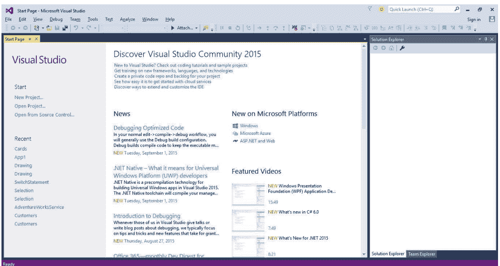

### Note

如果这是您第一次运行 Visual Studio 2015，您可能会看到一个对话框提示您选择默认开发环境设置。Visual Studio 2015 可以根据您首选的开发语言进行定制。集成开发环境（IDE）中各种对话框和工具的默认选择设置为您选择的语言。从“开发设置”列表中选择 Visual C#，然后单击“开始 Visual Studio”按钮。经过短暂延迟后，Visual Studio 2015 IDE 出现。

- 2. 在“文件”菜单上，指向“新建”，然后单击“项目”。

“新建项目”对话框打开。此对话框列出了可作为构建应用程序起点的模板。对话框根据您使用的编程语言和应用程序类型对模板进行分类。

- 3. 在左侧窗格中，展开“已安装”节点（如果尚未展开），展开“模板”，然后单击“Visual C#”。在中间窗格中，验证窗格顶部的组合框显示 `.NET Framework 4.6`，然后单击“控制台应用程序”。

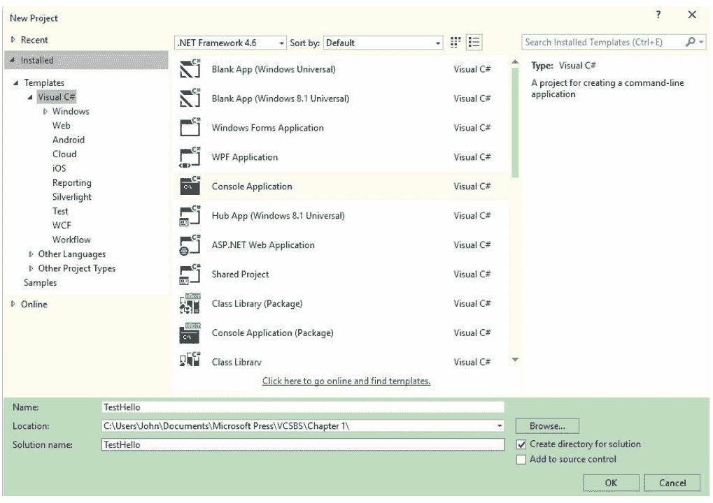

- 4. 在“位置”框中，键入 `C:\Users\YourName\Documents\Microsoft Press\VCSBS\Chapter 1`。将此路径中的文本 `YourName` 替换为您的 Windows 用户名。

### Note

为了避免重复并节省空间，在本书其余部分中，我将把路径 `C:\Users\YourName\Documents` 简称为您的“文档”文件夹。

### Tip

如果您指定的文件夹不存在，Visual Studio 2015 会为您创建它。

- 5. 在“名称”框中，键入 `TestHello`（覆盖现有的名称 `ConsoleApplication1`）。

- 6. 确保已选中“为解决方案创建目录”复选框，并且“添加到源代码控制”复选框为空，然后单击“确定”。Visual Studio 使用“控制台应用程序”模板创建项目。

如果您看到以下询问要使用哪种源代码控制机制的对话框，您忘记清除“添加到源代码控制”复选框。在这种情况下，只需单击“取消”，项目将会在不使用源代码控制的情况下创建。

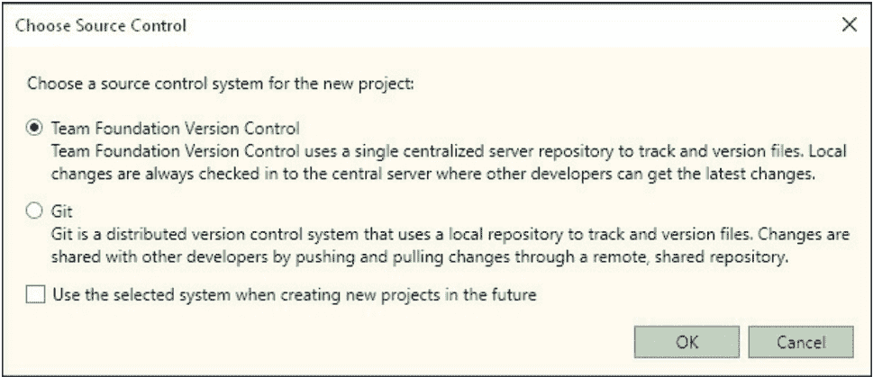

Visual Studio 显示项目的启动代码，如下所示：

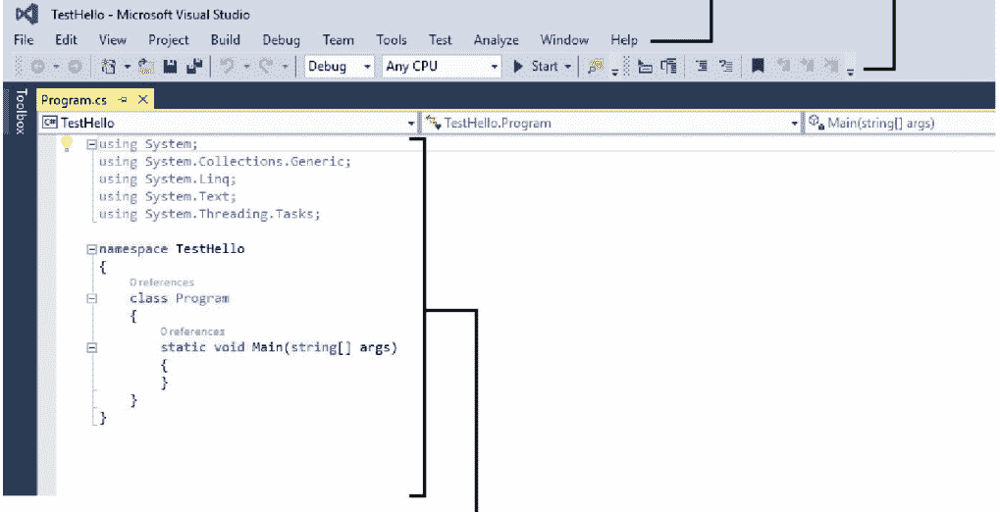

屏幕顶部的菜单栏提供了在编程环境中使用的功能访问。您可以使用键盘或鼠标访问菜单和命令，就像在所有基于 Windows 的程序中一样。工具栏位于菜单栏下方。它提供了运行最常用命令的按钮快捷方式。

代码和文本编辑器窗口占据屏幕的主要部分，显示源文件的内容。在多文件项目中，当您编辑

如果打开多个文件，每个源文件都有自己的标签，标签上标有源文件的名称。您可以单击标签，将命名的源文件带到代码和文本编辑器窗口的前台。

`Solution Explorer` 窗格出现在 IDE 的右侧，与代码和文本编辑器窗口相邻：

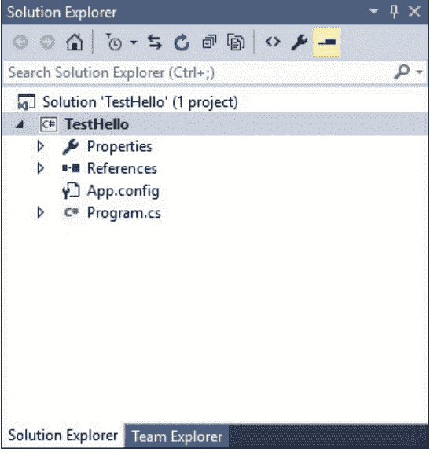

`Solution Explorer` 显示与项目关联的文件名称，以及其他项目。您也可以在 `Solution Explorer` 中双击文件名，将该源文件带到代码和文本编辑器窗口的前台。

在编写任何代码之前，请检查 `Solution Explorer` 中列出的文件，这些文件是 Visual Studio 2015 作为项目的一部分创建的：

- **Solution ‘TestHello’** 这是顶层的解决方案文件。每个应用程序包含一个解决方案文件。一个解决方案可以包含一个或多个项目，而 Visual Studio 2015 创建解决方案文件是为了帮助组织这些项目。如果您使用文件资源管理器查看 `Documents\Microsoft Press\VCSBS\Chapter 1\TestHello` 文件夹，您会看到此文件的实际名称是 `TestHello.sln`。

- **TestHello** 这是 C# 项目文件。每个项目文件引用一个或多个包含项目源代码和其他工件的文件，例如图形图像。您必须在同一个项目中用同一种编程语言编写所有的源代码。在文件资源管理器中，此文件实际称为 `TestHello.csproj`，它存储在您的 Documents 文件夹中的 `\Microsoft Press\VCSBS\Chapter 1\TestHello\TestHello` 文件夹中。

- **Properties** 这是 `TestHello` 项目中的一个文件夹。如果您展开它（单击 `Properties` 旁边的箭头），您会看到其中包含一个名为 `AssemblyInfo.cs` 的文件。`AssemblyInfo.cs` 是一个特殊文件，您可以使用它为程序添加属性，例如作者姓名、程序编写日期等。您可以指定其他属性来修改程序的运行方式。解释如何使用这些属性超出了本书的范围。

- **References** 此文件夹包含对已编译代码库的引用，您的应用程序可以使用这些库。当您的 C# 代码被编译时，它会被转换为一个库并被赋予一个唯一名称。在 Microsoft .NET Framework 中，这些库称为 *assemblies*。开发人员使用程序集打包他们编写的有用功能，以便将其分发给可能希望在自己的应用程序中使用这些功能的其他开发人员。如果您展开 `References` 文件夹，您将看到 Visual Studio 2015 默认添加到项目的引用集。这些程序集提供了对 .NET Framework 中许多常用功能的访问，并且由 Microsoft 与 Visual Studio 2015 一起提供。随着您在本<|message|> 书中练习的进行，您将了解其中许多程序集。

- **App.config** 这是应用程序配置文件。它是可选的，可能并不总是存在。您可以指定应用程序在运行时使用的设置，以修改其行为，例如用于运行应用程序的 .NET Framework 版本。您将在本书后面的章节中了解有关此文件的更多信息。

- **Program.cs** 这是一个 C# 源文件，当项目首次创建时，它会显示在代码和文本编辑器窗口中。您将在此文件中为控制台应用程序编写代码。它还包含 Visual Studio 2015 自动提供的一些代码，您将很快检查这些代码。

### 编写您的第一个程序

`Program.cs` 文件定义了一个名为 *Program* 的类，其中包含一个名为 *Main* 的方法。在 C# 中，所有可执行代码必须在方法内定义，并且所有方法都必须属于类或结构体。您将在第 7 章“创建和管理类与对象”中了解更多关于类的信息，并在第 9 章“使用枚举和结构创建值类型”中了解结构体。

*Main* 方法指定程序的入口点。此方法应以 *Program* 类中指定的方式定义为静态方法；否则，.NET Framework 可能无法将其识别为应用程序运行时 的起点。（您将在第 3 章“编写方法并应用作用域”中详细了解方法，第 7 章提供了有关静态方法的更多信息。）

### Important

C# 是一种区分大小写的语言。您必须将 `Main` 的 `M` 写成大写。

在下面的练习中，您编写代码以将消息“Hello World!”显示到控制台窗口，构建并运行您的 Hello World 控制台应用程序，并学习命名空间如何用于划分代码元素。

### 使用 Microsoft IntelliSense 编写代码

- 1. 在显示 `Program.cs` 文件的代码和文本编辑器窗口中，将光标放在 `Main` 方法中，紧跟在左大括号（ `{` ）之后，然后按 Enter 创建新行。

- 2. 在新行上，键入单词 `Console`；这是由您的应用程序引用的程序集提供的另一个类。它提供了在控制台窗口中显示消息和从键盘读取输入的方法。

当您键入单词 `Console` 开头的字母 `C` 时，会出现一个 IntelliSense 列表。

此列表包含在此上下文中有效的所有 C# 关键字和数据类型。您可以继续键入或滚动列表并用鼠标双击 `Console` 项。或者，在您键入 `Cons` 之后，IntelliSense 列表会自动聚焦到 `Console` 项，您可以按 Tab 或 Enter 键来选择它。

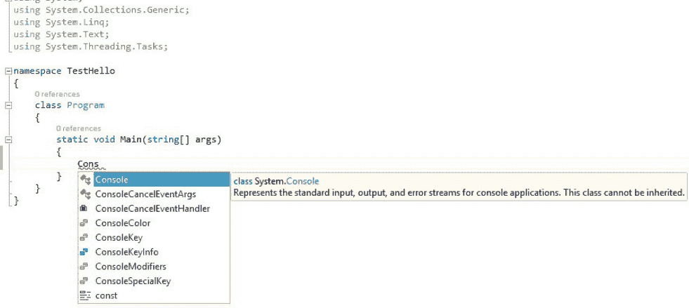

`Main` 应如下所示：

点击此处查看代码图像

```
static void Main(string[] args)
{
    Console
}
```

### Note

*Console* 是一个内置类。

3. 在 *Console* 后立即键入一个句点。

另一个 IntelliSense 列表出现，显示 *Console* 类的方法、属性和字段。

4. 滚动列表，选择 *WriteLine*，然后按 Enter。

或者，您可以继续键入字符 **W**、**r**、**i**、**t**、**e**、**L**，直到 *WriteLine* 被选中，然后按 Enter。

IntelliSense 列表关闭，单词 *WriteLine* 被添加到源文件中。*Main* 现在应如下所示：

点击此处查看代码图像

```
static void Main(string[] args)
{
    Console.WriteLine
}
```

5. 键入一个左括号，`( `。另一个 IntelliSense 提示出现。

此提示显示 *WriteLine* 方法可以接受的参数。事实上，*WriteLine* 是一个 *重载方法*，意味着 *Console* 类包含多个名为 *WriteLine* 的方法——它实际上提供了 19 个不同版本的方法。您可以使用 *WriteLine* 方法的每个版本输出不同类型的数据。（*第 3 章* 更详细地描述了重载方法。）*Main* 现在应如下所示：

点击此处查看代码图像

```
static void Main(string[] args)
{
    Console.WriteLine(
}
```

### Tip

您可以通过在提示中单击上、下箭头来滚动浏览 *WriteLine* 的不同重载。

6. 键入一个右括号，`)`，然后跟一个分号，`;`。

`Main` 应如下所示：

点击此处查看代码图像

```
static void Main(string[] args)
{
    Console.WriteLine();
}
```

- 7. 移动光标并在 `WriteLine` 方法后的左、右括号之间键入字符串“Hello World!”，包括引号。

`Main` 应如下所示：

点击此处查看代码图像

```
static void Main(string[] args)
{
    Console.WriteLine("Hello World!");
}
```


### Tip

养成键入匹配字符对的习惯，例如括号——`( ` 和 `)`——和大括号——`{` 和 `}`——然后再填写其内容。在您输入内容后再添加结束字符很容易忘记。

### IntelliSense 图标

当你在类名后输入一个句号时，IntelliSense 会显示该类的每个成员的名称。在每个成员名称左侧都有一个图标，用来表示成员的类型。常见的图标及其类型如下：

| Icon | Meaning |

| --- | --- |

|  | 方法（在第 3 章中讨论） |

|  | 属性（在第 15 章“实现属性以访问字段”中讨论） |

|  | 类（在第 7 章中讨论） |

|  | 结构体（在第 9 章中讨论） |

|  | 枚举（在第 9 章中讨论） |

|  | 扩展方法（在第 12 章“使用继承”中讨论） |

|  | 接口（在第 13 章“创建接口和定义抽象类”中讨论） |

|  | 委托（在第 17 章“介绍泛型”中讨论） |

|  | 事件（在第 17 章中讨论） |

|  | 命名空间（在本章下一节中讨论） |

随着你在不同上下文中输入代码，你还会看到其他 IntelliSense 图标出现。

你经常会看到包含两个正斜杠（`//`）后跟普通文本的代码行。这些是注释，编译器会忽略它们，但对开发人员非常有用，因为它们有助于记录程序实际在做什么。例如，看看下面的例子：

Click here to view code image

```
Console.ReadLine(); // Wait for the user to press the Enter key
```

编译器会跳过从两个斜杠到行尾的所有文本。你也可以添加以正斜杠后跟星号（`/*`）开头的多行注释。编译器会跳过所有内容，直到找到星号后跟正斜杠序列（`*/`），这可能在更下面的多行之后。你被积极鼓励用尽可能多的有意义的注释来记录你的代码。

### 构建并运行控制台应用程序

- 1. 在 `Build` 菜单上，单击 `Build Solution`。

此操作会编译 C# 代码，从而生成可运行的程序。

`Output` 窗口会出现在 Code and Text Editor 窗口下方。

### Tip

如果 `Output` 窗口未出现，请单击 `View` 菜单上的 `Output` 以显示它。

在 `Output` 窗口中，你应该会看到类似以下的消息，指示程序正在被编译：

Click here to view code image

```
1>------ Build started: Project: TestHello, Configuration: Debug Any CPU ------
1>  TestHello -> C:\Users\John\Documents\Microsoft Press\Visual CSharp Step By Step\
Chapter
1\TestHello\TestHello\bin\Debug\TestHello.exe
========= Build: 1 succeeded, 0 failed, 0 up-to-date, 0 skipped =========
```

如果出现任何错误，它们将在 `Error List` 窗口中报告。下面的图像显示了如果你忘记在 `WriteLine` 语句中文本 `Hello World` 后输入闭合引号会发生什么。请注意，单个错误有时会导致多个编译错误。

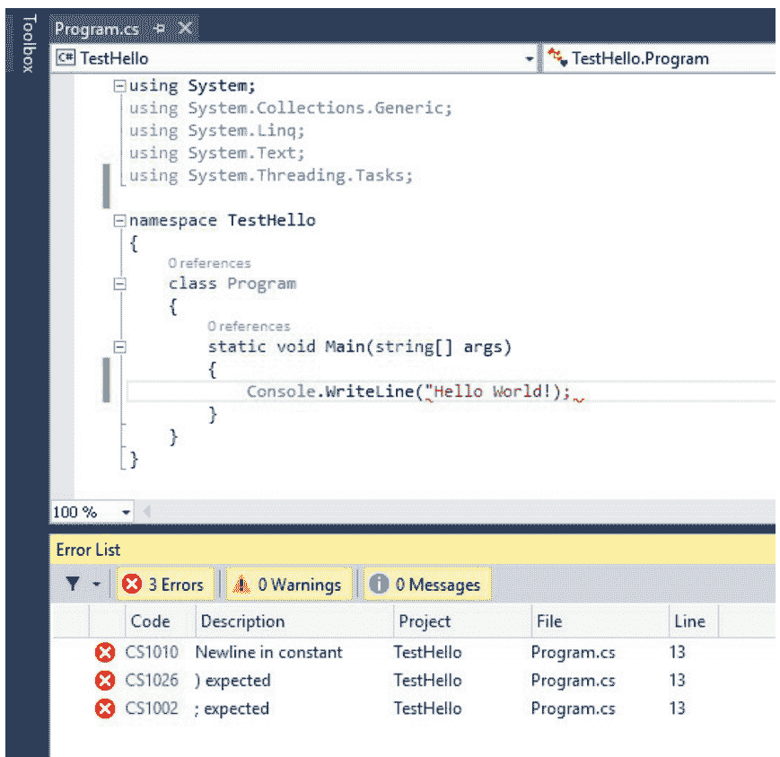

```
using System;
using System.Collections.Generic;
using System.Linq;
using System.Text;
using System.Threading.Tasks;

namespace TestHello
{
    class Program
    {
        static void Main(string[] args)
        {
            Console.WriteLine("Hello World!");
        }
    }
}
```

| Code | Description | Project | File | Line |

|------|-------------|---------|------|------|

| CS1010 | Newline in constant | TestHello | Program.cs | 13 |

| CS1026 | ) expected | TestHello | Program.cs | 13 |

| CS1002 | ; expected | TestHello | Program.cs | 13 |

### Tip

要直接转到导致错误的行，你可以双击 `Error List` 窗口中的一项。你还应注意到，当你输入代码时，Visual Studio 会在任何无法编译的代码行下方显示波浪形红色下划线。

如果你仔细遵循了之前的说明，不应有任何错误或警告，并且程序应成功构建。

### Tip

在构建之前无需显式保存文件，因为 `Build Solution` 命令会自动保存它。

文件名称标签页上方 Code and Text Editor 窗口上方的星号表示文件自上次保存以来已被更改。

- 2. 在 `Debug` 菜单上，单击 `Start Without Debugging`。

命令窗口打开，程序运行。消息“Hello World!”出现。程序现在等待你按任意键，如以下图形所示：

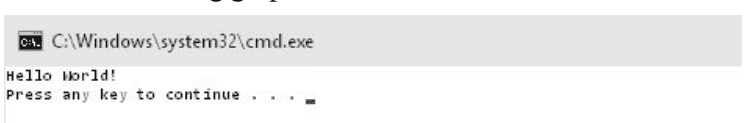

### Note

提示“Press any key to continue”是 Visual Studio 生成的；你没有编写任何代码来执行此操作。如果你使用 `Debug` 菜单上的 `Start Debugging` 命令运行程序，应用程序会运行，但命令窗口会立即关闭，而不会等待你按任意键。

- 3. 确保显示程序输出的命令窗口具有焦点（即它是当前活动的窗口），然后按 Enter。

命令窗口关闭，你返回到 Visual Studio 2015 编程环境。

- 4. 在 `Solution Explorer` 中，单击 `TestHello` 项目（而不是解决方案），然后在 `Solution Explorer` 工具栏上单击 `Show All Files` 按钮。请注意，你可能需要单击 `Solution Explorer` 工具栏右侧边缘的双箭头按钮以使此按钮出现。

### Solution Explorer

Double-arrow button

Show all files button

Search Solution Explorer (Ctrl+;)

Solution 'TestHello' (1 project)

TestHello

Properties

References

App.config


### Program.cs

### Solution Explorer

### Team Explorer

Entries named `bin` and `obj` appear above the `Program.cs` file. These entries correspond directly to folders named `bin` and `obj` in the project folder (`Microsoft Press\VCSBS\Chapter 1\TestHello\TestHello`). Visual Studio 在你构建应用程序时创建这些文件夹；它们包含程序的可执行版本以及用于构建和调试应用程序的一些其他文件。

- 5. 在 Solution Explorer 中，展开 `bin` 条目。

- 另一个名为 `Debug` 的文件夹出现。

### Note

你也可能会看到一个名为 `Release` 的文件夹。

- 6. 在 Solution Explorer 中，展开 `Debug` 文件夹。

- 出现更多项目，包括一个名为 `TestHello.exe` 的文件。这是编译后的程序，当你在 `Debug` 菜单上单击 `Start Without Debugging` 时运行的文件。其他文件包含 Visual Studio 2015 在调试模式下运行程序时使用信息

（当你在 `Debug` 菜单上单击 `Start Debugging` 时）。

### 使用命名空间

到目前为止你看到的示例是一个非常小的程序。然而，小程序很快就会成长为更大的程序。随着程序的增长，会出现两个问题。首先，理解和维护大型程序比理解和维护小型程序更困难。其次，更多的代码通常意味着更多的类，更多的 方法，要求你跟踪更多的名称。随着名称数量的增加，项目构建因两个或多个名称冲突而失败的可能性也随之增加；例如，你可能尝试创建两个同名的类。当程序引用由其他开发人员编写的程序集，而这些开发人员也使用了各种名称时，情况变得更加复杂。

在过去，程序员试图通过为名称添加某种限定符（或一组限定符）作为前缀来解决名称冲突问题。这不是一个好的解决方案，因为它不可扩展；名称变得更长，你花费在编写软件上的时间减少，花在输入上的时间增加（是有区别的），并且阅读和重读难以理解的长名称。

命名空间通过为类等项目创建容器来帮助解决此问题。如果两个同名的类位于不同的命名空间中，它们不会相互混淆。你可以使用 `namespace` 关键字像这样在名为 `TestHello` 的命名空间内创建一个名为 `Greeting` 的类：

```
namespace TestHello
{
    class Greeting
    {
        ...
    }
}
```

然后你可以在程序中将 `Greeting` 类引用为 `TestHello.Greeting`。如果另一位开发人员也在不同的命名空间（例如 `NewNamespace`）中创建了一个 `Greeting` 类，并且你将包含此类的程序集安装到你的计算机上，你的程序仍将按预期工作，因为它们使用的是你的 `TestHello.Greeting` 类。如果你想引用另一位开发人员的 `Greeting` 类，你必须将其指定为 `NewNamespace.Greeting`。

定义所有类在命名空间中是良好的做法，Visual Studio 2015 环境遵循此建议，使用你的项目名称作为顶级命名空间。.NET Framework 类库也遵循此建议；.NET Framework 中的每个类都位于命名空间内。例如，`Console` 类位于 `System` 命名空间内。这意味着它的全名实际上是 `System.Console`。

当然，如果每次使用类时都必须写出其全名，那么情况也不会比加上限定符前缀或直接使用某个全局唯一名称（如 `SystemConsole`）命名类更好。幸运的是，你可以在程序中使用 `using` 指令来解决这个问题。如果你回到 Visual Studio 2015 中的 `TestHello` 程序，并在代码和文本编辑器窗口中查看 `Program.cs` 文件，你会注意到文件顶部有以下几行：

Click here to view code image

```
using System;
using System.Collections.Generic;
using System.Linq;
using System.Text;
using System.Threading.Tasks;
```

这些行是 `using` 指令。`using` 指令会将一个命名空间引入作用域。在同一文件中的后续代码中，你就不再需要显式地用所属的命名空间限定对象。上面显示的五个命名空间包含的类使用频率极高，以至于 Visual Studio 2015 在每次创建新项目时都会自动添加这些 `using` 指令。如果你需要引用其他命名空间，可以在源文件的顶部添加更多 `using` 指令。

下面的练习将更深入地演示命名空间的概念。

### Try longhand names

- 1. 在显示 `Program.cs` 文件的代码和文本编辑器窗口中，注释掉文件顶部的第一个 `using` 指令，像这样：

- 2. 在 `Build` 菜单上，单击 `Build Solution`。

  构建失败，并且 `Error List` 窗口会显示以下错误消息：

- 3. 在 `Error List` 窗口中，双击错误消息。

  导致错误的标识符在 `Program.cs` 源文件中被红色波浪线高亮显示。

- 4. 在代码和文本编辑器窗口中，编辑 `Main` 方法以使用完全限定名 `System.Console`。

  `Main` 应如下所示：

```
//using System;
```

Click here to view code image

```
The name 'Console' does not exist in the current context.
```

Click here to view code image

```
static void Main(string[] args)
```

```
{
    System.Console.WriteLine("Hello World!");
}
```

### Note

当你在 `System` 后输入句点时，IntelliSense 会显示 `System` 命名空间中的所有项目名称。

- 5. 在 `Build` 菜单上，单击 `Build Solution`。

项目这次应该能成功构建。如果不能，请确保 `Main` 与前面代码中显示的完全一致，然后再尝试构建。

- 6. 通过在 `Debug` 菜单上单击 `Start Without Debugging` 来运行应用程序，以确保它仍然可以正常工作。

- 7. 当程序运行并在控制台窗口中显示“Hello World!”时，按 Enter 返回到 Visual Studio 2015。

### Namespaces and assemblies

`using` 指令只是将命名空间中的项目引入作用域，使你无需在代码中完全限定类名。

类被编译到程序集中。

程序集通常是一个具有 `.dll` 文件扩展名的文件，严格来说，具有 `.exe` 文件扩展名的可执行程序也是程序集。

一个程序集可以包含许多类。.NET Framework 类库中包含的类，例如 `System.Console`，是随 Visual Studio 一起安装在你的计算机上的程序集中提供的。你会发现 .NET Framework 类库包含成千上万个类。如果它们全部放在同一个程序集中，程序集会非常庞大且难以维护。（如果 Microsoft 要更新单个类中的单个方法，它就必须向所有开发人员分发整个类库！）

因此，.NET Framework 类库被拆分为多个程序集，按其包含的类所相关的功能区域划分。例如，一个“核心”程序集（实际称为 `mscorlib.dll`）包含所有通用类，例如 `System.Console`，而其他程序集包含用于操作数据库、访问 Web 服务、构建 GUI 等的类。如果你想使用程序集中的某个类，必须向你的项目添加对该程序集的引用。

然后你可以向代码中添加 `using` 指令，将该程序集中命名空间中的项目引入作用域。

你应该注意，程序集和命名空间之间不一定存在 1:1 的对应关系：单个程序集可以包含定义在多个命名空间中的类，而单个命名空间可以跨多个程序集。例如，`System` 命名空间中的类和项目实际上是由多个程序集实现的，包括 `mscorlib.dll`、`System.dll` 和 `System.Core.dll` 等。这乍听起来很 confusing，但你很快就会习惯。

当你使用 Visual Studio 创建应用程序时，你选择的模板会自动包含对适当程序集的引用。例如，在 `TestHello` 项目的 `Solution Explorer` 中，展开 `References` 文件夹。你会看到控制台应用程序自动包含对名为 `Microsoft.CSharp`、`System`、`System.Core`、`System.Data`、`System.Data.DataSetExtensions`、`System.Net.Http`、`System.Xml` 和 `System.Xml.Linq` 的程序集的引用。你可能会惊讶地发现 `mscorlib.dll` 没有包含在该列表中。原因在于所有 .NET Framework 应用程序都必须使用此程序集，因为它包含基本运行时功能。`References` 文件夹仅列出可选程序集；你可以根据需要在此文件夹中添加或删除程序集。

要向项目添加对其他程序集的引用，请右键单击 `References` 文件夹，然后单击 `Add Reference`——你将在后面的练习中执行此任务。你可以通过右键单击 `References` 文件夹中的程序集然后单击 `Remove` 来删除程序集。

### Creating a graphical application

到目前为止，你已经使用 Visual Studio 2015 创建并运行了一个基本的控制台应用程序。Visual Studio 2015 编程环境还包含创建 Windows 10 图形应用程序所需的一切。这些模板被称为通用 Windows 平台（UWP）应用，因为它们使你能够创建可在运行 Windows 的任何设备上运行的应用程序，例如台式计算机、平板电脑和手机。你可以交互式地设计 Windows 应用程序的用户界面（UI）。Visual Studio 2015 然后会生成实现你所设计用户界面的程序语句。

Visual Studio 2015 为你提供图形应用程序的两种视图：`设计视图` 和 `代码视图`。你使用代码和文本编辑器窗口来修改和维护图形应用程序的代码和程序逻辑，并使用设计视图窗口来布局你的 UI。你可以随时在两种视图之间切换。

在下面的练习集中，你将学习如何使用 Visual Studio 2015 创建图形应用程序。此程序显示一个简单的表单，其中包含一个文本框供你输入姓名，以及一个按钮，单击时会在消息框中显示个性化问候语。

*如果你想了解有关编写 UWP 应用具体细节的更多信息，本书第 IV 部分的最后几章提供了更多细节和指导。*

### Create a graphical application in Visual Studio 2015

- 1. 如果尚未运行，请启动 Visual Studio 2015。

- 2. 在 `File` 菜单上，指向 `New`，然后单击 `Project`。

  新建项目对话框打开。

- 3. 在左侧窗格中，展开 `Installed` 节点（如果尚未展开），展开 `Templates`，展开 `Visual C#`，展开 `Windows`，然后单击 `Universal`。

- 4. 在中间窗格中，单击 `Blank App (Windows Universal)` 图标。

### Note

`XAML` 代表可扩展应用程序标记语言，这是通用 Windows 平台应用程序用来定义应用程序 GUI 布局的语言。随着你在本书中练习的进行，你将了解更多关于 XAML 的知识。

- 5. 确保 `Location` 字段引用你的 Documents 文件夹中的 `\Microsoft Press\VCSBS\Chapter 1` 文件夹。

- 6. 在 `Name` 框中，输入 `Hello`。

- 7. 确保已选中 `Create Directory For Solution` 复选框，然后单击 `OK`。

如果这是你第一次创建 UWP 应用程序，可能会提示你为 Windows 10 启用开发者模式。根据你的设备和 Windows 10 版本，你可能能够，也可能不能通过用户界面启用开发者模式。有关启用开发者模式的更多指导，请参阅 https://msdn.microsoft.com/library/windows/apps/xaml/dn706236.aspx 上的“Enable your device for development”。

### 开发人员模式

### 为 Windows 10 启用开发人员模式

你需要在设备上启用开发人员模式，才能为 Windows 10 开发这种类型的应用。这让你可以在 Microsoft 测试和认证之前，在这台计算机上安装和测试应用。

要启用设备上的开发人员模式，请转到 设置 > 适用于开发人员 并选择 开发人员模式。

此设备当前未处于开发人员模式。

### 注意

当你创建新的 UWP 应用或首次尝试从 Visual Studio 运行 UWP 应用时，可能会出现此对话框。

- 8. 应用创建后，查看 `Solution Explorer` 窗格。

不要被应用模板的名称所迷惑——虽然它被称为 Blank App，但此模板实际上提供了许多文件并包含了一些代码。例如，如果你展开 `MainPage.xaml` 文件夹，你会找到一个名为 `MainPage.xaml.cs` 的 C# 文件。此文件就是在 `MainPage.xaml` 文件定义的 UI 显示时运行的代码添加位置。

- 9. 在 `Solution Explorer` 中，双击 `MainPage.xaml`。

此文件包含 UI 的布局。`Design View` 窗口显示此文件的两种表示形式：

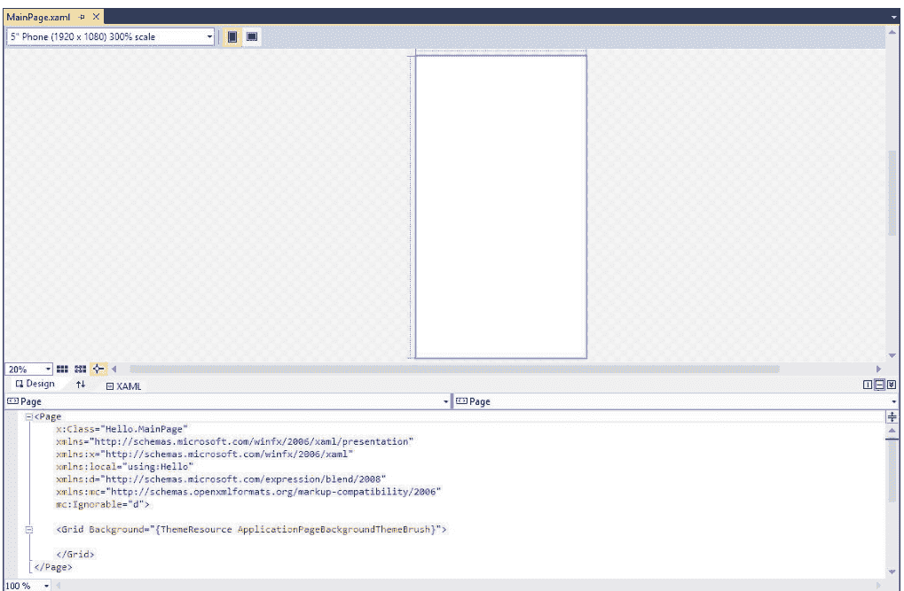

顶部是图形视图，描绘了默认情况下 5 英寸手机的屏幕。下方窗格使用 XAML 描述了此屏幕的内容。XAML 是一种类似 XML 的语言，由 UWP 应用用来定义表单的布局及其内容。如果你了解 XML，XAML 应该看起来很熟悉。

在下一个练习中，你将使用 `Design View` 窗口为应用布局 UI，并检查此布局生成的 XAML 代码。

### 提示

关闭 `Output` 和 `Error List` 窗口，以为显示 `Design View` 窗口提供更多空间。

### 注意

在继续之前，值得解释一些术语。在传统的 Windows 应用中，UI 由一个或多个 *windows* 组成，但在通用 Windows 平台应用中，对应的项被称为 *pages*。为了清晰起见，我将简单地使用统称 *form* 来指代这两项。然而，我将继续使用 *window* 一词来指 Visual Studio 2015 IDE 中的项，例如 Design View window。

在以下练习中，你将使用 `Design View` 窗口向应用显示的表单添加三个控件。你还将检查 Visual Studio 2015 自动生成的一些 C# 代码以实现这些控件。

### 创建用户界面

- 1. 单击 `Design View` 窗口中表单左侧出现的 `Toolbox` 选项卡。

  `Toolbox` 出现并显示你可以放置在表单上的各种组件和控件。

- 2. 展开 `Common XAML Controls` 部分。

  此部分显示大多数图形应用使用的控件列表。

### 提示

`All XAML Controls` 部分显示更广泛的控件列表。

- 3. 在 `Common XAML Controls` 部分，单击 `TextBlock`，然后将 *TextBlock* 控件拖到 `Design View` 窗口中显示的表单上。

### 提示

确保你选择的是 *TextBlock* 控件而不是 *TextBox* 控件。如果你不小心将错误的控件放置在表单上，可以通过单击表单上的该项然后按 Delete 轻松将其删除。

*TextBlock* 控件已添加到表单上（你稍后会将其移动到正确位置），`Toolbox` 从视图中消失。

### 提示

如果你希望 `Toolbox` 保持可见但不隐藏表单的任何部分，在 `Toolbox` 标题栏的右端，单击 `Auto Hide` 按钮（它看起来像一个图钉）。`Toolbox` 停靠在 Visual Studio 2015 窗口的左侧，`Design View` 窗口会缩小以容纳它。（如果你使用的是低分辨率屏幕，你可能会失去很多空间。）再次单击 `Auto Hide` 按钮会导致 `Toolbox` 再次消失。

4. 表单上的 `TextBlock` 控件可能不在你想要的确切位置。你可以单击并拖动已添加到表单的控件以重新定位它们。使用此技术，将 `TextBlock` 控件移动到使其位于表单左上角附近。（对于此应用，确切的放置位置并不关键。）请注意，你可能需要在控件外单击然后再次单击它，才能在 `Design View` 窗口中移动它。

表单在下方窗格中的 XAML 描述现在包括 `TextBlock` 控件，以及诸如其在表单上的位置由 `Margin` 属性控制、此控件默认显示的文本在 `Text` 属性中、由 `HorizontalAlignment` 和 `VerticalAlignment` 属性指定的此控件显示的文本对齐方式，以及如果文本超过控件宽度是否应换行的属性。

你的 `TextBlock` 的 XAML 代码将类似于这样（根据你在表单上放置 `TextBlock` 控件的位置，`Margin` 属性的值可能略有不同）：

Click here to view code image

```
<TextBlock x:Name="textBlock" HorizontalAlignment="Left"
Margin="10,10,0,0"
TextWrapping="Wrap"
Text="TextBlock" VerticalAlignment="Top"/>
```


`XAML` 窗格和 `Design View` 窗口彼此之间存在双向关系。你可以编辑 `XAML` 窗格中的值，更改将反映在 `Design View` 窗口中。例如，你可以通过修改 `Margin` 属性中的值来更改 `TextBlock` 控件的位置。

5. 在 `View` 菜单上，单击 `Properties Window`。

如果它尚未显示，`Properties` 窗口将出现在屏幕右下方，位于 `Solution Explorer` 窗格下方。你可以通过 `Design View` 窗口下的 `XAML` 窗格指定控件的属性，但 `Properties` 窗口为你修改表单上的项以及项目中的其他项的属性提供了更方便的方式。

`Properties` 窗口是上下文相关的，因为它显示当前选定项的属性。如果你单击 `Design View` 窗口中显示的表单（`TextBlock` 控件之外），你会看到 `Properties` 窗口显示 `Grid` 元素的属性。如果你查看 `XAML` 窗格，你应该会看到 `TextBlock` 控件包含在 `Grid` 元素中。所有表单都包含一个控制显示项布局的 `Grid` 元素；例如，你可以通过向 `Grid` 添加行和列来定义表格布局。

- 6. 在 `Design View` 窗口中，单击 `TextBlock` 控件。`Properties` 窗口再次显示 `TextBlock` 控件的属性。

- 7. 在 `Properties` 窗口中，展开 `Text` 属性。将 `FontSize` 属性更改为 20 pt，然后按 Enter。此属性位于包含字体名称的下拉列表框旁边，该名称将显示为 Segoe UI：

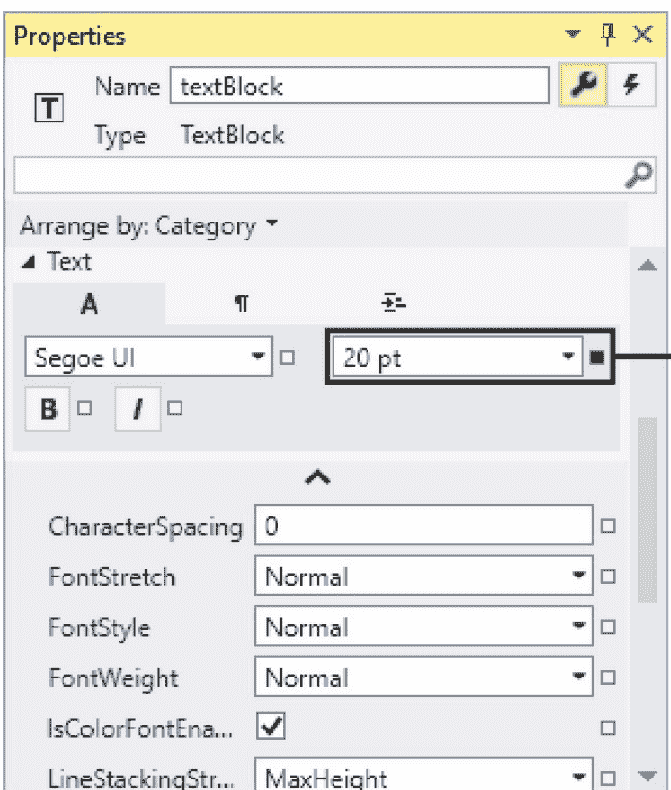

### 注意

后缀 pt 表示字体大小以磅为单位测量，其中 1 磅等于 1/72 英寸。

8. 在 `Design View` 窗口下方的 `XAML` 窗格中，检查定义 `TextBlock` 控件的文本。如果你滚动到行尾，你应该会看到文本 `FontSize="26.667"`。这是字体大小从磅到像素的近似转换（假设 3 磅大约等于 4 像素，尽管精确的转换取决于你的屏幕大小和分辨率）。你使用 `Properties` 窗口所做的任何更改都会自动反映在 `XAML` 定义中，反之亦然。

覆盖 `XAML` 窗格中 `FontSize` 属性的值并将其更改为 24。`Design View` 窗口和 `Properties` 窗口中 `TextBlock` 控件的文本字体大小会发生变化。

9. 在 `Properties` 窗口中，检查 `TextBlock` 控件的其他属性。随意尝试更改它们以查看其效果。

请注意，当你更改属性的值时，这些属性会添加到 `XAML` 窗格中 `TextBlock` 控件的定义中。你添加到表单的每个控件都有默认的属性值集，除非你更改它们，否则这些值不会在 `XAML` 窗格中显示。

10. 将 `TextBlock` 控件的 `Text` 属性的值从 `TextBlock` 更改为 Please enter your name。你可以通过编辑 `XAML` 窗格中的 `Text` 元素或通过更改 `Properties` 窗口中的值来完成此操作（此属性位于 `Properties` 窗口的 Common 部分）。

请注意，`Design View` 窗口中 `TextBlock` 控件中显示的文本已更改。

11. 单击 `Design View` 窗口中的表单，然后再次显示 `Toolbox`。

12. 在 `Toolbox` 中，单击并拖动 `TextBox` 控件到表单上。将 `TextBox` 控件移动到使其直接位于 `TextBlock` 控件下方。

### 提示

当你在窗体上拖动控件时，对齐指示器会在控件与其它控件垂直或水平对齐时自动出现。这能让你快速直观地确认控件是否整齐排列。

13. 在设计视图窗口中，将鼠标悬停在 `TextBox` 控件的右侧边缘。鼠标指针应变为双向箭头，表示你可以调整控件大小。将 `TextBox` 控件的右侧边缘拖动，直到它与上方 `TextBlock` 控件的右侧边缘对齐；当两个边缘正确对齐时，会出现一个引导线。

14. 在 `TextBox` 控件被选中的情况下，在属性窗口顶部，将 `Name` 属性的值从 `textBox` 改为 `userName`，如下图所示：

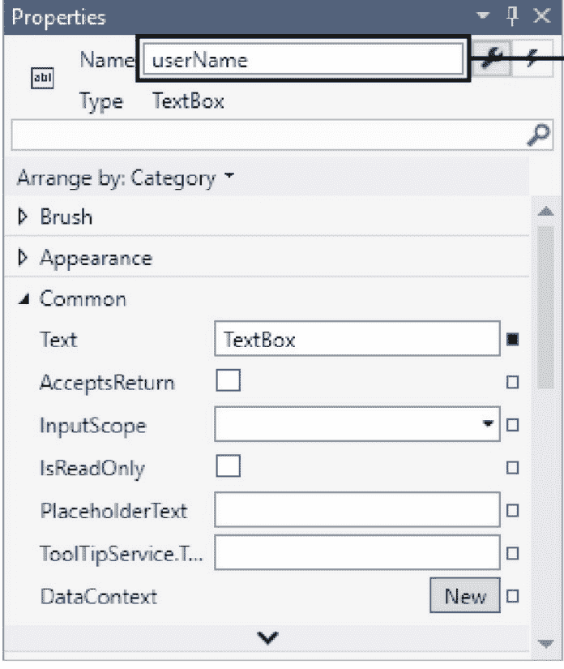

## 注

你将在第 2 章“使用变量、运算符和表达式”中了解更多关于控件和变量命名约定的内容。

15. 再次显示工具箱，然后单击并拖动一个 `Button` 控件到窗体上。将 `Button` 控件放置在窗体上 `TextBox` 控件的右侧，使按钮底部与文本框底部水平对齐。

16. 使用属性窗口，将 `Button` 控件的 `Name` 属性更改为 `ok`，并将 Common 部分中的 `Content` 属性从 `Button` 改为 `OK`，然后按 Enter。验证窗体上 `Button` 控件的标题是否已更改为显示文本 `OK`。

窗体现在应类似于以下图所示：

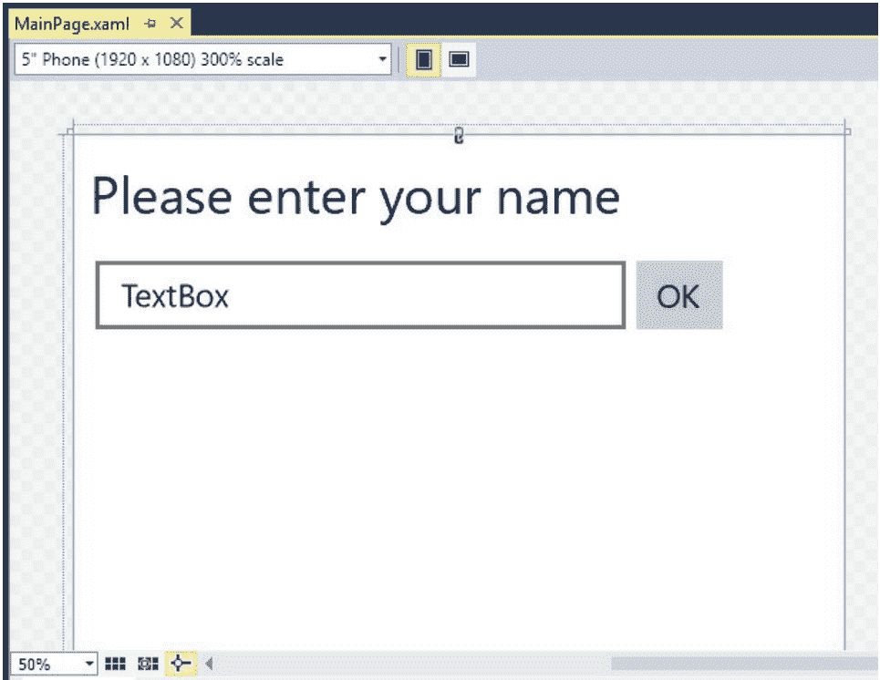

## 注

设计视图窗口左上角的下拉菜单可让你查看窗体在不同屏幕尺寸和分辨率下的渲染效果。在此示例中，选择了默认的 5 英寸手机视图，分辨率为 1920 x 1080。在下拉菜单右侧，两个按钮可让你在纵向视图和横向视图之间切换。后续章节中使用的项目将使用 13.3 英寸桌面视图作为设计表面，但你可以在本练习中保留 5 英寸手机的窗体比例。

17. 在生成菜单上，单击 `生成解决方案`，然后验证项目是否成功生成。

18. 确保调试目标下拉列表设置为本地计算机，如下所示。（它可能默认为设备并尝试连接 Windows Phone 设备，生成很可能会失败）。然后，在调试菜单上，单击 `开始调试`。

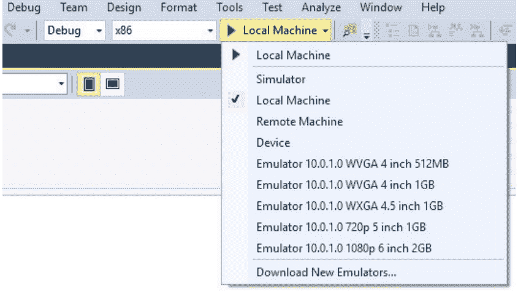

应用程序应运行并显示你的窗体。窗体如下所示：

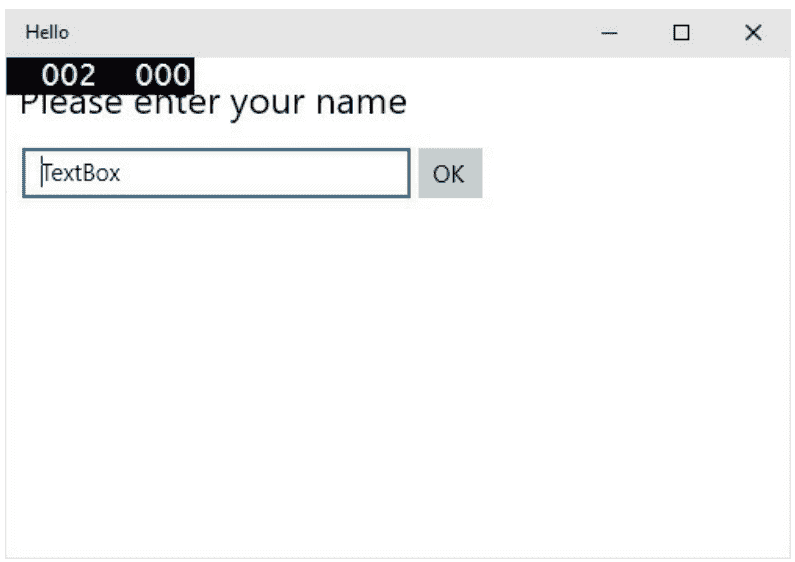

## 注

在调试模式下运行通用 Windows 平台应用时，窗体左上角会出现两对数字。这些数字用于跟踪帧速率，开发人员可利用这些信息判断应用程序何时开始变得不如预期响应迅速（可能表明存在性能问题）。这些数字仅在应用程序以调试模式运行时出现。这些数字的具体含义超出本书范围，因此现在可以忽略它们。

在文本框中，你可以覆盖现有文本输入你的姓名，然后单击 `OK`，但目前不会发生任何事情。你需要添加一些代码来指示用户单击 `OK` 按钮时应发生什么，这就是下一步要做的事情。

19. 返回 Visual Studio 2015。在调试菜单上，单击 `停止调试`。

## 注

你也可以单击窗体右上角的关闭按钮（X）来关闭窗体、停止调试并返回 Visual Studio。

你已经在不编写任何一行 C# 代码的情况下创建了一个图形应用程序。它目前功能有限（你很快就需要编写一些代码），但 Visual Studio 2015 实际上为你生成了大量代码来处理所有图形应用程序必须执行的例行任务，例如启动和显示窗口。在向应用程序添加自己的代码之前，了解 Visual Studio 为你生成的内容会有所帮助。以下部分描述了这些自动生成的构件。

### 检查通用 Windows 平台应用

在解决方案资源管理器中，展开 `MainPage.xaml` 节点。会出现 `MainPage.xaml.cs` 文件；双击此文件。以下窗体代码将在代码和文本编辑器窗口中显示：

点击此处查看代码图片

```
using System;
using System.Collections.Generic;
using System.IO;
using System.Linq;
using System.Runtime.InteropServices.WindowsRuntime;
using Windows.Foundation;
using Windows.Foundation.Collections;
using Windows.UI.Xaml;
using Windows.UI.Xaml.Controls;
using Windows.UI.Xaml.Controls.Primitives;
using Windows.UI.Xaml.Data;
using Windows.UI.Xaml.Input;
using Windows.UI.Xaml.Media;
using Windows.UI.Xaml.Navigation;

// The Blank Page item template is documented at
http://go.microsoft.com/fwlink/?LinkId=402352&
clcid=0x409

namespace Hello
{
    /// <summary>
    /// An empty page that can be used on its own or navigated to
    within a Frame.
    /// </summary>
    public sealed partial class MainPage : Page
    {
        public MainPage()
        {
            this.InitializeComponent();
        }
    }
}
```

除了大量将大多数 UWP 应用使用的命名空间引入作用域的 `using` 指令外，该文件还包含一个名为 `MainPage` 的类定义，但内容不多。`MainPage` 类有一点代码称为构造函数，它调用一个名为 `InitializeComponent` 的方法。构造函数是一种与类同名的方法。它在类的实例创建时运行，可以包含用于初始化实例的代码。你将在第 7 章学习构造函数。

该类实际上包含的代码比 `MainPage.xaml.cs` 文件中显示的几行要多得多，但其中大部分是根据窗体的 `XAML` 描述自动生成的，对你隐藏了。此隐藏代码执行诸如创建和显示窗体以及创建和定位窗体上各个控件等操作。


### 提示

你也可以在设计视图窗口显示时，通过单击视图菜单上的代码来显示 UWP 应用页面对应的 C# 代码文件。

此时，你可能会想知道 `Main` 方法在哪里，以及应用程序运行时窗体是如何显示的。记住，在控制台应用程序中，`Main` 定义了程序开始的点。图形应用程序略有不同。

在解决方案资源管理器中，你应该会注意到另一个名为 `App.xaml` 的源文件。如果展开该文件节点，你会看到另一个名为 `App.xaml.cs` 的文件。在 UWP 应用中，`App.xaml` 文件提供了应用程序开始运行的入口点。如果在解决方案资源管理器中双击 `App.xaml.cs`，你应该会看到类似如下的代码：

点击此处查看代码图片

```
using System;
using System.Collections.Generic;
using System.IO;
using System.Linq;
using System.Runtime.InteropServices.WindowsRuntime;
using Windows.ApplicationModel;
using Windows.ApplicationModel.Activation;
using Windows.Foundation;
using Windows.Foundation.Collections;
using Windows.UI.Xaml;
using Windows.UI.Xaml.Controls;
using Windows.UI.Xaml.Controls.Primitives;
using Windows.UI.Xaml.Data;
using Windows.UI.Xaml.Input;
using Windows.UI.Xaml.Media;
using Windows.UI.Xaml.Navigation;

// The Blank Application template is documented at
http://go.microsoft.com/fwlink/?LinkId=40234
7&clcid=0x409

namespace Hello
{
    /// <summary>
    /// Provides application-specific behavior to supplement the
    default Application class.
    /// </summary>
    sealed partial class App : Application
    {
        /// <summary>
        /// Allows tracking page views, exceptions and other
telemetry through the Microsoft
Application Insights service.
        /// </summary>
        public static Microsoft.ApplicationInsights.TelemetryClient
TelemetryClient;

        /// <summary>
        /// Initializes the singleton application object. This is
the first line of authored
code
        /// executed, and as such is the logical equivalent of
main() or WinMain().
        /// </summary>
        public App()
        {
            Microsoft.ApplicationInsights.WindowsAppInitializer.
            Microsoft.ApplicationInsights.WindowsCollectors.Meta

            Microsoft.ApplicationInsights.WindowsCollectors.Sess
            this.InitializeComponent();
            this.Suspending += OnSuspending;
        }

        /// <summary>
        /// Invoked when the application is launched normally by the
end user. Other entry
points
        /// will be used such as when the application is launched to
open a specific file.
        /// </summary>
        /// <param name="e">Details about the launch request and
process.</param>
        protected override void OnLaunched(LaunchActivatedEventArgs
e)
        {

#if DEBUG
            if (System.Diagnostics.Debugger.IsAttached)
            {
                this.DebugSettings.EnableFrameRateCounter = true;
            }
#endif

            Frame rootFrame = Window.Current.Content as Frame;

            // Do not repeat app initialization when the Window
already has content,
            // just ensure that the window is active
            if (rootFrame == null)
            {
                // Create a Frame to act as the navigation context
```

and navigate to the first

page

        rootFrame = new Frame();

        rootFrame.NavigationFailed += OnNavigationFailed;

        if (e.PreviousExecutionState ==

ApplicationExecutionState.Terminated)

        {

            //TODO: Load state from previously suspended

application

        }

        // Place the frame in the current Window
        Window.Current.Content = rootFrame;
    }

    if (rootFrame.Content == null)
    {
        // When the navigation stack isn't restored navigate
to the first page,
        // configuring the new page by passing required
information as a navigation
        // parameter
        rootFrame.Navigate(typeof(MainPage), e.Arguments);
    }

    // Ensure the current window is active
```


`Window.Current.Activate();`

}
/// <summary>
/// Invoked when Navigation to a certain page fails
/// </summary>
/// <param name="sender">The Frame which failed navigation</param>
/// <param name="e">Details about the navigation failure</param>
void `OnNavigationFailed`(object `sender`, `NavigationFailedEventArgs` `e`)
{
    throw new Exception("Failed to load Page " + `e.SourcePageType.FullName`);
}
/// <summary>
/// Invoked when application execution is being suspended. Application state is saved
/// without knowing whether the application will be terminated or resumed with the
/// contents
/// of memory still intact.
/// </summary>
/// <param name="sender">The source of the suspend request.</param>
/// <param name="e">Details about the suspend request.</param>
private void `OnSuspending`(object `sender`, `SuspendingEventArgs` `e`)
{
    var `deferral` = `e.SuspendingOperation.GetDeferral`();
    //TODO: Save application state and stop any background activity
    `deferral.Complete`();
}
}

这段代码大部分由注释（以“//”开头的行）和其他你暂时无需理解的语句组成，但关键元素位于加粗高亮的 `OnLaunched` 方法中。该方法在应用程序启动时运行，其中的代码会使应用程序创建一个新的 `Frame` 对象，在该框架中显示 `MainPage` 表单，然后激活它。此时无需完全理解这段代码的工作原理或这些语句的语法，但了解应用程序启动时就是通过这种方式显示表单是有帮助的。

### 向图形应用程序添加代码

现在你对图形应用程序的结构有了一些了解，是时候编写一些代码让你的应用程序真正做点事情了。

### 编写 OK 按钮的代码

1. 在 Design View 窗口中，打开 `MainPage.xaml` 文件（在 Solution Explorer 中双击 `MainPage.xaml`）。
2. 仍在 Design View 窗口中，单击表单上的 OK 按钮以选中它。
3. 在 Properties 窗口中，单击所选元素的 Event Handlers 按钮。

此按钮显示一个类似闪电的图标，如下所示：

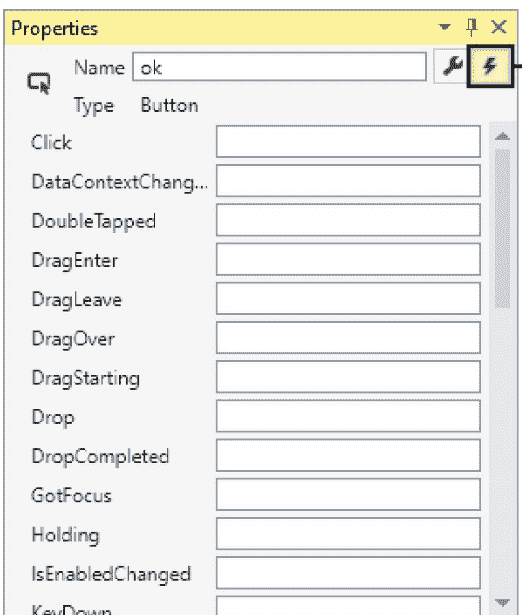

Event handlers for selected element

Properties 窗口会显示 Button 控件的事件名称列表。事件表示通常需要响应的重要操作，你可以编写自己的代码来执行此响应。

4. 在 Click 事件旁边的框中，输入 `okClick`，然后按 Enter。

`MainPage.xaml.cs` 文件会在 Code and Text Editor 窗口中出现，并且在 `MainPage` 类中添加了一个名为 `okClick` 的新方法。该方法如下所示：

```
private void okClick(object sender, RoutedEventArgs e)
{
}
```

暂时不要太担心此代码的语法——你将在第 3 章学习有关方法的所有内容。

5. 将以下加粗显示的 `using` 指令添加到文件顶部列表中（省略号 [...] 表示为简洁而省略的语句）：

```
using System;
...
using Windows.UI.Xaml.Navigation;
using Windows.UI.Popups;
```

6. 将以下加粗显示的代码添加到 `okClick` 方法中：

```
private void okClick(object sender, RoutedEventArgs e)
{
    MessageDialog msg = new MessageDialog("Hello " + userName.Text);
    msg.ShowAsync();
}
```

此代码将在用户单击 OK 按钮时运行。同样，不要太担心语法，只要确保按所示完全复制代码即可；你将在接下来的几章中了解这些语句的含义。需要理解的关键点是，第一条语句使用消息“Hello <YourName>”创建了一个 `MessageDialog` 对象，其中 `<YourName>` 是你在表单上的 `TextBox` 中输入的名称。第二条语句显示 `MessageDialog`，使其出现在屏幕上。`MessageDialog` 类在 `Windows.UI.Popups` 命名空间中定义，这就是你在步骤 5 中添加它的原因。

### Note

你可能会注意到 Visual Studio 2015 在你输入的最后一行代码下方添加了一条波浪绿线。如果你将鼠标悬停在此行代码上，Visual Studio 会显示一条警告，内容为“Because this call is not awaited, execution of the current method continues before the call is completed. Consider applying the ‘await’ operator to the result of the call.” 本质上，此警告意味着你没有充分利用 .NET Framework 提供的异步功能。你可以安全地忽略此警告。

7. 单击 Code and Text Editor 窗口上方的 `MainPage.xaml` 选项卡，以再次在 Design View 窗口中显示表单。
8. 在显示表单 XAML 描述的下部窗格中，检查 Button 元素，但要小心不要更改任何内容。注意它现在包含一个名为 Click 的属性，该属性引用 `okClick` 方法。

```
<Button x:Name="ok" ... Click="okClick" />
```

9. 在 Debug 菜单上，单击 Start Debugging。
10. 当表单出现时，在文本框中，输入你的姓名覆盖现有文本，然后单击 OK。

会出现一个消息对话框，显示以下问候语：

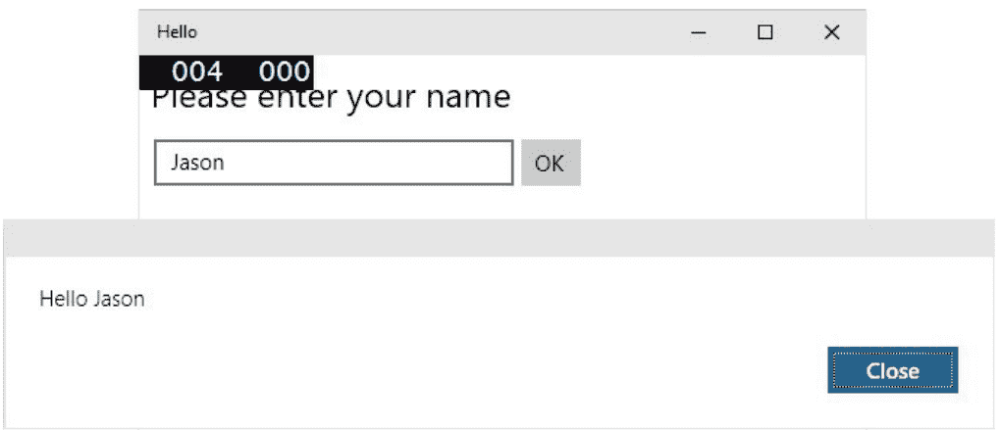

11. 在消息框中单击 Close。
12. 返回 Visual Studio 2015，然后在 Debug 菜单上单击 Stop Debugging。

### Summary

在本章中，你学习了如何使用 Visual Studio 2015 创建、构建和运行应用程序。你创建了一个在控制台窗口中显示输出的控制台应用程序，并创建了一个具有简单 GUI 的通用 Windows 平台应用程序。

- 如果你想继续下一章，请保持 Visual Studio 2015 运行并转到第 2 章。
- 如果你现在想退出 Visual Studio 2015，请在 File 菜单上单击 Exit。如果出现 Save 对话框，请单击 Yes 保存项目。

### Quick Reference

| To | Do this |
|---|---|
| Create a new console application using Visual Studio 2015 | On the File menu, point to New, and then click Project to open the New Project dialog box. In the left pane, expand Installed, expand Templates, and then click Visual C#. In the middle pane, click Console Application. In the Location box, specify a directory for the project files. Type a name for the project, and then click OK. |
| Create a new blank Universal Windows Platform app using Visual Studio 2015 | On the File menu, point to New, and then click Project to open the New Project dialog box. In the left pane, expand Installed, expand Templates, expand Visual C#, expand Windows, and then click Universal. In the middle pane, click Blank App (Windows Universal). In the Location box, specify a directory for the project files. Type a name for the project, and then click OK. |
| Build the application | On the Build menu, click Build Solution. |
| Run the application in Debug mode | On the Debug menu, click Start Debugging. |
| Run the application without debugging | On the Debug menu, click Start Without Debugging. |

## 第 2 章 使用变量、运算符和表达式

完成本章后，你将能够：

- 理解语句、标识符和关键字。
- 使用变量存储信息。
- 使用原始数据类型。
- 使用算术运算符，如加号 (`+`) 和减号 (`−`)。
- 增加和减少变量。

第 1 章“欢迎使用 C#”介绍了如何使用 Microsoft Visual Studio 2015 编程环境构建和运行控制台程序和图形应用程序。本章向你介绍 Microsoft Visual C# 语法和语义的元素，包括语句、关键字和标识符。你将学习 C# 语言内置的原始类型以及每种类型所保存的值的特征。你还将看到如何声明和使用局部变量（仅存在于方法或其他代码小段中的变量），了解 C# 提供的算术运算符，学习如何使用运算符操作值，并学习如何控制包含两个或多个运算符的表达式。

### 理解语句

语句是执行操作的命令，例如计算值并存储结果或向用户显示消息。你将语句组合起来创建方法。你将在第 3 章“编写方法和应用作用域”中更详细地了解方法，但现在，将方法视为命名好的语句序列。`Main` 在上一章中介绍过，是一个方法的例子。

C# 中的语句遵循一套定义良好的规则来描述其格式和构造。这些规则统称为语法。（相比之下，语句做什么的规范统称为语义。）最简单也是最重要的 C# 语法规则之一规定你必须用分号终止所有语句。例如，第 1 章演示了如果没有终止分号，以下语句将无法编译：

```
Console.WriteLine("Hello, World!");
```

### Tip

C# 是一种“自由格式”语言，这意味着空格字符或换行等空白在作为分隔符时才有意义。换句话说，你可以随意以任何风格布局你的语句。然而，你应采用简单一致的布局风格，以使你的程序更易于阅读和理解。

在任何语言中编程良好的诀窍是学习该语言的语法和语义，然后以自然且符合惯用法的方式使用该语言。这种方法使你的程序更易于维护。随着你阅读本书的进展，你将看到最重要的 C# 语句的示例。

### 使用标识符

标识符是你用来标识程序中元素的名称，例如命名空间、类、方法 和变量。（你将很快学习关于变量的内容。）在 C# 中，选择标识符时必须遵守以下语法规则：

- 你只能使用字母（大写和小写）、数字和下划线字符。
- 标识符必须以字母或下划线开头。

例如，`result`、`_score`、`footballTeam` 和 `plan9` 都是有效的标识符，而 `result%`、`footballTeam$` 和 `9plan` 则不是。

### Important

C# 是区分大小写的语言：`footballTeam` 和 `FootballTeam` 是两个不同的标识符。

### 识别关键字

C# 语言为其自身保留了 77 个标识符，你不能将这些标识符重复用于自己的目的。这些标识符称为关键字，每个都有特定的含义。关键字的例子有 `class`、`namespace` 和 `using`。你将在阅读本书的过程中学习大多数 C# 关键字的含义。以下是关键字的列表：

| abstract | do | in | protected | true |
| as | double | int | public | try |
| base | else | interface | readonly | typeof |
| bool | enum | internal | ref | uint |
| break | event | is | return | ulong |
| byte | explicit | lock | sbyte | unchecked |
| case | extern | long | sealed | unsafe |
| catch | false | namespace | short | ushort |
| char | finally | new | sizeof | using |
| checked | fixed | null | stackalloc | virtual |
| class | float | object | static | void |
| const | for | operator | string | volatile |
| continue | foreach | out | struct | while |
| decimal | goto | override | switch |  |
| default | if | params | this |  |
| delegate | implicit | private | throw |  |


### Tip

在 Visual Studio 2015 代码和文本编辑器窗口中，输入关键字时它们会显示为蓝色。

C# 还使用以下标识符。这些标识符未被 C# 保留，这意味着你可以使用这些名称作为自己的方法、变量和类的标识符，但应尽可能避免这样做。

| add | get | remove |
| alias | global | select |
| ascending | group | set |
| async | into | value |
| await | join | var |
| descending | let | where |
| dynamic |orderby | yield |
| from | partial |  |

### 使用变量

变量是保存值的存储位置。你可以把变量想象成计算机内存中的一个盒子，存放临时信息。你必须为程序中的每个变量提供一个无歧义的名称，在其使用的上下文中唯一标识它。你使用变量的名称来引用它所保存的值。例如，如果你想存储商店中商品的成本值，你可能会创建一个简单地称为 `cost` 的变量，并将商品的成本存储在此变量中。稍后，如果你引用 `cost` 变量，检索到的值将是你之前存储在那里的商品成本。

### 命名变量

你应为变量采用命名约定，以帮助你避免对已定义的变量产生混淆。如果你的项目团队中有多名开发人员在应用程序的不同部分工作，这一点尤其重要；一致的命名约定有助于避免混淆并可减少错误发生的范围。以下列表包含一些通用建议：

- 不要以下划线开头标识符。虽然这在 C# 中是合法的，但它会限制你的代码与使用其他语言（如 Microsoft Visual Basic）构建的应用程序的互操作性。
- 不要创建仅按大小写不同的标识符。例如，不要同时创建名为 `myVariable` 的一个变量和名为 `MyVariable` 的另一个变量，因为很容易将两者混淆。此外，定义仅按大小写不同的标识符可能会限制在不区分大小写的语言（如 Visual Basic）中开发的应用程序中重用类的能力。
- 以小写字母开头名称。
- 在多词标识符中，以大写字母开头第二个及后续每个单词。（这称为 camelCase 记法。）
- 不要使用匈牙利命名法。（如果你是 Microsoft Visual C++ 开发人员，你可能熟悉匈牙利命名法。如果你不知道匈牙利命名法是什么，不用担心！）


例如，`score`、`footballTeam`、`_score` 和 `FootballTeam` 都是有效的变量名，但只有前两个是推荐的。

### 声明变量

变量保存值。C# 有许多不同类型的值可以存储和处理——整数、浮点数和字符字符串，仅举三例。当你声明一个变量时，你必须指定它将保存的数据类型。

你在一个声明语句中声明变量的类型和名称。例如，以下语句声明名为 `age` 的变量保存 `int`（整数）值。与往常一样，你必须用分号终止语句。

```
int age;
```

变量类型 `int` 是 `primitive` C# 类型 `integer` 的名称，即一个整数。（你将在本章后面学习几种原始数据类型。）

### Note

如果你是 Visual Basic 程序员，你应注意 C# 不允许隐式变量声明。你必须在使用变量之前显式声明所有变量。

声明变量后，你可以为其分配值。以下语句将 `age` 分配值为 42。再次注意，分号是必需的。

```
age = 42;
```

等号 (`=`) 是 `assignment` 运算符，它将右侧的值赋给左侧的变量。完成此赋值后，你可以在代码中使用 `age` 变量来引用它所保存的值。下一个语句将 `age` 变量的值（42）写入控制台：

```
Console.WriteLine(age);
```

### Tip

如果在 Visual Studio 2015 代码和文本编辑器窗口中将鼠标指针悬停在变量上，屏幕提示会指示变量的类型。

### 使用原始数据类型

C# 有一些内置类型称为 `primitive data types`。下表列出了 C# 中最常用的原始数据类型以及可在其中存储的值的范围。

| 数据类型 | 描述 | 大小（位） | 范围 | 示例用法 |
|---|---|---|---|---|
| `int` | 整数（整数） | 32 | −2³¹ 至 2³¹ − 1 | `int count;`<br>`count = 42;` |
| `long` | 整数（更大范围） | 64 | −2⁶³ 至 2⁶³ − 1 | `long wait;`<br>`wait = 42L;` |
| `float` | 浮点数 | 32 | -3.4 x 10⁻³⁸ 至 3.4 x 10³⁸ | `float away;`<br>`away = 0.42F;` |
| `double` | 双精度（更精确）浮点数 | 64 | ±5.0 x 10⁻³²⁴ 至 ±1.7 x 10³⁰⁸ | `double trouble;`<br>`trouble = 0.42;` |
| `decimal` | 金钱值 | 128 | 28 位有效数字 | `decimal coin;`<br>`coin = 0.42M;` |
| `string` | 字符序列 | 每个字符 16 位 | 不适用 | `string vest`<br>`vest = "forty two";` |
| `char` | 单个字符 | 16 | 0 至 2¹⁶ − 1 | `char grill;`<br>`grill = 'x';` |
| `bool` | 布尔值 | 8 | True 或 false | `bool teeth;`<br>`teeth = false;` |

### 未赋值的局部变量

当你声明一个变量时，在你为其赋值之前，它包含一个随机值。这种行为是 C 和 C++ 程序中一个丰富的错误来源，这些程序创建了一个变量并在给它赋值之前错误地将其用作信息来源。C# 不允许你使用未赋值的变量。你必须在可以使用变量之前为其赋值；否则，你的程序将无法编译。此要求称为确定性赋值规则。例如，以下语句会生成编译时错误消息“Use of unassigned local variable ‘age’”，因为 `Console.WriteLine` 语句试图显示一个未初始化变量的值：

Click here to view code image

```
int age;
Console.WriteLine(age); // compile-time error
```

### 显示原始数据类型值

在下面的练习中，你使用名为 `PrimitiveDataTypes` 的 C# 程序来演示几种原始数据类型的工作方式。

### 显示原始数据类型值

- 1. 如果尚未运行，请启动 Visual Studio 2015。
- 2. 在“文件”菜单上，指向“打开”，然后单击“项目/解决方案”。

  打开项目对话框出现。
- 3. 在“文档”文件夹中，移动到 `\Microsoft Press\VCSBS\Chapter 2\PrimitiveDataTypes` 文件夹。
- 4. 选择 `PrimitiveDataTypes` 解决方案文件，然后单击“打开”。

  解决方案加载，解决方案资源管理器显示 `PrimitiveDataTypes` 项目。

### 注意

解决方案文件名为 `.sln` 后缀，例如 `PrimitiveDataTypes.sln`。一个解决方案可以包含一个或多个项目。Visual C# 项目文件具有 `.csproj` 后缀。如果你打开项目而不是解决方案，Visual Studio 2015 会自动为其创建一个新的解决方案文件。如果你不了解此功能，这可能会令人困惑，因为它可能导致你不小心为同一项目生成多个解决方案。

- 5. 在“调试”菜单上，单击“开始调试”。

  你可能会在 Visual Studio 中看到一些警告。你可以安全地忽略它们。（你将在下一个练习中纠正它们。）

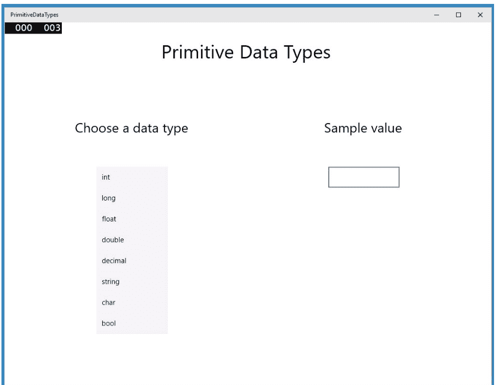

- 6. 在“选择数据类型”列表中，单击 `string`。

  值 “forty two” 会出现在“示例值”框中。
- 7. 再次在“选择数据类型”列表中，单击 `int` 类型。

  值 “to do” 会出现在“示例值”框中，表明用于显示 `int` 值的语句仍需编写。
- 8. 单击列表中的每个数据类型。确认 `double` 和 `bool` 类型的代码尚未实现。
- 9. 返回 Visual Studio 2015，然后在“调试”菜单上单击“停止调试”。

  你也可以关闭窗口来停止调试。

### 在代码中使用原始数据类型

- 1. 在解决方案资源管理器中，展开 `PrimitiveDataTypes` 项目（如果尚未展开），然后双击 `MainPage.xaml`。

  应用程序的表单在设计视图窗口中出现。

### 提示

如果你的屏幕不够大，无法显示整个表单，你可以通过使用 `Ctrl+Alt+=` 和 `Ctrl+Alt+-` 在设计视图窗口中放大和缩小，或通过从设计视图窗口左下角的缩放下拉列表中选择大小来缩放。

- 2. 在 XAML 窗格中，向下滚动以找到 `ListBox` 控件的标记。此控件在表单左侧显示数据类型列表，看起来像这样（已从此文本中删除了一些属性）：

Click here to view code image

```
<ListBox x:Name="type" ...
    SelectionChanged="typeSelectionChanged">
    <ListBoxItem>int</ListBoxItem>
    <ListBoxItem>long</ListBoxItem>
    <ListBoxItem>float</ListBoxItem>
    <ListBoxItem>double</ListBoxItem>
    <ListBoxItem>decimal</ListBoxItem>
    <ListBoxItem>string</ListBoxItem>
    <ListBoxItem>char</ListBoxItem>
    <ListBoxItem>bool</ListBoxItem>
</ListBox>
```

`ListBox` 控件将每个数据类型显示为单独的 `ListBoxItem`。当应用程序运行时，如果用户单击列表中的一项，则会发生 `SelectionChanged` 事件（这有点像用户单击按钮时发生的 `Click` 事件，这在第 1 章中演示）。你可以看到，在这种情况下，`ListBox` 调用 `typeSelectionChanged` 方法。此方法在 `MainPage.xaml.cs` 文件中定义。

- 3. 在“视图”菜单上，单击“代码”。

  代码和文本编辑器窗口打开，显示 `MainPage.xaml.cs` 文件。

### 注意

请记住，你也可以使用解决方案资源管理器访问代码。

单击 `MainPage.xaml` 文件左侧的箭头以展开节点，然后双击 `MainPage.xaml.cs`。

- 4. 在代码和文本编辑器窗口中，找到 `typeSelectionChanged` 方法。

### 提示

要在项目中定位一个项目，请在“编辑”菜单上指向“查找和替换”，然后单击“快速查找”。菜单在代码和文本编辑器窗口的右上角打开。在此快捷菜单上的文本框中，输入你要查找的项目的名称，然后单击“查找下一个”（文本框旁边的右箭头符号）：

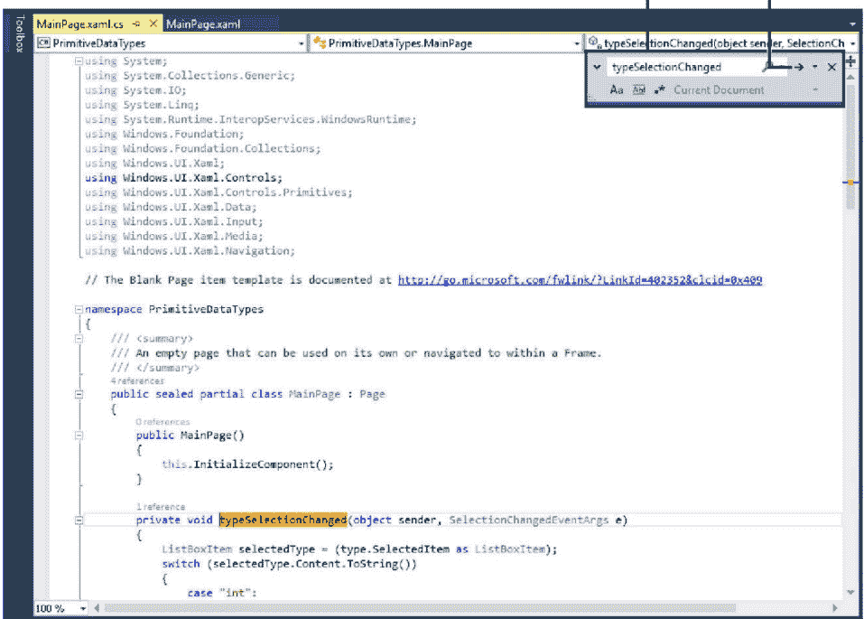

默认情况下，搜索不区分大小写。如果你想执行区分大小写的搜索，请单击文本下方用于搜索的“匹配大小写”按钮（`Aa`）：

相反，使用“编辑”菜单，你也可以按 `Ctrl+F` 显示“快速查找”对话框。同样，你可以按 `Ctrl+H` 显示“快速替换”对话框。

作为使用“快速查找”功能的替代方案，你还可以使用代码和文本编辑器窗口上方的类成员下拉列表框，右侧来定位类中的方法。

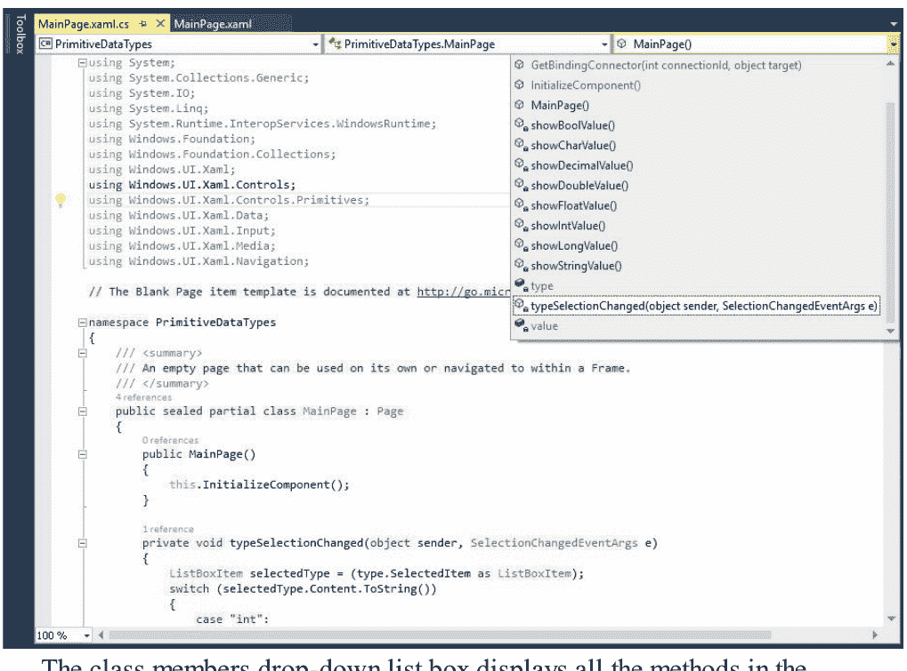

类成员下拉列表框显示类中的所有方法，以及类包含的变量和其他项目。（你将在后面的章节中了解更多关于这些项目的信息。）在下拉列表中，单击 `typeSelectionChanged` 方法，光标将直接移动到类中的 `typeSelectionChanged` 方法。

如果你使用另一种语言进行编程，你可能可以猜出 `typeSelectionChanged` 方法的工作方式；如果不能，第 4 章“使用决策语句”使此代码清晰。目前，你只需要理解的是，当用户单击 `ListBox` 控件中的一项时，该项目的详细信息会传递给此方法，然后该方法使用此信息来确定接下来会发生什么。例如，如果用户单击 `float` 值，此方法会调用另一个名为 `showFloatValue` 的方法。

- 5. 向下滚动代码并找到 `showFloatValue` 方法，其看起来像这样：

Click here to view code image

```
private void showFloatValue()
{
    float floatVar;
    floatVar = 0.42F;
    value.Text = floatVar.ToString();
}
```

此方法的主体包含三个语句。第一个语句声明一个名为 `floatVar` 的 `float` 类型变量。

第二个语句将 `floatVar` 分配值为 `0.42F`。

### 重要

`F` 是一个类型后缀，指定 `0.42` 应被视为 `float` 值。如果你忘记了 `F`，值 `0.42` 将被视为 `double`，你的程序将无法编译，因为你不能在不编写额外代码的情况下将一种类型的值分配给另一种类型的变量——C# 在这方面非常严格。

第三个语句在表单上的 `value` 文本框中显示此变量的值。此语句需要你的注意。如第 1 章所述，显示文本框中的项目的方式是设置其 `Text` 属性（你在第 1 章中通过使用 XAML 完成了此操作）。你也可以以编程方式执行此任务，这就是这里发生的情况。请注意，你通过使用与运行方法时看到的相同的点符号来访问对象的属性。（还记得第 1 章中的 `Console.WriteLine` 吗？）此外，你放入 `Text` 属性中的数据必须是字符串而不是数字。如果你尝试将数字分配给 `Text` 属性，你的程序将无法编译。幸运的是，.NET Framework 在 `ToString` 方法的形式下提供了一些帮助。

.NET Framework 中的每个数据类型都有一个 `ToString` 方法。`ToString` 的目的是将对象转换为其字符串表示形式。`showFloatValue` 方法使用 `float` 变量 `floatVar` 对象的 `ToString` 方法生成此变量值的字符串版本。然后你可以安全地将此字符串分配给 `value` 文本框的 `Text` 属性。当你创建自己的数据类型和类时，你可以定义自己的 `ToString` 方法实现，以指定你的类应如何表示为字符串。你将在第 7 章“创建和管理类和对象”中了解更多关于创建自己的类的内容。

- 6. 在代码和文本编辑器窗口中，找到 `showIntValue` 方法：

```
private void showIntValue()
{
    value.Text = "to do";
}
```

当你在列表框中单击 `int` 类型时，会调用 `showIntValue` 方法。

- 7. 在 `showIntValue` 方法的开头，在打开大括号之后的新行上，键入以下以粗体显示的两个语句：

```
private void showIntValue()
{
    int intVar;
    intVar = 42;
    value.Text = "to do";
}
```

第一条语句创建了一个名为 `intVar` 的变量，可以保存一个 `int` 值。第二条语句将值 `42` 分配给该变量。

8. 在该方法中的原始语句中，将字符串“to do”更改为 `intVar.ToString();`

该方法现在应完全如下所示：

Click here to view code image

```
private void showIntValue()
{
    int intVar;
    intVar = 42;
    value.Text = intVar.ToString();
}
```

9. 在 `Debug` 菜单上，单击 `Start Debugging`。

表单再次出现。

10. 在 `Choose A Data Type` 列表中，选择 `int` 类型。确认 `Sample Value` 文本框中显示的值为 `42`。

11. 返回 Visual Studio，然后在 `Debug` 菜单上单击 `Stop Debugging`。

12. 在 `Code and Text Editor` 窗口中，找到 `showDoubleValue` 方法。

13. 按以下代码中以粗体显示的内容完全编辑 `showDoubleValue` 方法：

Click here to view code image

```
private void showDoubleValue()
{
    double doubleVar;
    doubleVar = 0.42;
    value.Text = doubleVar.ToString();
}
```

此代码与 `showIntValue` 方法类似，只是它创建了一个名为 `doubleVar` 的变量，用于保存 `double` 值并被赋值为 `0.42`。

14. 在 `Code and Text Editor` 窗口中，定位 `showBoolValue` 方法。

15. 按如下方式编辑 `showBoolValue` 方法：

Click here to view code image

```
private void showBoolValue()
{
bool boolVar;
boolVar = false;
value.Text = boolVar.ToString();
}
```

同样，此代码与之前的示例类似，只是 `boolVar` 只能保存布尔值 `true` 或 `false`。在这种情况下，所赋的值为 `false`。

+   16. 在 `Debug` 菜单上，单击 `Start Debugging`。
+   17. 在 `Choose A Data Type` 列表中，选择 `float`、`double` 和 `bool` 类型。在每种情况下，验证 `Sample Value` 文本框中显示的是否为正确的值。
+   18. 返回 Visual Studio，然后在 `Debug` 菜单上单击 `Stop Debugging`。

### 使用算术运算符

C# 支持你在童年时学到的常规算术运算：加号 (`+`) 用于加法，减号 (`−`) 用于减法，星号 (`*`) 用于乘法，正斜杠 (`/`) 用于除法。符号 `+`, `−`, `*`, 和 `/` 被称为 `运算符`，因为它们“操作”值以创建新值。在下面的示例中，变量 `moneyPaidToConsultant` 最终保存了 `750`（日费率）和 `20`（顾问受雇天数）的乘积：

Click here to view code image

```
long moneyPaidToConsultant;
moneyPaidToConsultant = 750 * 20;
```

### Note

运算符执行其功能的数值称为 `操作数`。在表达式 `750 * 20` 中，`*` 是运算符，而 `750` 和 `20` 是操作数。

### 运算符和类型

并非所有运算符都适用于所有数据类型。你可以在值上使用的运算符取决于值的类型。例如，你可以在 `char`、`int`、`long`、`float`、`double` 或 `decimal` 类型的值上使用所有算术运算符。然而，除了加法运算符 (`+`) 之外，你不能在 `string` 类型的值上使用算术运算符，也不能在 `bool` 类型的值上使用任何算术运算符。因此，以下语句不被允许，因为 `string` 类型不支持减法运算符（从一个字符串中减去另一个字符串是没有意义的）：

Click here to view code image

```
// compile-time error
Console.WriteLine("Gillingham" - "Forest Green Rovers");
```

然而，你可以使用 `+` 运算符来连接字符串值。你需要小心，因为这可能会产生意外的结果。例如，以下语句将“431”（而不是“44”）写入控制台：

Click here to view code image

```
Console.WriteLine("43" + "1");
```

### Tip


.NET Framework 提供了一个名为 `Int32.Parse` 的方法，如果你需要对作为字符串保存的值执行算术计算，可以使用它将字符串值转换为整数。

### 字符串插值

C# 最新版本中的一项新功能是字符串插值，它使使用 `+` 运算符进行字符串连接的许多用途变得过时。

字符串连接的常见用途是生成包含变量值的字符串值。你在第 1 章的练习中看到了一个示例，该示例创建了一个图形应用程序。在 `okClick` 方法中，你添加了以下代码行：

```
MessageDialog msg = new MessageDialog("Hello " + userName.Text);
```

字符串插值允许你改用以下语法：

```
MessageDialog msg = new MessageDialog($"Hello {userName.Text}");
```

字符串开头的 `$` 符号表示它是一个插值字符串，并且 `{` 和 `}` 字符之间的任何表达式都应被求值并将其结果替换在原处。没有前导 `$` 符号，字符串 `{username.Text}` 将被视为字面量。

字符串插值比使用 `+` 运算符更高效。 （使用 `+` 运算符进行字符串连接由于 .NET Framework 处理字符串的方式而可能消耗大量内存。）字符串插值也更具可读性且不易出错。

你还应该意识到，算术运算结果的类型取决于所使用的操作数的类型。例如，表达式 `5.0/2.0` 的值为 `2.5`；两个操作数的类型都是 `double`，因此结果的类型也是 `double`。 （在 C# 中，带小数点的字面量数字始终是 `double`，而不是 `float`，以保持尽可能高的精度。）然而，表达式 `5/2` 的值为 `2`。在这种情况下，两个操作数的类型都是 `int`，因此结果的类型也是 `int`。在这种情况下，C# 总是向零舍入。如果混合操作数的类型，情况会变得稍微复杂一些。例如，表达式 `5/2.0` 由一个 `int` 和一个 `double` 组成。C# 编译器检测到不匹配并生成将 `int` 转换为 `double` 后再执行操作的代码。因此，操作的结果是一个 `double`（`2.5`）。然而，尽管这可行，但以这种方式混合类型被认为是不良做法。

C# 还支持一个不太熟悉的算术运算符：`余数` 或 `模` 运算符，用百分号 (`%`) 表示。`*x* % *y*` 的结果是在用值 `y` 除值 `x` 后的余数。因此，例如，`9 % 2` 为 `1`，因为 `9` 除以 `2` 为 `4`，余数为 `1`。

### Note

如果你熟悉 C 或 C++，你会知道在这些语言中不能对 `float` 或 `double` 值使用余数运算符。然而，C# 放宽了这一规则。余数运算符对所有数值类型都有效，结果不一定是整数。例如，表达式 `7.0 % 2.4` 的结果为 `2.2`。

### 数值类型和无限值

关于 C# 中的数字，还有一两个其他特性你应该注意。例如，任何数除以零的结果都是无穷大，这超出了 `int`、`long` 和 `decimal` 类型的范围；因此，计算 `5/0` 这样的表达式会产生错误。然而，`double` 和 `float` 类型实际上有一个特殊值可以表示无穷大，表达式 `5.0/0.0` 的值为 `Infinity`。这一规则的唯一例外是表达式 `0.0/0.0` 的值。通常，如果你用任何数除零，结果为零，但如果用零除任何数，结果为无穷大。表达式 `0.0/0.0` 导致了一个悖论——该值必须同时为零和无穷大。C# 对这种情况有另一个特殊值，称为 `NaN`，表示“不是一个数字”。因此，如果你计算 `0.0/0.0`，结果为 `NaN`。

`NaN` 和 `Infinity` 会在表达式中传播。如果计算 `10 + NaN`，结果为 `NaN`，如果计算 `10 + Infinity`，结果为 `Infinity`。表达式 `Infinity * 0` 的值为 `NaN`。

### 检查算术运算符

以下练习演示了如何在 `int` 值上使用算术运算符。

### 运行 MathsOperators 项目

+   1. 如果尚未运行，请启动 Visual Studio 2015。
+   2. 打开 MathsOperators 项目，该项目位于你的 Documents 文件夹中的 `\Microsoft Press\VCSBS\Chapter 2\MathsOperators` 文件夹中。
+   3. 在 Debug 菜单上，单击 `Start Debugging`。

以下表单出现：

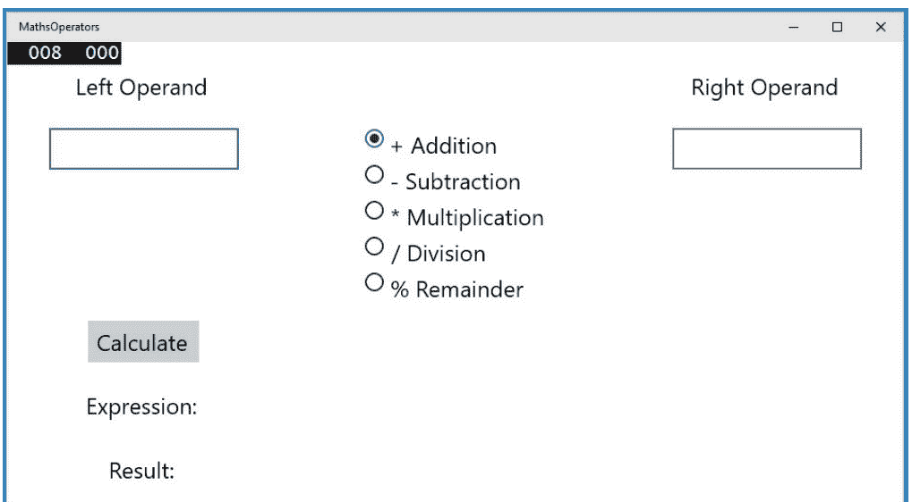

4. 在 Left Operand 框中，输入 `54`。
5. 在 Right Operand 框中，输入 `13`。

现在你可以使用运算符对文本框中的值进行任意操作。

6. 单击 `– Subtraction` 选项，然后单击 `Calculate`。

`Expression` 框中的文本变为 `54 – 13`，但 `Result` 框中显示的值为 `0`；这显然是错误的。

7. 单击 `/ Division` 选项，然后单击 `Calculate`。

`Expression` 框中的文本变为 `54/13`，`Result` 框中再次显示的值为 `0`。

8. 单击 `% Remainder` 按钮，然后单击 `Calculate`。

`Expression` 框中的文本变为 `54 % 13`，但同样地，`Result` 文本框中显示的值为 `0`。测试其他数字和运算符的组合；你会发现它们目前都产生 `0` 的值。

## Note

如果在任一操作数框中输入非整数值，应用程序会检测到错误并显示消息“Input string was not in a correct format.” 你将在第 6 章“`Managing errors and exceptions`”中了解更多关于如何捕获和处理错误和异常的信息。

9. 完成后，返回 Visual Studio，然后在 Debug 菜单上单击 `Stop Debugging`。

正如你可能猜到的那样，`MathsOperators` 应用程序目前尚未实现任何计算。在下一个练习中，你将纠正这一点。

### Perform calculations in the MathsOperators application

- 1. 在 Design View 窗口中显示 `MainPage.xaml` 表单。 （在 Solution Explorer 中，在 `MathsOperators` 项目中，双击文件 `MainPage.xaml`。）
- 2. 在 View 菜单上，指向 Other Windows，然后单击 `Document Outline`。

`Document Outline` 窗口出现，显示表单上控件的名称和类型。 `Document Outline` 窗口提供了一种简单的方法来定位和选择复杂表单上的控件。 控件按层次结构排列，从构成表单的 Page 开始。 如第 1 章所述，通用 Windows 平台 (UWP) 应用页面包含一个 `Grid` 控件，其他控件放置在此 `Grid` 内。 如果你在 `Document Outline` 窗口中展开 `Grid` 节点，其他控件就会出现，从另一个 `Grid` 开始（外部 `Grid` 充当框架，内部 `Grid` 包含你在表单上看到的控件）。 如果你展开内部 `Grid`，可以看到表单上的每个控件。

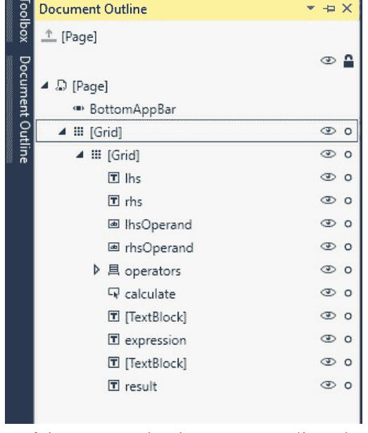

如果单击这些控件中的任何一个，对应的元素将在 Design View 窗口中突出显示。 同样，如果在 Design View 窗口中选择一个控件，对应的控件将在 `Document Outline` 窗口中被选中。 （要亲眼看到这一点，请通过取消选中 `Document Outline` 窗口右上角的 `Auto Hide` 按钮来固定 `Document Outline` 窗口。）

- 3. 在表单上，单击用户输入数字的两个 `TextBox` 控件。 在 `Document Outline` 窗口中，验证它们是否分别命名为 `lhsOperand` 和 `rhsOperand`。
- 当表单运行时，这两个控件的 `Text` 属性保存用户输入的值。
- 4. 在表单底部，验证用于显示正在求值的表达式的 `TextBlock` 控件是否命名为 `expression`，并且用于显示计算结果的 `TextBlock` 控件是否命名为 `result`。
- 5. 关闭 `Document Outline` 窗口。
- 6. 在 View 菜单上，单击 `Code` 以在 Code and Text Editor 窗口中显示 `MainPage.xaml.cs` 文件的代码。
- 7. 在 Code and Text Editor 窗口中，找到 `addValues` 方法。 它看起来像这样：

Click here to view code image

```
private void addValues()
{
    int lhs = int.Parse(lhsOperand.Text);
    int rhs = int.Parse(rhsOperand.Text);
    int outcome = 0;
    // TODO: Add rhs to lhs and store the result in outcome
    expression.Text = $"{lhsOperand.Text} + {rhsOperand.Text}";
    result.Text = outcome.ToString();
}
```

此方法中的第一个语句声明一个名为 `lhs` 的 `int` 变量，并用用户在 `lhsOperand` 框中输入的值对应的整数对其进行初始化。 请记住，`TextBox` 控件的 `Text` 属性包含一个字符串，但 `lhs` 是一个 `int`，因此在将其分配给 `lhs` 之前必须将此字符串转换为整数。 `int` 数据类型提供了 `int.Parse` 方法，它正是执行此操作。

第二个语句声明一个名为 `rhs` 的 `int` 变量，并将其初始化为在将 `rhsOperand` 框中的值转换为 `int` 之后得到的值。

第三个语句声明一个名为 `outcome` 的 `int` 变量。

随后是一个注释，说明需要将 `rhs` 加到 `lhs` 并将结果存储在 `outcome` 中。 这是你需要实现的代码缺失部分，你将在下一步中完成。

第五个语句使用字符串插值构造一个指示正在执行的计算的字符串，并将其分配给 `expression.Text` 属性。 这会导致该字符串出现在表单上的 Expression 框中。

最后一条语句通过将其分配给 Result 框的 `Text` 属性来显示计算结果。 请记住，`Text` 属性是一个字符串，而计算结果是一个 `int`，因此在将其分配给 `Text` 属性之前必须将 `int` 转换为字符串。 请回忆一下，这正是 `int` 类型的 `ToString` 方法所做的。

8. 在 `addValues` 方法中间的注释下方，添加以下语句（下面以粗体显示）：

Click here to view code image

```
private void addValues()
{
    int lhs = int.Parse(lhsOperand.Text);
    int rhs = int.Parse(rhsOperand.Text);
    int outcome = 0;
    // TODO: Add rhs to lhs and store the result in outcome
    outcome = lhs + rhs;
    expression.Text = $"{lhsOperand.Text} + {rhsOperand.Text}";
    result.Text = outcome.ToString();
}
```

此语句计算表达式 `lhs + rhs` 并将结果存储在 `outcome` 中。

9. 检查 `subtractValues` 方法。 你应该会看到它遵循类似的模式。 在这里，你需要添加计算 `lhs` 减去 `rhs` 的结果并将其存储在 `outcome` 中的语句。 向此方法添加以下语句（以粗体显示）：

Click here to view code image

```
private void subtractValues()
{
    int lhs = int.Parse(lhsOperand.Text);
    int rhs = int.Parse(rhsOperand.Text);
    int outcome = 0;
    // TODO: Subtract rhs from lhs and store the result in outcome
    outcome = lhs - rhs;
    expression.Text = $"{lhsOperand.Text} - {rhsOperand.Text}";
    result.Text = outcome.ToString();
}
```

10. 检查 `multiplyValues`、`divideValues` 和 `remainderValues` 方法。 同样，它们都缺少执行指定计算的关键语句。 向这些方法添加适当的语句（以粗体显示）。

Click here to view code image

```
private void multiplyValues()
{
    int lhs = int.Parse(lhsOperand.Text);
    int rhs = int.Parse(rhsOperand.Text);
```

```
int outcome = 0;
// TODO: Multiply lhs by rhs and store the result in outcome
outcome = lhs * rhs;
expression.Text = $"{lhsOperand.Text} * {rhsOperand.Text}";
result.Text = outcome.ToString();
}

private void divideValues()
{
    int lhs = int.Parse(lhsOperand.Text);
    int rhs = int.Parse(rhsOperand.Text);
    int outcome = 0;
    // TODO: Divide lhs by rhs and store the result in outcome
    outcome = lhs / rhs;
    expression.Text = $"{lhsOperand.Text} / {rhsOperand.Text}";
    result.Text = outcome.ToString();
}

private void remainderValues()
{
    int lhs = int.Parse(lhsOperand.Text);
    int rhs = int.Parse(rhsOperand.Text);
    int outcome = 0;
    // TODO: Work out the remainder after dividing lhs by rhs and store the result in outcome
    outcome = lhs % rhs;
    expression.Text = $"{lhsOperand.Text} % {rhsOperand.Text}";
    result.Text = outcome.ToString();
}
```

### Test the MathsOperators application

- 1. 在 Debug 菜单上，单击 `Start Debugging` 以构建并运行应用程序。
- 2. 在 Left Operand 框中输入 `54`，在 Right Operand 框中输入 `13`，单击 `+ Addition` 选项，然后单击 `Calculate`。
- `Result` 框中应出现值 `67`。
- 3. 单击 `– Subtraction` 选项，然后单击 `Calculate`。 验证结果现在为 `41`。
- 4. 单击 `* Multiplication` 选项，然后单击 `Calculate`。 验证结果现在为 `702`。
- 5. 单击 `/ Division` 选项，然后单击 `Calculate`。 验证结果现在为 `4`。
- 在现实生活中，`54/13` 是 `4.153846` 循环，但这不是现实生活——这是 C# 执行整数除法。 当你用一个整数除以另一个整数时，得到的答案是一个整数，如前所述。
- 6. 单击 `% Remainder` 选项，然后单击 `Calculate`。 验证结果现在为 `2`。
- 处理整数时，`54` 除以 `13` 的余数为 `2`； `(54 - ((54/13) * 13))` is `2`. This is because the calculation rounds down to an integer at each stage. (My high school math teacher would be horrified to be told that `(54/13) * 13` does not equal `54`!)
-   7. Return to Visual Studio and stop debugging.

### Controlling precedence

Precedence governs the order in which an expression’s operators are evaluated. Consider the following expression, which uses the `+` and `*` operators:

```
2 + 3 * 4
```

This expression is potentially ambiguous: do you perform the addition first or the multiplication? The order of the operations matters because it changes the result:


- If you perform the addition first, followed by the multiplication, the result of the addition `(2 + 3)` forms the left operand of the `*` operator, and the result of the whole expression is `5 * 4`, which is 20.
- If you perform the multiplication first, followed by the addition, the result of the multiplication `(3 * 4)` forms the right operand of the `+` operator, and the result of the whole expression is `2 + 12`, which is 14.

In C#, the multiplicative operators (`*`, `/`, and `%`) have precedence over the additive operators (`+` and `−`), so in expressions such as `2 + 3 * 4`, the multiplication is performed first, followed by the addition. The answer to `2 + 3 * 4` is therefore 14.

You can use parentheses to override precedence and force operands to bind to operators in a different way. For example, in the following expression, the parentheses force the 2 and the 3 to bind to the `+` operator (making 5), and the result of this addition forms the left operand of the `*` operator to produce the value 20:

```
(2 + 3) * 4
```


## Note

The term parentheses or round brackets refers to `()`. The term braces or curly brackets refers to `{ }`. The term square brackets refers to `[ ]`.

### Using associativity to evaluate expressions

Operator precedence is only half the story. What happens when an expression contains different operators that have the same precedence? This is where associativity becomes important. Associativity is the direction (left or right) in which the operands of an operator are evaluated. Consider the following expression that uses the `/` and `*` operators:

```
4 / 2 * 6
```

At first glance, this expression is potentially ambiguous. Do you perform the division first or the multiplication? The precedence of both operators is the same (they are both multiplicative), but the order in which the operators in the expression are applied is important because you can get two different results:
- If you perform the division first, the result of the division `(4/2)` forms the left operand of the `*` operator, and the result of the whole expression is `(4/2) * 6`, or 12.
- If you perform the multiplication first, the result of the multiplication `(2 * 6)` forms the right operand of the `/` operator, and the result of the whole expression is `4/(2 * 6)`, or `4/12`.

In this case, the associativity of the operators determines how the expression is evaluated. The `*` and `/` operators are both left associative, which means that the operands are evaluated from left to right. In this case, `4/2` will be evaluated before multiplying by 6, giving the result 12.

### Associativity and the assignment operator

In C#, the equal sign (`=`) is an operator. All operators return a value based on their operands. The assignment operator `=` is no different. It takes two operands: the operand on the right side is evaluated and then stored in the operand on the left side. The value of the assignment operator is the value that was assigned to the left operand. For example, in the following assignment statement, the value returned by the assignment operator is 10, which is also the value assigned to the variable `myInt`:

Click here to view code image

```
int myInt;
myInt = 10; // value of assignment expression is 10
```

At this point, you might be thinking that this is all very nice and esoteric, but so what? Well, because the assignment operator returns a value, you can use this same value with another occurrence of the assignment statement, like this:

```
int myInt;
int myInt2;
myInt2 = myInt = 10;
```

The value assigned to the variable `myInt2` is the value that was assigned to `myInt`. The assignment statement assigns the same value to both variables. This technique is useful if you want to initialize several variables to the same value. It makes it very clear to anyone reading your code that all the variables must have the same value:

Click here to view code image

```
myInt5 = myInt4 = myInt3 = myInt2 = myInt = 10;
```

From this discussion, you can probably deduce that the assignment operator associates from right to left. The rightmost assignment occurs first, and the value assigned propagates through the variables from right to left. If any of the variables previously had a value, it is overwritten by the value being assigned.

You should treat this construct with caution, however. One frequent mistake that new C# programmers make is to try to combine this use of the assignment operator with variable declarations. For example, you might expect the following code to create and initialize three variables with the same value (10):

Click here to view code image

```
int myInt, myInt2, myInt3 = 10;
```

This is legal C# code (because it compiles). What it does is declare the variables `myInt`, `myInt2`, and `myInt3` and initialize `myInt3` with the value 10. However, it does not initialize `myInt` or `myInt2`. If you try to use `myInt` or `myInt2` in an expression such as

```
myInt3 = myInt / myInt2;
```

the compiler generates the following errors:

Click here to view code image

```
Use of unassigned local variable 'myInt'
Use of unassigned local variable 'myInt2'
```

### Incrementing and decrementing variables

If you want to add 1 to a variable, you can use the `+` operator, as demonstrated here:

```
count = count + 1;
```

However, adding 1 to a variable is so common that C# provides its own operator just for this purpose: the `++` operator. To increment the variable `count` by 1, you can write the following statement:

```
count++;
```

Similarly, C# provides the `--` operator that you can use to subtract 1 from a variable, like this:

```
count--;
```

The `++` and `--` operators are unary operators, meaning that they take only a single operand. They share the same precedence and are both left associative.

### Prefix and postfix

The increment (`++`) and decrement (`--`) operators are unusual in that you can place them either before or after the variable. Placing the operator symbol before the variable is called the prefix form of the operator, and using the operator symbol after the variable is called the postfix form. Here are examples:

```
count++; // postfix increment
++count; // prefix increment
count--; // postfix decrement
--count; // prefix decrement
```

Whether you use the prefix or postfix form of the `++` or `--` operator makes no difference to the variable being incremented or decremented. For example, if you write `count++`, the value of `count` increases by 1, and if you write `++count`, the value of `count` also increases by 1. Knowing this, you’re probably wondering why there are two ways to write the same thing. To understand the answer, you must remember that `++` and `--` are operators and that all operators are used to evaluate an expression that has a value. The value returned by `count++` is the value of `count` before the increment takes place, whereas the value returned by `++count` is the value of `count` after the increment takes place. Here is an example:

Click here to view code image

```
int x;
x = 42;
Console.WriteLine(x++); // x is now 43, 42 written out
x = 42;
Console.WriteLine(++x); // x is now 43, 43 written out
```

The way to remember which operand does what is to look at the order of the elements (the operand and the operator) in a prefix or postfix expression. In the expression `x++`, the variable `x` occurs first, so its value is used as the value of the expression before `x` is incremented. In the expression `++x`, the operator occurs first, so its operation is performed before the value of `x` is evaluated as the result.

These operators are most commonly used in `while` and `do` statements, which are presented in Chapter 5, “Using compound assignment and iteration statements.” If you are using the increment and decrement operators in isolation, stick to the postfix form and be consistent.

### Declaring implicitly typed local variables

Earlier in this chapter, you saw that you declare a variable by specifying a data type and an identifier, like this:


```
int myInt;
```

It was also mentioned that you should assign a value to a variable before you

尝试使用它。你可以在同一语句中声明并初始化一个变量，如下例所示：

```
int myInt = 99;
```

或者，你也可以这样做，前提是 `myOtherInt` 是一个已初始化的整数变量：

```
int myInt = myOtherInt * 99;
```

现在，请记住，你赋给变量的值必须与变量的类型相同。例如，你只能将 `int` 值赋给 `int` 变量。C# 编译器可以快速推断出用于初始化变量的表达式的类型，并指出它是否与变量的类型不匹配。你也可以要求 C# 编译器从表达式推断变量的类型，并在声明变量时使用 `var` 关键字代替类型，如下所示：

```
var myVariable = 99;
var myOtherVariable = "Hello";
```

变量 `myVariable` 和 `myOtherVariable` 被称为隐式类型变量。`var` 关键字会使编译器根据用于初始化它们的表达式的类型推断变量的类型。在这些示例中，`myVariable` 是 `int`，而 `myOtherVariable` 是 `string`。然而，你必须明白，这只是声明变量的便利方式，一旦变量被声明，你只能为其赋予推断类型的

值——例如，你不能在程序的后面将 `float`、`double` 或 `string` 值赋给 `myVariable`。你还应明白，你只能在提供表达式来初始化变量时使用 `var` 关键字。以下声明是非法的，会导致编译错误：

```
var yetAnotherVariable; // Error - compiler cannot infer type
```

## Important

如果你过去曾使用 Visual Basic 编程，你可能熟悉 *Variant* 类型，你可以用它在变量中存储任何类型的值。我在此强调，你应该忘记你在用 Visual Basic 编程时关于 *Variant* 变量所学的一切。虽然关键字看起来相似，但 *var* 和 *Variant* 含义完全不同。当你使用 *var* 关键字在 C# 中声明变量时，你可以赋给该变量的值的类型 *不能改变*，它必须与用于初始化变量的类型相同。

如果你是一个纯粹主义者，你现在可能正咬牙切齿，想知道为什么像 C# 这样精致的语言的设计者会允许 *var* 这样的特性出现。毕竟，这听起来像是程序员极度懒惰的借口，会使理解程序正在做什么或追踪错误变得更加困难（甚至可能很容易在你的代码中引入新的错误）。然而，请相信我，*var* 在 C# 中有非常合理的用途，当你阅读接下来的许多章节时你会看到这一点。不过，就目前而言，我们将坚持使用显式类型变量，除非隐式类型变得必要。

### Summary

在本章中，你学习了如何创建和使用变量，并了解了 C# 中变量可用的一些常见数据类型。你还学习了标识符。此外，你使用了一些运算符来构建表达式，并学习了运算符的优先级和结合性如何决定表达式的求值方式。

- 如果你想继续下一章，请保持 Visual Studio 2015 运行并转到第 3 章。
- 如果你现在想退出 Visual Studio 2015，请在 File 菜单上单击 Exit。如果出现 Save 对话框，请单击 Yes 并保存项目。

### Quick Reference

| To | Do this |
|---|---|
| Declare a variable | Write the name of the data type, followed by the name of the variable, followed by a semicolon. For example: `int outcome;` |
| Declare a variable and give it an initial value | Write the name of the data type, followed by the name of the variable, followed by the assignment operator and the initial value. Finish with a semicolon. For example: `int outcome = 99;` |
| Change the value of a variable | Write the name of the variable on the left, followed by the assignment operator, followed by the expression calculating the new value, followed by a semicolon. For example: `outcome = 42;` |
| Generate a string representation of the value in a variable | Call the `ToString` method of the variable. For example: `int intVar = 42;` `string stringVar = intVar.ToString();` |
| Convert a string to an int | Call the `System.Int32.Parse` method. For example: `string stringVar = "42";` `int intVar = System.Int32.Parse(stringVar);` |
| Override the precedence of an operator | Use parentheses in the expression to force the order of evaluation. For example: `(3 + 4) * 5` |
| Assign the same value to several variables | Use an assignment statement that lists all the variables. For example: `myInt4 = myInt3 = myInt2 = myInt = 10;` |
| Increment or decrement a variable | Use the `++` or `--` operator. For example: `count++;` |

### Chapter 3. Writing methods and applying scope

完成本章后，你将能够：

- Declare and call methods.
- Pass information to a method.
- Return information from a method.
- Define local and class scope.
- Use the integrated debugger to step into and out of methods as they run.

在第 2 章“Working with variables, operators, and expressions”中，你学习了如何声明变量，如何使用运算符创建表达式，以及优先级和结合性如何控制包含多个运算符的表达式的求值方式。在本章中，你将学习方法。你将看到如何声明和调用方法，如何使用参数和形参将信息传递给方法，以及如何使用 `return` 语句从方法返回信息。你还将看到如何使用 Microsoft Visual Studio 2015 集成调试器在方法运行时进入和退出方法。当你需要跟踪方法执行过程而它们没有按预期工作时，此信息很有用。最后，你将学习如何声明接受可选参数的方法以及如何使用命名参数调用方法。

### Creating methods

方法是一段命名的语句序列。如果你以前使用 C、C++ 或 Microsoft Visual Basic 等语言编程过，你会发现方法类似于函数或子程序。方法有一个名称和一个主体。方法名称应是有意义的标识符，表示方法的主要用途（例如 `calculateIncomeTax`）。方法主体包含在调用方法时实际运行的语句。此外，方法可以接收一些数据进行处理并返回信息，通常是处理的結果。方法是一种基本而强大的机制。

### Declaring a method

声明 C# 方法的语法如下：

```
returnType methodName ( parameterList )
{
    // method body statements go here
}
```

以下是构成声明的元素的描述：

- `returnType` 是类型的名称，指定方法作为其处理结果返回的信息种类。这可以是任何类型，例如 `int` 或 `string`。如果你编写的方法不返回值，则必须使用关键字 `void` 代替返回类型。
- `methodName` 是用于调用方法的名称。方法名遵循与变量名相同的标识符规则。例如，`addValues` 是有效的方法名，而 `add$Values` 则不是。目前，你应遵循方法名的 camelCase 惯例；例如，`displayCustomer`。
- `parameterList` 是可选的，描述可以传递给方法以供其处理的信息的类型和名称。你在打开和关闭括号 `()` 之间编写参数，就像声明变量一样，类型名称后跟参数名称。如果要编写的方法有两个或多个参数，则必须用逗号分隔它们。
- 方法主体语句是在调用方法时运行的代码行。它们被包含在大括号 `{}` 之间。

## Important

如果你使用 C、C++ 和 Visual Basic 编程，你应该注意 C# 不支持全局方法。你必须将所有方法写在类内部；否则，你的代码将无法编译。

下面是名为 `addValues` 的方法的定义，它返回 `int` 结果并有两个 `int` 参数，`leftHandSide` 和 `rightHandSide`：

```
int addValues(int leftHandSide, int rightHandSide)
{
    // ...
    // method body statements go here
    // ...
}
```

## Note

你必须显式指定任何参数的类型和方法返回类型。你不能使用 `var` 关键字。

下面是名为 `showResult` 的方法的定义，它不返回值

并且有一个名为 `answer` 的单个 `int` 参数：

```
void showResult(int answer)
{
    // ...
}
```

注意使用关键字 `void` 来表示该方法不返回任何内容。

## Important

如果你熟悉 Visual Basic，请注意 C# 不使用不同的关键字来区分返回值的 方法（函数）和不返回值的方法（过程或子程序）。你必须始终指定返回类型或 `void`。

### Returning data from a method

如果你希望方法返回信息（即其返回类型不是 `void`），则必须在方法体中处理的末尾包含 `return` 语句。`return` 语句由关键字 `return`、指定返回值的表达式以及分号组成。表达式的类型必须与方法声明中指定的类型相同。例如，如果方法返回 `int`，则 `return` 语句必须返回 `int`；否则，你的程序将无法编译。以下是带 `return` 语句的方法示例：

Click here to view code image

```
int addValues(int leftHandSide, int rightHandSide)
{
    // ...
    return leftHandSide + rightHandSide;
}
```

`return` 语句通常位于方法的末尾，因为它会导致方法结束，并且控制权返回到调用该方法的语句，如本章后面所述。`return` 语句之后出现的任何语句都不会被执行（尽管如果在 `return` 语句之后放置语句，编译器会警告你这个问题）。

如果你不希望方法返回信息（即其返回类型为 `void`），可以使用 `return` 语句的变体来立即退出方法。你写下关键字 `return` 并立即跟上分号。例如：

Click here to view code image

```
void showResult(int answer)
{
    // display the answer
    Console.WriteLine($"The answer is {answer}");
    return;
}
```

如果你的方法不返回任何内容，你也可以省略 `return` 语句，因为当执行到达方法末尾的闭合大括号时，方法会自动结束。虽然这种做法很常见，但并不总是被认为是一种好的风格。

### Using expression-bodied methods

一些方法可以非常简单，只执行单一任务或返回计算结果，而不涉及任何额外逻辑。C# 支持一种简化形式，用于由单个表达式组成的方法。这些方法仍然可以接受参数并返回值，并且它们的工作方式与迄今为止看到的方法相同。以下代码示例显示了作为表达式体方法编写的 `addValues` 和 `showResult` 方法的简化版本：

Click here to view code image

```
int addValues(int leftHandSide, int rightHandSide) => leftHandSide + rightHandSide;

void showResult(int answer) => Console.WriteLine($"The answer is {answer}");
```

主要区别在于使用 `=>` 运算符引用构成方法体的表达式，以及没有 `return` 语句。表达式的值用作返回值；如果表达式不返回值，则方法为 `void`。

实际上，使用普通方法和表达式体方法之间在功能上没有任何区别——表达式体方法只是语法上的便利。然而，你将在本书后面的示例中看到，表达式体方法可以通过删除大量多余的 `{` 和 `}` 字符来阐明程序，使代码更易于阅读。

在下面的练习中，你将检查第 2 章中 MathsOperators 项目的另一个版本。此版本通过仔细使用一些小方法而得到改进。以这种方式划分代码有助于使其更易于理解和维护。

### Examine method definitions

- 1. 如果尚未运行，请启动 Visual Studio 2015。
- 2. 打开 Methods 项目，该项目位于你的 Documents 文件夹中的 `\Microsoft Press\VCSBS\Chapter 3\Methods` 文件夹中。
- 3. 在 Debug 菜单上，单击 Start Debugging。
- 4. Visual Studio 2015 构建并运行应用程序。它应该看起来与第 2 章中的应用程序相同。重新熟悉应用程序及其工作原理，然后返回 Visual Studio。在 Debug 菜单上，单击 Stop Debugging。
- 5. 在代码和文本编辑器窗口中显示 MainPage.xaml.cs 的代码（在 Solution Explorer 中，展开 MainPage.xaml 文件，然后双击 MainPage.xaml.cs）。
- 6. 在代码和文本编辑器窗口中，找到 `addValues` 方法，它看起来像这样：

Click here to view code image

```
private int addValues(int leftHandSide, int rightHandSide)
{
    expression.Text = $"{leftHandSide} + {rightHandSide}";
    return leftHandSide + rightHandSide;
}
```

### Note

暂时不用担心此方法定义开头的 `private` 关键字；你将在第 7 章“创建和管理类和对象”中学习此关键字的含义。

`addValues` 方法包含两个语句。第一个语句在表单上的 `expression` 框中显示正在执行的计算。

第二个语句使用 `int` 版本的 `+` 运算符将 `leftHandSide` 和 `rightHandSide int` 变量的值相加，然后返回此操作的结果。请记住，将两个 `int` 值相加会产生另一个 `int` 值，因此 `addValues` 方法的返回类型为 `int`。

如果你查看 `subtractValues`、`multiplyValues`、`divideValues` 和 `remainderValues` 方法，你会发现它们遵循类似的模式。

7. 在代码和文本编辑器窗口中，找到 `showResult` 方法，它看起来像这样：

Click here to view code image

```
private void showResult(int answer) => result.Text = answer.ToString();
```

这是一个表达式体方法，它在 `result` 框中显示 `answer` 参数的字符串表示形式。它不返回值，因此此方法的类型为 `void`。

### Tip

方法没有最小长度。如果方法有助于避免重复并使你的程序更易于理解，无论它有多小，该方法都是有用的。

方法也没有最大长度，但通常你希望保持方法代码足够小以完成任务。如果你的方法长度超过一屏，请考虑将其拆分为更小的方法以提高可读性。

### Calling methods

方法存在的意义就是被调用！你通过名称调用方法来要求它执行其任务。如果方法需要信息（按其参数指定），你必须提供所需的信息。如果方法返回信息（按其返回类型指定），你应该安排以某种方式捕获此信息。

### Specifying the method call syntax

C# 方法调用的语法如下：

Click here to view code image

```
result = methodName ( argumentList )
```

以下是构成方法调用的元素的描述：


`methodName` 必须与你要调用的方法的名称完全匹配。请记住，C# 是区分大小写的语言。

`result =` 子句是可选的。如果指定，则变量 `result` 包含方法返回的值。如果方法为 `void`（即不返回值），你必须省略语句的 `result =` 子句。如果方法确实返回值但你未指定 `result =` 子句，方法仍会运行但返回值将被丢弃。

`argumentList` 提供方法接受的信息。你必须为每个参数提供一个参数，并且每个参数的值必须与其对应参数的类型兼容。如果你要调用的方法有两个或多个参数，你必须用逗号分隔参数。

## Important

你必须在每次方法调用中包含括号，即使调用一个没有参数的方法时也是如此。

要澄清这些要点，再看一下 `addValues` 方法：

Click here to view code image

```
int addValues(int leftHandSide, int rightHandSide)
{
    // ...
}
```

`addValues` 方法有两个 `int` 参数，因此你必须用两个以逗号分隔的 `int` 参数调用它，例如：

```
addValues(39, 3);    // okay
```

你也可以用 `int` 变量的名称替换字面值 39 和 3。然后这些变量中的值会作为参数传递给方法，如下所示：

```
int arg1 = 99;
int arg2 = 1;
addValues(arg1, arg2);
```

如果你以其他方式尝试调用 `addValues`，你很可能不会成功，原因在以下示例中描述：

Click here to view code image

```
addValues;              // compile-time error, no parentheses
addValues();            // compile-time error, not enough arguments
addValues(39);          // compile-time error, not enough arguments
addValues("39", "3"); // compile-time error, wrong types for
arguments
```

`addValues` 方法返回一个 `int` 值。你可以在任何可以使用 `int` 值的地方使用这个 `int` 值。考虑以下示例：

Click here to view code image

```
int result = addValues(39, 3);    // on right-hand side of an
assignment
showResult(addValues(39, 3));    // as argument to another method
call
```

下面的练习继续进行 Methods 应用程序。这次，你将检查一些方法调用。

### Examine method calls

- 1. Return to the Methods project. (This project is already open in Visual Studio 2015 if you’re continuing from the previous exercise. If you are not, open it from the `\Microsoft Press\VCSBS\Chapter 3\Methods` folder in your Documents folder.)
- 2. Display the code for `MainPage.xaml.cs` in the Code and Text Editor window.
- 3. Locate the `calculateClick` method, and look at the first two statements of this method after the try statement and opening brace. (You will learn about try statements in Chapter 6, “Managing errors and exceptions.”)

These statements look like this:

Click here to view code image

```
int leftHandSide = System.Int32.Parse(lhsOperand.Text);
int rightHandSide = System.Int32.Parse(rhsOperand.Text);
```

这两个语句声明了两个 `int` 变量，名为 `leftHandSide` 和 `rightHandSide`。注意变量初始化的方式。在这两种情况下，都调用了 `System.Int32` 结构体的 `Parse` 方法。 （`System` 是一个命名空间，`Int32` 是该命名空间中的结构体的名称。你将在第 9 章“Creating value types with enumerations and structures.” 中学习结构体。）你以前见过这个方法——它接受一个字符串参数并将其转换为 `int` 值。这两行代码获取用户在表单上的 `lhsOperand` 和 `rhsOperand` 文本框控件中输入的内容并将其转换为 `int` 值。

4. Look at the fourth statement in the `calculateClick` method (after the if statement and another opening brace):

Click here to view code image

```
calculatedValue = addValues(leftHandSide, rightHandSide);
```

此语句调用 `addValues` 方法，将 `leftHandSide` 和 `rightHandSide` 变量的值作为其参数传递。`addValues` 方法返回的值存储在 `calculatedValue` 变量中。

5. Look at the next statement:

```
showResult(calculatedValue);
```

此语句调用 `showResult` 方法，将 `calculatedValue` 变量中的值作为其参数传递。`showResult` 方法不返回值。

6. In the Code and Text Editor window, find the `showResult` method you looked at earlier.

The only statement of this method is this:

Click here to view code image

```
result.Text = answer.ToString();
```

注意 `ToString` 方法调用即使没有参数也使用了括号。

### Tip

You can call methods belonging to other objects by prefixing the method with the name of the object. In the preceding example, the expression `answer.ToString()` calls the method named `ToString` belonging to the object called `answer`.

### Applying scope

You create variables to hold values. You can create variables at various points in your applications. For example, the `calculateClick` method in the Methods project creates an `int` variable called `calculatedValue` and assigns it an initial value of zero, like this:

Click here to view code image

```
private void calculateClick(object sender, RoutedEventArgs e)
{
    int calculatedValue = 0;
    ...
}
```

此变量在定义点创建，随后 `calculateClick` 方法中的语句就可以使用此变量。这是一个重要点：变量只能在创建后使用。当方法结束时，此变量消失，不能在其他地方使用。

当变量可以在程序的特定位置访问时，称该变量在该位置处于 `scope`。`calculatedValue` 变量具有方法作用域；它可以在 `calculateClick` 方法内访问，但在该方法之外不可访问。你也可以定义具有不同作用域的变量；例如，你可以在类内但方法外定义变量，此变量可以被该类中的任何方法访问。这种变量被称为具有 `class scope`。

换句话说，变量的作用域仅仅是该变量在程序中可用的区域。作用域适用于方法以及变量。标识符（变量或方法）的作用域与引入该标识符的声明在程序中的位置相关联，如你接下来将学习的那样。

### Defining local scope

形成方法体的开始和结束大括号定义了该方法的作用域。你在方法体内声明的任何变量都限定于该方法；它们在方法结束时消失，只能被在该方法中运行的代码访问。这些变量称为 `local variables`，因为它们是局部于声明它们的那个方法；它们不在任何其他方法的作用域内。

局部变量的作用域意味着你不能使用它们在方法之间共享信息。考虑这个示例：

Click here to view code image

```
class Example
{
    void firstMethod()
    {
        int myVar;
        ...
    }
    void anotherMethod()
    {
        myVar = 42; // error - variable not in scope
        ...
    }
}
```

此代码无法编译，因为 `anotherMethod` 试图使用变量 `myVar`，而该变量不在作用域内。变量 `myVar` 仅对 `firstMethod` 中在声明 `myVar` 的代码行之后出现的语句可用。

### Defining class scope

形成类体的开始和结束大括号定义了该类的作用域。你在类体内（但不在方法内）声明的任何变量都限定于该类。C# 中由类定义的变量的正确术语是 `field`。如前所述，与局部变量不同，你可以使用字段在方法之间共享信息。这里有一个示例：

```
class Example
{
    void firstMethod()
    {
        myField = 42; // ok
        ...
    }
    void anotherMethod()
    {
        myField++; // ok
    }
    int myField = 0;
}
```

变量 `myField` 在类中定义，但在 `firstMethod` 和 `anotherMethod` 方法之外。因此，`myField` 具有类作用域，可以被该类中的所有方法使用。

这个示例还有一点需要注意。在方法中，你必须在可以使用变量之前声明它。字段有点不同。方法可以在定义字段的语句之前使用字段——编译器会为你处理细节。

### Overloading methods

如果两个标识符具有相同的名称并且在相同的作用域中声明，则称它们为 `overloaded`。通常，重载的标识符是一个错误，会在编译时被捕获。例如，如果你在同一个方法中用相同的名称声明两个局部变量，编译器会报告错误。同样，如果你在同一个类中声明两个具有相同名称的字段，或在同一个类中声明两个相同的方法，你也会得到编译时错误。这一事实可能似乎不值得一提，因为到目前为止所有内容都导致了编译时错误。然而，有一种方法可以重载方法标识符，既有用又重要。

考虑 `Console` 类的 `WriteLine` 方法。你已经使用过此方法将字符串写入屏幕。然而，当你在编写 C# 代码时在代码和文本编辑器窗口中输入 `WriteLine` 时，注意 Microsoft IntelliSense 会给你 19 个不同的选项！`WriteLine` 方法的每个版本都接受不同的参数集；一个版本不接受参数，仅输出一个空行，另一个版本接受一个 `bool` 参数并输出其值的字符串表示（`True` 或 `False`），还有一个实现接受一个 `decimal` 参数并将其作为字符串输出，等等。在编译时，编译器会查看你传递的参数类型，然后安排应用程序调用具有匹配参数集的方法版本。这里有一个示例：

Click here to view code image

```
static void Main()
{
    Console.WriteLine("The answer is ");
    Console.WriteLine(42);
}
```

重载主要在你需要对不同数据类型或不同组信息执行相同操作时有用。你可以在不同实现具有不同的参数集时重载方法——也就是说，它们具有相同的名称但参数数量不同或参数类型不同。当你调用方法时，你提供一个以逗号分隔的参数列表，参数的数量和类型由编译器用来选择重载方法之一。但是，请记住，虽然你可以重载方法参数，但你不能

overload the return type of a method. In other words, you can’t declare two methods with the same name that differ only in their return type. (The compiler is clever, but not that clever.)

### Writing methods

In the following exercises, you’ll create a method that calculates how much a consultant would charge for a given number of consultancy days at a fixed daily rate. You will start by developing the logic for the application and then use the Generate Method Stub Wizard to help you write the methods that are used by this logic. Next, you’ll run these methods in a console application to get a feel for the program. Finally, you’ll use the Visual Studio 2015 debugger to step into and out of the method calls as they run.

### Develop the logic for the application

- 1. Using Visual Studio 2015, open the DailyRate project, which is in the `\Microsoft Press\VCSBS\Chapter 3\DailyRate` folder in your Documents folder.
- 2. In Solution Explorer, in the DailyRate project, double-click the file `Program.cs` to display the code for the program in the Code and Text Editor window.

This program is simply a test harness for you to try out your code. When the application starts running, it calls the `run` method. You add to the `run` method the code that you want to try. (The way in which the method is called requires an understanding of classes, which you look at in Chapter 7.)

- 3. Add the following statements shown in bold to the body of the `run` method, between the opening and closing braces:

Click here to view code image

```
void run()
{
    double dailyRate = readDouble("Enter your daily rate: ");
    int noOfDays = readInt("Enter the number of days: ");
    writeFee(calculateFee(dailyRate, noOfDays));
}
```


The block of code you have just added to the `run` method calls the `readDouble` method (which you will write shortly) to ask the user for the daily rate for the consultant. The next statement calls the `readInt` method (which you will also write) to obtain the number of days. Finally, the `writeFee` method (to be written) is called to display the results on the screen. Notice that the value passed to `writeFee` is the value returned by the `calculateFee` method (the last one you will need to write), which takes the daily rate and the number of days and calculates the total fee payable.

### Note
You have not yet written the `readDouble`, `readInt`, `writeFee`, and `calculateFee` methods, so IntelliSense does not display these methods when you type this code. Do not try to build the application yet—it will fail.

### Write the methods by using the Generate Method Stub Wizard
- 1. In the Code and Text Editor window, in the `run` method, right-click the `readDouble` method call.
A shortcut menu appears that contains useful commands for generating and editing code, as shown here:
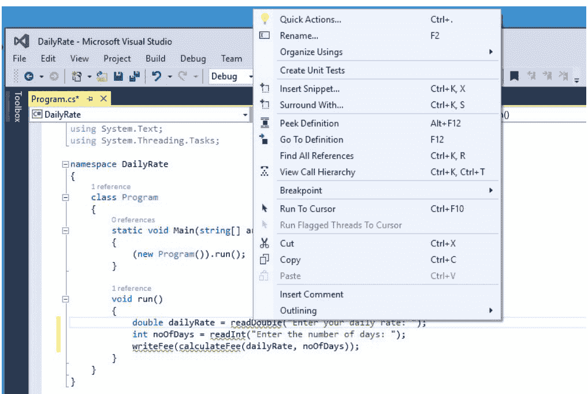
- 2. On the shortcut menu, click Quick Actions.
Visual Studio verifies that the `readDouble` method does not exist and displays a wizard that enables you to generate a stub for this method. Visual Studio examines the call to the `readDouble` method, ascertains the type of its parameters and return value, and suggests a default implementation, as shown in the following image:
3. Click Generate Method ‘Program.readDouble’. Visual Studio adds the following method to your code:
Click here to view code image
```
private double readDouble(string v)
{
    throw new NotImplementedException();
}
```
The new method is created with the `private` qualifier, which is described in Chapter 7. The body of the method currently just throws a `NotImplementedException` exception. (Exceptions are described in Chapter 6.) You replace the body with your own code in the next step.
4. Delete the `throw new NotImplementedException();` statement from the `readDouble` method and replace it with the following lines of code shown in bold:
Click here to view code image
```
private double readDouble(string v)
{
    Console.Write(v);
    string line = Console.ReadLine();
    return double.Parse(line);
}
```
This block of code displays the string in variable `v` to the screen. This variable is the string parameter passed in when the method is called; it contains the message prompting the user to type in the daily rate.

### Note
The `Console.Write` method is similar to the `Console.WriteLine` statement that you have used in earlier exercises, except that it does not output a newline character after the message.
The user types a value, which is read into a `string` using the `ReadLine` method and converted to a `double` using the `double.Parse` method. The result is passed back as the return value of the method call.

### Note
The `ReadLine` method is the companion method to `WriteLine`; it reads user input from the keyboard, finishing when the user presses the Enter key. The text typed by the user is passed back as the return value. The text is returned as a `string` value.

5. In the `run` method, right-click the call to the `readInt` method, click Quick Actions, and then click Generate Method ‘Program.readInt’.
The `readInt` method is generated like this:
Click here to view code image
```
private int readInt(string v)
{
    throw new NotImplementedException();
}
```
6. Replace the `throw new NotImplementedException();` statement in the body of the `readInt` method with the following code shown in bold:
Click here to view code image
```
private int readInt(string v)
{
    Console.Write(v);
    string line = Console.ReadLine();
    return int.Parse(line);
}
```
This block of code is similar to the code for the `readDouble` method. The only difference is that the method returns an `int` value, so the `string` typed by the user is converted to a number using the `int.Parse` method.

7. Right-click the call to the `calculateFee` method in the `run` method, click Quick Actions, and then click Generate Method ‘Program.calculateFee’. The `calculateFee` method is generated like this:
Click here to view code image
```
private object calculateFee(double dailyRate, int noOfDays)
{
    throw new NotImplementedException();
}
```
Notice in this case that Visual Studio uses the names of the arguments passed in to generate names for the parameters. (You can, of course, change the parameter names if they are not suitable.) What is more intriguing is the type returned by the method, which is `object`. Visual Studio is unable to determine exactly which type of value should be returned by the method from the context in which it is called. The `object` type just means a “thing,” and you should change it to the type you require when you add the code to the method. Chapter 7 covers the `object` type in greater detail.

8. Change the definition of the `calculateFee` method so that it returns a `double`, as shown in bold type here:
Click here to view code image
```
private double calculateFee(double dailyRate, int noOfDays)
{
    throw new NotImplementedException();
}
```
9. Replace the body of the `calculateFee` method and change it to an expression-bodied method with the following expression shown in bold. This statement calculates the fee payable by multiplying the two parameters together:
Click here to view code image
```
private double calculateFee(double dailyRate, int noOfDays) =>
dailyRate * noOfDays;
```
10. Right-click the call to the `writeFee` method in the `run` method, click Quick Actions, and then click Generate Method ‘Program.writeFee’.
Notice that Visual Studio uses the definition of the `writeFee` method to work out that its parameter should be a `double`. Also, the method call does not use a return value, so the type of the method is `void`:
Click here to view code image
```
private void writeFee(double v)
{
    ...
}
```

### Tip
If you feel sufficiently comfortable with the syntax, you can also write methods by typing them directly into the Code and Text Editor window. You do not always have to use the Generate menu option.

11. Replace the code in the body of the `writeFee` method with the following statement, which calculates the fee and adds a 10 percent commission before displaying the result. Again, notice that this is now an expression-bodied method:
Click here to view code image
```
private void writeFee(double v) => Console.WriteLine($"The consultant's fee is: {v * 1.1}");
```
12. On the Build menu, click Build Solution.

### Refactoring code
A very useful feature of Visual Studio 2015 is the ability to refactor code.
Occasionally, you will find yourself writing the same (or similar) code in more than one place in an application. When this occurs, highlight and right-click the block of code you have just typed, click Quick Actions, and then click Extract Method. The selected code is moved to a new method named `NewMethod`. The Extract Method Wizard is also able to determine whether the method should take any parameters and return a value. After the method has been generated, you should change its name (by overtyping) to something meaningful and also change the statement that has been generated to call this method with the new name.

### Test the program
- 1. On the Debug menu, click Start Without Debugging.
- Visual Studio 2015 builds the program and then runs it. A console window appears.
- 2. At the Enter Your Daily Rate prompt, type 525, and then press Enter.
- 3. At the Enter The Number of Days prompt, type 17, and then press Enter.
- The program writes the following message to the console window:
Click here to view code image
```
The consultant's fee is: 9817.5
```
4. 按 Enter 键关闭应用程序并返回到 Visual Studio 2015。


在下一个练习中，你将使用 Visual Studio 2015 调试器以慢动作运行程序。你将看到何时调用每个方法（称为进入方法），然后看到每个 `return` 语句如何将控制权传回调用方（也称为退出方法）。在进入和退出方法时，你可以使用 Debug 工具栏上的工具。但是，当应用程序以调试模式运行时，相同的命令也可在 Debug 菜单上使用。

### 通过使用 Visual Studio 2015 调试器逐步执行方法

1. 在代码和文本编辑器窗口中，找到 `run` 方法。

2. 将光标移动到 `run` 方法中的第一条语句：

Click here to view code image

```
double dailyRate = readDouble("Enter your daily rate: ");
```

3. 右键单击此行的任意位置，然后单击 Run To Cursor。

程序启动，运行直到到达 `run` 方法中的第一条语句，然后暂停。代码和文本编辑器窗口左侧边距中的黄色箭头指示当前语句，并且该语句本身以黄色背景突出显示。

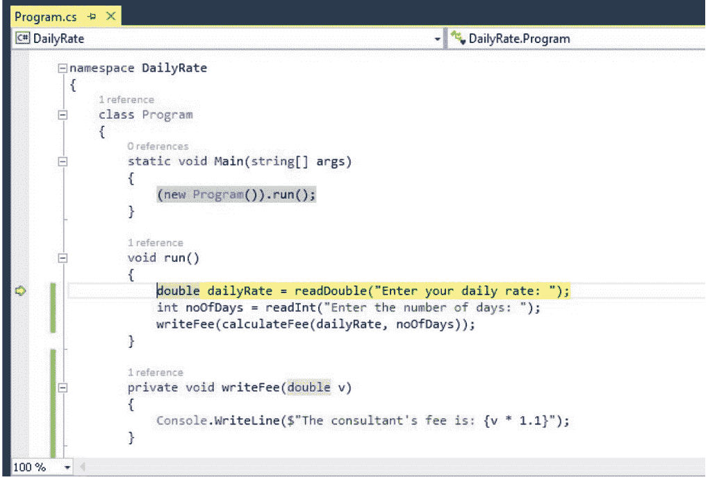

4. 在 View 菜单上，指向 Toolbars，然后确保 Debug 工具栏已选中。

如果它之前不可见，Debug 工具栏将打开。它可能与其他工具栏一起停靠。如果看不到工具栏，请尝试使用 View 菜单上的 Toolbars 命令将其隐藏，并查看哪些按钮消失。然后再次显示工具栏。Debug 工具栏如下所示：


5. 在 Debug 工具栏上，单击 `Step Into` 按钮。 （这是 Debug 工具栏上从左数第六个按钮。）

此操作会导致调试器进入正在调用的方法。黄色光标跳转到 `readDouble` 方法开始处的左大括号。

6. 再次单击 `Step Into` 以将光标推进到第一条语句：

```
Console.Write(v);
```

### Tip

你也可以按 F11 而不是反复单击 Debug 工具栏上的 `Step Into`。

7. 在 Debug 工具栏上，单击 `Step Over`。 （这是从左数第七个按钮。）

此操作会导致方法执行下一条语句而不调试它（进入它）。此操作主要在语句调用方法但你不想逐步执行该方法中的每条语句时很有用。黄色光标移动到该方法的第二条语句，并且程序在控制台窗口中显示 Enter Your Daily Rate 提示，然后返回到 Visual Studio 2015。 （控制台窗口可能隐藏在 Visual Studio 后面。）

### Tip

你也可以按 F10 而不是单击 Debug 工具栏上的 `Step Over`。

8. 在 Debug 工具栏上再次单击 `Step Over`。

这次，黄色光标消失，并且控制台窗口获得焦点，因为程序正在执行 `Console.ReadLine` 方法并等待你输入内容。

9. 在控制台窗口中输入 525，然后按 Enter。

控制权返回到 Visual Studio 2015。黄色光标出现在该方法的第三行。

10. 将鼠标悬停在该方法第二行或第三行中对 `line` 变量的引用上。 （哪个都可以。）

会出现一个 ScreenTip，显示 `line` 变量的当前值（“525”）。你可以使用此功能在逐步执行方法时确保变量已设置为预期值。

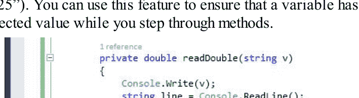

11. 在 Debug 工具栏上，单击 `Step Out`。 （这是从左数第八个按钮。）

此操作会导致当前方法不间断地继续运行到结束。`readDouble` 方法完成，黄色光标放回 `run` 方法的第一条语句。此语句现在已运行完毕。

### Tip

你也可以按 Shift+F11 而不是单击 Debug 工具栏上的 `Step Out`。

12. 在 Debug 工具栏上，单击 `Step Into`。

黄色光标移动到 `run` 方法中的第二条语句：

Click here to view code image

```
int noOfDays = readInt("Enter the number of days: ");
```

13. 在 Debug 工具栏上，单击 `Step Over`。

这次，你选择在不逐步执行的情况下运行该方法。控制台窗口再次出现，提示你输入天数。

14. 在控制台窗口中输入 17，然后按 Enter。

控制权返回到 Visual Studio 2015（你可能需要将 Visual Studio 置于前台）。黄色光标移动到 `run` 方法的第三条语句：

Click here to view code image

```
writeFee(calculateFee(dailyRate, noOfDays));
```

15. 在 Debug 工具栏上，单击 `Step Into`。

黄色光标跳转到定义 `calculateFee` 方法主体的表达式。在调用 `writeFee` 之前先调用此方法，因为此方法返回的值用作 `writeFee` 的参数。

16. 在 Debug 工具栏上，单击 `Step Out`。

`calculateFee` 方法调用完成，黄色光标跳回 `run` 方法的第三条语句。

17. 在 Debug 工具栏上，单击 `Step Into`。

这次，黄色光标跳转到定义 `writeFee` 方法主体的语句。

18. 将鼠标放在方法定义中的 `v` 参数上。

`v` 的值 8925 会在 ScreenTip 中显示。

19. 在 Debug 工具栏上，单击 `Step Out`。

消息“ The consultant’s fee is: 9817.5 ”显示在控制台窗口中。 （如果它隐藏在 Visual Studio 2015 后面，你可能需要将控制台窗口置于前台以显示它。）黄色光标返回到 `run` 方法的第三条语句。

20. 在工具栏上，单击 `Continue` 以使程序继续运行而不停在每个语句处。

### Tip

如果 `Continue` 按钮不可见，请单击 Debug 工具栏末尾出现的 Add Or Remove Buttons 下拉菜单，然后选择 `Continue`。`Continue` 按钮现在应该出现。或者，你也可以按 F5 以继续在不调试的情况下运行应用程序。

应用程序完成并停止运行。请注意，应用程序完成时 Debug 工具栏会消失——默认情况下，工具栏仅在以调试模式运行应用程序时显示。

### 使用可选参数和命名参数

你已经看到，通过定义重载方法，你可以实现采用不同参数的方法的不同版本。当你构建使用重载方法的应用程序时，编译器会确定应使用每个方法的哪些特定实例来满足每个方法调用。这是许多面向对象语言的常见功能，而不仅仅是 C#。

然而，开发人员可以使用其他语言和技术来构建 Windows 应用程序和组件，这些语言和技术不遵循这些规则。C# 和为 .NET Framework 设计的其他语言的一个关键特性是能够与使用其他技术编写的应用程序和组件互操作。支撑许多在 .NET Framework 之外运行的 Windows 应用程序和服务的核心技术之一是组件对象模型（COM）。事实上，.NET Framework 使用的公共语言运行时（CLR）也严重依赖 COM，就像 Windows 10 的 Windows Runtime 一样。COM 不支持重载方法；相反，它使用可以采用可选参数的方法。为了更轻松地将 COM 库和组件合并到 C# 解决方案中，C# 也支持可选参数。

可选参数在其他情况下也很有用。当由于参数类型变化不足以使编译器区分实现而无法使用重载时，它们提供了一种简洁简单的解决方案。例如，考虑以下方法：

Click here to view code image

```
public void DoWorkWithData(int intData, float floatData, int moreIntData)
{
    ...
}
```

`DoWorkWithData` 方法采用三个参数：两个 `int` 和一个 `float`。现在假设你想要提供一个仅采用两个参数的 `DoWorkWithData` 实现：`intData` 和 `floatData`。你可以像这样重载该方法：

Click here to view code image

```
public void DoWorkWithData(int intData, float floatData)
{
    ...
}
```

如果你编写一个调用 `DoWorkWithData` 方法的语句，你可以提供两种或三种适当类型的参数，编译器会使用类型信息来确定调用哪个重载：

```
int arg1 = 99;
float arg2 = 100.0F;
int arg3 = 101;

DoWorkWithData(arg1, arg2, arg3); // Call overload with three parameters
DoWorkWithData(arg1, arg2);        // Call overload with two parameters
```

然而，假设你想要实现 `DoWorkWithData` 的另外两个版本，只接受第一个参数和第三个参数。你可能会想尝试这样做：

```
public void DoWorkWithData(int intData)
{
    ...
}

public void DoWorkWithData(int moreIntData)
{
    ...
}
```

这里的问题是，对编译器来说，这两个重载看起来是相同的。你的代码将无法编译，并会生成错误“Type ‘typename’ already defines a member called ‘DoWorkWithData’ with the same parameter types.” 要理解为什么会这样，请思考如果这段代码是合法的会发生什么。考虑以下语句：

```
int arg1 = 99;
int arg3 = 101;

DoWorkWithData(arg1);
DoWorkWithData(arg3);
```

对 `DoWorkWithData` 的调用会调用哪个重载或重载？使用可选参数和命名参数可以帮助解决这个问题。

### 定义可选参数

当你通过为参数提供默认值来定义方法时，你就指定该参数是可选的。你通过使用赋值运算符来指示默认值。在下面显示的 `optMethod` 方法中，`first` 参数是强制性的，因为它没有指定默认值，但 `second` 和 `third` 参数是可选的：

```
void optMethod(int first, double second = 0.0, string third =
"Hello")
{
    ...
}
```

你必须在所有可选参数之前指定所有强制参数。

你可以像调用任何其他方法一样调用接受可选参数的方法：你指定方法名并提供必要的参数。与接受可选参数的方法的区别在于，你可以省略相应的参数，方法在运行时将使用默认值。在下面的示例中，对 `optMethod` 方法的第一次调用为全部三个参数提供了值。第二次调用只指定了两个参数，这些值应用于第一个和第二个参数。第三个参数在方法运行时接收默认值“Hello”。

```
optMethod(99, 123.45, "World"); // Arguments provided for all three parameters
optMethod(100, 54.321);           // Arguments provided for first two parameters only
```

### 传递命名参数

默认情况下，C# 使用方法调用中每个参数的位置来确定参数适用于哪个参数。因此，前一节中显示的 `OptMethod` 方法的第二个示例将两个参数传递给方法中的第一个和第二个参数，因为这是它们在方法声明中出现的顺序。使用 C#，你也可以按名称指定参数。此功能让你可以按不同的顺序传递参数。要将参数作为命名参数传递，你指定参数的名称，后跟冒号和要使用值。以下示例执行与前一节中显示的示例相同的功能，只是参数按名称指定：

```
optMethod(first : 99, second : 123.45, third : "World");
optMethod(first : 100, second : 54.321);
```

命名参数使你能够按任意顺序传递参数。你可以重写调用 `optMethod` 方法的代码，如下所示：

```
optMethod(third : "World", second : 123.45, first : 99);
optMethod(second : 54.321, first : 100);
```

此功能还使你能够省略参数。例如，你可以调用 `optMethod` 方法并仅为 `first` 和 `third` 参数指定值并使用 `second` 参数的默认值，如下所示：

```
optMethod(first : 99, third : "World");
```

此外，你可以混合使用位置参数和命名参数。但是，如果你使用此技术，你必须在第一个命名参数之前指定所有位置参数。

```
optMethod(99, third : "World");  // First argument is positional
```

### 使用可选参数和命名参数解决歧义

使用可选参数和命名参数可能会导致代码中出现一些可能的歧义。你需要了解编译器如何解决这些歧义；否则，你可能会发现你的应用程序以意想不到的方式运行。假设你将 `optMethod` 方法定义为重载方法，如以下示例所示：

```
void optMethod(int first, double second = 0.0, string third = "Hello")
{
    ...
}

void optMethod(int first, double second = 1.0, string third = "Goodbye", int fourth = 100 )
{
    ...
}
```

这是完全合法的 C# 代码，遵循重载方法的规则。编译器可以通过它们具有不同的参数列表来区分这些方法。然而，正如以下示例所示，如果你尝试调用 `optMethod` 方法并省略对应于一个或多个可选参数的一些参数，就会出现问题：

```
optMethod(1, 2.5, "World");
```

同样，这也是完全合法的代码，但它运行的是哪个版本的 `optMethod` 方法？答案是与方法调用最匹配的版本，因此代码调用接受三个参数的方法，而不是接受四个参数的版本。这很有道理，所以考虑这个：

```
optMethod(1, fourth : 101);
```

在此代码中，对 `optMethod` 的调用省略了 `second` 和 `third` 参数的参数，但它按名称指定了 `fourth` 参数。只有一种版本的 `optMethod` 与此调用匹配，因此这不是问题。接下来的这个示例会让你思考：

```
optMethod(1, 2.5);
```

这次，`optMethod` 方法的两个版本都不完全匹配提供的参数列表。`optMethod` 方法的两个版本对第二个、第三个和第四个参数都有可选参数。那么，此语句调用接受三个参数的 `optMethod` 版本并使用 `third` 参数的默认值，还是调用接受四个参数的版本并使用 `third` 和 `fourth` 参数的默认值？答案是两者都不是。这是无法解决的歧义，编译器不允许你编译应用程序。如果尝试按以下任何语句调用 `optMethod` 方法，也会出现相同情况并产生相同结果：

```
optMethod(1, third : "World");
optMethod(1);
optMethod(second : 2.5, first : 1);
```

在本章的最后练习中，你将练习实现接受可选参数的方法并使用命名参数调用它们。你还将测试 C# 编译器解析涉及可选参数和命名参数的方法调用的常见示例。

### 定义并调用一个接受可选参数的方法

1. 使用 Visual Studio 2015，打开 DailyRate 项目，该项目位于你的文档文件夹中的 `\Microsoft Press\VCSBS\Chapter 3\DailyRate Using Optional Parameters` 文件夹中。

2. 在解决方案资源管理器中，在 DailyRate 项目中，双击文件 `Program.cs` 以在代码和文本编辑器窗口中显示程序的代码。

此版本的应用程序除了 `Main` 方法和 `run` 方法的骨架版本外为空。

3. 在 `Program` 类中，在 `run` 方法之后，添加 `calculateFee` 方法，位于 `run` 方法下方。这是你在上一组练习中实现的方法的相同版本，只是它接受两个具有默认值的可选参数。该方法还打印一条消息，指示调用了哪个版本的 `calculateFee` 方法。 （你将在以下步骤中添加此方法的重载实现。）

```
private double calculateFee(double dailyRate = 500.0, int noOfDays = 1)
{
    Console.WriteLine("calculateFee using two optional parameters");
    return dailyRate * noOfDays;
}
```

4. 在 `Program` 类中添加 `calculateFee` 方法的另一个实现，如下面的代码所示。此版本接受一个名为 `dailyRate` 的可选参数，类型为 `double`。方法体计算并返回一天的费用。

Click here to view code image


```
private double calculateFee(double dailyRate = 500.0)
{
    Console.WriteLine("calculateFee using one optional parameter");
    
    int defaultNoOfDays = 1;
    return dailyRate * defaultNoOfDays;
}
```

5. 在`Program`类中添加`calculateFee`方法的第三个实现。此版本不接受参数，并对日费率和天数使用硬编码值。

Click here to view code image

```
private double calculateFee()
{
    Console.WriteLine("calculateFee using hardcoded values");
    double defaultDailyRate = 400.0;
    int defaultNoOfDays = 1;
    return defaultDailyRate * defaultNoOfDays;
}
```

6. 在`run`方法中，添加以下加粗语句以调用`calculateFee`并显示结果：

Click here to view code image

```
public void run()
{
    double fee = calculateFee();
    Console.WriteLine($"Fee is {fee}");
}
```

## Tip

您可以从调用它的语句快速查看方法的定义。为此，右键单击方法调用，然后单击 Peek Definition。以下图像显示了`calculateFee`方法的 Peek Definition 窗口。

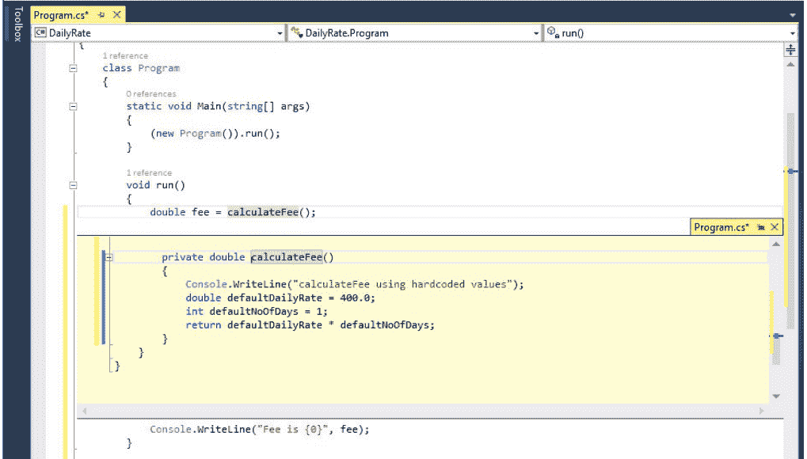

如果您的代码分布在多个文件中，或者即使在同一文件中但文件非常长，此功能也非常有用。

7. 在 Debug 菜单上，单击 Start Without Debugging 以构建并运行程序。

程序在控制台窗口中运行并显示以下消息：

Click here to view code image

```
calculateFee using hardcoded values
Fee is 400
```

`run`方法调用了不带参数的`calculateFee`版本，而不是接受可选参数的任一实现，因为该版本与方法调用最匹配。

按任意键关闭控制台窗口并返回 Visual Studio。

8. 在`run`方法中，修改调用`calculateFee`的语句以匹配此处所示的加粗代码：

Click here to view code image

```
public void run()
{
    double fee = calculateFee(650.0);
    Console.WriteLine($"Fee is {fee}");
}
```

9. 在 Debug 菜单上，单击 Start Without Debugging 以构建并运行程序。

程序显示以下消息：

Click here to view code image

```
calculateFee using one optional parameter
Fee is 650
```

这次，`run`方法调用了接受一个可选参数的`calculateFee`版本。与之前一样，这是与方法调用最匹配的版本。

按任意键关闭控制台窗口并返回 Visual Studio。

10. 在`run`方法中，再次修改调用`calculateFee`的语句：

Click here to view code image

```
public void run()
{
    double fee = calculateFee(500.0, 3);
    Console.WriteLine($"Fee is {fee}");
}
```

11. 在 Debug 菜单上，单击 Start Without Debugging 以构建并运行程序。

程序显示以下消息：

Click here to view code image

```
calculateFee using two optional parameters
Fee is 1500
```

正如前两个案例所期望的那样，`run`方法调用了接受两个可选参数的`calculateFee`版本。

按任意键关闭控制台窗口并返回 Visual Studio。

12. 在`run`方法中，修改调用`calculateFee`的语句并按名称指定`dailyRate`参数：

Click here to view code image

```
public void run()
{
    double fee = calculateFee(dailyRate : 375.0);
    Console.WriteLine($"Fee is {fee}");
}
```

13. 在 Debug 菜单上，单击 Start Without Debugging 以构建并运行程序。

程序显示以下消息：

Click here to view code image

```
calculateFee using one optional parameter
Fee is 375
```

与之前一样，`run`方法调用了接受一个可选参数的`calculateFee`版本。将代码更改为使用命名参数不会改变本例中编译器解析方法调用的方式。

按任意键关闭控制台窗口并返回 Visual Studio。

14. 在`run`方法中，修改调用`calculateFee`的语句并按名称指定`noOfDays`参数。

Click here to view code image

```
public void run()
{
    double fee = calculateFee(noOfDays : 4);
    Console.WriteLine($"Fee is {fee}");
}
```

15. 在 Debug 菜单上，单击 Start Without Debugging 以构建并运行程序。

程序显示以下消息：

Click here to view code image

```
calculateFee using two optional parameters
Fee is 2000
```

这次，`run`方法调用了接受两个可选参数的`calculateFee`版本。方法调用省略了第一个参数`dailyRate`并按名称指定了第二个参数。接受两个可选参数的`calculateFee`方法版本是唯一匹配调用的版本。

按任意键关闭控制台窗口并返回 Visual Studio。

16. 修改接受两个可选参数的`calculateFee`方法的实现。将第一个参数的名称更改为`theDailyRate`并更新`return`语句以匹配以下代码中加粗所示的内容：

Click here to view code image

```
private double calculateFee(double theDailyRate = 500.0, int noOfDays = 1)
{
```

```
Console.WriteLine("calculateFee using two optional parameters");
    return theDailyRate * noOfDays;
}
```

17. 在`run`方法中，修改调用`calculateFee`的语句并按名称指定`theDailyRate`参数。

Click here to view code image

```
public void run()
{
    double fee = calculateFee(theDailyRate : 375.0);
    Console.WriteLine("Fee is {fee}");
}
```

18. 在 Debug 菜单上，单击 Start Without Debugging 以构建并运行程序。

程序显示以下消息：

Click here to view code image

```
calculateFee using two optional parameters
Fee is 375
```

上次您指定了费用但未指定日费率时 step 12，`run`方法调用了接受一个可选参数的`calculateFee`版本。这次，`run`方法调用了接受两个可选参数的`calculateFee`版本。在这种情况下，使用命名参数改变了编译器解析方法调用的方式。如果您指定命名参数，编译器会将参数名称与方法声明中指定的参数名称进行比较，并选择具有匹配名称参数的方法。如果您在调用`calculateFee`方法时将参数指定为`aDailyRate: 375.0`，程序将无法编译，因为没有任何版本的该方法具有匹配此名称的参数。

按任意键关闭控制台窗口并返回 Visual Studio。

### Summary

在本章中，您学习了如何定义方法以实现命名代码块。您了解了如何将参数传递给方法以及如何从方法返回数据。您还了解了如何调用方法、传递参数并获取返回值。您学习了如何定义具有不同参数列表的重载方法，并了解了变量的作用域决定了它可以被访问的位置。然后，您使用 Visual Studio 2015 调试器逐步执行代码运行过程。最后，您学习了如何编写接受可选参数的方法以及如何使用命名参数调用方法。

- 如果您想继续下一章，请保持 Visual Studio 2015 运行

并转到第 4 章“使用决策语句。”

- 如果您现在想退出 Visual Studio 2015，请在 File 菜单上单击 Exit。如果出现 Save 对话框，请单击 Yes 并保存项目。

### Quick reference

- **To declare a method:** Write the method within a class. Specify the method name, parameter list, and return type, followed by the body of the method between braces. For example:

```
int addValues(int leftHandSide, int rightHandSide)
{
...
}
```

- **To return a value from within a method:** Write a `return` statement within the method. For example:

```
return leftHandSide + rightHandSide;
```

- **To return from a method before the end of the method:** Write a `return` statement within the method. For example:

```
return;
```

- **To define an expression-bodied method:** Use the `=>` sequence followed by the expression that defines the body of the method and a closing semicolon. For example:

```
double calculateFee(double dailyRate, int noOfDays)
=> dailyRate * noOfDays;
```

- **To call a method:** Write the name of the method followed by any arguments between parentheses. For example:

```
addValues(39, 3);
```

- **To use the Generate Method Stub Wizard:** Right-click a call to the method, and then click Generate Method Stub.

- **To display the Debug toolbar:** On the View menu, point to Toolbars, and then click Debug.

- **To step into a method:** On the Debug toolbar, click Step Into.

  Or

  On the Debug menu, click Step Into.

- **To step out of a method:** On the Debug toolbar, click Step Out.

  Or

  On the Debug menu, click Step Out.

- **To specify an optional parameter to a method:** Provide a default value for the parameter in the method declaration. For example:

```
void optMethod(int first, double second = 0.0,
    string third = "Hello")
{
...
}
```

- **To pass a method argument as a named parameter:** Specify the name of the parameter in the method call. For example:

```
optMethod(first : 100, third : "World");
```

## 第 4 章 使用决策语句

完成本章后，你将能够：

- 声明布尔变量。

- 使用布尔运算符创建结果为 `true` 或 `false` 的表达式。

- 编写 `if` 语句，根据布尔表达式的结果做出决策。

- 编写 `switch` 语句以做出更复杂的决策。

第 3 章“编写方法并应用作用域”展示了如何将相关的语句分组到方法中。它还演示了如何使用参数将信息传递给方法，以及如何使用`return`语句将信息从方法中传出。将程序划分为一组离散的方法，每个方法设计用于执行特定任务或计算，是一种必要的设计策略。许多程序需要解决庞大而复杂的问题。将程序分解为方法有助于你理解这些问题并专注于如何解决它们，一次解决一个部分。

第 3 章中的方法非常直接，每个语句在前一个语句完成后按顺序执行。然而，要解决许多现实世界的问题，你还需要能够编写选择性执行不同操作的代码，并且根据情况在方法中走不同的路径。在本章中，你将学习如何完成此任务。

### 声明布尔变量

在 C# 编程的世界里（与现实世界不同），一切都是非黑即白，是对是错，是真还是假。例如，如果你创建一个名为`x`的整数变量，将值 99 分配给它，然后问`x`是否包含值 99，答案肯定是`true`。如果你问`x`是否小于 10，答案肯定是`false`。这些是布尔表达式的例子。布尔表达式始终计算为`true`或`false`。

### Note

对于其他所有编程语言而言，这些问题的答案不一定是确定的。一个未赋值的变量具有未定义的值，你不能，例如，说它肯定小于 10。诸如此类的问题是 C 和 C++ 程序中常见的错误来源。Microsoft Visual C# 编译器通过确保你在检查变量之前始终为其赋值来解决此问题。如果你尝试检查未赋值变量的内容，你的程序将无法编译。

Visual C# 提供了一种名为`bool`的数据类型。`bool`变量可以保存两个值之一：`true`或`false`。例如，以下三个语句声明一个名为`areYouReady`的`bool`变量，将`true`分配给该变量，然后将其值写入控制台：

Click here to view code image

```
bool areYouReady;
areYouReady = true;
Console.WriteLine(areYouReady); // writes True to the console
```

### 使用布尔运算符

布尔运算符是一种执行计算且结果为`true`或`false`的运算符。C# 有几种非常有用的布尔运算符，其中最简单的是 NOT 运算符，用感叹号（`!`）表示。`!`运算符否定一个布尔值，产生该值的相反值。在前面的示例中，如果变量`areYouReady`的值为`true`，则表达式`!areYouReady`的值为`false`。

### 理解相等和关系运算符

你将经常使用的两个布尔运算符是相等（`==`）和不相等（`!=`）。这些是二元运算符，你可以用它们来确定一个值是否与另一个相同类型的值相同，从而产生布尔结果。下面的表格总结了这些运算符的工作方式，以名为`age`的`int`变量为例。

| Operator | Meaning | Example | Outcome if age is 42 |
|---|---|---|---|
| `==` | Equal to | `age == 100` | `false` |
| `!=` | Not equal to | `age != 0` | `true` |

不要将相等运算符`==`与赋值运算符`=`混淆。表达式`x==y`比较`x`和`y`，如果值相同则值为`true`。表达式`x=y`将`y`的值赋给`x`，并将其结果作为`y`的值返回。

与`==`和`!=`紧密相关的是关系运算符。你使用这些运算符来判断一个值是否小于或大于另一个相同类型的值。下面的表格展示了如何使用这些运算符。

| Operator | Meaning | Example | Outcome if age is 42 |
|---|---|---|---|
| `<` | Less than | `age < 21` | `false` |
| `<=` | Less than or equal to | `age <= 18` | `false` |
| `>` | Greater than | `age > 16` | `true` |


| `>=` | Greater than or equal to | `age >= 30` | true |

### 理解条件逻辑运算符

C# 还提供了另外两个二元布尔运算符：逻辑 AND 运算符，用 `&&` 符号表示，以及逻辑 OR 运算符，用 `||` 符号表示。统称为条件逻辑运算符。它们的目的是将两个布尔表达式或值组合成单个布尔结果。这些运算符与相等和关系运算符相似，因为其中出现的表达式的值为 true 或 false，但它们不同之处在于它们操作的值也必须是 true 或 false。

`&&` 运算符的结果只有在它评估的两个布尔表达式都为 true 时才为 true。例如，以下语句只有在 `percent` 的值大于或等于 0 且 `percent` 的值小于或等于 100 时才将值 true 分配给 `validPercentage`：

```
bool validPercentage;
validPercentage = (percent >= 0) && (percent <= 100);
```

### Tip

初学者常见的错误是尝试通过只命名一次 `percent` 变量来组合两个测试，像这样：

```
percent >= 0 && <= 100 // this statement will not compile
```

使用括号有助于避免此类错误，并能更清晰地表达表达式的用途。例如，比较

```
validPercentage = percent >= 0 && percent <= 100
```

和

```
validPercentage = (percent >= 0) && (percent <= 100)
```

两个表达式返回相同的值，因为 `&&` 运算符的优先级低于 `>=` 和 `<=`。然而，第二个表达式以更易读的方式传达了其目的。

`||` 运算符的结果为 *true*，如果它评估的两个布尔表达式中任意一个为 *true*。你使用 `||` 运算符来确定一组布尔表达式中是否有一个为 *true*。例如，以下语句如果 `percent` 的值小于 0 或 `percent` 的值大于 100，则将值 *true* 分配给 *invalidPercentage*：

```
bool invalidPercentage;
invalidPercentage = (percent < 0) || (percent > 100);
```

### 短路

`&&` 和 `||` 运算符都表现出一种称为 *短路* 的特性。有时，在确定条件逻辑表达式的结果时，并不需要评估两个操作数。例如，如果 `&&` 运算符的左操作数计算为 *false*，整个表达式的结果必须为 *false*，无论右操作数的值如何。类似地，如果 `||` 运算符的左操作数的值计算为 *true*，整个表达式的结果必须为 *true*，无论右操作数的值如何。在这些情况下，`&&` 和 `||` 运算符会跳过对右操作数的评估。以下是一些示例：

```
(percent >= 0) && (percent <= 100)
```

在此表达式中，如果 `percent` 的值小于 0，`&&` 左侧的布尔表达式计算为 false。此值意味着整个表达式的结果必须为 false，且 `&&` 运算符右侧的布尔表达式不会被评估。

```
(percent < 0) || (percent > 100)
```

在此表达式中，如果 `percent` 的值小于 0，`||` 左侧的布尔表达式计算为 true。此值意味着整个表达式的结果必须为 true，且 `||` 运算符右侧的布尔表达式不会被评估。

如果你仔细设计使用条件逻辑运算符的表达式，可以通过避免不必要的工作来提高代码的性能。将易于评估的简单布尔表达式放在条件逻辑运算符的左侧，并将更复杂的表达式放在右侧。在许多情况下，你会发现程序不需要评估更复杂的表达式。

### 总结运算符优先级和结合性

下面的表格总结了迄今为止你所学到的所有运算符的优先级和结合性。同一类别中的运算符具有相同的优先级。表格中较高类别的运算符优先于较低类别的运算符。

| 类别 | 运算符 | 描述 | 结合性 |
|---|---|---|---|
| Primary | `()` | 优先级覆盖 | Left |
|  | `++` | 后置递增 |  |
|  | `--` | 后置递减 |  |
| Unary | `!` | 逻辑非 | Left |
|  | `+` | 返回操作数的值不变 |  |
|  | `-` | 返回操作数取反后的值 |  |
|  | `++` | 前置递增 |  |
|  | `--` | 前置递减 |  |
| Multiplicative | `*` | 乘法 | Left |
|  | `/` | 除法 |  |
|  | `%` | 除法余数（取模） |  |
| Additive | `+` | 加法 | Left |
|  | `-` | 减法 |  |
| Relational | `<` | 小于 | Left |
|  | `<=` | 小于或等于 |  |
|  | `>` | 大于 |  |
|  | `>=` | 大于或等于 |  |
| Equality | `==` | 等于 | Left |
|  | `!=` | 不等于 |  |
| Conditional AND | `&&` | 条件与 | Left |
| Conditional OR | `||` | 条件或 | Left |
| Assignment | `=` | 将右操作数赋给左操作数并返回被赋的值 | Right |

请注意 `&&` 运算符和 `||` 运算符的优先级不同：`&&` 的优先级高于 `||`。

### 使用 if 语句进行决策

在方法中，当你想根据布尔表达式的结果在执行两个不同的语句之间进行选择时，可以使用 `if` 语句。

### 理解 if 语句语法

`if` 语句的语法如下（`if` 和 `else` 是 C# 关键字）：

```
if ( booleanExpression )
    statement-1;
else
    statement-2;
```

如果 `booleanExpression` 求值为 true，则执行 `statement-1`；否则执行 `statement-2`。`else` 关键字及其后的 `statement-2` 是可选的。如果没有 `else` 子句且 `booleanExpression` 为 false，则执行继续进行 `if` 语句之后的代码。此外，请注意布尔表达式必须用括号括起来；否则代码将无法编译。

例如，这里有一个 `if` 语句，用于递增表示秒表的秒针的变量。（分钟暂时忽略。）如果 `seconds` 变量的值为 59，则将其重置为 0；否则，使用 `++` 运算符将其递增：

```
int seconds;
...
if (seconds == 59)
    seconds = 0;
else
    seconds++;
```

### 布尔表达式 only，请！

`if` 语句中的表达式必须用括号括起来。此外，表达式必须是布尔表达式。在某些其他语言中——尤其是 C 和 C++——你可以编写整数表达式，编译器会静默地将整数值转换为 true（非零）或 false（0）。C# 不支持这种行为，如果你编写此类表达式，编译器会报告错误。

如果你不小心在 `if` 语句中使用了赋值运算符（`=`）而不是相等测试运算符（`==`），C# 编译器会识别出你的错误并拒绝编译你的代码，如以下示例所示：

```
int seconds;
...
if (seconds = 59)  // compile-time error
...
if (seconds == 59) // ok
```

在 C 和 C++ 程序中，意外的赋值是另一个常见的错误来源，这些程序会静默地将赋予的值（59）转换为布尔表达式（任何非零值都被视为 true），结果是 `if` 语句之后的代码每次都会被执行。

顺便说一下，你可以使用布尔变量作为 `if` 语句的表达式，尽管它仍必须用括号括起来，如此示例所示：

```
bool inWord;
...
if (inWord == true) // ok, but not commonly used
...
if (inWord)          // more common and considered better style
```

### 使用块对语句进行分组

请注意，前面显示的 `if` 语句的语法指定了 `if (booleanExpression)` 之后的一个语句，以及 `else` 关键字之后的一个语句。有时，你希望在布尔表达式为 true 时执行多个语句。你可以将语句分组到一个新方法中然后调用该新方法，但更简单的解决方案是将语句分组到一个块中。块只是在一个打开的大括号和一个关闭的大括号之间分组的一系列语句。

在下面的示例中，将 `seconds` 变量重置为 0 并递增 `minutes` 变量的两个语句被分组到一个块中，如果 `seconds` 的值等于 59，则整个块执行：

```
int seconds = 0;
int minutes = 0;
...
if (seconds == 59)
{
    seconds = 0;
    minutes++;
}
else
{
    seconds++;
}
```

## 重要

如果你省略了大括号，C# 编译器只会将第一个语句（`seconds = 0;`）与 `if` 语句关联。随后的语句（`minutes++;`）在程序编译时不会被编译器识别为 `if` 语句的一部分。此外，当编译器到达 `else` 关键字时，它不会将其与之前的 `if` 语句关联；相反，它会报告语法错误。因此，最好始终在块内定义 `if` 语句每个分支的语句，即使块只包含单个语句。以后如果你想添加额外代码，这可能会为你节省一些麻烦。

块还开始一个新的作用域。你可以在块内定义变量，但在块结束时它们会消失。下面的代码片段说明了这一点：

```
if (...)
{
    int myVar = 0;
    ... // myVar can be used here
}
 // myVar disappears here
else
{
    // myVar cannot be used here
    ...
}
// myVar cannot be used here
```

### 级联 if 语句

你可以将 `if` 语句嵌套在其他 `if` 语句中。这样，你就可以将一系列布尔表达式链接起来，这些表达式会一个接一个地进行测试，直到其中一个求值为 true。在下面的示例中，如果 `day` 的值为 0，则第一个测试求值为 true，`dayName` 被赋值为字符串“Sunday”。如果 `day` 的值不是 0，则第一个测试失败，控制权传递给 `else` 子句，该子句运行第二个 `if` 语句并将 `day` 的值与 1 进行比较。第二个 `if` 语句仅在第一个测试为 false 时执行。类似地，第三个 `if` 语句仅在第一个和第二个测试都为 false 时执行。

```
if (day == 0)
{
    dayName = "Sunday";
}
else if (day == 1)
{
    dayName = "Monday";
}
else if (day == 2)
{
    dayName = "Tuesday";
}
else if (day == 3)
{
    dayName = "Wednesday";
}
else if (day == 4)
{
    dayName = "Thursday";
}
else if (day == 5)
{
    dayName = "Friday";
}
else if (day == 6)
{
    dayName = "Saturday";
}
else
{
    dayName = "unknown";
}
```

在下面的练习中，你将编写一个方法，使用级联 `if` 语句比较两个日期。

### 编写 if 语句

- 1. 如果尚未运行，请启动 Microsoft Visual Studio 2015。
- 2. 打开 Selection 项目，该项目位于你的 Documents 文件夹中的 `\Microsoft Press\VCSBS\Chapter 4\Selection` 文件夹中。
- 3. 在 Debug 菜单上，单击 Start Debugging。
- 4. 单击 Compare。

Visual Studio 2015 构建并运行应用程序。窗体显示两个 DatePicker 控件，称为 `firstDate` 和 `secondDate`。两个控件都显示当前日期。

以下文本出现在窗口下半部分文本框中：

```
firstDate == secondDate : False
firstDate != secondDate : True
firstDate <  secondDate : False
firstDate <= secondDate : False
firstDate >  secondDate : True
firstDate >= secondDate : True
```

布尔表达式 `firstDate == secondDate` 应该是 true，因为 `firstDate` 和 `secondDate` 都设置为当前日期。事实上，只有小于运算符和大于或等于运算符似乎工作正常。以下图像显示了应用程序的运行情况。

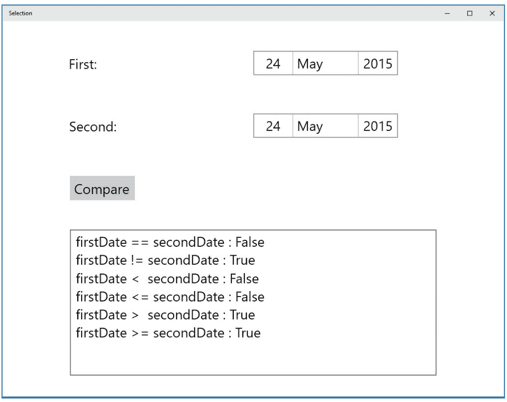

- 5. 返回到 Visual Studio 2015。在 Debug 菜单上，单击 Stop Debugging。
- 6. 在 Code and Text Editor 窗口中显示 `MainPage.xaml.cs` 文件的代码。
- 7. 找到 `compareClick` 方法，它应该如下所示：

```
private void compareClick(object sender, RoutedEventArgs e)
{
    int diff = dateCompare(firstDate.Date.LocalDateTime,
secondDate.Date.LocalDateTime);
    info.Text = "";
    show("firstDate == secondDate", diff == 0);
    show("firstDate != secondDate", diff != 0);
    show("firstDate < secondDate", diff < 0);
    show("firstDate <= secondDate", diff <= 0);
    show("firstDate > secondDate", diff > 0);
    show("firstDate >= secondDate", diff >= 0);
}
```

此方法在用户单击窗体上的 Compare 按钮时运行。表达式 `firstDate.Date.LocalDateTime` 和 `secondDate.Date.LocalDateTime` 持有 `DateTime` 值；它们代表在窗体上的 `firstDate` 和 `secondDate` 控件中显示的日期

在应用程序的其他地方。`DateTime` 数据类型只是另一种数据类型，像 `int` 或 `float` 一样，只是它包含子元素，可以用来访问日期的各个部分，例如年、月或日。

`compareClick` 方法将两个 `DateTime` 值传递给 `dateCompare` 方法。此方法的目的在于比较日期并返回 `int` 值 0 表示两者相同、−1 表示第一个日期小于第二个日期、+1 表示第一个日期大于第二个日期。如果一个日期在时间上晚于另一个日期，则认为它更大。你将在下一步中检查 `dateCompare` 方法。

`show` 方法在表单下半部分的 `info` 文本框控件中显示比较结果。

## 8. 找到 `dateCompare` 方法，其应如下所示：

```
private int dateCompare(DateTime leftHandSide, DateTime rightHandSide)
{
    // TO DO
    return 42;
}
```

此方法目前在被调用时始终返回相同的值——而不是 0、−1 或 +1——而不管其参数的值如何。这就解释了为什么应用程序无法按预期工作。你需要在此方法中实现逻辑以正确比较两个日期。

## 9. 删除 `dateCompare` 方法中的 `// TO DO` 注释和 `return` 语句。

## 10. 将以下以粗体显示的语句添加到 `dateCompare` 方法的主体中：

```
private int dateCompare(DateTime leftHandSide, DateTime rightHandSide)
{
    int result = 0;

    if (leftHandSide.Year < rightHandSide.Year)
    {
        result = -1;
    }
    else if (leftHandSide.Year > rightHandSide.Year)
    {
        result = 1;
    }
}
```

### Note

不要尝试现在构建应用程序。`dateCompare` 方法尚未完成，构建将会失败。


如果表达式 `leftHandSide.Year < rightHandSide.Year` 为真，则 `leftHandSide` 中的日期必须早于 `rightHandSide` 中的日期，因此程序将 `result` 变量设为 `-1`。否则，如果表达式 `leftHandSide.Year > rightHandSide.Year` 为真，则 `leftHandSide` 中的日期必须晚于 `rightHandSide` 中的日期，程序将 `result` 变量设为 `1`。

如果表达式 `leftHandSide.Year < rightHandSide.Year` 为假且表达式 `leftHandSide.Year > rightHandSide.Year` 也为假，则两个日期的 `Year` 属性必须相同，因此程序需要比较每个日期中的月份。

## 11. 将以下以粗体显示的语句添加到 `dateCompare` 方法的主体中。在前一步输入的代码之后输入它们：

Click here to view code image

```
private int dateCompare(DateTime leftHandSide, DateTime rightHandSide)
{
    ...
    else if (leftHandSide.Month < rightHandSide.Month)
    {
        result = -1;
    }
    else if (leftHandSide.Month > rightHandSide.Month)
    {
        result = 1;
    }
}
```

这些语句比较月份，其逻辑与前一步中比较年份时使用的逻辑相似。

如果表达式 `leftHandSide.Month < rightHandSide.Month` 为假且表达式 `leftHandSide.Month > rightHandSide.Month` 也为假，则两个日期的 `Month` 属性必须相同，因此程序最终需要比较每个日期中的日。

## 12. 在前两步输入的代码之后，将以下语句添加到 `dateCompare` 方法的主体中：

Click here to view code image

```
private int dateCompare(DateTime leftHandSide, DateTime rightHandSide)
{
    ...
    else if (leftHandSide.Day < rightHandSide.Day)
    {
        result = -1;
    }
    else if (leftHandSide.Day > rightHandSide.Day)
    {
        result = 1;
    }
    else
    {
        result = 0;
    }

    return result;
}
```

到现在你应该能认识到这种逻辑的模式。

如果 `leftHandSide.Day < rightHandSide.Day` 和 `leftHandSide.Day > rightHandSide.Day` 均为假，则两个变量中 `Day` 属性的值必须相同。`Month` 值和 `Year` 值也必须分别相同，才能使程序逻辑到达此点，因此两个日期必须相同，程序将 `result` 的值设为 `0`。

最后一条语句返回 `result` 变量中存储的值。

- 13. 在 `Debug` 菜单上，单击 `Start Debugging`。

应用程序将被重建并运行。

- 14. 单击 `Compare`。

以下文本出现在文本框中：

Click here to view code image

```
firstDate == secondDate : True
firstDate != secondDate : False
firstDate <  secondDate: False
firstDate <= secondDate: True
firstDate >  secondDate: False
firstDate >= secondDate: True
```

这些是相同日期的正确结果。

- 15. 使用 `DatePicker` 控件为第二个日期选择一个更晚的日期，然后单击 `Compare`。

以下文本出现在文本框中：

Click here to view code image

```
firstDate == secondDate: False
firstDate != secondDate: True
firstDate <  secondDate: True
firstDate <= secondDate: True
firstDate >  secondDate: False
firstDate >= secondDate: False
```

同样，这些是第一个日期早于第二个日期时的正确结果。

16. 测试一些其他日期，并验证结果是否符合你的预期。完成测试后返回 `Visual Studio 2015` 并停止调试。

### 在实际应用中比较日期

现在你已经看到了如何使用相当长且复杂的 `if` 和 `else` 语句序列，我应该提到，这并不是你在实际应用中比较日期时采用的技术。如果查看前一个练习中的 `dateCompare` 方法，你会看到两个参数 `leftHandSide` 和 `rightHandSide` 都是 `DateTime` 值。你编写的逻辑仅比较这些参数的日期部分，但它们还包含你未考虑（或未显示）的 时间元素。要使两个 `DateTime` 值被视为相等，它们不仅应具有相同的日期，还应具有相同的时间。比较日期和时间是如此常见的操作，以至于 `DateTime` 类型实际上有一个内置的方法 `Compare` 来执行此操作：它接受两个 `DateTime` 参数并比较它们，返回一个值，指示第一个参数是否小于第二个参数，在这种情况下结果为负；第一个参数是否大于第二个参数，在这种情况下结果为正；或两个参数是否代表相同的日期和时间，在这种情况下结果为 `0`。

### 使用 switch 语句

有时当你编写级联 `if` 语句时，每个 `if` 语句看起来相似，因为它们都评估相同的表达式。唯一的区别是每个 `if` 将表达式的结果与不同的值进行比较。例如，考虑以下使用 `if` 语句检查 `day` 变量中的值并确定它是星期几的代码块：

```
if (day == 0)
{
    dayName = "Sunday";
}
else if (day == 1)
{
    dayName = "Monday";
}
else if (day == 2)
{
    dayName = "Tuesday";
}
else if (day == 3)
{
    ...
}
else
{
    dayName = "Unknown";
}
```

在这些情况下，通常可以将级联 `if` 语句重写为 `switch` 语句，以使程序更高效、更易读。

### 理解 switch 语句语法

`switch` 语句的语法如下（`switch`、`case` 和 `default` 是关键字）：

Click here to view code image

```
switch ( controllingExpression )
{
    case constantExpression :
        statements
        break;
    case constantExpression :
        statements
        break;
    ...
    default :
        statements
        break;
}
```

`controllingExpression` 必须用括号括起来，只会被评估一次。然后控制跳转到由 `constantExpression` 标识的代码块，该 `constantExpression` 的值等于 `controllingExpression` 的结果。`constantExpression` 标识符也称为 `case` 标签。执行一直运行到 `break` 语句，在此点 `switch` 语句结束，程序继续执行 `switch` 语句闭合大括号之后的第一条语句。如果没有任何 `constantExpression` 值等于 `controllingExpression` 的值，则在可选的 `default` 标签下方的语句会运行。

# Note

每个 `constantExpression` 值必须是唯一的，这样 `controllingExpression` 将只匹配其中一个。如果 `controllingExpression` 的值与任何 `constantExpression` 值都不匹配并且没有 `default` 标签，程序执行将继续执行 `switch` 语句闭合大括号之后的第一条语句。

因此，你可以将之前的级联 `if` 语句重写为以下 `switch` 语句：

```
switch (day)
{
    case 0 :
        dayName = "Sunday";
        break;
    case 1 :
        dayName = "Monday";
        break;
    case 2 :
        dayName = "Tuesday";
        break;
    ...
    default :
        dayName = "Unknown";
        break;
}
```

### Following the *switch* statement rules

`switch` 语句非常有用，但不幸的是，你不能总是在你想使用它的时候使用它。你编写的任何 `switch` 语句都必须遵守以下规则：

- 你只能对某些数据类型使用 `switch`，例如 `int`、`char` 或 `string`。对于其他任何类型（包括 `float` 和 `double`），你必须使用 `if` 语句。

- `case` 标签必须是常量表达式，例如如果 `switch` 数据类型是 `int` 则为 `42`，如果 `switch` 数据类型是 `char` 则为 `'4'`，如果 `switch` 数据类型是 `string` 则为 `"42"`。如果需要在运行时计算 `case` 标签值，你必须使用 `if` 语句。

- `case` 标签必须是唯一的表达式。换句话说，两个 `case` 标签不能具有相同的值。

- 你可以通过提供一组 `case` 标签且中间没有介入语句来指定对多个值运行相同的语句，在这种情况下，最终标签列表的代码将为该列表中的所有情况执行。但是，如果标签有一条或多条关联语句，执行就不能落到后续标签；在此情况下，编译器会生成错误。以下代码片段说明了这些要点：

```
switch (trumps)
{
    case Hearts :
    case Diamonds :        // Fall-through allowed - no code between labels
        color = "Red";    // Code executed for Hearts and Diamonds
        break;
    case Clubs :
        color = "Black";
    case Spades :          // Error - code between labels
        color = "Black";
        break;
}
```

# Note

`break` 语句是最常见的停止落入下一条语句的方式，但你也可以使用 `return` 语句退出包含 `switch` 语句的方法，或使用 `throw` 语句生成异常并中止 `switch` 语句。`throw` 语句在第 6 章“管理错误和异常”中描述。

### *switch* fall-through rules

由于如果有任何介入代码就不能意外地从一个 `case` 标签落到下一个，因此你可以自由地重新排列 `switch` 语句的各部分而不影响其含义（包括 `default` 标签，按惯例通常——但不必——放在最后一个标签）。

C 和 C++ 程序员应注意，`break` 语句对 `switch` 语句中的每个 `case` 都是强制性的（甚至是 `default` case）。这一要求是一件好事——在 C 或 C++ 程序中，忘记 `break` 语句是很常见的，这会导致执行落到下一个标签，从而导致难以发现的错误。

如果你真的想，可以通过使用 `goto` 语句跳转到下一个 `case` 或 `default` 标签来模拟 C/C++ 中的落入行为。一般来说不推荐使用 `goto`，而且本书不会向你展示如何操作。

在下面的练习中，你将完成一个程序，该程序读取字符串的字符并将每个字符映射到其 XML 表示。例如，左尖括号字符 (`<`) 在 XML 中有特殊含义（用于形成元素）。如果你的数据包含此字符，它必须被翻译成文本实体 `&lt;`，以便 XML 处理器知道它是数据而不是 XML 指令的一部分。类似的规则适用于右尖括号 (`>`)、与号 (`&`)、单引号 (`'`) 和双引号 (`"`) 字符。你将编写一个 `switch` 语句来测试字符的值并将特殊 XML 字符作为 `case` 标签捕获。

### Write switch statements

- 1. 如果尚未运行，请启动 `Visual Studio 2015`。

- 2. 打开 `SwitchStatement` 项目，该项目位于你的文档文件夹中的 `\Microsoft Press\VCSBS\Chapter 4\SwitchStatement` 文件夹中。

- 3. 在 `Debug` 菜单上，单击 `Start Debugging`。

`Visual Studio 2015` 构建并运行应用程序。应用程序显示一个包含两个文本框并由 `Copy` 按钮分隔的表单。

- 4. 在上方的文本框中输入以下示例文本：

`inRange = (lo <= number) && (hi >= number);`

- 5. 单击 `Copy`。

语句原样复制到下方的文本框中，且 `<`、`&` 或 `>` 字符不会发生翻译，如以下屏幕截图所示。

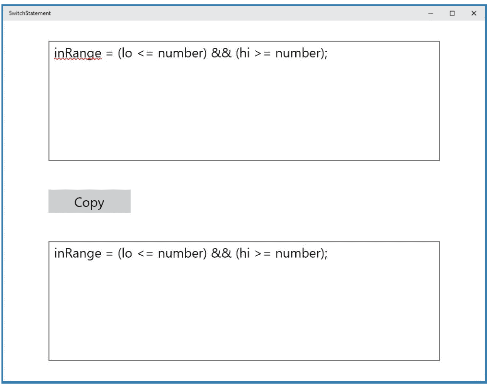

6. 返回 `Visual Studio 2015` 并停止调试。

7. 在代码和文本编辑器窗口中显示 `MainPage.xaml.cs` 的代码并找到 `copyOne` 方法。

`copyOne` 方法将作为其输入参数指定的字符复制到下方的文本框中显示的文本末尾。目前，`copyOne` 包含一个只有一个默认操作的 `switch` 语句。在接下来的几个步骤中，你将修改此 `switch` 语句以将 XML 中重要的字符转换为其 XML 映射。例如，`<` 字符将被转换为字符串 `&lt;`。

8. 在 `switch` 语句的开始大括号之后并直接在 `default` 标签之前，将以下以粗体显示的语句添加到 `switch` 语句中：

```
switch (current)
{
    case '<' :
        target.Text += "&lt;";
        break;
    default:
        target.Text += current;
        break;
```

如果当前正在复制的字符是左尖括号 (`<`)，则前面的代码会在其位置将字符串 `"&lt;"` 附加到输出文本中。

9. 在你刚刚添加的 `break` 语句之后并在 `default` 标签之上，将以下语句添加到 `switch` 语句中：

```
case '>' :
    target.Text += "&gt;";
    break;
case '&' :
    target.Text += "&amp;";
    break;
case '"' :
    target.Text += "&#34;";
    break;
case '\'' :
    target.Text += "&#39;";
    break;
```

# Note

单引号 (`'`) 和双引号 (`"`) 在 C# 中有特殊含义——它们用于分隔字符和字符串常量。最后两个 `case` 标签中的反斜杠 (`\`) 是一个转义字符，会导致 C# 编译器将这些字符视为文字而不是分隔符。

10. 在 `Debug` 菜单上，单击 `Start Debugging`。

11. 在上方的文本框中输入以下文本：

`inRange = (lo <= number) && (hi >= number);`

12. 单击 `Copy`。

语句被复制到下方的文本框中。这一次，每个字符都经过 `switch` 语句中实现的 XML 映射。目标文本框显示以下文本：

`inRange = (lo &lt;= number) &amp;&amp; (hi &gt;= number);`

13. 尝试其他字符串，并验证所有特殊字符（`<`、`>`、`&`、`"` 和 `'`）是否都得到正确处理。

14. 返回 `Visual Studio` 并停止调试。

### Summary

在本章中，你学习了布尔表达式和变量。你看到了

如何使用布尔表达式与 `if` 和 `switch` 语句在程序中做出决策，以及如何使用布尔运算符组合布尔表达式。

- 如果你想继续下一章，请保持 `Visual Studio 2015` 运行并转到第 5 章“使用复合赋值和迭代语句”。

- 如果你现在想退出 `Visual Studio 2015`，请在 `File` 菜单上单击 `Exit`。如果出现 `Save` 对话框，请单击 `Yes` 并保存项目。

### Quick reference

| To | Do this | Example |
|---|---|---|
| Determine whether two values are equivalent | Use the `==` operator or the `!=` operator. | `answer == 42` |
| Compare the value of two expressions | Use the `<`, `<=`, `>`, or `>=` operator. | `age >= 21` |


| Declare a Boolean variable | Use the bool keyword as the type of the variable. | `bool inRange;` |

| Create a Boolean expression that is true only if two conditions are both true | Use the `&&` operator. | `inRange = (lo <= number) && (number <= hi);` |

| Create a Boolean expression that is true if either of two conditions is true | Use the `||` operator. | `outOfRange = (number < lo) || (hi < number);` |

| Run a statement if a condition is true | Use an if statement. | `if (inRange) process();` |

| Run more than one statement if a condition is true | Use an if statement and a block. | `if (seconds == 59) { seconds = 0; minutes++; }` |

| Associate different statements with different values of a controlling expression | Use a switch statement. | `switch (current) { case 0: ... break; case 1: ... break; default : ... break; }` |

## 第 5 章 使用复合赋值和迭代语句

完成本章后，你将能够：

- 使用复合赋值运算符更新变量的值。
- 编写 `while`、`for` 和 `do` 迭代语句。
- 逐步执行 `do` 语句并观察变量值的变化。

第 4 章“使用决策语句”演示了如何使用 `if` 和 `switch` 结构有选择地运行语句。在本章中，你将看到如何使用各种迭代（或 `循环`）语句重复运行一个或多个语句。

当你编写迭代语句时，通常需要控制执行的迭代次数。你可以通过使用一个变量、在每次迭代时更新其值，并在变量达到特定值时停止该过程来实现这一点。为了简化此过程，你将首先学习有关特殊赋值运算符的知识，这些运算符可用于在这些情况下更新变量的值。

### 使用复合赋值运算符

你已经了解如何使用算术运算符创建新值。例如，以下语句使用加法运算符 (`+`) 将变量 `answer` 比 42 大的值显示到控制台：

Click here to view code image

```
Console.WriteLine(answer + 42);
```

你也已经了解如何使用赋值语句更改变量的值。以下语句使用赋值运算符 (`=`) 将 `answer` 的值更改为 42：

```
answer = 42;
```

如果你想将 42 加到变量的值上，可以将赋值运算符和加法运算符结合起来。例如，以下语句将 42 加到 `answer` 上。执行此语句后，`answer` 的值比之前大 42：

```
answer = answer + 42;
```

尽管此语句有效，但你可能永远不会看到经验丰富的程序员这样编写代码。将值添加到变量是如此常见，以至于 C# 提供了使用运算符 `+=` 以简写方式执行此任务的方法。要将 42 加到 `answer` 上，可以编写以下语句：

```
answer += 42;
```

你可以使用此记法将任何算术运算符与赋值运算符结合起来，如下表所示。这些运算符统称为复合赋值运算符。

| 不要这样写 | 这样写 |
|---|---|
| `variable = variable * number;` | `variable *= number;` |
| `variable = variable / number;` | `variable /= number;` |
| `variable = variable % number;` | `variable %= number;` |
| `variable = variable + number;` | `variable += number;` |
| `variable = variable - number;` | `variable -= number;` |

### Tip

复合赋值运算符与简单赋值运算符 (`=`) 具有相同的优先级和右结合性。

`+=` 运算符也适用于字符串；它将一个字符串附加到另一个字符串的末尾。例如，以下代码在控制台上显示“Hello John”：

```
string name = "John";
string greeting = "Hello ";
greeting += name;
Console.WriteLine(greeting);
```

你不能对字符串使用其他任何复合赋值运算符。

### Tip

在递增或递减变量 1 时，使用递增 (`++`) 和递减 (`--`) 运算符而不是复合赋值运算符。例如，将

```
count += 1;
```

替换为

```
count++;
```

### 编写 while 语句

你使用 `while` 语句只要某个条件为真就重复运行语句。`while` 语句的语法如下：

```
while ( booleanExpression )
    statement
```

布尔表达式（必须用括号括起来）会被求值，如果为真，则语句运行，然后布尔表达式再次求值。如果表达式仍为真，则语句重复，然后布尔表达式再次求值。此过程一直持续到布尔表达式求值为 false 为止，此时 `while` 语句退出。然后执行从 `while` 语句之后的第一条语句开始继续。`while` 语句与 `if` 语句具有以下语法相似性（事实上，除了关键字外语法是相同的）：

- 表达式必须是布尔表达式。
- 布尔表达式必须写在括号内。
- 如果布尔表达式首次求值时为 false，则语句不运行。
- 如果你想在 `while` 语句的控制下执行两个或多个语句，则必须使用大括号将这些语句分组到一个块中。

下面是一个将值 0 到 9 写入控制台的 `while` 语句。请注意，一旦变量 `i` 达到值 10，`while` 语句就会结束，语句块中的代码不会运行：

```
int i = 0;
while (i < 10)
{
    Console.WriteLine(i);
    i++;
}
```

所有 `while` 语句都应在某一点终止。初学者常见的错误是忘记包含使布尔表达式最终求值为 false 并终止循环的语句，这会导致程序无限运行。在示例中，语句 `i++;` 执行此角色。

### Note


`while` 循环中的变量 `i` 控制循环执行的迭代次数。这是一种常见习惯用法，执行此角色的变量有时称为哨兵变量。你还可以创建嵌套循环（一个循环嵌套在另一个循环中），在这种情况下，通常会扩展此命名模式，使用字母 `j`、`k` 甚至 `l` 作为控制这些循环迭代的哨兵变量的名称。

### Tip

与 `if` 语句一样，建议你始终使用块与 `while` 语句一起使用，即使块只包含单个语句。这样，如果你以后决定向 `while` 构造的主体添加更多语句，就很清楚你应该将它们添加到块中。如果你不这样做，只有紧跟在 `while` 构造中布尔表达式之后的第一条语句会作为循环的一部分执行，从而导致难以发现的错误，例如：

```
int i = 0;
while (i < 10)
    Console.WriteLine(i);
    i++;
```

此代码会无限迭代，显示无限个零，因为只有 `Console.WriteLine` 语句——而不是 `i++;` 语句——作为 `while` 构造的一部分执行。

在以下练习中，你将编写一个 `while` 循环，一次一行地遍历文本文件的内容，并将每一行写入窗体中的文本框。

#### 编写一个 while 语句

- 1. 使用 Microsoft Visual Studio 2015，打开 `WhileStatement` 项目，该项目位于你的文档文件夹中的 `\Microsoft Press\VCSBS\Chapter 5\WhileStatement` 文件夹中。
- 2. 在 Debug 菜单上，单击 Start Debugging。

Visual Studio 2015 构建并运行应用程序。应用程序是一个简单的文本文件查看器，可用于选择文本文件并显示其内容。

- 3. 单击 Open File。

打开文件选取器出现并显示文档文件夹中的文件，如以下屏幕截图所示（你计算机上的文件和文件夹列表可能不同）。

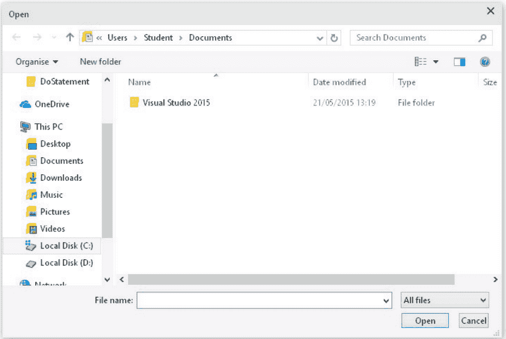

你可以使用此对话框移动到文件夹并选择要显示的文件。

- 4. 移动到你的文档文件夹中的 `\Microsoft Press\VCSBS\Chapter 5\WhileStatement\WhileStatement` 文件夹。
- 5. 选择文件 `MainPage.xaml.cs`，然后单击 Open。

文件名称 `MainPage.xaml.cs` 出现在窗体顶部文本框中，但文件内容未出现在大文本框中。这是因为你尚未实现读取文件内容并显示它的代码。你将在以下步骤中添加此功能。

- 6. 返回 Visual Studio 2015 并停止调试。
- 7. 在代码和文本编辑器窗口中显示文件 `MainPage.xaml.cs` 的代码，并找到 `openFileClick` 方法。

此方法在用户单击打开对话框中选择文件的打开按钮时运行。此时不必理解此方法的工作细节——只需接受这样一个事实：此方法提示用户选择文件（使用 `FileOpenPicker` 或 `OpenFileDialog` 窗口）并打开所选文件以供读取。

然而，`openFileClick` 方法中的最后两条语句很重要。它们看起来像这样：

Click here to view code image

```
TextReader reader = new
StreamReader(inputStream.AsStreamForRead());
displayData(reader);
```

第一条语句声明了一个名为 `reader` 的 `TextReader` 变量。`TextReader` 是 Microsoft.NET Framework 提供的类，可用于从文件等来源读取字符流。它位于 `System.IO` 命名空间中。此语句使用户在 `FileOpenPicker` 中指定的文件中的数据可供 `TextReader` 对象使用，然后该对象可用于从文件中读取数据。最后一条语句调用名为 `displayData` 的方法，将 `reader` 作为参数传递给该方法。`displayData` 方法使用 `reader` 对象读取数据并将其显示到屏幕上（或者在您编写完成此操作的代码后才会这样做）。

8. 检查 `displayData` 方法。它目前看起来像这样：

Click here to view code image

```
private void displayData(TextReader reader)
{
    // TODO: add while loop here
}
```

您可以看到，除了注释外，此方法目前是空的。这里需要添加获取和显示数据的代码。

9. 用以下语句替换 `// TODO: add while loop here` 注释：

```
source.Text = "";
```

`source` 变量指的是表单上的大文本框。将其 `Text` 属性设置为空字符串（`""`）会清除当前显示在此文本框中的任何文本。

10. 在您刚刚添加到 `displayData` 方法的上一行之后添加以下语句：

Click here to view code image

```
string line = reader.ReadLine();
```

此语句声明一个名为 `line` 的字符串变量，并调用 `reader.ReadLine` 方法将文件中的第一行读入此变量。此方法返回文件中的下一行文本，或在没有更多行可读时返回一个名为 `null` 的特殊值。

11. 在 `displayData` 方法中，在您刚刚输入的代码之后添加以下语句：

Click here to view code image

```
while (line != null)
{
    source.Text += line + '\n';
    line = reader.ReadLine();
}
```

这是一个 `while` 循环，它一次一行地遍历文件，直到没有更多行可用。

`while` 循环开头的布尔表达式检查 `line` 变量中的值。如果它不是 `null`，则循环体通过将其附加到 `source` 文本框的 `Text` 属性以及一个换行符（`'\n'`——`TextReader` 对象的 `ReadLine` 方法在读取每一行时都会去掉换行符，因此代码需要将其重新添加）来显示当前行文本。`while` 循环然后在执行下一次迭代之前读取下一行文本。`while` 循环在文件中没有更多文本可读且 `ReadLine` 方法返回 `null` 值时结束。

+ 12. 在 `while` 循环末尾的右大括号之后输入以下语句：

```
reader.Dispose();
```

此语句释放与文件关联的资源并关闭它。这是良好的做法，因为它使其他应用程序能够使用该文件，并释放用于访问文件的任何内存和其他资源。

+ 13. 在 Debug 菜单上，单击 Start Debugging。
+ 14. 当表单出现时，单击 Open File。
+ 15. 在 Open file picker 或 Open 对话框中，移动到您的 Documents 文件夹中的 `\Microsoft Press\VCSBS\Chapter 5\WhileStatement\WhileStatement` 文件夹，选择文件 `MainPage.xaml.cs`，然后单击 Open。

# Note

不要尝试打开不包含文本的文件。如果您尝试打开可执行程序或图形文件，例如，应用程序将简单地显示此文件中二进制信息的文本表示。如果文件很大，它可能会使应用程序挂起，需要您强制终止它。

这次，所选文件的内容出现在文本框中——您应该能认出您一直在编辑的代码。以下图像显示了应用程序的运行情况：

16. 滚动文本框中的文本并找到 `displayData` 方法。验证此方法是否包含您刚刚添加的代码。

17. 返回 Visual Studio 并停止调试。

### Writing for statements

在 C# 中，大多数 `while` 语句具有以下一般结构：

```
initialization
while (Boolean expression)
{
    statement
    update control variable
}
```

C# 中的 `for` 语句通过将初始化、布尔表达式和更新控制变量的代码组合在一起，为这种构造提供了一个更正式的版本。您会发现 `for` 语句很有用，因为在 `for` 语句中，很难意外地遗漏初始化或更新控制变量的代码，因此您不太可能编写无限循环的代码。以下是 `for` 语句的语法：

Click here to view code image

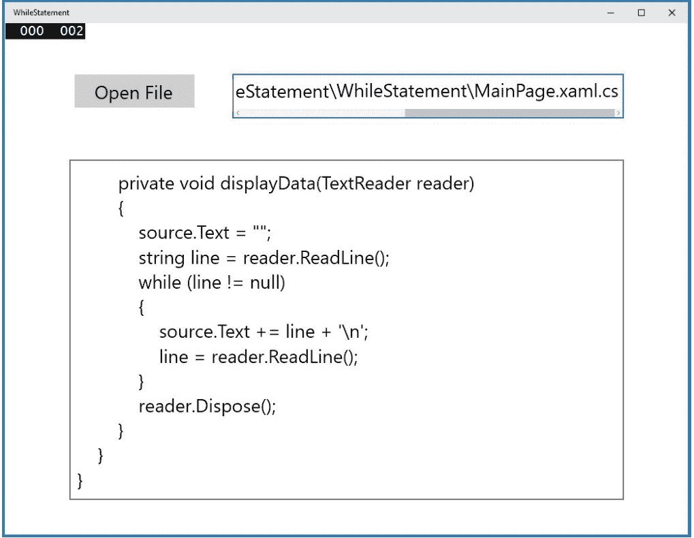

```
for (initialization; Boolean expression; update control variable)
    statement
```

构成 `for` 构造体的语句的主体可以是一行代码，也可以是用大括号括起来的代码块。

您可以将前面显示的用于显示 0 到 9 的整数的 `while` 循环重写为以下 `for` 循环：

```
for (int i = 0; i < 10; i++)
{
    Console.WriteLine(i);
}
```

初始化只发生一次，在循环开始时。然后，如果布尔表达式计算为 true，则语句运行。控制变量更新发生，然后布尔表达式重新评估。如果条件仍然为 true，则再次执行语句，更新控制变量，再次评估布尔表达式，依此类推。

请注意，初始化只发生一次，循环体中的语句总是在更新之前执行，并且更新在布尔表达式重新评估之前发生。

# Tip

与 `while` 语句一样，即使 `for` 循环的主体只包含单个语句，也被认为是一种良好的做法，始终使用代码块。如果您以后向 `for` 循环的主体添加其他语句，这种方法将有助于确保您的代码始终作为每次迭代的一部分执行。

您可以省略 `for` 语句的三个部分中的任何一个。如果省略布尔表达式，它默认为 true，因此以下 `for` 语句会无限运行：

Click here to view code image

```
for (int i = 0; ;i++)
{
    Console.WriteLine("somebody stop me!");
}
```

如果您省略初始化和更新部分，您将得到一个拼写奇怪的 `while` 循环：

```
int i = 0;
for (; i < 10; )
{
    Console.WriteLine(i);
    i++;
}
```

# Note

`for` 语句的初始化、布尔表达式和更新控制变量部分必须始终用分号分隔，即使它们被省略。

您也可以在 `for` 循环中提供多个初始化和多个更新。（只能有一个布尔表达式。）要实现这一点，请用逗号分隔各种初始化和更新，如以下示例所示：

Click here to view code image

```
for (int i = 0, j = 10; i <= j; i++, j--)
{
    ...
}
```

作为最后一个示例，这里是前面练习中的 `while` 循环重写为 `for` 循环：

Click here to view code image


```
for (string line = reader.ReadLine(); line != null; line = reader.ReadLine())
{
    source.Text += line + '\n';
}
```

### Understanding for statement scope

您可能已经注意到，您可以在 `for` 语句的初始化部分声明一个变量。该变量的作用域限定为 `for` 语句的主体，并在 `for` 语句结束时消失。此规则有两个重要后果。首先，您不能在 `for` 语句结束后使用该变量，因为它不再在作用域内。以下是一个示例：

Click here to view code image

```
for (int i = 0; i < 10; i++)
{
    ...
}
Console.WriteLine(i); // compile-time error
```

其次，您可以编写两个或多个 `for` 语句重用相同的变量名，因为每个变量都在不同的作用域中，如以下代码所示：

Click here to view code image

```
for (int i = 0; i < 10; i++)
```

```
{
    ...
}
for (int i = 0; i < 20; i += 2) // okay
{
    ...
}
```

### Writing do statements

`while` 和 `for` 语句都在循环开始时测试其布尔表达式。这意味着如果表达式在第一次测试时求值为 `false`，则循环体不会运行——甚至一次也不运行。`do` 语句不同：其布尔表达式在每次迭代后求值，因此循环体至少执行一次。

`do` 语句的语法如下（不要忘记最后的分号）：

```
do
    statement
while (booleanExpression);
```

如果循环体的内容包含多条语句，则必须使用语句块（如果不使用，编译器会报告语法错误）。下面是一个使用 `do` 语句将值 0 到 9 写入控制台的示例版本：

```
int i = 0;
do
{
    Console.WriteLine(i);
    i++;
}
while (i < 10);
```

### The break and continue statements

在第 4 章中，你看到了如何使用 `break` 语句跳出 `switch` 语句。你也可以使用 `break` 语句跳出迭代语句的主体。当你从循环中 `break` 时，循环会立即退出，执行继续在循环之后的第一条语句。循环的更新部分和继续条件都不会重新运行。

相比之下，`continue` 语句会使程序立即执行循环的下一次迭代（在重新评估布尔表达式之后）。下面是另一个将值 0 到 9 写入控制台的示例版本，这次使用 `break` 和 `continue` 语句：

```
int i = 0;
while (true)
{
    Console.WriteLine(i);
    i++;
    if (i < 10)
        continue;
    else
        break;
}
```

这段代码绝对糟糕。许多编程规范建议谨慎使用 `continue` 或完全不使用，因为它通常与难以理解的代码相关联。`continue` 的行为也相当微妙。例如，如果你从 `for` 语句内部执行 `continue` 语句，则在执行循环的下一次迭代之前，更新部分会先运行。

在下面的练习中，你将编写一个 `do` 语句，将正十进制整数转换为其八进制表示法的字符串表示。程序基于以下算法，该算法基于一种众所周知的数学过程：

Click here to view code image

```
store the decimal number in the variable dec
do the following
    divide dec by 8 and store the remainder
    set dec to the quotient from the previous step
while dec is not equal to zero
combine the values stored for the remainder for each calculation in reverse order
```

例如，假设你想将十进制数 999 转换为八进制。你执行以下步骤：

- 1. 将 999 除以 8。商为 124，余数为 7。

- 2. 将 124 除以 8。商为 15，余数为 4。

- 3. 将 15 除以 8。商为 1，余数为 7。

- 4. 将 1 除以 8。商为 0，余数为 1。

- 5. 以相反的顺序组合每个步骤中计算出的余数值。结果为 1747。这是十进制值 999 的八进制表示。

### Write a do statement

- 1. 使用 `Visual Studio 2015`，打开 `DoStatement` 项目，该项目位于你的 `Documents` 文件夹中的 `\Microsoft Press\VCSBS\Chapter 5\DoStatement` 文件夹中。

- 2. 在 `Design View` 窗口中显示 `MainPage.xaml` 表单。

  该表单包含一个名为 `number` 的文本框，用户可以在其中输入十进制数。当用户单击 `Show Steps` 按钮时，会生成所输入数字的八进制表示。右侧的文本框名为 `steps`，显示每次计算阶段的结果。

- 3. 在 `Code and Text Editor` 窗口中显示 `MainPage.xaml.cs` 的代码并找到 `showStepsClick` 方法。

  此方法在用户单击表单上的 `Show Steps` 按钮时运行。目前它是空的。

- 4. 将以下以粗体显示的语句添加到 `showStepsClick` 方法中：

Click here to view code image

```
private void showStepsClick(object sender, RoutedEventArgs e)
{
    int amount = int.Parse(number.Text);
    steps.Text = "";
    string current = "";
}
```

第一条语句使用 `int` 类型的 `Parse` 方法将 `number` 文本框的 `Text` 属性中的字符串值转换为 `int`，并将其存储在名为 `amount` 的局部变量中。

第二条语句通过将其 `Text` 属性设置为空字符串来清除下部文本框中显示的文本。

第三条语句声明一个名为 `current` 的字符串变量并将其初始化为空字符串。你将使用此字符串存储在用于将十进制数转换为其八进制表示的循环的每次迭代中生成的数字。

- 5. 将以下 `do` 语句（以粗体显示）添加到 `showStepsClick` 方法中：

Click here to view code image

```
private void showStepsClick(object sender, RoutedEventArgs e)
{
    int amount = int.Parse(number.Text);
    steps.Text = "";
    string current = "";

    do
    {
        int nextDigit = amount % 8;
        amount /= 8;
        int digitCode = '0' + nextDigit;
        char digit = Convert.ToChar(digitCode);
        current = digit + current;
        steps.Text += current + "\n";
    }
    while (amount != 0);
}
```

这里使用的算法反复执行整数运算，将 `amount` 变量除以 8 并确定余数。每次连续除法后的余数构成了正在构建的字符串中的下一个数字。最终，当 `amount` 减少到 0 时，循环结束。请注意，循环体必须至少运行一次。这种行为正是所需的行为，因为即使数字 0 也有一个八进制数字。

更仔细地查看代码，你会看到 `do` 循环执行的第一个语句是：

```
int nextDigit = amount % 8;
```

此语句声明一个名为 `nextDigit` 的 `int` 变量，并将其初始化为将 `amount` 中的值除以 8 后的余数。这将是一个介于 0 和 7 之间的数字。

`do` 循环中的下一条语句是

```
amount /= 8;
```

这是一个复合赋值语句，等价于编写 `amount = amount / 8;`。如果 `amount` 的值为 999，则此语句运行后 `amount` 的值将为 124。

下一条语句是：

Click here to view code image

```
int digitCode = '0' + nextDigit;
```

此语句需要一点解释。字符根据操作系统使用的字符集具有唯一的编码。在 Windows 操作系统经常使用的字符集中，字符“0”的代码具有整数值 48。字符“1”的代码为 49，字符“2”的代码为 50，依此类推，直到字符“9”，

其整数值为 57。使用 C#，你可以将字符视为整数并对其执行算术运算，但这样做时，C# 使用字符的代码作为值。因此，表达式 `'0' + nextDigit` 实际上产生的值介于 48 和 55 之间（记住 `nextDigit` 将在 0 到 7 之间），对应于等效八进制数字的代码。

`do` 循环中的第四条语句是

Click here to view code image

```
char digit = Convert.ToChar(digitCode);
```

此语句声明一个名为 `digit` 的 `char` 变量，并将其初始化为 `Convert.ToChar(digitCode)` 方法调用的结果。`Convert.ToChar` 方法接受一个保存字符代码的整数并返回相应的字符。因此，例如，如果 `digitCode` 的值为 54，则 `Convert.ToChar(digitCode)` 返回字符 `'6'`。

总之，`do` 循环中的前四条语句已经确定了用户键入的数字对应的最低有效位（最右侧）八进制数字的字符。下一个任务是将此数字前置到要输出的字符串中，如下所示：

```
current = digit + current;
```

`do` 循环中的下一条语句是：

```
steps.Text += current + "\n";
```

此语句将包含迄今为止为数字的八进制表示生成的数字的字符串添加到 `steps` 文本框中。它还附加一个换行符，以便转换的每个阶段在文本框中显示在单独的行上。

最后，评估循环末尾 `while` 子句中的条件：

```
while (amount != 0);
```

由于 `amount` 的值尚未为 0，循环执行另一次迭代。

在本章的最后一个练习中，你将使用 `Visual Studio 2015` 调试器逐步执行之前的 `do` 语句，以帮助你理解其工作原理。

### Step through the do statement

- 1. 在显示 `MainPage.xaml.cs` 文件的 `Code and Text Editor` 窗口中，将光标移动到 `showStepsClick` 方法的第一条语句：

Click here to view code image

```
int amount = int.Parse(number.Text);
```

+   2. 在第一个语句中的任意位置右键单击，然后单击“运行到光标”。

+   3. 当窗体出现时，在左侧的数字文本框中输入 999，然后单击“显示步骤”。

+   程序停止，并且你进入了 `Visual Studio 2015` 调试模式。

+   代码和文本编辑器窗口左侧边距中的黄色箭头以及代码上的黄色高亮指示当前语句。

+   4. 如果未显示，请显示“调试”工具栏。（在“视图”菜单上，指向“工具栏”，然后单击“调试”。）

## 注意

“调试”工具栏上的命令也在菜单栏上显示的“调试”菜单上可用。

+   5. 在“调试”工具栏上，单击下拉箭头，指向“添加或删除按钮”，然后选择“窗口”，如下图所示：

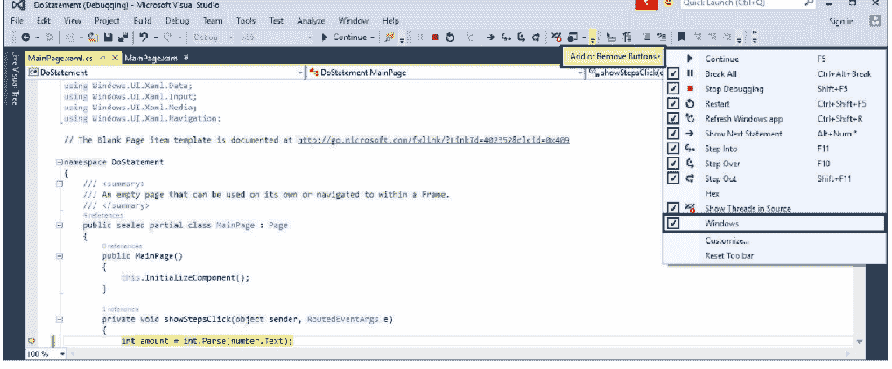

此操作将“断点窗口”按钮添加到工具栏。

+   6. 在“调试”工具栏上，单击“断点窗口”按钮旁边出现的箭头，然后单击“局部变量”。

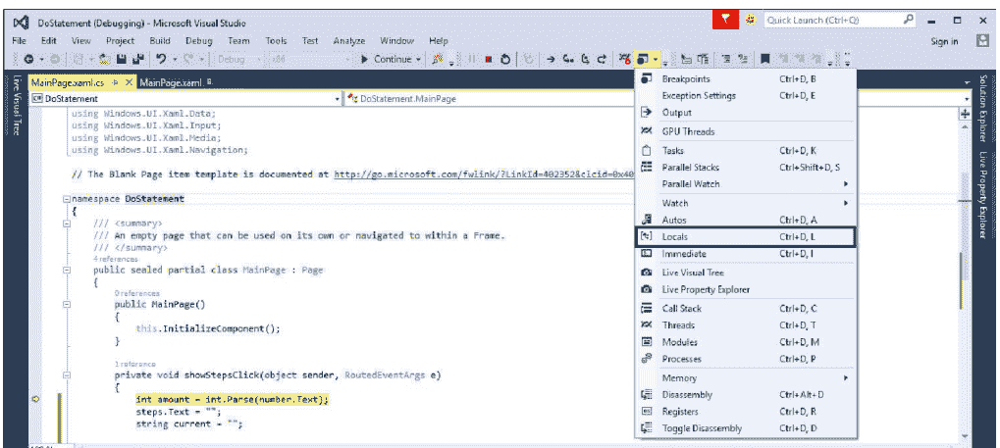

“局部变量”窗口出现（如果尚未打开）。此窗口显示当前方法中局部变量的名称、值和类型，包括 `amount` 局部变量。请注意，`amount` 的值当前为 0：

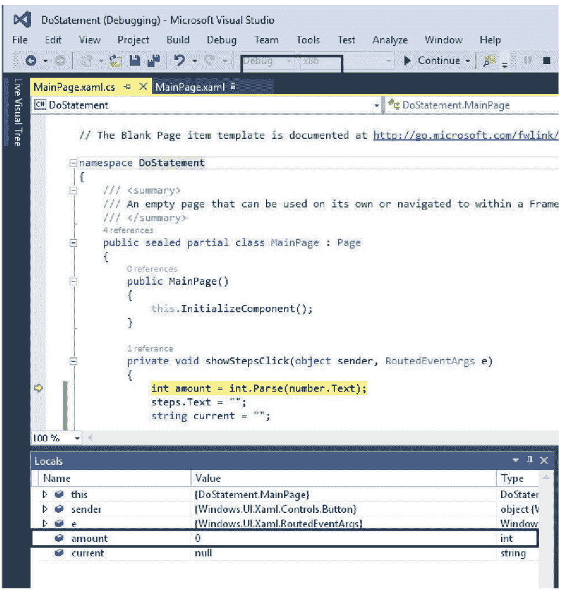

7. 在“调试”工具栏上，单击“进入”按钮。

调试器运行以下语句：

点击此处查看代码图片

```
int amount = int.Parse(number.Text);
```

“局部变量”窗口中 `amount` 的值变为 999，黄色箭头移动到下一条语句。

8. 再次单击“进入”。

调试器运行此语句：

```
steps.Text = "";
```

此语句不影响“局部变量”窗口，因为 `steps` 是窗体上的控件，而不是局部变量。黄色箭头移动到下一条语句。

## 9. 单击“进入”。

调试器运行此处显示的语句：

```
string current = "";
```

黄色箭头移动到 `do` 循环开始处的左大括号。

`do` 循环包含三个自己的局部变量：`nextDigit`、`digitCode` 和 `digit`。请注意，这些局部变量出现在“局部变量”窗口中，并且三个变量的值最初都设置为 0。

## 10. 单击“进入”。

黄色箭头移动到 `do` 循环内的第一条语句。

## 11. 单击“进入”。

调试器运行以下语句：

```
int nextDigit = amount % 8;
```

“局部变量”窗口中 `nextDigit` 的值变为 7。这是 999 除以 8 后的余数。

## 12. 单击“进入”。

调试器运行此语句：

```
amount /= 8;
```

“局部变量”窗口中 `amount` 的值变为 124。

## 13. 单击“进入”。

调试器运行此语句：

点击此处查看代码图片

```
int digitCode = '0' + nextDigit;
```

“局部变量”窗口中 `digitCode` 的值变为 55。这是字符“7”的字符代码（48 + 7）。

## 14. 单击“进入”。

调试器继续到此语句：

点击此处查看代码图片

```
char digit = Convert.ToChar(digitCode);
```

“局部变量”窗口中 `digit` 的值变为“7”。“局部变量”窗口使用底层数值（本例中为 55）和字符表示（“7”）同时显示 `char` 值。

请注意，在“局部变量”窗口中，`current` 变量的值仍为“”。

## 15. 单击“进入”。

调试器运行以下语句：

```
current = current + digit;
```

“局部变量”窗口中 `current` 的值变为“7”。

## 16. 单击“进入”。

调试器运行此处显示的语句：

点击此处查看代码图片

```
steps.Text += current + "\n";
```

此语句在 `steps` 文本框中显示文本“7”，后跟换行符以使后续输出显示在文本框的下一行。（窗体当前隐藏在 Visual Studio 后面，因此你无法看到它。）光标移动到 `do` 循环末尾的右大括号。

## 17. 单击“进入”。

黄色箭头移动到 `while` 语句以评估 `do` 循环是否已完成或是否应继续进行另一次迭代。

## 18. 单击“进入”。

调试器运行此语句：

```
while (amount != 0);
```

`amount` 的值为 124，表达式 `124 != 0` 的计算结果为 `true`，因此 `do` 循环执行另一次迭代。黄色箭头跳回 `do` 循环开始处的左大括号。

## 19. 单击“进入”。

黄色箭头再次移动到 `do` 循环内的第一条语句。

## 20. 不断单击“进入”以逐步执行 `do` 循环接下来的三次迭代，并观察“局部变量”窗口中变量值的变化。

## 21. 在循环的第四次迭代结束时，`amount` 的值为 0，`current` 的值为“1747”。黄色箭头位于 `do` 循环末尾的 `while` 条件处：

```
while (amount != 0);
```

由于 `amount` 的值现在为 0，表达式 `amount != 0` 的计算结果为 `false`，`do` 循环应终止。

## 22. 单击“进入”。

调试器运行以下语句：

```
while (amount != 0);
```

如预测的那样，`do` 循环结束，黄色箭头移动到 `showStepsClick` 方法末尾的右大括号。

23. 在“调试”菜单上，单击“继续”。

窗体出现，显示用于创建 999 的八进制表示的四个步骤：7、47、747 和 1747。

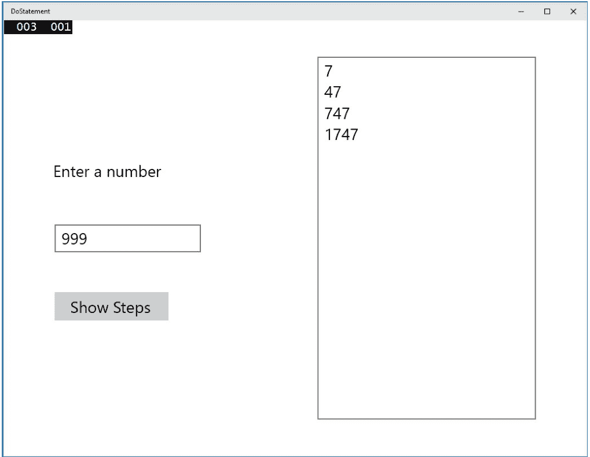

24. 返回 `Visual Studio 2015`。在“调试”菜单上，单击“停止调试”。

### 摘要

在本章中，你学习了如何使用复合赋值运算符来更新数值变量并将一个字符串附加到另一个字符串。你看到了如何使用 `while`、`for` 和 `do` 语句在某个布尔条件为 `true` 时重复执行代码。

+   如果你想继续下一章，请保持 `Visual Studio 2015` 运行并转到第 6 章“管理错误和异常”。

+   如果你现在想退出 `Visual Studio 2015`，请在“文件”菜单上单击“退出”。如果出现“另存为”对话框，请单击“是”并保存项目。

### 快速参考

| 要 | 执行此操作 |

|---|---|

| 向变量添加一个金额 | 使用复合加法运算符。例如：`variable += amount;` |


| 从变量中减去一个金额 | 使用复合减法运算符。例如：`variable -= amount;` |

| 在条件为 true 时零次或多次运行一个或多个语句 | 使用 `while` 语句。例如：``` int i = 0; while (i < 10) { Console.WriteLine(i); i++; } ``` 或者，使用 `for` 语句。例如：``` for (int i = 0; i < 10; i++) { Console.WriteLine(i); } ``` |
| 重复执行语句一次或多次 | 使用 `do` 语句。例如：``` int i = 0; do { Console.WriteLine(i); i++; } while (i < 10); ``` |

## 第 6 章. 管理错误和异常

完成本章后，你将能够：

- 使用 `try`、`catch` 和 `finally` 语句处理异常。
- 使用 `checked` 和 `unchecked` 关键字控制整数溢出。
- 使用 `throw` 关键字从自己的方法中引发异常。
- 使用 `finally` 块确保代码始终运行，即使在发生异常后也是如此。

你现在已经看到了执行常见任务所需了解的核心 C# 语句，例如编写方法、声明变量、使用运算符创建值、编写 `if` 和 `switch` 语句以有选择地运行代码，以及编写 `while`、`for` 和 `do` 语句以重复运行代码。然而，前面的章节并未考虑事情出错的可能性（或概率）。

很难确保一段代码始终按预期工作。故障可能由于大量原因而发生，其中许多原因超出了程序员的控制范围。你编写的任何应用程序都必须能够检测故障并以优雅的方式处理它们，要么采取适当的纠正措施，要么，如果不可能，则以最清晰的方式向用户报告故障原因。在第一部分本章的最后，你将学习 C# 如何使用异常来发出错误已发生的信号，以及如何使用 `try`、`catch` 和 `finally` 语句来捕获和处理这些异常所代表的错误。

到本章结束时，你将对 C# 的所有基本要素有一个坚实的基础，并在第二部分中在此基础上构建。

### 应对错误

生活就是这样，有时坏事会发生。轮胎被扎破，电池耗尽，螺丝刀永远不在你放的地方，你的应用程序的用户行为不可预测。在计算机世界中，硬盘损坏，与你的程序在同一台计算机上运行的其他应用程序失控并使用完所有可用内存，无线网络连接在最不合适的时候消失，甚至附近的雷击如果导致停电或网络故障也会产生影响。错误可能在程序运行的几乎任何阶段发生，而且许多错误可能根本不是你自己应用程序的过错，那么你如何检测它们并尝试恢复呢？

多年来，已经演化出许多机制。旧系统如 UNIX 采用的一种典型方法涉及安排操作系统

system to set a special global variable whenever a method failed. Then, after each call to a method, you checked the global variable to see whether the method succeeded. C# and most other modern object-oriented languages don’t handle errors in this manner; it’s just too painful. Instead, they use `exceptions`. If you want to write robust C# programs, you need to know about exceptions.

### Trying code and catching exceptions

Errors can happen at any time, and using traditional techniques to manually add error-detecting code around every statement is cumbersome, time-consuming, and error prone in its own right. You can also lose sight of the main flow of an application if each statement requires contorted error-handling logic to manage each possible error that can occur at every stage. Fortunately, C# makes it easy to separate the error-handling code from the code that implements the primary logic of a program by using exceptions and exception handlers. To write exception-aware programs, you need to do two things:

- Write your code within a `try` block (`try` is a C# keyword). When the code runs, it attempts to execute all the statements in the `try` block, and if none of the statements generates an exception, they all run, one after the other, to completion. However, if an error condition occurs, execution jumps out of the `try` block and into another piece of code designed to catch and handle the exception—a `catch` handler.

- Write one or more `catch` handlers (`catch` is another C# keyword) immediately after the `try` block to handle any possible error conditions. A `catch` handler is intended to capture and handle a specific type of exception, and you can have multiple `catch` handlers after a `try` block, each one designed to trap and process a specific exception. This enables you to provide different handlers for the different errors that could arise in the `try` block. If any one of the statements within the `try` block causes an error, the runtime throws an exception. The runtime then examines the `catch` handlers after the `try` block and transfers control directly to the first matching handler.

Here’s an example of a `try` block that contains code that attempts to convert strings that a user has typed in some text boxes on a form to integer values. The code then calls a method to calculate a value and writes the result to another text box. Converting a string to an integer requires that the string contain a valid set of digits and not some arbitrary sequence of characters. If the string contains invalid characters, the `int.Parse` method throws a `FormatException`, and execution transfers to the corresponding `catch` handler. When the `catch` handler finishes, the program continues with the first statement that follows the handler. Note that if there is no handler that corresponds to the exception, the exception is said to be unhandled (this situation will be described shortly).

```
try
{
    int leftHandSide = int.Parse(lhsOperand.Text);
    int rightHandSide = int.Parse(rhsOperand.Text);
    int answer = doCalculation(leftHandSide, rightHandSide);
    result.Text = answer.ToString();
}
catch (FormatException fEx)
{
    // Handle the exception
    ...
}
```

A catch handler employs syntax similar to that used by a method parameter to specify the exception to be caught. In the preceding example, when a FormatException is thrown, the fEx variable is populated with an object containing the details of the exception.

The FormatException type has a number of properties that you can examine to determine the exact cause of the exception. Many of these properties are common to all exceptions. For example, the Message property contains a text description of the error that caused the exception. You can use this information when handling the exception, perhaps recording the details in a log file or displaying a meaningful message to the user and then asking the user to try again.

### Unhandled exceptions

What happens if a try block throws an exception and there is no corresponding catch handler? In the previous example, it is possible that the lhsOperand text box could contain the string representation of a valid integer but the integer it represents is outside the range of valid integers supported by C# (for example, “2147483648”). In this case, the int.Parse statement would throw an OverflowException, which will not be caught by the FormatException catch handler. If this occurs and the try block is part of a method, the method immediately exits and execution returns to the calling method. If the calling method uses a try block, the runtime attempts to locate a matching catch handler for this try block and execute it. If the calling method does not use a try block or there is no matching catch handler, the calling method immediately exits and execution returns to its caller, where the process is repeated. If a matching catch handler is eventually found, the handler runs and execution continues with the first statement that follows the catch handler in the catching method.

## Important

Notice that after catching an exception, execution continues in the method containing the catch block that caught the exception. If the exception occurred in a method other than the one containing the catch handler, control does not return to the method that caused the exception.

If, after cascading back through the list of calling methods, the runtime is unable to find a matching catch handler, the program will terminate with an unhandled exception.

You can easily examine exceptions generated by your application. If you are running the application in Microsoft Visual Studio 2015 in debug mode (that is, on the Debug menu you selected Start Debugging to run the application) and an exception occurs, a dialog box similar to the one shown in the following image appears and the application pauses, helping you to determine the cause of the exception:

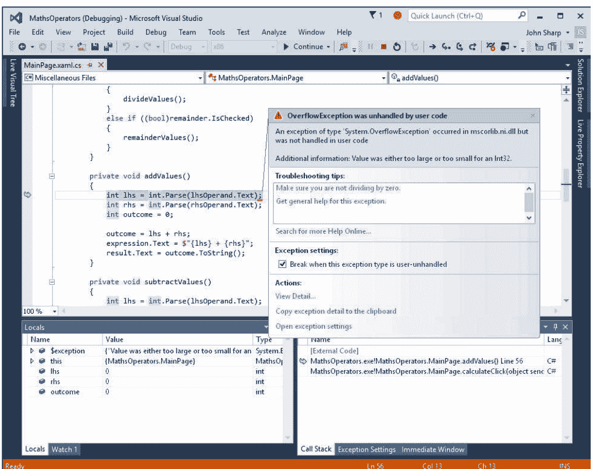

The application stops at the statement that caused the exception, and you drop into the debugger. You can examine the values of variables, you can change the values of variables, and you can step through your code from the point at which the exception occurred by using the Debug toolbar and the various debug windows.

### Using multiple catch handlers

The previous discussion highlighted how different errors throw different kinds of exceptions to represent different kinds of failures. To cope with these situations, you can supply multiple `catch` handlers, one after the other, such as in the following:


```
try
{
    int leftHandSide = int.Parse(lhsOperand.Text);
    int rightHandSide = int.Parse(rhsOperand.Text);
    int answer = doCalculation(leftHandSide, rightHandSide);
    result.Text = answer.ToString();
}
catch (FormatException fEx)
{
    //...
}
catch (OverflowException oEx)
{
    //...
}
```

If the code in the `try` block throws a `FormatException` exception, the statements in the `catch` block for the `FormatException` exception run. If the code throws an `OverflowException` exception, the `catch` block for the `OverflowException` exception runs.


## Note

If the code in the `FormatException catch` block generates an `OverflowException` exception, it does not cause the adjacent `OverflowException catch` block to run. Instead, the exception propagates to the method that invoked this code, as described earlier in this section.

### Catching multiple exceptions

The exception-catching mechanism provided by C# and the Microsoft .NET Framework is quite comprehensive. The .NET Framework defines many types of exceptions, and any programs you write can throw most of them. It is highly unlikely that you will want to write `catch` handlers for every possible exception that your code can throw—remember that your application must be able to handle

你可能甚至在编写代码时都未曾考虑到的异常！那么，你如何确保程序捕获并处理所有可能的异常？

问题的答案在于不同异常之间的关联方式。异常被组织成称为 `继承层次结构` 的家族。（你将在 [第 12 章](Chapter 12) “使用 `继承`” 中学习继承。）`FormatException` 和 `OverflowException` 都属于一个名为 `SystemException` 的家族，其他许多异常也属于该家族。`SystemException` 本身是更广泛的家族 `Exception` 的成员，而 `Exception` 是所有异常的始祖。如果你捕获 `Exception`，处理程序会捕获可能发生的每一种异常。

## Note

`Exception` 家族包含各种各样的异常，其中许多是为 .NET Framework 的各个部分使用而设计的。其中一些异常有些深奥，但了解如何捕获它们仍然很有用。

下面的示例展示了如何捕获所有可能的异常：

[Click here to view code image](Click here to view code image)

```
try
{
    int leftHandSide = int.Parse(lhsOperand.Text);
    int rightHandSide = int.Parse(rhsOperand.Text);
    int answer = doCalculation(leftHandSide, rightHandSide);
    result.Text = answer.ToString();
}
catch (Exception ex) // this is a general catch handler
{
    //...
}
```

## Note

如果你想捕获 `Exception`，实际上可以从 `catch` 处理程序中省略其名称，因为它是默认异常：

```
catch
{
    // ...
}
```

然而，这是不推荐的。传递给 `catch` 处理程序的异常对象可能包含有关异常的有用信息，而使用这种版本的 `catch` 构造时这些信息不易访问。

此时你应该问的最后一个问题是：如果同一个异常在 `try` 块末尾匹配多个 `catch` 处理程序会发生什么？如果你在两个不同的处理程序中捕获 `FormatException` 和 `Exception`，哪一个会运行？（两者都会执行吗？）

当异常发生时，运行时会使用它找到的第一个匹配异常的处理程序，其他处理程序将被忽略。这意味着，如果你将 `Exception` 的处理程序放在 `FormatException` 处理程序之前，`FormatException` 处理程序将永远不会运行。因此，你应该将更具体的 `catch` 处理程序放在 `try` 块之后、通用 `catch` 处理程序之上。如果没有具体的 `catch` 处理程序匹配该异常，则会使用通用的 `catch` 处理程序。

### Exception filters

异常过滤器是 C# 的一项新功能，影响异常与 catch 处理程序匹配的方式。异常过滤器使你能够指定在何种额外条件下使用 catch 处理程序。这些条件采用以 `when` 关键字为前缀的布尔表达式的形式。下面的示例说明了语法：

Click here to view code image

```
catch (Exception ex) when (ex.GetType() !=
typeof(System.OutOfMemoryException))
{
    // Handle all previously uncaught exceptions except
OutOfMemoryException
}
```

此示例捕获所有异常（`Exception` 类型），但过滤器指定如果异常的类型是内存不足异常，则应忽略此处理程序。（`GetType` 方法返回作为参数指定的变量的类型。）这提供了一种处理除内存不足异常之外的所有异常的简洁方法。如果发生内存不足异常，运行时将继续寻找另一个要使用的异常处理程序，如果找不到，则该异常将被视为未处理的异常。

在下面的练习中，你将看到应用程序抛出未处理异常时会发生什么，然后你将编写一个 try 块并捕获和处理异常。

### Observe how the application reports unhandled exceptions

- 1. Start Visual Studio 2015 if it is not already running.

- 2. Open the MathsOperators solution, which is located in the `\Microsoft Press\VCSBS\Chapter 6\MathsOperators` folder in your Documents folder. This is a version of the program in Chapter 2, “Working with variables, operators, and expressions,” that demonstrates the different arithmetic operators.

- 3. On the Debug menu, click Start Without Debugging.


## Note

对于此练习，请确保你确实在不调试的情况下运行应用程序。

表单出现。你现在将在左操作数框中输入一些文本，这将导致异常。此操作将演示当前版本程序缺乏健壮性。

4. In the Left Operand box, type John, and in the Right Operand box, type 2. Click the + Addition button, and then click Calculate.

此输入会触发 Windows 默认异常处理：应用程序 simply 终止，你将被返回到桌面！

现在你已经看到了应用程序在未处理异常发生时的行为，下一步是通过处理无效输入并防止未处理异常出现来使应用程序更健壮。

### Write a try/catch statement block

- 1. Return to Visual Studio 2015.

- 2. On the Debug menu, click Start Debugging.

- 3. When the form appears, in the Left Operand box, type John, and in the Right Operand box, type 2. Click the + Addition button, and then click Calculate.

此输入应导致与前一个练习中发生的相同异常，只是现在你在调试模式下运行，因此 Visual Studio 会捕获异常并报告它。

Visual Studio 显示你的代码并突出显示导致异常的语句。它还显示一个描述异常的对话框，在本例中为“Input string was not in a correct format。”

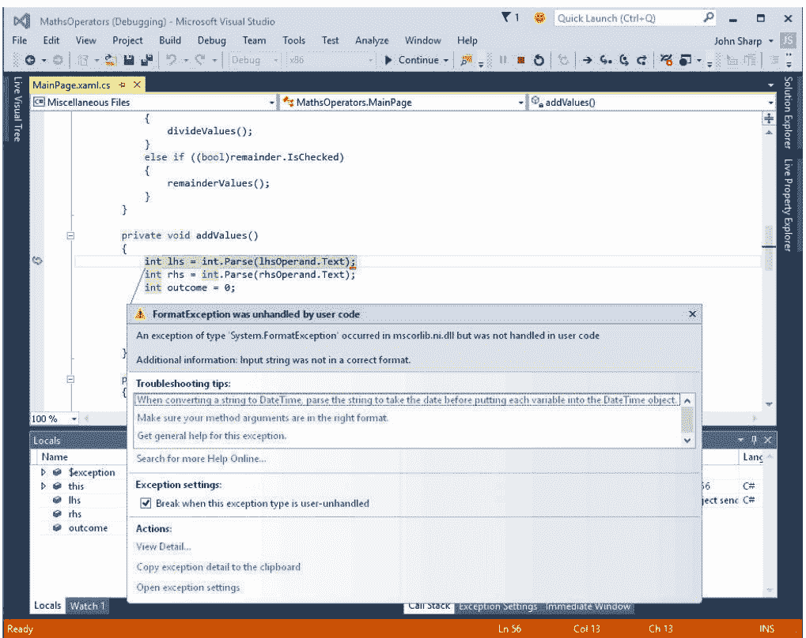

你可以看到异常是由 `addValues` 方法内部对 `int.Parse` 的调用抛出的。问题是此方法无法将文本“John”解析为有效数字。

4. In the exception dialog box, click View Detail.

另一个对话框打开，你可以在其中查看有关异常的更多信息。如果你展开 `System.FormatException`，你可以看到此信息：

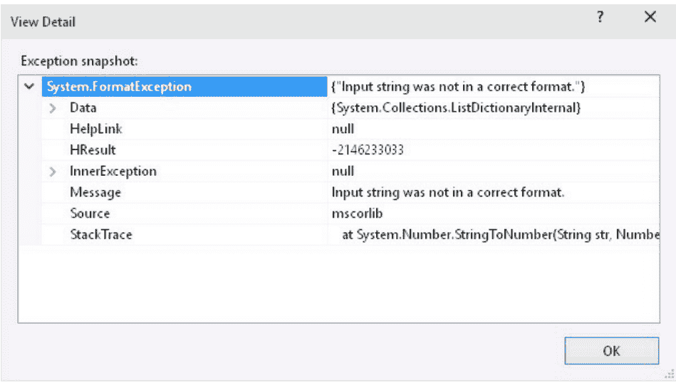

## Tip

一些异常是由于更早引发的其他异常而产生的。Visual Studio 报告的异常只是此链中的最终异常，但通常是更早的异常突出了问题的真正原因。你可以通过在 View Detail 对话框中展开 `InnerException` 属性来深入研究这些更早的异常。内部异常可能还有进一步的内部异常，你可以一直挖掘，直到找到 `InnerException` 属性设置为 null 的异常（如上图所示）。此时，你已到达初始异常，而此异常通常是你需要纠正的异常。

- 5. Click OK in the View Detail dialog box, and then, in Visual Studio, on the Debug menu, click Stop Debugging.

- 6. Display the code for the file `MainPage.xaml.cs` in the Code and Text Editor window, and locate the `addValues` method.

- 7. Add a try block (including braces) around the statements inside this method, together with a catch handler for the `FormatException` exception, as shown in bold here:

Click here to view code image

```
try
{
    int lhs = int.Parse(lhsOperand.Text);
    int rhs = int.Parse(rhsOperand.Text);
    int outcome = 0;
```

```
outcome = lhs + rhs;
 expression.Text = $"{lhs} + {rhs}";
 result.Text = outcome.ToString();
}
catch (FormatException fEx)
{
    result.Text = fEx.Message;
}
```

如果发生 `FormatException` 异常，`catch` 处理程序会在表单底部的 `result` 文本框中显示异常的 `Message` 属性中的文本。

8. On the Debug menu, click Start Debugging.

9. When the form appears, in the Left Operand box, type **John**, and in the Right Operand box type **2**. Click the + Addition button, and then click Calculate.

`catch` 处理程序成功捕获了 `FormatException`，并且消息“Input string was not in a correct format”被写入 Result 文本框。应用程序现在更健壮了一些。

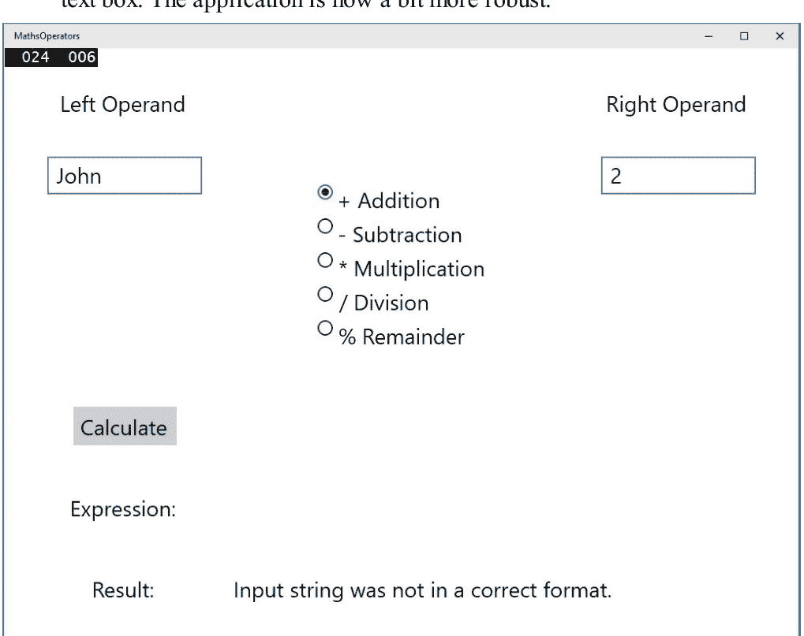

10. Replace John with the number **10**. In the Right Operand box, type **Sharp**, and then click Calculate.

`try` 块包围了解析两个文本框的语句，因此同一个异常处理程序处理两个文本框中的用户输入错误。

+   11. 在 Right Operand 框中，将 Sharp 替换为 **20**，单击 + Addition 按钮，然后单击 Calculate。

+   应用程序现在按预期工作，并在 Result 框中显示值 30。

+   12. 在 Left Operand 框中，将 10 替换为 **John**，单击 – Subtraction 按钮，然后单击 Calculate。

+   Visual Studio 进入调试器并再次报告 `FormatException` 异常。这次，错误发生在 `subtractValues` 方法中，该方法不包含必要的 `try/catch` 处理。

+   13. 在 Debug 菜单上，单击 Stop Debugging。

### Propagating exceptions

向 `addValues` 方法添加 `try/catch` 块使该方法更健壮，但你需要将相同的异常处理应用于其他方法：`subtractValues`、`multiplyValues`、`divideValues` 和 `remainderValues`。其中每个异常处理程序的代码可能非常相似，导致你在每个方法中编写相同的代码。这些方法中的每一个都由 `calculateClick` 方法在用户单击 Calculate 按钮时调用。因此，为了避免异常处理代码的重复，有意义将其重新定位到 `calculateClick` 方法。如果在 `subtractValues`、`multiplyValues`、`divideValues` 或 `remainderValues` 方法中发生 `FormatException`，它将被传播回 `calculateClick` 方法进行处理，如本章前面“Unhandled exceptions”部分所述。

### Propagate an exception back to the calling method

+   1. 在 Code and Text Editor 窗口中显示文件 `MainPage.xaml.cs` 的代码，并找到 `addValues` 方法。

+   2. 删除 `addValues` 方法中的 `try` 块和 `catch` 处理程序，并将其恢复到原始状态，如以下代码所示：

Click here to view code image

```
private void addValues()
{
    int leftHandSide = int.Parse(lhsOperand.Text);
    int rightHandSide = int.Parse(rhsOperand.Text);
    int outcome = 0;

    outcome = lhs + rhs;
    expression.Text = lhsOperand.Text + " + " + rhsOperand.Text
    result.Text = outcome.ToString();
}
```

3. 找到 `calculateClick` 方法。向此方法添加以下示例中以粗体显示的 try 块和 catch 处理程序：

Click here to view code image


```csharp
private void calculateClick(object sender, RoutedEventArgs e)
{
    try

        if ((bool)addition.IsChecked)
        {
            addValues();
        }
        else if ((bool)subtraction.IsChecked)
        {
            subtractValues();
        }
        else if ((bool)multiplication.IsChecked)
        {
            multiplyValues();
        }
        else if ((bool)division.IsChecked)
        {
            divideValues();
        }
        else if ((bool)remainder.IsChecked)
        {
            remainderValues();
        }
    }
    catch (FormatException fEx)
    {
        result.Text = fEx.Message;
    }
}
```

4. 在 `Debug` 菜单上，单击 `Start Debugging`。

5. 当表单出现时，在 `Left Operand` 框中输入 `John`，在 `Right Operand` 框中输入 `2`。单击 `+ Addition` 按钮，然后单击 `Calculate`。

如前所述，`catch` 处理程序成功捕获了 `FormatException`，并且消息“Input string was not in a correct format”被写入 `Result` 文本框。然而，请记住，异常实际上是在 `addValues` 方法中抛出的，但它被 `calculateClick` 方法中的处理程序捕获了。

6. 单击 `– Subtraction` 按钮，然后单击 `Calculate`。

这次，`subtractValues` 方法导致了异常，但它被传播回 `calculateClick` 方法并以与之前相同的方式处理。

7. 测试 `* Multiplication`、`/` `Division` 和 `% Remainder` 按钮，并验证

`FormatException` 异常是否被正确捕获和处理。

8. 返回 Visual Studio 并停止调试。

### Note

是否在方法中显式捕获未处理的异常取决于你正在构建的应用程序的性质。在某些情况下，将异常捕获尽可能接近发生点是有意义的。在其他情况下，让异常传播回调用抛出异常的例程的方法并在那里处理错误更有用。

### Using checked and unchecked integer arithmetic

第 2 章讨论了如何使用二进制算术运算符如 `+` 和 `*` 对 `int` 和 `double` 等原始数据类型进行操作。它还说明原始数据类型具有固定大小。例如，C# `int` 为 32 位。因为 `int` 具有固定大小，你知道它可以保存的值范围：为 −2147483648 到 2147483647。

### Tip

如果你想在代码中引用 `int` 的最小值或最大值，可以使用 `int.MinValue` 或 `int.MaxValue` 属性。

`int` 类型的固定大小会产生一个问题。例如，如果你向当前值为 2147483647 的 `int` 加 1 会怎样？答案取决于应用程序的编译方式。默认情况下，C# 编译器生成允许计算静默溢出并得到错误答案的代码。事实上，计算会回绕到最大的负整数值，结果为 −2147483648。这种行为的原因是性能：整数运算几乎在每个程序中都很常见，为每个整数表达式添加溢出检查的开销可能导致性能非常差。在许多情况下，这种风险是可以接受的，因为你知道或希望你的 `int` 值不会达到其限制。如果你不喜欢这种方法，可以打开溢出检查。

### Tip

你可以在 Visual Studio 2015 中通过设置项目属性来打开和关闭溢出检查。在 `Solution Explorer` 中，单击 `YourProject`（其中 `YourProject` 是项目的实际名称）。在 `Project` 菜单上，单击 `YourProject Properties`。在项目属性对话框中，单击 `Build` 选项卡。单击页面右下角的 `Advanced` 按钮。在 `Advanced Build Settings` 对话框中，选择或清除 `Check For Arithmetic Overflow/Underflow` 复选框。

无论如何编译应用程序，你都可以使用 `checked` 和 `unchecked` 关键字在你认为需要的应用程序部分打开和关闭整数算术溢出检查。这些关键字会覆盖为项目指定的编译器选项。

### Writing checked statements

`checked` 语句是以 `checked` 关键字为前缀的块。`checked` 语句中的所有整数运算如果块中的整数计算溢出时总是抛出 `OverflowException`，如此示例所示：

Click here to view code image

```
int number = int.MaxValue;
checked
{
    int willThrow = number++;
    Console.WriteLine("this won't be reached");
}
```

### Important

只有 `checked` 块内直接的整数运算才受溢出检查约束。例如，如果 `checked` 语句之一是方法调用，则检查不适用于在被调用方法中运行的代码。

你也可以使用 `unchecked` 关键字创建 `unchecked` 块语句。`unchecked` 块中的所有整数运算都不检查且永远不会抛出 `OverflowException`。例如：

Click here to view code image

```
int number = int.MaxValue;
unchecked
{
    int wontThrow = number++;
}
```

```
Console.WriteLine("this will be reached");
}
```

### Writing checked expressions

你还可以使用 `checked` 和 `unchecked` 关键字通过仅在单个带括号的表达式前加上 `checked` 或 `unchecked` 关键字来控制整数表达式的溢出检查，如此示例所示：

Click here to view code image

```
int wontThrow = unchecked(int.MaxValue + 1);
int willThrow = checked(int.MaxValue + 1);
```

复合运算符（如 `+=` 和 `-=`）以及自增（`++`）和自减（`--`）运算符是算术运算符，可以使用 `checked` 和 `unchecked` 关键字进行控制。记住，`x += y` 等同于 `x = x + y`

### Important

你不能使用 `checked` 和 `unchecked` 关键字来控制浮点（非整数）算术。`checked` 和 `unchecked` 关键字仅适用于使用 `int` 和 `long` 等数据类型的整数算术。浮点算术永远不会抛出 `OverflowException`——即使你在除以 0.0 时也不会。记住从第 2 章中，.NET Framework 对无穷大有特殊的浮点表示。

在以下练习中，你将了解如何在使用 Visual Studio 2015 时执行 `checked` 算术。

### Use checked expressions

+   1. 返回 Visual Studio 2015。

+   2. 在 `Debug` 菜单上，单击 `Start Debugging`。

      你现在将尝试乘以两个大值。

+   3. 在 `Left Operand` 框中输入 `9876543`。在 `Right Operand` 框中输入 `9876543`。单击 `* Multiplication` 按钮，然后单击 `Calculate`。

      值 −1195595903 出现在表单的 `Result` 框中。这是一个负值，不可能正确。这个值是乘法运算静默溢出 `int` 类型的 32 位限制的结果。

+   4. 返回 Visual Studio 并停止调试。

+   5. 在显示 `MainPage.xaml.cs` 的 Code and Text Editor 窗口中，找到 `multiplyValues` 方法，它应该如下所示：

Click here to view code image

```
private void multiplyValues()
{
    int lhs = int.Parse(lhsOperand.Text);
    int rhs = int.Parse(rhsOperand.Text);
    int outcome = 0;

    outcome = lhs * rhs;
    expression.Text = $"{lhs} * {rhs}";
    result.Text = outcome.ToString();
}
```

语句 `outcome = lhs * rhs;` 包含的乘法操作会静默溢出。

6. 编辑此语句，使计算值得到检查，如下所示：

```
outcome = checked(lhs * rhs);
```

乘法现在会被检查，并在溢出时抛出 `OverflowException`，而不是静默返回错误答案。

7. 在 `Debug` 菜单上，单击 `Start Debugging`。

8. 在 `Left Operand` 框中，输入 `9876543`。在 `Right Operand` 框中，输入 `9876543`。单击 `* Multiplication` 按钮，然后单击 `Calculate`。

Visual Studio 进入调试器并报告乘法导致了 `OverflowException` 异常。现在你需要添加一个处理程序来捕获此异常，并比直接以错误失败更优雅地处理它。

9. 在 `Debug` 菜单上，单击 `Stop Debugging`。

10. 在显示 `MainPage.xaml.cs` 文件的 Code and Text Editor 窗口中，找到 `calculateClick` 方法。

11. 在此方法中，紧跟在现有的 `FormatException` `catch` 处理程序之后添加以下 `catch` 处理程序（以粗体显示）：

Click here to view code image

```
private void calculateClick(object sender, RoutedEventArgs e)
{
    try
    {
        ...
    }
    catch (FormatException fEx)
    {
        result.Text = fEx.Message;
    }
    catch (OverflowException oEx)
    {
        result.Text = oEx.Message;
    }
}
```

此 `catch` 处理程序的逻辑与 `FormatException catch` 处理程序相同。然而，将这些处理程序分开保留而不是简单地编写一个通用的 `Exception catch` 处理程序仍然是有价值的，因为你将来可能会以不同的方式处理这些异常。

+   12. 在 `Debug` 菜单上，单击 `Start Debugging` 以构建并运行应用程序。

+   13. 在 `Left Operand` 框中，输入 `9876543`。在 `Right Operand` 框中，输入 `9876543`。单击 `* Multiplication` 按钮，然后单击 `Calculate`。

第二个 `catch` 处理程序成功捕获了 `OverflowException` 并在 `Result` 框中显示消息“Arithmetic operation resulted in an overflow”。

+   14. 返回 Visual Studio 并停止调试。

### Exception handling and the Visual Studio debugger

默认情况下，Visual Studio 调试器仅停止正在调试的应用程序并报告未处理的异常。有时能够调试异常处理程序本身会很有用，在这种情况下，你需要在应用程序抛出异常时、在被捕获之前跟踪异常。你可以轻松做到这一点。在 `Debug` 菜单上，单击 `Windows`，然后单击 `Exception Settings`。`Exception Settings` Pane 出现在 Code and Text Editor 窗口下方：

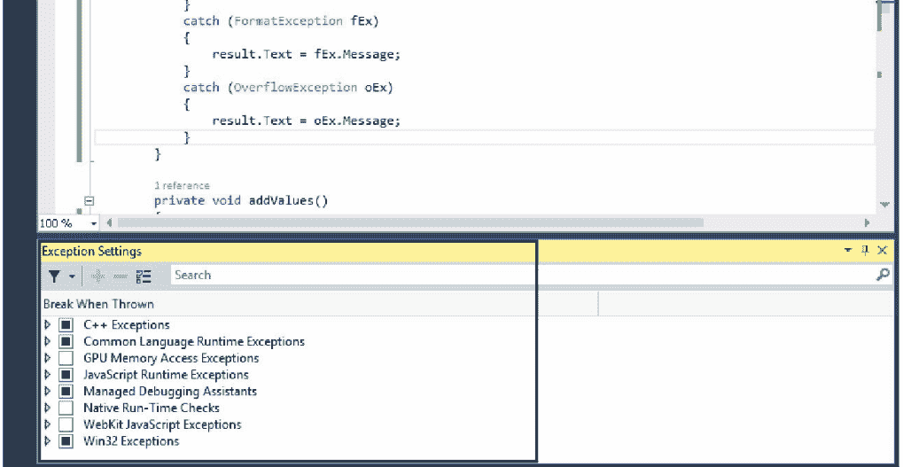

在 `Exception Settings` Pane 中，展开 `Common Language Runtime Exceptions`，向下滚动并选择 `System.OverflowException`：

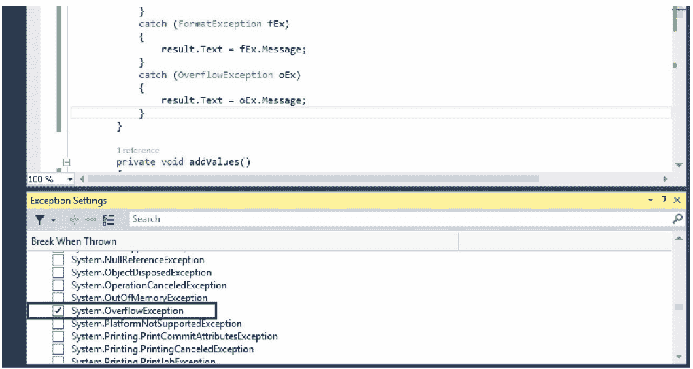

现在，当发生诸如 `OverflowException` 之类的异常时，Visual Studio 将进入调试器，你可以使用 `Debug` 工具栏上的 `Step Into` 按钮逐步进入 `catch` 处理程序。

### Throwing exceptions

假设你正在实现一个名为 `monthName` 的方法，它接受一个 `int` 参数并返回对应月份的名称。例如，`monthName(1)` 返回“January”，`monthName(2)` 返回“February”，以此类推。问题是，如果整数参数小于 1 或大于 12，该方法应该返回什么？最好的答案是该方法根本不应该返回任何内容——它应该抛出异常。.NET Framework 类库包含大量专门为此类情况设计的异常类。大多数时候，你会发现其中一个类描述了你的异常条件。 （如果没有，你可以轻松创建自己的异常类，但在你能做到这一点之前，你需要了解更多关于 C# 语言的知识。）在这种情况下，现有的 .NET Framework `ArgumentOutOfRangeException` 类正合适。你可以使用 `throw` 语句抛出异常，如以下示例所示：

Click here to view code image

```
public static string monthName(int month)
{
    switch (month)
    {
        case 1 :
            return "January";
        case 2 :
            return "February";
        ...
```

```
case 12 :
    return "December";

    default :
        throw new ArgumentOutOfRangeException("Bad month");
    }
}
```

`throw` 语句需要一个要抛出的异常对象。此对象包含异常的详细信息，包括任何错误消息。此示例使用创建一个新的 `ArgumentOutOfRangeException` 对象的表达式。该对象使用构造函数初始化，该构造函数使用字符串填充其 `Message` 属性。构造函数在第 7 章“Creating and managing classes and objects”中详细介绍。

在以下练习中，你将修改 `MathsOperators` 项目，如果用户尝试在未指定运算符的情况下执行计算，则抛出异常。

### Note

此练习有点牵强，因为任何良好的应用程序设计都会提供默认运算符，但此应用程序旨在说明一个观点。

### Throw an exception

+   1. 返回 Visual Studio 2015。

+   2. 在 `Debug` 菜单上，单击 `Start Debugging`。

+   3. 在 `Left Operand` 框中，输入 `24`。在 `Right Operand` 框中，输入 `36`，然后单击 `Calculate`。

      `Expression` 和 `Result` 框中没有任何内容出现。你没有选择运算符选项的事实并不明显。将诊断消息写入 `Result` 框会很有用。

+   4. 返回 Visual Studio 并停止调试。

+   5. 在显示 `MainPage.xaml.cs` 的 Code and Text Editor 窗口中，找到并检查 `calculateClick` 方法，它应该如下所示：

Click here to view code image

```
private int calculateClick(object sender, RoutedEventArgs e)
{
    try
    {
        if ((bool)addition.IsChecked)
```


```
{
    addValues();
}
else if ((bool)subtraction.IsChecked)
{
    subtractValues();
}
else if ((bool)multiplication.IsChecked)
{
    multiplyValues();
}
else if ((bool)division.IsChecked)
{
    divideValues();
}
else if ((bool)remainder.IsChecked)
{
    remainderValues();
}
}
catch (FormatException fEx)
{
    result.Text = fEx.Message;
}
catch (OverflowException oEx)
{
    result.Text = oEx.Message;
}
}
```

`addition`, `subtraction`, `multiplication`, `division`, 和 `remainder` 字段是表单上出现的按钮。每个按钮都有一个名为 `IsChecked` 的属性，表示用户是否已选择它。`IsChecked` 属性是一个可空布尔值，如果按钮被选中则值为 `true`，否则为 `false`。 （你在第 8 章“Understanding values and references”中了解更多关于可空值的信息。）级联的 `if` 语句依次检查每个按钮以找到选中的那个。 （单选按钮是互斥的，因此用户最多只能选择一个单选按钮。）如果没有按钮被选中，则没有任何 `if` 语句为真，也不会调用任何计算方法。

你可以通过在 `if-else` 链的末尾添加另一个 `else` 语句来尝试解决问题，以向表单上的 `result` 文本框写入消息，但更好的解决方案是将错误检测和信号与错误捕获和处理分开。

+   6. 在 `if-else` 语句列表末尾添加另一个 `else` 语句并抛出 `InvalidOperationException`，如下所示以粗体显示：

Click here to view code image

```
if ((bool)addition.IsChecked)
{
    addValues();
```

```
}
...
else if ((bool)remainder.IsChecked)
{
    remainderValues();
}
else
{
    throw new InvalidOperationException("No operator selected");
}
```

7. 在 Debug 菜单上，单击 Start Debugging 以构建并运行应用程序。

8. 在 Left Operand 框中，输入 24。在 Right Operand 框中，输入 36，然后单击 Calculate。

Visual Studio 检测到你的应用程序抛出了 InvalidOperationException，并打开了一个异常对话框。你的应用程序抛出了异常，但代码尚未捕获它。

9. 在 Debug 菜单上，单击 Stop Debugging。

现在你已经编写了 throw 语句并验证它会抛出异常，你将编写一个 catch 处理程序来处理此异常。

### Catch the exception

1. 在显示 MainPage.xaml.cs 的 Code and Text Editor 窗口中，在 `calculateClick` 方法中紧跟在两个现有 catch 处理程序下方添加以下以粗体显示的 catch 处理程序：

Click here to view code image

```
...
catch (FormatException fEx)
{
    result.Text = fEx.Message;
}
catch (OverflowException oEx)
{
    result.Text = oEx.Message;
}
catch (InvalidOperationException ioEx)
{
    result.Text = ioEx.Message;
}
```

此代码捕获在未选择运算符按钮时抛出的 InvalidOperationException。

2. 在 Debug 菜单上，单击 Start Debugging。

3. 在 Left Operand 框中，输入 24。在 Right Operand 框中，输入 36，然后单击 Calculate。

Result 框中出现消息“No operator selected”。

## Note

如果你进入 Visual Studio 调试器，你可能已启用 Visual Studio 在抛出时捕获所有通用语言运行时异常。如果发生这种情况，请在 Debug 菜单上单击 Continue。完成本练习后，记得禁用 Visual Studio 在抛出时捕获 CLR 异常！

- 4. 返回 Visual Studio 并停止调试。

应用程序现在更加健壮了。然而，仍可能出现一些未被捕获的异常，从而导致应用程序失败。例如，如果你尝试除以 0，就会抛出未处理的 `DivideByZeroException`。 （整数除以 0 会抛出异常，而浮点除以 0 则不会。）解决此问题的一种方法是编写越来越多的 `catch` 处理程序放在 `calculateClick` 方法内部。另一种解决方案是在 `catch` 处理程序列表末尾添加一个通用 `catch` 处理程序来捕获 `Exception`。这将捕获所有你可能忘记或因真正异常情况而导致意外的异常。

## Note

使用 catch-all 处理程序捕获 `Exception` 异常并不是省略捕获特定异常的借口。你在异常处理上越明确，你的代码就越容易维护，也越容易发现任何潜在或常见反复出现的问题。只有在真正……好吧，异常的情况下才使用 `Exception` 异常。就以下练习而言，“除以零”异常就属于此类。然而，在专业应用程序中已确定此异常是一种明确的可能性时，良好的做法是为应用程序添加对 `DivideByZeroException` 异常的处理程序。

### Catch unhandled exceptions

- 1. 在显示 MainPage.xaml.cs 的 Code and Text Editor 窗口中，将以下 `catch` 处理程序添加到 `calculateClick` 方法中现有 `catch` 处理程序列表的末尾：

Click here to view code image

```
catch (Exception ex)
{
    result.Text = ex.Message;
```

此 `catch` 处理程序将捕获所有迄今未处理的异常，无论其具体类型如何。

- 2. 在 Debug 菜单上，单击 Start Debugging。

- 你现在将尝试执行已知会引发异常的某些计算，并确认它们都已正确处理。

- 3. 在 Left Operand 框中，输入 **24**。在 Right Operand 框中，输入 **36**，然后单击 Calculate。

- 确认诊断信息“未选择运算符”仍出现在 Result 框中。此消息由 `InvalidOperationException` 处理程序生成。

- 4. 在 Left Operand 框中，输入 **John**，单击 + Addition 按钮，然后单击 Calculate。

- 确认诊断信息“输入字符串格式不正确”出现在 Result 框中。此消息由 `FormatException` 处理程序生成。

- 5. 在 Left Operand 框中，输入 **24**。在 Right Operand 框中，输入 **0**。单击 / Division 按钮，然后单击 Calculate。

- 确认诊断信息“尝试除以零”出现在 Result 框中。此消息由通用 `Exception` 处理程序生成。

- 6. 尝试其他值组合，并验证异常情况在不导致应用程序失败的情况下得到处理。完成后，返回 Visual Studio 并停止调试。

### Using a *finally* block

必须记住，当抛出异常时，它会改变程序中的执行流程。这意味着你无法保证当上一条语句结束时下一条语句一定会运行，因为上一条语句可能会抛出异常。记住，在这种情况下，`catch` 处理程序运行后，控制流会从包含此处理程序的块中的下一条语句恢复，而不是从引发异常的代码之后的语句恢复。

请看下面改编自第 5 章“使用复合赋值和迭代语句”中的代码的示例。很容易认为对 `reader.Dispose` 的调用总会在 `while` 循环完成后发生。毕竟，它就在代码中。

Click here to view code image

```
TextReader reader = ...;
...
string line = reader.ReadLine();
while (line != null)
{
    ...
    line = reader.ReadLine();
}
reader.Dispose();
```

有时，如果某条特定语句未运行并不是问题，但许多情况下这会成为大问题。如果该语句释放了在先前语句中获取的资源，未执行该语句会导致资源被保留。此示例正是这种情况：当你打开文件进行读取时，此操作会获取资源（文件句柄），你必须确保调用 reader.Dispose 以释放资源。如果不这样做，迟早你会耗尽文件句柄，无法再打开更多文件。如果你觉得文件句柄太琐碎，请考虑数据库连接。

确保语句无论是否抛出异常都会始终运行的方法是将该语句写入 finally 块中。finally 块紧跟在 try 块之后，或紧跟在 try 块之后最后一个 catch 处理程序之后。只要程序进入与 finally 块关联的 try 块，finally 块就会始终运行，即使发生异常。如果抛出异常并在本地捕获，先执行异常处理程序，然后执行 finally 块。如果异常未在本地捕获（即运行时必须在调用方法列表中搜索处理程序），finally 块会先运行。在任何情况下，finally 块始终会执行。

reader.Dispose 问题的解决方案如下：

Click here to view code image

```
TextReader reader = ...;
...
try
{
    string line = reader.ReadLine();
    while (line != null)
    {
        ...
        line = reader.ReadLine();
    }
}
finally
{
    if (reader != null)
    {
        reader.Dispose();
    }
}
```

即使在读取文件时发生异常，finally 块也能确保 reader.Dispose 语句始终执行。你将在第 14 章“使用垃圾回收和资源管理”中看到处理此情况的另一种方法。

### Summary

在本章中，你学习了如何使用 try 和 catch 构造来捕获和处理异常。你看到了如何使用 checked 和 unchecked 关键字打开和关闭整数溢出检查。你学习了如果你的代码检测到异常情况，如何抛出异常，并看到了如何使用 finally 块确保关键代码即使在发生异常时也会始终运行。

- - 如果你想继续下一章，请保持 Visual Studio 2015 运行并转到第 7 章。

- - 如果你现在想退出 Visual Studio 2015，请在 File 菜单上单击 Exit。如果出现 Save 对话框，请单击 Yes 并保存项目。

### Quick reference

| To | Do this |

|---|---|

| Catch a specific exception | Write a catch handler that catches the specific exception class. For example:

try

{

  ...

}

catch (FormatException fEx)

{

  ...

} |

| Ensure that integer arithmetic is always checked for overflow | Use the checked keyword. For example:

int number = Int32.MaxValue;

checked

{

  number++;

} |

| Throw an exception | Use a throw statement. For example:

throw new FormatException(source); |

| Catch all exceptions in a single catch handler | Write a catch handler that catches Exception. For example:

try

{

  ...

}

catch (Exception ex)

{

  ...

} |

| Ensure that some code will always run, even if an exception is thrown | Write the code within a finally block. For example:

try

{

  ...

}

finally

{

  // always run

} |

## Part II: Understanding the C# object model

在 Part I 中，你学习了如何声明变量、使用运算符创建值、调用方法以及编写实现方法时所需的许多语句。你现在已具备足够知识，可以进入下一阶段：将方法和数据组合成你自己的功能数据结构。第 II 部分的章节将向你展示如何做到这一点。

在 Part II 中，你将学习类和结构，这两种基本类型用于建模构成典型 C# 应用程序的实体和其他项目。特别是，你将看到 C# 如何基于类和结构的定义创建对象和值类型，以及通用语言运行时（CLR）如何管理这些项的生命周期。你将了解如何使用继承创建类族，并学习如何使用数组聚合项。

### 第 7 章 创建和管理类与对象

完成本章后，你将能够：

- 定义一个包含相关方法集和数据项的类。

- 通过使用 `public` 和 `private` 关键字控制成员的可访问性。

- 通过使用 `new` 关键字调用构造函数来创建对象。

- 编写并调用自己的构造函数。

- 通过使用 `static` 关键字创建可被同一类的所有实例共享的方法和数据。

- 解释如何创建匿名类。

Windows Runtime 与 Microsoft .NET Framework 包含成千上万个类。你已经使用过其中一些类，包括 `Console` 和 `Exception`。类为建模应用程序所操作的对象提供了一种便捷的机制。实体可以表示特定项目，例如客户，或更抽象的东西，例如交易。任何系统的设计过程的一部分都侧重于确定对系统实现的过程而言重要的实体，然后进行分析以了解这些实体需要保存什么信息以及应执行什么操作。你将类保存的信息存储为字段，并使用方法来实现类可以执行的操作。

### 理解分类

`Class` 是术语 `classification` 的词根。当你设计一个类时，你将信息和行为系统地安排成一个有意义的实体。这种安排是分类行为，而每个人都会这样做——不仅仅是程序员。例如，所有汽车都共享共同的行为（它们可以被转向、停止、加速等）和共同的属性（它们有方向盘、发动机等）。人们使用 `car` 这个词来表示共享这些共同行为和属性的对象。只要每个人都同意一个词的含义，这个系统就运作良好，你可以用简洁的形式表达复杂但精确的想法。没有分类，很难想象人们如何思考或交流。

鉴于分类如此根深蒂固地融入我们的思考和交流方式，将问题及其解决方案中固有的不同概念进行分类，然后在编程语言中建模这些类是有意义的。这正是你可以用面向对象编程语言，包括 Microsoft Visual C# 所做的。

### 封装的目的

`Encapsulation` 是定义类时的重要原则。其思想是使用类的程序不必考虑该类内部实际如何工作；程序只需创建类的实例并调用该类的方法。只要这些方法按设计执行，程序就不需要知道它们是如何实现的。例如，当你调用 `Console.WriteLine` 方法时，你不想被 `Console` 类如何物理地安排数据写入屏幕的各种复杂细节所困扰。一个类可能需要维护各种内部状态信息来执行其各种方法。这些额外的状态信息和活动对使用该类的程序是隐藏的。因此，封装有时被称为 `information hiding`。封装实际上有两个目的：

- 将方法和数据组合在类中；换句话说，支持分类

- 控制方法和数据的可访问性；换句话说，控制类的使用

### 定义和使用类

在 C# 中，你使用 `class` 关键字来定义新类。类的數據和方法出现在类的一对大括号之间的类体中。以下是名为 `Circle` 的 C# 类的示例，它包含一个方法（计算圆的面积）和一个数据项（圆的半径）：

Click here to view code image

```
class Circle
{
    int radius;

    double Area()
    {
        return Math.PI * radius * radius;
    }
}
```

# Note

`Math` 类包含用于执行数学计算的方法和包含数学常量的字段。`Math.PI` 字段包含值 3.14159265358979，它是 pi 值的一个近似值。

类的主体包含普通方法（例如 `Area`）和字段（例如 `radius`）。回想一下书中早期的内容，类中的变量称为 `fields`。第 2 章“使用变量、运算符和表达式”展示了如何声明变量，第 3 章“编写方法并应用作用域”演示了如何编写方法，因此这里几乎没有新的语法。

你可以使用 `Circle` 类的方式与你已经遇到的其他类型类似。你创建一个指定 `Circle` 为其类型的变量，然后用一些有效数据初始化该变量。以下是示例：


Click here to view code image

```
Circle c;        // Create a Circle variable
c = new Circle();  // Initialize it
```

这段代码中值得强调的一点是 `new` 关键字的用法。以前，当你初始化 `int` 或 `float` 等变量时，你只需为其赋值：

```
int i;
i = 42;
```

你不能对类类型的变量做同样的事情。其原因之一是 C# 根本不提供将字面类值分配给变量的语法。你不能写这样的语句：

```
Circle c;
c = 42;
```

毕竟，`Circle` 的 42 等价物是什么？另一个原因与运行时为类类型变量分配和管理内存的方式有关——这将在第 8 章“理解值和引用”中进一步讨论。现在，只需接受 `new` 关键字创建类的一个新实例，更 commonly 称为 `object`。

然而，你可以直接将一个类的实例分配给另一个相同类型的变量，如下所示：

```
Circle c;
c = new Circle();
Circle d;
d = c;
```

然而，这并不像乍看之下那么简单，其原因在第 8 章中描述。

# Important

不要混淆 `class` 和 `object` 这两个术语。类是类型的定义。对象是在程序运行时创建的该类型的实例。多个不同的对象可以是同一类的实例。

### 控制可访问性

令人惊讶的是，`Circle` 类目前几乎没有实际用途。默认情况下，当你将方法和数据封装在类中时，类就构成了对外界的边界。类中定义的字段（例如 `radius`）和方法（例如 `Area`）可以被类内部的其他方法使用，但不能被外界使用；它们对类是私有的。因此，虽然你可以在程序中创建一个 `Circle` 对象，但你无法访问其 `radius` 字段或调用其 `Area` 方法，这就是为什么该类目前没有多大用处的原因！然而，你可以使用 `public` 和 `private` 关键字修改字段或方法的定义来控制其是否可以从外部访问：

- 方法或字段是私有的，如果它只能从类内部访问。要声明方法或字段为私有，你在其声明前写上关键字 `private`。如前所述，这实际上是默认值，但明确说明字段和方法是私有的是一种良好的实践，以避免任何混淆。

- 方法或字段是公共的，如果它可以在类内部和外部访问。要声明方法或字段为公共，你在其声明前写上关键字 `public`。

以下是 `Circle` 类的再次示例。这次，`Area` 被声明为公共方法，`radius` 被声明为私有字段：

Click here to view code image

```
class Circle
{
    private int radius;

    public double Area()
    {
        return Math.PI * radius * radius;
    }
}
```

# Note

如果你是 C++ 程序员，请注意 `public` 和 `private` 关键字后面没有冒号。你必须为每个字段和方法声明重复该关键字。

尽管 `radius` 被声明为私有字段且无法从类外部访问，但 `radius` 在 `Circle` 类内部是可访问的。`Area` 方法在 `Circle` 类内部，因此 `Area` 的主体可以访问 `radius`。然而，类的价值仍然有限，因为没有办法初始化 `radius` 字段。为此，你可以使用构造函数。

### 提示

请记住，在方法中声明的变量默认不会被初始化。然而，类中的字段会根据其类型自动初始化为 0、false 或 null。尽管如此，提供显式的字段初始化方式仍然是良好的实践。

### 命名和可访问性

许多组织都有自己的内部风格，要求开发人员在编写代码时遵循。这一风格的一部分通常涉及为标识符命名制定的规则。这些规则的目的通常是为了使代码更易于维护。以下建议相当常见，与基于类成员可访问性的字段和方法命名约定有关；然而，C# 并未强制执行这些规则：

- 公共的标识符应以大写字母开头。例如，`Area` 以 A 开头（而不是 a），因为它是公共的。这种系统被称为 PascalCase 命名方案（因为它最早在 Pascal 语言中使用）。

- 非公共的标识符（包括局部变量）应以小写字母开头。例如，`radius` 以 r 开头（而不是 R），因为它是私有的。这种系统被称为 camelCase 命名方案。

### 注意

一些组织仅对方法使用 camelCase 方案，并采用以下划线字符开头命名私有字段的约定，例如 `_radius`。然而，本书中的示例对私有方法和字段使用 camelCase 命名。

对此规则只有一个例外：类名应以大写字母开头，并且构造函数必须与所属类名完全一致；因此，私有构造函数也必须以大写字母开头。

## 重要

不要声明两个仅在大小写上不同的公共类成员。如果这样做，使用其他不区分大小写的语言（如 Microsoft Visual Basic）的开发人员可能无法将你的类集成到他们的解决方案中。

### 使用构造函数

当你使用 `new` 关键字创建对象时，运行时需要使用类的定义来构造该对象。运行时必须从操作系统获取一段内存，用类定义的字段填充它，然后调用构造函数执行所需的任何初始化。

构造函数是一种特殊的方法，在你创建类的实例时自动运行。它与类同名，可以接受参数，但不能返回值（甚至不是 void）。每个类都必须有一个构造函数。如果你不编写一个，编译器会自动为你生成一个默认构造函数。（然而，编译器生成的默认构造函数实际上什么也不做。）你可以很容易地编写自己的默认构造函数。只需添加一个不返回值且与类同名的方法即可。以下示例展示了带有默认构造函数的 `Circle` 类，该构造函数将 `radius` 字段初始化为 0：

Click here to view code image

```
class Circle
{
    private int radius;

    public Circle() // default constructor
    {
        radius = 0;
    }

    public double Area()
    {
        return Math.PI * radius * radius;
    }
}
```

### 注意

在 C# 用语中，`default` 构造函数是指不接受任何参数的构造函数。无论是编译器生成还是你编写的，它仍然是默认构造函数。你也可以编写非默认构造函数（即 `确实` 接受参数的构造函数），你将在下一节“重载构造函数”中看到。

在此示例中，构造函数被标记为 `public`。如果省略此关键字，构造函数将为 private（就像其他任何方法和字段一样）。如果构造函数为 private，则无法在类外部使用，这会阻止你从 `Circle` 类之外的方法创建 `Circle` 对象。你可能因此认为私有构造函数没有太大价值。它们确实有其用途，但超出了当前讨论的范围。

添加了公共构造函数后，你现在可以使用 `Circle` 类并调用其 `Area` 方法。请注意你如何使用点表示法在 `Circle` 对象上调用 `Area` 方法：

Click here to view code image

```
Circle c;
c = new Circle();
double areaOfCircle = c.Area();
```

### 重载构造函数

你几乎完成了，但还不完全。你现在可以声明一个 `Circle` 变量，用它引用一个新创建的 `Circle` 对象，然后调用其 `Area` 方法。然而，还有一个最后的问题。所有 `Circle` 对象的面积将始终为 0，因为默认构造函数将半径设置为 0，并且它保持为 0；`radius` 字段是私有的，在初始化后没有简单的方法可以更改其值。构造函数只是一种特殊类型的方法，它——像所有方法一样——可以被重载。就像有多个版本的 `Console.WriteLine` 方法，每个版本接受不同的参数一样，你也可以编写构造函数的不同版本。因此，你可以在 `Circle` 类中添加另一个带有指定半径参数的构造函数，如下所示：

Click here to view code image

```
class Circle
{
    private int radius;

    public Circle() // default constructor
    {
        radius = 0;
    }

    public Circle(int initialRadius) // overloaded constructor
    {
        radius = initialRadius;
    }

    public double Area()
    {
        return Math.PI * radius * radius;
    }
}
```

### 注意

类中构造函数的顺序无关紧要；你可以按自己感觉最舒适的顺序定义构造函数。

然后你可以在创建新的 `Circle` 对象时使用此构造函数，例如以下代码：

```
Circle c;
c = new Circle(45);
```

当你构建应用程序时，编译器会根据你为 `new` 运算符指定的参数确定应调用哪个构造函数。在此示例中，你传递了一个 `int`，因此编译器生成调用接受 `int` 参数的构造函数的代码。

你应该注意 C# 语言的一个重要特性：如果为类编写了自己的构造函数，编译器将不会生成默认构造函数。因此，如果你编写了接受一个或多个参数的构造函数，并且也想要一个默认构造函数，你必须自己编写默认构造函数。

### 部分类

一个类可以包含许多方法、字段和构造函数，以及后续章节中讨论的其他项。一个功能强大的类可能会变得相当庞大。使用 C#，你可以将类的源代码拆分到单独的文件中，以便将大型类的定义组织成更易于管理的较小部分。此功能被 Visual Studio 2015 用于通用 Windows 平台（UWP）应用，其中开发人员可以编辑的源代码与 Visual Studio 在表单布局更改时生成的代码分开维护。

当你将类拆分到多个文件时，你使用 `partial` 关键字在每个文件中定义类的各个部分。例如，如果 `Circle` 类被拆分到两个文件 `circ1.cs`（包含构造函数）和 `circ2.cs`（包含方法和字段）之间，`circ1.cs` 的内容如下所示：

Click here to view code image

```
partial class Circle
{
    public Circle()  // default constructor
    {
        this.radius = 0;
    }

    public Circle(int initialRadius) // overloaded constructor
    {
        this.radius = initialRadius;
    }
}
```

`circ2.cs` 的内容如下所示：

Click here to view code image

```
partial class Circle
{
    private int radius;

    public double Area()
    {
        return Math.PI * this.radius * this.radius;
    }
}
```

当你编译拆分到单独文件中的类时，必须向编译器提供所有文件。

在下面的练习中，你将声明一个类来模拟二维中的点

dimensional space. The class will contain two private fields for holding the x- and y-coordinates of a point and will provide constructors for initializing these fields. You will create instances of the class by using the `new` keyword and calling the constructors.

### Write constructors and create objects

- 1. Start Visual Studio 2015 if it is not already running.

- 2. Open the Classes project, which is located in the `\Microsoft Press\VCSBS\Chapter 7\Classes` folder in your Documents folder.

- 3. In Solution Explorer, double-click the file `Program.cs` to display it in the Code and Text Editor window.

- 4. In the Program class, locate the Main method.

The Main method calls the `doWork` method, which is wrapped in a try block and followed by a catch handler. With this try/catch block, you can write the code that would typically go inside Main in the `doWork` method instead, and be safe in the knowledge that it will catch and handle any exceptions. The `doWork` method currently contains nothing but a // TODO: comment.


### Tip

TODO comments are frequently used by developers as a reminder that they have left a piece of code to revisit. These comments often have a description of the work to be performed, such as // TODO: Implement the `doWork` method. Visual Studio recognizes this form of comment, and you can quickly locate them anywhere in an application by using the Task List window. To display this window, on the View menu, click Task List. The Task List window opens below the Code and Text Editor window by default. All the TODO comments will be listed. You can then double-click any of these comments to go directly to the corresponding code, which will be displayed in the Code and Text Editor window.

```
namespace Classes
{
    class Program
    {
        static void doWork()
        {
            // TODO:
        }

        static void Main(string[] args)
        {
            try
            {
                doWork();
            }
            catch (Exception ex)
            {
                Console.WriteLine(ex.Message);
            }
        }
    }
}
```

| Description | Project | File | Line |

|-------------|---------|------|------|

| TODO: | Classes | Point.cs | 13 |

| TODO: | Classes | Program.cs | 13 |

5. Display the file `Point.cs` in the Code and Text Editor window.

This file defines a class called `Point`, which you will use to represent the location of a point in two-dimensional space, defined by a pair of x- and y-coordinates. The Point class is currently empty apart from another // TODO: comment.

6. Return to the Program.cs file. In the Program class, edit the body of the `doWork` method, and replace the // TODO: comment with the following statement:

```
Point origin = new Point();
```

This statement creates a new instance of the Point class and invokes its default constructor.


### 7. On the Build menu, click Build Solution.

The code builds without error because the compiler automatically generates the code for a default constructor for the `Point` class. However, you cannot see the C# code for this constructor because the compiler does not generate any source language statements.

### 8. Return to the Point class in the file `Point.cs`. Replace the `// TODO:` comment with a public constructor that accepts two `int` arguments, called `x` and `y`, and that calls the `Console.WriteLine` method to display the values of these arguments to the console, as shown in bold type in the following code example:

Click here to view code image

```
class Point
{
    public Point(int x, int y)
    {
        Console.WriteLine($"x:{x}, y:{y}");
    }
}
```

### 9. On the Build menu, click Build Solution.

The compiler now reports an error:

Click here to view code image

```
There is no argument that corresponds to the required formal parameter 'x' of 'Point.Point(int, int)'
```

What this rather verbose message means is that the call to the default constructor in the `doWork` method is now invalid because there is no longer a default constructor. You have written your own constructor for the `Point` class, so the compiler does not generate the default constructor. You will now fix this by writing your own default constructor.

### 10. Edit the Point class by adding a public default constructor that calls `Console.WriteLine` to write the string “Default constructor called” to the console, as shown in bold type in the example that follows. The `Point` class should now look like this:

Click here to view code image

```
class Point
{
    public Point()
    {
        Console.WriteLine("Default constructor called");
    }

    public Point(int x, int y)
    {
        Console.WriteLine($"x:{x}, y:{y}");
    }
}
```

### 11. On the Build menu, click Build Solution.

The program should now build successfully.

### 12. In the `Program.cs` file, edit the body of the `doWork` method. Declare a variable called `bottomRight` of type `Point`, and initialize it to a new `Point` object by using the constructor with two arguments, as shown in bold type in the code that follows. Supply the values `1366` and `768`, representing the coordinates at the lower-right corner of the screen based on the resolution `1366 × 768` (a common resolution for many tablet devices). The `doWork` method should now look like this:

Click here to view code image

```
static void doWork()
{
    Point origin = new Point();
    Point bottomRight = new Point(1366, 768);
}
```

### 13. On the Debug menu, click Start Without Debugging.

The program builds and runs, displaying the following messages to the console:

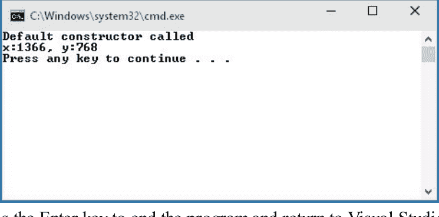

### 14. Press the Enter key to end the program and return to Visual Studio 2015.

You will now add two `int` fields to the `Point` class to represent the x- and y-coordinates of a point, and you will modify the constructors to initialize these fields.

### 15. Edit the `Point` class in the `Point.cs` file by adding two private fields, called `x` and `y`, of type `int`, as shown in bold type in the code that follows. The `Point` class should now look like this:

Click here to view code image

```
class Point
{
    private int x, y;

    public Point()
    {
        Console.WriteLine("default constructor called");
    }
}
```

```
public Point(int x, int y)
{
    Console.WriteLine($"x:{x}, y:{y}");
}
```

You will edit the second `Point` constructor to initialize the `x` and `y` fields to the values of the `x` and `y` parameters. There is a potential trap when you do this. If you are not careful, the constructor will look like this:

Click here to view code image

```
public Point(int x, int y) // Don't type this!
{
    x = x;
    y = y;
}
```

Although this code will compile, these statements appear to be ambiguous. How does the compiler know in the statement `x = x;` that the first `x` is the field and the second `x` is the parameter? The answer is that it doesn’t! A method parameter with the same name as a field hides the field for all statements in the method. All this code actually does is assign the parameters to themselves; it does not modify the fields at all. This is clearly not what you want.

The solution is to use the `this` keyword to qualify which variables are parameters and which are fields. Prefixing a variable with `this` means “the field in this object.”

### 16. Modify the `Point` constructor that takes two parameters by replacing the `Console.WriteLine` statement with the following code shown in bold type:

```
public Point(int x, int y)
{
    this.x = x;
    this.y = y;
}
```

### 17. Edit the default `Point` constructor to initialize the `x` and `y` fields to −1, as follows in bold type. Note that although there are no parameters to cause confusion, it is still good practice to qualify the field references with `this`:

```
public Point()
{
    this.x = -1;
    this.y = -1;
}
```

### 18. On the Build menu, click Build Solution. Confirm that the code compiles without errors or warnings. (You can run it, but it does not produce any output.)

Methods that belong to a class and that operate on the data belonging to a particular instance of a class are called *instance methods*. (You will learn about other types of methods later in this chapter.) In the following exercise, you will write an instance method for the *Point* class, called *DistanceTo*, which calculates the distance between two points.

### Write and call instance methods

- 1. In the Classes project in Visual Studio 2015, add the following public instance method called *DistanceTo* to the *Point* class after the constructors. The method accepts a single *Point* argument called *other* and returns a *double*.

The *DistanceTo* method should look like this:

Click here to view code image

```
class Point
{
    ...
    public double DistanceTo(Point other)
    {
    }
}
```

In the following steps, you will add code to the body of the *DistanceTo* instance method to calculate and return the distance between the *Point* object being used to make the call and the *Point* object passed as a parameter. To do this, you must calculate the difference between the x-coordinates and the y-coordinates.

- 2. In the *DistanceTo* method, declare a local *int* variable called *xDiff* and initialize it with the difference between *this.x* and *other.x*, as shown below in bold type:

Click here to view code image

```
public double DistanceTo(Point other)
{
    int xDiff = this.x - other.x;
}
```

- 3. Declare another local *int* variable called *yDiff* and initialize it with the difference between *this.y* and *other.y*, as shown here in bold type:

Click here to view code image

```
public double DistanceTo(Point other)
{
    int xDiff = this.x - other.x;
    int yDiff = this.y - other.y;
}
```

## Note

尽管 `x` 和 `y` 字段是私有的，但同一类的其他实例仍然可以访问它们。重要的是要理解，`private` 术语在类级别上操作，而不在对象级别上；同一类的两个对象可以访问彼此的私有数据，但其他类的实例对象则不能。

要计算距离，可以使用毕达哥拉斯定理并计算 `xDiff` 的平方与 `yDiff` 的平方之和的平方根。`System.Math` 类提供了 `Sqrt` 方法，可用于计算平方根。

4. 声明一个名为 `distance` 的 `double` 类型变量，并用前面描述的计算结果来保存它。

Click here to view code image

```
public double DistanceTo(Point other)
{
    int xDiff = this.x - other.x;
    int yDiff = this.y - other.y;
    double distance = Math.Sqrt((xDiff * xDiff) + (yDiff * yDiff));
}
```

5. 在 `DistanceTo` 方法末尾添加 `return` 语句并返回 `distance` 变量中的值：

Click here to view code image

```
public double DistanceTo(Point other)
{
    int xDiff = this.x - other.x;
    int yDiff = this.y - other.y;
    double distance = Math.Sqrt((xDiff * xDiff) + (yDiff * yDiff));
    return distance;
}
```

您现在将测试 `DistanceTo` 方法。

6. 返回 `Program` 类中的 `doWork` 方法。在声明并初始化 `origin` 和 `bottomRight` `Point` 变量的语句之后，声明一个名为 `distance` 的 `double` 类型变量。用调用 `origin` 对象的 `DistanceTo` 方法并将 `bottomRight` 对象作为参数传递给它时得到的结果来初始化这个 `double` 变量。

`doWork` 方法现在应如下所示：

Click here to view code image

```
static void doWork()
{
    Point origin = new Point();
    Point bottomRight = new Point(1366, 768);
    double distance = origin.DistanceTo(bottomRight);
}
```

## Note


当你在`origin`后输入句点字符时，Microsoft IntelliSense 应显示`DistanceTo`方法。

7. 在`doWork`方法中添加另一条语句，使用`Console.WriteLine`方法将`distance`变量的值写入控制台。

完成的`doWork`方法应如下所示：

```
static void doWork()
{
    Point origin = new Point();
    Point bottomRight = new Point(1366, 768);
    double distance = origin.DistanceTo(bottomRight);
    Console.WriteLine($"Distance is: {distance}");
}
```

8. 在 Debug 菜单上，单击 `Start Without Debugging`。

9. 确认值 1568.45465347265 已写入控制台窗口，然后按 Enter 关闭应用程序并返回 Visual Studio 2015。

## Understanding static methods and data

在前面的练习中，您使用了`Math`类的`Sqrt`方法。同样地，在查看`Circle`类时，您读取了`Math`类的`PI`字段。如果仔细想想，您调用`Sqrt`方法或读取`PI`字段的方式有点奇怪。您是在类本身上调用方法或读取字段，而不是在`Math`类型的对象上。就像在前面的练习中添加的代码里试图写`Point.DistanceTo`而不是`origin.DistanceTo`一样。那么发生了什么，以及这是如何工作的？

您经常会发现并非所有方法都自然属于类的实例；它们是实用方法，因为它们提供了一个有用的功能，该功能独立于任何特定的类实例。`Console`类的`WriteLine`方法在整本书中被广泛使用，这是一个常见的例子。`Sqrt`方法是另一个例子。如果`Sqrt`是`Math`的实例方法，您就必须创建一个`Math`对象来调用`Sqrt`：

```
Math m = new Math();
double d = m.Sqrt(42.24);
```

这会很麻烦。`Math`对象在计算平方根中不会发挥任何作用。`Sqrt`所需的所有输入数据都提供在参数列表中，并且结果通过方法的返回值传递回调用者。这里根本不需要对象，因此强行将`Sqrt`放入实例的束缚中并不是一个好主意。

**Note:** 除了包含`Sqrt`方法和`PI`字段之外，`Math`类还包含许多其他数学实用方法，例如`Sin`、`Cos`、`Tan`和`Log`。

在 C# 中，所有方法都必须在类中声明。但是，如果将方法或字段声明为`static`，您就可以使用类名来调用方法或访问字段，而不需要实例。这就是`Math`类的`Sqrt`方法的声明方式：

```
class Math
{
    public static double Sqrt(double d)
    {
        ...
    }
    ...
}
```

您可以这样调用`Sqrt`方法：

```
double d = Math.Sqrt(42.24);
```

静态方法不依赖于类的实例，并且不能访问类中定义的任何实例字段或实例方法；它只能使用标记为`static`的字段和其他方法。

## Creating a shared field

将字段定义为`static`使您能够为从单个类创建的所有对象创建一个共享的字段实例。（非静态字段对每个对象实例都是本地的。）在下面的示例中，`Circle`类中的静态字段`NumCircles`在每次创建新的`Circle`对象时都会由`Circle`构造函数递增：

```
class Circle
{
    private int radius;
    public static int NumCircles = 0;

    public Circle() // default constructor
    {
        radius = 0;
        NumCircles++;
    }

    public Circle(int initialRadius) // overloaded constructor
    {
        radius = initialRadius;
        NumCircles++;
    }
}
```

所有`Circle`对象共享同一个`NumCircles`字段的实例，因此语句`NumCircles++;`每次创建新实例时都会递增相同的数据。请注意，您不能使用`this`关键字为`NumCircles`加前缀，因为`NumCircles`不属于特定对象。

您可以通过指定`Circle`类而不是`Circle`对象从类外部访问`NumCircles`字段，如以下示例所示：

```
Console.WriteLine($"Number of Circle objects: {Circle.NumCircles}");
```

**Note:** 请记住，静态方法也称为类方法。然而，静态字段通常不称为类字段；它们只是称为静态字段（或有时称为静态变量）。

## Creating a static field by using the `const` keyword

通过在字段前加上`const`关键字，您可以声明该字段是`static`的，但其值永远不会改变。关键字`const`是 constant 的缩写。`const`字段在其声明中不使用`static`关键字，但仍然是`static`的。然而，出于超出本书范围的原因，您只能在字段为数值类型（例如`int`或`double`）、字符串或枚举时声明字段为`const`。（您将在第 9 章“使用枚举和结构创建值类型”中了解有关枚举的信息。）例如，这里是`Math`类如何将`PI`声明为`const`字段：

```
class Math
{
    ...
    public const double PI = 3.14159265358979;
}
```

## Understanding static classes

C# 语言的另一个特性是能够将类声明为`static`。静态类只能包含静态成员。（使用该类创建的所有对象共享这些成员的单个副本。）静态类的目的是纯粹充当实用方法和字段的持有者。静态类不能包含任何实例数据或方法，并且使用`new`运算符从静态类创建对象是没有意义的。事实上，即使你想这样做，你也不能使用`new`来创建静态类的实例。（如果尝试，编译器会报告错误。）如果需要执行任何初始化，静态类可以有一个默认构造函数，只要它也被声明为`static`。任何其他类型的构造函数都是非法的，并且会被编译器报告。

如果您要定义自己的`Math`类版本，其中只包含静态成员，它可能看起来像这样：

```
public static class Math
{
    public static double Sin(double x) {...}
    public static double Cos(double x) {...}
    public static double Sqrt(double x) {...}
    ...
}
```

**Note:** 真正的`Math`类并非以这种方式定义，因为它实际上确实有一些实例方法。

## Static `using` statements

每当您调用静态方法或引用静态字段时，您必须指定方法或字段所属的类，例如`Math.Sqrt`或`Console.WriteLine`。静态`using`语句使您能够将类引入作用域，并在访问静态成员时省略类名。它们的工作方式与将命名空间引入作用域的普通`using`语句非常相似。下面的示例说明了如何使用它们：

```
using static System.Math;
using static System.Console;
...
```

```
var root = Sqrt(99.9);
WriteLine($"The square root of 99.9 is {root}");
```

请注意`using`语句中关键字`static`的用法。示例将`System.Math`和`System.Console`类的静态方法引入作用域（你必须使用其命名空间完全限定类名）。然后你就可以直接调用`Sqrt`和`WriteLine`方法。编译器会推断出每个方法属于哪个类。然而，这里存在一个潜在的维护问题。虽然你输入的代码更少，但你必须权衡这一点与他人维护你的代码时所需额外努力之间的关系，因为此时已不清晰每个方法属于哪个类。Visual Studio 中的 IntelliSense 在一定程度上有所帮助，但对于阅读代码的开发人员来说，当他们试图追踪错误原因时，这可能会使问题变得模糊。使用静态`using`语句时要谨慎；作者的首选风格是不使用它们，但你可以自行选择！

在本章的最后一个练习中，你将在`Point`类中添加一个私有静态字段并将其初始化为 0。你将在两个构造函数中递增此计数。最后，你将编写一个公共静态方法来返回此私有静态字段的值。有了这个字段，你就可以知道创建了多少个`Point`对象。

## 编写静态成员并调用静态方法

- 1. 在 Visual Studio 2015 中，在代码和文本编辑器窗口中显示`Point`类。

- 2. 在`Point`类中紧邻构造函数之前添加一个名为`objectCount`的私有静态字段，类型为`int`。在声明时将其初始化为 0，如下所示：

```
class Point
{
    ...
    private static int objectCount = 0;
    ...
}
```

**Note:** 当你声明`objectCount`这样的字段时，可以以任意顺序编写关键字`private`和`static`。然而，首选的顺序是`private`在前，`static`在后。

- 3. 在两个`Point`构造函数中添加语句以递增`objectCount`字段，如以下代码示例中以粗体显示的那样。

`Point`类现在应如下所示：

```
class Point
{
    private int x, y;
    private static int objectCount = 0;

    public Point()
    {
        this.x = -1;
        this.y = -1;
        objectCount++;
    }

    public Point(int x, int y)
    {
        this.x = x;
        this.y = y;
        objectCount++;
    }
    public double DistanceTo(Point other)
    {
        int xDiff = this.x - other.x;
        int yDiff = this.y - other.y;
        double distance = Math.Sqrt((xDiff * xDiff) + (yDiff * yDiff));
        return distance;
    }
}
```

每次创建对象时，其构造函数都会被调用。只要你在每个构造函数（包括默认构造函数）中递增`objectCount`，`objectCount`就会保存到目前为止创建的对象数量。这种策略之所以有效，是因为`objectCount`是一个共享的静态字段。如果`objectCount`是一个实例字段，每个对象将拥有自己的`objectCount`字段，其值将被设置为 1。

现在的问题是：`Point`类的用户如何得知创建了多少个`Point`对象？目前，`objectCount`字段是私有的，在类外部不可用。一个糟糕的解决方案是使`objectCount`字段公开可访问。这种策略会破坏类的封装性，而且你无法保证`objectCount`字段的值是正确的，因为任何人都可以更改该字段中的值。更好的做法是提供一个返回`objectCount`字段值的公共静态方法。这就是你现在要做的。

4. 在`Point`类中添加一个名为`ObjectCount`的公共静态方法，返回`int`但不接受任何参数。此方法应返回`objectCount`字段的值，如下以粗体显示：

```
class Point
{
    ...
    public static int ObjectCount() => objectCount;
}
```

5. 在代码和文本编辑器窗口中显示`Program`类。在`doWork`方法中添加一条语句，将`Point`类的`ObjectCount`方法返回的值写入屏幕，如以下代码示例中以粗体显示的那样：

```
static void doWork()
{
    Point origin = new Point();
    Point bottomRight = new Point(1366, 768);
    double distance = origin.distanceTo(bottomRight);
    Console.WriteLine($"Distance is: {distance}");
    Console.WriteLine($"Number of Point objects: {Point.ObjectCount()}");
}
```

`ObjectCount`方法是通过引用`Point`，即类名，而不是`Point`变量的名称（如`origin`或`bottomRight`）来调用的。由于在调用`ObjectCount`时已经创建了两个`Point`对象，该方法应返回值为 2。

6. 在 Debug 菜单上，单击 `Start Without Debugging`。

确认控制台窗口中写入了消息“Number of Point objects: 2”（在显示`distance`变量值的消息之后）。

7. 按 Enter 关闭程序并返回到 Visual Studio 2015。

## 匿名类

匿名类是没有名称的类。这听起来很奇怪，但在本书后面你会看到的某些情况下它非常方便，特别是在使用查询表达式时。（你在第 20 章“解耦应用程序逻辑和处理事件”中学习查询表达式。）目前，你只能相信它们是有用的。

你只需使用`new`关键字和一对定义你想要类包含的字段和值的花括号，就能创建匿名类，如下所示：

```
myAnonymousObject = new { Name = "John", Age = 47 };
```

此类包含名为`Name`（初始化为字符串“John”）和`Age`（初始化为整数 47）的公共字段。编译器根据你指定的用于初始化它们的数据类型推断字段的类型。

当你定义匿名类时，编译器会为该类生成自己的名称，但它不会告诉你它是什么。因此，匿名类引发了一个可能有趣的难题：如果不知道类的名称，如何创建适当类型对象并将其分配给它？在前面显示的代码示例中，变量`myAnonymousObject`的类型应该是什么？答案是你不知道——这正是匿名类的意义所在！然而，如果你使用`var`关键字将`myAnonymousObject`声明为隐式类型变量，就不是问题，如下所示：

```
var myAnonymousObject = new { Name = "John", Age = 47 };
```

请记住，`var`关键字会使编译器创建与用于初始化它的表达式类型相同的变量。在这种情况下，表达式的类型是编译器为匿名类生成的名称。

你可以通过使用熟悉的点号表示法访问对象中的字段，如下所示：

```
Console.WriteLine($"Name: {myAnonymousObject.Name} Age: {myAnonymousObject.Age}");
```

你甚至可以创建同一匿名类的其他实例，但使用不同的值，如下所示：

```
var anotherAnonymousObject = new { Name = "Diana", Age = 46 };
```

C# 编译器使用字段的名称、类型、数量和顺序来确定两个匿名类实例是否具有相同的类型。在这种情况下，变量`myAnonymousObject`和`anotherAnonymousObject`具有相同数量的字段，名称和类型相同，顺序也相同，因此两个变量都是同一匿名类的实例。这意味着你可以执行如下赋值语句：

```
anotherAnonymousObject = myAnonymousObject;
```

**Note:** 请注意，此赋值语句可能无法实现你所期望的效果。你将在第 8 章了解更多关于为对象变量赋值的知识。


匿名类的内容有相当多的限制。例如，匿名类只能包含 `public` 字段，字段必须全部初始化，它们不能是 `static`，并且你不能为它们定义任何方法。你将在本书中定期使用匿名类，并在使用过程中了解更多关于它们的信息。

### Summary

在本章中，你学习了如何定义新的类。你了解到默认情况下类的字段和方法是 `private`，对类外部的代码不可访问，但你可以使用 `public` 关键字将字段和方法暴露给外部世界。你学习了如何使用 `new` 关键字创建类的新实例，以及如何定义可以在创建时初始化类实例的构造函数。最后，你学习了如何实现 `static` 字段和方法，以提供与类的任何特定实例无关的数据和操作。

- 如果你想继续阅读下一章，请保持 Visual Studio 2015 运行并翻到第 8 章。
- 如果你现在想退出 Visual Studio 2015，请在 File 菜单上单击 Exit。如果出现 Save 对话框，请单击 Yes 并保存项目。

### Quick reference

| To | Do this |
|---|---|
| Declare a class | Write the keyword `class`, followed by the name of the class, followed by opening and closing braces. The methods and fields of the class are declared between the opening and closing braces. For example:<br><br>```csharp<br>class Point<br>{<br>    ...<br>}<br>``` |
| Declare a constructor | Write a method whose name is the same as the name of the class and that has no return type (not even `void`). For example:<br><br>```csharp<br>class Point<br>{<br>    public Point(int x, int y)<br>    {<br>        ...<br>    }<br>}<br>``` |
| Call a constructor | Use the `new` keyword and specify the constructor with an appropriate set of parameters. For example:<br><br>```csharp<br>Point origin = new Point(0, 0);<br>``` |
| Declare a static method | Write the keyword `static` before the declaration of the method. For example:<br><br>```csharp<br>class Point<br>{<br>    public static int ObjectCount()<br>    {<br>        ...<br>    }<br>}<br>``` |
| Call a static method | Write the name of the class, followed by a period, followed by the name of the method. For example:<br><br>```csharp<br>int pointsCreatedSoFar = Point.ObjectCount();<br>``` |
| Declare a static field | Use the keyword `static` before the type of the field. For example:<br><br>```csharp<br>class Point<br>{<br>    ...<br>    private static int objectCount;<br>}<br>``` |
| Declare a const field | Write the keyword `const` before the declaration of the field and omit the `static` keyword. For example:<br><br>```csharp<br>class Math<br>{<br>    ...<br>    public const double PI = ...;<br>}<br>``` |
| Access a static field | Write the name of the class, followed by a period, followed by the name of the static field. For example:<br><br>```csharp<br>double area = Math.PI * radius * radius;<br>``` |

## Chapter 8. Understanding values and references

完成本章后，你将能够：

- Explain the differences between a value type and a reference type.
- Modify the way in which arguments are passed as method parameters by using the `ref` and `out` keywords.
- Convert a value into a reference by using boxing.
- Convert a reference back to a value by using unboxing and casting.

第 7 章“Creating and managing classes and objects”演示了如何声明自己的类以及如何使用 `new` 关键字创建对象。该章还向你展示了如何使用构造函数初始化对象。在本章中，你将学习原始类型（如 `int`、`double` 和 `char`）的特性与类类型的特性有何不同。

## Copying value type variables and classes

C# 内置的大多数原始类型，如 `int`、`float`、`double` 和 `char`（但不包括 `string`，原因稍后会说明）统称为值类型。这些类型具有固定大小，当你将变量声明为值类型时，编译器会生成代码分配一块足够大的内存来保存相应的值。例如，声明一个 `int` 变量会导致编译器分配 4 字节内存（32 位）来保存整数值。将值（如 42）赋给 `int` 的语句会将该值复制到这块内存中。

像 `Circle`（在第 7 章中描述）这样的类类型则处理方式不同。当你声明一个 `Circle` 变量时，编译器不会生成分配一块足够大以容纳 `Circle` 的内存的代码；它只分配一小块内存，可以潜在地保存指向包含 `Circle` 的另一块内存的地址（或引用）。（地址指定了内存中某项的位置。）实际 `Circle` 对象的内存只有在使用 `new` 关键字创建对象时才会被分配。类是引用类型的一个例子。引用类型保存对内存块的引用。要编写充分利用 Microsoft .NET Framework 的有效 C# 程序，你需要理解值类型和引用类型之间的区别。

## Note

C# 中的 `string` 类型实际上是一个类。这是因为字符串没有标准大小（不同的字符串可以包含不同数量的字符），并且在程序运行时动态分配内存给字符串比在编译时静态分配要高效得多。本章中对类等引用类型的描述同样适用于 `string` 类型。事实上，C# 中的 `string` 关键字只是 `System.String` 类的别名。

考虑一种情况，你声明一个名为 `i` 的 `int` 变量并将其赋值为 42。如果声明另一个名为 `copyi` 的 `int` 变量然后将 `i` 赋给 `copyi`，`copyi` 将持有与 `i` 相同的值（42）。然而，即使 `copyi` 和 `i` 恰好持有相同的值，两个内存块中都包含值 42：一个块用于 `i`，另一个块用于 `copyi`。如果你修改 `i` 的值，`copyi` 的值不会改变。让我们在代码中看看这一点：

Click here to view code image

```csharp
int i = 42;      // declare and initialize i
int copyi = i; /* copyi contains a copy of the data in i:
                  i and copyi both contain the value 42 */
i++;             /* incrementing i has no effect on copyi;
                  i now contains 43, but copyi still contains 42 */
```

声明一个类类型的变量 `c`，例如 `Circle`，其效果非常不同。当你将 `c` 声明为 `Circle` 时，`c` 可以引用一个 `Circle` 对象；`c` 所持有的实际值是内存中 `Circle` 对象的地址。如果你再声明一个名为 `refc` 的额外变量（同样是 `Circle`）并将 `c` 赋给 `refc`，`refc` 将拥有与 `c` 相同的地址的副本；换句话说，只有一个 `Circle` 对象，而 `refc` 和 `c` 现在都引用它。以下是代码示例：

```csharp
Circle c = new Circle(42);
Circle refc = c;
```

下图显示了这两个示例。Circle 对象中的 at 符号（@）代表内存中的地址引用：

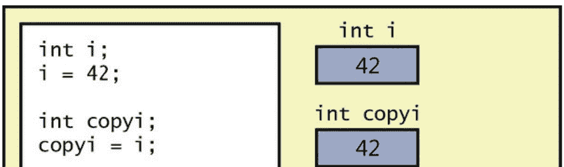

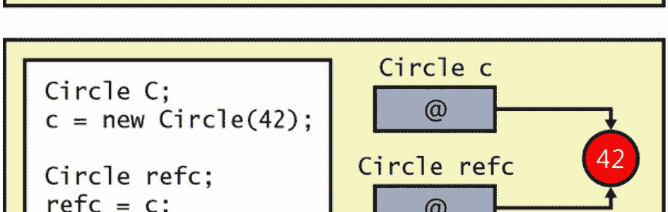

这种差异非常重要。特别是，这意味着方法参数的行为取决于它们是值类型还是引用类型。你将在下一个练习中探索这种差异。

## Copying reference types and data privacy

如果你实际上想将 `Circle` 对象 `c` 的内容复制到另一个 `Circle` 对象 `refc` 中，而不是仅仅复制引用，你必须使 `refc` 引用 `Circle` 类的新实例，然后逐字段地将数据从 `c` 复制到 `refc`，像这样：

Click here to view code image

```csharp
Circle refc = new Circle();
refc.radius = c.radius;    // Don't try this
```

然而，如果 `Circle` 类的任何成员是 `private`（像 `radius` 字段），你将无法复制此数据。相反，你可以通过将它们公开为属性来使私有字段中的数据可访问，然后使用这些属性从 `c` 读取数据并将其复制到 `refc`。你将在第 15 章“Implementing properties to access fields”中学习如何做到这一点。

或者，一个类可以提供一个 `Clone` 方法，该方法返回同一类的另一个实例，但填充了相同的数据。`Clone` 方法可以访问对象中的私有数据，并可以直接将其复制到同一类的另一个实例。例如，`Circle` 类的克隆方法可以定义如下所示：

Click here to view code image

```csharp
class Circle
{
    private int radius;
    // Constructors and other methods omitted
    ...
    public Circle Clone()
    {
        // Create a new Circle object
        Circle clone = new Circle();

        // Copy private data from this to clone
        clone.radius = this.radius;

        // Return the new Circle object containing the copied data
        return clone;
    }
}
```

如果所有私有数据都由值组成，这种方法很直接，但如果一个或多个字段本身是引用类型（例如，`Circle` 类可能扩展为包含第 7 章中的 `Point` 对象，表示 `Circle` 在图表上的位置），这些引用类型也需要提供 `Clone` 方法；否则，`Circle` 类的 `Clone` 方法将只复制对这些字段的引用。此过程称为深度复制。另一种方法，即 `Clone` 方法仅复制引用，被称为浅复制。

前面的代码示例也提出了一个有趣的问题：私有数据有多私有？之前你看到 `private` 关键字使字段或方法在类外部无法访问。然而，这并不意味着它只能被单个对象访问。如果你创建同一类的两个对象，它们可以在该类的代码中相互访问对方的私有数据。这听起来很奇怪，但实际上 `Clone` 等方法依赖于此特性。语句 `clone.radius = this.radius;` 只有在当前 `Circle` 类实例内部可以访问克隆对象的私有 `radius` 字段时才有效。因此，`private` 实际上意味着“私有于类”而不是“私有于对象”。然而，不要将 `private` 与 `static` 混淆。如果你简单地将字段声明为 `private`，每个类的实例都有自己的数据。如果字段声明为 `static`，每个类的实例共享相同的数据。

## 使用值参数和引用参数

1. 如果尚未运行，请启动 Microsoft Visual Studio 2015。
2. 打开 Parameters 项目，该项目位于你的 Documents 文件夹中的 `\Microsoft Press\VCSBS\Chapter 8\Parameters` 文件夹中。

   该项目包含三个 C# 代码文件：`Pass.cs`、`Program.cs` 和 `WrappedInt.cs`。

3. 在代码和文本编辑器窗口中显示 `Pass.cs` 文件。

   该文件定义了一个名为 `Pass` 的类，目前除了一个 `// TODO:` 注释外为空。

### Tip

记住你可以使用任务列表窗口来定位解决方案中的所有 TODO 注释。

4. 在 `Pass` 类中添加一个名为 `Value` 的 `public static` 方法，替换 `// TODO:` 注释。此方法应接受一个名为 `param` 的单个 `int` 参数（值类型），返回类型为 `void`。`Value` 方法的主体应简单地将值 42 分配给 `param`，如下代码示例中的粗体所示：

Click here to view code image

```csharp
namespace Parameters
{
    class Pass
    {
        public static void Value(int param)
        {
            param = 42;
        }
    }
}
```

### Note

你使用 `static` 关键字定义此方法的原因是为了保持练习简单。你可以在不先创建新的 `Pass` 对象的情况下直接在 `Pass` 类上调用 `Value` 方法。此练习中说明的原理以完全相同的方式适用于实例方法。

5. 在代码和文本编辑器窗口中显示 `Program.cs` 文件，然后找到 `Program` 类的 `doWork` 方法。

   `doWork` 方法由程序启动时 `Main` 方法调用。如第 7 章所述，方法调用被包裹在 `try` 块中，并在其后跟随 `catch` 处理程序。

6. 向 `doWork` 方法添加四个语句以执行以下任务：

   - a. 声明一个名为 `i` 的局部 `int` 变量并将其初始化为 0。
   - b. 使用 `Console.WriteLine` 将 `i` 的值写入控制台。
   - c. 调用 `Pass.Value`，将 `i` 作为参数传递。
   - d. 再次将 `i` 的值写入控制台。

   通过在调用 `Pass.Value` 之前和之后调用 `Console.WriteLine`，你可以看到调用 `Pass.Value` 是否实际修改了 `i` 的值。完成的 `doWork` 方法应完全如下所示：

```csharp
static void doWork()
{
    int i = 0;
    Console.WriteLine(i);
    Pass.Value(i);
    Console.WriteLine(i);
}
```

7. 在 Debug 菜单上，单击 Start Without Debugging 以构建并运行程序。
8. 确认值“0”两次写入控制台窗口。

   `Pass.Value` 方法内部的赋值语句更新参数并将其设置为 42，使用的是传入参数的副本，并且原始参数 `i` 完全不受影响。

9. 按 Enter 键关闭应用程序。

   你现在将看到传递被包装在类中的 `int` 参数时会发生什么。

10. 在代码和文本编辑器窗口中显示 `WrappedInt.cs` 文件。此文件包含 `WrappedInt` 类，除了一个 `// TODO:` 注释外为空。

11. 向 `WrappedInt` 类添加一个名为 `Number` 的 `public` 实例字段，类型为 `int`，如以下代码中的粗体所示：

```csharp
namespace Parameters
{
    class WrappedInt
    {
        public int Number;
    }
}
```

12. 在代码和文本编辑器窗口中显示 `Pass.cs` 文件。向 `Pass` 类添加一个名为 `Reference` 的 `public static` 方法。此方法应接受一个名为 `param` 的单个 `WrappedInt` 参数，返回类型为 `void`。`Reference` 方法的主体应将 42 分配给 `param.Number`，如下所示：

Click here to view code image

```csharp
public static void Reference(WrappedInt param)
{
    param.Number = 42;
}
```

13. 在代码和文本编辑器窗口中显示 `Program.cs` 文件。注释掉 `doWork` 方法中的现有代码并添加四个更多语句以执行以下任务：

- a. 声明一个名为 `wi` 的局部 `WrappedInt` 变量并将其初始化为通过调用默认构造函数创建的新 `WrappedInt` 对象。
- b. 将 `wi.Number` 的值写入控制台。


- c. 调用 `Pass.Reference` 方法，将 `wi` 作为参数传递。

- d. 再次将 `wi.Number` 的值写入控制台。

与之前一样，通过 `Console.WriteLine` 的调用，你可以看到调用 `Pass.Reference` 是否修改了 `wi.Number` 的值。`doWork` 方法现在应完全如下所示（新语句以粗体突出显示）：

Click here to view code image

```
static void doWork()
{
    // int i = 0;
    // Console.WriteLine(i);
    // Pass.Value(i);
    // Console.WriteLine(i);

    WrappedInt wi = new WrappedInt();
    Console.WriteLine(wi.Number);
    Pass.Reference(wi);
    Console.WriteLine(wi.Number);
}
```

### 14. 在 Debug 菜单上，单击 Start Without Debugging 以构建并运行应用程序。

这次，控制台窗口中显示的两个值对应于调用 `Pass.Reference` 方法之前和之后 `wi.Number` 的值。你应该会看到显示值 0 和 42。

### 15. 按 Enter 键关闭应用程序并返回到 Visual Studio 2015。

要解释之前的练习显示的内容，`wi.Number` 的值由编译器生成的默认构造函数初始化为 0。`wi` 变量包含对新创建的 `WrappedInt` 对象（其中包含一个 `int`）的引用。然后 `wi` 变量作为参数复制到 `Pass.Reference` 方法。因为 `WrappedInt` 是一个类（引用类型），`wi` 和 `param` 都引用同一个 `WrappedInt` 对象。通过 `Pass.Reference` 方法中的 `param` 变量对对象内容所做的任何更改，都可以通过方法完成时使用 `wi` 变量来看到。下面的图表说明了将 `WrappedInt` 对象作为参数传递给 `Pass.Reference` 方法时会发生什么：

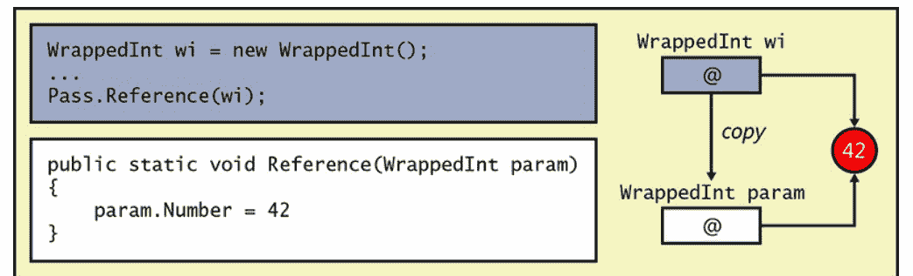

## 理解 null 值和可空类型

当你声明一个变量时，始终最好对其进行初始化。对于值类型，常见的代码如下：

```
int i = 0;
double d = 0.0;
```

记住，要初始化诸如类之类的引用变量，你可以创建类的一个新实例并将引用变量分配给新对象，如下所示：

```
Circle c = new Circle(42);
```

这都很好，但如果实际上你并不想创建新对象怎么办？也许变量的目的是在程序的稍后阶段简单地存储对现有对象的引用。在以下代码示例中，`Circle` 变量 `copy` 被初始化，但后来它被分配了对 `Circle` 类的另一个实例的引用：

Click here to view code image

```
Circle c = new Circle(42);
Circle copy = new Circle(99);  // Some random value, for
initializing copy
...
copy = c;                  // copy and c refer to the same
object
```

将 `c` 分配给 `copy` 后，你用来初始化 `copy` 的半径为 99 的原始 `Circle` 对象会发生什么？没有任何东西再引用它了。在此 situation，运行时可以通过执行称为 *垃圾回收* 的操作来回收内存，你将在第 14 章“使用垃圾回收和资源管理”中了解更多相关内容。现在需要理解的重要一点是，垃圾回收是一个可能耗时的操作；你不应该创建永远不会使用的对象，因为这样做会浪费时间和资源。

你可以争辩说，如果程序中某个变量最终会被赋值为另一个对象的引用，那么初始化它就没有意义了。但这是一种糟糕的编程实践，可能会导致代码出现问题。例如，你不可避免地会遇到想要仅在该变量尚未包含引用时才将变量引用到一个对象的情况，如以下代码示例所示：

Click here to view code image

```
Circle c = new Circle(42);
Circle copy;                  // Uninitialized !!!
...
if (copy == // only assign to copy if it is uninitialized, but what goes here?)
{
    copy = c;                  // copy and c refer to the same object
    ...
}
```

*if* 语句的目的是测试 *copy* 变量是否已初始化，但你应该将此变量与哪个值进行比较？答案是使用一个特殊值 *null*。

在 C# 中，你可以将 *null* 值赋给任何引用变量。*null* 值仅表示该变量不引用内存中的对象。你可以这样使用它：

Click here to view code image

```
Circle c = new Circle(42);
Circle copy = null;          // Initialized
...
if (copy == null)
{
    copy = c;                  // copy and c refer to the same object
    ...
}
```

## Null-conditional operators

最新版本的 C# 包含一个新运算符，即 null 条件运算符，它使你能够更简洁地测试 null 值。要使用 null 条件运算符，你只需在变量名称后附加一个问号（?）。

例如，假设你尝试在 `Circle` 对象具有 `null` 值时调用 `Circle` 对象的 `Area` 方法：

Click here to view code image

```
Circle c = null;
Console.WriteLine($"The area of circle c is {c.Area()}");
```

在这种情况下，`Circle.Area` 方法会抛出 `NullReferenceException`，这是有意义的，因为你无法计算不存在的圆的面积。

为了避免此异常，你可以在尝试调用 `Circle.Area` 方法之前先测试 `Circle` 对象是否为空：

Click here to view code image

```
if (c != null)
{
    Console.WriteLine($"The area of circle c is {c.Area()}");
}
```

在这种情况下，如果 `c` 为 `null`，则不会向命令窗口写入任何内容。或者，你也可以在尝试调用 `Circle.Area` 方法之前对 `Circle` 对象使用 null 条件运算符：

Click here to view code image

```
Console.WriteLine($"The area of circle c is {c?.Area()}");
```

null 条件运算符告诉运行时引擎，如果你对该运算符应用的变量为 `null`，则忽略当前语句。在这种情况下，命令窗口将显示以下文本：

```
The area of circle c is
```

这两种方法都是有效的，并且可能在不同场景下满足你的需求。null 条件运算符可以帮助你使代码更简洁，特别是当你处理包含可能全部为 `null` 值的嵌套引用类型的复杂属性时。

## Using nullable types

`null` 值对于初始化引用类型很有用。有时，你需要为值类型提供等效值，但 `null` 本身是一个引用，因此你无法将其赋给值类型。因此，以下语句在 C# 中是非法的：

```
int i = null; // illegal
```

然而，C# 定义了一个修饰符，你可以使用它来声明变量为 *nullable* 值类型。nullable 值类型与原始值类型以类似的方式表现，但你可以为其赋 *null* 值。你使用问号（?）来指示值类型为 nullable，如下所示：

```
int? i = null; // legal
```

你可以通过与测试引用类型相同的方式来确定 nullable 变量是否包含 *null*。

```
if (i == null)
    ...
```

你可以将适当值类型的表达式直接赋给 nullable 变量。以下示例都是合法的：

Click here to view code image

```
int? i = null;
int j = 99;
i = 100;      // Copy a value type constant to a nullable type
i = j;        // Copy a value type variable to a nullable type
```

你应该注意，反过来是不成立的。你不能将 nullable 变量赋给普通值类型变量。因此，给定前一个示例中变量 *i* 和 *j* 的定义，以下语句是不允许的：

```
j = i;      // Illegal
```

当你考虑到变量 *i* 可能包含 *null*，而 *j* 是不能包含 *null* 的值类型时，这是有意义的。这也意味着你不能将 nullable 变量用作期望普通值类型的方法的参数。如果回忆一下，前一个练习中的 *Pass.Value* 方法期望一个普通的 *int* 参数，因此以下方法调用将无法编译：

Click here to view code image

```
int? i = 99;
Pass.Value(i);    // Compiler error
```

### Note

请注意不要将 nullable 类型与 null 条件运算符混淆。nullable 类型是通过在类型名称后附加问号来表示的，而 null 条件运算符则是附加到变量名称上。

## Understanding the properties of nullable types

nullable 类型公开了一对属性，你可以使用它们来确定该类型是否实际具有非 null 值以及该值是什么。`HasValue` 属性指示 nullable 类型是否包含值或为 `null`。你可以通过读取 `Value` 属性来检索非 null nullable 类型的值，如下所示：

Click here to view code image

```
int? i = null;
...
if (!i.HasValue)
{
    // If i is null, then assign it the value 99
    i = 99;
}
else
{
    // If i is not null, then display its value
    Console.WriteLine(i.Value);
}
```

第 4 章“使用决策语句”说明 NOT 运算符（!）否定布尔值。此代码片段测试 nullable 变量 `i`，如果它没有值（为 `null`），则将其赋值为 99；否则，它会显示变量的值。在此示例中，使用 `HasValue` 属性与直接测试 `null` 值相比并无任何好处。此外，读取 `Value` 属性是读取变量内容的一种冗长方式。然而，这些明显的不足是由 `int?` 是一个非常简单的 nullable 类型这一事实造成的。你可以创建更复杂的值类型并使用它们声明 nullable 变量，在这种情况下使用 `HasValue` 和 `Value` 属性的优势会变得更加明显。你将在第 9 章“使用枚举和结构创建值类型”中看到一些示例。

### Note

nullable 类型的 `Value` 属性是只读的。你可以使用此属性读取变量的值，但不能修改它。要更新 nullable 变量，请使用普通的赋值语句。

## Using ref and out parameters

通常，当你向方法传递参数时，对应的参数会被参数的副本初始化。这无论参数是值类型（如 `int`）、nullable 类型（如 `int?`）还是引用类型（如 `WrappedInt`）都成立。这种安排意味着参数的任何更改都不会影响传入参数的值。例如，在以下代码中，输出到控制台的值是 42，而不是 43。*doIncrement* 方法递增的是参数（*arg*）的 *副本*，而不是原始参数，如下所示：

Click here to view code image

```
static void doIncrement(int param)
{
    param++;
}

static void Main()
{
    int arg = 42;
    doIncrement(arg);
    Console.WriteLine(arg); // writes 42, not 43
}
```

在前一个练习中，你看到如果方法的参数是引用类型，使用该参数所做的任何更改都会更改传入参数所引用的数据。关键点是：虽然引用的数据发生了更改，但作为参数传入的参数本身并未更改——它仍然引用同一个对象。换句话说，虽然可以通过参数修改参数所引用的对象，但无法修改参数本身（例如，使其引用完全不同的对象）。大多数情况下，这种保证非常有用，可以帮助减少程序中的错误。然而，有时你可能希望编写一个实际上需要修改参数的方法。C# 提供了 *ref* 和 *out* 关键字，使你能够做到这一点。

## Creating *ref* parameters

如果你在参数前加上 *ref* 关键字，C# 编译器会生成将实际参数的引用而非参数的副本传递的代码。使用 *ref* 参数时，对参数所做的任何操作也会对原始参数执行，因为参数和参数都引用相同的数据。当你将参数作为 *ref* 参数传递时，你还必须在参数前加上 *ref* 关键字。这种语法为程序员提供了有用的视觉提示，表明参数可能会发生变化。以下是前一个示例的修改版本，使用了 *ref* 关键字：

Click here to view code image

```
static void doIncrement(ref int param) // using ref
{
    param++;
}

static void Main()
```

```
{
    int arg = 42;
    doIncrement(ref arg);    // using ref
    Console.WriteLine(arg);  // writes 43
}
```

这次，`doIncrement` 方法接收的是原始参数的引用而不是副本，因此方法通过此引用所做的任何更改都会实际改变原始值。这就是为什么控制台上显示的值为 43。

请记住，C# 强制执行必须在读取变量之前为其赋值这一规则。此规则也适用于方法参数；即使参数定义为 `ref` 参数，你也不能将未初始化的值作为参数传递给方法。例如，在下面的示例中，`arg` 未初始化，因此此代码无法编译。此失败的原因是 `doIncrement` 方法中的语句 `param++;` 实际上是 `arg++;` 的别名——而此操作仅在 `arg` 具有已定义值时才允许：

Click here to view code image

```
static void doIncrement(ref int param)
{
    param++;
}

static void Main()
{
    int arg;            // not initialized
    doIncrement(ref arg);
    Console.WriteLine(arg);
}
```

## Creating out parameters

编译器会检查在调用方法之前 `ref` 参数是否已被赋值。然而，可能存在你希望方法本身初始化参数的情况。你可以使用 `out` 关键字来实现这一点。

`out` 关键字在语法上与 `ref` 关键字相似。你可以用 `out` 关键字作为前缀来修饰一个参数，使其成为参数的别名。与使用 `ref` 时一样，对参数所做的任何操作也会对原始参数执行。当你将参数传递给 `out` 参数时，也必须用 `out` 关键字作为前缀。

关键字 `out` 是 `output` 的缩写。当你将 `out` 参数传递给方法时，该方法必须在完成或返回之前为其赋值，如以下示例所示：

Click here to view code image

```
static void doInitialize(out int param)
{
```

```
param = 42; // Initialize param before finishing
}
```

下面的示例无法编译，因为 `doInitialize` 没有为 `param` 赋值：

Click here to view code image

```
static void doInitialize(out int param)
{
    // Do nothing
}
```

由于 `out` 参数必须由方法赋值，因此允许你在不初始化其参数的情况下调用该方法。例如，下面的代码调用 `doInitialize` 来初始化变量 `arg`，然后将其显示在控制台上：

Click here to view code image

```
static void doInitialize(out int param)
{
    param = 42;
}

static void Main()
{
    int arg;                // not initialized
    doInitialize(out arg);  // legal
    Console.WriteLine(arg); // writes 42
}
```

你将在下一个练习中检查 `ref` 参数。

## Use ref parameters

+   1. Return to the Parameters project in Visual Studio 2015.

+   2. Display the Pass.cs file in the Code and Text Editor window.


### 3. Edit the Value method to accept its parameter as a ref parameter.

The `Value` method should look like this:

```
class Pass
{
    public static void Value(ref int param)
    {
        param = 42;
    }
    ...
}
```

### 4. Display the `Program.cs` file in the Code and Text Editor window.

### 5. Uncomment the first four statements. Notice that the third statement of the `doWork` method—`Pass.Value(i);`—indicates an error. The error occurs because the `Value` method now expects a `ref` parameter. Edit this statement so that the `Pass.Value` method call passes its argument as a `ref` parameter.

#### Note

Leave the four statements that create and test the `WrappedInt` object as they are.

The `doWork` method should now look like this:

```
class Program
{
    static void doWork()
    {
        int i = 0;
        Console.WriteLine(i);
        Pass.Value(ref i);
        Console.WriteLine(i);
        ...
    }
}
```

### 6. On the Debug menu, click Start Without Debugging to build and run the program.

This time, the first two values written to the console window are 0 and 42.

This result shows that the call to the `Pass.Value` method has successfully modified the argument `i`.

### 7. Press the Enter key to close the application and return to Visual Studio 2015.

#### Note

You can use the `ref` and `out` modifiers on reference type parameters as well as on value type parameters. The effect is exactly the same: the parameter becomes an alias for the argument.

## How computer memory is organized

Computers use memory to hold programs that are being executed and the data that those programs use. To understand the differences between value and reference types, it is helpful to understand how data is organized in memory.

Operating systems and language runtimes such as that used by C# frequently divide the memory used for holding data into two separate areas, each of which is managed in a distinct manner. These two areas of memory are traditionally called the *stack* and the *heap*. The stack and the heap serve different purposes, which are described here:

- When you call a method, the memory required for its parameters and its local variables is always acquired from the stack. When the method finishes (because it either returns or throws an exception), the memory acquired for the parameters and local variables is automatically released back to the stack and is available again when another method is called. Method parameters and local variables on the stack have a well-defined life span: they come into existence when the method starts, and they disappear as soon as the method completes.

#### Note

Actually, the same life span applies to variables defined in any block of code enclosed by opening and closing curly braces. In the following code example, the variable `i` is created when the body of the `while` loop starts, but it disappears when the `while` loop finishes and execution continues after the closing brace:

```
while (...)
{
    int i = ...; // i is created on the stack here
    ...
}
// i disappears from the stack here
```

- When you create an object (an instance of a class) by using the `new` keyword, the memory required to build the object is always acquired from the heap. You have seen that the same object can be referenced from several places by using reference variables. When the last reference to an object disappears, the memory used by the object becomes available again (although it might not be reclaimed immediately). Chapter 14 includes a more detailed discussion of how heap memory is reclaimed. Objects created on the heap therefore have a more indeterminate life span; an object is created by using the `new` keyword, but it disappears only sometime after the last reference to the object is removed.

#### Note

All value types are created on the stack. All reference types (objects) are created on the heap (although the reference itself is on the stack). Nullable types are actually reference types, and they are created on the heap.

The names `stack` and `heap` come from the way in which the runtime manages the memory:

- Stack memory is organized like a stack of boxes piled on top of one another. When a method is called, each parameter is put in a box that is placed on top of the stack. Each local variable is likewise assigned a box, and these are placed on top of the boxes already on the stack. When a method finishes, you can think of the boxes being removed from the stack.

- Heap memory is like a large pile of boxes strewn around a room rather than stacked neatly on top of one another. Each box has a label indicating whether it is in use. When a new object is created, the runtime searches for an empty box and allocates it to the object. The reference to the object is stored in a local variable on the stack. The runtime keeps track of the number of references to each box. (Remember that two variables can refer to the same object.) When the last reference disappears, the runtime marks the box as not in use, and at some point in the future it will empty the box and make it available.

## Using the stack and the heap

Now let’s examine what happens when a method named `Method` is called:

```
void Method(int param)
{
    Circle c;
    c = new Circle(param);
    ...
}
```

Suppose the argument passed into `param` is the value 42. When the method is called, a block of memory (just enough for an `int`) is allocated from the stack and initialized with the value 42. As execution moves inside the method, another block of memory big enough to hold a reference (a memory address) is also allocated from the stack but left uninitialized. This is for the `Circle` variable, `c`. Next, another piece of memory big enough for a `Circle` object is allocated from the heap. This is what the `new` keyword does. The `Circle` constructor runs to convert this raw heap memory to a `Circle` object. A reference to this `Circle` object is stored in the variable `c`. The following illustration shows the situation:

```
void Method(int param)
{
    Circle c;
    c = new Circle(param);
    ...
}
int param
42
Circle c
@
```

At this point, you should note two things:

- Although the object is stored on the heap, the reference to the object (the variable `c`) is stored on the stack.

- Heap memory is not infinite. If heap memory is exhausted, the `new` operator will throw an `OutOfMemoryException` exception and the object will not be created.

#### Note

The `Circle` constructor could also throw an exception. If it does, the memory allocated to the `Circle` object will be reclaimed and the value returned by the constructor will be `null`.

When the method ends, the parameters and local variables go out of scope. The memory acquired for `c` and for `param` is automatically released back to the stack. The runtime notes that the `Circle` object is no longer referenced and at some point in the future will arrange for its memory to be reclaimed by the heap. (See Chapter 14.)

## The System.Object class

One of the most important reference types in the .NET Framework is the `Object` class in the `System` namespace. To fully appreciate the significance of the `System.Object` class, you need to understand inheritance, which is described in Chapter 12, “Working with inheritance.” For the time being, simply accept that all classes are specialized types of `System.Object` and that you can use `System.Object` to create a variable that can refer to any reference type. `System.Object` is such an important class that C# provides the `object` keyword as an alias for `System.Object`. In your code, you can use `object` or you can write `System.Object`—they mean exactly the same thing.

#### Tip

Use the `object` keyword in preference to `System.Object`. It’s more direct, and it’s consistent with other keywords that are synonyms for classes (such as `string` for `System.String` and some others that are covered in Chapter 9).


In the following example, the variables `c` and `o` both refer to the same `Circle` object. The fact that the type of `c` is `Circle` and the type of `o` is `object` (the alias for `System.Object`) in effect provides two different views of the same item in memory.

```
Circle c;
c = new Circle(42);
object o;
o = c;
```

The following diagram illustrates how the variables `c` and `o` refer to the same item on the heap.

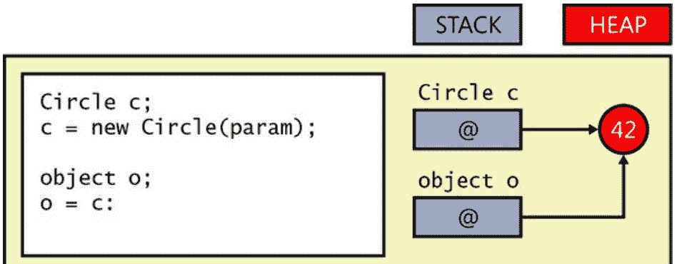

## Boxing

As you have just seen, variables of type `object` can refer to any item of any reference type. However, variables of type `object` can also refer to a value type. For example, the following two statements initialize the variable `i` (of type `int`, a value type) to 42 and then initialize the variable `o` (of type `object`, a reference type) to `i`:

```
int i = 42;
object o = i;
```

The second statement requires a little explanation to appreciate what is actually happening. Remember that `i` is a value type and that it lives on the stack. If the reference inside `o` referred directly to `i`, the reference would refer to the stack. However, all references must refer to objects on the heap; creating references to items on the stack could seriously compromise the robustness of the runtime and create a potential security flaw, so it is not allowed. Therefore, the runtime allocates a piece of memory from the heap, copies the value of integer `i` to this piece of memory, and then refers the object `o` to this copy. This automatic copying of an item from the stack to the heap is called boxing. The following diagram shows the result:

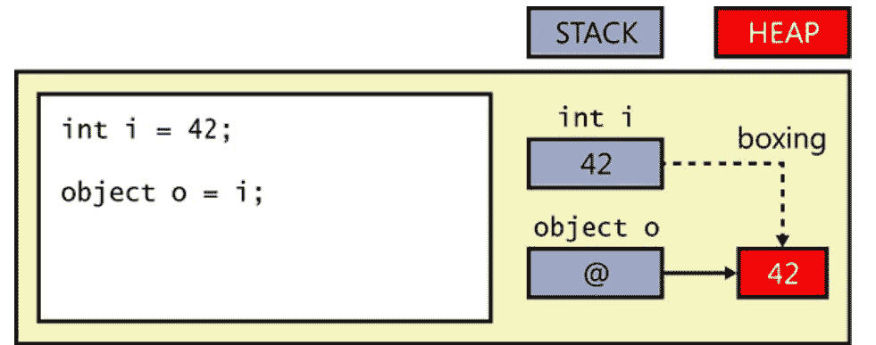

## Important

If you modify the original value of the variable `i`, the value on the heap referenced through `o` will not change. Likewise, if you modify the value on the heap, the original value of the variable will not change.

## Unboxing

Because a variable of type `object` can refer to a boxed copy of a value, it’s only reasonable to allow you to get at that boxed value through the variable. You might expect to be able to access the boxed `int` value that a variable `o` refers to by using a simple assignment statement such as this:

```
int i = o;
```

However, if you try this syntax, you’ll get a compile-time error. If you think about it, it’s pretty sensible that you can’t use the `int i = o;` syntax. After all, `o` could be referencing absolutely anything and not just an `int`. Consider what would happen in the following code if this statement were allowed:

```
Circle c = new Circle();
int i = 42;
object o;

o = c;  // o refers to a circle
i = o;  // what is stored in i?
```

To obtain the value of the boxed copy, you must use what is known as a cast. This is an operation that checks whether converting an item of one type to another is safe before actually making the copy. You prefix the `object` variable with the name of the type in parentheses, as in this example:

```
int i = 42;
object o = i; // boxes
i = (int)o;   // compiles okay
```

The effect of this cast is subtle. The compiler notices that you’ve specified the type `int` in the cast. Next, the compiler generates code to check what `o` actually refers to at run time. It could be absolutely anything. Just because your cast says `o` refers to an `int`, that doesn’t mean it actually does. If `o` really does refer to a boxed `int` and everything matches, the cast succeeds and the compiler-generated code extracts the value from the boxed `int` and copies it to `i`. (In this example, the boxed value is then stored in `i`.) This is called unboxing. The following diagram shows what is happening:

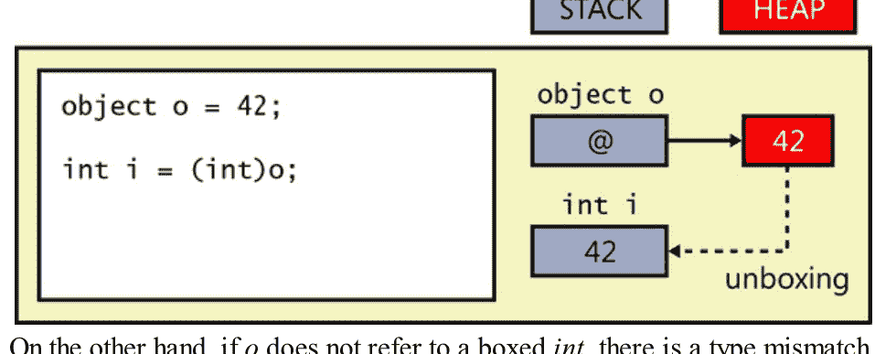

On the other hand, if `o` does not refer to a boxed `int`, there is a type mismatch, causing the cast to fail. The compiler-generated code throws an `InvalidCastException` exception at run time. Here’s an example of an unboxing cast that fails:

```
Circle c = new Circle(42);
object o = c;    // doesn't box because Circle is a reference variable
int i = (int)o;   // compiles okay but throws an exception at run time
```

The following diagram illustrates this case:

```
Circle c = new Circle(42);
object o = c;
int i = (int)o;
```

`throw InvalidCastException`

You will use boxing and unboxing in later exercises. Keep in mind that boxing and unboxing are expensive operations because of the amount of checking required and the need to allocate additional heap memory. Boxing has its uses, but injudicious use can severely impair the performance of a program. You will see an alternative to boxing in Chapter 17, "Introducing generics."

## Casting data safely

By using a cast, you can specify that, in your opinion, the data referenced by an object has a specific type and that it is safe to reference the object by using that type. The key phrase here is "in your opinion." The C# compiler will not check that this is the case, but the runtime will. If the type of object in memory does not match the cast, the runtime will throw an `InvalidCastException`, as described in the preceding section. You should be prepared to catch this exception and handle it appropriately if it occurs.

However, catching an exception and attempting to recover in the event that the type of an object is not what you expected it to be is a rather cumbersome approach. C# provides two more very useful operators that can help you perform casting in a much more elegant manner: the `is` and `as` operators.

## The `is` operator

You can use the `is` operator to verify that the type of an object is what you expect it to be, like this:

```
WrappedInt wi = new WrappedInt();
…
object o = wi;
if (o is WrappedInt)
{
    WrappedInt temp = (WrappedInt)o; // This is safe; o is a WrappedInt
    …
}
```

The `is` operator takes two operands: a reference to an object on the left, and the name of a type on the right. If the type of the object referenced on the heap has the specified type, `is` evaluates to `true`; otherwise, `is` evaluates to `false`. The preceding code attempts to cast the reference to the object variable `o` only if it knows that the cast will succeed.

## The `as` operator

The `as` operator fulfills a similar role to `is` but in a slightly truncated manner. You use the `as` operator like this:

```
WrappedInt wi = new WrappedInt();
…
object o = wi;
WrappedInt temp = o as WrappedInt;
if (temp != null)
{
    …  // Cast was successful
}
```

Like the `is` operator, the `as` operator takes an object and a type as its operands. The runtime attempts to cast the object to the specified type. If the cast is successful, the result is returned and, in this example, is assigned to the `WrappedInt` variable `temp`. If the cast is unsuccessful, the `as` operator evaluates to the `null` value and assigns that to `temp` instead.

There is a little more to the `is` and `as` operators than is described here, and Chapter 12 discusses them in greater detail.

## Pointers and unsafe code

This section is purely for your information and is aimed at developers who are familiar with C or C++. If you are new to programming, feel free to skip this section.

If you have already written programs in languages such as C or C++, much of the discussion in this chapter concerning object references might be familiar in that both languages have a construct that provides similar functionality: a pointer.

A pointer is a variable that holds the address of, or a reference to, an 内存中的项（在堆上或堆栈上）。使用特殊的语法来标识变量为指针。例如，以下语句声明变量 `pi` 为指向整数的指针：

```
int *pi;
```

尽管变量 `pi` 被声明为指针，但它在初始化之前实际上并不指向任何地方。例如，要使用 `pi` 指向整数变量 `i`，可以使用以下语句以及取地址运算符（`&`），它返回变量的地址：

```
int *pi;
int i = 99;
...
pi = &i;
```

你可以通过指针变量 `pi` 访问和修改变量 `i` 中保存的值，如下所示：

```
*pi = 100;
```

此代码将变量 `i` 的值更新为 100，因为 `pi` 指向与变量 `i` 相同的内存位置。


学习 C 和 C++ 的开发人员遇到的主要问题之一是理解指针使用的语法。`*` 运算符至少有两个含义（除作为算术乘法运算符外），并且关于何时使用 `&` 而不是 `*` 经常存在很大混淆。指针的另一个问题是很容易指向无效的位置，或者完全忘记指向某个位置，然后尝试引用指向的数据。结果将是垃圾数据，或者程序因操作系统检测到尝试访问内存中非法地址而失败而出错。许多现有系统中还存在一系列安全漏洞，这些漏洞源于指针管理不当；某些环境（非 Windows）未能强制执行指针不引用属于另一个进程的内存的检查，从而可能导致机密数据被泄露。

引用变量被添加到 C# 中以避免所有这些问题。如果你真的想继续使用指针，可以在 C# 中继续使用指针，但必须将代码标记为不安全。`unsafe` 关键字可用于标记代码块或整个方法，如下所示：

Click here to view code image

```
public static void Main(string [] args)
{
    int x = 99, y = 100;
    unsafe
    {
```

```
swap (&x, &y);
}
Console.WriteLine($"x is now {x}, y is now {y}");
}

public static unsafe void swap(int *a, int *b)
{
    int temp;
    temp = *a;
    *a = *b;
    *b = temp;
}
```

当你编译包含不安全代码的程序时，必须在构建项目时指定允许不安全代码选项。要执行此操作，请在解决方案资源管理器中右键单击项目，然后单击属性。在属性窗口中，单击生成选项卡，选择允许不安全代码，然后在文件菜单上单击全部保存。

不安全代码也影响内存管理方式。在不安全代码中创建的对象称为非托管对象。虽然需要以这种方式访问内存的情况并不常见，但你可能会遇到一些情况，尤其是如果你编写的代码需要执行某些低级 Windows 操作时。

你将在第 14 章中更详细地了解使用访问非托管内存的代码的影响。

### Summary

在本章中，你了解了值类型与引用类型之间的一些重要区别，值类型直接将值保存在堆栈上，而引用类型间接引用堆上的对象。你还学习了如何在方法参数上使用 `ref` 和 `out` 关键字来访问参数。你看到了如何将值（例如 `int` `42`）分配给 `System.Object` 类的变量会创建堆上的值的装箱副本，然后使 `System.Object` 变量引用此装箱副本。你还看到了如何将值类型的变量（例如 `int`）从 `System.Object` 类的变量分配，复制（或拆箱）`System.Object` 类中的值到 `int` 使用的内存中。

- 如果你想继续下一章，请保持 Visual Studio 2015 运行并转到第 9 章。
- 如果你现在想退出 Visual Studio 2015，请在文件菜单上单击退出。如果出现保存对话框，请单击是并保存项目。

### Quick reference

| To | Do this |
|---|---|

| Copy a value type variable | Simply make the copy. Because the variable is a value type, you will have two copies of the same value. For example: |
```
int i = 42;
int copyi = i;
``` |

| Copy a reference type variable | Simply make the copy. Because the variable is a reference type, you will have two references to the same object. For example: |
```
Circle c = new Circle(42);
Circle refc = c;
``` |

| Declare a variable that can hold a value type or the *null* value | Declare the variable by using the ? modifier with the type. For example: |
```
int? i = null;
``` |

| Pass an argument to a *ref* parameter | Prefix the argument with the `ref` keyword. This makes the parameter an alias for the actual argument rather than a copy of the argument. The method may change the value of the parameter, and this change is made to the actual argument rather than to a local copy. For example: |
```
static void Main()
{
    int arg = 42;
    doWork(ref arg);
    Console.WriteLine(arg);
}
``` |

| Pass an argument to an *out* parameter | Prefix the argument with the `out` keyword. This makes the parameter an alias for the actual argument rather than a copy of the argument. The method *must* assign a value to the parameter, and this value is made to the actual argument. For example: |
```
static void Main()
{
    int arg;
    doWork(out arg);
    Console.WriteLine(arg);
}
``` |

| Box a value | Initialize or assign a variable of type `object` with the value. For example: |
```
object o = 42;
``` |

| Unbox a value | Cast the object reference that refers to the boxed value to the type of the value variable. For example: |
```
int i = (int)o;
``` |

| Cast an object safely | Use the `is` operator to test whether the cast is valid. For example: |
```
WrappedInt wi = new WrappedInt();
...
object o = wi;
if (o is WrappedInt)
{
    WrappedInt temp = (WrappedInt)o;
    ...
}
```
Alternatively, use the `as` operator to perform the cast, and test whether the result is null. For example: |
```
WrappedInt wi = new WrappedInt();
...
object o = wi;
WrappedInt temp = o as WrappedInt;
if (temp != null)
    ...
``` |

## Chapter 9. Creating value types with enumerations and structures

完成本章后，你将能够：

- 声明枚举类型。
- 创建和使用枚举类型。
- 声明结构类型。
- 创建和使用结构类型。
- 解释结构和类之间的行为差异。

第 8 章“理解值和引用”涵盖了 Microsoft Visual C# 中存在的两种基本类型：值类型和引用类型。回想一下，值类型变量直接在堆栈上保存其值，而引用类型变量保存对堆上对象的引用。第 7 章“创建和管理类和对象”演示了如何通过定义类来创建自己的引用类型。在本章中，你将学习如何创建自己的值类型。

C# 支持两种值类型：枚举和结构。我们将依次查看它们。

### Working with enumerations

假设你想在程序中表示一年四季。你可以使用整数 0、1、2 和 3 分别表示春季、夏季、秋季和冬季。这个系统可行，但不太直观。如果你在代码中使用整数值 0，就不会明显某个特定的 0 代表春季。这也不是一个非常健壮的解决方案。例如，如果你声明一个名为 `season` 的 `int` 变量，就没有任何东西能阻止你为其分配 0、1、2 或 3 之外的任何合法整数值。C# 提供了更好的解决方案。你可以创建一个枚举（有时称为 `enum` 类型），其值仅限于一组符号名称。

### Declaring an enumeration

你通过使用 `enum` 关键字定义枚举，后跟标识类型可以具有的合法值的符号集合，将它们括在大括号之间。以下是如何声明一个名为 `Season` 的枚举，其字面值仅限于符号名称 `Spring`、`Summer`、`Fall` 和 `Winter`：

Click here to view code image

```
enum Season { Spring, Summer, Fall, Winter }
```

## 使用枚举

在声明枚举之后，你可以像使用任何其他类型一样使用它。如果你的枚举名称为 `Season`，你就可以创建类型为 `Season` 的变量、类型为 `Season` 的字段以及类型为 `Season` 的参数，如以下示例所示：

Click here to view code image

```
enum Season { Spring, Summer, Fall, Winter }

class Example
{
    public void Method(Season parameter)
    {
        Season localVariable;
        ...
    }

    private Season currentSeason;
}
```

在读取枚举变量的值之前，必须为其分配一个值。你只能将枚举中定义的值赋给枚举变量，如下例所示：

Click here to view code image

```
Season colorful = Season.Fall;
Console.WriteLine(colorful);
```

### Note

与所有值类型一样，你可以使用 `?` 修饰符为枚举变量创建一个可空版本。然后你可以将 `null` 值以及枚举中定义的值赋给该变量：

```
Season? colorful = null;
```

请注意，你必须写 `Season.Fall` 而不是仅写 `Fall`。所有枚举字面量的名称都由其枚举类型限定，这使得不同的枚举可以包含同名的字面量。

另外，请注意，当你使用 `Console.WriteLine` 显示枚举变量时，编译器会生成将变量值匹配的字面量的名称写入输出的代码。如果需要，你可以使用所有枚举自动包含的内置 `ToString` 方法显式地将枚举变量转换为表示其当前值的字符串，如以下示例所示：

Click here to view code image

```
string name = colorful.ToString();
Console.WriteLine(name);
```

你可以在整数变量上使用的许多标准运算符也可以在枚举变量上使用（除位运算符和移位运算符外，后者在第 16 章“使用索引器”中介绍）。例如，你可以使用相等运算符 (`==`) 比较同一类型的两个枚举变量是否相等，甚至可以对枚举变量执行算术运算——尽管结果可能并不总是合理！

## 选择枚举字面量的值

在内部，枚举类型为枚举的每个元素关联一个整数值。默认情况下，编号从第一个元素的 0 开始，以 1 的步长递增。可以检索枚举变量的底层整数值。为此，必须将其强制转换为其底层类型。第 8 章关于装箱的讨论指出，强制转换类型会在转换有效且有意义的情况下将数据从一种类型转换为另一种类型。以下代码示例写入值 2 而不是单词 `Fall`（请记住，在 `Season` 枚举中，`Spring` 为 0，`Summer` 为 1，`Fall` 为 2，`Winter` 为 3）：

Click here to view code image

```
enum Season { Spring, Summer, Fall, Winter }
...
Season colorful = Season.Fall;
Console.WriteLine((int)colorful);
```

如果愿意，你也可以将特定的整数常量（例如 1）与枚举字面量（例如 `Spring`）关联，如以下示例所示：

Click here to view code image

```
enum Season { Spring = 1, Summer, Fall, Winter }
```

### Important

你用来初始化枚举字面量的整数值必须是编译时常量值（例如 1）。

如果你没有显式地为枚举字面量赋常量整数值，编译器会为其赋一个比前一个枚举字面量大 1 的值，除了第一个枚举字面量，编译器会为其赋默认值 0。在前面的示例中，`Spring`、`Summer`、`Fall` 和 `Winter` 的底层值现在分别为 1、2、3 和 4。

允许为多个枚举字面量赋相同的底层值。例如，在英国，`fall` 被称为 `autumn`。你可以同时兼顾两种文化，如下所示：

Click here to view code image

```
enum Season { Spring, Summer, Fall, Autumn = Fall, Winter }
```

## 选择枚举的底层类型

当你声明枚举时，枚举字面量会赋予 `int` 类型的值。你也可以选择基于不同的底层整数类型。例如，要声明 `Season` 的底层类型为 `short` 而不是 `int`，可以这样写：

Click here to view code image

```
enum Season : short { Spring, Summer, Fall, Winter }
```

使用 `short` 的主要原因是节省内存；`int` 占用的内存比 `short` 多，如果你不需要 `int` 可用的整个值范围，使用较小的数据类型是有意义的。

你可以将枚举基于以下八种整数类型中的任何一种：`byte`、`sbyte`、`short`、`ushort`、`int`、`uint`、`long` 或 `ulong`。所有枚举字面量的值必须适合所选基本类型的范围。例如，如果你将枚举基于 `byte` 数据类型，最多可以有 256 个字面量（从 0 开始）。

现在你已经知道如何声明枚举，下一步就是使用它。在下面的练习中，你将使用控制台应用程序来声明并使用一个表示一年中月份的枚举。

## 创建和使用枚举

- 1. 如果尚未运行，请启动 Microsoft Visual Studio 2015。
- 2. 打开 `StructsAndEnums` 项目，该项目位于你的 Documents 文件夹中的 `\Microsoft Press\VCSBS\Chapter 9\StructsAndEnums` 文件夹中。
- 3. 在代码和文本编辑器窗口中，显示 `Month.cs` 文件。

源文件除了声明名为 `StructsAndEnums` 的命名空间和一个 `// TODO:` 注释外为空。
- 4. 用 `StructsAndEnums` 命名空间内的枚举 `Month` 替换 `// TODO:` 注释，如以下代码中以粗体显示所示。该枚举模拟一年中的月份。`Month` 的 12 个枚举字面量为 `January` 到 `December`。

Click here to view code image

```
namespace StructsAndEnums
{
    enum Month
    {
        January, February, March, April,
```

```
May, June, July, August,
September, October, November, December
}
}
```

- 5. 在代码和文本编辑器窗口中显示 `Program.cs` 文件。

与前几章的练习一样，`Main` 方法调用 `doWork` 方法并捕获发生的任何异常。
- 6. 在代码和文本编辑器窗口中，向 `doWork` 方法添加一条语句，声明类型为 `Month` 的变量 `first` 并将其初始化为 `Month.January`。再添加一条语句，将 `first` 变量的值写入控制台。

`doWork` 方法应如下所示：

Click here to view code image

```
static void doWork()
{
    Month first = Month.January;
    Console.WriteLine(first);
}
```

### Note

当你键入 `Month` 后的句点时，Microsoft IntelliSense 会自动显示 `Month` 枚举中的所有值。
- 7. 在 Debug 菜单上，单击 Start Without Debugging。

Visual Studio 2015 构建并运行程序。确认 `January` 已写入控制台。
- 8. 按 Enter 关闭程序并返回到 Visual Studio 2015 编程环境。


- 9. 向`doWork`方法添加另外两条语句，以递增`first`变量并显示其新值到控制台，如下以粗体所示：

Click here to view code image

```
static void doWork()
{
    Month first = Month.January;
    Console.WriteLine(first);
    first++;
    Console.WriteLine(first);
}
```

- 10. 在 Debug 菜单上，单击 Start Without Debugging。

Visual Studio 2015 构建并运行程序。确认 January 和 February 已写入控制台。

请注意，对枚举变量执行数学运算（例如递增运算）会更改变量的内部整数值。当变量写入控制台时，会显示相应的枚举值。

- 11. 按 Enter 关闭程序并返回到 Visual Studio 2015 编程环境。

- 12. 修改`doWork`方法中的第一条语句，将`first`变量初始化为`Month.December`，如下以粗体所示：

Click here to view code image

```
static void doWork()
{
    Month first = Month.December;
    Console.WriteLine(first);
    first++;
    Console.WriteLine(first);
}
```

- 13. 在 Debug 菜单上，单击 Start Without Debugging。

Visual Studio 2015 构建并运行程序。这次，控制台会写入 December，然后是数字 12。

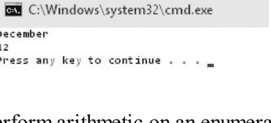

虽然可以对枚举执行算术运算，但如果运算结果超出为枚举定义的值范围，运行时所能做的只是将变量的值解释为相应的整数值。

- 14. 按 Enter 关闭程序并返回到 Visual Studio 2015 编程环境。

## 使用结构

第 8 章说明了类定义引用类型，这些类型始终在堆上创建。在某些情况下，类包含的数据可能非常少，以至于管理堆的开销变得不成比例。在这些情况下，最好将类型定义为结构。结构是值类型。由于结构存储在栈上，只要结构足够小，内存管理开销通常就会减少。

与类一样，结构可以拥有自己的字段、方法和（有一个重要的例外，后面本章会讨论）构造函数。

## 常见结构类型

你可能没有意识到，但你已经在本书之前的练习中使用过结构。在 C# 中，原始数值类型`int`、`long`和`float`分别是结构`System.Int32`、`System.Int64`和`System.Single`的别名。这些结构具有字段和方法，你实际上可以在这些类型的变量和字面量上调用方法。例如，所有这些结构都提供了一个`ToString`方法，可以将数值转换为其字符串表示形式。以下语句在 C# 中都是合法的：

Click here to view code image

```
int i = 55;
Console.WriteLine(i.ToString());
Console.WriteLine(55.ToString());
float f = 98.765F;
Console.WriteLine(f.ToString());
Console.WriteLine(98.765F.ToString());
```

你很少看到这种对`ToString`方法的使用，因为`Console.WriteLine`方法在需要时会自动调用它。更常见的是使用这些结构公开的一些静态方法。例如，在前面的章节中，你使用过静态`int.Parse`方法将字符串转换为对应的整数值。你实际做的是调用`Int32`结构的`Parse`方法：

Click here to view code image

```
string s = "42";
int i = int.Parse(s);    // exactly the same as Int32.Parse
```

这些结构还包含一些有用的静态字段。例如，`Int32.MaxValue`是`int`可以容纳的最大值，而`Int32.MinValue`是可以存储在`int`中的最小值。

下表显示了 C# 中的原始类型及其在 Microsoft .NET Framework 中的等效类型。请注意，`string`和`object`类型是类（引用类型），而不是结构。

| Keyword | Type equivalent | Class or structure |
|---|---|---|
| `bool` | `System.Boolean` | Structure |
| `byte` | `System.Byte` | Structure |
| `decimal` | `System.Decimal` | Structure |
| `double` | `System.Double` | Structure |
| `float` | `System.Single` | Structure |
| `int` | `System.Int32` | Structure |
| `long` | `System.Int64` | Structure |
| `object` | `System.Object` | Class |
| `sbyte` | `System.SByte` | Structure |
| `short` | `System.Int16` | Structure |
| `string` | `System.String` | Class |
| `uint` | `System.UInt32` | Structure |
| `ulong` | `System.UInt64` | Structure |
| `ushort` | `System.UInt16` | Structure |

## 声明结构

要声明你自己的结构类型，你使用`struct`关键字，后跟类型的名称，然后将结构的主体用大括号括起来。语法上，这个过程与声明类相似。例如，这里有一个名为`Time`的结构，包含三个名为`hours`、`minutes`和`seconds`的公共`int`字段：

Click here to view code image

```
struct Time
{
    public int hours, minutes, seconds;
}
```

与类一样，在大多数情况下使结构的字段公开是不明智的；无法控制公开字段中保存的值。例如，任何人都可以将`minutes`或`seconds`的值设置为大于 60 的值。更好的做法是使字段私有，并为结构提供构造函数和方法来初始化和操作这些字段，如以下示例所示：

Click here to view code image

```
struct Time
{
    private int hours, minutes, seconds;
    ...
    public Time(int hh, int mm, int ss)
    {
        this.hours = hh % 24;
        this.minutes = mm % 60;
        this.seconds = ss % 60;
    }

    public int Hours()
    {
        return this.hours;
    }
}
```

### Note

默认情况下，你不能在自己的结构类型上使用许多常见运算符。例如，你不能在自己的结构类型变量上使用相等运算符（`==`）和不等运算符（`!=`）。但是，你可以使用所有结构都公开的内置`Equals()`方法来比较结构类型变量，你也可以显式声明并为自己的结构类型实现运算符。执行此操作的语法在第 21 章“使用查询表达式查询内存数据”中介绍。

当你复制值类型变量时，你会得到该值的两个副本。相比之下，当你复制引用类型变量时，你会得到对同一对象的两个引用。总结来说，使用结构来表示小型数据值，对于这些值，复制值与复制地址一样高效或几乎一样高效。使用类来表示复制起来效率不高的大型复杂数据。

### Tip

使用结构来实现主要特征是其值而不是其提供的功能的概念。

## 理解结构与类之间的差异

结构和类在语法上相似，但它们有一些重要的区别。让我们看一下其中的一些差异：

- 你不能为结构声明默认构造函数（无参数的构造函数）。以下示例如果`Time`是一个类就会编译，但因为`Time`是一个结构所以不会：

Click here to view code image

```
struct Time
{
    public Time() { ... } // compile-time error
    ...
}
```

你不能为结构声明自己的默认构造函数的原因为编译器总是会生成一个。在类中，编译器只有在你自己未编写构造函数时才会生成默认构造函数。结构编译器生成的默认构造函数总是将字段设置为 0、`false`或`null`——与类相同。因此，你应确保由默认构造函数创建的结构值在这些默认值下表现合理且有意义。这会在下一个练习中产生一些影响。

你可以通过提供非默认构造函数来初始化字段为不同的值。但是，当你这样做时，你的非默认构造函数必须显式初始化结构中的所有字段；默认初始化不再发生。如果未能做到这一点，你会得到编译时错误。例如，虽然以下示例如果`Time`是一个类会编译并静默地将`seconds`初始化为 0，但由于`Time`是一个结构，它无法编译：

Click here to view code image

```
struct Time
{
    private int hours, minutes, seconds;
    ...
    public Time(int hh, int mm)
    {
        this.hours = hh;
        this.minutes = mm;
    }   // compile-time error: seconds not initialized
}
```

- 在类中，你可以在声明时初始化实例字段。在结构中，你不能。以下示例如果`Time`是一个类就会编译，但由于`Time`是一个结构，它会导致编译时错误：

Click here to view code image

```
struct Time
{
    private int hours = 0; // compile-time error
    private int minutes;
    private int seconds;
    ...
}
```

下表总结了结构和类之间主要的区别。

| Question | Structure | Class |
|---|---|---|
| Is this a value type or a reference type? | A structure is a value type. | A class is a reference type. |
| Do instances live on the stack or the heap? | Structure instances are called *values* and live on the stack. | Class instances are called *objects* and live on the heap. |
| Can you declare a default constructor? | No | Yes |
| If you declare your own constructor, will the compiler still generate the default constructor? | Yes | No |
| If you don’t initialize a field in your own constructor, will the compiler automatically initialize it for you? | No | Yes |
| Are you allowed to initialize instance fields at their point of declaration? | No | Yes |

类和结构之间关于继承还有其他差异。这些差异在第 12 章“使用继承”中介绍。

## 声明结构变量

在你定义了结构类型后，你可以像使用任何其他类型一样使用它。例如，如果你定义了`Time`结构，你可以创建类型为`Time`的变量、字段和参数，如以下示例所示：

Click here to view code image

```
struct Time
{
    private int hours, minutes, seconds;
    ...
}

class Example
{
    private Time currentTime;

    public void Method(Time parameter)
    {
        Time localVariable;
        ...
    }
}
```

### Note

与枚举一样，你可以使用`?`修饰符为结构变量创建可空版本。然后你可以将`null`值赋给该变量：

```
Time? currentTime = null;
```

## 理解结构初始化

本章前面你已看到如何使用构造函数初始化结构中的字段。如果你调用构造函数，以前描述的各种规则保证结构中的所有字段都会被初始化：

```
Time now = new Time();
```

下图描述了此结构中字段的状态：

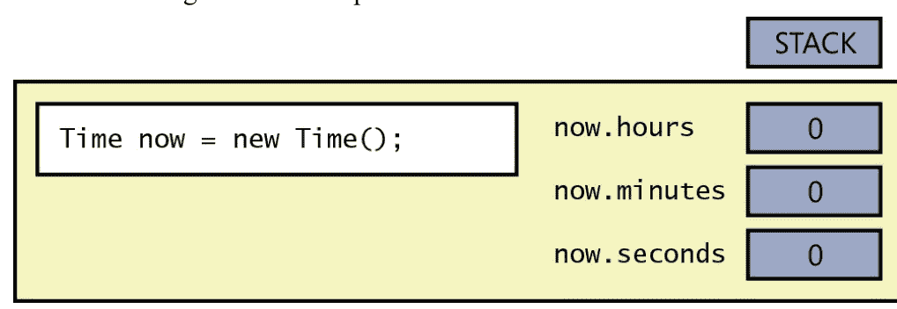

然而，由于结构是值类型，你也可以在不调用构造函数的情况下创建结构变量，如以下示例所示：

```
Time now;
```

这次，变量被创建但其字段被留在未初始化状态。下图描述了`now`变量中字段的状态。任何尝试访问这些字段中的值都会导致编译器错误：

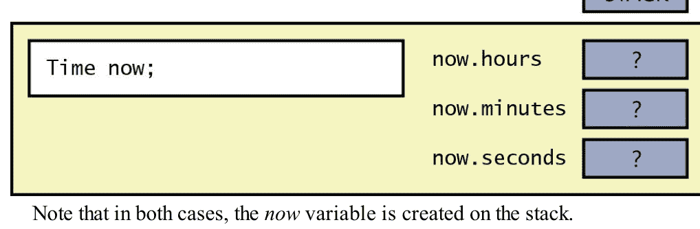

请注意，在这两种情况下，`now`变量都是在栈上创建的。

如果你编写了自己的结构构造函数，你也可以用它来初始化结构变量。如本章前面所述，结构构造函数必须始终显式初始化其所有字段。例如：

Click here to view code image

```
struct Time
{
    private int hours, minutes, seconds;
    ...
    public Time(int hh, int mm)
    {
        hours = hh;
        minutes = mm;
        seconds = 0;
    }
}
```

以下示例通过调用用户定义的构造函数来初始化`now`：

```
Time now = new Time(12, 30);
```

下图显示了此示例的效果：

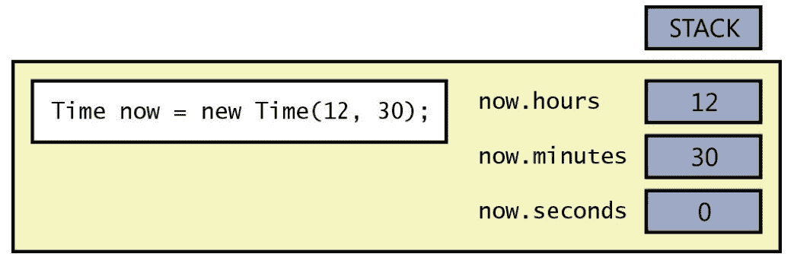

是时候将这些知识付诸实践了。在下面的练习中，你将创建一个并使用一个结构来表示日期。

## 创建并使用结构类型

- 1. 在`StructsAndEnums`项目中，在代码和文本编辑器窗口中显示`Date.cs`文件。

- 2. 用一个名为`Date`的结构替换`TODO`注释，该结构位于`StructsAndEnums`命名空间内。

此结构应包含三个私有字段：一个名为`year`的`int`类型，一个名为`month`的`Month`类型（使用你在前一个练习中创建的枚举），一个名为`day`的`int`类型。`Date`结构应完全如下所示：

```
struct Date
{
    private int year;
    private Month month;
    private int day;
}
```

考虑编译器将为`Date`生成的默认构造函数。此构造函数将`year`设置为 0，`month`设置为 0（`January`的值），`day`设置为 0。`year`值 0 是无效的（因为没有公元 0 年），`day`值 0 也是无效的（因为每个月从 1 日开始）。解决此问题的一种方法是转换`year`和`day`值，通过实现`Date`结构，使得当`year`字段保存值`Y`时，此值表示年份`Y+ 1900`（或者你也可以选择不同的世纪），并且当`day`字段保存值`D`时，此值表示日期`D + 1`。默认构造函数将然后将三个字段设置为表示 1900 年 1 月 1 日的数值。

如果你可以重写默认构造函数并编写自己的构造函数，这就不是问题了，因为你可以直接将`year`和`day`字段初始化为有效值。但是你不能这样做，所以你必须在结构中实现逻辑，将编译器生成的默认值转换为问题域中有意义的值。

然而，虽然你不能重写默认构造函数，但定义非默认构造函数仍然是良好的实践，以允许用户显式地将结构中的字段初始化为有意义的非默认值。

- 3. 向`Date`结构添加一个公共构造函数。此构造函数应接受三个参数：一个名为`ccy y`的`int`表示年份，一个名为`mm`的`Month`表示月份，一个名为`dd`的`int`表示日期。使用这三个参数初始化相应的字段。`year`字段的值为`Y`表示年份`Y+ 1900`，因此你需要将`year`字段初始化为值`ccy y − 1900`。`day`字段的值为`D`表示日期`D + 1`，因此你需要将`day`字段初始化为值`dd − 1`。

`Date`结构现在应如下所示（构造函数以粗体显示）：

Click here to view code image

```
struct Date
{
    private int year;
    private Month month;
    private int day;

    public Date(int ccy y, Month mm, int dd)
    {
        this.year = ccy y - 1900;
        this.month = mm;
        this.day = dd - 1;
    }
}
```


### 4. 在构造函数之后向 Date 结构添加一个名为 ToString 的公共方法。此方法不接受参数并返回日期的字符串表示。记住，year 字段的值表示 year + 1900，day 字段的值表示 day + 1。

#### Note

`ToString` 方法与迄今为止看到的方法有点不同。每个类型，包括你定义的结构和类，自动具有 `ToString` 方法，无论你是否想要它。它的默认行为是将变量中的数据转换为该数据的字符串表示。有时默认行为是有意义的；有时则不那么有意义。例如，为 `Date` 结构生成的 `ToString` 方法的默认行为只是生成字符串“StructsAndEnums.Date”。引用 Douglas Adams（Pan Macmillan, 1980）在《宇宙尽头的餐馆》中 Zaphod Beeblebrox 的话，这“很精明，但很无聊”。你需要定义此方法的新版本，使用 `override` 关键字重写默认行为。重写方法将在第 12 章中更详细地讨论。

`ToString` 方法应如下所示：

Click here to view code image

```
struct Date
{
    ...
    public override string ToString()
    {
        string data = $"{this.month} {this.day + 1} {this.year + 1900}";
        return data;
    }
}
```

在此方法中，你使用月份字段的值的文本表示、表达式 `this.day + 1` 以及表达式 `this.year + 1900` 构建一个格式化的字符串。`ToString` 方法将格式化的字符串作为其结果返回。

- 5. 在代码和文本编辑器窗口中显示 `Program.cs` 文件。

- 6. 在 `doWork` 方法中，注释掉四个现有语句。

- 7. 向 `doWork` 方法添加语句，声明一个名为 `defaultDate` 的局部变量并将其初始化为使用默认 `Date` 构造函数构造的 `Date` 值。向 `doWork` 添加另一条语句，通过调用 `Console.WriteLine` 在控制台上显示 `defaultDate` 变量。

#### Note

`Console.WriteLine` 方法会自动调用其参数的 `ToString` 方法来将参数格式化为字符串。

`doWork` 方法现在应如下所示：

Click here to view code image

```
static void doWork()
{
    ...
    Date defaultDate = new Date();
    Console.WriteLine(defaultDate);
}
```

#### Note

当你输入 `new Date(, ` 时，IntelliSense 会自动检测到 `Date` 类型有两个构造函数可用。

- 8. 在 Debug 菜单上，单击 Start Without Debugging 以构建并运行程序。验证日期 1900 年 1 月 1 日是否已写入控制台。

- 9. 按 Enter 键返回到 Visual Studio 2015 编程环境。

- 10. 在代码和文本编辑器窗口中，返回到 `doWork` 方法并添加两个更多语句。在第一个语句中，声明一个名为 `weddingAnniversary` 的局部变量并将其初始化为 2015 年 7 月 4 日。（我确实在独立日结婚了，虽然那是很久以前的事了。）在第二个语句中，将 `weddingAnniversary` 的值写入控制台。

`doWork` 方法现在应如下所示：

Click here to view code image

```
static void doWork()
{
    ...
    Date weddingAnniversary = new Date(2015, Month.July, 4);
    Console.WriteLine(weddingAnniversary);
}
```

- 11. 在 Debug 菜单上，单击 Start Without Debugging，然后确认日期 2015 年 7 月 4 日已在先前信息下方写入控制台。

- 12. 按 Enter 关闭程序并返回到 Visual Studio 2015。

## 复制结构变量

你可以在一个结构变量初始化或赋值给另一个结构变量，但前提是右侧的结构变量必须完全初始化（也就是说，其所有字段都已填充有效数据，而不是未定义值）。以下示例可以编译，因为 `now` 已完全初始化。插图展示了执行此类赋值后的结果。

Click here to view code image

```
Date now = new Date(2012, Month.March, 19);
Date copy = now;
```


以下示例无法编译，因为 `now` 未初始化：

Click here to view code image

```
Date now;
Date copy = now; // compile-time error: now has not been assigned
```

当你复制一个结构变量时，左侧的每个字段都直接从右侧的对应字段设置。这种复制是以快速的单次操作完成的，复制整个结构的内容，并且永远不会抛出异常。将此行为与 `Time` 为类时的等效操作进行比较，在这种情况下，两个变量（`now` 和 `copy`）最终会引用堆上的同一个对象。

#### Note

如果你是 C++ 程序员，你应该注意，这种复制行为无法自定义。

在本章的最后一个练习中，你将对比结构与类的复制行为。

## 比较结构和类的行为

- 1. 在 `StructsAndEnums` 项目中，在代码和文本编辑器窗口中显示 `Date.cs` 文件。

- 2. 向 `Date` 结构添加以下方法。此方法将结构中的日期提前一个月。如果在推进月份后，月份字段的值超过了十二月，代码会将月份重置为一月，并将年份字段的值增加 1。

Click here to view code image

```
struct Date
{
    ...
    public void AdvanceMonth()
    {
        this.month++;
        if (this.month == Month.December + 1)
        {
            this.month = Month.January;
            this.year++;
        }
    }
}
```

- 3. 在代码和文本编辑器窗口中显示 `Program.cs` 文件。

- 4. 在 `doWork` 方法中，注释掉创建并显示 `defaultDate` 变量值的第一个两个未注释语句。

- 5. 将以下以粗体显示的代码添加到 `doWork` 方法的末尾。此代码创建 `weddingAnniversary` 变量的副本 `weddingAnniversaryCopy` 并打印出此新变量的值。

Click here to view code image

```
static void doWork()
{
    ...
    Date weddingAnniversaryCopy = weddingAnniversary;
    Console.WriteLine($"Value of copy is {weddingAnniversaryCopy}");
}
```

6. 将以下以粗体显示的语句添加到 `doWork` 方法的末尾。这些语句调用 `weddingAnniversary` 变量的 `AdvanceMonth` 方法，然后显示 `weddingAnniversary` 和 `weddingAnniversaryCopy` 变量的值：

Click here to view code image

```
static void doWork()
{
    ...
    weddingAnniversary.AdvanceMonth();
    Console.WriteLine($"New value of weddingAnniversary is {weddingAnniversary}");
    Console.WriteLine($"Value of copy is still {weddingAnniversaryCopy}");
}
```

7. 在 Debug 菜单上，单击 Start Without Debugging 以构建并运行应用程序。验证控制台窗口是否显示以下消息：

Click here to view code image

```
July 4 2015
Value of copy is July 4 2015
New value of weddingAnniversary is August 4 2015
Value of copy is still July 4 2015
```

第一条消息显示 `weddingAnniversary` 变量的初始值（July 4 2015）。第二条消息显示 `weddingAnniversaryCopy` 变量的值。你可以看到它包含 `weddingAnniversary` 变量中保存的相同日期（July 4 2015）。第三条消息显示将月份更改为八月后 `weddingAnniversary` 变量的值（August 4 2015）。最后一条语句显示 `weddingAnniversaryCopy` 变量的值。请注意，它未从原始值 July 4 2015 更改。

如果 `Date` 是一个类，创建副本将引用与原始实例相同的内存对象。因此，更改原始实例中的月份也会更改通过副本引用的日期。你将在以下步骤中验证这一断言。

8. 按 Enter 返回到 Visual Studio 2015。

9. 在代码和文本编辑器窗口中显示 `Date.cs` 文件。

10. 将 `Date` 结构更改为类，如以下代码示例中以粗体显示的那样：

```
class Date
{
    ...
}
```

11. 在 Debug 菜单上，单击 Start Without Debugging 再次构建并运行应用程序。验证控制台窗口是否显示以下消息：

Click here to view code image

```
July 4 2015
Value of copy is July 4 2015
New value of weddingAnniversary is August 4 2015
Value of copy is still August 4 2015
```

前三条消息与之前相同。然而，第四条消息显示 `weddingAnniversaryCopy` 变量的值已更改为 August 4 2015。

12. 按 Enter 返回到 Visual Studio 2015。

## 结构与 Windows Runtime 的兼容性

所有 C# 应用程序都使用 .NET Framework 的通用语言运行时（CLR）执行。CLR 负责为你的应用程序代码提供一个安全可靠的环境，以虚拟机的形式（如果你来自 Java 背景，这个概念应该很熟悉）。当你编译 C# 应用程序时，编译器会将你的 C# 代码转换为使用一种伪机器码 Common Intermediate Language（CIL）的指令集。这些就是存储在程序集中的指令。当你运行 C# 应用程序时，CLR 负责将 CIL 指令转换为真实的机器指令，以便计算机上的处理器能够理解和执行。整个环境被称为托管执行环境，C# 程序经常被称为托管代码。你也可以使用 .NET Framework 支持的其他语言，如 Visual Basic 和 F# 来编写托管代码。

在 Windows 7 及更早版本中，你还可以编写基于 Win32 API 的非托管应用程序，也称为原生代码，Win32 API 是直接与 Windows 操作系统交互的 API。（CLR 也会将 .NET Framework 中的许多函数转换为 Win32 API 调用，如果你正在运行托管应用程序，尽管这一过程对你的代码完全透明。）为此，你可以使用 C++ 等语言。.NET Framework 使你能够通过一组互操作技术将托管代码集成到非托管应用程序中，反之亦然。详细说明这些技术的工作原理以及如何使用它们超出了本书的范围——可以说，这并不总是很简单。

Windows 的后续版本提供了一种替代策略，即 Windows Runtime，或 WinRT。WinRT 在 Win32 API（以及其他选定的原生 Windows API）之上引入了一层，提供跨不同类型硬件的一致功能，从服务器到手机。当你构建通用 Windows 平台（UWP）应用时，你使用 WinRT 暴露的 API 而不是 Win32。同样，Windows 10 上的 CLR 也使用 WinRT；使用 C# 或任何其他托管语言编写的所有托管代码仍由 CLR 执行，但在运行时 CLR 会将你的代码转换为 WinRT API 调用而不是 Win32。CLR 和 WinRT 共同负责安全地管理和运行你的代码。

WinRT 的主要目的之一是简化语言之间的互操作性，以便你更轻松地将使用不同编程语言开发的组件集成到单一无缝应用程序中。然而，这种简化是有代价的，你必须准备好根据各种语言的不同功能集做出一些妥协。特别是，出于历史原因，虽然 C++ 支持结构，但它不识别成员函数。在 C# 术语中，成员函数是实例方法。因此，如果你正在构建 C# 结构（或 `struct`），并希望将其打包到库中以供使用 C++（或任何其他非托管语言）编程的开发人员使用，这些 `struct` 不应包含任何实例方法。静态方法在 `struct` 中也有同样的限制。如果你想包含实例或静态方法，你应该将 `struct` 转换为 `class`。此外，`struct` 不能包含私有字段，并且所有公共字段必须是 C# 原始类型、符合规范的值类型或字符串。

如果要使 C# 类和结构可供原生应用程序使用，WinRT 也对它们施加了一些其他限制。第 12 章提供了更多信息。

### Summary

在本章中，你学习了如何创建和使用枚举和结构。你了解了结构与类之间的一些相似之处和差异，并学习了如何定义构造函数来初始化结构中的字段。你还学习了如何通过重写 `ToString` 方法将结构表示为字符串。

- 如果你想继续下一章，请保持 Visual Studio 2015 运行并转到第 10 章“使用数组”。

- 如果你现在想退出 Visual Studio 2015，请在 File 菜单上单击 Exit。如果出现保存对话框，请单击 Yes 并保存项目。

### Quick reference

| 操作 | 执行方法 |
|---|---|
| 声明枚举 | 编写关键字 `enum`，后跟类型的名称，后跟一对大括号，其中包含枚举文字名称的逗号分隔列表。例如：`enum Season { Spring, Summer, Fall, Winter }` |
| 声明枚举变量 | 在左侧编写枚举的名称，后跟变量的名称，后跟分号。例如：`Season currentSeason;` |
| 将枚举变量赋值为值 | 编写枚举文字的名称结合其所属的枚举的名称。例如：`currentSeason = Spring;        // error` `currentSeason = Season.Spring; // correct` |
| 声明结构类型 | 编写关键字 `struct`，后跟结构类型的名称，后跟结构体的主体（构造函数、方法和字段）。例如：`struct Time` `{` `    public Time(int hh, int mm, int ss)` `    { ... }` `    ...` `    private int hours, minutes, seconds;` `}` |
| 声明结构变量 | 编写结构类型的名称，后跟变量的名称，后跟分号。例如：`Time now;` |
| 将结构变量初始化为值 | 将变量初始化为通过调用结构构造函数创建的结构值。例如：`Time lunch = new Time(12, 30, 0);` |

## 第10章 使用数组

完成本章后，你将能够：

- 声明数组变量。

- 用一组数据项填充数组。

- 访问数组中保存的数据项。

- 遍历数组中的数据项。

你已经见过如何创建和使用多种不同类型的变量。然而，你迄今为止看到的所有变量示例都有一个共同点——它们保存的是单个项目的信息（一个 `int`、一个 `float`、一个 `Circle`、一个 `Date` 等）。如果需要操作一组项目会怎样？一种解决方案是为集合中的每个项目创建一个变量，但这会带来一系列新的问题：你需要多少个变量？如何命名它们？如果需要在集合中的每个项目上执行相同的操作（例如递增一组整数中的每个变量），如何避免非常重复的代码？使用变量来处理单独的项目意味着你在编写程序时就知道需要多少个项目。但这种情况有多常见呢？例如，如果你正在编写一个读取并处理数据库中记录的应用程序，数据库中有多少条记录，这种数量变化的可能性有多大？

数组提供了一种帮助解决这些问题的机制。

## 声明和创建数组

数组是一组无序的项目序列。数组中的所有项目都具有相同的类型，这与结构或类中的字段不同，后者的字段可以具有不同的类型。数组中的项目存储在连续的内存块中，并通过使用索引来访问，而结构或类中的字段则通过名称访问。

## 声明数组变量

你通过指定元素类型的名称，后跟一对方括号，后跟变量名来声明数组变量。方括号表示该变量是一个数组。例如，要声明一个名为 `pins` 的 `int` 变量数组（用于保存一组个人识别号码），你可以编写以下内容：

Click here to view code image

```
int[] pins; // Personal Identification Numbers
```

#### Note

如果你是 Microsoft Visual Basic 程序员，你应该注意在声明中使用的是方括号而不是圆括号。如果你熟悉 C 和 C++，还要注意数组的大小不是声明的一部分。此外，方括号必须放在变量名之前。

你并不局限于使用原始类型作为数组元素。你还可以创建结构、枚举和类的数组。例如，你可以像这样创建一个 `Date` 结构的数组：


```
Date[] dates;
```

### Tip

通常给数组变量起复数名称是有用的，例如 `places`（每个元素都是一个 `Place`）、`people`（每个元素都是一个 `Person`）或 `times`（每个元素都是一个 `Time`）。

## 创建数组实例

数组是引用类型，无论其元素的类型如何。这意味着数组变量引用堆上保存数组元素的连续内存块，就像类变量引用堆上的对象一样。（有关值和引用的描述以及堆栈和堆之间的区别，请参阅第 8 章“理解值和引用”。）此规则适用于数组中数据项的类型。即使数组包含 `int` 等值类型，内存仍会在堆上分配；这是值类型不分配堆栈内存的唯一情况。

请记住，当你声明一个类变量时，直到你使用 `new` 创建实例时，才会为对象分配内存。数组遵循相同的模式：当你声明一个数组变量时，你不会声明其大小，也不会分配内存（除了在堆栈上保存引用）。只有在创建实例时，数组才会被分配内存，这也是你指定数组大小的时机。

要创建数组实例，你使用 `new` 关键字，后跟元素类型，后跟你创建的数组的大小，用方括号括起来。创建数组还会使用现在熟悉的默认值初始化其元素（`0`、`null` 或 `false`，具体取决于类型是数值、引用还是布尔值）。例如，要为前面声明的 `pins` 变量创建并初始化一个包含四个整数的新数组，你可以这样写：

```
pins = new int[4];
```

下图显示了声明数组时发生的情况，以及稍后创建数组实例时发生的情况：


由于数组实例的内存是动态分配的，数组的大小不必是常量；它可以在运行时计算，如以下示例所示：

```
int size = int.Parse(Console.ReadLine());
int[] pins = new int[size];
```

你也可以创建一个大小为 0 的数组。这听起来可能很奇怪，但在数组大小动态确定且可能为 0 的情况下很有用。大小为 0 的数组不是 `null` 数组；它是一个包含零个元素的数组。

## 填充和使用数组

当你创建数组实例时，数组的所有元素都会根据其类型初始化为默认值。例如，所有数值默认为 `0`，对象初始化为 `null`，`DateTime` 值设置为日期和时间“01/01/0001 00:00:00”，字符串初始化为 `null`。你可以修改此行为并将数组的元素初始化为特定值。你可以通过在大括号之间提供逗号分隔的值列表来实现。例如，要将 `pins` 初始化为四个 `int` 变量的数组，其值分别为 `9`、`3`、`7` 和 `2`，你可以这样写：

```
int[] pins = new int[4]{ 9, 3, 7, 2 };
```

大括号之间的值不必是常量；它们可以是运行时计算的值，如以下示例所示，该示例使用四个随机数填充 `pins` 数组：

```
Random r = new Random();
int[] pins = new int[4]{ r.Next() % 10, r.Next() % 10,
    r.Next() % 10, r.Next() % 10 };
```

### Note

`System.Random` 类是一个伪随机数生成器。`Next` 方法默认返回 `0` 到 `Int32.MaxValue` 范围内的非负随机整数。`Next` 方法是重载的，其他版本允许你指定范围的最小值和最大值。`Random` 类的默认构造函数使用基于时间的种子值来初始化随机数生成器，从而降低该类重复随机数序列的可能性。使用构造函数的重载版本，你可以提供自己的种子值。这样，你就可以为测试目的生成可重复的随机数序列。

大括号之间的值的数量必须与正在创建的数组实例的大小完全匹配：

```
int[] pins = new int[3]{ 9, 3, 7, 2 }; // compile-time error
int[] pins = new int[4]{ 9, 3, 7 }; // compile-time error
int[] pins = new int[4]{ 9, 3, 7, 2 }; // OK
```

当你以这种方式初始化数组变量时，你实际上可以省略 `new` 表达式和数组的大小。在这种情况下，编译器会根据初始化器的数量计算大小并生成创建数组的代码，如以下示例所示：

```
int[] pins = { 9, 3, 7, 2 };
```

如果你创建结构或对象的数组，可以通过调用结构或类构造函数来初始化数组中的每个结构，如以下示例所示：

```
Time[] schedule = { new Time(12,30), new Time(5,30) };
```

## 创建隐式类型数组

当你声明数组时，元素类型必须与你尝试存储在数组中的元素的类型匹配。例如，如果你声明 `pins` 为 `int` 数组，如前面的示例所示，你就不能存储 `double`、`string`、*struct*，或此数组中任何不是 *int* 的内容。如果你在声明数组时指定了一组初始值设定项，可以让 C# 编译器为你推断出数组元素的实际类型，如下所示：

```
var names = new[] {"John", "Diana", "James", "Francesca"};
```

在此示例中，C# 编译器确定 `names` 变量是一个字符串数组。值得指出的是，此声明中有几个语法上的特殊之处。首先，你省略了类型中的方括号；此示例中的 `names` 变量仅声明为 `var`，而不是 `var[]`。其次，你必须在初始值设定项列表之前指定 `new` 运算符和方括号。

如果你使用此语法，必须确保所有初始值设定项具有相同的类型。下一个示例会导致编译时错误“未找到隐式类型化数组的最佳类型”：

```
var bad = new[] {"John", "Diana", 99, 100};
```

然而，在某些情况下，如果这样做有意义，编译器会将元素转换为不同类型。在以下代码中，`numbers` 数组是 `double` 数组，因为常量 `3.5` 和 `99.999` 都是 `double`，并且 C# 编译器可以将整数值 `1` 和 `2` 转换为 `double` 值：

```
var numbers = new[] {1, 2, 3.5, 99.999};
```

通常，最好避免混合类型，希望编译器为你转换它们。

隐式类型化数组在你使用匿名类型时最有用，如第 7 章“创建和管理类和对象”所述。以下代码创建了一个匿名对象的数组，每个对象包含两个字段，指定我家庭成员的姓名和年龄：

```
var names = new[] { new { Name = "John", Age = 50 }, new { Name = "Diana", Age = 50 }, new { Name = "James", Age = 23 }, new { Name = "Francesca", Age = 21 } };
```

匿名类型中的字段必须对数组的每个元素都相同。

## 访问单个数组元素

要访问单个数组元素，你必须提供一个索引来指示需要哪个元素。数组索引从零开始；因此，数组的初始元素位于索引 `0` 而不是索引 `1`。索引值为 `1` 访问第二个元素。例如，你可以使用以下代码将 `pins` 数组的第 2 个元素（第三个元素）的内容读入 `int` 变量：

```
int myPin;
myPin = pins[2];
```

同样，你可以通过为索引元素赋值来更改数组的内容：

```
myPin = 1645;
pins[2] = myPin;
```

所有数组元素访问都进行边界检查。如果你指定一个小于 `0` 或大于或等于数组长度的索引，编译器会抛出 `IndexOutOfRangeException` 异常，如此示例所示：

```
try
{
    int[] pins = { 9, 3, 7, 2 };
    Console.WriteLine(pins[4]); // error, the 4th and last element is at index 3
}
catch (IndexOutOfRangeException ex)
{
    ...
}
```

## 遍历数组

所有数组实际上都是 Microsoft .NET Framework 中 `System.Array` 类的实例，而该类定义了许多有用的属性和方法。例如，你可以查询 `Length` 属性来发现数组包含多少个元素，并使用 `for` 语句遍历数组中的所有元素。以下示例代码将 `pins` 数组的数组元素值写入控制台：

```
int[] pins = { 9, 3, 7, 2 };
for (int index = 0; index < pins.Length; index++)
{
    int pin = pins[index];
    Console.WriteLine(pin);
}
```

### Note

`Length` 是一个属性而不是方法，这就是为什么你在调用它时不使用括号。你可以在第 15 章“实现属性以访问字段”中了解有关属性的信息。

新程序员经常会忘记数组从元素 `0` 开始，最后一个元素编号为 `Length – 1`。C# 提供了 `foreach` 语句，你可以使用它遍历数组元素，而无需担心这些问题。例如，这里是前面 `for` 语句重写为等效 `foreach` 语句：

```
int[] pins = { 9, 3, 7, 2 };
foreach (int pin in pins)
{
    Console.WriteLine(pin);
}
```

`foreach` 语句声明一个迭代变量（在此示例中为 `int pin`），该变量会自动获取数组中每个元素的值。此变量的类型必须与数组中元素的类型匹配。`foreach` 语句是遍历数组的首选方式；它直接表达了代码的意图，并且所有 `for` 循环的脚手架都消失了。然而，在少数情况下，你会发现必须恢复使用 `for` 语句：

- `foreach` 语句始终遍历整个数组。如果你只想遍历数组的已知部分（例如，前半部分）或跳过某些元素（例如，每第三个元素），使用 `for` 语句会更容易。
- `foreach` 语句始终从索引 `0` 遍历到索引 `Length – 1`。如果你想向后迭代或按其他顺序迭代，使用 `for` 语句会更容易。
- 如果循环体需要知道元素的索引而不是仅元素的值，你必须使用 `for` 语句。
- 如果你需要修改数组的元素，你必须使用 `for` 语句。这是因为 `foreach` 语句的迭代变量是数组中每个元素的只读副本。

### Tip

使用 `foreach` 语句遍历零长度数组是完全安全的。

你可以将迭代变量声明为 `var` 并让 C# 编译器根据数组中元素的类型推断出变量的类型。这在你实际上不知道数组中元素的类型时尤其有用，例如当数组包含匿名对象时。以下示例演示了如何遍历前面显示的家庭成员数组：

```
var names = new[] { new { Name = "John", Age = 50 },
                new { Name = "Diana", Age = 50 },
                new { Name = "James", Age = 23 },
                new { Name = "Francesca", Age = 21 } };
foreach (var familyMember in names)
{
    Console.WriteLine($"Name: {familyMember.Name}, Age: {familyMember.Age}");
}
```

## 将数组作为参数传递和作为方法返回值

你可以定义接受数组作为参数或作为返回值返回数组的方法。

将数组作为参数传递的语法与声明数组的语法基本相同。例如，以下代码示例定义了一个名为 `ProcessData` 的方法，该方法接受整数数组作为参数。方法体遍历数组并对每个元素执行一些未指定的处理：

```
public void ProcessData(int[] data)
{
    foreach (int i in data)
    {
        ...
    }
}
```

重要的是要记住数组是引用对象，因此如果你在 `ProcessData` 等方法内部修改作为参数传递的数组的内容，则该修改将通过对数组的所有引用可见，包括作为参数传递的原始参数。

要从方法返回数组，你将数组的类型指定为返回类型。在方法中，你创建并填充数组。以下示例提示用户输入数组的大小，然后输入每个元素的数据。方法创建的数组作为返回值传递回来：

```
public int[] ReadData()
{
    Console.WriteLine("How many elements?");
    string reply = Console.ReadLine();
    int numElements = int.Parse(reply);

    int[] data = new int[numElements];
    for (int i = 0; i < numElements; i++)
    {
        Console.WriteLine($"Enter data for element {i}");
        reply = Console.ReadLine();
        int elementData = int.Parse(reply);
        data[i] = elementData;
    }
    return data;
}
```

你可以像这样调用 `ReadData` 方法：

```
int[] data = ReadData();
```

## 数组参数与 Main 方法

你可能已经注意到，应用程序的 `Main` 方法接收一个字符串数组作为参数：

```
static void Main(string[] args)
{
    ...
}
```

请记住，`Main` 方法在程序开始运行时被调用；它是应用程序的入口点。如果从命令行启动应用程序，你可以指定额外的命令行参数。Windows 操作系统会将这些参数传递给通用语言运行时（CLR），CLR 再将其作为参数传递给 `Main` 方法。这种机制提供了一种简单的方式，让用户在应用程序启动时提供信息，而不必进行交互式提示。这种方法很有用，如果你想构建可以从自动化脚本中运行的实用工具。

以下示例取自一个名为 `MyFileUtil` 的实用程序应用程序，它处理文件。它期望在命令行上有一组文件名，并调用 `ProcessFile` 方法（未显示）来处理每个指定的文件：

```
static void Main(string[] args)
{
    foreach (string filename in args)
    {
        ProcessFile(filename);
    }
}
```

用户可以从命令行像这样运行 `MyFileUtil` 应用程序：

```
MyFileUtil C:\Temp\TestData.dat C:\Users\John\Documents\MyDoc.txt
```

每个命令行参数由空格分隔。验证这些参数是否有效是 `MyFileUtil` 应用程序的责任。

## 复制数组

数组是引用类型（请记住，数组是 `System.Array` 类的实例）。数组变量包含对数组实例的引用。这意味着当你复制一个数组变量时，你实际上获得了对同一个数组实例的两个引用，如以下示例所示：

```
int[] pins = { 9, 3, 7, 2 };
int[] alias = pins; // alias and pins refer to the same array
instance
```

在此示例中，如果你修改 `pins[1]` 处的值，通过读取 `alias[1]` 也会看到该更改。

如果你想复制数组变量所引用的数组实例（堆上的数据），你必须做两件事。首先，你创建一个与要复制的数组类型相同、长度相同的新数组实例。其次，你将数据从原始数组逐元素复制到新数组，如此示例所示：

```
int[] pins = { 9, 3, 7, 2 };
int[] copy = new int[pins.Length];
for (int i = 0; i < pins.Length; i++)
{
    copy[i] = pins[i];
}
```

请注意，此代码使用原始数组的 `Length` 属性来指定新数组的大小。

复制数组实际上是许多应用程序的常见需求——常见到 `System.Array` 类提供了一些有用的方法供你用来复制数组。例如，`CopyTo` 方法将一个数组的内容复制到另一个数组中，给定指定的起始索引。以下示例将 `pins` 数组中的所有元素复制到 `copy` 数组，从元素零开始：

```
int[] pins = { 9, 3, 7, 2 };
int[] copy = new int[pins.Length];
pins.CopyTo(copy, 0);
```


另一种复制值的方法是使用 `System.Array` 静态方法 `Copy`。与 `CopyTo` 一样，你必须在调用 `Copy` 之前初始化目标数组：

Click here to view code image

```
int[] pins = { 9, 3, 7, 2 };
int[] copy = new int[pins.Length];
Array.Copy(pins, copy, copy.Length);
```

### Note

请确保为 `Array.Copy` 方法的长度参数指定有效值。如果提供负值，该方法会抛出 `ArgumentOutOfRangeException` 异常。如果指定大于源数组元素数量的值，该方法会抛出 `ArgumentException` 异常。

另一种替代方案是使用 `System.Array` 实例方法 `Clone`。你可以调用此方法一次性创建整个数组并复制它：

Click here to view code image

```
int[] pins = { 9, 3, 7, 2 };
int[] copy = (int[])pins.Clone();
```

### Note

`Clone` 方法在第 8 章中描述。`Array` 类的 `Clone` 方法返回 `object` 而不是 `Array`，这就是为什么使用它时必须将其强制转换为适当类型的数组。此外，`Clone`、`CopyTo` 和 `Copy` 方法都创建数组的浅拷贝（浅拷贝和深拷贝也在第 8 章中描述）。如果被复制的数组中的元素包含引用，`Clone` 方法只是复制引用而不是被引用的对象。复制后，两个数组都引用同一组对象。如果需要创建此类数组的深拷贝，你必须在 `for` 循环中使用适当的代码。

## 使用多维数组

到目前为止所示的数组都包含单个维度，你可以将其视为简单的值列表。你可以创建具有多个维度的数组。例如，要创建一个二维数组，你指定一个需要两个整数索引的数组。以下代码创建了一个名为 `items` 的 24 个整数的二维数组。如果有帮助，你可以将数组视为表格，第一维度指定行数，第二维度指定列数。

```
int[,] items = new int[4, 6];
```

要访问数组中的元素，你提供两个索引值来指定“单元格”（行与列的交点）以保存该元素。以下代码显示了使用 `items` 数组的一些示例：

Click here to view code image

```
items[2, 3] = 99;      // set the element at cell(2,3) to 99
items[2, 4] = items [2,3];  // copy the element in cell(2, 3) to
cell(2, 4)
items[2, 4]++;             // increment the integer value at
cell(2, 4)
```

你为数组指定的维度数量没有限制。下一个代码示例创建并使用一个名为 `*cube*` 的数组，包含三个维度。请注意，你必须指定三个索引来访问数组中的每个元素。

Click here to view code image

```
int[, ,] cube = new int[5, 5, 5];
cube[1, 2, 1] = 101;
cube[1, 2, 2] = cube[1, 2, 1] * 3;
```

此时，值得提醒一下关于创建具有超过三个维度的数组的注意事项。具体来说，数组会消耗大量内存。`*cube*` 数组包含 125 个元素（5 * 5 * 5）。一个每个维度大小为 5 的四维数组包含 625 个元素。如果你开始创建具有三个或更多维度的数组，很快就会耗尽内存。因此，当你使用多维数组时，应始终准备好捕获和处理 `*OutOfMemoryException*` 异常。

## 创建锯齿数组

在 C# 中，普通的多维数组有时被称为 *矩形* 数组。每个维度都有规则的形状。例如，在以下表格状的二维 `*items*` 数组中，每行都有 40 个元素的列，总共有 160 个元素：

Click here to view code image

```
int[,] items = new int[4, 40];
```

如前一节所述，多维数组会消耗大量内存。如果应用程序只使用每列中的部分数据，为未使用的元素分配内存就是浪费。在这种情况下，你可以使用 *锯齿* 数组，每列长度不同，如下所示：

Click here to view code image

```
int[][] items = new int[4][];
int[] columnForRow0 = new int[3];
int[] columnForRow1 = new int[10];
int[] columnForRow2 = new int[40];
int[] columnForRow3 = new int[25];
items[0] = columnForRow0;
items[1] = columnForRow1;
items[2] = columnForRow2;
items[3] = columnForRow3;
...
```

在此示例中，应用程序在第一列只需要 3 个元素，第二列 10 个元素，第三列 40 个元素，最后一个列 25 个元素。此代码说明了数组的数组——`items` 不是二维数组，它只有单个维度，但该维度的元素本身就是数组。此外，`items` 数组的总大小为 78 个元素而不是 160；不会为应用程序不使用的元素分配空间。

值得强调一下此示例中的一些语法。以下声明指定 `items` 是 `int` 的数组的数组。

```
int[][] items;
```

以下语句将 `items` 初始化为包含四个元素，每个元素都是长度不确定的数组：

```
items = new int[4][];
```

数组 `columnForRow0` 到 `columnForRow3` 都是单维 `int` 数组，初始化为为每列保存所需的数据量。最后，每个列数组被分配给 `items` 数组中的适当元素，如下所示：

```
items[0] = columnForRow0;
```

请记住，数组是引用对象，因此此语句只是将对 `columnForRow0` 的引用添加到 `items` 数组的第一个元素中；它实际上并没有复制任何数据。你可以通过为 `columnForRow0` 中的索引元素分配值或通过 `items` 数组引用它来填充此列中的数据。以下语句是等效的：

```
columnForRow0[1] = 99;
items[0][1] = 99;
```

如果你想创建数组的数组的数组而不是矩形三维数组，可以进一步扩展这个想法，依此类推。

### Note

如果你过去使用过 Java 编程语言编写代码，你应该熟悉这个概念。Java 没有多维数组；相反，你可以完全按照上面描述的方式创建数组的数组。

在以下练习中，你将使用数组来实现一个应用程序，该应用程序作为纸牌游戏的一部分发牌。应用程序显示一个窗体，其中随机从一副常规（52 张）纸牌中发出的四手牌

cards. You will complete the code that deals the cards for each hand.

## 使用数组实现卡牌游戏

- 1. 如果尚未运行，请启动 Microsoft Visual Studio 2015。

- 2. 打开 Cards 项目，该项目位于你的 Documents 文件夹中的 `\Microsoft Press\VCSBS\Chapter 10\Cards` 文件夹中。

- 3. 在 Debug 菜单上，单击 Start Debugging 以构建并运行应用程序。

一个标题为 Card Game 的窗体出现，其中包含四个文本框（分别标记为 North、South、East 和 West）。底部有一个带省略号 (...) 的命令栏。单击省略号以展开命令栏。应出现一个标题为 Deal 的按钮：


## Note

此处使用的技术是定位通用 Windows 平台 (UWP) 应用中命令按钮的首选机制，从此以后，本书中介绍的所有 UWP 应用都将遵循此样式。

- 4. 单击 Deal。

没有任何反应。你尚未实现发牌的代码；这就是你在本次练习中要做的事情。

5. 返回 Visual Studio 2015。在 Debug 菜单上，单击 Stop Debugging。

6. 在 Solution Explorer 中，找到 `Value.cs` 文件。打开此文件在 Code and Text Editor 窗口中。

此文件包含一个名为 `Value` 的枚举，表示卡牌可以拥有的不同值，按升序排列：

Click here to view code image

```
enum Value { Two, Three, Four, Five, Six, Seven, Eight, Nine,
Ten, Jack, Queen, King,
Ace }
```

7. 打开 `Suit.cs` 文件在 Code and Text Editor 窗口中。

此文件包含一个名为 `Suit` 的枚举，表示一副常规牌的花色：

Click here to view code image

```
enum Suit { Clubs, Diamonds, Hearts, Spades }
```

8. 在 Code and Text Editor 窗口中显示 `PlayingCard.cs` 文件。

此文件包含 `PlayingCard` 类。该类模拟一张扑克牌。

Click here to view code image

```
class PlayingCard
{
    private readonly Suit suit;
    private readonly Value value;

    public PlayingCard(Suit s, Value v)
    {
        this.suit = s;
        this.value = v;
    }

    public override string ToString()
    {
        string result = $"{this.value} of {this.suit}";
        return result;
    }

    public Suit CardSuit()
    {
        return this.suit;
    }

    public Value CardValue()
    {
        return this.value;
    }
```

该类有两个 `readonly` 字段，表示卡牌的值和花色。构造函数初始化这些字段。

## Note

`readonly` 字段对于建模初始化后不应更改的数据很有用。你可以通过在声明时使用初始化器或在构造函数中为 `readonly` 字段赋值，但此后你无法更改它。

该类包含一对名为 `CardValue` 和 `CardSuit` 的方法，用于返回此信息，并且它重写了 `ToString` 方法以返回卡牌的字符串表示形式。

## Note

`CardValue` 和 `CardSuit` 方法实际上更适合作为属性实现，你将在第 15 章学习如何做到这一点。

## 9. 打开 `Pack.cs` 文件在 Code and Text Editor 窗口中。

此文件包含 `Pack` 类，该类模拟一副扑克牌。在 `Pack` 类顶部有两个 `public const int` 字段，名为 `NumSuits` 和 `CardsPerSuit`。这两个字段指定一副牌中的花色数量和每种花色中的牌数。`private cardPack` 变量是一个 `PlayingCard` 对象的二维数组。你将使用第一个维度指定花色，第二个维度指定该花色中卡牌的值。`randomCardSelector` 变量是基于 `Random` 类生成的随机数。你将使用 `randomCardSelector` 变量来帮助在发牌给每只手之前洗牌。

Click here to view code image

```
class Pack
{
    public const int NumSuits = 4;
    public const int CardsPerSuit = 13;
    private PlayingCard[,] cardPack;
    private Random randomCardSelector = new Random();
    ...
}
```

## 10. 找到 `Pack` 类的默认构造函数。目前此构造函数除了 `// TODO:` 注释外为空。删除注释，并添加以下以粗体显示的语句，以使用每个维度的适当值实例化 `cardPack` 数组：

Click here to view code image

```
public Pack()
{
    this.cardPack = new PlayingCard[NumSuits, CardsPerSuit];
}
```

11. 向 `Pack` 构造函数添加以下以粗体显示的代码。这些语句用一副完整的、有序的牌填充 `cardPack` 数组。

Click here to view code image

```
public Pack()
{
    this.cardPack = new PlayingCard[NumSuits, CardsPerSuit];
    for (Suit suit = Suit.Clubs; suit <= Suit.Spades; suit++)
    {
        for (Value value = Value.Two; value <= Value.Ace; value++)
        {
            this.cardPack[(int)suit, (int)value] = new PlayingCard(suit, value);
        }
    }
}
```

外部 `for` 循环遍历 `Suit` 枚举中的值列表，内部循环遍历每种花色中卡牌可能具有的值。内部循环创建指定花色和值的 `PlayingCard` 对象，并将其添加到 `cardPack` 数组的适当元素中。

## Note

你必须使用其中一种整数类型作为数组的索引。`suit` 和 `value` 变量是枚举变量。然而，枚举基于整数类型，因此将其强制转换为 `int` 如代码所示是安全的。

12. 在 `Pack` 类中找到 `DealCardFromPack` 方法。此方法的目的是从牌堆中随机挑选一张牌，从牌堆中移除该牌以防止再次被选中，然后将其作为方法的返回值传递回来。

此方法中的第一个任务是随机挑选一个花色。删除此方法中抛出 `NotImplementedException` 异常的注释和语句，并将其替换为以下以粗体显示的语句：

Click here to view code image

```
public PlayingCard DealCardFromPack()
{
    Suit suit = (Suit)randomCardSelector.Next(NumSuits);
}
```

此语句使用 `randomCardSelector` 随机数生成器对象的 `Next` 方法返回对应于一个花色的随机数。传递给 `Next` 方法的参数指定要使用的范围的独占上界；所选值介于 0 和该值减 1 之间。请注意，返回的值是 `int`，因此在将其分配给 `Suit` 变量之前必须进行强制转换。

总是有可能所选花色的牌已全部用完。你需要处理这种情况，并在必要时选择另一个花色。

13. 在随机选择花色的代码之后，添加以下 `while` 循环（以粗体显示）。

此循环调用 `IsSuitEmpty` 方法来确定牌堆中是否还剩下指定花色的任何牌（你将很快实现此方法的逻辑）。如果没有，它会随机选择另一个花色（它实际上可能再次选择相同的花色）并再次检查。循环重复此过程，直到找到至少剩下一张牌的花色为止。

Click here to view code image

```
public PlayingCard DealCardFromPack()
{
    Suit suit = (Suit)randomCardSelector.Next(NumSuits);
    while (this.IsSuitEmpty(suit))
    {
        suit = (Suit)randomCardSelector.Next(NumSuits);
    }
}
```

14. 你现在已随机选择了一个至少还剩一张牌的花色。下一个任务是在此花色中随机挑选一张牌。你可以使用随机数生成器来选择卡牌值，但与之前一样，不能保证所选值的牌尚未被发过。然而，你可以使用与之前相同的习惯用法：调用 `IsCardAlreadyDealt` 方法（你将稍后检查并完成）来确定该牌是否已被发过，如果是，则随机选择另一张牌并重试，重复此过程直到找到一张牌为止。为此，将以下以粗体显示的语句添加到 `DealCardFromPack` 方法中，放在现有代码之后：

Click here to view code image

```
public PlayingCard DealCardFromPack()
{


```

Value value = (Value)randomCardSelector.Next(CardsPerSuit);

while (this.IsCardAlreadyDealt(suit, value))

{

    value = (Value)randomCardSelector.Next(CardsPerSuit);

}

```

15. 你现在已选择一张尚未发出的随机扑克牌。将以下代码添加到 `DealCardFromPack` 方法的末尾，以返回该牌并将 `cardPack` 数组中对应的元素设为 `null`：

Click here to view code image

```

public PlayingCard DealCardFromPack()

{

    ...

    PlayingCard card = this.cardPack[(int)suit, (int)value];

    this.cardPack[(int)suit, (int)value] = null;


```
    return card;

}
```

## 16. 找到 `IsSuitEmpty` 方法

记住此方法的目的是接收一个 `Suit` 参数并返回一个布尔值，表示牌堆中是否还有该花色的牌。删除该方法中的注释和抛出 `NotImplementedException` 异常的语句，然后添加以下以粗体显示的代码：

Click here to view code image

```
private bool IsSuitEmpty(Suit suit)

{

    bool result = true;

    for (Value value = Value.Two; value <= Value.Ace; value++)

    {

        if (!IsCardAlreadyDealt(suit, value))

        {

            result = false;

            break;

        }

    }

    return result;

}
```

此代码遍历可能的牌面值，并使用 `IsCardAlreadyDealt` 方法（你将在下一步完成）来确定 `cardPack` 数组中是否存在具有指定花色和面值的牌。如果循环找到一张牌，则 `result` 变量的值设为 `false`，并且 `break` 语句导致循环终止。如果循环在未找到牌的情况下完成，则 `result` 变量保持其初始值 `true`。`result` 变量的值作为方法的返回值返回。

## 17. 找到 `IsCardAlreadyDealt` 方法

此方法的目的是确定具有指定花色和面值的牌是否已被发牌并从牌堆中移除。你稍后会看到，当 `DealCardFromPack` 方法发牌时，它会从 `cardPack` 数组中移除该牌并将对应元素设为 `null`。用以下以粗体显示的代码替换此方法的主体：

Click here to view code image

```
private bool IsCardAlreadyDealt(Suit suit, Value value)

    => (this.cardPack[(int)suit, (int)value] == null);
```

此方法如果 `cardPack` 数组中对应花色和面值的元素为 `null` 则返回 `true`，否则返回 `false`。

## 18. 下一步：将选中的扑克牌添加到一手牌中

打开 `Hand.cs` 文件并在代码和文本编辑器窗口中显示它。此文件包含 `Hand` 类，该类实现了一手牌（即发给一名玩家的全部牌）。

此文件包含一个名为 `HandSize` 的 `public const int` 字段，其值设为一手牌的大小（13）。它还包含一个 `PlayingCard` 对象数组，该数组使用 `HandSize` 常量进行初始化。`playingCardCount` 字段将由你的代码用来跟踪手牌在填充过程中当前包含多少张牌。

Click here to view code image

```
class Hand

{

    public const int HandSize = 13;

    private PlayingCard[] cards = new PlayingCard[HandSize];

    private int playingCardCount = 0;

    ...

}
```

`ToString` 方法生成手牌中牌的字符串表示形式。它使用 `foreach` 循环遍历 `cards` 数组中的项，并对找到的每个 `PlayingCard` 对象调用 `ToString` 方法。这些字符串之间用换行符 `\n` 连接以便格式化。

Click here to view code image

```
public override string ToString()

{

    string result = "";

    foreach (PlayingCard card in this.cards)

    {

        result += $"{card.ToString()}\n";

    }

    return result;

}
```

## 19. 在 `Hand` 类中定位 `AddCardToHand` 方法

此方法的目的是将作为参数指定的扑克牌添加到手牌中。将以下以粗体显示的语句添加到此方法中：

Click here to view code image

```
public void AddCardToHand(PlayingCard cardDealt)

{

    if (this.playingCardCount >= HandSize)

    {

        throw new ArgumentException("Too many cards");

    }

    this.cards[this.playingCardCount] = cardDealt;

    this.playingCardCount++;

}
```

此代码首先检查手牌是否已满。如果手牌已满，则抛出 `ArgumentException` 异常（这种情况永远不应该发生，但为安全起见做好准备是良好的做法）。否则，该牌被添加到 `cards` 数组中 `playingCardCount` 变量指定的索引处，然后该变量递增。

## 20. 打开 `MainPage.xaml.cs` 文件

在 Solution Explorer 中，展开 `MainPage.xaml` 节点，然后在代码和文本编辑器窗口中打开 `MainPage.xaml.cs` 文件。

这是卡牌游戏窗口的代码。找到 `dealClick` 方法。此方法在用户单击 `Deal` 按钮时运行。目前，它包含一个空的 `try` 块和一个在发生异常时显示消息的异常处理程序。

## 21. 在 `try` 块中添加语句

将以下以粗体显示的语句添加到 `try` 块中：

Click here to view code image

```
private void dealClick(object sender, RoutedEventArgs e)

{

    try

    {

        pack = new Pack();

    }

    catch (Exception ex)

    {

        ...

    }

}
```

此语句只是创建一个新的牌堆。你之前看到过，此类包含一个二维数组保存牌堆中的牌，构造函数用每张牌的详细信息填充该数组。你现在需要从此牌堆创建四手牌。

## 22. 在 `try` 块中添加创建四手牌的语句

将以下以粗体显示的语句添加到 `try` 块中：

Click here to view code image

```
try

{

    pack = new Pack();

    for (int handNum = 0; handNum < NumHands; handNum++)

    {

        hands[handNum] = new Hand();

    }

}

catch (Exception ex)

{

    ...

}
```

此 `for` 循环从牌堆创建四手牌并将它们存储在名为 `hands` 的数组中。每手牌最初是空的，因此你需要将牌从牌堆发到每手牌中。

## 23. 在 `for` 循环中添加代码

将以下以粗体显示的代码添加到 `for` 循环中：

Click here to view code image

```
try

{

    ...

    for (int handNum = 0; handNum < NumHands; handNum++)

    {

        hands[handNum] = new Hand();

        for (int numCards = 0; numCards < Hand.HandSize; numCards++)

        {

            PlayingCard cardDealt = pack.DealCardFromPack();

            hands[handNum].AddCardToHand(cardDealt);

        }

    }

}

catch (Exception ex)

{

    ...

}
```

内部 `for` 循环通过使用 `DealCardFromPack` 方法从牌堆中随机检索一张牌，并使用 `AddCardToHand` 方法将此牌添加到一手牌中，从而填充每手牌。

## 24. 在外部 `for` 循环之后添加代码

将以下以粗体显示的代码添加到外层 `for` 循环之后：

Click here to view code image

```
try

{

    for (int handNum = 0; handNum < NumHands; handNum++)

    {

        ...

    }

    north.Text = hands[0].ToString();

    south.Text = hands[1].ToString();

    east.Text = hands[2].ToString();

    west.Text = hands[3].ToString();

}

catch (Exception ex)

{

    ...

}
```

当所有牌都已发完后，此代码在表单上的文本框中显示每手牌。这些文本框称为 `north`、`south`、`east` 和 `west`。代码使用每手牌的 `ToString` 方法来格式化输出。

如果在任何时候发生异常，`catch` 处理程序将显示一个包含异常错误消息的消息框。

## 25. 启动调试并测试发牌

在 Debug 菜单上，单击 `Start Debugging`。当卡牌游戏窗口出现时，展开命令栏并单击 `Deal`。

牌应随机发到每手牌中，并且每手牌中的牌应显示在表单上，如以下图像所示：

# Card Game

+   North
+   Ace of Spades
+   Seven of Clubs
+   Queen of Spades
+   King of Spades
+   Five of Clubs
+   Two of Hearts
+   Ace of Clubs
+   Queen of Clubs
+   Eight of Clubs
+   Five of Diamonds
+   Three of Diamond:
+   Jack of Spades
+   Two of Spades

+   South
+   Two of Diamonds
+   Ten of Spades
+   Eight of Spades
+   Six of Clubs
+   Nine of Clubs
+   Seven of Spades
+   Nine of Diamonds
+   Four of Clubs
+   Three of Clubs
+   Nine of Hearts
+   Three of Spades
+   Three of Hearts
+   Jack of Clubs

+   East
+   Seven of Diamond
+   King of Clubs
+   Jack of Diamonds
+   Six of Hearts
+   Four of Spades
+   Nine of Spades
+   Six of Diamonds
+   King of Hearts
+   Jack of Hearts
+   Four of Diamonds
+   Six of Spades
+   Five of Spades
+   Two of Clubs

+   West
+   Eight of Hearts
+   Eight of Diamonds
+   Four of Hearts
+   Ten of Clubs
+   Ace of Hearts
+   King of Diamonds
+   Ace of Diamonds
+   Queen of Diamond
+   Queen of Hearts
+   Ten of Diamonds
+   Ten of Hearts
+   Seven of Hearts
+   Five of Hearts

## 26. 验证重新发牌

再次单击 `Deal`。验证是否发出一套新的手牌，并且每手牌中的牌发生变化。

## 27. 停止调试

返回 Visual Studio 并停止调试。

### Summary

在本章中，你学习了如何创建和使用数组来操作数据集。你看到了如何声明和初始化数组、访问数组中保存的数据、将数组作为参数传递给方法以及从方法返回数组。你还学习了如何创建多维数组以及如何使用数组的数组。

-   如果你想继续下一章，请保持 Visual Studio 2015 运行并转到第 11 章。
-   如果你现在想退出 Visual Studio 2015，请在 File 菜单上单击 `Exit`。如果出现 `Save` 对话框，请单击 `Yes` 并保存项目。

### Quick reference

| 要 | 执行此操作 |
|---|---|
| 声明一个数组变量 | 写出元素类型的名称，后跟方括号，后跟变量的名称，后跟分号。例如：`bool[] flags;` |
| 创建一个数组的实例 | 写出关键字 `new`，后跟元素类型的名称，后跟方括号中括起来的数组大小。例如：`bool[] flags = new bool[10];` |
| 将数组的元素初始化为特定值 | 对于数组，将特定值写在花括号中用逗号分隔的列表中。例如：`bool[] flags = { true, false, true, false };` |
| 查找数组中的元素数量 | 使用 `Length` 属性。例如：`bool[] flags = ...;` `...` `int noOfElements = flags.Length;` |
| 访问单个数组元素 | 写出数组变量的名称，后跟方括号中括起来的元素的整数索引。请记住，数组索引从 0 开始，而不是 1。例如：`bool initialElement = flags[0];` |
| 遍历数组的元素 | 使用 `for` 语句或 `foreach` 语句。例如：`bool[] flags = { true, false, true, false };` `for (int i = 0; i < flags.Length; i++)` `{` `    Console.WriteLine(flags[i]);` `}` `foreach (bool flag in flags)` `{` `    Console.WriteLine(flag);` `}` |
| 声明一个多维数组变量 | 写出元素类型的名称，后跟一组用逗号分隔符表示维数数量的方括号，后跟变量的名称，后跟分号。例如，使用以下方法创建一个名为 `table` 的二维数组并将其初始化为容纳 4 行 6 列：`int[,] table;` `table = new int[4,6];` |
| 声明一个锯齿数组变量 | 将变量声明为子数组的数组。你可以初始化每个子数组使其长度不同。例如，使用以下方法创建一个名为 `items` 的锯齿数组并初始化每个子数组：`int[][] items;` `items = new int[4][];` `items[0] = new int[3];` `items[1] = new int[10];` `items[2] = new int[40];` `items[3] = new int[25];` |

## 第 11 章。理解参数数组

完成本章后，你将能够：

-   使用 `params` 关键字编写一个可以接受任意数量参数的方法。
-   使用 `params` 关键字结合 `object` 类型编写一个可以接受任意数量任意类型参数的方法。
-   解释接受参数数组的方法与接受可选参数的方法之间的区别。

如果您想要编写可以接受任意数量参数的方法，参数可能的类型也不同，参数数组就很有用。如果您熟悉面向对象概念，您可能会对上一句话感到沮丧。毕竟，面向对象的解决此问题的方法是定义重载方法。然而，重载并不总是最佳方法，特别是如果您需要创建一个方法，该方法可以接受真正可变数量的参数，并且每次调用方法时这些参数的类型都可能变化。本章将描述如何使用参数数组来解决此类情况。

### 重载——回顾

`Overloading` 是在同一作用域中声明两个或多个同名方法的技术术语。对方法进行重载对于您想要对不同类型的参数执行相同操作的情况非常有用。Microsoft Visual C# 中重载的经典示例是 `Console.WriteLine` 方法。该方法被重载多次，以便您可以传递任何原始类型参数。以下代码示例说明了 `Console` 类中 `WriteLine` 方法的某些定义方式：

Click here to view code image

```
class Console

{

    public static void WriteLine(Int32 value)

    public static void WriteLine(Double value)

    public static void WriteLine(Decimal value)

    public static void WriteLine(Boolean value)

    public static void WriteLine(String value)

    ...
}
```


### Note

*WriteLine* 方法的文档为其参数使用 *System* 命名空间中定义的构造类型，而不是这些类型的 C# 别名。例如，打印 *int* 值的重载实际上以 *Int32* 作为参数。请参阅 [第 9 章](Chapter 9)，“[使用枚举和结构创建值类型](Creating value types with enumerations and structures)”，以获取结构类型及其映射到 C# 别名的列表。

重载虽然很有用，但并不能涵盖所有情况。特别是，重载不易处理参数类型不变但参数数量变化的情况。例如，如果您想将多个值写入控制台，您是否必须提供可以接受各种组合的两个参数的 *Console.WriteLine* 版本，以及可以接受三个参数的其他版本，等等？这很快就会变得乏味。而且，这些重载方法的庞大重复会让您担心吗？应该会。幸运的是，有一种方法可以编写接受可变数量参数的方法（*variadic method*）：您可以使用参数数组，通过使用 *params* 关键字声明。

要了解 *params* 数组如何解决此问题，首先了解普通数组的使用和局限性会有所帮助。

### 使用数组参数

假设您想要编写一个方法来确定作为参数传递的值集中的最小值。一种方法是使用数组。例如，要找到几个 *int* 值中的最小值，您可以编写一个名为 *Min* 的静态方法，该方法有一个参数，表示 *int* 值数组：

[Click here to view code image](Click here to view code image)

```
class Util
{
    public static int Min(int[] paramList)
    {
        // Verify that the caller has provided at least one
parameter.
        // If not, throw an ArgumentException exception - it is not
possible
        // to find the smallest value in an empty list.
        if (paramList == null || paramList.Length == 0)
        {
            throw new ArgumentException("Util.Min: not enough
arguments");
        }
        // Set the current minimum value found in the list of
parameters to the first item
    int currentMin = paramList[0];
    // Iterate through the list of parameters, searching to see whether any of them
    // are smaller than the value held in currentMin
    foreach (int i in paramList)
    {
        // If the loop finds an item that is smaller than the value held in
        // currentMin, then set currentMin to this value
        if (i < currentMin)
        {
            currentMin = i;
        }
    }
    // At the end of the loop, currentMin holds the value of the smallest
    // item in the list of parameters, so return this value.
    return currentMin;
}
```

### Note

`ArgumentException` 类专门设计为在方法提供的参数不符合方法要求时抛出。

要使用 `Min` 方法查找名为 `first` 和 `second` 的两个 `int` 变量的最小值，您可以这样写：

```
int[] array = new int[2];
array[0] = first;
array[1] = second;
int min = Util.Min(array);
```

要使用 `Min` 方法查找三个 `int` 变量（名为 `first`、`second` 和 `third`）的最小值，您可以这样写：

```
int[] array = new int[3];
array[0] = first;
array[1] = second;
array[2] = third;
int min = Util.Min(array);
```

您可以看到此解决方案避免了大量重载的需求，但代价是：您必须编写额外的代码来填充传递的数组。当然，如果您愿意，也可以使用匿名数组，如下所示：

Click here to view code image

```
int min = Util.Min(new int[] {first, second, third});
```

然而，重点是您仍然需要创建和填充数组，而且语法可能会有点令人困惑。解决方案是使用 `params` 数组作为 `Min` 方法的参数，让编译器为您编写部分代码。

### 声明 params 数组

使用 `params` 数组，您可以向方法传递可变数量的参数。您通过在定义方法参数时使用 `params` 关键字作为数组参数修饰符来指示 `params` 数组。例如，这里是 `Min` 再次出现——这次其数组参数被声明为 `params` 数组：

Click here to view code image

```
class Util
{
    public static int Min(params int[] paramList)
    {
        // code exactly as before
    }
}
```

`params` 关键字对 `Min` 方法的影响是，它允许您使用任意数量的整数参数调用该方法，而无需担心创建数组。例如，要找到两个整数值的最小值，您只需这样写：

Click here to view code image

```
int min = Util.Min(first, second);
```

编译器将此调用转换为类似以下的代码：

```
int[] array = new int[2];
array[0] = first;
array[1] = second;
int min = Util.Min(array);
```

要找到三个整数值的最小值，您编写以下代码，编译器也将其转换为使用数组的相应代码：

Click here to view code image

```
int min = Util.Min(first, second, third);
```

对 `Min` 的两次调用（一次使用两个参数，另一次使用三个参数）都解析为同一个带有 `params` 关键字的 `Min` 方法。而且，正如您可能猜到的，您可以用任意数量的 `int` 参数调用此 `Min` 方法。编译器只需计算 `int` 参数的数量，创建 `int`

array of that size, fills the array with the arguments, and then calls the method by passing the single array parameter.

## Note

If you’re a C or C++ programmer, you might recognize *params* as a type-safe equivalent of the *varargs* macros from the header file stdarg.h. Java also has a *varargs* facility that operates in a similar manner to the *params* keyword in C#.

There are several points worth noting about *params* arrays:

- You can’t use the *params* keyword with multidimensional arrays. The code in the following example will not compile:

Click here to view code image

```
// compile-time error
public static int Min(params int[,] table)
...
```

- You can’t overload a method based solely on the *params* keyword. The *params* keyword does not form part of a method’s signature, as shown in this example. Here, the compiler would not be able to distinguish between these methods in code that calls them:

Click here to view code image

```
// compile-time error: duplicate declaration
public static int Min(int[] paramList)
...
public static int Min(params int[] paramList)
...
```

- You’re not allowed to specify the *ref* or *out* modifier with *params* arrays, as shown in this example:

Click here to view code image

```
// compile-time errors
public static int Min(ref params int[] paramList)
...
public static int Min(out params int[] paramList)
...
```

- A *params* array must be the last parameter. (This means that you can have only one *params* array per method.) Consider this example:

Click here to view code image

```
// compile-time error
public static int Min(params int[] paramList, int i)
...
```

A non-params method always takes priority over a params method. This means that you can still create an overloaded version of a method for the common cases, such as in the following example:

Click here to view code image

```
public static int Min(int leftHandSide, int rightHandSide)
...
public static int Min(params int[] paramList)
...
```

The first version of the `Min` method is used when it’s called using two `int` arguments. The second version is used if any other number of `int` arguments is supplied. This includes the case in which the method is called with no arguments. Adding the non-params array method might be a useful optimization technique because the compiler won’t have to create and populate so many arrays.

## Using params object[]

A parameter array of type `int` is very useful. With it, you can pass any number of `int` arguments in a method call. However, what if not only the number of arguments varies but also the argument type? C# has a way to solve this problem, too. The technique is based on the facts that `object` is the root of all classes and that the compiler can generate code that converts value types (things that aren’t classes) to objects by using boxing, as described in Chapter 8, “Understanding values and references.” You can use a parameters array of type `object` to declare a method that accepts any number of `object` arguments, allowing the arguments passed in to be of any type. Look at this example:

Click here to view code image

```
class Black
{
    public static void Hole(params object[] paramList)
    ...
}
```

I’ve called this method `Black.Hole` because no argument can escape from it:

- You can pass the method no arguments at all, in which case the compiler will pass an `object` array whose length is 0:

Click here to view code image

```
Black.Hole();
// converted to Black.Hole(new object[0]);
```

- You can call the `Black.Hole` method by passing `null` as the argument. An array is a reference type, so you’re allowed to initialize an array with `null`:

```
Black.Hole(null);
```

You can pass the *Black.Hole* method an actual array. In other words, you can manually create the array normally generated by the compiler:

Click here to view code image

```
object[] array = new object[2];
array[0] = "forty two";
array[1] = 42;
Black.Hole(array);
```

You can pass the *Black.Hole* method arguments of different types, and these arguments will automatically be wrapped inside an *object* array:

Click here to view code image

```
Black.Hole("forty two", 42);
//converted to Black.Hole(new object[]{"forty two", 42});
```

## The *Console.WriteLine* method

The *Console* class contains many overloads for the *WriteLine* method. One of these overloads looks like this:

Click here to view code image

```
public static void WriteLine(string format, params object[] arg);
```


Although string interpolation has very nearly made this version of the *WriteLine* method redundant, this overload was frequently used in previous editions of the C# language. This overload enables the *WriteLine* method to support a format string argument that contains numeric placeholders, each of which can be replaced at run time with a variable of any type that is specified as a list of parameters (placeholder {i} is replaced with the ith variable in the list that follows). Here’s an example of a call to this method (the variables *fname* and *lname* are *strings*, *mi* is a *char*, and *age* is an *int*):

```
Console.WriteLine("Forename:{0}, Middle Initial:{1}, Last name:{2}, Age:{3}", fname, mi, lname, age);
```

The compiler resolves this call into the following:

```
Console.WriteLine("Forename:{0}, Middle Initial:{1}, Last name:{2}, Age:{3}", new object[4]{fname, mi, lname, age});
```

## Using a *params* array

In the following exercise, you will implement and test a static method named `Sum`.

The purpose of this method is to calculate the sum of a variable number of int arguments passed to it, returning the result as an int. You will do this by writing `Sum` to take a `params int[]` parameter. You will implement two checks on the params parameter to ensure that the `Sum` method is completely robust. You will then call the `Sum` method with a variety of different arguments to test it.

### Write a params array method

1. Start Microsoft Visual Studio 2015 if it is not already running.
2. Open the `ParamsArray` project, which is located in the `\Microsoft Press\VCSBS\Chapter 11\ParamsArray` folder in your Documents folder.
   The `ParamsArray` project contains the `Program` class in the `Program.cs` file, including the `doWork` method framework that you have seen in previous chapters. You will implement the `Sum` method as a static method of another class called `Util` (short for “utility”), which you will add to the project.
3. In Solution Explorer, right-click the `ParamsArray` project in the `ParamsArray` solution, point to Add, and then click Class.
4. In the Add New Item – ParamsArray dialog box, in the middle pane, click the Class template. In the Name box, type `Util.cs`, and then click Add.
   The `Util.cs` file is created and added to the project. It contains an empty class named `Util` in the `ParamsArray` namespace.
5. Add a public static method named `Sum` to the `Util` class. This method should return an int and accept a params array of int values named `paramList`. It should look like this:

```
public static int Sum(params int[] paramList)

{

}
```

The first step in implementing the `Sum` method is to check the `paramList` parameter. Apart from containing a valid set of integers, it can also be null or it can be an array of zero length. In both of these cases, it is difficult to calculate the sum, so the best option is to throw an `ArgumentException` exception. (You could argue that the sum of the integers in a zero-length array is 0, but you’ll treat this situation as an exception in this example.)

6. Add to `Sum` the following code shown in bold. This code throws an `ArgumentException` exception if `paramList` is null. The `Sum` method should now look like this:

```
public static int Sum(params int[] paramList)

{

    if (paramList == null)

{

    throw new ArgumentException("Util.Sum: null parameter list");

}

}
```

7. Add code to the `Sum` method to throw an `ArgumentException` exception if the length of the parameter list array is 0, as shown here in bold:

```
public static int Sum(params int[] paramList)

{

    if (paramList == null)

    {

        throw new ArgumentException("Util.Sum: null parameter list");

    }

    if (paramList.Length == 0)

    {

        throw new ArgumentException("Util.Sum: empty parameter list");

    }

}
```

If the array passes these two tests, the next step is to add together all the elements inside the array. You can use a foreach statement to do this, and you will need a local variable to hold the running total.

8. Declare an integer variable named `sumTotal` and initialize it to 0, directly following the code from the preceding step.

```
public static int Sum(params int[] paramList)

{

    ...

    if (paramList.Length == 0)

    {

        throw new ArgumentException("Util.Sum: empty parameter list");

    }

    int sumTotal = 0;

}
```

9. Add a foreach statement to the `Sum` method to iterate through the `paramList` array. The body of this foreach loop should add each element in the array to `sumTotal`. At the end of the method, return the value of `sumTotal` by using a return statement, as shown in bold here:

```
public static int Sum(params int[] paramList)

{

```
...
int sumTotal = 0;
foreach (int i in paramList)
{
    sumTotal += i;
}
return sumTotal;
}
```

10. 在“生成”菜单上，单击“生成解决方案”，然后确认解决方案在没有任何错误的情况下生成。

### 测试 Util.Sum 方法

1. 在代码和文本编辑器窗口中显示 `Program.cs` 文件。
2. 在代码和文本编辑器窗口中，删除 `// TODO:` 注释并在 `doWork` 方法中添加以下语句：

```
Console.WriteLine(Util.Sum(null));
```

3. 在“调试”菜单上，单击“不调试启动”。

程序生成并运行，将以下消息写入控制台：

```
Exception: Util.Sum: null parameter list
```

这证实了该方法中的第一个检查有效。

4. 按 Enter 键关闭程序并返回 Visual Studio 2015。
5. 在代码和文本编辑器窗口中，按如下所示更改 `doWork` 中的 `Console.WriteLine` 调用：

```
Console.WriteLine(Util.Sum());
```

这次，方法不带任何参数调用。编译器将空参数列表转换为一个空数组。

6. 在“调试”菜单上，单击“不调试启动”。

程序生成并运行，将以下消息写入控制台：

```
Exception: Util.Sum: empty parameter list
```

这证实了该方法中的第二个检查有效。

7. 按 Enter 键关闭程序并返回 Visual Studio 2015。
8. 按如下方式更改 `doWork` 中的 `Console.WriteLine` 调用：

```
Console.WriteLine(Util.Sum(10, 9, 8, 7, 6, 5, 4, 3, 2, 1));
```

9. 在“调试”菜单上，单击“不调试启动”。

验证程序生成、运行并将值 55 写入控制台。

10. 按 Enter 关闭应用程序并返回 Visual Studio 2015。

### 比较参数数组和可选参数

第 3 章“编写方法并应用作用域”说明了如何定义接受可选参数的方法。乍一看，使用参数数组的方法和接受可选参数的方法之间似乎存在一定程度的重叠。然而，它们之间存在根本差异：

+ 接受可选参数的方法仍然具有固定的参数列表，并且你不能传递任意的实参列表。编译器会在方法运行之前为任何缺失的参数生成插入默认值到栈上的代码，并且方法无法得知哪些参数是由调用方提供的，哪些是编译器生成的默认值。
+ 使用参数数组的方法实际上具有完全任意的参数列表，并且其中没有任何一个参数有默认值。此外，方法可以准确地确定调用方提供了多少个参数。

通常，你对可以接受任意数量参数（包括零个）的方法使用参数数组，而仅在不方便强制调用方为每个参数提供实参时才使用可选参数。

还有一个最后值得思考的情况。如果定义了一个接受参数列表的方法并提供了一个接受可选参数的重载，如果调用语句中的实参列表同时匹配两个方法签名，则并不总是立即清楚将调用哪个版本的方法。你将在本章的最后练习中研究此场景。

#### 比较 params 数组和可选参数

1. 返回 Visual Studio 2015 中的 `ParamsArray` 解决方案并在代码和文本编辑器窗口中显示 `Util.cs` 文件。
2. 在 `Util` 类的 `Sum` 方法开头添加以下以粗体显示的 `Console.WriteLine` 语句：

```
public static int Sum(params int[] paramList)
{
    Console.WriteLine("Using parameter list");
    ...
}
```

3. 向 `Util` 类添加另一个 `Sum` 方法的实现。此版本应接受四个可选的 int 参数，每个参数的默认值均为 0。在方法体中，输出消息“Using optional parameters”然后计算并返回四个参数的和。完成的方法应如下所示的代码以粗体显示：

```
class Util
{
    ...
    public static int Sum(int param1 = 0, int param2 = 0, int param3 = 0, int param4 = 0)
    {
        Console.WriteLine("Using optional parameters");
        int sumTotal = param1 + param2 + param3 + param4;
        return sumTotal;
    }
}
```

4. 在代码和文本编辑器窗口中显示 `Program.cs` 文件。
5. 在 `doWork` 方法中，注释掉现有代码并添加以下语句：

```
Console.WriteLine(Util.Sum(2, 4, 6, 8));
```

此语句调用 `Sum` 方法，传递四个 int 参数。此调用同时匹配 `Sum` 方法的两个重载。

6. 在“调试”菜单上，单击“不调试启动”以生成并运行应用程序。

应用程序运行时，显示以下消息：

```
Using optional parameters
20
```

在这种情况下，编译器生成了调用接受四个可选参数的方法的代码。这是与方法调用最接近匹配的方法版本。

7. 按 Enter 并返回 Visual Studio。
8. 在 `doWork` 方法中更改调用 `Sum` 方法的语句并删除最后一个参数（8），如下所示：

```
Console.WriteLine(Util.Sum(2, 4, 6));
```

9. 在“调试”菜单上，单击“不调试启动”以生成并运行应用程序。

应用程序运行时，显示以下消息：

```
Using optional parameters
12
```

编译器仍然生成了调用接受可选参数的方法的代码，即使方法签名与调用不完全匹配。C# 编译器在参数数组方法和可选参数方法之间进行选择时，将使用接受可选参数的方法。

10. 按 Enter 并返回 Visual Studio。
11. 在 `doWork` 方法中再次更改调用 `Sum` 方法的语句并添加两个更多参数：


Click here to view code image

```
Console.WriteLine(Util.Sum(2, 4, 6, 8, 10));
```

+   12. 在“调试”菜单上，单击“不调试启动”以生成并运行应用程序。

应用程序运行时，显示以下消息：

```
Using parameter list
30
```

这次，提供的参数多于接受可选参数的方法所指定的，因此编译器生成了调用接受参数数组的方法的代码。

+   13. 按 Enter 并返回 Visual Studio。

### 摘要

在本章中，你学习了如何使用 `params` 数组定义可以接受任意数量参数的方法。你还看到了如何使用 `object` 类型的 `params` 数组创建可以接受任意数量任意类型参数的方法。此外，你还看到了编译器在需要在调用接受参数数组的方法和接受可选参数的方法之间进行选择时如何解析方法调用。

+   如果你想继续下一章，保持 Visual Studio 2015 运行并转到第 12 章“使用继承工作”。

+   如果你现在想退出 Visual Studio 2015，在“文件”菜单上单击“退出”。如果看到“保存”对话框，单击“是”并保存项目。

### 快速参考

| 要 | 执行此操作 |
|---|---|
| 编写接受任意数量给定类型参数的方法 | 编写参数为给定类型的 `params` 数组的方法。例如，接受任意数量 `bool` 参数的方法是这样声明的：

```
someType Method(params bool[] flags)
{
    ...
}
``` |
| 编写接受任意数量任意类型参数的方法 | 编写参数为元素类型为 `object` 的 `params` 数组的方法。例如：

```
someType Method(params object[] paramList)
{
    ...
}
``` |

## 第12章 使用继承

完成本章后，你将能够：

- 创建一个从基类继承特性的派生类。
- 通过使用 `new`、`virtual` 和 `override` 关键字控制方法的隐藏和重写。
- 通过使用 `protected` 关键字限制继承层次结构中的访问权限。
- 将扩展方法定义为使用继承的替代机制。

继承是面向对象编程世界中的一个关键概念。你可以使用继承作为一种工具，避免在定义具有许多共同特性的不同类时重复编写代码，并且这些类之间明显相关。也许它们是同一类型的不同类，每个类都有其独特的特征——例如，工厂的 `经理`、`体力劳动者` 和 `所有员工`。如果你要编写一个模拟工厂的应用程序，你将如何指定经理和体力劳动者具有许多相同的特征，但也具有不同的特征？例如，他们都有员工编号，但经理的职责不同，执行的任务也与体力劳动者不同。

这就是继承发挥作用的地方。

### 什么是继承？

如果你询问几位经验丰富的程序员 `inheritance` 这个术语的含义，你通常会得到不同且相互矛盾的答案。部分混淆源于单词 inheritance 本身有几种细微不同的含义。如果有人在遗嘱中将某物传给你，你就说你继承了它。同样，我们说你从母亲那里继承了半数基因，从父亲那里继承了半数基因。这两种用法与编程中的继承关系不大。

编程中的继承完全是关于分类的——它是类之间的关系。例如，当你在学校时，你可能学习过哺乳动物，并且你了解到马和鲸是哺乳动物的例子。它们各自具有哺乳动物所具有的每个属性（它呼吸空气，它哺乳幼崽，它是恒温的，等等），但每个也都有其独特的特征（一匹马有蹄子，但鲸有鳍和尾鳍）。

如何在程序中建模马和鲸？一种方法是创建两个分别名为 `Horse` 和 `Whale` 的不同类。每个类可以以自己的方式实现该类型哺乳动物特有的行为，例如 `Trot`（马）或 `Swim`（鲸）。但如何处理马和鲸共有的行为，例如 `Breathe` 或 `SuckleYoung`？你可以向两个类都添加名称相同的重复方法，但如果随后你还决定开始建模其他类型的哺乳动物，例如 `Human` 和 `Aardvark`，这种情况就会成为维护的噩梦。

在 C# 中，你可以使用类继承来解决这些问题。马、鲸、人和土豚都是哺乳动物类型，因此你可以创建一个名为 `Mammal` 的类，提供这些类型所表现的通用功能。然后你可以声明 `Horse`、`Whale`、`Human` 和 `Aardvark` 类都继承自 `Mammal`。这些类随后自动包含 `Mammal` 类的功能（`Breathe`、`SuckleYoung` 等），但你也可以为每个类增加特定哺乳动物类型特有的功能——`Horse` 类的 `Trot` 方法和 `Whale` 类的 `Swim` 方法。如果你需要修改 `Breathe` 等通用方法的工作方式，你只需在一个地方更改，即 `Mammal` 类。

### 使用继承

你通过使用以下语法声明一个类继承自另一个类：

Click here to view code image

```
class DerivedClass : BaseClass
{
    ...
}
```

派生类继承自基类，基类中的方法成为派生类的一部分。在 C# 中，一个类最多只能从一个基类派生；一个类 *不允许* 从两个或多个类派生。但是，除非 `DerivedClass` 被声明为 `sealed`，你可以使用相同的语法派生其他继承自 `DerivedClass` 的类。（你将在第13章“创建接口和定义抽象类”中学习密封类。）

Click here to view code image

```
class DerivedSubClass : DerivedClass
{
    ...
}
```

继续前面描述的示例，你可以按如下方式声明 `Mammal` 类。方法 `Breathe` 和 `SuckleYoung` 对所有哺乳动物都是共通的。

```
class Mammal
{
    public void Breathe()
    {
        ...
    }

public void SuckleYoung()
{
    ...
}
...
}
```

然后你可以为每种不同的哺乳动物类型定义类，根据需要添加更多方法，如以下示例所示：

```
class Horse : Mammal
{
    ...
    public void Trot()
    {
        ...
    }
}
```

```
class Whale : Mammal
{
    ...
    public void Swim()
    {
        ...
    }
}
```

### Note

如果你是 C++ 程序员，你会注意到你不能也不需要显式指定继承是 public、私有还是 protected。C# 继承始终隐式为 public。如果你熟悉 Java，请注意冒号的使用，并且没有 extends 关键字。

如果你在应用程序中创建一个 `Horse` 对象，你可以调用 `Trot`、`Breathe` 和 `SuckleYoung` 方法：

```
Horse myHorse = new Horse();
myHorse.Trot();
myHorse.Breathe();
myHorse.SuckleYoung();
```

同样，你可以创建一个 `Whale` 对象，但这次你可以调用 `Swim`、`Breathe` 和 `SuckleYoung` 方法；`Trot` 不可用，因为它仅在 `Horse` 类中定义。

### Important

继承仅适用于类，不适用于结构。你不能使用结构定义自己的继承层次结构，也不能定义派生自类或另一个结构的结构。

所有结构实际上都继承自一个名为 `System.ValueType` 的抽象类。（第13章探讨抽象类。）这纯粹是 Microsoft .NET Framework 定义栈式值类型的通用行为方式的实现细节；你不太可能在自己的应用程序中直接使用 `ValueType`。

### 重新审视 System.Object 类

`System.Object` 类是所有类的根类。所有类都隐式派生自 `System.Object`。因此，C# 编译器会静默地将 `Mammal` 类重写为以下代码（如果你真的想，也可以显式编写）：

```
class Mammal : System.Object
{
    ...
}
```

`System.Object` 类中的任何方法都会自动沿继承链传递给派生自 `Mammal` 的类，例如 `Horse` 和 `Whale`。从实际角度来看，这意味着你定义的所有类都自动继承 `System.Object` 类的所有特性。这包括诸如 `ToString`（在第2章“使用变量、运算符和表达式”中讨论）等方法，用于将对象转换为字符串，通常用于显示目的。

### 调用基类构造函数

除了继承的方法外，派生类自动包含基类中的所有字段。这些字段通常需要在创建对象时进行初始化。你通常在构造函数中执行这种初始化。请记住，所有类至少有一个构造函数。（如果你不提供，编译器会为你生成一个默认构造函数。）

派生类中的构造函数调用其基类的构造函数作为初始化的一部分是良好的实践，这使基类构造函数能够执行其所需的任何额外初始化。你可以在为继承类定义构造函数时指定 `base` 关键字来调用基类构造函数，如此示例所示：

Click here to view code image

```
class Mammal // base class
{
    public Mammal(string name)  // constructor for base class
    {
        ...
    }
    ...
}

class Horse : Mammal // derived class
{
    public Horse(string name)
        : base(name) // calls Mammal(name)
    {
        ...
    }
    ...
}
```

如果你没有在派生类构造函数中显式调用基类构造函数，编译器会尝试在执行派生类构造函数中的代码之前静默插入对基类默认构造函数的调用。以之前的示例为例，编译器会将此

```
class Horse : Mammal
{
    public Horse(string name)
    {
        ...
    }
    ...
}
```

重写为此：

```
class Horse : Mammal
{
    public Horse(string name)
        : base()
    {
        ...
    }
    ...
}
```

如果 `Mammal` 有一个公共默认构造函数，这就可以工作。然而，并非所有类都有公共默认构造函数（例如，请记住只有当你不编写任何非默认构造函数时，编译器才会生成默认构造函数），在这种情况下，忘记调用正确的基类构造函数会导致编译时错误。

### 分配类

本书之前的示例展示了如何使用类声明变量

type and how to use the new keyword to create an object. There are also examples of how the type-checking rules of C# prevent you from assigning an object of one type to a variable declared as a different type. For example, given the definitions of the `Mammal`, `Horse`, and `Whale` classes shown here, the code that follows these definitions is illegal:

Click here to view code image

```
class Mammal
{
    ...
}
class Horse : Mammal
{
    ...
}
class Whale : Mammal
{
    ...
}
...
Horse myHorse = new Horse(...);
Whale myWhale = myHorse;            // error - different types
```

However, it is possible to refer to an object from a variable of a different type as long as the type used is a class that is higher up the inheritance hierarchy. So the following statements are legal:

Click here to view code image

```
Horse myHorse = new Horse(...);
Mammal myMammal = myHorse; // legal, Mammal is the base class of Horse
```

If you think about it in logical terms, all Horses are Mammals, so you can safely assign an object of type `Horse` to a variable of type `Mammal`. The inheritance hierarchy means that you can think of a `Horse` simply as a special type of `Mammal`; it has everything that a `Mammal` has with a few extra bits defined by any methods and fields you added to the `Horse` class. You can also make a `Mammal` variable refer to a `Whale` object. There is one significant limitation, however: When referring to a `Horse` or `Whale` object by using a `Mammal` variable, you can access only methods and fields that are defined by the `Mammal` class. Any additional methods defined by the `Horse` or `Whale` class are not visible through the `Mammal` class.

Click here to view code image

```
Horse myHorse = new Horse(...);
Mammal myMammal = myHorse;
myMammal.Breathe();            // OK - Breathe is part of the Mammal class
myMammal.Trot();             // error - Trot is not part of the Mammal class
```

## Note

The preceding discussion explains why you can assign almost anything to an object variable. Remember that object is an alias for `System.Object`, and all classes inherit from `System.Object`, either directly or indirectly.

Be warned that the converse situation is not true. You cannot unreservedly assign a `Mammal` object to a `Horse` variable:

Click here to view code image

```
Mammal myMammal = new Mammal(...);
Horse myHorse = myMammal;  // error
```

This looks like a strange restriction, but remember that not all `Mammal` objects are Horses—some might be Whales. You can assign a `Mammal` object to a `Horse` variable as long as you first check that the `Mammal` is really a `Horse`, by using the `as` or `is` operator or by using a cast (Chapter 7, “Creating and managing classes and objects” discusses the `is` and `as` operators and casts). The code example that follows uses the `as` operator to check that `myMammal` refers to a `Horse`, and if it does, the assignment to `myHorseAgain` results in `myHorseAgain` referring to the same `Horse` object. If `myMammal` refers to some other type of `Mammal`, the `as` operator returns null instead.

Click here to view code image


```
Horse myHorse = new Horse(...);
Mammal myMammal = myHorse;          // myMammal refers to a Horse
...
Horse myHorseAgain = myMammal as Horse;  // OK - myMammal was a Horse
...
Whale myWhale = new Whale(...);
myMammal = myWhale;
...
myHorseAgain = myMammal as Horse;      // returns null - myMammal was a Whale
```

## Declaring new methods

One of the hardest tasks in the realm of computer programming is thinking up unique and meaningful names for identifiers. If you are defining a method for a class and that class is part of an inheritance hierarchy, sooner or later you are going to try to reuse a name that is already in use by one of the classes further up the hierarchy. If a base class and a derived class happen to declare two methods that have the same signature, you will receive a warning when you compile the application.

### Note

The method signature refers to the name of the method and the number and types of its parameters, but not its return type. Two methods that have the same name and that take the same list of parameters have the same signature, even if they return different types.

A method in a derived class masks (or hides) a method in a base class that has the same signature. For example, if you compile the following code, the compiler generates a warning message informing you that `Horse.Talk` hides the inherited method `Mammal.Talk`:

```
class Mammal
{
    ...
    public void Talk() // assume that all mammals can talk
    {
        ...
    }
}

class Horse : Mammal
{
    ...
    public void Talk()  // horses talk in a different way from other mammals!
    {
        ...
    }
}
```

Although your code will compile and run, you should take this warning seriously. If another class derives from `Horse` and calls the `Talk` method, it might be expecting the method implemented in the `Mammal` class to be called. However, the `Talk` method in the `Horse` class hides the `Talk` method in the `Mammal` class, and the `Horse.Talk` method will be called instead. Most of the time, such a coincidence is at best a source of confusion, and you should consider renaming methods to avoid clashes. However, if you’re sure that you want the two methods to have the same signature, thus hiding the `Mammal.Talk` method, you can silence the warning by using the `new` keyword, as follows:

```
class Mammal
{
    ...
    public void Talk()
    {
        ...
    }
}

class Horse : Mammal
{
    ...
    new public void Talk()
    {
        ...
    }
}
```

Using the `new` keyword like this does not change the fact that the two methods are completely unrelated and that hiding still occurs. It just turns the warning off. In effect, the `new` keyword says, “I know what I’m doing, so stop showing me these warnings.”

## Declaring virtual methods

Sometimes, you do want to hide the way in which a method is implemented in a base class. As an example, consider the `ToString` method in `System.Object`. The purpose of `ToString` is to convert an object to its string representation. Because this method is very useful, it is a member of the `System.Object` class, thereby automatically providing all classes with a `ToString` method. However, how does the version of `ToString` implemented by `System.Object` know how to convert an instance of a derived class to a string? A derived class might contain any number of fields with interesting values that should be part of the string. The answer is that the implementation of `ToString` in `System.Object` is actually a bit simplistic. All it can do is convert an object to a string that contains the name of its type, such as “`Mammal`” or “`Horse`.” This is not very useful after all. So why provide a method that is so useless? The answer to this second question requires a bit of detailed thought.

Obviously, `ToString` is a fine idea in concept, and all classes should provide a method that can be used to convert objects to strings for display or debugging purposes. It is only the implementation that requires attention. In fact, you are not expected to call the `ToString` method defined by `System.Object`; it is simply a placeholder. Instead, you might find it more useful to provide your own version of the `ToString` method in each class you define, overriding the default implementation in `System.Object`. The version in `System.Object` is there only as a safety net, in case a class does not implement or require its own specific version of the `ToString` method.

A method that is intended to be overridden is called a `virtual` method. You should be clear on the difference between *overriding* a method and *hiding* a method. Overriding a method is a mechanism for providing different implementations of the same method—the methods are all related because they are intended to perform the same task, but in a class-specific manner. Hiding a method is a means of replacing one method with another—the methods are usually unrelated and might perform totally different tasks. Overriding a method is a useful programming concept; hiding a method is often an error.

You can mark a method as a virtual method by using the `virtual` keyword. For example, the `ToString` method in the `System.Object` class is defined like this:

```
namespace System
{
    class Object
    {
        public virtual string ToString()
        {
            ...
        }
        ...
    }
    ...
}
```

### Note

If you have experience developing in Java, you should note that C# methods are not `virtual` by default.

## Declaring `override` methods

If a base class declares that a method is `virtual`, a derived class can use the `override` keyword to declare another implementation of that method, as demonstrated here:

```
class Horse : Mammal
{
    ...
    public override string ToString()
    {
        ...
    }
}
```

The new implementation of the method in the derived class can call the original implementation of the method in the base class by using the `base` keyword, like this:

```
public override string ToString()
{
    string temp = base.ToString();
```

使用 `virtual` 和 `override` 关键字声明多态方法（在侧边栏“Virtual methods and polymorphism”中讨论）时，你必须遵循以下重要规则：

- 虚方法不能是私有的；它旨在通过继承向其他类公开。同样，`override` 方法也不能是私有的，因为一个类不能更改其继承的方法的保护级别。但是，`override` 方法可以具有一种特殊的隐私形式，即受保护访问，如你在下一节中将会发现。

- 虚方法和 `override` 方法的签名必须完全相同；它们必须具有相同的名称、参数数量和参数类型。此外，两个方法必须返回相同的类型。

- 你只能覆盖虚方法。如果基类方法不是虚的，而你尝试覆盖它，你会得到编译时错误。这是有道理的；是否允许覆盖基类的方法应由基类设计者决定。

- 如果派生类没有使用 `override` 关键字声明该方法，它不会覆盖基类方法；它会隐藏该方法。换句话说，它成为一个完全不同的方法的实现，只是恰好同名。如前所述，这将导致编译时警告，你可以通过使用 `new` 关键字来消除该警告，如前所述。

- `override` 方法是隐式虚的，可以在进一步的派生类中再次被覆盖。但是，你不允许通过使用 `virtual` 关键字显式声明 `override` 方法为虚的。

## Virtual methods and polymorphism

使用虚方法，你可以根据在运行时动态确定的对象类型调用同一方法的不同版本。考虑以下定义了对前面描述的 `Mammal` 层次结构的一种变体的类的示例：

```
class Mammal
{
    ...
    public virtual string GetTypeName()
    {
        return "This is a mammal" ;
    }
}
```

```
class Horse : Mammal
{
    ...
    public override string GetTypeName()
    {
        return "This is a horse";
    }
}

class Whale : Mammal
{
    ...

public override string GetTypeName()
    {
        return "This is a whale";
    }
}

class Aardvark : Mammal
{
    ...
}
```

有两点你应该注意：首先是 `Horse` 和 `Whale` 类中 `GetTypeName` 方法使用的 `override` 关键字，其次是 `Aardvark` 类没有 `GetTypeName` 方法这一事实。

现在检查以下代码块：

```
Mammal myMammal;
Horse myHorse = new Horse(...);
Whale myWhale = new Whale(...);
Aardvark myAardvark = new Aardvark(...);

myMammal = myHorse;
Console.WriteLine(myMammal.GetTypeName()); // Horse
myMammal = myWhale;
Console.WriteLine(myMammal.GetTypeName()); // Whale
myMammal = myAardvark;
Console.WriteLine(myMammal.GetTypeName()); // Aardvark
```


这三个不同的 `Console.WriteLine` 语句会输出什么？乍一看，你会期望它们都打印“This is a mammal”，因为每个语句都在 `myMammal` 变量上调用 `GetTypeName` 方法，而它是 `Mammal`。但是，在第一种情况下，你可以看到 `myMammal` 实际上是对 `Horse` 的引用。（记住，由于 `Horse` 类继承自 `Mammal` 类，你可以将 `Horse` 分配给 `Mammal` 变量。）由于 `GetTypeName` 方法被定义为虚的，运行时会计算出它应该调用

`Horse.GetTypeName` 方法，因此该语句实际上打印消息“This is a horse。”相同的逻辑适用于第二个 `Console.WriteLine` 语句，它输出消息“This is a whale。”第三个语句在 `Aardvark` 对象上调用 `Console.WriteLine`。但是，`Aardvark` 类没有 `GetTypeName` 方法，因此调用 `Mammal` 类中的默认方法，返回字符串“This is a mammal。”

这种同一语句根据其上下文调用不同方法的现象称为多态性，其字面意思是“多种形式”。

## Understanding protected access

`public` 和 `private` 访问关键字创建了可访问性的两个极端：类的公共字段和方法对所有人可访问，而类的私有字段和方法仅对类本身可访问。

当单独考虑类时，这两个极端已经足够了。然而，正如所有经验丰富的面向对象程序员所知，孤立的类无法解决复杂问题。继承是将类连接起来的强大方式，并且派生类与其基类之间显然存在一种特殊且紧密的关系。经常，基类允许派生类访问其某些成员，同时也将这些成员隐藏在不属于继承层次结构的类之外。在这种情况下，你可以使用 `protected` 关键字标记成员。其工作原理如下：

- 如果类 `A` 派生自另一个类 `B`，它可以访问类 `B` 的受保护类成员。换句话说，在派生类 `A` 内部，类 `B` 的受保护成员实际上是公共的。

- 如果类 `A` 没有派生自另一个类 `B`，它不能访问类 `B` 的任何受保护成员。因此，在类 `A` 内部，类 `B` 的受保护成员实际上是私有的。

C# 给程序员完全的自由来将方法和字段声明为 `protected`。但是，大多数面向对象编程指南建议你尽可能将字段严格设为私有，并在绝对必要时才放宽这些限制。公共字段违反了封装，因为类的所有用户都可以直接、无限制地访问字段。受保护字段对类的用户保持封装，因为对用户而言受保护字段是不可访问的。然而，受保护字段仍然允许继承自基类的其他类违反封装。

### Note

你不仅可以在派生类中访问受保护的基类成员，还可以在派生自派生类的类中访问。

在下面的练习中，你将为建模不同类型的车辆定义一个简单的类层次结构。你将定义一个名为 `Vehicle` 的基类和派生类 `Airplane` 和 `Car`。你将在 `Vehicle` 类中定义名为 `StartEngine` 和 `StopEngine` 的通用方法，并向两个派生类添加特定于这些类的一些方法。最后，你将在 `Vehicle` 类中添加一个名为 `Drive` 的虚方法，并在两个派生类中覆盖此方法的默认实现。

## Create a hierarchy of classes

1. 如果尚未运行，请启动 `Microsoft Visual Studio 2015`。

2. 打开 `Vehicles` 项目，该项目位于你的文档文件夹中的 `\Microsoft Press\VCSBS\Chapter 12\Vehicles` 文件夹中。

`Vehicles` 项目包含 `Program.cs` 文件，该文件定义了 `Program` 类，其中包含 `Main` 和 `doWork` 方法，你在之前的练习中见过。

3. 在解决方案资源管理器中，右键单击 `Vehicles` 项目，指向 `Add`，然后单击 `Class`。

`Add New Item – Vehicles` 对话框打开。

4. 在 `Add New Item – Vehicles` 对话框中，验证 `Class` 模板是否已突出显示。在 `Name` 框中，键入 `Vehicle.cs`，然后单击 `Add`。

文件 `Vehicle.cs` 被创建并添加到项目中，并在代码和文本编辑器窗口中出现。该文件包含一个名为 `Vehicle` 的空类的定义。

5. 将 `StartEngine` 和 `StopEngine` 方法添加到 `Vehicle` 类，如下所示以粗体显示：

Click here to view code image

```
class Vehicle
{
    public void StartEngine(string noiseToMakeWhenStarting)
    {
        Console.WriteLine($"Starting engine: {noiseToMakeWhenStarting}");
    }

    public void StopEngine(string noiseToMakeWhenStopping)
    {
```

```
Console.WriteLine($"Stopping engine: {noiseToMakeWhenStopping}");
}
```

所有派生自 `Vehicle` 类的类都将继承这些方法。`noiseToMakeWhenStarting` 和 `noiseToMakeWhenStopping` 参数的值将因每种车辆类型而异，并有助于你在稍后识别正在启动和停止的车辆。

6. 在 `Project` 菜单上，单击 `Add Class`。

`Add New Item – Vehicles` 对话框再次打开。

7. 在 `Name` 框中，键入 `Airplane.cs`，然后单击 `Add`。

一个包含名为 `Airplane` 的类的新文件被添加到项目中，并在代码和文本编辑器窗口中出现。

8. 在代码和文本编辑器窗口中，修改 `Airplane` 类的定义，使其继承自 `Vehicle` 类，如下所示以粗体显示：

```
class Airplane : Vehicle
{
}
```

9. 将 `TakeOff` 和 `Land` 方法添加到 `Airplane` 类，如下所示以粗体显示：

Click here to view code image

```
class Airplane : Vehicle
{
    public void TakeOff()
    {
        Console.WriteLine("Taking off");
    }

    public void Land()
    {
        Console.WriteLine("Landing");
    }
}
```

10. 在 `Project` 菜单上，单击 `Add Class`。

`Add New Item – Vehicles` 对话框再次打开。

11. 在 `Name` 文本框中，键入 `Car.cs`，然后单击 `Add`。

一个包含名为 `Car` 的类的新文件被添加到项目中，并在代码和文本编辑器窗口中出现。

12. 在代码和文本编辑器窗口中，修改 `Car` 类的定义，使其派生自 `Vehicle` 类，如下所示以粗体显示：

```
class Car : Vehicle
{
}
```

13. 将 `Accelerate` 和 `Brake` 方法添加到 `Car` 类中，如以下加粗所示：

Click here to view code image

```
class Car : Vehicle
{
    public void Accelerate()
    {
        Console.WriteLine("Accelerating");
    }

    public void Brake()
    {
        Console.WriteLine("Braking");
    }
}
```

14. 在代码和文本编辑器窗口中显示 `Vehicle.cs` 文件。

15. 将 `virtual Drive` 方法添加到 `Vehicle` 类中，如此处加粗所示：

Click here to view code image

```
class Vehicle
{
    ...
    public virtual void Drive()
    {
        Console.WriteLine("Default implementation of the Drive method");
    }
}
```

16. 在代码和文本编辑器窗口中显示 `Program.cs` 文件。

17. 在 `doWork` 方法中，删除 `// TODO:` 注释并添加代码以创建 `Airplane` 类的实例并通过模拟一次飞机旅程来测试其方法，如下所示：

Click here to view code image

```
static void doWork()
{
    Console.WriteLine("Journey by airplane:");
    Airplane myPlane = new Airplane();
    myPlane.StartEngine("Contact");
    myPlane.TakeOff();
    myPlane.Drive();
    myPlane.Land();
    myPlane.StopEngine("Whirr");
```

18. 将以下语句（以加粗显示）添加到 `doWork` 方法中，添加到你刚刚编写的代码之后。这些语句创建 `Car` 类的实例并测试其方法。

Click here to view code image

```
static void doWork()
{
    ...
    Console.WriteLine("\nJourney by car:");
    Car myCar = new Car();
    myCar.StartEngine("Brm brm");
    myCar.Accelerate();
    myCar.Drive();
    myCar.Brake();
    myCar.StopEngine("Phut phut");
}
```

19. 在 `Debug` 菜单上，单击 `Start Without Debugging`。

在控制台窗口中，验证程序是否输出模拟飞机和汽车旅程不同阶段的消息，如以下图像所示：


请注意，两种交通工具都调用 `virtual Drive` 方法的默认实现，因为目前没有任何类重写此方法。

20. 按 `Enter` 关闭应用程序并返回 `Visual Studio 2015`。

21. 在代码和文本编辑器窗口中显示 `Airplane` 类。按如下加粗所示重写 `Airplane` 类中的 `Drive` 方法：

Click here to view code image

```
class Airplane : Vehicle
{
    ...
    public override void Drive()
    {
        Console.WriteLine("Flying");
    }
}
```

### Note

`IntelliSense` 会显示可用虚拟方法的列表。如果从 `IntelliSense` 列表中选择 `Drive` 方法，`Visual Studio` 会自动在你的代码中插入调用 `base.Drive` 方法的语句。如果发生这种情况，请删除该语句，因为本练习不需要它。

22. 在代码和文本编辑器窗口中显示 `Car` 类。按如下加粗所示重写 `Car` 类中的 `Drive` 方法：

Click here to view code image

```
class Car : Vehicle
{
    ...
    public override void Drive()
    {
        Console.WriteLine("Motoring");
    }
}
```

23. 在 `Debug` 菜单上，单击 `Start Without Debugging`。

在控制台窗口中，注意 `Airplane` 对象现在在应用程序调用 `Drive` 方法时显示消息 `Flying`，而 `Car` 对象显示消息 `Motoring`：


24. 按 `Enter` 关闭应用程序并返回 `Visual Studio 2015`。

25. 在代码和文本编辑器窗口中显示 `Program.cs` 文件。

26. 将此处以加粗显示的语句添加到 `doWork` 方法的末尾：

Click here to view code image

```
static void doWork()
{
    ...
    Console.WriteLine("\nTesting polymorphism");
    Vehicle v = myCar;
    v.Drive();
    v = myPlane;
    v.Drive();
}
```

此代码测试 `virtual Drive` 方法提供的多态性。代码使用 `Vehicle` 变量创建对 `Car` 对象的引用（这是安全的，因为所有 `Car` 对象都是 `Vehicle` 对象），然后使用此 `Vehicle` 变量调用 `Drive` 方法。最后两个语句使 `Vehicle` 变量引用 `Airplane` 对象并再次调用看似相同的 `Drive` 方法。

27. 在 `Debug` 菜单上，单击 `Start Without Debugging`。

在控制台窗口中，验证与之前相同的消息是否出现，然后跟随以下文本：

```
Testing polymorphism
Motoring
Flying
```


`Drive` 方法是 `virtual` 的，因此运行时（而不是编译器）根据此变量引用的对象的实际类型，通过 `Vehicle` 变量调用它时确定要调用哪个版本的 `Drive` 方法。在第一种情况下，`Vehicle` 对象引用 `Car`，因此应用程序调用 `Car.Drive` 方法。在第二种情况下，`Vehicle` 对象引用 `Airplane`，因此应用程序调用 `Airplane.Drive` 方法。

28. 按 `Enter` 关闭应用程序并返回 `Visual Studio 2015`。

## Understanding extension methods

继承是一个强大的功能，它使你能够通过创建从它派生的新类来扩展类的功能。然而，有时使用继承并不是添加新行为的最合适机制，特别是如果你需要快速扩展类型而不影响现有代码时。

例如，假设你想为 `int` 类型添加一个新功能，例如一个名为 `Negate` 的方法，它返回整数当前包含的负等价值。（我知道你可以使用一元减运算符 `[–]` 来执行相同的任务，但请耐心听我说。）实现此目的的一种方法是定义一个名为 `NegInt32` 的新类型，它继承自 `System.Int32`（`int` 是 `System.Int32` 的别名）并添加 `Negate` 方法：

Click here to view code image

```
class NegInt32 : System.Int32  // don't try this!
{
    public int Negate()
    {
        ...
    }
}
```

理论是 `NegInt32` 将继承与 `System.Int32` 类型相关联的所有功能以及 `Negate` 方法。你可能不想采用这种方法有两个原因：

- 此方法仅适用于 `NegInt32` 类型，如果你想在代码中使用它与现有的 `int` 变量，你必须将每个 `int` 变量的定义更改为 `NegInt32` 类型。

- `System.Int32` 类型实际上是一个结构，而不是一个类，你不能使用结构进行继承。

这就是扩展方法变得非常有用的地方。

使用扩展方法，你可以用额外的静态方法扩展现有类型（类或结构）。这些静态方法会立即在引用正在扩展的类型的数据的任何语句中对你的代码可用。

你在一个静态类中定义扩展方法，并将该方法适用的类型指定为方法的第一个参数，并带有 `this` 关键字。以下是如何为 `int` 类型实现 `Negate` 扩展方法的示例：

Click here to view code image

```
static class Util
{
    public static int Negate(this int i)
    {
        return -i;
    }
}
```

语法看起来有点奇怪，但 `Negate` 的参数前加上 `this` 关键字将其标识为扩展方法，并且 `this` 前缀的参数是 `int` 意味着你正在扩展 `int` 类型。

要使用扩展方法，将 `Util` 类引入作用域。（如果需要，添加一个指定 `Util` 类所在命名空间的 `using` 语句，或直接指定 `Util` 类的 `using static` 语句。）然后你就可以像这样使用点表示法（`.`）引用该方法：

Click here to view code image

```
int x = 591;
Console.WriteLine($"x.Negate {x.Negate()}");
```

请注意，你不需要在调用 `Negate` 方法的语句中引用 `Util` 类。C# 编译器会自动从所有在作用域内的静态类中检测给定类型的所有扩展方法。你也可以通过将 `int` 作为参数传递，使用之前见过的常规语法调用 `Util.Negate` 方法，尽管这种用法否定了将方法定义为扩展方法的目的：

Click here to view code image

```
int x = 591;
Console.WriteLine($"x.Negate {Util.Negate(x)}");
```

在下面的练习中，你将为 `int` 类型添加一个扩展方法。使用此扩展方法，你可以将 `int` 变量中的值从基数 10 转换为该值在不同数字基数中的表示。

## Create an extension method


1. 在 Visual Studio 2015 中打开 `ExtensionMethod` 项目，该项目位于你的文档文件夹中的 `\Microsoft Press\VCSBS\Chapter 12\ExtensionMethod` 文件夹中。

2. 在代码和文本编辑器窗口中显示 `Util.cs` 文件。

   此文件包含一个名为 `Util` 的静态类，位于名为 `Extensions` 的命名空间中。请记住，你必须在静态类内部定义扩展方法。除了 `// TODO:` 注释外，该类是空的。

3. 删除注释并在 `Util` 类中声明一个名为 `ConvertToBase` 的 `public static` 方法。该方法应采用两个参数：一个 `int` 参数名为 `i`，以 `this` 关键字为前缀以指示该方法是 `int` 类型的扩展方法，还有另一个名为 `baseToConvertTo` 的普通 `int` 参数。

   该方法将把 `i` 中的值转换为 `baseToConvertTo` 指示的进制。该方法应返回一个包含转换后值的 `int`。

   `ConvertToBase` 方法应如下所示：

   Click here to view code image

   ```csharp
   static class Util
   {
       public static int ConvertToBase(this int i, int baseToConvertTo)
       {
       }
   }
   ```

4. 在 `ConvertToBase` 方法中添加一个 `if` 语句，检查 `baseToConvertTo` 参数的值是否在 2 到 10 之间。

   此练习使用的算法在此范围之外不可靠。如果 `baseToConvertTo` 的值超出此范围，请抛出 `ArgumentException` 异常并附带合适的消息。

   `ConvertToBase` 方法应如下所示：

   Click here to view code image

   ```csharp
   public static int ConvertToBase(this int i, int baseToConvertTo)
   {
       if (baseToConvertTo < 2 || baseToConvertTo > 10)
       {
           throw new ArgumentException("Value cannot be converted to base " + baseToConvertTo.ToString());
       }
   }
   ```

5. 在 `ConvertToBase` 方法中，在抛出 `ArgumentException` 异常的语句之后添加以下以粗体显示的语句。

   此代码实现了一种众所周知的算法，用于将数字从基数 10 转换为不同的数字基数。（第 5 章“使用复合赋值和迭代语句”介绍了将十进制数字转换为八进制的此算法版本。）

   Click here to view code image

   ```csharp
   public static int ConvertToBase(this int i, int baseToConvertTo)
   {
       ...
       int result = 0;
       int iterations = 0;
       do
       {
           int nextDigit = i % baseToConvertTo;
           i /= baseToConvertTo;
           result += nextDigit * (int)Math.Pow(10, iterations);
           iterations++;
       }
       while (i != 0);

       return result;
   }
   ```

6. 在代码和文本编辑器窗口中显示 `Program.cs` 文件。

7. 在文件顶部 `using System;` 指令之后添加以下 `using` 指令：

   ```csharp
   using Extensions;
   ```

   此语句将包含 `Util` 类的命名空间引入作用域。如果不执行此任务，`ConvertToBase` 扩展方法在 `Program.cs` 文件中将不可见。

8. 将以下以粗体显示的语句添加到 `Program` 类的 `doWork` 方法中，替换 `// TODO:` 注释：

   Click here to view code image

   ```csharp
   static void doWork()
   {
       int x = 591;
       for (int i = 2; i <= 10; i++)
       {
           Console.WriteLine($"{x} in base {i} is {x.ConvertToBase(i)}");
       }
   }
   ```

   此代码创建一个名为 `x` 的 `int` 并将其设置为值 591。（您可以选择任何整数值。）代码随后使用循环打印出 591 在 2 到 10 之间所有数字进制的值。请注意，当您在 `Console.WriteLine` 语句中在 `x` 之后键入句点 (.) 时，`ConvertToBase` 会作为扩展方法出现在 IntelliSense 中。

9. 在 `Debug` 菜单上，单击 `Start Without Debugging`。确认程序向控制台显示消息，显示 591 在不同数字进制中的值，如下所示：

   

10. 按 `Enter` 关闭程序并返回到 Visual Studio 2015。

## Summary

在本章中，您学习了如何使用继承来定义类层次结构，并且现在应该了解如何重写继承的方法并实现虚拟方法。您还学习了如何向现有类型添加扩展方法。

+ 如果您想继续下一章，请保持 Visual Studio 2015 运行并转到第 13 章。
+ 如果您现在想退出 Visual Studio 2015，请在 File 菜单上单击 Exit。如果出现 Save 对话框，请单击 Yes 并保存项目。

## Quick reference

- **Create a derived class from a base class**  
  Declare the new class name followed by a colon and the name of the base class. For example:

  ```csharp
  class DerivedClass : BaseClass
  {
      ...
  }
  ```

- **Call a base-class constructor as part of the constructor for an inheriting class**  
  Suffix the definition of the constructor with a call to `base`, before the body of the derived-class constructor, and provide any necessary parameters to the `base` constructor. For example:

  ```csharp
  class DerivedClass : BaseClass
  {
      ...
      public DerivedClass(int x) : base(x)
      {
          ...
      }
      ...
  }
  ```

- **Declare a virtual method**  
  Use the `virtual` keyword when declaring the method. For example:

  ```csharp
  class Mammal
  {
      public virtual void Breathe()
      {
          ...
      }
      ...
  }
  ```

- **Implement a method in a derived class that overrides an inherited virtual method**  
  Use the `override` keyword when declaring the method in the derived class. For example:

  ```csharp
  class Whale : Mammal
  {
      public override void Breathe()
      {
          ...
      }
      ...
  }
  ```

- **Define an extension method for a type**  
  Add a static public method to a static class. The first parameter must be of the type being extended, preceded by the `this` keyword. For example:

  ```csharp
  static class Util
  {
      public static int Negate(this int i)
      {
          return -i;
      }
  }
  ```

## Chapter 13. Creating interfaces and defining abstract classes

完成本章后，您将能够：

- 定义一个接口，指定方法的签名和返回类型。
- 在结构或类中实现接口。
- 通过接口引用类。
- 在抽象类中捕获通用实现细节。
- 实现密封类，这些类不能用于派生新类。

从类继承是一个强大的机制，但继承的真正威力来自于从接口继承。接口不包含任何代码或数据；它只是指定继承自接口的类必须提供的方法和属性。通过使用接口，您可以完全将类的方法和签名的名称与方法的实现分开。

抽象类在许多方面与接口相似，只是抽象类可以包含代码和数据。但是，您可以指定抽象类的某些方法为 `virtual`，以便继承自抽象类的类可以可选地提供这些方法的自己的实现。您经常将抽象类与接口一起使用，它们共同提供了一种关键技术，您可以用它来构建可扩展的编程框架，正如您将在本章中发现的那样。

### Understanding interfaces

假设您想定义一个新类，在其中可以存储对象集合，有点像您使用数组的方式。但是，与数组不同，您想提供一个名为 `RetrieveInOrder` 的方法，使应用程序能够以取决于集合包含的对象类型的顺序检索对象。（对于普通数组，您可以遍历其内容，并且默认情况下您根据其索引检索项目。）例如，如果集合保存诸如字符串之类的字母数字对象，则集合应使应用程序能够按计算机的排序序列顺序依次检索这些字符串，如果集合保存诸如整数之类的数字对象，则集合应使应用程序能够按数值顺序检索对象。

当您定义集合类时，您不想限制它可以保存的对象的类型（对象甚至可以是类或结构类型），因此您不知道如何对这些对象进行排序。那么，您如何为集合类提供一个方法来对您在实际编写集合类时不知道其类型的对象进行排序呢？乍一看，这个问题似乎与第 12 章“使用继承”中描述的 `ToString` 问题相似，可以通过声明子类可以重写的虚拟方法来解决。但是，任何相似之处都是误导性的。集合类与其保存的对象之间没有继承关系，因此虚拟方法并无多大用处。如果仔细思考一下，问题在于集合中对象的排序方式取决于集合中对象的类型，而不是集合本身。解决方案是要求所有对象都提供一种方法，例如以下示例中显示的 `CompareTo` 方法，集合的 `RetrieveInOrder` 方法可以调用它，从而使集合能够相互比较这些对象：

Click here to view code image

```csharp
int CompareTo(object obj)
{
    // return 0 if this instance is equal to obj
    // return < 0 if this instance is less than obj
    // return > 0 if this instance is greater than obj
    ...
}
```

您可以为可收集对象定义一个接口，其中包含 `CompareTo` 方法，并指定集合类只能包含实现此接口的类。这样，接口就类似于合同。如果一个类实现了接口，接口就保证该类包含接口中指定的所有方法。此机制确保您将能够对集合中的所有对象调用 `CompareTo` 方法并对它们进行排序。

使用接口，您可以真正将“什么”与“如何”分开。接口只为您提供方法的名称、返回类型和参数。方法的具体实现方式与接口无关。接口描述了类应提供的功能，但不描述此功能是如何实现的。

### Defining an interface

定义接口在语法上与定义类相似，只是您使用 `interface` 关键字而不是 `class` 关键字。在接口内部，您声明方法的方式与在类或结构中相同，只是您永远不会指定访问修饰符（`public`、`private` 或 `protected`）。此外，接口中的方法没有实现；它们只是声明，所有实现接口的类型都必须提供自己的实现。因此，您用分号替换方法体。这里有一个示例：

Click here to view code image

```csharp
interface IComparable
{
    int CompareTo(object obj);
}
```

#### Tip

Microsoft .NET Framework 文档建议你在接口名称前加上大写字母 I。这一约定是 C# 中匈牙利命名法的最后残余。顺带一提，`System` 命名空间已经定义了如上所示的 `IComparable` 接口。

接口不能包含任何数据；你不能向接口添加字段（甚至私有字段）。

### Implementing an interface

要实现一个接口，你需要声明一个继承自该接口的类或结构，并实现接口指定的所有方法。这并不是真正意义上的继承，尽管语法相同，并且本章后面你会看到的一些语义具有继承的许多特征。你需要注意，与类继承不同，结构可以实现接口。

例如，假设你在定义第 12 章中描述的 `Mammal` 层次结构，但你需要指定陆生哺乳动物提供一个名为 `NumberOfLegs` 的方法，该方法以 `int` 返回哺乳动物拥有的腿数。（水生哺乳动物不实现此接口。）你可以按如下方式定义包含此方法的 `ILandBound` 接口：

```csharp
interface ILandBound
{
    int NumberOfLegs();
}
```

然后你可以在 `Horse` 类中实现此接口。你继承接口并为接口定义的所有方法提供实现（在本例中只有一个方法，即 `NumberOfLegs`）。

```csharp
class Horse : ILandBound
{
    ...
    public int NumberOfLegs()
    {
        return 4;
    }
}
```

实现接口时，必须确保每个方法与其对应的接口方法完全匹配，规则如下：

- 方法名和返回类型必须完全匹配。
- 任何参数（包括 `ref` 和 `out` 关键字修饰符）必须完全匹配。
- 实现接口的所有方法必须是公开可访问的。然而，如果你使用显式接口实现，则方法不应具有访问限定符。

如果接口定义与其声明的实现之间有任何差异，类将无法编译。


#### Tip

Microsoft Visual Studio 集成开发环境（IDE）可以帮助减少因未能实现接口中的方法而导致的编码错误。实现接口向导可以为类实现的接口中的每个项生成存根。你随后用适当代码填充这些存根。你将在本章后面的练习中看到如何使用此向导。

一个类可以同时继承另一个类并实现一个接口。在这种情况下，C# 不像 Java 那样使用特定关键字来区分基类和接口。相反，C# 使用位置表示法。基类始终先命名，其后跟逗号，然后是接口。以下示例将 `Horse` 定义为 `Mammal` 类，但额外实现 `ILandBound` 接口：

Click here to view code image

```csharp
interface ILandBound
{
    ...
}

class Mammal
{
    ...
}

class Horse : Mammal , ILandBound
{
    ...
}
```

#### Note

一个接口 `InterfaceA` 可以继承自另一个接口 `InterfaceB`。严格来说，这被称为接口扩展而非继承。在这种情况下，任何实现 `InterfaceA` 的类或结构都必须为 `InterfaceB` 和 `InterfaceA` 中的所有方法提供实现。

### Referencing a class through its interface

与你可以使用在层次结构中更高层的类定义的变量来引用对象一样，你也可以使用对象所属类实现的接口定义的变量来引用对象。以上述示例为例，你可以使用 `ILandBound` 变量引用 `Horse` 对象，如下所示：

Click here to view code image

```csharp
Horse myHorse = new Horse(...);
ILandBound iMyHorse = myHorse; // legal
```

这之所以可行，是因为所有马都是陆生哺乳动物，但反之不成立——你不能在不先将其强制转换为 `Horse` 以验证它是否确实引用 `Horse` 对象而非其他也恰好实现 `ILandBound` 接口的类之前，将 `ILandBound` 对象赋给 `Horse` 变量。

通过接口引用对象的技术很有用，因为你可以用它来定义可以接受不同类型作为参数的方法，只要这些类型实现指定的接口。例如，这里显示的 `FindLandSpeed` 方法可以接受任何实现 `ILandBound` 接口的参数：

Click here to view code image

```csharp
int FindLandSpeed(ILandBound landBoundMammal)
{
    ...
}
```


你可以使用 `is` 运算符验证对象是否为实现特定接口的类的实例，该运算符在第 8 章“理解值和引用”中演示。你使用 `is` 运算符确定对象是否具有指定的类型，它适用于接口、类和结构。例如，以下代码块在尝试将 `myHorse` 赋给 `ILandBound` 变量之前，先检查变量 `myHorse` 是否确实实现 `ILandBound` 接口：

Click here to view code image

```
if (myHorse is ILandBound)
{
    ILandBound iLandBoundAnimal = myHorse;
}
```

请注意，通过接口引用对象时，你只能调用通过接口可见的方法。

## Working with multiple interfaces

一个类最多只能有一个基类，但允许实现无限数量的接口。类必须实现这些接口声明的所有方法。

如果结构或类实现多个接口，你将接口指定为以逗号分隔的列表。如果类还有基类，则接口列在基类之后。例如，假设你定义了另一个名为 `IGrazable` 的接口，其中包含所有食草动物的 `ChewGrass` 方法。你可以这样定义 `Horse` 类：

Click here to view code image

```
class Horse : Mammal, ILandBound, IGrazable
{
    ...
}
```

## Explicitly implementing an interface

到目前为止的示例展示了类隐式实现接口。如果重新查看 `ILandBound` 接口和 `Horse` 类（如下所示），你会看到尽管 `Horse` 类实现了 `ILandBound` 接口，但 `Horse` 类中 `NumberOfLegs` 方法的实现中没有任何内容表明它是 `ILandBound` 接口的一部分：

```
interface ILandBound
{
    int NumberOfLegs();
}
```

```
class Horse : ILandBound
{
    ...
    public int NumberOfLegs()
    {
        return 4;
    }
}
```

在简单情况下这可能不是问题，但假设 `Horse` 类实现了多个接口。没有任何东西能阻止多个接口指定同名的方法，尽管它们的语义可能不同。例如，假设你想基于马拉车实现一个运输系统。一次长途旅行可能会被分解为几个阶段，或“legs”。如果你想跟踪每匹马拉车走了多少段旅程，你可能会定义以下接口：

```
interface IJourney
{
    int NumberOfLegs();
}
```

现在，如果你在 `Horse` 类中实现此接口，你会遇到一个有趣的问题：

Click here to view code image

```
class Horse : ILandBound, IJourney
{
    ...
    public int NumberOfLegs()
    {
        return 4;
    }
}
```

这是合法的代码，但马有四条腿还是拉车走了四段旅程？就 C# 而言，答案是两者都是！默认情况下，C# 不区分方法实现的是哪个接口，因此同一个方法实际上同时实现了两个接口。

为了解决此问题并消除歧义，明确哪个方法属于哪个接口实现，你可以显式实现接口。为此，在实现方法时指定方法属于哪个接口，如下所示：

Click here to view code image

```
class Horse : ILandBound, IJourney
{
    ...
    int ILandBound.NumberOfLegs()
    {
        return 4;
    }

    int IJourney.NumberOfLegs()
    {
        return 3;
    }
}
```

现在你可以看到马有四条腿，并且拉车走了三段旅程。

除了在方法名前加上接口名之外，此语法还有一个细微差别：方法未标记为 `public`。你不能为显式接口实现

implementation. This leads to another interesting phenomenon. If you create a `Horse` variable in code, you cannot actually invoke either of the `NumberOfLegs` methods because they are not visible. As far as the `Horse` class is concerned, they are both private. In fact, this makes sense. If the methods were visible through the `Horse` class, which method would the following code actually invoke, the one for the `ILandBound` interface or the one for the `IJourney` interface?

Click here to view code image

```
Horse horse = new Horse();
...
// The following statement will not compile
int legs = horse.NumberOfLegs();
```

So, how do you access these methods? The answer is that you reference the `Horse` object through the appropriate interface, like this:

Click here to view code image

```
Horse horse = new Horse();
...
IJourney journeyHorse = horse;
int legsInJourney = journeyHorse.NumberOfLegs();
ILandBound landBoundHorse = horse;
int legsOnHorse = landBoundHorse.NumberOfLegs();
```

I recommend explicitly implementing interfaces when possible.

## Interface restrictions

The essential idea to remember is that an interface never contains any implementation. The following restrictions are natural consequences of this:

- You’re not allowed to define any fields in an interface, not even static fields. A field is an implementation detail of a class or structure.

- You’re not allowed to define any constructors in an interface. A constructor is also considered to be an implementation detail of a class or structure.

- You’re not allowed to define a destructor in an interface. A destructor contains the statements used to destroy an object instance. (Destructors are described in Chapter 14, “Using garbage collection and resource management.”)

- You cannot specify an access modifier for any method. All methods in an interface are implicitly public.

- You cannot nest any types (such as enumerations, structures, classes, or interfaces) inside an interface.

- An interface is not allowed to inherit from a structure or a class, although an interface can inherit from another interface. Structures and classes contain implementation; if an interface were allowed to inherit from either, it would be inheriting some implementation.

## Defining and using interfaces

In the following exercises, you will define and implement interfaces that constitute part of a simple graphical drawing package. You will define two interfaces, called `IDraw` and `IColor`, and then you will define classes that implement them. Each class will define a shape that can be drawn on a canvas on a form. (A canvas is a control that you can use to draw lines, text, and shapes on the screen.)

The `IDraw` interface defines the following methods:

- `SetLocation` With this method, you can specify the position as x- and y-coordinates of the shape on the canvas.

- `Draw` This method actually draws the shape on the canvas at the location specified by using the `SetLocation` method.

The `IColor` interface defines the following method:

- `SetColor` You use this method to specify the color of the shape. When the shape is drawn on the canvas, it will appear in this color.

### Define the IDraw and IColor interfaces

- 1. Start `Microsoft Visual Studio 2015` if it is not already running.

- 2. Open the `Drawing` project, which is located in the `\Microsoft Press\VCSBS\Chapter 13\Drawing` folder in your Documents folder.

- The `Drawing` project is a graphical application. It contains a form called `DrawingPad`. This form contains a canvas control called `drawingCanvas`. You will use this form and canvas to test your code.

- 3. In Solution Explorer, click the `Drawing` project. On the Project menu, click Add New Item.

- The Add New Item – Drawing dialog box opens.

- 4. In the left pane of the Add New Item – Drawing dialog box, click Visual C#, and then click Code. In the middle pane, click the Interface template. In the Name box, type `IDraw.cs`, and then click Add.

- Visual Studio creates the `IDraw.cs` file and adds it to your project. The `IDraw.cs` file appears in the Code and Text Editor window, and should look like this:

Click here to view code image

```
using System;
using System.Collections.Generic;
using System.Linq;
using System.Text;
using System.Threading.Tasks;
```

```
namespace Drawing
{
    interface IDraw
    {
    }
}
```

5. In the `IDraw.cs` file, add the following using directive to the list at the top of the file:

Click here to view code image

```
using Windows.UI.Xaml.Controls;
```

You will reference the `Canvas` class in this interface. The `Canvas` class is located in the `Windows.UI.Xaml.Controls` namespace for Universal Windows Platform (UWP) apps.

6. Add the methods shown here in bold to the `IDraw` interface:

Click here to view code image

```
interface IDraw
{
    void SetLocation(int xCoord, int yCoord);
    void Draw(Canvas canvas);
}
```

7. On the Project menu, click Add New Item again.

8. In the Add New Item – Drawing dialog box, in the middle pane, click the Interface template. In the Name box, type `IColor.cs`, and then click Add. Visual Studio creates the `IColor.cs` file and adds it to your project. The `IColor.cs` file appears in the Code and Text Editor window.

9. In the `IColor.cs` file, at the top of the file, add the following using directive to the list:

```
using Windows.UI;
```

You will reference the `Color` class in this interface, which is located in the `Windows.UI` namespace for UWP apps.

10. Add the following method shown in bold to the `IColor` interface definition:

Click here to view code image

```
interface IColor
{
    void SetColor(Color color);
}
```

You have now defined the `IDraw` and `IColor` interfaces. The next step is to create some classes that implement them. In the following exercise, you will

create two new shape classes, called `Square` and `Circle`. These classes will implement both interfaces.

### Create the Square and Circle classes, and implement the interfaces

- 1. On the Project menu, click Add Class.

- 2. In the Add New Item – Drawing dialog box, in the middle pane, verify that the Class template is selected. In the Name box, type `Square.cs`, and then click Add.


- Visual Studio 创建 `Square.cs` 文件并在 Code and Text Editor 窗口中显示它。

### 3. 在 `Square.cs` 文件顶部添加 using 指令
Click here to view code image

```
using Windows.UI;
using Windows.UI.Xaml.Media;
using Windows.UI.Xaml.Shapes;
using Windows.UI.Xaml.Controls;
```

### 4. 修改 `Square` 类定义使其实现接口
Click here to view code image

```
class Square : IDraw, IColor
{
}
```

### 5. 添加私有变量到 `Square` 类
Click here to view code image

```
class Square : IDraw, IColor
{
    private int sideLength;
    private int locX = 0, locY = 0;
    private Rectangle rect = null;
}
```

这些变量将保存 `Square` 对象在画布上的位置和大小。 `Rectangle` 类位于 `Windows.UI.Xaml.Shapes` 命名空间中用于 UWP 应用。 你将使用此 `class` 来绘制正方形。

### 6. 添加构造函数到 `Square` 类
Click here to view code image

```
class Square : IDraw, IColor
{
    ...
    public Square(int sideLength)
    {
```

```
this.sideLength = sideLength;
```

此构造函数初始化 `sideLength` 字段并指定正方形每条边的长度。

### 7. 为 `IDraw` 接口实现方法
在 `Square` 类定义中悬停 `IDraw` 接口。 在出现的灯泡上下文菜单中，单击 `Implement Interface Explicitly`，如以下图像所示：


此功能导致 Visual Studio 生成 `IDraw` 接口中方法的默认实现。 你也可以手动将方法添加到 `Square` 类。 以下示例显示了 Visual Studio 生成的代码：

Click here to view code image

```
void IDraw.SetLocation(int xCoord, int yCoord)
{
    throw new NotImplementedException();
}

void IDraw.Draw(Canvas canvas)
{
    throw new NotImplementedException();
}
```

每个方法当前都抛出 `NotImplementedException` 异常。 你需要用自己的代码替换这些方法的主体。

### 8. 实现 `IDraw.SetLocation` 方法
Click here to view code image

```
void IDraw.SetLocation(int xCoord, int yCoord)
{
    this.locX = xCoord;
    this.locY = yCoord;
}
```

此代码将通过参数传入的值存储在 `Square` 对象中的 `locX` 和 `locY` 字段中。

### 9. 实现 `IDraw.Draw` 方法
Click here to view code image

```
void IDraw.Draw(Canvas canvas)
{
    if (this.rect != null)
    {
        canvas.Children.Remove(this.rect);
    }
    else
    {
        this.rect = new Rectangle();
    }

    this.rect.Height = this.sideLength;
    this.rect.Width = this.sideLength;
    Canvas.SetTop(this.rect, this.locY);
    Canvas.SetLeft(this.rect, this.locX);
    canvas.Children.Add(this.rect);
}
```

此方法通过在画布上绘制 `Rectangle` 形状来渲染 `Square` 对象。 （正方形只是一个所有四条边长度相同的矩形。）如果 `Rectangle` 已被绘制过（可能在不同的位置且颜色不同），则将其从画布中移除。 `Rectangle` 的高度和宽度通过使用 `sideLength` 字段的值来设置。 `Rectangle` 在画布上的位置通过使用 `Canvas` 类的静态 `SetTop` 和 `SetLeft` 方法来设置，然后将 `Rectangle` 添加到画布中。 （这会导致它被显示。）

### 10. 添加 `IColor.SetColor` 方法
Click here to view code image

```
void IColor.SetColor(Color color)
{
    if (this.rect != null)
    {
        SolidColorBrush brush = new SolidColorBrush(color);
        this.rect.Fill = brush;
    }
}
```

此方法检查 `Square` 对象是否已实际显示。 （如果尚未渲染，`rect` 字段将为 `null`。）代码使用 `SolidColorBrush` 对象将 `rect` 字段的 `Fill` 属性设置为指定颜色。 （`SolidColorBrush` 类的工作细节超出了本次讨论的范围。）

### 11. 创建 `Circle.cs` 文件
在 Project 菜单上，单击 `Add Class`。 在 `Add New Item – Drawing` 对话框中，在 `Name` 框中键入 `Circle.cs`，然后单击 `Add`。

Visual Studio 创建 `Circle.cs` 文件并在 Code and Text Editor 窗口中显示它。

### 12. 在 `Circle.cs` 文件顶部添加 using 指令
Click here to view code image

```
using Windows.UI;
using Windows.UI.Xaml.Media;
using Windows.UI.Xaml.Shapes;
using Windows.UI.Xaml.Controls;
```

### 13. 修改 `Circle` 类定义使其实现接口
```
class Circle : IDraw, IColor
{
}
```

### 14. 添加私有变量到 `Circle` 类
Click here to view code image

```
class Circle : IDraw, IColor
{
    private int diameter;
    private int locX = 0, locY = 0;
    private Ellipse circle = null;
}
```

这些变量将保存 `Circle` 对象在画布上的位置和大小。 `Ellipse` 类提供了你将用于绘制圆的功能。

### 15. 添加构造函数到 `Circle` 类
Click here to view code image

```
class Circle : IDraw, IColor
{
    ...
    public Circle(int diameter)
    {
        this.diameter = diameter;
    }
```

此构造函数初始化 `diameter` 字段。

### 16. 添加 `SetLocation` 方法到 `Circle` 类
Click here to view code image

```
void IDraw.SetLocation(int xCoord, int yCoord)
{
    this.locX = xCoord;
    this.locY = yCoord;
}
```

此方法实现了 `IDraw` 接口的一部分，其代码与 `Square` 类中的代码相同。

### 17. 添加 `Draw` 方法到 `Circle` 类
Click here to view code image

```
void IDraw.Draw(Canvas canvas)
{
    if (this.circle != null)
    {
        canvas.Children.Remove(this.circle);
    }
    else
    {
        this.circle = new Ellipse();
    }

    this.circle.Height = this.diameter;
    this.circle.Width = this.diameter;
    Canvas.SetTop(this.circle, this.locY);
    Canvas.SetLeft(this.circle, this.locX);
    canvas.Children.Add(this.circle);
}
```

此方法也是 `IDraw` 接口的一部分。 它与 `Square` 类中的 `Draw` 方法类似，只是它通过在画布上绘制 `Ellipse` 形状来渲染 `Circle` 对象。 （圆是宽度和高度相同的椭圆。）

### 18. 添加 `SetColor` 方法到 `Circle` 类
Click here to view code image

```
void IColor.SetColor(Color color)
{
    if (this.circle != null)
    {
        SolidColorBrush brush = new SolidColorBrush(color);
        this.circle.Fill = brush;
    }
}
```

此方法属于 `IColor` 接口。 如前所述，此方法与 `Square` 类的方法类似。

你已完成 `Square` 和 `Circle` 类的创建。 现在你可以使用表单来测试它们。

## 测试 Square 和 Circle 类

### 1. 显示 `DrawingPad.xaml` 文件
在 Design View 窗口中显示 `DrawingPad.xaml` 文件。

### 2. 选择 Canvas 对象
在表单上，单击大阴影区域。

表单的阴影区域是 `Canvas` 对象，此操作将焦点设置到此对象。

### 3. 打开事件处理程序
在 Properties 窗口中，单击 Event Handlers 按钮。 （该按钮的图标看起来像一道闪电。）

### 4. 创建 `Tapped` 事件处理程序
在事件列表中，找到 `Tapped` 事件，然后在 `Tapped` 文本框中双击。

Visual Studio 为 `DrawingPad` 类创建名为 `drawingCanvas_Tapped` 的方法，并在 Code and Text Editor 窗口中显示它。

这是一个在用户用手指轻敲画布或在画布上单击鼠标左键时运行的事件处理程序。 你可以在第 20 章“解耦应用程序逻辑和处理事件”中了解更多关于事件处理程序的信息。

### 5. 添加 using 指令到 `DrawingPad.xaml.cs`
在 `DrawingPad.xaml.cs` 文件顶部，将以下 `using` 指令添加到列表中：

```
using Windows.UI;
```

`Windows.UI` 命名空间包含 `Colors` 类的定义，你将在绘制形状时设置形状的颜色时使用它。

### 6. 实现 `drawingCanvas_Tapped` 方法
Click here to view code image

```
private void drawingCanvas_Tapped(object sender,
TappedRoutedEventArgs e)
{
    Point mouseLocation = e.GetPosition(this.drawingCanvas);
    Square mySquare = new Square(100);

    if (mySquare is IDraw)
    {
        IDraw drawSquare = mySquare;
        drawSquare.SetLocation((int)mouseLocation.X,
(int)mouseLocation.Y);
        drawSquare.Draw(drawingCanvas);
    }
}
```

此方法中的 `TappedRoutedEventArgs` 参数提供了有关鼠标位置的有用信息。 特别是，`GetPosition` 方法返回一个 `Point` 结构，其中包含鼠标的 x 和 y 坐标。 你添加的代码创建了一个新的 `Square` 对象。 然后它检查以验证此对象是否实现了 `IDraw` 接口（这是良好的做法，有助于确保如果你尝试通过它未实现的接口引用对象，你的代码在运行时不会失败）并通过此接口创建对该对象的引用。 请记住，当你显式实现接口时，接口定义的方法只能通过创建对该接口的引用来使用。 （`SetLocation` 和 `Draw` 方法对 `Square` 类是私有的，只能通过 `IDraw` 接口使用。）代码然后将 `Square` 的位置设置为用户手指或鼠标的位置。 请注意，`Point` 结构中的 x 和 y 坐标实际上是 `double` 值，因此此代码将它们转换为 `ints`。 代码然后调用 `Draw` 方法以显示 `Square` 对象。

### 7. 在 `drawingCanvas_Tapped` 方法末尾添加颜色设置
Click here to view code image

```
private void drawingCanvas_Tapped(object sender,
TappedRoutedEventArgs e)
{
    ...
    if (mySquare is IColor)
    {
        IColor colorSquare = mySquare;
        colorSquare.SetColor(Colors.BlueViolet);
    }
}
```

此代码测试 `Square` 类以验证它是否实现了 `IColor` 接口；如果实现了，代码将通过此接口创建对 `Square` 类的引用并调用 `SetColor` 方法将 `Square` 对象的颜色设置为 `Colors.BlueViolet`。

### Important
你必须在调用 `SetColor` 之前调用 `Draw`，因为 `SetColor` 方法仅在 `Square` 已被渲染时才设置 `Square` 的颜色。 如果你在 `Draw` 之前调用 `SetColor`，颜色将不会被设置且 `Square` 对象不会出现。

### 8. 创建 `RightTapped` 事件处理程序
返回 Design View 窗口中的 `DrawingPad.xaml` 文件，然后单击 `Canvas` 对象。

在事件列表中，找到 `RightTapped` 事件，然后双击 `RightTapped` 文本框。

此事件发生在用户使用手指在画布上轻触、按住然后释放，或在画布上单击鼠标右键时发生。

### 9. 实现 `drawingCanvas_RightTapped` 方法
Click here to view code image


```csharp
private void drawingCanvas_RightTapped(object sender,
RightTappedRoutedEventArgs e)
{
    Point mouseLocation = e.GetPosition(this.drawingCanvas);
    Circle myCircle = new Circle(100);

    if (myCircle is IDraw)
    {
        IDraw drawCircle = myCircle;
        drawCircle.SetLocation((int)mouseLocation.X,
(int)mouseLocation.Y);
        drawCircle.Draw(drawingCanvas);
    }

    if (myCircle is IColor)
    {
        IColor colorCircle = myCircle;
        colorCircle.SetColor(Colors.HotPink);
    }
}
```

此代码中的逻辑与 `drawingCanvas_Tapped` 方法中的逻辑类似，只是此代码绘制并填充的是圆形而不是正方形。

11. 在 `Debug` 菜单上，单击 `Start Debugging` 以构建并运行应用程序。

12. 当 `Drawing Pad` 窗口打开时，在窗口中显示的画布上任意位置轻触或单击。应出现一个紫色正方形。

13. 在画布上任意位置轻触、按住并释放，或右键单击。应出现一个粉色圆形。你可以任意多次单击鼠标左键和右键；每次单击都会在鼠标位置绘制一个正方形或圆形。以下图像显示了应用程序在 Windows 10 上的运行情况：

## Drawing Pad


14. 返回 `Visual Studio` 并停止调试。

## 抽象类

你可以在许多不同的类中实现之前练习中讨论的 `ILandBound` 和 `IGrazable` 接口，具体取决于你在 C# 应用程序中想要建模的哺乳动物类型的数量。在这种情况下，派生类的一部分通常会共享通用实现。例如，以下两个类中的重复是显而易见的：

[Click here to view code image]()

```csharp
class Horse : Mammal, ILandBound, IGrazable
{
    ...
    void IGrazable.ChewGrass()
    {
        Console.WriteLine("Chewing grass");
        // code for chewing grass
    }
}

class Sheep : Mammal, ILandBound, IGrazable
{
```

```
    ...
    void IGrazable.ChewGrass()
    {
        Console.WriteLine("Chewing grass");
        // same code as horse for chewing grass
    }
}
```

代码中的重复是一个警告信号。如果可能，你应该重构代码以避免重复并降低相关的维护成本。实现此重构的一种方法是把通用实现放入专门为此目的创建的新类中。实际上，你可以在类层次结构中插入一个新类，如以下代码示例所示：

Click here to view code image

```csharp
class GrazingMammal : Mammal, IGrazable
{
    ...
    void IGrazable.ChewGrass()
    {
        // common code for chewing grass
        Console.WriteLine("Chewing grass");
    }
}

class Horse : GrazingMammal, ILandBound
{
    ...
}

class Sheep : GrazingMammal, ILandBound
{
    ...
}
```

这是一个不错的解决方案，但仍有一点不太对劲：你实际上可以创建 `GrazingMammal` 类的实例（同样 `Mammal` 类也是如此）。这并没有什么意义。`GrazingMammal` 类的存在是为了提供一个通用的默认实现。它的唯一目的是作为一个可继承的类。`GrazingMammal` 类是对通用功能的抽象，而不是自身的一个实体。

要声明不允许创建某个类的实例，你可以使用 `abstract` 关键字声明该类为抽象类，如以下示例所示：

Click here to view code image

```csharp
abstract class GrazingMammal : Mammal, IGrazable
{
    ...
}
```

如果现在尝试实例化一个 *GrazingMammal* 对象，代码将无法编译：

Click here to view code image

```csharp
GrazingMammal myGrazingMammal = new GrazingMammal(...); // illegal
```

## 抽象方法

抽象类可以包含抽象方法。抽象方法在原则上与虚拟方法类似（在第 12 章中介绍），只是它不包含方法体。派生类 *必须* 重写此方法。抽象方法不能是私有的。以下示例将 *GrazingMammal* 类中的 *DigestGrass* 方法定义为抽象方法；食草哺乳动物可能使用相同的代码来咀嚼草，但它们必须提供自己的 *DigestGrass* 方法实现。抽象方法在不适合在抽象类中提供默认实现但希望继承类提供自己的实现时很有用。

Click here to view code image

```csharp
abstract class GrazingMammal : Mammal, IGrazable
{
    public abstract void DigestGrass();
    ...
}
```

## 密封类

使用继承并不总是容易的，并且需要深思熟虑。如果你创建一个接口或抽象类，你就是在有意识地编写将来会被继承的东西。问题在于预测未来是一件困难的事情。通过练习和经验，你可以培养出设计灵活、易于使用的接口、抽象类和类层次结构的能力，但这需要付出努力，并且你还需要对正在建模的问题有扎实的理解。换句话说，除非你有意识地设计一个类以用作基类，否则它几乎不可能作为基类良好地发挥作用。在 C# 中，如果你决定某个类不应被用作基类，可以使用 *sealed* 关键字来防止该类被用作基类。例如：

Click here to view code image

```csharp
sealed class Horse : GrazingMammal, ILandBound
{
    ...
}
```

如果任何类尝试将 *Horse* 用作基类，将会生成编译时错误。请注意，密封类不能声明任何虚拟方法，并且抽象类不能被密封。

## 密封方法

你也可以使用 `sealed` 关键字声明未密封类中的单个方法为密封。这意味着派生类不能重写此方法。你只能密封使用 `override` 关键字声明的方法，并且将方法声明为 `sealed override`。你可以把 `interface`、`virtual`、`override` 和 `sealed` 关键字理解如下：

+   - 一个接口引入了方法的名称。
+   - 一个虚拟方法是方法的第一个实现。
+   - 一个重写方法是方法的另一个实现。
+   - 一个密封方法是方法的最后一个实现。

## 实现和使用抽象类

以下练习使用抽象类来合理化你在上一个练习中开发的一些代码。`Square` 和 `Circle` 类包含大量重复代码。将此代码提取到名为 `DrawingShape` 的抽象类中是有意义的，因为这将有助于在未来更轻松地维护 `Square` 和 `Circle` 类。

## 创建 DrawingShape 抽象类

-   1. 返回 `Visual Studio` 中的 `Drawing` 项目。

### Note

上一个练习的完整工作副本可在 `Drawing` 项目中找到，该项目位于你的 `Documents` 文件夹中的 `\Microsoft Press\VCSBS\Chapter 13\Drawing Using Interfaces` 文件夹中。

-   2. 在 `Solution Explorer` 中，单击 `Drawing` 解决方案中的 `Drawing` 项目。在 `Project` 菜单上，单击 `Add Class`。

+   `Add New Item – Drawing` 对话框打开。

-   3. 在 `Name` 框中，键入 `DrawingShape.cs`，然后单击 `Add`。

+   `Visual Studio` 创建该类并在 `Code and Text Editor` 窗口中显示它。

-   4. 在 `DrawingShape.cs` 文件中，在文件顶部的列表中，添加以下 `using` 指令：

Click here to view code image

```csharp
using Windows.UI;
```

`using Windows.UI.Xaml.Media;`

`using Windows.UI.Xaml.Shapes;`

`using Windows.UI.Xaml.Controls;`

The purpose of this class is to contain the code common to the `Circle` and `Square` classes. A program should not be able to instantiate a `DrawingShape` object directly.

5. Modify the definition of the `DrawingShape` class to declare it as `abstract`, as shown here in bold:

```csharp
abstract class DrawingShape
{
}
```

6. Add the following private variables shown in bold to the `DrawingShape` class:

Click here to view code image

```csharp
abstract class DrawingShape
{
    protected int size;
    protected int locX = 0, locY = 0;
    protected Shape shape = null;
}
```

The `Square` and `Circle` classes both use the `locX` and `locY` fields to specify the location of the object on the canvas, so you can move these fields to the abstract class. Similarly, the `Square` and `Circle` classes both use a field to indicate the size of the object when it was rendered; although it has a different name in each class (`sideLength` and `diameter`), semantically the field performs the same task in both classes. The name `size` is a good abstraction of the purpose of this field.

Internally, the `Square` class uses a `Rectangle` object to render itself on the canvas, and the `Circle` class uses an `Ellipse` object. Both of these classes are part of a hierarchy based on the abstract `Shape` class in the .NET Framework. The `DrawingShape` class uses a `Shape` field to represent both of these types.

7. Add the following constructor to the `DrawingShape` class:

Click here to view code image

```csharp
abstract class DrawingShape
{
    ...
    public DrawingShape(int size)
    {
        this.size = size;
    }
}
```

This code initializes the `size` field in the `DrawingShape` object.

8. Add the `SetLocation` and `SetColor` methods to the `DrawingShape` class, as shown in bold in the code that follows. These methods provide implementations that are inherited by all classes that derive from the `DrawingShape` class. Notice that they are not marked as `virtual`, and a derived class is not expected to override them. Also, the `DrawingShape` class is not declared as implementing the `IDraw` or `IColor` interfaces (interface implementation is a feature of the `Square` and `Circle` classes and not this abstract class), so these methods are simply declared as `public`.

Click here to view code image

```csharp
abstract class DrawingShape
{
    ...
    public void SetLocation(int xCoord, int yCoord)
    {
        this.locX = xCoord;
        this.locY = yCoord;
    }

    public void SetColor(Color color)
    {
        if (this.shape != null)
        {
            SolidColorBrush brush = new SolidColorBrush(color);
            this.shape.Fill = brush;
        }
    }
}
```

9. Add the `Draw` method to the `DrawingShape` class. Unlike the previous methods, this method is declared as `virtual`, and any derived classes are expected to override it to extend the functionality. The code in this method verifies that the `shape` field is not null and then draws it on the canvas. The classes that inherit this method must provide their own code to instantiate the `shape` object. (Remember that the `Square` class creates a `Rectangle` object and the `Circle` class creates an `Ellipse` object.)

Click here to view code image

```csharp
abstract class DrawingShape
{
    ...
    public virtual void Draw(Canvas canvas)
    {
        if (this.shape == null)
        {
            throw new InvalidOperationException("Shape is null");
        }

        this.shape.Height = this.size;
        this.shape.Width = this.size;
        Canvas.SetTop(this.shape, this.locY);
        Canvas.SetLeft(this.shape, this.locX);
        canvas.Children.Add(this.shape);
    }
}
```

You have now completed the `DrawingShape` abstract class. The next steps are to change the `Square` and `Circle` classes so that they inherit from this class and then to remove the duplicated code from the `Square` and `Circle` classes.


## Modify the `Square` and `Circle` classes to inherit from the `DrawingShape` class

1. Display the code for the `Square` class in the Code and Text Editor window.

2. Modify the definition of the `Square` class so that it inherits from the `DrawingShape` class in addition to implementing the `IDraw` and `IColor` interfaces.

Click here to view code image

```
class Square : DrawingShape, IDraw, IColor
{
    ...
}
```

Notice that you must specify the class that the `Square` class inherits from before any interfaces that it implements.

3. In the `Square` class, remove the definitions of the `sideLength`, `rect`, `locX`, and `locY` fields. These fields are no longer necessary because they are now provided by the `DrawingShape` class.

4. Replace the existing constructor with the following code, which calls the constructor in the base class:

Click here to view code image

```
class Square : DrawingShape, IDraw, IColor
{
    public Square(int sideLength)
        : base(sideLength)
    {
    }
    ...
}
```

Notice that the body of this constructor is empty because the base class constructor performs all the initialization required.

5. Remove the `IDraw.SetLocation` and `IColor.SetColor` methods from the `Square` class. The `DrawingShape` class provides the implementation of these methods.

6. Modify the definition of the `Draw` method. Declare it with `public override` and also remove the reference to the `IDraw` interface. Again, the `DrawingShape` class already provides the base functionality for this method, but you will extend it with specific code required by the `Square` class.

Click here to view code image

```
public override void Draw(Canvas canvas)
{
    ...
}
```

7. Replace the body of the `Draw` method with the code shown here in bold:

Click here to view code image

```
public override void Draw(Canvas canvas)
{
    if (this.shape != null)
    {
        canvas.Children.Remove(this.shape);
    }
    else
    {
        this.shape = new Rectangle();
    }
    base.Draw(canvas);
}
```

These statements instantiate the `shape` field inherited from the `DrawingShape` class as a new instance of the `Rectangle` class if it has not already been instantiated. They then call the `Draw` method in the `DrawingShape` class.

8. Repeat steps 2 through 7 for the `Circle` class, except that the constructor should be called `Circle` with a parameter called `diameter`, and in the `Draw` method you should instantiate the `shape` field as a new `Ellipse` object. The complete code for the `Circle` class should look like this:

Click here to view code image

```
class Circle : DrawingShape, IDraw, IColor
{
    public Circle(int diameter)
        : base(diameter)
    {
    }
    public override void Draw(Canvas canvas)
    {
        if (this.shape != null)
        {
            canvas.Children.Remove(this.shape);
        }
        else
        {
            this.shape = new Ellipse();
        }

        base.Draw(canvas);
    }
}
```

9. On the Debug menu, click Start Debugging. When the Drawing Pad window opens, verify that `Square` objects appear when you left-click in the window and `Circle` objects appear when you right-click in the window. The application should behave the same as before.

10. Return to Visual Studio and stop debugging.

## Compatibility with the Windows Runtime revisited

Chapter 9, “Creating value types with enumerations and structures,” describes how the Windows platform from Windows 8 onward implements the Windows Runtime (WinRT) as a layer on top of the native Windows APIs, providing a simplified programming interface for developers building unmanaged applications. (An unmanaged application is an application that does not run by using the .NET Framework; you build them by using a language such as C++ rather than C#). Managed applications use the common language runtime (CLR) to run .NET Framework applications. The .NET Framework provides an extensive set of libraries and features. On Windows 7 and earlier versions, the CLR implements these features by using the native Windows APIs. If you are building desktop or enterprise applications and services on Windows 10, this same feature set is still available (although the .NET Framework itself has been upgraded to version 4.6), and any C# applications that work on Windows 7 should run unchanged on Windows 10.

On Windows 10, UWP apps always run by using WinRT. This means that if you are building UWP apps by using a managed language such as C#, the CLR actually invokes WinRT rather than the native Windows APIs. Microsoft has provided a mapping layer between the CLR and WinRT that can transparently translate requests to create objects and invoke methods that are made to the .NET Framework into the equivalent object requests and method calls in WinRT. For example, when you create a .NET Framework `Int32` value (an `int` in C#), this code is translated to create a value using the equivalent WinRT data type. However, although the CLR and WinRT have a large amount of overlapping functionality, not all the features of the .NET Framework 4.6 have corresponding features in WinRT。因此，UWP 应用只能访问 .NET Framework 4.6 提供的类型和方法的一个减少子集。（在 Visual Studio 2015 中使用 C# 构建 UWP 应用时，IntelliSense 会自动显示可用功能的受限视图，省略通过 WinRT 不可用的类型和方法。）

另一方面，WinRT 提供了大量在 .NET Framework 中没有直接等价物或与 .NET Framework 中对应功能的操作方式显著不同的功能和类型，因此无法轻松翻译。WinRT 通过一个映射层使这些功能对 CLR 可用，使其看起来像 .NET Framework 类型和方法，并且您可以直接从托管代码调用它们。

因此，CLR 和 WinRT 实现的集成使 CLR 能够透明地使用 WinRT 类型，但它也支持反向互操作性：您可以使用托管代码定义类型并使其可供非托管应用程序使用，只要这些类型符合 WinRT 的期望。第 9 章强调了结构体在这方面的要求（结构体中的实例方法和静态方法在 WinRT 中不可用，且私有字段不受支持）。如果您构建的类打算通过 WinRT 被非托管应用程序使用，您的类必须遵循以下规则：

- 任何公共字段，以及任何公共方法的参数和返回值，必须是 WinRT 类型或可由 WinRT 透明翻译为 WinRT 类型的 .NET Framework 类型。受支持的 .NET Framework 类型的示例包括符合规范的值类型（如结构体和枚举）以及对应于 C# 原语的类型（`int`、`long`、`float`、`double`、`string` 等）。类中的私有字段受支持，并且可以是 .NET Framework 中可用的任何类型；它们不必符合 WinRT。

- 类不能重写 `System.Object` 的方法，除 `ToString` 外，并且不能声明受保护的构造函数。

- 类所在的命名空间必须与实现该类的程序集的名称相同。此外，命名空间名称（因此程序集名称）不得以“Windows”开头。

- 您不能通过 WinRT 在非托管应用程序中继承托管类型。因此，所有公共类必须是密封的。如果您需要实现多态性，可以创建一个公共接口并在必须多态的类上实现该接口。

- 您可以抛出包含在可供 UWP 应用使用的 .NET Framework 子集中的任何异常类型；您不能创建自己的自定义异常类。如果您的代码在从非托管应用程序调用时抛出未处理的异常，WinRT 会在非托管代码中引发等效异常。

WinRT 对本书记载的 C# 代码的其他功能还有其他要求。这些要求将在描述每个功能时突出显示。

### Summary

在本章中，您了解了如何定义和实现接口和抽象类。下表总结了在为接口、类和结构体定义方法时各种有效（是）和无效（否）关键字组合。

| Keyword | Interface | Abstract class | Class | Sealed class | Structure |
|---|---|---|---|---|---|
| `abstract` | No | Yes | No | No | No |
| `new` | Yes¹ | Yes | Yes | Yes | No² |
| `override` | No | Yes | Yes | Yes | No³ |
| `private` | No | Yes | Yes | Yes | Yes |
| `protected` | No | Yes | Yes | Yes | No⁴ |
| `public` | No | Yes | Yes | Yes | Yes |
| `sealed` | No | Yes | Yes | Yes | No |
| `virtual` | No | Yes | Yes | No | No |

1. 接口可以扩展另一个接口并引入具有相同签名的新的方法。

2. 结构体不支持继承，因此它们不能隐藏方法。

3. 结构体不支持继承，因此它们不能重写方法。

4. 结构体不支持继承；结构体是隐式密封的，不能被派生。

如果您想继续阅读下一章，请保持 Visual Studio 2015 运行并转到第 14 章。

- 如果您现在想退出 Visual Studio 2015，请在 File 菜单上单击 Exit。如果出现 Save 对话框，请单击 Yes 并保存项目。

### Quick reference

- **Declare an interface**: Use the `interface` keyword. For example:

```
interface IDemo
{
    string GetName();
    string GetDescription();
}
```

- **Implement an interface**: Declare a class by using the same syntax as class inheritance, and then implement all the member functions of the interface. For example:

```
class Test : IDemo
{
    public string IDemo.GetName()
    {
        ...
    }

    public string IDemo.GetDescription()
    {
        ...
    }
}
```

- **Create an abstract class that can be used only as a base class, containing abstract methods**: Declare the class by using the `abstract` keyword. For each abstract method, declare the method with the `abstract` keyword and without a method body. For example:

```
abstract class GrazingMammal
{
    abstract void DigestGrass();
    ...
}
```

- **Create a sealed class that cannot be used as a base class**: Declare the class by using the `sealed` keyword. For example:

```
sealed class Horse
{
    ...
}
```


## Chapter 14. Using garbage collection and resource management

完成本章后，您将能够：

- 使用垃圾回收管理系统资源。
- 编写在对象被销毁时运行的代码。
- 通过编写 `try`/`finally` 语句以异常安全的方式在已知时间点释放资源。
- 通过编写 `using` 语句以异常安全的方式在已知时间点释放资源。
- 实现 `IDisposable` 接口以在类中支持异常安全的释放。

您已在前面的章节中了解如何创建变量和对象，并且应该理解创建变量和对象时内存是如何分配的。（如果您不记得，值类型是在栈上创建的，而引用类型是从堆分配内存。）计算机没有无限的内存，因此当变量或对象不再需要时，必须收回内存。值类型在超出作用域时被销毁并收回其内存。这就是容易的部分。引用类型呢？您使用 `new` 关键字创建对象，但对象何时以及如何被销毁？本章就是关于这个问题的。

### The life and times of an object

首先，让我们回顾一下创建对象时会发生什么。

您使用 `new` 操作符创建对象。以下示例创建了在第 13 章“Creating interfaces and defining abstract classes”中讨论的 `Square` 类的新实例

Click here to view code image

```
int sizeOfSquare = 99;
Square mySquare = new Square(sizeOfSquare); // Square is a reference type
```

从您的角度来看，`new` 操作是一个单一步骤，但在底层，对象创建实际上是一个两阶段过程：

1. `new` 操作从堆分配一块原始内存。您无法控制对象创建的这一阶段。
2. `new` 操作将原始内存块转换为对象；它必须初始化对象。您可以通过使用构造函数来控制这一阶段。

### Note

如果您是 C++ 程序员，您应该注意在 C# 中，您不能重载 `new` 操作来控制分配。

创建对象后，您可以使用点操作符（.）访问其成员。例如，`Square` 类包含一个名为 `Draw` 的方法，您可以调用它：

```
mySquare.Draw();
```

### Note

此代码基于继承自 `DrawingShape` 抽象类且未显式实现 `IDraw` 接口的 `Square` 类版本。有关更多信息，请参阅第 13 章。

当 `mySquare` 变量超出作用域时，`Square` 对象不再被主动引用。然后对象可以被销毁，并且它使用的内存可以被收回。（这可能不会立即发生，正如您稍后将看到的那样。）与对象创建一样，对象销毁也是一个两阶段过程。销毁的两个阶段与创建的两个阶段完全对应：

1. 公共语言运行时（CLR）必须执行一些清理工作。您可以通过编写 *destructor* 来控制这一点。
2. CLR 必须将先前属于对象的内存返回给堆；对象所在的内存必须被释放。您无法控制这一阶段。

销毁对象并将内存返回给堆的过程称为 *garbage collection*。

### Note

如果您使用 C++ 编程，请记住 C# 没有 `delete` 操作符。CLR 控制对象何时被销毁。

### Writing destructors

您可以使用析构函数在对象被垃圾回收时执行所需的任何清理工作。CLR 会自动清理对象使用的任何托管资源，因此在许多情况下，编写析构函数是不必要的。

然而，如果一个托管资源很大（例如多维数组），那么将该资源设为可立即释放是有意义的，即将对象对该资源的任何引用设为 `null`。此外，如果一个对象直接或间接地引用了一个非托管资源，那么析构函数就显得很有用。

### Note

间接非托管资源相当常见。示例包括文件流、网络连接、数据库连接以及 Windows 管理的其他资源。例如，如果你在方法中打开一个文件，你可能希望添加一个析构函数，在对象被销毁时关闭该文件。然而，根据你类中代码的结构，关闭文件可能有更好、更及时的方法。（参见本章后面关于 `using` 语句的讨论。）

析构函数是一种特殊的方法，有点像构造函数，只是 CLR 在对对象的引用消失后调用它。编写析构函数的语法是以波浪号（~）后跟类的名称。例如，这里有一个简单的类，它在构造函数中打开文件进行读取，并在析构函数中关闭文件。（请注意，这只是一个示例，我不建议你始终遵循此模式来打开和关闭文件。）

```
class FileProcessor
{
    FileStream file = null;

    public FileProcessor(string fileName)
    {
        this.file = File.OpenRead(fileName); // open file for reading
    }

    ~FileProcessor()
    {
        this.file.Close(); // close file
    }
}
```

析构函数有一些非常重要的限制：

- 析构函数仅适用于引用类型；你不能在值类型（如 `struct`）中声明析构函数。

```
struct MyStruct
{
~MyStruct() { ... } // compile-time error
}
```

- 你不能为析构函数指定访问修饰符（如 `public`）。你永远不会在自己的代码中调用析构函数；CLR 的一部分称为 *garbage collector* 会为你执行此操作。

```
public ~FileProcessor() { ... } // compile-time error
```

- 析构函数不能接受任何参数。同样，这是因为你永远不会自己调用析构函数。

```
~FileProcessor(int parameter) { ... } // compile-time error
```

在内部，C# 编译器会自动将析构函数翻译为对 `Object.Finalize` 方法的重写。编译器将此析构函数

```
class FileProcessor
{
    ~FileProcessor() { // your code goes here }
}
```

转换为以下内容：

```
class FileProcessor
{
    protected override void Finalize()
    {
        try { // your code goes here }
        finally { base.Finalize(); }
    }
}
```

编译器生成的 `Finalize` 方法包含析构函数体在 `try` 块中，然后是调用基类中 `Finalize` 方法的 `finally` 块。（`try` 和 `finally` 关键字在第 6 章“管理错误和异常”中进行了描述。）这确保了析构函数始终调用其基类析构函数，即使在析构函数代码期间发生异常也是如此。

重要的是要理解只有编译器才能进行这种转换。你不能编写自己的方法来重写 `Finalize`，也不能自己调用 `Finalize`。

### Why use the garbage collector?

你永远不能使用 C# 代码自行销毁一个对象。根本没有语法可以做到这一点。相反，CLR 会在它自己选择的时间为你执行此操作。此外，请记住你可以让多个引用变量引用同一个对象。在以下代码示例中，变量 `myFp` 和 `referenceToMyFp` 指向同一个 `FileProcessor` 对象：

```
FileProcessor myFp = new FileProcessor();
FileProcessor referenceToMyFp = myFp;
```

你可以为一个对象创建多少个引用？任意多个！但这种缺乏限制会影响对象的生命周期。CLR 必须跟踪所有这些引用。如果变量 `myFp` 消失（超出作用域），其他变量（如 `referenceToMyFp`）可能仍然存在，并且 `FileProcessor` 对象使用的资源无法被回收（文件不应被关闭）。因此，对象的生命周期不能与特定的引用变量绑定。只有当指向它的 *所有* 引用都消失时，对象才可以被销毁，其内存才可供重用。

你可以看到管理对象生命周期是复杂的，这就是为什么 C# 的设计者决定阻止你的代码承担这一责任。如果销毁对象是你的责任，迟早会出现以下情况之一：

- 你会忘记销毁对象。这意味着对象析构函数（如果有的话）将不会运行，清理工作不会发生，内存也不会归还到堆中。你很容易耗尽内存。

- 你会尝试销毁一个活动对象，并冒着一个或多个变量持有对已销毁对象的引用的风险，这被称为 *dangling reference*。悬空引用指向未使用的内存，或者可能指向现在恰好占据同一块内存的完全不同的对象。不管怎样，使用悬空引用的结果在最好的情况下是未定义的，在最坏的情况下是安全风险。所有赌注都将失效。

- 你会尝试销毁同一个对象不止一次。这可能或可能不会造成灾难，取决于析构函数中的代码。

这些问题在 C# 这种将健壮性和安全性放在设计目标首位的语言中是不可接受的。相反，垃圾收集器会为你销毁对象。垃圾收集器做出以下保证：

- 每个对象都将被销毁，其析构函数将被运行。当程序结束时，所有未完成的对象的将被销毁。

- 每个对象都将被销毁恰好一次。

- 每个对象仅在它变得不可达时才会被销毁——也就是说，当在运行你的应用程序的进程中没有对该对象的引用时。

这些保证非常有用，它们使你，程序员，免于容易出错的繁琐的家务工作。它们让你有奢侈的时间专注于程序本身的逻辑并提高生产力。

何时进行垃圾回收？这可能看起来像一个奇怪的问题。毕竟，垃圾回收肯定是在对象不再需要时发生的。嗯，确实如此，但不一定立即发生。垃圾回收可能是一个昂贵的过程，因此 CLR 仅在需要时才收集垃圾（例如，当可用内存开始变低或堆的大小超过系统定义的阈值时），然后它尽可能多地收集。进行几次大范围的内存扫描比进行大量小范围的清理更有效。

### Note

你可以通过调用位于 `System` 命名空间中的 `GC` 类的静态方法 `Collect` 来在程序中调用垃圾收集器。然而，除了少数情况外，这是不推荐的。`GC.Collect` 方法启动垃圾收集器，但该过程是异步运行的——`GC.Collect` 方法不会等待垃圾回收完成后再返回，因此你仍然不知道你的对象是否已被销毁。让 CLR 决定何时最好收集垃圾。

垃圾收集器的一个特点是，你不知道，也不应依赖对象被销毁的顺序。最后一点需要理解的是，也是最重要的：析构函数不会在对象被垃圾回收之前运行。如果你编写了一个析构函数，你知道它会被执行，但你只是不知道何时。因此，你永远不应该编写依赖于析构函数按特定顺序运行或在应用程序中的特定点运行的代码。

### How does the garbage collector work?

垃圾收集器在自己的线程中运行，并且只能在某些时间执行——通常是在你的应用程序到达方法末尾时。在它运行时，你的应用程序中运行的其他线程将暂时停止，因为垃圾收集器可能需要移动对象并更新对象引用，而它不能在对象正在使用时执行此操作。

### Note

一个 *thread* 是应用程序中的一个单独的执行路径。Windows 使用线程使应用程序能够并发执行多个操作。

垃圾收集器是一段复杂的软件，它是自调优的，并实现了一系列优化，试图在保持内存可用性和维持应用程序性能的需求之间取得平衡。本书超出范围的是垃圾收集器使用的内部算法和结构的细节（而且 Microsoft 不断改进垃圾收集器执行工作的方式），但在高层面上，垃圾收集器采取的步骤如下：

- 1. 它构建所有可达对象的映射。它通过反复跟随对象内部的引用字段来完成此操作。垃圾收集器非常仔细地构建此映射，并确保循环引用不会导致无限递归。任何 *not* 在此映射中的对象都被视为不可达。

- 2. 它检查是否有任何不可达对象具有需要运行的析构函数（称为 *finalization* 的过程）。任何需要终结的不可达对象都会被放置在名为 *freachable queue*（读作“F-reachable”）的特殊队列中。

- 3. 它通过将 *reachable* 对象向下移动堆来释放剩余的不可达对象（那些不需要终结的对象），从而对堆进行碎片整理并释放其顶部的内存。当垃圾收集器移动一个可达对象时，它也会更新对该对象的任何引用。

- 4. 在这一点上，它允许其他线程恢复。

- 5. 它通过在自己的线程上运行 `Finalize` 方法来终结需要终结的不可达对象（现在在 *freachable* 队列中）。

### Recommendations

编写包含析构函数的类会增加代码和垃圾收集过程的复杂性，并使程序运行变慢。如果你的程序不包含任何析构函数，垃圾收集器就不必将不可达对象放置在 *freachable queue* 中并对其进行终结。显然，不做某事比做某事更快。因此，尽量避免使用析构函数，除非你真的需要它们——仅在需要回收非托管资源时使用它们。（你可以考虑使用 `using` 语句，如本章后面将描述的那样。）

编写析构函数时需要非常小心。特别是，要注意如果你的析构函数调用其他对象，那么这些其他对象可能 *already* 已被垃圾收集器调用过其析构函数。记住，终结的顺序是不确定的。因此，确保析构函数彼此不依赖也不重叠——例如，不要有两个析构函数尝试释放同一资源。

### Resource management

有时在析构函数中释放资源是不明智的；有些资源太宝贵了，不能随意等待不确定的时间直到垃圾收集器实际释放它们。稀缺资源如内存、数据库连接或文件句柄需要被释放，并且需要尽快释放。在这些情况下，你唯一的办法就是自己释放资源。你可以通过创建 *disposal method*——一个显式释放资源的方法来实现这一点。如果一个类具有处置方法，你可以调用它并控制资源释放的时间。

### Note

术语 *disposal method* 指的是方法的目的而不是其名称。处置方法可以使用任何有效的 C# 标识符命名。

### Disposal methods

实现处置方法的类的一个例子是来自 `System.IO` 命名空间的 `TextReader` 类。此类提供从顺序输入流读取字符的机制。`TextReader` 类包含一个名为 `Close` 的虚方法，用于关闭流。`StreamReader` 类（从流（如打开的文件）读取字符）和 `StringReader` 类（从字符串读取字符）都派生自 `TextReader`，并且都重写了 `Close` 方法。以下是一个使用 `StreamReader` 类从文件读取文本行然后在屏幕上显示它们的示例：

Click here to view code image

```
TextReader reader = new StreamReader(filename);
string line;
while ((line = reader.ReadLine()) != null)
{
    Console.WriteLine(line);
}
reader.Close();
```

`ReadLine` 方法将流中的下一行文本读取到字符串中。

`ReadLine` 方法在流中没有剩余内容时返回 `null`。在你完成对 `reader` 的使用后调用 `Close` 以释放文件句柄和相关资源非常重要。然而，这个示例存在一个问题：它对异常不安全。如果对 `ReadLine` 或 `WriteLine` 的调用抛出异常，对 `Close` 的调用将不会发生；它将被绕过。如果这种情况经常发生，你将耗尽文件句柄，无法再打开任何文件。

### Exception-safe disposal

确保处置方法（例如 `Close`）无论是否有异常总是被调用的一种方法是，在 `finally` 块中调用处置方法。下面是使用此技术编写的上述示例：

Click here to view code image

```
TextReader reader = new StreamReader(filename);
try
{
    string line;
    while ((line = reader.ReadLine()) != null)
    {
        Console.WriteLine(line);
    }
}
finally
{
    reader.Close();
}
```

使用这样的 `finally` 块是可行的，但它有几个缺点，使其成为不太理想的解决方案：

- 如果你需要释放多个资源，它很快就会变得难以处理。（你最终会得到嵌套的 `try` 和 `finally` 块。）

- 在某些情况下，你可能需要修改代码以使其符合此习惯用法。（例如，你可能需要重新排列资源引用的声明，记住将引用初始化为 `null`，并在 `finally` 块中记住检查引用是否不是 `null`。）

- 它未能创建解决方案的抽象。这意味着解决方案难以理解，并且你必须在需要此功能的地方重复代码。

- 资源引用在 `finally` 块之后仍然在作用域内。这意味着你可能会意外地尝试在资源已释放后使用资源。

`using` 语句旨在解决所有这些问题。

### The `using` statement and the `IDisposable` interface

`using` 语句为控制资源生命周期提供了一种简洁的机制。你可以创建一个对象，并且该对象将在 `using` 语句块结束时被销毁。

### Important

不要将本节中显示的 `using` 语句与将命名空间引入作用域的 `using` 指令混淆。遗憾的是，同一个关键字有两个不同的含义。

`using` 语句的语法如下：

Click here to view code image

```
using ( type variable = initialization )
{
    StatementBlock
}
```

确保你的代码始终对 `TextReader` 调用 `Close` 的最佳方法是：

Click here to view code image


```csharp
using (TextReader reader = new StreamReader(filename))
{
    string line;
    while ((line = reader.ReadLine()) != null)
    {
        Console.WriteLine(line);
    }
}
```

这个 `using` 语句与以下转换完全等价：

Click here to view code image

```csharp
{
    TextReader reader = new StreamReader(filename);
    try
    {
        string line;
        while ((line = reader.ReadLine()) != null)
        {
            Console.WriteLine(line);
        }
    }
    finally
    {
        if (reader != null)
        {
            ((IDisposable)reader).Dispose();
        }
    }
}
```

## Note

`using` 语句为作用域目的引入了自己的块。这种安排意味着你在 `using` 语句中声明的变量会在嵌入语句结束时自动超出作用域，你无法意外尝试访问已释放的资源。

你在 `using` 语句中声明的变量必须是实现 `IDisposable` 接口的类型。`IDisposable` 接口位于 `System` 命名空间中，只包含一个名为 `Dispose` 的方法：

```csharp
namespace System
{
    interface IDisposable
    {
        void Dispose();
    }
}
```

`Dispose` 方法的目的是释放对象使用的任何资源。碰巧的是，`StreamReader` 类实现了 `IDisposable` 接口，并且其 `Dispose` 方法调用 `Close` 来关闭流。你可以使用 `using` 语句作为一种简洁、异常安全且健壮的方式来确保资源始终被释放。这种方法解决了手动 `try/finally` 解决方案中存在的所有问题。你现在拥有一个执行以下操作的解决方案：

- 如果需要释放多个资源，扩展性良好。
- 不扭曲程序代码的逻辑。
- 抽象问题并避免重复。
- 健壮。你不能在 `using` 语句结束后再意外引用在 `using` 语句中声明的变量（在本例中为 `reader`），因为它不再在作用域中——你会得到编译时错误。

## Calling the Dispose method from a destructor

在编写自己的类时，你应该编写析构函数还是实现 `IDisposable` 接口以便类的实例可以通过 `using` 语句管理？对析构函数的调用会发生，但你只是不知道何时发生。另一方面，你确切知道对 `Dispose` 方法的调用何时发生，但你无法确定它是否真的会发生，因为它依赖于使用你的类的程序员记住编写 `using` 语句。然而，通过从析构函数中调用它，可以确保 `Dispose` 方法始终运行。这作为一个有用的备份。你可能会忘记调用

`Dispose` 方法，但至少你可以确定它会被调用，即使只是程序关闭时。你将在本章末尾的练习中详细研究此功能，但这里有一个如何实现 `IDisposable` 接口的示例：

Click here to view code image

```csharp
class Example : IDisposable
{
    private Resource scarce;      // scarce resource to manage and dispose
    private bool disposed = false; // flag to indicate whether the resource
                                    // has already been disposed
    ...
    ~Example()
    {
        this.Dispose(false);
    }

    public virtual void Dispose()
    {
        this.Dispose(true);
        GC.SuppressFinalize(this);
    }

    protected virtual void Dispose(bool disposing)
    {
        if (!this.disposed)
        {
            if (disposing)
            {
                // release large, managed resource here
                ...
            }
            // release unmanaged resources here
            ...
            this.disposed = true;
        }
    }

    public void SomeBehavior() // example method
    {
        checkIfDisposed();
        ...
    }

    ...

    private void checkIfDisposed()
    {
        if (this.disposed)
        {
            throw new ObjectDisposedException("Example: object has been disposed of");
        }
    }
```

注意 `Example` 类的以下特性：

- 该类实现了 `IDisposable` 接口。
- 公共的 `Dispose` 方法可以随时由你的应用程序代码调用。
- 公共的 `Dispose` 方法调用受保护的并重载的 `Dispose` 方法，该方法接受一个布尔参数，并将值 `true` 作为参数传递。此方法实际执行资源释放。
- 析构函数调用受保护的并重载的 `Dispose` 方法，该方法接受一个布尔参数，并将值 `false` 作为参数传递。析构函数仅由垃圾回收器在你的对象被终结时调用。
- 你可以安全地多次调用受保护的 `Dispose` 方法。变量 `disposed` 指示该方法是否已运行，是一个安全特性，用于防止该方法在并发调用时多次尝试释放资源。（你的应用程序可能会调用 `Dispose`，但在方法完成之前，你的对象可能会被垃圾回收，并且 `Dispose` 方法会再次由 CLR 从析构函数中运行。）资源仅在方法首次运行时被释放。
- 受保护的 `Dispose` 方法支持托管资源（如大型数组）和非托管资源（如文件句柄）的释放。如果 `disposing` 参数为 `true`，则此方法必须是从公共 `Dispose` 方法调用的。在这种情况下，托管资源和非托管资源都会被释放。如果 `disposing` 参数为 `false`，则此方法必须是从析构函数调用的，并且垃圾回收器正在终结对象。在这种情况下，无需（或不安全）释放托管资源，因为它们将被垃圾回收器处理，或者可能已经被处理，因此仅释放非托管资源。
- 公共的 `Dispose` 方法调用静态 `GC.SuppressFinalize` 方法。此方法阻止垃圾回收器对该对象调用析构函数，因为该对象已经完成终结。
- 类的所有常规方法（如 `SomeBehavior`）都会检查对象是否已被丢弃。如果已丢弃，它们会抛出异常。

## 实现异常安全的释放

在以下练习集中，你将研究 `using` 语句如何帮助确保应用程序中对象使用的资源即使在应用程序代码中发生异常时也能及时释放。最初，你将实现一个简单的类，该类实现析构函数并检查垃圾回收器何时调用此析构函数。

> Note
>
> 在这些练习中创建的 `Calculator` 类仅用于说明垃圾回收的基本原理。该类实际上并未消耗任何重要的托管或非托管资源。对于如此简单的类，你通常不会创建析构函数或实现 `IDisposable` 接口。

### 创建一个使用析构函数的简单类

- 1. 如果尚未运行，请启动 Microsoft Visual Studio 2015。
- 2. 在 `File` 菜单上，指向 `New`，然后单击 `Project`。
  New Project 对话框打开。
- 3. 在 New Project 对话框中，在 Templates 下的左侧窗格中，单击 Visual C#。在中间窗格中，选择 Console Application 模板。在对话框底部附近的 Name 框中，键入 `GarbageCollectionDemo`。在 Location 字段中，指定你的 Documents 文件夹中 Microsoft Press\VCSBS\Chapter 14 文件夹，然后单击 OK。

> Tip
>
> 你可以使用 Location 字段旁边的 Browse 按钮导航到 Microsoft Press\VCSBS\Chapter 14 文件夹，而不是手动输入路径。

Visual Studio 创建一个新的控制台应用程序并在 Code and Text Editor 窗口中显示 `Program.cs` 文件。

- 4. 在 `Project` 菜单上，单击 Add Class。
  Add New Item – GarbageCollectionDemo 对话框打开。
- 5. 在 Add New Item – GarbageCollectionDemo 对话框中，确保选择了 Class 模板。在 Name 框中，键入 `Calculator.cs`，然后单击 Add。
  `Calculator` 类被创建并在 Code and Text Editor 窗口中显示。
- 6. 向 `Calculator` 类添加以下公共 `Divide` 方法（以粗体显示）：

Click here to view code image

```csharp
class Calculator
{
    public int Divide(int first, int second)
    {
        return first / second;
    }
}
```

这是一个非常直接的方法，它将第一个参数除以第二个参数并返回结果。它仅提供一点可由应用程序调用的功能。

7. 在 `Divide` 方法上方，添加以下以粗体显示的公共构造函数到 Calculator 类的开头：

Click here to view code image

```csharp
class Calculator
{
    public Calculator()
    {
        Console.WriteLine("Calculator being created");
    }
    ...
}
```

此构造函数的目的是使你能够验证 Calculator 对象是否已成功创建。

8. 在构造函数之后，向 Calculator 类添加以下以粗体显示的析构函数：

Click here to view code image

```csharp
class Calculator
{
    ...
    ~Calculator()
    {
        Console.WriteLine("Calculator being finalized");
    }
    ...
}
```

此析构函数仅显示一条消息，以便你可以看到垃圾回收器何时运行并终结此类实例。在为实际应用程序编写类时，你通常不会在析构函数中输出文本。

9. 在 Code and Text Editor 窗口中显示 `Program.cs` 文件。
10. 在 Program 类中，向 Main 方法添加以下以粗体显示的语句：

Click here to view code image

```csharp
static void Main(string[] args)
{
    Calculator calculator = new Calculator();
    Console.WriteLine($"120 / 15 = {calculator.Divide(120, 15)}");
    Console.WriteLine("Program finishing");
}
```

此代码创建 Calculator 对象，调用此对象的 Divide 方法（并显示结果），然后在程序结束时输出一条消息。

11. 在 Debug 菜单上，单击 Start Without Debugging。验证程序是否显示以下一系列消息：

```
Calculator being created
120 / 15 = 8
Program finishing
Calculator being finalized
```

请注意，Calculator 对象的终结器仅在应用程序即将结束时运行，在 Main 方法完成后。

12. 在控制台窗口中，按 Enter 键并返回到 Visual Studio 2015。

CLR 保证你的应用程序创建的所有对象都将接受垃圾回收，但你不能总是确定何时会发生。在练习中，程序生命周期很短，Calculator 对象在 CLR 在程序结束时清理时被终结。然而，你也可能会发现，在资源消耗较大的更实质性的应用程序中也是如此，除非你采取必要的步骤提供释放手段，否则你的应用程序创建的对象可能会在应用程序结束之前一直保留其资源。如果资源是文件，这可能会阻止其他用户访问该文件；如果资源是数据库连接，你的应用程序可能会阻止其他用户连接到同一数据库。理想情况下，你希望在完成使用资源后立即释放资源，而不是等待应用程序终止。

在下一个练习中，你将在 Calculator 类中实现 `IDisposable` 接口并使程序能够在它选择的时机终结 Calculator 对象。

### 实现 IDisposable 接口

- 1. 在 Code and Text Editor 窗口中显示 `Calculator.cs` 文件。
- 2. 修改 Calculator 类的定义，使其实现
`IDisposable` 接口，如下所示以粗体显示：

Click here to view code image

```csharp
class Calculator : IDisposable
{
    ...
}
```

3. 在 Calculator 类的末尾添加以下方法（名为 Dispose）。该方法由 `IDisposable` 接口定义：

Click here to view code image

```csharp
class Calculator : IDisposable
{
    ...
    public void Dispose()
    {
        Console.WriteLine("Calculator being disposed");
    }
}
```

你通常会在 `Dispose` 方法中添加释放对象持有的资源的代码。在本例中没有此类资源，而此方法中 `Console.WriteLine` 语句的目的只是让你看到 `Dispose` 方法何时运行。然而，你可以看到在实际应用中，析构函数和 `Dispose` 方法之间很可能会有代码重复。为了消除这种重复，你通常会将此代码放在一处并从另一处调用它。但由于你不能从 `Dispose` 方法中显式调用析构函数，因此更合理的做法是从析构函数中调用 `Dispose` 方法，并将释放资源的逻辑放在 `Dispose` 方法中。

4. 修改析构函数，使其调用 `Dispose` 方法，如以下代码中以粗体所示。（在终结器中保留显示消息的语句，以便你可以看到垃圾回收器何时运行它）。

Click here to view code image

```csharp
~Calculator()
{
    Console.WriteLine("Calculator being finalized");
    this.Dispose();
}
```

当你想在应用程序中销毁 Calculator 对象时，`Dispose` 方法不会自动运行；你的代码必须显式调用它（例如使用 `calculator.Dispose()` 语句）或在 `using` 语句中创建 Calculator 对象。在你的程序中，你将采用后一种方法。

## 5. 在代码和文本编辑器窗口中显示 Program.cs 文件。修改 Main 方法中创建 Calculator 对象并调用 Divide 方法的语句，如下所示以粗体显示：

Click here to view code image

```csharp
static void Main(string[] args)
{
    using (Calculator calculator = new Calculator())
    {
        Console.WriteLine($"120 / 15 = {calculator.Divide(120, 15)}");
    }

    Console.WriteLine("Program finishing");
}
```

## 6. 在 Debug 菜单上，单击 Start Without Debugging。验证程序现在是否显示以下一系列消息：

```
Calculator being created
120 / 15 = 8
Calculator being disposed
Program finishing
Calculator being finalized
Calculator being disposed
```

`using` 语句会导致在显示“Program finishing”消息的语句之前运行 `Dispose` 方法。然而，你可以看到 Calculator 对象的析构函数在应用程序结束时仍然运行，并且它再次调用 `Dispose` 方法。这显然是处理上的浪费。

## 7. 在控制台窗口中，按 Enter 键并返回到 Visual Studio 2015。

多次释放对象持有的资源可能不会造成灾难，但绝对不是良好的做法。解决此问题的推荐方法是向类中添加一个私有 Boolean 字段，以指示 `Dispose` 方法是否已被调用，然后在 `Dispose` 方法中检查该字段。


## 防止对象被多次释放

1. 在代码和文本编辑器窗口中显示`Calculator.cs`文件。

2. 向`Calculator`类添加一个名为`disposed`的私有`Boolean`字段，并将该字段的值初始化为`false`，如下所示以粗体显示：

```
class Calculator : IDisposable
{
    private bool disposed = false;
```

该字段的目的是跟踪此对象的状态并指示`Dispose`方法是否已被调用。

3. 修改`Dispose`方法中的代码，仅在`disposed`字段为`false`时显示消息。显示消息后，将`disposed`字段设置为`true`，如下所示以粗体演示：

```
public void Dispose()
{
    if (!this.disposed)
    {
        Console.WriteLine("Calculator being disposed");
    }
    this.disposed = true;
}
```

4. 在`Debug`菜单上，单击`Start Without Debugging`。注意程序现在显示以下一系列消息：

```
Calculator being created
120 / 15 = 8
Calculator being disposed
Program finishing
Calculator being finalized
```

`Calculator`对象现在只被丢弃一次，但析构函数仍然在运行。同样，这是一种浪费；对于已经释放了其资源的对象，运行析构函数意义不大。

5. 在控制台窗口中，按`Enter`键并返回到Visual Studio 2015。

6. 在`Calculator`类中，在`Dispose`方法的末尾添加以下以粗体显示的语句：

```
public void Dispose()
{
    if (!this.disposed)
    {
        Console.WriteLine("Calculator being disposed");
    }
    this.disposed = true;
    GC.SuppressFinalize(this);
}
```

`GC`类提供了对垃圾回收器的访问，并实现了多个静态方法，可用于控制其执行的部分操作。使用`SuppressFinalize`方法，你可以指示垃圾回收器不对指定的对象执行终结，从而防止析构函数运行。

### Important

`GC`类公开了多个可用于配置垃圾回收器的方法。然而，通常最好让`CLR`自行管理垃圾回收器，因为如果你不慎调用这些方法，可能会严重损害应用程序的性能。你应极其谨慎地对待`SuppressFinalize`方法，因为如果你未能释放对象，就有丢失数据的风险（例如，如果你未能正确关闭文件，内存中缓冲但尚未写入磁盘的任何数据都可能丢失）。只有在你确信对象已被丢弃的情况下，例如本练习中所示的情况，才应调用此方法。

7. 在`Debug`菜单上，单击`Start Without Debugging`。注意程序现在显示以下一系列消息：

```
Calculator being created
120 / 15 = 8
Calculator being disposed
Program finishing
```

你可以看到析构函数不再运行，因为`Calculator`对象在程序结束前已被释放。

8. 在控制台窗口中，按`Enter`键并返回到Visual Studio 2015。

## 线程安全和 Dispose 方法

使用`disposed`字段防止对象被多次丢弃的示例在大多数情况下效果良好，但请记住你无法控制终结器的运行时间。在本章的练习中，它一直是在程序结束时执行，但这可能并非总是如此——它可以在最后一次引用对象消失后的任何时间运行。因此，垃圾回收器可能在自己的线程上调用终结器，而`Dispose`方法正在运行中，尤其是在`Dispose`方法需要执行大量工作时。你可以通过将设置`disposed`字段为`true`的语句移至`Dispose`方法的开头来降低资源被多次释放的可能性，但在这种情况下，如果在设置此变量后但在释放资源之前发生异常，你就有可能根本不释放资源。

为了完全消除两个并发线程同时释放同一对象中相同资源的可能性，你可以通过将代码嵌入到C# `lock`语句中以线程安全的方式编写代码，如下所示：

```
public void Dispose()
{
    lock(this)
    {
        if (!disposed)
        {
            Console.WriteLine("Calculator being disposed");
        }
        this.disposed = true;
        GC.SuppressFinalize(this);
    }
}
```

`lock`语句的目的是防止同一块代码在不同线程上同时运行。`lock`语句的参数（前述示例中的`this`）应是对对象的引用。大括号之间的代码定义了`lock`语句的作用域。当执行到达`lock`语句时，如果指定的对象当前已被锁定，则请求锁定的线程将被阻塞，代码在此点暂停。当当前持有锁的线程到达`lock`语句的闭合大括号时，锁将被释放，使阻塞的线程能够获取锁并继续。然而，到那时`disposed`字段将被设置为`true`，因此第二个线程不会尝试执行`if (!disposed)`块中的代码。

以这种方式使用锁是安全的，但可能会影响性能。另一种方法是使用本章前面描述的策略，即仅抑制托管资源的重复释放。（多次释放托管资源不是异常安全的；你不会危及计算机的安全，但如果你尝试释放不再存在的托管对象，可能会影响应用程序的逻辑完整性。）该策略实现了`Dispose`方法的重载版本；`using`语句调用`Dispose()`，它反过来运行语句`Dispose(true)`，而析构函数调用`Dispose(false)`。仅当重载版本的`Dispose`方法的参数为`true`时，才会释放托管资源。有关更多信息，请参考“从析构函数调用dispose方法”部分中的示例。

`using`语句的目的是确保对象始终被释放，即使在使用过程中发生异常也是如此。在本章的最后练习中，你将通过在`using`块中间生成异常来验证这一点。

## 验证对象在发生异常后是否被释放

1. 在代码和文本编辑器窗口中显示`Program.cs`文件。

2. 修改调用`Calculator`对象`Divide`方法的语句，如粗体所示：

```
static void Main(string[] args)
{
    using (Calculator calculator = new Calculator())
    {
        Console.WriteLine($"120 / 0 = {calculator.Divide(120, 0)}");
    }
    Console.WriteLine("Program finishing");
}
```

3. 在`Debug`菜单上，单击`Start Without Debugging`。

正如你可能预料的那样，应用程序抛出未处理的`DivideByZeroException`异常。

4. 在`GarbageCollectionDemo`消息框中，单击`Cancel`。（你需要在`Debug`和`Close Program`按钮出现之前迅速执行此操作。）


5. 验证在控制台窗口中未处理的异常之后是否出现消息 "Calculator being disposed"。


## Note

如果你反应太慢，`Debug`和`Close Program`按钮已经出现，请单击`Close Program`并再次在不调试的情况下运行应用程序。

6. 在控制台窗口中，按`Enter`键并返回到Visual Studio 2015。

### Summary

在本章中，你了解了垃圾收集器的工作原理以及`.NET Framework`如何使用它来释放对象并回收内存。你学习了如何编写析构函数，以便在垃圾收集器回收内存时清理对象使用的资源。你还了解了如何使用`using`语句来实现异常安全的资源释放，以及如何实现`IDisposable`接口以支持这种形式的资源释放。

- 如果你想继续下一章，请保持Visual Studio 2015运行并转到第15章，“Implementing properties to access fields。”
- 如果你现在想退出Visual Studio 2015，请在`File`菜单上单击`Exit`。如果出现`Save`对话框，请单击`Yes`并保存项目。

### Quick reference

**Write a destructor**

Write a method whose name is the same as the name of the class and is prefixed with a tilde (`~`). The method must not have an access modifier (such as `public`) and cannot have any parameters or return a value. For example:

```
class Example
{
    ~Example()
    {
        ...
    }
}
```

**Call a destructor**

You can't call a destructor. Only the garbage collector can call a destructor.

**Force garbage collection (not recommended)**

Call `GC.Collect`.

**Release a resource at a known point in time (but at the risk of resource leaks if an exception interrupts the execution)**

Write a disposal method (a method that disposes of a resource) and call it explicitly from the program. For example:

```
class TextReader
{
    ...
    public virtual void Close()
    {
        ...
    }
}
class Example
{
    void Use()
    {
        TextReader reader = ...;
        // use reader
        reader.Close();
    }
}
```

**Support exception-safe disposal in a class**

Implement the `IDisposable` interface. For example:

```
class SafeResource : IDisposable
{
    ...
    public void Dispose()
    {
        // Dispose resources here
    }
}
```

**Implement exception-safe disposal for an object that implements the `IDisposable` interface**

Create the object in a `using` statement. For example:

```
using (SafeResource resource = new SafeResource())
{
    // Use SafeResource here
    ...
}
```

## Part III: Defining extensible types with C#

第 I 部分和第 II 部分向你介绍了 C# 语言的核心语法，并展示了如何使用结构、枚举和类构建新类型。你还了解了公共语言运行时（`CLR`）在程序运行时如何管理变量和对象使用的内存，并且现在应该理解 C# 对象的生命周期。第 III 部分的章节在此基础上展开，展示了如何使用 C# 创建可扩展组件——可在许多应用程序中重用的高度功能化数据类型。

在第 III 部分中，你将学习 C# 的更多高级功能，例如属性、索引器、泛型和集合类。你将看到如何通过使用事件构建响应式系统，以及如何使用委托在不紧密耦合类的情况下从一个类调用另一个类的应用程序逻辑——这是一种强大的技术，可让你构建高度可扩展的系统。你还将学习语言集成查询（`LINQ`），它使你能够以清晰自然的方式对对象集合执行复杂查询。而且你将看到如何重载运算符来自定义常见 C# 运算符在你自己的类和结构上的功能。

## Chapter 15. Implementing properties to access fields

完成本章后，你将能够：

- Encapsulate logical fields by using properties.
- Control read access to properties by declaring get accessors.
- Control write access to properties by declaring set accessors.
- Create interfaces that declare properties.
- Implement interfaces containing properties by using structures and classes.
- Generate properties automatically based on field definitions.
- Use properties to initialize objects.

本章介绍如何定义和使用属性来封装类中的字段和数据。之前的章节强调，你应该使类中的字段为私有，并提供方法来存储值并检索其值。这种方法可确保对字段的安全受控访问，并且你可以使用它来封装有关允许值的附加逻辑和规则。然而，以这种方式访问字段的语法是不自然的。当你想要读取或写入变量时，你通常使用赋值语句，因此调用方法来实现对字段的相同效果（毕竟字段只是一个变量）感觉有点笨拙。属性旨在缓解这种不自然感。

## Implementing encapsulation by using methods

首先，让我们回顾一下使用方法隐藏字段的最初动机。

考虑以下表示计算机屏幕上位置的结构，作为`x`和`y`的一对坐标。假设`x`坐标的有效值范围在0到1280之间，`y`坐标的有效值范围在0到1024之间。

```
struct ScreenPosition
{
    public int X;
    public int Y;

    public ScreenPosition(int x, int y)
    {
        this.X = rangeCheckedX(x);
        this.Y = rangeCheckedY(y);
    }

    private static int rangeCheckedX(int x)
    {
        if (x < 0 || x > 1280)
        {
            throw new ArgumentOutOfRangeException("X");
        }
        return x;
    }

    private static int rangeCheckedY(int y)
    {
        if (y < 0 || y > 1024)
        {
            throw new ArgumentOutOfRangeException("Y");
        }
        return y;
    }
}
```

这个结构的一个问题是它没有遵循封装的黄金法则——也就是说，它没有将数据保持为私有。公共数据通常是个坏主意，因为类无法控制应用程序指定的值。例如，`ScreenPosition`构造函数检查其参数以确保它们在指定范围内，但对公共字段的“原始”访问无法进行此类检查。迟早（可能更早），使用此类的应用程序中的开发人员错误或误解会导致`X`或`Y`超出此范围：

```
ScreenPosition origin = new ScreenPosition(0, 0);
...
int xpos = origin.X;
origin.Y = -100; // oops
```

解决此问题的常见方法是使字段为私有并添加访问器方法和修改器方法，分别读取和写入每个私有字段的值。然后修改器方法可以检查新字段值的范围。例如，以下代码包含`X`字段的访问器（`GetX`）和修改器（`SetX`）。请注意，`SetX`检查传入的参数。


```
struct ScreenPosition
{
    ...
    public int GetX()
    {
        return this.x;
    }

    public void SetX(int newX)
    {
        this.x = rangeCheckedX(newX);
    }
    ...
    private static int rangeCheckedX(int x) { ... }
    private static int rangeCheckedY(int y) { ... }
    private int x, y;
}
```

代码现在成功地强制执行了范围约束，这很好。然而，为了获得这种有价值的保证，需要付出代价——`ScreenPosition` 不再具有自然的字段式语法；它改用笨拙的方法式语法。下面的示例将 `X` 的值增加 10。为此，它必须使用 `GetX` 访问器方法读取 `X` 的值，然后使用 `SetX` 修改器方法写入 `X` 的值。

```
int xpos = origin.GetX();
origin.SetX(xpos + 10);
```

将其与 `X` 字段为 `public` 时的等效代码进行比较：

```
origin.X += 10;
```

毫无疑问，在这种情况下，使用 `public` 字段在语法上更简洁、更短、更容易。不幸的是，使用 `public` 字段会破坏封装。通过使用属性，你可以结合两者（字段和方法）的优点，在保留封装的同时提供类似字段的语法。

## What are properties?

属性是字段和方法之间的混合体——它看起来像字段，但像方法一样工作。你访问属性时使用的语法与访问字段时完全相同。然而，编译器会自动将这种类似字段的语法翻译成对访问器方法的调用（有时称为属性 getter 和属性 setter）。

属性声明的语法如下所示：

```
AccessModifier Type PropertyName
{
    get
    {
        // read accessor code
    }
    set
    {
        // write accessor code
    }
}
```

属性可以包含两个以 `get` 和 `set` 关键字开头的代码块。`get` 块包含在读取属性时执行的语句，而 `set` 块包含在写入属性时运行的语句。属性的类型指定了 `get` 和 `set` 访问器读取和写入的数据类型。

下面的代码示例展示了使用属性重写的 `ScreenPosition` 结构。查看此代码时，请注意以下几点：

- 小写 `_x` 和 `_y` 是私有字段。
- 大写 `X` 和 `Y` 是公共属性。
- 所有 `set` 访问器都使用名为 `value` 的隐藏内置参数传递要写入的数据。

```
struct ScreenPosition
{
    private int _x, _y;

    public ScreenPosition(int X, int Y)
    {
        this._x = rangeCheckedX(X);
        this._y = rangeCheckedY(Y);
    }

    public int X
    {
        get { return this._x; }
        set { this._x = rangeCheckedX(value); }
    }

    public int Y
    {
        get { return this._y; }
        set { this._y = rangeCheckedY(value); }
    }

    private static int rangeCheckedX(int x) { ... }
    private static int rangeCheckedY(int y) { ... }
}
```

在此示例中，私有字段直接实现每个属性，但这只是实现属性的一种方式。唯一的要求是 `get` 访问器返回指定类型的值。这样的值可以很容易地动态计算，而不是简单地从存储的数据中检索，在这种情况下，就不需要物理字段。


## Note

尽管本章中的示例展示了如何为结构定义属性，但它们同样适用于类；语法相同。

## Properties and field names: A warning

第 2 章“Working with variables, operators, and expressions”中“Naming variables”部分描述了一些命名变量的建议。特别是，它指出你应避免以下划线开头标识符。然而，你可以看到 `ScreenPosition` 结构并未完全遵循此指导；它包含名为 `_x` 和 `_y` 的字段。这反常是有充分理由的。第 7 章“Creating and managing classes and objects”中侧边栏“Naming and accessibility”描述了使用以大写字母开头的标识符用于公共可访问的方法和字段，以及使用以小写字母开头的标识符用于私有方法和字段的做法是常见的。把这两种做法结合起来，你可能会给属性和私有字段赋予仅在首字母大小写上不同的名称，许多组织正是这样做的。

如果你的组织遵循这种方法，你应该注意一个重要的缺点。检查以下代码，该代码实现了一个名为 `Employee` 的类。`employeeID` 字段是私有的，但 `EmployeeID` 属性提供了对该字段的公共访问。

```
class Employee
{
    private int employeeID;

    public int EmployeeID
    {
        get { return this.EmployeeID; }
        set { this.EmployeeID = value; }
    }
}
```

此代码将完美编译，但它会导致程序在访问 `EmployeeID` 属性时引发 `StackOverflowException` 异常。异常发生的原因是 `get` 和 `set` 访问器引用的是属性（大写 E）而不是私有字段（小写 e），这会导致无休止的递归循环，最终导致进程耗尽可用内存。这种类型的错误很难发现！因此，本书中的示例使用前导下划线命名为属性提供数据的私有字段；这样它们更容易与属性名称区分。所有其他私有字段将继续使用不带前导下划线的 `camelCase` 标识符。

## Using properties

当你在表达式中使用属性时，你可以在读取上下文中使用它（当你检索其值时）和在写入上下文中使用它（当你修改其值时）。下面的示例展示了如何从 `ScreenPosition` 结构的 `X` 和 `Y` 属性读取值：

```
ScreenPosition origin = new ScreenPosition(0, 0);
int xpos = origin.X;    // calls origin.X.get
int ypos = origin.Y;    // calls origin.Y.get
```

请注意，你使用相同的语法访问属性和字段。当你在读取上下文中使用属性时，编译器会自动将你的类似字段代码翻译成对该属性的 `get` 访问器的调用。同样，如果你在写入上下文中使用属性，编译器会自动将你的类似字段代码翻译成对该属性的 `set` 访问器的调用。

```
origin.X = 40;    // calls origin.X.set, with value set to 40
origin.Y = 100;   // calls origin.Y.Set, with value set to 100
```

要赋的值会使用 `value` 变量传递给 `set` 访问器，如前一节所述。运行时会自动执行此操作。

也可以在读写上下文中使用属性。在这种情况下，`get` 访问器和 `set` 访问器都会被使用。例如，编译器会自动将以下语句翻译成对 `get` 和 `set` 访问器的调用：

```
origin.X += 10;
```

## Tip

你可以以声明静态字段和方法相同的方式声明静态属性。你可以通过使用类或结构的名字而不是类或结构的实例来访问静态属性。

## Read-only properties

你可以声明仅包含 `get` 访问器的属性。在这种情况下，你只能在读取上下文中使用该属性。例如，这里是 `ScreenPosition` 结构的 `X` 属性声明为只读属性：

```
struct ScreenPosition
{
    private int _x;
    ...
    public int X
    {
        get { return this._x; }
    }
}
```

`X` 属性不包含 `set` 访问器；因此，任何尝试在写入上下文中使用 `X` 的尝试都将失败，如以下示例所示：

```
origin.X = 140; // compile-time error
```

## Write-only properties

同样，你可以声明仅包含 `set` 访问器的属性。在这种情况下，你只能在写入上下文中使用该属性。例如，这里是 `ScreenPosition` 结构的 `X` 属性声明为只写属性：

```
struct ScreenPosition
{
    private int _x;
    ...
    public int X
    {
        set { this._x = rangeCheckedX(value); }
    }
}
```

`X` 属性不包含 `get` 访问器；任何尝试在读取上下文中使用 `X` 的尝试都将失败，如下所示：

```
Console.WriteLine(origin.X);      // compile-time error
origin.X = 200;                  // compiles OK
origin.X += 10;                  // compile-time error
```

## Note

只写属性对于密码等安全数据很有用。理想情况下，实现安全性的应用程序应允许你设置密码，但永远不允许你读取它。当用户尝试登录时，用户可以提供密码。登录方法可以将此密码与存储的密码进行比较，并仅返回它们是否匹配的指示。

## 属性可访问性

你可以在声明属性时使用 `public`、`private` 或 `protected` 等关键字来指定属性的可访问性。然而，在属性声明中，可以为 `get` 和 `set` 访问器覆盖属性的可访问性。例如，下面的代码中显示的 `ScreenPosition` 结构版本将 `X` 和 `Y` 属性的 `set` 访问器定义为 `private`。（`get` 访问器是 `public`，因为属性是 `public`。）

```
struct ScreenPosition
{
    private int _x, _y;
    ...
    public int X
    {
        get { return this._x; }
        private set { this._x = rangeCheckedX(value); }
    }

    public int Y
    {
        get { return this._y; }
        private set { this._y = rangeCheckedY(value); }
    }
    ...
}
```

在定义可访问性彼此不同的访问器时，必须遵守一些规则：

- 你只能在定义时更改其中一个访问器的可访问性。无论如何，将属性定义为 `public` 只是为了将两个访问器的可访问性都更改为 `private` 都没有多大意义。
- 修饰符不得指定比属性本身更宽松的可访问性。例如，如果属性声明为 `private`，则不能将读访问器指定为 `public`。（相反，你应将属性设为 `public` 并将写访问器设为 `private`。）

## 理解属性限制

当你使用它们读取或写入数据时，属性看起来、表现和感觉都像字段。然而，它们不是真正的字段，并且对其有某些限制：

- 只有在结构或类已被初始化后，才能通过结构或类的属性为其赋值。以下代码示例是非法的，因为 `location` 变量尚未初始化（使用 `new`）：

```
ScreenPosition location;
location.X = 40; // compile-time error, location not assigned
```

### Note

这可能看起来很微不足道，但如果 `X` 是一个字段而不是属性，则代码将是合法的。因此，你应该从一开始就使用属性而不是字段来定义结构和类，而不是后来将字段迁移为属性。在你将字段更改为属性后，使用你的类和结构体的代码可能不再工作。你将在本章后面的“生成自动属性”部分再次讨论此事。

- 你不能将属性用作方法的 `ref` 或 `out` 参数（尽管你可以使用可写的字段作为 `ref` 或 `out` 参数）。这是有道理的，因为属性实际上并不指向内存位置；相反，它指向访问器方法，如以下示例所示：

```
MyMethod(ref location.X); // compile-time error
```

- 一个属性最多可以包含一个 `get` 访问器和一个 `set` 访问器。属性不能包含其他方法、字段或属性。
- `get` 和 `set` 访问器不能接受任何参数。被赋值的数据会通过 `value` 变量自动传递给 `set` 访问器。
- 你不能使用 `const` 声明属性，如下所示：

```
const int X { get { ... } set { ... } } // compile-time error
```

## 适当使用属性

属性是一个强大的功能，如果使用正确，可以帮助使代码更易于理解和维护。然而，它们不能替代以对象的行为而非对象的属性为重点的仔细面向对象设计。通过常规方法或通过属性访问私有字段本身并不能使你的代码设计良好。例如，银行账户保存一个余额，表示账户中可用的资金。因此，你可能会被诱惑在 `BankAccount` 类上创建一个 `Balance` 属性，如下所示：

```
class BankAccount
{
    private decimal _balance;
    ...
    public decimal Balance
    {
        get { return this._balance; }
        set { this._balance = value; }
    }
}
```

这是一个糟糕的设计，因为它未能表示从账户中取款或存款时所需的功能。（如果你知道有一家银行允许你直接更改账户余额而无需将钱实际存入账户，请告诉我！）在编程时，尝试在解决方案中表达你正在解决的问题，不要迷失在大量低级语法中。如以下示例所示，为 `BankAccount` 类提供 `Deposit` 和 `Withdraw` 方法，而不是属性 setter：

```
class BankAccount
{
    private decimal _balance;
    ...
    public decimal Balance { get { return this._balance; } }
    public void Deposit(decimal amount) { ... }
    public bool Withdraw(decimal amount) { ... }
}
```

## 声明接口属性

你在第 13 章“创建接口和定义抽象类”中遇到了接口。接口可以定义属性以及方法。要做到这一点，你指定 `get` 或 `set` 关键字或两者，但用分号替换 `get` 或 `set` 访问器的主体，如下所示：

```
interface IScreenPosition
{
    int X { get; set; }
    int Y { get; set; }
}
```

任何实现此接口的类或结构都必须使用 `get` 和 `set` 访问器方法实现 `X` 和 `Y` 属性。

```
struct ScreenPosition : IScreenPosition
{
    ...
    public int X
    {
        get { ... }
        set { ... }
    }

    public int Y
    {
        get { ... }
        set { ... }
    }
    ...
}
```

如果你在类中实现接口属性，可以将属性实现声明为 `virtual`，从而使派生类能够覆盖实现。


```class ScreenPosition : IScreenPosition
{
    ...
    public virtual int X
    {
        get { ... }
        set { ... }
    }
    public virtual int Y
    {
        get { ... }
        set { ... }
    }
    ...
}
```

### Note

此示例显示了一个类。请记住，`virtual` 关键字在创建结构时无效，因为结构不支持继承。

你也可以选择使用第 13 章中介绍的显式接口实现语法来实现属性。属性的显式实现是非公共的且非虚的（并且不能被覆盖）。

Click here to view code image

```
struct ScreenPosition : IScreenPosition
{
    ...
    int IScreenPosition.X
    {
        get { ... }
        set { ... }
    }

    int IScreenPosition.Y
    {
        get { ... }
        set { ... }
    }
    ...
}
```

## 用属性替换方法

第 13 章教你如何创建一个绘图应用程序，用户可以在窗口的画布上放置圆圈和正方形。在该章的练习中，你将 `Circle` 和 `Square` 类的通用功能提取到一个名为 `DrawingShape` 的抽象类中。`DrawingShape` 类提供了 `SetLocation` 和 `SetColor` 方法，应用程序使用它们来指定形状在屏幕上的位置和颜色。在以下练习中，你将修改 `DrawingShape` 类以将形状的位置和颜色作为属性公开。

## 使用属性

- 1. 如果尚未运行，请启动 Visual Studio 2015。

- 2. 打开 `Drawing` 项目，该项目位于你的文档文件夹中的 `\Microsoft Press\VCSBS\Chapter 15\Drawing Using Properties` 文件夹中。

- 3. 在代码和文本编辑器窗口中显示 `DrawingShape.cs` 文件。

此文件包含与第 13 章中相同的 `DrawingShape` 类，只是按照本章前面所述的建议，`size` 字段已重命名为 `_size`，而 `locX` 和 `locY` 字段已重命名为 `_x` 和 `_y`。

Click here to view code image

```
abstract class DrawingShape
{
    protected int _size;
    protected int _x = 0, _y = 0;
    ...
}
```

4. 在代码和文本编辑器窗口中打开 `Drawing` 项目的 `IDraw.cs` 文件。

此接口指定了 `SetLocation` 方法，如下所示：

Click here to view code image

```
interface IDraw
{
    void SetLocation(int xCoord, int yCoord);
    ...
}
```

此方法的目的在于将传入的值设置为 `DrawingShape` 对象的 `_x` 和 `_y` 字段。此方法可以用一对属性替换。

5. 删除此方法并用一对名为 `X` 和 `Y` 的属性的定义替换它，如下所示加粗显示：

```
interface IDraw
{
    int X { get; set; }
    int Y { get; set; }
    ...
}
```

6. 在 `DrawingShape` 类中，删除 `SetLocation` 方法并用以下 `X` 和 `Y` 属性的实现替换它：

```
public int X
{
    get { return this._x; }
    set { this._x = value; }
}

public int Y
{
    get { return this._y; }
    set { this._y = value; }
}
```

7. 在代码和文本编辑器窗口中显示 `DrawingPad.xaml.cs` 文件

and locate the `drawingCanvas_Tapped` method.

This method runs when a user taps the screen or clicks the left mouse button. It draws a square on the screen at the point where the user taps or clicks.

## 8. Locate the statement that calls the `SetLocation` method to set the position of the square on the screen. It is located in the `if` statement block as highlighted in the following:

Click here to view code image

```
if (mySquare is IDraw)
{
    IDraw drawSquare = mySquare;
    drawSquare.SetLocation((int)mouseLocation.X,
(int)mouseLocation.Y);
    drawSquare.Draw(drawingCanvas);
}
```

## 9. Replace this statement with code that sets the `X` and `Y` properties of the `Square` object, as shown in bold in the following code:

Click here to view code image

```
if (mySquare is IDraw)
{
    IDraw drawSquare = mySquare;
    drawSquare.X = (int)mouseLocation.X;
    drawSquare.Y = (int)mouseLocation.Y;
    drawSquare.Draw(drawingCanvas);
}
```

## 10. Locate the `drawingCanvas_RightTapped` method.

This method runs when the user taps and holds a finger on the screen or clicks the right mouse button. It draws a circle at the location where the user taps and holds or right-clicks.

## 11. In this method, replace the statement that calls the `SetLocation` method of the `Circle` object and set the `X` and `Y` properties instead, as shown in bold in the following example:

Click here to view code image

```
if (myCircle is IDraw)
{
    IDraw drawCircle = myCircle;
    drawCircle.X = (int)mouseLocation.X;
    drawCircle.Y = (int)mouseLocation.Y;
    drawCircle.Draw(drawingCanvas);
}
```

## 12. Open the `IColor.cs` file for the `Drawing` project in the Code and Text Editor window. This interface specifies the `SetColor` method, like this:

Click here to view code image

```
interface IColor
{
    void SetColor(Color color);
}
```

13. Delete this method and replace it with the definition of a property named `Color`, as presented here:

```
interface IColor
{
    Color Color { set; }
}
```

This is a write-only property, providing a `set` accessor but no `get` accessor. You define the property this way because the color is not actually stored in the `DrawingShape` class and is specified only as each shape is drawn; you cannot actually query a shape to find out which color it is.

### Note

It is common practice for a property to share the same name as a type (`Color` in this example).

14. Return to the `DrawingShape` class in the Code and Text Editor window. Replace the `SetColor` method in this class with the `Color` property shown here:

Click here to view code image

```
public Color Color
{
    set
    {
        if (this.shape != null)
        {
            SolidColorBrush brush = new SolidColorBrush(value);
            this.shape.Fill = brush;
        }
    }
}
```

### Note

The code for the `set` accessor is almost the same as the original `SetColor` method except that the statement that creates the `SolidColorBrush` object is passed the `value` parameter.

15. Return to the `DrawingPad.xaml.cs` file in the Code and Text Editor window. In the `drawingCanvas_Tapped` method, modify the statement that sets the color of the `Square` object to match the following code in bold:

Click here to view code image

```
if (mySquare is IColor)
{
    IColor colorSquare = mySquare;
    colorSquare.Color = Colors.BlueViolet;
}
```

16. Similarly, in the `drawingCanvas_RightTapped` method, modify the statement that sets the color of the `Circle` object.

Click here to view code image

```
if (myCircle is IColor)
{
    IColor colorCircle = myCircle;
    colorCircle.Color = Colors.HotPink;
}
```

17. On the Debug menu, click Start Debugging to build and run the project.

18. Verify that the application operates in the same manner as before. If you tap the screen or click the left mouse button on the canvas, the application should draw a square, and if you tap and hold or click the right mouse button, the application should draw a circle. The following image shows the application running:

#### Drawing Pad


19. Return to the Visual Studio 2015 programming environment and stop debugging.

## Generating automatic properties

As mentioned earlier in this chapter, the principal purpose of properties is to hide the implementation of fields from the outside world. This is fine if your properties actually perform some useful work, but if the `get` and `set` accessors simply wrap operations that just read or assign a value to a field, you might be questioning the value of this approach. However, there are at least two good reasons why you should define properties rather than expose data as public fields even in these situations:

- **Compatibility with applications** Fields and properties expose themselves by using different metadata in assemblies. If you develop a class and decide to use public fields, any applications that use this class will reference these items as fields. Although you use the same C# syntax for reading and writing a field that you use when reading and writing a property, the compiled code is actually quite different—the C# compiler just hides the differences from you. If you later decide that you really do need to change these fields to properties (maybe the business requirements have changed and you need to perform additional logic when assigning values), existing applications will not be able to use the updated version of the class without being recompiled. This is awkward if you have deployed the application on a large number of devices throughout an organization. There are ways around this, but it is generally better to avoid getting into this situation in the first place.

- **Compatibility with interfaces** If you are implementing an interface and the interface defines an item as a property, you must write a property that matches the specification in the interface, even if the property just reads and writes data in a private field. You cannot implement a property simply by exposing a public field with the same name.


The designers of the C# language recognized that programmers are busy people who should not have to waste their time writing more code than they need to. To this end, the C# compiler can generate the code for properties automatically, like this:

Click here to view code image

```
class Circle
{
    public int Radius{ get; set; }
    ...
}
```

In this example, the `Circle` class contains a property named `Radius`. Apart from the type of this property, you have not specified how this property works—the `get` and `set` accessors are empty. The C# compiler converts this definition to a private field and a default implementation that looks similar to this:

Click here to view code image

```
class Circle
{
    private int _radius;
    public int Radius{
        get
        {
            return this._radius;
        }
        set
        {
            this._radius = value;
        }
    }
    ...
}
```

So for very little effort you can implement a simple property by using automatically generated code, and if you need to include additional logic later, you can do so without breaking any existing applications.

## Note

The syntax for defining an automatic property is almost identical to the syntax for defining a property in an interface. The exception is that an automatic property can specify an access modifier such as `private`, `public`, or `protected`.

You can create a read-only automatic property by omitting the empty `set` accessor from your property declaration, like this:

Click here to view code image

```
class Circle
{
    public DateTime CircleCreatedDate { get; }
    ...
}
```

This is useful in scenarios where you want to create an immutable property; a property that is set when the object is constructed and cannot subsequently be changed. For example, you might want to set the date on which an object was created or the name of the user who created it, or you might want to generate a unique identifier value for the object. These are values that you typically want to set once and then prevent them from being modified. With this in mind, C# allows you to initialize read-only automatic properties in one of two ways. You can initialize the property from a constructor, like this:

Click here to view code image

```
class Circle
{
    public Circle()
    {
        CircleCreatedDate = DateTime.Now;
    }

    public DateTime CircleCreatedDate { get; }
    ...
}
```

Alternatively, you can initialize the property as part of the declaration, like this:

Click here to view code image

```
class Circle
{
    public DateTime CircleCreatedDate { get; } = DateTime.Now;
    ...
}
```

Be aware that if you initialize a property in this way and also set its value in a constructor，构造函数提供的值会覆盖属性初始化器指定的值；使用其中一种方法，不要同时使用两者！

## Note

你不能创建只写自动属性。如果你尝试在没有 `get` 访问器的情况下创建自动属性，你会看到编译时错误。

## Initializing objects by using properties

在第 7 章中，你学习了如何定义构造函数来初始化对象。对象可以有多个构造函数，你可以定义具有不同参数的构造函数来初始化对象中的不同元素。例如，你可以定义一个模拟三角形的类，如下所示：

Click here to view code image

```
public class Triangle
{
    private int side1Length;
    private int side2Length;
    private int side3Length;

    // default constructor - default values for all sides
    public Triangle()
    {
        this.side1Length = this.side2Length = this.side3Length = 10;
    }

    // specify length for side1Length, default values for the others
    public Triangle(int length1)
    {
        this.side1Length = length1;
        this.side2Length = this.side3Length = 10;
    }

    // specify length for side1Length and side2Length,
    // default value for side3Length
    public Triangle(int length1, int length2)
    {
        this.side1Length = length1;
        this.side2Length = length2;
        this.side3Length = 10;
    }

    // specify length for all sides
    public Triangle(int length1, int length2, int length3)
    {
        this.side1Length = length1;
        this.side2Length = length2;
        this.side3Length = length3;
    }
}
```

根据类包含的字段数量以及你希望启用的初始化字段的各种组合，你可能会写出很多构造函数。如果许多字段具有相同的类型，也存在潜在问题：你可能无法为所有字段组合编写唯一的构造函数。例如，在前面的 `Triangle` 类中，你很难添加一个仅初始化 `side1Length` 和 `side3Length` 字段的构造函数，因为它没有唯一的签名；它将接受两个 `int` 参数，而初始化 `side1Length` 和 `side2Length` 的构造函数已经具有此签名。一个可能的解决方案是定义一个接受可选参数的构造函数，并在创建 `Triangle` 对象时以命名参数的形式指定参数值。然而，更好且更透明的解决方案是将私有字段初始化为一组默认值并将其作为属性公开，如下所示：

Click here to view code image

```
public class Triangle
{
    private int side1Length = 10;
    private int side2Length = 10;
    private int side3Length = 10;

    public int Side1Length
    {
        set { this.side1Length = value; }
    }

    public int Side2Length
    {
        set { this.side2Length = value; }
    }

    public int Side3Length
    {
        set { this.side3Length = value; }
    }
}
```

当你创建类的实例时，可以通过指定任何具有 `set` 访问器的公共属性的名称和值来初始化它。例如，你可以创建 `Triangle` 对象并初始化三个边的任意组合，如下所示：

Click here to view code image

```
Triangle tri1 = new Triangle { Side3Length = 15 };
Triangle tri2 = new Triangle { Side1Length = 15, Side3Length = 20 };
Triangle tri3 = new Triangle { Side2Length = 12, Side3Length = 17 };
Triangle tri4 = new Triangle { Side1Length = 9, Side2Length = 12, Side3Length = 15 };
```

这种语法称为对象初始化器。当你以这种方式调用对象初始化器时，C# 编译器会生成调用默认构造函数然后调用每个命名属性的 `set` 访问器以使用指定值初始化它的代码。你也可以将对象初始化器与非默认构造函数结合使用。例如，如果 `Triangle` 类还提供了接受单个字符串参数来描述三角形类型的构造函数，你可以调用此构造函数并初始化其他属性，如下所示：

Click here to view code image

```
Triangle tri5 = new Triangle("Equilateral triangle") { Side1Length =
3,
Side2Length =
3,
Side3Length =
3 };
```

需要记住的重要一点是，构造函数先运行，然后再设置属性。如果构造函数将对象中的字段设置为特定值，而你指定的属性会更改这些值，则理解这种顺序非常重要。

你也可以使用对象初始化器与非只读的自动属性，如你在下一个练习中将看到的。在本练习中，你将定义一个用于建模正多边形的类，其中包含自动属性以提供有关多边形包含的边数及其边长的信息。

## Note

你不能以这种方式初始化自动只读属性；你必须使用上一节中描述的技术之一。

## Define automatic properties and use object initializers

1. 在 Visual Studio 2015 中，打开 `AutomaticProperties` 项目，该项目位于你的 Documents 文件夹中的 `\Microsoft Press\VCSBS\Chapter 15\AutomaticProperties` 文件夹中。

   `AutomaticProperties` 项目包含 `Program.cs` 文件，其中定义了 `Program` 类，其中包含 `Main` 和 `doWork` 方法，你在之前的练习中见过。

2. 在 Solution Explorer 中，右键单击 `AutomaticProperties` 项目，指向 Add，然后单击 Class 以打开 Add New Item – AutomaticProperties 对话框。在 Name 框中，键入 `Polygon.cs`，然后单击 Add。

   `Polygon.cs` 文件，其中包含 `Polygon` 类，已创建并添加到项目中，并在 Code and Text Editor 窗口中出现。

3. 将自动属性 `NumSides` 和 `SideLength` 添加到 `Polygon` 类中，如此处粗体所示：

   Click here to view code image

   ```
   class Polygon
   {
       public int NumSides { get; set; }
       public double SideLength { get; set; }
   }
   ```

4. 将以下默认构造函数以粗体形式添加到 `Polygon` 类中：

   Click here to view code image

   ```
   class Polygon
   {
       ...
       public Polygon()
       {
           this.NumSides = 4;
           this.SideLength = 10.0;
       }
   }
   ```

   此构造函数使用默认值初始化 `NumSides` 和 `SideLength` 字段。在本练习中，默认多边形是边长为 10 个单位的正方形。

5. 在 Code and Text Editor 窗口中显示 `Program.cs` 文件。

6. 将以下语句以粗体形式添加到 `doWork` 方法中，替换 `// TODO:` 注释：

   Click here to view code image

   ```
   static void doWork()
   {
       Polygon square = new Polygon();
       Polygon triangle = new Polygon { NumSides = 3 };
       Polygon pentagon = new Polygon { SideLength = 15.5, NumSides = 5 };
   }
   ```

   这些语句创建 `Polygon` 对象。`square` 变量使用默认构造函数进行初始化。`triangle` 和 `pentagon` 变量也使用默认构造函数进行初始化，然后此代码更改 `Polygon` 类公开的属性的值。对于 `triangle` 变量，`NumSides` 属性被设置为 3，但 `SideLength` 属性保持其默认值 10.0。对于 `pentagon` 变量，代码更改了 `SideLength` 和 `NumSides` 属性的值。

7. 将以下代码以粗体形式添加到 `doWork` 方法的末尾：

   Click here to view code image

   ```
   static void doWork()
   {
       ...
       Console.WriteLine($"Square: number of sides is {square.NumSides}, length of each side is {square.SideLength}");
       Console.WriteLine($"Triangle: number of sides is {triangle.NumSides}, length of each side is {triangle.SideLength}");
       Console.WriteLine($"Pentagon: number of sides is {pentagon.NumSides}, length of each side is {pentagon.SideLength}");
   }
   ```

   这些语句显示每个 `Polygon` 对象的 `NumSides` 和 `SideLength` 属性的值。

8. 在 Debug 菜单上，单击 Start Without Debugging。

   验证程序是否构建并运行，将此处所示的消息写入控制台窗口：

   

9. 按 Enter 键关闭应用程序并返回到 Visual Studio 2015。

### Summary

在本章中，你学习了如何创建和使用属性以提供对对象中数据的受控访问。你还学习了如何创建自动属性以及如何在初始化对象时使用属性。

- 如果你想继续下一章，请保持 Visual Studio 2015 运行并转到第 16 章，“Using indexers。”


如果你现在想退出 `Visual Studio 2015`，请在 `File` 菜单上单击 `Exit`。如果出现 `Save` 对话框，请单击 `Yes` 并保存项目。

## Quick reference

| 要 | 执行此操作 |
|---|---|
| 为结构或类声明读写属性 | 声明属性的类型、其名称、`get` 访问器和 `set` 访问器。例如： |
| 为结构或类声明只读属性 | 声明仅具有 `get` 访问器的属性。例如： |
| 为结构或类声明只写属性 | 声明仅具有 `set` 访问器的属性。例如： |
| 在接口中声明属性 | 仅使用 `get` 或 `set` 关键字或两者声明属性。例如： |
| 在结构或类中实现接口属性 | 在实现接口的类或结构中，声明该属性并实现访问器。例如： |
| 创建自动属性 | 在包含该属性的类或结构中，使用空的 `get` 和 `set` 访问器定义属性。例如： |
| 使用属性初始化对象 | 在构造对象时，将属性及其值指定为用大括号括起来的列表。例如： |

## 第 16 章 使用索引器

完成本章后，你将能够：

- 通过使用索引器，对对象的逻辑数组式访问进行封装。
- 通过声明 `get` 访问器来控制对索引器的读取访问。
- 通过声明 `set` 访问器来控制对索引器的写入访问。
- 创建声明索引器的接口。
- 在继承自接口的结构和类中实现索引器。

第 15 章“实现属性以访问字段”描述了如何实现和使用属性作为提供对类中字段受控访问的一种手段。属性对于镜像包含单个值的字段非常有用。然而，如果你想通过使用自然且熟悉的语法来提供对包含多个值项的访问，那么索引器就非常宝贵。

### 什么是索引器？

你可以将索引器视为智能数组，就像你可以将属性视为智能字段一样。属性封装类中的单个值，而索引器封装一组值。你对索引器使用的语法与你对数组使用的语法完全相同。

理解索引器的最好方法是通过一个示例。首先你会考虑一个问题并检查一个不使用索引器的解决方案。然后你会通过同一个问题并查看一个使用索引器的更好解决方案。该问题涉及整数，更准确地说，是 `int` 类型。

### 一个不使用索引器的示例

你通常使用 `int` 来保存整数值。内部，`int` 将其值存储为 32 位的序列，其中每个位可以是 0 或 1。大多数时候，你不关心这种内部二进制表示；你只是将 `int` 类型用作保存整数值的容器。然而，有时程序员将 `int` 类型用于其他目的——一些程序将 `int` 用作一组二进制标志并操作 `int` 内的各个位。如果你像我一样是老派的 C 程序员，接下来内容应该会让你感到非常熟悉。

#### 注意

一些较旧的程序使用 `int` 类型以节省内存。这类程序通常可以追溯到计算机内存以千字节而非如今的千兆字节为单位衡量的时代，内存极其宝贵。单个 `int` 包含 32 位，每位可以是 1 或 0。在某些情况下，程序员将 1 分配为表示 `true` 的值，将 0 分配为表示 `false`，然后将 `int` 用作一组布尔值。

`C#` 提供了可用于访问和操作 `int` 中各个位的运算符集。这些运算符如下：

- `NOT` (`~`) 运算符 这是一个一元运算符，执行按位取反。例如，如果你取 8 位值 `11001100`（十进制 204）并对其应用 `~` 运算符，你会得到结果 `00110011`（十进制 51）——原始值中的所有 1 变成 0，所有 0 变成 1。

#### 注意

这里显示的示例纯属说明性，仅准确到 8 位。在 `C#` 中，`int` 类型为 32 位，因此如果你在 `C#` 应用程序中尝试这些示例，你会得到一个 32 位结果，可能与此列表中显示的不同。例如，在 32 位中，204 是 `00000000000000000000000011001100`，因此在 `C#` 中，`~204` 是 `111111111111111111111100110011`（这实际上是 `C#` 中 `-205` 的 `int` 表示）。

- 左移 (`<<`) 运算符 这是一个二元运算符，执行左移。表达式 `204 << 2` 返回值 `48`。（在二进制中，204 十进制是 `11001100`，左移两位得到 `00110000`，或 48 十进制。）最左边的位被丢弃，从右侧引入零。存在对应的右移运算符 (`>>`)。

- `OR` (`|`) 运算符 这是一个二元运算符，执行按位 `OR` 操作，返回一个值，其中任一操作数具有 1 的每个位置都包含 1。例如，表达式 `204 | 24` 的值为 `220`（204 是 `11001100`，24 是 `00011000`，220 是 `11011100`）。

- `AND` (`&`) 运算符 此运算符执行按位 `AND` 操作。`AND` 与按位 `OR` 运算符类似，但它返回一个值，其中两个操作数都具有 1 的每个位置包含 1。因此，`204 & 24` 是 `8`

- `XOR` (`^`) 运算符 此运算符执行按位异或操作，在一个操作数中有 1 而另一个没有的每个位返回 1。（两个 1 得到 0——这就是“异或”部分。）因此 `204 ^ 24` 是 `212`（`11001100 ^ 00011000` 是 `11010100`）。

你可以使用这些运算符组合来确定 `int` 中各个位的值。作为示例，以下表达式使用左移 (`<<`) 和按位 `AND` (`&`) 运算符来确定名为 `bits` 的字节变量的从右数第六位是设置为 0 还是 1：

```
(bits & (1 << 5)) != 0
```

#### 注意

按位运算符从右到左计算位的位置，且位编号从 0 开始。因此，位 0 是最右边的位，位置 5 的位是从右数第六位。

假设 `bits` 变量包含十进制值 42。在二进制中，这是 `00101010`。十进制值 1 在二进制中是 `00000001`，表达式 `1 << 5` 的值为 `00100000`；第六位为 1。在二进制中，表达式 `bits & (1 << 5)` 是 `00101010 & 00100000`，其值为二进制 `00100000`，非零。如果变量 `bits` 包含值 65，或二进制 `01000001`，表达式的值为 `01000001 & 00100000`，产生二进制结果 `00000000`，或零。

这是一个相当复杂的示例，但与以下使用复合赋值运算符 `&=` 将位置 6 的位设置为 0 的表达式相比，它微不足道：

```
bits &= ~(1 << 5)
```

同样，如果你想将位置 6 的位设置为 1，你可以使用按位 `OR` (`|`) 运算符。以下复杂表达式基于复合赋值运算符 `|=`

```
bits |= (1 << 5)
```

这些示例的问题在于，虽然它们有效，但理解起来极其困难。它们很复杂，且解决方案非常底层：它未能为所解决的问题创建抽象，因此维护执行此类操作的

## 使用索引器的相同示例

让我们暂时从前面那种低层次的解决方案中抽身，回忆一下问题的本质。你希望使用一个 `int` 不是作为 `int`，而是作为一个位数组。因此，最好的解决方法是把 `int` 当作位数组来使用；换句话说，你希望能够写出如下表达式来访问 `bits` 变量中从右数起第六位的位置（请记住数组的索引从 0 开始）：

```
bits[5]
```

并且，为了将从右数起第四位设为 `true`，你希望能够写成这样：

```
bits[3] = true
```

#### Note

对经验丰富的 C 开发者来说，布尔值 `true` 与二进制值 1 同义，布尔值 `false` 与二进制值 0 同义。因此，表达式 `bits[3] = true` 的含义是“将 `bits` 变量从右数起第四位的位设为 1。”

不幸的是，你不能对 `int` 使用方括号记法；它仅适用于数组或表现得像数组的类型。因此，解决这个问题的方法是创建一个新类型，它的行为、感觉和使用方式都像一个 `bool` 变量数组，但其实现使用的是 `int`。你可以通过定义一个索引器来实现这一功能。我们把这个新类型称为 `IntBits`。`IntBits` 将包含一个 `int` 值（在构造函数中初始化），但其思想是，你将 `IntBits` 用作 `bool` 变量数组。

#### Tip

`IntBits` 类型很小且轻量，因此将其创建为结构而不是类是有意义的。

Click here to view code image

```
struct IntBits
{
    private int bits;

    public IntBits(int initialBitValue)
    {
        bits = initialBitValue;
    }
```

```
// indexer to be written here
}
```

要定义索引器，你使用一种介于属性和数组之间的记法。你用 `this` 关键字引入索引器，指定索引器返回的值的类型，并也在方括号之间指定用作索引器索引的值的类型。`IntBits` 结构体的索引器使用整数作为其索引类型并返回布尔值。它看起来像这样：

Click here to view code image

```
struct IntBits
{
    ...
    public bool this [ int index ]
    {
        get
        {
            return (bits & (1 << index)) != 0;
        }
        set
        {
            if (value)  // turn the bit on if value is true; otherwise, turn it off
                bits |= (1 << index);
            else
                bits &= ~(1 << index);
        }
    }
}
```

请注意以下几点：

- 索引器不是方法；参数没有用圆括号括起来，而是用方括号指定索引。这个索引用于指定正在访问的是哪个元素。
- 所有索引器都使用 `this` 关键字。类或结构最多只能定义一个索引器（尽管你可以重载它并拥有多个实现），并且它始终命名为 `this`。
- 索引器包含 `get` 和 `set` 访问器，就像属性一样。在此示例中，`get` 和 `set` 访问器包含前面讨论过的复杂位运算表达式。
- 索引器声明中指定的索引会在调用索引器时被调用时指定的索引值填充。`get` 和 `set` 访问器方法可以读取此参数以确定应访问哪个元素。

#### Note

你应该在索引器中对索引值执行范围检查，以防止在索引器代码中出现任何意外的异常。

在你声明了索引器之后，你可以使用 `IntBits` 类型的变量代替 `int` 并应用方括号记法，如下一个示例所示：

Click here to view code image

```
int adapted = 126;      // 126 has the binary representation 01111110
IntBits bits = new IntBits(adapted);
bool peek = bits[6];  // retrieve bool at index 6; should be true
(1)
bits[0] = true;      // set the bit at index 0 to true (1)
bits[3] = false;     // set the bit at index 3 to false (0)
                     // the value in bits is now 01110111, or 119
in decimal
```

这种语法显然更容易理解。它直接而简洁地抓住了问题的本质。

### 理解索引器访问器

当你读取一个索引器时，编译器会自动将你的类数组代码转换为对该索引器的 `get` 访问器的调用。考虑以下示例：

```
bool peek = bits[6];
```

此语句被转换为对 `bits` 的 `get` 访问器的调用，并且 `index` 参数被设为 6。

类似地，如果你写入索引器，编译器会自动将你的类数组代码转换为对该索引器的 `set` 访问器的调用，将 `index` 参数设为方括号中括起来的值，如下所示：

```
bits[3] = true;
```

此语句被转换为对 `bits` 的 `set` 访问器的调用，其中 `index` 为 3。与普通属性一样，你写入索引器的数据（在本例中为 `true`）在 `set` 访问器内部通过使用 `value` 关键字提供。`value` 的类型与索引器本身的类型相同（在本例中为 `bool`）。

也可以在组合的读写上下文中使用索引器。在这种情况下，会同时使用 `get` 和 `set` 访问器。查看以下语句，它使用 `XOR` 运算符 (`^`) 来反转 `bits` 变量中索引 6 的位的值：

```
bits[6] ^= true;
```

此代码会自动转换为以下内容：

```
bits[6] = bits[6] ^ true;
```

此代码之所以有效，是因为索引器同时声明了 `get` 和 `set` 访问器。

#### Note

你可以声明一个仅包含 `get` 访问器（只读索引器）的索引器，或仅包含 `set` 访问器（只写索引器）的索引器。

### 比较索引器和数组

使用索引器时，语法是有意设计得非常像数组的。然而，索引器和数组之间存在一些重要区别：

- 索引器可以使用非数字下标，例如字符串（如以下示例所示），而数组只能使用整数下标。

Click here to view code image

```
public int this [ string name ] { ... } // OK
```

- 索引器可以被重载（就像方法一样），而数组不能。

Click here to view code image

```
public Name this [ PhoneNumber number ] { ... }
public PhoneNumber this [ Name name ] { ... }
```

- 索引器不能用作 `ref` 或 `out` 参数，而数组元素可以。

Click here to view code image

```
IntBits bits;      // bits contains an indexer
Method(ref bits[1]); // compile-time error
```

### 属性、数组和索引器

属性可以返回一个数组，但请记住数组是引用类型，因此将数组作为属性公开会造成意外覆盖大量数据的可能性。查看以下公开名为 `Data` 的数组属性的结构：

Click here to view code image

```
struct Wrapper
{
    private int[] data;
    ...
    public int[] Data
```

```
{
    get { return this.data; }
    set { this.data = value; }
}
```

现在考虑使用此属性的以下代码：

```
Wrapper wrap = new Wrapper();
...
int[] myData = wrap.Data;
myData[0]++;
myData[1]++;
```

这看起来相当无害。然而，由于数组是引用类型，变量 `myData` 引用的是与 `Wrapper` 结构中的私有 `data` 变量相同的对象。对 `myData` 中元素的任何更改都会对 `data` 数组产生影响；表达式 `myData[0]++` 与 `data[0]++` 具有完全相同的效果。如果这不是你的意图，你应该在 `Data` 属性的 `get` 和 `set` 访问器中使用 `Clone` 方法返回 `data` 数组的副本，或对正在设置的值进行复制，如下代码所示。 （第 8 章“理解值和引用”讨论了用于复制数组的 `Clone` 方法。）请注意，`Clone` 方法返回一个 `object`，你必须将其强制转换为整数数组。

Click here to view code image

```
struct Wrapper
{
    private int[] data;
    ...
    public int[] Data
    {
        get { return this.data.Clone() as int[]; }
        set { this.data = value.Clone() as int[]; }
    }
}
```

然而，这种方法可能会变得非常混乱，并且在内存使用方面代价高昂。索引器为此问题提供了一个自然的解决方案——不要将整个数组作为属性公开；只需通过索引器使其各个元素可用：

Click here to view code image

```
struct Wrapper
{
    private int[] data;
    ...
    public int this [int i]
    {
        get { return this.data[i]; }
```

```
set { this.data[i] = value; }
}
```

以下代码以与前面所示属性类似的方式使用索引器：

```
Wrapper wrap = new Wrapper();
...
int[] myData = new int[2];
myData[0] = wrap[0];
myData[1] = wrap[1];
myData[0]++;
myData[1]++;
```

这次，增加 `myData` 数组中的值对 `Wrapper` 对象中的原始数组没有任何影响。如果您确实想修改 `Wrapper` 对象中的数据，则必须编写如下语句：

```
wrap[0]++;
```

这样更清晰也更安全！

### 接口中的索引器

您可以在接口中声明索引器。为此，请指定 `get` 关键字、`set` 关键字或两者，但将 `get` 或 `set` 访问器的主体替换为分号。实现该接口的任何类或结构都必须实现接口中声明的索引器访问器，如下所示：

Click here to view code image


```csharp
interface IRawInt
{
    bool this [ int index ] { get; set; }
}

struct RawInt : IRawInt
{
    ...
    public bool this [ int index ]
    {
        get { ... }
        set { ... }
    }
    ...
}
```

如果您在类中实现接口索引器，可以将索引器实现声明为`virtual`。这允许进一步派生的类重写`get`和`set`访问器，如下所示：

Click here to view code image

```csharp
class RawInt : IRawInt
{
    ...
    public virtual bool this [ int index ]
    {
        get { ... }
        set { ... }
    }
    ...
}
```

您也可以选择使用第 13 章“创建接口和定义抽象类”中介绍的显式接口实现语法来实现索引器。显式实现的索引器是非公共的且非虚的（因此不能被重写），如下例所示：

Click here to view code image

```csharp
struct RawInt : IRawInt
{
    ...
    bool IRawInt.this [ int index ]
    {
        get { ... }
        set { ... }
    }
    ...
}
```

## 在 Windows 应用程序中使用索引器

在下面的练习中，您将检查一个简单的电话簿应用程序并完成其实现。您将在`PhoneBook`类中编写两个索引器：一个接受`Name`参数并返回`PhoneNumber`，另一个接受`PhoneNumber`参数并返回`Name`。 （`Name`和`PhoneNumber`结构已经编写好。）您还需要从程序的正确位置调用这些索引器。

## 熟悉应用程序

- 1. 如果尚未运行，请启动 Microsoft Visual Studio 2015。

- 2. 打开`Indexers`项目，该项目位于您的文档文件夹中的`\Microsoft Press\VCSBS\Chapter 16\Indexers`文件夹中。

  使用此图形应用程序，用户可以搜索联系人的电话号码，也可以查找与给定电话号码匹配的联系人姓名。

- 3. 在 Debug 菜单上，单击 Start Debugging。

  项目构建并运行。会出现一个表单，显示两个空的文本框，分别标记为 Name 和 Phone Number。表单最初显示两个按钮：一个用于根据姓名查找电话号码，另一个用于根据电话号码查找姓名。展开表单底部命令栏可显示一个额外的 Add 按钮，该按钮将姓名/电话号码对添加到应用程序保存的姓名和电话号码列表中。所有按钮（包括命令栏中的 Add 按钮）目前均不执行任何操作。应用程序如下所示：


您的任务是完成应用程序，使按钮能够工作。

- 4. 返回 Visual Studio 2015 并停止调试。

- 5. 在代码和文本编辑器窗口中显示`Indexers`项目的`Name.cs`文件。检查`Name`结构。其目的是充当姓名的持有者。

  姓名作为字符串提供给构造函数。姓名可以通过名为`Text`的只读字符串属性检索。 （`Equals()`和`GetHashCode()`方法用于在搜索`Name`值数组时比较名称——您现在可以忽略它们。）

- 6. 在代码和文本编辑器窗口中显示`PhoneNumber.cs`文件，并检查`PhoneNumber`结构。它与`Name`结构类似。

- 7. 在代码和文本编辑器窗口中显示`PhoneBook.cs`文件，并检查`PhoneBook`类。

该类包含两个私有数组：一个名为`names`的`Name`值数组和一个名为`phoneNumbers`的`PhoneNumber`值数组。`PhoneBook`类还包含一个`Add()`方法，用于将电话号码和姓名添加到电话簿。当用户单击表单上的 Add 按钮时调用此方法。`enlargeIfFull()`方法由`Add()`调用，以检查用户添加另一条目时数组是否已满。此方法创建两个更大的新数组，将现有数组的内容复制到其中，然后丢弃旧数组。

`Add()`方法故意保持简单，不检查姓名或电话号码是否已添加到电话簿中。

`PhoneBook`类目前不提供任何用户可以查找姓名或电话号码的功能；您将在下一个练习中添加两个索引器来提供此功能。

## 编写索引器

- 1. 在`PhoneBook.cs`文件中，删除注释`// TODO: write 1st indexer here`并将其替换为`PhoneBook`类的公共只读索引器，如以下代码中以粗体显示的那样。索引器应返回一个`Name`并以`PhoneNumber`项作为其索引。保持`get`访问器的主体为空。

  索引器应如下所示：

Click here to view code image

```csharp
sealed class PhoneBook
{
    ...
    public Name this[PhoneNumber number]
    {
        get
        {
        }
    }
    ...
}
```

- 2. 按以下代码中以粗体显示的方式实现`get`访问器。

访问器的目的是查找与指定电话号码匹配的姓名。为此，您需要调用`Array`类的静态`IndexOf()`方法。`IndexOf()`方法在数组中执行搜索，返回数组中与指定值匹配的第一个项的索引。`IndexOf()`的第一个参数是要搜索的数组（`phoneNumbers`）。`IndexOf()`的第二个参数是要搜索的项。`IndexOf()`如果找到则返回元素的整数索引；否则，`IndexOf()`返回 −1。如果索引器找到电话号码，它应返回相应的姓名，否则应返回一个空的`Name`值。 （请注意，`Name`是一个结构，因此默认构造函数将其私有`name`字段设置为`null`。）

Click here to view code image

```csharp
sealed class PhoneBook
{
    ...
    public Name this [PhoneNumber number]
    {
        get
        {
            int i = Array.IndexOf(this.phoneNumbers, number);
            if (i != -1)
            {
                return this.names[i];
            }
            else
            {
                return new Name();
            }
        }
    }
    ...
}
```

3. 删除注释`// TODO: write 2nd indexer here`并将其替换为`PhoneBook`类的第二个公共只读索引器，该索引器返回`PhoneNumber`并接受单个`Name`参数。以与第一个索引器相同的方式实现此索引器。 （同样请注意，`PhoneNumber`是一个结构，因此始终具有默认构造函数。）

第二个索引器应如下所示：

Click here to view code image

```csharp
sealed class PhoneBook
{
    ...
    public PhoneNumber this [Name name]
    {
        get
        {
            int i = Array.IndexOf(this.names, name);
            if (i != -1)
            {
                return this.phoneNumbers[i];
            }
            else
            {
                return new PhoneNumber();
            }
        }
    }
    ...
}
```

请注意，这些重载的索引器可以共存，因为它们索引的值类型不同，这意味着它们的签名不同。如果`Name`和`PhoneNumber`结构被它们包装的简单字符串替换，重载将具有相同的签名，类将无法编译。

- 4. 在 Build 菜单上，单击 Build Solution，纠正任何语法错误，然后根据需要重新构建解决方案。

## 调用索引器

- 1. 在代码和文本编辑器窗口中显示`MainPage.xaml.cs`文件，然后找到`findByNameClick()`方法。

当单击 Find By Name 按钮时调用此方法。此方法当前为空。用以下示例中以粗体显示的代码替换`// TODO:`注释。此代码执行以下任务：

- a. 从表单上的`name`文本框读取`Text`属性的值。这是一个包含用户键入的联系人姓名的字符串。

- b. 如果字符串不为空，代码将使用索引器在`PhoneBook`中搜索与该姓名对应的电话号码。 （请注意，`MainPage`类包含一个名为`phoneBook`的私有`PhoneBook`字段。）它从字符串构造一个`Name`对象，并将其作为参数传递给`PhoneBook`索引器。

- c. 如果索引器返回的`PhoneNumber`结构的`Text`属性不为`null`或空，代码将此属性的值写入表单上的`phoneNumber`文本框；否则，它显示文本“Not Found”。

完成的`findByNameClick()`方法应如下所示：

Click here to view code image

```csharp
private void findByNameClick(object sender, RoutedEventArgs e)
{
    string text = name.Text;
    if (!String.IsNullOrEmpty(text))
    {
        Name personsName = new Name(text);
        PhoneNumber personsPhoneNumber =
        this.phoneBook[personsName];
        phoneNumber.Text =
        String.IsNullOrEmpty(personsPhoneNumber.Text) ?
            "Not Found" : personsPhoneNumber.Text;
    }
}
```

除访问索引器的语句外，还有两个进一步本代码中的重点：

- 静态`String`方法`IsNullOrEmpty()`用于确定字符串是否为空或包含`null`值。这是测试字符串是否包含值的首选方法。如果字符串包含`null`值或为空字符串，则返回`true`；否则返回`false`。

- 语句中用于填充表单上`phoneNumber`文本框的`Text`属性的`? :`运算符的作用类似于表达式的内联`if...else`语句。它是一个三元运算符，接受以下三个操作数：一个布尔表达式、如果布尔表达式为`true`则求值并返回的表达式，以及如果布尔表达式为`false`则求值并返回的另一个表达式。在前面的代码中，如果表达式`String.IsNullOrEmpty(personsPhoneNumber.Text)`为`true`，则在电话簿中未找到匹配项，并且在表单上显示文本“Not Found”；否则，将`personsPhoneNumber`变量的`Text`属性中保存的值显示出来。

`? :`运算符的一般形式如下：

Click here to view code image

```csharp
Result = <Boolean Expression> ? <Evaluate if true> :
<Evaluate if false>
```

### 2. 在 MainPage.xaml.cs 文件中定位 findByPhoneNumberClick() 方法。

它位于`findByNameClick()`方法下方。

`findByPhoneNumberClick()`方法在单击 Find By Phone Number 按钮时被调用。此方法目前除了一个`// TODO:`注释外为空。你需要按如下方式实现它（完成后代码在以下示例中以粗体显示）：

- a. 从表单上的`phoneNumber`框读取`Text`属性的值。这是一个包含用户输入的电话号码的字符串。

- b. 如果字符串不为空，则使用索引器在`PhoneBook`中搜索与该电话号码对应的名称。

- c. 将索引器返回的`Name`结构体的`Text`属性写入表单上的`name`框。

完成的方法应如下所示：

Click here to view code image

```csharp
private void findByPhoneNumberClick(object sender,
RoutedEventArgs e)
{
    string text = phoneNumber.Text;
    if (!String.IsNullOrEmpty(text))
    {
PhoneNumber personsPhoneNumber = new PhoneNumber(text);
Name personsName = this.phoneBook[personsPhoneNumber];
name.Text = String.IsNullOrEmpty(personsName.Text) ?
    "Not Found" : personsName.Text;
}
```

3. 在 Build 菜单上，单击 Build Solution，然后更正出现的任何错误。

## 测试应用程序

- 1. 在 Debug 菜单上，单击 Start Debugging。

- 2. 在适当的框中输入你的姓名和电话号码，然后展开命令栏并单击 Add。 （你可以通过单击省略号来展开命令栏。）

当你单击 Add 按钮时，`Add()`方法会将信息存储在电话簿中并清除文本框，以便准备进行搜索。

- 3. 使用一些不同的姓名和电话号码重复步骤 2 多次，以便电话簿包含一组条目。请注意，应用程序不对你输入的姓名和电话号码进行任何检查，你可以多次输入相同的姓名和电话号码。为了本次演示的目的，为了避免混淆，请确保你提供不同的姓名和电话号码。

- 4. 在 Name 框中输入你在步骤 3 中使用过的姓名，然后单击 Find By Name。

在步骤 3 中为此联系人添加的电话号码将从电话簿中检索并显示在 Phone Number 文本框中。

- 5. 在 Phone Number 框中输入不同联系人的电话号码，然后单击 Find By Phone Number。

联系人姓名将从电话簿中检索并显示在 Name 框中。

- 6. 在 Name 框中输入一个你未在电话簿中输入的姓名，然后单击 Find By Name。

这次，Phone Number 框将显示消息“Not Found”。

- 7. 关闭表单并返回 Visual Studio 2015。

### 摘要

在本章中，你了解了如何使用索引器以类比数组的方式访问类中的数据。你学习了如何创建可以接受索引并使用`get`访问器定义的逻辑返回相应值的索引器，并且你看到了如何使用`set`访问器和索引来填充索引器中的值。

- 如果你想继续下一章，请保持 Visual Studio 2015 运行并转到第 17 章，“Introducing generics。”

- 如果你现在想退出 Visual Studio 2015，请在 File 菜单上单击 Exit。如果出现 Save 对话框，请单击 Yes 并保存项目。

### 快速参考

- **为类或结构创建索引器**：声明索引器的类型，后跟关键字`this`，然后在方括号中指定索引器参数。索引器的主体可以包含`get`和/或`set`访问器。例如：

```csharp
struct RawInt
{
    ...
    public bool this [ int index ]
    {
        get { ... }
        set { ... }
    }
    ...
}
```

- **在接口中定义索引器**：使用`get`和/或`set`关键字定义索引器。例如：

```csharp
interface IRawInt
{
    bool this [ int index ] { get;  set; }
}
```

- **在类或结构中实现接口索引器**：在实现接口的类或结构中，定义索引器并实现访问器。例如：

```csharp
struct RawInt : IRawInt
{
    ...
    public bool this [ int index ]
    {
        get { ... }
        set { ... }
    }
    ...
}
```

- **在类或结构中使用显式接口实现实现由接口定义的索引器**：在实现接口的类或结构中，指定接口但不指定索引器的可访问性。例如：

```csharp
struct RawInt : IRawInt
{
    ...
    bool IRawInt.this [ int index ]
    {
        get { ... }
        set { ... }
    }
    ...
}
```

## 第 17 章。Introducing generics

完成本章后，你将能够：

- 解释泛型的目的。

- 使用泛型定义类型安全的类。

- 基于指定为类型参数的类型创建泛型类的实例。

- 实现泛型接口。

- 定义一个泛型方法，该方法实现独立于其操作的数据类型的算法。


第 8 章，“Understanding values and references，”向你展示了如何使用 `object` 类型引用任何类的实例。你可以使用 `object` 类型存储任何类型的值，并且当你需要将任何类型的值传递给方法时，可以使用 `object` 类型定义参数。方法还可以通过指定 `object` 作为返回类型来返回任何类型的值。虽然这种做法非常灵活，但它要求程序员记住实际使用的是什么样的数据。如果程序员犯错，这可能导致运行时错误。在本章中，你将学习泛型，这是一种旨在帮助你防止此类错误的功能。

## `object` 类型的难题

为了理解泛型，值得详细了解它们旨在解决的问题。

假设你需要模拟一个先进先出结构，例如队列。

你可以创建如下的类：

Click here to view code image

```
class Queue
{
    private const int DEFAULTQUEUESIZE = 100;
    private int[] data;
    private int head = 0, tail = 0;
    private int numElements = 0;

    public Queue()
    {
        this.data = new int[DEFAULTQUEUESIZE];
    }
    public Queue(int size)
    {
        if (size > 0)
        {
            this.data = new int[size];
        }
```

```
else
{
    throw new ArgumentOutOfRangeException("size", "Must be greater than zero");
}
}

public void Enqueue(int item)
{
    if (this.numElements == this.data.Length)
    {
        throw new Exception("Queue full");
    }

    this.data[this.head] = item;
    this.head++;
    this.head %= this.data.Length;
    this.numElements++;
}

public int Dequeue()
{
    if (this.numElements == 0)
    {
        throw new Exception("Queue empty");
    }

    int queueItem = this.data[this.tail];
    this.tail++;
    this.tail %= this.data.Length;
    this.numElements--;
    return queueItem;
}
}
```

该类使用数组为保存数据提供循环缓冲区。此数组的大小由构造函数指定。应用程序使用 `Enqueue` 方法将项目添加到队列，并使用 `Dequeue` 方法从队列中取出项目。私有的 `head` 和 `tail` 字段跟踪在数组中插入项目的位置以及从数组中检索项目的位置。`numElements` 字段指示数组中有多少项目。`Enqueue` 和 `Dequeue` 方法使用这些字段来确定存储或检索项目的位置并执行一些基本的错误检查。应用程序可以创建 `Queue` 对象并调用这些方法，如以下代码示例所示。请注意，项目是按它们入队的相同顺序出队的：

Click here to view code image

```
Queue queue = new Queue(); // Create a new Queue

queue.Enqueue(100);
queue.Enqueue(-25);
queue.Enqueue(33);
Console.WriteLine($"{queue.Dequeue()}");  // Displays 100
```

`Console.WriteLine($"{queue.Dequeue()}");`  // Displays -25

`Console.WriteLine($"{queue.Dequeue()}");`  // Displays 33

现在，`Queue` 类对于 `int` 类型的队列工作得很好，但如果您想要创建字符串队列、浮点数队列，甚至是更复杂类型的队列，例如 `Circle`（参见第 7 章“创建和管理类与对象”），或 `Horse` 或 `Whale`（参见第 12 章“使用继承”）呢？问题在于 `Queue` 类的实现方式将其限制为 `int` 类型，如果您尝试入队一个 `Horse`，将会得到编译时错误。

Click here to view code image

```
Queue queue = new Queue();
Horse myHorse = new Horse();
queue.Enqueue(myHorse); // Compile-time error: Cannot convert from
Horse to int
```

一种规避此限制的方法是指定 `Queue` 类中的数组包含 `object` 类型项，更新构造函数，并修改 `Enqueue` 和 `Dequeue` 方法以接受 `object` 参数并返回 `object`，如下所示：

Click here to view code image

```
class Queue
{
    ...
    private object[] data;
    ...
    public Queue()
    {
        this.data = new object[DEFAULTQUEUESIZE];
    }

    public Queue(int size)
    {
        ...
        this.data = new object[size];
        ...
    }

    public void Enqueue(object item)
    {
        ...
    }

    public object Dequeue()
    {
        ...
        object queueItem = this.data[this.tail];
        ...
        return queueItem;
    }
}
```

请记住，您可以使用 `object` 类型来引用任何类型的值或变量。所有引用类型都自动继承（直接或间接）Microsoft .NET Framework 中的 `System.Object` 类（在 C# 中，`object` 是 `System.Object` 的别名）。现在，由于 `Enqueue` 和 `Dequeue` 方法操作的是 `objects`，您就可以对 `Circles`、`Horses`、`Whales` 或本书前面看到的任何其他类的队列进行操作。然而，需要注意的是，您必须将 `Dequeue` 方法返回的值强制转换为适当的类型，因为编译器不会自动执行从 `object` 类型的转换。

Click here to view code image

```
Queue queue = new Queue();
Horse myHorse = new Horse();
queue.Enqueue(myHorse); // Now legal - Horse is an object

...
Horse dequeuedHorse = (Horse)queue.Dequeue(); // Need to cast object
back to a Horse
```

如果不强制转换返回的值，您将得到编译器错误“Cannot implicitly convert type ‘object’ to ‘Horse.’”。这种显式强制转换的需求削弱了 `object` 类型所提供的很大一部分灵活性。此外，很容易编写如下代码：

Click here to view code image

```
Queue queue = new Queue();
Horse myHorse = new Horse();
queue.Enqueue(myHorse);
...
Circle myCircle = (Circle)queue.Dequeue(); // run-time error
```

尽管此代码可以编译，但它无效，并在运行时抛出 `System.InvalidCastException` 异常。错误的原因是在出队时试图将对 `Horse` 的引用存储到 `Circle` 变量中，而这两种类型不兼容。此错误直到运行时才被发现，因为编译器在编译时没有足够的信息来执行此检查。只有在代码运行时，被出队的对象的真实类型才会显现出来。

使用 `object` 方法创建通用类和方法还有另一个缺点，即如果运行时需要在值类型和 `object` 之间进行转换，它可能会消耗额外的内存和处理器时间。考虑以下操作 `int` 值队列的代码片段：

Click here to view code image

```
Queue queue = new Queue();
int myInt = 99;
queue.Enqueue(myInt);          // box the int to an object
...
myInt = (int)queue.Dequeue(); // unbox the object to an int
```

`Queue` 数据类型期望其保存的项为对象，而 `object` 是引用类型。将值类型（如 `int`）入队需要将其装箱以转换为引用类型。同样，将项出队到 `int` 需要将其拆箱以转换回值类型。（有关更多详细信息，请参阅第 8 章中的“Boxing”和“Unboxing”部分。）尽管装箱和拆箱是透明发生的，但它们会增加性能开销，因为它们涉及动态内存分配。每个项的开销很小，但在程序创建大量值类型的队列时，开销会累积。

## The generics solution

C# 提供了泛型来消除强制转换的需要、提高类型安全性、减少所需的装箱量，并使创建通用类和方法变得更容易。泛型类和方法接受类型参数，这些参数指定它们操作的对象的类型。在 C# 中，您通过在尖括号中提供类型参数来表示一个类是泛型类，如下所示：

```
class Queue<T>
{
    ...
}
```

此示例中的 `T` 在编译时充当真实类型的占位符。当您编写代码实例化泛型 `Queue` 时，您提供应替换 `T` 的类型（`Circle`、`Horse`、`int` 等）。当您在类中定义字段和方法时，您使用相同的占位符来指示这些项的类型，如下所示：

Click here to view code image

```
class Queue<T>
{
    ...
    private T[] data; // array is of type 'T' where 'T' is the type parameter
    ...
    public Queue()
    {
        this.data = new T[DEFAULTQUEUESIZE]; // use 'T' as the data type
    }

    public Queue(int size)
    {
        ...
        this.data = new T[size];
        ...
    }

    public void Enqueue(T item)  // use 'T' as the type of the
method parameter
    {
        ...
    }

    public T Dequeue() // use 'T' as the type of the return value
    {
        ...
        T queueItem = this.data[this.tail];  // the data in the
array is of type 'T'
        ...
        return queueItem;
    }
}
```

类型参数 `T` 可以是任何合法的 C# 标识符，尽管单独的字符 `T` 通常被使用。它在您创建 `Queue` 对象时被您指定的类型替换。以下示例创建了一个 `int` 的 `Queue` 和一个 `Horse` 的 `Queue`：

Click here to view code image

```
Queue<int> intQueue = new Queue<int>();
Queue<Horse> horseQueue = new Queue<Horse>();
```

此外，编译器现在拥有足够的信息来在构建应用程序时执行严格的类型检查。您在调用 `Dequeue` 方法时不再需要强制转换数据，并且编译器可以及早捕获任何类型不匹配错误：

Click here to view code image

```
intQueue.Enqueue(99);
int myInt = intQueue.Dequeue();      // no casting necessary
Horse myHorse = intQueue.Dequeue(); // compiler error: cannot
implicitly convert type 'int' to 'Horse'
```

您应该注意，`T` 被指定类型替换并不是简单的文本替换机制。相反，编译器执行完整的语义替换，因此您可以为 `T` 指定任何有效类型。以下是更多示例：

Click here to view code image

```
struct Person
{
    ...
}
...
Queue<int> intQueue = new Queue<int>();
Queue<Person> personQueue = new Queue<Person>();
```

第一个示例创建了一个整数队列，而第二个示例创建了一个 `Person` 值队列。编译器还为每个队列生成 `Enqueue` 和 `Dequeue` 方法的版本。对于 `intQueue` 队列，这些方法如下所示：

Click here to view code image

```
public void Enqueue(int item);
public int Dequeue();
```

对于 `personQueue` 队列，这些方法如下所示：

Click here to view code image

```
public void Enqueue(Person item);
public Person Dequeue();
```

将这些定义与前一节中显示的基于对象的 `Queue` 类进行对比。在从泛型类派生的这些方法中，传递给 `Enqueue` 的 `item` 参数作为不需要装箱的值类型传递。同样，`Dequeue` 返回的值也是不需要拆箱的值类型。类似的一组方法会为其他两个队列生成。

### Note

.NET Framework 类库中的 `System.Collections.Generic` 命名空间提供了 `Queue` 类的实现，其操作方式与刚刚描述的类类似。该命名空间还包括多个其他集合类，并在第 18 章“使用集合”中进行了更详细的描述。

类型参数不必是简单的类或值类型。例如，您可以创建一个整数队列的队列（如果您真的需要的话），如下所示：

Click here to view code image

```
Queue<Queue<int>> queueQueue = new Queue<Queue<int>>();
```

泛型类可以有多个类型参数。例如，.NET Framework 类库中 `System.Collections.Generic` 命名空间中定义的泛型 `Dictionary` 类期望两个类型参数：一个用于键，另一个用于值（该类在第 18 章中进行了更详细的描述）。

### Note

您也可以使用与泛型类相同的类型参数语法来定义泛型结构和接口。

## 泛型与广义类

需要注意的是，使用类型参数的泛型类与设计为接受可强制转换为不同类型的参数的广义类是不同的。例如，前面所示的基于对象的 `Queue` 类版本就是一个广义类。该类的实现只有一个，其方法接受对象参数并返回对象类型。你可以用这个类处理 `int`、字符串以及许多其他类型，但在每种情况下你都使用的是同一个类的实例，并且你必须将使用的数据在对象类型之间进行强制转换。

将其与 `Queue<T>` 类进行比较。每次你使用此类并带上类型参数（如 `Queue<int>` 或 `Queue<Horse>`），都会导致编译器生成一个全新的类，该类恰好具有由泛型类定义的功能。这意味着 `Queue<int>` 与 `Queue<Horse>` 是完全不同的类型，但它们恰好具有相同的行为。你可以将泛型类视为定义了一个模板，然后编译器按需使用该模板生成新的特定类型类。泛型类的特定类型版本（`Queue<int>`、`Queue<Horse>` 等）被称为构造类型，你应该将它们视为截然不同的类型（尽管它们具有相似的一组方法和属性）。

## 泛型与约束

偶尔，你会希望确保泛型类使用的类型参数标识的类型提供了某些方法。例如，如果你正在定义一个 `PrintableCollection` 类，你可能希望确保存储在该类中的所有对象都有一个 `Print` 方法。你可以通过使用约束来指定此条件。

通过使用约束，你可以将泛型类的类型参数限制为实现特定接口集的类型，从而提供这些接口定义的方法。例如，如果 `IPrintable` 接口定义了 `Print` 方法，你可以这样创建 `PrintableCollection` 类：

Click here to view code image

```
public class PrintableCollection<T> where T : IPrintable
```

当你使用类型参数构建此类时，编译器会检查用于 `T` 的类型是否确实实现了 `IPrintable` 接口；如果没有，它将停止并出现编译错误。

## 创建泛型类


.NET Framework 类库中的 `System.Collections.Generic` 命名空间包含许多可供你使用的现成泛型类。你也可以定义自己的泛型类，这就是本节中你将要做的事情。在此之前，让我们先介绍一些背景理论。

## 二叉树的理论

在以下练习中，你将定义并使用一个表示二叉树的类。

*二叉树* 是一种有用的数据结构，你可以用它执行各种操作，包括非常快速地对数据进行排序和搜索。关于二叉树的细节已有很多著作，但本书的目的并不是详细涵盖这一主题。相反，你将只查看相关的事实。如果你有兴趣了解更多，请参阅 Donald E. Knuth 所著的 *《计算机程序设计艺术，第 3 卷：排序与查找，第 2 版》*（Addison-Wesley Professional，1998）。尽管年代久远，但它仍是排序和搜索算法公认的开创性著作。

二叉树是一种递归（自引用）数据结构，可以为空或包含三个元素：一个数据，通常称为 *节点*，以及两个子树，它们本身也是二叉树。这两个子树通常称为 *左子树* 和 *右子树*，因为它们通常分别描绘在节点的左侧和右侧。每个左子树或右子树要么为空，要么包含一个节点和其他子树。从理论上讲，整个结构可以无限延续。下面的图像显示了小型二叉树的结构。


二叉树的真正威力在你将其用于排序数据时变得明显。如果从同一类型的无序对象序列开始，你可以构建一个有序二叉树，然后遍历树以按顺序访问每个节点。将项目 `I` 插入有序二叉树 `B` 的算法如下所示：

Click here to view code image

```
If the tree, B, is empty
Then
    Construct a new tree B with the new item I as the node, and empty left and
    right subtrees
Else
    Examine the value of the current node, N, of the tree, B
    If the value of N is greater than that of the new item, I
    Then
        If the left subtree of B is empty
        Then
            Construct a new left subtree of B with the item I as the node, and
            empty left and right subtrees
        Else
            Insert I into the left subtree of B
        End If
    Else
        If the right subtree of B is empty
        Then
            Construct a new right subtree of B with the item I as the node, and
            empty left and right subtrees
        Else
            Insert I into the right subtree of B
        End If
    End If
End If
```

请注意，此算法是递归的，根据项目的值与树中当前节点的比较结果，调用自身将项目插入左子树或右子树。

### Note

表达式 `greater than` 的定义取决于项目和节点中数据的类型。对于数值数据，`greater than` 可以是简单的算术比较，对于文本数据，可以是字符串比较；然而，你必须为其他形式的数据提供它们自己的比较值的方法。你将在即将到来的“使用泛型构建二叉树类”部分实现二叉树时了解更多关于此的信息。

如果你从一个空的二叉树和一个无序的对象序列开始，你可以遍历无序序列，使用此算法将每个对象插入二叉树，从而得到一个有序树。下图显示了从一组五个整数构造树的步骤。

① Data: 1, 5, -2, 1, 6

Tree: (Empty)

② Data: 5, -2, 1, 6

③ Data: -2, 1, 6

④ Data: 1, 5, -2, 1, 6

⑤ Data: 6

⑥ Data:

在你构建了有序二叉树后，你可以通过依次访问每个节点并打印找到的值来按顺序显示其内容。实现此任务的算法也是递归的：

Click here to view code image

```
If the left subtree is not empty
Then
    Display the contents of the left subtree
End If
Display the value of the node
If the right subtree is not empty
Then
    Display the contents of the right subtree
End If
```

下图显示了输出树的步骤。请注意，整数现在按升序显示。


## 使用泛型构建二叉树类

在以下练习中，你将使用泛型定义一个二叉树类，能够容纳几乎任何类型的数据。唯一的限制是数据类型必须提供在不同实例之间比较值的方法。

二叉树类是你可能会在许多不同应用程序中发现有用的类。因此，你将把它实现为类库而不是作为独立的应用程序。这样你就可以在其他地方使用此类，而无需复制源代码并重新编译它。类库是一组编译后的类（以及其他类型，如结构和委托）存储在程序集中。程序集是一个通常具有 `.dll` 后缀的文件。其他项目和应用程序可以通过向其程序集添加引用，然后使用 `using` 指令将命名空间引入作用域来使用类库中的项目。你将在测试二叉树类时执行此操作。

## System.IComparable 和 System.IComparable<T> 接口

将节点插入二叉树的算法要求你比较要插入的节点的值与树中已有的节点。如果使用数值类型，如 `int`，你可以使用 `<`、`>` 和 `==` 运算符。然而，如果使用其他类型，如前面章节中描述的 `Mammal` 或 `Circle`，该如何比较对象呢？

如果需要创建一个需要能够根据某种自然（或可能不自然）的顺序比较值的类，你应该实现 `IComparable` 接口。此接口包含一个名为 `CompareTo` 的方法，它接受一个指定要与当前实例进行比较的对象的单个参数，并返回一个整数，表示比较结果，如下表所述。

| Value | Meaning |

|---|---|

| Less than 0 | The current instance is less than the value of the parameter. |

| 0 | The current instance is equal to the value of the parameter. |

| Greater than 0 | The current instance is greater than the value of the parameter. |

作为示例，考虑第 7 章中描述的 `Circle` 类。让我们在这里再次查看它：

Click here to view code image

```
class Circle
{
    public Circle(int initialRadius)
    {
        radius = initialRadius;
    }

    public double Area()
    {
        return Math.PI * radius * radius;
    }

    private double radius;
}
```

你可以通过实现

`System.IComparable` 接口并提供 `CompareTo` 方法。在此示例中，`CompareTo` 方法基于它们的面积比较 `Circle` 对象。面积较大的圆被认为大于面积较小的圆。

Click here to view code image

```
class Circle : System.IComparable
{
    ...
    public int CompareTo(object obj)
    {
        Circle circObj = (Circle)obj; // cast the parameter to its real type
        if (this.Area() == circObj.Area())
            return 0;

        if (this.Area() > circObj.Area())
            return 1;

        return -1;
    }
}
```

如果您检查 `System.IComparable` 接口，您会看到其参数被定义为 `object`。然而，这种方法不是类型安全的。要理解为什么会这样，请考虑如果您尝试向 `CompareTo` 方法传递一个不是 `Circle` 的对象会发生什么。`System.IComparable` 接口要求使用强制转换来访问 `Area` 方法。如果参数不是 `Circle` 而是其他类型的对象，此强制转换将会失败。但是，`System` 命名空间还定义了泛型 `IComparable<T>` 接口，其中包含以下方法：

```
int CompareTo(T other);
```

请注意，此方法采用类型参数（`T`）而不是 `object`，因此它比非泛型版本的接口安全得多。以下代码显示了如何在 `Circle` 类中实现此接口：

Click here to view code image

```
class Circle : System.IComparable<Circle>
{
    ...
    public int CompareTo(Circle other)
    {
        if (this.Area() == other.Area())
            return 0;

        if (this.Area() > other.Area())
            return 1;

        return -1;
    }
}
```

`CompareTo` 方法的参数必须与接口 `IComparable<Circle>` 中指定的类型匹配。一般来说，实现 `System.IComparable<T>` 接口比实现 `System.IComparable` 接口更可取。您也可以同时实现两者，就像 .NET Framework 中的许多类型一样。

## Create the Tree<TItem> class

- 1. Start Microsoft Visual Studio 2015 if it is not already running.

- 2. On the File menu, point to New, and then click Project.

- 3. In the New Project dialog box, in the Templates pane on the left, click Visual C#. In the middle pane, select the Class Library template. In the Name box, type BinaryTree. In the Location box, specify `\Microsoft Press\VCSBS\Chapter 17` in your Documents folder, and then click OK.

## Note

Using the Class Library template, you can create assemblies that can be used by multiple applications. To use a class in a class library in an application, you must first copy the assembly containing the compiled code for the class library to your computer (if you did not create it yourself) and then add a reference to this assembly.

- 4. In Solution Explorer, right-click `Class1.cs`, click Rename, and then change the name of the file to `Tree.cs`. Allow Visual Studio to change the name of the class as well as the name of the file when you are prompted.

- 5. In the Code and Text Editor window, change the definition of the Tree class to `Tree<TItem>`, as shown in bold in the following code:

```
public class Tree<TItem>
{
}
```

6. In the Code and Text Editor window, modify the definition of the `Tree<TItem>` class to specify that the type parameter `TItem` must denote a type that implements the generic `IComparable<TItem>` interface. The changes are highlighted in bold in the code example that follows.

The modified definition of the `Tree<TItem>` class should look like this:

Click here to view code image

```
public class Tree<TItem> where TItem : IComparable<TItem>
{
}
```

7. Add three public, automatic properties to the `Tree<TItem>` class: a `TItem` property called `NodeData` and `Tree<TItem>` properties called `LeftTree` and `RightTree`, as shown in the following code example in bold:

Click here to view code image

```
public class Tree<TItem> where TItem : IComparable<TItem>
{
    public TItem NodeData { get; set; }
    public Tree<TItem> LeftTree { get; set; }
    public Tree<TItem> RightTree { get; set; }
}
```

8. Add a constructor to the `Tree<TItem>` class that takes a single `TItem` parameter called `nodeValue`. In the constructor, set the `NodeData` property to `nodeValue`, and initialize the `LeftTree` and `RightTree` properties to `null`, as shown in bold in the following code:

Click here to view code image

```
public class Tree<TItem> where TItem : IComparable<TItem>
{
    ...
    public Tree(TItem nodeValue)
    {
        this.NodeData = nodeValue;
        this.LeftTree = null;
        this.RightTree = null;
    }
}
```

## Note

Notice that the name of the constructor does not include the type parameter; it is called `Tree`, not `Tree<TItem>`.

9. Add a public method called `Insert` to the `Tree<TItem>` class as shown in bold in the code that follows. This method inserts a `TItem` value into the tree.

The method definition should look like this:

Click here to view code image

```
public class Tree<TItem> where TItem: IComparable<TItem>
{
    ...

public void Insert(TItem newItem)
{
}
```


The `Insert` method implements the recursive algorithm described earlier for creating an ordered binary tree. The constructor creates the initial node of the tree, so the `Insert` method can assume that the tree is not empty. The code that follows is the part of the algorithm that runs after checking whether the tree is empty. It’s reproduced here to help you understand the code you will write for the `Insert` method in the following steps:

Click here to view code image

```
...
Examine the value of the node, N, of the tree, B
If the value of N is greater than that of the new item, I
Then
    If the left subtree of B is empty
    Then
        Construct a new left subtree of B with the item I as the node, and empty left and right subtrees
    Else
        Insert I into the left subtree of B
End If
...
```

### 10. In the `Insert` method, add a statement that declares a local variable of type `TItem`, called `currentNodeValue`. Initialize this variable to the value of the `NodeData` property of the tree, as shown in bold in the following example:

Click here to view code image

```
public void Insert(TItem newItem)
{
    TItem currentNodeValue = this.NodeData;
}
```

### 11. Add the if-else statement shown in bold in the following code to the `Insert` method after the definition of the `currentNodeValue` variable.

This statement uses the `CompareTo` method of the `IComparable<T>` interface to determine whether the value of the current node is greater than that of the new item:

Click here to view code image

```
public void Insert(TItem newItem)
{
    TItem currentNodeValue = this.NodeData;
    if (currentNodeValue.CompareTo(newItem) > 0)
    {
        // Insert the new item into the left subtree
    }
}
```

```
else
{
    // Insert the new item into the right subtree
}
```

### 12. In the if part of the code, immediately after the comment // Insert the new item into the left subtree, add the following statements:

Click here to view code image

```
if (this.LeftTree == null)
{
    this.LeftTree = new Tree<TItem>(newItem);
}
else
{
    this.LeftTree.Insert(newItem);
}
```

These statements check whether the left subtree is empty. If so, a new tree is created using the new item and it is attached as the left subtree of the current node; otherwise, the new item is inserted into the existing left subtree by calling the `Insert` method recursively.

### 13. In the else part of the outermost if-else statement, immediately after the comment // Insert the new item into the right subtree, add the equivalent code that inserts the new node into the right subtree:

Click here to view code image

```
if (this.RightTree == null)
{
    this.RightTree = new Tree<TItem>(newItem);
}
else
{
    this.RightTree.Insert(newItem);
}
```

### 14. Add another public method called `WalkTree` to the `Tree<TItem>` class after the `Insert` method.

This method walks through the tree, visiting each node in sequence, and generates a string representation of the data that the tree contains. The method definition should look like this:

```
public string WalkTree()
{
}
```

### 15. Add to the `WalkTree` method the statements shown in bold in the code that follows.

These statements implement the algorithm described earlier for traversing a

binary tree. As each node is visited, the node value is returned by the method to the string:

Click here to view code image

```
public string WalkTree()
{
    string result = "";

    if (this.LeftTree != null)
    {
        result = this.LeftTree.WalkTree();
    }

    result += $" {this.NodeData.ToString()} ";

    if (this.RightTree != null)
    {
        result += this.RightTree.WalkTree();
    }

    return result;
}
```

### 16. On the Build menu, click Build Solution. The class should compile cleanly, but correct any errors that are reported and rebuild the solution if necessary.

In the next exercise, you will test the `Tree<TItem>` class by creating binary trees of integers and strings.

## Test the Tree<TItem> class

+ 1. In Solution Explorer, right-click the BinaryTree solution, point to Add, and then click New Project.

Note

Be sure that you right-click the BinaryTree solution rather than the BinaryTree project.

+ 2. Add a new project by using the Console Application template. Give the project the name `BinaryTreeTest`. Set the location to `\Microsoft Press\VCSBS\Chapter 17` in your Documents folder, and then click OK.

Note

A Visual Studio 2015 solution can contain more than one project. You are using this feature to add a second project to the BinaryTree solution for testing the `Tree<TItem>` class.

3. In Solution Explorer, right-click the `BinaryTreeTest` project, and then click Set As Startup Project.

The `BinaryTreeTest` project is highlighted in Solution Explorer. When you run the application, this is the project that will actually execute.

4. In Solution Explorer, right-click the `BinaryTreeTest` project, point to Add, and then click Reference.

5. In the left pane of the Reference Manager – BinaryTreeTest dialog box, expand Projects and then click Solution. In the middle pane, select the BinaryTree project (be sure to select the check box and not simply click the assembly), and then click OK.


This step adds the BinaryTree assembly to the list of references for the `BinaryTreeTest` project in Solution Explorer. If you examine the References folder for the `BinaryTreeTest` project in Solution Explorer, you should see the BinaryTree assembly listed at the top. You will now be able to create `Tree<TItem>` objects in the `BinaryTreeTest` project.

## Note

If the class library project is not part of the same solution as the project that uses it, you must add a reference to the assembly (the `.dll` file) and not to the class library project. You can do this by browsing for the assembly in the Reference Manager dialog box. You will use this technique in the final set of exercises in this chapter.

+ 6. In the Code and Text Editor window displaying the Program class in the `Program.cs` file, add the following using directive to the list at the top of the class:

+ 

+     `using BinaryTree;`

+ 7. Add to the `Main` method the statements shown in bold in the following code:

Click here to view code image

```
static void Main(string[] args)
{
    Tree<int> tree1 = new Tree<int>(10);
    tree1.Insert(5);
    tree1.Insert(11);
    tree1.Insert(5);
    tree1.Insert(-12);
    tree1.Insert(15);
    tree1.Insert(0);
    tree1.Insert(14);
    tree1.Insert(-8);
    tree1.Insert(10);
    tree1.Insert(8);
    tree1.Insert(8);

    string sortedData = tree1.WalkTree();
    Console.WriteLine($"Sorted data is: {sortedData}");
}
```

These statements create a new binary tree for holding ints. The constructor creates an initial node containing the value 10. The `Insert` statements add nodes to the tree, and the `WalkTree` method generates a string representing the contents of the tree, which should appear sorted in ascending order when this string is displayed.

## Note

Remember that the `int` keyword in C# is just an alias for the `System.Int32` type; whenever you declare an `int` variable, you are actually declaring a struct variable of type `System.Int32`. The `System.Int32` type implements the `IComparable` and `IComparable<T>` interfaces, which is why you can create `Tree<int>` objects. Similarly, the `string` keyword is an alias for `System.String`, which also implements `IComparable` and `IComparable<T>`.

+ 8. On the Build menu, click Build Solution, and verify that the solution compiles. Correct any errors if necessary.

+ 9. On the Debug menu, click Start Without Debugging.

+ Verify that the program runs and displays the values in the following sequence:

+ −12 −8 0 5 5 8 8 10 10 11 14 15

+ 10. Press the Enter key to return to Visual Studio 2015.

+ 11. Add the following statements shown in bold to the end of the `Main` method in the `Program` class, after the existing code:

Click here to view code image


```csharp
static void Main(string[] args)
{
    ...
    Tree<string> tree2 = new Tree<string>("Hello");
    tree2.Insert("World");
    tree2.Insert("How");
    tree2.Insert("Are");
    tree2.Insert("You");
    tree2.Insert("Today");
    tree2.Insert("I");
    tree2.Insert("Hope");
    tree2.Insert("You");
    tree2.Insert("Are");
    tree2.Insert("Feeling");
    tree2.Insert("Well");
    tree2.Insert("!");

    sortedData = tree2.WalkTree();
    Console.WriteLine($"Sorted data is: {sortedData}");
}
```

These statements create another binary tree for holding strings, populate it with some test data, and then print the tree. This time the data is sorted alphabetically.

12. On the Build menu, click Build Solution, and verify that the solution compiles. Correct any errors if necessary.

13. On the Debug menu, click Start Without Debugging.

Verify that the program runs and displays the integer values as before, followed by the strings in the following sequence:

`! Are Are Feeling Hello Hope How I Today Well World You You`


14. Press the Enter key to return to Visual Studio 2015.

## Creating a Generic Method

As well as defining generic classes, you can create generic methods.

With a generic method, you can specify the types of the parameters and the return type by using a type parameter in a manner similar to that used when you define a generic class. In this way, you can define generalized methods that are type safe and avoid the overhead of casting (and boxing, in some cases). Generic methods are frequently used in conjunction with generic classes; you need them for methods that take generic types as parameters or that have a return type that is a generic type.

You define generic methods by using the same type parameter syntax you use when you create generic classes. You can also specify constraints. For example, the generic `Swap<T>` method in the code that follows swaps the values in its parameters. Because this functionality is useful regardless of the type of data being swapped, it is helpful to define it as a generic method:

Click here to view code image

```csharp
static void Swap<T>(ref T first, ref T second)
{
    T temp = first;
    first = second;
    second = temp;
}
```

You invoke the method by specifying the appropriate type for its type parameter. The following examples show how to invoke the `Swap<T>` method to swap over two `int`s and two strings:

Click here to view code image

```csharp
int a = 1, b = 2;
Swap<int>(ref a, ref b);
```

```csharp
string s1 = "Hello", s2 = "World";
Swap<string>(ref s1, ref s2);
```

## Note

Just as instantiating a generic class with different type parameters causes the compiler to generate different types, each distinct use of the `Swap<T>` method causes the compiler to generate a different version of the method. `Swap<int>` is not the same method as `Swap<string>`—both methods just happen to have been generated from the same generic template, so they exhibit the same behavior, albeit over different types.

## Defining a Generic Method to Build a Binary Tree

In the previous exercise, you created a generic class for implementing a binary tree. The `Tree<TItem>` class provides the `Insert` method for adding data items to the tree. However, if you want to add a large number of items, repeated calls to the `Insert` method are not very convenient. In the following exercise, you will define a generic method called `InsertIntoTree` that you can use to insert a list of data items into a tree with a single method call. You will test this method by using it to insert a list of characters into a tree of characters.

## Write the InsertIntoTree Method

1. Using Visual Studio 2015, create a new project by using the Console Application template. In the New Project dialog box, name the project `BuildTree`. Set the location to `\Microsoft Press\VCSBS\Chapter 17` in your Documents folder. In the Solution drop-down list, click Create New Solution, and then click OK.

2. On the Project menu, click Add Reference. In the Reference Manager – BuildTree dialog box, click the Browse button, not the Browse tab in the left pane.

3. In the Select The Files To Reference dialog box, browse to the folder `\Microsoft Press\VCSBS\Chapter 17\BinaryTree\BinaryTree\bin\Debug` in your Documents folder, click `BinaryTree.dll`, and then click Add.

4. In the Reference Manager – BuildTree dialog box, verify that the `BinaryTree.dll` assembly is listed and that the check box for this assembly is selected, and then click OK.

   The BinaryTree assembly is added to the list of references shown in Solution Explorer.

5. In the Code and Text Editor window displaying the `Program.cs` file, add the following using directive to the top of the `Program.cs` file:

```csharp
using BinaryTree;
```

记住，这个命名空间包含 `Tree<TItem>` 类。

6. 在 `Program` 类的 `Main` 方法之后，添加一个名为 `InsertIntoTree` 的方法。该方法应声明为静态 `void` 方法，接受一个 `Tree<TItem>` 参数和一个名为 `data` 的 `TItem` 元素的 `params` 数组。`tree` 参数应按引用传递，原因将在后面的步骤中说明。

方法定义应如下所示：

```csharp
static void InsertIntoTree<TItem>(ref Tree<TItem> tree,
    params TItem[] data)
{
}
```

7. 用于插入到二叉树的 `TItem` 类型必须实现 `IComparable<TItem>` 接口。修改 `InsertIntoTree` 方法的定义并添加以下代码中以粗体显示的 `where` 子句：

```csharp
static void InsertIntoTree<TItem>(ref Tree<TItem> tree,
    params TItem[] data) where TItem : IComparable<TItem>
{
}
```

8. 向 `InsertIntoTree` 方法添加以下示例中以粗体显示的语句。

这些语句遍历 `params` 列表，使用 `Insert` 方法将每个项添加到树中。如果 `tree` 参数指定的值最初为 `null`，则会创建一个新的 `Tree<TItem>`；这就是为什么 `tree` 参数按引用传递的原因。

```csharp
static void InsertIntoTree<TItem>(ref Tree<TItem> tree,
    params TItem[] data) where TItem : IComparable<TItem>
{
    foreach (TItem datum in data)
    {
        if (tree == null)
        {
            tree = new Tree<TItem>(datum);
        }
        else
        {
            tree.Insert(datum);
        }
    }
}
```

## 测试 InsertIntoTree 方法

1. 在 `Program` 类的 `Main` 方法中，添加以下以粗体显示的语句，这些语句创建了一个用于保存字符数据的新的 `Tree`，使用 `InsertIntoTree` 方法用一些示例数据填充它，然后使用 `Tree` 的 `WalkTree` 方法显示它：

```csharp
static void Main(string[] args)
{
    Tree<char> charTree = null;
    InsertIntoTree<char>(ref charTree, 'M', 'X', 'A', 'M', 'Z', 'Z', 'N');
    string sortedData = charTree.WalkTree();
    Console.WriteLine($"Sorted data is: {sortedData}");
}
```

2. 在 Build 菜单上，单击 Build Solution，验证解决方案是否编译成功，并在必要时更正任何错误。

3. 在 Debug 菜单上，单击 Start Without Debugging。

程序运行并按以下顺序显示字符值：

`A M M N X Z Z`

4. 按 Enter 键返回到 Visual Studio 2015。

## 协变和泛型接口

第 8 章演示了你可以使用 `object` 类型保存任何其他类型的 value 或 reference。例如，以下代码完全合法：

```csharp
string myString = "Hello";
object myObject = myString;
```

记住，从继承的角度来看，`String` 类派生自 `Object` 类，因此所有字符串都是对象。

现在考虑以下泛型接口和类：

```csharp
interface IWrapper<T>
{
    void SetData(T data);
    T GetData();
}

class Wrapper<T> : IWrapper<T>
{
    private T storedData;

    void IWrapper<T>.SetData(T data)
    {
        this.storedData = data;
    }

    T IWrapper<T>.GetData()
    {
        return this.storedData;
    }
}
```

`Wrapper<T>` 类在指定类型周围提供了一个简单的包装器。`IWrapper` 接口定义了 `Wrapper<T>` 类实现以存储数据的 `SetData` 方法，以及 `Wrapper<T>` 类实现以检索数据的 `GetData` 方法。你可以创建此类的一个实例并像这样用它包装一个字符串：

```csharp
Wrapper<string> stringWrapper = new Wrapper<string>();
IWrapper<string> storedStringWrapper = stringWrapper;
storedStringWrapper.SetData("Hello");
Console.WriteLine($"Stored value is
{storedStringWrapper.GetData()}");
```

代码创建了一个 `Wrapper<string>` 类型的实例。它通过 `IWrapper<string>` 接口引用该对象以调用 `SetData` 方法。（`Wrapper<T>` 类型显式实现其接口，因此你必须通过适当的接口引用调用方法。）代码还通过 `IWrapper<string>` 接口调用 `GetData` 方法。如果运行此代码，它会输出消息“Stored value is Hello”。

看看以下代码行：

```csharp
IWrapper<object> storedObjectWrapper = stringWrapper;
```

此语句与前面代码示例中创建 `IWrapper<string>` 引用的语句类似，不同之处在于类型参数是 `object` 而不是 `string`。这段代码合法吗？记住所有字符串都是对象（正如前面所示，你可以将字符串值分配给对象引用），因此从理论上讲，此语句看起来很有希望。然而，如果你尝试它，该语句将无法编译，并显示消息“Cannot implicitly convert type ‘Wrapper<string>’ to ‘IWrapper<object>’。”

你可以尝试显式转换，如下所示：

```csharp
IWrapper<object> storedObjectWrapper =
    (IWrapper<object>)stringWrapper;
```

此代码可以编译，但在运行时会失败，并出现 `InvalidCastException` 异常。问题在于，虽然所有字符串都是对象，但反之则不成立。如果允许此语句，你可以编写如下代码，最终尝试将 `Circle` 对象存储在字符串字段中：


```
IWrapper<object> storedObjectWrapper =
(IWrapper<object>)stringWrapper;
Circle myCircle = new Circle();
storedObjectWrapper.SetData(myCircle);
```

`IWrapper<T>` 接口被称为不变的。即使类型 A 派生自类型 B，也不能将 `IWrapper<A>` 对象分配给 `IWrapper<B>` 类型的引用。默认情况下，C# 实现此限制以确保代码的类型安全。

## 协变接口

假设你用以下示例中所示的 `IStoreWrapper<T>` 和 `IRetrieveWrapper<T>` 接口代替 `IWrapper<T>`，并像这样在 `Wrapper<T>` 类中实现这些接口：

```
interface IStoreWrapper<T>
{
    void SetData(T data);
}

interface IRetrieveWrapper<T>
{
    T GetData();
}

class Wrapper<T> : IStoreWrapper<T>, IRetrieveWrapper<T>
{
    private T storedData;

    void IStoreWrapper<T>.SetData(T data)
    {
        this.storedData = data;
    }

    T IRetrieveWrapper<T>.GetData()
    {
        return this.storedData;
    }
}
```

在功能上，`Wrapper<T>` 类与之前相同，只是你通过不同的接口访问 `SetData` 和 `GetData` 方法。

```
Wrapper<string> stringWrapper = new Wrapper<string>();
IStoreWrapper<string> storedStringWrapper = stringWrapper;
storedStringWrapper.SetData("Hello");
```

```
IRetrieveWrapper<string> retrievedStringWrapper = stringWrapper;
Console.WriteLine($"Stored value is
{retrievedStringWrapper.GetData()}");
```

那么，以下代码合法吗？

```
IRetrieveWrapper<object> retrievedObjectWrapper = stringWrapper;
```

简短的答案是否定的，它无法编译并出现与之前相同的错误。但如果你仔细想想，虽然 C# 编译器认为此语句不是类型安全的，但假设此原因的原因不再有效。`IRetrieveWrapper<T>` 接口仅允许你使用 `GetData` 方法读取 `Wrapper<T>` 对象中保存的数据，并且它不提供任何更改数据的方式。在此类情况下，其中类型参数仅作为泛型接口中方法的返回值出现，你可以通知编译器某些隐式转换是合法的，并且它不必强制严格的类型安全。你通过在声明类型参数时指定 `out` 关键字来实现这一点，如下所示：

```
interface IRetrieveWrapper<out T>
{
    T GetData();
}
```

此功能称为协变。你可以将 `IRetrieveWrapper<A>` 对象分配给 `IRetrieveWrapper<B>` 引用，只要从类型 A 到类型 B 存在有效的转换，或者类型 A 派生自类型 B。以下代码现在可以编译并按预期运行：

```
// string derives from object, so this is now legal
IRetrieveWrapper<object> retrievedObjectWrapper = stringWrapper;
```

你只能在类型参数作为方法的返回类型出现时使用 `out` 修饰符指定类型参数。如果使用类型参数指定任何方法参数的类型，则 `out` 修饰符是非法的，你的代码将无法编译。此外，协变仅适用于引用类型。这是因为值类型不能形成继承层次结构。因此，以下代码将无法编译，因为 `int` 是值类型：

```
Wrapper<int> intWrapper = new Wrapper<int>();
IStoreWrapper<int> storedIntWrapper = intWrapper; // this is legal
...
// the following statement is not legal - ints are not objects
IRetrieveWrapper<object> retrievedObjectWrapper = intWrapper;
```

`.NET Framework` 中定义的多个接口表现出协变，其中包括 `IEnumerable<T>` 接口，该接口在第 19 章“枚举集合”中进行了详细介绍。

## 注意

只有接口和委托类型（在第 18 章中介绍）可以声明为协变。你不会对泛型类指定 `out` 修饰符。

## 反变接口

反变遵循与协变相似的原则，只是它在相反的方向工作；它使你能够通过对类型 A 的引用来引用类型 B 的对象，只要类型 B 派生自类型 A。这听起来很复杂，因此值得查看 `.NET Framework` 类库中的一个示例。

`.NET Framework` 中的 `System.Collections.Generic` 命名空间提供了一个名为 `IComparer` 的接口，其如下所示：

```
public interface IComparer<in T>
{
    int Compare(T x, T y);
}
```

实现此接口的类必须定义 `Compare` 方法，该方法用于比较由 T 类型参数指定的类型的两个对象。`Compare` 方法预期返回一个整数值：如果参数 x 和 y 具有相同的值则为零，如果 x 小于 y 则为负，如果 x 大于 y 则为正。以下代码显示了一个根据哈希码对对象进行排序的示例。（`GetHashCode` 方法由 `Object` 类实现。它只是返回一个标识对象的整数值。所有引用类型都继承此方法并且可以用自己的实现重写它。）

```
class ObjectComparer : IComparer<Object>
{
    int IComparer<Object>.Compare(Object x, Object y)
    {
        int xHash = x.GetHashCode();
        int yHash = y.GetHashCode();

        if (xHash == yHash)
            return 0;

        if (xHash < yHash)
            return -1;
        return 1;
    }
}
```

你可以创建 `ObjectComparer` 对象并通过 `IComparer<Object>` 接口调用 `Compare` 方法来比较两个对象，如下所示：

```
Object x = ...;
Object y = ...;
ObjectComparer objectComparer = new ObjectComparer();
IComparer<Object> objectComparator = objectComparer;
int result = objectComparator.Compare(x, y);
```

这就是枯燥的部分。更有趣的是，你可以通过比较字符串的 `IComparer` 接口版本来引用同一个对象，如下所示：

```
IComparer<String> stringComparator = objectComparer;
```

乍一看，此语句似乎违反了你能想象到的所有类型安全规则。然而，如果你思考 `IComparer<T>` 接口的作用，这种方法是有意义的。`Compare` 方法的目的是基于传入的参数之间的比较返回一个值。如果你可以比较 `Objects`，你当然也应该能够比较 `Strings`，因为它们只是 `Objects` 的特化类型。毕竟，`String` 应该能够做 `Object` 能够做的任何事情——这就是继承的目的。

然而，这仍然听起来有点武断。C# 编译器如何知道你在 `Compare` 方法的代码中不会执行任何可能在通过基于不同类型的接口调用方法时失败的类型特定操作？如果你重新查看 `IComparer` 接口的定义，你可以看到在类型参数之前的 `in` 限定符：

```
public interface IComparer<in T>
{
    int Compare(T x, T y);
}
```

`in` 关键字告诉 C# 编译器你可以将类型 T 作为参数类型传递给方法，或者传递派生自 T 的任何类型。你不能将 T 用作任何方法的返回类型。从本质上讲，这使得你可以通过基于对象类型的泛型接口引用对象，或者通过基于派生自对象类型的类型的泛型接口引用对象。基本上，如果类型 A 暴露了一些操作、属性或字段，那么如果

类型 B 派生自类型 A，它也必须暴露相同的操作（如果已被重写，则可能行为不同）、属性和字段。因此，用类型 B 的对象替换类型 A 的对象应该是安全的。

协变和反变可能看起来是泛型世界中的边缘话题，但它们是有用的。例如，`List<T>` 泛型集合类（在 `System.Collections.Generic` 命名空间中）使用 `IComparer<T>` 对象来实现 `Sort` 和 `BinarySearch` 方法。`List<Object>` 对象可以包含任何类型的对象的集合，因此 `Sort` 和 `BinarySearch` 方法需要能够对任何类型的对象进行排序。没有使用反变，`Sort` 和 `BinarySearch` 方法需要包含确定正在排序或搜索的项目的实际类型的逻辑，然后实现类型特定的排序或搜索机制。然而，除非你是一名数学家，否则很难回忆起协变和反变实际上做了什么。我根据本节中的示例记住的方式如下：

- **协变示例** 如果泛型接口中的方法可以返回字符串，它们也可以返回对象。（所有字符串都是对象。）

- **反变示例** 如果泛型接口中的方法可以接受对象参数，它们也可以接受字符串参数。（如果你可以使用对象执行操作，你也可以使用字符串执行相同的操作，因为所有字符串都是对象。）

> **注意**
>
> 与协变一样，只有接口和委托类型可以声明为反变。你不会对泛型类指定 `in` 修饰符。

### 摘要

在本章中，你学习了如何使用泛型创建类型安全的类。你看到了如何通过指定类型参数来实例化泛型类型。你还看到了如何实现泛型接口和定义泛型方法。最后，你学习了如何定义协变和反变泛型接口，使其能够与类型层次结构一起操作。

- 如果你想继续下一章，请保持 `Visual Studio 2015` 运行并转到第 18 章。
- 如果你现在想退出 `Visual Studio 2015`，请在文件菜单上单击退出。如果出现保存对话框，请单击是并保存项目。

### 快速参考

| 要 | 执行此操作 |
|---|---|
| 使用泛型类型实例化对象 | 指定适当的泛型类型参数。例如：`Queue<int> myQueue = new Queue<int>();` |
| 创建新的泛型类型 | 使用类型参数定义类。例如：``` public class Tree<TItem> { ... } ``` |
| 限制可替换为泛型类型参数的类型 | 在定义类时使用 `where` 子句指定约束。例如：``` public class Tree<TItem> where TItem : IComparable<TItem> { ... } ``` |
| 定义泛型方法 | 使用类型参数定义方法。例如：``` static void InsertIntoTree<TItem> (Tree<TItem> tree, params TItem[] data) { ... } ``` |
| 调用泛型方法 | 为每个类型参数提供类型。例如：`InsertIntoTree<char>(charTree, 'Z', 'X');` |
| 定义协变接口 | 为协变类型参数指定 `out` 限定符。仅将协变类型参数作为方法的返回类型引用，而不是作为方法参数的类型：``` interface IRetrieveWrapper<out T> { T GetData(); } ``` |


**定义反变接口**：为反变类型参数指定 `in` 限定符。仅将反变类型参数作为方法参数的类型引用，而不是作为返回类型：

```
public interface IComparer<in T> { int Compare(T x, T y); }
```

# 第 18 章. 使用集合

完成本章后，你将能够：

- 解释 .NET Framework 中提供的不同集合类提供的功能。
- 创建类型安全的集合。
- 使用一组数据填充集合。
- 操作和访问集合中保存的数据项。
- 使用谓词在列表式集合中搜索匹配项。

第 10 章“使用数组”介绍了用于保存数据集的数组。在这方面，数组非常有用，但它们有其局限性。数组只提供有限的功能；例如，增加或减少数组的大小并不容易，对数组中保存的数据进行排序也不是一件简单的事情。此外，数组实际上只提供一种访问数据的方式——使用整数索引。如果你的应用程序需要使用其他机制存储和检索数据，例如第 17 章“介绍泛型”中描述的先进先出队列机制，数组可能不是最合适的数据结构。这就是集合可以派上用场的地方。

## 什么是集合类？

Microsoft .NET Framework 提供了多个将元素收集在一起的类，以便应用程序可以以专门的方式访问这些元素。这些是第 17 章中提到的集合类，它们位于 `System.Collections.Generic` 命名空间中。

正如命名空间所暗示的，这些集合是泛型类型；它们都期望你提供一个类型参数，指示你的应用程序将存储在其中的数据类型。每个集合类都针对特定形式的数据存储和访问进行了优化，并且每个都提供了支持此功能的专用方法。例如，`Stack<T>` 类实现后进先出模型，你使用 `Push` 方法将项目添加到堆栈顶部，并使用 `Pop` 方法从堆栈顶部取出项目。`Pop` 方法始终检索最近推送的项目并将其从堆栈中移除。相比之下，`Queue<T>` 类型提供了第 17 章中描述的 `Enqueue` 和 `Dequeue` 方法。`Enqueue` 方法将项目添加到队列，而 `Dequeue` 方法以相同的顺序从队列中检索项目，实现先进先出模型。还有各种其他集合类可供使用，下表提供了最常用的集合的摘要。

| 集合 | 描述 |
| --- | --- |
| `List<T>` | 一个可以通过索引访问的对象列表，类似于数组，但提供了额外的用于搜索列表和排序列表内容的方法。 |
| `Queue<T>` | 一种先进先出的数据结构，提供将项目添加到队列一端、从另一端移除项目以及在不移除的情况下检查项目的方法。 |
| `Stack<T>` | 一种后进先出的数据结构，提供将项目压入栈顶、从栈顶弹出项目以及在不移除的情况下检查栈顶项目的方法。 |
| `LinkedList<T>` | 一个双端有序列表，针对在任一端插入和移除进行了优化。此集合可以像队列或栈一样使用，但也支持像列表一样的随机访问。 |
| `HashSet<T>` | 一个无序的值集合，针对快速检索数据进行了优化。它提供了集合导向的方法，用于确定其包含的项目是否也是另一个 `HashSet<T>` 对象子集，以及计算 `HashSet<T>` 对象的交集和并集。 |
| `Dictionary<TKey, TValue>` | 一个可以通过使用键而不是索引来标识和检索值的集合。 |
| `SortedList<TKey, TValue>` | 一个排序的键/值对列表。键必须实现 `IComparable<T>` 接口。 |

以下各节提供了这些集合类的简要概述。有关每个类的更多详细信息，请参阅 .NET Framework 类库文档。

### Note

.NET Framework 类库还在 `System.Collections` 命名空间中提供了另一组集合类型。这些是非泛型集合，它们是在 C# 支持泛型类型之前设计的（泛型是在为 .NET Framework 版本 2.0 开发的 C# 版本中添加的）。除一个例外外，这些类型都存储对象引用，并且在存储和检索项目时需要执行适当的转换。这些类是为了与现有应用程序向后兼容而包含的，不建议在构建新解决方案时使用它们。事实上，如果你正在构建通用 Windows 平台 (UWP) 应用，这些类不可用。

唯一不存储对象引用的类是 `BitArray` 类。此类通过使用 `int` 实现布尔值的紧凑数组；每个位表示 `true` (1) 或 `false` (0)。如果这听起来很熟悉，那应该如此；这与你在第 16 章“使用索引器”示例中看到的 `IntBits` 结构非常相似。`BitArray` 类可用于 UWP 应用。

还有另一组重要的集合可用，这些类定义在 `System.Collections.Concurrent` 命名空间中。这些是线程安全的集合类，你可以在构建多线程应用程序时使用。第 24 章“通过执行异步操作来提高响应时间”提供了有关这些类的更多信息。

## The `List<T>` collection class

泛型 `List<T>` 类是最简单的集合类之一。你可以像使用数组一样使用它——你可以使用普通的数组表示法，通过方括号和元素的索引来引用 `List<T>` 集合中的现有元素，尽管你不能使用数组表示法来添加新元素。然而，通常情况下，`List<T>` 类比数组提供了更大的灵活性，并且旨在克服数组所表现出的以下限制：

- 如果你想调整数组的大小，你必须创建一个新数组，复制元素（如果新数组更小则省略一些），然后更新对原始数组的任何引用，使其引用新数组。
- 如果你想从数组中移除一个元素，你必须将所有后续元素向上移动一个位置。即使这样也不完全可行，因为你最终会得到最后一个元素的两个副本。
- 如果你想向数组中插入一个元素，你必须将元素向下移动一个位置以腾出空间。然而，你会丢失数组的最后一个元素！

`List<T>` 集合类提供了以下功能，从而避免了这些限制：

- 创建 `List<T>` 集合时无需指定其容量；它可以在你添加元素时增长和缩小。这种动态行为会带来一定的开销，如果需要，你可以指定初始大小。然而，如果你超过此大小，`List<T>` 集合会根据需要自动增长。
- 你可以使用 `Remove` 方法从 `List<T>` 集合中移除指定的元素。`List<T>` 集合会自动重新排序其元素并关闭空隙。你还可以使用 `RemoveAt` 方法移除 `List<T>` 集合中指定位置的项目。
- 你可以使用其 `Add` 方法将元素添加到 `List<T>` 集合的末尾。你提供要添加的元素。`List<T>` 集合会自动调整大小。
- 你可以使用 `Insert` 方法将元素插入 `List<T>` 集合的中间。同样，`List<T>` 集合会自行调整大小。
- 你可以通过调用 `Sort` 方法轻松对 `List<T>` 对象中的数据进行排序。

### Note

与数组一样，如果你使用 `foreach` 遍历 `List<T>` 集合，你不能使用迭代变量来修改集合的内容。此外，你不能在遍历 `List<T>` 集合的 `foreach` 循环中调用 `Remove`、`Add` 或 `Insert` 方法；任何尝试都会导致 `InvalidOperationException` 异常。

下面是一个示例，展示了如何创建、操作和遍历 `List<int>` 集合的内容：

```
using System;
using System.Collections.Generic;

List<int> numbers = new List<int>();

// Fill the List<int> by using the Add method
foreach (int number in new int[12]{10, 9, 8, 7, 7, 6, 5, 10, 4, 3, 2, 1})
{
    numbers.Add(number);
}

// Insert an element in the penultimate position in the list, and move the last item up
// The first parameter is the position; the second parameter is the value being inserted
numbers.Insert(numbers.Count-1, 99);

// Remove the first element whose value is 7 (the 4th element, index 3)
numbers.Remove(7);

// Remove the element that's now the 7th element, index 6 (10)
numbers.RemoveAt(6);

// Iterate the remaining 11 elements using a for statement
Console.WriteLine("Iterating using a for statement:");
for (int i = 0; i < numbers.Count; i++)
{
    int number = numbers[i]; // Note the use of array syntax
    Console.WriteLine(number);
}

// Iterate the same 11 elements using a foreach statement
Console.WriteLine("\nIterating using a foreach statement:");
foreach (int number in numbers)
{
    Console.WriteLine(number);
}
```

**Here is the output of this code:**

```
Iterating using a for statement:
10
9
8
7
6
5
4
3
2
99
1

Iterating using a foreach statement:
10
9
8
7
6
5
4
3
2
99
1
```

### Note

确定 `List<T>` 集合的元素数量的方式与查询数组中的项目数量不同。使用 `List<T>` 集合时，你检查 `Count` 属性；使用数组时，你检查 `Length` 属性。

## The `LinkedList<T>` collection class

`LinkedList<T>` 集合类实现了一个双向链表。列表中的每个项目都保存该项目的值以及对列表中下一个项目（`Next` 属性）和上一个项目（`Previous` 属性）的引用。列表开头的项目将 `Previous` 属性设置为 `null`，而列表末尾的项目将 `Next` 属性设置为 `null`。

与 `List<T>` 类不同，`LinkedList<T>` 不支持使用数组表示法插入或检查元素。相反，你可以使用 `AddFirst` 方法在列表开头插入元素，将之前的第一个项目上移并将其 `Previous` 属性设置为引用新项目。类似地，你可以使用 `AddLast` 方法在列表末尾插入元素，将之前最后一个项目的 `Next` 属性设置为引用新项目。你也可以使用 `AddBefore` 和 `AddAfter` 方法在列表中指定项目之前或之后插入元素（你必须先检索该项目）。

你可以通过查询 `First` 属性找到 `LinkedList<T>` 集合中的第一个项目，而 `Last` 属性返回对列表中最后一个项目的引用。要遍历链表，你可以从一端开始，逐步通过 `Next` 或 `Previous` 引用，直到找到此属性值为 `null` 的项目。或者，你可以使用 `foreach` 语句，它会向前遍历 `LinkedList<T>` 对象并在末尾自动停止。

你可以使用 `Remove`、`RemoveFirst` 和 `RemoveLast` 方法从 `LinkedList<T>` 集合中删除项目。

以下示例展示了 `LinkedList<T>` 集合的实际应用。注意，使用 `for` 语句遍历列表的代码会逐步通过 `Next`（或 `Previous`）引用，仅在到达 `null` 引用（即列表末尾）时停止：

```
using System;
using System.Collections.Generic;

...

LinkedList<int> numbers = new LinkedList<int>();

// Fill the List<int> by using the AddFirst method
foreach (int number in new int[] { 10, 8, 6, 4, 2 })
{
    numbers.AddFirst(number);
}

// Iterate using a for statement
Console.WriteLine("Iterating using a for statement:");
for (LinkedListNode<int> node = numbers.First; node != null; node = node.Next)
{
    int number = node.Value;
    Console.WriteLine(number);
}

// Iterate using a foreach statement
Console.WriteLine("\nIterating using a foreach statement:");
foreach (int number in numbers)
{
    Console.WriteLine(number);
}

// Iterate backwards
Console.WriteLine("\nIterating list in reverse order:");
for (LinkedListNode<int> node = numbers.Last; node != null; node = node.Previous)
{
    int number = node.Value;
    Console.WriteLine(number);
}
```

**Here is the output generated by this code:**

```
Iterating using a for statement:
2
4
6
8
10

Iterating using a foreach statement:
2
4
6
8
10

Iterating list in reverse order:
10
8
6
4
2
```

## The `Queue<T>` collection class

The `Queue<T>` class implements a first-in, first-out mechanism. An element is inserted into the queue at the back (the `Enqueue` operation) and is removed from the queue at the front (the `Dequeue` operation).

The following code is an example showing a `Queue<int>` collection and its common operations:

```
using System;
using System.Collections.Generic;

...

Queue<int> numbers = new Queue<int>();

// fill the queue
Console.WriteLine("Populating the queue:");
foreach (int number in new int[]{9, 3, 7, 2})
{
    numbers.Enqueue(number);
    Console.WriteLine($"{number} has joined the queue");
}

// iterate through the queue
Console.WriteLine("\nThe queue contains the following items:");
foreach (int number in numbers)
{
    Console.WriteLine(number);
}

// empty the queue
Console.WriteLine("\nDraining the queue:");
while (numbers.Count > 0)
{
    int number = numbers.Dequeue();
    Console.WriteLine($"{number} has left the queue");
}
```

**Here is the output from this code:**

```
Populating the queue:
9 has joined the queue
3 has joined the queue
7 has joined the queue
2 has joined the queue

The queue contains the following items:
9
3
7
2

Draining the queue:
9 has left the queue
3 has left the queue
7 has left the queue
2 has left the queue
```


## The `Stack<T>` collection class

The `Stack<T>` class implements a last-in, first-out mechanism. An element joins the stack at the top (the `push` operation) and leaves the stack at the top (the `pop` operation). To visualize this, think of a stack of dishes: new dishes are added to the top and dishes are removed from the top, making the last dish to be placed on the stack the first one to be removed. (The dish at the bottom is rarely used and will inevitably require washing before you can put any food on it—because it will be covered in grime!) Here’s an example—notice the order in which the items are listed by the `foreach` loop:

Click here to view code image

```
using System;
using System.Collections.Generic;
...
Stack<int> numbers = new Stack<int>();
// fill the stack
Console.WriteLine("Pushing items onto the stack:");
foreach (int number in new int[]{9, 3, 7, 2})
{
    numbers.Push(number);
    Console.WriteLine($"{number} has been pushed on the stack");
}
// iterate through the stack
Console.WriteLine("\nThe stack now contains:");
foreach (int number in numbers)
{
    Console.WriteLine(number);
}
// empty the stack
Console.WriteLine("\nPopping items from the stack:");
while (numbers.Count > 0)
{
    int number = numbers.Pop();
    Console.WriteLine($"{number} has been popped off the stack");
}
```

Here is the output from this program:

Click here to view code image

```
Pushing items onto the stack:
9 has been pushed on the stack
3 has been pushed on the stack
7 has been pushed on the stack
2 has been pushed on the stack
The stack now contains:
2
7
3
```

```
Popping items from the stack:
2 has been popped off the stack
7 has been popped off the stack
3 has been popped off the stack
9 has been popped off the stack
```

## The `Dictionary<TKey, TValue>` collection class

The `array` and `List<T>` types provide a way to map an integer index to an element. You specify an integer index within square brackets (for example, `[4]`), and you get back the element at index 4 (which is actually the fifth element). However, sometimes you might want to implement a mapping in which the type from which you map is not an `int` but some other type, such as `string`, `double`, or `Time`. In other languages, this is often called an associative array. The `Dictionary<TKey, TValue>` class implements this functionality by internally maintaining two arrays, one for the keys from which you’re mapping and one for the values to which you’re mapping. When you insert a key/value pair into a `Dictionary<TKey, TValue>` collection, it automatically tracks which key belongs to which value and makes it possible for you to retrieve the value that is associated with a specified key quickly and easily. The design of the `Dictionary<TKey, TValue>` class has some important consequences:

- A `Dictionary<TKey, TValue>` collection cannot contain duplicate keys. If you call the `Add` method to add a key that is already present in the keys array, you’ll get an exception. You can, however, use the square brackets notation to add a key/value pair (as shown in the following example) without danger of an exception, even if the key has already been added; any existing value with the same key will be overwritten by the new value. You can test whether a `Dictionary<TKey, TValue>` collection already contains a particular key by using the `ContainsKey` method.
- Internally, a `Dictionary<TKey, TValue>` collection is a sparse data structure that operates most efficiently when it has plenty of memory with which to work. The size of a `Dictionary<TKey, TValue>` collection in memory can grow quite quickly as you insert more elements.
- When you use a `foreach` statement to iterate through a `Dictionary<TKey, TValue>` collection, you get back a `KeyValuePair<TKey, TValue>` item. This is a structure that contains a copy of the key and value elements of an item in the `Dictionary<TKey, TValue>` collection, and you can access each element through the `Key` property and the `Value` property. These elements are read-only; you cannot use them to modify the data in the `Dictionary<TKey, TValue>` collection.

Here is an example that associates the ages of members of my family with their names and then prints the information:

Click here to view code image

```
using System;
using System.Collections.Generic;
...
Dictionary<string, int> ages = new Dictionary<string, int>();
// fill the Dictionary
ages.Add("John", 51);    // using the Add method
ages.Add("Diana", 50);
ages["James"] = 23;      // using array notation
ages["Francesca"] = 21;
// iterate using a foreach statement
// the iterator generates a KeyValuePair item
Console.WriteLine("The Dictionary contains:");
foreach (KeyValuePair<string, int> element in ages)
{
    string name = element.Key;
    int age = element.Value;
    Console.WriteLine($"Name: {name}, Age: {age}");
}
```

Here is the output from this program:

```
The Dictionary contains:
Name: John, Age: 51
Name: Diana, Age: 50
Name: James, Age: 23
Name: Francesca, Age: 21
```

### Note

The `System.Collections.Generic` namespace also includes the `SortedDictionary<TKey, TValue>` collection type. This class maintains the collection in order, sorted by the keys.

## The `SortedList<TKey, TValue>` collection class

The `SortedList<TKey, TValue>` class is very similar to the `Dictionary<TKey, TValue>` class in that you can use it to associate keys with values. The primary difference is that the keys array is always sorted. (It is called a `SortedList`, after all.) It takes longer to insert data into a `SortedList<TKey, TValue>` object than a `SortedDictionary<TKey, TValue>` object in most cases, but data retrieval is often quicker (or at least as quick), and the `SortedList<TKey, TValue>` class uses less memory.

When you insert a key/value pair into a `SortedList<TKey, TValue>` collection, the key is inserted into the keys array at the correct index to keep the keys array sorted. The value is then inserted into the values array at the same index. The `SortedList<TKey, TValue>` class automatically ensures that keys and values remain synchronized, even when you add and remove elements. This means that you can insert key/value pairs into a `SortedList<TKey, TValue>` in any sequence; they are always sorted based on the value of the keys.

Like the `Dictionary<TKey, TValue>` class, a `SortedList<TKey, TValue>` collection cannot contain duplicate keys. When you use a `foreach` statement to iterate through a `SortedList<TKey, TValue>`, you receive back a `KeyValuePair<TKey, TValue>` item. However, the `KeyValuePair<TKey, TValue>` items will be returned sorted by the `Key` property.

Here is the same example that associates the ages of members of my family with their names and then prints the information, but this version has been adjusted to use a `SortedList<TKey, TValue>` object rather than a `Dictionary<TKey, TValue>` collection:

Click here to view code image

```
using System;
using System.Collections.Generic;
...
SortedList<string, int> ages = new SortedList<string, int>();
// fill the SortedList
ages.Add("John", 51);    // using the Add method
ages.Add("Diana", 50);
ages["James"] = 23;    // using array notation
ages["Francesca"] = 21;
// iterate using a foreach statement
// the iterator generates a KeyValuePair item
Console.WriteLine("The SortedList contains:");
foreach (KeyValuePair<string, int> element in ages)
{
    string name = element.Key;
    int age = element.Value;
    Console.WriteLine($"Name: {name}, Age: {age}");
}
```

The output from this program is sorted alphabetically by the names of my family members:

```
The SortedList contains:
Name: Diana, Age: 50
Name: Francesca, Age: 21
Name: James, Age: 23
Name: John, Age: 51
```


## The `HashSet<T>` collection class

The `HashSet<T>` class is optimized for performing set operations, such as determining set membership and generating the union and intersection of sets.

You insert items into a `HashSet<T>` collection by using the `Add` method, and you delete items by using the `Remove` method. However, the real power of the `HashSet<T>` class is provided by the `IntersectWith`, `UnionWith`, and `ExceptWith` methods. These methods modify a `HashSet<T>` collection to generate a new set that either intersects with, has a union with, or does not contain the items in a specified `HashSet<T>` collection. These operations are destructive in as much as they overwrite the contents of the original `HashSet<T>` object with the new set of data. You can also determine whether the data in one `HashSet<T>` collection is a superset or subset of another by using the `IsSubsetOf`, `IsSupersetOf`, `IsProperSubsetOf`, and `IsProperSupersetOf` methods. These methods return a `Boolean` value and are nondestructive.

Internally, a `HashSet<T>` collection is held as a hash table, enabling the fast lookup of items. However, a large `HashSet<T>` collection can require a significant amount of memory in order to operate quickly.

The following example shows how to populate a `HashSet<T>` collection and illustrates the use of the `IntersectWith` method to find data that overlaps two sets:

```
using System;
using System.Collections.Generic;
...
HashSet<string> employees = new HashSet<string>(new string[] {"Fred","Bert","Harry","John"});
HashSet<string> customers = new HashSet<string>(new string[] {"John","Sid","Harry","Diana"});
employees.Add("James");
customers.Add("Francesca");
Console.WriteLine("Employees:");
foreach (string name in employees)
{
    Console.WriteLine(name);
}
Console.WriteLine("\nCustomers:");
foreach (string name in customers)
{
    Console.WriteLine(name);
}
Console.WriteLine("\nCustomers who are also employees:");
customers.IntersectWith(employees);
foreach (string name in customers)
{
    Console.WriteLine(name);
}
```

This code generates the following output:

```
Employees:
Fred

Bert
Harry
John
James

Customers:
John
Sid
Harry
Diana
Francesca

Customers who are also employees:
John
Harry
```

### Note

The `System.Collections.Generic` namespace also provides the `SortedSet<T>` collection type, which operates in a similar manner to the `HashSet<T>` class. The primary difference, as the name implies, is that the data is maintained in a sorted order. The `SortedSet<T>` and `HashSet<T>` classes are interoperable; you can take the union of a `SortedSet<T>` collection with a `HashSet<T>` collection, for example.

## Using collection initializers

The examples in the preceding subsections have shown you how to add individual elements to a collection by using the method most appropriate to that collection (`Add` for a `List<T>` collection, `Enqueue` for a `Queue<T>` collection, `Push` for a `Stack<T>` collection, and so on). You can also initialize some collection types when you declare them by using a syntax similar to that supported by arrays. For example, the following statement creates and initializes the `numbers` `List<int>` object shown earlier, demonstrating an alternative to repeatedly calling the `Add` method:

```
List<int> numbers = new List<int>(){10, 9, 8, 7, 7, 6, 5, 10, 4, 3, 2, 1};
```

Internally, the C# compiler converts this initialization to a series of calls to the `Add` method. Consequently, you can use this syntax only for collections that actually support the `Add` method. (The `Stack<T>` and `Queue<T>` classes do not.)

For more complex collections that take key/value pairs, such as the `Dictionary<TKey, TValue>` class, you can use indexer notation to specify a value for each key, like this:

```
Dictionary<string, int> ages = new Dictionary<string, int>()
{
    ["John"] = 51,
    ["Diana"] = 50,
    ["James"] = 23,
    ["Francesca"] = 21
};
```

If you prefer, you can also specify each key/value pair as an anonymous type in the initializer list, like this:

```
Dictionary<string, int> ages = new Dictionary<string, int>()
{
    {"John", 51},
    {"Diana", 50},
    {"James", 23},
    {"Francesca", 21}
};
```

In this case, the first item in each pair is the key, and the second is the value. To make your code as readable as possible, I recommend that you use the indexer notation wherever possible when you initialize a dictionary type.

## The `Find` methods, predicates, and lambda expressions

Using the dictionary-oriented collections (`Dictionary<TKey, TValue>`, `SortedDictionary<TKey, TValue>`, and `SortedList<TKey, TValue>`), you can quickly find a value by specifying the key to search for, and you can use array notation to access the value, as you have seen in earlier examples. Other collections that support nonkeyed random access, such as the `List<T>` and `LinkedList<T>` classes, do not support array notation but instead provide the `Find` method to locate an item. For these classes, the argument to the `Find` method is a predicate that specifies the search criteria to use. The form of a predicate is a method that examines each item in the collection and returns a `Boolean` value indicating whether the item matches. In the case of the `Find` method, as soon as the first match is found, the corresponding item is returned. Note that the `List<T>` and `LinkedList<T>` classes also support other methods, such as `FindLast`, which returns the last matching object, and the `List<T>` class additionally provides the `FindAll` method, which returns a `List<T>` collection of all matching objects.

The easiest way to specify the predicate is to use a lambda expression. A lambda expression is an expression that returns a method. This sounds rather odd because most expressions that you have encountered so far in C# actually return a value. If you are familiar with functional programming languages such as Haskell, you are probably comfortable with this concept. If you are not, fear not: lambda expressions are not particularly complicated, and after you have become accustomed to a new bit of syntax, you will see that they are very useful.

### Note

If you are interested in finding out more about functional programming with Haskell, visit the Haskell programming language website at http://www.haskell.org/haskellwiki/Haskell.

Chapter 3, “Writing methods and applying scope,” explains that a typical method consists of four elements: a return type, a method name, a list of parameters, and a method body. A lambda expression contains two of these elements: a list of parameters and a method body. Lambda expressions do not define a method name, and the return type (if any) is inferred from the context in which the lambda expression is used. In the case of the `Find` method, the predicate processes each item in the collection in turn; the body of the predicate must examine the item and return `true` or `false` depending on whether it matches the search criteria. The example that follows shows the `Find` method (highlighted in bold) on a `List<Person>` collection, where `Person` is a struct. The `Find` method returns the first item in the list that has the `ID` property set to 3:

```
struct Person
{
    public int ID { get; set; }
    public string Name { get; set; }
    public int Age { get; set; }
}
...
// Create and populate the personnel list
List<Person> personnel = new List<Person>()
{
    new Person() { ID = 1, Name = "John", Age = 51 },
    new Person() { ID = 2, Name = "Sid", Age = 28 },
    new Person() { ID = 3, Name = "Fred", Age = 34 },
    new Person() { ID = 4, Name = "Paul", Age = 22 },
};
// Find the member of the list that has an ID of 3
Person match = personnel.Find((Person p) => { return p.ID == 3; });
Console.WriteLine($"ID: {match.ID}\nName: {match.Name}\nAge: {match.Age}");
```


Here is the output generated by this code:

```
ID: 3
Name: Fred
Age: 34
```

In the call to the `Find` method, the argument `(Person p) => { return p.ID == 3; }` is a lambda expression that actually does the work. It has the following syntactic items:

- 用括号括起来的参数列表。与常规方法一样，如果你正在定义的方法（像前面的示例那样）不接受参数，你仍必须提供括号。在 `Find` 方法的情况下，谓词会依次与集合中的每个项一起提供，并且该项作为参数传递给 lambda 表达式。
- `=>` 运算符，它指示 C# 编译器这是一个 lambda 表达式。
- 方法的主体。这里显示的示例非常简单，只包含一个语句，该语句返回一个布尔值，表示参数中指定的项是否与搜索条件匹配。然而，lambda 表达式可以包含多个语句，并且你可以以你认为最易读的方式对其进行格式化。只要记住在每个语句后加上分号，就像在普通方法中一样。

## Important

你也在第 3 章中看到过 `=>` 运算符如何用于定义表达式体方法。有点令人困惑的是，这对 `=>` 运算符是一种有点重载的使用。虽然在概念上存在一些相似之处，但表达式体方法和 lambda 表达式在语义上（和功能上）是非常不同的事物；你不应该将它们混淆。

严格来说，lambda 表达式的主体可以是包含多个语句的方法体，也可以是单个表达式。如果 lambda 表达式的主体只包含单个表达式，你可以省略大括号和分号（但你仍需要在整个语句末尾加上分号以完成该语句）。此外，如果表达式只接受一个参数，你可以省略围绕该参数的括号。最后，在许多情况下，你实际上可以省略参数的类型，因为编译器可以从调用 lambda 表达式的上下文中推断出此信息。前面显示的 `Find` 语句的简化形式如下所示（这样读起来和理解起来容易得多）：

Click here to view code image

```
Person match = personnel.Find(p => p.ID == 3);
```

## The forms of lambda expressions

Lambda 表达式是非常强大的构造，随着你深入 C# 编程，你会以越来越高的频率遇到它们。表达式本身可以采用若干细微不同的形式。Lambda 表达式最初是 *lambda calculus* 数学记法的组成部分，该记法提供了一种描述函数的记法。（你可以将函数视为返回值的方法。）尽管 C# 语言在其对 lambda 表达式的实现中扩展了 lambda calculus 的语法和语义，但许多原始原则仍然适用。以下是一些展示 C# 中可用的不同 lambda 表达式形式的示例：

Click here to view code image

```
x => x * x // A simple expression that returns the square of its parameter
    // The type of parameter x is inferred from the context.

x => { return x * x; } // Semantically the same as the preceding expression,
    // but using a C# statement block as a body rather than a simple expression.

(int x) => x / 2 // A simple expression that returns the value of the parameter divided by 2.
    // The type of parameter x is stated explicitly.

() => folder.StopFolding(0) // Calling a method.
    // The expression takes no parameters.
    // The expression might or might not return a value.

(x, y) => { x++; return x / y; } // Multiple parameters; the compiler infers the parameter types.
    // The parameter x is passed by value, so the effect of the ++ operation is local to the expression.

(ref int x, int y) => { x++; return x / y; } // Multiple parameters with explicit types.
    // Parameter x is passed by reference, so the effect of the ++ operation is permanent.
```

总之，这里有一些你应该注意的 lambda 表达式的特性：

- 如果 lambda 表达式接受参数，你在 `=>` 运算符左侧的括号中指定它们。你可以省略参数的类型，C# 编译器将从 lambda 表达式的上下文中推断出它们的类型。如果你希望 lambda 表达式能够在本地之外更改其值，可以通过引用传递参数（使用 `ref` 关键字），但不推荐这样做。
- Lambda 表达式可以返回值，但返回类型必须与相应的委托匹配。
- Lambda 表达式的主体可以是简单表达式，也可以是由多个语句、方法调用、变量定义和其他代码项组成的一段 C# 代码块。
- 在 lambda 表达式方法完成时，在 lambda 表达式中定义的变量会超出作用域。
- Lambda 表达式可以访问并修改在定义 lambda 表达式时处于作用域内的所有外部变量。务必非常小心使用此功能！

## Lambda expressions and anonymous methods

Lambda 表达式是在 C# 语言的 3.0 版本中添加的。C# 2.0 版本引入了匿名方法，它们可以执行类似的任务，但灵活性不如 lambda 表达式。匿名方法主要是为了让你可以在不必创建命名方法的情况下定义委托——你只需像这样在方法名称的位置提供方法体的定义：

Click here to view code image

```
this.stopMachinery += delegate { folder.StopFolding(0); };
```

你也可以像这样将匿名方法作为参数传递以代替委托：

Click here to view code image

```
control.Add(delegate { folder.StopFolding(0); });
```

请注意，每当你引入匿名方法时，你必须在前面加上 `delegate` 关键字。此外，所需的任何参数都指定在 `delegate` 关键字之后的括号中，如以下示例所示：

Click here to view code image

```
control.Add(delegate(int param1, string param2)
    { /* code that uses param1 and param2 */ ... });
```

Lambda 表达式比匿名方法提供了更简洁、更自然的语法，并且它们遍布 C# 的许多更高级的方面，正如你在本书后续章节中会看到的那样。一般来说，你应该在代码中使用 lambda 表达式而不是匿名方法。

## Comparing arrays and collections

以下是数组和集合之间重要区别的总结：

- 数组实例具有固定大小，不能增长或缩小。集合可以根据需要动态调整自身大小。
- 数组可以有多于一个维度。集合是线性的。然而，集合中的项本身可以是集合，因此你可以将集合的集合模拟为多维数组。
- 你通过使用索引在数组中存储和检索项。并非所有集合都支持这一概念。例如，要在 `List<T>` 集合中存储一项，你使用 `Add` 或 `Insert` 方法，要检索一项，你使用 `Find` 方法。

许多集合类提供 `ToArray` 方法，该方法创建并填充一个包含集合中项的数组。项被复制到数组中，并且不会从集合中移除。此外，这些集合提供构造函数，可以直接从数组填充集合。

## Using collection classes to play cards

在下一个练习中，你将把第 10 章中开发的纸牌游戏转换为使用集合而不是数组。

### Use collections to implement a card game

1. 如果尚未运行，请启动 Microsoft Visual Studio 2015。

2. 打开 Cards 项目，该项目位于你的 Documents 文件夹中的 `\Microsoft Press\VCSBS\Chapter 18\Cards` 文件夹中。该项目包含第 10 章项目的更新版本，该项目使用数组发牌。`PlayingCard` 类被修改为将卡片的值和花色公开为只读属性。

3. 在代码和文本编辑器窗口中显示 `Pack.cs` 文件。在文件顶部添加以下 `using` 指令：

    Click here to view code image

    ```
    using System.Collections.Generic;
    ```

4. 在 `Pack` 类中，将 `cardPack` 二维数组的定义更改为 `Dictionary<Suit, List<PlayingCard>>` 对象，如此处以粗体所示：

    Click here to view code image

    ```
    class Pack
    {
        ...
        private Dictionary<Suit, List<PlayingCard>> cardPack;
        ...
    }
    ```

    原始应用程序使用二维数组来表示一副牌。此代码用 `Dictionary` 替换了数组，其中键指定花色，值是该花色中的卡片列表。

5. 找到 `Pack` 构造函数。修改此构造函数中的第一个语句，将 `cardPack` 变量实例化为新的 `Dictionary` 集合而不是数组，如此处以粗体所示：

    Click here to view code image

    ```
    public Pack()
    {
        this.cardPack = new Dictionary<Suit, List<PlayingCard>>(NumSuits);
        ...
    }
    ```

    尽管 `Dictionary` 集合会在添加项时自动调整大小，但如果集合的大小不太可能发生变化，你可以在实例化时指定初始大小。这有助于优化内存分配（尽管 `Dictionary` 集合在超过此大小时仍可以增长）。在这种情况下，`Dictionary` 集合将包含四个列表的集合（每种花色一个列表），因此为四个项分配了空间（`NumSuits` 是一个值为 4 的常量）。

6. 在外部 `for` 循环中，声明一个名为 `cardsInSuit` 的 `List<PlayingCard>` 集合对象，其大小足以容纳每种花色的牌数（使用 `CardsPerSuit` 常量），如下所示加粗部分：

    Click here to view code image

    ```
    public Pack()
    {
        this.cardPack = new Dictionary<Suit, List<PlayingCard>>(NumSuits);
        for (Suit suit = Suit.Clubs; suit <= Suit.Spades; suit++)
        {
            List<PlayingCard> cardsInSuit = new List<PlayingCard>(CardsPerSuit);
            for (Value value = Value.Two; value <= Value.Ace; value++)
            {
                ...
            }
        }
    }
    ```

7. 修改内部 `for` 循环中的代码，将新的 `PlayingCard` 对象添加到此集合而不是数组中，如以下代码中加粗所示：

    Click here to view code image

    ```
    for (Suit suit = Suit.Clubs; suit <= Suit.Spades; suit++)
    {
        List<PlayingCard> cardsInSuit = new List<PlayingCard>(CardsPerSuit);
        for (Value value = Value.Two; value <= Value.Ace; value++)
        {
            cardsInSuit.Add(new PlayingCard(suit, value));
        }
    }
    ```

8. 在内部 `for` 循环之后，将 `List` 对象添加到 `cardPack` `Dictionary` 集合中，并指定 `suit` 变量的值作为此项的键：

    Click here to view code image

    ```
    for (Suit suit = Suit.Clubs; suit <= Suit.Spades; suit++)
    {
        List<PlayingCard> cardsInSuit = new List<PlayingCard>(CardsPerSuit);
        for (Value value = Value.Two; value <= Value.Ace; value++)
        {
            cardsInSuit.Add(new PlayingCard(suit, value));
        }
        this.cardPack.Add(suit, cardsInSuit);
    }
    ```

9. 找到 `DealCardFromPack` 方法。

    此方法从牌堆中随机挑选一张牌，从牌堆中移除该牌并返回该牌。选择牌的逻辑不需要任何更改，但方法末尾从数组中检索牌的语句必须更新为改用 `Dictionary` 集合。此外，移除牌的代码（它现在已被发牌）也必须修改；你需要在列表中搜索该牌然后从列表中移除它。要定位该牌，请使用 `Find` 方法并指定一个查找具有匹配值的牌的谓词。谓词的参数应为 `PlayingCard` 对象（列表包含 `PlayingCard` 项）。

    更新后的语句出现在第二个 `while` 循环的闭合大括号之后，如以下代码中加粗所示：

    Click here to view code image

    ```
    public PlayingCard DealCardFromPack()
    {
        Suit suit = (Suit)randomCardSelector.Next(NumSuits);
        while (this.IsSuitEmpty(suit))
        {
            suit = (Suit)randomCardSelector.Next(NumSuits);
        }

        Value value = (Value)randomCardSelector.Next(CardsPerSuit);
        while (this.IsCardAlreadyDealt(suit, value))
        {
            value = (Value)randomCardSelector.Next(CardsPerSuit);
        }

        List<PlayingCard> cardsInSuit = this.cardPack[suit];
        PlayingCard card = cardsInSuit.Find(c => c.CardValue == value);
        cardsInSuit.Remove(card);
        return card;
    }
    ```

10. 找到 `IsCardAlreadyDealt` 方法。

    此方法通过检查数组中相应元素是否已设置为 `null` 来确定一张牌是否已被发牌。你需要修改此方法以确定 `cardPack` `Dictionary` 集合中花色对应的列表中是否存在指定值的牌。

    要确定 `List<T>` 集合中是否存在项，可以使用 `Exists` 方法。此方法与 `Find` 类似，因为它也接受谓词作为参数。谓词会依次接收集合中的每个项，并应在其项匹配某些指定条件时返回 `true`，否则返回 `false`。在这种情况下，`List<T>` 集合保存 `PlayingCard` 对象，而 `Exists` 谓词的标准应返回 `true`，如果它接收到一个花色和值与传递给 `IsCardAlreadyDealt` 方法的参数匹配的 `PlayingCard` 项。

    更新方法，如以下示例中加粗所示：

    Click here to view code image

    ```
    private bool IsCardAlreadyDealt(Suit suit, Value value)
    {
        List<PlayingCard> cardsInSuit = this.cardPack[suit];
        return (!cardsInSuit.Exists(c => c.CardSuit == suit && c.CardValue == value));
    }
    ```

11. 在代码和文本编辑器窗口中显示 `Hand.cs` 文件。向文件顶部的列表中添加以下 `using` 指令：

    Click here to view code image

    ```
    using System.Collections.Generic;
    ```


12. `Hand` 类当前使用名为 `cards` 的数组来保存手牌的扑克牌。将 `cards` 变量的定义修改为 `List<PlayingCard>` 集合，如此处加粗所示：

Click here to view code image

```
class Hand
{
    public const int HandSize = 13;
    private List<PlayingCard> cards = new List<PlayingCard>(HandSize);
    ...
}
```

13. 找到 `AddCardToHand` 方法。

此方法当前检查手牌是否已满；如果未满，它会将作为参数提供的牌添加到 `cards` 数组中 `playingCardCount` 变量指定的索引处。

更新此方法以改用 `List<PlayingCard>` 集合的 `Add` 方法。

此更改也消除了显式跟踪集合中牌数的必要性，因为你可以使用 `cards` 集合的 `Count` 属性。因此，从类中删除 `playingCardCount` 变量并修改检查手牌是否已满的 `if` 语句，使其引用 `cards` 集合的 `Count` 属性。

完成的方法应如下所示，其中更改以加粗突出显示：

Click here to view code image

```
public void AddCardToHand(PlayingCard cardDealt)
{
    if (this.cards.Count >= HandSize)
    {
        throw new ArgumentException("Too many cards");
    }
    this.cards.Add(cardDealt);
}
```

- 14. 在 Debug 菜单上，单击 Start Debugging 以构建并运行应用程序。
- 15. 当 Card Game 表单出现时，单击 Deal。

**注意**：Deal 按钮位于命令栏上。你可能需要展开命令栏以显示该按钮。

验证牌是否已发牌并且填充的手牌如前所示。再次单击 Deal 以生成另一组随机手牌。以下图像显示了正在运行的应用程序：

### Card Game

- North
- King of Diamonds
- Ten of Diamonds
- Four of Hearts
- Queen of Hearts
- Six of Hearts
- Five of Hearts
- Five of Clubs
- Jack of Diamonds
- Two of Spades
- Three of Diamonds
- Three of Hearts
- Ten of Spades
- King of Clubs

- South
- Ace of Spades
- Ace of Clubs
- Eight of Diamonds
- Ace of Hearts
- Six of Clubs
- Seven of Clubs
- Eight of Clubs
- Queen of Spades
- Four of Spades
- King of Hearts
- King of Spades
- Ten of Hearts
- Nine of Diamonds

- East
- Ace of Diamonds
- Jack of Spades
- Queen of Diamonds
- Nine of Hearts
- Ten of Clubs
- Six of Spades
- Two of Clubs
- Three of Spades
- Two of Diamonds
- Eight of Spades
- Jack of Hearts
- Two of Hearts
- Jack of Clubs

- West
- Five of Spades
- Nine of Clubs
- Seven of Hearts
- Seven of Diamonds
- Seven of Spades
- Five of Diamonds
- Four of Clubs
- Nine of Spades
- Six of Diamonds
- Eight of Hearts
- Three of Clubs
- Queen of Clubs
- Four of Diamonds

16. 返回 Visual Studio 2015 并停止调试。

### Summary

在本章中，你学习了如何使用一些常见的集合类来存储和访问数据。特别是，你学习了如何使用泛型集合类来创建类型安全的集合。你还学习了如何创建 lambda 表达式以在集合中搜索特定项。

- 如果你想继续下一章，请保持 Visual Studio 2015 运行并转到第 19 章，“Enumerating collections。”
- 如果你现在想退出 Visual Studio 2015，请在 File 菜单上单击 Exit。如果出现 Save 对话框，请单击 Yes 并保存项目。

### Quick reference

| 操作 | 执行方法 |
|---|---|
| 创建一个新的集合 | 使用集合类的构造函数。例如：<br>`List<PlayingCard> cards = new List<PlayingCard>();` |
| 向集合添加一项 | 对列表、哈希集和字典型集合，使用适当的 `Add` 或 `Insert` 方法。对 `Queue<T>` 集合使用 `Enqueue` 方法。对 `Stack<T>` 集合使用 `Push` 方法。例如：<br>`HashSet<string> employees = new HashSet<string>();`<br>`employees.Add("John");`<br>`...`<br>`LinkedList<int> data = new LinkedList<int>();`<br>`data.AddFirst(101);`<br>`...`<br>`Stack<int> numbers = new Stack<int>();`<br>`numbers.Push(99);` |
| 从集合中移除一项 | 对列表、哈希集和字典型集合使用 `Remove` 方法。对 `Queue<T>` 集合使用 `Dequeue` 方法。对 `Stack<T>` 集合使用 `Pop` 方法。例如：<br>`HashSet<string> employees = new HashSet<string>();`<br>`employees.Remove("John");`<br>`...`<br>`LinkedList<int> data = new LinkedList<int>();`<br>`data.Remove(101);`<br>`...`<br>`Stack<int> numbers = new Stack<int>();`<br>`...`<br>`int item = numbers.Pop();` |
| 查找集合中的元素数量 | 使用 `Count` 属性。例如：<br>`List<PlayingCard> cards = new List<PlayingCard>();`<br>`...`<br>`int noOfCards = cards.Count;` |
| 在集合中定位一项 | 对字典型集合，使用数组下标。对列表，使用 `Find` 方法。例如：<br>`Dictionary<string, int> ages = new Dictionary<string, int>();`<br>`ages.Add("John", 47);`<br>`int johnsAge = ages["John"];`<br>`...`<br>`List<Person> personnel = new List<Person>();`<br>`Person match = personnel.Find(p => p.ID == 3);`<br>注意：`Stack<T>`、`Queue<T>` 和哈希集集合类不支持搜索，尽管你可以通过使用 `Contains` 方法来测试某项是否在哈希集中。 |
| 遍历集合中的元素 | 使用 `for` 语句或 `foreach` 语句。例如：<br>`LinkedList<int> numbers = new LinkedList<int>();`<br>`...`<br>`for (LinkedListNode<int> node = numbers.First; node != null; node = node.Next)`<br>`{`<br>`    int number = node.Value;`<br>`    Console.WriteLine(number);`<br>`}`<br>`...`<br>`foreach (int number in numbers)`<br>`{`<br>`    Console.WriteLine(number);`<br>`}` |

# 第 19 章。枚举集合

完成本章后，你将能够：

- 手动定义一个枚举器，用于遍历集合中的元素。
- 通过创建迭代器自动实现枚举器。
- 提供额外的迭代器，以不同顺序遍历集合中的元素。

第 10 章“使用数组”和第 18 章“使用集合”展示了如何使用数组和集合类来保存数据序列或集合。第 10 章还详细介绍了 `foreach` 语句，你可以使用它来遍历集合中的元素。在这些章节中，你将 `foreach` 语句用作访问数组或集合内容的一种快速便捷方式，但现在是时候了解此语句实际工作原理的更多内容了。当你定义自己的集合类时，此主题变得很重要，本章将描述如何使集合可枚举。

## 枚举集合中的元素

第 10 章展示了使用 `foreach` 语句列出简单数组中项目的示例。代码如下所示：

```
int[] pins = { 9, 3, 7, 2 };
foreach (int pin in pins)
{
    Console.WriteLine(pin);
}
```

`foreach` 结构提供了一种优雅的机制，大大简化了你需要编写的代码，但它只能在特定情况下使用——你只能使用 `foreach` 来遍历可枚举集合。

那么什么是可枚举集合呢？简短的回答是，它是一个实现了 `System.Collections.IEnumerable` 接口的集合。

### 注意

> 请记住，C# 中的所有数组实际上都是 `System.Array` 类的实例。`System.Array` 类是一个实现了 `IEnumerable` 接口的集合类。

`IEnumerable` 接口包含一个名为 `GetEnumerator` 的方法：

```
IEnumerator GetEnumerator();
```

`GetEnumerator` 方法应返回一个实现了 `System.Collections.IEnumerator` 接口的枚举器对象。枚举器对象用于遍历集合的元素。`IEnumerator` 接口指定了以下属性和方法：

```
object Current { get; }
bool MoveNext();
void Reset();
```

可以将枚举器视为指向列表中元素的指针。最初，指针指向第一个元素之前。你调用 `MoveNext` 方法将指针向下移动到列表中的下一个（第一个）项目；`MoveNext` 方法应返回 `true` 如果确实还有另一项，返回 `false` 如果没有。你使用 `Current` 属性访问当前指向的项目，并使用 `Reset` 方法将指针返回到列表中第一个项目之前。通过使用集合的 `GetEnumerator` 方法创建枚举器，反复调用 `MoveNext` 方法，并使用枚举器检索 `Current` 属性的值，你可以一次一个地向前移动集合中的元素。这正是 `foreach` 语句所做的。因此，如果你想创建自己的可枚举集合类，你必须在集合类中实现 `IEnumerable` 接口，并且还提供 `IEnumerator` 接口的实现，以便由集合类的 `GetEnumerator` 方法返回。

### 重要

乍一看，很容易将 `IEnumerable` 和 `IEnumerator` 接口混淆，因为它们的名字如此相似。请务必不要混淆它们。

如果你仔细观察，你会注意到 `IEnumerator` 接口的 `Current` 属性表现出非类型安全行为，因为它返回 `object` 而不是特定类型。然而，你应该很高兴知道 Microsoft .NET Framework 类库还提供了泛型 `IEnumerator<T>` 接口，其 `Current` 属性返回 `T` 而不是对象。同样，还有一个包含返回 `Enumerator<T>` 对象的 `GetEnumerator` 方法的 `IEnumerable<T>` 接口。这两个接口都定义在 `System.Collections.Generic` 命名空间中，如果你为 .NET Framework 版本 2.0 或更高版本构建应用程序，你应该在定义可枚举集合时使用这些泛型接口而不是非泛型版本。

## 手动实现枚举器

在以下练习中，你将定义一个类来实现泛型 `IEnumerator<T>` 接口，并为第 17 章“介绍泛型”中演示的二叉树类创建一个枚举器。

第 17 章说明了遍历二叉树并显示其内容是多么容易。因此，你会倾向于认为定义一个以相同顺序检索二叉树中每个元素的枚举器将是微不足道的事。可悲的是，你会弄错。主要问题是，在定义枚举器时，你需要记住你在结构中的位置，以便后续对 `MoveNext` 方法的调用可以适当地更新位置。递归算法，例如在遍历二叉树时使用的算法，并不适合以易于访问的方式在方法调用之间维护状态信息。因此，你将首先将二叉树中的数据预处理为更易于处理的数据结构（队列），并实际枚举此数据结构。当然，这种狡猾对遍历二叉树元素的用户是隐藏的！

## 创建 TreeEnumerator 类

1. 如果尚未运行，请启动 Microsoft Visual Studio 2015。
2. 打开 `BinaryTree` 解决方案，该解决方案位于你的文档文件夹中的 `\Microsoft Press\VCSBS\Chapter 19\BinaryTree` 文件夹中。此解决方案包含你在第 17 章中创建的 `BinaryTree` 项目的工作副本。你将在此项目中添加一个新类，以实现 `BinaryTree` 类的枚举器。
3. 在解决方案资源管理器中，单击 `BinaryTree` 项目。在 Project 菜单上，单击 Add Class 以打开 Add New Item – BinaryTree 对话框。在中间窗格中，选择 Class 模板，在 Name 框中键入 `TreeEnumerator.cs`，然后单击 Add。

`TreeEnumerator` 类为 `Tree<TItem>` 对象生成枚举器。为了确保类是类型安全的，你必须提供类型参数并实现 `IEnumerator<T>` 接口。此外，类型参数必须是 `Tree<TItem>` 对象有效类型，以便类可以枚举它，因此它必须受约束以实现 `IComparable<TItem>` 接口（`BinaryTree` 类要求树中的项目提供用于排序目的的比较手段）。

4. 在显示 `TreeEnumerator.cs` 文件的代码和文本编辑器中，修改 `TreeEnumerator` 类的定义以满足这些要求，如以下示例中以粗体显示的那样：

Click here to view code image

```
class TreeEnumerator<TItem> : IEnumerator<TItem> where TItem : IComparable<TItem>
{
}
```

5. 将以下三个私有变量添加到 `TreeEnumerator<TItem>` 类中，如以下代码中以粗体所示：

Click here to view code image

```
class TreeEnumerator<TItem> : IEnumerator<TItem> where TItem : IComparable<TItem>
{
    private Tree<TItem> currentData = null;
    private TItem currentItem = default(TItem);
    private Queue<TItem> enumData = null;
}
```

`currentData` 变量将用于保存正在枚举的树的引用，而 `currentItem` 变量将保存 `Current` 属性返回的值。你将使用从树中节点提取的值填充 `enumData` 队列，并且 `MoveNext` 方法将依次从该队列返回每个项目。`default` 关键字在本章后面“使用类型参数定义变量的初始化”部分中进行了说明。

6. 向 `TreeEnumerator<TItem>` 类添加一个接受名为 `data` 的 `Tree<TItem>` 参数的构造函数。在构造函数的正文中，添加一条语句将 `currentData` 变量初始化为 `data`：

Click here to view code image

```
class TreeEnumerator<TItem> : IEnumerator<TItem> where TItem : IComparable<TItem>
{
    ...
    public TreeEnumerator(Tree<TItem> data)
    {
        this.currentData = data;
    }
}
```

7. 在构造函数之后立即向 `TreeEnumerator<TItem>` 类添加以下名为 `populate` 的私有方法：

Click here to view code image

```
class TreeEnumerator<TItem> : IEnumerator<TItem> where TItem : IComparable<TItem>
{
    ...
    private void populate(Queue<TItem> enumQueue, Tree<TItem> tree)
    {
        if (tree.LeftTree != null)
        {
            populate(enumQueue, tree.LeftTree);
        }
        enumQueue.Enqueue(tree.NodeData);
        if (tree.RightTree != null)
        {
            populate(enumQueue, tree.RightTree);
        }
    }
}
```


此方法遍历二叉树，将其包含的数据添加到队列中。使用的算法与`Tree<TItem>`类中的`WalkTree`方法使用的算法类似，该方法在第 17 章中进行了描述。主要区别在于，而不是将`NodeData`值附加到字符串中，该方法将这些值存储在队列中。

8. 返回`TreeEnumerator<TItem>`类的定义。在类声明中，将鼠标悬停在`IEnumerator<TItem>`文本上。在出现的下拉上下文菜单上（带有灯泡图标），单击 Implement Interface Explicitly。

此操作为`IEnumerator<TItem>`接口和`IEnumerator`接口中的方法生成存根并将其添加到类的末尾。它还为`IDisposable`接口生成`Dispose`方法。

# Note

`IEnumerator<TItem>`接口继承自`IEnumerator`和`IDisposable`接口，这就是为什么它们的方法也会出现的原因。事实上，属于`IEnumerator<TItem>`接口的唯一项目是泛型`Current`属性。`MoveNext`和`Reset`方法属于非泛型`IEnumerator`接口。第 14 章“使用垃圾回收和资源管理”描述了`IDisposable`接口。

9. 检查已生成的代码。

属性和方法的正文包含一个默认实现，该实现只是抛出`NotImplementedException`异常。你将在以下步骤中用真正的实现替换此代码。

10. 使用此处以粗体显示的代码更新`MoveNext`方法的主体：

Click here to view code image

```
bool IEnumerator.MoveNext()
{
    if (this.enumData == null)
    {
        this.enumData = new Queue<TItem>();
        populate(this.enumData, this.currentData);
    }
    if (this.enumData.Count > 0)
    {
        this.currentItem = this.enumData.Dequeue();
        return true;
    }
    return false;
}
```

枚举器的`MoveNext`方法的目的是双重的。第一次调用时，它应该初始化枚举器使用的数据并前进到要返回的第一个数据项。（在第一次调用`MoveNext`之前，`Current`属性返回的值未定义，应导致异常。）在这种情况下，初始化过程包括实例化队列，然后调用`populate`方法用从树中提取的数据填充队列。

对`MoveNext`方法的后续调用应仅遍历数据项，直到没有剩余为止，dequeuing 项目直到队列为空，就像本例中一样。必须牢记，`MoveNext`实际上并不返回数据项——这是`Current`属性的目的。`MoveNext`所做的只是更新枚举器中的内部状态（即`currentItem`变量的值设置为从队列中提取的数据项），以供`Current`属性使用，如果有下一个值则返回 true，否则返回 false。

11. 按如下方式以粗体修改泛型`Current`属性的 get 访问器的定义：

Click here to view code image

```
TItem IEnumerator<TItem>.Current
{
    get
    {
        if (this.enumData == null)
        {
            throw new InvalidOperationException("Use MoveNext before calling Current");
        }
        return this.currentItem;
    }
}
```

# Important

请确保将代码添加到`Current`属性的正确实现中。保留非泛型版本`System.Collections.IEnumerator.Current`，其默认实现抛出`NotImplementedException`异常。

`Current`属性检查`enumData`变量以确保已调用`MoveNext`。（在第一次调用`MoveNext`之前，此变量将为 null。）如果不是这种情况，属性将抛出`InvalidOperationException`——这是 .NET Framework 应用程序用于指示在当前状态下无法执行操作的常规机制。如果之前已调用`MoveNext`，它将已更新`currentItem`变量，因此`Current`属性需要做的就是返回此变量中的值。

12. 找到`IDisposable.Dispose`方法。如以下代码中以粗体所示，注释掉`throw new NotImplementedException();`语句。枚举器不使用需要显式释放的资源，因此此方法无需执行任何操作。但是，它仍然必须存在。有关`Dispose`方法的更多信息，请参阅第 14 章。

Click here to view code image

```
void IDisposable.Dispose()
{
    // throw new NotImplementedException();
}
```

13. 构建解决方案，如果报告任何错误，请更正错误。

# Initializing a variable defined with a type parameter

你应该已经注意到定义和初始化`currentItem`变量的语句使用了`default`关键字。`currentItem`变量是使用类型参数`TItem`定义的。当程序被编写和编译时，可能还不知道将为`TItem`替换的实际类型——这个问题只有在代码执行时才解决。这使得指定变量应如何初始化变得困难。诱惑是将它设置为`null`。但是，如果为`TItem`替换的类型是值类型，则这是非法的赋值。（你不能将值类型设置为`null`，只能将引用类型设置为`null`。）同样，如果你期望类型为数字而将其设置为`0`，如果使用的类型实际上是引用类型，则这将是非法的。还有其他可能性——例如，`TItem`可能是布尔值。`default`关键字解决了这个问题。用于初始化变量的值将在语句执行时确定。如果`TItem`是引用类型，`default(TItem)`返回`null`；如果`TItem`是数字，`default(TItem)`返回`0`；如果`TItem`是布尔值，`default(TItem)`返回`false`。如果`TItem`是结构体，则结构体中的各个字段将以相同的方式初始化。（引用字段设置为`null`，数字字段设置为`0`，布尔字段设置为`false`。）

# Implementing the `IEnumerable` interface

在以下练习中，你将修改二叉树类以实现`IEnumerable<T>`接口。`GetEnumerator`方法将返回一个`TreeEnumerator<TItem>`对象。

## Implement the `IEnumerable<TItem>` interface in the `Tree<TItem>` class

1. 在 Solution Explorer 中，双击文件`Tree.cs`以在 Code and Text Editor 窗口中显示`Tree<TItem>`类。

2. 修改`Tree<TItem>`类的定义，使其实现`IEnumerable<TItem>`接口，如以下代码中以粗体所示：

Click here to view code image

```
public class Tree<TItem> : IEnumerable<TItem> where TItem : IComparable<TItem>
```

请注意，约束始终放在类定义的末尾。

3. 将鼠标悬停在类定义中的`IEnumerable<TItem>`接口上。在出现的下拉上下文菜单上，单击 Implement Interface Explicitly。

此操作生成`IEnumerable<TItem>.GetEnumerator`和`IEnumerable.GetEnumerator`的实现 methods and adds them to the class. The nongeneric `IEnumerable` interface method is implemented because the generic `IEnumerable<TItem>` interface inherits from `IEnumerable`.

4. Locate the generic `IEnumerable<TItem>.GetEnumerator` method near the end of the class. Modify the body of the `GetEnumerator()` method, replacing the existing throw statement, as shown in bold in the following example:

Click here to view code image

```
IEnumerator<TItem> IEnumerable<TItem>.GetEnumerator()
{
    return new TreeEnumerator<TItem>(this);
}
```

The purpose of the `GetEnumerator` method is to construct an enumerator object for iterating through the collection. In this case, all you need to do is build a new `TreeEnumerator<TItem>` object by using the data in the tree.

5. Build the solution. Correct any errors that are reported, and rebuild the solution if necessary.

You will now test the modified `Tree<TItem>` class by using a `foreach` statement to iterate through a binary tree and display its contents.

## Test the enumerator

1. In Solution Explorer, right-click the `BinaryTree` solution, point to Add, and then click New Project. Add a new project by using the Console Application template. Name the project `EnumeratorTest`, set the location to `\Microsoft Press\VCSBS\Chapter 19\BinaryTree` in your Documents folder, and then click OK.


# Note

Be sure that you select the Console Application template from the list of Visual C# templates. Sometimes the Add New Project dialog box displays the templates for Visual Basic or C++ by default.

2. Right-click the `EnumeratorTest` project in Solution Explorer, and then click Set As StartUp Project.

3. On the Project menu, click Add Reference. In the Reference Manager – `EnumeratorTest` dialog box, in the left pane, expand the Projects node and click Solution. In the middle pane, select the `BinaryTree` project, and then click OK.

The `BinaryTree` assembly appears in the list of references for the `EnumeratorTest` project in Solution Explorer.

4. In the Code and Text Editor window displaying the `Program` class, add the following `using` directive to the list at the top of the file:

```
using BinaryTree;
```

5. Add to the `Main` method the statements shown in bold in the code that follows. These statements create and populate a binary tree of integers:

Click here to view code image

```
static void Main(string[] args)
{
    Tree<int> tree1 = new Tree<int>(10);
    tree1.Insert(5);
    tree1.Insert(11);
    tree1.Insert(5);
    tree1.Insert(-12);
    tree1.Insert(15);
    tree1.Insert(0);
    tree1.Insert(14);
    tree1.Insert(-8);
    tree1.Insert(10);
}
```

6. Add a `foreach` statement, as follows in bold, that enumerates the contents of the tree and displays the results:

Click here to view code image

```
static void Main(string[] args)
{
    ...
    foreach (int item in tree1)
    {
        Console.WriteLine(item);
    }
}
```

7. On the Debug menu, click Start Without Debugging.

The program runs and displays the values in the following sequence:
−12, −8, 0, 5, 5, 10, 10, 11, 14, 15


8. Press Enter to return to Visual Studio 2015.

## Implementing an enumerator by using an iterator

As you can see, the process of making a collection enumerable can become complex and is potentially prone to error. To make life easier, C# provides iterators that can automate much of this process.

An iterator is a block of code that yields an ordered sequence of values. An iterator is not actually a member of an enumerable class; rather, it specifies the sequence that an enumerator should use for returning its values. In other words, an iterator is just a description of the enumeration sequence that the C# compiler can use for creating its own enumerator. This concept requires a little thought to understand properly, so consider the following simple example.

### A simple iterator

The following `BasicCollection<T>` class illustrates the principles of implementing an iterator. The class uses a `List<T>` object for holding data and provides the `FillList` method for populating this list. Notice also that the `BasicCollection<T>` class implements the `IEnumerable<T>` interface. The `GetEnumerator` method is implemented by using an iterator:

Click here to view code image

```
using System;
```


`using System.Collections.Generic;`

`using System.Collections;`

`class BasicCollection<T> : IEnumerable<T>`

`{`

`    private List<T> data = new List<T>();`

`    public void FillList(params T [] items)`

`    {`

`        foreach (var datum in items)`

`        {`

`            data.Add(datum);`

`        }`

`    }`

`    IEnumerator<T> IEnumerable<T>.GetEnumerator()`

`    {`

`        foreach (var datum in data)`

`        {`

`            yield return datum;`

`        }`

`    }`

`    IEnumerator IEnumerable.GetEnumerator()`

`    {`

`        // Not implemented in this example`

`        throw new NotImplementedException();`

`    }`

`}`

### `GetEnumerator` 方法说明

The `GetEnumerator` method appears to be straightforward, but it warrants closer examination. The first thing to notice is that it doesn’t appear to return an `IEnumerator<T>` type. Instead, it loops through the items in the `data` array, returning each item in turn. The key point is the use of the `yield` keyword. The `yield` keyword indicates the value that should be returned by each iteration. If it helps, you can think of the `yield` statement as calling a temporary halt to the method, passing back a value to the caller. When the caller needs the next value, the `GetEnumerator` method continues at the point at which it left off, looping around and then yielding the next value. Eventually, the data is exhausted, the loop finishes, and the `GetEnumerator` method terminates. At this point, the iteration is complete.

Remember that this is not a normal method in the usual sense. The code in the `GetEnumerator` method defines an iterator. The compiler uses this code to generate an implementation of the `IEnumerator<T>` class containing a `Current` method and a `MoveNext` method. This implementation exactly matches the functionality specified by the `GetEnumerator` method. You don’t actually get to see this generated code (unless you decompile the assembly containing the compiled code), but that is a small price to pay for the convenience and reduction in code that you need to write. You can invoke the enumerator generated by the iterator in the usual manner, as shown in the following block of code, which displays the words in the first line of the poem “Jabberwocky” by Lewis Carroll:

Click here to view code image

```
BasicCollection<string> bc = new BasicCollection<string>();
bc.FillList("Twas", "brillig", "and", "the", "slithy", "toves");
foreach (string word in bc)
{
    Console.WriteLine(word);
}
```

This code simply outputs the contents of the `bc` object in this order:

Twas, brillig, and, the, slithy, toves

If you want to provide alternative iteration mechanisms to present the data in a different sequence, you can implement additional properties that implement the `IEnumerable` interface and that use an iterator for returning data. For example, the `Reverse` property of the `BasicCollection<T>` class, shown here, emits the data in the list in reverse order:

Click here to view code image

```
class BasicCollection<T> : IEnumerable<T>
{
    ...
    public IEnumerable<T> Reverse
```

```
{
    get
    {
        for (int i = data.Count - 1; i >= 0; i--)
        {
            yield return data[i];
        }
    }
}
```

You can invoke this property as follows:

Click here to view code image

```
BasicCollection<string> bc = new BasicCollection<string>();
bc.FillList("Twas", "brillig", "and", "the", "slithy", "toves");
foreach (string word in bc.Reverse)
{
    Console.WriteLine(word);
}
```

This code outputs the contents of the `bc` object in reverse order:

toves, slithy, the, and, brillig, Twas

## Defining an enumerator for the `Tree<TItem>` class by using an iterator

In the next exercise, you will implement the enumerator for the `Tree<TItem>` class by using an iterator. Unlike in the preceding set of exercises, which required the data in the tree to be preprocessed into a queue by the `MoveNext` method, here you can define an iterator that traverses the tree by using the more naturally recursive mechanism, similar to the `WalkTree` method discussed in Chapter 17.

### Add an enumerator to the `Tree<TItem>` class

+ 1. Using Visual Studio 2015, open the BinaryTree solution, located in the `\Microsoft Press\VCSBS\Chapter 19\IteratorBinaryTree` folder in your Documents folder. This solution contains another copy of the BinaryTree project you created in Chapter 17.
+ 2. Open the file `Tree.cs` in the Code and Text Editor window. Modify the definition of the `Tree<TItem>` class so that it implements the `IEnumerable<TItem>` interface, as shown here in bold:

Click here to view code image

```
public class Tree<TItem> : IEnumerable<TItem> where TItem : IComparable<TItem>
{
    ...
}
```

+ 3. Hover over the `IEnumerable<TItem>` interface in the class definition. On the drop-down context menu that appears, click Implement Interface Explicitly to add the `IEnumerable<TItem>.GetEnumerator` and `IEnumerable.GetEnumerator` methods to the end of the class.
+ 4. Locate the generic `IEnumerable<TItem>.GetEnumerator` method. Replace the contents of the `GetEnumerator` method as shown in bold in the following code:

Click here to view code image

```
IEnumerator<TItem> IEnumerable<TItem>.GetEnumerator()
{
    if (this.LeftTree != null)
    {
        foreach (TItem item in this.LeftTree)
        {
            yield return item;
        }
    }
    yield return this.NodeData;
    if (this.RightTree != null)
    {
        foreach (TItem item in this.RightTree)
        {
            yield return item;
        }
    }
}
```


It might not be obvious at first glance, but this code follows the same recursive algorithm that you used in Chapter 17 for listing the contents of a binary tree. If `LeftTree` is not empty, the first `foreach` statement implicitly calls the `GetEnumerator` method (which you are currently defining) over it. This process continues until a node is found that has no left subtree. At this point, the value in the `NodeData` property is yielded, and the right subtree is examined in the same way. When the right subtree is exhausted, the process unwinds to the parent node, outputting the parent’s `NodeData` property and examining the right subtree of the parent. This course of action continues until the entire tree has been enumerated and all the nodes have been output.

## Test the new enumerator

1. In Solution Explorer, right-click the BinaryTree solution, point to Add, and then click Existing Project. In the Add Existing Project dialog box, move to the folder `\Microsoft Press\VCSBS\Chapter 19\BinaryTree\EnumeratorTest`, select the `EnumeratorTest` project file, and then click Open.

This is the project that you created to test the enumerator you developed manually earlier in this chapter.

2. Right-click the `EnumeratorTest` project in Solution Explorer, and then click `Set As StartUp Project`.
3. In Solution Explorer, expand the References folder for the `EnumeratorTest` project. Right-click the `BinaryTree` reference and then click Remove.
4. On the Project menu, click Add Reference. In the Reference Manager – `EnumeratorTest` dialog box, in the left pane, expand the Projects node and click Solution. In the middle pane, select the `BinaryTree` project, and then click OK.

### Note

These two steps ensure that the `EnumeratorTest` project references the correct version of the `BinaryTree` assembly. It should use the assembly that implements the enumerator by using the iterator rather than the version created in the previous set of exercises in this chapter.

5. Display the `Program.cs` file for the `EnumeratorTest` project in the Code and Text Editor window. Review the `Main` method in the `Program.cs` file. Recall from testing the earlier enumerator that this method instantiates a `Tree<int>` object, fills it with some data, and then uses a `foreach` statement to display its contents.
6. Build the solution, and correct any errors if necessary.
7. On the Debug menu, click Start Without Debugging.
The program runs and displays the values in the same sequence as before.
−12, −8, 0, 5, 5, 10, 10, 11, 14, 15
8. Press Enter and return to Visual Studio 2015.

### Summary

In this chapter, you saw how to implement the `IEnumerable<T>` and `IEnumerator<T>` interfaces with a collection class to enable applications to iterate through the items in the collection. You also saw how to implement an enumerator by using an iterator.

- If you want to continue to the next chapter, keep Visual Studio 2015 running and turn to Chapter 20, “Decoupling application logic and handling events.”
- If you want to exit Visual Studio 2015 now, on the File menu, click Exit. If you see a Save dialog box, click Yes and save the project.

### Quick reference

| To | Do this |
|---|---|
| Make a collection class enumerable, allowing it to support the *foreach* construct | Implement the *IEnumerable* interface and provide a *GetEnumerator* method that returns an *IEnumerator* object. <br>For example: <br>```public class Tree<TItem> : IEnumerable<TItem> { ... IEnumerator<TItem> GetEnumerator() { ... } }``` |

| Implement an enumerator without using an iterator | Define an enumerator class that implements the *IEnumerator* interface and that provides the *Current* property and the *MoveNext* method (and optionally the *Reset* method). <br>For example: <br>```public class TreeEnumerator<TItem> : IEnumerator<TItem> { ... TItem Current { get { ... } } bool MoveNext() { ... } }``` |
| Define an enumerator by using an iterator | Implement the enumerator to indicate which items should be returned (using the *yield* statement) and in which order. <br>For example: <br>```IEnumerator<TItem> GetEnumerator() { for (...) { yield return ... } }``` |

## Chapter 20. Decoupling application logic and handling events

After completing this chapter, you will be able to:

- Declare a delegate type to create an abstraction of a method signature.
- Create an instance of a delegate to refer to a specific method.
- Call a method through a delegate.
- Define a lambda expression to specify the code to be executed by a delegate.
- Declare an event field.
- Handle an event by using a delegate.
- Raise an event.

Many of the examples and exercises in this book have placed great emphasis on the careful definition of classes and structures to enforce encapsulation. In this way, the implementation of the methods in these types can change without unduly affecting the applications that use them. Sometimes, however, it is not possible or desirable to encapsulate the entire functionality of a type. For example, the logic for a method in a class might depend upon which component or application invokes this method, which might need to perform some application or component-specific processing as part of its operation. However, when you build such a class and implement its methods, you might not know which applications and components are going to use it, and you need to avoid introducing dependencies in your code that might restrict the use of your class. Delegates provide the ideal solution, making it possible for you to fully decouple the application logic in your methods from the applications that invoke them.

Events in C# support a related scenario. Much of the code you have written in the exercises in this book assumes that statements execute sequentially. Although this is the most common case, you will find that it is sometimes necessary to interrupt the current flow of execution to perform another, more important task. When that task is complete, the program can continue where it left off. The classic examples of this style of program are the Universal Windows Platform (UWP) forms that you have been using in the exercises involving graphical applications. A form displays controls such as buttons and text boxes. When you click a button or type text in a text box, you expect the form to respond immediately. The application has to temporarily stop what it is doing and handle your input. This style of operation applies not only to graphical user interfaces (GUIs), but also to any application where an operation must be performed urgently—shutting down the reactor in a nuclear power plant if it is getting too hot, for example. To handle this kind of processing, the runtime has to provide two things: a means of

indicating that something urgent has happened, and a way of specifying the code that should be run when the urgent event happens. Events, in conjunction with delegates, provide the infrastructure with which you can implement systems that follow this approach.

You’ll start by looking at delegates.

## Understanding delegates

A delegate is a reference to a method. It is a very simple concept with extraordinarily powerful implications. Let me explain.

Note

Delegates are so named because they “delegate” processing to the referenced method when they are invoked.

Typically, when you write a statement that invokes a method, you specify the name of the method (and possibly specify the object or structure to which the method belongs). It is clear from your code exactly which method you are running and when you are running it. Look at the following simple example that calls the `performCalculation` method of a `Processor` object (what this method does or how the `Processor` class is defined is immaterial for this discussion):

Click here to view code image

```
Processor p = new Processor();
p.performCalculation();
```


A delegate is an object that refers to a method. You can assign a reference to a method to a delegate in much the same way that you can assign an `int` value to an `int` variable. The next example creates a delegate named `performCalculationDelegate` that references the `performCalculation` method of the `Processor` object. I have deliberately omitted some elements of the statement that declares the delegate because it is more important to understand the concept rather than worry about the syntax (you will see the full syntax shortly).

Click here to view code image

```
Processor p = new Processor();
delegate ... performCalculationDelegate ...;
performCalculationDelegate = p.performCalculation;
```

Keep in mind that the statement that assigns the method reference to the delegate does not run the method at that point; there are no parentheses after the method name, and you do not specify any parameters (if the method takes them). This is just an assignment statement.

Having stored a reference to the `performCalculation` method of the `Processor` object in the delegate, the application can subsequently invoke the method through the delegate, like this:

```
performCalculationDelegate();
```

这看起来像一个普通的函数调用；如果你不知道其他情况，它看起来像是你实际上正在运行一个名为 `performCalculationDelegate` 的方法。然而，通用语言运行时（CLR）知道这是一个委托，因此它会检索委托引用的方法并运行该方法。稍后，你可以更改委托引用的方法，因此调用委托的语句每次执行时可能实际上运行不同的 方法。此外，一个委托可以同时引用多个方法（可将其视为方法引用的集合），并且当你调用委托时，它引用的所有方法都将运行。

### Note

如果你熟悉 C++，委托类似于函数指针。然而，与函数指针不同，委托是完全类型安全的。你只能让委托引用与委托签名匹配的方法，并且不能调用不引用有效方法的委托。

### Examples of delegates in the .NET Framework class library

Microsoft .NET Framework 类库对其许多类型大量使用委托，其中两个例子在第 18 章“使用集合”中：`List<T>` 类的 `Find` 方法和 `Exists` 方法。如果你还记得，这些方法会遍历 `List<T>` 集合，要么返回匹配项，要么测试是否存在匹配项。当 `List<T>` 类的设计者在实现它时，他们对在你的应用程序代码中什么才构成匹配完全没有任何概念，因此他们让你通过提供自己的代码形式谓词来定义它。谓词实际上只是一个恰好返回布尔值的委托。

以下代码应有助于提醒你如何使用 `Find` 方法：

Click here to view code image

```
struct Person
{
    public int ID { get; set; }
    public string Name { get; set; }
    public int Age { get; set; }
}
...
List<Person> personnel = new List<Person>()
```

```
{
    new Person() { ID = 1, Name = "John", Age = 47 },
    new Person() { ID = 2, Name = "Sid", Age = 28 },
    new Person() { ID = 3, Name = "Fred", Age = 34 },
    new Person() { ID = 4, Name = "Paul", Age = 22 },
};
...
// Find the member of the list that has an ID of 3
Person match = personnel.Find(p => p.ID == 3);
```

`List<T>` 类公开的其他使用委托执行其操作的示例方法有 `Average`、`Max`、`Min`、`Count` 和 `Sum`。这些方法将 `Func` 委托作为参数。`Func` 委托引用返回一个值的方法（一个函数）。在以下示例中，`Average` 方法用于计算 `personnel` 集合中项目的平均年龄（`Func<T>` 委托仅返回集合中每个项目的 `Age` 字段的值），`Max` 方法用于确定具有最高 ID 的项目，而 `Count` 方法计算年龄在 30 到 39 之间（含）的项目数量。

Click here to view code image

```
double averageAge = personnel.Average(p => p.Age);
Console.WriteLine($"Average age is {averageAge}");
...
int id = personnel.Max(p => p.ID);
Console.WriteLine($"Person with highest ID is {id}");
...
int thirties = personnel.Count(p => p.Age >= 30 && p.Age <= 39);
Console.WriteLine($"Number of personnel in their thirties is {thirties}");
```

此代码生成以下输出：

Click here to view code image

```
Average age is 32.75
Person with highest ID is 4
Number of personnel in their thirties is 1
```

你将在本书的其余部分遇到这些和其他委托类型被 .NET Framework 类库使用的许多示例。你也可以定义自己的委托。充分了解何时以及如何想要这样做的最好方法就是亲眼看到它们在实际运行中，因此接下来你将通过一个示例进行练习。

### The Func<T, ...> and Action<T, ...> delegate types

`Average`、`Max`、`Count` 以及 `List<T>` 类的其他方法所接受的参数实际上是一个泛型 `Func<T, TResult>` 委托；类型参数指的是传递给委托的参数类型和返回值的类型。对于文本中所示的 `List<Person>` 类的 `Average`、`Max` 和 `Count` 方法，第一个类型参数 `T` 是列表中的数据类型（`Person` 结构体），而 `TResult` 类型参数则由委托使用上下文决定。在以下示例中，`TResult` 的类型为 `int`，因为 `Count` 方法返回的值应为整数：

Click here to view code image

```
int thirties = personnel.Count(p => p.Age >= 30 && p.Age <= 39);
```

因此，在此示例中，`Count` 方法期望的委托类型为 `Func<Person, int>`。

这点可能看起来有些学术化，因为编译器会根据 `List<T>` 的类型自动生成委托，但值得熟悉这种惯用法，因为它在 .NET Framework 类库中反复出现。事实上，`System` 命名空间定义了一整个 `Func` 委托类型族，从不带参数且返回结果的 `Func<TResult>`，到接受 16 个参数的 `Func<T1, T2, T3, T4, ..., T16, TResult>`。如果你发现自己正在创建一种匹配此模式的自定义委托类型，应考虑改用合适的 `Func` 委托类型。你将在第 21 章“使用查询表达式查询内存数据”中再次遇到 `Func` 委托类型。

除了 `Func` 之外，`System` 命名空间还定义了一系列 `Action` 委托类型。`Action` 委托用于引用执行操作而不是返回值的方法（一个 `void` 方法）。同样，提供了一系列 `Action` 委托类型，从指定接受单个参数的委托的 `Action<T>` 到 `Action<T1, T2, T3, T4, ..., T16>`。

### The automated factory scenario

假设你正在编写自动化工厂的控制系统。工厂包含大量不同的机器，每台机器在工厂制造的制品生产中执行不同的任务——成形和折叠金属板、焊接板材、喷漆板材等等。每台机器都由专业供应商建造和安装。机器都由计算机控制，每个供应商都提供了一组可用于控制其机器的函数。你的任务是将机器使用的不同系统集成到单一控制程序中。你决定集中关注的一个方面是提供一种快速关闭所有机器的手段，如果需要的话！

每台机器都有其独特的计算机控制过程（和函数）用于安全关闭，如下所述：

Click here to view code image

```
StopFolding();    // Folding and shaping machine
FinishWelding();  // Welding machine
PaintOff();       // Painting machine
```

### Implementing the factory control system without using delegates

在控制程序中实现关闭功能的一种简单方法是如下所示：

Click here to view code image

```
class Controller
{
    // Fields representing the different machines
    private FoldingMachine folder;
    private WeldingMachine welder;
    private PaintingMachine painter;
    ...
    public void ShutDown()
    {
        folder.StopFolding();
        welder.FinishWelding();
        painter.PaintOff();
    }
    ...
}
```

虽然这种方法可行，但它并不是非常可扩展或灵活。如果工厂购买了新机器，你必须修改此代码；`Controller` 类和用于管理机器的代码紧密耦合。

### Implementing the factory by using a delegate

尽管每个方法的名称不同，但它们都有相同的“形状”：它们不接受参数，也不返回值。（你稍后会考虑如果情况并非如此会发生什么，所以请耐心。）因此，每个方法的通用格式如下：

```
void methodName();
```

这就是委托可以派上用场的地方。你可以使用与此形状匹配的委托来引用任何机器关机方法。你声明一个委托 like this:

Click here to view code image

```
delegate void stopMachineryDelegate();
```

Note the following points:

+   You use the `delegate` keyword.
+   You specify the return type (`void` in this example), a name for the delegate (`stopMachineryDelegate`), and any parameters (there are none in this case).

After you have declared the delegate, you can create an instance and make it refer to a matching method by using the `+=` compound assignment operator. You can do this in the constructor of the controller class like this:

Click here to view code image

```
class Controller
{
    delegate void stopMachineryDelegate();      // the delegate type
    private stopMachineryDelegate stopMachinery; // an instance of the delegate
    ...
    public Controller()
    {
        this.stopMachinery += folder.StopFolding;
    }
    ...
}
```

It takes a bit of study to get used to this syntax. You *add* the method to the delegate—remember that you are not actually calling the method at this point. The `+` operator is overloaded to have this new meaning when used with delegates. (You will learn more about operator overloading in Chapter 22, “Operator overloading.”) Notice that you simply specify the method name and do not include any parentheses or parameters.

It is safe to use the `+=` operator on an uninitialized delegate. It will be initialized automatically. Alternatively, you can use the `new` keyword to initialize a delegate explicitly with a single specific method, like this:

Click here to view code image

```
this.stopMachinery = new stopMachineryDelegate(folder.StopFolding);
```

You can call the method by invoking the delegate, like this:

```
public void ShutDown()
{
    this.stopMachinery();
    ...
}
```

You use the same syntax to invoke a delegate as you use to call a method. If the method that the delegate refers to takes any parameters, you should specify them at this time between the parentheses.

### Note

If you attempt to invoke a delegate that is uninitialized and does not refer to any methods, you will get a `NullReferenceException` exception.

An important advantage of using a delegate is that it can refer to more than one method at the same time. You simply use the `+=` operator to add methods to the delegate, like this:

Click here to view code image

```
public Controller()
{
    this.stopMachinery += folder.StopFolding;
    this.stopMachinery += welder.FinishWelding;
    this.stopMachinery += painter.PaintOff;
}
```


Invoking `this.stopMachinery()` in the `Shutdown` method of the `Controller` class automatically calls each of the methods in turn. The `Shutdown` method does not need to know how many machines there are or what the method names are.

You can remove a method from a delegate by using the `-=` compound assignment operator, as demonstrated here:

Click here to view code image

```
this.stopMachinery -= folder.StopFolding;
```

The current scheme adds the machine methods to the delegate in the `Controller` constructor. To make the `Controller` class totally independent of the various machines, you need to make the `stopMachineryDelegate` type public and supply a means of enabling classes outside `Controller` to add methods to the delegate. You have several options:

+ Make the `stopMachinery` delegate variable public:

Click here to view code image

```
public stopMachineryDelegate stopMachinery;
```

+ Keep the `stopMachinery` delegate variable private, but create a read/write property to provide access to it:

Click here to view code image

```
private stopMachineryDelegate stopMachinery;
...
```

```
public stopMachineryDelegate StopMachinery
{
    get
    {
        return this.stopMachinery;
    }

    set
    {
        this.stopMachinery = value;
    }
}
```

Provide complete encapsulation by implementing separate Add and Remove methods. The Add method takes a method as a parameter and adds it to the delegate, whereas the Remove method removes the specified method from the delegate (notice that you specify a method as a parameter by using a delegate type):

Click here to view code image

```
public void Add(stopMachineryDelegate stopMethod)
{
    this.stopMachinery += stopMethod;
}

public void Remove(stopMachineryDelegate stopMethod)
{
    this.stopMachinery -= stopMethod;
}
```

An object-oriented purist would probably opt for the Add/Remove approach. However, the other approaches are viable alternatives that are frequently used, which is why they are shown here.

Whichever technique you choose, you should remove the code that adds the machine methods to the delegate from the `Controller` constructor. You can then instantiate a `Controller` and objects representing the other machines like this (this example uses the Add/Remove approach):

Click here to view code image

```
Controller control = new Controller();
FoldingMachine folder = new FoldingMachine();
WeldingMachine welder = new WeldingMachine();
PaintingMachine painter = new PaintingMachine();
...
control.Add(folder.StopFolding);
control.Add(welder.FinishWelding);
control.Add(painter.PaintOff);
...
control.ShutDown();
...
```

## Declaring and using delegates

In the following exercises, you will complete an application that forms part of a system for a company called Wide World Importers. Wide World Importers imports and sells building materials and tools, and the application that you will be working on gives customers the ability to browse the items that Wide World Importers currently has in stock and place orders for these items. The application contains a form that displays the goods currently available, together with a pane that lists the items that a customer has selected. When the customer wants to place an order, she can click the Checkout button on the form. The order is then processed, and the pane is cleared.

Currently, when the customer places an order, several actions occur:

+ Payment is requested from the customer.
+ The items in the order are examined, and if any of them are age restricted (such as the power tools), details of the order are audited and tracked.
+ A dispatch note is generated for shipping purposes. This dispatch note contains a summary of the order.

The logic for the auditing and shipping processes is independent from the checkout logic, although the order in which these processes occur is immaterial. Furthermore, either of these elements might be amended in the future, and additional processing might be required by the checkout operation as business circumstances or regulatory requirements change in the future. Therefore, it is desirable to decouple the payment and checkout logic from the auditing and shipping processes to make maintenance and upgrades easier. You will start by examining the application to see how it currently fails to fulfill this objective. You will then modify the structure of the application to remove the dependencies between the checkout logic and the auditing and shipping logic.

## Examine the Wide World Importers application

+ 1. Start Microsoft Visual Studio 2015 if it is not already running.
+ 2. Open the Delegates project, which is located in the `\Microsoft Press\VCSBS\Chapter 20\Delegates` folder in your Documents folder.
+ 3. On the Debug menu, click Start Debugging.

The project builds and runs. A form appears displaying the items available, together with a panel showing the details of the order (it is empty initially). The app displays the items in a GridView control that scrolls horizontally:

## Wide World Importers

4. Select one or more items and then click Add to include them in the shopping basket. Be sure that you select at least one age-restricted item.

As you add an item, it appears in the Order Details pane on the right. Notice that if you add the same item more than once, the quantity is incremented for each click. (This version of the application does not implement functionality to remove items from the basket.)

5. In the Order Details pane, click Checkout.

A message appears indicating that the order has been placed. The order is given a unique ID, and this ID is displayed together with the value of the order.

6. Click Close to dismiss the message, and then return to the Visual Studio 2015 environment and stop debugging.

7. In Solution Explorer, expand the Delegates project node, and then open the `Package.appxmanifest` file.

The package manifest editor appears.

8. In the package manifest editor, click the Packaging tab.

Note the value in the Package Name field. It takes the form of a globally unique identifier (GUID).

9. Using File Explorer, browse to `%USERPROFILE%\AppData\Local\Packages\yyy\LocalState`, where `yyy` is an identifier value that begins with the GUID you noted in the previous step.

This is the local folder for the Wide World Importers application. You should see two files, one named `audit-nnnnnn.xml` (where `nnnnnn` is the ID of the order displayed earlier), and the other `dispatch-nnnnnn.txt`. The first file was generated by the auditing component of the app, and the second file is the dispatch note generated by the shipping component.

### Note

If there is no `audit-nnnnnn.xml` file, then you did not select any age-restricted items when you placed the order. In this case, switch back to the application and create a new order that includes one or more of these items.

10. Open the `audit-nnnnnn.xml` file by using Visual Studio. This file contains a list of the age-restricted items in the order together with the order number and date. It should look similar to this:


Close the file in Visual Studio when you finish examining this list.

11. Open the `dispatch-nnnnnn.txt` file by using Notepad. This file contains a summary of the order, listing the order ID and the value. It should look similar to this:


Close Notepad, return to Visual Studio 2015, and stop debugging.

12. In Visual Studio, notice that the solution consists of the following projects:

- **Delegates** This project contains the application itself. The `MainPage.xaml` file defines the user interface, and the application logic is contained in the `MainPage.xaml.cs` file.
- **AuditService** This project contains the component that implements the auditing process. It is packaged as a class library and contains a single class named `Auditor`. This class exposes a single public method,


`AuditOrder`, that examines an order and generates the audit-nnnnnn.xml file if the order contains any age-restricted items.

### DeliveryService
This project contains the component that performs the shipping logic, packaged as a class library. The shipping functionality is contained in the `Shipper` class, and it provides a public method named `ShipOrder` that handles the shipping process and also generates the dispatch note.

## Note

You are welcome to examine the code in the `Auditor` and `Shipper` classes, but it is not necessary to fully understand the inner workings of these components in this application.

### DataTypes
This project contains the data types used by the other projects. The `Product` class defines the details of the products displayed by the application, and the data for the products is held in the `ProductsDataSource` class. (The application currently uses a small hard-coded set of products. In a production system, this information would be retrieved from a database or web service.) The `Order` and `OrderItem` classes implement the structure of an order; each order contains one or more order items.

### 13.
In the Delegates project, display the `MainPage.xaml.cs` file in the Code and Text Editor window and examine the private fields and `MainPage` constructor in this file. The important elements look like this:

Click here to view code image

```
...
private Auditor auditor = null;
private Shipper shipper = null;

public MainPage()
{
    ...
    this.auditor = new Auditor();
    this.shipper = new Shipper();
}
```

The `auditor` and `shipper` fields contain references to instances of the `Auditor` and `Shipper` classes, and the constructor instantiates these objects.

### 14.
Locate the `CheckoutButtonClicked` method. This method runs when the user clicks Checkout to place an order. The first few lines look like this:

Click here to view code image

```
private void CheckoutButtonClicked(object sender, RoutedEventArgs e)
{
    try
    {
        // Perform the checkout processing
        if (this.requestPayment())
        {
            this.auditor.AuditOrder(this.order);
            this.shipper.ShipOrder(this.order);
        }
        ...
    }
    ...
}
```

This method implements the checkout processing. It requests payment from the customer and then invokes the `AuditOrder` method of the `auditor` object followed by the `ShipOrder` method of the `shipper` object. Any additional business logic required in the future can be added here. The remainder of the code in this method (after the if statement) is concerned with managing the user interface: displaying the message box to the user and clearing out the Order Details pane.

## Note

For simplicity, the `requestPayment` method in this application currently just returns true to indicate that payment has been received. In the real world, this method would perform the complete payment processing.

Although the application operates as advertised, the Auditor and Shipper components are tightly integrated into the checkout processing. If these components change, the application will need to be updated. Similarly, if you need to incorporate additional logic into the checkout process, possibly performed by using other components, you will need to amend this part of the application.

In the next exercise, you will see how you can decouple the business processing for the checkout operation from the application. The checkout processing will still need to invoke the Auditor and Shipper components, but it must be extensible enough to allow additional components to be easily incorporated. You will achieve this by creating a component called `CheckoutController`. The `CheckoutController` component will implement the business logic for the checkout process and expose a delegate that enables an application to specify which components and methods should be included within this process. The `CheckoutController` component will invoke these methods by using the delegate.

## Create the CheckoutController component

- 1. In Solution Explorer, right-click the Delegates solution, point to Add, and then click New Project.
- 2. In the Add New Project dialog box, in the left pane, expand Windows, and then click the Universal node. In the middle pane, select the Class Library (Universal Windows) template. In the Name box, type `CheckoutService`, and then click OK.
- 3. In Solution Explorer, expand the `CheckoutService` project, right-click the file `Class1.cs`, and then click Rename. Change the name of the file to `CheckoutController.cs` and then press Enter. Allow Visual Studio to rename all references to `Class1` as `CheckoutController` when prompted.
- 4. Right-click the References node in the `CheckoutService` project, and then click Add Reference.
- 5. In the Reference Manager – CheckoutService dialog box, in the left pane, click Solution. In the middle pane, select the `DataTypes` project, and then click OK.

The `CheckoutController` class will use the `Order` class defined in the `DataTypes` project.

- 6. In the Code and Text Editor window displaying the `CheckoutController.cs` file, add the following using directive to the list at the top of the file:

```
using DataTypes;
```

- 7. Add to the `CheckoutController` class a public delegate type called `CheckoutDelegate`, as shown in the following in bold:

Click here to view code image

```
public class CheckoutController
{
    public delegate void CheckoutDelegate(Order order);
}
```

You can use this delegate type to reference methods that take an `Order` parameter and that do not return a result. This just happens to match the shape of the `AuditOrder` and `ShipOrder` methods of the `Auditor` and `Shipper` classes.

- 8. Add a public delegate called `CheckoutProcessing` based on this delegate type, like this:

Click here to view code image

```
public class CheckoutController
{
    public delegate void CheckoutDelegate(Order order);
    public CheckoutDelegate CheckoutProcessing = null;
}
```

- 9. Display the `MainPage.xaml.cs` file of the Delegates project in the Code and Text Editor window and locate the `requestPayment` method (it is at the end of the file). Cut this method from the `MainPage` class. Return to the `CheckoutController.cs` file, and paste the `requestPayment` method into the `CheckoutController` class, as shown in bold in the following:

Click here to view code image

```
public class CheckoutController
{
    public delegate void CheckoutDelegate(Order order);
    public CheckoutDelegate CheckoutProcessing = null;

    private bool requestPayment()
    {
        // Payment processing goes here

        // Payment logic is not implemented in this example
        // - simply return true to indicate payment has been received
        return true;
    }
}
```

- 10. Add to the `CheckoutController` class the `StartCheckoutProcessing` method shown here in bold:

Click here to view code image

```
public class CheckoutController
{
    public delegate void CheckoutDelegate(Order order);
    public CheckoutDelegate CheckoutProcessing = null;

    private bool requestPayment()
    {
        ...
    }

    public void StartCheckoutProcessing(Order order)
    {
        // Perform the checkout processing
        if (this.requestPayment())
        {
            if (this.CheckoutProcessing != null)
            {
                this.CheckoutProcessing(order);
            }
        }
    }
}
```

This method provides the checkout functionality previously implemented by

the `CheckoutButtonClicked` method of the `MainPage` class. It requests payment and then examines the `CheckoutProcessing` delegate; if this delegate is not null (it refers to one or more methods), it invokes the delegate. Any methods referenced by this delegate will run at this point.

- 11. In Solution Explorer, in the Delegates project, right-click the References node and then click Add Reference.


## Reference Manager – Delegates

+ 12. In the Reference Manager – Delegates dialog box, in the left pane, click `Solution`. In the middle pane, select the `CheckoutService` project, and then click `OK`.

+ 13. Return to the `MainPage.xaml.cs` file of the Delegates project and add the following using directive to the list at the top of the file:

```
using CheckoutService;
```

+ 14. Add to the `MainPage` class a private variable named `checkoutController` of type `CheckoutController` and initialize it to `null`, as shown in bold in the following:

Click here to view code image

```
public ... class MainPage : ...
{
    ...
    private Auditor auditor = null;
    private Shipper shipper = null;
    private CheckoutController checkoutController = null;
    ...
}
```

+ 15. Locate the `MainPage` constructor. After the statements that create the `Auditor` and `Shipper` components, instantiate the `CheckoutController` component, as follows in bold:

Click here to view code image

```
public MainPage()
{
    ...
    this.auditor = new Auditor();
    this.shipper = new Shipper();
    this.checkoutController = new CheckoutController();
}
```

+ 16. After the statement you just entered, add to the constructor the following statements shown in bold:

Click here to view code image

```
public MainPage()
{
    ...
    this.checkoutController = new CheckoutController();
```

```
this.checkoutController.CheckoutProcessing +=
this.auditor.AuditOrder;
    this.checkoutController.CheckoutProcessing +=
this.shipper.ShipOrder;
}
```

This code adds references to the `AuditOrder` and `ShipOrder` methods of the `Auditor` and `Shipper` objects to the `CheckoutProcessing` delegate of the `CheckoutController` object.

17. Find the `CheckoutButtonClicked` method. In the try block, replace the code that performs the checkout processing (the if statement block) with the statement shown here in bold:

Click here to view code image

```
private void CheckoutButtonClicked(object sender, RoutedEventArgs e)
{
    try
    {
        // Perform the checkout processing
        this.checkoutController.StartCheckoutProcessing(this.order
        // Display a summary of the order
        ...
    }
    ...
}
```

You have now decoupled the checkout logic from the components that this checkout processing uses. The business logic in the `MainPage` class specifies which components the `CheckoutController` should use.

## Test the application

+ 1. On the Debug menu, click Start Debugging to build and run the application.

+ 2. When the Wide World Importers form appears, select some items (include at least one age-restricted item), and then click Checkout.

+ 3. When the Order Placed message appears, make a note of the order number, and then click Close or OK.

+ 4. Switch to File Explorer and move to the `%USERPROFILE%\AppData\Local\Packages\yyy\LocalState` folder, where `yyy` is an identifier value that begins with the GUID you noted previously. Verify that a new `audit-nnnnnn.xml` file and `dispatch-nnnnnn.txt` file have been created, where `nnnnnn` is the number that identifies the new order. Examine these files and verify that they contain the details of the order.

+ 5. Return to Visual Studio 2015 and stop debugging.

## Lambda expressions and delegates

All the examples of adding a method to a delegate that you have seen so far use the method’s name. For example, in the automated factory scenario described earlier, you add the `StopFolding` method of the `folder` object to the `stopMachinery` delegate like this:

Click here to view code image

```
this.stopMachinery += folder.StopFolding;
```

This approach is very useful if there is a convenient method that matches the signature of the delegate. But what if the `StopFolding` method actually had the following signature:

Click here to view code image

```
void StopFolding(int shutDownTime); // Shut down in the specified
number of seconds
```

This signature is now different from that of the `FinishWelding` and `PaintOff` methods, and therefore you cannot use the same delegate to handle all three methods. What do you do?

## Creating a method adapter

One way around this problem is to create another method that calls `StopFolding` but that takes no parameters itself, like this:

Click here to view code image

```
void FinishFolding()
{
    folder.StopFolding(0); // Shut down immediately
}
```

You can then add the `FinishFolding` method to the `stopMachinery` delegate in place of the `StopFolding` method, using the same syntax as before:

Click here to view code image

```
this.stopMachinery += folder.FinishFolding;
```

When the `stopMachinery` delegate is invoked, it calls `FinishFolding`, which in turn calls the `StopFolding` method, passing in the parameter `0`.

## Note

The `FinishFolding` method is a classic example of an adapter: a method that converts (or adapts) a method to give it a different signature. This pattern is very common and is one of the set of patterns documented in the book *Design Patterns: Elements of Reusable Object-Oriented Software* by Erich Gamma, Richard Helm, Ralph Johnson, and John Vlissides (Addison-Wesley Professional, 1994).

In many cases, adapter methods such as this are small, and it is easy to lose them in a sea of methods, especially in a large class. Furthermore, the method is unlikely to be called except for its use in adapting the `StopFolding` method for use by the delegate. C# provides lambda expressions for situations such as this. Lambda expressions are described in Chapter 18, and there are more examples of them earlier in this chapter. In the factory scenario, you can use the following lambda expression:

Click here to view code image

```
this.stopMachinery += (() => folder.StopFolding(0));
```

When you invoke the `stopMachinery` delegate, it will run the code defined by the lambda expression, which will, in turn, call the `StopFolding` method with the appropriate parameter.

## Enabling notifications by using events

You have now seen how to declare a delegate type, call a delegate, and create delegate instances. However, this is only half the story. Although you can invoke any number of methods indirectly by using delegates, you still have to invoke the delegate explicitly. In many cases, it would be useful to have the delegate run automatically when something significant happens. For example, in the automated factory scenario, it could be vital to be able to invoke the `stopMachinery` delegate and halt the equipment if the system detects that a machine is overheating.

The .NET Framework provides `events`, which you can use to define and trap significant actions and arrange for a delegate to be called to handle the situation. Many classes in the .NET Framework expose events. Most of the controls that you can place on a form in a UWP app, and the `Windows` class itself, use events to run code when, for example, the user clicks a button or types something in a field. You can also declare your own events.

## Declaring an event

You declare an event in a class intended to act as an event source. An `event source` is usually a class that monitors its environment and raises an event when something significant happens. In the automated factory, an event source could be a class that monitors the temperature of each machine. The temperature-monitoring class would raise a “machine overheating” event if it detects that a machine has exceeded its thermal radiation boundary (that is, it has become too hot). An event maintains a list of methods to call when it is raised. These methods are sometimes referred to as `subscribers`. These methods should be prepared to handle the “machine overheating” event and take the necessary corrective action: shut down the machines.

You declare an event similarly to how you declare a field. However, because events are intended to be used with delegates, the type of an event must be a delegate, and you must prefix the declaration with the `event` keyword. Use the following syntax to declare an event:


Click here to view code image

```csharp
event delegateTypeName eventName
```

As an example, here’s the `StopMachineryDelegate` delegate from the automated factory. It has been relocated to a class named `TemperatureMonitor`, which provides an interface to the various electronic probes monitoring the temperature of the equipment. This is a more logical place for the event than the `Controller` class:

Click here to view code image

```csharp
class TemperatureMonitor
{
    public delegate void StopMachineryDelegate();
    ...
}
```

You can define the `MachineOverheating` event, which will invoke the `stopMachineryDelegate`, like this:

Click here to view code image

```csharp
class TemperatureMonitor
{
    public delegate void StopMachineryDelegate();
    public event StopMachineryDelegate MachineOverheating;
    ...
}
```

The logic (not shown) in the `TemperatureMonitor` class raises the `MachineOverheating` event as necessary. (You will see how to raise an event in an upcoming section.) Also, you add methods to an event (a process known as *subscribing* to the event) rather than add them to the delegate on which the event is based. You will look at this aspect of events next.

# 订阅事件

与委托类似，事件也自带 `+=` 运算符。你可以通过使用此 `+=` 运算符来订阅事件。在自动化工厂中，控制每台机器的软件可以安排在 `MachineOverheating` 事件被引发时调用关机方法，如下所示：

Click here to view code image

```csharp
class TemperatureMonitor
{
    public delegate void StopMachineryDelegate();
    public event StopMachineryDelegate MachineOverheating;
    ...
}
...
TemperatureMonitor tempMonitor = new TemperatureMonitor();
...
tempMonitor.MachineOverheating += (() => { folder.StopFolding(0);
});
tempMonitor.MachineOverheating += welder.FinishWelding;
tempMonitor.MachineOverheating += painter.PaintOff;
```

请注意，语法与向委托添加方法时相同。你甚至可以使用 lambda 表达式进行订阅。当 `tempMonitor.MachineOverheating` 事件运行时，它将调用所有订阅的方法并关闭机器。

# 从事件中取消订阅

既然你知道使用 `+=` 运算符将委托附加到事件上，那么你大概可以猜到，使用 `-=` 运算符可以从事件中分离委托。调用 `-=` 运算符会将方法从事件的内部委托集合中移除。此操作通常被称为 *unsubscribing* 从事件。

# 引发事件

你可以通过像调用方法一样调用它来引发事件。当你引发事件时，所有附加的委托都会按顺序被调用。例如，这里是带有私有 `Notify` 方法的 `TemperatureMonitor` 类，该方法会引发 `MachineOverheating` 事件：

Click here to view code image

```csharp
class TemperatureMonitor
{
    public delegate void StopMachineryDelegate();
    public event StopMachineryDelegate MachineOverheating;
    ...
    private void Notify()
    {
        if (this.MachineOverheating != null)
        {
            this.MachineOverheating();
        }
    }
...
}
```

这是一个常见的惯用法。`null` 检查是必要的，因为事件字段默认是隐式 null，只有在方法使用 `+=` 运算符订阅它时才会变为非 null。如果尝试引发 null 事件，你将得到 `NullReferenceException` 异常。如果定义事件的委托期望任何参数，则在引发事件时必须提供相应的参数。你稍后会看到一些示例。

# Important

事件具有非常有用的内置安全功能。公共事件（例如 `MachineOverheating`）只能由定义它的类（`TemperatureMonitor` 类）中的方法引发。任何在类外部尝试引发事件的尝试都会导致编译器错误。

# 理解用户界面事件

如前所述，用于构建 GUI 的 .NET Framework 类和控件大量使用事件。例如，`Button` 类派生自 `ButtonBase` 类，继承了一个名为 `Click` 的公共事件，其类型为 `RoutedEventHandler`。`RoutedEventHandler` 委托期望两个参数：引发事件的对象的引用，以及包含有关事件的额外信息的 `RoutedEventArgs` 对象：

Click here to view code image

```csharp
public delegate void RoutedEventHandler(Object sender,
RoutedEventArgs e);
```

`Button` 类如下所示：

Click here to view code image

```csharp
public class ButtonBase: ...
{
    public event RoutedEventHandler Click;
    ...
}

public class Button: ButtonBase
{
    ...
}
```

当你在屏幕上单击按钮时，`Button` 类会自动引发 `Click` 事件。这种安排使得为所选方法创建委托并将其附加到所需事件变得很容易。以下示例显示了包含一个名为 okay 的按钮的 UWP 表单的代码，以及将 okay 按钮的 Click 事件连接到 `okayClick` 方法的代码：

Click here to view code image

```csharp
partial class MainPage :
    global::Windows.UI.Xaml.Controls.Page,
    global::Windows.UI.Xaml.Markup.IComponentConnector,
    global::Windows.UI.Xaml.Markup.IComponentConnector2
{
    ...
    public void Connect(int connectionId, object target)
    {
        switch(connectionId)
        {
            case 1:
            {
                this.okay =
(global::Windows.UI.Xaml.Controls.Button)(target);
                ...
                ((global::Windows.UI.Xaml.Controls.Button)this.okay).Click += this.okayClick;
                ...
            }
            break;
            default:
                break;
        }
        this._contentLoaded = true;
    }
    ...
}
```

此代码通常对你隐藏。当你在 Visual Studio 2015 的设计视图窗口中使用，并在表单的 Extensible Application Markup Language（XAML）描述中将 okay 按钮的 Click 属性设置为 `okayClick` 时，Visual Studio 2015 会为你生成此代码。你所要做的就是在事件处理方法 `okayClick` 中编写应用程序逻辑，该方法位于你有权访问的代码部分，在本例中为 `MainPage.xaml.cs` 文件：

Click here to view code image

```csharp
public sealed partial class MainPage : Page
{
    ...
    private void okayClick(object sender, RoutedEventArgs e)
    {
        // your code to handle the Click event
    }
}
```

各种 GUI 控件生成的事件始终遵循相同的模式。事件的类型是委托类型，其签名具有 void 返回类型和两个参数。第一个参数始终是事件的发送者（源），第二个参数始终是 EventArgs 参数（或派生自 EventArgs 的类）。

有了 `sender` 参数，你可以对多个事件重用单个方法。委托方法可以检查 `sender` 参数并相应地响应。例如，你可以使用相同的方法订阅两个按钮的 Click 事件。（你将相同的方法添加到两个不同的事件。）当事件被引发时，方法中的代码可以检查 `sender` 参数以确定单击了哪个按钮。

# 使用事件

在之前的练习中，你修改了 Wide World Importers 应用程序，将审计和发货逻辑与结账过程解耦。你构建的 `CheckoutController` 类通过使用委托调用审计和发货组件，并且不知道这些组件或它正在运行的方法；这是创建 `CheckoutController` 对象的应用程序并向委托添加适当引用的责任。然而，对于组件来说，能够在处理完成后提醒应用程序并使应用程序能够执行必要的清理操作可能会很有用。

这乍听起来可能有点奇怪——当然当应用程序在 `CheckoutController` 对象中调用委托时，被此委托引用的方法会运行，并且应用程序只有在这些方法完成后才会继续执行下一条语句。但这不一定是这种情况！第 24 章“通过执行异步操作来提高响应时间”演示了方法可以异步运行，并且当你调用方法时，它可能在执行继续到下一条语句之前尚未完成。在 UWP 应用中尤其如此，其中长时间运行的操作在后台线程上执行以使用户界面保持响应。在 Wide World Importers 应用程序中，在 `CheckoutButtonClicked` 方法中，调用委托的代码后面跟着一条显示对话框的语句，该对话框显示一条消息，表明订单已下达：

Click here to view code image

```csharp
private void CheckoutButtonClicked(object sender, RoutedEventArgs e)
{
    try
    {
        // Perform the checkout processing
        this.checkoutController.StartCheckoutProcessing(this.order);

        // Display a summary of the order
        MessageDialog dlg = new MessageDialog(...);
        dlg.ShowAsync();
        ...
    }
```

事实上，无法保证在对话框出现时委托方法执行的处理已经完成，因此该消息实际上可能具有误导性。这正是事件非常有价值的地方。Auditor 和 Shipper 组件都可以发布一个事件，应用程序订阅该事件。该事件只能在组件完成处理后由组件引发。当应用程序接收到此事件时，它可以显示消息，并且可以确信该消息现在是准确的。

在下面的练习中，你将修改 Auditor 和 Shipper 类，使其在处理完成后引发一个事件。应用程序将订阅每个组件的事件，并在事件发生时显示适当的提示。

## 向 CheckoutController 类添加事件

1. 返回 Visual Studio 2015 并显示 Delegates 解决方案。

2. 在 AuditService 项目中，在代码和文本编辑器窗口中打开 `Auditor.cs` 文件。

3. 向 Auditor 类添加一个名为 `AuditingCompleteDelegate` 的公共委托。此委托应指定一个方法，该方法接收一个名为 `message` 的字符串参数并返回 void。以下示例中加粗的代码显示了此委托的定义：

Click here to view code image

```csharp
class Auditor
{
    public delegate void AuditingCompleteDelegate(string message);
    ...
}
```

4. 在 Auditor 类中，在 `AuditingCompleteDelegate` 委托之后添加一个名为 `AuditProcessingComplete` 的公共事件。此事件应基于 `AuditingCompleteDelegate` 委托，如以下代码中加粗所示：

Click here to view code image

```csharp
class Auditor
{
    public delegate void AuditingCompleteDelegate(string message);
    public event AuditingCompleteDelegate AuditProcessingComplete;
    ...
}
```

5. 找到 `AuditOrder` 方法。这是 `CheckoutController` 对象使用委托运行的方法。它调用另一个名为 `doAuditing` 的私有方法来实际执行审核操作。该方法如下所示：

Click here to view code image

```csharp
public void AuditOrder(Order order)
{
    this.doAuditing(order);
}
```

6. 滚动到 `doAuditing` 方法。此方法中的代码包含在 try/catch 块中；它使用 .NET Framework 类库的 XML API 生成正在审核的订单的 XML 表示并将其保存到文件中。（其确切工作原理超出了本章的范围。）

在 catch 块之后，添加一个 finally 块以引发 `AuditProcessingComplete` 事件，如下所示加粗：

Click here to view code image

```csharp
private async void doAuditing(Order order)
{
    List<OrderItem> ageRestrictedItems =
    findAgeRestrictedItems(order);
    if (ageRestrictedItems.Count > 0)
    {
        try
        {
            ...
        }
        catch (Exception ex)
        {
            ...
        }
        finally
        {
            if (this.AuditProcessingComplete != null)
            {
                this.AuditProcessingComplete(
                    $"Audit record written for Order {order.OrderID}");
            }
        }
    }
}
```

7. 在 DeliveryService 项目中，在代码和文本编辑器窗口中打开 `Shipper.cs` 文件。

8. 向 Shipper 类添加一个名为 `ShippingCompleteDelegate` 的公共委托。此委托应指定一个方法，该方法接收一个名为 `message` 的字符串参数并返回 void。以下示例中加粗的代码显示了此委托的定义：

Click here to view code image

```csharp
class Shipper
{
    public delegate void ShippingCompleteDelegate(string message);
    ...
}
```


### 9. 向 `Shipper` 类添加一个名为 `ShipProcessingComplete` 的公共事件，该事件基于 `ShippingCompleteDelegate` 委托，如以下代码中加粗所示：

Click here to view code image

```
class Shipper
{
    public delegate void ShippingCompleteDelegate(string message);
    public event ShippingCompleteDelegate ShipProcessingComplete;
    ...
}
```

### 10. 找到 `doShipping` 方法，这是执行发货逻辑的方法。在方法中，在 `catch` 块之后添加一个 `finally` 块以引发 `ShipProcessingComplete` 事件，如下所示加粗：

Click here to view code image

```
private async void doShipping(Order order)
{
    try
    {
        ...
    }
    catch (Exception ex)
    {
        ...
    }
    finally
    {
        if (this.ShipProcessingComplete != null)
        {
            this.ShipProcessingComplete(
                $"Dispatch note generated for Order {order.OrderID}");
        }
    }
}
```

### 11. 在 Delegates 项目中，在设计视图窗口中显示 `MainPage.xaml` 文件的布局。在 XAML 窗格中，滚动到第一组 `RowDefinition` 项。XAML 代码如下所示：

Click here to view code image

```
<Grid Background="{StaticResource ApplicationPageBackgroundThemeBrush}">
    <Grid Margin="12,0,12,0" Loaded="MainPageLoaded">
        <Grid.RowDefinitions>
            <RowDefinition Height="*"/>
            <RowDefinition Height="2*"/>
            <RowDefinition Height="*"/>
            <RowDefinition Height="10*"/>
            <RowDefinition Height="*"/>
        </Grid.RowDefinitions>
    ...
```

### 12. 将最后一个 `RowDefinition` 项的 `Height` 属性更改为 `2*`，如下所示加粗的代码：

Click here to view code image

```
<Grid.RowDefinitions>
    ...
    <RowDefinition Height="10*"/>
    <RowDefinition Height="2*"/>
</Grid.RowDefinitions>
```

此布局更改在表单底部腾出了一些空间。你将使用此空间作为显示 `Auditor` 和 `Shipper` 组件在引发其事件时接收到的消息的区域。第 25 章“为通用 Windows 平台应用实现用户界面”提供了有关使用 `Grid` 控件布局用户界面的更多详细信息。

### 13. 滚动到 XAML 窗格底部。在倒数第二个 `</Grid>` 标签之前添加以下 `ScrollViewer` 和 `TextBlock` 元素，如下所示加粗：

Click here to view code image

```
...
    </Grid>
    <ScrollViewer Grid.Row="4" VerticalScrollBarVisibility="Visible">
        <TextBlock x:Name="messageBar" FontSize="18" />
    </ScrollViewer>
    </Grid>
</Grid>
</Page>
```

此标记在屏幕底部区域添加了一个名为 `messageBar` 的 `TextBlock` 控件。你将使用此控件显示来自 `Auditor` 和 `Shipper` 对象的消息。

### 14. 在代码和文本编辑器窗口中显示 `MainPage.xaml.cs` 文件。找到 `CheckoutButtonClicked` 方法并删除显示订单摘要的代码。删除代码后，`try` 块应如下所示：

Click here to view code image

```
private void CheckoutButtonClicked(object sender, RoutedEventArgs e)
{
    try
    {
        // Perform the checkout processing
        this.checkoutController.StartCheckoutProcessing(this.order
        // Clear out the order details so the user can start
again with a new order
        this.order = new Order { Date = DateTime.Now, Items = new List<OrderItem>(),
            OrderID = Guid.NewGuid(),
TotalValue = 0 };
        this.orderDetails.DataContext = null;
        this.orderValue.Text = $"{order.TotalValue:C}";
        this.listViewHeader.Visibility = Visibility.Collapsed;
        this.checkout.IsEnabled = false;
    }
    catch (Exception ex)
    {
        ...
    }
}
```

### 15. 向 `MainPage` 类添加一个名为 `displayMessage` 的私有方法。此方法应接收一个名为 `message` 的字符串参数并返回 `void`。在此方法的主体中，添加一条语句，将 `message` 参数的值附加到 `messageBar` `TextBlock` 控件的 `Text` 属性，后跟换行符，如下所示加粗：

Click here to view code image

```
private void displayMessage(string message)
{
    this.messageBar.Text += message + "\n";
}
```

此代码会导致消息出现在表单底部的消息区域中。

### 16. 找到 `MainPage` 类的构造函数并添加以下加粗代码：

Click here to view code image

```
public MainPage()
{
    ...
    this.auditor = new Auditor();
    this.shipper = new Shipper();
    this.checkoutController = new CheckoutController();


```

this.checkoutController.CheckoutProcessing +=

this.auditor.AuditOrder;

    this.checkoutController.CheckoutProcessing +=

this.shipper.ShipOrder;

    this.auditor.AuditProcessingComplete += this.displayMessage;

    this.shipper.ShipProcessingComplete += this.displayMessage;

}

```

这些语句订阅了 `Auditor` 和 `Shipper` 对象公开的事件。当事件被引发时，`displayMessage` 方法会运行。请注意，同一个方法处理这两个事件。

### 17. 在 Debug 菜单上，单击 Start Debugging 以构建并运行应用程序。

### 18. 当 Wide World Importers 表单出现时，选择一些商品（至少包含一个受年龄限制的商品），然后单击 Checkout。

### 19. 验证 `TextBlock` 在表单底部显示“Audit record written”消息，然后显示“Dispatch note generated”消息：


## Wide World Importers

Audit record written for Order 4764667a-73c5-4976-9333-a834024d0763
Dispatch note generated for Order 4764667a-73c5-4976-9333-a834024d0763

### 20. 再次下单并注意每次单击 Checkout 时出现的新消息（当消息区域填满时，你可能需要向下滚动才能看到它们）。

### 21. 完成后，返回 Visual Studio 2015 并停止调试。

### Summary

在本章中，你学习了如何使用委托引用方法并调用这些方法。你还看到了如何定义可以使用委托运行的 lambda 表达式。最后，你学习了如何定义和使用事件来触发方法的执行。

- 如果你想继续下一章，保持 Visual Studio 2015 运行并转到第 21 章。
- 如果你现在想退出 Visual Studio 2015，在 File 菜单上单击 Exit。如果出现 Save 对话框，单击 Yes 并保存项目。

### Quick reference

| To | Do this |
|---|---|
| Declare a delegate type | Write the keyword *delegate*, followed by the return type, followed by the name of the delegate type, followed by any parameter types. For example: `delegate void myDelegate();` |
| Create an instance of a delegate initialized with a single specific method | Use the same syntax you use for a class or structure: write the keyword *new*, followed by the name of the type (the name of the delegate), followed by the argument between parentheses. The argument must be a method whose signature exactly matches the signature of the delegate. For example: `delegate void myDelegate();` `private void myMethod() { ... }` `...` `myDelegate del = new myDelegate(this.myMethod);` |
| Invoke a delegate | Use the same syntax as a method call. For example: `myDelegate del;` `...` `del();` |
| Declare an event | Write the keyword *event*, followed by the name of the type (the type must be a delegate type), followed by the name of the event. For example: `class MyClass` `{` `public delegate void MyDelegate();` `...` `public event myDelegate MyEvent;` `}` |

## Subscribe to an event

Create a delegate instance (of the same type as the event), and attach the delegate instance to the event by using the `+=` operator. For example:

```
class MyEventHandlingClass
{
    private MyClass myClass = new MyClass();
    ...
    public void Start()
    {
        myClass.MyEvent += new myClass.MyDelegate
            (this.eventHandlingMethod);
    }
    private void eventHandlingMethod()
    {
        ...
    }
}
```

You can also get the compiler to generate the new delegate automatically simply by specifying the subscribing method:

```
public void Start()
{
    myClass.MyEvent += this.eventHandlingMethod;
}
```

## Unsubscribe from an event

Create a delegate instance (of the same type as the event), and detach the delegate instance from the event by using the `-=` operator. For example:

```
class MyEventHandlingClass
{
    private MyClass myClass = new MyClass();
    ...
    public void Stop()
    {
        myClass.MyEvent -= new myClass.MyDelegate
            (this.eventHandlingMethod);
    }
    ...
}
```

Or:

```
public void Stop()
{
    myClass.MyEvent -= this.eventHandlingMethod;
}
```

## Raise an event

Use the same syntax as a method call. You must supply arguments to match the type of the parameters expected by the delegate referenced by the event. Don’t forget to check whether the event is null. For example:

```
class MyClass
{
    public event myDelegate MyEvent;
    ...
    private void RaiseEvent()
    {
        if (this.MyEvent != null)
        {
            this.MyEvent();
        }
    }
    ...
}
```


## Chapter 21. Querying in-memory data by using query expressions

完成本章后，你将能够：

- Define Language-Integrated Query (LINQ) queries to examine the contents of enumerable collections.
- Use LINQ extension methods and query operators.
- Explain how LINQ defers evaluation of a query and how you can force immediate execution and cache the results of a LINQ query.

你现在已经掌握了 C# 语言的大多数功能。然而，到目前为止，我忽略了该语言的一个重要方面，该方面很可能被许多应用程序使用：C# 为查询数据提供的支持。你已经看到你可以定义结构和类来建模数据，并且可以使用集合和数组在内存中临时存储数据。然而，如何执行诸如在集合中搜索符合特定条件集的项目之类的常见任务呢？例如，如果你有一个 `Customer` 对象集合，如何找到所有位于伦敦的客户，或者如何找出哪个城镇拥有最多的使用过你服务的客户？你可以编写自己的代码遍历集合并检查每个对象中的字段，但这些类型的任务发生的频率如此之高，以至于 C# 的设计者决定在语言中包含功能以最大程度地减少你需要编写的代码量。在本章中，你将学习如何使用这些高级 C# 语言功能来查询和操作数据。

## What is LINQ?

几乎所有非平凡的应用程序都需要处理数据。历史上，大多数应用程序都提供自己的逻辑来执行这些操作。然而，这种策略可能导致应用程序中的代码与处理的数据的结构紧密耦合。如果数据结构发生变化，你可能需要对处理数据的代码进行大量更改。Microsoft .NET Framework 的设计者对此类问题进行了长时间的思考，并决定通过提供抽象应用程序用于查询数据的机制与应用程序代码本身的功能，使应用程序开发人员的生命更轻松。这些功能称为 Language-Integrated Query，即 LINQ。

LINQ 的创建者大胆地借鉴了关系数据库管理系统（如 Microsoft SQL Server）将用于查询数据库的语言与数据库中数据的内部格式分离的方式。访问 SQL Server 数据库的开发人员向数据库管理系统发出结构化查询语言（SQL）语句。SQL 提供了开发人员想要检索的数据的高级描述，但并未指示数据库管理系统应如何检索此数据。这些细节由数据库管理系统本身控制。因此，调用 SQL 语句的应用程序不关心数据库管理系统如何物理存储或检索数据。数据库管理系统使用的格式可以更改（例如，如果发布了新版本），而无需应用程序开发人员修改应用程序使用的 SQL 语句。

LINQ 提供了与 SQL 非常相似的语法和语义，并且具有许多相同的优点。你可以在无需更改实际执行查询的代码的情况下更改正在查询的数据的底层结构。你应该意识到，虽然 LINQ 看起来与 SQL 相似，但它更灵活，可以处理更广泛的逻辑数据结构。例如，LINQ 可以处理分层组织的数据，例如 XML 文档中的数据。然而，本章侧重于以关系方式使用 LINQ。

## Using LINQ in a C# application

也许解释如何使用支持 LINQ 的 C# 功能的最简单方法是基于以下客户和地址信息集，通过一些简单示例进行说明：

Customer Information

| CustomerID | FirstName | LastName | CompanyName |
|------------|-----------|----------|-------------|
| 1 | Kim | Abercrombie | Alpine Ski House |
| 2 | Jeff | Hay | Coho Winery |
| 3 | Charlie | Herb | Alpine Ski House |
| 4 | Chris | Preston | Trey Research |
| 5 | Dave | Barnett | Wingtip Toys |
| 6 | Ann | Beebe | Coho Winery |
| 7 | John | Kane | Wingtip Toys |
| 8 | David | Simpson | Trey Research |
| 9 | Greg | Chapman | Wingtip Toys |
| 10 | Tim | Litton | Wide World Importers |

## 地址信息

| 公司名称 | 城市 | 国家 |
|---|---|---|
| Alpine Ski House | Berne | Switzerland |
| Coho Winery | San Francisco | United States |
| Trey Research | New York | United States |
| Wingtip Toys | London | United Kingdom |
| Wide World Importers | Tetbury | United Kingdom |

LINQ 要求数据存储在实现 `IEnumerable` 或 `IEnumerable<T>` 接口的数据结构中，如第 19 章“枚举集合”所述。使用的结构无关紧要（数组、`HashSet<T>`、`Queue<T>` 或其他集合类型，甚至是你自己定义的），只要它是可枚举的即可。然而，为了保持简单，本章中的示例假定客户和地址信息保存在以下代码示例中所示的 `customers` 和 `addresses` 数组中。

### 注意

在实际应用中，你会通过从文件或数据库读取数据来填充这些数组。

Click here to view code image

```
var customers = new[] {

    new { CustomerID = 1, FirstName = "Kim", LastName = "Abercrombie", CompanyName = "Alpine Ski House" },

    new { CustomerID = 2, FirstName = "Jeff", LastName = "Hay", CompanyName = "Coho Winery" },

    new { CustomerID = 3, FirstName = "Charlie", LastName = "Herb", CompanyName = "Alpine Ski House" },

    new { CustomerID = 4, FirstName = "Chris", LastName = "Preston", CompanyName = "Trey Research" },

    new { CustomerID = 5, FirstName = "Dave", LastName = "Barnett", CompanyName = "Wingtip Toys" },

    new { CustomerID = 6, FirstName = "Ann", LastName = "Beebe", CompanyName = "Coho Winery" },

    new { CustomerID = 7, FirstName = "John", LastName = "Kane", CompanyName = "Wingtip Toys" },

    new { CustomerID = 8, FirstName = "David", LastName = "Simpson", CompanyName = "Trey Research" },

    new { CustomerID = 9, FirstName = "Greg", LastName = "Chapman", CompanyName = "Wingtip Toys" },

    new { CustomerID = 10, FirstName = "Tim", LastName = "Litton", CompanyName = "Wide World Importers" }

};
```

```
var addresses = new[] {

    new { CompanyName = "Alpine Ski House", City = "Berne",

          Country = "Switzerland"},

    new { CompanyName = "Coho Winery", City = "San Francisco",

          Country = "United States"},

    new { CompanyName = "Trey Research", City = "New York",

          Country = "United States"},

    new { CompanyName = "Wingtip Toys", City = "London",

          Country = "United Kingdom"},

    new { CompanyName = "Wide World Importers", City = "Tetbury",

          Country = "United Kingdom"}

};
```

### 注意

下面接下来的“选择数据”、“过滤数据”、“排序、分组和聚合数据”以及“连接数据”部分将向你展示使用 LINQ 方法查询数据的基本功能和语法。语法有时会变得有点复杂，当你阅读到“使用查询运算符”部分时，你会看到实际上不需要记住所有语法的用法。然而，了解这些部分对你是有用的，这样你才能充分理解 C# 提供的查询运算符是如何执行其任务的。

## 选择数据

假设你想显示一个由 `customers` 数组中每个客户的名字的列表。你可以用以下代码实现此任务：

Click here to view code image

```
IEnumerable<string> customerFirstNames =
    customers.Select(cust => cust.FirstName);

foreach (string name in customerFirstNames)
{
    Console.WriteLine(name);
}
```

虽然这段代码很短，但它做了很多事情，需要一定程度的解释，从 `customers` 数组的 `Select` 方法的使用开始。

使用 `Select` 方法，你可以从数组中检索特定数据——在本例中，只是数组中每个项的 `FirstName` 字段的值。它是如何工作的？`Select` 方法的参数实际上是另一个方法，该方法接收 `customers` 数组中的一行并返回该行中选定的数据。你可以定义自己的自定义方法来执行此任务，但最简单的机制是使用 lambda 表达式来定义匿名方法，如前例所示。你现在需要理解三件重要的事情：

- 变量 `cust` 是传递给该方法的参数。你可以把 `cust` 想象成 `customers` 数组中每一行的别名。编译器从你对 `customers` 数组调用 `Select` 方法这一事实中推断出这一点。你可以用任何合法的 C# 标识符代替 `cust`。
- `Select` 方法并不在此刻实际检索数据；它只是返回一个可枚举对象，该对象将在你稍后迭代它时获取由 `Select` 方法标识的数据。我们将在本章后面的“LINQ 和延迟求值”部分再次讨论 LINQ 的这一方面。
- `Select` 方法实际上并不是 `Array` 类型的成员方法。它是 `Enumerable` 类的扩展方法。`Enumerable` 类位于 `System.Linq` 命名空间中，并为实现泛型 `IEnumerable<T>` 接口的对象提供了一套大量的静态查询方法。

前面的示例使用 `customers` 数组的 `Select` 方法生成一个名为 `customerFirstNames` 的 `IEnumerable<string>` 对象。`它`是 `IEnumerable<string>` 类型，因为 `Select` 方法返回一个由客户名字组成的枚举集合，而名字是字符串。`foreach` 语句遍历这个字符串集合，按以下顺序打印出每个客户的名字：

```
Kim
Jeff
Charlie
Chris
Dave
Ann
John
David
Greg
Tim
```

你现在可以显示每个客户的名字。如何获取每个客户的名字和姓氏？这个任务稍微棘手一些。如果你查看 Microsoft Visual Studio 2015 随附文档中 `System.Linq` 命名空间中 `Enumerable.Select` 方法的定义，你会看到它看起来像这样：

Click here to view code image

```
public static IEnumerable<TResult> Select<TSource, TResult> (
    this IEnumerable<TSource> source,
    Func<TSource, TResult> selector
)
```

这实际上说的是 `Select` 是一个泛型方法，它接受两个类型参数 `TSource` 和 `TResult` 以及两个普通参数 `source` 和 `selector`。`TSource` 是你要为其生成可枚举结果集的集合的类型（本例中为客户对象），`TResult` 是可枚举结果集中数据的类型（本例中为字符串对象）。请记住 `Select` 是一个扩展方法，因此 `source` 参数实际上是对正在扩展的类型（本例中为实现 `IEnumerable` 接口的客户对象的泛型集合）的引用。`selector` 参数指定一个泛型方法来标识要检索的字段。*请记住 `Func` 是 .NET Framework 中泛型委托类型的名称，可用于封装返回结果的泛型方法。*`selector` 参数引用的方法接受一个 `TSource`（在本例中为客户）参数并产生一个 `TResult`（在本例中为字符串）对象。`Select` 方法返回的值是一个 `TResult`（再次为字符串）对象的可枚举集合。

### 注意

第 12 章“使用继承”解释了扩展方法的工作原理以及扩展方法第一个参数的作用。

从前一段需要理解的重要一点是，`Select` 方法返回基于单一类型的可枚举集合。如果你希望枚举器返回多个数据项，例如每个客户的名字和姓氏，你至少有两个选择：

- 你可以在 `Select` 方法中将名字和姓氏连接成一个字符串，如下所示：

Click here to view code image

```
IEnumerable<string> customerNames =
    customers.Select(cust => $"{cust.FirstName}
{cust.LastName}");
```

- 你可以定义一个新类型来包装名字和姓氏，并使用 `Select` 方法构造该类型的实例，如下所示：

Click here to view code image

```
class FullName
{
    public string FirstName{ get; set; }
    public string LastName{ get; set; }
}

...
IEnumerable<FullName> customerNames =
    customers.Select(cust => new FullName
```

```
{
    FirstName = cust.FirstName,
    LastName = cust.LastName
} );
```

第二个选项显然更可取，但如果这是你的应用程序对 Names 类型的唯一用途，你可能更喜欢使用匿名类型，如下所示，而不是专门为单个操作定义一个新类型：

Click here to view code image
```
var customerNames =
    customers.Select(cust => new { FirstName = cust.FirstName,
LastName = cust.LastName } );
```

注意这里使用 `var` 关键字来定义可枚举集合的类型。集合中对象的类型是匿名的，因此你不知道集合中对象的具体类型。

## Filtering data

使用 `Select` 方法，你可以指定或投影想要包含在可枚举集合中的字段。然而，你可能还想限制可枚举集合包含的行。例如，假设你只想列出 `addresses` 数组中位于美国的公司的名称。要做到这一点，你可以使用 `Where` 方法，如下所示：

Click here to view code image
```
IEnumerable<string> usCompanies =
    addresses.Where(addr => String.Equals(addr.Country, "United States"))
        .Select(usComp => usComp.CompanyName);

foreach (string name in usCompanies)
{
    Console.WriteLine(name);
}
```

在语法上，`Where` 方法与 `Select` 类似。它期望一个参数，该参数定义一个根据你指定的任何条件过滤数据的方法。此示例使用了另一个 lambda 表达式。变量 `addr` 是 `addresses` 数组中一行的别名，lambda 表达式返回 `Country` 字段与字符串 `"United States"` 匹配的所有行。`Where` 方法返回一个可枚举的行集合，其中包含来自原始集合的每个字段。然后将 `Select` 方法应用于这些行，以仅投影此可枚举集合中的 `CompanyName` 字段，从而返回另一个字符串对象的可枚举集合。 （变量 `usComp` 是 `Where` 方法返回的可枚举集合中每一行的类型别名。）因此，此完整表达式的结果类型为 `IEnumerable<string>`。


了解此操作序列很重要——`Where` 方法首先应用于过滤行，然后 `Select` 方法用于指定字段。遍历此集合的 `foreach` 语句显示以下公司：

```
Coho Winery
Trey Research
```

## Ordering, grouping, and aggregating data

如果你熟悉 SQL，你就知道它使你能够执行各种关系操作，而不仅仅是简单的投影和过滤。例如，你可以指定想要按特定顺序返回数据，可以根据一个或多个键字段对返回的行进行分组，并且可以根据每个组中的行计算汇总值。LINQ 提供了相同的功能。

要按特定顺序检索数据，可以使用 `OrderBy` 方法。与 `Select` 和 `Where` 方法一样，`OrderBy` 期望其参数为一个方法。此方法标识你想要用于对数据进行排序的表达式。例如，你可以按升序显示 `addresses` 数组中每个公司的名称，如下所示：

Click here to view code image

```
IEnumerable<string> companyNames =
    addresses.OrderBy(addr => addr.CompanyName).Select(comp =>
comp.CompanyName);

foreach (string name in companyNames)
{
    Console.WriteLine(name);
}
```

这段代码以字母顺序显示 `addresses` 表中的公司。

```
Alpine Ski House
Coho Winery
Trey Research
Wide World Importers
Wingtip Toys
```

如果你想以降序枚举数据，可以改用 `OrderByDescending` 方法。如果你想按多个键值排序，可以在 `OrderBy` 或 `OrderByDescending` 之后使用 `ThenBy` 或 `ThenByDescending`。

要根据一个或多个字段中的常见值对数据进行分组，可以使用 `GroupBy` 方法。以下示例展示了如何按国家/地区对 `addresses` 数组中的公司进行分组：

Click here to view code image

```
var companiesGroupedByCountry =
    addresses.GroupBy(addrs => addrs.Country);

foreach (var companiesPerCountry in companiesGroupedByCountry)
{
    Console.WriteLine(
        $"Country:
{companiesPerCountry.Key}\t{companiesPerCountry.Count()} companies");
    foreach (var companies in companiesPerCountry)
    {
        Console.WriteLine($"\t{companies.CompanyName}");
    }
}
```

到目前为止，你应该能认识到这种模式。*GroupBy* 方法期望一个方法来指定按哪些字段对数据进行分组。然而，*GroupBy* 方法与迄今为止看到的其他方法之间存在一些细微差别。

主要关注点是，你不需要使用 *Select* 方法来将字段投影到结果中。*GroupBy* 返回的可枚举集合包含原始源集合中的所有字段，但行会根据 *GroupBy* 指定的方法标识的字段排序到一组可枚举集合中。换句话说，*GroupBy* 方法的结果是一个可枚举的组集合，每个组都是一个可枚举的行集合。在刚才显示的示例中，可枚举集合 *companiesGroupedByCountry* 是一个国家集合。此集合中的项目本身就是可枚举集合，包含每个国家的公司。显示每个国家/地区公司的代码使用 *foreach* 循环遍历 *companiesGroupedByCountry* 集合以依次生成并显示每个国家/地区，然后使用嵌套的 *foreach* 循环遍历每个国家/地区的公司集合。请注意，在外部 *foreach* 循环中，你可以使用每个项目的 *Key* 字段访问正在分组的值，并且还可以使用 *Count*、*Max*、*Min* 等方法为每个组计算汇总数据。示例代码生成的输出如下所示：

Click here to view code image

```
Country: Switzerland    1 companies
    Alpine Ski House
Country: United States  2 companies
    Coho Winery
    Trey Research
Country: United Kingdom 2 companies
    Wingtip Toys
    Wide World Importers
```

你可以直接对 `Select` 方法的结果使用许多汇总方法，如 *Count*、*Max* 和 *Min*。如果你想知道 `addresses` 数组中有多少家公司，可以使用如下代码块：

Click here to view code image

```
int numberOfCompanies = addresses.Select(addr =>
addr.CompanyName).Count();
Console.WriteLine($"Number of companies: {numberOfCompanies}");
```

请注意，这些方法的结果是单个标量值而不是可枚举集合。前面代码块的输出如下所示：

```
Number of companies: 5
```

我应该在此提出一个警告。这些汇总方法不会区分底层集合中在你投影的字段中包含重复值的行。这意味着，严格来说，前面的示例只显示了 `addresses` 数组中 `CompanyName` 字段包含值的行数。如果你想知道此表中提到了多少个不同的国家，你可能会想尝试这样做：

Click here to view code image

```
int numberOfCountries = addresses.Select(addr =>
addr.Country).Count();
Console.WriteLine($"Number of countries: {numberOfCountries}");
```

输出如下所示：

```
Number of countries: 5
```

事实上，`addresses` 数组仅包含三个不同的国家——只是碰巧 `United States` 和 `United Kingdom` 各出现两次。你可以通过使用 `Distinct` 方法来消除计算中的重复，如下所示：

Click here to view code image

```
int numberOfCountries =
    addresses.Select(addr => addr.Country).Distinct().Count();
Console.WriteLine($"Number of countries: {numberOfCountries}");
```

`Console.WriteLine` 语句现在输出预期结果：

```
Number of countries: 3
```

### Joining data

与 SQL 一样，LINQ 提供了将多个数据集通过一个或多个公共键字段连接起来的能力。以下示例展示了如何显示每个客户的姓名和姓氏，以及客户所在国家的名称：

```
var companiesAndCustomers = customers
    .Select(c => new { c.FirstName, c.LastName, c.CompanyName })
    .Join(addresses, custs => custs.CompanyName, addrs =>
addrs.CompanyName,
    (custs, addrs) => new {custs.FirstName, custs.LastName,
addrs.Country });

foreach (var row in companiesAndCustomers)
{
    Console.WriteLine(row);
}
```

`customers` 数组中提供了客户的姓名和姓氏，但客户所在公司的国家存储在 `addresses` 数组中。`customers` 数组与 `addresses` 数组之间的公共键是公司名称。`Select` 方法指定了 `customers` 数组中感兴趣的字段（`FirstName` 和 `LastName`），以及包含公共键的字段（`CompanyName`）。你使用 `Join` 方法将 `Select` 方法标识的数据与另一个可枚举集合连接起来。`Join` 方法的参数如下：

+   ■ 用于连接的可枚举集合

+   ■ 标识 `Select` 方法标识的数据的公共键字段的方法

+   ■ 标识用于连接所选数据的公共键字段的方法

+   ■ 指定 `Join` 方法返回的可枚举结果集中所需的列的方法

在此示例中，`Join` 方法将包含来自 `customers` 数组的 `FirstName`、`LastName` 和 `CompanyName` 字段的可枚举集合与 `addresses` 数组中的行连接起来。两组数据在 `customers` 数组中的 `CompanyName` 字段的值与 `addresses` 数组中的 `CompanyName` 字段的值匹配时进行连接。结果集包含来自 `customers` 数组的 `FirstName` 和 `LastName` 字段的行，以及来自 `addresses` 数组的 `Country` 字段。输出 `companiesAndCustomers` 集合数据的代码显示以下信息：

```
{ FirstName = Kim, LastName = Abercrombie, Country = Switzerland }
{ FirstName = Jeff, LastName = Hay, Country = United States }
{ FirstName = Charlie, LastName = Herb, Country = Switzerland }
{ FirstName = Chris, LastName = Preston, Country = United States }
{ FirstName = Dave, LastName = Barnett, Country = United Kingdom }
{ FirstName = Ann, LastName = Beebe, Country = United States }
{ FirstName = John, LastName = Kane, Country = United Kingdom }
{ FirstName = David, LastName = Simpson, Country = United States }
```

```
{ FirstName = Greg, LastName = Chapman, Country = United Kingdom }
{ FirstName = Tim, LastName = Litton, Country = United Kingdom }
```

#### Note

请记住，内存中的集合与关系数据库中的表不同，它们包含的数据也不受相同的数据完整性约束。在关系数据库中，假设每个客户都有对应的公司并且每个公司都有唯一的地址是可以接受的。集合不会强制执行相同级别的数据完整性，这意味着你很容易拥有引用 `addresses` 数组中不存在的公司的客户，甚至可能在 `addresses` 数组中出现同一个公司多次。在这些情况下，你获得的结果可能准确但出乎意料。`Join` 操作在你完全理解所连接数据的关系时效果最佳。

### Using query operators

前面的章节向你展示了许多使用 `System.Linq` 命名空间中为 `Enumerable` 类定义的扩展方法查询内存数据的功能。语法使用了几种高级 C# 语言特性，结果代码有时可能很难理解和维护。为了减轻你的负担，C# 的设计者向语言中添加了查询运算符，你可以使用更类似于 SQL 的语法使用 LINQ 功能。

正如你在本章前面示例中看到的，你可以像这样检索每个客户的姓名：

```
IEnumerable<string> customerFirstNames =
    customers.Select(cust => cust.FirstName);
```

你可以使用 `from` 和 `select` 查询运算符重新表述此语句，如下所示：

```
var customerFirstNames = from cust in customers
    select cust.FirstName;
```

在编译时，C# 编译器将此表达式解析为相应的 `Select` 方法。`from` 运算符为源集合定义别名，`select` 运算符使用此别名指定要检索的字段。结果是客户姓名的可枚举集合。如果你熟悉 SQL，请注意 `from` 运算符出现在 `select` 运算符之前。

继续沿此思路，要检索每个客户的姓名和姓氏，你可以使用以下语句。 （你可能想参考基于 `Select` 扩展方法的相同语句的早期示例。）

```
var customerNames = from cust in customers
    select new { cust.FirstName, cust.LastName };
```

你使用 `where` 运算符来过滤数据。以下示例展示了如何从 `addresses` 数组返回位于美国的公司名称：

```
var usCompanies = from a in addresses
    where String.Equals(a.Country, "United States")
    select a.CompanyName;
```

要对数据进行排序，请使用 `orderby` 运算符，如下所示：

```
var companyNames = from a in addresses
    orderby a.CompanyName
    select a.CompanyName;
```

你可以使用 `group` 运算符按以下方式对数据进行分组：

```
var companiesGroupedByCountry = from a in addresses
    group a by a.Country;
```

请注意，与之前展示如何对数据进行分组的示例一样，你没有提供 `select` 运算符，并且可以使用与之前示例相同的代码迭代结果，如下所示：

```
foreach (var companiesPerCountry in companiesGroupedByCountry)
{
    Console.WriteLine(
        $"Country:
{companiesPerCountry.Key}\t{companiesPerCountry.Count()} companies");
    foreach (var companies in companiesPerCountry)
    {
        Console.WriteLine($"\t{companies.CompanyName}");
    }
}
```

你可以通过以下方式对可枚举集合返回的集合调用 `Count` 等汇总函数：

```
int numberOfCompanies = (from a in addresses
select a.CompanyName).Count();
```

请注意，你将表达式用括号括起来。如果你想忽略重复值，请使用 `Distinct` 方法：

```
int numberOfCountries = (from a in addresses
    select a.Country).Distinct().Count();
```

#### Tip

在许多情况下，你可能只想计算集合中的行数，而不是集合中所有行中字段值的数量。在这种情况下，你可以直接在原始集合上调用 `Count` 方法，如下所示：

```
int numberOfCompanies = addresses.Count();
```

你可以使用 `join` 运算符通过公共键组合两个集合。以下示例展示了查询返回 `customers` 和 `addresses` 在每个集合的 `CompanyName` 列上的客户和地址，这次使用 `join` 运算符重新表述。你使用 `on` 子句和 `equals` 运算符来指定两个集合之间的关系。

#### Note

LINQ 目前仅支持等值连接（基于相等性的连接）。如果你是习惯使用 SQL 的数据库开发人员，你可能熟悉基于其他运算符（如 `>` 和 `<`）的连接，但 LINQ 不提供这些功能。

```
var countriesAndCustomers = from a in addresses
    join c in customers
    on a.CompanyName equals c.CompanyName
    select new { c.FirstName, c.LastName,
 a.Country };
```

#### Note

与 SQL 不同，LINQ 表达式的 `on` 子句中表达式的顺序很重要。必须将要连接的项目（引用 `from` 子句中集合中的数据）放在等号运算符的左侧，将要连接的项目（引用 `join` 子句中集合中的数据）放在右侧。

LINQ 提供了大量用于汇总信息以及连接、分组和搜索数据的其他方法。本节仅涵盖了最常见的功能。例如，LINQ 提供了 `Intersect` 和 `Union` 方法，可用于执行集合范围的操作。它还提供了诸如 `Any` 和 `All` 之类的方法，可用于确定集合中是否至少有一个项目或集合中的每个项目都与指定的谓词匹配。您可以使用 `Take` 和 `Skip` 方法对可枚举集合中的值进行分区。有关更多信息，请参阅 Visual Studio 2015 提供的文档中 LINQ 部分的材料。

### Querying data in Tree<TItem> objects


本章迄今为止您看到的示例展示了如何查询数组中的数据。您可以使用完全相同的技术来查询实现通用 `IEnumerable<T>` 接口的任何集合类。在下面的练习中，您将为公司定义一个新类来建模员工。您将创建一个包含 `Employee` 对象集合的 `BinaryTree` 对象，然后使用 LINQ 查询此信息。您最初将直接调用 LINQ 扩展方法，但随后您将修改代码以使用查询运算符。

## Retrieve data from a BinaryTree by using the extension methods

1. 如果尚未运行，请启动 `Visual Studio 2015`。

2. 打开 `QueryBinaryTree` 解决方案，其位于您的文档文件夹中的 `\Microsoft Press\VCSBS\Chapter 21\QueryBinaryTree` 文件夹中。该项目包含 `Program.cs` 文件，其中定义了 `Program` 类，其中包含 `Main` 和 `doWork` 方法，您已在之前的练习中看到过。

3. 在解决方案资源管理器中，右键单击 `QueryBinaryTree` 项目，指向 `Add`，然后单击 `Class`。在 `Add New Item – Query BinaryTree` 对话框中，在 `Name` 框中键入 `Employee.cs`，然后单击 `Add`。

4. 将以下代码中以粗体显示的自动属性添加到 `Employee` 类：

Click here to view code image

```
class Employee
{
    public string FirstName { get; set; }
    public string LastName { get; set; }
    public string Department { get; set; }
    public int Id { get; set; }
}
```

5. 将以下代码中以粗体显示的 `ToString` 方法添加到 `Employee` 类。.NET Framework 中的类型在将对象转换为字符串表示形式时使用此方法，例如在使用 `Console.WriteLine` 语句显示它时。

Click here to view code image

```
class Employee
{
    ...
    public override string ToString()
    {
        return
            $"Id: {this.Id}, Name: {this.FirstName}
{this.LastName}, Dept: {this.Department}";
    }
}
```

6. 修改 `Employee` 类的定义以实现 `IComparable<Employee>` 接口，如下所示：

Click here to view code image

```
class Employee : IComparable<Employee>
{
}
```

此步骤是必要的，因为 `BinaryTree` 类规定其元素必须是“可比较的”。

7. 将鼠标悬停在类定义中的 `IComparable<Employee>` 接口上，单击出现的灯泡图标，然后在上下文菜单上单击 `Implement Interface Explicitly`。

此操作会生成 `CompareTo` 方法的默认实现。请记住，`BinaryTree` 类在需要比较插入树中的元素时会调用此方法。

8. 用以下以粗体显示的代码替换 `CompareTo` 方法的主体。此 `CompareTo` 方法的实现基于 `Id` 字段的值比较 `Employee` 对象。

Click here to view code image

```
int IComparable<Employee>.CompareTo(Employee other)
{
    if (other == null)
{
    return 1;
}

if (this.Id > other.Id)
{
    return 1;
}

if (this.Id < other.Id)
{
    return -1;
}

return 0;
}
```

### Note

有关 `IComparable<T>` 接口的描述，请参阅第 19 章。

9. 在解决方案资源管理器中，右键单击 `QueryBinaryTree` 解决方案，指向 `Add`，然后单击 `Existing Project`。在 `Add Existing Project` 对话框中，移动到您文档文件夹中的 `Microsoft Press\VCSBS\Chapter 21\BinaryTree` 文件夹，单击 `BinaryTree` 项目，然后单击 `Open`。`BinaryTree` 项目包含您在第 19 章中实现的枚举 `BinaryTree` 类的副本。

10. 在解决方案资源管理器中，右键单击 `QueryBinaryTree` 项目，指向 `Add`，然后单击 `Reference`。在 `Reference Manager – QueryBinaryTree` 对话框中，在左侧窗格中单击 `Solution`。在中间窗格中选择 `BinaryTree` 项目，然后单击 `OK`。

11. 在代码和文本编辑器窗口中显示 `QueryBinaryTree` 项目的 `Program.cs` 文件，并验证文件顶部 `using` 指令列表中是否包含以下代码行：

```
using System.Linq;
```

12. 将以下 `using` 指令添加到 `Program.cs` 文件顶部的列表中以将 `BinaryTree` 命名空间引入作用域：

```
using BinaryTree;
```

13. 在 `Program` 类的 `doWork` 方法中，删除 `// TODO:` 注释并添加以下以粗体显示的语句以构造并填充 `BinaryTree` 类的实例：

Click here to view code image

```
static void doWork()
{
    Tree<Employee> empTree = new Tree<Employee>(
        new Employee { Id = 1, FirstName = "Kim", LastName = "Abercrombie", Department = "IT" });
    empTree.Insert(
        new Employee { Id = 2, FirstName = "Jeff", LastName = "Hay", Department = "Marketing" });
    empTree.Insert(
        new Employee { Id = 4, FirstName = "Charlie", LastName = "Herb", Department = "IT" });
    empTree.Insert(
        new Employee { Id = 6, FirstName = "Chris", LastName = "Preston", Department = "Sales"});
    empTree.Insert(
        new Employee { Id = 3, FirstName = "Dave", LastName = "Barnett", Department = "Sales" });
    empTree.Insert(
        new Employee { Id = 5, FirstName = "Tim", LastName = "Litton", Department="Marketing" });
}
```

14. 将以下以粗体显示的语句添加到 `doWork` 方法的末尾。此代码调用 `Select` 方法列出二叉树中存在的部门。

Click here to view code image

```
static void doWork()
{
    ...
    Console.WriteLine("List of departments");
    var depts = empTree.Select(d => d.Department);

    foreach (var dept in depts)
    {
        Console.WriteLine($"Department: {dept}");
    }
}
```

15. 在 `Debug` 菜单上，单击 `Start Without Debugging`。

应用程序应输出以下部门列表：

```
List of departments
Department: IT
Department: Marketing
Department: Sales
Department: IT
Department: Marketing
Department: Sales
```

每个部门出现两次，因为每个部门都有两个员工。部门的顺序由 `Employee` 类的 `CompareTo` 方法决定，该方法使用每个员工的 `Id` 属性对数据进行排序。第一个部门是 `Id` 值为 1 的员工，第二个部门是 `Id` 值为 2 的员工，以此类推。

16. 按 `Enter` 返回到 `Visual Studio 2015`。

17. 在 `Program` 类的 `doWork` 方法中，按以下示例中以粗体显示的方式修改创建部门可枚举集合的语句：

Click here to view code image

```
var depts = empTree.Select(d => d.Department).Distinct();
```

`Distinct` 方法从可枚举集合中删除重复行。

18. 在 `Debug` 菜单上，单击 `Start Without Debugging`。

验证应用程序现在仅显示每个部门一次，如下所示：

```
List of departments
Department: IT
Department: Marketing
Department: Sales
```

19. 按 `Enter` 返回到 `Visual Studio 2015`。

20. 将以下以粗体显示的语句添加到 `doWork` 方法的末尾。此代码块使用 `Where` 方法过滤员工并仅返回 `IT` 部门的员工。`Select` 方法返回整行而不是投影特定列。

Click here to view code image

```
static void doWork()
{
    ...
    Console.WriteLine("\nEmployees in the IT department");
    var ITEmployees =
        empTree.Where(e => String.Equals(e.Department, "IT"))
        .Select(emp => emp);

    foreach (var emp in ITEmployees)
    {
        Console.WriteLine(emp);
    }
}
```

21. 在前一步的代码之后，将以下以粗体显示的代码添加到 `doWork` 方法的末尾。此代码使用 `GroupBy` 方法按部门对二叉树中找到的员工进行分组。外部 `foreach` 语句遍历每个组，显示部门的名称。内部 `foreach` 语句显示每个部门的员工。

点击此处查看代码图片

```
static void doWork()
{
    ...
    Console.WriteLine("\nAll employees grouped by department");
    var employeesByDept = empTree.GroupBy(e => e.Department);

    foreach (var dept in employeesByDept)
    {
        Console.WriteLine($"Department: {dept.Key}");
        foreach (var emp in dept)
        {
            Console.WriteLine($"\t{emp.FirstName}
{emp.LastName}");
        }
    }
}
```

22. 在 `Debug` 菜单上，单击 `Start Without Debugging`。验证应用程序的输出如下所示：

点击此处查看代码图片

```
List of departments
Department: IT
Department: Marketing
Department: Sales

Employees in the IT department
Id: 1, Name: Kim Abercrombie, Dept: IT
Id: 4, Name: Charlie Herb, Dept: IT

All employees grouped by department
Department: IT
    Kim Abercrombie
    Charlie Herb
Department: Marketing
    Jeff Hay
    Tim Litton
Department: Sales
    Dave Barnett
    Chris Preston
```

23. 按 `Enter` 返回到 `Visual Studio 2015`。

## 使用查询运算符从 BinaryTree 中检索数据

1. 在 `doWork` 方法中，注释掉生成部门可枚举集合的语句，并用以下使用 `from` 和 `select` 查询运算符的等效语句替换它，以粗体显示：

点击此处查看代码图片

```
// var depts = empTree.Select(d => d.Department).Distinct();
```

```
var depts = (from d in empTree
    select d.Department).Distinct();
```

2. 注释掉生成 `IT` 部门员工可枚举集合的语句，并用以下以粗体显示的代码替换它：

点击此处查看代码图片

```
// var ITEmployees =
//     empTree.Where(e => String.Equals(e.Department, "IT"))
//     .Select(emp => emp);
var ITEmployees = from e in empTree
    where String.Equals(e.Department, "IT")
    select e;
```

3. 注释掉生成按部门分组员工的可枚举集合的语句，并用以下代码中以粗体显示的语句替换它：

点击此处查看代码图片

```
// var employeesByDept = empTree.GroupBy(e => e.Department);
var employeesByDept = from e in empTree
    group e by e.Department;
```

4. 在 `Debug` 菜单上，单击 `Start Without Debugging`。验证程序显示的结果与之前相同。

点击此处查看代码图片

```
List of departments
Department: IT
Department: Marketing
Department: Sales

Employees in the IT department
Id: 1, Name: Kim Abercrombie, Dept: IT
Id: 4, Name: Charlie Herb, Dept: IT

All employees grouped by department
Department: IT
    Kim Abercrombie
    Charlie Herb
Department: Marketing
    Jeff Hay
    Tim Litton
Department: Sales
    Dave Barnett
    Chris Preston
```

5. 按 `Enter` 返回到 `Visual Studio 2015`。

## LINQ 和延迟求值

当你使用 LINQ 定义可枚举集合时，无论是使用 LINQ 扩展方法还是使用查询运算符，都应记住应用程序在执行 LINQ 扩展方法时实际上并没有构建集合；集合只有在你迭代它时才会被枚举。这意味着原始集合中的数据可能在执行 LINQ 查询和检索查询标识的数据之间发生变化；你将始终获取最新数据。例如，以下查询（你之前见过）定义了美国公司的可枚举集合：

点击此处查看代码图片

```
var usCompanies = from a in addresses
    where String.Equals(a.Country, "United States")
    select a.CompanyName;
```

`addresses` 数组中的数据不会被检索，并且 `Where` 过滤器中指定的任何条件都不会被评估，直到你迭代 `usCompanies` 集合：

点击此处查看代码图片

```
foreach (string name in usCompanies)
{
    Console.WriteLine(name);
}
```

如果你在定义 `usCompanies` 集合和迭代该集合之间修改 `addresses` 数组中的数据（例如，如果你添加了一家总部位于美国的新公司），你会看到此新数据。此策略称为 `deferred evaluation`。

你可以强制在定义时求值 LINQ 查询并生成静态、缓存的集合。此集合是原始数据的副本，如果集合中的数据发生变化则不会改变。LINQ 提供了 `ToList` 方法来构建包含数据缓存副本的静态 `List` 对象。你这样使用它：

点击此处查看代码图片

```
var usCompanies = from a in addresses.ToList()
    where String.Equals(a.Country, "United States")
    select a.CompanyName;
```


这次，公司列表在你创建查询时就已固定。如果你向 `addresses` 数组添加更多美国公司，在迭代 `usCompanies` 集合时将看不到它们。LINQ 还提供了 `ToArray` 方法，将缓存的集合存储为数组。

在本章的最后一个练习中，你将比较使用 LINQ 查询的延迟求值与生成缓存集合的效果。

## 检查 LINQ 查询的延迟和缓存求值的效果

1. 返回到 Visual Studio 2015，显示 QueryBinaryTree 项目，然后编辑 Program.cs 文件。
2. 注释掉 `doWork` 方法的内容，除了构造 `empTree` 二叉树的语句，如下所示：

点击此处查看代码图片

```
static void doWork()
{
    Tree<Employee> empTree = new Tree<Employee>(
        new Employee { Id = 1, FirstName = "Kim", LastName = "Abercrombie", Department = "IT" });
    empTree.Insert(
        new Employee { Id = 2, FirstName = "Jeff", LastName = "Hay", Department = "Marketing" });
    empTree.Insert(
        new Employee { Id = 4, FirstName = "Charlie", LastName = "Herb", Department = "IT" });
    empTree.Insert(
        new Employee { Id = 6, FirstName = "Chris", LastName = "Preston", Department = "Sales"});
    empTree.Insert(
        new Employee { Id = 3, FirstName = "Dave", LastName = "Barnett", Department = "Sales" });
    empTree.Insert(
        new Employee { Id = 5, FirstName = "Tim", LastName = "Litton", Department="Marketing" });
    // comment out the rest of the method
    ...
}
```

### Tip

你可以通过在代码和文本编辑器窗口中选择整个代码块，然后单击工具栏上的 Comment Out The Selected Lines 按钮或按 `Ctrl+K` 然后按 `C` 来注释掉代码块。

3. 在 `doWork` 方法中，在创建和填充 `empTree` 二叉树的代码之后，添加以下以粗体显示的语句：

点击此处查看代码图片

```
static void doWork()
{
    ...
    Console.WriteLine("All employees");
    var allEmployees = from e in empTree
                        select e;
    foreach (var emp in allEmployees)
```

```
{
    Console.WriteLine(emp);
}
...
}
```

此代码生成名为 `allEmployees` 的员工可枚举集合，然后迭代此集合，显示每个员工的详细信息。

4. 在前一步输入的语句之后立即添加以下代码：

点击此处查看代码图片

```
static void doWork()
{
    ...
    empTree.Insert(new Employee
    {
        Id = 7,
        FirstName = "David",
        LastName = "Simpson",
        Department = "IT"
    });
    Console.WriteLine("\nEmployee added");

    Console.WriteLine("All employees");
    foreach (var emp in allEmployees)
    {
        Console.WriteLine(emp);
    }
    ...
}
```

这些语句向 `empTree` 树添加一个新员工，然后再次迭代 `allEmployees` 集合。

5. 在 Debug 菜单上，单击 Start Without Debugging。验证应用程序的输出如下所示：

点击此处查看代码图片

```
All employees
Id: 1, Name: Kim Abercrombie, Dept: IT
Id: 2, Name: Jeff Hay, Dept: Marketing
Id: 3, Name: Dave Barnett, Dept: Sales
Id: 4, Name: Charlie Herb, Dept: IT
Id: 5, Name: Tim Litton, Dept: Marketing
Id: 6, Name: Chris Preston, Dept: Sales

Employee added
All employees
Id: 1, Name: Kim Abercrombie, Dept: IT
Id: 2, Name: Jeff Hay, Dept: Marketing
Id: 3, Name: Dave Barnett, Dept: Sales
```

Id: 4, Name: Charlie Herb, Dept: IT

Id: 5, Name: Tim Litton, Dept: Marketing

Id: 6, Name: Chris Preston, Dept: Sales

Id: 7, Name: David Simpson, Dept: IT

请注意，第二次应用程序遍历 `allEmployees` 集合时，显示的列表中包含 David Simpson，即使该员工是在 `allEmployees` 集合定义之后才添加的。

6. 按 Enter 返回到 Visual Studio 2015。
7. 在 `doWork` 方法中，修改生成 `allEmployees` 集合的语句，以便立即识别并缓存数据，如下所示加粗部分：

Click here to view code image

```
var allEmployees = from e in empTree.ToList<Employee>()
    select e;
```

LINQ 提供了 `ToList` 和 `ToArray` 方法的通用和非通用版本。如果可能，最好使用这些方法的通用版本，以确保结果的类型安全。`select` 操作符返回的数据是 `Employee` 对象，并且本步骤中显示的代码将 `allEmployees` 生成为通用 `List<Employee>` 集合。

8. 在 Debug 菜单上，单击 Start Without Debugging。验证应用程序的输出是否如下所示：

Click here to view code image

```
All employees
Id: 1, Name: Kim Abercrombie, Dept: IT
Id: 2, Name: Jeff Hay, Dept: Marketing
Id: 3, Name: Dave Barnett, Dept: Sales
Id: 4, Name: Charlie Herb, Dept: IT
Id: 5, Name: Tim Litton, Dept: Marketing
Id: 6, Name: Chris Preston, Dept: Sales

Employee added
All employees
Id: 1, Name: Kim Abercrombie, Dept: IT
Id: 2, Name: Jeff Hay, Dept: Marketing
Id: 3, Name: Dave Barnett, Dept: Sales
Id: 4, Name: Charlie Herb, Dept: IT
Id: 5, Name: Tim Litton, Dept: Marketing
Id: 6, Name: Chris Preston, Dept: Sales
```

请注意，第二次应用程序遍历 `allEmployees` 集合时，显示的列表中不包含 David Simpson。在这种情况下，在将 David Simpson 添加到 `empTree` 二叉树之前，查询会被求值并且结果会被缓存。

9. 按 Enter 返回到 Visual Studio 2015。

### Summary

在本章中，你学习了 LINQ 如何使用 `IEnumerable<T>` 接口和扩展方法来提供查询数据的机制。你还看到了这些特性如何支持 C# 中的查询表达式语法。

- 如果你想继续下一章，请保持 Visual Studio 2015 运行并转到第 22 章，“Operator overloading。”
- 如果你现在想退出 Visual Studio 2015，请在 File 菜单上单击 Exit。如果出现 Save 对话框，请单击 Yes 并保存项目。

### Quick reference

| To | Do this |
|---|---|
| Project specified fields from an enumerable collection | Use the `Select` method and specify a lambda expression that identifies the fields to project. For example: <br>var `customerFirstNames` = `customers.Select(cust => cust.FirstName)`; <br>Or use the from and select query operators. For example: <br>var `customerFirstNames` = <br>  from `cust` in `customers` <br>  select `cust.FirstName`; |
| Filter rows from an enumerable collection | Use the `Where` method, and specify a lambda expression containing the criteria that rows should match. For example: <br>var `usCompanies` = <br>  `addresses.Where(addr =>` <br>    `String.Equals(addr.Country, "United States"))` <br>  `.Select(usComp => usComp.CompanyName)`; <br>Or use the where query operator. For example: <br>var `usCompanies` = <br>  from `a` in `addresses` <br>  where `String.Equals(a.Country, "United States")` <br>  select `a.CompanyName`; |
| Enumerate data in a specific order | Use the `OrderBy` method and specify a lambda expression identifying the field to use to order rows. For example: <br>var `companyNames` = <br>  `addresses.OrderBy(addr => addr.CompanyName)` <br>  `.Select(comp => comp.CompanyName)`; <br>Or, use the orderby query operator. For example: <br>var `companyNames` = <br>  from `a` in `addresses` <br>  orderby `a.CompanyName` <br>  select `a.CompanyName`; |
| Group data by the values in a field | Use the `GroupBy` method and specify a lambda expression identifying the field to use to group rows. For example: <br>var `companiesGroupedByCountry` = <br>  `addresses.GroupBy(addrs => addrs.Country)`; <br>Or, use the group by query operator. For example: <br>var `companiesGroupedByCountry` = <br>  from `a` in `addresses` <br>  group `a` by `a.Country`; |
| Join data held in two different collections | Use the `Join` method, specifying the collection with which to join, the join criteria, and the fields for the result. For example: |
```
var countriesAndCustomers =
    customers
    .Select(c => new { c.FirstName, c.LastName, c.CompanyName }).
    Join(addresses, custs => custs.CompanyName,
        addrs => addrs.CompanyName,
        (custs, addrs) => new {custs.FirstName, custs.LastName, addrs.Country });
```
Or, use the join query operator. For example:
```
var countriesAndCustomers =
    from a in addresses
    join c in customers
    on a.CompanyName equals c.CompanyName
    select new { c.FirstName, c.LastName, a.Country
};
```
| Force immediate generation of the results for a LINQ query | Use the `ToList` or `ToArray` method to generate a list or an array containing the results. For example: |
```
var allEmployees =
    from e in empTree.ToList<Employee>()
    select e;
```

# Chapter 22. Operator overloading

完成本章后，你将能够：

- Implement binary operators for your own types.
- Implement unary operators for your own types.
- Write increment and decrement operators for your own types.
- Understand the need to implement some operators as pairs.
- Implement implicit conversion operators for your own types.
- Implement explicit conversion operators for your own types.

本书中的示例在对类型（例如 `int` 和 `double`）执行标准操作（例如加法和减法）时大量使用了标准运算符符号（例如 `+` 和 `−`）。许多内置类型都为每个运算符提供了自己的预定义行为。你也可以为自己的结构和类定义运算符的行为，这是本章的主题。

## Understanding operators

在深入探讨运算符的工作原理以及如何重载它们之前，回顾运算符的一些基本方面是值得的。以下列表总结了这些方面：

- 你使用运算符将操作数组合成表达式。每个运算符都有自己的语义，取决于它所使用的类型。例如，`+` 运算符在使用数值类型时表示“加”，在使用字符串时表示“连接”。
- 每个运算符都有优先级。例如，`*` 运算符的优先级高于 `+` 运算符。这意味着表达式 `a + b * c` 等同于 `a + (b * c)`。
- 每个运算符还具有关联性，定义运算符是从左到右还是从右到左求值。例如，`=` 运算符是右关联的（从右到左求值），因此 `a = b = c` 等同于 `a = (b = c)`。
- 一元运算符是只有一个操作数的运算符。例如，自增运算符（`++`）是一元运算符。
- 二元运算符是有两个操作数的运算符。例如，乘法运算符（`*`）是二元运算符。

## Operator constraints

本书介绍了许多关于使用 C# 重载方法以定义自己的类型的示例。使用 C#，你也可以为自己的类型重载许多现有的运算符符号，尽管语法略有不同。当你这样做时，你实现的运算符会自动落入一个定义良好的框架中，具有以下规则：


你不能更改运算符的优先级和关联性。优先级和关联性基于运算符符号（例如 `+`），而不是运算符所使用的类型（例如 `int`）。因此，表达式 `a + b * c` 无论 `a`、`b` 和 `c` 的类型如何，始终等同于 `a + (b * c)`。

你不能更改运算符的多重性（操作数的数量）。例如，`*`（乘法的符号）是二元运算符。如果你为自己的类型声明 `*` 运算符，它必须是二元运算符。

你不能发明新的运算符符号。例如，你不能创建 `**` 这样的运算符符号来将一个数字的幂提升到另一个数字。你必须定义一个方法来执行此操作。

你不能更改运算符在应用于内置类型时的含义。例如，表达式 `1 + 2` 有预定义的含义，你不允许覆盖此含义。如果你能这样做，事情会变得过于复杂。

有一些运算符符号你不能重载。例如，你不能重载点（`.`）运算符，它表示对类成员的访问。同样，如果你能这样做，会导致不必要的复杂性。

### Tip

你可以使用索引器来模拟 `[]` 作为运算符。同样，你可以使用属性来模拟赋值（`=`）作为运算符，并可以使用委托来模拟函数调用作为运算符。

## Overloaded operators

要定义自己的运算符行为，必须重载所选运算符。你使用类似方法的方式使用返回类型和参数，但方法的名称是关键字 `operator` 加上你要声明的运算符符号。例如，以下代码显示了一个名为 `Hour` 的用户定义结构，它定义了一个二元 `+` 运算符来将两个 `Hour` 实例相加：

Click here to view code image

```
struct Hour
{
    public Hour(int initialValue)
```

```
{
    this.value = initialValue;
}
public static Hour operator +(Hour lhs, Hour rhs)
{
    return new Hour(lhs.value + rhs.value);
}
...
private int value;
}
```

请注意以下事项：

- 运算符必须是 `public`。所有运算符*必须*是 `public`。
- 运算符必须是 `static`。所有运算符*必须*是 `static`。运算符永远不是多态的，不能使用 `virtual`、`abstract`、`override` 或 `sealed` 修饰符。
- 二元运算符（如本示例中所示的 `+` 运算符）有两个显式参数，而一元运算符有一个显式参数。 （C++ 程序员应注意，运算符永远没有隐藏的 `this` 参数。）


### Tip

当你声明高度风格化的功能（例如运算符）时，采用参数命名约定很有用。例如，开发人员通常对二元运算符使用 `lhs` 和 `rhs`（分别是左手边和右手边的缩写）。

当你对两个类型为 `Hour` 的表达式使用 `+` 运算符时，C# 编译器会自动将你的代码转换为对 `operator +` 方法的调用。C# 编译器将此代码

```
Hour Example(Hour a, Hour b)
{
    return a + b;
}
```

转换为此：

Click here to view code image

```
Hour Example(Hour a, Hour b)
{
    return Hour.operator +(a,b); // pseudocode
}
```

请注意，此语法是伪代码，不是有效的 C#。你只能以其标准中缀表示法使用二元运算符（符号位于操作数之间）。

声明运算符时必须遵循的最后一个规则是：至少一个参数必须始终为包含的类型。在前面 `Hour` 类的 `operator+` 示例中，参数 `a` 或 `b` 之一必须是 `Hour` 对象。在此示例中，两个参数都是 `Hour` 对象。但是，可能有时候你想定义 `operator+` 的额外实现，将整数（小时数）添加到 `Hour` 对象——第一个参数可以是 `Hour`，第二个参数可以是整数。此规则使编译器在尝试解析运算符调用时更容易知道去哪里查找，并且它还确保你无法更改内置运算符的含义。

## Creating symmetric operators

在前一节中，你看到了如何声明二元 `+` 运算符来相加两个类型为 `Hour` 的实例。`Hour` 结构还具有一个从 `int` 创建 `Hour` 的构造函数。这意味着你可以相加 `Hour` 和 `int`；你只需先使用 `Hour` 构造函数将 `int` 转换为 `Hour`，如以下示例所示：

```
Hour a = ...;
int b = ...;
Hour sum = a + new Hour(b);
```

这当然是有效的代码，但不如直接相加 `Hour` 和 `int` 清晰简洁，如下所示：

```
Hour a = ...;
int b = ...;
Hour sum = a + b;
```

要使表达式 `(a + b)` 有效，你必须指定将 `Hour`（左边的 `a`）和 `int`（右边的 `b`）相加的含义。换句话说，你必须声明一个二元 `+` 运算符，其第一个参数为 `Hour`，第二个参数为 `int`。以下代码显示了推荐的方法：

Click here to view code image

```
struct Hour
{
    public Hour(int initialValue)
    {
        this.value = initialValue;
    }
    ...
    public static Hour operator +(Hour lhs, Hour rhs)
    {
        return new Hour(lhs.value + rhs.value);
    }
```

```
public static Hour operator +(Hour lhs, int rhs)
{
    return lhs + new Hour(rhs);
}
...
private int value;
}
```

请注意，运算符的第二个版本所做的全部工作就是从其 `int` 参数构造一个 `Hour`，然后调用第一个版本。这样，运算符背后的真正逻辑就集中在单一位置。重点是额外的 `operator+` 只是使现有功能更易于使用。此外，请注意，你不应为此运算符提供许多不同版本，每个版本都有不同的第二个参数类型；相反，只针对常见且有意义的情况，并让类的使用者在需要不寻常情况时自行采取额外步骤。

此 `operator+` 声明了如何将 `Hour` 作为左操作数和 `int` 作为右操作数相加。它没有声明如何将 `int` 作为左操作数和 `Hour` 作为右操作数相加：

Click here to view code image

```
int a = ...;
Hour b = ...;
Hour sum = a + b; // compile-time error
```

这违反直觉。如果你可以写表达式 `a + b`，你也期望可以写 `b + a`。因此，你应该提供 `operator+` 的另一个重载：

Click here to view code image

```
struct Hour
{
    public Hour(int initialValue)
    {
        this.value = initialValue;
    }
    ...
    public static Hour operator +(Hour lhs, int rhs)
    {
        return lhs + new Hour(rhs);
    }

    public static Hour operator +(int lhs, Hour rhs)
    {
        return new Hour(lhs) + rhs;
    }
    ...
    private int value;
}
```

## Note

C++ 程序员应注意，你必须自行提供重载。编译器不会为你编写重载，也不会静默交换两个操作数的顺序以找到匹配的运算符。

## Operators and language interoperability

并非所有使用通用语言运行时（CLR）的语言都支持或理解运算符重载。如果你重载运算符，你应提供实现相同功能的替代机制，以便该类可从不支持运算符重载的语言中使用。例如，假设你为 `Hour` 结构实现了 `operator+`，如这里所示：

Click here to view code image

```
public static Hour operator +(Hour lhs, int rhs)
{
    ...
}
```

如果你需要能够从 Microsoft Visual Basic 应用程序中使用你的类，你还应提供一个实现相同功能的 `Add` 方法，如下所示：

Click here to view code image

```
public static Hour Add(Hour lhs, int rhs)
{
    ...
}
```

## Understanding compound assignment evaluation

复合赋值运算符（如 `+=`）始终以其关联的简单运算符（如 `+`）为基础进行求值。换句话说，语句

```
a += b;
```

会自动像这样求值：

```
a = a + b;
```

一般来说，表达式 `a @= b`（其中 `@` 代表任何有效运算符）始终求值为 `a = a @ b`。如果你重载了适当的简单运算符，使用其关联的复合赋值运算符时会自动调用重载版本，如以下示例所示：

```
Hour a = ...;
int b = ...;
a += a; // same as a = a + a
a += b; // same as a = a + b
```

第一个复合赋值表达式（`a += a`）有效，因为 `a` 是 `Hour` 类型，而 `Hour` 类型声明了参数均为 `Hour` 的二元 `operator+`。类似地，第二个复合赋值表达式（`a += b`）也有效，因为 `a` 是 `Hour` 类型，`b` 是 `int` 类型。`Hour` 类型还声明了第一个参数为 `Hour`、第二个参数为 `int` 的二元 `operator+`。请注意，你不能写表达式 `b += a`，因为这等同于 `b = b + a`。虽然加法有效，但赋值无效，因为没有办法将 `Hour` 赋给内置的 `int` 类型。

## Declaring increment and decrement operators

使用 C#，你可以声明自己的自增（`++`）和自减（`—`）运算符版本。声明这些运算符时通常的规则适用：它们必须是 `public`，必须是 `static`，并且必须是 unary（只能接受单个参数）。以下是 `Hour` 结构的自增运算符：

Click here to view code image

```
struct Hour
{
    ...
    public static Hour operator ++(Hour arg)
    {
        arg.value++;
        return arg;
    }
    ...
    private int value;
}
```

自增和自减运算符的独特之处在于它们可以用前缀和后缀形式使用。C# 巧妙地对前缀和后缀版本使用同一个运算符。后缀表达式的结果是表达式执行前的操作数的值。换句话说，编译器有效地将代码

```
Hour now = new Hour(9);
Hour postfix = now++;
```

转换为此：

Click here to view code image

```
Hour now = new Hour(9);
Hour postfix = now;
now = Hour.operator ++(now); // pseudocode, not valid C#
```

前缀表达式的结果是操作符的返回值，因此 C# 编译器实际上将代码转换

```
Hour now = new Hour(9);
Hour prefix = ++now;
```

为如下形式：

```
Hour now = new Hour(9);
now = Hour.operator ++(now); // pseudocode, not valid C#
Hour prefix = now;
```

这种等价性意味着自增和自减操作符的返回类型必须与参数类型相同。

## 在结构体和类中比较操作符

请注意，`Hour` 结构体中自增操作符的实现之所以有效，是因为 `Hour` 是一个结构体。如果你将 `Hour` 改为类，但保持其自增操作符的实现不变，你会发现后缀转换不会给出正确的结果。如果你记得类是引用类型，并且回顾前面解释的编译器转换，你就可以在下面的示例中看出为什么 `Hour` 类的操作符不再按预期工作：

```
Hour now = new Hour(9);
Hour postfix = now;
now = Hour.operator ++(now); // pseudocode, not valid C#
```

如果 `Hour` 是类，赋值语句 `postfix = now` 会使变量 `postfix` 引用与 `now` 相同的对象。更新 `now` 会自动更新 `postfix`！如果 `Hour` 是结构体，赋值语句会在 `postfix` 中复制 `now` 的副本，并且对 `now` 的任何更改都不会影响 `postfix`，这正是你想要的。

当 `Hour` 是类时，自增操作符的正确实现如下：

```
class Hour
{
    public Hour(int initialValue)
    {
        this.value = initialValue;
    }
    ...
    public static Hour operator ++(Hour arg)
    {
        return new Hour(arg.value + 1);
    }
}
```

```
    ...
    private int value;
}
```

请注意，`operator ++` 现在基于原始数据创建了一个新对象。新对象中的数据被递增，但原始数据保持不变。虽然这样可行，但自增操作符的编译器转换每次使用时都会创建新对象。这在内存使用和垃圾回收开销方面可能很昂贵。因此，建议你在定义类型时限制操作符重载。这一建议适用于所有操作符，而不仅仅是自增操作符。

## 定义操作符对

某些操作符自然成对出现。例如，如果你可以使用 `!=` 操作符比较两个 `Hour` 值，你也期望能够使用 `==` 操作符比较两个 `Hour` 值。C# 编译器通过强制要求如果你定义了 `operator ==` 或 `operator !=` 中的任一个，就必须同时定义两者来执行这一非常合理的期望。这种或两者皆无的规则也适用于 `<` 和 `>` 操作符以及 `<=` 和 `>=` 操作符。C# 编译器不会为你编写任何这些操作符伙伴。你必须显式地自行编写它们，无论它们看起来多么显而易见。以下是 `Hour` 结构体的 `==` 和 `!=` 操作符：

```
struct Hour
{
    public Hour(int initialValue)
    {
        this.value = initialValue;
    }
    ...
    public static bool operator ==(Hour lhs, Hour rhs)
    {
        return lhs.value == rhs.value;
    }

    public static bool operator !=(Hour lhs, Hour rhs)
    {
        return lhs.value != rhs.value;
    }
    ...
    private int value;
}
```

这些操作符的返回类型实际上不必是 `Boolean`。然而，除非你有非常充分的理由使用其他类型，否则这些操作符可能会变得非常令人困惑。

## 重写相等操作符

如果你在类中定义了 `operator ==` 和 `operator !=`，你还应该重写从 `System.Object` 继承的 `Equals` 和 `GetHashCode` 方法（如果你创建的是结构体，则从 `System.ValueType` 继承）。`Equals` 方法应与 `operator ==` 表现出完全相同的行为。（你应该用其中一个来定义另一个。）`GetHashCode` 方法被 Microsoft .NET Framework 中的其他类使用。（例如，当你将对象用作哈希表中的键时，会调用对象的 `GetHashCode` 方法来帮助计算哈希值。有关更多信息，请参阅随 Visual Studio 2015 提供的 .NET Framework 参考文档。）该方法需要做的只是返回一个区分的整数值。然而，不要让你的所有对象的 `GetHashCode` 方法都返回相同的整数，因为这会使哈希算法的效果失效。

## 实现操作符

在下面的练习中，你将开发一个模拟复数的类。

复数有两个元素：实部和虚部。通常，复数表示为 `(x + yi)` 的形式，其中 `x` 是实部，`yi` 是虚部。`x` 和 `y` 的值是常规整数，`i` 表示 `-1` 的平方根（因此 `yi` 是虚数）。尽管它们感觉相当晦涩和理论化，复数在电子、应用数学和物理领域以及工程的许多方面都有大量用途。如果你想了解有关复数如何以及为何有用的更多信息，Wikipedia 提供了一篇有用且信息丰富的文章。


### Note

Microsoft .NET Framework 版本 4.0 及更高版本在 `System.Numerics` 命名空间中包含一个名为 `Complex` 的类型，该类型实现了复数，因此不再真正需要定义自己的版本了。然而，看到如何为此类型实现一些常见操作符仍然很有启发性。

你将把复数实现为一对整数，表示实部和虚部的系数 `x` 和 `y`。你还将实现执行复数简单算术所需的运算符。下面的表格总结了如何对一对复数 `(a + bi)` 和 `(c + di)` 执行四种主要算术运算。

| Operation | Calculation |
|---|---|


| (a + bi) + (c + di) | ((a + c) + (b + d)i) |
| (a + bi) − (c + di) | ((a − c) + (b − d)i) |
| (a + bi) * (c + di) | ((a * c − b * d) + (b * c + a * d)i) |
| (a + bi) / (c + di) | (((a * c + b * d) / (c * c + d * d)) + ((b * c − a * d) / (c * c + d * d))i) |

# 创建 Complex 类并实现算术操作符

1. 如果尚未运行，请启动 `Visual Studio 2015`。

2. 打开 `ComplexNumbers` 项目，该项目位于你的 `Documents` 文件夹中的 `\Microsoft Press\VCSBS\Chapter 22\ComplexNumbers` 文件夹中。这是一个控制台应用程序，你将用它来构建和测试你的代码。`Program.cs` 文件包含熟悉的 `doWork` 方法。

3. 在解决方案资源管理器中，单击 `ComplexNumbers` 项目。在 `Project` 菜单上，单击 `Add Class`。在 `Add New Item – ComplexNumbers` 对话框中，在 `Name` 框中键入 `Complex.cs`，然后单击 `Add`。

`Visual Studio` 创建 `Complex` 类并在代码和文本编辑器窗口中打开 `Complex.cs` 文件。

4. 将自动整数属性 `Real` 和 `Imaginary` 添加到 `Complex` 类，如以下以粗体显示的代码所示。

```
class Complex
{
    public int Real { get; set; }
    public int Imaginary { get; set; }
}
```

这些属性将保存复数的实部和虚部。

```
class Complex
{
    ...
    public Complex (int real, int imaginary)
    {
        this.Real = real;
        this.Imaginary = imaginary;
    }
}
```

此构造函数接受两个 `int` 参数并用它们填充 `Real` 和 `Imaginary` 属性。

### 6. 如以下以粗体显示的那样重写 `ToString` 方法。

```
class Complex
{
    ...
    public override string ToString()
    {
        return $"({this.Real} + {this.Imaginary}i)";
    }
}
```

此方法返回表示复数的字符串，形式为 `(x + yi)`。

### 7. 如以下代码中以粗体显示的那样向 `Complex` 类添加重载的 `+` 操作符：

```
class Complex
{
    ...
    public static Complex operator +(Complex lhs, Complex rhs)
    {
        return new Complex(lhs.Real + rhs.Real, lhs.Imaginary + rhs.Imaginary);
    }
}
```

这是一个二元加法操作符。它接受两个 `Complex` 对象并将它们相加，通过执行练习开始时表格中显示的计算。操作符返回一个包含此计算结果的新 `Complex` 对象。

### 8. 添加重载的 `–` 操作符到 `Complex` 类。

```
class Complex
{
    ...
    public static Complex operator -(Complex lhs, Complex rhs)
    {
        return new Complex(lhs.Real - rhs.Real, lhs.Imaginary - rhs.Imaginary);
    }
}
```

此操作符遵循与重载 `+` 操作符相同的形式。

### 9. 实现 `*` 操作符和 `/` 操作符。

```
class Complex
{
    ...
    public static Complex operator *(Complex lhs, Complex rhs)
    {
        return new Complex(lhs.Real * rhs.Real - lhs.Imaginary * rhs.Imaginary,
            lhs.Imaginary * rhs.Real + lhs.Real * rhs.Imaginary);
    }
    public static Complex operator /(Complex lhs, Complex rhs)
    {
        int realElement = (lhs.Real * rhs.Real + lhs.Imaginary * rhs.Imaginary) /
            (rhs.Real * rhs.Real + rhs.Imaginary * rhs.Imaginary);
        int imaginaryElement = (lhs.Imaginary * rhs.Real - lhs.Real * rhs.Imaginary) /
            (rhs.Real * rhs.Real + rhs.Imaginary * rhs.Imaginary);
        return new Complex(realElement, imaginaryElement);
    }
}
```

这些运算符遵循前两个运算符相同的形式，尽管计算稍微复杂一些。 （`/` 运算符的计算被分解为两个步骤，以避免代码行过长。）

10. 在代码和文本编辑器窗口中显示 `Program.cs` 文件。 将以下以粗体显示的语句添加到 `Program` 类的 `doWork` 方法中，并删除 `// TODO:` 注释：

Click here to view code image

```
static void doWork()
{
    Complex first = new Complex(10, 4);
    Complex second = new Complex(5, 2);
    Console.WriteLine($"first is {first}");
    Console.WriteLine($"second is {second}");
    Complex temp = first + second;
    Console.WriteLine($"Add: result is {temp}");
    temp = first - second;
    Console.WriteLine($"Subtract: result is {temp}");
    temp = first * second;
    Console.WriteLine($"Multiply: result is {temp}");
```

```
temp = first / second;
Console.WriteLine($"Divide: result is {temp}");
}
```

此代码创建了两个 `Complex` 对象，表示复值 `(10 + 4i)` 和 `(5 + 2i)`。 代码显示它们，然后测试你刚刚定义的每个运算符，并在每种情况下显示结果。

11. 在 `Debug` 菜单上，单击 `Start Without Debugging`。

验证应用程序是否显示以下图像中所示的结果：


12. 关闭应用程序，并返回到 `Visual Studio 2015` 编程环境。

你现在已经创建了一个建模复数并支持基本算术运算的类型。 在下一个练习中，你将扩展 `Complex` 类并提供相等运算符 `==` 和 `!=`。

## 实现相等运算符

+   1. 在 `Visual Studio 2015` 中，在代码和文本编辑器窗口中显示 `Complex.cs` 文件。
+   2. 将 `==` 和 `!=` 运算符添加到 `Complex` 类，如以下示例中以粗体所示。

Click here to view code image

```
class Complex
{
    ...
    public static bool operator ==(Complex lhs, Complex rhs)
    {
        return lhs.Equals(rhs);
    }
    public static bool operator !=(Complex lhs, Complex rhs)
    {
        return !(lhs.Equals(rhs));
    }
}
```

请注意，这两个运算符都使用了 `Equals` 方法。 `Equals` 方法将类的一个实例与作为参数指定的另一个实例进行比较

它返回 *true* 如果它们具有等效值，否则返回 *false*。

3. 在 `Build` 菜单上，单击 `Rebuild Solution`。

`Error List` 窗口显示以下警告消息：

Click here to view code image

```
'ComplexNumbers.Complex' defines operator == or operator != but does not override
Object.Equals(object o)
'ComplexNumbers.Complex' defines operator == or operator != but does not override
Object.GetHashCode()
```

如果定义了 `!=` 和 `==` 运算符，你还应该重写从 `System.Object` 继承的 `Equals` 和 `GetHashCode` 方法。

# Note

如果 `Error List` 窗口不可见，请单击 `View` 菜单上的 `Error List`。

4. 重写 `Complex` 类中的 `Equals` 方法，如此处以粗体所示：

Click here to view code image

```
class Complex
{
    ...
    public override bool Equals(Object obj)
    {
        if (obj is Complex)
        {
            Complex compare = (Complex)obj;
            return (this.Real == compare.Real) &&
                   (this.Imaginary == compare.Imaginary);
        }
        else
        {
            return false;
        }
    }
}
```

`Equals` 方法将 `Object` 作为参数。 此代码验证参数的类型实际上是 `Complex` 对象。 如果是，则此代码比较当前实例和传入参数中 `Real` 和 `Imaginary` 属性中的值。 如果它们相同，则方法返回 *true*；否则返回 *false*。 如果传入的参数不是 `Complex` 对象，则方法返回 *false*。

## Important

诱人的是像这样编写 `Equals` 方法：

Click here to view code image

```
public override bool Equals(Object obj)
{
    Complex compare = obj as Complex;
    if (compare != null)
    {
        return (this.Real == compare.Real) &&
            (this.Imaginary == compare.Imaginary);
    }
    else
    {
        return false;
    }
}
```

然而，表达式 `compare != null` 会调用 `Complex` 类的 `!=` 运算符，该运算符再次调用 `Equals` 方法，导致递归循环。

5. 重写 `GetHashCode` 方法。 此实现只是调用从 `Object` 类继承的方法，但如果你愿意，可以提供自己的机制来为对象生成哈希代码。

Click here to view code image

```
Class Complex
{
    ...
    public override int GetHashCode()
    {
        return base.GetHashCode();
    }
}
```

6. 在 `Build` 菜单上，单击 `Rebuild Solution`。

验证解决方案现在可以构建而不会报告任何警告。

7. 在代码和文本编辑器窗口中显示 `Program.cs` 文件。 将以下以粗体显示的代码添加到 `doWork` 方法的末尾：

Click here to view code image

```
static void doWork()
{
    ...
    if (temp == first)
    {
        Console.WriteLine("Comparison: temp == first");
```

```
}
else
{
    Console.WriteLine("Comparison: temp != first");
}
if (temp == temp)
{
    Console.WriteLine("Comparison: temp == temp");
}
else
{
    Console.WriteLine("Comparison: temp != temp");
}
}
```

# Note

表达式 `temp == temp` 会生成警告消息“Comparison made to same variable; did you mean to compare to something else?” 在这种情况下，你可以忽略此警告，因为此比较是有意的； 它是为了验证 `==` 运算符是否按预期工作。

8. 在 `Debug` 菜单上，单击 `Start Without Debugging`。 验证显示的最后两条消息是否为这些：

```
Comparison: temp != first
Comparison: temp == temp
```

9. 关闭应用程序，并返回到 `Visual Studio 2015`。

## 理解转换运算符

有时，你需要将一种类型的表达式转换为另一种类型。 例如，以下方法声明了一个 `double` 参数：

Click here to view code image

```
class Example
{
    public static void MyDoubleMethod(double parameter)
    {
        ...
    }
}
```

你可能合理地期望只有 `double` 类型的值才能用作调用 `MyDoubleMethod` 时的参数，但事实并非如此。 C# 编译器还允许使用其他类型的参数调用 `MyDoubleMethod`，但前提是参数的值可以转换为 `double`。 例如，如果你提供一个 `int` 参数，编译器会在调用方法时生成将参数值转换为 `double` 的代码。

## 提供内置转换

内置类型具有一些内置转换。 例如，如前所述，`int` 可以隐式转换为 `double`。 隐式转换不需要特殊语法并且永远不会抛出异常。

Click here to view code image

```
Example.MyDoubleMethod(42); // implicit int-to-double conversion
```

隐式转换有时称为扩展转换，因为结果比原始值更宽——它包含至少与原始值一样多的信息，并且不会丢失任何内容。 在 `int` 和 `double` 的情况下，`double` 的范围大于 `int`，并且所有 `int` 值都有等效的 `double` 值。 然而，反之则不成立，`double` 值不能隐式转换为 `int`：

Click here to view code image

```
class Example
{
    public static void MyIntMethod(int parameter)
    {
        ...
    }
}
...
Example.MyIntMethod(42.0); // compile-time error
```

当你将 `double` 转换为 `int` 时，你有丢失信息的风险，因此转换不会自动执行。 （考虑如果 `MyIntMethod` 的参数为 `42.5` 会发生什么。 它应该如何转换？） `double` 可以转换为 `int`，但转换需要显式表示法（强制转换）：

Click here to view code image

```
Example.MyIntMethod((int)42.0);
```


显式转换有时称为缩小转换，因为结果比原始值更窄（即它可能包含更少的信息）并且如果结果值超出目标类型的范围，则可能抛出 `OverflowException` 异常。在 C# 中，你可以为自己的用户定义类型创建转换运算符，以控制将值转换为其他类型是否合理，并且还可以指定这些转换是隐式还是显式。

# 实现用户自定义转换运算符

声明用户自定义转换运算符的语法与声明重载运算符的语法有一些相似之处，但也有一些重要的区别。下面是一个允许 `Hour` 对象隐式转换为 `int` 的转换运算符：

```csharp
struct Hour
{
    ...
    public static implicit operator int (Hour from)
    {
        return from.value;
    }
    private int value;
}
```

转换运算符必须是 `public` 且必须是 `static`。你要转换的源类型声明为参数（本例中为 `Hour`），而要转换的目标类型声明在 `operator` 关键字之后的类型名（本例中为 `int`）。在 `operator` 关键字之前不指定返回类型。

在声明自己的转换运算符时，你必须指定它们是隐式转换运算符还是显式转换运算符。你可以通过使用 `implicit` 和 `explicit` 关键字来实现。前面示例中显示的 `Hour` 到 `int` 转换运算符是隐式的，这意味着 C# 编译器可以在无需强制转换的情况下使用它。

```csharp
class Example
{
    public static void MyOtherMethod(int parameter) { ... }
    public static void Main()
    {
        Hour lunch = new Hour(12);
        Example.MyOtherMethod(lunch); // implicit Hour to int conversion
    }
}
```

如果转换运算符是用 `explicit` 声明的，前面的示例将无法编译，因为显式转换运算符需要强制转换。

```csharp
Example.MyOtherMethod((int)lunch); // explicit Hour to int conversion
```

在什么情况下应将转换运算符声明为 `explicit` 或 `implicit`？如果转换总是安全的，不会丢失信息，也不会抛出异常，则可以定义为隐式转换。否则，应声明为显式转换。从 `Hour` 转换为 `int` 总是安全的——每个 `Hour` 都有对应的 `int` 值——因此将其设为隐式是有意义的。将字符串转换为 `Hour` 的运算符应为显式，因为并非所有字符串都表示有效的 `Hour`。（字符串“7”是可以的，但你如何将字符串“Hello, World”转换为 `Hour`？）

## 重新审视创建对称运算符

转换运算符为你提供了解决提供对称运算符问题的一种替代方法。例如，与其像前面所示那样为 `Hour` 结构提供 `operator+` 的三个版本（`Hour + Hour`、`Hour + int` 和 `int + Hour`），你可以只提供一个 `operator+` 版本（接受两个 `Hour` 参数），并提供一个隐式的 `int` 到 `Hour` 转换，如下所示：

```csharp
struct Hour
{
    public Hour(int initialValue)
    {
        this.value = initialValue;
    }
    public static Hour operator +(Hour lhs, Hour rhs)
    {
        return new Hour(lhs.value + rhs.value);
    }
    public static implicit operator Hour (int from)
    {
        return new Hour (from);
    }
    ...
    private int value;
}
```

如果你将一个 `Hour` 加上一个 `int`（无论顺序如何），C# 编译器都会自动将 `int` 转换为 `Hour`，然后使用两个 `Hour` 参数调用 `operator+`，如下所示：

```csharp
void Example(Hour a, int b)
{
    Hour eg1 = a + b; // b converted to an Hour
    Hour eg2 = b + a; // b converted to an Hour
}
```

## 编写转换运算符

在本章的最后一个练习中，你将在 `Complex` 类中添加转换运算符。你将首先编写一对在 `int` 类型和 `Complex` 类型之间转换的转换运算符。将 `int` 转换为 `Complex` 对象始终是安全的过程且不会丢失信息（因为 `int` 实际上只是没有虚部的复数）。你将此实现为隐式转换运算符。然而，反之则不成立——要将 `Complex` 对象转换为 `int`，就必须丢弃虚部。因此，你将此转换运算符实现为显式。

## 实现转换运算符

**1. 返回 Visual Studio 2015 并在代码和文本编辑器窗口中显示 `Complex.cs` 文件。将下面代码中以粗体显示的构造函数添加到 `Complex` 类中，放在现有构造函数之后、`ToString` 方法之前。此新构造函数接受一个 `int` 参数，用它来初始化 `Real` 属性。`Imaginary` 属性设置为 0。**

```csharp
class Complex
{
    ...
    public Complex(int real)
    {
        this.Real = real;
        this.Imaginary = 0;
    }
    ...
}
```

**2. 向 `Complex` 类添加以下隐式转换运算符。**

```csharp
class Complex
{
    ...
    public static implicit operator Complex(int from)
    {
        return new Complex(from);
    }
    ...
}
```

此运算符通过使用你在上一步中创建的构造函数构建 `Complex` 类的新实例，将 `int` 转换为 `Complex` 对象。

**3. 将下面以粗体显示的显式转换运算符添加到 `Complex` 类中。**

```csharp
class Complex
{
    ...
    public static explicit operator int(Complex from)
    {
        return from.Real;
    }
    ...
}
```

此运算符接受一个 `Complex` 对象并返回 `Real` 属性的值。此转换会丢弃复数的虚部。

**4. 在代码和文本编辑器窗口中显示 `Program.cs` 文件。将下面以粗体显示的代码添加到 `doWork` 方法的末尾：**

```csharp
static void doWork()
{
    ...
    Console.WriteLine($"Current value of temp is {temp}");
    if (temp == 2)
    {
        Console.WriteLine("Comparison after conversion: temp == 2");
    }
    else
    {
        Console.WriteLine("Comparison after conversion: temp != 2");
    }
    temp += 2;
    Console.WriteLine($"Value after adding 2: temp = {temp}");
}
```

这些语句测试将 `int` 隐式转换为 `Complex` 对象的运算符。`if` 语句比较一个 `Complex` 对象和一个 `int`。编译器生成先将 `int` 转换为 `Complex` 对象然后调用 `Complex` 类的 `==` 运算符的代码。将 `2` 加到 `temp` 变量的语句将 `int` 值 `2` 转换为 `Complex` 对象，然后使用 `Complex` 类的 `+` 运算符。

**5. 将以下语句添加到 `doWork` 方法的末尾：**

```csharp
static void doWork()
{
    ...
    int tempInt = temp;
    Console.WriteLine($"Int value after conversion: tempInt == {tempInt}");
}
```

第一条语句尝试将 `Complex` 对象赋给一个 `int` 变量。

**6. 在 Build 菜单上，单击 Rebuild Solution。**

解决方案构建失败，编译器在 Error List 窗口中报告以下错误：

```csharp
Cannot implicitly convert type 'ComplexNumbers.Complex' to 'int'.
An explicit conversion exists (are you missing a cast?)
```

将 `Complex` 对象转换为 `int` 的运算符是显式转换运算符，因此你必须指定强制转换。

**7. 修改尝试将 `Complex` 值存储到 `int` 变量中的语句以使用强制转换，如下所示：**

```csharp
int tempInt = (int)temp;
```

**8. 在 Debug 菜单上，单击 Start Without Debugging。验证解决方案现在可以构建，并且显示的最后四条消息如下所示：**

```csharp
Current value of temp is (2 + 0i)
Comparison after conversion: temp == 2
Value after adding 2: temp = (4 + 0i)
Int value after conversion: tempInt == 4
```

**9. 关闭应用程序，并返回到 Visual Studio 2015。**

### 摘要

在本章中，你学习了如何重载运算符并为类或结构提供特定功能。你实现了许多常见的算术运算符，还创建了用于比较类实例的运算符。最后，你学习了如何创建隐式和显式转换运算符。

- 如果你想继续下一章，请保持 Visual Studio 2015 运行并转到第 23 章“Improving throughput by using tasks。”
- 如果你现在想退出 Visual Studio 2015，请在 File 菜单上单击 Exit。如果出现 Save 对话框，请单击 Yes 并保存项目。

### 快速参考

**实现一个运算符**

编写关键字 `public` 和 `static`，后跟返回类型，后跟 `operator` 关键字，后跟正在声明的运算符符号，后跟圆括号之间的适当参数。在方法体中实现运算符的逻辑。例如：

```csharp
class Complex
{
    ...
    public static bool operator==(Complex lhs,
                                  Complex rhs)
    {
        ... // Implement logic for == operator
    }
    ...
}
```

**定义一个转换运算符**

编写关键字 `public` 和 `static`，后跟关键字 `implicit` 或 `explicit`，后跟 `operator` 关键字，后跟正在转换到的类型，后跟圆括号之间作为单个参数的正在转换的类型。例如：

```csharp
class Complex
{
    ...
    public static implicit operator Complex(
                                  int from)
    {
        ... // code to convert from an int
    }
    ...
}
```


## 第四部分：使用 C# 构建通用 Windows 平台应用程序

到目前为止，你已经对 C# 语言的语法和语义有了透彻的了解。现在是时候研究如何利用这方面的知识来利用 Windows 10 为构建可在从台式 PC 到智能手机等各种设备上不变地运行的应用程序提供的功能。 你可以使用通用 Windows 平台 `UWP` 应用程序框架构建可在不同环境中运行的应用程序。 `UWP` 应用程序可以检测并适应其执行的硬件。 它们可以通过触摸屏或使用语音命令接收输入，并且 `UWP` 应用可以设计为感知其运行的设备的方位和方向。 Windows 10 中的功能还使你能够构建云连接的应用程序，这些应用程序不绑定到特定计算机，而可以在用户在另一台设备上登录时跟随用户。 简而言之，Windows 10 提供了一个用于开发高度移动、高度图形化、高度连接的通用应用程序的平台。

第四部分介绍了构建 `UWP` 应用程序的要求。 你将看到作为 `.NET Framework` 的一部分开发的异步编程模型示例。 你还将学习如何将语音激活集成到你的应用程序中，以及如何构建一个连接到云以检索和以自然且易于导航的方式呈现复杂信息的 `UWP` 应用程序。

## 第 23 章。通过使用任务提高吞吐量

完成本章后，你将能够：

- 描述在应用程序中实现并行操作的好处。
- 使用 `Task` 类在应用程序中创建和运行并行操作。
- 使用 `Parallel` 类并行化一些常见的编程结构。
- 取消长时间运行的任务并处理并行操作引发的异常。

在本书记述的大部分前几章中，你已经学习了如何使用 C# 编写以单线程方式运行的程序。 通过 *单线程*，我的意思是，在任何一个时间点，程序都在执行单一指令。 这可能并不是应用程序采取的最有效的方法。 如果你有适当的处理资源可用，一些应用程序如果将其划分为可以并发运行的执行并行路径，则可能会运行得更快。 本章关注的是通过最大化可用处理能力的使用来提高应用程序的吞吐量。 具体来说，在本章中，你将学习如何使用 `Task` 对象对计算密集型应用程序应用有效的多任务处理。

### 为什么使用并行处理执行多任务？

你可能想要在应用程序中执行多任务有两个主要原因：

- **提高响应性** 长时间运行的操作可能涉及不需要处理器时间 的任务。 常见示例包括 I/O 绑定操作，例如从本地磁盘读取或写入，或通过网络发送和接收数据。 在这两种情况下，让程序在等待操作完成时浪费 CPU 周期是没有意义的，而程序本可以做更有用的事情（例如响应用户输入）。 大多数移动设备用户都将这种响应性视为理所当然，并且不期望他们的平板电脑在发送和接收电子邮件时简单地停止，例如。 第 24 章“通过执行异步操作来提高响应时间”更详细地讨论了这些功能。

- **提高可扩展性** 如果操作是 CPU 绑定，则可以通过有效利用可用处理资源并利用这些资源来减少执行操作所需的时间来提高可扩展性。 开发人员可以确定哪些操作包含可以并行执行的任务，并安排这些元素并发运行。 随着更多计算资源的增加，可以并行运行这些任务的实例也会增加。 直到最近，这种模型仅适用于科学和工程系统，这些系统要么具有多个 CPU，要么能够在联网的不同计算机之间分配处理。 然而，大多数现代计算设备现在包含功能强大的 CPU，能够支持真正的多任务处理，并且许多操作系统提供了使你能够轻松并行化任务的原语。

### 多核处理器的兴起

在世纪之交，一台像样的个人电脑的成本在 800 美元到 1,500 美元之间。 今天，一台像样的个人电脑的成本仍然约为相同，即使在 15 年的价格通胀之后。 如今典型计算机的规格可能包括运行速度在 2 GHz 到 3 GHz 之间的处理器，超过 1,000 GB 的硬盘存储，4-8 GB 的 RAM，高速和高分辨率图形，快速网络接口和可重写 DVD 驱动器。 十五年前，典型机器的处理器速度在 500 MHz 到 1 GHz 之间，80 GB 已是大型硬盘，Windows 在 256 MB 或更少的 RAM 下运行得相当愉快，可重写 CD 驱动器成本超过 100 美元。 （可重写 DVD 驱动器稀少且价格极其昂贵。）这就是技术进步的乐趣：硬件越来越快、功能越来越强大，价格却越来越便宜。

这并不是一种新趋势。 1965 年，英特尔联合创始人戈登·E·穆尔撰写了一篇题为“在集成电路上塞入更多组件”的论文，讨论了组件小型化日益增加如何使更多晶体管嵌入到硅芯片上，以及随着技术变得更容易获得而生产成本下降，经济因素将决定到 1975 年将尽可能多的 65,000 个组件挤到单个芯片上。 穆尔的观察导致了经常被称为摩尔定律的格言，其基本内容是，可以廉价地放置在集成电路上的晶体管数量将呈指数增长，大约每两年翻一番。 （实际上，戈登·穆尔最初比这更乐观，推测晶体管的体积可能每年翻一番，但他后来修改了他的计算。）晶体管的紧密排列导致了它们之间传递数据更快的能力。 这意味着我们可以期望芯片制造商以几乎不懈的步伐生产更快、更强大的微处理器，使软件开发人员能够编写越来越复杂的软件，使其运行得更快。

即使在半个世纪之后，关于电子元件小型化的摩尔定律仍然成立。 然而，物理学开始介入。 当不可能在单个芯片上的晶体管之间更快地传输信号时，就会发生限制，无论它们有多小或多密集地排列。 对软件开发人员来说，这一限制最明显的结果是，处理器已经停止变快。 十年前，快速处理器运行在 3 GHz。 今天，快速处理器仍然运行在 3 GHz。

处理器在组件之间传输数据的速度限制导致芯片公司寻找增加处理器可以完成的工作量的替代机制。 结果是大多数现代处理器现在有两个或多个处理器核心。 从本质上讲，芯片制造商已将多个处理器放在同一芯片上，并添加了必要的逻辑以使它们能够相互通信和协调。 四核（四个核心）和八核处理器现在很常见。 具有 16、32 和 64 个核心的芯片可用，并且双核和四核处理器的价格现在足够低，以至于它们是笔记本电脑、平板电脑和智能手机的预期元素。 因此，虽然处理器已经停止加速，但你现在可以期望在单个芯片上获得更多处理器。

这对编写 C# 应用程序的开发人员意味着什么？

在多核处理器出现之前，你只需在更快的处理器上运行单线程应用程序即可加快其速度。 使用多核处理器，这不再是这种情况。 单线程应用程序在具有相同时钟频率的单核、双核或四核处理器上以相同的速度运行。 不同之处在于，在双核处理器上，就你的应用程序而言，其中一个处理器核心将处于空闲状态，而在四核处理器上，三个核心将只是滴答作响，等待工作。 为了充分利用多核处理器，你需要编写应用程序以利用多任务处理。

### 使用 Microsoft .NET Framework 实现多任务处理

多任务处理是同时做不止一件事的能力。 这是一个概念，易于描述，但直到最近才难以实现。

在最佳情况下，在多核处理器上运行的应用程序执行与可用处理器核心一样多的并发任务，保持每个核心繁忙。 然而，为了实现并发，你需要考虑许多问题，包括以下内容：

- 你如何将应用程序划分为一组并发操作？
- 你如何安排一组操作并发执行，在多个处理器上？
- 你如何确保你尝试执行的并发操作数量不超过可用处理器数量？

- 如果一个操作被阻塞（例如在等待 I/O 完成时），你如何检测到这种情况并安排处理器运行不同的操作而不是空闲等待？
- 如何确定一个或多个并发操作已完成？

对于应用程序开发人员来说，第一个问题是应用程序设计的问题。剩余的问题取决于程序化基础设施。Microsoft 在 `System.Threading.Tasks` 命名空间中提供了 `Task` 类和一组相关类型，以帮助解决这些问题。

#### Important

关于应用程序设计的一点是根本性的。如果一个应用程序不是以多任务为目标来实现的，那么无论你投入多少处理器核心，它运行的速度都不会比在单核机器上更快。

### Tasks, threads, and the ThreadPool

`Task` 类是对并发操作的抽象。你创建一个 `Task` 对象来运行一段代码。你可以实例化多个 `Task` 对象，并在有足够处理器或处理器核心可用时并行启动它们。

#### Note

从现在开始，我将使用术语 `processor` 来指代单核处理器或多核处理器上的单个处理器核心。

在内部，Windows Runtime `WinRT` 使用 `Thread` 对象和 `ThreadPool` 类来实现任务并安排其执行。多线程和线程池自 `.NET Framework 1.0` 版本以来就已可用，如果你正在构建传统的桌面应用程序，可以直接在代码中使用 `System.Threading` 命名空间中的 `Thread` 类。然而，`Thread` 类不适用于通用 Windows 平台 `UWP` 应用；相反，你使用 `Task` 类。

`Task` 类提供了强大的线程抽象，你可以轻松地区分应用程序中的并行化程度（任务）和并行化单元（线程）。在单处理器计算机上，这些项目通常是相同的。然而，在具有多个处理器或多核处理器的计算机上，它们是不同的。如果你直接基于线程设计程序，你会发现你的应用程序可能无法很好地扩展；程序将使用你显式创建的线程数量，并且操作系统将只调度该数量的线程。这可能导致过载和响应时间差，如果线程数量远远超过可用处理器数量，或者如果线程数量少于处理器数量，则会导致效率低下和吞吐量差。

`WinRT` 优化了实现一组并发任务所需的线程数量，并根据可用处理器数量高效地调度它们。它实现了一种排队机制，将工作负载分配到分配给线程池的一组线程中（使用 `ThreadPool` 对象实现）。当程序创建一个 `Task` 对象时，该任务将被添加到全局队列中。当一个线程可用时，任务将从全局队列中移除并由该线程执行。`ThreadPool` 类实现了许多优化，并使用工作窃取算法来确保线程被高效调度。


#### Note

`ThreadPool` 类在 `.NET Framework` 的早期版本中可用，但在 `.NET Framework 4.0` 中得到了显著增强，以支持 `Tasks`。

你应该注意，创建来处理你的任务的线程数量不一定与处理器数量相同。根据工作负载的性质，一个或多个处理器可能忙于为其他应用程序和服务执行高优先级工作。因此，你应用程序的最佳线程数可能少于机器中的处理器数量。或者，应用程序中的一个或多个线程可能在等待长时间运行的内存访问、I/O 或网络操作完成，从而使相应的处理器空闲。在这种情况下，最佳线程数可能多于可用处理器数量。`WinRT` 遵循一种迭代策略，即 `hill-climbing algorithm`，以动态确定当前工作负载的理想线程数。

重要的是，你在代码中要做的全部工作就是将应用程序划分为可以并行运行的任务。`WinRT` 负责根据计算机的处理器架构和工作负载创建适当数量的线程，将你的任务与这些线程关联并安排它们高效运行。即使你将工作划分为过多的任务也没关系，因为 `WinRT` 将尝试仅运行实际可行的并发线程数量；事实上，鼓励你过度划分工作，因为这将有助于确保你的应用程序在移动到具有更多可用处理器的计算机时能够扩展。

### Creating, running, and controlling tasks

你可以通过使用 `Task` 构造函数创建 `Task` 对象。`Task` 构造函数是重载的，但所有版本都期望你提供一个 `Action` 委托作为参数。第 20 章“Decoupling application logic and handling events”说明了 `Action` 委托引用一个不返回值的方法。`Task` 对象在被调度运行时调用此委托。以下示例创建一个使用委托运行名为 `doWork` 的方法的 `Task` 对象：

```
Task task = new Task(doWork);

...

private void doWork()
{
    // The task runs this code when it is started
    ...
}
```


#### Tip

默认的 `Action` 类型引用一个不带参数的方法。`Task` 构造函数的其他重载接受一个 `Action<object>` 参数，表示引用带有一个 `object` 参数的方法的委托。通过这些重载，你可以将数据传递到任务运行的方法中。以下代码显示了一个示例：

```
Action<object> action;
action = doWorkWithObject;
object parameterData = ...;
Task task = new Task(action, parameterData);

...

private void doWorkWithObject(object o)
{
    ...
}
```

创建 `Task` 对象后，你可以使用 `Start` 方法将其启动，如下所示：

```
Task task = new Task(...);
task.Start();
```

`Start` 方法是重载的，你可以可选地指定一个 `TaskCreationOptions` 对象以提供有关如何调度和运行任务的提示。

#### More info

有关 `TaskCreationOptions` 枚举的更多信息，请参阅随 Visual Studio 提供的描述 `.NET Framework` 类库的文档。

创建和运行任务是一个非常常见的过程，`Task` 类提供了静态 `Run` 方法来合并这两个操作。`Run` 方法接受一个指定要执行操作的 `Action` 委托（与 `Task` 构造函数类似），但会立即启动任务运行。它返回对 `Task` 对象的引用。你可以像这样使用它：

```
Task task = Task.Run(() => doWork());
```

当任务运行的方法完成时，任务结束，用于运行任务的线程可以被回收以执行另一个任务。

当任务完成时，你可以通过创建 `continuation` 来安排另一个任务立即被调度。为此，调用 `Task` 对象的 `ContinueWith` 方法。当 `Task` 对象执行的操作完成时，调度程序会自动创建一个新的 `Task` 对象来运行 `ContinueWith` 方法指定的操作。延续指定的方法期望一个 `Task` 参数，调度程序将传递对已完成的任务的引用到该方法中。`ContinueWith` 返回的值是对新的 `Task` 对象的引用。以下代码示例创建一个运行 `doWork` 方法的 `Task` 对象，并指定一个延续，在第一个任务完成后在新任务中运行 `doMoreWork` 方法：

```
Task task = new Task(doWork);
task.Start();
Task newTask = task.ContinueWith(doMoreWork);

...

private void doWork()
{
    // The task runs this code when it is started
    ...
}

...

private void doMoreWork(Task task)
{
    // The continuation runs this code when doWork completes
    ...
}
```


*ContinueWith* 方法是高度重载的，你可以提供一个

number of parameters that specify additional items, including a *TaskContinuationOptions* value. The *TaskContinuationOptions* type is an enumeration that contains a superset of the values in the *TaskCreationOptions* enumeration. The additional values available include the following:

- **_NotOnCanceled and OnlyOnCanceled_** The *NotOnCanceled* option specifies that the continuation should run only if the previous action completes and is not canceled, and the *OnlyOnCanceled* option specifies that the continuation should run only if the previous action is canceled. The section “[Canceling tasks and handling exceptions]” later in this chapter describes how to cancel a task.
- **_NotOnFaulted and OnlyOnFaulted_** The *NotOnFaulted* option indicates that the continuation should run only if the previous action completes and does not throw an unhandled exception. The *OnlyOnFaulted* option causes the continuation to run only if the previous action throws an unhandled exception. The section “[Canceling tasks and handling exceptions]” provides more information on how to manage exceptions in a task.
- **_NotOnRanToCompletion and OnlyOnRanToCompletion_** The *NotOnRanToCompletion* option specifies that the continuation should run only if the previous action does not complete successfully; it must either be canceled or throw an exception. *OnlyOnRanToCompletion* causes the continuation to run only if the previous action completes successfully.

The following code example shows how to add a continuation to a task that runs only if the initial action does not throw an unhandled exception:

[Click here to view code image]()

```
Task task = new Task(doWork);

task.ContinueWith(doMoreWork, TaskContinuationOptions.NotOnFaulted);

task.Start();
```

A common requirement of applications that invoke operations in parallel is to synchronize tasks. The *Task* class provides the *Wait* method, which implements a simple task coordination mechanism. Using this method, you can suspend execution of the current thread until the specified task completes, like this:

[Click here to view code image]()

```
Task task2 = ...

task2.Start();

...

task2.Wait(); // Wait at this point until task2 completes
```

You can wait for a set of tasks by using the static *WaitAll* and *WaitAny* methods of the *Task* class. Both methods take a *params* array containing a set of *Task* objects. The *WaitAll* method waits until all specified tasks have completed, and *WaitAny* stops until at least one of the specified tasks has finished. You use them like this:

Click here to view code image

```
Task.WaitAll(task, task2); // Wait for both task and task2 to complete

Task.WaitAny(task, task2); // Wait for either task or task2 to complete
```

## Using the Task class to implement parallelism

In the next exercise, you will use the Task class to parallelize processor-intensive code in an application, and you will see how this parallelization reduces the time taken for the application to run by spreading the computations across multiple processor cores.

The application, called GraphDemo, consists of a page that uses an Image control to display a graph. The application plots the points for the graph by performing a complex calculation.

### Note

The exercises in this chapter are intended to be run on a computer with a multicore processor. If you have only a single-core CPU, you will not observe the same effects. Also, you should not start any additional programs or services between exercises because these might affect the results that you see.

## Examine and run the GraphDemo single-threaded application

- 1. Start Microsoft Visual Studio 2015 if it is not already running.
- 2. Open the GraphDemo solution, which is located in the \Microsoft Press\VCSBS\Chapter 23\GraphDemo folder in your Documents folder. This is a Universal Windows Platform app.
- 3. In Solution Explorer, in the GraphDemo project, double-click the file MainPage.xaml to display the form in the Design View window.

Apart from the Grid control defining the layout, the form contains the following important controls:

- An Image control called graphImage. This image control displays the graph rendered by the application.
- A Button control called plotButton. The user clicks this button to generate the data for the graph and display it in the graphImage control.

### Note

In the interest of keeping the operation of the application in this exercise simple, it displays the button on the page. In a production UWP app, buttons such as this should be located on a command bar.

- A *TextBlock* control called *duration*. The application displays the time taken to generate and render the data for the graph in this label.

4. In Solution Explorer, expand the MainPage.xaml file and then double-click MainPage.xaml.cs to display the code for the form in the Code and Text Editor window.

The form uses a *WriteableBitmap* object (defined in the *Windows.UI.Xaml.Media.Imaging* namespace) called *graphBitmap* to render the graph. The variables *pixelWidth* and *pixelHeight* specify the horizontal and vertical resolution, respectively, for the *WriteableBitmap* object:

Click here to view code image

```
public partial class MainPage : Window
{
    // Reduce pixelWidth and pixelHeight if there is insufficient space available
    private int pixelWidth = 15000;
    private int pixelHeight = 10000;
    private WriteableBitmap graphBitmap = null;
    ...
}
```

### Note

This application has been developed and tested on a desktop computer with 8 GB of memory. If your computer has less memory than this available, you might need to reduce the values in the *pixelWidth* and *pixelHeight* variables; otherwise, the application might generate *OutOfMemoryException* exceptions. Similarly, if you have much more memory available, you might want to increase the values of these variables to see the full effects of this exercise.

5. Examine the last three lines of the *MainPage* constructor, which look like this:

Click here to view code image

```
public MainPage()
{
    ...
    int dataSize = bytesPerPixel * pixelWidth * pixelHeight;
    data = new byte[dataSize];
    graphBitmap = new WriteableBitmap(pixelWidth, pixelHeight);
}
```

The first two lines instantiate a byte array that will hold the data for the graph. The size of this array depends on the resolution of the WriteableBitmap object, determined by the pixelWidth and pixelHeight fields. Additionally, this size has to be scaled by the amount of memory required to render each pixel; the WriteableBitmap class uses 4 bytes for each pixel, which specify the relative red, green, and blue intensity of each pixel and the alpha blending value of the pixel. (The alpha blending value determines the transparency and brightness of the pixel.)

The final statement creates the WriteableBitmap object with the specified resolution.

## 6. Examine the code for the plotButton_Click method:

Click here to view code image

```
private void plotButton_Click(object sender, RoutedEventArgs e)
{
    Random rand = new Random();
    redValue = (byte)rand.Next(0xFF);
    greenValue = (byte)rand.Next(0xFF);
    blueValue = (byte)rand.Next(0xFF);
    Stopwatch watch = Stopwatch.StartNew();
    generateGraphData(data);
    duration.Text = $"Duration (ms): {watch.ElapsedMilliseconds}";
    Stream pixelStream = graphBitmap.PixelBuffer.AsStream();
    pixelStream.Seek(0, SeekOrigin.Begin);
    pixelStream.Write(data, 0, data.Length);
    graphBitmap.Invalidate();
    graphImage.Source = graphBitmap;
}
```


This method runs when the user clicks the `plotButton` button.

You will click this button several times later in the exercise, which will let you see that a new version of the graph has been drawn each time this method generates a random set of values for the red, green, and blue intensity of the points that are plotted. (The graph will be a different color each time you click this button.)

The `watch` variable is a `System.Diagnostics.Stopwatch` object. The `StopWatch` type is useful for timing operations. The static `StartNew` method of the `StopWatch` type creates a new instance of a `StopWatch` object and starts it running. You can query the running time of a `StopWatch` object by examining the `ElapsedMilliseconds` property.

The `generateGraphData` method populates the `data` array with the data for the graph to be displayed by the `WriteableBitmap` object. You will examine this method in the next step.

When the `generateGraphData` method has completed, the elapsed time (in milliseconds) appears in the `duration` `TextBox` control.

The final block of code takes the information held in the `data` array and copies it to the `WriteableBitmap` object for rendering. The simplest technique is to create an in-memory stream that can be used to populate the `PixelBuffer` property of the `WriteableBitmap` object. You can then use the `Write` method of this stream to copy the contents of the `data` array into this buffer. The `Invalidate` method of the `WriteableBitmap` class requests that the operating system redraws the bitmap by using the information held in the buffer. The `Source` property of an `Image` control specifies the data that the `Image` control should display. The final statement sets the `Source` property to the `WriteableBitmap` object.

## 7. Examine the code for the `generateGraphData` method, shown here:

Click here to view code image

```
private void generateGraphData(byte[] data)
{
    int a = pixelWidth / 2;
    int b = a * a;
    int c = pixelHeight / 2;
    for (int x = 0; x < a; x++)
    {
        int s = x * x;
        double p = Math.Sqrt(b - s);
        for (double i = -p; i < p; i += 3)
        {
            double r = Math.Sqrt(s + i * i) / a;
            double q = (r - 1) * Math.Sin(24 * r);
            double y = i / 3 + (q * c);
            plotXY(data, (int)(-x + (pixelWidth / 2)), (int)(y + (pixelHeight / 2)));
            plotXY(data, (int)(x + (pixelWidth / 2)), (int)(y + (pixelHeight / 2)));
        }
    }
}
```

This method performs a series of calculations to plot the points for a rather complex graph. (The actual calculation is unimportant—it just generates a graph that looks attractive.) As it calculates each point, it calls the `plotXY` method to set the appropriate bytes in the `data` array that correspond to these points. The points for the graph are reflected around the x-axis, so the `plotXY` method is called twice for each calculation: once for the positive value of the x-coordinate, and once for the negative value.

## 8. Examine the `plotXY` method:

Click here to view code image

```
private void plotXY(byte[] data, int x, int y)
{
    int pixelIndex = (x + y * pixelWidth) * bytesPerPixel;
    data[pixelIndex] = blueValue;
    data[pixelIndex + 1] = greenValue;
    data[pixelIndex + 2] = redValue;
    data[pixelIndex + 3] = 0xBF;
}
```


This method sets the appropriate bytes in the data array that corresponds to x- and y-coordinates passed in as parameters. Each point plotted corresponds to a pixel, and each pixel consists of 4 bytes, as described earlier. Any pixels left unset are displayed as black. The value `0xBF` for the alpha blend byte indicates that the corresponding pixel should be displayed with a moderate intensity; if you decrease this value, the pixel will become fainter, while setting the value to `0xFF` (the maximum value for a byte) will display the pixel at its brightest intensity.

## 9. On the Debug menu, click Start Debugging to build and run the application.

## 10. When the Graph Demo window appears, click Plot Graph, and then wait.

Please be patient. The application takes several seconds to generate and display the graph, and the application is unresponsive while this occurs. (Chapter 24 explains why this is, and also instructs you how to avoid this behavior.) The following image shows the graph. Note the value in the Duration (ms) label in the following figure. In this case, the application took 4,907 milliseconds (ms) to plot the graph. Note that this duration does not include the time to actually render the graph, which might be another few seconds.

### Note

The application was run on a computer with 8 GB of memory and a quad-core processor running at 2.40 GHz. Your times might vary if you are using a slower or faster processor with a different number of cores, or a computer with a greater or lesser amount of memory.

## Graph Demo

Plot Graph

Duration (ms):
4907


11. Click Plot Graph again, and take note of the time required to redraw the graph. Repeat this action several times to obtain an average value.

### Note

You might find that occasionally the graph takes an extended time to appear (more than 30 seconds). This tends to occur if you are running close to the memory capacity of your computer and Windows has to page data between memory and disk. If you encounter this phenomenon, discard this time and do not include it when calculating your average.

12. Leave the application running and right-click an empty area of the taskbar. On the shortcut menu that appears, click Task Manager.

13. In the Task Manager window, click the Performance tab and display the CPU utilization. If the Performance tab is not visible, click More Details. Right-click the CPU Utilization graph, point to Change Graph To, and then click Overall Utilization. This action causes Task Manager to display the utilization of all the processor cores running on your computer in a single graph. The following image shows the Performance tab of Task Manager configured in this way:


- 14. Return to the Graph Demo application and adjust the size and position of the application window and the Task Manager window so that both are visible.
- 15. Wait for the CPU utilization to level off, and then, in the Graph Demo window, click Plot Graph.
- 16. Wait for the CPU utilization to level off again, and then click Plot Graph again.
- 17. Repeat step 16 several times, waiting for the CPU utilization to level off between clicks.
- 18. In the Task Manager window, observe the CPU utilization. Your results will vary, but on a dual-core processor, the CPU utilization will probably be somewhere around 50–55 percent while the graph was being generated. On a quad-core machine, the CPU utilization will likely be somewhere between 25 and 30 percent, as shown in the image that follows. Note that other factors, such as the type of graphics card in your computer, can also impact the performance:


19. Return to Visual Studio 2015 and stop debugging.

You now have a baseline for the time the application takes to perform its calculations. However, it is clear from the CPU usage displayed by Task Manager that the application is not making full use of the processing resources available. On a dual-core machine, it is using just over half of the CPU power, and on a quad-core machine, it is employing a little more than a quarter of the CPU. This phenomenon occurs because the application is single-threaded, and in a Windows application, a single thread can provide work only to a single core on a multicore processor. To spread the load over all the available cores, you need to divide the application into tasks and arrange for each task to be executed by a separate thread, each running on a different core. This is what you will do next.

## Using Performance Explorer to identity CPU bottlenecks

The GraphDemo application was specifically designed to create a CPU bottleneck at a known point (in the `generateGraphData` method). In the real world you might be aware that something is causing your application to run slowly and become unresponsive, but you might not know where the offending code is located. This is where the Visual Studio Performance Explorer and Profiler can prove invaluable.

The Profiler can sample the run-time state of the application periodically and capture information about which statement was running at the time. The more frequently a particular line of code is executed and the longer this line takes to run, the more frequently this statement will be observed. The Profiler uses this data to generate a run-time profile of the application and produce a report that details the hotspots in your code. These hotspots can be useful in identifying areas on which you should focus your optimizations. The following optional steps walk you through this process.

Note

Performance Explorer and the Profiler are not available in Visual Studio 2015 Community Edition.

- 1. In Visual Studio, on the Debug menu, point to Profiler, point to Performance Explorer, and then click New Performance Session. The Performance Explorer window should appear in Visual Studio:
- 2. 在 Performance Explorer 中，右键单击 Targets，然后单击 Add Target Project。GraphDemo 应用程序将被添加为目标。
- 3. 在 Performance Explorer 菜单栏中，单击 Actions，然后单击 Start Profiling。GraphDemo 应用程序开始运行。
- 4. 单击 Plot Graph 并等待图表生成。重复此过程几次，然后关闭 GraphDemo 应用程序。
- 5. 返回 Visual Studio 并等待 Profiler 分析收集的采样数据并生成报告，该报告应类似于以下内容：

# Sample Profiling Report

31,966 total samples collected

## Hot Path

| Function Name | Inclusive Samples % | Exclusive Samples % |
| dynamicClass.IL_STUB_WinRTtoCLR | 98.01 | 0.00 |
| GraphDemo.MainPage.plotButton_Click | 98.00 | 0.00 |
| GraphDemo.MainPage.generateGraphData | 91.06 | 31.59 |
| GraphDemo.MainPage.plotXY | 35.93 | 35.93 |
| [coreclr.dll] | 23.54 | 23.54 |

Related Views: Call Tree Functions

## Functions Doing Most Individual Work

| Name | Exclusive Samples % |
| GraphDemo.MainPage.plotXY | 36.84 |
| GraphDemo.MainPage.generateGraphData | 31.59 |
| [coreclr.dll] | 26.98 |

该报告显示了 CPU 利用率（应与您之前使用任务管理器观察到的情况相似，每次单击 Plot Graph 时都会出现峰值），以及应用程序的 Hot Path。该路径标识了应用程序中消耗最多处理的序列。在此情况下，应用程序在 `plotButton_Click` 方法中花费了 98% 的时间，执行 `generateGraphData` 方法花费了 91.06% 的时间，而在 `plotXY` 方法中花费了 35.93% 的时间。运行时（`coreclr.dll`）也消耗了相当多的时间（23.54%）。

请注意，您可以放大 CPU 利用率图的特定区域（使用鼠标单击并拖动），并将报告过滤为仅涵盖采样数据的放大部分。

6. 在报告的 Hot Path 部分中，单击 `GraphDemo.MainPage.generateGraphData` 方法。Report 窗口将显示该方法的详细信息，以及执行最昂贵语句所花费的 CPU 时间的比例：


在此情况下，您可以看到 for 循环中的代码应该是任何优化工作的主要目标。

# Modify the GraphDemo application to use Task objects

- 1. 返回 Visual Studio 2015，并在代码和文本编辑器窗口中显示 `MainPage.xaml.cs` 文件，如果它尚未打开。
- 2. 检查 `generateGraphData` 方法。

此方法的目的是填充数据数组中的项。它使用基于 x 循环控制变量的外层 for 循环遍历数组，此处以粗体突出显示：

Click here to view code image

```
private void generateGraphData(byte[] data)
{
    int a = pixelWidth / 2;
    int b = a * a;
    int c = pixelHeight / 2;
```

```
for (int x = 0; x < a; x++)
{
    int s = x * x;
    double p = Math.Sqrt(b - s);
    for (double i = -p; i < p; i += 3)
    {
        double r = Math.Sqrt(s + i * i) / a;
        double q = (r - 1) * Math.Sin(24 * r);
```


``` 
double y = i / 3 + (q * c);

plotXY(data, (int)(-x + (pixelWidth / 2)), (int)(y + (pixelHeight / 2)));

plotXY(data, (int)(x + (pixelWidth / 2)), (int)(y + (pixelHeight / 2)));

}
}
```

此循环一次迭代执行的计算与其它迭代执行的计算相互独立。因此，对此循环执行的工作进行分区并在单独的处理器上运行不同的迭代是有意义的。

## 3. 修改 `generateGraphData` 方法的定义，使其接受两个额外的 `int` 参数，称为 `partitionStart` 和 `partitionEnd`，如以下示例中以粗体所示：

Click here to view code image

```
private void generateGraphData(byte[] data, int partitionStart, int partitionEnd)
{
    ...
}
```

## 4. 在 `generateGraphData` 方法中，将外层 `for` 循环更改为在 `partitionStart` 和 `partitionEnd` 值之间迭代，如此处以粗体所示：

Click here to view code image

```
private void generateGraphData(byte[] data, int partitionStart, int partitionEnd)
{
    ...
    for (int x = partitionStart; x < partitionEnd; x++)
    {
        ...
    }
}
```

## 5. 在代码和文本编辑器窗口中，将以下 `using` 指令添加到 `MainPage.xaml.cs` 文件顶部列表中：

```
using System.Threading.Tasks;
```

## 6. 在 `plotButton_Click` 方法中，注释掉调用 `generateGraphData` 方法的语句，并添加以下以粗体显示的语句，该语句创建 `Task` 对象并启动其运行：

Click here to view code image

```
...
Stopwatch watch = Stopwatch.StartNew();
// generateGraphData(data);
Task first = Task.Run(() => generateGraphData(data, 0, pixelWidth / 4));
...
```

任务运行 `lambda` 表达式指定的代码。`partitionStart` 和 `partitionEnd` 参数的值表明 `Task` 对象计算图表前半部分的数据。（完整图表的数据由 0 到 `pixelWidth / 2` 之间绘制的点组成。）

## 7. 添加另一个语句以在另一个线程上创建并运行第二个 `Task` 对象，如以下以粗体突出显示的代码所示：

Click here to view code image

```
...
Task first = Task.Run(() => generateGraphData(data, 0, pixelWidth / 4));
Task second = Task.Run(() => generateGraphData(data, pixelWidth / 4, pixelWidth / 2));
...
```

此 `Task` 对象调用 `generateGraphData` 方法并计算 `pixelWidth / 4` 到 `pixelWidth / 2` 之间值的数据。

## 8. 添加以下以粗体显示的语句，该语句在继续之前等待两个 `Task` 对象完成其工作：

Click here to view code image

```
Task second = Task.Run(() => generateGraphData(data, pixelWidth / 4, pixelWidth / 2));
Task.WaitAll(first, second);
...
```

## 9. 在 Debug 菜单上，单击 Start Debugging 以构建并运行应用程序。调整显示以确保您可以看到显示 CPU 利用率的任务管理器窗口。

## 10. 在 Graph Demo 窗口中，单击 Plot Graph。在任务管理器窗口中，等待 CPU 利用率趋于平稳。

## 11. 重复步骤 10 几次，单击之间等待 CPU 利用率趋于平稳。每次单击按钮时记录持续时间，然后计算平均值。

您应该会看到应用程序运行速度明显快于之前。在我的计算机上，典型时间降至 2,858 毫秒——时间减少了约 40%。

在大多数情况下，执行计算所需的时间将几乎减半，但应用程序仍然有一些单线程元素，例如在数据生成后实际显示图表的逻辑。这就是为什么总体时间仍然超过之前版本应用程序所用时间的一半以上。

## 12. 切换到任务管理器窗口。

您应该会看到应用程序使用更多 CPU 内核。在我的四核机器上，每次单击 Plot Graph 时 CPU 使用率峰值约为 50%。这是因为两个任务分别在单独的核心上运行，但其余两个核心未被占用。如果您有双核机器，您可能会看到每次生成图表时处理器利用率短暂接近 100%。


如果您有四核计算机，您可以通过在 `plotButton_Click` 方法中添加另外两个 `Task` 对象并将工作分成四个块来进一步提高 CPU 利用率并减少时间，如此处以粗体所示：

Click here to view code image

```
Task first = Task.Run(() => generateGraphData(data, 0, pixelWidth / 8));
Task second = Task.Run(() => generateGraphData(data, pixelWidth / 8, pixelWidth / 4));
Task third = Task.Run(() => generateGraphData(data, pixelWidth / 4, pixelWidth * 3 / 8));
Task fourth = Task.Run(() => generateGraphData(data, pixelWidth * 3 / 8, pixelWidth / 2));
Task.WaitAll(first, second, third, fourth);
```

如果您只有双核处理器，您仍然可以尝试此修改，您应该会注意到时间上有一些有益的影响。这主要是由于 CLR 使用的算法优化了每个任务线程的调度方式。

# Abstracting tasks by using the Parallel class

通过使用 `Task` 类，您可以完全控制应用程序创建的任务数量。但是，您必须修改应用程序的设计以适应 `Task` 对象的用法。您还必须添加代码来同步操作；只有在所有任务完成后，应用程序才能渲染图表。在复杂应用程序中，任务的同步可能成为一个容易出错的复杂过程。

使用 `Parallel` 类，您可以在无需重新设计应用程序的情况下并行化一些常见的编程结构。内部，`Parallel` 类创建自己的 `Task` 对象集，并在任务完成后自动同步这些任务。`Parallel` 类位于 `System.Threading.Tasks` 命名空间中，并提供了一组小的静态方法，您可以使用它们来指示如果可能应并行运行代码。这些方法如下：

- `Parallel.For` 您可以使用此方法代替 C# `for` 语句。它定义了一个循环，其中迭代可以使用任务并行运行。此方法重载很多，但每个方法的一般原理都相同：您指定一个起始值、一个结束值，以及一个引用一个接受整数参数的方法的引用。该方法将为起始值和指定结束值以下一个值之间的每个值执行一次，并且

`parameter` 用一个整数填充，该整数指定当前值。例如，考虑以下简单的 `for` 循环，按顺序执行每次迭代：

Click here to view code image

```
for (int x = 0; x < 100; x++)
{
    // Perform loop processing
}
```

根据循环体执行的处理，你可能可以用 `Parallel.For` 构造替换此循环，该构造可以并行执行迭代，如下所示：

Click here to view code image

```
Parallel.For(0, 100, performLoopProcessing);
...
private void performLoopProcessing(int x)
{
    // Perform loop processing
}
```

使用 `Parallel.For` 方法的重载，你可以提供对每个线程私有的本地数据，指定用于创建 `For` 方法运行的任务的各种选项，并创建一个 `ParallelLoopState` 对象，该对象可用于将状态信息传递给循环的其他并发迭代。 （使用 `ParallelLoopState` 对象将在本章后面描述。）

`Parallel.ForEach<T>` 你可以在 C# `foreach` 语句的位置使用此方法。与 `For` 方法一样，`ForEach` 定义了一个迭代可以并行运行的循环。你指定一个实现 `IEnumerable<T>` 泛型接口的集合以及一个引用，该引用指向一个接受单个类型为 `T` 的参数的方法。该方法针对集合中的每个项执行，并将该项作为参数传递给该方法。可用的重载允许你提供私有本地线程数据并指定用于创建 `ForEach` 方法运行的任务的选项。

`Parallel.Invoke` 你可以使用此方法将一组无参数方法调用作为并行任务执行。你指定一组委托方法调用（或 `lambda` 表达式）的列表，这些调用不带参数且不返回值。每个方法调用可以在单独的线程上运行，顺序不限。例如，以下代码进行一系列方法调用：

```
doWork();
doMoreWork();
doYetMoreWork();
```

你可以用以下代码替换这些语句，该代码使用一系列任务调用这些方法：

```
Parallel.Invoke(
    doWork,
    doMoreWork,
    doYetMoreWork
);
```

你应该记住，`Parallel` 类会根据计算机的环境和工作负载确定适当的实际并行度。例如，如果你使用 `Parallel.For` 实现一个执行 1,000 次迭代的循环，`Parallel` 类不一定会创建 1,000 个并发任务（除非你拥有具有 1,000 个内核的异常强大的处理器）。相反，`Parallel` 类会创建它认为最优的任务数量，在可用资源与保持处理器忙碌的要求之间取得平衡。单个任务可能会执行多次迭代，并且任务会相互协调以确定每个任务将执行哪些迭代。其一个重要后果是，你无法保证迭代执行的顺序，因此你必须确保迭代之间没有依赖关系；否则，你可能会遇到意外的结果，如本章后面将看到的那样。

在下一个练习中，你将返回到 GraphDemo 应用的原始版本，并使用 `Parallel` 类并发执行操作。

## 使用 Parallel 类在 GraphDemo 应用中并行化操作

- 1. 使用 Visual Studio 2015，打开 GraphDemo 解决方案，该解决方案位于你的文档文件夹中的 `\Microsoft Press\VCSBS\Chapter 23\Parallel GraphDemo` 文件夹中。
- 这是 GraphDemo 应用的副本。它尚未使用任务。
- 2. 在解决方案资源管理器中，在 GraphDemo 项目中展开 `MainPage.xaml` 节点，然后双击 `MainPage.xaml.cs` 以在代码和文本编辑器窗口中显示窗体的代码。
- 3. 在文件顶部的列表中添加以下 `using` 指令：
- `using System.Threading.Tasks;`
- 4. 找到 `generateGraphData` 方法。它看起来像这样：

Click here to view code image

```
private void generateGraphData(byte[] data)
{
    int a = pixelWidth / 2;
    int b = a * a;
    int c = pixelHeight / 2;
    for (int x = 0; x < a; x++)
```

```
{
    int s = x * x;
    double p = Math.Sqrt(b - s);
    for (double i = -p; i < p; i += 3)
    {
        double r = Math.Sqrt(s + i * i) / a;
        double q = (r - 1) * Math.Sin(24 * r);
        double y = i / 3 + (q * c);
        plotXY(data, (int)(-x + (pixelWidth / 2)), (int)(y + (pixelHeight / 2)));
        plotXY(data, (int)(x + (pixelWidth / 2)), (int)(y + (pixelHeight / 2)));
    }
}
```

遍历整数变量 `x` 值的外部 `for` 循环是并行化的首选候选。你也可以考虑基于变量 `i` 的内部循环，但由于 `i` 的类型，并行化此循环需要更多工作。 （`Parallel` 类中的方法期望控制变量为整数。）此外，如果你有像此代码中出现的嵌套循环，则良好的做法是先并行化外部循环，然后测试应用程序的性能是否足够。如果不够，就逐步处理嵌套循环，从外到内并行化它们，并在修改每个循环后测试性能。你会发现，在许多情况下，并行化外部循环对性能的影响最大，而修改内部循环的效果则更边际。

- 5. 剪切 `for` 循环体中的代码，并创建一个名为 `calculateData` 的新的 `private void` 方法，使用此代码。`calculateData` 方法应接受一个名为 `x` 的 `int` 参数和一个名为 `data` 的字节数组。还将声明局部变量 `a`、`b` 和 `c` 的语句从 `generateGraphData` 方法移动到 `calculateData` 方法的开头。以下代码显示了删除此代码后的 `generateGraphData` 方法以及 `calculateData` 方法（不要尝试编译此代码）：

Click here to view code image

```
private void generateGraphData(byte[] data)
{
    for (int x = 0; x < a; x++)
    {
    }
}
```

```
private void calculateData(int x, byte[] data)
{
    int a = pixelWidth / 2;
    int b = a * a;
```

```
int c = pixelHeight / 2;
int s = x * x;
double p = Math.Sqrt(b - s);
for (double i = -p; i < p; i += 3)
{
    double r = Math.Sqrt(s + i * i) / a;
    double q = (r - 1) * Math.Sin(24 * r);
    double y = i / 3 + (q * c);
    plotXY(data, (int)(-x + (pixelWidth / 2)), (int)(y + (pixelHeight / 2)));
    plotXY(data, (int)(x + (pixelWidth / 2)), (int)(y + (pixelHeight / 2)));
}
```

- 6. 在 `generateGraphData` 方法中，用以下调用静态 `Parallel.For` 方法的语句替换 `for` 循环：

Click here to view code image

```
private void generateGraphData(byte[] data)
{
    Parallel.For(0, pixelWidth / 2, x => calculateData(x, data));
}
```


此代码是原始 `for` 循环的并行等价物。它遍历从 `0` 到 `pixelWidth / 2 − 1` 的值。每一次调用都使用任务运行，并且每个任务可能运行不止一次迭代。`Parallel.For` 方法仅在它创建的所有任务完成其工作后才结束。请记住，`Parallel.For` 方法期望最后一个参数是一个接受单个整数参数的方法。它调用此方法并将当前循环索引作为参数传递。在此示例中，`calculateData` 方法与所需签名不匹配，因为它接受两个参数：一个整数和一个字节数组。因此，代码使用 lambda 表达式作为适配器，以适当的参数调用 `calculateData` 方法。

- 7. 在 Debug 菜单上，单击 Start Debugging 以构建并运行应用程序。
- 8. 在 Graph Demo 窗口中，单击 Plot Graph。当图表出现在 Graph Demo 窗口中时，记录生成图表所需的时间。重复此操作几次以获得平均值。

你应该注意到，应用程序运行速度至少与之前使用 Task 对象的版本一样快（并且可能更快，具体取决于你可用的 CPU 数量）。如果你检查任务管理器，你应该注意到 CPU 使用率无论是双核还是四核计算机都更接近 100%。


9. 返回 Visual Studio 并停止调试。

## 何时不使用 Parallel 类

你应该意识到，尽管看起来如此，并且微软的 .NET Framework 开发团队尽了最大努力，`Parallel` 类并不是魔法——你不能在没有充分考虑的情况下使用它，就期望你的应用程序突然运行得显著更快并且产生相同的结果。`Parallel` 类的目的是并行化 CPU 密集型、相互独立的代码区域。

如果你运行的不是 CPU 密集型代码，并行化它可能不会提升性能。在这种情况下，创建任务、在单独线程上运行该任务以及等待任务完成所带来的开销，很可能大于直接运行此方法所花费的成本。每次调用方法时产生的额外开销可能只有几毫秒，但你应该记住方法运行的次数。如果方法调用位于嵌套循环中并被执行数千次，所有这些微小的开销成本都会累积起来。一般规则是，仅在值得时才使用 `Parallel.Invoke`。你应该将 `Parallel.Invoke` 保留用于计算密集型操作；否则，创建和管理任务的开销实际上可能会减慢应用程序的速度。

使用 `Parallel` 类的另一个关键考虑因素是，并行操作应该是独立的。例如，如果你尝试使用 `Parallel.For` 来并行化迭代之间存在依赖关系的循环，结果将是不可预测的。

要了解我的意思，请看下面的代码（你可以在 ParallelLoop 解决方案中找到此示例，该解决方案位于你的文档文件夹中的 `\Microsoft Press\VCSBS\Chapter 23\ParallelLoop` 文件夹中）：

Click here to view code image

```
using System;
using System.Threading;
using System.Threading.Tasks;
namespace ParallelLoop
{
    class Program
    {
        private static int accumulator = 0;
        static void Main(string[] args)
        {
            for (int i = 0; i < 100; i++)
            {
                AddToAccumulator(i);
            }
            Console.WriteLine($"Accumulator is {accumulator}");
        }
        private static void AddToAccumulator(int data)
        {
            if ((accumulator % 2) == 0)
            {
                accumulator += data;
            }
            else
            {
                accumulator -= data;
            }
        }
    }
}
```

此程序遍历从 `0` 到 `99` 的值，并依次用每个值调用 `AddToAccumulator` 方法。`AddToAccumulator` 方法检查 `accumulator` 变量的当前值，如果它是偶数，则将参数的值加到 `accumulator` 变量上；否则，减去参数的值。程序结束时，结果将被显示。如果运行此程序，输出的值应为 `−100`。

为了增加此简单应用程序的并行度，你可能会想用 `Parallel.For` 替换 `Main` 方法中的 `for` 循环，像这样：

Click here to view code image

```
static void Main(string[] args)
{
    Parallel.For (0, 100, AddToAccumulator);
    Console.WriteLine($"Accumulator is {accumulator}");
}
```

然而，并没有保证用于运行 `AddToAccumulator` 方法各种调用的任务会按任何特定顺序执行。（代码也不是线程安全的，因为运行任务的多个线程可能会同时尝试修改 `accumulator` 变量。）`AddToAccumulator` 方法计算的值取决于顺序的保持，因此此修改的结果是应用程序每次运行时可能会生成不同的值。在这种简单情况下，你可能实际上看不到计算值有任何差异，因为 `AddToAccumulator` 方法运行得非常快，.NET Framework 可能会选择使用同一线程按顺序运行每次调用。但是，如果你对 `AddToAccumulator` 方法进行以下更改（以粗体显示），你将得到不同的结果：

Click here to view code image

```
private static void AddToAccumulator(int data)
{
    if ((accumulator % 2) == 0)
    {
        accumulator += data;
        Thread.Sleep(10); // wait for 10 milliseconds
    }
    else
    {
        accumulator -= data;
    }
}
```

`Thread.Sleep` 方法只是使当前线程等待指定的时间。此修改模拟了线程执行额外处理，并影响了 `Parallel` 类调度任务的方式，任务现在在不同的线程上运行，导致顺序不同。

一般规则是，仅当你能保证循环的每次迭代都是独立的，并且彻底测试你的代码时，才使用 `Parallel.For` 和 `Parallel.ForEach`。类似的考虑也适用于 `Parallel.Invoke`：仅当它们是独立的并且应用程序不依赖于它们按特定顺序运行的情况下，才使用此结构进行方法调用。

## 取消任务和处理异常

执行长时间运行操作的应用程序的常见需求是能够在必要时停止这些操作。然而，你不应简单地中止任务，因为这可能会使应用程序中的数据处于不确定的状态。相反，`Task` 类实现了协作式取消策略。协作式取消使任务能够选择一个方便的点来停止处理，并且如果必要，还能撤消其在取消前已执行的工作。

### 协作式取消的机制

协作式取消基于取消令牌的概念。取消令牌是一个表示取消一个或多个任务的请求的结构。任务运行的方法应包含一个 `System.Threading.CancellationToken` 参数。想要取消任务的应用程序将此参数的 Boolean `IsCancellationRequested` 属性设置为 `true`。任务中运行的方法可以在处理期间的各个点查询此属性。如果在任何时候此属性被设置为 `true`，它就知道应用程序已请求取消任务。此外，该方法知道迄今为止已完成的工作，因此如果必要，可以撤消任何更改然后结束。或者，该方法可以简单地忽略请求并继续运行。

### Tip

你应该经常检查任务中的取消令牌，但不要频繁到对任务的性能产生不利影响。如果可能，你应该至少每 10 毫秒检查一次取消，但不要频繁于每毫秒一次。

应用程序通过创建 `System.Threading.CancellationTokenSource` 对象并查询该对象的 `Token` 属性来获取 `CancellationToken`。应用程序随后可以将此 `CancellationToken` 对象作为参数传递给由其创建和运行的任务启动的任何方法。如果应用程序需要取消任务，它调用 `CancellationTokenSource` 对象的 `Cancel` 方法。此方法设置传递给所有任务的 `CancellationToken` 的 `IsCancellationRequested` 属性。

下面的代码示例展示了如何创建取消令牌并使用它来取消任务。`initiateTasks` 方法实例化 `cancellationTokenSource` 变量并获取通过该变量可用的 `CancellationToken` 对象的引用。代码随后创建并运行一个执行 `doWork` 方法的任务。稍后，代码调用取消令牌源的 `Cancel` 方法，这会设置取消令牌。`doWork` 方法查询取消令牌的 `IsCancellationRequested` 属性。如果属性已设置，方法将终止；否则，它将继续运行。

Click here to view code image

```
public class MyApplication
{
    ...
    // Method that creates and manages a task
    private void initiateTasks()
    {
        // Create the cancellation token source and obtain a cancellation token
        CancellationTokenSource cancellationTokenSource = new CancellationTokenSource();
        CancellationToken cancellationToken = cancellationTokenSource.Token;
        // Create a task and start it running the doWork method
        Task myTask = Task.Run(() => doWork(cancellationToken));
        ...
        if (...)
        {
            // Cancel the task
            cancellationTokenSource.Cancel();
        }
        ...
    }
    // Method run by the task
    private void doWork(CancellationToken token)
    {
        ...
        // If the application has set the cancellation token, finish processing
        if (token.IsCancellationRequested)
        {
            // Tidy up and finish
            ...
            return;
        }
        // If the task has not been canceled, continue running as normal
        ...
    }
}
```

除了提供对取消处理的高度控制外，这种方法在任意数量的任务之间都是可扩展的；你可以启动多个任务并将相同的 `CancellationToken` 对象传递给每个任务。如果你对 `CancellationTokenSource` 对象调用 `Cancel`，每个任务将检查 `IsCancellationRequested` 属性是否已设置并继续 accordingly.

You can also register a callback method (in the form of an Action delegate) with the cancellation token by using the `Register` method. When an application invokes the `Cancel` method of the corresponding `CancellationTokenSource` object, this callback runs. However, you cannot guarantee when this method executes; it might be before or after the tasks have performed their own cancellation processing, or even during that process.

Click here to view code image

```
...
cancellationToken,Register(doAdditionalWork);
...
private void doAdditionalWork()
{
    // Perform additional cancellation processing
}
```

In the next exercise, you will add cancellation functionality to the GraphDemo application.

## Add cancellation functionality to the GraphDemo application

- 1. Using Visual Studio 2015, open the GraphDemo solution, which is located in the `\Microsoft Press\VCSBS\Chapter 23\GraphDemo With Cancellation` folder in your Documents folder.
- This is a completed copy of the GraphDemo application from the earlier exercise that uses tasks to improve processing throughput. The user interface also includes a button named `cancelButton` that the user can use to stop the tasks that calculate the data for the graph.
- 2. In Solution Explorer, in the GraphDemo project, double-click `MainPage.xaml` to display the form in the Design View window. Note the Cancel button that appears in the left pane of the form.
- 3. Open the `MainPage.xaml.cs` file in the Code and Text Editor window.
- Locate the `cancelButton_Click` method.
- This method runs when the user clicks Cancel. It is currently empty.
- 4. Add the following using directive to the list at the top of the file:
- `using System.Threading;`
- The types used by cooperative cancellation reside in this namespace.
- 5. Add a `CancellationTokenSource` field called `tokenSource` to the `MainPage` class, and initialize it to null, as shown in the following code in bold:

Click here to view code image

```
public sealed partial class MainPage : Page
{
```

```
private byte redValue, greenValue, blueValue;
private CancellationTokenSource tokenSource = null;
...
```

6. Find the `generateGraphData` method and add a `CancellationToken` parameter called `token` to the method definition, as shown here in bold:

Click here to view code image

```
private void generateGraphData(byte[] data, int partitionStart,
int partitionEnd,
CancellationToken token)
{
    ...
}
```


### 7. In the `generateGraphData` method, at the start of the inner for loop, add the following code shown in bold to check whether cancellation has been requested. If so, return from the method; otherwise, continue calculating values and plotting the graph.

Click here to view code image

```
private void generateGraphData(byte[] data, int partitionStart,
int partitionEnd,
CancellationToken token)
{
    int a = pixelWidth / 2;
    int b = a * a;
    int c = pixelHeight / 2;
    for (int x = partitionStart; x < partitionEnd; x++)
    {
        int s = x * x;
        double p = Math.Sqrt(b - s);
        for (double i = -p; i < p; i += 3)
        {
            if (token.IsCancellationRequested)
            {
                return;
            }
            double r = Math.Sqrt(s + i * i) / a;
            double q = (r - 1) * Math.Sin(24 * r);
            double y = i / 3 + (q * c);
            plotXY(data, (int)(-x + (pixelWidth / 2)), (int)(y + (pixelHeight / 2)));
            plotXY(data, (int)(x + (pixelWidth / 2)), (int)(y + (pixelHeight / 2)));
        }
    }
}
```

### 8. In the `plotButton_Click` method, add the following statements shown in bold that instantiate the `tokenSource` variable and retrieve the `CancellationToken` object into a variable called `token`:

Click here to view code image

```
private void plotButton_Click(object sender, RoutedEventArgs e)
{
    Random rand = new Random();
    redValue = (byte)rand.Next(0xFF);
    greenValue = (byte)rand.Next(0xFF);
    blueValue = (byte)rand.Next(0xFF);
    tokenSource = new CancellationTokenSource();
    CancellationToken token = tokenSource.Token;
    ...
}
```

### 9. Modify the statements that create and run the two tasks, and pass the `token` variable as the final parameter to the `generateGraphData` method:

Click here to view code image

```
...
Task first = Task.Run(() => generateGraphData(data, 0, pixelWidth / 4, token));
Task second = Task.Run(() => generateGraphData(data, pixelWidth / 4, pixelWidth / 2, token));
...
```

### 10. Edit the definition of the `plotButton_Click` method and add the `async` modifier as shown in bold here:

Click here to view code image

```
private async void plotButton_Click(object sender, RoutedEventArgs e)
{
    ...
}
```

### 11. In the body of the `plotButton_Click` method, comment out the `Task.WaitAll` statement that waits for the tasks to complete and replace it with the following statements in bold that use the `await` operator instead.

Click here to view code image

```
...
// Task.WaitAll(first, second);
await first;
await second;
duration.Text = string.Format(...);
...
```

The changes in these two steps are necessary because of the single-threaded nature of the Windows user interface. Under normal circumstances, when an event handler for a user interface component such as a button starts running, event handlers for other user interface components are blocked until the first event handler completes (even if the event handler is using tasks). In this example, using the `Task.WaitAll` method to wait for the tasks to complete would render the Cancel button useless because the event handler for the Cancel button will not run until the handler for the Plot Graph button completes, in which case there is no point in attempting to cancel the operation. In fact, as mentioned earlier, when you click the Plot Graph button, the user interface is completely unresponsive until the graph appears and the `plotButton_Click` method finishes.

The `await` operator is designed to handle situations such as this. You can use this operator only inside a method marked as `async`. Its purpose is to release the current thread and wait for a task to complete in the background. When that task finishes, control returns to the method, which continues with the next statement. In this example, the two `await` statements simply allow each of the tasks to complete in the background. After the second task has finished, the method continues, displaying the time taken for these tasks to complete in the `duration` TextBlock. Note that it is not an error to `await` for a task that has already completed; the `await` operator will simply return immediately and pass control to the following statement.

## More info

Chapter 24 discusses the `async` modifier and the `await` operator in detail.

### 12. Find the `cancelButton_Click` method. Add to this method the code shown here in bold:

Click here to view code image

```
private void cancelButton_Click(object sender, RoutedEventArgs e)
{
    if (tokenSource != null)
    {
        tokenSource.Cancel();
    }
}
```

This code checks that the `tokenSource` variable has been instantiated. If it has, the code invokes the `Cancel` method on this variable.

### 13. On the Debug menu, click Start Debugging to build and run the application.

### 14. In the GraphDemo window, click Plot Graph, and verify that the graph appears as it did before. However, you should notice that it takes slightly longer to generate the graph than before. This is because of the additional check performed by the `generateGraphData` method.

### 15. Click Plot Graph again, and then quickly click Cancel.

If you are quick and click Cancel before the data for the graph is generated, this action causes the methods being run by the tasks to return. The data is not complete, so the graph appears with “holes,” as shown in the following figure. (The previous graph should still be visible where these holes occur, and the size of the holes depends on how quickly you clicked Cancel.)


### 16. Return to Visual Studio and stop debugging.

You can determine whether a task completed or was canceled by examining the `Status` property of the `Task` object. The `Status` property contains a value from the `System.Threading.Tasks.TaskStatus` enumeration. The following list describes some of the status values that you might commonly encounter (there are others):

- Created This is the initial state of a task. It has been created but has not yet been scheduled to run.
- WaitingToRun The task has been scheduled but has not yet started to run.
- Running The task is currently being executed by a thread.
- RanToCompletion The task completed successfully without any unhandled exceptions.
- Canceled The task was canceled before it could start running, or it acknowledged cancellation and completed without throwing an exception.
- Faulted The task terminated because of an exception.

在下一个练习中，你将尝试报告每个任务的状态，以便可以看到它们何时已完成或已被取消。

## 取消 Parallel For 或 ForEach 循环

`Parallel.For` 和 `Parallel.ForEach` 方法不会提供直接访问已创建的 `Task` 对象的途径。事实上，你甚至不知道有多少个任务正在运行——.NET Framework 使用自己的启发式方法，根据可用资源和计算机当前的工作负载来确定使用多少个任务是最佳的。

如果你想提前停止 `Parallel.For` 或 `Parallel.ForEach` 方法，必须使用 `ParallelLoopState` 对象。你指定为循环体的 方法必须包含一个额外的 `ParallelLoopState` 参数。`Parallel` 类创建一个 `ParallelLoopState` 对象并将其作为此参数传递给该方法。`Parallel` 类使用此对象来保存每次方法调用的信息。该方法可以调用此对象的 `Stop` 方法，以指示 `Parallel` 类不应尝试执行已开始并已完成的迭代之外的任何迭代。下面的示例显示了 `Parallel.For` 方法为每次迭代调用 `doLoopWork` 方法。`doLoopWork` 方法检查迭代变量；如果它大于 600，则该方法调用 `ParallelLoopState` 参数的 `Stop` 方法。这会导致 `Parallel.For` 方法停止运行循环的进一步迭代。 （当前正在运行的迭代可能会继续完成。）

### Note

请记住，`Parallel.For` 循环中的迭代不是按特定顺序运行的。因此，当迭代变量的值为 600 时取消循环，并不能保证之前的 599 次迭代已经运行。同样，值大于 600 的某些迭代可能已经完成。

Click here to view code image

```
Parallel.For(0, 1000, doLoopWork);
...
private void doLoopWork(int i, ParallelLoopState p)
{
    ...
    if (i > 600)
    {
        p.Stop();
    }
}
```

## 显示每个任务的状态

### 1. 在 Visual Studio 中，在 Design View 窗口中显示 `MainPage.xaml` 文件。在 XAML 区域中，在 `MainPage` 表单的定义中，在倒数第二个 `</Grid>` 标签之前添加以下标记，如下所示以粗体显示：

Click here to view code image

```
<Image x:Name="graphImage" Grid.Column="1" Stretch="Fill" />
</Grid>
<TextBlock x:Name="messages" Grid.Row="4" FontSize="18" HorizontalAlignment="Left"/>
</Grid>
</Page>
```


此标记在表单底部添加了一个名为 `messages` 的 `TextBlock` 控件。

2. 在 Code and Text Editor 窗口中显示 `MainPage.xaml.cs` 文件并找到 `plotButton_Click` 方法。

3. 向此方法添加以下以粗体显示的代码。这些语句生成一个包含每个任务在运行完成后状态的字符串，然后在表单底部的 `messages` `TextBlock` 控件中显示此字符串。

Click here to view code image

```
private async void plotButton_Click(object sender, RoutedEventArgs e)
{
    ...
    await first;
    await second;
    duration.Text = $"Duration (ms): {watch.ElapsedMilliseconds}";
    string message = $"Status of tasks is {first.Status}, {second.Status}";
    messages.Text = message;
    ...
}
```

4. 在 Debug 菜单上，单击 Start Debugging。

5. 在 GraphDemo 窗口中，单击 Plot Graph 但不要单击 Cancel。验证显示的消息是否报告任务的状态为 `RanToCompletion`（两次）。

6. 在 GraphDemo 窗口中再次单击 Plot Graph，然后快速单击 Cancel。令人惊讶的是，出现的消息仍然报告每个任务的状态为 `RanToCompletion`，即使图形出现孔洞。

## Graph Demo

Plot Graph

Duration (ms):
1560

Cancel

Status of tasks is RanToCompletion, RanToCompletion

这种行为发生的原因是，虽然你使用取消令牌向每个任务发送了取消请求，但它们正在运行的方法只是返回了。.NET Framework 运行时不知道任务是否实际被取消还是被允许运行到完成，它只是忽略了取消请求。

7. 返回 Visual Studio 并停止调试。

那么，你如何指示任务已被取消而不是被允许运行到完成呢？答案在于作为参数传递给任务正在运行的方法的 `CancellationToken` 对象。`CancellationToken` 类提供了一个名为 `ThrowIfCancellationRequested` 的方法。此方法测试取消令牌的 `IsCancellationRequested` 属性；如果为 true，则该方法抛出 `OperationCanceledException` 异常并中止任务正在运行的方法。

启动线程的应用程序应准备好捕获并处理此异常，但这引出了另一个问题。如果任务因抛出异常而终止，它实际上会恢复为 `Faulted` 状态。即使异常是 `OperationCanceledException` 异常也是如此。任务只有在未抛出异常的情况下被取消时才会进入 `Canceled` 状态。那么，任务如何抛出 `OperationCanceledException` 而不被视为异常呢？

这次，答案在于任务本身。为了使任务能够识别 `OperationCanceledException` 异常是任务以受控方式被取消的结果，而不是由其他情况引起的异常，它必须知道操作实际上已被取消。它只能通过检查取消令牌来做到这一点。你将此令牌作为参数传递给任务运行的方法，但任务实际上不会检查任何这些参数。相反，你在创建和运行任务时指定取消令牌。以下代码显示了基于 `GraphDemo` 应用程序的示例。请注意令牌参数如何作为参数传递给 `generateGraphData` 方法（与之前一样），但也作为单独的参数传递给 `Run` 方法。

Click here to view code image

```
tokenSource = new CancellationTokenSource();
CancellationToken token = tokenSource.Token;
...
Task first = Task.Run(() => generateGraphData(data, 0, pixelWidth /
4, token),
 token);
```

现在，当任务正在运行的方法抛出 `OperationCanceledException` 异常时，任务背后的基础设施会检查 `CancellationToken`。如果它表明任务已被取消，则基础设施会将任务的状态设置为 `Canceled`。如果你使用 `await` 运算符等待任务完成，你还需要准备好捕获并处理 `OperationCanceledException` 异常。这就是你在下一个练习中将要做的事情。

## 确认取消并处理 `OperationCanceledException` 异常

1. 在 Visual Studio 中，返回显示 `MainPage.xaml.cs` 文件的 Code and Text Editor 窗口。在 `plotButton_Click` 方法中，修改创建和运行任务的语句，并将 `CancellationToken` 对象指定为 `Run` 方法的第二个参数（并且也作为 `generateGraphData` 方法的参数），如下面的代码以粗体所示：

Click here to view code image

```
private async void plotButton_Click(object sender,
RoutedEventArgs e)
{
...
    tokenSource = new CancellationTokenSource();
    CancellationToken token = tokenSource.Token;
...
    Task first = Task.Run(() => generateGraphData(data, 0,
    pixelWidth / 4,
    token), token);
    Task second = Task.Run(() => generateGraphData(data,
    pixelWidth / 4,
    pixelWidth / 2, token), token);
    ...
}
```

2. 在创建和运行任务、等待其完成并显示经过时间的语句周围添加一个 try 块。添加一个处理 `OperationCanceledException` 异常的 catch 块。在此异常处理程序中，在 `duration` `TextBlock` 控件中显示异常对象 `Message` 属性中报告的异常原因。以下代码以粗体显示了应进行的更改：

Click here to view code image

```
private async void plotButton_Click(object sender,
RoutedEventArgs e)
{
    ...
    try
    {
        await first;
        await second;
        duration.Text = $"Duration (ms):
{watch.ElapsedMilliseconds}";
    }
    catch (OperationCanceledException oce)
    {
        duration.Text = oce.Message;
    {
        string message = $"Status of tasks is {first.Status,
{second.Status}";
    ...
}
```

3. 在 `generateGraphData` 方法中，注释掉检查 `CancellationToken` 对象的 `IsCancellationRequested` 属性的 if 语句，并添加一个调用 `ThrowIfCancellationRequested` 方法的语句，如下所示以粗体显示：

Click here to view code image

```
private void generateGraphData(byte[] data, int partitionStart,
int partitionEnd,
CancellationToken token)
{
    ...
    for (int x = partitionStart; x < partitionEnd; x++);
    {
        ...
        for (double i = -p; i < p; i += 3)
        {
            //if (token.IsCancellationRequested)
            //{
            //    return;
            //}
            token.ThrowIfCancellationRequested();
```

4. 在“调试”菜单上，指向“窗口”，然后单击“异常设置”。在“异常设置”窗口中，清除“公共语言运行时异常”的复选框。右键单击“公共语言运行时异常”，然后确保已启用“在用户代码中未处理时继续”。


此配置是必要的，以防止 Visual Studio 调试器在调试模式下运行应用程序时拦截你将生成的 `OperationCanceledException` 异常。

5. 在“调试”菜单上，单击“开始调试”。

6. 在“图形演示”窗口中，单击“绘制图形”，等待图形出现，并验证两个任务的状态均报告为 `RanToCompletion` 且图形已生成。

7. 再次单击“绘制图形”，然后快速单击“取消”。如果足够快，一个或两个任务的状态应报告为 `Canceled`，持续时间 `TextBox` 控件应显示文本“操作已取消”，并且图形应显示孔洞。如果不够快，请重复此步骤重试。


8. 返回 Visual Studio 并停止调试。

9. 在“调试”菜单上，指向“窗口”，然后单击“异常设置”。在“异常设置”窗口工具栏中，单击“将列表恢复为默认设置”按钮，然后单击“确定”。

## 使用 `AggregateException` 类处理任务异常

你在本书中已看到，异常处理是任何商业应用程序中的重要元素。你迄今为止遇到的异常处理结构使用起来很直接，如果谨慎使用，捕获异常并确定引发它的代码片段就很简单了。然而，当你开始将工作划分为多个并发任务时，跟踪和处理异常就会变得更加复杂。之前的练习展示了如何捕获在取消任务时抛出的 `OperationCanceledException` 异常。然而，还可能发生许多其他异常，不同的任务也可能各自生成自己的异常。因此，你需要一种方法来捕获和处理可能并发抛出的多个异常。

如果你使用其中一个 `Task` 等待方法来等待多个任务完成（使用实例 `Wait` 方法或静态 `Task.WaitAll` 和 `Task.WaitAny` 方法），这些任务正在运行的方法抛出的任何异常都会被收集到一个称为 `AggregateException` 异常的单个异常中。`AggregateException` 异常充当异常集合的包装器。集合中的每个异常可能由不同的任务抛出。在你的应用程序中，你可以捕获 `AggregateException` 异常，然后遍历此集合并执行必要的处理。为此，`AggregateException` 类提供了 `Handle` 方法。`Handle` 方法接受一个 `Func<Exception, bool>` 委托，该委托引用一个以 `Exception` 对象作为参数并返回布尔值的方法。当你调用 `Handle` 时，引用的方法会为 `AggregateException` 对象中的集合中的每个异常运行。引用的方法可以检查异常并采取适当的操作。如果引用的方法处理了异常，它应返回 `true`。如果没有，它应返回 `false`。当 `Handle` 方法完成后，任何未处理的异常都会被捆绑到一个新的 `AggregateException` 异常中，并且此异常将被抛出。然后，后续的外层异常处理程序可以捕获此异常并对其进行处理。

以下代码片段显示了可以与 `AggregateException` 异常处理程序注册的方法示例。此方法仅在检测到 `DivideByZeroException` 异常时显示消息“Division by zero occurred”，或在发生 `IndexOutOfRangeException` 异常时显示消息“Array index out of bounds”。任何其他异常都将保持未处理状态。

Click here to view code image

```
private bool handleException(Exception e)
{
    if (e is DivideByZeroException)
    {
        displayErrorMessage("Division by zero occurred");
        return true;
    }
    if (e is IndexOutOfRangeException)
    {
        displayErrorMessage("Array index out of bounds");
        return true;
    }
    return false;
}
```

当你使用其中一个 `Task` 等待方法时，可以捕获 `AggregateException` 异常并注册 `handleException` 方法，如下所示：

Click here to view code image

```
try
{
    Task first = Task.Run(...);
    Task second = Task.Run(...);
    Task.WaitAll(first, second);
}
catch (AggregateException ae)
{
    ae.Handle(handleException);
}
```

如果任何任务生成 `DivideByZeroException` 异常或 `IndexOutOfRangeException` 异常，`handleException` 方法将显示适当的<|message|> 消息并确认异常已处理。任何其他异常都被归类为未处理，并将以 customary 方式从 `AggregateException` 异常处理程序中传播出来。

还有一个额外的复杂性你应该注意。当你取消任务时，你已看到 CLR 会抛出 `OperationCanceledException` 异常，并且如果你使用 `await` 运算符等待任务，这就是报告的异常。然而，如果你使用其中一个 `Task` 等待方法，此异常会被转换为 `TaskCanceledException` 异常，并且这是你在 `AggregateException` 异常处理程序中应准备处理的类型。

## 使用延续处理已取消和出现故障的任务

如果需要在任务被取消或引发未处理异常时执行额外工作，请记住你可以使用 `ContinueWith` 方法并使用适当的 `TaskContinuationOptions` 值。例如，以下代码创建一个运行方法 `doWork` 的任务。如果任务被取消，`ContinueWith` 方法指定应创建另一个任务并运行方法 `doCancellationWork`。此方法可以执行一些简单的日志记录或清理工作。如果任务未被取消，延续不会运行。

Click here to view code image

```
Task task = new Task(doWork);
task.ContinueWith(doCancellationWork,
TaskContinuationOptions.OnlyOnCanceled);
task.Start();
...
private void doWork()
{
    // The task runs this code when it is started
    ...
}
...
private void doCancellationWork(Task task)
{
    // The task runs this code when doWork completes
}
...
```

同样，你可以指定值 `TaskContinuationOptions.OnlyOnFaulted` 来指定在原始任务运行的方法引发未处理异常时运行的延续。

### 摘要

在本章中，你了解了编写可在多个处理器和处理器核心上扩展的应用程序的重要性。你看到了如何使用 `Task` 类以并行方式运行操作，以及如何同步并发操作并等待其完成。你学习了如何使用 `Parallel` 类并行化一些常见的编程结构，并看到了何时不适合并行化代码。你在图形用户界面中使用任务和线程来提高响应性和吞吐量，并看到了如何以干净且受控的方式取消任务。

- 如果你想继续下一章，请保持 Visual Studio 2015 运行并转到第 24 章。
- 如果你现在想退出 Visual Studio 2015，请在“文件”菜单上单击“退出”。如果看到“保存”对话框，请单击“是”并保存项目。

### 快速参考

| 要 | 执行此操作 |
|---|---|
| 创建任务并运行它 | 使用 `Task` 类的静态 `Run` 方法一步创建并运行任务：
```

Task task = Task.Run(() => doWork());

...

private void doWork()

{

    // The task runs this code when it is started

    ...

}

```
或，创建一个引用要运行的方法的新 `Task` 对象并调用 `Start` 方法：
```


`Task task = new Task(doWork);`

`task.Start();`

| 等待任务完成 | 调用 `Task` 对象的 `Wait` 方法：

```
Task task = ...;

...

task.Wait();
```

或，使用 `await` 运算符（仅在 `async` 方法中）：

```
await task;
```

| 等待多个任务完成 | 调用 `Task` 类的静态 `WaitAll` 方法，并指定要等待的任务：

```
Task task1 = ...;

Task task2 = ...;

Task task3 = ...;

Task task4 = ...;

...

Task.WaitAll(task1, task2, task3, task4);
```

| 指定在任务完成后在新任务中运行的方法 | 调用任务的 `ContinueWith` 方法并指定方法作为延续：

```
Task task = new Task(doWork);

task.ContinueWith(doMoreWork,
    TaskContinuationOptions.NotOnFaulted);
```

使用并行任务执行循环迭代和语句序列

使用 `Parallel.For` 和 `Parallel.ForEach` 方法通过使用任务执行循环迭代：

```
Parallel.For(0, 100, performLoopProcessing);

...

private void performLoopProcessing(int x)
{
    // Perform loop processing
}
```

使用 `Parallel.Invoke` 方法通过使用单独的任务执行并发方法调用：

```
Parallel.Invoke(
    doWork,
    doMoreWork,
    doYetMoreWork
);
```

处理一个或多个任务引发的异常

捕获 `AggregateException` 异常。使用 `Handle` 方法指定可处理 `AggregateException` 对象中每个异常的方法。如果异常处理方法处理了异常，则返回 `true`；否则返回 `false`：

```
try
{
    Task task = Task.Run(...);
    task.Wait();
    ...
}
catch (AggregateException ae)
{
    ae.Handle(handleException);
}

...

private bool handleException(Exception e)
{
    if (e is TaskCanceledException)
    {
        ...
        return true;
    }
    else
    {
        return false;
    }
}
```

启用任务中的取消

通过创建 `CancellationTokenSource` 对象并在任务运行的方法中使用 `CancellationToken` 参数来实现协作式取消。在任务方法中，调用 `CancellationToken` 参数的 `ThrowIfCancellationRequested` 方法以抛出 `OperationCanceledException` 异常并终止任务：

```
private void generateGraphData(..., CancellationToken token)
{
    ...
    token.ThrowIfCancellationRequested();
    ...
}
```

## 第24章 通过执行异步操作提高响应时间

完成本章后，您将能够：

- 定义并使用异步方法，以提高执行长时间运行和 I/O 绑定操作的应用程序的交互响应时间。
- 解释如何通过使用并行化来减少执行复杂 LINQ 查询所需的时间。
- 使用并发集合类在并行任务之间安全地共享数据。

第23章“通过使用任务提高吞吐量”演示了如何使用 `Task` 类并行执行操作并提高计算密集型应用程序的吞吐量。然而，虽然最大化应用程序可用的处理能力可以使其运行更快，但响应性也很重要。请记住，Windows 用户界面使用单个执行线程运行，但用户期望应用程序在他们单击窗体上的按钮时做出响应，即使应用程序当前正在执行大型且复杂的计算。此外，一些任务即使不是计算密集型也可能需要相当长的时间才能运行（例如，等待从远程网站通过网络接收信息的 I/O 绑定任务），并且在等待可能需要不确定时间发生的事件时阻塞用户交互显然不是良好的设计实践。这两个问题的解决方案是相同的：异步执行任务并让用户界面线程自由处理用户交互。

响应时间问题不仅限于用户界面。例如，第21章“通过使用查询表达式查询内存数据”展示了如何通过使用语言集成查询（LINQ）以声明方式访问内存中保存的数据。典型的 LINQ 查询生成可枚举的结果集，您可以串行迭代此集合以检索数据。如果用于生成结果集的数据源很大，运行 LINQ 查询可能需要很长时间。许多数据库管理系统在面对优化查询的问题时，通过使用算法将识别查询数据的过程分解为一系列任务来解决此问题，然后并行运行这些任务，并在任务完成后合并结果以生成完整的结果集。Microsoft .NET Framework 的设计者决定为 LINQ 提供类似的设施，其结果是并行 LINQ，或 PLINQ。您将在本章的第二部分学习 PLINQ。

## 异步性和可扩展性

异步性是一个强大的概念，如果您正在构建大型解决方案，例如企业 Web 应用程序和服务，则需要理解它。Web 服务器通常只有有限的资源来处理来自潜在非常大的受众的请求，每个受众成员都期望其请求得到快速处理。在许多情况下，用户请求可以调用一系列操作，其中每个操作单独可能需要大量时间（也许长达一秒或两秒）。例如，考虑一个电子商务系统，其中用户正在查询产品目录或下订单。这两个操作通常涉及读取和写入可能由远离 Web 服务器的数据库服务器管理的数据库中保存的数据。许多 Web 服务器只能支持有限数量的并发连接，如果与连接关联的线程正在等待 I/O 操作完成，则该连接实际上被阻塞。如果线程创建单独的任务以异步处理 I/O，则线程可以被释放并且连接可以为另一个用户回收。这种方法比同步实现此类操作更具可扩展性。

有关示例以及为什么在此情况下执行同步 I/O 不好的详细解释，请阅读公共 Microsoft 模式与实践 Git 仓库中关于同步 I/O 反模式的文章，网址为 `https://github.com/mspnp/performance-optimization/tree/master/SynchronousIO`。

## 实现异步方法

*异步* 方法是指不阻塞其开始运行的当前线程的方法。当应用程序调用异步方法时，一个隐含的契约期望该方法能非常快速地将控制权返回给调用环境，并在单独的线程上执行其工作。*相当* 的定义不是数学上定义的量，但期望是，如果异步方法执行可能导致调用者出现明显延迟的操作，它应该使用后台线程来执行，从而使调用者能够在当前线程上继续运行。此过程听起来很复杂，事实上在 .NET Framework 的早期版本中确实如此。然而，C# 现在提供了 *async* 方法修饰符和 *await* 运算符，它们将这种复杂性的大部分抽象到编译器，这意味着（大多数情况下）您不再需要关心多线程的复杂性。

## 定义异步方法：问题

您已经看到如何通过使用 `Task` 对象实现并发操作。快速回顾一下，当您使用 `Task` 类型的 `Start` 或 `Run` 方法启动任务时，通用语言运行时（CLR）使用其自己的调度算法将任务分配给线程并在操作系统方便且资源充足时设置此线程运行。这种方法使您的代码免于识别和管理计算机工作负载的要求。如果您需要在特定任务完成后执行另一个操作，您有以下选择：

- 您可以通过使用 `Task` 类型公开的 `Wait` 方法之一手动等待任务完成。然后您可以启动新操作，可能通过定义另一个任务。
- 您可以定义一个延续。延续 simply 指定在给定任务完成后要执行的操作。.NET Framework 会在原始任务完成时自动作为任务执行延续操作，该任务由其调度。延续重用与原始任务相同的线程。

然而，即使 `Task` 类型提供了操作的便捷泛化，您在处理使用后台线程时遇到的一些常见问题时仍然经常必须编写可能很别扭的代码。例如，假设您定义了以下方法，该方法按串行方式执行一系列长时间运行的操作，然后在屏幕上的 `TextBox` 控件中显示一条消息：

```
private void slowMethod()
{
    doFirstLongRunningOperation();
    doSecondLongRunningOperation();
    doThirdLongRunningOperation();
    message.Text = "Processing Completed";
}

private void doFirstLongRunningOperation()
{
    ...
}

private void doSecondLongRunningOperation()
{
    ...
}

private void doThirdLongRunningOperation()
{
    ...
}
```

如果您从用户界面代码（例如按钮控件的 `Click` 事件处理程序）调用 `slowMethod`，则用户界面将变得

在该方法完成之前无响应。你可以通过使用 *Task* 对象来运行 *doFirstLongRunningOperation* 方法并为同一个 *Task* 定义延续，使其依次运行 *doSecondLongRunningOperation* 和 *doThirdLongRunningOperation* 方法，从而使 *slowMethod* 方法更具响应性，如下所示：

```
private void slowMethod()
{
    Task task = new Task(doFirstLongRunningOperation);
    task.ContinueWith(doSecondLongRunningOperation);
    task.ContinueWith(doThirdLongRunningOperation);
    task.Start();
    message.Text = "Processing Completed"; // When does this message appear?
}
```

```
private void doFirstLongRunningOperation()
{
    ...
}
```

```
private void doSecondLongRunningOperation(Task t)
{
    ...
}
```

```
private void doThirdLongRunningOperation(Task t)
{
    ...
}
```

尽管这种重构看起来相当简单，但仍有一些需要注意的地方。具体来说，*doSecondLongRunningOperation* 和 *doThirdLongRunningOperation* 方法的签名已更改，以适应延续的要求（引发延续的 *Task* 对象作为参数传递给延续方法）。更重要的是，你需要问自己：“何时在 *TextBox* 控件中显示该消息？” 这个第二点的问题在于，尽管 *Start* 方法启动了 *Task*，但它不会等待其完成，因此消息会在处理过程中出现，而不是在处理完成后出现。

这是一个有点 trivial 的示例，但一般原则很重要，至少有两种解决方案。第一种是在显示消息之前等待 *Task* 完成，如下所示：

```
private void slowMethod()
{
    Task task = new Task(doFirstLongRunningOperation);
    task.ContinueWith(doSecondLongRunningOperation);
    task.ContinueWith(doThirdLongRunningOperation);
    task.Start();
    task.Wait();
    message.Text = "Processing Completed";
}
```

然而，调用 `Wait` 方法现在会阻塞执行 `slowMethod` 方法的线程，从而抵消了使用 `Task` 的初衷。


## Important

一般来说，你绝不应该在用户界面线程中直接调用 `Wait` 方法。

更好的解决方案是定义一个显示消息的延续，并安排它仅在 `doThirdLongRunningOperation` 方法完成后运行，在这种情况下可以删除对 `Wait` 方法的调用。你可能会被诱惑将此延续实现为如下代码中以粗体显示的委托（请记住，延续会作为参数接收一个 `Task` 对象；这就是委托的 `t` 参数的目的）：

```
private void slowMethod()
{
    Task task = new Task(doFirstLongRunningOperation);
    task.ContinueWith(doSecondLongRunningOperation);
    task.ContinueWith(doThirdLongRunningOperation);
    task.ContinueWith((t) => message.Text = "Processing Complete");
    task.Start();
}
```

不幸的是，这种方法暴露了另一个问题。如果你在 Debug 模式下尝试运行此代码，你会发现最终的延续会生成一个 `System.Exception` 异常，其信息相当晦涩：“The application called an interface that was marshaled for a different thread。” 问题在于只有用户界面线程可以操作用户界面控件，而现在你正尝试从另一个线程写入 `TextBox` 控件——用于运行 `Task` 的线程。你可以通过使用 `Dispatcher` 对象来解决此问题。`Dispatcher` 对象是用户界面基础设施的组件，你可以通过调用其 `RunAsync` 方法向其发送在用户界面线程上执行工作的请求。此方法接受一个 `Action` 委托来指定要运行的代码。`Dispatcher` 对象和 `RunAsync` 方法的细节超出了本书的范围，但以下示例展示了如何使用它们从延续中显示 `slowMethod` 方法所需的消息：

```
private void slowMethod()
{
    Task task = new Task(doFirstLongRunningOperation);
    task.ContinueWith(doSecondLongRunningOperation);
    task.ContinueWith(doThirdLongRunningOperation);
    task.ContinueWith((t) => this.Dispatcher.RunAsync(
        CoreDispatcherPriority.Normal,
        () => message.Text = "Processing Complete"));
    task.Start();
}
```

这可行，但很混乱且难以维护。你现在有一个委托（延续）指定另一个委托（由 `RunAsync` 运行的代码）。

## More info

你可以在 Microsoft 网站 `https://msdn.microsoft.com/library/windows.ui.core.coredispatcher.runasync` 上找到有关 `Dispatcher` 对象和 `RunAsync` 方法的更多信息

## Defining asynchronous methods: The solution

C# 中 `async` 和 `await` 关键字的目的是使你能够定义和调用可以异步运行的方法。这意味着你不必担心指定延续或安排代码在 `Dispatcher` 对象上运行以确保数据在正确的线程上被操作。非常简单：

- `async` 修饰符表示方法包含可以异步运行的功能。
- `await` 操作符指定应在此处执行此异步功能的点。

以下代码示例展示了 `slowMethod` 方法作为异步方法实现，使用 `async` 修饰符和 `await` 操作符：

```
private async void slowMethod()
{
    await doFirstLongRunningOperation();
    await doSecondLongRunningOperation();
    await doThirdLongRunningOperation();
    message.Text = "Processing Complete";
}
```


此方法现在看起来与原始版本非常相似，这就是 `async` 和 `await` 的强大之处。事实上，这种魔术不过是 C# 编译器对代码的重写练习。当 C# 编译器在 `async` 方法中遇到 `await` 操作符时，它有效地将该操作符后面的操作数重新格式化为在与 *async* 方法相同的线程上运行的任务。其余代码被转换为在任务完成后运行的延续，同样在同一线程上运行。现在，由于运行 *async* 方法的线程是运行用户界面的线程，它可以直接访问窗口中的控件，这意味着它可以直接更新它们，而无需通过 *Dispatcher* 对象路由。

尽管这种方法乍一看相当简单，但请务必牢记以下几点并避免一些可能的误解：

- *async* 修饰符并不表示方法在单独的线程上异步运行。它所做的只是指定方法中的代码可以被拆分为一个或多个延续。当这些延续运行时，它们在与原始方法调用相同的线程上执行。
- *await* 操作符指定 C# 编译器可以在此处将代码拆分为延续的点。*await* 操作符本身期望其操作数是一个 *awaitable* 对象。awaitable 对象是一种提供 *GetAwaiter* 方法的类型，该方法返回一个对象，进而提供运行代码和等待其完成的方法。C# 编译器将你的代码转换为使用这些方法创建适当延续的语句。

## Important

你只能在标记为 *async* 的方法中使用 *await* 操作符。在 *async* 方法之外，`await` 关键字被视为普通标识符（你甚至可以创建一个名为 *await* 的变量，尽管不推荐这样做）。

在当前 *await* 操作符的实现中，它期望你指定的操作数是一个 *Task*。这意味着你必须对 `doFirstLongRunningOperation`、`doSecondLongRunningOperation` 和 `doThirdLongRunningOperation` 方法进行一些修改。具体来说，每个方法现在必须创建并运行一个 *Task* 来执行其工作并返回对该 *Task* 的引用。以下示例展示了 `doFirstLongRunningOperation` 方法的修改版本：

Click here to view code image

```
private Task doFirstLongRunningOperation()
{
    Task t = Task.Run(() => { /* original code for this method goes here */ });
    return t;
}
```

It is also worth considering whether there are opportunities to break the work done by the *doFirstLongRunningOperation* method into a series of parallel operations. If so, you can divide the work into a set of *Tasks*, as described in Chapter 23. However, which of these *Task* objects should you return as the result of the method?

Click here to view code image

```
private Task doFirstLongRunningOperation()
{
    Task first = Task.Run(() => { /* code for first operation */ });
    Task second = Task.Run(() => { /* code for second operation */ });
    return ...; // Do you return first or second?
}
```

If the method returns *first*, the *await* operator in the *slowMethod* will wait only for that *Task* to complete and not for *second*. Similar logic applies if the method returns *second*. The solution is to define the *doFirstLongRunningOperation* method with *async* and await each of the *Tasks*, as shown here:

Click here to view code image

```
private async Task doFirstLongRunningOperation()
{
    Task first = Task.Run(() => { /* code for first operation */ });
    Task second = Task.Run(() => { /* code for second operation */ });
    await first;
    await second;
}
```

Remember that when the compiler encounters the *await* operator, it generates code that waits for the item specified by the argument to complete, together with a continuation that runs the statements that follow. You can think of the value returned by the *async* method as a reference to the *Task* that runs this continuation (this description is not completely accurate, but it is a good enough model for the purposes of this chapter). So, the *doFirstLongRunningOperation* method creates and starts the tasks *first* and *second* running in parallel, the compiler reformats the *await* statements into code that waits for *first* to complete followed by a continuation that waits for *second* to finish, and the *async* modifier causes the compiler to return a reference to this continuation. Notice that because the compiler now determines the return value of the method, you no longer specify a return value yourself (in fact, if you try to return a value in this case, your code will not compile).

## Note

If you don’t include an *await* statement in an *async* method, the method is simply a reference to a *Task* that performs the code in the body of the method. As a result, when you invoke the method, it does not actually run asynchronously. In this case, the compiler will warn you with the message, “This *async* method lacks await operators and will run synchronously.”

## Tip

You can use the *async* modifier to prefix a delegate, making it possible to create delegates that incorporate asynchronous processing by using the *await* operator.

In the following exercise, you will work with the GraphDemo application from Chapter 23 and modify it to generate the data for the graph by using an asynchronous method.

## Modify the GraphDemo application to use an asynchronous method

- 1. Using Microsoft Visual Studio 2015, open the GraphDemo solution, which is located in the `\Microsoft Press\VCSBS\Chapter 24\GraphDemo` folder in your Documents folder.
- 2. In Solution Explorer, expand the `MainPage.xaml` node and open the `MainPage.xaml.cs` file in the Code and Text Editor window.
- 3. In the *MainPage* class, locate the *plotButton_Click* method.

The code in this method looks like this:

Click here to view code image

```
private void plotButton_Click(object sender, RoutedEventArgs e)
{
    Random rand = new Random();
    redValue = (byte)rand.Next(0xFF);
    greenValue = (byte)rand.Next(0xFF);
    blueValue = (byte)rand.Next(0xFF);
    tokenSource = new CancellationTokenSource();
    CancellationToken token = tokenSource.Token;
    Stopwatch watch = Stopwatch.StartNew();
    try
    {
        generateGraphData(data, 0, pixelWidth / 2, token);
        duration.Text = $"Duration (ms):
{watch.ElapsedMilliseconds}";
    }
    catch (OperationCanceledException oce)
    {
        duration.Text = oce.Message;
    }
    Stream pixelStream = graphBitmap.PixelBuffer.AsStream();
    pixelStream.Seek(0, SeekOrigin.Begin);
    pixelStream.Write(data, 0, data.Length);
    graphBitmap.Invalidate();
    graphImage.Source = graphBitmap;
}
```

This is a simplified version of the application from the previous chapter. It invokes the `generateGraphData` method directly from the user interface thread and does not use `Task` objects to generate the data for the graph in parallel.

## Note

If you reduced the size of the `pixelWidth` and `pixelHeight` fields in the exercises in Chapter 23 to save memory, do so again in this version before proceeding with the next step.

- 4. On the Debug menu, click Start Debugging.
- 5. In the GraphDemo window, click Plot Graph. While the data is being generated, try to click Cancel.
  Notice that the user interface is completely unresponsive as the graph is being generated and displayed. This is because the `plotButton_Click` method performs all its work synchronously, including the generation of the data for the graph.
- 6. Return to Visual Studio and stop debugging.
- 7. In the Code and Text Editor window displaying the `MainPage` class, above the `generateGraphData` method, add a new private method called `generateGraphDataAsync`.
  This method should take the same list of parameters as the `generateGraphData` method, but it should return a `Task` object rather than a void. The method should also be marked with `async`, and it should look like this:

Click here to view code image

```
private async Task generateGraphDataAsync(byte[] data,
    int partitionStart, int partitionEnd,
CancellationToken token)
{
}
```

## Note

It is recommended practice to name asynchronous methods with the Async suffix.

- 8. In the `generateGraphDataAsync` method, add the statements shown here in bold.

Click here to view code image

```
private async Task generateGraphDataAsync(byte[] data, int partitionStart, int partitionEnd, CancellationToken token)
{
    Task task = Task.Run(() => generateGraphData(data, partitionStart, partitionEnd, token));
    await task;
}
```

This code creates a `Task` object that runs the `generateGraphData` method and uses the `await` operator to wait for the `Task` to complete. The task generated by the compiler as a result of the `await` operator is the value returned from the method.

- 9. Return to the `plotButton_Click` method and change the definition of this method to include the `async` modifier, as shown in bold in the following code:

Click here to view code image

```
private async void plotButton_Click(object sender, RoutedEventArgs e)
{
    ...
}
```


- 10. 在 `try` 块中修改 `plotButton_Click` 方法中生成图表数据的语句，使其异步调用 `generateGraphDataAsync` 方法，如下所示加粗：

Click here to view code image

```
try
{
    await generateGraphDataAsync(data, 0, pixelWidth / 2, token);
    duration.Text = $"Duration (ms): {watch.ElapsedMilliseconds}";
}
...
```

- 11. 在 `Debug` 菜单上，指向 `Windows`，然后单击 `Exception Settings`。
  在 `Exception Settings` 窗口中，清除 `Common Language Runtime Exceptions` 的复选框。右键单击 `Common Language Runtime Exceptions`，然后确保 `Continue When Unhandled In User Code` 已启用。
- 12. 在 `Debug` 菜单上，单击 `Start Debugging`。
- 13. 在 `GraphDemo` 窗口中，单击 `Plot Graph` 并验证应用程序是否正确生成图表。
- 14. 单击 `Plot Graph`，然后在数据生成期间单击 `Cancel`。
  这次，用户界面应保持响应。仅生成部分图表，并且 `duration TextBlock` 应显示消息“`The operation was cancelled.`”


- 15. 返回到 Visual Studio 并停止调试。

## Defining asynchronous methods that return values

到目前为止，你所看到的所有示例都使用 `Task` 对象来执行不返回值的工作。然而，你也使用任务来运行计算结果的方法。为此，你使用泛型 `Task<TResult>` 类，其中

类型参数 `TResult` 指定结果的类型。

你创建并启动 `Task<TResult>` 对象的方式与普通 `Task` 类类似。主要区别在于你执行的代码应返回一个值。例如，下文代码示例中名为 `calculateValue` 的方法会生成一个整数结果。要通过任务调用此方法，你需要创建并运行一个 `Task<int>` 对象。你可以通过查询 `Task<int>` 对象的 `Result` 属性来获取方法返回的值。如果任务尚未运行完方法且结果尚未可用，`Result` 属性会阻塞调用者。这意味着你无需自行执行任何同步操作，并且当 `Result` 属性返回一个值时，你可以确定任务已完成其工作。

Click here to view code image

```
Task<int> calculateValueTask = Task.Run(() => calculateValue(...));
...
int calculatedData = calculateValueTask.Result; // Block until
calculateValueTask completes
...
private int calculateValue(...)
{
    int someValue;
    // Perform calculation and populate someValue
    ...
    return someValue;
}
```

泛型 `Task<TResult>` 类型也是定义返回值的异步方法的机制的基础。在之前的示例中，你看到过通过返回 `Task` 来实现异步 `void` 方法。如果异步方法确实生成了一个结果，它应返回 `Task<TResult>`，如下例所示，该示例创建了 `calculateValue` 方法的异步版本：

Click here to view code image

```
private async Task<int> calculateValueAsync(...)
{
    // Invoke calculateValue using a Task
    Task<int> generateResultTask = Task.Run(() =>
calculateValue(...));
    await generateResultTask;
    return generateResultTask.Result;
}
```

此方法看起来有些令人困惑，因为返回类型指定为 `Task<int>`，但 `return` 语句实际上返回的是一个 `int`。请记住，当你定义 `async` 方法时，编译器会对你的代码进行一些重构，它本质上返回对 `Task` 的引用，该 `Task` 运行语句 `return generateResultTask.Result;` 的延续。此延续返回的表达式的类型为 `int`，因此该方法的返回类型为 `Task<int>`。

要调用返回值的异步方法，请使用 `await` 运算符，如下所示：

Click here to view code image

```
int result = await calculateValueAsync(...);
```

`await` 运算符从 `calculateValueAsync` 方法返回的 `Task` 中提取值，并在此例中将其赋给 `result` 变量。

## Asynchronous method gotchas

`async` 和 `await` 运算符一直让程序员感到困惑。重要的是要理解：

- 将方法标记为 `async` 并不意味着它会异步运行。它意味着该方法可以包含可能异步运行的语句。
- `await` 运算符表示应由单独的任务运行方法，并且调用代码会被挂起，直到方法调用完成。调用代码使用的线程会被释放并可被重用。如果该线程是用户界面线程，这一点很重要，因为它使用户界面保持响应。
- `await` 运算符与使用任务的 `Wait` 方法不同。`Wait` 方法始终阻塞当前线程，并且在任务完成之前不允许重用该线程。
- 默认情况下，`await` 运算符之后恢复执行的代码会尝试获取用于调用异步方法调用的原始线程。如果此线程忙，代码将被阻塞。你可以使用 `ConfigureAwait(false)` 方法指定代码可以在任何可用线程上恢复，从而降低阻塞的可能性。这对于可能需要处理数千个并发请求的 Web 应用程序和服务尤其有用。
- 如果 `await` 运算符之后运行的代码必须在原始线程上执行，就不应该使用 `ConfigureAwait(false)`。在前面讨论的示例中，在每个 `awaited` 操作上添加 `ConfigureAwait(false)` 将导致编译器生成的延续很可能在单独的线程上运行。这包括尝试为 `message` 设置 `Text` 属性的延续，这将再次导致异常“应用程序调用了为不同线程 marshaled 的接口”。

Click here to view code image

```
private async void slowMethod()
{
    await doFirstLongRunningOperation().ConfigureAwait(false);
    await doSecondLongRunningOperation().ConfigureAwait(false);
    await doThirdLongRunningOperation().ConfigureAwait(false);
    message.Text = "Processing Complete";
}
```

不慎使用在用户界面线程上运行并返回结果的异步方法可能会产生死锁，导致应用程序冻结。请考虑以下示例：

Click here to view code image

```
private async void myMethod()
{
    var data = generateResult();
    ...
    message.Text = $"result: {data.Result}";
}
private async Task<string> generateResult()
{
    string result;
    ...
    result = ...
    return result;
}
```

在此代码中，`generateResult` 方法返回一个字符串值。然而，`myMethod` 方法要到尝试访问 `data.Result` 属性时才会真正启动运行 `generateResult` 方法的任务；`data` 是对任务的引用，如果 `Result` 属性不可用，因为任务尚未运行，则访问此属性将阻塞当前线程，直到 `generateResult` 方法完成。此外，用于运行 `generateResult` 方法的任务在方法完成时尝试在调用它的线程上恢复，该线程是用户界面线程，但此时该线程已被阻塞。结果是 `myMethod` 方法无法在 `generateResult` 方法完成之前结束，而 `generateResult` 方法也无法在 `myMethod` 方法完成之前结束。

解决此问题的办法是等待运行 `generateResult` 方法的任务。你可以按如下方式执行：

Click here to view code image

```
private async void myMethod()
{
    var data = generateResult();
    ...
    message.Text = $"result: {await data}";
}
```

## Asynchronous methods and the Windows Runtime APIs

Windows 8 及更高版本的的设计者希望确保应用程序尽可能具有响应性，因此在他们实现 WinRT 时做出了决定，任何可能需要超过 50 毫秒才能完成的操作都应仅通过异步 API 提供。你可能已经在本书中注意到一两个这样的例子。例如，要向用户显示一条消息，你可以使用 `MessageDialog` 对象。然而，当你显示此消息时，你必须使用 `ShowAsync` 方法，如下所示：

Click here to view code image

```
using Windows.UI.Popups;
...
MessageDialog dlg = new MessageDialog("Message to user");
await dlg.ShowAsync();
```

`MessageDialog` 对象显示消息并等待用户单击此对话框中出现的 Close 按钮。任何形式的

硬盘上文件的抽象，通过使用此类，你可以打开文件并从中读取或写入。

## Note

严格来说，`PickSingleFileAsync` 方法返回类型为 `IAsyncOperation<StorageFile>` 的对象。WinRT 使用其自身的异步操作抽象，并将 .NET Framework `Task` 对象映射到该抽象；`Task` 类实现了 `IAsyncOperation` 接口。如果你使用 C# 编程，你的代码不受此转换的影响，可以直接使用 `Task` 对象，而无需关心它们如何映射到 WinRT 异步操作。

文件输入/输出（I/O）是另一个可能导致操作缓慢的来源，而 `StorageFile` 类实现了大量异步方法，可在不影响应用程序响应性的情况下执行这些操作。例如，在第 5 章中，用户使用 `FileOpenPicker` 对象选择文件后，代码随后以异步方式打开该文件进行读取：

Click here to view code image

```
StorageFile file = await fp.PickSingleFileAsync();
...
var fileStream = await file.OpenAsync(FileAccessMode.Read);
```

下面是一个与本章和上一章中你所见的练习直接相关的最终示例，涉及向流写入数据。你可能已经注意到，虽然生成图表数据的报告时间为几秒钟，但图表实际出现可能需要多达两倍的时间。这是因为数据写入位图的方式。位图将 `WriteableBitmap` 对象中缓冲区保存的数据渲染出来，而 `AsStream` 扩展方法为此缓冲区提供 `Stream` 接口。数据通过此流使用 `Write` 方法写入缓冲区，如下所示：

Click here to view code image

```
...
Stream pixelStream = graphBitmap.PixelBuffer.AsStream();
pixelStream.Seek(0, SeekOrigin.Begin);
pixelStream.Write(data, 0, data.Length);
...
```

除非你已将 `pixelWidth` 和 `pixelHeight` 字段的值降低以节省内存，否则写入缓冲区的數據量略高于 570 MB（15,000 * 10,000 * 4 字节），因此此 `Write` 操作可能需要几秒钟。为了提高响应时间，你可以使用 `WriteAsync` 方法以异步方式执行此操作：

Click here to view code image

```
await pixelStream.WriteAsync(data, 0, data.Length);
```

总之，当你为 Windows 构建应用程序时，应尽可能利用异步性。

## .NET Framework 早期版本中的 IAsyncResult 设计模式

异步性长期以来被认为是使用 .NET Framework 构建响应式应用程序的关键要素，并且该概念早于 .NET Framework 4.0 中引入 `Task` 类。Microsoft 引入了基于 `AsyncCallback` 委托类型的 `IAsyncResult` 设计模式来处理这些情况。该模式的工作细节在此书中不作详述，但从程序员的角度来看，该模式的实现意味着 .NET Framework 类库中的许多类型以两种方式公开长时间运行的操作：同步形式由单个方法组成，以及异步形式使用一对方法，命名为 `BeginOperationName` 和 `EndOperationName`，其中 `OperationName` 指定正在执行的操作。例如，`System.IO` 命名空间中的 `MemoryStream` 类提供 `Write` 方法以同步方式向内存流写入数据，但它也提供 `BeginWrite` 和 `EndWrite` 方法以异步方式执行相同操作。`BeginWrite` 方法在新线程上启动写入操作。`BeginWrite` 方法期望程序员提供一个回调方法的引用，该方法在写入操作完成后运行；此引用采用 `AsyncCallback` 委托的形式。在此方法中，程序员应执行适当的清理工作并调用 `EndWrite` 方法以表示操作已完成。以下代码示例展示了该模式的实际应用：

Click here to view code image

```
...
Byte[] buffer = ...; // populated with data to write to the MemoryStream
MemoryStream ms = new MemoryStream();
AsyncCallback callback = new AsyncCallback(handleWriteCompleted);
ms.BeginWrite(buffer, 0, buffer.Length, callback, ms);
...
private void handleWriteCompleted(IAsyncResult ar)
{
    MemoryStream ms = ar.AsyncState as MemoryStream;
    ... // Perform any appropriate tidying up
    ms.EndWrite(ar);
}
```


回调方法（`handleWriteCompleted`）的参数是一个 `IAsyncResult` 对象，其中包含有关异步操作状态的信息以及任何其他状态信息。你可以将用户定义的信息传递给回调中的此参数；传递给 `BeginOperationName` 方法的最后一个参数被打包到此参数中。在此示例中，回调传递了对 `MemoryStream` 的引用。

尽管此序列有效，但它是一个混乱的范式，掩盖了你正在执行的操作。操作的代码被拆分为两个方法，如果你需要维护此代码，很容易在这些方法之间失去心理联系。如果你使用 `Task` 对象，可以通过调用 `TaskFactory` 类的静态 `FromAsync` 方法来简化此模型。此方法接受 `BeginOperationName` 和 `EndOperationName` 方法，并将它们包装成由 `Task` 执行的代码。无需创建 `AsyncCallback` 委托，因为 `FromAsync` 方法在幕后生成它。因此，你可以像这样执行与前一个示例中相同的操作：

```
Byte[] buffer = ...;

MemoryStream s = new MemoryStream();

Task t = Task<int>.Factory.FromAsync(s.BeginWrite, s.EndWrite,
                                    buffer, 0,
                                    buffer.Length, null);

t.Start();

await t;
```

如果需要访问在 `.NET Framework` 早期版本中开发的类型所公开的异步功能，此技术很有用。

## 使用 PLINQ 并行化声明式数据访问

数据访问是响应时间很重要的另一个领域，尤其是当你构建需要搜索冗长数据结构的应用程序时。在之前的章节中，你看到了 `LINQ` 从可枚举数据结构中检索数据的强大功能，但所展示的示例本质上是单线程的。`PLINQ` 提供了一组基于 `Tasks` 的 `LINQ` 扩展，可帮助你提高性能并并行化某些查询操作。

`PLINQ` 通过将数据集划分为分区，然后使用任务并行检索与查询为每个分区指定的条件匹配的数据来工作。当任务完成后，为每个分区检索的结果合并为单个可枚举结果集。`PLINQ` 非常适合涉及包含大量元素的 数据集的场景，或者如果为匹配数据指定的条件涉及复杂、计算成本高昂的操作。

`PLINQ` 的一个重要目标是尽可能不具侵入性。要将 `LINQ` 查询转换为 `PLINQ` 查询，可使用 `AsParallel` 扩展方法。`AsParallel` 方法返回一个 `ParallelQuery` 对象，其行为与原始可枚举对象类似，只是它为许多 `LINQ` 运算符（如 `join` 和 `where`）提供了并行实现。这些 `LINQ` 运算符的实现基于任务，并使用各种算法尝试在可能的情况下并行运行 `LINQ` 查询的各个部分。然而，正如并行计算世界中永远不变的规律一样，`AsParallel` 方法并非魔法。你无法保证代码会加速；一切都取决于你的 `LINQ` 查询的性质以及它们执行的任务是否适合并行化。

要了解 `PLINQ` 的工作原理以及它有用的情况，查看一些示例会有帮助。以下各节中的练习演示了一对简单场景。

## 使用 PLINQ 在迭代集合时提高性能

第一个场景很简单。考虑一个迭代集合并基于处理器密集型计算从集合中检索元素的 `LINQ` 查询。只要计算相互独立，此类查询就可以从并行执行中受益。集合中的元素可以划分为多个分区；确切数量取决于计算机当前负载和可用 `CPU` 数量。每个分区中的元素可以由单独的线程处理。当所有分区都处理完毕后，结果可以合并。任何通过索引访问元素的集合，例如数组或实现 `IList<T>` 接口的集合，都可以以这种方式管理。

### 并行化对简单集合的 LINQ 查询

1. 使用 `Visual Studio 2015`，打开 `PLINQ` 解决方案，该解决方案位于你的 `Documents` 文件夹中的 `\Microsoft Press\VCSBS\Chapter 24\PLINQ` 文件夹中。
2. 在 `Solution Explorer` 中，双击 `PLINQ` 项目中的 `Program.cs`，以在代码和文本编辑器窗口中显示该文件。

这是一个控制台应用程序。应用程序的骨架结构已为你创建。`Program` 类包含名为 `Test1` 和 `Test2` 的方法，说明了一对常见场景。`Main` 方法依次调用这两个测试方法。

这两个测试方法具有相同的总体结构：它们创建了一个 `LINQ` 查询

```
(you will add the code to do this later in this set of exercises), run it, and display the time taken. The code for each of these methods is almost completely separate from the statements that actually create and run the queries.
```

3. Examine the `Test1` method.

此方法创建一个大型整数数组并用一组介于 0 和 200 之间的随机数填充它。随机数生成器已设置种子，因此每次运行应用程序时你都应获得相同的结果。

4. Immediately after the first `TODO` comment in this method, add the `LINQ` query shown here in bold:

```
// TO DO: Create a LINQ query that retrieves all numbers that are greater than 100
var over100 = from n in numbers
    where TestIfTrue(n > 100)
    select n;
```

此 `LINQ` 查询检索 `numbers` 数组中所有值大于 100 的项。测试 `n > 100` 本身计算密集程度不足以显示并行化此查询的好处，因此代码调用名为 `TestIfTrue` 的方法，该方法通过执行 `SpinWait` 操作使其变慢一点。`SpinWait` 方法使处理器在短时间内不断执行特殊的“无操作”指令循环，保持处理器忙碌但实际上不做任何工作。 （这称为自旋。）`TestIfTrue` 方法如下所示：

```
public static bool TestIfTrue(bool expr)
{
    Thread.SpinWait(1000);
    return expr;
}
```

5. After the second `TODO` comment in the `Test1` method, add the following code shown in bold:

```
// TO DO: Run the LINQ query, and save the results in a List<int> object
List<int> numbersOver100 = new List<int>(over100);
```

记住 `LINQ` 查询使用延迟执行，因此它们在你检索结果之前不会运行。此语句创建一个 `List<int>` 对象并用运行 `over100` 查询的结果填充它。

6. After the third `TO DO` comment in the `Test1` method, add the following statement shown in bold:

```
// TO DO: Display the results
Console.WriteLine($"There are {numbersOver100.Count} numbers over 100");
```

7. On the `Debug` menu, click `Start Without Debugging`. Note the time that running `Test 1` takes and the number of items in the array that are greater than 100.

8. Run the application several times, and take an average for the time. Verify that the number of items greater than 100 is the same each time (the application uses the same random number seed each time it runs to ensure the repeatability of the tests). Return to `Visual Studio` when you have finished.

9. The logic that selects each item returned by the `LINQ` query is independent of the selection logic for all the other items, so this query is an ideal candidate for partitioning. Modify the statement that defines the `LINQ` query, and specify the `AsParallel` extension method to the `numbers` array, as shown here in bold:

```
var over100 = from n in numbers.AsParallel()
    where TestIfTrue(n > 100)
    select n;
```


### Note

If the selection logic or calculations require access to shared data, you must synchronize the tasks that run in parallel; otherwise, the results might be unpredictable. However, synchronization can impose an overhead and might negate the benefits of parallelizing the query.

10. On the `Debug` menu, click `Start Without Debugging`. Verify that the number of items reported by `Test1` is the same as before but that the time taken to perform the test has decreased significantly. Run the test several times, and take an average of the duration required for the test.

If you are running on a dual-core processor (or a twin-processor computer), you should see the time reduced by 40 to 45 percent. If you have more processor cores, the decrease should be even more dramatic (on my quad-core machine, the processing time dropped from 10.3 seconds to 2.8).

11. Close the application, and return to Visual Studio.

The preceding exercise shows the performance improvement you can attain by making a small change to a LINQ query. However, keep in mind that you will see results such as this only if the calculations performed by the query take some time. I cheated a little by spinning the processor. Without this overhead, the parallel version of the query is actually slower than the serial version. In the next exercise, you will see a LINQ query that joins two arrays in memory. This time, the exercise uses more realistic data volumes, so there is no need to slow down the query artificially.

## Parallelize a LINQ query that joins two collections

1. In Solution Explorer, open the `Data.cs` file in the Code and Text Editor window and locate the `CustomersInMemory` class.

This class contains a public string array called `Customers`. Each string in the `Customers` array holds the data for a single customer, with the fields separated by commas; this format is typical of data that an application might read in from a text file that uses comma-separated fields. The first field contains the customer ID, the second field contains the name of the company that the customer represents, and the remaining fields hold the address, city, country or region, and postal code.

2. Find the `OrdersInMemory` class.

This class is similar to the `CustomersInMemory` class except that it contains a string array called `Orders`. The first field in each string is the order number, the second field is the customer ID, and the third field is the date that the order was placed.

3. Find the `OrderInfo` class. This class contains four fields: the customer ID, company name, order ID, and order date for an order. You will use a LINQ query to populate a collection of `OrderInfo` objects from the data in the `Customers` and `Orders` arrays.

4. Display the `Program.cs` file in the Code and Text Editor window and locate the `Test2` method in the `Program` class.

In this method, you will create a LINQ query that joins the `Customers` and `Orders` arrays by using the customer ID to return a list of customers and the orders that each customer has placed. The query will store each row of the result in an `OrderInfo` object.

5. In the try block in this method, after the first TO DO comment, add the code shown next in bold:

Click here to view code image

```
// TO DO: Create a LINQ query that retrieves customers and orders
// from arrays
// Store each row returned in an OrderInfo object
var orderInfoQuery = from c in CustomersInMemory.Customers
join o in OrdersInMemory.Orders
on c.Split(',')[0] equals o.Split(',')[1]
select new OrderInfo
{
    CustomerID = c.Split(',')[0],
    CompanyName = c.Split(',')[1],
    OrderID = Convert.ToInt32(o.Split(',')[0]),
    OrderDate = Convert.ToDateTime(o.Split(',')[2], new CultureInfo("en-US"))
};
```

This statement defines the LINQ query. Notice that it uses the `Split` method of the `String` class to split each string into an array of strings. The strings are split on the comma character. (The commas are stripped out.) One complication is that the dates in the array are held in United States English format, so the code that converts them into `DateTime` objects in the `OrderInfo` object specifies the United States English formatter. If you use the default formatter for your locale, the dates might not parse correctly. All in all, this query performs a significant amount of work to generate the data for each item.

6. In the `Test2` method, after the second TO DO statement, add the following code shown in bold:

Click here to view code image

```
// TO DO: Run the LINQ query, and save the results in a List<OrderInfo> object
List<OrderInfo> orderInfo = new List<OrderInfo>(orderInfoQuery);
```

This statement runs the query and populates the `orderInfo` collection.

7. After the third TO DO statement, add the statement shown here in bold:

Click here to view code image

```
// TO DO: Display the results
Console.WriteLine($"There are {orderInfo.Count} orders");
```

8. In the `Main` method, comment out the statement that calls the `Test1` method and uncomment the statement that calls the `Test2` method, as shown in the following code in bold:

Click here to view code image

```
static void Main(string[] args)
{
    // Test1();
    Test2();
}
```

9. On the `Debug` menu, click `Start Without Debugging`.

10. 验证 `Test2` 是否检索到 830 条订单，并记录测试的耗时。多次运行应用程序以获得平均耗时，然后返回到 Visual Studio。

11. 在 `Test2` 方法中，修改 LINQ 查询并向 `Customers` 和 `Orders` 数组添加 `AsParallel` 扩展方法，如下所示加粗部分：

```
var orderInfoQuery = from c in CustomersInMemory.Customers.AsParallel()
    join o in OrdersInMemory.Orders.AsParallel()
    on c.Split(',')[0] equals o.Split(',')[1]
    select new OrderInfo
    {
        CustomerID = c.Split(',')[0],
        CompanyName = c.Split(',')[1],
        OrderID = Convert.ToInt32(o.Split(',')[0]),
        OrderDate = Convert.ToDateTime(o.Split(',')[2], New CultureInfo("en-US"))
    };
```

## Warning

以这种方式连接两个数据源时，它们都必须是 `IEnumerable` 对象或 `ParallelQuery` 对象。这意味着如果为一个源指定了 `AsParallel` 方法，则也应为另一个源指定 `AsParallel`。如果未能这样做，你的代码将无法运行——它会停止并出现错误。

12. 多次运行应用程序。注意 `Test2` 所用的时间应明显少于之前。PLINQ 可以利用多线程来优化连接操作，通过并行获取连接的每个部分的数据。

13. 关闭应用程序并返回到 Visual Studio。

这两个简单的练习向你展示了 `AsParallel` 扩展方法和 PLINQ 的强大功能。请注意 PLINQ 是一种不断发展的技术，其内部实现很可能会随着时间的推移而发生变化。此外，查询中数据的量和处理的量也会影响使用 PLINQ 的有效性。因此，你不应将这些练习视为应始终遵循的固定规则。相反，它们说明了你应仔细衡量和评估在自己的数据和自己的环境中使用 PLINQ 的可能性能或其他收益这一观点。

## Canceling a PLINQ query

与普通 LINQ 查询不同，你可以取消 PLINQ 查询。要做到这一点，你指定来自 `CancellationTokenSource` 的 `CancellationToken` 对象并使用 `ParallelQuery` 的 `WithCancellation` 扩展方法。

```
CancellationToken tok = ...;
...
var orderInfoQuery =
    from c in CustomersInMemory.Customers.AsParallel().WithCancellation(tok)
    join o in OrdersInMemory.Orders.AsParallel()
    on ...
```

你在一个查询中只指定一次 `WithCancellation`。取消适用于查询中的所有源。如果用于生成 `CancellationToken` 的 `CancellationTokenSource` 对象被取消，查询将停止并出现 `OperationCanceledException` 异常。

## Synchronizing concurrent access to data

PLINQ 并非总是适用于应用程序的最合适的技术。如果你手动创建自己的任务，则需要确保这些任务正确协调其活动。.NET Framework 类库提供了等待任务完成的方法，你可以使用这些方法在非常粗略的级别上协调任务。但请考虑如果两个任务尝试访问和修改相同数据会发生什么。如果两个任务同时运行，它们的重叠操作可能会损坏数据。这种情况可能导致难以纠正的错误，主要是因为其不可预测性。

`Task` 类提供了一个强大的框架，你可以用它来设计和构建利用多个 CPU 核心并行执行任务的应用程序。但是，在构建执行并发操作且这些操作共享对数据的访问的解决方案时，你需要格外小心。你对并行操作的调度方式，甚至操作系统可能为使用任务构建的应用程序提供的并行程度的控制力很小。这些决定被留作运行时考虑，并取决于运行应用程序的计算机的工作负载和硬件能力。这种抽象级别是 Microsoft 开发团队有意的设计决策，它使你无需了解构建需要并发任务的应用程序时的低级线程和调度细节。但这种抽象是有代价的。虽然看起来一切都神奇地工作，但你必须付出一些努力来了解代码的运行方式；否则，你可能会最终得到表现出不可预测的（并且错误的）行为的应用程序，如以下示例所示（该示例可在包含第 24 章代码的文件夹中的 `ParallelTest` 项目中找到）：

```
using System;
using System.Threading;
class Program
{
    private const int NUMELEMENTS = 10;
    static void Main(string[] args)
    {
        SerialTest();
    }
    static void SerialTest()
    {
        int[] data = new int[NUMELEMENTS];
        int j = 0;
        for (int i = 0; i < NUMELEMENTS; i++)
        {
            j = i;
            doAdditionalProcessing();
            data[i] = j;
            doMoreAdditionalProcessing();
        }
        for (int i = 0; i < NUMELEMENTS; i++)
        {
```


```csharp
Console.WriteLine($"Element {i} has value {data[i]}");
}
}
static void doAdditionalProcessing()
{
    Thread.Sleep(10);
}
static void doMoreAdditionalProcessing()
{
    Thread.Sleep(10);
}
}
```

`SerialTest` 方法以一种相当冗长的方式填充整数数组，然后遍历此列表，打印数组中每个项目的索引以及相应项目的价值。`doAdditionalProcessing` 和 `doMoreAdditionalProcessing` 方法只是模拟作为处理的一部分可能导致运行时放弃处理器控制的长时间运行操作。程序方法的输出如下所示：

```
Element  0 has value 0
Element  1 has value 1
Element  2 has value 2
Element  3 has value 3
Element  4 has value 4
Element  5 has value 5
Element  6 has value 6
Element  7 has value 7
Element  8 has value 8
Element  9 has value 9
```

现在考虑接下来显示的 `ParallelTest` 方法。此方法与 `SerialTest` 方法相同，只是它使用 `Parallel.For` 构造通过运行并发任务来填充 `data` 数组。每个任务运行的 lambda 表达式中的代码与 `SerialTest` 方法中的初始 for 循环中的代码相同。

```csharp
using System.Threading.Tasks;
...
static void ParallelTest()
{
    int[] data = new int[NUMELEMENTS];
    int j = 0;
    Parallel.For (0, NUMELEMENTS, (i) =>
    {
        j = i;
        doAdditionalProcessing();
        data[i] = j;
        doMoreAdditionalProcessing();
    });
    for (int i = 0; i < NUMELEMENTS; i++)
    {
        Console.WriteLine($"Element {i} has value {data[i]}");
    }
}
```

目的是让 `ParallelTest` 方法执行与 `SerialTest` 方法相同的操作，只是使用并发任务，并且如果运气好因此运行得稍快一些。问题是它可能并不总是按预期工作。`ParallelTest` 方法生成的一些示例输出如下所示：

```
Element  0 has value 1
Element  1 has value 1
Element  2 has value 4
Element  3 has value 8
Element  4 has value 4
Element  5 has value 1
Element  6 has value 4
Element  7 has value 8
Element 8 has value 8
Element 9 has value 9
```

分配给 `data` 数组中每个项目的数值并不总是与使用 `SerialTest` 方法生成的值相同。此外，进一步运行 `ParallelTest` 方法可能会产生不同的结果集。

如果你检查 `Parallel.For` 构造中的逻辑，你应该能看出问题所在。lambda 表达式包含以下语句：

```
j = i;
doAdditionalProcessing();
data[i] = j;
doMoreAdditionalProcessing();
```

代码看起来无害。它将变量 `i` 的当前值复制到变量 `j`，稍后它将 `j` 的值存储在 `data` 数组中由 `i` 索引的元素中。如果 `i` 包含 5，则 `j` 被赋值为 5，稍后 `j` 的值存储在 `data[5]` 中。但在将值赋给 `j` 之后再读回之前，代码会执行更多工作；它调用 `doAdditionalProcessing` 方法。如果此方法执行时间很长，运行时可能会挂起线程并安排另一个任务。运行 `Parallel.For` 构造的另一个迭代的并发任务可能会运行并为 `j` 分配新值。因此，当原始任务恢复时，它分配给 `data[5]` 的 `j` 的值不是它存储的值，结果是数据损坏。更麻烦的是，有时这段代码可能会按预期运行并产生正确的结果，有时可能不会；一切都取决于计算机的繁忙程度以及各种任务的调度方式。因此，这类错误可能在测试期间潜伏，然后突然在生产环境中显现。

变量 `j` 由所有并发任务共享。如果任务将值存储在 `j` 中然后稍后读回，它必须确保在此期间没有其他任务修改了 `j`。这需要在可以访问它的所有并发任务之间同步对变量的访问。你可以通过锁定数据来实现同步访问的一种方式。

## Locking data

C# 语言通过 `lock` 关键字提供锁定语义，你可以使用它来保证对资源的独占访问。你这样使用 `lock` 关键字：

```csharp
object myLockObject = new object();
...
lock (myLockObject)
{
    // Code that requires exclusive access to a shared resource
}
```

`lock` 语句尝试对指定的对象获取互斥锁，如果该对象当前正被另一个线程锁定，则会阻塞。当线程获得锁后，`lock` 语句之后的代码块开始运行。在该块结束时，锁会被释放。如果另一个线程被阻塞等待锁，它就可以获取锁并继续其处理。

## 用于协调任务的同步原语

`lock` 关键字对于许多简单场景来说已经足够，但在某些情况下你可能有更复杂的需求。`System.Threading` 命名空间包含许多额外的同步原语，你可以用它们来解决这些情况。这些同步原语是为与任务一起使用而设计的类；它们公开锁定机制，在任务持有锁时限制对资源的访问。它们支持多种锁定技术，你可以用它们来实现不同风格的并发访问，从简单的独占锁，到信号量，再到读写锁。

下面的列表总结了一些这些原语。有关更多信息和示例，请参阅随 Visual Studio 2015 提供的文档。

### Note

.NET Framework 自首次发布以来就包含了一套体面的同步原语。下列表仅描述了 `System.Threading` 命名空间中包含的较新的原语。新原语与之前提供的原语之间存在一些重叠。在功能重叠的情况下，你应该使用较新的替代方案，因为它们是为多 CPU 计算机而设计和优化的。

对构建多线程应用程序可用的所有可能的同步机制的理论的详细讨论超出了本书的范围。有关多线程和同步的一般理论的更多信息，请参阅随 Visual Studio 2015 提供的文档中的主题“Synchronizing Data for Multithreading”。

### ManualResetEventSlim

`ManualResetEventSlim` 类提供了一种功能，允许一个或多个任务等待一个事件。`ManualResetEventSlim` 对象可以处于两种状态之一：已发出信号和未发出信号。任务创建 `ManualResetEventSlim` 对象并指定其初始状态。其他任务可以通过调用 `Wait` 方法等待 `ManualResetEventSlim` 对象被发出信号。如果 `ManualResetEventSlim` 对象处于未发出信号状态，`Wait` 方法会阻塞任务。另一个任务可以通过调用 `Set` 方法将 `ManualResetEventSlim` 对象的状态更改为已发出信号。此操作会释放所有等待 `ManualResetEventSlim` 对象的任务，使其可以继续运行。`Reset` 方法会将 `ManualResetEventSlim` 对象的状态更改回未发出信号。

### SemaphoreSlim

你可以使用 `SemaphoreSlim` 类来控制对资源池的访问。

`SemaphoreSlim` 对象有一个初始值和一个可选的最大值。通常，`SemaphoreSlim` 对象的初始值是资源池中的资源数量。访问资源池中的资源的任务首先调用 `Wait` 方法。此方法尝试递减 `SemaphoreSlim` 对象的值，如果结果不为零，则线程被允许继续并可以从池中取出一个资源。完成后，任务应调用 `SemaphoreSlim` 对象的 `Release` 方法。此操作会递增信号量的值。

如果任务调用 `Wait` 方法并且递减 `SemaphoreSlim` 对象的值会导致负值，则任务会等待直到另一个任务调用 `Release`。

`SemaphoreSlim` 类还提供了 `CurrentCount` 属性，你可以使用它来确定 `Wait` 操作是否可能立即成功或会导致阻塞。

### CountdownEvent

可以把 `CountdownEvent` 类看作是信号量的逆向与手动重置事件的结合。

当任务创建 `CountdownEvent` 对象时，它会指定一个初始值。一个或多个任务可以调用 `CountdownEvent` 对象的 `Wait` 方法，如果其值不为零，则任务会被阻塞。`Wait` 不会递减 `CountdownEvent` 对象的值；相反，其他任务可以调用 `Signal` 方法来减少该值。当 `CountdownEvent` 对象的值达到零时，所有被阻塞的任务都会被发出信号并可以继续运行。

任务可以通过使用 `Reset` 方法将 `CountdownEvent` 对象的值设置回其构造函数中指定的值，并且任务可以通过调用 `AddCount` 方法增加此值。你可以通过检查 `CurrentCount` 属性来确定对 `Wait` 的调用是否可能阻塞。

### ReaderWriterLockSlim

`ReaderWriterLockSlim` 类是一种高级同步原语，支持单个写入者和多个读取者。其思想是修改资源需要独占访问，但读取资源不需要；多个读取者可以同时访问同一资源，但不能与写入者同时访问。

想要读取资源的任务调用 `ReaderWriterLockSlim` 对象的 `EnterReadLock` 方法。此操作在对象上获取读锁。当任务完成对资源的使用时，它调用 `ExitReadLock` 方法，该方法释放读锁。多个任务可以同时读取同一资源，并且每个任务都获得自己的读锁。

当任务修改资源时，它可以调用同一个 `ReaderWriterLockSlim` 对象的 `EnterWriteLock` 方法来获取写锁。如果一个或多个任务当前对该对象持有读锁，则 `EnterWriteLock` 方法会阻塞，直到它们全部释放。任务获得写锁后，即可修改资源并调用 `ExitWriteLock` 方法来释放锁。

`ReaderWriterLockSlim` 对象只有一个写锁。如果另一个任务尝试获取写锁，它将被阻塞，直到第一个任务释放该写锁。

为了确保写入任务不会被无限期阻塞，一旦任务请求写锁，其他任务随后对 `EnterReadLock` 的所有调用都会被阻塞，直到写锁被获取并释放。

### Barrier

使用 `Barrier` 类，你可以暂时在应用程序中的特定点暂停一组任务的执行，并且只有当所有任务都到达该点时才继续。它对于需要按步骤同步执行一系列并发操作的任务非常有用。

当任务创建 `Barrier` 对象时，它会指定将被同步的任务集的数量。你可以把这个值看作是 `Barrier` 类内部维护的任务计数器。此值稍后可以通过调用 `AddParticipant` 或 `RemoveParticipant` 方法进行修改。当任务到达同步点时，它调用 `Barrier` 对象的 `SignalAndWait` 方法，该方法递减 `Barrier` 对象内部的线程计数器。如果该计数器大于零，则任务会被阻塞。只有当计数器达到零时，所有等待 `Barrier` 对象的任务才会被释放，并且只有在此时它们才能继续运行。

`Barrier` 类提供了 `ParticipantCount` 属性，该属性指定它同步的任务数量，以及 `ParticipantsRemaining` 属性，该属性指示有多少个任务需要在屏障被解除且被阻塞的任务可以继续运行之前调用 `SignalAndWait`。

你也可以在 `Barrier` 构造函数中指定一个委托。此委托可以引用一个方法，该方法在所有任务到达屏障时运行。`Barrier` 对象作为参数传递给此方法。屏障不会被解除且任务不会被释放，直到此方法完成。

### Canceling synchronization

`ManualResetEventSlim`、`SemaphoreSlim`、`CountdownEvent` 和 `Barrier` 类都通过第 23 章中描述的取消模型支持取消。这些类的每个等待操作都可以采用可选的 `CancellationToken` 参数，从 `CancellationTokenSource` 对象中检索。如果调用 `CancellationTokenSource` 对象的 `Cancel` 方法，则每个引用由此源生成的 `CancellationToken` 的等待操作都会以 `OperationCanceledException` 异常中止。

以下代码显示了如何调用 `SemaphoreSlim` 对象的 `Wait` 方法并指定取消令牌。如果等待操作被取消，则 `OperationCanceledException` 捕获处理程序会运行。

```csharp
CancellationTokenSource cancellationTokenSource = new CancellationTokenSource();
CancellationToken cancellationToken = cancellationTokenSource.Token;
// Semaphore that protects a pool of 3 resources
SemaphoreSlim semaphoreSlim = new SemaphoreSlim(3);
...
// Wait on the semaphore, and catch the OperationCanceledException
if
// another thread calls Cancel on cancellationTokenSource
try
{
    semaphoreSlim.Wait(cancellationToken);
}
catch (OperationCanceledException e)
{
    ...
}
```


### The concurrent collection classes

许多多线程应用程序的常见需求是在集合中存储和检索数据。.NET Framework 提供的标准集合类默认不是线程安全的，尽管你可以使用上一节中描述的同步原语来包装添加、查询和删除集合中元素的代码。然而，此过程可能容易出错且可扩展性不佳，因此 .NET Framework 类库在

`System.Collections.Concurrent` 命名空间专为与任务一起使用而设计。以下列表简要总结了该命名空间中的关键类型：

- **`ConcurrentBag<T>`** 这是一个用于保存无序项集合的通用类。它包含用于在集合中插入（*Add*）、移除（*TryTake*）和检查（*TryPeek*）项的方法。这些方法都是线程安全的。该集合也是可枚举的，因此你可以使用 *foreach* 语句遍历其内容。
- **`ConcurrentDictionary<TKey, TValue>`** 此类实现了通用 *Dictionary<TKey, TValue>* 集合类的线程安全版本，该集合类在第 18 章“使用集合”中描述。它提供了 *TryAdd*、*ContainsKey*、*TryGetValue*、*TryRemove* 和 *TryUpdate* 方法，你可以使用这些方法向字典中添加、查询、移除和修改项。
- **`ConcurrentQueue<T>`** 此类提供了通用 *Queue<T>* 类的线程安全版本，该类也在第 18 章中描述。它包含 *Enqueue*、*TryDequeue* 和 *TryPeek* 方法，你可以使用这些方法向队列中添加、移除和查询项。
- **`ConcurrentStack<T>`** 这是通用 *Stack<T>* 类的线程安全实现，也在第 18 章中描述。它提供了诸如 *Push*、*TryPop* 和 *TryPeek* 等方法，你可以使用这些方法将项压入、弹出栈并查询栈上的项。

## Note

向集合类的方法中添加线程安全会带来额外的运行时间开销，因此这些类的速度不如常规集合类。在决定是否将需要访问共享集合的一组操作并行化时，你需要牢记这一事实。

## Using a concurrent collection and a lock to implement thread-safe data access

在以下练习集中，你将实现一个应用程序，使用几何近似计算 pi。最初，你将以单线程方式执行计算，然后你将更改代码以使用并行任务执行计算。在此过程中，你将发现一些需要解决的数据同步问题，你将通过使用并发集合类和锁来解决这些问题，以确保任务正确协调其活动。

你将实现的算法基于一些简单的数学和统计采样。如果你画一个半径为 r 的圆并画一个与圆相切的正方形，正方形的边长为 2 * r，如下图所示：


你可以这样计算正方形的面积 S

```
S = (2 * r) * (2 * r)
```

或

```
S = 4 * r * r
```

圆的面积 C 计算如下：

```
C = pi * r * r
```

重新排列这些公式，你可以看到

```
r * r = C / pi
```

和

```
r * r = S / 4
```

合并这些方程，你得到：

```
S / 4 = C / pi
```

因此：

```
pi = 4 * C / S
```

诀窍在于确定圆的面积 C 相对于正方形面积 S 的比率。这就是统计采样发挥作用的地方。你可以生成一组位于正方形内的随机点并计算其中有多少点也落在圆内。如果你生成足够大且随机的样本，位于圆内的点与位于正方形内（并且也在圆内）的点的比率将近似于两个形状面积的比率 C / S。你所要做的就是计数。

如何确定一个点是否位于圆内？为了帮助可视化解决方案，在坐标纸上画出正方形，使正方形的中心位于原点，即点 (0,0)。然后你可以生成位于范围 (-r, -r) 到 (+r, +r) 内的值对或坐标。你可以通过应用毕达哥拉斯定理来确定这些坐标与原点的距离 d 是否位于圆内。你可以将 d 计算为 ((x * x) + (y * y)) 的平方根。如果 d 小于或等于圆的半径 r，则坐标 (x, y) 指定圆内的一个点，如下图所示：


你可以通过仅生成位于图表右上象限的坐标来进一步简化问题，这样你只需要生成 0 到 r 之间的随机数对。这就是你在练习中将采用的方法。

## Note

本章中的练习旨在在一台具有多核处理器的计算机上运行。如果你的 CPU 只有单核，你将不会观察到相同的效果。此外，在练习之间不应启动任何其他程序或服务，因为这些可能会影响你看到的结果。

## Calculate pi by using a single thread

- 1. 如果尚未运行，请启动 Visual Studio 2015。
- 2. 打开 CalculatePI 解决方案，该解决方案位于你的文档文件夹中的 `\Microsoft Press\VCSBS\Chapter 24\CalculatePI` 文件夹中。
- 3. 在解决方案资源管理器中，在 CalculatePI 项目中，双击 `Program.cs` 以在代码和文本编辑器窗口中显示该文件。
- 这是一个控制台应用程序。应用程序的骨架结构已为你创建。
- 4. 滚动到文件底部并检查 `Main` 方法。它看起来像这样：

Click here to view code image

```
static void Main(string[] args)
{
    double pi = SerialPI();
    Console.WriteLine($"Geometric approximation of PI calculated serially: {pi}");
    Console.WriteLine();
    // pi = ParallelPI();
    // Console.WriteLine($"Geometric approximation of PI calculated in parallel: {pi}");
}
```

此代码调用 `SerialPI` 方法，该方法使用前面练习中描述的几何算法计算 pi。值以 double 形式返回并显示。当前被注释掉的代码调用 `ParallelPI` 方法，该方法执行相同的计算但使用并发任务。显示的结果应与 `SerialPI` 方法返回的结果相同。

- 5. 检查 `SerialPI` 方法。

Click here to view code image

```
static double SerialPI()
{
    List<double> pointsList = new List<double>();
```

```
Random random = new Random(SEED);
int numPointsInCircle = 0;
Stopwatch timer = new Stopwatch();
timer.Start();
try
{
    // TO DO: Implement the geometric approximation of PI
    return 0;
}
finally
{
    long milliseconds = timer.ElapsedMilliseconds;
    Console.WriteLine($"SerialPI complete: Duration: {milliseconds} ms");
    Console.WriteLine(
        $"Points in pointsList: {pointsList.Count}. Points within circle: {numPointsInCircle}");
}
```

此方法生成大量坐标并计算每组坐标与原点的距离。集合的大小由 `Program` 类顶部的 `NUMPOINTS` 常量指定。此值越大，坐标集合越大，由此方法计算的 pi 值越准确。如果你的计算机内存充足，你可以增加 `NUMPOINTS` 的值。同样，如果你在运行应用程序时发现它抛出 `OutOfMemoryException` 异常，你可以减小此值。

你将每个点与原点的距离存储在 `pointsList` `List<double>` 集合中。坐标数据由 `random` 变量生成。这是一个 `Random` 对象，使用常量种子生成每次运行程序时相同的随机数集。（这有助于你确定它是否正确运行。）如果你想用不同的值对随机数生成器进行种子设置，可以更改 `Program` 类顶部的 `SEED` 常量。

你使用 `numPointsInCircle` 变量来计算 `pointsList` 集合中位于圆边界内的点的数量。圆的半径由 `Program` 类顶部的 `RADIUS` 常量指定。

为了帮助你在该方法和 `ParallelPI` 方法之间比较性能，代码创建了一个名为 `timer` 的 `Stopwatch` 变量并启动它。`finally` 块确定计算花费了多长时间并显示结果。出于稍后将描述的原因，`finally` 块还显示 `pointsList` 集合中的项目数以及它发现位于圆内的点的数量。

你将把实际执行计算的代码添加到 `try` 块中

在接下来的几个步骤中。

6. 在 `try` 块中，删除注释并移除 return 语句。（该语句仅为确保代码编译而提供。）在 `try` 块中添加以下代码中以粗体显示的 for 块和语句：

Click here to view code image

```
try
{
    for (int points = 0; points < NUMPOINTS; points++)
    {
        int xCoord = random.Next(RADIUS);
        int yCoord = random.Next(RADIUS);
        double distanceFromOrigin = Math.Sqrt(xCoord * xCoord +
 yCoord * yCoord);
        pointsList.Add(distanceFromOrigin);
        doAdditionalProcessing();
    }
}
```

此代码块生成一对位于 0 到 `RADIUS` 范围内的坐标值，并将其存储在 `xCoord` 和 `yCoord` 变量中。然后代码采用毕达哥拉斯定理计算这些坐标与原点的距离，并将结果添加到 `pointsList` 集合中。

## Note

尽管此代码块执行了一点计算工作，但在真实的科学应用中，您可能会包含更复杂的计算，从而使处理器保持更长时间的占用。为了模拟这种情况，此代码块调用另一个方法 `doAdditionalProcessing`。如下代码示例所示，该方法所做的只是占用一定数量的 CPU 周期。我选择采用这种方法，以便更好地演示多个任务的数据同步需求，而不是让您编写一个执行高度复杂计算（例如快速傅里叶变换 FFT）来占用 CPU 的应用程序：

Click here to view code image

```
private static void doAdditionalProcessing()
{
    Thread.SpinWait(SPINWAITS);
}
```

`SPINWAITS` 是在 `Program` 类顶部定义的另一个常量。

7. 在 `SerialPI` 方法中，在 `try` 块中，在 for 块之后，添加以下示例中以粗体显示的 foreach 语句。

Click here to view code image

```
try
{
    for (int points = 0; points < NUMPOINTS; points++)
    {
        ...
    }
    foreach (double datum in pointsList)
    {
        if (datum <= RADIUS)
        {
            numPointsInCircle++;
        }
    }
}
```

此代码遍历 `pointsList` 集合并依次检查每个值。如果该值小于或等于圆的半径，则递增 `numPointsInCircle` 变量。在此循环结束时，`numPointsInCircle` 应包含被发现位于圆边界内的坐标的总数。

8. 在 `foreach` 语句之后，将以下以粗体显示的语句添加到 `try` 块中：

Click here to view code image

```
try
{
    for (int points = 0; points < NUMPOINTS; points++)
    {
        ...
    }
    foreach (double datum in pointsList)
    {
        ...
    }
    double pi = 4.0 * numPointsInCircle / NUMPOINTS;
    return pi;
}
```

第一个语句根据位于圆内的点数与总点数的比率计算 pi，使用前面描述的公式。值作为方法的返回值返回。

9. 在 Debug 菜单上，单击 Start Without Debugging。

程序运行并显示其对 pi 的近似值，如下图所示。（在我电脑上花费了 46 秒多，所以请准备好等待一段时间。）计算结果所花费的时间也会显示出来。


## Note

除时间外，除非您更改了 `NUMPOINTS`、`RADIUS` 或 `SEED` 常量，否则您的结果应相同。

10. 关闭控制台窗口，并返回到 Visual Studio。

在 `SerialPI` 方法中，for 循环中生成点并计算其与原点距离的代码是明显可以并行化的区域。您将在下一个练习中执行此操作。

## Calculate pi by using parallel tasks

- 1. 在 Solution Explorer 中，双击 `Program.cs` 以在代码和文本编辑器窗口中显示该文件，如果它尚未打开。
- 2. 找到 `ParallelPI` 方法。它包含与您在 `try` 块中添加代码以计算 pi 之前 `SerialPI` 方法的初始版本相同的代码。
- 3. 在 `try` 块中，删除注释并移除 return 语句。将以下以粗体显示的 `Parallel.For` 语句添加到 `try` 块中：

Click here to view code image

```
try
{
    Parallel.For (0, NUMPOINTS, (x) =>
    {
        int xCoord = random.Next(RADIUS);
        int yCoord = random.Next(RADIUS);
        double distanceFromOrigin = Math.Sqrt(xCoord * xCoord + yCoord * yCoord);
        pointsList.Add(distanceFromOrigin);
        doAdditionalProcessing();
    });
}
```

此结构是 `SerialPI` 方法中 for 循环代码的并行模拟。原始 for 循环的主体被包装在 lambda 表达式中。请记住，循环的每次迭代都是使用任务执行的，并且任务可以并行运行。并行度取决于计算机上可用的处理器核心数量和其他资源。

4. 在 `try` 块中，在 `Parallel.For` 语句之后添加以下以粗体显示的代码。此代码与 `SerialPI` 方法中对应的语句相同。

Click here to view code image

```
try
{
  Parallel.For (...)
  {
    ...
  });
  foreach (double datum in pointsList)
  {
    if (datum <= RADIUS)
    {
      numPointsInCircle++;
    }
  }
  double pi = 4.0 * numPointsInCircle / NUMPOINTS;
  return pi;
}
```


5. 在 `Program.cs` 文件末尾的 `Main` 方法中，取消注释调用 `ParallelPI` 方法的代码以及显示结果的 `Console.WriteLine` 语句。

6. 在 `Debug` 菜单上，单击 `Start Without Debugging`。

程序运行。以下图像显示了典型的输出（您的计时可能不同；我使用的是四核处理器）：


`SerialPI` 方法计算的值应与之前完全相同，但 `ParallelPI` 方法的结果看起来有点可疑。随机数生成器使用与 `SerialPI` 方法相同的种子，因此它应产生相同的随机数序列、相同的结果以及圆内的点数相同。另一个有趣的点是，`ParallelPI` 方法中的 `pointsList` 集合似乎包含的点比 `SerialPI` 方法中的同一集合少。

### Note

如果 `pointsList` 集合实际上包含预期数量的项目，请再次运行应用程序。您会发现它在大多数（但不一定全部）运行中包含的项目少于预期。

7. 关闭控制台窗口，并返回到 Visual Studio。

并行计算出了什么问题？一个好的起点是 `pointsList` 集合中的项目数。此集合是泛型 `List<double>` 对象。然而，此类型不是线程安全的。`Parallel.For` 语句中的代码调用 `Add` 方法将值附加到集合中，但请记住，此代码正由作为并发线程运行的任务执行。因此，鉴于要添加到集合中的项目数量，很可能某些 `Add` 调用会相互干扰并导致一些损坏。解决方案是使用 `System.Collections.Concurrent` 命名空间中的集合之一，因为这些集合是线程安全的。此命名空间中的泛型 `ConcurrentBag<T>` 类可能是此示例最合适的集合。

## Use a thread-safe collection

1. 在 `Solution Explorer` 中，双击 `Program.cs` 以在代码和文本编辑器窗口中显示该文件，如果它尚未打开。
2. 在文件顶部的列表中添加以下 `using` 指令：
3. 找到 `ParallelPI` 方法。在此方法开始时，用创建 `ConcurrentBag<double>` 集合的代码替换实例化 `List<double>` 集合的语句，如以下代码示例中以粗体显示的那样：

Click here to view code image

```
using System.Collections.Concurrent;
```

Click here to view code image

```
static double ParallelPI()
{
    ConcurrentBag<double> pointsList = new ConcurrentBag<double>();
    Random random = ...;
    ...
}
```

请注意，您不能为此类指定默认容量，所以

`constructor does not take a parameter.`
You do not need to change any other code in this method; you add an item to a `ConcurrentBag<T>` collection by using the `Add` method, which is the same mechanism that you use to add an item to a `List<T>` collection.

4. On the `Debug` menu, click `Start Without Debugging`.

The program runs and displays its approximation of pi by using the `SerialPI` and `ParallelPI` methods. The following image shows the typical output.


This time, the `pointsList` collection in the `ParallelPI` method contains the correct number of points, but the number of points within the circle still appears to be very high; it should be the same as that reported by the `SerialPI` method.

You should also note that the time taken by the `ParallelPI` method has increased compared with the previous exercise. This is because the methods in the `ConcurrentBag<T>` class have to lock and unlock data to guarantee thread safety, and this process adds to the overhead of calling these methods. Keep this point in mind when you’re considering whether it is appropriate to parallelize an operation.

5. Close the console window, and return to Visual Studio.

You currently have the correct number of points in the `pointsList` collection, but the value recorded for each of these points is now questionable. The code in the `Parallel.For` construct calls the `Next` method of a `Random` object, but like the methods in the generic `List<T>` class, this method is not thread safe. Sadly, there is no concurrent version of the `Random` class, so you must resort to using an alternative technique to serialize calls to the `Next` method. Because each invocation is relatively brief, it makes sense to use a simple lock to guard calls to this method.

## Use a lock to serialize method calls

1. In `Solution Explorer`, double-click `Program.cs` to display the file in the Code and Text Editor window if it is not already open.
2. Locate the `ParallelPI` method. Modify the code in the lambda expression in the `Parallel.For` statement to protect the calls to `random.Next` by using a `lock` statement. Specify the `pointsList` collection as the subject of the lock, as shown here in bold:

Click here to view code image

```
static double ParallelPI()
{
    ...
    Parallel.For(0, NUMPOINTS, (x) =>
    {
        int xCoord;
        int yCoord;
        lock(pointsList)
        {
            xCoord = random.Next(RADIUS);
            yCoord = random.Next(RADIUS);
        }
        double distanceFromOrigin = Math.Sqrt(xCoord * xCoord + yCoord * yCoord);
        pointsList.Add(distanceFromOrigin);
        doAdditionalProcessing();
    });
    ...
}
```

Notice that the `xCoord` and `yCoord` variables are declared outside the `lock` statement. You do this because the `lock` statement defines its own scope, and any variables defined within the block specifying the scope of the `lock` statement disappear when the construct exits.

3. On the `Debug` menu, click `Start Without Debugging`.

This time, the values of pi calculated by the `SerialPI` and `ParallelPI` methods are the same. The only difference is that the `ParallelPI` method runs more quickly.


4. Close the console window, and return to Visual Studio.

### Summary

In this chapter, you saw how to define asynchronous methods by using the `async` modifier and the `await` operator. Asynchronous methods are based on tasks, and the `await` operator specifies the points at which a task can be used to perform asynchronous processing.

You also learned a little about PLINQ and how you can use the `AsParallel` extension method to parallelize some LINQ queries. However, PLINQ is a big subject in its own right, and this chapter has only shown you how to get started. For more information, see the topic “Parallel LINQ (PLINQ)” in the documentation provided with Visual Studio.

This chapter also showed you how to synchronize data access in concurrent tasks by using the synchronization primitives provided for use with tasks. You saw how to use the concurrent collection classes to maintain collections of data in a thread-safe manner.

- If you want to continue to the next chapter, keep Visual Studio 2015 running and turn to Chapter 25, “Implementing the user interface for a Universal Windows Platform app.”
- If you want to exit Visual Studio 2015 now, on the `File` menu, click `Exit`. If you see a Save dialog box, click `Yes` and save the project.

### Quick reference

| To | Do this |
|---|---|
| Implement an asynchronous method | Define the method with the `async` modifier and change the type of the method to return a `Task` (or a `void`). In the body of the method, use the `await` operator to specify points at which asynchronous processing can be performed. For example: |
| Parallelize a LINQ query | Specify the `AsParallel` extension method with the data source in the query. For example: |
| Enable cancellation in a PLINQ query | Use the `WithCancellation` method of the `ParallelQuery` class in the PLINQ query and specify a cancellation token. For example: |
| Synchronize one or more tasks to implement thread-safe exclusive access to shared data | Use the `lock` statement to guarantee exclusive access to the data. For example: |

|  |  |
|---|---|
| Synchronize threads and make them wait for an event | Use a *ManualResetEventSlim* object to synchronize an indeterminate number of threads. |
| Use a *CountdownEvent* object to wait for an event to be signaled a specified number of times. |
| Use a *Barrier* object to coordinate a specified number of threads and synchronize them at a particular point in an operation. |
| Synchronize access to a shared pool of resources | Use a *SemaphoreSlim* object. Specify the number of items in the pool in the constructor. Call the *Wait* method prior to accessing a resource in the shared pool. Call the *Release* method when you have finished with the resource. For example: |
```


```csharp
SemaphoreSlim semaphore = new SemaphoreSlim(3);

...

semaphore.Wait();

// Access a resource from the pool

...

semaphore.Release();
```

**Provide exclusive write access to a resource but shared read access**

Use a `ReaderWriterLockSlim` object. Prior to reading the shared resource, call the `EnterReadLock` method. Call the `ExitReadLock` method when you have finished. Before writing to the shared resource, call the `EnterWriteLock` method. Call the `ExitWriteLock` method when you have completed the write operation. For example:

```csharp
ReaderWriterLockSlim readerWriterLock = new ReaderWriterLockSlim();

Task readerTask = Task.Factory.StartNew() =>

{

    readerWriterLock.EnterReadLock();

    // Read shared resource

    readerWriterLock.ExitReadLock();

});

Task writerTask = Task.Factory.StartNew() =>

{

    readerWriterLock.EnterWriteLock();

    // Write to shared resource

    readerWriterLock.ExitWriteLock();

});
```

**Cancel a blocking wait operation**

Create a cancellation token from a `CancellationTokenSource` object, and specify this token as a parameter to the wait operation. To cancel the wait operation, call the `Cancel` method of the `CancellationTokenSource` object. For example:

```csharp
CancellationTokenSource cancellationTokenSource = new CancellationTokenSource();

CancellationToken cancellationToken = cancellationTokenSource.Token;

...

// Semaphore that protects a pool of 3 resources

SemaphoreSlim semaphoreSlim = new SemaphoreSlim(3);

...

// Wait on the semaphore, and throw an OperationCanceledException if
// another thread calls Cancel on cancellationTokenSource

semaphore.Wait(cancellationToken);
```

## 第 25 章 为通用 Windows 平台应用实现用户界面

完成本章后，你将能够：

- 描述典型的通用 Windows 平台应用的特性。
- 为通用 Windows 平台应用实现可缩放的用户界面，使其能够适应不同的设备形态和设备方向。
- 为通用 Windows 平台应用创建并应用样式。

Windows 的最新版本引入了一个平台，用于构建和运行具有持续连接、触控驱动的用户界面以及对嵌入式设备传感器支持的高交互性应用程序。更新后的应用程序安全和生命周期模型改变了用户和应用程序协同工作的方式。该平台称为 Windows 运行时（WinRT），我在本书中偶尔会提到它。你可以使用 Visual Studio 构建 WinRT 应用程序，使其能够适应从手持平板电脑到具有大尺寸高分辨率屏幕的桌面 PC 等多种设备形态。使用 Windows 8 和 Visual Studio 2013，你还可以将这些应用程序发布到 Windows Store 作为 Windows Store 应用。

另外，你可以使用 Windows Phone SDK 8.0（集成在 Visual Studio 中）来设计和实现在 Windows Phone 8 设备上运行的应用程序。这些应用程序与其平板电脑和桌面导向的兄弟应用有许多相似之处，但它们在更受限制的环境中运行，通常资源更少，并且需要支持不同的用户界面布局。因此，Windows Phone 8 应用程序使用 WinRT 的不同版本，称为 Windows Phone 运行时，并且你可以将 Windows Phone 8 应用程序作为 Windows Phone Store 应用进行营销。你可以通过在 Visual Studio 中使用便携式类库模板创建一个类库，以便在 Windows 平板电脑/桌面应用程序和 Windows Phone 8 应用程序之间共享应用程序和业务逻辑，但 Windows Store 应用和 Windows Phone Store 应用是截然不同的实体，在它们可提供的功能上存在差异。

随后，微软寻求将这些平台融合并减少差异。这种策略最终在 Windows 10 中以通用 Windows 平台应用的形式实现。通用 Windows 平台应用使用 WinRT 的修订版本，称为通用 Windows 平台（UWP）。使用 UWP，你可以构建应用程序，使其能够在最广泛的 Windows 10 设备上运行，而无需维护单独的代码库。除了许多手机、平板电脑和台式电脑外，UWP 还可在 Xbox 上使用。

### Note

UWP 定义了一组核心特性和功能。UWP 将设备划分为设备族：桌面设备族、移动设备族、Xbox 设备族等。每个设备族定义了 API 的集合以及这些 API 实现的设备。
此外，通用设备族定义了一组可在所有设备族中使用的核心特性和功能。每个设备族可用的库都包括条件方法，使应用程序能够测试其当前运行的设备族。

本章的目的是提供 UWP 背后概念的简要描述，并帮助你开始使用 Visual Studio 2015 构建在此环境中运行的应用程序。在本章中，你将了解 Visual Studio 2015 中包含的用于构建 UWP 应用的某些特性和工具，并将构建一个符合 Windows 10 外观的应用。你将重点学习如何实现可缩放并适应不同设备分辨率和形态的用户界面（UI），以及如何应用样式以赋予应用独特的视觉效果。后续章节将重点介绍应用的功能和其他特性。

### Note

像这样的书中没有足够的空间来提供构建 UWP 应用的全面论述。相反，这些最终章节集中于构建使用 Windows 10 UI 的交互式应用的基本原则。要获取有关编写 UWP 应用的详细信息，请访问微软网站上的“Guide to Universal Windows Platform (UWP) apps”页面，网址为 https://msdn.microsoft.com/library/dn894631.aspx。

## 通用 Windows 平台应用的特性

许多现代手持设备和平板电脑使用户能够通过触控与应用交互。你应基于这种用户体验（UX）风格来设计你的 UWP 应用。Windows 10 包含大量触控式控件，这些控件也适用于鼠标和键盘。你无需在应用中分离触控和鼠标功能；只需为触控设计你的应用，用户仍可使用鼠标和键盘操作，如果他们偏好或使用不支持触控交互的设备时。

图形用户界面（GUI）对手势的响应方式以提供用户反馈，可以极大地增强应用的专业感。随 Visual Studio 2015 提供的 UWP 应用模板包含一个动画库，你可以在应用中使用它来标准化这种反馈并与微软提供的操作系统和软件无缝融合。

### Note

术语手势指的是用户可以执行的基于触控的手动操作。例如，用户可以用手指轻敲一项，此手势通常以与预期鼠标单击相同的方式响应。然而，手势可以比使用鼠标捕获的简单操作更具表现力。例如，旋转手势涉及用户将两根手指放在屏幕上并以圆弧轨迹移动它们；在典型的 Windows 10 应用中，此手势应导致 UI 按照用户手指移动方向旋转所选对象。其他手势包括捏合以放大项目以显示更多细节、长按以显示项目更多信息（类似于鼠标右键单击），以及滑动以选择项目并将其拖动到屏幕上。

UWP 旨在在具有不同屏幕尺寸和分辨率的各种设备上运行。因此，当你实现 UWP 应用时，你需要构建软件使其适应其运行的环境，自动缩放至设备的屏幕尺寸和方向。这种方法使你的软件面向日益广泛的市场。此外，许多现代设备还可以通过内置传感器和加速度计检测其方向以及用户改变方向的速度。UWP 应用可以在用户倾斜或旋转设备时调整其布局，使用户能够以对个人最舒适的模式工作。你还应了解移动性是许多现代应用的关键需求，并且对于 UWP 应用，用户可以漫游，其数据可以通过云迁移到他们在特定时刻运行你的应用的任何设备上。

UWP 应用的生命周期与传统桌面应用有所不同。你应设计可在智能手机等设备上运行的应用，在用户切换到另一个应用时暂停执行，然后在焦点返回时恢复运行。这种方法有助于在受限设备上节省资源和电池寿命。Windows 实际上可能会在确定需要释放系统资源（如内存）时关闭已挂起的应用。当应用下次运行时，它应能够从中断处恢复。这意味着你需要在代码中准备好管理应用状态信息，将其保存到硬盘，并在适当时机恢复。

### Note

你可以在微软网站上的“Guidelines for app suspend and resume”页面找到有关如何管理 UWP 应用生命周期的更多信息，网址为 https://msdn.microsoft.com/library/windows/apps/hh465088.aspx。

当你构建新的 UWP 应用时，你可以使用随 Visual Studio 2015 提供的工具对其进行打包并上传到 Windows Store。其他用户随后可以连接到 Store，下载你的应用并安装。你可以为你的应用收取费用，也可以免费提供。这种分发和部署机制依赖于你的应用值得信赖并符合微软指定的安全策略。当你将应用上传到 Windows Store 时，它会经过一系列检查，以验证其不包含恶意代码并符合 UWP 应用的安全要求。这些安全限制规定了你的应用如何访问其安装的计算机上的资源。例如，默认情况下 UWP 应用不能直接写入文件系统或监听来自网络的传入请求（这是病毒和其他恶意软件常见的两种行为）。然而，如果你的应用需要执行受限操作，你可以在应用的清单数据 `Package.appxmanifest` 文件中将其指定为功能。此信息记录在你的应用的元数据中，并提示微软执行额外测试以验证你的应用使用这些功能的方式。

`Package.appxmanifest` 文件是一个 XML 文档，但你可以使用 Manifest Designer 在 Visual Studio 中编辑它。以下图像显示了一个示例。在这里，Capabilities 选项卡正被用来指定应用程序可以执行受限操作。


在此示例中，应用程序声明它需要：

- 从 Internet 接收传入数据，但不能充当服务器且没有本地网络访问权限。
- 读取和写入用户“文档”文件夹中保存的文件。
- 访问提供设备位置信息的 GPS 信息。
- 访问内置摄像头或外部网络摄像头的视频 feed。

用户会被告知这些要求，并且在所有情况下，用户都可以在安装应用程序后禁用这些设置；应用程序必须检测到这种情况的发生，并准备好回退到替代方案或禁用需要这些功能的功能。

### Note

您可以在 Microsoft 网站上的“App capability declarations”页面上找到有关 UWP 应用支持的功能的更多信息，网址为 http://msdn.microsoft.com/library/windows/apps/hh464936.aspx。

理论够了——让我们开始构建 UWP 应用吧。

## Using the Blank App template to build a Universal Windows Platform app

构建 UWP 应用最简单的方法是使用随 Windows 10 上的 Visual Studio 2015 提供的 UWP 应用模板。早期章节中实现的许多基于 GUI 的应用程序都使用了 Blank App 模板，这是一个很好的起点。

在以下练习中，您将为一家名为 Adventure Works 的虚构公司设计一个简单应用的用户界面。该公司制造和供应自行车及相关用品。该应用将使用户能够输入和修改 Adventure Works 客户的详细信息。

## Create the Adventure Works Customers app

1. 如果尚未运行，请启动 Visual Studio 2015。
2. 在“文件”菜单上，指向“新建”，然后单击“项目”。
3. 在“新建项目”对话框中，在左侧窗格中展开“模板”，展开“Visual C#”，展开“Windows”，然后单击“通用”。
4. 在中间窗格中，单击“空白应用（Windows 通用）”图标。
5. 在“名称”字段中，键入 `Customers`。
6. 在“位置”字段中，键入 `\Microsoft Press\VCSBS\Chapter 25`，位于您的“文档”文件夹中。
7. 单击“确定”。

新的应用已创建，并且 `App.xaml.cs` 文件在“代码和文本编辑器”窗口中显示。您暂时可以忽略此文件。

8. 在“解决方案资源管理器”中，双击 `MainPage.xaml`。

“设计视图”窗口出现并显示一个空白页面。您可以从“工具箱”拖动控件来添加应用程序所需的各种控件，如第 1 章“欢迎使用 C#”中所示。然而，就本练习而言，更有指导意义的是集中关注定义表单布局的 XAML 标记。如果您检查此标记，它应如下所示：

Click here to view code image

```xml
<Page
    x:Class="Customers.MainPage"
    xmlns="http://schemas.microsoft.com/winfx/2006/xaml/presentation"
    xmlns:x="http://schemas.microsoft.com/winfx/2006/xaml"
    xmlns:local="using:Customers"
    xmlns:d="http://schemas.microsoft.com/expression/blend/2008"
    xmlns:mc="http://schemas.openxmlformats.org/markup-compatibility/2006"
    mc:Ignorable="d">
    <Grid Background="{ThemeResource ApplicationPageBackgroundThemeBrush}">
    </Grid>
</Page>
```

表单以 XAML `<Page>` 标签开始，以结束的 `</Page>` 标签结束。标签之间的所有内容都定义了页面的内容。

`<Page>` 标签的属性包含许多形如 `xmlns:id = "..."` 的声明。这些是 XAML 命名空间声明，其操作方式与 C# `using` 指令类似，因为它们将项目引入作用域。页面上可以添加的许多控件和其他项目都在这些 XAML 命名空间中定义，您可以忽略其中大部分声明。然而，有一个看起来有点奇怪的声明您应该注意：

```xml
xmlns:local="using:Customers"
```

此声明将 C# `Customers` 命名空间中的项目引入作用域。您可以通过在 XAML 代码中为它们加上 `local` 前缀来引用此命名空间中的类和其他类型。`Customers` 命名空间是为您的应用中的代码生成的命名空间。

9. 在“解决方案资源管理器”中展开 `MainPage.xaml`，然后双击 `MainPage.xaml.cs` 以在“代码和文本编辑器”窗口中显示它。

10. 回想一下本书前面练习中的内容，这是包含表单的应用逻辑和事件处理程序的 C# 文件。它看起来像这样（为节省空间，已省略文件顶部的 `using` 指令）：

Click here to view code image

```csharp
// The Blank Page item template is documented
at http://go.microsoft.com/fwlink/?LinkId=402352&clcid=0x409

namespace Customers
{
    /// <summary>
    /// An empty page that can be used on its own or navigated to within a Frame.
    /// </summary>
    public sealed partial class MainPage : Page
    {
        public MainPage()
        {
            this.InitializeComponent();
        }
    }
}
```


此文件定义了`Customers`命名空间中的类型。页面由名为`MainPage`的类实现，它继承自`Page`类。`Page`类实现了 UWP 应用的 XAML 页面的默认功能，因此您只需在`MainPage`类中编写定义应用特定逻辑的代码即可。

1. 返回“设计视图”窗口中的`MainPage.xaml`文件。如果您查看页面的 XAML 标记，您会注意到`<Page>`标签包含以下属性：

```
x:Class="Customers.MainPage"
```

此属性将定义页面布局的 XAML 标记与提供页面逻辑的`MainPage`类连接起来。

这就是简单 UWP 应用的基本管道。当然，使图形应用有价值的是它向用户呈现信息的方式。这并不总是看起来那么简单。设计一个有吸引力且易于使用的图形界面需要专业技能，并非所有开发人员都具备（我知道，因为我自己也不具备）。然而，许多拥有这些技能的平面设计师并不是程序员，因此尽管他们可能能够设计出精彩的用户界面，但可能无法实现使其有用的逻辑。幸运的是，Visual Studio 2015 使您可以将用户界面设计与业务逻辑分离，以便平面设计师和开发人员可以合作构建一个外观很酷且运行良好的应用。开发人员所要做的就是专注于应用的基本布局，让平面设计师提供样式。

## Implementing a scalable user interface

为 UWP 应用布局用户界面的关键是了解如何使其缩放并适应用户可能运行应用的设备的不同形态因素。在以下练习中，您将研究如何实现这种缩放。

## Lay out the page for the Customers app

1. 在“设计视图”窗口顶部的工具栏中，注意可让您选择设计表面分辨率和形态因素的下拉列表框，以及可让您为支持旋转的设备（平板电脑和手机支持；台式机不支持）选择方向（纵向或横向）的一对按钮。其目的是您可以快速查看用户界面在不同设备上的外观。


默认布局为纵向的 5 英寸智能手机。在下拉列表框中，选择 13.3" Desktop (1280 x 720) 100% scale。请注意，此形态因素默认为横向方向。

2. 查看`MainPage`页面的 XAML 标记。

页面包含一个`Grid`控件：

Click here to view code image

```
<Grid Background="{ThemeResource ApplicationPageBackgroundThemeBrush}">

</Grid>
```

### Note

不必担心`Grid`控件的`Background`属性的指定方式。这是使用样式的示例，您将在本章后面学习如何使用样式。

理解`Grid`控件的工作原理对于构建可缩放和灵活的用户界面至关重要。`Page`元素只能包含一个 single item, and if you want, you can replace the `Grid` control with a `Button`, as shown in the example that follows:

### Note

Don’t type the following code. It is shown for illustrative purposes only.

Click here to view code image

```
<Page

    ...

    <Button Content="Click Me"/>

</Page>
```

However, the resulting app is probably not very useful—a form that contains a button and that displays nothing else is unlikely to win an award as the world’s greatest app. If you attempt to add a second control, such as a `TextBox`, to the page, your code will not compile and the errors shown in the following image will occur:


The purpose of the `Grid` control is to facilitate adding multiple items to a page. The `Grid` control is an example of a container control; it can contain a number of other controls, and you can specify the position of these other controls within the grid. Other container controls are also available. For example, the `StackPanel` control automatically places the controls it contains in a vertical arrangement, with each control positioned directly below its immediate predecessor.

In this app, you will use a `Grid` to hold the controls necessary for a user to be able to enter and view data for a customer.

3. Add a `TextBlock` control to the page, either by dragging it from the Toolbox or by typing the text `<TextBlock />` directly into the XAML pane, on the blank line after the opening `<Grid>` tag, like this:

Click here to view code image

```
<Grid Background="{ThemeResource ApplicationPageBackgroundThemeBrush}">

    <TextBlock />

</Grid>
```

### Tip

if the Toolbox does not appear, click Toolbox on the View menu, and it should be displayed in the toolbar to the left. Also, note that you can type the code for a control directly into the XAML window for a page; you do not have to drag controls from the Toolbox.

4. This `TextBlock` provides the title for the page. Set the properties of the `TextBlock` control by using the values in the following table:

| Property | Value |
|---|---|
| `HorizontalAlignment` | `Left` |
| `Margin` | `400,90,0,0` |
| `TextWrapping` | `Wrap` |
| `Text` | Adventure Works Customers |
| `VerticalAlignment` | `Top` |
| `FontSize` | `50` |

You can set these properties by using the Properties window or by typing the equivalent XAML markup into the XAML window, as shown here in bold:

Click here to view code image

```
<TextBlock HorizontalAlignment="Left" Margin="400,90,0,0" TextWrapping="Wrap" Text="Adventure Works Customers" VerticalAlignment="Top"
FontSize="50"/>
```

The resulting text should appear in the Design View window, like this:


Notice that when you drag a control from the Toolbox to a form, connectors appear that specify the distance of two of the sides of the control from the edge of the container control in which it is placed. In the preceding example, these connectors for the `TextBlock` control are labeled with the values 400 (from the left edge of the grid) and 90 (from the top edge of the grid). At run time, if the `Grid` control is resized, the `TextBlock` will move to retain these distances, which in this case might cause the distance of the `TextBlock` in pixels from the right and bottom edges of the `Grid` to change. You can specify the edge or edges to which a control is anchored by setting the `HorizontalAlignment` and `VerticalAlignment` properties. The `Margin` property specifies the distance from the anchored edges. Again, in this example, the `HorizontalAlignment` property of the `TextBlock` is set to `Left` and the `VerticalAlignment` property is set to `Top`, which is why the control is anchored to the left and top edges of the grid. The `Margin` property contains four values that specify the distance of the left, top, right, and bottom sides (in that order) of the control from the corresponding edge of the container. If one side of a control is not anchored to an edge of the container, you can set the corresponding value in the `Margin` property to 0.

5. Add four more `TextBlock` controls to the page. These `TextBlock` controls are labels that help the user identify the data that is displayed on the page. Use the values in the following table to set the properties of these controls:

| Control | Property | Value |
|---|---|---|
| First Label | `HorizontalAlignment` | `Left` |
|  | `Margin` | `330,190,0,0` |
|  | `TextWrapping` | `Wrap` |
|  | `Text` | `ID` |
|  | `VerticalAlignment` | `Top` |
|  | `FontSize` | `20` |
| Second Label | `HorizontalAlignment` | `Left` |
|  | `Margin` | `460,190,0,0` |
|  | `TextWrapping` | `Wrap` |
|  | `Text` | `Title` |
|  | `VerticalAlignment` | `Top` |
|  | `FontSize` | `20` |
| Third Label | `HorizontalAlignment` | `Left` |
|  | `Margin` | `620,190,0,0` |
|  | `TextWrapping` | `Wrap` |
|  | `Text` | `First Name` |
|  | `VerticalAlignment` | `Top` |
|  | `FontSize` | `20` |
| Fourth Label | `HorizontalAlignment` | `Left` |
|  | `Margin` | `975,190,0,0` |
|  | `TextWrapping` | `Wrap` |
|  | `Text` | `Last Name` |
|  | `VerticalAlignment` | `Top` |
|  | `FontSize` | `20` |

As before, you can either drag the controls from the Toolbox and use the Properties window to set their properties, or you can type the following XAML markup into the XAML pane, after the existing `TextBlock` control and before the closing `</Grid>` tag:

Click here to view code image

```
<TextBlock HorizontalAlignment="Left" Margin="330,190,0,0" TextWrapping="Wrap" Text="ID" VerticalAlignment="Top" FontSize="20"/>
<TextBlock HorizontalAlignment="Left" Margin="460,190,0,0" TextWrapping="Wrap" Text="Title" VerticalAlignment="Top" FontSize="20"/>
<TextBlock HorizontalAlignment="Left" Margin="620,190,0,0" TextWrapping="Wrap" Text="First Name" VerticalAlignment="Top" FontSize="20"/>
<TextBlock HorizontalAlignment="Left" Margin="975,190,0,0" TextWrapping="Wrap" Text="Last Name" VerticalAlignment="Top" FontSize="20"/>
```


6. 在 *TextBlock* 控件下方，添加三个 *TextBox* 控件，分别显示文本 ID、First Name 和 Last Name。使用下表设置这些控件的值。注意 *Text* 属性应设置为空字符串（“”）。还要注意 *id TextBox* 控件被标记为只读。这是因为客户 ID 将在稍后添加的代码中自动生成：

| Control | Property | Value |
|---|---|---|
| First TextBox | x:Name | id |
|  | HorizontalAlignment | Left |
|  | Margin | 300,240,0,0 |
|  | TextWrapping | Wrap |
|  | Text |  |
|  | VerticalAlignment | Top |
|  | FontSize | 20 |
|  | IsReadOnly | True |
| Second TextBox | x:Name | firstName |
|  | HorizontalAlignment | Left |
|  | Margin | 550,240,0,0 |
|  | TextWrapping | Wrap |
|  | Text |  |
|  | VerticalAlignment | Top |
|  | FontSize | 20 |
| Third TextBox | x:Name | lastName |
|  | HorizontalAlignment | Left |
|  | Margin | 875,240,0,0 |
|  | TextWrapping | Wrap |
|  | Text |  |
|  | VerticalAlignment | Top |
|  | FontSize | 20 |

以下代码显示了这些控件的等效 XAML 标记：

Click here to view code image

```
<TextBox x:Name="id" HorizontalAlignment="Left"
Margin="300,240,0,0" TextWrapping="Wrap"
Text="" VerticalAlignment="Top" FontSize="20" IsReadOnly="True"/>

<TextBox x:Name="firstName" HorizontalAlignment="Left"
Margin="550,240,0,0"
TextWrapping="Wrap" Text="" VerticalAlignment="Top" Width="300"
FontSize="20"/>

<TextBox x:Name="lastName" HorizontalAlignment="Left"
Margin="875,240,0,0"
TextWrapping="Wrap" Text="" VerticalAlignment="Top" Width="300"
FontSize="20"/>
```

`*Name*` 属性对于控件不是必需的，但如果您想在应用程序的 C# 代码中引用该控件，则很有用。注意 `*Name*` 属性前面加上 `x:`。这是指 XML 命名空间 `http://schemas.microsoft.com/winfx/2006/xaml`，该命名空间在 XAML 标记顶部 `*Page*` 属性中指定。此命名空间为所有控件定义 `*Name*` 属性。

### Note

不需要理解为什么 `*Name*` 属性是这样定义的，但如果需要更多信息，可以阅读文章“x:Name Directive” at `http://msdn.microsoft.com/library/ms752290.aspx`。

`*Width*` 属性指定控件的宽度，而 `*TextWrapping*` 属性指示如果用户尝试输入超出其宽度的信息到控件中会发生什么。在这种情况下，所有 `*TextBox*` 控件都将文本换行到同一宽度的另一行（控件将垂直扩展）。替代值 `*NoWrap*` 会导致文本在用户输入时水平滚动。

7. 向表单添加一个 `*ComboBox*` 控件，将其放置在 `*Title TextBlock*` 控件下方，在 `*id*` 和 `*firstName TextBox*` 控件之间。按如下方式设置此控件的属性：

| Property | Value |
|---|---|
| x:Name | title |
| HorizontalAlignment | Left |
| Margin | 420,240,0,0 |
| VerticalAlignment | Top |
| Width | 100 |
| FontSize | 20 |

此控件的等效 XAML 标记如下：

Click here to view code image

```
<ComboBox x:Name="title" HorizontalAlignment="Left" Margin="420,240,0,0" VerticalAlignment="Top" Width="100" FontSize="20"/>
```

您使用 `*ComboBox*` 控件来显示用户可以从中选择的值列表。

8. 在 Design View 窗口中，单击 `ComboBox` 控件。在 Properties 窗口中，展开 Common 属性类别（如果尚未展开）。然后，单击 Items 属性旁边的省略号按钮。对象集合编辑器窗口打开。
9. 在窗口左下方的列表中，选择 `ComboBoxItem`，然后单击 Add。在显示该项属性的右窗格中，如果尚未展开，请展开 Common 部分，然后在 Content 属性中输入 `Mr`。


10. 单击 OK。

对象集合编辑器关闭。如果检查 `title ComboBox` 的 XAML 标记，它现在应该如下所示：

Click here to view code image

```
<ComboBox x:Name="title" HorizontalAlignment="Left"
Margin="420,240,0,0"
    VerticalAlignment="Top" Width="100" FontSize="20"/>
    <ComboBoxItem Content="Mr"/>
</ComboBox>
```

这里有两个需要注意的地方。第一个是 `ComboBox` 标记已被拆分为一个开始的 `<ComboBox>` 标签和一个结束的 `</ComboBox>` 标签。第二个是，在这些标签之间，Visual Studio 添加了一个 `ComboBoxItem` 元素，其 Content 属性设置为 `Mr`。当应用程序运行时，该项将在下拉列表中显示。

11. 向 `*title* ComboBox` 添加值 `*Mrs*`、`*Ms*` 和 `*Miss*`。你可以使用对象集合编辑器或手动输入 XAML 标记。 resulting 标记应如下所示：

Click here to view code image

```
<ComboBox x:Name="title" HorizontalAlignment="Left"
    Margin="420,240,0,0"
    VerticalAlignment="Top" Width="75" FontSize="20">
    <ComboBoxItem Content="Mr"/>
    <ComboBoxItem Content="Mrs"/>
    <ComboBoxItem Content="Ms"/>
    <ComboBoxItem Content="Miss"/>
</ComboBox>
```

### Note

`*ComboBox*` 控件可以显示简单的元素，例如显示文本的一组 `*ComboBoxItem*` 控件，但它也可以包含更复杂的元素，例如按钮、复选框和单选按钮。如果要添加简单的 `*ComboBoxItem*` 控件，手动输入 XAML 标记可能更容易，但如果要添加更复杂的控件，对象集合编辑器会非常有用。然而，你应避免在组合框中过于聪明；最好的应用程序是提供最直观的 UI 的应用程序，而在组合框中嵌入复杂控件可能会让用户感到困惑。

12. 在表单中添加另外两个 `*TextBox*` 控件和两个 `*TextBlock*` 控件。使用 `*TextBox*` 控件，用户将能够为客户输入电子邮件地址和电话号码，而 `*TextBlock*` 控件为文本框提供标签。使用下表中给出的值设置控件的属性。

| Control | Property | Value |
|---|---|---|
| First TextBlock | HorizontalAlignment | Left |
|  | Margin | 300,390,0,0 |
|  | TextWrapping | Wrap |
|  | Text | Email |
|  | VerticalAlignment | Top |
|  | FontSize | 20 |
| First TextBox | x:Name | email |
|  | HorizontalAlignment | Left |
|  | Margin | 450,390,0,0 |
|  | TextWrapping | Wrap |
|  | Text | Leave Empty |
|  | VerticalAlignment | Top |
|  | Width | 400 |
|  | FontSize | 20 |
| Second TextBlock | HorizontalAlignment | Left |
|  | Margin | 300,540,0,0 |
|  | TextWrapping | Wrap |
|  | Text | Phone |
|  | VerticalAlignment | Top |
|  | FontSize | 20 |
| Second TextBox | x:Name | phone |
|  | HorizontalAlignment | Left |
|  | Margin | 450,540,0,0 |
|  | TextWrapping | Wrap |
|  | Text | Leave Empty |
|  | VerticalAlignment | Top |
|  | Width | 200 |
|  | FontSize | 20 |

这些控件的 XAML 标记应如下所示：

Click here to view code image

```
<TextBlock HorizontalAlignment="Left" Margin="300,390,0,0"
TextWrapping="Wrap"
Text="Email" VerticalAlignment="Top" FontSize="20"/>

<TextBox x:Name="email" HorizontalAlignment="Left"
Margin="450,390,0,0"
TextWrapping="Wrap" Text="" VerticalAlignment="Top" Width="400"
FontSize="20"/>

<TextBlock HorizontalAlignment="Left" Margin="300,540,0,0"
TextWrapping="Wrap"
Text="Phone" VerticalAlignment="Top" FontSize="20"/>

<TextBox x:Name="phone" HorizontalAlignment="Left"
Margin="450,540,0,0"
TextWrapping="Wrap" Text="" VerticalAlignment="Top" Width="200"
FontSize="20"/>
```


设计视图窗口中完成的表单应如下所示：


13. 在 Debug 菜单上，单击 Start Debugging 以构建并运行应用程序。
应用程序启动并显示表单。你可以向表单中输入数据并从组合框中选择一个标题，但目前还不能做太多其他事情。
然而，更大的问题是表单看起来很糟糕。显示的右侧已被截断，大量的文本已换行，并且 Last Name 文本框已被截断：

## Adventure Works Customers

ID

First Name

Last Nam

Email

Phone

14. 点击并拖动窗口的右侧以扩展显示，使文本和控件显示为在 Visual Studio 中的设计视图窗口中出现的那样。这是表单作为设计时的最佳大小。

15. 将显示 Customer 应用程序的窗口调整为其最小宽度。这次，大部分表单消失了。一些 TextBlock 内容换行，但表单在这种视图下显然不可用。

16. 返回 Visual Studio，并在 Debug 菜单上单击 Stop Debugging。

这是一个关于在布局应用程序时要小心的好教训。虽然应用程序在运行窗口大小与设计视图相同的情况下看起来不错，但一旦将窗口调整为更窄的视图，它就变得不那么有用（甚至完全无用）。此外，应用程序假定用户将在横向方向上查看屏幕上的设备。如果你暂时将设计视图窗口切换到 12” Tablet 表单因子并单击纵向方向按钮，你可以看到如果用户在支持不同方向的平板电脑上运行应用程序并旋转设备以切换到纵向模式，表单会是什么样子。（之后不要忘记切换回 13.3” Desktop 表单因子。）

问题在于，到目前为止所示的布局技术无法缩放并适应不同的表单因子和方向。幸运的是，你可以使用 Grid 控件的属性和另一个称为 Visual State Manager 的功能来解决这些问题。

## Using the Simulator to test a Universal Windows Platform app

即使你没有平板电脑，你仍然可以使用 Visual Studio 2015 提供的 Simulator 测试你的 UWP 应用程序并查看它们在移动设备上的行为。Simulator 模拟平板设备，提供模拟用户手势（如捏合和滑动对象）以及旋转和更改设备分辨率的能力。

要运行 Simulator 中的应用程序，请打开 Visual Studio 工具栏上的 Debug Target 下拉列表框。默认情况下，调试目标设置为 Local Machine，这会导致应用程序全屏在你的计算机上运行，但你也可以从此列表中选择 Simulator，这将在调试应用程序时启动 Simulator。请注意，你也可以将调试目标设置为不同的计算机，如果需要进行远程调试（选择此选项时将提示你输入远程计算机的网络地址）。以下图像显示了 Debug Target 列表：


在选择 Simulator 后，当你从 Visual Studio 中的 Debug 菜单运行应用程序时，Simulator 将启动并显示你的应用程序。Simulator 窗口右侧的工具栏包含一组工具，你可以使用鼠标模拟用户手势。你甚至可以模拟用户的位置，如果应用程序需要有关设备地理位置的信息。然而，对于测试应用程序的布局，最重要的工具是 Rotate Clockwise、Rotate Counterclockwise 和 Change Resolution。以下图像显示了 Customers 应用程序在 Simulator 中运行。应用程序已最大化以占据全屏。标签描述了 Simulator 每个按钮的功能。

## Note

本节中的屏幕截图是在分辨率为 1366 x 768 的计算机上捕获的，模拟器运行时的分辨率为 1366 x 768，代表 10.6 英寸显示屏。如果您使用的是不同的显示分辨率，您可能需要单击更改分辨率按钮并切换到 1366 × 768，以获得与此处所示相同的结果。

以下图像显示了用户单击顺时针旋转按钮后同一应用，该按钮导致应用以纵向方向运行：

## Adventure Works Customers

ID

Title

First Name

Email

Phone

您还可以尝试查看如果更改模拟器的分辨率，应用的行为会如何。以下图像显示了当模拟器设置为高分辨率设备时 Customers 应用的运行情况，分辨率为 2560 × 1440，即 27 英寸显示器的典型分辨率。您可以看到应用的显示被挤压到屏幕左上角：


模拟器与 Windows 10 计算机完全相同，实际上是连接到您自己的计算机的远程桌面连接。要停止模拟器，请单击 Windows 按钮，在模拟器中，而不是在桌面上，单击电源，然后单击断开连接。

您应该注意到 Visual Studio 还支持特定移动设备的模拟器。某些模拟器可能列在模拟器下拉列表框中，但您可以选择下载新模拟器来下载新模拟器，因为它们变得可用。

## Implementing a tabular layout by using a Grid control

您可以使用 Grid 控件来实现表格布局。Grid 包含行和列，您可以指定其他控件应放置在哪一行和哪一列。Grid 控件的美妙之处在于，您可以指定其包含的行和列的大小为相对值；随着网格缩小或扩大以适应用户可能切换的不同表单系数和方向，行和列可以按比例缩小和扩大。网格中一行和一列的交点定义了一个单元格，如果您将控件放置在单元格中，它们会随着行和列的缩小和扩大而移动。因此，实现可缩放 UI 的关键是将它分解为一组单元格，并将相关元素放置在同一单元格中。单元格可以包含另一个网格，使您能够精细调整每个元素的确切位置。

如果您考虑 Customers 应用，您可以看到 UI 分为两个主要区域：包含标题的标题和包含客户详细信息的正文。考虑到这些区域之间的一些间距以及表单底部的边距，您可以为这些区域分配相对大小，如下图所示：


该图仅显示粗略的近似值，但标题的行高度是其下方间隔行的两倍。正文的行高度是间隔行的十倍，底部边距是间隔行高度的两倍。

为了容纳每个区域中的元素，您可以定义一个包含四行的网格，并在每一行中放置适当的项目。但是，表单的正文可以用另一个更复杂的网格来描述，如下图所示：


同样，每行的高度以相对术语指定，每列的宽度也是如此。此外，您可以清楚地看到用于 Email 和 Phone 的 TextBox 元素并不完全符合此网格模式。如果您过于吹毛求疵，您可能会选择在表单正文中定义进一步的网格以使这些项目适合。但是，您应该牢记此网格的用途，即定义元素的相对定位和间距。因此，元素超出网格排列中单元格边界是可以接受的。

在下一个练习中，您将修改 Customers 应用的布局，使用此网格格式来定位控件。

## Modify the layout to scale to different form factors and orientations

1. 在 Customers 应用的 XAML 窗格中，在现有 Grid 元素内部添加另一个 Grid。给这个新 Grid 一个距父 Grid 左右边缘 10 像素、上边缘和下边缘 20 像素的边距，如以下代码中以粗体显示的那样：

Click here to view code image

```
<Grid Background="{ThemeResource ApplicationPageBackgroundThemeBrush}">
    <Grid Margin="10,20,10,20">
    </Grid>
    <TextBlock HorizontalAlignment="Left" TextWrapping="Wrap" Text="Adventure Works Customers" ... />
    ...
</Grid>
```

您可以将行和列定义为现有 Grid 的一部分，但为了与其他 UWP 应用保持一致的外观和感觉，您应该在页面的左侧和顶部留出一些空白。

2. 向新 Grid 元素添加以下以粗体显示的 `<Grid.RowDefinitions>` 部分。

Click here to view code image

```
<Grid Margin="10,20,10,20">
    <Grid.RowDefinitions>
        <RowDefinition Height="2*"/>
        <RowDefinition Height="*"/>
        <RowDefinition Height="10*"/>
        <RowDefinition Height="2*"/>
    </Grid.RowDefinitions>
</Grid>
```

`<Grid.RowDefinitions>` 部分定义了网格的行。在此示例中，您定义了四行。您可以将行的大小指定为以像素为单位指定的绝对值，也可以使用 `*` 运算符来指示大小是相对的，并且 Windows 应在应用运行时自行计算行大小，具体取决于屏幕的表单系数和分辨率。此示例中使用的值对应于 Customers 表单的标题、正文、间隔和底部边距的相对行大小，如前面的图所示。

3. 将包含文本“Adventure Works Customers”的 TextBlock 控件移入 Grid，紧跟在 `</Grid.RowDefinitions>` 标记之后。

4. 向 TextBlock 控件添加 `Grid.Row` 属性并将值设置为 0。这表示 TextBlock 应放置在 Grid 的第一行中。 Grid 控件从零开始对行和列进行编号。

## Note

`Grid.Row` 属性是附加属性的示例。附加属性是控件从其所在的容器控件接收的属性。在网格之外，TextBlock 没有 Row 属性，它毫无意义，但在网格内定位时，Row 属性附加到 TextBlock，TextBlock 控件可以为其分配值。然后 Grid 控件使用此值来确定 TextBlock 控件的显示位置。附加属性很容易识别，因为它们具有 `ContainerType.PropertyName` 的形式。

5. 删除 Margin 属性，并将 HorizontalAlignment 和 VerticalAlignment 属性设置为 Center。

这将导致 TextBlock 在行中居中显示。

Grid 和 TextBlock 控件的 XAML 标记应如下所示，TextBlock 的更改以粗体突出显示：

Click here to view code image

```
<Grid Margin="10,20,10,20">
    <Grid.RowDefinitions>
        <RowDefinition Height="2*"/>
        <RowDefinition Height="*"/>
        <RowDefinition Height="10*"/>
        <RowDefinition Height="2*"/>
    </Grid.RowDefinitions>
    <TextBlock Grid.Row="0" HorizontalAlignment="Center"
TextWrapping="Wrap"
Text="Adventure Works Customers" VerticalAlignment="Center"
FontSize="50"/>
    ...
</Grid>
```

6. 在 TextBlock 控件之后，添加另一个嵌套的 Grid 控件。此 Grid 将用于布局表单正文中的控件，应出现在外部 Grid 的第三行，即大小为 10* 的行中，因此将 `Grid.Row` 属性设置为 2，如以下代码中以粗体显示的那样：

Click here to view code image

```
<Grid Margin="10,20,10,20">
    <Grid.RowDefinitions>
        <RowDefinition Height="2*"/>
        <RowDefinition Height="*"/>
        <RowDefinition Height="10*"/>
        <RowDefinition Height="2*"/>
    </Grid.RowDefinitions>
    <TextBlock Grid.Row="0" HorizontalAlignment="Center" .../>
    <Grid Grid.Row="2">
    </Grid>
    ...
</Grid>
```

7. 向新 Grid 控件添加以下 `<Grid.RowDefinitions>` 和 `<Grid.ColumnDefinitions>` 部分：

Click here to view code image

```
<Grid Grid.Row="2">
    <Grid.RowDefinitions>
        <RowDefinition Height="*"/>
        <RowDefinition Height="*"/>
        <RowDefinition Height="2*"/>
        <RowDefinition Height="*"/>
        <RowDefinition Height="2*"/>
        <RowDefinition Height="*"/>
        <RowDefinition Height="4*"/>
    </Grid.RowDefinitions>
    <Grid.ColumnDefinitions>
        <ColumnDefinition Width="*"/>
        <ColumnDefinition Width="*"/>
        <ColumnDefinition Width="20"/>
        <ColumnDefinition Width="*"/>
        <ColumnDefinition Width="20"/>
        <ColumnDefinition Width="2*"/>
        <ColumnDefinition Width="20"/>
        <ColumnDefinition Width="2*"/>
        <ColumnDefinition Width="*"/>
    </Grid.ColumnDefinitions>
</Grid>
```

这些行和列定义指定了前面在描述表单正文结构的图表中显示的每一行的高度和每一列的宽度。每个将容纳控件的列之间有一个 20 像素的小间距。

8. 将显示 ID、Title、Last Name 和 First Name 标签的 TextBlock 控件移入嵌套的 Grid 控件，紧跟在 `</Grid.ColumnDefinitions>` 标记之后。

9. 为每个 TextBlock 控件设置 `Grid.Row` 属性为 0（这些标签将出现在网格的第一行）。将 ID 标签的 `Grid.Column` 属性设置为 1，将 Title 标签的 `Grid.Column` 属性设置为 3，将 First Name 标签的 `Grid.Column` 属性设置为 5，将 Last Name 标签的 `Grid.Column` 属性设置为 7。

10. 删除每个 TextBlock 控件的 Margin 属性，并将 HorizontalAlignment 和 VerticalAlignment 属性设置为 Center。这些控件的 XAML 标记应如下所示（更改以粗体突出显示）：

Click here to view code image

```
<Grid Grid.Row="2">
    <Grid.RowDefinitions>
        ...
    </Grid.RowDefinitions>
    <Grid.ColumnDefinitions>
        ...
    </Grid.ColumnDefinitions>
    <TextBlock Grid.Row="0" Grid.Column="1" HorizontalAlignment="Center" TextWrapping="Wrap" Text="ID" VerticalAlignment="Center" FontSize="20"/>
    <TextBlock Grid.Row="0" Grid.Column="3" HorizontalAlignment="Center" TextWrapping="Wrap" Text="Title" VerticalAlignment="Center" FontSize="20"/>
    <TextBlock Grid.Row="0" Grid.Column="5" HorizontalAlignment="Center" TextWrapping="Wrap" Text="First Name" VerticalAlignment="Center" FontSize="20"/>
    <TextBlock Grid.Row="0" Grid.Column="7" HorizontalAlignment="Center" TextWrapping="Wrap" Text="Last Name" VerticalAlignment="Center" FontSize="20"/>
</Grid>
```


11. 将 `id`、`firstName` 和 `lastName` `TextBox` 控件以及 `title` `ComboBox` 控件移入嵌套的 `Grid` 控件中，紧跟在 Last Name `TextBlock` 控件之后。

将这些控件放置在 `Grid` 控件的第 1 行。将 `id` 控件放在第 1 列，`title` 控件放在第 3 列，`firstName` 控件放在第 5 列，`lastName` 控件放在第 7 列。

删除这些控件各自的 `Margin`，并将 `VerticalAlignment` 属性设置为 `Center`。删除 `Width` 属性，并将 `HorizontalAlignment` 属性设置为 `Stretch`。这会导致控件在显示时占据整个单元格，并且控件会随着单元格大小的变化而缩小或增大。

这些控件完成的 XAML 标记应如下所示，更改以粗体突出显示：

```xml
<Grid Grid.Row="2">
    <Grid.RowDefinitions>
        ...
    </Grid.RowDefinitions>
    <Grid.ColumnDefinitions>
        ...
    </Grid.ColumnDefinitions>
    ...
    <TextBlock Grid.Row="0" Grid.Column="7" ... Text="Last Name" .../>
    <TextBox Grid.Row="1" Grid.Column="1" x:Name="id" HorizontalAlignment="Stretch" TextWrapping="Wrap" Text="" VerticalAlignment="Center" FontSize="20" IsReadOnly="True"/>
    <TextBox Grid.Row="1" Grid.Column="5" x:Name="firstName" HorizontalAlignment="Stretch" TextWrapping="Wrap" Text="" VerticalAlignment="Center" FontSize="20"/>
    <TextBox Grid.Row="1" Grid.Column="7" x:Name="lastName" HorizontalAlignment="Stretch" TextWrapping="Wrap" Text="" VerticalAlignment="Center" FontSize="20"/>
    <ComboBox Grid.Row="1" Grid.Column="3" x:Name="title" HorizontalAlignment="Stretch" VerticalAlignment="Center" FontSize="20">
        <ComboBoxItem Content="Mr"/>
        <ComboBoxItem Content="Mrs"/>
        <ComboBoxItem Content="Ms"/>
        <ComboBoxItem Content="Miss"/>
    </ComboBox>
</Grid>
```

12. 将 Email 标签的 `TextBlock` 控件和 `email` `TextBox` 控件移至嵌套的 `Grid` 控件中，紧跟在 `title` `ComboBox` 控件的结束标签之后。

将这些控件放置在 `Grid` 控件的第 3 行。将 Email 标签放在第 1 列，将 `email` `TextBox` 控件放在第 3 列。此外，将 `email` `TextBox` 控件的 `Grid.ColumnSpan` 属性设置为 5；这样，该列就可以跨越五个列并扩展到其 `Width` 属性指定的值，如之前的图表所示。

将 Email 标签控件的 `HorizontalAlignment` 属性设置为 `Center`，但保持 `email` `TextBox` 的 `HorizontalAlignment` 属性为 `Left`；该控件应保持左对齐于其跨越的第一列，而不是在所有列中居中。

将 Email 标签和 `email` `TextBox` 控件的 `VerticalAlignment` 属性设置为 `Center`。

删除这两个控件的 `Margin` 属性。

以下 XAML 标记显示了这些控件完成的定义：

```xml
<Grid Grid.Row="2">
    <Grid.RowDefinitions>
        ...
    </Grid.RowDefinitions>
    <Grid.ColumnDefinitions>
        ...
    </Grid.ColumnDefinitions>
    ...
    <ComboBox Grid.Row="1" Grid.Column="3" x:Name="title" ...>
        ...
    </ComboBox>
    <TextBlock Grid.Row="3" Grid.Column="1" HorizontalAlignment="Center" TextWrapping="Wrap" Text="Email" VerticalAlignment="Center" FontSize="20"/>
    <TextBox Grid.Row="3" Grid.Column="3" Grid.ColumnSpan="5" x:Name="email" HorizontalAlignment="Left" TextWrapping="Wrap" Text="" VerticalAlignment="Center" Width="400" FontSize="20"/>
</Grid>
```

13. 将 Phone 标签的 `TextBlock` 控件和 `phone` `TextBox` 控件移至嵌套的 `Grid` 控件中，紧跟在 `email` `TextBox` 控件之后。

将这些控件放置在 `Grid` 控件的第 5 行。将 Phone 标签放在第 1 列，将 `phone` `TextBox` 控件放在第 3 列。将 `phone` `TextBox` 控件的 `Grid.ColumnSpan` 属性设置为 3。

将 Phone 标签控件的 `HorizontalAlignment` 属性设置为 `Center`，并保持 `phone` `TextBox` 的 `HorizontalAlignment` 属性为 `Left`。

将两个控件的 `VerticalAlignment` 属性设置为 `Center`，并删除 `Margin` 属性。

以下 XAML 标记显示了这些控件完成的定义：

```xml
<Grid Grid.Row="2">
    <Grid.RowDefinitions>
        ...
    </Grid.RowDefinitions>
    <Grid.ColumnDefinitions>
        ...
    </Grid.ColumnDefinitions>
    ...
    <TextBox ... x:Name="email" .../>
    <TextBlock Grid.Row="5" Grid.Column="1" HorizontalAlignment="Center" TextWrapping="Wrap" Text="Phone" VerticalAlignment="Center" FontSize="20"/>
    <TextBox Grid.Row="5" Grid.Column="3" Grid.ColumnSpan="3" x:Name="phone" HorizontalAlignment="Left" TextWrapping="Wrap" Text="" VerticalAlignment="Center" Width="200" FontSize="20"/>
</Grid>
```

14. 在 Visual Studio 工具栏中，在 `Debug Target` 列表中选择 `Simulator`。你将在模拟器中运行该应用，以便查看布局在不同分辨率和设备形态下的自适应情况。

15. 在 `Debug` 菜单上，单击 `Start Debugging`。模拟器启动并运行 Customers 应用。最大化该应用，使其在模拟器中占据整个屏幕。单击 `Change Resolution`，然后配置模拟器以 1366 × 768 的屏幕分辨率显示该应用。此外，确保模拟器显示为横向方向（如果它处于纵向方向，请单击 `Rotate Clockwise`）。验证控件在此方向下是否均匀分布。

16. 单击 `Rotate Clockwise` 按钮将模拟器旋转为纵向方向。Customers 应用应调整用户界面的布局，并且控件仍应均匀分布且可使用：

**Adventure Works Customers**

17. 单击 `Rotate Counterclockwise` 将模拟器恢复为横向方向，然后单击 `Change Resolution` 并将模拟器的分辨率切换为 2560 × 1400。

注意控件在表单上仍然均匀分布，尽管标签可能很难阅读，除非你确实拥有 27 英寸的屏幕。

18. 再次单击 `Change Resolution` 并将分辨率切换为 1024 × 768。再次注意控件的间距和大小如何调整以保持用户界面的均衡：


19. 再次单击 `Change Resolution` 并将分辨率切换回 1366 × 768。

20. 在模拟器中，双击表单的顶部边缘以将其视图恢复为窗口，然后拖动并调整窗口大小，使表单显示在屏幕的左半部分。将窗口宽度减小到最小值。这就是该应用在智能手机等设备上可能的外观。

所有控件仍然可见，但 Phone 标签和 `title` 的文本会换行，使其难以阅读，并且控件也不再特别容易使用：


21. 在模拟器中，单击“`开始`”按钮，单击“`设置`”，单击“`电源`”，然后单击“`断开连接`”。模拟器关闭，你返回到 Visual Studio。

22. 在 Visual Studio 工具栏中，在“`调试目标`”下拉列表框中，选择“`本地计算机`”。

## 通过使用 Visual State Manager 来调整布局

Customers 应用的用户界面可针对不同的分辨率和设备形态进行缩放，但如果减小视图的宽度，其工作效果仍然不佳，而且在智能手机上看起来可能也不太好，智能手机的宽度甚至更窄。如果仔细想想，在这些情况下解决问题的办法与其说是缩放控件，不如说是以不同的方式布局它们。例如，在窄视图中，Customers 表单最好看起来像这样：

### Customers

```text
ID
Title
First Name
Last Name
Email
Phone
```

你可以通过以下几种方式实现此效果：

- 你可以为每种设备系列创建 `MainPage.xaml` 文件的多个版本。每个 XAML 文件都可以链接到同一个代码后置文件（`MainPage.xaml.cs`），这样它们都运行相同的代码。例如，要为智能手机创建 XAML 文件，请向项目中添加一个名为 `DeviceFamily-Mobile` 的文件夹（此名称很重要），然后使用“添加新项”菜单命令向该文件夹添加一个名为 `MainPage.xaml` 的新 XAML 视图。在此页面文件夹上按智能手机上应显示的方式布局控件。XAML 视图将自动链接到现有的 `MainPage.xaml.cs` 文件。运行时，UWP 将根据应用程序运行的设备类型选择适当的视图。

- 你可以使用 Visual State Manager 在运行时修改页面的布局。所有 UWP 应用都实现了一个 Visual State Manager，用于跟踪应用的视觉状态。它可以检测窗口的高度和宽度何时发生变化，你可以添加 XAML 标记，根据窗口大小定位控件。此标记可以移动控件或显示和隐藏控件。

- 你可以使用 Visual State Manager 根据窗口的高度和宽度在视图之间切换。这种方法是对前面描述的两种选项的混合组合，但它是混乱最少的方法（你不需要大量复杂的 XAML 代码来计算每个控件的最佳位置），也是最灵活的方法（如果在同一设备上缩小窗口，它也能工作）。

你将在接下来的练习中遵循这第三种方法。第一步是为窄视图中应出现的客户数据定义一个布局。

## 定义窄视图的布局

1. 在 Customers 应用的 XAML 面板中，将下面以粗体显示的 `x:Name` 和 `Visibility` 属性添加到 `Grid` 控件中：

```xml
<Grid Background="{ThemeResource ApplicationPageBackgroundThemeBrush}">
    <Grid x:Name="customersTabularView" Margin="10,20,10,20" Visibility="Collapsed">
        ...
    </Grid>
</Grid>
```

此 `Grid` 控件将保存表单的默认视图。你将在本练习集中后面的其他 XAML 标记中引用此 `Grid` 控件，因此需要为其命名。`Visibility` 属性指定控件是显示（`Visible`）还是隐藏（`Collapsed`）。默认值是 `Visible`，但暂时你将隐藏此 `Grid`，以便在定义另一个用于以列格式显示数据的 `Grid` 时使用。

2. 在 `customersTabularView` `Grid` 控件的结束 `</Grid>` 标签之后，添加另一个 `Grid` 控件。将 `x:Name` 属性设置为 `customersColumnarView`，将 `Margin` 属性设置为 `10,20,10,20`，并将 `Visibility` 属性设置为 `Visible`。

### Tip

你可以通过单击 Design View 窗口的 XAML 面板中 XAML 标记左侧边缘出现的 + 和 – 符号来展开和收缩 XAML 面板中的元素，使结构更易于阅读。

```xml
<Grid Background="{ThemeResource ApplicationPageBackgroundThemeBrush}">
    <Grid x:Name="customersTabularView" Margin="10,20,10,20" Visibility="Collapsed">
        ...
    </Grid>
    <Grid x:Name="customersColumnarView" Margin="10,20,10,20" Visibility="Visible">
    </Grid>
</Grid>
```

此 `Grid` 控件将保存表单的“窄”视图。此网格中的字段将按前面所述以列方式布局。

3. 在 `customersColumnarView` `Grid` 控件中，添加以下行定义：

```xml
<Grid x:Name="customersColumnarView" Margin="10,20,10,20" Visibility="Visible">
    <Grid.RowDefinitions>
        <RowDefinition Height="*"/>
        <RowDefinition Height="10*"/>
    </Grid.RowDefinitions>
</Grid>
```

你将使用顶部行显示标题，并使用第二行、更大的行来显示用户输入数据的控件。

4. 在行定义之后立即添加下面以粗体显示的 `TextBlock` 控件。此控件在 `Grid` 控件的第一行中显示截断的标题 Customers。将 `FontSize` 设置为 30。

```xml
<Grid x:Name="customersColumnarView" Margin="10,20,10,20" Visibility="Visible">
    <Grid.RowDefinitions>
        ...
    </Grid.RowDefinitions>
    <TextBlock Grid.Row="0" HorizontalAlignment="Center" TextWrapping="Wrap" Text="Customers" VerticalAlignment="Center" FontSize="30"/>
</Grid>
```

5. 在 `customersColumnarView` `Grid` 控件的第 1 行中添加另一个 `Grid` 控件，直接放在包含 Customers 标题的 `TextBlock` 控件之后。此 `Grid` 控件将以两列显示标签和数据输入控件，因此请将以下代码示例中以粗体显示的行和列定义添加到此 `Grid`。

```xml
<TextBlock Grid.Row="0" ... />
<Grid Grid.Row="1">
    <Grid.ColumnDefinitions>
        <ColumnDefinition/>
        <ColumnDefinition/>
    </Grid.ColumnDefinitions>
    <Grid.RowDefinitions>
        <RowDefinition/>
        <RowDefinition/>
        <RowDefinition/>
        <RowDefinition/>
        <RowDefinition/>
```


请注意，如果一组中的所有行或列具有相同的高度或宽度，则无需指定其大小。

6. 将 `customersTabularView` `Grid` 控件中的 `ID`、`Title`、`First Name` 和 `Last Name` `TextBlock` 控件的 XAML 标记复制到新的 `Grid` 控件中，放在刚刚添加的行定义之后。将 `ID` 控件放在第 0 行，将 `Title` 控件放在第 1 行，将 `First Name` 控件放在第 2 行，将 `Last Name` 控件放在第 3 行。将所有控件放在第 0 列。

Click here to view code image

```
<Grid.RowDefinitions>

    ...

</Grid.RowDefinitions>

<TextBlock Grid.Row="0" Grid.Column="0"

HorizontalAlignment="Center"

TextWrapping="Wrap" Text="ID" VerticalAlignment="Center"

FontSize="20"/>

<TextBlock Grid.Row="1" Grid.Column="0"

HorizontalAlignment="Center"

TextWrapping="Wrap" Text="Title" VerticalAlignment="Center"

FontSize="20"/>

<TextBlock Grid.Row="2" Grid.Column="0"

HorizontalAlignment="Center"

TextWrapping="Wrap" Text="First Name" VerticalAlignment="Center"

FontSize="20"/>

<TextBlock Grid.Row="3" Grid.Column="0"

HorizontalAlignment="Center"

TextWrapping="Wrap" Text="Last Name" VerticalAlignment="Center"

FontSize="20"/>
```

7. 将 `customersTabularView` `Grid` 控件中的 `id`、`title`、`firstName` 和 `lastName` `TextBox` 和 `ComboBox` 控件的 XAML 标记复制到新的 `Grid` 控件中，放在 `TextBox` 控件之后。将 `id` 控件放在第 0 行，将 `title` 控件放在第 1 行，将 `firstName` 控件放在第 2 行，将 `lastName` 控件放在第 3 行。将四个控件全部放在第 1 列。此外，通过在控件名称前加上字母 `c`（表示列）来更改控件的名称。此最终更改是必要的，以避免与 `customersTabularView` `Grid` 控件中现有控件的名称冲突。

Click here to view code image

```
<TextBlock Grid.Row="3" Grid.Column="0"

HorizontalAlignment="Center"

TextWrapping="Wrap" Text="Last Name" .../>

<TextBox Grid.Row="0" Grid.Column="1" x:Name="cId"

HorizontalAlignment="Stretch"

TextWrapping="Wrap" Text="" VerticalAlignment="Center"

FontSize="20" IsReadOnly="True"/>

<TextBox Grid.Row="2" Grid.Column="1" x:Name="cFirstName"

HorizontalAlignment="Stretch"

TextWrapping="Wrap" Text="" VerticalAlignment="Center"

FontSize="20"/>

<TextBox Grid.Row="3" Grid.Column="1" x:Name="cLastName"

HorizontalAlignment="Stretch"

TextWrapping="Wrap" Text="" VerticalAlignment="Center"

FontSize="20"/>

<ComboBox Grid.Row="1" Grid.Column="1" x:Name="cTitle"

HorizontalAlignment="Stretch"

VerticalAlignment="Center" FontSize="20">

    <ComboBoxItem Content="Mr"/>

    <ComboBoxItem Content="Mrs"/>

    <ComboBoxItem Content="Ms"/>

    <ComboBoxItem Content="Miss"/>

</ComboBox>
```

8. 将 `customersTabularView` `Grid` 控件中的电子邮件地址和电话号码的 `TextBlock` 和 `TextBox` 控件复制到新的 `Grid` 控件中，放在 `cTitle` `ComboBox` 控件之后。将 `TextBlock` 控件放在第 0 列，第 4 行和第 5 行，将 `TextBox` 控件放在第 1 列，第 4 行和第 5 行。将电子邮件 `TextBox` 控件的名称更改为 `cEmail`，将电话 `TextBox` 控件的名称更改为 `cPhone`。删除 `cEmail` 和 `cPhone` 控件的 `Width` 属性，并将它们的 `HorizontalAlignment` 属性设置为 `Stretch`。

Click here to view code image

```
<ComboBox ...>

    ...

</ComboBox>

<TextBlock Grid.Row="4" Grid.Column="0"

HorizontalAlignment="Center" TextWrapping="Wrap"

Text="Email" VerticalAlignment="Center" FontSize="20"/>
```

```
<TextBox Grid.Row="4" Grid.Column="1" x:Name="cEmail"
HorizontalAlignment="Stretch"
TextWrapping="Wrap" Text="" VerticalAlignment="Center"
FontSize="20"/>
<TextBlock Grid.Row="5" Grid.Column="0"
HorizontalAlignment="Center" TextWrapping="Wrap"
Text="Phone" VerticalAlignment="Center" FontSize="20"/>
<TextBox Grid.Row="5" Grid.Column="1" x:Name="cPhone"
HorizontalAlignment="Stretch"
TextWrapping="Wrap" Text="" VerticalAlignment="Center"
FontSize="20"/>
```

Design View 窗口应显示如下的列式布局：


9. 返回 `customersTabularView` `Grid` 控件的 XAML 标记，并将 `Visibility` 属性设置为 `Visible`。

Click here to view code image

```
<Grid x:Name="customersTabularView" Margin="10,20,10,20"

Visibility="Visible">
```

10. 在 `customersColumnarView` `Grid` 控件的 XAML 标记中，将 `Visibility` 属性设置为 `Collapsed`。

Click here to view code image

```
<Grid x:Name="customersColumnarView" Margin="10,20,10,20"

Visibility="Collapsed">
```

Design View 窗口应显示 Customers 表单的原始表格布局。这是应用将使用的默认视图。

您现在已定义了在窄视图中出现的布局。您可能会担心，本质上您所做的只是复制了许多控件并以不同方式布局它们。如果运行表单并在视图之间切换，数据如何在一种视图中传输到另一种视图？例如，如果在应用全屏运行时输入客户详细信息，然后切换到窄视图，新显示的控件将不包含您刚刚输入的相同数据。UWP 应用通过使用数据绑定来解决此问题。这是一种将同一数据关联到多个控件的技术，并且随着数据的更改，所有控件都会显示更新后的信息。您将在第 26 章看到其工作原理。目前，您只需要考虑如何使用 Visual State Manager 在视图更改时在布局之间切换。

您可以使用触发器，当显示的某些方面（如高度或宽度）发生变化时提醒 Visual State Manager。您可以在应用的 XAML 标记中定义这些触发器执行的视觉状态转换。这就是您将在下一个练习中要做的事情。

## 使用 Visual State Manager 修改布局

- 1. 在 Customers 应用的 XAML 面板中，在 `customersColumnarView` `Grid` 控件的结束 `</Grid>` 标签之后，添加以下标记：

Click here to view code image

```
<Grid x:Name="customersColumnarView" Margin="10,20,10,20" Visibility="Visible">

...

</Grid>

<VisualStateManager.VisualStateGroups>

    <VisualStateGroup>

        <VisualState x:Name="TabularLayout">

        </VisualState>

    </VisualStateGroup>

</VisualStateManager.VisualStateGroups>
```

您通过实现一个或多个视觉状态组来定义视觉状态转换。每个视觉状态组指定在 Visual State Manager 切换到此状态时应发生的转换。每个状态应被赋予有意义的名称以帮助您识别其用途。

- 2. 将以下以粗体显示的视觉状态触发器添加到视觉状态组：

Click here to view code image

```
<VisualStateManager.VisualStateGroups>

    <VisualStateGroup>

        <VisualState x:Name="TabularLayout">

            <VisualState.StateTriggers>

                <AdaptiveTrigger MinWindowWidth="660" />

            </VisualState.StateTriggers>

        </VisualState>

    </VisualStateGroup>

</VisualStateManager.VisualStateGroups>
```

此触发器将在窗口宽度降至 660 像素以下时触发。这是 Customers 表单上的控件和标签开始换行并变得难以使用时的宽度。

3. 在触发器定义之后，将以下以粗体显示的代码添加到 XAML 标记中：

Click here to view code image

```
<VisualStateManager.VisualStateGroups>

    <VisualStateGroup>

        <VisualState x:Name="TabularLayout">

            <VisualState.StateTriggers>

                <AdaptiveTrigger MinWindowWidth="660"/>

            </VisualState.StateTriggers>

            <VisualState.Setters>

                <Setter Target="customersTabularView.Visibility" Value="Visible"/>

                <Setter Target="customersColumnarView.Visibility" Value="Collapsed"/>

            </VisualState.Setters>

        </VisualState>

    </VisualStateGroup>

</VisualStateManager.VisualStateGroups>
```

此代码指定触发器被触发时发生的操作。在此示例中，操作是通过使用 `Setter` 元素定义的。`Setter` 元素指定要设置的属性和应设置该属性的值。对于此视图，`Setter` 命令更改指定属性的值；`customersTabularView` `Grid` 控件变为可见，而 `customersColumnarView` `Grid` 控件被折叠（变为不可见）。

4. 在 `TabularLayout` 视觉状态定义之后，添加以下以粗体显示的标记，该标记为窄视图定义了等效功能：

Click here to view code image

```
<VisualStateManager.VisualStateGroups>

    <VisualStateGroup>

        <VisualState x:Name="TabularLayout">

            ...

        </VisualState>

        <VisualState x:Name="ColumnarLayout">

            <VisualState.StateTriggers>

                <AdaptiveTrigger MinWindowWidth="0"/>

            </VisualState.StateTriggers>

            <VisualState.Setters>

                <Setter Target="customersTabularView.Visibility" Value="Collapsed"/>

                <Setter Target="customersColumnarView.Visibility" Value="Visible"/>

            </VisualState.Setters>

        </VisualState>

    </VisualStateGroup>

</VisualStateManager.VisualStateGroups>
```

```
</VisualStateGroup>

</VisualStateManager.VisualStateGroups>


此转换将在窗口宽度降至 660 像素以下时发生。应用切换到`ColumnarLayout`状态；`customersTabularView` `Grid`控件被折叠，而`customersColumnarView` `Grid`控件变为可见。

- 5. 在 Debug 菜单上，单击 Start Debugging。

应用启动并以全屏显示 Customer 表单。数据使用表格布局显示。

# Note

如果您使用的是分辨率小于 1366 × 768 的显示器，请按前面所述在 Simulator 中启动应用运行。将 Simulator 配置为 1366 × 768 分辨率。

- 6. 调整 Customer 应用窗口大小以在窄视图中显示表单。
- 当窗口宽度降至 660 像素以下时，显示切换为列式布局。

- 7. 调整 Customer 应用窗口大小使其宽度大于 660 像素（或最大化为全屏）。
- Customer 表单恢复为表格布局。

- 8. 返回 Visual Studio 并停止调试。

# 对 UI 应用样式

现在您已解决了应用基本布局的机制，下一步是应用一些样式使 UI 看起来更具吸引力。UWP 应用中的控件具有多种可用于更改元素字体、颜色、大小和其他属性的功能。您可以为每个控件单独设置这些属性，但如果需要将相同的样式应用于多个控件，这种方法会变得繁琐且重复。此外，最佳应用在整个 UI 中应用一致的样式，如果您在添加或更改控件时必须反复设置相同的属性和值，则很难保持一致性。您需要做同样的事情次数越多，至少出错一次的可能性就越大！

对于 UWP 应用，您可以定义可重用的样式。您可以通过创建资源字典将其作为应用范围资源实现，然后它们可供应用中所有页面中的所有控件使用。您也可以定义仅适用于单个页面的本地资源，该资源在该页的 XAML 标记中定义。在以下练习中，您将为 Customers 应用定义一些简单的样式并应用

将这些样式应用到 Customers 表单上的控件。

## 为 Customers 表单定义样式

### 1. 在 Solution Explorer 中，右键单击 Customers 项目，指向 Add，然后单击 New Item。

### 2. 在 Add New Item – Customers 对话框中，单击 `Resource Dictionary`。在 Name 框中，键入 `AppStyles.xaml`，然后单击 Add。

### 3. 在 Solution Explorer 中，右键单击 Customers 项目，指向 Add，然后单击 New Folder。将新文件夹的名称更改为 Images。

### 4. 右键单击 Images 文件夹，指向 Add，然后单击 Existing Item。

### 5. 在 Add Existing Item – Customers 对话框中，浏览到你的 Documents 文件夹中的 `\Microsoft Press\VCSBS\Chapter 25\Resources` 文件夹，单击 `wood.jpg`，然后单击 Add。

### 6. 在显示 `AppStyles.xaml` 文件的 Code and Text Editor 窗口中，添加以下以粗体显示的 XAML 标记：

`AppStyles.xaml` 文件出现在 Code and Text Editor 窗口中。资源字典是一个包含应用程序可使用的资源的 XAML 文件。`AppStyles.xaml` 文件如下所示：

Click here to view code image

```
<ResourceDictionary

    xmlns="http://schemas.microsoft.com/winfx/2006/xaml/presentation"

    xmlns:x="http://schemas.microsoft.com/winfx/2006/xaml"

    xmlns:local="using:Customers">

</ResourceDictionary>
```

样式是资源的一个示例，但你也可以添加其他项目。事实上，你将添加的第一个资源并不是真正的样式，而是一个 `ImageBrush`，它将用于绘制 Customers 表单上最外层 `Grid` 控件的背景。

`wood.jpg` 文件已添加到 Customers 项目的 Images 文件夹中。此文件包含一张雅致的木质背景图像，你将为 Customers 表单使用它。

Click here to view code image

```
<ResourceDictionary

    xmlns="http://schemas.microsoft.com/winfx/2006/xaml/presentation"

    xmlns:x="http://schemas.microsoft.com/winfx/2006/xaml"

    xmlns:local="using:Customers">

    <ImageBrush x:Key="WoodBrush" ImageSource="Images/wood.jpg"/>

</ResourceDictionary>
```

此标记创建了一个名为 `WoodBrush` 的 `ImageBrush` 资源，其基于 `wood.jpg` 文件。你可以使用此图像画刷设置控件的背景，它将显示 `wood.jpg` 文件中的图像。

### 7. 在 `ImageBrush` 资源下方，将以下以粗体显示的样式添加到 `AppStyles.xaml` 文件中：

Click here to view code image

```
<ResourceDictionary

    ...>

    <ImageBrush x:Key="WoodBrush" ImageSource="Images/wood.jpg"/>

    <Style x:Key="GridStyle" TargetType="Grid">

        <Setter Property="Background" Value="{StaticResource WoodBrush}"/>

    </Style>

</ResourceDictionary>
```

此标记展示了如何定义样式。`Style` 元素应具有一个名称（一个可在应用程序其他地方引用的键），并且应指定可以应用该样式的控件类型。你将使用此样式与 `Grid` 控件一起使用。

样式的主体由一个或多个 `Setter` 元素组成。在此示例中，`Background` 属性被设置为 `WoodBrush` `ImageBrush` 资源。语法有点奇怪，不过。在值中，你可以引用该属性的适当系统定义值之一（例如，如果你想将背景设置为纯红色，则为“Red”），也可以指定你在其他地方定义的资源。要引用其他地方定义的资源，你使用 `StaticResource` 关键字，然后将整个表达式放在花括号中。

### 8. 在你可以使用此样式之前，必须通过在 `App.xaml` 文件中添加对 `AppStyles.xaml` 文件的引用来更新应用程序的全局资源字典。在 Solution Explorer 中，双击 `App.xaml` 以在 Code and Text Editor 窗口中显示它。`App.xaml` 文件如下所示：

Click here to view code image

```
<Application

    x:Class="Customers.App"

    xmlns="http://schemas.microsoft.com/winfx/2006/xaml/presentation"

    xmlns:x="http://schemas.microsoft.com/winfx/2006/xaml"

    xmlns:local="using:Customers"

    RequestedTheme="Light">

</Application>
```

目前，`App.xaml` 文件仅定义应用程序对象并引入了一些命名空间；全局资源字典为空。

### 9. 将此处以粗体显示的代码添加到 `App.xaml` 文件中：

Click here to view code image

```
<Application

    x:Class="Customers.App"

    xmlns="http://schemas.microsoft.com/winfx/2006/xaml/presentation"

    xmlns:x="http://schemas.microsoft.com/winfx/2006/xaml"

    xmlns:local="using:Customers"

    RequestedTheme="Light">

    <Application.Resources>

        <ResourceDictionary>

            <ResourceDictionary.MergedDictionaries>

                <ResourceDictionary Source="AppStyles.xaml"/>

            </ResourceDictionary.MergedDictionaries>

        </ResourceDictionary>

    </Application.Resources>

</Application>
```

此标记将 `AppStyles.xaml` 文件中定义的资源添加到全局资源字典中可用资源的列表中。这些资源现在可在整个应用程序中使用。

### 10. 切换到显示 Customers 表单 UI 的 `MainPage.xaml` 文件。

在 XAML 窗格中，找到最外层的 `Grid` 控件：

Click here to view code image

```
<Grid Background="{ThemeResource ApplicationPageBackgroundThemeBrush}">
```

在此控件的 XAML 标记中，用引用 `GridStyle` 样式的 `Style` 属性替换 `Background` 属性，如以下代码中以粗体显示的那样：

Click here to view code image

```
<Grid Style="{StaticResource GridStyle}">
```

Design View 窗口中 `Grid` 控件的背景应切换并显示木质面板，如下所示：


### Note

理想情况下，你应确保将应用于页面或控件的任何背景图像在设备外形规格和方向更改时仍保持美观。一张在 30 英寸显示器上看起来很酷的图像可能在 Windows Phone 上显得失真和被压扁。可能有必要为不同的视图和方向提供替代背景，并使用 Visual State Manager 修改控件的 `Background` 属性，以便在视觉状态更改时在它们之间切换。

### 11. 返回 Code and Text Editor 窗口中的 `AppStyles.xaml` 并在 `GridStyle` 样式之后添加以下 `FontStyle` 样式：

Click here to view code image

```
<Style x:Key="GridStyle" TargetType="Grid">

...

</Style>

<Style x:Key="FontStyle" TargetType="TextBlock">

    <Setter Property="FontFamily" Value="Segoe Print"/>

</Style>
```

此样式适用于 `TextBlock` 元素并将字体更改为 Segoe Print。此字体类似于手写风格。

在此阶段，可以在每个需要此字体的 `TextBlock` 控件中引用 `FontStyle` 样式，但这种方法与直接在每个控件的标记中设置 `FontFamily` 并无优势。样式的真正强大之处在于将多个属性组合在一起，正如你在接下来的几个步骤中将看到的那样。

Click here to view code image

将此处显示的 `HeaderStyle` 样式添加到 `AppStyles.xaml` 文件中：

```
<Style x:Key="FontStyle"

TargetType="TextBlock">

...

</Style>

<Style x:Key="HeaderStyle" TargetType="TextBlock" BasedOn="{StaticResource FontStyle}">

    <Setter Property="HorizontalAlignment" Value="Center"/>

    <Setter Property="TextWrapping" Value="Wrap"/>

    <Setter Property="VerticalAlignment" Value="Center"/>

    <Setter Property="Foreground" Value="SteelBlue"/>

</Style>
```

这是一个复合样式，它设置 `TextBlock` 的 `HorizontalAlignment`、`TextWrapping`、`VerticalAlignment` 和 `Foreground` 属性。此外，`HeaderStyle` 样式通过使用 `BasedOn` 属性引用 `FontStyle` 样式。`BasedOn` 属性为样式提供了简单形式的继承。

你将使用此样式来格式化 `customersTabularView` 和 `customersColumnarView` 控件顶部出现的标签。然而，这些标题的字体大小不同（表格布局的标题比列布局的标题更大），因此你将创建另外两个扩展 `HeaderStyle` 样式的样式。

### 12. 将以下样式添加到 `AppStyles.xaml` 文件中：

Click here to view code image

```
<Style x:Key="HeaderStyle" TargetType="TextBlock" BasedOn="{StaticResource FontStyle}">

...

</Style>

<Style x:Key="TabularHeaderStyle" TargetType="TextBlock"

BasedOn="{StaticResource HeaderStyle}">

    <Setter Property="FontSize" Value="40"/>

</Style>

<Style x:Key="ColumnarHeaderStyle" TargetType="TextBlock"

BasedOn="{StaticResource HeaderStyle}">

    <Setter Property="FontSize" Value="30"/>

</Style>
```

请注意，这些样式的字体大小略小于 `Grid` 控件中标题当前使用的字体大小。这是因为

Segoe Print 字体比默认字体更大。

### 13. 切换回 `MainPage.xaml` 文件并找到 `customersTabularView` `Grid` 控件中 Adventure Works Customers 标签的 `TextBlock` 控件的 XAML 标记：

Click here to view code image

```
<TextBlock Grid.Row="0" HorizontalAlignment="Center"

TextWrapping="Wrap"

Text="Adventure Works Customers" VerticalAlignment="Center"

FontSize="50"/>
```

### 14. 将此控件的属性更改为引用 `TabularHeaderStyle` 样式，如以下代码中以粗体所示：

Click here to view code image

```
<TextBlock Grid.Row="0" Style="{StaticResource TabularHeaderStyle}"

Text="Adventure Works Customers"/>
```

Design View 窗口中显示的标题应更改颜色、大小和字体，看起来像这样：


### 15. 找到 `customers-ColumnarView` `Grid` 控件中 Customers 标签的 `TextBlock` 控件的 XAML 标记：

Click here to view code image

```
<TextBlock Grid.Row="0" HorizontalAlignment="Center"

TextWrapping="Wrap"

Text="Customers" VerticalAlignment="Center" FontSize="30"/>
```

修改此控件的标记以引用 `ColumnarHeaderStyle` 样式，如此处以粗体所示：

Click here to view code image

```
<TextBlock Grid.Row="0" Style="{StaticResource ColumnarHeaderStyle}"

Text="Customers"/>
```

请注意，由于 `customers-ColumnarView` `Grid` 控件默认情况下是折叠的，因此您在 Design View 窗口中看不到此更改。但是，当您稍后在本练习中运行该应用程序时，您将看到此更改的效果。

### 16. 返回 Code and Text Editor 窗口中的 `AppStyles.xaml` 文件。修改 `HeaderStyle` 样式，添加以下示例中以粗体显示的附加属性 `Setter` 元素：

Click here to view code image

```
<Style x:Key="HeaderStyle" TargetType="TextBlock" BasedOn="{StaticResource FontStyle}">
```


```xml
    <Setter Property="HorizontalAlignment" Value="Center"/>
    <Setter Property="TextWrapping" Value="Wrap"/>
    <Setter Property="VerticalAlignment" Value="Center"/>
    <Setter Property="Foreground" Value="SteelBlue"/>
    <Setter Property="RenderTransformOrigin" Value="0.5,0.5"/>
    <Setter Property="RenderTransform">
        <Setter.Value>
            <CompositeTransform Rotation="-5"/>
        </Setter.Value>
    </Setter>
</Style>
```

这些元素通过使用转换将标题中显示的文本绕其中点旋转 5 度角。

### Note

此示例显示了一个简单的转换。使用 `RenderTransform` 属性，您可以对项目执行各种其他转换，并且可以组合多个转换。例如，您可以在 x 和 y 轴上平移（移动）项目，使项目倾斜（使其倾斜），并缩放元素。

您还应注意到 `RenderTransform` 属性的值本身就是另一个属性/值对（属性为 `Rotation`，值为 −5）。在这种情况下，您使用 `<Setter.Value>` 标签指定值。

17. 切换到 `MainPage.xaml` 文件。在 Design View 窗口中，标题现在应以俏皮的角度显示：


18. 在 `AppStyles.xaml` 文件中，添加以下样式：

Click here to view code image

```xml
<Style x:Key="LabelStyle" TargetType="TextBlock" BasedOn="{StaticResource FontStyle}">
    <Setter Property="FontSize" Value="30"/>
    <Setter Property="HorizontalAlignment" Value="Center"/>
    <Setter Property="TextWrapping" Value="Wrap"/>
    <Setter Property="VerticalAlignment" Value="Center"/>
    <Setter Property="Foreground" Value="AntiqueWhite"/>
</Style>
```

您将把此样式应用于为用户输入客户信息而使用的各种 `TextBox` 和 `ComboBox` 控件提供标签的 `TextBlock` 元素。该样式引用与标题相同的字体样式，但将其他属性设置为更适合标签的值。

19. 返回 `MainPage.xaml` 文件。在 XAML 窗格中，修改 `customersTabularView` 和 `customersColumnarView` `Grid` 控件中每个标签的 `TextBlock` 控件的标记。删除 `HorizontalAlignment`、`TextWrapping`、`VerticalAlignment` 和 `FontSize` 属性，并引用 `LabelStyle` 样式，如此处以粗体所示：

Click here to view code image

```xml
<Grid x:Name="customersTabularView" Margin="10,20,10,20" Visibility="Visible">
    ...
    <Grid Grid.Row="2">
        ...
        <TextBlock Grid.Row="0" Grid.Column="1" Style="{StaticResource LabelStyle}" Text="ID"/>
        <TextBlock Grid.Row="0" Grid.Column="3" Style="{StaticResource LabelStyle}" Text="Title"/>
        <TextBlock Grid.Row="0" Grid.Column="5" Style="{StaticResource LabelStyle}" Text="First Name"/>
        <TextBlock Grid.Row="0" Grid.Column="7" Style="{StaticResource LabelStyle}" Text="Last Name"/>
        ...
        <TextBlock Grid.Row="3" Grid.Column="1" Style="{StaticResource LabelStyle}" Text="Email"/>
        ...
        <TextBlock Grid.Row="5" Grid.Column="1" Style="{StaticResource LabelStyle}" Text="Phone"/>
        ...
    </Grid>
</Grid>

<Grid x:Name="customersColumnarView" Margin="10,20,10,20" Visibility="Collapsed">
    ...
    <Grid Grid.Row="1">
        ...
        <TextBlock Grid.Row="0" Grid.Column="0" Style="{StaticResource LabelStyle}"
Text="ID"/>
        <TextBlock Grid.Row="1" Grid.Column="0" Style="{StaticResource LabelStyle}"
Text="Title"/>
        <TextBlock Grid.Row="2" Grid.Column="0" Style="{StaticResource LabelStyle}"
Text="First Name"/>
        <TextBlock Grid.Row="3" Grid.Column="0" Style="{StaticResource LabelStyle}"
Text="Last Name"/>
        ...
        <TextBlock Grid.Row="4" Grid.Column="0" Style="{StaticResource LabelStyle}"
Text="Email"/>
        ...
        <TextBlock Grid.Row="5" Grid.Column="0" Style="{StaticResource LabelStyle}"
Text="Phone"/>
        ...
    </Grid>
</Grid>
```

表单上的标签应更改为 `Segoe Print` 字体，并以白色显示，字体大小为 30 磅：


20. 在 Debug 菜单上，单击 `Start Debugging` 以构建并运行应用程序。

### Note

如果您在分辨率小于 1366 × 768 的显示器上运行，请使用 Simulator。

Customers 表单应出现并以与 Visual Studio 中的 Design View 窗口中显示的方式相同的样式进行样式设置。请注意，如果您在表单上的各个字段中输入任何文本，它们将使用 `TextBox` 控件的默认字体和样式。

### Note

虽然 `Segoe Print` 字体适用于标签和标题，但不建议将其用作数据输入字段的字体，因为其中一些字符可能难以区分。例如，小写字母 `l` 与数字 `1` 非常相似，大写字母 `O` 与数字 `0` 几乎无法区分。因此，对于 `TextBox` 控件坚持使用默认字体是有意义的。

21. 调整窗口大小使其变窄，并验证样式是否已应用于 `customersColumnarView` 网格中的控件。表单应如下所示：

```text
# Customers

ID

Title

First Name

Last Name

Email

Phone
```

22. 返回 Visual Studio 并停止调试。

为完整起见，以下图像显示了 Customers 应用程序在 Windows Phone 10 模拟器上运行：

```text
# Customers

ID

Title

First Name

Last Name

Email

Phone
```

您可以看到，通过使用样式，您可以轻松实现许多很酷的效果。此外，仔细使用样式可以使您的代码比在单个控件上设置属性时更易于维护。例如，如果您想更改 Customers 应用程序中标签和标题使用的字体，您只需对 `FontStyle` 样式进行一次更改。一般来说，您应该尽可能使用样式；除了有助于可维护性之外，使用样式还有助于保持表单的 XAML 标记干净整洁，并且表单的 XAML 只需指定控件和布局，而无需指定控件在表单上应如何显示。您还可以使用 Visual Studio 2015 的 Microsoft Blend 来定义可集成到应用程序中的复杂样式。专业图形艺术家可以使用 Blend 开发自定义样式并以 XAML 标记的形式提供这些样式供开发人员构建应用程序使用。开发人员需要做的就是将适当的 `Style` 标签添加到用户界面元素以引用相应的样式。

### Summary

在本章中，您学习了如何使用 `Grid` 控件来实现可扩展到不同设备形态和方向的用户界面。您还学习了如何使用 Visual State Manager 在用户更改显示应用程序的窗口大小时调整控件的布局。最后，您学习了如何创建自定义样式并将其应用于表单上的控件。现在您已经定义了用户界面，下一个挑战是为应用程序添加功能，使用户能够显示和更新数据，这就是您将在最后几章中要做的事情。

- 如果您想继续下一章，请保持 Visual Studio 2015 运行并转到第 26 章。
- 如果您现在想退出 Visual Studio 2015，请在 File 菜单上单击 Exit。如果出现 Save 对话框，请单击 Yes 并保存项目。

### Quick reference

| 操作 | 执行方法 |
|---|---|
| 创建一个新的 UWP 应用 | 使用 Visual Studio 2015 中的 UWP 模板之一，例如 Blank App 模板。 |
| 实现可缩放至不同设备形态和方向的用户界面 | 使用 `Grid` 控件。将 `Grid` 控件划分为行和列，并将控件放置在这些行和列中，而不是相对于 `Grid` 边缘指定绝对位置。 |
| 实现可适应不同显示宽度的用户界面 | 为每个视图创建不同的布局，以适当的方式显示控件。使用 Visual State Manager 在视觉状态更改时选择要显示的布局。 |
| 创建自定义样式 | 向应用添加资源字典。使用 `<Style>` 元素在此字典中定义样式，并指定每个样式更改的属性。例如：`<Style x:Key="GridStyle" TargetType="Grid"> <Setter Property="Background" Value="{StaticResource WoodBrush}"/> </Style>` |
| 将自定义样式应用于控件 | 设置控件的 `Style` 属性并按名称引用样式。例如：`<Grid Style="{StaticResource GridStyle}">` |

## 第 26 章 在 Universal Windows Platform 应用中显示和搜索数据

完成本章后，你将能够：

- 解释如何使用 Model-View-ViewModel 模式来实现 Universal Windows Platform 应用的逻辑。
- 使用数据绑定在视图中显示和修改数据。
- 创建视图可以与模型交互的 `ViewModel`。
- 将 Universal Windows Platform 应用与 Cortana 集成以提供语音激活的搜索功能。

第 25 章“为 Universal Windows Platform 应用实现用户界面”演示了如何设计可适应客户运行你的应用时可能使用的不同设备形态、方向和视图的用户界面（UI）。该章中开发的示例应用是一个简单的应用，旨在显示和编辑客户的详细信息。

在本章中，你将了解如何在 UI 中显示数据，并学习 Windows 10 中用于在应用中搜索数据的功能。在执行这些任务时，你还将了解如何构建 UWP 应用的结构。本章涵盖了大量内容。特别是，你将了解如何使用数据绑定将 UI 连接到其显示的数据，以及如何创建 `ViewModel` 以将用户界面逻辑与应用的数据模型和业务逻辑分离。你还将了解如何将 UWP 应用与 Cortana 集成以使用户能够执行语音激活的搜索。

### 实现 Model-View-ViewModel 模式

结构良好的图形应用将用户界面的设计与应用使用的数据以及构成应用功能的业务逻辑分离。这种分离有助于消除各个组件之间的依赖关系，使能够在无需更改业务逻辑或底层数据模型的情况下以不同方式呈现数据。这种方法还为不同元素由具有适当专业技能的人员设计和实现扫清了道路。例如，图形艺术家可以专注于设计有吸引力且直观的 UI，数据库专家可以专注于实现用于存储和访问数据的优化数据结构，而 C# 开发者可以将她的精力集中在实现应用的业务逻辑上。这是许多开发方法共同的目标，而不仅仅是 UWP 应用，过去几年中已经设计出许多技术来帮助以这种方式构建应用。

可以说，最流行的方法是遵循 Model-View-ViewModel（MVVM）设计模式。在此设计模式中，模型提供应用使用的数据，而视图表示数据在 UI 中显示的方式。`ViewModel` 包含连接两者的逻辑，将用户输入转换为对模型执行业务操作的命令，并将数据从模型中取出并以视图期望的方式格式化。以下图表显示了 MVVM 模式元素之间简化的关系。请注意，应用可能提供同一数据的多个视图。例如，在 UWP 应用中，你可能会实现不同的视图状态，这些状态可以使用不同的屏幕布局来呈现信息。`ViewModel` 的一项工作是确保来自同一模型的数据可以由许多不同的视图显示和操作。在 UWP 应用中，视图可以利用数据绑定连接到 `ViewModel` 呈现的数据。此外，视图可以请求 `ViewModel` 更新模型中的数据或通过调用 `ViewModel` 实现的命令来执行业务任务。


### 使用数据绑定显示数据

在为 Customers 应用实现 `ViewModel` 之前，先了解更多关于数据绑定以及如何将此技术应用于在 UI 中显示数据会有所帮助。使用数据绑定，你可以将控件的属性链接到对象的属性；如果指定对象的属性值更改，则链接到该控件中的属性也会更改。此外，数据绑定可以是双向的：如果使用数据绑定的控件中的属性值更改，则修改会传播到控件所链接的对象。以下练习提供了数据绑定用于显示数据方式的快速介绍。它基于第 25 章的 Customers 应用。

### 使用数据绑定显示 `Customer` 信息

- 1. 如果尚未运行，请启动 Visual Studio 2015。
- 2. 打开 Customers 项目，该项目位于你的 Documents 文件夹中的 `\Microsoft Press\VCSBS\Chapter 26\Data Binding` 文件夹中。

这是第 25 章中开发的 Customers 应用的一个版本，但 UI 的布局已略微修改——控件显示在蓝色背景上，使其更容易突出。

### 注意

蓝色背景是通过使用跨越与显示标题和数据的 `TextBlock` 和 `TextBox` 控件相同的行和列的 `Rectangle` 控件创建的。矩形使用 `LinearGradientBrush` 填充，该画刷使矩形的颜色从顶部较浅的蓝色逐渐变为底部的非常深的蓝色。显示在 `customersTabularView` `Grid` 控件视图中的 `Rectangle` 控件的 XAML 标记如下所示（`customersColumnarView` `Grid` 控件的 XAML 标记包含一个类似的 `Rectangle` 控件，跨越该布局使用的行和列）：

点击此处查看代码图像

```xml
<Rectangle Grid.Row="0" Grid.RowSpan="6" Grid.Column="1" Grid.ColumnSpan="7" ...>
    <Rectangle.Fill>
        <LinearGradientBrush EndPoint="0.5,1" StartPoint="0.5,0">
            <GradientStop Color="#FF0E3895"/>
            <GradientStop Color="#FF141415" Offset="0.929"/>
        </LinearGradientBrush>
    </Rectangle.Fill>
</Rectangle>
```

- 3. 在 Solution Explorer 中，右键单击 Customers 项目，指向 Add，然后单击 Class。

- 4. 在 Add New Items – Customers 对话框中，确保选择了 Class 模板。在 Name 框中，键入 `Customer.cs`，然后单击 Add。

你将使用此类来实现 `Customer` 数据类型，然后实现数据绑定以在 UI 中显示 `Customer` 对象的详细信息。

- 5. 在显示 `Customer.cs` 文件的 Code and Text Editor 窗口中，将 `Customer` 类设为 `public` 并添加以下以粗体显示的私有字段和属性：

点击此处查看代码图像

```csharp
public class Customer

{
    public int _customerID;
```


```csharp
public int CustomerID
{
    get { return this._customerID; }
    set { this._customerID = value; }
}
public string _title;
public string Title
{
    get { return this._title; }
    set { this._title = value; }
}
public string _firstName;
public string FirstName
{
    get { return this._firstName; }
    set { this._firstName = value; }
}
public string _lastName;
public string LastName
{
    get { return this._lastName; }
    set { this._lastName = value; }
}
public string _emailAddress;
public string EmailAddress
{
    get { return this._emailAddress; }
    set { this._emailAddress = value; }
}
public string _phone;
public string Phone
{
    get { return this._phone; }
    set { this._phone = value; }
}
```

您可能想知道，既然这些属性只是在私有字段中获取和设置值，为什么它们没有实现为自动属性。在后面的练习中，您将为这些属性添加额外的代码。

6. 在解决方案资源管理器中，在 `Customers` 项目中，双击 `MainPage.xaml` 文件，在设计视图窗口中显示应用程序的用户界面。
7. 在 XAML 窗格中，找到 `id` `TextBox` 控件的标记。修改设置此控件 `Text` 属性的 XAML 标记，如下所示以粗体显示：

单击此处查看代码图像

```xml
<TextBox Grid.Row="1" Grid.Column="1" x:Name="id" ...
Text="{Binding CustomerID}" .../>
```

语法 `Text="{Binding Path}"` 指定 `Text` 属性的值将在运行时由 `Path` 表达式的值提供。在本例中，`Path` 设置为 `CustomerID`，因此此控件将显示 `CustomerID` 表达式中保存的值。但是，您需要提供更多信息以指示 `CustomerID` 实际上是 `Customer` 对象的属性。为此，您需要设置控件的 `DataContext` 属性，稍后您将执行此操作。

8. 为窗体上的其他每个文本控件添加以下绑定表达式。对 `customersTabularView` 和 `customersColumnarView` `Grid` 控件中的 `TextBox` 控件应用数据绑定，如下面的代码中粗体所示。（`ComboBox` 控件需要稍有不同的处理，您将在本章后面的“使用数据绑定与 `ComboBox` 控件”一节中解决这个问题。）

单击此处查看代码图像

```xml
<Grid x:Name="customersTabularView" ...>
    ...
    <TextBox Grid.Row="1" Grid.Column="1" x:Name="id" ...
Text="{Binding CustomerID}" .../>
    ...
    <TextBox Grid.Row="1" Grid.Column="5" x:Name="firstName" ...
Text="{Binding FirstName}" .../>
    <TextBox Grid.Row="1" Grid.Column="7" x:Name="lastName" ...
Text="{Binding LastName}" .../>
    ...
    <TextBox Grid.Row="3" Grid.Column="3" Grid.ColumnSpan="3"
x:Name="email" ... Text="{Binding EmailAddress}" .../>
    ...
    <TextBox Grid.Row="5" Grid.Column="3" Grid.ColumnSpan="3"
x:Name="phone" ... Text="{Binding Phone}" .../>
</Grid>

<Grid x:Name="customersColumnarView" Margin="10,20,10,20"
Visibility="Collapsed">
    ...
    <TextBox Grid.Row="0" Grid.Column="1" x:Name="cId" ...
Text="{Binding CustomerID}" .../>
    ...
    <TextBox Grid.Row="2" Grid.Column="1" x:Name="cFirstName" ...
Text="{Binding FirstName}" .../>
    <TextBox Grid.Row="3" Grid.Column="1" x:Name="cLastName" ...
Text="{Binding LastName}" .../>
    ...
    <TextBox Grid.Row="4" Grid.Column="1" x:Name="cEmail" ...
Text="{Binding EmailAddress}" .../>
    ...
    <TextBox Grid.Row="5" Grid.Column="1" x:Name="cPhone" ...
Text="{Binding Phone}" .../>
</Grid>
```

请注意，同一个绑定表达式可以用于多个控件。例如，`{Binding CustomerID}` 表达式被 `id` 和 `cId` `TextBox` 控件引用，这使得这两个控件显示相同的数据。

9. 在解决方案资源管理器中，展开 `MainPage.xaml` 文件，然后双击 `MainPage.xaml.cs` 文件，以在代码和文本编辑器窗口中显示 `MainPage.xaml` 窗体的代码。将下面以粗体显示的语句添加到 `MainPage` 构造函数中。

单击此处查看代码图像

```csharp
public MainPage()
{
    this.InitializeComponent();
    Customer customer = new Customer
    {
        CustomerID = 1,
        Title = "Mr",
        FirstName = "John",
        LastName = "Sharp",
        EmailAddress = "john@contoso.com",
        Phone = "111-1111"
    };
}
```

此代码创建 `Customer` 类的新实例，并使用一些示例数据填充它。

10. 在创建新 `Customer` 对象的代码之后，添加下面以粗体显示的语句：

单击此处查看代码图像

```csharp
Customer customer = new Customer
{
    ...
};
this.DataContext = customer;
```

该语句指定 `MainPage` 窗体上的控件应绑定到的对象。在每个控件中，XAML 标记 `Text="{Binding Path}"` 将根据此对象进行解析。例如，`id` `TextBox` 和 `cId` `TextBox` 控件都指定 `Text="{Binding CustomerID}"`，因此它们将显示窗体绑定到的 `Customer` 对象的 `CustomerID` 属性中的值。

### 注意

在此示例中，您已设置窗体的 `DataContext` 属性，因此相同的数据绑定会自动应用于窗体上的所有控件。如果需要在特定控件绑定到不同的对象，还可以为各个控件设置 `DataContext` 属性。

11. 在“调试”菜单上，单击“开始调试”以生成并运行应用。验证窗体是否占据整个屏幕，并显示客户 John Sharp 的详细信息，如下图所示：


12. 调整应用窗口大小以在窄视图中显示它。验证它是否显示相同的数据，如下所示：

## 客户

ID

1

称谓

名字

John

姓氏

Sharp

电子邮件

john@contoso.com

电话

111-1111

窄视图中显示的控件与全屏视图中显示的控件绑定到相同的数据。

13. 在窄视图中，将电子邮件地址更改为 `john@treyresearch.com`。
14. 展开应用窗口以切换到宽视图。
请注意，此视图中显示的电子邮件地址没有改变。
15. 返回 Visual Studio 并停止调试。
16. 在 Visual Studio 中，在代码和文本编辑器窗口中显示 *Customer* 类的代码，并在 *EmailAddress* 属性的 *set* 属性访问器中设置断点。
17. 在“调试”菜单上，单击“开始调试”以重新生成并运行应用程序。
18. 当调试器第一次到达断点时，按 F5 继续运行应用。
19. 当 `Customers` 应用的 UI 出现时，调整应用程序窗口大小以显示窄视图，并将电子邮件地址更改为 `john@treyresearch.com`。
20. 将应用窗口重新展开为宽视图。
请注意，调试器不会在 *EmailAddress* 属性的 *set* 访问器中到达断点；当电子邮件 *TextBox* 失去焦点时，更新后的值不会写回 *Customer* 对象。
21. 返回 Visual Studio 并停止调试。
22. 移除 *Customer* 类中 *EmailAddress* 属性的 *set* 访问器中的断点。

### 使用数据绑定修改数据

在上一练习中，您看到了使用数据绑定可以轻松显示对象中的数据。但是，默认情况下数据绑定是单向操作，您对显示的数据所做的任何更改都不会复制回数据源。在练习中，当您更改窄视图中显示的电子邮件地址时，您会看到这一点；当您切换回宽视图时，数据没有改变。您可以通过修改控件 XAML 标记中 *Binding* 规范的 *Mode* 参数来实现双向数据绑定。*Mode* 参数指示数据绑定是单向的还是双向的。这就是您接下来要做的。

### 实现 *TwoWay* 数据绑定以修改客户信息

1. 在设计视图窗口中显示 `MainPage.xaml` 文件，并修改每个 *TextBox* 控件的 XAML 标记，如下面的代码中粗体所示：

单击此处查看代码图像

```xml
<Grid x:Name="customersTabularView" ...>
    ...
    <TextBox Grid.Row="1" Grid.Column="1" x:Name="id" ...
Text="{Binding CustomerID, Mode=TwoWay}" .../>
    ...
    <TextBox Grid.Row="1" Grid.Column="5" x:Name="firstName" ...
Text="{Binding FirstName, Mode=TwoWay}" .../>
    <TextBox Grid.Row="1" Grid.Column="7" x:Name="lastName" ...
Text="{Binding LastName, Mode=TwoWay}" .../>
    ...
    <TextBox Grid.Row="3" Grid.Column="3" Grid.ColumnSpan="3" x:Name="email" ... Text="{Binding EmailAddress, Mode=TwoWay}" .../>
    ...
    <TextBox Grid.Row="5" Grid.Column="3" Grid.ColumnSpan="3" x:Name="phone" ... Text="{Binding Phone, Mode=TwoWay}" .../>
</Grid>

<Grid x:Name="customersColumnarView" Margin="10,20,10,20" ...>
    ...
    <TextBox Grid.Row="0" Grid.Column="1" x:Name="cId" ...
Text="{Binding CustomerID, Mode=TwoWay}" .../>
    ...
    <TextBox Grid.Row="2" Grid.Column="1" x:Name="cFirstName" ...
Text="{Binding FirstName, Mode=TwoWay}" .../>
    <TextBox Grid.Row="3" Grid.Column="1" x:Name="cLastName" ...
Text="{Binding LastName, Mode=TwoWay}" .../>
    ...
    <TextBox Grid.Row="4" Grid.Column="1" x:Name="cEmail" ...
Text="{Binding EmailAddress, Mode=TwoWay}" .../>
    ...
    <TextBox Grid.Row="5" Grid.Column="1" x:Name="cPhone" ...
Text="{Binding Phone, Mode=TwoWay}" .../>
</Grid>
```

`Binding` 规范中的 `Mode` 参数指示数据绑定是单向的还是双向的。默认情况下为单向。 将 `Mode` 设置为 `TwoWay` 会导致用户所做的任何更改都传回控件所绑定的对象。

2. 在 `Debug` 菜单上，单击 `Start Debugging` 以再次构建并运行应用。
3. 在宽视图中打开应用时，将电子邮件地址更改为 `john@treyresearch.com`，然后调整窗口大小以在窄视图中显示应用。
请注意，尽管数据绑定已更改为 `TwoWay` 模式，窄视图中显示的电子邮件地址仍未更新——它仍然是 `john@contoso.com`。
4. 返回 Visual Studio 并停止调试。

很明显，某些功能没有正常工作！问题现在不是数据未更新，而是视图未显示数据的最新版本。 （如果您在 `Customer` 类的 `EmailAddress` 属性的 `set` 访问器中恢复断点并在调试器中运行应用，您会看到每当您更改电子邮件地址的值并将焦点移出 `TextBox` 控件时，调试器都会到达断点。）尽管看起来如此，数据绑定过程并不是魔术，数据绑定并不知道其所绑定的数据何时被更改。 对象需要通过向 UI 发送 *PropertyChanged* 事件来通知数据绑定任何修改。 此事件是 *INotifyPropertyChanged* 接口的一部分，所有支持双向数据绑定的对象都应实现此接口。 您将在下一个练习中实现此接口。

### 在 *Customer* 类中实现 *INotifyPropertyChanged* 接口

1. 在 Visual Studio 中，在代码和文本编辑器窗口中显示 `Customer.cs` 文件。
2. 在文件顶部的文件列表中添加以下 *using* 指令：

```csharp
using System.ComponentModel;
```

*INotifyPropertyChanged* 接口定义在此命名空间中。
3. 修改 *Customer* 类的定义以指定它实现了 *INotifyPropertyChanged* 接口，如此处以粗体所示：

Click here to view code image

```csharp
class Customer : INotifyPropertyChanged
```

4. 在 *Customer* 类中的 *Phone* 属性之后，添加以下代码中以粗体显示的 *PropertyChanged* 事件：

Click here to view code image

```csharp
class Customer : INotifyPropertyChanged
{
    ...
    public string _phone;
    public string Phone {
        get { return this._phone; }
        set { this._phone = value; }
    }
    public event PropertyChangedEventHandler PropertyChanged;
}
```

此事件是 *INotifyPropertyChanged* 接口定义的唯一项目。 实现此接口的所有对象都必须提供此事件，并且每当它们想要通知外部世界属性值已更改时，都应引发此事件。
5. 在 *Customer* 类中，在 *PropertyChanged* 事件之后添加以下以粗体显示的 *OnPropertyChanged* 方法：

Click here to view code image

```csharp
class Customer : INotifyPropertyChanged
{
    ...
    public event PropertyChangedEventHandler PropertyChanged;
```


`protected virtual void OnPropertyChanged(string propertyName)`

```
{
    if (PropertyChanged != null)
    {
        PropertyChanged(this,
            new PropertyChangedEventArgs(propertyName));
    }
}
```

`OnPropertyChanged` 方法引发 `PropertyChanged` 事件。传递给 `PropertyChanged` 事件的 `PropertyChangedEventArgs` 参数应指定已更改的属性的名称。此值作为参数传递给 `OnPropertyChanged` 方法。

6. 修改 `Customer` 类中每个属性的属性 set 访问器，以便在它们包含的值被修改时调用 `OnPropertyChanged` 方法，如此处以粗体所示：

Click here to view code image

```
class Customer : INotifyPropertyChanged
{
    public int _customerID;
    public int CustomerID
    {
        get { return this._customerID; }
        set
        {
            this._customerID = value;
            this.OnPropertyChanged(nameof(CustomerID));
        }
    }
    public string _title;
    public string Title
    {
        get { return this._title; }
        set
        {
            this._title = value;
            this.OnPropertyChanged(nameof(Title));
        }
    }
    public string _firstName;
    public string FirstName
    {
        get { return this._firstName; }
        set
        {
            this._firstName = value;
            this.OnPropertyChanged(nameof(FirstName));
        }
    }
}
```

```
public string _lastName;
public string LastName
{
    get { return this._lastName; }
    set
    {
        this._lastName = value;
        this.OnPropertyChanged(nameof(LastName));
    }
}
public string _emailAddress;
public string EmailAddress
{
    get { return this._emailAddress; }
    set
    {
        this._emailAddress = value;
        this.OnPropertyChanged(nameof(EmailAddress));
    }
}
public string _phone;
public string Phone
{
    get { return this._phone; }
    set
    {
        this._phone = value;
        this.OnPropertyChanged(nameof(Phone));
    }
}
...
}
```

## nameof 运算符

在 `Customer` 类中演示的 `nameof` 运算符是 C# 中鲜为人知但非常有用的功能，适用于此类代码。它返回作为其参数传递的变量的名称作为字符串。如果不使用 `nameof` 运算符，您将不得不使用硬编码的字符串值。例如：

Click here to view code image

```
public int CustomerID
{
    get { return this._customerID; }
    set
    {
        this._customerID = value;
        this.OnPropertyChanged("CustomerID");
    }
}
```

虽然使用字符串值需要输入的字符更少，但请考虑如果您需要在将来更改属性名称会发生什么。使用字符串方法，您还需要修改字符串值。如果您没有这样做，代码仍然可以编译和运行，但运行时对属性值所做的任何更改都不会被通知，从而导致难以找到的错误。使用 `nameof` 运算符，如果您更改了属性名称但忘记更改 `nameof` 的参数，代码将无法编译，从而立即提醒您存在应快速轻松修复的错误。

- 7. 在 Debug 菜单上，单击 `Start Debugging` 以再次构建并运行应用。
- 8. 当 Customers 表单出现时，将电子邮件地址更改为 `john@treyresearch.com`，并将电话号码更改为 `222-2222`。
- 9. 调整窗口大小以在窄视图中显示应用，并验证电子邮件地址和电话号码是否已更改。
- 10. 将名字更改为 `James`，将窗口展开以显示宽视图，并验证名字是否已更改。
- 11. 返回 Visual Studio 并停止调试。

## 使用 ComboBox 控件进行数据绑定

使用 `TextBox` 或 `TextBlock` 等控件进行数据绑定相对简单。另一方面，`ComboBox` 控件需要更多关注。问题在于 `ComboBox` 控件实际上显示了两件事：用户可以从中选择项目的下拉列表中的值列表和当前所选项目的 value。如果你实现数据绑定以在 `ComboBox` 控件的下拉列表中显示项目列表，用户选择的值必须是该列表的成员。在 Customers 应用中，你可以通过设置 `SelectedValue` 属性，像这样为 title `ComboBox` 控件的所选值配置数据绑定：

Click here to view code image

```
<ComboBox ... x:Name="title" ... SelectedValue="{Binding Title}" ... />
```

然而，请记住，下拉列表的值列表是硬编码在 XAML 标记中的，像这样：

Click here to view code image

```
<ComboBox ... x:Name="title" ... >
    <ComboBoxItem Content="Mr"/>
    <ComboBoxItem Content="Mrs"/>
    <ComboBoxItem Content="Ms"/>
    <ComboBoxItem Content="Miss"/>
</ComboBox>
```

该标记在控件创建之前不会被应用，因此数据绑定指定的值在列表中找不到，因为在数据绑定构造时列表尚不存在。结果是该值不会显示。你可以尝试一下——按刚所示配置 `SelectedValue` 属性的绑定并运行应用。`title` `ComboBox` 在初始显示时将为空，尽管客户的头衔是 `Mr`。

这个问题有几种解决方案，但最简单的方法是创建一个包含有效值列表的数据源，然后指定 `ComboBox` 控件应使用此列表作为其下拉列表的值集。此外，你需要在为 `ComboBox` 应用数据绑定之前执行此操作。

### 为 title ComboBox 控件实现数据绑定

- 1. 在 Visual Studio 中，在代码和文本编辑器窗口中显示 `MainPage.xaml.cs` 文件。
- 2. 将以下以粗体显示的代码添加到 `MainPage` 构造函数中：

Click here to view code image

```
public MainPage()
{
    this.InitializeComponent();
    List<string> titles = new List<string>
    {
        "Mr", "Mrs", "Ms", "Miss"
    };
```
```
this.title.ItemsSource = titles;
this.cTitle.ItemsSource = titles;
Customer customer = new Customer
{
    ...
};
this.DataContext = customer;
}
```

此代码创建了一个包含客户可以拥有的有效头衔的字符串列表。然后代码将两个 title `ComboBox` 控件的 `ItemsSource` 属性设置为引用此列表（请记住每个视图都有一个 `ComboBox` 控件）。

### Note

在商业应用中，你很可能会从数据库或其他数据源检索 `ComboBox` 控件显示的值列表，而不是像本示例中那样使用硬编码列表。

此代码的放置很重要。它必须在设置 `MainPage` 表单的 `DataContext` 属性的语句之前运行，因为在此语句中会发生对表单上控件的数据绑定。

- 3. 在设计视图窗口中显示 `MainPage.xaml` 文件。
- 4. 修改 `title` 和 `cTitle` `ComboBox` 控件的 XAML 标记，如下所示以粗体显示：

Click here to view code image

```
<Grid x:Name="customersTabularView" ...>
    ...
    <ComboBox Grid.Row="1" Grid.Column="3" x:Name="title" ...
SelectedValue="{Binding Title, Mode=TwoWay}">
        </ComboBox>
    ...
</Grid>
<Grid x:Name="customersColumnarView" ...>
    ...
    <ComboBox Grid.Row="1" Grid.Column="1" x:Name="cTitle" ...
SelectedValue="{Binding Title, Mode=TwoWay}">
        </ComboBox>
    ...
</Grid>
```

请注意，每个控件的 `ComboBoxItem` 元素列表已被移除，并且 `SelectedValue` 属性被配置为使用数据绑定与 `Customer` 对象中的 `Title` 字段。

- 5. 在 Debug 菜单上，单击 `Start Debugging` 以构建并运行应用程序。
- 6. 验证客户头衔的值是否正确显示（应为 `Mr`）。单击 `ComboBox` 控件的下拉箭头并验证其是否包含值 `Mr`、`Mrs`、`Ms` 和 `Miss`。
- 7. 调整窗口大小以在窄视图中显示应用并执行相同的检查。请注意，你可以更改头衔，并且当你切换回宽视图时，新头衔会显示。
- 8. 返回 Visual Studio 并停止调试。

## 创建 ViewModel

你现在已经看到了如何配置数据绑定以将数据源连接到用户界面中的控件，但你使用的数据源非常简单，只包含单个客户。在现实世界中，数据源可能要复杂得多，由不同类型对象的集合组成。请记住，在 MVVM 术语中，数据源通常由模型提供，并且 UI（视图）仅通过 `ViewModel` 对象间接与模型通信。这种方法的理由是模型和显示模型提供的数据的视图应该是独立的；如果用户界面被修改，你不应更改模型，也不应在底层模型更改时调整 UI。

`ViewModel` 在视图和模型之间提供连接，并且还实现了应用的业务逻辑。同样，此业务逻辑应独立于视图和模型。`ViewModel` 通过实现一组命令将业务逻辑公开给视图。UI 可以根据用户在应用中导航的方式触发这些命令。在以下练习中，你将通过实现包含 `Customer` 对象列表的模型并创建提供用户可在视图中在客户之间移动的命令的 `ViewModel` 来扩展 Customers 应用。

### 创建用于管理客户信息的 ViewModel

- 1. 打开 Customers 项目，该项目位于你的文档文件夹中的 `\Microsoft Press\VCSBS\Chapter 26\ViewModel` 文件夹中。该项目包含上一组练习中 Customers 应用的完整版本；如果你愿意，可以继续使用你自己的项目版本。
- 2. 在 Solution Explorer 中，右键单击 Customers 项目，指向 Add，然后单击 Class。
- 3. 在 Add New Items – Customers 对话框中，在 Name 框中键入 `ViewModel.cs`，然后单击 Add。

此类提供了一个基本 `ViewModel`，其中包含 `Customer` 对象的集合。用户界面将绑定到此 `ViewModel` 公开的数据。

4. 在显示 `ViewModel.cs` 文件的代码和文本编辑器窗口中，将类标记为 `public` 并将以下示例中以粗体显示的代码添加到 `ViewModel` 类：

Click here to view code image

```
public class ViewModel
{
    private List<Customer> customers;
    public ViewModel()
    {
        this.customers = new List<Customer>
        {
            new Customer
            {
                CustomerID = 1,
                Title = "Mr",
                FirstName="John",
                LastName="Sharp",
                EmailAddress="john@contoso.com",
                Phone="111-1111"
            },
            new Customer
            {
                CustomerID = 2,
                Title = "Mrs",
                FirstName="Diana",
                LastName="Sharp",
                EmailAddress="diana@contoso.com",
                Phone="111-1112"
            },
            new Customer
            {
                CustomerID = 3,
                Title = "Ms",
                FirstName="Francesca",
                LastName="Sharp",
                EmailAddress="frankie@contoso.com",
                Phone="111-1113"
            }
        };
    }
}
```

`ViewModel` 类使用 `List<Customer>` 对象作为其模型，并且构造函数使用一些示例数据填充此列表。严格来说，这些数据应保存在单独的 Model 类中，但为了本练习的目的，我们将使用此示例数据。

5. 将以下代码中以粗体显示的私有变量 `currentCustomer` 添加到 `ViewModel` 类，并在构造函数中将其初始化为零：

Click here to view code image

```
class ViewModel
{
    private List<Customer> customers;
    private int currentCustomer;
    public ViewModel()
    {
        this.currentCustomer = 0;
        this.customers = new List<Customer>
        {
            ...
        }
    }
}
```

`ViewModel` 类将使用此变量来跟踪视图当前显示的 `Customer` 对象。

6. 在构造函数之后，将以下以粗体显示的 `Current` 属性添加到 `ViewModel` 类：

Click here to view code image

```
class ViewModel
{
    ...
    public ViewModel()
    {
        ...
    }
    public Customer Current
    {
        get { return this.customers.Count > 0 ? this.customers[currentCustomer] : null; }
    }
}
```


`Current` 属性提供对模型中当前 `Customer` 对象的访问。 如果没有客户，则返回 `null` 对象。

## Note

提供对数据模型的受控访问是一个良好的实践；只有 `ViewModel` 应该能够修改模型。然而，这一限制并不会阻止视图更新 `ViewModel` 所呈现的数据——它只是不能切换模型并使其引用不同的数据源。

7. 在代码和文本编辑器窗口中打开 `MainPage.xaml.cs` 文件。

8. 在 `MainPage` 构造函数中，删除创建 `Customer` 对象的代码并替换为创建 `ViewModel` 类实例的语句。更改设置 `MainPage` 对象 `DataContext` 属性的语句，使其引用新的 `ViewModel` 对象，如下所示加粗部分：

```
public MainPage()
{
    ...
    this.cTitle.ItemsSource = titles;
    ViewModel viewModel = new ViewModel();
    this.DataContext = viewModel;
}
```

9. 在设计视图窗口中打开 `MainPage.xaml` 文件。

10. 在 `XAML` 面板中，修改 `TextBox` 和 `ComboBox` 控件的数据绑定，使其通过 `ViewModel` 提供的 `Current` 对象引用属性，如以下代码中加粗所示：

```
<Grid x:Name="customersTabularView" ...>
    ...
    <TextBox Grid.Row="1" Grid.Column="1" x:Name="id" ...
Text="{Binding Current.CustomerID, Mode=TwoWay}" .../>
    <TextBox Grid.Row="1" Grid.Column="5" x:Name="firstName" ...
Text="{Binding Current.FirstName, Mode=TwoWay }" .../>
    <TextBox Grid.Row="1" Grid.Column="7" x:Name="lastName" ...
Text="{Binding Current.LastName, Mode=TwoWay }" .../>
    <ComboBox Grid.Row="1" Grid.Column="3" x:Name="title" ...
SelectedValue="{Binding Current.Title, Mode=TwoWay}">
    </ComboBox>
    ...
    <TextBox Grid.Row="3" Grid.Column="3" ... x:Name="email" ...
Text="{Binding Current.EmailAddress, Mode=TwoWay }" .../>
    ...
    <TextBox Grid.Row="5" Grid.Column="3" ... x:Name="phone" ...
Text="{Binding Current.Phone, Mode=TwoWay }" .../>
```

```
</Grid>
<Grid x:Name="customersColumnarView" Margin="20,10,20,110" ...>
    ...
    <TextBox Grid.Row="0" Grid.Column="1" x:Name="cId" ...
Text="{Binding Current.CustomerID, Mode=TwoWay }" .../>
    <TextBox Grid.Row="2" Grid.Column="1" x:Name="cFirstName" ...
Text="{Binding Current.FirstName, Mode=TwoWay }" .../>
    <TextBox Grid.Row="3" Grid.Column="1" x:Name="cLastName" ...
Text="{Binding Current.LastName, Mode=TwoWay }" .../>
    <ComboBox Grid.Row="1" Grid.Column="1" x:Name="cTitle" ...
SelectedValue="{Binding Current.Title, Mode=TwoWay}">
    </ComboBox>
    ...
    <TextBox Grid.Row="4" Grid.Column="1" x:Name="cEmail" ...
Text="{Binding Current.EmailAddress, Mode=TwoWay }" .../>
    ...
    <TextBox Grid.Row="5" Grid.Column="1" x:Name="cPhone" ...
Text="{Binding Current.Phone, Mode=TwoWay }" .../>
</Grid>
```

- 11. 在 `Debug` 菜单上，单击 `Start Debugging` 以构建并运行应用。
- 12. 验证应用是否显示 `John Sharp` 的详细信息（`customers` 列表中的第一个客户）。更改客户的详细信息并在视图之间切换，以证明数据绑定仍能正常工作。
- 13. 返回 `Visual Studio` 并停止调试。

`ViewModel` 通过 `Current` 属性提供对客户信息的访问，但目前它没有提供在客户之间导航的任何方式。你可以实现递增和递减 `currentCustomer` 变量的方法，以便 `Current` 属性检索不同的客户，但应以不将视图绑定到 `ViewModel` 的方式进行。最常见的做法是使用命令模式。在此模式中，`ViewModel` 以命令的形式公开方法，供视图调用。诀窍在于避免在视图代码中按名称显式引用这些方法。为此，`XAML` 使你能够声明性地将命令绑定到 `UI` 中控件触发的操作，如下一节练习中所示。

## Adding commands to a ViewModel

将控件的操作绑定到命令的 `XAML` 标记要求 `ViewModel` 公开的命令实现 `ICommand` 接口。此接口定义以下项目：

- ■ `CanExecute` 此方法返回一个布尔值，指示命令是否可以运行。使用此方法，`ViewModel` 可以根据上下文启用或禁用命令。例如，从列表中获取下一个客户的命令只有在有下一个客户可获取时才能运行；如果没有更多客户，则应禁用该命令。

- - **Execute** 此方法在命令被调用时运行。

- - **CanExecuteChanged** 此事件在 `ViewModel` 状态发生变化时触发。在这些情况下，之前可以运行的命令现在可能被禁用，反之亦然。例如，如果 `UI` 调用从列表中获取下一个客户的命令，如果该客户是最后一个客户，则后续对 `CanExecute` 的调用应返回 `false`。在这些情况下，应触发 `CanExecuteChanged` 事件以指示命令已被禁用。

在下一个练习中，你将创建一个实现 `ICommand` 接口的通用类。

## Implement the *Command* class

- 1. 在 `Visual Studio` 中，右键单击 `Customers` 项目，指向 `Add`，然后单击 `Class`。
- 2. 在 `Add New Item – Customers` 对话框中，选择 `Class` 模板。在 `Name` 框中键入 `Command.cs`，然后单击 `Add`。
- 3. 在显示 `Command.cs` 文件的代码和文本编辑器窗口中，将以下 `using` 指令添加到文件顶部的列表中：

```
using System.Windows.Input;
```

`ICommand` 接口定义在此命名空间中。

- 4. 使 `Command` 类公开并指定其实现 `ICommand` 接口，如下所示加粗部分：

```
public class Command : ICommand
{
}
```

- 5. 向 `Command` 类添加以下私有字段：

```
public class Command : ICommand
{
    private Action methodToExecute = null;
    private Func<bool> methodToDetectCanExecute = null;
}
```

`Action` 和 `Func` 类型在第 20 章“解耦应用程序逻辑和处理事件”中简要描述。`Action` 类型是一个委托，可用于引用不带参数且不返回值的方法，而 `Func<T>` 类型也是一个委托，可引用不带参数但返回由类型参数 `T` 指定的类型值的方法。在此类中，你将使用 `methodToExecute` 字段引用 `Command` 对象在被视图调用时运行的代码。`methodToDetectCanExecute` 字段将用于引用检测命令是否可以运行的方法（它可能因应用或数据的状态而被禁用）。

6. 向 `Command` 类添加构造函数。此构造函数应接受两个参数：一个 `Action` 对象和一个 `Func<T>` 对象。将这些参数分配给 `methodToExecute` 和 `methodToDetectCanExecute` 字段，如下所示加粗部分：

```
public Command : ICommand
{
    ...
    public Command(Action methodToExecute, Func<bool> methodToDetectCanExecute)
    {
        this.methodToExecute = methodToExecute;
        this.methodToDetectCanExecute = methodToDetectCanExecute;
    }
}
```

`ViewModel` 将为每个命令创建此类的一个实例。`ViewModel` 将在调用构造函数时提供运行命令的方法和检测命令是否应启用的方法。

7. 通过使用 `methodToExecute` 和 `methodToDetectCanExecute` 字段引用的方法来实现 `Command` 类的 `Execute` 和 `CanExecute` 方法，如下所示：

```
public Command : ICommand
{
    ...
    public Command(Action methodToExecute,
        Func<bool> methodToDetectCanExecute)
    {
        ...
    }
    public void Execute(object parameter)
    {
        this.methodToExecute();
    }
    public bool CanExecute(object parameter)
    {
        if (this.methodToDetectCanExecute == null)
```

```
{
    return true;
}
else
{
    return this.methodToDetectCanExecute();
}
}
```

请注意，如果 `ViewModel` 为构造函数中的 `methodToDetectCanExecute` 参数提供 `null` 引用，则默认操作是假设命令可以运行，并且 `CanExecute` 方法返回 `true`。

## 8. 向 `Command` 类添加公共 `CanExecuteChanged` 事件：

```
public Command : ICommand
{
    ...
    public bool CanExecute(object parameter)
    {
        ...
    }
    public event EventHandler CanExecuteChanged;
}
```

当将命令绑定到控件时，控件会自动订阅此事件。如果 `ViewModel` 的状态已更新并且 `CanExecute` 方法返回的值发生变化，则应由 `Command` 对象引发此事件。最简单的策略是使用计时器每隔一秒左右引发一次 `CanExecuteChanged` 事件。然后控件可以调用 `CanExecute` 来确定命令是否仍可执行，并根据结果采取步骤启用或禁用自身。

## 9. 在文件顶部的列表中添加下面所示的 `using` 指令：

```
using Windows.UI.Xaml;
```

## 10. 在构造函数上方以粗体显示的以下字段添加到 `Command` 类中：

```
public class Command : ICommand
{
    ...
    private Func<bool> methodToDetectCanExecute = null;
    private DispatcherTimer canExecuteChangedEventTimer = null;
    public Command(Action methodToExecute,
        Func<bool> methodToDetectCanExecute)
```

```
{
    ...
}
}
```

`DispatcherTimer` 类定义在 `Windows.UI.Xaml` 命名空间中，实现了一个可以在指定间隔引发事件的计时器。你将使用 `canExecuteChangedEventTimer` 字段以一秒间隔触发 `CanExecuteChanged` 事件。

## 11. 将以下代码中以粗体显示的 `canExecuteChangedEventTimer_Tick` 方法添加到 `Command` 类的末尾：

```
public class Command : ICommand
{
    ...
    public event EventHandler CanExecuteChanged;
    void canExecuteChangedEventTimer_Tick(object sender, object e)
    {
        if (this.CanExecuteChanged != null)
        {
            this.CanExecuteChanged(this, EventArgs.Empty);
        }
    }
}
```

此方法仅在至少有一个控件绑定到命令时引发 `CanExecuteChanged` 事件。严格来说，此方法在引发事件之前还应检查对象的状态是否已更改。但是，你将把计时器间隔设置为较长的时间，以最大程度地减少不检查状态更改而产生的任何效率低下。

## 12. 在 `Command` 构造函数中添加以下以粗体显示的语句。

```
public class Command : ICommand
{
    ...
    public Command(Action methodToExecute, Func<bool> methodToDetectCanExecute)
    {
        this.methodToExecute = methodToExecute;
        this.methodToDetectCanExecute = methodToDetectCanExecute;
        this.canExecuteChangedEventTimer = new DispatcherTimer();
        this.canExecuteChangedEventTimer.Tick += canExecuteChangedEventTimer_Tick;
        this.canExecuteChangedEventTimer.Interval = new TimeSpan(0, 0, 1);
        this.canExecuteChangedEventTimer.Start();
    }
```

```
}
...
}
```

此代码启动 `DispatcherTimer` 对象并将计时器事件的间隔设置为一秒，然后启动计时器。

- 13. 在 `Build` 菜单上，单击 `Build Solution` 并确保你的应用在没有错误的情况下构建。

你现在可以使用 `Command` 类向 `ViewModel` 类添加命令。在下一个练习中，你将定义命令以使用户能够在视图中在客户之间移动。

# 向 *ViewModel* 类添加 *NextCustomer* 和 *PreviousCustomer* 命令

- 1. 在 `Visual Studio` 中，在代码和文本编辑器窗口中打开 `ViewModel.cs` 文件。

- 2. 在文件顶部添加以下 `using` 指令，并修改 `ViewModel` 类的定义以实现 `INotifyPropertyChanged` 接口。

```
...
using System.ComponentModel;
```


### 3. 将 `PropertyChanged` 事件和 `OnPropertyChanged` 方法添加到 `ViewModel` 类的末尾。这是你在 `Customer` 类中包含的相同代码。

Click here to view code image

```
public class ViewModel : INotifyPropertyChanged
{
    ...
    public event PropertyChangedEventHandler PropertyChanged;
    protected virtual void OnPropertyChanged(string propertyName)
    {
        if (PropertyChanged != null)
        {
            PropertyChanged(this,
                new PropertyChangedEventArgs(propertyName));
        }
    }
}
```

请记住，视图通过数据绑定表达式引用数据，这些表达式用于其包含的各种控件。当 `ViewModel` 类移动到不同的客户时，它必须引发 `PropertyChanged` 事件以通知视图要显示的数据已更改。

### 4. 在构造函数之后立即将以下字段和属性添加到 `ViewModel` 类：

Click here to view code image

```
public class ViewModel : INotifyPropertyChanged
{
    ...
    public ViewModel()
    {
        ...
    }
    private bool _isAtStart;
    public bool IsAtStart
    {
        get { return this._isAtStart; }
        set
        {
            this._isAtStart = value;
            this.OnPropertyChanged(nameof(IsAtStart));
        }
    }
    private bool _isAtEnd;
    public bool IsAtEnd
    {
        get { return this._isAtEnd; }
        set
        {
            this._isAtEnd = value;
            this.OnPropertyChanged(nameof(IsAtEnd));
        }
    }
    ...
}
```

你将使用这两个属性来跟踪 `ViewModel` 的状态。当 `ViewModel` 中的 `currentCustomer` 字段位于 `customers` 集合的开头时，`IsAtStart` 属性将被设置为 `true`，而当 `ViewModel` 位于 `customers` 集合的末尾时，`IsAtEnd` 属性将被设置为 `true`。

### 5. 修改构造函数以设置 `IsAtStart` 和 `IsAtEnd` 属性，如下所示以粗体显示：

Click here to view code image

```
public ViewModel()
{
    this.currentCustomer = 0;
    this.IsAtStart = true;
    this.IsAtEnd = false;
    this.customers = new List<Customer>
    ...
}
```

### 6. 在 `Current` 属性之后，将以下以粗体显示的 `Next` 和 `Previous` 私有方法添加到 `ViewModel` 类：

Click here to view code image

```
public class ViewModel : INotifyPropertyChanged
{
    ...
    public Customer Current
    {
        ...
    }
    private void Next()
    {
        if (this.customers.Count - 1 > this.currentCustomer)
        {
            this.currentCustomer++;
            this.OnPropertyChanged(nameof(Current));
            this.IsAtStart = false;
            this.IsAtEnd =
                (this.customers.Count - 1 == this.currentCustomer);
        }
    }
    private void Previous()
    {
        if (this.currentCustomer > 0)
        {
            this.currentCustomer--;
            this.OnPropertyChanged(nameof(Current));
            this.IsAtEnd = false;
            this.IsAtStart = (this.currentCustomer == 0);
        }
    }
    ...
}
```

# Note

`Count` 属性返回集合中的项目数，但请记住，集合中的项目编号从 0 到 `Count − 1`。

这些方法更新 `currentCustomer` 变量以引用 `customers` 列表中的下一个（或上一个）客户。请注意，这些方法维护 `IsAtStart` 和 `IsAtEnd` 属性的值，并通过为 `Current` 属性引发 `PropertyChanged` 事件来指示当前客户已更改。这些方法是私有的，因为它们不应从 `ViewModel` 类外部访问。外部类将通过命令运行这些方法，你将在以下步骤中添加这些命令。

### 7. 将 `NextCustomer` 和 `PreviousCustomer` 自动属性添加到 `ViewModel` 类，如下所示以粗体显示：

Click here to view code image

```
public class ViewModel : INotifyPropertyChanged
{
    private List<Customer> customers;
    private int currentCustomer;
    public Command NextCustomer { get; private set; }
    public Command PreviousCustomer { get; private set; }
    ...
}
```

视图将绑定到这些 `Command` 对象，以便用户可以在客户之间导航。

### 8. 在 `ViewModel` 构造函数中，将 `NextCustomer` 和 `PreviousCustomer` 属性设置为引用新的 `Command` 对象，如下所示：

Click here to view code image

```
public ViewModel()
{
    this.currentCustomer = 0;
    this.IsAtStart = true;
    this.IsAtEnd = false;
    this.NextCustomer = new Command(this.Next, () =>
        { return this.customers.Count > 1 && !this.IsAtEnd; });
    this.PreviousCustomer = new Command(this.Previous, () =>
        { return this.customers.Count > 0 && !this.IsAtStart; });
    ...
}
```

`NextCustomer` 命令指定 `Next` 方法作为在调用 `Execute` 方法时要执行的操作。lambda 表达式 `() => { return this.customers.Count > 1 && !this.IsAtEnd; }` is specified as the function to call when the `CanExecute` method runs.

该表达式只要 `customers` 列表包含多于一个客户，并且 `ViewModel` 未定位在该列表的最后一个客户上，就会返回 `true`。`PreviousCustomer` 命令遵循相同的模式：它调用 `Previous` 方法以从列表中检索上一个客户，并且 `CanExecute` 方法引用表达式 `() => { return this.customers.Count > 0 && !this.IsAtStart; }`，该表达式只要 `customers` 列表包含至少一个客户，并且 `ViewModel` 未定位在列表中的第一个客户上，就会返回 `true`。

+ 9. 在 `Build` 菜单上，单击 `Build Solution` 并验证您的应用仍能在没有错误的情况下构建。

现在您已将 `NextCustomer` 和 `PreviousCustomer` 命令添加到 `ViewModel`，可以将这些命令绑定到视图中的按钮。当用户单击按钮时，相应的命令将运行。

Microsoft 为在 UWP 应用中向视图添加按钮发布了指南，通常的建议是，调用命令的按钮应放置在命令栏上。UWP 应用提供两个命令栏：一个出现在表单顶部，另一个出现在底部。用于在应用或数据中导航的按钮通常放置在顶部命令栏上，您将在下一个练习中采用这种方法。


## Note

> 您可以在 http://msdn.microsoft.com/library/windows/apps/hh465302.aspx 上找到 Microsoft 关于实现命令栏的指南。

## Add Next and Previous buttons to the Customers form

+ 1. 在 `Design View` 窗口中打开 `MainPage.xaml` 文件。

+ 2. 滚动到 XAML 窗格底部，并在关闭 `</Page>` 标签之前的立即位置添加以下以粗体显示的标记：

Click here to view code image

```
...
<Page.TopAppBar>
    <CommandBar>
        <AppBarButton x:Name="previousCustomer" Icon="Previous" Label="Previous" Command="{Binding Path=PreviousCustomer}"/>
        <AppBarButton x:Name="nextCustomer" Icon="Next" Label="Next" Command="{Binding Path=NextCustomer}"/>
    </CommandBar>
</Page.TopAppBar>
```

```
</Page>
```


在此 XAML 标记片段中需要注意以下几点：

- 默认情况下，命令栏出现在屏幕顶部并显示其包含的按钮的图标。每个按钮的标签仅在用户单击命令栏右侧出现的更多 (...) 按钮时才显示。但是，如果您设计的应用可在多种文化中使用，则不应为标签使用硬编码值，而应将这些标签的文本存储在特定于文化的资源文件中，并在应用运行时动态绑定`Label`属性。有关更多信息，请访问 Microsoft 网站上的“Quickstart: Translating UI resources (XAML)”页面，网址为 https://msdn.microsoft.com/library/windows/apps/xaml/hh965329.aspx。
- `CommandBar`控件只能包含有限的一组控件（实现`ICommandBarElement`接口的控件）。该集合包括`AppBarButton`、`AppBarToggleButton`和`AppBarSeparator`控件。这些控件专门设计用于在`CommandBar`中运行。如果您尝试向命令栏添加按钮等控件，将收到错误消息“无法将指定的值分配给集合。”
- UWP 应用模板包含多种库存图标（例如上例代码中显示的 Previous 和 Next），您可以在`AppBarButton`控件上显示这些图标。您可以使用属性窗口浏览所有可用的库存图标。在 Icon 部分，单击 Symbol Icon。可用库存图标会出现在显示的列表框中。您也可以定义自己的图标和位图。
- 每个按钮都有一个`Command`属性，这是您可以绑定到实现`ICommand`接口的对象属性。在此应用中，您已将按钮绑定到`ViewModel`类中的`PreviousCustomer`和`NextCustomer`命令。当用户在运行时单击这些按钮中的任一个时，对应的命令将运行。

3. 在 Debug 菜单上，单击 Start Debugging。

Customers 表单应出现并显示 John Sharp 的详细信息。命令栏应显示在表单顶部并包含 Next 和 Previous 按钮，如以下图像所示：


请注意 Previous 按钮不可用。这是因为`ViewModel`的`IsAtStart`属性为`true`，并且 Previous 按钮引用的`Command`对象的`CanExecute`方法指示命令无法运行。

4. 单击命令栏上的省略号按钮。按钮的标签应出现。这些标签将一直显示，直到您单击命令栏上的其中一个按钮为止。

5. 在命令栏上单击 Next。

应显示客户 2 Diana Sharp 的详细信息，并且在短暂延迟（最多一秒）后，Previous 按钮应变得可用。`IsAtStart`属性不再为`true`，因此命令的`CanExecute`方法返回`true`。但是，按钮不会立即获知此状态变化，直到命令中的计时器对象到期并触发`CanExecuteChanged`事件，这可能需要长达一秒的时间。

## Note

如果您需要对命令状态变化做出更即时的反应，可以安排`Command`类中的计时器更频繁地到期。但是，避免将时间减少太多，因为过于频繁地引发`CanExecuteChanged`事件可能会影响 UI 的性能。

6. 在命令栏上再次单击 Next。

7. 应显示客户 3 Francesca Sharp 的详细信息，并且在最多一秒的短暂延迟后，Next 按钮将不再可用。这次，`ViewModel`的`IsAtEnd`属性为`true`，因此 Next 按钮的`Command`对象的`CanExecute`方法返回`false`，命令被禁用。

8. 调整窗口大小以在窄视图中显示应用，并验证应用继续正常运行。Next 和 Previous 按钮应向前和向后逐步浏览客户列表。

9. 返回 Visual Studio 并停止调试。

## Searching for data using Cortana

Windows 10 应用的一项关键功能是能够与语音激活的数字助手集成，也称为 Cortana。使用 Cortana，您可以激活应用程序并向其传递命令。常见需求是使用 Cortana 发起搜索请求并让应用程序以该请求的搜索结果作出响应。应用可以将结果发送回 Cortana 以供显示（称为后台激活），或应用本身显示结果（称为前台激活）。在本节中，您将扩展 Customers 应用以使用户能够按姓名搜索特定客户。您可以将此示例扩展到涵盖其他属性，或可能将搜索元素组合成更复杂的查询。

## Note

本节中的练习假定您已启用 Cortana。要执行此操作，请单击 Windows 任务栏上的搜索按钮。在窗口左侧的工具栏中，单击设置（齿轮图标）。在设置菜单中，将 Cortana 开关从关闭滑到打开。


Cortana 还要求您使用 Microsoft 帐户登录到计算机，并在必要时提示您连接。这是必需的，因为语音识别由云中运行的外部服务处理，而不是本地设备。

向应用添加语音激活是一个三阶段过程：

1. 创建语音命令定义（VCD）文件，描述您的应用可以响应的命令。这是您作为应用程序的一部分部署的 XML 文件。

2. 将语音命令注册到 Cortana。您通常在应用启动时执行此操作。Cortana 将在识别应用之前必须至少运行一次应用。此后，如果 Cortana 将特定命令与您的应用关联，它将自动启动您的应用。为了避免使其词汇混乱，如果应用在几周内未被激活，Cortana 会“忘记”与应用关联的命令，并且必须重新注册才能被识别。因此，常见做法是每次应用启动时都注册语音命令——以重置“忘记”计数器并为应用提供另外几周的宽限期。

3. 在应用中处理语音激活。您的应用会从 Cortana 接收有关导致应用激活的命令的信息。解析此命令、提取任何参数并执行适当操作是您的代码的责任。这是实现语音集成的最复杂部分。

以下练习使用 Customers 应用逐步介绍此过程。

## Create the voice-command definition (VCD) file for the Customers app

1. 在 Visual Studio 中，打开位于“我的文档”文件夹中`\Microsoft Press\VCSBS\Chapter 26\Cortana`文件夹中的 Customers 项目。

此版本的 Customers 应用具有您在上一个练习中创建的相同`ViewModel`，但数据源包含更多客户的详细信息。客户信息仍保存在`List<Customer>`对象中，但该对象现在由`DataSource.cs`文件中的`DataSource`类创建。`ViewModel`类引用此列表，而不是创建上一个练习中使用的三个客户的小集合。

2. 在 Solution Explorer 中，右键单击 Customers 项目，指向 Add，然后单击 New Item。

3. 在 Add New Item – Customers 对话框中，在左侧窗格中单击 Visual C#。在中间窗格中向下滚动并选择 XML File 模板。在 Name 框中键入`CustomerVoiceCommands.xml`，然后单击 Add，如以下图像所示：


Visual Studio 生成默认的 XML 文件并在代码和文本编辑器窗口中打开它。

4. 将下面以粗体显示的标记添加到 XML 文件中。

Click here to view code image

```
<?xml version="1.0" encoding="utf-8"?>

<VoiceCommands

xmlns="http://schemas.microsoft.com/voicecommands/1.2">

    <CommandSet xml:lang="en-us" Name="CustomersCommands">

        <CommandPrefix>Customers</CommandPrefix>

        <Example>Show details of John Sharp</Example>

    </CommandSet>

</VoiceCommands>
```

语音命令在命令集中定义。每个命令集都有一个命令前缀（由`CommandPrefix`元素指定），Cortana 可以在运行时使用它来识别应用程序。命令前缀不必与应用程序的名称相同。例如，如果你的应用程序名称很长或包含数字字符，Cortana 可能难以识别它，因此你可以使用命令前缀提供一个更短、更易发音的别名。`Example`元素包含一个短语，显示用户如何调用命令。Cortana 在响应诸如“我说什么？”或“帮助。”之类的询问时显示此示例。

## Note

命令前缀应反映应用程序的目的，并且不应与其它知名应用程序或服务冲突。例如，如果你指定命令前缀为“Facebook”，如果提交到 Windows Store，你的应用程序可能无法通过验证测试。

5. 如果你不在美国，将`CommandSet`元素的`xml:lang`属性更改为反映你的区域设置。例如，如果你在英国，请指定`xml:lang="en-gb"`。

这很重要。如果指定的语言与你的区域设置不匹配，Cortana 在运行时将无法识别你的语音命令。其背后的原理是，你应为应用程序将运行的每个区域设置指定一个单独的`CommandSet`元素。这使你能够为不同语言提供替代命令。Cortana 使用应用程序运行的机器的区域设置来确定使用哪个命令集。

6. 将下面以粗体显示的`Command`和`PhraseTopic`元素添加到 XML 文件中的`CommandSet`元素：

Click here to view code image

```
<?xml version="1.0" encoding="utf-8"?>

<VoiceCommands

xmlns="http://schemas.microsoft.com/voicecommands/1.2">

  <CommandSet xml:lang="en-us" Name="CustomersCommands">

    <CommandPrefix>Customers</CommandPrefix>

    <Example>Show details of John Sharp</Example>

    <Command Name="showDetailsOf">

      <Example>show details of John Sharp</Example>

      <ListenFor RequireAppName="BeforeOrAfterPhrase">

        show details of {customer}

      </ListenFor>

      <ListenFor RequireAppName="BeforeOrAfterPhrase">

        show details for {customer}

      </ListenFor>

      <ListenFor RequireAppName="BeforeOrAfterPhrase">

        search for {customer}

      </ListenFor>

      <Feedback>Looking for {customer}</Feedback>

      <Navigate/>

    </Command>

    <PhraseTopic Label="customer" Scenario="Search">

      <Subject>Person Names</Subject>

    </PhraseTopic>

  </CommandSet>
```

```
</CommandSet>

</VoiceCommands>
```

你可以向命令集添加一个或多个命令，每个命令都可以调用应用程序中的不同操作。每个命令都有一个唯一的标识符（`Name`属性）。此标识符传递给 Cortana 调用的应用程序，以便应用程序可以确定用户说了哪个命令，从而确定要执行哪个操作。

`Example`元素中的文本由 Cortana 显示，如果用户响应“我说什么？”查询而选择你的应用；Cortana 将显示你的应用理解的每个命令的示例短语。

`ListenFor`元素由 Cortana 用于识别应调用此应用的请求。你可以指定多个`ListenFor`短语，为用户提供灵活性。在此情况下，用户可以说同一短语的三种变体来调用命令。用户所说的短语应包含应用程序的名称或`CommandSet`元素中指定的前缀。在此示例中，名称（或前缀）可以在所说短语的开头或结尾指定（`RequireAppName`属性设置为`BeforeOrAfterPhrase`）——例如，“Customers, show details of John Sharp”或“Search for John Sharp in Customers”。`ListenFor`短语中的文本`{customer}`是一个占位符，受`PhraseTopic`元素管辖（稍后描述）。

`Feedback`元素在 Cortana 识别请求时由 Cortana 朗读。用户指定的客户将被替换到`{customer}`占位符中。

`Navigate`元素表示 Cortana 将在前台启动应用。你可以可选地指定应显示哪个页面（如果应用包含多个页面）作为此元素的`Target`属性。Customers 应用仅包含一个页面，因此未指定`Target`属性。如果应用 intended 在后台运行并将数据传回供 Cortana 显示，则指定`VoiceCommandService`元素而不是`Navigate`。有关更多信息，请访问 Cortana 在线上的页面“Launch a background app with voice commands”，网址为 https://msdn.microsoft.com/library/dn974228.aspx。

`PhraseTopic`元素用于定义口语短语中的占位符。`Label`属性指定元素与哪个占位符相关联。在运行时，Cortana 将在此短语位置所说的词或词组替换为短语主题。`Scenario`属性和`Subject`元素是可选的，并为 Cortana 提供有关如何解释这些词的提示。在此示例中，这些词用作搜索参数，构成人名。你可以指定其它场景，例如`Short Message`或`Natural Language`，在这种情况下，Cortana 可能会以不同方式解析这些词。你还可以指定替代主题，例如地址、电话号码或城市和州。

7. 在文件菜单上，单击保存`CustomerVoiceCommands.xml`，然后关闭文件。

8. 在解决方案资源管理器中，选择`CustomerVoiceCommands.xml`文件。在属性窗口中，将复制到输出目录属性更改为如果更新则复制。

此操作会导致 XML 文件在更改时被复制到应用程序文件夹并随应用部署。

下一步是在应用运行时将语音命令注册到 Cortana。你可以在`App.xaml.cs`文件中`OnLaunched`方法的代码中执行此操作。`OnLaunched`方法在每次发生`Launched`事件时应用程序开始运行时都会发生。当应用程序关闭时，你可以保存有关应用程序状态的信息（例如用户正在查看哪个客户），并且你可以使用此事件在应用程序再次启动时恢复应用程序的状态（通过显示相同的客户）。你还可以使用此事件执行每次应用程序运行时应发生的操作。

## Register voice commands with Cortana

1. 在解决方案资源管理器中，展开`App.xaml`，然后双击`App.xaml.cs`以在代码和文本编辑器中显示该文件。

2. 在文件顶部列表中添加以下`using`指令。

Click here to view code image

```
using Windows.Storage;
using Windows.ApplicationModel.VoiceCommands;
using System.Diagnostics;
```

3. 找到`OnLaunched`方法并通过添加`async`修饰符启用异步操作：

Click here to view code image

```
protected async override void OnLaunched(LaunchActivatedEventArgs e)
{
    ...
}
```

4. 将下面以粗体显示的代码添加到`OnLaunched`方法的末尾：

Click here to view code image

```
protected async override void OnLaunched(LaunchActivatedEventArgs
e)
{
    ...
    // Ensure the current window is active
    Window.Current.Activate();
    try
    {
        var storageFile = await Package.Current.
            InstalledLocation.GetFileAsync(@"CustomerVoiceCommands
        await VoiceCommandDefinitionManager.
            InstallCommandDefinitionsFromStorageFileAsync(storageF
    }
    catch (Exception ex)
    {
        Debug.WriteLine(
```


```
            $"Installing Voice Commands Failed:

{ex.ToString()}");

    }

}
```

第一个语句从应用程序文件夹中检索包含语音命令定义的 XML 文件。然后将此文件传递给 `VoiceCommandDefinitionManager` 管理器。此类提供与操作系统注册和查询语音命令定义的接口。静态 `InstallCommandDefinitionsFromStorageFileAsync` 方法注册在指定存储文件中找到的语音命令。如果在此过程中发生异常，则记录异常，但允许应用程序继续运行（它只是不会响应语音命令）。

最后一步是让你的应用在 Cortana 识别 intended 用于该应用的语音命令时做出响应。在此情况下，你可以使用 `App` 类的 `OnActivated` 方法捕获 `Activated` 事件。此方法传递一个类型为 `IActivatedEventArgs` 的参数，其中包含描述传递给应用的数据的信息，包括任何语音激活命令的详细信息。

## Handle voice activation in the Customers app

**1.** 在代码和文本编辑器窗口中，将 `OnActivated` 事件方法添加到 `App` 类的末尾，如下所示：

```
protected override void OnActivated(IActivatedEventArgs args)
{
    base.OnActivated(args);
}
```

此语句调用重写的 `OnActivated` 方法，以在处理语音激活之前执行所需的任何默认激活处理。

**2.** 将下面以粗体显示的 `if` 语句块添加到 `OnActivated` 方法中：

```
protected override void OnActivated(IActivatedEventArgs args)
{
    base.OnActivated(args);
    if (args.Kind == ActivationKind.VoiceCommand)
    {
        var commandArgs = args as VoiceCommandActivatedEventArgs;
        var speechRecognitionResult = commandArgs.Result;
        var commandName =
 speechRecognitionResult.RulePath.First();
    }
}
```

此块用于确定应用是否由 Cortana 通过语音命令激活。如果是，则 `args` 参数包含一个 `VoiceCommandActivatedEventArgs` 对象。`Result` 属性包含一个 `speechRecognitionResult` 对象，其中包含有关命令的信息。此对象中的 `RulePath` 列表包含触发激活的短语的元素，而该列表中的第一项包含 Cortana 识别的命令的名称。在 Customers 应用中，`CustomerSearchCommands.xml` 文件中定义的唯一命令是 `showDetailsOf` 命令。

**3.** 将以下以粗体显示的代码添加到 `OnActivated` 方法中：

```
if (args.Kind == ActivationKind.VoiceCommand)
{
    ...
    var commandName = speechRecognitionResult.RulePath.First();
    string customerName = "";
    switch (commandName)
    {
        case "showDetailsOf":
            customerName =
 speechRecognitionResult.SemanticInterpretation.
            Properties["customer"].FirstOrDefault();
            break;
        default:
            break;
    }
}
```

`switch` 语句验证语音命令是否为 `showDetailsOf` 命令。如果添加更多语音命令，应扩展此 `switch` 语句。如果语音数据包含其他未知命令，则会被忽略。

`speechRecognitionResult` 对象的 `SemanticInterpretation` 属性包含 Cortana 识别的短语的属性信息。Customers 应用的命令包含 `{customer}` 占位符，此代码检索用户所说且由 Cortana 解析的该占位符的文本值。

**4.** 在 `OnActivated` 方法的末尾，在 `switch` 语句之后添加以下代码：

```
protected override void OnActivated(IActivatedEventArgs args)
{
    ...
    if (args.Kind == ActivationKind.VoiceCommand)
    {
        ...
        switch (commandName)
        {
            ...
        }
        Frame rootFrame = Window.Current.Content as Frame;
        if (rootFrame == null)
        {
            rootFrame = new Frame();
            rootFrame.NavigationFailed += OnNavigationFailed;
            Window.Current.Content = rootFrame;
        }
        rootFrame.Navigate(typeof(MainPage), customerName);
        Window.Current.Activate();
    }
}
```

这里的第一块是确保有应用程序窗口打开以显示页面的样板代码。第二块在此窗口中显示 `MainPage` 页面。`Frame` 对象的 `Navigate` 方法使 `MainPage` 成为活动页面。第二个参数作为对象传递，可供页面用于提供有关要显示内容的上下文信息。在此代码中，该参数是一个包含客户名称的字符串。

**5.** 在代码和文本编辑器窗口中打开 `ViewModel.cs` 文件并找到 `ViewModel` 构造函数。此构造函数中的代码已略微重构，并且初始化视图状态的语句已移至名为 `_initializeState()` 的单独方法中，如下所示：

```
public ViewModel()
{
    _initializeState();
    this.customers = DataSource.Customers;
}
```

```
private void _initializeState()
{
    this.currentCustomer = 0;
    this.IsAtStart = true;
    this.IsAtEnd = false;
    this.NextCustomer = new Command(this.Next, () =>
        { return this.customers.Count > 1 && !this.IsAtEnd; });
    this.PreviousCustomer = new Command(this.Previous, () =>
        { return this.customers.Count > 0 && !this.IsAtStart; });
}
```

**6.** 向 `ViewModel` 类添加另一个构造函数。此构造函数应接收一个包含客户名称的字符串，并使用此名称过滤数据源中的记录，如下所示：

```
public ViewModel(string customerName)
{
    _initializeState();
    string[] names = customerName.Split(new[] {' '}, 2,
        StringSplitOptions.RemoveEmptyEntries);
    this.customers =
        (from c in DataSource.Customers
        where string.Compare(c.FirstName.ToUpper(),
        names[0].ToUpper()) == 0 &&
            (names.Length > 1 ?
                string.Compare(c.LastName.ToUpper(),
        names[1].ToUpper()) == 0 : true)
            select c).ToList();
}
```

客户姓名可以包含两部分：名字和姓氏。`String` 类的 `Split()` 方法可以根据分隔符字符列表将字符串拆分为子字符串。在此情况下，`Split()` 方法将客户姓名最多分为两部分，如果用户提供由一个或多个空格字符分隔的名字和姓氏。结果存储在 `names` 数组中。LINQ 查询使用此数据查找名字与 `names` 数组中的第一项匹配且姓氏与 `names` 数组中的第二项匹配的所有客户。如果用户只指定一个名字，则 `names` 数组将只包含一项，LINQ 查询仅与名字匹配。为了消除大小写敏感性，所有字符串比较均针对字符串的大写版本执行。匹配客户的 resulting 列表被分配给视图模型中的 `customers` 列表。

**7.** 返回代码和文本编辑器窗口中的 `MainPage.xaml.cs` 文件。

**8.** 将以下所示的 `OnNavigatedTo` 方法添加到 `MainPage` 类的末尾，构造函数之后：

```
public sealed partial class MainPage : Page
{
    public MainPage()
    {
        ...
    }
    protected override void OnNavigatedTo(NavigationEventArgs e)
    {
        string customerName = e.Parameter as string;
        if (!string.IsNullOrEmpty(customerName))
        {
            ViewModel viewModel = new ViewModel(customerName);
            this.DataContext = viewModel;
        }
    }
}
```

`OnNavigatedTo` 方法在应用程序通过 `Navigate` 方法显示（导航到）此页面时运行。提供的任何参数都出现在 `NavigationEventArgs` 参数的 `Parameter` 属性中。此代码尝试将 `Parameter` 属性中的数据转换为字符串，如果成功，则将此字符串作为客户名称传递给 `ViewModel` 构造函数。然后将 resulting `ViewModel`（应仅包含与此名称匹配的客户）设置为页面的数据上下文。

**9.** 在 `Build` 菜单上，单击 `Build Solution` 并验证解决方案是否成功编译。

作为最后的润色，下一个练习将添加一组图标，Windows 10 和 Cortana 可以使用这些图标在视觉上表示该应用。这些图标比 `Blank App` 模板提供的库存灰白十字图像更丰富多彩。

## 为 Customers 应用添加图标

**1.** 在 Solution Explorer 中，右键单击 `Assets` 文件夹，指向 `Add`，然后单击 `Existing Item`。

**2.** 在 `Add Existing Item – Customers` 对话框中，移动到 `Documents` 文件夹中的 `\Microsoft Press\VCSBS\Chapter 26\Resources` 文件夹，选择此文件夹中的三个 AdventureWorks 徽标文件，然后单击 `Add`。

**3.** 在 Solution Explorer 中，双击 `Package.appxmanifest` 文件以在 `Manifest Designer` 窗口中显示它。

**4.** 单击 `Visual Assets` 选项卡。然后，在左窗格中单击 `All Image Assets`。

**5.** 滚动到 `Square 150x150 logo` 部分。单击 `Scale 100` 图像正下方的省略号按钮，浏览到 `Assets` 文件夹，单击 `AdventureWorksLogo150x150.png`，然后单击 `Open`。此资产的图像应显示在框中。

**6.** 按照步骤 5 中的相同过程，将 `Square 44x44 logo` 的 `Scale 100` 图像设置为 `Assets` 文件夹中的 `AdventureWorksLogo44x44.png`，并将启动屏幕的 `Scale 100` 图像的值更改为 `Assets` 文件夹中的 `AdventureWorksLogo620x300.png`。

**7.** 在 `Debug` 菜单上，单击 `Start Without Debugging` 以构建并运行应用程序。验证启动屏幕在应用开始运行时短暂出现，然后显示名为 Orlando Gee 的客户的详细信息。您应该能够像以前一样在客户列表中前后移动。通过运行应用，您还注册了 Cortana 可用于调用应用的语音命令。

**8.** 关闭应用。

现在您可以测试 Customers 应用的语音激活功能。

## 测试搜索功能

**1.** 激活 Cortana，然后说出以下查询或在搜索框中键入：

*Customers show details for Brian Johnson*

> **Note**
>
> 无论您说出命令还是键入它，Cortana 的响应方式都应相同。

Cortana 应识别此命令应定向到 Customers 应用。

```
开始使用客户。

START
Customers
查找 Brian Johnson

Cancel
问我任何问题
```

Cortana 随后将启动 Customers 应用并显示 Brian Johnson 的详细信息。请注意，由于只有一个匹配的客户，命令栏中的“上一个”和“下一个”按钮不可用。


**2.** 返回 Cortana，然后说出以下查询或在搜索框中输入：

*Search for John in Customers*

这次应用会找到所有名字为 John 的客户。返回多个匹配项，您可以使用命令栏中的“上一个”和“下一个”按钮在结果之间移动。

**3.** 尝试其他搜索。请注意，您可以使用“Search for …”、“Show details for …”和“Show details of …”的形式，应用名称指定在命令开头或结尾（前缀为“in”）。请注意，如果您输入不同形式的查询，Cortana 将无法理解它，而会执行 Bing 搜索。

**4.** 完成后，返回 Visual Studio。

## 向语音命令提供语音响应

除了向应用发送语音命令外，还可以让应用语音响应。为此，UWP 应用使用 Windows 10 提供的语音合成功能。实现此功能实际上相当简单，但有一个需要注意的地方：应用只有在被说话时才应语音响应。如果用户输入短语而不是说出它，应用应保持静默。幸运的是，您可以通过检查执行命令的语义解释返回的 `commandMode` 属性来检测命令是被说出还是输入，如下所示：

```
SpeechRecognitionResult speechRecognitionResult = ...;

string commandMode = speechRecognitionResult.SemanticInterpretation.Properties["commandMode"].FirstOrDefault();
```

`commandMode` 属性的值是一个字符串，具体取决于用户如何输入命令，将包含 `"text"` 或 `"voice"`。在以下练习中，您将使用此字符串来确定应用是否应语音响应或保持静默。

## 为搜索请求添加语音响应

**1.** 在 Visual Studio 中，打开 `App.xaml.cs` 文件并在代码和文本编辑器窗口中显示它。

**2.** 在 `OnActivated` 方法中，添加以下以粗体显示的语句：

```
protected override void OnActivated(IActivatedEventArgs args)
{
    ...
    if (args.Kind == ActivationKind.VoiceCommand)
    {
        var commandArgs = args as VoiceCommandActivatedEventArgs;
        var speechRecognitionResult = commandArgs.Result;
```


### 3. 在方法末尾，修改调用 `Navigate` 方法的语句，使其将 `NavigationArgs` 对象作为第二个参数传递。此对象封装客户姓名和命令模式。

Click here to view code image

```
protected override void OnActivated(IActivatedEventArgs args)
{
    ...
    if (args.Kind == ActivationKind.VoiceCommand)
    {
        ...
        switch (commandName)
        {
            ...
        }
        ...
        rootFrame.Navigate(typeof(MainPage),
            new NavigationArgs(customerName, commandMode));
        Window.Current.Activate();
    }
}
```

Visual Studio 将报告找不到 `NavigationArgs` 类型。这是因为 `NavigationArgs` 类型尚不存在；您需要创建它。

4. 右键单击代码中对 `NavigationArgs` 对象的引用，然后单击快速操作。在快速操作弹出窗口中，单击 `Generate Class For NavigationArgs In Customers (In New File)`，如下所示：


此操作创建名为 `NavigationArgs.cs` 的新文件，其中包含一个类，具有名为 `commandMode` 和 `customerName` 的私有字段，以及一个填充这些字段的公共构造函数。您必须修改此类以使字段可供外部世界访问。实现此目的的最佳方法是将其转换为只读属性。

5. 在解决方案资源管理器中，双击 `NavigationArgs.cs` 文件以在代码和文本编辑器窗口中显示它。

6. 修改 `commandMode` 和 `customerName` 字段，使其成为可由应用程序中其他类型访问的只读字段，如以下代码中以粗体显示的那样：

Click here to view code image

```
internal class NavigationArgs
{
    internal string commandMode { get; }
    internal string customerName { get; }
    public NavigationArgs(string customerName, string commandMode)
    {
        this.customerName = customerName;
        this.commandMode = commandMode;
    }
}
```

7. 返回代码和文本编辑器窗口中的 `MainPage.xaml.cs` 并找到 `OnNavigatedTo` 方法。按如下方式修改此方法：

Click here to view code image

```
protected override async void OnNavigatedTo(NavigationEventArgs e)
{
    NavigationArgs args = e.Parameter as NavigationArgs;
    if (args != null)
    {
        string customerName = args.customerName;
        ViewModel viewModel = new ViewModel(customerName);
        this.DataContext = viewModel;
        if (args.commandMode == "voice")
        {
            if (viewModel.Current != null)
            {
                await Say($"Here are the details for {customerName}");
            }
            else
            {
                await Say($"{customerName} was not found");
            }
        }
    }
}
```

请注意 `Say` 方法尚未实现。您将很快创建此方法。

8. 将以下 `using` 指令添加到文件顶部列表中：

Click here to view code image

```
using Windows.Media.SpeechSynthesis;
using System.Threading.Tasks;
```

### 9. 将此处所示的 `Say` 方法添加到 `MainPage` 类的末尾：

Click here to view code image

```
private async Task Say(string message)
{
    MediaElement mediaElement = new MediaElement();
    var synth = new SpeechSynthesizer();
    SpeechSynthesisStream stream =
        await synth.SynthesizeTextToStreamAsync(message);
    mediaElement.SetSource(stream, stream.ContentType);
    mediaElement.Play();
}
```

`Windows.Media.SpeechSynthesis` 命名空间中的 `SpeechSynthesizer` 类可以生成包含从文本合成的语音的媒体流。然后将此流传递给 `MediaElement` 对象，后者播放它。

### 10. 在“调试”菜单上，单击“不调试启动”以构建并运行应用程序。

### 11. 激活 Cortana，然后说出以下查询：

`Customers show details for Brian Johnson`

Cortana 应通过在 Customers 应用中显示 Brian Johnson 的详细信息并说出“Here are the details for Brian Johnson。”来响应。

### 12. 在 Cortana 搜索框中输入以下查询：

`Customers show details for John`

验证这次在显示名字为 John 的客户列表后，应用程序保持静默。

### 13. 通过输入和语音执行其他查询进行实验。

完成后关闭应用。

### 摘要

在本章中，您学习了如何使用数据绑定在表单上显示数据。您了解了如何为表单设置数据上下文，以及如何通过实现 `INotifyPropertyChanged` 接口创建支持数据绑定的数据源。您还学习了如何使用 Model-View-ViewModel 模式创建 UWP 应用，以及如何创建视图可以使用命令与数据源交互的 ViewModel。最后，您学习了如何将应用与 Cortana 集成以提供语音激活的搜索功能。

### 快速参考

| To | Do this |
|---|---|
| 将控件的属性绑定到对象的属性 | 在控件的 XAML 标记中使用数据绑定表达式。例如：

```
<TextBox ... Text="{Binding FirstName}" .../>
``` |
| 使对象能够在数据值更改时通知绑定 | 在定义对象的类中实现 `INotifyPropertyChanged` 接口，并在每次属性值更改时引发 `PropertyChanged` 事件。例如：

```
class Customer : INotifyPropertyChanged
{
    ...
    public event PropertyChangedEventHandler
        PropertyChanged;
    protected virtual void OnPropertyChanged(
        string propertyName)
    {
        if (PropertyChanged != null)
        {
            PropertyChanged(this,
                new PropertyChangedEventArgs(propertyName));
        }
    }
}
``` |
| 使使用数据绑定的控件能够更新其绑定的属性的值 | 将数据绑定配置为双向。例如：

```
<TextBox ... Text="{Binding FirstName, Mode=TwoWay}" .../>
``` |
| 将用户单击 `Button` 控件时运行的业务逻辑与包含 `Button` 控件的用户界面分离 | 使用提供使用 `ICommand` 接口实现的命令的 ViewModel，并将 `Button` 控件绑定到其中一个命令。例如：

```
<Button x:Name="nextCustomer" ...
    Command="{Binding Path=NextCustomer}"/>
``` |


进入`/path/to/xxx`目录，找到`xxx.json`。

在表达式`cvar = avar + bvar`中，加法运算符（`+`）将`avar`与`bvar`相加，得到它们的和`cvar`

在`List.of(arg0, arg1, arg2)`中，`List`接口的工厂方法`of()`接受一系列的元素，返回包含它们的只读列表。

之后我们这样调用`cmd`命令：`cmd arg0 arg1 arg2`。

```
if (condVar > someVal) {console.log("xxx")}
```

## 使用 Cortana 在 UWP 应用中支持搜索

将语音命令定义（VCD）文件添加到应用程序以指定要识别的命令，然后使用 `VoiceCommandDefinitionManager` 类的静态 `InstallCommandDefinitionsFromStorageFileAsync` 方法在应用程序启动时注册这些命令。

运行时，捕获 `Activated` 事件。如果此事件的 `IActivatedEventArgs` 参数的 `ActivationKind` 值指示语音命令，则解析此参数的 `Result` 属性中的语音识别数据以确定要采取的操作。

## 第27章 从通用 Windows 平台应用访问远程数据库

完成本章后，你将能够：

- 使用 Entity Framework 创建一个实体模型，该模型可以检索和修改数据库中保存的信息。
- 创建一个 Representational State Transfer (REST) Web 服务，通过实体模型提供对数据库的远程访问。
- 通过使用 REST Web 服务从远程数据库获取数据。
- 通过使用 REST Web 服务在远程数据库中插入、更新和删除数据。

第26章“在通用 Windows 平台应用中显示和搜索数据”展示了如何实现 Model-View-ViewModel (MVVM) 模式。它还解释了如何通过使用提供对模型中数据访问并实现 UI 可以用来调用应用逻辑的命令的 ViewModel 类，将应用的业务逻辑与用户界面 (UI) 分离。第26章还说明了如何使用数据绑定来显示 ViewModel 提供的数据，以及 UI 如何更新此数据。所有这些都导致了一个功能完善的通用 Windows 平台 (UWP) 应用。

在本章中，你将把注意力转向 MVVM 模式的模型方面。特别是，你将看到如何实现一个模型，UWP 应用可以使用它来检索和更新远程数据库中的数据。

### Note

Microsoft Azure 提供 Mobile Services，你可以使用它来构建提供对后端数据库访问的 RESTful Web 服务，以及可以从 Windows 设备访问这些服务的 Windows 应用。然而，在撰写本文时，此服务只能生成适用于 Windows 8.1 的应用，尽管 Windows 10 的支持可能很快就会可用（如果在你阅读本书时尚未可用）。即使如此，手工构建此类系统仍然是有用的。要了解有关使用 Mobile Services 构建移动应用的更多信息，请参阅“Create a Windows app” at https://azure.microsoft.com/documentation/articles/app-service-mobile-dotnet-backend-windows-store-dotnet-get-started-preview/。

## 从数据库检索数据

到目前为止，你使用的数据仅限于嵌入在应用 ViewModel 中的简单集合。在现实世界中，应用显示和维护的数据更可能存储在诸如关系数据库之类的数据源中。

UWP 应用无法直接使用 Microsoft 提供的技术访问关系数据库（尽管有一些第三方数据库解决方案可用）。这听起来可能像是一个严重的限制，但对此限制有合理的理由。主要原因在于它消除了 UWP 应用可能对外部资源的依赖，使应用成为一个独立的项目，可以轻松地从 Windows Store 打包和下载，而无需用户在其计算机上安装和配置数据库管理系统。此外，许多 Windows 10 设备资源受限，没有足够的内存或磁盘空间来运行本地数据库管理系统。然而，许多业务应用仍需要访问数据库，为了解决此场景，你可以使用 Web 服务。

Web 服务可以实现各种功能，但一个常见场景是提供一个接口，应用可以通过它连接到远程数据源以检索和更新数据。Web 服务可以位于几乎任何地方，从应用运行的计算机到位于不同大陆的计算机上的 Web 服务器。只要你能连接到 Web 服务，你就可以使用它来提供对你的信息存储库的访问。Microsoft Visual Studio 提供了模板和工具，可以让你非常快速轻松地构建 Web 服务。最简单的策略是基于使用 Entity Framework 生成的实体模型构建 Web 服务，如下图所示：


Entity Framework 是一种强大的技术，可以让你连接到关系数据库。它可以减少大多数开发人员为应用添加数据访问功能所需编写的代码量。这就是你将要开始的地方，但首先你需要设置 AdventureWorks 数据库，其中包含 Adventure Works 客户的详细信息。

### Note

本书中没有足够的空间详细介绍如何使用 Entity Framework，并且本节中的练习仅引导你完成开始所需的最基本步骤。如果你想要更多信息，请查看 Microsoft 网站上的“Entity Framework” at http://msdn.microsoft.com/data/aa937723。

为了使场景更真实，本章中的练习将向你展示如何通过使用 Microsoft Azure SQL Database 在云中创建数据库，以及如何将 Web 服务部署到 Azure。这种架构常见于许多商业应用中，包括电子商务应用、移动银行服务，甚至视频流系统。

### Note

练习要求你拥有 Azure 帐户和订阅。如果你还没有 Azure 帐户，你可以在 https://azure.microsoft.com/pricing/free-trial/ 注册免费试用帐户。此外，Azure 要求你拥有一个有效的 Microsoft 帐户，以便将其与你的 Azure 帐户关联。你可以在 https://signup.live.com/ 注册 Microsoft 帐户。

## 创建 Azure SQL Database 服务器并安装 AdventureWorks 示例数据库

- 1. 使用 Web 浏览器，连接到 https://portal.azure.com 上的 Azure 门户。使用你的 Microsoft 帐户登录。
- 2. 在门户左侧的工具栏中，单击 New。
- 3. 在 Create 页面上，单击 Data + Storage，然后单击 SQL Database。
- 4. 在 SQL Database 窗格中，执行以下任务：
  - a. 在 Name 框中，输入 AdventureWorks。
  - b. 单击 Server，然后单击 Create A New Server。在 New Server 窗格中，为你的服务器输入一个唯一名称。（使用你的公司名称甚至你自己的名字——我使用了 csharpstepbystep。如果输入的名称已被其他人使用，你会收到警报，在这种情况下输入另一个名称。）输入管理员登录的名称和密码（记下这些项目——我使用了 JohnSharp，但我不会告诉你我的密码），选择离你最近的位置，然后单击 OK。
  - c. 单击 Select Source，然后单击 Sample。验证 AdventureWorksLT [V12] 是否已选中。
  - d. 单击 Pricing Tier。在 Choose Your Pricing Tier 窗格中，单击 Basic 然后单击 Select。（如果你自己支付数据库费用，这是最便宜的选择，并且足以满足本章中的练习。如果你正在构建大型商业应用，你可能需要使用 Premium 定价层，它提供更多空间和更高性能，但成本更高。）下图显示了这些设置。

### Important

除非你想在月底收到一笔可能很可观的账单，否则不要选择 Basic 以外的任何定价层。有关 SQL Database 定价的信息，请参阅 https://azure.microsoft.com/en-us/pricing/details/sql-database/。


- e. 单击 Create，并等待数据库服务器和数据库创建完成。你可以通过单击门户左侧工具栏中的 Notifications 来监控进度。
- 5. 在门户左侧的工具栏中，单击 Browse All。
- 6. 在 Browse 页面上，在 All Resources 窗格中，单击你的数据库服务器（不是 AdventureWorks 数据库）。
- 7. 在 Database Server 窗格上方的工具栏中，单击 Settings。
- 8. 在 Settings 窗格中，单击 Firewall，如以下屏幕截图所示。


- 9. 在 Firewall Settings 窗格的工具栏上，单击 Add Client IP。
- 10. 单击 Save。验证消息“Successfully updated server firewall rules”是否出现，然后单击 OK。

### Note

这些步骤很重要。没有它们，你将无法从计算机上运行的应用连接到数据库。如果你需要为一组计算机开放访问权限，你也可以创建跨一系列 IP 地址的防火墙。

- 11. 关闭 Firewall Settings 窗格，关闭 Settings 窗格，然后关闭数据库服务器窗格。

AdventureWorks 示例数据库在 SalesLT 架构中包含一个名为 Customer 的表。此表包含 Customers UWP 应用展示的数据列以及其他若干列。使用 Entity Framework 时，你可以选择忽略不相关的列，但如果你忽略的列不允许为空且没有默认值，则将无法创建新客户。在 Customer 表中，此限制适用于 NameStyle、PasswordHash 和 PasswordSalt 列（用于加密用户密码）。为避免复杂性并使你能够专注于应用本身的功能，在下一个练习中，你将从 Customer 表中删除这些列。

## 从 AdventureWorks 数据库中删除不需要的列

- 1. 在 Azure 门户中，在“所有资源”窗格中，单击 AdventureWorks 数据库。
- 2. 在 AdventureWorks SQL Database 窗格上方的工具栏中，单击“在 Visual Studio 中打开”。
- 3. 在“在 Visual Studio 中打开”窗格中，单击“在 Visual Studio 中打开”。
- 4. 如果出现“是否要切换应用程序？”消息，请单击“是”。


Visual Studio 将启动并提示你连接到数据库。

- 5. 如果出现“连接到服务器”对话框，输入之前指定的管理员密码，然后单击“连接”。


Visual Studio 连接到数据库，该数据库显示在 Visual Studio IDE 左侧的 SQL Server 对象资源管理器窗格中。


6. 在 SQL Server 对象资源管理器窗格中，展开 AdventureWorks 数据库，展开 Tables，展开 SalesLT.Customer，然后展开 Columns。

表中列出了列。应用未使用且不允许空值的三列必须删除（否则应用将无法创建新客户）。

7. 单击 NameStyle 列，按住 Ctrl 键，然后单击 PasswordHash 和 PasswordSalt 列。右键单击 PasswordSalt 列，然后单击“删除”。

8. Visual Studio 分析这些列。在“预览数据库更新”对话框中，它显示如果删除这些列可能出现的警告和其他问题。

9. 在“预览数据库更新”对话框中，单击“更新数据库”。

10. 关闭 SQL Server 对象资源管理器窗格，但保留 Visual Studio 2015 打开。

## 创建实体模型

现在你已在云中创建了 AdventureWorks 数据库，可以使用 Entity Framework 创建一个实体模型，供应用查询和更新此数据库中的信息。如果你过去使用过数据库，可能熟悉 ADO.NET 等技术，它提供了一组类，可用于连接到数据库并运行 SQL 命令。ADO.NET 有用，但要求你对 SQL 有相当的了解，而且如果不小心，它会迫使你围绕执行 SQL 命令所需的逻辑来构建代码，而不是专注于应用的业务操作。Entity Framework 提供了一层抽象，减少了应用对 SQL 的依赖。

本质上，Entity Framework 在关系数据库和你的应用之间实现了一个映射层；它生成一个实体模型，该模型由应用可以像使用任何其他集合一样使用的对象集合组成。集合通常对应数据库中的表，而表中的每一行对应集合中的一个项。你通过遍历集合中的项来进行查询，通常使用语言集成查询（LINQ）。在幕后，实体模型将你的查询转换为 SQL SELECT 命令以获取数据。你可以修改集合中的数据，然后安排实体模型生成并执行适当的 SQL INSERT、UPDATE 和 DELETE 命令，以在数据库中执行等效操作。简而言之，Entity Framework 是连接数据库并在无需在代码中嵌入 SQL 命令的情况下检索和管理数据的绝佳工具。

在下面的练习中，你将为 AdventureWorks 数据库中的 Customer 表创建一个非常简单的实体模型。你将遵循所谓的数据库优先方法来创建实体模型。在此方法中，Entity Framework 根据数据库中表的定义生成类。Entity Framework 还提供代码优先方法；该策略可以根据你在应用中实现的类型生成数据库中的一组表。

## 注意

如果你想了解有关使用代码优先方法创建实体模型的更多信息，请参阅 Microsoft 网站上的“Code First to an Existing Database”，网址为 http://msdn.microsoft.com/data/jj200620。

## 创建 AdventureWorks 实体模型

- 1. 在 Visual Studio 中，打开位于“文档”文件夹中 `\Microsoft Press\VCSBS\Chapter 27\Web Service` 文件夹中的 Customers 项目。此项目包含来自第 26 章的 Customers 应用的修改版本。ViewModel 实现了额外的命令，允许用户在客户集合中导航到第一个或最后一个客户，并且命令栏包含调用这些命令的“第一个”和“最后一个”按钮。此外，Cortana 搜索功能已被移除，以便你专注于手头的任务。（如果你想要语音激活版本的应用程序，欢迎你在此基础上添加此功能。）
- 2. 在“解决方案资源管理器”中，右键单击 Customers 解决方案（不是 Customers 项目），指向“添加”，然后单击“新建项目”。
- 3. 在“添加新项目”对话框中，在左侧窗格中单击 Web 节点。在中间窗格中单击 ASP.NET Web Application 模板。验证模板上方下拉列表框中指定的版本是否设置为 .NET Framework 4.6（如果需要则更改）。在“名称”框中键入 AdventureWorksService，然后单击“确定”。
- 4. 在“新建 ASP.NET 项目 – AdventureWorksService”对话框中，在“选择模板”下，单击 ASP.NET 4.6 模板部分中的 Web API，然后单击“更改身份验证”。

5. 在“更改身份验证”对话框中，选择“无身份验证”，然后单击“确定”返回到“新建 ASP.NET 项目”对话框。

## 注意

ASP.NET Web API 模板可以生成处理用户登录的代码，但 Azure 提供了自己的可扩展身份和访问管理体系，如果你将服务部署到云中，则优于将安全处理嵌入到自己的代码中。Azure 安全超出了本书的范围，但有关更多信息，请参阅 http://azure.microsoft.com/services/active-directory/ 上的“Azure Active Directory”，以及 http://azure.microsoft.com/services/multi-factor-authentication/ 上的“Azure 多重身份验证”。

6. 在“新建 ASP.NET 项目”对话框中，确保“托管在云中”复选框为空（你将首先在本地测试 Web API，然后部署到云），然后单击“确定”。


如本节开头所述，你无法直接从 UWP 应用访问关系数据库，包括使用 Entity Framework 时。相反，你创建了一个 Web 应用（这不是 UWP 应用），并且你将在此应用中托管创建的实体模型。Web API 模板提供了向导和工具，可快速实现 Web 服务，这就是你在下一个练习中将要做的。此 Web 服务将为 Customers UWP 应用提供对实体模型的远程访问。

- 7. 在“解决方案资源管理器”中，右键单击 Customers 解决方案，然后单击“设置启动项目”。
- 8. 在“解决方案‘Customers’属性页”对话框中，单击“多个启动项目”。将 AdventureWorksService 项目的操作设置为“启动但不调试”，将 Customers 项目的操作设置为“启动”，然后单击“确定”。
- 9. 此配置可确保每当你从“调试”菜单启动项目时，AdventureWorksService Web 应用都会运行。在“解决方案资源管理器”中，右键单击 AdventureWorksService 项目，然后单击“属性”。
- 10. 在属性页中，单击左侧列中的“Web”选项卡。
- 11. 在“Web”页上，单击“不要打开页面。等待来自外部应用程序的请求。”
通常，当你从 Visual Studio 运行 Web 应用时，Web 浏览器（Microsoft Edge）会打开并尝试显示应用的主页。但 AdventureWorksService 应用没有主页；此应用的目的是托管客户端应用可以连接并从 AdventureWorks 数据库检索数据的 Web 服务。
- 12. 在“项目 URL”框中，将 Web 应用的地址更改为 `http://localhost:50000/`，然后单击“创建虚拟目录”。在出现的 Microsoft Visual Studio 消息框中，验证虚拟目录是否已成功创建，然后单击“确定”。
默认情况下，ASP.NET 项目模板创建使用 IIS Express 托管的 Web 应用，并为 URL 选择随机端口。此配置将端口设置为 50000，以便本章练习中的后续步骤可以更轻松地描述。
- 13. 在“文件”菜单上，单击“全部保存”，然后关闭“属性”页。
- 14. 在“解决方案资源管理器”中，在 AdventureWorksService 项目中，右键单击 Models 文件夹，指向“添加”，然后单击“新建项”。
- 15. 在“添加新项 – AdventureWorksService”对话框中，在左侧列中单击 Data 节点。在中间窗格中单击 ADO.NET 实体数据模型模板。在“名称”框中键入 AdventureWorksModel，然后单击 Add。

实体数据模型向导启动。您可以使用此向导从现有数据库生成实体模型。

+ 16. 在向导的“选择模型内容”页面上，单击 EF Designer From Database，然后单击 Next。
+ 17. 在“选择您的数据连接”页面上，单击 New Connection。
+ 18. 如果出现“选择数据源”对话框，请在“数据源”框中选择 Microsoft SQL Server，然后单击 OK。

## Note

“选择数据源”对话框仅在您之前未使用过“数据连接”向导并且未选择数据源时出现。

+ 19. 在“连接属性”对话框中，在“服务器名称”框中，键入以下内容：`tcp:<servername>.database.windows.net,1433`，其中 `<servername>` 是您在上一个练习中创建的 Azure SQL 数据库服务器的唯一名称。单击“使用 SQL Server 身份验证”并输入您在上一个练习中为管理员登录指定的名称和密码。在“选择或输入数据库名称”框中，键入 AdventureWorks，然后单击 OK。

## Connection Properties

输入用于连接到所选数据源的信息，或单击“更改”以选择不同的数据源和/或提供程序。

数据源：

Microsoft SQL Server (SqlClient)

服务器名称：

`tcp:csharpstepbystep.database.windows.net,1433`

登录到服务器

使用 Windows 身份验证

使用 SQL Server 身份验证

用户名：

`johnsharp`

密码：

********

保存我的密码

连接到数据库

选择或输入数据库名称：

AdventureWorks

附加数据库文件：

逻辑名称：

此操作创建到云中运行的 AdventureWorks 数据库的连接。

20. 在“选择您的数据连接”页面上，单击 No, Exclude Sensitive Data From The Connection String. I Will Set It In My Application Code。验证是否已选择 Save Connection Settings In Web.Config As，并确认连接字符串的名称为 `AdventureWorksEntities`。单击 Next。

## Entity Data Model Wizard

## Choose Your Data Connection

您的应用程序应使用哪个数据连接连接到数据库？

`csharpstepbystep.AdventureWorks.dbo`

New Connection...

此连接字符串似乎包含敏感数据（例如密码），该数据是连接到数据库所必需的。在连接字符串中存储敏感数据可能存在安全风险。您是否要将此敏感数据包含在连接字符串中？

No, exclude sensitive data from the connection string. I will set it in my application code.

Yes, include the sensitive data in the connection string.

连接字符串：
```


`metadata=res://*/AdventureWorksModel.csdl|res://*/AdventureWorksModel.ssdl|res://*/AdventureWorksModel.msl;provider=System.Data.SqlClient;provider connection string="data source=tcp:csharpstepbystep.database.windows.net,1433;initial catalog=AdventureWorks;user id=johnsharp;MultipleActiveResultSets=True;App=EntityFramework"`

Save connection settings in Web.Config as:

`AdventureWorksEntities`

< Previous

Next >

Finish

Cancel

21. 在“选择您的版本”页面上，选择 Entity Framework 6.x，然后单击 Next。

22. 在“选择您的数据库对象和设置”页面上，展开 Tables，展开 SalesLT，然后选择 Customer。验证是否已选择 Pluralize Or Singularize Generated Object Names 复选框。 （此页上的另外两个选项也将默认选中。）请注意，实体框架在 `AdventureWorksModel` 命名空间中为实体模型生成类，然后单击 Finish。

## Entity Data Model Wizard

## Choose Your Database Objects and Settings

您要在模型中包含哪些数据库对象？

- - Tables
  - - dbo
  - - SalesLT
    - - Address
    - - Customer
    - - CustomerAddress
    - - Product
    - - ProductCategory
    - - ProductDescription
    - - ProductModel
    - - ProductModelProductDescription
    - - SalesOrderDetail

- - Pluralize or singularize generated object names
- - Include foreign key columns in the model
- - Import selected stored procedures and functions into the entity model

模型命名空间：

`AdventureWorksModel`

< Previous

Next >

Finish

Cancel

实体数据模型向导为 Customer 表生成实体模型，并在屏幕上的实体模型编辑器中显示图形表示，如下所示：


如果出现以下“安全警告”消息框，请选中“不再显示此消息”复选框，然后单击 OK。此安全警告出现是因为实体框架使用一种称为 T4 模板的技术来为您的实体模型生成代码，并且它已使用 NuGet 从网络下载了这些模板。实体框架模板已由 Microsoft 验证过，使用是安全的。


23. 在实体模型编辑器中，右键单击 MiddleName 列，然后单击 Delete From Model。使用相同过程，从实体模型中删除 Suffix、CompanyName 和 SalesPerson 列。

Customers 应用不使用这些列，也没有必要从数据库中检索它们。它们允许空值，因此可以安全地保留为数据库表的一部分。但是，您不应删除 rowguid 和 ModifiedDate 列。这些列用于数据库标识 Customer 表中的行并跟踪多用户环境中对这些行的更改。如果删除这些列，您将无法正确地将数据保存回数据库。

24. 在 Build 菜单上，单击 Build Solution。

25. 在 Solution Explorer 中，在 AdventureWorksService 项目中，展开 Models 文件夹，展开 AdventureWorksModel.edmx，展开 AdventureWorksModel.tt，然后双击 Customer.cs。

此文件包含实体数据模型向导生成的用于表示客户的类。此类包含 Customer 表中您已包含在实体模型中的每一列的自动属性：

Click here to view code image

```
public partial class Customer
{
    public int CustomerID { get; set; }
    public string Title { get; set; }
    public string FirstName { get; set; }
    public string LastName { get; set; }
    public string EmailAddress { get; set; }
    public string Phone { get; set; }
    public System.Guid rowguid { get; set; }
    public System.DateTime ModifiedDate { get; set; }
}
```

26. 在 Solution Explorer 中，在 AdventureWorksModel.edmx 条目下，展开 AdventureWorksModel.Context.tt，然后双击 AdventureWorksModel.Context.cs。

此文件包含名为 `AdventureWorksEntities` 的类的定义。 （它与您在实体数据模型向导中生成数据库连接时使用的名称相同。）

Click here to view code image

```
public partial class AdventureWorksEntities : DbContext
{
    public AdventureWorksEntities()
        : base("name=AdventureWorksEntities")
    {
    }
    protected override void OnModelCreating(DbModelBuilder modelBuilder)
    {
        throw new UnintentionalCodeFirstException();
    }
    public DbSet<Customer> Customers { get; set; }
}
```

`AdventureWorksEntities` 类派生自 `DbContext` 类，此类提供应用程序用于连接到数据库的功能。默认构造函数将参数传递给基类构造函数，该参数指定用于连接到数据库的连接字符串的名称。如果您查看 web.config 文件，您将在 `<ConnectionStrings>` 部分中找到此字符串。它包含您在运行实体数据模型向导时指定的参数（其中包括其他内容）。但是，此字符串不包含用于对连接进行身份验证的密码信息，因为您选择在运行时提供此数据。您将在以下步骤中处理此问题。

您可以忽略 `AdventureWorksEntities` 类中的 `OnModelCreating` 方法。唯一的其他项是 `Customers` 集合。此集合的类型为 `DbSet<Customer>`。`DbSet` 泛型类型提供可用于向数据库添加、插入、删除和查询对象的方法。它与 `DbContext` 类协同工作，生成获取客户信息并填充集合所需的适当 SQL SELECT 命令。它还用于创建在向集合添加、修改或删除 Customer 对象时运行的 SQL INSERT、UPDATE 和 DELETE 命令。`DbSet` 集合通常称为实体集。

+ 27. 在 Solution Explorer 中，右键单击 Models 文件夹，单击 Add，然后单击 Class。

+ 28. 在“添加新项 – AdventureWorksService”对话框中，确保已选择 Class 模板。在“名称”框中，键入 AdventureWorksEntities，然后单击 Add。

一个名为 `AdventureWorksEntities` 的新类已添加到项目中并显示在代码和文本编辑器窗口中。此类目前与实体框架生成的同名现有类冲突，但您将使用此类通过将其转换为 partial 类来增强实体框架代码。`partial` 类是代码分布在两个或多个源文件中的类。这种方法对于实体框架等工具很有用，因为它使您可以添加自己的代码，而不会因将来重新生成实体框架代码而意外覆盖的风险。

+ 29. 在代码和文本编辑器窗口中，修改 `AdventureWorksEntities` 类的定义，使其成为 partial，如以下以粗体显示所示。

Click here to view code image

```
public partial class AdventureWorksEntities
{
}
```

30. 在 `AdventureWorksEntities` 类中，添加一个接受名为 password 的字符串参数的构造函数。构造函数应使用实体数据模型向导（在“选择数据连接”页面上指定）之前写入 web.config 文件的连接字符串的名称调用基类构造函数。

```
public partial class AdventureWorksEntities
{
    public AdventureWorksEntities(string password)
        : base("name=AdventureWorksEntities")
    {
    }
}
```

31. 将下面以粗体显示的代码添加到构造函数中。此代码修改实体框架使用的连接字符串以包含密码。Customers 应用将调用此构造函数并在运行时提供密码。

```
public partial class AdventureWorksEntities
{
    public AdventureWorksEntities(string password)
        : base("name=AdventureWorksEntities")
    {
        this.Database.Connection.ConnectionString += ";Password={password}";
    }
}
```

## 创建和使用 REST Web 服务

您已创建了一个实体模型，可提供检索和维护客户信息的操作。下一步是实现一个 Web 服务，以便 UWP 应用可以访问实体模型。

使用 Visual Studio 2015，您可以直接基于实体框架生成的实体模型在 ASP.NET Web 应用中创建 Web 服务。Web 服务使用实体模型从数据库检索数据并更新数据库。您使用 Add Scaffold 向导创建 Web 服务。此向导可以生成实现 REST 模型的 Web 服务，该模型使用导航方案通过网络和 HTTP 协议表示业务对象和服务，并传输访问这些对象和服务的请求。访问资源的客户端应用以 URL 的形式提交请求，Web 服务对其进行解析和处理。例如，Adventure Works 可能会发布客户信息，将每个客户的详细信息作为单个资源公开，使用类似以下的方案：

```
http://Adventure-Works.com/DataService/Customers/1
```

访问此 URL 会导致 Web 服务检索客户 1 的数据。此数据可以以多种格式返回，但为了可移植性，最常见的格式包括 XML 和 JavaScript Object Notation（JSON）。由 REST Web 服务请求发出前一个查询时生成的典型 JSON 响应如下所示：

```
{
"CustomerID":1,
"Title":"Mr",
"FirstName":"Orlando",
"LastName":"Gee",
"EmailAddress":"orlando0@adventure-works.com",
"Phone":"245-555-0173"
}
```

REST 模型依赖于访问数据的应用在请求中发送适当的 HTTP 动词以访问数据。例如，前面显示的简单请求应向 Web 服务发送 HTTP GET 请求。HTTP 还支持其他动词，例如 POST、PUT 和 DELETE，您可以使用它们分别创建、修改和删除资源。编写生成适当的 HTTP 请求的代码并解析 REST Web 服务返回的响应听起来相当复杂。幸运的是，Add Scaffold 向导可以为您生成大部分代码。

在以下练习中，您将为 AdventureWorks 实体模型创建一个简单的 REST Web 服务。此 Web 服务将使客户端应用能够查询和维护客户信息。

## 创建 AdventureWorks Web 服务

- 1. 在 Visual Studio 中，在 AdventureWorksService 项目中，右键单击 Controllers 文件夹，指向 Add，然后单击 New Scaffolded Item。
- 2. 在 Add Scaffold 向导中，在中间窗格中，单击 Web API 2 Controller With Actions, Using Entity Framework 模板，然后单击 Add。


3. 在 Add Controller 对话框中，在 Model Class 下拉列表中，选择 Customer (AdventureWorksService.Models)。在 Data Context Class 下拉列表中，选择 AdventureWorksEntities (AdventureWorksService.Models)。选中 Use Async Controller Actions 复选框。验证 Controller name 是否设置为 CustomersController，然后单击 Add。


使用 ASP.NET Web API 模板创建的 Web 服务中，所有传入的 Web 请求都由一个或多个控制器类处理，每个控制器类公开映射到控制器公开的每个资源的各种类型 REST 请求的方法。例如，`CustomersController` 看起来像这样：

```
public class CustomersController : ApiController
{
    private AdventureWorksEntities db = new AdventureWorksEntities();
    // GET: api/Customers
    public IQueryable<Customer> GetCustomers()
    {
        return db.Customers;
    }
    // GET: api/Customers/5
    [ResponseType(typeof(Customer))]
    public async Task<IHttpActionResult> GetCustomer(int id)
    {
        Customer customer = await db.Customers.FindAsync(id);
        if (customer == null)
        {
            return NotFound();
        }
        return Ok(customer);
    }
    // PUT: api/Customers/5
    [ResponseType(typeof(void))]
    public async Task<IHttpActionResult> PutCustomer(int id, Customer customer)
    {
        if (!ModelState.IsValid)
        {
            return BadRequest(ModelState);
        }
        if (id != customer.CustomerID)
        {
            return BadRequest();
        }
        db.Entry(customer).State = EntityState.Modified;
        try
        {
            await db.SaveChangesAsync();
        }
        catch (DbUpdateConcurrencyException)
        {
            if (!CustomerExists(id))
            {
                return NotFound();
            }
            else
            {
                throw;
            }
        }
```

```
}
    return StatusCode(HttpStatusCode.NoContent);
}
```


``` 
// POST: api/Customers

[ResponseType(typeof(Customer))]

public async Task<IHttpActionResult> PostCustomer(Customer customer)

{

    ...

}

// DELETE: api/Customers/5

[ResponseType(typeof(Customer))]

public async Task<IHttpActionResult> DeleteCustomer(int id)

{

    ...

}

...

}
```

*GetCustomers* 方法处理检索所有客户的请求，它通过简单地返回您之前创建的实体框架数据模型中的整个 *Customers* 集合来满足此请求。在幕后，实体框架从数据库获取所有客户，并使用此信息填充 *Customers* 集合。如果应用向此 Web 服务的 `api/Customers` URL 发送 HTTP GET 请求，则会调用此方法。

*GetCustomer* 方法（不要与 *GetCustomers* 混淆）接受一个整数参数。此参数指定特定客户的 CustomerID，方法使用实体框架查找此客户的详细信息然后返回它。当应用向 `api/Customers/n` URL 发送 HTTP GET 请求时，*GetCustomer* 会运行，其中 *n* 是要检索的客户的 ID。

*PutCustomer* 方法在应用向 Web 服务发送 HTTP PUT 请求时运行。请求指定客户 ID 和客户的详细信息，此方法中的代码使用实体框架使用详细信息更新指定的客户。*PostCustomer* 方法响应 HTTP POST 请求，并以客户的详细信息作为其参数。此方法将具有这些详细信息的客户添加到数据库中（前面的代码示例中未显示详细信息）。最后，*DeleteCustomer* 方法处理 HTTP DELETE 请求并删除具有指定客户 ID 的客户。

### Note

Web API 模板生成的代码乐观地假设它将始终能够连接到数据库。在分布式系统的世界中，数据库和 Web 服务位于不同的服务器上，这可能并不总是如此。网络容易出现瞬时错误和超时；连接尝试可能因临时故障而失败，如果稍后重试则可能成功。将临时故障报告给客户端作为错误可能会让用户感到沮丧。如果可能，最好在重试次数不过多时静默重试失败的操作（您不希望 Web 服务在数据库真的不可用时冻结）。有关此策略的详细信息，请参阅“Cloud Service Fundamentals Data Access Layer—Transient Fault Handling” at `http://social.technet.microsoft.com/wiki/contents/articles/18665.cloud-service-fundamentals-data-access-layer-transient-fault-handling.aspx`。

ASP.NET Web API 模板自动生成将请求定向到控制器类中适当方法的代码，如果需要管理其他资源，例如产品或订单，您可以添加更多控制器类。

### Note

有关使用 ASP.NET Web API 模板实现 REST Web 服务的详细信息，请参阅“Web API” at `http://www.asp.net/web-api`。

您也可以手动创建控制器类，使用与 `CustomersController` 类所示相同的模式——您不必使用实体框架从数据库获取和存储数据。ASP.Net Web API 模板在 `ValuesController.cs` 文件中包含一个示例控制器，您可以复制并用自己的代码增强它。

- 4. 在 `CustomersController` 类中，修改创建 `AdventureWorksEntities` 上下文对象的语句，使其使用接受密码作为其参数的构造函数。作为构造函数的参数，提供您在创建数据库时指定的管理员密码。（在以下代码示例中，将字符串 `YourPassword` 替换为您自己的密码。）

```
public class CustomersController : ApiController
{
    private AdventureWorksEntities db = new
AdventureWorksEntities("YourPassword");
    // GET: api/Customers
    public IQueryable<Customer> GetCustomers()
    {
        return db.Customers;
    }
    ...
}
```

## Note

在现实世界中，你可以提示运行 Customers 应用的用户提供此信息（或让应用程序将密码作为应用配置数据的一部分保存在用户设备上）。Customers 应用随后会将此信息传递给 Web 服务。

5. 在 `Controllers` 文件夹中，右键单击 `ValuesController.cs` 文件，然后单击 `Delete`。在消息框中，单击 `OK` 以确认要删除此文件。
你将不会在本练习中使用示例 `ValuesController` 类。

## Note

不要删除 `HomeController` 类。此控制器充当托管 Web 服务的 Web 应用的入口点。

6. 在 Solution Explorer 中，右键单击 `AdventureWorksService` 项目，单击 `View`，然后单击 `View In Browser`（Microsoft Edge）。
如果 Web 服务配置正确，你的 Web 浏览器应启动并显示以下页面：

## ASP.NET

ASP.NET 是一个免费的 Web 框架，用于使用 HTML、CSS 和 JavaScript 构建出色的网站和 Web 应用。

Learn more »

## Getting started

ASP.NET Web API 是一个框架，可轻松构建可供包括浏览器和移动设备在内的各种客户端访问的 HTTP 服务。ASP.NET Web API 是在 .NET Framework 上构建 RESTful 应用的理想平台。

Learn more »

## Get more libraries

NuGet 是一个免费的 Visual Studio 扩展，可轻松在 Visual Studio 项目中添加、删除和更新库和工具。

Learn more »

## Web Hosting

你可以轻松找到提供适合你的应用的功能和价格组合的 Web 托管公司。

Learn more »

7. 在标题栏中，单击 `API`。

会出现另一页，汇总应用可以向 Web 服务发送的 REST 请求：

## ASP.NET Web API Help Page

## Introduction

在此提供你的 API 的一般描述。

## Customers

| API | Description |
| --- | --- |
| GET api/Customers | No documentation available. |
| GET api/Customers/{id} | No documentation available. |
| PUT api/Customers/{id} | No documentation available. |
| POST api/Customers | No documentation available. |
| DELETE api/Customers/{id} | No documentation available. |

8. 在地址栏中，键入 `http://localhost:50000/api/Customers/1`，然后按 Enter。

此请求指向 `CustomersController` 类中的重载 `GetCustomer` 方法，并将值 `1` 作为参数传递给此方法。请注意，Web API 使用以服务器地址后跟路径“api”开头的路由。

`GetCustomer` 方法从数据库中检索客户 1 的详细信息，并将其作为 JSON 格式的对象返回，并在浏览器中显示。数据如下所示（ModifiedDate 的值可能与此处显示的不同）：

Click here to view code image

```
{"CustomerID":1,"Title":"Mr","FirstName":"Orlando","LastName":"Gee","Email":"orlando0@adventure-works.com","Phone":"245-555-0173","rowguid":"3f5ae95e-b87d-4aed-95b4-c3797afcb74f","ModifiedDate":"2001-08-01T00:00:00"}
```

9. 关闭 Web 浏览器并返回 Visual Studio。

现在你可以将 Web 服务部署到 Azure 而不是在本地运行。你可以使用 Visual Studio 2015 提供的 Publish Web 向导来在云中创建 Web 应用并将 Web 服务上传到该应用。

## Deploy the web service to the cloud

- 1. 在 Solution Explorer 中，右键单击 `AdventureWorksService` 项目，然后单击 `Publish`。
- Publish Web 向导启动。


- 2. 在 Select A Publish Target 下，单击 `Microsoft Azure Web Apps`。
- 3. 在 Select Existing Web App 对话框中，选择你的 Azure 账户。如果出现 Add An Account 选项而不是账户列表，请单击此选项，然后单击 Add An Account。在 Sign In To Visual Studio 对话框中，使用你的 Microsoft 账户详细信息登录。
- 4. 在 Select Existing Web App 对话框中，单击 `New`。
- 5. 在 Create Web App On Microsoft Azure 对话框中，为 Web 应用提供一个唯一名称，并指定离你最近的区域来托管该应用。不要指定数据库服务器（Web 服务中的 Entity Framework 代码负责连接到数据库）。在 App Service Plan 框中，单击 Create New App Service Plan 并为其指定一个名称。同样，在 Resource group 框中，单击 Create New Resource Group 并为其命名。输入所有数据后，单击 Create。

## Create Web App on Microsoft Azure

## Create a Web App on Microsoft Azure

Microsoft account

Web App name: CSharpStepByStep.azurewebsites.net

Subscription:

App Service plan: Create new App Service plan
CSharpStepByStepPlan

Resource group: Create new resource group
CSharpStepByStepGroup

Region: North Europe

Database server: No database

If you have removed your spending limit or you are using Pay As You Go, there may be monetary impact if you provision additional resources. legal terms Learn more

Create Cancel

- 6. 在 Publish Web 向导的 Connection 页面上，接受默认值，单击 `Validate Connection` 以验证用于托管 Web 服务的 Web 应用已成功创建，然后单击 `Next`。
- 7. 在 Settings 页面上，接受默认值然后单击 `Next`。
- 8. 在 Preview 页面上，单击 `Publish`。

Web 服务应已上传。浏览器应打开并显示站点的主页，就像你之前在本地运行服务时看到的那样。

- 9. 关闭 Web 浏览器并返回 Visual Studio。

下一步是让 Customers UWP 应用连接到 Web 服务，然后使用 Web 服务获取一些数据。.NET Framework 提供了 `HttpClient` 类，应用可使用它来制定和发送 HTTP REST 请求到 Web 服务，以及 `HttpResponseMessage` 类，应用可使用它来处理来自 Web 服务的结果。这些类将 HTTP 协议的细节从你的应用代码中抽象出来。因此，你可以专注于显示和操作通过 Web 服务发布的对象的业务逻辑。你将在以下练习中使用这些类。你还将使用 Json.NET 包实现的 JSON 解析器。你必须将此包添加到 Customers 项目。

## Important

本练习检索每个客户的数据。这对于证明通过位于云中的 Web 服务检索数据的概念的原型很有用，但在现实世界中你应该更有选择性。如果数据库包含大量数据，这种方法在网络带宽和用户设备上运行的应用的内存需求方面可能非常浪费。更好的方法是使用分页，即分块获取客户数据（也许每次 20 个客户）。Web 服务需要更新以支持此方法，并且 Customers 应用中的 ViewModel 需要管理透明地获取客户块。这留给读者作为练习 ☺。

## Fetch data from the Adventure Works web service

- 1. 在 Solution Explorer 中，在 Customers 项目中，右键单击 `DataSource.cs` 文件然后单击 `Delete`。在消息框中，单击 `OK` 以确认要删除该文件。
- 此文件包含 Customers 应用使用的示例数据。你将修改 ViewModel 类以从 Web 服务获取此数据，因此此文件不再需要。
- 2. 右键单击 Customers 项目，然后单击 `Manage NuGet Packages`。

## Note

如果提示输入密码以连接到 SQL Server，请关闭对话框。密码信息已由 Web 服务提供。

- 3. 在 NuGet Package Manager: Customers 窗口中，确保 Filter 下拉列表框设置为 All，然后在搜索框中键入 `Json.NET`。
- 4. 在显示搜索结果的窗格中，选择 `Newtonsoft.Json` 包。在右侧窗格中，将 Action 设置为 Install，然后单击 Install。
- 5. 在 Preview 窗口中，单击 `OK`。
- 6. 等待包安装完成，然后关闭 NuGet Package

Manager: Customers window.

7. 在 Solution Explorer 中，双击 `ViewModel.cs` 以在代码和文本编辑器窗口中显示该文件。

8. 在文件顶部的列表中添加以下 using 指令：

Click here to view code image

```
using System.Net.Http;
using System.Net.Http.Headers;
using Newtonsoft.Json;
```

9. 在 `ViewModel` 类中，在 `ViewModel` 构造函数之前添加以下以粗体显示的变量。将 `<webappname>` 替换为你在上一练习中创建用于托管 Web 服务的 Web 应用的名称。

Click here to view code image

```
public class ViewModel : INotifyPropertyChanged
{
    ...
    private const string ServerUrl =
"http://<webappname>.azurewebsites.net/";
    private HttpClient client = null;
    public ViewModel()
    {
        ...
    }
    ...
}
```

`ServerUrl` 变量包含 Web 服务的基础地址。你将使用 `client` 变量连接到 Web 服务。

10. 在 `ViewModel` 构造函数中，将 `customers` 列表初始化为 null 并添加以下以粗体显示的语句来配置 `client` 变量：

Click here to view code image

```
public ViewModel()
{
    ...
    this.customers = null;
    this.client = new HttpClient();
    this.client.BaseAddress = new Uri(ServerUrl);
    this.client.DefaultRequestHeaders.Accept.
        Add(new MediaTypeWithQualityHeaderValue("application/json"));
}
```


`customers` 列表包含应用显示的客户；它之前使用你已删除的 `DataSource.cs` 文件中的数据填充。

`*client*` 变量使用将发送请求的 Web 服务器的地址进行初始化。REST Web 服务可以接收以多种格式发送请求和响应，但 Customers 应用将使用 JSON。前面代码中的最后一句将 `*client*` 变量配置为以此格式提交请求。

11. 在 Solution Explorer 中，展开 Customers 项目的根文件夹，双击 `Customer.cs` 文件以在代码和文本编辑器窗口中显示它。

12. 在 `*Phone*` 属性之后，立即向 `*Customer*` 类添加以下以粗体显示的公共属性：

Click here to view code image

```
public class Customer : INotifyPropertyChanged
{
    ...
    public string Phone
    {
        ...
    }
    public System.Guid rowguid { get; set; }
    public System.DateTime ModifiedDate { get; set; }
    ...
}
```

Web 服务从数据库检索这些字段，Customers 应用必须准备好处理它们；否则，如果用户决定修改客户的详细信息，这些字段将会丢失。（你将在本章后面为 Customers 应用添加此功能。）

13. 返回到 `*ViewModel*` 类。在构造函数之后，添加此处所示的公共 `*GetDataAsync*` 方法：

Click here to view code image

```
public async Task GetDataAsync()
{
    try
    {
        var response = await this.client.GetAsync("api/customers");
        if (response.IsSuccessStatusCode)
        {
            var customerData =
                await response.Content.ReadAsStringAsync();
            this.customers =
                JsonConvert.DeserializeObject<List<Customer>>
                (customerData);
            this.currentCustomer = 0;
            this.OnPropertyChanged(nameof(Current));
            this.IsAtStart = true;
            this.IsAtEnd = (this.customers.Count == 0);
        }
        else
        {
            // TODO: Handle GET failure
        }
    }
    catch (Exception e)
    {
        // TODO: Handle exceptions
    }
}
```

此方法为异步；它使用 `HttpClient` 对象的 `GetAsync` 方法调用 Web 服务中的 `api/customers` 操作。此操作从 AdventureWorks 数据库获取客户的详细信息。`GetAsync` 方法本身也是异步的，并返回包装在 `Task` 中的 `HttpResponseMessage` 对象。`HttpResponseMessage` 对象包含指示请求是否成功的状态代码，如果成功，应用将使用 `HttpResponseMessage` 对象的 `Content` 属性的 `ReadAsStringAsync` 方法实际检索 Web 服务返回的数据。此数据由包含每个客户详细信息的 JSON 格式字符串组成，因此它使用 `JsonConvert` 类的静态 `DeserializeObject` 方法转换为 `Customer` 对象列表并分配给 `customers` 集合（`JsonConvert` 类是 Json.NET 包的一部分）。然后 ViewModel 的 `currentCustomer` 属性设置为指向此集合中的第一个客户，并且 `IsAtStart` 和 `IsAtEnd` 属性被初始化以指示 ViewModel 的状态。

### Note

ASP.NET Web API 客户端库假定所有 Web 服务请求都可能需要不确定的时间来运行。因此，像 `HttpClient` 和 `HttpResponseMessage` 这样的类被设计为支持异步操作，以防止应用在等待响应时被阻塞。事实上，这些类仅支持异步操作；`GetAsync` 或 `ReadAsStringAsync` 没有同步版本。

请注意，目前 `GetDataAsync` 方法不会处理任何异常或失败，只是静默地消耗它们。你将在本章后面看到在 UWP 应用中报告异常的技术。

### Note

在生产应用中，你不应不必要地通过网络获取数据。相反，你应该选择性地检索数据。然而，在此应用中，AdventureWorks 数据库仅包含几百个客户，因此它们全部被检索并缓存在 `customers` 列表中。

14. 修改 `Current` 属性的 get 访问器，如下所示：

Click here to view code image

```
public Customer Current
{
    get
    {
        if (this.customers != null)
        {
            return this.customers[currentCustomer];
        }
        else
        {
            return null;
        }
    }
}
```

`GetDataAsync` 方法是异步的，因此 MainPage 表单上的控件可能在 `customers` 集合未填充时尝试绑定到客户。在这种情况下，此修改可防止数据绑定在访问 `customers` 集合时生成空引用异常。

15. 在 `ViewModel` 构造函数中，更新使每个命令可运行的条件，如以下代码中以粗体所示：

Click here to view code image

```
public ViewModel()
{
    ...
    this.NextCustomer = new Command(this.Next,
        () => { return this.customers != null &&
                this.customers.Count > 1 && !this.IsAtEnd; });
    this.PreviousCustomer = new Command(this.Previous,
        () => { return this.customers != null &&
                this.customers.Count > 0 && !this.IsAtStart; });
    this.FirstCustomer = new Command(this.First,
        () => { return this.customers != null &&
                this.customers.Count > 0 && !this.IsAtStart; });
    this.LastCustomer = new Command(this.Last,
    () => { return this.customers != null &&
        this.customers.Count > 1 && !this.IsAtEnd; });
}
```

这些更改可确保命令栏上的按钮在有数据可显示之前不会被启用。

16. 在 Solution Explorer 中，展开 `MainPage.xaml` 并双击 `MainPage.xaml.cs` 以在代码和文本编辑器窗口中打开它。

17. 将以下以粗体显示的语句添加到 `MainPage` 构造函数中：

Click here to view code image

```
public MainPage()
{
    ...
    ViewModel viewModel = new ViewModel();
    viewModel.GetDataAsync();
    this.DataContext = viewModel;
}
```

此语句填充 ViewModel。

18. 在 Debug 菜单上，单击 Start Debugging 以构建并运行应用。

表单最初会显示为空白，而 `GetDataAsync` 方法正在运行，但几秒钟后，第一个客户 Orlando Gee 的详细信息应显示：


# Adventure Works Customers

19. 使用命令栏中的导航按钮在客户列表中移动，以验证表单按预期工作。

20. 返回 Visual Studio 并停止调试。

作为本节的最后润色，让用户在表单最初显示时知道，尽管表单看起来为空，但应用实际上正在获取数据会很有帮助。在 UWP 应用中，你可以使用 `ProgressRing` 控件提供此反馈。此控件应在 ViewModel 忙于与 Web 服务通信时显示，否则应处于非活动状态。

## Add a busy indicator to the Customers form

1. 在代码和文本编辑器窗口中打开 `ViewModel.cs` 文件。在 `GetDataAsync` 方法之后，向 `ViewModel` 类添加私有 `_isBusy` 字段和公共 `IsBusy` 属性，如下所示：

Click here to view code image

```
private bool _isBusy;
public bool IsBusy
{
    get { return this._isBusy; }
    set
    {
        this._isBusy = value;
        this.OnPropertyChanged(nameof(IsBusy));
    }
}
```

2. 在 `GetDataAsync` 方法中，添加以下以粗体显示的语句：

Click here to view code image
```
public async Task GetDataAsync()
{
    try
    {
        this.IsBusy = true;
        var response = await
        this.client.GetAsync("api/customers");
        ...
    }
    catch (Exception e)
    {
        // TODO: Handle exceptions
    }
    finally
    {
        this.IsBusy = false;
    }
}
```

`GetData` 方法在运行查询以获取客户信息之前将 `IsBusy` 属性设置为 true。`finally` 块可确保即使发生异常，`IsBusy` 属性也会被设置回 false。

3. 在 Design View 窗口中打开 `MainPage.xaml` 文件。

4. 在 XAML 窗格中，将以下代码中以粗体显示的 `ProgressRing` 控件添加为顶层 `Grid` 控件中的第一个项：

Click here to view code image
```
<Grid Style="{StaticResource GridStyle}">
    <ProgressRing HorizontalAlignment="Center"
VerticalAlignment="Center" Foreground="AntiqueWhite"
Height="100" Width="100" IsActive="{Binding IsBusy}"
Canvas.ZIndex="1"/>
    <Grid x:Name="customersTabularView" Margin="40,104,0,0" ...>
    ...
```

将 `Canvas.ZIndex` 属性设置为 "1" 可确保 `ProgressRing` 显示在 `Grid` 控件显示的其他控件前面。

5. 在 Debug 菜单上，单击 Start Debugging 以构建并运行应用。

请注意，当应用启动时，在显示第一个客户之前进度环会短暂出现。如果发现第一个客户出现得太快，可以在 `GetDataAsync` 方法中引入一个小的延迟，以确认进度环正在工作。添加以下语句，该语句将方法暂停五秒钟：

Click here to view code image
```
public async Task GetDataAsync()
{
    try
    {
        this.IsBusy = true;
        await Task.Delay(5000);
        var response = await this.client.GetAsync(...);
        ...
    }
    ...
}
```

在完成进度环的测试后，请务必删除此语句。

6. 返回 Visual Studio 并停止调试。

## 通过 REST Web 服务插入、更新和删除数据

除了让用户能够查询和显示数据之外，许多应用还需要让用户插入、更新和删除信息。ASP.NET Web API 实现了一个模型，通过使用 HTTP PUT、POST 和 DELETE 请求来支持这些操作。按照惯例，PUT 请求修改 Web 服务中的现有资源，而 POST 请求创建资源的新实例。DELETE 请求删除资源。ASP.NET Web API 模板中 Add Scaffold 向导生成的代码遵循这些约定。

### REST Web 服务中的幂等性

在 REST Web 服务中，PUT 请求应该是幂等的，这意味着如果您重复执行相同的更新，结果始终应该是相同的。以 AdventureWorksService 示例为例，如果您修改一个客户并将电话号码设置为“888-888-8888”，则无论您执行此操作多少次，其效果都是相同的。这可能看起来很明显，但您应该在设计 REST Web 服务时考虑到这一要求。通过这种设计方法，Web 服务在面对并发请求时可以保持健壮，甚至在网络故障的情况下也能保持健壮（如果客户端应用与 Web 服务的连接丢失，它可以简单地尝试重新连接并再次执行相同的请求，而无需担心之前的请求是否成功）。因此，您应该将 REST Web 服务视为存储和检索数据的一种手段，而不应尝试实现业务特定的操作。

例如，如果您正在构建一个银行系统，您可能会想提供一个 `CreditAccount` 方法，将金额添加到客户账户的余额中，并将其作为 PUT 操作公开。但是，每次调用此操作时，结果都是对账户的增量贷记。因此，有必要跟踪对该操作的调用是否成功。如果应用认为之前的调用失败或超时而重复调用此操作，则可能会导致对同一账户进行多次重复贷记。

有关在云应用中管理数据一致性的更多信息，请参阅 https://msdn.microsoft.com/library/dn589800.aspx 上的“Data Consistency Primer”。

在下一个练习中，您将扩展 Customers 应用并添加功能，让用户可以添加新客户并修改现有客户的详细信息。应用将构造适当的 REST 请求并将其发送到 `AdventureWorksService` Web 服务。您将不提供删除客户的功能。此限制可确保您拥有与 Adventure Works 组织有过业务往来的所有客户的记录，这可能出于审计目的而必需。此外，即使客户很长时间没有活跃，将来也可能下订单。

### Note

对于业务应用而言，越来越常见的做法是永远不删除数据，而是简单地执行更新，将数据标记为以某种方式“已删除”并防止其显示。这主要是由于需要保留完整的数据记录，通常是为了满足监管要求。

## 在 ViewModel 类中实现添加和编辑功能

1. 返回 Visual Studio。

2. 在 Customers 项目中，删除 `ViewModel.cs` 文件以将其从项目中移除。允许 Visual Studio 永久删除此文件。

3. 右键单击 Customers 项目，指向 Add，然后单击 Existing Item。选择位于“我的文档”文件夹中 `\Microsoft Press\VCSBS\Chapter 27` 文件夹中的 `ViewModel.cs` 文件，然后单击 Add。

`ViewModel.cs` 文件中的代码变得相当冗长，因此已重新组织为区域以便于管理。`ViewModel` 类还已扩展了以下布尔属性，以指示 ViewModel 正在运行的模式：Browsing、Adding 或 Editing。这些属性在名为 `Properties For Managing The Edit Mode` 的区域中定义：

- **IsBrowsing** 此属性指示 ViewModel 是否处于浏览模式。当 ViewModel 处于浏览模式时，`FirstCustomer`、`LastCustomer`、`PreviousCustomer` 和 `NextCustomer` 命令处于启用状态，并且视图可以调用这些命令来浏览数据。


- `IsAdding` 此属性指示 `ViewModel` 是否处于添加模式。在此模式下，`FirstCustomer`、`LastCustomer`、`PreviousCustomer` 和 `NextCustomer` 命令被禁用。您将定义 `AddCustomer` 命令、`SaveChanges` 命令和 `DiscardChanges` 命令，这些命令将在此模式下启用。

- `IsEditing` 此属性指示 `ViewModel` 是否处于编辑模式。与添加模式一样，在此模式下，`FirstCustomer`、`LastCustomer`、`PreviousCustomer` 和 `NextCustomer` 命令被禁用。您将定义一个将在此模式下启用的 `EditCustomer` 命令。`SaveChanges` 命令和 `DiscardChanges` 命令也将被启用，但 `AddCustomer` 命令将被禁用。`EditCustomer` 命令将在添加模式下被禁用。

- `IsAddingOrEditing` 此属性指示 `ViewModel` 是否处于添加或编辑模式。您将在本练习中定义的方法中使用此属性。

- `CanBrowse` 此属性在 `ViewModel` 处于浏览模式并且与 Web 服务有开放连接时返回 `true`。创建 `FirstCustomer`、`LastCustomer`、`PreviousCustomer` 和 `NextCustomer` 命令的构造函数中的代码已更新为使用此属性来确定这些命令应启用还是禁用，如下所示：

Click here to view code image

```
public ViewModel()
{
    ...
    this.NextCustomer = new Command(this.Next,
        () => { return this.CanBrowse &&
                this.customers != null && !this.IsAtEnd; });
    this.PreviousCustomer = new Command(this.Previous,
        () => { return this.CanBrowse &&
                this.customers != null && !this.IsAtStart; });
    this.FirstCustomer = new Command(this.First,
        () => { return this.CanBrowse &&
                this.customers != null && !this.IsAtStart; });
    this.LastCustomer = new Command(this.Last,
        () => { return this.CanBrowse &&
                this.customers != null && !this.IsAtEnd; });
}
```

- `CanSaveOrDiscardChanges` 此属性在 `ViewModel` 处于添加或编辑模式并且与 Web 服务有开放连接时返回 `true`。

`Methods For Fetching And Updating Data` 区域包含以下方法：

- `GetDataAsync` 这是您在本章前面创建的相同方法。它连接到 Web 服务并检索每个客户的详细信息。

- `ValidateCustomer` 此方法接收一个 `Customer` 对象并检查 `FirstName` 和 `LastName` 属性以确保它们不为空。它还检查 `EmailAddress` 和 `Phone` 属性以验证它们是否包含格式有效的信息。该方法在数据有效时返回 `true`，否则返回 `false`。您将在本练习后面创建 `SaveChanges` 命令时使用此方法。

## Note

验证 `EmailAddress` 和 `Phone` 属性的代码通过使用 `System.Text.RegularExpressions` 命名空间中定义的 `Regex` 类执行正则表达式匹配。要使用此类，您需要在 `Regex` 对象中定义一个正则表达式来指定数据应匹配的模式，然后使用需要验证的数据调用 `Regex` 对象的 `IsMatch` 方法。有关正则表达式和 `Regex` 类的更多信息，请参阅 Microsoft 网站 `http://msdn.microsoft.com/library/30wbz966` 上的“正则表达式对象模型”。

- `CopyCustomer` 此方法的目的是创建一个 `Customer` 对象的浅表副本。您将在创建 `EditCustomer` 命令时使用它，在客户数据被更改之前制作一份原始数据的副本。如果用户决定放弃更改，则原始数据可以简单地从此方法创建的副本中复制回来。

- 4. 在 Solution Explorer 中，展开 Customers 项目并双击 `ViewModel.cs` 文件以在代码和文本编辑器窗口中打开它。

- 5. `ViewModel` 类顶部附近的 `ServerUrl` 字符串变量的定义如下所示：

Click here to view code image

```
private const string ServerUrl =
"http://<webappname>.azurewebsites.net/";
```

更改此字符串并将文本 `<webappname>` 替换为您在本章前面创建的 Web 服务的名称。

- 6. 在 `ViewModel.cs` 文件中，找到 `Methods For Fetching And Updating Data` 区域（如果需要请展开此区域）。在此区域中，在 `ValidateCustomer` 方法上方，创建此处所示的 `Add` 方法：

Click here to view code image

```
// Create a new (empty) customer
// and put the form into Adding mode
private void Add()
{
    Customer newCustomer = new Customer { CustomerID = 0 };
    this.customers.Insert(currentCustomer, newCustomer);
    this.IsAdding = true;
    this.OnPropertyChanged(nameof(Current));
}
```

此方法创建一个新的 `Customer` 对象。除了 `CustomerID` 属性外，它是空的，该属性暂时设置为 0 以用于显示目的。当客户保存到数据库时，此属性的实际值会生成，如前所述。客户被添加到 `customers` 列表中（视图使用数据绑定来显示此列表中的数据），`ViewModel` 进入 Adding 模式，并引发 `PropertyChanged` 事件以指示 `Current` 客户已更改。

- 7. 将以下以粗体显示的 `Command` 变量添加到 `ViewModel` 类开头的列表中：

Click here to view code image

```
public class ViewModel : INotifyPropertyChanged
{
    ...
    public Command LastCustomer { get; private set; }
    public Command AddCustomer { get; private set; }
    ...
}
```

- 8. 在 `ViewModel` 构造函数中，如此处以粗体所示实例化 `AddCustomer` 命令：

Click here to view code image

```
public ViewModel()
{
    ...
    this.LastCustomer = new Command(this.Last, ...);
    this.AddCustomer = new Command(this.Add,
        () => { return this.CanBrowse; });
    ...
}
```

此代码引用了您刚刚创建的 `Add` 方法。仅当 `ViewModel` 与 Web 服务有连接并且处于 Browsing 模式时，命令才会被启用（如果 `ViewModel` 已处于 Adding 模式，则 `AddCustomer` 命令将不会被启用）。

- 9. 在 `Methods For Fetching And Updating Data` 区域中，在 `Add` 方法之后，创建一个名为 `oldCustomer` 的私有 `Customer` 变量并定义另一个名为 `Edit` 的方法：

Click here to view code image

```
// Edit the current customer
// - save the existing details of the customer
//   and put the form into Editing mode
private Customer oldCustomer;

private void Edit ()
{
    this.oldCustomer = new Customer();
    this.CopyCustomer(this.Current, this.oldCustomer);
    this.IsEditing = true;
}
```

此方法将 `Current` 客户的详细信息复制到 `oldCustomer` 变量并将 `ViewModel` 置于 Editing 模式。在此模式下，用户可以更改当前客户的详细信息。如果用户随后决定放弃这些更改，则原始数据可以从 `oldCustomer` 变量中复制回来。

- 10. 将以下以粗体显示的 `Command` 变量添加到 `ViewModel` 类开头的列表中：

Click here to view code image

```
public class ViewModel : INotifyPropertyChanged
{
    ...
    public Command AddCustomer { get; private set; }
    public Command EditCustomer { get; private set; }
    ...
}
```

- 11. 在 `ViewModel` 构造函数中，如以下代码中以粗体所示实例化 `EditCustomer` 命令：

Click here to view code image

```
public ViewModel()
{
    ...
    this.AddCustomer = new Command(this.Add, ...);
    this.EditCustomer = new Command(this.Edit,
        () => { return this.CanBrowse; });
    ...
}
```

此代码与 `AddCustomer` 命令的语句类似，只是它引用了 `Edit` 方法。

- 12. 在 `Methods For Fetching And Updating Data` 区域中，在 `Edit` 方法之后，将名为 `Discard` 的方法添加到 `ViewModel` 类，如下所示：

Click here to view code image

```
// Discard changes made while in Adding or Editing mode
// and return the form to Browsing mode
private void Discard ()
{
    // If the user was adding a new customer, then remove it
    if (this.IsAdding)
    {
        this.customers.Remove(this.Current);
        this.OnPropertyChanged(nameof(Current));
    }

    // If the user was editing an existing customer,
    // then restore the saved details
    if (this.IsEditing)
    {
        this.CopyCustomer(this.oldCustomer, this.Current);
    }

    this.IsBrowsing = true;
}
```

此方法的目的是使用户能够在 `ViewModel` 处于 Adding 或 Editing 模式时放弃所做的任何更改。如果 `ViewModel` 处于 Adding 模式，则当前客户将从列表中删除（这是 `Add` 方法创建的新客户），并且会引发 `PropertyChanged` 事件以指示 `customers` 列表中的当前客户已更改。如果 `ViewModel` 处于 Editing 模式，则 `oldCustomer` 变量中的原始详细信息将被复制回当前显示的客户。最后，`ViewModel` 将返回到 Browsing 模式。

- 13. 将 `DiscardChanges` `Command` 变量添加到 `ViewModel` 类开头的列表中，并更新构造函数以实例化此命令，如此处以粗体所示：

Click here to view code image

```
public class ViewModel : INotifyPropertyChanged
{
    ...
    public Command EditCustomer { get; private set; }
    public Command DiscardChanges { get; private set; }
    ...
    public ViewModel()
    {
        ...
        this.EditCustomer = new Command(this.Edit, ...);
        this.DiscardChanges = new Command(this.Discard,
            () => { return this.CanSaveOrDiscardChanges; });
    }
    ...
}
```

请注意，仅当 `CanSaveOrDiscardChanges` 属性为 `true`、`ViewModel` 与 Web 服务有连接并且 `ViewModel` 处于 Adding 或 Editing 模式时，`DiscardChanges` 命令才会被启用。

- 14. 在 `Methods For Fetching And Updating Data` 区域中，在 `Discard` 方法之后，添加一个名为 `SaveAsync` 的方法，如以下代码所示。此方法应标记为 `async` 修饰符。

Click here to view code image


```
// Save the new or updated customer back to the web service
// and return the form to Browsing mode
private async void SaveAsync()
{
    // Validate the details of the Customer
    if (this.ValidateCustomer(this.Current))
    {
        // Only continue if the customer details are valid
        this.IsBusy = true;
        try
        {
            // Convert the current customer into HTTP request
            // format with a JSON payload
            var serializedData =
            JsonConvert.SerializeObject(this.Current);
            StringContent content =
                new StringContent(serializedData, Encoding.UTF8,
            "text/json");

            // If the user is adding a new customer,
            // send an HTTP POST request to the web service with
            // the details
            if (this.IsAdding)
            {
                var response =
                    await client.PostAsync("api/customers",
                content);
                if (response.IsSuccessStatusCode)
                {
                    // TODO: Display the details of the new
                    customer
                }
                // TODO: Handle POST failure
            }
            // The user must be editing an existing customer,
            // so send the details by using a PUT request
            else
            {
                string path =
                $"api/customers/{this.Current.CustomerID}";

                var response = await client.PutAsync(path,
                content);
                if (response.IsSuccessStatusCode)
                {
                    this.IsEditing = false;
                    this.IsBrowsing = true;
                }
                // TODO: Handle PUT failure
            }
        }
        catch (Exception e)
        {
            // TODO: Handle exceptions
        }
    }
}
```

```
finally
{
    this.IsBusy = false;
}
}
```

此方法尚未完成。你刚刚输入的代码验证了客户详细信息是否有效。如果有效，则可以保存这些详细信息，然后将`ViewModel`的`IsBusy`属性设置为`true`，以指示保存操作可能需要一些时间，因为信息正在通过网络发送到 Web 服务。（请记住，`Customers`表单上`ProgressRing`控件的`IsActive`属性绑定到此属性，在数据保存期间进度环将显示。）

`try`块中的代码确定用户是添加新客户还是编辑现有客户的详细信息。如果用户正在添加新客户，代码会使用`HttpClient`对象的`PostAsync`方法向 Web 服务发送 POST 消息。请记住，POST 请求发送到 Web 服务中`CustomersController`类中的`PostCustomer`方法，并且该方法期望其参数为`Customer`对象。详细信息以 JSON 格式传输。

如果用户正在编辑现有客户，应用程序会调用`HttpClient`对象的`PutAsync`方法。此方法生成一个 PUT 请求，该请求传递给 Web 服务中`CustomersController`类中的`PutCustomer`方法。`PutCustomer`方法更新数据库中客户的详细信息，并期望客户 ID 和客户详细信息作为参数。同样，此数据以 JSON 格式传输到 Web 服务。

数据发送后，`IsBusy`属性设置为`false`，这会导致`ProgressRing`控件从显示中消失。

15. 在`SaveAsync`方法中，将注释`// TODO: Display the details of the new customer`替换为以下以粗体显示的代码：

```
if (response.IsSuccessStatusCode)
{
    // Get the ID of the newly created customer and display it
    Uri customerUri = response.Headers.Location;
    var newCust = await this.client.GetAsync(customerUri);
    if (newCust.IsSuccessStatusCode)
    {
        var customerData = await
newCust.Content.ReadAsStringAsync();
        this.CopyCustomer(
            JsonConvert.DeserializeObject<Customer>
(customerData), this.Current);
    this.OnPropertyChanged(nameof(Current));
    this.IsAdding = false;
    this.IsBrowsing = true;
  }
  else
  {
    // TODO: Handle GET failure
  }
}
```

AdventureWorks 数据库中`Customer`表中的`CustomerID`列包含自动生成的值。用户在创建客户时不会为此数据提供值；相反，数据库本身在将客户添加到数据库时生成该值。这样，数据库可以确保每个客户都有唯一的客户 ID。因此，在向 Web 服务发送 POST 请求后，你必须发送 GET 请求以获取客户 ID。幸运的是，Web 服务作为 POST 请求的结果返回的`HttpResponseMessage`对象包含一个 URL，应用程序可以使用它来查询新数据。此 URL 可在响应的`Headers.Location`属性中使用，其形式为`api/Customers/n`，其中`n`是客户的 ID。你刚刚添加的代码使用`HttpClient`对象的`GetAsync`方法向此 URL 发送 GET 请求；它使用响应的`ReadAsStringAsync`方法读取新客户的数据。然后，代码使用此数据更新`customers`集合中保存的客户详细信息。

## Note

看起来这段代码似乎对 Web 服务执行了一次不必要的往返以获取客户 ID，而该 ID 可在 POST 请求的响应消息的`Headers.Location`属性中使用。然而，此步骤验证数据是否已正确保存，并且在保存数据时 Web 服务可能会转换其他字段，因此此过程可确保应用程序以其在数据库中显示的方式显示数据。

16. 将此处所示的`SaveChanges`命令变量添加到`ViewModel`类开头的列表中，并更新构造函数以实例化此命令，如下所示：

```
public class ViewModel : INotifyPropertyChanged
{
...
public Command DiscardChanges { get; private set; }
public Command SaveChanges { get; private set; }
...
public ViewModel()
{
    ...
    this.DiscardChanges = new Command(this.Discard, ...);
    this.SaveChanges = new Command(this.SaveAsync,
        () => { return this.CanSaveOrDiscardChanges; });
    ...
}
...
```

17. 在 Build 菜单上，单击 Build Solution 并验证你的应用程序是否能够在没有任何错误的情况下编译。

Web 服务需要更新以支持编辑功能。具体来说，如果你正在添加或编辑客户，你应该将客户的`ModifiedDate`属性设置为反映更改所做的日期。此外，如果你正在创建新客户，则必须在保存之前使用新的 GUID 填充`Customer`对象的`rowguid`属性。（这是`Customer`表中的一个强制列；Adventure Works 组织内的其他应用程序使用此列来跟踪有关客户的信息。）

## Note

> GUID 代表 *globally unique identifier*。GUID 是由 Windows 生成的字符串，几乎可以保证是唯一的（Windows 生成非唯一 GUID 的可能性非常小，但可能性小到可以忽略不计）。GUID 通常由数据库用作用作标识各个行的键值，如 AdventureWorks 数据库中`Customer`表的情况。

## Update the web service to support add and edit functionality

1. 在 Solution Explorer 中，在`AdventureWorksService`项目中，展开`Controllers`文件夹并打开`CustomersController.cs`文件以在 Code and Text Editor 窗口中显示它。

2. 在`PostCustomer`方法中，在将新客户保存到数据库的语句之前，添加以下以粗体显示的代码。

```
// POST api/Customers
[ResponseType(typeof(Customer))]
public async Task<IHttpActionResult> PostCustomer(Customer customer)
{
    if (!ModelState.IsValid)
    {
        ...
    }

    customer.ModifiedDate = DateTime.Now;
    customer.rowguid = Guid.NewGuid();
    db.Customers.Add(customer);
    await db.SaveChangesAsync();
    ...
}
```

3. 在`PutCustomer`方法中，在指示客户已被修改的语句之前更新`ModifiedDate`属性，如下所示以粗体显示：

```
// PUT api/Customers/5
[ResponseType(typeof(void))]
public async Task<IHttpActionResult> PutCustomer(int id, Customer customer)
{
    ...
    customer.ModifiedDate = DateTime.Now;
    db.Entry(customer).State = EntityState.Modified;
    ...
}
```

4. 通过遵循本章前面练习“Deploy the web service to the cloud”中描述的程序将 Web 服务部署到云中，但将 Web 服务上传到云中现有的 Web 应用而不是新的 Web 应用。

## Reporting errors and updating the UI

你已添加用户可以检索、添加、编辑和保存客户信息的命令。然而，如果出现问题并发生错误，用户将不知道发生了什么，因为`ViewModel`类不包含任何错误报告功能。添加此类功能的一种方法是捕获发生的异常消息并将其作为`ViewModel`类的属性公开。视图可以使用数据绑定连接到此属性并显示错误消息。

## Add error reporting to the `ViewModel` class

1. 返回`Customers`项目并在 Code and Text Editor 窗口中显示`ViewModel.cs`文件。

2. 找到（如果需要则展开）名为`Properties For "Busy" And Error Message Handling`的区域。

3. 在`IsBusy`属性之后，添加此处所示的私有`_lastError`字符串变量和公共`LastError`字符串属性：

```
private string _lastError = null;
public string LastError
{
    get { return this._lastError; }
    private set
    {
        this._lastError = value;
        this.OnPropertyChanged(nameof(LastError));
    }
}
```

4. 在`Methods For Fetching And Updating Data`区域中，找到`GetDataAsync`方法。此方法包含以下异常处理程序：

```
catch (Exception e)
{
    // TODO: Handle exceptions
}
```

5. 将`// TODO: Handle exceptions`注释替换为以下加粗显示的代码：

```
catch (Exception e)
{
    this.LastError = e.Message;
}
```

6. 在紧邻异常处理程序之前的`else`块中，将`// TODO: Handle GET failure`注释替换为以下加粗显示的代码：

```
else
{
    this.LastError = response.ReasonPhrase;
}
```

`HttpResponseMessage`对象的`ReasonPhrase`属性包含一个字符串，指示 Web 服务报告的失败原因。

7. 在`if`块末尾、紧邻`else`块之前，添加以下加粗显示的语句：

```
if
{
    ...
    this.IsAtEnd = (this.customers.Count == 0);
    this.LastError = String.Empty;
}
else
{
    this.LastError = response.ReasonPhrase;
}
```

此语句会从`LastError`属性中移除任何错误消息。

8. 找到`ValidateCustomer`方法，并在`return`语句之前立即添加以下加粗显示的语句：

```
private bool ValidateCustomer(Customer customer)
{
    ...
    this.LastError = validationErrors;
    return !hasErrors;
}
```

`ValidateCustomer`方法会使用`validationErrors`变量填充有关`Customer`对象中包含无效数据的任何属性的信息。你刚刚添加的语句会将此信息复制到`LastError`属性。

9. 找到`SaveAsync`方法。在此方法中，添加以下加粗显示的代码以捕获任何错误和 HTTP Web 服务失败：


```csharp
private async void SaveAsync()
{
    // Validate the details of the Customer
    if (this.ValidateCustomer(this.Current))
    {
        ...
        try
        {
            ...
            // If the user is adding a new customer,
            // send an HTTP POST request to the web service with
            the details
            if (this.IsAdding)
            {
                ...
                if (response.IsSuccessStatusCode)
                {
                    ...
                    if (newCust.IsSuccessStatusCode)
                    {
```

```
...
this.IsBrowsing = true;
this.LastError = String.Empty;
}
else
{
    // TODO: Handle GET failure
    this.LastError = response.ReasonPhrase;
}
}
// TODO: Handle POST failure
else
{
    this.LastError = response.ReasonPhrase;
}
}
// The user must be editing an existing customer,
// so send the details by using a PUT request
else
{
    ...
    if (response.IsSuccessStatusCode)
    {
        this.IsEditing = false;
        this.IsBrowsing = true;
        this.LastError = String.Empty;
    }
    // TODO: Handle PUT failure
    else
    {
        this.LastError = response.ReasonPhrase;
    }
}
}
catch (Exception e)
{
    // TODO: Handle exceptions
    this.LastError = e.Message;
}
finally
{
    this.IsBusy = false;
}
}
}
```

### 10. 找到 `Discard` 方法，然后在末尾添加此处加粗显示的语句

Click here to view code image

```csharp
private void Discard()
{
    ...
    this.LastError = String.Empty;
}
```

### 11. 在 Build 菜单上，单击 Build Solution 并验证应用程序是否在没有任何错误的情况下构建。

ViewModel 现在已完成。最后阶段是将新的命令、状态信息和错误报告功能合并到 Customers 表单提供的视图中。

## Integrate add and edit functionality into the Customers form

### 1. 在 Design View 窗口中打开 `MainPage.xaml` 文件。

`MainPage` 表单的 XAML 标记已修改，并且以下 `TextBlock` 控件已添加到显示数据的 `Grid` 控件中：

Click here to view code image

```xml
<Page
    x:Class="Customers.MainPage"
    ...>

    <Grid Style="{StaticResource GridStyle}">
        ...
        <Grid x:Name="customersTabularView" ...>
            ...
            <Grid Grid.Row="2">
                ...
                <TextBlock Grid.Row="6" Grid.Column="1" Grid.ColumnSpan="7" Style="{StaticResource ErrorMessageStyle}"/>
            </Grid>
            <Grid x:Name="customersColumnarView" Margin="20,10,20,110" ...>
                ...
                <Grid Grid.Row="1">
                    ...
                    <TextBlock Grid.Row="6" Grid.Column="0" Grid.ColumnSpan="2" Style="{StaticResource ErrorMessageStyle}"/>
                </Grid>
            </Grid>
        ...
    </Grid>
    ...
</Page>
```

这些 `TextBlock` 控件引用的 `ErrorMessageStyle` 在 `AppStyles.xaml` 文件中定义。

### 2. 将两个 `TextBlock` 控件的 `Text` 属性设置为绑定到 ViewModel 的 `LastError` 属性，如此处加粗所示：

Click here to view code image

```xml
...
<TextBlock Grid.Row="6" Grid.Column="1" Grid.ColumnSpan="7" Style="{StaticResource ErrorMessageStyle}" Text="{Binding LastError}"/>
```

```xml
...
<TextBlock Grid.Row="6" Grid.Column="0" Grid.ColumnSpan="2" Style="{StaticResource ErrorMessageStyle}" Text="{Binding LastError}"/>
```

### 3. 表单上显示客户数据的 `TextBox` 和 `ComboBox` 控件应仅在 ViewModel 处于 Adding 或 Editing 模式时允许用户修改此数据；否则，它们应被禁用。将 `IsEnabled` 属性添加到这些控件中的每一个，并将其绑定到 ViewModel 的 `IsAddingOrEditing` 属性，如下所示：

Click here to view code image

```xml
...
<TextBox Grid.Row="1" Grid.Column="1" x:Name="id" IsEnabled="{Binding IsAddingOrEditing}" .../>
<TextBox Grid.Row="1" Grid.Column="5" x:Name="firstName" IsEnabled="{Binding IsAddingOrEditing}" .../>
<TextBox Grid.Row="1" Grid.Column="7" x:Name="lastName" IsEnabled="{Binding IsAddingOrEditing}" .../>
<ComboBox Grid.Row="1" Grid.Column="3" x:Name="title" IsEnabled="{Binding IsAddingOrEditing}" .../>
...
<TextBox Grid.Row="3" Grid.Column="3" ... x:Name="email" IsEnabled="{Binding IsAddingOrEditing}" .../>
...
<TextBox Grid.Row="5" Grid.Column="3" ... x:Name="phone" IsEnabled="{Binding IsAddingOrEditing}" .../>
...
<TextBox Grid.Row="0" Grid.Column="1" x:Name="cId" /> IsEnabled="{Binding IsAddingOrEditing}" .../>
<TextBox Grid.Row="2" Grid.Column="1" x:Name="cFirstName" IsEnabled="{Binding IsAddingOrEditing}" .../>
<TextBox Grid.Row="3" Grid.Column="1" x:Name="cLastName" IsEnabled="{Binding IsAddingOrEditing}" .../>
<ComboBox Grid.Row="1" Grid.Column="1" x:Name="cTitle" IsEnabled="{Binding IsAddingOrEditing}" .../>
...
<TextBox Grid.Row="4" Grid.Column="1" x:Name="cEmail" IsEnabled="{Binding IsAddingOrEditing}" .../>
...
<TextBox Grid.Row="5" Grid.Column="1" x:Name="cPhone" IsEnabled="{Binding IsAddingOrEditing}" .../>
```

### 4. 使用 `<Page.BottomAppBar>` 元素在页面底部、顶部命令栏之后添加一个命令栏。此命令栏应包含用于 `AddCustomer`、`EditCustomer`、`SaveChanges` 和 `DiscardChanges` 命令的按钮，如下所示：

Click here to view code image

```xml
<Page ...>
...
<Page.TopAppBar >
</Page.TopAppBar>
<Page.BottomAppBar>
    <CommandBar>
        <AppBarButton x:Name="addCustomer" Icon="Add" Label="New Customer" Command="{Binding Path=AddCustomer}"/>
        <AppBarButton x:Name="editCustomer" Icon="Edit" Label="Edit Customer" Command="{Binding Path=EditCustomer}"/>
        <AppBarButton x:Name="saveChanges" Icon="Save" Label="Save Changes" Command="{Binding Path=SaveChanges}"/>
        <AppBarButton x:Name="discardChanges" Icon="Undo" Label="Undo Changes" Command="{Binding Path=DiscardChanges}"/>
    </CommandBar>
</Page.BottomAppBar>
</Page>
```

请注意，按钮引用的图标是 Blank App 模板提供的标准图像。

## Test the Customers app

### 1. 在 Debug 菜单上，单击 Start Debugging 以构建并运行应用程序。

当 Customers 表单出现时，请注意 `TextBox` 和 `ComboBox` 控件被禁用，因为视图处于 Browsing 模式。

### 2. 右键单击表单，并验证上下两个命令栏是否出现。

你可以在上部命令栏中使用 First、Next、Previous 和 Last 按钮，如前所述（请记住，在你离开第一个客户之前，First 和 Previous 按钮将不会启用）。在下部命令栏中，Add 和 Edit 按钮应启用，但 Save 按钮和 Discard 按钮应禁用，因为当 ViewModel 处于 Browsing 模式时 `AddCustomer` 和 `EditCustomer` 命令是启用的，而 `SaveChanges` 和 `DiscardChanges` 命令仅在 ViewModel 处于 Adding 或 Editing 模式时才启用。

## Adventure Works 客户

| ID | 标题 | 名字 | 姓氏 |
| --- | --- | --- | --- |
| 1 | Mr. | Orlando | Gee |

Email: orlando0@adventure-works.com

Phone: 245-555-0173

### 3. 在底部命令栏中，单击 Edit Customer 按钮。

### 4. 顶部命令栏中的按钮变为禁用，因为 ViewModel 现在处于 Editing 模式。此外，Add 和 Edit 按钮也被禁用，但 Save 和 Discard 按钮现在应已启用。此外，表单上的数据输入字段现在应已启用，用户可以修改客户的详细信息。


### 5. 修改客户的详细信息：将名字清空，电子邮件地址输入 Test，电话号码输入 Test 2，然后单击 Save。这些更改违反了 `ValidateCustomer` 方法实现的有效性规则。`ValidateCustomer` 方法会将验证消息填充到 ViewModel 的 `LastError` 属性中，这些消息在表单上绑定到 `LastError` 属性的 `TextBlock` 中显示：

## Adventure Works 客户

ID

1

Title

Mr.

First Name

Last Name

Gee

Email

Test

Phone

Test 2

First Name must not be empty

Invalid Email Address

Invalid Phone Number

### 6. 单击 Discard，并验证原始数据是否已在表单上恢复。验证消息消失，ViewModel 恢复为 Browsing 模式。

### 7. 单击 Add。表单上的字段应被清空（ID 字段除外，该字段显示值 0）。输入新客户的详细信息。务必提供名字和姓氏、有效电子邮件地址，格式为 name@organization.com，以及数字电话号码（也可以包含括号、连字符和空格）。

### 8. 单击 Save。如果数据有效（没有验证错误），您的数据应保存到数据库中。您应该在 ID 字段中看到为新客户生成的 ID，并且 ViewModel 应切换回 Browsing 模式。

### 9. 通过添加和编辑更多客户来尝试该应用。注意，您可以调整视图大小以显示列布局，表单仍应正常工作。

### 10. 完成后，返回 Visual Studio 并停止调试。

### 摘要

在本章中，您学习了如何使用 Entity Framework 创建实体模型，以便连接到 SQL Server 数据库。数据库可以本地运行或在云中运行。您还看到了如何创建一个 REST Web 服务，该服务可供 UWP 应用使用，以通过实体模型查询和更新数据库中的数据，并且您学习了如何将调用 Web 服务的代码集成到 ViewModel 中。

您现在已完成本书中的所有练习。我希望您已完全掌握 C# 语言，并了解如何使用 Visual Studio 2015 为 Windows 10 构建专业应用。但是，这并不是故事的结束。您已跨过第一个障碍，但最好的 C# 程序员通过持续的经验学习，而您只能通过构建 C# 应用获得这种经验。在此过程中，您会发现 C# 语言的新用法以及 Visual Studio 2015 中的许多功能，而本书中我没有空间涵盖这些功能。此外，请记住 C# 是一种不断发展的语言。早在 2001 年，我撰写本书第一版时，C# 引入了构建利用 Microsoft .NET Framework 1.0 的应用所需的语法和语义。2003 年，Visual Studio 和 .NET Framework 1.1 添加了一些增强功能，然后在 2005 年，C# 2.0 随 .NET Framework 2.0 出现，支持泛型。C# 3.0 添加了许多功能，例如匿名类型、lambda 表达式，以及最重要的 LINQ。C# 4.0 进一步扩展了语言，支持命名参数、可选参数、逆变和协变接口，以及与动态语言的集成。C# 5.0 通过 `async` 关键字和 `await` 操作符添加了对异步处理的完全支持。C# 6.0 为语言提供了进一步的调整，例如表达式体方法、字符串插值、`nameof` 操作符、异常过滤器等。

与 C# 编程语言的演变并行，Windows 操作系统自本书第一版以来发生了显著变化。可以说，自 Windows 8 以来引发的变化是这一时期最激进的，而熟悉早期 Windows 版本的开发人员现在面临着为 Windows 10 提供的现代、以触控为中心、移动平台构建应用的令人兴奋的新挑战。Visual Studio 2015 和 C# 无疑将在帮助您应对这些挑战方面发挥重要作用。

下一版本的 C# 和 Visual Studio 会带来什么？敬请关注！

## 快速参考

| 要 | 执行此操作 |
|---|---|
| 使用 Entity Framework 创建实体模型 | 使用 ADO.NET Entity Data Model 模板向项目添加新项。使用 Entity Data Model 向导连接到包含要建模的表的数据库并选择应用所需的表。在数据模型中，删除应用未使用的任何列（只要它们有默认值），如果应用要向数据库插入新项。 |


### 创建提供通过实体模型远程访问数据库的 REST Web 服务

使用 Web API 模板创建 ASP.NET 项目。运行 Add Scaffold 向导并选择 Web API 5 Controller With Read/Write Actions, Using Entity Framework。指定实体模型中适当实体类的名称作为模型类，并指定实体模型的数据上下文类作为数据上下文类。

### 在 UWP 应用中消费 REST Web 服务

将 ASP.NET Web 客户端库添加到项目并使用 `HttpClient` 对象连接到数据库。将 `HttpClient` 对象的 `BaseAddress` 属性设置为引用 Web 服务的地址。例如：

``` 
string ServerUrl = "http://localhost:50000/";
HttpClient client = new HttpClient();
client.BaseAddress = new Uri(ServerUrl);
```

### 在 UWP 应用中从 REST Web 服务检索数据

调用 `HttpClient` 对象的 `GetAsync` 方法并指定要访问的资源的 URI。如果 `GetAsync` 方法成功，使用 `GetAsync` 方法返回的 `HttpResponseMessage` 对象的 `ReadAsStringAsync` 方法获取数据。例如：

``` 
HttpClient client = ...;
var response = await client.GetAsync("api/customers");
if (response.IsSuccessStatusCode)
{
    var customerData = await response.Content. ReadAsStringAsync();
    ...
}
else
{
    // GET failed
}
```

### 从 UWP 应用向 REST Web 服务添加新数据项

使用 `HttpClient` 对象的 `PostAsync` 方法并指定要创建的新项和用于保存该项的集合的 URI 作为参数。检查 `PostAsync` 返回的 `HttpResponseMessage` 对象的状态以验证 POST 操作是否成功。例如：

``` 
HttpClient client = ...;
StringContent newCustomer = ...;
var response = await client.PostAsync(
    "api/customers", newCustomer);
if (!response.IsSuccessStatusCode)
{
    // POST failed
}
```

## 从 UWP 应用更新 REST Web 服务中的现有项

使用 `HttpClient` 对象的 `PutAsync` 方法并指定要更新的项和该项的 URL 作为参数。检查 `PutAsync` 返回的 `HttpResponseMessage` 对象的状态以验证 PUT 操作是否成功。例如：

```
HttpClient client = ...;

StringContent updatedCustomer = ...;

string path =
    "$"api/customers/{updatedCustomer.CustomerID}";

var response = await client.PutAsync(
    path, updatedCustomer);
if (!response.IsSuccessStatusCode)
{
    // PUT failed
}
```


# 索引

## 符号

- `&` (ampersand)
  - `&` (AND) operator, 354
  - `&&` (logical AND) operator, 89–90, 105
- `<>` (angle brackets)
  - `=>` operator, 62
  - `=>` operator in lambda expressions, 413
  - `>` (greater than) operator, 89
  - `>=` (greater than or equal to) operator, 89
  - `<` (less than) operator, 89
  - `<=` (less than or equal to) operator, 89
- `*` (asterisk), 11, 45, 198, 504
- `@` (at symbol), 178
- `\` (backslash), 104
- `{ }` (braces or curly brackets), 53, 60
- `:` (colon), 79
- `$` (dollar sign), 46
- `=` (equal sign), 37, 53–54, 91
  - `==` (equal to) operator, 88–89, 505
  - associativity and, 53–54
- `!` (exclamation point)
  - `!=` (inequality) operator, 505
  - `!` (NOT operator), 88
- `/` (forward slash), 11, 45, 504
- `-` (minus sign), 45, 503–504
  - `-=` (compound subtraction) operator, 108, 125
  - `--` (decrement) operator, 55
  - `-=` (subtraction and assignment) operator, 457
- `()` (parentheses), 53, 60, 413
  - in Boolean expressions, 92
  - in expressions, 89
  - in method calls, 64, 66
  - precedence override, 90
- `|` (pipe symbol)
  - `|` (OR) operator, 354
- `||` (逻辑或) 运算符，89–90
- `+` (加号)，45, 54, 495, 503
- `++` 运算符，55
- `+=` (复合加法) 运算符，108, 125
- `+=` (复合赋值) 运算符，108, 125, 444, 457
- `++` (递增) 运算符，54–55, 499
- 与委托一起使用，444
- `?` (问号)
  - `? :` 运算符，365–366
  - 空条件运算符，184–186
- `%` (取余运算符)，46
- `;` (分号)，278
  - 在 `for` 语句中，115
  - 在 `return` 语句中，61
  - 在语句中，33
- `[ ]` (方括号表示法)，221, 357, 401, 407
- `_` (下划线字符)，36

## A

- 抽象类，258, 277, 293–295, 303
  - 实现，296–300
- `abstract` 关键字，294
- 抽象方法，295, 303
- 访问修饰符
  - 析构函数与，307
  - 接口与，283
- 访问数据，581–598
- 可访问性
  - 类，156–167
  - 属性的，335–336
- 访问器方法，330–331。另见 `get` 访问器；`set` 访问器
  - 用于索引器，357–358
- `Action` 委托，443, 521–522, 563, 670–671
- 已激活事件，685
- Adams, Douglas，214
- 适配器，455
- `Add` 方法，401, 409, 446
  - 初始化集合，411
- `Add Scaffold` 向导，712–713, 728, 747
- `AddAfter` 方法，403
- `AddBefore` 方法，403
- `AddCount` 方法，586
- `AddFirst` 方法，403
- additive 运算符，91
- `AddLast` 方法，403
- `AddParticipant` 方法，586
- 内存中的地址，177
- `AddToAccumulator` 方法，542
- `addValues` 方法，50–51, 62–64
- `AggregateException` 类，554–556, 558
- 聚合数据，475–477
- `Allow Unsafe Code` 选项，198
- AND (`&`) 运算符，354
- 尖括号 (`<>`)
  - `<` (小于) 运算符，89
  - `<=` (小于或等于) 运算符，89
    - 用于类型参数，373
- 匿名数组，245
- 匿名类，172–173
- 匿名方法，415
- 匿名类型，224–225
- “App capability declarations” 页面，605
- `App` 类，686
- `App.config` (应用程序配置) 文件，8
- 应用程序逻辑，69
  - 与应用程序解耦，439–467
- 应用程序窗口，687
- 应用程序
  - 使用异步方法，566–569
  - 构建，12–13, 32
  - CIL 指令，218
  - 控制台，3–17
  - 死锁，571–572
  - 调试，13–14, 32
  - 为多任务设计，519–520
  - 字段与属性，343–344
  - 图形化，17–32。另见 Universal Windows Platform (UWP) 应用
  - 索引器，361–367
  - LINQ，470–472
  - 多任务，517–519, 533–543。另见 多任务
  - 并行处理，517, 594–596。另见 并行化；`Task` 对象
  - 划分为任务，521, 534–536。另见 任务
  - 响应性，559。另见 响应性
  - 无调试运行，32, 73
  - 单线程，517, 590–594
  - 解决方案文件，7
  - 线程，310
  - 线程安全，596–597
- `App.xaml` 文件，27
  - 更新，639–640
- `App.xaml.cs` 文件，27–29
  - `OnLaunched` 方法，29
- `ArgumentException` 异常，229, 239, 245, 249–250
- `argumentList`，64
- 参数
  - 在数组中，244–245
  - 修改，187–190
  - 省略，80
  - 传递给方法，187
  - 引用，188
  - 顺序，79
  - 可变数量，245–247。另见 参数数组
- 算术运算，47–48
  - 在复数上，502
  - 结果类型，46
- 算术运算符，45–54
  - 优先级，53
- 数组实例，228
  - 复制，229
  - 创建，222–223, 242
- 数组表示法
  - 用于集合类，401–403
  - 用于集合查找，411
- 数组属性，358–359
- 数组变量，228
  - 声明，221–222, 242
  - 复数名称，222
- 数组，227–228
  - 访问元素，225, 242
  - 匿名，245
  - 参数，244–245
  - 数组的数组，232
  - 关联，407
  - `bool` 变量的，356–357
  - 与集合对比，415
  - 复制，228–230, 359
  - 创建，232–241
  - 定义，221
  - 隐式类型，224–225
  - 索引器，353–368
  - 索引，225, 235
  - 初始化元素，222–224, 242
  - 插入元素，401
  - 迭代，225–227, 242
  - 不规则，231–232, 242
  - 限制，399, 401
  - 内存分配，222–223
  - 多维，230–242
  - 空元素，237–238
  - 元素数量，225–226, 242
  - 参数，243–254
  - 作为参数，227–228
  - 作为返回值传递，227
  - 填充，223–228, 239–240, 526, 533–534
  - 矩形，231
  - 删除元素，237–238, 401
  - 调整大小，401
  - 检索特定数据，472–474
  - 大小，222–223
  - 存储项目，239
- 《计算机程序设计艺术，第 3 卷：排序与查找》，(Knuth)
- `as` 运算符，197, 260–261
- `AsParallel` 方法，575, 577, 580, 599
- ASP.NET Web API 模板，705, 712–713, 747
- ASP.NET Web 客户端库，748
- 程序集，7–8, 16–17, 301
  - 添加到项目引用，386
  - 类库，379
  - 命名空间与，17
  - 引用，17
- `AssemblyInfo.cs` 文件，7
- 分配
  - 确定性分配规则，38
  - 对象到变量，259–261
  - 结构变量到结构变量，215–216
- 赋值运算符 (`=`)，37, 91
  - 结合性与，53–54
- 赋值运算符，复合，107–108
- 关联数组，407
- 结合性，53, 90–91, 493–494
  - 赋值运算符与，53–54
  - 复合赋值运算符的，108
- 星号 (`*`)，11, 45, 198, 504
- `async` 修饰符，560, 599, 685
  - 注意事项，570–572
- `AsyncCallback` 委托，574
- 异步性，560
- 异步方法，460, 560–575, 723
  - `await` 运算符，547
  - 定义，560–572
  - 实现，566–569, 599
  - 用于 I/O 操作，573–574
  - 并行化，565–566
  - 返回值，569–570
  - Windows Runtime API 与，572–575
  - 用于写入流，573–574
- 异步操作，559–600
  - 启用，685
  - 状态，574
- 附加属性，623–624
- 自动属性，343–345, 351
  - 对象初始值设定项，347–349
- `Average` 方法，441–442
- `await` 运算符，547, 552, 556, 560, 564–566, 599
  - 用于具有返回值的异步方法，570
  - 注意事项，570–572
- 可等待对象，564
- Azure，697, 705
- “Azure Active Directory” 页面，705
- Azure SQL 数据库，699
  - 连接，706–707, 710
  - 创建，699–701
  - 删除列，702–703

## B

- 后台激活，680
- 背景图像，640–641
- 后台线程，561
- 反斜杠 (`\`)，104
- `Barrier` 类，586
- 基类，256, 276。另见 继承
  - 构造函数，258–259, 276
  - 密封，295
  - 虚方法，262–263
- `base` 关键字，258–259, 263
- `BasedOn` 属性，642
- `BeginWrite` 方法，574
- 双向数据绑定，659–663
- `bin` 文件夹，14
- 二进制运算符，494–497
  - 中缀表示法，495
  - 命名约定，495
- 二叉树
  - 构建，377–378
  - 使用泛型方法构建，389–391
  - 使用泛型构建，379–388
  - 创建和填充，430–431
  - 显示内容，378–379
  - 插入项目，377, 380–381
  - 理论，376–379
  - 遍历，384–385
  - 使用枚举器遍历，425–429
  - 使用迭代器实现的枚举器遍历，434–436
- 二进制值，356
- `BinarySearch` 方法，396
- 绑定表达式，654–655。另见 数据绑定
- `BitArray` 类，400
- 空白应用模板，18–19
- Blend for Visual Studio 2015，648
- 阻塞等待操作，600
- 内存块，177–178
- 语句块
  - `for` 语句，114
  - `while` 语句，109
- `bool` 变量，88
  - `bool` 数组，356–357
- 布尔表达式。另见 `if` 语句
  - 括号，92
  - 在 `while` 语句中，109
- 布尔运算符，88–91, 105
- 布尔值
  - 取反，186
  - 返回，237
  - `true` 和 `false`，356
- 布尔变量，87–88
- 瓶颈，CPU，530–533
- 装箱，194, 200, 247
  - 开销，372
- 大括号或花括号 (`{ }`)，53, 60
  - 用于数组元素初始化，223
  - 用于类定义，154
  - 分组语句，93
  - 用于作用域定义，66–67
- `break` 语句，100–102, 237
  - 在迭代语句中，116
- `Build Solution` 命令，12–13, 32
- 业务逻辑，69
  - 与应用程序解耦，439–467
  - 暴露给视图，666。另见 `ViewModel`
  - 与 UI 和数据分离，651–652, 696
  - 在 `ViewModel` 中，652
- 忙指示器，726–728
- `Button` 类，458–459
- `Button` 控件，24, 524
  - 添加到 UWP 应用，677–680
  - 编码，30–32
  - `Command` 属性，678
- 字节数组，525

## C

- `C#`
  - 大小写敏感，8, 34
  - 编译器。另见 编译器
  - 在 Visual Studio 2015 中创建项目，3。另见 Visual Studio 2015
  - 显示代码文件，26–27
  - 关键字组合，302
  - 布局样式，34
  - 位置表示法，280
  - 原始数据类型，37–44
  - 源文件，8
  - 语句，33–34。另见 语句
  - 语法和语义，33–58
  - 类型检查规则，259
  - 变量，36–37, 54–57。另见 变量
  - 空白字符，34
- 缓存集合，487–490
- `calculateClick` 方法，65, 137, 144–145
- 回调方法，574
- `camelCase` 表示法，36
- `Cancel` 方法，543
- 取消任务，543–554, 558
- `cancellation`
  - of blocking wait operations, 600
  - of PLINQ queries, 580
  - of synchronization, 587
- cancellation tokens, 543–549, 558
  - creating, 543–544
  - registering callback methods, 544
  - task status, 551–552
- `CancellationToken` objects, 543–544, 551
  - for PLINQ queries, 580
- `CancellationTokenSource` objects, 544, 558, 580
- `CanExecute` method, 669, 671–672, 679
- `CanExecuteChanged` events, 670, 672–673, 679
- `canExecuteChangedEventTimer_Tick` method, 672–673
- `Canvas` class, 285
- canvas controls, 284
- Carroll, Lewis, 433
- `case` keyword, 100
- case labels, 100–101
- casting, 195–198, 200
  - explicit, 372
- catch handlers, 128–129, 150. See also try/catch blocks
  - matching exceptions to, 132–133
  - missing, 129
  - multiple, 130–131
  - placement in try blocks, 132
- catchall handlers, 147, 150
- catching exceptions, 128–129, 146–148, 152
- characters, unique codes, 119
- checked expressions, 140–143
- `checked` keyword, 139–143
- checked statements, 139–140
- CIL (Common Intermediate Language), 218
- `Circle` class, 154–155
- `Circle` objects, 168
- `Circle` variables, 177
- class hierarchies, 266–271
- `class` keyword, 154
- class libraries, 379, 382
  - .NET Framework, 17, 399–400, 441–443, 587–588
- class methods, 168
- class scope, 66–67
- class type variables, 155
- class types, 177
- classes, 8. See also objects
  - abstract, 258, 277, 293–300
  - accessibility, 156–167
  - anonymous, 172–173
  - bringing into scope, 170
  - collection, 277–278, 399–410, 587–598. See also collections
  - comparing operators, 500
  - compatibility with WinRT, 218–219
  - constructed types, 375
  - constructors, 157–164, 258
  - copying, 217–218
  - creating, 286–290
  - declaring, 160–161, 174
  - defining, 154–155
  - derived and base, 256
  - event sources, 456
  - field initialization, 209–210
  - fields, 153, 155. See also fields
  - generic, 373–388, 397
  - inheritance, 255–276
  - interfaces, 277–278. See also interfaces
  - keyword combinations, 302
  - methods, 153. See also methods
  - namespaces, 14–15, 301. See also namespaces
  - partial, 159–160, 711
  - private data, 180
  - referencing through interfaces, 280–281
  - rules for, 301–302
  - sealed, 256, 295–302
  - static, 169
  - static methods and data, 167–173
  - vs. structures, 209–210
  - synchronization primitives, 584–586
  - testing, 290–293
- classification, 153–154
  - inheritance, 255–256
- `Click` events, 458–459
- `Clone` method, 179–180, 229–230
  - copying arrays, 359
- Close button, 26
- `Close` method, 311
- cloud, deploying web services to, 719–721
- “Cloud Service Fundamentals Data Access Layer—Transient Fault Handling” page, 715–716
- CLR. See common language runtime (CLR)
- code
  - accessing, 40–41
  - blocking, 571
  - commenting out, 488
  - deadlocks, 571–572
  - design and properties, 337
  - displaying files, 26–27
  - duplication, 293–294, 298–300. See also abstract classes
  - ensuring it will run, 148–149
  - execution, 129, 439–440, 460, 517
  - failures, 127
  - flow of control, 148
  - managed, 218–219
  - native, 218
  - parallelizing, 537–540
  - refactoring, 73
- Code and Text Editor window. See also Visual Studio 2015
  - generating and editing code shortcut menu, 69–70
  - Quick Actions option, 70
- “Code First to an Existing Database” page, 704
- code-first entity modeling approach, 704
- codes for characters, 119
- `Collect` method, 309
- collection classes, 277–278, 399–410
  - thread-safe, 587–598
- collections
  - adding elements, 401, 421
  - `AggregateException` exceptions, 555
  - vs. arrays, 415
  - `BitArray` class, 400
  - collection classes, 399–410. See also collection classes
  - counting elements, 403, 421
  - creating, 420
  - data integrity, 478
  - defining type, 474
  - `Dictionary<TKey, TValue>` class, 407–408
  - enumerating elements, 423–431
  - finding elements, 421
  - `HashSet<T>` class, 409–410
  - implementing, 416–420
  - initializers, 411–413
  - inserting elements into middle, 401
  - inserting items, 403
  - iterating, 401, 403, 421
  - iterating in parallel, 576–578
  - joining, 578–580
  - lambda expressions, 413–415
  - `LinkedList<T>` class, 403–404
  - `List<T>` class, 401–403
  - nongeneric, 400
  - predicates, 411–413
  - `Queue<T>` class, 404–405
  - removing elements, 401, 403, 421
  - sizing, 416
  - `SortedList<TKey, TValue>` class, 408–409
  - sorting elements, 401
  - `Stack<T>` class, 405–406
  - storing and retrieving data, 587–588
  - thread-safe, 400
- colon (`:`) in named parameters, 79
- `Colors` class, 291
- `ColumnarHeaderStyle` style, 643
- COM (Component Object Model), 77
- `ComboBox` controls
  - adding to page, 613–614
  - adding values, 614–615
  - data binding with, 663–665
- `ComboBoxItem` controls, 614–615
- command buttons, 233
- command Mode property, 692
- `Command` pattern, 669–680
- Command Prompt windows, 3
- `Command` property, 678
- command sets, Cortana, 682–683
- `CommandBar` controls, 678
- `CommandPrefix` element, 682
- commands. See also names of individual commands
  - activating with Cortana, 680–695
  - adding to ViewModel, 669–680
  - binding control action to, 669–670
  - spoken or typed, 692
- comments, 11
  - commenting out code, 488
  - TODO comments, 161
- Common Intermediate Language (CIL), 218
- common language runtime (CLR), 77, 218, 300–301
  - catching all exceptions, 142–143, 146
  - object destruction, 306. See also garbage collection
- `Compare` method, 99, 395–396
- `compareClick` method, 95–96
- `CompareTo` method, 380–381, 384
  - default implementation, 482
- compiler
  - destructor conversion, 308
  - memory allocation for class types, 177
  - memory allocation for value types, 177
  - property generation, 344–345
  - resolving method calls, 80–85
  - type checking, 374
- compile-time errors, 68
- compiling code, 12
- complex numbers, 501–502
- `Complex` type, 502
- Component Object Model (COM), 77
- compound addition (`+=`) operator, 108
- compound assignment evaluation, 498–499
- compound assignment operators, 107–108, 119
- compound subtraction (`-=`) operator, 108
- computer memory, 184, 190–193, 198, 206, 305
- concurrency, 519. See also multitasking
  - synchronizing access to data, 581–598
- concurrent operations. See also parallelization
  - data corruption, 583
  - parallelized, 594–596
  - scheduling, 581
  - tasks for, 517–558, 560–561
- `ConcurrentBag<T>` class, 587, 596–597
- `ConcurrentDictionary<TKey, TValue>` class, 587–588
- `ConcurrentQueue<T>` class, 588
- `ConcurrentStack<T>` class, 588
- conditional logical operators, 89–91
- `ConfigureAwait(false)` method, 571
- connection strings, passwords in, 711
- Console Application template, 5
- console applications, 3–17
  - creating in Visual Studio 2015, 3–8, 32
  - defined, 3
- `Console` class, 8–9
- `Console.Write` method, 71
- `Console.WriteLine` method, 166, 214
  - overloading, 243–244, 248
- `const` keyword, 169
- `constantExpression` identifier, 100
- constraints
  - generics and, 375
  - placement, 429
- constructed types, 375
- constructors, 26–27, 156–164
  - base class, 258–259
  - calling, 162, 174
  - creating, 317
  - declaring, 161–162, 174–175
  - default, 158–159, 162, 183, 209, 235
  - in derived classes, 258
  - field initialization, 211–212, 258–259
  - initializing objects, 345–346
  - interfaces and, 283
  - invoking, 162
  - overloading, 158–159
  - protected, 301
  - public and private, 158
  - public default, 259
  - ViewModel, 687–688
  - writing, 160–164
- containers
  - `Grid` controls, 608–609
  - `StackPanel` controls, 609
- `ContainsKey` method, 407
- continuations, 522–523, 556, 561–564
- `continue` statements, 116–117
- `ContinueWith` method, 522–523, 556, 558
- contravariance, 395–398
- `controllingExpression` identifier, 100
- controls
  - adding to forms, 20–21
  - aligning on form, 23
  - anchoring to edges, 610–611
  - binding action to commands, 669–670, 696
  - binding expressions, 654–655. See also data binding
  - connectors, 610
  - default properties, 22–23
  - Document Outline window, 49
  - event handlers, 30
  - font styles, 641–642
  - header styles, 642–643
  - label styles, 644–646
  - `Name` property, 613
  - naming, 23
  - properties, 21–23
  - repositioning, 21
  - resizing, 23
  - scaling, 623–630, 649
  - text wrapping, 613
  - width, 613
  - XAML descriptions, 21
- conversion operators, 508–514
  - implicit and explicit, 509–510
  - user-defined, 509–510
  - writing, 511–513
- `Convert.ToChar` method, 119
- cooperative cancellation, 543–549
- `Copy` method, 229–230
- copying
  - arrays, 228–230, 359
  - classes, 217–218
  - deep and shallow, 179
  - reference types, 179–180
  - structure variables, 215–218
  - value type constant to nullable type, 186
  - value type variable to nullable type, 186
  - value types, 177–183
- `CopyTo` method, 229–230
- Cortana, 680–696
  - enabling, 680–681
  - registering voice commands, 681, 685–686
- `Count` method, 442, 480
- `Count` property, 403, 419, 676
- `CountdownEvent` class, 585–586, 599
- covariance, 394, 396, 398
- CPU utilization
  - identifying bottlenecks, 530–533
  - multitasking applications, 535–536
  - parallelized applications, 540
  - single-threaded applications, 529–530
- “Create a Windows app” page, 697
- `.csproj` 后缀，39
- `Current` 属性，424，426，428，667–669，674
- `CurrentCount` 属性，586

## D

- dangling references，309
- data
  - corruption，583
  - deleting，729
  - displaying using data binding，652–659
  - enumerating in specific order，491
  - filtering，474–475，491
  - inserting, updating, and deleting，728–746
  - joining，477–478
  - modeling. See classes; structures
  - ordering, grouping, aggregating，475–477，491–492
  - privacy，179–180
  - querying. See query operators
  - retrieving，712
  - retrieving from cloud，720–726
  - retrieving from databases，698–728
  - searching with Cortana，680–695
  - selecting，472–474
  - shared，577
  - storing. See arrays; collections
  - validating，739–740
  - views of，652
- data access
  - concurrent，581–598
  - locking data，584
  - to resource pools，585
  - response time，575
  - thread-safe，588–598
- data binding，635，652–665，696
  - bidirectional，652，659–663
  - with `ComboBox` controls，663–665
  - displaying data，652–659
  - `Mode` parameter，659–663
  - modifying data，659–663
  - syntax，654
- “Data Consistency Primer” page，729
- data model
  - connection to view，666. See also `ViewModel`
  - controlled access，668
- data sources
  - for data binding，652–665
  - relational databases，698
- data types
  - numeric，47
  - operators and，45–47
  - switch statements and，101
  - `ToString` methods，43
- database-first entity modeling approach，704
- databases. See also Azure SQL Databases
  - accessing，697
  - data validation，739–740
  - entity models，698. See also entity models
  - error reporting，738–741
  - GUIDs，737
  - inserting, updating, and deleting data，728–746
  - retrieving data from，698–728
- `DataContext` 属性，656
- `dateCompare` 方法，96–99
- dates, comparing，94–99
- `DateTime` 数据类型，96，99
- `DbContext` 类，710
- `DbSet` 泛型类型，710–711
- deadlocks，571–572
- `Debug` 文件夹，14
- `Debug` 模式，13–14，32
  - exceptions, viewing，134–135
  - frame rate，25
  - stepping through iteration statements，120–124
  - for Universal Windows Platform apps，25
- debug targets, Device and Local Machine options，24
- `Debug` 工具栏，74–77，86，120–124
- decimal numbers, converting to octal，117–119
- decision statements，42，87–105
  - Boolean operators，88–91
  - Boolean variables，87–88
  - if statements，91–99
  - switch statements，99–104
- declaring methods，60–61
- decrement (`--`) operator，55，499
- deep copying，179
  - of arrays，230
- default constructors，158–159
  - initializing values，183
  - invoking，162
  - for structures，209
  - writing，235
- `default` 关键字，100，426，429
- `delegate` 关键字，415
- delegates，439–454
  - accessing，445–446
  - `async` modifier，566
  - in `Barrier` constructor，586
  - declaring，447–451，466
  - events，456–465
  - examples，441–443
  - implementing，444–446，451–454
  - initializing，444–445，466
  - invoking，445，456
  - lambda expressions and，455–456
  - method adapters，455
  - multiple methods，445
  - public，445
  - removing methods，445
  - signatures，455
- DELETE requests，728
- delimiter characters，104
- dependencies, eliminating，651–652，698
- `Dequeue` 方法，370–372，399–400，404
- derived classes，256，276. See also inheritance
  - abstract method overrides，295，298
  - override methods，263–264
- `Deserialize Object` 方法，723
- design
  - application，337
  - code，337
  - for multitasking，519–520
- design patterns
  - `Command` pattern，669–680
  - Model-View-ViewModel pattern，651–680
- *Design Patterns: Elements of Reusable Object-Oriented Software* (Gamma et al.)，455
- Design View 窗口，21，24. See also Visual Studio 2015
- destroying objects，306
- destructors，306
  - calling `Dispose` method from，314–316
  - creating，317–318
  - finalization，310
  - interfaces and，284
  - overhead，310–311
  - overlap，311
  - restrictions on，307
  - suppressing，321
  - timing of running，309–310
  - writing，306–308，325
- developer mode for Windows 10，18–19
- devices. See also Universal Windows Platform (UWP) apps
  - families，602，631
  - layout for narrow views，632–635
- `Dictionary` 类，375
- `Dictionary<TKey, TValue>` 类，400，407–408，416
  - thread-safe version，587–588
- `Dispatcher` 对象，563
- `DispatcherTimer` 类，672
- `DispatcherTimer` 对象，673
- `displayData` 方法，111–112
- disposal methods，311–324
  - exception-safe，312，316–324
  - in using statements，312–314
- `Dispose` 方法，314，319，427–428
  - calling from destructor，314–316
  - calling once，320–323
  - thread safety and，322–323
- `disposed` 字段，320–323
- `DistanceTo` 方法，165–166
- `Distinct` 方法，477，480，484
- `DivideByZeroException` 异常，147，555–556
- `dlg.ShowAsync` 方法，572
- `do` 语句，116–125
  - stepping through，120–124
  - writing，117–119
- `doCancellationWork` 方法，556
- documentation, comments，11
- Documents 文件夹，5
- `doIncrement` 方法，187–188
- dollar sign (`$`)，46
- dot notation，158，272
- dot operator (`.`)，306
- double quotation mark (“)，104
- `double.Parse` 方法，71
- doubly linked lists，403–404
- `doWork` 方法，161，166，181
- duplicate code，293–294. See also abstract classes
  - removing，298–300
- duplicate values, ignoring，477，480

## E

- `Ellipse` 类，289
- `else` 关键字，91
- encapsulation，154，439
  - Add/Remove approach，446
  - with methods，329–331
- `EndWrite` 方法，574
- `Enqueue` 方法，370–372，399，404
- `EnterReadLock` 方法，586，600
- `EnterWriteLock` 方法，586，600
- Entity Data Model Wizard，706–709
- Entity Framework，698
  - creating entity models，703–711，747
  - ignoring columns，701
  - partial classes，711
- “Entity Framework” page，699
- entity models
  - code-first approach，704
  - creating，703–711，747
  - data connections，706–707，710
  - database-first approach，704
  - editing，709
  - passwords in connection strings，711
  - remote database access，747
  - web service access，705
  - for web services，698
- `enum` 关键字，202
- enum types，201. See also enumerations
- `Enumerable` 类，473
  - extension methods，472–479
- enumerable collections，423–431. See also collections
  - cached version，487–490
  - combining，480–481
  - `Count` 方法，480
  - defining type，474
  - enumerating data in specific order，491
  - enumeration of，487
  - filtering data，474–475，479，485，491
  - grouping data，476，479–480，485
  - joining data，477–478
  - ordering data，479
  - projecting fields，474，491
  - retrieving data，475–476，479
  - selecting specific data，472–474
  - sorting data，484
  - summary functions，480
- enumeration variables，202
  - assigning values，202，220
  - converting to strings，202–203
  - declaring，219
  - displaying，202
  - nullable，202
- enumerations，201–206
  - creating，204–206
  - declaring，202，219
  - LINQ and，471
  - literal names，202
  - literal values，203，205
  - underlying types，204
- enumerator objects，424
- enumerators
  - for collections，423–431
  - implementing with iterators，431–437
  - manually implementing，425–429，437
- equality operators，91
  - `=` operator，37，53–54，91
  - `==` operator，88–89，505
  - implementing，505–508
  - overriding，501
- `Equals` 方法，505
  - overriding，501，506
  - for structures，208
- equals operator，480
- equi-joins，480
- Error List 窗口，12–13
- error reporting，738–741
- errors. See also exception handling; exceptions
  - managing，127–128
- event handlers，290
  - adding to controls，30
  - single-threaded nature，547
- `event` 关键字，456
- event sources，456
- events，440
  - declaring，456–457，466
  - defined，30
  - enabling notifications，456–458
  - raising，458，461–465，467
  - security feature，458
  - subscribers，456
  - subscribing，457，465，467
  - unsubscribing，457，467
  - user interface，458–465
  - waiting for，585
- exception classes，143，302
- `Exception` 异常族，131–132
- exception filters，132–133
- exception handling
  - debugging，142–143
  - task cancellation exceptions，552–554
  - task exceptions，554–556，558
- exception objects，144
- exceptions
  - `AggregateException`，554–556
  - catching，128–129，146–148，150
  - catching multiple，131–132
  - finally blocks，148–149
  - flow of control and，148
  - inheritance hierarchies，131–132
  - matching to catch handlers，132–133
  - `Message` 属性，129
  - multiple catch handlers，130–131
  - propagating，129–130
  - propagating to calling method，136–138
  - task，554–556
  - throwing，143–148，150
  - tracing back to initial exception，135
  - try/catch statement blocks，133–136
  - unhandled，129–130，133
- exception-safe disposal，312，316–324，326
- `ExceptWith` 方法，409–410
- `Execute` 方法，670–671

## F

- F10 键，75
- F11 键，75
- 快速查找项目，409–411
- `Feedback` 元素，684
- 字段，67, 153, 155
  - 可访问性，156–167。另见 properties
  - 隐藏，329–331, 343。另见 properties
  - 初始化，156, 209–211, 258–259
  - 接口与，283
  - 命名，157, 333
  - 私有，156, 265–266, 329
  - 投影，474, 491
  - 受保护，265–266
  - 公共，156, 265–266, 343–344
  - 静态，167–169
  - 作为变量，164
- 文件句柄，148
- `FileOpenPicker` 类，111, 572–573
- files
  - 从文件中读取字符，111
  - 资源，释放，112
- `FillList` 方法，432
- 过滤数据，474–475
- 终结，310
  - 抑制，321
- `Finalize` 方法，308
- `finally` 块，148–150
  - 释放方法调用，312
- `Find` 方法，411–412, 417, 441
- `First` 属性，403
- `float` 值，42–43
- flow of control。另见 execution
  - 异常后，148
  - 中断以执行任务，439–440
- `FontSize` 属性，22
- `FontStyle` 样式，641–642
- `for` 语句，114–116, 437
  - 初始化，114–115
  - 迭代数组，225–226
  - 作用域，115–116
- `foreach` 语句，250
  - 迭代数组，226
  - 迭代二叉树，430–431
  - 迭代集合，401, 407
  - 列出数组中的项目，423
- 前台激活，680
- `FormatException` 异常，128–129, 131, 135–136
- forms
  - 添加和编辑功能，732, 741–743
  - 忙指示器，726–728
  - 添加控件，20–21
  - 定义，20
  - 丢弃数据，733–734
  - 显示数据，725–726
  - `Grid` 元素，22
  - 指定属性，21–23
  - 保存数据，734
  - 测试，743–746
  - XAML 描述，21
- 正斜杠 (`/`)，45, 504
- 正斜杠 (`//`)，11
- `Frame` 对象，29
- Debug 模式下的帧率，25
- 可达队列，310
- `from` 查询运算符，479, 486
- `FromAsync` 方法，575
- `Func<T, TResult>` 委托，442
- `Func` 委托，441–442, 473, 670–671

## G

- Gamma, Erich，455
- 垃圾回收，184, 306, 308–311
  - 执行，310
  - 终结，310, 321
  - 调用，309, 325
  - 时机，309, 318
- `GC` 类，321
- `GC.Collect` 方法，309
- `GC.SuppressFinalize` 方法，316
- `Generate Method` 命令，71
- Generate Method Stub Wizard，69–73, 86
- 通用 `IComparable<T>` 接口，381
- 通用 `Swap<T>` 方法，389
- 泛型，373–375
  - 类，创建，376–388, 397
  - 集合类，399–400
  - 约束，375, 397
  - 反变，395–398
  - 协变，394, 396, 398
  - 与广义类对比，375
  - `IEnumerable<T>` 接口，424
  - `IEnumerator<T>` 接口，424
  - 接口，391–397
  - 方法，创建，389–391, 397
  - 类型参数，373–375, 389, 397
- 手势，602–603
- `get` 访问器，332, 334, 336, 343
  - 可访问性，335–336
  - 实现属性，338
  - 用于索引器，363–364
  - 在索引器中，356–358
- `get` 块，332
- `get` 关键字，332, 360
- GET 请求，736
- `GetAsync` 方法，736, 748
- `GetAwaiter` 方法，564
- `GetData` 方法，392, 727
- `GetDataAsync` 方法，723–725, 727, 730, 738–739
- `GetEnumerator` 方法，424, 429–430
  - 使用迭代器实现，432–433
- `GetHashCode` 方法，395
  - 重写，501, 506–507
- `GetPosition` 方法，291
- `GetType` 方法，132
- `GetTypeName` 方法，265
- 全局资源字典，639–640, 649
- 全局唯一标识符 (GUIDs)，737
- `goto` 语句，102
- 图形应用程序，17–32。另见 Universal Windows Platform (UWP) apps
  - 添加代码，29–32
  - 在 Visual Studio 2015 中创建，18–26
  - `MainPage.xaml` 文件，19–20
  - Model-View-ViewModel 设计模式，651–680
  - UI 设计与数据和业务逻辑分离，651–652
  - 视图，18
- 图形用户界面 (GUI)，602–603。另见 user interface (UI)
- 大于表达式，377
- `Grid` 控件，49, 524, 608–609
  - 定义行和列，623–626
  - 定位 `TextBlock` 控件，623–624
  - 从 XAML 标记引用，632
  - 用于可缩放 UI，649
  - 表格布局，621–630
- `Grid` 元素，22
- `GridStyle` 样式，640
- `GroupBy` 方法，476, 485, 492
- `groupby` 查询运算符，479, 492
- 分组数据，475–477
- GUI (图形用户界面)，602–603。另见 user interface (UI)
- “Guide to Universal Windows Platform (UWP) apps” 页面，602
- “Guidelines for app suspend and resume” 页面，603
- GUIDs (全局唯一标识符)，737

## H

- 手持设备。另见 Universal Windows Platform (UWP) apps
- `Handle` 方法，555, 558
- `handleException` 方法，555–556
- `HashSet<T>` 类，400, 409–410
- Haskell，412
- `HasValue` 属性，186–187
- `HeaderStyle` 样式，642–643
- 堆，191–193
  - 从堆分配内存，306
  - 数组元素，222
  - 装箱和拆箱要求，196
  - 释放内存，306。另见 garbage collection
  - 可达队列，310
  - 对象引用，194
- Helm, Richard，455
- 隐藏代码，27
- 爬山算法，521
- `HorizontalAlignment` 属性，21
- HTTP PUT、POST 和 DELETE 请求，728
- `HttpClient` 类，720, 748
- `HttpResponseMessage` 类，720
- `HttpResponseMessage` 对象，736, 748
- 匈牙利命名法，36

## I

- `IActivatedEventArgs` 类型，686
- `IAsyncResult` 设计模式，574–575
- `ICommand` 接口，669–670
  - 实现，670–673
- `ICommandBarElement` 接口，679
- `IComparable` 接口，279, 380–381, 482
- `IComparable<T>` 接口，381
- `IComparer` 接口，395–396
- `IComparer<T>` 对象，396
- 图标
  - `IntelliSense`，11
  - 在 UWP 应用中，678, 689–690
- 幂等性，728
- 标识符，34–35
  - 关键字，34–35
  - 命名，157
  - 重载，68
  - 作用域，66
  - 语法，34
- `IDisposable` 接口，314, 326, 427
  - 实现，314–316, 319–320
- `IEnumerable` 接口，424–431
  - 实现，429–431, 437
  - 用于 LINQ，471
- `IEnumerable<T>` 接口，424
  - 协变，394
  - 用于 LINQ，471
- `IEnumerable<TItem>` 接口，434–436
- `IEnumerable` 对象，582
- `IEnumerable.GetEnumerator` 方法，429–430, 434–436
- `IEnumerable<TItem>.GetEnumerator` 方法，429–430, 434–436
- `IEnumerator` 接口，424
- `IEnumerator<T>` 接口，424–429
- `if` 语句，91–99, 105。另见 Boolean expressions
  - 级联，94–99
  - 分组语句，93
  - 重写为 `switch` 语句，99
  - 编写，94–99
- `if-else` 语句，383–384
- `Image` 控件，524, 526
- `ImageBrush` 资源，639
- 不可变属性，345
- `Implement Interface Explicitly` 命令，287, 427, 429, 482
- Implement Interface Wizard，280
- `implicit` 关键字，509, 514
- 隐式类型数组，224–225
- 隐式类型变量，56–57
- `in` 限定符，396
- 递增 (`++`) 运算符，54–55, 499
- 索引器，353–368
  - 作为 `[ ]`，494
  - 访问数组元素，359–360
  - 访问器方法，357–358, 363–364, 368
  - 与数组对比，358–360
  - 调用，365–366
  - 创建，368
  - 定义，353
  - 显式实现，361, 368
  - 在接口中，360–361, 368
  - 记法，411
  - 重载，363–364
  - 索引值范围检查，357
  - 读写上下文，358
  - 虚实现，360–361
  - 在 Windows 应用程序中，361–367
  - 编写，363–364
- 数组的索引，225
- `IndexOf` 方法，363
- `IndexOutOfRangeException` 异常，555–556
- 间接非托管资源，307
- 不等于 (`!=`) 运算符，88–89
- 无限值，47
- 中缀记法，495
- 信息隐藏，154
- 继承，193, 255–276
  - 从抽象类，277
  - 抽象类与，293–295
  - 分配类，259–261
  - 基类构造函数，258–259
  - 类层次结构，266–271
  - 声明，256–257
  - 声明新方法，261–262
  - 声明重写方法，263–265
  - 声明虚方法，262–263
  - 扩展方法，271–275
  - 异常层次结构，131–132
  - 从接口，279
  - 接口与，283
  - 从托管类型，301
  - 受保护访问，265–266
  - 公共性质，257
  - 从 `System.Object` 类，258
- 初始化
  - 集合类，411–413
  - 在构造函数中，258–259
  - 字段，156
- `initializeComponent` 方法，26–27
- `INotifyPropertyChanged` 接口，660–661, 673–674, 696
- `Insert` 方法，383
- `InsertIntoTree` 方法，389–391
- `InstallCommandDefinitionsFromStorageFileAsync` 方法，685
- 实例方法，164, 181
  - 编写，165–167
- 实例，165
- `int` 关键字，387
- `int` 参数，181–182
- `int` 类型，204
  - 作为数组索引，235
  - 作为位数组，353–357
  - 二进制表示，353–355
  - 参数数组，244–247, 249–251
- `int` 值
  - 添加，63
  - 算术运算，47–48
  - 容器的，353。另见 `int` 类型
  - 将字符串转换为，45，58
  - 枚举文字的，203，205
- `int` 变量
  - 声明，165，178
  - 值内存分配，177
- `Int32.Parse` 方法，45
- 整数算术，119
  - 已检查和未检查，138–143
  - 溢出检查，139，150
- 整数除法，147
- 整数索引，407
- `IntelliSense`，9
  - 图标，11
- 接口扩展，280
- `interface` 关键字，278
- 接口属性，337–339，350
- 接口，277–278，337–338
  - 检查对象是否实现，281
  - 用于可收集对象，277–278
  - 反变，395–397
  - 协变，393–394
  - 定义，277
  - 定义，278–279，284–286
  - 显式实现，282–283，291
  - 字段与属性，344
  - 泛型，391–397
  - I 前缀，279
  - 实现，279–280，286–290，303，338–339
  - 接口中的索引器，360–361，368
  - 不变，393
  - 关键字组合，302
  - 方法，278
  - 多个，281
  - 引用，291
  - 通过接口引用类，280–281
  - 限制，283–284
- `IntersectWith` 方法，409–410
- `int.MinValue` 和 `int.MaxValue` 属性，138
- `int.Parse` 方法，50，72，128，207
- `Invalidate` 方法，526
- `InvalidCastException` 异常，195–196，393
- `InvalidOperationException` 异常，145–146，428
  - `catch` 处理程序，146
- 不变接口，393
- I/O 操作
  - 异步方法，573–574
  - 响应性，517
- `IRetrieveWrapper<T>` 接口，393–394
- `is` 运算符，196–197，281
  - 在类赋值中，260–261
- `IsAtEnd` 属性，675
- `IsAtStart` 属性，675，679
- `IsBusy` 属性，727
- `IsCancellationRequested` 属性，543–544
- `IsChecked` 属性，145
- `IsNullOrEmpty` 方法，365
- `IsProperSubsetOf` 方法，409–410
- `IsProperSupersetOf` 方法，409–410
- `IsSubsetOf` 方法，409–410
- `IsSupersetOf` 方法，409–410
- `IStoreWrapper<T>` 接口，393–394
- 迭代语句，107
  - 迭代中的 `break` 语句，116
  - 迭代中的 `continue` 语句，116–117
  - 控制变量更新，109，114
  - `do` 语句，116–124
  - `for` 语句，114–116
  - `while` 语句，108–114
- 迭代器，431–436
  - 实现，432–433
  - 实现枚举器，434–436
- `IWrapper` 接口，392–393

## J

- 锯齿数组，231–232，242
- JavaScript Object Notation (JSON)，712，723
- Johnson, Ralph，455
- `Join` 方法，477–478，492
- `join` 查询运算符，480，492
- 连接数据，477–478
- `JsonConvert` 类，723
- Json.NET 包，721

## K

- `Key` 字段，476
- `Key` 属性，408
- 键/值对，407–409
- 关键字组合，302
- 关键字，34–35
  - 列表，35
- Knuth, Donald E.，376

## L

- `LabelStyle` 样式，644–646
- lambda 演算，413–414
- lambda 表达式
  - 匿名方法和，415
  - 委托和，455–456
  - 元素，412
  - 形式，413–415
  - 语法，413
- 语言互操作性，498
- Language-Integrated Query (LINQ)，469–470
  - 在应用程序中，470–472
  - 转换为 PLINQ 查询，575
  - 延迟求值，487–490
  - 等值连接，480
  - 过滤数据，474–475
  - 强制求值，487–488，492
  - 迭代集合，576–578
  - 连接集合，578–580
  - 连接数据，477–478
  - 排序、分组、聚合数据，475–477
  - 并行化查询，576–580
  - 查询运算符，479–487
  - 查询响应时间，559–560
  - 选择数据，472–474
- `Last` 属性，403
- “Launch a background app with voice commands” 页面，684
- 左移 (`<<`) 运算符，354
- `Length` 属性，225–226，242，403
- 编译代码库，7–8。另见程序集
- `LinkedList<T>` 类，400，403–404
- LINQ。另见 Language-Integrated Query (LINQ)
- `List<T>` 类，396，400–403，441
- `List<T>` 集合，418
- `ListCustomer` 对象，667
- `ListBox` 控件，40
- `ListenFor` 元素，684
- 枚举列表，424
- 局部作用域，66–67
- 局部变量，66
  - 声明，165
  - 显示值，121–123
  - 生命周期，191
- `lock` 语句，322–323，584，597–599
- 锁定数据，584
  - 序列化方法调用，597–598
  - 同步原语，584–586
- 逻辑，69。另见业务逻辑
  - 与应用程序解耦，439–467
- 逻辑 AND (`&&`) 运算符，89–90，105
- 逻辑 OR (`||`) 运算符，89–90
- 循环。另见 `for` 语句；`foreach` 语句；`while` 语句
  - 取消，549
  - 迭代的依赖，541–543
  - 独立迭代，534
  - 迭代数组，533–534
  - 并行迭代，537，539–540

## M

- `Main` 方法，8–10，27
  - 数组参数，228
- `MainPage.xaml` 文件，19–20
  - 用于设备系列，631
  - 显示，687
- `MainPage.xaml.cs` 文件，19，26，606–607
- 托管应用程序，300
- 托管代码，218–219
- 托管执行环境，218
- 托管资源，306
- 托管类型，301
- Manifest Designer，604
- `ManualResetEventSlim` 类，585，599
- 映射元素，407–408。另见索引器
- `Margin` 属性，21
- 匹配字符对，10
- `Math` 类，154，167
- `Max` 方法，442
- 内存，计算机，190–193
  - 垃圾回收，184
  - 使用结构管理，206
  - 方法调用，191
  - 对象，191
  - 值类型回收，305
  - 不安全代码和，198
- 内存分配
  - 数组，222–223
  - 类类型，177
  - 值类型，177
- 内存块引用，177–178
- `MemoryStream` 类，574
- `Message` 属性，129
- `MessageDialog` 对象，31，572
- 方法适配器，455
- 方法调用，65–66
  - 编译器解析，80–85
  - 独立，543
  - 内存获取，191–193
  - 带可选参数的方法，79
  - 并行运行，537–538
  - `Peek Definition` 命令，82
  - 序列化，597–598
  - 语法，63–64
  - 通过委托，440–441
- 方法参数
  - 生命周期，191
  - 值与引用类型，179
- 方法作用域，66–67
- 方法签名
  - 与方法实现分离，277。另见接口
  - 虚方法和重写方法，264
- `methodName`，60，64
- 方法
  - 抽象，295
  - 接受任意类型的多个参数，247–248，254
  - 接受给定类型的多个参数，244–247，254
  - 访问器，330–331
  - 添加到事件，457
  - 匿名，415
  - 参数，64，79，187–190
  - 数组作为参数或返回值，227–228
  - 异步，460，560–575
  - 主体语句，60
  - 调用，63–66
  - 构造函数，157–164。另见构造函数
  - 创建，59–66
  - 声明，60–61，86
  - 定义，62–63
  - 释放，311–324
  - 使用方法封装，329–331
  - 表达式体，62，86，413
  - 扩展，271–275
  - `Extract Method` 命令，73
  - Generate Method Stub Wizard，69–73，86
  - 泛型，389–391，397
  - 隐藏，260–263
  - `if` 语句，91
  - 初始化参数，188–189
  - 实例，164–167
  - 通过委托调用，440–441
  - 关键字组合，302
  - 长度，63
  - `methodName`，60
  - 修饰符，330–331
  - 命名参数，77–85
  - 命名参数，86
  - 命名约定，157
  - 可选参数，77–86，252–254
  - 重载，10，68，243–244
  - 重写，295–296
  - 参数数组。另见参数数组
  - `parameterList`，60，252
  - 参数的括号，413
  - 传递参数，187
  - 将对象作为参数传递，183
  - `Peek Definition` 命令，82
  - 私有，265–266，675–676
  - `private` 限定符，71
  - 将异常传播回，137–138
  - 受保护，265–266
  - 公共，265–266
  - `public` 和 `private` 关键字，156
  - 引用，440。另见委托
  - 用属性替换，339–343
  - 返回类型，60，73
  - 返回值，86，237
  - 从中返回数据，61–62，86
  - `returnType`，60
  - 作用域，66–68
  - 密封，295–296
  - 方法间共享信息，67
  - 语句，33
  - 逐步执行，74–77，86
  - 订阅者，456
  - 摘要，476–477
  - `System.Threading.CancellationToken` 参数，543
  - `unsafe` 关键字，198
  - 可变数量的对象参数，247–248
  - 虚，295
  - 编写，68–77
- Microsoft Azure，697，705
- Microsoft Azure SQL Database，699
- Microsoft Blend for Visual Studio 2015，648
- Microsoft .NET Framework。另见 .NET Framework
- Microsoft Patterns & Practices Git 仓库，560
- `Min` 方法，245–246
- 减号 (`-`)，45，503–504
  - `--` (递减) 运算符，55
  - `-=` (复合减法) 运算符，108，125
  - `-=` (减法和赋值) 运算符，457
- Mobile Services，697
- `Mode` 参数，659–663
- 建模数据。另见类；结构
- Model-View-ViewModel (MVVM) 设计模式，651–680
  - 数据绑定，652–665
  - 使用 `ComboBox` 控件的数据绑定，663–665
  - 显示数据，652–659
  - 修改数据，659–663
  - `ViewModel`，665–680
- 修饰符方法，330–331
- Moore, Gordon E.，518
- Moore 定律，518
- 鼠标位置，291
- `MoveNext` 方法，424，426–428
- `mscorlib.dll`，17
- 多核处理器，518–519
- 多维数组，230–242。另见数组
  - 访问元素，230
  - 锯齿，231–232
  - memory requirements, 230
  - `params` keyword and, 246
  - rectangular, 231
- multiplicative operators, 91
  - precedence, 53
- multitasking, 517–519. See also tasks
  - canceling, 543–554
  - continuations, 556
  - implementing, 519–543
  - `Parallel` class, 536–543
  - responsiveness and, 517
  - scalability and, 518
  - `Task` class, 524–536
  - tasks, 520–524
  - threads, 520–521
- multithreading, 560. See also asynchronous methods; threads
  - storing and retrieving data in collections, 587–588
- `MyFileUtil` application, 228

## N

- `\n` (newline character), 238
- `Name` property, 613
- named arguments, 77–85
  - ambiguities, resolving, 80–81
  - passing, 79–80
- named parameters, 79
- `nameof` operator, 663
- `namespace` keyword, 15
- namespaces, 14–17
  - assemblies and, 17
  - bringing into scope, 15–16
  - vs. longhand names, 16
  - XAML namespace declarations, 606
- naming identifiers, 157
- NaN (not a number) value, 47
- narrowing conversions, 509
- native code, 218
- `Navigate` method, 684, 689
- .NET Framework
  - exception classes, 143
  - IAsyncResult design pattern, 574–575
  - multitasking capabilities, 519–520
  - primitive type equivalents, 207
  - synchronization primitives, 584–586
- .NET Framework class library, 17
  - collection classes, 399–400
  - delegates, 441–443
  - thread-safe collection classes, 587–588
- `new` keyword, 155, 191
  - for anonymous classes, 172–173
  - for array instances, 222–223
  - creating objects, 305–306
  - initializing delegates, 444–445
  - memory allocation for objects and, 177
  - in method signatures, 262
- new methods, 261–262
- New Project dialog box, 4
- newline character (`\n`), 238
- `Next` method, 223, 236, 675–676
  - serializing calls to, 597–598
- `Next` property, 403
- `NodeData` property, 435
- nongeneric collections, 400
- not a number (NaN) value, 47
- NOT (`!`) operator, 88, 186
- NOT (`~`) operator, 354
- notifications, 456–458
- `NotImplementedException` exceptions, 71, 236, 287, 427
- null elements in arrays, 237–238
- null values, 183–185, 199
- nullable types, 183–187
  - heap memory, 191
  - retrieving values of, 186
- nullable values, 145
- null-conditional operator, 184–185
- `NullReferenceException` exceptions, 185, 445, 458
- numbers, converting to string representation, 117–119
- `NumCircles` field, 168
- numeric types, 47

## O

- `obj` folder, 14
- `Object` class, 193, 392
- Object Collection Editor, 614–615
- object initializers, 347–349
- `object` keyword, 193
- object references, 400
- object types, 72, 194, 369–372, 375
  - holding values and references, 391–392
  - parameter arrays of, 247–248
- object variables, 194, 260
- `Object.Finalize` method, 308
- objects, 155. See also classes
  - accessing members, 306
  - casting, 196–198
  - comparing, 278
  - constructors, 157–164. See also constructors
  - creating, 160–164, 305–306
  - dangling references, 309
  - destroying, 306. See also garbage collection
  - destructors, 306–308
  - displaying on canvas, 288
  - enumerator, 424
  - finalization, 310
  - initializing with properties, 345–349
  - lifetime, 305–311
  - locking, 584
  - memory allocation for, 177
  - memory requirements, 191
  - passing as arguments to methods, 183
  - private data, 165
  - read and write locks, 586
  - referencing through interfaces, 280–281
  - storing references to, 183–184
  - unmanaged, 198
  - unreachable, 310
  - verifying type, 196–197
- `okClick` method, 30–31
- `on` clause of equals operator, 480–481
- `OnActivated` method, 685–687
- `OnLaunched` method, 29, 684–685
- `OnPropertyChanged` method, 661, 674
- `openFileClick` method, 111
- operands, 45
- `OperationCanceledException` exceptions, 551, 556, 558, 580
  - catching and handling, 552–554
- `operator !=`, 500–501
- `operator ==`, 500–501
- `operator+`, 497
- `operator` keyword, 494, 509, 514
- operator overloading, 444, 493–514
- operators, 493–494
  - arguments, 495
  - arithmetic, 45–54
  - associativity, 53, 90–91, 493–494
  - binary, 494
  - Boolean, 88–91
  - comparing, 500
  - compound assignment, 107–108, 498–499
  - conditional logical, 89–90
  - constraints, 494
  - conversion, 508–514
  - data types and, 45–47
  - equality, 501
  - implementing, 501–508, 514
  - increment and decrement, 499
  - for `int` type bits, 354–355
  - language interoperability and, 498
  - null-conditional, 184–186
  - overloaded, 494–496
  - pairs, 500–501
  - parameter types, 495–496
  - precedence, 52–53, 58, 90–91, 493–494
  - prefix and postfix forms, 55, 499
  - public, 495
  - static, 495
  - structures and, 208
  - symmetric, 496–497
  - unary, 55, 493
- optional parameters, 77–85
  - ambiguities, resolving, 80–81
  - defining, 79
  - vs. parameter arrays, 252–254
- OR (`|`) operator, 354
- `OrderBy Descending` method, 476
- `OrderBy` method, 475–476, 491
- `orderby` query operator, 479, 491
- ordering data, 475–477
- `out` keyword, 189, 394
- `out` parameters, 187–190, 199
  - `params` keyword and, 247
- `OutOfMemoryException` exceptions, 192
- Output window, 12
- overflow checking, 139
  - checked expressions, 140–143
- `OverflowException` exceptions, 129, 131
  - catch handler for, 141–142
  - in checked statements, 139–140
- overloading, 10, 68
  - constructors, 158–159
  - operators, 444, 493–514
  - vs. parameter arrays, 243–244
  - `params` keyword and, 246–247
- `override` keyword, 263–265
- override methods, 295–296
  - declaring, 263–265, 276
  - rules for, 264
  - writing, 269–270
- overriding vs. hiding, 262–263

## P

- `Pack` class, 235
- `Package.appxmanifest` file, 604
- `Page` tag, 607
- paging, 721
- `Parallel` class, 536–543
  - abstracting tasks, 536–540
  - considerations for, 541–543
  - degree of parallelization, 538
  - `ParallelLoopState` objects, 549
  - scheduling tasks, 542
- Parallel LINQ (PLINQ), 560, 575–580, 599
  - canceling queries, 580, 599
  - iterating collections, 576–578
- `Parallel.For` method, 537, 539–543, 558
  - canceling, 549
  - `lock` statements, 597
  - unpredictable behavior, 582–583
- `Parallel.ForEach` method, 542–543, 558
  - canceling, 549
- `Parallel.ForEach<T>` method, 537
- `Parallel.Invoke` method, 537–538, 541, 543
- parallelization, 536–540. See also concurrent operations; multitasking; tasks; threads
  - in asynchronous methods, 565–566
  - degree of, 520
  - implementing, 538–540
  - iterating collections, 576–578
  - joining collections, 578–580
  - of query operations, 575–580
  - scheduling, 581
  - units of, 520
- `ParallelLoopState` objects, 537, 549
- `ParallelQuery` objects, 575, 582
- parameter arrays, 243–254. See also arrays
  - declaring, 245–247
  - elements of any type, 254
  - elements of given type, 254
  - `int` types, 244–247, 249–251
  - number of, 247
  - `object` types, 247–248
  - vs. optional parameters, 252–254
  - `params object[]`, 247–248
  - priority of, 247
  - writing, 249–251
- `parameterList`, 60
- parameters
  - adding to class, 238–239
  - arrays as, 227–228
  - destructors and, 307
  - determining minimum value, 244–246
  - in lambda expressions, 414
  - naming, 72, 86
  - optional, 77–86, 252–254
  - parentheses for, 413
  - specifying, 79, 86
  - type, 373–375
  - types, 60
  - variable numbers of, 243–244. See also parameter arrays
  - variables as, 164
- `params` keyword, 244–246. See also parameter arrays
  - overloading and, 246–247
- `params object[]`, 247–248
- parentheses, 53, 60, 413
  - in Boolean expressions, 92
  - in expressions, 89
  - in method calls, 64, 66
  - precedence override, 90
- `Parse` method, 65, 207
- partial classes, 159–160, 711
- `partial` keyword, 160
- `ParticipantCount` property, 586
- `ParticipantsRemaining` property, 586
- `Pass.Reference` method, 182–183
- `Pass.Value` method, 181
- Patterns & Practices Git repository, 560
- `Peek Definition` command, 82
- performance, parallelization and, 540–541
- Performance Explorer, 530–533
- `PhraseTopic` element, 684
- `PI` field, 169
- `PickMultipleFilesAsync` method, 573
- `PickSingleFileAsync` method, 573
- PLINQ. See Parallel LINQ (PLINQ)
- plus sign (`+`), 45, 54, 495, 503
  - `++` (increment) operator, 54–55, 499
  - with delegates, 444
- pointers, 197–198
- polymorphism
  - testing, 270–271
  - virtual methods and, 264–265
- `Pop` method, 399
- positional notation, 280
- POST requests, 728, 735–736, 748
- `PostAsync` method, 735, 748
- precedence, 90–91, 493–494
  - of compound assignment operators, 108
  - overriding, 52–53, 58, 90
- predicates, 411–413, 418
- prefixing and postfixing operators, 55, 499
- `Previous` method, 675–676
- `Previous` property, 403
- primitive types, 37–44. See also value types
  - displaying values, 38–40
  - fixed size, 138–139
  - list of, 38
  - .NET Framework type equivalents, 207
- private data, 165
- private fields, 163–164, 265–266, 301, 329
  - privacy of, 180
  - properties, accessing with, 179
- `private` keyword, 71, 156, 180
- private methods, 265–266, 675–676
- private static fields, 170–172
- processing power
  - increasing, 518–519
  - maximizing, 517. See also `Task` objects
- processors
  - displaying utilization, 529
  - multicore, 518–519
  - number of, 521
- `Program` class, 8, 161, 576
- `Program.cs` file, 8
- programs. See also applications; code
  - attributes, 7
  - testing, 73–74
- `ProgressRing` control, 726–728
- project files, 7
- project solution files, 7
- projecting fields, 474
- propagating exceptions, 136–138
- properties, 331–333
  - accessibility, 335–336
  - accessing private fields, 179
  - attached, 623–624
  - automatic, 343–345, 351
  - binding control properties to object properties, 652. See also data binding
  - declaring, 331–332
  - defined, 331
  - immutable, 345
  - initializing, 345
  - initializing objects with, 345–349, 351
  - interface, 337–339, 350
  - naming, 333
  - of nullable types, 186–187
  - reading values, 333–334
  - read-only, 334
  - replacing methods with, 339–343
  - restrictions on, 336–337
  - simulating assignment, 494
  - virtual, 338
  - write-only, 334–335
- Properties folder, 7
- property getters and setters, 331
- `PropertyChanged` events, 660–661, 674
- protected access, 264–266
- `protected` keyword, 266
- pseudorandom number generator, 223
- `public const int` fields, 235, 238
- public constructors, 213. See also constructors
  - default, 259
- public events, 458
- public fields, 265–266, 301, 343–344
- `public` keyword, 156, 514
- public methods, 180, 182, 265–266, 301
  - writing, 171–172
- Publish Web wizard, 718–721
- `Push` method, 399
- PUT requests, 728, 735
- `PutAsync` method, 735, 748

## Q

- query operations, parallelizing, 575–580
- query operators, 479–487
  - retrieving data, 486–487
- querying data, 469
- `Queue` class, 374
  - object-based version, 369–374
- `Queue<T>` class, 399–400, 404–405
  - thread-safe version, 588
- queues, storing values in, 426–427
- Quick Find functionality, 41
- “Quickstart: Translating UI resources (XAML)” page, 678

## R

- `Random` class, 223, 235, 597
- random number generator, 236
- read locks, 586
- read operations, 586, 600
- `ReadAsStringAsync` method, 723–724, 736, 748
- `reader.Dispose` method, 148–149
- `reader.ReadLine` method, 71, 112, 311
- `ReaderWriterLockSlim` class, 586, 600
- `readInt` method, 71
- `ReadLine` method, 71, 112, 311
- read-only fields, 234
- read-only indexers, 358
- read-only properties, 334, 344–345, 350
- `Rectangle` class, 286
- `Rectangle` controls, 653
- rectangular arrays, 231
- `ref` parameters, 187–190, 199
  - `params` keyword and, 247
- refactoring code, 73
- reference types
  - arrays, 222. See also arrays
  - `Clone` methods, 179
  - copying, 179–180, 199, 208
  - covariance, 394
  - dangling references, 309
  - declaring, 178
  - defined, 177
  - destructors, 307. See also destructors
  - heap memory, 191
  - initializing, 183
  - null values, 184
  - number, 308
  - `ref` and `out` modifiers, 190
  - `string` type, 178
  - `System.Object` class, 193
- references
  - to arguments, 188
  - to memory blocks, 177–178
- References folder, 7–8
  - optional assemblies, 17
- `Regex` class, 731
- `Register` method, 544
- regular expression matching, 731
- “The Regular Expression Object Model” page, 731
- relational databases, 698. See also databases
  - connecting to, 698. See also entity models
- relational operators, 88–89, 91
- remainder (modulus) operator (`%`), 46
- `Remove` method, 401, 409, 446
- `RemoveParticipant` method, 586
- `RenderTransform` property, 644
- Representational State Transfer (REST) model, 697, 712
- `Reset` method, 585
- resource dictionary, 639–640, 649
- resource management, 311–316
  - exception-safe disposal, 312–314, 316–324
  - object lifetimes, 305–311
- resource pools, 585, 599
- resource release, 112, 312–314, 325. See also garbage collection
  - preventing multiple releases, 320–323
- resources, styles, 638
- response time
  - asynchronous operations and, 559–600
  - data access operations, 575
- responsiveness, 559
  - asynchronous API and, 572–574
  - improving, 517
  - user interface, 561, 567–568
- REST (Representational State Transfer) model, 697, 712
- REST (Representational State Transfer) web services, 697
  - adding data items, 748
  - consuming in UWP apps, 748
  - creating, 712–721
  - idempotency, 728
  - remote database access, 747
  - retrieving data in UWP apps, 748
  - updating data from UWP apps, 748
- `result =` clauses, 64
- `Result` property, 569
- retrieving data. See arrays; collections; generics
- `return` keyword, 61
- return statements, 61–62, 101
- return types, 60, 73
- return values, 237, 414
  - arrays as, 227
  - of asynchronous methods, 569–570
- `returnType`, 60
- `Reverse` property, 433
- right-shift operator (`>>`), 354
- `RightTapped` events, 292
- `RoutedEventHandler` delegate, 458–459
- run method, 69
- `Run` method, 522, 560
- Run To Cursor command, 120
- `RunAsync` method, 563
- runtime
  - casting checks, 196
  - memory management, 191–192

## S

- `SaveAsync` method, 740–741
- saving, 13
- scalability
  - asynchronicity and, 560
  - improving, 518
- scalable user interfaces, 621–630
- scope
  - blocks and, 93
  - class, 66–67
  - local, 66–67
  - method, 66–67
  - `for` statements, 115–116
  - of variables, 66
- sealed classes, 256, 295–303
- `sealed` keyword, 295
- sealed methods, 295–296
- searching
  - with Cortana, 680–695
  - Quick Find, 41
  - voice responses, 692–695
- security, unsafe code, 198
- `Segoe Print` font, 642, 646
- `Select` method, 472–474, 491
  - invoking, 484
  - specifying fields, 475
  - summary methods over results, 476–477
- `select` operator, 479, 486, 490
- selecting data, 472–474
- `SelectionChanged` events, 40
- selector parameter, 473–474
- semaphores, 584
- `SemaphoreSlim` class, 585, 599
  - cancellation token, 587
- semicolon (`;`)
  - in interfaces, 278
  - in return statements, 61
  - in statements, 33
  - in `for` statements, 115
- serializing method calls, 597–598
- `set` accessors, 332, 334–336
  - accessibility, 335–336
  - `OnPropertyChanged` method calls, 661–662
- `set` accessors, 343
  - implementing properties, 338
  - in indexers, 356–358
- `set` blocks, 332
- `set` keyword, 332, 360
- `Set` method, 585
- `SetColor` method, 291–292
- `SetData` method, 392
- `Setter` elements, 637
  - in styles, 639
- shallow copying, 179
  - of arrays, 230
- shared data. See also synchronization
  - synchronizing access, 577, 599
- `Shift+F11`, 76
- short circuiting, 90
- short types, 204
- Show All Files button, 13–14
- `show` method, 96
- `ShowAsync` method, 572
- `showBoolValue` method, 44
- `showDoubleValue` method, 44
- `showFloatValue` method, 42–43
- `showIntValue` method, 43
- `showResult` method, 63
- `showStepsClick` method, 118, 120
- `SignalAndWait` method, 586
- signatures, method, 261–262
- Simulator, 618–621
  - running, 627–630
- single quotation mark (‘), 104
- single-threaded applications, 517, 590–594
  - creating, 524–530
- `.sln` suffix, 39
- solution files, 7–8
- `Sort` method, 396, 401
- `SortedList<TKey, TValue>` class, 400, 408–409
- `SortedSet<T>` collection type, 410
- sorting data, 377
- source files, 6–7
- source parameter, 473–474
- `SpeechSynthesizer` class, 695
- spinning, 577
- `Split` method, 579, 688
- SQL (Structured Query Language), 470
- `Sqrt` method, 165–167
- square bracket notation, 357
  - for array elements, 401
  - for arrays, 221
  - for key/value pairs, 407
- stack, 191–193
  - structures, 206
- `Stack<T>` class, 399–400, 405–406
  - thread-safe version, 588
- `StackOverflowException` exceptions, 333
- `StackPanel` control, 609
- `Start Debugging` command, 13–14, 32
- `Start` method, 522, 560
- `Start Without Debugging` command, 13–14, 32, 73
- state information, 574. See also visual state transitions
- statements, 33–34
  - blocks, 93, 116
  - making run, 148–149
  - semantics, 33
  - syntax, 33
- static classes, 169
- static fields, 167–168, 175, 180
  - creating, 169
- `static` keyword, 514
- static methods, 8, 167–173
  - bringing into scope, 170
  - calling, 167–168, 174
  - declaring, 167, 174
  - implementing and testing, 249–251
- static properties, 334
- `static using` statements, 170
- `static void` methods, 390
- `Status` property, 548
- stepping into and out of methods, 74–77, 86
- `Stopwatch` objects, 526
- `StorageFile` class, 573
- storing data. See arrays; collections; generics
- `StreamReader` class, 311
- `String` class, 392, 579
- string concatenation, 45–46
- string interpolation, 46, 50, 248
- `string` type, 178
- string values
  - converting to integers, 45, 58
  - representing values in variables, 43–44, 50
  - for variable names, 663
- `StringReader` class, 311
- strings
  - appending to strings, 108
  - converting enumeration variables, 202–203
  - converting to integers, 128–129
  - determining if empty, 365
  - splitting, 579, 688
  - wrapping, 392
- `struct` keyword, 208
- structs, 8
- structure variables
  - copying, 215–218
  - declaring, 210–211, 220
  - initializing, 211–212, 220
  - nullable, 211
- Structured Query Language (SQL), 470
- structures, 8, 206–219
  - vs. classes, 209–210
  - comparing operators, 500
  - compatibility with WinRT, 218–219
  - creating, 212–215
  - declaring, 208–209, 220
  - default constructors, 209, 212–213
  - field initialization, 209, 211–212
  - fields, 208
  - inheritance and, 257–258
  - interface implementation, 279
  - keyword combinations, 302
  - operators for, 208
  - public constructors, 213
  - types, 206–207
- `Style` elements, 639, 649
- styles
  - `BasedOn` property, 642
  - defining, 639, 649
  - Microsoft Blend, 648
  - `Setter` elements in, 639
  - for user interface, 638–648
- 订阅者, 456
- `subtractValues` 方法, 51
- 汇总函数, 480
- 汇总方法, 476–477
- `SuppressFinalize` 方法, 321–322
- `Swap<T>` 方法, 389
- `switch` 关键字, 100
- `switch` 语句, 99–105, 687
  - 穿透, 101–102
  - 规则, 101–102
  - 语法, 100
  - 编写, 102–104
- 对称运算符, 496–497, 510–511
- 同步
  - 取消, 587
  - 锁定数据, 584
  - 用于共享数据访问, 577
  - 任务, 581–598
  - 任务, 581–599
  - 线程, 585, 599
- 同步原语, 584–586
- 同步 I/O, 560
- `System.Array` 类, 225, 228–229, 424
- `System.Collections` 命名空间, 400
- `System.Collections.Concurrent` 命名空间, 400, 587
- `System.Collections.Generic` 命名空间, 374–376, 395, 399, 410, 424
- `System.Collections.IEnumerable` 接口, 423–431
- `System.Diagnostics.Stopwatch` 对象, 526
- `System.Exception` 异常, 131, 563
- `System.IComparable` 接口, 380–381
- `System.IComparable<T>` 接口, 381
- `System.Int32` 结构, 65, 206–207
- `System.Int32` 类型, 387
- `System.Int64` 结构, 206–207
- `System.InvalidCastException` 异常, 372
- `System.Linq` 命名空间, 473
- `System.Object` 类, 193
  - 继承自, 258
  - 重写方法, 301
- `System.Random` 类, 223
- `System.Single` 结构, 206–207
- `System.String` 类, 178
- `System.Threading` 命名空间, 520, 584
- `System.Threading.CancellationTokenSource` 对象, 543
- `System.Threading.Tasks` 命名空间, 519, 537
- `System.Threading.Tasks.TaskStatus` 枚举, 548
- `System.ValueType` 类, 258

## T

- 平板电脑。参见 Universal Windows Platform (UWP) 应用
- `TabularHeaderStyle` 样式, 643
- `Tapped` 事件, 290
- `TappedRoutedEventArgs` 参数, 291
- `Task` 类, 519, 524–536
  - 取消策略, 543–549
  - 并行化, 524–543
  - 线程, 520
  - 等待方法, 554–556, 561–562
- `Task<TResult>` 类, 569–570
- `Task` 构造函数, 521
- `Task` 对象, 520
  - `Action` 委托, 521
  - 创建, 521
  - 实现, 533–543
  - `Parallel` 类的, 536–540
  - 响应性与, 561–562
  - 运行, 522
- `TaskCanceledException` 异常, 556
- `TaskContinuationOptions` 值, 523
- `TaskContinuationOptions.OnlyOnFaulted` 值, 556
- `TaskCreationOptions` 对象, 522
- `TaskFactory` 类, 575
- 任务, 517–558。另见 多任务处理
  - 抽象化, 536–540
  - 异步, 559
  - 可等待对象, 565
  - 阻塞, 585
  - 取消 vs. 允许运行至完成, 551
  - 取消, 543–554, 558
  - 检查取消, 552–554
  - 计算绑定, 559
  - 延续, 522–523, 558, 561–564
  - 协作取消, 543–549
  - 创建, 521–522, 557
  - 异常处理, 554–556, 558
  - 全局队列, 520
  - 停止执行, 586
  - 处理取消异常, 552–554
  - 处理异常, 554–556
  - 开销, 541
  - 并行, 536–540, 558
  - PLINQ 查询, 575–580
  - 结果, 569–570
  - 状态, 548–552, 554
  - 同步原语, 584–586
  - 同步, 523, 581–599
  - 同步对数据的并发访问, 581–598
  - 等待, 523, 547, 557, 561–562, 572
  - 等待事件, 585
- `Task.WaitAll` 方法, 547
- 模板, 选择, 4。另见 Visual Studio 2015
- 三元运算符, 365–366
- 测试程序, 73–74
- 文本框, 在其中显示值, 43
- 文本文件, 迭代遍历, 110–113
- `Text` 属性, 21–23
- `TextBlock` 控件, 20–21, 524, 609–610
  - 添加到页面, 464, 611–612, 615–616
- `TextBox` 控件, 23
  - 添加到页面, 612–613, 615–616
- `TextReader` 类, 111, 311
- `ThenBy` 方法, 476
- `ThenByDescending` 方法, 476
- `this` 关键字, 164, 272, 356–357
- `Thread` 对象, 520
- 线程池, 520
- 线程安全, 596–597
  - 集合类, 587–598
  - 集合, 400
  - `Dispose` 方法与, 322–323
  - 开销, 588
- `ThreadPool` 类, 520
- 线程, 520–521
  - 异步方法, 560。另见 异步方法
  - 死锁, 571–572
  - 定义, 310
  - hill-climbing 算法, 521
  - 数量, 521
  - 调度, 520
  - 休眠, 542
  - 同步, 585, 599
  - 等待, 585–586, 599
- `Thread.Sleep` 方法, 542
- 吞吐量, 提高, 517–558
- `throw` 语句, 101, 143–144
  - 用于, 的对象 144
- `ThrowIfCancellationRequested` 方法, 551, 553
- 抛出异常, 143–148
- 波浪号 (`~`), 307
- `ToArray` 方法, 415, 487–488, 490, 492
- TODO 注释, 161, 180
- `ToList` 方法, 487, 492
- `ToString` 方法, 43, 203, 482
  - 格式化输出, 238, 240
  - 重写, 234, 503
  - 重写默认行为, 213–214, 262
  - 结构, 207
- 触摸用户体验, 602
- `TResult` 参数, 473–474
- 视觉状态转换的触发器, 635–637
- `try/catch` 块, 128
  - `catch` 处理程序放置, 132
  - 编写, 133–136
- `try/finally` 块
  - 用于资源释放, 312
- `TSource` 参数, 473–474
- 类型检查, 374
- 类型不匹配, 195
- 类型嵌套, 283
- 类型参数, 373–375, 397, 425
  - 用于集合类, 399–400
  - 约束, 375
  - 用于泛型方法, 389
  - 初始化使用类型参数定义变量, 429
  - `out` 关键字, 394
  - `in` 限定符, 396
- 类型安全
  - 逆变与, 396
  - 类型参数, 394
- 类型检查规则, 259
- 类型
  - 匿名, 224–225
  - 强制转换, 196–198
  - 转换, 508–513
  - 定义 vs. 实例, 155
  - 枚举类型, 201。另见 枚举
  - 扩展, 272–275
  - 整数, 204
  - 互操作性, 301
  - 新, 定义, 271–272
  - 结构, 206–207
- `typeSelectionChanged` 方法, 40–42

## U

- 一元运算符, 55, 91, 493
- 未分配的局部变量, 38
- 拆箱, 194–196, 200
  - 开销, 372
- `unchecked` 关键字, 139–143
- 下划线字符 (`_`), 36
- 未处理的异常, 129–130, 133。另见 异常
  - 捕获, 147–148
- `UnionWith` 方法, 409–410
- Universal Windows Platform (UWP) 应用, 18, 601–602。另见 图形应用
  - 适配布局, 630–637
  - 添加按钮, 677–680
  - 添加语音激活图标, 689–690
  - 应用布局和 UI 样式, 607
  - 应用范围和本地资源, 638
  - Blank App 模板, 605–607
  - 忙指示器, 726–728
  - 命令栏, 677–678
  - 命令按钮, 233
  - 在 Visual Studio 2015 中创建, 18–26, 32, 649
  - 数据绑定, 635
  - `Debug` 模式, 25
  - 功能, 602–605
  - 处理语音激活, 681, 686–689
  - 图标, 678, 689–690
  - 插入、更新和删除数据, 728–746
  - 窄视图布局, 632–635, 649
  - 生命周期, 603
  - 设备族的 `MainPage.xaml` 文件, 631
  - `MainPage.xaml.cs` 文件, 26
  - 管理状态信息, 603
  - 移动性, 603
  - Model-View-ViewModel 设计模式, 651–680
  - 打包, 603–604
  - 页面, 20
  - 从数据库检索, 698–728
  - 可缩放用户界面, 607–637
  - 缩放至设备形态, 603, 617–618, 649
  - UI 样式, 638–649
  - 在视图之间切换, 631, 635
  - 表格布局, 621–630
  - `Task` 类, 520
  - 测试, 618–621, 690–691
  - 触摸交互, 602
  - Visual State Manager, 631–637
  - 语音响应, 692–695
  - 语音激活, 680–695
  - WindowsRT 兼容性, 301
- 非托管应用, 300
- 非托管资源, 306
- 不可达对象, 310
- 不安全代码, 198
- `unsafe` 关键字, 198
- 用户界面 (UI)
  - 创建, 20–26
  - 数据绑定与, 635, 652–665
  - 设计, 18
  - `Dispatcher` 对象, 563
  - 显示数据, 652–659
  - 事件, 458–465
  - `PropertyChanged` 事件, 660
  - 响应手势, 602–603
  - 响应性, 559, 561, 567–568, 570
  - 可缩放至设备形态, 607–618
  - 单线程特性, 547
  - 样式, 638–648
  - 表格布局, 621–630
  - 用于 UWP 应用, 607–648
- `using` 指令, 15–16
- `using` 语句, 323–324
- 资源生命周期控制, 312–314, 316–324
- 静态, 170

## V

- `value` 关键字, 358
- `Value` 属性, 186–187
- 值类型。另见 原始类型
  - 复制, 177–183, 199, 208
  - 定义, 177
  - 枚举, 201–206。另见 枚举
  - 初始化, 183
  - 内存回收, 305
  - 可空, 185–187
  - `ref` 和 `out` 修饰符, 190
  - 栈内存, 191
  - 结构, 206–219。另见 结构
- 值
  - 确定最小值, 244–246
  - 返回, 414。另见 lambda 表达式
- `ValueType` 类, 258
- `var` 关键字, 56–57, 173, 474
- 变量, 36–37
  - 添加值, 108, 125
  - 数组, 221–222。另见 数组
  - 分配值, 53–54, 58
  - 布尔, 87–88
  - 类类型, 155
  - 创建, 66
  - 声明, 37, 58, 199
  - 声明并在同一语句中初始化, 56, 58
  - 使用类型参数定义, 初始化, 429
  - 显示到屏幕, 71
  - 显示值, 76
  - 字段, 67
  - 隐式类型, 56–57, 173
  - 自增和自减, 54–55, 58
  - 初始化, 50, 183, 429
  - 初始化为相同值, 54
  - 生命周期, 191
  - 局部, 66
  - 命名, 36, 333
  - 指针, 197–198
  - 限定为参数或字段, 164
  - 引用类型, 177。另见 引用类型
  - 返回变量名, 663
  - 作用域, 66–67, 115–116
  - 用于项目集, 221。另见 数组
  - 存储对象引用, 183–184
  - 字符串表示值, 43–44, 50, 58
- `structure`, 210–211
- testing for initialization, 184
- `oftype` object, 194
- type of, 56
- unassigned, 38
- value types. See value types
- values, 43, 50, 58
- values as arguments, 64
- `VerticalAlignment` property, 21
- `ViewModel`, 652. See also Model-View-ViewModel (MVVM) design pattern
  - adding commands, 669–680
  - `Adding` mode, 729–730, 733
  - `Browsing` mode, 729–730, 733
  - `Command` pattern, 669–680
  - constructor, 687–688
  - creating, 665–669
  - discarding changes, 733–734
  - `Editing` mode, 730, 733
  - error-reporting capabilities, 738–741
  - tracking state, 675
  - validating and saving changes, 734
- views
  - `Command` pattern, 669–680
  - connection to model, 666. See also `ViewModel`
  - of data, 652
  - referencing data, 674
- virtual directories, 706
- virtual indexer implementations, 360–361
- `virtual` keyword, 263, 338
- virtual machines, 218
- virtual methods, 268, 295
  - declaring, 262–263, 276
  - polymorphism and, 264–265
  - rules for, 264
- virtual properties, 338
- Visual C# syntax and semantics, 33–58. See also C#
- Visual State Manager, 618, 630–637
  - triggers, 635–637
  - visual state transitions, 636
- Visual Studio 2015, 3
  - Allow Unsafe Code option, 198
  - ASP.NET Web API template, 712–713
  - Class Library template, 382
  - Close button, 26
  - Code and Text Editor window, 6
  - Console Application template, 5
  - console applications, 3–17
  - Debug toolbar, 74–77
  - default development environment settings, 4
  - default method implementation, 70
  - design surface form factor options, 607–608
  - Design View window, 21, 24
  - Document Outline window, 49
  - Entity Data Model Wizard, 706–709
  - environment, 3–8
  - Error List window, 12–13
  - Exceptions Settings, 553
  - Generate Method Stub Wizard, 69–73
  - generated code, 26–29
  - graphical applications, 17–32
  - Implement Interface Explicitly command, 287, 427, 429
  - Implement Interface Wizard, 280
  - Interface template, 285
  - LINQ documentation, 481
  - Manifest Designer, 604
  - Microsoft Blend, 648
  - namespaces, 14–17
  - Object Collection Editor, 614–615
  - Output window, 12
  - project files, 7
  - projects, 385–386
  - Properties folder, 7
  - Properties window, 21–23
  - Publish Web wizard, 718
  - Reference Manager dialog box, 386
  - References folder, 7–8
  - Simulator, 618–621, 627–630
  - Solution Explorer, 6–7
  - solution files, 7–8
  - solutions, 385
  - Start page, 3–4
  - starter code, 6
  - Task List window, 161
  - Toolbox, 20–21
  - Universal Windows Platform apps, 18–26, 32, 649
  - Visual State Manager, 618, 630–637
  - warnings, 31
  - web service templates and tools, 698
  - Windows Phone SDK 8.0, 601
  - writing programs, 8–14
  - XAML pane, 21
- Visual Studio 2015 debugger
  - Breakpoints Window button, 121
  - exception handling, 142–143
  - exceptions, 129–130
  - Exceptions Settings pane, 142–143
  - Locals window, 121–123
- Visual Studio Performance Explorer and Profiler, 530–533
- Vlissides, John, 455
- voice activation, 680–696
  - command sets, 682
  - `Feedback` element, 684
  - handling in apps, 681, 686–689
  - language and locale settings, 683
  - `ListenFor` element, 684
  - `Navigate` element, 684
  - `PhraseTopic` element, 684
  - testing, 690–691
- voice commands
  - registering with Cortana, 681, 685–686
- vocal responses, 692–695
- voice-command definition (VCD) files, 681–684, 696
- `VoiceCommandDefinitionManager` manager, 685

## W

- `Wait` method, 523, 555, 557, 561–562, 585
  - blocking current thread, 571
  - canceling, 600
- `WaitAll` method, 523, 547, 555, 557
- `WaitAny` method, 523, 555
- `WalkTree` method, 384–385, 387
- web apps
  - creating, 705–706
  - running, 706
- web services, 698
  - controller classes, 713–716
  - creating, 712–721
  - deploying to cloud, 719–721
  - edit functionality, 730, 733, 737–738
  - failed connection attempts, 715–716
  - RESTful, 697
  - retrieving data, 712
  - retrieving data from cloud, 720–726
- `when` keyword, 132
- `Where` method, 474–475, 485, 491
- `where` query operator, 479, 491
- `while` statements, 108–114, 125, 236
  - sentinel variable, 109
  - terminating, 109
  - writing, 110–113
- white space characters, 34
- widening conversions, 508
- Win32 APIs, 218
- windows, defined, 20
- Windows 10, 300–301
  - apps for. See Universal Windows Platform (UWP) apps
  - Cortana, 680–695
  - developer mode, 18–19
  - devices, 602
  - speech synthesis features, 692
- Windows Phone Runtime, 601
- Windows Phone SDK 8.0, 601
- Windows Runtime (WinRT), 218–219, 300–301, 601
  - app adaptation to device form factors, 601
  - asynchronous methods and, 572–575
  - hill-climbing algorithm, 521
  - thread management, 520
- Windows Store apps, 601, 603
- Windows Universal template, 18
- `Windows.Media.SpeechSynthesis` namespace, 695
- `Windows.UI` namespace, 291
- `Windows.UI.Popups` namespace, 31
- `Windows.UI.Xaml` namespace, 672
- `Windows.UI.Xaml.Media.Imaging` namespace, 525
- `WithCancellation` method, 580, 599
- `WrappedInt` class, 181–183
- `WrappedInt` objects, 183
- `Wrapper<T>` class, 392–393
- write locks, 586
- `Write` method, 573
- write operations, 586, 600
- `WriteableBitmap` objects, 525, 573
  - populating, 526
- `WriteAsync` method, 573–574
- `WriteLine` method, 9–10, 68, 71, 167
  - format string argument with numeric placeholders, 248
  - overloading, 243–244, 248
- write-only indexers, 358
- write-only properties, 334–335, 341, 350
- writing to streams, 573–574

## X

- XAML (Extensible Application Markup Language), 18
  - namespace declarations, 606
  - XAML files for device families, 631
- XOR (`^`) operator, 354

## Y

- `yield` keyword, 432

# About the author


**John Sharp** is a principal technologist for CM Group Ltd, a software development and consultancy company in the United Kingdom. He is well versed as a software consultant, developer, author, and trainer, with nearly 30 years of experience, ranging from Pascal programming on CP/M and C/Oracle application development on various flavors of UNIX to the design of C# and JavaScript distributed applications and development on Windows 10 and Microsoft Azure. He is an expert on building applications with the Microsoft .NET Framework and is also the author of *Windows Communication Foundation 4 Step By Step* (Microsoft Press).

# Visit us today at

## microsoftpressstore.com

- Hundreds of titles available – Books, eBooks, and online resources from industry experts
- Free U.S. shipping
- eBooks in multiple formats – Read on your computer, tablet, mobile device, or e-reader
- Print & eBook Best Value Packs
- eBook Deal of the Week – Save up to 60% on featured titles
- Newsletter and special offers – Be the first to hear about new releases, specials, and more
- Register your book – Get additional benefits


# Wait, there’s more...


Find more great content and resources in the Microsoft Press Guided Tours app.


The Microsoft Press Guided Tours app provides insightful tours by Microsoft Press authors of new and evolving Microsoft technologies.

- Share text, code, illustrations, videos, and links with peers and friends
- Create and manage highlights and notes
- View resources and download code samples
- Tag resources as favorites or to read later
- Watch explanatory videos
- Copy complete code listings and scripts


From technical overviews to drilldowns on special topics, get *free* ebooks from Microsoft Press at:

www.microsoftvirtualacademy.com/ebooks

Download your free ebooks in PDF, EPUB, and/or Mobi for Kindle formats.

Look for other great resources at Microsoft Virtual Academy, where you can learn new skills and help advance your career with free Microsoft training delivered by experts.

# Microsoft Press

## 现在

你已经读完这本书。

## 告诉我们你的想法！

它有用吗？它教会了你想要学习的内容吗？是否有改进的空间？

请在 http://aka.ms/tellpress 告诉我们。

你的反馈将直接发送给 Microsoft Press 的工作人员，我们会阅读每一份回复。提前感谢！


## 代码片段

许多标题包含编程代码或配置示例。为了优化这些元素的呈现，请以单列、横向模式查看电子书并将字体大小调整为最小设置。除了以可重排文本格式呈现代码和配置外，我们还包含了模仿印刷书籍中呈现方式的代码图像；因此，在可重排格式可能影响代码列表呈现的情况下，你会看到“Click here to view code image”链接。点击该链接查看印刷级保真度的代码图像。要返回之前查看的页面，请点击设备或应用上的返回按钮。


```csharp
static void Main(string[] args)

{

    Console

}
```

```csharp
static void Main(string[] args)

{

    Console.WriteLine

}
```

```csharp
static void Main(string[] args)

{

    Console.WriteLine(

}
```

```csharp
static void Main(string[] args)

{

    Console.WriteLine();

}
```

```csharp
static void Main(string[] args)

{

    Console.WriteLine("Hello World!");

}
```

```csharp
Console.ReadLine(); // Wait for the user to press the Enter key
```

```
1>------ Build started: Project: TestHello, Configuration: Debug Any CPU ------
1>  TestHello -> C:\Users\John\Documents\Microsoft Press\Visual CSharp Step By Step\Chapter
1\TestHello\TestHello\bin\Debug\TestHello.exe
========= Build: 1 succeeded, 0 failed, 0 up-to-date, 0 skipped =========
```

```csharp
using System;

using System.Collections.Generic;

using System.Linq;

using System.Text;

using System.Threading.Tasks;
```

The name `Console` does not exist in the current context.

```csharp
static void Main(string[] args)

{

    System.Console.WriteLine("Hello world!");

}
```

```xml
<TextBlock x:Name="textBlock" HorizontalAlignment="Left" Margin="10,10,0,0"

TextWrapping="Wrap"

Text="TextBlock" VerticalAlignment="Top"/>
```

```csharp
using System;

using System.Collections.Generic;

using System.IO;

using System.Linq;

using System.Runtime.InteropServices.WindowsRuntime;

using Windows.Foundation;

using Windows.Foundation.Collections;

using Windows.UI.Xaml;

using Windows.UI.Xaml.Controls;

using Windows.UI.Xaml.Controls.Primitives;

using Windows.UI.Xaml.Data;

using Windows.UI.Xaml.Input;

using Windows.UI.Xaml.Media;

using Windows.UI.Xaml.Navigation;

// The Blank Page item template is documented at http://go.microsoft.com/fwlink/?LinkId=402352&clcid=0x409

namespace Hello

{

    /// <summary>

    /// An empty page that can be used on its own or navigated to within a Frame.

    /// </summary>

    public sealed partial class MainPage : Page

    {

        public MainPage()

        {

            this.InitializeComponent();

        }

    }

}
```

```csharp
using System;

using System.Collections.Generic;

using System.IO;

using System.Linq;

using System.Runtime.InteropServices.WindowsRuntime;

using Windows.ApplicationModel;

using Windows.ApplicationModel.Activation;

using Windows.Foundation;

using Windows.Foundation.Collections;

using Windows.UI.Xaml;

using Windows.UI.Xaml.Controls;

using Windows.UI.Xaml.Controls.Primitives;

using Windows.UI.Xaml.Data;

using Windows.UI.Xaml.Input;

using Windows.UI.Xaml.Media;

using Windows.UI.Xaml.Navigation;

// The Blank Application template is documented at http://go.microsoft.com/fwlink/?LinkId=402347&clcid=0x409

namespace Hello

{

    /// <summary>

    /// Provides application-specific behavior to supplement the default Application class.

    /// </summary>

    sealed partial class App : Application

    {

        /// <summary>

        /// Allows tracking page views, exceptions and other telemetry through the Microsoft Application Insights service.

        /// </summary>

        public static Microsoft.ApplicationInsights.TelemetryClient TelemetryClient;
```

```csharp
/// <summary>
/// Initializes the singleton application object. This is the first line of authored
/// executed, and as such is the logical equivalent of main() or WinMain().
/// </summary>
public App()
{
    Microsoft.ApplicationInsights.WindowsAppInitializer.InitializeAsync(
    Microsoft.ApplicationInsights.WindowsCollectors.Metadata |
    Microsoft.ApplicationInsights.WindowsCollectors.Session);
    this.InitializeComponent();
    this.Suspending += OnSuspending;
}

/// <summary>
/// Invoked when the application is launched normally by the end user. Other entry
/// will be used such as when the application is launched to open a specific file.
/// </summary>
/// <param name="e">Details about the launch request and process.</param>
protected override void OnLaunched(LaunchActivatedEventArgs e)
{
#if DEBUG
    if (System.Diagnostics.Debugger.IsAttached)
    {
        this.DebugSettings.EnableFrameRateCounter = true;
    }
#endif
    Frame rootFrame = Window.Current.Content as Frame;
    // Do not repeat app initialization when the Window already has content,
    // just ensure that the window is active
    if (rootFrame == null)
    {
        // Create a Frame to act as the navigation context and navigate to the first
        rootFrame = new Frame();
        rootFrame.NavigationFailed += OnNavigationFailed;
        if (e.PreviousExecutionState == ApplicationExecutionState.Terminated)
        {
            //TODO: Load state from previously suspended application
        }
        // Place the frame in the current Window
        Window.Current.Content = rootFrame;
    }
    if (rootFrame.Content == null)
    {
        // When the navigation stack isn’t restored navigate to the first page,
        // configuring the new page by passing required information as a navigation
        // parameter
        rootFrame.Navigate(typeof(MainPage), e.Arguments);
    }
```

```csharp
}
    // Ensure the current window is active
    Window.Current.Activate();
}

/// <summary>
/// Invoked when Navigation to a certain page fails
/// </summary>
/// <param name="sender">The Frame which failed navigation</param>
/// <param name="e">Details about the navigation failure</param>
void OnNavigationFailed(object sender, NavigationFailedEventArgs e)
{
    throw new Exception("Failed to load Page " + e.SourcePageType.FullName);
}

/// <summary>
/// Invoked when application execution is being suspended. Application state is saved
/// without knowing whether the application will be terminated or resumed with the contents
    /// of memory still intact.
/// </summary>
    /// <param name="sender">The source of the suspend request.</param>
    /// <param name="e">Details about the suspend request.</param>
    private void OnSuspending(object sender, SuspendingEventArgs e)
    {
        var deferral = e.SuspendingOperation.GetDeferral();
        //TODO: Save application state and stop any background activity
        deferral.Complete();
    }
}
}
```

```csharp
private void okClick(object sender, RoutedEventArgs e)
{

}
```

```csharp
using System;

...

using Windows.UI.Xaml.Navigation;

using Windows.UI.Popups;
```

```csharp
private void okClick(object sender, RoutedEventArgs e)
{
    MessageDialog msg = new MessageDialog("Hello " + userName.Text);
    msg.ShowAsync();
}
```

```xml
<Button x:Name="ok" ... Click="okClick" />
```

```csharp
Console.WriteLine("Hello, World!");
```

```csharp
int age;
Console.WriteLine(age); // compile-time error
```

```xml
<ListBox x:Name="type" ... SelectionChanged="typeSelectionChanged">
    <ListBoxItem>int</ListBoxItem>
    <ListBoxItem>long</ListBoxItem>
    <ListBoxItem>float</ListBoxItem>
    <ListBoxItem>double</ListBoxItem>
    <ListBoxItem>decimal</ListBoxItem>
    <ListBoxItem>string</ListBoxItem>
    <ListBoxItem>char</ListBoxItem>
    <ListBoxItem>bool</ListBoxItem>
</ListBox>
```

```csharp
private void showFloatValue()
{
    float floatVar;
    floatVar = 0.42F;
    value.Text = floatVar.ToString();
}

private void showIntValue()
{
    int intVar;
    intVar = 42;
    value.Text = intVar.ToString();
}

private void showDoubleValue()
{
    double doubleVar;
    doubleVar = 0.42;
    value.Text = doubleVar.ToString();
}

private void showBoolValue()
{
    bool boolVar;
    boolVar = false;
    value.Text = boolVar.ToString();
}
```

```csharp
long moneyPaidToConsultant;
moneyPaidToConsultant = 750 * 20;
// 编译时错误
Console.WriteLine("Gillingham" - "Forest Green Rovers");
Console.WriteLine("43" + "1");
```

```csharp
private void addValues()
{
    int lhs = int.Parse(lhsOperand.Text);
    int rhs = int.Parse(rhsOperand.Text);
    int outcome = 0;
    // TODO: 将 rhs 加到 lhs 并将结果存储在 outcome 中
    expression.Text = $"{lhsOperand.Text} + {rhsOperand.Text}";
    result.Text = outcome.ToString();
}
```

```csharp
private void addValues()
{
```


```
int lhs = int.Parse(lhsOperand.Text);

int rhs = int.Parse(rhsOperand.Text);

int outcome = 0;

// TODO: 将 rhs 加到 lhs 并将结果存储在 outcome 中

outcome = lhs + rhs;

expression.Text = $"{lhsOperand.Text} + {rhsOperand.Text}";

result.Text = outcome.ToString();
```

```
private void subtractValues()
{
    int lhs = int.Parse(lhsOperand.Text);
    int rhs = int.Parse(rhsOperand.Text);
    int outcome = 0;
    // TODO: 从 lhs 中减去 rhs 并将结果存储在 outcome 中
    outcome = lhs - rhs;
    expression.Text = $"{lhsOperand.Text} - {rhsOperand.Text}";
    result.Text = outcome.ToString();
}
```

```
private void multiplyValues()
{
    int lhs = int.Parse(lhsOperand.Text);
    int rhs = int.Parse(rhsOperand.Text);
    int outcome = 0;
    // TODO: 将 lhs 乘以 rhs 并将结果存储在 outcome 中
    outcome = lhs * rhs;
    expression.Text = $"{lhsOperand.Text} * {rhsOperand.Text}";
    result.Text = outcome.ToString();
}
```

```
private void divideValues()
{
    int lhs = int.Parse(lhsOperand.Text);
    int rhs = int.Parse(rhsOperand.Text);
    int outcome = 0;
    // TODO: 将 lhs 除以 rhs 并将结果存储在 outcome 中
    outcome = lhs / rhs;
    expression.Text = $"{lhsOperand.Text} / {rhsOperand.Text}";
    result.Text = outcome.ToString();
}
```

```
private void remainderValues()
{
    int lhs = int.Parse(lhsOperand.Text);
    int rhs = int.Parse(rhsOperand.Text);
    int outcome = 0;
    // TODO: 计算 lhs 除以 rhs 后的余数并将结果存储在 outcome 中
    outcome = lhs % rhs;
    expression.Text = $"{lhsOperand.Text} % {rhsOperand.Text}";
    result.Text = outcome.ToString();
}
```

`int myInt;`
`myInt = 10; // 赋值表达式的值为 10`
`myInt5 = myInt4 = myInt3 = myInt2 = myInt = 10;`
`int myInt, myInt2, myInt3 = 10;`

未分配局部变量 `myInt` 的使用

未分配局部变量 `myInt2` 的使用

```
int x;
x = 42;
Console.WriteLine(x++); // x 现在为 43，输出 42
x = 42;
Console.WriteLine(++x); // x 现在为 43，输出 43
```

```
var myVariable = 99;
var myOtherVariable = "Hello";
var yetAnotherVariable; // 错误 - 编译器无法推断类型
```

```
returnType methodName ( parameterList )
{
    // 方法体语句放在这里
}
```

```
int addValues(int leftHandSide, int rightHandSide)
{
    // ...
    // 方法体语句放在这里
    // ...
}
```

```
int addValues(int leftHandSide, int rightHandSide)
{
    // ...
    return leftHandSide + rightHandSide;
}
```

```
void showResult(int answer)
{
    // 显示答案
    Console.WriteLine($"The answer is {answer}");
    return;
}
```

`int addValues(int leftHandSide, int rightHandSide) => leftHandSide + rightHandSide;`
`void showResult(int answer) => Console.WriteLine($"The answer is {answer}");`

```
private int addValues(int leftHandSide, int rightHandSide)
{
    expression.Text = $"{leftHandSide} + {rightHandSide}";
    return leftHandSide + rightHandSide;
}
```

`private void showResult(int answer) => result.Text = answer.ToString();`

`result = methodName ( argumentList )`

```
int addValues(int leftHandSide, int rightHandSide)
{
    // ...
}
```

`addValues;          // 编译时错误，无括号`
`addValues();        // 编译时错误，参数不足`
`addValues(39);      // 编译时错误，参数不足`
`addValues("39", "3"); // 编译时错误，参数类型错误`
`int result = addValues(39, 3);    // 赋值语句的右侧`
`showResult(addValues(39, 3));    // 作为另一个方法调用的参数`

`int leftHandSide = System.Int32.Parse(lhsOperand.Text);`
`int rightHandSide = System.Int32.Parse(rhsOperand.Text);`
`calculatedValue = addValues(leftHandSide, rightHandSide);`
`result.Text = answer.ToString();`

```
private void calculateClick(object sender, RoutedEventArgs e)
{
    int calculatedValue = 0;
    ...
}
```

```
class Example
{
    void firstMethod()
    {
        int myVar;
        ...
    }
    void anotherMethod()
    {
        myVar = 42; // 错误 - 变量不在作用域中
        ...
    }
}
```

```
static void Main()
{
    Console.WriteLine("The answer is ");
    Console.WriteLine(42);
}
```

```
void run()
{
    double dailyRate = readDouble("Enter your daily rate: ");
    int noOfDays = readInt("Enter the number of days: ");
    writeFee(calculateFee(dailyRate, noOfDays));
}
```

```
private double readDouble(string v)
{
    throw new NotImplementedException();
}
```

```
private double readDouble(string v)
{
    Console.Write(v);
    string line = Console.ReadLine();
    return double.Parse(line);
}
```

```
private int readInt(string v)
{
    throw new NotImplementedException();
}
```

```
private int readInt(string v)
{
    Console.Write(v);
    string line = Console.ReadLine();
    return int.Parse(line);
}
```

```
private object calculateFee(double dailyRate, int noOfDays)
{
    throw new NotImplementedException();
}
```

```
private double calculateFee(double dailyRate, int noOfDays)
{
    throw new NotImplementedException();
}
```

`private double calculateFee(double dailyRate, int noOfDays) => dailyRate * noOfDays;`

```
private void writeFee(double v)
{
    ...
}
```

`private void writeFee(double v) => Console.WriteLine($"The consultant's fee is: {v * 1.1}");`

顾问费为：9817.5

`double dailyRate = readDouble("Enter your daily rate: ");`
`int noOfDays = readInt("Enter the number of days: ");`
`writeFee(calculateFee(dailyRate, noOfDays));`

```
public void DoWorkWithData(int intData, float floatData, int moreIntData)
{
    ...
}
```

```
public void DoWorkWithData(int intData, float floatData)
{
    ...
}
```

`int arg1 = 99;`
`float arg2 = 100.0F;`
`int arg3 = 101;`
`DoWorkWithData(arg1, arg2, arg3); // 调用具有三个参数的重载`
`DoWorkWithData(arg1, arg2);      // 调用具有两个参数的重载`

```
public void DoWorkWithData(int intData)
{
    ...
}
```

```
public void DoWorkWithData(int moreIntData)
{
    ...
}
```

```
void optMethod(int first, double second = 0.0, string third = "Hello")
{
    ...
}
```

`optMethod(99, 123.45, "World"); // 为全部三个参数提供参数`
`optMethod(100, 54.321);          // 仅为前两个参数提供参数`
`optMethod(first : 99, second : 123.45, third : "World");`
`optMethod(first : 100, second : 54.321);`

```
optMethod(third : "World", second : 123.45, first : 99);
optMethod(second : 54.321, first : 100);
```

```
optMethod(first : 99, third : "World");
```

```
optMethod(99, third : "World"); // First argument is positional
```

```
void optMethod(int first, double second = 0.0, string third = "Hello")
{
    ...
}
```

```
void optMethod(int first, double second = 1.0, string third = "Goodbye", int fourth = 100 )
{
    ...
}
```

```
optMethod(1, third : "World");
optMethod(1);
optMethod(second : 2.5, first : 1);
```

```
private double calculateFee(double dailyRate = 500.0, int noOfDays = 1)
{
    Console.WriteLine("calculateFee using two optional parameters");
    return dailyRate * noOfDays;
}
```

```
private double calculateFee(double dailyRate = 500.0)
{
    Console.WriteLine("calculateFee using one optional parameter");
    int defaultNoOfDays = 1;
    return dailyRate * defaultNoOfDays;
}
```

```
private double calculateFee()
{
    Console.WriteLine("calculateFee using hardcoded values");
    double defaultDailyRate = 400.0;
    int defaultNoOfDays = 1;
    return defaultDailyRate * defaultNoOfDays;
}
```

```
public void run()
{
    double fee = calculateFee();
    Console.WriteLine($"Fee is {fee}");
}
```

使用硬编码值计算费用

费用为 400

```
public void run()
{
    double fee = calculateFee(650.0);
    Console.WriteLine($"Fee is {fee}");
}
```

使用一个可选参数计算费用

费用为 650

```
public void run()
{
    double fee = calculateFee(500.0, 3);
    Console.WriteLine($"Fee is {fee}");
}
```

使用两个可选参数计算费用

费用为 1500

```
public void run()
{
    double fee = calculateFee(dailyRate : 375.0);
    Console.WriteLine($"Fee is {fee}");
}
```

使用一个可选参数计算费用

费用为 375

```
public void run()
{
    double fee = calculateFee(noOfDays : 4);
    Console.WriteLine($"Fee is {fee}");
}
```

使用两个可选参数计算费用

费用为 2000

```
private double calculateFee(double theDailyRate = 500.0, int noOfDays = 1)
{
    Console.WriteLine("calculateFee using two optional parameters");
    return theDailyRate * noOfDays;
}
```

```
public void run()
{
    double fee = calculateFee(theDailyRate : 375.0);
    Console.WriteLine("Fee is {fee}");
}
```

使用两个可选参数计算费用

费用为 375

```
bool areYouReady;
areYouReady = true;
Console.WriteLine(areYouReady); // writes True to the console
```

```
bool validPercentage;
validPercentage = (percent >= 0) && (percent <= 100);
```


```
percent >= 0 && <= 100 // this statement will not compile
```

```
validPercentage = percent >= 0 && percent <= 100
```

```
validPercentage = (percent >= 0) && (percent <= 100)
```

```
bool invalidPercentage;
invalidPercentage = (percent < 0) || (percent > 100);
```

```
(percent >= 0) && (percent <= 100)
```

```
(percent < 0) || (percent > 100)
```

```
int seconds;
...
if (seconds = 59) // compile-time error
...
if (seconds == 59) // ok
```

```
bool inWord;
...
if (inWord == true) // ok, but not commonly used
...
if (inWord)        // more common and considered better style
```

```
if (...)
{
    int myVar = 0;
    ... // myVar can be used here
} // myVar disappears here
else
{
    // myVar cannot be used here
    ...
}
// myVar cannot be used here
```

```
firstDate == secondDate : False
firstDate != secondDate : True
firstDate <  secondDate : False
firstDate <= secondDate : False
firstDate >  secondDate : True
firstDate >= secondDate : True
```

```
private void compareClick(object sender, RoutedEventArgs e)
{
    int diff = dateCompare(firstDate.Date.LocalDateTime, secondDate.Date.LocalDateTime);
    info.Text = "";
    show("firstDate == secondDate", diff == 0);
    show("firstDate != secondDate", diff != 0);
    show("firstDate < secondDate", diff < 0);
    show("firstDate <= secondDate", diff <= 0);
    show("firstDate > secondDate", diff > 0);
    show("firstDate >= secondDate", diff >= 0);
}
```

```
private int dateCompare(DateTime leftHandSide, DateTime rightHandSide)
{
    // TO DO
    return 42;
}
```

```
private int dateCompare(DateTime leftHandSide, DateTime rightHandSide)
{
    int result = 0;

    if (leftHandSide.Year < rightHandSide.Year)
    {
        result = -1;
    }
    else if (leftHandSide.Year > rightHandSide.Year)
    {
        result = 1;
    }
}
```

```
private int dateCompare(DateTime leftHandSide, DateTime rightHandSide)
{
    ...
    else if (leftHandSide.Month < rightHandSide.Month)
    {
        result = -1;
    }
    else if (leftHandSide.Month > rightHandSide.Month)
    {
        result = 1;
    }
}
```

```
private int dateCompare(DateTime leftHandSide, DateTime rightHandSide)
{
    ...
    else if (leftHandSide.Day < rightHandSide.Day)
    {
        result = -1;
    }
    else if (leftHandSide.Day > rightHandSide.Day)
    {
        result = 1;
    }
    else
    {
        result = 0;
    }

    return result;
}
```

```
firstDate == secondDate : True
firstDate != secondDate : False
firstDate <  secondDate: False
firstDate <= secondDate: True
firstDate >  secondDate: False
firstDate >= secondDate: True
```

```
firstDate == secondDate: False
firstDate != secondDate: True
firstDate <  secondDate: True
firstDate <= secondDate: True
firstDate >  secondDate: False
firstDate >= secondDate: False
```

```
switch ( controllingExpression )
{
    case constantExpression :
        statements
        break;
    case constantExpression :
        statements
        break;
    ...
    default :
        statements
        break;
}
```

```
switch (trumps)
{
    case Hearts :
    case Diamonds :    // Fall-through allowed - no code between labels
        color = "Red";    // Code executed for Hearts and Diamonds
        break;
    case Clubs :
        color = "Black";
    case Spades :    // Error - code between labels
        color = "Black";
        break;
}
```

```
switch (current)
{
    case '<' :
        target.Text += "&lt;";
        break;
    default:
        target.Text += current;
        break;
}
```

```
Console.WriteLine(answer + 42);
```

```
TextReader reader = new StreamReader(inputStream.AsStreamForRead());
displayData(reader);
```

```
private void displayData(TextReader reader)
{
    // TODO: add while loop here

}
```

```
string line = reader.ReadLine();
```

```
while (line != null)
{
    source.Text += line + '\n';
    line = reader.ReadLine();
}
```

```
for (initialization; Boolean expression; update control variable)
statement
```

```
for (int i = 0; ;i++)
{
    Console.WriteLine("somebody stop me!");
}
```

```
for (int i = 0, j = 10; i <= j; i++, j--)
{
    ...
}
```

```
for (string line = reader.ReadLine(); line != null; line = reader.ReadLine())
{
    source.Text += line + '\n';
}
```

```
for (int i = 0; i < 10; i++)
{
    ...
}
Console.WriteLine(i); // compile-time error
```

```
for (int i = 0; i < 10; i++)
{
    ...
}
for (int i = 0; i < 20; i += 2) // okay
{
    ...
}
```

将十进制数存储在变量 `dec` 中

执行以下操作

将 `dec` 除以 8 并存储余数

将 `dec` 设置为上一步的商

当 `dec` 不等于零时

按相反顺序组合每次计算中存储的余数值

```
private void showStepsClick(object sender, RoutedEventArgs e)
{
    int amount = int.Parse(number.Text);
    steps.Text = "";
    string current = "";
}
```

```
private void showStepsClick(object sender, RoutedEventArgs e)
{
    int amount = int.Parse(number.Text);
    steps.Text = "";
    string current = "";

    do
    {
        int nextDigit = amount % 8;
        amount /= 8;
        int digitCode = '0' + nextDigit;
        char digit = Convert.ToChar(digitCode);
        current = digit + current;
        steps.Text += current + "\n";
    }
    while (amount != 0);
}
```

```
int digitCode = '0' + nextDigit;
```

```
char digit = Convert.ToChar(digitCode);
```

```
int amount = int.Parse(number.Text);
```

```
int amount = int.Parse(number.Text);
```

```
int digitCode = '0' + nextDigit;
```

```
char digit = Convert.ToChar(digitCode);
```

```
steps.Text += current + "\n";
```

```
try
{
    int leftHandSide = int.Parse(lhsOperand.Text);
    int rightHandSide = int.Parse(rhsOperand.Text);
    int answer = doCalculation(leftHandSide, rightHandSide);
    result.Text = answer.ToString();
}
catch (FormatException fEx)
{
    // Handle the exception
    ...
}
```

```
try
{
    int leftHandSide = int.Parse(lhsOperand.Text);
    int rightHandSide = int.Parse(rhsOperand.Text);
    int answer = doCalculation(leftHandSide, rightHandSide);
    result.Text = answer.ToString();
}
catch (FormatException fEx)
{
    //...
}
catch (OverflowException oEx)
{
    //...
}
```

```
try
{
    int leftHandSide = int.Parse(lhsOperand.Text);
    int rightHandSide = int.Parse(rhsOperand.Text);
    int answer = doCalculation(leftHandSide, rightHandSide);
    result.Text = answer.ToString();
}
catch (Exception ex) // this is a general catch handler
{
    //...
}
```

```
catch (Exception ex) when (ex.GetType() != typeof(System.OutOfMemoryException))
{
    // Handle all previously uncaught exceptions except OutOfMemoryException
}
```

```
try
{
    int lhs = int.Parse(lhsOperand.Text);
    int rhs = int.Parse(rhsOperand.Text);
    int outcome = 0;

    outcome = lhs + rhs;
    expression.Text = $"{lhs} + {rhs}";
    result.Text = outcome.ToString();
}
catch (FormatException fEx)
{
    result.Text = fEx.Message;
}
```

```
private void addValues()
{
    int leftHandSide = int.Parse(lhsOperand.Text);
    int rightHandSide = int.Parse(rhsOperand.Text);
    int outcome = 0;

    outcome = lhs + rhs;
    expression.Text = lhsOperand.Text + " + " + rhsOperand.Text
    result.Text = outcome.ToString();
}
```

```
private void calculateClick(object sender, RoutedEventArgs e)
{
    try
    {
        if ((bool)addition.IsChecked)
        {
            addValues();
        }
        else if ((bool)subtraction.IsChecked)
        {
            subtractValues();
        }
        else if ((bool)multiplication.IsChecked)
        {
            multiplyValues();
        }
        else if ((bool)division.IsChecked)
        {
            divideValues();
        }
        else if ((bool)remainder.IsChecked)
        {
            remainderValues();
        }
    }
    catch (FormatException fEx)
    {
        result.Text = fEx.Message;
    }
}
```

```
int number = int.MaxValue;
checked
{
    int willThrow = number++;
    Console.WriteLine("this won’t be reached");
}
```

```
int number = int.MaxValue;
unchecked
{
    int wontThrow = number++;
    Console.WriteLine("this will be reached");
}
```


```
int wontThrow = unchecked(int.MaxValue + 1);
int willThrow = checked(int.MaxValue + 1);
```

```
private void multiplyValues()
{
    int lhs = int.Parse(lhsOperand.Text);
    int rhs = int.Parse(rhsOperand.Text);
    int outcome = 0;

    outcome = lhs * rhs;
    expression.Text = $"{lhs} * {rhs}";
    result.Text = outcome.ToString();
}
```

```
private void calculateClick(object sender, RoutedEventArgs e)
{
    try
    {
        ...
    }
    catch (FormatException fEx)
    {
        result.Text = fEx.Message;
    }
    catch (OverflowException oEx)
    {
        result.Text = oEx.Message;
    }
}
```

```
public static string monthName(int month)
{
    switch (month)
    {
        case 1 :
            return "January";
        case 2 :
            return "February";
        ...
        case 12 :
            return "December";

        default :
            throw new ArgumentOutOfRangeException("Bad month");
    }
}
```

```
private int calculateClick(object sender, RoutedEventArgs e)
{
    try
    {
        if ((bool)addition.IsChecked)
        {
            addValues();
        }
        else if ((bool)subtraction.IsChecked)
        {
            subtractValues();
        }
        else if ((bool)multiplication.IsChecked)
        {
            multiplyValues();
        }
        else if ((bool)division.IsChecked)
        {
            divideValues();
        }
        else if ((bool)remainder.IsChecked)
        {
            remainderValues();
        }
    }
    catch (FormatException fEx)
    {
        result.Text = fEx.Message;
    }
    catch (OverflowException oEx)
    {
        result.Text = oEx.Message;
    }
}
```

```
if ((bool)addition.IsChecked)
{
    addValues();
}
...
else if ((bool)remainder.IsChecked)
{
    remainderValues();
}
else
{
    throw new InvalidOperationException("No operator selected");
}
```

```
...
catch (FormatException fEx)
{
    result.Text = fEx.Message;
}
catch (OverflowException oEx)
{
    result.Text = oEx.Message;
}
catch (InvalidOperationException ioEx)
{
    result.Text = ioEx.Message;
}
```

```
catch (Exception ex)
{
    result.Text = ex.Message;
}
```

```
TextReader reader = ...;
...
string line = reader.ReadLine();
while (line != null)
{
    ...
    line = reader.ReadLine();
}
reader.Dispose();
```

```
TextReader reader = ...;
...
try
{
    string line = reader.ReadLine();
    while (line != null)
    {
        ...
        line = reader.ReadLine();
    }
}
finally
{
    if (reader != null)
    {
        reader.Dispose();
    }
}
```

```
class Circle
{
    int radius;

    double Area()
    {
        return Math.PI * radius * radius;
    }
}
```

```
Circle c;      // Create a Circle variable
c = new Circle();  // Initialize it
```

```
class Circle
{
    private int radius;

    public double Area()
    {
        return Math.PI * radius * radius;
    }
}
```

```
class Circle
{
    private int radius;

    public Circle() // default constructor
    {
        radius = 0;
    }

    public double Area()
    {
        return Math.PI * radius * radius;
    }
}
```

```
Circle c;
c = new Circle();
double areaOfCircle = c.Area();
```

```
class Circle
{
    private int radius;

    public Circle() // default constructor
    {
        radius = 0;
    }

    public Circle(int initialRadius) // overloaded constructor
    {
        radius = initialRadius;
    }

    public double Area()
    {
        return Math.PI * radius * radius;
    }
}
```

```
partial class Circle
{
    public Circle() // default constructor
    {
        this.radius = 0;
    }

    public Circle(int initialRadius) // overloaded constructor
    {
        this.radius = initialRadius;
    }
}
```

```
partial class Circle
{
    private int radius;

    public double Area()
    {
        return Math.PI * this.radius * this.radius;
    }
}
```

```
class Point
{
    public Point(int x, int y)
    {
        Console.WriteLine($"x:{x}, y:{y}");
    }
}
```

There is no argument that corresponds to the required formal parameter 'x' of `Point. Point(int, int)`

```
class Point
{
    public Point()
    {
        Console.WriteLine("Default constructor called");
    }

    public Point(int x, int y)
    {
        Console.WriteLine($"x:{x}, y:{y}");
    }
}
```

```
static void doWork()
{
    Point origin = new Point();
    Point bottomRight = new Point(1366, 768);
}
```

```
class Point
{
    private int x, y;

    public Point()
    {
        Console.WriteLine("default constructor called");
    }

    public Point(int x, int y)
    {
        Console.WriteLine($"x:{x}, y:{y}");
    }
}
```

```
public Point(int x, int y) // Don't type this!
{
    x = x;
    y = y;
}
```

```
class Point
{
    ...
    public double DistanceTo(Point other)
    {
    }
}
```

```
public double DistanceTo(Point other)
{
    int xDiff = this.x - other.x;
}
```

```
public double DistanceTo(Point other)
{
    int xDiff = this.x - other.x;
    int yDiff = this.y - other.y;
}
```

```
public double DistanceTo(Point other)
{
    int xDiff = this.x - other.x;
    int yDiff = this.y - other.y;
    double distance = Math.Sqrt((xDiff * xDiff) + (yDiff * yDiff));
}
```

```
public double DistanceTo(Point other)
{
    int xDiff = this.x - other.x;
    int yDiff = this.y - other.y;
    double distance = Math.Sqrt((xDiff * xDiff) + (yDiff * yDiff));
    return distance;
}
```

```
static void doWork()
{
    Point origin = new Point();
    Point bottomRight = new Point(1366, 768);
    double distance = origin.DistanceTo(bottomRight);
}
```

```
static void doWork()
{
    Point origin = new Point();
    Point bottomRight = new Point(1366, 768);
    double distance = origin.DistanceTo(bottomRight);
    Console.WriteLine($"Distance is: {distance}");
}
```

```
class Math
{
    public static double Sqrt(double d)
    {
        ...
    }
    ...
}
```

```
class Circle
{
    private int radius;
    public static int NumCircles = 0;

    public Circle() // default constructor
    {
        radius = 0;
        NumCircles++;
    }

    public Circle(int initialRadius) // overloaded constructor
    {
        radius = initialRadius;
        NumCircles++;
    }
}
```

```
Console.WriteLine($"Number of Circle objects: {Circle.NumCircles}");
```

```
class Math
{
    ...
    public const double PI = 3.14159265358979;
}
```

```
public static class Math
{
    public static double Sin(double x) {...}
    public static double Cos(double x) {...}
    public static double Sqrt(double x) {...}
    ...
}
```

```
using static System.Math;
using static System.Console;
...
var root = Sqrt(99.9);
WriteLine($"The square root of 99.9 is {root}");
```

```
class Point
{
    ...
    private static int objectCount = 0;
    ...
}
```

```
class Point
{
    private int x, y;
    private static int objectCount = 0;

    public Point()
    {
        this.x = -1;
        this.y = -1;
        objectCount++;
    }

    public Point(int x, int y)
    {
        this.x = x;
        this.y = y;
        objectCount++;
    }
    public double DistanceTo(Point other)
    {
        int xDiff = this.x - other.x;
        int yDiff = this.y - other.y;
        double distance = Math.Sqrt((xDiff * xDiff) + (yDiff * yDiff));
        return distance;
    }
}
```

```
class Point
{
    ...
    public static int ObjectCount() => objectCount;
}
```

```
static void doWork()
{
    Point origin = new Point();
    Point bottomRight = new Point(1366, 768);
    double distance = origin.distanceTo(bottomRight);
    Console.WriteLine($"Distance is: {distance}");
    Console.WriteLine($"Number of Point objects: {Point.ObjectCount()}");
}
```

```
myAnonymousObject = new { Name = "John", Age = 47 };
```

```
var myAnonymousObject = new { Name = "John", Age = 47 };
```

```
Console.WriteLine($"Name: {myAnonymousObject.Name} Age: {myAnonymousObject.Age}");
```

```
var anotherAnonymousObject = new { Name = "Diana", Age = 46 };
```

```
anotherAnonymousObject = myAnonymousObject;
```


```
int i = 42;    // declare and initialize i
int copyi = i; /* copyi contains a copy of the data in i:
    i and copyi both contain the value 42 */
i++;          /* incrementing i has no effect on copyi;
    i now contains 43, but copyi still contains 42 */
```

```
Circle refc = new Circle();
refc.radius = c.radius;    // Don't try this
```

```
class Circle
{
    private int radius;
    // Constructors and other methods omitted
    ...
    public Circle Clone()
    {
        // Create a new Circle object
        Circle clone = new Circle();

        // Copy private data from this to clone
        clone.radius = this.radius;

        // Return the new Circle object containing the copied data
        return clone;
    }
}
```

```
namespace Parameters
{
    class Pass
    {
        public static void Value(int param)
        {
            param = 42;
        }
    }
}
```

```
public static void Reference(WrappedInt param)
{
    param.Number = 42;
}
```

```
static void doWork()
{
    // int i = 0;
    // Console.WriteLine(i);
    // Pass.Value(i);
    // Console.WriteLine(i);

    WrappedInt wi = new WrappedInt();
    Console.WriteLine(wi.Number);
    Pass.Reference(wi);
    Console.WriteLine(wi.Number);
}
```

```
Circle c = new Circle(42);
Circle copy = new Circle(99); // Some random value, for initializing copy
...
copy = c;            // copy and c refer to the same object
```

```
Circle c = new Circle(42);
Circle copy;          // Uninitialized !!!
...
if (copy == // only assign to copy if it is uninitialized, but what goes here?)
{
    copy = c;         // copy and c refer to the same object
    ...
}
```

```
Circle c = new Circle(42);
Circle copy = null;      // Initialized
...
if (copy == null)
{
    copy = c;            // copy and c refer to the same object
    ...
}
```

```
Circle c = null;
Console.WriteLine($"The area of circle c is {c.Area()}");
```

```
if (c != null)
{
    Console.WriteLine($"The area of circle c is {c.Area()}");
}
```

```
Console.WriteLine($"The area of circle c is {c?.Area()}");
```

```
int? i = null;
int j = 99;
i = 100;    // Copy a value type constant to a nullable type
i = j;      // Copy a value type variable to a nullable type
```

```
int? i = 99;
Pass.Value(i);  // Compiler error
```

```
int? i = null;
...
if (!i.HasValue)
{
    // If i is null, then assign it the value 99
    i = 99;
}
else
{
    // If i is not null, then display its value
    Console.WriteLine(i.Value);
}
```

```
static void doIncrement(int param)
{
    param++;
}

static void Main()
{
    int arg = 42;
    doIncrement(arg);
    Console.WriteLine(arg); // writes 42, not 43
}
```

```
static void doIncrement(ref int param) // using ref
{
    param++;
}

static void Main()
{
    int arg = 42;
    doIncrement(ref arg);    // using ref
    Console.WriteLine(arg);  // writes 43
}
```

```
static void doIncrement(ref int param)
{
    param++;
}

static void Main()
{
    int arg;            // not initialized
    doIncrement(ref arg);
    Console.WriteLine(arg);
}
```

```
static void doInitialize(out int param)
{
    param = 42; // Initialize param before finishing
}
```

```
static void doInitialize(out int param)
{
    // Do nothing
}
```

```
static void doInitialize(out int param)
{
    param = 42;
}

static void Main()
{
    int arg;                // not initialized
    doInitialize(out arg);  // legal
    Console.WriteLine(arg); // writes 42
}
```

```
class Pass
{
    public static void Value(ref int param)
    {
        param = 42;
    }
    ...
}
```

```
while (...)
{
    int i = ...; // i is created on the stack here
    ...
}
// i disappears from the stack here
```

```
Circle c = new Circle();
int i = 42;
object o;

o = c;  // o refers to a circle
i = o;  // what is stored in i?
```

```
int i = 42;
object o = i; // boxes
i = (int)o;   // compiles okay
```

```
Circle c = new Circle(42);
object o = c;      // doesn't box because Circle is a reference variable
int i = (int)o;      // compiles okay but throws an exception at run time
```

```
WrappedInt wi = new WrappedInt();
...
object o = wi;
if (o is WrappedInt)
{
    WrappedInt temp = (WrappedInt)o; // This is safe; o is a WrappedInt
    ...
}
```

```
WrappedInt wi = new WrappedInt();
...
object o = wi;
WrappedInt temp = o as WrappedInt;
if (temp != null)
{
    ... // Cast was successful
}
```

```
public static void Main(string [] args)
{
    int x = 99, y = 100;
    unsafe
    {
        swap (&x, &y);
    }
    Console.WriteLine($"x is now {x}, y is now {y}");
}

public static unsafe void swap(int *a, int *b)
{
    int temp;
    temp = *a;
    *a = *b;
    *b = temp;
}
```

```
enum Season { Spring, Summer, Fall, Winter }
```

```
enum Season { Spring, Summer, Fall, Winter }

class Example
{
    public void Method(Season parameter) // method parameter example
    {
        Season localVariable; // local variable example
        ...
    }

    private Season currentSeason; // field example
}
```

```
Season colorful = Season.Fall;
Console.WriteLine(colorful);  // writes out 'Fall'
```

```
string name = colorful.ToString();
Console.WriteLine(name);    // also writes out 'Fall'
```

```
enum Season { Spring, Summer, Fall, Winter }
...
Season colorful = Season.Fall;
Console.WriteLine((int)colorful); // writes out '2'
```

```
enum Season { Spring = 1, Summer, Fall, Winter }
```

```
enum Season { Spring, Summer, Fall, Autumn = Fall, Winter }
```

```
enum Season : short { Spring, Summer, Fall, Winter }
```

```
namespace StructsAndEnums
{
    enum Month
    {
        January, February, March, April,
        May, June, July, August,
        September, October, November, December
    }
}
```

```
static void doWork()
{
    Month first = Month.January;
    Console.WriteLine(first);
}
```

```
static void doWork()
{
    Month first = Month.January;
    Console.WriteLine(first);
    first++;
    Console.WriteLine(first);
}
```

```
static void doWork()
{
    Month first = Month.December;
    Console.WriteLine(first);
    first++;
    Console.WriteLine(first);
}
```

```
int i = 55;
Console.WriteLine(i.ToString());
Console.WriteLine(55.ToString());
float f = 98.765F;
Console.WriteLine(f.ToString());
Console.WriteLine(98.765F.ToString());
```

```
string s = "42";
int i = int.Parse(s);  // exactly the same as Int32.Parse
```

```
struct Time
{
    public int hours, minutes, seconds;
}
```

```
struct Time
{
    private int hours, minutes, seconds;
    ...
    public Time(int hh, int mm, int ss)
    {
        this.hours = hh % 24;
        this.minutes = mm % 60;
        this.seconds = ss % 60;
    }

    public int Hours()
    {
        return this.hours;
    }
}
```

```
struct Time
{
    public Time() { ... } // compile-time error
    ...
}
```

```
struct Time
{
    private int hours, minutes, seconds;
    ...
    public Time(int hh, int mm)
    {
        this.hours = hh;
        this.minutes = mm;
    }  // compile-time error: seconds not initialized
}
```

```
struct Time
{
    private int hours = 0; // compile-time error
    private int minutes;
    private int seconds;
    ...
}
```

```
struct Time
{
    private int hours, minutes, seconds;
    ...
}

class Example
{
    private Time currentTime;

    public void Method(Time parameter)
    {
        Time localVariable;
        ...
    }
}
```

```
struct Time
{
    private int hours, minutes, seconds;
    ...

    public Time(int hh, int mm)
    {
        hours = hh;
        minutes = mm;
        seconds = 0;
    }
}
```

```
struct Date
{
    private int year;
    private Month month;
    private int day;

    public Date(int ccyy, Month mm, int dd)
    {
        this.year = ccyy - 1900;
        this.month = mm;
        this.day = dd - 1;
    }
}
```

```
struct Date
{
    ...
    public override string ToString()
    {
        string data = $"{this.month} {this.day + 1} {this.year + 1900}";
        return data;
    }
}
```


```
static void doWork()
{
    ...
    Date defaultDate = new Date();
    Console.WriteLine(defaultDate);
}
```

```
static void doWork()
{
    ...
    Date weddingAnniversary = new Date(2015, Month.July, 4);
    Console.WriteLine(weddingAnniversary);
}
```

```
Date now = new Date(2012, Month.March, 19);
Date copy = now;
```

```
Date now;
Date copy = now; // compile-time error: now has not been assigned
```

```
struct Date
{
    ...
    public void AdvanceMonth()
    {
        this.month++;
        if (this.month == Month.December + 1)
        {
            this.month = Month.January;
            this.year++;
        }
    }
}
```

```
static void doWork()
{
    ...
    Date weddingAnniversaryCopy = weddingAnniversary;

    Console.WriteLine($"Value of copy is {weddingAnniversaryCopy}");
}
```

```
static void doWork()
{
    ...
    weddingAnniversary.AdvanceMonth();
    Console.WriteLine($"New value of weddingAnniversary is {weddingAnniversary}");
    Console.WriteLine($"Value of copy is still {weddingAnniversaryCopy}");
}
```

```
July 4 2015
Value of copy is July 4 2015
New value of weddingAnniversary is August 4 2015
Value of copy is still July 4 2015

July 4 2015
Value of copy is July 4 2015
New value of weddingAnniversary is August 4 2015
Value of copy is still August 4 2015
```

```
int[] pins; // Personal Identification Numbers
```

```
int size = int.Parse(Console.ReadLine());
int[] pins = new int[size];
```

```
int[] pins = new int[4]{ 9, 3, 7, 2 };
```

```
Random r = new Random();
int[] pins = new int[4]{ r.Next() % 10, r.Next() % 10,
    r.Next() % 10, r.Next() % 10 };
```

```
int[] pins = new int[3]{ 9, 3, 7, 2 }; // compile-time error
int[] pins = new int[4]{ 9, 3, 7 };      // compile-time error
int[] pins = new int[4]{ 9, 3, 7, 2 }; // OK
```

```
Time[] schedule = { new Time(12,30), new Time(5,30) };
```

```
var names = new[]{"John", "Diana", "James", "Francesca"};
```

```
var bad = new[]{"John", "Diana", 99, 100};
```

```
var numbers = new[]{1, 2, 3.5, 99.999};
```

```
var names = new[] { new { Name = "John", Age = 50 },
    new { Name = "Diana", Age = 50 },
    new { Name = "James", Age = 23 },
    new { Name = "Francesca", Age = 21 } };
```

```
try
{
    int[] pins = { 9, 3, 7, 2 };
    Console.WriteLine(pins[4]); // error, the 4th and last element is at index 3
}
catch (IndexOutOfRangeException ex)
{
    ...
}
```

```
int[] pins = { 9, 3, 7, 2 };
for (int index = 0; index < pins.Length; index++)
{
    int pin = pins[index];
    Console.WriteLine(pin);
}
```

```
var names = new[] { new { Name = "John", Age = 50 },
                new { Name = "Diana", Age = 50 },
                new { Name = "James", Age = 23 },
                new { Name = "Francesca", Age = 21 } };
foreach (var familyMember in names)
{
    Console.WriteLine($"Name: {familyMember.Name}, Age: {familyMember.Age}");
}
```

```
public void ProcessData(int[] data)
{
    foreach (int i in data)
    {
        ...
    }
}
```

```
public int[] ReadData()
{
    Console.WriteLine("How many elements?");
    string reply = Console.ReadLine();
    int numElements = int.Parse(reply);

    int[] data = new int[numElements];
    for (int i = 0; i < numElements; i++)
    {
        Console.WriteLine($"Enter data for element {i}");
        reply = Console.ReadLine();
        int elementData = int.Parse(reply);
        data[i] = elementData;
    }
    return data;
}
```

```
static void Main(string[] args)
{
    ...
}
```

```
static void Main(string[] args)
{
    foreach (string filename in args)
    {
        ProcessFile(filename);
    }
}
```

```
int[] pins = { 9, 3, 7, 2 };
int[] alias = pins; // alias and pins refer to the same array instance
```

```
int[] pins = { 9, 3, 7, 2 };
int[] copy = new int[pins.Length];
for (int i = 0; i < pins.Length; i++)
{
    copy[i] = pins[i];
}
```

```
int[] pins = { 9, 3, 7, 2 };
int[] copy = new int[pins.Length];
pins.CopyTo(copy, 0);
```

```
int[] pins = { 9, 3, 7, 2 };
int[] copy = new int[pins.Length];
Array.Copy(pins, copy, copy.Length);
```

```
int[] pins = { 9, 3, 7, 2 };
int[] copy = (int[])pins.Clone();
```

```
items[2, 3] = 99;      // set the element at cell(2,3) to 99
items[2, 4] = items [2,3];  // copy the element in cell(2, 3) to cell(2, 4)
items[2, 4]++;             // increment the integer value at cell(2, 4)
```

```
int[, ,] cube = new int[5, 5, 5];
cube[1, 2, 1] = 101;
cube[1, 2, 2] = cube[1, 2, 1] * 3;
```

```
int[,] items = new int[4, 40];
```

```
int[][] items = new int[4][];

int[] columnForRow0 = new int[3];
int[] columnForRow1 = new int[10];
int[] columnForRow2 = new int[40];
int[] columnForRow3 = new int[25];

items[0] = columnForRow0;
items[1] = columnForRow1;
items[2] = columnForRow2;
items[3] = columnForRow3;
...
```

```
enum Value { Two, Three, Four, Five, Six, Seven, Eight, Nine, Ten, Jack, Queen, King, Ace }
enum Suit { Clubs, Diamonds, Hearts, Spades }
```

```
class PlayingCard
{
    private readonly Suit suit;
    private readonly Value value;

    public PlayingCard(Suit s, Value v)
    {
        this.suit = s;
        this.value = v;
    }

    public override string ToString()
    {
        string result = $"{this.value} of {this.suit}";
        return result;
    }

    public Suit CardSuit()
    {
        return this.suit;
    }

    public Value CardValue()
    {
        return this.value;
    }
}
```

```
class Pack
{
    public const int NumSuits = 4;
    public const int CardsPerSuit = 13;
    private PlayingCard[,] cardPack;
    private Random randomCardSelector = new Random();
    ...
}
```

```
public Pack()
{
    this.cardPack = new PlayingCard[NumSuits, CardsPerSuit];
}
```

```
public Pack()
{
    this.cardPack = new PlayingCard[NumSuits, CardsPerSuit];

    for (Suit suit = Suit.Clubs; suit <= Suit.Spades; suit++)
    {
        for (Value value = Value.Two; value <= Value.Ace; value++)
        {
            this.cardPack[(int)suit, (int)value] = new PlayingCard(suit, value);
        }
    }
}
```

```
public PlayingCard DealCardFromPack()
{
    Suit suit = (Suit)randomCardSelector.Next(NumSuits);
}
```

```
public PlayingCard DealCardFromPack()
{
    Suit suit = (Suit)randomCardSelector.Next(NumSuits);
    while (this.IsSuitEmpty(suit))
    {
        suit = (Suit)randomCardSelector.Next(NumSuits);
    }
}
```

```
public PlayingCard DealCardFromPack()
{
    ...
    Value value = (Value)randomCardSelector.Next(CardsPerSuit);
    while (this.IsCardAlreadyDealt(suit, value))
    {
        value = (Value)randomCardSelector.Next(CardsPerSuit);
    }
}
```

```
public PlayingCard DealCardFromPack()
{
    ...
    PlayingCard card = this.cardPack[(int)suit, (int)value];
    this.cardPack[(int)suit, (int)value] = null;
    return card;
}
```

```
private bool IsSuitEmpty(Suit suit)
{
    bool result = true;
    for (Value value = Value.Two; value <= Value.Ace; value++)
    {
        if (!IsCardAlreadyDealt(suit, value))
        {
            result = false;
            break;
        }
    }
    return result;
}
```

```
private bool IsCardAlreadyDealt(Suit suit, Value value)
    => (this.cardPack[(int)suit, (int)value] == null);
```

```
class Hand
{
    public const int HandSize = 13;
    private PlayingCard[] cards = new PlayingCard[HandSize];
    private int playingCardCount = 0;
    ...
}
```

```
public override string ToString()
{
    string result = "";
    foreach (PlayingCard card in this.cards)
    {
        result += $"{card.ToString()}\n";
    }
    return result;
}
```

```
public void AddCardToHand(PlayingCard cardDealt)
{
    if (this.playingCardCount >= HandSize)
    {
        throw new ArgumentException("Too many cards");
    }
    this.cards[this.playingCardCount] = cardDealt;
    this.playingCardCount++;
}
```

```
private void dealClick(object sender, RoutedEventArgs e)
{
    try
    {
        pack = new Pack();
    }
    catch (Exception ex)
    {
        ...
    }
}
```

```
try
{
    pack = new Pack();
    for (int handNum = 0; handNum < NumHands; handNum++)
    {
        hands[handNum] = new Hand();
    }
}
```


catch (Exception ex)

{

    ...

}

try

{

    ...

    for (int handNum = 0; handNum < NumHands; handNum++)

    {

        hands[handNum] = new Hand();

        for (int numCards = 0; numCards < Hand.HandSize; numCards++)

        {

            PlayingCard cardDealt = pack.DealCardFromPack();

            hands[handNum].AddCardToHand(cardDealt);

        }

    }

}

catch (Exception ex)

{

    ...

}

try

{

    ...

    for (int handNum = 0; handNum < NumHands; handNum++)

    {

        ...

    }

    north.Text = hands[0].ToString();

    south.Text = hands[1].ToString();

    east.Text = hands[2].ToString();

    west.Text = hands[3].ToString();

}

catch (Exception ex)

{

    ...

}

class Console

{

    public static void WriteLine(Int32 value)

    public static void WriteLine(Double value)

    public static void WriteLine(Decimal value)

    public static void WriteLine(Boolean value)

    public static void WriteLine(String value)

    ...

}

class Util

{

    public static int Min(int[] paramList)

    {

        // Verify that the caller has provided at least one parameter.
        // If not, throw an ArgumentException exception - it is not possible
        // to find the smallest value in an empty list.
        if (paramList == null || paramList.Length == 0)

        {

            throw new ArgumentException("Util.Min: not enough arguments");

        }

        // Set the current minimum value found in the list of parameters to the first item
        int currentMin = paramList[0];

        // Iterate through the list of parameters, searching to see whether any of them
        // are smaller than the value held in currentMin
        foreach (int i in paramList)

        {

            // If the loop finds an item that is smaller than the value held in
            // currentMin, then set currentMin to this value
            if (i < currentMin)

            {

                currentMin = i;

            }

        }

        // At the end of the loop, currentMin holds the value of the smallest
        // item in the list of parameters, so return this value.
        return currentMin;

    }

}

int min = Util.Min(new int[] {first, second, third});

class Util

{

    public static int Min(params int[] paramList)

    {

        // code exactly as before

    }

}

int min = Util.Min(first, second);

int min = Util.Min(first, second, third);

// compile-time error
public static int Min(params int[,] table)
...

// compile-time error: duplicate declaration
public static int Min(int[] paramList)
...

public static int Min(params int[] paramList)
...

// compile-time errors
public static int Min(ref params int[] paramList)
...

public static int Min(out params int[] paramList)
...

// compile-time error
public static int Min(params int[] paramList, int i)
...

public static int Min(int leftHandSide, int rightHandSide)
...

public static int Min(params int[] paramList)
...

class Black

{

    public static void Hole(params object[] paramList)

    ...

}

Black.Hole();

// converted to Black.Hole(new object[0]);

```
object[] array = new object[2];
array[0] = "forty two";
array[1] = 42;
Black.Hole(array);
```

```
Black.Hole("forty two", 42);
//converted to Black.Hole(new object[]{"forty two", 42});
```

```
public static void WriteLine(string format, params object[] arg);
```

```
Console.WriteLine("Forename:{0}, Middle Initial:{1}, Last name:{2}, Age:{3}", fname, mi, lname, age);
```

```
Console.WriteLine("Forename:{0}, Middle Initial:{1}, Last name:{2}, Age:{3}", new object[4]{fname, mi, lname, age});
```

```
public static int Sum(params int[] paramList)
{
}
```

```
public static int Sum(params int[] paramList)
{
    if (paramList == null)
    {
        throw new ArgumentException("Util.Sum: null parameter list");
    }
}
```

```
public static int Sum(params int[] paramList)
{
    if (paramList == null)
    {
        throw new ArgumentException("Util.Sum: null parameter list");
    }

    if (paramList.Length == 0)
    {
        throw new ArgumentException("Util.Sum: empty parameter list");
    }
}
```

```
public static int Sum(params int[] paramList)
{
    ...
    if (paramList.Length == 0)
    {
        throw new ArgumentException("Util.Sum: empty parameter list");
    }

    int sumTotal = 0;
}
```

```
public static int Sum(params int[] paramList)
{
    ...
    int sumTotal = 0;
    foreach (int i in paramList)
    {
        sumTotal += i;
    }
    return sumTotal;
}
```

```
Console.WriteLine(Util.Sum(null));
```

Exception: Util.Sum: null parameter list

```
Console.WriteLine(Util.Sum());
```

Exception: Util.Sum: empty parameter list

```
Console.WriteLine(Util.Sum(10, 9, 8, 7, 6, 5, 4, 3, 2, 1));
```

```
public static int Sum(params int[] paramList)
{
    Console.WriteLine("Using parameter list");
    ...
}
```

```
class Util
{
    ...
    public static int Sum(int param1 = 0, int param2 = 0, int param3 = 0, int param4 = 0)
    {
        Console.WriteLine("Using optional parameters");
        int sumTotal = param1 + param2 + param3 + param4;
        return sumTotal;
    }
}
```

```
Console.WriteLine(Util.Sum(2, 4, 6, 8));
```

```
Console.WriteLine(Util.Sum(2, 4, 6));
```

```
Console.WriteLine(Util.Sum(2, 4, 6, 8, 10));
```

```
class DerivedClass : BaseClass
{
    ...
}
```

```
class DerivedSubClass : DerivedClass
{
    ...
}
```

```
class Mammal // base class
{
    public Mammal(string name) // constructor for base class
    {
        ...
    }
    ...
}

class Horse : Mammal // derived class
{
    public Horse(string name)
        : base(name) // calls Mammal(name)
    {
        ...
    }
    ...
}
```

```
class Mammal
{
    ...
}
class Horse : Mammal
{
    ...
}
class Whale : Mammal
{
    ...
}
...
Horse myHorse = new Horse(...);
Whale myWhale = myHorse;      // error - different types
```

```
Horse myHorse = new Horse(...);
Mammal myMammal = myHorse; // legal, Mammal is the base class of Horse
```

```
Horse myHorse = new Horse(...);
Mammal myMammal = myHorse;
myMammal.Breathe();      // OK - Breathe is part of the Mammal class
myMammal.Trot();        // error - Trot is not part of the Mammal class
```

```
Mammal myMammal = newMammal(...);
Horse myHorse = myMammal;  // error
```

```
Horse myHorse = new Horse(...);
Mammal myMammal = myHorse;            // myMammal refers to a Horse
...
Horse myHorseAgain = myMammal as Horse;  // OK - myMammal was a Horse
...
Whale myWhale = new Whale(...);
myMammal = myWhale;
...
myHorseAgain = myMammal as Horse;        // returns null - myMammal was a Whale
```

```
class Mammal
{
    ...
    public void Talk() // assume that all mammals can talk
    {
        ...
    }
}

class Horse : Mammal
{
    ...
    public void Talk() // horses talk in a different way from other mammals!
    {
        ...
    }
}
```

```
namespace System
{
    class Object
    {
        public virtual string ToString()
        {
            ...
        }
        ...
    }
    ...
}
```

```
class Horse : Mammal
{
    ...
    public override string ToString()
    {
        ...
    }
}
```

```
public override string ToString()
{
    string temp = base.ToString();
    ...
}
```

```
class Mammal
{
    ...
    public virtual string GetTypeName()
    {
        return "This is a mammal" ;
    }
}

class Horse : Mammal
{
    ...
    public override string GetTypeName()
    {
        return "This is a horse";
    }
}

class Whale : Mammal
{
    ...
    public override string GetTypeName()
    {
        return "This is a whale";
    }
}

class Aardvark : Mammal
{
    ...
}
```

```
Mammal myMammal;
Horse myHorse = new Horse(...);
Whale myWhale = new Whale(...);
Aardvark myAardvark = new Aardvark(...);

myMammal = myHorse;
Console.WriteLine(myMammal.GetTypeName()); // Horse
myMammal = myWhale;
Console.WriteLine(myMammal.GetTypeName()); // Whale
myMammal = myAardvark;
Console.WriteLine(myMammal.GetTypeName()); // Aardvark
```


```
class Vehicle
{
    public void StartEngine(string noiseToMakeWhenStarting)
    {
        Console.WriteLine($"Starting engine: {noiseToMakeWhenStarting}");
    }

    public void StopEngine(string noiseToMakeWhenStopping)
    {
        Console.WriteLine($"Stopping engine: {noiseToMakeWhenStopping}");
    }
}
```

```
class Airplane : Vehicle
{
    public void TakeOff()
    {
        Console.WriteLine("Taking off");
    }

    public void Land()
    {
        Console.WriteLine("Landing");
    }
}
```

```
class Car : Vehicle
{
    public void Accelerate()
    {
        Console.WriteLine("Accelerating");
    }

    public void Brake()
    {
        Console.WriteLine("Braking");
    }
}
```

```
class Vehicle
{
    ...
    public virtual void Drive()
    {
        Console.WriteLine("Default implementation of the Drive method");
    }
}
```

```
static void doWork()
{
    Console.WriteLine("Journey by airplane:");
    Airplane myPlane = new Airplane();
    myPlane.StartEngine("Contact");
    myPlane.TakeOff();
    myPlane.Drive();
    myPlane.Land();
    myPlane.StopEngine("Whirr");
}
```

```
static void doWork()
{
    ...
    Console.WriteLine("\nJourney by car:");
    Car myCar = new Car();
    myCar.StartEngine("Brm brm");
    myCar.Accelerate();
    myCar.Drive();
    myCar.Brake();
    myCar.StopEngine("Phut phut");
}
```

```
class Airplane : Vehicle
{
    ...
    public override void Drive()
    {
        Console.WriteLine("Flying");
    }
}
```

```
class Car : Vehicle
{
    ...
    public override void Drive()
    {
        Console.WriteLine("Motoring");
    }
}
```

```
static void doWork()
{
    ...
    Console.WriteLine("\nTesting polymorphism");
    Vehicle v = myCar;
    v.Drive();
    v = myPlane;
    v.Drive();
}
```

```
class NegInt32 : System.Int32 // don't try this!
{
    public int Negate()
    {
        ...
    }
}
```

```
static class Util
{
    public static int Negate(this int i)
    {
        return -i;
    }
}
```

```
int x = 591;
Console.WriteLine($"x.Negate {x.Negate()}");
```

```
int x = 591;
Console.WriteLine($"x.Negate {Util.Negate(x)}");
```

```
static class Util
{
    public static int ConvertToBase(this int i, int baseToConvertTo)
    {
    }
}
```

```
public static int ConvertToBase(this int i, int baseToConvertTo)
{
    if (baseToConvertTo < 2 || baseToConvertTo > 10)
    {
        throw new ArgumentException("Value cannot be converted to base " + baseToConvertTo.ToString());
    }
}
```

```
public static int ConvertToBase(this int i, int baseToConvertTo)
{
    ...
    int result = 0;
    int iterations = 0;
    do
    {
        int nextDigit = i % baseToConvertTo;
        i /= baseToConvertTo;
        result += nextDigit * (int)Math.Pow(10, iterations);
        iterations++;
    }
    while (i != 0);

    return result;
}
```

```
static void doWork()
{
    int x = 591;
    for (int i = 2; i <= 10; i++)
    {
        Console.WriteLine($"{x} in base {i} is {x.ConvertToBase(i)}");
    }
}
```

```
int CompareTo(object obj)
{
    // 如果此实例等于 obj 则返回 0
    // 如果此实例小于 obj 则返回 < 0
    // 如果此实例大于 obj 则返回 > 0
    ...
}
```

```
interface IComparable
{
    int CompareTo(object obj);
}
```

```
interface ILandBound
{
    ...
}
```

```
class Mammal
{
    ...
}
```

```
class Horse : Mammal , ILandBound
{
    ...
}
```

```
Horse myHorse = new Horse(...);

ILandBound iMyHorse = myHorse; // 合法

int FindLandSpeed(ILandBound landBoundMammal)
{
    ...
}
```

```
if (myHorse is ILandBound)
{
    ILandBound iLandBoundAnimal = myHorse;
}
```

```
class Horse : Mammal, ILandBound, IGrazable
{
    ...
}
```

```
class Horse : ILandBound, IJourney
{
    ...
    public int NumberOfLegs()
    {
        return 4;
    }
}
```

```
class Horse : ILandBound, IJourney
{
    ...
    int ILandBound.NumberOfLegs()
    {
        return 4;
    }

    int IJourney.NumberOfLegs()
    {
        return 3;
    }
}
```

```
Horse horse = new Horse();
...

// 以下语句将无法编译
int legs = horse.NumberOfLegs();
```

```
Horse horse = new Horse();
...

IJourney journeyHorse = horse;
int legsInJourney = journeyHorse.NumberOfLegs();

ILandBound landBoundHorse = horse;
int legsOnHorse = landBoundHorse.NumberOfLegs();
```

```
using System;
using System.Collections.Generic;
using System.Linq;
using System.Text;
using System.Threading.Tasks;

namespace Drawing
{
    interface IDraw
    {
    }
}
```

```
using Windows.UI.Xaml.Controls;

interface IDraw
{
    void SetLocation(int xCoord, int yCoord);
    void Draw(Canvas canvas);
}
```

```
interface IColor
{
    void SetColor(Color color);
}
```

```
using Windows.UI;
using Windows.UI.Xaml.Media;
using Windows.UI.Xaml.Shapes;
using Windows.UI.Xaml.Controls;

class Square : IDraw, IColor
{
}
```

```
class Square : IDraw, IColor
{
    private int sideLength;
    private int locX = 0, locY = 0;
    private Rectangle rect = null;
}
```

```
class Square : IDraw, IColor
{
    ...
    public Square(int sideLength)
    {
        this.sideLength = sideLength;
    }
}
```

```
void IDraw.SetLocation(int xCoord, int yCoord)
{
    throw new NotImplementedException();
}
```

```
void IDraw.Draw(Canvas canvas)
{
    throw new NotImplementedException();
}
```

```
void IDraw.SetLocation(int xCoord, int yCoord)
{
    this.locX = xCoord;
    this.locY = yCoord;
}
```

```
void IDraw.Draw(Canvas canvas)
{
    if (this.rect != null)
    {
        canvas.Children.Remove(this.rect);
    }
    else
    {
        this.rect = new Rectangle();
    }

    this.rect.Height = this.sideLength;
    this.rect.Width = this.sideLength;
    Canvas.SetTop(this.rect, this.locY);
    Canvas.SetLeft(this.rect, this.locX);
    canvas.Children.Add(this.rect);
}
```

```
void IColor.SetColor(Color color)
{
    if (this.rect != null)
    {
        SolidColorBrush brush = new SolidColorBrush(color);
        this.rect.Fill = brush;
    }
}
```

```
using Windows.UI;
using Windows.UI.Xaml.Media;
using Windows.UI.Xaml.Shapes;
using Windows.UI.Xaml.Controls;

class Circle : IDraw, IColor
{
    private int diameter;
    private int locX = 0, locY = 0;
    private Ellipse circle = null;
}
```

```
class Circle : IDraw, IColor
{
    ...
    public Circle(int diameter)
    {
        this.diameter = diameter;
    }
}
```

```
void IDraw.SetLocation(int xCoord, int yCoord)
{
    this.locX = xCoord;
    this.locY = yCoord;
}
```

```
void IDraw.Draw(Canvas canvas)
{
    if (this.circle != null)
    {
        canvas.Children.Remove(this.circle);
    }
    else
    {
        this.circle = new Ellipse();
    }

    this.circle.Height = this.diameter;
    this.circle.Width = this.diameter;
    Canvas.SetTop(this.circle, this.locY);
    Canvas.SetLeft(this.circle, this.locX);
    canvas.Children.Add(this.circle);
}
```

```
void IColor.SetColor(Color color)
{
    if (this.circle != null)
    {
        SolidColorBrush brush = new SolidColorBrush(color);
        this.circle.Fill = brush;
    }
}
```

```
private void drawingCanvas_Tapped(object sender, TappedRoutedEventArgs e)
{
    Point mouseLocation = e.GetPosition(this.drawingCanvas);
    Square mySquare = new Square(100);
    if (mySquare is IDraw)
    {
        IDraw drawSquare = mySquare;
        drawSquare.SetLocation((int)mouseLocation.X, (int)mouseLocation.Y);
        drawSquare.Draw(drawingCanvas);
    }
}
```

```
private void drawingCanvas_Tapped(object sender, TappedRoutedEventArgs e)
{
    ...
    if (mySquare is IColor)
    {
        IColor colorSquare = mySquare;
        colorSquare.SetColor(Colors.BlueViolet);
    }
}
```

```
private void drawingCanvas_RightTapped(object sender, RightTappedRoutedEventArgs e)
{
    Point mouseLocation = e.GetPosition(this.drawingCanvas);
    Circle myCircle = new Circle(100);
    if (myCircle is IDraw)
    {
        IDraw drawCircle = myCircle;
        drawCircle.SetLocation((int)mouseLocation.X, (int)mouseLocation.Y);
        drawCircle.Draw(drawingCanvas);
    }

    if (myCircle is IColor)
    {
        IColor colorCircle = myCircle;
        colorCircle.SetColor(Colors.HotPink);
    }
}
```


```
class Horse : Mammal, ILandBound, IGrazable

{

    ...

    void IGrazable.ChewGrass()

    {

        Console.WriteLine("Chewing grass");

        // 咀嚼草的代码

    }

}

class Sheep : Mammal, ILandBound, IGrazable

{

    ...

    void IGrazable.ChewGrass()

    {

        Console.WriteLine("Chewing grass");

        // 与马相同的咀嚼草代码

    }

}

class GrazingMammal : Mammal, IGrazable

{

    ...

    void IGrazable.ChewGrass()

    {

        // 咀嚼草的通用代码

        Console.WriteLine("Chewing grass");

    }

}

class Horse : GrazingMammal, ILandBound

{

    ...

}

class Sheep : GrazingMammal, ILandBound

{

    ...

}

abstract class GrazingMammal : Mammal, IGrazable

{

    ...

}

GrazingMammal myGrazingMammal = new GrazingMammal(...); // 非法

abstract class GrazingMammal : Mammal, IGrazable

{

    public abstract void DigestGrass();

    ...

}

sealed class Horse : GrazingMammal, ILandBound

{

    ...

}

using Windows.UI;

using Windows.UI.Xaml.Media;

using Windows.UI.Xaml.Shapes;

using Windows.UI.Xaml.Controls;

abstract class DrawingShape

{

    protected int size;

    protected int locX = 0, locY = 0;

    protected Shape = null;

}

abstract class DrawingShape

{

    ...

    public DrawingShape(int size)

    {

        this.size = size;

    }

}

abstract class DrawingShape

{

    ...

    public void SetLocation(int xCoord, int yCoord)

    {

        this.locX = xCoord;

        this.locY = yCoord;

    }

    public void SetColor(Color color)

    {

        if (this.shape != null)

        {

            SolidColorBrush brush = new SolidColorBrush(color);

            this.shape.Fill = brush;

        }

    }

}

abstract class DrawingShape

{

    ...

    public virtual void Draw(Canvas canvas)

    {

        if (this.shape == null)

        {

            throw new InvalidOperationException("Shape is null");

        }

        this.shape.Height = this.size;

        this.shape.Width = this.size;

        Canvas.SetTop(this.shape, this.locY);

        Canvas.SetLeft(this.shape, this.locX);

        canvas.Children.Add(this.shape);

    }

}

class Square : DrawingShape, IDraw, IColor

{

    ...

}
```

```
class Square : DrawingShape, IDraw, IColor
{
    public Square(int sideLength)
        : base(sideLength)
    {
    }
    ...
}
```

```
public override void Draw(Canvas canvas)
{
    ...
}
```

```
public override void Draw(Canvas canvas)
{
    if (this.shape != null)
    {
        canvas.Children.Remove(this.shape);
    }
    else
    {
        this.shape = new Rectangle();
    }

    base.Draw(canvas);
}
```

```
class Circle : DrawingShape, IDraw, IColor
{
    public Circle(int diameter)
        : base(diameter)
    {
    }

    public override void Draw(Canvas canvas)
    {
        if (this.shape != null)
        {
            canvas.Children.Remove(this.shape);
        }
        else
        {
            this.shape = new Ellipse();
        }

        base.Draw(canvas);
    }
}
```

```
int sizeOfSquare = 99;
Square mySquare = new Square(sizeOfSquare); // Square is a reference type
```

```
class FileProcessor
{
    FileStream file = null;

    public FileProcessor(string fileName)
    {
        this.file = File.OpenRead(fileName); // open file for reading
    }

    ~FileProcessor()
    {
        this.file.Close(); // close file
    }
}
```

```
struct MyStruct
{
    ~MyStruct() { ... } // compile-time error
}
```

```
public ~FileProcessor() { ... } // compile-time error
```

```
~FileProcessor(int parameter) { ... } // compile-time error
```

```
class FileProcessor
{
    ~FileProcessor() { // your code goes here }
}
```

```
class FileProcessor
{
    protected override void Finalize()
    {
        try { // your code goes here }
        finally { base.Finalize(); }
    }
}
```

```
FileProcessor myFp = new FileProcessor();
FileProcessor referenceToMyFp = myFp;
```

```
TextReader reader = new StreamReader(filename);
string line;
while ((line = reader.ReadLine()) != null)
{
    Console.WriteLine(line);
}
reader.Close();
```

```
TextReader reader = new StreamReader(filename);
try
{
    string line;
    while ((line = reader.ReadLine()) != null)
    {
        Console.WriteLine(line);
    }
}
finally
{
    reader.Close();
}
```

```
using ( type variable = initialization )
{
    StatementBlock
}
```

```
using (TextReader reader = new StreamReader(filename))
{
    string line;
    while ((line = reader.ReadLine()) != null)
    {
        Console.WriteLine(line);
    }
}
```

```
{
    TextReader reader = new StreamReader(filename);
    try
    {
        string line;
        while ((line = reader.ReadLine()) != null)
        {
            Console.WriteLine(line);
        }
    }
    finally
    {
        if (reader != null)
        {
            ((IDisposable)reader).Dispose();
        }
    }
}
```

```
class Example : IDisposable
{
    private Resource scarce;      // scarce resource to manage and dispose
    private bool disposed = false; // flag to indicate whether the resource
                                    // has already been disposed
    ...
    ~Example()
    {
        this.Dispose(false);
    }

    public virtual void Dispose()
    {
        this.Dispose(true);
        GC.SuppressFinalize(this);
    }

    protected virtual void Dispose(bool disposing)
    {
        if (!this.disposed)
        {
            if (disposing)
            {
                // release large, managed resource here
                ...
            }
            // release unmanaged resources here
            ...
            this.disposed = true;
        }
    }

    public void SomeBehavior() // example method
    {
        checkIfDisposed();
        ...
    }

    ...

    private void checkIfDisposed()
    {
        if (this.disposed)
        {
            throw new ObjectDisposedException("Example: object has been disposed of");
        }
    }
}
```

```
class Calculator
{
    public int Divide(int first, int second)
    {
        return first / second;
    }
}
```

```
class Calculator
{
    public Calculator()
    {
        Console.WriteLine("Calculator being created");
    }
    ...
}
```

```
class Calculator
{
    ...
    ~Calculator()
    {
        Console.WriteLine("Calculator being finalized");
    }
    ...
}
```

```
static void Main(string[] args)
{
    Calculator calculator = new Calculator();
    Console.WriteLine($"120 / 15 = {calculator.Divide(120, 15)}");
    Console.WriteLine("Program finishing");
}
```

```
class Calculator : IDisposable
{
    ...
}
```

```
class Calculator : IDisposable
{
    ...
    public void Dispose()
    {
        Console.WriteLine("Calculator being disposed");
    }
}
```

```
~Calculator()
{
    Console.WriteLine("Calculator being finalized");
    this.Dispose();
}
```

```
static void Main(string[] args)
{
    using (Calculator calculator = new Calculator())
    {
        Console.WriteLine($"120 / 15 = {calculator.Divide(120, 15)}");
    }

    Console.WriteLine("Program finishing");
}
```

```
class Calculator : IDisposable
{
    private bool disposed = false;
    ...
}
```

```
public void Dispose()
{
    if (!this.disposed)
    {
        Console.WriteLine("Calculator being disposed");
    }

    this.disposed = true;
}
```

```
public void Dispose()
{
    if (!this.disposed)
    {
        Console.WriteLine("Calculator being disposed");
    }
    this.disposed = true;
    GC.SuppressFinalize(this);
}
```

```
public void Dispose()
{
    lock(this)
    {
        if (!disposed)
        {
            Console.WriteLine("Calculator being disposed");
        }
        this.disposed = true;
        GC.SuppressFinalize(this);
    }
}
```

```
static void Main(string[] args)
{
    using (Calculator calculator = new Calculator())
    {
        Console.WriteLine($"120 / 0 = {calculator.Divide(120, 0)}");
    }
    Console.WriteLine("Program finishing");
}
```


```
struct ScreenPosition
{
    public int X;
    public int Y;

    public ScreenPosition(int x, int y)
    {
        this.X = rangeCheckedX(x);
        this.Y = rangeCheckedY(y);
    }

    private static int rangeCheckedX(int x)
    {
        if (x < 0 || x > 1280)
        {
            throw new ArgumentOutOfRangeException("X");
        }
        return x;
    }

    private static int rangeCheckedY(int y)
    {
        if (y < 0 || y > 1024)
        {
            throw new ArgumentOutOfRangeException("Y");
        }
        return y;
    }
}
```

```
ScreenPosition origin = new ScreenPosition(0, 0);
...
int xpos = origin.X;
origin.Y = -100; // oops
```

```
struct ScreenPosition
{
    ...
    public int GetX()
    {
        return this.x;
    }

    public void SetX(int newX)
    {
        this.x = rangeCheckedX(newX);
    }
    ...
    private static int rangeCheckedX(int x) { ... }
    private static int rangeCheckedY(int y) { ... }
    private int x, y;
}
```

```
AccessModifier Type PropertyName
{
    get
    {
        // read accessor code
    }

    set
    {
        // write accessor code
    }
}
```

```
struct ScreenPosition
{
    private int _x, _y;

    public ScreenPosition(int X, int Y)
    {
        this._x = rangeCheckedX(X);
        this._y = rangeCheckedY(Y);
    }

    public int X
    {
        get { return this._x; }
        set { this._x = rangeCheckedX(value); }
    }

    public int Y
    {
        get { return this._y; }
        set { this._y = rangeCheckedY(value); }
    }

    private static int rangeCheckedX(int x) { ... }
    private static int rangeCheckedY(int y) { ... }
}
```

```
class Employee
{
    private int employeeID;

    public int EmployeeID
    {
        get { return this.EmployeeID; }
        set { this.EmployeeID = value; }
    }
}
```

```
ScreenPosition origin = new ScreenPosition(0, 0);
int xpos = origin.X;   // calls origin.X.get
int ypos = origin.Y;   // calls origin.Y.get
```

```
origin.X = 40;    // calls origin.X.set, with value set to 40
origin.Y = 100;   // calls origin.Y.Set, with value set to 100
```

```
struct ScreenPosition
{
    private int _x;
    ...
    public int X
    {
        get { return this._x; }
    }
}
```

```
origin.X = 140; // compile-time error
```

```
struct ScreenPosition
{
    private int _x;
    ...
    public int X
    {
        set { this._x = rangeCheckedX(value); }
    }
}
```

```
Console.WriteLine(origin.X);      // compile-time error
origin.X = 200;                  // compiles OK
origin.X += 10;                  // compile-time error
```

```
struct ScreenPosition
{
    private int _x, _y;
    ...
    public int X
    {
        get { return this._x; }
        private set { this._x = rangeCheckedX(value); }
    }

    public int Y
    {
        get { return this._y; }
        private set { this._y = rangeCheckedY(value); }
    }
    ...
}
```

```
ScreenPosition location;
location.X = 40; // compile-time error, location not assigned
```

```
MyMethod(ref location.X); // compile-time error
```

```
const int X { get { ... } set { ... } } // compile-time error
```

```
class BankAccount
{
    private decimal _balance;
    ...
    public decimal Balance
    {
        get { return this._balance; }
        set { this._balance = value; }
    }
}
```

```
class BankAccount
{
    private decimal _balance;
    ...
    public decimal Balance { get { return this._balance; } }
    public void Deposit(decimal amount) { ... }
    public bool Withdraw(decimal amount) { ... }
}
```

```
struct ScreenPosition : IScreenPosition
{
    ...
    public int X
    {
        get { ... }
        set { ... }
    }

    public int Y
    {
        get { ... }
        set { ... }
    }
    ...
}
```

```
class ScreenPosition : IScreenPosition
{
    ...
    public virtual int X
    {
        get { ... }
        set { ... }
    }
    public virtual int Y
    {
        get { ... }
        set { ... }
    }
    ...
}
```

```
struct ScreenPosition : IScreenPosition
{
    ...
    int IScreenPosition.X
    {
        get { ... }
        set { ... }
    }

    int IScreenPosition.Y
    {
        get { ... }
        set { ... }
    }
    ...
}
```

```
abstract class DrawingShape
{
    protected int _size;
    protected int _x = 0, _y = 0;
    ...
}
```

```
interface IDraw
{
    void SetLocation(int xCoord, int yCoord);
    ...
}
```

```
if (mySquare is IDraw)
{
    IDraw drawSquare = mySquare;
    drawSquare.SetLocation((int)mouseLocation.X, (int)mouseLocation.Y);
    drawSquare.Draw(drawingCanvas);
}
```

```
if (mySquare is IDraw)
{
    IDraw drawSquare = mySquare;
    drawSquare.X = (int)mouseLocation.X;
    drawSquare.Y = (int)mouseLocation.Y;
    drawSquare.Draw(drawingCanvas);
}
```

```
if (myCircle is IDraw)
{
    IDraw drawCircle = myCircle;
    drawCircle.X = (int)mouseLocation.X;
    drawCircle.Y = (int)mouseLocation.Y;
    drawCircle.Draw(drawingCanvas);
}
```

```
interface IColor
{
    void SetColor(Color color);
}
```

```
public Color Color
{
    set
    {
        if (this.shape != null)
        {
            SolidColorBrush brush = new SolidColorBrush(value);
            this.shape.Fill = brush;
        }
    }
}
```

```
if (mySquare is IColor)
{
    IColor colorSquare = mySquare;
    colorSquare.Color = Colors.BlueViolet;
}
```

```
if (myCircle is IColor)
{
    IColor colorCircle = myCircle;
    colorCircle.Color = Colors.HotPink;
}
```

```
class Circle
{
    public int Radius{ get; set; }
    ...
}
```

```
class Circle
{
    private int _radius;
    public int Radius{
        get
        {
            return this._radius;
        }
        set
        {
            this._radius = value;
        }
    }
    ...
}
```

```
class Circle
{
    public DateTime CircleCreatedDate { get; }
    ...
}
```

```
class Circle
{
    public Circle()
    {
        CircleCreatedDate = DateTime.Now;
    }

    public DateTime CircleCreatedDate { get; }
    ...
}
```

```
class Circle
{
    public DateTime CircleCreatedDate { get; } = DateTime.Now;
    ...
}
```

```
public class Triangle
{
    private int side1Length;
    private int side2Length;
    private int side3Length;

    // default constructor - default values for all sides
    public Triangle()
    {
        this.side1Length = this.side2Length = this.side3Length = 10;
    }

    // specify length for side1Length, default values for the others
    public Triangle(int length1)
    {
        this.side1Length = length1;
        this.side2Length = this.side3Length = 10;
    }

    // specify length for side1Length and side2Length,
    // default value for side3Length
    public Triangle(int length1, int length2)
    {
        this.side1Length = length1;
        this.side2Length = length2;
        this.side3Length = 10;
    }

    // specify length for all sides
    public Triangle(int length1, int length2, int length3)
    {
        this.side1Length = length1;
        this.side2Length = length2;
        this.side3Length = length3;
    }
}
```

```
public class Triangle
{
    private int side1Length = 10;
    private int side2Length = 10;
    private int side3Length = 10;

    public int Side1Length
    {
        set { this.side1Length = value; }
    }

    public int Side2Length
    {
        set { this.side2Length = value; }
    }

    public int Side3Length
    {
        set { this.side3Length = value; }
    }
}
```

```
Triangle tri1 = new Triangle { Side3Length = 15 };
Triangle tri2 = new Triangle { Side1Length = 15, Side3Length = 20 };
Triangle tri3 = new Triangle { Side2Length = 12, Side3Length = 17 };
Triangle tri4 = new Triangle { Side1Length = 9, Side2Length = 12,
    Side3Length = 15 };
```

```
Triangle tri5 = new Triangle("Equilateral triangle") { Side1Length = 3,
    Side2Length = 3,
    Side3Length = 3 };
```

```
class Polygon
{
    public int NumSides { get; set; }
    public double SideLength { get; set; }
}
```


```
class Polygon
{
    ...
    public Polygon()
    {
        this.NumSides = 4;
        this.SideLength = 10.0;
    }
}
```

```
static void doWork()
{
    Polygon square = new Polygon();
    Polygon triangle = new Polygon { NumSides = 3 };
    Polygon pentagon = new Polygon { SideLength = 15.5, NumSides = 5 };
}
```

```
static void doWork()
{
    ...
    Console.WriteLine($"Square: number of sides is {square.NumSides}, length of each side is {square.SideLength}");
    Console.WriteLine($"Triangle: number of sides is {triangle.NumSides}, length of each side is {triangle.SideLength}");
    Console.WriteLine($"Pentagon: number of sides is {pentagon.NumSides}, length of each side is {pentagon.SideLength}");
}
```

```
struct IntBits
{
    private int bits;

    public IntBits(int initialBitValue)
    {
        bits = initialBitValue;
    }

    // indexer to be written here
}
```

```
struct IntBits
{
    ...
    public bool this [ int index ]
    {
        get
        {
            return (bits & (1 << index)) != 0;
        }

        set
        {
            if (value) // turn the bit on if value is true; otherwise, turn it off
                bits |= (1 << index);
            else
                bits &= ~(1 << index);
        }
    }
}
```

```
int adapted = 126;      // 126 has the binary representation 01111110
IntBits bits = new IntBits(adapted);
bool peek = bits[6];  // retrieve bool at index 6; should be true (1)
bits[0] = true;       // set the bit at index 0 to true (1)
bits[3] = false;      // set the bit at index 3 to false (0)
                      // the value in bits is now 01110111, or 119 in decimal
```

```
public int this [ string name ] { ... } // OK
```

```
public Name this [ PhoneNumber number ] { ... }
public PhoneNumber this [ Name name ] { ... }
```

```
IntBits bits;      // bits contains an indexer
Method(ref bits[1]); // compile-time error
```

```
struct Wrapper
{
    private int[] data;
    ...
    public int[] Data
    {
        get { return this.data; }
        set { this.data = value; }
    }
}
```

```
struct Wrapper
{
    private int[] data;
    ...
    public int[] Data
    {
        get { return this.data.Clone() as int[]; }
        set { this.data = value.Clone() as int[]; }
    }
}
```

```
struct Wrapper
{
    private int[] data;
    ...
    public int this [int i]
    {
        get { return this.data[i]; }
        set { this.data[i] = value; }
    }
}
```

```
interface IRawInt
{
    bool this [ int index ] { get; set; }
}

struct RawInt : IRawInt
{
    ...
    public bool this [ int index ]
    {
        get { ... }
        set { ... }
    }
    ...
}
```

```
class RawInt : IRawInt
{
    ...
    public virtual bool this [ int index ]
    {
        get { ... }
        set { ... }
    }
    ...
}
```

```
struct RawInt : IRawInt
{
    ...
    bool IRawInt.this [ int index ]
    {
        get { ... }
        set { ... }
    }
    ...
}
```

```
sealed class PhoneBook
{
    ...
    public Name this[PhoneNumber number]
    {
        get
        {
        }
    }
    ...
}
```

```
sealed class PhoneBook
{
    ...
    public Name this [PhoneNumber number]
    {
        get
        {
            int i = Array.IndexOf(this.phoneNumbers, number);
            if (i != -1)
            {
                return this.names[i];
            }
            else
            {
                return new Name();
            }
        }
    }
    ...
}
```

```
sealed class PhoneBook
{
    ...
    public PhoneNumber this [Name name]
    {
        get
        {
            int i = Array.IndexOf(this.names, name);
            if (i != -1)
            {
                return this.phoneNumbers[i];
            }
            else
            {
                return new PhoneNumber();
            }
        }
    }
    ...
}
```

```
private void findByNameClick(object sender, RoutedEventArgs e)
{
    string text = name.Text;
    if (!String.IsNullOrEmpty(text))
    {
        Name personsName = new Name(text);
        PhoneNumber personsPhoneNumber = this.phoneBook[personsName];
        phoneNumber.Text = String.IsNullOrEmpty(personsPhoneNumber.Text) ? "Not Found" : personsPhoneNumber.Text;
    }
}
```

```
Result = <Boolean Expression> ? <Evaluate if true> : <Evaluate if false>
```

```
private void findByPhoneNumberClick(object sender, RoutedEventArgs e)
{
    string text = phoneNumber.Text;
    if (!String.IsNullOrEmpty(text))
    {
        PhoneNumber personsPhoneNumber = new PhoneNumber(text);
        Name personsName = this.phoneBook[personsPhoneNumber];
        name.Text = String.IsNullOrEmpty(personsName.Text) ?
            "Not Found" : personsName.Text;
    }
}
```

```
class Queue
{
    private const int DEFAULTQUEUESIZE = 100;
    private int[] data;
    private int head = 0, tail = 0;
    private int numElements = 0;

    public Queue()
    {
        this.data = new int[DEFAULTQUEUESIZE];
    }
    public Queue(int size)
    {
        if (size > 0)
        {
            this.data = new int[size];
        }
        else
        {
            throw new ArgumentOutOfRangeException("size", "Must be greater than zero");
        }
    }

    public void Enqueue(int item)
    {
        if (this.numElements == this.data.Length)
        {
            throw new Exception("Queue full");
        }

        this.data[this.head] = item;
        this.head++;
        this.head %= this.data.Length;
        this.numElements++;
    }

    public int Dequeue()
    {
        if (this.numElements == 0)
        {
            throw new Exception("Queue empty");
        }

        int queueItem = this.data[this.tail];
        this.tail++;
        this.tail %= this.data.Length;
        this.numElements--;
        return queueItem;
    }
}
```

```
Queue queue = new Queue(); // Create a new Queue

queue.Enqueue(100);
queue.Enqueue(-25);
queue.Enqueue(33);
Console.WriteLine($"{queue.Dequeue()}");  // Displays 100
Console.WriteLine($"{queue.Dequeue()}");  // Displays -25
Console.WriteLine($"{queue.Dequeue()}");  // Displays 33
```

```
Queue queue = new Queue();
Horse myHorse = new Horse();
queue.Enqueue(myHorse); // Compile-time error: Cannot convert from Horse to int
```

```
class Queue
{
    ...
    private object[] data;
    ...
    public Queue()
    {
        this.data = new object[DEFAULTQUEUESIZE];
    }

    public Queue(int size)
    {
        ...
        this.data = new object[size];
        ...
    }

    public void Enqueue(object item)
    {
        ...
    }

    public object Dequeue()
    {
        ...
        object queueItem = this.data[this.tail];
        ...
        return queueItem;
    }
}
```

```
Queue queue = new Queue();
Horse myHorse = new Horse();
queue.Enqueue(myHorse); // Now legal - Horse is an object

...
Horse dequeuedHorse = (Horse)queue.Dequeue(); // Need to cast object back to a Horse
```

```
Queue queue = new Queue();
Horse myHorse = new Horse();
queue.Enqueue(myHorse);
...
Circle myCircle = (Circle)queue.Dequeue(); // run-time error
```

```
Queue queue = new Queue();
int myInt = 99;
queue.Enqueue(myInt);        // box the int to an object
...
myInt = (int)queue.Dequeue(); // unbox the object to an int
```

```
class Queue<T>
{
    ...
    private T[] data; // array is of type 'T' where 'T' is the type parameter
    ...
    public Queue()
    {
        this.data = new T[DEFAULTQUEUESIZE]; // use 'T' as the data type
    }

    public Queue(int size)
    {
        ...
        this.data = new T[size];
        ...
    }

    public void Enqueue(T item) // use 'T' as the type of the method parameter
    {
        ...
    }

    public T Dequeue() // use 'T' as the type of the return value
    {
        ...
        T queueItem = this.data[this.tail]; // the data in the array is of type 'T'
        ...
        return queueItem;
    }
}
```

```
Queue<int> intQueue = new Queue<int>();
Queue<Horse> horseQueue = new Queue<Horse>();
```


```
intQueue.Enqueue(99);
int myInt = intQueue.Dequeue();    // no casting necessary
Horse myHorse = intQueue.Dequeue(); // compiler error: cannot implicitly convert type 'int' to 'Horse'
```

```
struct Person
{
    ...
}
...
Queue<int> intQueue = new Queue<int>();
Queue<Person> personQueue = new Queue<Person>();
```

```
public void Enqueue(int item);
public int Dequeue();
```

```
public void Enqueue(Person item);
public Person Dequeue();
```

```
Queue<Queue<int>> queueQueue = new Queue<Queue<int>>();
```

```
public class PrintableCollection<T> where T : IPrintable
```

```
If the tree, B, is empty
Then
    Construct a new tree B with the new item I as the node, and empty left and right subtrees
Else
    Examine the value of the current node, N, of the tree, B
    If the value of N is greater than that of the new item, I
    Then
        If the left subtree of B is empty
        Then
            Construct a new left subtree of B with the item I as the node, and empty left and right subtrees
        Else
            Insert I into the left subtree of B
        End If
    Else
        If the right subtree of B is empty
        Then
            Construct a new right subtree of B with the item I as the node, and empty left and right subtrees
        Else
            Insert I into the right subtree of B
        End If
    End If
End If
```

```
If the left subtree is not empty
Then
    Display the contents of the left subtree
End If
Display the value of the node
If the right subtree is not empty
Then
    Display the contents of the right subtree
End If
```

```
class Circle
{
    public Circle(int initialRadius)
    {
        radius = initialRadius;
    }

    public double Area()
    {
        return Math.PI * radius * radius;
    }

    private double radius;
}
```

```
class Circle : System.IComparable
{
    ...
    public int CompareTo(object obj)
    {
        Circle circObj = (Circle)obj; // cast the parameter to its real type
        if (this.Area() == circObj.Area())
            return 0;

        if (this.Area() > circObj.Area())
            return 1;

        return -1;
    }
}
```

```
class Circle : System.IComparable<Circle>
{
    ...
    public int CompareTo(Circle other)
    {
        if (this.Area() == other.Area())
            return 0;

        if (this.Area() > other.Area())
            return 1;

        return -1;
    }
}
```

```
public class Tree<TItem> where TItem : IComparable<TItem>
{
}
```

```
public class Tree<TItem> where TItem : IComparable<TItem>
{
    public TItem NodeData { get; set; }
    public Tree<TItem> LeftTree { get; set; }
    public Tree<TItem> RightTree { get; set; }
}
```

```
public class Tree<TItem> where TItem : IComparable<TItem>
{
    ...
    public Tree(TItem nodeValue)
    {
        this.NodeData = nodeValue;
        this.LeftTree = null;
        this.RightTree = null;
    }
}
```

```
public class Tree<TItem> where TItem: IComparable<TItem>
{
    ...
    public void Insert(TItem newItem)
    {
    }
}
```

```
...
```

检查树`B`的节点`N`的值

如果节点`N`的值大于新项`I`，则：

- 如果`B`的左子树为空，则用项`I`作为节点，并为空左子树和右子树构造`B`的新左子树
- 否则，将`I`插入`B`的左子树

结束如果

...

```
public void Insert(TItem newItem)
{
    TItem currentNodeValue = this.NodeData;
}
```

```
public void Insert(TItem newItem)
{
    TItem currentNodeValue = this.NodeData;
    if (currentNodeValue.CompareTo(newItem) > 0)
    {
        // Insert the new item into the left subtree
    }
    else
    {
        // Insert the new item into the right subtree
    }
}
```

```
if (this.LeftTree == null)
{
    this.LeftTree = new Tree<TItem>(newItem);
}
else
{
    this.LeftTree.Insert(newItem);
}
```

```
if (this.RightTree == null)
{
    this.RightTree = new Tree<TItem>(newItem);
}
else
{
    this.RightTree.Insert(newItem);
}
```

```
public string WalkTree()
{
    string result = "";

    if (this.LeftTree != null)
    {
        result = this.LeftTree.WalkTree();
    }

    result += $" {this.NodeData.ToString()} ";

    if (this.RightTree != null)
    {
        result += this.RightTree.WalkTree();
    }

    return result;
}
```

```
static void Main(string[] args)
{
    Tree<int> tree1 = new Tree<int>(10);
    tree1.Insert(5);
    tree1.Insert(11);
    tree1.Insert(5);
    tree1.Insert(-12);
    tree1.Insert(15);
    tree1.Insert(0);
    tree1.Insert(14);
    tree1.Insert(-8);
    tree1.Insert(10);
    tree1.Insert(8);
    tree1.Insert(8);

    string sortedData = tree1.WalkTree();
    Console.WriteLine($"Sorted data is: {sortedData}");
}
```

```
static void Main(string[] args)
{
    ...
    Tree<string> tree2 = new Tree<string>("Hello");
    tree2.Insert("World");
    tree2.Insert("How");
    tree2.Insert("Are");
    tree2.Insert("You");
    tree2.Insert("Today");
    tree2.Insert("I");
    tree2.Insert("Hope");
    tree2.Insert("You");
    tree2.Insert("Are");
    tree2.Insert("Feeling");
    tree2.Insert("Well");
    tree2.Insert("!");

    sortedData = tree2.WalkTree();
    Console.WriteLine($"Sorted data is: {sortedData}");
}
```

```
static void Swap<T>(ref T first, ref T second)
{
    T temp = first;
    first = second;
    second = temp;
}
```

```
int a = 1, b = 2;
Swap<int>(ref a, ref b);
...
string s1 = "Hello", s2 = "World";
Swap<string>(ref s1, ref s2);
```

```
static void InsertIntoTree<TItem>(ref Tree<TItem> tree,
    params TItem[] data)
{
}
```

```
static void InsertIntoTree<TItem>(ref Tree<TItem> tree,
    params TItem[] data) where TItem :IComparable<TItem>
{
}
```

```
static void InsertIntoTree<TItem>(ref Tree<TItem> tree, params TItem[] data) where TItem : IComparable<TItem>
{
    foreach (TItem datum in data)
    {
        if (tree == null)
        {
            tree = new Tree<TItem>(datum);
        }
        else
        {
            tree.Insert(datum);
        }
    }
}
```

```
static void Main(string[] args)
{
    Tree<char> charTree = null;
    InsertIntoTree<char>(ref charTree, 'M', 'X', 'A', 'M', 'Z', 'Z', 'N');
    string sortedData = charTree.WalkTree();
    Console.WriteLine($"Sorted data is: {sortedData}");
}
```

```
interface IWrapper<T>
{
    void SetData(T data);
    T GetData();
}
class Wrapper<T> : IWrapper<T>
{
    private T storedData;

    void IWrapper<T>.SetData(T data)
    {
        this.storedData = data;
    }

    T IWrapper<T>.GetData()
    {
        return this.storedData;
    }
}
```

```
Wrapper<string> stringWrapper = new Wrapper<string>();
IWrapper<string> storedStringWrapper = stringWrapper;
storedStringWrapper.SetData("Hello");
Console.WriteLine($"Stored value is {storedStringWrapper.GetData()}");
```

```
IWrapper<object> storedObjectWrapper = stringWrapper;
```

```
IWrapper<object> storedObjectWrapper = (IWrapper<object>)stringWrapper;
```

```
IWrapper<object> storedObjectWrapper = (IWrapper<object>)stringWrapper;
Circle myCircle = new Circle();
storedObjectWrapper.SetData(myCircle);
```

```
interface IStoreWrapper<T>
{
    void SetData(T data);
}

interface IRetrieveWrapper<T>
{
    T GetData();
}

class Wrapper<T> : IStoreWrapper<T>, IRetrieveWrapper<T>
{
    private T storedData;

    void IStoreWrapper<T>.SetData(T data)
    {
        this.storedData = data;
    }

    T IRetrieveWrapper<T>.GetData()
    {
        return this.storedData;
    }
}
```

```
Wrapper<string> stringWrapper = new Wrapper<string>();
IStoreWrapper<string> storedStringWrapper = stringWrapper;
storedStringWrapper.SetData("Hello");
IRetrieveWrapper<string> retrievedStringWrapper = stringWrapper;
Console.WriteLine($"Stored value is {retrievedStringWrapper.GetData()}");
```

```
IRetrieveWrapper<object> retrievedObjectWrapper = stringWrapper;
```

```
interface IRetrieveWrapper<out T>
{
    T GetData();
}
```

```
// string derives from object, so this is now legal
IRetrieveWrapper<object> retrievedObjectWrapper = stringWrapper;
```


```
Wrapper<int> intWrapper = new Wrapper<int>();
IStoreWrapper<int> storedIntWrapper = intWrapper; // this is legal
...
// the following statement is not legal - ints are not objects
IRetrieveWrapper<object> retrievedObjectWrapper = intWrapper;
```

```
public interface IComparer<in T>
{
    int Compare(T x, T y);
}
```

```
class ObjectComparer : IComparer<Object>
{
    int IComparer<Object>.Compare(Object x, Object y)
    {
        int xHash = x.GetHashCode();
        int yHash = y.GetHashCode();

        if (xHash == yHash)
            return 0;

        if (xHash < yHash)
            return -1;

        return 1;
    }
}
```

```
Object x = ...;
Object y = ...;
ObjectComparer objectComparer = new ObjectComparer();
IComparer<Object> objectComparator = objectComparer;
int result = objectComparator.Compare(x, y);
```

```
IComparer<String> stringComparator = objectComparer;
```

```
public interface IComparer<in T>
{
    int Compare(T x, T y);
}
```

```
using System;
using System.Collections.Generic;
...
List<int> numbers = new List<int>();

// Fill the List<int> by using the Add method
foreach (int number in new int[12]{10, 9, 8, 7, 7, 6, 5, 10, 4, 3, 2, 1})
{
    numbers.Add(number);
}

// Insert an element in the penultimate position in the list, and move the last item up
// The first parameter is the position; the second parameter is the value being inserted
numbers.Insert(numbers.Count-1, 99);

// Remove the first element whose value is 7 (the 4th element, index 3)
numbers.Remove(7);
// Remove the element that’s now the 7th element, index 6 (10)
numbers.RemoveAt(6);

// Iterate the remaining 11 elements using a for statement
Console.WriteLine("Iterating using a for statement:");
for (int i = 0; i < numbers.Count; i++)
{
    int number = numbers[i]; // Note the use of array syntax
    Console.WriteLine(number);
}

// Iterate the same 11 elements using a foreach statement
Console.WriteLine("\nIterating using a foreach statement:");
foreach (int number in numbers)
{
    Console.WriteLine(number);
}
```

Iterating using a for statement:

10

9

8

7

6

5

4

3

2

9

1

Iterating using a foreach statement:

10

9

8

7

6

5

4

3

2

9

1

```
using System;
using System.Collections.Generic;
...
LinkedList<int> numbers = new LinkedList<int>();

// Fill the List<int> by using the AddFirst method
foreach (int number in new int[] { 10, 8, 6, 4, 2 })
{
    numbers.AddFirst(number);
}
// Iterate using a for statement
Console.WriteLine("Iterating using a for statement:");
for (LinkedListNode<int> node = numbers.First; node != null; node = node.Next)
{
    int number = node.Value;
    Console.WriteLine(number);
}

// Iterate using a foreach statement
Console.WriteLine("\nIterating using a foreach statement:");
foreach (int number in numbers)
{
    Console.WriteLine(number);
}

// Iterate backwards
Console.WriteLine("\nIterating list in reverse order:");
for (LinkedListNode<int> node = numbers.Last; node != null; node = node.Previous)
{
    int number = node.Value;
    Console.WriteLine(number);
}
```

## Iterating using a for statement:
- 2
- 4
- 6
- 8
- 10

## Iterating using a foreach statement:
- 2
- 4
- 6
- 8
- 10

## Iterating list in reverse order:
- 10
- 8
- 6
- 4
- 2

```
using System;
using System.Collections.Generic;
...
Queue<int> numbers = new Queue<int>();

// fill the queue
Console.WriteLine("Populating the queue:");
foreach (int number in new int[4]{9, 3, 7, 2})
{
    numbers.Enqueue(number);
    Console.WriteLine($"{number} has joined the queue");
}

// iterate through the queue
Console.WriteLine("\nThe queue contains the following items:");
foreach (int number in numbers)
{
    Console.WriteLine(number);
}

// empty the queue
Console.WriteLine("\nDraining the queue:");
while (numbers.Count > 0)
{
    int number = numbers.Dequeue();
    Console.WriteLine($"{number} has left the queue");
}
```

Populating the queue:

9 has joined the queue

3 has joined the queue

7 has joined the queue

2 has joined the queue

The queue contains the following items:

9

3

7

2

Draining the queue:

9 has left the queue

3 has left the queue

7 has left the queue

2 has left the queue

```
using System;
using System.Collections.Generic;
...
Stack<int> numbers = new Stack<int>();

// fill the stack
Console.WriteLine("Pushing items onto the stack:");
foreach (int number in new int[]{9, 3, 7, 2})
{
    numbers.Push(number);
    Console.WriteLine($"{number} has been pushed on the stack");
}

// iterate through the stack
Console.WriteLine("\nThe stack now contains:");
foreach (int number in numbers)
{
    Console.WriteLine(number);
}

// empty the stack
Console.WriteLine("\nPopping items from the stack:");
while (numbers.Count > 0)
{
    int number = numbers.Pop();
    Console.WriteLine($"{number} has been popped off the stack");
}
```

## Pushing items onto the stack:
- 9 has been pushed on the stack
- 3 has been pushed on the stack
- 7 has been pushed on the stack
- 2 has been pushed on the stack

## The stack now contains:
- 2
- 7
- 3
- 9

## Popping items from the stack:
- 2 has been popped off the stack
- 7 has been popped off the stack
- 3 has been popped off the stack
- 9 has been popped off the stack

```
using System;
using System.Collections.Generic;
...
Dictionary<string, int> ages = new Dictionary<string, int>();

// fill the Dictionary
ages.Add("John", 51);    // using the Add method
ages.Add("Diana", 50);
ages["James"] = 23;      // using array notation
ages["Francesca"] = 21;

// iterate using a foreach statement
// the iterator generates a KeyValuePair item
Console.WriteLine("The Dictionary contains:");
foreach (KeyValuePair<string, int> element in ages)
{
    string name = element.Key;
    int age = element.Value;
    Console.WriteLine($"Name: {name}, Age: {age}");
}
```

```
using System;
using System.Collections.Generic;
...
SortedList<string, int> ages = new SortedList<string, int>();

// fill the SortedList
ages.Add("John", 51);    // using the Add method
ages.Add("Diana", 50);
ages["James"] = 23;      // using array notation
ages["Francesca"] = 21;

// iterate using a foreach statement
// the iterator generates a KeyValuePair item
Console.WriteLine("The SortedList contains:");
foreach (KeyValuePair<string, int> element in ages)
{
    string name = element.Key;
    int age = element.Value;
    Console.WriteLine($"Name: {name}, Age: {age}");
}
```

```
using System;
using System.Collections.Generic;
...
HashSet<string> employees = new HashSet<string>(new string[] {"Fred","Bert","Harry","John"});
HashSet<string> customers = new HashSet<string>(new string[] {"John","Sid","Harry","Diana"});

employees.Add("James");
customers.Add("Francesca");

Console.WriteLine("Employees:");
foreach (string name in employees)
{
    Console.WriteLine(name);
}

Console.WriteLine("\nCustomers:");
foreach (string name in customers)
{
    Console.WriteLine(name);
}

Console.WriteLine("\nCustomers who are also employees:");
customers.IntersectWith(employees);
foreach (string name in customers)
{
    Console.WriteLine(name);
}
```

Employees:

Fred

Bert

Harry

John

James

Customers:

John

Sid

Harry

Diana

Francesca

Customers who are also employees:

John

Harry

```
List<int> numbers = new List<int>(){10, 9, 8, 7, 7, 6, 5, 10, 4, 3, 2, 1};
```

```
Dictionary<string, int> ages = new Dictionary<string, int>()
{
    ["John"] = 51,
    ["Diana"] = 50,
    ["James"] = 23,
    ["Francesca"] = 21
};
```

```
Dictionary<string, int> ages = new Dictionary<string, int>()
{
    {"John", 51},
    {"Diana", 50},
    {"James", 23},
    {"Francesca", 21}
};
```


```
struct Person
{
    public int ID { get; set; }
    public string Name { get; set; }
    public int Age { get; set; }
}
...
// Create and populate the personnel list
List<Person> personnel = new List<Person>()
{
    new Person() { ID = 1, Name = "John", Age = 51 },
    new Person() { ID = 2, Name = "Sid", Age = 28 },
    new Person() { ID = 3, Name = "Fred", Age = 34 },
    new Person() { ID = 4, Name = "Paul", Age = 22 },
};

// Find the member of the list that has an ID of 3
Person match = personnel.Find((Person p) => { return p.ID == 3; });

Console.WriteLine($"ID: {match.ID}\nName: {match.Name}\nAge: {match.Age}");
```

```
Person match = personnel.Find(p => p.ID == 3);
```

```
x => x * x // A simple expression that returns the square of its parameter
// The type of parameter x is inferred from the context.

x => { return x * x ; } // Semantically the same as the preceding
// expression, but using a C# statement block as
// a body rather than a simple expression

(int x) => x / 2 // A simple expression that returns the value of the
// parameter divided by 2
// The type of parameter x is stated explicitly.

() => folder.StopFolding(0) // Calling a method
// The expression takes no parameters.
// The expression might or might not
// return a value.

(x, y) => { x++; return x / y; } // Multiple parameters; the compiler
// infers the parameter types.
// The parameter x is passed by value, so
// the effect of the ++ operation is
// local to the expression.

(ref int x, int y) => { x++; return x / y; } // Multiple parameters
// with explicit types
// Parameter x is passed by
// reference, so the effect of the ++ operation is permanent.
```

```
this.stopMachinery += delegate { folder.StopFolding(0); };
```

```
control.Add(delegate { folder.StopFolding(0); } );
```

```
control.Add(delegate(int param1, string param2)
    { /* code that uses param1 and param2 */ ... });
```

```
using System.Collections.Generic;
```

```
class Pack
{
    ...
    private Dictionary<Suit, List<PlayingCard>> cardPack;
    ...
}
```

```
public Pack()
{
    this.cardPack = new Dictionary<Suit, List<PlayingCard>>(NumSuits);
    ...
}
```

```
public Pack()
{
    this.cardPack = new Dictionary<Suit, List<PlayingCard>>(NumSuits);

    for (Suit suit = Suit.Clubs; suit <= Suit.Spades; suit++)
    {
        List<PlayingCard> cardsInSuit = new List<PlayingCard>(CardsPerSuit);

        for (Value value = Value.Two; value <= Value.Ace; value++)
        {
            ...
        }
    }
}
```

```
for (Suit suit = Suit.Clubs; suit <= Suit.Spades; suit++)
{
    List<PlayingCard> cardsInSuit = new List<PlayingCard>(CardsPerSuit);
    for (Value value = Value.Two; value <= Value.Ace; value++)
    {
        cardsInSuit.Add(new PlayingCard(suit, value));
    }
}
```

```
for (Suit suit = Suit.Clubs; suit <= Suit.Spades; suit++)
{
    List<PlayingCard> cardsInSuit = new List<PlayingCard>(CardsPerSuit);
    for (Value value = Value.Two; value <= Value.Ace; value++)
    {
        cardsInSuit.Add(new PlayingCard(suit, value));
    }
    this.cardPack.Add(suit, cardsInSuit);
}
```

```
public PlayingCard DealCardFromPack()
{
    Suit suit = (Suit)randomCardSelector.Next(NumSuits);
    while (this.IsSuitEmpty(suit))
    {
        suit = (Suit)randomCardSelector.Next(NumSuits);
    }
    Value value = (Value)randomCardSelector.Next(CardsPerSuit);
    while (this.IsCardAlreadyDealt(suit, value))
    {
        value = (Value)randomCardSelector.Next(CardsPerSuit);
    }
    List<PlayingCard> cardsInSuit = this.cardPack[suit];
    PlayingCard card = cardsInSuit.Find(c => c.CardValue == value);
    cardsInSuit.Remove(card);
    return card;
}
```

```
private bool IsCardAlreadyDealt(Suit suit, Value value)
{
    List<PlayingCard> cardsInSuit = this.cardPack[suit];
    return (!cardsInSuit.Exists(c => c.CardSuit == suit && c.CardValue == value));
}
```

```
using System.Collections.Generic;
```

```
class Hand
{
    public const int HandSize = 13;
    private List<PlayingCard> cards = new List<PlayingCard>(HandSize);
    ...
}
```

```
public void AddCardToHand(PlayingCard cardDealt)
{
    if (this.cards.Count >= HandSize)
    {
        throw new ArgumentException("Too many cards");
    }
    this.cards.Add(cardDealt);
}
```

```
class TreeEnumerator<TItem> : IEnumerator<TItem> where TItem : IComparable<TItem>
{
}
```

```
class TreeEnumerator<TItem> : IEnumerator<TItem> where TItem : IComparable<TItem>
{
    private Tree<TItem> currentData = null;
    private TItem currentItem = default(TItem);
    private Queue<TItem> enumData = null;
}
```

```
class TreeEnumerator<TItem> : IEnumerator<TItem> where TItem : IComparable<TItem>
{
    ...
    public TreeEnumerator(Tree<TItem> data)
    {
        this.currentData = data;
    }
}
```

```
class TreeEnumerator<TItem> : IEnumerator<TItem> where TItem : IComparable<TItem>
{
    ...
    private void populate(Queue<TItem> enumQueue, Tree<TItem> tree)
    {
        if (tree.LeftTree != null)
        {
            populate(enumQueue, tree.LeftTree);
        }
        enumQueue.Enqueue(tree.NodeData);
        if (tree.RightTree != null)
        {
            populate(enumQueue, tree.RightTree);
        }
    }
}
```

```
bool IEnumerator.MoveNext()
{
    if (this.enumData == null)
    {
        this.enumData = new Queue<TItem>();
        populate(this.enumData, this.currentData);
    }
    if (this.enumData.Count > 0)
    {
        this.currentItem = this.enumData.Dequeue();
        return true;
    }
    return false;
}
```

```
TItem IEnumerator<TItem>.Current
{
    get
    {
        if (this.enumData == null)
        {
            throw new InvalidOperationException("Use MoveNext before calling Current");
        }
        return this.currentItem;
    }
}
```

```
void IDisposable.Dispose()
{
    // throw new NotImplementedException();
}
```

```
public class Tree<TItem> : IEnumerable<TItem> where TItem : IComparable<TItem>
```

```
IEnumerator<TItem> IEnumerable<TItem>.GetEnumerator()
{
    return new TreeEnumerator<TItem>(this);
}
```

```
static void Main(string[] args)
{
    Tree<int> tree1 = new Tree<int>(10);
    tree1.Insert(5);
    tree1.Insert(11);
    tree1.Insert(5);
    tree1.Insert(-12);
    tree1.Insert(15);
    tree1.Insert(0);
    tree1.Insert(14);
    tree1.Insert(-8);
    tree1.Insert(10);
}
```

```
static void Main(string[] args)
{
    ...
    foreach (int item in tree1)
    {
        Console.WriteLine(item);
    }
}
```

```
using System;
using System.Collections.Generic;
using System.Collections;
```

```
class BasicCollection<T> : IEnumerable<T>
{
    private List<T> data = new List<T>();

    public void FillList(params T [] items)
    {
        foreach (var datum in items)
        {
            data.Add(datum);
        }
    }

    IEnumerator<T> IEnumerable<T>.GetEnumerator()
    {
        foreach (var datum in data)
        {
            yield return datum;
        }
    }

    IEnumerator IEnumerable.GetEnumerator()
    {
        // Not implemented in this example
        throw new NotImplementedException();
    }
}
```

```
BasicCollection<string> bc = new BasicCollection<string>();
bc.FillList("Twas", "brillig", "and", "the", "slithy", "toves");

foreach (string word in bc)
{
    Console.WriteLine(word);
}
```

```
class BasicCollection<T> : IEnumerable<T>
{
    ...
    public IEnumerable<T> Reverse
    {
        get
        {
            for (int i = data.Count - 1; i >= 0; i--)
            {
                yield return data[i];
            }
        }
    }
}
```

```
BasicCollection<string> bc = new BasicCollection<string>();
bc.FillList("Twas", "brillig", "and", "the", "slithy", "toves");

foreach (string word in bc.Reverse)
{
    Console.WriteLine(word);
}
```

```
public class Tree<TItem> : IEnumerable<TItem> where TItem : IComparable<TItem>
{
    ...
}
```

```
IEnumerator<TItem> IEnumerable<TItem>.GetEnumerator()
{
    if (this.LeftTree != null)
    {
        foreach (TItem item in this.LeftTree)
        {
```


```
            yield return item;
        }
    }

    yield return this.NodeData;

    if (this.RightTree != null)
    {
        foreach (TItem item in this.RightTree)
        {
            yield return item;
        }
    }
}
```

```
Processor p = new Processor();

p.performCalculation();

Processor p = new Processor();

delegate ... performCalculationDelegate ...;

performCalculationDelegate = p.performCalculation;
```

```
struct Person
{
    public int ID { get; set; }
    public string Name { get; set; }
    public int Age { get; set; }
}

...

List<Person> personnel = new List<Person>()
{
    new Person() { ID = 1, Name = "John", Age = 47 },
    new Person() { ID = 2, Name = "Sid", Age = 28 },
    new Person() { ID = 3, Name = "Fred", Age = 34 },
    new Person() { ID = 4, Name = "Paul", Age = 22 },
};

...

// 查找列表中 ID 为 3 的成员
Person match = personnel.Find(p => p.ID == 3);

double averageAge = personnel.Average(p => p.Age);
Console.WriteLine($"Average age is {averageAge}");

...

int id = personnel.Max(p => p.ID);
Console.WriteLine($"Person with highest ID is {id}");

...

int thirties = personnel.Count(p => p.Age >= 30 && p.Age <= 39);
Console.WriteLine($"Number of personnel in their thirties is {thirties}");

Average age is 32.75
Person with highest ID is 4
Number of personnel in their thirties is 1

int thirties = personnel.Count(p => p.Age >= 30 && p.Age <= 39);
```

```
StopFolding();  // 折叠成型机

FinishWelding(); // 焊接机

PaintOff();      // 喷漆机

class Controller
{
    // 表示不同机器的字段
    private FoldingMachine folder;
    private WeldingMachine welder;
    private PaintingMachine painter;
    ...

    public void ShutDown()
    {
        folder.StopFolding();
        welder.FinishWelding();
        painter.PaintOff();
    }
    ...
}
```

```
delegate void stopMachineryDelegate();
```

```
class Controller
{
    delegate void stopMachineryDelegate();      // the delegate type
    private stopMachineryDelegate stopMachinery; // an instance of the delegate
    ...
    public Controller()
    {
        this.stopMachinery += folder.StopFolding;
    }
    ...
}
```

```
this.stopMachinery = new stopMachineryDelegate(folder.StopFolding);
```

```
public Controller()
{
    this.stopMachinery += folder.StopFolding;
    this.stopMachinery += welder.FinishWelding;
    this.stopMachinery += painter.PaintOff;
}
```

```
this.stopMachinery == folder.StopFolding;
```

```
public stopMachineryDelegate stopMachinery;
```

```
private stopMachineryDelegate stopMachinery;
...
public stopMachineryDelegate StopMachinery
{
    get
    {
        return this.stopMachinery;
    }

    set
    {
        this.stopMachinery = value;
    }
}
```

```
public void Add(stopMachineryDelegate stopMethod)
{
    this.stopMachinery += stopMethod;
}

public void Remove(stopMachineryDelegate stopMethod)
{
    this.stopMachinery -= stopMethod;
}
```

```
Controller control = new Controller();
FoldingMachine folder = new FoldingMachine();
WeldingMachine welder = new WeldingMachine();
PaintingMachine painter = new PaintingMachine();
...
control.Add(folder.StopFolding);
control.Add(welder.FinishWelding);
control.Add(painter.PaintOff);
...
control.ShutDown();
...
```

```
...
private Auditor auditor = null;
private Shipper shipper = null;

public MainPage()
{
    ...
    this.auditor = new Auditor();
    this.shipper = new Shipper();
}
```

```
private void CheckoutButtonClicked(object sender, RoutedEventArgs e)
{
    try
    {
        // Perform the checkout processing
        if (this.requestPayment())
        {
            this.auditor.AuditOrder(this.order);
            this.shipper.ShipOrder(this.order);
        }
        ...
    }
    ...
}
```

```
public class CheckoutController
{
    public delegate void CheckoutDelegate(Order order);
}
```

```
public class CheckoutController
{
    public delegate void CheckoutDelegate(Order order);
    public CheckoutDelegate CheckoutProcessing = null;
}
```

```
public class CheckoutController
{
    public delegate void CheckoutDelegate(Order order);
    public CheckoutDelegate CheckoutProcessing = null;

    private bool requestPayment()
    {
        // Payment processing goes here

        // Payment logic is not implemented in this example
        // - simply return true to indicate payment has been received
        return true;
    }
}
```

```
public class CheckoutController
{
    public delegate void CheckoutDelegate(Order order);
    public CheckoutDelegate CheckoutProcessing = null;

    private bool requestPayment()
    {
        ...
    }

    public void StartCheckoutProcessing(Order order)
    {
        // Perform the checkout processing
        if (this.requestPayment())
        {
            if (this.CheckoutProcessing != null)
            {
                this.CheckoutProcessing(order);
            }
        }
    }
}
```

```
public ... class MainPage : ...
{
    ...
    private Auditor auditor = null;
    private Shipper shipper = null;
    private CheckoutController checkoutController = null;
    ...
}
```

```
public MainPage()
{
    ...
    this.auditor = new Auditor();
    this.shipper = new Shipper();
    this.checkoutController = new CheckoutController();
}
```

```
public MainPage()
{
    ...
    this.checkoutController = new CheckoutController();
    this.checkoutController.CheckoutProcessing += this.auditor.AuditOrder;
    this.checkoutController.CheckoutProcessing += this.shipper.ShipOrder;
}
```

```
private void CheckoutButtonClicked(object sender, RoutedEventArgs e)
{
    try
    {
        // Perform the checkout processing
        this.checkoutController.StartCheckoutProcessing(this.order);

        // Display a summary of the order
        ...
    }
    ...
}
```

```
this.stopMachinery += folder.StopFolding;
```

```
void StopFolding(int shutDownTime); // Shut down in the specified number of seconds
```

```
void FinishFolding()
{
    folder.StopFolding(0); // Shut down immediately
}
```

```
this.stopMachinery += folder.FinishFolding;
```

```
this.stopMachinery += (() => folder.StopFolding(0));
```

```
event delegateTypeName eventName
```

```
class TemperatureMonitor
{
    public delegate void StopMachineryDelegate();
    ...
}
```

```
class TemperatureMonitor
{
    public delegate void StopMachineryDelegate();
    public event StopMachineryDelegate MachineOverheating;
    ...
}
```

```
class TemperatureMonitor
{
    public delegate void StopMachineryDelegate();
    public event StopMachineryDelegate MachineOverheating;
    ...
}
...
TemperatureMonitor tempMonitor = new TemperatureMonitor();
...
tempMonitor.MachineOverheating += (() => { folder.StopFolding(0); });
tempMonitor.MachineOverheating += welder.FinishWelding;
tempMonitor.MachineOverheating += painter.PaintOff;
```

```
class TemperatureMonitor
{
    public delegate void StopMachineryDelegate();
    public event StopMachineryDelegate MachineOverheating;
    ...
    private void Notify()
    {
        if (this.MachineOverheating != null)
        {
            this.MachineOverheating();
        }
    }
    ...
}
```

```
public delegate void RoutedEventHandler(Object sender, RoutedEventArgs e);
```

```
public class ButtonBase: ...
{
    public event RoutedEventHandler Click;
    ...
}

public class Button: ButtonBase
{
    ...
}
```

```
partial class MainPage :
    global::Windows.UI.Xaml.Controls.Page,
    global::Windows.UI.Xaml.Markup.IComponentConnector,
    global::Windows.UI.Xaml.Markup.IComponentConnector2
{
    ...
    public void Connect(int connectionId, object target)
    {
        switch(connectionId)
        {
            case 1:
            {
                this.okay = (global::Windows.UI.Xaml.Controls.Button)(target);
                ...
                ((global::Windows.UI.Xaml.Controls.Button)this.okay).Click += this.okayClick;
                ...
            }
            break;
        default:
            break;
        }
        this._contentLoaded = true;
    }
    ...
}
```


```
public sealed partial class MainPage : Page
{
    ...
    private void okayClick(object sender, RoutedEventArgs e)
    {
        // your code to handle the Click event
    }
}
```

```
private void CheckoutButtonClicked(object sender, RoutedEventArgs e)
{
    try
    {
        // Perform the checkout processing
        this.checkoutController.StartCheckoutProcessing(this.order);

        // Display a summary of the order
        MessageDialog dlg = new MessageDialog(...);
        dlg.ShowAsync();
        ...
    }
    ...
}
```

```
class Auditor
{
    public delegate void AuditingCompleteDelegate(string message);
    ...
}
```

```
class Auditor
{
    public delegate void AuditingCompleteDelegate(string message);
    public event AuditingCompleteDelegate AuditProcessingComplete;
    ...
}
```

```
public void AuditOrder(Order order)
{
    this.doAuditing(order);
}
```

```
private async void doAuditing(Order order)
{
    List<OrderItem> ageRestrictedItems = findAgeRestrictedItems(order);
    if (ageRestrictedItems.Count > 0)
    {
        try
        {
            ...
        }
        catch (Exception ex)
        {
            ...
        }
        finally
        {
            if (this.AuditProcessingComplete != null)
            {
                this.AuditProcessingComplete(
                    $"Audit record written for Order {order.OrderID}");
            }
        }
    }
}
```

```
class Shipper
{
    public delegate void ShippingCompleteDelegate(string message);
    ...
}
```

```
class Shipper
{
    public delegate void ShippingCompleteDelegate(string message);
    public event ShippingCompleteDelegate ShipProcessingComplete;
    ...
}
```

```
private async void doShipping(Order order)
{
    try
    {
        ...
    }
    catch (Exception ex)
    {
        ...
    }
    finally
    {
        if (this.ShipProcessingComplete != null)
        {
            this.ShipProcessingComplete(
                $"Dispatch note generated for Order {order.OrderID}");
        }
    }
}
```

```
<Grid Background="{StaticResource ApplicationPageBackgroundThemeBrush}">

    <Grid Margin="12,0,12,0" Loaded="MainPageLoaded">

        <Grid.RowDefinitions>

            <RowDefinition Height="*"/>

            <RowDefinition Height="2*"/>

            <RowDefinition Height="*"/>

            <RowDefinition Height="10*"/>

            <RowDefinition Height="*"/>

        </Grid.RowDefinitions>

        ...
```

```
<Grid.RowDefinitions>

    ...

    <RowDefinition Height="10*"/>

    <RowDefinition Height="2*"/>

</Grid.RowDefinitions>
```

```
...

</Grid>

<ScrollViewer Grid.Row="4" VerticalScrollBarVisibility="Visible">

    <TextBlock x:Name="messageBar" FontSize="18" />

</ScrollViewer>

</Grid>

</Grid>

</Page>
```

```
private void CheckoutButtonClicked(object sender, RoutedEventArgs e)
{
    try
    {
        // Perform the checkout processing
        this.checkoutController.StartCheckoutProcessing(this.order);

        // Clear out the order details so the user can start again with a new order
        this.order = new Order { Date = DateTime.Now, Items = new List<OrderItem>(),
                        OrderID = Guid.NewGuid(), TotalValue = 0 };
        this.orderDetails.DataContext = null;
        this.orderValue.Text = $"{order.TotalValue:C}";
        this.listViewHeader.Visibility = Visibility.Collapsed;
        this.checkout.IsEnabled = false;
    }
    catch (Exception ex)
    {
        ...
    }
}
```

```
private void displayMessage(string message)
{
    this.messageBar.Text += message + "\n";
}
```

```
public MainPage()
{
    ...
    this.auditor = new Auditor();
    this.shipper = new Shipper();
    this.checkoutController = new CheckoutController();
    this.checkoutController.CheckoutProcessing += this.auditor.AuditOrder
    this.checkoutController.CheckoutProcessing += this.shipper.ShipOrder;
    this.auditor.AuditProcessingComplete += this.displayMessage;
    this.shipper.ShipProcessingComplete += this.displayMessage;
}
```

```
var customers = new[] {
    new { CustomerID = 1, FirstName = "Kim", LastName = "Abercrombie",
        CompanyName = "Alpine Ski House" },
    new { CustomerID = 2, FirstName = "Jeff", LastName = "Hay",
        CompanyName = "Coho Winery" },
    new { CustomerID = 3, FirstName = "Charlie", LastName = "Herb",
        CompanyName = "Alpine Ski House" },
    new { CustomerID = 4, FirstName = "Chris", LastName = "Preston",
        CompanyName = "Trey Research" },
    new { CustomerID = 5, FirstName = "Dave", LastName = "Barnett",
        CompanyName = "Wingtip Toys" },
    new { CustomerID = 6, FirstName = "Ann", LastName = "Beebe",
        CompanyName = "Coho Winery" },
    new { CustomerID = 7, FirstName = "John", LastName = "Kane",
        CompanyName = "Wingtip Toys" },
    new { CustomerID = 8, FirstName = "David", LastName = "Simpson",
        CompanyName = "Trey Research" },
    new { CustomerID = 9, FirstName = "Greg", LastName = "Chapman",
        CompanyName = "Wingtip Toys" },
    new { CustomerID = 10, FirstName = "Tim", LastName = "Litton",
        CompanyName = "Wide World Importers" }
};

var addresses = new[] {
    new { CompanyName = "Alpine Ski House", City = "Berne",
        Country = "Switzerland"},
    new { CompanyName = "Coho Winery", City = "San Francisco",
        Country = "United States"},
    new { CompanyName = "Trey Research", City = "New York",
        Country = "United States"},
    new { CompanyName = "Wingtip Toys", City = "London",
        Country = "United Kingdom"},
    new { CompanyName = "Wide World Importers", City = "Tetbury",
        Country = "United Kingdom"}
};
```

```
IEnumerable<string> customerFirstNames =
    customers.Select(cust => cust.FirstName);
foreach (string name in customerFirstNames)
{
    Console.WriteLine(name);
}
```

```
public static IEnumerable<TResult> Select<TSource, TResult> (
    this IEnumerable<TSource> source,
    Func<TSource, TResult> selector
)
```

```
IEnumerable<string> customerNames =
    customers.Select(cust => $"{cust.FirstName} {cust.LastName}");
```

```
class FullName
{
    public string FirstName{ get; set; }
    public string LastName{ get; set; }
}
...
IEnumerable<FullName> customerNames =
    customers.Select(cust => new FullName
    {
        FirstName = cust.FirstName,
        LastName = cust.LastName
    });
```

```
var customerNames =
    customers.Select(cust => new { FirstName = cust.FirstName, LastName = cust.LastName });
```

```
IEnumerable<string> usCompanies =
    addresses.Where(addr => String.Equals(addr.Country, "United States"))
        .Select(usComp => usComp.CompanyName);
foreach (string name in usCompanies)
{
    Console.WriteLine(name);
}
```

```
IEnumerable<string> companyNames =
    addresses.OrderBy(addr => addr.CompanyName).Select(comp => comp.CompanyName);
foreach (string name in companyNames)
{
    Console.WriteLine(name);
}
```

```
var companiesGroupedByCountry =
    addresses.GroupBy(addrs => addrs.Country);
foreach (var companiesPerCountry in companiesGroupedByCountry)
{
    Console.WriteLine(
        $"Country: {companiesPerCountry.Key}\t{companiesPerCountry.Count()} companies");
    foreach (var companies in companiesPerCountry)
    {
        Console.WriteLine($"\t{companies.CompanyName}");
    }
}
```

```
国家: Switzerland  1 家公司

Alpine Ski House

国家: United States  2 家公司

Coho Winery

Trey Research

国家: United Kingdom 2 家公司

Wingtip Toys

Wide World Importers
```

```
int numberOfCompanies = addresses.Select(addr => addr.CompanyName).Count();

Console.WriteLine($"Number of companies: {numberOfCompanies}");
```

```
int numberOfCountries = addresses.Select(addr => addr.Country).Count();

Console.WriteLine($"Number of countries: {numberOfCountries}");
```

```
int numberOfCountries =
    addresses.Select(addr => addr.Country).Distinct().Count();
```


```csharp
Console.WriteLine($"Number of countries: {numberOfCountries}");
```

```csharp
var companiesAndCustomers = customers

    .Select(c => new { c.FirstName, c.LastName, c.CompanyName })

    .Join(addresses, custs => custs.CompanyName, addrs => addrs.CompanyName,

    (custs, addrs) => new {custs.FirstName, custs.LastName, addrs.Country });

foreach (var row in companiesAndCustomers)

{

    Console.WriteLine(row);

}
```

```csharp
{ FirstName = Kim, LastName = Abercrombie, Country = Switzerland }
{ FirstName = Jeff, LastName = Hay, Country = United States }
{ FirstName = Charlie, LastName = Herb, Country = Switzerland }
{ FirstName = Chris, LastName = Preston, Country = United States }
{ FirstName = Dave, LastName = Barnett, Country = United Kingdom }
{ FirstName = Ann, LastName = Beebe, Country = United States }
{ FirstName = John, LastName = Kane, Country = United Kingdom }
{ FirstName = David, LastName = Simpson, Country = United States }
{ FirstName = Greg, LastName = Chapman, Country = United Kingdom }
{ FirstName = Tim, LastName = Litton, Country = United Kingdom }
```

```csharp
IEnumerable<string> customerFirstNames =

    customers.Select(cust => cust.FirstName);
```

```csharp
var customerFirstNames = from cust in customers

    select cust.FirstName;
```

```csharp
var customerNames = from cust in customers

    select new { cust.FirstName, cust.LastName };
```

```csharp
var usCompanies = from a in addresses

    where String.Equals(a.Country, "United States")

    select a.CompanyName;
```

```csharp
var companyNames = from a in addresses

orderby a.CompanyName

select a.CompanyName;
```

```csharp
var companiesGroupedByCountry = from a in addresses

    group a by a.Country;
```

```csharp
foreach (var companiesPerCountry in companiesGroupedByCountry)

{

    Console.WriteLine(

        $"Country: {companiesPerCountry.Key}\t{companiesPerCountry.Count()} companies");

    foreach (var companies in companiesPerCountry)

    {

        Console.WriteLine($"\t{companies.CompanyName}");

    }

}
```

```csharp
int numberOfCompanies = (from a in addresses

    select a.CompanyName).Count();
```

```csharp
int numberOfCountries = (from a in addresses

    select a.Country).Distinct().Count();
```

```csharp
int numberOfCompanies = addresses.Count();
```

```csharp
var countriesAndCustomers = from a in addresses

    join c in customers

    on a.CompanyName equals c.CompanyName

    select new { c.FirstName, c.LastName, a.Country };
```

```csharp
class Employee

{

    public string FirstName { get; set; }

    public string LastName { get; set; }

    public string Department { get; set; }

    public int Id { get; set; }

}
```

```csharp
class Employee

{

    ...

    public override string ToString()

    {

        return

            $"Id: {this.Id}, Name: {this.FirstName} {this.LastName}, Dept: {this.

Department}";

    }

}
```

```csharp
class Employee : IComparable<Employee>

{
}
```

```csharp
int IComparable<Employee>.CompareTo(Employee other)

{

    if (other == null)

    {

        return 1;

    }

    if (this.Id > other.Id)

    {

        return 1;

    }

    if (this.Id < other.Id)

    {

        return -1;

    }

    return 0;

}
```

```csharp
static void doWork()

{

    Tree<Employee> empTree = new Tree<Employee>(

        new Employee { Id = 1, FirstName = "Kim", LastName = "Abercrombie", Department = "IT"

    });

    empTree.Insert(

        new Employee { Id = 2, FirstName = "Jeff", LastName = "Hay", Department = "Marketing"

    });

    empTree.Insert(

        new Employee { Id = 4, FirstName = "Charlie", LastName = "Herb", Department = "IT"

    });

    empTree.Insert(

        new Employee { Id = 6, FirstName = "Chris", LastName = "Preston", Department = 

    "Sales"});

    empTree.Insert(

        new Employee { Id = 3, FirstName = "Dave", LastName = "Barnett", Department = "Sales"

    });

    empTree.Insert(

        new Employee { Id = 5, FirstName = "Tim", LastName = "Litton", Department="Marketing"

    });

}
```

```csharp
static void doWork()

{

    ...

    Console.WriteLine("List of departments");

    var depts = empTree.Select(d => d.Department);

    foreach (var dept in depts)

    {

        Console.WriteLine($"Department: {dept}");

    }

}
```

```csharp
var depts = empTree.Select(d => d.Department).Distinct();
```

```csharp
static void doWork()

{

    ...

    Console.WriteLine("\nEmployees in the IT department");

    var ITEmployees =

        empTree.Where(e => String.Equals(e.Department, "IT"))

        .Select(emp => emp);

    foreach (var emp in ITEmployees)

    {

        Console.WriteLine(emp);

    }

}
```

```csharp
static void doWork()

{

    ...

    Console.WriteLine("\nAll employees grouped by department");

    var employeesByDept = empTree.GroupBy(e => e.Department);

    foreach (var dept in employeesByDept)

    {

        Console.WriteLine($"Department: {dept.Key}");

        foreach (var emp in dept)

        {

            Console.WriteLine($"\t{emp.FirstName} {emp.LastName}");

        }

    }

}
```

## 部门列表

部门：IT

部门：市场营销

部门：销售

## IT 部门的员工

`Id`: 1, `Name`: Kim Abercrombie, `Dept`: IT

`Id`: 4, `Name`: Charlie Herb, `Dept`: IT

## 按部门分组的所有员工

部门：IT

Kim Abercrombie

Charlie Herb

部门：市场营销

Jeff Hay

Tim Litton

部门：销售

Dave Barnett

Chris Preston

```csharp
// var depts = empTree.Select(d => d.Department).Distinct();
var depts = (from d in empTree

    select d.Department).Distinct();
```

```csharp
// var ITEmployees =
//     empTree.Where(e => String.Equals(e.Department, "IT"))
//     .Select(emp => emp);
var ITEmployees = from e in empTree

    where String.Equals(e.Department, "IT")

    select e;
```

```csharp
// var employeesByDept = empTree.GroupBy(e => e.Department);
var employeesByDept = from e in empTree

    group e by e.Department;
```

## 部门列表

- 部门：IT
- 部门：市场营销
- 部门：销售

## IT 部门的员工

- `Id`: 1, `Name`: Kim Abercrombie, `Dept`: IT
- `Id`: 4, `Name`: Charlie Herb, `Dept`: IT

## 按部门分组的所有员工

部门：IT
    Kim Abercrombie
    Charlie Herb
部门：市场营销
    Jeff Hay
    Tim Litton
部门：销售
    Dave Barnett
    Chris Preston

```csharp
var usCompanies = from a in addresses

    where String.Equals(a.Country, "United States")

    select a.CompanyName;
```

```csharp
foreach (string name in usCompanies)

{

    Console.WriteLine(name);

}
```

```csharp
var usCompanies = from a in addresses.ToList()

    where String.Equals(a.Country, "United States")

    select a.CompanyName;
```

```csharp
static void doWork()

{

    Tree<Employee> empTree = new Tree<Employee>(

        new Employee { Id = 1, FirstName = "Kim", LastName = "Abercrombie", Department = "IT"

    });

    empTree.Insert(

        new Employee { Id = 2, FirstName = "Jeff", LastName = "Hay", Department = "Marketing"

    });

    empTree.Insert(

        new Employee { Id = 4, FirstName = "Charlie", LastName = "Herb", Department = "IT"

    });

    empTree.Insert(

        new Employee { Id = 6, FirstName = "Chris", LastName = "Preston", Department = 

    "Sales"});

    empTree.Insert(

        new Employee { Id = 3, FirstName = "Dave", LastName = "Barnett", Department = "Sales"

    });

    empTree.Insert(

        new Employee { Id = 5, FirstName = "Tim", LastName = "Litton", Department="Marketing"

    });

    // comment out the rest of the method

    ...

}
```

```csharp
static void doWork()

{

    ...

    Console.WriteLine("All employees");

    var allEmployees = from e in empTree

        select e;

    foreach (var emp in allEmployees)

    {

        Console.WriteLine(emp);

    }

    ...

}
```

```csharp
static void doWork()

{

    ...

    empTree.Insert(new Employee

    {

        Id = 7,

        FirstName = "David",

        LastName = "Simpson",

        Department = "IT"

    });

    Console.WriteLine("\nEmployee added");

    Console.WriteLine("All employees");

    foreach (var emp in allEmployees)

    {

        Console.WriteLine(emp);

    }

    ...

}
```


## 所有员工

- `Id`: 1, `Name`: Kim Abercrombie, `Dept`: IT
- `Id`: 2, `Name`: Jeff Hay, `Dept`: Marketing
- `Id`: 3, `Name`: Dave Barnett, `Dept`: Sales
- `Id`: 4, `Name`: Charlie Herb, `Dept`: IT
- `Id`: 5, `Name`: Tim Litton, `Dept`: Marketing
- `Id`: 6, `Name`: Chris Preston, `Dept`: Sales

## 已添加员工

## 所有员工

- `Id`: 1, `Name`: Kim Abercrombie, `Dept`: IT
- `Id`: 2, `Name`: Jeff Hay, `Dept`: Marketing
- `Id`: 3, `Name`: Dave Barnett, `Dept`: Sales
- `Id`: 4, `Name`: Charlie Herb, `Dept`: IT
- `Id`: 5, `Name`: Tim Litton, `Dept`: Marketing
- `Id`: 6, `Name`: Chris Preston, `Dept`: Sales
- `Id`: 7, `Name`: David Simpson, `Dept`: IT

```
var allEmployees = from e in empTree.ToList<Employee>()

    select e;
```

## 所有员工

- `Id`: 1, `Name`: Kim Abercrombie, `Dept`: IT
- `Id`: 2, `Name`: Jeff Hay, `Dept`: Marketing
- `Id`: 3, `Name`: Dave Barnett, `Dept`: Sales
- `Id`: 4, `Name`: Charlie Herb, `Dept`: IT
- `Id`: 5, `Name`: Tim Litton, `Dept`: Marketing
- `Id`: 6, `Name`: Chris Preston, `Dept`: Sales

## 已添加员工

## 所有员工

- `Id`: 1, `Name`: Kim Abercrombie, `Dept`: IT
- `Id`: 2, `Name`: Jeff Hay, `Dept`: Marketing
- `Id`: 3, `Name`: Dave Barnett, `Dept`: Sales
- `Id`: 4, `Name`: Charlie Herb, `Dept`: IT
- `Id`: 5, `Name`: Tim Litton, `Dept`: Marketing
- `Id`: 6, `Name`: Chris Preston, `Dept`: Sales

```
struct Hour
{

    public Hour(int initialValue)
    {
        this.value = initialValue;
    }

    public static Hour operator +(Hour lhs, Hour rhs)
    {
        return new Hour(lhs.value + rhs.value);
    }

    ...

    private int value;
}
```

```
Hour Example(Hour a, Hour b)
{
    return Hour.operator +(a,b); // pseudocode
}
```

```
struct Hour
{

    public Hour(int initialValue)
    {
        this.value = initialValue;
    }

    ...

    public static Hour operator +(Hour lhs, Hour rhs)
    {
        return new Hour(lhs.value + rhs.value);
    }

    public static Hour operator +(Hour lhs, int rhs)
    {
        return lhs + new Hour(rhs);
    }

    ...

    private int value;
}
```

```
int a = ...;

Hour b = ...;

Hour sum = a + b; // compile-time error
```

```
struct Hour
{

    public Hour(int initialValue)
    {
        this.value = initialValue;
    }

    ...

    public static Hour operator +(Hour lhs, int rhs)
    {
        return lhs + new Hour(rhs);
    }

    public static Hour operator +(int lhs, Hour rhs)
    {
        return new Hour(lhs) + rhs;
    }

    ...

    private int value;
}
```

```
public static Hour operator +(Hour lhs, int rhs)
{
    ...
}
```

```
public static Hour Add(Hour lhs, int rhs)
{
    ...
}
```

```
struct Hour
{

    ...

    public static Hour operator ++(Hour arg)
    {
        arg.value++;
        return arg;
    }

    ...

    private int value;
}
```

```
Hour now = new Hour(9);

Hour postfix = now;

now = Hour.operator ++(now); // pseudocode, not valid C#
```

```
Hour now = new Hour(9);

now = Hour.operator ++(now); // pseudocode, not valid C#

Hour prefix = now;
```

```
Hour now = new Hour(9);

Hour postfix = now;

now = Hour.operator ++(now); // pseudocode, not valid C#
```

```
class Hour
{

    public Hour(int initialValue)
    {
        this.value = initialValue;
    }

    ...

    public static Hour operator ++(Hour arg)
    {
        return new Hour(arg.value + 1);
    }

    ...

    private int value;
}
```

```
struct Hour
{

    public Hour(int initialValue)
    {
        this.value = initialValue;
    }

    ...

    public static bool operator ==(Hour lhs, Hour rhs)
    {
        return lhs.value == rhs.value;
    }

    public static bool operator !=(Hour lhs, Hour rhs)
    {
        return lhs.value != rhs.value;
    }

    ...

    private int value;
}
```

```
class Complex
{
    public int Real { get; set; }
    public int Imaginary { get; set; }
}
```

```
class Complex
{

    ...

    public Complex (int real, int imaginary)
    {
        this.Real = real;
        this.Imaginary = imaginary;
    }
}
```

```
class Complex
{

    ...

    public override string ToString()
    {
        return $"{this.Real} + {this.Imaginary}i";
    }
}
```

```
class Complex
{

    ...

    public static Complex operator +(Complex lhs, Complex rhs)
    {
        return new Complex(lhs.Real + rhs.Real, lhs.Imaginary + rhs.Imaginary);
    }
}
```

```
class Complex
{

    ...

    public static Complex operator -(Complex lhs, Complex rhs)
    {
        return new Complex(lhs.Real - rhs.Real, lhs.Imaginary - rhs.Imaginary);
    }
}
```

```
class Complex
{

    ...

    public static Complex operator *(Complex lhs, Complex rhs)
    {
        return new Complex(lhs.Real * rhs.Real - lhs.Imaginary * rhs.Imaginary,
            lhs.Imaginary * rhs.Real + lhs.Real * rhs.Imaginary);
    }

    public static Complex operator /(Complex lhs, Complex rhs)
    {
        int realElement = (lhs.Real * rhs.Real + lhs.Imaginary * rhs.Imaginary) /
            (rhs.Real * rhs.Real + rhs.Imaginary * rhs.Imaginary);
        int imaginaryElement = (lhs.Imaginary * rhs.Real - lhs.Real * rhs.Imaginary) /
            (rhs.Real * rhs.Real + rhs.Imaginary * rhs.Imaginary);
        return new Complex(realElement, imaginaryElement);
    }
}
```

```
static void doWork()
{
    Complex first = new Complex(10, 4);
    Complex second = new Complex(5, 2);
    Console.WriteLine($"first is {first}");
    Console.WriteLine($"second is {second}");
    Complex temp = first + second;
    Console.WriteLine($"Add: result is {temp}");
    temp = first - second;
    Console.WriteLine($"Subtract: result is {temp}");
    temp = first * second;
    Console.WriteLine($"Multiply: result is {temp}");
    temp = first / second;
    Console.WriteLine($"Divide: result is {temp}");
}
```

```
class Complex
{

    ...

    public static bool operator ==(Complex lhs, Complex rhs)
    {
        return lhs.Equals(rhs);
    }

    public static bool operator !=(Complex lhs, Complex rhs)
    {
        return !(lhs.Equals(rhs));
    }
}
```

```
'ComplexNumbers.Complex' defines operator == or operator != but does not override Object.Equals(object o)
'ComplexNumbers.Complex' defines operator == or operator != but does not override Object.GetHashCode()
```

```
class Complex
{

    ...

    public override bool Equals(Object obj)
    {
        if (obj is Complex)
        {
            Complex compare = (Complex)obj;
            return (this.Real == compare.Real) &&
                (this.Imaginary == compare.Imaginary);
        }
        else
        {
            return false;
        }
    }
}
```

```
public override bool Equals(Object obj)
{
    Complex compare = obj as Complex;
    if (compare != null)
    {
        return (this.Real == compare.Real) &&
               (this.Imaginary == compare.Imaginary);
    }
    else
    {
        return false;
    }
}
```

```
Class Complex
{

    ...

    public override int GetHashCode()
    {
        return base.GetHashCode();
    }
}
```

```
static void doWork()
{
    ...
    if (temp == first)
    {
        Console.WriteLine("Comparison: temp == first");
    }
    else
    {
        Console.WriteLine("Comparison: temp != first");
    }
    if (temp == temp)
    {
        Console.WriteLine("Comparison: temp == temp");
    }
    else
    {
        Console.WriteLine("Comparison: temp != temp");
    }
}
```

```
class Example
{
    public static void MyDoubleMethod(double parameter)
    {
        ...
    }
}
```

```
Example.MyDoubleMethod(42); // implicit int-to-double conversion
```

```
class Example
{
    public static void MyIntMethod(int parameter)
    {
        ...
    }
}

...

Example.MyIntMethod(42.0); // compile-time error
```

```
Example.MyIntMethod((int)42.0);
```

```
struct Hour
{

    ...

    public static implicit operator int (Hour from)
    {
        return from.value;
    }

    private int value;
}
```

```
class Example
{
    public static void MyOtherMethod(int parameter) { ... }
    public static void Main()
    {
```


```csharp
        Hour lunch = new Hour(12);

        Example.MyOtherMethod(lunch); // implicit Hour to int conversion

    }

}
```

```csharp
Example.MyOtherMethod((int)lunch); // explicit Hour to int conversion
```

```csharp
struct Hour

{

    public Hour(int initialValue)

    {

        this.value = initialValue;

    }

    public static Hour operator +(Hour lhs, Hour rhs)

    {

        return new Hour(lhs.value + rhs.value);

    }

    public static implicit operator Hour (int from)

    {

        return new Hour (from);

    }

    ...

    private int value;

}
```

```csharp
void Example(Hour a, int b)

{

    Hour eg1 = a + b; // b converted to an Hour

    Hour eg2 = b + a; // b converted to an Hour

}
```

```csharp
class Complex

{

    ...

    public Complex(int real)

    {

        this.Real = real;

        this.Imaginary = 0;

    }

    ...

}
```

```csharp
class Complex

{

    ...

    public static implicit operator Complex(int from)

    {

        return new Complex(from);

    }

    ...

}
```

```csharp
class Complex

{

    ...

    public static explicit operator int(Complex from)

    {

        return from.Real;

    }

    ...

}
```

```csharp
static void doWork()

{

    ...

    Console.WriteLine($"Current value of temp is {temp}");

    if (temp == 2)

    {

        Console.WriteLine("Comparison after conversion: temp == 2");

    }

    else

    {

        Console.WriteLine("Comparison after conversion: temp != 2");

    }

    temp += 2;

    Console.WriteLine($"Value after adding 2: temp = {temp}");

}
```

```csharp
static void doWork()

{

    ...

    int tempInt = temp;

    Console.WriteLine($"Int value after conversion: tempInt = {tempInt}");

}
```

```
Cannot implicitly convert type 'ComplexNumbers.Complex' to 'int'. An explicit conversion exists (are you missing a cast?)
```

```
Current value of temp is (2 + 0i)

Comparison after conversion: temp == 2

Value after adding 2: temp = (4 + 0i)

Int value after conversion: tempInt = 4
```

```csharp
Task task = new Task(doWork);

...

private void doWork()

{

    // The task runs this code when it is started

    ...

}
```

```csharp
Action<object> action;

action = doWorkWithObject;

object parameterData = ...;

Task task = new Task(action, parameterData);

...

private void doWorkWithObject(object o)

{

    ...

}
```

```csharp
Task task = Task.Run(() => doWork());
```

```csharp
Task task = new Task(doWork);

task.Start();

Task newTask = task.ContinueWith(doMoreWork);

...

private void doWork()

{

    // The task runs this code when it is started

    ...

}

...

private void doMoreWork(Task task)

{

    // The continuation runs this code when doWork completes

    ...

}
```

```csharp
Task task = new Task(doWork);

task.ContinueWith(doMoreWork, TaskContinuationOptions.NotOnFaulted);

task.Start();
```

```csharp
Task task2 = ...

task2.Start();

...

task2.Wait(); // Wait at this point until task2 completes
```

```csharp
Task.WaitAll(task, task2); // Wait for both task and task2 to complete

Task.WaitAny(task, task2); // Wait for either task or task2 to complete
```

```csharp
public partial class MainPage : Window

{

    // Reduce pixelWidth and pixelHeight if there is insufficient space available

    private int pixelWidth = 15000;

    private int pixelHeight = 10000;

    private WriteableBitmap graphBitmap = null;

    ...

}
```

```csharp
public MainPage()

{

    ...

    int dataSize = bytesPerPixel * pixelWidth * pixelHeight;

    data = new byte[dataSize];

    graphBitmap = new WriteableBitmap(pixelWidth, pixelHeight);

}
```

```csharp
private void plotButton_Click(object sender, RoutedEventArgs e)

{

    Random rand = new Random();

    redValue = (byte)rand.Next(0xFF);

    greenValue = (byte)rand.Next(0xFF);

    blueValue = (byte)rand.Next(0xFF);

    Stopwatch watch = Stopwatch.StartNew();

    generateGraphData(data);

    duration.Text = $"Duration (ms): {watch.ElapsedMilliseconds}";

    Stream pixelStream = graphBitmap.PixelBuffer.AsStream();

    pixelStream.Seek(0, SeekOrigin.Begin);

    pixelStream.Write(data, 0, data.Length);

    graphBitmap.Invalidate();

    graphImage.Source = graphBitmap;

}
```

```csharp
private void generateGraphData(byte[] data)

{

    int a = pixelWidth / 2;

    int b = a * a;

    int c = pixelHeight / 2;

    for (int x = 0; x < a; x++)

    {

        int s = x * x;

        double p = Math.Sqrt(b - s);

        for (double i = -p; i < p; i += 3)

        {

            double r = Math.Sqrt(s + i * i) / a;

            double q = (r - 1) * Math.Sin(24 * r);

            double y = i / 3 + (q * c);

            plotXY(data, (int)(-x + (pixelWidth / 2)), (int)(y + (pixelHeight / 2)));

            plotXY(data, (int)(x + (pixelWidth / 2)), (int)(y + (pixelHeight / 2)));

        }

    }

}
```

```csharp
private void plotXY(byte[] data, int x, int y)

{

    int pixelIndex = (x + y * pixelWidth) * bytesPerPixel;

    data[pixelIndex] = blueValue;

    data[pixelIndex + 1] = greenValue;

    data[pixelIndex + 2] = redValue;

    data[pixelIndex + 3] = 0xBF;

}
```

```csharp
private void generateGraphData(byte[] data)

{

    int a = pixelWidth / 2;

    int b = a * a;

    int c = pixelHeight / 2;

    for (int x = 0; x < a; x++)

    {

        int s = x * x;

        double p = Math.Sqrt(b - s);

        for (double i = -p; i < p; i += 3)

        {

            double r = Math.Sqrt(s + i * i) / a;

            double q = (r - 1) * Math.Sin(24 * r);

            double y = i / 3 + (q * c);

            plotXY(data, (int)(-x + (pixelWidth / 2)), (int)(y + (pixelHeight / 2)));

            plotXY(data, (int)(x + (pixelWidth / 2)), (int)(y + (pixelHeight / 2)));

        }

    }

}
```

```csharp
private void generateGraphData(byte[] data, int partitionStart, int partitionEnd)

{

    ...

}
```

```csharp
private void generateGraphData(byte[] data, int partitionStart, int partitionEnd)

{

    ...

    for (int x = partitionStart; x < partitionEnd; x++)

    {

        ...

    }

}
```

```csharp
...

Stopwatch watch = Stopwatch.StartNew();

// generateGraphData(data);

Task first = Task.Run(() => generateGraphData(data, 0, pixelWidth / 4));

...
```

```csharp
...

Task first = Task.Run(() => generateGraphData(data, 0, pixelWidth / 4));

Task second = Task.Run(() => generateGraphData(data, pixelWidth / 4, pixelWidth / 2));

...
```

```csharp
Task second = Task.Run(() => generateGraphData(data, pixelWidth / 4, pixelWidth / 2));

Task.WaitAll(first, second);

...
```

```csharp
...

Task first = Task.Run(() => generateGraphData(data, 0, pixelWidth / 8));

Task second = Task.Run(() => generateGraphData(data, pixelWidth / 8,

pixelWidth / 4));

Task third = Task.Run(() => generateGraphData(data, pixelWidth / 4,

pixelWidth * 3 / 8));

Task fourth = Task.Run(() => generateGraphData(data, pixelWidth * 3 / 8,

pixelWidth / 2));

Task.WaitAll(first, second, third, fourth);

...
```

```csharp
for (int x = 0; x < 100; x++)

{

    // Perform loop processing

}
```

```csharp
Parallel.For(0, 100, performLoopProcessing);

...

private void performLoopProcessing(int x)

{

    // Perform loop processing

}
```

```csharp
private void generateGraphData(byte[] data)

{

    int a = pixelWidth / 2;

    int b = a * a;

    int c = pixelHeight / 2;

    for (int x = 0; x < a; x++)

    {

        int s = x * x;

        double p = Math.Sqrt(b - s);

        for (double i = -p; i < p; i += 3)

        {

            double r = Math.Sqrt(s + i * i) / a;

            double q = (r - 1) * Math.Sin(24 * r);

            double y = i / 3 + (q * c);

            plotXY(data, (int)(-x + (pixelWidth / 2)), (int)(y + (pixelHeight / 2)));

            plotXY(data, (int)(x + (pixelWidth / 2)), (int)(y + (pixelHeight / 2)));

        }

    }

}
```

```csharp
private void generateGraphData(byte[] data)

{

    for (int x = 0; x < a; x++)

    {
    }
}
```


```csharp
private void calculateData(int x, byte[] data)
{
    int a = pixelWidth / 2;
    int b = a * a;
    int c = pixelHeight / 2;
    int s = x * x;
    double p = Math.Sqrt(b - s);
    for (double i = -p; i < p; i += 3)
    {
        double r = Math.Sqrt(s + i * i) / a;
        double q = (r - 1) * Math.Sin(24 * r);
        double y = i / 3 + (q * c);
        plotXY(data, (int)(-x + (pixelWidth / 2)), (int)(y + (pixelHeight / 2)));
        plotXY(data, (int)(x + (pixelWidth / 2)), (int)(y + (pixelHeight / 2)));
    }
}
```

```csharp
private void generateGraphData(byte[] data)
{
    Parallel.For(0, pixelWidth / 2, x => calculateData(x, data));
}
```

```csharp
using System;
using System.Threading;
using System.Threading.Tasks;

namespace ParallelLoop
{
    class Program
    {
        private static int accumulator = 0;

        static void Main(string[] args)
        {
            for (int i = 0; i < 100; i++)
            {
                AddToAccumulator(i);
            }

            Console.WriteLine($"Accumulator is {accumulator}");
        }

        private static void AddToAccumulator(int data)
        {
            if ((accumulator % 2) == 0)
            {
                accumulator += data;
            }
            else
            {
                accumulator -= data;
            }
        }
    }
}
```


```
static void Main(string[] args)
{
    Parallel.For (0, 100, AddToAccumulator);
    Console.WriteLine($"Accumulator is {accumulator}");
}

private static void AddToAccumulator(int data)
{
    if ((accumulator % 2) == 0)
    {
        accumulator += data;
        Thread.Sleep(10); // wait for 10 milliseconds
    }
    else
    {
        accumulator -= data;
    }
}

public class MyApplication
{
    ...
    // Method that creates and manages a task
    private void initiateTasks()
    {
        // Create the cancellation token source and obtain a cancellation token
        CancellationTokenSource cancellationTokenSource = new CancellationTokenSource();
        CancellationToken cancellationToken = cancellationTokenSource.Token;
        // Create a task and start it running the doWork method
        Task myTask = Task.Run(() => doWork(cancellationToken));
        ...
        if (...)
        {
            // Cancel the task
            cancellationTokenSource.Cancel();
        }
        ...
    }

    // Method run by the task
    private void doWork(CancellationToken token)
    {
        ...
        // If the application has set the cancellation token, finish processing
        if (token.IsCancellationRequested)
        {
            // Tidy up and finish
            ...
            return;
        }
        // If the task has not been canceled, continue running as normal
        ...
    }
}

...
cancellationToken,Register(doAdditionalWork);
...
private void doAdditionalWork()
{
    // Perform additional cancellation processing
}

public sealed partial class MainPage : Page
{
    ...
    private byte redValue, greenValue, blueValue;
    private CancellationTokenSource tokenSource = null;
    ...
}

private void generateGraphData(byte[] data, int partitionStart, int partitionEnd,
CancellationToken token)
{
    ...
}

private void generateGraphData(byte[] data, int partitionStart, int partitionEnd, CancellationToken token)
{
    int a = pixelWidth / 2;
    int b = a * a;
    int c = pixelHeight / 2;

    for (int x = partitionStart; x < partitionEnd; x++)
    {
        int s = x * x;
        double p = Math.Sqrt(b - s);
        for (double i = -p; i < p; i += 3)
        {
            if (token.IsCancellationRequested)
            {
                return;
            }

            double r = Math.Sqrt(s + i * i) / a;
            double q = (r - 1) * Math.Sin(24 * r);
            double y = i / 3 + (q * c);
            plotXY(data, (int)(-x + (pixelWidth / 2)), (int)(y + (pixelHeight / 2)));
            plotXY(data, (int)(x + (pixelWidth / 2)), (int)(y + (pixelHeight / 2)));
        }
    }
}

private void plotButton_Click(object sender, RoutedEventArgs e)
{
    Random rand = new Random();
    redValue = (byte)rand.Next(0xFF);
    greenValue = (byte)rand.Next(0xFF);
    blueValue = (byte)rand.Next(0xFF);

    tokenSource = new CancellationTokenSource();
    CancellationToken token = tokenSource.Token;
    ...
}

...
Task first = Task.Run(() => generateGraphData(data, 0, pixelWidth / 4, token));
Task second = Task.Run(() => generateGraphData(data, pixelWidth / 4, pixelWidth / 2, token));
...

private async void plotButton_Click(object sender, RoutedEventArgs e)
{
    ...
}

...
// Task.WaitAll(first, second);
await first;
await second;

duration.Text = string.Format(...);
...

private void cancelButton_Click(object sender, RoutedEventArgs e)
{
    if (tokenSource != null)
    {
        tokenSource.Cancel();
    }
}

Parallel.For(0, 1000, doLoopWork);
...
private void doLoopWork(int i, ParallelLoopState p)
{
    ...
    if (i > 600)
    {
        p.Stop();
    }
}

<Image x:Name="graphImage" Grid.Column="1" Stretch="Fill" />
</Grid>
<TextBlock x:Name="messages" Grid.Row="4" FontSize="18" HorizontalAlignment="Left"/>
</Grid>
</Page>

private async void plotButton_Click(object sender, RoutedEventArgs e)
{
    ...
    await first;
    await second;

    duration.Text = $"Duration (ms): {watch.ElapsedMilliseconds}";

    string message = $"Status of tasks is {first.Status}, {second.Status}";
    messages.Text = message;
    ...
}

tokenSource = new CancellationTokenSource();
CancellationToken token = tokenSource.Token;
...
Task first = Task.Run(() => generateGraphData(data, 0, pixelWidth / 4, token),
token);

private async void plotButton_Click(object sender, RoutedEventArgs e)
{
    ...
    tokenSource = new CancellationTokenSource();
    CancellationToken token = tokenSource.Token;

    ...
    Task first = Task.Run(() => generateGraphData(data, 0, pixelWidth / 4, token), token);
    Task second = Task.Run(() => generateGraphData(data, pixelWidth / 4, pixelWidth / 2, token), token);
    ...
}

private async void plotButton_Click(object sender, RoutedEventArgs e)
{
    ...
    try
    {
        await first;
        await second;

        duration.Text = $"Duration (ms): {watch.ElapsedMilliseconds}";
    }
    catch (OperationCanceledException oce)
    {
        duration.Text = oce.Message;
    }

    string message = $"Status of tasks is {first.Status, {second.Status}";
    ...
}

private void generateGraphData(byte[] data, int partitionStart, int partitionEnd, CancellationToken token)
{
    ...
    for (int x = partitionStart; x < partitionEnd; x++);
    {
        ...
        for (double i = -p; i < p; i += 3)
        {
            //if (token.IsCancellationRequested)
            //{
            //    return;
            //}
            token.ThrowIfCancellationRequested();
            ...
        }
    }
    ...
}

private bool handleException(Exception e)
{
    if (e is DivideByZeroException)
    {
        displayErrorMessage("Division by zero occurred");
        return true;
    }

    if (e is IndexOutOfRangeException)
    {
        displayErrorMessage("Array index out of bounds");
        return true;
    }
    return false;
}

try
{
    Task first = Task.Run(...);
    Task second = Task.Run(...);
    Task.WaitAll(first, second);
}

catch (AggregateException ae)
{
    ae.Handle(handleException);
}

Task task = new Task(doWork);
task.ContinueWith(doCancellationWork, TaskContinuationOptions.OnlyOnCanceled);
task.Start();
...
private void doWork()
{
    // The task runs this code when it is started
    ...
}
...
private void doCancellationWork(Task task)
{
    // The task runs this code when doWork completes
    ...
}

private void slowMethod()
{
    doFirstLongRunningOperation();
    doSecondLongRunningOperation();
    doThirdLongRunningOperation();
    message.Text = "Processing Completed";
}

private void doFirstLongRunningOperation()
{
    ...
}

private void doSecondLongRunningOperation()
{
    ...
}

private void doThirdLongRunningOperation()
{
    ...
}

private void slowMethod()
{
    Task task = new Task(doFirstLongRunningOperation);
    task.ContinueWith(doSecondLongRunningOperation);
    task.ContinueWith(doThirdLongRunningOperation);
    task.Start();
    message.Text = "Processing Completed"; // When does this message appear?
}

private void doFirstLongRunningOperation()
{
    ...
}

private void doSecondLongRunningOperation(Task t)
{
    ...
}

private void doThirdLongRunningOperation(Task t)
{
    ...
}

private void slowMethod()
{
    Task task = new Task(doFirstLongRunningOperation);
    task.ContinueWith(doSecondLongRunningOperation);
    task.ContinueWith(doThirdLongRunningOperation);
    task.Start();
    task.Wait();
    message.Text = "Processing Completed";
}

private void slowMethod()
{
    Task task = new Task(doFirstLongRunningOperation);
    task.ContinueWith(doSecondLongRunningOperation);
    task.ContinueWith(doThirdLongRunningOperation);
    task.ContinueWith(t) => message.Text = "Processing Complete");
    task.Start();
}

private void slowMethod()
{
    Task task = new Task(doFirstLongRunningOperation);
    task.ContinueWith(doSecondLongRunningOperation);
    task.ContinueWith(doThirdLongRunningOperation);
    task.ContinueWith((t) => this.Dispatcher.RunAsync(
        CoreDispatcherPriority.Normal,
        () => message.Text = "Processing Complete"));
    task.Start();
}

private async void slowMethod()
{
    await doFirstLongRunningOperation();
    await doSecondLongRunningOperation();
    await doThirdLongRunningOperation();
    message.Text = "Processing Complete";
}

private Task doFirstLongRunningOperation()
{
    Task t = Task.Run(() => { /* original code for this method goes here */ });
    return t;
}

private Task doFirstLongRunningOperation()
{
    Task first = Task.Run(() => { /* code for first operation */ });
    Task second = Task.Run(() => { /* code for second operation */ });
    return ...; // Do you return first or second?
}

private async Task doFirstLongRunningOperation()
{
    Task first = Task.Run(() => { /* code for first operation */ });
    Task second = Task.Run(() => { /* code for second operation */ });
    await first;
    await second;
}

private void plotButton_Click(object sender, RoutedEventArgs e)
{
    Random rand = new Random();
    redValue = (byte)rand.Next(0xFF);
    greenValue = (byte)rand.Next(0xFF);
    blueValue = (byte)rand.Next(0xFF);

    tokenSource = new CancellationTokenSource();
    CancellationToken token = tokenSource.Token;

    Stopwatch watch = Stopwatch.StartNew();

    try
    {
        generateGraphData(data, 0, pixelWidth / 2, token);
        duration.Text = $"Duration (ms): {watch.ElapsedMilliseconds}";
    }

    catch (OperationCanceledException oce)
    {
        duration.Text = oce.Message;
    }

    Stream pixelStream = graphBitmap.PixelBuffer.AsStream();
    pixelStream.Seek(0, SeekOrigin.Begin);
    pixelStream.Write(data, 0, data.Length);
    graphBitmap.Invalidate();
    graphImage.Source = graphBitmap;
}

private async Task generateGraphDataAsync(byte[] data,
    int partitionStart, int partitionEnd,
    CancellationToken token)
{
}

private async Task generateGraphDataAsync(byte[] data, int partitionStart, int partitionEnd, CancellationToken token)
{
    Task task = Task.Run(() => generateGraphData(data, partitionStart, partitionEnd, token));
    await task;
}

private async void plotButton_Click(object sender, RoutedEventArgs e)
{
    ...
}

try
{
    await generateGraphDataAsync(data, 0, pixelWidth / 2, token);
    duration.Text = $"Duration (ms): {watch.ElapsedMilliseconds}";
}
...

Task<int> calculateValueTask = Task.Run(() => calculateValue(...));
...
int calculatedData = calculateValueTask.Result; // Block until calculateValueTask completes
...
private int calculateValue(...)
{
    int someValue;
    // Perform calculation and populate someValue
    ...
    return someValue;
}

private async Task<int> calculateValueAsync(...)
{
    // Invoke calculateValue using a Task
    Task<int> generateResultTask = Task.Run(() => calculateValue(...));
    await generateResultTask;
    return generateResultTask.Result;
}

int result = await calculateValueAsync(...);

private async void slowMethod()
{
    await doFirstLongRunningOperation().ConfigureAwait(false);
    await doSecondLongRunningOperation().ConfigureAwait(false);
    await doThirdLongRunningOperation().ConfigureAwait(false);
    message.Text = "Processing Complete";
}

private async void myMethod()
{
    var data = generateResult();
    ...
    message.Text = $"result: {data.Result}";
}

private async Task<string> generateResult()
{
    string result;
    ...
    result = ...
    return result;
}

private async void myMethod()
{
    var data = generateResult();
    ...
    message.Text = $"result: {await data}";
}

using Windows.UI.Popups;
...
MessageDialog dlg = new MessageDialog("Message to user");
await dlg.ShowAsync();

using Windows.Storage;
using Windows.Storage.Pickers;
...
FileOpenPicker fp = new FileOpenPicker();
fp.SuggestedStartLocation = PickerLocationId.DocumentsLibrary;
fp.ViewMode = PickerViewMode.List;
fp.FileTypeFilter.Add("*");
StorageFile file = await fp.PickSingleFileAsync();

StorageFile file = await fp.PickSingleFileAsync();
...
var fileStream = await file.OpenAsync(FileAccessMode.Read);

...
Stream pixelStream = graphBitmap.PixelBuffer.AsStream();
pixelStream.Seek(0, SeekOrigin.Begin);
pixelStream.Write(data, 0, data.Length);
...

await pixelStream.WriteAsync(data, 0, data.Length);

...
Byte[] buffer = ...; // populated with data to write to the MemoryStream
MemoryStream ms = new MemoryStream();
AsyncCallback callback = new AsyncCallback(handleWriteCompleted);
ms.BeginWrite(buffer, 0, buffer.Length, callback, ms);
...

private void handleWriteCompleted(IAsyncResult ar)
{
    MemoryStream ms = ar.AsyncState as MemoryStream;
    ... // Perform any appropriate tidying up
    ms.EndWrite(ar);
}

...
Byte[] buffer = ...;
MemoryStream s = new MemoryStream();
Task t = Task<int>.Factory.FromAsync(s.BeginWrite, s.EndWrite, buffer, 0, buffer.Length, null);
t.Start();
await t;
...

// TO DO: Create a LINQ query that retrieves all numbers that are greater than 100
var over100 = from n in numbers
    where TestIfTrue(n > 100)
    select n;

public static bool TestIfTrue(bool expr)
{
    Thread.SpinWait(1000);
    return expr;
}

// TO DO: Run the LINQ query, and save the results in a List<int> object
List<int> numbersOver100 = new List<int>(over100);

// TO DO: Display the results
Console.WriteLine($"There are {numbersOver100.Count} numbers over 100");

var over100 = from n in numbers.AsParallel()
    where TestIfTrue(n > 100)
    select n;

// TO DO: Create a LINQ query that retrieves customers and orders from arrays
// Store each row returned in an OrderInfo object
var orderInfoQuery = from c in CustomersInMemory.Customers
    join o in OrdersInMemory.Orders
    on c.Split(',')[0] equals o.Split(',')[1]
    select new OrderInfo
    {
        CustomerID = c.Split(',')[0],
        CompanyName = c.Split(',')[1],
        OrderID = Convert.ToInt32(o.Split(',')[0]),
        OrderDate = Convert.ToDateTime(o.Split(',')[2],
            new CultureInfo("en-US"))
    };

// TO DO: Run the LINQ query, and save the results in a List<OrderInfo> object
List<OrderInfo> orderInfo = new List<OrderInfo>(orderInfoQuery);

// TO DO: Display the results
Console.WriteLine($"There are {orderInfo.Count} orders");

static void Main(string[] args)
{
    // Test1();
    Test2();
}

var orderInfoQuery = from c in CustomersInMemory.Customers.AsParallel()
    join o in OrdersInMemory.Orders.AsParallel()
    on c.Split(',')[0] equals o.Split(',')[1]
    select new OrderInfo
    {
        CustomerID = c.Split(',')[0],
        CompanyName = c.Split(',')[1],
        OrderID = Convert.ToInt32(o.Split(',')[0]),
        OrderDate = Convert.ToDateTime(o.Split(',')[2],
            new CultureInfo("en-US"))
    };

CancellationToken tok = ...;
...
var orderInfoQuery =
    from c in CustomersInMemory.Customers.AsParallel().WithCancellation(tok)
    join o in OrdersInMemory.Orders.AsParallel()
    on ...

using System;
using System.Threading;

class Program
{
    private const int NUMELEMENTS = 10;

    static void Main(string[] args)
    {
        SerialTest();
    }

    static void SerialTest()
    {
        int[] data = new int[NUMELEMENTS];
        int j = 0;

        for (int i = 0; i < NUMELEMENTS; i++)
        {
            j = i;
            doAdditionalProcessing();
            data[i] = j;
            doMoreAdditionalProcessing();
        }

        for (int i = 0; i < NUMELEMENTS; i++)
        {
            Console.WriteLine($"Element {i} has value {data[i]}");
        }
    }

    static void doAdditionalProcessing()
    {
        Thread.Sleep(10);
    }

    static void doMoreAdditionalProcessing()
    {
        Thread.Sleep(10);
    }
}

using System.Threading.Tasks;
...

static void ParallelTest()
{
    int[] data = new int[NUMELEMENTS];
    int j = 0;

    Parallel.For (0, NUMELEMENTS, (i) =>
    {
        j = i;
        doAdditionalProcessing();
        data[i] = j;
        doMoreAdditionalProcessing();
    });
    for (int i = 0; i < NUMELEMENTS; i++)
    {
        Console.WriteLine($"Element {i} has value {data[i]}");
    }
}

object myLockObject = new object();
...
lock (myLockObject)
{
    // 需要独占访问共享资源的代码
    ...
}

CancellationTokenSource cancellationTokenSource = new CancellationTokenSource();
CancellationToken cancellationToken = cancellationTokenSource.Token;
...
// 保护包含 3 个资源的池的信号量
SemaphoreSlim semaphoreSlim = new SemaphoreSlim(3);
...
// 等待信号量，如果另一个线程在 cancellationTokenSource 上调用 Cancel，则捕获 OperationCanceledException
try
{
    semaphoreSlim.Wait(cancellationToken);
}
catch (OperationCanceledException e)
{
    ...
}

static void Main(string[] args)
{
    double pi = SerialPI();
    Console.WriteLine($"Geometric approximation of PI calculated serially: {pi}");

    Console.WriteLine();
    // pi = ParallelPI();
    // Console.WriteLine($"Geometric approximation of PI calculated in parallel: {pi}");
}

static double SerialPI()
{
    List<double> pointsList = new List<double>();
    Random random = new Random(SEED);
    int numPointsInCircle = 0;
    Stopwatch timer = new Stopwatch();
    timer.Start();

    try
    {
        // 待办：实现 PI 的几何近似
        return 0;
    }
    finally
    {
        long milliseconds = timer.ElapsedMilliseconds;
        Console.WriteLine($"SerialPI complete: Duration: {milliseconds} ms");
        Console.WriteLine(
            $"Points in pointsList: {pointsList.Count}. Points within circle: {numPointsInCircle}");
    }
}

try
{
    for (int points = 0; points < NUMPOINTS; points++)
    {
        int xCoord = random.Next(RADIUS);
        int yCoord = random.Next(RADIUS);
        double distanceFromOrigin = Math.Sqrt(xCoord * xCoord + yCoord * yCoord);
        pointsList.Add(distanceFromOrigin);
        doAdditionalProcessing();
    }
}

private static void doAdditionalProcessing()
{
    Thread.SpinWait(SPINWAITS);
}

try
{
    for (int points = 0; points < NUMPOINTS; points++)
    {
        ...
    }

    foreach (double datum in pointsList)
    {
        if (datum <= RADIUS)
        {
            numPointsInCircle++;
        }
    }
}

try
{
    for (int points = 0; points < NUMPOINTS; points++)
    {
        ...
    }

    foreach (double datum in pointsList)
    {
        ...
    }

    double pi = 4.0 * numPointsInCircle / NUMPOINTS;
    return pi;
}

try
{
    Parallel.For (0, NUMPOINTS, (x) =>
    {
        int xCoord = random.Next(RADIUS);
        int yCoord = random.Next(RADIUS);
        double distanceFromOrigin = Math.Sqrt(xCoord * xCoord + yCoord * yCoord);
        pointsList.Add(distanceFromOrigin);
        doAdditionalProcessing();
    });
}

try
{
    Parallel.For (...)
    {
        ...
    });

    foreach (double datum in pointsList)
    {
        if (datum <= RADIUS)
        {
            numPointsInCircle++;
        }
    }

    double pi = 4.0 * numPointsInCircle / NUMPOINTS;
    return pi;
}

using System.Collections.Concurrent;

static double ParallelPI()
{
    ConcurrentBag<double> pointsList = new ConcurrentBag<double>();
    Random random = ...;
    ...
}

static double ParallelPI()
{
    ...
    Parallel.For(0, NUMPOINTS, (x) =>
    {
        int xCoord;
        int yCoord;

        lock(pointsList)
        {
            xCoord = random.Next(RADIUS);
            yCoord = random.Next(RADIUS);
        }

        double distanceFromOrigin = Math.Sqrt(xCoord * xCoord + yCoord * yCoord);
        pointsList.Add(distanceFromOrigin);
        doAdditionalProcessing();
    });
    ...
}

<Page
    x:Class="Customers.MainPage"
    xmlns="http://schemas.microsoft.com/winfx/2006/xaml/presentation"
    xmlns:x="http://schemas.microsoft.com/winfx/2006/xaml"
    xmlns:local="using:Customers"
    xmlns:d="http://schemas.microsoft.com/expression/blend/2008"
    xmlns:mc="http://schemas.openxmlformats.org/markup-compatibility/2006"
    mc:Ignorable="d">

    <Grid Background="{ThemeResource ApplicationPageBackgroundThemeBrush}">
        </Grid>
</Page>

// Blank Page 项目模板记录在  http://go.microsoft.com/fwlink/?LinkId=402352&clcid=0x409

namespace Customers
{
    /// <summary>
    /// 一个可独立使用或在 Frame 内导航的空页面。
    /// </summary>
    public sealed partial class MainPage : Page
    {
        public MainPage()
        {
            this.InitializeComponent();
        }
    }
}

<Grid Background="{ThemeResource ApplicationPageBackgroundThemeBrush}">
</Grid>

<Page
    ...
    <Button Content="Click Me"/>
</Page>

<Grid Background="{ThemeResource ApplicationPageBackgroundThemeBrush}">
    <TextBlock />
</Grid>

<TextBlock HorizontalAlignment="Left" Margin="400,90,0,0" TextWrapping="Wrap" Text="Adventure Works Customers" VerticalAlignment="Top" FontSize="50"/>

<TextBlock HorizontalAlignment="Left" Margin="330,190,0,0" TextWrapping="Wrap"
Text="ID" VerticalAlignment="Top" FontSize="20"/>
<TextBlock HorizontalAlignment="Left" Margin="460,190,0,0" TextWrapping="Wrap"
Text="Title" VerticalAlignment="Top" FontSize="20"/>
<TextBlock HorizontalAlignment="Left" Margin="620,190,0,0" TextWrapping="Wrap"
Text="First Name" VerticalAlignment="Top" FontSize="20"/>
<TextBlock HorizontalAlignment="Left" Margin="975,190,0,0" TextWrapping="Wrap"
Text="Last Name" VerticalAlignment="Top" FontSize="20"/>

<TextBox x:Name="id" HorizontalAlignment="Left" Margin="300,240,0,0" TextWrapping="Wrap"
Text="" VerticalAlignment="Top" FontSize="20" IsReadOnly="True"/>
<TextBox x:Name="firstName" HorizontalAlignment="Left" Margin="550,240,0,0"
TextWrapping="Wrap" Text="" VerticalAlignment="Top" Width="300" FontSize="20"/>
<TextBox x:Name="lastName" HorizontalAlignment="Left" Margin="875,240,0,0"
TextWrapping="Wrap" Text="" VerticalAlignment="Top" Width="300" FontSize="20"/>

<ComboBox x:Name="title" HorizontalAlignment="Left" Margin="420,240,0,0" VerticalAlignment="Top" Width="100" FontSize="20"/>

<ComboBox x:Name="title" HorizontalAlignment="Left" Margin="420,240,0,0"
VerticalAlignment="Top" Width="100" FontSize="20"/>
<ComboBoxItem Content="Mr"/>
</ComboBox>

<ComboBox x:Name="title" HorizontalAlignment="Left" Margin="420,240,0,0" VerticalAlignment="Top" Width="75" FontSize="20">
    <ComboBoxItem Content="Mr"/>
    <ComboBoxItem Content="Mrs"/>
    <ComboBoxItem Content="Ms"/>
    <ComboBoxItem Content="Miss"/>
</ComboBox>

<TextBlock HorizontalAlignment="Left" Margin="300,390,0,0" TextWrapping="Wrap" Text="Email" VerticalAlignment="Top" FontSize="20"/>
<TextBox x:Name="email" HorizontalAlignment="Left" Margin="450,390,0,0" TextWrapping="Wrap" Text="" VerticalAlignment="Top" Width="400" FontSize="20"/>
<TextBlock HorizontalAlignment="Left" Margin="300,540,0,0" TextWrapping="Wrap" Text="Phone" VerticalAlignment="Top" FontSize="20"/>
<TextBox x:Name="phone" HorizontalAlignment="Left" Margin="450,540,0,0" TextWrapping="Wrap" Text="" VerticalAlignment="Top" Width="200" FontSize="20"/>

<Grid Background="{ThemeResource ApplicationPageBackgroundThemeBrush}">
    <Grid Margin="10,20,10,20">
    </Grid>
    <TextBlock HorizontalAlignment="Left" TextWrapping="Wrap"
Text="Adventure Works Customers" ... />
    ...
</Grid>

<Grid Margin="10,20,10,20">
  <Grid.RowDefinitions>
    <RowDefinition Height="2*"/>
    <RowDefinition Height="*"/>
    <RowDefinition Height="10*"/>
    <RowDefinition Height="2*"/>
  </Grid.RowDefinitions>
</Grid>

<Grid Margin="10,20,10,20">
    <Grid.RowDefinitions>
        <RowDefinition Height="2*"/>
        <RowDefinition Height="*"/>
        <RowDefinition Height="10*"/>
        <RowDefinition Height="2*"/>
    </Grid.RowDefinitions>
    <TextBlock Grid.Row="0" HorizontalAlignment="Center" TextWrapping="Wrap" Text="Adventure Works 客户" VerticalAlignment="Center" FontSize="50"/>
    ...
</Grid>

<Grid Margin="10,20,10,20">
    <Grid.RowDefinitions>
        <RowDefinition Height="2*"/>
        <RowDefinition Height="*"/>
        <RowDefinition Height="10*"/>
        <RowDefinition Height="2*"/>
    </Grid.RowDefinitions>
    <TextBlock Grid.Row="0" HorizontalAlignment="Center" .../>
    <Grid Grid.Row="2">
    </Grid>
    ...
</Grid>

<Grid Grid.Row="2">
    <Grid.RowDefinitions>
        <RowDefinition Height="*"/>
        <RowDefinition Height="*"/>
        <RowDefinition Height="2*"/>
        <RowDefinition Height="*"/>
        <RowDefinition Height="2*"/>
        <RowDefinition Height="*"/>
        <RowDefinition Height="4*"/>
    </Grid.RowDefinitions>
    <Grid.ColumnDefinitions>
        <ColumnDefinition Width="*"/>
        <ColumnDefinition Width="*"/>
        <ColumnDefinition Width="20"/>
        <ColumnDefinition Width="*"/>
        <ColumnDefinition Width="20"/>
        <ColumnDefinition Width="2*"/>
        <ColumnDefinition Width="20"/>
        <ColumnDefinition Width="2*"/>
        <ColumnDefinition Width="*"/>
    </Grid.ColumnDefinitions>
</Grid>

<Grid Grid.Row="2">
    <Grid.RowDefinitions>
        ...
    </Grid.RowDefinitions>
    <Grid.ColumnDefinitions>
        ...
    </Grid.ColumnDefinitions>
    <TextBlock Grid.Row="0" Grid.Column="1" HorizontalAlignment="Center" TextWrapping="Wrap" Text="ID" VerticalAlignment="Center" FontSize="20"/>
    <TextBlock Grid.Row="0" Grid.Column="3" HorizontalAlignment="Center" TextWrapping="Wrap" Text="称谓" VerticalAlignment="Center" FontSize="20"/>
    <TextBlock Grid.Row="0" Grid.Column="5" HorizontalAlignment="Center" TextWrapping="Wrap" Text="名字" VerticalAlignment="Center" FontSize="20"/>
    <TextBlock Grid.Row="0" Grid.Column="7" HorizontalAlignment="Center" TextWrapping="Wrap" Text="姓氏" VerticalAlignment="Center" FontSize="20"/>
</Grid>

<Grid Grid.Row="2">
    <Grid.RowDefinitions>
        ...
    </Grid.RowDefinitions>
    <Grid.ColumnDefinitions>
        ...
    </Grid.ColumnDefinitions>
    ...
    <TextBlock Grid.Row="0" Grid.Column="7" ... Text="姓氏" .../>
    <TextBox Grid.Row="1" Grid.Column="1" x:Name="id" HorizontalAlignment="Stretch" TextWrapping="Wrap" Text="" VerticalAlignment="Center" FontSize="20" IsReadOnly="True"/>
    <TextBox Grid.Row="1" Grid.Column="5" x:Name="firstName" HorizontalAlignment="Stretch" TextWrapping="Wrap" Text="" VerticalAlignment="Center" FontSize="20"/>
    <TextBox Grid.Row="1" Grid.Column="7" x:Name="lastName" HorizontalAlignment="Stretch" TextWrapping="Wrap" Text="" VerticalAlignment="Center" FontSize="20"/>
    <ComboBox Grid.Row="1" Grid.Column="3" x:Name="title" HorizontalAlignment="Stretch" VerticalAlignment="Center" FontSize="20">
        <ComboBoxItem Content="Mr"/>
        <ComboBoxItem Content="Mrs"/>
        <ComboBoxItem Content="Ms"/>
        <ComboBoxItem Content="Miss"/>
    </ComboBox>
</Grid>

<Grid Grid.Row="2">
    <Grid.RowDefinitions>
        ...
    </Grid.RowDefinitions>
    <Grid.ColumnDefinitions>
        ...
    </Grid.ColumnDefinitions>
    ...
    <ComboBox Grid.Row="1" Grid.Column="3" x:Name="title" ...>
        ...
    </ComboBox>
    <TextBlock Grid.Row="3" Grid.Column="1" HorizontalAlignment="Center" TextWrapping="Wrap" Text="电子邮件" VerticalAlignment="Center" FontSize="20"/>
    <TextBox Grid.Row="3" Grid.Column="3" Grid.ColumnSpan="5" x:Name="email" HorizontalAlignment="Left" TextWrapping="Wrap" Text="" VerticalAlignment="Center" Width="400" FontSize="20"/>
</Grid>

<Grid Grid.Row="2">
    <Grid.RowDefinitions>
        ...
    </Grid.RowDefinitions>
    <Grid.ColumnDefinitions>
        ...
    </Grid.ColumnDefinitions>
    ....
    <TextBox ... x:Name="email" .../>
    <TextBlock Grid.Row="5" Grid.Column="1" HorizontalAlignment="Center" TextWrapping="Wrap" Text="电话" VerticalAlignment="Center" FontSize="20"/>
    <TextBox Grid.Row="5" Grid.Column="3" Grid.ColumnSpan="3" x:Name="phone" HorizontalAlignment="Left" TextWrapping="Wrap" Text="" VerticalAlignment="Center" Width="200" FontSize="20"/>
</Grid>

<Grid Background="{ThemeResource ApplicationPageBackgroundThemeBrush}">
    <Grid x:Name="customersTabularView" Margin="10,20,10,20" Visibility="Collapsed">
        ...
    </Grid>
</Grid>

<Grid Background="{ThemeResource ApplicationPageBackgroundThemeBrush}">
    <Grid x:Name="customersTabularView" Margin="10,20,10,20" Visibility="Collapsed">
        ...
    </Grid>
    <Grid x:Name="customersColumnarView" Margin="10,20,10,20" Visibility="Visible">
    </Grid>
</Grid>

<Grid x:Name="customersColumnarView" Margin="10,20,10,20" Visibility="Visible">
    <Grid.RowDefinitions>
        <RowDefinition Height="*"/>
        <RowDefinition Height="10*"/>
    </Grid.RowDefinitions>
</Grid>

<Grid x:Name="customersColumnarView" Margin="10,20,10,20" Visibility="Visible">
    <Grid.RowDefinitions>
        ...
    </Grid.RowDefinitions>
    <TextBlock Grid.Row="0" HorizontalAlignment="Center" TextWrapping="Wrap" Text="客户" VerticalAlignment="Center" FontSize="30"/>
</Grid>

<TextBlock Grid.Row="0" ... />
<Grid Grid.Row="1">
    <Grid.ColumnDefinitions>
        <ColumnDefinition/>
        <ColumnDefinition/>
    </Grid.ColumnDefinitions>
    <Grid.RowDefinitions>
        <RowDefinition/>
        <RowDefinition/>
        <RowDefinition/>
        <RowDefinition/>
        <RowDefinition/>
        <RowDefinition/>
    </Grid.RowDefinitions>
</Grid>

<Grid.RowDefinitions>
    ...
</Grid.RowDefinitions>
<TextBlock Grid.Row="0" Grid.Column="0" HorizontalAlignment="Center"
TextWrapping="Wrap" Text="ID" VerticalAlignment="Center" FontSize="20"/>
<TextBlock Grid.Row="1" Grid.Column="0" HorizontalAlignment="Center"
TextWrapping="Wrap" Text="称谓" VerticalAlignment="Center" FontSize="20"/>
<TextBlock Grid.Row="2" Grid.Column="0" HorizontalAlignment="Center"
TextWrapping="Wrap" Text="名字" VerticalAlignment="Center" FontSize="20"/>
<TextBlock Grid.Row="3" Grid.Column="0" HorizontalAlignment="Center"
TextWrapping="Wrap" Text="姓氏" VerticalAlignment="Center" FontSize="20"/>

<TextBlock Grid.Row="3" Grid.Column="0" HorizontalAlignment="Center" TextWrapping="Wrap" Text="姓氏" .../>
<TextBox Grid.Row="0" Grid.Column="1" x:Name="cId" HorizontalAlignment="Stretch" TextWrapping="Wrap" Text="" VerticalAlignment="Center" FontSize="20" IsReadOnly="True"/>
<TextBox Grid.Row="2" Grid.Column="1" x:Name="cFirstName" HorizontalAlignment="Stretch" TextWrapping="Wrap" Text="" VerticalAlignment="Center" FontSize="20"/>
<TextBox Grid.Row="3" Grid.Column="1" x:Name="cLastName" HorizontalAlignment="Stretch" TextWrapping="Wrap" Text="" VerticalAlignment="Center" FontSize="20"/>
<ComboBox Grid.Row="1" Grid.Column="1" x:Name="cTitle" HorizontalAlignment="Stretch" VerticalAlignment="Center" FontSize="20">
    <ComboBoxItem Content="Mr"/>
    <ComboBoxItem Content="Mrs"/>
    <ComboBoxItem Content="Ms"/>
    <ComboBoxItem Content="Miss"/>
</ComboBox>

<ComboBox ...>
    ...
</ComboBox>
<TextBlock Grid.Row="4" Grid.Column="0" HorizontalAlignment="Center" TextWrapping="Wrap"
Text="电子邮件" VerticalAlignment="Center" FontSize="20"/>
<TextBox Grid.Row="4" Grid.Column="1" x:Name="cEmail" HorizontalAlignment="Stretch"
TextWrapping="Wrap" Text="" VerticalAlignment="Center" FontSize="20"/>
<TextBlock Grid.Row="5" Grid.Column="0" HorizontalAlignment="Center" TextWrapping="Wrap"
Text="电话" VerticalAlignment="Center" FontSize="20"/>
<TextBox Grid.Row="5" Grid.Column="1" x:Name="cPhone" HorizontalAlignment="Stretch"
TextWrapping="Wrap" Text="" VerticalAlignment="Center" FontSize="20"/>
```


`<Grid x:Name="customersTabularView" Margin="10,20,10,20" Visibility="Visible">`

```xml
<Grid x:Name="customersColumnarView" Margin="10,20,10,20" Visibility="Collapsed">
```

```xml
<Grid x:Name="customersColumnarView" Margin="10,20,10,20" Visibility="Visible">

    ...

</Grid>

<VisualStateManager.VisualStateGroups>

    <VisualStateGroup>

        <VisualState x:Name="TabularLayout">

        </VisualState>

    </VisualStateGroup>

</VisualStateManager.VisualStateGroups>
```

```xml
<VisualStateManager.VisualStateGroups>

    <VisualStateGroup>

        <VisualState x:Name="TabularLayout">

            <VisualState.StateTriggers>

                <AdaptiveTrigger MinWindowWidth="660"/>

            </VisualState.StateTriggers>

        </VisualState>

    </VisualStateGroup>

</VisualStateManager.VisualStateGroups>
```

```xml
<VisualStateManager.VisualStateGroups>

    <VisualStateGroup>

        <VisualState x:Name="TabularLayout">

            <VisualState.StateTriggers>

                <AdaptiveTrigger MinWindowWidth="660"/>

            </VisualState.StateTriggers>

            <VisualState.Setters>

                <Setter Target="customersTabularView.Visibility" Value="Visible"/>

                <Setter Target="customersColumnarView.Visibility" Value="Collapsed"/>

            </VisualState.Setters>

        </VisualState>

    </VisualStateGroup>

</VisualStateManager.VisualStateGroups>
```

```xml
<VisualStateManager.VisualStateGroups>

    <VisualStateGroup>

        <VisualState x:Name="TabularLayout">

            ...

        </VisualState>

        <VisualState x:Name="ColumnarLayout">

            <VisualState.StateTriggers>

                <AdaptiveTrigger MinWindowWidth="0"/>

            </VisualState.StateTriggers>

            <VisualState.Setters>

                <Setter Target="customersTabularView.Visibility" Value="Collapsed"/>

                <Setter Target="customersColumnarView.Visibility" Value="Visible"/>

            </VisualState.Setters>

        </VisualState>

    </VisualStateGroup>

</VisualStateManager.VisualStateGroups>
```

```xml
<ResourceDictionary

    xmlns="http://schemas.microsoft.com/winfx/2006/xaml/presentation"

    xmlns:x="http://schemas.microsoft.com/winfx/2006/xaml"

    xmlns:local="using:Customers">

</ResourceDictionary>
```

```xml
<ResourceDictionary

    xmlns="http://schemas.microsoft.com/winfx/2006/xaml/presentation"

    xmlns:x="http://schemas.microsoft.com/winfx/2006/xaml"

    xmlns:local="using:Customers">

    <ImageBrush x:Key="WoodBrush" ImageSource="Images/wood.jpg"/>
</ResourceDictionary>
```

```xml
<ResourceDictionary

    ...>

    <ImageBrush x:Key="WoodBrush" ImageSource="Images/wood.jpg"/>

    <Style x:Key="GridStyle" TargetType="Grid">

        <Setter Property="Background" Value="{StaticResource WoodBrush}"/>
    </Style>
</ResourceDictionary>
```

```xml
<Application

    x:Class="Customers.App"

    xmlns="http://schemas.microsoft.com/winfx/2006/xaml/presentation"

    xmlns:x="http://schemas.microsoft.com/winfx/2006/xaml"

    xmlns:local="using:Customers"

    RequestedTheme="Light">

</Application>
```

```xml
<Application

    x:Class="Customers.App"

    xmlns="http://schemas.microsoft.com/winfx/2006/xaml/presentation"

    xmlns:x="http://schemas.microsoft.com/winfx/2006/xaml"

    xmlns:local="using:Customers"

    RequestedTheme="Light">

    <Application.Resources>
        <ResourceDictionary>
            <ResourceDictionary.MergedDictionaries>
                <ResourceDictionary Source="AppStyles.xaml"/>
            </ResourceDictionary.MergedDictionaries>
        </ResourceDictionary>
    </Application.Resources>
</Application>
```

```xml
<Grid Background="{ThemeResource ApplicationPageBackgroundThemeBrush}">
```

```xml
<Grid Style="{StaticResource GridStyle}">
```

```xml
<Style x:Key="GridStyle" TargetType="Grid">
    ...
</Style>

<Style x:Key="FontStyle" TargetType="TextBlock">
    <Setter Property="FontFamily" Value="Segoe Print"/>
</Style>
```

将此处所示的 `HeaderStyle` 样式添加到 `AppStyles.xaml` 文件中：

```xml
<Style x:Key="FontStyle" TargetType="TextBlock">
...
</Style>

<Style x:Key="HeaderStyle" TargetType="TextBlock" BasedOn="{StaticResource FontStyle}">
    <Setter Property="HorizontalAlignment" Value="Center"/>
    <Setter Property="TextWrapping" Value="Wrap"/>
    <Setter Property="VerticalAlignment" Value="Center"/>
    <Setter Property="Foreground" Value="SteelBlue"/>
</Style>
```

```xml
<Style x:Key="HeaderStyle" TargetType="TextBlock" BasedOn="{StaticResource FontStyle}">
    ...
</Style>

<Style x:Key="TabularHeaderStyle" TargetType="TextBlock"
BasedOn="{StaticResource HeaderStyle}">
    <Setter Property="FontSize" Value="40"/>
</Style>

<Style x:Key="ColumnarHeaderStyle" TargetType="TextBlock"
BasedOn="{StaticResource HeaderStyle}">
    <Setter Property="FontSize" Value="30"/>
</Style>
```

```xml
<TextBlock Grid.Row="0" HorizontalAlignment="Center" TextWrapping="Wrap" Text="Adventure Works Customers" VerticalAlignment="Center" FontSize="50"/>
```

```xml
<TextBlock Grid.Row="0" Style="{StaticResource TabularHeaderStyle}" Text="Adventure Works Customers"/>
```

```xml
<TextBlock Grid.Row="0" HorizontalAlignment="Center" TextWrapping="Wrap" Text="Customers" VerticalAlignment="Center" FontSize="30"/>
```

```xml
<TextBlock Grid.Row="0" Style="{StaticResource ColumnarHeaderStyle}" Text="Customers"/>
```

```xml
<Style x:Key="HeaderStyle" TargetType="TextBlock" BasedOn="{StaticResource FontStyle}">
    <Setter Property="HorizontalAlignment" Value="Center"/>
    <Setter Property="TextWrapping" Value="Wrap"/>
    <Setter Property="VerticalAlignment" Value="Center"/>
    <Setter Property="Foreground" Value="SteelBlue"/>
    <Setter Property="RenderTransformOrigin" Value="0.5,0.5"/>
    <Setter Property="RenderTransform">
        <Setter.Value>
            <CompositeTransform Rotation="-5"/>
        </Setter.Value>
    </Setter>
</Style>
```

```xml
<Style x:Key="LabelStyle" TargetType="TextBlock" BasedOn="{StaticResource FontStyle}">
    <Setter Property="FontSize" Value="30"/>
    <Setter Property="HorizontalAlignment" Value="Center"/>
    <Setter Property="TextWrapping" Value="Wrap"/>
    <Setter Property="VerticalAlignment" Value="Center"/>
    <Setter Property="Foreground" Value="AntiqueWhite"/>
</Style>
```

```xml
<Grid x:Name="customersTabularView" Margin="10,20,10,20" Visibility="Visible">
    ...
    <Grid Grid.Row="2">
        ...
        <TextBlock Grid.Row="0" Grid.Column="1" Style="{StaticResource LabelStyle}" Text="ID"/>
        <TextBlock Grid.Row="0" Grid.Column="3" Style="{StaticResource LabelStyle}" Text="Title"/>
        <TextBlock Grid.Row="0" Grid.Column="5" Style="{StaticResource LabelStyle}" Text="First Name"/>
        <TextBlock Grid.Row="0" Grid.Column="7" Style="{StaticResource LabelStyle}" Text="Last Name"/>
        ...
        <TextBlock Grid.Row="3" Grid.Column="1" Style="{StaticResource LabelStyle}" Text="Email"/>
        ...
        <TextBlock Grid.Row="5" Grid.Column="1" Style="{StaticResource LabelStyle}" Text="Phone"/>
        ...
    </Grid>
</Grid>

<Grid x:Name="customersColumnarView" Margin="10,20,10,20" Visibility="Collapsed">
    ...
    <Grid Grid.Row="1">
        ...
        <TextBlock Grid.Row="0" Grid.Column="0" Style="{StaticResource LabelStyle}" Text="ID"/>
        <TextBlock Grid.Row="1" Grid.Column="0" Style="{StaticResource LabelStyle}" Text="Title"/>
        <TextBlock Grid.Row="2" Grid.Column="0" Style="{StaticResource LabelStyle}" Text="First Name"/>
        <TextBlock Grid.Row="3" Grid.Column="0" Style="{StaticResource LabelStyle}" Text="Last Name"/>
        ...
        <TextBlock Grid.Row="4" Grid.Column="0" Style="{StaticResource LabelStyle}" Text="Email"/>
        ...
        <TextBlock Grid.Row="5" Grid.Column="0" Style="{StaticResource LabelStyle}" Text="Phone"/>
```


```
        ...

    </Grid>

</Grid>
```

```xml

<Rectangle Grid.Row="0" Grid.RowSpan="6" Grid.Column="1" Grid.ColumnSpan="7" ...>

    <Rectangle.Fill>

        <LinearGradientBrush EndPoint="0.5,1" StartPoint="0.5,0">

            <GradientStop Color="#FF0E3895"/>

            <GradientStop Color="#FF141415" Offset="0.929"/>

        </LinearGradientBrush>

    </Rectangle.Fill>

</Rectangle>

```

```csharp

public class Customer

{

    public int _customerID;

    public int CustomerID

    {

        get { return this._customerID; }

        set { this._customerID = value; }

    }

    public string _title;

    public string Title

    {

        get { return this._title; }

        set { this._title = value; }

    }

    public string _firstName;

    public string FirstName

    {

        get { return this._firstName; }

        set { this._firstName = value; }

    }

    public string _lastName;

    public string LastName

    {

        get { return this._lastName; }

        set { this._lastName = value; }

    }

    public string _emailAddress;

    public string EmailAddress

    {

        get { return this._emailAddress; }

        set { this._emailAddress = value; }

    }

    public string _phone;

    public string Phone

    {

        get { return this._phone; }

        set { this._phone = value; }

    }

}

```

```xml

<TextBox Grid.Row="1" Grid.Column="1" x:Name="id" ...

Text="{Binding CustomerID}" .../>

```

```xml

<Grid x:Name="customersTabularView" ...>

    ...

    <TextBox Grid.Row="1" Grid.Column="1" x:Name="id" ...

Text="{Binding CustomerID}" .../>

    ...

    <TextBox Grid.Row="1" Grid.Column="5" x:Name="firstName" ...

Text="{Binding FirstName}" .../>

    <TextBox Grid.Row="1" Grid.Column="7" x:Name="lastName" ...

Text="{Binding LastName}" .../>

    ...

    <TextBox Grid.Row="3" Grid.Column="3" Grid.ColumnSpan="3"

x:Name="email" ... Text="{Binding EmailAddress}" .../>

    ...

    <TextBox Grid.Row="5" Grid.Column="3" Grid.ColumnSpan="3"

x:Name="phone" ... Text="{Binding Phone}" .../>

</Grid>

<Grid x:Name="customersColumnarView" Margin="10,20,10,20"

Visibility="Collapsed">

    ...

    <TextBox Grid.Row="0" Grid.Column="1" x:Name="cId" ...

Text="{Binding CustomerID}" .../>

    ...

    <TextBox Grid.Row="2" Grid.Column="1" x:Name="cFirstName" ...

Text="{Binding FirstName}" .../>

    <TextBox Grid.Row="3" Grid.Column="1" x:Name="cLastName" ...

Text="{Binding LastName}" .../>

    ...

    <TextBox Grid.Row="4" Grid.Column="1" x:Name="cEmail" ...

Text="{Binding EmailAddress}" .../>

    ...

    <TextBox Grid.Row="5" Grid.Column="1" x:Name="cPhone" ...

Text="{Binding Phone}" .../>

</Grid>

```

```csharp

public MainPage()

{

    this.InitializeComponent();

    Customer customer = new Customer

    {

        CustomerID = 1,

        Title = "Mr",

        FirstName = "John",

        LastName = "Sharp",

        EmailAddress = "john@contoso.com",

        Phone = "111-1111"

    };

}

```

```csharp

Customer customer = new Customer

{

    ...

};

this.DataContext = customer;

```

```xml

<Grid x:Name="customersTabularView" ...>

    ...

    <TextBox Grid.Row="1" Grid.Column="1" x:Name="id" ...

Text="{Binding CustomerID, Mode=TwoWay}" .../>

    ...

    <TextBox Grid.Row="1" Grid.Column="5" x:Name="firstName" ...

Text="{Binding FirstName, Mode=TwoWay}" .../>

    <TextBox Grid.Row="1" Grid.Column="7" x:Name="lastName" ...

Text="{Binding LastName, Mode=TwoWay}" .../>

    ...

    <TextBox Grid.Row="3" Grid.Column="3" Grid.ColumnSpan="3"

x:Name="email" ... Text="{Binding EmailAddress, Mode=TwoWay}" .../>

    ...

    <TextBox Grid.Row="5" Grid.Column="3" Grid.ColumnSpan="3"

x:Name="phone" ... Text="{Binding Phone, Mode=TwoWay}" .../>

</Grid>

<Grid x:Name="customersColumnarView" Margin="10,20,10,20" ...>

    ...

    <TextBox Grid.Row="0" Grid.Column="1" x:Name="cId" ...

Text="{Binding CustomerID, Mode=TwoWay}" .../>

    ...

    <TextBox Grid.Row="2" Grid.Column="1" x:Name="cFirstName" ...

Text="{Binding FirstName, Mode=TwoWay}" .../>

    <TextBox Grid.Row="3" Grid.Column="1" x:Name="cLastName" ...

Text="{Binding LastName, Mode=TwoWay}" .../>

    ...

    <TextBox Grid.Row="4" Grid.Column="1" x:Name="cEmail" ...

Text="{Binding EmailAddress, Mode=TwoWay}" .../>

    ...

    <TextBox Grid.Row="5" Grid.Column="1" x:Name="cPhone" ...

Text="{Binding Phone, Mode=TwoWay}" .../>

</Grid>

```

```csharp

class Customer : INotifyPropertyChanged

```

```csharp

class Customer : INotifyPropertyChanged

{

    ...

    public string _phone;

    public string Phone {

        get { return this._phone; }

        set { this._phone = value; }

    }

    public event PropertyChangedEventHandler PropertyChanged;

}

```

```csharp

class Customer : INotifyPropertyChanged

{

    ...

    public event PropertyChangedEventHandler PropertyChanged;

    protected virtual void OnPropertyChanged(string propertyName)

    {

        if (PropertyChanged != null)

        {

            PropertyChanged(this,

                new PropertyChangedEventArgs(propertyName));

        }

    }

}

```

```csharp

class Customer : INotifyPropertyChanged

{

    public int _customerID;

    public int CustomerID

    {

        get { return this._customerID; }

        set

        {

            this._customerID = value;

            this.OnPropertyChanged(nameof(CustomerID));

        }

    }

    public string _title;

    public string Title

    {

        get { return this._title; }

        set

        {

            this._title = value;

            this.OnPropertyChanged(nameof(Title));

        }

    }

    public string _firstName;

    public string FirstName

    {

        get { return this._firstName; }

        set

        {

            this._firstName = value;

            this.OnPropertyChanged(nameof(FirstName));

        }

    }

    public string _lastName;

    public string LastName

    {

        get { return this._lastName; }

        set

        {

            this._lastName = value;

            this.OnPropertyChanged(nameof(LastName));

        }

    }

    public string _emailAddress;

    public string EmailAddress

    {

        get { return this._emailAddress; }

        set

        {

            this._emailAddress = value;

            this.OnPropertyChanged(nameof(EmailAddress));

        }

    }

    public string _phone;

    public string Phone

    {

        get { return this._phone; }

        set

        {

            this._phone = value;

            this.OnPropertyChanged(nameof(Phone));

        }

    }

    ...

}

```

```csharp

public int CustomerID

{

    get { return this._customerID; }

    set

    {

        this._customerID = value;

        this.OnPropertyChanged("CustomerID");

    }

}

```

```xml

<ComboBox ... x:Name="title" ... SelectedValue="{Binding Title}" ... />

```

```xml

<ComboBox ... x:Name="title" ... >

    <ComboBoxItem Content="Mr"/>

    <ComboBoxItem Content="Mrs"/>

    <ComboBoxItem Content="Ms"/>

    <ComboBoxItem Content="Miss"/>

</ComboBox>

```

```csharp

public MainPage()

{

    this.InitializeComponent();

    List<string> titles = new List<string>

    {

        "Mr", "Mrs", "Ms", "Miss"

    };

    this.title.ItemsSource = titles;

    this.cTitle.ItemsSource = titles;

    Customer customer = new Customer

    {

        ...

    };

    this.DataContext = customer;

}

```

```xml

<Grid x:Name="customersTabularView" ...>

    ...

    <ComboBox Grid.Row="1" Grid.Column="3" x:Name="title" ...

SelectedValue="{Binding Title, Mode=TwoWay}">

        </ComboBox>

    ...

</Grid>

<Grid x:Name="customersColumnarView" ...>

    ...

    <ComboBox Grid.Row="1" Grid.Column="1" x:Name="cTitle" ...

SelectedValue="{Binding Title, Mode=TwoWay}">

        </ComboBox>

    ...

</Grid>

```

```csharp

public class ViewModel

{

    private List<Customer> customers;

    public ViewModel()


```
    {

        this.customers = new List<Customer>

        {

            new Customer

            {

                CustomerID = 1,

                Title = "Mr",

                FirstName="John",

                LastName="Sharp",

                EmailAddress="john@contoso.com",

                Phone="111-1111"

            },

            new Customer

            {

                CustomerID = 2,

                Title = "Mrs",

                FirstName="Diana",

                LastName="Sharp",

                EmailAddress="diana@contoso.com",

                Phone="111-1112"

            }

        }

    }

}
```

```
},

new Customer

{

    CustomerID = 3,

    Title = "Ms",

    FirstName="Francesca",

    LastName="Sharp",

    EmailAddress="frankie@contoso.com",

    Phone="111-1113"

}

};

}

}
```

```
class ViewModel

{

    private List<Customer> customers;

    private int currentCustomer;

    public ViewModel()

    {

        this.currentCustomer = 0;

        this.customers = new List<Customer>

        {

            ...

        }

    }

}
```

```
class ViewModel

{

    ...

    public ViewModel()

    {

        ...

    }

    public Customer Current

    {

        get { return this.customers.Count > 0 ? this.customers[currentCustomer] : null; }

    }

}
```

```
public MainPage()

{

    ...

    this.cTitle.ItemsSource = titles;

    ViewModel viewModel = new ViewModel();

    this.DataContext = viewModel;

}
```

```
<Grid x:Name="customersTabularView" ...>

    ...

    <TextBox Grid.Row="1" Grid.Column="1" x:Name="id" ...

Text="{Binding Current.CustomerID, Mode=TwoWay}" .../>

    <TextBox Grid.Row="1" Grid.Column="5" x:Name="firstName" ...

Text="{Binding Current.FirstName, Mode=TwoWay }" .../>

    <TextBox Grid.Row="1" Grid.Column="7" x:Name="lastName" ...

Text="{Binding Current.LastName, Mode=TwoWay }" .../>

    <ComboBox Grid.Row="1" Grid.Column="3" x:Name="title" ...

SelectedValue="{Binding Current.Title, Mode=TwoWay}">

        </ComboBox>

    ...

    <TextBox Grid.Row="3" Grid.Column="3" ... x:Name="email" ...

Text="{Binding Current.EmailAddress, Mode=TwoWay }" .../>

    ...

    <TextBox Grid.Row="5" Grid.Column="3" ... x:Name="phone" ...

Text="{Binding Current.Phone, Mode=TwoWay }" .../>

</Grid>

<Grid x:Name="customersColumnarView" Margin="20,10,20,110" ...>

    ...

    <TextBox Grid.Row="0" Grid.Column="1" x:Name="cId" ...

Text="{Binding Current.CustomerID, Mode=TwoWay }" .../>

    <TextBox Grid.Row="2" Grid.Column="1" x:Name="cFirstName" ...

Text="{Binding Current.FirstName, Mode=TwoWay }" .../>

    <TextBox Grid.Row="3" Grid.Column="1" x:Name="cLastName" ...

Text="{Binding Current.LastName, Mode=TwoWay }" .../>

    <ComboBox Grid.Row="1" Grid.Column="1" x:Name="cTitle" ...

SelectedValue="{Binding Current.Title, Mode=TwoWay}">

        </ComboBox>

    ...

    <TextBox Grid.Row="4" Grid.Column="1" x:Name="cEmail" ...

Text="{Binding Current.EmailAddress, Mode=TwoWay }" .../>

    ...

    <TextBox Grid.Row="5" Grid.Column="1" x:Name="cPhone" ...

Text="{Binding Current.Phone, Mode=TwoWay }" .../>

</Grid>
```

```
public class Command : ICommand

{

}
```

```
public class Command : ICommand

{

    private Action methodToExecute = null;

    private Func<bool> methodToDetectCanExecute = null;

}
```

```
public class Command : ICommand

{

    ...

    public Command(Action methodToExecute, Func<bool> methodToDetectCanExecute)

    {

        this.methodToExecute = methodToExecute;

        this.methodToDetectCanExecute = methodToDetectCanExecute;

    }

}
```

```
public class Command : ICommand

{

    ...

    public Command(Action methodToExecute,

        Func<bool> methodToDetectCanExecute)

    {

        ...

    }

    public void Execute(object parameter)

    {

        this.methodToExecute();

    }

    public bool CanExecute(object parameter)

    {

        if (this.methodToDetectCanExecute == null)

        {

            return true;

        }

        else

        {

            return this.methodToDetectCanExecute();

        }

    }

}
```

```
public class Command : ICommand

{

    ...

    public bool CanExecute(object parameter)

    {

        ...

    }

    public event EventHandler CanExecuteChanged;

}
```

```
public class Command : ICommand

{

    ...

    private Func<bool> methodToDetectCanExecute = null;

    private DispatcherTimer canExecuteChangedEventTimer = null;

    public Command(Action methodToExecute,

        Func<bool> methodToDetectCanExecute)

    {

        ...

    }

}
```

```
public class Command : ICommand

{

    ...

    public event EventHandler CanExecuteChanged;

    void canExecuteChangedEventTimer_Tick(object sender, object e)

    {

        if (this.CanExecuteChanged != null)

        {

            this.CanExecuteChanged(this, EventArgs.Empty);

        }

    }

}
```

```
public class Command : ICommand

{

    ...

    public Command(Action methodToExecute, Func<bool> methodToDetectCanExecute)

    {

        this.methodToExecute = methodToExecute;

        this.methodToDetectCanExecute = methodToDetectCanExecute;

        this.canExecuteChangedEventTimer = new DispatcherTimer();

        this.canExecuteChangedEventTimer.Tick +=

            canExecuteChangedEventTimer_Tick;

        this.canExecuteChangedEventTimer.Interval = new TimeSpan(0, 0, 1);

        this.canExecuteChangedEventTimer.Start();

    }

    ...

}
```

```
...

using System.ComponentModel;

namespace Customers

{

    public class ViewModel : INotifyPropertyChanged

    {

        ...

    }

}
```

```
public class ViewModel : INotifyPropertyChanged

{

    ...

    public event PropertyChangedEventHandler PropertyChanged;

    protected virtual void OnPropertyChanged(string propertyName)

    {

        if (PropertyChanged != null)

        {

            PropertyChanged(this,

                new PropertyChangedEventArgs(propertyName));

        }

    }

}
```

```
public class ViewModel : INotifyPropertyChanged

{

    ...

    public ViewModel()

    {

        ...

    }

    private bool _isAtStart;

    public bool IsAtStart

    {

        get { return this._isAtStart; }

        set

        {

            this._isAtStart = value;

            this.OnPropertyChanged(nameof(IsAtStart));

        }

    }

    private bool _isAtEnd;

    public bool IsAtEnd

    {

        get { return this._isAtEnd; }

        set

        {

            this._isAtEnd = value;

            this.OnPropertyChanged(nameof(IsAtEnd));

        }

    }

    ...

}
```

```
public ViewModel()

{

    this.currentCustomer = 0;

    this.IsAtStart = true;

    this.IsAtEnd = false;

    this.customers = new List<Customer>

    ...

}
```

```
public class ViewModel : INotifyPropertyChanged

{

    ...

    public Customer Current

    {

        ...

    }

    private void Next()

    {

        if (this.customers.Count - 1 > this.currentCustomer)

        {

            this.currentCustomer++;

            this.OnPropertyChanged(nameof(Current));

            this.IsAtStart = false;

            this.IsAtEnd =

                (this.customers.Count - 1 == this.currentCustomer);

        }

    }

    private void Previous()

    {

        if (this.currentCustomer > 0)

        {

            this.currentCustomer--;

            this.OnPropertyChanged(nameof(Current));

            this.IsAtEnd = false;

            this.IsAtStart = (this.currentCustomer == 0);

        }

    }

    ...

}
```

```
public class ViewModel : INotifyPropertyChanged

{

    private List<Customer> customers;

    private int currentCustomer;

    public Command NextCustomer { get; private set; }

    public Command PreviousCustomer { get; private set; }

    ...

}
```

```
public ViewModel()

{

    this.currentCustomer = 0;

    this.IsAtStart = true;

    this.IsAtEnd = false;
```


```
this.NextCustomer = new Command(this.Next, () =>
    { return this.customers.Count > 1 && !this.IsAtEnd; });

this.PreviousCustomer = new Command(this.Previous, () =>
    { return this.customers.Count > 0 && !this.IsAtStart; });

...
}
```

```
<Page.TopAppBar>
    <CommandBar>
        <AppBarButton x:Name="previousCustomer" Icon="Previous" Label="Previous" Command="{Binding Path=PreviousCustomer}"/>
        <AppBarButton x:Name="nextCustomer" Icon="Next" Label="Next" Command="{Binding Path=NextCustomer}"/>
    </CommandBar>
</Page.TopAppBar>
</Page>
```

```
<?xml version="1.0" encoding="utf-8"?>
<VoiceCommands xmlns="http://schemas.microsoft.com/voicecommands/1.2">
    <CommandSet xml:lang="en-us" Name="CustomersCommands">
        <CommandPrefix>Customers</CommandPrefix>
        <Example>Show details of John Sharp</Example>
    </CommandSet>
</VoiceCommands>
```

```
<?xml version="1.0" encoding="utf-8"?>
<VoiceCommands xmlns="http://schemas.microsoft.com/voicecommands/1.2">
    <CommandSet xml:lang="en-us" Name="CustomersCommands">
        <CommandPrefix>Customers</CommandPrefix>
        <Example>Show details of John Sharp</Example>
        <Command Name="showDetailsOf">
            <Example>show details of John Sharp</Example>
            <ListenFor RequireAppName="BeforeOrAfterPhrase">
                show details of {customer}
            </ListenFor>
            <ListenFor RequireAppName="BeforeOrAfterPhrase">
                show details for {customer}
            </ListenFor>
            <ListenFor RequireAppName="BeforeOrAfterPhrase">
                search for {customer}
            </ListenFor>
            <Feedback>Looking for {customer}</Feedback>
            <Navigate/>
        </Command>
        <PhraseTopic Label="customer" Scenario="Search">
            <Subject>Person Names</Subject>
        </PhraseTopic>
    </CommandSet>
</VoiceCommands>
```

```
using Windows.Storage;
using Windows.ApplicationModel.VoiceCommands;
using System.Diagnostics;
```

```
protected async override void OnLaunched(LaunchActivatedEventArgs e)
{
    ...
}
```

```
protected async override void OnLaunched(LaunchActivatedEventArgs e)
{
    ...
    // Ensure the current window is active
    Window.Current.Activate();
    try
    {
        var storageFile = await Package.Current.
            InstalledLocation.GetFileAsync(@"CustomerVoiceCommands.xml");
        await VoiceCommandDefinitionManager.
            InstallCommandDefinitionsFromStorageFileAsync(storageFile);
    }
    catch (Exception ex)
    {
        Debug.WriteLine(
            $"Installing Voice Commands Failed: {ex.ToString()}");
    }
}
```

```
protected override void OnActivated(IActivatedEventArgs args)
{
    base.OnActivated(args);
}
```

```
protected override void OnActivated(IActivatedEventArgs args)
{
    base.OnActivated(args);
    if (args.Kind == ActivationKind.VoiceCommand)
    {
        var commandArgs = args as VoiceCommandActivatedEventArgs;
        var speechRecognitionResult = commandArgs.Result;
        var commandName = speechRecognitionResult.RulePath.First();
    }
}
```

```
if (args.Kind == ActivationKind.VoiceCommand)
{
    ...
    var commandName = speechRecognitionResult.RulePath.First();
    string customerName = "";
    switch (commandName)
    {
        case "showDetailsOf":
            customerName = speechRecognitionResult.SemanticInterpretation.Properties["customer"].FirstOrDefault();
            break;
        default:
            break;
    }
}
```

```
protected override void OnActivated(IActivatedEventArgs args)
{
    ...
    if (args.Kind == ActivationKind.VoiceCommand)
    {
        ...
        switch (commandName)
        {
            ...
        }
    }
    Frame rootFrame = Window.Current.Content as Frame;
    if (rootFrame == null)
    {
        rootFrame = new Frame();
        rootFrame.NavigationFailed += OnNavigationFailed;
        Window.Current.Content = rootFrame;
    }
    rootFrame.Navigate(typeof(MainPage), customerName);
    Window.Current.Activate();
}
```

```
public ViewModel()
{
    _initializeState();
    this.customers = DataSource.Customers;
}
private void _initializeState()
{
    this.currentCustomer = 0;
    this.IsAtStart = true;
    this.IsAtEnd = false;
    this.NextCustomer = new Command(this.Next, () =>
        { return this.customers.Count > 1 && !this.IsAtEnd; });
    this.PreviousCustomer = new Command(this.Previous, () =>
        { return this.customers.Count > 0 && !this.IsAtStart; });
}
```

```
public ViewModel(string customerName)
{
    _initializeState();
    string[] names = customerName.Split(new[] {' '}, 2,
        StringSplitOptions.RemoveEmptyEntries);
    this.customers =
        (from c in DataSource.Customers
        where string.Compare(c.FirstName.ToUpper(), names[0].ToUpper()) == 0 &&
        (names.Length > 1 ?
            string.Compare(c.LastName.ToUpper(), names[1].ToUpper()) == 0 : true)
        select c).ToList();
}
```

```
public sealed partial class MainPage : Page
{
    public MainPage()
    {
        ...
    }
    protected override void OnNavigatedTo(NavigationEventArgs e)
    {
        string customerName = e.Parameter as string;
        if (!string.IsNullOrEmpty(customerName))
        {
            ViewModel viewModel = new ViewModel(customerName);
            this.DataContext = viewModel;
        }
    }
}
```

```
SpeechRecognitionResult speechRecognitionResult = ...;
string commandMode = speechRecognitionResult.SemanticInterpretation.Properties["commandMode"].FirstOrDefault();
```

```
protected override void OnActivated(IActivatedEventArgs args)
{
    ...
    if (args.Kind == ActivationKind.VoiceCommand)
    {
        var commandArgs = args as VoiceCommandActivatedEventArgs;
        var speechRecognitionResult = commandArgs.Result;
        var commandName = speechRecognitionResult.RulePath.First();
        string commandMode = speechRecognitionResult.SemanticInterpretation.Properties["commandMode"].FirstOrDefault();
        string customerName = "";
        ...
    }
}
```

```
protected override void OnActivated(IActivatedEventArgs args)
{
    ...
    if (args.Kind == ActivationKind.VoiceCommand)
    {
        ...
        switch (commandName)
        {
            ...
        }
        ...
        rootFrame.Navigate(typeof(MainPage),
            new NavigationArgs(customerName, commandMode));
        Window.Current.Activate();
    }
}
```

```
internal class NavigationArgs
{
    internal string commandMode { get; }
    internal string customerName { get; }
    public NavigationArgs(string customerName, string commandMode)
    {
        this.customerName = customerName;
        this.commandMode = commandMode;
    }
}
```

```
protected override async void OnNavigatedTo(NavigationEventArgs e)
{
    NavigationArgs args = e.Parameter as NavigationArgs;
    if (args != null)
    {
        string customerName = args.customerName;
        ViewModel viewModel = new ViewModel(customerName);
        this.DataContext = viewModel;
        if (args.commandMode == "voice")
        {
            if (viewModel.Current != null)
            {
                await Say($"Here are the details for {customerName}");
            }
            else
            {
                await Say($"{customerName} was not found");
            }
        }
    }
}
```

```
using Windows.Media.SpeechSynthesis;
using System.Threading.Tasks;
```

```
private async Task Say(string message)
{
    MediaElement mediaElement = new MediaElement();
    var synth = new SpeechSynthesizer();
    SpeechSynthesisStream stream =
        await synth.SynthesizeTextToStreamAsync(message);
    mediaElement.SetSource(stream, stream.ContentType);
```


```csharp
mediaElement.Play();
}
```

```csharp
public partial class Customer
{
    public int CustomerID { get; set; }
    public string Title { get; set; }
    public string FirstName { get; set; }
    public string LastName { get; set; }
    public string EmailAddress { get; set; }
    public string Phone { get; set; }
    public System.Guid rowguid { get; set; }
    public System.DateTime ModifiedDate { get; set; }
}
```

```csharp
public partial class AdventureWorksEntities : DbContext
{
    public AdventureWorksEntities()
        : base("name=AdventureWorksEntities")
    {
    }
    protected override void OnModelCreating(DbModelBuilder modelBuilder)
    {
        throw new UnintentionalCodeFirstException();
    }
    public DbSet<Customer> Customers { get; set; }
}
```

```csharp
public partial class AdventureWorksEntities
{
}
```

```csharp
public partial class AdventureWorksEntities
{
    public AdventureWorksEntities(string password)
        : base("name=AdventureWorksEntities")
    {
    }
}
```


```csharp
public partial class AdventureWorksEntities
{
    public AdventureWorksEntities(string password)
        : base("name=AdventureWorksEntities")
    {
        this.Database.Connection.ConnectionString += $";Password={password}";
    }
}
```

`http://Adventure-Works.com/DataService/Customers/1`

```json
{
"CustomerID":1,
"Title":"Mr",
"FirstName":"Orlando",
"LastName":"Gee",
"EmailAddress":"orlando0@adventure-works.com",
"Phone":"245-555-0173"
}
```

```csharp
public class CustomersController : ApiController
{
    private AdventureWorksEntities db = new AdventureWorksEntities();

    // GET: api/Customers
    public IQueryable<Customer> GetCustomers()
    {
        return db.Customers;
    }

    // GET: api/Customers/5
    [ResponseType(typeof(Customer))]
    public async Task<IHttpActionResult> GetCustomer(int id)
    {
        Customer customer = await db.Customers.FindAsync(id);
        if (customer == null)
        {
            return NotFound();
        }

        return Ok(customer);
    }

    // PUT: api/Customers/5
    [ResponseType(typeof(void))]
    public async Task<IHttpActionResult> PutCustomer(int id, Customer customer)
{
if (!ModelState.IsValid)
{
    return BadRequest(ModelState);
}

if (id != customer.CustomerID)
{
    return BadRequest();
}

db.Entry(customer).State = EntityState.Modified;

try
{
    await db.SaveChangesAsync();
}
catch (DbUpdateConcurrencyException)
{
    if (!CustomerExists(id))
    {
        return NotFound();
    }
    else
    {
        throw;
    }
}

return StatusCode(HttpStatusCode.NoContent);
}

// POST: api/Customers
[ResponseType(typeof(Customer))]
public async Task<IHttpActionResult> PostCustomer(Customer customer)
{
    ...
}

// DELETE: api/Customers/5
[ResponseType(typeof(Customer))]
public async Task<IHttpActionResult> DeleteCustomer(int id)
{
    ...
}

...
}
```

```csharp
public class CustomersController : ApiController
{
    private AdventureWorksEntities db = new AdventureWorksEntities("YourPassword");

    // GET: api/Customers
    public IQueryable<Customer> GetCustomers()
    {
        return db.Customers;
    }
    ...
}
```

`{"CustomerID":1,"Title":"Mr","FirstName":"Orlando","LastName":"Gee","EmailAddress":"orlando0@adventure-works.com","Phone":"245-555-0173","rowguid":"3f5ae95e-b87d-4aed-95b4-c3797afcb74f","ModifiedDate":"2001-08-01T00:00:00"}`

```csharp
using System.Net.Http;
using System.Net.Http.Headers;
using Newtonsoft.Json;

public class ViewModel : INotifyPropertyChanged
{
    ...
    private const string ServerUrl = "http://<webappname>.azurewebsites.net/";
    private HttpClient client = null;

    public ViewModel()
    {
        ...
    }
    ...
}
```

```csharp
public ViewModel()
{
    ...
    this.customers = null;
    this.client = new HttpClient();
    this.client.BaseAddress = new Uri(ServerUrl);
    this.client.DefaultRequestHeaders.Accept.
        Add(new MediaTypeWithQualityHeaderValue("application/json"));
}
```

```csharp
public class Customer : INotifyPropertyChanged
{
    ...
    public string Phone
    {
        ...
    }

    public System.Guid rowguid { get; set; }
    public System.DateTime ModifiedDate { get; set; }

    ...
}
```

```csharp
public async Task GetDataAsync()
{
    try
    {
        var response = await this.client.GetAsync("api/customers");
        if (response.IsSuccessStatusCode)
        {
            var customerData =
                await response.Content.ReadAsStringAsync();
            this.customers =
                JsonConvert.DeserializeObject<List<Customer>>(customerData);
            this.currentCustomer = 0;
            this.OnPropertyChanged(nameof(Current));
            this.IsAtStart = true;
            this.IsAtEnd = (this.customers.Count == 0);
        }
        else
        {
            // TODO: Handle GET failure
        }
    }
    catch (Exception e)
    {
        // TODO: Handle exceptions
    }
}
```

```csharp
public Customer Current
{
    get
    {
        if (this.customers != null)
        {
            return this.customers[currentCustomer];
        }
        else
        {
            return null;
        }
    }
}
```

```csharp
public ViewModel()
{
    ...
    this.NextCustomer = new Command(this.Next,
        () => { return this.customers != null &&
            this.customers.Count > 1 && !this.IsAtEnd; });
    this.PreviousCustomer = new Command(this.Previous,
        () => { return this.customers != null &&
            this.customers.Count > 0 && !this.IsAtStart; });
    this.FirstCustomer = new Command(this.First,
        () => { return this.customers != null &&
            this.customers.Count > 0 && !this.IsAtStart; });
    this.LastCustomer = new Command(this.Last,
        () => { return this.customers != null &&
            this.customers.Count > 1 && !this.IsAtEnd; });
}
```

```csharp
public MainPage()
{
    ...
    ViewModel viewModel = new ViewModel();
    viewModel.GetDataAsync();
    this.DataContext = viewModel;
}
```

```csharp
private bool _isBusy;
public bool IsBusy
{
    get { return this._isBusy; }
    set
    {
        this._isBusy = value;
        this.OnPropertyChanged(nameof(IsBusy));
    }
}
```

```csharp
public async Task GetDataAsync()
{
    try
    {
        this.IsBusy = true;
        var response = await this.client.GetAsync("api/customers");
        ...
    }
    catch (Exception e)
    {
        // TODO: Handle exceptions
    }
    finally
    {
        this.IsBusy = false;
    }
}
```

```xml
<Grid Style="{StaticResource GridStyle}">
    <ProgressRing HorizontalAlignment="Center"
VerticalAlignment="Center" Foreground="AntiqueWhite"
Height="100" Width="100" IsActive="{Binding IsBusy}"
Canvas.ZIndex="1"/>
    <Grid x:Name="customersTabularView" Margin="40,104,0,0" ...>
    ...
</Grid>
```

```csharp
public async Task GetDataAsync()
{
    try
    {
        this.IsBusy = true;
        await Task.Delay(5000);
        var response = await this.client.GetAsync(...)
        ...
    }
    ...
}
```

```csharp
public ViewModel()
{
    ...
    this.NextCustomer = new Command(this.Next,
        () => { return this.CanBrowse &&
            this.customers != null && !this.IsAtEnd; });
    this.PreviousCustomer = new Command(this.Previous,
        () => { return this.CanBrowse &&
            this.customers != null && !this.IsAtStart; });
    this.FirstCustomer = new Command(this.First,
        () => { return this.CanBrowse &&
            this.customers != null && !this.IsAtStart; });
    this.LastCustomer = new Command(this.Last,
        () => { return this.CanBrowse &&
            this.customers != null && !this.IsAtEnd; });
}
```

`private const string ServerUrl = "http://<webappname>.azurewebsites.net/";`

```csharp
// Create a new (empty) customer
// and put the form into Adding mode
private void Add()
{
    Customer newCustomer = new Customer { CustomerID = 0 };
    this.customers.Insert(currentCustomer, newCustomer);
    this.IsAdding = true;
    this.OnPropertyChanged(nameof(Current));
}
```

```csharp
public class ViewModel : INotifyPropertyChanged
{
    ...
    public Command LastCustomer { get; private set; }
    public Command AddCustomer { get; private set; }
    ...
}
```

```csharp
public ViewModel()
{
    ...
    this.LastCustomer = new Command(this.Last, ...);
    this.AddCustomer = new Command(this.Add,
        () => { return this.CanBrowse; });
    ...
}
```

```csharp
// Edit the current customer
// - save the existing details of the customer
//   and put the form into Editing mode
private Customer oldCustomer;

private void Edit ()
{
    this.oldCustomer = new Customer();
    this.CopyCustomer(this.Current, this.oldCustomer);
    this.IsEditing = true;
}
```

```csharp
public class ViewModel : INotifyPropertyChanged
{
    ...
    public Command AddCustomer { get; private set; }
    public Command EditCustomer { get; private set; }
    ...
}
```

```csharp
public ViewModel()
{
    ...
    this.AddCustomer = new Command(this.Add, ...);
    this.EditCustomer = new Command(this.Edit,
        () => { return this.CanBrowse; });
    ...
}
```

```csharp
// Discard changes made while in Adding or Editing mode
// and return the form to Browsing mode
private void Discard()
{
    // If the user was adding a new customer, then remove it
```


```
if (this.IsAdding)
{
    this.customers.Remove(this.Current);
    this.OnPropertyChanged(nameof(Current));
}
// If the user was editing an existing customer,
// then restore the saved details
if (this.IsEditing)
{
    this.CopyCustomer(this.oldCustomer, this.Current);
}
this.IsBrowsing = true;
}
```

```
public class ViewModel : INotifyPropertyChanged
{
    ...
    public Command EditCustomer { get; private set; }
    public Command DiscardChanges { get; private set; }
    ...
    public ViewModel()
    {
        ...
        this.EditCustomer = new Command(this.Edit, ...);
        this.DiscardChanges = new Command(this.Discard,
            () => { return this.CanSaveOrDiscardChanges; });
    }
    ...
}
```

```
// Save the new or updated customer back to the web service
// and return the form to Browsing mode
private async void SaveAsync()
{
    // Validate the details of the Customer
    if (this.ValidateCustomer(this.Current))
    {
        // Only continue if the customer details are valid
        this.IsBusy = true;
        try
        {
            // Convert the current customer into HTTP request format with a JSON payload
            var serializedData = JsonConvert.SerializeObject(this.Current);
            StringContent content =
                new StringContent(serializedData, Encoding.UTF8, "text/json");
            // If the user is adding a new customer,
            // send an HTTP POST request to the web service with the details
            if (this.IsAdding)
            {
                var response =
                    await client.PostAsync("api/customers", content);
                if (response.IsSuccessStatusCode)
                {
                    // TODO: Display the details of the new customer
                }
                // TODO: Handle POST failure
            }
            // The user must be editing an existing customer,
            // so send the details by using a PUT request
            else
            {
                string path = $"api/customers/{this.Current.CustomerID}";
                var response = await client.PutAsync(path, content);
                if (response.IsSuccessStatusCode)
                {
                    this.IsEditing = false;
                    this.IsBrowsing = true;
                }
                // TODO: Handle PUT failure
            }
        }
        catch (Exception e)
        {
            // TODO: Handle exceptions
        }
        finally
        {
            this.IsBusy = false;
        }
    }
}
```

```
if (response.IsSuccessStatusCode)
{
    // Get the ID of the newly created customer and display it
    Uri customerUri = response.Headers.Location;
    var newCust = await this.client.GetAsync(customerUri);
    if (newCust.IsSuccessStatusCode)
    {
        var customerData = await newCust.Content.ReadAsStringAsync();
        this.CopyCustomer(
            JsonConvert.DeserializeObject<Customer>(customerData), this.Current);
        this.OnPropertyChanged(nameof(Current));
        this.IsAdding = false;
        this.IsBrowsing = true;
    }
    else
    {
        // TODO: Handle GET failure
    }
}
```

```
public class ViewModel : INotifyPropertyChanged
{
    ...
    public Command DiscardChanges { get; private set; }
    public Command SaveChanges { get; private set; }
    ...
    public ViewModel()
    {
        ...
        this.DiscardChanges = new Command(this.Discard, ...);
        this.SaveChanges = new Command(this.SaveAsync,
            () => { return this.CanSaveOrDiscardChanges; });
        ...
    }
    ...
}
```

```
// POST api/Customers
[ResponseType(typeof(Customer))]
public async Task<IHttpActionResult> PostCustomer(Customer customer)
{
    if (!ModelState.IsValid)
    {
        ...
    }
    customer.ModifiedDate = DateTime.Now;
    customer.rowguid = Guid.NewGuid();
    db.Customers.Add(customer);
    await db.SaveChangesAsync();
    ...
}
```

```
// PUT api/Customers/5
[ResponseType(typeof(void))]
public async Task<IHttpActionResult> PutCustomer(int id, Customer customer)
{
    ...
    customer.ModifiedDate = DateTime.Now;
    db.Entry(customer).State = EntityState.Modified;
    ...
}
```

```
private string _lastError = null;
public string LastError
{
    get { return this._lastError; }
    private set
    {
        this._lastError = value;
        this.OnPropertyChanged(nameof(LastError));
    }
}
```

```
catch (Exception e)
{
    // TODO: Handle exceptions
}
```

```
catch (Exception e)
{
    this.LastError = e.Message;
}
```

```
else
{
    this.LastError = response.ReasonPhrase;
}
```

```
if (response.IsSuccessStatusCode)
{
    ...
    this.IsAtEnd = (this.customers.Count == 0);
    this.LastError = String.Empty;
}
else
{
    this.LastError = response.ReasonPhrase;
}
```

```
private bool ValidateCustomer(Customer customer)
{
    ...
    this.LastError = validationErrors;
    return !hasErrors;
}
```

```
private async void SaveAsync()
{
    // Validate the details of the Customer
    if (this.ValidateCustomer(this.Current))
    {
        ...
        try
        {
            ...
            // If the user is adding a new customer,
            // send an HTTP POST request to the web service with the details
            if (this.IsAdding)
            {
                ...
                if (response.IsSuccessStatusCode)
                {
                    ...
                    if (newCust.IsSuccessStatusCode)
                    {
                        ...
                        this.IsBrowsing = true;
                        this.LastError = String.Empty;
                    }
                    else
                    {
                        // TODO: Handle GET failure
                        this.LastError = response.ReasonPhrase;
                    }
                }
                // TODO: Handle POST failure
                else
                {
                    this.LastError = response.ReasonPhrase;
                }
            }
            // The user must be editing an existing customer,
            // so send the details by using a PUT request
            else
            {
                ...
                if (response.IsSuccessStatusCode)
                {
                    this.IsEditing = false;
                    this.IsBrowsing = true;
                    this.LastError = String.Empty;
                }
                // TODO: Handle PUT failure
                else
                {
                    this.LastError = response.ReasonPhrase;
                }
            }
        }
        catch (Exception e)
        {
            // TODO: Handle exceptions
            this.LastError = e.Message;
        }
        finally
        {
            this.IsBusy = false;
        }
    }
}
```

```
private void Discard()
{
    ...
    this.LastError = String.Empty;
}
```

```
<Page
    x:Class="Customers.MainPage"
    ...>
    <Grid Style="{StaticResource GridStyle}">
        ...
        <Grid x:Name="customersTabularView" ...>
            ...
            <Grid Grid.Row="2">
                ...
                <TextBlock Grid.Row="6" Grid.Column="1" Grid.ColumnSpan="7" Style="{StaticResource ErrorMessageStyle}"/>
                </Grid>
            </Grid>
            <Grid x:Name="customersColumnarView" Margin="20,10,20,110" ...>
                ...
                <Grid Grid.Row="1">
                    ...
                    <TextBlock Grid.Row="6" Grid.Column="0" Grid.ColumnSpan="2" Style="{StaticResource ErrorMessageStyle}"/>
                    </Grid>
                </Grid>
            ...
        </Grid>
    ...
</Page>
```

```
...
```


```
<TextBlock Grid.Row="6" Grid.Column="1" Grid.ColumnSpan="7"
Style="{StaticResource ErrorMessageStyle}" Text="{Binding LastError}"/>
```

...

```
<TextBlock Grid.Row="6" Grid.Column="0" Grid.ColumnSpan="2"
Style="{StaticResource ErrorMessageStyle}" Text="{Binding LastError}"/>
```

...

```
<TextBox Grid.Row="1" Grid.Column="1" x:Name="id"
IsEnabled="{Binding IsAddingOrEditing}" .../>

<TextBox Grid.Row="1" Grid.Column="5" x:Name="firstName"
IsEnabled="{Binding IsAddingOrEditing}" .../>

<TextBox Grid.Row="1" Grid.Column="7" x:Name="lastName"
IsEnabled="{Binding IsAddingOrEditing}" .../>

<ComboBox Grid.Row="1" Grid.Column="3" x:Name="title"
IsEnabled="{Binding IsAddingOrEditing}" .../>
```

...

```
<TextBox Grid.Row="3" Grid.Column="3" ... x:Name="email"
IsEnabled="{Binding IsAddingOrEditing}" .../>
```

...

```
<TextBox Grid.Row="5" Grid.Column="3" ... x:Name="phone"
IsEnabled="{Binding IsAddingOrEditing}" .../>
```

...

...

```
<TextBox Grid.Row="0" Grid.Column="1" x:Name="cId" />
IsEnabled="{Binding IsAddingOrEditing}" .../>

<TextBox Grid.Row="2" Grid.Column="1" x:Name="cFirstName"
IsEnabled="{Binding IsAddingOrEditing}" .../>

<TextBox Grid.Row="3" Grid.Column="1" x:Name="cLastName"
IsEnabled="{Binding IsAddingOrEditing}" .../>

<ComboBox Grid.Row="1" Grid.Column="1" x:Name="cTitle"
IsEnabled="{Binding IsAddingOrEditing}" .../>
```

...

```
<TextBox Grid.Row="4" Grid.Column="1" x:Name="cEmail"
IsEnabled="{Binding IsAddingOrEditing}" .../>
```

...

```
<TextBox Grid.Row="5" Grid.Column="1" x:Name="cPhone"
IsEnabled="{Binding IsAddingOrEditing}" .../>
```

```
<Page ...>
    ...
    <Page.TopAppBar >
        ...
    </Page.TopAppBar>
    <Page.BottomAppBar>
        <CommandBar>
            <AppBarButton x:Name="addCustomer" Icon="Add" Label="New Customer" Command="{Binding Path=AddCustomer}"/>
            <AppBarButton x:Name="editCustomer" Icon="Edit" Label="Edit Customer" Command="{Binding Path=EditCustomer}"/>
            <AppBarButton x:Name="saveChanges" Icon="Save" Label="Save Changes" Command="{Binding Path=SaveChanges}"/>
            <AppBarButton x:Name="discardChanges" Icon="Undo" Label="Undo Changes" Command="{Binding Path=DiscardChanges}"/>
        </CommandBar>
    </Page.BottomAppBar>
</Page>
```
