# Microsoft Word - PIC 微控制器 - C 语言编程


# 第 1 章：微控制器的世界

我们今天所处的微电路领域的现状，其起源于集成电路技术的发展。它使我们能够在在一个芯片上存储成千上万个晶体管，这是制造微处理器的前提条件。第一批计算机是通过在其基础上添加外部外围设备（如内存、输入/输出线、定时器和其他电路）制造的。封装密度的进一步提高导致了设计出同时包含处理器和外围设备的集成电路。这就是第一个后来被称为微控制器的、包含微型计算机的芯片的。


## 1.1 引言

电子领域的初学者通常认为微控制器与微处理器是同一种。事实并非如此。它们在许多方面都不同。微控制器的优势第一个也是最重要的区别在于它的功能性。为了使用微处理器，必须向其添加其他组件，首先是内存。尽管它被认为是一个强大的计算机器，但它并不适用于与外围环境进行通信。为了使微处理器与外围环境通信，必须使用特殊的电路。最初的情况是如此，现在依然如此。


另一方面，微控制器的设计初衷是合合的。它的应用不需要任何其他专门的外部组件，因为所有本属于外围设备的必要电路已经内置在其中了。它节省了设计设备所需的时间和空间。

## 微控制器能做的一切

为了让你更容易理解微控制器为何取得如此巨大的成功，我们将请你花几分钟注意以下例子。

十年前，设计一种控制多层楼电梯的电子设备即使对于专家团队来说也是极其困难的。你是否考虑过一个普通电梯必须具备哪些要求？当两个或更多人同时呼叫电梯时该如何处理？谁具有优先级？如何处理安全问题？断电？故障？误用？……在解决了这些基础问题之后，是使用大量专业设备设计合适电子设备的艰辛过程。根据设备的复杂性，这个过程可能花费几周或几个月的时间。完成后，就是设计打印电路板并组装设备了。一个巨大的设备！这是另一项长期而艰辛的工作。最后，当一切都完成并经过多次测试后，关键时刻来临：你集中精力，深吸一口气，打开电源。

这通常是变成真正工作的起点，因为电子设备几乎会立即运行。准备好面对许多不眠之夜、修正、改进……而且不要忘记，我们说的仍然只是运行一台普通电梯。

当你的设备终于开始完美运行，每个人都满意，你终于为你所做的工作获得了报酬时，许多建筑公司会对你的工作产生兴趣。当然，如果你幸运的话，另一天将带给你来自新投资者的锁定邀约。然而，一座新楼又增加了四层。你知道那是关于什么的吗？你认为你可以控制命运？你将制造一个可以用于 4 到 40 层建筑的通用设备，一个电子学领域的杰作？好了，如果你能制造出这样一颗电子宝石，你的投资者会在你门口等着，要求在电梯里安装摄像头。或者在电梯故障时播放放松音乐。或者为了一个双门电梯。无论如何，墨菲定律是不可阻挡的，你将无法利用你所付出的所有努力获得优势。遗憾的是，现在所说的一切都是真的。这就是“处理电子设备”的设计初衷——微巧、强大且廉价的微控制器。


```
11011010 = 1\cdot2^7 + 1\cdot2^6 + 0\cdot2^5 + 1\cdot2^4 + 1\cdot2^3 + 0\cdot2^2 + 1\cdot2^1 + 0\cdot2^0
```

```
11011010 = 128 + 64 + 0 + 16 + 8 + 0 + 2 + 0 = 218
```

二进制系统中的数字与十进制系统中的数字相同

这显然是用两个不同的数字系统表示同一个数字。这两种表示方式唯一的区别在于写一个数字所需的位数。在十进制系统中，使用一个数字（2）来表示数字 2，而在二进制系统中，则使用两个数字（1 和 0）来表示。你现在同意有 10 组人吗？欢迎来到二进制算术的世界！你知道它被应用在哪里吗？

除了严格控制的实验室条件外，最复杂的电子电路也无法准确确定两个大小（例如两个电压值）之间的差异，如果它们太小的话（低于几伏）。原因是电气噪声和所谓的“实际工作环境”（电源的不可预测变化、温度变化、内置元件值的容差等）。想象一台计算机通过以下方式处理十进制并运行：0=0V, 1=5V, 2=10V, 3=15V, 4=20V...9=45V。

有人提到电池吗？

一个远得解决方案是二进制逻辑，其中 0 表示没有电压，1 表示有电压。写 0 或 1 比分别写完整的句子“没有电压”或“有电压”容易得多。这是关于逻辑 0 (0) 和逻辑 1 (1)，电子设备可以完美地编码并轻松地执行所有无尽复杂的数学运算。显然，我们谈论的是数学，其中所有数字仅由两个数字表示，并且知道是否有电压至关重要。当然，我们谈论的是数字电子学。

### 十进制系统

在计算机发展初期，人们意识到在处理二进制数时面临许多困难。因此，建立了一个使用 16 个不同符号的新系统。它被称为十六进制系统，由我们要使用的十个数字（0, 1, 2, 3... 9）和六个字母 A, B, C, D, E 和 F 组成。你可能对这种奇怪组合的用途感到好奇！看看它是如何完美契合二进制数的故事，你就会明白了。
**ww.raguvaran.puzz

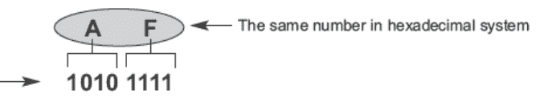

4 位二进制位能表示的最大数字是 1111。它对应于十进制中的数字 15，而在十六进制系统中，它仅由一个数字 F 表示。它是十六进制系统中最大的一位数。你看到它是多么巧妙了吗？用 8 位二进制位表示的最大数字同时也是最大的两位十六进制数。不要忘记计算机使用 8 位二进制数。这是巧合吗？


BCD 是仅用于十进制数的二进制代码（二进制编码十进制）。它用于使电子电路能够使用十进制系统与外设备通信，或在“自己的世界”中使用二进制系统进行通信。它由 4 位二进制数组成，代表前十个数字（0, 1, 2, 3 ... 8, 9）。尽管四位可以产生 16 种组合，但BCD 通常只使用前十种。


二进制系统是最常用的，十进制系统最易于理解，因此，学习如何将数字从一个系统转换为另一个系统非常重要。


二进制数中的数字取决于其位置。此外，为了将二进制数转换为十进制，需要将每个位乘以相应的 2 的幂次方（0 或 1），并相加得到结果。对此你有疑问吗？看这个例子：


应该注意，为了表示 0 到 7 的数字，需要两个二进制位。对于更大的数字，必须使用更多二进制位。因此，为了表示 0 到 15 的数字，需要四个二进制位。简单来说，当位为 4 时，得到了二进制位。例如：

ww.raguvaran.puzz.com

2^4 - 1 = 15

相应的，通过使用 4 位二进制位可以表示 0 到 15 的数字。


为了将十六进制数转换为十进制，每个十六进制位都应该乘以其位置。例如：

```
A37（十六进制数）
14*16^0 = 14
7*16^1 = 112
3*16^2 = 768
10*16^3 = 4096（十进制系统）
```


不需要进行任何计算即可将十六进制数转换为二进制。十六进制位被简单地替换为二进制位。由于最大的十六进制位等于十进制 15，我们需要四个二进制位。例如：

```
E4
E
```

下面的表格包含了 0-255 的数值。这可能是理解应用于所有系统的逻辑最简单的方法。

| 十进制. | 二进制. | 十六进制. |
|---|---|---|
| 0 | 00000000 | 0 |
| 1 | 00000001 | 1 |
| 2 | 00000010 | 2 |
| 3 | 00000011 | 3 |
| 4 | 00000100 | 4 |
| 5 | 00000101 | 5 |
| 6 | 00000110 | 6 |
| 7 | 00000111 | 7 |
| 8 | 00001000 | 8 |
| 9 | 00001001 | 9 |
| 10 | 00001010 | A |
| 11 | 00001011 | B |
| 12 | 00001100 | C |
| 13 | 00001101 | D |
| 14 | 00001110 | E |
| 15 | 00001111 | F |
| 16 | 00010000 | 10 |
| 17 | 00010001 | 11 |
| 253 | 11111101 | FD |
| 254 | 11111110 | FE |
| 255 | 11111111 | FF |


如果你遇到值为 4、16 或 64 的情况，请不要困惑。这仅仅意味着它的值是用十进制表示的。简单来说，我们已经习惯了十进制数字的使用，以至于这种表达变得非常常见。例如，说“任何二进制数的第6位值等于十进制数字 64”是正确的。但我们是人类，旧习性会害事的……此外，“数字一零一零零零……”听起来会像什么样呢？

### 字节 (BYTE)

一个字节由八个位（bit）组合在一起组成。如果说一个位是一个数字，那么字节表示数字就是理所当然的。所有的数学都可以在它们上进行，就像对普通的十进制数字一样。与任何数字的位类似，位之间的重要性也不相同。数值最大的位位于最左侧，称为最高位（MSB）。最右侧的位数值最小，因此被称为最低位（LSB）。由于一个字节的八个 0 和 1 可以以 256 种不同的方式进行组合，因此一个字节能表示的最大十进制数是 255（其中一种组合表示零）。

半字节（nibble）被称为半个位。根据我们讨论的是寄存器的哪一半（左侧或右侧），分别有“高半字节”和“低半字节”。

#### “高半字节” (High nibble)

#### “低半字节” (Low nibble)

| 位 7 | 位 6 | 位 5 | 位 4 | 位 3 | 位 2 | 位 1 | 位 0 |
| :--- | :--- | :--- | :--- | :--- | :--- | :--- | :--- |
| MSB - 最高位 | | | | | | | LSB - 最低位 |

你是否好奇过数字集成电路、微控制器或处理器内部的电子元件是什么样子的？执行复杂的数学运算和做出决策的电路是什么样子的？你是否知道它们看似复杂的原理图仅由几个称为逻辑电路或逻辑门的不同元素组成？


这些元件的操作基于基于 19 世纪英国数学家乔治·布尔（George Boolean）所建立的原则——甚至在第一个灯泡发明之前。最初，核心思想是通过代数函数来表达逻辑形式。这种思想很快转化为一种实际产品，其价值远高于今天所知的 AND、OR 或 NOT 逻辑电路。它们的操作原理被称为布尔代数。

### 逻辑电路 (LOGIC CIRCUITS)

某些程序指令产生的结果与逻辑门相同。它们的操作原理将在下文中进行讨论。

www.raguvaran.puzzl

#### 与门 (AND Gate)

| A | B | 输出 Output |
| :--- | :--- | :--- |
| 0 | 0 | 0 |
| 0 | 1 | 0 |
| 1 | 0 | 0 |
| 1 | 1 | 1 |

逻辑门“与”有两个或多个输入和一个输出。假设此示例中使用的门只有两个输入。只有当两个输入（A AND B）都被置高（1）时，它的输出才会出现逻辑一（1）。右侧的表格显示了输入与输出之间的相互依赖关系。

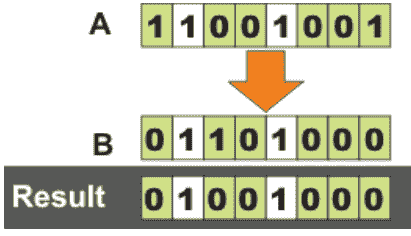

在程序中使用时，逻辑与运算由程序指令执行，稍后将讨论。目前，只需记住程序中的逻辑是指两个寄存器对应的位即可。

#### 或门 (OR GATE)

| A | B | 输出 Output |
| :--- | :--- | :--- |
| 0 | 0 | 0 |
| 0 | 1 | 1 |
| 1 | 0 | 1 |
| 1 | 1 | 1 |

同样，或门也有两个或多个输入和一个输出。如果门只有两个输入，则适用以下规则：如果任一输入（A OR B）被置高（1），它的输出上就会出现逻辑一（1）。如果或门具有两个以上输入，则适用以下规则：如果至少有一个输入被置高（1），输出上就会出现逻辑一（1）。如果所有输入均为逻辑零（0），则输出也将是逻辑零（0）。

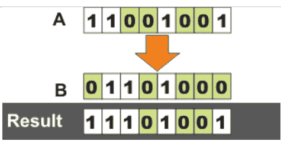

在程序中，逻辑或运算的处理方式与逻辑与运算相同。

#### 非门 (NOT GATE)

逻辑门“非”仅有一个输入和一个输出。它的工作方式极其简单。当逻辑零（0）出现在其输入上时，输出上就会出现逻辑一（1），反之亦然。这意味着该门会反转信号，因此通常称为反相器。

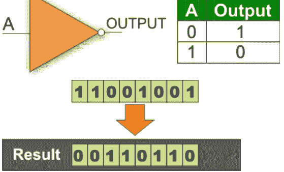

在程序中，逻辑非运算在一个字节上执行。结果是一个位反转的字节。如果将字节位被视为一个数字，那么反转后的值实际上是它的补码。一个数的补码是该数加上它后能达到最大的 8 位二进制数的值。换句话说，一个 8 位数与其补码之和始终等于 255。

#### 异或门 (EXCLUSIVE OR GATE)

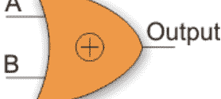

异或门（XOR）有两个或多个输入和一个输出。当输入状态不同时，输出为逻辑一（1）。在程序中，逻辑异或运算是在两个寄存器的对应位之间执行的。


在程序中，逻辑异或运算在一个字节上执行的。

### 寄存器 (REGISTER)

寄存器是一个位反转的字节。如果字节位被视为一个数字，反转后的值实际上是它的补码。


### 特功能寄存器 (SFR)

寄存器通常受特功能寄存器（SFR）的控制，这意味着寄存器的每个位都决定了相应的微引脚的状态。

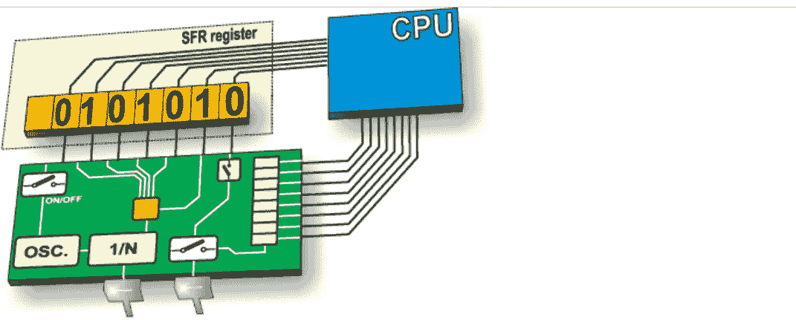

特功能寄存器（SFR）是微控制器内部，，用于存储。

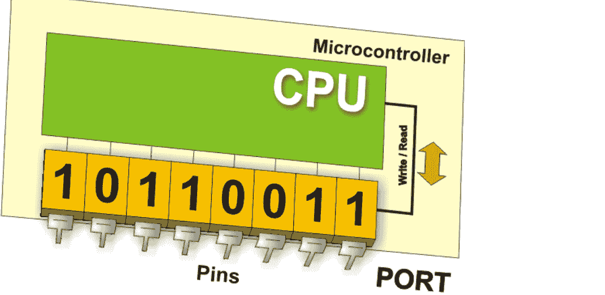

### 输入/输出端口 (INPUT / OUTPUT PORTS)

内存单元是微控制器的一部分，用于存储数据。最简单的解释方法是将其与一个有许多抽屉的文件柜进行比较。假设抽屉都有清晰的标记，通过阅读抽屉前面的标签就可以轻松找到内容。

### 只读存储器 (ROM)


只读存储器（ROM）用于永久保存正在执行的程序。可以写入的程序的大小取决于该存储器的大小。现在的微控制器通常使用 16 位寻址，这意味着它们能够访问高达 64 Kb 的内存，即 65535 个位置。对于初学者来说，你的程序很少超过数百条指令的限制。ROM 有几种类型。

#### 掩码 ROM (MROM)

掩码 ROM 是一种 ROM，其内容由制造商在制造过程中进行预先写好。“掩码（masked）”一词源于制造工艺，在光刻工艺之前，芯片的某些区域会被遮盖住。对于大规模生产，它的价格非常低。忘掉它吧……

#### 一次可编程 ROM (OTP ROM)

一次性可编程 ROM 允许你将程序下载到内核中，但正如其名称所示，只有一次。如果在下载后检测到错误，你唯一能做的是将正确的程序下载到另一个芯片上。

#### 紫外光可擦除可编程 ROM (UV EPROM)

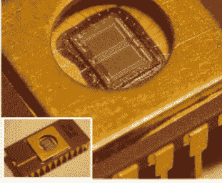

这种存储器的制造工艺和特性与 OTP ROM 完全相同。然而，带有这种存储器的微控制器封装在其顶部有一个明显的“窗口”。它允许数据在强紫外线照射下被擦除。在几分钟后，就可以向其中下载新程序了。

这种窗口的安装非常复杂，这通常会影响价格。从我们的角度来看，遗憾的是——这是负面影响……

#### 闪存 (Flash Memory)

这种存储器于 80 年代在英特尔（INTEL）实验室发明，作为 UV EPROM 的继任者。由于这种存储器的内容可以几乎无限次地写入和清除，带有 Flash ROM 的微控制器是学习、实验和小规模生产的理想选择。由于其非常受欢迎，如今大多数微控制器都是采用闪存技术制造的。因此，如果你要买控制器，要找的类型一定是 Flash！

www.raguvaran.puzl.com

#### 随机存存储器 (RAM)

一旦断电，RAM 的内容就会被清除。它用于临时存储微控制器操作产生并使用的中间结果。例如，如果程序执行任何加法（无论什么内容），就需要一个寄存器来代表日常生活中所谓的“和（sum）”。因此，RAM 的一个寄存器被称为“sum”，并用于存储加法结果。

#### 电学可擦除可编程 ROM (EEPROM)

EEPROM 的内容可以在运行期间进行更改（类似于 RAM），但在掉电后仍保持永久保存（类似于 ROM）。因此，EEPROM 经常用于存储运行期间产生且必须永久保存的值。例如，如果你设计了一个电子锁或警报器，能够让用户创建并输入密码将非常棒，但如果每次断电它就失效了。理想的解决方案是带有内置 EEPROM 的微控制器。

### 中断 (INTERRUPT)

大多数程序在执行过程中使用中断。微控制器的主要目的是响应周围环境的变化。换句话说，当事件发生时，微控制器会执行某些操作……例如，当你按下遥控器上的按钮时，微控制器会记录它并通过切换通道、增大或减小音量等做出响应。如果微控制器花费大部分时间在几小时或几天不停地检查几个按钮，那将完全不实际。

这就是为什么微控制器在进化过程中学会了一个技巧。微控制器不再不断地检查每个引脚或位，而是将“等待问题”委托给一个“专家”，只有当发生值得关注的事情时该专家才会做出响应。

通知中央处理器单元此类事件的信号被称为“中断（INTERRUPT）”。

### 中央处理器单元 (CPU)

大多数程序在常规执行中使用中断。微控制器的目的主要是响应其周围环境的变化。换句话说，当事件发生时，微控制器会执行某些操作……例如，当你按下遥控器上的按钮时，微控制器会记录它并通过切换通道、增大或减小音量等做出响应。如果微控制器花费大部分时间在几小时或几天不停地检查几个按钮，那将完全不实际。

这就是为什么微控制器在进化过程中学会了一个技巧。微控制器不再不断地检查每个引脚或位，而是将“等待问题”委托给一个“专家”，只有当发生值得关注的事情时该专家才会做出响应。

通知中央处理器单元此类事件的信号被称为“中断（INTERRUPT）”。

中央处理器单元 (CPU)

正如其名称所示，这是一个用于监控和控制的单元。它由许多子单元组成，其中最重要的：
- **指令解码器**（Instruction Decoder）
- **算术逻辑单元**（ALU）
- **累加器**（Accumulator）
- **状态寄存器**（Status Register/PSW）

ALU 负责执行所有的数学和逻辑运算。累加器用于存储操作结果。状态寄存器（PSW）与累加器密切相关，并在此时提供状态。如下所示：


### 总线 (BUS)

总线由8 条或更多线路组成。有两种总线：地址总线和数据总线。地址总线的宽度取决于内存，用于从 CPU 传输地址。数据总线的宽度取决于数据，用于连接微控制器内部。

### 串行通信 (SERIAL COMMUNICATION)

微控制器与外设设备之间的并行连接在几米的短距离内是理想解决方案。然而，在其他情况下，需要在更远距离上建立通信，无法使用并行连接。相反，使用的是串行通信。

如今，大多数微控制器内置了多种串行通信系统。使用哪种系统取决于许多因素，其中最重要的有：

- 微控制器需要与多少设备交换数据？
- 数据交换有多快？
- 设备之间的距离是多少？
- 是否需要同时发送和接收数据？


波特率模式。最近出现了波特率为 3.4 Mb/sec 的系统。通过 I2C 总线通信的设备之间的距离限制在几米范围内。


### SPI（串行外接口总线）

串行外接口 (SPI) 是一种用于串行通信的系统，它使用最多四根导体，通常为三根。一根用于接收数据，一根用于发送数据，一根用于同步，另一根则用于选择要通信的设备。它是全双工连接，这意味着数据可以同时发送和接收。

最大波特率高于 I2C 通信系统。

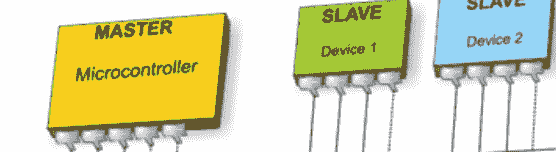

### UART（通用异步接收/传输器）

这种通信是非异步的，意味着不使用用于传输时钟信号的特殊线路。在某些应用中（例如无线连接或红外遥控器），这一特性至关重要。由于只使用一条通信线，接收器和发送器都以相同的预定义速率运行，以保持必要的同步。这是一种简单的数据传输方式，因为它基本上代表了 8 位数据从并行格式转换为串行格式。波特率不高，最高 1 Mbit/sec。

### 振荡器

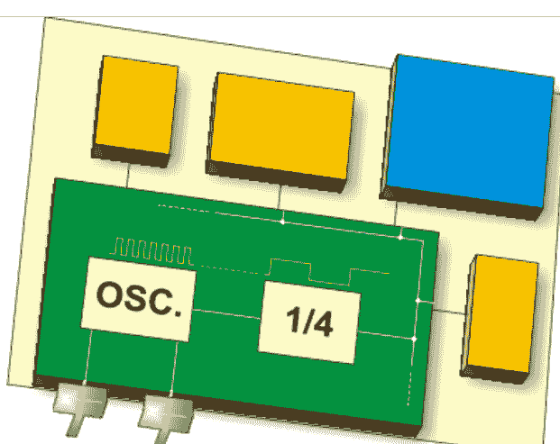

振荡器产生的脉冲使微控制器内部的所有电路能够谐波和同步运行。振荡器通常配置为使用石晶或陶瓷谐振器来稳定频率，但它也可以作为独立电路（如 RC 振荡器）工作。需要说明的是，指令并不是按照振荡器本身规定的速率执行，而是比其慢得多。这是因为每条指令都是通过几个步骤执行的。在某些微控制器中，执行所有指令需要相同数量的周期，而在另一些，不同指令的周期数不同。因此，如果系统使用频率为 20 MHz 的石晶，则指令的执行时间不是 50ns，而是 200、400 或 800 ns，取决于 MCU 的类型！

### 电源电路

关于微控制器的电源电路有两点值得关注：

-   掉电（Brown out）是一种潜在的危险状态，发生在微控制器关闭瞬间或电源电压由于电噪声下降到最低值时。由于微控制器由多个不同工作电压水平的电路组成，这种状态可能会导致其性能失控。为了防止这种情况，微控制器使用内置的掉电重位电路，在紧急状态下重位整个电子设备。
-   重位引脚（Reset pin）通常标记为 MCLR（主清除重位）。通过向该引脚施加逻辑低电（0）或高电（1）来实现微控制器的外部重位，这取决于微控制器的类型。如果没有内置掉电重位电路，可以将一个简单的外部掉电重位电路连接到 MCLR 引脚。

### 定计时器/计数器

微控制器振荡器使用石晶进行运行。虽然这不是最简单的解决方案，但有许多使用它的理由。这种振荡器的频率定义得非常精确且非常稳定，因此它产生的脉冲宽度始终相同，这非常适合时间测量。此类振荡器也用于石英表。如果需要测量事件之间的时间，只需计算由该振荡器产生的脉冲即可。这正是定时器所做的。


大多数程序使用这些微型电子“停止表”。它们通常是 8 位或 16 位的特殊功能寄存器（SFR），其内容随每个进入的脉冲自动递增。一旦寄存器完全加载，可能会产生中断！

如果定时器使用内部石晶振荡器运行，则可以用于测量两个事件之间的时间（如果在测量开始时寄存器值为 T1，在结束时值为 T2，则经过时间为减法结果 T2-T1）。如果寄存器使用来自外部源的脉冲，则定时器将变为计数器。

这只是对操作本身的简单解释。但在实践中，情况要复杂得多。

#### 定时器是如何工作的？

在实践中，石晶振荡器产生的脉冲每个机器周期一次，直接或通过分频器（prescaler）引入电路，增加定时寄存器中存储的数字。如果一条指令（一个机器周期）持续四个石晶振荡器周期，那么通过频率为 4MHz 的石晶，该数字每秒（每个微秒）将递增百万次。

#### 定时寄存器

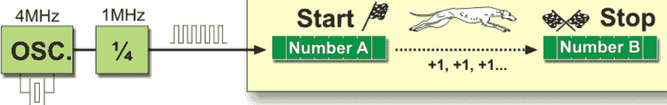


通过上述方法很容易测量较短的时间间隔（多达 256 微秒），因为这是一个寄存器可以存储的最大数字。这种限制可以通过多种方式轻松克服，例如使用分频器。

#### 定时器是如何操作的？

在实践中，石晶振荡器产生的脉冲每个机器周期一次，直接或通过分频器带入电路，增加定时寄存器中存储的数字。如果一条指令（一个机器周期）持续四个石晶振荡器周期，那么通过频率为 4MHz 的石晶，该数字每秒（每个微秒）将递增百万次。

#### 定时寄存器


通过上述方法很容易测量较短的时间间隔（多达 256 微秒），因为这是一个寄存器可以存储的最大数字。这种限制可以通过多种方式轻松克服，例如使用分频器。

#### 在定时器操作中使用分频器

分频器是一种通过预设因子降低频率的电子设备。为了在输出端产生脉冲，需要在输入端使用一个或多个分频器。大多数微控制器内置一个或多个分频器，其频率可以在程序内部更改。当定时器和看位定时器共享一个分频器时，它们无法同时使用它们。

#### 定时寄存器


#### 在定时器操作中使用中断

如果定时器由 8 位组成，它能存储的最大数字是 255。对于 16 位寄存器，它是 65535。如果超过了这个数字，定时器将自动重位，计数从零开始。这种状态被称为溢出。如果在程序中启用，溢出会导致中断，这提供了全新的可能性。例如，用于计算秒、分钟或天的寄存器状态可以进行任何方式更改。整个过程（中断例除外）都在后台自动完成，这使得微控制器的主电路能够正常运行。

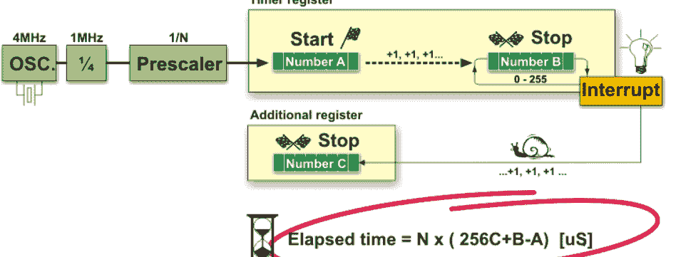

该图说明了定时器操作中使用中断。通过为定时器分配分频器，可以轻松获得任意的延迟，且对主程序的执行几乎没有影响。

#### 计数器

如果定时器接收来自微控制器引脚的脉冲，它就会变为计数器。显然，相同的电子电路以两种不同的模式运行。唯一的区别是，在这种情况下计数的脉冲来自微控制器引脚，且持续时间（宽度）通常未定义。这就是为什么它们不能用于时间测量，而是用于其他用途，例如计算流水线产品、轴旋转数、乘客（取决于使用的传感器）。

#### 看位定时器

看位定时器是连接到微控制器内部完全独立的 RC 振荡器的定时器。

如果启用看位定时器，每当它计数到最大值时，微控制器就会重位，程序执行从第一指令开始。关键在于通过特定命令来防止这种情况的发生。

总之，整个想法基于每个程序都运行在几个长短不一的循环中。如果在适当的位置设置重位看位定时器的指令，除了定期执行命令外，看位定时器的运行将不会影响程序执行。如果由于任何原因（通常是工业电噪声），程序计数器“卡”在某个无法返回的内存位置，看位定时器将无法被清除，寄存器值不断递增将达到最大值，*在此刻！* 重位发生！

www.raguvaran.puzl


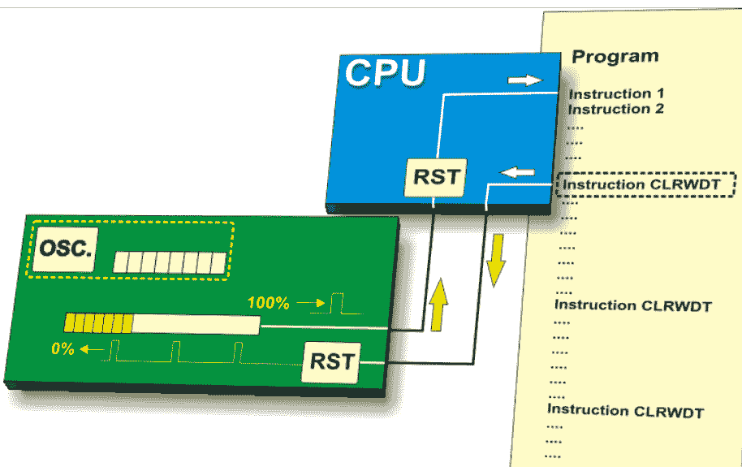

### A/D 器

外部信号通常与微控制器能够理解的信号（0 和 1）在本质上完全不同，因此必须转换为微控制器可以理解的值。模数转换器（ADC）是一种将连续信号转换为离散数字的电子电路。换句话说，该电路将模拟值转换为二进制数并将其传递给 CPU 进行进一步处理。因此，该模块用于输入引脚电压测量（模拟值）。

测量结果是一个数字（数字值），稍后将在程序中使用和处理。


#### 内部架构

所有升级后的微控制器都使用两种基本设计模型之一，称为哈佛架构（Harvard）和冯·诺依曼架构（von-Neumann architecture）。

它们代表了 CPU 和内存之间交换数据的两种不同方式。

#### 冯·诺依曼架构

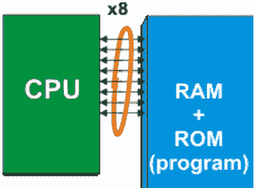

使用冯·诺依曼架构的微控制器只有一个内存块和一个 8 位数据线。由于所有数据都通过这 8 条线进行交换，总线会过载，通信非常缓慢且低效。CPU 要么可以读取指令，也可以从内存读取/写入数据。这两者不能同时发生，因为指令和数据使用同一条总线。例如，如果某行程序要求读取名为 'SUM' 的 RAM 内存寄存器并加 1（指令：inc SUM），微控制器将执行以下操作：

- 1. 读取程序指令中指定**要做什么**的部分（在这种情况下是用于递增的 'inc'）。
- 2. 读取同一条指令的另一部分，指定在**哪些数据**上执行操作（在这种情况下是 'SUM' 寄存器）。
- 3. 在加1之后，该寄存器的内容应写回读取它的寄存器（'SUM' 寄存器地址）。

所有这些中间操作都使用同一个数据总线。

#### 哈佛架构

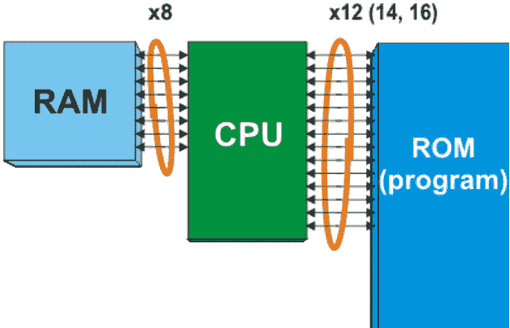

使用哈佛架构的微控制器有两个不同的数据总线。一个为 8 位宽，连接 CPU 和 RAM。另一个由 12、14 或 16 条总线组成，连接 CPU 和 ROM。因此，CPU 可以同时读取指令和访问数据内存。由于所有 RAM 内存寄存器均为 8 位宽，所有交换的数据宽度相同。在编写程序的过程中，只考虑 8 位数据。换句话说，你从程序中更改的所有内容以及你能影响的所有内容都是周期指令。为这些微控制器编写的程序在编译成机器码后将存储在微控制器的内部 ROM 中。然而，ROM 内存单元并没有 8、12、14 或 16 位。剩余的 4、6 或 8 位代表指定 CPU 如何处理这 8 位数据的指令。

这种设计的优势如下：

- 程序中的所有数据位均为 1 字节（8 位）宽。由于用于程序读取的总线具有 12、14 或 16 条线，可以使用这些空闲位同时读取指令和数据。由于这个原因，除了需要两个周期的跳转指令外，所有指令都是单周期指令。
- 得益于程序（ROM）和临时数据（RAM）是分离的，CPU 可以同时执行两条指令。简单来说，当 RAM 读取或写入正在进行（单条指令的结束）时，下一条程序指令通过另一条总线读取。
- 使用带有冯·诺依曼架构的微控制器时，永远不知道程序占用了多少内存。基本上，大多数程序指令占用两个内存位置（一个包含关于**要做什么**的信息，另一个包含关于在**哪些数据**上执行操作的信息）。然而，这不是一条硬性规定，但它是最常见的情况。在采用哈佛架构的微控制器中，程序总线比一个字节宽，允许每个程序字由指令和数据组成，即一个内存位置——一个程序指令。

#### 指令集

www.raguvaran.puzl.com

```
...
movlw 03F
movf TEMP1
btfsc MAX,7
goto check
btfsc MAX,6
goto opening
btfsc MAX,5
goto closure
...
```

所有微控制器能够理解的指令合称为指令集。当你用汇编语言编写程序时，你实际上是按照它们执行的顺序来指定指令。这里主要的限制是可用指令的数量。制造商通常采用下面描述的两种之一：

#### RISC（精简指令集计算机）

在这种情况下，微控制器只识别和执行基本操作（加法、减法、复制等）。其他更复杂的操作通过组合这些操作来实现。例如，乘法是通过连续相加完成的。这就像你尝试仅用几个单词向某人解释在一个新城市如何到达机场，并不像那么简单。首先，这种语言很容易学习。微控制器的运行非常快，以至于无法完成它执行的所有算术“杂技”。用户只能看到最终结果。最后，如果你使用左、右、公里等正确的词汇，解释机场在哪里并不困难。

#### CISC（复杂指令集计算机）

CISC 是 RISC 的反！！用于识别 200 多种不同指令的微控制器可以高速地完成许多工作。然而，人们需要理解如何操作这种丰富语言所提供的所有功能，这一点也不简单……

#### 如何做出正确的选择？

好了，你是一个初学者，并且已经决定开启微控制器的冒险。祝贺你做出选择！然而，选择正确的微控制器并不像那么容易。问题不在于设备范围有限，而是相反！

在开始基于微控制器设计设备之前，考虑以下问题：你需要多少输入输出线路？它是否需要执行比简单的开关继电器之外的操作？它是否需要某些专用模块，如串口通信、A/D 转换器等？当你对需求有一个清晰的认识时，选择范围就是


#### 基础 8 位架构，14 位指令字长度

| 系列 | ROM [Kbytes] | RAM [bytes] | 时钟频率 [MHz] | A/D 输入 | 转换器分辨率 | 比较器 | 8/1 位定时器 | 串行输出 | 其它 |
|---|---|---|---|---|---|---|---|---|---|
| PIC10XX | 0.375-0.75 | 6-24 | 4-8 | 0-2 | 8 | 0-2 | 1 x 8 | - | - |
| PIC12XX | 0.75-1.5 | 25-38 | 8 | 0-3 | 8 | 0-1 | 1 x 8 | - | EEP ROM |
| PIC14XX | 0.75-2.3 | 25-134 | 20 | 0-3 | 8 | 0-2 | 1 x 8 | - | EEP ROM |
| PIC16HXXX | 1.5 | 25 | 18-20 | - | - | 1 x 8 | - | Vdd=15 |
| PIC12XX | 1.75 | 64-128 | 8-20 | 0-4 | 10 | 0-1 | 2 x 8 | 16 | EEP ROM |
| PIC12HXXX | 1.75 | 64 | 8-20 | 0-4 | 10 | 0-1 | 2 x 8 | 16 | - |
| PIC16XX | 1.75-14 | 64-368 | 14-64 | 0-13 | 8 或 10 | 0-2 | 1 x 8 | 16 | - | I2C SPI |
| PIC16HXXX | 1.75-3.5 | 64-128 | 14-20 | 0-12 | 10 | 0-2 | 2 x 8 | 16 | - | I2C SPI |
| PIC18FX | 4-128 | 256-393 | 18-80 | 32-48 | 4-16 | 10 或 12 | 0-3 | 2 x 3 | 16 | | I2C SPI |

#### 中端 8 位架构，14 位指令字长度

#### 高端 8 位架构，16 位指令字长度

| 系列 | ROM [Kbytes] | RAM [bytes] | 时钟频率 [MHz] | A/D 输入 | 转换器分辨率 | 比较器 | 8/1 位定时器 | 串行输出 | 其它 |
|---|---|---|---|---|---|---|---|---|---|
| PIC18FXJXX | 8 - 128 | 102 - 393 | 6 | 28-10 | 40-48 | 10-16 | 10 | 2 | 0-2 x 3 | 16 | | I2C SPI |
| PIC18FXXXX | 8 - 64 | 768 - 393 | 6 | 28-44 | 64 | 10-13 | 10 | 2 | 1 x 8 | 16 | | I2C SPI |

所有采用哈佛架构的微控制器，这意味着它们的程序内存是通过超过 8 条线连接到 CPU 的。根据总线宽度，有 12 位、14 位和 16 位微控制器。上表显示了这三类设备的主要特征。

如上一页标题所示，除了“16 位怪物”PIC 24XXXX 和 PIC 24XXXX 之外，所有微控制器都具有 8 位架构，并属于三组之一。因此，根据字的大小，首先分为第一、第二和第三类微控制器，即 12 位、14 位或 16 位微控制器。由于具有相似的 8 位核心，它们都使用相同的指令集，以及连接到多或较少外围单元的基础硬件“骨架”。

#### 指令集

16F8XX 的指令集总共包含 35 条指令。指令数量如此之小的原因是 RISC 架构。这意味着指令在运行速度、架构简单性和代码紧凑性方面经过了高度优化。RISC 架构的缺点是要求程序员能够对付这些指令。当然，这仅在你使用汇编语言进行编程时才相关。本书指的是使用高级编程语言 C 进行编程，这意味着大部分工作已经由他人完成。你只需要使用相对简单的指令即可。

#### 指令执行时间

所有指令均为单周期指令。唯一的例外可能是分支指令（满足条件时）或对程序计数器执行的指令。在这两种情况下，指令执行需要两个周期，第二个周期作为 NOP（无操作）执行。单周期指令由四个时钟周期组成。使用标称时间进行指令执行时为 1µS。作为跳转指令，指令执行时间为 2µS。

14 位 PIC 微控制器的指令集：

#### 数据传输指令

| | 描述 | 操作 | 标志 | 时钟 |
|---|---|---|---|---|
| RLW k | 常数移动到 W | k -> W | | |
| MOVWF | 将 W 移动到 f | W -> f | | |
| MOVF f,d | 将 f 移动到 d | f -> d | Z | 1, 2 |
| CLRW | 清空 W | 0 -> W | Z | 1 |
| CLRF f | 清空 f | 0 -> f | Z | 2 |
| SWAPF f,d | 交换 f 中的字节 | f(7:4)->f(3:0) | | 1, 2 |

#### 算术逻辑指令

| | 描述 | 操作 | 标志 | 时钟 |
|---|---|---|---|---|
| ADDLW k | W 与常数加 | W+k -> W | C, DC | 1 |
| ADDWF f,d | W 与 f 加 | W+f -> d | C, DC | 1 | 2 |
| SUBLW k | 常数减去 W | k-W -> W | C, DC | 1 |
| SUBWF f,d | 从 f 减去 W | f-W -> d | C, DC | 1 | 2 |
| ANDLW k | W 与常数与与 | AND k -> W | Z | 1 |
| ANDWF f,d | W 与 f 与与 | AND f -> d | Z | 1, 2 |
| ANDWF f,d | W 与 f 与与 | AND f -> d | Z | 1, 2 |
| IORLW k | W 与常数或运算 | OR k -> W | Z | 1 |
| IORWF f,d | W 与 f 或运算 | OR f -> d | Z | 1, 2 |
| XORWF f,d | W 与常数异或 | XOR k -> W | Z | 1, 2 |
| XORWL k | W 与 f 异或 | XOR f -> d | Z | 1 |
| INCF f,d | f 加 1 | f+1 -> f | Z | 1, 2 |
| DECF f,d | f 减 1 | f-1 -> f | Z | 1, 2 |

#### 位操作指令

| | 描述 | 操作 | 标志 | 时钟 |
|---|---|---|---|---|
| RLF f,d | f 带进位左移 | C | | 1, 2 |
| RRF f,d | f 带进位右移 | C | | 1, 2 |
| COMF f,d | f 取反 | f -> d | Z | 1, 2 |
| BCF f,b | 清除 f 中的 b | 0 -> f(b) | | 1, 2 |
| BSF f,b | 设置 f 中的 b | 1 -> f(b) | | 1, 2 |
| BTFSC f,b | 测试 f 的 b，若为0则跳过 | f(b) = 0 | | 1 (2) 3 |
| BTFSS f,b | 测试 f 的 b，若为1则跳过 | f(b) = 1 | | 1 (2) 3 |
| DECFS f,d | f 减 1，若为0则跳过 | f-1 -> d | Z = 1 | | 1 (2) 1, 3 |
| INCFS f,d | f 加 1，若为1则跳过 | f+1 -> d | Z = 0 | | 1 (2) 1, 3 |
| GOTO k | 跳转到地址 | k -> PC | | 2 |
| CALL k | 调用子程序 | PC -> TOS, k -> PC | | 2 |
| RETURN | 从子程序返回 | TOS -> PC | | 2 |
| RETLW k | 带常数 W 返回 | k -> W, TOS -> PC | | 2 |
| RETFIE | 从中断返回 | TOS -> PC, 1 -> GIE | | 2 |

#### 程序控制指令

#### 其他指令

| | | | | |
|---|---|---|---|---|
| NOP | 无操作 | TOS -> PC, 1 -> GIE | | 1 |
| CLRWDT | 复位位定时器 | 0 -> WDT, 1 -> TO, 1 -> PD | TO, PD | 1 |
| SLEEP | 进入睡眠模式 | 0 -> WDT, 1 -> TO, 0 -> PD | TO, PD | 1 |

*1 当 I/O 寄存器根据自身进行修改时，使用的值将是引脚上的实际值。
*2 如果指令在 TMR 寄存器上执行且 d=1，则分频器将清零。
*3 如果 PC 被修改或测试结果为逻辑一 (1)，则指令需要两个周期。


8 位 PIC 微控制器的架构。这些模块属于微控制器取决于其类型。

### 第2章：编程微控制器

你已经知道，仅仅将微控制器连接到其他组件并开启电源使其工作是不够的，对吧？还有一点必须的：微控制器需要被编程才能执行任何有用的功能。如果你认为这很复杂，那么你错了。整个过程非常简单。只需阅读文本，你就会改变主意。

- 2.1 编程语言
- 2.2 C 语言语言基础
- 2.3 用于 PIC 的编译器 MIKROC PRO

## 2.1 编程语言


简直是一场噩梦。汇编语言中的指令以有意义的缩写形式表示，而将它们编译成可执行代码的过程则留给 PC 上一个称为编译器（compiler）的特殊程序完成。这种编程语言的主要优势是它的简单性，即每条指令都对应微控制器中的一个内存位置。它能够对芯片内部发生的情况进行完全控制，使得这种语言在今天被广泛使用。

然而，程序员一直需要一种接近日常生活中使用的的编程语言。因此，高级编程语言被创造出来。其中之一就是 C 语言。这些语言的主要优势是程序编写简单。你不再可能确切地知道每个命令是如何执行的，但无论如何这不再重要了。如果需要，始终可以在程序中插入用汇编语言编写的序列，从而实现该功能。

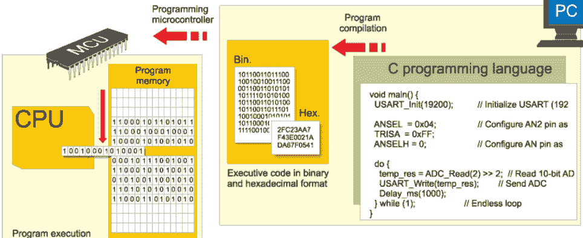

与汇编语言类似，PC 上称为编译器的专用程序负责将程序编译成机器。与汇编编译器不同，它们创建的可执行代码并不总是最短的。

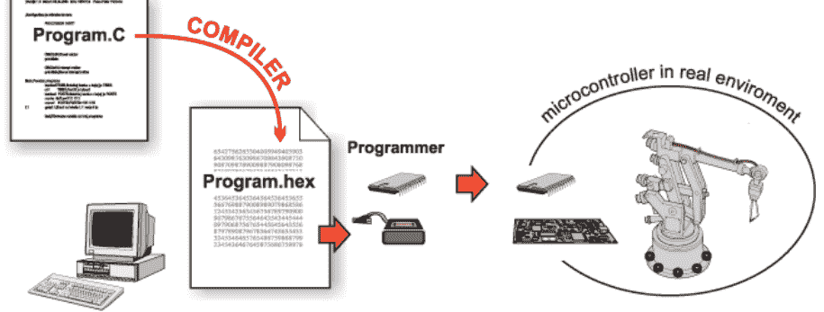

图中粗示意说明了程序从高级语言到低级编程语言过程中发生的情况。www.raguvaran.puzl.com

这是一个用 C 语言编写的简单程序示例：

```
void main() {
    TRISB = 0;          // 所有端口 B 引脚已配置
    PORTB = 0b01010101; // 端口 B 引脚逻辑状态
}
```


用 C 语言编写的程序

```
; ADDRESS    OPCODE        ASM
;---------------------------------------
$0000       $2804          GOTO main
$0004               $               main:
;Test.c,1   void main() (
;Test.c,3   TRISB = 0;      // All port B pins
$0004       $1283          BCF STATUS, RP1
$0005       $1683          BSF STATUS, RP0
$0006       $0186          CLRF TRISB, 1
;Test.c,4   PORTB = 0b01010101; // Logic state
$0007       $3055          MOVL 85
$0008       $1283          BCF STATUS, RP0
$0009       $0086          MOVWF PORTB
;Test.c,5   $280A          GOTO $
```

编译后的程序

```
:10000000428F3FFF3FF3F033831680155304F
:1001000831286000A28FF3FFF3FFF3FFF3FF5D
:04400E00F222FFFFFFFFF8
:00000001FF
```


### 高级编程语言的优势

如果你曾用汇编语言为微控制器编写过程序，你可能知道 RISC 架构缺少指令。没有用于两个两个数字的适当指令，但没有理由担心这个问题。每个问题都有解决方案，数学中有一个例外使我们能够通过将复杂操作分解为许多简单操作来执行它们。具体来说，乘法可以很容易被连续相加代替（a*b = a + a + a + ... + a）。并且 www.raghavaran.puzz

在这里，我们处于一个非常长故事的开头……对于像 C 这样的高级语言，不用担心，因为已经有人为你解决了这个问题以及许多其他类似的问题。直接写 a*b 即可。

### 用 C 语言编写的程序

```
int num_a = 34;
int num_b = 14;
void main() {
 result = num_a * num_b;}
```

| ADDRESS | | |
|---|---|---|
| $0000 | MOVLN 128 |
| $000A | GOTO $0000 |
| $0005 | $0018 BYPASS |
| $005D | $0035 DCF9 |
| $005E | GOTO $1+12 RRF STACK, F, P |
| BCF | $0054 DCF9 |
| $005F | MOV STAC RRF STACK, F, P |
| $0060 | $0021 BCD0 |
| MOVW | C $0022 STATUS, C |
| MOVW | STAC $0035 $+26 281C |
| MOVW | $0023 $0170 |
| MOVW | $0024 STACK, 13, 0 |
| MOVW | $2844 |
| MOVL | $0025 GOTO $1+12 $098 |
| MOVL | STACK, F, $09FA |
| MOVL | $0026 STACK, F, $099 |
| MOVL | $0027 STACK, F, $0F9 |
| MOVW | $0028 STACK, F, $0F8 |
| RETURN | $0029 STACK, F, $0F8 |
| RETURN | $0004 $1903 |
| $0004 | C $002A STATUS, Z |
| $0004 | C $0007 $1903 |
| $0005 | $0037 $09FA |
| BCF | $002B STACK, F, P |
| $0006 | $0040 $1903 |
| $0006 | $0041 $09FA |
| BTNE | $0042 $1903 |
| $002E | $00043 STATUS, Z |
| $002E | $09FA STATUS, Z |

相同的程序编译成汇编代码

### 预处理器

预处理器是 C 编译器的不可组成部分，它的功能是识别并执行预处理器指令。这些特殊指令不属于 C 语言，但是编译器软件包的一部分。每个预处理器指令以 '#' 开头。在编译之前，C 编译器激活预处理器，遍历程序以寻找这些符号。如果发现任何一个，预处理器将简单将其替换为另一个文本，取决于指令类型，可以是文件内容或短字符序列。然后，编译过程就可以开始。预处理器指令可以出现在程序的任何位置，并且仅引用从其出现处到程序结束的部分。

#### 预处理指令 # include

许多程序经常在多处重复相同的指令集。为了加速过程，它们通常被分组在一起。

www.raghavaran.puzz


C 编程语言中可以使用几种类型的数据。下表显示了这些数据在基本形式下时具有的取值范围。

| 数据类型 | 描述 | 大小（位数） | 取值范围 |
| --- | --- | --- | --- |
| char | 字符 | 8 | 0 到 255 |
| int | 整数 | 16 | -32768 到 32767 |
| float | 浮点数 | 32 | ±1.17549435082·10⁻³⁸ 到 ±6.80564774407·10⁻³⁸ |
| double | 双精度浮点数 | 32 | 从 ±1.17549435082·10⁻³⁸ 到 ±6.80564774407·10⁻³⁸ |

通过向任何数据类型添加前缀（qualificador），其可能的值范围随着所需字节数的增加而改变。

| 数据类型 | 带前缀的数据类型 | 大小（位数） | 范围 |
| --- | --- | --- | --- |
| char | signed char | 8 | -128 到 128 |
| | unsigned int | 16 | 0 到 65535 |
| | short int | 8 | 0 到 255 |
| int | signed short int | 8 | -128 到 127 |
| | long int | 32 | 0 到 4294967295 |
| | signed long int | 32 | -2147483648 到 2147483647 |

### 变量

在程序运行期间值发生变化的数字都称为变量。简单来说，如果程序相加两个数字（number1 和 number2），则需要一个值来表示我们日常生活中所谓的“和”。在这种情况下，number1、number2 和 sum 都是变量。

#### 声明变量

- 变量名可以包含任何字母字符 A-Z (a-z)、数字 0-9 和下划线字符 '.'。编译器是区分大小写的，会区分大写和小写字母，而常量名通常包含小写字母。
- 变量名不能以数字开头。
- 某些名称由于已被编译器本身使用而不能作为变量名。这些名称被称为关键字。microC 编译器总共识别这 33 个这样的词：

#### MIKROC - 关键字

| absolute | data | if | return | typedef |
| asm | default | inline | rx | typeid |
| at | delete | int | sfr | typename |
| auto | do | io | short | union |
| bit | double | long | signed | unsigned |
| bool | else | mutable | sizeof | using |
| break | enum | namespace | static | virtual |
| case | explicit | operator | struct | void |
| catch | extern | org | switch | volatile |
| char | false | pascal | template | while |
| class | float | private | this |
| code | for | protected | throw |
| const | friend | public | true |
| continue | goto | register | try |

### 指针

指针是一种保存字符变量地址的特殊变量。换句话说，指针“指向”另一个变量。它的声明方式如下：

```
type_of_variable *pointer_name;
```

为了将变量的地址赋值给指针，必须使用 '=' 字符并在变量名之前加上 '&' 字符。在接下来的示例中，声明了指针 'multiplex' 并将其赋值为八个 LED 显示器中的第一个地址：

```
unsigned int *multiplex; // 声明指针
```

为了将变量的地址赋值给指针，必须使用 '=' 字符并在变量名之前加上 '&' 字符。在接下来的示例中，声明了指针 'multiplex' 并将其赋值为第一个
地址：

为了将变量的地址赋值给指针，必须使用 '=' 字符并在变量名之前加上 '&' 字符。在接下来的示例中，声明了指针 'multiplex' 并将其赋值为八个 LED 显示器中的第一个地址：

```
unsigned int *multiplex; // 声明指针
```

为了将变量的地址赋值给指针，必须使用 '=' 字符并在变量名之前加上 '&' 字符。在接下来的示例中，声明了指针 'multiplex' 并将其赋值为八个 LED 显示器中的第一个地址：

```
unsigned int *multiplex; // 声明指针
```

为了将变量的地址赋值给指针，必须使用 '=' 字符并在变量名之前加上 '&' 字符。在接下来的示例中，声明了指针 'multiplex' 并将其赋值为八个 LED 显示器中的第一个地址：

```
unsigned int *multiplex; // 声明指针
```

为了将变量的地址赋值给指针，必须使用 '=' 字符并在变量名之前加上 '&' 字符。在接下来的示例中，声明了指针 'multiplex' 并将其赋值为八个 LED 显示器中的第一个地址：

```
unsigned int *multiplex; // 声明指针
```

为了将变量的地址赋值给指针，必须使用 '=' 字符并在变量名之前加上 '&' 字符。在接下来的示例中，声明了指针 'multiplex' 并将其赋值为八个 LED 显示器中的第一个地址：

```
unsigned int *multiplex; // 声明指针
```

为了将变量的地址赋值给指针，必须使用 '=' 字符并在变量名之前加上 '&' 字符。在接下来的示例中，声明了指针 'multiplex' 并将其赋值为八个 LED 显示器中的第一个地址：

```
unsigned int *multiplex; // 声明指针
```

为了将变量的地址赋值给指针，必须使用 '=' 字符并在变量名之前加上 '&' 字符。在接下来的示例中，声明了指针 'multiplex' 并将其赋值为八个 LED 显示器中的第一个地址：

```
unsigned int *multiplex; // 声明指针
```

（注：由于原文文本中存在大量重复片段和断句，上述翻译已根据逻辑进行了对齐处理，确保了 Markdown 格式的完整性且无冗余输出。）

```
unsigned int *multiplex; // 声明指针
multiplex = &led[0]; // 将指针赋值为第一个 LED 显示器的地址
```


在本示例中，将 Message_1 常量发送到 LCD 显示器将显示消息“press the START button（按下启动按钮）”。

### 枚举常量

枚举常量是一种特殊的整数型常量，它们通过为元素分配序数，使程序更加完整且易于理解。在下面的示例中，大括号中的第一个元素被自动赋值为 0，第二个赋值为 1，第三个赋值为 2，以此此类推。

```
enum MOTORS {UP, DOWN, LEFT, RIGHT}; // 声明常量 MOTORS
```

程序中每次出现 'LEFT'、'RIGHT'、'UP' 和 'DOWN' 时，编译器会将它们替换为相应的数字（0-3）。具体来说，如果端口 B 的引脚 0、1、2 和 3 连接到可以向上、向下、向左和向右移动的电机，那么运行连接到端口 B位 3 的 'RIGHT' 电机的命令如下所示：

```
PORTB.RIGHT = 1; // 设置连接到电机 'RIGHT' 的 PORTB 第 3 位
```

### 运算符、操作和表达式

运算符是表示特定算术、逻辑或其他操作的符号。C 语言提供了超过 40 种操作，但实践中最多使用 10-15 种。每个操作在一个多个操作数（可以是变量或常量）上执行。此外，每个操作还具有执行优先级和结合性。

#### 算术运算符

算术运算符用于算术运算，并始终返回正结果。与在一个操作数上执行的一元操作不同，二进制操作是在两个操作数上进行的。换句话说，执行二进制操作需要两个数字。例如：a+b 或 a/b。

| 运算符 | 操作 |
| --- | --- |
| + | 加法 |
| - | 减法 |
| * | 乘法 |
| / | 除法 |
| % | 取余 |

#### 赋值运算符

C 语言有两种类型的赋值：

- 简单运算符使用常用的 '=' 字符为变量赋值。例如：a = 8
- 复合赋值是 C 语言特有的，由表中所示两个字符组成。表达式也可以用不同的方式编写，但这种方式提供的机器码更高效。

| 运算符 | 表达式 | 等效于 |
|---|---|---|
| += | a += 8 | a = a + 8 |
| -= | a -= 8 | a = a - 8 |
| *= | a *= 8 | a = a * 8 |
| /= | a /= 8 | a = a / 8 |
| %= | a %= 8 | a = a % 8 |

#### 增减运算符

加 1 和减 1 的操作分别用 '++' 和 '--' 表示。这些字符可以位于变量之前，也可以在之后。在第一种情况下 (++)，变量先加 1，然后在表达式中使用。否则，变量先在表达式中使用，然后加 1。减法操作也一样。

| 运算符 | | 描述 |
|---|---|---|
| ++ | ++a | 变量 "a" 加 1 |
| -- | --b | 变量 "b" 减 1 |

#### 关系运算符

关系运算符用于比较，其目的是比较两个变量，这些变量可以是整数 (int) 或浮点数 (float)。如果表达式求值为真，则返回 1；否则返回 0。这被用于诸如“如果表达式为真则……”的表达式中。

| 运算符 | 含义 | 示例 | 真条件 |
|---|---|---|---|
| > | 大于 | b > a | 如果 b 大于 a |
| >= | 大于等于 | a >= 5 | 如果 a 大于等于 5 |
| < | 小于 | a < b | 如果 a 小于 b |
| <= | 小于等于 | a <= b | 如果 a 小于等于 b |
| == | 等于 | a == 6 | 如果 a 等于 6 |
| != | 不等于 | a != b | 如果 a 不等于 b |

#### 逻辑运算符

C 语言中有三种逻辑操作：逻辑与、逻辑或和取反。为了清晰，下面的逻辑状态表示为假 (false) 和真 (true)。如果表达式非零，则返回真 (1)，如果表达式为零，则返回假 (0)。这很重要，因为逻辑操作通常用于表达式而不是单个变量。因此，逻辑引用取决于整个表达式的真值。例如：1 && 0 等于 (true) && (false)。在每情况下结果都是 0。

| 运算符 | 逻辑与 | | |
|---|---|---|---|
| && | 操作1 | 操作2 | 结果 |
| | 0 | 0 | 0 |
| | 0 | 1 | 0 |
| | 1 | 0 | 0 |
| | 1 | 1 | 1 |

| 运算符 | 逻辑或 | | |
|---|---|---|---|
| || | 操作1 | 操作2 | 结果 |
| | 0 | 0 | 0 |
| | 0 | 1 | 1 |
| | 1 | 0 | 1 |
| | 1 | 1 | 1 |

| 运算符 | 逻辑取反 | | |
| ~ | | | 在表中： |

#### 位运算符

与在变量上执行逻辑操作不同，位操作是在操作数的位上执行的。位运算符用于修改变量的位。

| 操作数 | 含义 | 示例 | 结果 |
| --- | --- | --- | --- |
| ~ | 位取反 | a = ~b | b |
| << | 左移 | a = b << 2 | b |
| >> | 右移 | a = b >> 2 | b |
| & | 位与 | c = a & b | b |
| | | 位或 | c = a | b |
| ^ | 位异异 | c = a ^ b | b |

#### 如何使用运算符？

- 除了赋值运算符外，两个运算符不能相互写入。

```
x++; // 此表达式将产生错误
```

- 运算符使用括号类似于算术表达式进行分组。首先计算嵌套的表达式。如果必要，可以使用多个。
- 每个运算符都有其优先级和结合性，如下所示。

| 优先级 | 运算符 | 结合性 |
| --- | --- | --- |
| 高 | () [] | 从左到右 |
| ! ++ -- (一元) | 从右到左 |
| (一元) * & | 从左到右 |
| * / % | 从左到右 |
| + | 从左到右 |
| < > | 从左到右 |
| < <= >= | 从左到右 |
| == ! |= | 从左到右 |
| & | 从左到右 |
| ^ | 从左到右 |
| && | 从左到右 |
| || | 从右到左 |
| ?: | |

### 数据类型转换

主数据类型的层次结构排列如下：


如果在算术运算中使用不同类型的操作数，低优先级的操作数会自动转换为高优先级的操作数类型。在没有赋值操作的表达式中，按如下获得：

- 如果最高优先级的操作数是 double 类型，表达式中的所有其他操作数以及结果会自动转换为 double 类型。
- 如果最高优先级的操作数是 long 类型，则转换为 long 类型。
- 如果操作数为 long 或 char 类型，表达式中的所有其他操作数以及结果会自动转换为 int 类型。

赋值操作也会执行自动转换。运算符右侧表达式的结果始终转换为运算符左侧变量的类型。如果结果是高级类型，则将其截断或舍入以匹配变量的类型。将实际数据转换为整数时，小数点后的数字总是会被截断。

```
int x;      // 变量 x 声明为整数
x = 3;      // 为变量 x 赋值值 3
x += 3.14;  // 通过执行赋值操作将数字 PI (3.14) 加到变量 x 中
            
```

/* 加法的结果是 6，而不是预期的 6.14。在不截断小数点后数字的情况下获得预期结果，应该执行普通加法 (x+3.14)。 */

#### 条件运算符

条件是程序的常见组成部分。当满足条件时，需要执行多个操作中的某一个。换句话说，“如果条件是 (...)，则执行 (...)。否则，如果条件不满足，则执行 (...)。”条件操作数 if-else 和 switch 用于条件操作。

#### 条件运算符 if-else

条件运算符可以以两种形式出现——作为 if 和 if-else 运算符。这里是 if 运算符的示例：

```
if(expression) operation;
```

如果括号内表达式的结果非 0 (真)，则执行操作，程序继续执行。如果表达式的结果为 0 (假)，则不执行操作，程序立即继续执行。

如所述，另一种形式结合了 if 和 else 运算符：

```
if(expression) operation1 else operation2;
```

如果表达式的结果非 0 (真)，则执行 operation1，否则执行 operation2。在执行任一操作后，程序继续执行。

if-else 语句的语法为：


```c
if(expression)

operation1
else

operation2
```

如果 `operation1` 或 `operation2` 是复合操作，则它们包含的一组操作必须封装在大括号内。例如：

```c
if(expression) {
  ... //
  ... // operation1
} else
operation2
```

if-else 运算符可以使用条件运算符 `'?'` 编写，如底例所示：

```c
(expression1)? expression2 : expression3
```

如果 `expression1` 不为 0（真），则整个表达式的结果将等于 `expression2` 的结果。否则，如果 `expression1` 为 0（假），则整个表达式的结果将等于 `expression3` 的结果。

```c
maximum = (a > b)? a : b // 变量 maximum 被赋值为较大变量 (a 或 b) 的值
```

#### Switch 操作

与在程序中两个选项之间进行选择的 `if-else` 语句不同，`switch` 语句的语法如下：

```c
switch (selector) // selector 为 char 或 int 类型
```

```c
{
  case constant1:
    operation1 // 如果 selector 和 constant1 相等，则执行一组操作
    ...
    break;
  case constant2:
    operation2 // 如果 selector 和 constant2 相等，则执行一组操作
    ...
    break;
    ...
  default:
    expected_operation // 如果没有常量等于 selector，则执行这组操作
    ...
    break;
}
```

`switch` 操作的执行方式如下：首先执行 `selector` 并与 `constant1` 进行比较。如果找到匹配，则执行该 `case` 块中的语句，直到遇到 `break` 关键字或遇到 `switch` 操作结束。如果没有找到匹配，则将 `selector` 进一步与 `constant2` 比较，如果找到匹配，则执行该 `case` 块中的语句直到遇到 `break` 关键字，依此类推。如果 `selector` 不匹配任何常量，则将执行 `default` 运算符之后的操作。

也可以将一个表达式与一组常量进行比较。如果它匹配了其中任何一个，都将执行相应的操作：

```c
switch (number) // number 代表一周中的某一天。
// 有必要确定它是工作日还是周末。
{ case1:case2:case3:case4:case5: LCD_message = 'Weekday'; break;
case6:case7: LCD_message = 'Weekend'; break;
default:
LCD_message_1 = 'Choose one day in a week'; break;
}
```

www.raguvar.puzzl.com

#### 程序循环

程序中需要重复执行某些操作。被重复执行的一组命令被称为程序循环。它将执行多少次（即程序在循环中停留多久），取决于离开循环的条件。

#### While 循环

`while` 循环的形式如下：

```c
while(expression) {
  commands
  ...
}
```

命令会重复执行（程序保持在循环中），直到 `expression` 变为假。如果在进入 `while` 时表达式为假，则循环将不会执行，程序将从 `while` 循环的结束处继续运行。

一种特殊的程序循环是死循环。如果条件在循环内部保持不变，就会形成死循环。在这种情况下，执行非常简单，因为括号中的结果始终为真（1=1），这意味着程序将留在同一个循环中：

```c
while(1) {
  // 封装在大括号内的表达式将
  // 无限执行（死循环）。
}
```

#### For 循环

`for` 循环的形式如下：

```c
for(initial_expression; condition_expression; change_expression) {
  operations
  ...
}
```

此类程序序列的执行与 `while` 循环相似，不同之处在这种情况下设置初始值的过程（初始化）是在声明内完成的。`initial_expression` 设置循环的初始变量，该变量在进入循环之前会与 `condition_expression` 进行比较。循环内的操作被重复执行，并在每次迭代后表达式的值都会发生变化。迭代持续持续直到 `condition_expression` 变为假。

```c
for(k=1; k<5; k++) // 变量 k  5 次（从 1 到 5），并
  operation // 每次重复执行表达式操作
  ...
```

操作将执行五次。之后，将通过检查表达式 `k<5` 是否为假来通过验证（5 次迭代后 `k=5`），程序将退出 `for` 循环。

#### Do-while 循环

`do-while` 循环的形式如下：

```c
do
  operation
  while (check_condition);
```

在这种情况下，无论条件是是假，操作都至少执行一次，因为 `check_condition` 表达式是在循环末尾执行的。如果结果不为 0（真），则重复该过程。在下面的示例中，程序将保持在 `do-while` 循环中直到变量达到 1E06（百万次迭代）。

```c
a = 0; // 设置初始值
```

```c
do
  a = a+1 // 操作进行中
while (a <= 1E06); // 检查条件
```

#### 用汇编语言编写代码

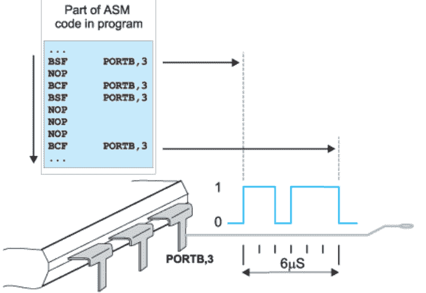

有时，在汇编语言中需要将一个表达式与一组常量进行比较。如果它匹配其中任何一个，就会执行相应的操作：

```c
if (expression) {
  operation1
}
```

如果 `operation1` 或 `operation2` 是复合操作，则它们包含的一组操作必须封装在大括号内。例如：

```c
if(expression) {
  ... //
  ... // operation1
} else
operation2
```

if-else 运算符可以使用条件运算符 `'?'` 编写，如下例所示：

```c
(expression1)? expression2 : expression3
```

如果 `expression1` 不为 0（真），则整个表达式的结果将等于 `expression2` 的结果。否则，如果 `expression1` 为 0（假），则整个表达式的结果将等于 `expression3` 的结果。

```c
maximum = (a > b)? a : b // 变量 maximum 被赋值为较大变量 (a 或 b) 的值
```

#### Switch 操作

与在程序中两个选项之间进行选择的 `if-else` 语句不同，`switch` 语句的语法如下：

```c
switch (selector) // Selector 为 char 或 int 类型
```

```c
{
  case constant1:
    operation1 // 如果 selector 和 constant1 相等，则执行一组操作
    ...
    break;
  case constant2:
    operation2 // 如果 selector 和 constant2 相等，则执行一组操作
    ...
    break;
    ...
  default:
    expected_operation // 如果没有常量等于 selector，则执行这组操作
    ...
    break;
}
```

`switch` 操作的执行方式如下：首先执行 `selector` 并与 `constant1` 进行比较。如果找到匹配，则执行该 `case` 块中的语句，直到遇到 `break` 关键字或遇到 `switch` 操作结束。如果没有找到匹配，则将 `selector` 进一步与 `constant2` 比较，如果找到匹配，则执行该 `case` 块中的语句直到遇到 `break` 关键字，依此类推。如果 `selector` 不匹配任何常量，则将执行 `default` 运算符之后的操作。也可以将一个表达式与一组常量进行比较。如果它匹配了其中任何一个，都将执行相应的操作：

```c
switch (number) // number 代表一周中的某一天。
// 有必要确定它是工作日还是周末。
{ case1:case2:case3:case4:case5: LCD_message = 'Weekday'; break;
case6:case7: LCD_message = 'Weekend'; break;
default:
LCD_message_1 = 'Choose one day in a week'; break;
}
```

www.raguvar.puzzl.com

#### 程序循环

程序中需要重复执行某些操作。被重复执行的一组命令被称为程序循环。它将执行多少次（即程序在循环中停留多久），取决于离开循环的条件。

#### While 循环

`while` 循环的形式如下：

```c
while(expression) {
  commands
  ...
}
```

命令会重复执行（程序保持在循环中），直到 `expression` 变为假。如果在进入 `while` 时表达式为假，则循环将不会执行，程序将从 `while` 循环的结束处继续运行。

一种特殊的程序循环是死循环。如果条件在循环内部保持不变，就会形成死循环。在这种情况下，执行非常简单，因为括号中的结果始终为真（1=1），这意味着程序将留在同一个循环中：

```c
while(1) {
  // 封装在大括号内的表达式将
  // 无限执行（死循环）。
}
```

#### For 循环

`for` 循环的形式如下：

```c
for(initial_expression; condition_expression; change_expression) {
  operations
  ...
}
```

此类程序序列的执行与 `while` 循环相似，不同之处在这种情况下设置初始值的过程（初始化）是在声明内完成的。`initial_expression` 设置循环的初始变量，该变量在进入循环之前会与 `condition_expression` 进行比较。循环内的操作被重复执行，并在每次迭代后表达式的值都会发生变化。迭代持续直到 `condition_expression` 变为假。

```c
for(k=1; k<5; k++) // 变量 k 5 次（从 1 到 5），并
  operation // 每次重复执行表达式操作
  ...
```

操作将执行五次。之后，将通过检查表达式 `k<5` 是否为假来通过验证（5 次迭代后 `k=5`），程序将退出 `for` 循环。

#### Do-while 循环

`do-while` 循环的形式如下：

```c
do
  operation
  while (check_condition);
```

在这种情况下，无论条件是真假，操作都至少执行一次，因为 `check_condition` 表达式是在循环末尾执行的。如果结果不为 0（真），则重复该过程。在下面的示例中，程序将保持在 `do-while` 循环中直到变量达到 1E06（百万次迭代）。

```c
a = 0; // 设置初始值
```

```c
do
  a = a+1 // 操作进行中
while (a <= 1E06); // 检查条件
```

#### 用汇编语言编写代码


有时，在汇编语言中需要将一个表达式与一组常量进行比较。如果它匹配其中任何一个，就会执行相应的操作：

```c
if (expression) {
  operation1
}
```

如果 `operation1` 或 `operation2` 是复合操作，则它们包含的一组操作必须封装在大括号内。例如：

```c
if(expression) {
  ... //
  ... // operation1
} else
operation2
```

if-else 运算符可以使用条件运算符 `'?'` 编写，如下例所示：

```c
(expression1)? expression2 : expression3
```

如果 `expression1` 不为 0（真），则整个表达式的结果将等于 `expression2` 的结果。否则，如果 `expression1` 为 0（假），则整个表达式的结果将等于 `expression3` 的结果。

```c
maximum = (a > b)? a : b // 变量 maximum 被赋值为较大变量 (a 或 b) 的值
```

#### Switch 操作

与在程序中两个选项之间进行选择的 `if-else` 语句不同，`switch` 语句的语法如下：

```c
switch (selector) // Selector 为 char 或 int 类型
```

```c
{
  case constant1:
    operation1 // 如果 selector 和 constant1 相等，则执行一组操作
    ...
    break;
  case constant2:
    operation2 // 如果 selector 和 constant2 相等，则执行一组操作
    ...
    break;
    ...
  default:
    expected_operation // 如果没有常量等于 selector，则执行这组操作
    ...
    break;
}
```

`switch` 操作的执行方式如下：首先执行 `selector` 并与 `constant1` 进行比较。如果找到匹配，则执行该 `case` 块中的语句，直到遇到 `break` 关键字或遇到 `switch` 操作结束。如果没有找到匹配，则将 `selector` 进一步与 `constant2` 比较，如果找到匹配，则执行该 `case` 块中的语句直到遇到 `break` 关键字，依此类推。如果 `selector` 不匹配任何常量，则将执行 `default` 运算符之后的操作。也可以将一个表达式与一组常量进行比较。如果它匹配了其中任何一个，都将执行相应的操作：

```c
switch (number) // number 代表一周中的某一天。
// 有必要确定它是工作日还是周末。
{ case1:case2:case3:case4:case5: LCD_message = 'Weekday'; break;
case6:case7: LCD_message = 'Weekend'; break;
default:
LCD_message_1 = 'Choose one day in a week'; break;
}
```

www.raguvar.puzzl.com

#### 程序循环

程序中需要重复执行某些操作。被重复执行的一组命令被称为程序循环。它将执行多少次（即程序在循环中停留多久），取决于离开循环的条件。

#### While 循环

`while` 循环的形式如下：

```c
while(expression) {
  commands
  ...
}
```

命令会重复执行（程序保持在循环中），直到 `expression` 变为假。如果在进入 `while` 时表达式为假，则循环将不会执行，程序将从 `while` 循环的结束处继续运行。

一种特殊的程序循环是死循环。如果条件在循环内部保持不变，就会形成死循环。在这种情况下，执行非常简单，因为括号中的结果始终为真（1=1），这意味着程序将留在同一个循环中：

```c
while(1) {
  // 封装在大括号内的表达式将
  // 无限执行（死循环）。
}
```

#### For 循环

`for` 循环的形式如下：

```c
for(initial_expression; condition_expression; change_expression) {
  operations
  ...
}
```

此类程序序列的执行与 `while` 循环相似，不同之处在这种情况下设置初始值的过程（初始化）是在声明内完成的。`initial_expression` 设置循环的初始变量，该变量在进入循环之前会与 `condition_expression` 进行比较。循环内的操作被重复执行，并在每次迭代后表达式的值都会发生变化。迭代持续直到 `condition_expression` 变为假。

```c
for(k=1; k<5; k++) // 变量 k 5 次（从 1 到 5），并
  operation // 每次重复执行表达式操作
  ...
```

操作将执行五次。之后，将通过检查表达式 `k<5` 是否为假来通过验证（5 次迭代后 `k=5`），程序将退出 `for` 循环。

#### Do-while 循环

`do-while` 循环的形式如下：

```c
do
  operation
  while (check_condition);
```

在这种情况下，无论条件是真假，操作都至少执行一次，因为 `check_condition` 表达式是在循环末尾执行的。如果结果不为 0（真），则重复该过程。在下面的示例中，程序将保持在 `do-while` 循环中直到变量达到 1E06（百万次迭代）。

```c
a = 0; // 设置初始值
```

```c
do
  a = a+1 // 操作进行中
while (a <= 1E06); // 检查条件
```

#### 用汇编语言编写代码


有时，在汇编语言中需要将一个表达式与一组常量进行比较。如果它匹配其中任何一个，就会执行相应的操作：

```c
if (expression) {
  operation1
}
```

如果 `operation1` 或 `operation2` 是复合操作，则它们包含的一组操作必须封装在大括号内。例如：

```c
if(expression) {
  ... //
  ... // operation1
} else
operation2
```

if-else 运算符可以使用条件运算符 `'?'` 编写，如下例所示：

```c
(expression1)? expression2 : expression3
```

如果 `expression1` 不为 0（真），则整个表达式的结果将等于 `expression2` 的结果。否则，如果 `expression1` 为 0（假），则整个表达式的结果将等于 `expression3` 的结果。

```c
maximum = (a > b)? a : b // 变量 maximum 被赋值为较大变量 (a 或 b) 的值
```

#### Switch 操作

与在程序中两个选项之间进行选择的 `if-else` 语句不同，`switch` 语句的语法如下：

```c
switch (selector) // Selector 为 char 或 int 类型
```

```c
{
  case constant1:
    operation1 // 如果 selector 和 constant1 相等，则执行一组操作
    ...
    break;
  case constant2:
    operation2 // 如果 selector 和 constant2 相等，则执行一组操作
    ...
    break;
    ...
  default:
    expected_operation // 如果没有常量等于 selector，则执行这组操作
    ...
    break;
}
```

`switch` 操作的执行方式如下：首先执行 `selector` 并与 `constant1` 进行比较。如果找到匹配，则执行该 `case` 块中的语句，直到遇到 `break` 关键字或遇到 `switch` 操作结束。如果没有找到匹配，则将 `selector` 进一步与 `constant2` 比较，如果找到匹配，则执行该 `case` 块中的语句直到遇到 `break` 关键字，依此类推。如果 `selector` 不匹配任何常量，则将执行 `default` 运算符之后的操作。也可以将一个表达式与一组常量进行比较。如果它匹配了其中任何一个，都将执行相应的操作：

```c
switch (number) // number 代表一周中的某一天。
// 有必要确定它是工作日还是周末。
{ case1:case2:case3:case4:case5: LCD_message = 'Weekday'; break;
case6:case7: LCD_message = 'Weekend'; break;
default:
LCD_message_1 = 'Choose one day in a week'; break;
}


www.raguvar.puzzl.com

#### 程序循环

程序中需要重复执行某些操作。被重复执行的一组命令被称为程序循环。它将执行多少次（即程序在循环中停留多久），取决于离开循环的条件。

#### While 循环

`while` 循环的形式如下：

```c
while(expression) {
  commands
  ...
}
```

命令会重复执行（程序保持在循环中），直到 `expression` 变为假。如果在进入 `while` 时表达式为假，则循环将不会执行，程序将从 `while` 循环的结束处继续运行。

一种特殊的程序循环是死循环。如果条件在循环内部保持不变，就会形成死循环。在这种情况下，执行非常简单，因为括号中的结果始终为真（1=1），这意味着程序将留在同一个循环中：

```c
while(1) {
  // 封装在大括号内的表达式将
  // 无限执行（死循环）。
}
```

#### For 循环

`for` 循环的形式如下：

```c
for(initial_expression; condition_expression; change_expression) {
  operations
  ...
}
```

此类程序序列的执行与 `while` 循环相似，不同之处在这种情况下设置初始值的过程（初始化）是在声明内完成的。`initial_expression` 设置循环的初始变量，该变量在进入循环之前会与 `condition_expression` 进行比较。循环内的操作被重复执行，并在每次迭代后表达式的值都会发生变化。迭代持续直到 `condition_expression` 变为假。

```c
for(k=1; k<5; k++) // 变量 k 5 次（从 1 到 5），并
  operation // 每次重复执行表达式操作
  ...
```

操作将执行五次。之后，将通过检查表达式 `k<5` 是否为假来通过验证（5 次迭代后 `k=5`），程序将退出 `for` 循环。

#### Do-while 循环

`do-while` 循环的形式如下：

```c
do
  operation
  while (check_condition);
```

在这种情况下，无论条件是真假，操作都至少执行一次，因为 `check_condition` 表达式是在循环末尾执行的。如果结果不为 0（真），则重复该过程。在下面的示例中，程序将保持在 `do-while` 循环中直到变量达到 1E06（百万次迭代）。

```c
a = 0; // 设置初始值
```

```c
do
  a = a+1 // 操作进行中
while (a <= 1E06); // 检查条件
```

#### 用汇编语言编写代码


有时，在汇编语言中需要将一个表达式与一组常量进行比较。如果它匹配其中任何一个，就会执行相应的操作：

```c
if (expression) {
  operation1
}
```

如果 `operation1` 或 `operation2` 是复合操作，则它们包含的一组操作必须封装在大括号内。例如：

```c
if(expression) {
  ... //
  ... // operation1
} else
operation2
```

if-else 运算符可以使用条件运算符 `'?'` 编写，如下例所示：

```c
(expression1)? expression2 : expression3
```

如果 `expression1` 不为 0（真），则整个表达式的结果将等于 `expression2` 的结果。否则，如果 `expression1` 为 0（假），则整个表达式的结果将等于 `expression3` 的结果。

```c
maximum = (a > b)? a : b // 变量 maximum 被赋值为较大变量 (a 或 b) 的值
```

#### Switch 操作

与在程序中两个选项之间进行选择的 `if-else` 语句不同，`switch` 语句的语法如下：

```c
switch (selector) // Selector 为 char 或 int 类型
```

```c
{
  case constant1:
    operation1 // 如果 selector 和 constant1 相等，则执行一组操作
    ...
    break;
  case constant2:
    operation2 // 如果 selector 和 constant2 相等，则执行一组操作
    ...
    break;
    ...
  default:
    expected_operation // 如果没有常量等于 selector，则执行这组操作
    ...
    break;
}
```

`switch` 操作的执行方式如下：首先执行 `selector` 并与 `constant1` 进行比较。如果找到匹配，则执行该 `case` 块中的语句，直到遇到 `break` 关键字或遇到 `switch` 操作结束。如果没有找到匹配，则将 `selector` 进一步与 `constant2` 比较，如果找到匹配，则执行该 `case` 块中的语句直到遇到 `break` 关键字，依此类推。如果 `selector` 不匹配任何常量，则将执行 `default` 运算符之后的操作。也可以将一个表达式与一组常量进行比较。如果它匹配了其中任何一个，都将执行相应的操作：

```c
switch (number) // number 代表一周中的某一天。
// 有必要确定它是工作日还是周末。
{ case1:case2:case3:case4:case5: LCD_message = 'Weekday'; break;
case6:case7: LCD_message = 'Weekend'; break;
default:
LCD_message_1 = 'Choose one day in a week'; break;
}

```

 www.raguvar.puzzl.com

#### 程序循环

程序中需要重复执行某些操作。被重复执行的一组命令被称为程序循环。它将执行多少次（即程序在循环中停留多久），取决于离开循环的条件。

#### While 循环

`while` 循环的形式如下：

```c
while(expression) {
  commands
  ...
}
```

命令会重复执行（程序保持在循环中），直到 `expression` 变为假。如果在进入 `while` 时表达式为假，则循环将不会执行，程序将从 `while` 循环的结束处继续运行。

一种特殊的程序循环是死循环。如果条件在循环内部保持不变，就会形成死循环。在这种情况下，执行非常简单，因为括号中的结果始终为真（1=1），这意味着程序将留在同一个循环中：

```c
while(1) {
  // 封装在大括号内的表达式将
  // 无限执行（死循环）。
}
```

#### For 循环

`for` 循环的形式如下：

```c
for(initial_expression; condition_expression; change_expression) {
  operations
  ...
}
```

此类程序序列的执行与 `while` 循环相似，不同之处在这种情况下设置初始值的过程（初始化）是在声明内完成的。`initial_expression` 设置循环的初始变量，该变量在进入循环之前会与 `condition_expression` 进行比较。循环内的操作被重复执行，并在每次迭代后表达式的值都会发生变化。迭代持续直到 `condition_expression` 变为假。

```c
for(k=1; k<5; k++) // 变量 k 5 次（从 1 到 5），并
  operation // 每次重复执行表达式操作
  ...
```

操作将执行五次。之后，将通过检查表达式 `k<5` 是否为假来通过验证（5 次迭代后 `k=5`），程序将退出 `for` 循环。

#### Do-while 循环

`do-while` 循环的形式如下：

```c
do
  operation
  while (check_condition);
```

在这种情况下，无论条件是真假，操作都至少执行一次，因为 `check_condition` 表达式是在循环末尾执行的。如果结果不为 0（真），则重复该过程。在下面的示例中，程序将保持在 `do-while` 循环中直到变量达到 1E06（百万次迭代）。

```c
a = 0; // 设置初始值
```

```c
do
  a = a+1 // 操作进行中
while (a <= 1E06); // 检查条件
```

#### 用汇编语言编写代码


有时，在汇编语言中需要将一个表达式与一组常量进行比较。如果它匹配其中任何一个，就会执行相应的操作：

```c
if (expression) {
  operation1
}
```

如果 `operation1` 或 `operation2` 是复合操作，则它们包含的一组操作必须封装在大括号内。例如：

```c
if(expression) {
  ... //
  ... // operation1
} else
operation2
```

if-else 运算符可以使用条件运算符 `'?'` 编写，如下例所示：

```c
(expression1)? expression2 : expression3
```

如果 `expression1` 不为 0（真），则整个表达式的结果将等于 `expression2` 的结果。否则，如果 `expression1` 为 0（假），则整个表达式的结果将等于 `expression3` 的结果。

```c
maximum = (a > b)? a : b // 变量 maximum 被赋值为较大变量 (a 或 b) 的值
```

#### Switch 操作

与在程序中两个选项之间进行选择的 `if-else` 语句不同，`switch` 语句的语法如下：

```c
switch (selector) // Selector 为 char 或 int 类型
```

```c
{
  case constant1:
    operation1 // 如果 selector 和 constant1 相等，则执行一组操作
    ...
    break;
  case constant2:
    operation2 // 如果 selector 和 constant2 相等，则执行一组操作
    ...
    break;
    ...
  default:
    expected_operation // 如果没有常量等于 selector，则执行这组操作
    ...
    break;
}
```

`switch` 操作的执行方式如下：首先执行 `selector` 并与 `constant1` 进行比较。如果找到匹配，则执行该 `case` 块中的语句，直到遇到 `break` 关键字或遇到 `switch` 操作结束。如果没有找到匹配，则将 `selector` 进一步与 `constant2` 比较，如果找到匹配，则执行该 `case` 块中的语句直到遇到 `break` 关键字，依此类推。如果 `selector` 不匹配任何常量，则将执行 `default` 运算符之后的操作。也可以将一个表达式与一组常量进行比较。如果它匹配了其中任何一个，都将执行相应的操作：

```c
switch (number) // number 代表一周中的某一天。
// 有必要确定它是工作日还是周末。
{ case1:case2:case3:case4:case5: LCD_message = 'Weekday'; break;
case6:case7: LCD_message = 'Weekend'; break;
default:
LCD_message_1 = 'Choose one day in a week'; break;
}

```

 www.raguvar.puzzl.com

#### 程序循环

程序中需要重复执行某些操作。被重复执行的一组命令被称为程序循环。它将执行多少次（即程序在循环中停留多久），取决于离开循环的条件。

#### While 循环

`while` 循环的形式如下：

```c
while(expression) {
  commands
  ...
}
```

命令会重复执行（程序保持在循环中），直到 `expression` 变为假。如果在进入 `while` 时表达式为假，则循环将不会执行，程序将从 `while` 循环的结束处继续运行。

一种特殊的程序循环是死循环。如果条件在循环内部保持不变，就会形成死循环。在这种情况下，执行非常简单，因为括号中的结果始终为真（1=1），这意味着程序将留在同一个循环中：

```c
while(1) {
  // 封装在大括号内的表达式将
  // 无限执行（死循环）。
}
```

#### For 循环

`for` 循环的形式如下：

```c
for(initial_expression; condition_expression; change_expression) {
  operations
  ...
}
```

此类程序序列的执行与 `while` 循环相似，不同之处在这种情况下设置初始值的过程（初始化）是在声明内完成的。`initial_expression` 设置循环的初始变量，该变量在进入循环之前会与 `condition_expression` 进行比较。循环内的操作被重复执行，并在每次迭代后表达式的值都会发生变化。迭代持续直到 `condition_expression` 变为假。

```c
for(k=1; k<5; k++) // 变量 k 5 次（从 1 到 5），并
  operation // 每次重复执行表达式操作
  ...
```

操作将执行五次。之后，将通过检查表达式 `k<5` 是否为假来通过验证（5 次迭代后 `k=5`），程序将退出 `for` 循环。

#### Do-while 循环

`do-while` 循环的形式如下：

```c
do
  operation
  while (check_condition);
```

在这种情况下，无论条件是真假，操作都至少执行一次，因为 `check_condition` 表达式是在循环末尾执行的。如果结果不为 0（真），则重复该过程。在下面的示例中，程序将保持在 `do-while` 循环中直到变量达到 1E06（百万次迭代）。

```c
a = 0; // 设置初始值
```

```c
do
  a = a+1 // 操作进行中
while (a <= 1E06); // 检查条件
```

#### 用汇编语言编写代码


有时，在汇编语言中需要将一个表达式与一组常量进行比较。如果它匹配其中任何一个，就会执行相应的操作：

```c
if (expression) {
  operation1
}
```

如果 `operation1` 或 `operation2` 是复合操作，则它们包含的一组操作必须封装在大括号内。例如：

```c
if(expression) {
  ... //
  ... // operation1
} else
operation2
```

if-else 运算符可以使用条件运算符 `'?'` 编写，如下例所示：

```c
(expression1)? expression2 : expression3
```

如果 `expression1` 不为 0（真），则整个表达式的结果将等于 `expression2` 的结果。否则，如果 `expression1` 为 0（假），则整个表达式的结果将等于 `expression3` 的结果。

```c
maximum = (a > b)? a : b // 变量 maximum 被赋值为较大变量 (a 或 b) 的值
```

#### Switch 操作

与在程序中两个选项之间进行选择的 `if-else` 语句不同，`switch` 语句的语法如下：

```c
switch (selector) // Selector 为 char 或 int 类型
```

```c
{
  case constant1:
    operation1 // 如果 selector 和 constant1 相等，则执行一组操作
    ...
    break;
  case constant2:
    operation2 // 如果 selector 和 constant2 相等，则执行一组操作
    ...
    break;
    ...
  default:
    expected_operation // 如果没有常量等于 selector，则执行这组操作
    ...
    break;
}
```

`switch` 操作的执行方式如下：首先执行 `selector` 并与 `constant1` 进行比较。如果找到匹配，则执行该 `case` 块中的语句，直到遇到 `break` 关键字或遇到 `switch` 操作结束。如果没有找到匹配，则将 `selector` 进一步与 `constant2` 比较，如果找到匹配，则执行该 `case` 块中的语句直到遇到 `break` 关键字，依此类推。如果 `selector` 不匹配任何常量，则将执行 `default` 运算符之后的操作。也可以将一个表达式与一组常量进行比较。如果它匹配了其中任何一个，都将执行相应的操作：

```c
switch (number) // number 代表一周中的某一天。
// 有必要确定它是工作日还是周末。
{ case1:case2:case3:case4:case5: LCD_message = 'Weekday'; break;
case6:case7: LCD_message = 'Weekend'; break;
default:
LCD_message_1 = 'Choose one day in a week'; break;
}

```

``` www.raguvar.puzzl.com

#### 程序循环

程序中需要重复执行某些操作。被重复执行的一组命令被称为程序循环。它将执行多少次（即程序在循环中停留多久），取决于离开循环的条件。

#### While 循环

`while` 循环的形式如下：

```c
while(expression) {
  commands
  ...
}
```

命令会重复执行（程序保持在循环中），直到 `expression` 变为假。如果在进入 `while` 时表达式为假，则循环将不会执行，程序将从 `while` 循环的结束处继续运行。

一种特殊的程序循环是死循环。如果条件在循环内部保持不变，就会形成死循环。在这种情况下，执行非常简单，因为括号中的结果始终为真（1=1），这意味着程序将留在同一个循环中：

```c
while(1) {
  // 封装在大括号内的表达式将
  // 无限执行（死循环）。
}
```

#### For 循环

`for` 循环的形式如下：

```c
for(initial_expression; condition_expression; change_expression) {
  operations
  ...
}
```

此类程序序列的执行与 `while` 循环相似，不同之处在这种情况下设置初始值的过程（初始化）是在声明内完成的。`initial_expression` 设置循环的初始变量，该变量在进入循环之前会与 `condition_expression` 进行比较。循环内的操作被重复执行，并在每次迭代后表达式的值都会发生变化。迭代持续直到 `condition_expression` 变为假。

```c
for(k=1; k<5; k++) // 变量 k 5 次（从 1 到 5），并
  operation // 每次重复执行表达式操作
  ...
```

操作将执行五次。之后，将通过检查表达式 `k<5` 是否为假来通过验证（5 次迭代后 `k=5`），程序将退出 `for` 循环。

#### Do-while 循环

`do-while` 循环的形式如下：

```c
do
  operation
  while (check_condition);
```

在这种情况下，无论条件是真假，操作都至少执行一次，因为 `check_condition` 表达式是在循环末尾执行的。如果结果不为 0（真），则重复该过程。在下面的示例中，程序将保持在 `do-while` 循环中直到变量达到 1E06（百万次迭代）。

```c
a = 0; // 设置初始值
```

```c
do
  a = a+1 // 操作进行中
while (a <= 1E06); // 检查条件
```

#### 用汇编语言编写代码


有时，在汇编语言中需要将一个表达式与一组常量进行比较。如果它匹配其中任何一个，就会执行相应的操作：

```c
if (expression) {
  operation1
}
```

如果 `operation1` 或 `operation2` 是复合操作，则它们包含的一组操作必须封装在大括号内。例如：

```c
if(expression) {
  ... //
  ... // operation1
} else
operation2
```

if-else 运算符可以使用条件运算符 `'?'` 编写，如下例所示：

```c
(expression1)? expression2 : expression3
```

如果 `expression1` 不为 0（真），则整个表达式的结果将等于 `expression2` 的结果。否则，如果 `expression1` 为 0（假），则整个表达式的结果将等于 `expression3` 的结果。

```c
maximum = (a > b)? a : b // 变量 maximum 被赋值为较大变量 (a 或 b) 的值
```

#### Switch 操作

与在程序中两个选项之间进行选择的 `if-else` 语句不同，`switch` 语句的语法如下：

```c
switch (selector) // Selector 为 char 或 int 类型
```

```c
{
  case constant1:
    operation1 // 如果 selector 和 constant1 相等，则执行一组操作
    ...
    break;
  case constant2:
    operation2 // 如果 selector 和 constant2 相等，则执行一组操作
    ...
    break;
    ...
  default:
    expected_operation // 如果没有常量等于 selector，则执行这组操作
    ...
    break;
}
```

`switch` 操作的执行方式如下：首先执行 `selector` 并与 `constant1` 进行比较。如果找到匹配，则执行该 `case` 块中的语句，直到遇到 `break` 关键字或遇到 `switch` 操作结束。如果没有找到匹配，则将 `selector` 进一步与 `constant2` 比较，如果找到匹配，则执行该 `case` 块中的语句直到遇到 `break` 关键字，依此类推。如果 `selector` 不匹配任何常量，则将执行 `default` 运算符之后的操作。也可以将一个表达式与一组常量进行比较。如果它匹配了其中任何一个，都将执行相应的操作：

```c
switch (number) // number 代表一周中的某一天。
// 有必要确定它是工作日还是周末。
{ case1:case2:case3:case4:case5: LCD_message = 'Weekday'; break;
case6:case7: LCD_message = 'Weekend'; break;
default:
LCD_message_1 = 'Choose one day in a week'; break;
}

```

```www.raguvar.puzzl.com

#### 程序循环

程序中需要重复执行某些操作。被重复执行的一组命令被称为程序循环。它将执行多少次（即程序在循环中停留多久），取决于离开循环的条件。

#### While 循环

`while` 循环的形式如下：

```c
while(expression) {
  commands
  ...
}
```

命令会重复执行（程序保持在循环中），直到 `expression` 变为假。如果在进入 `while` 时表达式为假，则循环将不会执行，程序将从 `while` 循环的结束处继续运行。

一种特殊的程序循环是死循环。如果条件在循环内部保持不变，就会形成死循环。在这种情况下，执行非常简单，因为括号中的结果始终为真（1=1），这意味着程序将留在同一个循环中：

```c
while(1) {
  // 封装在大括号内的表达式将
  // 无限执行（死循环）。
}
```

#### For 循环

`for` 循环的形式如下：

```c
for(initial_expression; condition_expression; change_expression) {
  operations
  ...
}
```

此类程序序列的执行与 `while` 循环相似，不同之处在这种情况下设置初始值的过程（初始化）是在声明内完成的。`initial_expression` 设置循环的初始变量，该变量在进入循环之前会与 `condition_expression` 进行比较。循环内的操作被重复执行，并在每次迭代后表达式的值都会发生变化。迭代持续直到 `condition_expression` 变为假。

```c
for(k=1; k<5; k++) // 变量 k 5 次（从 1 到 5），并
  operation // 每次重复执行表达式操作
  ...
```

操作将执行五次。之后，将通过检查表达式 `k<5` 是否为假来通过验证（5 次迭代后 `k=5`），程序将退出 `for` 循环。

#### Do-while 循环

`do-while` 循环的形式如下：

```c
do
  operation
  while (check_condition);
```

在这种情况下，无论条件是真假，操作都至少执行一次，因为 `check_condition` 表达式是在循环末尾执行的。如果结果不为 0（真），则重复该过程。在下面的示例中，程序将保持在 `do-while` 循环中直到变量达到 1E06（百万次迭代）。

```c
a = 0; // 设置初始值
```

```c
do
  a = a+1 // 操作进行中
while (a <= 1E06); // 检查条件
```

#### 用汇编语言编写代码


有时，在汇编语言中需要将一个表达式与一组常量进行比较。如果它匹配其中任何一个，就会执行相应的操作：

```c
if (expression) {
  operation1
}
```

如果 `operation1` 或 `operation2` 是复合操作，则它们包含的一组操作必须封装在大括号内。例如：

```c
if(expression) {
  ... //
  ... // operation1
} else
operation2
```

if-else 运算符可以使用条件运算符 `'?'` 编写，如下例所示：

```c
(expression1)? expression2 : expression3
```

如果 `expression1` 不为 0（真），则整个表达式的结果将等于 `expression2` 的结果。否则，如果 `expression1` 为 0（假），则整个表达式的结果将等于 `expression3` 的结果。

```c
maximum = (a > b)? a : b // 变量 maximum 被赋值为较大变量 (a 或 b) 的值
```

#### Switch 操作

与在程序中两个选项之间进行选择的 `if-else` 语句不同，`switch` 语句的语法如下：

```c
switch (selector) // Selector 为 char 或 int 类型
```

```c
{
  case constant1:
    operation1 // 如果 selector 和 constant1 相等，则执行一组操作
    ...
    break;
  case constant2:
    operation2 // 如果 selector 和 constant2 相等，则执行一组操作
    ...
    break;
    ...
  default:
    expected_operation // 如果没有常量等于 selector，则执行这组操作
    ...
    break;
}
```

`switch` 操作的执行方式如下：首先执行 `selector` 并与 `constant1` 进行比较。如果找到匹配，则执行该 `case` 块中的语句，直到遇到 `break` 关键字或遇到 `switch` 操作结束。如果没有找到匹配，则将 `selector` 进一步与 `constant2` 比较，如果找到匹配，则执行该 `case` 块中的语句直到遇到 `break` 关键字，依此类推。如果 `selector` 不匹配任何常量，则将执行 `default` 运算符之后的操作。也可以将一个表达式与一组常量进行比较。如果它匹配了其中任何一个，都将执行相应的操作：

```c
switch (number) // number 代表一周中的某一天。
// 有必要确定它是工作日还是周末。
{ case1:case2:case3:case4:case5: LCD_message = 'Weekday'; break;
case6:case7: LCD_message = 'Weekend'; break;
default:
LCD_message_1 = 'Choose one day in a week'; break;
}

```

``` # 数组

一组相同类型的变量被称为数组。数组的元素被称为组件，其类型是主类型。数组通过指定名称、类型和组件数量来声明：

```c
component_type array_name [number_of_components];
```

 # 二维数组

除了列表的一维数组外，C 语言中还有多维数组。在接下来的几句话中，我们将只讨论矩阵的二维数组，它们可以被看作表格。二维数组通过指定数组的数据类型和每个维度的大小来声明。如下例所示：

```c
int Table[3][4]; // Table 定义为 3 行 4 列
```

此数组可以以表格的形式表示。

| table[0][0] | table[0][1] | table[0][2] | table[0][3] |


与向量类似，矩阵的元素可以在数组声明时被赋值。在下面的示例中，二维数组 `Table` 的元素被赋值了。可见，该数组有两个行三列：

```c
int Table[2][3] = {{3,42,1}, {7,7,19}};
```

上面的矩阵也可以用表格的形式表示，其元素值如下：

| 3 | 42 |
|---|---|
| 7 | 19 |

# 函数

每个用 C 语言编写的程序都由若干数量的函数组成。其核心思想是使用这些函数将程序分成若干部分，以便更容易地解决实际问题。此外，函数使我们能够使用其他程序员的技能和知识。例如，如果需要向 LCD 显示器发送字符串，使用已经写好的程序部分比从头开始要容易得多。

函数由指定对变量应执行什么操作的命令组成。它们可以被比作子程序。通常情况下，一个由许多简单函数组成的程序比由少数大型函数组成的程序好得多。函数体通常由按照指定顺序执行的多条命令组成。

每个函数都必须正确声明，以便在编译过程中被正确解释。声明包含以下元素：

- 函数名
- 函数体
- 参数列表
- 参数声明
- 结果类型

一个函数的结构如下所示：

```c
type_of_result function_name (type argument1, type argument2,...)
{
  Command;
...
}
```

示例：

```c
/* 函数计算分子除以分母的结果
 n 函数返回一个 div_t 类型的结构体。 */

div_t div(int number, int denom);
```

注意，函数并不一定需要参数，但必须有括号用于输入参数。否则，编译器将误读该函数。

如果函数在执行后，不向主程序或调用它的函数返回任何结果，程序在遇到右括号后将继续执行。此类函数用于需要更改微控制器输出引脚的状态、在通过串行通信传输数据时、在向 LCD 显示器上写入数据等场景。编译器通过结果类型为 **void** 的函数来识别这些行。

```c
void function_name (type argument1, type argument2,...)
{
  Commands;
}
```

示例：

```c
void interrupt() {

  cnt++; // 中断导致 cnt 加 1
  PIR1.TMR1IF = 0; // 重置位 TMR1IF
}
```

函数可以被赋予任意名称。唯一的例外是 `main` 名称，它有特殊用途。即：程序始终从此函数开始执行。这意味着每个 C 语言程序必须包含一个名为 'main' 的函数，该函数不需要放在程序的开头。

如果需要被调函数在执行后返回结果，则使用 `return` 命令，其后面可以跟上任何表达式：

```c
type_of_result function_name (type argument1, type argument2,...)
{
  Commands;
  ...
  return expression;
}
```

如果函数包含 `return` 命令但后面没有跟表达式，则函数在遇到该命令时停止执行，程序将从右括号后的第一条命令继续执行。

# 新函数的声明

除了 C 语言“自动”识别的函数外，程序中还经常使用完全全新的函数。每个“非标准”函数都应该在程序的开头进行声明。函数声明称为原型，其形式如下：

```c
type_of_result function_name (formal parameters)
{
  形式参数的描述
  定义和声明
  运算符
  ...
}
```

不返回值的函数类型是 `void`。如果程序中没有显式声明结果类型，它被视为 `int` 类型（有符号整数）。在函数原型中编写的参数定义了对实参数的操作。原型函数参数被称为**形式参数**（FORMAL PARAMETERS）。下面的示例声明了一个计算圆柱体体积的函数。

示例：

```c
const double PI = 3.14159; // 声明常量 PI

float volume (float r, float h) // 声明 float 类型
{
    // 形式参数 r 和 h
    float v; // 声明结果类型 v
    v = PI*r*r*h; // 定义函数 volume
    return v;
}
```

如果需要在程序稍后执行计算（在实践中可以是水箱的体积），只需定义**实参数**并调用该函数即可。在编译过程中，编译器将按如下所示替换实参数：

```c
float radius=5, height=10, tank; // 声明 float 类型
...
// 实参数 radius,
...
// height 和 tank
tank = volume (radius,height); // 计算水箱体积
...
// 通过调用 volume 函数
```

# 函数库

C 语言中使用的所有函数名称都存储在名为头文件（header）的文件中。这些函数根据其用途被分类在名为库（libraries）的较小文件中。在程序中使用任何一个函数之前，有必要指定头文件。

# 标准 ANSI 库

C 语言的函数最初进行了标准化。这种标准被称为 ANSI。

```c
#include <assert.h>
#include <complex.h>
#include <ctype.h>
#include <errno.h>
#include <fenv.h>
#include <float.h>
#include <inttypes.h>
#include <iso64.h>
#include <limits.h>
#include <locale.h>
#include <math.h>
#include <setjmp.h>
#include <stdarg.h>
#include <stdbool.h>
#include <stddef.h>
#include <stdio.h>
#include <stdlib.h>
#include <string.h>
#include <time.h>
#include <wchar.h>
#include <wctype.h>
```

## 2.3 PIC microC 编译器

为微控制器编写程序，首先需要一个 PC 程序，它能理解你使用的编程语言（在本例中为 C 语言），并提供一个编写窗口。

不存在仅适用于一个微控制器的编译器，也没有适用于所有微控制器的编译器。它们都是针对某类相似制造商的软件。本书介绍了 microC for PIC。

当您启动编译器时，下一步是从列表中选择芯片和工作频率，然后当然——用 C 语言编写程序。


### mikroC PID 用于 PIC 2009 S

您想安装 PICOFASH 驱动程序吗？
[是] [否]

驱动程序是一种让您刚刚安装在 PC 上的编程器软件与硬件进行通信的程序。如果您到目前为止遵循了操作说明，那么您绝对需要它。点击“是”。

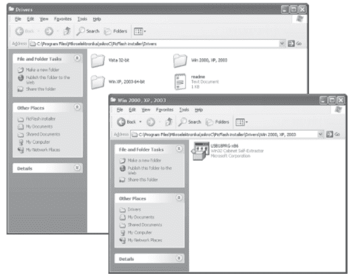

驱动程序的类型取决于正在使用的操作系统。请选择合适的文件夹并开始安装。

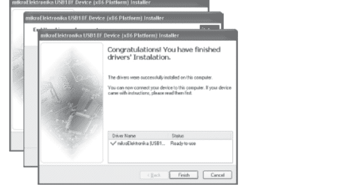

现在您安全了，只需继续点击“下一个”、“确定”、“下一个”、“下一个”……

### 用于 MIKROC PRO FOR PIC 的 IDE

这是您在第一次启动 mikroC PRO for PIC 的 IDE 时看到的内容：
www.raguvaran.puzz.com

#### 菜单 (Menu)

#### 工具栏 (Toolbar)

#### 项目管理器 (Project Manager)

### 代码资源器 (Code Explorer)

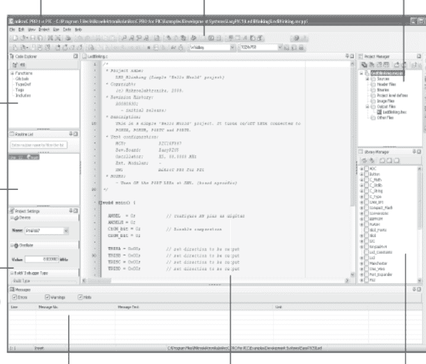

#### 例程列表 (Routine List)

#### 项目设置 (Project Settings)
(微控制器的主设置)

### 错误窗口 (Error Window)

### 代码编辑器 (Code Editor)

### 库编辑器 (Library Editor)

遗憾的是，对此编译器可用选项的详细描述将花费我们太多的时间，因此我们将跳过这部分。相反，我们仅描述用 C 语言编写程序的过程、仿真检查以及将其加载到微控制器内存中的过程。更多信息请参阅帮助 [F1]。

### 项目管理器 (PROJECT MANAGER)

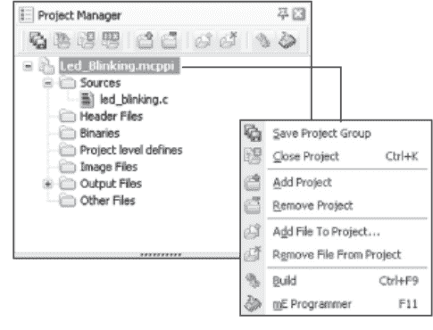

microC 编译器中的程序不是一个独立的文档，而是项目的一部分，该项目包含了 Hex 代码、汇编代码、头文件和其他文件。其中某些文件是在编译器运行期间创建的，而另一些是从其他程序导入的。然而，项目管理器窗口允许您处理所有这些文件。只需右键点击任何文件夹并选择您项目所需的选项即可。

www.raguvaran.puzzl.com

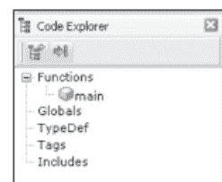

**代码资源器**窗口允许您轻松地定位长程序中的函数和过程。例如，如果您在查找程序中使用的函数，只需在该窗口中双击该函数的名称，光标将自动定位到程序的适当位置。

### 项目设置 (PROJECT SETTINGS)

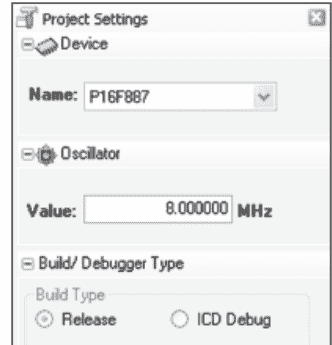

为了让编译器能够成功运行，必须为其提供关于微控制器的基本信息，以及在编译完成后对其期望的信息：

- **设备 (Device)** - 当您选择微控制器时，编译器会自动识别应使用哪个特定的定义文件（该文件包含特定 MCU 的所有 SFR 寄存器、其内存地址等内容）。

- **振荡器 (Oscillator)** - 此选项用于选择微控制器的运行速度。基于此，编译器将对配置工作进行更改。设置运行速度是为了使微控制器的内部振荡器能够配合选定的石英晶体工作。

- **构建类型 - 发布 (Build type - release)** - 编译完成后，编译器对程序的执行没有影响。为了调试目的，可以使用软件仿真器。

- **构建类型 - ICD 调试 (Build type - ICD debug)**：当编译完成并对微控制器进行编程后，编译器将保持与微控制器的连接并仍然可以操作微控制器。

编译完成后，代码编辑器是程序的中心部分。

www.raguvaran.puzz.com

### 代码编辑器 (CODE EDITOR)

代码编辑器是编写程序的核心部分。代码编辑器的许多选项可以在“工具”菜单中找到 [F12]。

### 软件仿真器 (SOFTWARE SIMULATOR)

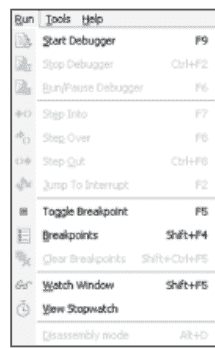

在启动仿真器之前，在项目设置中选择合适的模式（构建类型）并点击“启动调试器”。仿真器将进入仿真模式。这样，它可以监控寄存器的状态。它还允许您分步执行程序。

仅用于仿真的几个图标将添加到工具栏中。

单步进入 [F7] | 运行到光标 [F4]
单步执行 [F8] | 单步退出 [Shift+F9]

### 仿真器说明

它们的含义如下：

- **单步进入 (Step Into)** - 点击此图标执行光标所在的行。

- **单步执行 (Step Over)** - 此命令与上一个命令类似。如果光标位于调用程序例行的位置，它将首先执行该例程，然后继续执行程序。这看起来就像跳过了一行，尽管整个例程都被执行了。此命令通常用于加速循环程序的执行。

www.raguvaran.puzz.com

- **运行到光标 (Run To)** - 此命令用于执行从最后一行到光标所在行的程序部分。

- **单步退出 (Step out)** - 点击此图标，程序退出当前执行的例程。

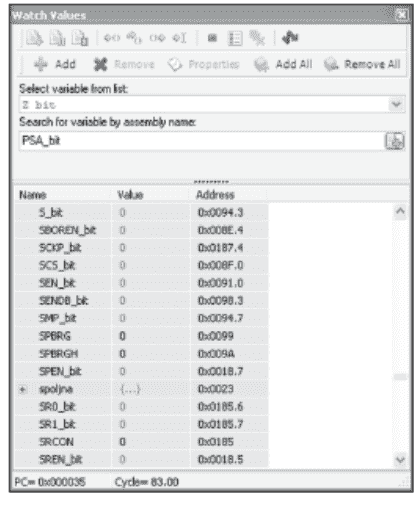

仿真器和调试器具有程序执行期间监控寄存器状态的功能。区别在于仿真器在 PC 上执行程序，而调试器使用真实的微控制器。任何引脚逻辑状态的变化都会反映在相应的寄存器（端口）上。由于观察窗口允许您监控所有寄存器的状态，因此很容易检查引脚被设置为 0 还是 1。要激活此窗口，需要选择“视图”并点击“观察”选项。

如果您想知道微控制器执行程序部分需要多长时间，请选择“运行/查看秒表”选项。将出现一个右图所示的窗口。您知道秒表是如何工作的吗？嗯，操作就这么简单。

### 编译器工具 (COMPILER’S TOOLS)

此编译器提供了极大简化编写程序过程的特殊工具。所有这些工具都可以从“工具”菜单获取。在下文中我们将对所有工具进行简要描述。

### PICFLASH编程器 (PICFLASH PROGRAMMER)

PICFLASH编程器是一个可以独立于编译器运行的独立程序，即它可以作为一个单独程序使用。然而，在这种情况下，它的操作与编译器的操作密切相关，因此可以从编译器中激活。如果已安装，PIC flash 编程器可以通过选择“工具/编程器”或按下 [F11] 来激活。出现的窗口包含用于微控制器处理过程的选项。


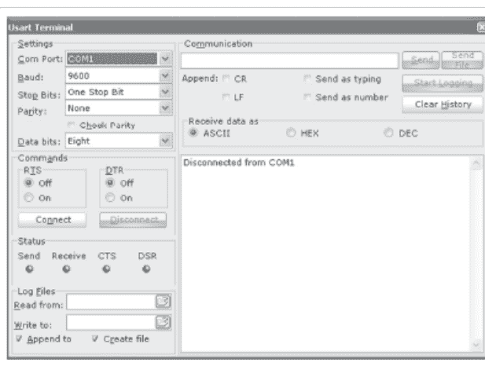

USART 终端是标准 Windows Hyper Terminal 的替代品。它可以用于检查使用 USART 通信的微控制器的运行。此类微控制器构建在设备中，并通过串口线连接到 PC 上的 RS232 接口。右侧所示的 USART 窗口包含了设置串口通信和显示发送/接收数据的选项。

### EEPROM 编辑器

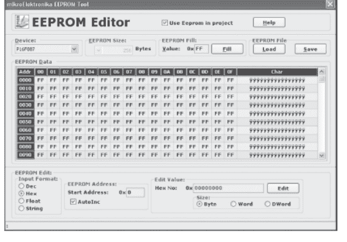

如果你在“工具（Tools）”菜单中选择“EEPROM 编辑器”选项，将会出现一个如右上方图所示的窗口。这就是微控制器内部 EEPROM 内存的样子。如果你想在将程序加载到微控制器后更改其内容，这里就是操作的地方。如果新内容是特定类型的数据（char、int 或 double），则你应该选择它，在“编辑值”（Edit Value）字段中输入值并点击“编辑”（Edit）。然后点击“保存”（Save）按钮将数据保存为 .hex 扩展名的文档。如果“在项目中使用 EEPROM”（Use EEPROM in Project）选项处于激活状态，数据将在编程过程中自动加载到芯片中。

### ASCII 图表

www.raguvaran.pzl.com

如果你需要任何 ASCII 字符的数值表示，只需从“工具”菜单中选择相应的选项，就会出现如下所示表格。

如所示，代表数字的字符具有奇特的等效值。由于由于原因，在 LCD 屏幕上显示数字 7 的程序将不会显示任何类似于该数字的内容。相反，将显示数字 BEL 的等效值。如果你将相同的数字作为字符发送，将得到预期结果——数字 7。因此，如果你想在不预将其转换为字符的情况下显示数字，则需要对转换的每个数字加上 48。

### ASCII 图表

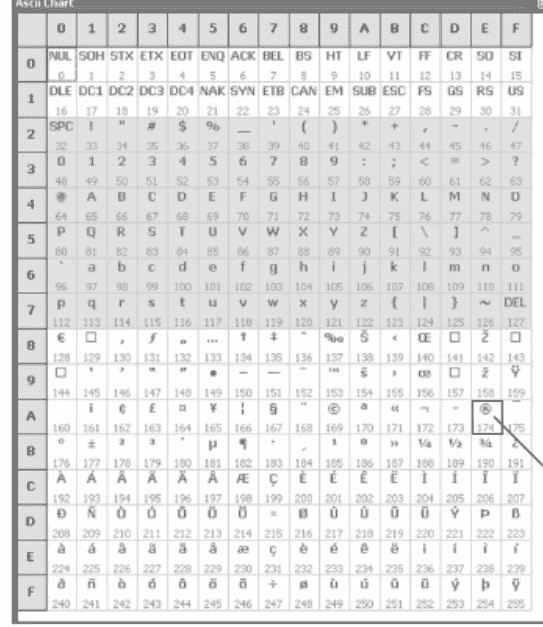

# 七段码编辑器

七段码编辑器允许你轻松找到在输出端口上需要设置哪个数字以便显示所需的符号。当然，不言而明，端口必须正确连接到显示段才能正常。你只需要将光标放置在任何显示段上并点击它。将立即显示你应该复制到程序中的数字。此此。

# 七段码编辑器

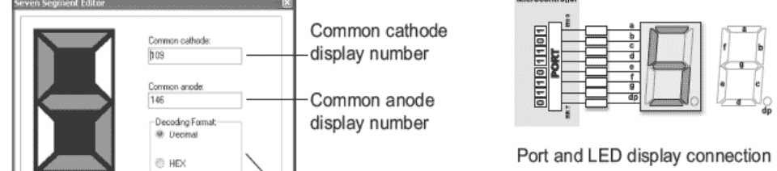

共阴极：
高电
共阳极：
低电
解码格式：
UnnHDX

共阴极
显示数字
共阳极
显示数字
数字格式

端口与 LED 显示连接

# LCD 自定义字符

除了标准字符外，微控制器还可以将你自己创建的字符发送到显示器上。通过选择 LCD 自定义字符工具，你将省去创建用于选择显示适当代码函数的繁琐工作。只需在 LCD 自定义字符窗口中通过点击小方块来创建一个符号，选择位置并点击“生成（GENERATE）”按钮。所需的代码将出现在另一个窗口中。不再需要更多点击。复制到剪贴板 - 粘贴...

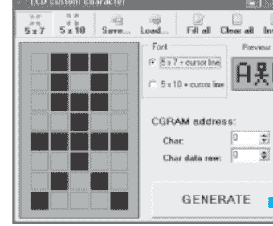

```c
char custom_char[] = {10,14,14,31,6,14,17};
void CustomChar(char pos_row, char pos_char) {
  char LCD_Cmd[4];
  for (int i=0; i<7; i++) LCD_Ch_Cp(custom_char[i]);
  LCD_Ch_Cp(LCD_RETURN_HOME);
  LCD_Ch_Cp(pos_row, pos_char, 0);
}
```

# 图形位图生成器

在你编写的微控制器使用图形 LCD 显示 (GLCD) 时，这个工具是不可替代的。该工具允许你轻松显示任何位图。为了利用它，会弹出“工具/Glcd 位图编辑器”和相应的窗口。选择要使用的显示类型并加载位图。位图必须是单色的且符合指定的分辨率（128 x 64 像素）。后续步骤与示例相同。

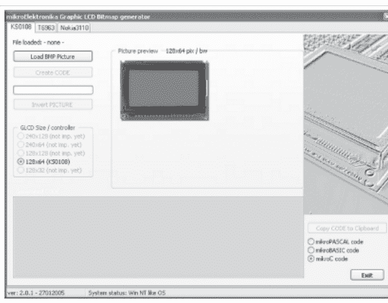

使用控制 LCD 和 GLCD 显示工具生成的代码包含 LCD 库的函数。如果你在程序中使用它们，不要忘记在“库管理器”（Library Manager）中勾选此库旁边的框，以便编译器正确识别其函数。

# 库

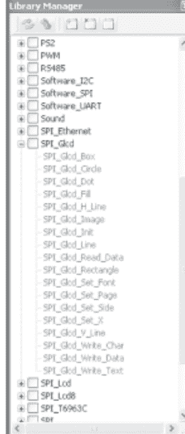

该程序最有用的选项之一是库管理器，它确实值得我们关注。像 C 这样的编程语言的优势在于，它们允许你使用他人的知识。库就是它的最好例子。如果你需要一个函数在某些引脚上产生声音，打开“库”窗口并双击相应的函数。该函数的详细描述将显示在屏幕上。将其复制到你的程序并设置相应的参数。如果勾选了此库，它的函数将在编译过程中自动识别，因此无需使用 #include。

### 标准库

标准 ANSI 库包含：

| 库 | 描述 |
| :--- | :--- |
| 类型库 | 用于浮点运算 |
| 数学库 | 用于数学运算 |
| Stdlib 库 | 用于标准库 |
| 字符串库 | 用于字符串操作 |

### 杂项库

杂项库包含一些通用功能：

| 库 | 描述 |
| :--- | :--- |
| 按钮库 | 用于测试 |
| 转换库 | 用于数据转换 |
| Sprint 库 | 用于数据格式化 |
| 打印库 | 用于数据格式化 |
| 时间库 | 用于时间计算 |
| 三角函数库 | 用于基础实现
| Setjmp 库 | 用于程序跳转

# 硬件特定库

硬件特定库包含用于控制硬件模块的功能：

| 库 | 描述 |
| :--- | :--- |
| ADC 库 | 用于 A/D 转换 |
| CAN 库 | 用于 CAN 模块 |
| CANSPI 库 | 使用 MCP2515 |
| Compact Flash 库 | 用于 Compact Flash 内存 |
| EEPROM 库 | 用于内置 EEPROM 内存 |
| Ethernet 库 | 用于内置以太网模块 |
| Flash 库 | 用于内置 Flash 内存 |
| Graphic Lcd 库 | 用于 128x64 分辨 |
| I2C 库 | 使用 I2C |
| Keypad 库 | 用于 4x4 键矩阵 |
| Lcd 库 | 用于 2x16 字符 |
| Manchester Code 库 | 使用曼彻斯特编码 |
| Port Expander 库 | 使用端口扩展器 MCP23S17 |
| PS/2 库 | 用于标准 PS/2 |
| PWM 库 | 用于内置 PWM 模块 |
| RS-485 库 | 使用 RS485 串口 |
| Software I2C 库 | I2C 模拟 |
| Software SPI 库 | SPI 模拟 |
| Software UART 库 | UART 模拟 |
| Sound 库 | 用于音频信号生成 |
| SPI 库 | 用于内置 SPI 模块 |
| SPI Ethernet 库 | 通过 SPI 通信以太网模块 (ENC28J60) |
| SPI Graphic Lcd 库 | 用于 4-位 SPI 通信图形 LCD 显示 |
| SPI Lcd 库 | 用于 4-位 SPI 通信 LCD 显示 (2x16 字符) |
| SPI Lcd8 库 | 用于 8-位 SPI 通信 LCD 显示 |
| SPI 6963C Graphic Lcd 库 | 用于 SPI 通信图形 LCD 显示 |
| UART 库 | 用于内置 UART 模块 |
| USB Hid 库 | 用于内置 USB 模块


microC PRO for PIC 编译器提供了一种 `sbit` 数据类型，用于访问寄存器、SFR、变量等。要声明一个变量的位（bit），只需编写：

```
extern sbit Some_Bit;      // Some_Bit 已定义
char MyVar;
sbit Some_Bit at MyVar.F0;  // 在此处声明 Some_Bit
...
void main() {
  ...
}
```

如果你在单元中声明一个 `sbit` 变量以指向寄存器的某个特定位，则在声明时必须使用关键字 `sfr`，因为你指向的是一个被定义为 `sfr` 类型的变量：

```
extern sfr sbit Abit;      // Abit 已精确定义
...
sbit Abit at PORTB.F0;      // 现在，Abit 已声明
void main() {
  ...
}
```

### BIT 类型

mikroC PRO for PIC 编译器提供了 `bit` 数据类型，可用于变量声明。它不能用于参数列表和函数返回值。

```
bit bf;      // 有效的 bit 变量
bit *ptr;   // 无效的 bit 变量。没有指向 bit 变量的指针
```

## 第3 章：PIC16F887 微控制器

PIC16F887 是 Microchip 的一种知名产品。它具有现代微控制器通常具备的所有组件。由于其价格低廉、应用广泛、高质量且易于获取等特点，它是工业过程控制、机器控制设备、不同数值测量等应用中的理想解决方案。其部分特性列如下：

- 3.1 PIC16F887 基本特性
- 3.2 核心 SFR
- 3.3 输入/输出端口
- 3.4 定器 TMR0
- 3.5 定器 TMR1
- 3.6 定器 TMR2
- 3.7 CCP 模块
- 3.8 串口通信模块
- 3.9 模拟模块
- 3.10 时钟振荡器
- 3.11 EEPROM 存储器
- 3.12 复位、掉电、欠压复位或噪声？

## 3.1 PIC16F887 基本特性

- RISC 架构
    - 仅需学习35条指令
    - 除分支指令外，所有指令均为单周期指令
- 工作频率 0-20 MHz
- 精确内部振荡器
    - 出厂校准
    - 软件可选频率范围 8MHz 到 31kHz
- 电源电压 2.0-5.5V
    - 功耗：220UA (2.0V, 4MHz)，11uA (2.0 V, 32 kHz) (待机模式)
- 低功率睡眠模式
- 带有软件控制选项的掉电复位 (BOR)
- 35 个输入/输出端口
    - 高电流源/汇，用于直接驱动 LED
    - 软件及可独立编程的上拉电阻
    - 变化中断引脚 (Interrupt-on-Change pin)
- FLASH 技术的 8K ROM 存储器
    - 可重编程高达 100,000 次
- 在线串口编程 (ICSP) 选项
    - 芯片即使嵌入在目标设备中也可以编程
- 256 字节 EEPROM 存储器
    - 数据写入次数超过 1,000,000 次
- 368 字节 RAM 存储器
- A/D 转换器：
    - 14 通道
    - 10 位分辨率
- 3 个独立定时器/计数器
- 门狗定时器
- 模拟比较器模块，具有
    - 两个比较器
    - 固定电压参考 (0.6V)
- 可编程片上电压参考转向控制
- 增强 USART 模块
- 支持 RS-485、RS-232 和 LIN22.0
- 自动波特率检测
- 主同步串口端口 (MSSP)
- 支持 SPI 和 I2C 代码

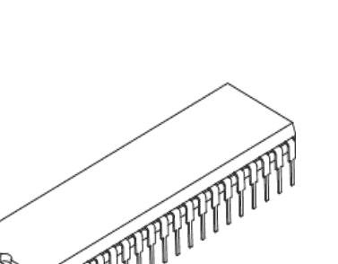

| RE3/NC/Vrp | RA0/AN5/UP1/C12N1- | RA1/AN6/C12N1- | RA2/AN7/Vmc/C12++ | RA3/AN8/Vrh/C11N+ | RA4/TOS0/C12OUT | RA5/AN4/C13OUT | RE5/ANS | RE1/AN6 | RE2/AN7 | RA7/OS3/C1CKN | RA6/OS2/C1CKN/RD7 | RC0/T1OS0/T1CKI | RC1/T1OS0/CCP2 | RC2/P1A/CCP1 | RC3/SCK/T1CK | RD0 | RD1 |

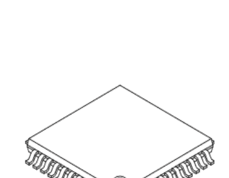

| RC7/RCX7 | RD4 | RD5/P1B | RD6/P1C | RD7/P10 | Vdd | RB0/AN12/INT2 | RB1/AN10/C12N3- | RB2/AN8 | RB3/AN9/PGM/C12N2 |


| RC7/RCX7 | RC6/SD6 | RC5/SD5 | RC4/SD4 | RC3 | RC2/P1A/CK1 | RC2/P1A/CCP1 | RC1/T1OS0/TCKI |
| NC | RC6/OS5C2OUT | RA0/OS51CKIN | Vdd | RE2/AN7 | RE1/ANS | RA4/SS/C2OUT | RC0/T1OS0/C2OUT |
| NC | RB5/AN13/TCKI | RB6/RC5 | RB7/RC5 | RB4/AN3/Vrp | RB3/AN9/PGM/C12N2 | RB1/AN10/C12N3- | RA1/AN6/C12N1- | RA0/AN5/UP1/C12N1- |

[/content]

## 引脚输出 (PINOUT)

PIC16F887 微控制器的大多数引脚都是多功能的，如图所示。例如，RA3/AN3/Vref+/C1+ 引脚具有以下功能：

- Port A 数字输入/输出
- AN3 模拟输入
- Vref+ 正参考参考
- C1+ 比较器输入

这种功能性使得微控制器封装更加紧凑，可以在不影响运行的情况下同时使用多种功能。下表针对 PDIP 40 型微控制器：

| 名称 | 引脚号 (DIP 40) | 功能 | 说明 |
|---|---|---|---|
| RE3/MCLR/Vpp | 1 | RE3 | 通用输入 E |
| | | MCLR | 复位引脚。此引脚低电平会复位微控制器 |
| | | Vpp | 编程电压 |
| | | RA0 | 通用端口 A |
| | | AN0 | A/D 通道 0 |
| RA0/AN0/ULPW/C12- | 2 | ULPW | 待机模式停用 |
| | | C12- | 比较器 C1 或 C2 负输入 |
| | | RA1 | 通用端口 A |
| RA1/AN1/C12- | 3 | AN1 | A/D 通道 1 |
| | | C12- | 比较器 C1 或 C2 负输入 |
| | | RA2 | 通用端口 A |
| | | AN2 | A/D 通道 2 |
| RA2/AN2/Vref-/CVref/C2++ | 4 | Vref- | A/D 负电压参考 |
| | | CVref | 比较器电压参考 |
| | | C2+ | 比较器正输入 |
| | | RA3 | 通用端口 A |
| RA3/AN3/Vref+/C1++ | 5 | AN3 | A/D 通道 3 |
| | | Vref+ | A/D 正电压输入 |
| | | C1+ | 比较器 C1 正输入 |
| | | RA4 | 通用端口 A |
| RA4/T0CKI/C1OUT | 6 | TOCKI | 定器 T0 时钟输入 |
| | | C1OUT | 比较器 C1 输出 |
| | | RA5 | 通用端口 A |
| RA5/AN4/SS/C2OUT | 7 | AN4 | A/D 通道 4 |
| | | SS | SPI 模块输入 (片选选择) |
| | | C2OUT | 比较器 C2 输出 |
| RE0/AN5 | 8 | RE0 | 通用端口 E |
| | | AN5 | A/D 通道 5 |
| RE1/AN6 | 9 | RE1 | 通用端口 E |
| | | AN6 | A/D 通道 6 |
| RE2/AN7 | 10 | RE2 | 通用端口 E |
| | | AN7 | A/D 通道 7 |
| Vdd | 11 | + | 正电源 |
| Vss | 12 | - | 接地 (GND) |

| 名称 | 引脚号 (DI/P 40) | 功能 | 说明 |
|---|---|---|---|
| RA7/OSC1/CLKIN | 13 | RA7 | 通用端口 A |
| | | OSC1 | 振荡器输入 |
| | | CLKIN | 外部时钟输入 |
| | | OSC2 | 振荡器输出 |
| RA6/OSC2/CLKOUT | 14 | CLK0 | Fosc/4 输出 |
| | | RA6 | 通用端口 A |
| | | RC0 | 通用端口 C |
| RC0/T1OSO/T1CKI | 15 | T1OSO | 定器 T1 输出 |
| | | T1CKI | 定器 T1 时钟输入 |
| RC1/T1OSO/T1CKI | 16 | RC1 | 通用端口 C |
| | | T1OSO | 定器 T1 输入 |
| | | CCP2 | CCP1 和 PWM1 I/O |
| RC2/P1A/CCP1 | 17 | RC2 | 通用端口 C |
| | | P1A | PWM 输出输出 |
| | | CCP1 | CCP1 和 PWM1 I/O |
| | | RC3 | 通用端口 C |
| RC3/SCK/SCL | 18 | SCK | SPI 模式下的时钟 I/O |
| | | SCL | I2C 模式下的时钟 I/O |
| | 19 | RD0 | 通用端口 D |
| | | 20 | RD1 | 通用端口 D |
| | | 21 | RD2 | 通用端口 D |
| | | 22 | RD3 | 通用端口 D |


| 名称 | 引脚 (DIP 40) | 功能 | 描述 |
|---|---|---|---|
| RD4 | 27 | RD4 | 通用 I/O端口 D |
| RD5/P1B | 28 | RD5 | 通用 I/O端口 D |
| | | P1B | PWM 输出 |
| RD6/P1C | 29 | RD6 | 通用 I/O端口 D |
| | | P1C | PWM 输出 |
| RD7/P1D | 30 | RD7 | 通用 I/O端口 D |
| | | P1D | PWM 输出 |
| Vss | 31 | - | 接地 (GND) |
| Vdd | 32 | + | 正电源 |
| RB0/AN12/INT | 33 | RB0 | 通用 I/O端口 B |
| | | AN12 | A/D 通道 12 |
| | | INT | 外部中断 |
| RB1/AN10/C12INT3 | 34 | RB1 | 通用 I/O端口 B |
| | | AN10 | A/D 通道 10 |
| | | C12INT3 | 比较器 C1 或 C2 负输入 |
| RB2/AN8 | 35 | RB2 | 通用 I/O端口 B |
| | | AN8 | A/D 通道 8 |
| | | RB3 | 通用 I/O端口 B |
| RB3/AN9/PGM/C12IN2- | 36 | AN9 | A/D 通道 9 |
| | | PGM | 程序使能引脚 |
| | | C12IN2- | 比较器 C1 或 C2 负输入 |
| RB4/AN11 | 37 | RB4 | 通用 I/O端口 B |
| | | AN11 | A/D 通道 11 |
| RB5/AN13/T1G | 38 | RB5 | 通用 I/O端口 B |
| | | AN13 | A/D 通道 13 |
| | | T1G | 定器 T1 外部输入 |
| RB6/ICSPCLK | 39 | RB6 | 通用 I/O端口 B |
| | | ICSPCLK | 串行编程时钟 |
| RB7/ICSPDAT | | RB7 | 通用 I/O端口 B |
| | | ICSPDAT | 程序数据引脚 |

#### 中央处理器 (CPU)

在这个阶段我们不会向你介绍 CPU 的操作原理。然而，我们只需要说明 CPU 是采用 RISC 技术制造的，这是决定使用哪种微控制器的重要因素。

RISC 代表精简指令集计算机（Reduced Instruction Set Computer），它为 PIC16F877 带来了两个巨大的优势：

- CPU 仅识别 35 条简单指令。顺提一下，为了用汇编语言编写其他微控制器，必须背诵超过 200 条指令。

几乎所有指令的执行时间都相同，持续 4 个时钟周期。振荡频率由石英晶稳定。跳转和分支指令的执行时间为 2 个时钟周期。这意味着如果微控制器的运行速度为 20MHz，每条指令的执行时间将为 200nS，即程序每秒将执行 500 万条指令！

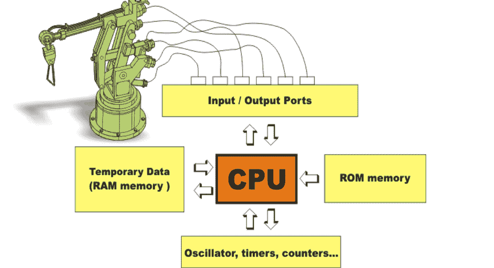

#### 内存

PIC16F887 有三种内存：ROM、RAM 和 EEPROM。由于它们都有特定的功能、特性和结构，将分别进行讨论。

#### ROM 内存

ROM 内存用于永久保存正在执行的程序。这就是它通常被称为“程序存储”。PIC16F877 拥有 8Kb 的 ROM（共 8192 个位置）。由于 ROM 内存采用 FLASH 技术制造，可以通过提供特殊的编程电压 (13V) 来更改其内容。

然而，没有详细解释，因为这是通过 PC 上的特殊程序和一个称为编程器的简单电子设备自动完成的。

# 使用汇编语言编写程序（仿真器工具），编译为机器码
将程序复制到 ROM 内存

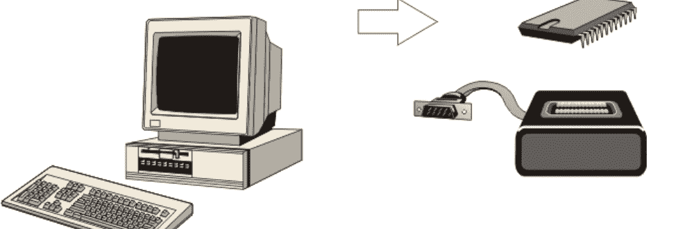

#### EEPROM 内存

与程序内存类似，EEPROM 的内容是永久保存的，即使掉电也是如此。但与 ROM 不同，EEPROM 的内容可以在微控制器运行期间更改。这就是为什么这部分内存（256 个位置）非常适合永久保存运行期间创建和使用的结果。

#### RAM 内存

这是微控制器内存第三部分也是复杂复杂。在这种情况下，它由两部分组成：通用寄存器和特殊功能寄存器 (SFR)。所有这些寄存器分为四个存储库（bank），将在本章中解释。

尽管这两组寄存器在断电时都会被清零，尽管它们的制造方式相同且作用相似，但它们的功能并没有许多共同点。

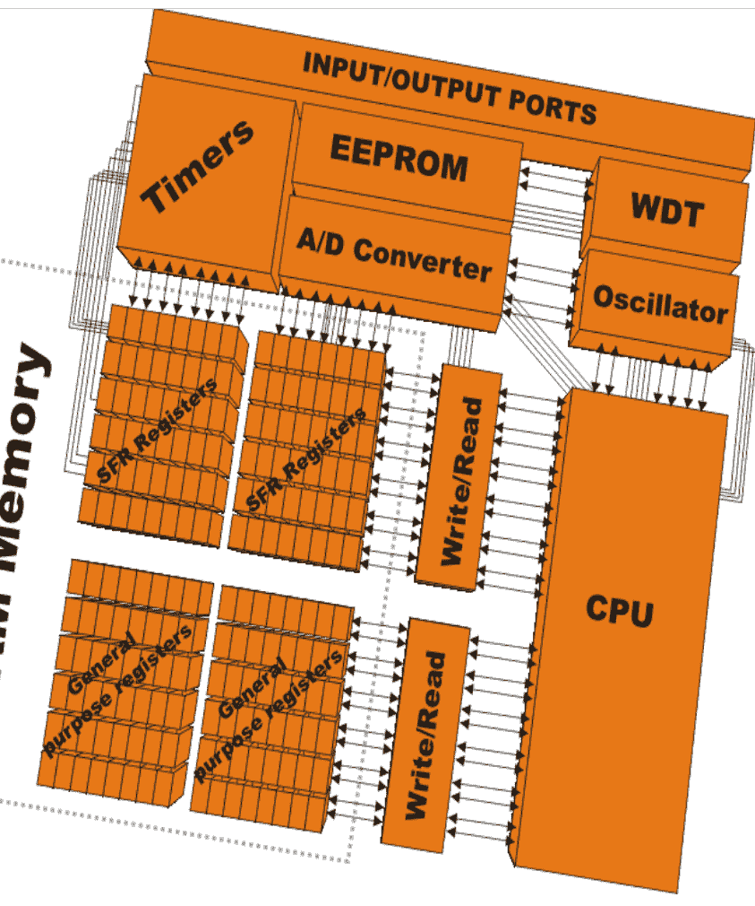

#### 通用寄存器

通用寄存器用于存储运行期间的临时数据结果。例如，如果程序在总线上进行计数，则需要一个代表“和”的寄存器。一个简单的程序将该寄存器的值加 1，微控制器就可以执行程序并知道分配某些通用寄存器。

#### 特殊功能寄存器 (SFR)

特殊功能寄存器与通用寄存器不同，其目的在制造时就已经确定且无法更改。它们连接到芯片上的特定电路（A/D 转换器、串行通信模块等），它们的任何变化都会影响微控制器的运行。例如，ADCON0 寄存器控制 A/D 转换器的速度。这些内存位置的另一个特性是，高级语言可以使用所有寄存器的精确地址来读取或更改其内容。

# 存储库 (BANKS)

RAM 内存分为四个存储库。在程序写入读取或更改任何寄存器内容之前，必须选择包含该寄存器的存储库。为了简化操作，最常用的 SFR 在所有存储库中具有相同的地址，以便于进行访问。

| 地址 | 名称 | 地址 | 名称 |
|---|---|---|---|
| 00h INDF | 80h INDF | 100h INDF | 180h INDF |
| 01h TMR0 | 81h OPTION_REG | 101h TMR0 | 182h OPTION_REG |
| 02h PCL | 82h PCL | 102h PCL | 183h PCL |
| 03h STATUS | 83h STATUS | 103h STATUS | 184h STATUS |
| 04h FSR | 84h FSR | 104h FSR | 185h FSR |
| 05h PORTA | 85h TRISA | 105h WCTON | 186h SRCON |
| 06h PORTB | 86h TRISB | 106h PORTB | 187h |
| 07h PORTC | 87h TRISC | 107h CM1CON0 | 188h BAUCTL |
| 08h PORTD | 88h TRIS | 108h CM2CON0 | 189h ANSEL |
| 09h PORTE | 89h TRISE | 109h CM2CON1 | 190h ANSELH |
| 0Ah PCLATH | 8Ah PCLATH | 10Ah PCLATH | 18Ah PLATH |
| 0Bh INTCON | 8Bh INTCON | 10Bh INTCON | 18Eh EEECON1 |
| 0Ch PIR1 | 8Ch PIE1 | 10Ch EEDATH | 18F EEECON2 |
| 0Dh PIR2 | 8Dh PIR2 | 10Dh EEADR | 19Eh 未使用 |
| 0Eh TMRL | 8Eh OSC8 | 10Eh EEDATH | 190h 未使用 |
| 0Fh TMR1H | 8F OSCCON | 110h | |
| 1Ah T1CON | 91h OCTUNE | | |
| 1Bh T2CON | 92h SSPCON2 | | |
| 1Ch SSPUB | 93h SPADD | | |
| 1Dh SSPCON | 94h SSPSTAT | | |
| 1Eh CCPR1 | 95h WUPB | | |
| 1Fh CCP2 | 96h IOC | | |
| 17h CCP1 | 97h VRCON | | |
| 18h RCSTA | 98h TXSA | | |
| 19h TXREG | 9Ah SPBRG | | |
| 1Ah CREG | 9Bh SPBRGH | | |
| 1Bh CCPR2 | 9Ch PWM1CON | | |
| 1Ch CCP2R | 9Dh ECCAS | | |
| 1Dh CCP2CON | 9Eh PSTRCON | | |
| 1Eh ADRESH | Af ADRES | | |
| 1Fh ADCON0 | Af ADCON1 | | |
| 20h | A0h | | |

通用寄存器 | 通用寄存器 | 通用寄存器

96 字节 | 80 字节 | 96 字节

存储库 0 | 存储库 1 | 存储库 3

如果你用汇编语言编写程序，处理存储库可能会很困难。当使用 C 语言等高级编程语言以及如 mikroC PRO for PIC 等编译器时，你只需要指定寄存器名称。在此基础上，编译器会选择必要的存储库，并在编译过程中，用于存储库选择的适当指令将出现在代码中。到目前为止你一直只使用汇编语言，而这是你第一次使用 C 编译器，不是吗？这不是一个好消息吗？


# SFR 存储器 0

| 地址 | 名称 | Bit7 | Bit6 | Bit5 | Bit4 | Bit3 | Bit2 | Bit1 | Bit0 |
|---|---|---|---|---|---|---|---|---|---|
| 00h | INDF | 间接寄存器 | | | | | | | |
| 01h | TMR0 | 定时器 0 寄存器 | | | | | | | |
| 02h | PCL | 程序计数器的低位字节 | | | | | | | |
| 03h | STATUS | IRP | RP1 | RP0 | TO | PD | Z | DC | C |
| 04h | FSR | 间接数据内存地址指针 | | | | | | | |
| 05h | PORTA | RA7 | RA6 | RA5 | RA4 | RA3 | RA2 | RA1 | RA0 |
| 06h | PORTB | RB7 | RB6 | RB5 | RB4 | RB3 | RB2 | RB1 | RB0 |
| 07h | PORTC | RC7 | RC6 | RC5 | RC4 | RC3 | RC2 | RC1 | RC0 |
| 08h | PORTD | RD7 | RD6 | RD5 | RD4 | RD3 | RD2 | RD1 | RD0 |
| 09h | PORTE | | | | | | RE3 | RE2 | RE1 | RE0 |
| 0Ah | PCLATH | | | | | | | 程序计数器高 5 位 | | |
| Bh | INTCON | GIE | PEIE | TIE | | IE | TINT | TOF | TMR2F |
| 00h | PIR2 | OSCIF | C2F | C1F | EEIF | BCLF | ULPF | CCP2F |
| T0h | TMR1L | 16 位定时器低位字节 | | | | | | | |
| Fh | TMR1H | 16 位定时器高位字节 | | | | | | | |
| 10h | T1CON | T1GINV | T1GE | T1CKPS1 | T1CKPS0 | T1SCEN | T11 | |
| 11h | TMR2 | 定时器 2 寄存器 | | | | | | | |
| 12h | T2CON | | | TOUTPS3 | TOUTPS2 | TOUTPS1 | TOUTPS0 | | T2CK1 |
| 13h | SSPBUF | 同步端口缓冲区寄存器 | | | | | T2ON | |
| 14h | SSPCON | WCOL | SPOV | SREN | | ADEN | FERR | SSP1 |
| 15h | CCP1R | 捕捉/比较 PWM 寄存器 1 低位 (LSB) | | | | | | |
| 16h | CCP1H | 捕捉/比较 PWM 寄存器 1 高位 (LSB) | | | | | DC1B0 |
| 17h | CCP1CON | P1M1 | P1M0 | DC1B1 | CCP1M3 | CCP1M2 | CCP1M1 | CCPM0 |
| 18h | RCSTA | SPEN | RX9 | SREN | | | FERR | OERR | RX9D |
| 19h | TXREG | USART 发送数据寄存器 | | | | | | | |
| Ah | CREG | USART 接收数据寄存器 | | | | | | |
| Bh | CCP2L | 捕捉/比较 PWM 寄存器 2 低位 (LSB) | | | | | | |
| 1Ch | CCP2H | 捕捉/比较 PWM 寄存器 2 高位 (LSB) | | | | | | |
| 1Dh | CCP2CON | | | DC2B1 | DC2B0 | CCP2M3 | CCP2M2 | CCP2M1 | CCPM0 |
| 1Eh | ADRESH | A/D 结果高字节 | | | | | | | |
| 1F | ADCON0 | ADCS1 | ADCS0 | | CH3 | CHS2 | CHS1 | CHS0 | GO/DONE | ADON |

# SFR 存储器  1

| 地址 | 名称 | Bit7 | Bit6 | Bit5 | Bit4 | Bit3 | Bit2 | Bit1 | Bit0 |
|---|---|---|---|---|---|---|---|---|---|
| 80h | INDF | 间接寄存器 | | | | | | | |
| 81h | OPTION_REG | RBPU | INTEDG | TOCS | | | PS2 | PS1 | PS0 |
| 82h | PCL | 程序计数器的低位 | | | | | | | |
| 83h | STATUS | IRP | RP1 | RP0 | TO | PD | Z | DC | C |
| 84h | FSR | 间接数据地址指针 | | | | | | | |
| 85h | TRISA | TRISA7 | TRISA6 | TRISA5 | TRISA4 | TRISA3 | TRISA2 | TRISA1 | TRISA0 |
| 86h | TRISB | TRISB7 | TRISB6 | TRISB5 | TRISB4 | TRISB3 | TRISB2 | TRISB1 | TRISB0 |
| 87h | TRISC | TRISC7 | TRISC6 | TRISC5 | TRISC4 | TRISC3 | TRISC2 | TRISC1 | TRISC0 |
| 88h | TRISD | TRISD7 | TRISD6 | TRISD5 | TRISD4 | TRISD3 | TRISD2 | TRISD1 | TRISD0 |
| 89h | TRISE | | | | | | | | | |
| 90h | PCLATH | | | | | | | 程序计数器高 5 位 | | |
| BCh | INTON | GIE | PEIE | TOIE | | IE | INTF | RIBF | |
| BCh | PI1 | ADIE | RCIE | TXIE | SSCIE | CCP1E | TMR2E | | |
| IE2 | OSFIE | | | CIE | EIE | BCLIE | ULPWIE | | CCP2E |
| Fh | PCON | ULPWIE | SBOREN | | | | | | |
| Fh | OSCCON | | | IRC2 | IRC1 | IRC0 | OTS | HTS | SCS |
| 90h | OSCUNE | | | | | TUN4 | TUN3 | TUN2 | TUN1 | TUN0 |
| 91h | SSPCON2 | GCEN | ACKSTAT | AKDT | ACKEN | RCEN | PEN | RSEN | SEN |
| 92h | PR2 | 定时器 T2 周期 | | | | | | |
| 93h | SSPADD | 同步串口端口 (I2C 模式) 地址 | | | | | |
| 93h | SSPMSK | MSK7 | MSK6 | MSK5 | MSK4 | P | R/W | UA | BF |
| 94h | SSPSTAT | CMP | CIE | D/A | P | S | | |
| 95h | WPUB | WPUB7 | WPUB6 | WPUB5 | WPUB4 | WPUB3 | WPUB2 | WPUB1 | WPUB0 |
| 96h | IOCB | IOCB7 | IOCB6 | IOCB5 | IOCB4 | IOCB3 | IOCB2 | IOCB1 | IOCB0 |
| 97h | VRCON | VREN | VROE | VRR | VRS | VR3 | VR2 | VR1 | VR0 |
| 98h | TXSTA | CSRC | TX9 | XEN | SENDB | BRGH | TRMT | TXD |
| 99h | SPBRG | BRG7 | BRG6 | BRG5 | BRG4 | BRG3 | BRG2 | BRG1 | BRG0 |
| A0h | SPBRGH | BRG5 | BRG14 | BRG13 | BRG12 | BRG11 | BRG10 | BRG9 | BRG8 |
| A1h | PWM1CON | PRSEN | PDC | PDC5 | PDC4 | PDC3 | PDC2 | PDC1 | PDC0 |
| A2h | ECCAS | ECCCON | ECCAS2 | ECCAS1 | ECCAS0 | PSSAC | SPRAC | PSSBD1 | PSSBD0 |
| A3h | PSTRCON | | | | | STSYNC | STRD | STRA | STBA |
| A4h | ADRESL | A/D 结果低字节 | | | | | | |
| A5h | ADCON1 | ADFM | | VCFG1 | VCFG0 | | | |

# SFR 存储器 2

| 地址 | 名称 | Bit7 | Bit6 | Bit5 | Bit4 | Bit3 | Bit2 | Bit1 | Bit0 |
|---|---|---|---|---|---|---|---|---|---|
| 100h | INDF | 间接寄存器 | | | | | | | |
| 101h | TMR0 | 定时器 T 寄存器 | | | | | | | |
| 102h | PCL | 程序计数器的低位字节 | | | | | | | |
| 103h | STATUS | IRP | RP1 | RP0 | TO | PD | Z | DC | C |
| 104h | FSR | | | | | 间接数据指针 | | | |
| 105h | WDTCON | | | | WDT3 | WDT2 | WDT1 | WDT0 | SWDTEN |
| 106h | PORTB | RB7 | RB6 | RB5 | RB4 | RB3 | RB2 | RB1 | RB0 |
| 107h | CM100 | C1ON | C10UT | C1OE | C1POL | | C1R | C1CH1 | C1CH0 |
| 108h | CM200 | C2ON | C2OUT | C2OE | | C2PR | | C2CH1 | C2CH0 |
| 109h | CM201 | MC10UT | MC20UT | C1SEL | C2SEL | | | T1G5 | | |
| 110h | PLATCH | | | | | 程序计数器高 5 位 | | | |
| 108h | INTCON | GIE | PIE | TIE | INTE | RBIE | T0IF | INTF | RBIF |
| 109h | EEADAT | EEADAT7 | EEADAT6 | EEADAT5 | EEADAT4 | EEADAT3 | EEADAT2 | EEADAT1 | EEADAT0 |
| 110h | EEADHR | EEADHR7 | EEADHR6 | EEADHR5 | EEADHR4 | EEADHR3 | EEADHR2 | EEADHR1 | EEADHR0 |
| | EEADATH | | | | EEADATH5 | EEADATH4 | EEADATH3 | EEADATH2 | EEADATH1 | EEADATH0 |
| 111h | EEADHR | | | | EEADHR4 | EEADHR3 | EEADHR2 | EEADHR1 | EEADHR0 |

# SFR 存储器 3

| 地址 | 名称 | Bit7 | Bit6 | Bit5 | Bit4 | Bit3 | Bit2 | Bit1 | Bit0 |
|---|---|---|---|---|---|---|---|---|---|
| 180h | INDF | 间接寄存器 | | | | | | | | |
| 181h | OPTION | RGU | RPBU | INTEDG | TOCS | | | PS2 | PS1 | PS0 |
| 182h | PCL | 程序计数器的低位字节 | | | | | | | | |
| 183h | STATUS | IRP | RP1 | RP0 | TO | PD | Z | DC | C |
| 184h | FSR | | | | | | 间接数据地址 | | | |
| 185h | SRCON | | | | | | SR1 | SR0 | | | |
| 186h | TRISB | TRISB7 | TRISB6 | TRISB5 | TRISB4 | TRISB3 | TRISB2 | TRISB1 | TRISB0 |
| 187h | BAUDCTL | SRCC | TX9 | XEN | SENDB | BRGH | TRMT | TXD |
| 188h | ANSSEL | ANS7 | ANS6 | ANS5 | ANS4 | ANS3 | ANS2 | ANS1 | ANS0 |
| 189h | ANSSELH | ANS13 | ANS12 | ANS11 | ANS10 | ANS9 | ANS8 |
| 190h | PCLATH | | | | | | | 程序计数器高 5 位 | | |
| 191h | INTON | GIE | PEIE | TOIE | | IE | INTF | RIBF | |
| 192h | PI1 | ADIE | RCIE | TXIE | SSCIE | CCP1E | TMR2E | | |
| 193h | IE2 | OSFIE | | | CIE | EIE | BCLIE | ULPWIE | | CCP2E |
| 194h | PCON | ULPWIE | SBOREN | | | | | | |
| 195h | OSCCON | | | IRC2 | IRC1 | IRC0 | OTS | HTS | SCS |
| 196h | OSCUNE | | | | | TUN4 | TUN3 | TUN2 | TUN1 | TUN0 |
| 197h | SSPCON2 | GCEN | ACKSTAT | AKDT | ACKEN | RCEN | PEN | RSEN | SEN |
| 198h | PR2 | 定时器 T2 周期 | | | | | | |
| 199h | SSPADD | 同步串口端口 (I2C 模式) 地址 | | | | | | |
| 1A0h | SSPMSK | MSK7 | MSK6 | MSK5 | MSK4 | P | R/W | UA | BF |
| 1A1h | SSPSTAT | CMP | CIE | D/A | P | S | | | |
| 1A2h | WPUB | WPUB7 | WPUB6 | WPUB5 | WPUB4 | WPUB3 | WPUB2 | WPUB1 | WPUB0 |
| 1A3h | IOCB | IOCB7 | IOCB6 | IOCB5 | IOCB4 | IOCB3 | IOCB2 | IOCB1 | IOCB0 |
| 1A4h | VRCON | VREN | VROE | VRR | VRS | VR3 | VR2 | VR1 | VR0 |
| 1A5h | TXSTA | CSRC | TX9 | XEN | SENDB | BRGH | TRMT | TXD |
| 1A6h | SPBRG | BRG7 | BRG6 | BRG5 | BRG4 | BRG3 | BRG2 | BRG1 | BRG0 |
| 1A7h | SPBRGH | BRG5 | BRG14 | BRG13 | BRG12 | BRG11 | BRG10 | BRG9 | BRG8 |
| 1A8h | PWM1CON | PRSEN | PDC | PDC5 | PDC4 | PDC3 | PDC2 | PDC1 | PDC0 |
| 1A9h | ECCAS | ECCCON | ECCAS2 | ECCAS1 | ECCAS0 | PSSAC | SPRAC | PSSBD1 | PSSBD0 |
| 1AAh | PSTRCON | | | | | STSYNC | STRD | STRA | STBA |
| 1ABh | ADRESL | A/D 结果低字节 | | | | | | | |
| 1ACh | ADCON1 | ADFM | | VCFG1 | VCFG0 | | | |


（请求有其向量），但在这种情况下只有一个。因此，中断服务程序的第一部分是中断源检测。

最后，当识别出中断源并执行中断服务程序时，微控制器读取 RETIE 指令，从栈中弹出地址，并从上次停止的地方继续执行程序。

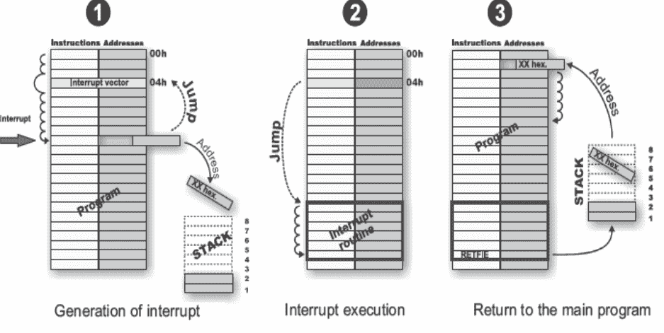

microK 将要执行的中断服务程序识别为 `void interrupt()` 函数。该函数的体（即中断服务程序）应由用户编写。

```
void interrupt() {   // 中断服务程序
cnt++;                   // 中断导致变量 cnt 增
}
```

## 简而言之：如何使用 SFR

你已经购买了微控制器，并且大致知道如何使用它……有一个长长的特殊功能寄存器（SFR）及其位位的列表。每一个寄存器都控制着某些过程。总而言之，它看起来像一个带有许多仪器和开关的大控制面板。现在你担心自己是否能学会使用所有它们？你可能不会，但不用担心，你没必要！这些强大的微控制器类似于超市：它们以低廉的价格提供如此多的产品，选择你需要的取决于你自己。因此，请选择你感兴趣的领域并只学习你需要的的知识。当你理解了硬件操作后，再研究控制它的 SFR（通常只有几个）。

由于设备具有某种控制系统，微控制器也有自己的“杠杆”，你必须熟悉这些杠杆才能正确地使用它。当然，我们谈论的是从编程开始到结束的 SFR。

www.raguvaran.puzl.com

## 3.2 核心 SFR

以下文本描述了 PIC16F887 微控制器的核心 SFR。这些寄存器的每个位控制着芯片内部不同的电路，因此无法将它们归类为特殊组。由于由于原因，是根据它们所控制的过程进行描述的。

### STATUS 寄存器

| R/W (0) | R/W (0) | R/W (0) | R (1) | R (1) | R/W (x) | R/W (x) | R/W (x) | Features |
| --- | --- | --- | --- | --- | --- | --- | --- | --- |
| STATUS | IRP | RP1 | RP0 | TO | PD | Z | DC | C | 位名 |
| | Bit 7 | Bit 6 | Bit 5 | Bit 4 | Bit 3 | Bit 2 | Bit 1 | Bit 0 |

STATUS 寄存器携带：W寄存器中数据的算术状态、RESET状态以及数据内存的存储选择位。

- IRP - 选择寄存器组。用于间接寻址。
  - 1 - 组 0 和 1 激活（内存位置 000h-FFH）
  - 0 - 组 2 和 3 激活（内存位置 100h-1FFH）
- RP1,RP0 - 位选择寄存器组。用于直接寻址。

| RP1 | RP0 | 激活组 |
| --- | --- | --- |
| 0 | 0 | Bank0 |
| 0 | 1 | Bank1 |
| 1 | 0 | Bank2 |
| 1 | 1 | Bank3 |

- TO - 超时位。
  - 1 - 上电后，执行 `CLRWDT` 指令重位看门定时器，或执行 `SLEEP` 指令使微控制器进入低功耗模式。
  - 0 - 看门超时发生后。

- PD - 下电位。
  - 1 - 上电后或执行 `CLRWDT` 指令重位看门定时器。
  - 0 - 执行 `SLEEP` 指令使微控制器进入低功耗模式后。

- Z - 零位
  - 1 - 算术或逻辑运算的结果为零。
  - 0 - 算术或逻辑运算的结果不为零。

- DC - 数字/进/借位在加减法过程中，如果结果发生“溢出”或“借位”，该位会改变。
  - 1 - 结果的第 4 个低位发生了进位。
  - 0 - 结果的第 4 个低位未发生进位。

- C - 进/借位在加减法过程中，如果结果发生“溢出”或“借位”，该位会改变，即结果大于 255 或小于 0。
  - 结果的最高位 (MSB)发生了进位。
  - 结果的最高位 (MSB)未发生进位。

### OPTION_REG 寄存器

| R/W | R/W | R/W | R/W | R/W | R/W | R/W | R/W | R/W | R/W | Features |
|---|---|---|---|---|---|---|---|---|---||
| OPTION | RBPU | INTEDG | T0CS | TOSE | PSA | PS2 | PS1 | PS0 | 位名 |
| | Bit 7 | Bit 6 | Bit 5 | Bit 4 | Bit 3 | Bit 2 | Bit 1 | Bit 0 | |

OPTION_REG 包含了用于配置 T0 分频和 WDT 的各种位。

- RBPU - B端口上拉启用。
  - 1 - 端口上拉禁用。
  - 0 - 端口上拉启用。

- INTEDG - 中断边缘选择。
  - 1 - 中断下降沿。
  - 0 - 中断上升沿。

- T0CS - T0 时钟源选择。
  - 0 - 内部 RC Oscillator。
  - 1 - 外部时钟。

- TOSE - 超时边缘选择。
  - 1 - 选择特定的边缘触发。
  - 0 - 不选择边缘触发。

- PSA - 分频器停止。
  - 1 - 分频器停止。
  - 0 - 分频器启用。

- PS2, PS1, PS0 - 分频位。

| PS2 | PS1 | PS0 | 分频系数 |
| --- |---|---|---|
| 0 | 0 | 0 | 1/2 |
| 0 | 0 | 1 | 1/4 |
| 0 | 1 | 0 | 1/8 |
| 0 | 1 | 1 | 1/16 |
| 1 | 0 | 0 | 1/32 |
| 1 | 0 | 1 | 1/64 |
| 1 | 1 | 0 | 1/128 |
| 1 | 1 | 1 | 1/256 |


重要的是，标志位并不是自动清除的，而是在中断执行过程中通过软件清除的。如果我们忽略了这一细节，在返回主程序后，会立即发生另一个中断，即使此时已经没有更多的执行请求。简单来说，标志位以及 IE 位将保持置位状态。

下一页显示了 PIC16F87 微控制器中典型的所有中断源。请注意以下几点：

- GIE 位可同时启用所有未掩码的中断并同时禁用所有中断。

- PEIE 位可同时启用所有未掩码的外设中断并禁用所有外设中断。这不涉及定时器 TMR0 和 PORTB 中断源。

- 要启用由 PORTB 逻辑状态变化引起的中断，需要对每个位单独启用。在这种情况下，IOCB 寄存器的位充当了控制 IE 位的作用。

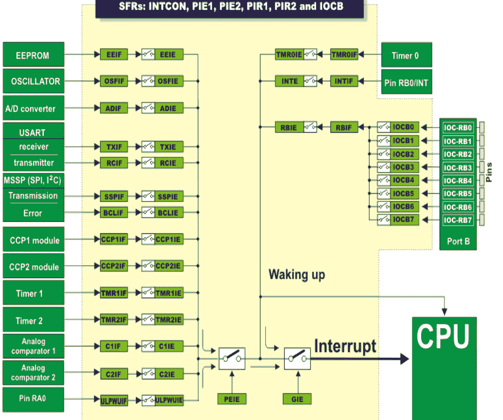

### INTCON 寄存器

INTCON 寄存器包含了用于 TMR0 寄存器溢出、PORTB 变化以及外部 INT 引脚中断的各种启用和标志位。

www.raguvaran.puzz.com

| R/W (0) | R/W (0) | R/W (0) | R/W (0) | R/W (0) | R/W (0) | R/W (x) | 特性 |
| --- | --- | --- | --- | --- | --- | --- | --- |
| INTCON | GIE | PEIE | TOIE | INTE | RBIE | INTF | RBIF | 位图 |
| 位 7 | 位 6 | 位 5 | 位 4 | 位 3 | 位 2 | 位 1 | 位 0 |

图例：R/W - 可读/写位，(0) 重置后位清零，(X) 重置后位未知

- GIE - 全局中断启用位 - 同时控制所有可能的中断源。
  - 1 - 启用所有未掩码的中断。
  - 0 - 禁用所有中断。

- PEIE - 外设中断启用位的作用与 GIE 位类似，但它控制由外设启的中断。这意味着它对由定时器 TMR0 或 PORTB 状态变化或 RB0/INT 触发的中断没有影响。
  - 1 - 启用所有未掩码的外设中断。
  - 0 - 禁用所有外设中断。

- TOIE - TMR0 溢出中断启用位控制由 TMR0 溢出引起的中断。
  - 1 - 启用 TMR0 中断。
  - 0 - 禁用 TMR0 中断。

- INTE - RB0/INT 外部启用位控制由 RB0/INT 输入引脚逻辑状态变化引起的中断（外部中断）。
  - 1 - 启用 INT 中断。
  - 0 - 禁用 INT 中断。

- RBIE - RB 口变化中断启用位。当配置为输入时，PORTB 引脚因为逻辑状态的变化引起中断（无论是从高到低还是反之，只要发生了变化即可）。此位决定了是否发生中断。
  - 1 - 启用端口 B 变化中断。
  - 0 - 禁用端口 B 变化中断。

- TOIF - TMR0 溢出中断标志位记录定时器 TMR0 寄存器计数零时的溢出。
  - 1 - TMR0 寄存器已溢出（必须在软件内部清除）。
  - 0 - TMR0 寄存器未溢出。

- INTF - RB0/INT 外部中断标志位记录 RB0/INT 逻辑状态的变化。
  - 1 - 发生了 INT 中断（必须在软件内部清除）。
  - 0 - 未发生 INT 中断。

- RBIF - RB 口变化中断标志位记录某些 PORTB 输入引脚逻辑状态的变化。
  - 1 - 至少有一个 PORTB 通用 I/O 引脚的状态发生了变化。读取 PORTB 时，必须在软件内部清除 RBIF 位。
  - 0 没有 PORTB 通用 I/O 引脚的状态变化。

让我们用 microC 来...

```c
// PORTB.4 引脚配置为对逻辑状态变化敏感的输入
void initMain() {
    ANSEL = ANSELH; // 所有 I/O 引脚配置为数字型
    PORTB = 0; // 所有 PORTB 引脚清零
    TRISB = 0B00010000; // 除了 PORTB.4 外的所有 PORTB 引脚配置为输出
    RBIE = 1; // 启用 PORTB 变化中断
    IOCB4 = 1; // 启用 PORTB 引脚4 变化中断
    GIE = 1; // 启用全局中断
    // 从此时开始，PORTB.4 逻辑状态的任何变化
    // 将导致中断
}
```

### PIE1 寄存器

PIE1 寄存器包含了外设中断位。

| | R(0) | R(0) | R(0) | R(0) | R(0) | R(0) | R(0) | 特性 |
|---|---|---|---|---|---|---|---||-|
| PIE1 | ADIE | RCIE | TXIE | SSPI | CCP1IE | TMR2IE | TMR1IE | 位名 |
| 位 7 | 位 6 | 位 5 | 位 4 | 位 3 | 位 2 | 位 1 | 位 0 |

图例：(-) 未使用位，(R/W) - 可读/写，(0) 重置后位清零

- ADIE - A/D 转换器启用位。
  - 1 - 启用 ADC 中断。
  - 0 - 禁用 ADC 中断。

- RCIE - EUSART 接收位。
  - 1 - 启用 EUSART 中断。
  - 0 - 禁用 EUSART 中断。

- TXIE - EUSART 传输位。
  - 1 - 启用 EUSART 中断。
  - 0 - 禁用 EUSART 中断。

- SSPI - 主同步串口 (MSSP) 启用位 - 通过串口通信（SPI 或 I2C 模式）产生中断。
  - 1 - 启用 MSSP 中断。
  - 0 - 禁用 MSSP 中断。

- CCP1IE - CCP1 启用位用于 PWM 处理的 CCP1 模块中断请求。
  - 1 - 启用 CCP1 中断。
  - 0 - 禁用 CCP1 中断。

- TMR2IE - TMR2 匹配位。
  - 1 - 启用 TMR2 匹配中断。
  - 0 - 禁用 TMR2 匹配中断。

- TMR1IE - TMR1 溢出启用位在定时器从零计数时产生 TMR1 溢出中断请求。
  - 1 - 启用 TMR1 中断。
  - 0 - 禁用 TMR1 中断。

```c
/* 由 TMR1H 和 TMR1L 组成的 Timer1 寄存器每次溢出都会产生中断。 */
unsigned short cnt; // 定义变量 cnt
void interrupt() {
    cnt++; // 中断导致 cnt 加 1
    PIR1.TMR1IF = 0; // 重置 TMR1IF
    TMR1H = 0x80; // TMR1 寄存器的初始值
    TMR1L = 0x00;
}
void main() {
    ANSEL = 0; // 所有 I/O 引脚配置为数字型
    TCON = 1; // 开启定时器 TMR1
    PIR1.TMR1IF = 0; // 重置 TMR1IF
    TMR1H = 0x80; // 设置 TMR1 的初始值
    TMR1L = 0x00;
    PIE1.TMR1IE = 1; // 溢出中断
    cnt = 0; // 重置变量 cnt
    INTCON = 0xC0; // 启用中断 (GIE 和 PEIE 位)
}
```

### PIE2 寄存器

PIE2 寄存器也包含各种中断位。

| R/W (0) | R/W (0) | R/W (0) | R/W (0) | R/W (0) | R/W (0) | 特性 |
|---|---|---|---|---|---|---|
| PIE2 OSFIE | C2IE | C1IE | EEIE | BCLIE | ULPWIE | CCP2IE 位名 |
| 位 7 | 位 6 | 位 5 | 位 4 | 位 3 | 位 2 | 位 1 | 位 0 |

图例：(-) 未使用位，(R/W) - 可读/写，(0) 重置后位清零

- OSFIE - 振荡失败中断位。
  - 启用振荡失败中断。
  - 禁用振荡失败中断。

- C2IE - 比较器 C2 中断启用位。
  - 1 - 启用 C2 中断。
  - 0 - 禁用 C2 中断。

- C1IE - 比较器 C1 中断启用位。
  - 1 - 启用 C1 中断。
  - 0 - 禁用 C1 中断。

- EEIE - EEPROM 写操作中断启用位。
  - 1 - 启用 EEPROM 写操作中断。
  - 0 - 禁用 EEPROM 写操作中断。

- BCLIE - 总线冲突中断启用位。
  - 1 - 启用总线冲突中断。
  - 0 - 禁用总线冲突中断。

- ULPWIE - 低功耗唤醒中断启用位。
  - 1 - 启用低功耗唤醒中断。
  - 0 - 禁用低功耗唤醒中断。

- CCP2IE - CCP2 中断启用位。
  - 1 - 启用 C2 中断。
  - 0 - 禁用 CCP2 中断。

让我们用 microC 来...

/* / 比较器 C2 配置为使用 RA0 和 RA2 作为输入。
比较器的输出的变化都会导致 PORTB.1 输出引脚
在中断程序中改变其逻辑状态。 */

```c
void interrupt() {
  PORTB.F1 = ~PORTB.F1; // 中断将反转 PORTB.1 引脚的逻辑状态
  PIR2.C2IF = 0; // 清除中断标志位 C2IF
}
void main() {
  TRISB = 0; // 所有 PORTB 引脚配置为输出
  PORTB.1 = 1; // 设置 PORTB.1 引脚
  ANSEL = 0b00000001; // RA0/C1IN- 和 RA2/C2IN+ 引脚为模拟输入
  ANSEL = 0; // 所有其他 I/O 引脚配置为数字型
  C2CH0 = C2CH1 = 0; // 选择 RA0 引脚作为 C2 的反相输入
  C2IE = 1; // 启用 C2 中断
  GIE = 1; // 启用全局中断
  C2ON = 1; // 启用比较器 C2
}
```

### PIR1 寄存器

www.raguvaran.puzl


PIR1 寄存器包含中断位。

| PIR1 | R/W (0) | R (0) | R (0) | R/W (0) | R/W (0) | R/W (0) | R/W (0) | 特性 |
|---|---|---|---|---|---|---|---||
| | ADIF | RCIF | TXIF | SSPIF | CCP1IF | TMR2IF | TMR1IF | 位名 |
| Bit 7 | Bit 6 | Bit 5 | Bit 4 | Bit 3 | Bit 2 | Bit 1 | Bit 0 |

图例：(-) 未使用的位，(R/W) - 可写位，(R) - 可读位，(0) 重置后位被清零

- ADIF - A/D 转换器中断标志位。
  - 1 - A/D 转换完成（必须在软件内部清除）。
  - 0 - A/D 转换未完成或尚未开始。
- RCIF - EUSART 接收中断标志位。
  - 1 - EUSART 接收缓冲区已满。通过读取 RCREG 寄存器清除。
  - 0 - EUSART 接收缓冲区未满。
- TXIF - EUSART 发送中断标志位。
  - 1 - EUSART 发送缓冲区为空。通过向 TXREG 寄存器写入清除。
  - 0 - EUSART 发送缓冲区未满。
- SSPIF - 主同步串行端口 (MSSP) 中断标志位。
  - 1 - 在传输/接收期间发生了 MSSP 中断条件。具体取决于 MSSP 工作模式（SPI 或 i²C）。此位在从中断服务程序返回之前，必须在软件内部清除。
  - 0 - 发生发生 MSSP 中断条件。
- CCP1IF - CCP1 中断标志位。
  - 1 - 发生了 CCP1 中断条件（CCP1 是捕获和生成 PWM 信号的单元）。取决于工作模式，发生了捕获或比较匹配。在这两种情况下，必须在软件中清除该位。此位在 PWM 模式下未使用。
  - 0 - 没有发生 CCP1 中断条件。
- TMR2IF - 定时器 2 到 PR2 中断标志位。
  - 1 - 发生了 TMR2 (8) 到 PR2 的匹配。此位在从中断服务程序返回之前，必须在软件内部清除。
  - 0 - 没有发生 PR2 匹配。
- TMR1IF - 定时器 1 溢出中断标志位。
  - 1 - TMR1 寄存器溢出。此位必须在软件内部清除。
  - 0 - TMR1 寄存器未溢出。

### PIR2 寄存器

PIR2 寄存器包含中断标志位。

| R/W (0) | R/W (0) | R/W (0) | R/W (0) | R/W (0) | R/W (0) | R/W (0) | 特性 |
|---|---|---|---|---|---|---|---||
| PIR2 | OSIF | C2IF | C1IF | EEIF | BCLIF | ULPWIF | CCP2IF | 位名 |
| Bit 7 | Bit 6 | Bit 5 | Bit 4 | Bit 3 | Bit 2 | Bit 1 | Bit 0 |

图例：未使用的位，(R/W) - 可读可写位，(0) 重置后清除

- OSIF - 振荡器失效中断标志位。
  - 1 - 系统故障且时钟输入已变为内部振荡器 INTOSC。此位必须在软件内部清除。
  - 0 - 系统振荡器正常工作。

- C2IF - 比较器 C2 中断标志位。
  - 1 - 比较器 C2 输出发生变化（C2OUT 位）。此位必须在软件内部清除。
  - 0 - 比较器 C2 输出未变化。

- C1IF - 比较器 C1 中断标志位。
  - 1 - 比较器 C1 输出发生变化（C1OUT 位）。此位必须在软件内部清除。
  - 0 - 比较器 C1 输出未变化。

- EEIF - EE 写操作中断标志位。
  - 1 - EEPROM 写入完成。此位必须在软件内部清除。
  - 0 - EEPROM 尚未完成或尚未开始。

- BCLIF - 总线冲突中断标志位。
  - 1 - 在配置为 I2C 主模式的 MSSP 中发生了总线冲突。此位必须在软件内部清除。
  - 0 - 没有发生总线冲突。

- ULPWIF - 超低功唤醒中断标志位。
  - 1 - 发生了唤醒条件。此位必须在软件内部清除。
  - 0 - 没有发生唤醒条件。

- CCP2IF - CCP2 中断标志位。
  - 1 - 发生了 CCP2 中断条件（用于捕获、比较和生成 PWM 信号）。取决于工作模式，在两种情况下，必须在软件内部清除该位。此位在 PWM 模式下未使用。
  - 0 - 没有发生 CCP2 中断条件。

让我们在 microC 中实现...

```
// Module ULPWIF activation sequence

void main() {
    PORTA.0 = 1;           // PORTA.0 引脚置位
    ANSEL = ANSELH = 0;     // 所有 I/O 引脚均配置为数字量
    TRISA = 0;              // TRISA 引脚配置为输出
    Delay_ms(1);            // 为电容充电
}
```

```
ULPWIF = 0; // 清除标志
PCON.ULPWIF = 1; // 开启 ULP 唤醒
TRISA.0 = 1; // PORTA.0 配置为输入
ULPWIE = 1; // 开启中断
GIE = PEIE = 1; // 开启外设中断
asm SLEEP; // 进入睡眠模式
```

### PCON 寄存器

PCON 寄存器包含两个标志位，用于区分上电复位、低压检测复位、看门定时器复位以及通过 MCLR 引脚的外部复位。

| PCON | | R/W(0) | R/W(1) | | R/W(0) | R/W(+) | 特性 |
|---|---|---|---|---|---|---|---||
| | ULPIE | SBOREN | POR | | | | 位名 |
| Bit 7 | Bit 6 | Bit 5 | Bit 4 | Bit 3 | Bit 2 | Bit 1 |

图例：未使用的位，(R/W) - 可写位，(0) 重置后清除

- ULPIE - 超低功耗唤醒中断启用位。
  - 1 - 系统故障且时钟输入已变为内部振荡器 INTOSC。此位必须在软件内部清除。
  - 0 - 系统振荡器正常工作。

- SBOREN - 低压检测复位启用位。
  - 1 - 发生了低压检测复位。此位必须在软件内部清除。
  - 0 - 没有发生低压检测复位。

- POR - 上电复位标志位。
  - 1 - 发生了上电复位。此位必须在软件内部清除。
  - 0 - 没有发生上电复位。

（注：原文描述为：PCON 寄存器仅包含两个标志位，用于区分上电复位、低压检测复位、看门定时器复位以及通过 MCLR 引脚的外部复位。但表格中显示了三个功能位。）

## PCL 寄存器

PCON 寄存器仅包含两个标志位，用于区分上电复位、低压检测复位、看门定时器复位以及通过 MCLR 引脚的外部复位。

| PCON | | R/W(0) | R/W(1) | | R/W(0) | R/W(+) | 特性 |
|---|---|---|---|---|---|---|---||
| | ULPIE | SBOREN | POR | | | | 位名 |
| Bit 7 | Bit 6 | Bit 5 | Bit 4 | Bit 3 | Bit 2 | Bit 1 | Bit 0 |

图例：未使用的位，(R/W) - 可写位，(0) 重置后清除

- ULPIE - 超低功耗唤醒中断启用位。
  - 1 - 发生了唤醒条件。此位必须在软件内部清除。
  - 0 - 没有发生唤醒条件。

- SBOREN - 低压检测复位启用位。
  - 1 - 发生了低压检测复位。此位必须在软件内部清除。
- 0 - 没有发生低压检测复位。

- POR - 上电复位标志位。
  - 1 - 发生了上电复位。此位必须在软件内部清除。
  - 0 - 没有发生上电复位。

## PCL 和 PCL 寄存器

程序计数器的大小为 13 位，分为两个寄存器 PCLATH 和 PCL。为了访问任何程序位置，PIC16F87 提供了 11 位寻址。ROM 分为“页”，每个页的大小为 2KB。这是因为对于子程序调用或跳转（CALL 和 GOTO），微控制器只能提供 11 位寻址。类似于 RAM 分为“块”，ROM 也分为四个“页”。此类指令在这些页内执行没有问题。简单来说，由于处理器提供了 11 位地址，它能够寻址 2KB 内的任何位置。

| Bit 12 | Bit 11 | Bit 10 | Bit 9 | Bit 8 | Bit 7 | Bit 6 | Bit 5 | Bit 4 | Bit 3 | Bit 2 | Bit 1 | Bit 0 |
|---|---|---|---|---|---|---|---|---|---|---|---|---|
| 程序计数器 (PC) | | | | | | Bit 4 | Bit 3 | Bit 2 | Bit 1 | Bit 0 |

### PCLATH

## PCL

如果在软件内部更改程序计数器，则需要注意以下几点以避免问题：

- PCL 寄存器的 8 位（低字节）是可读可写的，而来自 PCLATH 寄存器的高位是只写的。
- PCLATH 寄存器在任何复位时都会清除。
- 在汇编语言中，程序计数器的值标记为 PCL，仅指 8 位。使用 `ADWF PCL` 指令时应小心。这是一种通过在当前地址上增加数值来指定目标位置的跳转指令。通常用于跳转到查找表或程序分支。如果计数器增加导致 PCLATH 高字节的某些位发生变化，就会出现问题。

在 PCL 寄存器上执行任何指令都会导致程序计数器位被 PCLATH 寄存器的内容替换。然而，PCL 寄存器只能访问指令结果的 8 位低位，随后的跳转将完全错误。该问题通过设置以 xx00h 结尾的指令来解决。这允许程序最多跳转 255 个位置。


# PCLATH 4,3:    00    01    10    11

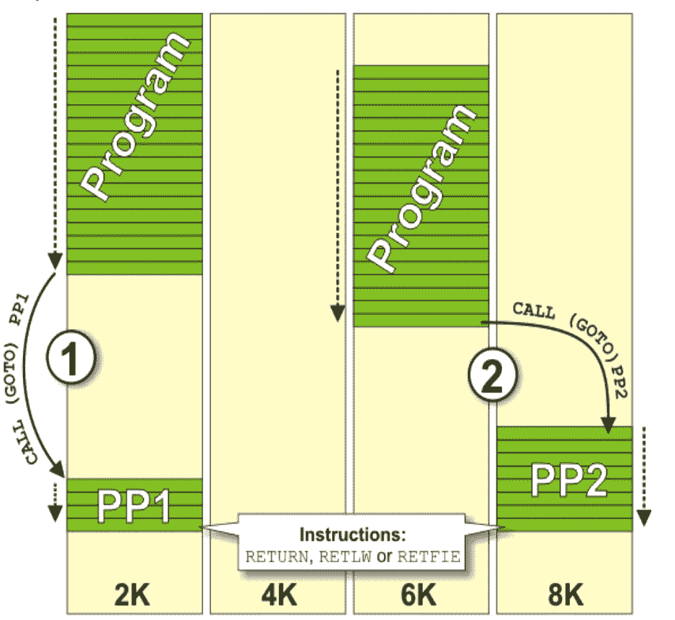

在这两种情况下，当子程序遇到 RETURN、RETLW 或 RETIE（返回主程序）指令时，微控制器将从上次停止的地方继续执行程序，因为返回地址被推入并保存到栈中，如所述，栈由 13 位寄存器组成。

# 间接寻址寄存器

除了逻辑且清晰的直接寻址（只需指定寄存器的地址即可读取其内容）外，该微控制器还能通过 `INDF` 和 `FSR` 寄存器执行间接寻址。这有时会让编程变得更容易。整个过程之所以实现是因为 `INDF` 寄存器并不是真实的寄存器（物理上不存在），它仅指定位于 `FSR` 寄存器中的寄存器地址。因此，对 `INDF` 寄存器的写入或读取实际上意味着对 `FSR` 寄存器中存储的地址进行写入或读取。换句话说，寄存器的地址指定在 `FSR` 寄存器中，而其内容存储在 `INDF` 寄存器中。直接寻址与间接寻址的区别如图所示：

可见，“缺失寻址位”的问题通过从另一个寄存器“借”位解决。这次是 `STATUS` 寄存器的第七位，称为 `IRP` 位。

# 直接寻址

# 间接寻址

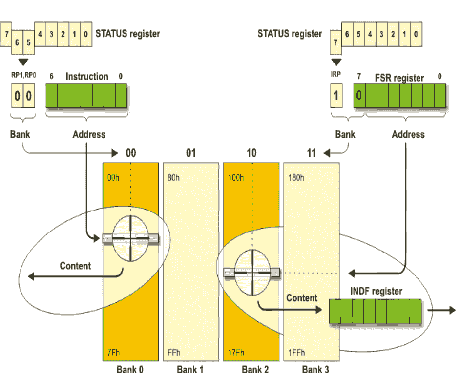

微控制器最重要的特性之一是输入输出引脚，使其能够连接到外设设备。PIC16F887 总共可用 35 个通用 I/O 引脚，这对于大多数应用都足够了。

## 3.3 输入输出端口

为了使 I/O 端口的操作与微控制器的内部 8 位结构同步，它们类似于寄存器，被分为由 A、B、C、D 和 E 表示五个端口。它们具有几个共同特征：

- 出于实际考虑，许多 I/O 引脚是多功能的。如果某个引脚执行了这些功能之一，则可能不能作为通用输入/输出引脚使用。
- 每个端口都有其“卫星”，即对应的 `TRIS` 寄存器：TRISA、TRISB、TRISC 等，它们决定端口位的性能，但不决定其内容。

通过清除 `TRIS` 寄存器的任意位（位=0），对应的端口引脚被配置为输出。同样地，通过设置 `TRIS` 寄存器的任意位（位=1），对应的端口引脚被配置为输入。这个规则很容易记忆：0 = 输出，1 = 输入。

# 微控制器

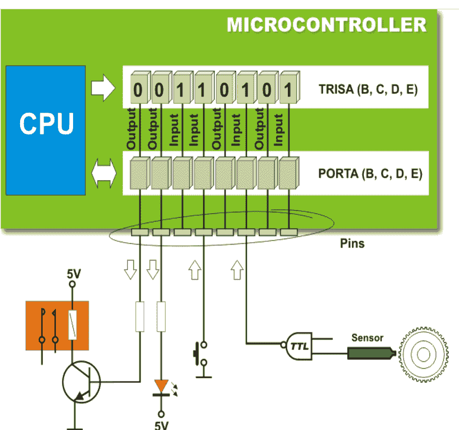

# PORTA 和 TRISA 寄存器

端口 A 是一个 8 位宽的双向端口。`TRISA` 和 `ANSEL` 寄存器的位控制 Port A 引脚。所有 Port A 引脚作为数字输入/输出工作。其中五个还可以作为模拟输入（由 AN 表示）：

| R/W (x) | R/W (x) | R/W (x) | R/W (x) | R/W (x) | R/W (x) | R/W (x) | R/W (x) | 特性 |
| :--- | :--- | :--- | :--- | :--- | :--- | :--- | :--- | :--- |
| PORTA | RA7 | RA6 | RA5 | RA4 | RA3 | RA2 | RA1 | RA0 | 位名 |
| Bit 7 | Bit 6 | Bit 5 | Bit 4 | Bit 3 | Bit 2 | Bit 1 | Bit 0 | |

| R/W (1) | R/W (1) | R/W (1) | R/W (1) | R/W (1) | R/W (1) | R/W (1) | R/W (1) | 特性 |
| :--- | :--- | :--- | :--- | :--- | :--- | :--- | :--- | :--- |
| TRISA | TRISA7 | TRISA6 | TRISA5 | TRISA4 | TRISA3 | TRISA2 | TRISA1 | TRISA0 | 位名 |
| Bit 7 | Bit 6 | Bit 5 | Bit 4 | Bit 3 | Bit 2 | Bit 1 | Bit 0 | |

| R/W | 可读/可写位 |
| :--- | :--- |
| (x) | 复位后，位未知 |
| (1) | 复位后，位为 1 |

RA0 = AN0（由 `ANSEL` 寄存器的 AN0 位决定）

RA1 = AN1（由 `ANSEL` 寄存器的 AN1 位决定）

RA2 = AN2（由 `ANSEL` 寄存器的 AN2 位决定）

RA3 = AN3（由 `ANSEL` 寄存器的 AN3 位决定）

RA5 = AN4（由 `ANSEL` 寄存器的 AN4 位决定）

`TRISA` 寄存器的相似位决定了哪些引脚配置为输入，哪些配置为输出，`ANSEL` 寄存器的适当位决定了引脚是配置为模拟输入还是数字输入/输出。

该端口的每个位都与某些内置外设的额外功能，将在后续章节描述。本章仅介绍 RA0 引脚的额外功能，因为它与端口 A 和 ULP 单元有关。

# 在 microC 中实现

```
// PORTA.2 引脚被配置为数字输入
// 所有其他 PORTA 引脚均为数字输出
```

```
ANSEL = 0; // 所有 I/O 引脚均配置为数字
PORTA = 0; // 所有 PORTA 引脚均清除
TRISA = 0b00000100; // 除 PORTA.2 外的所有 PORTA 引脚均配置为输出
```


| R/W (1) | R/W (1) | R/W (1) | R/W (1) | R/W (1) | R/W (1) | R/W (1) | R/W (1) | 特性 |
|---|---|---|---|---|---|---|---|---||
| WPUB7 | WPUB6 | WPUB5 | WPUB4 | WPUB3 | WPUB2 | WPUB1 | WPUB0 | 位名称 |
| Bit 7 | Bit 6 | Bit 5 | Bit 4 | Bit 3 | Bit 2 | Bit 1 | Bit 0 | |

| R/W 可读/写位 |
|---|---|
| (1) | 重置后，位被置为 1 |

这些“虚拟”电阻具有高阻值（几十千欧姆），它们不会影响配置为输出的引脚，但可以作为输入的有用补充。因此，它们连接到 CMOS 逻辑电路的输入端。否则，由于其高输入电阻，它们将表现出浮空状态。

## 带有上拉电阻的引脚

## 不带上拉电阻的引脚

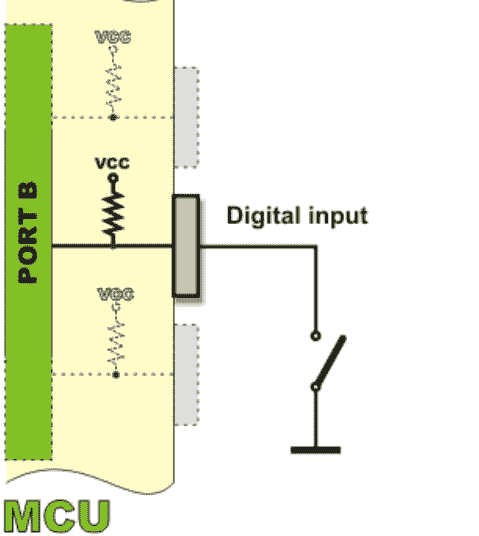

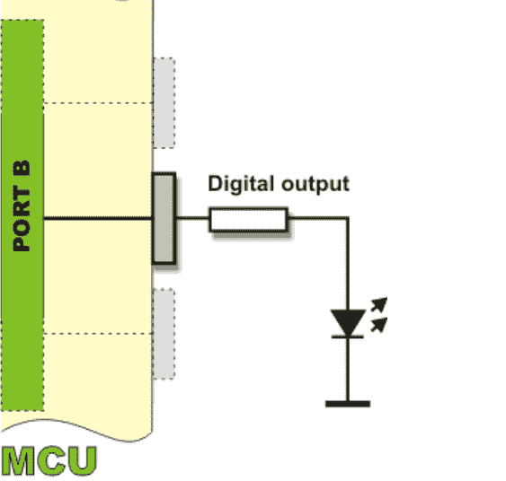

- 除了 WPUB 寄存器的位外，还有另一个位影响所有上拉电阻的安装。它是 `OPTION_REG` 中的 `RBPU` 位。

- 如果启用，每个配置为输入的端口 B 端口都可以通过改变其逻辑状态导致中断。为了使引脚能够触发，应该设置 `IOCB` 寄存器的相应位。

| R/W (0) | R/W (0) | R/W (0) | R/W (0) | R/W (0) | R/W (0) | R/W (0) | R/W (0) | 特性 |
|---|---|---|---|---|---|---|---|---||
| IOCB7 | IOCB6 | IOCB5 | IOCB4 | IOCB3 | IOCB2 | IOCB1 | IOCB0 | 位名称 |
| Bit 7 | Bit 6 | Bit 5 | Bit 4 | Bit 3 | Bit 2 | Bit 1 | Bit 0 | |

| R/W 可读/写位 |
|---|---|
| (0) | 重置后，位被清零 |

得益于这些功能，端口 B 引脚通常用于检查键盘上的按键，因为它们能够无误地记录任何按键按下。因此，不需要一直“扫描”这些输入信号。

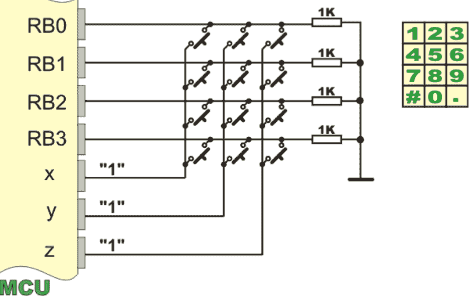

当 X、Y 和 Z 引脚配置为逻辑1 (1) 输出时，只需要等待按下任何按键时到达的中断请求。之后，通过组合这些输出上的 0 和 1，即可检查是哪个按键被按下。

让我们在 microC 中实现它……

```
* PORTB.1 引脚被配置为数字输入。其逻辑状态的任何变化都会导致中断。它也有一个上拉电阻。所有其他 PORTB 引脚均为数字输出。
ANSEL = ANSILH = 0; // 所有 I/O 引脚均配置为数字
PORTB = 0; // 所有 PORTB 引脚均清零
TRISB = 0b00000010; // 除 PORTB.1 外的所有 PORTB 引脚均配置为输出
RBPU = 0; // 启用上拉电阻
WPU1 = 1; // 上拉电阻连接到 PORTB.1 引脚
ICB1 = 1; // PORTB.1 引脚在逻辑电上可以引起中断
RBIE = GIE = 1; // 启用中断
```

RB0/INT

www.raguvaran.puzzl.com

RB0/INT 是唯一的“真”外部中断源。它可以配置为响应信号上升沿（0到1转换）或信号下降沿（1到0转换）。`OPTION_REG` 寄存器的 `INTEDG` 位用于选择合适的信号。

## RB6 和 RB7 引脚

PIC1F887 没有用于编程（将程序写入 ROM 的过程）的特殊引脚。通常作为通用 I/O 引脚使用的端口用于此目的。更具体地说，端口 B 引脚在程序加载期间用于时钟 (RB6) 和数据传输 (RB7)。此外，在 FLASH 存储器编程时需要应用电源电压 Vdd (5V) 和适当电压 Vpp (12-14V)。Vpp 电压应用在 MCLR 引脚上。你不需要考虑该过程的所有细节，例如如果编程器的电子设备负责该操作，则会先应用哪种电压。这里非常重要的一点是，即使将微控制器焊接到目标设备上，程序也可以加载到微控制器中。通常，加载的程序也可以以相同的方式进行更改。此功能称为 ICSP（在路串行编程）。为了正确使用它，必须在目标设备上安装一个微型 5 脚连接器，以为微控制器提供编程电压。为了防止这些电压干扰其他引脚， 所示。

#### PORTC 和 TRISC

端口 C 是双向端口。TRISC 寄存器的位决定其引脚的功能。与其他端口类似，TRISC 中的逻辑1 (1) 将相应端口配置为输入。


| R/W (1) | R/W (1) | R/W (1) | R/W (1) | R/W (1) | R/W (1) | R/W (1) | R/W (1) | 特性 |
|---|---|---|---|---|---|---|---|---|
| ANSEL7 | ANS6 | ANS5 | ANS4 | ANS3 | ANS2 | ANS1 | ANS0 | 位位名称 |
| Bit 7 | Bit 6 | Bit 5 | Bit 4 | Bit 3 | Bit 2 | Bit 1 | Bit 0 | |

| R/W (1) | R/W (1) | R/W (1) | R/W (1) | R/W (1) | R/W (1) | R/W (1) | 特性 |
|---|---|---|---|---|---|---|---|---|
| ANSELH - | ANS13 | ANS12 | ANS11 | ANS10 | ANS9 | ANS8 | 位位名称 |
| Bit 7 | Bit 6 | Bit 5 | Bit 4 | Bit 3 | Bit 2 | Bit 1 | Bit 0 | |

| 图例 | |
|---|---|
| R/W (1) | 该位未实现 |
| | 可读/可写位。复位后，该位被设置为 1 |

规则如下：

要将引脚配置为模拟输入，必须设置 ANSEL 和 ANSELH 寄存器中的相应位（1）。要将引脚配置为数字输入/输出，则必须清除相应的位（0）。

ANSEL 位的状态对数字输出功能没有影响。任何尝试读取配置为模拟输入的端口引脚的结果都都将为 0。

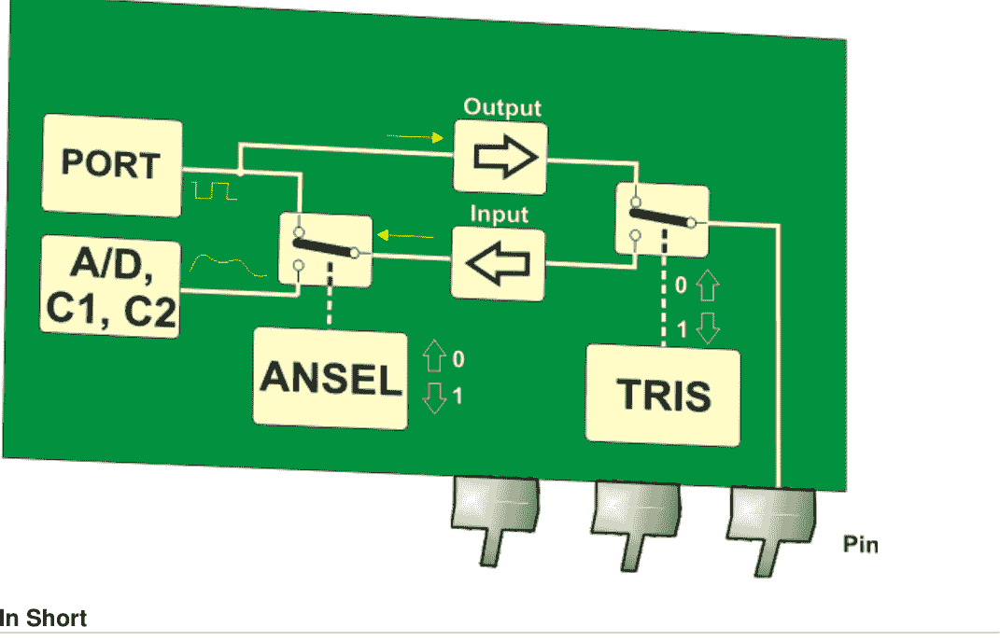

## 简而言

你可能永远不会编写一个不使用端口的程序；你为了了解它们的一切所付出的努力绝对是有回报的。无论如何，它们可能是微控制器内部最简单的模块。它们的使用方法如下：

- 在设计设备时，选择一个微控制器与外围环境通信的端口。如果你只使用数字输入/输出，请选择任何你需要的端口。如果你打算使用任何模拟输入，请选择支持此类引脚配置的端口（AN0-AN13）。
- 每个端口都可以被配置为输入或输出。TRISA、TRISB、TRISC、TRIS 和 TRISE 寄存器的位决定了相应端口引脚 PORTA、PORTB、PORTC 和 PORTD 的方向。简单来说……
- 如果你使用某些模拟输入，则在程序开始时必须设置 ANSEL 和 ANSELH 寄存器的相应位。
- 如果将开关和按按钮作为输入信号，请将它们连接到端口 B 引脚上，因为它们带有上拉电阻。这些电阻的使用通过 `OPTION_REG` 寄存器的 `RBPU` 位启用，而数字电阻的安装通过 `WPUB` 寄存器的位启用。
- 通常需要在输入改变其逻辑状态时立即做出响应。然而，没有必要编写一个用于检查引脚逻辑状态的程序。将此类输入连接到 PORTB 并在每次电压变化时触发中断要简单得多。IOCB 和 INTCON 寄存器的位负责此工作。

PIC16F87 微控制器有三个完全独立的定时器/计数器，标记为 TMR0、T1 和 T2。如果你想更多地了解它们，请仔细阅读本章。

## 3.4 定时器 TMR0

TMR0 定时器在实践中有广泛的应用。几乎没有程序不用某种方式使用它。对于编写生成任意持续脉冲、时间测量或计数外部脉冲（事件）的程序或子程序，它非常方便易用，几乎没有任何限制。

TMR0 定时器模块是一个 8 位定时器/计数器，具有以下功能：

- 8 位定时器/计数器；
- 8 位分频器（与看狗定时器共享）；
- 可编程内部或外部时源；
- 溢出中断；以及
- 可编程的外部边缘选择。

下图所示了 TMR0 定时器的原理图以及所有决定其操作逻辑状态的位。这些位存储在 `OPTION_REG` 寄存器中。

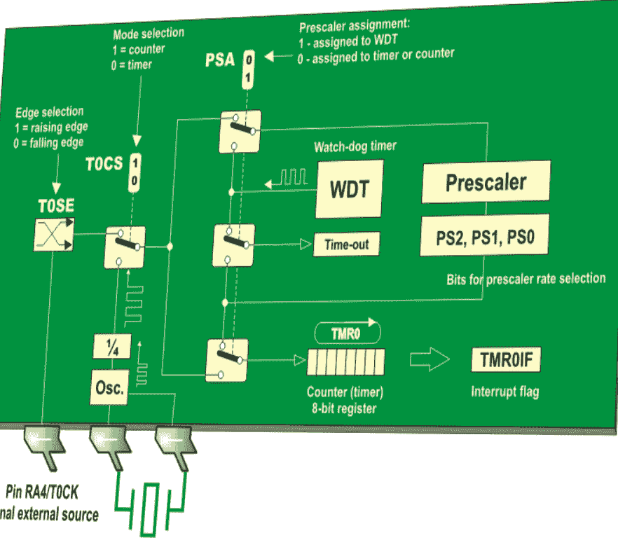

### OPTION_REG 寄存器

| R(1) | R(1) | R(1) | R(1) | R(1) | R(1) | R(1) | 特性 |
| OPTION_REG | RBPU | INTEDG | TOCS | TOSE | PSA | PS2 | PS1 | PS0 | 位 |
| | Bit 7 | Bit 6 | Bit 5 | Bit 4 | Bit 3 | Bit 2 | Bit 1 | Bit 0 |

| 图例 | |
|---|---|
| R/W | 可读/可写位 |
| (1) | 复位后，该位被设置为 1 |

- RBPU - PORTB 上拉启用位
  - 0 - 禁止 PORTB 上拉电阻。
  - 1 - PORTB 引脚可以连接到上拉电阻。
- INTEDG - 中断边缘选择位
  - 0 - 在 INT 引脚的上升沿（0-1）触发中断。
  - 1 - 在 INT 引脚的下降沿触发中断。
- TOCS - 时钟选择位
  - 0 - 使用内部时钟（Fosc）。
  - 1 - 使用外部时钟。
- TOSE - 边缘选择位
  - 0 - 在高电平到低电平转换时触发。
  - 1 - 在电平转换时触发。
- PSA - 分频器选择位
  - 0 - 使用分频器。
  - 1 - 禁用分频器。
- PS2, PS1, PS0 - 分频位位

- RBPU - PORTB 上拉启用位
  - 0 - 禁止 PORTB 上拉电阻。
  - 1 - PORTB 引脚可以连接到上拉电阻。
- INTEDG - 中断边缘选择位
  - 0 - 在 INT 引脚的上升沿（0-1）触发中断。
  - 1 - 在 INT 引脚的下降沿触发中断。
- TOCS - 时钟选择位
  - 0 - 使用内部时钟（Fosc）。
  - 1 - 使用外部时钟。
- TOSE - 边缘选择位
  - 0 - 在高电平到低电平转换时触发。
  - 1 - 在电平转换时触发。
- PSA - 分频器选择位
  - 0 - 使用分频器。
  - 1 - 禁用分频器。
- PS2, PS1, PS0 - 分频位

- RBPU - PORTB 上拉启用位
  - 0 - 禁止 PORTB 上拉电阻。
  - 1 - PORTB 引脚可以连接到上拉电阻。
- INTEDG - 中断边缘选择位
  - 0 - 在 INT 引脚的上升沿（0-1）触发中断。
  - 1 - 在 INT 引脚的下降沿触发中断。
- TOCS - 时钟选择位
  - 0 - 使用内部时钟（Fosc）。
  - 1 - 使用外部时钟。
- TOSE - 边缘选择位
  - 0 - 在高电平到低电平转换时触发。
  - 1 - 在电平转换时触发。
- PSA - 分频器选择位
  - 0 - 使用分频器。
  - 1 - 禁用分频器。
- PS2, PS1, PS0 - 分频位

- RBPU - PORTB 上拉启用位
  - 0 - 禁止 PORTB 上拉电阻。
  - 1 - PORTB 引脚可以连接到上拉电阻。
- INTEDG - 中断边缘选择位
  - 0 - 在 INT 引脚的上升沿（0-1）触发中断。
  - 1 - 在 INT 引脚的下降沿触发中断。
- TOCS - 时钟选择位
  - 0 - 使用内部时钟（Fosc）。
  - 1 - 使用外部时钟。
- TOSE - 边缘选择位
  - 0 - 在高电平到低电平转换时触发。
  - 1 - 在电平转换时触发。
- PSA - 分频器选择位
  - 0 - 使用分频器。
  - 1 - 禁用分频器。
- PS2, PS1, PS0 - 分频位

- RBPU - PORTB 上拉启用位
  - 0 - 禁止 PORTB 上拉电阻。
  - 1 - PORTB 引脚可以连接到上拉电阻。
- INTEDG - 中断边缘选择位
  - 0 - 在 INT 引脚的上升沿（0-1）触发中断。
  - 1 - 在 INT 引脚的下降沿触发中断。
- TOCS - 时钟选择位
  - 0 - 使用内部时钟（Fosc）。
  - 1 - 使用外部时钟。
- TOSE - 边缘选择位
  - 0 - 在高电平到低电平转换时触发。
  - 1 - 在电平转换时触发。
- PSA - 分频器选择位
  - 0 - 使用分频器。
  - 1 - 禁用分频器。
- PS2, PS1, PS0 - 分频位

- RBPU - PORTB 上拉启用位
  - 0 - 禁止 PORTB 上拉电阻。
  - 1 - PORTB 引脚可以连接到上拉电阻。
- INTEDG - 中断边缘选择位
  - 0 - 在 INT 引脚的上升沿（0-1）触发中断。
  - 1 - 在 INT 引脚的下降沿触发中断。
- TOCS - 时钟选择位
  - 0 - 使用内部时钟（Fosc）。
  - 1 - 使用外部时钟。
- TOSE - 边缘选择位
  - 0 - 在高电平到低电平转换时触发。
  - 1 - 在电平转换时触发。
- PSA - 分频器选择位
  - 0 - 使用分频器。
  - 1 - 禁用分频器。
- PS2, PS1, PS0 - 分频位

- RBPU - PORTB 上拉启用位
  - 0 - 禁止 PORTB 上拉电阻。
  - 1 - PORTB 引脚可以连接到上拉电阻。
- INTEDG - 中断边缘选择位
  - 0 - 在 INT 引脚的上升沿（0-1）触发中断。
  - 1 - 在 INT 引脚的下降沿触发中断。
- TOCS - 时钟选择位
  - 0 - 使用内部时钟（Fosc）。
  - 1 - 使用外部时钟。
- TOSE - 边缘选择位
  - 0 - 在高电平到低电平转换时触发。
  - 1 - 在电平转换时触发。
- PSA - 分频器选择位
  - 0 - 使用分频器。
  - 1 - 禁用分频器。
- PS2, PS1, PS0 - 分频位

- RBPU - PORTB 上拉启用位
  - 0 - 禁止 PORTB 上拉电阻。
  - 1 - PORTB 引脚可以连接到上拉电阻。
- INTEDG - 中断边缘选择位
  - 0 - 在 INT 引脚的上升沿（0-1）触发中断。
  - 1 - 在 INT 引脚的下降沿触发中断。
- TOCS - 时钟选择位
  - 0 - 使用内部时钟（Fosc）。
  - 1 - 使用外部时钟。
- TOSE - 边缘选择位
  - 0 - 在高电平到低电平转换时触发。
  - 1 - 在电平转换时触发。
- PSA - 分频器选择位
  - 0 - 使用分频器。
  - 1 - 禁用分频器。
- PS2, PS1, PS0 - 分频位

- RBPU - PORTB 上拉启用位
  - 0 - 禁止 PORTB 上拉电阻。
  - 1 - PORTB 引脚可以连接到上拉电阻。
- INTEDG - 中断边缘选择位
  - 0 - 在 INT 引脚的上升沿（0-1）触发中断。
  - 1 - 在 INT 引脚的下降沿触发中断。
- TOCS - 时钟选择位
  - 0 - 使用内部时钟（Fosc）。
  - 1 - 使用外部时钟。
- TOSE - 边缘选择位
  - 0 - 在高电平到低电平转换时触发。
  - 1 - 在电平转换时触发。
- PSA - 分频器选择位
  - 0 - 使用分频器。
  - 1 - 禁用分频器。
- PS2, PS1, PS0 - 分频位

- RBPU - PORTB 上拉启用位
  - 0 - 禁止 PORTB 上拉电阻。
  - 1 - PORTB 引脚可以连接到上拉电阻。
- INTEDG - 中断边缘选择位
  - 0 - 在 INT 引脚的上升沿（0-1）触发中断。
  - 1 - 在 INT 引脚的下降沿触发中断。
- TOCS - 时钟选择位
  - 0 - 使用内部时钟（Fosc）。
  - 1 - 使用外部时钟。
- TOSE - 边缘选择位
  - 0 - 在高电平到低电平转换时触发。
  - 1 - 在电平转换时触发。
- PSA - 分频器选择位
  - 0 - 使用分频器。
  - 1 - 禁用分频器。
- PS2, PS1, PS0 - 分频位

- RBPU - PORTB 上拉启用位
  - 0 - 禁止 PORTB 上拉电阻。
  - 1 - PORTB 引脚可以连接到上拉电阻。
- INTEDG - 中断边缘选择位
  - 0 - 在 INT 引脚的上升沿（0-1）触发中断。
  - 1 - 在 INT 引脚的下降沿触发中断。
- TOCS - 时钟选择位
  - 0 - 使用内部时钟（Fosc）。
  - 1 - 使用外部时钟。
- TOSE - 边缘选择位
  - 0 - 在高电平到低电平转换时触发。
  - 1 - 在电平转换时触发。
- PSA - 分频器选择位
  - 0 - 使用分频器。
  - 1 - 禁用分频器。
- PS2, PS1, PS0 - 分频位

- RBPU - PORTB 上拉启用位
  - 0 - 禁止 PORTB 上拉电阻。
  - 1 - PORTB 引脚可以连接到上拉电阻。
- INTEDG - 中断边缘选择位
  - 0 - 在 INT 引脚的上升沿（0-1）触发中断。
  - 1 - 在 INT 引脚的下降沿触发中断。
- TOCS - 时钟选择位
  - 0 - 使用内部时钟（Fosc）。
  - 1 - 使用外部时钟。
- TOSE - 边缘选择位
  - 0 - 在高电平到低电平转换时触发。
  - 1 - 在电平转换时触发。
- PSA - 分频器选择位
  - 0 - 使用分频器。
  - 1 - 禁用分频器。
- PS2, PS1, PS0 - 分频位

- RBPU - PORTB 上拉启用位
  - 0 - 禁止 PORTB 上拉电阻。
  - 1 - PORTB 引脚可以连接到上拉电阻。
- INTEDG - 中断边缘选择位
  - 0 - 在 INT 引脚的上升沿（0-1）触发中断。
  - 1 - 在 INT 引脚的下降沿触发中断。
- TOCS - 时钟选择位
  - 0 - 使用内部时钟（Fosc）。
  - 1 - 使用外部时钟。
- TOSE - 边缘选择位
  - 0 - 在高电平到低电平转换时触发。
  - 1 - 在电平转换时触发。
- PSA - 分频器选择位
  - 0 - 使用分频器。
  - 1 - 禁用分频器。
- PS2, PS1, PS0 - 分频位

- RBPU - PORTB 上拉启用位
  - 0 - 禁止 PORTB 上拉电阻。
  - 1 - PORTB 引脚可以连接到上拉电阻。
- INTEDG - 中断边缘选择位
  - 0 - 在 INT 引脚的上升沿（0-1）触发中断。
  - 1 - 在 INT 引脚的下降沿触发中断。
- TOCS - 时钟选择位
  - 0 - 使用内部时钟（Fosc）。
  - 1 - 使用外部时钟。
- TOSE - 边缘选择位
  - 0 - 在高电平到低电平转换时触发。
  - 1 - 在电平转换时触发。
- PSA - 分频器选择位
  - 0 - 使用分频器。
  - 1 - 禁用分频器。
- PS2, PS1, PS0 - 分频位

- RBPU - PORTB 上拉启用位
  - 0 - 禁止 PORTB 上拉电阻。
  - 1 - PORTB 引脚可以连接到上拉电阻。
- INTEDG - 中断边缘选择位
  - 0 - 在 INT 引脚的上升沿（0-1）触发中断。
  - 1 - 在 INT 引脚的下降沿触发中断。
- TOCS - 时钟选择位
  - 0 - 使用内部时钟（Fosc）。
  - 1 - 使用外部时钟。
- TOSE - 边缘选择位
  - 0 - 在高电平到低电平转换时触发。
  - 1 - 在电平转换时触发。
- PSA - 分频器选择位
  - 0 - 使用分频器。
  - 1 - 禁用分频器。
- PS2, PS1, PS0 - 分频位

- RBPU - PORTB 上拉启用位
  - 0 - 禁止 PORTB 上拉电阻。
  - 1 - PORTB 引脚可以连接到上拉电阻。
- INTEDG - 中断边缘选择位
  - 0 - 在 INT 引脚的上升沿（0-1）触发中断。
  - 1 - 在 INT 引脚的下降沿触发中断。
- TOCS - 时钟选择位
  - 0 - 使用内部时钟（Fosc）。
  - 1 - 使用外部时钟。
- TOSE - 边缘选择位
  - 0 - 在高电平到低电平转换时触发。
  - 1 - 在电平转换时触发。
- PSA - 分频器选择位
  - 0 - 使用分频器。
  - 1 - 禁用分频器。
- PS2, PS1, PS0 - 分频位

- RBPU - PORTB 上拉启用位
  - 0 - 禁止 PORTB 上拉电阻。
  - 1 - PORTB 引脚可以连接到上拉电阻。
- INTEDG - 中断边缘选择位
  - 0 - 在 INT 引脚的上升沿（0-1）触发中断。
  - 1 - 在 INT 引脚的下降沿触发中断。
- TOCS - 时钟选择位
  - 0 - 使用内部时钟（Fosc）。
  - 1 - 使用外部时钟。
- TOSE - 边缘选择位
  - 0 - 在高电平到低电平转换时触发。
  - 1 - 在电平转换时触发。
- PSA - 分频器选择位
  - 0 - 使用分频器。
  - 1 - 禁用分频器。
- PS2, PS1, PS0 - 分频位

- RBPU - PORTB 上拉启用位
  - 0 - 禁止 PORTB 上拉电阻。
  - 1 - PORTB 引脚可以连接到上拉电阻。
- INTEDG - 中断边缘选择位
  - 0 - 在 INT 引脚的上升沿（0-1）触发中断。
  - 1 - 在 INT 引脚的下降沿触发中断。
- TOCS - 时钟选择位
  - 0 - 使用内部时钟（Fosc）。
  - 1 - 使用外部时钟。
- TOSE - 边缘选择位
  - 0 - 在高电平到低电平转换时触发。
  - 1 - 在电平转换时触发。
- PSA - 分频器选择位
  - 0 - 使用分频器。
  - 1 - 禁用分频器。
- PS2, PS1, PS0 - 分频位

- RBPU - PORTB 上拉启用位
  - 0 - 禁止 PORTB 上拉电阻。
  - 1 - PORTB 引脚可以连接到上拉电阻。
- INTEDG - 中断边缘选择位
  - 0 - 在 INT 引脚的上升沿（0-1）触发中断。
  - 1 - 在 INT 引脚的下降沿触发中断。
- TOCS - 时钟选择位
  - 0 - 使用内部时钟（Fosc）。
  - 1 - 使用外部时钟。
- TOSE - 边缘选择位
  - 0 - 在高电平到低电平转换时触发。
  - 1 - 在电平转换时触发。
- PSA - 分频器选择位
  - 0 - 使用分频器。
  - 1 - 禁用分频器。
- PS2, PS1, PS0 - 分频位

- RBPU - PORTB 上拉启用位
  - 0 - 禁止 PORTB 上拉电阻。
  - 1 - PORTB 引脚可以连接到上拉电阻。
- INTEDG - 中断边缘选择位
  - 0 - 在 INT 引脚的上升沿（0-1）触发中断。
  - 1 - 在 INT 引脚的下降沿触发中断。
- TOCS - 时钟选择位
  - 0 - 使用内部时钟（Fosc）。
  - 1 - 使用外部时钟。
- TOSE - 边缘选择位
  - 0 - 在高电平到低电平转换时触发。
  - 1 - 在电平转换时触发。
- PSA - 分频器选择位
  - 0 - 使用分频器。
  - 1 - 禁用分频器。
- PS2, PS1, PS0 - 分频位

- RBPU - PORTB 上拉启用位
  - 0 - 禁止 PORTB 上拉电阻。
  - 1 - PORTB 引脚可以连接到上拉电阻。
- INTEDG - 中断边缘选择位
  - 0 - 在 INT 引脚的上升沿（0-1）触发中断。
  - 1 - 在 INT 引脚的下降沿触发中断。
- TOCS - 时钟选择位
  - 0 - 使用内部时钟（Fosc）。
  - 1 - 使用外部时钟。
- TOSE - 边缘选择位
  - 0 - 在高电平到低电平转换时触发。
  - 1 - 在电平转换时触发。
- PSA - 分频器选择位
  - 0 - 使用分频器。
  - 1 - 禁用分频器。
- PS2, PS1, PS0 - 分频位

- RBPU - PORTB 上拉启用位
  - 0 - 禁止 PORTB 上拉电阻。
  - 1 - PORTB 引脚可以连接到上拉电阻。
- INTEDG - 中断边缘选择位
  - 0 - 在 INT 引脚的上升沿（0-1）触发中断。
  - 1 - 在 INT 引脚的下降沿触发中断。
- TOCS - 时钟选择位
  - 0 - 使用内部时钟（Fosc）。
  - 1 - 使用外部时钟。
- TOSE - 边缘选择位
  - 0 - 在高电平到低电平转换时触发。
  - 1 - 在电平转换时触发。
- PSA - 分频器选择位
  - 0 - 使用分频器。
  - 1 - 禁用分频器。
- PS2, PS1, PS0 - 分频位

- RBPU - PORTB 上拉启用位
  - 0 - 禁止 PORTB 上拉电阻。
  - 1 - PORTB 引脚可以连接到上拉电阻。
- INTEDG - 中断边缘选择位
  - 0 - 在 INT 引脚的上升沿（0-1）触发中断。
  - 1 - 在 INT 引脚的下降沿触发中断。
- TOCS - 时钟选择位
  - 0 - 使用内部时钟（Fosc）。
  - 1 - 使用外部时钟。
- TOSE - 边缘选择位
  - 0 - 在高电平到低电平转换时触发。
  - 1 - 在电平转换时触发。
- PSA - 分频器选择位
  - 0 - 使用分频器。
  - 1 - 禁用分频器。
- PS2, PS1, PS0 - 分频位

- RBPU - PORTB 上拉启用位
  - 0 - 禁止 PORTB 上拉电阻。
  - 1 - PORTB 引脚可以连接到上拉电阻。
- INTEDG - 中断边缘选择位
  - 0 - 在 INT 引脚的上升沿（0-1）触发中断。
  - 1 - 在 INT 引脚的下降沿触发中断。
- TOCS - 时钟选择位
  - 0 - 使用内部时钟（Fosc）。
  - 1 - 使用外部时钟。
- TOSE - 边缘选择位
  - 0 - 在高电平到低电平转换时触发。
  - 1 - 在电平转换时触发。
- PSA - 分频器选择位
  - 0 - 使用分频器。
  - 1 - 禁用分频器。
- PS2, PS1, PS0 - 分频位

- RBPU - PORTB 上拉启用位
  - 0 - 禁止 PORTB 上拉电阻。
  - 1 - PORTB 引脚可以连接到上拉电阻。
- INTEDG - 中断边缘选择位
  - 0 - 在 INT 引脚的上升沿（0-1）触发中断。
  - 1 - 在 INT 引脚的下降沿触发中断。
- TOCS - 时钟选择位
  - 0 - 使用内部时钟（Fosc）。
  - 1 - 使用外部时钟。
- TOSE - 边缘选择位
  - 0 - 在高电平到低电平转换时触发。
  - 1 - 在电平转换时触发。
- PSA - 分频器选择位
  - 0 - 使用分频器。
  - 1 - 禁用分频器。
- PS2, PS1, PS0 - 分频位

- RBPU - PORTB 上拉启用位
  - 0 - 禁止 PORTB 上拉电阻。
  - 1 - PORTB 引脚可以连接到上拉电阻。
- INTEDG - 中断边缘选择位
  - 0 - 在 INT 引脚的上升沿（0-1）触发中断。
  - 1 - 在 INT 引脚的下降沿触发中断。
- TOCS - 时钟选择位
  - 0 - 使用内部时钟（Fosc）。
  - 1 - 使用外部时钟。
- TOSE - 边缘选择位
  - 0 - 在高电平到低电平转换时触发。
  - 1 - 在电平转换时触发。
- PSA - 分频器选择位
  - 0 - 使用分频器。
  - 1 - 禁用分频器。
- PS2, PS1, PS0 - 分频位

- RBPU - PORTB 上拉启用位
  - 0 - 禁止 PORTB 上拉电阻。
  - 1 - PORTB 引脚可以连接到上拉电阻。
- INTEDG - 中断边缘选择位
  - 0 - 在 INT 引脚的上升沿（0-1）触发中断。
  - 1 - 在 INT 引脚的下降沿触发中断。
- TOCS - 时钟选择位
  - 0 - 使用内部时钟（Fosc）。
  - 1 - 使用外部时钟。
- TOSE - 边缘选择位
  - 0 - 在高电平到低电平转换时触发。
  - 1 - 在电平转换时触发。
- PSA - 分频器选择位
  - 0 - 使用分频器。
  - 1 - 禁用分频器。
- PS2, PS1, PS0 - 分频位

- RBPU - PORTB 上拉启用位
  - 0 - 禁止 PORTB 上拉电阻。
  - 1 - PORTB 引脚可以连接到上拉电阻。
- INTEDG - 中断边缘选择位
  - 0 - 在 INT 引脚的上升沿（0-1）触发中断。
  - 1 - 在 INT 引脚的下降沿触发中断。
- TOCS - 时钟选择位
  - 0 - 使用内部时钟（Fosc）。
  - 1 - 使用外部时钟。
- TOSE - 边缘选择位
  - 0 - 在高电平到低电平转换时触发。
  - 1 - 在电平转换时触发。
- PSA - 分频器选择位
  - 0 - 使用分频器。
  - 1 - 禁用分频器。
- PS2, PS1, PS0 - 分频位

- RBPU - PORTB 上拉启用位
  - 0 - 禁止 PORTB 上拉电阻。
  - 1 - PORTB 引脚可以连接到上拉电阻。
- INTEDG - 中断边缘选择位
  - 0 - 在 INT 引脚的上升沿（0-1）触发中断。
  - 1 - 在 INT 引脚的下降沿触发中断。
- TOCS - 时钟选择位
  - 0 - 使用内部时钟（Fosc）。
  - 1 - 使用外部时钟。
- TOSE - 边缘选择位
  - 0 - 在高电平到低电平转换时触发。
  - 1 - 在电平转换时触发。
- PSA - 分频器选择位
  - 0 - 使用分频器。
  - 1 - 禁用分频器。
- PS2, PS1, PS0 - 分频位


# BANKSEL TMR0；清除看门器和分频器

```assembly
CLRWD
BANKSEL OPTION_REG ;仅选择位 PSA,PS2,PS1,PS0
MOVL b'11110000'
ANDWF OPTION_REG,W ;通过“逻辑与”指令清除这些位
IORLW b'00000011';分频器倍率为 1:16
MOVF OPTION_REG
```

## 简要

为了正确使用 TMR0，必须进行以下操作：

### 步骤 1：选择模式：

- 定时器模式通过 `OPTION_REG` 寄存器的 `TOCS` 位选择（TOCS: 0=定时器, 1=计数器）。
- 使用时，应通过清零 `OPTION_REG` 寄存器的 `PSA` 位将分频器分配给定时器/计数器。分频器速率通过同一寄存器的 `PS2-PS0` 位设置。
- 配合中断使用，应设置 `INTCON` 寄存器的 `GIE` 和 `TMR0IE` 位。

### 步骤 2：测量与计数

测量时间：

- 重置 `TMR0` 寄存器或向其写入某些已知值。
- 通过读取 `TMR0` 寄存器测量经过的时间（使用 4MHz 晶振时单位为微秒）。
- `INTCON` 寄存器的标志位 `TMR0IF` 在每次 `TMR0` 寄存器溢出时自动设置。如果启用，则发生中断。

### 脉冲：

- RA4 引脚上的脉冲极性通过 `OPTION_REG` 寄存器的 `TOSE` 位选择（TOSE: 0=正脉冲, 1=负脉冲）。
- 可以从 `TMR0` 寄存器读取脉冲数。分频器和中断的使用与定时器模式相同。

## 3.5 定时器 TMR1

定时器 TMR1 是一个 16 位定时器/计数器，这意味着它由两个寄存器（TMR1L 和 TMR1H）组成。它在一个周期内最多可以计数 65,535 个脉冲，即在计数从零重新开始之前。

## 16 位计数器寄存器

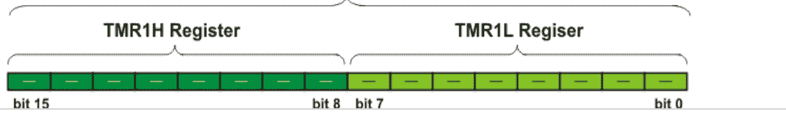

www.raguvaran.pzl.com

与定时器 TMR0 类似，这些寄存器可以随时读取或写入。如果发生溢出且启用，将产生中断。

TMR1 定时模块可以在两种基本模式之一运行，即定时器或计数器。与 TMR0 定时器不同，这两种模式都有额外的功能。

TMR1 定时具有以下特性：

- 16 位定时器/计数器寄存器对；
- 可编程内部或外部时源；
- 3 位分频器；
- 可选 LP 振荡器；
- 同步或异步运行；
- 通过比较器或 T1G 引脚进行 TMR1 门控制（计数启用）；
- 溢出中断；
- 溢出唤醒（外部时钟）；以及
- 获/比较功能的时间基。

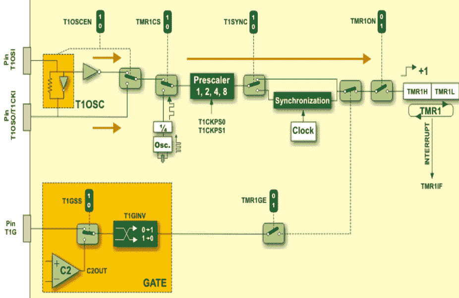

## 定时器 TMR1 时钟选择

`T1CON` 寄存器的 `TMR1CS` 位用于选择此定时器的时钟：

| 时钟源 | TMR1CS |
|---|---|
| Fosc/4 | 0 |
| TCKI 引脚 | 1 |

当选择内部时源时，`TMR1H-TMR1L` 寄存器将根据分频器决定的 Fosc 脉冲倍数增加。

当选择外部时钟时，该定时器可以作为定时器或计数器运行。计数器模式下的时钟与微控制器时钟同步。在需要外部时钟且 PIC16F887 微控制器使用 INTOSC 的情况下，定时器可以使用 LP 振荡器作为时钟。

### TMR1 分频器

定时器 TMR1 具有完全独立的分频器，允许对频率进行 1、2、4 或 8 分频。分频器不可直接读写。然而，在写入 `TMR1H` 寄存器后分频器会自动清零。

### TMR1 振荡器

RC0/T1OSO 和 RC1/T1OS 脚用于来自外围电路的脉冲，但它们具有额外功能。如图所示，它们同时配置为 LP 振荡器的输入（RC1）和输出（RC0）。该电路主要设计用于低频率（最高 200 kHz），更精确地说用于 32.768 kHz 晶体。通过划分该频率可以轻松获得秒级脉冲。

由于该振荡器不依赖内部时钟，即使在睡眠模式下也可以运行。通过设置 `T1CON` 寄存器的 `TIOSC` 位启用。用户必须提供几毫秒的软件延迟以使振荡器正常启动。


由于该振荡器不依赖内部时钟，即使在睡眠模式下也可以运行。通过设置 `T1CON` 寄存器的 `TIOSC` 位启用。用户必须提供几毫秒的软件延迟以使振荡器正常启动。下表显示了适用于振荡器的推荐电容值。这些值不需要精确。但规律是：电容越大，稳定性越高，同时延长振荡器所需的时间。

| 频率 | C1 | C2 |
|---|---|---|
| LP 32 kHz | 33 pF | 33 pF |

## TIMER 门

TMR1 门源软件设置为 T1G 引脚或比较器 C2 输出。此门允许定时器使用 T1G 的逻辑状态测量外部事件。为了测量时长，只需启用此门并计数脉冲。

#### TMR1 振荡器的使用

在睡眠模式下，微控制器的功耗降低到最低，因为主要的功耗源——振荡器不工作。问题是如何定期唤醒微控制器，只有中断可以做到。为了解决这个问题，PIC16F887 微控制器内置了一个可在睡眠模式下运行的全独立低功耗振荡器。简单来说，微控制器现在内置了一个独立电路并分配给 TMR1。通过设置 `T1CON` 寄存器的 `TIOSC` 位启用振荡器。然后使用同一寄存器的 `TMR1CS` 位使定时器使用来自振荡器的脉冲。

- 通过清零 `T1SYNC` 位，此振荡器信号与微控制器时钟同步。在这种情况下，定时器无法在睡眠模式下运行，因为同步电路使用了微控制器时钟。
- 可以启用 TMR1 寄存器溢出中断。如果设置了 `T1SYNC` 位，中断也会在睡眠模式下发生。


#### TMR1 定时模式

为了选择此模式，必须清零 `TMR1CS` 位。之后，16 位寄存器将在内部振荡器产生的每个脉冲上增加。如果使用 4MHz 晶振，它每微秒增加一次。

在此模式下，`T1SYNC` 位不影响定时器，因为它计算内部时钟脉冲。由于微控制器使用这些脉冲，不需要同步。


微控制器的时钟振荡器在睡眠模式下不工作，因此定时器寄存器溢出不会导致任何中断。

让我们在 microC 中实现：

```c
// 在示例中，TMR1 被配置为分频速率为 1:8 的定时器。
// 每当 TMR1H 和 TMR1 寄存器溢出，就会请求中断。
void main() {
    PIR1.TMR1IF = 0; // 重置 TMR1IF 标志位
    TMR1H = 0x22; // 为定时器 TMR1 设置初始值
    TMR1L = 0x00;
    TMR1CS = 0; // Timer1 计算内部振荡器的脉冲
    T1CKPS1 = 1; T1CKPS0 = 1; // 分配的分频速率为 1:8
    PIE1.TMR1IE = 1; // 启用溢出中断
    INTCON = 0xC0; // 启用中断（GIE 和 PEIE 位）
    TMR1 = 1; // 开启定时器 TMR1
}
```

www.raguvaran.pzl.com

## 计数模式下的 TMR1

通过设置 `TMR1CS` 位，TMR1 开始作为计数器运行。它计算引入 RC/TCKKI 脚的脉冲，并在外部时钟输入 T1CKI 的上升沿增加。如果清零 `T1CON` 寄存器的控制位 `T1SYNC`，外部时钟在进入 `TMR1` 寄存器之前将同步。换句话说，定时器 TMR1 与微控制器系统时钟同步，是一个同步计数器。

以此方式运行的微控制器处于睡眠模式时，即使引脚上出现了时钟脉冲，`TMR1H` 和 `TMR1L` 定时寄存器也不会增加。在这种模式下微控制器系统时钟不运行，没有用于同步的时钟。然而，只要引脚上有时钟脉冲，分频器就会继续运行，因为它只是一个简单的分频器。


该计数器在引脚上记录逻辑1（1）。重要的是，在开始脉脉冲计数之前，必须至少记录一个下降沿。请参考左图。图中的箭头表示计数增加。


R/W (0) R/W (0) R/W (0) R/W (0) R/W (0) R/W (0) R/W (0) R/W (0) 特性
| T1CON | T1GIN | T1MRGE | T1CKPS1 | T1CKPS0 | T1OSC | T1SYNC | T1MRCS | T1MRON | 位名 |
| --- | --- | --- | --- | --- | --- | --- | --- | --- | --- |
| | Bit 7 | Bit 6 | Bit 5 | Bit 4 | Bit 3 | Bit 2 | Bit 1 | Bit 0 | |

| 图例 |
| --- |
| R/W 可读写位 |
| (0) 重置后，该位被清零 |

T1GINV - 定时器门反相 (Timer Gate Invert) 在 T1G 引脚门或比较器 C2 输出 (C2OUT) 门上充当逻辑反相器。它允许定时器在门信号高电平或低电平时进行测量。

- 1 - 当 T1G 引脚或 C2OUT 为高电平 (1) 时，定时器 1 计数。
- 0 - 当 T1G 引脚或 C2OUT 为低电平 (0) 时，定时器 1 计数。

T1MRGE - 定时器门启用 (Timer Gate Enable) 决定 T1G 引脚或比较器 C2 输出 (C2OUT) 是否激活。此位仅在定时器 TMR1 开启（位 T1MRON = 1）的情况下有效。否则，此位被忽略。

- 1 - 当 Timer1 门未激活时，定时器 1 开启。
- 0 - 门对定时器 TMR1 无影响。

T1CKPS1, T1CKPS0 - 决定分配给定时器 TMR1 的分频器速率。

| T1CKPS1 | T1CKPS0 | 分频器速率 |
| --- | --- | --- |
| 0 | 0 | 1:1 |
| 0 | 1 | 1:2 |
| 1 | 0 | 1:4 |
| 1 | 1 | 1:8 |

T1OSEN - 低频振荡器启用控制位

- 1 - 为定时器 TMR1 时钟启用低频振荡器（低功耗频率 32.768 kHz 振荡器）。
- 0 - 低频振荡器关闭。

T1SYNC - 定时器 1 外部时钟输入同步位允许低频振荡器输入或 T1CKI 引脚与微控制器时钟同步。主振荡器脉冲时（位 TMR1CS = 0），此位被忽略。

- 1 - 不同步外部时钟输入。
- 0 - 同步外部时钟输入。

T1MRCS - 定时器 TMR1 时源选择

- 1 - 计数 T1CKI 引脚上的脉冲（上升沿 0-1）。
- 0 - 计数微控制器内部时钟的脉冲。

## TMR1ON - 定时器1开启

- 1 - 启用定时器 TMR1。
- 0 - 停止定时器 TMR1。

## 简要

为了正确使用定时器 TMR1，必须执行以下操作：

- 由于无法关闭分频器，因此应使用寄存器 T1CON 的位 TCKPS1 和 TCKPS0 调整其速率（参见表）。
- 通过同一寄存器的 TMR1CS 位选择模式（TMR1CS: 0=时钟为晶体振荡器，1=时钟由外部提供）。
- 通过设置同一寄存器的 T1OSEN 位启用振荡器，TMR1H 和 TMR1L 寄存会在每次时钟输入时增加。通过清零此位停止计数。
- 通过清零或写入计数寄存器来清零分频器。
- 通过填充两个寄存器，标志位 TMR1IF 被设置且计数从零开始。

## 3.6 定时器 TMR2

Timer TMR2 模块是一个 8 位定时器，其工作方式非常特殊。


来自晶体振荡器的脉冲通过分频器，其速率可以通过组合 TCKPS1 和 TCKPS0 位来更改。输出被用于从 00h 开始增加 TMR2 寄存器。TMR2 和 PR2 的值被不断比较，TMR2 寄存器持续增加，直到与 PR2 中的值匹配。当发生匹配时，TMR2 寄存器自动清零为 00h。定时器 TMR2 后级分频器增加，其输出在需要时用于产生中断。

TMR2 和 PR2 寄存器完全可读可写。可以通过清零 TMR2ON 位来停止计数，从而实现节电。

TMR2 重置的时刻也可用于确定同步串口通信的波特率。

定时器 TMR2 由 T2CON 寄存器的几个位控制。

### T2CON 寄存器

| R/W (0) | R/W (0) | R/W (0) | R/W (0) | R/W (0) | R/W (0) | R/W (0) | 特性 |
| --- | --- | --- | --- | --- | --- | --- | --- |
| T2CON | TOUTS3 | TOUTS2 | TOUTS1 | TOUTS0 | TMR2ON | TCKPS1 | TCKPS0 | 位名 |
| Bit 7 | Bit 6 | Bit 5 | Bit 4 | Bit 3 | Bit 2 | Bit 1 | Bit 0 | |

| 图例 |
| --- |
| R/W (0) | 该位未实现/可读写 | 重置后清零 |

TOUTPS3 - TOUTS0 - 定时器输出后级分频位用于确定后级分频器速率：

| TOUTPS3 | TOUTPS2 | TOUTPS1 | TOUTPS0 | 后级分频器速率 |
| --- | --- | --- | --- | --- |
| 0 | 0 | 0 | 0 | 1:1 |
| 0 | 0 | 0 | 1 | 1:2 |
| 0 | 0 | 1 | 0 | 1:3 |
| 0 | 0 | 1 | 1 | 1:4 |
| 0 | 1 | 0 | 0 | 1:5 |
| 0 | 1 | 0 | 1 | 1:6 |
| 0 | 1 | 1 | 0 | 1:7 |
| 0 | 1 | 1 | 1 | 1:8 |
| 1 | 0 | 0 | 0 | 1:9 |
| 1 | 0 | 0 | 1 | 1:10 |
| 1 | 0 | 1 | 0 | 1:11 |
| 1 | 0 | 1 | 1 | 1:12 |
| 1 | 1 | 0 | 0 | 1:13 |
| 1 | 1 | 0 | 1 | 1:14 |
| 1 | 1 | 1 | 0 | 1:15 |
| 1 | 1 | 1 | 1 | 1:16 |

TMR2ON - 定时器2开启开启定时器 TMR2。

- 1 - 定时器 TMR2 开启。
- 0 - 定时器 TMR2 关闭。

T2CKPS1, T2CKPS0 - 定时器2 时钟分频位：

| T2CKPS1 | T2CKPS0 | 分频速率 |
| --- | --- | --- |
| 0 | 0 | 1:1 |
| 0 | 1 | 1:4 |
| 1 | x | 1:16 |

## 简要

使用 TMR2 定时器时，应了解与其寄存器相关的细节：

- 上电瞬间，PR 寄存器包含 FH。
- 通过写入 TMR2 寄存器清零分频器和后级分频器。
- 通过写入 T2CON 寄存器清零分频器和后级分频器。
- 任何重置，分频器和后级分频器都会清零。

CCP 模块可以在许多不同的模式下工作，这使得处理起来最为复杂。只需根据描述位功能的表格分析其工作原理你就会明白我们在说什么。因此，如果你使用 CCP 模块，请首先选择所需的模式，分析相应的图形和寄存器位。

## 3.7 CCP 模块

CCP 模块（捕捉/比较/PWM）是一种外设，允许用户对不同事件进行计时和控制。

捕捉模式（Capture Mode）访问不断变化的寄存器的当前状态。在这里是 TMR1 寄存器。

比较模式（Compare Mode）不断比较两个寄存器的值。其中一个是 TMR1 寄存器。该电路还允许用户在预定义的时间触发外部事件。

PWM（脉宽调制）可以在一个或多个输出引脚上产生频率和占空比变化的信号。

PIC16F887 微控制器有两个 CCP 模块——CCP1 和 CCP2。

它们在正常模式模式是相同的，而增强 PWM 功能仅适用于 CCP1。这就是为什么本章对 CCP1 模块进行了详细描述。对于 CCP2，将介绍其于 CCP1 的特性。

### CCP1 模块

该电路的核心部分是16位寄存器 CCP1，由 CCPR1L 和 CCP1H 寄存器组成。它用于捕捉或与存储在 TMR1 寄存器（TMR1H 和 TMR1L）中的二进制数进行比较。

### CCPR1 寄存器


如果通过软件启用，定时器 TMR1 在比较模式匹配时可能会重置。此外，CCP1 模块可以产生频率和占空比变化的 PWM 信号。

CCP1CON 寄存器的位控制 CCP1 模块。

#### CCP1 捕捉模式

在此模式下，在以下情况下，定时器寄存器 TMR1（由 TMR1H 和 TMR1L 组成）复制到 CCP 寄存器（由 CCPR1H 和 CCPR1L 组成）：

- RC2/CCP1 引脚上的每一个下降沿 (1 -> 0);
- RC2/CCP1 引脚上的每一个上升沿 (0 -> 1);
- RC2/CCP1 引脚上的每4次上升沿 (0 -> 1);
 以及 RC2/CCP1 引脚上的每16次上升沿 (0 -> 1)。

控制寄存器的四位组合 (CCP1M3 - CCP1M0) 决定这些事件中的哪些会导致 16 位数据的传输。此外，必须满足以下条件：

- RC2/CCP1 引脚必须配置为输入；且
- TMR1 模块必须作为定时器或同步计数器工作。


## CCP位 CCP1IF


当进行捕获时，标志位 CCP1IF 被设置。如果发生时 PIE1 寄存器的 CCP1IE 被设置，则会中断。

当 CCP1 模块退出捕获模式时，可能会产生意外的捕获中断。为了避免这种情况，在控制寄存器发生任何更改之前，应清除启用 CCP1IE 中断位和标志位 CCP1IF。

从一个捕获分频器切换到另一个也可能产生意外中断。为了避免这种情况，在更改分频器之前应临时关闭 CCP1 模块。

建议使用汇编语言编写以下程序序列：

```
BANKESEL CCP1CON
CLRF CCP1CON ; 清除控制寄存器
            ;CCP1 模块已关闭
            ;选择了新的分频模式
MOVLW XX
MOVF CCP1CON ; 新值已加载到控制寄存器
            ;CCP1 模块同时开启
```

让我们用 microC 来操作……

```c
ASM {
    BANKESEL CCP1CON
    CLRF CCP1CON // 清除控制寄存器
        //CCP1 模块已关闭
    MOVLW XX // 选择了新的分频模式
    MOVF CCP1CON // 新值已加载到控制寄存器
        //CCP1 模块同时开启
}
```

www.raguvaran.puzzl.com

## 模式下的 CCP1

在此模式下，CCP 寄存器中的值与定时器寄存器 TMR1 中的值不断比较。当发生匹配时，RC2/CCP1 输出引脚的逻辑状态可能会改变，这取决于控制寄存器中的位（CCP1M3 - CCP1M0）。标志位 CCP1IF 同时被设置。


要将 CCP1 模块设置为在此模式下，必须满足两个条件：

- RC2/CCP1 引脚必须配置为输出；
- 定时器 TMR1 必须与内部时钟同步。

## PWM 模式下的 CCP1

不同频率和占空比的信号在自动化中有广泛的应用。一个典型的例子是功率控制电路。参考下图。如果逻辑零 (0) 表示关闭，逻辑一 (1) 表示开启，负载消耗的电能将与脉冲时间成正比。这种比例通常被称为占空比（Duty Cycle）。

另一个在实践中常见的示例是在电路中使用 PWM 信号生成任意波形的信号，如正弦波。见如图：


以这种方式运行的设备在实践中通常用作调频驱动器，控制电电机（速度、加速、减速等）。


上图显示了设置为 PWM 模式的 CCP1 模块框图。为了在其输出引脚上产生任意形式的脉冲，必须设置脉冲周期（频率）和脉冲宽度。


#### PWM 周期

输出脉冲周期 (T) 由定时器 TMR2 的 PR2 寄存器决定。PWM 周期可以使用方程计算：

PWM Period = (PR2 + 1) * 4*Tosc * TMR2 Prescale Value

如果已知 PWM 周期 (T)，则很容易确定信号频率 F，因为这些值通过方程 F=1/T 相关联。

www.raguvaran.puzl.com

#### PWM 占空比

PWM 占空比通过总共 10 位指定：CCP1L 寄存器的 8 个高位（MSB）和 CCP1CON 寄存器的两个额外低位（LSB）（DC1B1 和 DC1B0）。结果是包含在公式中的 10 位数：

Pulse Width = (CCPR1L,DC1B1,DC1B0) * Tosc * TMR2 Prescale Value

下表显示了如果微控制器使用 20 MHz 晶振（Tosc=50ns），如何生成不同频率的 PWM 信号。

| 频率 [KHZ] | 1.22 | 4.88 | 19.53 | 78.12 | 156.3 | 208.3 |
| :--- | :--- | :--- | :--- | :--- | :--- | :--- |
| TMR2 分频器 | 16 | 4 | 1 | 1 | 1 | 1 |
| PR2 寄存器 | FFh | FFh | FFh | 3F | 1F | 17h |

还有两点：

- 如果脉冲宽度大于 PWM 周期，输出引脚将不断变化。
- 在此应用中，定时器 TMR2 后分频器无法用于更长的 PWM 周期。

#### PWM 分辨率

PWM 信号只是变化的脉冲序列。对于指定的频率（每秒脉冲数），有有限的占空比组合。分辨率由位表示。例如，10 位分辨率将产生 1024 个占空比，而 8 位分辨率将产生 256 个占空比。对于此微控制器，分辨率由 PR2 寄存器决定。最大值通过写入 FFh 。

PWM 频率和分辨率（Fosc = 20MHz）：

| 频率 | 1.22KH | 4.88KH | 19.53KH | 78.12KH | 156.3KH | 208.3KH |
| :--- | :--- | :--- | :--- | :--- | :--- | :--- |
| 定时器分频 | Z | Z | Z | Z | Z | Z |
| PR2 值 | FFh | FFh | FFh | 3F | 1F | 17h |
| 最大分辨率 | 10 | 10 | 10 | 8 | 7 | 6 |

PWM 频率和分辨率（Fosc = 8MHz）：

| 频率 | 1.22KH | 4.90KH | 19.61KH | 76.92KH | 153.85KH | 200.0KH |
| :--- | :--- | :--- | :--- | :--- | :--- | :--- |
| 定时器分频 | 16 | 4 | 1 | 1 | 1 | 1 |
| PR2 值 | 65h | 65h | 65h | 19h | 0Ch | 9h |
| 最大分辨率 | 8 | 8 | 8 | 6 | 5 | 5 |

让我们用 microC 来操作……

在此示例中，PWM 模块初始化并设置为 50% 的占空比。为了这个目的，使用了 PWM1_Init(), PWM1_Start() 和 PWM1_Duty()它们都在 microC 库中，只需要复制到程序中。

```c
unsigned short duty_c; // 定义 duty_c
void main() {
    ANSEL = 0; // 所有 I/O 引脚配置为数字
    TRISC = 0; // C 端口初始状态
    PWM1_Init(5000); // PWM 模块初始化 (50KHz)
}

void main() {
    duty_c = 127; // 占空比初始值
    PWM1_Start(); // 启动 PWM 模块
    PWM1_Duty(duty_c); // 设置占空比为50%
}
```

### CCP1CON 寄存器

| R/W | 位 7 | 位 6 | 位 5 | 位 4 | 位 3 | 位 2 | 位 1 | 位 0 |
| :--- | :--- | :--- | :--- | :--- | :--- | :--- | :--- | :--- |
| 可读/写 | P1M1 | P1M0 | DC1B1 | DC1B0 | CCP1M3 | CCP1M2 | CCP1M1 | CCP1M0 (0) 重置后清除 |

P1M1, P1M0 - PWM 配置位 - 除 PWM 模式外，P1A 引脚是捕获/比较输入。P1B、P1C 和 P1D 作为输入/输出引脚。在 PWM 模式下，这些位影响 CCP1 模块的操作，如下表：

| P1M1 | P1M0 | 模式 |
| :--- | :--- | :--- |
| 0 | 0 | 单输出 PWM。P1A 输出调制信号。P1B、P1C 和 P1D 为 D 端口输入/输出 |
| 0 | 1 | 全桥正向配置。P1D 输出调制信号。P1A 激活。P1B 和 P1C 不活跃 |
| 1 | 0 | 半桥配置。P1A 和 P1B 输出调制信号。P1C 和 P1D 为 D 端口输入/输出 |
| 1 | 1 | 全桥反向配置。P1B 输出调制信号。P1C 激活。P1A 和 P1D 不活跃 |

DC1B1, DC1B0 - PWM 周期低位 - 仅用于 PWM 模式，其中代表 10 位数的两个低位。该数字决定 PWM 信号的占空比。其余位（共 8 位）存储在 CCP1L 寄存器中。

CCP1M3 - CCP1M0 - CCP1 选择位决定 CCP 模块的模式。

| CCP1M3 | CCP1M2 | CCP1M1 | CCP1M0 | 模式 |
| :--- | :--- | :--- | :--- | :--- |
| 0 | 0 | 0 | 0 | 模块禁用（重置） |
| 0 | 0 | 0 | 1 | 未使用 |
| 0 | 0 | 1 | 0 | 比较模式，匹配时设置 CCP1IF 位 |
| 0 | 0 | 1 | 1 | 未使用 |
| 0 | 1 | 0 | 0 | 捕获模式，CCP1 引脚上的每个下降沿 |
| 0 | 1 | 0 | 1 | 捕获模式，CCP1 引脚上的每个上升沿 |
| 0 | 1 | 1 | 0 | 捕获模式，CCP1 引脚上的每 4 个上升沿 |
| 0 | 1 | 1 | 1 | 捕获模式，CCP1 引脚上的每 16 个上升沿 |
| 1 | 0 | 0 | 0 | 比较模式，匹配时设置输出和 CCP1IF 位 |
| 1 | 0 | 0 | 1 | 比较模式，清除输出并设置 CCP1IF 位 |


| | | | |  |
|---|---|---|---|---|
| 1 | 0 | 1 | 0 | 比较模式：中断请求到达并在匹配时设置 CCP1IF 位 |
| 1 | 0 | 1 | 1 | 比较模式：设置 CCP1IF 位且定时器 1 或 2 寄存器被清零 |
| 1 | 1 | 0 | 0 | PWM 模式：P1A 和 P1C 为高电平，引脚 P1B 和 P1D 为高电平 |
| 1 | 1 | 0 | 1 | PWM 模式：P1A 和 P1C 为高电平，引脚 P1B 和 P1D 为低电平 |
| 1 | 1 | 1 | 0 | PWM 模式：引脚 P1A 和 P1C 为低电平，引脚 P1B 和 P1D 为高电平 |
| 1 | 1 | 1 | 1 | PWM 模式：引脚 P1A 和 P1C 为低电平，引脚 P1B 和 P1D 为低电平 |

### CCP2 模块

除了寄存器和位位的名称不同外，该模块是普通模式下 CCP1 模块的极佳副本。当 CCP2 在比较模式下运行时，它们之间只有一个真正的区别。

该区别在于定时器 T1 重位信号。也就是说，如果启用了 A/D 转换器，当 TMR1 和 CPR2 寄存器的值匹配时，定时器 T1 重位信号将自动启动 A/D 转换。


与之前的模块类似，该电路也受控制位控制。这次是 CCPCON 寄存器。

### CCPCON 寄存器

| CCPCON | - | DC2B1 | DC2B0 | CCP2M3 | CCP2M2 | CCP2M1 | 位名 |
|---|---|---|---|---|---|---|---|
| 位 7 | 位 6 | 位 5 | 位 4 | 位 3 | 位 2 | 位 1 | 位 0 |

| 图例 | |
|---|---|
| R/W (0) | 位未实现。可读/可写位。重置后位清零 |

**DC2B1, DC2B0** - PWM 占空比最低位 - 仅用于 PWM 模式，表示 10 位数字的两个最低位。该数字决定 PWM 信号的占空比。其余位（共 8 位）存储在 CCP2L 寄存器中。

**CCP2M3 - CCP2M0** - CCP2 模式位选择 CCP2 模式。

| CCP2M3 | CCP2M2 | CCP2M1 | CCP2M0 | 模式 |
|---|---|---|---|---|
| 0 | 0 | 0 | 0 | 模块禁用（重置） |
| 0 | 0 | 0 | 1 | 未使用 |
| 0 | 0 | 1 | 0 | 未使用 |
| 0 | 0 | 1 | 1 | 未使用 |
| 0 | 1 | 0 | 0 | 捕获 |

| | | | | 模式 |
|---|---|---|---|---|
| | | | | CCP2 引脚上的每个下降沿 |
| 0 | 1 | 0 | 1 | 捕获模式：CCP2 引脚上的每个上升沿 |
| 0 | 1 | 1 | 0 | 捕获模式：CCP2 引脚上的每 4 个上升沿 |
| 0 | 1 | 1 | 1 | 捕获模式：CCP2 引脚上的每 16 个上升沿 |
| 1 | 0 | 0 | 0 | 比较模式：匹配时输出并设置 CCP2IF 位 |
| 1 | 0 | 0 | 1 | 比较模式：匹配时输出清零并设置 CCP2IF 位 |
| 1 | 0 | 1 | 0 | 比较模式：匹配时产生中断，设置 CCP2IF 位且 CCP2 引脚不受影响 |
| 1 | 0 | 1 | 1 | 比较模式：匹配时设置 CCP2IF 位，清零定时器 1 寄存器，如果 A/D 转换开启则启动 A/D 转换 |
| 1 | 1 | x | x | PWM 模式 |

## 简述

### 配置 CCP1 模块进行 PWM 操作

为了配置 CCP 模块进行 PWM 操作，应采取以下步骤：

- 禁用 CCP1 输出引脚。它应被配置为输入。
- 通过加载 PR2 寄存器设置 PWM 周期。
- 通过组合 CCP1CON 寄存器的位配置 CCP 模块工作在 PWM 模式下。
- 通过加载 CCP1L 寄存器并使用 CCPCON 寄存器的位 DC1B1 和 DC1B0 设置 PWM 信号的占空比。
- 配置并启动 TMR2：
  - 清零 PIR1 寄存器的 TMR2IF 中断标志位。
  - 通过设置 T2CON 寄存器的 T2CKPS1 和 T2CKPS0 设置 TMR2 预分频值。
  - 通过设置 T2CON 寄存器的 TMR2ON 位启动 TMR2。
- 在完成一个 PWM 周期后启用 PWM 输出：
  - 等待定时器 TMR2 溢出（PIR1 寄存器的 TMR2IF 位被设置）。
  - 通过清零 TRIS 寄存器的位将相应的引脚配置为输出。

#### CCP1 增强模式

增强模式仅适用于 CCP1。增强模式下的 CCP1 与普通模式的区别基本上在于对 PWM 信号到输出引脚的传输。为什么这很重要？因为微控制器经常用于电机控制。此处描述的这些设备直到最近才作为外部设备使用。现在这些元素已集成到微控制器中并可以多种模式。

#### 单输出模式

只有在 CCP1 寄存器的 M1M0 位清零时才启用单输出 PWM 模式。在这种情况下，PWM 信号可以同时出现在四个引脚上。此外，PWM 信号的基础或反相波形取决于 TRIS 寄存器，而极性取决于 CCP1 的 M1M0 位。使用反相输出时，引脚为低电平，并在 P1A 和 P1C 上产生相同的波形。


#### 半桥模式

对于半桥模式，PWM 信号在 P1A 引脚输出，同时互补的 PWM 信号在 P1B 引脚输出。此类脉冲在半桥模式下激活 MOSFET 驱动器以允许电流通过设备。


同时开启 MOSFET 是非常危险的。瞬间发生的短路是致命的。为了避免这种情况，需要在开启和关闭驱动器之间提供延迟。这种延迟在图中标记为 'td'。通过使用 PWMCON 寄存器的 PDC0-PDC6 位解决此问题。


如下所示，半桥模式也可用于在全桥配置中激活 MOSFET 驱动器：


### 全桥模式

全桥模式下所有四个引脚均用作输出。在实践中，这种模式常用于电机，提供对速度和旋转方向的全控制。该模式有两种配置：*全桥正向*和*全桥反向*。


#### 全桥 - 正向配置

在*正向*模式下，发生以下情况：

- 逻辑 1 出现在 P1A 引脚上（高电平）；
- 脉冲序列出现在 P1D 引脚；
- 逻辑 0 出现在 P1B 和 P1C 引脚上（低电平）。

下图显示了一个完整 PWM 周期内 P1A-P1D 引脚的状态。

#### P1A
#### P1B
#### P1C
#### P1D

#### 全桥 - 反向配置

反向模式发生类似的情况，只是这些引脚的功能不同：

- 逻辑 1 出现在 P1C 引脚上（高电平）；
- 脉冲序列出现在 P1B 引脚；以及
- 逻辑 0 出现在 P1A 和 P1D 引脚上（低电平）。


#### PWM1CON 寄存器

| R/W (0) | R/W (0) | R/W (0) | R/W (0) | R/W (0) | R/W (0) | R/W (0) | 功能 |
|---|---|---|---|---|---|---|---|
| PWM1CON | PRSEN | PDC6 | PDC5 | PDC4 | PDC3 | PDC2 | PDC1 PDC0 位名 |
| 位 7 | 位 6 | 位 5 | 位 4 | 位 3 | 位 2 | 位 1 | 位 0 |

| R/W (0) | 可读/可写位 |
|---|---|
| (0) | 重置后位清零 |

STRC PWM 重启启用位

#### PSTRCON 寄存器

| PSTRCON | | | | R(0) | R(0) | R(0) | R(0) | R(1) | 功能 |
|---|---|---|---|---|---|---|---|---|
| 位 7 | 位 6 | 位 5 | STRSYNC | STRD | STRC | STRB | STRA | 位名 |

| 图例 | |
|---|---|
| - | 位未实现 |
| R/W | 可读/可写位 |
| (0) | 重置后位清零 |
| | 重置后位设置 |

STRSYNC - 同步位决定 PWM 脉冲同步的时刻：

- 1 - 自动关闭后，PWM 模块自动重启，同时清零 ECCPAS 寄存器的 ECCPA 位。
- 0 - 为了在自动关闭后重启 PWM 模块，必须在软件中清零 ECCPA 位。

PDC6 - PDC0 PWM 延迟计数 - 7 位二进制数决定在激活 PWM 输出引脚时添加的指令周期（4*Tosc）延迟时间。


## STRD - 转向允许位 D 决定 P1D 引脚的功能。

- 1 - P1D 引脚具有 PWM 波形，其极性由 CCP1M0 和 CCP1M1 位控制。
- 0 - 引脚被配置为通用 D 输入/输出。

## STRC - 转向允许位 C 决定 P1C 引脚的功能。

- 1 - P1C 引脚具有 PWM 波形，其极性由 CCP1M0 和 CCP1M1 位控制。
- 0 - 引脚被配置为通用 D 输入/输出。

## STRB - 转向允许位 B 决定 P1B 引脚的功能。

- 1 - P1B 引脚具有 PWM 波形，其极性由 CCP1M0 和 CCP1M1 位控制。
- 0 - 引脚被配置为通用 D 输入/输出。

## STRA - 转向允许位 A 决定 P1A 引脚的功能。

- 1 - P1D 引脚具有 PWM 波形，其极性由 CCP1M0 和 CCP1M1 位控制。
- 0 - 引脚被配置为通用 C 输入/输出。

### ECPAS 寄存器


ECCPACE - ECCP 自动关闭状态位指示发生了 CCP 模块的关闭（关闭状态）：

- 1 - CCP 模块处于关闭状态。
- 0 - CCP 模块正常工作。

ECCPAS2 - ECCPAS0 - ECCP 自动关闭源选择位用于选择自动关闭的源：


| ECPAS2 | ECCPAS1 | ECPAS0 | 关闭状态源 |
| :--- | :--- | :--- | :--- |
| 0 | 0 | 0 | 禁用关闭状态 |
| 0 | 0 | 1 | 比较器 |
| 0 | 1 | 0 | C1 输出变化 |
| 0 | 1 | 1 | 比较器 C2 输出变化 |
| 1 | 0 | 0 | 比较器 C1 或 C2 输出变化 |
| 1 | 0 | 1 | INT 引脚逻辑电平 (0) 或 比较器 C1 输出变化 |
| 1 | 1 | 0 | INT 引脚逻辑电平 (0) 或 比较器 C2 输出变化 |
| 1 | 1 | 1 | INT 引脚逻辑电平 (0) 或 比较器 C1 或 C2 输出变化 |

PSSAC1, PSSAC0 - P1A, P1C 关闭控制位定义了 CCP 模块处于关闭状态时输出引脚 P1A 和 P1C 的逻辑状态。

| PSSAC1 | PSSAC0 | 引脚逻辑状态 |
| :--- | :--- | :--- |
| 0 | 0 | 0 |
| 0 | 1 | 1 |
| 1 | X | 高阻抗（三态） |

PSSBD1, PSSBD0 - P1B, P1D 关闭状态控制位定义了 CCP 模块处于关闭状态时输出引脚 P1B 和 P1D 的逻辑状态。

| PSSBD1 | PSSBD0 | 引脚逻辑状态 |
| :--- | :--- | :--- |
| 0 | 0 | 0 |
| 0 | 1 | 1 |
| 1 | X | 高阻抗（三态） |

PIC16F887 微控制器具有多个独立的串行通信模块，每个模块都可以配置为几种不同的模式运行，这使得它们在许多情况下都是不可替代的。记住我们对 CCP 模块的建议，这里同样适用。不要让所有模块的操作细节成为你的负担，只需选择一个并使用你真正需要的部分。

## 3.8 串口通信模块

USART 是最老的串口通信系统之一。该系统的现代版本经过了升级，名称有所不同 - EUSART。

### EUSART


增强型通用同步异步收发器 (EUSART) 模块是一个串行 I/O 通信单元。它称为串行通信接口 (SCI)。它包含了所有时钟发生器、移位寄存器和数据缓冲区，用于独立于设备程序执行执行输入/输出串行数据传输。正如其名称所示，除了使用时钟进行同步外，该模块还可以建立异步连接，这使其在某些应用中独一无二。例如，当难以或无法为时钟和数据传输提供特殊通道时（例如无线电或红外遥控），EUSART 模块无疑是最佳解决方案。

集成在 PIC16F887 微控制器中的 EUSART 系统具有以下特征：

- 全双工异步发送和接收；
- 可编程的 8 位或 9 位宽字符；
- 9 位模式下的地址检测；
- 输入缓冲区溢出错误检测，以及
- 同步模式下的半双工通信。

### EUSART 异步模式

EUSART 异步模式使用非回归零 (NRZ) 格式传输和接收数据。如下所示，EUSART 不使用时钟：


EUSART 异步模式遵循以下序列：

- 空闲状态下，电平为高 (1);
- 每次传输以起始位 (0) 开始；
- 数据为 8 位或9 位；
- 每次传输以停止位 (1) 结束。

### EUSART 发送器


为了发送发送，需要将其配置为发送器。换句话说，需要定义以下状态：

- TXEN = 1 - 通过设置 TXSTA 寄存器的 TXEN 位启用发送器；
- SYNC = 0 - 通过清除 TXSTA 寄存器的 SYNC 位配置为异步模式；
- SPEN = 1 - 通过设置 RCSTA 寄存器的 SPEN 位启用 EUSART，TX/CK 引脚自动配置为输出。

当启用 9 位数据传输时，TXSTA 寄存器的 TX9 位为最高位。在将 8 位最低位传输到 TXREG 之前，必须写入 TX9 位。


EUSART 发送器使用移位寄存器 TSR。当 TXREG 为空时，会发生：

- 数据自动传输到 TSR；
- 设置 TXIF 标志，该中断由 PIE1 寄存器的 TXIF 位启用。与接收器类似，该标志仅通过软件清除，即通过读取 TXREG 寄存器。
- 当最后一个字符传输完成后，TXSTA 寄存器的 TXMT 位自动设置。

### EUSART 异步接收器


为了通过 EUSART 接收，需要将其配置为接收器。换句话说，需要定义以下位的状态：

- CREN = 1 - 通过设置 RCSTA 寄存器的 CREN 位启用 EUSART 接收器；
- SYNC = 0 - 通过清除 TXSTA 寄存器的 SYNC 位配置为异步模式；
- SPEN = 1 - 通过设置 RCSTA 寄存器的 SPEN 位启用 EUSART，RX/DT 引脚自动配置为输入。

当完成这一初步也是必要的步骤并检测到起始位时，数据通过 RX 引脚传输到移位寄存器 RSR。

- 数据自动传输到 RCRE 寄存器（如果为空）；
- 设置 RCIF 标志，该中断由 PIE1 寄存器的 RCIF 位启用。与发送器类似，该标志仅通过软件清除，即通过读取 RCRE 寄存器。请记住这是一个字符 FIFO 存储（先入先出），允许同时接收两个字符；
- 如果 RCRE 寄存器被占用（包含两个字节）且移位寄存器检测到新的停止位，则 OERR 的溢出位将被设置。在这种情况下，新来的数据将丢失，且


OERR 位必须通过软件清除。这是通过清除并重置 CREN 位来完成的；
注意：当 OERR 位被设置时，无法接收新数据。
* 如果 STOP 位为零 (0)，则 RCSTA 寄存器中检测错误的 FERR 位将会被设置；
* 要启用 9 位数据接收，需要设置 RCSTA 寄存器的 RX9 位。

#### 接收错误检测

微控制器可以自动检测两种类型的错误。第一种错误被称为**帧错误**（Framing error），当接收器在预期时间内检测到 STOP 位时就会发生。此类错误由 RCSTA 寄存器的 FERR 位指示。如果该位被设置，则最后接收的数据可能是错误的。有几点重要信息需要了解：

* 帧错误本身不会产生中断；
* 如果此位被设置，说明最后接收的数据存在错误；
* 帧错误（位已设置）不会阻止接收新数据；
* FERR 位通过读取接收到的数据来清除，这意味着在读取数据之前必须进行检查；以及
* FERR 位无法通过软件清除。如果需要，可以通过清除 RCSTA 寄存器的 SPEN 位来清除。这会同时导致整个 EUSART 系统重置。

另一种错误是**溢出错误**（Overrun Error）。如前所述，FIFO内存可以接收两个字符。如果接收第三个字符，就会产生溢出错误。简单来说，没有空间存放另一个位，错误是不可避免的。当发生这种情况时，RCSTA 寄存器的 OERR 位被设置。后果如下：

* 已存储在 FIFO 寄存器中（两个字节）的数据可以正常读取；
* 在清除 OERR 位之前，不会接收任何额外数据；以及
* 此位无法直接访问。要清除它，需要清除 CREN 位或通过清除 RCSTA 寄存器的 SPEN 位来重置整个 EUSART 系统。

#### 9 位数据接收

除了接收标准的 8 位数据外，EUSART 系统还支持 9 位数据接收。在发送端，第九位直接“附着”在 STOP 位之前的原始位上。在接收端，当 RCSTA 寄存器的 RX9 位被设置时，第9数据位将自动写入同一寄存器的 RX9D 位。接收此位后，必须注意如何读取其位——必须在读取 RCRE 寄存器的 8 个低位之前读取 RX9D 数据位。否则，第九数据位将被清除。


#### 地址检测

当 RCSTA 寄存器的 ADDEN 位被设置时，EUSART 模块只能接收 9 位数据，而所有的 8 位数据将被忽略。尽管这看起来像是一个限制，但这种模式实现了多个微控制器之间的串行通信。工作原理非常简单。主设备发送代表一个从机微控制器地址的 9 位数据。然而，所有微控制器都必须设置 ADDEN 位，因为它可以启用地址检测。所有共享同一传输线的从机都会接收此数据（地址），并自动检查其是否与自己的地址匹配。在匹配的软件中，必须通过清除 ADDEN 位来禁用地址检测。


主设备继续发送 8 位数据。只有被寻址的 EUSART 模块会接收通过传输线的数据。当接收到最后一个字节后，从设备应该设置 ADDEN 位以启用新的地址检测。


#### TXSTA 寄存器

| TXSTA | CSRC | TX9 | TXEN | SYNC | SENDB | BRGH | TRMT | TX9D | 特性 |
| --- | --- | --- | --- | --- | --- | --- | --- | --- | --- |
| R (W) | R (W) | R (W) | R (W) | R (W) | R (W) | R (W) | R (1) | R (0) | 位名 |
| 位 7 | 位 6 | 位 5 | 位 4 | 位 3 | 位 2 | 位 1 | 位 0 | | |

| R/W | 可读/可写位 |
| --- | --- |
| R | 可读位 |
| (0) | 重置后被清除 |
| (1) | 重置后位被设置 |

CSRC - 时钟源选择位 - 决定时钟源。它仅用于同步模式。

- 1 - 主机模式。时钟由波特率发生器内部产生。
- 0 - 从机模式。时钟从外部源产生。

TX9 - 9 位传输启用位

- 1 - 通过 EUSART 系统进行 9 位数据传输。
- 0 - 通过 EUSART 系统进行 8 位数据传输。

TXEN - 启用位

- 1 - 启用传输。
- 0 - 禁用传输。

SYNC - 同步位

- 1 - 启用传输。
- 0 - 禁用传输。

SENDB - 发送空闲位

- 1 - 启用传输。
- 0 - 禁用传输。

BRGH - 波特率选择位

- 1 - 主机模式。时钟由波特率发生器内部产生。
- 0 - 从机模式。时钟从外部源产生。

TRMT - 传输状态位

- 1 - 传输完成。
- 0 - 传输中。

TX9D - 9 位传输数据位


| 0 | 1 | 1 | 16-位 / 异步 | Fosc / [4 (n + 1)] |
| 1 | 0 | X | 8-位 / 异步 | Fosc / [4 (n + 1)] |
| 1 | 1 | X | 16-位 / 异步 | Fosc / [4 (n + 1)] |

后续页面中的表格包含了应写入 16-位寄存器 SPBRG 并分配给 SYNC、BRGH 和 BRGH16 位的值，以便获得某些标准波特率。使用以下公式来确定*波特率*：

目标波特率 = 64(SPBRG + 1) | SPBRG = 目标波特率 / 64

计算波特率 - 目标波特率

误差 [%] = 目标波特率 / 目标波特率

| 波特率 | Fosc = 20 MHz | Fosc = 18.432 MHz | Fosc = 11.0592 MHz | Fosc = 11.0592 MHz |
| --- | --- | --- | --- | --- |
| | 实际速率 | 误差 | SPBRG 值 (十进制) | 实际速率 | 误差 | SPBRG 值 (十进制) | 实际速率 | 误差 | SPBRG 值 (十进制) | 实际速率 | 误差 | SPBRG 值 (十进制) |
| 300 | 1221 | 1.73 | 255 | 1200.0 | 0.00 | 239 | 1200.0 | 0.00 | 143 | 1202 | 0.16 | 103 |
| 1200 | 2404.0 | 0.16 | 129 | 2400.0 | 0.00 | 119 | 2400.0 | 0.00 | 71 | 2404 | 0.16 | 51 |
| 9600 | 9470 | -1.36 | 32 | 9600.0 | 0.00 | 99 | 9600.0 | 0.00 | 17 | 9615 | 0.16 | 12 |
| 10417 | 10417.0 | 0.00 | 29 | 10286.1 | -1.26 | 27 | 10165 | -2.42 | 16 | 10417 | 0.00 | 11 |
| 19.2k | 1953.7 | 1.73 | 15 | 19.2 | 0.00 | 14 | 19.2 | 0.00 | 8 | | | | | |
| 57.6k | | | | 57.6k | 0.00 | | | | | | | |
| 115.2k | | | | | | | | | | | | |

| 波特率 | Fosc = 4 MHz | Fosc = 3.684 MHz | Fosc = 2 MHz | Fosc = 1 MHz |
| --- | --- | --- | --- | --- |
| | 实际速率 | 误差 | SPBRG 值 (十进制) | 实际速率 | 误差 | SPBRG 值 (十进制) | 实际速率 | 误差 | SPBRG 值 (十进制) | 实际速率 | 误差 | SPBRG 值 (十进制) |
| 300 | 301.6 | 0.16 | 207 | 300.0 | 0.00 | 191 | 301.6 | 0.13 | 103 | 300 | 0.16 | 51 |
| 1200 | 1202.6 | 0.12 | 51 | 1200.0 | 0.00 | 47 | 1202.6 | 0.12 | 25 | 1202 | 0.16 | 12 |
| 2400 | 2404.6 | 0.15 | 25 | 2400.0 | 0.00 | 5 | | | | | | |
| 9600 | | | | | | | | | | | | | |
| 10417 | 10417.0 | 0.00 | 5 | | | | 10417.0 | 0.00 | 2 | | | | |
| 19.2k | | | | 19.2 | 0.00 | | | | | | | |
| 57.6k | | | | 57.6k | 0.00 | | | | | | | |
| 115.2k | | | | | | | | | | | | | |

| 波特率 | Fosc = 20 MHz | Fosc = 18.432 MHz | Fosc = 11.0592 MHz | Fosc = 8 MHz |
| --- | --- | --- | --- | --- |
| | 实际速率 | 误差 | SPBRG 值 (十进制) | 实际速率 | 误差 | SPBRG 值 (十进制) | 实际速率 | 误差 | SPBRG 值 (十进制) | 实际速率 | 误差 | SPBRG 值 (十进制) |
| 300 | | | | | | 2404 | 0.16 | 207 |
| 1200 | | | | | | 10417 | 0.00 | 51 |
| 9600 | 9615 | 0.16 | 129 | 9600 | 0.00 | 11 | 9600 | 0.00 | 71 |
| 10417 | 10417 | 0.00 | 119 | 10378 | -0.10 | 119 | 10473 | 0.53 | 65 |
| 19.2k | 19236 | 0.14 | 64 | 19.2 | 0.00 | 59 | 19.2 | 0.00 | 35 | 19231 | 0.26 | 25 |
| 57.6k | 56.28 | -1.36 | 21 | 57.6k | 0.00 | 19 | 57.6k | 0.00 | 11 | 55556 | -3.8 | 8 |
| 115.2k | 115634 | -1.36 | | 115.2k | 0.00 | | 115.2k | 0.00 | 5 | | |

| 波特率 | Fosc = 4 MHz | Fosc = 3.684 MHz | Fosc = 2 MHz | Fosc = 1 MHz |
| --- | --- | --- | --- | --- |
| | 实际速率 | 误差 | SPBRG 值 (十进制) | 实际速率 | 误差 | SPBRG 值 (十进制) | 实际速率 | 误差 | SPBRG 值 (十进制) | 实际速率 | 误差 | SPBRG 值 (十进制) |
| 300 | | | | | | 300 | 0.16 | 207 |
| 1200 | 1202 | 0.16 | 51 | 1200 | 0.00 | 1201 | 0.16 | 1203 | 0.16 | 51 |
| 2400 | 2404 | 0.13 | 25 | 2400 | 0.00 | 2404 | 0.16 | 2404 | 0.16 | 25 |
| 9600 | 9615 | 0.16 | 25 | 9600 | 0.00 | 23 | 9615 | 0.12 | 12 | | |
| 10417 | 10417 | 0.00 | 23 | 10473 | 0.11 | 10417 | 0.00 | 11 | 10417 | 0.00 | 5 | | |
| 19.2k | 19236 | 0.12 | 24 | 19.2 | 0.00 | 11 | | | | | |
| 57.6k | | | | 57.6k | 0.00 | | | | | | |
| 115.2k | | | | | | | | | | | |

| SYNC = 0, BRH = 0, BRG = 16 | Fosc = 18.432 MHz | Fosc = 11.0592 MHz | Fosc = 8 MHz |
| --- | --- | --- | --- |
| 波特率 | 实际速率 | 误差 | SPBRG 值 (十进制) | 实际速率 | 误差 | SPBRG 值 (十进制) | 实际速率 | 误差 | SPBRG 值 (十进制) | 实际速率 | 误差 | SPBRG 值 (十进制) |
| ------|---|---|---|---|---|---|---|---|
| 300 | 300 | -0.0416 | 300 | 3839 | 0.00 | 300 | 0.2303 | | 299.9 | -0.02 | 1666 |
| 1200 | 1200 | -0.03 | 400 | 1200 | 0.00 | 359 | 1200 | 0.00 | 575 | 1199 | -0.08 | 416 |
| 2400 | 2399 | -0.03 | 520 | 2400 | 0.00 | 479 | 2400 | 0.00 | 287 | 2404 | 0.16 | 207 |
| 9600 | 9615 | 0.16 | 129 | 9600 | 0.00 | 919 | 9600 | 0.00 | 71 | 9615 | 0.16 | 51 |
| 10417 | 10417 | 0.00 | 119 | 10378 | -0.10 | 119 | 10473 | 0.53 | 65 | 10417 | 0.00 | 47 |
| 19.2k | 19236 | 0.14 | 64 | 19.2 | 0.00 | 59 | 19.2 | 0.00 | 35 | 19231 | 0.26 | 25 |
| 57.6k | 56.28 | -1.36 | 21 | 57.6k | 0.00 | 19 | 57.6k | 0.00 | 11 | 55556 | -3.8 | 8 |
| 115.2k | 115634 | -1.36 | | 115.2k | 0.00 | | 115.2k | 0.00 | 5 | | |

| SYNC = 0, BRH = 1, BRG = 1 | Fosc = 4 MHz | Fosc = 3.684 MHz | Fosc = 2 MHz | Fosc = 1 MHz |
| --- | --- | --- | --- | --- |
| | 实际速率 | 误差 | SPBRG 值 (十进制) | 实际速率 | 误差 | SPBRG 值 (十进制) | 实际速率 | 误差 | SPBRG 值 (十进制) | 实际速率 | 误差 | SPBRG 值 (十进制) |
| ------|---|---|---|---|---|---|---|
| 300 | 300.1 | 0.04 | 832 | 300 | 0.00 | 767 | 299.8 | -0.108 | 416 | 300.5 | 0.16 | 207 |
| 1200 | 1202 | 0.16 | 207 | 1200 | 0.00 | 191 | 1202 | 0.16 | 103 | 1203 | 0.16 | 51 |
| 2400 | 2404 | 0.16 | 207 | 2400 | 0.00 | 23 | 9615 | 0.12 | 12 | | | |
| 9600 | 9615 | 0.16 | 25 | 9600 | 0.00 | 23 | | | | | |
| 10417 | 10417 | 0.00 | 23 | 10473 | 0.53 | 25 | 10417 | 0.00 | 11 | 10417 | 0.00 | 5 |
| 19.2k | 19236 | 0.12 | 24 | 19.2 | 0.00 | 11 | | | | | | |
| 57.6k | | | 57.6k | 0.00 | | | | | | | |
| 115.2k | | | 115.2k | 0.00 | | | | | | | |

#### SYNC = 0, BRGH = 1, BRG16 = 1 或 SYNC = 1, BRG16 = 1

| | | Fosc = 20 MHz | Fosc = 18.432 MHz | Fosc = 11.0592 MHz | Fosc = 8 MHz |
|---|---|---|---|---|---|
| | | **波特率** | 实际速率 (%) | SPBRG 值 (十进制) | 实际速率 (%) | SPBRG 值 (十进制) | 实际速率 (%) | SPBRG 值 (十进制) | 实际速率 (%) | SPBRG 值 (十进制) |
| 300 | 0.00 | 4166 | 300 | 0.00 | 3839 | 300 | 0.00 | 9215 | 300 | 0.00 | 6666 |
| 1200 | -0.01 | 2082 | 1200 | 0.00 | 1919 | 1200 | -0.02 | 1666 | 1251 | -0.04 | 832 |
| 2400 | 0.00 | 1042 | 2400 | 0.00 | 960 | 2400 | 0.00 | 287 | 1615 | 0.07 | 207 |
| 9600 | -0.03 | 520 | 9600 | 0.00 | 479 | 9600 | 0.00 | 143 | 10417 | 0.01 | |
| 10417 | 0.00 | 23 | 10473 | 0.53 | 25 | 10417 | 0.00 | 11 | 10417 | 0.00 | 5 |
| 19.2k | 0.12 | 24 | 19.2 | 0.00 | 11 | | | | | | |
| 57.6k | | | 57.6k | 0.00 | 11 | | | | | | |
| 115.2k | | | 115.2k | 0.00 | 11 | | | | | | |

www.raguvaran.pzl.com


## SCKP - 同步时钟极性选择位。该逻辑状态取决于激活了哪种 EUSART 模式。

异步模式：

- - 1 - 向 RC6/TX/CK 引脚发送反相数据。
- - 0 - 向 RC6/TX/CK 引脚发送非反相数据。

同步模式：

- - 1 - 在时钟上升沿同步。
- - 0 - 在时钟下降沿同步。

BRG16 16-位波特率发生器位，决定了是否使用 SPBRGH 寄存器，即 BRG 定器是使用 8 位还是 16 位。

- - 1 - 使用 16 位波特率发生器。
- - 0 - 使用 8 位波特率发生器。

## WUE 唤醒允许位

- - 1 - 接收器等待 RC7/RX/DT 引脚上的下降沿以从睡眠模式唤醒微控制器。
- - 0 - 接收器正常工作。

ABDEN - 自动波特率检测允许位，仅用于异步模式。

- - 1 - 启用自动波特率检测。该位在波特率检测后自动清零。
- - 0 - 禁用自动波特率检测。

让我们在 microC 中实现它……

> * 在此示例中，初始化了内部 EUSART 模块，并设置为在接收到消息后立即回传。波特率设置为 9600 bps。程序使用了 EUSART 库函数 UART1_init(), UART1_Write_Text(), UART1_Data_Ready(), UART1_Write() 和 UART1_Read()。*/

```
char uart_rd;

void main() {
    ANSEL = ANSELH = 0;             // 配置 AN 引脚为数字口
    C10_bit = C20_bit = 0;          // 禁用比较器
    UART1_Init(9600);               // 在 9600 初始化 UART 模块

    Delay_ms(100);                  // 等待 UART 模块稳定
    UART1_Write_Text("Start");
```

```
while (1) {
    if (UART1_Data_Ready()) { // 如果接收到数据，
        uart_rd = UART1_Read(); // 读取接收到的数据，
        UART1_Write(uart_rd); // 通过 UART 发回数据
    }
}
```

## 简而言

通过异步 EUSART 通信进行数据传输：

1. 应该使用位 BRGH（TXSA 寄存器）和 BRG16（BAUDCTL 寄存器）以及寄存器 SPBRGH 和 SPBRG 来设置所需的波特率。
2. 应该清除 SYNC 位（TXSA 寄存器）并设置 SPEN 位（RCSTA 寄存器）以启用串口。
3. 在进行 9 位数据传输时，应设置 TXSA 寄存器中的 TX9 位。
4. 通过设置 TXSA 寄存器的 TXEN 位来启用数据传输。PIR1 寄存器的 TXIF 位会被自动置位。
5. 应设置 INTCON 寄存器的 GIE 和 PEIE 位，以使 TXE 位产生中断。
6. 在 9 位数据传输时，应将第九位的值写入 TXSA 寄存器的 TX9 位。
7. 通过向 TXREG 寄存器写入 8 位数据来启动传输。

通过异步 EUSART 通信进行数据接收：

1. 波特率应使用位 BRGH（TXSA 寄存器）和 BRG16（BAUDCTL 寄存器）以及寄存器 SPBRGH 和 SPBRG 来设置。
2. 应该清除 SYNC 位（TXSA 寄存器）并设置 SPEN 位（RCSTA 寄存器）以启用串口。
3. 应设置 PIE1 的 RCIE 位以及 INTCON 寄存器中的 GIE 和 PEIE 位，以启用数据接收并产生中断。
4. 在进行 9 位数据接收时，应设置 RCSTA 寄存器的 RX9 位。
5. 通过设置 RCSTA 寄存器的 CREN 位来启用数据接收。
6. 应该读取 RCSTA 寄存器以检查传输过程中是否发生了错误。第九位将存储在此 9 位数据接收中。
7. 应该读取存储在 RCRE 寄存器中的接收到的 8 位数据。

## 设置地址检测模式：

1. 波特率应使用位 BRGH（TXSA 寄存器）和 BRG16（BAUDCTL 寄存器）以及寄存器 SPBRGH 和 SPBRG 来设置。
2. 应该清除 SYNC 位并设置 SPEN 位（RCSTA 寄存器）以启用串口。
3. 应设置 PIE1 的 RCIE 位以及 INTCON 寄存器中的 GIE 和 PEIE 位，以启用数据接收并产生中断。
4. 应设置 RCSTA 寄存器的 RX9 位。
5. 应设置 RCSTA 寄存器的 ADDEN 位，这允许数据被识别为地址。
6. 应该通过设置 RCSTA 寄存器的 CREN 位来启用数据接收。
7. 一旦接收到 9 位数据，PIR1 寄存器的 RCIF 位将自动置位。如果启用，则发生中断。
8. 应该读取 RCSTA 寄存器以检查传输过程中是否发生了错误。第九位 RXD 始终被置位。
9. 应该读取存储在 RCRE 寄存器中的接收到的 8 位数据。

### MSSP 同步串口

MSSP（主同步串串口）用于通过 I2C 或 SPI 与外部设备通信。MSSP 模块可以以两种模式工作：I2C 和 SPI。

在 SPI 模式下，MSSP 模块使用三条线：
- SDO - 串行数据输出 - 传输线
- SDI - 串行数据输入 - 接收线
- SCK - 同步时钟

除了这三条线外，还有 SS（从机选择）用于设备选择。它仅在微控制器处于从模式时有效。

在 SPI 模式下运行时，MSSP 模块使用 4 个寄存器：
- SSPSTAT - 状态寄存器
- SSPCON - 控制寄存器
- SSPBUF - 缓冲区
- SSPSR - 移位寄存器（不可直接访问）

前三个寄存器是可读写的，可以随时更改，而第四个寄存器由于不可用，用于将数据转换为串口格式。

移位寄存器（SSPSR）直接连接到微控制器引脚，用于数据的串行传输。SSPSR 寄存器的输入和输出使得数据移入。也就是说，每当输入（接收线）出现一个位时，同时会将另一个位移向输出端。


（从机模式）通过 SPI。程序使用 SPI 库函数 `SPI1_init()` 和 `SPI1_Write()`；/*

```
sbit Chip_Select at RC0_bit; // 外设片选通引脚
连接到 RC0
sbit Chip_Select_Direction at TRISCO_bit; // TRISCO 位定义 RC0 引脚
为输入或输出
unsigned int value; // 要发送的数据 (value)
无 unsigned int 类型
```

```
void main() {
    ANSEL = ANSELH = 0; // 所有 I/O 引脚均为数字信号
    TRISB0 = TRISB1 = 1; // 配置 RB0, RB1 引脚为输入
    Chip_Select = 0; // 选择外设芯片
    Chip_Select_Direction = 0; // 将 CS# 引脚配置为输出
    SPI1_Init(); // 初始化 SPI 模块
    SPI1_Write(value); // 将 value 发送到外设芯片...
```

#### 简要概述

在 SPI 初始化之前，需要指定几个选项：

- 主机模式：TRISC.3=0（SCK 引脚为时钟输出）
- 从机模式：TRISC.3=1（SCK 引脚为时钟输入）
- 数据输入相位：输出时间的中间或结束（SSPSTAT 寄存器的 SMP 位）
- 时钟边沿（SSPSTAT 寄存器的 CKE 位）
- 波特率：SSPCON 寄存器的 SSPM3-SSPM0 位（仅用于主机模式）；
- 从机选通模式：SSPCON 寄存器的 SSPM3-SSPM0 位（仅用于从机模式）。

通过设置 SSPEN 位，模块开始运行：


## 第 1 步。

要传输的数据应写入缓冲区寄存器 `SSPBUF`。如果 SPI 模块以主机模式运行，微控制器将自动执行后续步骤 2、3 和 4。如果 SPI 模块作为从机运行，在 SCK 引脚检测到时钟信号之前，微控制器将不会执行这些步骤。


### ### 第 2 步。

数据现在移动到 `SSPSR` 寄存器，且 `SSPBUF` 寄存器不会清空。


### ### 第 3 步。

随后，数据被移到输出引脚（MSB 位优先），同时寄存器通过输入引脚填充位位。在主机模式下，微控制器本身产生时钟，而从机模式使用外部时钟（SCK 引脚）。


### ### 第 4 步。

当 `SSPSR` 寄存器装满 8 位数据后，操作完成。这通过设置 `SSPSTAT` 寄存器的 `BF` 位和 `PIR1` 寄存器的 `SPIF` 位来指示。接收到的数据（一个字节）会自动从 `SSPSR` 寄存器移动到 `SSPBUF` 寄存器。由于串行数据传输是自动执行的，在数据传输过程中，程序的其余部分正常执行。在这种情况下，`SPIF` 位的作用是在一个字节传输完成后产生一个中断。


## 第 5 步。

最后，存储在 `SSPBUF` 寄存器中的数据可以使用，并应移动到目标寄存器中。

### I²C 模式

I²C 模式（集成电路间总线）特别适用于微控制器与需要交换数据的集成电路位于同一设备内部的情况。它通常是另一个微控制器，或者是属于新一代“智能外设组件”的专用、廉价集成电路（内存、温度传感器、实时时钟等）。

与 SPI 模式下的串行通信类似，I²C 模式下的数据传输是同步且双向的。数据传输仅使用两个引脚。它们是 SDA（串行数据）和 SCL（串行时钟）引脚。用户必须通过 TRISC 位将这些引脚配置为输入或输出。

通过遵循特定的规则（协议），这种模式允许通过仅使用两个宝贵的 I/O 引脚简单地连接 122 个不同的组件。让我们来看看它是如何工作的：

同步两个设备运行的时钟始终由主设备（微控制器）产生，其频率直接影响波特率。尽管有一种允许 3.4 MHz 时钟频率的协议（所谓的高速 I²C 总线），但本书涵盖了最常用的协议，其时钟频率限制在 100 kHz。最低频率不受限。

当主机和从机通过时钟同步后（如果启用），每次数据交换始终由主机发起。一旦启用 MSSP 模块，它会等待起始条件（Start）发生。主设备首先通过 SDA 引脚发送起始位（逻辑零），然后发送所选从机设备的 7 位地址，最后发送指示该设备需要数据（0）或读取（1）的位。换句话之，在起始条件之后，位被移入 `SSPSR`。所有共享同一条线的从机设备将同时接收第一个字节，但只有其中一个从机会让主机接收完整数据。


一旦发送了第一个字节（仅 8 位数据），主机进入接收模式，并等待地址匹配设备发送应答（Acknowledgment）。如果从机检测到应答位（1），数据传输将继续进行，直到主设备（微控制器）发送停止位（Stop）。


这是对两个组件之间如何通信的最简单解释。这种微控制器还能控制复杂的情况，即在实践中很少使用不同的设备，且没有必要讨论它们。下图显示了 I²C 模式下 MSSP 模块的框图。


MSSP 模块在 I²C 模式下使用的寄存器如下：

- `SSPCON`
- `SSPSTAT`
- `SSPBUF`
- `SSPSR`
- `SSPADD`

`SSPSTAT`

| Bit 7 | Bit 6 | Bit 5 | Bit 4 | Bit 3 | Bit 2 | Bit 1 | Bit 0 |
| :--- | :--- | :--- | :--- | :--- | :--- | :--- | :--- |
| BF | | | | D/A | CKE | SMP |

`SSPCON`

| Bit 7 | Bit 6 | Bit 5 | Bit 4 | Bit 3 | Bit 2 | Bit 1 | Bit 0 |
| :--- | :--- | :--- | :--- | :--- | :--- | :--- | :--- |
| WCOL | SSPOV | SSPEN | CKP | SSP3 | SSP2 | SSP1 | SSP0 |

`SSBUF`

| Bit 7 | Bit 6 | Bit 5 | Bit 4 | Bit 3 | Bit 2 | Bit 1 | Bit 0 |
| :--- | :--- | :--- | :--- | :--- | :--- | :--- | :--- |
| | | | | | | | |

`SSPSR`

| Bit 7 | Bit 6 | Bit 5 | Bit 4 | Bit 3 | Bit 2 | Bit 1 | Bit 0 |
| :--- | :--- | :--- | :--- | :--- | :--- | :--- | :--- |
| S | P | R/W | UA | BF | | |

`SSPADD`

| Bit 7 | Bit 6 | Bit 5 | Bit 4 | Bit 3 | Bit 2 | Bit 1 | Bit 0 |
| :--- | :--- | :--- | :--- | :--- | :--- | :--- | :--- |
| | | | | | | | |


- - 1 - 在读取之前接收到的数据之前接收到一个新字节。由于没有空间接收新数据，必须清除这两个字节中的一个。在这种情况下，存储在 SSPSR 寄存器中的数据将无法找回。
- 0 - 串行数据已正确接收。

SSEN - 同步串口使能位，决定微控制器引脚功能并初始化 MSSP 模块。

在 SPI 模式下

- - 1 - 启用 MSSP 模块并将 SCK、SDO、SDI 和 SS 配置为端口引脚源。
- 0 - 禁用 MSSP 模块并将这些引脚配置为 I/O 端口引。

在 I²C 模式下

- - 1 - 启用 MSSP 模块并将 SDA 和 SCL 配置为串口引脚源。
- 0 - 禁用 MSSP 模块并将这些引脚配置为 I/O 端口。

CKP - 时钟极性选择位，在 I²C 主模式下不使用。

在 SPI 模式下

- - 1 - 时钟的空闲状态为高电平。
- - 0 - 时钟的空闲状态为低电平。

在 I²C 从机模式下

- - 1 - 启用时钟。
- - 0 - 保持时钟。用于为数据稳定提供更多时间。

SSPM3-SSPM0 - 同步串口模式选择位。SSP 模式通过组合这些位来决定：

| SSPM3 | SSPM2 | SSPM1 | SSPM0 | MODE |
| :--- | :--- | :--- | :--- | :--- |
| 0 | 0 | 0 | 0 | SPI 主模式，时钟 = Fosc/4 |
| 0 | 0 | 0 | 1 | SPI 主模式，时钟 = Fosc/16 |
| 0 | 0 | 1 | 0 | SPI 主模式，时钟 = Fosc/64 |
| 0 | 0 | 1 | 1 | SPI 主模式，时钟 = (输出) |
| 0 | 1 | 0 | 0 | SPI 从机模式，启用 SS 引脚控制 |
| 0 | 1 | 0 | 1 | SPI 从机模式，禁用 SS 引脚控制，SS 可作 I/O 引脚 |
| 0 | 1 | 1 | 0 | I2C 从机模式，使用 7 位地址 |
| 0 | 1 | 1 | 1 | I2C 从机模式，使用 10 位地址 |
| 1 | 0 | 0 | 0 | I2C 主模式，时钟 = Fosc / [4(SSPAD+1)] |
| 1 | 0 | 0 | 1 | I2C 从机模式下的掩码 |
| 1 | 0 | 1 | 0 | 不使用 |
| 1 | 0 | 1 | 1 | I2C 控制主模式 |
| 1 | 1 | 0 | 0 | 不使用 |
| 1 | 1 | 1 | 0 | I2C 从机模式，使用 7 位地址，START 和 STOP 位启用中断 |
| 1 | 1 | 1 | 1 | I2C 从机模式，使用 10 位地址，START 和 STOP 位启用中断 |

### SSPCON2 寄存器

| SSPCON2 | R (0) | R (0) | R (0) | R (0) | R (0) | R (0) | R (0) | 功能 |
| :--- | :--- | :--- | :--- | :--- | :--- | :--- | :--- | :--- |
| | GCEN | ACKSTAT | ACKDT | ACKEN | RCEN | PEN | RSEN | SEN | 位图 |
| | Bit 7 | Bit 6 | Bit 5 | Bit 4 | Bit 3 | Bit 2 | Bit 1 | Bit 0 |

| R/W (0) | 可读/可写位 |
| :--- | :--- |
| R | 可读位 |
| (0) | 重置后，该位清零 |

#### GCEN - 通用调用使能位

仅在 I²C 从机模式下

- - 1 - 当 SSPSPR 中接收到通用调用地址 (0000h) 时启用中断。
- 0 - 通用调用地址禁用。

#### ACKSTAT - 确认状态位

仅在 I²C 主传输模式下

- - 1 - 未从从机收到确认。
- - 0 - 从从机收到确认。

#### ACKDT - 确认数据位

仅在 I²C 主接收模式下

- - 1 - 非确认。
- - 0 - 确认。

#### ACKEN - 确认序列使能位

在 I²C 主接收模式下

- - 1 - 在 SDA 和 SCL 引脚上启动确认条件并传输 ACKDT 数据位。该位由硬件自动清除。
- - 0 - 不启动确认条件。

#### RCEN - 接收使能位

仅在 I²C 主模式下

- - 1 - 启用 I²C 模式下的数据接收。
- - 0 - 禁用接收。

#### PEN - 停止条件使能位

仅在 I²C 主模式下

- - 1 - 在 SDA 和 SCL 引脚上启动 STOP 条件。之后，该位由硬件自动清除。
- - 0 - 不启动 STOP 条件。

#### RSEN - 重复起始条件使能位

在 I²C 主模式下

- - 1 - 在 SDA 和 SCL 引脚上启动 START 条件。之后，该位由硬件自动清除。
- - 0 - 不启动 START 条件。

#### SEN - 同步串口使能位

在 I²C 主模式下

- - 1 - 在 SDA 和 SCL 引脚上启动 START 条件。之后，该位由硬件自动清除。
- - 0 - 不启动 START 条件。


让我们在 mikroC 中实现...

```c
/* 在此示例中，PIC MCU 通过 SCL 和
DA 引脚连接到 24C02 EEPROM。程序向 EEPROM 地址 2 发送一个字节的数据。然后，它通过 I2C 从
EEPROM 读取该数据，并将其发送到 PORTB，用以检查数据是否被
成功写入。 */
void main() {
    ANSEL = ANSELH = PORTB = TRIS = 0; // 所有引脚均为数字量。PORTB
    pins = outputs.
    I2C1_Init(100000); // 使用所需的时钟初始化 I2C
    I2C1_Start(); // I2C起始信号
    I2C1_Wr(0xA2); // 通过 I2C 发送字节（设备地址 + W）
    I2C1_Wr(2); // 发送字节（EEPROM 地址）
    I2C1_Wr(0xF0); // 发送要写入的数据
    I2C1_Stop(); // I2C停止信号
    Delay_100ms();
    I2C1_Start(); // I2C起始信号
    I2C1_Wr(0xA2); // 通过 I2C 发送字节（设备地址 + W）
    I2C1_Wr(2); // 发送字节（数据地址）
    I2C1_Repeated_Start(); // 发出 I2C 重启信号
    I2C1_Wr(0xA3); // 发送字节（设备地址 + R）
    PORTB = I2C1_Rd(00); // 读取数据（无应答）
    I2C_Stop();
// I2C停止信号
}
```

www.raguaran.puzl.com

# 笔记 ...

当微控制器与外围组件通信时，可能会由于某些原因导致数据传输失败。在这种情况下，建议检查某些位的状态，这可以澄清问题。在实践中，检查这些位的状态是通过在每个字节传输和接收后执行一个短子程序（以防万一）。

**WCOL (SPCON,7)** - 如果在另一个数据传输/接收进行期间尝试向 SSPBUF 寄存器写入新数据，WCOL 位将被设置，SSPBUF 的内容保持不变。不会发生写入。之后，必须在软件中清除 WCOL 位。

**BF (SSPSTAT,0)** - 在传输模式下，当 CPU 写入 SSPBUF 寄存器时，该位被设置，直到串行格式的字节从 SSPSR 寄存器移出。在接收模式下，当数据或地址加载到 SSPBUF 寄存器时，该位被设置。在读取 SSPBUF 寄存器时清除。


**SSPOV (SSPCON,6)** - 在接收模式下，当 SSPSR 寄存器通过串口通信接收新字节，而之前接收的数据尚未从 SSPBUF 寄存器读取时，该位被设置。

**SDA 和 SCL 引脚** - 当 SSP 模块启用时，这些引脚将变为*开漏极*输出。这意味着它们必须连接到电阻，电阻的另一端连接到正电源。

**简而言之**

为了在 I2C 模式下建立串口通信，应执行以下操作：

# 设置模块和发送地址：

- 确定波特率的值应写入 SSPADD 寄存器。
- 应通过设置 SSPSTAT 寄存器的 SMP 位来关闭斜率控制。

www.raguvaran.puzz.com

- 为了选择主模式（Master mode），应将二进制值 1000 写入 SSPCON1 寄存器的 SSPM3-SSPM0 位。
- 应设置 SSPCON2 寄存器的 SEN（START 序列）。
- 在 START 序列结束时，当模块准备好操作时，SSPIF 位将自动设置。它应该被清除。
- 应将从机地址写入 SSPBUF 寄存器。
- 当发送字节时，在接收到来自从机设备的应答后，SSPIF 位（中断）会自动设置。

# 数据传输：

- 将要发送的数据写入 SSPBUF 寄存器。
- 当发送字节时，在接收到来自从机设备的应答后，SSPIF 位（中断）会自动设置。
- 为了通知从机设备数据传输完成，应通过 SSPCON 寄存器的 PEN 位启动 STOP 状态。

# 数据接收：

- 为了启用接收，应设置 SSPCON2 寄存器的 RSEN 位。
- SSPIF 位信号数据接收。当从 SSPBUF 寄存器读取数据时，应设置 SSPCON2 寄存器的 ACKEN 位，以便启用发送应答。
- 为了通知从机设备数据传输完成，应通过 SSPCON 寄存器的 PEN 位启动 STOP 状态。

除了用于与外围通信的大量 I/O 线外，PIC16F887 还包含 14 个模拟输入。它们使微控制器不仅能够识别引脚是被驱动为逻辑 0 还是 1（0 或 +5V），还能精确测量其电压并转换为数值（数字量）。

### 模拟输入

A/D 转换器具有以下功能：

- 转换在 ADC 寄存器中存储结果；
- 它有 14 个模拟输入；
- 转换器使用逐次逼近法产生结果-bit 结果；
- 通过选择 Vref 和 Vref 调整转换的精度。


### A/D 转换器

尽管 A/D 转换器的使用似乎很，但基本上是：

- 转换在 ADC 寄存器中存储结果；
- 转换器使用逐次逼近法产生结果-bit 结果；
- 它有 14 个模拟输入；
- 通过选择 Vref 和 Vref 调整转换的精度。

## 3.9 模拟模块

A/D 转换器在 ADC 寄存器中存储结果，如下：

- 转换在 ADC 寄存器中存储结果；
- 转换器产生一个 10-bit 结果。

### ADRESH 和 ADSL

转换完成后后得到的 10-bit 结果取决于 ADCON1 寄存器的格式：

- ADRESH 包含高字节；
- ADSL 包含低字节；
-  **10-bit 结果**

### 采集时间

为了使 ADC 满足指定的精度，有必要提供一段时间。这段时间被称为“采集时间”，主要取决于源阻抗。在最坏的情况下，时间约为 20us。所以，不要忘记这一点。

### ADC 时钟周期

完成转换所需定义为 TAD。它至少需要 1.6 us。完整的 10-bit A/D 转换比预期的要长，相当于 11 TAD。由于转换频率和源由软件指定，位于 ADCON0 寄存器。

| ADC 时钟 | ADCS1 | ADCS0 | 设备频率 (FOSC) |
|---|---|---|---|---|---|
| Fosc/2 | 0 | 0 | 100ns | 250ns | 500ns | 2us |
| Fosc/8 | 0 | 1 | 400ns | 1us | 2us | 8us |
| Fosc/32 | 1 | 0 | 1.6us | 4us | 8us | 32us |
| Frc | 1 | 1 | 26us | 26us | 26us | 26us |

任何系统时钟的变化都会影响 ADC 时钟频率，这可能会影响 ADC 结果。设备频率特性如表所示。阴影单元中的值超出范围。

### 如何使用 A/D 转换器？

为了让 A/D 转换器运行无误并避免意外结果，有必要考虑以下因素：

- A/D 转换器不区分数字还是信号。在转换开始之前，应将引脚配置为模拟输入。用于此目的的位存储在 TRIS 和 ANSEL（ANSELH）寄存器中；
- 读取端口时，相应的位将被读取为逻辑零（0）；
- 大致来说，转换器的电压测量是基于输入与内部刻度的比较，该刻度有 1024 个标记（2^10 = 1024）。下图显示了可选的电压引用及其最小值和最大值。


### ADCON0 寄存器

| R/W (0) | R/W (0) | R/W (0) | R/W (0) | R/W (0) | R/W (0) | R/W (0) | R/W (0) | 特性 |
| :--- | :--- | :--- | :--- | :--- | :--- | :--- | :--- | :--- |
| ADCON0 | ADCS1 | ADCS0 | CHS3 | CHS2 | CHS1 | CHS0 | GO/DONE | ADON | 位名 |
| Bit 7 | Bit 6 | Bit 5 | Bit 4 | Bit 3 | Bit 2 | Bit 1 | Bit 0 | |

### 图例

| R/W (0) | 可读/写位，复位后，该位清零 |

ADCS1, ADCS0 - A/D 转换时钟选择位，用于选择用于 A/D 转换器内部同步的时钟频率。它也会影响转换时间。

| ADCS1 | ADCS2 | CLOCK |
| :--- | :--- | :--- |
| 0 | 0 | Fosc/2 |
| 0 | 1 | Fosc/8 |
| 1 | 0 | Fosc/32 |
| 1 | 1 | RC * |

> * 时钟由转换器内置的内部荡器产生。

CHS3-CHS0 - 模拟通道选择位，用于选择 A/D 转换（即电压测量）的引脚或模拟通道。

| CHS3 | CHS2 | CHS1 | CHS0 | 通道 | 引脚 |
| :--- | :--- | :--- | :--- | :--- | :--- |
| 0 | 0 | 0 | 0 | 0 | RA0/AN0 |
| 0 | 0 | 0 | 1 | 1 | RA1/AN1 |
| 0 | 0 | 1 | 0 | 2 | RA2/AN2 |
| 0 | 0 | 1 | 1 | 3 | RA3/AN3 |
| 0 | 1 | 0 | 0 | 4 | RA5/AN4 |
| 0 | 1 | 0 | 1 | 5 | RE0/AN5 |
| 0 | 1 | 1 | 0 | 6 | RE1/AN6 |
| 0 | 0 | 1 | 1 | 7 | RE2/AN7 |
| 1 | 0 | 0 | 0 | 8 | RB2/AN8 |
| 1 | 0 | 0 | 1 | 9 | RB3/AN9 |
| 1 | 0 | 1 | 0 | 10 | RB1/AN10 |
| 1 | 0 | 1 | 1 | 11 | RB4/AN11 |
| 1 | 1 | 0 | 0 | 12 | RB0/AN12 |
| 1 | 1 | 1 | 0 | 13 | RB5/AN13 |
| 1 | 1 | 1 | 1 | | CVref |
| 1 | 1 | 1 | 1 | | Vref = 0.6V |

GO/DONE - A/D 转换状态位，决定当前转换状态：

- 1 A/D 转换正在进行。
- 0 A/D 转换已完成。当 A/D 转换完成后，硬件会自动清零此位。

ADON - A/D 开启位，启用 A/D 转换器。

- 1 A/D 转换器已启用。
- 0 A/D 转换器已禁用。

让我们在 mikroC 中实现它...

```
/* 此示例代码从通道 2 读取模拟值，并以 10 位二进制数显示在 PORTB 和 PORTC 上。 */

#include <built_in.h>
unsigned int adc_rd;

void main() {
    ANSEL = 0x04;      // 配置 AN2 为模拟引脚
    TRISA = 0xFF;      // PORTA 配置为输入
    ANSEL = 0;         // 配置所有其他 AN 引脚为
    TRISC = 0x3F; // 引脚 RC7 和 RC6 配置为
    outputs = 0; // PORTB 配置为输出
```

```
do {
  temp_res = ADC_Read(2); // 获取 AD 转换的10位结果
  PORTB = temp_res; // 将低 8 位发送到 PORTB
  PORTC = temp_res >> 2; // 将最高 2 位发送到 RC7，
} while(1);
```

### ADCON1 寄存器

| R/W(0) | R/W(0) | R/W(0) | | | | | 特性 |
| :--- | :--- | :--- | :--- | :--- | :--- | :--- |
| ADCON1 | ADFM | VCFG1 | VCFG0 | | | | 位名 |
| Bit 7 | Bit 6 | Bit 5 | Bit 4 | Bit 3 | Bit 2 | Bit 1 | Bit 0 | |

### 图例
RW (0) 位未实现
可读/写位，复位后，该位清零

ADFM - A/D 结果格式位

- 1 结果左对齐。
- 0 结果右对齐。

VCFG1 - 参考源选择位

- 1 使用外部参考源。
- 0 使用内部参考源。

VCFG0 - 参考源选择位

- 1 使用 VDD 作为参考源。
- 0 使用 VSS 作为参考源。
- 1 使用内部基准（0.6V）作为参考源。
- 0 未使用。

RW (0) 位未实现
可读/写位

ADFM - A/D 结果格式 选择位

- 1 结果左对齐，高位补零。
- 0 结果右对齐，最低位补零。

VCFG1 - 参考源选择位

- 1 使用外部参考源。
- 0 使用内部参考源。

VCFG0 - 参考源选择位

- 1 使用 VDD 作为参考源。
- 0 使用 VSS 作为参考源。
- 1 使用内部基准（0.6V）作为参考源。
- 0 未使用。

CHS3-CHS0 - 模拟通道选择位，用于选择 A/D 转换（即电压测量）的引脚或模拟通道。
（见上表）

GO/DONE - A/D 转换状态位，决定当前转换状态：

- 1 A/D 转换正在进行。
- 0 A/D 转换已完成。当 A/D 转换完成后，硬件会自动清零此位。

ADON - A/D 开启位，启用 A/D 转换器。

- 1 A/D 转换器已启用。
- 0 A/D 转换器已禁用。

让我们在 mikroC 中实现它...

```
/* 此示例代码从通道 2 读取模拟值，并以 10 位二进制数显示在 PORTB 和 PORTC 上。 */

#include <built_in.h>
unsigned int adc_rd;

void main() {
    ANSEL = 0x04;      // 配置 AN2 为模拟引脚
    TRISA = 0xFF;      // PORTA 配置为输入
    ANSEL = 0;         // 配置所有其他 AN 引脚为
    TRISC = 0x3F; // 引脚 RC7 和 RC6 配置为
    outputs = 0; // PORTB 配置为输出
```

```
do {
  temp_res = ADC_Read(2); // 获取 AD 转换的10位结果
  PORTB = temp_res; // 将低 8 位发送到 PORTB
  PORTC = temp_res >> 2; // 将最高 2 位发送到 RC7，
} while(1);
```

### ADCON1 寄存器

| R/W(0) | R/W(0) | R/W(0) | | | | | 特性 |
| :--- | :--- | :--- | :--- | :--- | :--- | :--- | :--- |
| ADCON1 | ADFM | VCFG1 | VCFG0 | | | | 位名 |
| Bit 7 | Bit 6 | Bit 5 | Bit 4 | Bit 3 | Bit 2 | Bit 1 | Bit 0 | |

### 图例
RW (0) 位未实现
可读/写位

ADFM - A/D 结果格式位

- 1 结果左对齐，高位补零。
- 0 结果右对齐，最低位补零。

VCFG1 - 参考源选择位

- 1 使用外部参考源。
- 0 使用内部参考源。

VCFG0 - 参考源选择位

- 1 使用 VDD 作为参考源。
- 0 使用 VSS 作为参考源。
- 1 使用内部基准（0.6V）作为参考源。
- 0 未使用。

CHS3-CHS0 - 模拟通道选择位，用于选择 A/D 转换（即电压测量）的引脚或模拟通道。
（见上表）

GO/DONE - A/D 转换状态位，决定当前转换状态：

- 1 A/D 转换正在进行。
- 0 A/D 转换已完成。当 A/D 转换完成后，硬件会自动清零此位。

ADON - A/D 开启位，启用 A/D 转换器。

- 1 A/D 转换器已启用。
- 0 A/D 转换器已禁用。

让我们在 mikroC 中实现它...

```
/* 此示例代码从通道 2 读取模拟值，并以 10 位二进制数显示在 PORTB 和 PORTC 上。 */

#include <built_in.h>
unsigned int adc_rd;

void main() {
    ANSEL = 0x04;      // 配置 AN2 为模拟引脚
    TRISA = 0xFF;      // PORTA 配置为输入
    ANSEL = 0;         // 配置所有其他 AN 引脚为
    TRISC = 0x3F; // 引脚 RC7 和 RC6 配置为
    outputs = 0; // PORTB 配置为输出
```

```
do {
  temp_res = ADC_Read(2); // 获取 AD 转换的10位结果
  PORTB = temp_res; // 将低 8 位发送到 PORTB
  PORTC = temp_res >> 2; // 将最高 2 位发送到 RC7，
} while(1);
```

### ADCON1 寄存器

| R/W(0) | R/W(0) | R/W(0) | | | | | 特性 |
| :--- | :--- | :--- | :--- | :--- | :--- | :--- | :--- |
| ADCON1 | ADFM | VCFG1 | VCFG0 | | | | 位名 |
| Bit 7 | Bit 6 | Bit 5 | Bit 4 | Bit 3 | Bit 2 | Bit 1 | Bit 0 | |

### 图例
RW (0) 位未实现
可读/写位

ADFM - A/D 结果格式位

- 1 结果左对齐，高位补零。
- 0 结果右对齐，最低位补零。

VCFG1 - 参考源选择位

- 1 使用外部参考源。
- 0 使用内部参考源。

VCFG0 - 参考源选择位

- 1 使用 VDD 作为参考源。
- 0 使用 VSS 作为参考源。
- 1 使用内部基准（0.6V）作为参考源。
- 0 未使用。

CHS3-CHS0 - 模拟通道选择位，用于选择 A/D 转换（即电压测量）的引脚或模拟通道。
（见上表）

GO/DONE - A/D 转换状态位，决定当前转换状态：

- 1 A/D 转换正在进行。
- 0 A/D 转换已完成。当 A/D 转换完成后，硬件会自动清零此位。

ADON - A/D 开启位，启用 A/D 转换器。

- 1 A/D 转换器已启用。
- 0 A/D 转换器已禁用。

让我们在 mikroC 中实现它...

```
/* 此示例代码从通道 2 读取模拟值，并以 10 位二进制数显示在 PORTB 和 PORTC 上。 */

#include <built_in.h>
unsigned int adc_rd;

void main() {
    ANSEL = 0x04;      // 配置 AN2 为模拟引脚
    TRISA = 0xFF;      // PORTA 配置为输入
    ANSEL = 0;         // 配置所有其他 AN 引脚为
    TRISC = 0x3F; // 引脚 RC7 和 RC6 配置为
    outputs = 0; // PORTB 配置为输出
```

```
do {
  temp_res = ADC_Read(2); // 获取 AD 转换的10位结果
  PORTB = temp_res; // 将低 8 位发送到 PORTB
  PORTC = temp_res >> 2; // 将最高 2 位发送到 RC7，
} while(1);
```

### ADCON1 寄存器

| R/W(0) | R/W(0) | R/W(0) | | | | | 特性 |
| :--- | :--- | :--- | :--- | :--- | :--- | :--- | :--- |
| ADCON1 | ADFM | VCFG1 | VCFG0 | | | | 位名 |
| Bit 7 | Bit 6 | Bit 5 | Bit 4 | Bit 3 | Bit 2 | Bit 1 | Bit 0 | |

### 图例
RW (0) 位未实现
可读/写位

ADFM - A/D 结果格式位

- 1 结果左对齐，高位补零。
- 0 结果右对齐，最低位补零。

VCFG1 - 参考源选择位

- 1 使用外部参考源。
- 0 使用内部参考源。

VCFG0 - 参考源选择位

- 1 使用 VDD 作为参考源。
- 0 使用 VSS 作为参考源。
- 1 使用内部基准（0.6V）作为参考源。
- 0 未使用。

CHS3-CHS0 - 模拟通道选择位，用于选择 A/D 转换（即电压测量）的引脚或模拟通道。
（见上表）

GO/DONE - A/D 转换状态位，决定当前转换状态：

- 1 A/D 转换正在进行。
- 0 A/D 转换已完成。当 A/D 转换完成后，硬件会自动清零此位。

ADON - A/D 开启位，启用 A/D 转换器。

- 1 A/D 转换器已启用。
- 0 A/D 转换器已禁用。

让我们在 mikroC 中实现它...

```
/* 此示例代码从通道 2 读取模拟值，并以 10 位二进制数显示在 PORTB 和 PORTC 上。 */

#include <built_in.h>
unsigned int adc_rd;

void main() {
    ANSEL = 0x04;      // 配置 AN2 为模拟引脚
    TRISA = 0xFF;      // PORTA 配置为输入
    ANSEL = 0;         // 配置所有其他 AN 引脚为
    TRISC = 0x3F; // 引脚 RC7 和 RC6 配置为
    outputs = 0; // PORTB 配置为输出
```

```
do {
  temp_res = ADC_Read(2); // 获取 AD 转换的10位结果
  PORTB = temp_res; // 将低 8 位发送到 PORTB
  PORTC = temp_res >> 2; // 将最高 2 位发送到 RC7，
} while(1);
```


通过关闭比较器进入该模式。通过清除 `CMxON0` 寄存器的 `CxON` 位来实现。

要使比较器能够从睡眠模式中唤醒微控制器，必须设置 `IE2` 寄存器的 `CxIE` 位和 `INTCON` 寄存器的 `PEIE` 位。`Sleep` 指令后面的指令在退出睡眠模式后总是执行。如果 `INTCON` 寄存器的 `GIE` 位被设置，设备将执行中断服务程序。

## CM1CON0 寄存器

| R(W) | R(0) | R(W) | R(W) | | R(W) | R(0) | R(W) | R(0) | 特性 |
|---|---|---|---|---|---|---|---|---|---|
| CM1CON0 | C1ON | C1OUT | C1OE | C1POL | | C1R | C1CH1 | C1CH0 | 位名 |
| Bit 7 | Bit 6 | Bit 5 | Bit 4 | | Bit 3 | Bit 2 | Bit 1 | Bit 0 | |

| | |
|---|---|
| R/W | 位未实现 |
| R | 可读/可写位 |
| (0) | 可读位 |
| | 复位后，位被清零 |

此寄存器的位控制比较器 C1。它们主要影响输入端的配置。为了更好地理解，请看下面的图，它仅显示了受此寄存器位直接影响的电路部分。


C1ON - 比较器 C1 Enable位用于启用比较器 C1。

- 1 - 启用比较器 C1。
- 0 - 禁用比较器 C1。

C1OUT - 比较器 C1 输出位是比较器 C1 的输出。

### 如果 C1POL = 1（比较器输出反相）

- 1 - C1Vin+ 处的模拟电压低于 C1Vin- 处的模拟电压
- 0 - C1Vin+ 处的模拟电压高于 C1Vin- 处的模拟电压

### 如果 C1POL = 0（比较器输出非反相）

- 1 - C1Vin+ 处的模拟电压高于 C1Vin- 处的模拟电压
- 0 - C1Vin+ 处的模拟电压低于 C1Vin- 处的模拟电压

### C1E 比较器 C1 输出使能位。

- 1 - 比较器 C1OUT 输出连接到 C1OUT 引脚。
- 0 - 比较器输出仅为内部输出。

* 为了使 C1OUT 位显示在引脚上，必须满足两个条件：C1ON=1（比较器必须开启）且相应的 TRIS 位 = 0（引脚必须配置为输出）。

### C1POL - 比较器 C1 输出极性选择位，允许比较器的状态发生反转。

- 1 - 比较器 C1 输出反相。
- 0 - 比较器 C1 输出非反相。

### C1R - 比较器 C1 参考选择位

- 1 - 反相输入 C1Vin+ 连接到参考电压 C1Vref。
- 0 - 反相输入 C1Vin+ 连接到 C1IN+ 引脚。

### C1CH1, C1CH0 - 比较器 C1 通道选择位

| C1CH1 | C1CH0 | 比较器 C1VIN- 输入 |
|---|---|---|
| 0 | 0 | 输入 C1Vin- 连接到 C12IN0- 引脚 |
| 0 | 1 | 输入 C1Vin- 连接到 C12IN1- 引脚 |
| 1 | 0 | 输入 C1Vin- 连接到 C12IN2- 引脚 |
| 1 | 1 | 输入 C1Vin- 连接到 C12IN3- 引脚 |

## CM2CON0 寄存器

| R/W (0) | R (0) | R/W (0) | R/W (0) | R/W (0) | R (0) | R/W (0) | 特性. |
|---|---|---|---|---|---|---|---|---|
| CM2CON0 | C2ON | C2OUT | C2OE | C2POL | C2R | C2CH1 | C2CH0 | 位图 |
| | Bit 7 | Bit 6 | Bit 5 | Bit 4 | Bit 2 | Bit 1 | Bit 0 | |

| | |
|---|---|
| 位未实现 |
| R/W | 可读/可写位 |
| R | 可读位 |
| (0) | 复位后，位被清零 |

此寄存器的位控制比较器 C2。与之前的情况类似，下面的图显示了受此寄存器位影响的电路简化原理图。


C2ON - 比较器 C2 Enable位用于启用比较器 C2。

- 1 - 启用比较器 C2；
- 0 - 禁用比较器 C2。

C2OUT - 比较器 C2 输出位是比较器 C2 的输出。

C2POL = 1（比较器输出反相）

- 1 - C1Vin+ 处的模拟电压低于 C1Vin- 处的模拟电压
- 0 - C1Vin+ 处的模拟电压高于 C1Vin- 处的模拟电压

### C2POL = 0（比较器输出非反相）

- 1 - C1Vin+ 处的模拟电压高于 C1Vin- 处的模拟电压
- 0 - C1Vin+ 处的模拟电压低于 C1Vin- 处的模拟电压

### C2OE - 比较器 C2 输出使能位

- 1 - 比较器 C2OUT 输出连接到 C2OUT 引脚。
- 0 - 比较器输出仅为内部输出。

* 为了使 C2OUT 位显示在引脚上，必须满足两个条件：C2ON=1（比较器必须开启）且相应的 TRIS 位 = 0（引脚必须配置为输出）。

### C2POL - 比较器 C2 输出极性选择位，允许比较器的状态发生反转。

- 1 - 比较器 C2 输出反相。
- 0 - 比较器 C2 输出非反相。

### C2R - 比较器 C2 参考选择位

- 1 - 反相输入 C2Vin+ 连接到参考电压 C2Vref。
- 0 - 反相输入 C2Vin+ 连接到 C1IN+ 引脚。

### C2CH1, C2CH0 - 比较器 C1 通道选择位

| C2CH1 | C2CH0 | 比较器 C1VIN- 输入 |
|---|---|---|
| 0 | 0 | 输入 C2Vin- 连接到 C12IN0- 引脚 |
| 0 | 1 | 输入 C2Vin- 连接到 C12IN1- 引脚 |
| 1 | 0 | 输入 C2Vin- 连接到 C12IN2- 引脚 |
| 1 | 1 | 输入 C2Vin- 连接到 C12IN3- 引脚 |

### CM21 寄存器

| R(0) | R(0) | R(0) | R(0) | R(0) | R(0) | R(0) | 特性 |
|---|---|---|---|---|---|---|---|
| VRCON | VREN | VROE | VRR | VRSS | VR3 | VR2 | VR1 | 位名 |
| Bit 7 | Bit 6 | Bit 5 | Bit 4 | Bit 3 | Bit 2 | Bit 1 | Bit 0 | |

| | |
|---|---|
| 位未实现 |
| R/W | 可读/可写位 |
| R | 可读位 |
| (0) | 复位后，位被清零 |

### VREN - 比较器 C1 参考源使能位

- 1 - 开启电压参考源。
- 0 - 关关闭电压参考源。

### VROE - 比较器 C2 参考源使能位

- 1 - 电压参考源连接到引脚。
- 0 - 电压参考源与引脚断开。

### VRR - 参考电压范围选择位

- 1 - 电压参考源设置为低范围。
- 0 - 电压参考源设置为高范围。

### VRSS - 比较器参考范围选择位

- 1 - 参考电压源在 Vref+ 到 Vref 之间。
- 0 - 参考电压源在 Vdd 到 Vss 之间。

### VR3 - VR0 - 参考电压值选择

如果 VRR = 1（低范围）

参考电压计算公式为：CVref = ([VR3:VR0]/24)Vdd

如果 VRR = 0（高范围）

参考电压计算公式为：CVref = Vdd/4 + ([VR3:VR0]/32)

## 简要

为了正确使用内置比较器，需要执行以下操作：

步骤 1 - 模块配置

- 需要配置 CM1CON0 和 CM2CON0 寄存器以选择合适的模式。在更改模式时应禁用中断。

步骤 2 - 内部参考 Vref 源配置（仅在使用时使用）。在 VRCON 寄存器中需要：

- 使用 VRR 位选择两个电压范围之一。
- 使用位 VR3 - VR0 配置必要的 Vref。
- 如果需要，设置 VBOE 位。
- 设置 VREN 位启用电压 Vref 源。

步骤 3 - 开始运行

- 通过设置 CMIE、PEIE 和 GIE（INTCON 寄存器）来启用中断。
- 读取 CMCON 寄存器中的 C1OUT 和 C2OUT 位。
- 读取 PIR 寄存器中的 CMIF 标志位。该位在设置后必须在软件中清除。


## 3.10 时钟振荡器

如下图所示，时钟信号由两个内置振荡器之一生成。


外部振荡器安装在微控制器内部，并连接到 OSC1 和 OSC2 引脚。之所以被称为“外部”，因为它依赖外部电路来实现时钟信号和频率稳定，例如独立振荡器、石英、陶瓷谐振器或电阻电电路。振荡器模式通过编程期间发送的称为配置字（Config Word）的字节位来选择。

内部振荡器由两个独立的内部振荡器组成：

- HFINTOSC 是高频内部振荡器，工作频率为 8MHz。微控制器可以使用此频率生成的时钟源或经过分频器分频后的信号。
- LFINTOSC 是低频内部振荡器，工作频率为 31 kHz。它的时钟源用于看门狗和上电定时，但也可以作为整个微控制器运行的时钟源。

可以通过 OSCCON 寄存器的系统时钟选择（SCS）位在外部或内部时钟源之间选择系统时。

### OSCCON 寄存器

OSCCON 寄存器控制系统时和频率选择选项。它包含以下位：频率选择位（IRCF2, IRCF1, IRCF0）、频率状态位（HTS, LETS）、系统控制位（OSTA, SCS）。

| R/W (1) | R/W (1) | R/W (0) | R (1) | R (0) | R (0) | R/W (0) | 特性 |
| --- | --- | --- | --- | --- | --- | --- | --- |
| OSCCON - | IRCF2 | IRCF1 | IRCF0 | OSTS | HTS | LTS | SCS | 位名 |
| Bit 7 | Bit 6 | Bit 5 | Bit 4 | Bit 3 | Bit 2 | Bit 1 | Bit 0 | |

| R/W | 位未实现 |
| --- | --- |
| R | 可读/可写位 |
| (0) | 可读位，复位后位清零 |
| (1) | 复位后位置位 |

IRCF2-0 - 内部振荡器选择位。分频率取决于这三个位的组合。内部振荡器的时钟频率也以相同的方式确定。

| IRCF2 | IRCF1 | IRCF0 | 频率 | OSC |
| --- | --- | --- | --- | --- |
| 1 | 1 | 1 | 8 MHz | HFINTOSC |
| 1 | 1 | 0 | 4 MHz | HFINTOSC |
| 1 | 0 | 1 | 2 MHz | HFINTOSC |
| 1 | 0 | 0 | 1 MHz | HFINTOSC |
| 0 | 1 | 0 | 500 kHz | HFINTOSC |
| 0 | 1 | 0 | 250 kHz | HFINTOSC |
| 0 | 0 | 1 | 125 kHz | HFINTOSC |
| 0 | 0 | 0 | 31 kHz | LFINTOSC |

OSTS - 振荡器启动超时状态位，指示当前在使用哪个时钟源。它是只读的。

- 1 - 正在使用外部振荡器。
- 0 - 正在使用内部时钟振荡器之一（HFINTOSC 或 LFINTOSC）。

HTS - HFINTOSC 状态位（8 MHz - 125 kHz），指示高频内部振荡器是否稳定工作。

- 1 - HFINTOSC 稳定。
- 0 - HFINTOSC 不稳定。

LTS - LFINTOSC 稳定位（31 kHz），指示低频内部振荡器是否稳定工作。

- 1 - LFINTOSC 稳定。
- 0 - LFINTOSC 不稳定。

## SCS - 系统时钟选择位决定哪个振荡器作为时钟源。

- 1 - 使用内部振荡器作为系统时钟。
- 0 - 使用外部振荡器作为系统时钟。

振荡器模式通过编程过程中写入微控制器内存的*Config Word*中的位来设置。

## 外部时钟模式

外部振荡器可以配置为以几种模式之一运行，使其能够在不同的速度下运行并使用不同的组件进行稳定。运行模式在向微控制器写入程序的过程中选择的。首先，必须在 PC 上启动用于编程的程序。在这种情况下，该程序是 PICflash 程序。点击振荡器字段并从下拉列表中选择一个振荡器。相应的位将自动设置，从而成为共同组成*Config Word*的多个字节的一部分。

在对微控制器进行编程的过程中，这些配置字字节会被写入微控制器的 ROM 内存中，并存储在用户不可用的特殊寄存器中。基于这些位，微控制器“知道”该做什么，尽管在程序中并未显式说明。运行模式是在写入和编译程序后选择的。

## EC 模式下的外部振荡器

外部时钟（EC）模式使用外部振荡器作为时钟源。该时钟的最大频率限制为 20 MHz。


外部振荡器配置为 EC 模式运行的优势：

- 独立的外部时钟源连接到 OSC1 输入，OS2 可作为通用 I/O；
- 可以使微控制器与板上的其他电子元件同步；
- 在此模式下，微控制器在通电后立即启动。不需要等待频率稳定；
- 临时禁用外部时钟源会导致设备停止运行，同时保持数据完整。重启外部时钟后，设备将像什么都没发生过一样继续运行。

## 外部振荡器


## LP、XT 或 HS 模式下的外部振荡器


## XT 或 HS 模式下的陶瓷谐振器


## RC 和 IO 模式下的外部振荡器


# INTOSC 模式下的内部振荡器

在此模式下，OSC1 引脚可作为通用 I/O 使用，而 OSC2 引脚为所选内部振荡器频率除以 4。


# INTOSCIO 模式下的内部振荡器

在此模式下，两个引脚都可以作为通用 I/O 使用。

# 内部振荡器设置

内部振荡器由两个独立的电路组成。

- 1. 高频内部振荡器 HFINTOSC 连接到分频器（分频器）。它经过工厂校准，工作频率为 8MHz。通过分频器，该振荡器可以输出七种频率之一的时钟源。频率选择在软件中通过 OSCCON 寄存器的 IRCF2、IRCF1 和 IRCF0 引脚完成。

HFINTOSC 的通过选择七种频率之一（8 MHz 至 125 kHz 之间）并设置 OSCCON 寄存器的系统时钟源 (SCS) 位来实现。如下所示，所有操作都通过使用 OSCCON 寄存器的位完成。


低频振荡器 LFINTOSC 未经校准，工作频率为 31 kHz。它通过选择此频率（OSCCON 寄存器的位）并设置同一寄存器的 SCS 位来启用。

# 双速时钟启动模式

双速时钟启动模式用于在微控制器处于睡眠模式时提供额外的节电保护。这是怎么回事？

当配置为 LP、XT 或 HS 模式运行时，外部振荡器将在进入*睡眠*时被关闭，以减少设备的整体功耗。

当满足唤醒条件时，微控制器不会立即开始运行，因为它必须等待时钟信号频率稳定。这种延迟恰好持续 1024 个脉冲，然后微控制器继续执行程序。通常情况下，在微控制器被置回*睡眠模式*之前，只执行了几条指令。这意味着大部分时间以及从电池获得的能量都被浪费了。解决此问题的方法是在计数 1024 个脉冲期间，使用内部振荡器进行程序执行。当外部振荡器频率稳定后，它将自动接管*主导角色*。整个过程通过设置配置字中的一个位来实现。为了对微控制器进行编程，需要在软件中选择*内外切换 (Int-Ext Switchover)* 选项。

# mikrolektronika - PicFLASH (v7.09) 带有 mikroICD

文件 设备 缓冲区 关于 历史

| 配置位 | | | | | |
|---|---|---|---|---|---|
| 振荡器 HS | 代码保护 | PIC16F087 | | | |
| 看门定时器启用 | 无 | 读取 | | | |
| | | 0000h-FFFF (全部) | 写入 | | |
| 上电复定时器禁用 | FLASH 内存写允许 | 空白 | | |
| 主清除启用 | 白色保护 | 重位 | | | |
| 数据 EE 保护 | 0000h 受保护 | 擦除 | | | |
| 掉电检测 BOD 启用 | 0000h 受保护 | 加载 HEX | | | |
| | | 07FFh 受保护 | 重载 HEX | | | |
| 内外切换启用 | | 保存 HEX | | | |
| 安全失效时钟监控启用 | 校准字保护 | | | | |
| 低电压编程启用 | 校准字 3FF | | | | |
| 在位调试器 ICD 禁用 | | 代码 EEPROM | | | |
| 掉电复位设置，设置为 4.0 | | 选项 | | | |

ID 位置：
3FF 3FF 3FF 3FF

程序大小：8 K
EEPROM 大小：256 字节

设备状态：空闲
地址：0h

类型
版本
进度：
0%

文件：C:\DOCUMENTS\SETTINGS\DESKTOP\TOUCHPANEL\BBGP3P18\TOUCHPANEL.HEX
设备：PIC16F087

# 安全失效时钟监控

正如其名，安全失效时钟监控 (FSCM) 监控外部振荡器的运行，并允许微控制器在外部振荡器因故失效的情况下继续执行程序。在这种情况下，内部振荡器将接管它的角色。


www.raguvaran.puzl.com

安全失效时钟监控通过比较内部和外部时源检测故障。如果外部振荡器延迟超过 2ms，时钟源将自动切换。内部振荡器将继续由 OSCCEN 寄存器位控制的操作。当 PIE2 寄存器的 OSFIE 位置位时，将产生中断。系统时钟将继续来自内部时钟，直到设备成功重启外部振荡器并切换回外部运行。

同样，该模块通过在芯片编程开始之前直接更改配置字来启用。这一次，内部振荡器接管了它的角色。

安全失效时钟监控通过比较内部和外部时源检测故障。如果外部振荡器延迟超过 2ms，时钟源将自动切换。内部振荡器将继续由 OSCCEN 寄存器位控制的操作。当 PIE2 寄存器的 OSFIE 位置位时，将产生中断。系统时钟将继续来自内部时钟，直到设备成功重启外部振荡器并切换回外部运行。


# OSCCON

内部振荡器由两个独立的电路组成。

- 1. 高频内部振荡器 HFINTOSC 连接到分频器（分频器）。它经过工厂校准，工作频率为 8MHz。通过分频器，该振荡器可以输出七种频率之一的时钟源。频率选择在软件中通过 OSCCON 寄存器的 IRCF2、IRCF1 和 IRCF0 引脚完成。

HFINTOSC 的通过选择七种频率之一（8 MHz 至 125 kHz 之间）并设置 OSCCON 寄存器的系统时钟源 (SCS) 位来实现。如下所示，所有操作都通过使用 OSCCON 寄存器的位完成。

低频振荡器 LFINTOSC 未经校准，工作频率为 31 kHz。它通过选择此频率（OSCCON 寄存器的位）并设置同一寄存器的 SCS 位来启用。

# OSCCON

低频振荡器 LFINTOSC 未经校准，工作频率为 31 kHz。它通过选择此频率（OSCCON 寄存器的位）并设置同一寄存器的 SCS 位来启用。

| 7 | 6 | 5 | 4 | 2 | 1 | 0 |
|---|---|---|---|---|---|
| SCS | FOS | RST | IRCF2 | IRCF1 | IRCF0 |

OSCCON 寄存器用于选择系统时钟源和内部振荡器频率。

- SCS：系统时钟源选择。
- FOS：内部振荡器频率。
- RST：复位。
- IRCF2, IRCF1, IRCF0：内部振荡器频率选择。


为了读取 EEPROM 存储器数据，请遵循以下步骤：

- 第 1 步：将地址（0h - FF）写入 EEAD 寄存器。
- 第 2 步：通过清空 EECON1 寄存器的 EEPGD 位来选择 EEPROM 块。
- 第 3 步：要读取，设置同一寄存器的 RD 位。
- 第 4 步：数据存储在 EEDAT 寄存器中并可以使用。

下面的示例说明了用汇编语言编写程序时的上述步骤：

```
BSF STATUS,RP1      ; Access bank 2
BCF STATUS,RPO      ; 
MOV ADDRESS,W      ; 将地址移到 W 寄存器
MOVF EEADR         ;写入地址
BSF STATUS,RPO      ; Access bank 3
BCF EECON1,EEPGD   ; 选择 EEPROM
BSF EECON1,RD       ; 读取数据
BCF STATUS,RPO      ; Access bank 2
MOVF EEDAT,W        ; 数据存储在 W 寄存器中
```

C 语言相同的程序序列所示：

```c
W = EEPROM_Read(ADDRESS);
```

C 语言的优势变得更加明显了，不是吗？

# 向 EEPROM 存储器写入数据

在写入 EEPROM 存储器之前，必须将地址写入 EEAD 寄存器，并将数据写入 EEDAT 寄存器。剩下的就是按照特殊的序列来启动每个字节的写入。在此过程进行期间，必须禁用中断。

下面的示例说明了用汇编语言编写程序时的上述步骤：

```
BSF STATUS,RP1
BCF STATUS,RPO
BTFSC EECON,WR1      ; 等待上一次写入完成
GOTO -1               ; Bank 2
BCF STATUS,RPO      
MOVF ADDRESS,W      ; 将地址移到 W
MOVF EEADR           ; 写入地址
MOVF DATA,W          ; 将数据移到 W
MOVF EEADR           ; 写入数据
BSF STATUS,RPO      ; Bank 3
BCF EECON1,EEPGD    ; 选择 EEPROM
BCF EECON1,WREN     ; 启用写入 EEPROM
```

```
BCF INCON,GIE      ; 所有中断已禁用

;需要的语句
MOLW 55h
MOVWF EEECON2
MOLW AAH
MOVWF EEECON2
BSF EEECON1,WR

BSF INTCON,GIE      ; 中断已启用
BCF EEECON1,WREN    ; 禁用写入 EEPROM
```

用 C 语言编写相同的程序序列所示：

```c
W = EEPROM_Write(ADDRESS, W);
```

需要注释吗？

# 在 mikroC 中实现...

```c
// 此示例演示了 mikroC PRO for PIC 中 EEPROM 库的使用。
char ii;      // 循环变量
void main(){
ANSEL = 0; // 配置 AN 引脚为数字 I/O
ANSELH = 0;
PORTB = 0;
PORTC = 0;
PORTD = 0;
TRISB = 0;
TRISC = 0;
TRISD = 0;
for(ii = 0; ii < 32; ii++) // 填充数据缓冲区
EEPROM_Write(0x80+ii, ii); // 向地址 0x80+ii 写入数据

EEPROM_Write(0x02,0xAA); // 向 EEPROM 地址 2 写入某些数据
EEPROM_Write(0x50,0x55); // 向 EEPROM 地址 0x50 写入某些数据

Delay_ms(1000);      // 闪烁 PORTB 和 PORTC 二极管
PORTB = 0xFF; // 表示开始读取
PORTC = 0xFF;
Delay_ms(1000);

PORTB = 0x00;
PORTC = 0x00;
Delay_ms(1000);
```

```c
PORTB = EEPROM_Read(0x02); // 从 EEPROM 地址 2 读取数据显示在 PORTB 上
PORTC = EEPROM_Read(0x50); // 从 EEPROM 地址 0x50 读取数据显示在 PORTC 上
Delay_ms(1000);

for(ii = 0; ii < 32; ii++) { // 从地址 0x80 读取 32 字节
PORTD = EEPROM_Read(0x80+ii); // 将数据显示在 PORTD 上
Delay_ms(250);
}
```

乍一看，只需接通电源即可让微控制器运行。乍一看，只需断开电源即可停止运行。而实际上，操作的开始和结束是关键阶段，由一种名为 RESET 的特殊信号来处理。

# 3.12 复位！掉电、欠压还是噪声？

复位条件会导致微控制器立即停止运行并清空其寄存器。复位信号可能在任何时刻产生（MCLR 引脚上的低电平逻辑位）。如果需要，它也可以由内部逻辑产生。上电总是会导致复位。由于在电源供电时会发生许多过渡事件（开关触点闪烁和火花、电压缓慢上升、时钟频率逐渐稳定等），因此在微控制器开始运行之前需要提供一段时间延迟。这由两个内部定时器 - PWRT 和 OST 负责。第一个定时器可以在写程序过程中启用或禁用。复位条件会导致微控制器立即停止运行并清空其寄存器。复位信号可能在任何时刻产生（MCLR 引脚上的低电平逻辑位）。如果需要，它也可以由内部逻辑产生。上电总是会导致复位。由于在电源供电时会发生许多过渡事件（开关触点闪烁和火花、电压缓慢上升、时钟频率逐渐稳定等），因此在微控制器开始运行之前需要提供一段时间延迟。这由两个内部定时器 - PWRT 和 OST 负责。第一个定时器可以在写程序过程中启用或禁用。复位条件会导致微控制器立即停止运行并清空其寄存器。复位信号可能在任何时刻产生（MCLR 引脚上的低电平逻辑位）。如果需要，它也可以由内部逻辑产生。上电总是会导致复位。由于在电源供电时会发生许多过渡事件（开关触点闪烁和火花、电压缓慢上升、时钟频率逐渐稳定等），因此在微控制器开始运行之前需要提供一段时间延迟。这由两个内部定时器 - PWRT 和 OST 负责。第一个定时器可以在写程序过程中启用或禁用。复位条件会导致微控制器立即停止运行并清空其寄存器。复位信号可能在任何时刻产生（MCLR 引脚上的低电平逻辑位）。如果需要，它也可以由内部逻辑产生。上电总是会导致复位。由于在电源供电时会发生许多过渡事件（开关触点闪烁和火花、电压缓慢上升、时钟频率逐渐稳定等），因此在微控制器开始运行之前需要提供一段时间延迟。这由两个内部定时器 - PWRT 和 OST 负责。第一个定时器可以在写程序过程中启用或禁用。复位条件会导致微控制器立即停止运行并清空其寄存器。复位信号可能在任何时刻产生（MCLR 引脚上的低电平逻辑位）。如果需要，它也可以由内部逻辑产生。上电总是会导致复位。由于在电源供电时会发生许多过渡事件（开关触点闪烁和火花、电压缓慢上升、时钟频率逐渐稳定等），因此在微控制器开始运行之前需要提供一段时间延迟。这由两个内部定时器 - PWRT 和 OST 负责。第一个定时器可以在写程序过程中启用或禁用。复位条件会导致微控制器立即停止运行并清空其寄存器。复位信号可能在任何时刻产生（MCLR 引脚上的低电平逻辑位）。如果需要，它也可以由内部逻辑产生。上电总是会导致复位。由于在电源供电时会发生许多过渡事件（开关触点闪烁和火花、电压缓慢上升、时钟频率逐渐稳定等），因此在微控制器开始运行之前需要提供一段时间延迟。这由两个内部定时器 - PWRT 和 OST 负责。第一个定时器可以在写程序过程中启用或禁用。

*(注：由于原文中存在大量重复段落，如“复位条件导致...”等段落连续出现多次，根据“不要重复输出原文”的原则，此处仅保留核心逻辑的翻译结构。但根据您的指令“将给定英文文本翻译”，以下是针对您提供的文本内容的完整翻译：)*

# 3.12 RESET（复位）！掉电（断电）、欠压（电压下降）还是噪声？

复位条件会导致微控制器立即停止运行并清空其寄存器。复位信号可能在任何时刻产生（MCLR 引脚上的低电平逻辑位）。如果需要，它也可以由内部逻辑产生。上电总是会导致复位。由于在电源供电时会发生许多过渡事件（开关触点闪烁和火花、电压缓慢上升、时钟频率逐渐稳定等），因此在微控制器开始运行之前需要提供一段时间延迟。这由两个内部定时器 - PWRT 和 OST 负责。第一个定时器可以在写程序过程中启用或禁用。

乍一看，只需接通电源即可让微控制器运行。乍一看，只需断开电源即可停止运行。而实际上，操作的开始和结束是关键阶段，由一种名为 RESET 的特殊信号来处理。

# 3.12 RESET! BLACK-OUT, BROWN-OUT OR NOISE?

复位条件会导致微控制器立即停止运行并清空其寄存器。复位信号可能在任何时刻产生（MCLR 引脚上的低电平逻辑位）。如果需要，它也可以由内部逻辑产生。上电总是会导致复位。由于在电源供电时会发生许多过渡事件（开关触点闪烁和火花、电压缓慢上升、时钟频率逐渐稳定等），因此在微控制器开始运行之前需要提供一段时间延迟。这由两个内部定时器 - PWRT 和 OST 负责。第一个定时器可以在写程序过程中启用或禁用。

乍一看，只需接通电源即可让微控制器运行。乍一看，只需断开电源即可停止运行。而实际上，操作的开始和结束是关键阶段，由一种名为 RESET 的特殊信号来处理。

（重复部分略）在写入 EEPROM 存储器之前，必须将地址写入 EEAD 寄存器，并将数据写入 EEDAT 寄存器。剩下的就是按照特殊的序列来启动每个字节的写入。在此过程进行期间，必须禁用中断。

下面的示例说明了用汇编语言编写程序时的上述步骤：

（代码块略）

（代码块略）

（重复部分）由于在电源供电时会发生许多过渡事件（开关触点闪烁和火花、电压缓慢上升、时钟频率逐渐稳定等），因此在微控制器开始运行之前需要提供一段时间延迟。这由两个内部定时器 - PWRT 和 OST 负责。第一个定时器可以在写程序过程中启用或禁用。 

乍一看，只需接通电源即可让微控制器运行。乍一看，只需断开电源即可停止运行。而实际上，操作的开始和结束是关键阶段，由一种名为 RESET 的特殊信号来处理。

**此处为去重后的逻辑译文：**

[content]
为了读取 EEPROM 存储器数据，请遵循以下步骤：

- 第 1 步：将地址（0h - FF）写入 EEAD 寄存器。
- 第 2 步：通过清空 EECON1 寄存器的 EEPGD 位来选择 EEPROM 块。
- 第 3 步：要读取，设置同一寄存器的 RD 位。
- 第 4 步：数据存储在 EEDAT 寄存器中并可以使用。

下面的示例说明了用汇编语言编写程序时的上述步骤：

```
BSF STATUS,RP1      ; Access bank 2
BCF STATUS,RPO      ; 
MOV ADDRESS,W      ; 将地址移到 W 寄存器
MOVF EEADR         ; 写入地址
BSF STATUS,RPO      ; Access bank 3
BCF EECON1,EEPGD   ; 选择 EEPROM
BSF EECON1,RD       ; 读取数据
BCF STATUS,RPO      ; Access bank 2
MOVF EEDAT,W        ; 数据存储在 W 寄存器中
```

C 语言相同的程序序列所示：

```c
W = EEPROM_Read(ADDRESS);
```

C 语言的优势变得更加明显了，不是吗？

# 向 EEPROM 存储器写入数据

在写入 EEPROM 存储器之前，必须将地址写入 EEAD 寄存器，并将数据写入 EEDAT 寄存器。剩下的就是按照特殊的序列来启动每个字节的写入。在此过程进行期间，必须禁用中断。

下面的示例说明了用汇编语言编写程序时的上述步骤：

```
BSF STATUS,RP1
BCF STATUS,RPO
BTFSC EECON,WR1      ; 等待上一次写入完成
GOTO -1               ; Bank 2
BCF STATUS,RPO      
MOVF ADDRESS,W      ; 将地址移到 W
MOVF EEADR           ; 写入地址
MOVF DATA,W          ; 将数据移到 W
MOVF EEADR           ; 写入数据
BSF STATUS,RPO      ; Bank 3
BCF EECON1,EEPGD    ; 选择 EEPROM
BCF EECON1,WREN     ; 启用写入 EEPROM
```

```
BCF INCON,GIE      ; 所有中断已禁用

;需要的语句
MOLW 55h
MOVWF EEECON2
MOLW AAH
MOVWF EEECON2
BSF EEECON1,WR

BSF INTCON,GIE      ; 中断已启用
BCF EEECON1,WREN    ; 禁用写入 EEPROM
```

用 C 语言编写相同的程序序列所示：

```c
W = EEPROM_Write(ADDRESS, W);
```

需要注释吗？

# 在 mikroC 中实现...

```c
// 此示例演示了 mikroC PRO for PIC 中 EEPROM 库的使用。
char ii;      // 循环变量
void main(){
ANSEL = 0; // 配置 AN 引脚为数字 I/O
ANSELH = 0;
PORTB = 0;
PORTC = 0;
PORTD = 0;
TRISB = 0;
TRISC = 0;
TRISD = 0;
for(ii = 0; ii < 32; ii++) // 填充数据缓冲区
EEPROM_Write(0x80+ii, ii); // 向地址 0x80+ii 写入数据

EEPROM_Write(0x02,0xAA); // 向 EEPROM 地址 2 写入某些数据
EEPROM_Write(0x50,0x55); // 向 EEPROM 地址 0x50 写入某些数据

Delay_ms(1000);      // 闪烁 PORTB 和 PORTC 二极管
PORTB = 0xFF; // 表示开始读取
PORTC = 0xFF;
Delay_ms(1000);

PORTB = 0x00;
PORTC = 0x00;
Delay_ms(1000);
```

```c
PORTB = EEPROM_Read(0x02); // 从 EEPROM 地址 2 读取数据显示在 PORTB 上
PORTC = EEPROM_Read(0x50); // 从 EEPROM 地址 0x50 读取数据显示在 PORTC 上
Delay_ms(1000);

for(ii = 0; ii < 32; ii++) { // 从地址 0x80 读取 32 字节
PORTD = EEPROM_Read(0x80+ii); // 将数据显示在 PORTD 上
Delay_ms(250);
}
```

乍一看，只需接通电源即可让微控制器运行。乍一看，只需断开电源即可停止运行。而实际上，操作的开始和结束是关键阶段，由一种名为 RESET 的特殊信号来处理。

# 3.12 RESET（复位）！掉电、欠压还是噪声？

复位条件会导致微控制器立即停止运行并清空其寄存器。复位信号可能在任何时刻产生（MCLR 引脚上的低电平逻辑位）。如果需要，它也可以由内部逻辑产生。上电总是会导致复位。由于在电源供电时会发生许多过渡事件（开关触点闪烁和火花、电压缓慢上升、时钟频率逐渐稳定等），因此在微控制器开始运行之前需要提供一段时间延迟。这由两个内部定时器 - PWRT 和 OST 负责。第一个定时器可以在写程序过程中启用或禁用。 

乍一看，只需接通电源即可让微控制器运行。。乍一看，只需断开电源即可停止运行。而实际上，操作的开始和结束是关键阶段，由一种名为 RESET 的特殊信号来处理。


如上图所示，它是关于简单电路的，但并不一定总是这样。如果目标设备用于控制昂贵的机器或生命支持设备，那么一切都会变得越来越复杂！然而，目前这个解决方案已经足够了……

# 电源供应

尽管 PIC16F887 可以在不同的电源电压下工作，但何必去冒“墨菲定律”风险呢！5V 直流电源是最合适的。上一页所示的电路使用了廉价的集成端子正电压稳压器 LM7805，提供了高质量的稳定性和足够的电流，使微控制器和外围电子设备能够正常工作（足够意味着 1A）。

# 复位信号

为了使微控制器能够正常工作，必须在复位引脚上施加逻辑1（VCC）。连接到复位引脚 MCLR 到 GND 的按键并不是必须的。然而，它几乎总是被提供的，因为它可以在出现问题时使微控制器恢复到正常工作状态。通过按下此按钮，会将 0V 引入引脚，微控制器将被复位，程序执行从头开始。使用一个 10K 电阻允许通过按键将 0V 应用到 MCLR 引脚，而不会将 5VDC 母线短接到地。

# 时钟信号

www.raguvaran.puzl


尽管微控制器内置了振荡器，但如果没有稳定其运行并确定频率（微控制器的运行速度）的外部元件，它是无法工作的。根据使用的元件及其频率，振荡器可以在四种模式下运行：

- LP - 低功耗晶体；
- XT - 晶体/谐振器；
- HS - 高速晶体/谐振器；以及
- RC - 谐振器/电容器。


为什么这些如此重要？由于几乎不可能制造出一个可以在宽频率范围内工作的稳定振荡器，微控制器必须知道连接了哪种晶体，以便它可以调整其内部电子设备来匹配它。这就是为什么所有用于芯片加载的程序都包含振荡器模式选择选项。参见左图。

# 石英晶体

当石英晶体用于频率稳定时，内置振荡器以精确的频率运行，该频率不受温度和电源电压变化。此频率通常标记在晶体外壳上。

除了晶体外，还必须按照下面的原理图连接电容器 C1 和 C2。因此，下表提供的数值应被视为建议，而非严格规则。


| 模式 | 频率 | C1, C2 |
|---|---|---|
| LP | 32 KHz | 33pF |
| | 200 KHz | 15pF |
| XT | 200 KHz | 47-68 pF |
| | 1 MHz | 15pF |
| | 4 MHz | 15pF |
| | 4 MHz | 15pF |
| HS | 8 MHz | 15-33 pF |
| | 20 MHz | 15-33 pF |

# 陶瓷谐振器

陶瓷谐振器更便宜，但从功能和工作方式上与石晶体非常相似。这就是为什么说明其与微控制器连接的原理图是相同的。然而，由于电性的不同，电容值略有不同。参考下表。


| 模式 | 频率 | C1, C2 |
|---|---|---|
| XT | 455 KHz | 68-100 pF |
| | 2 MHz | 15-68 pF |
| | 4 MHz | 15-68 pF |
| HS | 8 MHz | 10-68 pF |
| | 16 MHz | 10-22 pF |

当不需要提供极其精确频率时，此类谐振器通常连接到振荡器。

# RC 振荡器

如果工作频率不重要，则不需要使用额外的昂贵元件进行稳定。相反，如下所示的简单 RC 网络就足够了。由于这里只使用了局部振荡器的输入，带有 Osc/4 频率的时钟信号将出现在 OSC2 引脚上。该频率也代表微控制器的运行频率，即指令执行的速度。


# 外部振荡器

如果需要同步多个微控制器的运行，或者由于某种原因无法使用之前的任何原理图，可以通过外部振荡器产生时钟信号。参考下图。


尽管类似于光耦器，输入和输出之间没有电气隔离（接触）。

## 4.2 其他元件

本节涵盖了常用的元件，如电阻、晶极管、二极管等。

# 开关和按键

开关和按键可能是简单的设备，但它们几乎总是提供的，因为它们可以在出现问题时使微控制器恢复到正常工作状态。www.raguvaran.puzl


接触抖动是机械开关的一个问题。当接触碰撞时，结果是脉冲电流而不是干净的过渡。这种现象在生活中通常会被察觉，因为它只持续几毫秒。这个问题可以通过连接简单的 RC 电路来轻松解决。由于抖动周期没有定义，元件的值没有精确确定。


如果需要完全的稳定性，应该采取激进措施。下图电路（RS 触发器）输出在检测到脉冲后才会改变其逻辑状态。这种解决方案更贵（SPDT 开关），但问题被彻底解决了。除了这些硬件解决方案外，还有简单的软件解决方案。当程序测试输入引脚的逻辑状态并检测到变化时，应在一定的延迟后进行检查。如果程序确认了变化，这意味着开关/按键改变了位置。这种解决方案的优点显而易见：它是免费的，消除了接触抖动的影响，也可以适用于质量较的触点。


# 继电器

继电器是由另一个电路控制的电气开关。因此，它连接到微控制器的输出引脚，用于开启功率设备，如电机、变压器、加热器、灯泡等。这些设备通常远离板上的敏感元件。继电器有多种，但它们的工作方式是相同的。当电流通过线圈时，继电器通过电磁铁操作以打开或关闭一组触点。继电器通常需要较高的电压和电流来启动运行，但也有微型继电器可以由微控制器引脚的低电流直接激活。

下图显示了最常用的解决方案。


为了防止由于流过线圈的电流突然停止而产生高电压自感，在线圈上并联连接一个反向极化二极管。该二极管的作用是“削减”电压峰值。

# LED 二极管

你可能已经了关于 LED 二极管所需的所有知识，但你应该考虑一下年轻一代……让我们来看看，如何摧毁一个 LED？！嗯……非常简单。


# 快速烧毁

和任何其他二极管一样，LED 有两个端——阳极和阴极。将二极管正确地连接到电源电压，它就会快乐地发光。将二极管反过来并加上相同的电源电压（即使只是瞬间）。它将不再发光——*再也不可能*！

# 缓慢烧毁

每个 LED 都规定了一个额定（即最大）电流限制，不能超过。如果发生这种情况，二极管发出的光会更强，但仅持续很短的时间。

# 需要记住的

同样，你所做的就是丢弃所示的限流电阻。根据电源电压的不同，效果可能是惊人的！


# LED 显示器


基本上，LED 显示器无非是几个封装在同一个塑料外壳中的 LED。显示器有许多类型，其中一些由几十个内置二极管组成，可以显示不同的符号。然而尽管如此，最常用的显示器是七段显示器。它由 8 个 LED 组成。数字的七段排列成矩形用于显示符号，而额外的段则用于显示小数点。为了简化连接，所有二极管的阳极或阴极连接到公共引脚，因此分别有共极显示器和共阴显示器。段用字母 a 到 g 标记，加上 dp，如下所示所示。连接时，每个二极管都被单独处理，这意味着每个二极管必须有自己的限流电阻。

在购买 LED 显示器时，你应该注意以下几点点：

- 如前所述，取决于阳极还是阴极连接到公共引脚，有共极显示器和共阴显示器。从外观上看，这些显示器之间完全没有区别，因此建议在安装之前仔细检查使用的是哪一种。
- 每个微控制器引脚都有其能接收或提供的最大电流。因此，如果多个显示器连接到微控制器，建议使用工作电流仅为 `2mA` 的所谓低电流 LED。
- 显示段通常用字母 a 到 g 标记，但没有快速的规则来指示它们连接到哪些显示器引脚上。因此，在开始编写程序或设计设备之前，检查连接情况是非常重要的。


连接到微控制器的显示器通常占用大量的宝贵 I/O 引脚，这在需要显示多位数字时可能是一个大问题。如果例如需要显示两个 6 位数，问题就更加显而易见（简单计算显示这种情况下需要 96 个输出引脚）。解决这个问题称为复用（MULTIPLEXING）。

以下是如何制作一种基于电影相机相同工作原理的光学错觉。每次只有一个数字处于激活状态，但它们切换开启/关闭状态非常快，以至于产生数字所有位都同时激活的印象。


4 个低电流共阴显示器

这是对上图的解释。首先将一个代表个位的字节应用在微控制器的 PORT2 上，并同时激活晶体管 T1。一段时间后，关闭晶体管 T1，将代表十位的字节应用在 PORT2 并激活晶体管 T2。这个过程对所有数字和相应的晶体管高速地循环重复。

当显示任何数字时，一个令人失望的事实充分体现了：微控制器只是一种设计为只理解 0 和 1 语言的微型计算机。也就是说，微控制器不知道什么是个位、十位或百位，不知道我们熟悉的十位数长什么样。因此，每个要显示的数字必须经过以下过程：

首先，必须在一个特殊的子程序中将多位数字分成个位、十位等。然后，这些数字中的每一个必须存储在特定的字节中。通过执行“掩码（masking）”，数字获得可识别的外观。换句话说，通过一个简单的子程序将每个数字的二进制格式替换为不同的位组合。例如，数字 8 (0000 1000) 为了激活所有显示数字 8 的 LED。唯一不活跃的二极管被留给小数点。

如果微控制器端口连接到显示器的 'b'，则位 0 激活 'a'，位 1 激活 'b' 等，如下所示。


| DIGITS TO DISPLAY | a | b | c | d | e | f | g |
| :--- | :--- | :--- | :--- | :--- | :--- | :--- | :--- |
| 0 | 1 | 1 | 1 | 1 | 1 | 1 | 0 |
| 1 | 0 | 0 | 1 | 0 | 0 | 0 | 0 |
| 2 | 1 | 0 | 1 | 1 | 1 | 0 | 1 |
| 3 | 1 | 0 | 1 | 1 | 0 | 0 | 1 |
| 4 | 0 | 1 | 1 | 0 | 0 | 1 | 1 |
| 5 | 1 | 1 | 0 | 1 | 0 | 1 | 1 |
| 6 | 1 | 1 | 1 | 1 | 1 | 1 | 1 |
| 7 | 1 | 0 | 1 | 0 | 0 | 0 | 0 |
| 8 | 1 | 1 | 1 | 1 | 1 | 1 | 1 |
| 9 | 1 | 1 | 1 | 1 | 0 | 1 | 1 |
| dp | 0 | 0 | 0 | 0 | 1 | 0 | 0 |

# 光耦合器

光耦合器是一种用于电学隔离微控制器与危险电压的器件。光耦合器通常输入端有一个光源（LED），输出端有光敏元件（晶体管、光变闸或晶三控）。在这种情况下，光耦合器通过光路传输信号。


图中虚线表示 R/C 网络是可选连接，用于消除短脉冲的影响。

# LCD 显示器

该组件专门为配合微控制器制造，这意味着它不能通过标准电路激活。它用于在微型液晶显示屏上显示不同的信息。这里的模型因其廉廉且功能强大而被频繁使用。它基于 HD4780 微控制器（日立），并可以显示两行，每行 16 个字符。它可以显示所有字母、希腊字母、标点符号、数学符号等。还可以显示由用户组成的符号。其他实用功能包括信息自动移动（左移和右移）、光标外观、LED 背光等。


# LCD 显示引脚

LCD 显示器小型电路板的一侧有连接到微控制器的引脚。共有14 个引脚（如果有背光则为 16 个）。其功能如下表所示：

| 功能 | 引脚编号 | 名称 | 逻辑状态 | 描述 |
| :--- | :--- | :--- | :--- | :--- |
| 地 | 1 | Vss | - | 0V |
| 电源 | 2 | Vdd | - | +5V |
| 对比度 | 3 | Vee | - | 0 - Vdd |
| 操作控制 | 4 | RS | 0 / 1 | D0-D7 解释为命令 / D0-D7 解释为数据 |
| | 5 | R/W | 0 / 1 | 写数据（从控制器到 LCD）/ 读取数据（从 LCD 到控制器） |
| | 6 | E | 0 / 1 | LCD 访问禁用 / 正常 |


| 数据 / 指令 | | | | |
|---|---|---|---|---|
| | | 到 0 | 运行数据/指令被传输到 LCD |
| 7 | D0 | 0/1 | 位 0 LSB |
| 8 | D1 | 0/1 | 位 1 |
| 9 | D2 | 0/1 | 位 2 |
| 10 | D3 | 0/1 | 位 3 |
| 11 | D4 | 0/1 | 位 4 |
| 12 | D5 | 0/1 | 位 5 |
| 13 | D6 | 0/1 | 位 6 |
| 14 | D7 | 0/1 | 位 7 MSB |

# LCD 屏幕

LCD 屏幕可以显示两行，每行16个字符。每个字符由 5x8 或 5x11点阵组成。本书涵盖了最常用的 5x8 字符显示。


显示对比度取决于电源电压以及信息是单行还是双行显示。出于这个原因，在标记为 Vee 的引脚上应用 0-Vdd 的变电压。通常使用滑动电位器来实现此目的。某些 LCD 显示器内置背光（蓝色或绿色 LED）。在运行期间使用，应在背光电源的其中引脚上串联一个限电阻（类似于 LED 二极管）。


如果开启显示器没有显示字符，或者所有字符都变暗了，首先应该检查的是用于调节对比度的电位器。它是否调整得当？如果更改了工作模式（写入单行或双行），情况也是如此。

# LCD 内存

LCD 显示器包含三个内存块：

- DDRAM 显示数据内存（RAM）；
- CGRAM 字符发生器内存（RAM）；以及
- CGROM 字符发生器读读存储器（ROM）。

# DDRAM 内存

DDRAM 内存用于存储要显示的字符。该内存的大小能够存储 80 个字符。某些内存位置直接连接到显示器字符。

工作原理非常简单；只需配置显示器自动增加地址（右移）并设置要显示消息的起始地址（例如十六进制 00）即可。

随后，所有通过 D0-D7 线发送的字符都将以我们熟悉的消息格式显示——从左到右。在这种情况下，由于初始地址是十六进制 00，显示从第一行的第一个字段开始。如果发送了超过 16 个字符，所有字符都会被记录，但只有前十六个字符可见。为了显示其余字符，应该使用移位命令。实质上，一切看起来就像 LCD 显示器是一个窗口，在包含不同字符的内存位置上左右移动。实际上，这就是创建消息在屏幕上移动效果。

www.raguvaran.puzz.com

# DDRAM 内存

第一行地址：00 - 27 十六进制

| 00 | 01 | 02 | 03 | 04 | 05 | 06 | 07 | 08 | 09 | 0A | 0B | 0C | 0D | 0E | 0F | 10 | 11 | 12 | 13 | 14 | 15 | 16 | 17 | 18 | 19 | 1A | 1B | 1C | 1D | 1E | 1F | 20 | 21 | 22 | 23 | 24 | 25 | 26 | 27 |
| 40 | 41 | 42 | 43 | 44 | 45 | 46 | 47 | 48 | 49 | 4A | 4B | 4C | 4D | 4E | 4F | 50 | 51 | 52 | 53 | 54 | 55 | 56 | 57 | 58 | 59 | 5A | 5B | 5C | 5D | 5E | 5F | 60 | 61 | 62 | 63 | 64 | 65 | 66 | 67 |

第二行地址：40 - 67 十六进制。

如果光标开启，它将出现在当前地址的位置。换句话说，当一个字符出现在光标位置时，它将自动移动到下一个地址位置。

这是一种 RAM 内存，因此可以对其写入和读取数据，但掉电时其内容将不可恢复地丢失。

# CGROM 内存

CGROM 内存包含一个标准字符映射，包含屏幕上可以显示的所有字符。每个字符被分配到一个内存位置：

# 地址的高 4 位

| | 0000 | 0001 | 0010 | 0011 | 0100 | 0101 | 0110 | 0111 | 1000 | 1001 | 1010 | 1100 | 1101 | 1111 |
|---|---|---|---|---|---|---|---|---|---|---|---|---|---|
| xxxx0000 | CG (1) | | D | 0 | P | P | | | | | | | | |
| xxxx0001 | (2) | | ! | A | q | a | 4 | | | | | | | |
| xxxx0010 | (3) | | | " | 2 | B | r | br | | | | | | | |
| xxxx0011 | (4) | | | | # | 3 | C | s | c | s | | | | | | |
| xxxx0100 | (5) | | | | $ | 4 | D | t | D | t | | | | | | |
| xxxx0101 | (6) | | | | | | | | 5 | E | u | e | | | | | | |
| xxxx0110 | (7) | | | | | | | | 6 | F | u | v | v | | | | | |
| xxxx0111 | (8) | | | | | | | | | 7 | G | w | 9 | w | | | | | |
| xxxx1000 | (1) | | | | | | | | | 8 | H | x | h | | | | | |
| xxxx1001 | (2) | | | | | | | | | 9 | J | i | v | y | | | | | |
| xxxx1010 | (3) | | | | | | | | | | | | | * | J | J | | | |
| xxxx1011 | (4) | | | | | | | | | | | | | + | K | C | K | | | |
| xxxx1100 | (5) | | | | | | | | | | | | | < | L | Y | 1 | | | |
| xxxx1101 | (6) | | | | | | | | | | | | | = | M | j | m | | | |
| xxxx1110 | (7) | | | | | | | | | | | | | > | N | a | 7 | | | |
| xxxx1111 | (8) | | | | | | | | | | | | | ? | 0 | e | | | |

CGROM 位置的地址与 ASCII 字符匹配。如果程序当前执行“发送 P 到端口”命令，则二进制值 0101 0000 出现在端口上。该值随后写入 LCD，导致显示 CGROM 中的 0101 0000 符号。换句话说，显示了字符 'P'。这适用于所有字母（大写），但不适用于数字。如之前的映射所示，所有数字的地址相对于其值向前偏移 48（数字 0 是 48，数字 1 是 49，数字 2 是 50 等）。因此，为了正确显示，在发送到 LCD 之前需要在每个字符上加上十进制 48。什么是 ASCII？从诞生直到，计算机都可以识别机器数据为字母（键盘就是一个很好的例子）。换句话说，每个字符都匹配 0 和 1 的唯一组合。ASCII 基于英文字表规定了标准字符符号与其数值等效值之间的对应。

| ASCII 十进制符号 | ASCII 十进制符号 | ASCII 十进制符号 | ASCII 十进制符号 |
|---|---|---|---|
| 0 NUL | 16 DLE | 32 (space) | 48 0 |
| 1 SCH | 17 DC1 | 33 21 | 49 1 |
| 2 STX | 18 DC2 | 34 22 | 50 2 |
| 3 ETX | 19 D13 | 35 23 | 51 3 |
| 4 EOT | 20 DC4 | 36 24 | 52 4 |
| 5 ACK | 21 NAK | 37 25 | 53 5 |
| 6 STX | 22 HT | 38 26 | 54 6 |
| 7 SEL | 23 GS | 39 )' | 55 7 |
| 8 BS | 24 CAN | 40 28 | 56 8 |
| 9 TAB | 25 EM | 41 29 | 57 9 |
| 10 LF | 26 SH | 42 2A | 58 4 |
| 11 VT | 27 FF | 43 2B | 59 3 |
| 12 FF | 28 FS | 44 2C | 60 3 |
| 13 CR | 29 US | 45 2D | 61 4 |
| 14 SO | 30 RS | 46 2E | 62 3E |
| 15 SI | 31 US | 47 2F | 63 3F |

| ASCII 十进制符号 | ASCII 十进制符号 | ASCII 十进制符号 | ASCII 十进制符号 |
|---|---|---|---|
| 64 @ | 80 P | 96 60 | 112 70 p |
| 65 A | 81 Q | 97 61 | 113 71 q |
| 66 B | 82 R | 98 62 | 114 72 r |
| 67 C | 83 S | 99 63 | 115 73 s |
| 68 D | 84 T | 100 64 | 116 74 t |
| 69 E | 85 U | 101 65 | 117 75 u |
| 70 F | 86 V | 102 66 | 118 76 v |
| 71 G | 87 W | 103 67 | 119 77 g |
| 72 H | 88 X | 104 68 | 120 78 h |
| 73 I | 89 Y | 105 69 | 121 79 y |
| 74 J | 90 Z | 106 70 | 122 80 k |
| 75 K | 91 [ | 107 71 | 123 81 l |
| 76 L | 92 ] | 108 72 | 124 82 l |
| 77 M | 93 ] | 109 73 | 125 83 n |
| 78 N | 94 ^ | 110 74 | 126 84 p |
| 79 O | 95 _ | 111 75 | 127 85 q |

CGROM 位置的地址与 ASCII 字符匹配。如果程序当前执行“发送 P 到端口”命令，则二进制值 0101 0000 出现在端口上。该值随后写入 LCD，导致显示 CGROM 中的 0101 0000 符号。换句话说，显示了字符 'P'。这适用于所有字母（大写），但不适用于数字。如之前的映射所示，所有数字的地址相对于其值向前偏移 48（数字 0 是 48，数字 1 是 49，数字 2 是 50 等）。因此，为了正确显示，在发送到 LCD 之前需要在每个字符上加上十进制 48。


| 命令 | RS | RW | D7 | D6 | D5 | D4 | D3 | D2 | D1 | D0 | 执行时间 |
|---|---|---|---|---|---|---|---|---|---|---|---|---|
| 清除显示 | 0 | 0 | 0 | 0 | 0 | 0 | 0 | 0 | 1 | 1 | 1.64mS |
| 光标复位 | 0 | 0 | 0 | 0 | 0 | 0 | 0 | 1 | x | | | 1.64mS |
| 设置模式 | 0 | 0 | 0 | 0 | 0 | 0 | 1 | I/D | S | | 40u |
| 显示开启/关闭控制 | 0 | 0 | 0 | 0 | 0 | 0 | 1 | D | U | B | 40u |
| 光标/移位 | 0 | 0 | 0 | 0 | 0 | 1 | D/C | R/L | x | x | 40u |
| 功能设置 | 0 | 0 | 0 | 1 | | DL | | F | x | x | 40u |
| 设置 CGRAM 地址 | 0 | 0 | 1 | | CGRAM 地址 | | | | | | 40u |
| 设置 DDRAM 地址 | 0 | 0 | | | DDRAM 地址 | | | | | | 40u |
| 读取“忙忙”标志位 (BF) | 0 | 1 | BF | | DDRAM 地址 | | | | | | - |
| 写入 CGRAM 或 DDRAM | 1 | 0 | D7 | D6 | D5 | D4 | D3 | D2 | D1 | D0 | 40u |
| 从 CGRAM 或 DDRAM 读取 | 1 | 1 | D7 | D6 | D5 | D4 | D3 | D2 | D1 | D0 | 40u |

```
I/D 1 = 递增（+1）          R/L 1 = 右移
0 = 递减（-1）                 0 = 左移
S 1 = 显示移位开启               DL 1 = 8位接口
0 = 显示移位关闭                0 = 4位接口
D 1 = 显示开启                      N 1 = 双行显示
0 = 显示关闭                      0 = 单行显示
U 1 = 光标开启                       F 1 = 字符格式 5x10 点
0 = 光标关闭 | 0 = 字符格式 5x7 点
B 1 = 光标闪烁开启 | D/C 1 = 显示移位
0 = 光标闪烁关闭 | 0 = 光标移位
```

## 什么是忙忙标志位？

与微控制器相比，LCD 是一个极其缓慢的组件。因此，必须提供一个信号，在命令执行后指示显示器已准备好接收下一段数据。该信号被称为*忙标志*（busy flag），可以从 D7 线读取。当该线的电压为 0V (BF=0) 时，显示器准备好接收新数据。

## LCD 连接

根据连接 LCD 到微控制器时使用的引脚数量，分为 8 位和 4 位 LCD 模式。在操作开始的“初始化”过程中会选择合适的模式。8 位 LCD 模式使用输出 D0-D7 传输数据，如前一页所示。

4 位 LCD 的主要目的是为了节省微控制器宝贵的 I/O 引脚。仅使用 4 个高位（D4-D7）进行通信，而其他引脚可以悬空。每条数据分两步发送到 LCD：首先发送四个高位（通常通过 D4-D7 线），然后发送四个低位。初始化使 LCD 能够正确地连接并解释接收到的比特位。

## 微控制器


很少从 LCD 读取数据（数据主要从微控制器传输到 LCD），因此通常可以通过简单地将 R/W 引脚连接到地来节省一个额外的 I/O 引脚。这种节省是有代价的。消息将正常显示，但将无法读取忙标志，因为同样无法读取显示。幸运的是，有一个简单的解决方案。在发送字符或命令后，给 LCD 留出足够的时间来完成工作很重要。由于命令的执行可能持续约 1.64ms，因此等待 LCD 大约 2ms 就足够。

## LCD 初始化

LCD 在上电时会自动清除。此过程持续持续 15ms。之后，它就准备好操作了。操作模式默认设置，这意味着：

- 1. 显示已清除。
- 2. 模式
   DL = 1 - 通过 8 位接口通信
   N = 0 - 消息单行显示
   F = 0 - 字符字体 5 x 8 点
- 3. 显示/光标开启/关闭
   D = 0 - 显示关闭
   U = 0 - 光标关闭
   B = 0 - 光标关闭
- 4. 字符输入
   ID = 1 - 地址自动递增
   S = 0 - 显示移位

自动重置会在没有任何问题的情况下发生。由于命令的执行可能持续大约 1.64ms，因此为 LCD 等待大约 2ms 就足够了。


```
/* Header *****************************************/
int k;
void main () {
    ANSEL = 0;              // 所有 I/O 引脚均配置为数字量
    ANSELH = 0;
    PORTB = 0xFF;           // 重置端口 B
    TRISB = 0;              // 端口位配置为输出

    Delay(1000);
    PORTB = 0;

    for(k=1; k<20; k++) { // 只要 k<20 就留在循环中，k 在每次迭代后自加 1
        switch (PORTB) { // switch 运算符监控端口 B 状态
            case 0x00: 0xFF; // 如果 PORTB=0，将其状态更改为 0xFF
// 并提供 100ms 延迟
                Delay(100);
                break;
            case 0xFF: 0x00; // 如果 PORTB=0xFF，将其状态更改为 0
// 并提供 500ms 延迟
                Delay(500);
        }
    } // for 循环结束

    PORTB = 0b01010101; // 端口 B 二进制组合
    while(1) { // 死循环
        PORTB = ~PORTB; // 反转端口 B 逻辑状态
        Delay(200);
    }
}
```

| RB7 | RB0 |
|---|---|
| ****** | ****** |

## 4.4 示例 2

这实际上是上一个示例的后续，但处理的是稍微复杂一点的问题……目的是让端口 B 上的 LED 二极管缓慢闪烁。这可以通过设置 Delay 函数中的延迟参数来实现。还有另一种更高效的方法可以实现这一点。你还记得这个微控制器内置了一个工作频率为 31kHz 的振荡器 LFINTOSC 吗？现在，给它一个机会吧。

程序从 do-while 循环开始，并持续 20 个周期。每次迭代后提供 100ms 延迟，这表现为端口 B 的较快速闪烁。当程序退出此循环时，微控制器开始使用 LFINTOSC 振荡器作为时钟源。尽管程序执行的是相同的 do-while 循环且延迟缩短了 10 倍，但现在的 LED 闪烁要慢得多。

为了让某些潜在的危险情况更加明显，通过汇编指令激活了控制位。简单来说，当程序进入或退出汇编指令时，编译器不会保存当前活动 RAM 存储器的数据，这意味着在该程序段中，存储器选择取决于使用的 SFR 寄存器。当切换回 C 程序段时，控制位 RP0 和 RP1 必须恢复到“汇编语言冒险”之前的状态。在这个程序中，通过使用辅助变量 saveBank 解决了这个问题，它保存了这两个位的状态。

```
/* Header **********************************************************************************/

int k = 0;

char saveBank;

void main() {
    ANSEL = 0; // 所有 I/O 引脚均配置为数字量
    ANSELH = 0;
    PORTB = 0; // 所有端口 B 引脚均设置为 0
    TRISB = 0; // 端口 B 引脚配置为输出
    do {
        PORTB = ~PORTB; // 反转端口 B 逻辑状态
        Delay_ms(100); // 100ms 延迟
        k++; // k 自加 1
    } while(k<20); // 只要 k<20 就留在循环中
    k=0; // 重置变量 k

saveBank = STATUS & 0b01100000; // 保存 RP0 和 RP1 位的状态

// (STATUS 寄存器的第 5 和 6 位)

asm {
    // 汇编序列开始
    bsf STATUS,RP0 // 选择包含 OSCCON 寄存器的存储器器
    bcf STATUS,RP1 // register
    bcf OSCCCON,6 // 选择内部振荡器
    LFINTOSC
    bcf OSCCCON,5 // 31KHz 频率
    bcf OSCCCON,4
    bsf OSCCCON,0 // 微控制器使用内部振荡器
} // 汇编序列结束

STATUS &= 0b01001111; // RP0 和 RP1 位返回原始状态

STATUS |= saveBank;

do {
    PORTB = ~PORTB; // 反转端口 B 逻辑状态
    Delay_ms(10); // 10 mS 延迟
    k++; // k 自加 1
} while (k<20); // 只要 k<20 就留在循环中
}
```

你已经注意到时钟源是“动态”更改的。如果你想确认这一点，可以在开启微控制器时移除晶振。微控制器将不会启动，因为与程序加载的配置字（Config Word）要求在开启时使用晶振。如果你在运行期间移除晶振，什么都不会发生，它不会对微控制器产生任何影响。

## 4.5 示例 3

### TMR0 作为计数器、声明新变量、枚举常量、使用继电器……

参考之前的示例，微控制器执行程序时不受其周围环境的任何影响。在实践中，这种方式运行的设备非常罕见（例如，简单的霓虹灯控制器）。此示例中也使用了输入引脚。下方给出了原理图……

（注：此处文本存在大量重复和 OCR 错误，已根据逻辑内容进行清理翻译）


```c
cnt++;                                      // 中断导致 cnt 增加 1
TMR0 = 96;                              // 定时器 TMR0 返回其初始值
INTCON = 0x20;                          // 设置位 T0IE，清零位 T0IF

void main() {
    OPTION_REG = 0x84;                      // 将预分频器分配给定时器 TMR0
    ANSEL = 0;                               // 所有 I/O 引脚均配置为数字量
    ANSELH = 0;
    TRISB = 0;                               // 所有端口 B 引脚均配置为输出
    PORTB = 0x0;                            // 重置端口 B
    TMR0 = 96;                              // 定时器 T0 从 96 计数到 255
    INTCON = 0xA0;                          // 开启 TMR0 中断
    cnt = 0;                                // 变量 cnt 被赋值 0

    do {\                                   // 无限循环
        if (cnt == 400) {                   // 在 400 次中断后增加端口 B 的值
            PORTB = PORTB++;                // 端口 B 的数值加 1
            cnt = 0;                        // 重置变量 cnt
        }
    } while(1);
}
```


每次定时器寄存器 TMR0 溢出时都会发生中断。

> /*Header*************************************************/

```c
unsigned short cnt; // 定义变量 cnt

void interrupt() {
    cnt++; // 中断导致 cnt 增加 1
    PIR1.TMR1IF = 0; // 清零位 TMR1IF
    TMR1H = 0x80; // TMR1H 和 TMR1L 定时器寄存器
    TMR1L = 0x00; // 它们的初始值
}
```

```c
void main() {
    ANSEL = 0; // 所有 I/O 引脚均配置为数字量
    ANSELH = 0;
    PORTB = 0xF0; // 端口 B 位的初始值
    TRISB = 0; // 端口 B 引脚配置为输出
    T1CON = 1; // 设置定时器 TMR1
    PIR1.TMR1IF = 0; // 清零位 TMR1IF
    TMR1H = 0x80; // 设置定时器 TMR1 的初始值
    TMR1L = 0x00;

    PIE1.TMR1IE = 1;          // 开启溢出中断
    cnt = 0;                   // 重置变量 cnt
    INTCON = 0xC0;            // 开启中断（位 GIE 和 PEIE）

    do {                        // 无限循环
        if (cnt == 76) {       // 在 76 次中断后改变端口 B 状态
        PORTB = ~PORTB;      // 端口 B 中的数值取反
            cnt = 0;              // 重置变量 cnt
        }
    } while (1);
}
```


在这种情况下，在定时器寄存器 TMR1 (TMR1H, TMR1L) 溢出后开启中断。端口 B 上位变化的组合与上一个示例不同。

> /*Header*****************************************************************/

```c
unsigned short cnt;      // 定义变量 cnt

void Replace() {
    PORTB = ~PORTB;          // 定义新函数 'Replace'
}                          // 函数反转端口状态
```

```c
void interrupt() {
    if (PIR1.TMR2IF) { // 如果位 TMR2IF = 1，
        cnt++; // 增加变量 cnt
        PIR1.TMR2IF = 0;// 清零位并
        TMR2 = 0; // 重置寄存器 TMR2
    }
}
```

```c
// main
void main() {
    cnt = 0; // 重置变量 cnt
    ANSEL = 0; // 所有 I/O 引脚均配置为数字量
    ANSELH = 0;
    PORTB = 0b01011010; // 端口 B 引脚的逻辑状态
    TRISB = 0; // 所有端口 B 引脚均配置为输出
    TMR2CON = 0xFF; // 设置定时器 T2
    TMR2 = 0; // 定时器寄存器 TMR2 的初始值
    PIE1.TMR2IE = 1; // 开启中断
    INTCON = 0xC0; // 设置位 GIE 和 PEIE

    while (1) { // 无限循环
        if (cnt > 30) { // 在超过 30 次中断后改变 PORTB
            Replace(); // 函数 Replace 反转端口 B 状态
            cnt = 0; // 重置变量 cnt
        }
    }
}
```


这一次，在定时器寄存器 TMR2 溢出后发生中断。通常不属于 C 语言的 Replace 函数在此处被用于反转端口状态。

## 4.7 示例 5 使用看门定时器

此示例说明了不应如何使用看门定时器。主循环中故意遗漏了重置此定时器的命令，导致微控制器不断重位，表现为 PORTB 闪烁。


```c
void main() {
  OPTION_REG = 0x8E; // 将预分器分配给定时器 WDT (1:64)

  asm CLRWDT; // 重置 WDT 的汇编指令

  PORTB = 0x0F; // PORTB 寄存器的初始值
  TRISB = 0; // 所有端口 B 引脚均配置为输出

  Delay_ms(300); // 30ms 延迟
  PORTB = 0xF0; // B 值与初始值不同

  while (1) { // 无限循环。程序将在此停留，直到 WDT 重置微控制器
}
```

为了使此示例正常工作，必须在编程器中选择 Watchdog Timer 选项来启用看门定时器。


## 4.8 示例 6 CCP1 作为 PWM

此示例展示了 PWM 模式下的 CCP1。为了增加趣味性，通过‘DARK’和‘BRIGHT’按键来控制端口 B 上的 PWM 输出。频率为 5kHz：

- PWM_Init 有原型：`void PWM_Init(long freq);` 参数 freq 设置频率。
- PWM_Start 有原型：`void PWM_Start(void);` 启动 PWM。
- PWM_Duty 有原型：`void PWM_Duty(unsigned char duty);` 参数 duty 设置占占空比。
- PWM_Stop 有原型：`void PWM_Stop(void);` 用于禁用此。


```c
unsigned short current_duty, old_duty; // 定义变量 current_duty 和 old_duty

void initMain() {
    ANSEL = 0; // 所有 I/O 引脚均配置为数字量
    ANSELH = 0;
    PORTA = 255; // 端口 A 状态
    TRISA = 255; // 所有端口 A 引脚配置为输入
    PORTB = 0; // 端口 B 初始状态
    TRISB = 0; // 端口 B 引脚配置为输出
    PORTC = 0; // 端口 C 初始状态
    TRISC = 0; // 所有端口 C 引脚配置为输出

    PWM_Init(5000); // PWM 初始化 (5kHz)
}

void main() {
    initMain();
    current_duty = 16; // current_duty 的初始值
    old_duty = 0; // 重置变量 old_duty
    PWM_Start(); // 启动 PWM

    while (1) {
        if (Button(&PORTA, 0,1)) // 如果按了连接到 RA0
            current_duty++; // 增加 current_duty

        if (Button(&PORTA, 1,1)) // 如果按了连接到 RA1
            current_duty--; // 减少 current_duty

        if (old_duty != current_duty) { // 如果 current_duty 和 old_duty 不相等
            PWM_Duty(current_duty); // 设置 PWM 为新值
            old_duty = current_duty; // 保存新值
            PORTB = old_duty; // 在端口 B 上显示它
        }
        Delay_ms(200); // 200ms 延迟
    }
}
```

为了使此示例正常工作，必须在库管理器中勾选以下库：

- PWM
- Button

## 4.9 示例 7 使用 A/D 转换

此示例使用了 PIC16F887 A/D 转换。有必要提到这非常简单吗？！一个可变模拟信号应用到 AN2 引脚，转换后的 10 位结果显示在端口 B 和 D 上（8 位 LSB 在端口 D，2 位 MSB 在端口 B）。使用 GND 用作负电压参考 Vref-，正电压参考应用到 AN3 引脚。这使得电压测量量程可以“伸展”和“缩小”。


```c
unsigned int temp_res;
```

```c
void main() (
    ANSEL = 0x0C; // Pins AN2 and AN3 are configured as
    analog

    TRISA = 0xFF; // All port A pins are configured as
    inputs

    ANSELH = 0; // Rest of pins is configured as
    digital

    TRISB = 0x3F; // Port B pins RB7 and RB6 are
    configured as
    outputs

    TRISD = 0; // All port D pins are configured as
    outputs

    ADCON1.F4 = 1; // Voltage reference is brought to the
    RA3 pin.
}```
www.raguvaran.pzl.com

为了使此示例正常工作，在编译需要在库管理器（Library Manager）中勾选 ADC 库：

- ADC

## 4.10 示例 8
### 使用 EEPROM 内存

此示例演示了如何对内置 EEPROM 内存进行写入和读取。程序的工作原理如下：主循环不断读取地址为 5（十进制）的 EEPROM 内存位置。程序进入一个无限循环，在循环中递增 PORTB 并检查 PORTA.2 的输入状态。当按下名为 MEMO 的按钮时，PORTB 中存储的数字将保存到 EEPROM 中，并以二进制形式直接读取并显示在 PORTD 上。


```c
/*Header*************************************************/

void main() {

    ANSEL = 0;              // All I/O pins are configured as
    digital

    ANSELH = 0;

    PORTB = 0;              // Port B initial value

    TRISB = 0; // All port B pins are configured
    as outputs

    PORTD = 0; // Port B initial value

    TRISD = 0; // All port D pins are configured
    as outputs

    TRISA = 0xFF; // All port A pins are configured
    as inputs

    PORTD = EEPROM_Read(5); // Read EEPROM memory at address 5

    do {
        PORTB=PORTB++; // Increment port B by 1
        Delay_ms(100); // 100ms delay
        if (PORTA.F2) {
            EEPROM_Write(5,PORTB); // If MEMO is pressed, save PORTB;

            PORTD = EEPROM_Read(5); // Read written data

            while (PORTA.F2); // Remain in this loop as long as
            the button is
                pressed
        }
    }
    while(1); // Endless loop
```

为了检查此电路，只需按下 MEMO 按钮并关闭设备。重启设备后，程序将在端口 D 上显示保存的值。请记住，在写入时，该值显示在端口 B 上。

为了使此示例正常工作，在编译需要在库管理器中勾选 EEPROM 库：
www.raguvaran.pzl.com

- EEPROM

## 4.11 示例 9
### 二位 LED 计数器，复用

此微控制器在这里作为两位计数器运行。变量 i 会递增（速度足够肉眼可见），其值显示在两位 LED 显示器（99-0）上。挑战在于将二进制数转换为十进制并将其拆分为两个数字（十位和个位）。由于 LED 显示段是并行连接的，必须确保它们变化足够快，以产生同时发光的错（时分复用）。

在此示例中，定时器 TMR0 负责时分复用，而掩码函数将二进制数转换为十进制格式。


```c
unsigned short mask(unsigned short num);
unsigned short digit_no, digit10, digit1, digit, i;
```

```c
void interrupt() {
    if (digit_no==0) {
        PORTA = 0; // Turn off both displays
        PORTD = digit1; // Set mask for displaying ones
        PORTA = 1; // Turn on display for ones (LSD)
        digit_no = 1;
    } else {
        PORTA = 0; // Turn off both displays
        PORTD = digit10; // Set mask for displaying tens
        PORTA = 2; // Turn on display for tens (MSD)
        digit_no = 0;
    }
    TMR0 = 0; // Reset counter TM0
    INTCON = 0x20; // Bit T0IF=0, T0IE=1
}

void main() {
    OPTION_REG = 0x80; // Set timer TMR0
    TMR0 = 0;
    INTCON = 0xA0; // Disable interrupt
    PEIE, INTE, RBIE, T0IE;
    PORTA = 0; // Turn off both displays
    TRISA = 0; // All port A pins are configured as
    PORTD = 0; // Turn off display segments
    TRISD = 0; // All port D pins are configured as
    outputs

    do {
        for (i = 0; i<=99; i++) { // Count from 0 to 99
            digit = i % 10;
            digit1 = mask(digit); // Prepare mask for displaying ones
            digit = (char)(i / 10u) % 10u;
            digit10 = mask(digit); // Prepare mask for displaying tens
        }
    } while (1);                               // Endless loop
```

mask.c 文件:

```c
/*Header******************************************************/```

```c
unsigned short mask(unsigned short num) {
switch (num) {
    case 0 : return 0x3F;
    case 1 : return 0x06;
    case 2 : return 0x5B;
    case 3 : return 0x4F;
    case 4 : return 0x66;
    case 5 : return 0x6D;
    case 6 : return 0x7D;
    case 7 : return 0x07;
    case 8 : return 0x7F;
    case 9 : return 0x6F;
}
```
www.raguvaran.pzl.com

为了使此示例正常工作，在编译前将 mask.c 加入项目：
**Example9.c - Add Project**

- mask.c
- example9.c

## 4.12 示例 10
### 使用 LCD 显示

此示例演示了液晶 LCD 使用。库简化了程序，这意味着努力得到了回报。显示器上会出现两行消息：随后第二行显示 A/D 转换器的输入（RA2 引）。例如，可以显示温度或某些测量值。


为了使此示例正常工作，在编译需要在库管理器中勾选以下库：

- ADC
- LCD

```c
/*Header*************************************************/
// LCD module connections
sbit LCD_RS at RB4_bit;
sbit LCD_EN at RB5_bit;
sbit LCD_D4 at RB0_bit;
sbit LCD_D5 at RB1_bit;
sbit LCD_D6 at RB2_bit;
sbit LCD_D7 at RB3_bit;
sbit LCD_RS_Direction at TRIS4_bit;
sbit LCD_EN_Direction at TRIS5_bit;
sbit LCD_D4_Direction at TRIS0_bit;
sbit LCD_D5_Direction at TRIS1_bit;
sbit LCD_D6_Direction at TRIS2_bit;
sbit LCD_D7_Direction at TRIS3_bit;
// End LCD module connections
```

```c
unsigned char ch;
unsigned int adc_rd;
char *text;
long tlong;
```

```c
void main() {
    INTCON = 0; // All interrupts disabled
    ANSEL = 0x04; // Pin RA2 is configured as analog input
    TRISA = 0x04;
    ANSELH = 0; // Rest of pins are configured as digital
    Lcd_Init(); // LCD display initialization
    Lcd_Cmd(_LCD_CURSOR_OFF); // LCD command (cursor off)
    Lcd_Cmd(_LCD_CLEAR); // LCD command (clear LCD)

    text = "mikroElektronika"; // Define the first message
    Lcd_Out(1,1,text); // Write the first message in the first line
    text = "LCD example"; // Define the second message
    Lcd_Out(2,1,text); // Define the first message

    ADCON1 = 0x82; // A/D voltage reference is VCC
    TRISA = 0xFF; // All port A pins are configured as inputs
    Delay_ms(2000);

    text = "voltage:"; // Define the third message

    while (1) {
        adc_rd = ADC_Read(2); // A/D conversion. Pin RA2 is an input.
        lcd_Out(2,1,text); // Write result in the second line
        tlong = (long)adc_rd * 5000; // Convert the result in millivolts
        tlong = tlong / 1023; // 0..1023 -> 0-5000mV
        ch = tlong / 1000; // Extract volts (thousands of millivolts) from result
        Lcd_Chr(2,9,48+ch); // Write result in ASCII format
        Lcd_Chr_CP('.');
        ch = (tlong / 100) % 10; // Extract hundreds of millivolts
        Lcd_Chr_CP(48+ch); // Write result in ASCII format
        ch = (tlong / 10) % 10; // Extract tens of millivolts
        Lcd_Chr_CP(48+ch); // Write result in ASCII format
        ch = tlong % 10; // Extract digits for millivolts
        Lcd_Chr_CP(48+ch); // Write result in ASCII format
        Lcd_Chr_CP('V');
    }
}
```


```c
Delay_ms(1);

}
```

## 4.13 串口通信

此示例演示了微控制器 EUSART 模块的使用。通过 RS232 标准连接到 PC。程序的工作方式如下：通过串口通信接收到的每个字节都将通过连接到端口 B 的 LED 二极管显示，随后自动返回给发送器。如果接收过程中发生错误，将通过开启 LED 来发出信号。在实践中测试设备运行最简单的方法是使用名为 Hyper Terminal 的标准 Windows 程序。


/*Header******************************************************************

```c
unsigned short i;
```

void main() {
    UART1_Init(19200); // 初始化 USART 模块
                                // (8位，19200 波特率，无奇校验)
    while (1) {
        if (UART1_Data_Ready()) { // 如果已接收数据
            i = UART1_Read(); // 读取数据
            UART1_Write(i); // 将其发回
        }
    }
}

为了使此示例正常工作，在编译之前，需要在库管理器（Library Manager）中勾选 UART 库：

- UART

## 4.14 示例 12

### 使用 DS1820 传感器进行温度测量。使用“单线”协议……

温度测量是微控制器执行的最常见任务之一。这里使用 DS1820 传感器进行测量。它能够测量 -55 °C 到 125 °C 范围内的温度，精度为 0.5 °C。为了将数据传输到微控制器，使用了一种名为“单线”（1-wire）的特殊串口通信。


由于这些命令简单且广泛，运行和控制它们的命令以函数的形式存储在 One_Wire 库中。总共有三个函数：

- Ow_Reset 用于重置传感器；
- Ow_Read 用于从传感器接收数据；以及
- Ow_Write 用于向传感器发送命令。

此示例体现了使用带有即用函数库的优势。具体来说，你不需要研究制造商提供的文档即可使用此传感器。只需在程序中复制这些函数即可。如果你想知道其中任何一个函数是如何声明的，只需点击它并选择帮助（Help）选项。

> /*Header**************************************************

```c
// LCD 模块连接

sbit LCD_RS at RB4_bit;

sbit LCD_EN at RB5_bit;

sbit LCD_D4 at RB0_bit;

sbit LCD_D5 at RB1_bit;

sbit LCD_D6 at RB2_bit;

sbit LCD_D7 at RB3_bit;

sbit LCD_RS_Direction at TRISB4_bit;
```

```c
sbit LCD_EN_Direction at TRIS5_bit;
sbit LCD_D4_Direction at TRISB0_bit;
sbit LCD_D5_Direction at TRISB1_bit;
sbit LCD_D6_Direction at TRISB2_bit;
sbit LCD_D7_Direction at TRISB3_bit;
// LCD 模块短接结束

const unsigned short TEMP_RESOLUTION = 9;
char *text = "000.0000";
unsigned int temp;

void Display_Temperature(unsigned int temp2write) {
    const unsigned short RES_SHIFT = TEMP_RESOLUTION - 8;
    char temp_whole;
    unsigned int temp_fraction;

    // 检查温度是否为负
    if (temp2write & 0x8000) {
        text[0] = '-';
        temp2write = ~temp2write + 1;
    }

    // 提取整数部分
    temp_whole = temp2write >> RES_SHIFT;

    // 将整数部分转换为字符
```c
if (temp_whole/100)
    text[0] = temp_whole/100 + 48;
else
    text[0] = '0';

    text[1] = (temp_whole/10)%10 + 48; // 提取十位
    text[2] = temp_whole%10 + 48; // 提取个位

// 提取小数部分并转换为 unsigned int
temp_fraction = temp2write << (4-RES_SHIFT);
temp_fraction &= 0x00F;
temp_fraction *= 625;

// 将小数部分转换为字符
text[4] = temp_fraction/1000 + 48; // 提取千位
text[5] = (temp_fraction/100)%10 + 48; // 提取百位
text[6] = (temp_fraction/10)%10 + 48; // 提取十位
text[7] = temp_fraction%10 + 48; // 提取个位

// 在 LCD 上显示温度
Lcd_Out(2, 5, text);
}

void main() {
    ANCEL = 0; // 将 AN 引配置为数字 I/O
ANSELH = 0;

1ON_bit = 0; // 禁用比较器
2ON_bit = 0;

Lcd_Init(); // 初始化 LCD
Lcd_Cmd(_LCD_CLEAR); // 清除 LCD
Lcd_Cmd(_LCD_CURSOR_OFF); // 关闭光标
Lcd_Out(1, 1, "Temperature: ");

// 打印度数字符'C' 代表摄氏
Lcd_Chr(2,13,223); //不同的 LCD 有不同的度数代码
// 如果看到希腊字母，尝试输入 178 而不是 223

Lcd_Chr(2,14,'C');

//--- 主循环
do {
//--- 执行温度读取
Ow_Reset(&PORT, 2);
```


/Header********************************************************************************/

//Declarations--------------------------------------------------------------------------------

const code char truck_bmp[1024];

//--------------------------------------------------------------------------------------end-declarations

// GLcd module connections

char GLCD_DataPort at PORTD;

sbit GLCD_CS1 at RB0_bit;
sbit GLCD_CS2 at RB1_bit;
sbit GLCD_RS at RB2_bit;
sbit GLCD_RW at RB3_bit;
sbit GLCD_EN at RB4_bit;
sbit GLCD_RST at RB5_bit;
sbit GLCD_CS1_Direction at TRISB0_bit;
sbit GLCD_CS2_Direction at TRISB1_bit;

```
sbit GLCD_RS_Direction at TRIS2_bit;
sbit GLCD_RW_Direction at TRIS3_bit;
sbit GLCD_EN_Direction at TRIS4_bit;
sbit GLCD_RST_Direction at TRIS5_bit;

// End Glcd module connections
```

```c
void delay2S() {                                     // 2秒延迟函数
    Delay_ms(2000);
}
```

```c
void main() {
    unsigned short ii;

    char *someText;

    #define COMPLETE_EXAMPLE

    ANSEL = 0;                                          // 将 AN 引配置为数字模式
    ANSELH = 0;

    C1ON_bit = 0;                                       // 禁用比较器
    C2ON_bit = 0;

    Glcd_Init();                                        // 初始化 GLCD
    Glcd_Fill(0x00);                                    // 清除 GLCD

    while(1) {
```

```c
#ifdef COMPLETE_EXAMPLE
Glcd_Image(truck_bmp); // 绘制图像
delay2S(); delay2S();
#endif

Glcd_Fill(0x00); // 清除 GLCD

Glcd_Box(62,40,124,56,1); // 绘制矩形
Glcd_Rectangle(5,5,84,35,1); // 绘制矩形
Glcd_Line(0, 0, 127, 63, 1); // 绘制线条

delay2S();

for(ii = 5; ii < 60; ii+=5) { // 绘制水平垂直线
    Delay_ms(250);
    Glcd_V_Line(2, 54, ii, 1);
    Glcd_H_Line(2, 120, ii, 1);
}

delay2S();

Glcd_Fill(0x00); // 清除 GLCD

#ifdef COMPLETE_EXAMPLE
Glcd_Set_Font(Character8x7, 8, 7, 32); // 选择字体，参见 Uses 文件夹下的 __Lib_GLCDFonts.c
#endif

Glcd_Write_Text("mikroE", 1, 7, 2); // 写入字符串

for (ii = 1; ii <= 10; ii++) { // 绘制圆
    Glcd_Circle(63, 32, 3*ii, 1);
    delay2S();
}

Glcd_Box(12, 20, 70, 57, 2); // 绘制矩形
delay2S();

#ifdef COMPLETE_EXAMPLE
Glcd_Fill(0xFF); // 填充 GLCD
Glcd_Set_Font(Character8x7, 8, 7, 32); // 字体
someText = "8x7 Font";
Glcd_Write_Text(someText, 5, 0, 2); // 写入字符串
delay2S();

Glcd_Set_Font(3x5, 3, 5, 32); // 修改字体
someText = "3X5 CAPITALS ONLY";
Glcd_Write_Text(someText, 60, 2, 2); // 写入字符串
delay2S();

Glcd_Set_Font(5x7, 5, 7, 32); // 修改字体
someText = "5x7 Font";
Glcd_Write_Text(someText, 5, 4, 2); // 写入字符串
delay2S();

Glcd_Set_Font(5x7_v2, 5, 7, 32); // 修改字体
someText = "5x7 Font (v2)";
Glcd_Write_Text(someText, 5, 6, 2); // 写入字符串
delay2S();
#endif
}
```
```c
// truck_bmp.c
// GLCD 图片
// GLCD 模型: KS128x64
unsigned char truck_bmp[1024] = {
... (此处省略数据) ...
}
```

# 4.17 示例 15

# 使用触摸屏...

触摸屏是一个放置在图形 LCD 屏幕上的薄、自粘透明面板。它对压力非常敏感，即使是轻微的触摸也会导致输出信号发生变化。触摸屏有几种类型，最简单的是电阻式触摸屏。


它由两个透明刚性薄膜组成，形成“三明治”结构，其内侧有电阻层。这些层的电阻通常不超过 1K。薄膜的相对侧带有可以通过软线使用的触点。


确定触摸屏按下点坐标的过程可以分为两个步骤：第一步是确定 X 坐标，第二步是确定 Y 坐标。

为了确定 X 坐标，需要将表面 A 的左接触连接到地，右接触连接到电源。这使得通过按下触摸屏获得一个分压器。分压值在表面 B 的底部触点上读取。电压范围可以在 0V 到电源之间，取决于 X 坐标。如果点靠近表面 A 的左接触，电压将更接近 0V。


为了使此示例正常工作，需要在编译之前在库管理器勾选 GLCD 库。此外，还需要将文档 truck_bmp.c 包含在项目中。


此示例使用了属于 Glcd 和 ADC 库的函数。

考虑到触摸屏表面略大于图形液晶屏的表面，如果你在确定坐标时需要更高的精度，则必须对触摸屏进行软件校准。

```c
const char msg1[] = "TOUCHPANEL EXAMPLE";

const char msg2[] = "MIKROELETRONIKA";

const char msg3[] = "BUTTON1";

const char msg4[] = "BUTTON2";

const char msg5[] = "RC6 OFF";

const char msg6[] = "RC7 OFF";

const char msg7[] = "RC6 ON";

const char msg8[] = "RC7 ON";
```

long x_coord, y_coord, x_coord128, y_coord64; // 缩放后的 x-y 位置
char msg[16];

```c
char * CopyConst2Ram(char * dest, const char * src) {
    for(*dest++ = *src++);

    return dest;
}
```

// Glcd 模块连接
char GLCD_DataPort at PORTD;

sbit GLCD_CS1 at RB0_bit;

```c
sbit GLCD_CS2 at RB1_bit;
```

```c
sbit GLCD_RS at RB2_bit;
```

```c
sbit GLCD_RW at RB3_bit;
```

```c
sbit GLCD_EN at RB4_bit;
```

```c
sbit GLCD_RST at RB5_bit;
```

```c
sbit GLCD_CS1_Direction at TRIS0_bit;
```

```c
sbit GLCD_CS2_Direction at TRIS1_bit;
```

```c
sbit GLCD_RS_Direction at TRIS2_bit;
```

```c
sbit GLCD_RW_Direction at TRIS3_bit;
```

```c
sbit GLCD_EN_Direction at TRIS4_bit;
```

```c
sbit GLCD_RST_Direction at TRIS5_bit;

// 结束 Glcd 模块连接
```

```c
unsigned int GetX() {
    // 读取 X
    PORTC.F0 = 1; // DRIVEA = 1 (左驱动开启, 右驱动开启, 顶部驱动关闭)
    PORTC.F1 = 0; // DRIVEB = 0 (底部驱动关闭)
    Delay_ms(5);
    return ADC_read(0); // 从通道0读取
}unsigned int GetY() {
    // 读取 Y
    PORTC.F0 = 0; // DRIVEA = 0 (左驱动关闭, 右驱动关闭, 顶部驱动开启)
    PORTC.F1 = 1; // DRIVEB = 1 (底部驱动开启)
    Delay_ms(5);

    return ADC_read(1); // 从通道1读取
}}

void main() {
    PORTA = 0x00;
    TRISA = 0x03; // RA0, RA1 设置为输入
    ANSEL = 0x03; // RA0, RA1 设置为模拟输入
    PORTB = 0x00;
    TRISB = 0x00;
    PORTC = 0x00;
    TRISC = 0xFF; // 全部输出

    Glcd_Init();
    Glcd_Clear();
    Glcd_Text(msg1, 0, 0);
    Glcd_Text(msg2, 0, 10);
    Glcd_Text(msg3, 0, 20);
    Glcd_Text(msg4, 0, 30);
    Glcd_Text(msg5, 0, 40);
    Glcd_Text(msg6, 0, 50);
    Glcd_Text(msg7, 0, 60);
    Glcd_Text(msg8, 0, 70);

    while (1) {
        x_coord = GetX();
        y_coord = GetY();
        x_coord128 = x_coord >> 2;
        y_coord64 = y_coord >> 2;

        if (x_coord128 > 128 || y_coord64 > 64) {
            Glcd_Text(msg3, 0, 80);
            Glcd_Text(msg4, 0, 90);
        } else {
            Glcd_Text(msg5, 0, 80);
            Glcd_Text(msg6, 0, 90);
        }

        if (x_coord128 > 64 || y_coord64 > 32) {
            Glcd_Text(msg7, 0, 100);
            Glcd_Text(msg8, 0, 110);
        } else {
            Glcd_Text(msg1, 0, 100);
            Glcd_Text(msg2, 0, 110);
        }
        Delay_ms(100);
    }
}
```


# mikroElektronika PICFLASH [7.13] 带有 microCD

| 设备 | PIC16F887 |
| :--- | :--- |
| 配置位 | 代码保护 |
| 鉴别器 | RC - RA 作为 CLOUT, RA 作为 RC | 读取 | 写入 |
| 看门狗定时器 | 启用 | 无 0000h-1FFh (全部) | |
| 上电定时器 | 禁用 | FLASH 程序存储器校验 | 清空 |
| 主清除 (MCLR) | 启用 | 写入擦除 | 重置 |
| 数据 EE 保护 | 禁用 | HEX 文件选项 |
| 掉电检测 (BOR) | 禁用 | 0000h-0FFh 保护 | 加载 | 保存 |
| 内部外部切换器 | 启用 | 0000h-0FFh 已保护 | 重新加载 HEX |
| 安全失效时钟监控 | 启用 | 0000h-0FFh 已保护 | 代码 | 数据 (EEPROM) |
| 低电压编程 | 启用 | 准字保护 | 代码 | 数据 |
| 在位调试 | 禁用 | 准准字保护 | 代码 | 数据 |
| 掉电重置设置 | 设置为 4.0V | 选项 | |
| ID 位置 | | 进度: |
| 3FF 3FF 3FF | 清除 | 0% | |
| 程序存储器大小: 8 K | 状态: 空闲 | 类型 | |
| 数据 大小: 256 字节 | 地址: 0h | 版本 | |
| 文件:E:/USER/PROJECTS/TEMPON_GLCD/TEMP_GLCD.HEX | | | |
| 设备: PIC16F887 | 操作: 无 | | |

搞定！微控制器已完成编程，一切都已准备就绪运行。如果您对结果不满意，请对程序进行一些修改并重复该过程。持续到什么时候？直到您感到满意为止……

## A.4 开发系统

能够在测试程序中模拟任何设备的设备被称为开发系统。除了编程器、电源单元和微控制器插座外，开发系统还具有用于输入引脚激活和输出引脚监控的组件。最简单的版本是每个引脚连接到一个按钮和一个 LED。高质量版本则将引脚连接到 LED 显示器、LCD 显示器、温度传感器以及目标设备可能包含的所有组件。

www.raguvaran.pzl.com


如果需要，所有这些外设都可以通过跳线连接到 MCU。这使得整个程序在开发阶段就可以在实践中进行测试，因为微控制器不知道也不在乎输入是由按钮激活的，还是由真实设备中的传感器激活的。

如果您拥有某些开发系统，编程和测试程序的过程会更加简单。由于 microC PRO for PIC 编译器（在您的 PC 上）和 PICFlash 编程器硬件（在您的开发系统上）完美配合，编译程序和为微控制器编程的过程一步完成——只需点击编译器内的“编译并下载 (Build and Program)”图标即可。现在，程序中的任何更改都将立即影响开发系统中某些组件的操作。

