# Microsoft WSH 和 VBScript 编程入门指南，第 4 版

> “这一系列书籍证明了，可以在不枯燥的情况下，向新来教授编程语言和良好的编程实践。”
> 
> —— LOU GRINZO，《Dr. Dobb's Journal》评论员

**作者：** Jerry Lee Ford, Jr.

**出版信息：** 美国印印，1 2 3 4 5 6 7 8 9 10 11 12 13 14 15 16

**献词：** 献给我的父亲；献给我的孩子们，Alexander、William 和 Molly；以及我美丽的妻子，Mary。

# 致谢

在本书第四版的开发过程中，许多个人提供了巨大的帮助和支持，在此向他们深表谢意。首先我要感谢 Mitzi Koontz，她担任了本书的采买编辑。特别感谢 Kate Shoup 担任本书的项目编辑和校对编辑。我还要感谢 Zac Hester 提供的宝贵的技术投入和建议。此外，我想感谢 Cengage Learning 的所有人的辛勤工作。

# 关于作者

Jerry Lee Ford, Jr. 是一位作家、教育工作者和 IT 专业人士，在信息技术领域拥有超过 24 年的经验，曾担任自动化分析师、技术经理、技术支持分析师、自动化工程师和安全分析师等职位。他是 38 本书的作者，以及另外两本书的合著者。他的出版作品包括《初学者级 Microsoft Windows PowerShell 编程》、《初学者级 Microsoft Visual Basic 2008 编程》、《初学者级 HTML、XHTML 和 CSS》、《面向青少年的 XNA 3.1 游戏开发》以及《VBScript 专业项目》。Jerry 拥有弗吉尼亚州里士满市弗吉尼亚州立大学的工商管理硕士学位，并拥有五年多的兼职教师经验，教授信息技术网络课程。

# 目录（节选）

## 第 5 章 条件逻辑

- 回到数学游戏
- `WshShell` 对象 `SendKeys()` 方法快速概览
- 游戏设计
- 最终结果
- 总结
- 通过过程限制变量作用域
- 设计游戏

## 变量与数组

- 定义变量
- 变量作用域
- 调整数组大小
- 清除数组
- 处理运行时传递给脚本的数据
- 设计接受参数输入的脚本
- 向脚本传递参数
- 回到冒险船长的故事

## 第三部分：高级主题

### 项目预览：幸运彩票器

- 使用 Windows 文件系统
- 打开和关闭文件
- 写入文件
  - 写入字符
  - 写入行
  - 添加空行
- 读取文件
  - 跳过行
  - 逐字符读取文件
  - 一次读取整个文件
- 管理文件和文件夹
  - 复制、移动和删除文件
  - 复制一个或多个
  - 移动一个或多个
  - 删除一个或多个
  - 创建新文件夹
  - 复制文件夹
  - 移动文件夹
  - 删除文件夹
- 在外部文件中存储脚本配置设置
  - INI 文件结构
  - 运行工作示例
- 回到幸运彩票器
  - 设计游戏

## 初学者级 Microsoft WSH 与 VBScript 编程，第四版

- 忽略错误
- 创建错误处理器
- 报告错误
- 创建自定义日志文件
- 在应用程序事件日志中记录错误消息
- 回到猜字游戏
  - 设计游戏
  - 最终结果
- 总结

### 项目预览：猜字游戏的第二部分

- 介绍 Windows 注册表
- 注册表是如何组织的？
- 理解数据如何在注册表中存储的
- 访问注册表项和值
- 创建用于脚本设置的键和值
- 访问存储在注册表中的信息
- 删除键和值
- 获取存储在注册表中的系统信息
- 回到猜字游戏的第二部分
  - 创建安装脚本
  - 更新猜字游戏
- 总结

### 项目预览：井字游戏

- 利用 VBScript 的内置对象集合
- 内置对象属性
- 内置对象方法
- 创建自定义对象
- 定义自定义对象
- 定义对象的属性和方法
- 创建事件过程
- 使用 `Err` 对象
- 使用正则表达式
- 替换匹配模式
- 测试匹配模式
- 创建匹配集合
- 回到井字游戏
  - 设计游戏
  - 最终结果
- 总结

### 项目预览：VBScript 游戏控制台

- 介绍 Windows 脚本文件
- 检查 WSH 支持的 XML 标签
- 使用 `<job>` 标签
- 使用 `<xml?>` 标签


- `<comment>` 和 `</comment>` 标签 ................................................................................ 299

- `<job>` 和 `</job>` 标签 ................................................................................ 300

- `<package>` 和 `</package>` 标签 ................................................................... 301

- `<resource>` 和 `</resource>` 标签 ................................................................................ 302

- `<script>` 和 `</script>` 标签 ....................................................................... 302

- 执行你的 Windows 脚本文件 ................................................................................. 303

- 回到 VBScript 游戏控制台 ....................................................................................... 304

- 设计控制台 ...................................................................................................... 304

- 使用 XML 勾勒脚本结构 .................................................................... 304

- 编写第一个 Jscript ................................................................................................... 305

- 开发 VBScript 游戏控制台 ................................................................................ 307

- 编写第二个 Jscript ....................................................................................... 315

- 最终结果 .......................................................................................................................... 315

总结 ................................................................................................................................................................................... 316

- 介绍 Windows 管理规范 (WMI) ................................................ 317

- WMI 体系概述 ............................................................................................ 319

- 识别 WMI 消费者 ................................................................................................ 320

- 检查 WMI 体系 ....................................................................... 320

- 识别托管资源 ................................................................................ 323

- 编写 WMI 脚本 ................................................................................................................... 323

- 开发 WMI 脚本 ...................................................................................... 323

- 执行 WMI 查询 ....................................................................................... 327

- 使用 WMI 操作托管资源 ............................................................................ 334

- 定位 CIM 信息 .......................................................................................... 336

总结 ................................................................................................................................................................................... 336

- 项目预览：剪刀石头布游戏 ................................................................. . ................................. . ................. . ................. . 339

- 介绍 HTML 应用程序 (HTAs) ................................................................. . ................................. . ................. . 340

- HTA 与 HTML 页面有何不同？ ................................................................. ................................................. . ................. . . . . . . . 341

- 创建和执行 HTA .................................................................................................................................................................................... 342

- 构建一个 HTA ..................................................................................................................................................................... ................................. 343

    - 引入 `<HTA>` 标签 ........................................................................................................................ 343

    - `<script></script>` 标签 ........................................................................................................................................................................................ 347

    - `<body></body>` 标签 ................................................................................................................................................................................................................... 348

    - `<style></style>` 标签 ................................................................................................................................................................................................................................... 349

- 添加界面元素 ................................................................................................................................................................................................................... 352

    - 使用 `<input>` 标签创建控件 ................................................................................................................................................ 352

    - 使用 `<button>` 标签添加按钮控件 ............................................................................................................................................................ 360

    - 使用 `<textarea>` 标签添加多行文本控件 ................................................................................................................................................................... 360

- 使用列表控件 ................................................................................................................................................................................................................... 361

- 将 WSH 集成到你的 HTAs 中 ................................................................................................................................................................................................... 366

    - 启动其他应用程序 ................................................................................................................................................................................. 366

    - 使用 WMI 捕获进程信息 ............................................................................................................................................................................ 367

    - 其他 HTA 示例 ..................................................................................................................................................................................................................... 370

- 回到剪刀石头布游戏 .................................................................................................................................................................................................... 370

    - 游戏开发 ................................................................................................................................................................................................................................... 371

    - 完整组装的脚本 ................................................................................................................................................................................................................................... 375

- 总结 ................................................................................................................................................................................................................................................... 375

附录 .................................................                                 377

- 桌面管理 ................................................................................................................................................................................................................ 380

    - 配置桌面背景 ................................................................................................................................................................................................... 380


# 目录

- 配置屏幕保护程序
- 网络管理
  - 映射网络驱动器
  - 断开已映射的驱动器
- 打印机管理
  - 连接到网络打印机
  - 断开网络打印机连接
- 计算机管理
  - 管理服务
  - 用户账户管理
- 磁盘管理
  - 将 `VBScript` 与应用程序集成
  - 自动化生成报告
  - 自动化执行第三方应用程序
- HTML 应用程序
  - 为 `WSH` 脚本封装 `GUI`
  - 自动化关机
- 介绍远程 `WSH`
  - 理解 `WSH` 的支持架构
  - 执行远程 `WSH` 方法
  - 响应 `WSH` 远程事件
  - 访问 `WSH` 远程属性
- 远程 `WSH` 操作演示
- `WSH` 对象及其属性和方法
  - 检查属性
  - 使用对象属性
  - 检查对象方法
  - 使用对象方法
- 脚本示例

# 引言

欢迎阅读《面向初学者的 Microsoft `WSH` 和 `VBScript` 编程》第四版。`Visual Basic Script` 语言（`VBScript`）是 `Visual Basic` 编程语言家族的一员。该家族的其他成员还包括 `Visual Basic` 和 `Visual Basic for Applications`（`VBA`）。`Visual Basic` 是一种非常强大且复杂的编程语言，被全球专业人士使用。`VBA` 是一种基于 `Visual Basic` 的编程语言，旨在为 `Excel` 和 `Access` 等 `Microsoft Office` 应用程序提供编程环境。


与 VBA 类似，`WSH` 代表 Visual Basic 编程语言的一个子集。只要安装了 Windows 脚本主机（`WSH`），任何 Windows 95 或更高版本的 Windows 计算机都可以运行 `VBScript`。`WSH` 是 `VBScript` 可以运行的多个环境之一。`VBS` 可以运行的其他环境还包括由 Internet Explorer 兼容 Web 浏览器处理的 HTML 页面，以及 Microsoft Outlook 或 Active Server Pages (`ASP`) 内部。在所有 `VBScript` 可以运行的环境中，`WSH` 是最常用的。然而，通过学习编写 `VBScript`，你也在学习更多编写在上述其他环境中运行的 `VBScript` 所需的先验知识。

`WSH` 为 `VBScript` 提供了在 Windows 计算机上执行的能力，并可以直接访问和操作 Windows 桌面、文件系统、注册表、打印机、网络资源等。你可以将 `VBScript` 与 `WSH` 的关系理解为：`VBScript` 提供了创建脚本和执行操作 Windows 资源的特定任务逻辑的能力，并将这些逻辑供 `WSH` 使用。

## 为什么选择 VBScript？

`VBScript` 是一门非常优秀的入门编程语言。它的简单性使得基础编程概念变得易于理解。然而，`VBScript` 是一种强大的脚本语言，通过你可以学习即使是最复杂的编程概念，例如如何进行对象编程。与 Visual Basic、`VBA` 以及许多其他编程语言不同，它没有需要学习的学习环境。事实上，你可以使用 Windows 记本等简单的文本编辑器创建所有的 `VBScript`。

`VBScript` 提供了一个基础，这将在此后使 Visual Basic 和 `VBA` 变得简单得多。`VBScript` 是开发用于各种任务的小型但强大的脚本的绝佳语言。事实上，你会发现与使用更传统的编程语言编写的程序相比，许多 `VBScript` 的体积并不大。当你读完这本书时，我想你会被仅用几行 `VBScript` 代码就能实现的功能感到惊讶。这使得 `VBScript` 成为快速开发的完美语言，这意味着你编写一个 `VBScript` 来执行某项任务所需的时间只需要使用其他编程语言编写相同任务程序的一部分。最棒的是，`VBScript` 是免费的。

## 谁应该读这本书？

本书旨在教你如何使用 `WSH` 开始开发 `VBScript`。它并不假设你具有编程背景。然而，它假设你对计算机和 Microsoft Windows 有基本的了解。

如果你是一个寻找一种友好语言来开启编程生涯的新手，或者是一个寻找能提供快速上手 `WSH` 和 `VBScript` 曲线书籍的资深程序员，请请尝试这本书。

本书基于游戏的教学方法使其与其他书籍大不同。这种方法不仅更有趣，而且是学习新编程语言的一种极有用的技术。

## 准备工作需要的内容

为了跟进并完成书中的所有练习，你需要一些物品：

- 一台正在运行的计算机。
- 当前版本的 `WSH`，即 5.8 版本。如果你的计算机运行的是 Windows 7、Windows 8 或 Windows 8.1，你已经拥有了所需的 `WSH` 版本。如果你使用的是带有服务包 3 的 Windows XP 或 Windows Vista，可以从 `www.microsoft.com/downloads/` 下载并安装 `WSH` 5.7。
- 一个支持创建纯文本文件的文本编辑器，用于创建和处理你的 `VBScript`。对于本书，你可能更倾向于下载并安装兼容 `VBScript` 的脚本编辑器。专门的 `VBScript` 编辑器提供了记事本不具备许多高级功能，包括语句着色、内置调试器、行/列显示、从编辑器直接执行脚本、语句缩进等。一个良好的 `VBScript` 编辑器范例是 Ador VEdit。它以共享软件的形式发行，提供有限期的免费试用，并可以从 `vbsedit.com` 下载。

## 本书的结构

《面向初者的 Microsoft WSH 和 VBScript 编程》第四版在许多方面都得到了改进。首先，它已更新并涵盖了 `WSH` 5.8 和 `VBScript` 5.8，这两个版本都随着 Windows 7 的发布而进行了更新。所有脚本都已在 Windows 7 和 Windows 8.1 上经过测试并验证了执行结果。此外，还增加了一个新章节，介绍了 HTML 应用程序 (`HTA`)，`HTA` 提供了一种创建具有图形用户界面 (`GUI`) 脚本的机制。最后，我精简了书中涉及许多主题的涵盖范围，以提供更好的学习体验。

本书分为四个部分，意图是让你从头到尾阅读。如果你是新手或缺乏经验的程序员，你将希望按这种方式阅读。然而，如果你已经熟悉另一种编程语言，并认为自己在基础编程概念方面有足够的背景，你可能想跳着读，按照最适合你特定要求的顺序处理每一章。

第一部分“介绍 WSH 和 VBScript”包含两个章节，提供了对 `WSH` 和 `VBScript` 的介绍。第二部分“学习 VBScript 和 WSH 脚本编写”包含五个章节，涵盖了构成 `VBScript` 语言的基础语句。第三部分“高级主题”的七个章节致力于涵盖高级主题，包括文件文件夹管理、错误处理、与注册表交互、使用 XML 创建脚本、Windows 管理规范以及图形用户界面。第四部分“附录”是附录集合，为你提供了额外的探索途径，包括脚本示例以及本书配套网站的介绍。

本书的基本大纲如下：

- 第 1 章“上手 WSH 和 VBScript”。本章提供了对 `WSH` 和 `VBScript` 的高层介绍。包括如何安装 `WSH` 以及如何创建和执行你的第一个 `VBScript`。
- 第 2 章“Windows 脚本主机”。本章介绍了 `WSH` 核心对象模型及其组成对象。特别介绍了根对象。你还将学习如何配置 `WSH` 以及指定默认脚本执行。
- 第 3 章“VBScript基础”。本章开始你的 `VBScript` 学习。你将学习 `VBScript` 的核心和运行时对象的属性和方法。你将学习其他 `VBScript` 元素，包括 `VBScript` 的内置函数、语法规则和输出方法。你还将学习 `WSH` 输出函数。
- 第 4 章“常量、变量、数组和字典”。本章介绍了如何使用常量、变量和数组在内存中创建和引用数据。你将学习 `VBScript` 的内置集合常量。本章还介绍了变量创建和强制使用的规则，以及在数组中存储和检索集合的技术。
- 第 5 章“条件逻辑”。本章扩展了你的脚本背景，让你理解如何为脚本添加条件逻辑。你将研究 `VBScript` 的 `If` 和 `Select Case` 语句。此外，你还将学习 `VBScript` 运算符和运算符优先级。
- 第 6 章“处理数据集合”。本章教你如何使用各种 `VBScript` 循环语句处理数据和资源（`For...Next`, `Do While`, `Do...Until`, `While...End` 以及 `For...Next`）。你将学习编写小型脚本，在 Windows 桌面和开始菜单中为你的脚本添加快捷方式。
- 第 7 章，“使用过程组织脚本”。在本章中，你将学习如何使用过程来改进脚本的组织结构。你将接触创建重用过程的概念。这将有助于你创建出更复杂且更容易修改的脚本。
- 第 8 章，“数据的存储与检索”。本章将教你如何创建可以读写文本文件的 `VBScript` 脚本。除了学习如何创建报告和日志文件外，本章还将向你展示如何在 `INI` 文件中存储和检索脚本配置，允许你将脚本设置外部化。
- 第 9 章，“错误处理”。本章侧重于如何处理脚本开发和执行过程中出现的错误。本章介绍了脚本开发期间的各种错误，并向你展示如何排查这些错误。此外，你将学习如何跳过错误并编写处理特定错误情况的代码。
- 第 10 章，“使用 Windows 注册表配置脚本设置”。本章概述了 Windows 注册表，并向你展示如何开发从注册表项和值中存储及检索数据的脚本。由于大多数 Windows 功能都通过注册表控制，你所掌握的知识将为操作任意数量 Windows 设置提供基础。
- 第 11 章，“与内置 VBScript 对象工作”。本章通过回顾 `VBScript` 内置的对象集合，扩展你对基于对象的编程的理解。具体而言，你将学习从字符串中解析和提取数据的新技术。
- 第 12 章，“结合不同的脚本语言”。在本章中，你将学习如何利用 `WSH` 对脚本文件（Script Files）的支持。脚本文件允许你使用 XML 将两个或多个 `WSH` 支持的脚本语言（如 `VBScript` 和 `JavaScript`）合并为一个脚本。你还将学习一些 XML 以及 `WSH` 支持的 XML 标签。
- 第 13 章，“与 Windows 管理规范（WMI）工作”。本章是本书第三版新增的。它提供了 `WMI` 和 `WMI` 概述。你将学习如何使用 `WMI` 对象、命名空间、提供程序和类。你还将学习如何使用 `WMI` 开发脚本来收集和处理系统信息。
- 第 14 章，“为你的脚本添加 GUI”。本章是本书全新的内容，介绍了 HTML 应用程序（`HTA`），它可以用于为脚本提供图形用户界面（`GUI`）。本章解释了 `HTA` 的工作原理，并教你如何向脚本添加带有单选按钮、复选框、文本框、下拉列表以及 Windows 应用程序属性的 `GUI`。
- 附录 A，“WSH 管理脚本”。在本附录中，我们展示了一些实用示例，演示了在现实场景中使用 `VBScript` 和 `WSH`。此附录将帮助你从书中基于游戏的教学方法转向真实的脚本开发。
- 附录 B，“介绍远程 WSH”。此附录是本书第三版新增的。在其中，你将学习如何使用远程 `WSH` 执行、监控和终止脚本的运行。你将学习组成远程 `WSH` 的对象以及如何处理它们的属性和方法。
- 附录 C，“WSH 核心模型”。此附录利用之前第 2 章介绍的材料提供了关于 `WSH` 核心模型的详细信息，包括对 `WSH` 对象的方法和属性的详细检查。
- 附录 D，“内置 VBScript 函数”。在本附录中，我列出并定义了开发 `VBScript` 时可用的所有函数。
- 附录 E，“配套网站上有什么？”。在本附录中，我提供了更多关于书籍配套网站（`www.cengageptr.com/downloads`）上示例脚本的信息。

## 本书使用的约定

为了使本书尽可能易于阅读和理解，我们应用了一些约定来帮助突出关键信息并强调特定观点。这些约定如下：

## 提示 (Hint)

只要可能，我会在“提示”框中提供如何以不同方式完成任务的技巧，并指出你可以用来成为更优秀程序员的技巧。

# 陷阱 (Trap)

我不时会使用“陷阱”框指出你可能会遇到问题的区域，并为你提供如何处理这些情况的建议——或者更好，是从源上防止它们的发生。

## 技巧 (Trick)

只要可能，我都会分享编程捷径，帮助你成为更优秀、更高效的程序员。这些内容出现在“技巧”框中。

| 现实世界 (In the Real World) | 在全书中，我会随时停下来指出你所学的知识和技术可以应用于真实的脚本项目。这些将出现在“现实世界”框中。 |

| 定义 (Definition) | 每当引入新术语时，我会在“定义”框中为你提供该术语含义的解释。 |

此外，在每章的末尾，你会找到引导你开发一个新电脑游戏的说明。在大多数章节中，紧接每个游戏项目之后，你会发现一系列建议或挑战，旨在提供一些你可以用来改进游戏并提升编程能力的思路。这些出现在“挑战”（Challenge）标题下。

# 配套网站下载

你可以从 `www.cengageptr.com/downloads` 下载本书的文件。有关可用文件的更多信息，请参见附录 E。

# 第一部分 介绍 WSH 和 VBScript

## 第 1 章：入门 WSH 和 VBScript

## 第 2 章：Windows 脚本主机

本页特意留白。

## 第 3 章：入门 WSH 和 VBScript

## 第 1 章 • 上手使用 WSH 和 VScript

`WSH` 由多个不同的组件组成。这些组件包括：

- 脚本引擎
- 脚本执行宿主机
- `WSH` 核心对象模型

各个组件之间的关系如图 1.5 所示。

**图 1.5** 构成 `WSH` 的组件。

### WSH 脚本引擎

脚本执行引擎是一个处理（解释）构成脚本的语句并将其翻译成计算机可以理解和执行的机器读代码的程序。通过创建一个允许脚本执行的环境，`WSH` 使脚本开发成为了一项简单的任务。

`WSH` 为每个脚本提供多种资源。`WSH` 提供了用于处理脚本的脚本引擎。默认情况下，微软为 `WSH` 提供了两个脚本引擎：

- **VBScript**。基于微软 Visual Basic 编程语言的脚本语言。
- **JScript**。基于 Netscape JavaScript Web脚本语言的脚本语言。

因此，`WSH` 可以处理用 `VBScript` 或 `JScript` 编写的脚本。`WSH` 采用模块化设计，允许微软和第三方软件开发人员对额外脚本引擎的支持。例如，已经为 Perl、Python 和 Rexx 开发了脚本执行引擎。

### 选择 WSH 脚本执行宿主机

要运行脚本，`WSH` 使用脚本执行宿主机来处理已解释该脚本的脚本引擎。`WSH` 提供了两种不同的脚本执行宿主机：

- `CScript.exe`：一种执行宿主机，允许脚本从 Windows 命令行提示执行并显示基于文本的消息。
- `WScript.exe`：一种执行宿主机，允许脚本从 Windows 桌面执行、显示消息并使用图形化弹出对话框收集用户输入。

除了 `WScript.exe` 宿主机显示图形化弹出对话框的能力外，`WSH` 的两个执行宿主机提供的功能是相同的。如果你使用 `CScript.exe` 执行宿主机运行脚本，根据其编写方式，脚本仍然可以使用弹出对话框显示消息。

| 定义 | 在本文讨论的语境下，该术语描述了一个提供脚本执行所需全部资源的环境。 |

由于两个宿主机都提供相同的基础功能，你可能在想应该使用哪一个。这里没有对错之分。通常，执行宿主的选择仅仅取决于个人喜好。然而，在某些情况下，你可能希望选择其中一个而不是另一个。例如，如果你计划在后台运行脚本，或者你想使用 Windows 任务程序服务调度脚本的执行，且对与用户交互没有要求，你可能想使用 `CScript.exe`。但是，如果你的脚本需要与用户交互——在你用这本书将创建的游戏中将如此——你将希望使用 `WScript.exe` 执行宿主机。另一个影响你选择脚本执行宿主机的因素是你对操作 Windows 命令行行的熟练程度。

`WSH` 提供了最后一个组件，称为核心对象模型，它对脚本的开发和执行至关重要。`WSH` 核心对象模型让 `VBScript` 直接访问 Windows 资源。

`WSH` 核心对象模型提供的 Windows 资源访问类型示例包括：

- Windows 桌面
- Windows 开始菜单
- Windows 应用程序
- Windows 文件系统
- 网络打印机
- 网络驱动器
- Windows 注册表

Windows 操作系统可以被视为对象的集合。例如，一个文件是一个对象。文件夹、磁盘驱动器、打印机或计算机的任何其他资源也是如此。核心对象以一种格式暴露这些对象，允许脚本查看、访问和操作它们。每个暴露的对象都有关联的属性和方法，脚本可以使用这些属性方法与对象交互，并影响其行为或状态。例如，一个文件是一个对象，具有关联属性，如其名称和文件扩展名。通过暴露 Windows 文件系统，`WSH` 使脚本能够访问文件及其属性并执行操作，例如重命名特定文件或其扩展名。文件具有与其关联的方法。这些方法的示例包括可以将文件从一个文件夹复制或移动到另一个文件夹（如果你在网络上工作，是从一台计算机移动到另一台计算机）。

> 定义：在书中，属性（property）一词指的是对象特定的属性，例如文件名，可用于影响对象的状态。

如果 `WSH` 核心对象模型现在看起来有点难以理解，请不要担心。你将在第 2 章“Windows 脚本宿主机简介”中学习更多内容。此外，你可以随时跳转到附录 C“外壳核心对象模型”以获得额外的见解。现在需要理解的关键是 `WSH` 允许脚本访问 Windows 资源（对象）并更改它们的特征（属性）或执行影响它们的操作（使用对象方法）。

> 定义：在书中，方法（method）一词用于指代你的脚本执行以对对象执行操作的内置函数，例如将文件复制或移动到另一个位置。

### WSH 与 Windows 脚本相比如何？

与 `VBScript` 和 `JScript` 等特定脚本语言不同，`WSH` 提供了一个完整的脚本环境。要编写脚本，你必须良好理解 Windows 命令及其语法。相反，要有效使用 `WSH`，你必须精通其支持的语言。在某些情况下，你可以使用脚本或通过 `WSH` 完成相同的任务。然而，通常情况下，任务越复杂，你就越想或需要使用 `WSH`。

使用 `WSH` 编写的脚本与Windows 脚本的另一个区别在于，Windows脚本只支持基于文本的通信。Windows脚本无法使用弹出对话框提示用户。Windows脚本无法直接与资源交互。例如，它们无法编辑注册表或创建快捷方式。然而，《面向绝对初学者的微软 WSH 和 VBScript 编程》为脚本提供了许多工具。

> Windows 资源包（Windows Resource Kit）是为特定的Windows操作系统设计的附加工具和文档组合，作为单独包提供。你可以通过下载中心（`www.microsoft.com/en-us/download`）获取资源包。

如果你真的对学习 Windows 脚本感兴趣，请阅读《面向绝对初学者的微软脚本编程》（ISBN 1-59200-085-1）。

### WSH 与 Windows PowerShell

PowerShell 完全集成在微软的 .NET 框架中，为系统管理员提供了对系统的访问。PowerShell 是面向对象的，类似于 `WSH`。PowerShell 允许你执行 PowerShell 命令（称为 cmdlet），并开发和执行使用这些 cmdlet 的简单脚本。

与 `WSH` 和 `VBScript` 不同，Windows PowerShell 提供了对系统的访问，并可以使用编程方式与文件系统、Windows 注册表、.NET 和 `WMI` 交互。`WSH`、`VBScript` 和 Windows PowerShell 支持强大的语言结构，如变量、条件逻辑和函数。

公司继续依赖 `WSH` 和 `VBScript` 并不断扩大其使用范围。因此，在可见的未来，`WSH` 和 `VBScript` 编程对于应用开发人员和系统管理员来说仍然是必要的。

## 提示


如果你真的对学习更多 Windows PowerShell 感兴趣，请阅读《Microsoft Windows PowerShell 2.0 编程入门, 第二版》（ISBN-1-598663-899-8）。

## 理解 Windows Shell 的工作原理

即使你已经使用 Windows 操作系统多年，你接触 Windows Shell（外壳）的经验可能仍然有限。要成为一名高效且熟练的脚本编写人员，你需要深入理解 Windows Shell 以及如何使用它。

在学习如何使用 `CScript` 执行宿主机时，理解由该执行宿主机运行的脚本如何从 Windows 命令提示符启动也非常重要。最后，在与 `WScript` 执行宿主机一起时，理解 Windows Shell 也非常重要，因为它支持命令行脚本的执行。

> 命令提示符允许你将命令提交给 Windows Shell 进行处理。默认情况下，命令提示符以驱动器器加冒号、反斜杠字符和大于号字符的形式出现（例如 `C:\>`）。

你不能直接操作 Windows 操作系统本身。这将太复杂且太困难。相反，你必须通过接口进行。Windows 操作系统支持两种这样的接口：

- Windows GUI。Windows GUI 以 Windows 桌面、菜单和其他图形元素的形式提供，这些元素是你使用计算机时通常与之交互的界面。GUI 的目的是让操作系统更容易操作。

- Windows Shell。Windows Shell 是你或你的脚本与操作系统之间的文本界面。你通过在 Windows 命令提示符中输入命令与 Windows Shell 通信；Windows Shell 将这些命令翻译成格式，然后操作系统将任何结果返回给 Windows Shell，由其在 Windows 控制台中显示出来。

## 在普通模式下访问 Windows 控制台

要通过命令提示符访问 Windows Shell 并开始工作，你必须先打开 Windows 控制台。在运行 Windows Vista 或 Windows 7 的计算机上打开 Windows 控制台（见图 1.6），打开“开始”菜单，选择“所有程序”，选择“辅助工具”，然后选择“命令提示符”。

图 1.6 Windows 7 控制台提供了访问 Windows 命令提示符的。

在 Windows 8.1 上打开 Windows 控制台，按下键盘上的 Windows 键，输入 `cmd`，然后按回车键。

在本书的之前的版本中，与 Windows Shell 的交互都是通过现在可以称为“普通模式”的 Windows 控制台完成的。然而，从 Windows Vista 开始，微软引入了提升命令行访问的概念，因此现在 Windows 控制台可以在两种不同的模式下运行。在普通模式下，你可以执行任何命令或脚本，只要它运行不需要管理员级别的权限即可。

> 提示

对于 对于本书中的大多数示例和工作，通过在普通模式运行的 Windows 控制台访问命令提示符就足够了。

要执行需要提升权限的命令和脚本，你需要打开一个提升的 Windows 控制台实例。这样做很容易。在 Windows Vista 和 Windows 7 上，你只需要打开“开始”菜单，在搜索字段中输入 `cmd`，右键点击 `cmd` 实用，然后从弹出菜单中选择“以管理员身份运行”（见图 1.7）。

11

**图 1.7** 在运行 Windows 7 的计算机上以提升模式访问 Windows 控制台。

作为响应，Windows Vista 或 Windows 7 将显示图 1.8 中的用户帐户控制对话框。此对话框要求你确认以提升模式运行 Windows 控制台的命令。点击“是”，Windows 将显示图 1.9所示所示窗口。你可以通过 Windows 控制台标题栏显示的文本字符串中出现“Administrator”（管理员）字样来判断 Windows 控制台正在以提升模式运行（见图 1.9）。

**图 1.8** 在运行 Windows 7 的计算机上的用户帐户控制对话框。

© 2014 Microsoft Corporation. 经许可使用。

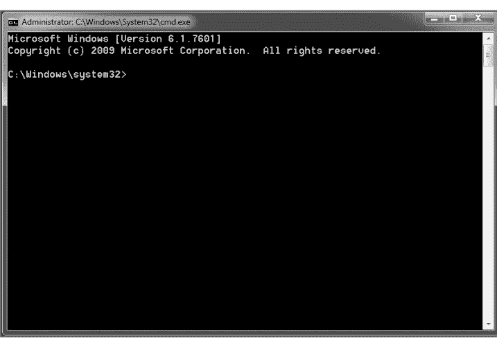

2014 Microsoft Corporation. 经许可使用。

在运行 Windows 7 的计算机上以提升模式打开 Windows 控制台，请遵循以下步骤：

1. 点击“开始”按钮。

2. 在搜索字段中输入 `cmd`。

3. 右键点击 `cmd` 实用并从菜单选择“以管理员身份运行”。

4. 作为响应，Windows Vista 或 Windows 7 将显示用户帐户控制对话框。

5. 点击“是”。

6. Windows 将显示图 1.9 所示的窗口。你可以通过 Windows 控制台标题栏显示的文本字符串中出现“Administrator”字样来判断 Windows 控制台正在以提升模式运行。

在 Windows 8.1 上打开 Windows 控制台，按下键盘上的 Windows 键，输入 `cmd`，然后按回车键。如果你需要提升权限，右键点击 `cmd` 结果并选择“以管理员身份运行”。

### 它是如何运行的？

要使用 WSH 执行脚本，你必须首先使用 WSH 支持的脚本语言之一创建脚本。在本书中，这种语言是 VBScript。如前所述，Windows操作系统通过文件扩展名来识别文件中存储的数据类型。例如，具有 `.txt` 扩展的文件是文本文件。Windows 自动将此类文件扩展名与其记事本应用程序关联。因此，当你双击一个 `.txt` 扩展的文件来打开它时，Windows 会自动将该文件加载到记事本中。

当你创建 VBScript 时，你需要将它们保存为纯文本文件并分配 `.vbs` 文件扩展名。这样，Windows 就会知道该文件包含 VBScript。同样，要使用 JavaScript 写脚本，你必须将文件保存为 `.js` 文件扩展名，以便 Windows 也能识别它。

只要你的电脑上安装了 WSH，你只需要执行已保存相应文件扩展名的脚本即可运行它。运行脚本有多种方法。一种是直接双击文件。Windows 会将该文件识别为脚本，并使用相应的 WSH 脚本引擎（根据脚本的文件扩展名）自动处理它。发生什么取决于你如何配置 WSH。默认情况下，WSH 配置为使用 `WScript.exe` 执行主机运行所有脚本，尽管如果你想使用图形化弹出对话框收集文本输入，可以修改此行为，将 `CScript.exe` 执行主机设为默认，但 `CScript.exe` 主机不支持此功能。由于脚本在执行主机中运行，得益于核心对象模型，它可以访问并操作 Windows 资源。

### 注意事项

Windows 根据启动脚本的权限权限运行脚本。因此，你的脚本对 Windows 及其资源的访问并不比你本人多。如果你创建一个脚本来执行你无法通过 GUI 手动完成的任务，你的脚本将无法工作。如果是这样，你可能需要与系统管理员联系，看看你是否可以获得额外的访问权限和用户权限。

当前的 WSH 版本是 5.8。这是微软发布的第五个 WSH 版本。之前的四个版本分别是 5.7、5.6、2.0 和 1.0。取决于你电脑运行的操作系统，你可能已经可以使用这些版本之一了。例如，如果你正在使用 Windows Server 2008 R2、Windows 7、Windows 8 或 Windows 8.1，那么你已经拥有了 WSH 5.8。然而，如果你使用的是其他 Windows 操作系统，你可能安装了较旧版本的 WSH。表 1.1 提供了 Windows 操作系统及其自带的 WSH 版本列表。

本书涵盖了 WSH 5.8 和 VBScript 5.8。然而，由于 WSH 5.6、WSH 5.7 以及 VBScript 5.6 几乎相同，你在书中学到的所有内容都适用于这些较早版本。

#### 表 1.1 微软操作系统上存在的 WSH 版本

| 操作系统 | WSH 版本 | 操作系统 | WSH 版本 |

| :--- | :--- | :--- | :--- |

| Windows 95 | 无 | Windows 2008 | 5.7 |

| Windows NT 4.0 | 无 | Windows Vista | 5.7 |

| Windows 98 | 1.0 | Windows 7 | 5.8 |

| Windows 2000 | 2.0 | Windows 8 | 5.8 |

| Windows Me | 2.0 | Windows 8.1 | 5.8 |

| Windows XP | 5.6 | Windows 2012 | 5.8 |

| Windows 2003 | 5.6 | | |

## 提示

你可以从微软下载中心（`www.microsoft.com/downloads/`）免费下载适用于 Windows 2000、Windows XP 和 Windows 2003 的 WSH 5.7。在本书编写期间，还没有 WSH 5.8 的下载。Windows XP 用户也可以通过安装服务包 3 升级到 WSH 5.7。Windows 95、NT、98 或 Me 不再提供 WSH 升级。

## 如何安装它？

你可以在 Windows 2000、XP 或 2003 上下载并升级到 WSH 5.7。微软在 `www.microsoft.com/downloads/` 为这些操作系统中的每一个提供了单独的下载。下载后，升级到版本 5.7 的步骤概述如下：

- 双击你下载的脚本文件开始安装过程。

- 当安装向导出现时，点击“下一步”。

- 当向导提示接受许可时，点击“同意”。

- 当提示关闭向导时，点击“完成”。

当安装过程完成后，将安装以下组件。此时，你的电脑已准备好支持使用最新且最可靠的 WSH 和 VBScript 开发和执行 VBScript：

- Visual Basic Script (VBScript) 5.7

- Jscript 5.7

- Windows Script Host 5.7

## 第 1 章 开始使用 WSH

> 提示：WSH 5.7 以安装程序文件（Installer file）的形式下载，允许你使用 Windows 控制面板中的“添加/删除程序”选项来管理它。

微软最初设计 VBScript 是为了作为一种网页脚本语言。这意味着它只有在嵌入由 Internet Explorer 执行的 HTML 页面中时才能运行。VBScript 作为网页脚本语言的成功一直受到限制。原因之一是 Netscape（网景）从未在其浏览器中对其提供支持。此外，从开始，Netscape 就免费提供 JavaScript。许多程序员对于放弃 JavaScript 改用 VBScript 持犹豫态度，而微软一直将其保持为专有技术。

微软创建了 VBScript 的修改版本，设计用于与 WSH 配合。此版本的 VBScript 缺乏浏览器版 VBScript 中许多许多功能；例如，它不支持表单（forms）和框架（frames）。同样，作为 WSH 脚本语言，VBScript 不需要这些功能，因为这些资源类型超它的环境。

## Hello World：创建并执行你的第一个 VBScript

WSH 运行的 VBScript 不是嵌入 HTML 页面中的，而是保存为具有 `.vbs` 文件扩展名的独立文件。例如，看以下 VBScript：

```
MsgBox "Hello World!"
```

如你所见，脚本仅包含一行代码。要创建此脚本，打开你的编辑器，输入该行代码并将脚本保存为 `Hello.vbs`。就这样。现在运行它：首先找到你保存脚本的文件夹，并双击它。你应该看到一个与图 1.11 所示类似的图形化弹出对话框。

让我们谈谈你编写并执行的脚本。首先，因为你是通过点击运行的，所以你是使用默认执行主机运行的。默认执行主机是 `WScript.exe`（我将在下一章中介绍如何更改执行主机）。脚本本身执行一个名为 `MsgBox()` 的 VBScript 函数。

图 1.11 由你的第一个 VBScript 创建的弹出对话框。

# 面向初学者的微软 WSH 和 VBScript 编程，第四版

`MsgBox()` 函数是一个内置 VBScript 函数，你可以在脚本中调用它并在弹出对话框中显示消息。如你所见，当你运行脚本时显示了“Hello World!”。该 VBScript 使用执行引擎（例如 `WScript.exe`）和 WSH 的执行主机之一（`WScript.exe` 或 `CScript.exe`）运行。但代码本身都是 VBScript。

让我们稍微修改脚本，演示如何引入 `WScript` 对象。`WScript` 对象是组成 WSH 核心对象模型的少数对象之一（详细信息见第 2 章和附录 C）。我们将使用编辑器介绍该对象以及其他模型；打开 `Hello.vbs` 脚本并将其修改为如下所示：

```
Set WshShell1 = WScript.CreateObject("WScript.Shell")
```

```
WshShell1.Popup "Hello World!"
```

现在保存脚本并再次运行。这一次，除非你输入了错误，否则你应该看到一个与图 1.12 类似的弹出对话框。

如你所见，看起来几乎相同。显示了相同的消息，现在弹出对话框的标题栏中显示了“Windows Script Host...”字样。让我们拆解并仔细检查脚本是如何编写的。如果你不完全理解这里涵盖的内容，不要担心——它相当，，之后会准备好理解它的。现在，我希望你按照我提出的步骤进行阅读，这样你就能理解使用 VBScript 和 WSH 创建和执行脚本的过程。

## 第 1 章 • WSH 和 VBScript 入门

## 提示

`WScript` 对象是 WSH 的核心对象之一。不要将其与 `VBScript.exe` 执行宿混淆。遗憾的是，它们共享相同的名称，因为它们有非常不同。

正如之前两个版本的脚本所示，你可以使用 VBScript 函数或 WSH 方法来执行相同的任务。该脚本还演示了脚本的创建和执行是多么简单，即使只有一行或两行的脚本，也可以实现相当酷炫的技巧，例如显示弹出式对话框。

在上一个示例中，你按照我设置的步骤创建了你的第一个 VBScript。根据你将开发的脚本的大小和复杂性，你可以简单地边写边运行。然而，在大多数情况下，你可能希望采用更有条理的方法进行开发。首先，确保你知道你想要实现什么。将任务分解为具体的步骤，当这些步骤组合时即可完成任务。花一点时间草拟脚本的设计，并尝试将脚本拆分为不同的部分。然后一次开发一个部分，确保在移动到下一个部分之前该部分能够正常工作。我将在本书书中指出实现这些目标的方法。

在上一个示例中，你通过双击脚本运行了它，一切运行良好。那是因为脚本被成成就可以从 Windows 桌面运行的。然而，你用于运行脚本的执行主机有时会对脚本的运行方式产生巨大影响。让我们来看一个例子。

- 1. 再次打开 `Hello.vbs` 脚本，并将脚本内容替换为语句：`WScript.Echo "Hello World"`

  该语句使用 `WScript` 对象的 `Echo()` 方法显示文本消息。

- 2. 保存脚本并双击它。除非你修改了默认的 WSH 配置，否则脚本将使用 `WScript.exe` 执行主机运行。结果是消息显示在弹出式对话框中。

- 3. 将文件复制到计算机的 C 盘并打开 Windows 控制台。

- 4. 在命令行提示符处输入 `CD \` 并按回车键。此命令将工作目录更改为 C 盘根目录，`Hello.vbs` 脚本现在位于那里。

- 5. 输入以下命令并按回车键：

  `CScript.vbs`

你这次看到的是完全不同的结果。脚本的输出不是写在弹出式对话框中，而是写在 Windows 控制台中，如图 1.13 所示。

图 1.13 由 `CScript.exe` 执行主机运行的脚本在 Windows 控制台中显示其输出。

- 6. 作为最后的实验，在 Windows 命令行提示符处输入以下命令：

  `WScript Hello.vbs`

如你所示，脚本产生的消息再次显示在弹出式对话框中，尽管脚本是从 Windows 命令行运行的，但 `WScript.exe` 执行主机以图形化方式显示其输出。

## WSH 还支持哪些脚本语言？

正如我之前提到的，WSH 除了 VBScript 外还支持其他语言。微软在提供 WSH 时同时带了 JavaScript 和 VBScript。JavaScript 是微软对 ECMAScript 语言的实现，最初由 Netscape 开发为 LiveScript，后来重命名为 JavaScript。与 VBScript 类似，随 WSH 发布的 JavaScript 版本是基于浏览器的脚本语言的修改版本。同样，像 VBScript，JavaScript 是一门完整的编程语言，充满了变量、条件循环、数组和过程。

JScript 的整体语法结构比 VBScript 稍微难掌握一点，除非你已经熟悉 JavaScript。VBScript 为数组提供了更好的支持，而 JavaScript 提供了更强大的数学函数集。JScript 以纯文本文件创建并以 `.js` 文件扩展名保存。

## 提示

要了解更多关于 JScript 的信息，请查看 `http://msdn.microsoft.com/en-us/library/visualstudio/72bd815a(v=100).aspx` 中的 JScript 文档链接。

## 第 1 章 • WSH 和 VBScript 入门

除了 VBScript 和 JavaScript 外，许多第三方脚本语言也设计为与 WSH 工作，如表 1.2 所示。

| 表 1.2 第三方 WSH 兼容脚本引擎 |

| 语言 | 网站 |

|---|---|

| PerlScript | `www.activestate.com` |

| PythonScript | `www.sourceforge.com` |

| ooRexx | `www.ooorexx.org` |

| RubyScript | `www.ruby-lang.org` |

| ActiveScript | `www.php.net` |

| TclScript | `www.sourceforge.com` |


## 介绍 VBScript


如你所知，`VBScript`是一种脚本语言，允许你开发脚本来自动执行原本在执行环境中必须手动执行的任务。`VBScript`存储在纯文本文件中。与`VBScript`不同，随`WSH`发布的`JavaScript`版本是基于浏览器的脚本语言的修改版本。同样，像`VBScript`，`JavaScript`是一门完整的编程语言，充满了变量、条件循环、数组和过程。

`JScript`的整体语法结构比`VBScript`稍微难掌握一点，除非你已经熟悉`JavaScript`。`VBScript`为数组提供了更好的支持，而`JavaScript`提供了更强大的数学函数集。`JScript`以纯文本文件创建并以`.js`文件扩展名保存。

## 第一章 • WSH 和 VBScript 入门

如前所述，`VBScript`作为一种客户端 Web 脚本语言的流行程度在多年里一直持续，而`VBScript`的发展却停滞了。直到今天，执行客户端 Web 脚本并确保每个可以使用 Internet 浏览器的人都能运行的唯一方法仍然使用`JavaScript`。

尽管如此，微软多年来一直致力于`VBScript`的开发。它随着`IIS 3.0`发布了`VBS 2.0`，将`VBScript`变成了一种服务器端 Web 开发语言。新开发者可以将`VBScript`嵌入到他们的`ASP`页面，从而能够访问本地数据库和创建动态 HTML 页面的能力。

`VBScript`的突破随着`VBScript 3.0`的出现。这个版本包含在多个微软产品中，包括：

- `Internet Explorer 4.0`
- `IIS 4.0`
- `Outlook 98`
- `Windows Scripting Host`（Windows 脚本主机）

`VBScript 3.0`现在可以作为微软电子邮件客户端的脚本语言使用。然而，当`VBScript`作为`WSH`的脚本语言被包含时，它才真正大放异彩。Visual Basic 程序员、管理员以及 Visual Basic 背景的技术爱好者发现`VBScript`很容易学习。它很快证明是开发小型脚本的极佳语言，用于执行那些不值得开发完整独立应用程序的任务。

微软后来作为`Microsoft Visual Studio`应用程序开发套件的一部分发布了`VBScript 4.0`。微软赋予了`VBScript`访问 Windows 文件系统的能力；否则，`VBScript 4.0`与之前的版本相比没有太大变化。

2000 年，微软作为`Windows 2000`的组件发布了`VBScript 5.0`，其中包含了`Internet Explorer 5`和`WSH 2.0`。2001 年，微软发布了`Windows XP`专业版、`WSH XP`家庭版和`Internet Explorer 6.0`。随着这些好物，`WSH 5.6`和`VBScript 5.6`的推出，`VBScript 5.7`在 2007 年作为`WSH 5.7`部分可用。它还作为`Internet Explorer 7`安装的一部分提供。`VBScript 5.8`则于 2009 年作为`WSH 5.8`部分以及`Internet Explorer 8`安装的一部分可用。

## VBScript 的亲戚：Visual Basic 和 VBA

`VBScript`是一个紧密相关的编程语言家族中的第三成员：

- `Visual Basic`
- `Visual Basic for Applications`（`VBA`）
- `VBScript`

## 针对初学者的微软 WSH 和 VBScript 编程，第四版

`Visual Basic`是该家族的原始成员。微软于 1991 年首次引入了它。微软一直稳定改进`Visual Basic`，在此期间发布了多个版本。`Visual Basic`的最新版本是`Visual Basic 2012`。作为一种符合`.NET`标准的语言，`Visual Basic`支持微软的`.NET`框架。

## 提示

如果你想了解更多关于`.NET`的信息，请访问 `www.microsoft.com/net`。

> `.NET`是微软的一个框架，由微软从头开始设计，用于支持集成桌面、局域网和基于 Internet 的应用程序。微软的`.NET`框架通过促进网络（互联网）上的数据交换来协助应用程序开发。

`Visual Basic`通常用于创建独立程序。这意味着一旦编写，在很早期就会被编译成可执行代码，因为它易于学习。因此，`Visual Basic`并没有花费长时间就成为有史以来最流行的编程语言之一。今天，`Visual Basic`在世界各地的课程中教授，并用于构建各种规模和类型的应用程序。

`Visual Basic`应用程序是使用`Visual Basic`的内置开发环境（`IDE`）创建的。`Visual Basic`的`IDE`包含编译器、调试器、帮助系统以及用于管理`Visual Basic`项目的工具。虽然`Visual Basic`的`IDE`提供了一个丰富且强大的编程环境，但学习它需要大量的时间精力。由于其`IDE`的复杂性，`Visual Basic`并不适合开发小型脚本。`Visual Basic`的优势在于辅助开发更大、更复杂的程序，这些程序值得开发它们所需的时间和精力。

## 提示

如果你想了解更多关于微软`Visual Basic .NET`，请查阅《Visual Basic 2008 Express Programming for the Absolute Beginner》(ISBN 1-59863-900-5)。

> `IDE`是一种应用程序开发程序，为程序员提供了使用特定编程语言创建应用程序所需的工具。`IDE`提供了各种工具，例如编译器（将应用程序代码翻译成完成的可执行程序）、调试器（协助跟踪和修复程序）以及管理项目的工具（这些项目可能包含多个应用程序）。

Basic 家族的下一个成员是`Visual Basic for Applications`（`VBA`），微软于 1993 年首次发布了它。`VBA`是`Visual Basic`的子集，旨在为应用程序提供一种类似于`Visual Basic`的编程语言。例如，对于`Microsoft Excel`的`VBA`，程序员可以使用`Excel`提供的功能开发整个应用程序。同样，对于`Microsoft Access`的`VBA`为创建需要`Microsoft Access`数据库的应用程序提供了一种强大的编程语言。

## 第一章 • WSH 和 VBScript 入门

与`Visual Basic`应用程序一样，`VBA`应用程序是使用一个复杂的`IDE`程序创建的。与可以编译成可执行程序的`Visual Basic`应用程序不同，`VBA`只能编译成称为`p-code`的格式，你可以将其认为部分编译。通过`p-code`，`VBA`代码的加载和运行速度比`VBScript`快（后者是一种解释型语言），但运行速度仍然比`Visual Basic`应用程序慢。`VBA`还需要一个宿主应用程序，例如`Microsoft Excel`或`Microsoft Access`。

`VBA 7.1`作为`Microsoft 2010`的组件发布，其中包含了：

- `Word`
- `PowerPoint`
- `Outlook`
- `Access`

> 想了解更多关于`VBA`，请查阅《WSH and VBScript Programming for the Absolute Beginner》。

想了解更多关于`VBScript`，请查阅《WSH and VBScript Programming for the Absolute Beginner》。

## 返回游戏

让我们开始游戏。这个项目将演示创建你的第一个脚本的步骤。在此过程中你将学习如何使用弹出对话框。

## 设计游戏

敲击游戏非常直观，涉及基础编程技术。游戏通过在弹出框中显示“Knock Knock”开始。它等待玩家回答“Who’s there?”显示“Panther I’m going swimming”。如果在游戏的任何阶段未能输入正确的回复，将显示一条消息邀请玩家重试。

## 针对初学者的微软 WSH 和 VBScript 编程，第四版

这个项目将通过以下五个步骤完成：

- 向玩家展示`Knock Knock`弹出对话框并收集回复。
- 如果回复恰当，则继续游戏；否则，显示错误消息。
- 向玩家展示门外人的名字并收集回复。
- 如果回复恰当，则继续游戏；否则，显示错误消息。
- 显示游戏的梗。

## 启动脚本过程

创建敲击游戏的第一步是启动脚本编辑器并使用它创建一个空的`VBScript`文件。例如，在运行 Windows 的计算机上使用记事本编辑器创建脚本，你需要执行以下步骤：

- 点击开始按钮，选择“所有程序”，选择“辅助工具”，然后选择“记事本”。记事本应用程序打开了。
- 打开“文件”菜单并选择“保存”。保存对话框出现。
- 指定你想存储脚本的位置。在对话框底部的文件名字段中输入`KnockKnock.vbs`并点击“保存”。

记事本编辑器现在应该显示`Knock Knock`脚本的名字。

# 启动游戏并收集初始输入

现在让我们通过编写第一条`VBScript`语句来开始脚本。游戏首先应该显示一个带有“Knock Knock”消息的弹出对话框并等待用户响应。这项任务使用`VBScript`执行非常简单，可以通过一条语句完成：

```vbscript
Reply1 = InputBox("Knock Knock!")
```

用通俗的话说，这条`VBScript`语句显示一个带有“Knock Knock”消息的弹出对话框，并等待玩家在对话框文本字段中输入内容并点击确定按钮。

# 第 1 章 • 入门 WSH 和 VBScript

## 提示

为了与玩家通信，`InputBox()`函数允许你显示消息。在这个示例中，消息简单来说“Knock Knock（咚咚）”，你也可以轻松改为“Hello, what is your name?”或任何有助于玩家理解脚本试图收集的类型类型的问题。

最后，玩家在弹出对话框中输入的文本会被临时赋值给一个名为`Reply1`的变量。变量为脚本提供了存储并在稍后通过引用数据的能力。

函数和变量是`VBScript`的基础组成部分。遗憾的是，如果不使用它们，即使是编写最简单的脚本都是困难的。现在，不要太担心它们，继续关注创建和运行“敲门击声”游戏的整体步骤。我将在第 4 章中详细介绍变量的使用，并在第 7 章“使用过程组织脚本”中介绍函数的使用。

## 验证用户输入

玩家在游戏中的角色是输入短语“Who's there?”。拼写或大小写的任何变动都会导致错误。在玩家输入此消息并点击确定按钮后，脚本需要执行一个测试，以验证玩家是否在正确地玩游戏。

以下三行代码完成了此任务：

```vbscript
If Reply1 = "Who's there?" Then
```

```vbscript
End If
If Reply1 <> "Who's there?" Then MsgBox "Incorrect answer. Try again."
```

前两行实际代码——`If Reply1 = "Who's there?"`和`End If`——是在一起的。这些代码行之间的点是占位符，将在下一节中插入更多语句。第一行测试`Reply1`的值。请记住`Reply1`是一个包含玩家输入响应的变量。此语句检查`Reply1`中存储的值是否与短语“Who's there?”匹配。如果完全匹配，你很快将放置在前两个语句中的代码行将被执行。否则，这些语句将不会被处理。第三行代码通过检查玩家的回复是否不等于（即`<>`）预期的短语，反转了前两行代码执行的测试。如果是如此，第三条语句的其余部分将执行错误消息的显示。第三条语句执行的文本可能出于多种原因而成立，包括以下情况：

- 玩家点击了取消按钮。
- 玩家在没有输入的情况下点击了确定按钮。
- 玩家输入了错误的响应。

### 完成输入收集

如果你是边读边创建脚本，那么你的脚本现在应该包含以下语句：

```vbscript
Reply1 = InputBox("Knock Knock!")
If Reply1 = "Who's there?" Then
End If
If Reply1 <> "Who's there?" Then MsgBox "Incorrect answer. Try again."
```

现在是时候添加三行位于当前标有点的行的代码了。这三行代码中的第一行如下：

```vbscript
Reply2 = InputBox("Panther!")
```

此语句与脚本中的第一个语句相似，不同在于它不是显示消息“Knock Knock”，而是显示消息“Panther”，然后等待玩家输入响应（即“Panther who?”）。玩家输入的文本被存储在名为`Reply2`的变量中。

### 验证用户的最后响应

以下两行代码需要插入到上一个语句之后：

```vbscript
If Reply2 = "Panther who?" Then
    MsgBox "Panther no pants, I'm going swimming."
End If
If Reply2 <> "Panther who?" Then MsgBox "Incorrect answer. Try again."
```

第一行检查`Reply2`中存储的值是否等于短语“Panther who?”。如果是，语句的其余部分将显示玩家的笑点梗。如果玩家输入了“Panther who?”以外的内容，则这两个语句中的第二个语句将执行，显示一条消息告知玩家没有提供正确的响应。

## 最终结果

现在让我们来看完整组装的脚本。

```vbscript
Reply1 = InputBox("Knock Knock!")
If Reply1 = "Who's there?" Then
    Reply2 = InputBox("Panther!")
    If Reply2 = "Panther who?" Then
        MsgBox "Panther no pants, I'm going swimming."
    End If
    If Reply2 <> "Panther who?" Then MsgBox "Incorrect answer. Try again."
End If
If Reply1 <> "Who's there?" Then MsgBox "Incorrect answer. Try again."
```

## 第 2 章 • Windows 脚本主机 (WSH) 简介

在适配到`WSH`之前，`VBScript`被用作网页脚本语言，旨在在`Internet Explorer`和兼容 IE 的浏览器中执行脚本。`Internet Explorer`为`VBScript`提供了一个环境，使其能够通过浏览器的文档对象模型（`DOM`）创建表单、框架和各种浏览器控件。

与`Internet Explorer`类似，`WSH`也是一个提供`VBScript`执行的编程环境。`WSH`并不是取代浏览器`DOM`，而是通过其核心对象模型为脚本访问 Windows 注册表和文件系统等本地计算机资源。`Internet Explorer`作为一个完整的 Windows 应用程序运行，会消耗此类应用程序所需的资源（包括构建和维护图形用户界面所需的内存），而`WSH`已被精简为仅有的主机；因此，`WSH`执行你的脚本所需的资源更少。它不需要加载 GUI。执行脚本所需的内存和 CPU 周期也更少。结果是，脚本执行速度更快。

在第 14 章“为你的脚本添加 GUI”中，你将学习如何使用脚本技能开发看起来像桌面应用程序的 HTML 应用程序。这种脚本环境为你的脚本提供了访问`Internet Explorer DOM`以及`WSH`核心对象模型的能力。最终结果是，你可以使用`DOM`为你的脚本构建图形用户界面，同时允许它们通过`WSH`访问并操作 Windows 资源。

## WSH 组件详解

将计算机、其操作系统及其硬件和软件看作文件、磁盘驱动器、打印机等对象的集合。为了在 Windows 操作系统上实现任务自动化，`VBScript`需要一种与这些对象交互的方法。这由`WSH`核心对象模型提供。

理解`WSH`核心对象模型对于你作为`VBScript`程序员的成功至关重要。它不仅能为你提供开发在 Windows 操作系统上运行的所需的所需的见解，还将通过让你学会操作对象，为你处理其他对象模型做好准备。例如，Windows 应用程序（包括 Microsoft Office 应用程序）暴露它们自己的对象模型，允许`VBScript`以编程方式对其进行操作。此外，其他`VBScript`执行主机（如`Internet Explorer`）为`VBScript`提供了访问其他对象模型的途径。`WSH`核心对象模型非常复杂，初看起来可能令人生畏。但不要担心——随着书中内容的阅读，你将继续深化对这一复杂主题的理解。当你完成学习时，应该已经牢固地掌握了`WSH`核心对象模型。

| 定义 |
| :--- |
| 对象模型是相关对象的表示，为脚本或程序提供了查看和与对象模型中所表示的每个对象（文件、磁盘、打印机等）交互的能力 |

## 绝对初学者的 Microsoft WSH 和 VBScript 编程，第四版

### WSH 核心对象模型快速介绍

`WSH`核心对象模型提供了对 14 个对象的访问，通过这些对象，你可以编程地访问不同类型的 Windows 资源。构成`WSH`核心对象模型的对象如图 2.4 所示。这些对象每一个都为你提供了访问特定类别 Windows 资源的权限。

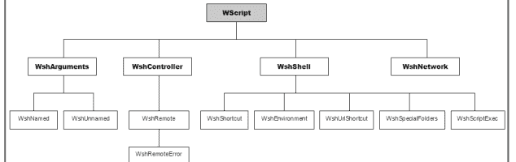

**图 2.4** 这 14 个对象中的每一个都有暴露不同 Windows 操作系统资源的属性和方法。

©2014 Cengage Learning.

`WScript`对象位于`WSH`核心对象模型的顶部或*根节点*。所有其他`WSH`核心对象模型都是从该对象创建或实例化出来的。当执行开始时，系统会自动为你创建`WScript`对象，在脚本中无需先实例化即可被引用。一旦实例化，你就可以操作组成`WSH`核心对象模型的任何一个对象的属性和方法。例如，以下语句演示了如何创建一个单行脚本`Greeting.vbs`，该脚本使用`WScript`对象的`Echo`方法显示文本字符串。


```
WScript.Echo "Example: Using the WScript object's Echo()"
```

要测试这一点，请打开你的脚本编辑器并输入此语句。保存脚本（使用 `.vbs` 文件扩展名），并双击运行它。应该会出现如图 2.5 所示的弹出对话框。正如该脚本所示，你可以直接从脚本自动访问属于 `WScript` 对象的任何属性和方法。

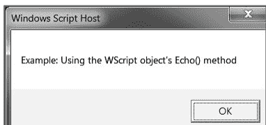

**图 2.5** 使用 `WScript` 对象的 `Echo()` 方法创建的弹出对话框。

©2014 Cengage Learning.

> 实例化（Instantiation）描述了创建新实例的过程。

## 使用 WScript 对象

`WScript` 对象是一个极其重要的对象，你将发自己在 VBScript 中经常与它打交道。它提供了许多你在整个书中都会看到的非常有用的方法。这些方法包括：

- `CreateObject()`。建立指定对象的实例。
- `DisconnectObject()`。防止脚本访问之前实例化的对象。
- `Echo()`。根据运行脚本的执行环境不同，在 Windows 控制台中或作为弹出对话框显示文本消息。
- `Quit()`。终止脚本。
- `Sleep()`。暂停执行指定的秒数。

`WScript` 对象被称为一个公共（public）对象。WSH 还有其他三个对象：`WController`、`WShell` 和 `WNetwork`。这些对象中的每一个都是使用 `CreateObject()` 方法实例化的。

## 提示

在后文中你将看到许多关于如何操作 `WScript` 对象的示例，包括它的属性和方法。如果你想查看所有这些对象的详细概述，请参阅附录 C，“WSH 核心对象模型”。

## 配置 WSH 执行主机

你对默认执行主机所做的任何更改都只会影响你的脚本。如果你与另一个用户共享计算机，他们的 WSH 设置将不受影响。如果你想让 WSH 设置在你的所有计算机上实现标准化，请让每个用户都自行设置。

### 配置 WScript.exe 和 CScript.exe 命令行执行

尽管它们有自己的设置，但 `WScript.exe` 和 `CScript.exe` 执行主机的配置方式是相同的。用于配置这些主机的语法如下：

```
wscript [//options]
cscript [//options]
```

首先打开 Windows 控制台。在 Windows 命令行提示符处，输入想要配置的主机名称，后跟一个或多个选项，每个选项都以 `//` 字符开头。

| 表 2.1 WSCRIPT.EXE 和 CSCRIPT.EXE 执行主机的命令行选项 |
| :--- |
| 配置选项 | 用途 |
| `//?` | 显示 `CScript.exe` 和 `WScript.exe` 执行主机的语法。 |
| `//b` | 以批处理模式运行脚本，抑制所有的错误和消息输出。 |
| `//d` | 开启脚本调试。 |
| `//e:jscript` / `//e:vbscript` | 设置运行脚本的引擎。 |
| `//h:wscript` / `//h:script` | 设置运行脚本的执行主机。 |
| `//i` | 以交互模式运行脚本，显示所有错误和消息输出。 |
| `//job:id` | 标识脚本脚本文件中要运行的特定作业。 |
| `//logo` | 在脚本执行开始显示 `CScript` 或 `WScript` 主机。 |
| `//nologo` | 抑制最近指定的选项并将其设置为默认设置。 |
| `//s` | 保存当前指定的选项并将其设置为默认设置。 |
| `//t:nn` | 建立一个超时值来限制脚本执行的时间。默认情况下，对脚本执行不加时间限制。 |
| `//x` | 关闭脚本调试。 |

现在，让我们来看一些如何修改执行主机的配置的示例。默认情况下，WSH 将 `Script.exe` 设置为默认执行主机。不过，你可以通过输入以下命令并按回车键来更改它：

```
cscript //H:cscript //s
```

`//H:cscript` 选项将 `CScript` 设置为默认执行主机，而 `//s` 选项使更改永久生效。如果你在命令中去掉 `//s` 选项，更改将仅对当前的工作会话有效。

要将默认命令行执行主机改回 `WScript.exe`，请输入以下命令并按回车键：

```
wscript //H:wscript //s
```

现在，让我们尝试一个设置了多个配置选项的示例：

```
wscript //H:nologo //t:60 //s
```

在这个示例中，`CScript` 执行主机被设置为默认。此外，`//nologo` 选项防止在执行脚本时显示 `WScript` 标志。它还能防止在命令行执行脚本时，在任何输出文本之后显示以下文本：

```
Microsoft (R) Windows Script Host Version 5.8
Copyright (C) Microsoft Corporation. All rights reserved.
```

`//t:60` 选项防止任何脚本执行时间超过 60 秒。最后，`//s` 选项保存了所有指定的设置。

## 技巧

即使是顶级的程序员也会犯错。有时这些错误会导致脚本以意想不到的方式运行，例如陷入在无限执行的循环中。通过为 `WScript.exe` 和 `CScript` 执行主机设置 `//T:nn` 选项，你可以建立一个安全网，防止你运行的任何脚本执行时间超过指定的时间。

## 配置 WScript.exe 桌面执行

`WScript.exe` 执行主机的桌面配置设置与它的命令行配置设置不同。其在于，只有两个配置设置。第一个指定了脚本执行的可选时间限制，第二个指定了在从 Windows 控制台运行脚本时是否显示 `WScript` 标志。

# 针对绝对初学者的微软 WSH 和 VBScript 编程，第四版

从 Windows 桌面配置 `WScript.exe` 执行主机的步骤如下：

1. 打开一个 Windows 控制台。
2. 输入 `Script` 然后点击确定。会出现“Windows 脚本主机设置”对话框，如图 2.6 所示。

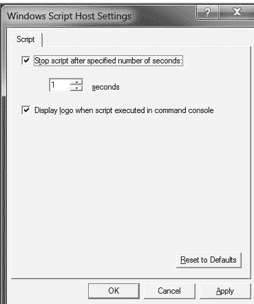

> **图 2.6** 修改 `WScript.exe` 执行主机的桌面配置。© 2014 Microsoft Corporation. 经微软许可使用。

3. 默认情况下，`WScript.exe` 执行主机没有执行时间设置。要配置该设置，请勾选“在若干秒后停止脚本”复选框并指定时间限制（秒）。
4. 默认情况下，`WScript.exe` 执行主机在从 Windows 控制台执行脚本时显示其标志。为了防止这种行为，取消勾选“在命令行控制台执行时显示标志”复选框。
5. 点击确定。

通过此过程建立的配置设置存储在以下注册表键中：`HKLM\Software\Microsoft Script Host\Settings`。

## 覆盖命令行执行设置

到目前为止，你已经学习了如何从 Windows 命令行和桌面配置 `WScript.exe` 和 `CScript.exe` 执行主机的默认执行。现在，让我们如何在不永久更改设置的情况下覆盖默认命令行设置，以临时更改特定脚本的执行环境。

临时覆盖 `WScript.exe` 和 `CScript.exe` 执行的语法如下：

```
wscript scriptname [/options] [arguments]
cscript scriptname [/options] [arguments]
```

首先，打开 Windows 控制台并输入你想要运行脚本的执行主机名称。接下来，输入你想要运行脚本的执行主机名称。然后，输入你想要的许多配置设置，每个设置前加上 `/`。最后，按回车键。现在让我们看看使用命令行主机覆盖设置的示例。假设你有一个名为 `Test.bs` 的脚本，你想让 `WScript` 执行主机超过 30 秒，输入以下命令：

```
wscript Test.bs //T:30
```

使用 `CScript` 执行主机超过 30 秒，输入以下命令：

```
cscript Test.bs //T:30
```

这是一个稍微复杂的例子，其中禁用了标志：

```
wscript Test.bs //T:30
```

在这个例子中，`WScript` 标志被屏蔽。

## 特定脚本的 WScript.exe 设置自定义

WSH 还提供了一种通过桌面为特定脚本覆盖设置的方法。这是通过创建一个与脚本同名并带有 `wsh` 扩展的文件来实现。以下语句显示了典型的 WSH 文件内容：

```
[ScriptFile]
Path=C:\Test.bs

[Options]
Timeout=30
DisplayLogo=0
```

第一行包含标签 `[ScriptFile]`。下一行提供了脚本的名称和路径。接着是 `[Options]` 标签。最后两行是配置设置。`Timeout=30` 指定该脚本不允许超过 30 秒，`DisplayLogo=0` 指定屏蔽标志。

创建 WSH 文件有两种方法。一种是使用记事本等文本编辑器手动创建。另一种是让 Windows 为你创建 WSH 文件，步骤如下：

1. 找到脚本的文件夹。
2. 右键点击并从菜单中选择“属性”。属性对话框如图 2.7 所示。

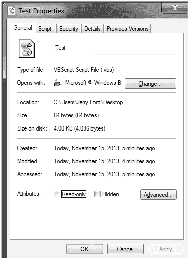

> **图 2.7** 在属性对话框的“常规”选项卡上检查属性。© 2014 Microsoft Corporation. 经微软许可使用。

3. 点击“脚本”选项卡，如图 2.8 所示。

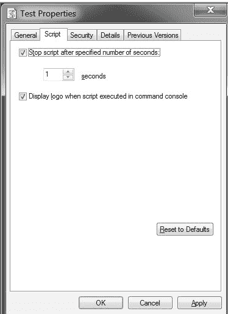

> **图 2.8** 通过脚本属性对话框配置 WSH 文件。© 2014 Microsoft Corporation. 经微软许可使用。

4. 根据需要指定脚本执行时间限制。
5. 根据需要启用或禁用 `WScript` 标志的显示。
6. 点击确定。

系统将为你创建一个新的 WSH 文件并将其存储在脚本所在的文件夹中。

## 启用和禁用 Windows 主机

众所周知，今天的电脑面临着病毒、蠕虫和其他旨在监视、扰乱或其他损害或接管你电脑的讨厌的程序的威胁。在过去，聪明的人利用 WSH 的强大和便利通过脚本传播并感染计算机。已经开发了许多防御措施来应对这些威胁。例如，电子邮件提供商会扫描电子邮件和附件中的威胁并在发现威胁时进行拦截。同样，可以安装防病毒软件来帮助计算机免受这些威胁。防火墙也可以用于保护计算机或整个计算机网络。

尽管有这些保护和预防，威胁仍然存在。过去人们处理问题的一种方法是尝试阻止未经授权的程序和脚本执行。对于 WSH，某些人已经禁用了它。

# 零基础入门：微软 WSH 与 VBScript 编程，第四版

如果你继承了一台禁用了 WSH 的计算机，当你首次尝试使用 WSH 运行 VBScript 时，将收到以下通知：

```
CScript Error: Windows Script Host 在此计算机上已禁用。请联系管理员以获取详细信息。
```

## 重新启用 WSH

如果你的计算机上的 WSH 被禁用，你可以使用以下程序之一重新启用它。但是，此操作需要管理员级权限。如果你缺少这些权限，则需要寻找计算机管理员并请求其执行此程序。第一种程序将仅为你当前登录计算机的用户重新启用 WSH。第二种程序将为任何登录该计算机的用户重新启用 WSH 执行功能。

要为单个用户重新启用 WSH，请执行以下操作：

1. 点击“开始”按钮，在搜索字段中输入 `Regedit` 并按回车打开 `Regedit` 实用程序。
2. 当用户帐户控制对话框提示时，点击“是”。
3. 导航到以下键项：`HKEY_CURRENT_USER\Software\Microsoft\Windows Script Host\Settings`。
4. 在 `DWORD` 下，寻找名为 `Enabled` 的项。如果存在，双击它并将其分配的值更改为 `1`。如果不存在，右键点击 `Settings` 键并选择“新建 > DWORD 值”。然后输入 `Enabled` 作为其名称。最后，双击 `Enabled` DW 项并为其分配值为 `1`。
5. 关闭 `Regedit`。

要为计算机上的所有用户重新启用 WSH，请执行以下操作：

1. 点击“开始”按钮，在搜索字段中输入 `Regedit` 并按回车打开 `Regedit` 实用程序。
2. 当用户帐户控制对话框提示时，点击“是”。
3. 导航到以下键项：`HKEY_LOCAL_MACHINE\Software\Microsoft\Windows Script Host\Settings`。
4. 在 `DWORD` 下，寻找名为 `Enabled` 的项。如果存在，双击它并将其分配的值更改为 `1`。如果不存在，右键点击 `Settings` 键并选择“新建 > DWORD 值”。然后输入 `Enabled` 作为其名称。最后，双击 `Enabled` DW 条项并为其分配值为 `1`。
5. 关闭 `Regedit`。

## 禁用 WSH

如果你在计算机上启用 WSH 后，决定需要将其恢复为禁用状态，可以使用以下程序之一来实现。第一种程序仅在你登录计算机时阻止 WSH 执行。第二种程序会影响登录计算机的任何用户。

# 第 2 章 • Windows 脚本主机（WSH）简介

要禁用单个用户的 WSH，请遵循以下步骤操作：

1. 点击“开始”按钮，在搜索字段中输入 `Regedit` 并按回车键打开 `Regedit` 实用程序。
2. 当用户帐户控制对话框提示时，点击“是”。
3. 导航到以下键项：`HKEY_CURRENT_USER\Software\Microsoft\Windows Script Host\Settings`。
4. 右键点击该键并选择“新建 > DWORD 值”。然后输入 `Enabled` 作为其名称。默认情况下，此项将被分配值为 `0`（代表 `False` 值）。
5. 关闭 `Regedit`。

要为计算机上的所有用户禁用 WSH，请遵循以下步骤：

1. 点击“开始”按钮，在搜索字段中输入 `Regedit` 并按回车键打开 `Regedit` 实用程序。
2. 当用户帐户控制对话框提示时，点击“是”。
3. 导航到以下键项：`HKEY_LOCAL_MACHINE\Software\Microsoft\Windows Script Host\Settings`。
4. 右键点击该键并选择“新建 > DWORD 值”。然后输入 `Enabled` 作为其名称。默认情况下，此项将被分配值为 `0`（代表 `False` 值）。
5. 关闭 `Regedit`。

## 回到石头、剪刀布游戏

现在是回到本章开始的地方了——讨论石头、剪刀、布的游戏。在这个项目中，你将创建一个这个经典游戏的脚本版本。由于你还没有机会学习创建更复杂版本所需的所有知识，这个版本有些简单。但是，你已经拥有足够的知识来构建游戏的基础并建立一个可以运行的模型。在第 5 章“条件逻辑”中，你将回到这个项目并增加一些趣味性。

## 设计游戏

这个游戏的设计非常简单。首先显示游戏规则，并要求玩家输入石头、剪刀或布。接下来，让脚本随机选择一个选项并显示结果。

该项目分六步完成：

1. 定义此脚本使用的资源。
2. 显示游戏说明。
3. 为用户提供选择方式。
4. 设计一种让脚本生成随机数的方法。
5. 根据脚本随机选择的数字分配计算机的选择。
6. 显示游戏的最终结果。

## 显示脚本使用的资源

首先打开你的编辑器并保存一个名为 `RockPaperScissors.vbs` 的空文件。接下来，添加脚本的前几行如下：

```
'在尝试使用变量之前正式声明脚本使用的变量
Dim WshSh, Answer, CardImage
```

```
'创建 WScript 对象的实例以便稍后使用
Set WshSh = CreateObject("WScript.Shell")
```

第三行是注释，第四行初始化 `WshSh` 变量。

## 显示游戏规则

接下来，显示游戏规则：

```
'显示游戏规则
WshSh.Popup "欢迎来到石头剪刀布游戏!" & vbCrLf & _
  "1. 石头" & vbCrLf & _
  "2. 布" & vbCrLf & _
  "3. 剪刀"
```

第一行为注释，第二行使用 `Popup` 方法显示规则。

## 获取玩家选择

当玩家点击确定时，弹出框将消失，并由以下内容替换：

```
'提示用户选择选择
Answer = InputBox("输入石头、布或剪刀", "我们来玩吧！")
```

第一行为注释，第二行使用 `InputBox` 函数显示一个框。

## 设置脚本的随机选择

现在玩家已经做出了选择，轮到脚本进行随机选择了。这可以通过两个语句实现，如下：

```
'计算机随机选择选择的时间
Randomize
GetRandomNumber = Int(3 * Rnd()) + 1
```

第一行为注释，第二行执行 `Randomize` 语句，确保生成随机数。第三行生成一个 1 到 3 之间的随机数。

## 为脚本的选择赋值

接下来，你需要为脚本随机生成的三个可能的数值分配一个选择：

```
'为随机选择的数字分配值
If GetRandomNumber = 3 then CardImage = "石头"
If GetRandomNumber = 2 then CardImage = "剪刀"
If GetRandomNumber = 1 then CardImage = "布"
```

如果生成的数字是 3，则将石头作为计算机的选择。如果生成的数字是 2，则将剪刀作为计算机的选择。最后，如果生成的数字是 1，则将布作为计算机的选择。

## 初级学者 Microsoft WSH 与 VBScript 编程，第四版

## 显示游戏结果

在脚本得出了电脑的选择后，是时候显示游戏结果了，以便用户可以看到谁获胜了：

```vbscript
'Display the game's results so that the user can see if he or she won
```


`Wshl.Popup` 用于显示游戏结果。通过 `&` 拼接符，我将消息的各个部分组合在一起。这些部分包括包含在引号内的文本；`Answer` 变量；代表用户和电脑选择的 `CardImage` 变量；`Space()` 方法（它在文本消息中添加 12 个空格）；以及 `_` 字符（它允许我将消息分散在两个单独行上）。

## 最终结果

现在让我们把脚本的所有部分组合在一起，然后保存并运行脚本：

```vbscript
'Formally declare variables by the script before trying to use them
Dim Wshl, Answer, CardImage
```

```vbscript
'Create an instance of the Wscript object in order to later use the Popup method
Set Wshl = Wscript.CreateObject("Wscript.Shell")
```

```vbscript
'Display the results of the game
Wshl.Popup "Welcome to the Rock, Paper, and Scissors game. Here are the " & _
"rules for playing the game: 1. Guess the same thing as the " & _
"computer to tie. 2. Paper covers rock and wins. 3. Rock breaks " & _
"scissors and wins. 4. Scissors cut paper and win."
```

```vbscript
'Prompt the user to select a choice
Answer = InputBox("Type Paper, Rock, or Scissors.", & _
"Let's play a game!")
```

```vbscript
'Time for the computer to randomly pick a choice
Randomize
GetRandomNumber = Round(FormatNumber(Int((3 * Rnd())) + 1))
```

```vbscript
'Assign a value to the randomly selected number
If GetRandomNumber = 3 then CardImage = "rock"
```

## 第 2 章 • Windows 脚本主机简介

```vbscript
If GetRandomNumber = 2 then CardImage = "scissor"
If GetRandomNumber = 1 then CardImage = "paper"
```

显示游戏结果，以便用户可以看到其她是否获胜：

```vbscript
Wshl.Popup "You picked: " & Answer & Space(12) & "Computer picked: " & _ CardImage
```

## 总结

在本章中，你接触了 WSH 核心对象模型及其 14 个对象。你学习了 `WScript` 对象并学会了如何使用它在弹出对话框中显示文本消息。你还学习了如何配置 `WScript.exe` 和 `CScript.exe` 执行主机，以最符合你的个人需求和偏好。这包括学习如何配置命令行和桌面执行的脚本，以及为单个桌面脚本自定义设置。你还学习了如何启用和禁用 Windows 脚本主机。

- 1. 尝试通过添加逻辑（比较玩家的选择与脚本的随机选择，以决定胜者）来扩展 `RockPaperScissors.vbs`。
- 2. 根据前面的比较，显示一段额外的文本，显式说明游戏结果——例如，“你赢了！”“你输了！”或“平局”。

# 第二部分 学习 VBScript 和 WSH 脚本编写

第 3 章：VBScript 基础

第 4 章：常量、变量、数组和字典

第 5 章：条件逻辑

第 6 章：处理数据集合

第 7 章：使用过程组织脚本

# 3

## VBScript 基础

本章通过教你一些重要概念开始你的 VBScript 学习之旅。你将学习构成 VBScript 核心和运行时对象模型的对象。此外，你将学习基础的 VBScript 语法、函数、保留字和特殊字符。你还将学习 VBScript 和 WSH 的输出函数。在此过程中，你将在学习更多关于 VBScript 如何与 WSH 交互的同时，创建一个数学游戏。你还将学到以下内容：

- 编写 VBScript 时必须遵循的基本规则
- 构成 VBScript 核心和运行时对象模型的对象
- 如何使用内置 VBScript 函数增强你的脚本
- 显示脚本输出的不同方法

## 项目预告：数学游戏

本章的游戏项目向你展示了一种编程技术，该技术允许你编写可以打开并与其他 Windows 应用程序交互的 VBScript。它被称为 `Math-Game.vbs`，用于测试玩家对在求解数值表达式时优先级原则的理解。如果用户给出的答案正确，将祝贺他们拥有卓越的数学能力。如果玩家提供了错误答案，游戏将提议教玩家如何求解该表达式。

为了教玩家如何求解方程，程序将打开 Microsoft Word 应用程序并输入解释解决问题所需步骤的说明。为了进一步演示如何求解方程，程序将启动 Windows 计算器应用程序并使用它来求解方程。

## 初级学者 Microsoft WSH 与 VBScript 编程，第四版

本章的游戏项目向你展示了一种编程技术，该技术允许你编写可以打开并与其他 Windows 应用程序交互的 VBScript。它被称为 `Math-Game.vbs`，用于测试玩家对在求解数值表达式时优先级原则的理解。如果用户给出的答案正确，将祝贺他们拥有卓越的数学能力。如果玩家提供了错误答案，游戏将提议教玩家如何求解该表达式。

为了教玩家如何求解方程，程序将打开 Microsoft Word 应用程序并输入解释解决问题所需步骤的说明。为了进一步演示如何求解方程，程序将启动 Windows 计算器应用程序并使用它来求解方程。

本章的游戏项目向你展示了一种编程技术，该技术允许你编写可以打开并与其他 Windows 应用程序交互的 VBScript。它被称为 `Math-Game.vbs`，用于测试玩家对在求解数值表达式时优先级原则的理解。如果用户给出的答案正确，将祝贺他们拥有卓越的数学能力。如果玩家提供了错误答案，游戏将提议教玩家如何求解该表达式。

为了教玩家如何求解方程，程序将打开 Microsoft Word 应用程序并输入解释解决问题所需步骤的说明。为了进一步演示如何求解方程，程序将启动 Windows 计算器应用程序并使用它来求解方程。

## 第 3 章 • VBScript 基础

本章通过教你一些重要概念开始你的 VBScript 学习之旅。你将学习构成 VBScript 核心和运行时对象模型的对象。此外，你将学习基础的 VBScript 语法、函数、保留字和特殊字符。你还将学习 VBScript 和 WSH 的输出函数。在此过程中，你将在学习更多关于 VBScript 如何与 WSH 交互的同时，创建一个数学游戏。你还将学到以下内容：

- 编写 VBScript 时必须遵循的基本规则
- 构成 VBScript 核心和运行时对象模型的对象
- 如何使用内置 VBScript 函数增强你的脚本
- 显示脚本输出的不同方法

## VBScript 语句

与任何编程语言一样，VBScript 由编程语句组成。在这些章节中，你已经看到并处理了大部分语句。

表 3.1 列出了构成 VBScript 的语句。

| 表 3.1 VBScript 语句 | |
|---|---|
| 语句 | 描述 |
| `Call` | 执行过程 |
| `Class` | 定义类名 |
| `Const` | 定义常量 |
| `Dim` | 定义变量 |
| `Do..Loop` | 只要条件为真就重复执行 |
| `Erase` | 存储在数组中的元素 |
| `Execute` | 执行语句 |

## 初级学者 Microsoft WSH 与 VBScript 编程，第四版

## 表 3.1 VBScript 语句（续）

| 语句 | 描述 |
| --- | --- |
| `ExecuteGlobal` | 在全局命名空间中执行语句 |
| `Exit` | 退出循环、过程或函数 |
| `For Each...Next` | 处理数组或集合中的元素 |
| `For...Next` | 按指定的次数重复一个或多个语句 |
| `Function` | 定义函数及其关联参数 |
| `If...Then...Else` | 根据测试条件的值执行一个或多个语句 |
| `On Error` | 启用错误处理 |
| `Option Explicit` | 强制显式声明变量 |
| `Private` | 定义私有变量 |
| `Property Get` | 定义属性名及其参数并返回值 |
| `Property Let` | 定义过程名、参数以及允许为属性赋值的代码 |
| `Property Set` | 定义过程名、参数以及允许将属性赋值为对象的引用 |
| `Public` | 定义公共变量 |
| `Randomize` | 初始化 VBScript 的随机数生成器 |
| `ReDim` | 定义或重新定义数组的维度 |
| `Rem` | 注释语句 |
| `Select Case` | 定义一组测试，找到匹配条件时将执行一个 |
| `Set` | 设置变量对象的引用 |
| `Sub` | 定义子过程及其参数 |
| `While...Wend` | 只要指定的条件为真就执行一个或多个语句 |
| `With` | 将要在指定对象执行的一个或多个语句关联起来 |

## VBScript 语法规则

为了正确应用构成 VBScript 编程语言的语句，你必须掌握这些语句的语法规则。每个 VBScript 语句都有其特定的语法。

## 第 3 章 • VBScript 基础

在编写 VBScript 时，您应该记住以下规则：

- 默认情况下，所有的 VBScript 语句必须位于单行内。
- 您可以通过在每行的末尾添加 `_`（续行符）来将单个语句跨越到多行。
- 您可以通过在每个语句的末尾添加 `:`（冒号）来在单行内放置多个 VBScript 语句。
- 默认情况下，VBScript 不区分大小写，这意味着 VBScript 认为变量、常量、过程和子程序中使用的单词在不同大小写拼写下是视为相同的。
- 您可以通过在 VBScript 脚本的开头添加 `Option Explicit` 语句来强制区分大小写。
- 默认情况下，错误将停止任何 VBScript 的执行。
- 您可以通过在 VBScript 脚本中添加 `On Error Resume Next` 语句来防止错误终止 VBScript 的执行。
- 脚本中的多余空格会被忽略，这些空格可用于改进脚本的格式和呈现效果。

每个 VBScript 语句都有其特定的语法，必须严格遵守。未能妥善遵循语句语法将导致错误。让我们来看一个示例。以下语句尝试使用 VBScript 的 `MsgBox()` 函数显示一条文本消息：

```vbscript
MsgBox "Thanks for playing!"
```

遗憾的是，该语句没有遵循其语法要求。`MsgBox()` 函数要求所有文本消息必须包含在一对引号内。如果您仔细观察，会发现缺少了右引号。图 3.5 显示了该语句在运行 Windows 8.1 的计算机上运行时产生的错误。

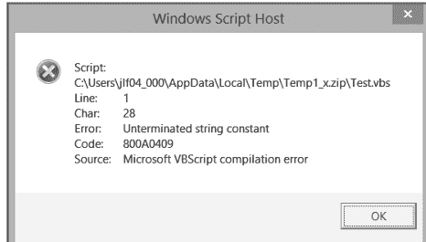

**图 3.5** 由 `MsgBox()` 语句中未匹配的引号引起的错误消息。

© 2014 微软公司. 经 Microsoft 许可使用。

# 针对绝对初学者的 Microsoft WSH 和 VBScript 编程，第四版

## 保留字符

与任何编程语言一样，VBScript 都拥有一组保留字。保留字是您无法在脚本中使用的单词，因为 VBScript 也为它们分配了特殊含义。其中一些单词被保留是因为它们是语言本身的一部分。另一些是为了未来的使用而保留的。表 3.2 列出了 VBScript 的保留字。在涉及 VBScript 保留字时需要记住的重要点是，您只能按照预期方式使用它们（即，您不能将它们作为变量、常量或过程名称）。

| 表 3.2 VBSCRIPT 保留字集 |
|---|---|---|---|
| `And` | `EndIf` | `LSet` | `RSet` |
| `As` | `Enum` | `Me` | `Select` |
| `Boolean` | `Eqv` | `Mod` | `Set` |
| `ByRef` | `Event` | `New` | `Shared` |
| `Byte` | `Exit` | `Next` | `Single` |
| `ByVal` | `False` | `Not` | `Static` |
| `Call` | `For` | `Nothing` | `Stop` |
| `Case` | `Function` | `Null` | `Sub` |
| `Class` | `Get` | `On` | `Then` |
| `Const` | `GoTo` | `Option` | `To` |
| `Currency` | `If` | `Optional` | `True` |
| `Debug` | `Imp` | `Or` | `Type` |
| `Dim` | `Implements` | `ParamArray` | `TypeOf` |
| `Do` | `In` | `Preserve` | `Until` |
| `Double` | `Integer` | `Private` | `Variant` |
| `Each` | `Is` | `Public` | `Wend` |
| `Else` | `Let` | `RaiseEvent` | `While` |
| `ElseIf` | `Like` | `ReDim` | `With` |
| `Empty` | `Long` | `Rem` | `Xor` |
| `End` | `Loop` | `Resume` | |

## 添加注释

最易理解的 VBScript 语句之一是注释语句。注释语句让您能够为 VBScript 脚本中添加描述性文本文档，说明您为何以这种方式编写脚本。通过注释记录脚本使其更容易维护，并帮助后续可能接手的人接力您的工作。注释对脚本的执行没有任何影响，您应该大量使用它们。

可以使用 VBScript 的 `Rem` 语句（“remark”的缩写）添加注释，如下所示：

```vbscript
Rem 使用 VBScript MsgBox() 函数显示消息
MsgBox "Thanks for playing!"
```

也可以使用 `'` 字符创建注释：

```vbscript
'使用 VBScript MsgBox() 函数显示消息
MsgBox "Thanks for playing!"
```

`'` 字符是我偏好的风格。我发现它在视觉上干扰较小，而且同样有效。

此外，您可以在任何语句的末尾添加注释：

```vbscript
MsgBox "Thank you for playing" '显示感谢消息
```

> 提示
一个丰富的程序员的标志之一是其脚本中添加的注释的数量和用处。考虑添加描述变量、常量和数组作用的注释。还要使用它们来解释复杂的代码段。

注释还可以用于创建脚本模板，这将为您的 VBScript 提供额外的结构支持。例如，考虑以下模板：

```vbscript
********************************************************************
'脚本名称: ScriptName.vbs
'作者: Author Name
'创建日期: MM/DD/YY
'描述: xxxxxxxxxxxxxxxxxxxxx.
********************************************************************
```

```vbscript
'初始化部分
Option Explicit
On Error Resume Next
Dim...
Const...
```

# 针对绝对初学者的 Microsoft WSH 和 VBScript 编程，第四版

```vbscript
Set...
'主处理部分
'过程部分
```

```vbscript
'此函数
Function Zzz
End Function
```


## 初学者 Microsoft WSH 与 VBScript 编程，第四版

### 表 3.4 VBSCRIPT 运行对象（续）

| 对象名称 | 描述 | 属性 | 方法 |
|---|---|---|---|
| `File` | 提供对文件属性的访问 | `Attributes`, `DateCreated`, `LastAccessed`, `DateModified`, `Drive`, `Name`, `ParentFolder`, `Path`, `ShortName`, `ShortPath`, `Size` | `Copy`, `Delete`, `Move`, `OpenAsText` |
| `Files` Collection | 提供对指定文件夹内存储文件的访问 | `Count`, `Item` | 无 |
| `FileSystemObject` | 提供对文件系统的访问 | `Drives` | `BuildPath`, `CopyFile`, `CopyFolder`, `CreateFolder`, `CreateFile`, `DeleteFile`, `DeleteExists`, `DriveExists`, `FileExists`, `GetAbsolutePath`, `GetBaseName`, `GetDrive`, `GetExtensionName`, `GetFile`, `GetFileName`, `GetFolder`, `GetParentFolderName`, `GetSpecialFolder`, `GetTempName`, `MoveFile`, `MoveFolder`, `OpenFile` |
| `Folder` | 提供对文件夹属性的访问 | `Attributes`, `DateCreated`, `LastAccessed`, `DateModified`, `Drive`, `Files`, `IsRootFolder`, `Name`, `ParentFolder`, `Path`, `ShortPath`, `Size`, `SubFolders`, `Type` | `Copy`, `Delete`, `Move`, `OpenText` |
| `Folders` Collection | 提供对另一个文件夹内文件夹的访问 | `Count`, `Item` | `Add` |

WSH 核心模型提供了对许多 Windows 资源的访问。该模型中包含一个文件系统对象。因此，要在你的 VBScript 中访问系统文件，你需要学习如何使用 VBScript 的 `FileSystemObject`。

通过此对象，你的脚本将能够执行以下操作：

- 在尝试处理文件和文件夹之前检查其是否存在。
- 创建和删除文件及文件夹。
- 打开并读取文件。
- 向文件写入或追加内容。
- 关闭文件。
- 复制和移动文件及文件夹。

### 属性

与 WSH 对象一样，VBScript 运行对象支持大量的属性。表 3.5 提供了 VBScript 运行属性的完整列表。

#### 表 3.5 VBSCRIPT 运行属性

| 属性名称 | 描述 |
|---|---|
| `AtEndOfLine` | 根据文件指针是否到达 `TextStream` 对象的行结束标记返回 `true` 或 `false` 值（`TextStream` 是一个提供访问文件便利的内置类）。 |
| `AtEndOfStream` | 根据是否到达 `TextStream` 对象的末尾返回 `true` 或 `false` 值。 |
| `Attributes` | 修改或检索文件和文件夹属性 |
| `AvailableSpace` | 获取指定驱动器上的可用空间量。 |
| `Column` | 获取 `TextStream` 对象中的当前列位置。 |
| `CompareMode` | 设置或检索用于比较 `Dictionary` 对象字符串键的比较模式。 |
| `Count` | 返回表示集合或 `Dictionary` 对象中项数的值。 |
| `DateCreated` | 获取文件或文件夹的创建日期时间。 |
| `LastAccessed` | 获取文件或文件夹最后访问的日期时间。 |
| `DateLastModified` | 获取文件或文件夹最后修改的日期时间。 |
| `Drive` | 获取存储文件或文件夹的驱动器号。 |
| `DriveLetter` | 获取指定的驱动器号。 |
| `Drives` | 建立一个 `Drives` 集合，代表计算机上找到的所有驱动器。 |
| `DriveType` | 返回标识驱动器类型的值。 |

#### 表 3.5 VBScript 运行属性（续）

| 属性名称 | 描述 |
| --- | --- |
| `Files` | 建立一个 `Files` 集合，代表指定文件夹内的所有 `File` 对象。 |
| `FileSystem` | 获取指定驱动器上使用的文件系统名称。 |
| `FreeSpace` | 获取指定驱动器上的可用空间量。 |
| `IsReady` | 根据指定驱动器的可用性返回 `true` 或 `false` 值。 |
| `RootFolder` | 根据指定文件夹是否为根文件夹返回 `true` 或 `false` 值。 |
| `Item` | 根据指定的 `Dictionary` 对象键检索或设置项。 |
| `Key` | 根据指定的 `Dictionary` 对象键检索或设置项。 |
| `Line` | 获取 `TextStream` 对象中的当前行号。 |
| `Name` | 获取或修改文件或文件夹的名称。 |
| `ParentFolder` | 获取指向指定文件或文件夹父对象的引用。 |
| `Path` | 获取与指定文件、文件夹或驱动器关联的路径。 |
| `RootFolder` | 获取与指定驱动器上的根文件夹关联的 `Folder` 对象。 |
| `SerialNumber` | 获取指定磁盘卷序列。 |
| `ShareName` | 获取指定的网络驱动器的共享名称。 |
| `ShortName` | 获取指定的文件或文件夹的 8.3 位短名称。 |
| `ShortPath` | 获取与文件或文件夹 8.3 位名称关联的短路径名称。 |
| `Size` | 返回组成文件或文件夹的字节数。 |
| `SubFolders` | 建立一个由指定文件夹内的文件夹组成的 `Folders` 集合。 |
| `TotalSize` | 获取表示驱动器上可用总字节数的值。 |
| `Type` | 获取有关指定文件或文件夹类型的信息。 |
| `VolumeName` | 获取或修改驱动器的卷名。 |

### 方法

VBScript 运行对象还支持许多方法，你会发现这些方法对于操作 Windows 文件系统至关重要。这些方法在表 3.6 中列出。

#### 表 3.6 VBScript 运行方法

| 方法名称 | 描述 |
|---|---|
| `Add` (`Dictionary`) | 向 `Dictionary` 对象添加一个键和一个项。 |
| `Add` (`Folders`) | 向集合中添加一个 `Folder`。 |
| `BuildPath` | 在路径后追加名称。 |
| `Close` | 关闭打开的 `TextStream`。 |
| `Copy` | 复制文件或文件夹。 |
| `CopyFile` | 复制文件。 |
| `CopyFolder` | 复制文件夹。 |
| `CreateFolder` | 创建新文件夹。 |
| `CreateTextFile` | 创建文件和 `TextStream` 以便读取和写入。 |
| `Delete` | 删除文件或文件夹。 |
| `DeleteFile` | 删除文件。 |
| `DeleteFolder` | 删除文件夹。 |
| `DriveExists` | 根据驱动器是否存在返回 `true` 或 `false` 值。 |
| `Exists` (`Dictionary`) | 根据 `Dictionary` 对象中的键返回 `true` 或 `false` 值。 |
| `FileExists` | 根据文件是否存在返回 `true` 或 `false` 值。 |
| `FolderExists` | 根据文件夹是否存在返回 `true` 或 `false` 值。 |
| `GetAbsolutePath` | 获取完整路径名。 |
| `GetBaseName` | 获取不带扩展名的文件名。 |
| `GetDrive` | 获取与指定驱动器关联的 `Drive` 对象。 |
| `GetDriveName` | 获取驱动器的名称。 |
| `GetExtensionName` | 获取文件的扩展名。 |
| `GetFile` | 返回 `File` 对象。 |
| `GetFileName` | 获取路径的最后文件名。 |
| `GetFileVersion` | 获取文件的版本号。 |
| `GetFolder` | 获取与指定文件夹关联的 `Folder` 对象。 |
| `GetParentFolderName` | 返回父文件夹的名称。 |
| `GetSpecialFolder` | 返回特殊文件夹的名称。 |
| `GetTempName` | 返回临时文件或文件夹的名称。 |
| `Items` | 返回存储 `Dictionary` 项的数组。 |
| `Keys` | 返回包含 `Dictionary` 对象键的数组。 |
| `Move` | 移动文件或文件夹。 |
| `MoveFile` | 移动文件。 |
| `MoveFolder` | 移动文件夹。 |
| `OpenAsTextStream` | 打开文件并检索 `TextStream` 对象以提供引用。 |
| `OpenTextFile` | 打开文件并检索 `TextStream` 对象以提供引用。 |
| `Read` | 从 `TextStream` 对象中读取指定数量字符的字符串。 |
| `ReadAll` | 读取整个 `TextStream` 对象及其内容。 |
| `ReadLine` | 从 `TextStream` 对象中读取整行。 |
| `Remove` | 删除 `Dictionary` 对象的键值对。 |
| `RemoveAll` | 删除 `Dictionary` 对象的所有键值对。 |
| `Skip` | 在处理 `TextStream` 对象时跳过指定数量的字符。 |
| `SkipLine` | 在处理 `TextStream` 对象时跳过整行。 |
| `Write` | 在 `TextStream` 对象中放置指定的字符串。 |
| `WriteBlankLines` | 向 `TextStream` 对象写入指定数量的换行符。 |
| `WriteLine` | 向 `TextStream` 对象写入指定的字符串。 |

现在是查看一个将 VBScript `FileSystemObject` 对象集成到你的脚本中的示例的好时机。请查看以下脚本：

```
********************************************************************
'Script Name: FreeSpace.vbs
'Author: Jerry Ford
'Created: 01/22/24
'Description: 此脚本演示了如何使用 VBScript 运行时
'对象及其属性和方法。
********************************************************************
```

#### 初始化部分

```
Option Explicit
Dim FsoObject, DiskDrive, AvailSpace
```

```
' 实例化 VBScript FileSystemObject
Set FsoObject = WScript.CreateObject("Scripting.FileSystemObject")
```

```
' 使用 FileSystemObject 对象的 GetDrive 方法建立对
' 计算机 C: 盘的引用
Set DiskDrive = FsoObject.GetDrive(FsoObject.GetDriveName("c:"))
```

#### 主处理部分

```
' 使用 FileSystemObject 的 FreeSpace 属性来确定 C: 盘上的
' 可用可用空间（单位为 MB）
AvailSpace = (DiskDrive.FreeSpace / 1024) / 1024
```

```
' 使用 VBScript 的 FormatNumber 函数将结果格式化为
' 整数
AvailSpace = FormatNumber(AvailSpace, 0)
```

```
' 显示 C: 盘上的可用空间量
WScript.Echo "你需要 100 MB 的空闲空间来玩此游戏。" & _
vCrLf & "当前可用空间总量为: " & AvailSpace & " MB"
```

脚本从实例化 `FileSystemObject` 开始，如下所示：

```
Set FsoObject = WScript.CreateObject("Scripting.FileSystemObject")
```

随后脚本使用该 `FileSystemObject` 对象的实例执行其 `GetDrive()` 方法，并建立对计算机 C: 盘的引用：

```
Set DiskDrive = FsoObject.GetDrive(FsoObject.GetDriveName("c:"))
```

下一条语句使用 `FileSystemObject` 对象的 `FreeSpace` 属性来获取 C: 盘上的可用空间量：

```
AvailSpace = (DiskDrive.FreeSpace / 1024) / 1024
```

该语句将此值除以 1,024，再次除以 1,024，以便以兆字节（MB）为单位显示可用空间。

下一条语句通过消除小数点右侧任何数字对该值进行进一步格式化。最后一条语句显示结果。图 3.6 显示了该结果在运行 Windows 8.1 的计算机上的外观。

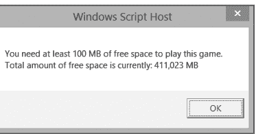

> 图 3.6 使用 `FileSystemObject` 对象访问磁盘驱动信息。© 2014 Cengage Learning。

关于如何使用 VBScript `FileSystemObject` 对象的更多信息，请参阅第 5 章“条件逻辑”，我在其中将向你展示如何创建和写入 Windows 文件以生成报告和日志文件。在第 8 章“存储和检索数据”中，我将介绍如何打开和读取 Windows 文件。

### 检查内置 VBScript 函数

使用 VBScript 的实际优势之一是可以访问其大量的内置函数。在之前的示例中，你看到了如何使用 `FormatNumber()` 函数。内置的 VBScript 函数太多了，无法一一列出。如需完整列表，请参阅附录 D，“内置 VBScript 函数”。

### 演示：平方根计算器

通过使用函数，你可以自由地简化你的脚本。VBScript 的内置函数提供了你无需编写的内置代码。说明这一点最好的方法是使用两个示例。在第一个示例中，我编写了一个小的 VBScript，提示用户输入一个数字，以便脚本计算其平方根。在后续章节中讨论的第二个脚本是对第一个脚本的重写，使用 VBScript 的 `Sqr()` 函数代替了原始编程逻辑。

这是第一个示例：

```
****************************
'Script Name: SquareRoot-1.vbs
'Author: Jerry Ford
'Created: 01/22/14
'Description: 此脚本演示了如何使用艾萨克·牛顿爵士发明的
'数学方法求解平方根
'计算
****************************
```

#### 初始化部分

```
Option Explicit
Dim UserInput, Counter, X
```

```
UserInput = InputBox("输入一个数字", "平方根计算器")
X = 1
For Counter = 1 To 15
    X = X - ((X^2 - UserInput) / (2 * X))
Next
```

如你所见，脚本的第一部分显示一个弹出对话框来收集数字，最后部分显示脚本的最终结果。中间部分是实际工作的结果：

```
X = 1
For Counter = 1 To 15
    X = X - ((X^2 - UserInput) / (2 * X))
Next
```

### 零基础学者 Microsoft WSH 与 VBScript 编程，第四版

一旦实例化，你就可以访问 `WshShell` 对象的方法和属性。`WshShell` 对象的 `Popup()` 方法可以用两种方式使用。第一种选项的语法如下：

```
Response = WScript.Popup(StrText,[Time],[TitleBarMsg],[DialogSettings])
```


第二种选项的语法如下：

```
WScript.Popup(StrText,[Time],[TitleBarMsg],[DialogSettings])
```

`Response` 是一个变量，存储表示用户点击的按钮的数字。`StrText` 代表要显示的消息文本。`Time` 是一个决定对话框显示时长（以秒为单位）的值；如果省略，默认为永久显示。`TitleBarMsg` 是显示在弹出对话框标题栏中的可选消息。`DialogSettings` 是一个数值，用于指定出现在弹出对话框上的按钮和图标。如果省略，则弹出对话框将显示没有图标的 OK 按钮。

要确定指定哪个数值作为 `DialogSettings` 的值，请参见表 3.8 和表 3.9。表 3.8 列出了由 `Popup()` 方法创建的弹出对话框上可以显示的不同按钮集合，表 3.9 显示了你可以使用 `Popup()` 方法显示的不同图标。

## 表 3.8 POPUP() 方法按钮类型

| Value | 按钮 |
|---|---|
| 0 | 显示 OK 按钮 |
| 1 | 显示 OK 和取消 (Cancel) 按钮 |
| 2 | 显示终止 (Abort)、重试 (Retry) 和忽略 (Ignore) 按钮 |
| 3 | 显示 是 (Yes)、否 (No) 和取消 (Cancel) 按钮 |
| 4 | 显示 是和否 按钮 |
| 5 | 显示重试和取消按钮 |

© Jerry Lee, Jr. 版权所有。

## 表 3.9 POPUP() 方法图标类型

| Value | 图标 |
|---|---|
| 16 | 显示停止图标 |
| 32 | 显示问号图标 |
| 48 | 显示感叹号图标 |
| 64 | 显示信息图标 |

© Jerry Lee, Jr. 版权所有。

## 第 3 章 • VBScript 基础

例如，要显示一个包含 OK 按钮且没有任何图标的弹出对话框，你需要为 `DialogSettings` 指定值 0。由于这是 `Popup()` 方法的默认选项，你完全不需要指定此值。要显示一个带有“是”、“否”和“取消”按钮且没有图标的弹出对话框，你为 `DialogSettings` 指定值 3。要显示一个带有 OK 和取消按钮以及信息图标的弹出对话框，你指定值 65（即 1 和 64 的总和）。

如果你使用 `Popup()` 方法的第一种形式（以便确定用户点击了哪个按钮），你需要像此处所示检查 `Response` 的值：

```
Set Wshl = WScript.CreateObject("WScript.Shell")

Response = Wshl.Popup("这是一条文本消息,","Test Script", 5)

If Response = 4 Then

  Wshl.Popup("你点击了重试")

End If
```

表 3.10 列出了 `Popup()` 方法可以返回的值范围。

## 表 3.10 POPUP() 方法返回值

| Value | 结果 |
| --- | --- |
| 1 | OK 按钮 |
| 2 | 取消 (Cancel) 按钮 |
| 3 | 终止 (Abort) 按钮 |
| 4 | 重试 (Retry) 按钮 |
| 5 | 忽略 (Ignore) 按钮 |
| 6 | 是 (Yes) 按钮 |
| 7 | 否 (No) 按钮 |

© Jerry Lee Ford, Jr. 版权所有。

## VBScript InputBox() 函数

VBScript 提供了两个用于显示文本消息和与用户交互的内置函数。`InputBox()` 函数在弹出对话框中显示你的文本消息，该框还包含一个输入字段。你已经在“敲击游戏”和“石头剪刀布游戏”中见过 `InputBox()` 函数的作用。

该函数的语法如下：

```
Response = InputBox(StrText[, TitleBarMsg[], default[], xpos[], ypos]

[, helpfile, context])
```

# 零基础学者 Microsoft WSH 与 VBScript 编程，第四版

`Response` 是一个变量，存储表示用户输入的数字。`Text` 是你想要显示的消息。`TitleBarMsg` 是一个显示在弹出对话框标题栏中的可选消息。`Default` 是一个你可以在弹出对话框中显示的可选答案。`xpos` 和 `ypos` 是可选参数，成对的形式指定弹出对话框在屏幕上的水平和垂直位置。`help` 和 `context` 也是可选的。它们指定了可选的上下文相关帮助文件的位置。

以下语句提供了使用 VBScript `InputBox()` 的另一个示例：

```
PlayerName = InputBox("请输入你的名字")

MsgBox("输入了: " & PlayerName
```

## VBScript MsgBox() 函数

VBScript `MsgBox()` 函数显示一个与 WSH `Popup` 方法产生的弹出对话框非常相似。它允许你通过选择显示的按钮和图标来自定义对话框的外观。你也可以用它来确定用户点击了哪个按钮。

`MsgBox()` 函数的语法如下：

```
MsgBox(TextMsg, buttons[,], TitleBarMsg[, help, context)
```

`TextMsg` 是要在对话框中显示的消息。`buttons` 是出现在弹出对话框上的按钮和图标的表示。`TitleBarMsg` 是显示在弹出对话框标题栏中的可选消息。`help` 和 `context` 是可选的；使用时，它们指定了可选上下文相关帮助文件的位置。

表 3.11 定义了使用 `MsgBox()` 函数时出现在弹出对话框上的不同按钮集合。

## 表 3.11 MsgBox() 函数按钮

| Constant | Value | 说明 |
|---|---|---|
| vbOKOnly | 0 | 显示 OK 按钮 |
| vbOKCancel | 1 | 显示 OK 和取消按钮 |
| vbAbortRetryIgnore | 2 | 显示终止、重试和忽略按钮 |
| vbYesNoCancel | 3 | 显示 是、否和取消按钮 |
| vbYesNo | 4 | 显示 是和否按钮 |
| vbRetryCancel | 5 | 显示重试和取消按钮 |

表 3.12 定义了出现在弹出对话框上的不同按钮集合。

## 表 3.12 POPUP() 方法图标类型

| Value | 图标 | 说明 |
|---|---|---|
| 16 | stop | 显示停止图标 |
| 32 | question mark | 显示问号图标 |
| 48 | exclamation mark | 显示感叹号图标 |
| 64 | information | 显示信息图标 |

要显示一个包含 OK 按钮且没有任何图标的弹出对话框，你为 `DialogSettings` 指定值 0。由于这是 `Popup()` 方法的默认选项，你完全不需要指定此值。要显示一个带有“是”、“否”和“取消”按钮且没有图标的弹出对话框，你为 `DialogSettings` 指定值 3。要显示一个带有 OK 和取消按钮以及信息图标的弹出对话框，你指定值 65（即 1 和 64 的总和）。

如果你使用 `Popup()` 方法的第一种形式（以便确定用户点击了哪个按钮），你需要像此处所示检查 `Response` 的值：

```
Set Wshl = WScript.CreateObject("WScript.Shell")

Response = Wshl.Popup("这是一条文本消息,","Test Script", 5)

If Response = 4 Then

  Wshl.Popup("你点击了重试")

End If
```

表 3.10 列出了 `Popup()` 方法可以返回的值范围。

*(注：由于提供的文本包含大量重复和碎片化内容，已根据逻辑将其合并为连贯的译文。)*

# 陷阱 (Trap)

由于它会向当前活跃的 Windows 应用程序发送按键，因此在脚本运行时，玩家不要打开任何新窗口（应用程序）这非常重要。如果他这样做，脚本将开始向玩家打开的任何应用程序发送按键，从而导致许多不可预知的问题。

`SendKeys()` 方法的语法如下：

```
SendKeys(string)
```

`string` 是一个代表要发送到目标应用程序的按键的值。你可以通过简单地输入内容来发送更多按键，例如：

- `SendKeys "I am"`
- `SendKeys "38"`
- `SendKeys "years old."`

然而，在许多情况下，你可能想要发送其他类型的按键。例如，要发送回车键指令，你需要输入以下内容：

```
SendKeys "[tab]"
```

表 3.14 提供了一个你可能想要使用的 `SendKeys` 按键列表。

## 表 3.14 SENDKEYS() 按键

| 键位 | 对应的 SendKeys() 代码 |
| :--- | :--- |
| 退格键 (Backspace) | (BACKSPACE), (BS), 或 (BKSP) |
| 中断键 (Break) | (BREAK) |
| 大写锁定 (Caps Lock) | (CAPSLOCK) |
| 删除键 (Del or Delete) | (DELETE) 或 (DEL) |
| 向下 | (DOWN) |
| 结束键 (End) | (END) |
| 回车 (Enter) | (ENTER) 或 [tab] |
| 退出 (Esc) | (ESC) |
| 帮助键 (Help) | (HELP) |
| Home键 (Home) | (HOME) |
| 插入键 (Ins or Insert) | (INSERT) 或 (INS) |
| 左箭头 | (LEFT) |

## 表 3.14 SENDKEYS() 按键（续）

| 键位 | 对应的 SendKeys() 代码 |
| :--- | :--- |
| 数字锁定 (Num Lock) | (NUMLOCK) |
| 下翻页 (Page Down) | (PGDN) |
| 上翻页 (Page Up) | (PGUP) |
| 打印屏幕 (Print Screen) | (PRTSC) |
| 右箭头 | (RIGHT) |
| 滚动锁定 (Scroll Lock) | (SCROLLLOCK) |
| Tab (Tab) | (TAB) |
| 上箭头 | (UP) |
| F1 | (F1) |
| F2 | (F2) |
| F3 | (F3) |
| F4 | (F4) |
| F5 | (F5) |
| F6 | (F6) |
| F7 | (F7) |
| F8 | (F8) |
| F9 | (F9) |
| F10 | (F10) |
| F11 | (F11) |
| F12 | (F12) |
| F13 | (F13) |
| F14 | (F14) |
| F15 | (F15) |
| F16 | (F16) |

除了表 3.14 列出的按键外，表 3.15 列出了三种按键组合，这些组合可以发送需要与其他键配合按的特殊按键。例如，如果你正在使用的应用程序可以通过按住 Alt 键并按下 F4 键来关闭，你可以如下执行此操作：

```
SendKeys "%(F4)"
```

## 表 3.15 特殊 SENDKEYS() 按键

| 键位 | 对应的 SendKeys() 代码 |
| :--- | :--- |
| Shift | + |
| Ctrl | ^ |
| Alt | % |

© Jerry Lee Ford, Jr. 版权所有。

# 设计游戏 (Designing the Game)

让我们开始数学游戏（Math Game）。这个游戏将分五个步骤完成。前三个步骤创建与用户交互并运行游戏的逻辑。最后两个步骤执行游戏的演示。这些步骤如下：

1. 添加标准文档模板，并定义脚本使用的任何变量、常量和对象。
2. 向玩家展示方程式并测试玩家的响应，以判断他是否提供了答案，以及该答案是否为数字。
3. 测试玩家提供的答案是否正确。如果不是，则向用户提供如何得到正确答案的方法。
4. 添加启动和控制 WordPad 应用程序所需的语句。
5. 添加启动和控制计算器（Calculator）应用程序所需的语句。

# 开始数学游戏 (Beginning the Math Game)

让我们从添加在本章前面介绍的脚本模板开始，然后按照所示对其进行修改。这包括初始化变量和常量以及设置对象声明语句。

```
********************************************************************************

'脚本名称: Mathgame.vbs

'作者: Jerry Ford

'创建日期: 01/23/14

'描述: 此脚本提示用户解决数学

'表达式，并在用户无法

'解决时演示如何解决它

********************************************************************************
```

```
'初始化部分

Option Explicit
```

# 专为基础初学者的微软 WSH 和 VBScript 编程，第四版

```
Dim WshSh, QuestionOne, ProveIt

'定义在脚本中显示的标题栏消息'
'弹出的对话框'
Const ctitleBarMsg = "The Math Game" (数学游戏)

'实例化 WshShell 对象'
Set WshSh = WScript.CreateObject("WScript.Shell")
```

## 收集玩家答案并测试错误 (Collect the Player's Answer and Test for Errors)

接下来，显示方程式并将玩家的答案存储在名为 `QuestionOne` 的变量中，如下：

```
'向玩家展示方程式

QuestionOne = InputBox("What is 5 * 9 / 3?", ctitleBarMsg)
```

现在，检查玩家是否输入了答案。如果为空，则提示错误。（*注：此处原文似乎漏了部分代码逻辑描述，翻译时根据上下文逻辑补全或保持原意*）

```vb
'向玩家展示方程式

QuestionOne = InputBox("What is 5 * 9 / 3?", ctitleBarMsg)

If QuestionOne = "" Then

    MsgBox "Please enter an answer."

End If
```

另一个测试是确保玩家输入的是数字而不是字符：

```
'确保玩家输入的是数字

If Not IsNumeric(QuestionOne) Then

    MsgBox "Please enter a number."

End If
```

## 检查正确答案 (Check for Correct Answer)

好的，检查玩家提供的答案是否正确。如果是，则表扬玩家；如果不是，则告诉他们如何计算。

```
If QuestionOne = "16" Then

    MsgBox "Correct! You know your math!"

Else

    MsgBox "Incorrect. Here is how to solve it: 5 * 9 = 45, 45 / 3 = 16."

End If
```

## VBScript 基础 (VBScript Basics)

正如你所看到的，使用 `QuestionOne` 变量来存储玩家的输入。

```
'检查玩家提供的答案

If QuestionOne = "16" Then

    MsgBox "Correct! You know your math!"

Else

    MsgBox "Incorrect. Here is how to solve it: 5 * 9 = 45, 45 / 3 = 16."

End If
```

## 与 WordPad 交互 (Interacting with WordPad)

为了使用 WordPad，必须启动它。

```
'启动 WordPad

WshSh.Run "winword"
```

WordPad 可能需要几秒钟来启动：

```
'等待 WordPad 启动

WScript.Sleep 1000
```

使用 `SendKeys` 方法在 WordPad 中写入文本：

```
'向 WordPad 写入文本

WshSh.SendKeys "The answer to 5 * 9 / 3 is 16."
```

## 与计算器交互 (Interacting with the Calculator Application)

游戏的最后一部分打开 Windows 计算器应用程序并解决方程式，以防玩家对通过 WordPad 展示的答案有任何疑问。编写此部分的语句如下：

```
'启动计算器

WshSh.Run "calc"
```

```
'使用计算器应用程序解决方程式

WScript.Sleep 1000

WshSh.SendKeys "5*"

WScript.Sleep 500

WshSh.SendKeys "9"

WScript.Sleep 500

WshSh.SendKeys "/"

WScript.Sleep 500

WshSh.SendKeys "3"

WScript.Sleep 500

WshSh.SendKeys "{ENTER}" '按下回车
```

最后，关闭计算器：

```
'关闭计算器

WshSh.SendKeys "%(F4)"
```


## 最终结果

我建议你运行并测试此脚本以确保它的运行符合预期。例如，尝试输入一个字母而不是答案。然后什么都不输入，直接点击“确定”或“取消”。尝试输入正确和错误的答案，看看会发生什么。这是一个相当长的脚本，因此第一次输入正确的概率很小。如果你在运行脚本时遇到错误，请仔细阅读并查看错误信息是否告诉了哪里有问题，然后修复它。否则，你可能需要双重检查你的拼写。

## 技巧

随着脚本变得越来越复杂，你在开发过程中会遇到越来越多的错误。我建议你学习以模块化的方式开发脚本，一次编写一个部分，并在移动到下一个部分之前对其测试。在第 9 章“处理脚本错误”中，我将为你演示如何这样做。

## 总结

在本章中，你学习了核心和运行时的 VBScript 对象及其相关的属性和方法，并了解了如何在你的 VBScript 中使用它们。你还学习了 VBScript 语法、保留字和特殊字符。此外，你还学习并见证了 VBScript 函数的强大和便利。最后，你学习了显示脚本输出的不同方法。

- 1. 修改数学游戏以使用不同的方程，并修改逻辑以适应适用于 WordPad 和计算器应用程序的语句。
- 2. 尝试使用 `SendKeys()` 方法与其它应用程序（如记事本）交互。
- 3. 花些时间复 VBScript 的内置数学函数，看看你是否可以创建一个类似于平方根计算器新计算器。
- 4. 修改本章之前提供的 VBScript 模板，并根据你的个人偏好进行调整。然后在开始开发新的 VBScript 时使用它。

## 常量、变量、数组和字典

这是书中五个教授 VBScript 基础的关键章节中的第二个章节。在处理任何编程语言时，你需要理解的概念之一就是如何存储、检索和修改数据。本章将教你执行这些任务的多种不同方法。当你完成本章时，你将知道如何编写可以收集和处理数据的脚本。具体来说，你将学习以下内容：

- 如何处理执行时传递给脚本的数据
- 如何存储不变的数据
- 如何处理在脚本执行期间可以变化的数据
- 如何将相关数据的集合作为一个单元处理

### 项目预告：冒险船长的故事

在本章中，你将学习如何创建一个根据用户输入构建幽默冒险故事的游戏。游戏从收集一系列问题的答案开始，并告诉用户这些答案将如何被使用。在收集脚本所需的所有信息后，将显示故事。图 4.1 到 4.3 显示了该脚本在运行 Windows 8.1 的计算机上的执行情况。

## 初学者 Microsoft WSH 和 VBScript 编程，第四版

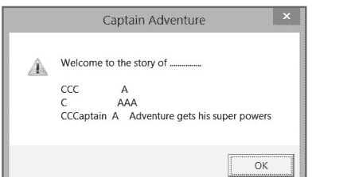

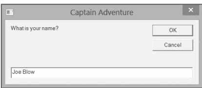

图 4.2 用户是故事的主角。
© 2014 Cengage Learning.

图 4.1 故事的初始启动屏幕。
© 2014 Cengage Learning.

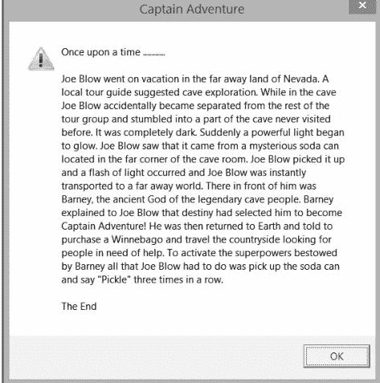

图 4.3 在脚本获取所有所需信息后，故事开始讲述了。© 2014 Cengage Learning.

通过开发这个故事构建游戏，你将学习许多重要的编程技术，包括如何收集、存储和引用数据。此外，你将学习如何控制脚本输出的呈现。

## 理解脚本如何查看数据

VBScript 与其他编程语言一样，需要一种存储数据的方法，以便在脚本执行过程中可以访问。在书中，你已经看到了许多关于 VBScript 如何临时存储和引用数据的示例。我将解释它是如何工作的。

## 第 4 章 • 常量、变量、数组和字典

VBScript 提供了许多不同的语句，允许你定义多种类型的数据。这些 VBScript 语句在表 4.1 中列出。

> 数据是计算机程序在执行期间收集、修改、存储和检索的信息。

| 表 4.1 决定数据如何定义的 VBScript 语句 |
| 语句 | 描述 |
| :--- | :--- |
| `Const` | 定义 VBScript 常量 |
| `Dim` | 定义 VBScript 变量或数组 |
| `ReDim` | 定义动态 VBScript 数组 |

`Const` 语句用于定义脚本执行期间永远不会的数据。例如，在书中你有时会使用字符串来定义弹出对话框中的标准问候消息。`Dim` 语句用于定义变量。变量存储单个数据，例如其名称或日期。`ReDim` 语句用于创建数组。数组用于存储一组相关信息。例如，与其定义 20 个变量来存储 20 个人的信息，不如用单个数组定义这些信息，然后将每个人的信息存储在其中。在本章的剩余部分中，将更详细地检查这些语句中的每一个。

> 变量是存储在内存中的单个数据，如名称、数字或日期。数组用于存储一组相关信息。

## 处理永不变的数据

应该根据数据将如何使用的方式在脚本中定义数据。如果脚本只需要引用一段在脚本开发期间已知数值的数据，则该数据可以定义为常量。常量的一个例子是 `pi` 的数学值。常量的其他例子包括历史上的日期、地名等。

脚本中的常量有两个来源。首先，你可以在脚本中定义自己的常量。另一个选项是引用 VBScript 提供的内置的可用常量集合。

> 常量是一个 VBScript 结构，包含在脚本执行期间不会更改的信息。

## 初学者 Microsoft WSH 和 VBScript 编程，第四版

## 给常量赋值数据

如果你打算编写脚本，并且确定你需要引用一个或多个在脚本执行期间不会更改的值，那么你可以将每个数据项定义为常量。常量的一个非常棒的特性是，一旦定义，其值就无法更改。这防止了它们在脚本执行期间被意外修改。

## 提示

如果你的脚本尝试在初始赋值后修改常量的值，执行时你会看到“非法赋值：常量名”错误消息。打开你的脚本，搜索常量名，并查找尝试修改该值的语句以找到错误源。

要在 VBScript 中定义常量，必须使用 `Const` 语句。该语句语法如下：

```
[Public | Private] ConstName = expression
```

`Public` 和 `Private` 是可选关键字，用于确定常量在整个脚本中的可用性。将常量定义为 `Public` 使在脚本的所有过程中可用。将常量定义为 `Private` 则仅在定义它的过程中可用。`ConstName` 是被定义的常量名称，`expression` 是标识所定义数据的值。为了理解这一切，让我们来看一个例子。

> 过程是一组作为单元处理的语句集合。在第 7 章“使用过程组织脚本”中，你将学习如何使用过程来改进脚本的整体结构并创建可重用单元。

```vbscript
****************************************************
'Script Name: LittlePigs.vbs
'Author: Jerry Ford
'Created: 01/28/14
'Description: 此脚本演示了如何使用常量为脚本
'显示的弹出对话框创建一个标准的标题栏消息
****************************************************
```

```vbscript
' 指定在每个弹出对话框标题栏中显示的消息
Const cTitleBarMsg = "三只小猪"
```

## 第 4 章 • 常量、变量、数组和字典

```vbscript
'显示故事
MsgBox "Once upon a time......", vbOKOnly, cTitleBarMsg
MsgBox "There are 3 little pigs", vbOKOnly, cTitleBarMsg
MsgBox "Who liked to build things.", vbOKOnly, cTitleBarMsg
```

在本示例中，编写了一个小的 VBScript 脚本讲述了一个三只小猪的短故事。脚本开始定义一个命名常量 `cTitleBar`。然后我使用 `MsgBox()` 语句来显示组成故事的文本。`MsgBox()` 语句的第一个参数是文本消息，后面紧跟一个 VBScript 常量 `vbOKOnly`。此常量告诉 VBScript 在弹出的对话框中只显示确定按钮。（`MsgBox()` 常量的完整列表可见第 3 章“VBScript 基础”）。每个 `MsgBox()` 语句的最后部分是 `cTitleBarMsg` 常量。当脚本执行时，VBScript 会自动将值赋给 `cTitleBarMsg` 常量。图 4.4 显示了在运行 Windows 7 的计算机上执行脚本时，第一个弹出对话框是如何出现的。

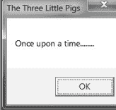

> 图 4.4 通过引用分配给常量的值，你可以为脚本显示的每个弹出对话框创建一个标准的栏消息。
© 2014 Cengage Learning.

## 提示

我建议你为常量应用一种命名规范。良好的命名规范会使你的常量易于识别，并提高脚本整体的可读性。例如，在书中我将使用以下命名规范：

- 常量名以小写 `c` 开头。
- 常量名使用英文单词或易于识别的单词部分来描述其内容。

其他与处理常量相关的任务示例包括为数字、字符串和日期分配赋值。例如，以下语句将值 `1000` 赋给一个名为 `cUpperLimit` 的常量：

```
Const cUpperLimit = 1000
```

要定义一个文本字符串，你必须将被赋值的值放在一对引号内，如下所示：

```
Const cMyName = "Jerry Lee, Jr."
```

类似地，你必须使用一对井号（`#`）在常量中存储日期值，如下所示：

```
Const cMyBirthday = #11-20-64#
```

## VBScript 运行时常量

VBScript 为你提供了大量的内置常量。在第 3 章中，你学习了与 `MsgBox()` 函数相关的常量。例如，以下 VBScript 语句使用 `vbOKOnly` 常量执行了 `MsgBox()` 函数：

```
MsgBox "Welcome to my VBScript game!", vbOKOnly
```

该语句显示一个包含单个确定按钮的弹出对话框。除了这些常量外，VBScript 还提供了帮助你在处理日期和时间时的常量。VBScript 还提供了许多常量，可以帮助你操作文本输出的显示以及变量中存储的数据类型。

## 使用日期和时间常量

表 4.2 列出了 VBScript 日期时间常量。

| 常量 | 值 | 描述 |
| --- | --- | --- |
| `vbSunday` | 1 | 周日 |
| `vbMonday` | 2 | 周一 |
| `vbTuesday` | 3 | 周二 |
| `vbWednesday` | 4 | 周三 |
| `vbThursday` | 5 | 周四 |
| `vbFriday` | 6 | 周五 |
| `vbSaturday` | 7 | 周六 |
| `vbFirstFourDays` | 2 | 新年里至少四天的第一周 |
| `vbFirstFullWeek` | 3 | 一年的第一个完整周 |
| `vbFirstJan1` | 1 | 包含 1 月 1 日的一周 |
| `vbUseOfWeek` | 0 | 操作系统指定的星期几 |

以下脚本演示了如何使用表 4.2 中列出的 `vbFriday` 常量来判断工作周是否结束：

```vbscript
********************************************************************************
'脚本名称: HappyHour.vbs
'作者: Jerry Ford
'创建日期: 01/28/14
'描述: 此脚本告诉用户今天是周五
********************************************************************************
```

```vbscript
'执行脚本初始化活动
Dim TodayDate

' Weekday 是一个 VBScript 函数，返回星期几
TodayDate = Weekday(Date)

If TodayDate = vbFriday then MsgBox "Hurray, it is Friday. Time & "_" _
"to get ready for happy hour!"
```

## 技巧

你可能注意到上一个示例中使用了 `&`。`&` 字符是 VBScript 的字符串连接运算符。它允许你将两部分文本合并为一段文本。脚本的前两行定义了一个变量（我们将在下一节详细讨论变量）。第三行为变量分配了一个数值值。在这种情况下，脚本使用 VBScript `Weekday()` 来执行 VBScript `Date()` 函数。`Date()` 函数获取计算机的当前日期。`Weekday()` 函数提供一个代表该日期星期几的数值。表 4.2 在其 `Value` 列中提供了可能的值范围。如果当前是周五，`Weekday()` 函数返回的值将是 6。因为 `vbFriday` 常值为 6，所以要判断是否是周五，只需要将 `Weekday()` 返回的值与 `vbFriday` 常量进行比较。

## 使用字符串

另一组你可能有用的常量是表 4.3 列出的字符串常量。

表 4.3 VBScript 字符串常量
| 常量 | 值 | 描述 |
| --- | --- | --- |
| `vbCr` | 13 | 回车 |
| `vbCrLf` | 13-10 | 回车和换行 |
| `vbForm` | 12 | 换页 |
| `vbLf` | 10 | 换行 |
| `vbNewLine` | 13-10 | 换行符 |
| `vbNull` | 0 | 空字符 |
| `vbNullString` | -1 | 空字符串 |
| `vbTab` | 9 | 制表符 |

## Windows WSH 与 VBScript 绝对值

使用表 4.3 所示的常量，你可以控制文本的显示方式。例如，看以下脚本：

```vbscript
****************************************************************
'脚本名称: Formatter.vbs
'作者: Jerry
'创建日期: 01/28/14
'描述: 此脚本演示了如何使用常量来控制消息的显示
****************************************************************

Const cTitleBar = "Message"

' 定义一个用于显示对话框内容的变量
Dim StoryMsg

' 使用常量来构建一个消息字符串
StoryMsg = "Once upon a time three pigs" & vbCrLf &
"liked to build things." & vbCrLf &
"They were very happy!" & vbTab

' 显示对话框
MsgBox StoryMsg, vbOKOnly, cTitleBar
```


使用`vbCrLf`和`vbTab`常量来控制消息的显示方式。在运行 Windows 7 的计算机上执行脚本时，图 4.5 显示了输出。


> 图 4.5 脚本在使用了`vbCrLf`常量时的输出。© 2014 Cengage Learning.

如果不使用`vbCrLf`和`vbTab`常量，输出将完全不同，如图 4.6 所示。


> 图 4.6 没有`vbCrLf`和`vbTab`常量的输出。© 2014 Cengage Learning.

## 存储脚本执行期间更改的数据

你编写的大多数程序都有需要修改的数据。例如，你可能会编写一个脚本要求用户输入并在处理时修改数据。在这种情况下，你可以定义变量。脚本有两种类型的变量：你在脚本中定义的变量和脚本可以引用的系统环境变量。

## VBScript 数据类型

与许多编程语言不同，VBScript 只支持一种类型的变量，称为`variant`。然而，`variant`非常灵活，可以存储许多类型的数据。表 4.4 列出了 VBScript 支持的变体类型。

> 变体是一种包含任意数量类型数据的变量类型。

表 4.4 支持的变体类型

| 子类型 | 描述 |
| --- | --- |
| Boolean | 值为 True 或 False 的变体 |
| Byte | 值在 0 到 255 之间的整数 |
| Currency | 范围在 -922,337,203,685,477,508 和 922,337,203,685,477,507 之间的货币值 |
| Date | 代表 100 年 1 月 1 日至 9999 年 12 月 31 日之间日期的数字 |
| Double | 范围为 -1.79769313486232E308 到 -4.9406658412247E-324 或 4.9406658412247E-324 到 1.79769313486232E308 的浮点 |
| Empty | 未初始化的变体 |
| Error | VBScript 错误代码 |
| Integer | 值在 -32,768 和 32,767 之间的整数 |

## 表 4.4 VBSCRIPT 支持的变体子类型（续）

| 子类型 | 描述 |
| --- | --- |
| Long | 值在 -2,147,483,648 到 2,147,483,647 之间的整数 |
| Null | 设置为空值的变体 |
| Object | 一个对象 |
| Single | 浮点数，值在 -3.402823E38 到 -1.401298E-45 之间或 1.401298E-45 到 3.402823E38 之间 |
| String | 长度可达二十亿字符的字符串 |

> * Jenny Lee Ford, Jr. 版权所有。

变体（Variants）会自动识别分配给它的数据类型，并采取相应的操作。当一个值被赋值给变体时，你的脚本可以使用 VBScript 的任何内置函数对其进行处理。同样，如果将一个字符串赋值给变体，你的脚本可以使用 VBScript 的任何内置字符串函数对其进行处理。

与常量一样，VBScript 允许你控制其识别变体中存储的值类型的方式。例如，如果你将 100 赋值为变量值，那么 VBScript 会自动将其解释为数字。但如果你将值括在引号中，VBScript 会将其视为字符串。

VBScript 还提供了使用 VBScript 函数将数据从一种类型转换为另一种类型的能力。你的脚本可以改变 VBScript 查看和处理数据的方式。例如，以下 VBScript 语句定义了一个变量`MyBirthday`并为其赋值了一个文本字符串 "November 20, 1964"：

```
MyBirthday = "November 20, 1964"
```

> 本书中“字符串”（string）和“文本”（text）术语同用，均指基于文本的数据或包含在双引号内的其他类型的数据。

VBScript 将此变量的值视为文本字符串。然而，使用`CDate()`函数，你可以将字符串值转换为日期格式：

```
MyBirthday = CDate(MyBirthday)
```

现在，VBScript 不再将变量的值视为 "November 20, 1964"，而是将其视为 11/20/1964。

## 提示

VBScript 提供了大量的转换函数，你可以用它们将一种数据类型转换为另一种。这些函数包括`Asc()`、`CBool()`、`CByte()`、`CBur()`、`CDate()`、`CDbl()`、`Chr()`、`Cint()`、`CLng()`、`CSng()`和`CStr()`。关于如何使用这些函数的更多信息，请参见第 7 章。

## 定义变量

VBScript 提供了两种变量的方法：动态定义和使用`Dim`语句正式定义。要在脚本中动态创建变量，你只需要这样引用它：

```
MyBirthday = #November 20, 1964#
```

使用这种方法，你可以在脚本的任何地方定义变量。然而，我强烈建议不要以此方式创建变量。更好的做法是在脚本开头一次性正式定义脚本中使用的所有变量。这可以保持结构清晰。此外，我也强烈建议你使用`Dim`语句。`Dim`语句的语法如下：

```
Dim VariableName
```

`VariableName`是要定义的变量名称。例如，以下语句定义了一个名为`MyBirthday`的变量：

```
Dim MyBirthday
```

定义变量后，你可以像这样给它赋值：

```
MyBirthday = #November 20, 1964#
```

始终使用`Dim`语句可以使你的代码更具可读性，并显式地传达你的意图。你可以在脚本中使用多个`Dim`语句定义多个变量：

```
Dim MyBirthday
Dim MyName
Dim MyAge
```

然而，为了减少脚本中的代码行数，你也可以使用单个`Dim`语句一次定义多个变量，只需用逗号和空格隔开每个变量：

```
MyBirthday, MyName, MyAge
```

正如我之前提到的，在运行变量之前正式定义它是更好的。确保你遵循这一简单规则的一种方法是在脚本开头放置`Option Explicit`。如果你尝试在未先定义变量的情况下引用变量，`Option Explicit`语句会在脚本执行期间产生错误。因此，在处理变量时，`Option Explicit`有助于帮助你遵循良好的编程规范。

为了测试`Option Explicit`语句的使用，让我们来看另一个示例：

```
********************************************************************************
'Script Name: BigBadWolf.vbs
'Author: Jerry Ford
'Created: 01/29/14
'Description: 此脚本演示了如何使用 Option Explicit 语句
********************************************************************************
'为了对此脚本使用的所有变量进行显式声明
Option Explicit

'创建一个变量来存储狼的名字
Dim WolfName

'将狼的名字赋值给变量
WolfName = "Mr. Wiggles"

'显示故事
MsgBox "从前，有一只名叫 " & WolfName & " 的大坏狼，它喜欢吃小猪", vbOKOnly
```

在这个示例中，`Option Explicit`语句是脚本的第一条语句。通过成为脚本的第一条语句，`Option Explicit`将影响后续所有的变量。下一个语句定义了一个表示狼名字的变量。在脚本中，你会发现运行正常。接下来，通过删除注释修改脚本并再次运行。这一次，它没有执行而是显示了错误。图 4.7 显示了未定义变量错误信息。

## 第 4 章 • 常量、变量、数组和字典

总结一下，以下列表提供了你在处理变量时应遵循的指南：

- 在脚本开头定义变量。
- 使用`Option Explicit`语句强制声明。
- 使用`Dim`语句定义每个变量。

到本章目前为止，我还没有遵循这些规则，因为我还没有涉及到。然而，从现在开始，你将在每个脚本中一致地应用它们。

## 技巧

我想要指出一个规则集的例外。在某些情况下，你可以将变量及其值的可用范围限制在脚本的特定部分。这被称为“创建局部变量”，在处理敏感变量时非常有用，可以确保不会被脚本的其他部分意外修改。我将在本章稍后提供更多关于局部变量的信息。

## 变量命名规则

另一个值得注意的是变量的正确命名。VBScript 有许多必须遵守的规则，以避免命名不当引起的错误。这些规则包括：

- 变量名长度少于 256 个字符。
- 变量名必须以字母开头。
- 创建变量名时仅可以使用字母、数字和下划线（`_`）。
- 预留字不能作为变量名。
- 变量名不能包含空格。
- 变量名必须是唯一的。

关于 VBScript 变量的一个重要点是，它们是不区分大小写的。这意味着大小写不同不会影响 VBScript 识别变量的能力。因此，如果脚本定义一个变量为`MyBirthday`然后将其引用为`MYBIRDAY`，VBScript 会将这两种拼写视为同一个变量。然而，在代码中混合使用大小写会让查看代码的人感到困惑，因此你应该尽力在整个脚本中保持一致的大小写。

在脚本中，你应该为变量分配具有描述性的名称，并在变量的拼写上遵循标准方法。到本书为止，我一直使用完整的单词或单词的一部分来定义变量，并让每个单词或单词部分的首字母大写，例如`Dim MyBirthday`。

许多程序员在命名变量时采用的另一种方法是在每个变量名的开头添加三个字符的前缀，这有时被称为“匈牙利命名法”（Hungarian Notation）。例如，不再将变量命名为`MyBirthday`，而是将其命名为`dtmBirthday`。这样，当有人检查变量名的前三个字符时，就能判断出它包含的数据类型。

下列出了 VBScript 支持的各种变量子类型的典型前缀：

- Boolean（布尔型）`bln`
- Byte（字节型）`byt`
- Currency（货币）`cur`
- Date（日期）`dtm`
- Double（双精度浮点型）`dbl`
- Error（错误）`err`
- Integer（整数）`int`
- Long（长）`lng`
- Object（对象）`obj`
- String（字符串）`str`
- Variant（变体）`var`

现在我已正式向你介绍了匈牙利命名法，在本书的其余部分将随处可见。

## 变量作用域

处理变量时需要理解的另一个关键是变量作用域。在这种范围内，作用域是指从脚本中的多个位置引用变量及其赋值值的能力。

VBScript 支持两种变量作用域：全局（global）和局部（local）。全局作用域变量可以从脚本中的任何位置访问。然而，局部作用域变量只能在定义过程内部引用。VBScript 支持两种过程：子程序（subroutines）和函数（functions），这两者将在第 7 章中详细讨论。

如你所知，过程是一组作为一个单元执行的语句集合或分组。在不急于过早深入的情况下，只需注意：在过程之外定义的变量是全局作用域，这意味着它可以从脚本中的任何位置访问，包括脚本过程内部。而局部作用域的变量则定义在过程内部。

## 使用表达式修改变量值

在本章中，你已经看到等号（`=`）用于给变量赋值，如下所示：

```
strName = "Jerry Lee Ford, Jr."
```

要更改赋值给变量的值，只需再次使用等号并赋一个新值，如下所示：

```
strName = "Jerry L. Ford, Jr."
```

## 第 4 章 • 常量、变量、数组和字典

之前的两个示例设置并修改了赋值给文本变量的值。然而，这种方法同样适用于其他类型的变量，例如包含数值的变量：

在此示例中，定义了变量并分配了一个数值。随后，将赋值给该变量的值修改为另一个数字。VBScript 提供了通过等号和 VBScript 算术运算符修改数值变量值的其他方法。表 4.5 列出了 VBScript 算术运算符。

| 运算符 | 描述 |
| --- | --- |
| + | 加法 |
| - | 减法 |
| * | 乘法 |
| / | 除法 |
| - | 取负 |
| ^ | 幂 |
| \ | 整数除 |
| Mod | 取模 |

表 4.5 VBSCRIPT 算术运算符

解释如何使用这些算术运算符的最佳方法是给你展示一个示例。看以下脚本：

```
********************************************************************************
'脚本名称: Mathdemo.vbs
'作者: Jerry Ford
'创建日期: 01/29/14
'描述: 此脚本演示如何使用各种 VBScript
'算术运算符
********************************************************************************
'强制显式声明脚本中使用的所有变量
Option Explicit

'创建一个变量来存储狼的名字
Dim intMyAge

'分配我的初始起始年龄
intMyAge = 37
WScript.Echo "I am " & intMyAge

'明年我将是
intMyAge = intMyAge + 1
WScript.Echo "Next year I will be " & intMyAge

'但我还没那么老
intMyAge = intMyAge - 1
WScript.Echo "But I still am " & intMyAge

'如果我的年龄是现在的两倍，我会是：
intMyAge = intMyAge * 2
WScript.Echo "This is twice my age " & intMyAge

'如果我将那个值除以 5，加上 5、3，然后乘以 10
intMyAge = intMyAge / 5 + 5 + 3 * 10
WScript.Echo "This says that I will be " & intMyAge
```

如果你在运行 Windows 8.1 的计算机上运行此脚本，将看到图 4.8 所示的结果。

这四个计算很容易理解。在第一次计算中，我取了`intMyAge`的值并加 1。同样，在下一次计算中我减了 1，然后在第三条语句中将`intMyAge`乘以 2。最后一次计算需要更多的解释。你可能对这个计算结果感到惊讶。乍一看，VBScript 似乎尝试按以下方式求解方程：

1. 将`intMyAge`（值为 74）除以 5 得到 14.8。
2. 将 14.8 加 3 得到 17.8。
3. 将 17.8 乘以 10。

（注：原文文本后续存在大量 OCR 错误和重复乱码，已根据逻辑进行了清理和翻译）

## 第 4 章 • 常量、变量、数组和字典

你可以按照以下步骤在 Windows 8.1 上访问系统环境变量：

1. 将鼠标指针移动到屏幕右下角，并在显示图标时点击搜索图标。
2. 在应用搜索字段中输入“控制面板”并按回车。
3. 在控制面板中，点击“系统和安全”链接，然后点击“系统”链接。
4. 点击“高级系统设置”显示“系统属性”窗口。
5. 点击“环境变量”按钮显示“环境变量”窗口，如图 4.9 所示。

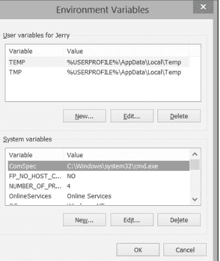

**图 4.9** 查看 Windows 环境变量。© 2014 Microsoft Corporation. 经许可使用。

用户环境变量的示例包括：

- `TEMP`：可以存储临时文件的文件夹
- `TMP`：另一个可以存储临时文件的文件夹

系统环境变量的示例包括：

- `NUMBER_OF_PROCESSORS`：对于单处理器计算机，显示值为 1
- `OS`：显示操作系统的名称
- `Path`：指定当前的搜索路径
- `PATHEXT`：指定标识可执行文件的扩展名列表

## 初学者 Microsoft WSH 和 VBScript 编程，第四版

- `PROCESSOR_ARCHITECTURE`：标识计算机处理器类型
- `PROCESSOR_IDENTIFIER`：显示计算机处理器的详细说明
- `PROCESSOR_LEVEL`：显示处理器的步级别（stepping level）
- `PROCESSOR_REVISION`：显示处理器的版本号
- `TEMP`：可以存储临时文件的文件夹
- `TMP`：另一个可以存储临时文件的文件夹
- `Windir`：标识 Windows 文件夹的位置

要访问环境变量，你需要使用 WSH。例如，查看以下脚本：

```
********************************************************************************
'脚本名称: ComputerAnalyzer.vbs
'作者: Jerry Ford
'创建日期: 01/29/14
'描述: 此脚本演示了如何使用 WSH 访问环境变量
********************************************************************************
'强制对脚本中使用所有变量进行显式声明
Option Explicit
```


创建一个变量来存储狼的名字：

```vb
Dim objWshObject
```

设置 `WScript.WshShell` 对象的实例：

```vb
Dim objWshObject = WScript.CreateObject("WScript.Shell")
```

使用 `WScript.Shell` 的 `ExpandEnvironmentStrings()` 方法来查看环境变量：

```vb
MsgBox "此台计算机运行的 la是 " & _
objWshObject.ExpandEnvironmentStrings("%OS%") & vbCrLf & _
"并且有 " & objWshObject.ExpandEnvironmentStrings("%NUMBER_OF_PROCESSORS%") & _
" 个处理器。"
```

示例中的第一条语句使用 `WScript` 对象的 `CreateObject()` 方法创建了 WSH `WScript.Shell` 对象的实例。脚本的下部分使用 `WScript.Shell` 对象的 `ExpandEnvironmentStrings()` 方法显示特定环境变量的值。

## 第 4 章 • 常量、变量、数组和字典

虽然脚本演示了如何访问环境变量，但它实际上并没有什么用。环境变量的另一个用途可能是验证脚本启动的操作系统，并在它在错误的操作系统上启动时终止脚本执行，如下所示：

```vb
Set objWshObject = WScript.CreateObject("WScript.Shell")
If objWshObject.ExpandEnvironmentStrings("%OS%") <> "Windows_NT"
MsgBox "此脚本设计仅运行于 " &
"Windows 2000, XP, 2003, Vista, 2008, 7 或 8。"
WScript.Quit
```

在此示例中，第一行代码检查脚本是否运行在 Windows NT, 2000, XP, 2003, Vista, 2008, 2012, 7 或 8 上。如果不是，则执行第二和第三行代码，告知用户该情况并终止脚本的执行。

## 处理相关数据的集合

在使用变量时，你可以在脚本执行期间存储海量信息。事实上，你仅受限于计算机可用内存的大小。然而，维护大量的变量可能会很困难，并使你的脚本难以维护。

通常，脚本处理的数据项之间存在相互关系。例如，如果你编写了一个脚本从用户那里收集姓名列表以生成个人联系人列表，那么将姓名列表作为一个单元进行存储和管理，比作为单个名称的集合要方便得多。VScript 提供了数组的支持，以便执行此类任务。

例如，你可以将数组想象成一组嵌套的索引卡片，每张卡片都包含一个收到派对邀请的人的名字。如果你给卡片集合分配一个名称 `ItsMyParty`，你可以通过编程方式引用集合中的任何一张卡片为 `ItsMyParty(index)`，其中 `index` 是卡片上的数字。

> 一个相关数据的索引列表。数组中的第一个元素（或数据项）被分配索引 0。第二个元素被分配索引 1，依此类推。

## 一维数组

到目前为止，在所有示例中，我都是通过引用索引位置来访问每个数组元素的。只要数组很小，这种方法就可行，但对于处理大型数组的内容，这并不是一种方法。要创建一个一维数组，使用以下语法：

```vb
Dim Party(3)
Party(0) = "Jerry"
Party(1) = "Molly"
Party(2) = "William"
Party(3) = "Alexander"
```

上述语句中的第一个指向 `Molly` 元素。第二个指向数值。

## 多维数组

如所述，VScript 支持多达 60 维的数组，尽管通常两个维度足够了。让我们来看看如何定义多维数组，你可以将其想象成一个双列表格。第一列包含客人的姓名，第二列存储电话号码。

```vb
Dim Party(3,1)
Party(0,0) = "Jerry"
Party(0,1) = "550-9933"
Party(1,0) = "Molly"
Party(1,1) = "550-8876"
Party(2,0) = "William"
Party(2,1) = "697-4443"
Party(3,0) = "Alexander"
Party(3,1) = "696-4344"
```

在此示例中，创建了一个深四宽二的多维数组，允许存储八个数据项。要引用此多维数组中的任何元素，你必须提供它的行和列坐标，如下：

```vb
WScript.Echo Party(1,0)
WScript.Echo Party(1,1)
```

上述两个语句中的第一个指向 `Molly` 元素。第二个指向与 `Molly` 相关的电话号码。

> 关于多维数组的另一种思考方式是将其考虑由一组一维数组组成的一维数组。

## 处理数组内容

到目前为止，在所有示例中，我都是通过专门引用索引位置来访问每个数组元素的。只要数组很小，这种方法运行良好，但对于处理大型数组（可能包含成百或数千条目）的内容，这不是一种实际的方法。对于这种规模的数组，需要不同的方法。VScript 对此问题的解决方案是 `For...Each...Next` 循环。`For...Each...Next` 循环的语法如下：

```vb
For Each element In group
Statements . . .
Next [element]
```

`element` 是你用于遍历每个数组元素的变量。`group` 是数组的名称。你添加的用于处理每个数组内容的 VBScript 语句。`For_Each_Next` 循环会继续处理，直到数组中的每个元素都被检查完毕。

`For_Each_Next` 循环允许你的脚本使用几条语句处理数组的全部内容。所需的语句数量不会随着数组的大小而增加。因此，你可以使用 `For_Each_Next` 循环用极少的精力处理极大的数组。例如，下面的脚本定义了一个名为 `GameArray()` 的数组并填充了五个元素。它仅使用 `For_Each_Next` 循环中的一行代码就处理了整个数组。

```
********************************************************************************
脚本名称: ArrayDemo.vbs
'作者: Jerry Ford
'创建: 01/30/14
'描述: 此脚本演示了如何使用一维 VBScript 数组存储和检索数据。
********************************************************************************
```

执行脚本初始化活动：

```vb
Option Explicit

'定义脚本中使用的变量
Dim intCounter '用于控制 For...Each循环的变量
Dim strMessage '要在弹出的对话框中显示的消息
```

```vb
strMessage = "The array contains the default game " &
  "information: " & vbCrLf & vbCrLf
```

```vb
Dim astrGameArray(4) = 定义一个可以容5个索引元素的数组
astrGameArray(0) = "The default username
astrGameArray(1) = "Nevada" '一个值得去的地方
astrGameArray(2) = "soda can" '一个有趣的对象
astrGameArray(3) = "Barney" '一个亲密
astrGameArray(4) = "Pickle" '一个喜欢的甜点
```

```vb
For Each intCounter In astrGameArray
  strMessage = strMessage & intCounter & vbCrLf
Next
WScript.Echo strMessage
```

如果你在运行 Windows 8.1 的计算机上使用 `CScript.exe` 宿主运行此脚本，将获得如图 4.10 所示的输出。

## 第4章 • 常量、变量、数组和字典

```
Powershell
PS C:\scripts> CScript arraydemo.ubs
Microsoft (R) Windows Script Host Version 5.8
Copyright (C) Microsoft Corporation. All rights reserved.

The array contains the following default game information:

Joe\Blow
Neada
soda can
Barney
Pickle

PS C:\scripts>
```

图 4.10 迭代处理数组的所有内容。

© 2014 Microsoft Corporation. 经微软许可使用。

这几行代码可以轻松处理数组，即使它有几百或上千个元素。`For_Each_Next` 循环的替代方案是编写单独语句来访问数组中存储的每个元素，如下：

```vb
'显示数组的内容
WScript.Echo strMessage
WScript.Echo strGameArray(0)
WScript.Echo strGameArray(1)
WScript.Echo strGameArray(2)
WScript.Echo strGameArray(3)
WScript.Echo strGameArray(4)
```

为单独访问数组内容编写语句在小型程序中可能看起来并不费力，但想象一下处理一个拥有 1,000 个元素的数组吧！

## Xref（交叉引用）

关于如何使用 `For_Each_Next` 循环的更多信息，请参阅第 6 章，“处理数据集合”。

## 获取数组的大小

VBScript 为你提供了两个内置函数，使处理数组变得更容易：

- `Ubound()`。它返回一个数值，表示数组的上界或最高元素。

- `Lbound()`。它返回一个数值，表示数组的下界或最低元素。

`Lbound()` 实际上并不很有用，因为所有 VBScript 数组的下界始终等于 0。相反，`Ubound()` 函数可能非常有用，特别是在处理动态数组时。我将在本章稍后的部分介绍动态数组。`Ubound()` 函数的语法如下：

```vb
Ubound(ArrayName, Dimension)
```

`ArrayName` 是要返回其上界的数组名称。`Dimension` 用于指定要返回其上界的数组维度。例如，你可以像这里这样检索名为 `astrItsMyparty` 的单维数组的上界：

```vb
intSize = Ubound(astrItsMyParty)
```

在这种情况下，数组的上界被赋值给名为 `intSize` 的变量。让我们来看一个 `Ubound()` 函数实际作用的快速示例：

```vb
Dim intCounter = '定义一个在处理数组内容时使用的变量
Dim strMessage = '定义一个用于存储显示输出的变量
```

```vb
Dim astrGameArray(2) = 定义一个可以容纳三个索引元素的数组
astrGameArray(0) = 'Joe Blow' '默认用户名
astrGameArray(1) = 'Nevada' '一个值得去的地方
astrGameArray(2) = 'soda can' '一个有趣的对象
```

```vb
intSize = Ubound(astrGameArray)

For intCounter = 0 to intSize
strMessage = strMessage & astrGameArray(intCounter) & vbCrLf
Next
```

```vb
MsgBox strMessage
```

## 调整数组大小

有时在开发脚本时，无法知道数组需要多少个元素。例如，你可能预期数组只包含几个元素。处理这种情况的方法之一是定义一个固定大小的数组。但是，如果你之后使用 `Redim` 语句设置大小，原始数据将会丢失。

另一种更灵活的设置数组的方法是使用 `Redim` 语句。例如，你可能想扩展数组以容纳更多数据。这通过在 `Redim` 语句中使用 `Preserve` 关键字来实现。

## Trap（陷阱）

如果你决定将数组调整为较小尺寸，请注意不要无意丢失任何数据。例如，如果你定义了一个可以容纳 100 个元素的数组，随后使用 `Preserve` 关键字将其调整为容纳 50 个元素，那么数组中的前 50 个元素实际上会被保留。

## 构建动态数组

到目前为止，书中的所有数组都是静态的，这意味着它们的大小在执行时就已经预先确定了。但在现实世界中，你永远不知道数组需要存储多少个元素。例如，你可能会编写一个脚本，允许用户提供一份要邀请参加派对的人员列表。根据用户拥的朋友的数量，存储在数组中的数据量可能会发生巨大变化。VBScript 对这种情况的解决方案是动态数组。动态数组是一种在执行过程中可以根据需要多次调整大小的数组。

你可以像这里这样使用 `Dim` 语句来定义一个动态数组：

```vb
Dim astrItsMyParty()
```

注意，括号内没有提供数组的索引数字。这允许你在脚本的后续部分返回，并使用 `ReDim` 语句来调整数组的大小，如下所示：

```vb
ReDim astrItsMyParty(2)
```

一旦调整了大小，你就可以添加新条目：

```vb
astritsMyParty(0) = "Molly"
astritsMyParty(1) = "William"
astritsMyParty(2) = "Alexander"
```

如果脚本稍后需要向数组添加更多元素，你可以再次调整其大小：

```vb
ReDim Preserve astrItsMyParty(4)
```

该语句增加了数组的大小，使其现在可以多容纳两个元素。注意在 `ReDim` 语句上使用了 `Preserve` 关键字。此参数用于防止数组在大小增大之前丢失存储在其中的任何数据。

## 陷阱

动态数组的大小可以增加也可以缩小。如果你减小动态数组的大小，即使在 `ReDim` 语句中添加了 `Preserve` 关键字，数组中存储的所有元素也会丢失。

现在让我们来看另一个使用动态数组的示例。在这个示例中，数组 `astrItsparty` 初始化被设置为可以存储一个元素的容量。然后提示用户提供一个要添加的名字列表。每当提供新名字时，脚本都会动态将数组的大小增加 1，允许其存储额外信息。

```vb
Dim astrItsMyParty()
```

```vb
ReDim astrItsMyParty(0)
```

```vb
Dim intCounter, strListOfNames
```

## 《Microsoft WSH and VBScript Programming for the Absolute Beginner, Fourth Edition》

```vb
intCounter = 0

Do While UCase(strListOfNames) <> "QUIT"
strListOfNames = InputBox("Enter the name of someone to be invited: ")

If UCase(strListOfNames) <> "QUIT"
    astrimsMyParty(intCounter) = strListOfNames
Else
    Exit Do
End If

intCounter = intCounter + 1
ReDim Preserve astrMyParty(intCounter)
Loop
```

在这个示例中，使用了数组 `astrMyParty` 的语句来定义它，然后使用 `ReDim` 语句设置其初始大小，允许其存储单个元素。在脚本设置了一些变量后，我添加了一个 `Do...While` 循环来收集用户输入。该循环一直运行直到用户输入 `Quit`。

> 注意
>
> `UCase()` 是一个 VBScript 函数，将字符串字符转换为大写。使用 `UCase()`，你可以编写处理用户输入的脚本，无论用户在输入数据时如何使用大小写。

假设用户没有退出，脚本会将用户输入的名称添加到字符串中并存储在名为 `strListOfNames` 的变量中。否则，`Do...While` 循环将终止。每输入一个新名字，就会执行 `ReDim` 语句，通过增加大小来重新调整数组。

## 擦除数组

当你的脚本完成对数组存储数据的处理后，你可以擦除或删除它，从而为其他工作释放计算机的一小部分内存。这是通过使用 `Erase` 语句实现的，其语法如下：

```vb
Erase ArrayName
```

例如，可以使用以下语句擦除名为 `astrGameArray` 的数组：

```vb
Erase astrGameArray
```

## 在字典中存储数据

除了变量和数组外，VBScript 还允许你使用字典（`Dictionary`）对象存储和管理数据。使用字典，数据存储在关联数组中，并使用键值对进行检索（而不是像数组那样使用数据索引位置）。数据使用“键（`Keys`）”存储在字典中。“键（`Keys`）”可以是数字、字符串或 VBScript 支持的任何其他类型的数据。字典提供了与数组相同的益处，同时在数据存储和检索方面提供了更大的灵活性。此外，字典对象还为你提供了许多不同的属性和方法，用于访问和管理数据。

字典对象支持三个属性，列如下：

- `Count`。返回字典对象中的项目总数。

- `Item`。使用字典对象中指定的键检索或添加项目。

- `Key`。向字典对象中添加一个键。

字典对象还提供了许多方法：

- `Add`。向字典对象中添加一个键/项对。

- `Exists`。如果字典对象中存在指定的键，则返回布尔值 `true`；如果值不存在则返回 `false`。

- `Items`。返回字典对象中所有项目的数组。

- `Keys`。返回字典对象中所有键的数组。

- `Remove`。从字典对象中删除键/项对。

- `Remove All`。从字典对象中移除所有键/项对。

## 键和值

在 VBScript 中操作字典对象，首先定义一个引用它的变量。一旦完成，就可以如下所示创建对象的实例：


```vb
Dim dictObject
Set dictObject = CreateObject("Scripting.Dictionary")
```

## 添加字典项

在实例化字典对象后，你就可以开始以键值对的形式向其存储项，如下所示：

```vb
dictObject.Add "Model555", "Red Bike"
dictObject.Add "Model888", "Blue Bike"
dictObject.Item("Model999") = "Green Bike"
```

第一个语句使用字典对象的`Add()`方法添加了名为`Model555`的键，为其分配了`Red Bike`的值。第二个语句添加了第二个键`Model888`。最后一条语句进行了键/值赋值。

## 检索字典项

在创建并填充字典后，你就可以开始处理存储其中的数据。作为如何进行此操作的示例，请看以下语句：

```vb
If dictObject.Exists("Model555") = True Then
MsgBox "Model555 is a " & dictObject.Item("Model555")
End If
```

在这个示例中，使用字典的`Exists()`方法确定指定的键是否存在。如果存在，则使用`Item()`方法检索关联的值。

## 删除字典项

如有需要，你可以像添加那样容易地从字典删除键/项对。为此，你使用字典对象的`Remove()`方法。例如，以下语句显示了如何使用`Remove()`方法删除与其键关联的数据元素：

```vb
dictObject.Remove("Model555")
```

如你所见，该语句从字典中删除了与`Model555`键关联的值。或者，可以使用字典对象的`RemoveAll()`方法删除字典中所有的键/项对，如下所示：

```vb
dictObject.RemoveAll()
```

## 处理运行时传递给脚本的数据

到目前为止，你在本章看到的每个脚本都期望拥有硬编码的常量、变量和数组。脚本访问待处理数据的另一种方式是将其设定为允许用户传递执行时参数。

## 向脚本传递参数

要向脚本传递参数，你必须从命令行启动脚本，如下：

```
CScript DisplayArgs.vbs tic tac toe
```

> 参数是在执行开始时传递给脚本的数据片段。例如，设计用于从一个位置复制文件到另一个位置的脚本可能会接收要复制的文件名作为参数。

在上一条语句中，使用了`CScript.exe`执行主机来启动一个 VBScript 脚本`DisplayArgs.vbs`。有三个参数被传递给脚本进行处理。每个参数之间用空格隔开。

接下来的示例显示了语句的略微变化。在这种情况下，脚本仍然传递了三个参数，但由于第二个参数包含空格，因此必须将其用引号括起来：

`cscript DisplayArgs.vbs "tic tac" toe`

当然，为了让脚本在执行时接受并处理参数，必须对其进行相应的设置，如下一节所示。

# 设计接受参数输入的脚本

如上一节所示，要设置脚本以接受参数，你可以像下面的脚本所示使用`WScript.Arguments`对象：

```vbscript
********************************************************************************
'脚本名称: ArgumentProcessor.vbs
'作者: Jerry Ford
'创建日期: 01/30/14
'描述: 此脚本演示了如何处理用户在执行时
'传递给的参数
********************************************************************************
```

'对此脚本中使用的所有变量进行显式声明

Option Explicit

```vbscript
'定义脚本执行期间使用的变量
Dim objWshArgs, strFirstArg, strSecondArg, strThirdArg
```

```vbscript
'设置 WshArguments对象的实例
Set objWshArgs = WScript.Arguments
```

```vbscript
'使用 WshArguments对象的 Count 属性来验证是否接收了
'三个参数。如果没有收到三个参数，则显示错误
'消息并终止脚本执行。
If objWshArgs.Count <> 3 then
    WScript.Echo "Error: Invalid number of arguments."
    WScript.Quit
End If
```

'将每个参数赋值给一个变量以便处理

strFirstArg = objWshArgs.Item(0)

strSecondArg = objWshArgs.Item(1)

strThirdArg = objWshArgs.Item(2)

```vbscript
'显示赋值给每个变量的值
WScript.Echo "The first argument is " & strFirstArg & vbCrLf & _
"The second argument is " & strSecondArg & vbCrLf & _
"The third argument is " & strThirdArg & vbCrLf
```

要使用`WshArguments`对象，脚本必须首先创建它的实例，如下：

`Set objWshArgs = WScript.Arguments`

接下来，脚本使用`WshArguments`对象的`Count`属性确保已向脚本传递了三个参数。如果收到的参数少于三个，则显示错误消息并终止执行。否则，脚本继续并将每个参数赋值给变量。每个参数都由`WshArguments`对象存储在索引列表中，并使用对象的`Item(i)`方法进行引用。`Item(0)`指向传递给脚本的第一个参数，`Item(1)`指向第二个，`Item(2)`指向第三个参数。

最后，使用`WScript.Echo`方法显示脚本的每个参数。以下显示了当使用`CScript.exe`执行主机并传入三个参数（tic, tac 和 toe）时，脚本的输出情况：

```cmd
C:>cscript.exe ArgumentProcessor.vbs tic tac toe
Microsoft (R) Windows Script Host Version 5.8
Copyright (C) Microsoft Corporation. All rights reserved.

The first argument is tic
The second argument is tac
The third argument is toe

C:\>
```

同样，以下输出显示了当只向脚本传递两个参数时的情况：

```cmd
C:>cscript.exe ArgumentProcessor.vbs tic tac
Microsoft (R) Windows Script Host Version 5.8
Copyright (C) Microsoft Corporation. All rights reserved.

Error: Invalid number of arguments.

C:\>
```

# 回到冒险队长的故事

现在让我们回到本章的编程项目——冒险队长的故事（Story of Captain Adventure）。在这个编程项目中，你将开发一个脚本，用于显示一个描述故事主角冒险险长如何首次获得超能力的故事。通过开发这个脚本，你将有机会测试你对如何处理 VBScript 常量、变量和字符串格式常量的知识。

## 设计游戏

该项目的基本设计是向用户提一系列问题（而不告诉玩家这些答案将用于何处），然后利用玩家提供的信息来构建一个关于虚构英雄冒险险长的幽默动作故事。

该项目将分五完成：

1. 添加标准文档模板并在其中填写信息。

2. 定义脚本将使用的常量和变量。

3. 创建欢迎用户进入故事的启动界面。

4. 使用`InputBox()`函数创建存储用户提供数据的变量。

5. 编写故事，将存储在脚本变量和常量中的数据添加其中。此外，使用 VBScript 字符串在通过`MsgBox()`函数显示故事之前控制故事文本的格式。

# 开始编写冒险队长脚本

在定义了涉及步骤的大纲后，整合该项目的第一步是打开编辑器并按如下设置脚本模板：

```vbscript
********************************************************************************
'脚本名称: Captain Adventure.vbs
'作者: Jerry Ford
'创建日期: 02/01/14
'描述: 此脚本提示用户回答一系列问题
'并使用答案创建一个幽默动作故事。
********************************************************************************
```

'执行脚本初始化

Option Explicit

上一节介绍的此模板为你提供了一个编写脚本说明的地方。此外，模板包含了`Option Explicit`语句，这是基于假设开发的任何脚本将至少使用一个变量。

## 设置常量和变量

创建冒险队长脚本的下一步是指定脚本将使用的常量和变量：

```vbscript
'指定出现在每个对话框标题栏中的消息
Const cGameTitle = "Captain Adventure"

'指定脚本使用的变量
Dim strWelcomeMsg, strName, strVocation, strObject, strFriend
Dim strFood, strStory
```

第一行代码定义了一个名为`cGameTitle`的常量。该常量用于定义脚本任何对话框中显示的消息。这允许你只需定义一次标题消息，并在需要时应用，无需重复输入。

最后一行代码定义了脚本将使用的多个变量。第一个变量`strWelcomeMsg`将存储显示在启动界面中的消息。

> 有时启动界面用于提醒用户注册应用程序。在其他情况下，启动界面旨在程序加载时间较时分散用户的注意力，或用于宣传应用程序或脚本开发者的网站。为脚本添加启动界面让你在脚本开始执行之前与用户进行交流的机会；它可以显示指令或其他有用信息。

## 创建启动界面

正如我所说，为脚本添加启动界面让你有机会显示你的网站地址、游戏说明或其他你认为对用户有信息。

以下语句显示了构建启动界面的一种方法。`strWelcomeMsg`用于定义在启动界面显示的文本。显示的消息文本使用 VBScript 常量进行格式化，使其更具吸引力。

```vbscript
'指定在初始启动界面显示的消息
strWelcomeMsg = "Welcome to the story of ......................." & vbCrLf & _
vbCrLf & "CCC" & space(14) & "A" & vbCrLf & _
"C" & space(17) & "AAA" & vbCrLf & _
Captain A Adventure gets his super powers* & _
' 欢迎用户进入故事
MsgboxWelcomeMsg, vbOkOnly + vbExclamation, cGameTitle
```

最后，使用 VBScript 的`MsgBox()`函数显示启动界面。在这种情况下，`MsgBox()`函数中的`vbOkOnly + vbExclamation`常量指示 VBScript 在弹出的对话框中仅显示“确定”按钮和感叹号。此外，添加了`cGameTitle`常量以显示脚本的自定义标题栏消息。

## 收集用户输入

下面的五行代码使用 VBScript 的`InputBox()`函数来收集用户提供的数据。这段代码包含以下问题/指令：

- 你的名字是什么？

- 说出一个你想去的地方的名字。

- 说出一个奇怪的物体。输入一位好朋友的名字。

- 输入你最喜欢的甜点的名称。

```
'从用户收集收集信息
strName = InputBox("What is your name?", cGameTitle,"Joe Blow")
strVacation = InputBox("Name a place you would like to visit.", -
cGameTitle,"Nevada")
strObject = InputBox("Name a strange object.", cGameTitle,"soda can")
strFriend = InputBox("Type the name of a close friend.", -
cGameTitle,"Barney")
strFood = InputBox("Type the name of your favorite dessert.", -
cGameTitle,"Pickle")
```

请注意，用户只得到了关于脚本正在寻找的输入类型的少量信息。这是故意为之，旨在为剧情提供某种程度的可预测性。

你可能还会注意到每个`InputBox()`语句的最后一个参数。我添加该参数是为了让脚本显示的每个对话框都会自动显示一个默认答案。通过这种方式提供默认答案可以帮助用户了解你正尝试收集什么类型的信息。

## 组合并显示故事

组合 Captain Adventure 脚本的最后一步是组合故事。这是通过输入故事文本，并在故事适当的位置插入脚本变量的引用完成的。此外，使用`vbCrLf`字符串来改进故事的显示。

整个故事被组合成单个字符串，存储在名为`Story`的变量中。最后，使用 VBScript 的`MsgBox()`显示完成的故事。

- 组合 Captain Adventure 故事

strStory = "Once upon a time ................." & vbCrLf & vbCrLf & 

strName = " " went on vacation in the far land of " & strVacation & 

" A local tour guide suggested cave exploration. In the cave & 

strName & " accidentally became separated from the rest of the tour & 

group & stumbled into a part of the cave never before. & 

"It was completely dark. Suddenly a powerful light began to glow. & 

strName & " saw that it came from a mysterious " & strObject & " & 

located in the far corner of the cave room. " & strName & " picked & & 

it up and a flash of light occurred & " & strName & " was " & & 

instantly transported to a far away world. In front of him & & 

"was " & strFriend & " explained to " & that " & & 

people. " & strFriend & " , the ancient God of the legendary cave & & 

destiny had selected him to become Captain Adventure! He was & & 

then returned to Earth and told to purchase a Winneboo & travel & & 

the countryside looking for people in need of help. To activate & & 

the superpowers bestowed by " & strFriend & " all that " & strName & & 

had to pick up the " & strObject & " and said " & Chr(34) & & 

strCode & Chr(34) & " three times in a row." " & vbCrLf & vbCrLf & 

The End"

- '显示故事

MsgBox strStory, vbOkExclamation, cGameTitle

注意上述语句在使用`Chr(34)`。`Chr(34)`是将 ANSI 代码转换为字符的 VBScript 函数。ANSI 代码 34 代表双引号。

## 最终结果

运行脚本并测试它，以确保一切都符合预期。请注意，此脚本将 VBScript 的字符串长度推到了极限。如果你提供的脚本信息过长，故事的部分可能会被截断。

## 总结


你在本章中涵盖了大量内容。你现在知道如何定义和操作常量与变量，包括 VBScript 的内置常量和 Windows 环境变量。此外，你学习了如何使用 VBScript 常量编写脚本输出，以及如何使用内置 VBScript 函数将数据从一种变体类型转换为另一种。最后，你学习了 VBScript 变体以及内置 VBScript 函数，学习了如何将相关数据集合存储在数组中以便更高效的存储和处理，并开发可以处理执行时传递输入的脚本。

1. 通过收集额外的用户输入并向剧情添加更多文本来修改 Captain Adventure 故事。
2. 尝试使用数组来存储 Captain Adventure 故事中收集的用户输入，而不是将数据存储在单个变量中。
3. 为你认识的人开发自己的故事并作为电子贺卡发送给他。
4. 在开发自己的故事时尝试使用 VBScript 常量改进故事的格式。

# 5

## 条件逻辑

每个编程语言都允许对条件进行测试。这种能力是编程的基石之一。它允许根据用户或计算机的数据进行测试，并根据结果调整脚本的执行。

在任何编程语言中，你都需要能够测试一个条件是否为真，以便开发复杂的逻辑过程。VBScript 提供了两种不同的语句来执行此功能。这些语句如下：

- **If.** `If` 语句根据逻辑表达式或条件的结果允许或跳过程序部分的执行。
- **Case.** 这是一种正式的编程结构，允许编程人员在处理简单表达式的结果时进行视觉化的流程控制。

## 第 5 章 • 条件逻辑

这两个语句的力量和重要性怎么强调都不为过。例如，假设你在不知道具体薪水的情况下接受了某人的工作，现在你已经完成了工作并正在等待发工资。在等待期间，你考虑着将如何使用这笔新财富。过了一会儿，你决定如果拿到了 250 美元，你就买一台电视；如果拿得少于这个金额，你就买一台收音机。这种测试非常适合用作 `If` 语句。让我们把这个情景重写为更像程序的这种格式：

+   如果你的工资等于 $250
    那么 买一台电视
    否则
    买一台收音机
    结束If

如你所见，逻辑非常直观，并且很好地从英语翻译成了伪代码。我使用了**粗体文本**来标识示例的部分，以指出涉及的关键 VBScript 编程组件。我将在本章稍后详细介绍这些关键字每个的含义。

回到我们的场景：可能在思考几分钟后，你决定根据收到的金额多少，你可能会用工资做几件事。在这种情况下，你可以使用 VBScript 的 `Select Case` 语句在伪代码中勾勒你决策的逻辑。

+   `Select Case` 你的工资
    `Case` 如果你得到 $250，你会买一台电视
    `Case` 如果你得到 $200，你会买录像机
    `Case` 如果你得到 $100，你会买一台收音机
    `Case` 其他 你将去吃顿午饭
    结束 Select

| 定义 |
| :--- |
| 伪代码是脚本的一种粗略的类英语的大纲或草图。通过用伪代码写出你认为编写脚本所需的步骤，你为自己提供了一个初始的第一级脚本设计，它将作为构建最终产品的基础。 |

再次，我使用了**粗体文本**来标识示例的部分，以指出涉及的关键 VBScript 编程组件。在本章的接下来两个部分中，我将详细详细分解 `If` 和 `Select Case` 语句的组件，并向你展示它们的具体原理。

## If 语句

VBScript `If` 语句允许你比较两个值或条件，并根据测试结果更改脚本的执行。该语句的语法如下：

+   `If` 条件 `Then`
    语句
    `ElseIf` 条件-n `Then`
    语句
    `Else`
    语句
    `End If`

`If` 语句以 `If` 关键字开始，以 `End If` 结束。条件代表正在执行的比较。例如，你可能想查看 `X` 的值是否等于 250，如下：

```vb
If X = 250 Then
```

关键字标识一个或多个语句列表的开始。语句是一个占位符，代表你提供想要执行的任何脚本的位置。例如，下面的示例显示了一个完整的 `If` 语句，用于检查变量的值是否为 250。如果是（即测试结果为真），则会显示一条消息：

```vb
If X = 250 Then
    WScript.Echo "去买那台电视吧!"
End If
```

你可以在 `Then` 和 `End` 关键字之间添加任意数量的语句。

```vb
If X = 250 Then
    WScript.Echo "去买那台电视吧!"
    WScript.Echo "顺便买一本电视节目指南吧。"
    WScript.Echo "别忘记说谢谢。"
End If
```

但如果测试的条件被证明为假呢？嗯，在之前的测试中，什么都没有发生。然而，通过添加 `Else` 关键字和一个或多个额外的语句，脚本有了一条执行路径。

```vb
If X = 250 Then
    WScript.Echo "去买那台电视吧!"
    WScript.Echo "顺便买一本电视节目指南吧。"
    WScript.Echo "别忘记说谢谢。"
Else
End If
```

图 5.4 提供了此示例所示逻辑的流程图视图。

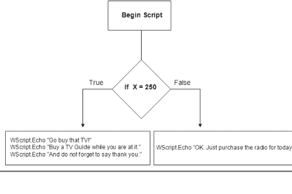

图 5.4 概述典型 `If` 语句背后逻辑的流程图。© 2014 Cengage Learning。

## 在现实世界中

程序员有时通过首先创建一个流程图开始脚本开发。流程图作为脚本开发的视觉工具描述了脚本或程序的逻辑流，并提供了一个宝贵的文档工具。流程图开发对于创建复杂脚本有很大帮助。流程图帮助程序员在脚本开发之前将其想法形式化。

你可以通过添加一个或多个 `ElseIf` 关键字来扩展 `If` 语句，每个关键字都可以测试另一个备选条件。例如，看下面的 VBScript 语句：

```vb
If X = 250 Then
    Script.Echo "去买那台电视吧!"
    Script.Echo "顺便买一本电视节目指南吧。"
    Script.Echo "别忘记说谢谢。"
ElseIf X = 200 Then
    Script.Echo "买录像机"
ElseIf X = 100 Then
    Script.Echo "买收音机。"
Else
    Script.Echo "好的。也许你只是去吃午饭了。"
End If
```

## 嵌套 If 语句

使用 `If` 语句的另一种方法是将它们相互嵌入。这允许你开发能够测试条件并根据测试结果进一步测试其他条件的脚本。

Microsoft WSH 和 VBScript 编程入门，第四版

提示

通过**嵌套**（将一个语句嵌入另一个 `If` 语句中），你可以开发复杂的逻辑。对于嵌套的 `If` 语句数量没有限制。

# 重温 RockPaperScissors.bs

好了。你学习了许多关于 `If` 语句的知识，包括它的语法和各种用法。我在本书的前几章节中构思 VBScript 示例时面临的最大挑战之一是使用尚未涵盖的 VBScript 语句来创建游戏。但有一个例外：在大多数情况下我是成功的，我只是无法避免 `If` 语句——尽管我尽量减少使用它。

其中一个游戏就是使用 `RockPaperScissors.bs` 脚本的。现在我终于提供了 `If` 语句的完整回顾，让我们重温这个游戏并看看如何改进它。

```vb
'在尝试使用它们之前，正式声明脚本中的每个变量
Dim objWshShell, strAnswer, strCard, getRandomNumber
```

```vb
'创建 WScript 对象实例以便以后使用
'Popup 方法
Set objWshShell = WScript.CreateObject("WScript.Shell")
```

```vb
'显示游戏规则
objWshShell.Popup "欢迎来到石头剪剪刀游戏。" & &
'这里是游戏的 " & &
'规则：1. 与电脑相同则平局。2. 纸盖住石头获胜。3. 石头打碎剪刀并获胜。4. 剪刀剪开纸并获胜。",
```

```vb
'提示用户选择选择
strAnswer = InputBox("输入纸、石头或剪刀。", _, 
'让我们玩个游戏吧！')
'让电脑随机选择一个
Randomize
intGetRandomNumber = Round(FormatNumber(Int((3 * Rnd) + 1)))
```

```vb
'为随机选择的数字赋值
If intGetRandomNumber = 3 then strCardImage = "rock"
```

# 零基础入门 Microsoft WSH 和 VBScript 编程，第四版

```vb
If getRandomNumber = 2 then strCardImage = "scissors"

If getRandomNumber = 1 then strCardImage = "paper"

'显示游戏结果，以便用户可以看到自己是否赢了

objWshShell.Popup "你选择了: " & strAnswer & Space(12) & _

"电脑选择了: " & strCardImage
```

图 5.5 显示了在运行 Windows 7 的计算机上执行时，按目前编写的脚本生成的完整游戏的输出。

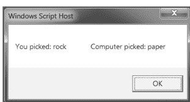

> 图 **5.5** 玩石头、布、剪刀。

© 2014 Cengage Learning.

首先，让我们通过添加在第 3 章“VBScript 基础”中引入的脚本模板来更新脚本。

```
********************************************************************
'脚本名称: RockPaperScissors-2.vbs
'作者: Jerry Ford
'创建日期: 02/04/14
'描述: 此脚本重新回顾了 RockPaperScissors.vbs 脚本，该脚本首次
'在第 3 章引入，并使用高级条件逻辑对其进行了更新。
********************************************************************
```

接下来，让我们通过添加另一个名为 `Results` 的变量来重写 `dim` 部分：

```vb
Dim objWshShell, strAnswer, strResults
```

`strResults` 在脚本中用于存储游戏结果（即谁赢谁输）。让我们在脚本中添加以下语句：

```vb
Set objWshShell = WScript.CreateObject("WScript.Shell")
```

此语句创建了 `objWshShell` 对象的实例。该对象的 `Quit()` 方法将在脚本后部分中使用，用于在用户未能提供有效选择（即玩家没有选择石头、布或剪刀）时终止执行。

现在已经定义了脚本将使用的变量和对象，让我们为 `strResults` 变量分配一个默认值 `None`：

```vb
strResults = "None"
```

## 第 5 章 • 条件逻辑

除非玩家提供了正确的选择，否则该值在整个脚本执行过程中将保持为 `None`，并最终导致脚本终止并显示错误消息。然而，如果玩家提供了正确的回答，该回答将分配给 `strResults` 变量，然后由脚本进行分析。

原始的 `RockPaperScissors.vbs` 脚本在一个弹出对话框中显示游戏说明，并在第二个弹出对话框中提示玩家选择石头、布或剪刀。这种方法虽然可行，但使用两个弹出对话框有点笨拙。让我们修改脚本，以同时显示游戏指令并收集玩家输入，如下所示：

如你所见，我使用了 VScript `InputBox()` 函数来显示弹出对话框，并使用 `vbLf` 常量对指令进行了格式化以获得更好的演示。

脚本的两个部分与原始脚本相同：

```vb
Randomize
getIntRandomNumber = Round(FormatNumber(Int(3 * Rnd) + 1))
If getRandomNumber = 3 then strCardImage = "rock"
If getRandomNumber = 2 then strCardImage = "scissors"
If getRandomNumber = 1 then strCardImage = "paper"
```

正如第 2 章“Windows Script Host 介绍”所解释的，第一对语句的结果产生一个 1 到 3 之间的随机数。接下来的三行将这些值中的每个赋值为“石头”、“布”或“剪刀”。脚本的其余部分将由所有新代码组成。脚本不再简单地显示玩家和脚本对石头、布或剪刀的选择，然后让玩家自己判断谁赢，而是现在执行分析。首先，在脚本底部添加以下行：

```vb
If strAnswer = "rock" Then
If getRandomNumber = 3 then strResults = "Tie"
If getRandomNumber = 2 then strResults = "You Win"
If getRandomNumber = 1 then strResults = "You Lose"
End If
```

这组语句仅在玩家输入“rock”时执行。三个 `If` 语句将用户的选择与脚本随机选择的决定进行比较，并确定游戏结果。

# 零基础入门 Microsoft WSH 和 VBScript 编程，第四版

现在复制这组语句两次，并按照如下方式修改每组，以添加对剪刀和布的选择的测试：

```vb
If strAnswer = "scissors" Then
If intGetRandomNumber = 3 Then strResults = "You Lose"
If intGetRandomNumber = 2 Then strResults = "Tie"
If intGetRandomNumber = 1 Then strResults = "You Win"
End If

If strAnswer = "paper" Then
If intGetRandomNumber = 3 Then strResults = "You Win"
If intGetRandomNumber = 2 Then strResults = "You Lose"
If intGetRandomNumber = 1 Then strResults = "Tie"
End If
```

现在向脚本中添加以下语句：

```vb
If strResults = "None" Then
objWShell.Popup("Sorry. Your answer was not recognized. " & \
"Please type rock, paper, or scissors in all lowercase letters.")
WScript.Quit
End If
```

这些语句仅在玩家提供正确回答时执行。使用 `objWShell.Popup` 方法显示结果：

```vb
objWShell.Popup("你选择了: " & strAnswer & Space(12) & _
"电脑选择了: " & strCardImage
```

图 5.5 显示了在运行 Windows 7 的计算机上执行时，按目前编写的脚本生成的完整游戏的输出。


> 图 **5.5** 玩石头、布、剪刀。

© 2014 Cengage Learning.

## 第 5 章 • 条件逻辑

## Select 语句

`If` 语句是测试表达式很好的工具。使用 `ElseIf`，你可以修改 `If` 语句进行额外的测试。在功能上，它与 `If` 语句并没有区别。

以下是 `Select` 的语法：

```vb
Select Case
Case value
  statements
Case value
  statements
Case Else
  statements
```

`Select` 语句以 `Select Case` 开始。然后指定要与多个 `Case` 语句比较的表达式。可选，可以添加 `Case Else` 语句以提供替代方案。

为了演示如何使用 `Select` 语句，我重写了 `RockPaperScissors.vbs` 脚本中的大部分逻辑。如下完整脚本所示，不仅减少了脚本所需的代码行数，还提高了脚本的可读性：

```
********************************************************************
'脚本名称: RockPaperScissor-3.vbs
'作者: Jerry Ford
'创建日期: 02/04/14
'描述: 此脚本重新回顾了 RockPaperScissors-2.vbs 脚本，
用 Case Select 替换部分 IF 语句逻辑。
********************************************************************

执行脚本初始化活动

```

```vb
Dim objWshShell, strAnswer, strImage, strResults, getRandomNumber

Set objWshShell = WScript.CreateObject("WScript.Shell")
```

```vb
strResults = "None"
```

提示用户选择选择

电脑随机选择选择

```vb
Randomize

getRandomNumber = FormatNumber(Int((3 * Rnd) + 1))

If getRandomNumber = 3 then strCardImage = "rock"

If getRandomNumber = 2 then strCardImage = "scissors"

If getRandomNumber = 1 then strCardImage = "paper"
```

```vb
Select strAnswer

Case "rock"

If getRandomNumber = 3 then strResults = "Tie"
```


如果`getRandomNumber = 2`，则`strResults = "You Win"`。

如果`getRandomNumber = 1`，则`strResults = "You Lose"`。

`Case "scissors"`：

- 如果`getRandomNumber = 3`，则`strResults = "You Lose"`。
- 如果`getRandomNumber = 2`，则`strResults = "Tie"`。
- 如果`getRandomNumber = 1`，则`strResults = "You Win"`。

`Case "paper"`：

- 如果`getRandomNumber = 3`，则`strResults = "You Win"`。
- 如果`getRandomNumber = 2`，则`strResults = "You Lose"`。
- 如果`getRandomNumber = 1`，则`strResults = "Tie"`。

`End Select`

```
If strResults = "None" Then
    objWShell.Popup("Sorry. Your answer was not recognized. " & \
        "Please type rock, paper, or scissors in all lowercase letters.")
    WScript.Quit
End If
```

## Case "剪刀"

```
If getRandomNumber = 3 Then strResults = "You Win"
If getRandomNumber = 2 Then strResults = "You Lose"
If getRandomNumber = 1 Then strResults = "Tie"
```

```
Case Else
    objWshShell.Popup "Sorry. Your answer was not recognized. " & _
        "Please type rock, paper, or scissors in all lowercase letters."
    Script.Quit
```

```
End Select
```

```
objWshShell.Popup "You picked: " & space(12) & Answer & vbCrLf & _
    nvbCrLf & "Computer picked: " & space(2) & strCardImage & vbCrLf & _
    nvbCrLf & "--------------------------" & vbCrLf & vbCrLf & "Results: " & _
    strResults
```

# 使用 VBScript 运算符进行更复杂的测试

到本书为止，你看到的每个`If`或`Select`语句示例都涉及单一的比较类型：相等。这是一种强大的比较形式，但有时你的脚本需要测试更广泛范围的值。例如，假设你想编写一个脚本询问用户的年龄，以便判断用户是否足够大可以玩你的游戏。（可能你不想让小于 18 岁的用户玩游戏。）编写一个使用 100 个语句或一个带有 100 个对应`Case`语句的`Select`语句来测试人的年龄将耗时。相反，通过将用户的年龄与范围值进行比较，你可以节省大量时间。为了完成此任务，你如下所示使用 VBScript 小于运算符（`<`）：

```
intAge = InputBox("How old are you?")

If intAge < 18 Then
    MsgBox "Sorry you are too young to play this game."
    Script.Quit()
Else
    MsgBox "OK. Let's play!"
End If
```

在这个示例中，VBScript `InputBox()`函数收集用户的年龄并将其赋值给名为`intAge`的变量。然后，`If`语句会检查`intAge`是否小于 18，如果是，则停止游戏。

你编写上述示例的另一种方法是使用 VBScript 小于等于运算符（`<=`），如下：

```
If intAge <= 17 Then
```

# 针对初学者的 Microsoft WSH 和 VBScript 编程，第四版

如果你使用`<=`运算符，如果用户只有 17 岁或以下，该语句将不会执行。VBScript 还提供了大于运算符（`>`）和大于等于运算符（`>=`），允许你反转以下示例中的逻辑：

```
intUserAge = InputBox("How old are you?")

If intUserAge > 17 Then
    MsgBox "OK. Let's play!"
Else
    MsgBox "Sorry but you are too young to play this game."
    WScript.Quit()
End If
```

表 5.1 VBScript 比较运算符。

| 表格 5.1 VBScript 比较运算符 | |
| :--- | :--- |
| `=` | 等于 |
| `<>` | 不等于 |
| `<` | 小于 |
| `>` | 大于 |
| `<=` | 小于等于 |
| `>=` | 大于等于 |

VBScript 不会像对算术运算符那样对比较运算符规定顺序或优先级。相反，每个比较操作都按照它们出现的顺序（从左到右）执行。

# 回到行星知识问答

现在让我们回到本章的开头，开发行星知识问答游戏。在程序程序中，你将创建一个 VBScript，向玩家展示一个关于行星知识的问答。游戏会提出问题、收集玩家的答案、计算最终结果、根据分数为玩家分配等级，最后创建一个摘要文本报告。通过完成这个项目，你将更多地使用`If`和`Select Case`语句。你还将学习如何使用许多内置的 VBScript 函数。

## 游戏开发

以下步骤概述了你完成游戏开发需要经历的过程：

1. 添加标准文档模板并填写其信息。
2. 定义脚本将使用的常量和变量。
3. 创建欢迎用户进入游戏的启动界面，并判断用户是否想玩游戏。
4. 使用`InputBox()`函数显示问题、收集玩家的答案，并添加逻辑判断玩家的答案对错。
5. 使用`Select Case`语句根据正确回答问题的数量为玩家分配等级。
6. 显示玩家的分数和等级。

# 开始行星知识问答游戏

通过打开脚本编辑器并从另一个脚本剪切并粘贴脚本模板来开始此脚本。然后复制并修改模板，使其与行星知识问答游戏的信息相关：

```
********************************************************************************
'Script Name: PlanetTrivia.vbs
'Author: Jerry Ford
'Created: 02/04/14
'Description: 此脚本创建了一个行星知识问答游戏。
********************************************************************************
```

```
'Perform script initialization activities
Option Explicit
```

## 设置常量和变量

下一步是定义脚本使用的变量和常量：

```
Dim intGame, strSplashImage, strAnswerOne, strAnswerTwo, strAnswerThree, strAnswerFour, strAnswerFive, intAnswerCorrect, strRank
```

```
Const cYes = 6
Const cNo = 2
Const cTitleMsg = "Planet Trivia Quiz"
Const cSplashMsg = "Would you like to play the game?"
```

```
intAnswerCorrect = 0
```

## 创建启动界面

创建一个询问用户是否玩游戏的启动界面：

```
strSplashImage = MsgBox(cSplashMsg, cYes + cNo, cTitleMsg)
```

```
If strSplashImage = cYes Then
    '游戏在此继续
Else
    MsgBox "Thank you for taking the quiz!"
    WScript.Quit()
End If
```

# 显示问答问题并收集玩家答案

下一步是添加组成游戏的问题。以下问题组成问答：

- 离太阳最近的行星叫什么？
- 火星叫什么？
- 金星距离太阳几颗行星？
- 哪颗行星以海神命名？
- 你喜欢的行星叫什么？

显示并评分第一个问答问题的语句如下：

```
strAnswerOne = InputBox("What is the name of the planet that is closest to the
"the sun?", cTitleMsg)
```

```
If LCase(strAnswerOne) = "mercury" Then
    intAnswerCorrect = intAnswerCorrect + 1
End If
```

正如你所看到的，第二个问答问题的处理方式与第一个完全相同。唯一的区别是问题的内容以及用于存储玩家答案的变量名称。

```
strAnswerTwo = InputBox("What is the name of the red planet?", cTitleMsg)
```

```
If LCase(strAnswerTwo) = "mars" Then
    intAnswerCorrect = intAnswerCorrect + 1
End If
```

初级学者 Microsoft WSH 与 VBScript 编程，第四版

```vb
If CStr(strAnswerThree) = "2" Then
    intnumberCorrect = intnumberCorrect + 1
End If
```

构成第四个问题的语句与前两个问题遵循相同的模式。

```vb
strAnswerFour = InputBox("What planet was named after the god of the " " & & \
    "sea?", cTitlebarMsg)
```

```vb
If LCase(strAnswerFour) = "neptune" Then
    intnumberCorrect = intnumberCorrect + 1
End If
```

接下来显示的第五问题的构造值得进一步检查。首先，第一个语句使用 VBScript 的`LCase()`函数将玩家的答案转换为小写。VBScript 的`Instr()`函数接收答案并在字符串"mercuryearth-marsjupitersaturnuranusneptune"中搜索，以查看是否找到匹配项。该字符串包含了太阳系行星的名称列表。

```vb
strAnswerFive = InputBox("What is the name of your favorite planet?",
    cTitlebarMsg)
```

```vb
If LCase(strAnswerFive) > 3 Then
    If Instr(1, "mercuryearthmarsjupitersaturnuranusneptune",
        LCase(strAnswerFive), 1) >
        0 Then
        intnumberCorrect = intnumberCorrect + 1
    End If
End If
```

`Instr()`函数从字符串的第一个字符开始搜索，检查它可以找到正在查找的文本（即水星、金星、地球、火星、木星、土星、天王星或海王星）。`Instr()`函数的语法如下：

```vb
Instr(start, string1, string2[, compare])
```

`start`指定脚本中的字符位置，从左到右确定开始搜索的位置。`string1`指定要搜索的文本，`string2`指定要执行的搜索类型。值 0 表示二进制比较，值 1 表示文本比较。

`Instr()`函数返回`string2`在另一个字符串中首次出现的位置。如果没有找到匹配的字符串，它将返回 0，在这种情况下意味着用户提供的答案错误。否则，它将返回找到搜索字符串的起始字符位置。如果在列表中找到了搜索字符串，`InStr()`函数返回的值将大于 1，在这种情况下`intNumberCorrect`的值将加 1。

然而，玩家可能不知道某个行星的名称，他或她可能只输入一两个字符，例如字母 A。由于字母 I 在至少一个行星的名称中出现，玩家最终会获得该问题的正确答案分数。显显然，这并不好。为了保持游戏的公平性，我们使用了`VScriptLen()`函数来确保用户提供的名称至少包含四个字符（即任何行星名称中最短的名称的长度）。这样一来，玩家必须知道行星名称的前四个字符才能获得正确答案。

## 第 5 章 • 条件逻辑

## 为玩家排名评分

此时，脚本已经有了足够的逻辑来显示所有五个问题并判断玩家哪些问题回答是正确的。此外，它还记录了正确答案的总数。你接下来需要做的是添加逻辑，根据正确答案的数量显示玩家排名。这可以使用`Select`语句来实现，如下：

```vb
Select Case intNumberCorrect
    Case 5 "User got all five answers right"
        strRank = intNumberCorrect & " stars."
    Case 4 "User got four of five answers right"
        strRank = intNumberCorrect & " stars."
    Case 3 "User got three of five answers right"
        strRank = intNumberCorrect & " stars."
    Case 2 "User got two of five answers right"
        strRank = intNumberCorrect & " stars."
    Case 1 "User got one of five answers right"
        strRank = intNumberCorrect & " star."
    Case 0 "User did not get any answers right"
        strRank = intNumberCorrect & " stars."
End Select
```

变量`intNumberCorrect`包含玩家回答正确的答案数量。该该变量的值将与六种可能的情况进行比较，以决定授予玩家多少颗星。

## 显示玩家的分数和排名

游戏做的最后一件事是在弹出对话框中显示玩家的分数和排名：

```vb
MsgBox "You answered " & intNumberCorrect & " out of 5 correct." & _
    vbCrLf & vbCrLf & "You earned " & _
    strRank,, cTitlebarMsg
```

## 初级学者 Microsoft WSH 与 VBScript 编程，第四版

你可以看到，最后一个语句并不复杂。你只需要使用 VBScript 的`MsgBox()`函数、变量`strNumberCorrect`和`strRank`，以及常量`vbCrLf`来向玩家显示消息。

## 完整的脚本

大功告成了！你已经了创建"行星知识问答游戏"所需的所有信息。当你准备好时，启动游戏并对其进行测试。这样做时，请确保提供不同的正确和错误答案组合，然后验证游戏是否正确处理了你的答案。当你确信一切运行如预期时，

## 总结

本章涵盖了大量内容。你学习了如何使用`If`和`Case`语句。利用这些信息，你更新了游戏：

- 修改行星知识问答游戏以询问你的姓名
- 修改行星知识问答游戏以显示问题
- 通过在数组中添加问题来扩展行星知识问答游戏

# 第 6 章 · 处理数据集合

- `Do...Until`。这建立了一个循环，直到指定的条件最终变为真时才停止。
- `While...End`。这建立了一个循环，只要条件保持为真就会一直迭代。

## For...Next 语句

`For...Next`语句用于创建执行特定次数的循环。例如，如果你正在创建一个需要玩家输入五次猜测的游戏，你可以使用`For...Next`循环来控制支持脚本中数据收集部分的逻辑。

`For...Next`语句的语法如下：

```
For counter = begin To end [StepValue]
    statements
Next
```

`counter`是一个用于控制循环执行的变量。`begin`是一个数值，指定计数器变量的起始值。`end`指定计数器变量的结束值（即达到该值时终止循环的执行）。`StepValue`是一个可选设置，用于在递增`counter`的值时指定`For...Next`语句的增量（即每次迭代结束时加到`counter`的值）。如果省略，分配给`StepValue`的值始终为 1。

为了更好地理解`For...Next`循环的操作，请看以下两个示例：一个使用循环收集数据，另一个使用`For...Next`循环收集相同的数据。在下面的示例中，你正在创建一个游戏，玩家需要输入他五种最喜欢的食物名称。你可以这样处理这种情况：

```
strFoodList = ""
strFoodList = strFoodList & " " & InputBox("Type the name of a food " & \
    "that you really like.")
```


`strFoodList = strFoodList & " " & InputBox("Type the name of a food " & \`

`"that you really like.")`

`strFoodList = strFoodList & " " & InputBox("Type the name of a food " & \`

`"that you really like.")`

`strFoodList = strFoodList & " " & InputBox("Type the name of a food " & \`

`"that you really like.")`

`strFoodList = strFoodList & " " & InputBox("Type the name of a food " & \`

`"that you really like.")`

`MsgBox "You like : " & strFoodList`

如你所示，这个示例通过反复重复相同的语句来收集用户输入。然后，作为其完成工作的证明，它使用`MsgBox()`函数显示了所收集的数据。

## Microsoft WSH 和 VBScript 编程入门，第四版

像这样收集五条数据有点费劲。现在想象一种你想要收集更多数据的情况。与其像上一个示例那样反复输入相同的语句，不如使用`For...Next`循环。

```
Dim intCounter, strFoodList

strFoodList = " * *"

For intCounter = 1 To 5

strFoodList = strFoodList & " " & InputBox("Type name of a " & \

"food that you really like.")

Next

MsgBox "You like : " & strFoodList
```

图 6.5 是该示例在运行 Windows 8.1 的计算机上执行时产生的输出。

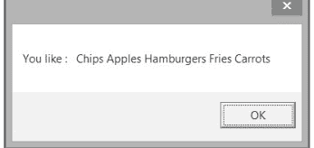

图 6.5 使用`For...Next`循环收集并处理用户输入。
© 2014 Cengage Learning.

这个新脚本比之前的示例短了二行。与之前的示例不同，除了循环结束值的值外，此脚本不需要为了适应额外数据而进行修改。例如，使用`For...Next`循环使其能够收集 10 条数据，你只需要将其修改为：

```
For intCounter = 1 To 10

strFoodList = strFoodList & " " & InputBox("Type the name of a " & \

"food that you really like.")

Next
```

可选地，你可以使用`Exit`语句随时跳出`For...Next`循环，如下所示：

```
Dim intCounter, strFoodList, strNewFood

strFoodList = " * *"

For intCounter = 1 To 5

strNewFood = InputBox("Type the name of a food that you likes.")

If strNewFood = "beans" Then

MsgBox "Sorry, I don't want to talk to anyone who likes beans!"

Exit For

End If

strFoodList = strFoodList & " " & strNewFood

Next

MsgBox "You like : " & strFoodList
```

在这个示例中，数据的分配被分成了两个不同的语句。第一个语句将用户输入的食物名称分配给名为`strNewFood`的变量。只有当`strNewFood`不是豆类时，`strNewFood`的值才会添加到用户喜欢的食物列表中，在这种情况下，脚本会显示消息并终止`For..Next`循环的执行。结果是显示了用户在输入“豆类”之前输入的所有食物。

在检查 VBScript 支持的其他循环语句之前，让我们再来看最后一个示例。在这个示例中，添加了`For..Next`语句的可选关键字`Step`来改变其行为。

```
Dim intCounter

For intCounter = 1 To 9 Step 3
```

在这个示例中，脚本将按 3 的步长递增，如所示：

```
Dim intCounter, strAddressBook, strAddressEntry

intCounter = 0

Do While strAddressEntry <> "Quit"

strAddressEntry = InputBox("Please type a name, a space, and then " & "*the person's phone number", "Personal Address Book")

If strAddressEntry <> "Quit" Then

strAddressBook = strAddressBook & strAddressEntry & vbCrLf

intCounter = intCounter + 1

End If

Loop

MsgBox strAddressBook, ,New Address Book Entries = " & intCounter
```

图 6.7 显示了在运行 Windows 7 的计算机上输入四个名称后显示的结果。

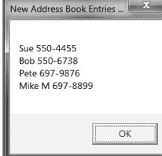

> 图 6.7 使用`Do...While`循环收集新的通讯录条目。
© 2014 Cengage Learning.

或者，你也可以像下面所示编写代码。在这个示例中，`While`关键字及其相关条件已移动到循环的末尾。然而，脚本的运行方式与之前的示例完全相同。

```
Dim intCounter, strAddressBook, strAddressEntry

intCounter = 0

Do

strAddressEntry = InputBox("Please type a name, a space, and then " & "**the person's phone number", "Personal Address Book")

If strAddressEntry <> "Quit" Then

strAddressBook = strAddressBook & strAddressEntry & vbCrLf

intCounter = intCounter + 1

End If

Loop While strAddressEntry <> "Quit"

MsgBox strAddressBook,."New Address Book Entries = " & intCounter
```

# 第6章 • 处理数据集合

处理循环的危险之处在于，你可能会意外创建一个没有方法终止执行的循环。这就是无限循环。无限循环会一直运行，不必要地消耗计算机资源并降低计算机性能。例如，看以下代码：

```
intCounter = 0

Do While intCounter < 10

intCounter = intCounter + 1

WScript.Echo intCounter

Loop
```

> 无限循环是一段既没有终止条件，或者其终止条件永远无法满足的代码，因此它会无限迭代。

当执行此脚本时，它从 1 计数到 10。
现在看下一个脚本：

```
intCounter = 0

Do While intCounter < 10

intCounter = intCounter - 1

WScript.Echo intCounter

Loop
```

它看起来与之前的示例几乎完全一样，现在它不是将`intCounter`的值加 1，而是减去 1，从而创建了一个无限循环。防止创建无限循环的一种方法是设置一个安全网，如下：

```
intCounter = 0

Do While intCounter < 10

intCounter = intCounter - 1

intNoExecutions = intNoExecutions + 1

WScript.Echo intNoExecutions

If intNoExecutions > 99 Then

Exit Do

End If

Loop
```

如你所示，我在脚本中添加了一个名为`intNoExecutions`的变量，用它来跟踪循环迭代的次数。如果循环迭代了 100 次，说明出了问题。因此，我添加了一个`If`语句，在每次处理循环时测试`intNoExecutions`的值，并在发生问题时执行`Exit Do`语句。当然，良好的程序设计和仔细的测试是不可替代的。

## Do...Until 语句

VBScript 的`Do...Until`语句创建一个只要条件为假就执行的循环（即，直到条件变为真）。VBScript 支持两个版本的`Do...Until`语句。第一个版本的语法如下：

```
Do Until condition

   statements

Loop
```

让我们来看一个演示此循环如何工作的示例。在接下来的示例中，脚本提示玩家回答问题，并使用`Do...Until`循环允许用户三次机会正确回答问题。

```
Dim intMissedGuesses, strPlayerAnswer

intMissedGuesses = 1

Do Until intMissedGuesses > 3

   strPlayerAnswer = InputBox("where Peter Pan live?")

   If strPlayerAnswer <> "Neverland" Then

      intMissedGuesses = intMissedGuesses + 1

      If intMissedGuesses < 4 Then

         MsgBox "Incorrect: You have " & 4 - intMissedGuesses & \

"guesses left. Please try again."

      Else

         MsgBox "Sorry. You have used up all your chances."

      End If

   Else

      intMissedGuesses = 4

      MsgBox "Correct! I guess that you must believe in Faith, Trust " & \

"and Pixie Dust!"

   End If

Loop
```

在这个示例中，循环被设置为执行到变量`intMissedGuesses`的值大于 3 为止。该变量初始设置为 1，并且每次循环执行时都会加 1，除非玩家提供了正确答案，在这种情况下，脚本将`intMissedGuesses`的值设置为 4，以任意终止循环的执行。

图 6.8 展示了此脚本在运行 Windows 8.1 的计算机上的执行情况，显示了当玩家猜错时出现的弹出对话框。

# 第6章 • 数据处理

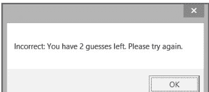

> 图 6.8 使用`Do...Until`循环收集新的通讯录条目。
© 2014 Cengage Learning.

## While...Wend 语句

`While...Wend`语句创建一个只要条件为真就执行的循环。

该循环的语法如下：

```
While condition

Statements

Wend
```

`Do...Until`循环提供了与`While`循环相同的功能。因此，通用的规则是你应该使用`Do`循环来代替此语句。然而，如果不向你展示它是如何工作的，我将是失职，所以请看以下示例：

```
Dim intCounter, strCounterList

intCounter = 0

While intCounter < 10

intCounter = intCounter + 1

strCounterList = strCounterList & intCounter & vbLf

Wend

MsgBox "This is how to count to 10
```

# 给初学者的 Microsoft WSH 和 VBScript 编程

此示例开始初始化两个变量。`intCount`用于控制循环。`strCountList`用于构建计数的字符串。循环迭代 10 次。图 6.9 显示了在运行 Windows 7 的计算机上使用`WScript.exe`主机时的输出。

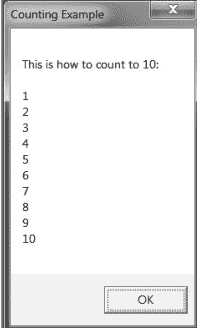

图 6.9 使用`While...Wend`循环计数到 10。
© 2014 Cengage Learning.

# 回到猜数字游戏

让我们关注猜数字游戏。在游戏中，玩家被提示猜一个 1 到 100 之间的随机数字。每当玩家进行一次猜测，脚本都会检查是否猜中了正确答案。如果不是，脚本将提供提示帮助玩家下一次猜测。

开发此脚本将增强你对使用`Do...Until`循环的知识和理解。你还将使用`If`语句，并学习如何使用一些新的 VBScript 函数。

## 设计游戏

猜数字游戏开始要求玩家猜一个1 到 100 之间的数字，然后通过提示帮助用户猜数字。该项目有五个步骤。这些步骤如下：

- 1. 添加标准文档模板并定义脚本使用的任何变量、常量或对象。
2. 生成一个1 到 100 之间的随机数。
3. 创建一个循环，直到玩家猜中正确答案或放弃。
4. 测试玩家的答案以判断是否有效。
5. 测试玩家的答案以判断其是太低、太高还是正确。

## 第 6 章 • 处理数据集合

作为一种项目的额外奖励，在你完成“猜数字”游戏后，我将向你展示如何为它创建一个 VBScript 桌面快捷方式。我还将向你展示如何使用快捷方式来配置 Windows 7 程序菜单和 Windows 8.1 应用程序组。

## 开始猜数字游戏

首先，创建一个新脚本并添加你的脚本模板。

```vbs
'****************************************************************
'Script Name: GuessANumber.vbs
'Author: Jerry Ford
'Created: 02/20/14
'Description: 此脚本将与用户玩猜数字游戏
********************************************************************************
```

```vbs
'初始化部分
Option Explicit
```

接下来，创建一个常量以及用于脚本弹出对话框正文的消息。

```vbs
Const cGreetingMsg = "请选择一个 1 到 100 之间的数字"
```

如所示，定义四个变量。`intUserName`用于存储玩家的随机猜测。`intRandom`存储脚本随机生成的数字。`strToEnd`是一个用于判断是否应该停止游戏的变量，而`intNoGuesses`用于跟踪玩家猜测的次数。

```vbs
Dim intNumber, intRandomNo, strToEnd, intNoGuesses
```

最后，将`intNoGuesses`的初始值设置为 0，如下：

```vbs
intNoGuesses = 0
```

## 生成游戏的随机数

接下来的语句负责生成游戏的随机数：

```vbs
'生成一个随机数
Randomize
intRandomNo = FormatNumber((100 * Rnd) + 1)
```

`Randomize`确保每次玩游戏时都会生成一个随机数。最后一条语句使用内置的 VBScript 函数生成一个一到一百之间的数字。

- `Rnd()`。返回一个随机生成的数字。
- `Int()`。返回数字的整数部分。
- `FormatNumber()`。返回一个已格式化为数字的表达式。

## 《初学者 Microsoft WSH 与 VBScript 编程》，第四版

## 创建循环控制游戏

现在，你需要设置一个`Do...Until`循环来控制游戏的执行。在这个示例中，循环将一直执行到变量`strOkToEnd`的被设置为 "yes" 为止。

```vbs
Do strOkToEnd = "yes"

'提示用户选择一个数字
intNumber = InputBox("Type your guess:",cGreetingMsg)
intNoGuesses = intNoGuesses + 1

Loop
```

如你所见，目前循环内部唯一的语句是提示玩家猜一个数字，并跟踪玩家所猜的次数。

## 测试玩家输入

现在让我们组合用于验证玩家提供数据的代码。

```vbs
'如果用户提供了答案
If Len(intNumber) <> 0 Then

'确保玩家输入了数字
If IsNumeric(intNumber) = True Then

.

Else

MsgBox "对不起。你没有输入数字。请重试。", ,cGreetingMsg

End If

Else

MsgBox "你要么没有输入任何值，要么点击了取消。* &\请尽快再次玩游戏！", ,cGreetingMsg

strOkToEnd = "yes"

End If
```


第一个验证测试是使用内置的 VBScript `Len()` 函数执行的。它是为了确保玩家在点击确定按钮之前确实输入了数字。如果玩家的输入长度不为 0 个字符，游戏将继续进行下一个测试。否则，将显示错误消息，并将`strOkToEnd`的值设置为`yes`，从而终止循环和游戏。

如果通过测试，脚本将对玩家的输入进行第二次验证测试。这次，使用内置的 VBScript `IsNumeric()` 函数来确保玩家输入的是数字而不是字母或特殊字符。如果输入了数字，游戏继续。如果没有输入数字，则会显示错误消息，游戏将继续循环的下一次迭代。

## 判断玩家的猜测是高、低还是正确

还需要向脚本添加另外三组语句。它们将一个接一个插入在执行游戏第二次验证测试的`If`语句之后。

这三组语句中的第一组显示在这里。它首先验证用户的猜测是否与游戏随机生成的数字。它显示一条祝贺玩家的消息，显示随机数以及玩家猜中该数字所花费的次数。最后，将`strToEnd`的值设置为`equal`。这会终止循环并允许游戏结束。

```vbs
'测试用户的猜测是否正确
If FormatNumber(intNumber) = intRandomNo Then
    MsgBox "恭喜你！你猜对了。数字是 " & _
        intNumber & vbCrLf & vbCrLf & "你用了 " & _
        "在 " & intNoGuesses & " 次猜中了。", , cGreetingMsg
    strToEnd = "no"
    End
```

这三组语句中的第二组在玩家猜测太低时为玩家提供帮助。将`strToEnd`的值设置为`equal`。这确保控制游戏的循环继续。

```vbs
'测试用户的猜测是否太低
If FormatNumber(intNumber) < intRandomNo Then
    MsgBox "你的猜测太低了。请重试", , cGreetingMsg
    strToEnd = "no"
    End
```

最后，最后一组语句在玩家猜测太高时为玩家提供帮助。将`strToEnd`的值设置为`equal`。这确保游戏继续。

```vbs
'测试用户的猜测是否太高
If FormatNumber(intNumber) > intRandomNo Then
    MsgBox "你的猜测太高了。请重试", , cGreetingMsg
    strToEnd = "no"
    End
```

## 结果

好了，现在是运行脚本看看它是否符合预期了。在测试它是否符合预期后，运行它。例如，输入特殊字符而不是数字。在本章中我们还有一个惊喜。

## 为游戏创建快捷方式

到目前，你一直通过两种方式运行脚本。一种是在 Windows 控制台中输入脚本的名称。另一种是找到脚本所在的文件夹并打开它（即双击它）。

Windows 提供快捷方式作为从桌面运行应用程序和脚本的方便方法。快捷方式可以访问资源而无需用户知道其实际位置。例如，安装的任何新应用程序会自动添加到程序菜单。此外，大多数安装程序都会提供在桌面创建快捷方式。

使用 VBScript 和 WSH，你可以创建一个配置这些位置快捷方式的脚本。当然，你可以手动创建快捷方式，但创建它们的优势是，一旦编写，可以在任何计算机上创建。例如，如果你购买了新电脑，你只需要从旧电脑上复制 VBScript 并再次运行设置。同样，如果你把 VBScript 游戏拷贝给所有朋友，他们只需要运行设置即可。

## 第 6 章 • 处理数据集

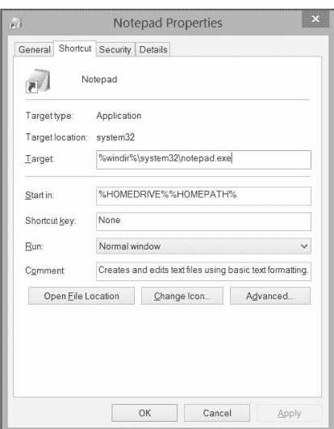

> **图 6.10** 检查与 Windows 记事本应用程序快捷方式相关的属性。
> © 2014 Microsoft Corporation. 经 Microsoft 许可使用。

创建快捷方式的第二步是设置指向该快捷方式所在文件夹的引用。在 Windows 中，包括 Windows 桌面在内的所有内容，都被表示为一个文件夹。因此，要在 Windows 桌面上添加快捷方式，你只需要通过为`WshShell`对象的`SpecialFolder`属性指定值，将快捷方式保存到名为“Desktop”的特殊文件夹中。

```vbs
strDesktopFolder = objWshShell.Folders("Desktop")
```

设置快捷方式所需的第三步是使用桌面上的`WshShell`对象的`CreateShortcut()`方法来定义快捷方式并实例化`WshShortcut`对象。

```vbs
Set objNewShortcut = objWshShell.CreateShortcut(strDesktopFolder & "\GuessNumber.lnk")
```

`strDesktopFolder`提供指向 Windows 桌面位置的引用，`\GuessNumber.lnk`是要分配给快捷方式的。

创建新快捷方式的第四步是配置与快捷方式相关的属性。`WshShortcut`对象提供了对这些属性的访问，这些属性列于表 6.1。

### WshShortcut 对象的属性表

| 属性 | 描述 |
| --- | --- |
| `Arguments` | 设置传递给与快捷方式相关的应用程序或脚本的参数 |
| `Description` | 给快捷方式添加注释 |
| `Hotkey` | 设置键盘按键序列，用于激活与快捷方式相关的快捷 |
| `Icon` | 设置快捷方式的图标 |
| `TargetPath` | 设置与快捷方式相关的对象的路径和名称 |
| `TextStyle` | 设置打开与快捷方式相关的应用程序时使用的窗口样式（例如：正常、最小化或最大化） |
| `WorkingDirectory` | 设置与相关应用程序的默认工作目录或文件夹 |

© Lee Ford, Jr. 版权所有。

必须设置`TargetPath`属性才能创建快捷方式。其余快捷方式属性的配置是可选的。以下语句通过将其设置为`C:\GuessNumber.vbs`来配置`TargetPath`。

```vbs
objWshShortcut.TargetPath = "C:\GuessNumber.vbs"
```

设置其他属性的示例所示：

```vbs
objWshShortcut.Description = "猜数字游戏"
objWshShortcut.Hotkey = "Ctrl+Alt+G"
```

这两个语句中的第一个是为快捷方式添加描述。一旦创建，就可以通过将指针悬停在快捷方式图标上几秒钟来查看此描述。第二个语句定义了一个键盘按键序列，执行该序列将激活快捷方式并从而打开其关联的资源（即运行你的脚本）。在这种情况下，按下`Ctrl+Alt+G`键将运行 VBScript。

创建快捷方式的第五步也是最后一步是使用`WshShortcut`对象的`Save()`方法保存它，如下：

```vbs
objWshShortcut.Save()
```

让我们将所有语句组合在一起以完成脚本：

```vbs
Set objWshShell = WScript.CreateObject("WScript.Shell")
strDesktopFolder = objWshShell.SpecialFolders("Desktop")
Set objWshShortcut = objWshShell.CreateShortcut(strDesktopFolder & _
    "\GuessNumber.lnk")
objWshShortcut.TargetPath = "c:\GuessNumber.vbs"
objWshShortcut.Save()
```

## 技巧

使用 VBScript 和 WSH 删除快捷方式与创建快捷方式一样简单。例如，运行以下脚本来删除之前创建的脚本：

```vbs
Set objWshShl = WScript.CreateObject("WScript.Shell")
strTargetFolder = objWshShl.SpecialFolders("Desktop")
Set objFsoObject = CreateObject("Scripting.FileSystemObject")
Set objNewShortcut = objFsoObject.GetFile(strTargetFolder & _
    "\\GuessANumber.lnk")
objNewShortcut.Delete
```

第一个语句建立了`WshShell`对象的实例。第二个语句使用`WshShell.SpecialFolders`属性来识别快捷方式的位置。第三个语句创建了 VBScript`FileSystemObject`对象的实例。第四个语句使用`FileSystemObject`对象的`GetFile()`方法实例化`File`对象并创建对`FileSystemObject`对象的引用。最后一条语句使用`File`对象的`Delete()`方法删除快捷方式。

# 理解如何处理特殊文件夹

Windows 操作系统将文件夹用于许多用途。例如，文件夹用于存储系统文件。你还使用文件夹存储自己的个人文件。正如你刚刚学到的，Windows 桌面是一个特殊文件夹。Windows 支持许多特殊文件夹：

- Desktop（桌面）
- Programs（程序）
- Favorites（收藏）
- Startup（启动）

通过在 Windows 特殊文件夹中添加和删除快捷方式，你可以更改它们的内容。

# 使用快捷方式将你的脚本添加到程序菜单和应用程序组

要处理组成程序菜单的文件夹，你需要创建一个指向程序特殊文件夹的引用。一旦建立，你就可以像下面的示例所示向程序菜单添加快捷方式：

```vbs
Set objWshShl = WScript.CreateObject("WScript.Shell")
strTargetFolder = objWshShl.SpecialFolders("Desktop")
Set objNewShortcut = objWshShell.CreateShortcut(strTargetFolder & _
    "GuessNumber.lnk")
objNewShortcut.TargetPath = "c:\GuessNumber.vbs"
```

图 6.11 展示了与 Windows 记事本应用程序快捷方式相关的属性。


> **图 6.11** 检查与 Windows 记事本应用程序快捷方式相关的属性。
> © 2014 Microsoft Corporation. 经 Microsoft 许可使用。

如果你在运行 Windows 8.1 的计算机上运行此，将看到应用程序组中的快捷。


> **图 6.11** 检查与 Windows 记事本应用程序快捷方式相关的属性。
> © 2014 Microsoft Corporation. 经 Microsoft 许可使用。

图 6.12 展示了程序菜单现在的样子，带有快捷方式。


> **图 6.12** 检查与 Windows 记事本应用程序快捷方式相关的属性。
> © 2014 Microsoft Corporation. 经 Microsoft 许可使用。

## 完整脚本

现在让我们把所有的语句组合起来完成脚本：

```vbs
****************************************************************
脚本名称：ShortcutMaker.vbs
作者：Jerry
创建日期：02/14
描述：此脚本为 GuessANumber.vbs 创建快捷方式
****************************************************************

'初始化部分
Option Explicit

Dim objWshShl, strTargetFolder, objDesktopShortcut, objProgramsShortcut
Dim strAppData

'建立 WshShell 对象的实例
Set objWshShl = WScript.CreateObject("WScript.Shell")

'创建桌面快捷方式
strTargetFolder = objWshShl.SpecialFolders("Desktop")
Set objDesktopShortcut = objWshShl.CreateShortcut(strTargetFolder & _
    "\GuessNumber.lnk")
objDesktopShortcut.TargetPath = "C:\GuessNumber.vbs"
objDesktopShortcut.Description = "猜数字游戏"
objDesktopShortcut.Hotkey = "Ctrl+Alt+G"
objDesktopShortcut.Save()

'创建程序菜单快捷方式
strTargetFolder = objWshShl.SpecialFolders("Programs")
Set objProgramsShortcut = objWshShl.CreateShortcut(strTargetFolder & _
    "\\GuessANumber.lnk")
objProgramsShortcut.TargetPath = "c:\GuessNumber.vbs"
objProgramsShortcut.Save()
```


# 《初学者 Microsoft WSH 和 VBScript 编程》

在这里我实现了一些规模效益。首先，我只实例化了一次 `WshShell` 对象。我还反复使用了 `strTarget` 变量。然而，我认为为每个特殊文件夹分配不同的变量会让脚本更具可读性。在运行 Windows 7 的计算机上运行此，你应该会在桌面和程序菜单上看到 `GuessANumber.vbs` 的快捷方式。在运行 Windows 8.1 的计算机上运行该脚本，你应该会在应用程序组中看到快捷方式。

## 总结

在本章中，你学习了循环以及如何将其应用于你的 VBScript。你通过创建“猜数字”游戏深化了对这一基本编程概念的理解。你还学习了如何程序化地处理 Windows 快捷方式，包括为你的脚本创建快捷方式。你还学习了如何配置许多 Windows 功能，包括 Windows 桌面和程序菜单。

| 挑战 | |
|------|------|
| 1. 修改“猜数字游戏”，为玩家提供更好的提示。例如，如果用户的猜测与答案之差在 20 以内，告诉玩家他变暖了。随着玩家越来越接近答案，告诉他他非常热。 |
| 2. 修改“猜数字游戏”，将数字范围从 1 到 100 扩大到 1 到 1000 |
| 3. 重写“猜数字游戏”，使其使用 `Do...While` 语句代替 `Do...Until` 语句 |
| 4. 以 `ShortcutMaker.vbs` 为起点，编写一个新脚本，为你喜欢的 VBScript 游戏创建一个或多个快捷方式。或者，如果你将所有的 VBScript 都保在一个位置，则为该文件夹创建一个快捷方式。 |

## 使用过程组织脚本

现在你已经见过并处理了许多 VBScript 项目，所有这些脚本都是以相同的方式组织的。首先，你设置了脚本初始化过程（定义变量、常量、对象等）。然后，你按顺序编写了脚本的其余部分，将其视为一个巨大的语句集合。接着，你使用 `If` 和 `Select Case` 语句来组织你的脚本。最后，通过将语句嵌套，你进一步优化了脚本的组织结构。在本章中，你将学习如何使用过程进一步改进 VBScript 的组织结构。具体来说，你将学习以下内容：

- 如何创建自定义函数
- 如何使用子程序（subroutines）创建可重用的语句集合
- 如何将脚本拆分为代码模块以便更于管理
- 如何使用过程控制脚本中的变量作用域

## 项目预览：简易版黑2点（BlackJack Lite）游戏

在本章中，你将创建一个名为 BlackJack Lite 的游戏。这个游戏基于世界各地赌场流行的经典黑2点游戏。在游戏中，玩家和电脑各被发一张朝上的单牌。游戏的目标是让点数尽可能接近 21 而不超过。玩家可以根据需要要求要多张牌（hits），并随时停止（stick）。如果玩家点数超过 21，则为爆牌（bust）。电脑会出它的牌，只有在总数达到 17 或以上或爆牌后停止。图 7.1 到 7.4 展示了在运行 Windows 8.1 的电脑上进行的游戏过程。

## 初学者级 Microsoft WSH 和 VBScript 编程，第四版

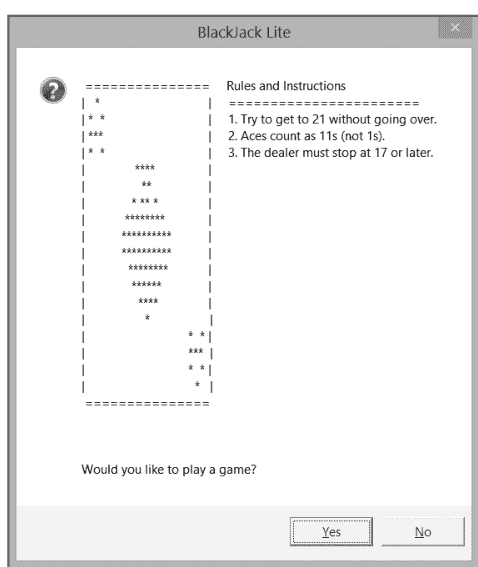

**图 7.1** 游戏的启动界面邀请用户玩 BlackJack Lite 游戏。© 2014 Cengage Learning。

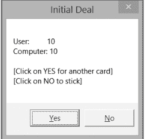

**图 7.2** 如果用户接受游戏提议，将发放初始牌。© 2014 Cengage Learning。

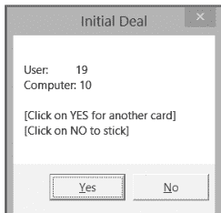

**图 7.3** 用户一直玩，直到爆牌或持牌（holding）。© 2014 Cengage Learning。

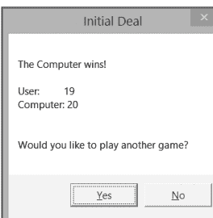

**图 7.4** 随后电脑出牌并给出游戏结果。© 2014 Cengage Learning。

当你完成本章并制作 BlackLite 游戏后，你将对如何使用过程有坚实的理解。你将能够改进 VBScript 的整体组织结构和功能，并应对更具挑战性的项目。

第 7 章 • 使用过程组织脚本

## 使用过程改进脚本设计

VBScript 过程可以提高脚本的整体组织结构和可读性，为你提供了一种将相关语句分组并作为一个单元执行它们的方法。一旦定义了 VBScript 过程，就可以从脚本中的任何位置进行调用，并根据需要反复执行。这使你能够创建更小、更易维护的脚本。

VBScript 为两种不同类型的过程支持：

- **子程序（Subroutine）**。这是一种执行一组语句并返回结果的 VBScript 过程。
- **函数（Function）**。这是一种执行一组语句并可选返回结果给调用它的语句的 VBScript 过程。

> 过程简单来说就是 VBScript 语句的集合，在调用时作为一个单元执行。

我建议将过程作为所有 VBScript 的主要组织工具。通过将脚本组织成过程，你将其拆分为一个单元集合。这允许你将各个过程分离，从而更容易以模块化的方式开发脚本，一次处理一个组件。

## 引入子程序

VBScript 的 `Sub` 过程用于创建子程序。子程序非常适合将执行共同任务且不需要结果的语句分组。当被调用时，子程序执行其语句，然后将控制权返回给调用语句。

此类过程的语法如下：

```
[Public | Private] Sub name [(arglist)]
    statements
End Sub
```

`Private` 是一个可选关键字，指定该子程序不能被脚本中的其他过程调用，限制了引用它的能力。`Public` 是一个可选关键字，指定该子程序可以被脚本中的其他过程调用。`name` 是分配给子程序的名称。与变量一样，子程序的名称在定义它的脚本中必须唯一。`arglist` 代表一个或多个用逗号分隔的参数列表，这些参数可以传递给子程序进行处理，而 `statements` 代表组成子程序的语句。

例如，下一个子程序调用为 `DisplaySplashScreen()`。它不接受任何参数，也不会向调用它的 VBScript 语句返回任何内容。它在每次被调用时都会显示脚本的启动界面。

```
Sub DisplaySplashScreen()
    MsgBox "Thank you for playing the game. © Jerry Ford 2014." &_
        vbCrLf & vbCrLf & "Please play again soon!", 4144, "Test Game"
End Sub
```

你可以通过从脚本中调用它来执行此操作：

```
DisplaySplashScreen()
```

下面的示例演示了如何向子程序传递参数：

```
Sub DisplaySplashScreen(strMessage)
    MsgBox strMessage, 4144, "Test Game"
End Sub
```

你可以通过这种方式调用它：

```
DisplaySplashScreen("感谢玩游戏。© Jerry Ford 2014。" & vbCrLf & vbCrLf & "请尽快再次回来！")
```

## 创建函数

函数与子程序几乎完全一样，但函数可以返回一个值。函数可以执行子程序可以做的一切事情。

函数的语法如下：

```
[Public | Private] Function name [(arglist)]
    statements
End Function
```

`Private` 是一个可选关键字，指定该函数不能被脚本中的其他过程调用，限制了引用它的能力。`Public` 是一个可选关键字，指定该函数可以被脚本中的其他过程调用。`name` 是分配给函数的名称。与变量一样，函数的名称在定义它的脚本中必须唯一。`arglist` 代表一个或多个用逗号分隔的参数列表，这些参数可以传递给函数进行处理，而 `statements` 代表组成函数的语句。

让我们来看一个不返回值的函数示例：

```
Function DisplaySplashScreen()
    MsgBox "感谢玩游戏。© Jerry Ford 2014。" &_
        vbCrLf & vbCrLf & "请尽快再次回来！", 4144, "Test Game"
End Function
```

函数也可以被设置为返回值给其调用语句。这是通过在函数内部创建一个与函数同名的变量，并将该变量赋值为你想要函数返回的结果来实现。

再次，这种技术可以通过一个示例来演示：

```
strPlayersName = GetPlayersName()
MsgBox "你好 " & strPlayersName
```

```
Function GetPlayersName()
    GetPlayersName = InputBox("你的名字是什么？")
End Function
```

## 提高脚本的可管理性

正如我所说的，通过将你的 VBScript 组织成过程，你使它们更易于管理，允许创建更大、更复杂的脚本而不会增加额外的复杂度。例如，你正在开发一个执行以下主要活动的游戏：

- 初始化脚本使用的变量、常量和对象。
- 询问玩家是否想玩游戏。

# 零基础学者 Microsoft WSH 与 VBScript 编程，第四版

- 它收集玩家的名字。
- 它显示一个故事，并在故事中预设的位置替换玩家的名字。
- 它显示一个对话框，邀请玩家改天再玩。

设计脚本的一种方法是首先定义变量、常量和对象引用，然后从脚本的主处理部分创建一系列函数和子程序调用。脚本的其余部分将由各个函数和子程序组成，每个程序都设计用于执行前一个列表列出的活动之一。

世界级程序员的一个标志是他们所留下的路径——换句话说，就是程序员组织和记录其脚本的专业方式。经验丰富的程序员使用的一种组织技术是将所有函数和子程序分组在一个地方，与脚本的初始化部分和主处理部分离开来。这使得它们易于查找和维护。通常，你会发现脚本的函数和子程序位于脚本的底部。我建议你修改脚本模板，为了此目的包含一个“过程”（procedure）部分。


# 编写可重用代码

使用函数和子程序的最大优势之一是在你的 VBScript 中创建可重用代码。每当你发现自己需要在脚本中反复执行相同任务时（例如在弹出对话框中显示消息或获取随机数），请考虑创建一个函数或子程序。然后，通过使用单个语句调用适当的过程，你就可以反复重用过程内部的语句。

函数和子程序使脚本变得更短小。它们还让脚本的维护和增强变得更加简单快捷。例如，更改位于过程中的某行代码要比在脚本的许多地方进行相同更改要容易得多。

# 回顾猜数字游戏

到目前为止，你已经看到了与函数和子程序工作的小段代码示例。现在，让我们看看如何将过程应用于更大的脚本中。要做到这一点，请回去回顾第 6 章“处理数据集合”中的猜数字游戏。该脚本与书中在本章之前的所有脚本一样，是在没有使用过程的情况下编写的。

我刻意避免在第 6 章的脚本中使用过程，因此我必须使用其他技术来组织脚本的编程逻辑。我选择的方法是将一切都放在脚本的主处理部分，如下：

- 我添加了语句来生成随机数。
- 我添加了一个 `Do...Until` 循环来控制游戏的执行。

# 第 7 章 • 使用过程组织脚本

- 我在 `Do...Until` 循环中嵌入了一个 `If` 语句，以确保玩家输入了数字。
- 我在在上一个 `If` 语句中嵌入了第二个 `If` 语句，以确保玩家输入的数据是数字。
- 我在在上一个 `If` 语句中又嵌入了三个 `If` 语句，以判断玩家的猜想是低、高还是正确。

如你所见，我必须将许多语句嵌套在一起，以将脚本组织成一个可运行的游戏。由于脚本本身并不是特别大，这是一个可以完成的任务。然而，如果脚本大得多或更复杂，要跟踪所有嵌套的逻辑将非常困难。

现在你已经理解什么是过程以及它们的用途，让我们花点时间回去，使用它们来重新设计猜数字游戏。这样做的一种方法如下：

```
****************************************************************
'Script Name: GuessNumber-2.vbs
'Author: Jerry Ford
'Created: 02/01/14
'Description: 此脚本与用户玩猜数字游戏
****************************************************************

'Initialization Section
Option Explicit

Const cGreetingMsg = "请选择一个 1 到 100 之间的数字"
Dim intUserNumber, intRandomToEnd, intNoGuesses, strBadData
strOkToEnd = "no"
intNoGuesses = 0

'Main Processing Section
RandomNumber()      '获取游戏的随机数
PlayTheGame()        '开始游戏
WScript.Quit()      '结束游戏

'Procedure Section
'生成游戏的随机数
```


`Function RandomNumber()`

  '生成一个随机数

  `Randomize`

  `intRandomNo = FormatNumber(Int((100 * Rnd) + 1))`

`End Function`

```vb
'设置 Do...Until 循环来控制游戏的执行
Function PlayGame()

  '循环直到用户猜对或点击取消
  Do until strToEnd = "yes"

  '提示用户选择一个数字
  intUserName = InputBox("Type your guess:", greetingMsg)
  intNoGesses = intNoGesses + 1
  strBadData = "no"

  '检查玩家的输入是否有错误
  ValidateInput()

  If strToEnd <> "yes" Then
    '玩家输入了内容
    If strBadData <> "yes" Then
      '玩家输入了一个数字
      TestAnswer()
      '让我们看看玩家猜得怎么样
    End If
  End If

  Loop
End Function
```

```vb
'检查玩家输入的数据是否有任何问题
Function ValidateInput()

  '检查玩家是否提供了答案
  If Len(intUserName) = 0 Then
    MsgBox "You didn't enter a value.", cGreetingMsg
    strToEnd = "no"
  Else
    '确保玩家输入的是数字
    If Not IsNumeric(intUserName) Then
      MsgBox "You did not enter a number.", cGreetingMsg
      strToEnd = "no"
    Else
      strToEnd = "yes"
    End If
  End If
End Function
```

```vb
'检查玩家输入的数据是否有任何问题
Function TestAnswer()

  '检查玩家是否提供了答案（此处）
  If intUserName = intRandomNo Then
    MsgBox "Congratulations! You guessed it."
    strToEnd = "yes"
  ElseIf intUserName < intRandomNo Then
    MsgBox "Your guess was low. Try again."
    strToEnd = "no"
  Else If intUserName > intRandomNo Then
    MsgBox "Your guess was high. Try again."
    strToEnd = "no"
  End If
End Function
```

```vb
'检查玩家输入的数据是否有任何问题
Function ValidateInput()

  '检查玩家是否提供了答案
  If Len(intUserName) = 0 Then
    MsgBox "You didn't enter a value.", cGreetingMsg
    strToEnd = "no"
  Else
    '确保玩家输入的是数字
    If Not IsNumeric(intUserName) Then
      MsgBox "You did not enter a number.", cGreetingMsg
      strToEnd = "no"
    Else
      strToEnd = "yes"
    End If
  End If
End Function
```

```vb
intFirstRandomNumber = GetRandomNumber()
MsgBox "The first random number is " & intFirstRandomNumber
```

```vb
GenerateLocalizedVariable()
MsgBox "The second random number is " & intSecondRandomNumber
```

```vb
WScript.Quit()

Function GenerateLocalizedVariable()
Dim intSecondRandomNumber
intSecondRandomNumber = GetRandomNumber()
MsgBox "The second random number is " & intSecondRandomNumber
End Function
```

```vb
Function GetRandomNumber()
'Generate a random number between 1 and 10
Randomize
GetRandomNumber = FormatNumber(Int((10 * Rnd) + 1))
End Function
```

当你运行此脚本时，第一个变量在脚本开头定义，成为一个全局变量。变量的值随后会被立即显示。第二个变量定义在名为`GenerateLocalizedVariable()`的函数内部。因此，该变量只能在该函数内部被引用，函数中的`MsgBox()`语句显示其值时证明了这一点。当`GenerateLocalizedVariable()`函数完成执行时，处理控制返回到调用该函数的语句。该语句紧接着另一个`MsgBox()`语句，它尝试显示在`GenerateLocalizedVariable()`函数中定义的变量值。然而，该变量在函数结束时已被销毁，因此看到的不是变量的值，而是显示错误消息。图 7.5 显示了此脚本在 Windows 7 上运行时会显示的错误消息。

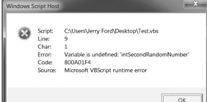

> 图 7.5 尝试在定义过程之外访问局部变量会导致错误。
© 2014 Microsoft Corporation. 经 Microsoft 许可使用。

# 初学者 Microsoft WSH 和 VBScript 编程（第四版）

## 回到 BlackJack Lite 游戏

现在让我们回到 BlackJack Lite 游戏的开发。在这个游戏中，你将开发一个你自己的版本的赌场黑杰（blackjack）。BlackJack Lite 是一款玩家与电脑对战的纸牌游戏。游戏的目标是尽可能接近 21 而不超过，并击败电脑的手牌。电脑像真实的赌场黑杰发牌员一样，等待玩家完成游戏。然后电脑会不断抽牌直到爆牌（超过 21）或达到至少 17 点，此时它必须停止。

## 设计游戏

BlackJack Lite 游戏比你目前在书中看到的其他 VBScript 更复杂。游戏本身有许多函数需要执行。例如，必须为玩家和电脑分发初始牌。然后游戏必须促进向玩家发牌，随后向电脑发牌。此外，在此过程中必须发生许多较小的过程。

由于此脚本相当复杂，我决定将其组织成过程（procedures）。每个过程将被分配一个特定的活动。作为我对游戏设计准备工作，我绘制了一张游戏整体结构和处理逻辑的高层流程图。该流程图如图 7.6 所示。

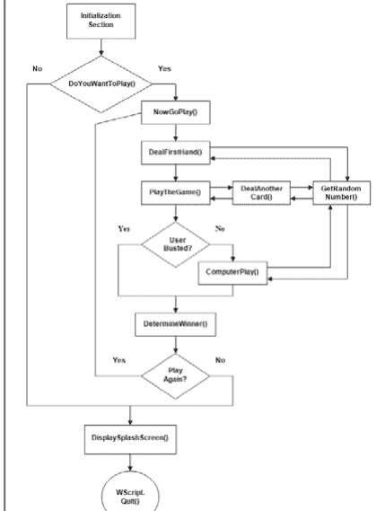

图 7.6 BlackJack Lite 游戏整体设计和执行流的流程图。© 2014 Cengage Learning。

# 第 7 章 使用过程组织脚本

脚本由九个函数组成。这些函数及其目的如下：

- `DoYouWantToPlay()`。显示游戏的启动界面并邀请用户玩游戏。
- `NoGoPlay()`。控制游戏的整体执行，根据需要调用其他过程。
- `DealFirstHand()`。展示玩家和电脑的初始牌。
- `PlayGame()`。询问玩家是否想要另一张牌，并判断玩家何时爆牌或决定停止（hold）。
- `DealAnotherCard()`。为玩家的手牌获取另一张牌。
- `GetRandomNumber()`。此函数被脚本中的其他几个函数调用。它返回一个 1 到 13 之间的随机数，代表扑牌的值。
- `ComputerPlay()`。运行电脑的手牌，不断抽牌直到电脑爆牌或大于 17。
- `DetermineWinner()`。比较玩家的手牌和电脑的手牌以决定胜负。然后提议让玩家再玩一局。如果玩家接受，则调用`NoGoPlay()`函数开始新的一局牌。
- `DisplaySplashScreen()`。显示关于游戏及其作者的信息，并在游戏结束后后邀请玩家返回再次游戏。

## 设置初始化部分

你开始开发 Blackjack Lite 游戏与你开始所有其他游戏相同：创建一个新文件并将其添加到你的 VBScript 模板中，然后在脚本的初始化部分设置变量、常量和对象引用。

```vb
****************************************************************
'脚本名称: Blackjack.vbs
'作者: Jerry Ford
'创建日期: 02/03/14
'描述: 此脚本创建一个缩小版的赌场
'blackjack纸牌游戏
****************************************************************
```

```vb
'初始化部分
Option Explicit
Dim intPlayGame, strCardImage, intUserCard, intComputerCard, intAnotherCard
Dim intNextCard, strUserDone, intNewCard, intPlayAgain
Dim strBusted, strMsg
```

# 初学者 Microsoft WSH 和 VBScript 编程

```vb
strUserDone = "False"
strBusted = "False"
```

这个游戏相当冗长，需要以下变量：

- `intPlayGame`。存储玩家被问及玩时的回复。
- `strCardImage`。存储在弹出框中显示的图像。
- `intUserCard`。存储发给用户的牌的值。
- `intComputerCard`。存储发给电脑的牌的值。
- `intAnotherCard`。存储玩家是否想要另一张。
- `intNextCard`。存储函数返回并稍后添加到`intUserCard`的值。
- `strUserDone`。存储玩家是否准备就绪。
- `intNewCard`。存储函数返回并稍后添加到`intComputerCard`的值。
- `intPlayAgain`。存储玩家的回复。
- `strBusted`。存储玩家是否爆牌。
- `strMsg`。存储出现在弹出框中的文本。

## 开发主部分的逻辑

脚本的主部分很小，只包含调用`DoYouWantPlay()`来判断玩家是否想玩游戏，随后是一个`Select`语句。

```vb
intPlayGame = DoWantToPlay()

Select Case intPlayGame
Case 6
    NoGoPlay()
Case 7
    SplashScreen()
```

如果玩家点击“是”按钮，则调用`NoGoPlay()`。否则，调用`SplashScreen()`。

# 第 7 章 使用过程组织脚本

## 创建 DoWantToPlay() 函数

此函数显示游戏的启动界面并邀请玩家玩黑杰游戏。弹出框中显示的大部分文本用于创建一个黑桃的图像。此弹出框中还包含了一份简短的说明。

```vb
function DoWantToPlay()

strCardImage = "==================" & vbCrLf & vbCrLf & vbCrLf & \
"你想玩游戏吗？" & vbCrLf & \
"规则和说明" & vbCrLf & \
"==================" & vbCrLf & \
"1. 接近21但不超过。" & vbCrLf & \
"2. A牌计为15点（不是1点）。" & vbCrLf & \
"3. 发牌员必须在17点或之后停止。" & vbCrLf & \
DoWantToPlay = MsgBox(strCardImage, 36, "BlackJack Lite")
End Function
```

# 初学者 Microsoft WSH 与 VBScript 编程，第四版

## 创建 NowGoPlay() 函数

当玩家点击脚本初始弹出对话框上的“是”（Yes）按钮时，会调用`NowGoPlay()`函数，这表示他想玩游戏。

```vb
function NowGoPlay()
  DealFirstHand()
  PlayGame()
  If strUserBusted = "False" Then
    ComputerPlay()
  End If
  DetermineWinner()
```

此函数控制游戏的实际运行。它由对几个其他函数的调用组成。首先，它调用`DealFirstHand()`函数，为用户和计算机分发初始手牌。接下来，它调用`playGame()`函数，该函数允许用户继续加牌（hits）或停牌（hold），并确定玩家是否爆牌（busted）。`NowGoPlay()`函数检查变量`strUserBusted`的值，以确定游戏是否应该继续。如果用户决定停牌，则会调用`ComputerPlay()`函数，以便让计算机（或庄家）的手牌完成分发。无论用户是否爆牌或是否调用了`ComputerPlay()`函数，最终都会返回到`NowGoPlay()`函数并调用`DetermineWinner()`函数。此函数决定手牌的胜负，并给玩家机会玩另一手。

## 创建 DealFirstHand() 函数

`DealFirstHand()`函数两次调用`GetRandomNumber()`函数，用于分发玩家和计算机的初始手牌：

```vb
function DealFirstHand()
  intUserCard = GetRandomNumber()
  intComputerCard = GetRandomNumber()
End Function
```

## 创建 playGame() 函数

所示的`playGame()`设置了一个`Do...Until`循环，该循环一直执行到玩家爆牌或决定停牌。循环中的第一个语句提示玩家决定是否想要另一张牌。如果玩家点击“是”（Yes），将调用`DealAnotherCard()`函数。然后`playGame()`函数检查玩家是否爆牌，并根据情况设置`strUserBusted`和`strUserDone`变量的值（True）。如果玩家决定停牌并点击“否”（No）按钮，`strUserDone`的值也会设置为 True。

# 第 7 章 • 使用过程组织脚本

```vb
function PlayTheGame()
Do Until strUserDone = "True"
```

```vb
intAnotherCard = MsgBox("User: " & Space(8) & intUserCard & vbCrLf & \
  "Computer: " & intComputerCard & vbCrLf & vbCrLf & \
  "[Click on YES for another card]" & vbCrLf & \
  "[Click on NO to stick!", 4, "Initial Deal")
```

```vb
Select Case intAnotherCard
Case 6 '用户点击了 Yes
  MsgBox "你决定加牌。"
  DealAnotherCard()
Case 7 '用户点击了 No
  strUserDone = "True"
End Select
```

```vb
If intUserCard > 21 then
strUserBusted = "True"
strUserDone = "True"
End If
```

```vb
Loop
End Function
```

## 创建 GetRandomNumber() 函数

当调用时，`GetRandomNumber`会生成一个 1 到 13 之间的随机数。如果生成的随机数等于 1（等同于 A），则返回值 11。如果生成的随机数大于 10（等同于 J、Q 或 K），则返回值 10。其他任何值将原样返回。

```vb
function GetRandomNumber()
Randomize
GetRandomNumber = Round(FormatNumber(Int((13 * Rnd) + 1)))
If GetRandomNumber = 1 then GetRandomNumber = 11
If GetRandomNumber > 10 then GetRandomNumber = 10
End Function
```

# 初学者 Microsoft WSH 与 VBScript 编程，第四版

## 创建 DealAnotherCard() 函数

当玩家选择加牌（要求另一张牌）时，从`PlayGame()`函数调用`DealAnotherCard()`。此函数由两个语句组成。第一个语句将`GetRandomNumber()`函数返回的牌号赋值给名为`intNextCard`的变量。第二个语句通过将新牌的值加到玩家手中已有的牌值上，来计算玩家的手牌总和。

```vb
function DealAnotherCard()
```


# 零基础学者微软 WSH 与 VBScript 编程，第四版

## 创建 NowGoPlay() 函数

当玩家点击脚本初始弹出对话框上的“是”（Yes）按钮时，会调用 `NowGoPlay()` 函数，这表示他想玩游戏。

```
function NowGoPlay()
  DealFirstHand()
  PlayGame()
  If strUserBusted = "False" Then
    ComputerPlay()
  End If
  DetermineWinner()
```

此函数控制游戏的实际运行。它由对几个其他函数的调用组成。首先，它调用 `DealFirstHand()` 函数，为用户和计算机分发初始手牌。接下来，它调用 `playGame()` 函数，该函数允许用户继续加牌（hits）或停牌（hold），并确定玩家是否爆牌（busted）。`NowGoPlay()` 函数检查变量 `strUserBusted` 的值，以确定游戏是否继续。如果用户决定停牌，则会调用 `ComputerPlay()` 函数，以便让计算机（或庄家）的手牌完成分发。无论用户是否爆牌或是否调用了 `ComputerPlay()` 函数，最终都会返回到 `NowGoPlay()` 函数并调用 `DetermineWinner()` 函数。此函数决定手牌的胜负，并给玩家机会玩另一手。

## 创建 DealFirstHand() 函数

`DealFirstHand()` 函数两次调用 `GetRandomNumber()` 函数，用于分发玩家和计算机的初始手牌：

```
function DealFirstHand()
  intUserCard = GetRandomNumber()
  intComputerCard = GetRandomNumber()
End Function
```

## 创建 playGame() 函数

所示的 `playGame()` 设置了一个 `Do...Until` 循环，该循环一直执行到玩家爆牌或决定停牌。循环中的第一个语句提示玩家决定是否想要另一张牌。如果玩家点击“是”（Yes），将调用 `DealAnotherCard()` 函数。然后 `playGame()` 函数检查玩家是否爆牌，并根据情况设置 `strUserBusted` 和 `strUserDone` 变量的值（True）。如果玩家决定停牌并点击“否”（No）按钮，`strUserDone` 的值也会设置为 True。

# 第 7 章 • 使用过程组织脚本

```
function PlayTheGame()
Do Until strUserDone = "True"
```

```
intAnotherCard = MsgBox("User: & Space(8) & &intUserCard & vbCrLf & \
  "Computer: & &intComputerCard & vbCrLf & vbCrLf & \
  "[点击 YES 获取另一张牌]" & vbCrLf & \
  "[点击 NO 停牌！]", 4, "Initial Deal")
```

```
Select Case intAnotherCard
Case 6 # 用户点击了 Yes
  "MsgBox "你决定加牌了。"
  DealAnotherCard()
Case 7 # 用户点击了 No
  strUserDone = "True"
End Select
```

```
If intUserCard > 21 then
strUserBusted = "True"
strUserDone = "True"
End If
```

```
Loop
End Function
```

## 创建 GetRandomNumber() 函数

当调用时，`GetRandomNumber` 会生成一个 1 到 13 之间的随机数。如果生成的随机数等于 1（等同于 A），则返回值 11。如果生成的随机数大于 10（等同于 J、Q 或 K），则返回值 10。其他任何值将原样返回。

```
function GetRandomNumber()
Randomize
GetRandomNumber = Round(FormatNumber(Int((13 * Rnd) + 1)))
If GetRandomNumber = 1 then GetRandomNumber = 11
If GetRandomNumber > 10 then GetRandomNumber = 10
End Function
```

# 零基础学者微软 WSH 与 VBScript 编程，第四版

## 创建 DealAnotherCard() 函数

当玩家选择加牌（要求另一张牌）时，从 `PlayGame()` 函数调用 `DealAnotherCard()`。此函数由两个语句组成。第一个语句将 `GetRandomNumber()` 函数返回的牌号赋值给名为 `intNextCard` 的变量。第二个语句通过将新牌的值加到玩家手中已有的牌值上，来计算玩家的手牌总和。

```
function DealAnotherCard()
    intNextCard = GetRandomNumber()
    intCard = intUserCard + intNextCard
End Function
```

## 创建 ComputerPlay() 函数

所示的 `ComputerPlay()` 函数负责处理计算机的手牌。它使用 `Do...While` 循环继续分发计算机的手牌，直到计算机的手牌总超过 17 但保持在 21 以下，或者爆牌。

```
function ComputerPlay()
    Do While intComputerCard < 17
        intNewComputerCard = GetRandomNumber()
        intComputerCard = intComputerCard + intNewComputerCard
    Loop
End Function
```

`Do...While` 循环内部有两个语句。第一个语句通过调用 `GetRandomNumber()` 函数分发新牌。第二个语句使用 `GetRandomNumber()` 返回的值更新计算机的手牌（即其总和）。

## 创建 DetermineWinner() 函数

所示的 `DetermineWinner()` 函数检查 `strUserBusted` 的值是否设置为 True。它还通过检查 `intComputerCard` 的值是否大于 21 来检查计算机是否爆牌。如果其中一个条件为真，脚本将分配适当的文本。此函数决定手牌的胜负，并给玩家机会玩另一手。

```
function DetermineWinner()
    If strUserBusted = "True" Then
        strMsg = "用户爆牌了!"
    Else

        If intComputerCard > 21 then
            strMsg = "计算机爆牌了!"
        Else

            If intUserCard > intComputerCard Then
                strMsg = "玩家赢了!"
            Else If intUserCard < intComputerCard Then
                strMsg = "计算机赢了!"
            Else
                strMsg = "平局!"
            End If
        End If
    End If
    MsgBox strMsg, 4, "结果"
End Function
```

（注：由于提供的原文后半部分存在大量重复和逻辑交叉，上述翻译已根据代码逻辑进行了对齐处理，确保中文语义连贯。）

# III 高级主题

- 第 8 章：数据的存储与检索
- 第 9 章：处理脚本错误
- 第 10 章：使用 Windows 注册表配置脚本设置
- 第 11 章：使用内置 VBScript 对象
- 第 12 章：结合不同的脚本语言
- 第 13 章：使用 Windows 管理体系 (WMI)
- 第 14 章：为你的脚本添加 GUI

## 数据的存储与检索

现在你已经学习了使用 WSH 进行 VBScript 编程的基础知识，是时候处理更高级的主题了。在本章中，你将学习如何操作和管理 Windows 文件和文件夹，包括在报告中存储数据以及创建日志文件。你将看到如何打开并程序化地读取文本文件的内容以处理脚本输入。你将学习检索存储在外部文件中的脚本配置设置，并使用这些信息来控制脚本的执行方式。最后，我将向你展示如何使用 VBScript 复制、移动和删除单个及一组文件和文件夹来实现文件管理的自动化。具体而言，你将学习以下内容：

- 如何创建向文本文件中写入数据
- 如何打开并处理存储在文本文件中的数据
- 如何复制、移动和删除文件和文件夹
- 如何从外部文件中检索脚本配置设置

## 项目预览：幸运彩票号码选择器

本章将展示如何创建一个“幸运彩票号码选择器”游戏，该游戏可以随机生成彩票。玩家需要指定他计划购买多少张彩票；游戏会生成相应的号码。默认情况下，游戏假设为玩家想要购买每张彩票生成六个数字。然而，通过编辑存储游戏执行设置的外部配置文件，玩家可以修改游戏，以便每次游戏生成任意数量的数字。

# 《初学者 Microsoft WSH 与 VBScript 编程》，第四版

图 8.1 至 8.3 显示了在运行 Windows 7 的计算机上运行幸运彩票号码选择器的界面。

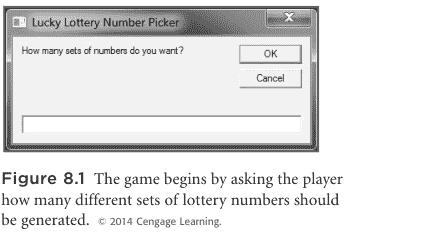

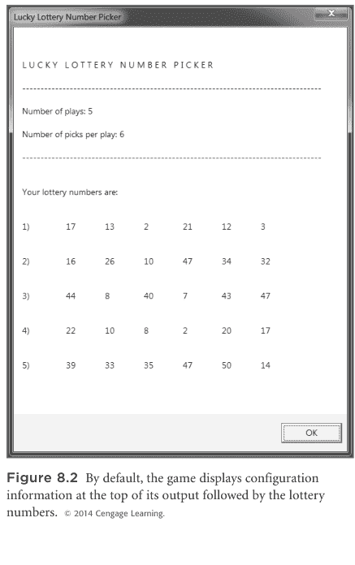

图 8.3 通过更改存储在外部配置文件中的脚本配置设置，玩家可以告诉脚本仅提供摘要级别的信息。© 2014 Cengage Learning.

当你完成本章并创建幸运彩票号码选择器游戏后，你已经掌握了操作和管理 Windows 文件和文件夹所需的构建模块。通过学习如何将配置设置存储在外部文件中，你学习如何让你的 VBScript 更容易控制和修改。

## 使用 Windows 文件系统操作

WSH 核心对象模型提供了与各种 Windows 资源交互的能力，例如 Windows 桌面和注册表。然而，它没有提供对 Windows 文件系统的任何访问，因此你无法使用它访问本地磁盘驱动器或处理文件和文件夹。微软没有选择将此功能作为 WSH 核心对象模型的一部分，而是选择通过 `FileSystem` 对象来实现，它是 VBScript 的运行时对象之一。请参阅第 3 章“VBScript 基础”中的表 3.4 以获取 VBScript 运行时对象的完整列表。

`FileSystemObject` 对象是 VBScript 的主要运行时对象。除 `Dictionary` 外，所有其他运行时对象都派自它。要使用 `FileSystemObject` 对象，你必须如下所示对其进行实例化：

```
Set objFso = CreateObject("Scripting.FileSystemObject")
```

设置 `FileSystemObject` 对象实例的第一步是使用 `FileSystemObject` 将变量与它关联。这是通过使用 VBScript 的 `CreateObject()` 方法并指定 `FileSystemObject` 为 `Scripting.FileSystemObject` 完成的。一旦实例化，你就可以通过引用设置好的变量与 `FileSystemObject` 对象进行交互，从而访问所有 `FileSystemObject` 对象的属性和方法。


为了帮助你理解 `FileSystemObject` 对象及其用法，让我们从一个示例开始：创建一个 VBScript，它使用 `FileSystemObject` 对象检索并显示与文件名 `Sample.txt` 相关的属性。脚本首先重新实例化 `FileSystemObject` 对象，并将其与名为 `objFso` 的变量关联。接下来，使用 `FileSystemObject` 对象的 `GetFile()` 方法获取 `File` 对象的引用。该对象专门指向位于 `C:\Temp` 文件夹中的 `Sample.txt`。

脚本的主处理执行了一系列调用。`CreateDisplayString()` 函数使用多个 `File` 对象属性来收集有关 `Sample.txt` 文件的信息。这两个函数显示收集到的文件信息并终止脚本的执行。

```vbscript
************************************************************************************
'Script Name: ExtractFileProperties.vbs
'Author': Jerry Ford
'Created': 02/10/14
'Description: This script demonstrates how to retrieve file information
************************************************************************************
```

### 初始化部分

```vbscript
Option Explicit

# 190 《初学者 Microsoft WSH 与 VBScript 编程》，第四版

On Error Resume Next

Dim objFso, strInputFile, strDisplayString

Set objFso = CreateObject("Scripting.FileSystemObject")

Set strInputFile = objFso.GetFile("C:\Temp\Sample.txt")
```

### 主处理部分

```vbscript
CreateDisplayString()
DisplayMessage()
TerminateScript()
```

### 过程部分

```vbscript
Function CreateDisplayString()
strDisplayString = "C:\Temp\Sample.txt" & vbLf & _
"Created: " & strInputFile.DateCreated & vbLf & _
"Last Modified: " & strInputFile.DateModified & vbLf & _
"Last Accessed: " & strInputFile.DateAccessed & vbLf
End Function
```

```vbscript
Function DisplayMessage()
MsgBox strDisplayString
End Function
```

```vbscript
Function TerminateScript()
WScript.Quit
End Function
```

从此示例中获得的主要要点是，它与文件系统属性交互以收集文件信息。要操作 `File` 对象，你必须先设置 `FileSystemObject` 的实例。

如果你在运行 Windows 8 的计算机上运行此脚本，你将看到类似于图 8.4 所示的输出。

# 第 8 章 数据的存储与检索

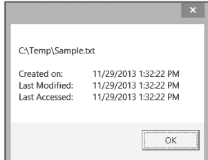

图 8.4 使用对象属性检索文件信息。© 2014 Cengage Learning.

## 打开和关闭文件

现在你知道如何在 VBScript 中实例化 `FileSystemObject` 对象，并看到了使用它引用其他运行时对象及其属性的示例，你准备好开始学习操作文件和文件夹了。

在打开文件或创建新文件之前，你必须确定该文件是否存在。你可以像演示所示使用 `FileSystemObject` 对象的 `FileExists()` 方法来实现：

```vbscript
Set objFso = CreateObject("Scripting.FileSystemObject")
If objFso.FileExists("C:\Temp\Sample.txt") Then
End If
```

要开始处理文件，你必须打开它。这是通过 `FileSystemObject` 对象的 `OpenTextFile()` 方法完成的，该方法要求你提供以下信息：

- 文件名和路径
- 如何打开文件
- 如果文件不存在是否创建新文件

表 8.1 定义了告诉 `OpenTextFile()` 方法打开文件的常量和值。

| 表 8.1 `OpenTextFile()` 常量 |  |  |
| --- | --- | --- |
| Constant | Description | Value |
| ForReading | 准备读取文件 | 1 |
| ForWriting | 准备写入文件 | 2 |
| ForAppending | 允许写入文件末尾 | 8 |

© Jerry Lee, Jr. All Rights Reserved.

## 零基础 Microsoft WSH 与 VBScript 编程，第四版

表 8.2 概述了当文件不存在时，`OpenTextFile()` 方法应执行的两种可用选项。

| 表 8.2 `OpenTextFile()` 文件创建选项 |  |
| :--- | :--- |
| 值 | 说明 |
| True | 如果文件已存在则打开文件；如果不存在，则创建并打开新文件 |
| False | 如果文件已存在则打开文件；否则不执行任何额外操作 |

© Jerry Lee Ford, 版权所有。

在告诉 `OpenTextFile()` 方法如何打开文件时，你必须始终指定适当的常量值。例如，如果你不小心地在 `ForWriting`（写入）模式下打开文件，而你实际上是想追加到文件末尾，那么你将覆盖文件中存储的内容。

让我们来看一个将所学知识付诸实践的 VBScript 脚本。在这个示例中，脚本打开一个名为 `Sample.txt` 的文件，该文件位于计算机 C 盘的 `Temp` 目录下。如果文件存在，脚本将打开它。如果文件不存在，脚本将创建它。打开后，脚本会写入几行文本，然后关闭文件。

```vbscript
********************************************************************

'脚本名称: FileCreate.vbs

'作者: Jerry Ford

'创建: 02/10/14

'描述: 此脚本演示了如何创建、打开并向文本文件写入

'一行文本。

'初始化部分

Option Explicit
```

```vbscript
Dim objFso, objFileHandle, strFileName
Set objFso = WScript.CreateObject("Scripting.FileSystemObject")
strFileName = "C:\Temp\Sample.txt"

'主处理部分

OpenTextFile()
WriteTextOutput()
CloseTextFile()
TerminateScript()
```

## 过程部分

```vbscript
Function OpenFile()
  '如果存在则以追加模式打开，否则创建并打开新文件
  If (objFso.FileExists(strFileName)) Then
    Set objFileHandle = objFso.OpenTextFile(strFileName, 8)
  Else
    Set objFileHandle = objFso.OpenTextFile(strFileName, 2, "True")
  End If
End Function
```

```vbscript
Function WriteTextOutput()
  '向文件写入三行文本
  objFileHandle.WriteLine("Once upon a time there was a little boy who"
  objFileHandle.WriteLine("lived in a shoe. Unfortunately it was two sizes"
  objFileHandle.WriteLine("too small!")
End Function
```

```vbscript
Function CloseFile()
  '完成工作后关闭文件
  objFileHandle.Close()
End Function
```

```vbscript
Function TerminateScript()
  '停止此脚本的执行
  WScript.Quit()
End Function
```

在允许脚本结束之前，始终记住关闭任何已打开的文件是非常重要的。

你通过使用如下所示的 `FileSystemObject` 对象的 `Close()` 方法来实现这一点：

```vbscript
objFileHandle.Close()
```

如果你在处理文件后忘记关闭它，该文件可能会损坏，因为没有为它创建文件结束标记。

## 陷阱

你一次只能使用一种模式打开文件。换句话说，如果你以 `Reading`（读取）模式打开文件，你的脚本无法向文件中写入新文本，除非你先关闭文件，然后以 `ForWriting`（写入）模式重新打开。

## 零基础 Microsoft WSH 与 VBScript 编程，第四版

如果你在运行 Windows 8.1 的计算机上保存并运行此脚本，然后使用 Windows 记事本打开 `Sample.txt` 文件，你将看到图 8.5 所示的输出。

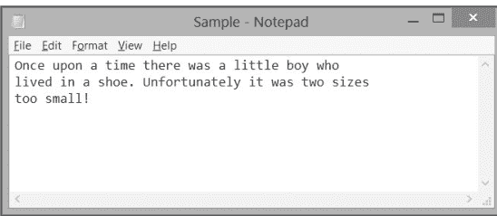

图 8.5 写入新或现有文本文件。© 2014 Microsoft Corporation。经微软许可使用。

## 写入文件

关于 VBScript 如何向文件写入文本，你有若干种不同的选项：

- 一次写入一个或多个字符
- 一次写入一行
- 写入空行

当你需要仔细格式化文本输出时（例如，你想创建一个数据列对齐的报告），一次写入一个或多个字符是很好的。另一方面，当格式较为自由时，一次写入一行文本是非常方便的。最后，在文本中插入或写入空行有助于你改进文件的外观，例如在正式报告的标题和正文之间添加空格。

## 写入字符

要一次写入一个或多个字符，你需要使用 `FileSystemObject` 对象的 `Write()` 方法。该方法不会向其写入的任何文本末尾添加回车。如果使用 `Write()` 方法执行两次写入操作，第二次写入操作的文本将插入到文本文件中，紧随第一次写入文本的同一行。要查看它是如何工作的，请看以下示例：

```vbscript
Set objFso = WScript.CreateObject("Scripting.FileSystemObject")
Set objFileHandle = objFso.OpenFile("C:\Temp\Sample.txt", 2, "True")
objFileHandle.Write("Once upon a time there ")
objFileHandle.Write("were three little.")
objFileHandle.Close()
```

如果你在运行 Windows 8.1 的计算机上保存并运行此脚本，然后使用 Windows 记事本打开 `Sample.txt` 文件，你将看到图 8.6 所示的输出。

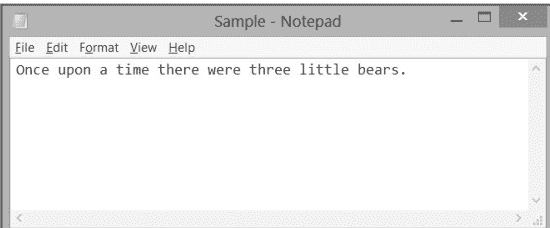

图 8.6 写入字符。© 2014 Microsoft Corporation。经微软许可使用。

## 写入行

你可以通过将 `Write()` 方法替换为 `WriteLine()` 方法来修改之前的示例，以便一次写入一行：

```vbscript
Set objFso = WScript.CreateObject("Scripting.FileSystemObject")
Set objFileHandle = objFso.OpenTextFile("C:\Temp\Sample.txt", 2, "True")
objFileHandle.WriteLine("Once upon a time there ")
objFileHandle.Close()
```

如果你保存并运行此示例，你会发现结果与之前的示例完全相同。唯一的区别是光标现在位于下一行的开头。这是因为 `WriteLine()` 方法会自动在每次写入的末尾添加换行符。

## 添加空行

你可以使用 `FileSystemObject` 对象的 `WriteBlankLines()` 方法向 VBScript 生成的输出添加行，使其看起来更好。该方法通过写入空行并将光标移动到下一行的开头来执行。

以下示例演示了如何使用 `FileSystemObject` 对象的 `WriteBlankLines()` 方法：

```vbscript
Set objFso = WScript.CreateObject("Scripting.FileSystemObject")
Set strInputFile = objFso.GetFile("C:\Temp\Sample.txt")
Set objFileHandle = objFso.OpenTextFile("C:\Temp\Sample.txt", 2, "True")

objFileHandle.WriteBlankLines(1)
objFileHandle.WriteLine("Hangman.txt Properties")
objFileHandle.WriteBlankLines(1)
objFileHandle.WriteLine("--------------------------------")
objFileHandle.WriteBlankLines(1)
objFileHandle.WriteLine("Creation Date: " & strInputFile.DateCreated)
objFileHandle.WriteBlankLines(1)
objFileHandle.WriteLine("Last Modified: " & strInputFile.DateLastModified)
objFileHandle.WriteBlankLines(1)
objFileHandle.WriteLine("--------------------------------")

objFileHandle.Close()
```

如果你在运行 Windows 8.1 的计算机上保存并运行此脚本，脚本执行后 `Sample.txt` 文件如下所示。

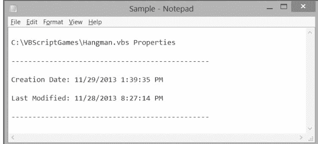

图 8.7 空行改进了 VBScript 生成的报告的演示效果。

## 从文件中读取数据

## 零基础 Microsoft WSH 与 VBScript 编程，第四版

VBScript 从文件中读取和向文件中写入一样简单。然而，在尝试读取或处理文件内容之前，你应该首先确保文件中是否有数据。如果文件没有数据，打开文件并追加读取是没有意义的。

你可以使用 `TestStream` 对象的 `AtEndOfStream` 属性来判断文件是否包含数据。你不仅在开始读取文件之前应该检查 `AtEndOfStream` 属性，你的脚本应该在每次额外的读取操作之前继续检查此属性，以确保还有数据供脚本读取。换句话说，你需要不断检查以确保脚本没有到达文件结束标记。

## 读取文件示例

为了演示这些内容是如何工作的，第三次构建使用了一个示例。首先，创建一个 VBScript，并向其中添加以下语句：

```vbscript
Dim objFso, objFileHandle, strDisplayString
Set objFso = WScript.CreateObject("Scripting.FileSystemObject")
Set objFileHandle = objFso.OpenTextFile("C:\Temp\Sample.txt", 1)
```

第一条语句定义了脚本使用的变量。下一条语句实例化 `FileSystemObject` 对象，设置了指向 `Sample.txt` 文件的对象引用，并以读取模式打开它。现在，向脚本中添加以下语句：

```vbscript
While objFileHandle.AtEndOfStream = False
strDisplayString = strDisplayString & objFileHandle.ReadLine() & vbCrLf
Loop
MsgBox strDisplayString
```

第一条语句设置了一个 `Do...While` 循环，每次迭代时都会检查是否到达文件结束标记。只要没有到达文件末，就会读取文件的另一行并将其追加到名为 `strDisplayString` 的变量末尾。

最后，通过添加以下语句关闭文件：

```vbscript
objFileHandle.Close
```

如果你在运行 Windows 8.1 的计算机上运行此脚本，将看到与图 8.8 所示类似的输出。

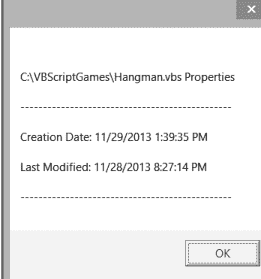

> **图 8.8** 创建读取并显示文本文件内容的 VBScript。

这个示例向你展示了如何逐行读取整个文件。读取文件时其他可用选项还包括：

- 跳过行
- 一次读取一个或多个字符
- 一次性读取整个文件

© 2014 C Learning.

Microsoft WSH and VBScript Programming for the Absolute Beginner, Fourth Edition

## 跳过行


文本和其他文件通常以某种标题或其他信息开头，你可能对这些信息并不感兴趣。在这种情况下，你可以使用`FileSystemObject`的`Skip()`和`SkipLine()`方法来跳过这些行的读取。`Skip()`方法允许脚本每次跳过特定数量的字符，而`SkipLine()`方法则允许脚本跳过一整行。

要使用`Skip()`，你必须传递已跳过的字符数，如所示：

```
objFileHandle.Skip(25)
```

`SkipLine()`方法不接受任何参数，因此它只能一次跳过一行。但是，通过在循环中封装该方法的执行，你可以像这里演示的样跳过任意数量行：

```
For intCounter = 1 To 5
objFileHandle.SkipLine()
Next
```

## 按字符读取文件

要一次读取一个或多个字符，你需要使用`FileSystemObject`的`Read()`方法。这对于读取具有固定长度数据的文件可能是必要的。例如，你可能有一个报告文件，其中某一列列出了类别或信息，该列从文件每行的第 20 个字符开始，到第 30 个字符结束。使用`Read()`方法，你可以编写一个 VBScript 来读取文件并提取文件中每行该列存储的信息。

为了直观了解`Read()`方法的用法，请考虑以下示例。该脚本使用`For`循环和`SkipLine()`方法跳过`Sample.txt`文件前五行的读取。`Skip()`方法跳过下一行（第 6 行）的前 15 个字符。`Read()`方法从文件中读取后续 22 个字符。关闭文件并显示从文件中读取的文本。

```
Dim objFso, objFileHandle, intCounter, strDisplayString
Set objFso = WScript.CreateObject("Scripting.FileSystemObject")
Set objFileHandle = objFso.OpenTextFile("C:\Temp\Sample.txt", 1)

For intCounter = 1 To 5
objFileHandle.SkipLine()
Next

objFileHandle.Skip(15)
strDisplayString = objFileHandle.Read(22)
objFileHandle.Close

MsgBox "C:\Temp\Sample.txt was created on " & strDisplayString
```

第 8 章 • 存储和检索数据

## 一次读取文件

有时，你只需要在单次操作中读取整个文件，例如当要读取的文件已经格式化为生成你所需的输出时。你可以使用`FileSystemObject`的`ReadAll()`方法来做到这一点，如此处所示：

```
Dim objFso, objFileHandle, strDisplayString
Set objFso = WScript.CreateObject("Scripting.FileSystemObject")
Set objFileHandle = objFso.OpenTextFile("C:\Temp\Sample.txt", 1)
```

```
strDisplayString = objFileHandle.ReadAll()
objFileHandle.Close()
MsgBox strDisplayString
```

如你所示，脚本使用`ReadAll()`操作读取整个文件并使用`MsgBox()`语句显示它。运行此脚本时显示的输出与图 8.8 所示完全相同，在图中，脚本在显示文件内容之前逐行读取了整个文件。

## 管理文件和文件夹

除了使用 VBScript 和 WSH 读写文本文件外，你还可以使用`FileSystemObject`管理文件和文件夹。`FileSystemObject`提供了创建、删除、移动和重命名文件及文件夹的方法。它还提供了检查文件或文件夹是否存在以及获取它们信息的方法。

例如，你可以使用`CreateFolder`方法创建一个新文件夹：

```
Dim objFso
Set objFso = WScript.CreateObject("Scripting.FileSystemObject")
objFso.CreateFolder("C:\NewFolder")
```

你还可以使用`DeleteFile`和`DeleteFolder`方法删除文件和文件夹：

```
Dim objFso
Set objFso = WScript.CreateObject("Scripting.FileSystemObject")
objFso.DeleteFile("C:\Temp\OldFile.txt")
objFso.DeleteFolder("C:\OldFolder")
```

`MoveFile`和`RenameFile`方法允许你移动或重命名文件：

```
Dim objFso
Set objFso = WScript.CreateObject("Scripting.FileSystemObject")
objFso.MoveFile("C:\Temp\File.txt", "C:\Temp\NewFile.txt")
```

最后，`FileExists`和`FolderExists`方法允许你检查文件或文件夹是否存在：

```
Dim objFso
Set objFso = WScript.CreateObject("Scripting.FileSystemObject")
If objFso.FileExists("C:\Temp\Sample.txt") Then
    MsgBox "File exists"
Else
    MsgBox "File does not exist"
End If
```

# 复制一个或多个文件

你可以使用`CopyFile()`方法复制一个或多个文件。该方法支持一个额外参数，允许你指定当脚本尝试将文件复制到已包含同名文件的文件夹时执行的操作。你为此参数指定`True`或`False`值。设置为`True`允许`CopyFile()`替换或覆盖重名文件。设置为`False`则允许`CopyFile()`取消任何重名文件的复制操作。

以下示例演示了如何将位于`C:\Temp`文件夹中的所有`.txt`扩展的文件复制到名为`C:\VBScriptGames`的文件夹，且不会覆盖目标位置已存在的任何重复文件：

```
Dim objFso
Set objFso = WScript.CreateObject("Scripting.FileSystemObject")
objFso.CopyFile("C:\Temp\*.txt", "C:\VBScriptGames", "False")
```

下一个示例与上一个示例完全相同，不同在于它允许覆盖重名文件：

```
Dim objFso
Set objFso = WScript.CreateObject("Scripting.FileSystemObject")
objFso.CopyFile("C:\Temp\*.txt", "C:\VBScriptGames", "True")
```

> 记住，在操作之前，可以使用`FileSystemObject`的`FileExists`和`FolderExists`属性来验证文件或文件夹是否存在，以避免错误。

# 移动一个或多个文件

移动文件和复制文件的区别在于，复制文件后，你在两个地方会有两个副本；而移动文件时，文件只存在于它的新位置。你可以使用`FileSystemObject`的`MoveFile()`方法将文件从一个文件夹移动到另一个：

```
Dim objFso
Set objFso = WScript.CreateObject("Scripting.FileSystemObject")
objFso.MoveFile("C:\Temp\*.txt", "C:\VBScriptGames")
```

在此示例中，所有`.txt`扩展的文件都从`C:\Temp`文件夹移动到`C:\VBScriptGames`文件夹。

## 初学者级 Microsoft WSH 和 VBScript 编程，第四版

# 删除一个或多个文件

你可以使用`FileSystemObject`的`DeleteFile()`方法删除一个或多个文件：

```
Dim objFso
Set objFso = WScript.CreateObject("Scripting.FileSystemObject")
objFso.DeleteFile("C:\VBScriptGames\*.txt")
```

在此示例中，`C:\VBScriptGames`文件夹中所有`.txt`扩展的文件都被删除了。

## 创建新文件夹

你可以使用`FileSystemObject`的`CreateFolder()`方法创建新文件夹。例如，以下脚本会检查电脑 C 盘上是否存在名为`VBScriptGames`的文件夹。如果不存在，脚本将创建它。

```
Dim objFso, strNewFolder
Set objFso = WScript.CreateObject("Scripting.FileSystemObject")
If (objFso.FolderExists("C:\VBScriptGames") = False) Then
Set strNewFolder = objFso.CreateFolder("C:\VBScriptGames")
End If
```

## 陷阱

> 在尝试创建文件夹之前，务必检查检查该文件夹是否存在。如果你正尝试创建的文件夹已经存在，你的脚本将报错。

## 复制文件夹

复制文件夹和复制文件的唯一区别在于，你指定的是`CopyFolder()`方法而不是`CopyFile()`方法，并且指定的是新名称而不是名称。例如，下例演示了不仅指定的文件夹被复制到了新位置，其内容也被复制了：

```
Dim objFso
Set objFso = WScript.CreateObject("Scripting.FileSystemObject")
objFso.CopyFolder("C:\Temp", "C:\VBScriptGames\Temp")
```

在这里，`Temp`文件夹及其存储的所有内容都被完整复制到`C:\VBScriptGames`文件夹内部。

## 技巧

如果你愿意，可以在复制指定文件夹时通过指定新文件夹名称来给新副本起一个新名字：

```
objFso.CopyFolder("C:\Temp", "C:\VBScriptGames\Temporary")
```

## 第 8 章 • 存储与检索数据

如果`CopyFolder()`方法指定的存储位置已存在同名文件夹，则源文件夹的内容将添加到已存在的文件和文件夹中。你可以通过添加一个可选的第三参数并将其值设置为`True`或`False`，告诉`CopyFolder()`方法在目标文件夹中发现重名文件和文件夹时该如何操作。指定`True`值允许匹配的文件被覆盖。例如，以下 VBScript 语句防止了重名文件被覆盖：

```
Dim objFso
Set objFso = WScript.CreateObject("Scripting.FileSystemObject")
objFso.CopyFolder "C:\Temp", "C:\VBScriptGames\Temp", "False"
```

此示例允许重名文件如下：

```
Dim objFso
Set objFso = WScript.CreateObject("Scripting.FileSystemObject")
objFso.CopyFolder "C:\Temp", "C:\VBScriptGames\Temp", "True"
```

## 移动文件夹

你可以使用`FileSystemObject`的`MoveFolder()`方法将文件夹从一个位置移动到另一个位置。注意，当你移动文件夹时，也会将其所有内容移动到新目的地。看下例：

```
Dim objFso
Set objFso = WScript.CreateObject("Scripting.FileSystemObject")
objFso.MoveFolder "C:\Temp", "C:\VBScriptGames\Temp"
```

`Temp`文件夹及其所有内容从根目录移动到`C:\VBScriptGames\Temp`。

## 删除文件夹

你可以使用`FileSystemObject`的`DeleteFolder()`方法删除一个或多个文件夹。该方法会删除指定的文件夹及其内部的任何内容。看下例：

```
Dim objFso
Set objFso = WScript.CreateObject("Scripting.FileSystemObject")
objFso.DeleteFolder "C:\VBScriptGames\Temp"
```

## 陷阱

使用`DeleteFolder()`方法时要小心。执行时，它会删除指定的文件夹以及其中包含的所有内容。

## 在外部文件中存储脚本设置

到本书为止，你看到的所有脚本都是通过嵌入脚本的配置设置控制的。这里的配置设置指的是我们在脚本开头定义的常量和变量。例如，我们对显示对话框的脚本是通过赋值字符串来控制的。然而，每当你为了修改文本而打开脚本时，都面临产生意外错误的风险。

移除或外部化脚本设置是一个好习惯。一种方法是将脚本设置存储在外部文件中，脚本可以从这些文件中获取设置。这是通过 INI（读作 "eye in eye"）实现的。初始化文件是具有`.ini`扩展文本文件。程序员使用 INI 文件来存储操作系统、硬件设置和软件设置。

使用 INI 文件的好处是，如果你在编辑时犯了错，在 INI 文件中找到比在脚本中更容易。此外，如果你计划与他人分享脚本——特别是没有编程背景的人——在解释后，他们会发现修改 INI 文件相对简单，而编辑你的脚本可能会让他们无所措。

## INI 文件结构

在创建 INI 文件时，你需要遵循特定的结构，如下所示：

```
[Section1]
key1=value1
key2=value2
```

首先，INI 文件被组织成节。每个节的开头都有一个用括号括的节标题。在示例中，`Section1`是唯一的节。节由零或多个键值对组成。在示例中，有两个键值对。你可以将键比作变量名，将值比作分配给键的数据。

INI 文件还包含注释，注释以`:`字符开头，如上一个 INI 文件所示。INI 文件还可以包含任意数量的空行，可以将空行添加到 INI 文件中使其更易读。

INI 文件按从上到下的顺序进行处理。它们可以包含任意数量的节（sections），而这些节可以包含任意数量的键值对。INI 文件通常以与其关联的脚本或程序命名。例如，如果你创建一个 INI 文件供一个名为`INIDemo.vbs`的 VBScript 使用，你可能会将你的 INI 文件命名为`INIDemo.ini`。

## 运行示例

为了更好地理解如何操作 INI 文件，让我们来看一个示例。这个示例包含一个名为`INIDemo.vbs`的脚本，该脚本旨在从一个名为`INIDemo.ini`的 INI 文件中检索配置设置。图 8.9 展示了 INI 文件的格式，如在运行 Windows 7 的电脑上所示。

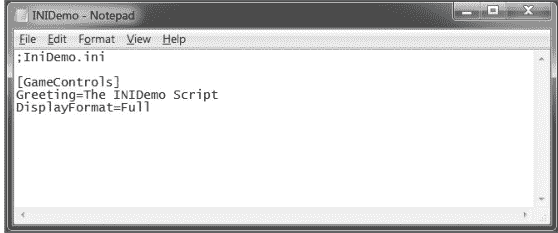

**图 8.9** `INIDemo.vbs`脚本所使用的 INI 文件包含一个由两个键值对组成的单个节。

© 2014 Microsoft Corporation. 经微软许可使用。

这里显示了组成`INIDemo.vbs`脚本的 VBS 语句。该脚本很短，但有些复杂，因此我嵌入大量的注释来解释脚本在做什么。

```
Set objFso = CreateObject("Scripting.FileSystemObject")
strIniFile = "C:\VBScriptGames\INIDemo.ini" '指定 INI 文件位置
```

```
If (objFso.Exists(strIniFile)) Then '确保 INI 文件存在
```

```
'打开以读取
Set objFile = objFso.OpenTextFile(strIniFile, 1)
```

```
'读取到文件末尾
Do Until objFile.AtEndOfStream = "True"
```

# 绝对初学者微软 WSH 和 VBScript 编程，第四版

```
strInput = objOpenFile.ReadLine '从文件中读取一行
If Mid(strInput = Mid(strInput), 1, 1) = "[" Then
    '发现了一个新节
End If

If Len(strInput) <> 0 Then '如果不是空行
intFindEquals = Instr(strInput, "=")' 定位等号
strKeyName = Mid(strInput, 1, intFindEquals - 1) 设置键值
Select Case strKeyName '匹配键值到脚本设置
    Case "Greeting"
        strGreetingMsg =
            Mid(strInput, intFindEquals + 1, Len(strInput))
    Case "DisplayFormat"
        strDisplayName =
            Mid(strInput, intFindEquals + 1, Len(strInput))
End Select

Loop
objOpenFile.Close() '读取完成后关闭 INI 文件
End If
```

'显示从 INI 文件中检索到的配置设置


`MsgBox "Configuration setting: strGreetingMsg = " & strGreetingMsg & _`

`vbCrLf & vbCrLf & "Configuration setting: strDisplayName = " & _`

`strDisplayName`

脚本开始实例化 `FileSystemObject` 实例。接下来，使用一个名为 `strIniFile` 的变量来存储脚本的 INI 文件位置。使用 `FileSystemObject` 的 `FileExists()` 方法验证 INI 文件是否存在。使用 `FileSystemObject` 对象的 `OpenTextFile()` 方法以读取模式打开 INI 文件。

`DoUntil` 循环一直执行，直到找到“Controls”节。这是通过内置的 VBScript `Mid()` 函数实现的。找到节后，第二个 `DoUntil` 循环运行到达到文件末尾（直到 `objOpenFile.EndOfStream = "True"`）。然而，如果发现新节，`Do..Until` 循环将通过 `Exit Do` 语句终止。接下来使用 VBScript `Len()` 函数判断当前行是否为空。如果不是，则通过首先定位等号来处理键值对的第一部分，并将等号之前的所有文本分配给名为 `strKeyName` 的变量。

## 第 8 章 • 存储和检索数据

## 技巧

从 INI 文件的键值对中提取脚本配置设置的技巧，是脚本利用了内置的 VBScript `Mid()` 函数。该函数从字符串中检索或解析指定数量的字符。`Mid()` 函数具有以下语法：

```
Mid(string, StartPosition[,Length])
```

`string` 代表 `Mid()` 函数要解析的字符串。`StartPosition` 指定指定字符串内开始解析操作的字符位置。`Length` 指定要返回的字符数。如果省略，则返回从起始位置到字符串末尾的所有字符。

处理完一个键后，会设置 `Select Case` 语句来检查与键关联的值以确定其是什么。在处理“GameControls”节后，`Do...Until` 循环终止，脚本显示从 INI 文件中提取的配置设置，如图 8.10 所示，该图显示了运行 Windows 7 的电脑上的结果。

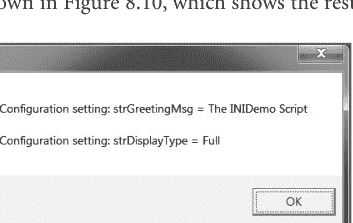

> **图 8.10** INIDemo.vbs 脚本显示的输出演示了如何从 INI 文件中提取配置设置。© 2014 Cengage Learning

从 INI 文件的键值对中提取脚本配置设置的技巧，是脚本利用了内置的 VBScript `Mid()` 函数。该函数从字符串中检索或解析指定数量的字符。`Mid()` 函数具有以下语法：

```
Mid(string, StartPosition[,Length])
```

`string` 代表 `Mid()` 函数要解析的字符串。`StartPosition` 指定指定字符串内开始解析操作的字符位置。`Length` 指定要返回的字符数。如果省略，则返回从起始位置到字符串末尾的所有字符。

处理完一个键后，会设置 `Select Case` 语句来检查与键关联的值以确定其是什么。在处理“GameControls”节后，`Do...Until` 循环终止，脚本显示从 INI 文件中提取的配置设置，如图 8.10 所示，该图显示了运行 Windows 7 的电脑上的结果。

> **图 8.10** INIDemo.vbs 脚本显示的输出演示了如何从 INI 文件中提取配置设置。© 2014 Cengage Learning

从 INI 文件的键值对中提取脚本配置设置的技巧，是脚本利用了内置的 VBScript `Mid()` 函数。该函数从字符串中检索或解析指定数量的字符。`Mid()` 函数具有以下语法：

```
Mid(string, StartPosition[,Length])
```

`string` 代表 `Mid()` 函数要解析的字符串。`StartPosition` 指定指定字符串内开始解析操作的字符位置。`Length` 指定要返回的字符数。如果省略，则返回从起始位置到字符串末尾的所有字符。

处理完一个键后，会设置 `Select Case` 语句来检查与键关联的值以确定其是什么。在处理“GameControls”节后，`Do...Until` 循环终止，脚本显示从 INI 文件中提取的配置设置，如图 8.10 所示，该图显示了运行 Windows 7 的电脑上的结果。

> **图 8.10** INIDemo.vbs 脚本显示的输出演示了如何从 INI 文件中提取配置设置。© 2014 Cengage Learning

## 初学者 Microsoft WSH 与 VBScript 编程，第四版

```
ProcessRandomNumber()
DetermineIfSetIsComplete()
Loop
BuildDisplayString()
ResetVariableDefaults()
DisplayFinalResults()
DisplaySplashScreen()
```

第一个循环由 `For` 语句控制，负责确保脚本生成了玩家指定的彩票号码组。第二个循环由 `Do...Until` 语句控制，负责确保每组（或每局游戏）都生成了完整数量的数字。

## 构建 SetVariableDefaults() 函数

这里显示的 `SetVariableDefaults()` 函数负责为脚本中使用的多个变量建立默认值。前两个变量是布尔型（Boolean），用于判断何时已生成了一整组彩票号码，以及玩家是否输入了有效的游戏次数。第二对变量用于存储整数数据。这对对变量中的第一个变量用于跟踪每个游戏生成的数字数量。第二个变量用于在脚本生成彩票号码时跟踪该彩票号码组。

```
Function SetVariableDefaults()
blAllNumbersPicked = "False"
blInputValidated = "False"
intNumberCount = 0
intNoValidPicks = 0
End Function
```

## 构建 ProcessScriptIniFile() 函数

`ProcessScriptIniFile()` 函数负责从游戏的 INI 文件中读取脚本配置设置。由于分配给该函数的任务特殊，我选择让它完全自包含。因此，通过定义自己的对象和变量。为了让每个变量的用途清晰，我在定义每个变量时在其右侧添加了注释，并在函数的关键语句处添加了注释。

```
Function ProcessScriptIniFile()
Dim FsoObject = '设置对 FileSystemObject 的引用
Dim OpenFile = '设置对脚本 INI 文件的引用
```

## 第 8 章 • 存储与检索数据

Set FsoObject = WScript.CreateObject("Scripting.FileSystemObject")

```
Dim intEquals = '用于解析 INI 数据
Dim strKeyName = '代表脚本 INI 文件中的一个键'
Dim strSourceFile = '指定脚本 INI 文件的名称'
Dim strInput = '代表脚本 INI 文件中的一行'
```

strSourceFile = "LuckyLotteryMachine.ini" '识别脚本的 INI 文件

'打开以读取

Set OpenFile = FsoObject.OpenTextFile(strSourceFile, 1)

Do Until Mid(strInput, 1, 15) = "[GameControls]" 找到右章节

strInput = OpenFile.ReadLine '从 INI 文件读取一行

Loop

'读取直到到达末尾

Do Until OpenFile.AtEndOfStream = "True"

strInput = OpenFile.ReadLine '从文件读取一行

If Mid(strInput, 1, 1) = "*" Then

    Exit do '如果执行，则已找到新章节

End If

If Len(strInput) <> 0 Then '如果未找到空行，则执行

intEquals = Instr(strInput, Len(strInput))

Select Case

    Case "RangeOfNumbers"

        intRangeOfNumbers = Cint(Mid(strInput, intEquals + 1, Len(strInput)))

End Select

End If

Loop

OpenFile.Close()'完成读取后关闭 INI 文件

Else

    MsgBox "INI 文件丢失。无法执行。"

    Script.Quit()

End If

End Function

该函数首先实例化 `FileSystemObject` 对象的的一个实例。然后，它指定了其 INI 文件的位置。接下来，它检查 INI 文件是否存在并将其打开。该函数读取 INI 文件直到找到“GameControls”部分。一旦函数开始读取 INI 文件的剩余部分，该函数将解析键值对并使用 `Select` 语句将值分配给匹配的脚本变量。

## 构建 CollectPlayerInput() 函数

`CollectPlayerInput` 函数负责收集和验证玩家输入。该函数的执行由以下 `Do...Until` 循环控制，只要名为 `bnInputValidated` 的布尔变量不等于 `True`，循环就会继续执行。

```
Function CollectPlayerInput()
Do Until bnInputValidated = "True"
    intNoOfFPlays = InputBox("你想要多少组" " & _ "数字?", strTitleBarMsg)
    If IsNumeric(intNoOfFPlays) <> True Then
        MsgBox "对不起。你必须输入数值。请 " & _ "重试。", .TitleBarMsg
    Else
        If Len(intNumberOfPlays) = 0 Then
            MsgBox "对不起。你必须输入数值。请 " & _ "重试。", .strTitleMsg
        Else
            If intNumberOfPlays = 0 then
                MsgBox "对不起。零不是一个有效选择。请 " & _ "重试。", .strTitleMsg
            Else
                blnInputValidated = "True"
            End If
        End If
    End If
Loop
End Function
```

执行了三项验证测试。第一个测试使用 `IsNumeric()` 函数确保输入是数字。第二个测试使用 `Len()` 函数确保玩家确实输入了内容。最后一次验证测试检查玩家没有输入零。如果输入通过了所有测试，则将 `bnInputValidated` 赋值为 `True`。

## 构建 GetRandomNumber() 函数

这里显示的 `GetRandomNumber()` 函数负责检索随机数。它从 `Randomize` 语句开始确保数字是随机生成的。接下来，生成一个随机数。创建数字的范围由 `intRangeNumber` 的值决定，该值是之前建立的。

```
Function GetRandomNumber()
Randomize
intRandomNumber = Int(Rnd * intRangeNumber)
End Function
```

## 构建 ProcessRandomNumber() 函数

这里显示的 `ProcessRandomNumber()` 函数确保数字不会重复抽取。它通过建立一个名为 `lotteryArray` 的数组来实现。该数组被设置为处理 11 个项目，这是基于假设这足以处理游戏可能需要的彩票数量。

```
Function ProcessRandomNumber()
Select Case intNo
Case intteryArray(0)
Case intteryArray(1)
Case intteryArray(2)
Case intteryArray(3)
Case intteryArray(4)
Case intteryArray(5)
Case intteryArray(6)
Case intteryArray(7)
Case intteryArray(8)
Case intteryArray(9)
Case intteryArray(10)
Case Else
    strteryList = strteryList & " " & intNo & vbTab
    intOfPicks = intOfPicks + 1
    intteryArray(intNumberCount) = intNo
    intNumberCount = intNumberCount + 1
End Select
```

该函数首先将生成的数字与数组中的数字进行比较。第一次执行时，数组中还没有彩票号码。因此，彩票号码被存储在数组的第一个项目中。每次调用此函数时，它都会检查最近生成的数字是否与存储在数组中的数字匹配。如果匹配，则不执行任何操作；否则，该数字将添加到数组中。

## 构建 DetermineIsSetComplete() 函数

这里显示的 `DetermineIsSetComplete()` 函数通过比较 `intOfPicks` 的值与 `intNumberOficksToSelect` 的值，判断是否已生成了一整组彩票号码。如果已生成了一整组，则 `DetermineIsSetComplete()` 将分配给 `blAllNumbersPicked` 的值设置为 `True`。否则，该变量的值保持为 `False`。

```
Function DetermineIsSetComplete()
    If intOfPicks = intNumberOficksToSelect Then
        blAllNumbersPicked = "True"
    Else
        blAllNumbersPicked = "False"
    End If
End Function
```

## 第 8 章 • 数据存储与检索

blnAllNumbersPicked = "True"

End If

End Function

## 构建 BuildDisplayString() 函数

此处显示的 `BuildDisplayString()` 函数使用存储在 `strLotteryList` 变量中的字符串（该变量由 `ProcessRandomNumber()` 函数创建）来构建由游戏生成的所有彩票号码组合组成的字符串。为了让显示输出更有吸引力，此函数使用 `vbTab` 计数将输出组织成多列格式。

```
Function BuildDisplayString()
strLotteryList = intCount & " *" & vbTab & strLotteryList
strDisplayString = strDisplayString & strLotteryList & _vbCrLf & vbCrLf & vbCrLf
End Function
```

## 构建 ResetVariableDefaults() 函数

此处显示的 `ResetVariableDefaults()` 用于用于生成一组彩票号码后将变量值重置为初始默认值。读取脚本以开始生成数字组。

```
Function ResetVariableDefaults()
blnAllNumbersPicked = "False"
intNumberOfValidPicks = 0
intCount = 0
strLotteryList = ""
End Function
```

## 构建 DisplayFinalResults() 函数

接下来显示的 `DisplayFinalResults()` 函数负责显示所有生成的彩票号码组合。根据赋值给 `strDisplayType` 变量的值，以两种格式之一显示这些信息；该变量的值在脚本早些通过从脚本的 INI 文件中检索进行设置。如果 `strDisplayType` 等于 Full（完整），该函数将显示有关每组生成的彩票号码数量以及创建的总组数的信息，然后是组成每组的数字。如果赋值给 `strDisplayType` 的值全非 Full，则显示彩票号码组合。

```
Function DisplayFinalResults()
If strDisplayType = "Full" Then
MsgBox vbCrLf & _
```

# 零基础学者 Microsoft WSH 与 VBScript 编程，第四版


## 构建 `DisplaySplashScreen()` 函数

脚本中的最后一个函数显示游戏的启动界面，提供有关游戏及其创建者的信息，邀请玩家下次再次游戏。

```
"LUCKY LOTTERY NUMBER PICKER" & \
vbCrLf & vbCrLf & _ \
"" & & & vbCrLf & vbCrLf & _ \
"Number of plays: " & & intNoOfPlays & vbCrLf & vbCrLf & _ \
"Number of picks per play: " & & intNoOfPicksToSelect & \
vbCrLf & vbCrLf & _ \
"" & & & _ \
"" & & vbCrLf & vbCrLf & vbCrLf & _ \
"Your lottery numbers are: " & & vbCrLf & vbCrLf & vbCrLf & _ \
strDisplayString, , strTitleBarMsg
Else
MsgBox vbCrLf & _ \
"LUCKY LOTTERY NUMBER PICKER" & \
vbCrLf & vbCrLf & _ \
"" & & & vbCrLf & vbCrLf & _ \
"Your lottery numbers are: " & & vbCrLf & vbCrLf & vbCrLf & _ \
strDisplayString, , strTitleBarMsg
```

```
End If

End Function
```

函数中的最后语句使用 `WScript Quit()` 方法终止脚本执行。

## 最终结果

好了。到此时，你应该已经拥有完成“幸运彩票号码选择器”游戏所需的信息。如果你还没有这样做，请创建一个你自己的游戏副本并运行它看看它是如何工作的。在清理掉输入时可能产生的任何错误后，你将拥有非常酷的脚本。

## 总结

在本章中，你学习了如何在文本文件中创建和存储数据。你还学习了如何打开文本文件并读取或处理其内容作为输入。此外，你学习了如何使用属于 WSH `FileSystemObject` 对象的属性和方法执行各种文件管理任务，包括复制、移动和删除单个或一组文件和文件夹。

你现在理解了文件操作的基础知识，并知道开发能够创建报告和日志文件的脚本所需的一切。在此基础上，你现在还可以开发并利用 INI 文件的功能，作为外部化脚本配置设置的仓库。

1. 按目前的写法，“幸运彩票号码选择器”游戏尝试显示尽可能多的彩票号码组合。然而，取决于屏幕分辨率，一次只能显示有限数量的组合。结果是，当指定的组合过多时，某些组合对玩家是不可见的。为了解决这个问题，修改脚本使其通过多个弹出对话框显示脚本输出，每次只显示 10 组数字。

2. 为玩家提供将生成的彩票号码保存到文本文件的功能。这允许玩家打印他们的号码，并在去购买彩票时随身携带列表。

3. “幸运彩票号码选择器”游戏被设置为在结束前始终显示关闭启动界面。修改脚本及其关联 INI 文件，使用户可以启用或禁用启动界显示。

4. 按目前的写法，“幸运彩票号码选择器”游戏阻止玩家输入非数字输入（如字母和特殊字符）。它还强制玩家输入某些内容（玩家不能直接点击。

## 处理脚本错误

无论程序员是什么样的人，在编写程序时都会遇到错误。与任何其他语言一样，VBScript 受到许多类型错误的影响。错误可能是不可避免的，但你可以减少它们的影响。在本章中，我将向你演示：

- 如何通过读取和分析错误消息来修复错误
- 如何编写忽略错误的 VBScript
- 如何创建错误处理程序
- 如何使用日志文件生成测试错误

## 项目预览：挂字游戏

本章的项目是创建一个 VBScript 版本的经典儿童游戏——挂字。挂字游戏开始向玩家展示一组代表游戏单词字母的空白框。然后提示玩家猜测组成单词的字母。如果玩家在做出六次错误猜测之前收集了单词，他就获胜了。否则，游戏将通过显示谜底结束，并询问玩家是否想再次玩。遗憾的是，由于 WSH 的显示限制，你无法在玩家失败时制作动画动画。尽管如此，通过创建格式良好的输出，玩家可能永远不会察觉。

## 理解 VBScript 错误

由于许多原因，即使是很小的脚本也可能出现错误。在脚本首次加载或解释时，可能会产生错误。发生在此阶段的错误被称为语法错误。语法错误通常是由拼写错误导致的。例如，你可能在想输入双引号时不小心输入了单引号。当你无意中误写了 VBScript 关键字时，也会发生语法错误。由于语法错误在脚本初始加载期间就会被发现，因此在脚本开发过程中通常很容易修正。

错误也可能在脚本执行期间产生。这类错误被称为运行时错误。运行时错误只有在生成它们的错误的语句被执行时才会出现。因此，某些运行时错误可能在脚本执行时才被检测到（如果包含错误的语句没有被执行）。例如，运行时错误可能隐藏在被调用的函数或子程序深处。

| 定义 |
| :--- |
| 语法错误是由于脚本中语句格式不正确而导致的错误。 |

通过对所有组件进行适当的测试，大多数运行时错误可以在脚本开发期间被发现并修复。之所以说“大多数”，是因为并不是所有的运行时错误都能被捕获。例如，由不可预见的情况引起的错误在脚本开发期间可能无法检测。也许是运行脚本的人以你无法预料的方式错误地提供了输入，或者脚本执行的环境出了问题。又可能是当你的脚本执行文件复制或移动操作时，硬盘故障了。在这种情况下，由于经常发生这种情况，网络也会中断，你能做的最好就是优雅地结束脚本，而不让用户困惑或让情况恶化。

| 定义 |
| :--- |
| 运行时错误是脚本尝试执行非法操作（例如将数值和字符值相乘）时发生的错误。 |

脚本容易受到影响的另一类错误是逻辑错误。逻辑错误是脚本开发者犯的错误。例如，你可能并没有循环 10 次，而是不小心设置了一个死循环。另一个逻辑错误的例子是脚本相加两个本该相乘的数字。

| 定义 |
| :--- |
| 逻辑错误是由于脚本开发者的编程错误而产生的错误。 |

## 理解错误消息

VBScript 错误会在语法错误和运行时错误中产生。这些错误以弹出对话框的形式显示，如图 9.5 所示，它显示了在运行 Windows 7 的计算机上执行脚本的结果。每条错误消息都显示有关错误的信息，包括错误代码和错误源。

# 微软 WSH 和 VScript 编程初教程，第四版

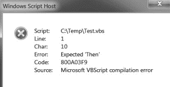

图 9.5 典型的 VScript 错误消息。经微软许可使用。

图 9.5 中显示的错误消息是语法错误的结果。如你所见，系统会自动提供许多关于错误的有用信息。解释和理解这些信息的能力对于故障排除和修复你的 VBScript 非常重要。

此错误消息中提供了以下信息：

- `Script`。产生错误的 VBScript 的名称和位置
- `Line`。VBScript 中检测到错误的行号
- `Char`。该行中检测到错误的列号
- `Error`。对错误的简要描述
- `Source`。报告错误的资源

你可以在图 9.5 中看到，一个位于 `C:\Temp` 的、名为 `Test.vbs` 的 VBScript 生成了该错误。产生此错误的脚本第 6 行看起来如下语句：

```
If X > 5 MsgBox "Hello World!"
```

该语句使用 VBScript `MsgBox()` 函数显示文本字符串。错误消息指出，问题在于 VBScript 期望有 `Then` 关键字但实际上没有。如果你查看该语句的中间，你会发现缺少了 `Then` 关键字。要纠正此错误，你需要添加缺失的关键字，例如：

```
If X > 5 Then MsgBox "Hello World!"
```

为了验证错误已消除，你可以再次保存并运行脚本。

# 预防逻辑错误

你的 VBScript 将完全按照你告诉它们做的方式去运行，即使那并不是你真实想要它们做的事。仔细计划你的 VBScript 项目至关重要。例如，你应该从伪代码大纲开始，并将其转换为流程图，概述脚本的每个主要组件。你应该尽可能一次开发一个脚本组件，

# 第 9 章 • 处理脚本错误

在开发过程中测试每个组件。我将向你展示在开发“猜字员游戏”（Hangman game）时测试单个脚本的几种不同方法。

逻辑错误通常通过呈现错误或意料之外的结果来表现存在，并且可能是最难追踪的错误类型。与显示描述问题性质消息的语法和运行时错误不同，逻辑错误迫使你一次查看脚本的部分或全部脚本以找到错误的逻辑。好消息是，通过仔细的计划和设计，可以避免逻辑错误。

## 处理错误

你可以采取许多措施来防止你的 VBScript 出现错误。我已经提到过需要计划并仔细设计和测试你的脚本。此外，你可以通过遵循以下建议来避免错误：

- 提供一个简单、易用的界面（例如弹出对话框）。
- 尽可能通过使用已测试过的代码来避免错误。
- 尽可能验证数据。
- 显式声明所有变量。
- 为所有常量、变量引用、数组、函数和子程序使用一致的命名方案。
- 警惕死循环。
- 尽可能预测并处理可能发生的情况。

不幸的是，错误会发生。有三种基本方法处理它们：

- 简单让它们发生。
- 告诉 VBScript 忽略错误并继续。
- 在错误发生时以优雅的方式终止脚本或允许脚本恢复。

## 让错误发生

错误是会发生的。处理它们的一种方法是简单让它们发生，并尽可能在它们发生时报告这些信息。这样，你可以尝试重现错误，然后修复它。

# 微软 WSH 和 VScript 编程初教程，第四版

通常我不建议这种方法。毕竟，你作为 VBScript 高手的声誉取决于脚本的健全性和可靠性，每次你编写新脚本时，都必须对投入多少时间和精力做出判断。如果你正在开发一个高可见且你会对出现的问题负责的极其脚本，那么你将希望尽一切防止错误发生。相反，如果你被要求创建一个完成非关键任务的“快速草陋”脚本，你可能允许任何错误的发生。只需记住这一点：大多数用户不知道典型的 VBScript 错误消息意味着什么，也不知道在收到时该怎么办。重要的是，至少要提供如何使用你的 VBScript 以及发生错误该怎么办的说明。

## 忽略错误

在开发脚本时，你可能考虑的另一种选择是告诉 VBScript 忽略发生的任何错误。在某些情况下，这样做效果良好。例如，假设你写了一个脚本，它应该定期连接到许多网络计算机并复制文件夹中的文件。由于网络有时会出现问题，忽略脚本无法连接到特定网络驱动器的情况是可以的，特别是当你知道脚本将再次运行并获得复制丢失文件的机会时。

这种方法虽然有效，但应谨慎使用。在少数情况下，跳过错误会导致脚本后部分产生另一个错误。例如，如果你的脚本本应对从网络驱动器复制的每个文件执行操作，取决于你如何编写脚本，执行此后续步骤的部分可能会产生错误。

要让 VBScript 忽略脚本中的错误，请在脚本开头添加如下语句（位于你认为可能发生错误的语句之前）：

```
On Error Resume Next
```

即使你在脚本中添加了此语句，某些错误仍然会被报告。使用此语句的关键在于，它必须放在你认为可能发生错误的语句之前。你可以使用以下语句取消此语句的影响：

```
On Error GoTo
```

例如，以下语句将产生错误消息，因为关键字 `WScript` 拼写错误：

```
WScript.Echo "Hello world!"
```

在语句之前添加 `On Error Resume Next` 可以防止错误出现，并允许脚本的其余部分继续执行：

```
On Error Resume Next
WScript.Echo "Hello world!"
```

现在看另外两个语句：

```
On Error Resume Next
WScript.Echo "Hello world!"
On Error Goto 0
WScript.Echo "Goodbye world!"
```

`On Error Goto 0` 语句会消除后续所有语句对 `On Error Resume Next` 语句的影响。因此，第一个错误会被忽略，但第二个错误会被报告，脚本将停止执行。

与变量一样，VBScript 允许将 `On Error Resume Next` 语句的作用限制在过程层级。换句话说，如果此语句放在过程内部，那么它只在过程执行期间有效，并在过程（即函数或子例程）执行完毕时失效。将 `On Error Resume Next` 语句与过程结合，可以让你显著地控制这一强大语句的作用。

## 创建错误处理程序

在处理 VBScript 错误时的第三种选择是创建错误处理程序。在你的脚本中有效地预判可能发生错误的位置，然后开发编程逻辑来处理或应对这些错误。

你可以通过不同的方式处理错误。例如，你可以创建执行以下操作的错误处理程序：

- 重新描述 VBScript 错误。
- 为用户提供指令。
- 让用户再次尝试。
- 对错误道歉。
- 请求用户报告错误。
- 采取纠正措施。
- 记录错误的发生情况。

| 定义 |
| :--- |
| 错误处理程序是由错误触发的运行时，它会改变执行环境对错误状况的默认处理方式 |

# 《初学者级微软 WSH 与 VBScript 编程》，第四版

要设置错误处理程序，你需要知道如何使用 `Err` 对象。`Err` 对象提供了许多属性和方法，允许你的脚本访问错误信息并清除错误状态。要访问有关错误的信息，你需要引用以下三个属性：

- `Number`。获取上一个错误编号。
- `Description`。获取上一个错误消息。
- `Source`。获取引发（或引起）错误的对象的名称。

你可以修改这三个属性中任何一个的内容，从而允许你重新分配自定义错误编号和消息，甚至修改源信息。例如，在特别复杂的脚本中，你可能想要创建并记录自定义的错误消息集。

创建错误处理程序的第一步是在你的 VBScript 中添加 `On Error Resume Next` 语句。然后你可以如下所示添加错误处理语句：

```
On Error Resume Next

NonExistentFunction()

If Err > 0 then
Err.Number = 9999
Err.Description = "This script is still a work in progress."
MsgBox "Error: " & Err.Number & " - " & Err.Description
Err.Clear
End if
```

将这些语句保存为脚本并执行。由于脚本不包含名为 `NonExistentFunction` 的过程，将生成一个错误。然而，错误处理程序并没有显示 VBScript 运行时错误消息，而是创建并显示了图 9.6 所示的错误消息。

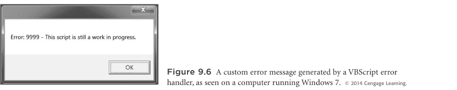

`Err` 对象提供了两个非常有用的方法。其中一个是 `Clear()` 方法。该方法清除或移除之前的错误，确保脚本下一次检查错误时不会获得虚假状态（也就是说，它不会看到一个已经处理过的错误）。

# 第 9 章 • 处理脚本错误

要使用 `Clear()` 方法，请将其放在你错误处理程序的末尾，如上一个示例所示。VBScript 会在几种情况下自动执行 `Clear()` 方法，包括：

- 每当执行 `On Error Resume Next` 语句时
- 每当执行 `Exit Sub` 语句时
- 每当执行 `Exit Function` 语句时

第二个 `Err` 对象使用 `Raise()` 方法。这允许你生成错误消息来测试你的错误处理程序。在没有此方法的情况下，你测试错误处理程序的唯一方法就是故意在代码中引入错误情况。该方法非常易于使用，如下所示：

```
Err.Raise(500)
```

例如，如果你将之前的语句保存为脚本并在运行 Windows 7 的计算机上运行它，你将看到 9.7 所示的错误消息。

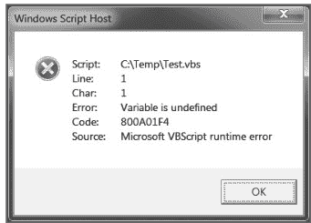

> 图 9.7 使用 `Err` 对象的 `Raise()` 方法生成测试错误。
> © 2014 Microsoft Corporation. 经微软许可使用。

要使用 `Raise()` 方法，请在脚本中你想要测试的错误处理程序之前，将它连同指示要生成的错误的错误编号一起添加。在你验证错误处理程序按预期工作良好后，从你的 VBScript 中删除 `Raise` 语句。

## 报告错误

处理错误的解决方案是从源头上防止其发生。然而，这并不总是可能的。次优解决方案是设计一种处理错误的方法，无论是处理它们还是简单地忽略它们。另一种选择是将错误记录到日志文件中来报告错误。这允许你回来检查是否发生了任何错误。这很重要，因为许多用户在错误发生时不会报告，导致错误持续存在。通过记录错误消息，你创建一个以后可以回顾的审计日志。

# 《初学者级微软 WSH 与 VBScript 编程》，第四版

在记录错误消息时，你有两种选择：

- 创建自定义日志文件
- 在 Windows 事件日志中记录错误消息

# 创建自定义日志文件

要创建自定义日志文件，你必须在 VBScript 中实例化 `FileSystemObject`，然后使用其 `OpenFile()` 方法打开日志文件以便脚本进行写入，如下例所示：

```vb
On Error Resume Next

Err.Raise(7)

Set objFsoObject = WScript.CreateObject("Scripting.FileSystemObject")
If objFsoObject.FileExists("C:\ScriptLog.txt") Then
    Set objLogFile = objFsoObject.OpenFile("C:\ScriptLog.txt", 8)
Else
    Set objLogFile = objFsoObject.OpenFile("C:\ScriptLog.txt", 2, "True")
End If
```

```vb
objLogFile.WriteLine "Test.vbs Error: " & Err.Number
```


在此示例中，`On Error Resume Next` 语句用于模拟内存不足错误。脚本的其他部分将错误记录在计算机 C 盘上的 `ScriptLog.txt` 文件。如果文件不存在，则会创建。每次写入时，错误消息都会添加到文件末尾，形成累积的历史信息。更多关于如何使用 `FileSystemObject` 对象及其方法和属性的信息，请参阅第 8 章“存储和检索数据”。

你可以将之前的示例作为基础，在你的 VBScript 中开发错误日志例程。只需将所有前面的行复制并粘贴到函数中，并在每次发生错误时调用它。确保在清除错误之前调用该函数。或者，你可以修改示例以使用变量替换，并将函数错误编号和描述作为参数传递。

## 捕获

在允许脚本终止之前，确保关闭你已打开的所有文件。如果不这样做，下次你想打开该文件时可能会遇到问题，因为其文件结束标记可能缺失。

## 第 9 章 • 处理脚本错误

## 在应用程序事件日志中记录错误消息

为脚本创建自定义日志文件的替代方案是将错误消息记录在 Windows 应用程序事件日志中。这通过使用 `WshShell` 对象的 `LogEvent()` 方法实现：

```
On Error Resume Next
```

```
Err.Raise(7)
```

```
Set objWshShell = WScript.CreateObject("WScript.Shell")
objWshShell.LogEvent 1, "Test.Vbs Error: " & Err.Number & ", Description = " & _
Err.Description & " , Source = " & Err.Source
```

在这个示例中，再次模拟了“内存不足”错误，但这次错误已使用 `WshShell` 对象的 `LogEvent()` 方法写入了 Windows 应用程序事件日志。程序只处理了两个参数。第一个是指示正在记录的事件类型的数字。表 9.1 列出了 Windows 支持的不同事件类型。第二个参数是要记录的消息内容。图 9.8 显示了在运行 Windows 7 的计算机上从“事件查看器”查看时，消息将如何显示。

### 表 9.1 事件日志错误指示器

| 值 | 描述 |
|---|---|
| 0 | 表示成功事件 |
| 1 | 表示错误事件 |
| 2 | 表示警告事件 |
| 4 | 表示信息事件 |
| 8 | 表示成功的审计事件 |
| 16 | 表示失败的审计事件 |

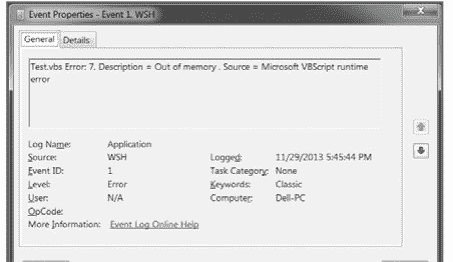

图 9.8 使用 `WshShell` 对象的 `LogEvent()` 方法将错误消息写入 Windows 应用程序事件日志。

© 2014 Microsoft Corporation。经 Microsoft 许可使用。

## 《初学者级 Microsoft WSH 和 VBScript 编程》，第四版

## 回到猜字游戏（Hangman Game）

现在你已经回顾了处理 VBScript 错误的基本步骤，让我们回到猜字游戏并开始它的开发。我将从与之前章节不同的角度来涵盖这个游戏的开发。到目前，你应该对它的工作原理有了相当清楚的了解，并且能够阅读和理解贯书中出现的脚本。（以防万一，我会在代码中留下大量的注释来帮助你。）这一次，我将对正在发生的情况提供更高级的解释，并对如何逐步测试和开发此脚本提供建议。我还会指出你可以用于测试和跟踪脚本内部函数结果的技术，这样你就不需要先完成整个脚本就可以验证它们的运行。

## 设计游戏

猜字游戏的整体设计相当复杂。为了简化处理，我将从设计流程图开始游戏开发过程，如图 9.9 所示，该图将游戏拆分为不同的单元，每个单元负责执行一项独特的任务。

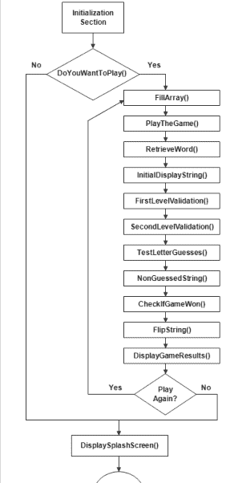

图 9.9 为猜字游戏提供高层设计的流程图。

© 2014 Cengage Learning.

## 第 9 章 • 处理脚本错误

除了初始化部分和主处理部分外，此脚本由 13 个独立的过程组成。因此，你将按照以下 15 个步骤开发此脚本：

1. 创建一个新脚本，添加你的 VBScript 模板并定义此脚本使用的变量、常量和数组。

2. 开发主处理部分的控制逻辑。

3. 开发 `DoWantToPlay()` 函数以创建游戏介绍闪屏，并确定用户是否想玩。

4. 使用 `FillArray()` 函数将单词列表分配给数组。

5. 在 `PlayGame()` 函数中创建一个循环，控制游戏的实际流程，收集玩家的猜测并在需要时调用其他函数。

6. 使用 `Retrieve()` 函数获取一个随机选择的单词。

7. 使用 `InitialDisplayString()` 函数用空格分隔的下划线表示游戏单词中的每个字母。

8. 使用 `FirstLevelValidation()` 验证函数验证玩家的输入，确保玩家提供的是有效的猜测。

9. 使用 `SecondLetterValidation()` 函数在接受玩家输入之前，检查玩家之前是否已经尝试过该字母。

10. 使用 `NonGuessedString()` 函数创建一个临时字符串，将玩家正确猜对的字母留空。

11. 使用 `CheckIfGameWon()` 函数检查玩家是否已经猜出了组成谜底词的所有字母。

12. 使用 `FlipString()` 函数对第 11 步创建的脚本进行处理，反转字符串中每个字符的显示（即：现在只显示正确猜对的字母）。

13. 使用 `DisplayResults()` 函数告诉玩家赢了还是输了。

14. 使用 `SplashScreen()` 函数在游戏结束时显示有关游戏的信息。

## 设置脚本模板和初始化部分

接下来所示的脚本部分现在对你来说应该非常熟悉，不需要过多的解释。从代码可以看出，该部分由脚本模板以及变量、常量和数组组成。

《初学者级 Microsoft WSH 和 VBScript 编程》，第四版

```
************************************************
脚本名称：Hangman.vbs
作者：Jerry Ford
创建日期：02/30/02
描述：此脚本演示了如何使用 VBScript 和 WSH 创建猜字游戏。
************************************************
```

## 初始化部分

```
Option Explicit

Const cTitleBar = "VBScript"

Dim Choice, strWord, intNo, intRight, strImage
intNotIn, strText, intAgain, strGuesses
Dim strRight, blngessed, intCounter
Dim strOne, strTempString, strLetter, strGuess
Dim astWord(9)
```

## 主处理部分

与你看到的其他脚本一样，此部分的逻辑非常直接。它调用了确定用户是否想玩的程序、加载游戏、启动游戏，并通过显示闪屏结束游戏。

```
intNotIn = DoWantToPlay()
If intNotIn = 6 '用户选择玩
   FillArray()
   PlayGame()
End If
```

```
SplashScreen()
WScript.Quit()
```

## 第 9 章 • 处理脚本错误

在脚本的此时，你已经有了足够的代码来进行首次测试并检查是否有语法错误。现在，我建议你为前面的函数定义一个过程，并在其中放置一个 `MsgBox()` 函数来显示函数名称。

像我在这一部分那样使用 `Script.Quit()` 方法并不是必须。脚本会在显示闪屏后停止。我为了清晰起见添加了这条语句。

## 构建 DoWantToPlay() 函数

你在之前的章节中见过类似的函数。`DoWantToPlay()` 函数会显示一个巧妙的图形并询问用户是否想玩游戏。

```
Function DoWantToPlay()

'显示闪屏并询问用户是否想玩
strSplashImage = Space(88) & ************ & vbCrLf &
  *WELCOME TO * & Space(55) & ** & Space(13) & vbCrLf &
  vbCrLf & Space(88) & "Q" & Space(13) & ** & vbCrLf &
  VBSCRIPT HANG M A N ! * Space(35) & "--|-" & _
  Space(10) & ** & vbCrLf & Space(87) & "/" & Space(1) & \& & _
  Space(12) & ** & vbCrLf & Space(103) & ** & vbCrLf & _
  Space(9) & ****** & vbCrLf & _
  "Would you like to play a game?" & vbCrLf & ""

DoWantToPlay = MsgBox(strSplashImage, 36, cTitleBar)
End Function
```

## 构建 FillArray() 函数

接下来所示的 `FillArray()` 函数只需将单词列表加载到数组。稍后，另一个过程将从数组中随机选择一个游戏单词。

## 初学者 Microsoft WSH 和 VBScript 编程，第四版

```
Function FillArray()

  '将单词添加到数组中

astrWordList(0) = "AUTOMOBILE"
astrWordList(1) = "NETWORKING"
astrWordList(2) = "PRACTICAL"
astrWordList(3) = "CONGRESS"
astrWordList(4) = "COMMANDER"
astrWordList(5) = "STAPLER"
astrWordList(6) = "ENTERPRISE"
astrWordList(7) = "ESCALATION"
astrWordList(8) = "HAPPINESS"
astrWordList(9) = "WEDNESDAY"

End Function
```

你无法对此函数进行很多测试，但你可以保存并运行脚本以检查是否存在任何语法问题。你应该创建一个临时脚本，将此函数复制到其中，然后创建一个 `For_Next` 循环来处理并显示数组的内容，以确保该函数按预期加载。删除 `For_Next` 循环并在临时脚本的开头添加以下语句：

```
Dim astrWordList(9) : '定义一个可以容纳10个游戏单词的数组

FillArray()
```

一天后保存此脚本，我将向你展示如何修改和使用此临时脚本进行另一个测试。

## 构建 PlayGame() 函数

接下来，`PlayGame()` 函数将控制猜字游戏的运行。当我开发这个函数时，我写了几行代码，停止并测试，然后再多写一些。具体来说，每当我添加对外部函数的调用时，我都会停下来，编写我调用的函数，然后进行测试以确保在继续之前一切运行正常。然而，如果让我引导你走每一步将花费太长时间。相反，我将由你自己遵循这个基本过程，转而重点开发组成脚本的其他函数，其中大多数函数都是从 `PlayGame()` 函数调用的。

```
Function PlayGame()

'初始化游戏初始弹出对话框显示的变量
intNoMisses = 0
intNoRight = 0
strWrongGuesses = ""
strRightGuesses = ""
```

# 第 9 章 • 处理脚本错误

```
'获取游戏 = 谜底单词
strGameWord = RetrieveWord()

'调用函数格式化初始弹出对话框的显示字符串
strString = InitialDisplayString()

strTempStringOne = strGameWord

'让玩家开始猜测
Do Until noMisses = 6

'收集玩家的猜测
strChoice = InputBox(vbCrLf & vbTab & strDisplayString & vbCrLf & -
vbCrLf & vbCrLf & "错误次数: " & intNoMisses & -
" " & vbTab & "错误:" & strWrongGuesses & vbCrLf
& vbCrLf & vbCrLf & -
& "输入字母并点击确定。", cTitleBarMsg)

'判断玩家是否退出
If strChoice = "" Then
Exit Function
End If

strProcessGuess = FirstLevelValidation()

'玩家想退出游戏
If strProcessGuess = "ExitFunction" Then
Exit Function
End If

'玩家输入了无效输入
If strProcessGuess <> "SkipRest" Then

strProcessGuess = SecondLevelValidation()

Select Case strProcessGuess
Case "DuplicateWrongAnswer"
MsgBox "无效：你已经猜过这个错误的字母了。"
Case "DuplicateRightAnswer"
MsgBox "无效：你已经猜过这个正确的字母了。"

Case Else
strCheckAnswer = TestLetterGuess()
If strCheckAnswer <> "IncorrectAnswer" Then

'重置用于构建字符串的变量值，该字符串包含
'玩家当前的单词中间阶段
TempStringTwo = "*"

NonGuessedString()

'检查玩家是否猜中了单词
blnGameStatus = CheckIfGameWon()
If blnGameStatus = "True" Then
blnWordGuessed = "True"
Exit Do
End If

'将临时字符串的值设置为之前的 For...Next 循环
'创建的字符串
TempStringOne = strDisplayStringTwo

'清除 strDisplayString 变量的值
strDisplayString = ""

FlipString()
End If
End Select
End If
Loop

DisplayGameResults()

End Function
```

## 构建 RetrieveWord() 函数

此函数设计用于随机检索一个游戏使用的单词。`RetrieveWord()` 首先在 1 到 10 之间选择一个随机数，并使用该数字从 `WordList()` 数组中检索游戏单词。此函数从数组中随机检索一个单词。

# 第 9 章 • 处理错误

```
Function RetrieveWord()

Randomize

intRandomNo = FormatNumber(Int(10 * Rnd))

RetrieveWord = astrWordList(intRandomNo)

End Function
```

这是一个进行另一个测试的好地方。这次，打开你之前在“构建 FillArray() 函数”部分创建的临时脚本，将其剪切并粘贴到上一个函数中的语句中。将这三个语句粘贴到临时文件中，使其成为脚本的第 3 到 5 行。接下来，将以下语句作为第 6 行：

```
MsgBox RetrieveWord
```

保存并运行脚本。每当你执行脚本时，都应该显示一个随机单词。如果有任何问题，修复它并进入下一个。

## 构建 InitialDisplayString() 函数

此函数用于显示表示单词的下划线。

```
Function InitialDisplayString()

  strDisplayString = ""

  For intLetterCounter = 1 to Len(strGameWord)

    If InStr(1, strRightGuesses, Mid(strGameWord, intLetterCounter, 1)) > 0 Or _

       InStr(1, strWrongGuesses, Mid(strGameWord, intLetterCounter, 1)) > 0 Then

      strDisplayString = strDisplayString & Mid(strGameWord, intLetterCounter, 1)

    Else

      strDisplayString = strDisplayString & "_"

    End If

  Next

End Function
```

# 构建 DisplayGameResults() 函数

此函数在游戏结束后显示最终结果。

```
Function DisplayGameResults()

  If blnWordGuessed = "True" Then

    MsgBox "恭喜！单词是 " & strGameWord

  Else

    MsgBox "游戏结束！单词是 " & strGameWord

  End If

End Function
```

# 构建 CheckIfGameWon() 函数

此函数检查玩家是否正确猜中了单词。

```
Function CheckIfGameWon()

  If strDisplayString = strGameWord Then

    CheckIfGameWon = "True"

  Else

    CheckIfGameWon = "False"
```


## 构建 `NonGuessedString()` 函数

此函数创建一个尚未猜测的字母字符串。

```vbscript
Function NonGuessedString()

  strNonGuessed = ""

  For intLetterCounter = 1 to Len(strGameWord)

    strWordLetter = Mid(strGameWord, intLetterCounter, 1)

    If InStr(1, strRightGuesses, strWordLetter) = 0 And _

       InStr(1, strWrongGuesses, strWordLetter) = 0 Then

      strNonGuessed = strNonGuessed & strWordLetter

    End If

  Next

End Function
```

## 构建 `FlipString()` 函数

此函数更新显示字符串以显示正确的字母。

```vbscript
Function FlipString()
  ' 此处对应原文提供的代码片段
  strDisplayString = ""
  ' ... (原文在此结束)
End Function
```

## 初学者 Microsoft WSH 和 VBScript 编程，第四版

```vbscript
Function FillArray()
  '将单词添加到数组中
astrWordList(0) = "AUTOMOBILE"
astrWordList(1) = "NETWORKING"
astrWordList(2) = "PRACTICAL"
astrWordList(3) = "CONGRESS"
astrWordList(4) = "COMMANDER"
astrWordList(5) = "STAPLER"
astrWordList(6) = "ENTERPRISE"
astrWordList(7) = "ESCALATION"
astrWordList(8) = "HAPPINESS"
astrWordList(9) = "WEDNESDAY"
End Function
```

你无法对此函数进行很多测试，但你可以保存并运行脚本以检查是否存在任何语法问题。你应该创建一个临时脚本，将此函数复制到其中，然后创建一个 `For_Next` 循环来处理并显示数组的内容，以确保该函数按预期加载。删除 `For_Next` 循环并在临时脚本的开头添加以下语句：

```vbscript
Dim astrWordList(9) : '定义一个可以容纳10个游戏单词的数组
FillArray()
```

一天后保存此脚本，我将向你展示如何修改和使用此临时脚本进行另一个测试。

## 构建 `PlayGame()` 函数

接下来，`PlayGame()` 函数将控制猜字游戏的运行。当我开发这个函数时，我写了几行代码，停止并测试，然后再多写一些。具体来说，每当我添加对外部函数的调用时，我都会停下来，编写我调用的函数，然后进行测试以确保在继续之前一切运行正常。然而，如果让我引导你走每一步将花费太长时间。相反，我将由你自己遵循这个基本过程，转而重点开发组成脚本的其他函数，其中大多数函数都是从 `PlayGame()` 函数调用的。

```vbscript
Function PlayGame()
  '初始化游戏初始弹出对话框显示的变量
  intNoMisses = 0
  intNoRight = 0
  strWrongGuesses = ""
  strRightGuesses = ""
```

# 第 9 章 • 处理脚本错误

```vbscript
  '获取游戏 = 谜底单词
  strGameWord = RetrieveWord()

  '调用函数格式化初始弹出对话框的显示字符串
  strString = InitialDisplayString()
  strTempStringOne = strGameWord

  '让玩家开始猜测
  Do Until noMisses = 6

    '收集玩家的猜测
    strChoice = InputBox(vbCrLf & vbTab & strDisplayString & vbCrLf & _
                         vbCrLf & vbCrLf & "错误次数: " & intNoMisses & _
                         " " & vbTab & "错误:" & strWrongGuesses & vbCrLf _
                         & vbCrLf & vbCrLf & _
                         & "输入字母并点击确定。", cTitleBarMsg)

    '判断玩家是否退出
    If strChoice = "" Then
      Exit Function
    End If

    strProcessGuess = FirstLevelValidation()

    '玩家想退出游戏
    If strProcessGuess = "ExitFunction" Then
      Exit Function
    End If

    '玩家输入了无效输入
    If strProcessGuess <> "SkipRest" Then
      strProcessGuess = SecondLevelValidation()

      Select Case strProcessGuess
        Case "DuplicateWrongAnswer"
          MsgBox "无效：你已经猜过这个错误的字母了。"
        Case "DuplicateRightAnswer"
          MsgBox "无效：你已经猜过这个正确的字母了。"
        Case Else
          strCheckAnswer = TestLetterGuess()

          If strCheckAnswer <> "IncorrectAnswer" Then
            '重置用于构建字符串的变量值，该字符串包含
            '玩家当前的单词中间阶段
            TempStringTwo = "*"
            NonGuessedString()

            '检查玩家是否猜中了单词
            blnGameStatus = CheckIfGameWon()

            If blnGameStatus = "True" Then
              blnWordGuessed = "True"
              Exit Do
            End If

            '将临时字符串的值设置为之前的 For...Next 循环
            '创建的字符串
            TempStringOne = strDisplayStringTwo

            '清除 strDisplayString 变量的值
            strDisplayString = ""
            FlipString()
          End If
      End Select
    End If
  Loop

  DisplayGameResults()
End Function
```

## 构建 `RetrieveWord()` 函数

此函数设计用于随机检索一个游戏使用的单词。`RetrieveWord()` 首先在 1 到 10 之间选择一个随机数，并使用该数字从 `WordList()` 数组中检索游戏单词。此函数从数组中随机检索一个单词。

# 第 9 章 • 处理错误

```vbscript
Function RetrieveWord()
  Randomize
  intRandomNo = FormatNumber(Int(10 * Rnd))
  RetrieveWord = astrWordList(intRandomNo)
End Function
```

这是一个进行另一个测试的好地方。这次，打开你之前在“构建 `FillArray()` 函数”部分创建的临时脚本，将其剪切并粘贴到上一个函数中的语句中。将这三个语句粘贴到临时文件中，使其成为脚本的第 3 到 5 行。接下来，将以下语句作为第 6 行：

```vbscript
MsgBox RetrieveWord
```

保存并运行脚本。每当你执行脚本时，都应该显示一个随机单词。如果有任何问题，修复它并进入下一个。

## 构建 `InitialDisplayString()` 函数

此函数用于显示表示单词的下划线。

```vbscript
Function InitialDisplayString()
  strDisplayString = ""
  For intLetterCounter = 1 to Len(strGameWord)
    If InStr(1, strRightGuesses, Mid(strGameWord, intLetterCounter, 1)) > 0 Or _
       InStr(1, strWrongGuesses, Mid(strGameWord, intLetterCounter, 1)) > 0 Then
      strDisplayString = strDisplayString & Mid(strGameWord, intLetterCounter, 1)
    Else
      strDisplayString = strDisplayString & "_"
    End If
  Next
End Function
```

# 构建 `DisplayGameResults()` 函数

此函数在游戏结束后显示最终结果。

```vbscript
Function DisplayGameResults()
  If blnWordGuessed = "True" Then
    MsgBox "恭喜！单词是 " & strGameWord
  Else
    MsgBox "游戏结束！单词是 " & strGameWord
  End If
End Function
```

# 构建 `CheckIfGameWon()` 函数

此函数检查玩家是否正确猜中了单词。

```vbscript
Function CheckIfGameWon()
  If strDisplayString = strGameWord Then
    CheckIfGameWon = "True"
  Else
    CheckIfGameWon = "False"
  End If
End Function
```

## 构建 `NonGuessedString()` 函数

此函数创建一个尚未猜测的字母字符串。

```vbscript
Function NonGuessedString()
  strNonGuessed = ""
  For intLetterCounter = 1 to Len(strGameWord)
    strWordLetter = Mid(strGameWord, intLetterCounter, 1)
    If InStr(1, strRightGuesses, strWordLetter) = 0 And _
       InStr(1, strWrongGuesses, strWordLetter) = 0 Then
      strNonGuessed = strNonGuessed & strWordLetter
    End If
  Next
End Function
```

## 构建 `FlipString()` 函数

此函数更新显示字符串以显示正确的字母。

```vbscript
Function FlipString()
```

## Microsoft WSH 与 VBScript 编程入门（第四版）

```vbscript
'否则，添加一个下划线字符表示未匹配的猜测
If UCase(strWordLetter) <> UCase(strChoice) Then
  strTempStringTwo = strTempStringTwo & strWordLetter
Else
  '字母与玩家的猜测匹配。将其添加到临时字符串中
  intRight = intRight + 1
  strRightGuesses = strRightGuesses & " " & UCase(strChoice)
  strTempStringTwo = strTempStringTwo & "_"
End If
```

Next

End Function

在开发完这个函数后，我在该函数的最后一条语句添加了以下语句：

`MsgBox **** = " & strTempStringTwo`

这一次，当这个函数运行时，我能够看到字符串的内容了。例如，如果游戏单词是 "DOG"，且玩家进行了第一次猜测，此字符串将以弹出对话框的形式显示 "D O"。如果玩家猜中了字母 O，那么下次运行该函数时，字符串将显示为 "D_G"。这个函数允许我视觉化地跟踪游戏运行的进度并对其内容进行操作。

# 构建 `CheckIfGameWon()` 函数

`CheckIfGameWon()` 函数用于检查猜测正确的字母数量是否等于单词的长度。如果是这样，说明玩家已经猜中了组成单词的所有字母并赢得了游戏。

```vbscript
Function CheckIfGameWon()
  '检查并查看玩家是否猜中了组成单词的所有
  '字母。如果是，设置指示变量并退出 Do...Until 循环
  If intRight = Len(strGameWord) Then
    CheckIfGameWon = "True"
  End If
End Function
```

同样，在此函数中放置一个恰当的 `MsgBox()` 可以跟踪 `CheckIfGameWon` 变量的值。

## 构建 `FlipString()` 函数

`NonGuessedString()` 函数产生的字符串存在一个问题，它显示的格式与我最终想要显示的格式完全相反。换句话说，如果游戏单词是 "DOG"，且玩家正确猜中了字母 O，我希望显示的单词是 "O_O" 而不是 "D_G"。因此，我开发了 `FlipString()` 函数。它遍历由 `NonGuessedString()` 函数创建字符串的每个字符，并反转字符数据的显示。

```vbscript
Function FlipString()
  '遍历并反转 strTempStringTwo 变量中的字母
  '以便将字母切换为下划线并将划线
  '字符切换为相应的字母
  For intFlipCounter = 1 to Len(strTempStringTwo)
    '一次检查单词中的每个字母
    strWordLetter = Mid(strTempStringTwo, intFlipCounter, 1)
    '将每个字母替换为下划线字符
    If strWordLetter <> "" Then
      strDisplayString = strDisplayString & "_"
    Else
      '将每个字母替换为相应的字母
      strDisplayString = strDisplayString & _
      Right(Left(strGameWord,intFlipCounter),1) & ""
    End If
  Next
End Function
```

在这里，一个包含 `MsgBox()` 函数的语句同样可以显示此函数的活动，因为它正尝试遍历并反转组成游戏单词字母的显示。

# 构建 `DisplayGameResults()` 函数


所示的`DisplayGameResults()`函数决定玩家是赢还是输了游戏。它还负责显示游戏结果并确定玩家是否想再次玩。如果用户选择玩另一个游戏，用于跟踪游戏单词状态的字符串将被清空，并调用`PlayGame()`函数。否则，函数结束，处理控制权传回`PlayGame()`函数当前迭代的末尾。此函数将控制权返回到主处理部分，并在那里调用`SplashScreen()`函数。

'确定玩家赢还是输并显示游戏结果

```
Function DisplayGameResults()
```

```vbscript
'根据玩家是否猜出单词选择消息
If blWordGuessed = "True" Then
    strMsgText = "恭喜，你赢了!"
Else
    strMsgText = "遗憾，你输了。"
End If
```

'显示游戏结果

```
intPlayAgain = MsgBox(vbCrLf & "单词是: " & _
UCase(strGameWord) & vbCrLf & vbCrLf & vbCrLf & strMsgText & _
vbCrLf & vbCrLf & vbCrLf & _
"你想再玩一次吗？", 4, cTitleBarMsg)
```

判断玩家是否不想玩另一个游戏

```
If intPlayAgain = 6 Then
```

如果答案是，重置以下变量并开始新游戏

```
strDisplayString = "*"
strTempStringTwo = "*"
PlayTheGame()
End If
End Function
```

## 构建 SplashScreen() 函数

`SplashScreen()`函数是脚本中的最后一个函数。正如你在书中的其他游戏中看到的，此函数显示有关游戏及其创建者的某些信息。在此函数处理之后，主处理序列将执行`WScript.Quit()`方法，终止游戏的执行。

'此函数显示游戏启动界面

```
Function SplashScreen()
MsgBox "感谢玩 VBScript 吊字游戏 [c] Jerry Ford 2014." & _
vbCrLf & "请再次游戏!", cTitleBarMsg
End Function
```

## 结果

到目前，你应该已经组好了所有的部分并准备好执行。在彻底测试后，尝试一下吧。

# 第9 章 • 处理脚本错误

## Microsoft WSH 与 VBScript 编程入门（第四版）

## 总结

在本章中，你学习了如何为脚本添加编程逻辑。这包含了从重写错误信息到使其用户友好的一切。此外，你还学习了如何创建吊字游戏并对其进行测试。

- 通过扩展游戏词库让吊字游戏更有趣、更有吸引。

- 通过跟踪玩家输赢的总次数来改进吊字游戏程序。

- 为吊字游戏添加逻辑，允许你跟踪其使用情况。例如，提示玩家输入姓名，然后在玩家每次玩时向日志文件或 Windows 事件日志写入消息。

# 10

使用 Windows 注册表配置脚本设置

到目前为止，你在书中处理的所有脚本都从三个地方收集配置信息和输入：用户、脚本内部或 INI 文件。我将向你展示另一种外部化脚本设置的选项，即使用 Windows 注册表存储和检索配置数据。作为一个奖励，在本章的游戏项目中，我演示如何从文件中检索输入数据。具体来说，你将学习到：

- 如何查看 Windows 注册表的整体结构和设计

- 如何通过编程创建、修改和删除注册表项和值

- 如何读取存储在外部文件的数据并将其作为输入

## 项目预览：吊字游戏的第二部分

在本章中，你将增强在第9章“处理脚本错误”中开始的吊字游戏。你首先创建一个新的设置脚本，使用 Windows 注册表来存储外部文本文件所在的位置。文本文件包含新版本的吊字游戏将使用的单词列表。你将修改吊字游戏脚本，移除脚本内部存储单词的数组，并调整脚本使其从外部文本文件中检索单词。你还将修改游戏，允许玩家选择要玩的单词类别。例如，你可能想为如“食物”或“地点”等类别创建不同的文本文件。

# 零基础入门 Microsoft WSH 与 VScript 编程，第四版

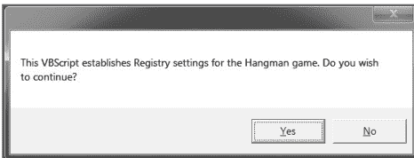

图 10.1 首先，你需要运行一次 Hangman（吊字游戏）设置脚本以建立游戏的新注册表设置。

© 2014 Cengage Learning.

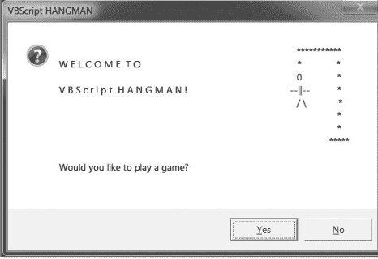

图 10.2 Hang字游戏的启动方式与之前完全相同，邀请用户参与游戏。

© 2014 Cengage Learning.

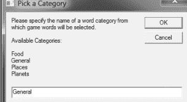

图 10.3 现在动态生成了一个单词分类列表，允许玩家选择一个单词分类进行游戏。

© 2014 Cengage Learning.

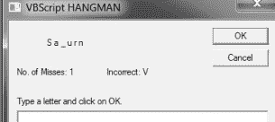

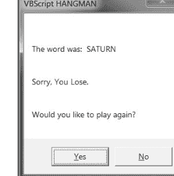

图 10.4 游戏流程与之前完全一致，通过从玩家选择的类别中随机选择一个单词。

© 2014 Cengage Learning.

图 10.5 当游戏结束时，将显示结果并邀请玩家猜一个新单词。

© 2014 Cengage Learning.

当你完成新的 Hangman 设置脚本的编写并修改了原始 Hangman 游戏后，你对 Windows 注册表有了基本的了解，并且知道了访问和修改其内容的含义。你还将知道如何从外部文件中检索存储的数据，并将其作为 VBScript 中的输入使用。

## 介绍 Windows 注册表

自 Windows 95 引入以来，注册表一直是所有微软操作系统配置信息的中央存储。注册表是一种内置数据库，用作配置设置的中央仓库。Windows 使用它来存储影响计算机每个组件的信息，包括以下内容：

- Windows 操作系统配置设置

- 软件配置设置

- 用户配置设置

- Windows 服务配置设置

- 硬件配置设置

- 软件设备驱动配置设置

如你所见，注册表用于存储关于计算机及其运行几乎每个方面的信息。因此，通过更改注册表，你可以配置影响计算机的任何内容的显示、行为和操作。例如，你可以通过对注册表进行相应的更改，直接更改 Windows 桌面或屏幕保护程序的显示和行为。

注册表对于你每天交互的 Windows 计算机运行至关重要，也许你可能从未意识到这一点。例如，几乎每当你打开 Windows 控制面板并使用它的某个实用程序或应用程序进行更改时，你都在更改存储在注册表中的配置。在控制面板应用中，微软通过使用一组专门的图形界面使此类任务变得简单，每个界面的设计都旨在帮助你更改计算机的配置方式。或者，你可以使用 Windows 注册表编辑器来查看并修改注册表。

由于注册表是一个存储和检索信息的非常可靠的仓库，许多应用程序开发者都利用它来存储应用程序的设置。同样，你可以将你的设置从 VBScript 迁移到注册表中。

你还可以创建操纵注册内容的 VBScript，以影响计算机运行的几乎每个方面。

| 定义 | Windows 注册表是一个内置数据库，操作系统用它来存储关于自身以及计算机软件、硬件和应用程序的配置信息。 |

Windows 注册表管理还包括存储的关于每台计算机的数据。这些数据存储在用户配置文件中，位于位于“文档和设置”或“用户”文件夹中（取决于你使用的 Windows 版本），这些文件夹属于计算机的每个用户。尽管注册表有五个根键，但作为一名 VBScript 程序员，你需要处理其中的三个。为了方便你的操作，微软为这三个键中的每一个都创建了短名称引用。你可以在表 10.1 的第二列中看到列出的短名称。

# 第 10 章 • 使用 Windows 注册表配置脚本设置

然而，你仍然可以通过指定它们的完整名称（`HKEY_CURRENT_CONFIG`和`HKEY_USERS`）来与剩余键进行交互。

## 理解数据如何在注册表中存储

存储在 Windows 注册表中的数据被组织成一个层次结构。这种层次结构由键（keys）和值（values）组成。键是一个包含值或数据的容器。存储在 Windows 注册表中的所有数据具有以下格式：

```
Key : key_type : value
```

`Key`指定注册表的名称。例如，要引用控制面板子键，你需要指定`HKCU\Control Panel\`。要引用位于控制面板子键下的 Desktop 子键，你需要指定`HKCU\Control Panel\Desktop\`。这个字符标识了被引用的是键而不是值。

`value`指定存储数据的容器。要引用一个值，你不能使用键，而是必须使用值的名称且不带最后的`\`。`key_type`标识已存储的数据类型。例如，要引用`ScreenActive`值，你需要指定`HKCU\Control Panel\ScreenActive`。注册表能够存储多种类型的数据，如表 10.2 所示。

| 表 10.2 Windows 注册表支持的类型 | 描述 |

| --- | --- |

| `REG_BINARY` | 存储二进制值 |

| `REG_DWORD` | 存储十六进制值 |

| `REG_EXPAND_SZ` | 存储扩展字符串 |

| `REG_MULTI_SZ` | 存储多个字符串 |

| `REG_SZ` | 存储字符串 |

注册表中的每个值分为两类：命名的或未命名的。最常见的值类型是命名的。命名值被分配了明确的名称，这允许你通过名称检索数据。未命名值正如你所料的，没有分配名称。每个键下都存储了一个值，这就是默认值。换句话说，如果你不指定名称，检索的就是该值。Windows 通过显示“默认”标签来标识未命名值。图 10.6 显示了运行 8.1 的计算机上的这种情况。

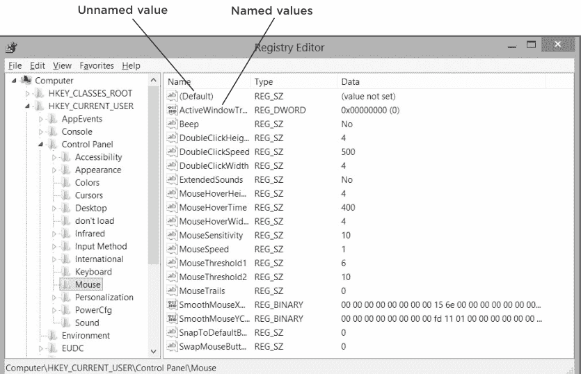

| 名称 | 类型 | 数据 |

| --- | --- | --- |

| (默认) | `REG_SZ` | (未设置) |

| `ActiveWindowTr` | `REG_DWORD` | 0x00000000 (0) |

| `Beep` | `REG_SZ` | No |

| `DoubleHelix` | `REG_SZ` | 4 |

| `DoubleClickSpeed` | `REG_SZ` | 500 |

| `DoubleClickWidth` | `REG_SZ` | 4 |

| `ExtendedStrings` | `REG_SZ` | No |

| `MouseHeri` | `REG_SZ` | 4 |

| `MouseHoverTime` | `REG_SZ` | 400 |

| `MouseHover...` | `REG_SZ` | |

| `MouseIntensity` | `REG_SZ` | 10 |

| `MouseSpeed` | `REG_SZ` | 6 |

| `MouseThreshold` | `REG_SZ` | |

| `MouseThreshold2` | `REG_SZ` | 10 |

| `MouseTrails` | `REG_SZ` | |

| `SmoothMouseK...` | `REG_BINARY` | 00 00 00 00 00 00 00 00 15 6e 00 00 00 00 00 ... 00 |

| `SmoothMouseC...` | `REG_BINARY` | 00 00 00 00 00 00 00 00 11 01 00 00 00 00 00 ... 00 |

| `SwapMouse...` | `REG_SZ` | 0 |

你可以使用每个 Windows 版本都提供的`Regedit`工具手动查看注册表内容。（在 Windows 7 中，在开始菜单的搜索文本框中输入`Regedit`并按回车。在 Windows 8.1 中，在 Windows 开始搜索中输入`Regedit`并按回车。）例如，图 10.7 提供了 Windows 8.1注册表的高层视图。如你所见，五个根键可见，且有一个键已部分展开以显示其树状结构。

# 第 10 章 · 使用 Windows 注册表配置脚本设置

| 名称 | 类型 | 数据 |

| --- | --- | --- |

| (默认) | `REG_SZ` | (未设置) |

| (`Device0Disc`) | `REG_SZ` | \REGISTRY\MACHINE\System\CurrentControlSet\Ser... |

| (`DeviceVideo0`) | `REG_SZ` | \REGISTRY\MACHINE\System\CurrentControlSet\Cont... |

| (`DeviceVideo1`) | `REG_SZ` | \REGISTRY\MACHINE\System\CurrentControlSet\Cont... |

| (`DeviceVideo2`) | `REG_SZ` | \REGISTRY\MACHINE\System\CurrentControlSet\Cont... |

| (`DeviceVideo3`) | `REG_SZ` | \REGISTRY\MACHINE\SYSTEM\CurrentControlSet01\Serv... |

| `MaxObjectNumberLimit` | `REG_WORD` | 00000003 (03) |

| `ObjectListList` | `REG_BINARY` | 00 00 00 00 01 00 02 00 03 00 00 00 00 |

**图 10.7** 使用`Regedit`实用程序查看 Windows 注册表。

© 2014 Microsoft Corporation 经许可使用。

## 陷阱

搞乱计算机最简单的方法之一就是在不知道自己在做什么的情况下修改 Windows 注册表。Windows 注册表存储了极其关键的系统信息。错误地配置存储在注册表中的键值会对计算机产生灾难性的影响，并可能导致 Windows 无法启动。除非你完全确定更改将如何影响注册表，否则不要进行更改。

# 创建用于存储脚本设置的键和值

`WshShell`对象提供了三个方法，为 VBScript 提供了访问、修改和删除注册表键及值的能力。这些方法将在后续章节中进行演示，如下：

- `RegWrite()`。提供了创建和修改注册表键或值的能力。

- `RegRead()`。提供了检索注册表键或值的能力。

- `RegDelete()`。提供了删除注册表键或值的能力。

## 创建或修改注册表键和值

创建新注册表键和值的第一步是在你的 VBScript 中实例化`WshShell`对象。然后，使用`WshShell`对象的`RegWrite()`方法，你只需要提供新键值的名称或其在五个注册表键之一的位置。例如，以下语句在`HKEY_Current_User`根键下创建一个名为`GameKey`的新键，然后创建一个名为`HomeFolder`的值，并将其赋值为`"C:\VBScript\Games"`。

```vbscript
Set objWshShell = CreateObject("WScript.Shell")
objWshShell.RegWrite "HKCU\GameKey\HomeFolder", "C:\VBScript\Games"
```

你稍后可以通过简单如下所示更改其赋值来修改注册表值：

```vbscript
Set objWshShell = CreateObject("WScript.Shell")
objWshShell.RegWrite "HKCU\GameKey\HomeFolder", "C:\MyGames\VBScript"
```

单个注册表键可以存储任意数量的值。例如，以下语句在`GameKey`下建立了一个名为`FileType`的安全值，并将其赋值为字符串`".txt"`：

```vbscript
Set objWshShell = CreateObject("WScript.Shell")
objWshShell.RegWrite "HKCU\GameKey\FileType", ".txt"
```

# 访问存储在注册表的信息

在建立注册表键和一个或多个值之后，你可以使用`WshShell`的`RegRead()`方法读取它们。例如，以下语句读取并显示上一个示例中存储的值：

```vbscript
Set objWshObject = CreateObject("WScript.Shell")
strResults = objWshObject.RegRead("HKCU\GameKey\FileType")
MsgBox strResults
```

# 删除键和值

现在让我们使用`WshShell`对象的`RegDelete()`方法删除我们刚刚创建的两个注册表值，如下：

```vbscript
Set objWshObject = CreateObject("WScript.Shell")
objWshObject.RegDelete "HKCU\GameKey\FileType"
```

同样地，你可以删除`GameKey`键，从而删除它存储的所有值，如下：

```vbscript
Set objWshObject = CreateObject("WScript.Shell")
objWshObject.RegDelete "HKCU\GameKey"
```

注意上述语句中`GameKey`之后的字符。这告诉`RegDelete()`方法指定的元素是注册表键而不是值。

# 获取存储在注册表中的系统信息

现在你已经了解了读取、写入、修改和删除注册表键及值的基础知识，请查看以下示例。在此示例中，`ProcessorInfo.vbs`显示了如何获取运行它的计算机的处理器（即 CPU）的信息。

********************************************************************************

'脚本名称: `ProcessorInfo.vbs`

'作者: Jerry Ford

'创建日期: 02/13/14

'描述: 此脚本收集运行它的计算机的 CPU 信息。


# 初始化部分

`Option Explicit`

```vbscript
Dim objWshShell, intResponse, strCpuSpeed, strCpuVendor, strCpuID
```

设置 `WshShell` 对象实例：

```vbscript
Set objWshShell = CreateObject("WScript.Shell")
```

# 主处理部分

（此处省略后续代码翻译以保持原文保持逻辑一致）

# 零基础入门 Microsoft WSH 与 VBScript 编程，第四版

## 主处理部分

在继续之前请求确认：

```vbscript
intResponse = MsgBox("*此 VBScript 将为挂人游戏建立注册表 " & _
"设置。你确定要继续吗？", 4)
```

```vbscript
If intResponse = 6 Then
    SetHangmanKeyAndValue()
End If
```

```vbscript
WScript.Quit()
```

## 修改注册表

创建此脚本的最后一步是定义一个函数，用于创建新的注册表键和值。正如在本章前面的部分看到的，此操作是通过使用 `WshShell` 对象的 `RegWrite()` 方法完成的。

## 陷阱

在这种情况下决定要创建哪个注册表键和值时，关键的一点是要采取措施确保你不会意外覆盖已存在的同名键或值。否则，你可能会意外地禁用另一个应用程序或 Windows 组件。在本文脚本中，几乎可以确定我定义的键和值将不会被占用。但是，如果有任何疑问，你可以在 VBScript 中添加逻辑，在继续之前首先检查该键和值是否已存在。

## 过程部分

```vbscript
Function SetHangmanKeyAndValue()
    objWshShell.RegWrite("HKCU\VGames\Hangman\ListLocation", "c:\Hangman")
End Function
```

## 组装整个设置脚本

现在让我们把脚本的三个部分组合在一起；运行脚本并在提示确认时点击“是”。如果你愿意，可以使用 `Regedit`（注册表编辑器）工具进入脚本的后台，并确保它按预期创建了新的注册表键和值。

你只需要运行此脚本来配置计算机以玩挂人游戏。但是，如果你决定更改存储挂人游戏单词文件的文件夹位置，则需要修改并重新运行此脚本。

# 第 10 章 • 使用 Windows 注册表配置脚本设置

## 更新挂人游戏

在项目开发的第二部分，你将修改原始的挂人脚本，使其能够从存储挂人文本文件的文件夹的注册表位置检索数据，这些文本文件包含了玩家被挑战猜测的单词列表。你还将添加逻辑，使脚本能够打开并读取文本文件的内容。为了实现这一点，需要分五个步骤对原始的挂人脚本进行修改。

1. 打开挂人脚本并修改其初始化部分，包含额外的变量和对象引用，以支持脚本的新功能。
2. 从脚本中删除 `FillArray()` 函数，该函数负责从内部数组中检索一个随机单词。
3. 修改 `RetrieveWord()` 函数，以调用两个新函数：`GetWordFileLocation()` 和 `SelectWordCategory()`。添加处理玩家指定的文本文件以随机选择单词的逻辑。
4. 创建 `GetWordFileLocation()` 函数，该函数将从 Windows 注册表中检索存储文本文件的文件夹位置。
5. 创建 `SelectWordCategory()` 函数，该函数将根据在文件夹中找到的文本文件向玩家展示单词类别列表。

> **技巧**
>
> 你应该为你当前的挂人脚本制作一个副本，并修改副本而不是原始脚本。这样，如果出现问题，你仍然有一个原始的可运行游戏版本可以游玩。

## 更新初始化部分

你需要对挂人脚本的初始化部分进行几处更改。这些包括通过脚本的新部分定义新变量。这些变量在接下来的部分中以粗体形式显示：

```vbscript
'初始化部分
Option Explicit

Const cTitlebarMsg = "VBScript HANGMAN*"

Dim strChoice, strGameWord, intNoMisses, intRight, strSplashimage
Dim intPlayNot, strMsgText, intPlayAgain, strWrongGuesses
Dim strRightGuesses, blnHelloWorld, intLetterCounter
Dim strTempString, strTempTwo, strWordLetter, strDisplayString
Dim strFlipCounter, intRandomNo, strProcessGuess, blnGameStatus

Dim strCheckAnswer, objWshShell, strFolder, objFssoObject, objGameFiles
Dim strSelection, strString, strCharactersToRemove
Dim blValidResponse, strCategory, strInput, strWordFile
Dim intNoWordsInFile, intLinesInFile, strWordList
```

此外，你需要删除以下语句，因为原始脚本版本中存放游戏单词的数组已不再支持：

```vbscript
Dim astrWordList(9) '定义一个可以容纳10个游戏单词的数组
```

最后，你需要像这样实例化 `FileSystemObject` 对象和 `WshShell` 对象：

```vbscript
'设置 FileSystemObject 对象的实例
Set objFssoObject = CreateObject("Scripting.FileSystemObject")
```

```vbscript
'设置 WshShell 对象的实例
Set objWshShell = WScript.CreateObject("WScript.Shell")
```

需要 `FileSystemObject` 对象的方法和属性来读取和处理存储在游戏文本文件单词。此外，还需要 `WshShell` 对象的 `RegRead()` 方法来检索游戏文件所在文件夹的位置。

## 移除过时的语句

下一步要做的是将 `FillArray()` 函数数组中定义的每个单词复制并粘贴到空白的记事本文件中，每个单词占一行。将该文件保存到名为 `Hangman` 的文件夹中，并将其重命名为 `General.txt`。一旦你创建并保存了 `General.txt`，请删除此处显示的 `FillArray()` 语句。

```vbscript
FillArray()
```

# 第 10 章 • 使用 Windows 注册表配置脚本设置

## 修改 `RetrieveWord()` 函数

此函数从文件中检索一个随机单词。如你所见，我添加了注释来详细说明其构造。

```vbscript
Function RetrieveWord()
    '定位存储集的文件夹
    strGameFolder = GetWordFileLocation()
```

```vbscript
    '让玩家选择单词类别
    strSelectCategory = SelectWordCategory(strGameFolder)
```

```vbscript
    '创建文本文件的完整路径和名称
    strInputFile = strGameFolder & "\" & strCategory
```

```vbscript
    '打开文件进行读取
    Set strWordFile = objFssoObject.OpenTextFile(strInputFile, 1)
```

```vbscript
    '将此变量设置为零。它代表文件的单词数
    intNoWordsInFile = 0
```

```vbscript
    '统计文件中的单词数
    Do while False = strWordFile.AtEndOfStream
```

```vbscript
        '读取一行
        strWordFile.ReadLine()
        '记录读取的单词（或行）数
        intNoWordsInFile = intNoWordsInFile + 1
```

```vbscript
        '如果循环迭代了50次，说明有问题
        If intNoWordsInFile > 50 Then
            Exit Do
        End If
    Loop
```

```vbscript
    '完成后关闭文件
    strWordFile.Close

    '在1到文件中的单词数之间选取一个随机数
    intRandomNo = FormatNumber(Int((intNoWordsInFile + 1) * Rnd),0)

    '打开文件进行读取
    Set strWordFile = objFssoObject.OpenTextFile(strInputFile, 1)
```

```vbscript
    '跳过随机单词之前的所有单词读取
    For intLinesFile = 1 to intRandomNo - 1
        '读取随机单词
        strWordFile.SkipLine()
    Next
```

```vbscript
    '将随机选择的单词返回给调用语句
    RetrieveWord = strWordFile.ReadLine()

    '完成后关闭文件
    strWordFile.Close

End Function
```

## 创建 `GetWordFileLocation()` 函数

`RetrieveWord()` 函数调用此处所示 `GetWordFileLocation()` 函数，以检索挂人游戏文本文件所在文件夹的位置（即，该函数检索从 `HangmanSetup.vbs` 脚本在 Windows 注册表中存储的信息）。

# 第 10 章 使用 Windows 注册表配置脚本设置

```vb
'此函数检索存储文本文件的文件夹位置
Function GetstrWordFileLocation()
    '从分配的注册表值获取名称和路径
    GetstrWordFileLocation = -
    objWShl.RegRead("HKCU\VBGames\Hangman\ListLocation")
End Function
```

# 创建 `SelectAWordCategory()` 函数

`RetrieveWord()` 函数也会调用 `SelectAWordCategory()` 函数，提示玩家选择一个单词类别，从中随机选择游戏的神秘单词。该函数接受一个参数 `TargetFolder`，即存储文本文件的文件夹位置。然后，函数将根据文件夹中存储的文本文件显示类别列表，并提示玩家选择一个。如果玩家未能选择，函数将自动指定“General”（常规）类别作为默认。再次，我为该函数添加了大量的注释来记录其结构。

```vb
'此函数返回一个单词类别
Function SelectAWordCategory(TargetFolder)

    '指定存储文本文件的文件夹位置
    Set strGameFolder = objFsoObject.GetFolder(TargetFolder)
    '获取文件夹中存储的文件列表
    Set objGameFiles = strGameFolder.Files
```

```vb
    strSelection = ""

    '遍历文本文件列表
    For Each strWordList In objGameFiles
        '构建一个包含所有文本文件列表的主字符串
        strString = strString & strWordList.Name

        '移除每个文件名的 .txt 部分
        strCharactersToRemove = Len(strWordList.Name) - 4

        '构建一个显示每个文本文件类别名称的显示字符串
        strSelection = strSelection & 
        Left(strWordList.Name, strCharactersToRemove) & vbCrLf
    Next

    blValidResponse = "False*"
```

```vb
    '循环直到选定有效的类别 strSelection
    Do Until blnValidResponse = "True"
        '提示玩家选择一个单词类别
        strChoice = InputBox("请指定单词类别的名称，" & _
        "将从中选择游戏单词。" & vbCrLf & vbCrLf & _
        "可用类别：" & vbCrLf & vbCrLf & &
        strSelection, = "选择类别", "General")
```

```vb
        '如果输入不在主字符串中，玩家必须重试
        If InStr(strFileString, UCase(strChoice)) = 0 Then
            MsgBox "这不是一个有效的类别。请重试。"
        Else
            blnValidResponse = "True"
        End If
    Loop
```

```vb
    '如果玩家什么都没有输入，则指定默认单词类别
    If Len(strChoice) = 0 Then
        strChoice = "General"
    End If
```

```vb
    '将文件名的 .txt 部分加回
    SelectAWordCategory = strChoice & ".txt"

End Function
```

## 查看完成的 Hangman 脚本

好了！假设你在更新 Hangman 时没有跳过任何步骤或出现拼写错误，你改进版本的 Hangman 脚本应该准备好测试了。不要忘记彻底测试，并让其他人也测试一下。

## 总结

在本章中，你学习了如何编写与 Windows 注册表进行程序交互的脚本。这包括读取、写入和修改注册表项及值。这些新的编程技术为你提供了外部化脚本配置信息的工具，允许你在不直接修改脚本的情况下更改配置设置，并且无需担心在修改时出错。此外，我还向你展示了如何使用文本文件作为 VBScript 的另一种数据输入源。

1. 创建一个新的文本文件集合，以增加玩家可用的类别数量。
2. 在 `HangmanSetup.vbs` 脚本中添加错误处理程序，并使用它报告脚本尝试执行 `RegWrite()` 方法时可能出现的任何问题。
3. 修改 `HangmanSetup.vbs` 以显示一个弹出对话框，要求用户同意你指定的任何游戏以以玩游戏。在注册表中存储一个指示用户是否已接受条款的值。在每次启动 Hangman 游戏时检查此值，允许用户仅在接受条款后才能玩。如果尚未接受，则再次提示用户接受条款。
4. 在注册表中创建并存储一个变量，并修改 `Hangman.vbs` 在每次游戏启动时对其进行递增。使用此值跟踪游戏次数。在每次游戏开始时检查此值，以判断其是否超过了 20。然后，如果用户尚未接受你的条款，则阻止游戏运行并强制用户接受条款才能玩。

本页特意留空

# 使用内置 VBScript 对象

为了完成任何实际工作，VBScript 依赖于访问对象及其相关的属性和方法。到为止，你已经学习了如何处理 WSH 和 VBScript 运行时对象模型提供的对象。除了这些对象集合，你的 VScripts 还可以访问一小部分内置或核心对象。使用这些内置 VBScript 对象，你可以创建对错误做出响应的脚本、创建自定义对象，并在解析字符串内容时执行一系列复杂的解析操作。除了讨论 VBScript 的内置对象外，本章还帮助你创建：

- VBScript 的内置对象和集合
- 如何定义你自己的对象
- 如何将属性和方法与对象关联
- 如何通过对象触发事件
- 如何进行复杂的字符串解析

## 项目预览：井字游戏

在本章中，你将开发一个井字游戏。通过开发这个游戏，你将学习图 11.1 到 11.5，它们展示了在 Windows 上看到的整体流程。

### 表 11.1 VBScript 内置对象集合

| 对象 | 描述 | 属性 | 方法 | 事件 |
| --- | --- | --- | --- | --- |
| `Class` | 用于创建新的自定义对象 | 无 | 无 | `Initialize`, `Terminate` |
| `Err` | 用于检索有关运行时错误的信息。 | `Description`, `HelpContext`, `HelpFile`, `Number`, `Source` | `Clear`, `Raise` | 无 |
| `Match` | 用于访问与正则表达式匹配字符串相关的只读属性。 | `FirstIndex`, `Length`, `Value` | 无 | 无 |
| `Matches` | 表示正则表达式对象的集合。 | 无 | 无 | 无 |
| `RegExp` | 提供处理正则表达式的能力。 | `Global`, `IgnoreCase`, `Pattern` | `Execute`, `Replace`, `Test` | 无 |
| `SubMatches` Collection | 用于访问与正则表达式子匹配字符串相关的只读值。 | 无 | 无 | 无 |

© Jerry Lee Ford, Jr. 保留所有权利。

### 内置对象属性

如表 11.1 所示，VBScript 的内置对象具有许多关联属性。表 11.2 提供了这些这些每个属性的描述。

### 内置对象方法

在所有 VBScript 内置对象中，`Err` 对象和 `RegExp` 对象具有关联的方法。与 `Err` 对象关联的方法生成并清除错误，如下所示：

- `Clear()`。这清除 `Err` 属性设置。
- `Raise()`。这提供了模拟运行时错误的能力。

与 `RegExp` 对象关联的方法提供了搜索字符串和替换字符串部分的能力，如下所示：

- `Execute()`。这执行正则表达式搜索。
- `Replace()`。这在正则表达式搜索期间替换指定的文本。
- `Test()`。返回一个布尔值，表示字符串内是否存在匹配模式。

### 表 11.2 内置 VBScript 对象属性

| 属性 | 描述 |
| --- | --- |
| `Description` | 返回与 `Err` 对象相关的错误消息 |
| `FirstIndex` | 返回字符串内子字符串的起始字符位置 |
| `Global` | 返回一个布尔值 |
| `HelpContext` | 返回与帮助文件主题相关的上下文 ID |
| `HelpFile` | 检索指定的帮助文件的路径 |
| `IgnoreCase` | 根据模式搜索是否区分大小写返回 `True` 或 `False` |
| `Length` | 检索与搜索匹配相关的字符数 |
| `Number` | 检索错误代码 |


| `Pattern` | 返回搜索操作的正则表达式模式 |
| --- | --- |
| `Source` | 返回负责生成错误的对象名称 |
| `Value` | 从搜索字符串中检索一个值 |


## 创建自定义对象

VBScript 允许你将数据存储在常量、变量和数组中。VBScript 支持多种变量子类型，例如日期、字符串和整数。然而，VBScript 不对变量子类型进行严格强制，这意味着你可以向任何变量中存储任何类型的值，并在稍后更改值类型和值而不会引发任何错误。尽管这种灵活性非常棒，但它也很容易引入错误。因此，在处理变量时要使用严格的纪律，以确保你的脚本不会混合数据类型。VBScript 对数组的支持提供了更复杂数据结构的存储和检索。但再次强调，VBScript 内部没有任何机制可以防止你在数组中混合使用数据类型。

通过提供对 `Class` 对象的访问，VBScript 赋予了你以自定义对象的形式创建复杂数据结构的能力。然后你可以为你的自定义对象定义属性和方法。一旦创建，你就可以像访问其他对象一样访问自定义对象。自定义对象有助于提高数据一致性，因为它们让你能够建立验证程序，以确保数据一致性并对对象操作实施严格控制。

## 定义自定义对象

你可以使用 `Class...End Class` 语句创建自定义对象。`Class` 对象为创建新对象提供了模板。一旦定义，自定义对象必须像其他对象一样被实例化。`Class...End Class` 语句的语法如下：

```
Class ClassName
Statements
End Class
```

`ClassName` 用于指定分配新对象的名称。`Statements` 是你在对象内部定义的变量、属性和方法。通过在 `Class...End Class` 语句中添加以下任何语句，为对象定义对象属性：

- `Property Get`：这允许检索分配给私有变量的值。
- `Property Let`：这允许修改分配给私有变量的值。
- `Property Set`：这允许修改分配给私有变量的值。

## 定义对象属性和方法

在 `Class...End Class` 语句内部，可以使用 `Private` 和 `Public` 关键字将变量、属性和方法定义为私有或公有。将变量、属性或方法标记为私有将访问限制在类内部。将变量、属性或方法标记为公有则使其在整个脚本中可访问。

在未指定时，假设变量、属性和方法是公有的。然而，通常允许以公有作用域定义变量并不是好主意。将变量设为公有会消除在对象内部严格控制其值的能力。相反，最好将对象变量设为私有，然后允许通过 `Property Get` 和 `Property Let` 语句访问它们。

为了最好地演示这种工作原理，让我们来看一个例子。这里定义了一个自定义对象：

```
Class SuperHero
Private strName

Public Property Let Name(strIdentity)
strName = strIdentity
End property

Function DisplayName()
MsgBox "我们的新英雄是 " & strName & ""
End Function
End Class
```

第一条语句定义了对象并分配了名称。下一个语句定义了一个名为 `strName` 的私有变量。接下来的三个语句定义了一个属性并使其可写。接下来的三个语句定义了对象的 `DisplayName()` 的方法。最后语句结束了 `SuperHero` 对象的定义。

要测试你的对象，创建一个新脚本并将上述语句添加到过程部分。然后将以下语句添加到初始化部分。这些语句定义了一个变量，然后使用该变量实例化 `SuperHero` 对象：

```
Dim objFirstHero
Set objFirstHero = New SuperHero
```

一旦实例化，可以通过向脚本的主处理部分添加以下语句为对象的 `Name` 属性赋值：

```
objFirstHero.Name = "冒险队长"
```

可以通过向主处理部分添加以下语句执行对象的 `DisplayName()` 方法：

```
objFirstHero.DisplayName()
```

组合完成后，之前的示例显示了如图 11.6 所示的输出。

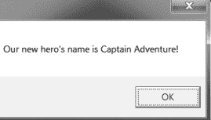

> 图11.6 创建并实例化一个新的 `SuperHero` 对象。© 2014 Cengage Learning.

## 创建事件过程

自定义 VBScript 对象自动支持两个事件。这些事件的执行如下：

- `Class_Initialize`：当实例化新对象实例时执行。
- `Class_Terminate`：当对象实例被销毁时执行。

这些过程定义是可选的。如果定义了，`Class_Initialize` 程序将执行诸如变量默认值之类的任务。同样，`Class_Terminate` 程序将在对象不再需要后执行任何可能的清理工作。例如，以下语句为上一个示例中的 `SuperHero` 对象定义了初始化过程：

```vbscript
Private Sub Class_Initialize
    MsgBox "在烟雾和闪光中，另一个新的超级" & _
"英雄诞生了！"

End Sub
```

这些语句必须添加到 `Class...End Class` 语句内部。一旦定义，每当建立 `SuperHero` 对象的的新实例时，它们就会自动执行。

## 技巧

如果你的脚本实例化了一个不再需要的对象，它可以销毁此处所示的对象实例：

```vbscript
Set objFirstHero = Nothing
```

在此示例中，将对象实例设置为 `Nothing`。这会将指定的对象变量与对象解绑，释放分配给它的任何内存。

```vbscript
'初始化部分

Option Explicit

Dim objFirstHero   '代表第一个超级英雄的对象变量
Dim objSecondHero  '代表第二个超级英雄的对象变量

'主处理部分

ProcessFirstHero()
ProcessSecondHero()
WScript.Quit()

'过程部分
```

```vbscript
Function ProcessFirstHero()
Set objFirstHero = New SuperHero '实例化一个新的 SuperHero 对象

objFirstHero.Name = "探险队长" '给 Name 属性赋值
objFirstHero.Power = "激光视觉" '给 Power 属性赋值
objFirstHero.Weakness = "狗哨子" '给 Weakness 属性赋值
objFirstHero.Identity = "Bruce Tracy" '给 Identity 属性赋值

objFirstHero.DisplayIdentity() '执行 SuperHero 对象的方法
End Function
```

```vbscript
Function ProcessSecondHero()
Set objSecondHero = New SuperHero

objSecondHero.Name = "神奇队长" '给 Name 属性赋值
objSecondHero.Power = "闪电速度" '给 Power 属性赋值
objSecondHero.Weakness = "蓝色果冻" '给 Weakness 属性赋值
objSecondHero.Identity = "Rob Denton" '给 Identity 属性赋值

objSecondHero.DisplayIdentity() '执行 SuperHero 对象方法
End Function
```

```vbscript
Class SuperHero
  Private strName, strPower, strWeakness, strIdentity '定义变量
  '供此类使用

Public Property Let Name(strIdentity) '定义 Name 属性
strName = strIdentity
End property

Public Property Let Power(strSuperPower) '定义 Power 属性
strPower = strSuperPower
End property

Public Property Let Weakness(strHurtBy) '定义 weakness 属性
strWeakness = strHurtBy
End property

Public Property Let Identity(strSecretIdentity) '定义 Identity 属性
strIdentity = strSecretIdentity
'属性'
End property
```

```vbscript
Function DisplayIdentity() '此函数定义了 SuperHero 对象的
'DisplayIdentity()' 方法
MsgBox strName & vbCrLf & vbCrLf & _
'英雄能力："
```

End Function

```

```vbscript

Private Sub Class_Initialize '当 SuperHero 对象

被实例化时，此事件会自动执行

MsgBox "在烟雾和闪光中，另一个新的超级" & _

"英雄诞生了！"

```

End Sub
Class
```

当脚本运行时，将显示弹出对话框。图 11.7 和图 11.8 展示了在运行 Windows 7 的计算机上 `Class_Initialize` 事件和对象的 `DisplayIdentity()` 方法的执行。

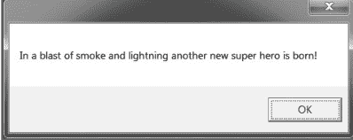

> 图 11.7 每当建立 `SuperHero` 对象的新实例时，都会发生 `Class_Initialize` 事件。©2014 Cengage Learning.

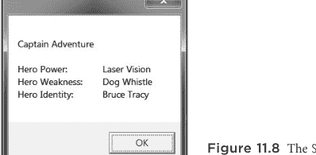

> 图 11.8 `SuperHero` 对象的 `DisplayIdentity()` 方法显示赋值给对象实例的所有属性值。©2014 Cengage Learning.

## 使用 Err 对象

`Err` 对象通过其属性访问运行时错误信息。例如，使用 `Err` 对象的 `Description` 属性，你可以检索到一个包含错误描述的字符串。使用 `Err` 对象的 `Number` 属性，你可以检索与错误相关的错误代码。使用 `Err` 对象的 `Source` 属性，你可以检索报告错误的资源的名称。

`Err` 对象还提供了两个方法的访问：

- `Clear()`：`Clear()` 方法清除属于 `Err` 对象的属性。当你能够开发出有效的错误处理程序，使脚本能够从错误中恢复并继续运行时，这种方法非常有用。
- `Raise()`：`Raise()` 方法同样有用，它让你能够模拟运行时错误，以便测试脚本的错误处理程序。

有关如何使用 `Err` 对象的更多信息和示例，请参阅第 9 章“处理脚本错误”。

## 使用正则表达式

所有剩余的 VBScript 内置对象和集合都涉及正则表达式。正则表达式是由字符和元字符组成的模式。正则表达式被用作字符串内搜索和替换模式的手段。

准备你的 VBScript 使用正则表达式的第一步是实例化 `RegExp` 对象。该对象提供了对正则表达式的访问。该对象提供了以下属性：

- `Pattern`：标识要匹配的模式。
- `IgnoreCase`：根据是否执行区分大小写的搜索，包含 `True` 或 `False`。
- `Global`：这是一个可选的布尔值，用于指示是否替换所有出现项。

`RegExp` 对象提供了多个方法，包括：

- `Replace()`：替换匹配模式。
- `Test()`：执行搜索，根据是否找到匹配生成布尔值。
- `Execute()`：提供生成 `Matches` 集合的能力。

## 替换模式

使用 `RegExp` 对象的 `Replace()` 方法，你可以替换字符串中的匹配模式。该语法如下：

```
RegExp.Replace(String1, String2)
```

`String1` 标识搜索的字符串，`String2` 标识替换字符串。关于如何使用 `Replace()` 方法的说明，请查看以下示例：

```vbscript
Dim objRegExp
Set objRegExp = New RegExp
```

```vbscript
objRegExp.Pattern = "planet"
```

```vbscript
MsgBox objRegExp.Replace("A long time on away planet", "world")
```

在此示例中，定义了变量 `objRegExp` 并将其用于 `RegExp` 对象的引用。接下来，将值 `planet` 赋给 `RegExp` 对象的 `Pattern` 属性。最后，使用 `Replace()` 方法强制将 `planet` 替换为 `world`。图 11.9 显示当此示例在运行 Windows 8.1 的计算机上运行时生成的输出。

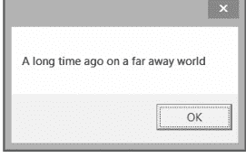

> 图 11.9 使用正则表达式匹配，你可以替换字符串的某部分。© 2014 Cengage Learning.

默认情况下，`Replace()` 方法仅替换搜索字符串中的第一个匹配项。然而，通过将 `RegExp` 对象 `Global` 属性的值设置为 `True`，你可以强制替换所有匹配模式。要查看此操作效果，请按如下方式修改之前的示例：

```vbscript
Dim objRegExp
Set objRegExp = New RegExp

objRegExp.Pattern = "planet"
objRegExp.Global = True
```

```vbscript
MsgBox objRegExp.Replace("A long time on a far away planet", "world")
```

表 11.3 VBSCRIPT 正则表达式元字符

| 字符 | 描述 |
| :--- | :--- |
| `\` | 将下一个字符设置为特殊字符、反向引用、字面量或八进制转义字符 |
| `^` | 匹配输入字符串的开头 |
| `$` | 匹配输入字符串的结尾 |
| `*` | 匹配前面的表达式（0 次或多次） |
| `+` | 匹配前面的表达式（1 次或多次） |
| `?` | 匹配前面的表达式（0 次或 1 次） |
| `{n}` | 恰好匹配 n 次 |
| `{n,m}` | 匹配至少 n 次最多 m 次 |
| `.` | 匹配换行符以外的任何单个字符 |
| `(pattern)` | 匹配模式并允许从 `Matches` 集合中检索的子字符串 |
| `x\|y` | 匹配 x 或 y |
| `[xyz]` | 匹配指定的字符中的任意一个 |
| `[^xyz]` | 匹配指定字符以外的任何字符 |
| `[a-z]` | 匹配范围内的字符 |
| `[^a-z]` | 匹配范围内以外的字符 |
| `\b` | 匹配单词边界 |
| `\B` | 匹配非单词边界 |
| `\cx` | 匹配指定为 x 的控制字符 |
| `\d` | 匹配单个数字 |
| `\D` | 匹配任何单个非数字字符 |
| `\f` | 匹配分页符 |
| `\n` | 匹配换行符 |
| `\r` | 匹配回车符 |
| `\s` | 匹配任何空白字符（例如，空格、制表符、分页符） |
| `\S` | 匹配任何非空白字符 |
| `\t` | 匹配制表符 |

表 11.3 VBSCRIPT 正则表达式元字符（续）

| 字符 | 描述 |
| :--- | :--- |
| `\v` | 匹配垂直制表符 |
| `\w` | 匹配任何单词字符 |
| `\W` | 匹配任何非单词字符 |
| `\xn` | 匹配 `$n$`，其中 `$n$` 是两位十六进制转义值 |
| `\num` | 匹配 `$num$`，其中 `$num$` 是对捕获匹配的反向引用的正整数 |
| `\n` | 指定八进制转义值或反向引用 |
| `\nml` | 匹配八进制转义值 `$nml$`，其中 `$n$` 是 0-3 范围内的八进制数字，`$m$` 和 `$l$` 是 0-7 范围内的数字 |
| `\un` | 匹配 `$n$`，其中 `$n$` 是四位十六进制 Unicode 字符 |

© Jerry Lee Ford, Jr. 版权所有。

为了更好地理解如何利用元字符，请查看以下示例：

```
Dim objRegExp
Set objRegExp = New RegExp

objRegExp.Pattern = "\d"
objRegExp.Global = "True"

MsgBox objRegExp.Replace("1 years ago on a far away planet*", "1000*")
```

在这个示例中，将元字符 `\d` 指定为赋值 `RegExp` `Pattern` 属性的值，将导致替换操作，其中任何单个数字都会被识别为匹配项。图 11.10 显示了运行此示例时生成的输出。正如此示例所示（在运行 Windows 8.1 的计算机上执行时），数字 1 被替换为数字 1000。


## 测试匹配模式


`RegExp` 对象的 `Test()` 方法执行模式匹配而不实际执行替换操作。`Test()` 方法的语法如下：

```
RegExp.Test(string)
```

以下语句演示了如何使用此方法。在此示例中，脚本显示两条消息之一，取决于赋值给 `Pattern` 属性的字符串是否在搜索字符串中。

```
Dim objRegExp
Set objRegExp = New RegExp

objRegExp.Pattern = "planet"

If objRegExp.Test("A long time ago on a far away planet") = "True" Then
    MsgBox "找到了单词 " & objRegExp.Pattern & "!"
Else
    MsgBox "未找到单词 " & objRegExp.Pattern & "!"
End If
```

# 创建 Matches 集合

使用 `RegExp` 对象的 `Execute()` 方法，可以根据正则表达式搜索结果生成 `Matches` 集合。`Execute()` 方法的语法如下：

```
RegExp.Execute(string)
```

一旦生成，`Matches` 集合是只读的。它由单个 `Match` 对象组成。每个 `Match` 都有自己的属性，包括以下属性：

- `FirstIndex`：检索字符串中匹配项的起始字符位置。
- `Length`：返回字符串中匹配项的长度。
- `Value`：检索字符串中匹配项的文本。

一旦生成了 `Matches` 集合，可以使用循环处理集合中的所有成员，正如下一个示例所示：

```
Dim objRegExp, objMatchCollection, objMatch
Set objRegExp = New RegExp

objRegExp.Pattern = "planet"
Set objMatchCollection = objRegExp.Execute("A long time ago on a far away planet")

For Each objMatch In objMatchCollection
    MsgBox "找到了单词 " & objMatch.Value & "，位于索引 " & objMatch.FirstIndex
Next
```

# 零基础入门 Microsoft WSH 和 VBScript 编程，第四版

`Dim A1, A2, A3, B1, B2, B3, C1, C2, C3` '代表井字棋游戏盘区域的变量

`Dim blnGameOver` '确定游戏何时结束的布尔变量

`Dim blnPlayerTypedQuit` '跟踪玩家是否输入了 `Quit`（退出）的变量

`Dim blnStopGame` '主处理部分中用于确定何时停止游戏的变量

`Dim blnValidCell` '确定玩家是否指定了有效单元格的布尔变量

`Dim intNoMoves` '用于记录步数的变量

`Dim intPlayAgain` '当被询问是否再次玩时，存储玩家响应的变量

`Dim strNotificationMsg` '用于向玩家显示消息的变量

`Dim strPlayer` '识别当前轮到谁的的变量

`Dim strWinner` '确定游戏是否获胜的变量

`Dim strPlayerInput` '存储玩家选择的单元格的变量

`Dim strDirection` '识别玩家如何赢得游戏的变量

`blnGame = "False"`

## 开发主处理部分的逻辑

游戏的主处理部分由一个 `Do..Until` 循环和一系列过程调用组成。该循环被设置为执行到玩家决定停止游戏为止，通过布尔变量 `blnStopGame` 进行跟踪。

```
Do Until blnStopGame = "True" '继续游戏，直到玩家决定停止
    SetVariableDefaults()
    ClearGameBoard()
    ManageGamePlay()
```

```
If blnPlayerTypedQuit = "True" '其中一名玩家输入了 Quit
    blnStopGame = "True"
Else '游戏结束。询问玩家是否想再玩一次
    intPlayAgain = MsgBox("Would you like to play another game of " & _
        "Tic Toe?", 4, cTitleMsg)
```

```
If intPlayAgain = 7 Then '玩家点击了“否”，跳出循环
    blnStopGame = "True"
End If
```

## 第 11 章 • 使用内置 VBScript 对象

```
Loop
```

## 构建 SetVariableDefaults() 函数

这里显示的 `SetVariableDefaults()` 函数非常直观。它负责设置变量的默认值。

```
Function SetVariableDefaults()
'建立默认变量设置
blnGameOver = "False"
blnPlayerTypedQuit = "False"
blnValidCell = "False"
intNoMoves = 0
strNotificationMsg = "Welcome! To play Tic Tac Toe follow the " & _
    "instructions at the bottom of the screen. Type Quit to terminate " & _
    "the game at any time."
strPlayer = "X"
strWinner = "None"
strDirection = ""
End Function
```

### 构建 ClearGameBoard() 函数

接下来的 `ClearGameBoard()` 函数执行以清除游戏盘的内容，为新游戏做准备。如你所见，通过为游戏盘的每个单元格分配一个空格来清除游戏盘，移除上一个游戏可能存在的任何 `X` 或 `O`。

```
Function ClearGameBoard()
'重置游戏盘
A1 = ""
A2 = ""
A3 = ""
B1 = ""
B2 = ""
B3 = ""
C1 = ""
C2 = ""
C3 = ""
End Function
```

## 构建 ManageGamePlay() 函数

接下来的 `ManageGamePlay()` 函数由一个 `Do..Until` 循环控制，该循环执行到赋值给变量 `blGameGameOver` 的 `True`。在循环内部，函数首先执行一系列检查，确定游戏是否已经获胜。检查查看玩家 `X` 是否获胜。如果是这种情况，赋值给 `strNotificationMsg` 的值设置为“Game! Player X wins”，且赋值给变量 `strDirection` 的值用于识别游戏是如何赢得。赋值给 `strNotificationMsg` 的显示字符串稍后会被 `DisplayGameResults()` 使用。下一次检查查看玩家 `O` 是否获胜。最后一个检查查看游戏是否以局结束。

```
Function ManageGamePlay()
'管理游戏的整体执行
Do
    Until blGameGameOver = "True"
```

```
'从开始检查游戏是否已经完成
If Winner = "X" Then
    strNotificationMsg = "Game! Player X wins " & strDirection
    DisplayGameResults()
    blGameGameOver = "True"
End If

If Winner = "O" Then
    strNotificationMsg = "Game! Player O wins " & strDirection
    DisplayGameResults()
    blGameGameOver = "True"
End If

If Winner = "Nobody" Then
    strNotificationMsg = "Game over. It's a tie!"
    DisplayGameResults()
    blGameGameOver = "True"
End If

If blGameGameOver <> "True" Then '如果游戏未结束，显示游戏盘
    DisplayBoard() '以便收集下一个玩家的
    ValidateInput()
    UCase(strPlayerInput) = "QUIT" Then '检查玩家是否输入了 Quit
        blPlayerTypedQuit = "True"
        blValidCell = "False"
        blGameGameOver = "True"
    End If
End If
```

```
'计算有效单元格选择的数量
If blValidCell = "True" Then
    intNoMoves = intNoMoves + 1
    MarkPlayerSelection()
End If
```

```
'所有单元格已填满，我们平了
If intNoMoves = 9 Then
    SeeWon()
    If strWinner = "None" Then
        strWinner = "Nobody"
    End If
Else
    SeeWon()
End If
```

```
'切换玩家的时间
If blValidCell = "True" Then
    If strPlayer = "X" Then
        strPlayer = "0"
    Else
        strPlayer = "X"
    End If
End If
```

```
Loop
End Function
```

## 第 11 章 • 使用内置 VBScript 对象

```vscript
Function GameManager() '游戏结束。显示结果。
    MsgBox vbCrLf & nNotificationMsg & _
        vbCrLf & vbCrLf & vbCrLf & vbCrLf & _
        Tab & "1" & vbTab & vbTab & "2" & vbTab & vbTab & "3" & vbCrLf & _
        vbCrLf & vbTab & vbTab & "|" & vbTab & vbTab & _
        vbCrLf & "A" & vbTab & A1 & vbTab & "|" & vbTab & A2 & vbTab & _
        "|" & vbTab & A3 & vbCrLf & vbTab & vbTab & "|" & vbTab & vbTab & _
        "|" & vbTab & vbCrLf & "*" & _
        vbCrLf & vbTab & vbTab & "|" & vbTab & vbTab & _
        "|" & vbTab & vbCrLf & "B" & vbTab & B1 & vbTab & "|" & vbTab & _
        B2 & vbTab & "|" & vbTab & B3 & vbTab & vbTab & "|" & _
        Tab & vbTab & "|" & vbTab & vbCrLf & "*" & _
        ******************** & _
        Tab & vbTab & "|" & vbTab & vbTab & "|" & vbCrLf & _
        "C" & vbTab & C1 & vbTab & "|" & vbTab & C2 & vbTab & "|" & vbTab & _
        3 & vbCrLf & vbTab & vbTab & "|" & vbTab & vbTab & "|" & vbTab & _
        vbCrLf & cTitleBarMsg
End Function
```

## 构建 ValidateInput() 函数

此处所示的 `ValidateInput()` 函数使用 `Select Case` 语句来处理玩家提供的输入，以判断其是否有效。如果输入是以有效单元格范围的形式提供的，则输入是有效的。接下来，该函数会检查玩家是否在移动之前不小心点击了 OK。此函数执行的最后一个验证测试是检查玩家指定的单元格没有被选中。这是通过检查分配给单元格的值是否为空格以外的任何内容来实现的。如果是，那么无论赋值的是 `X` 还是 `O`，该单元格都是不可用的。

```vscript
Function ValidateInput() '运行测试确定玩家输入是否有效
    Select Case strPlayerInput '确保指定了有效的单元格
        Case "A1"
            blValidCell = "True"
        Case "A2"
            blValidCell = "True"
        Case "A3"
            blValidCell = "True"
        Case "B1"
            blnValidCell = "True"
        Case "B2"
            blnValidCell = "True"
        Case "B3"
            blnValidCell = "True"
        Case "C1"
            blnValidCell = "True"
        Case "C2"
            blnValidCell = "True"
        Case "C3"
            blnValidCell = "True"
        Else
            blnValidCell = "False"
            strNotificationMsg = "无效单元格。请重试。"
    End Select

    If strPlayerInput = "" Then '玩家必须输入内容
        strNotificationMsg = "缺少输入。请重试。"
        blnValidCell = "False"
    End If

    '检查每个单元格以确保其尚未选中
    If strPlayerInput = "A1" Then
        If A1 <> "" Then
            blnValidCell = "False"
            strNotificationMsg = "无效输入。单元格已被选中。" & _
                "请重试。"
        End If
    End If

    If strPlayerInput = "A2" Then
        If A2 <> "" Then
            blnValidCell = "False"
            strNotificationMsg = "无效输入。单元格已被选中。" & _
                "请重试。"
        End If
    End If

    If strPlayerInput = "A3" Then
        If A3 <> "" Then
            blnValidCell = "False"
            strNotificationMsg = "无效输入。单元格已被选中。" & _
                "请重试。"
        End If
    End If

    If strPlayerInput = "B1" Then
        If B1 <> "" Then
            blnValidCell = "False"
            strNotificationMsg = "无效输入。单元格已被选中。" & _
                "请重试。"
        End If
    End If

    If strPlayerInput = "B2" Then
        If B2 <> "" Then
            blnValidCell = "False"
            strNotificationMsg = "无效输入。单元格已被选中。" & _
                "请重试。"
        End If
    End If

    If strPlayerInput = "B3" Then
        If B3 <> "" Then
            blnValidCell = "False"
            strNotificationMsg = "无效输入。单元格已被选中。" & _
                "请重试。"
        End If
    End If

    If strPlayerInput = "C1" Then
        If C1 <> "" Then
            blnValidCell = "False"
            strNotificationMsg = "无效输入。单元格已被选中。" & _
                "请重试。"
        End If
    End If

    If strPlayerInput = "C2" Then
        If C2 <> "" Then
            blnValidCell = "False"
            strNotificationMsg = "无效输入。单元格已被选中。" & _
                "请重试。"
        End If
    End If

    If strPlayerInput = "C3" Then
        If C3 <> "" Then
            blnValidCell = "False"
            strNotificationMsg = "无效输入。单元格已被选中。" & _
                "请重试。"
        End If
    End If
End Function
```

## 构建 MarkPlayerSelection() 函数

接下来的 `MarkPlayerSelection()` 函数负责将玩家的移动与游戏板上相应的单元格关联。它通过将存储在 `strPlayer` 中的值分配给指定的单元格来实现。记住，赋值给 `strPlayer` 的值是 `X` 或 `O`，取决于现在是谁的回合。

```vscript
Function MarkPlayerSelection()
    '在相应的单元格中标记 X 或 O
```


如果`strPlayerInput = "A1"`，则：

```
A1 = strPlayer
```

如果`strPlayerInput = "A2"`，则：

```
A2 = strPlayer
```

如果`strPlayerInput = "A3"`，则：

```
A3 = strPlayer
```

如果`strPlayerInput = "B1"`，则：

```
B1 = strPlayer
```

如果`strPlayerInput = "B2"`，则：

```
B2 = strPlayer
```

如果`strPlayerInput = "B3"`，则：

```
B3 = strPlayer
```

如果`strPlayerInput = "C1"`，则：

```
C1 = strPlayer
```

如果`strPlayerInput = "C2"`，则：

```
C2 = strPlayer
```

如果`strPlayerInput = "C3"`，则：

```
C3 = strPlayer
```

## 构建 `SeeWon()` 函数

此处所示的`SeeWon()`函数执行了一系列测试，以判断玩家是否获胜。这些测试包括检查每一行、每一列以及对角线是否有玩家。

```vscript
Function SeeWon()

    '检查第一行

    If A1 = strPlayer Then

        If A2 = strPlayer Then

            If A3 = strPlayer Then

                strWinner = strPlayer

                strDirection = "第一行!"

            End If

        End If

    End If

    '检查第二行

    If B1 = strPlayer Then

        If B2 = strPlayer Then

            If B3 = strPlayer Then

                strWinner = strPlayer

                strDirection = "第二行!"

            End If

        End If

    End If

    '检查第三行

    If C1 = strPlayer Then

        If C2 = strPlayer Then

            If C3 = strPlayer Then

                strWinner = strPlayer

                strDirection = "第三行!"

            End If

        End If

    End If

    '检查第一列

    If A1 = strPlayer Then

        If B1 = strPlayer Then

            If C1 = strPlayer Then

                strWinner = strPlayer

                strDirection = "第一列!"

            End If

        End If

    End If

    '检查第二列

    If A2 = strPlayer Then

        If B2 = strPlayer Then

            If C2 = strPlayer Then

                strWinner = strPlayer

                strDirection = "第二列!"

            End If

        End If

    End If

    '检查第三列

    If A3 = strPlayer Then

        If B3 = strPlayer Then

            If C3 = strPlayer Then

                strWinner = strPlayer

                strDirection = "第三列!"

            End If

        End If

    End If

    '检查对角线

    If A1 = strPlayer Then

        If B2 = strPlayer Then

            If C3 = strPlayer Then

                strWinner = strPlayer

                strDirection = "对角线 A1-C3!"

            End If

        End If

    End If

    '检查另一个对角线

    If A3 = strPlayer Then

        If B2 = strPlayer Then

            If C1 = strPlayer Then

                strWinner = strPlayer

                strDirection = "对角线 A3-C1!"

            End If

        End If

    End If

End Function
```

## 构建 `DisplaySplashScreen()` 函数

脚本的最后一个函数`DisplaySplashScreen()`在此处所示。该函数显示关于脚本及其作者的信息，然后使用`WScript`对象的`Quit()`方法终止脚本执行。

```vscript
Function DisplaySplashScreen()   显示启动界面并结束游戏

    MsgBox "感谢玩井字棋" & _

      "Jerry Ford 2014." & vbCrLf & vbCrLf & "请尽快再次光" & _

      "！", 4144, cTitleBarMsg

    WScript.Quit()

End Function
```

## 最终结果

就是这些。你已经拥有组装游戏所需的所有部分。完成所有输入后，运行几次井字游戏，以确保你在输入脚本时没有小心犯任何拼写错误。在一切运行正常后，找个朋友展示一下你所学的内容。

## 总结

在本章中，你学习了如何使用内置的 VScript 对象。这包括学习如何创建具有其独特属性和方法集合的自定义对象。你还学习了如何触发与自定义对象相关的事件。在此基础上，你学习了如何通过使用`RegExp`对象执行复杂的解析操作，并创建了你的第一个多玩家 VBScript 游戏。

1. 通过添加允许玩家获取帮助的选项来增强井字游戏。
2. 如果你有一个网站，可以考虑修改游戏的关闭启动界面以显示其地址。
3. 尝试制作该游戏的电脑版本，让单玩家与电脑进行对决。
4. 添加逻辑来记录游戏总总数，并在最后一个游戏结束时显示此信息，以及每个玩家的获胜总数。

# 结合不同的脚本语言

在本章中，你将学习如何开发一种新类型的脚本，称为“Windows 脚本文件”（Windows Script File），它允许你将 VBScript 与一个或多个其他支持 WSH 的脚本语言相结合，创建一个单一的可执行脚本。这种脚本可以利用每种单独脚本语言的优势。具体而言，在本章中，我将演示如何开发结合 VBScript 和 Jscript 的 Windows 脚本文件。在此过程中，你将接触扩展标记语言（即 XML），它允许不同的脚本语言组合到 Windows 脚本文件中。具体来说，你将学习以下内容：

- 如何将 VBScript 与另一种脚本语言结合创建 Windows 脚本文件
- 如何使用 XML 格式化 Windows 脚本文件
- 预览 Jscript 脚本语言
- 如何执行 Windows 脚本文件

# 项目预览：VBScript 游戏控制台

在本章项目中，你将学习如何创建结合了 VBScript 和少量 Jscript 的 Windows 脚本文件，为你所有的 VBScript 游戏创建一个游戏控制台。一旦启动，游戏控制台将显示动态创建的 VBScript 游戏编号列表，并允许用户通过输入游戏名称或其分配的数字来选择要玩的游戏。

## 绝对学者入门 Microsoft WSH 和 VBScript 编程（第四版）

启动时，游戏控制台出现在显示区域的左上角。随着游戏的选择，它们将出现在屏幕中间。这使得游戏控制台既方便使用又不会干扰操作。图 12.1 至 12.5 展示了在运行 Windows 7 的计算机上执行时游戏控制台从开始到结束的整体操作。


图 12.1 显示游戏控制台初始启动界面的 JScript 编辑。© 2014 Cengage Learning。


图 12.2 游戏控制台的核心逻辑由 VBScript 提供，它负责显示和控制你的 VBScript 游戏的执行。


图 12.3 当玩家享受你的 VBScript 游戏时，游戏控制台仍然收在角落里。© 2014 Cengage Learning。


图 12.4 通过选择“关于”选项，用户可以获取关于游戏控制台及其作者的更多信息。© 2014 Cengage Learning。


图 12.5 当游戏控制台最后关闭时，运行另一个 JScript 来显示关闭启动界面。© 2014 Cengage Learning。

## 介绍 Windows 脚本文件

WSH 的优势之一是它支持多种脚本语言，包括 VBScript、JScript 和 Python。扩展标记语言（即 XML）允许不同的脚本语言组合到 Windows 脚本文件中。具体来说，你将学习以下内容：

- 如何将 VBScript 与另一种脚本语言结合创建 Windows 脚本文件
- 如何使用 XML 格式化 Windows 脚本文件
- 预览 Jscript 脚本语言
- 如何执行 Windows 脚本文件

# 第 12 章 结合不同的脚本语言

如你所见，错误报告和脚本调试已经启用。

## 使用 `<?xml?>` 标签

`<?xml?>`标签用于指定支持脚本文件（Windows Script File）所需的 XML 版本。与`<?job?>`标签一样，该标签的使用是可选的。

使用时，`<?xml?>`标签必须作为 Windows 脚本文件的第一条语句定义为第一个标签。`<?xml?>`标签的语法如下：

```
<?xml version="version" standalone="DTDflag" ?>
```

`version`指定支持 Windows 脚本文件所需的 XML 版本。当前版本为 1.0。`standalone`（独立）用于指定外部文档类型定义（DTD），这是 WSH 目前不支持的一项功能。如果你想包含，可以包含它，但你必须将其值指定为 "Yes"，且它会被忽略。

使用时，`<?xml?>`标签会强制对所有 XML 语句执行更严格的解释。它还强制执行大小写敏感，并要求所有值都必须指定在单引号或双引号内。省略此标签将提供一种限制较少的语法。让我们来看下面的示例，它演示了如何在小型 Windows 脚本文件的开头放置`<?xml?>`标签：

```
<?xml version="1.0" standalone="yes" ?>

<job>

<?job error="true" debug="true"?>

<script language="VBScript">

  MsgBox "Error handling and debugging have been enabled. "

</script>

</job>
```

## `<?comment>` 和 `</?comment>` 标签

你可以使用 XML `<?comment>`和`</?comment>`标签对 Windows 脚本文件中使用的 XML 语句进行注释。使用这些标签，你可以跨行编写注释。`<?comment>`和`</?comment>`标签的语法如下：

```
<?comment> Comment Text </?comment>
```

下面的示例演示了 XML `<?comment>`和`</?comment>`标签的使用。

```
<?xml version="1.0" standalone="yes" ?>

<job>

<?job error="true" debug="true"?>

<?comment>The following VBScript displays an information message</?comment>

<script language="VBScript">

MsgBox "Error handling and debugging have been enabled File."

</script>

</job>
```

## `<job>` 和 `</job>` 标签

要将脚本嵌入到 Windows 脚本文件中，你必须首先定义一对根标签。`<job>`和`</job>`标签提供了一种根标签对。

所有脚本文件至少包含一个 job。job 的开始和结束由`<job>`和`</job>`标签标识。这些标签的语法如下：

```
<job id=JobID>

  ..

</job>
```

当 Windows 脚本文件中只定义了一个 job 时，可以从起始`<job>`标签中省略`id=JobID`参数。然而，如果在单个 Windows 脚本文件中定义了两个或多个 job，则每个 job 都必须被分配一个唯一的 ID。这种分配允许你执行 Windows 脚本文件中的任何 job。

下面的示例显示了一个包含单个 job 的 Windows 脚本文件。该 job 本由两个不同的脚本组成：

```
<?xml version="1.0" standalone="yes" ?>

<job>

<?job error="true" debug="true"?>

<comment>The VBScript displays an information message</comment>

<script language="VBScript">

  MsgBox "VBScript has displayed this message."

</script>

<comment>The JavaScript displays an information message</comment>

<script language="JavaScript">

  WScript.Echo("JavaScript has displayed this message.");

</script>

</job>
```

如果你双击该文件，将看到两个弹出对话框出现。图 12.6 和 12.7 显示了在运行 Windows 8.1 的计算机上执行此操作时这些对话框是如何显示的。VBScript 生成第一个弹出对话框，JavaScript 生成第二个。要在 Windows 脚本文件中放置多个 job，你必须使用`<package>`和`</package>`标签，我将在接下来进行解释。


**图 12.6** 由 Windows 脚本文件的 VBScript 显示的弹出对话框。© 2014 Cengage Learning.

**图 12.7** 由 Windows 脚本文件的 JScript 显示的弹出对话框。© 2014 Cengage Learning.

## `<package>` 和 `</package>` 标签

要在 Windows 脚本文件中放置多个 job，你必须将 job 封装在`<package>`和`</package>`标签内。这些标签的语法如下：

```
<package>

</package>
```

为了理解它们的用法，请看下面的示例：

```
<?xml version="1.0" standalone="yes" ?>

<package>

<comment>The following job contains a VBScript and a JavaScript</comment>

<job>

<?job error="true" debug="true"?>

<comment>The VBScript displays an information message</comment>

<script language="VBScript">

  MsgBox "VBScript has displayed this message."

</script>
```


<comment>The JavaScript displays an information message</comment>

```
<script language="JavaScript">
  WScript.Echo("JavaScript has displayed this message.");
</script>
```

</job>
</package>

# 零基础 Microsoft WSH 与 VBScript 编程，第四版

如果 Windows 脚本文件（Windows Script Files）中的两个任务被分配了任务 ID `job1` 和 `job2`，你可以通过指定其 ID 来选择性地执行其中一个任务：

```
wscript TestwfScript.ws //job:job2
```

# 回到 VBScript 游戏控制台

VBScript 游戏控制台项目实际上是一个脚本文件，用于显示根据游戏文件夹内容动态生成的 VBScript 游戏列表。一旦启动，VBScript 游戏控制台使用户能够轻松访问存储在游戏文件夹中的任何 VBScript 游戏。

VBScript 游戏控制台实际上由三个脚本组成，两个用 Jscript 编写，另一个用 VBScript 编写。本章的其余部分将解释如何构建这个 VBScript 游戏控制台。

## 设计游戏控制台

VBScript 游戏控制台由使用两种 WSH 支持脚本语言 VBScript 和 Jscript 编写的三个脚本组成。由于 Jscript 本身是一种功能完整的脚本语言，我无法提供其语法或结构的非常详细细节。我尝试这样组织这个 Windows 脚本文件，以确保你看到的 Jscript 不过于复杂。希望通过我在每个脚本中添加的注释，你能够理解每个脚本中正在发生什么。

VBScript 游戏控制台将分四个阶段创建：

- 阶段 1：创建一个 WSF 并添加定义脚本结构所需的 XML 语句。
- 阶段 2：创建第一个 Jscript，它将负责显示 VBScript 游戏控制台的初始启动界面，并确定用户是否想打开控制台。
- 阶段 3：设计 Windows 脚本文件的 VBScript，其中存储了控制游戏控制台的逻辑。
- 阶段 4：创建第二个 Jscript，它负责显示 VBScript 游戏控制台的关闭启动界面。

# 使用 XML 勾勒脚本结构

开发 VBScript 游戏控制台的第一阶段涉及两个活动。首先，创建一个新文件并将其保存为 `.wsf` 扩展名文件，然后创建一个新的 Windows 脚本文件。其次，添加用于勾勒 Windows 脚本文件整体结构所需的 XML 标签，如下：

```
<package>
<comment>此 .WSF 文件构建了一个 VBScript 游戏控制台</comment>
<job>
<resource id="cTitlebarMsg">VBScript Game Console</resource>
<script language="JavaScript"></script>
<script language="VBScript"></script>
<script language="JavaScript"></script>
<script language="JavaScript"></script>
</job>
</package>
```

`<package>` 和 `</package>` 标签并不是必须的，因为这个 Windows 脚本文件只包含一个任务。但我添加了它们，以防我以后需要通过添加另一个任务来扩展脚本。例如，如果脚本配置迁移到 Windows 注册表，那么为 Windows 脚本文件定义第二个任务来设置设置脚本可能会有所帮助。

`<comment>` 和 `</comment>` 标签用于记录 Windows 脚本文件的功能。起始的 `<job>` 和结束的 `</job>` 标签定义了 Windows 脚本文件的唯一任务。由于只定义了一个任务，我没有费心添加 `<job>` 标签的 `id` 属性。最后，创建了三组 `<script>` 和 `</script>` 标签，每个脚本构成 Windows 脚本文件的位置将放置在其中。

## 编写第一个 Jscript

由于本书的重点是 VBScript（一种 WSH 脚本语言）而不是 Jscript，我将不会详细解释以下 Javascript。此脚本相对简单，通过查看脚本本身嵌入的注释，你应该看出正在发生什么。

```
********************************************************************************
//Script Name: N/A
//Author: Jerry Ford
//Created: 03/01/14
//Description: 显示 WSF 的初始启动界面
************************************************************************************
```

```
// 初始化部分
var objWshShell = WScript.CreateObject("WScript.Shell");
var strWelcome;
var strInstructions;
var intResults;
var intReply;
var strTitleMsg;

strWelcome = "Welcome to the VBScript Game Console."
strInstructions = "Click on OK to play a VBScript game!";
```

```
// 主处理部分
// 验证用户是否想打开 VBScript 游戏控制台
intReply = DisplayInitialSplashScreen();

// 如果用户点击取消，intReply 将被设置为 2
if (intReply == 2) {
    // 关闭 VBScript 游戏控制台
    WScript.Quit();
}
```

```
// 过程部分
// 此过程提示用户确认
function DisplayInitialSplashScreen() {
    strTitleBarMsg = getResource("cTitleBarMsg");

    // 使用 WshShell 对象的 Popup() 方法显示弹出框
    intResults = objWshShell.Popup(strWelcome + strInstructions, 0, strTitleBarMsg, 1);

    // 将结果返回给调用语句
    return intResults
}
```

开发此 Windows 脚本文件中使用的三个脚本的其中方法是将每个脚本创建为独立脚本并让它们都按预期工作，然后将脚本剪切并粘贴到 XML 标签为每个脚本指定的 Windows 脚本文件区域。

如你所见，这段 JavaScript 被拆分为与我组织此书中 VBScript 相同的三个部分（即初始化部分、主处理部分和过程部分）。在 JavaScript 中，注释使用 `//` 字符创建，我添加了数字，表示每个脚本构成 Windows 脚本文件的位置将放置在此。

## 开发 VBScript 游戏控制台

```
********************************************************************************
//Script Name: N/A
//Author: Jerry Ford
//Created: 03/01/14
//Description: 显示 VBScript 游戏控制台
********************************************************************
```

```
// 初始化部分
Option Explicit
```

## 在初始化部分定义元素

```vbscript
Dim fsoObject, objWshShell, strTitleBarMsg
Dim objGameFolder, objGames, strSelection, objWordList
Dim strFileString, intCount, strDisplay
Dim intFilesFound, strGamePath
Dim ConsoleArray()
```

```vbscript
' 创建 FileSystemObject 
Set fsoObject = CreateObject("Scripting.FileSystemObject")
```

```vbscript
' 创建 Wsh  
Set objWshShell = CreateObject("Wscript.Shell")
```

```vbscript
' 获取显示的标题栏消息
strTitleBarMsg = getResource("cTitleBarMsg")
```

## 构建部分

主处理部分的语句非常直观。我首先检查 `intReply` 的值，该值是由之前的 JavaScript 设置的。如果 `intReply` 等于 2，则用户告诉 JavaScript 关闭控制台。然而，在执行 `WScript` 对象的 `Quit()` 方法后，JavaScript 内部的 WSF 脚本仍在运行。因此，你需要包含此额外的检查并执行 `WScript` 对象的 `Quit()` 方法，以防止 VBScript 显示。

我随后使用了 `FileSystemObject` 对象的 `GetFolder()` 方法来建立对存储在游戏控制台中显示的 VBScript 游戏位置的引用。执行循环遍历存储在文件夹中的文件，记录文件计数。

接下来，根据找到的文件数调整 VBScript 数组的大小。此数组用于存储每个 VBScript 游戏的名称，并将每个 VBScript 游戏与游戏控制台对话框中显示的数字关联。最后，调用 `ConsoleLoop()` 函数。该函数负责 VBScript 游戏控制台的整体运行。

## 第 12 章 • 结合不同的脚本语言

```vbscript
'根据找到的游戏脚本文件数量重新定义脚本数组
ReDim ConsoleArray(intNoFilesFound)

'调用显示 VBScript 游戏控制台的函数
ConsoleLoop()
```

## 创建 ConsoleLoop() 函数

VBScript 游戏控制台由 `ConsoleLoop()` 函数控制。该函数负责为每个 VBScript 分配一个数字、加载 VBScript 数组、查询用户输入，并根据输入执行相应的操作。

```vbscript
'此函数显示 VBScript 游戏控制台，接受用户
'输入'，验证输入，并启动其他 VBScript 游戏
Function ConsoleLoop()

    '此字符串包含在
    '目标文件夹中发现的所有脚本游戏文件列表
    strSelection = "*"

    '此计数器将用于跟踪单个脚本游戏文件，
    '并与数组项保持同步
    intCount = 0

    '遍历脚本游戏文件列表
    For Each objWordList In objWordList

        '构建一个包含所有脚本游戏文件列表的主脚本，
        '但从此列表中排除 VBScriptGameConsole.wsf 文件
        If objWordList.Name <> "VBScriptGameConsole.wsf" Then

            '每循环一次计数器加1
            intCount = intCount + 1

            strFileString = strFileString & " *" & objWordList.Name

            '构建另一个列表，添加数字以便稍后显示
            strSelection = strSelection & intCount & "." & objWordList.Name & vbCrLf

            '将每个脚本名称加载到数组中
            ConsoleArray(intCount) = objWordList.Name

        End If
    Next

    '此变量用于确定何时关闭控制台
    strConsoleStatus = "Active"

    '创建循环并保持运行，直到用户决定关闭它
    Do until strConsoleStatus = "Terminate"

        '询问用户的输入
        strPlayOrNot = UCase(PickAgame())

        '如果用户没有输入任何内容，或者他点击了
        '取消，则退出函数让程序结束
        If strPlayOrNot = "" Then
            Exit Function
        End If

        '定义一个 Select Case 语句并使用它测试各种
        '可能的用户输入类型
        Select Case UCase(strPlayOrNot)

            '如果用户输入 QUIT，则退出函数让程序
            '结束
            Case "QUIT"
                Exit Function

            '如果用户输入 ABOUT，则调用显示
            '关于 VBScript 游戏控制台额外信息的函数
            Case "ABOUT"
                AboutFunction()

            '如果用户输入 HELP，则调用提供
            '额外帮助信息的函数
            Case "HELP"
                HelpFunction()

            '否则，调用运行所选 VBScript 的函数
            Case Else
                ValidateAndRun()

        End Select
    Loop

End Function
```

## 创建 ValidateAndRun() 函数

当被 `ConsoleLoop()` 函数调用时，此处所示的 `ValidateAndRun()` 函数通过检查用户是否提供了有效的游戏数字或有效的游戏名称来验证用户输入。如果没有提供有效的数字或名称，该函数将调用 `InvalidChoice()` 函数，该函数会显示通用的错误消息，告诉用户如何正确操作 VScript 游戏控制台。如果提供了有效的数字或名称，该函数将调用 `RunScript()` 函数，然后执行指定的脚本游戏。

```vbscript
'此函数验证用户输入，并在适当的情况下调用
'函数以显示更多指令或运行所选
'VBScript 的函数
Function ValidateAndRun()

    '检查用户是否提供了有效的游戏数字
    If IsNumeric(strPlayOrNot) <> 0 Then
        '确保用户没有输入负数
        If strPlayOrNot > 0 Then
            '确保用户没有输入无效的数字
            If Cint(strPlayOrNot) <= Cint(intCount) Then
                '如果数字有效，则找到关联脚本
                strPlayOrNot = ConsoleArray(strPlayOrNot)
                '调用随后运行所选脚本的程序
                RunScript()
            Else
                '如果用户没有输入有效的
                '脚本数字，调用此过程
                InvalidChoice()
            End If
        Else
            InvalidChoice()
        End If
    '检查用户是否提供了有效的游戏名称
    Else
        '仅当用户输入是有效的 VBScript 游戏时（例如，其名称出现在之前构建的
        'VBScript 游戏名称列表中）才继续
        If InStr(1, strSelection, strPlayOrNot, 1) > 1 Then
            '如果用户没有输入 .vbs 文件扩展名，则加上它
            If InStr(1, strPlayOrNot, ".vbs") = 0 Then
                strPlayOrNot = strPlayOrNot & ".vbs"
                '重新检查确保脚本名称仍然有效
                If InStr(1, strSelection, strPlayOrNot, 1) > 1 Then
                    '调用运行所选脚本的程序
                    RunScript()
                Else
                    '如果用户没有输入有效的
                    '脚本名称，调用此过程
                    InvalidChoice()
                End If
            Else
                '如果用户指定了脚本的 .vbs 扩展名且
                '在之前构建的游戏名称列表中找到，则运行该脚本
                If InStr(1, strSelection, strPlayOrNot, 1) > 1 Then
                    RunScript()
                Else
                    '如果用户未提供有效输入
                    InvalidChoice()
                End If
            End If
        Else
            '如果用户输入不在之前构建的
            '游戏名称列表中，调用此过程
            InvalidChoice()
        End If
    End If

End Function
```

# 第 12 章 • 结合脚本语言

## 创建 PickAGame() 函数

此处所示的 `PickAGame()` 函数在被调用时负责显示 VBScript 控制台的内容。它通过首先构建一个包含所有发现的 VBScript 游戏的字符串来实现帮助、作者信息以及关闭游戏的操作。名为 `strString` 的字符串随后被传入 `InputBox()`，从而向用户提供 VBScript 游戏的相关信息。

```vbscript
Function PickAGame()

    strString = strSelection & vbCrLf

    InputBox("欢迎来到 VBScript!" & vbCrLf & "选择游戏:" & vbCrLf & strString, "", 50)

End Function
```


默认情况下，所有 WSH 和 VBScript 弹出框都显示在屏幕中央。然而，在之前的示例中，我为`InputBox()`指定了`50`和`50`。在这种情况下，弹出框将显示在屏幕左上角，这样就不会拥挤显示区域。

## 创建 RunScript() 函数

此处所示的`RunScript()`函数非常简单。当调用时，它使用 Shell 对象的`Run()`方法执行用户选择的 VBScript，如变量`strPath`所示。

```
Function RunScript()

objWshShell.Run strPath & "\" & strNot

End Function
```

## 创建 InvalidChoice() 函数

此处所示的`InvalidChoice()`函数在用户向 VBScript 游戏控制台提供无效输入时，使用`MsgBox()`函数显示通用消息。初学者必备 Microsoft WSH 和 VBScript 编程，第四版无效输入的示例包括未分配给游戏的数字（如 -4 或 999），以及拼错误的游戏名称。

```
'当用户提供无效输入时调用此函数
Function InvalidChoice()
MsgBox "抱歉，您的选择无效。有效的选择包括：" & vbCrLf &
vbCrLf & "* 列出的 VBScript 游戏数字" & vbCrLf & "* 列出的 VBScript 游戏名称" & vbCrLf & "* 列出的 VBScript 游戏名称及其扩展名" & vbCrLf & "* Help - 查看帮助信息。" & vbCrLf & "* About - 查看关于此游戏及其作者的额外信息" & vbCrLf & "* Quit - 关闭 VBScript 游戏控制台" & vbCrLf & vbCrLf & _
"请重试。", , titleBarMsg
End Function
```

## 创建 HelpFunction() 函数

此处所示的`HelpFunction()`函数使用 VBScript`MsgBox()`函数显示关于 VBScript 游戏控制台的额外信息。每当用户输入并点击确定时调用它。

```
'此函数在对话框中显示帮助信息
HelpFunction()

MsgBox "VBScript 游戏控制台的额外帮助信息可以访问：" & vbCrLf & vbCrLf & _
"www.xxxxxxxx.com.", , titleBarMsg
End Function
```

## 创建 AboutFunction() 函数

VBScript 中的最后一个函数此处所示负责显示关于 VBScript 游戏控制台及其作者的信息。每当用户在 VBScript 游戏控制台中输入 about 并点击确定时调用它。如你所见，该函数由一个使用`MsgBox()`函数的语句组成。这里包含的信息只是一个模板，留给你添加任何你认为合适的内容。

```
'显示关于 VBScript 游戏控制台及其作者的信息
Function AboutFunction()
MsgBox "VBScript Game Console © Jerry Ford 2014" & vbCrLf & _
vbCrLf & "向作者发送电子邮件至 xxxxx@xxxxxxxx.com.", titleBarMsg
End Function
```

## 编写第二个 JScript

此 Windows脚本文件（WSF）中定义的最后一个脚本所示是 JScript。它用于显示游戏关闭时的启动界面，其设计原理与第一个 JScript 相同，使用`WshShell`对象的`Popup()`方法来显示图形弹出对话框。

```
************************************************

//Script Name: N/A

//Author: Jerry Ford

//Created: 03/01/14

//Description: Display the WSF's closing splash screen

************************************************
```

```
// 初始化部分

var objWshShell = WScript.CreateObject("WScript.Shell");

var strMessage;

var strAuthor;

var dtmDate;

var strTitleMsg;
```

```
strMessage = "*感谢使用 VBScript Game Console © *";

strAuthor = "Jerry Ford ";

dtmDate = "2014";
```

```
// 主处理部分

strTitleBarMsg = getResource("cTitleBarMsg");

// 使用 WshShell 对象的 Popup() 方法显示弹出对话框

objWshShell.Popup(strMessage + strAuthor + dtmDate, 0, strTitleBarMsg);
```

## 最终结果

就是这些。如果你还没有这样做，请继续组合整个 Windows 脚本文件。在第一次运行它之前，请确保你已经创建了一个名为`C:\VBScriptGames`的文件夹，并将 VBScript 游戏控制台脚本以及你的其他 VBScript 游戏复制到该文件夹中。

## 总结

在本章中，你学习了如何使用 Windows 脚本文件将两个或多个不同的脚本合并到一个脚本中。Windows 脚本文件是使用 XML 和不同脚本语言组合创建的。此外，你还通过开发 VBScript 游戏控制台展示了你处理 Windows 脚本文件的能力。

到此时，你应该已经对 VBScript 和 WSH 有了坚实的理解，并且不仅对游戏开发能力充满信心，也有信心将在这里学到的知识和技能应用于现实场景中。

# 13 使用 Windows 管理体系结构 (WMI)

本书展示了 WSH 和 VBScript 的强大和灵活性。这包括教你如何开发能够与 Windows 文件系统和注册表交互，并能够执行系统命令以执行各种管理任务的脚本。所有这些类型的任务都是使用不同的 WSH 和 VBScript 对象及其相关的属性和方法完成的。除了使用 WSH 和 VBScript 对象管理系统资源外，WSH 还允许你与 Windows 管理体系结构（或 WMI）交互，以查询并操作计算机及网络上的可用托管资源。在本章中，你将学习以下内容：

- 关于 WMI 体系结构
- 获取 WMI 数据和编写 WMI 任务的基本步骤
- 如何使用 WMI 查询语言
- 如何开发执行 WMI 查询的 VBScript

# 介绍 Windows 管理体系结构 (WMI)

Windows 管理体系结构 (WMI) 是微软为其操作系统主要的系统和应用程序管理支持技术。WMI 提供了访问和管理 Windows 资源的体系结构。WMI 还提供了一个定义和暴露 Windows 资源的框架，使其能够被监控和配置，从而提供了管理系统、应用程序和网络资源的手段。

《初学者级 Microsoft WSH 和 VBScript 编程》，第四版

通过与 WMI 交互，你可以创建并执行在 WSH 控制下运行的 VBScript，它们能够报告、交互和管理许多不同的资源，例如可用磁盘空间、主板和虚拟内存。正如将要演示的，WMI 提供了访问和管理许多不同资源的能力，包括：

- 文件系统
- 事件日志
- 打印机
- 磁盘驱动器
- 注册表
- 共享
- 活动进程
- 服务
- 调度器
- 性能数据
- 网络服务 (DHCP, DNS, SNMP)
- 系统硬件（主板、内存等）

除了为所有这些资源提供数据访问外，WMI 还支持对资源进行实时监控，例如事件日志记录的生成或 Windows 注册表或文件系统的修改。

微软最初于 1998 年作为 Windows NT 服务程序包 4 的部分发布了 WMI。从 Windows 2000 开始，它已预装在所有 Windows 计算机上。WMI 实际上是基于 Web 的企业管理 (WBEM) 标准的实现。WMI 也符合通用信息模型 (CIM) 标准。这两个标准都是由分布式管理任务小组（称为 DMTF）开发的。

> 提示
> DMTF 是一个由 100 多家公司组成的行业联盟，如微软、IBM、英特尔、戴尔、惠普和 Oracle。它致力于系统可管理性标准的开发。你可以访问其网站 www.dmtf.org 了解更多信息。

WMI 的优点之一是能够访问并远程管理运行微软操作系统的计算机。因此，使用像 VBScript 这样的脚本语言配合 WSH，你可以通过程序化的交互并管理运行在 Windows 计算机上的每一个主要组件（包括硬件和软件）。WMI 还提供了对网络资源的访问，包括 DNS 和 DHCP，从而能够对不同的网络资源进行管理。WMI 还支持 Windows 的远程管理。

# WMI 体系结构概述

WMI 框架由三个主要部分组成：

- 消费者 (Consumers)：访问和管理资源的脚本、应用程序或实用。
- WMI 体系结构：暴露的物理或逻辑组件（如磁盘驱动器和服务）。
- 托管资源 (Managed resources)：被监控和管理的资源。

图 13.1 展示了这些组件如何相互作用：


后续章节将提供对图 13.1 所示每个组件的高级理解。

# 识别 WMI 消费者

WMI 暴露的托管资源对 WMI 消费者可用。WMI 消费者是指任何通过 WMI 体系结构访问和管理的脚本、程序或实用程序。WMI 消费者有多种形式，包括管理应用程序和 VBScript。

# 检查 WMI 体系结构

WMI 体系结构由四个主要组件组成。托管资源通过这四个组件被暴露和访问。

- **WMI 脚本库**：提供访问 WMI 体系结构的对象集合，让你程序化检索 WMI 数据和管理托管资源所需的一切。
- **CIM 对象管理器 (CIMOM)**：负责提供者和消费者之间数据交换的 WMI 组件。
- **通用信息模型 (CIM)**：存储和管理 WMI 命名空间的存储库，其中包含每个托管资源的类定义。
- **WMI 提供者**：作为 WMI 交互的接口。

# WMI 脚本库

使用 VBScript 开发 WMI 消费者时需要学习脚本如何与 WMI 库交互。WMI 脚本库通过提供访问 WMI 体系结构的对象，促进了 WMI 托管资源的脚本。这些对象为访问 WMI 体系结构提供了统一的接口。

正如你将在本章后半部分学到的，你可以连接到 WMI 服务并获取 WMI 托管资源的实例，从而通过 VBScript 访问属于特定类型 WMI 类的属性和方法。你还可以根据指定的标准执行查询来检索数据。

# 第 13 章 • 使用 Windows 管理规范 (WMI)

CIMOM 代表 WMI 提供了一系列服务，包括以下内容：

- 查询管理。CIMOM 允许消费者使用 WMI 查询语言 (WQL) 提交查询，以收集 WMI 信息。
- 路由管理。CIMOM 自动将信息请求路由到适当的提供程序，以检索受管理资源的数据。
- 远程访问管理。CIMOM 通过与其它网络计算机上运行的 CIMOM 建立连接，方便对网络计算机进行远程访问。
- 提供程序注册。CIMOM 允许提供程序向 WMI 注册，并识别它们可以执行的数据类型和任务。
- WMI 安全性。CIMOM 通过确保用户具有适当的安全权限来限制对 WMI 资源的访问。

CIMOM 从通用信息模型 (CIM) 获取信息。这使得 CIMOM 能够决定将请求交给哪个提供程序以满足 WMI 请求。

# 通用信息模型 (Common Information Model)

WMI 通过存储在通用信息模型（或 CIM）中的类定义来维护不同类型资源的信息。CIM 作为 WMI 提供程序收集信息的存储库，负责管理所有存储库对象的定义。

CIM 是一个面向对象的存储库，定义了构成受管理系统的所有对象。CIM 将这些信息组织成类。类定义了描述和控制受管理资源交互的所有属性和方法。CIM 使用层次结构存储类，类似于 Windows 管理文件系统的方式。在这个层次结构中，“命名空间”（namespace）术语大致相当于文件的文件夹。

CIM 在层次结构中维护命名空间，其中子类继承自父类。命名空间的一个示例是 root/cim2 命名空间，其中存储了一系列定义计算机及其操作系统受管理资源的类。

CIM 为每个受管理资源都包含一个类。例如，`Win32_OperatingSystem`类代表计算机的操作系统。该类定义了大量的属性和方法。其中一个属性是 BootDevice，它识别计算机启动时用于加载 Windows 系统的磁盘驱动器。该类定义了许多方法，包括 Win32Shutdown 方法，该方法可以可以使用 Windows 支持的任何选项（注销、关机、重启等）关闭计算机。

| 定义 | 说明 |
| :--- | :--- |
| 类 (class) | 用于定义和创建对象的模板，包括描述属性对象的属性，以及对根据类实例化的对象进行交互和控制的方法。 |
| 命名空间 (namespace) | 用于组织和维护类与类之间关系的层次容器。 |

## 绝对初学者的 Microsoft WSH 和 VBScript 编程，第四版

在本章中，你将看到脚本示例，演示了如何使用许多不同的类来完成操作并提取数据。这些类包括：

- Win32_Service
- Win32_BIOS
- Win32_BaseBoard
- Win32_NTLogEvent
- Win32_OperatingSystem

## 提示

在 CIM 中，类被用于概述受管理资源的描述。由于计算机系统的动态性，受管理资源的数据并不存储在 CIM 中。相反，它们在需要时才被收集，以确保其始终是最新且准确的。要与特定的受管理资源进行交互，你必须实例化对象，使用适当的类作为实例化对象的基础。

# 使用 WMI 提供程序

WMI 通过提供程序提供受管理资源的访问。提供程序充当 WMI（或更具体地说是 CIMOM）与操作系统、网络和应用程序不同部分之间的中介。每种类型的受管理资源都有一个不同的 WMI 提供程序。

WMI 提供程序负责从受管理资源收集数据并向它们发送管理指令。提供程序的示例包括 Win32、注册表、事件日志和 Active Directory 提供程序。Win32 提供程序让你能够访问有关计算机的信息，包括文件系统、磁盘驱动器、操作系统、打印机、共享等。事件日志提供程序提供了访问、读取、删除、复制和监控事件日志的能力。注册表提供程序提供了通过编程访问、修改和删除注册表键和值的能力。Active Directory 提供程序允许你与 Active Directory 对象交互并管理。

WMI 是一个可扩展框架，允许软件开发者开发额外的提供程序来暴露应用程序的不同部分，从而通过 WMI 对其进行管理。此类应用程序的示例包括 Internet 服务器 (IIS) 和系统管理服务器 (SMS) 。

## 提示

要了解更多关于目前提供的不同类型 WMI 提供程序，请访问“WMI Providers”页面：http://msdn.microsoft.com/en-us/library/aa394570(VS.85).aspx。

# 第 13 章 • 使用 Windows 管理规范 (WMI)

# 识别受管理资源

受管理资源是 WMI 暴露的任何硬件或软件组件（已定义相应的类）。WMI 使用提供程序与受管理资源通信。受管理资源包括 Windows 文件系统、磁盘驱动器、事件日志、打印机、注册表、主板、进程、服务和共享等。

# WMI 脚本化

得益于 WMI 脚本库，你可以创建在本地计算机上交互的脚本，或者跨网络在任何你具有管理员权限的计算机上远程执行。你执行的脚本不需要预先部署在远程计算机上。WMI 会自动在远程计算机上为任何请求执行脚本创建一个临时副本，显著简化了整体工作量。

> 受管理资源是由 WMI 暴露并因此受 WMI 管理的硬件或软件组件。

# 开发 WMI 脚本

正如你将学到的，与 WMI 交互的 VBScript 通过执行基本步骤来实现：

1. 连接到 WMI
2. 获取受管理资源
3. 获取结果

要连接到 WMI（无论是本地计算机还是远程计算机），你可以调用`GetObject`函数并传递计算机名称，如下：

```vbs
Set IServices = GetObject("winmgmts:\DEL-PC")
```

WMI 别名是 "winmgmts:"。计算机名称由输入字符后跟计算机名组成。指定计算机名称允许你在本地执行脚本；你可以用`.`代替计算机名称：

```vbs
Set IServices = GetObject("winmgmts:\.")
```

# 第 13 章 使用 Windows 仪表工具

```
'过程部分

'此函数检索并显示操作系统的信息
Function DisplayData(trgtSystem)
    DIM WMIServices, WMICollection, WMIObject

Set WMIServices = GetObject("winmgmts:\" & trgtSystem)

Set WMICollection = WMIServices.InstancesOf("Win32_OperatingSystem")

For Each WMIObject In WMICollection

    Wscript.Echo "Operating System: " & WMIObject.Caption

    Wscript.Echo "OS Version: " & WMIObject.Version

    Wscript.Echo "OS Manufacturer: " & WMIObject.Manufacturer

    Wscript.Echo "Service Pack: " & WMIObject.ServicePackMajorVersion

    Wscript.Echo "SystemDirectory: " & WMIObject.SystemDirectory

Next
```


# 第 13 章 使用 Windows 管理仪表工具

## 使用 WMI 检索操作系统信息

该脚本执行一个名为 `DisplayData()` 的函数，并传入脚本应执行的计算机名称。一旦执行，`DisplayData()` 函数使用 `GetObject` 方法检索 `SWbemServices` 对象的引用。接下来，使用 `InstancesOf` 方法返回 `Win32_OperatingSystem` 类，这是一个代表 Windows 操作系统的集合。（由于计算机只有一个操作系统，因此该集合仅包含一个条目。）该类提供了对数十个包含操作系统信息的属性的访问，当脚本循环执行时，其中少数属性会被显示出来。图 13.2 显示了当我在运行 Windows 7 的计算机上执行此脚本时生成的输出。


图 13.2 使用 WMI 检索并显示执行 VBScript 的计算机的相关信息。

©2014 Microsoft Corporation. 经 Microsoft 许可使用。

## 初学者 Microsoft WSH 和 VBScript 编程，第四版

### 提示

WMI 为每个受管理资源维护一个 WMI 类。要了解更多关于当前可用不同类型 WMI 类的信息，请访问 MSDN 上的“WMI 类”页面：http://msdn.microsoft.com/en-us/library/aa394554(VS.85).aspx。

## 检索有关 Windows 服务的信息

如下脚本所示，你可以使用相同的这套基本步骤来检索并显示有关任何受管理资源的信息。例如，考虑以下脚本，它与上一节提供的脚本几乎相同。唯一的区别在于，此脚本没有引用 `Win32_OperatingSystem` 类，而是引用 `Win32_Service` 类以及该类提供的属性。

```
****************************************************************
'Script Name: GetServicesInfo.vbs
'Author': Jerry Ford
'Created': 03/06/14
'Description: 此脚本演示了如何使用 WMI 检索
    关于 Windows 服务的信息
****************************************************
```

```
'初始化部分
Option Explicit
```

```
'主处理部分
DisplayData(".") '将本地系统设置为目标
WScript.Quit() '终止脚本执行
```

```
'过程部分
'此函数显示目标系统上的物理内存量
Function DisplayData(trgtSystem)
    DIM WMIServices, WMICollection
```

```
Set WMIServices = GetObject("winmgmts:\" & trgtSystem)
Set WMICollection = WMIServices.InstancesOf("Win32_Service")
```

```
For Each WMIObject In WMICollection
    Wscript.Echo "Name: " & WMIObject.DisplayName & vbCrLf & _
        "State: " & WMIObject.State
Next
End Function
```

### 提示

注意在本示例中使用 `*` 代替了硬编码的计算机名称。这使得将脚本复制到另一台计算机并在本地运行变得更容易；你不需要忘记修改脚本以反映计算机名称。

`Win32_Service` 类代表在 Windows 计算机上运行的服务。其属性包含服务当前状态的信息，其方法允许你管理服务。由于 Windows 操作系统运行许多服务，脚本执行时会显示相应的结果。


图 13.2 使用 WMI 检索并显示执行 VBScript 的计算机的相关信息。

©2014 Microsoft Corporation. 经 Microsoft 许可使用。

## 执行 WMI 查询

除了语言关键字外，WQL 还支持一组标准的比较运算符，你可以将它们与 `where` 子句结合使用。这些运算符位于表 13.2 中。

如下脚本所示，使用 WQL 可以使用相同的这套基本步骤来检索并显示有关任何受管理资源的信息。例如，考虑以下脚本，它与上一节提供的脚本几乎相同。

```
Set WMIService = GetObject("winmgmts:\" & trgtSystem)
Set WMICollection = WMIServices.ExecQuery("Select * from Win32_NTLogEvent where " \
"LogFile = 'System' and EventType = 1", , 48)

For Each WMIObject In WMICollection
    WScript.Echo "Operating System: " & WMIObject.Message
Next
End Function
```

如示例所示，使用 `ExecQuery` 方法时，你必须传递一个查询字符串来标识你想要访问的 WMI 类。在这里，查询字符串以 `Select` 开始，后面跟着 `*` 字符，这指示 WMI 返回从 `Win32_NTLogEvent` 类中所有匹配的实例。接下来，使用 `where` 关键字来细化查询。使用时，查询会创建类属性与常量值之间的映射。在该脚本中，指定了两个属性 `LogFile` 和 `EventType`，并使用了等号运算符。图 13.4 显示了在运行 Windows 8.1 的计算机上执行此示例时可能会看到的输出类型。`System` 被指定为 `LogFile` 的值，`1` 被指定为 `EventType`。

### 提示

你可以通过指定不同的日志名称（例如 `application`）来修改脚本以处理不同的事件日志。通过将 `EventType` 设置为 1，你指示查询检索错误记录。你可以轻松地赋值 `2` 来检索警告记录，`3` 用于信息记录，`4` 用于安全审计成功，或 `5` 用于安全审计失败记录。

```
C:\Script GetEventLog.vbs
Microsoft (R) Windows Script Version 5.8
Copyright (C) Microsoft Corporation. All rights reserved.
DCOM unable to communicate with the computer xx. using any of the configured
protocols: requested by PID cbb (C:\Windows\System32\script.vbs).
DCOM unable to communicate with the computer xx. using any of the configured
protocols: requested by PID 12F0 (C:\Windows\System32\script.vbs).
DCOM unable to communicate with the computer xx. using any of the configured
protocols: requested by PID cdn (C:\Windows\System32\script.vbs).
C:\script\>
```

图 13.4 使用 WMI 从 System 事件日志中检索错误记录。

© 2014 Microsoft Corporation. 经 Microsoft 许可使用。

### 陷阱

根据事件日志文件的大小，此脚本的执行可能需要很长时间。

## 获取 BIOS 信息

下一个示例演示了如何构建一个检索 BIOS 信息的查询，展示了 WMI 收集和处理其他难以获取的数据的能力。

```
****************************************************************
'Script Name: GetBIOSInfo.vbs
'Author: Jerry Ford
'Created: 03/06/14
'Description: 此脚本演示了如何使用 WMI 检索
'System BIOS 信息
****************************************************************
```

```
'初始化部分
Option Explicit
```

```
'主处理部分
DisplayData(".*") '将本地系统设置为目标
WScript.Quit() ' 终止脚本执行
```

```
'过程部分
'此函数检索并显示操作系统信息
Function DisplayData(trgtSystem)
DIM WMIService, WMICollection, WMIObject

Set WMIService = GetObject("winmgmts:\" & trgtSystem)
Set WMICollection = WMIServices.ExecQuery("Select * from Win32_BIOS", 48)

For Each WMIObject In WMICollection
    WScript.Echo("Name: " & WMIObject.Name)
    WScript.Echo("Manufacturer: " & WMIObject.Manufacturer)
    WScript.Echo("Serial Number: " & WMIObject.SerialNumber)
    WScript.Echo("Version: " & WMIObject.Version)
    WScript.Echo("Status: " & WMIObject.Status)
Next
End Function
```

如你所见，该查询使用 `Win32_BIOS` 类检索所有可用记录，并通过引用 `Win32_BIOS` 类属性显示可用子集。图 13.5 显示了该脚本在运行 Windows 8.1 的计算机上执行时产生的输出。

```
C:\Scripts>GetBIOSInfo.vbs
Microsoft (R) Windows Script Most Version 5.8
Copyright (C) Microsoft Corporation. All rights reserved.

Name:           T3
Manufacturer: Insy
Serial Number: SCG311VRA
Version:        HPQ0EM - 1
Status:         OK
C:\Scripts>
```


## 获取主板数据

除了检索操作系统和 BIOS 信息外，WMI 还能让主板信息触手可及，如下脚本所示：

```
********************************************************************************
'Script Name: GetMotherboardInfo.vbs
'Author:      Jerry Ford
'Created:      03/06/14
'Description: 此脚本演示了如何使用 WMI 检索
    主板信息
********************************************************************************
```

```
'初始化部分
Option Explicit
```

```
'主处理部分
DisplayData(".*") '将本地系统设置为目标
WScript.Quit() ' 终止脚本执行
```

```
'过程部分
```

## 使用 WMI 操作资源

到目前为止，你看到的所有示例都演示了如何检索和显示 WMI 信息。然而，如下示例所示，你也可以使用 WMI 与资源交互并管理资源，在示例中恰好是服务。

```
****************************************************************
'Script Name: WMIServiceCycle.vbs
'Author: Jerry Ford
'Created: 03/06/14
'Description: 此脚本演示了如何使用 VBScript
启动服务。
****************************************************************
```

```
'初始化部分
Option Explicit
Dim strServiceToManage
```

```
'主处理部分
'提示用户指定要循环的服务名称
strServiceToManage = InputBox("What service would you like to cycle?")
```

```
'调用停止服务的过程
StopService(strServiceToManage)
```

```
'暂停 5 秒
WScript.Sleep(5000)
```

```
'调用启动服务的过程
StartService(strServiceToManage)
```

```
'终止脚本执行
WScript.Quit()
```

```
'过程部分
'停止指定服务的子程序
Function StopService(ServiceName)
Dim wbemService, listOfServices, windowsService

Set wbemService = GetObject("winmgmt:.")
Set listOfServices = wbemService.InstancesOf("*Win32_Service")

For Each windowsService In listOfServices
  If windowsService.Name = ServiceName Then
    MsgBox("Stopping " + windowsService.Name)
  End If
Next
```

```
'启动指定服务的子程序
Function StartService(ServiceName)
Dim wbemService, listOfServices, windowsService

Set wbemService = GetObject("winmgmt:.")
Set listOfServices = wbemService.InstancesOf("*Win32_Service")

For Each windowsService In listOfServices
  If windowsService.Name = ServiceName Then
    MsgBox("Starting " + windowsService.Name)
  End If
Next
```

执行时，此脚本将通过显示弹出对话框来请求停止和重启的服务。图 13.7 显示了在运行 Windows 8.1 的计算机上首次启动脚本时显示的对话框。


图 13.7 脚本需要要循环的服务名称。

接下来，调用一个名为 `StopService()` 的函数，并将服务名称作为参数传递。脚本在调用 `StartService()` 函数之前会暂停执行五秒，传递服务名称以便其重启。`StopService()` 和 `StartService()` 函数首先连接到 WMI，然后连接到 `Win32_Service` 类，以生成 Windows 服务列表。在执行时，`StopService()` 函数会停止通过 `StopService()` 方法传递给它的参数指定服务。同样，`StartService()` 函数使用 `StartService()` 方法重新启动该服务。图 13.8 显示了当脚本在运行 Windows 8.1 的计算机上执行时，这两个函数显示的两个弹出的对话框。


图 13.8 脚本确保管理员了解其操作行为。

© 2014 Cengage Learning.

## 定位 CIM 信息

CIM 是用于存储和组织所有由 WMI 管理的类的存储库。如所述，WMI 将类组织成命名空间的层次结构。在处理 WMI 时，最困难的事情是在开发管理脚本时找到你需要的类。关于 WMI 类的一个优秀文档来源维护在微软 TechNet 网站，地址为 http://msdn.microsoft.com/en-us/library/aa394554(v=va.85).aspx（参见图 13.9）。

在这里你将找不到类名列表，但通过深入特定的类，你将获得特定类中定义的所有属性和方法列表。并不是所有类在所有 Windows 操作系统上都可用。通过参考此 WMI 文档，你可以避免在编写在某种 Windows 操作系统上运行但在其他系统中无效的脚本时产生巨大的挫败感和困惑。

## 总结


在本章中，你学习了 WMI 的架构，以及它的不同组件如何协同工作以促进托管资源的管理。本章演示了如何使用不同的类检索并处理 WMI 数据。你学习了如何使用 WMI 查询语言（WQL）编写查询并检索 WMI 数据，然后学习了如何将 WMI 整合到你的 VBScript 中。除了使用 WMI 检索不同托管资源提供的数据外，你还学习了如何使用 WMI 与资源交互并管理。最后，你学习了去哪里学习更多关于 WMI 支持的不同提供程序、类、属性和方法。

## 第 13 章 • 使用 Windows 实例化


## Win32_Account 类

9 人中有 7 人认为有用 - 为此主题评分

`Win32_Account` 抽象 WMI 类包含有关运行 Windows 的计算机系统的用户帐户和组帐户的信息。或者由该类的 Windows 后类（或多个后类）识别的组名称。

以下语法是从托管对象格式（MOF）概述的，包含了所有继承的属性。除非 MOF 顺序如此，否则属性按字母顺序排列。

### 语法

```
class Win32_Account : CIM_LogicalFile
{
  string Caption;
  string Description;
  datetime InstallDate;
  boolean LocalAccount;
  uint16 Sids0Type;
  string Name;
  uint32 SID;
  string Status;
};
```

### 成员

`Win32_Account` 类具有这些类型的成员：

- 属性

## 属性

`Win32_Account` 类具有这些属性。

图 13.9 使用开发者网络获取更多关于 WMI 类的信息。

## 为你的脚本添加 GUI

你可能已经理解，由 WSH 执行的 VBScript 运行在 `WScript.exe` 或 `CScript.exe` 执行主机的限制内。除了在几个弹出的对话框中显示文本外，你的脚本始终受限于 Windows 命令行。然而，还有另一种 Windows 脚本技术可以在利用 WSH 的同时，让你将脚本封装在图形用户界面（GUI）中。这种技术被称为 HTML （HTA）。本章将为你提供 HTA 的概述及其用法示例。

具体来说，你将学习到：

- 构成 HTA 的组件
- 如何使用 HTML 将你的脚本封装在 GUI 中
- 如何创建事件驱动脚本
- 如何使用层样式表（CSS）配置你的 GUI 应用的外观

## 项目预览：HTA 石剪刀布游戏

作为本书的最后一个项目，你将学习如何更新你在第 5 章“条件逻辑”中过的石剪刀布游戏。你将通过将石剪刀布游戏转换为 HTA 来实现这一点，添加创建游戏界面所需的 HTML 标签和内容，以及一些用于改进应用程序呈现的 CSS。图 14.1 和 14.2 展示了在运行 Windows 7 的计算机上看到的 WSH 和新版 HTA 版本游戏的操作。

# 微软 WSH 与 VBScript 编程入门，第四版


## 初学者 Microsoft WSH 与 VBScript 编程，第四版

如果你保存此 HTML 页面并使用 Internet Explorer 加载它，你将看到图 14.3 所示的输出。


图 14.3 显示文本字符串的简单 HTML 页面，如运行 Windows 7 的计算机所示。© 2014 Cengage Learning。

与 HTML 页面一样，HTA 中的内容由 HTML 标签标记。每个 HTML 页面都以 `<html>...</html>` 标签开始和结束。在这些标签内部有更多组高级标签：`<head>` 和 `<body></body>` 标签。其他标签、文本、图形和媒体嵌入在 `<head><body>` 部分中，这些部分包含了 HTA 页面的内容。例如，前述 HTML 页面使用 `<title></title>` 标签在浏览器的标题栏中显示文本字符串。它还使用 `<h2></h2>` 标签在窗口上显示“Hello World!”文本消息。`<h2></h2>` 标签是二级标题，以较大的字体大小显示包含的文本。

## 创建和执行 HTA

HTA 的开发方式与 HTML 页面非常相似，主要区别在于它们以 `.hta` 文件扩展名保存。事实上，你只需通过创建并保存一个带有 `.hta` 扩展名的文本文件即可创建一个 HTA。要测试这一点，请使用记事本创建一个新文件。在其中输入以下文本并将文件另存为 `HelloWorld.hta`：

Hello World!

`.hta` 扩展名标识该文件为 HTA。因此， Windows 将自动使用 `mhta.exe` 执行引擎运行该 HTA。要执行它，请双击文件。将显示一个与图 14.4 类似的窗口。

简单的 HTA 使用各种默认值显示，这些默认值指定了其 GUI 窗口的外观和运行方式。图 14.4 调用了这些默认值。但是，你可以通过向脚本文件添加 `<HTA:APPLICATION>` 标签来配置应用程序窗口功能。此可选标签暴露了一个窗口属性集合，你可以对其指定和配置，决定哪些窗口功能被添加到应用程序窗口中。这些属性还包含某些行为，例如是否可以同时运行多个 HTA 实例。

# 第 14 章 • 为你的脚本添加 GUI 343

SysMenu 标题栏说明 最小化 最大化


图 14.4 一个由文本字符串组成的简单 HTA，如运行 Windows 7 的计算机所示。© 2014 Cengage Learning。

## 构建 HTA

要创建一个执行除在窗口中显示纯文本之外其他功能的 HTA，你必须向 HTA 文件中添加一些 HTML。在在此之前，你必须理解 HTA 的组织结构。与结构化的 HTML 页面不同，你必须关注的是 HTA 的三个主要部分和一个可选的第四部分。这些部分包括：

- `<HTA:APPLICATION>` 标签。它提供了对 HTA 应用程序外观外观控制。
- `<script></script>` 标签。它们包含 VBScript 语句、函数和子程序，以及让你的 HTA 运行的 WSH 对象。
- `<body></body>` 标签。它们包含构成 HTA 界面的 HTML 标签（元素）。
- `<style></style>` 标签（可选）。它们包含层级样式表 (CSS)，用于描述 HTML 内容呈现方式。

## 引入 `<HTA:APPLICATION>` 标签

HTA 文件的组织方式类似于 HTML 文件。`<HTA:APPLICATION>` 标签放置在 HTA 文件的 `<head></head>` 部分。此标签是可选的。如果不包含它，将显示一个没有任何自定义的默认 HTA 窗口。此标签暴露了 DOM，提供了属性集合的访问，允许 HTA 自定义其执行的应用程序窗口，指定文本框控件、按钮、单选按钮、复选框控件等功能。以下示例展示了将之前的 HTML 页面转换为 HTA（在添加 `<HTA:APPLICATION>` 标签并以 `.hta` 扩展名保存后）。

```
<html>
<head>
  <title>My First HTA</title>
  <HTA:APPLICATION>
ID="htaHelloWorldApp"
APPLICATIONNAME="Hello World"
SCROLL="yes"
SINGLEINSTANCE="yes"
>
</head>

<script language="VBScript">
</script>
<body>
<h2>Hello World!</h2>
</body>
</html>
```

HTA 的外观和执行方式就像 Windows 应用程序一样。要运行之前的示例，你只需双击它即可。图 14.5 显示了 HTA 在运行 Windows 7 的计算机上的样子。


图 14.5 一个由文本字符串组成的简单 HTA。© 2014 Cengage Learning。

注意，与简单的不同，文本字符串“Hello World”受 `<h2></h2>` 标签控制。

## `<HTA:APPLICATION>` 标签概述

在 `<head>` 部分包含 `<HTA:APPLICATION>` 标签可以让你控制 HTA 的外观和操作。表 14.1 提供了属性和属性的列表。

| 属性 | 属性值 | 描述 |
| :--- | :--- | :--- |
| APPLICATIONNAME | applicationName | 获取 HTA 的名称 |
| BORDER | border | 指定 HTA 的边界 |
| BORDERSTYLE | borderStyle | 获取 HTA 的边界样式 |
| CAPTION | caption | 指定是否显示标题 |
| CONTEXTMENU | contextMenu | 在用户右键点击时提供上下文菜单 |
| ICON | icon | 获取 HTA 图标的路径和名称 |
| INNERBORDER | innerBorder | 指定是否显示 3D 边界 |
| SELECTION | selection | 指定数据是否可以选择 |
| NAVIGABLE | navigable | 指定是否将链接文档加载到 |
| SCROLL | scroll | 指定是否显示滚动条 |
| SCROLLFLAT | scrollFlat | 指定滚动条类型：平滑或 3D |
| SINGLEINSTANCE | singleInstance | 指定同时允许运行一个 HTA 实例 |
| SHOWINTASKBAR | showInTaskbar | 指定 HTA 是否出现在 Windows 任务栏中 |
| SYSMENU | sysMenu | 指定是否显示系统菜单 |
| VERSION | version | 获取 HTA 版本 |
| WINDOWSTATE | windowState | 指定 HTA 窗口的初始大小 |

# 第 14 章 • 为你的脚本添加 GUI

```html
<body onkeypress="CloseWindow">
  Press any key to close this window.
</body>
</html>
```

在这里，`<HTA:APPLICATION>` 标签被分配了 ID `htaTitlebar` 以及应用程序名称 `Window Without a Titlebar`（无标题栏的窗口）。此外，窗口被配置为显示滚动条，并且一次只能运行一个应用程序实例。最后，`CAPTION` 的值被设置为 `no`，隐藏了窗口标题栏的显示。图 14.6 显示了该示例在运行 Windows 7 的计算机上执行时的外观。


图 14.6 没有标题栏的 HTA 无法移动，且不具备系统菜单、最小化、最大化或关闭按钮。©2014 Cengage Learning。

像图 14.6 所示的应用程序窗口可以用于启动屏幕或其他类型的自定义窗口。由于删除了 HTA 的标题栏，HTA 必须提供另一种终止应用程序执行的方法。这将通过将 `CloseWindow` 子程序的名称分配给 `onkeypress` 事件来实现。每当用户按下任何键盘键时，就会发生此事件。当此情况发生时，`CloseWindow` 子程序就会执行。它包含单条语句：`self` 是窗口对象的属性，提供了一个指向窗口的便捷引用，而 `close()` 是窗口对象的方法，用于关闭应用程序窗口。

> 你也可以使用任务管理器找到并终止 `mshta.exe` 执行进程，来终止 HTA 的执行。

# `<script> </script>` 标签

大多数 HTA 包含一个或多个脚本文件，这些文件嵌入在 `<script> </script>` 标签中。所有这些脚本都组织成子程序或函数。HTA 是事件驱动的应用程序，因此这些脚本被配置在特定事件发生时执行。当应用程序最初启动或管理员点击界面按钮或其他控制控件时，HTA 会对事件做出反应。简而言之，HTA 启动并根据用户的输入和交互等待关于该做什么的指令。

# 《面向初学者的 Microsoft WSH 和 VBScript 编程》（第四版）

与 WSH 管理脚本不同（WSH 脚本通常在执行后立即启动并运行完成），HTA 通过显示 GUI de，然后等待响应每个事件。事件会由于各种原因发生。当 HTA 启动时，触发应用程序窗口的 `onload` 事件。此外，界面控件在被选中或点击时会生成 `onClick` 事件。你可以通过指定事件发生时要执行的脚本名称，触发 VBScript（函数和子程序）的执行。

HTA 中发生的事件示例是 `onload` 事件，它在 HTA 窗口启动时发生。通过在 `<script> </script>` 标签内部添加带有你想要执行的代码语句的 `Window_onload` 子程序，你可以在应用程序启动时自动执行程序语句。以下示例演示了如何处理此事件：

```vbscript
<script language="VBScript">
Sub Window_Load
  self.resize 600,300
End Sub
```

```vbscript
Sub ShowResult
  Msgbox "Hello " & textbox.value
  textbox.value = ""
End Sub
</script>
```

在这里，两个脚本嵌入了 HTA 的 `<script> </script>` 标签中。每个脚本都已保存为 `ShowResult`。第一个子程序名为 `Window_onload`，第二个子程序名为 `ShowResult`。如所述，第一个脚本在 HTA 窗口加载时会自动执行。利用这一点，你可以在用户有机会与 HTA 交互之前执行任何需要发生的编程逻辑。该脚本由单条语句组成，该语句执行对象的 `resizeTo()` 方法。这会调整窗口的宽度和高度，在示例中调整为宽 600 像素、高 300 像素。

`ShowResult` 子程序可以被另一个脚本调用或由控件触发。在示例中，`ShowResult` 使用 VBScript 的 `Msgbox()` 函数来显示文本消息。

# `<body></body>` 标签

HTA 的 GUI 是使用应用程序 `<body> </body>` 部分中定义的 HTML 标签进行布局的。以下 HTML 标签构建了一个由标签（label）、文本控件和按钮控件组成的简单 GUI。所有这些标签都嵌入在 `<body> </body>` 标签中。

# 第 14 章 • 为你的脚本添加 GUI

## 提示

对 HTML 及其支持的所有标签进行全面审查已超出本书的范围。相反，你将被介绍构建有效 GUI 所需的常用标签。为了深入学习 HTML，你可能希望阅读《面向初学者的 HTML、XHTML 和 CSS》（ISBN: 978-1-4354-5423-1）。

```html
<body>
<p>
  <label for="userName">Enter your name:</label>
  <input type="text" name="textbox" id="userName" size="50" maxlength="50">
</p>
<input type="button" value="Click me!" onclick="ShowResult()">
</body>
```

在这个示例中，`<label>` 标签用于在窗口顶部显示文本字符串。紧随标签之后的是文本控件。该控件使用带有 `type` 赋值为 `text` 的 `<input>` 标签进行定义。它被分配了名称 `textbox`，允许对其进行程序化引用。文本控件被分配了一个指定其长度的 `size`（即它能显示多少字符），并分配了最大长度（即它能包含的字符总数）。所有这些标签都包含在成对的 `<p>` 和 `</p>` 标签之间，这是段落标签，用于在界面控件之间添加一些空间。`<body> </body>` 部分的最后一个标签是第二个 `<input>` 标签，分配的类型为 `button`，用于向窗口添加按钮控件。它的 `value` 属性被分配了值 `Click me!`。此字符串显示在按钮上方。最后，将 `ShowResult` 分配给按钮的 `onclick` 事件。结果是，每当点击按钮就会执行该子程序。

# `<style></style>` 标签

HTA 的 `<style></style>` 标签用于指定控制应用程序呈现的级联样式表（CSS）规则。

# 《面向初学者的 Microsoft WSH 和 VBScript 编程》（第四版）

## 提示

对 CSS 进行全面审查已超出本书的范围。相反，你将被介绍构建有效 GUI 所需的常用标签。为了深入学习 HTML，你可能希望阅读《面向初学者的 HTML、XHTML 和 CSS》（ISBN: 978-1-4354-5423-1）。

```css
body {
  font-family: Arial;
  font-size: 12px;
  color: red;
}
```

# 第 14 章 · 为你的脚本添加 GUI

## CSS 选择器

选择器用于标识 CSS 规则的作用。换句话说，它决定了哪些元素会受规则的影响。表 14.2 列出了一些最常用的 CSS 选择器并解释了它们的优先级。

### 表 14.2 常用的 CSS 选择器

| 名称 | 示例 | 描述 |
| --- | --- | --- |


| 通用 (Universal) | * (color: red;) | 通用选择器匹配 HTA 文件中找到的每一个元素。它由字符 `*` 定义。当执行时，“示例”列中的规则将把 HTA 窗口中的所有文本显示为红色。 |

| 元素 (Element) | p ( color: green;) | 元素选择器匹配 HTA 窗口内指定元素的所有实例。在提供的示例中，任何被 `<p></p>` 标签包含的文本都将被染成绿色。 |

| ID | #score(color: blue;) | ID 选择器根据其 ID 属性匹配唯一元素。在提供的示例中，ID 为 `score` 的元素将以蓝色显示。 |

如果多个规则选择了同一个元素，它们将尝试修改该属性。在这种情况下，排他性更高的规则的属性声明将被应用。由于 ID 选择器比通用选择器更具排他性，匹配元素 ID 的规则可以覆盖匹配文档中所有元素的规则中声明的属性值。

## 为你的 HTA 添加样式规则

要将 CSS 规则集成到你的 HTA 中，你需要将它们嵌入 HTA 的 `<style></style>` 标签内。随后，CSS 规则将应用于 HTA 中找到匹配元素。下面的示例演示了一小组 CSS 规则的构建。注意在 CSS 中，注释以 `/*` 字符开头。

```
<style>
/*此规则格式化所有1 级标题*/
h1 {
  color: purple;
  text-decoration: underline;
  text-align: center;
}
/*此规则格式化所有段落*/
p {
  font-weight: bold;
  font-style: italic;
  color: blue;
}
/*此规则格式化 id = p1 的元素*/
#p1 {
color: red;
}
</style>
```

第一条 CSS 规则修改了 HTML 中任何 `<h1></h1>` 标签内嵌入文本的显示，将文本颜色更改为紫色，并使文本带有下划线且居中显示。第二条 CSS 规则影响段落的呈现，将它们的文本显示为加粗、斜体和蓝色。第三条规则适用于 ID 为 `p1` 的特定元素。CSS 通过在 ID 前面加上 `#` 字符来标识 ID。

第三条规则通过修改一个特定段落标签的呈现演示了 CSS 的特异性。第三条规则中的颜色属性赋值与第二条规则冲突。CSS 通过使用更具特异性的规则的颜色属性值来覆盖特异性较低的规则的颜色属性，从而解决此问题。

## 添加界面元素

你已经看到过如何向 HTA 添加文本控件和按钮控件的示例。现在是时候深入了解这两个控件是如何构建的，并查看你可以添加到 HTA 中的其他类型的控件了。这些包括单选按钮、复选框，以及各种类型的列表框和文本控件。接下来的章节将逐一检查这些种控件。

> 提示

> 如果你想在开发 HTA 时获得一些帮助，可以考虑下载 HTA Helpomatic。HTA Helpomatic 是微软提供的一个免费工具，可帮助你开发脚本代码。HTA Helpomatic 为你提供 HTA 元素列表，例如按钮、复选框和文本控件。它显示了生成这些控件所需的 HTML 代码。它还显示了可以用于生成每个控件子程序的程序代码，你可以在此基础上扩展。要获取 HTA Helpomatic，请访问 `www.microsoft.com/download/en/default.aspx` 并搜索其名称。

## 使用 `<input>` 标签创建界面控件

正如你所看到的，`<input>` 标签是最多功能的 HTML 标签之一。它用于创建许多不同类型的界面控件。这些控件范围包括：

- 文本字段控件

- 密码字段控件

- 复选框控件

- 单选按钮控件

- 按钮控件

要使用 `<input>` 标签指定你想要的控件类型，你必须使用 `<input>` 标签的属性指定控件类型，并使用此处概述语法和其他控件属性：

```
<input type="ControlType" name="ControlName" value="ControlValue"
onclick="FunctionName">
```

表 14.3 概述了上一个示例中列出的 `<input>` 标签每个属性的功能。

| 属性 | 描述 |

| :--- | :--- |

| `type` | 指定放置在应用程序窗口上的控件类型（文本、密码、复选框、单选、按钮） |

| `name` | 指定分配给控件的名称，允许通过程序引用它 |

| `value` | 控件显示的标签或分配给控件的默认数据 |

| `onClick` | 当控件被选中时由控件调用的函数或子程序名称 |

## 添加文本控件

如所示，如果你在 HTA 的 `<body>` 部分放置 `<input>` 标签并将其 `type` 属性赋值为 `text`，则会在应用程序窗口中添加一个单行文本控件。该文本控件由一个矩形文本字段组成。下面的示例演示了如何向 HTA 添加文本控件。

```
<p>
<label for="userName">输入你的姓名:</label>
<input type="text" name="textbox" id="userName" size="50">
</p>
```

在这里，`<input>` 标签包含了可选属性：

- `size`: 指定文本控件的宽度。

- `maxlength`: 指定文本控件允许的最大字符数。

```html
<html>

<head>
<title>文本框演示</title>
<HTA:APPLICATION
ID="htaApp"
NAME="文本框演示"
SCROLL="auto"
SINGLEINSTANCE="yes"
</head>

<script language="VBScript">
Sub Window_OnLoad
    self.resizeTo 600, 300
End Sub

Sub ShowResult
    MsgBox "Hello " & textbox.value
    textbox.value = ""
</script>

<body>
<p>
<label for="userName">输入你的姓名:</label>
<input type="text" name="textbox" id="userName" size="50">
</p>
<input type="button" value="点击我!" onclick="ShowResult">
</body>
</html>
```

图 14.9 显示了执行上一个示例生成的 HTA 时。

## 添加密码控件

密码控件是一种特殊的文本控件，它使用星号或圆点字符掩盖输入内容，防止被窥视看到。向 HTA 添加密码控件，添加 `<input>` 标签并将其 `type` 属性赋值为 `password`，如下：

```
<p>
<label for="passwordBox">输入你的密码:</label>
<input type="password" name="passwordBox" id="passwordBox" size="20" maxlength="10">
</p>
```

图 14.10 显示了上一个示例在运行系统的计算机上的外观。注意密码控件中输入了九个字符，但一个都可见。

## 添加复选框控件

复选框控件提供了另一种输入方式。复选框控件由一个小正方形组成，用户可以点击它来选择或取消选择。选中时，复选框控件会在控件内显示勾号或类似的字符。未选中的复选框显示为空框。

## 初学者 Microsoft WSH 与 VBScript 编程，第四版

复选框控件（Checkbox controls）可显示选项列表。每个复选框与其他复选框控件独立工作。你通过向 HTA 中添加 `<input>` 标签并将其类型设为 `checkbox` 来创建复选框控件。每个复选框控件必须分配唯一的名称（`name`）和值（`value`）。可选，你可以通过给输入元素的 `checked` 属性赋值 `checked` 来预勾选复选框控件。

以下示例演示了如何在 HTA 中使用复选框控件。请注意，在 `<body>` 部分定义的五个 `<input>` 标签每个后面都跟着一个镜像其赋值值的文本字符串。这是显示在 HTA 窗口中的尾随文本。

```html
<html
<head>
  <title>Checkbox Demo</title>
  <HTA:APPLICATION
  ID="htaCheckBoxApp"
  APPLICATION="Checkbox Demo"
  SCROLL="auto"
  SINGLEINSTANCE="yes"
</head>

<script language="VBScript">
  Sub Window_OnLoad
    self.resizeTo 600, 350
  End Sub

  Sub ShowResult
    strChoices = vbCr
    If Chbox1.Checked then strChoices = strChoices & "* " & \
    Chk1.value & vbCr
    If Chbox2.Checked then strChoices = strChoices & "* " & \
    Chk2.value & vbCr
    If Chbox3.Checked then strChoices = strChoices & "* " & \
    Chk3.value & vbCr
    If Chbox4.Checked then strChoices = strChoices & "* " & \
    Chk4.value & vbCr
    If Chbox5.Checked then strChoices = strChoices & "* " & \
    Chk5.value
    MsgBox "You selected: " & strChoices
  End Sub
</script>
</html>
```

# 第 14 章 • 为你的脚本添加 GUI

```html
<<body>
<label>Pick your toppings:</label>
<p>
<input type="checkbox" name="ChkBox1" value="Cheese" checked Cheese
<input type="checkbox" name="ChkBox2" value="Pepperoni"> Pepperoni
<input type="checkbox" name="ChkBox3" value="Sausage"> Sausage
<input type="checkbox" name="ChkBox4" value="Ham"> Ham
<input type="checkbox" name="ChkBox5" value="Veggie"> Veggie
</p>
<input type="button" value="Process" onclick="ShowResult">
</body>
```

位于 `<script> </script>` 标签内部的 `ShowResult` 子程序用于检查每个复选框控件并确定哪些控件被选中。图 14.11 显示了该 HTA 在运行 Windows 7 的计算机上的运行示例。


**图 14.11** HTA 运行示例及输出结果。

© 2014 Cengage Learning.

# 添加单选按钮控件

单选按钮控件（radio button controls）同样允许选择预配置的选项。它们与复选框控件的区别在于，单选按钮被设计为分组。这通过为同一组中的每个单选按钮控件分配相同的名称来实现。此外，与复选框控件不同，单选按钮是互斥的，这意味着你只能从组中选择一个单选按钮。

与复选框控件一样，你应该使用 `<input>` 标签的 `value` 属性为单选控件赋值。这对于识别选中了哪一个单选按钮是必要的。如果有需要，你可以使用 `checked` 属性在其组内预选一个给定的单选按钮控件。

以下示例演示了如何操作单选按钮控件：

```html
<label>Pick a color:</label>
<p>
<input type="radio" name="radioButton" value="Blue" checked> Blue<br>
<input type="radio" name="radioButton" value="Red"> Red<br>
<input type="radio" name="radioButton" value="Green"> Green<br>
<input type="radio" name="radioButton" value="Yellow"> Yellow<br>
<input type="radio" name="radioButton" value="Orange"> Orange
</p>
<input type="button" value="Process" onclick="ShowResult">
```

## 提示

`br` 标签强制单行元素在标签处换成两行，使你能够添加 HTA GUI 中所需的额外空白，以改进显示效果。

这里，定义了一组名为 `radioButton` 的五个单选按钮。组中的第一个单选按钮已预勾选。此示例的最后语句向 HTA 添加了一个按钮控件，点击该按钮时会执行 `ShowResult` 子程序。该子程序如下所示。执行时，它使用循环来确定哪一个单选按钮控件被选中。结果显示在 `MsgBox()` 弹出对话框中。

```vbscript
Sub ShowResult
For i in radioButton
  If i.Checked Then
    MsgBox "You selected: " & i.value
  End If
Next
End Sub
```

图 14.12 显示了该 HTA 在运行 Windows 7 的计算机上的运行示例。

# 添加按钮控件

与目前为止检查的所有控件一样，你可以使用 `<input>` 标签向你的 HTA 添加按钮。要这样做，请将其 `type` 属性赋值为 `button` 并考虑其 `onclick` 属性。可选，你可以为按钮分配名称，以便在 VBScript 中需要时对其进行程序引用。以下示例演示了如何使用 `<button>` 标签：

```html
<body>
  <button onclick="RunProgram">Click on Me</button>
</body>
```

使用 `<button>` 标签与使用 `<input>` 标签添加的按钮控件在功能和演示效果上没有外观差异。

# 第 14 章 • 为你的脚本添加 GUI

```
<textarea name="textBox" rows="10" cols="60">
  当最初显示时，此文本将在多行文本框控件内显示。</textarea>
</p>
<input type="button" value="Process" onclick="ShowResult">
```

图 14.14 显示了运行 Windows 系统的计算机上一个预填充的多行文本控件的示例。


> 图 14.14 多行文本控件允许收集大量的文本输入。

© 2014 Cengage Learning.

## 使用列表控件

另一种类型的有用控件是基于列表的控件。这些包括了列表框控件、下拉列表控件和多行列表控件。与复选框和单选按钮控件一样，基于列表的控件会显示一组预定义的选项列表，用户可以从中进行选择。

## 添加列表框

列表框控件显示一组预定义的选项列表，可以从中进行单项选择。从列表中选择项目可以触发一个事件。然而，更常见的做法是*不*通过这种方式触发事件，而是添加一个按钮控件来触发事件。这允许用户在启动处理选择之前，进行选择、改变主意并做出*不同*的选择。

使用 `<select>` 和 `<option>` 标签的组合向 HTA 添加列表框。创建列表框控件的第一步是使用 `select` 元素按照这里的格式定义控件：

```
<label>选择你的尺寸</label>
<p>
<select size="4" name="PickSize" onChange="ShowResult">
</select>
</p>
```

# 零基础学者的 Microsoft WSH 和 VBScript 编程，第四版

按照目前的配置，任何选择都将触发 `ShowResult` 子程序的的执行。创建列表框控件的下一步是向其填充供选择的项目。你可以通过在 `<select> </select>` 标签内部嵌入多个 `<option> </option>` 标签来实现。如所示，`<option> </option>` 标签只能包含文本。

```
<p>
<label>T 恤尺寸选项：</label>
<select size="1" name="PickSize" onChange="ShowResult">
<option value="">选择你的尺寸</option>
<option value="Small">Small</option>
<option value="Medium">Medium</option>
<option value="Large">Large</option>
<option value="X-Large">X-Large</option>
</select>
</p>
```

下面的 HTA 提供了一个如何使用列表框控件的完整示例：


进入`/path/to/xxx`目录，找到`xxx.json`。

在表达式`cvar = avar + bvar`中，加法运算符（`+`）将`avar`与`bvar`相加，得到它们的和`cvar`

在`List.of(arg0, arg1, arg2)`中，`List`接口的工厂方法`of()`接受一系列的元素，返回包含它们的只读列表。

之后我们这样调用`cmd`命令：`cmd arg0 arg1 arg2`。

```
if (condVar > someVal) {console.log("xxx")}
```


Case "Rock"

If `strPlayerMove = "Rock"` Then

`document.getElementById("result").innerHTML = "You tie!"`

End If

If `strPlayerMove = "Scissors"` Then

`document.getElementById("result").innerHTML = "You win!"`

End If

If `strPlayerMove = "Paper"` Then

`document.getElementById("result").innerHTML = "You lose!"`

End If

Case "Scissors"

If `strPlayerMove = "Paper"` Then

`document.getElementById("result").innerHTML = "You win!"`

End If

If `strComputerMove = "Scissors"` Then

`document.getElementById("result").innerHTML = "You tie!"`

End If

If `strComputerMove = "Rock"` Then

`document.getElementById("result").innerHTML = "You lose!"`

End If

Case "Paper"

If `strComputerMove = "Rock"` Then

`document.getElementById("result").innerHTML = "You win!"`

End If

If `strComputerMove = "Scissors"` Then

`document.getElementById("result").innerHTML = "You lose!"`

End If

If `strComputerMove = "Paper"` Then

`document.getElementById("result").innerHTML = "You tie!"`

End If

End Select

`document.getElementById("computer").innerHTML = strComputerMove`

`document.getElementById("player").innerHTML = strPlayerMove`

注意，WSH 版本的游戏是通过弹出对话框以预格式化字符串的形式显示游戏结果，而现在使用 `document.getElementById()` 方法来获取显示玩家操作和游戏结果的 `<span></span>` 标签的引用。然后使用 `innerHTML` 属性来覆盖这些位置中的数据。

## 第 4 步：使用少量 CSS 美化应用程序

此时，你的 HTA 版剪刀布游戏已经完成并准备好运行了。在运行之前，让我们通过一些 CSS 增强其演示效果来美化它，如下：

```css
h1 {
  color: MidnightBlue;
  text-align: center;
  font-family: Arial;
  font-size: 26px;
}

d {
  text-align: center;
}

p {
  text-align: center;
  font-family: Arial;
  font-size: 18px;
}
```

将这些语句放在 HTA 的 `<head></head>` 部分的 `<style></style>` 标签内。你可以看到，有三条 CSS 规则：

- 第一条规则应用于 `<h1></h1>` 标签的内容，使其居中并以 26 像素高的 Arial 字体显示。
- 第二条规则使 HTA `<div></div>` 标签中显示的三个图形控件的显示居中。
- 第三条 CSS 规则将存储在段落标签（`<p>`）内的文本居中对齐，并以 18 像素高的 Arial 字体显示。

## 完整组装的脚本

好了，你已经拥有创建 HTA 版剪刀布游戏所需的所有信息。完成后，启动游戏并对其进行测试。顺便启动 WSH 版剪刀布游戏，并比较这两个游戏的视觉效果和感受。我想你也会认同，HTA 版本绝对为游戏带来了一次华丽的改头！

## 总结

在本章中，你学会了如何利用与 HTA 相关的技术，从命令行跨越到 Windows 桌面开发。你学习了构成 HTA 的不同组件，以及如何使用它们为你的 WSH 脚本封装一个 GUI。这让你了学习如何处理 HTML、`<HTA:APPLICATION>` 标签和 CSS。

| 挑战 | |
|---|---|
| 1. 这个新版本的剪刀布游戏比它的白色版本更具吸引力。通过给它不同的背景颜色或使用更吸引人的字体来进一步增强外观。 | |
| 2. 剪刀布游戏的另一种增强方法是增强它的。考虑这些脚本。 | |
| 3. 文本“Let's play”显示在标题栏中。 | |

## 第四部分 附录

- 附录 A：WSH 脚本
- 附录 B：介绍 WSH
- 附录 C：对象模型
- 附录 D：内置 VBScript
- 附录 E：什么是

## 附录 A • WSH 脚本

在书中，你学习了许多关于 VBScript 和 WSH 的知识。本附录的目的是为你提供启动脚本，你可以从中创建自己的脚本。这些任务通常是单调、重复或极其复杂的。

### 配置屏幕保护程序

下面的 VBScript 演示了如何更改 Windows 屏幕保护程序的配置。此脚本的结构与之前的示例非常相似，区别在于编辑了注册表项。

要测试此脚本，请运行它，然后注销重新登录。

```vbscript
'验证用户是否打算更改屏幕设置
intChangeSettings = PromptForConfirmation()

If intChangeSettings = 6 Then
    ModifySettings()
End If

WScript.Quit

'过程部分

'此函数确定用户是否想要继续
Function PromptForConfirmation()
  PromptForConfirmation = MsgBox("设置标准桌面背景?", 36)
End Function

'此子程序更改设置
Sub ModifySettings()
  '关闭壁设置
  objWshShl.RegWrite("HKCU\Control Panel\Desktop\Wallpaper", " ")

  '将背景颜色设置为白色
  objWshShl.RegWrite("HKCU\Control Panel\Colors\Background", "255 255 255")
End Sub
```

# 零基础入门微软 WSH 与 VBScript 编程，第四版

```vbscript
'************************************************************************************
'Script Name: ScreenSaver.vbs
'Author: Jerry Ford
'Created: 02/25/14
'Description: 此脚本将用户的屏幕保护程序更改为默认
'设置集。
'************************************************************************************
```

# ' 初始化部分

```vbscript
Option Explicit
On Error Resume Next
```

```vbscript
Dim objWshShl, intChangeSettings
Set objWshShl = WScript.CreateObject("WScript.Shell")
```

# ' 主处理部分

```vbscript
'验证用户是否意图更改其屏幕保护程序设置
intChangeSettings = PromptForConfirmation()
```

```vbscript
If intChangeSettings = 6 Then
    ModifySettings()
End If
```

```vbscript
WScript.Quit()
```

# ' 过程部分

```vbscript
'此函数确定用户是否希望继续
Function PromptForConfirmation() =
    MsgBox("设置标准的屏幕保护程序设置?", 6)
End Function
```

```vbscript
'此子程序更改屏幕保护程序设置
Sub ModifySettings()
    '启用 Windows 屏幕保护程序
    objWshShl.RegWrite "HKCU\Control Panel\Desktop\ScreenSaveActive", 1
```

# 附录 A • WSH 管理脚本

```vbscript
'开启密码保护
objWshShl.RegWrite "HKCU\Control Panel\Desktop\ScreenSaverIsSecure", 1

'建立 10 分钟的空闲期（600 秒）
objWshShl.RegWrite "HKCU\Control Panel\Desktop\ScreenSaveTimeOut", 600

'启用幻影（Mystify）屏幕保护程序
objWshShl.RegWrite "HKCU\Control Panel\Desktop\SCRNSAVE.EXE", \
"C:\Windows\System32\Mystify.scr"

End Sub
```

如你所示，此脚本修改四个注册表值。第一个值的修改启用了 Windows 屏幕保护程序。第二个值的修改启用了屏幕保护程序密码保护，这意味着如果启动了屏幕保护，用户必须重新输入密码才能进入 Windows。第三次修改设置屏幕保护程序在用户空闲 10 分钟后开始运行。最后一次修改选择了要运行的屏幕保护程序。要测试这一点，请运行它然后注销并重新登录。

### 网络管理

网络管理对人们来说意味着许多含义。其中，它可能意味着建立到网络驱动器的连接，以便脚本移动、复制、创建和删除位于网络计算机的文件和文件夹。网络管理还意味着建立或移除到网络打印机的连接。在接下来的几个章节中，我将为你提供演示如何连接和断开网络驱动器及打印机的脚本。

### 映射网络驱动器

当你创建到网络驱动器的连接（称为映射）时，通过分配本地驱动器号，网络驱动器看起来就像是你计算机的本地驱动器一样——前提是你在网络驱动器上拥有适当组的安全权限。连接和断开网络驱动器是通过使用属于 `WshNetwork` 对象的方法实现的。

`Letter` 是你计算机上可用的磁盘驱动器号。`name` 是网络驱动器的通用命名规范 (UNC) 路径。`persistent` 是可选的；它决定映射是否为永久。值 `True` 会创建一个永久映射。此设置的默认值为 `False`，这会导致连接仅对当前工作会话有效。`username` 和 `password` 是可选的，用于提供访问驱动器所需的用户名和密码。

# 零基础入门微软 WSH 与 VScript 编程，第四版

## 陷阱

当你从 Windows 桌面或命令行运行脚本时，它们将使用你的安全凭据执行。然而，如果你选择执行你的 VBScript，你的脚本将没有你拥有的权限，并且无法建立网络驱动器连接。解决此问题的方法方法是在脚本中嵌入用户名和密码。但是，这样做对安全性非常不利。另一种选择是设置你的脚本在执行时提示输入有效的用户名和密码。

以下 VBScript 演示了如何建立临时网络驱动器映射：

```vbscript
'Script Name: DriveMapper.vbs
'Author: Jerry Ford
'Created: 02/25/14
'Description: 此脚本演示了如何向 VBScript 中添加逻辑以支持网络驱动器映射。
```

' 初始化部分

```vbscript
Option Explicit
On Error Resume Next

Dim objWshNet
```

```vbscript
'实例化 objWshNetwork 对象
Set objWshNet = WScript.CreateObject("WScript.Network")
```

' 主处理部分

```vbscript
'调用映射驱动器连接的过程，传递一个可用的
'驱动器号和驱动器的 UNC 路径
MapNetworkDrive "X:", "\\\HP-PC\Scripts"
```

```vbscript
WScript.Quit() '终止脚本执行
```

' 过程部分

```vbscript
'此子程序创建网络驱动器映射
Sub MapNetworkDrive(DriveLetter, NetworkPath)
```

```vbscript
'使用 objjWshNetwork 对象的 MapNetworkDrive() 方法映射到驱动器
objWshNet.MapNetworkDrive DriveLetter, NetworkPath
```

```vbscript
End Sub
```

### 断开映射的驱动器

你可以使用 `WshNetwork` 对象的 `RemoveNetworkDrive()` 方法在不再需要时断开映射的驱动器。例如，你可能想在创建驱动器映射的脚本完成后完成后这样做。`RemoveNetworkDrive()` 的语法如下：

```vbscript
WshNetwork.RemoveNetworkDrive(Letter), [persistent]
```

`Letter` 是已分配的驱动器。`persistent` 是一个 `True` 或 `False` 的可选设置。将其设置为 `True` 即使驱动器正在使用也会断开。

以下 VBScript 演示了如何断开由之前映射的网络驱动器：

```vbscript
'********************************************************************************
'Script Name: DriveBuster.vbs
'Author: Jerry Ford
'Created: 02/25/14
'Description: 此脚本演示了如何向 VBScript 中添加逻辑以
'终止驱动器映射。
'********************************************************************************
```

' 初始化部分

```vbscript
Option Explicit
On Error Resume Next
```

```vbscript
Dim objWshNet
```

```vbscript
'实例化 WshNetwork 对象
Set objWshNet = WScript.CreateObject("WScript.Network")
```

' 主处理部分

```vbscript
'调用删除网络驱动器连接的过程，传递要删除的号
MapNetworkDrive "X:"
```

```vbscript
WScript.Quit() '终止脚本执行
```

' 过程部分

```vbscript
'此子程序断开指定的网络驱动器
Sub MapNetworkDrive(DriveLetter)
  '使用 objWshNetwork 对象的 RemoveNetworkDrive() 方法断开
  '网络驱动器
  objWshNet.RemoveNetworkDrive DriveLetter
End Sub
```

### 打印机管理

打印机管理涉及许多任务。一项任务是设置网络打印机连接。其他包括管理打印作业和物理管理打印机，包括加纸、墨水、丝带或碳粉。另一个任务是在不再需要时移除打印机连接。接下来的两个章节演示如何使用 VBScript 和 WSH 设置和断开网络打印机连接。

### 连接网络打印机

要创建到网络打印机的连接，你需要使用 `WshNetwork` 对象的 `AddWindowsPrinterConnection()` 方法。该方法有两种类型的语法，取决于执行脚本的操作系统。

在运行 Windows 7 和 Windows 8.1 的计算机上使用 `AddWindowsPrinterConnection()` 方法的语法如下：

```vbscript
WshNetwork.AddWindowsPrinterConnection(strPrinterPath)
```

`strPrinterPath` 是网络打印机的 UNC 路径。

以下 VBScript 演示了如何设置网络打印机连接：

```vbscript
'************************************************
'Script Name: PrinterMapper.vbs
'Author: Jerry Ford
'Created: 02/25/14
'Description: 此脚本演示了如何使用 VBScript 设置
'到网络打印机的连接。
'************************************************
```

# 附录 A • WSH 管理脚本

'初始化部分

```vbscript
Option Explicit
```

```vbscript
Dim objWshNet
```

```vbscript
'实例化 objWshNetwork 对象
Set objWshNet = WScript.CreateObject("WScript.Network")
```

'主处理部分

```vbscript
'调用创建网络打印机连接的过程，
'向其传递一个端口号和网络打印机的 UNC 路径
SetupNetworkPrinterConnection "\HP-PC\HPLaserJet"
```

```vbscript
WScript.Quit()  '终止脚本执行
```

'过程部分

```vbscript
Sub SetupNetworkPrinterConnection(NetworkPath)
  '使用 objWshNetwork 对象的 AddWindowsPrinterConnection() 方法
  '连接到网络打印机
  objWshNet.AddWindowsPrinterConnection NetworkPath
End Sub
```

### 断开网络打印机连接

与网络驱动器一样，移除打印机连接比初始连接要容易一些。由于许多原因，需要移除打印机连接。例如，每台打印机最终都会损坏并必须更换。有些人会从一个地方搬到另一个地方，这需要更改打印机连接。通过脚本和移除打印机连接，你可以实现这一过程的自动化。要移除打印机连接，你需要使用 `WshNetwork` 对象的 `RemovePrinterConnection()` 方法：


`WshNetwork.RemovePrinterConnection resource, [kill], [persistent]`

`resource` 标识打印机连接，可以是连接分配的端口号，也可以是 UNC 名称和路径。`kill` 是一个可选设置，值为 `True` 或 `False`。将其设置为 `True` 即使打印机连接当前正在使用也会断开连接。`persistent` 也是可选的。将其设置为 `True` 以断开永久性打印机连接。

## 初学者 Microsoft WSH 和 VBScript 编程，第四版

以下 VBScript 演示了如何移除上一个 VBScript 建立的打印机连接：

```
********************************************************************************
'脚本名称: PrinterBuster.vbs
'作者: Jerry Ford
'创建日期: 02/25/24
'描述: 此脚本演示了如何使用 VBScript 断开
'网络打印机连接。
********************************************************************************
```

'初始化部分

`Option Explicit`

`Dim objWshNet`

'主处理部分

```
'调用断开网络打印机连接的过程，向其
'传递网络打印机的 UNC 路径
SetupNetworkPrinterConnection "\\HP-PC\\HPLaserJet"
```

```
'终止脚本执行
WScript.Quit()
```

'过程部分

```
Sub SetupNetworkPrinterConnection(NetworkPath)
'使用 objWshNetwork 对象的 RemovePrinterConnection() 方法来
'断开网络打印机的连接
objWshNet.RemovePrinterConnection NetworkPath, "True", "True"
End Sub
```

## 附录 A • WSH 管理脚本

# 计算机管理

计算机管理一术语代表了非常广泛的任务范畴。与其尝试列出或解释所有任务，我将简单向你展示两个计算机管理示例。第一个示例演示了如何使用 VBScript 和 WSH 管理 Windows 服务，第二个示例演示了自动创建用户帐户。

# 管理服务

在运行 Windows 7 和 Windows 8.1 操作系统的计算机上，操作系统的许多核心功能是以服务的形式提供的。这些服务执行任务，例如管理 Windows 即插即用、处理打印机作业池化，以及执行计划任务。通过启动和停止 Windows，你可以启用和禁用 Windows 功能——即控制用户可以做什么和不能做什么。

你可以使用 Windows `net stop` 和 `net start` 命令来停止和启动 Windows 服务。要在 VBScript 内部执行这些命令，你可以使用 `WshShell` 对象的 `Run()` 方法，如下所示脚本所示：

## 陷阱

此脚本需要你以提升的权限执行。要这样做，请找到并右键点击 Windows 命令提示符图标，从出现的菜单中选择“以管理员身份运行”。导航到脚本所在的文件夹并执行它。

```
********************************************************************************
'脚本名称: ServiceCycler.vbs
'作者: Jerry Ford
'创建日期: 02/25/14
'描述: 此脚本演示了如何使用 VBScript 停止和
'启动 Windows 服务。
********************************************************************************
```

## 初始化部分

`Option Explicit`

`On Error Resume Next`

`Dim objWshShl, strServiceToManage`

## 初学者 Microsoft WSH 和 VBScript 编程，第四版

'实例化 WshShell 对象

`Set objWshShl = WScript.CreateObject("WScript.Shell")`

'主处理部分

'提示用户指定要循环的服务的名称

`strServiceToManage = InputBox("你想循环哪个服务？")`

'调用停止服务的过程

`StopService(strServiceToManage)`

'暂停五秒

`WScript.Sleep(5000)`

'调用启动服务的过程

`StartService(strServiceToManage)`

'终止脚本执行

`WScript.Quit()`

'过程部分

'此子程序停止指定的服务

```
Function StopService(ServiceName)
objWshShl.Run "net stop " & ServiceName, 0, "True"
End Function
```

'此子程序启动指定的服务

```
Function StartService(ServiceName)
objWshShl.Run "net start " & ServiceName, 0, "True"
End Function
```

## 提示

`ServiceCycle.vbs` 使用 Windows `net stop` 和 `net start` 命令来停止和启动服务。你也可以使用 WMI 来控制服务状态。第 1 章提供了一个停止和启动服务的示例。

## 附录 A • WSH 管理脚本

# 用户帐户管理

用户管理涉及许多任务，包括创建、修改和删除帐户。创建新帐户的一种方法是使用 `net` 命令。

## 陷阱

此脚本需要你以提升的权限执行。要这样做，请找到并右键点击 Windows 命令提示符图标，从出现的菜单中选择“以管理员身份运行”。导航到脚本所在的文件夹并执行它。

```
********************************************************************************
'脚本名称: AccountCreator.vbs
'作者: Jerry Ford
'创建日期: 02/25/14
'描述: 此脚本演示了如何使用 VBScript 创建
'帐户。
********************************************************************************
```

## 初始化部分

`Option Explicit`

`On Error Resume Next`

`Dim objFsoObject, objWshShell, strNewAcccts, strAcctName`

'实例化 FileSystemObject

`Set objFsoObject = CreateObject("Scripting.FileSystemObject")`

## 初学者 Microsoft WSH 和 VBScript 编程，第四版

'实例化 WshShell 对象

`Set objWShl = WScript.CreateObject("WScript.Shell")`

'指定包含新帐户的文件位置

`Set strNewAcccts = objFsoObject.OpenFile("C:\Temp\UserNames.txt", 1, "True")`

'主处理部分

```
CreateNewAcccts() = '调用创建帐户的过程
WScript.Quit() = '终止脚本执行'
```

'过程部分

```
Sub CreateNewAcccts()
'此过程创建新帐户
'创建一个 Do..While 循环来处理输入文件的每一行
Do while False = strNewAcccts.AtEndOfStream
```

```
'文件的每一行指定一个用户名
strAcctName = strNewAcccts.ReadLine()
```

```
'创建新帐户
objWShl.Run "net user " & strAcctName & " /add", 0
```

```
Loop
'关闭输入文件
strNewAcccts.Close
End Sub
```

为了使脚本更具活性，它被设置为使用 VBScript `FileSystemObject` 方法，使其能够从位于 `C:\Temp` 文件夹的外部文件 `UserNames.txt` 打开并检索名称列表。这样，可以在不修改的情况下反复使用脚本。你只需要修改脚本的输入文件。

# 磁盘管理

VBScript 为自动执行各种 Windows 系统管理工具提供了极佳的工具。其中一个示例是 Windows 磁盘清理。与许多 Windows 工具一样，该工具提供了命令行界面，这意味着你可以通过 `WshShell` 对象的 `Run()` 方法通过脚本来控制其执行。

# 附录 A • WSH 管理脚本

Windows 磁盘清理通过删除存储在计算机磁盘驱动器上的不需要的文件来恢复丢失的磁盘空间。在执行时，磁盘清理工具会删除以下文件：

- 回收站中的文件
- 临时文件
- 下载的程序文件
- 临时 Internet 文件
- 内容索引器的目录文件
- WebClient/发布者临时文件

在能够自动化执行磁盘清理工具之前，您必须按照此处列出的概述执行一次性配置过程：

1. 点击“开始”，然后点击“运行”。打开“运行”对话框。
2. 输入 `cleanmgr /sageset:1` 并点击“确定”。
3. 打开“清理设置”对话框。选择您希望磁盘清理过程删除的文件类型，然后点击“确定”。

完成配置过程后，可以使用以下示例作为模板创建您的磁盘清理执行脚本：

```
********************************************************************************
'Script Name: VBSCleanup.vbs
'Author: Jerry Ford
'Created: 02/25/14
'Description: 此脚本自动执行 Windows 磁盘
  清理工具。
********************************************************************************
```

'初始化部分

`Option Explicit`

```
Dim objWshShl
Set objWshShl = WScript.CreateObject("WScript.Shell")
```

'主处理部分

```
ExecuteCleanupUtility()
RecordMsgToAppLog().vbs
```

## 初学者 Microsoft WSH 和 VBScript 编程，第四版

`WScript.Quit()` '终止脚本的执行

'过程部分

```
Function ExecuteCleanupUtility() '运行 Windows 磁盘清理工具
objWshShl.Run "C:\WINDOWS\SYSTEM32\cleanmgr /sagerun:1"
End Function
```

```
Function RecordMsgToAppLog() '在应用程序事件日志中记录消息
objWshShl.LogEvent 4, "VBScleanup.vbs - 磁盘清理已启动。"
End Function
```

当您创建脚本时，请确保按照此处所示精确使用 `/sagerun:1` 参数：

`objWshShl.Run "C:\WINDOWS\SYSTEM32\cleanmgr /sagerun:1"`

# 将 VBScript 与其他应用程序集成

除了创建与 Windows 资源交互并控制它们的 VBScript 之外，您还可以创建自动执行 Microsoft Word 和 WinZip 等流行 Windows 程序的 VBScript。在本节中，您将看到如何使用 VBScript 和 WSH 创建 Word 文档和 ZIP 文件的示例。

# 自动化生成 Microsoft Word 报告

要使用 VBScript 自动化 Word 任务，您需要了解一点 Word 对象模型。`Application` 对象位于 Word 对象模型的顶端。当您使用 `start` 时，会自动实例化 `Application` 对象。通过与 `Application` 对象相关的属性和方法，您可以访问 Word 模型中更低级的对象和集合。使用与低级对象相关的属性和方法，您可以自动化任何 Word 任务。

以下脚本提供了如何使用 VBScript 和 WSH 自动化创建 Word 文档的运行示例。脚本中嵌入注释提供了关于 Word 对象模型的额外信息。

## 技巧

Word 对象模型过于庞大且详细，书中无法涵盖。您可以在此处学习更多信息：http://msdn.Microsoft.com/office。

# 附录 A • WSH 管理脚本 395

************************************************************************************

```
'Script Name: WordObjectModelExample.vbs
'Author: Jerry Ford
'Created: 02/25/14
'Description: 此脚本演示了如何集成 VBScript 和
Microsoft Word 对象模型。
```

************************************************************************************

## 初始化部分

`Option Explicit`

`On Error Resume Next`

```
Dim objWord = '用于建立对 Word 对象的引用
Set objWord = WScript.CreateObject("Word.Application") '实例化 Word
```

## 主处理部分

```
CreateNewWordDoc()
WriteWordReport()
SaveDoc()
CloseDocAndEndWord()
TerminateScript()
```

## 过程部分

```
Function CreateNewWordDoc()
'Documents 是一个集合。Add() 是属于 Documents
'集合的方法，用于打开一个新的空 Word 文档
objWord.Documents.Add()
End Function
```

```
Function WriteWordReport()
'指定字体对象（Font）的 Name、Size、Underline 和 Bold 属性
objWord.Selection.Font.Name = "Arial"
objWord.Selection.Font.Size = 16
objWord.Selection.Font.Underline = True
objWord.Selection.Font.Bold = True
```

```
'使用 Selection 对象的 TypeText() 方法写入文本输出
objWord.Selection.TypeText("Sample VBScript Word Report")
```

# 396 初学者 Microsoft WSH 和 VBScript 编程，第四版

'使用 Selection 对象的 TypeParagraph() 方法插入换行符

`objWord.Selection.TypeParagraph`

`objWord.Selection.TypeParagraph`

`objWord.Selection.TypeParagraph`

'使用字体对象的 Underline 和 Bold 属性

`objWord.Selection.Font.Underline = False`

`objWord.Selection.Font.Bold = False`

'使用字体对象的 Size 和 Bold 属性

`objWord.Selection.Font.Size = 12`

`objWord.Selection.Font.Bold = False`

'使用 Selection 对象的 TypeText() 方法写入文本输出

`objWord.Selection.TypeText("Prepared on " & Date())`

'使用 Selection 对象的 TypeParagraph() 方法插入换行符

`objWord.Selection.TypeParagraph`

`objWord.Selection.TypeParagraph`

'使用 Selection 对象的 TypeText() 方法写入文本输出

`objWord.Selection.TypeText("Copyright - Jerry Ford.")`

`End Function`

```
Function SaveDoc()
'Applications 对象的 ActiveDocument 属性建立了对
当前文档的引用
'Document 对象的 SaveAs() 方法提供了保存文件的能力
objWord.ActiveDocument.SaveAs("c:\Temp\TextFile.doc")
End Function
```

```
Function CloseDocAndEndWord()
'使用 Document 对象的 Close() 方法关闭文档
objWord.ActiveDocument.Close()
```

# 附录 A • WSH 管理脚本 417

'终止 Word

`objWord.Quit()`

`End Function`

```
Function TerminateScript()
WScript.Quit() '终止脚本执行
End Function
```

图 A.1 显示了此脚本创建的 Word 文档后的样子。


图 A.1 自动化创建 Word 文档。

©2014 Microsoft Corporation。

# 自动化执行第三方应用程序

使用 VBScript 和 WSH，您可以自动化暴露对象模型的应用程序的功能。然而，并不是所有应用程序都这样做。相反，许多应用程序通过内置命令行提供自动化能力，这意味着您可以向应用程序发送命令，由应用程序进行处理。此类应用程序的一个很好的例子是 WinZip。例如，您可以通过执行其 `WinZip32.exe` 程序并传递参数向 WinZip 发送命令。以下 VBScript 展示了如何创建一个名为 `VB.zip` 的新 ZIP 文件脚本。`WinZip32.exe` 的语法作为注释嵌入脚本中。

## 提示

要运行此脚本，您的计算机上必须安装了注册过的 WinZip。

```
'初始化部分
```

```
Option Explicit
Dim intUserResponse, objWshShl

'实例化 Windows Shell 对象
Set objWshShl = WScript.CreateObject("WScript.Shell")

'主处理部分

PromptForPermission()

If intUserResponse = vbYes Then
CreateZipFile()
End If

TTerminateScriptExecution()

'过程部分

Function PromptForPermission() '询问用户是否继续
intUserResponse = MsgBox("此脚本创建一个包含 C:\VBScriptGames 中所有 VBScript 的 ZIP 文件。" & vbCrLf & vbCrLf & \
"您希望继续吗？", 36, "VBScript Zipper!")
End Function
```

# 附录 A • WSH 管理脚本编写

Function CreateZipFile() '创建新的 ZIP 文件

'WINZIP32 语法:

+   'WINZIP32 [-min] action [options] filename[.zip] files

- -min 告诉 WinZip 以最小化模式运行

- action 代表以下任意一种操作

  -a 创建新的 ZIP 文件

  -f 刷新现有的归档

  -u 更新现有的归档

  -m 将归档移动到指定位置

- options 可选参数，包括

  -r 在向 ZIP 文件添加内容时同时添加文件和文件夹

  -p 包含任何已添加文件夹的信息

- filename[.zip] -要创建的 ZIP 文件名

- files 要添加到 ZIP 文件的文件名

```vbscript
objWshShl.Run _
"WINZIP32 -a C:\Temp\VBScript.zip D:\VBScript\*.vbs", 0, True
End Function
```

Function TerminateScriptExecution() '终止脚本执行'

WScript.Quit()

End Function

# HTML 应用程序 (HTA)

第 14 章“为你的脚本添加 GUI”介绍了 HTML 应用程序 (HTA)，并解释了你如何使用它们作为为你的脚本提供图形用户界面 (GUI) 的手段。本附录以两个示例 HTA 结束。一个演示了如何为 WSH 封装一个 GUI，该 WSH 执行并检索 `ping` 命令的结果。另一个演示了如何将一个自动关机计算机 WSH 脚本封装在 GUI 内部，为用户提供有关待处理关机的友好通知以及覆盖关机操作的方法。

# 为 WSH ping 脚本封装 GUI

你可以创建 HTA 来为任意数量的命令行命令封装 GUI。通过这样做，你可以简化它们的使用，并让非技术人员也能使用它们，否则他们可能无法正确使用。下面的 HTA 提供了一个如何将 `ping` 命令封装在 GUI 内部的运行示例。应用程序中嵌入了注释以解释其结构。图 A.2 显示了该 HTA 运行的示例。

# Microsoft WSH 和 VBScript 编程初学者，第四版


图 A.2 使用 HTA 在运行 Windows 8.1 的计算机上为 `ping` 命令封装 GUI。

© 2014 Cengage Learning.

# 开始注释

请注意 HTA 中不同类型的注释。HTML 注释以 `<--` 开始，以 `-->` 结束。CSS 注释以 `/*` 开始，以 `/` 结束。VBScript 注释以 `'` 开始，且没有结束字符。

<head>

```html
<title>HTA Ping Application</title> <!--指定标题栏文本-->
<HTA:APPLICATION ID="#htaPingApp"
APPLICATIONNAME="HTA. Ping"
BORDER="thin"
BORDERSTYLE="normal"
SINGLEINSTANCE="yes"
```

```html
<style>
body (
/*为 body 部分设置样式*/
background-color:#AAAAAAA;
/*将背景颜色设置为灰色*/
font:16px Arial);
/*设置字体类型和大小*/
```

# 附录 A • WSH 管理脚本编写

```css
/*在 span 标签中设置颜色*/
/*为 span 标签设置字体粗细*/
```

```css
span (color:red:
font-weight:bold)
</style>
```

```html
<script type="text/vscript">
```

```vbscript
'在加载时指定窗口大小
Sub Window_OnLoad
self.resizeTo 750, 240
End Sub
```

```vbscript
'执行 ping 的子程序
Sub submitButton_onClick
```

```vbscript
'调整窗口大小以显示数据
textOutput.innerHTML = ""
self.resizeTo 750, 680
```

```vbscript
'指定用于保存命令结果的临时文件
strTempFile = "C:\PingFile.txt"
```

```vbscript
'实例化 FileSystemObject 和 WShell 对象
Set WshFSO = CreateObject("Scripting.FileSystemObject")
Set WshShell = CreateObject("Wscript.Shell")
```

```vbscript
'执行 ping 命令并将输出重定向到临时文件
WshShell.Run cmd.exe /c ping.exe "" & textField.value & " > " & _
strTempFile, 0, True
```

```vbscript
'打开临时文件，循环结果并构建显示字符串
Set objTextFile = WshFSO.OpenFile(strTempFile, 1)
Do While objTextFile.EndOfOfStream <> True
strOutput = strOutput & objTextFile.ReadLine & "<br>"
Loop
```

```vbscript
'在 <div></div> 标签内部显示 ping 命令输出
textOutput.innerHTML = strOutput
```

```vbscript
'关闭临时文件
objTextFile.Close
End Sub
```

```html
</script>
</head>
```

# Microsoft WSH 和 VBScript 编程初学者，第四版

```html
<<body>
<p>IP Address/Hostname: <input type="text" name="textField" size="50">
<input type="button" name="submitButton" value="Initiate Ping"></p>
<div id="textOutput">等待结果时请耐心等待。
ping 命令执行需要一些时间。 </div>
</body>

</html>
```

# 自动化 Windows 关机

以下示例演示了如何创建一个自动关机的 HTA。

该示例演示了如何创建一个 HTA 来自动关机计算机。该 HTA 创建一个封装了自动关机 WSH 脚本的 GUI，为用户提供有关待处理关机的友好通知以及覆盖关机操作的方法。

*(注：由于待翻译文本中存在大量重复段落，根据“注意一定不要重复输出原文”的原则，译文已对核心逻辑进行了整合并去除了冗余重复。)*

---

**纠正说明：** 由于你提供的原始文本在“Automating Windows Shutdown”部分存在严重的文本粘贴重复，我在翻译时遵循了“**不要重复输出**”的指令，对内容进行了去重和逻辑梳理，以确保输出清晰。

## 初学者 Microsoft WSH 与 VBScript 编程，第四版

要使用远程 WSH，必须在任何执行远程脚本的计算机上启用它。要启用它，你必须在以下注册表键中添加名为 `Remote` 的新值，并将其设置为 `1`：

`HKCU\Software\Microsoft\Windows Script Host\Settings\`

除了修改注册表外，你还必须在远程 Windows 计算机上执行以下命令，将 `WScript` 执行宿主机注册为远程 COM 服务器：

```
WScript -regserver
```

# 了解远程 WSH 的支持架构

远程 WSH 由三个对象组成，每个对象都支持各种方法、属性和事件。图 B.1 显示这些对象及其属性、方法和事件之间的关系。


图 B.1 远程 WSH 由三个高级对象及其关联的方法、属性和事件组成。© 2014 Cengage Learning.

如图 B.1 所示，`WshController` 对象是这三个对象中的最高层。以下语句演示了如何实例化 `WshController` 对象：

```
Set WshControl = CreateObject("WshController")
```

# 附录 B · 介绍远程 WSH

`WshController` 对象有一个方法 `CreateScript()`，在实例化 `WshRemote` 对象时使用。`CreateScript()` 方法具有以下语法：

```
ObjectReference.CreateScript(CommandLine,[CommandName])
```

`ObjectReference` 代表对 `WshController` 对象的引用。`CommandLine` 是指定远程脚本位置以及任何需要包含的开关的字符串。`ComputerName` 标识运行远程脚本的网络计算机的 UNC 名称。如果省略，脚本将运行。

以下语句演示了如何实例化一个名为 `RemoteScript` 的 `WshController` 对象，然后将脚本 `Test.vbs` 复制到名为 `DSKTP001` 的远程计算机上。

```
Set WshControl = CreateObject("WshController")
RemoteScript = WshControl.CreateScript(Test.vbs, DSKTP001)
```

尽管此示例实例化了一个 `WshRemote` 对象并将脚本复制到远程计算机，但它并没有执行该脚本。你很快将学习如何做到这一点。

# 执行远程 WSH 方法

`WshRemote` 对象支持两个方法。`Execute()` 方法提供了启动脚本远程执行的能力。该方法支持的语法概述如下：

```
ObjectReference.Execute
```

`ObjectReference` 指定 `WshRemote` 对象的名称。因此，要执行在上例中复制到远程计算机的 `Test.vbs` 脚本，你需要执行以下操作：

```
RemoteScript.Execute
```

`WshRemote` 对象支持的第二个方法是 `Terminate()` 方法。该方法让你能够停止远程脚本执行。此方法具有以下语法：

```
ObjectReference.Terminate
```

`ObjectReference` 指定 `WshRemote` 对象的名称。因此，要停止 `DSKTP001` 计算机上 `Test.vbs` 脚本的执行，可以通过执行以下语句：

```
RemoteScript.Terminate
```

# 响应 WSH 远程事件

远程执行的脚本在执行时产生三种不同事件之一。这三种事件列在表 B.1 中。

# 表 B.1 WSH 远程脚本事件

| 事件 | 说明 |

| --- | --- |

| Start | 远程脚本开始执行时触发 |

| End | 远程脚本停止执行时触发 |

| Error | 如果脚本发生错误时触发 |

你可以捕获并响应这些事件。为了捕获这些远程事件，你必须使用 `WScript` 对象的 `ConnectObject()` 方法，它具有以下语法：

```
ObjectReference.ConnectObject(TargetObject, EventPrefix)
```

`ObjectReference` 代表 `WScript` 对象。`TargetObject` 指定建立连接的对象，`EventPrefix` 指定事件的前缀。

使用 `ConnectObject()` 方法，你可以将对象的事件连接到名称包含指定前缀的子程序或函数。然后你必须为你想要捕获的每个事件创建一个过程。你通过为每个过程分配一个以指定前缀开头的、后跟下划线字符和事件名称的名字来实现。例如，以下语句将允许本地脚本捕获前缀为 `RemoteScript_` 的远程脚本返回的事件：

```
WScript.ConnectObjectRemoteScript, "RemoteScript_",
```

建立捕获远程事件的机制后，你需要为你想要响应的事件创建事件处理程序，如下所示：

```
Function RemoteScript_Start()
  '在此处添加语句来处理启动事件。
End Function
```

在此示例中，设置了一个事件处理程序，在远程脚本开始执行时执行。你可以设置类似的事件处理程序。

# 访问 WSH 远程属性


当远程脚本发生错误时，会触发 `Error` 事件，你可以通过 `WshRemoteError` 对象获取错误信息。`WshRemoteError` 用于存储错误信息。表 B.2 列出了 `WshRemoteError` 对象的所有属性。

## 表 B.2 WSH 错误属性

| 属性 | 说明 |
| --- | --- |
| `Description` | 错误的描述 |
| `Number` | 与错误相关的数字代码 |
| `Line` | 错误的行号 |
| `Source` | 报告错误的对象 |
| `SourceText` | 生成错误的代码行 |
| `Character` | 错误行中的字符位置 |

除了 `Error` 属性外，`WshRemote` 对象还有一个 `Status` 属性，你可以用来跟踪脚本的状态。表 B.3 提供了该属性支持的所有值及其含义。

## 表 B.3 WSH 远程执行状态

| 值 | 说明 |
| --- | --- |
| 0 | 远程脚本尚未执行。 |
| 1 | 远程脚本正在执行。 |
| 2 | 远程脚本执行完毕。 |

## 使用远程 WSH：演示

为了理解如何使用远程 WSH，查看示例将会有帮助。以下示例演示了如何在名为 `DSKTP001` 的远程计算机上远程执行名为 `Test.vbs` 的 VBS。

### 初始化部分

`Option Explicit`

### 主处理部分

```
WScript.ConnectObject wshRemote, "RemoteScript_"
wshRemote.Execute()
```

### 过程部分

执行时，此脚本首先设置 `WshController` 实例。然后设置 `WshRemote` 实例，并将 `Test.vbs` 脚本复制到 `DSKTP001` 计算机的内存中。使用 `ConnectObject()` 方法定义一个前缀事件，允许脚本捕获 `Test.vbs` 远程执行期间返回的事件。然后使用 `WshRemote` 对象的 `Execute()` 方法启动远程脚本的执行。设置了一个每秒执行一次的循环，直到 `WshRemote` 对象的 `Status` 属性值指示远程脚本已执行完毕。

脚本的过程部分定义了两个子程序作为事件处理程序。第一个子程序在 `Start` 事件发生时执行，第二个子程序在 `End` 事件发生时执行。

## WSH 核心对象模型

WSH 核心对象模型提供了对 Windows 资源的程序化访问。WSH 核心对象模型中共有 14 个对象，如图 C.1 所示。这些每个对象都提供了对特定类别 Windows 资源的访问。

| `WScript` | | | |
|---|---|---|---|
| `WshArguments` | `WshController` | `WshShell` | `WshNetwork` |
| `WshNamed` | `WshUnnamed` | `WshShortcut` | `WshEnvironment` | `WshUnitTest` | `WshSpecialFolders` | `WshScriptExec` |
| `WshRemoteError` | | | |

**图 C.1** WSH 核心对象模型由 14 个对象组成，所有对象都具有可以暴露 Windows 操作系统不同部分的属性和方法。© 2014 Springer Learning。

WSH 核心对象模型的顶部（或根）是 `WScript` 对象。所有其他对象都从该对象实例化。`WScript` 对象在执行宿主启动期间自动建立，在脚本中无需先实例化即可引用。`WScript` 对象被称为公开对象或暴露对象。WSH 核心对象模型还有另外三个公开对象：`WshController`、`WshShell` 和 `WshNetwork`。这三个对象中的每一个都必须在脚本中使用 `WScript` 对象的 `CreateObject()` 方法进行实例化。WSH 核心对象模型中的所有其他对象只能通过与 `WScript`、`WshController`、`WshShell` 和 `WshNetwork` 对象相关的属性或方法来实例化。

表 C.1 列出了 WSH 核心对象模型中的其余对象，以及实例化它们所需的对象属性或方法。

### 表 C.1 低级 WSH 对象的操作

| 对象 | 实例化方法 |
| --- | --- |
| `WshArguments` | `WScript.Arguments` |
| `WshNamed` | `WScript.Arguments.Named` |
| `WshUnnamed` | `WScript.Arguments.Unnamed` |
| `WshRemote` | `WshController.CreateScript()` |
| `WshRemoteError` | `WshRemote.Error` |
| `WshShortcut` | `WshShell.CreateShortcut()` |
| `WshUrlShortcut` | `WshShell.CreateShortcut()` |
| `WshEnvironment` | `WshShell.Environment` |
| `WshSpecialFolders` | `WshShell.SpecialFolders` |
| `WshScriptExec` | `WshShell.Exec()` |

> © Jerry Lee Ford, Jr. 版权所有。

## WSH 对象及其属性和方法

WSH 核心对象模型中的每个对象都提供了对 Windows 功能子集的访问或将其暴露。表 C.2 列出了所有 14 个 WSH 核心对象，提供了这些对象的高级描述，并列出了与每个对象相关的所有属性和方法。

### 表 C.2 WSH 核心对象

| 对象 | 描述 | 属性 | 方法 |
| --- | --- | --- | --- |
| `WScript` | 这是 WSH 根对象。它提供了对许多有用属性方法的访问。它还提供了对 WSH 核心对象模型中其他对象的访问。 | `Arguments`, `FullName`, `Interactive`, `Name`, `Path`, `ScriptFullName`, `ScriptName`, `StdErr`, `Stdin`, `StdOut`, `Version` | `ConnectObject()`, `CreateObject()`, `DisconnectObject()`, `Echo()`, `GetObject()`, `Quit()`, `Sleep()` |
| `WshArguments` | 此对象允许你访问执行时传递给脚本的命令行参数。 | `Count`, `Item`, `Length`, `Named`, `Unnamed` | `Count()` 和 `ShowUsage()` |

### 表 C.2 WSH 核心对象（续表）

| 对象 | 描述 | 属性 | 方法 |
|---|---|---|---|
| `WshNamed` | 此对象提供对一组具名命令行参数的访问。 | `Item` 和 `Length` | `Count()` 和 `Exists()` |
| `WshUnnamed` | 此对象提供对一组未命名命令行参数的访问。 | `Item` 和 `Length` | `Count()` |
| `WshController` | 此对象提供了创建远程脚本的能力。 | 无 | `CreateScript()` |
| `WshRemote` | 此对象提供了通过网络脚本管理计算机系统的能力。 | `Status` 和 `Error` | `Execute()` 和 `Terminate()` |
| `WshRemoteError` | 此对象提供对远程脚本产生的错误信息的访问。 | `Description`, `Line`, `Character`, `SourceText`, `Source`, `Number` | 无 |
| `WshNetwork` | 此对象提供对许多不同网络资源（如网络打印机和驱动器）的访问。 | `ComputerName`, `UserDomain`, `UserName` | `AddWindowsPrinterConnection()`, `AddPrinterConnection()`, `EnumNetworkDrives()`, `EnumPrinterConnection()`, `MapNetworkDrive()`, `RemoveNetworkDrive()`, `RemovePrinterConnection()`, `SetDefaultPrinter()` |
| `WshShell` | 此对象提供对 Windows 注册表、事件日志、环境变量、快捷方式和应用程序的访问。 | `CurrentDirectory`, `Environment`, `SpecialFolders` | `App()`, `Shortcut()`, `ExpandEnvironmentStrings()`, `LogEvent()`, `Popup()`, `RegDelete()`, `RegRead()`, `RegWrite()`, `Run()`, `SendKeys()` |
| `WshShortcut` | 此对象为脚本提供了创建和操作 Windows 快捷方式的方法和属性。 | `Arguments`, `Description`, `FullName`, `HotKey`, `IconLocation`, `TargetPath`, `WindowStyle`, `WorkingDirectory` | `Save()` |

### 表 C.2 WSH 核心对象（续表）

| 对象 | 描述 | 属性 | 方法 |
|---|---|---|---|
| `WshUrlShortcut` | 此对象为脚本提供了创建和操作 URL 快捷方式的方法和属性。 | `FullName` 和 `TargetPath` | `Save()` |
| `WshEnvironment` | 此对象提供对环境变量的访问。 | `Item` 和 `Length` | `Count()` |
| `WshSpecialFolders` | 此对象提供对开始菜单、桌面等特殊文件夹的访问。 | `Item` | `Count()` |
| `WshScriptExec` | 此对象提供了对使用 `Exec()` 的脚本信息的访问。 | `Status`, `StdOut`, `StdErr` | `Terminate()` |

© Ford, Jr. 版权所有。

## 查看属性

通过访问对象属性，你的脚本可以收集信息。几十个属性与不同的 WSH 对象相关。参考表 C.2 查看哪些属性与哪些对象相关。表 C.3 提供了 WSH 属性的完整回顾。

### 表 C.3 WSH 对象属性

| 属性 | 描述 |
| --- | --- |
| `Arguments` | 指向 `Arguments` 集合引用 |
| `AtEndOfLine` | 返回布值，取决于是否到达行尾 |
| `EndOfStream` | 返回布值，取决于是否到达输入流末尾 |
| `Character` | 识别发生错误的代码中的特定字符 |
| `Column` | 返回输入流中的当前列位置 |
| `ComputerName` | 获取计算机的名称 |
| `CurrentDirectory` | 设置或检索脚本的当前工作目录 |
| `Description` | 获取指定快捷方式的描述 |
| `Environment` | 指向 `WEnvironment` 的引用 |
| `Error` | 提供暴露 `WRemoteError` 对象的能力 |
| `ExitCode` | 获取使用 `Exec()` 启动的脚本的退出代码 |
| `FullName` | 获取快捷方式或可执行路径 |
| `HotKey` | 获取与指定快捷方式关联的热键 |
| `IconLocation` | 获取图标位置 |
| `Interactive` | 提供程序化设置模式的能力 |
| `Item` | 从集合检索指定项目，或提供对存储在 `WObject` 中的项目的访问 |
| `Length` | 获取枚举计数 |
| `Line` | 返回输入流中的当前行号，或识别发生错误的行 |
| `Name` | 返回代表 `WScriptObject` 名称的字符串 |
| `Number` | 提供对错误代码的访问 |
| `Path` | 返回 `CScript.exe` 或 `WScript.exe` 所在文件夹的位置 |
| `ProcessID` | 获取使用 `WshScriptExec` 启动的进程的进程 ID (PID) |
| `ScriptFullName` | 返回执行脚本的路径 |
| `ScriptName` | 返回执行脚本的名称 |
| `Source` | 获取引起错误的对象的标识 |
| `SourceText` | 获取创建错误的源代码 |

### 表 C.3 WSH 对象属性（续）

| 属性 | 描述 |
| --- | --- |
| `SpecialFolders` | 提供对 Windows 开始菜单和桌面文件夹的访问 |
| `Status` | 提供有关远程执行脚本或通过 `Exec()` 启动脚本的状态信息 |
| `StdErr` | 允许脚本向输出流写入内容，或提供对 `Exec` 对象只读输出的访问 |
| `StdIn` | 允许对输入流进行读取访问，或提供对 `Exec` 对象只写输入流的访问 |
| `StdOut` | 允许对输出流进行写入访问，或提供对 `Exec` 对象只写输出流的访问 |
| `TargetPath` | 获取快捷方式指向其关联对象的路径 |
| `UserDomain` | 获取域名 |
| `UserName` | 获取当前登录用户的用户名 |
| `Version` | 获取 WSH 版本号 |
| `WindowStyle` | 获取快捷方式的窗口样式 |
| `WorkingDirectory` | 返回与指定快捷方式关联的工作目录 |

© Jerry Lee Ford Jr. 版权所有。

## 使用对象属性

现在，让我们来看一个 VBScript 示例，它演示了如何实例化 `WshNetwork` 对象并访问其属性。该脚本名为 `NetInfo.vbs`，内容如下：

```
Set WshNwtk = WScript.CreateObject("WshNetwork.Network")
```

```
PropertyInfo = " User Domain" & vbTab & " = " & WshNwtk.UserDomain & \
vbCrLf & " Computer Name" & vbTab & " = " & WshNwtk.ComputerName & \
vbCrLf & " User Name" & vbTab & " = " & WshNwtk.UserName & vbCrLf
```

```
MsgBox PropertyInfo, vbOKOnly, "WshNwtk Properties Example"
```

如你所见，这并不是一个很大的脚本。通过使用 `Set` 创建 `WshNetwork` 对象的实例，该实例与变量名 `WshNwtk` 关联。当你通过这种方式建立 `WshNetwork` 实例后，就可以使用其变量赋值来引用对象的属性和方法。

下一个语句非常长。为了提高脚本的可读性，我决定将其分为三行，并在前两行的末尾加上 `& _` 字符。`_` 字符是一个连接符，用于指示该语句在下一行继续。该语句显示了以下 `WshShell` 属性的值：

- `WshNetwork.UserDomain`：运行脚本的人员所登录的域名称
- `WshNetwork.ComputerName`：执行脚本的计算机名称
- `WshNetwork.UserName`：运行脚本的人员用户名

为了改进消息的显示效果，我使用了 VBScript 的 `vbTab` 和 `vbCr` 常量对其进行了格式化。`vbTab` 常量用于在等号处对齐输出内容。`vbCr` 常量用于在每行输出的末尾执行换行符和回车符。最后的脚本使用以下语句显示该消息：

```
MsgBox PropertyInfo, vbOKOnly, "WshNetwork Properties Example"
```

`MsgBox()` 是一个内置的 VBScript 函数，用于在弹出对话框中显示文本消息。`PropertyInfo` 是用于存储输出消息的变量。`vbOKOnly` 是一个 VBScript 常量，告诉 `MsgBox()` 函数在弹出对话框中仅显示 `OK` 按钮。上一个语句的最后部分是要显示在弹出对话框标题栏中的消息。如果你在运行 Windows 7 的计算机上保存并执行此脚本，你应该能看到类似于图 C.2 所示的弹出对话框。


**图 C.2** 显示与 `WshNetwork` 对象关联属性的弹出对话框。

© 2014 Cengage Learning.

## 对象方法

WSH 还提供了大量的对象方法。通过在 VBScript 中使用这些方法，你将操作与对象相关的 Windows 资源。例如，使用 `WshShell` 对象的 `RegRead()`、`RegWrite()` 和 `RegDelete()` 方法，你可以创建可以访问和操作 Windows 注册表内容的脚本。使用这些方法，你可以创建识别任何 Windows 资源的脚本。表 C.4 提供了 WSH 对象方法的完整回顾。

### 表 C.4 WSH 对象方法

| 方法 | 描述 |
| --- | --- |
| `AddPrinterConnection()` | 创建打印机映射 |
| `AddWindowsPrinterConnection()` | 创建新的打印机连接 |
| `Activate()` | 激活目标应用程序窗口 |
| `Close()` | 终止或结束打开的数据流 |
| `ConnectObject()` | 与对象建立连接 |
| `Count()` | 获取 `WshNamed` 和 `WshUnnamed` 对象中的开关数量 |
| `CreateObject()` | 创建对象的新实例 |
| `CreateScript()` | 实例化代表远程运行脚本的 `WshRemote` 对象 |


# 表 C.4 WSH 对象方法（续）

| 方法 | 描述 |
| --- | --- |
| `CreateShortcut()` | 创建 Windows 快捷方式 |
| `DisconnectObject()` | 终止与对象的连接 |
| `Echo()` | 显示消息 |
| `EnumNetworkDrivers()` | 允许访问网络驱动器 |
| `EnumPrinterConnections()` | 允许访问网络打印机 |
| `Exec()` | 启动远程脚本的执行 |
| `Exists()` | 判断 `WshNamed` 中是否存在键值 |
| `ExpandEnvironmentStrings()` | 获取代表环境内容的字符串 |
| `GetObject()` | 获取自动化对象 |
| `GetResource()` | 获取指定的 `<resource>` 值 |
| `LogEvent()` | 将消息写入 Windows 事件日志 |
| `MapNetworkDrive()` | 创建网络驱动器映射 |
| `Popup()` | 在对话框中显示消息 |
| `Quit()` | 终止或结束脚本 |
| `Read()` | 从输入流中读取字符串 |
| `ReadAll()` | 获取由输入流中的字符组成的字符串 |
| `ReadLine()` | 从输入流中读取整行字符串 |
| `RegDelete()` | 删除注册表键或值 |
| `RegRead()` | 获取注册表键或值 |
| `RegWrite()` | 创建注册表键或值 |
| `Remove()` | 删除指定的环境变量 |
| `RemoveNetworkDrive()` | 删除与指定网络驱动器的连接 |
| `RemovePrinterConnection()` | 删除指定网络打印机的连接 |
| `Run()` | 启动新进程 |
| `Save()` | 保存快捷方式 |
| `SendKeys()` | 模拟击键并将输入数据发送到指定窗口 |
| `SetDefaultPrinter()` | 建立默认打印机 |
| `ShowUsage()` | 获取有关脚本执行方式的信息 |
| `Skip()` | 读取输入流时跳过 x 个字符 |
| `SkipLine()` | 读取输入流时跳过整行 |
| `Sleep()` | 暂停脚本执行 x 秒 |
| `Terminate()` | 停止由 `Exec()` 启动的进程 |
| `Write()` | 在输出流中写入字符串 |
| `WriteBlankLines()` | 在输出流中写入空行 |
| `WriteLine()` | 在输出流中写入字符串 |

# 零基础入门 Microsoft WSH 与 VBScript 编程，第四版

你使用。例如，在 Windows 8.1 上，你可以点击开始按钮，输入“查看事件日志”并按回车键，然后点击“事件日志”打开事件查看器控制台。要查看应用程序事件日志，展开“Windows 日志”节点并点击“应用程序日志”。然后你可以点击应用程序事件日志中的任何条目进行检查。

向 Windows 应用程序事件日志写入消息的逻辑非常简单：

```
Set WshShell = Script.CreateObject("Script.Shell")
WshShell.LogEvent 0, "EventLogger.vbs - Beginning script execution."
```

此脚本的第一行建立了 `WShell` 对象的实例。最后一行使用 `WShell` 对象的 `LogEvent()` 方法向事件日志写入一条消息。

> **提示**
>
> 使用 `WShell` 的 `LogEvent()` 方法的一个良好用途是检查使用 Windows 任务计划程序服务运行的脚本。这样，你可以每天查看一次应用程序事件日志，确保你在需要的时候执行了它们。

使用你的脚本创建一个新脚本 `EventLogger.vbs`，其中包含上述语句。运行该脚本，然后检查应用程序事件日志；你应该能找到脚本添加的消息。选择它，你将看到该事件的“属性”对话框，如图 C.3 所示。


图 C.3 在运行 Windows 8.1 的计算机上查看 `EventLogger.vbs` 脚本添加到 Windows 应用程序日志的情况。© 2014 Microsoft Corporation。经微软许可使用。

## 内置 VBScript 函数

VBScript 提供了大量的内置函数集合，如表 D.1 所示。你可以在 VBScript 中使用这些函数来缩短开发时间，避免重复造轮子。

## 表 D.1 内置 VBScript 函数

| 函数名称 | 描述 |
| --- | --- |
| `Abs` | 返回数字的绝对值 |
| `Array` | 根据提供的参数列表返回数组 |
| `Asc` | 返回提供的参数中第一个字母的 ANSI 码 |
| `Atn` | 反三角函数，返回参数的反正切值 |
| `CBool` | 将表达式转换为布尔值并返回结果 |
| `CByte` | 将表达式转换为 Byte 变体类型并返回结果 |
| `CCur` | 将表达式转换为 Currency 变体类型并返回结果 |
| `CDate` | 将表达式转换为 Date 变体类型并返回结果 |
| `CDbl` | 将表达式转换为 Double 变体类型并返回结果 |
| `Chr` | 根据提供的 ANSI 码返回字符 |
| `CInt` | 将表达式转换为 Integer 变体类型并返回结果 |
| `CLng` | 将表达式转换为 Long 变体类型并返回结果 |
| `Cos` | 三角函数函数，返回参数的余弦值 |
| `CreateObject` | 创建自动化对象并返回其引用 |
| `CSng` | 将表达式转换为 Single 变体类型并返回结果 |
| `Date` | 返回当前日期 |
| `DateAdd` | 在当前日期上增加额外的时间间隔并返回结果 |
| `DateDiff` | 比较两个日期并返回它们之间的间隔数 |
| `DatePart` | 返回指定日期的部分 |
| `DateSerial` | 根据提供的年、月、日返回变体 (Date) |
| `DateValue` | 将字符串转换为 Date 变体并返回结果 |
| `Day` | 将代表日期的表达式转换为 1 到 31 之间的数字并返回结果 |
| `Eval` | 返回求值表达式的结果 |
| `Exp` | 返回参数的幂值 |
| `Filter` | 根据提供的过滤标准基于过滤后的元素集返回数组 |
| `FormatCurrency` | 返回一个格式化为货币值的表达式 |
| `FormatDateTime` | 返回一个格式化为日期或时间值的表达式 |
| `FormatNumber` | 返回一个格式化为数值的表达式 |
| `FormatPercent` | 返回一个格式化为百分比的表达式（包括随后的 %） |

## 表 D.1 内置 VBScript 函数（续表）

| 函数名称 | 描述 |
| --- | --- |
| `GetLocale` | 返回本地 ID |
| `GetObject` | 返回自动化对象的引用 |
| `GetRef` | 返回过程的引用 |
| `Hex` | 返回表示数字的十六进制字符串 |
| `Hour` | 返回表示一天中小时的整数（0 到 23） |
| `InputBox` | 从对话框返回用户输入 |
| `InStr` | 返回字符串中子字符串第一次出现的起始位置 |
| `InStrRev` | 返回字符串中子字符串第一次出现的结束位置 |
| `Int` | 返回提供数字的整数部分 |
| `IsArray` | 返回 True 或 False，取决于变量是否为数组 |
| `IsDate` | 返回 True 或 False，取决于表达式格式是否正确用于数据转换 |
| `IsEmpty` | 返回 True 或 False，取决于变量是否初始化 |
| `IsNull` | 返回 True 或 False，取决于表达式是否被设置为 Null |
| `IsNumeric` | 返回 True 或 False，取决于表达式是否评估为数字 |
| `IsObject` | 返回 True 或 False，取决于表达式是否有有效引用 |
| `Join` | 返回通过连接数组创建的字符串 |
| `Lbound` | 返回数组的最小下标 |
| `Lcase` | 返回小写字符串 |
| `Left` | 返回字符串左侧的字符 |
| `Len` | 返回数字或字符串的长度 |
| `LoadPicture` | 返回图片对象 |
| `Log` | 返回参数的自然对数 |
| `LTrim` | 删除字符串前面的空格并返回结果 |
| `Mid` | 根据起始和长度从字符串中提取字符 |
| `Minute` | 返回一小时内分钟的数字（0 到 59） |
| `Month` | 返回一年中的月份数字（1 到 12） |
| `MonthName` | 返回指定月份的名称字符串 |

## 表 D.1 内置 VBScript 函数（续表）

| 函数名称 | 描述 |
| --- | --- |
| `MsgBox` | 返回用户在对话框中点击的值 |
| `Now` | 返回当前日期和时间 |
| `Oct` | 返回包含八进制数的字符串 |
| `Replace` | 返回替换其他子字符串后的字符串 |
| `RGB` | 返回表示 RGB 颜色的数字 |
| `Right` | 返回字符串右侧的字符 |
| `Rnd` | 返回随机数 |
| `Round` | 返回按指定小数位数舍入后的数字 |
| `RTrim` | 删除字符串末尾的空格并返回结果 |
| `ScriptEngine` | 标识当前脚本语言的字符串 |
| `ScriptEngineVersion` | 返回脚本引擎的版本 |
| `ScriptEngineMajorVersion` | 返回脚本引擎的主版本号 |
| `ScriptEngineMinorVersion` | 返回脚本引擎的小版本号 |
| `Second` | 返回一分钟内秒数的数字（0 到 59） |
| `Sgn` | 返回参数的符号 |
| `Sin` | 三角函数函数，返回参数的正弦值 |
| `Space` | 返回由空白格组成的字符串 |
| `Split` | 将字符串组织成数组 |
| `Sqr` | 返回数字的平方根 |
| `StrComp` | 返回指定字符串比较结果的值 |
| `String` | 返回由重复字符序列组成的字符字符串 |
| `Tan` | 三角函数函数，返回参数的正切值 |
| `Time` | 返回设置为系统当前时间的 Date 变体 |
| `Timer` | 返回自午夜以来经过的秒数 |
| `TimeSerial` | 返回设置为指定时、分、秒的 Date 变体 |

## 表 D.1 内置 VBScript 函数（续接）

| 函数名称 | 描述 |
| --- | --- |
| `TimeValue` | 返回一个使用指定时间设置的 Date 子类型的变体 |
| `Trims` | 返回删除任何前导或后尾空格后的字符串 |
| `TypeName` | 返回一个字符串，说明有关指定变量的变体子类型信息 |
| `Ubound` | 返回指定数组维的最大下标 |
| `Ucase` | 返回一个大写字符串 |
| `VarType` | 返回一个字符串，说明有关指定变量的变体子类型信息 |
| `Weekday` | 返回一个 1 到 7 之间的整数，代表一周中的给定的某天 |
| `WeekName` | 返回一个字符串，用于识别一周中的特定某天 |
| `Year` | 返回一个指定年份的数字 |


# 伴随网站有什么内容？

成为优秀脚本开发者最好的方法是花时间编写新脚本。然而，在入门阶段，拥有一份可以剪切粘贴的脚本集合是有帮助的。希望你在阅读这本书的过程中，一直在不断创建书中看到的脚本了。但以防你错过了某些脚本，我将每个脚本的副本都添加到了本书的伴随网站上。在本附录中，我将为每个脚本提供简要参考。伴随网站地址为 `www.cengageptr.com/downloads`。输入书名或 ISBN 编号即可找到这些文件。

## 脚本示例

表 E.1 快速概述了书书中所有位于伴随网站的示例脚本。

# 表 E.1 伴随网站上的示例脚本

| 参考章节 | 脚本名称 | 描述 |
| --- | --- | --- |
| 第 1 章 | `Hello-1.vbs` | 显示经典的“Hello World!”消息 |
| | `Hello-2.vbs` | 使用 `WshShell` 对象的 `Popup()` 方法显示消息 |
| | `Hello-3.vbs` | 使用 `WScript` 对象的 `Echo()` 方法显示消息 |
| | `KnockKnock.vbs` | 一个“敲门”笑话游戏 |
| 第 2 章 | `RockPaperScissor.vbs` | 一个“剪刀石头布”游戏 |
| 第 3 章 | `FreeSpace.vbs` | 演示如何确定磁盘驱动器上剩余可用空间 |
| | `MathGame.vbs` | 提示用户求解数学方程，并并在用户无法完成时演示如何求解 |
| | `SquareRootCalc - 1.vbs` | 演示如何使用艾萨克·牛顿爵士设计的数学方法求解平方根 |
| | `SquareRootCalc - 2.vbs` | 演示如何使用 VBScript 内置的 `Sqr()` 函数求解平方根计算 |
| 第 4 章 | `ArgumentProcessor.vbs` | 演示如何处理执行时传递给脚本的参数 |
| | `ArrayDemo.vbs` | 演示如何使用单维 VBScript 数组存储和检索数据 |
| | `BigWord.vbs` | 演示如何使用 `Option Explicit` 语句 |
| | `CaptainAvengers.vbs` | 提示用户回答若干问题，并根据答案创作出一个幽默的动作冒险故事 |
| | `ComputerAnalyzer.vbs` | 演示如何使用 WSH 访问环境变量 |
| | `HappyHour.vbs` | 提示用户今天是不是周五 |
| | `LittlePigs.vbs` | 演示如何使用常量为脚本显示的弹出对话框创建标准化的标题栏消息 |
| | `MathDemo.vbs` | 演示如何使用各种 VBScript 算术操作符 |
| | `MsgFormatter.vbs` | 演示如何使用 VBScript 字符串常量控制文本消息的显示方式 |
| | `ResizeArray.vbs` | 演示如何在执行期间调整数组大小 |

# 表 E.1 伴随网站上的示例脚本（续接）

| 参考章节 | 脚本名称 | 描述 |
| --- | --- | --- |
| 第 5 章 | `RockPaperScissors – 2.vbs` | 再次访问第 2 章引入的 `RockPaperScissors.vbs` 脚本，并使用高级条件逻辑对其更新 |
| | `RockPaperScissors – 3.vbs` | 再次访问 `RockPaperScissors - 2.vbs` 脚本，用 `Case Select` 语句替换部分 `If` 语句 |
| | `PlanetTrivia.vbs` | 创建一个“行星知识”问答游戏 |
| 第 6 章 | `GuessANumber.vbs` | 与用户玩猜数字游戏 |
| | `ShortcutMaker.vbs` | 为 `GuessANumber.vbs` 创建 Windows 桌面、程序菜单和快速启动工具的快捷方式 |
| 第 7 章 | `Blackjack.vbs` | 创建一个缩版的赌场黑玩法 |
| | `GuessANumber – 2.vbs` | 与用户玩猜数字游戏 |
| 第 8 章 | `LuckyLotteryMachine.vbs` | 通过自动生成随机彩票号码协助玩家 |
| | `ExtractFileProperties.vbs` | 演示如何访问任何文件的属性 |
| | `FileCreate.vbs` | 演示如何创建并写入新的文本文件 |
| | `INIDemo.vbs` | 演示如何读取和处理 INI 文件的内容 |
| 第 9 章 | `Hangman.vbs` | 演示如何创建吊字机游戏 |
| 第 10 章 | `Hangman – 2.vbs` | 使用变体创建吊字机游戏 |
| | `HangmanSetup.vbs` | 使用 VBScript 变体设置来完成吊字机游戏 |
| | `ProcessorInfo.vbs` | 演示如何使用 VBScript 获取处理器信息 |
| 第 11 章 | `NewObject.vbs` | 演示如何创建对象 |
| | `TicTacToe.vbs` | 使用变体创建比井字游戏 |
| 第 12 章 | `VBScriptConsole.ws` | 使用 VBScript 创建控制台 |

# 表 E.1 伴随网站上的示例脚本（续接）

| 参考章节 | 脚本名称 | 描述 |
| --- | --- | --- |
| 第 13 章 | `GetInfo.vbs` | 演示如何获取计算机信息 |
| | `GetLogInfo.vbs` | 演示如何获取日志信息 |
| | `GetMotherboardInfo.vbs` | 演示如何获取主板信息 |
| | `GetOSInfo.vbs` | 演示如何获取操作系统信息 |
| | `GetServicesInfo.vbs` | 演示如何获取服务信息 |
| 第 14 章 | `HelloWorld.html` | 一个 HTML |
| | `HelloWorld.hta` | 一个简单的 HTA |
| | `WindowTitle.hta` | 一个没有标题的 HTA |
| | `TextBox.hta` | 一个包含文本框的 HTA |
| | `PasswordBox.hta` | 一个包含密码框的 HTA |
| | `Checkbox.hta` | 一个包含复选框的 HTA |
| | `RadioButtons.hta` | 一个包含单选框的 HTA |
| | `Button.hta` | 一个包含按钮的 HTA |


# 微软 WSH 与 VBScript 编程初教程（第四版）

## 表格 E.1 辅助网站上的示例脚本（续）

| 引用 | 脚本 | 描述 |
|---|---|---|
| | `Button-2.hta` | 一个包含另一个按钮的 HTA |
| | `MultiLineTextBox.hta` | 一个包含多行文本框的 HTA |
| | `MultiLineTextBox-2.hta` | 一个包含预填充文本的 HTA |
| | `ListBox.hta` | 一个包含列表框的 HTA |
| | `Drop-ListBox.hta` | 一个包含下拉列表的 HTA |
| | `StartNotepad.hta` | 启动记事本 HTA |
| | `StartNotepad-2.hta` | 使用另一种方法启动记事本 HTA |
| | `AutoRefreshList.hta` | 持续监控列表 HTA |
| | `RockPaperScissors.hta` | 剪刀石头布 HTA 实现 |
| | `HTMLFile.hta` | 用于创建 HTA 的模板 |
| 附录 A | `ScreenSaver.vbs` | 修改屏幕保护程序 |
| | `Background.vbs` | 将背景设置为无，并将背景颜色设置为白色 |
| | `DriveMapper.vbs` | 演示如何添加变体逻辑设置网络磁盘映射 |
| | `DriveBuster.vbs` | 演示如何添加变体逻辑来断开网络磁盘映射 |
| | `PrinterMapper.vbs` | 演示如何使用变体建立到网络打印机的连接 |
| | `PrinterBuster.vbs` | 演示如何使用变体断开网络打印机连接 |
| | `ServiceCycler.vbs` | 演示如何使用变体停止和启动 Windows 服务 |
| | `AccountCreator.vbs` | 演示如何使用变体创建用户账户 |
| | `VBSCleanup.vbs` | 演示如何使用变体脚本自动运行 Windows 磁盘清理工具 |
| | `WordObjectModel.vbs` | 演示如何使用变体脚本自动创建新的 Word 文档 |
| | `WinZipDemo.vbs` | 演示如何使用变体脚本自动创建新的 ZIP 文件 |
| 附录 B | `WSHRemoteDemo.vbs` | 演示如何在网络计算机上远程执行 VBScript |
| 附录 C | `EventLogger.vbs` | 演示如何向 Windows 事件日志写入消息 |
| | `NetInfo.vbs` | 演示如何收集网络信息 |

## 索引

### 符号

- `_`（下划线），95
- `%systemroot%` 环境变量，248
- `&` 字符，89
- `*`（星号），200
- `=`（等号），96
- `?`（问号），200

### A

- `AboutFunction()` 函数，314
- 账户，用户管理，391–392
- 添加
  - 空行，195–196
  - 注释，57–58
- 控件
  - 按钮，358–359, 360
  - 复选框，355–357
  - 多行文本，360–361
  - 密码，355
  - 单选框按钮，357–358
  - 文本，353–354
- 字典，113–114
- 下拉列表，365
- 元素到接口，352–365
- GUI 到控件，339–375
- 以管理员身份运行管理器选项，103
- 脚本
  - Apps 组，161–162
  - 程序菜单，161–162
  - 样式规则，351–352
- 管理脚本，379–404
- 计算机，389–392
- 桌面，380–383
- 磁盘管理，392–394
- 网络，383–386
- 打印机，386–388
- `ampersand`（`&`），200
- 回答
  - 数学游戏
    - 检查是否正确，78–79
    - 收集玩家的，78
    - 行星问答游戏，139–141
- 事件日志，记录，229
- HTA，3, 339
  - 添加样式规则，351–352
  - 概述，340–341
  - HTML，399–404
  - 启动，366–367
  - 第三方应用，自动化执行，397–399
  - VBScript，集成，394–395
  - Windows，33
  - WMI，317。另参见 WMI

### B

- 背景颜色，配置桌面，380–381
- BIOS，检索信息，331–332
- 黑色赌场 Lite 游戏，165–166
  - `ComputerPlay()` 函数，182
  - `DealAnotherCard()` 函数，182
  - `DealFirstHand()` 函数，180
  - 设计，176–177
  - `DetermineWinner()` 函数，182–183
  - `DisplaySplashScreen()` 函数，183
  - `DoWantToPlay()` 函数，179
  - `GetRandomNumber()` 函数，181
  - 初始化序列，177–178
  - 主处理部分，178
  - `NoGoPlay()` 函数，180
  - `PlayGame()` 函数，180–181
  - 结果，184
- 添加空行，195–196
- 框，声明，350
- `BuildStringVar()` 函数，215
- 内置函数，66–68, 174–421
- 内置对象，265–293
  - 自定义，269–274
  - 方法，268–269
  - 属性，268
  - VBScript，59
- 添加按钮控件，358–359, 360
- `<button>` 标签，360
- Apps 组，添加脚本，162
- 远程，WSH，406–409
- 定义，114
- 定义，39
- 输入，连接，115–116
- 脚本，解析，114–115
- 算术运算，99
- `ArrayName`，108
- 数组，83
  - 内容，105–107
  - 动态，111–112
  - 擦除，112
  - 双重选择，105
  - 调整大小，109–110
  - 单索引，103–104
  - 尺寸调整，108
- ASP（应用服务），21
- 属性
  - `<APPLICATION>` 标签，344–347
  - `<input>` 标签，353
- 自动化
  - 第三方应用，执行，397–399
  - Windows 关，402–404
  - Word（微软）报告，394–397

### C

- C++，4
- 计算器，51–52, 80
- `Call` 语句，53
- 字符，190–195
- 写入复选框，355–357
- `GetWindow()`，240
- CIM（公共信息模型），318, 320, 321–326
- CIM（CIM 对象），320–325, WMI
- 类对象，268
- `Clear` 事件，274
- `Clear` 语句，53
- `ClearGameBoard()`，283, 266, 275
- 关闭文件，191–194
- Windows 控制台，14
- 伪代码，125
- 可重用，170, 303
- 集合，103–114, 143
  - 内置引擎，268
  - `Do.Unit` 测试，145, 152–153
  - `Do.While`，144, 149–151
  - `For.Next`，144, 157, 150
  - 匹配，279–280
  - 脚本，添加逻辑，144, 153, 154
  - `While.End`，145, 153–154
- `CollectionInput()`，212–213
- 命令行，配置排序，335–389
- `CSS.Execute`，36–37
- 命令行提示符，访问，10, 14
- 脚本，执行，19–20
- 命令，输入，14
- 注释，57–58, `<comment>`，299–300
- 常用网站，导航，427–432
- 比较运算符，135–136
- 操作系统，15–16
- 第三方脚本引擎，21
- 组件，33–35
- WMI 基础设施，319, WSH，5
- `ComputerFunction()`，182
- 计算机脚本，389–392
- 字符串拼接，89
- 条件逻辑，123–143
  - 测试，126
  - 文件设置，204–207
  - 初始化部分，177–178
  - 主处理脚本，36–37
- `CSS.Execute`，36–37
- 背景颜色，380–381
- 屏幕标记，383
- 执行主机，35–43
  - 文件属性，4
  - 多用户，36
  - 剪刀、纸、石头脚本，选择，45
  - 管理员运行菜单，12–13
  - 表表，245–262
  - `WScript.Execute`，命令行，36–37
  - 自定义，39–41
  - 桌面执行，37–38
- `ConsoleFunction()`，309–311
- `console()`，296–304, 305
  - `AboutFunction()`，314
  - `ConsoleLog()`，309–314
  - 设计，307–314
  - `HelpFunction()`，314
  - 初始化部分，307
  - `InvalidCode()`，313–314
  - JScript，写入，305–306
  - 主处理部分，308–309
  - `PickGame()`，313
  - 结果，315
  - `RunScript()`，313
  - `ValidateAndRun()`，311–312
  - XML，用于概述脚本结构，304–305
- 常量，83
  - 定义，86
  - `OpenTextField()`，191
  - 行星问答，137–138
  - 运行时，88–91
  - 冒险故事，118, 89–91
  - 数值，877
- `Const` 语句，53
- 消费者（WMI），320
- 内容处理，105–107
- 控件，358–360
  - 复选框，355–357
  - 接口，352–353
  - 列表，361–365
  - 多行，360–361
  - 密码，355
  - 单选框按钮，358–357
  - 数据，92
  - 函数，92
- 复制文件，200
  - 文件夹，202–203
  - 多个文件，201
- 核心方法，5, 6–7, 341–420
- `CreateObject()`，55, 44, 102
- 创建格式化，跨命名查询，328
- `CScript`，66
  - 命令行执行，配置，36–37
  - 脚本，执行，20
- CSS（层叠样式表），339
  - 规则，350
  - 选择器，351
- 自定义，内置对象，269–274
- 函数，168–169
- `<HT:APPLICATION>` 标签，344–347
- 日志文件，228

### D

- 设计，176–177
- `DetermineWinner()` 函数，182–183
- `DisplaySplashScreen()` 函数，183
- `DoWantToPlay()` 函数，179
- `GetRandomNumber()` 函数，181
- 初始化序列，177–178
- 主处理部分，178
- `NoGoPlay()` 函数，180
- `PlayGame()` 函数，180–181
- 结果，184
- 添加空行，195–196
- 框，声明，350
- `BuildStringVar()` 函数，215
- 内置函数，66–68, 174–421
- 内置对象，265–293
  - 自定义，269–274
  - 方法，268–269
  - 属性，268
  - VBScript，59
- 添加按钮控件，358–359, 360
- `<button>` 标签，360
- Apps 组，添加脚本，162
- 远程，WSH，406–409
- 定义，114
- 定义，39
- 输入，连接，115–116
- 脚本，解析，114–115
- 算术运算，99
- `ArrayName`，108
- 数组，83
  - 内容，105–107
  - 动态，111–112
  - 擦除，112
  - 双重选择，105
  - 调整大小，109–110
  - 单索引，103–104
  - 尺寸调整，108
- ASP（应用服务），21
- 属性
  - `<APPLICATION>` 标签，344–347
  - `<input>` 标签，353
- 自动化
  - 第三方应用，执行，397–399
  - Windows 关，402–404
  - Word（微软）报告，394–397

### E

- `Echo()` 方法，34, 35, 69
- 提升模式，访问 Windows 控制台，10
- `Else` 关键字
- `End If` 关键字，126
- `else` 循环，151
- 引擎
  - 脚本，5
  - 选择事件
  - 脚本，导航，32–33
  - 变量，100–103
- 环境变量对话框，100
- 等于 `equals()` `=`，96
- `erase` 语句，53
- 擦除数组，112
- `Err` 对象，268, 274–275
- 错误
  - 定义
    - 逻辑错误，221
    - 运行时错误，221
    - 语法错误，221
  - 处理器，225–227
  - 逻辑错误，防止，222–223
  - 远程 WSH 属性，409
  - 报告，启用/禁用，298
  - 脚本，219–242
  - 消息，222
  - 概述，221–223
  - 报告，229
  - 故障排除，223–227
  - 测试
- 事件
  - `Class_Initialize`，24
  - 处理器，225
  - 日志，227–229
  - 过程，271–274
- 记录，检索，329–331
- 远程 WSH，407–408
- 示例
  - HTA，370
  - INI 文件，205–208
  - 脚本，427–432
- `Execute()` 语句，54
- `Execute()` 方法，268
- `Execute` 语句，53
- 执行
  - 命令行，配置，36–37
  - `For...Next` 语句，144–145
  - HTA，341, 342–343
  - 远程 WSH，409
  - 脚本，15
  - 命令提示符，19–20
  - 修改数据，91–103
  - 语句，18
  - 第三方应用程序，自动化，397–399
  - 脚本文件（Windows Script Files），303–304
  - WMI 查询，327–329
- 执行主机
  - 配置，35–43
  - 默认命令，17
  - 脚本，5
- `Exit Function` 语句，227
- `Exit` 语句，54
- `Exit Sub` 语句，227
- `ExpandEnvironmentStrings()` 方法，102
- 幂运算，99
- 表达式
  - 正则表达式，275–280
  - 变量，96–100
- 外部文件，存储配置设置，204–207

### F

- `FileExists()` 方法，191
- 文件。另见对象
  - 关闭，191–194
  - 复制，200
  - 删除，200
  - 外部，存储配置设置，204–207
  - 格式化，40
    - INI，205
    - 示例，205–207
    - 幸运彩号选择器游戏，208
  - 日志，自定义，228
  - 管理，199–203
  - 移动，200
  - 多次复制，201
  - 删除，202
  - 移动，201
  - 打开，191–194
  - 属性，配置，41
  - 读取，196–199
  - 文本，查看，199
  - Windows 脚本文件
    - 定义，297
    - 执行，303–304
  - 写入，194–196
- `FileSystemObject` 事件，59, 66, 190, 191
- `FillArray` 函数，233–234
- 完成用户输入，28
- `FirstIndex` 属性，269
- `FirstLevelValidation()` 函数，238
- `FlipString()` 函数，240–241
- 图表，127
- 文件夹
  - 复制，202–203
  - 删除，203
  - 格式化，202
  - 管理，199–203
  - 移动，203
  - 特殊
    - 应用，161
    - 定义，159


# 索引

## A

- `AboutFunction()`，314
- 内置，421–425

## B

- `BuildDisplayString()`，215

## C

- `CollectorInput()`，212–213
- `CheckFunction()`，240
- `ClearGameBoard()`，283
- `ComputerPlay()`，182

## D

- `Date()`，89
- `DealFirstHand()`，180
- `DetermineFileSize()`，242
- `DetermineInner()`，182–183
- `DoWantToPlay()`，179, 233
- 索引，创建，158–164
- 开始，155

## F

- `For...Next` 语句，54, 144, 145, 147–149
- `Format function()`，135
- 格式化
  - 注释，57
  - 错误，处理器，225–227
  - 事件，271–274
  - 文件，40
  - 流程图，127
  - 文件夹，202
  - HTA，342–343, 343–352
  - 接口，352–353
  - 注册表（Registry），251–254
  - 循环，155
  - 匹配，279–280
  - 脚本，255–256, 302–303
  - 简短（G），158–164
  - 树游戏（Planet），138
  - 冒险故事（Story of Adventure），118–119
  - 标签，297
  - 值，注册表（Registry），251–254
  - `WScript` 对象，33
- `For...Next` 语句，54, 144–145
- `ForReading` 方法，193
- 框架，WMI，另见 WMI
- 功能，VBScript，17

## G

- 游戏。另见特定游戏
  - 黑名单（Black List），165–166
  - 控制台，295–296–304。另见控制台
  - 猜数字，143–144–154
  - Knock Knock，3–5–24
  - 幸运数字选择器，188–207, 216
  - 数学，51–53–84
  - 石剪剪刀，33–37
  - 井字（Tic Toe），206
  - 冒险故事（Story of Adventure），118–119
- `GetRandom()`，181, 213
- `GetFileLocation()`，260–261

## H

- 吊字游戏（Hangman），219–220, 245–247, 254–262
- Hello World，17–19
- `HelpContext`，269
- `HelpFile`，269
- `HelpFunction()`，314
- VBScript 历史，22–23
- HTML 语言，4
- HTML 应用，339–341
- HTML 操作，341–342
- HTML（超文本标记语言），104
- 匈牙利表示，104

## J

- `<Job>` 标签，300–301, 298
- JScript，5, 305–316

## K

- 键：定义，249，删除，252
- 字典，113
- 注册表（Windows）访问，250–251，格式化，251–254
- 根（注册表），248

## L

- 条件列表，132–143
- 主处理部分（黑잭）
- 轻量版游戏，178
- 脚本，添加，144–154
- 行，177–178
- 逻辑错误定义，防止，222–223
- 逻辑，添加到脚本中，144–154
- 限制范围，174–175

## M

- `ManageGame()`，284–286
- `MarkPlayerSelection()`，290–291
- `MsgBox()`，15, 24
- 主处理序列，232–233, 239
- 移动，200
- 多次复制，201
- 删除，202
- 移动，201
- 打开，191–194

## N

- `NowGo()`，180
- 不存在的`Function()`，226
- 未猜`Function()`，239–240
- 未猜`String()`，239–240

## P

- `PickerGame()`，313

## R

- `RandomNumber()`，174
- `ResetVariableDefaults()`，215
- `RetrieveWord()`，236–259–260
- 更新，257–262

## S

- `SecondLevelValidation()`，238–239
- `SplashScreenFunction()`，242
- `SelfKon()`，291
- 图形用户界面（GUI），3, 457
- `SelectAllCategory()`，261–262
- `SetVariableDefaults()`，210
- `StartService()`，336
- `StopService()`，336
- `TestGuest()`，239
- 399–402
- 241–245
- 267–287
- 230–231
- 215–216
- 241–242
- 183, 219
- 233–234
- 233–234
- 240–241
- 240–241
- 155, 237
- 255–258
- 231–232
- 256

# 索引

# 439

- `DetermineIfIsComplete()` 函数, 214–215
- `DisplayFinalResults()` 函数, 215–216
- `DisplaySplashScreen()` 函数, 216
- `GetRandomNumber()` 函数, 213
- 初始化序列, 208–209
- 主处理序列, 209–210
- `ProcessRandomNumber()` 函数, 213–214

## 答案

- 检查正确性, 78–79
- 收集玩家的, 78

## 计算器

- 设计, 77–80
- 结果, 81
- `SendKeys` 方法, 74–77
- 启动, 77–78
- WordPad, 79–80

## 模型

- 核心对象, 5–6, 34, 411–420
- 对象, 58–59
- 模式, `ForReading`, 193

## 菜单

移动

- 文件, 200
- 文件夹, 203
- 多文件, 201

- `MsgBox()` 方法, 18, 55, 69, 72–74
- 多行文本框, 360–361
- 多维数组, 105

## 多文件

程序，添加脚本, 161–162

以管理员身份运行，配置, 12–13

- 复制, 201
- 取消, 202
- 多用户, 366

- `ProcessInputFile()` 函数, 210–212
- `ResetVariable()` 函数, 215
- 结果, 216
- `SetVariable()` 函数, 210

## 消息

- 错误, 221–222
- 录制, 229

## 方法

- 内建对象, 266–289
- `Clear()`, 226, 268
- `CreateObject()`, 35, 44, 102
- 定义
- `Disconnect()`, 35
- `Echo()`, 34, 35
- `Execute()`, 268
- `ExpandStringStrings()`, 102
- `Fileset()`, 191
- `GetDrive()`, 65
- `Input()`, 45, 69–72
- 实例, 305
- `Lbound()`, 108
- `MsgBox()`, 69, 72–74
- 对象, 412, 414–420
- `OpenFileFile()`, 219
- `Popup()`, 44, 69–71
- `Quit()`, 35
- `Raise()`, 268, 275
- `RegDelete()`, 251
- `RegRead()`, 251
- `Rewrite()`, 251, 380
- Remote WSH, 407
- `Replace()`, 268
- `Rnd()`, 45
- `SendKeys`, 74–77
- `Sleep()`, 35
- `Test()`, 268
- `Ubound()`, 108
- VScript 运行时, 62–64
- `WScript.Quit()`, 232, 233

# M

## 主处理序列

- BlackJack 游戏, 178
- 控制台 (游戏), 308–309
- 猜字字母游戏, 232, 233, 255–256
- 幸运数字游戏, 209–210
- 井字棋游戏, 282–285

## 托管资源 (WMI)

- 319, 323, 334–336
- `managedPlay()` 函数, 284–286
- 磁盘管理, 392–394
- 文件, 199–203
- 注册表 (Windows), 248
- 脚本, 165–184
- 使用变量限制范围, 174–175
- 优化, 169
- 服务, 389–390
- 用户账户, 391–392
- WMI, 317–336
- 映射驱动器, 382–385
- `MarkPlayerSelection()` 函数, 299–291
- 集合，创建, 279–280
- `Match` 对象, 268
- 匹配模式, 276–278
- `Match` 对象, 268
- 数学游戏, 51–53, 74–81

# N

## 命名值

- 250
- 常量, 86, 87
- 变量, 95–96
- 否定, 99
- 嵌套 `if` 语句, 127–128
- 管理脚本编写, 383–386
- 断开, 385
- 微软开发者网络, 337
- 牛顿，艾萨克, 67
- `NonexistentFunction()` 函数, 226
- `NonGuessed()` 函数, 239–240
- 普通模式，Windows 控制台, 9–10
- 洪利命名法, 104
- `NowGoFunction()` 函数, 180
- `Number` 属性, 226, 269
- 随机数字, 155
- 数字变量，修改, 99

# O

## 对象

- 77
- 内建, 265–293
- 类, 268
- 核心对象模型, 34, 411–420
- 定义, 255
- `Err`, 274–275
- 微软开发者网络, 337
- Windows 脚本控制台, 251


# 《初学者 Word 与 VScript 编程指南》，第四版

## 对象（续...）

- `FileSystemObject`, 59, 65, 190, 191
- `Match`, 268
- `Matches`, 268
- 方法, 412–414, 417–420
- 属性, 414–417
- `SubMatches` 集合, 268
- VBScript `PickAGame()` 函数, 313
- 运行时, 59–61
- `WScript`, 18–19
- 应用, 355
- 35 个问题与解答, 199–341
- 过时语句, 258–259
- Office (应用程序), 33
- `On Error` 结果消息, 226
- `On Error` 语句, 54
- 打开定义, 350
- 文件, 191–194
- V-10 文件，配置,
- `OpenTextField()` 方法, 191
- 操作系统 `<HTML:APPLICATION>`, 344–347
- 可比性, 15–16
- 数据，检索, 324–326
- Windows 注册表, 248
- WMI, 317, 另见 WMI 对象, 414–417
- 远程 WMI, 408–409

## 操作符快捷键

- 158
- `&` (字符串常量), 89
- 算术, 77–99
- VBScript, 133–156
- VBScript 运行时, 62–64
- 管理, 169–170
- `Option Explicit`, 54
- Outlook, 215
- 注册表 (Windows), 248
- 脚本, 165–184
- WMI, 317–336
- 映射驱动器, 382–385
- 使用变量限制范围, 174–175
- 优化, 169
- 服务, 389–390
- 用户账户, 391–392
- `MarkPlayerSelection()` 函数, 299–291
- 集合，创建, 279–280
- `Match` 对象, 268
- 匹配模式, 276–278
- `Match` 对象, 268
- 数学游戏, 51–53, 74–81

# P

## `<package>` 标签

- 301–302
- 错误, 223
- CSS, 350
- 命名空间, 328
- `ResetVariableDefaults()` 函数, 215
- WMI 执行, 227–329
- 问号, 200
- 问题 (?), 139–141
- 变量, 95–96
- `Quit()` 方法, 35

# R

## 以管理员身份运行，配置

- 12–13
- 复制, 201
- `Randomize`, 54
- `RandomNumber()` 函数, 174
- 运行时, 88–91
- 随机数字，生成, 157
- 随机选择, 43
- 随机随机范围 (?), 64–66
- 读取, 59–61
- 引用常量, 82
- 限制, 174–175
- `ReDim` 方法, 54
- `RegDelete()` 方法, 251
- `RegMethod()` 方法, 261
- 正则表达式, 275–280
- 过时语句, 258–259
- `rem` 语句, 54
- `Replace` 方法, 268
- 匹配, 276–278
- 报告错误, 227–229
- 自动化 Word (微软), 394–397
- `ResetVariableDefaults()` 函数, 215
- 调整数组, 109–110
- 访问, 8
- 定义, 44
- 托管资源 (WMI), 319
- WMI, 318. 另见托管资源
- `<resource>` 标签, 302

## 结果

- Blackgate Lite, 184
- 控制台 (游戏), 351
- 猜数字, 157
- 猜字字母游戏, 242
- 幸运数字选择游戏, 216
- 数学位, 81
- 石子剪刀布游戏, 46
- 冒险故事, 120
- 井字棋, 229
- `Retrieve()` 函数, 236–237, 259–260

## 检索

- BIOS 信息, 332
- 字典, 114
- 事件日志记录, 329–331
- 主板数据, 322–333
- 操作系统数据, 324–326
- 注册表系统信息, 253–254
- Windows 服务信息, 326–327
- 可用代码, 170
- 权限, 18
- `Rnd()` 函数, 155
- `Rnd()` 方法, 45
- 石子剪刀布游戏, 31–32, 43–47, 123–139, 330–334, 370–375
- 启动, 137
- 变量, 138
- Tic Toe Game, 265
- 内建对象, 268
- 描述, 266
- 第一索引, 41
- 全局, 269
- 帮助文件, 269
- 忽略大小, 269
- 长度, 269
- 数字, 226, 269
- 源, 226
- 值, 269
- 查看, 84–85

# 零学者级微软 WSH 与 VScript 编程，第四版

## 脚本（续……）

- `Select Case` 语句, 54, 124, 133–135
- 语句, 106
- 防止非法对象, 222–223
- 报告, 227–229
- 选择引擎, 6

## 选择器

- `Const`, 86
- 故障排除, 223–227
- 声明, 350
- 定义, 299
- 示例, 427–432
- CSS, 351
- 定义, 350
- `Dim`, 93
- 执行, 15, 91–103
- `SendKeys` 方法, 74–77

## 服务

- `Do..Until`, 145, 152–153
- `Do..While`, 144, 149–151
- 执行宿主, 5
- 管理, 389–390
- Windows, 获取信息, 326
- `On Error Resume Next`, 226
- 执行, 18
- 格式化, 302–303
- `Exit Function`, 227
- `Exit Sub`, 222

## GUIs

- 添加, 339–375
- `Set` 语句, 54
- 设置, 创建, 255–256
- `For Each..Next`, 147, 147–149
- 将 HTML 编译为 HTML 标签,
- `For..Next`, 145, 147
- 元素, 352–365
- `If`, 124, 123
- 执行 HTML, 342–343
- 迭代, 144
- 导航 HTML, 340–341
- 过时的，移除, 258–259
- 格式化, 343–352
- `Option Explicit`, 93
- `Randomize`, 155
- 猜字游戏, 查看, 262
- `ReDim`, 109
- Hello World, 创建, 17–19
- `Select Case`, 124, 133–136
- 敲门游戏, 25–29
- VScript, 53, 54–85

## 语言

- 组合, 295–315
- `while..End`, 153–154
- 库, 326
- `StopService()`, 336
- 逻辑, 添加钩子, 144

## 存储

- 管理, 165–184
- 数据, 178–216
- 优化, 169–170
- 修改脚本执行, 91–103
- 过程, 167–174
- 注册表 (Windows), 249–250
- 注册表 (Windows), 161–162, 另见
- 注册表 (Windows), 249–252.

## 脚本，配置设置

- 运行时
- 外部文件, 204–207
- 对象, 64–66


# 索引

## A

《冒险故事》 83, 117–120

- 组装, 120
- 设计, 117
- 收集, 119
- 启动屏, 118–119
- 输入, 收集, 119
- 结果, 120

## C

`SecondLevelValidation()` 函数, 238–239

`SelectAWordCategory()` 函数, 261–262

`SubMatches` 对象, 268

`Source` 属性, 226, 269

`StartService()` 函数, 336

`$Sleep()` 函数, 35

`$nPlease()` 函数, 247

`Qr()` 函数, 66

## D

单维数组, 103–104

- 尺寸, 动态数组, 111

## F

`ValidateRun()`, 311–312

`ValidateInput()`, 287–290

`Value` 属性, 269

`Key()` 方法, 275

## J

脚本

- 排序, 37
- 排序脚本, 37
- 结构, 概述脚本, 304–305
- 测试, 34

## K

控件, 添加, 339–375

## M

命令, 导航, 14

## P

平方根计算器演示, 66–67

## Q

启动屏, 118–119

## S

`SendKeys()` 方法, 77

`Sub` 语句, 54

`<style>` 标签, 349–352

- 样式, 添加规则, 351–352

## T

特殊文件夹

- 应用, 161
- 定义, 159

特殊键, `SendKeys()` 方法, 77

## V

VBA (Visual Basic for Applications), 3

VScript, 302–303, 347–348

- 常量
  - 日期/时间, 88
  - 运行时, 89
  - 字符串, 90–92
- 开发, 19
- 控制台, 51–81
- 内置, 59
- 模型, 59–61
- 方法, 62–64
- 属性, 64–66
- 输出, 68–74
- 语句, 53–54
- 支持, 21
- 语法规则, 54–58
- 验证输入, 157
- 验证的脚本, 56

变量

- 文档章节, 58
- `SelfFunction`, 291–293
- 范围, 164–175
- 访问, 249–251
- 格式化, 243–254
- 命名, 95
- 数值, 96
- 删除, 252
- 时间, 计数, 88–91
- 未定义的, 294
- 未使用的, 250
- 系统环境, 100
- 字典, 113
- 常量, 87

## W

WSH (Windows Script), 3

- 管理脚本, 379–404
- 命令行, 导航, 14
- 核心对象, 6, 411–420
- 禁用, 42–43
- 启用, 41–42
- HTAs, 集成, 366–370
- 启动, 16–17
- 操作系统界面, 15–66
- 远程, 405–401
- 脚本引擎, 5, 6
- 壳脚本, 比较, 7–8
- V17, 21. 另见 VScript
- Windows PowerShell, 比较, 8–9

`WShortcut` 对象, 160

## X

XML (可扩展标记语言), 297

- 标签
  - `<comment>`, 299–300
  - `<job>`, 300–301
  - `<id>`, 298
  - `<package>`, 301–302
  - `<resource>`, 302
  - `<script>`, 302–303
  - `<xml>`, 299
- 结构, 304–305

## 其他

`Hello World` 对话框, 17

`Planet Tria` 游戏, 137–138

- 启动屏, 138

猜名字函数, 155

猜字游戏, 262

敲门游戏, 26–27

- 用户输入, 26

提升权限的 Windows 控制台, 12

- 启动, 12
- 影响, 366–367

用户

- 数据类型, 20
- 开始, 26–27
- 权限, 15
- 收集（《冒险故事》）, 119
- 文件, 查看, 197
- 多个, 36
- 脚本语言, 9
- PowerShell, 8
- XML, 9

语法

- 错误, 221
- 规则, VScript, 54

字符串

- 连接, 89
- 常量, 89–91
- 定义, 92
- 文本, 92

子程序, 概述, 167–168

注释, 57–58

搜索 CLIM, 336

数据

- 处理, 114–116
- 设置, 255–256
- 存储，配置设置
- 结构, 304–305

算术运算符, 97

内置函数, 66

内置对象, 265–293

文本文件, 197

系统环境, 100

脚本

- 日期, 84–85
- 猜字游戏, 262
- VScript, 68–74
- 《冒险故事》 120
- 文本文件, 197

应用程序, 394–399

快捷方式, 163–164

排序, 37

跳过行, 199

最后的响应, 288

启动。同时也启用

- 提升权限的 Windows 控制台, 12
- 影响, 366–367

## 数字

114–116

255–256

83–117–120

163–164

120

117

37

304–305

34

119

120

302–303, 347–348

336

238–239

118–119

58

291–293

89

89–91

92

261–262

304–305

351–352

349–352

92

268

103–104

111

199

35

37

226, 269

161

159

77

247

138

117–119

66

66–67

12

366–367

155

26–27

137

26

336

167–168

339–375

197

20

26–27

8

9

36

9

15

221

54

311–312

275

287–290

100

288

269

87

252

113

250

249–251

243–254

95

96

164–175

294

88–91

3

37

394–399

97

66

265–293

57–58

88

89

90–92

19

11

51–81

59

59–61

62–64

64–66

68–74

53–54

21

54–58

157

56

3

379–404

189–191

14

6, 411–420

42–43

41–42

366–370

16–17

15–66

405–401

5, 6

7–8

21

8–9

160

297

304–305

–298

299–300

300–301

298

301–302

302

302–303

299

17

124–135

40

84–85

262

68–74

120

197
