# 使用 SAS 的临床试验现代方法：经典、自适应与贝叶斯方法

## 前言

近年来，特别是过去的十年里，从技术和实施两个角度来看，用于临床试验的统计方法学经历了快速的演变。某些在不久前可能仍在执行的实践，实际上已显得有些原始或天真。近期的发展很大程度上（但并非全部）与人们对自适应试验设计的近期关注有关。该术语本身非常广泛，涵盖了各种技术和应用。试验的许多方面都是自适应的潜在候选对象，包括但不限于：样本量或信息需求、剂量或治疗方案的选择、目标患者群的选择、随机化分配方案；在这些每个类别中，可能都有多种且从根本上不同的技术和战略方法可供从业者考虑。

经典程序在实施的统计细节以及在试验结果分析和解释中的用法方面也经历了进步。经典方法的改进，以及在利用新型自适应和贝叶斯设计与方法方面所取得或设想的进展，反映了当前向个性化医疗方法转变的兴趣，通过这种方法寻求与特定患者特征匹配的最优治疗方案。将设计和方法分类为经典、自适应和贝叶斯方法绝不是互斥的，因为许多方法具有这些类别中一种或多种类的特点。仅举一个例子，组序贯设计（group sequential designs）是当前临床试验实践中常见的特征，属于经典和自适应类别；这无疑也是近年来经历演变的领域。临床试验或程序设计的某些方面，如剂量 Find定或人群富集，可能包含自适应、贝叶斯或两者兼有的方面，正如本卷所传的那样。

对新型自适应和贝叶斯方法的兴趣显然并不排除在许多情况下仍倾向于经典方法的可能性；它们保持了最初导致其广泛采用的属性。正如许多作者指出的，通过充分理解这些新方法的行为并客观评估其在特定情况下的优势和相关权衡，才能实现这些新方法的最佳用途。这一点在全书中都得到了清晰且客观的传达，因为介绍各种类型的方法并不是为了推广或认可其日常惯例使用，而是通过足够的解释对其进行描述。

对新型自适应和贝叶斯方法的兴趣无疑并不排除在许多情况下经典方法仍是优选；它们保持了最初导致其广泛采用的属性。正如许多作者所指出的，通过充分理解这些新方法的行为并对其在特定情况下的优势和相关权衡进行客观评估，才能实现这些新方法的最佳用途。这一点在全书中得到了清晰且客观的传达，因为介绍各种类型的方法并不是为了推广或认可其日常惯例使用，而是通过足够的解释对其进行描述，以帮助从业者做出最佳选择。

似乎，软件和计算能力的可用性不可避免地与人们对替代设计和分析策略的关注和兴趣增加密切相关，并最终导致其实。显然，如果一种新方法被认为在临床试验这一重要领域具有价值，它将促进其实际计算工具的发展。然而，在一个循环中，工具可用性的增加会导致关注和兴趣的增加，从而促进进一步的考虑，从经验中学习，可能推动进一步的研究，并最终导致方法论和实践的演进。

正如对这一现象的简单说明：关于如何在主要统计模型中考虑中心的问题，在过去的几十年里经历了一些争论，尽管偶尔会有文献热潮，但传统实践的演变有限。90 年代初 SAS MIX 的引入为当时较少使用的方法的广泛考虑和使用提供了平台，这些方法以各种方式将中心作为随机效应纳入分析模型。这对于重要问题（如样本量确定和目标中心分布）以及当时使用的某些小中心聚合算法产生了影响。鉴于以 SAS 形式提供用户的新计算工具的存在，在该年代后期，关于如何更好地设计多中心并容纳中心的问题在文献中出现了激烈的对话，这并非偶然。

## 关于本书

### 目的

《使用 SAS® 进行临床试验的现代方法：经典、自适应与贝叶斯方法》是一部独特且多方面的著作。它涵盖了现代临床试验设计的多个领域，包括经典、组序贯、自适应和贝叶斯方法，这些方法被广泛应用于药物研发的各个阶段。涵盖的主题包括但不限于：剂量反应和剂量递增设计；用于因疗效显著、安全性问题或无效（徒劳）而提前终止试验的序贯方法；结合历史数据的贝叶斯设计；自适应样本量重新估计；将受试者分配到更有效治疗方案的自适应随机化；以及人群富集设计。书中通过不同治疗领域的临床试验进行了说明，包括皮肤科、内分泌学、传染病、神经科学、肿瘤学和风湿免疫学。各章节由制药/医疗设备行业或学术界的知名人士编写。

大量的真实案例和示例 SAS 代码使使用户能够在实践中轻松应用新的临床试验设计和分析方法。

### 这本书适合你吗？

本书旨在面向参与临床试验设计、分析和解释的生物统计学家、药代计量学家、临床开发人员和统计编程师。此外，统计学或生物统计学的研究生及博士生学生也将从许多统计概念的实际插图中获益。

### 前提条件

基于上述受众群体，具备统计学或生物统计学研究生培训，并具有一定临床试验经验或接触的用户将从书中受益最多。虽然使用本书不需要某些模拟经验，但这些经验可能会帮助。预计用户具有 SAS/STAT 过程、SAS/IML 和 SAS 宏语言的经验。

### 关于示例

#### 开发书中内容的软件

书中呈现的输出、图形和示例是使用 SAS 9.4 的第三维护版本（TS1M3）生成的，包括 SAS/STAT 14.1 和 SAS/IML 14.1。然而，这些代码已经并预计可以使用更早版本的 SAS 生成适当的结果。

#### 示例代码和数据

可以从 `http://support.sas.com/publishing/authors` 下载代码（选择作者姓名）；然后查找本书的封面缩略图并选择“Example Code and Data”（示例代码和数据）。

#### 书使用的输出和图形

图形使用 SAS 生成并保存为 TIF 文件。输出是通过 FullShot 9.5 Professional 从 HTML 中截取的。

#### 额外资源

SAS 为从事临床试验的统计学家提供了以下书籍：

- 1. Dmitrienko A, Molenberghs G, Chuang-Stein C & Offen W. (2005). Analysis of Clinical Trials Using SAS®: A Practical Guide. Cary, North Carolina: SAS Institute Inc.
- 2. Dmitrienko A, Chuang-Stein C & D’Agostino R. (2007). Pharmaceutical Statistics Using SAS®: A Practical Guide. Cary, North Carolina: SAS Institute Inc.
- 3. Wicklin R. (2013). Simulating Data with SAS®.. Cary, North Carolina: SAS Institute Inc.
- 4. Zink RC. (2014). Risk-Based Monitoring and Fraud Detection in Clinical Trials Using JMP® and SAS®. Cary, North Carolina: SAS Institute Inc.

#### 保持联系

我们期待您的反馈。我们欢迎提问、意见和疑虑。如果您想就特定书籍与我们联系，请在信中注明书名。

##### 通过 SAS Press 联系作者

电子邮箱：`saspress@sas.com`

通过网页：`http://support.sas.com/author_feedback`

#### SAS 书籍

欲查看通过 SAS 完整书籍列表，请访问 `http://support.sas.com/bookstore`。

电话：1-800-727-3228

传真：1-919-677-8166

电子邮件：`sasbook@sas.com`

#### SAS 书籍报告

通过订阅 SAS Book Report 每月电子报，通过电子邮件接收所有新 SAS 出版的最新信息。访问 `http://support.sas.com/sbr`。

#### 与 SAS合作

SAS 正在招聘作者！您对写作感兴趣吗？访问 `http://support.sas.com/saspress` 了解更多信息。

### 关于作者


Sandeep Menon 博士目前担任辉瑞（Pfizer Inc.）统计研究与咨询中心（SRCC）副总裁兼负责人，同时担任波士顿大学和塔夫斯大学医学院的兼职教授。辉瑞在全球设有多个站点，为生物统计学全球负责人、辉瑞内部各个定量小组以及发现、临床开发、法律、商业和营销部门的高级管理人员提供科学和统计领导及咨询。他的职责还使辉瑞在监管和专业领域具有强大的影响力，能够影响监管指南的内容及其在实践中的解释。此前，他曾担任相关职务，负责其部门内整个组合的所有生物统计活动，涵盖从发现（靶点）到支持免疫学和自身免疫性疾病、炎症和重塑、罕见病、心血管和代谢以及治疗创新中心的概念验证研究。他曾负责监督 40 多项临床试验、25 多种化合物和 20 多种适应症的统计工作。他是全球统计与试验（统计学、临床和临床药理学）领导团队的核心成员。他在行业拥有十年以上的经验，加入辉瑞之前曾工作于 Biogen Idec、Aptiv Solutions 和哈佛临床研究学院。他对自适应设计和个性化医学充满热情。他是《临床与统计考量》（Clinical and Statistical Considerations）的合作者和共同编辑。他是美国统计协会（ASA）生物化医学分会的活跃成员，担任 2015 年 ASA 生物制药统计研讨会的行业联合主席，并担任安全科学工作组成员。他是《治疗与监管科学》杂志的统计编辑。Richard 是制药行业统计协会成员，并在北卡罗来纳大学切珀希尔分校获得生物统计学博士学位。


Richard C. Zink 博士是 SAS 生命科学部门的首席统计师。他目前是 JMP Clinical 的开发者，该软件旨在简化数据审查。他在 2011 年加入 SAS 之前在制药行业工作了八年，期间设计并分析了多个领域的临床试验，参与了美国和欧洲的药物申报以及两次 FDA 听证会。他是美国统计协会（ASA）生物化医学分会的活跃成员，担任个性化医学 DIA 赞助小组主席，并担任《治疗与监管科学》的统计编辑。Richard 是制药行业统计协会成员，并在北卡罗来纳大学切珀希尔分校获得生物统计博士。他是《使用 JMP® 和 SAS® 进行临床试验基于风险的和欺诈检测》一书作者。

### 致谢

感谢 SAS Press 的 Stacey Hamilton、Cindy Puryear、Sian Roberts、Denise T. Jones 和 Shelley Sessoms 的热情与鼓励。非常感谢审稿者的见解，这改进了本书的内容和清晰度；感谢文字编辑 John West 使文本保持一致；感谢平面设计师 Robert Harris 设计了精美的封面。

感谢许多贡献者分享专业知识。

Yeongjin Gwon，研究生助理，康内狄格大学统计学系，美国康内狄格州斯特特斯。

Bo Huang，辉瑞制药肿瘤领域生物统计学总监，美国康内狄格州格顿。

Joseph G. Ibrahim，杰出荣誉教授，北卡罗来纳大学山希尔分校生物统计系，美国北卡罗来纳州教堂山希尔。

Ruaito Lin，博士候选生，香港大学统计学及精算科学系，中国香港。

Zorayr Manukyan，生物统计学总监，辉瑞公司生物治疗研究部门，美国马萨诸塞州剑桥市。

Inna Perevozovskaya，高级总监，辉瑞公司生物测量统计研究与咨询中心，美国宾夕法尼亚州科莱奇维尔。

Gaurav Sharma，统计师，EMMES 公司，美国马里兰州罗德维维尔。

Oleksandr Sverdlov，生物统计学副总监，EMD Serono（默克集团子公司），美国马萨诸塞州罗克兰德。

Naitee Ting，高级首席生物统计学家，勃林殷格制药有限公司，美国康内狄格州里奇菲尔德。

Jing Wang，高级生物统计学家，吉利德科学，美国加利福尼亚州福斯特市。

Joseph Wu，生物统计学经理，辉瑞公司全球创新制药业务单元，美国康内狄格州格顿。

Guosheng Yin，教授，香港大学统计学及精算科学系，中国香港。

Guojun Yuan，生物统计学总监，EMD Serono（默克集团子公司），美国马萨诸塞州比勒利卡。

Richard 希望将这本书献给 SEA。Sandeep 想要感谢他的父母、妻子 Shobha、小姨子 Asha 以及侄子 Devirth 和 Shashi，他在波士顿的亲属，以及他在适应性设计方面让他学到很多知识的辉瑞同事们。

### 1.1 引言

用于支持药物授权的药物临床测试通常以四个阶段为特征。在这里，我们广泛使用“药物”一词，包括生物制品。其中三个阶段在药物上市之前（上市前），一个阶段在上市之后（上市后）。在第一阶段（I 期），研究人员调查药物的吸收、分布、代谢和排泄。除了细胞毒性药物外，调查通常在健康志愿者中进行；但由于预期的毒性和对药物的不确定性，细胞毒性药物的 I 期通常在具有治疗选择的患者中进行。当药物被设计用于引起特定反应时，I 期有时可以研究药物的作用。I 期通常包括单剂量和多剂量递增，以了解常见反应和剂量限制性毒性。如果在此阶段认为药物的安全性特征是可接受的，则开发将进展到第二阶段（II 期）。I 期纳入的志愿者人数在 20 到 80 人之间，但如果 I 期包含对药物作用机制的评估，人数可能会更高。

第二阶段侧重于药物在目标疾病患者中的疗效。此阶段的临床试验设计也是为了确定其益-风险特征值得进一步研究的剂量。在此阶段，通常会研究从 I 期确定的剂量范围内的多个剂量。偶尔，如果初始剂量-反应研究中选择的剂量不足以估计剂量-反应关系，申办者可能不得不进行多项研究。这可能在最初选择的剂量过高（例如，接近剂量-反应曲线）时发生。为了减少重复进行剂量-反应研究的概率，通常建议在宽泛的剂量范围内包含 4-7 种剂量。

II 期通常是研究人员首次获知药物益处的时间。在三个上市前阶段中，它的流失率最高。因此，如果一种药物不是可行的，最好越早发现越好。该阶段较少的监管要求为灵活思考提供了机会。例如，一些开发者将 II 期分为两个阶段。第一阶段测试药物的概念证明（POC），使用高剂量（例如 I 期确定的最大耐受剂量）来研究疗效。如果药物与对照组相比未证明具有临床意义的疗效，则不需要进行剂量-反应研究。否则，药物将在剂量范围研究中进行进一步测试。这种双步流程通常被称为 Ia 期和 Ib 期。为了简化启动研究和获得委员会批准的工作，一些申办者将 POC 和剂量-反应研究合并为一个方案，并在盲中期分析。申办者将审查 POC 阶段的结果，但仅使用第二阶段的数据估计剂量-反应关系。这种策略具有减少 Ia 期和 Ib 期之间所谓“空白期”的潜力，其中首先充分评估 POC，然后计划剂量-反应研究。

根据目标疾病的不同，II 期传统上由 100-300 名患者组成。尽管人员主张使用建模方法分析剂量-反应数据 [2]，但某些申办者继续依赖两两比较来设计和分析剂量-反应研究。人们再次强调，剂量选择是一个估计问题，通过建模方法可以更有效地解决这一问题 [3]。此外，Pinheiro 等人表明，剂量范围研究中的 300 名患者可能不足以根据预设标准确定最佳剂量 [4]。

如果药物的效应得到确认且益-风险评估支持其在目标人群中使用，药物制造商将向多个国家的监管机构提交上市申请。几乎所有的申请最初都是针对成年人的。

在药物的效应得到确认且益-风险评估支持其在目标人群中使用后，药物制造商将向多个国家的监管机构提交上市申请。

上述过程存在显著的例外。许多癌症药物最初是根据 II 期临床试验中观察到的肿瘤反应率获得加速批准的。某些 II 期试验可能是单臂研究。加速批准的一个条件是 II 期中观察到的疗效需要在随机的 III 期临床试验中得到确认。根据癌症的类型，III 期试验中使用的终点可以是无进展生存期（PFS）或总生存期（OS）。当总生存期不是 III 期研究的主要终点（primary endpoint）时，监管机构通常要求新药不能损害总生存期。用于治疗罕见疾病的药物可以根据 II 期结果获得批准。每种药物的开发路径都需要根据监管机构的意见进行仔细规划。

2012年7月9日，美国国会签署了《美国食品药品管理局（FDA）安全创新法案》。该法允许 FDA 在满足以下条件时将某种药物指定为突破性疗法：1) 该药物（单用或与其他药物联合）旨在治疗严重或危生命的疾病或状况；(2) 初步临床证据表明，该药物在至少一个具有临床意义的终点上比现有疗法有显著改善。制造商可以向 FDA 提交其药物的突破性认定申请，机构有 60 天时间批准或拒绝该请求。一旦药物被指定为突破性疗法，FDA 将加速此类药物的开发和审查。突破性开发在授予后可以被撤销 [6]。

药物开发一直是一项高风险事业。近年来，开发获批药物的成功率有所下降 [7-9]。2004 年，美国食品药品管理局（FDA）发布了一份《关键路径倡议文件》，FDA 在文件中引用了“当前”成功率为 8% 左右，历史成功率为 14% [10]。为了帮助缓解药物开发的停滞状态，FDA 鼓励在药物发现、开发和制造许多领域进行创新。在临床开发领域，FDA 在多种设计中特别鼓励采用更高效的临床试验设计。虽然寻找更高效的研究设计一直是许多科学家极度感兴趣的领域，但自 2004 年以来，寻找新设计方案的需求加速了。通过这些努力，了一类超越传统序列设计（sequential design）的设计方案应运生。这些设计的共同特征是使用试验的中期数据来修改试验的某些方面，以便试验能够更好地解决其设计旨在回答的问题。

在 1.2 临床试验的演变与指导性文件的出现到 1.5 21 世纪以来对自适应设计的广泛研究中，我们讨论了临床试验从通常在单个或少数中心进行的固定试验，到如今许多制造商进行的更复杂的多中心自适应试验的演变。作为一种自适应设计的组序列设计（group sequential design）出现在 70 年代初。随着试验界在 80 年代开始接受组序列设计，研究人员也开始开发使用持续评估方法（continual reassessment methods）的设计来寻找癌症临床试验中的最大耐受剂量。样本量重估计（包括双盲和非盲）开发于 90 年代和 21 世纪初。在 21 世纪的第一个十年里，大量的精力被投入到自适应剂量范围研究中。书中详细讨论了这些设计中的许多，并配有相应的 SAS 代码以辅助其实现。


随着治疗变得更加个性化，自适应设计被提出，以帮助选择对新药物可能更有效的患者群体。随着更强大的计算工具变得更加易于获得，利用贝叶斯方法（`Bayesian methodology`）将试验外信息纳入设计的设计已得到探索和实施。尽管在三十年来取得了巨大进展，但在设计、实施和分析自适应试验方面仍面临着许多挑战和机遇。我们在 `1.6` 设计、实施和分析自适应试验的机遇与挑战中讨论了其中一些。
我们通过 `1.7` 临床药物开发中自适应试验的未来来对支持药物开发的未来自适应试验进行讨论。

## 1.2 临床试验的演变与指导性文件的出现

制药行业花了多年才达到今天药物开发相对成熟的阶段。1962 年，美国国会通过了对 1938 年《联邦食品、药品和化妆品法》的《凯费尔-哈里斯》（`Kefauer-Harris`, `KH`）修正案 [11]。该修正案要求药物制造商在获得上市批准前，必须在充分且对照的研究中证明其药物的有效性。在修正案通过之前，制造商在营销药物前不需要证明其有效性。
不难想象药物制造商最初为了符合 `KH` 修正案必须经历什么。得益于 50 年代和 60 年代的大型疫苗试验，当修正案生效时，医学界通常已经意识到随机化试验受者的对于，以便评估新疗法相对于对照组的效果。尽管如此，制造商进行的早期随机对照试验相对简单，且通常发生在单个中心或少数中心。研究人员在当时分析其所在中心收集的数据，这在当时并不罕见。随着制药公司在 60 年代中期开始聘用统计学家，这种做法开始发生变化。行业统计学家最初被聘用是为了开发随机化代码和分析数据。统计学家花了几年时间才参与到药物试验的设计。所有早期的行业资助试验都使用固定设计，这意味着一旦试验开始，试验将持续到达到预计划的患者人数。虽然试验可以因为安全原因停止，但没有机会因为疗效、实用性提前停止试验，或根据非盲的中期结果对试验进行修改。当时还不存在在数据库锁定前签署的“预设统计分析计划”这一概念。
在制药公司采取措施为充分且对照的试验开发完善的基础设施时，美国国立卫生研究院（`NIH`）在提高临床试验设计和实施标准方面处于领先地位。60 年代和 70 年代，`NIH` 内部的国家心脏研究所启动了几个雄心勃勃的项目，以理解和管理个人心血管事件的风险。为这一目标启动的随机试验通常是大规模的，需要在多个中心入组以便在合理时间内完成试验。这种实际需求开启了多中心试验的时代。除了招募速度更快，多中心试验还允许试验结果更广泛地推广到目标人群，因为结果来自许多研究人员。
尽管 `NIH` 对这些由研究所支持的早期多中心试验提供了监管，但 `NIH` 的统计领导层也意识到需要一种更有组织的方式来监测此类试验，并为了非安全原因提前终止试验。例如，如果中期数据表明一种治疗方法远优于另一种，那么继续试验是不符合伦理的。同样的统计领导人也意识到，通过定期查看试验数据并允许试验提前停止以宣布疗效，会增加整体的一类错误率。上述思想促成了一个委员会的形成，以定期审查的关于安全性、疗效和试验执行的数据。所建议的委员会是今天所知的数据监查委员会（`DMC`）的前身 [12]。这些经验导致了 1967 年的《格林格报告》，该报告随后于 1988 年发表 [13]。格林格报告讨论了合作性研究的组织、审查和管理。另一份具有历史意义的文件是心脏病药物计划研究小组关于临床试验中决策实际层面的报告 [14]。由于对同一假设进行多次检验而导致对控制总体一类错误率的需求，促使 `NIH` 及其他机构的研究人员开始研究在存在中期疗效分析的情况下控制一类错误率的方法。
制药公司从 70 年代后期开始测试心血管药物和癌症方案。遵循 `NIH` 的模式，制药公司从多个中心招募患者。没有多久，多中心试验就成为其他治疗领域药物临床试验的标准。此外，到 90 年代，为死亡率或严重发残作为主要终点的行业资助试验设立 `DMC` 已成为常见做法。
许多监管指导性文件在 80 年代和 90 年代发布。例如，欧洲的专有药物委员会（`CPMP`）发布了一份名为“生物统计方法学”的指导意见“药品上市许可申请中的临床试验”（1994年12月）。日本厚生省使用了《临床研究统计分析指南》（1992年3月）。美国食品食品药品监督管理局（`FDA`）发布了一份临时性指导性文件《新药申请申请中临床和统计部分的格式与内容指南》（1988年7月）。为了协调全球范围内人类用药物注册的技术要求，欧洲、日本和美国的监管机构以及制药行业代表在20世纪初初共同开发了药物注册的共同科学技术方面。这种合作促成了国际药品注册技术协调会（`ICH`）的形成，并发布了许多关于药物注册质量、安全和有效性的指导文件。`ICH`在1998年发布了一份关于临床试验统计原则的指导文件（`ICH E9`），供所有`ICH`地区采纳 [15]。`ICH E9`参考了上述各地区的相应指导文件。
在`E9`发布时，组序贯设计是包含中期分析的最常用设计。`ICH E9`承认，入组和排除标准的改变可能是由于试验之外的医学知识或对正在进行的试验的中期分析导致的。然而，`E9`指出，这些应在不破坏盲态的情况下进行，并应始终通过方案方案补案进行描述，以涵盖由改变引起的任何统计后果。`E9`还承认可能有必要检查原始样本量计算的底层假设，并在时调整样本量。然而，`E9`中关于样本量调整的讨论涉及盲法样本量调整，这种调整不需要揭露单个患者的治疗信息。
2007年，欧洲药品管理局（`EMA`）的人用药品委员会（`CHMP`，此前称为`CPMP`）发布了一份关于确认性试验自适应设计的反思报告 [16]。2010年，美国`FDA`发布了其关于自适应设计的指导原则 [17]。这两份指导原则都警告确认性试验中要防止操作偏倚和自适应导致的I类错误率膨胀。美国的草案指导原则将自适应设计分为两类：通常的“良好理解”的设计和“较不理解”的设计。“较不理解”的自适应设计包括剂量选择适应、基于观察到的疗效的样本量重新估计、基于观察到的疗效的人群或终点适应、一项研究中多个设计特征的适应等。自草案指导原则发布以来已多年，对于最初被归类为“较不理解”的设计已经积累了许多知识。随着经验的积累，我们预计一些“较不理解”的设计将变为“良好理解”。

## 1.3 组序贯设计在70年代和80年代的出现

虽然组序贯设计的理论可以追溯到1969年，但实际应用始于20世纪70年代 [18,19]。`Canner`提到了冠心病药物项目（`CDP`）中早期应用多重性调整分析结合外部监测委员会的演变过程 [20]。在`CDP`的前两年中，研究人员会按治疗组被获知中期数据。随后，可能成立了第一个外部数据和安全监测委员会（`DSMC`），作为试验剩余时间内对按治疗组汇总的数据进行评审的唯一员。该试验还设立了一个我们可以称之为执行委员会（当时称为`CDP`政策委员会），负责根据`DSMC`的建议采取行动。虽然当时还没有正式的停止规则，但人们已经意识到与多个活跃治疗组以及多个时间点分析相关的多重性问题，如果反复使用双侧显著性水平为0.05的标称z截断值，可能会导致整体I类错误率达到30%到35%左右。
`Deets`、`Furberg`和`Friedman`指出，《`Greenberg`报告》确保了国家心脏研究所及其继任机构的所有合作小组都有一个独立的监测委员会来评审中期结果 [21, p5]。一个经常被引用的例子是1978年开始的`BHAT`试验，它采用了`O'Brien-Fleming`边界对每6个月进行一次组序贯监测 [19]。该试验在1981年由于在一次分析中跨越了`O'Brien-Fleming`有效性边界而停止。
几篇论文总结了国家癌症研究所（`NCI`）其中一个合作小组——西南肿瘤研究组（`SWOG`）的早期监测实践 [22,23]。他们指出，在1984年之前，未盲的中期结果会定期与研究人员共享，并经常发表。当时的设计哲学是，负责研究的人也应该参与对安全和有效性的中期评估。癌症研究人员认为，其他机构使用的独立数据监测委员会（`DMC`）模型在癌症合作小组进行的试验中是不可行的 [22]。记录的案例显示，中期结果后来被反转，且存在由于公开共享中期结果导致研究结果无法完成的情况。结果，从1985年开始，`SWOG`建立了一个正式的`DMC`。虽然毒性仍以未盲的方式与研究人员共享，但使用了`Haybine-Peto`或`O'Brien-Fleming`边界实施了正式的有效性组序贯停止规则 [24-26]。中期有效性结果仅由`DMC`进行评审。
`Jennision`和`Turnbull`提供了序贯设计和组序贯设计理论及方法的简史，并列出了更完整历史的引用 [27, pp 5-11]。他们指出`Pocock`的工作是使用组序贯设计的关键动力，因为他提供了“实现I类错误和效能要求的组序贯设计实现的清晰指南” [28]。不久后常用的`O'Brien`和`Fleming`停止规则，随后出现了允许更灵活的中期分析时间的发展，例如`Lan`和`DeMeets`的消耗函数 [26,29]。`Pampallona`和`Tsiatis`使用边界族允许根据在证明新疗法优于标准疗法方面的无用性进行提前停止 [30]。`Pampallona`、`Tsiatis`和`Kim`扩展了`Pampallona`和`Tsiatis`的工作 [31]。
90年代见证了对治疗人类免疫缺陷病毒（`HIV`）患者药物的激进追求。开发前景药物的紧迫性为`HIV`试验有效性的早期监测提供了强大动力。这得到了合作小组、参与`HIV`试验的制药行业、患者倡导组织以及`FDA`监管机构的支持 [32]。例如，`Finkelstein`指出，1989年启动的`AIDS`临床试验组#981将基于`Lan-DeMeets`消耗函数近似`O'Brien-Fleming`设计应用了单侧组序贯边界 [33]。
本章的作者之一在90年代工作于`Centocor`公司。我们以两个`Centocor`的开发计划作为示例，说明工业赞助商向组序贯设计的转变。该示例突显了与中期监测相关的记录不足的潜在危险以及组序贯设计的益处 [32]。这两个计划都是为了开发治疗对患者产生不可逆后果疾病的抗体。这些疾病治疗选择很少，因此代表了迫切的医疗需求。因此，研究新治疗方案的研究需要进行中期监测，以确定何时实现了研究目标或风险是否过高。在一次关键试验中，`FDA`评审员认为公司没有充分记录在未纳入未盲中期结果信息的情况下对统计分析计划进行的中期更改，因此要求公司进行第二次关键试验。第二次关键试验在期分析中显示出过高的死亡率时失败了。在随后的一个计划中，组序贯设计被纳入研究`abc昔单格`（一种血小板抑制剂）效果的试验，以防止冠脉干预患者的急性缺血性事件。在`abc昔单格`计划中进行了三次试验（`EPIC`、`EPILOG`和`CAPTURE`）。`EPIC`和`EPILOG`都将含`abc昔单格`的治疗与标准方案进行了比较，而`CAPTURE`是一个双臂试验。研究的治疗方案，特别是第一次试验（`EPIC`），具有巨大效力和巨大风险的潜力，因此值得对安全性和有效性进行中期监测。`EPIC`通过了中期分析并在最终分析中证明了有效性。`EPILOG`和`CAPTURE`由于在期分析中显示出有效而提前停止。这些试验均是与具有随机试验经验的学术研究机构合作完成的。所有试验都使用了独立的外部`DMC`。为了适应多个实验臂的比较，通过对威斯康星大学免费提供的`FORTRAN`程序进行修改实现的 [37]。
组序贯设计在第2章中得到了广泛介绍。

## 1.4 90 年代自适应设计的出现

序贯设计和组序贯设计是自适应设计的一种特殊类型。虽然组序贯设计起源于 60 年代，但人们可以将 `Bauer` 的工作认为是今天某些人所指的自适应设计的源头 [38]。`Bauer` 首次描述了基于非盲中期分析结果的样本量调整 [38]。`Bauer` 及其合著者对 1988 年以来 25 年间的确证性自适应设计进行了了历史性回顾 [39]。他们描述了自适应设计研究的早期，回顾了关键的方法学概念，并总结了监管和工业界的观点。该概述包含了一个详尽的参考文献列表（共 178 篇），并讨论了条件幂、条件误差和联合检验等概念，这些许多方法的基石。最后，文章对自适应设计历程初期的预期是否得到实现进行了批判性回顾，并讨论了在某些情况下预期未能达的可能原因。关于自适应设计的另一个优秀参考资料是由 `He`、`Pinheiro` 和 `Kuznetsova` 编辑的书籍 [40]。
进行调整的主要原因包括：
- (1) 因为规划阶段对设计参数（变异性、背景率、治疗效应）的不确定而调整样本量；
- (2) 在多种可能的治疗方案中进行选择；
- (3) 适应研究治疗最有效的亚群。在治疗方案之间的选择包括在剂量寻找研究中选择剂量，以及在不同的治疗方案之间选择。这两种治疗选择在书中均有涉及。
对自适应设计的早期研究侧重于修改临床试验的样本量。第 3 节详细讨论了样本量调整。早期方法使用条件幂 [38,41,42]。这些方法引发了关于设计效率的讨论，从而导致了诸如改进，例如具有前景的设计（`promising design`）[43,44]。虽然还有其他样本量调整的技术，但并非所有技术都收到了与基于条件误差/联合检验的方法相同水平的软件支持。例如，优化后的样本量调整 [45-48]。
一种方法是使用基于信息的组序贯设计来调整样本量 [49]。`Wan` 及其合著者建议了一种相对高效的样本量调整方法，仅允许调整一次样本量，以限制可能的逆向工程，这种逆向工程可能会产生中期治疗效应的估计值 [48,50]。该策略通过第 3 节中的前景代码区域来实现，通过将调整所需的条件幂设置得非常高，并设置一个适当的最大样本量。
另一类早期出现的自适应方法关注基于反应的自适应随机化。基于反应的自适应随机化，如胜者方案（`play-the-winner`）或随机胜者方案自适应随机化，早在 60、70 年代就提出的 [51,52]。这类自适应随机化在第 9 节和第 10 节中得到了讨论。正如这两个章节的作者所述，基于反应的随机化对于患者具有重大短期风险的研究可能特别有价值，允许研究关注最有效的治疗方案。虽然第 10 节侧重于二分类结局，但它引用了 `Hu` 和 `Rosenberger` 在专著中关于自适应随机化更广泛的应用 [53]。

## 1.5 21 世纪以来自适应设计的广泛研究

### 1.5.1 早期肿瘤肿瘤设计

对于许多肿瘤开发计划，人体首次临床试验针对癌症患者，其主要目标是估计最大耐受剂量（`MTD`）。`Le Tourneau` 等人的综述论文提供了 I 期肿瘤临床试验剂量爬增方法的概述 [54]。`3+3` 设计传统上被使用，并继续被许多赞助者用于估计 `MTD`。`3+3` 设计最初对某一剂量的 3 名患者进行测试。如果 3 名患者中没有出现所谓的剂量限制毒性（`DLT`），则将研究下一个剂量。如果 3 名患者中有 2 人出现 `DLT`，则该剂量被认为具有毒性并将排除在进一步考虑之外。如果某剂量的前 3 名患者中有 1 人出现 `DLT`，则将在相同剂量下入组另外 3 名患者。如果新队列中没有患者出现 `DLT`，则该剂量被认为是可受的，研究可以升级到下一个剂量。否则，该剂量被认为不可受并将被排除。如果确定了一个不可受的剂量，且其仅在 3 名患者中研究过，则再给另外 3 名患者相同的剂量。如果有超过 1 名患者出现 `DLT`，则该剂量被认为有毒性并排除。最大耐受剂量是未被上述算法终止的最高剂量。一旦确定了 `MTD`，某些 `3+3` 设计会在 `MTD` 处入组额外的患者（例如 12 名或 24 名）以调查早期疗效信号。在 `3+3` 设计算法下的剂量爬增虽然安全，但通常升级缓慢，且在寻找 `MTD` 方面可能无效。
一种提出的改进基于算法的 `3+3` 设计的流行方法是连续重新评估法（`CRM`）[55]。该方法在第 5 节中介绍，并有进一步的发展和支持实现的 SAS 程序。`CRM` 是一种贝叶斯剂量寻找方法，根据建模的剂量-毒性曲线调整升降剂量选择。`3+3` 设计的另一种替代方案是 `Ji` 等提出的改进毒性分布 [56]。后者根据指定的 `DLT` 比例在研究开始时生成的表格进行剂量调整。剂量调整决策由 `Ji` 及其合著者在 Excel 中实现。

### 1.5.2 自适应设计中的多重性

当结论基于中期数据时，多重性在多阶段试验中频繁出现。对于确证性试验，强力控制多个测试假设的整体 I 型错误率或假设被测试的次数是至关重要的。虽然其中一些问题的解决方案出现在 80 年代和 90 年代 [27, 第 15 和 16 章]，考虑这类组序贯试验的一种简单方法是使用用于强 I 型错误控制的图形方法的推广方法 [57]。图形方法在 `Sugitani`、`Bretz` 和 `Maurer` 的研究中也被扩展到了自适应组序贯设计 [58]。
当研究人员试图识别对某种治疗反应更好（或副作用较少）的亚群时，多重性也会出现。亚群可以根据基线时的疾病状态或蛋白质组学或遗传生物标志物来定义。第 11 节对人群富集设计提供了广泛的文献综述，并从频率派、贝叶斯或频率派-贝叶斯混合视角讨论了富集策略。

### 1.5.3 自适应设计小组的形成

21 世纪第一个十年对自适应设计的浓厚兴趣促成了 2005 年春季自适应设计小组（`ADWG`）的形成 [59]。这是一项包含了工业界、学术界和监管机构贡献的协作。除了序贯设计外，自适应设计对于当时的许多药公司来说仍然是一个较新的概念。支持自适应试验的操作支持（如随机化和药物供应管理）在许多机构中并不可用。此外，监管对新型自适应设计的认可通常未知。`ADWG` 的目标是通过对这些设计相关的优势和挑战进行事实评估，促进并推动设计良好的自适应试验的广泛使用和监管认可 [60]。该小组最初由美国研究和制造协会（`PhRMA`）赞助。为了解决与自适应试验设计和实施许多方面，`ADWG` 启动了许多工作小组开展广泛活动。活动包括赞助研讨会、举办短期课程以及发表研究和共识论文。一个工作小组与监管机构联系，讨论最佳实践并分享此类设计的经验 [61]。小组在 2009 年发表了一篇关于自适应试验最佳实践的开创性论文 [62]。完成任务的工作小组结束。启动新的工作小组应对新兴问题。
`ADWG` 的赞助于 2010 年正式从 `PhRMA` 转移到药物信息协会（`DIA`）。小组名称更改为自适应设计科学工作小组（`ADSWG`），成员有所扩大。
在自适应设计中。早期的课程侧重于自适应设计的底层理论。随着时间的推移，课程扩展到了实践以及从实施中获得的教训。某些课程侧重于用于支持监管提交的自适应试验。一个反复出现的主题是自适应试验需要详尽的前期规划。当本章印刷时（2015年10月），该系列课程仍在进行中。

### 1.5.4 学习阶段的机遇


与 ADWG 几乎同时成立的另一个同样具有影响力的工作小组是自适应剂量范围研究工作小组（ADRS WG），同样在美国制药协会（PhRMA）的支持下运行。ADRS WG 侧重于自适应设计的定量评估以及用于估计剂量反应关系的模型方法。ADRS WG 的一个主要目标是建议何时可以使用自适应剂量范围研究，以及预计能带来多大的收益。ADRS WG 发布了一系列白皮书，包括 [4, 63]。该小组的主要建议包括：需要将剂量选择置于整个开发计划的广泛背景中，而将其仅限于 II 期阶段。此外，该工作小组建议评估剂量范围设计和分析的选择对 III 期成功率（PoS）以及最终候选药物的预期净现值的影响。ADRS WG 于 2010 年初与 DIA ADSWG 合并。ADWG 的工作以及研究人员对剂量反应的持续工作，提醒了研究人员在改进我们设计和分析剂量反应研究方面存在许多机遇。

Thomas 等人分析了大型制药公司在 10 年内（1998-2009年）针对小分子药物进行的剂量反应研究 [64]。他们还检查了其他公司进行的剂量反应研究 [65]。他们得出结论，剂量范围和测试的剂量数量通常不足以恰当地表征剂量反应关系。他们发现，在所检查的研究中，超过一半的研究剂量范围（最大剂量除以最小剂量）小于 20。在许多情况下，原始研究忽略了较低的剂量，导致在 III 期之前需要进行额外的剂量反应研究，或者在产品上市后需要降低上市剂量。Thomas 等人认为，小于 20 的范围在估计模型参数（最常拟合数据的剂量反应曲线）时是不可靠的。他们认为，接近 100 倍的剂量范围更为合适。

剂量反应是药物开发中的关键阶段。在此阶段确定正确的剂量将关键性地影响确认性阶段的成功机会。在此阶段进行一些简单的自适应可能是有用的 [66]。例如，试验者可以在中期分析后增加较低剂量或较高剂量。他们可以在研究中已包含的两个剂量之间增加一个剂量，以更好地估计剂量反应曲线中最为陡峭的部分。这些类型的简单自适应可以帮助我们更好地估计剂量反应曲线，并在开发计划进入确认性阶段时为 III 期试验选择一个或多个剂量。

第 6 章从经典剂量寻找的角度考虑了肿瘤学之外研究的更具通用性的剂量寻找设计。第 7 章和第 8 章涵盖了灵活的建模方法。

由于本书的目标是提供使用 SAS 进行临床试验设计和分析的信息以及实现方法，因此书中包含了许多 SAS 程序。另一个关于自适应设计的重要 SAS 参考文献最近也更新了 [67]。Chang 对可用于自适应设计的 SAS 软件（例如 seqdesign 和 seqtest）提供了一些指导，并为许多其他类型的自适应设计提供了宏。在 Tymofeyev [68] 中可以找到其他可用自适应设计软件的良好总结。

实施自适应试验需要在许多方面提供运营支持。这些包括多随机化系统、灵活的药物供应管理、数据监测支持、及时获取可用数据、流程和文档控制。应该提前准备一份描述预计划自适应理由和执行情况的详细文件。该文件还应描述中期分析计划，包括由内部还是外部数据监测委员会（DMC）审查中期数据。对于确认性试验，赞助者获取中期结果的应受到严格控制。如果预计在特殊情况下赞助者访问，中期计划应详细说明赞助者可以访问哪些内容以及在什么情况下访问。计划应描述防止赞助者组织内部额外访问信息的步骤。如果确实发生了赞助者访问，应在临床研究报告中清楚记录。在后一种情况下，临床研究报告应讨论采取的步骤，以减少因赞助者获取中期数据而可能引入试验的潜在偏差。

通常，中期分析应由独立于研究小组的统计学家进行，或由该研究 DMC 成员的统计学家进行。上述详细文件应获得 DMC 的认可。当产生需要确认性试验采取行动的建议时，行动的最终决策通常由试验执行（或指导）委员会做出，该委员会通常包括赞助者代表。Antonjevic 等人建议召集一个具有所有必要知识的单一 DMC 来监测和执行预计划的自适应 [69]。换句话说，他们建议不要设立一个唯一职责是负责监督预计划自适应实施的独立监测委员会。

实施自适应试验的一个关键挑战是自适应导致药物变化时的药物供应管理。药物供应机构的成员应成为计划自适应试验的临床团队的一部分。临床供应品的制造（特别是当需要匹配或设盲时）成本高昂且耗费资源。除了前期成本外，还必须考虑药物期等问题。因此，尽早让药物供应人员参与自适应试验的规划是重要的。药物供应和相关的分配（随机化）程序能够设计变化的程度是考虑自适应设计时的重要因素。

自适应设计需要及时获取用于决策的可用数据。如果时间事件终点需要判读，则需要在进行中期分析之前判读所需的事件数量。未能及时获取可用数据可能会损害适应计划的有效性。然而，我们想指出，自适应试验的中期分析所需的可用数据与使用传统群序设计的试验的需求相同。

在未来的两个十年中，有许多持续改进的机会来增加自适应设计的价值和接受度。我们在下面引用了 4 作为示例。

- 统计学家已解决确认性自适应试验总体类型错误控制的问题，尽管对于模拟是否能充分证明第一类错误控制存在争议。另一方面，在存在自适应的情况下估计治疗效应的挑战对于某些设计（如前景区域设计）仍然是一个研究问题。
- 统计学家应该通过教育和培训帮助建立对自适应设计的正确心态。在许多情况下，经典的固定设计是特定情况的最佳选择。统计学家与内部和外部决策者合作，帮助引导对特定情况适用设计方案的讨论。
- 统计学家需要意识到实施自适应试验所需的运营支持。如果设计太复杂，或者没有支持其实施的基础设施，即使计划的自适应可以带来收益，团队也需要仔细考虑自适应试验是否是一个良好的选择。
- 统计学家需要记住自适应设计背后的假设。例如，群体稳定性的假设对于自适应试验至关重要。如果某些基本假设存疑，则需要思考自适应设计是否适用于特定情况。

美国特普夫斯大学药物开发研究中心（Tufts's Center for the Study of Drug Development）近期发布的一项研究表明，药物上市的平均税前行业成本目前约为25.6亿美元 [70]。该研究涵盖了来自10家中大型制药公司的106种在研新药，这些药物在1995-2007年间首次进行人体试验。成本包含了截至2013年的临床开发费用。相比之下，2003年的成本（以2013美元计）约为10.4亿美元。

DiMasi表示，高成本的增加源于规模更大、更复杂的临床试验。我们认为，成本的提高也源于监管要求的增加 [70]。例如，自从FDA于2008年12月发布了一份关于评估治疗2型糖尿病（T2DM）的新型抗糖尿病疗法心血管风险的指导文件以来，2008年后获批的所有T2DM新药均已或正在接受心血管结局试验的评估 [71]。在这些针对T2DM的大型心血管试验背景下，第4章利用贝叶斯方法利用历史信息来提高试验效率。这些结局试验纳入了数千甚至上万名心血管事件风险增加的糖尿病患者。尽管有这些新要求，制造商仍继续追求抗糖尿病药物，因为Gregg等人预测，从确诊糖尿病的年龄开始起，其终身风险约为40%，几乎是比早十年左右出生的人群风险的两倍 [72]。另一个导致成本推升的因素是近年来临床开发阶段失败率的提高。例如，自2003年美孟记忆定（memantine）最后一次获批以来，美国尚未批准过任何一种治疗阿尔茨海默病（AD）的药物 [73]。许多公司在AD药物上投入了数十年的投资，无论是作为症状性认知增强药物还是疾病调节药物，但截至2015年，尚未产生任何一种新的获批产品，或接近于获批的新产品。

尽管药物开发人员一直意识到药物开发相关的高风险，但开发成本的大幅增加已开始改变行业的业务运营模式。近年来，制药公司之间出现了一种向共同开发发展的战略趋势，以分担私营部门和公共部门之间的产品开发财务负担。高成本也促使许多公司寻找数据驱动的定量方法，以做出更好的决策，如果某个开发计划失败，可以更早、更高效地终止。这一新方向将进一步增加对自适应试验的兴趣。

在高成本的背景下，自适应试验的兴趣将进一步增加，制药公司正向共同开发进行战略性转移。在2014年，FDA批准了大量新型分子实体。根据创新医学的研究，40%的获批产品是针对罕见疾病的。这种转变有多个原因。由于自适应试验设计在过去十年中，针对常见疾病（例如高胆固醇、高血压）的受关注较少。另一方面，对于未满足的医疗需求，平台试验的价值主张更容易证明。对于罕见疾病，自适应试验设计需要获得更多关注。针对方案（雌激素、孕酮、HER2），在试验开始后采用方案的贝叶斯方法。主要终点是治疗6个月后的病理缓解。根据中期决策的贝叶斯预测，试验可能会继续或终止某方案。如果方案在试验后仍留在试验中，其分配将限制在一个最大值。像SPY 2这样的试验的一个主要优势是可以在试验期间学习哪些方案对哪些亚群有效，并通过方案组合进行学习。

另一个例子是肺-MAP（主方案试验），这是一项2014年6月启动的针对晚期鳞状细胞癌的多臂生物标志物驱动试验。肺-MAP是一项公私合作项目，计划测试靶向疗法和抗PD-L1免疫法。患者将根据基因改变进行筛选。测试结果将用于将患者分配到与其肿瘤基因谱最匹配的试验分支。该研究可以同时测试5-7种药物，并在新药物退出试验时进行修订。除了使用相同对照组带来的效率提升外，从运营角度来看，使用主方案试验利用了现有的基础设施和患者拓展工作。

CHMP/SAWP 指出，对于拟议调整方案的合理性说明不足、I 类错误率控制以及治疗效应估计中的偏差是他们最关注的问题。

在 21 世纪的第一个十年末，制药行业对适应性试验的兴趣日益浓厚。在一篇文章中，Burman 和 Chuang-Stein 提问，对适应性设计的兴趣是昙花一逝的迷恋，还是反映了适应性设计可能成为临床研究未来的一部分 [81]。自 2009 年以来，临床试验研究领域在理解适应性试验何时具有价值、何时不具有价值方面取得了巨大进展。在此过程中，我们获得了一些深刻的教训。我们已经看到基于关键性适应性试验证据获批的新型产品。某些适应性特征，如无效性分析和某种形式的样本量重估，已成为许多注册临床试验的常规特征。

根据我们自己的经验，我们可以自信地预测：设计得当、执行严谨、不过于复杂且与开发计划背景融合良好的适应性试验，将在临床研究中占据稳固的地位。随着我们继续寻找更灵活高效的策略来开发新的且有价值的产品，它们将成为我们试验设计工具箱中的重要工具。

- Pinheiro J. (2014). 第2节摘要 – 设计与方法。在欧洲药品管理局/欧洲制药工业联合协会研讨会上，关于剂量发现和剂量选择对药物成功开发、许可和生命周期管理重要性的报告报告。获取地址：http://www.ema.europa.eu/docs/en_GB/document_library/Presentation
- Sheiner B. (1997). 药物开发中的学习与证实。*Clinical Pharmacology & Therapeutics* 61: 275-291.
- European Medicines Agency. (2014). 欧洲药品管理局/欧洲制药工业联合协会研讨会上，关于剂量发现和剂量选择对药物成功开发、许可和生命周期管理重要性的报告。获取地址：http://www.ema.europa.eu/docs/en_GB/document_library/Report/2
- Pinheiro J, Sax F, Antonijevic Z, Bornkamp B, Bretz F, Chuang-Stein C, Dragalin V, Fardidour P, Gillespie Y, Hsu C-H, Miller F, Padmanban SK, Patel N, Perezovskaya I, Roy A, Sanil A & Smith JR. (2010). 适应性及基于模型的药物剂量试验：定量评估与建议（含讨论）。*Statistics in Biopharmaceutical Research* 2: 435-454.
- International Conference on Harmonisation. (1997). E8: 临床试验的一般考虑因素。获取地址：http://www.ich.org/fileadmin/Public_Web_Site/ICH_Products/Guide
- US Food and Drug Administration. (2014). 实实表：突破性疗法。获取地址：http://www.fda.gov/regulatoryinformation/legislation/significantamer（2015年10月9日 访问）。
- DiMasi JA, Hansen RW & Grabowski HG. (2003). 创新的代价：药物开发成本的新估计。*Journal of* DiMasi JA, Feldman L, Seckler A & Wilson A. (2010). 与新药开发相关的风险趋势：在研药物的成功率。Clinical Pharmacology & Therapeutics 87: 272-277.
- DiMasi JA, Reichert M, Feldman L & Malins A. (2013). 在研抗药物的临床批准成功率。Clinical Pharmacology & Therapeutics 94: 329-335.
- US Food and Drug Administration. (2004). 创新还是停滞：新医疗产品关键路径上的挑战与机遇。获取地址：http://www.fda.gov/ScienceResearch/SpecialTopics/CriticalPathInitiatives
- Krantz JC. (1966). 新药与 Kefauer-Harris 修正案。Journal of New Drugs 6: 77-79.
- Ellenberg S, Fleming T & DeMets D. (2002). 临床试验中的数据监测委员会：实用视角。英国切切斯特：John Wiley & Sons.
- Greenberg Report. (1988). 合作研究的组织、审查与管理。Controlled Clinical Trials 137–148.
- Coronary Drug Project Research Group. (1981). 临床试验中决策的实际方面：作为冠状动脉药物项目的案例研究。Controlled Clinical Trials 1: 363-376.
- International Conference on Harmonisation. (1998). E9: 临床试验的统计原则。获取地址：http://www.ich.org/fileadmin/Public_Web_Site/ICH_Products/Guide
- Committee for Medicinal Products for Human Use. (2007). 关于计划采用适应性设计进行确认性临床试验中方法学问题的反映报告。获取地址：http://www.ema.europa.eu/docs/en_GB/document_library/Scientific
- 17. US Food and Drug Administration. (2010). 行业指导草案：药物和生物制品的适应性设计临床试验。获取地址：http://www.fda.gov/downloads/Drugs/GuidanceComplianceRegulation
- 18. Armitage P, McPherson CK & Rowe BC. (1969). 累积数据的重复显著性检验。Journal of the Royal Statistics Society, Series A (Statistics in Society) 132: 235-244.
- 19. DeMets DL, Hardy R, Friedman KKG. (1984). 冠状动脉药物项目早期终止的统计学方面。
- 20. Canner P. (2006). 数据监测。在 DeMets DL, Furberg CD & Friedman LM, *Data Monitoring*.
- 21. DeMets DL, Furberg CD & Friedman LM. (2006). 数据监测：案例方法。
- 22. Green S, Liu PY. (1993). 西南肿瘤试验的数据监测。Medicine 12: 451-455.
- 23. Crowley J, Green S & Wolf M. (1994). 早期终止的数据监测。Medicine 13: 1391-1399.
- 24. Haytable JL. (1971). 治疗的重复评估。British Journal of 44: 793-797.
- 25. O'Brien PC & Fleming TR. (1979). 临床试验的多次检验程序。*Biometrika* 35: 549-556.
- 26. Jennison C & Turnbull BW. (2000). *临床试验中的群序方法*。佛罗里达：Chapman and Hall.
- 27. Pocock SJ. (1977). 临床试验设计和分析中的群序方法。*Biometrika* 64: 191–199.
- 28. Lan KKG & DeMets DL. (1983). 临床试验的离散序列边界。*Biometrika* 70: 659-663.
- 29. Pampallona S & Tsiatis AA. (1994). 提前终止的的单双侧假设检验群序设计。*Journal of Statistical Planning and Inference* 42: 19-35.
- 30. Pampallona S, Tsiatis AA & Kim KM. (2001). 使用 I 类和 II 类错误消耗函数的群序试验中期监测。*Drug Information Journal* 35: 113-121.
- 31. Ellenberg SS & Siegel JP. (2006). FDA 与临床试验数据监测委员会。在 DeMets DL, Furberg CD & Friedman LM, *Data Monitoring in Clinical Trials: A Case Studies Approach*。纽约：Springer.


- 32. Finkelstein D. (2006). AIDS 临床试验组研究 #981 的监测：冲突的中期结果。在 DeMets DL, Furberg CD & Friedman LM, *Data Monitoring in Clinical Trials: A Case Studies Approach*。纽约：Springer.

- 33. EPIC Investigators. (1994). 高风险冠状动脉成形术中使用糖蛋白 IIb/III 受体单克隆抗。*New England Journal of Medicine* 330: 956-961.

- 34. EPILOG Investigators. (1997). 皮经血管成形术期间血小蛋白 IIb/III 受体阻滞和低剂量肝素。

冠状动脉重建术。《新英格兰医学杂志》 336: 1689-1996。

36. CAPTURE 研究小组. (1997). 难治性不稳定心绞痛在冠状动脉干预前后的使用阿昔西格单抗的随机安慰剂对照试验：CAPTURE 研究。《柳叶刀》 349: 1429-1435。

37. Reboussin DM, DeMets DL, Kim KM, Lan KKG. (2000). 使用 Lan-DeMets 消耗函数法进行组序边界的计算。《受控临床试验》 21: 190–207。

38. Bauer P. (1989). 带有适应设计的多阶段检验。《医学与生物学中的生物统计与信息学》 20: 130–184。

39. Bauer P, Bretz F, Dragalin V, König F & Wassmer G. (2015). 确认性适应性设计的二十五年：机遇与陷阱。《医学统计学》。在线获取于：http://onlinelibrary.wiley.com/doi/10.1002/sim.6472/pdf。

40. He W, Pinheiro J, Kuznetsova OM. (2014). 适应性试验设计与实施的实际考虑。纽约，纽约：Springer林出版社。

41. Bauer P & Köhne K. (1994). 带有适应性中期分析的实验评估。《生物统计学》 50: 1029–1041，1996年修正版。《生物统计学》 52: 380。

42. Proschan MA & Hunganser SA. (1995). 基于条件幂的方案设计扩展。《生物统计学》 51: 1315–1324。

43. Jennison C & Turnbull BW. (2003). 基于观察到的治疗效应的临床试验中期样本量调整。《医学统计学》 22: 971-993。

44. Mehta CR & Pocock SJ. (2011). 中期结果良好时样本量的适应性增加：带示例的实用指南。《医学统计学》 30: 3267–3284。

45. Posch M, Bauer P & Brannath W. (2003). 设计灵活试验的问题。《医学统计学》 22: 953-969。

46. Lokhyniga Y & Tsiatis AA. (2008). 最优两阶段组序设计。《统计规划与推理杂志》 138: 489-499。

47. Schmitz N. (1993). 最优序贯决策程序。《统计学讲义》，第79 卷。纽约，纽约：Springer林出版社。

48. Wan H, Ellenberg S & Anderson KM. (2015). 步进式两阶段样本量调整。《医学统计学》 34: 27-38。

49. Mehta CR & Tsiatis AA. (2001). 基于信息的中期监测的灵活样本量考虑。《药物信息杂志》 35: 1095–1112。

50. Ellenberg SS, Golub H & Mehta C. (2006). 适应性临床试验设计研讨会序言：准备好进入主流了吗？《医学统计》 25: 3229–3230。

51. Zelen M. (1969). 胜者规则与受控临床试验。《美国统计协会杂志》 64: 131-146。

52. Wei LJ & Durham S. (1978). 医学试验中的随机“让胜者”法。《美国统计协会杂志》 73: 840-843。

53. Hu F & Rosenberger WF. (2006). 临床试验中反应适应性随机化的理论。纽约，纽约：John Wiley & Sons 出。

54. Le Tourneau C, Lee JJ & Siu LL. (2009). I 期癌症试验中的剂量递增法。《美国癌症协会杂志》 101: 708-720。

55. O'Quigley J, Pepe M & Fisher L. (1990). 持续重新评估法：癌症 1 期临床试验的实用设计。

56. Ji Y, Liu P, Li Y & Bekele BN. (2010). 一种剂量探索试验的改进毒性概率区间法。《临床试验》 7: 653-663。

57. Maurer W & Bretz F. (2013). 使用图形方法进行组序试验中的多重检验。《生物医药研究统计》 5: 311-320。

58. Sugitani T, Bretz F & Maurer W. (2014). 一种适应性组序临床试验的简单且灵活的图形方法。DOI:10.1080/0534。

59. Antonjevic Z, Gallo P. (2013). 关于适应性设计的观点。欧洲药品管理局（EMA）报告。

60. Mehta CR, Tsiatis AA, Dragalin V, Chuang-Stein C, Gaydos B, Krams M. (2006). 关于适应性设计的进展报告。《药物统计》 275-283。

61. Ellenberg SS, Golub H, Mehta C. (2006). 适应性临床试验设计研讨会序言。

62. Zelen M. (1969). 胜者规则与受控临床试验。

63. Wei LJ & Durham S. (1978). 医学试验中的随机“让胜者”法。

64. Hu F & Rosenberger WF. (2006). 临床试验中反应适应性随机化的理论。

65. Le Tourneau C, Lee JJ & Siu LL. (2009). I 期癌症试验中的剂量递增法。

66. O'Quigley J, Pepe M & Fisher L. (1990). 持续重新评估法：癌症 1 期临床试验的实用设计。

67. Ji Y, Liu P, Li Y & Bekele BN. (2010). 一种剂量探索试验的改进毒性概率区间法。

68. Maurer W & Bretz F. (2013). 使用图形方法进行组序试验中的多重检验。

69. Sugitani T, Bretz F & Maurer W. (2014). 一种适应性组序临床试验的简单且灵活的图形方法。

70. Antonjevic Z, Gallo P. (2013). 关于适应性设计的观点。

71. U.S. Food and Administration. (2008). 糖尿病：新型糖尿病药物的心血管风险评估。

72. Gregg EW, Zhuo X, Cheng Y, Albright AL, Venkat Narayan & Thompson TJ. (2014). 1985-2011 年美国糖尿病终身风险和寿命损失。《柳叶病与内分泌》 12: 867-874。

73. Cummings JL, Morstorf T, and Zhong K. (2014). 阿兹海默症药物线：候选药物少，失败频繁。《阿尔兹海默研究与治疗》 6/37。

74. Gulfo JV. (2015, January 8). FDA 2014 年批准——数字背后的信息。《The Hill》。

75. Baker AD, Sigman CC, Kelloff GJ, Aylton NM, Berry DA & Esserman LM. (2009). I-SPY 2：辅助化疗背景下的适应性乳癌设计。《临床药学与治疗》 86: 97-100。

76. NCI Press Release. (2014, June 16). Lung-MAP 启动：来自国家临床试验网络的首个精准医学试验。

77. President’s Council of Advisors on Science and Technology. (2014). 关于应对抗生素耐性的向总统报告。

78. Murphy SA, Oslin DW, Rush AJ, Zhu J for MCATS. (2007).

构建慢性精神疾病有效治疗序列中的方法论挑战。神经精神药理学 32: 257-262。

- 79. Ivanova A, Qaqish B & Schoenfeld D. (2011). 顺序并行比较设计的优性、样本量和功效计算。*Statistics in Medicine* 30: 2793-2803.

- 80. Elsäßer A, Regnstrom J, Vetter T, Koenig F, Hemmings RJ, Greco M, Papaluca-Amati M & Posch M. (2014). 欧洲市场许可的自适应临床试验设计：欧洲药品管理局科学建议信调查。*Trials* 15: 383. 访问 http://www.trialsjournal.com/content/15/1/383.

- 81. Burman CF & Chuang-Stein C. (2009, 5月 21日). 自适应设计：是时尚还是临床研究的未来？应用临床试验。访问地址：http://appliedclinicaltrialsonline.findpharma.com/appliedclinicaltrials/id=598938&sk=$&date=&&pageID=2。

# 作者

Christy Chuang-Stein, Chuang-Stein Consulting, 美国密歇根州卡拉马基市。

Keaven M. Anderson, 晚期开发统计执行监, 默克实验室, 美国宾夕法尼亚州北威尔士市。

- 检验的零假设和备择假设，

- 顺序检验程序的功效，

- 计划的中期查看次数，

无论是出于安全考虑、由于未达到累积假设，抑或是出于其他行政原因。对原始计划的这些更改可能会改变研究的运行特征，除非在期监测阶段进行了适当的调整。因此，在期监测阶段，必须通过实施误差消耗方法（error spending methodology）来进行调整。此外，数据安全监测委员会（DSMB）可以通过观察各个阶段的潜在不一致性，定期监测是否招募了正确的研究人群，以及受试者和人员之间是否保持了盲。如果需要继续进行，还应对对每次中期分析对后续阶段试验实施的任何负面影响进行评估并将其降至最低。

在组序贯设计中，第一类错误的控制至关重要，因为在累积数据上以固定水平进行重复显著性检验会增加第一类错误的概率 [3]。因此，适用于固定样本检验的相同临界值不能应用于序列设计的每个阶段。例如，对于固定样本的双侧检验，标准化统计量的 ±1.96 临界值会产生 `α = 0.05` 的第一类错误概率水平。对于具有两个等间距阶段的双侧序贯检验，如果在这两个阶段使用临界值拒绝零假设，则第一类错误概率水平为 `α = 0.083`，大于固定样本的 `α`。

计算边界值或临界值的方法有几种。第一类是固定边界形状法，它根据特定的边界形状推导出边界。固定边界形状方法的示例包括统一族（unified family）方法和 Haybitt-Peto 方法。统一族方法 [4] 从指定的边界形状推导出边界。这些方法包括 Pocock 方法 [5] 和 O’Brien-Fleming (OBF) 方法 [6] 等特殊情况。Haybitt-Peto 方法 [7, 8] 在期中阶段的 `χ` 统计量尺度上使用值 3 作为临界值，因此最终阶段的临界值接近固定样本设计的临界值。第二类是 Whitehead 方法，它对为连续监测推导出的边界进行调整，使其适用于离散监测 [9]。在连续监测中，每个边界的值在得分统计量（score statistic）尺度上上绘图时会落在一条直线上。通过从连续边界中减去预期的越界（overshoot），推导出离散边界，以获得所需的第一类和第二类错误概率。这种由 Whitehead 提出的方法被称为圣诞树校正（Christmas-tree correction）。对于可以提前停止拒绝或接受零假设的设计，边界在得分统计量尺度上绘图时形成三角形。因此，它也被称为三角形检验。最后一种检验是误差消耗（也称为 `α` 或 `β` ）方法。对于每个序贯设计，每个阶段的第一类错误 `α` 和第二类错误 `β` 都可以从边界值计算出来。反之，你可以根据每个阶段的指定误差推导出边界值。在每类方法中，你可以选择从保守的停止边界值到早期阶段宽松的停止值的各种方法。

对第一类和第二类错误的控制在临床开发的后期阶段被严谨地应用，因此，本章中的大多数示例将处于 II 期或 III 期临床试验的背景下。尽管这种方法是参考双臂临床试验开发的，但经过某些修改后也适用于单样本设置。对于将两个或多个治疗组与共同对照组进行比较的多臂试验，如果辅以多重检验程序（如 Bonferroni 或 Hochberg）来控制多次比较，仍然可以应用控制多次视视的双臂方法。Jennison 和 Turnbull 的教科书中对临床试验的组序贯方法提供了全面的介绍，这是序贯分析深度材料的极佳来源 [11]。此外，Todd 对序贯方法的应用提供了全面的 25 年回顾 [12]。

为了说明组序贯方法的实际应用，本章按以下章节组织。2.2 示例展示了固定样本设计的案例。2.3 组序贯检验理论解释了组序贯检验的分布理论，重点关注正态、二项分布和事件时间终点。2.4 停止类型提供了关于边界值推导的详细信息。本节给出了 SAS 示例以说明如何将 2.2 固定样本设计的场景重新设计为组序贯设置。2.5 特殊问题简要讨论了试验中的特殊问题。

在开发组序贯方法理论之前，我们将描述四个使用固定样本设计的示例。

### 示例1：家族性高胆醇症的瑞伐汀

家族性高胆醇症是以高胆固醇水平为特征的遗传疾病。在试验中，随机服用 20mg 瑞伐汀或安慰剂，持续 2 年。主要终点是颈动脉内膜厚度（IMT）。在固定样本设计下，假设等分配，可以如下计算每组样本量：

`n_T = n_C = \frac{2(z_a+z_g)^2}{\sigma^2}`

`z_a` 是正态分布的 `(1-α)` 分位数，`z_g` 同理。我们允许单侧 `α=0.025` 和 `90%` 的功效，使得 `β=0.1`。`σ` 是主要终点的标准差，`θ` 是治疗差异。该试验的结果如表 2.1 和下面的示例 2.1 所示。

#### 表 2.1 瑞伐汀治疗家族性高胆醇症颈动脉 IMT 的结果

| 治疗组 | n | 基线平均变化 (mm) | SD | p 值 |
|---|---|---|---|---|
| 瑞伐汀 | 104 | -0.010 | 0.048 | 0.020 |
| 安慰剂 | 108 | 0.005 | 0.044 | --- |

#### 示例 2.1 家族性高胆醇症的样本量计算

```sas
proc power;
  twomeans test=diff
  meandiff=0.02 stddev=0.045
  alpha=0.025, sides=1 power=0.9 notal=;
run;
```

防止细胞生长过快。目前已开发并批准了包括抑制坏死因子的人人单克隆抗体在内的生物制品用于银屑病。一项临床试验旨在调查已批准的生物制品是否特别适用于治疗足部和/或手部银屑病 [14]。这项随机、安慰剂对照试验的主要疗效终点是第 16 周手部和/或足部医生全球评价（hfPAG）达到“清除”或“几乎清除”的反应。假设研究性药物的预期有效率为 40%，而安慰剂仅为 7%。基于优效性检验框架和费舍精确检验的规定，在 2:1 的治疗组与安慰组分配方案下，每组的样本量分别为 `n_T=50` 和 `n_C=25`，效能达到 86%，具体计算如后文 [示例代码 2.2 银屑病试验的效能计算] 所示。一类错误设定为单侧，`α=0.025`。该银屑病试验的结果见[抗 TNF 对 hfPAG 反应的银屑病试验结果]。

```sas
proc power;
twosampleref test=fisher
groupportion=(0.4 0.07) groupns=(50 25)
alpha=0.025 sides=1 power=;
run;
```

## 表 2.2 抗 TNF 对 hfPAG 反应的银屑病试验结果

| 治疗组 | n | 第 16 周反应者比例 | p 值 |
|---|---|---|---|
| 抗 TNF | 49 | 31% | 0.010 |
| 安慰剂 | 23 | 4% | --- |

## 示例 3：用于 HER2 阳性曲妥珠抗耐性进展乳腺癌的 mTOR 抑制剂

据假设，抑制 mTOR 通路的药物可能帮助对曲妥珠抗耐药的晚期进展性 HER2 阳性乳腺癌患者。奈罗西替作为 mTOR 抑制剂，已被证明能增强曲妥珠抗的效果。在之前的一项 II 期研究中，确立了奈罗西替与曲妥珠抗联合使用的剂量反应关系，预计临床完全缓解率为 34% [15]。设计了一项随机、安慰剂对照试验，以验证以下假设：这种联合疗法与单用曲妥珠抗相比确实有效 [16]。主要终点是局部评估的无进展生存期（PFS），定义为从随机化到根据实体瘤评价标准（RECIST, v1.0）记录的首次放射学证实的肿瘤进展或死亡的时间。可以假设安慰剂组的中位 PFS 为 6 个月，而治疗组为 8.25 个月，改善了约 37.5%。如果试验设计的总随访时间为 2 年，入组时间为 1 年，在指数生存曲线假设、对数秩检验规定和等分配假设下，固定设计下的总样本量可近似为 `N=508`，效能达到 90%。一类错误设定为 0.025。[示例代码 2.3 mTOR 抑制剂试验的样本量] 计算了此样本量。该奈罗西替联合疗法试验的结果显示[奈罗西替对 PFS 的曲妥珠抗耐性乳腺癌试验结果]。


进入`/path/to/xxx`目录，找到`xxx.json`。

在表达式`cvar = avar + bvar`中，加法运算符（`+`）将`avar`与`bvar`相加，得到它们的和`cvar`

在`List.of(arg0, arg1, arg2)`中，`List`接口的工厂方法`of()`接受一系列的元素，返回包含它们的只读列表。

之后我们这样调用`cmd`命令：`cmd arg0 arg1 arg2`。

```
if (condVar > someVal) {console.log("xxx")}
```

```
proc power;
twoamplesample test=logrank
groupedmesurvimes=(6 8.25)
accrualtime=12
totaltime=24
power=0.9
alpha=0.025 sides=1
total=.;
```

| 治疗组 | n | 中位 PFS（月） | HR | p 值 |
| --- | --- | --- | --- | --- |
| 奈罗西替 + 曲妥珠抗 | 284 | 7.00 | 0.88 | 0.0067 |
| 曲妥珠抗 | 285 | 5.87 | --- | --- |

在本示例中，我们介绍了针对时间事件终点的固定样本量非劣性试验的一些事件计算和样本量计算。本示例的动力源于美国食品药品管理局（FDA）近期关于评估治疗 2 型糖尿病（T2DM）疗法的心血管（CV）风险的指南 [17]。对于非胰岛素 T2DM 疗法，正如指南建议的，可以在两个阶段评估主要不良心血管事件（MACE），包括心血管死亡、非致命性心肌梗死和非致命性中风事件。此处我们对“阶段”大写，以将 T2DM 示例中的用法与本文其他部分使用的中期分析或“阶段”区分来。第一阶段是对新型化合物的上市前评估，使用所有积累的上市前试验数据对第一阶段假设进行测试：

```
$H_{10}: \frac{\hat{\lambda}_T}{\hat{\lambda}_C} \geq 1.8 \text{ 对 } H_{11}: \frac{\hat{\lambda}_T}{\hat{\lambda}_C} < 1.8$ (2.2)
```

其中 $\hat{\lambda}_T$ 和 $\hat{\lambda}_C$ 分别是治疗组和对照组的 MACE 风险。假设新药申请（NDA）其他方面均可接受，如果符合心血管标准，申办将获得新药的全上市批准。在第二阶段，申办必须结合新的上市后试验数据和上市前数据来评估第二阶段假设：

```
$H_{20}: \frac{\hat{\lambda}_T}{\hat{\lambda}_C} \geq 1.3 \text{ 对 } H_{21}: \frac{\hat{\lambda}_T}{\hat{\lambda}_C} < 1.3$ (2.3)
```

这种方法在提供心血管安全性证据以缓解患者担忧与延迟新型疗法进入市场之间取得了平衡。每个阶段在独立的 $\alpha=0.05$ 下进行测试，尽管如果在第一阶段评估了 1.3 标准，则需要对第二阶段的 $\alpha$ 进行多重性调整 [18]。

`proc power` 目前不支持针对时间事件终点的非劣性计算。

```
proc seqdesign;
  stage=2;
  alpha=0.05;
  power=0.9;
  noninferiority;
run;
```

足够这些估计量具有一致性，使得

$$\frac{1}{l_j} = Var[\hat{\theta}(t_j)]$$

如果这些估计量是极大似然估计量，那么它们也具有渐近正态性且有效性。大多数 SAS 过程产生的估计值都是极大似然估计量，且它们是高效的。Schoen、Tsiatis 和 Robins 证明，在上述条件下，如果我们感兴趣的是测试以下一般假设 $H_0: \theta = \theta_0$，则 Wald 统计量 $Z(t_j) = \frac{\hat{\theta}(t_j)-\theta_0}{\sqrt{Var[\hat{\theta}(t_j)]}}, j=1, \dots$ 在信息比例 $t_1, \dots, t_j$ 处计算的联合分布渐近服从多元正态分布，其满足 $E[Z(t_j)] = \eta, Var[Z(t_j)] = 1$，且对于 $t_{j1} < t_{j2}$，$Cov[Z(t_{j1}), Z(t_{j2})] = \sqrt{\frac{t_{j1}}{t_{j2}}}$，其中 $\eta = (\theta-\theta_0)\sqrt{t_j}$ 被称为漂移参数。在这种参数化中，Wald 统计量的期望值与信息比例的平方根成正比。

另一种参数化是用随机过程增量来表示相同的结果。我们可以定义 $S(t_j) = \sqrt{t_j}Z(t_j)$，那么 $S(t_{j1}), S(t_{j2}), \dots, S(t_j)$ 的联合分布渐近服从多元正态分布，其 $E[S(t_j)] = \eta, Var[S(t_j)] = t_j$，且对于 $t_{j1} < t_{j2}$，$Cov[S(t_{j1}), S(t_{j2})] = t_{j1}$。我们可以很容易看出，对于 $t_{j1} < t_{j2}$，随机变量 $S(t_{j1})$ 和增量 $S(t_{j2}) - S(t_{j1})$ 是独立的。

该结果有几个重要的推论：

- 第一，在大多数使用正态、二项分布或生存终点的临床试验中，通常利用统计量 $Z(t_j)$。因此，根据上述定理，这些统计量的分布结构在渐近上与 $S(t_j)$ 相同。因此，利用以下性质为 $S(t_j)$ 随机过程构建组序边界：该性质是，在原假设 $H_0: \theta = \theta_0$ 下（或等价于 $\eta = 0$ 时），越边界的总概率被限制在所需的错误率 $\alpha$ 内，这适用于具有正态、二项分布或生存终点甚至更通用终点的试验。关于边界构建的细节将在 2.4 停止边界类型中给出。

- 第二，在生成适当边界后，可以计算备择假设 $H_1: \theta = \theta_1$ 下（或等价于 $\eta = \eta_1$ 时）随机过程 $S(t_j)$ 的效力概率，其中 $\eta_1 = (\theta_1 - \theta_0)\sqrt{t_j}$。因此，我们可以寻找 $\eta_1$ 的值，使得总边界概率等于所需的效力 $1 - \beta$。通过将此 $\eta_1$ 值代入方程

$$l_j = \left[\frac{\eta_1}{\theta_1 - \theta_0}\right]^2$$

可以估计 $l_j$，从而估计 $n_j$，即在任何预设的具有临床意义的治疗差异 $\theta = \theta_1$ 下达到所需效力 $1 - \beta$ 所需的样本量。

- 第三，由于 $S(t_j)$ 的独立增量结构，可以通过递归积分技术执行导致这些组序边界及其越界概率的实际计算。

我们刚刚开发了通用的分布理论，该理论适用于从任何任意概率模型生成的任何数据，在这些模型中，单个参数 $\theta$ 表征了所研究的关系。在接下来的章节中，我们将以具有正态、二项分布或事件发生时间终点的双臂随机临床试验为例，说明不同的模型为我们提供了一个测试统计量，其分布与随机过程 $S(t_j)$ 相同。此外，在测试一种治疗方法优于另一种方法的优越性时，习惯上假设 $\theta_0 = 0$，但在测试一种治疗方法相对于另一种方法的非劣效性时，$\theta_0$ 通常称为非劣效性界值，通常取负值。

我们可以考虑一个设计用于比较测试治疗方法 T 与标准对照治疗 C 的随机临床试验。感兴趣的效力终点被假设为从正态分布的随机变量 $X$。对于测试治疗方法，我们假设模型为 $X_T \sim N(\mu_T, \sigma_T^2)$，对于对照治疗，$X_C \sim N(\mu_C, \sigma_C^2)$。如果研究人员在 $t_j$ 处将该试验设计为具有 $n_j$ 个样本的，那么在 $t_j$ 处的信息比例给出 $\theta = \mu_T - \mu_C$ 且在原假设 $H_0: \theta = \theta_0$ 下（或等价于 $\eta = 0$ 时）时，这适用于具有正态、二项分布或生存终点甚至更通用终点的试验。边界构建的细节将在 2.4 停止边界类型中给出。

第二，在生成适当边界后，可以计算备择假设 $H_1: \theta = \theta_1$ 下（或等价于 $\eta = \eta_1$ 时）随机过程 $S(t_j)$ 的效力概率，其中 $\eta_1 = (\theta_1 - \theta_0)\sqrt{t_j}$。因此，我们可以寻找 $\eta_1$ 的值，使得总边界概率等于所需的效力 $1 - \beta$。通过将此 $\eta_1$ 值代入方程

$$l_j = \left[\frac{\eta_1}{\theta_1 - \theta_0}\right]^2$$

可以估计 $l_j$，从而估计 $n_j$，即在任何预设的具有临床意义的治疗差异 $\theta = \theta_1$ 下达到所需效力 $1 - \beta$ 所需的样本量。

第三，由于 $S(t_j)$ 的独立增量结构，可以通过递归积分技术执行导致这些组序边界及其越界概率的实际计算。

我们刚刚开发了通用的分布理论，该理论适用于从任何任意概率模型生成的任何数据，在这些模型中，单个参数 $\theta$ 表征了所研究的关系。在接下来的章节中，我们将以具有正态、二项分布或事件发生时间终点的双臂随机临床试验为例，说明不同的模型为我们提供了一个测试统计量，其分布与随机过程 $S(t_j)$ 相同。此外，在测试一种治疗方法优于另一种方法的优越性时，习惯上假设 $\theta_0 = 0$，但在测试一种治疗方法相对于另一种方法的非劣效性时，$\theta_0$ 通常称为非劣效性界值，通常取负值。

因此，随机过程统计量

```
$S_0(t_j) = \sqrt{\frac{\pi_T(t_j) - \pi_C(t_j)}{\pi_C(1-\pi_C) n_j r}}$
```

在原零假设下遵循 $N(0, t_j)$ 增量。在备择假设下，随机过程统计量

```
$S_1(t_j) = \sqrt{\frac{\pi_T(t_j) - \pi_C(t_j)}{(\pi_C+\theta_1) n_j r + \pi_C n_j (1-r)}}$
```

```
$n_J = \left\{\frac{\eta^2}{(\pi_C+\theta_1)r} + \frac{\pi_C}{(1-r)}\right\}^*$
```

对于给定的效能，可以寻找 $\eta$ 的值以确定所需的样本量 $n_J$。在试验规划阶段，我们不知道 $\pi_C$ 的真实值，这被称为干扰参数。有时使用试点样本来提供 $\pi_C$ 的初始估计。再次，如果是一个具有非劣性边界 $\theta_0$ 的试验，并在 $J$ 个阶段进行顺序监测，则随机过程统计量将

```
$S_0(t_j) = \sqrt{\frac{\pi_T(t_j) - \pi_C(t_j)-\theta_0}{(\pi_C+\theta_0) n_j r + \pi_C n_j (1-r)}}$
```

在零假设下遵循 $N(0, t_j)$。但在备择假设下，

```
$S_1(t_j) = \sqrt{\frac{\pi_T(t_j) - \pi_C(t_j)}{(\pi_C+\theta_1) n_j r + \pi_C n_j (1-r)}}$
```

遵循 $N(\eta, t_j)$，其中 $\eta = (\theta_1 - \theta_0)\sqrt{t_j}$ 是漂移参数。

采用与正态和二项分布终点类似的符号，我们设计了一个使用事件时间终点的顺序试验，并监测至 $J$ 个中间阶段。我们将监测日期标记为 $c_1, c_2, \dots c_j$。在日期 $c_j$，我们观察到 $f_j$ 个感兴趣的失败或事件，其相应的事件时间（患者随访时间尺度、日历尺度）标记为 $e_1(c_j), e_2(c_j), \dots, e_j(c_j)$。

我们进一步令 $d_T(e_i(c_j))$ 为治疗 $T$ 的事件数，$n_T(e_i(c_j))$ 为治疗组 $T$ 的风险人数，其中 $i = 1, 2, \dots, f_j$。同样地定义 $d_C(e_i(c_j))$ 和 $n_C(e_i(c_j))$。我们还令 $d(e_i(c_j)) = d_T(e_i(c_j)) + d_C(e_i(c_j))$ 为两组的总事件数，$n(e_i(c_j)) = n_T(e_i(c_j)) + n_C(e_i(c_j))$ 为日期 $c_j$ 时两组处于失败风险的总人数。

那么，在日期 $c_j$ 观察到的对秩检验统计量 $L(c_j)$ 通过累加治疗组 $T$ 中观察到的事件数给出：

```
$L(c_j) = -\sum_{i=1}^{f_j} \left\{d_T(e_i(c_j)) - \frac{n_T(e_i(c_j))d_C(e_i(c_j))}{n(e_i(c_j))}\right\}$
```

如果 $T$ 和 $C$ 具有相同的底层分布（如零假设所示），已知 [11] $L(c_j)$ 的边缘分布是渐近正态的，均值为零，方差为

```
$Var[L(c_j)] = \sum_{i=1}^{f_j} \frac{n_T(e_i(c_j))n_C(e_i(c_j))}{[n(e_i(c_j))]^2} [d_T(e_i(c_j))-(e_i(c_j))]$
```

由于该方差项无法预先估计，我们需要额外的比例风险假设，即如果 $\lambda_T(e)$ 和 $\lambda_C(e)$ 分别是治疗 $T$ 和 $C$ 的风险函数，则风险比

$\theta = \ln\frac{\lambda_T(e)}{\lambda_C(e)}$

对于所有 $\theta$ 值都是常数。如果我们令 $D(c_j) = \sum_{i=1}^j d(e_i)$ 为日期 $c_j$ 观察到的总事件数，$r$ 为随机到治疗 $T$ 的比例，那么 $L(c_j)$ 是渐近正态的，具有以下均值和方差：

$E[L(c_j)] = \theta \sqrt{D(c_j)r}$

$Var[L(c_j)] = D(c_j)r$

可以证明顺序秩统计量 $L(c_1), L(c_2), \dots, L(c_j)$ 具有独立增量，即如果 $j_1 < j_2$，则 $L(c_2)-L(c_1)$ 是独立的。同样，如果我们将治疗效应定义为风险函数的比，那么零假设是

$H_0: \theta = 0$

备择假设是

$H_1: \theta = \theta_1$

不再定义样本量的比例，而是将其定义为 $c_j$ 时总事件数相对于 $c_J$ 时事件数的比例：

$t_j = \frac{D(c_j)}{D(c_J)}$

此外，我们有随机统计量

$S(t_j) = \frac{L(c_j)}{\sqrt{D(c_j)r}}$

以及

$D(c_j) = \frac{l_J}{r}$，使得 $S(t_j)$ 遵循 $N(\eta, t_j)$，其中备择假设下 $\eta = (\theta_1-\theta_0)\sqrt{t_j}$。在零假设下，$S(t_j)$ 将遵循 $N(0, t_j)$。在那些事件时间终点（如无进展生存 PFS 或总生存期 OS）的试验中，最大事件数 $D(c_j)$ 对于研究效能的确定至关重要，而不是像二项分布试验那样的最大样本量。对于顺序检验理论的更多实际细节，建议读者参考《SAS/STAT 用户指南》获取更完整的解释。

我们在上一节提供了顺序检验分布理论的概述。本节重点关注边界的计算。根据指定的假设，边界可以是单边的或双边的。此外，根据试验的前瞻性，研究人员可以指定边界组为 (1) 拒绝零假设（$H_0: \theta = \theta_0$）、(2) 拒绝零假设（$H_0: \theta = \theta_0$）或 (3) 拒绝备择假设（$H_1: \theta \neq \theta_0$）。仅在第一种情况下，我们称这组边界为**有效边界**，而第三种情况下，我们称之为**无效边界**。我们可以考虑设计一个最多 $J$ 个中间监测阶段的临床试验，信息比例为 $t_1, t_2, \dots t_J$。如果顺序检验程序设定在期望的 $\alpha$ 水平，则边界应反映这种 I 类错误。此外，如果我们希望在备择假设下（$H_1: \theta \neq \theta_0$）达到 $1-\beta$ 的目标效能，我们可以找到所需的最大信息 $l_J$，以及所需的样本量 $n_J$ 或事件数 $D(l_J)$。

正如我们看到的，指定统计量有两种方法：Wald 统计量 $Z(t_j)$ 或随机过程统计量 $S(t_j)$。由于随机过程统计量 $S(t_j)$ 独立增量性质，使用该尺度说明边界将更加容易。由于两者之间存在关系 $S(t_j) = Z(t_j)\sqrt{t_j}$，通过适当的变换很容易获得 Wald 统计量的相应边界。在最一般的形式中，我们知道 $S(t_j) \sim N(\theta_0, t_j) = \eta = (\theta_1-\theta_0)\sqrt{t_j}$。在接下来的章节中，我们将研究三种常用的边界类型。它们是：1) p 值方法，也称为 Haybittle-Peto 边界；(2) 统一族（效能）方法，包括 Wang-Tsiatis 边界、Pampallona-Tsiatis 边界以及 Barnett 和 Emerson 提出的三角形方法；以及 (3) 误差消耗方法，包括 Lan-DeMets、Gamma 和 Rho 边界。这些方法的简要描述可以在边界方法章节中找到。

| 方法 | 边界 | 描述 |
|---|---|---|
| p 值方法 | Haybittle-Peto | 这是一种固定边界方法，在前 $J-1$ 个阶段固定固定的 p 值（或临界值）。 |
| 统一族（效能） | Wang-Tsiatis | 这些也都是固定边界方法。Pocock 和 OBF 方法是统一族边界的特例。 |
| | Pampallona-Tsiatis | |
| 误差消耗 | Lan-DeMets Gamma | 这些方法使用定义在单位区间上的单调 $\alpha$ 消耗函数来控制 I 类错误，并/或使用单调 $\beta$ 消耗函数同时控制 II 类错误。 |
| | 三角形方法 | |


P值或 Haybittle-Peto 边界用于早期拒绝零假设。该方法最早由 Haybittle [7] 提出。这些边界是通过通过预先为前 $j-1$ 个阶段的 p 值或 $z$ 统计量指定固定的拒绝边界值来计算的。例如，我们可以为前 $j-1$ 阶段指定一个较小的 p 值 $p_1$ 作为停止准则。如果在前 $j-1$ 个 p 值序列中第一个观察到的 p 值似乎小于 $p_1$，则试验将停止并拒绝零假设。否则，试验将进入最终阶段（即第 $j$ 阶段），并计算出最终的 p 值 $p_2$，使得整体 I 类错误控制在 $\alpha$ 水平上。如果我们将标准正态分布的第 $p$ 分位数记为 $z_p$，则我们知道 $1-\Phi(z_p)=p$。在单侧设置下，如果 $Z(t_j) \ge z_{p1}$ 或 $(l_j) \ge \sqrt{t_{ij}}p_1$，则试验将在第 $j$ 个中间阶段停止。否则，只有当 $Z(l_j) \ge z_{p2}$ 或 $(l_j) \ge \sqrt{t_{ij}}p_2$ 时，试验才会在最终阶段成功。给定预指定的 $p_1$，$p_2$ 的值需要保持 I 类错误，它可以通过求解以下方程获得：

$$1-P_{\eta=0}(S(l_1) < \sqrt{t_{1j}}p_1 \dots S(l_{j-1}) < \sqrt{t_{(j-1)j}}p_1. S(l_j) < \sqrt{t_{ij}}p_2) = \alpha$$

其中 $P_{\eta=0}()$ 代表在零假设联合分布下评估的概率，即 $\eta=0$ 时的分布。$p_2$ 的解可以使用递归积分的数值方法获得。一旦确定了 $p_2$ 的值，就可以通过调用相同的数值方法，在指定的的目标幂 $1-\beta$ 下求解以下方程中的漂移参数 $\eta_1$，从而获得所需的最大信息 $l_j$：

$$P_{\eta=\eta_1}(S(l_1) < \sqrt{t_{1j}}p_1 \dots S(l_{j-1}) < \sqrt{t_{(j-1)j}}p_1. S(l_j) < \sqrt{t_{ij}}p_2) = \beta$$

使用在备择假设下评估的漂移参数 $\eta_1$，我们可以使用以下公式评估 $l_j$：

$$l_j = \left[ \frac{\eta_1}{\theta_1-\theta_0} \right]^2$$

反之，如果我们使用正态或二项终点，就可以估计所需的最大样本量 $n_J$ 或最大事件数 $D(c_J)$。在双侧假设检验中，存在上限和下限拒绝边界，因此我们可以简单地将上述方程中的 $S(t)$ 替换为其绝对值 $|S(t)|$。注意，这种 p 值方法可以推广到不等的 p 值，而不是在在前 $J-1$ 个阶段的每个阶段都使用常数 $p_1$。

在 SAS 中，我们用于推导组顺序设计运行特征的过程是 `proc seqdesign`，用于监控顺序试验的过程是 `proctest`。我们将利用 2.2 节经典固定样本设计示例中讨论的例子来说说明它们的应用。在这里，我们展示了如何简单地使用 `proc seqdesign` 生成一个 Haybittle-Peto 设计，作为儿童试验的改进设计。

### 示例 2.5 家族性胆固醇症试验的 Haybittle-Peto 设计

```sas
proc seqdesign altref=0.02 errsend stopprob;
hpdsdesignforn: design stages=5 method=peto(z=3) alt=upper-reject
alpha=0.025 beta=0.1;
samplesize model=twomeanample (stddev=0.045);
```

示例代码 2.5 家族性胆固醇症试验的 Haybittle-Peto 设计生成了一个具有用户自定义标签 `hpdsdesignforn` 的 5 阶段设计。在 `design` 语句中，我们通过 `method=peto(z=3)` 在 $Z$ 统计量尺度上使用 Haybittle-Peto 方法，将前四个阶段的边界常数设置为 3。这是默认值。或者，对于之前讨论的示例，可以使用 `method=peto(pvalue=0.001)` 指定一个固定的 p 值，为前阶段设置 $\rho_1=0.001$。阶段数通过 `nstages=5` 指定。备择假设是上侧（`alt=upper`），但如果想将其改为双侧，则使用 `alt=twosided`。该设计允许仅为了拒绝、修改它或保留零假设而提前停止，如 `stop=reject` 所示（这是默认设置）。这仅针对有效性的早期停止。如果想允许试验因有效性或效用（即拒绝或保留零假设）而提前停止，可以将 `stop` 替换为 `both`。I 类错误由 `alpha=0.025` 指定，II 类错误由 `beta=0.1` 指定。假设备择均值差 $\theta_1$ 为 0.02，这是相对于基线的差异。在 `samplesize` 语句中调用了 `model=twomeample`，标准差为 0.045。其余选项用于请求从零到 1.5 的预期停止概率。`errspend` 语句显示每个阶段的累积错误。该程序的 SAS 输出所示。

图 2.1 示例代码的输出

#### SEQDESIGN Procedure Design: hpdesignforth

##### Design Information

| Statistic | Normal |

| :--- | :--- |

| Boundary Scale | Standardized Z |

| Alternative Hypothesis | Upper |

| Early Stop | Reject Null |

| Method | Haybittle-Peto |

| Boundary Key | Both |

| Alternative Reference | 0.02 |

| Number of Stages | 5 |

| Alpha | 0.025 |

| Beta | 0.1 |

| Power | 0.9 |

| Max information (Percent of Sample) | 101.3932 |

| Max Information | 268.54 |

| Null ASN | 101.1638 |

| Alt ASN (Percent of Sample) | 78.7509 |

##### Expected Cumulative Probabilities = CRef + (Alt Reference)

| CRef | Expected Stopping Stage | Stage_1 | Stage_2 | Stage_3 | Stage_4 | Stage_5 |

| :--- | :--- | :--- | :--- | :--- | :--- | :--- |

| 0.0000 | 4.989 | Reject Null | 0.00315 | 0.00246 | 0.00337 | 0.00413 | 0.02500 |

| 0.5000 | 4.814 | Right | 0.01165 | 0.03112 | 0.05645 | 0.08639 | 0.38648 |

| 1.0000 | 3.884 | Right | 0.06515 | 0.19151 | 0.35211 | 0.51070 | 0.90000 |

| 1.5000 | 2.504 | Right | 0.20885 | 0.55755 | 0.80410 | 0.92702 | 0.99820 |

##### Boundary Information (Standardized Z Scale) Null Reference = 0

| Alternative | Boundary Values |

| :--- | :--- |

| Information Level | Upper |

| Reference | Alpha |

| Stage_ | Proportion | Actual N | Upper Alpha |

| 1 | 0.2000 | 5326.99 | 43.14795 | 1.45971 | 3.00000 |

| 2 | 0.4000 | 10653.82 | 86.24992 | 2.06435 | 3.00000 |

| 3 | 0.5000 | 15960.73 | 126.4493 | 2.52830 | 3.00000 |

| 4 | 0.8000 | 21307.64 | 172.5818 | 2.91645 | 3.00000 |

| 5 | 1.0000 | 26534.54 | 215.7398 | 3.26402 | 1.99005 |

##### Error Stopping Information

| Cumulative Error Stopping | |

| :--- | :--- |

| Information Level | Upper |

| Stage_ | Proportion | Actual | Alpha |

| 1 | 0.2000 | 0.00000 | 0.00135 |

| 2 | 0.4000 | 0.00000 | 0.00246 |

| 3 | 0.6000 | 0.00000 | 0.00337 |

| 4 | 0.8000 | 0.00000 | 0.00413 |

| 5 | 1.0000 | 0.01000 | 0.02500 |

| Fractional N | Ceiling N |

| :--- | :--- |

| Stage_ | N(Grp 1) | N(Grp 2) | Information | N(Grp 1) | N(Grp 2) | Information |

| 1 | 43.15 | 21.57 | 21.57 | 5326.9 | 44 | 22 | 5432.1 |

| 2 | 86.30 | 43.15 | 43.15 | 10653.8 | 88 | 44 | 10854.2 |

| 3 | 129.44 | 64.72 | 64.72 | 15960.7 | 135 | 65 | 16049.4 |

| 4 | 172.59 | 86.30 | 86.30 | 21307.6 | 174 | 87 | 21481.5 |

| 5 | 215.74 | 107.87 | 107.87 | 26534.5 | 216 | 108 | 26656.7 |

图 2.1 示例代码 2.5 输出中的第一个表描述了该试验的设定设计方面。最大信息百分比为 101.4%，也称为膨胀因子，表明从固定样本量设计中的总样本量 $N=212$ 小幅增加了 1.4%（见 2.2 经典固定样本量设计示例），此处增加到 $N=216$。

需要注意的是，累积 `proc seqsign` 与 `proc power` 不同，它使用标准差作为已知参数来计算信息，而无需对自由度进行调整。在指定的备择假设下，由于有效性导致的提前停止，该序贯试验的预期样本量仅为固定样本量的 78.8%。第二个表 `stopProb`（停止概率表）展示了在四种假设治疗效应场景下的累积停止概率。参数 `cmf` 代表原始设定的备择假设效应大小的比例（即 $\theta_1=0.02$）。例如，如果 $c=0$，则使第一种场景 $c\theta_1=0$ 与零假设情况相同。在零假设场景下，最终阶段的累积停止概率为 0.025。如果 $c=1$，则 $c\theta_1=0.03$。在这种治疗效应场景下，该设计最早在第三阶段即可实现大于 80% (0.8041) 的累积效能。此外，在这种乐观的备择假设情况下，预计试验平均可以在第 2.5 阶段停止，这意味着该试验可能在达到第三阶段之前停止。下一个默认表 `boundary`（边界表）总结了默认边界 $Z$ 尺度下的备择参考值和边界值。第一阶段的备择参考（也称为漂移）计算为 $\tau$，依此类推。使用 Haybittle-Peto 方法，前四个阶段的边界值设为常数 3，最终阶段设为 1.99。下一个表 `ErrSpend`（错误消耗表）显示了零假设下各阶段的累积错误消耗。由 `samplesize` 语句请求的最后两个表显示了样本量计算摘要、向上取整到 216 的所需总样本量，以及各阶段和治疗组的累积样本量。如果该序贯试验能够提前停止以产生有效性，则可以在患者招募方面节省成本。

然而，将此儿科 FH 试验重新设计为序贯框架的一个主要批评是，其随访期长达 2 年。这意味着当我们等待第一组受试者的反应被测量和分析时，受试者可能仍在持续招募。如果招募速度快于结果确认的速度，这种情况被称为“超运行”（overrunning）。除非招募速度较慢，否则将具有长随访期的试验重新设计为序贯试验可能无法比固定阶段设计获得额外的收益。根据一般经验，如果计算出的招募期是治疗随访期的四倍，那么具有多多四个中期阶段的组序贯设计或适应性设计可能会更有利。

统一族方法也称为单形状方法（one-shape method），其中会调整效能或形状参数 $\phi_a$。一个很好的例子是 Wang-Tsiatis 边界 [22]。这组边界用于早期拒绝零假设。通常，在评分统计量的尺度上，采用如下公式：

```
$c(t_j) = C(\phi_a, J)^{t_{\phi_a}}$
```

对于 $j = 1, 2, \dots$，且 $\phi$ 是表征边界形状的形状参数。$C(\phi, J)$ 是由 $\phi_a$ 和 $j$ 索引的正常数。如果 $\phi=0$，则我们得到 OBF [6] 停止边界；而如果 $\phi=0.5$，则得到 Pocock 停止边界。（*注：原文后续部分存在大量重复和乱码，此处已根据统计学背景进行了逻辑对齐翻译*）。

设计: pocesignforth

| 统计分布 | 正态分布 |

|---|---|

| 边界标度 | 标准化 Z |

| 备择假设 | 上侧 |

| 早期停止 | 拒绝原假设 |

| 方法 | Pocock |

| 边界键 | 两者 |

| 备择参考 | 0.02 |

| 阶段数 | 4 |

| Alpha | 0.025 |

| Beta | 0.1 |

| 效能 | 0.9 |

| 最大信息量（固定样本量的百分比） | 118.3135 |

| 最大信息量 | 31079.17 |

| 原假设参考 ASN（固定样本量的百分比） | 116.9801 |

| 备择参考 ASN（固定样本量的百分比） | 69.74985 |

参考 = CRef * (Alt Reference)

| CRef | 效能 | 固定样本 |

|---|---|---|

| 0.0000 | 0.02500 | 116.9801 |

| 0.5000 | 0.34250 | 104.1213 |

| 1.0000 | 0.90000 | 69.7495 |

| 1.5000 | 0.99889 | 43.6600 |

| 样本量摘要

| 检验 | 双样本均值 |

|---|---|

| 均值差 | 0.02 |

| 标准差 | 0.045 |

| 最大样本量 | 251.7413 |

| 预期样本量（原假设参考） | 248.8616 |

| 预期样本量（备择参考） | 148.4095 |

| 权重（A组） | 1 |

| 权重（B组） | 1 |

图 2.3 示例代码 2.6 的 O'Brien-Fleming 边界输出

## SEGDESIGN 过程

设计: obfdesfornh

| 设计信息 | |

|---|---|

| 统计分布 | 正态分布 |

| 边界标度 | 标准化 Z |

| 备择假设 | 上侧 |

| 早期停止 | 拒绝原假设 |

| 方法 | O'Brien-Fleming |

| 边界键 | 两者 |

| 备择参考 | 0.02 |

| 阶段数 | 4 |

| Beta | 0.1 |

| 效能 | 0.9 |

| 最大信息量（固定样本量的百分比） | 102.2163 |

| 最大信息量 | 20850.73 |

| 原假设参考 ASN（固定样本量的百分比） | 101.8945 |

| 备择参考 ASN（固定样本量的百分比） | 76.73971 |

参考 = CRef * (Alt Reference)

| CRef | 效能 | 固定样本量百分比 |

|---|---|---|

| 0.0000 | 0.02500 | 101.8945 |

| 0.5000 | 0.36495 | 96.3719 |

| 1.0000 | 0.90000 | 76.7397 |

| 1.5000 | 0.99821 | 57.2590 |

| 检验 | 双样本均值 |

|---|---|

| 均值差 | 0.02 |

| 标准差 | 0.045 |

| 最大样本量 | 217.409 |

| 预期样本量（原假设参考） | 216.8062 |

| 预期样本量（备择参考） | 163.283 |

| 权重（A组） | 1 |

| 权重（B组） | 1 |

这两个重新设计的试验的局部输出（图 2.2 示例代码 2.6 的 Pocock 边界输出和图 2.3 示例代码 2.6 的 O'Brien-Fleming 边界输出）显示了设计的摘要。OBF 方法的最大信息量（或膨胀因子）为 102.2%，小于 Pocock 方法的 118.3%。然而，在备择假设下，Pocock 方法的平均样本量（ASN，占总样本量的百分比，为 69.7%）却小于 76.7%。这是由于它们在各阶段停止概率和监测模式上的差异造成的。在本例中，Pocock 设计比 OBF 设计更有可能在早期阶段因有效性而停止试验，尽管它需要更多的阶段样本。该选项生成的“效能与预期样本量”表显示了在假设备择情况下的相应效能。如果 c = 0.5，意味着备择情况是假设的备择参考的一半，则 OBF 设计的效能将为 36.5%，而 Pocock 设计的效能略小，为 34.3%。对于 c = 1.5，情况反反。因此，研究人员在决定哪种方法最能符合研究目标之前，必须权衡两种设计在时间和资源方面的收益，以及个人偏好。


```sas
proc segdesign plots=boundary(hscale=samplesize) boundaryscale=pocock;
  design nstages=4 method=upper alpha=0.025;
  design design nstages=4 method=upper alpha=0.025;
  samplesize=twosample(stddev=0.045) weight=1;
run

proc segdesign plots=boundary(hscale=samplesize) boundaryscale=triangular;
  design nstages=4 method=upper alpha=0.025 beta=0.1 stop=both
  method(alpha)=tri(tau=1) method(beta)=tri(tau=1);
  samplesize=twosample(stddev=0.045) weight=1;
run;
```

在“示例 2.7 请求序列设计汇总统计量的绘图”的更新程序中，`plots=boundary(hscale=samplesize)` 选项产生用户指定的边界图形化显示。这些边界图包含了拒绝标度和接受区域。通过水平比例标度选项 `hscale=samplesize`，边界图的横轴被给于累积样本量。另一个参数 `boundaryscale` 指明纵轴使用极大似然估计值（MLE）。

图 2.4 家族性高胆醇血症试验的 Pocock 边界图和图 2.5 家族性高胆醇血症试验的 O'Brien-Fleming 边界图分别显示了使用 Pocock 和 OBF 边界重新设计的 4 阶段 FH 试验的边界图。如图所示，MLE 代表了从基线颈动脉内膜厚度（IMT，mm）变化的估计均值差，且 Pocock 边界允许在早期阶段比 OBF 边界更宽松的早期停止。虽然这里没有显示，但对于双侧假设，设计具有非对称边界的组间试验可以利用 Pocock 和 OBF 边界的特性。例如，可以在治疗显示有效的方向上使用 OBF 边界测试双侧假设，而在另一个一个方向上使用 Pocock 边界（相对于对照组）。这将允许试验因安全性问题快速停止，同时对有效性设置了更高的门槛。

**图 2.4** 家族性高胆醇血症试验的 Pocock 边界图

[img/f4ec2665c3484528370923aeb99f_105_png]

**图 2.5** 家族性高胆醇血症试验的 O'Brien-Fleming 边界图

[img/f4ec2665c3484528370923aeb99f_106_png]

在“示例代码 2.7 请求序列设计汇总统计量的绘图”的第二部分，介绍了另一种标记为三角形的序列设计，其具有早期拒绝或接受原假设的功能。拒绝边界使用参数 `tau=1` 的三角形方法进行监测（`method(alpha)=tri(tau=1)`），而无效性则通过相同的方法进行监测（`method(beta)=tri(tau=1)`）。继续区域在得分统计量上呈现三角形形状（见图 2.6 家族性高胆醇血症试验的三角形边界图）。

图 2.6 家族性高胆醇血症试验的三角形边界图

[img/f4ec2665c3484528370923aeb99f_107_png]

- 拒绝区域
- 接受区域
- 接受边界
- 固定样本临界值
- 拒绝边界

## 示例：允许有效性与无效性停止的重新设计银病试验

在本例中，我们想要演示重新设计银病试验，以检验两个比例之间的差异。此外，我们希望允许试验因早期发现有效性或无效性而停止，因为如果发现治疗无效，我们不希望继续让患者暴露在无效治疗之下。我们想要使用二项分布设计来检验两个比例之间的差异。主要终点是对治疗的反应。临床结果是二项响应。`proc seqdesign` 中可用的检验是二项分布检验（`test=prop`），它依赖于二项分布的正态近似。费舍尔精确检验在序列设计中是不可用的，因为它不遵循标准的

多元分布，它通常需要更大的样本量。基于精确二项分布的分组序贯方法在 [11] 的第 12 章中描述，但目前 SAS 尚未提供。因此，它超出了本章的范围。

对于我们的示例，2:1 的分配比例指定在 `weight=2` 中，这意味着治疗组接收的患者人数将是安慰剂组的两倍。`plotsall` 选项请求该过程中可用的所有图表：边界图（boundary plot）、平均样本量 (ASN) 图、误差消耗图（error spending plot）和功效图（power plot）（参见图 2.7 具有有效性和效用边界的重新银病试验图表）。同样，我们在纵轴上选择了 MLE 标度，但也存在其他选项：score（分统计量）、stds（默认，标准化 Z 统计量）和 pvalue（p 值）。最后，`ods` 将边界信息输出到名为 `boundaryinfo` 的数据集中，可以使用 `proc seq` 监控临床试验。

图 2.7 具有有效性和效用边界的重新银病试验图表

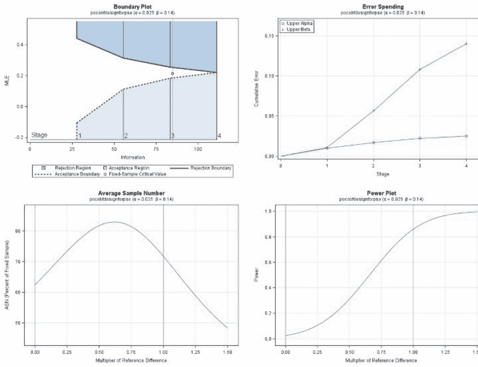

图 2.8 示例代码 2.8 的输出

## SEQDE SIGN 过程

设计: pocobdesignforispo

| 统计分布 | 正态 |
|---|---|

| 边界标度 | MLE |
| 备择假设 | 上 |
| 早期停止 | 接受/拒绝原假设 |
| 方法 | 统一族 |
| 边界键 | 两者 |
| 备择参考 | 0.33 |
| 阶段数 | 4 |
| Alpha | 0.025 |
| Beta | 0.14 |
| 功效 | 0.86 |
| 最大信息（固定样本百分比） | 130.9114 |
| 最大信息 | 111.1162 |
| 原假设参考 ASN（固定样本百分比） | 62.35328 |
| 备择参考 ASN（固定样本百分比） | 71.69203 |

边界信息（MLE 标度）

原假设参考 = 0

| 信息水平 | 备择 | 边界值 | |
|---|---|---||
| 阶段 | 比例 | 实际 | N | 上 | Beta | Alpha |
| 1 | 0.2500 | 27.7908 | 15.42571 | 0.3300 | -0.10446 | 0.42277 |
| 2 | 0.5000 | 55.5912 | 30.85142 | 0.3300 | 0.11277 | 0.31309 |
| 3 | 0.7500 | 83.3318 | 46.27714 | 0.3300 | 0.18518 | 0.25563 |
| 4 | 1.0000 | 111.1182 | 61.70285 | 0.3300 | 0.22139 | 0.22139 |

| 样本量 (N)

比例差异的双样本 Z 检验

| 阶段 | N(组 1) | N(组 2) | 信息 | N | N(组 1) | N(组 2) | 信息 |
|---|---|---|---|---|---|---|---|
| 1 | 15.43 | 10.28 | 5.14 | 27.7791 | 17 | 11 | 6 | 30.6108 |
| 2 | 30.85 | 20.57 | 10.28 | 55.5581 | 32 | 21 | 11 | 57.6477 |
| 3 | 46.28 | 30.85 | 15.43 | 83.3372 | 47 | 31 | 18 | 84.6691 |
| 4 | 61.70 | 41.14 | 20.57 | 111.1 | 63 | 42 | 21 | 113.5 |

图 2.9 示例代码 2.8 的输出，继续

## PRINT 过程

| 观测值 | 参数 | 估计 | 标准误 | scale | 阶段_ |
|---|---|---|---|---|---|
| 1 | trt | 0.3788 | 0.2323 | MLE | 1 |

## SEQUEST 过程

| 设计信息 | WORK.BOUNDARY.INFO1 |
|---|---|

| 数据集 | WORK.PARAEST1 |
| 统计分布 | 正态 |
| 边界标度 | MLE |
| 备择假设 | 上 |
| 早期停止 | 接受/拒绝原假设 |
| 阶段数 | 4 |
| Alpha | 0.025 |
| Beta | 0.13882 |
| 功效 | 0.86118 |
| 最大信息（固定样本百分比） | 130.4524 |
| 最大信息 | 111.16243 |
| 原假设 ASN（固定样本百分比） | 65.05767 |
| 备择参考 ASN（固定样本百分比） | 73.73528 |

## 测试信息（MLE 标度）

原假设参考 = 0

| 信息水平 | 备择 | 边界值 | 测试 |
|---|---|---|---|---|---|---|
| 阶段 | 参考 | 实际 | 上 | Beta | Alpha | 估计 | 动作 |
| 1 | 0.1668 | 18.53617 | 0.3300 | -0.23737 | 0.57635 | 0.37879 | 继续 |
| 2 | 0.0500 | 55.53817 | 0.3300 | 0.11273 | 0.30345 | |
| 3 | 0.7500 | 83.33718 | 0.3300 | 0.18518 | 0.25563 | |
| 4 | 1.0000 | 111.1182 | 0.3300 | 0.22139 | 0.22139 | |

## PRINT 过程

| 观测值 | 参数 | 估计 | 标准误 | scale | 阶段_ |
|---|---|---|---|---|
| 1 | trt | 0.3788 | 0.2323 | MLE | 1 |

## SEQUEST 过程

测试信息（MLE 标度）

原假设参考 = 0

| 信息水平 | 备择 | 边界值 | 测试 |
|---|---|---|---|---|---|---|
| 阶段 | 参考 | 实际 | 上 | Beta | Alpha | 估计 | 动作 |
| 1 | 0.1668 | 18.53617 | 0.3300 | -0.23737 | 0.57635 | 0.37879 | 继续 |
| 2 | 0.0500 | 55.53817 | 0.3300 | 0.11273 | 0.30345 | |
| 3 | 0.7500 | 83.33718 | 0.3300 | 0.18518 | 0.25563 | |
| 4 | 1.0000 | 111.1182 | 0.3300 | 0.22139 | 0.22139 | |

| 样本量 (N)

比例差异的双样本 Z 检验

| 阶段 | N(组 1) | N(组 2) | 信息 | N | N(组 1) | N(组 2) | 信息 |
|---|---|---|---|---|---|---|---|
| 1 | 15.43 | 10.28 | 5.14 | 27.7791 | 17 | 11 | 6 | 30.6108 |
| 2 | 30.85 | 20.57 | 10.28 | 55.5581 | 32 | 21 | 11 | 57.6477 |
| 3 | 46.28 | 30.85 | 15.43 | 83.3372 | 47 | 31 | 18 | 84.6691 |
| 4 | 61.70 | 41.14 | 20.57 | 111.1 | 63 | 42 | 21 | 113.5 |

图 2.9 示例代码 2.8 的输出，继续

## 2.4.4 消耗函数边界

错误消耗函数是推导停止边界的最灵活且通用的方法。预设 `α` 水平的 `α`-消耗函数被用于控制试验中的一类错误。它们是定义在单位区间上的单调函数，并满足 `α(t)=0` 且 `α(t)=α`。同样，预设 `β` 水平的 `β`-消耗函数用于控制二类错误。它们定义在单位区间上，并满足 `β(t=0)` 且 `β(t=1)=β`。这种使用错误消耗函数的思想最早由 Lan 和 DeMets [10] 提出。在单次试验的序贯监测中，单独使用 `α` 消耗函数或 `β` 消耗函数，也可以将两者结合使用。它们可以用于单侧或双侧假设，并产生对称或非对称的边界。

目前已经提出了许多错误消耗函数，我们将简要描述其中三个最常用的消耗函数及其属性。函数的形式表示为 `α(t)` 和 `β(t)`，其中 `t(0 < t < 1)` 是信息比例。这里我们说明 `α`-消耗函数，但它也适用于 `β`-消耗函数。

- 1. Lan-DeMets 消耗函数有两种可能的形式。第一种与 OBF 边界相似：

`α(t)=2-2Φ(Z_{α/2}/√t)` 用于单侧检验，以及

`α(t)=4-4Φ(Z_{α/4}/√t)` 用于双侧检验。

第二种与 Pocock 边界相似：

`α(t)=α ln<1+|θ-1t|>`

- 2. Gamma 消耗函数最早由 Hwang、Shih 和 DeCani [24] 提出。函数形式为：

`α(t) = { a(1-e^{-γ t})/(1-e^{-γ}), γ ≠ 0; γ = 0 }`

`γ` 的负值产生的消耗函数随着 `γ` 的减小而使得早期停止变得更加困难。`γ` 的正值产生的凹性消耗函数随着 `γ` 的增加而有利于早期停止。选择 `γ=0` 时，错误是线性消耗。当 `γ=-4` 时，它类似于 OBF 边界，而 `γ=1` 产生的边界类似于 Pocock 边界。

- 3. Rho 消耗函数最早由 Kim 和 DeMets [25] 提出，并被进一步泛化。其函数形式简单表示为：

`α(t) = α t^{ρ}, ρ > 0`

当 `ρ=1` 时，相应的停止边界类似于 Pocock 停止边界，但当 `ρ=3` 时，边界类似于 OBF 边界。`ρ` 的大值使得早期停止变得更加困难，而 `0 < ρ < 1` 则有利于早期停止。

在这里，我们想通过一个示例说明如何在单侧设置下，为早期拒绝原假设或备择假设推导边界。该设计有两组停止边界。上边界组对应早期拒绝原假设，而下边界指的是早期拒绝备择假设。在第 `j` 个中期阶段，如果检验统计量越过上边界，则试验因有效性而停止；但如果它越过下边界，则试验因效用而停止。我们施加约束，使得上下边界在试验结束时 `t_j` 处相交，以确保做出拒绝任何一个假设的决策。上下边界形成了一个三角形继续区域。

我们规定，在原假设下，这些停止边界能够在 `α` 水平保持一类错误。

测试。在试验阶段，研究人员可能感兴趣于比较在功率消耗函数中使用具有不同 `ρ` 值的设计，例如 0.3、0.9 或 1.5。图形化比较成为此项调查中ر项重要工具。

## 示例代码 2.10 使用功率消耗函数的高级乳腺癌试验

```sas
proc segdesign boundaryscale=stdz.plots=all;
rhodesignforcan: design nstages=4 method=errfuncpow(rho=0.3) alt=upper
stop-reject alpha=0.025 beta=0.1;
rhodesignforcan: design nstages=4 method=errfuncpow(rho=0.9) alt=upper
stop-reject alpha=0.025 beta=0.1;
rhodesignforcan: design nstages=4 method=errfuncpow(rho=1.5) alt=upper
stop-reject alpha=0.025 beta=0.1;
samplesize model=twamplesvival(nulledsurvtime=6 mesurvtime=8.25
actime=12 totaltime=24);
```

在这些三阶段设计中，使用了标准化的 `χ`-统计量 (`boundaryscale=stdz`)。在 `samplesize` 语句中，我们使用了 `model=2twamplesvival` 来测试两条生存曲线，假设原分布中的中位生存时间为 6 个月，在备择分布中为 8.25 个月。这是基于指数生存分布假设。入组时间设定为 12 个月，总时间为 24 个月。

图 2.12 对应示例代码 2.10

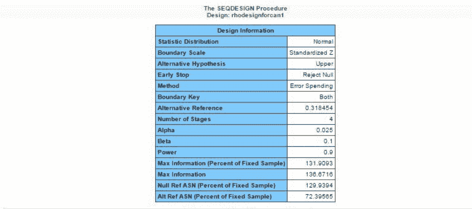

| 设计信息 | 数值 |
|---|---|
| n 边界标尺 | 标准化 Z |
| 备择假设 | 上界 |
| 提前停止 | 拒绝原假设 |
| 方法 | 误差搜索 |
| 边界键 | 均 |
| 备择参考 | 0.31845 |
| 阶段数 | 4 |
| Alpha | 0.025 |
| Beta | 0.1 |
| 功率 | 0.9 |
| 最大信息（固定样本量的百分比） | 131.9095 |
| 最大信息 | 136.6710 |
| 原假设参考 ASD（固定样本量的百分比） | 129.9934 |
| 备择参考 ASD（固定样本量的百分比） | 72.39965 |

| 阶段 | D(Group1) | D(Group2) | D(Group3) | N(Group1) | N(Group2) | N(Group3) | 事件（事件和样本量） | 时间 | 时间 |
|---|---|---|---|---|---|---|---|---|---|


| 1 | 138.67 | 59.99 | 76.55 | 7945.43 | 121.66 | 121.66 | 34187.5 | 138.67 | 50.61 | 77.44 | 445.22 | 222.92 | 222.92 | 34.531 |

| 2 | 273.34 | 121.95 | 151.38 | 11994.63 | 331.58 | 331.58 | 68535.27 | 227.22 | 123.74 | 153.48 | 168.77 | 334.39 | 334.39 | 33.934 |

| 3 | 410.01 | 182.33 | 231.23 | 15225.65 | 557.39 | 557.39 | 334.39 | 428.85 | 195.95 | 228.16 | 268.52 | 334.39 | 334.39 | 107.2 |

| 4 | 546.59 | 242.57 | 298.13 | 20168.40 | 734.39 | 734.39 | 137548.57 | 546.57 | 289.13 | 308.68 | 334.39 | 334.39 | 138.7 |

图 2.12 示例代码 2.10 输出的部分内容仅显示了使用 $\rho = 0.3$ 的第一个设计 `rhignforcan`。膨胀因子为 131.9%，但在指定的备择参考下，它为 72.4%。曲妥单珠（组 2：原分布）所需的事件数列在 D(G2) 下，联合治疗组（组 1：备择分布）列在 D(Grp1) 下，最后一列为相应的所需的分阶段信息。团队可以在观察到总共 138 个事件（对应 34.5 的信息）后进行中期分析。根据默认入组率和指定的入组时间及总时间（accrual=12 和 totaltime=24），第一阶段需要 446 名受试者。中期分析所需的历时间为 8、12、17 和 24 个月，基于提供的入组信息。SAS 两种入组模型：均匀分布 (`accrual=uniform`) 和参数截断指数分布 (`accrual=exp`)，用于计算样本量和历时间。如果研究认为这些入组模型不适用于他们的情况，他们将指定自己的入组模型以估计所需的样本量和历时间。因此，如果 SAS 程序中未提供入组信息，则仅显示事件数，而不会显示样本量和历时间。中期分析仍需遵循事件数。

我们还请求所有图以将三个停止边界合并进行视觉比较。图 2.13 使用 3 种消耗函数的乳腺癌边界图和图 2.14 使用 3 种消耗函数的乳腺癌平均大小图，作为示例，分别显示 ASN 图。我们可以看到，$\rho = 0.3$ 的第一个设计在第一阶段对于有效性是激进的，而另外两个 ($\rho = 0.9, 1.5$) 在早期阶段是保守的。除非强烈认为两条曲线在早期阶段发散，否则在该试验开始时保守地停止更为理想。

然而，重要的是，在目前讨论的边界示例中，假设无效边界是无法越过的。也就是说，如果统计量越过边界，试验必须终止，否则 I 类错误率会膨胀。这被称为“绑定边界”。在计算有效性边界时，无效边界的存在会拉低有效性边界，从而在期分析忽略绑定无效边界时更容易越界，即可能膨胀 I 类错误。这种绑定无效通常对试验发起不利，因为无效决策并不总是明确。因此，有一种方法可以构建非绑定无效边界，非绑定边界允许在越界边界时继续试验，尽管与绑定无效边界相比这增加了总样本量。在这种情况下，为了更改默认设置 `stop-both (binding)`，可以选择 `stop-both (nonbinding)` 来构建非绑定无效边界。特殊问题，我们将回到监控问题，并简要介绍除绑定和非绑定无效边界外的监控工具。

## 图 2.13 使用 3 种消耗函数的乳腺癌边界图

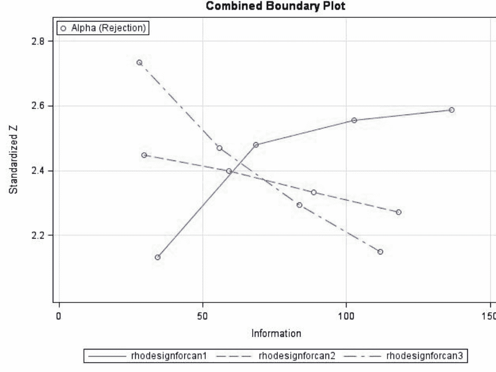

## 图 2.14 使用 3 种消耗函数的乳腺癌平均大小图


## 示例：2 型糖尿病心血管风险的序贯试验设计

在评估 T2DM 心血管风险时，有很多开发选择；我们将关注限制在心血管结局试验 (`CVOT`)，以进一步说明用于组序设计的方法。评估 T2DM 心血管风险的各种方法的优点在别处讨论 [26, 27]。如所述，对于第一阶段，我们可以将非劣效原假设重写为 $H_{10}: \theta \le 0$，其中 $\theta = -\ln(\Delta_T / \lambda_C) + 0.5878$ 且 $\ln(1.8) = 0.5878$。备择假设变为 $H_{11}: \theta > 0$。这是 SAS 中优选的参数化，代码 2.11 2 型糖尿病心血管结局试验序贯分析用于说明此示例。

### 示例代码 2.11 2 型糖尿病心血管结局试验序贯分析

```
 第一阶段测试的固定设计，默认=0.1 *
proc seqdesign;
stagefixed: design stages=1 alt=twosided alpha=0.05;
samplesize model=twamplesvival(nullhazard=1.8 1.0 hazard=1.0);
run;

* 用于第一阶段测试 1.8 标准的三阶段序贯设计 /
* proc seqdesign errspend nstages=3 method=errfuncpow boundaryscale=mle plots=all;
stagedpower: design errspend=errfuncpow(rho=0.3) alt=twosided
alpha=0.05 cum(0.5 0.75 1)
samplesize model=twamplesvival(nullhazard=1.8 hazard=1.0)
ods Output=test_interim;
run;
```

```
* 第一阶段数据分析 /
proc ph data=T2DM;
model weeks*event(0)=treatment;
ods output ParameterEstimates=parms_interim;
run;
```

```
data params_interim;
set parms_interim;
where parameter='Treatment'; nparameter=parameter+0.5878;
scale='MLE'; nstage_1;
keep Scale_stage_1 parameter estimate stddr;
run;
```

```
proc seqtest boundary=test_interim parms(testvar=treatment)=parms_interim
foadjn=non-boundary scale=mle
ods Output=test_inter2;
```

```
* 第一阶段结束时的 1.3 标准期分析（20% 信息）
以及第二阶段在 50% 和 75% 时的中期分析 /
proc seqdesign errspend zctopp boundaryscale=mle plots=all;
stagedpower: design errspend=errfuncpow(rho=0.3) alt=twosided
alpha=0.05 cum(0.2 0.75 1)
samplesize model=twamplesvival(nullhazard=1.3 hazard=1.0)
ods Output=combtest_interim;
run;
```

研究参与者。此外，如上所述，如果达到了安全阈值，这些中期分析可能允许试验提前停止。对于第一阶段（Stage 1），我们可以设计一个组序贯试验，如 [18] 所示，在试验信息量达到 50% 和 75% 时计划两次中期分析。为了给中期分析的时间和频率提供更大的灵活性，第二组代码中的设计阶段 `stage1power` 使用了 $\rho=3$ 的效能误差消耗函数，在 `proc segdesign` 中提供类似于 OBF 的边界。`info=cum(0.5 0.75 1)` 允许进行三次不相等间隔的监测，分别对应累积信息的 50%、75% 和 100%。`boundary=m` 请求边界值处于较早定义的 $\theta$ 的 MLE 尺度上，并将其存储在 `test_interim` 中。

## 图 2.15 示例代码 2.11 第一阶段的输出

### SEGESIGN 过程

设计：stage 1power

| 设计信息 | |

|---|---|

| 统计分布 | 正态分布 |

| 边界尺度 | MLE |

| 备择假设 | 双侧 |

| 提前停止 | 拒绝原假设 |

| 方法 | 误差消耗 |

| 边界键 | 均 |

| 备择参考 | 0.587787 |

| 阶段数 | 3 |

| Alpha | 0.05 |

| Beta | 0.1 |

| 效能 | 0.9 |

| 最大信息量（固定样本百分比） | 102.4384 |

| 最大信息量 | 31.15446 |

| 原假设 RefASN（固定样本百分比） | 101.7382 |

| 备择 RefASN（固定样本百分比） | 75.98825 |

| 预期累积消耗概率 | | 参考 = CRef * (备择参考) | 停止概率 | |

| CRef | 停止阶段 | 来源 | Stage_1 | Stage_2 | Stage_3 |

|---|---|---|---|---|---|

| 0.0000 | 2.973 | 原假设 | 0.00625 | 0.02109 | 0.05000 |

| 0.5000 | 2.759 | 原假设 | 0.05774 | 0.18281 | 0.36479 |

| 1.0000 | 1.987 | 原假设 | 0.23938 | 0.59357 | 0.90000 |

| 1.5000 | 1.265 | 原假设 | 0.77200 | 0.97285 | 0.99882 |

| 边界信息（MLE 尺度） | | | | | | | | |

| 原假设参考 = 0 | | | | | | | | |

| 信息水平 | 备择 | 边界值 | | | | | |

| 阶段_ | 比例 | 实际 | 事件 | 下界 | 上界 | Alpha | Alpha |

| 1 | 0.5000 | 15.57723 | 82.30892 | -0.58779 | -0.69281 | 0.69281 | |

| 2 | 0.7500 | 23.36585 | 93.48539 | -0.58779 | -0.48757 | 0.48757 | |

| 3 | 1.0000 | 31.15446 | 124.6178 | -0.58779 | -0.38343 | 0.38343 | |

| 误差消耗信息 | | | | | | | |

| 信息水平 | 累积误差消耗 | | | | | | |

| 下界 | 上界 | | | | | | |

| 阶段_ | 比例 | Alpha | Beta | Beta | Alpha | |

| 1 | 0.5000 | 0.00313 | 0.00000 | 0.00000 | 0.00313 | |

| 2 | 0.7500 | 0.01065 | 0.00000 | 0.00000 | 0.01065 | |

| 3 | 1.0000 | 0.02500 | 0.01000 | 0.01000 | 0.02500 | |

| 事件数 (D) | | | |

| 双样本 Log-Rank 检验 | | | |

| 阶段_ | D | 信息量 | |

| 1 | 82.31 | 15.5772 | |

| 2 | 93.46 | 23.3658 | |

| 3 | 124.62 | 31.1545 | |

从图 2.15 示例代码 2.11 第一阶段的部分输出中，我们可以确定试验的最大事件数已增加到 125，对于设计中增加的灵活性来说，这一增加相对较小。在指定的备择假设下，预期事件数约为固定设计的 76%（或 93 次事件），有 69.4% 的概率在第二次中期分析之前拒绝原假设。每当发生第一次中期分析时，假设 Cox 比例风险模型是合适的，可以使用 `proc phreg` 的输出来评估是否跨越了边界。例如，如果患者发生了 MACE 结局，且在以周衡量的当前随访时间 `event=0` 被删失，则 `treatment=1`。在 SAS 中，原假设始终以 $H_0$ 的形式存在，较早定义的 $\theta$ 在 MLE 尺度上的边界值由 `boundary=m` 请求，并存储在 `test_interim` 中。

研究参与者。此外，如上所述，如果达到了安全阈值，这些中期分析可能允许试验提前停止。对于第一阶段，我们可以设计一个组序贯试验，如 [18] 所示，在试验信息量达到 50% 和 75% 时计划两次中期分析。为了给中期分析的时间和频率提供更大的灵活性，第二组代码中的设计阶段 `stage1power` 使用了 $\rho=3$ 的效能误差消耗函数，在 `proc segdesign` 中提供类似于 OBF 的边界。`info=cum(0.5 0.75 1)` 允许进行三次不相等间隔的监测，分别对应累积信息的 50%、75% 和 100%。`boundary=m` 请求边界值处于较早定义的 $\theta$ 的 MLE 尺度上，并将其存储在 `test_interim` 中。

## 图 2.15 示例代码 2.11 第一阶段的输出

### SEGESIGN 过程

设计：stage 1power

| 设计信息 | |

|---|---|

| 统计分布 | 正态分布 |

| 边界尺度 | MLE |

| 备择假设 | 双侧 |

| 提前停止 | 拒绝原假设 |

| 方法 | 误差消耗 |

| 边界键 | 均 |

| 备择参考 | 0.587787 |

| 阶段数 | 3 |

| Alpha | 0.05 |

| Beta | 0.1 |

| 效能 | 0.9 |

| 最大信息量（固定样本百分比） | 102.4384 |

| 最大信息量 | 31.15446 |

| 原假设 RefASN（固定样本百分比） | 101.7382 |

| 备择 RefASN（固定样本百分比） | 75.98825 |

| 预期累积消耗概率 | | 参考 = CRef * (备择参考) | 停止概率 | |

| CRef | 停止阶段 | 来源 | Stage_1 | Stage_2 | Stage_3 |

|---|---|---|---|---|---|

| 0.0000 | 2.973 | 原假设 | 0.00625 | 0.02109 | 0.05000 |

| 0.5000 | 2.759 | 原假设 | 0.05774 | 0.18281 | 0.36479 |

| 1.0000 | 1.987 | 原假设 | 0.23938 | 0.59357 | 0.90000 |

| 1.5000 | 1.265 | 原假设 | 0.77200 | 0.97285 | 0.99882 |

| 边界信息（MLE 尺度） | | | | | | | | |

| 原假设参考 = 0 | | | | | | | | |

| 信息水平 | 备择 | 边界值 | | | | | | |

| 阶段_ | 比例 | 实际 | 事件 | 下界 | 上界 | Alpha | Alpha |

| 1 | 0.5000 | 15.57723 | 82.30892 | -0.58779 | -0.69281 | 0.69281 | |

| 2 | 0.7500 | 23.36585 | 93.48539 | -0.58779 | -0.48757 | 0.48757 | |

| 3 | 1.0000 | 31.15446 | 124.6178 | -0.58779 | -0.38343 | 0.38343 | |

| 误差消耗信息 | | | | | | | |

| 信息水平 | 累积误差消耗 | | | | | | |

| 下界 | 上界 | | | | | | |

| 阶段_ | 比例 | Alpha | Beta | Beta | Alpha | |

| 1 | 0.5000 | 0.00313 | 0.00000 | 0.00000 | 0.00313 | |

| 2 | 0.7500 | 0.01065 | 0.00000 | 0.00000 | 0.01065 | |

| 3 | 1.0000 | 0.02500 | 0.01000 | 0.01000 | 0.02500 | |

| 事件数 (D) | | | |

| 双样本 Log-Rank 检验 | | | |

| 阶段_ | D | 信息量 | |

| 1 | 82.31 | 15.5772 | |

| 2 | 93.46 | 23.3658 | |

| 3 | 124.62 | 31.1545 | |

从图 2.15 示例代码 2.11 第一阶段的部分输出中，我们可以确定试验的最大事件数已增加到 125，对于设计中增加的灵活性来说，这一增加相对较小。在指定的备择假设下，预期事件数约为固定设计的 76%（或 93 次事件），有 69.4% 的概率在第二次中期分析之前拒绝原假设。每当发生第一次中期分析时，假设 Cox 比例风险模型是合适的，可以使用 `proc phreg` 的输出来评估是否跨越了边界。例如，如果患者发生了 MACE 结局，且在以周衡量的当前随访时间 `event=0` 被删失，则 `treatment=1`。在 SAS 中，原假设始终以 $H_0$ 的形式存在，较早定义的 $\theta$ 的 MLE 尺度上的边界值由 `boundary=m` 请求，并存储在 `test_interim` 中。

## 图 2.15 示例代码 2.11 第一阶段的输出

### SEGESIGN 过程

设计：stage 1power

| 设计信息 | |

|---|---|

| 统计分布 | 正态分布 |

| 边界尺度 | MLE |

| 备择假设 | 双侧 |

| 提前停止 | 拒绝原假设 |

| 方法 | 误差消耗 |

| 边界键 | 均 |

| 备择参考 | 0.262364 |

| 阶段数 | 4 |


| Alpha | 0.05 |
| Beta | 0.1 |
| 效能 | 0.9 |
| 最大信息量（固定样本百分比） | 102.4747 |
| 最大信息量 | 156.4242 |
| 原假设 RefASN（固定样本百分比） | 101.7618 |
| 备择 RefASN（固定样本百分比） | 75.5303 |
| 预期累积消耗概率 | | 参考 = CRef * (备择参考) | 停止概率 | |
| CRef | 停止阶段 | 来源 | Stage_1 | Stage_2 | Stage_3 |
|---|---|---|---|---|---|
| 0.0000 | 2.973 | 原假设 | 0.00625 | 0.02109 | 0.05000 |
| 0.5000 | 2.759 | 原假设 | 0.05774 | 0.18281 | 0.36479 |
| 1.0000 | 1.987 | 原假设 | 0.23938 | 0.59357 | 0.90000 |
| 1.5000 | 1.265 | 原假设 | 0.77200 | 0.97285 | 0.99882 |
| 边界信息（MLE 尺度） | | | | | | | | |
| 原假设参考 = 0 | | | | | | | | |
| 信息水平 | 备择 | 边界值 | | | | | | |
| 阶段_ | 比例 | 实际 | 事件 | 下界 | 上界 | Alpha | Alpha |
| 1 | 0.5000 | 15.57723 | 82.30892 | -0.58779 | -0.69281 | 0.69281 | |
| 2 | 0.7500 | 23.36585 | 93.48539 | -0.58779 | -0.48757 | 0.48757 | |
| 3 | 1.0000 | 31.15446 | 124.6178 | -0.58779 | -0.38343 | 0.38343 | |
| 误差消耗信息 | | | | | | | |
| 信息水平 | 累积误差消耗 | | | | | | |
| 下界 | 上界 | | | | | | |
| 阶段_ | 比例 | Alpha | Beta | Beta | Alpha | |
| 1 | 0.5000 | 0.00313 | 0.00000 | 0.00000 | 0.00313 | |
| 2 | 0.7500 | 0.01065 | 0.00000 | 0.00000 | 0.01065 | |
| 3 | 1.0000 | 0.02500 | 0.01000 | 0.01000 | 0.02500 | |
| 事件数 (D) | | | |
| 双样本 Log-Rank 检验 | | | |
| 阶段_ | D | 信息量 | |
| 1 | 82.31 | 15.5772 | |
| 2 | 93.46 | 23.3658 | |
| 3 | 124.62 | 31.1545 | |

从图 2.15 示例代码 2.11 第一阶段的部分输出中，我们可以确定试验的最大事件数已增加到 125，对于设计中增加的灵活性来说，这一增加相对较小。在指定的备择假设下，预期事件数约为固定设计的 76%（或 93 次事件），有 69.4% 的概率在第二次中期分析之前拒绝原假设。每当发生第一次中期分析时，假设 Cox 比例风险模型是合适的，可以使用 `proc phreg` 的输出来评估是否跨越了边界。例如，如果患者发生了 MACE 结局，且在以周衡量的当前随访时间 `event=0` 被删失，则 `treatment=1`。在 SAS 中，原假设始终以 $H_0$ 的形式存在，较早定义的 $\theta$ 的 MLE 尺度上的边界值由 `boundary=m` 请求，并存储在 `test_interim` 中。

图 2.15 示例代码 2.11 第一阶段的输出

## SEGESIGN 过程

设计：`stage 1power`

| 设计信息 | |
|---|---|
| 统计分布 | 正态分布 |
| 边界尺度 | MLE |
| 备择假设 | 双侧 |
| 提前停止 | 拒绝原假设 |
| 方法 | 误差消耗 |
| 边界键 | 均 |
| 备择参考 | 0.262364 |
| 阶段数 | 4 |
| Alpha | 0.05 |
| Beta | 0.1 |
| 效能 | 0.9 |
| 最大信息量（固定样本百分比） | 102.4747 |
| 最大信息量 | 156.4242 |
| 原假设 RefASN（固定样本百分比） | 101.7618 |
| 备择 RefASN（固定样本百分比） | 75.5303 |
| 事件数 (D) | | | | |
| 双样本 Log-Rank 检验 | | | | |
| 阶段_ | D | 信息量 | | |
| 1 | 125.14 | 31.2848 | | |
| 2 | 312.85 | 78.21 | | |
| 3 | 459.27 | 117.3 | | |
| 4 | 525.70 | 156.4 | | |

研究者。此外，如上所述，如果达到了安全阈值，这些中期分析可能允许试验提前停止。对于第一阶段，我们可以设计一个组序贯试验，如 [18] 所示，在试验信息量达到 50% 和 75% 时计划两次中期分析。为了给中期分析的时间和频率提供更大的灵活性，第二组代码中的设计阶段 `stage1power` 使用了 $\rho=3$ 的效能误差消耗函数，在 `proc segdesign` 中提供类似于 OBF 的边界。`info=cum(0.5 0.75 1)` 允许进行三次不相等间隔的监测，分别对应累积信息的 50%、75% 和 100%。`boundary=m` 请求边界值处于较早定义的 $\theta$ 的 MLE 尺度上，并将其存储在 `test_interim` 中。

图 2.15 示例代码 2.11 第一阶段的输出

## SEGESIGN 过程

设计：`stage 1power`

| 设计信息 | |
|---|---|
| 统计分布 | 正态分布 |
| 边界尺度 | MLE |
| 备择假设 | 双侧 |
| 提前停止 | 拒绝原假设 |
| 方法 | 误差消耗 |
| 边界键 | 均 |
| 备择参考 | 0.262364 |
| 阶段数 | 4 |
| Alpha | 0.05 |
| Beta | 0.1 |
| 效能 | 0.9 |
| 最大信息量（固定样本百分比） | 102.4747 |
| 最大信息量 | 156.4242 |
| 原假设 RefASN（固定样本百分比） | 101.7618 |
| 备择 RefASN（固定样本百分比） | 75.5303 |
| 事件数 (D) | | | | |
| 双样本 Log-Rank 检验 | | | | |
| 阶段_ | D | 信息量 | | |
| 1 | 125.14 | 31.2848 | | |
| 2 | 312.85 | 78.21 | | |
| 3 | 459.27 | 117.3 | | |
| 4 | 525.70 | 156.4 | | |

目前的临床试验监测研究在贝叶斯框架下引入条件效能和预测效能。正如之前讨论，由于 I 类错误可能膨胀，绑定效用在跨越边界时未提供灵活性，而非绑定效用提供了灵活性但可能会增加样本量。第 $i$ 阶段的条件效能定义为给定 $j$ 阶段观测统计量的情况下，未来任何阶段拒绝原假设的总概率。较小的条件效能（$\ll 0.05$）信号表明当前观测证据下，宣布试验成功的概率很小。试验可以停止以接受原假设。预测效能是在给定观测数据和假设性参考的先验分布的情况下，最终阶段检验统计量超过拒绝值的后验概率。通常，使用无争议的无信息先验分布来计算预测效能。以下 SAS 代码更新了关于监测银屑试验的示例。

示例代码 2.12 银屑试验的条件效能和预测效能。

研究参与者。此外，如上所述，如果达到了安全阈值，这些中期分析可能允许试验提前停止。对于第一阶段，我们可以设计一个组序贯试验，如 [18] 所示，在试验信息量达到 50% 和 75% 时计划两次中期分析。为了给中期分析的时间和频率提供更大的灵活性，第二组代码中的设计阶段 `stage1power` 使用了 $\rho=3$ 的效能误差消耗函数，在 `proc segdesign` 中提供类似于 OBF 的边界。`info=cum(0.5 0.75 1)` 允许进行三次不相等间隔的监测，分别对应累积信息的 50%、75% 和 100%。`boundary=m` 请求边界值处于较早定义的 $\theta$ 的 MLE 尺度上，并将其存储在 `test_interim` 中。

图 2.15 示例代码 2.11 第一阶段的输出

## SEGESIGN 过程

设计：`stage 1power`

| 设计信息 | |
|---|---|
| 统计分布 | 正态分布 |
| 边界尺度 | MLE |
| 备择假设 | 双侧 |
| 提前停止 | 拒绝原假设 |
| 方法 | 误差消耗 |
| 边界键 | 均 |
| 备择参考 | 0.587787 |
| 阶段数 | 3 |
| Alpha | 0.05 |
| Beta | 0.1 |
| 效能 | 0.9 |
| 最大信息量（固定样本百分比） | 102.4384 |
| 最大信息量 | 31.15446 |
| 原假设 RefASN（固定样本百分比） | 101.7382 |
| 备择 RefASN（固定样本百分比） | 75.98825 |
| 预期累积消耗概率 | | 参考 = CRef * (备择参考) | 停止概率 | |
| CRef | 停止阶段 | 来源 | Stage_1 | Stage_2 | Stage_3 |
|---|---|---|---|---|---|
| 0.0000 | 2.973 | 原假设 | 0.00625 | 0.02109 | 0.05000 |
| 0.5000 | 2.759 | 原假设 | 0.05774 | 0.18281 | 0.36479 |
| 1.0000 | 1.987 | 原假设 | 0.23938 | 0.59357 | 0.90000 |
| 1.5000 | 1.265 | 原假设 | 0.77200 | 0.97285 | 0.99882 |
| 边界信息（MLE 尺度） | | | | | | | | |
| 原假设参考 = 0 | | | | | | | | |
| 信息水平 | 备择 | 边界值 | | | | | | |
| 阶段_ | 比例 | 实际 | 事件 | 下界 | 上界 | Alpha | Alpha |
| 1 | 0.5000 | 15.57723 | 82.30892 | -0.58779 | -0.69281 | 0.69281 | |
| 2 | 0.7500 | 23.36585 | 93.48539 | -0.58779 | -0.48757 | 0.48757 | |
| 3 | 1.0000 | 31.15446 | 124.6178 | -0.58779 | -0.38343 | 0.38343 | |
| 误差消耗信息 | | | | | | | | |
| 信息水平 | 累积误差消耗 | | | | | | | |
| 下界 | 上界 | | | | | | | |
| 阶段_ | 比例 | Alpha | Beta | Beta | Alpha | | | |
| 1 | 0.5000 | 0.00313 | 0.00000 | 0.00000 | 0.00313 | | | |
| 2 | 0.7500 | 0.01065 | 0.00000 | 0.00000 | 0.01065 | | | |
| 3 | 1.0000 | 0.02500 | 0.01000 | 0.01000 | 0.02500 | | | |
| 事件数 (D) | | | | |
| 双样本 Log-Rank 检验 | | | | |
| 阶段_ | D | 信息量 | | |
| 1 | 82.31 | 15.5772 | | |
| 2 | 93.46 | 23.3658 | | |
| 3 | 124.62 | 31.1545 | | |

从图 2.15 示例代码 2.11 第一阶段的部分输出中，我们可以确定试验的最大事件数已增加到 125，对于设计中增加的灵活性来说，这一增加相对较小。在指定的备择假设下，预期事件数约为固定设计的 76%（或 93 次事件），有 69.4% 的概率在第二次中期分析之前拒绝原假设。每当发生第一次中期分析时，假设 Cox 比例风险模型是合适的，可以使用 `proc phreg` 的输出来评估是否跨越了边界。例如，如果患者发生了 MACE 结局，且在以周衡量的当前随访时间 `event=0` 被删失，则 `treatment=1`。在 SAS 中，原假设始终以 $H_0$ 的形式存在，较早定义的 $\theta$ 的 MLE 尺度上的边界值由 `boundary=m` 请求，并存储在 `test_interim` 中。

```
ods output Test-boundaryinfo3; run;
```

在第一部分示例代码 2.12 银屑病试验的条件功效与预测功效中，`proc seqdesign` 进行了更新，仅通过使用 `stop=reject` 移除效用监控。这使得拒绝边界不受基于条件功效或预测功效评估的效用决定的影响。`condpower (cref=0.5,1.25)` 生成在不同假设参考值下，在所有未来阶段（默认）拒绝零假设的条件功效：`cref` 为原始参考值的 0.5、1 和 1.25 倍。部分输出见图 2.17 示例代码 2.12 的输出。使用 `plotscondpower` 请求绘制条件功效图（图 2.18 基于观测数据的银屑病试验条件功效图）。对于最终阶段的预测功效，使用了 `predpower`，且由于仅计算了最终阶段的预测功效，因此没有生成预测功效图表。

## 图 2.17 示例代码 2.12 的输出

| 停止阶段 | 参考 Ref= CRef* (所有参考) | 条件功效 |
| :--- | :--- | :--- |
| MLE | MLE | CRef |
| 1 | 0.37879 | MLE | 1.1478 | 0.96019 |
| 1 | 0.37879 | | 0.5000 | 0.45577 |
| 1 | 0.37879 | 备择 | 1.0000 | 0.90756 |
| 1 | 0.37879 | | 1.2500 | 0.97980 |
| 预测功效信息 | | |
| 停止阶段 | MLE | 预测功效 |
| :--- | :--- | :--- |
| | 0.37879 | 0.75409 |
| 检验信息 (MLE 尺度) 零参考 = 0 | | |
| 信息水平 | 备择边界值 | 检验 | |
| _阶段_ | 比例 | 实际 | 上界 | Alpha | 动作 |
| 1 | 0.1833 | 18.5617 | 0.3300 | 0.57459 | 0.37879 继续 |
| 2 | 0.3774 | 38.1953 | 0.3300 | 0.39657 | 0.46052 拒绝零假设 |
| 3 | 0.7600 | 75.8511 | 0.3300 | 0.26119 | |
| 4 | 1.0000 | 101.1347 | 0.3300 | 0.23326 | |
| 参数估计阶段性排序 | | |
| 停止阶段 | MLE p 值 H0:Param=6 中位估计 下限 95% 置信区间 |
| trt | 0.048519 | 0.0075 | 0.464397 | 0.16385 |

## 图 2.18 基于观测阶段 1 数据的银屑病试验条件功效图

## 条件功效图

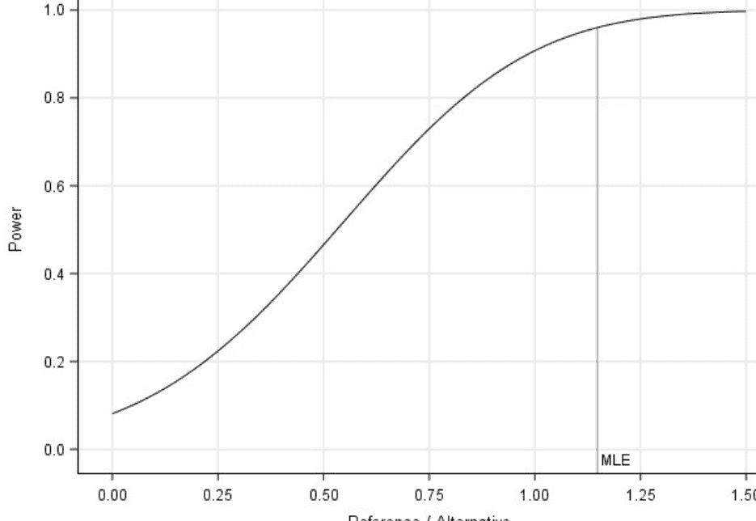

96.02% 的条件功效是指当假设参考值为观测到的 MLE 时。由于第一阶段的 MLE 为 0.3788，略大于原始参考值 0.4-0.07=0.33，因此计算出的 $c = 0.3788/0.33 = 1.1478$。如果假设参考值为 $1.25^*=0.33 = 0.4125$，则条件功效为 97.98%。这些估计的条件功效表明有强力证据继续试验到下一阶段。75.41% 的预测功效虽然小于条件功效，但仍意味着有继续的强力证据。下一个表格与之前相同，显示了在第二阶段拒绝零假设，因此不需要计算条件功效或预测功效。

顺序检验引起的另一个重要问题是提供实验药物效应大小的无偏估计。对于不进行早期终止中期分析的固定样本量设计，可以对治疗差异进行无偏的定量评估。然而，在序贯设计下，由于停止规则的选择，通常的均极大似然估计量会产生高估，因此检验统计量的抽样分布不再与固定样本量设计的相同。Jennison 和 Turnbull [11] 对这一问题进行了简要阐述。目前已经提出了方法来调整这种偏差，该主题超出了本章的范畴。然而，对于中位数，SAS 中可以提供无偏中位数估计量。输出的最后一个表格显示了基于默认阶段排序的 0.4548 无偏中位数估计值。根据第二阶段结束收集的数据，该试验相应的 p 值为 0.0075。

偶尔，某些临床试验将包含多个组，例如研究性药物的多个剂量。在这种情况下，徒效分析对于删除未显示出明显疗效证据的剂量起着重要作用；然而，由于进行了多次比较，必须采取控制 I 类错误膨胀的措施。事实上，丢弃剂量在经典的序贯框架中无法解决，而是当试验的总最大信息可以进行调整时。

## 2.6 总结


在过去的几十年里，序贯理论已经非常完善，特别是在试验背景下。美国食品药品监督管理局 (FDA) 在 2010 年发布了一份针对行业的指南，说明适应性设计是得到良好的。

# 参考文献

- 1. Everitt BS & Palmer CR. (2011). 医学统计学百科全书。
- 2. Armitage P. (1960). 序贯试验，第一版。West Sussex: Oxford。
- 3. Armitage P, Pike MC, Rowe J. (1971). 随机试验的设计与分析。Journal of American, 34: 793-797.
- 4. Kittelson J & Emerson SS. (1999). 离散序贯边界。Biometrics, 55 (3): 874-882.
- 5. Pocock L & Fleming TR. (1979). 临床试验的组序边界。Biometrika, 70 (3): 659-663.
- 6. Haybittle S, Cox NE, Armitage P, Breslow J, Mantel N, Peto K, Smith PG. (1976). 癌症结果的重复评估。British Journal of Cancer, 34: 585-591。
- 7. Jennison C & Turnbull BW. (2000). 临床试验应用的序贯方法。Boca Raton, FL: Chapman & Hall。
- 8. Todd S. (2007). 序贯方法的25年回顾。Statistics in Medicine, 26: 237-252。
- 9. Whitehead, J., Lan K & DeM. (1983). 多重比较。Journal of the Royal Statistical, 132: 331-337。
- 10. Wiegman A, Hutten BA, de Groot E, Rodenburg J, Büller HR, Kastelein JJ. (2004). 家族性胆固醇血症儿童汀类药物治疗的疗效和安全性。Journal of American Medical, 292 (3): 331-337。
- 11. Jennison C & Turnbull BW. (2011). (文中重复项)
- 17. U.S. Food and Drug Administration. (2008). 行业指南：糖尿病——评估新型2型糖尿病治疗法的心的心血管风险。Rockville, MD: US FDA。
http://www.fda.gov/downloads/drugs/guidancecomplieregulator
- 18. Soukup M. (2014). 一种排除过量风险的两阶段方法：统计学意义。可从以下地址获取：http://www.fda.gov/downloads/Drugs/NewsEvents/UCM410139.pd.
- 19. Scharfstein DO, Tsiatis AA & Robins JM. (1997). 半参数效率及其对组序贯试验设计与分析的影响。美国统计协会杂志, 92: 1342-1350.
- 20. Tsiatis AA. (1981). 随时间计算的比例风险模型有效检验的渐近联合分布。生物统计学 (Biometrika), 68: 311-315.
- 21. SAS Institute Inc. (2014). SAS/STAT® 13.2 用户指南。北卡罗来纳州卡里：SAS Institute, Inc.
- 22. Wang SK & Tsiatis AA. (1987). 组序贯试验近似最优单参数边界。生物统计学 (Biometrics), 43(1): 193-199.
- 23. Pampallona S & Tsiatis AA. (1994). 考虑到有利于原假设的提前停止，用于单侧和双侧假设检验的组序贯设计。统计计划与推断杂志, 22: 19-35.
- 24. Hwang IK, Shij WJ & De-Cani JS. (1990). 使用一类错误概率耗尽函数族的组序贯设计。医学统计 (Statistics in Medicine), 9(12): 1439-1445.
- 25. Kim K & Deets DL. (1987). 基于一类错误发生率函数的组序贯试验的设计与分析。生物统计学 (Biometrika), 74(1): 149-154.
- 26. Geiger MJ, Mehta C, Turner JR, Arbet-Engels C, Hant S, Hirshberg B, Koglin J, Mendelevski B, Sager PT, Shapiro D, Stewart M, Todaro TG & Gaydos B. (2015). 前瞻性评估2型糖尿病新型抗糖尿病药物心血管风险的临床开发方法和统计学方法。治疗创新与监管科学 49: 50-64.
- 27. Marchenko O, Jiang Q, Chakravarty A, Ke C, Ma H, Maca J, Rusken-Cohen E, Sanchez-Kam M, Zink RC & Chang-Stein C. (2015). 2型糖尿病患者临床试验评估心血管风险策略的评价与综述。生物制药研究统计（印刷中）。
- 28. 美国食品药品监督管理局. (2014). 心血管 (CV) 结局安全性试验中中期结果的保密性。马里兰州罗亥克维尔：美国 FDA。可从以下地址获取：http://www.fda.gov/Drugs/NewsEvents/ucm405023.htm.
- 29. Lan KKG, Simon R & Halperlin M. (1982). 长期临床试验中的随机截断试验。序贯分析 1: 207-219.
- 30. Spiegelhalter DJ, Freedman LS & Blackburn PR. (1986). 临床试验监测：条件功效还是预测效能？受控临床试验 7: 8-17.
- 31. 美国食品药品监督管理局. (2010). 行业指南：药物和生物剂的适应性设计临床试验。马里兰州罗亥克维尔：美国 FDA。可从以下地址获取：http://www.fda.gov/downloads/Drugs/Guidances/ucm2017.

## 第3章：样本量调整

- 3.1 引言
- 3.2 盲法 SSR 方法
- 3.3 非盲法 SSR 方法
- 3.4 基于信息的设计
- 3.5 总结与结论
- 参考文献

### 3.1 引言

#### 3.1.1 动机。为什么要调整样本量？

样本量调整 (SSR) 最近受到了广泛关注，这是由于对适应性临床试验设计的日益增长。2010年2月，美国食品药品监督管理局 (FDA) 发布了一份关于药物和生物剂适应性试验的设计指南，将适应性试验设计定义为“根据对积累数据的分析（通常是中期数据）对一个或多个特定方面进行预计划的设计”。SSR 在预计划的时间点进行，可以以盲法或非盲法方式进行。盲法 SSR 不需要分组信息，而非盲法则需要。

在计划临床试验样本量时，很大程度上取决于效应量和干扰参数。这些参数通常存在相当的不确定性，导致样本量的可能范围很大。遗憾的是，当这些假设被违反时，试验功效会受到不利影响。如果试验没有中期分析（即固定设计），在试验结束并使用所有资源之前，无法发现假设与现实之间的差异。SSR 试图通过查看中期结果来解决这个问题。例如，对于未知方差的正态终点，盲法 程序 只估计方差。更新后的方差估计将用于调整样本量。相比之下，非盲法 SSR 将查看患者级数据，并计算治疗效应和变异性估计。

#### 3.1.2 考虑因素与问题概述

在考虑涉及 SSR（重新样本量）的试验设计时，必须意识到与此类设计相关的潜在问题（统计学、监管和实施方面）。这些问题的具体细节在盲法和非盲法 SSR 程序之间存在很大差异；因此，我们将在各自的章节中详细讨论。总而言，所有方法的核心统计问题是针对同一数据进行多次查看（期中和最终）时的 I 类错误（假阳性）控制。非盲法 SSR 过程比盲法 SSR 更容易导致 I 类错误膨胀。监管问题主要围绕 FDA 指南 [1] 对自适应设计的分类，将其划分为“良好理解”（盲法 SSR）和“较少理解”（非盲法 SSR）。这种分类基于方法论的成熟程度，以及随后的涉及每类型 SSR 提交时所积累的监管经验。这种分类也与实施挑战密切相关：对于非盲法 SSR，始终存在无意中中期结果泄露或治疗效应反向工程的风险，这会损害研究的完整性。反向工程是指熟悉中期决策算法的人员根据已做出的中期决策，对观察到的治疗效应进行推测的能力。盲法 SSR 程序受此类担忧的影响较小。由于非盲法 SSR 方法仍被认为“较少理解”，在考虑此类研究时，也应考虑监管咨询的额外计划时间。

除了 [3] 中讨论的预算考虑因素外，Chuang-Stein 等 [4] 描述了 SSR 可能所需的几个科学原因。这些包括：(1) 缺乏关于新候选产品如何影响目标人群中长期临床终点的信息；(2) 新批准的产品已成为治疗方案的一部分，而开发中的候选产品将加入该方案；(3) 新兴的医疗或诊断实践使历史试验信息过时；(4) 新发布的监管指南偏离了先前的终点选择和统计方法。此外，确证性试验越来越多地被设计为全球试验，以支持全球产品注册。根据 II 期试验的开展地点，申办者可能会面临这样的情况：来自某些地理区域的数据将注册试验做出实质性贡献，但关于这些地区的患者对候选产品的反应如何，没有先验信息。

出于上述原因，使用中期数据来检查设计阶段所做假设的有效性通常是审慎的。如果假设似乎错误的，应当考虑进行中期样本量调整，以提高试验得出确定结论的可能性。

本章的重点将是非盲法 SSR 方法论，尽管我们会在 3.2 盲法 SSR 方法中对盲法方法进行简要概述，以便与 3.3 非盲法 SSR 方法进行对比和分析。我们将在 3.4 节通过总结和讨论来结束本章。

## 3.2 盲法 SSR 方法

盲法 SSR 不需要了解个体水平的治疗分配情况。它的设计是为了由于与连续终点相关的变异假设不准确，或对于具有二分类终点的试验，对对照组假设的背景事件率假设不准确，从而调整样本量。尽管治疗分配信息对于评估此类参数非常有帮助，但已经开发出一些方法允许在没有实际治疗分配信息的情况下对其进行估计。


由于盲法 SSR 不涉及治疗去盲，且可以在不担心为试验引入偏倚的情况下进行，因此盲法 SSR 在 FDA 指南中被归类为“良好理解”的自适应特征。从实践角度来看，它也比非盲法 SSR 更容易实施。例如，没有由于无意中期结果导致试验完整性丢失的潜在风险，也不需要独立数据监测委员会 (`DMC`)。然而，这种简单性是有代价的：大多数盲法 SSR 方法依赖于最初假设的治疗效应估值。如果实际治疗效应比计划大，这些方法可能会误认为方差比预想的大，并不必要地增加样本量。相反，如果治疗效应小于预期，样本量的增加将不足，导致试验效能过度（overpowered），无法得出有意义的结论。换句话之，当以盲法评估干扰参数时，无法确定变异的增加或减少是完全由治疗效应引起的，还是两者兼有。由于此原因，盲法 SSR 方法通常保留用于有理由相信治疗效应假设成立的情况。

对于正态终点的双治疗比较情况，有几种方法可以以盲法估计方差（干扰参数）。最流行的是单样本方差法。该方法在基本上忽略不同治疗分配的情况下计算两个治疗组的变异估计。为了简单起见，我们讨论治疗组等分配的情况。对于均值为 $\mu_{trl}$ 和 $\mu_{ctrl}$ 的两个正态样本，共同方差 $\sigma^2$（干扰参数）可以如下估计：

$$\hat{\sigma}^2_{OS} = \frac{1}{n-1}\sum_{i=1}^{n}(X_{ij} - \bar{X})^2$$

其中 `n` 是每组样本量，`X_{ij}` 是观察到的中期数据。这里的核心思想是，总变异是组间变异和组内变异之和，而在临床试验中远小于后者。尽管上述方差估计量 $\hat{\sigma}^2_{OS}$ 忽略了组间变异部分（因此当治疗差异不零时偏大），但它仍然是一个实用的估计，因为对于临床试验中常见的信噪比，这种偏差的影响很小。

该方法纠偏的自然扩展是调整后的单样本方差法 [6]：

$$\hat{\sigma}^2_{adj} = \hat{\sigma}^2_{OS} - \frac{n}{2(2-n)}\Delta^2$$

修正的大小取决于中期样本量 `n` 和 $\Delta = \mu_{trl} - \mu_{ctrl}$ 的值，其中 $\Delta$ 是研究功效设计的假设治疗效应。在中期分析后，原计划的样本量 `N=f(\alpha, 1-\beta, \sigma^2, \Delta)` 被 `M=f(\alpha, 1-\beta, \sigma^2, \Delta)` 替换，其中 $\sigma^2$ 计算为 $\sigma^2_{adj}$ 或 $\sigma^2_{OS}$，函数 (`f`) 指双样本 t 检验的标准样本量计算。或者，对样本量调整施加 `M<N` 的限制，要求新样本量为 `max(M,N)`，从而导致受限设计。运行特征（功效和 I 类错误）很大程度上取决于指定了哪种版本（受限或无限制）。模拟表明，使用无限制设计的盲法 SSR 试验可能会导致轻微的功效损失和忽略不计的 I 类错误膨胀 [5]。他们建议使用更保守的单样本方差法或使用受限设计以防止膨胀。Kieser 和 Friedie 还探讨了调整后单样本方差的敏感性

将估计量 `S_{adj}` 应用于不同的 $\Delta$ 值（范围从零假设到备择假设值），发现其影响微乎其微 [5]。此外，他们还显示样本之间的差异以及单样本和调整后单样本 SSR（样本量重新估计）程序之间的差异很小。这一发现可能归因于他们所探索的治疗效应量：在大多数临床试验中，该比例相当高，即组间变异远小于组内变异性。这对于非劣性试验尤为如此（即预期治疗效应较小且试验的成功很大取决于对变异性的界定有多准确的试验）。对于针对最小显著性效应量进行效能设计的优效性试验，这一假设也成立。随着临床试验格局不断变化，必须根据具体情况对该假设进行评估；随着预算收紧和竞争加剧，许多申办方被迫以更激进的方式对试验进行动力设计，以获得更大的商业可行效应量。在这些情况下，应审慎应用盲 SSR 方法，因为驱动其性能的关键假设（即低信噪比）可能会被违反，并可能导致不必要的样本量增加，或在需要时未能增加样本量。

用于正态终点的盲 SSR 其他方法还包括 EM（期望最小化）算法、块和方差估计以及块内不相等分配法 [7-9]。由于各种统计问题，这些方法的使用较少。通常情况下，我们在此不讨论这些挑战，而是读者读者已发表的综述。例如，几篇文献对 EM 方法存在反复的争论 [10-12]。

对于二分类终点的试验，也有几种方法可用。Gould 描述了一种使用期中分析中观察到的总率来更新样本量的程序 [13,14]。[15] 描述了二分类终点的非劣性试验背景下的类似策略。[16] 提议使用不相等治疗分配的块对二分类数据进行方差估计。

## 3.3 非盲 SSR 方法

### 3.3.1 概述

与盲法部分不同，非盲 SSR 程序同时利用干扰参数和显性治疗效应估计值，以计算试验剩余部分的新样本量。这些方法在执行此类调整方面有所不同，但它们都有一个共同特征：该方法侧重于严谨地控制 I 类错误。I 类错误对于确认性试验中的监管机构非常重要（大多数非盲 SSR 试验是在确认性设定中进行的）。I 类错误膨胀可能由于多次查看数据（期中和最终分析）以及数据驱动的样本量变化。

关于非盲 SSR 有两个主要问题：1) 控制前述的 I 类错误率；2) 期中去盲带来的操作性问题（可能损害试验的完整性）。第一个问题在本质上是统计性的，可以通过实施确保 I 类控制的适当方法来解决。第二个问题是操作层面的，要解决困难得多，因为它很大程度上基于认知。虽然可以实施某些程序来最小化意外去盲和丢失研究完整性的概率，但这些担忧永远无法完全消除。操作性问题很容易变成一个独立的广泛讨论；由于某些原因，我们在此不讨论此处，请读者参阅 [17-18] 以讨论自适应设计（包括非盲 SSR）的最佳实践。

盲 SSR 方法不会引起对去盲的担忧，且对 I 类错误的影响微乎其微，因此它们也面临非盲 SSR 的关键问题。由于由于，FDA 指南将它们归类为“已理解” [1]。了解在什么情况下，“不够充分理解”的非盲 SSR 程序变得优于“已理解”的盲 SSR 程序是非常重要的。

（盲法）期中分析会导致估计方差增加。结果是，样本量可能会增加（与原始计划量相比）。相反，在不受限制的盲 SSR 中，实际治疗差异的减小会导致方差估计减少，并可能与原始计划量相比减少样本量。这些变化与实际所需的恰恰相反。之所以发生这种情况，是因为盲法方差估计在计算中本质上忽略了治疗间的差异。只有当有理由相信实际治疗差异与设计阶段假设的差异不是太远时，它们才是有效的。在对底层治疗效应存在很大不确定性的情况下，非盲 SSR 程序可能非常值得投入额外精力。

考虑非盲 SSR 程序的第二个原因是，样本量修改可能不是期中分析的唯一目标。换句话说，其他类型的调整可能也会感兴趣。在更多试验中，通常会实施有效性或无效性的早期停募（例如经典的 GSD，群组序列设计），这两者都需要去盲。如果研究计划中已经考虑了去盲，那么使用非盲 SSR 比盲 SSR 精确得多。事实上，许多非盲 SSR 方法论的演变是作为在早期停募的 GSD 类边界基础上增加样本量的调整方案，即作为扩展期中分析时可用调整选项列表的一种。通常，很难对何时使用某一种调整而非另一种调整给出整体建议。每项试验都应根据具体情况进行评估，最好通过包含多种合理治疗效应/方差场景的模拟来完成。根据产生的运行特征和底层假设的可能性，应在盲 SSR 和非盲 SSR 程序之间做出最终选择。

在本节的剩余部分中，我们关注围绕非盲 SSR 的统计问题（例如控制由于多次查看数据导致的 I 类错误率）。在考虑非盲 SSR 方法时，有三个主要的需要解决（并预设）的统计问题：

- 1. 如何确定新的样本量？
- 2. 如何设置最终决策规则来接受/拒绝零假设，以保持 I 类错误？
- 3. 如何在最终分析中估计治疗效应？

在这三个问题中，I 类错误控制可能是统计文献中研究得最多的话题。确定新样本的问题与控制类型错误密切相关（就像在计划固定样本量试验时，效能和 I 类错误是相关的），但它具有某些“自由度”。大多数 I 类错误控制方法侧重于在无偏 SSR 后定义一个接受或拒绝零假设的试验结束规则，但它们对于实际如何选择新样本量留了一定的自由度。这是可以理解的，因为样本量决策往往受到预算、监管和市场需求等非统计因素的严重影响。由于某些方法中问题 #1 和 #2 之间存在密切关系，我们将结合 I 类错误控制，逐种方法地讨论 SSR 方法。

此处不讨论对最终研究分析（估计和置信区间）的担忧，因为相关文献通常不够成熟，且对于某些方法仍然是一个活跃的研究领域。尽管如此，估计值得关注，因为在具有无偏 SSR 的试验后计算经典点估计和相关的置信区间可能会导致偏性结果。即使最终研究的推断有良好的定义并保持了 I 类错误率，计算点估计和相关置信区间的方法仍需解决。至少应该进行模拟以量化偏倚的幅度（通常很小）。对于某些方法，解决试验结束估计的理论框架已可用 [19-20]。

### 3.3.2 控制 I 类错误率的方法分类

从历史上来看，大多数原始方法都是作为独立工作开发的，且仅引用了相关的方法论。随着带有样本量重新调整（SSR）的自适应设计增加，对这些设计的困惑也随之增加，对系统性综述的需求应运而生。Posch、Bauer 和 Brannath [21] 的工作可能是为自适应设计中 I 类错误控制提供统一视图的最全面方法之一。他们认为，涉及 SSR 的自适应试验中，大多数 I 类错误控制方法都可以被视为某种形式的组合检验，这是该方法论的基石。我们将遵循这种方法。另一种更不具哲学性而更具务实的观点是将所有方法分为两类：要么通过修改统计量/拒绝域进行**非标准分析**，要么进行**标准分析**但限制进行该分析的条件。下面给出了一些示例；该列表并非穷尽的：

- 1. 在试验结束时进行非标准分析：
    a. 调整统计量 ([22])，在样本量增加的情况下降低第二阶段数据的权重
    b. 调整临界区域 [23]
    c. 保留条件误差函数 [24]
    d. 结合两个阶段（SSR 之前和之后）的 p 值，并为组合值重新定义临界区域 [25]
    e. 双检验（详细阐述了 p 值组合检验，并解决了其一些潜在的陷阱）[26]
- 2. 在试验结束时进行标准分析，但说明样本量可以增加的条件 [3, 27, 28]。

### 3.3.3 基于组合检验的方法

#### 3.3.3.1 概述

为了简单起见，我们关注两阶段设计的框架（即：一次中期分析），该设计比较两个具有正态分布终点且采用等比例分配的治疗组。需要注意的是，这些方法中的许多可以基于渐近性质推广到二项分布或或事件发生时间（TTE）终点。将这些方法论扩展到具有多次中期分析的试验是可行的，但在实践中很少使用。

如前所述，p 值组合检验的核心方法论包含在 [25,29] 中。其基本思想是，两阶段试验的数据可以被视为两个阶段的独立部分，即中期分析之前之后的数据。在检验治疗组之间无差异的原假设时，

`H_0: δ = 0` 相于

`H_1: δ > 0`，

试验决策可以根据第 1 阶段和第 2 阶段数据生成的 p 值 `p1` 和 `p2`。例如，在第 2 阶段结束时，拒绝 `H0` 的决策基于组合函数 `C(p1,p2)`，选择合适的 `c_alpha` 以保持 I 类错误率。上述组合函数 `C(p1,p2)` 的唯一要求是它对 `p1` 和 `p2` 都是单调递增的，并且对其中一个是严格递增的。至关重要的是第一阶段和第二阶段的数据没有重叠，以确保 `p1` 和 `p2` 的独立性（这是 p 值组合方法论的基础）。

在具有非盲 SSR 的试验中，最终检验的临界值计算方式使得在最终检验中拒绝 `H0` 的概率为 `α`。在实践中，一个试验包含 SSR 机会但在中期分析时不提供早期有效性/无效性停止机会的形是极罕见的。组合检验方法可以应用于此类试验。假设试验对第 1 阶段预设了有效性/无效性边界，类似于组序设计中的边界。在这种情况下，必须考虑到提前停止的可能性来计算临界值。组合方法的决策树形式如下：

**第 1 阶段结束**

- 如果 `p1 < α1`，试验因有效性提前停止
- 如果 `p1 > β1`，试验因无效性提前停止
- 如果 `p1 < α1 < β1`，试验继续进入第 2 阶段，可能涉及样本量变化

**第 2 阶段结束**

- 根据 `C(p1, p2) ≤ c_alpha` 做出拒绝 `H0` 的决策。

在计算上述情况下的 `c_alpha` 时，整体 I 类错误率为：

`Pr(p1 < α1) + Pr(α1 < p1 < β1) ∩ C(p1, p2) ≤ c_alpha)`，

其中概率是在无治疗差异的原假设下计算的。为了简单起见，我们暂不考虑早期有效性/无效性停止的问题，在本章的剩余部分中将非盲 SSR 作为唯一的自适应手段。

最广泛使用的组合检验包括 Fisher 组合检验和下文的反正法。两者都结合了 p 值。由于 p 值和统计量之间存在一一对应关系，它们也可以被视为组合检验方法。在 Fisher 组合检验中，`C(p1, p2) = p1p2`。在反正法 [21] 中，

```
C(p1, p2) = [Φ⁻¹(1-p1) + Φ⁻¹(1-p2)]
```

#### 3.3.3.2 特例 CHW 程序

最广泛使用的组合检验包括 Fisher 组合检验和下文的反正法。两者都结合了 p 值。由于 p 值和统计量之间存在一一对应关系，它们也可以被视为组合检验方法。在 Fisher 组合检验中，`C(p1, p2) = p1p2`。在反正法 [21] 中，

`C(p1, p2) = [Φ^{-1}(1-p1) + Φ^{-1}(1-p2)]`

Cui、Hung 和 Wang (`CHW`) 方法可以被视为组合方法的一种特例，其中 `w1 = sqrt(n/N)` 和 `w2 = sqrt((N-n)/N)`。`CHW` 方法的 I 类错误属性不取决于确定样本量的规则，且不需要对 `M` 设置任何限制。原始 `CHW` 论文建议根据功效依据选择样本量 `M`，或设置 `M=g(Δ0/ΔL)^2`，其中 `ΔL` 是中期分析时的估计治疗效应，`Δ0` 是确定原始样本量时的治疗效应。另一种选择样本量 `M` 的方法是将中期治疗效应估计 `ΔL` 代入正态分布终点的样本量计算公式。无论如何选择样本量，只要样本量调整是唯一的修改，I 类错误率就能得到保持。

因为期中分析的估计治疗效应远小于计划的 `Δ`。

`CHW` 方法可以扩展到以 TTE（事件生存时间）为终点的试验。在这种情况下，给予 SSR（样本量重新估计）期中分析前后统计量的权重，是原始样本量计划下各期间内事件比例的平方根。TTE 试验中基于事件数量的样本量重新估计，不应与仅由于预期事件率较低而为了达到相同事件数增加患者人数的做法混淆。后者不会影响第一类错误率。相比之下，如果观察到期中结果，并上调目标事件数以增加研究结束测试的信息量，则进入了样本量重新估计的范畴。在后的情况下，应作为研究设计的一部分，计划并预设适当的统计和操作调整。

#### 3.3.3.3 CHW 方法示例

让我们考虑一个假设的二臂试验，采用等比例分配，旨在测试一种实验性新疗法与对照组（也是标准疗法）的疗效。主要终点是一个二分类结局，比例越高表示疾病状态越改善。我们用 `p_t` 表示治疗组的反应率，`p_C` 表示对照组的反应率。对照疗法基于以往研究结果，预计反应率为 9%，而假设新的实验性疗法预计将反应率提高 40%。虽然 40% 的改进是非常理想的，但在实践中，即使是 32% 的改进也具有临床价值。因此，资助者希望有一种保险机制，以涵盖临床相关范围内的改进。

在设计这项研究时，我们考虑了几个设计方案，包括经典设计（固定样本量）、组序贯设计和带有样本量重新估计的自适应设计。每种设计方案都有优缺点；然而，我们将专门探讨样本量重新估计的自适应设计产生益的场景。

## 经典设计

对于单次观察的经典设计，需要 2,326 名受试者的总样本量，以便单侧 `α=0.025` 下达到检测 40% 改进的 80% 功效。如果改进在 32% 左右，那么当真实改进为 32% 时，该试验功效不足，功效可能低至 62%；而如果总样本量增加到 3,532 且真实改进为 40%，则试验功效过高，功效约为 93%。经典设计的功效图显示了从具有临床意义的 32% 改进到理想的 40% 改进场景范围内的样本量和功效。

表 3.1 经典设计的功效

| 真实改进百分比 | 乐观改进 (`Δ α=40%`) | 悲观改进 (`Δ α=32%`) |
|---|---|---|
| | `N=2326` | `N=3532` |
| 32% | 62% | 80% |
| 34% | 67% | 84% |
| 36% | 72% | 88% |
| 38% | 76% | 91% |
| 40% | 80% | 93% |

处理这种情况有几种方法：

- 1. 使用经典设计以 32% 的保守功效对试验进行设计，以便在真实改进百分比为 32% 时保护试验；或
- 2. 使用组序贯设计以 32% 的保守功效对试验进行设计，通过现实的无效性或有效性停止边界提供减少平均样本量的选项；或
- 3. 从 40% 的乐观场景开始，如果未越过无效或有效性边界，则增加样本量。

## 组序贯设计

在考虑灵活设计时，组序贯设计是任何关键试验的首要自然考虑，以获得监管机构对这些设计的认同。我们考虑一种具有一次期中观察的组序贯设计（GSD），用于检测 32% 的改进，并可能因有效性或无效提前停止。组序贯设计可以是一个非常安全且吸引人的选择。然而，应该考虑研究人群、观察终点的时间以及入组率。换句话说，研究潜在持续时间的节省应与样本量的节省之间取得平衡。在我们的假设示例中，当大约 50% 的受试者观察到主要终点时，我们进行期中分析。我们选择误差消耗函数来评估期中观察。在大多数情况下，第一类或第二类错误在早期观察中消耗得非常保守，因此只有当结果有力支持或反对新疗法时，才会触发有效性或无效性的决策。


停止边界可以用几种不同的方式选择，并应与项目目标一致。在这个示例中，我们选择期中无效边界，使得如果对照组和测试治疗组之间没有差异（即病情没有改善），研究可以在期中停止；而选择期中有效边界，使得如果存在压倒性的有效性，试验可以在期中停止。为了实现这一目标，示例代码3.1 带有有效性和无效性边界的序贯设计使用了类似于 O'Brien-Fleming 边界的误差消耗函数来控制第一类错误，以及使用 $\gamma = -4$ 的 gamma 边界误差消耗函数来控制第二类错误。在 `proc seqdesign` 中使用方法 `(alpha)=err`

### 代码 3.1 带有有效性和无效性边界的序贯设计

```
proc seqdesign alpha=0.025 beta=0.20;
  design alpha=0.025 beta=0.20;
  errspending method=obrien-fleming stages=2;
  errspending method=gamma gamma=-4 stages=2;
  ods output=Bnd_Prop;
run;
```

共5,000个受试者。最终分析时的 I 类错误控制将采用 Cui, Hung 和 Wang [22] 中概述的加权 z 统计量进行。样本量重估（Sample Size Re-Estimation）总结了该设计的结果，初始样本量为 2,326，即 $\Delta g = 40\%$。

## 表 3.3 样本量重估

| 真实提升百分比 | 早期有效概率 | 早期无效停止概率 | 平均样本量 | 总体效能 |
|---|---|---|---|---|
| | 在 $H_0$ 下 | 在 $H_1$ 下 | 在 $H_0$ 下 | 在 $H_1$ 下 | 在 $H_0$ 下 | 在 $H_1$ 下 | |
| 32% | 0.0017 | 0.087 | 0.523 | 0.059 | 2870 | 3377 | 80.0 |
| 34% | 0.0017 | 0.102 | 0.523 | 0.046 | 2869 | 3293 | 83.2 |
| 36% | 0.0023 | 0.119 | 0.526 | 0.038 | 2856 | 3196 | 86.5 |
| 38% | 0.0023 | 0.137 | 0.526 | 0.031 | 2855 | 3101 | 88.9 |
| 40% | 0.0023 | 0.158 | 0.526 | 0.027 | 2855 | 2994 | 91.3 |

基于提升 32% 的分组序贯设计（Group Sequential Design）和样本量重估，其属性相似之处在于，GSD 节省样本量是通过平均样本量实现的。然而，这需要一个初始的投入承诺。样本量估计通过更小的初始投入承诺提供了稍大的灵活性。自适应样本量重估的属性可以通过使用“有前景方法”（promising approach）来进一步提高，该方法将在后续章节中讨论。提升 32% 的分组序贯设计和样本量重估是使用 SAS 宏 `SSR_EFF` 生成的，详见示例代码 3.2 SAS 宏 `SSR_EFF`。

下面我们简要概述该宏。初始宏调用参数如下：

- 1. `nSamp` = 模拟次数
- 2. `alpha` = 期望的 $\alpha$ 水平
- 3. `beta` = 期望的 $\beta$ 水平
- 4. `cont` = 需要模拟的对照组响应
- 5. `trt` = 需要模拟的治疗组响应
- 6. `pc` = 假设的对照组响应
- 7. `ptrt` = 假设的治疗组响应
- 8. `delta` = 治疗组与对照组响应之间的差异
- 9. `Nmax` = 承诺的最大样本量
- 10. `r` = 治疗组和对照组的随机比例
- 11. `t` = 中期的时间
- 12. `c1` = 标准化 $Z$ 尺度下中期分析的有效性边界
- 13. `c2` = 标准化 $Z$ 尺度下最终分析的有效性边界
- 14. `bl` = 标准化 $Z$ 尺度下中期分析的无效边界

`SSR_EFF` 宏将分组序贯设计的 `Nmax` 设置为初始总样本量 3,532，而对于样本量重估则设置为总样本量 5,000。可以从配套网站下载示例代码以重现提升 32% 的分组序贯设计和样本量重估。

### 示例 3.2 SAS 宏 SSR_EFF

```sas
@macro SSR_EFF(N2=samp,alpha=beta,cont=,trt,pc,ptrt=,delta,Nmax,
r=t,c1,c2,bl,title=);
data SSR_EFF;
/*
/* randomization allocation *
/* 随机分配 * *
/* total sample size by n and total numbers of subjects in each
group by nl=(i-r)n and n2 so that the fraction of subjects
active arm is r and total sample size is */
/* 根据 n 计算总样本量，并根据 nl=(i-r)n 和 n2 计算每组的总人数，使得活跃治疗臂的比例为 r，且总样本量为 */

eSize=abs(delta.)/((pc.*(1-pc)+ptrt.*(1-ptrt))/2)**0.5);
nFixedFixed=2*(ceil((prob(1-alpha)+prob(1-beta))*eSize)**2);
/* 中期分析时的总样本量 */
n1=ceil(nFixed);
n2=nFixed;
c_seed1=1736; t_seed2=6241;
c_seed2=7869;

doi=1 To &Samp
nn1=round((1-r.)*n1);
nn2=round(r.)*n1;
cont1=randbin(c_seed1,N11,cont.)/n11;
trt1=randbin(t_seed1,N12,trt.)/n12;
deltah1=trt1-cont1;
pbar1=(cont1*ntrl1+trt1*n12)/(n1 + n2);
se1=sqrt(pbar1*(1-pbar1)*(1/n1+1/n2));
z1=deltah1/se1;
improve=(trtr1-cont1)/cont1*100;
reject=0;stop;fstop=0;
if z1 > cl then do
reject=1;
ESTOP=1;
pfinal=n1;
end;
if z1 < &bl then do
reject=0;
FSTOP=1;
pfinal=n1;
end;
if &bl.<= z1 < &cl then do
eRatio=abs(delta/(abs(deltah1)+0.00001));
n_adj=(eRatio**2)*fixed;
finalMin=Min(nMax, Max(nfixed, n_adj));
finalMin=Min(nMax, Max(nfixed, n_adj));
end;
w1=sqrt(n1/(n1+n2));
nw2=sqrt(n2/(n1+n2));

***** 模拟第二阶段数据 *****
cont2=;
trt2=;
z2w=z1;
if final > n1 then do
n21=round((1-r.)*(final-n1);
n22=round(r.)*(final-n1);
n=n21+n22;
cont2=randbin(c_seed1,N21,cont.)/n21;
trt2=randbin(t_seed1,N22,trt.)/n22;
deltah2=trt2-cont2;
pbar2=(cont2*ntrl1+trt2*n22)/(n21 + n2);
se2=sqrt(pbar2*(1-pbar2)*(1/n21+1/n22));
z2=deltah2/se2;
zCH=w1*Z1;
end;
if ZCH > &2 then reject=1;
else reject=0;
output=;
end;
run;

title="&title"
proc means data=SSR_EFF;
var reject;
run;
%SSR_EFF(nSamp=100,alpha=0.05,beta=0.1,cont=0.5,trt=0.6,pc=0.5,ptrt=0.6,delta=0.1,Nmax=3532,r=0.5,c1=1.96,c2=2.15,bl=1.6,title=GSD with 32% Improvement);
```

## 3.3.4 基于有前景区域的样本量重估

### 3.3.4.1 概述

该方法建立在若干作者 [3, 28] 的工作之上；该方法的核心思想是基于条件效能推导出样本量，并使用标准的（即非修正）统计量在试验结束时进行假设检验。使用条件效能进行中期决策的想法并不新鲜，也不独特。例如，[21] 中的大量讨论指出，当观察到的治疗效应较小时，基于条件效能的 SSR 程序会导致样本量过大的问题。此外，大多数 SSR 方法在试验结束时必须使用非标准统计量，这与分组序贯设计（GSD）之间产生了一些潜在的不一致性。

Mehta 和 Pocock 的有前景区域设计通过在试验结束时使用传统的 Wald 统计量 $Z_M$ 来缓解这些担忧，尽管如果样本量是根据数据依赖增加的，总体 I 类错误率可能会膨胀。

### 3.3.4.2 潜力区示例

让我们考虑一个假设的等量分配双臂试验，设计用于测试一种实验性新疗法与作为标准疗法的对照组相比的疗效。主要终点是一个连续终点，得分越高表示较基线改善越明显。我们用 $\mu_t$ 表示治疗组较基线变化的平均值差值，用 $\mu_c$ 表示对照组较基线变化的平均值差值。治疗效应，即不同治疗之间的效能增益用 $\delta = \mu_t - \mu_c$ 表示。

零假设 $H_0: \delta = 0$ 与单侧备择假设 $H_1: \delta > 0$ 进行对立检验。根据先前的研究，预计新疗法的 $\delta$ 至少为 0.25 个单位，受试者间标准差约为 1。虽然预计治疗差异为 0.25 个单位，但达到 0.19 个单位及以上的差异被认为具有临床和商业意义。因此，申办者希望有一个后备计划来应对围绕实际治疗差异的不确定性，以确保在备择假设未达到预期但仍在临床和商业相关范围内时，试验具有适当的统计效能。

在设计这项研究时，我们将考虑几种设计方案，包括经典设计（即固定样本量组序设计 GSD）和带有样本量重估（SSR）的自适应设计。然而，每种设计方案都有其优缺点；我们将专门探讨在哪些情况下带有 SSR 的自适应设计会是有益。

## 经典设计

预计治疗差异 $\delta$ 至少为 0.25 个单位，受试者间标准差 ($\sigma$) 约为 1。对于仅单次查看的经典设计，总共 504 名受试者（每臂 252 名）在单侧 $\alpha = 0.025$ 时即可达到 80% 的效能来检测 0.25 的差异。如果治疗差异确实如预期，那么每臂 252 名受试者的经典设计将具有至少 80% 的效能检测真实差异。如果治疗差异低于 0.25，那么当真实治疗差异为 0.19 时，该试验将效能不足，效能可能低至 57%。有几种方法处理这种情况情况。例如，申办者可以决定增加初始样本量到总共 870 名受试者（每臂 435 名），使试验在至少 0.19 的所有值下都具有足够的效能。《经典设计与组序设计的运行特性》展示了这种情况下的样本量和效能。我们可以看到在这种情况下，如果实际治疗差异为 0.25，则试验将效能过度。如果项目的资金和资源不是限制，那么以 0.19 作为效能目标将是首选且默认的。然而，在这个示例中，我们假设申办者没有灵活性预先做出如此（即总样本量为 870）的承诺。但是，如果结果处于临床和商业相关区域，申办者将愿意投入更多资源。给定这种设定，这种情景融入了具有多个阶段更灵活的设计中。

## 组序设计

我们将考虑一种具有一次中期数据的 GSD，用于检测 0.19 的治疗差异，并在中期治疗差异超过 0.25 时可能提前终止。如前所述，如果节省的潜在研究时间与节省的样本量之间取得了很好的平衡，GSD 可以是一个非常有吸引力的选择。在我们的假设示例中，当约 50% 的受试者观察到主要终点时，我们进行中期分析。对于这种设计，我们假设申办者对因效能而终止感兴趣，并且不想因无效而停止试验。基于这一假设，我们将选择错误消耗函数来评估中期查看的结果。在大多数情况下，第一类错误（type I error）在早期查看中的消耗非常保守，以便只有在结果明显倾向于新疗法时才会触发效能终止决策。因此，我们将使用模拟 O’Brien-Fleling 边界的错误消耗函数。示例代码 3.3 带有效能边界的序列设计展示了如何在 SAS 中使用 `method (alpha)=ERRFUNC OF Using method (alpha)=ERRFUNGAMMA(GAMMA=-4)` 在 `proc seqdesign` [32] 中实现。

示例代码 3.3 带有效能边界的序列设计

```
proc seqdesign altref=0.19 errspend pass(cref=0.5 0.5 1)
stoprob(cref=0.5 0.5)
plots=(asn power errspend)
boundscale=std2;
OneSidedErrorSpending: design nstages=2

method(alpha)=ERRFUNCGAMMA (GAMMA=-4)

 alt-upper stop=reject

alpha=0.025 beta=0.2 info=cum(1);

samplesize model=twosomemean(stddev=1 weight=1);
```


我们再次强调这是一个假设示例，样本量是基于完成者给出的。然而，样本量的节省考虑了超额入组。这里我们假设没有超额。GSD 节省了预期样本量；但对于快速入组的人群和适应症，或者如果终点是在延迟后观察到的，潜在收益将大大减少。

下方的《经典设计与组序设计的运行特性》比较了三种设计的样本量和效能：
- 1. 乐观 `ℓ=0.25` 的经典设计
- 2. 悲观 `ℓ=0.19` 的经典设计
- 3. 悲观 `ℓ=0.19` 的组序设计

### 表 3.4 经典设计与组序设计的运行特性

| Delta | 乐观 `ℓ` 的经典设计效能 | 总样本量 | 悲观 `ℓ` 的经典设计效能 | 总样本量 | 悲观 `ℓ` 的组序设计提前终止概率 | 平均样本量 |
| :--- | :--- | :--- | :--- | :--- | :--- | :--- |
| 0.19 | 0.57 | 504 | 0.80 | 870 | 0.163 | 799 |
| 0.20 | 0.61 | 504 | 0.84 | 870 | 0.190 | 787 |
| 0.21 | 0.65 | 504 | 0.87 | 870 | 0.220 | 774 |
| 0.22 | 0.70 | 504 | 0.90 | 870 | 0.252 | 760 |
| 0.23 | 0.73 | 504 | 0.92 | 870 | 0.286 | 745 |
| 0.24 | 0.77 | 504 | 0.94 | 870 | 0.323 | 729 |

根据经典设计与组序设计的运行特性，我们可以看到 0.19 是具有临床意义的差异，那么基于乐观 `δ=0.25` 的经典设计可能是一个风险选择且无法达到统计学意义，而基于悲观 `δ=0.19` 的经典设计将需要 870 的总样本量。GSD 增加的灵活性通过微减样本量并确保在真实 `δ=0.25` 时有 36% 的终止概率提供了帮助。然而，与重新设计经典设计相比，GSD 的收益并不大，特别是当真实 `δ` 在 0.19 左右时。

## 潜力区盲 SSR 自适应设计

在这种设计中，如果结果指向潜力区，有一个从小规模开始并进行自适应投资的机会。在我们的特定示例中，两种经典设计均不提供灵活性，而 GSD 正如前所述，面临着巨大的初始承诺。此外，如《经典设计与组序设计的运行特性》所示，与悲观 delta 的经典设计相比，GSD 并没有提供许多额外收益。我们现在使用潜力区方法探索盲 SSR。

当条件功效在 30% 到 80% 之间时，我们定义潜力区。当 252 名受试者达到主要终点时我们进行中期查看，如果结果显著则提前终止，如果中期结果落在潜力区则重新估计样本量，如果结果有利（条件功效 `≥ 80%`）或不利（条件功效 `< 30%`）则继续试验。这种基于条件功效的数据依赖决策方法遵循 [3] 中概述的方法。通过这种方法，类型错误控制可以通过 (1) 在发现 [3] 和前一节所述的常规 Wald 统计量后调整最终临界值，或 (2) 使用 [22] 中概述的加权 `tilde{z}` 统计量来实现。在本示例中，我们使用加权 `tilde{z}` 统计量。在这种设定下，任何额外的

只有在对当前研究的数据进行中期评估后，才有根据增加资源，而不是根据以往研究的治疗效应进行推测。

以下是计划使用前景区法（promising zone approach）重新估计样本量的步骤：

- 1. 初始样本量为 504 名受试者，按照经典设计计算，在 80% 功效下，通过单侧 `α = 0.025` 检验检测 `δ = 0.25`。
- 2. 计划在 252 名受试者达到主要终点时进行中期分析。
- 3. 使用 `γ = -4` 的 gamma 消耗函数计算类似于 O'Brien Fleming 的临界值 (`c1`)。
- 4. 如果在期分析时检验统计量越过 `c1`，则停止试验。
- 5. 如果检验统计量未越过 `c1`，则使用治疗差异的估算值计算条件功效（conditional power）。如果条件功效在 30% 到 80% 之间，则重新估计样本量，以在估计的治疗差异下实现 80% 的条件功效。样本量增加到最多 1008，即原始样本量 504 的两倍。如果重新估计的样本量超过 1008，则最终样本量上限为 1008。如果条件功效小于 30% 或大于 80%，研究按原 504 名受试者的样本量继续。

“经典设计与自适应设计的运行特性”（Operating Characteristics of Classical and Adaptive Design）比较了乐观 `δ = 0.25` 下的三种情况：
- 1. 经典设计的功效和总样本量（见“经典设计与组序贯设计的运行特性”）。
- 2. 自适应设计的总体功效和平均总样本量。
- 3. 前景区内自适应设计的功效和平均总样本量。

场景 2 和 3 是同一种设计，只是分别在整体和前景区展示评估结果。

### 表 3.5 经典设计与自适应设计的运行特性

| 经典设计 | 自适应设计 | | | | | | | |
| :--- | :--- | :--- | :--- | :--- | :--- | :--- | :--- | :--- |
| | 功效 | 总样本量 | 功效 | 平均样本量 | 早期有效停止概率 | 功效 | 平均样本量 |
| 0.19 | 0.57 | 504 | 0.63 | 563 | 0.27 | 0.80 | 794 |
| 0.20 | 0.61 | 504 | 0.67 | 559 | 0.27 | 0.83 | 791 |
| 0.21 | 0.65 | 504 | 0.71 | 554 | 0.26 | 0.86 | 788 |
| 0.22 | 0.70 | 504 | 0.75 | 548 | 0.26 | 0.88 | 785 |
| 0.23 | 0.73 | 504 | 0.78 | 542 | 0.25 | 0.89 | 782 |
| 0.24 | 0.77 | 504 | 0.81 | 534 | 0.25 | 0.91 | 779 |
| 0.25 | 0.80 | 504 | 0.84 | 527 | 0.24 | 0.93 | 777 |

表格结果显示，自适应设计的总体功效比乐观 `φ` 下经典设计高出 4% 到 6%；然而，前景区内的样本量增加确保了试验在具有临床意义的差异下具有 80% 的理想功效。平均而言，试验有 25% 的时间落在前景区。前景区法提供了额外的灵活性，仅在期分析结果良好时才增加样本量。在实践中，应根据项目需求进行大量模拟以确保理想特性。前景区的最小和最大条件功效可以更改，或者添加额外的无效边界。

“经典设计与组序贯设计的运行特性”以及“经典设计与自适应设计的运行特性”中的自适应和组序贯设计使用示例 3.4 中的 SAS 宏 `%SSR_CP` 生成。以下简要总结该宏的参数：
- 1. `nSamp`：模拟次数
- 2. `alpha`：期望 `α` 水平
- 3. `beta`：期望 `β` 水平
- 4. `cont`：对照组响应
- 5. `trt`：治疗组响应
- 6. `delta`：治疗组与对照组的响应差值
- 7. `Nmax`：待承诺的最大样本量
- 8. `r`：治疗组与对照组的随机比例
- 9. `t`：期分析的时间
- 10. `c1`：`Z` 标准下的期分析有效边界
- 11. `c2`：最终分析的 `Z` 标准下有效边界

在宏 `%SSR_CP` 中，对于组序贯设计，`Nmax` 设置为 700 的样本量，而对于 SSR 设计则设置为 1008 的样本量。第一阶段后，计算条件功效 (`CP`) 并试验分为四个区域：
- 1. 无效 (UNFAVORABLE)：`CP < 0.3`
- 2. 前景 (PROMISING)：`0.3 ≤ CP ≤ 0.8`
- 3. 有效 (FAVORABLE)：`CP > 0.8` 且 `Z1 < c1`
- 4. 显著 (EFFICACY)：`CP > 0.8` 且 `Z1 ≥ c1`

在无效和有效区域，样本量设置为 504 (固定)；在显著区域试验以 504 (`n1`) 的样本量停止；而在前景区重新估计样本量，使条件功效达到 80%。如果重新估计的样本量大于 1008，则最终样本量 (`final`) 设置为 1008。从配套文件中下载“经典设计与组序贯设计的运行特性”和“经典设计与自适应设计的运行特性”的代码。

### 示例 3.4 SAS SSR_CP

```sas
%Macro SSR_CP(Namp,alpha,beta,sigma,cont,trt,delta,Nmax,r,t,c1,c2,title=);

data SSR;

/** 随机分配 **/

/** 通过 n 和 (1-r) 以及 n2 = r 计算总样本量和每组总人数，使得活动组比例和总样本量 **/

size=$delta.*ceil(probit(1-alpha)+probit(1-beta));

/** 期分析时的总量 **/

nl=(c1.*fixed);

n2=fixed-nl;

c_seed1=736; t_seed1=624;

c_seed2=786; t_seed2=819;

do i=1 To Namp;

nl=round((1-r).*nl);

n2=round(r).*nl);

cont=Rannor(c_seed).*sigma/sqrt(n1);

trt=Rannor(t_seed1).*sigma/sqrt(n2);

deltah1=trt-c1;

sel=$sigma/sqrt(1/nl/(1-r));

Z1=deltah1/sel;

/** 计算条件功效 **/

cp=1-probit(c2).*sqrt(n1/(fixed-n1))-Z1*(n1/(fixed-n1))-deltah1*sqrt(&(1-r).*sqrt(fixed-n1)/sigma);

if cp < 0.3 or cp <= c1 then zone="PROMISING";

else if (cp > 0.8) and Z1 >= c1 then zone="FAVORABLE";

else if (cp > 0.8) and Z1 < c1 then zone="EFFICACY"

fixed=fixed;

w1=sqrt(n1/nl);

w2=sqrt(n2/n2);

if zone("PROMISING") then do;

a=c2./w2;

zbt=Probit(1-beta);

k=w2;

n2tilda=n1*((a+zbt)/z1-k)**2)+nl;

end;

n2ilda=n2ilda;

rejectho=0;

estop=0;

if zone("EFFICACY") then do;

n2ilda=n1;

rejectho=1;

zch=z1;

estop=1;

end;

if n2ilda > nmax then final=nmax;

else final=n2ilda;

output;

end;

run;

mend SSR_CP;
```

| | | | | | | | |
| 0.19 | 0.63 | 563 | 0.65 | 620 | 0.62 | 553 |
| 0.20 | 0.67 | 559 | 0.69 | 616 | 0.67 | 550 |
| 0.21 | 0.71 | 554 | 0.73 | 611 | 0.71 | 545 |
| 0.22 | 0.75 | 548 | 0.76 | 606 | 0.75 | 541 |
| 0.23 | 0.78 | 542 | 0.80 | 598 | 0.78 | 535 |
| 0.24 | 0.81 | 534 | 0.83 | 590 | 0.81 | 529 |
| 0.25 | 0.84 | 527 | 0.85 | 581 | 0.84 | 522 |

### 表 3.7 前景区内的固定增量 SSR 规则 – 前景区内的功效

| | 达到 80% 的 CP | | | 固定增量：2 倍初始样本量 | | 固定增量：1.5 倍初始样本量 | | |
|---|---|---|---|---|---|---|---|---|---|
| | 前景区内百分比 | 功效 | 平均样本量 | 功效 | 平均样本量 | 功效 | 平均样本量 |
| 0.19 | 0.27 | 0.80 | 794 | 0.89 | 1008 | 0.80 | 756 |
| 0.20 | 0.27 | 0.83 | 791 | 0.92 | 1008 | 0.82 | 756 |
| 0.21 | 0.26 | 0.86 | 788 | 0.94 | 1008 | 0.85 | 756 |
| 0.22 | 0.26 | 0.88 | 785 | 0.95 | 1008 | 0.88 | 756 |
| 0.23 | 0.25 | 0.89 | 782 | 0.96 | 1008 | 0.90 | 756 |
| 0.24 | 0.25 | 0.91 | 779 | 0.97 | 1008 | 0.91 | 756 |
| 0.25 | 0.24 | 0.93 | 777 | 0.97 | 1008 | 0.93 | 756 |

从“前景区内的固定增量 SSR 规则 – 总体功效”和“前景区内的固定增量 SSR 规则”中我们可以看到，固定增量为初始样本量 1.5 倍的 SSR 规则优于其他两种规则，因为其总体功效和前景区功效与达到 80% 的条件功效规则相当，但平均样本量更小。固定增量为初始样本量 2 倍的 SSR 规则可能会导致试验功效过高并增加平均样本量。总来说，固定增量规则之所以具有吸引力，不仅是因为它产生了更好的运行特性，还因为它可以减少基于样本量增加的中期估计的“逆向工程”，因为这种增量在整个前景区内是相同的。

上述示例中使用的固定增量可以通过 [33] 提出的方法进一步改进。他们提出了一种逐步步进的两阶段样本量适应方法，使用具有倒 U 型观测治疗差异的阶跃函数。这种方法的优点是能够盲法治疗效应，而该效应可能在期期间被揭示。他们使用了组序设计的算法，以在自适应设计类中进一步减少预期样本量，即全优化两阶段设计、最优两阶段组序设计以及基于前景区的设计。

## 3. 3.3.5 基于条件 I 型错误原理的方法

这组方法计算在试验结束时根据中期数据拒绝零假设的概率，并用其指导中期决策。该类别中最广为人知的方法是 Prochan 和 Hunsberger [23] 提出的条件错误概率法。条件拒绝概率定义为

```
$CP_\zeta(N-n, z_\alpha|Z_n) = Pr(Z_n > z_\alpha|Z_n, \zeta)$
```


其中 `$n$` 和 `$N-n$` 分别是第 1 阶段和第 2 阶段的样本量，`$Z_n$` 是原始设计使用的标准统计量，`$\zeta$` 是假设效应量。当上述条件概率在非零 `$\zeta$`（假设效应量或观测值）下计算时，它变为条件功效。如果在 `$\zeta=0$` 下计算，则变为错误概率。通过对 `$Z_n$` 的所有实现值进行积分，条件错误概率变为总体 I 型错误。

（注：OCR 文本在中间部分包含大量重复和伪迹。已根据提供的指令处理了逻辑流。）

## 3.4 基于信息的设计

传统的样本量计算同时考虑了治疗效应的大小 (`$\delta$`) 和混杂参数的值（例如连续终点的方差或二分类终点的安慰剂反应），并使用对混杂参数的最佳猜测（best guesses）进行初始样本量计算。然而，如果对混杂参数的初始估计不准确，即使确实存在治疗差异，也可能对检测具有临床意义的差异的统计效能产生不利影响。解决混杂参数周围不确定性的一种方法是利用基于信息的设计。基于信息的设计和分析基于可获取的统计信息（下文定义）。换句话说，研究将持续进行直到达到所需的统计信息。在这里，设计和分析是基于统计信息或精确度，而不是样本量规模。基于信息的设计基于几位作者的工作，而这些工作本身基于一个基本概念：无论参数 `$\delta$` 如何，获取统计信息的方式是相同的 [35-37]。

对于经典设计，信息量被定义为 `$I_1 = \left(\frac{Z_{\alpha/2}+Z_{\delta}}{\delta}\right)^2$`。这里，统计信息取决于样本量和混杂参数的大小。对于二分类终点，信息量取决于安慰剂反应的大小。对于事件时间（生存）终点，信息量基于许多因素，包括入组率、事件率、随访时间和脱落。在纵向研究中，信息量还取决于每个受者观察的时间点数量。通常，统计信息 (`$I$`) 与参数 `$\delta$` 的估计值 `$\hat{\delta}$` 的标准误成反比；即 `$I = \frac{1}{(SE^2)}$`。因此，可用信息越多，精确度越高；在多阶段设计中，可获得的最大信息为 `$I_{max} = I_1*F$`，其中 `$F$` 是膨胀因子（inflation factor），这是一个乘法常数，它是关于 `$K$`（阶段数）、误差消耗边界的形式（例如 O'Brien Fleming 或 Pocock）以及第一类错误 (`$\alpha$`) 和第二类错误 (`$\beta$`) 的函数。Tsiatis 提供了针对不同 `$K$`、误差消耗边界、`$\alpha$` 和 `$\beta$` 组合的膨胀因子表 [37]。

多阶段设计中的最大样本量 (`$N_{max}$`) 是最大信息 (`$I_{max}$`) 和混杂参数的函数。两个正态分布均值差异的检验具有 `$N_{max\Delta}=4s^2/I_{max}$`；两个二项比例差异的检验 `$N_{max}=2((p_T)(1-p_T)+(p_C)(1-p_C))/I$`，对应治疗组 `T` 和 `C`。

我们复制了 Tsiatis [37] 中描述的一个二分类终点示例。考虑一个假设的等比例分配的双臂试验，旨在测试实验性新治疗法与标准护理（对照组）的疗效。我们用 `$p_T$` 表示治疗组的响应率，`$p_C$` 表示对照组的响应率。

对照组响应的最佳猜测为 0.15。为了在 `$p_T=0.30$` 时检测出 0.15 的有意义的差异，在单侧 `$\alpha=0.025$` 的经典设计下，需要 316 名受试者以达到 90% 的效能。所需的信息量约为 468。来自[示例代码 3.5 基于信息的设计 - 固定样本量](Example Code 3.5 Information Based Design - Fixed Sample Size) 的 `proc seqdesign` 的部分输出如图[图 3.1 示例代码 3.5 输出](Figure 3.1 Output for Example Code 3.5)所示。

### 示例代码 3.5 基于信息的设计 - 固定样本量

```
proc seqdesign altref=0.15;

OneSidedFixedSample: design nstages=1

al=upper alpha=0.025 beta=0.10;

samplesize model=twsamplefreq(nullprop=0.15 test=prop);
```

### 图 3.1 示例代码 3.5 输出

| | 样本量 (N) | | | |
|---|---|---|---|---|
| | 分数 N | 整 N | |
| | N(Grp 1) | N(Grp 2) | 信息量 | N(Grp 1) | N(Grp 2) |
| | 315.22 | 157.01 | 157.01 | 316 | 158 | 468.1 |

或者，我们使用 Lan-Deets 消耗函数通过类似于 O'Brien Fleming 的边界设计了一个具有 4 个等距阶段的研究。为了获得单侧 `$\alpha=0.025$` 的 90% 效能，所需信息量约为 477，最大样本量为 322。来自[示例代码 3.6 基于信息的设计 - 4阶段设计](Example Code 3.6 Information Based Design – 4-Stage Design) 中 `proc seqdesign` 的部分输出如图[图 3.2 4阶段设计的样本量和最大信息](Figure 3.2 Sample Size and Maximum Information for 4-Stage Design) 和[图 3.3 4阶段设计的边界信息](Figure 3.3 Boundary Information for 4-Stage Design)所示。

### 示例代码 3.6 基于信息的设计 – 4阶段设计

```
proc seqdesign altref=0.15;

OneSidedErrorSpending: design nstages=4

method(alpha)=errfunc altype=stop-reject alpha=0.025;

samplesize model=twsamplefreq(nullprop=0.15 test=prop);

ods output Boundary_Count;
```

### 图 3.2 4阶段设计的样本量和最大信息

| | 样本量 (N) | | | | |
|---|---|---|---|---|---|
| | 比例差异的双样本 Z 检验 | | | | |
| | 分数 N | 假设参考 | 整 N | | | |
| 阶段 | N(Grp1) | N(Grp2) | 信息量 | N(Grp1) | N(Grp2) | 信息量 |
| 1 | 80.25 | 40.12 | 40.12 | 119.9 | 82 | 41 | 121.5 |
| 2 | 160.49 | 80.25 | 80.25 | 237.6 | 81 | 81 | 240.0 |
| 3 | 240.74 | 120.37 | 120.37 | 358.7 | 121 | 121 | 358.5 |
| 4 | 320.99 | 160.49 | 160.49 | 476.5 | 161 | 161 | 477.0 |

### 图 3.3 4阶段设计的边界信息

| 边界信息（标准化 Z 刻度） | | | |
|---|---|---|---|
| 假设参考 = 0 | | | |
| 信息水平 | | | |
| 参考 | 边界值 | | |
| 阶段 | 比例 | N | 上界 | Alpha |
| 1 | 0.2500 | 118.8935 | 80.2457 | 1.63551 | 4.33263 |
| 2 | 0.5000 | 237.757 | 180.4927 | | |
| 3 | 0.7500 | 356.605 | | |
| 4 | 1.0000 | 475.534 | | |

（注：此处由于原文文本在图 3.3 之后存在排版混乱和重复描述，已根据逻辑进行了整合翻译与对齐）

四阶段设计与图 3.7 四阶段设计第 3 阶段的有效性边界和统计量；研究因有效性提前停止。图 3.4 至 3.7 所示的结果是使用示例代码 3.7“基于信息的监控——四阶段设计”中的 `%monitor` 宏生成的。

### 图 3.6 四阶段设计第三次中期分析的信息

| 测试信息（标准化 Z 尺度） | | | | |
| 零参考值 = 0 | | | | |
|---|---|---|---|---|
| 备择边界值 | | 测试 | | | |
| 信息水平 | 参考 | 上界 | Alpha 治疗操作 | | |
| 阶段 | 比例 | 实际 | | | | |
| 1 | 0.3448 | 163.9449 | 1.92051 | 3.09023 | 0.21472 | 继续 |
| 2 | 0.6145 | 292.2054 | 2.58410 | 2.55757 | 1.76581 | 继续 |
| 3 | 0.9439 | 448.8653 | 3.17797 | 2.06857 | 2.33051 | 拒绝零假设 |
| 4 | 1.0000 | 475.534 | 3.27101 | 2.10100 | | |

### 图 3.7 四阶段设计第 3 阶段的有效性边界和统计量

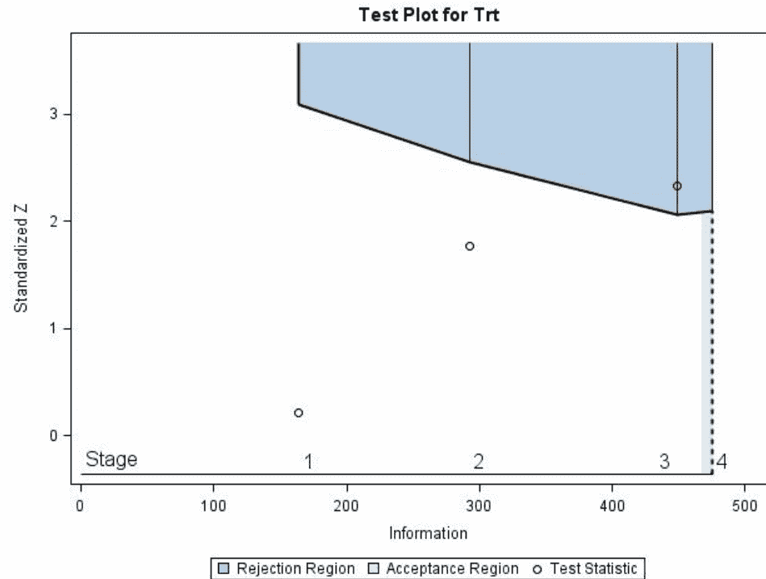

### 示例代码 3.7 基于信息的监控——四阶段设计

```sas
%macro monitor(dat=estimate,stderr,Stage,tit,Boundary,Parms,test=);

  data_params &dat;

  Parameter="Trt";
```

```sas
Estimate=&estimate;

Stderr=&stdderr;

_Scale="mle";n_Stage="&stage;

Run;
```

```sas
proc seqtest Boundary=&boundary

Parms(TestVar=Trt)=&parms

infoadj=prop errspendmin=0.001

boundariescale=stdz errspend

ods output Test=&test;

run;

%end monitor;
```

```sas
%monitor(dat=count1,estimate=0.0167,stderr=0.0781,Stage=1,

Boundary=Bnd_Count,parms=Parms_Count1,test=Test_Count1);

%monitor(dat=count2,estimate=0.01030,stderr=0.0585,Stage=2,

Boundary=Test_Count1,parms=Parms_Count2,test=Test_Count2);

%monitor(dat=count3,estimate=0.11000,stderr=0.0472,Stage=3,

Boundary=Test_Count2,parms=Parms_Count3,test=Test_Count3);
```


## 3.5 总结与结论

本章介绍了针对正态分布数据的若干种不同的盲和非盲样本量估计算方法。回顾的盲法方法包括单样本方差法和调整后的单样本方差法。非盲 SSR 方法包括 Fisher 组合检验、逆正态法、CHW 程序、前景区域设计（promising zone design）以及条件 I 型错误保护程序（Proscan 和 Hansberger, Müller 和 Schäfer）。除了前景区域以及 Müller 和 Schäfer 过程外，所有其他非盲方法都可以被视为组合检验的特殊形式。

在二项分布渐近正态分布的情况下，这些程序可以扩展到基于该近似的二分类终点情况。在必须使用精确二项分布的情况下，SSR 问题变得更加复杂，本章未对此进行研究。

除了前景区域和 Proscan 及 Hansberger 方法外，回顾的非盲 SSR 方法均基于以下假设：样本量调整是中期分析时唯一需要做的决策（即关注每种方法下的 SSR 概念）。在实践中，由于效用或有效性的提前停止等决策伴随着 SSR。对于更多现实情况，本节介绍的方法仍然具有普遍适用性，但需要调整 I 型和 II 型错误率的计算以反映提前停止的机会。

当设计包含提前因有效性停止的机会时，保持整体 I 型错误率的需求是被广泛接受的。由于效用导致的提前停止则更为微妙。众所周知，出于效用的停止可以降低假阳性率，使得在最终分析时可以使用更高的显著性水平，同时将整体 I 型错误率维持在理想水平上 [38]。虽然后者在理论上是合理的，但监管机构不愿意接受由于计划的中期无效分析而导致最终分析中使用更高的显著性水平，因为无效性规则没有约束力，且申办方可能不会对其进行严谨执行。

许多描述非盲 SSR 方法论的原始手稿仅关注 I 型错误控制，因为这是监管机构最关注的话题（至少在确证性试验的环境中）。在考虑 SSR 时，不仅要处理 I 型错误控制，还要处理选择新样本量的规则以及在试验结束时估计治疗效应的规则。我们没有在本章中详细讨论这些问题。以下概述了一些通用的考虑因素。

**样本量**。前景区域设计外，用户可以自由选择重新估计样本量的方法。通常接受基于条件功效（类似于前景区域设计）来修订样本量。尽管在理论上样本量 `$M$` 不需要受到限制，但在实践中，大多数采用非盲 SSR 的试验对样本量增加设有上限。选择最大允许样本量（MASS）的竞争力量是显而易见的。为了最大化试验成功率（纯从统计功效角度考虑），我们会选择尽可能大的 MASS 值。这可能会导致成本和持续时间增加，并带来在临床无意义差异上获得统计学显著性的风险。另一方面，选择过小的 MASS 值可能使 SSR 的努力徒劳，因为在出现偏离原始样本量假设的情况下，功效将无法维持。作为统计学家，我们需要确保所选 MASS 值足够大，以确保 SSR 计划的有效性，同时考虑到对试验操作和解释的影响。

**估计**。在两阶段设计中，第一阶段和第二阶段的朴素估计是无偏的。但由于第二阶段的样本量是使用第一阶段数据决定的，因此两个阶段的朴素估计方法会产生偏倚 [39]。非盲 SSR 试验后的最终推理仍然是一个活跃的研究领域。某些方法存在解析解，而对于其他方法，模拟是量化偏倚的唯一途径，由于这些原因，作者未尝试对估计方法进行全面综述。前景区域设计外，对于大多数正态终点方法，治疗效应估计通常通过依赖置信区间与假设检验之间的对偶性完成。Barnath 及其合作者 [19] 将 [20] 的重复置信区间扩展到了灵活设计。前景区域设计与其他方法脱颖而出，因为它规定了它的条件，且不需要用户在最终分析中修改检验统计量或拒绝域。后者具有迷人的简单性特征。例如，可以使用标准的 Wald 统计量进行最终推理。所有必须做的相关决策都“有机地构建在前景区域设计中”，包括新样本量的选择规则和提前效用/有效性停止边界 [3]。我们通常推荐前景区域设计，但带有一句警告：由于上述的简单性特征，假设检验与置信区间之间的对偶性消失了，此类试验结束时的治疗效应估计仍是一个未解决的问题。对于实施前景区域设计的试验，我们建议根据具体情况使用模拟法仔细评估试验结束治疗效应估计的偏倚程度。

# 参考文献

- 1. 美国食品食品药品管理局 (2010). 行业指导原则草案：药物和生物剂的适应性设计临床试验。可用于：`http://www.fda.gov/downloads/Drugs/GuidanceCompliance`
- 2. Dragalin V. (2006). 适应性设计：术语与分类。Drug Information Journal 40: 425–355.
- 3. Mehta CR & Pocock SJ. (2011). 中期结果良好时样本量的自适应增加：一个带有示例的实用指南。Statistics in Medicine。
- 4. Chuang-Stein C, Anderson K, Gallo P & Collins S. (2006). 样本量重新估计：回顾与建议。Drug Information Journal 40: 475–484.
- 5. Kieser M & Friede T. (2003). 不影响第一类错误率的盲样本量调整简单方法。Statistics in Medicine 22: 3571–3581.
- 6. Zucker DM, Wittes JT, Schabenberger O & Britain E. (1999). 内部池 II：各种程序的比较。Statistics in Medicine 18: 3493–3509.
- 7. Gould AL & Shih WJ. (1992). 方差未知的正态分布结果的非揭盲状态下样本量重新估计。Communications in Statistics - Theory and Methods: 21: 2833–2853.
- 8. Xing B & Ganju J. (2005). 一种从正在进行的盲试验中估计终点的方法。Statistics in Medicine 24: 1807–1814.
- 9. Chen M & Kianif F. (2003). 临床试验中盲数据的治疗差异和标准差的估计。Biometrical Journal 2003 2: 135-142.
- 10. Friede T & Kieser M. (2002). 论基于 EM 算法的方法在盲样本量重新估计中的不恰性。*Statistics in Medicine* 21: 165-176.
- 11. Gould AL & Shih WJ. (2005). 关于 T Friede & M Kieser M 的基于 EM 算法的盲样本量重新估计方法的不恰性。*Statistics in Medicine* 24: 147–154.
- 12. Friede T & Kieser M. (2005). 作者回复。*Statistics in Medicine* 24: 154–156.
- 13. Gould AL. (1992). 不实质性影响第一类错误率的临床试验监测中期分析。*Statistics in Medicine* 11: 55-66.
- 14. Gould AL. (1995). 试验样本量的规划与重新审视。Statistics in Medicine* 14: 1039-1051.
- 15. Friede T, Mitchell C & Müller-Velten G. (2007). 二元终点非劣效试验中的盲样本量调整。*Biometrical Journal* 49: 903-916.
- 16. Shih WJ & Zhao PL. (1997). 二元结局双盲临床试验的基于中期数据的样本量重新估计设计。Statistics in Medicine* 16: 1913-1923.
- 17. Gaydos B, Anderson KM, Berry D, Burnham N, Chuang-Stein C, Dudinak J, Fardipour P, Gallo P, Givens S, Lewis R, Maca J, Pinheiro J, Pritchett Y & Krams M. (2009). 药物产品开发中适应性临床试验的良好实践。*Drug Information Journal* 43: 539–556.
- 18. Antonijijev Z, Gallo P, Chuang-Stein C, Dragalin V, Loewy J, Menon S, Miller ER, Morgan CC & Sanchez M. (2013). 关于适应性试验数据监测委员会的出现问题的观点。*Therapeutic Innovation & Regulatory Science* 47: 495-502.
- 19. Brannath W, Konig F & Bauer P. (2006). 灵活两阶段设计中的估计。Statistics in Medicine 25: 3366–3381.
- 20. Jennison C & Turnbull BW. (1984). 组序试验的重复置信区间。*Controlled Clinical Trials* 5: 33–45.
- 21. Posch M, Bauer P & Brannath P. (2003). 灵活试验设计中的问题。Statistics in Medicine 22: 953–969.
- 22. Cui L, Hung HM & Wang SJ. (1999). 组序试验中样本量的修改。*Biometrics* 55: 853–857.
- 23. Proschan MA & Hunsberger SA. (1995). 基于条件功效的研究扩展。*Biometrics* 51: 1315–1324.
- 24. Müller HH & Schäfer H. (2004). 试验期间改变设计的通用统计原理。Statistics in Medicine 23: 2497–2508.
- 25. Bauer P & Kohne K. (1994). 带有中期分析的实验评估。Biometrics 50: 1029–1041.
- 26. Burman CF & Lisovskaja V. (2010). 适应性设计的双重检验 p 值合并。Statistics in Medicine 29: 797–807.
- 27. Gao P, Ware JH & Mehta C. (2008). 临床试验中适应性组序设计的样本量重新估计。Journal of Biopharmaceutical Statistics 18: 1184-1196.
- 28. Chen YH, DeMets DL & Lan KK. (2004). 中期结果良好时增加样本量。Statistics in Medicine 23: 1023–1038.
- 29. Bauer P. (1989). 适应性多阶段检验。Biometrie und Informatik in Medizin und Biologie 20: 130–148.
- 30. Lehmacher W & Wassmer G. (1999). 组序试验中的适应性样本量计算。Biometrics 55: 1286–1290.
- 31. Hwang IK, Shih WJ & DeCani JS. (1990). 使用第一类概率族进行组序设计。Statistics in Medicine 9: 1439-1445.
- 32. O'Brien PC & Fleming TR. (1979). 临床试验的多重检验程序。Biometrics 35: 549-556.
- 33. Hong W, Ellenberg S & Anderson K. (2015). 逐步两阶段样本量调整。Statistics in Medicine 34: 27-38.
- 34. Anderson KM, Chan ISF & Li X. (2012). 发病率未知时病例驱动的疫苗效力研究适应性设计。Statistics and Its Interface 5: 391-399.
- 35. Lan KKG & Zucker D. (1993). 临床试验的序贯监测。信息和布朗运动的作用。Statistics in Medicine 12: 753–765.
- 36. Mehta CR & Tsiatis AA. (2001). 基于信息的中期监测的灵活样本量考虑。Drug Information Journal 35: 1095–1112.
- 37. Tsiatis AA. (2006). 基于信息的临床试验监测。Statistics in Medicine 25: 3236–3244.
- 38. Chang W & Chang-Stein C. (2004). 带有一次中期分析试验中的第一类错误和功效。Pharmaceutical Statistics 3:51-59.
- 39. Liu Q, Proschan AA & Ledger GW. (2002). 两阶段适应性设计的统一理论。Journal of the American Association 97: 1034–1041.

# 作者

Inna Perevozovskaya, 高总监，辉瑞公司生物统计学研究与咨询中心，美国宾夕法尼亚州学院维尔。

Sandeep Menon, 副总裁，辉瑞公司统计研究与咨询中心负责人，美国马诸诸州剑桥。

## 第 4 章：使用历史数据的贝叶斯生存 Meta 实验设计

- 4.1 引言
- 4.2 Meta 设计设置
- 4.3 Meta 回归生存模型
- 4.4 贝叶斯 Meta 实验设计
- 4.5 先验分布的规范
- 4.6 计算算法
- 4.7 SAS 宏 BSMED
- 4.8 总结
- 参考文献
- 作者
- 附录

## 4.1 引言

一个典型的药物开发计划可能由多个不同研究目标、终点以及可能不同的患者人群的临床研究组成。关于单试验的贝叶斯样本量确定有丰富的文献 [1-8]。Sutton 等人提出了一种混合频率派-贝叶斯的方法，用于通过 Meta 分析的结果确定未来随机临床试验 (RCT) 的样本量，并建议功效很大程度上依赖于所使用的统计模型，而且当存在显著的研究间异性时，即使是大型研究对 Meta 分析的影响也可能很小 [9]。这引发了关于如何在统计模型中适当考虑研究间异性的关键问题。近期，开发了一种用于生存模型的贝叶斯 Meta 分析方法，用于规划 II 期/III 期药物开发计划 [10-12]。他们的方法通过考虑研究间异性，关注在计划层面的样本量确定和功效。作者们考虑了 Wang & Gelfand 的拟合和采样先验，用于设计关注控制类型错误和功效的贝叶斯 Meta 分析临床试验。他们的方法允许通过 Ibrahim 和 Chen 的功效先验 [13] 整合历史数据。

基于工作 [10-12]，本章的目标是将他们提出的方法通用且新颖地实现易于使用的 SAS 宏，称为 `BSMED`，用于使用历史 Meta 生存数据的贝叶斯生存实验设计。在 SAS 宏的开发过程中，我们扩展了 [10-12] 用于整合历史数据的模型和方法论。我们注意到，在 [10-12] 中，假设历史数据仅来自以前研究的对照组。如第 4.2、4.3 和 4.5 节详述以及第 4.7 节所示，SAS 宏 `BSMED` 允许整合各种类型的历史 Meta 生存数据，包括仅来自对照组的、仅来自实验组的、来自对照组和实验组的历史 Meta 生存数据，或以前研究中这类型的混合 Meta 生存数据。此外，SAS 宏 `BSMED` 允许用户输入各种随机控制组与实验组之间的比例、跨随访时间的各种招募时间，以及不同研究之间不同的年化事件率。此外，SAS 宏 `BSMED` 允许将当前试验的数据与来自一个或多个之前试验的历史数据结合。因此，该宏可用于非元分析设置下的贝叶斯生存时间临床试验设计。最后，我们扩展了 [6, 10] 中讨论的计算算法，通过纳入试验时长、招募时间和最小随访时间来生成预测生存数据。

本章其余部分的安排如下：4.2 元设计设置（Meta Design Setting）介绍了通用的元实验设计设置。4.3 元回归生存模型（Meta-Regression Survival Models）讨论了元回归生存模型。4.4 贝叶斯元实验设计（Bayesian Meta-Experimental Design）概述了贝叶斯元实验设计的方法论。4.5 先验分布的设定（Specification of Prior Distributions）对对先验分布的设定进行了详细讨论。4.6 计算算法（Computational Algorithms）介绍了计算算法。4.7 SAS MACRO BSMED 对 SAS 宏 BSMED 进行了详细描述和几个示例说明。我们在 4.8 总结（Summary）中通过讨论来结束本章。

## 4.2 元设计设置

### 4.2.1 符号

我们考虑 `K` 个随机试验，每个试验有两个治疗组，分别表示为控制组和实验组，且 `K >= 1`。控制组可以是安慰剂或活性对照，而实验组在临床试验设置中可能是研究药物。然而，在医疗器械应用中，控制组可能是旧一代医疗设备，实验组可能指新一代医疗设备。为了方便表述，我们通地将这两组称为控制组和实验组。

令 `n_{jk}` 表示第 `k` 个随机试验中第 `j` 个治疗组的样本量，其中 `j=1` 和 `j=2` 分别表示控制组和实验组，`k=1, ..., K`。我们写下 `n_k = n_{1k} + n_{2k}`，表示第 `k` 个随机试验的总样本量。我们还让 `p_k` 和 `r_k` 分别表示第 `k=1, ..., K` 个试验中控制组的受者比例和年化事件率。控制组受者比例在分配样本量到控制组和实验组时起着作用。使用该量，我们有 `n_{k} = [p_k n_k]` 和 `n_{kk} = n_k - n_{k}`，其中 `[p_k n_k]` 是小于或等于 `p_k n_k` 的最大整数。年化事件率是事件在一年内发生的预设概率。它还用于指定 4.6 计算算法中讨论的采样先验中平均生存时间的设计值。最后，我们让 `τ_k^A` 和 `τ_k^F` 分别表示 `k=1, ..., K` 个试验的招募时间和最小随访时间。

### 4.2.2 元试验设计变量的输入数据

《双臂元试验的通用设计》（General Design of Meta-Trials with Two Arms）展示了上一节介绍的 `K` 个双臂随机试验的通用生存元实验设计设置。从表 4.1 中，我们看到输入数据包含每个试验的试验 ID (`TID`)、总样本量 (`n`)、控制组比例 (`ρ`)、控制组的年化事件率 (`r`)、试验时长 (`TD`) 和招募时间 (`TA`)。利用试验时长与招募时间之间的关系，我们计算每个试验的最小随访时间 (`TF`)，即 `TF_k = TD_k - TA_k`。我们注意到，这些输入数据用于生成 4.6 计算算法中讨论的预测数据。从 4.6 计算算法中提出的先验预测数据算法，我们对 `TD_k >= 0`、`TF_k >= 0`、`TD_k >= TF_k` 和 `TD_k > TA_k` 施约束。(4.1)

在 (4.1) 中，如果所有受者都在试验开始时加入试验；如果 `TF_k=0`，则没有最小随访要求；如果 `TD_k <= TF_k + TA_k`，则受者在加入试验后，在整个试验期间都接受随访。此外，运行 4.7 节讨论的 SAS 宏 `BSMED` 还需要：研究数量 (`K`)、MCMC 样本数 (`NMCS`)、烧入样本数 (`nbi`)、模拟数据集数量 (`REP`)、设计裕量 (`ϱ`) 以及用户定义的贝叶斯置信水平 (`n_0`) 作为输入变量。

#### 表 4.1 双臂元试验的通用设计

| 试验 ID (TID) | 样本量 (`n`) | 控制组比例 (`ρ`) | 年化事件率 (`r`) | 试验时长 (TD) | 招募时间 (TA) |
| :--- | :--- | :--- | :--- | :--- | :--- |
| 1 | `n_1` | `ρ_1` | `r_1` | `TD_1^A` | `TA_1^A` |
| 2 | `n_2` | `ρ_2` | `r_2` | `TD_2^A` | `TA_2^A` |
| ... | ... | ... | ... | ... | ... |
| `K` | `n_k` | `ρ_k` | `r_k` | `TD_k^A` | `TA_k^A` |

### 4.2.3 输入数据

假设从 `K_0` 个之前的试验中获得了控制组和实验组的历史数据。对于历史数据，我们定义：
`x_{0k} = { 1, 如果 y_{0k} <= n_{0k} ; 0, 否则 }`
其中 `x_{0k} in {0,1}` 表示历史数据仅对控制组可用。如果 `k=1,...,K_0` 时 `x_{0k}=1`，则历史数据对两组可用。例如，如果 `k=1,...,K_0` 时 `x_{0k}=0`，则历史数据仅对控制组可用。在此设置下，我们令 `y_{0k} = (y_{0k1},y_{0k2})` 表示事件总数。

#### 表 4.2 单臂数据类型

| 试验 ID (TID) | 类型 I (控制组) | 类型 II (实验组) |
| :--- | :--- | :--- |
| 1 | `y_{01}`, `v_{01}`, `x_{01}` | |
| 2 | `y_{02}`, `v_{02}`, `x_{02}` | |
| ... | ... | ... |
| `K_0` | `y_{0K_0}`, `v_{0K_0}`, `x_{0K_0}` | |

#### 表 4.3 多臂数据类型

| 试验 ID (TID) | 类型 III (两组均) | 类型 IV (两组混合) |
| :--- | :--- | :--- |
| 1 | `y_{01}`, `v_{01}`, `x_{01}=(0,1)` | |
| 2 | `y_{02}`, `v_{02}`, `x_{02}=(0,1)` | |
| ... | ... | ... |
| `K_0` | `y_{0K_0}`, `v_{0K_0}`, `x_{0K_0}=(0,1)` | |

## 4.3 元回归生存模型

### 4.3.1 未来生存数据模型

在本节中，我们讨论在 4.2 节讨论的通用生存实验设计下的元回归生存模型。令 `y_{jk}` 表示个体水平的事件时间（失效时间），`v_{jk}` 表示右删断指示，其中当 `y_{jk}` 为失效时间时 `v_{jk}=1`，当 `y_{jk}` 被右删断时 `v_{jk}=0`，对于第 `j` 组的第 `k` 次试验，`i=1, ..., n_{jk}, j=2, ..., K`。我们写 `hat{y}_{jk}= sum_{i=1}^{n_{jk}} y_{ijk} / sum_{i=1}^{n_{jk}} v_{ijk}` 分别表示总持续时长和总受人数。对于 `j=1`（控制组）令 `x_{jk}=0`，对于 `j=2`（实验组）。我们观测到的元生存数据表示为 `D_K={y_{jk}, v_{jk}, x_{jk}}, j=2, ..., K`。

进一步假设个体水平的失效时间服从均值为 `1/λ_{jk}` 的指数分布，`Y_{jk} ~ Exp(λ_{jk})`，其中 `λ_{jk}>0` 是风险率。`Y_{jk}|v_{jk}` 的密度函数为

`f(y_{jk}|λ_{jk})=λ_{jk}e^{-λ_{jk}y_{jk}}`. (4.2)

对于 `λ_{jk}` 的对数线性模型假设

`log(λ_{jk})=γ_0+γ_1x_{jk}+θ_k`. (4.3)

其中对于 `j=1`（控制组）`x_{jk}=0`，对于 `j=2`（实验组）`x_{jk}=1`，为了确保 (4.2) 中模型的可识别性，我们引入约束 `sum_{k=1}^K θ_k=0`。为了简单起见，取 `θ_K=-sum_{k=1}^{K-1}θ_k`。注意，在指数模型下，设计参数 `γ_1` 是实验组治疗的风险比。令 `θ={θ_1,...,θ_K}` 且 `γ=(γ_0,γ_1)`。则基于元生存数据 `D_K` 的似然函数为

`L(γ,θ|D_K)=prod_{k=1}^K prod_{j=1}^2 exp{ y_{jk}(γ_0+γ_1x_{jk}+θ_k) } exp{ -(γ_0+γ_1x_{jk}+θ_k) y_{jk} }`. (4.4)

在 (4.4) 中，我们看到似然函数依赖样本量 `n_{jk}`。这意味着在指数模型下，基于个体水平元实验数据的似然函数简化为基于治疗水平元实验数据的似然函数。

### 4.3.2 历史生存数据模型

在本节中，我们考虑 4.2.3 节讨论的不同类型历史数据的元回归生存模型。假设 `y_{jk}` 是总时长，`v_{jk}` 是删断指示，其中当 `y_{jk}` 为失效时间时 `v_{jk}=1`，当 `y_{jk}` 被删断时 `v_{jk}=0`，对于第 `k` 次试验，`j=1, ..., K_0`。此外，如果 `x_{jk}` 是标量，则代表一个组（控制组或实验组），如果是向量则代表两个组，如 4.2.3 节所述。假设从 `K_0` 项历史研究中获得试验水平汇总数据 `D_k={y_{jk}, v_{jk}, x_{jk}}, k=1, ..., K_0`。假设个体失效时间服从指数分布 `Exp(λ_{jk})`，其中风险率 `λ_{jk} > 0`。则模型假设

`log(λ_{jk}) = γ_0 + γ_1(j-1) + θ_k` (4.5)

对于 `x_{0k} <= j-1 <= x_{2k}, k=1, ..., K_0`，假设历史数据仅来自控制组。这是 4.2.3 节讨论的第一类历史数据，很容易看出在这种情况下 `x_{0k}=0`。那么历史数据与当前数据的模型仅共享一个公共参数，即 `γ_0`。然而，如果历史数据仅来自实验组（即第二类历史数据），则 `x_{0k}=1`，历史数据与当前数据的模型共享一个复合参数 `γ_0+γ_1`。现在我们考虑第三类数据，即历史数据适用于两个组。在这种情况下，历史数据与当前数据的模型共享两个公共参数 `γ_0` 和 `γ_1`。数据的似然函数为

`L(γ,θ|D_K)=prod_{k=1}^K prod_{j=x_{0k}}^{x_{2k}} exp{ y_{jk}(γ_0+γ_1x_{jk}+θ_k) } exp{ -(γ_0+γ_1x_{jk}+θ_k) y_{jk} }`. (4.6)

## 4.4 贝叶斯实验设计

在本节中，我们介绍贝叶斯实验设计的通用方法。我们首先定义非劣性假设，其表述为：

`H_0: e^{γ_1} >= ζ` 于 `H_1: e^{γ_1} < ζ` (4.7)

其中 `e^{γ_1}` 是风险比，`ζ` 是非劣性边界。令 `[γ, θ]` 表示参数集合。参考文献，令 `π^{(S)}[γ, θ]` 和 `π^{(F)}[γ, θ]` 分别表示采样先验和拟合先验。采样先验的作用是捕捉参数空间的一部分。利用数据 `D_K`，`[γ, θ]` 的后验分布为

`π[γ, θ|D_K] ∝ prod_{k=1}^K prod_{j=1}^2 exp{ y_{jk}(γ_0+γ_1x_{jk}+θ_k) } exp{ -(γ_0+γ_1x_{jk}+θ_k) y_{jk} } π^{(F)}[γ, θ]`. (4.8)

为了完成贝叶斯实验设计，我们需要指定两个适当的采样先验 `π_0^{(s)}[γ, θ]` 和 `π_1^{(s)}[γ, θ]`，它们定义在由假设 `H_0` 和 `H_1` 导出的参数空间子上。我们定义关键量为

`β_{sl}^{(n)} = E_{sl}[ 1{ P(e^{γ_1} < δ D_K, π^{(f)}) >= η_0 } ],` (4.9)

其中指示函数 `1_A` 在 `A` 为真时为1，否则为 0，`0 < η_0 < 1` 是预设的贝叶斯信性水平，后验概率 `P(e^{γ_1} < δ D_K, π^{(f)})` 是相对于数据 `D_K` 的 `γ_1` 后验分布计算的，期望 `E_{sl}` 是相对于采样先验 `π_l^{(s)}[γ, θ]` (`l=0,1`) 下 `D_K` 的预测边缘分布取值的。

## 4.5 先验分布的规范

### 4.5.1 拟合先验

我们将 (4.8) 中的拟合先验扩展到 [6] 和 [10] 中正式提出的部分借用功效（partial borrowing power）先验方法。部分借用先验是指历史数据仅通过模型中历史数据与当前数据共享的参数进行借用。因此，历史数据的强度仅通过共同参数借用。在 (4.3) 元回归生存模型下，`(γ, θ)` 的拟合先验为：
```


$\pi^{(f)}(\gamma, \theta|D_0, a_0) \propto \prod_{j=1}^{K_0} \pi_{j=0}^{K_k}(\exp\{ij_j+l_k(\gamma_0 + \gamma_1 + \theta_k)\}) \times \exp\{-(\gamma_0 + \gamma_1 + \theta_k)/a_0+l_k\} \pi_0^{(f)}(\theta_0)d\theta_0 \pi_0^{(f)}(\gamma, \theta).$ (4.10)

其中 $0 \le a_0 \le 1$，$\pi_0^{(f)}(\theta_0)$ 和 $\pi_0^{(f)}(\gamma)$ 是初始先验。在 (4.10) 中，假设 $\gamma_0, \gamma_1, \theta_k$ 和 $\gamma_k$ 服从独立的初始先验 $N(0,\sigma_{\theta_0}^2)$、$N(0,\sigma_{\gamma}^2)$、$N(0,\tau_{\theta_k}^2)$ 和 $N(0,\tau_{\gamma}^2)$。

在 (4.10) 中，参数 $a_0$ 控制历史元序列数据 $D_0$ 对当前数据 $D_K$ 的影响。参数 $a_0$ 可以解释为历史元生存数据的折减参数。将 $a_0$ 的范围限制在 0 到 1 之间是合理的，因此我们取 $0 \le a_0 \le 1$$a_0$ 的主要作用之一是控制模型中 $\gamma_0$ 和 $\gamma_1$ 先验的尾部厚度。随着 $a_0$ 变小，(4.10) 的尾部变得更厚。如果 $a_0=0$，先验不依赖于历史元生存数据。也就是说，$a_0=0$ 等于于为当前研究纳入任何历史元生存数据的先验规范。因此，参数 $a_0$ 控制历史元生存数据对当前研究的影响。当历史与当前元生存数据之间存在异质性，或者历史与当前元生存数据的样本量差异时，这种控制是非常关重要的。

在 (4.10) 中，我们倾向于考虑固定的 $a_0$。当 $a_0$ 固定时，我们确切知道新的元实验中纳入了多少历史元数据，以及第一类错误和统计功效与 $a_0$ 之间的关系。如 4.7 模拟研究中的 SAS MACRO BSMED 所示，固定的 $a_0$ 为我们控制第一类错误提供了额外的灵活性。此外，我们的信息先验规范仅允许我们为历史数据和当前数据的模型借用历史元实验数据。因此，历史元实验数据对 $\gamma_0$ 和 $\gamma_1$ 的影响最大。出于这个原因，[6] 和 [10] 将 (4.10) 给出的功效先验称为“部分借用功效先验”。

### 4.5.2 采样先验

现在，我们转向指定采样先验。在 (4.3) 提出的模型下，我们采用采样先验：

$\pi^{(S)}[\gamma, \theta_l] \propto \alpha^{(S)}(\gamma_0) \pi^{(S)}(\theta_l) \pi_l^{(S)}(\gamma_1)$ 对于 $l=0,1$。在采样先验中，我们首先为 $\gamma_1$ 指定点先验 $\pi^{(S)}(\gamma_1) = \Delta\{\gamma_1=\log(\zeta)\}$ 对于 $l=0$，以及

$\pi^{(S)}(\gamma_1) = \Delta\{\gamma_1=0\}$ 对于 $l=1$，其中 $\Delta\{\gamma_1=\gamma_1^*\}$ 表示 $\gamma_1=\gamma_1^*$ 处的退化分布。然后我们还为 $\pi^{(S)}(\gamma_0)$ 和 $\pi^{(S)}(\theta_0)$ 指定点先验。注意，设计值 $\{\gamma_0, \theta_0\}$ 是通过求解以下方程得到的：

$1-\exp\{\gamma_0+\theta_k\}=r_k$ 和 $\sum_{k=1}^K\theta_k=0$，

其中 $r_k$ 是预定的年发生率。如 4.7 SAS MACRO BSMED 示例，我们假设研究数量 $K=9$，年发生率为 $r_k=0.12$ 对于 $k=1..8$，且 $r_g=0.15$。然后通过求解上述方程，我们得到 $\gamma_0=-4.32, \theta_k=-0.25$ 对于 $k=1..8$，以及 $\theta_g$。因此我们可以根据设计值指定点先验。

## 4.6 算法

### 4.6.1 预测数据生成

在本节中，我们扩展了 [6] 和 [10] 中的算法，通过引入 4.2 中讨论的试验时长 $\hat{T}_k^D$ 和入组时间 $\hat{\tau}_k^A$ 来生成先验生存数据。具体而言，除了采样先验 $\pi^{(S)}(\gamma, \theta)$ 之外，我们还使用 $\hat{D}_k$ 和 $\hat{\tau}_k^A$ 构建预测生存数据 $D_K$ 中的截断时间。我们的预测数据算法如下：

- 1. 生成 `{\gamma, \theta} \sim \pi^{(S)}(\gamma, \theta)`。
- 2. 对于 `i=1..n_{jk}, j=1..2, k=1..K`，独立生成 `Y_{ijk} \sim f(Y_{ijk}|\theta, x_{ijk})`。
- 3. 如果 `\hat{\tau}_k^A=0`，则设置 `\tau_{ijk}^*=0`；如果 `\hat{\tau}_k^A>0`，则独立生成入组时间 `\tau_{ijk}^*=U(0, \hat{\tau}_k^A)` 对于 `i=1..n_{jk}, j=1..2, k=1..K`。
- 4. 对于 `i=1..n_{jk}, j=1..2, k=1..K`，设置 `C_{ijk}^*=\hat{\tau}_k^D-\hat{\tau}_k^A`。
- 5. 对于 `i=1..n_{jk}, j=1..2, k=1..K`，计算 `y_{jk}=\sum_{i=1}^{n_{jk}}\min(Y_{ijk}, C_{ijk}^*)` 和 `v_{jk}=\sum_{i=1}^{n_{jk}}1\{Y_{ijk} \le \tau_{ijk}^*\}`，其中指示函数 `1\{Y_{ijk} \le \tau_{ijk}^*\}` 在 `Y_{ijk} \le \tau_{ijk}^*` 时为 1，否则为 0。
- 6. 对于 `j=1..2, k=1..K`，设置 `D_K=\{y_{jk}, v_{jk}, x_{ijk}\}`。

### 4.6.2 后验分布采样

在模型 (4.3) 下，利用 (4.4) 和 (4.10)，$(\gamma, \theta_D, \theta_0)$ 的后验分布为：

$\pi(\gamma, \theta_D, \theta_0 | D_K, D_0) \propto \prod_{k=1}^K \prod_{j=1}^2 \exp\{v_{jk}(\gamma_0 + \gamma_1 x_{jk} + \theta_k) - (\gamma_0 + \gamma_1 x_{jk} + \theta_k)v_{jk}\} \times \prod_{k=1}^K \prod_{j=1}^2 (\exp\{y_{0,j} + l_k(\gamma_0 + \gamma_1 + \theta_k)\})^{\theta_0} \pi_0^{(f)}(\theta_0)\pi_0^{(f)}(\gamma)。 (4.11)$

我们使用 Gibbs 采样从给定 $D_K$ 和 $D_0$ 的 (4.11) 后验分布中采样。Gibbs 采样要求在给定其他参数的情况下，从每个参数的全条件分布中采样。首先，`[\gamma | \theta_D, \theta_0, D_K, D_0]` 的全条件密度为：

$\pi(\gamma | \theta_D, \theta_0, D_K, D_0) \propto \prod_{k=1}^K \prod_{j=1}^2 \exp\{v_{jk}(\gamma_0 + \gamma_1 x_{jk} + \theta_k) - (\gamma_0 + \gamma_1 x_{jk} + \theta_k)v_{jk}\} \times \prod_{k=1}^K \prod_{j=1}^2 (\exp\{y_{0,j} + l_k(\gamma_0 + \gamma_1 + \theta_k)\})^{\theta_0} \exp\{-\frac{1}{2} \gamma^T \Sigma_{\gamma}^{-1} \gamma\}, (4.12)$

其中 $\Sigma_{\gamma} = \text{diag}(\sigma_0^2, \sigma_f^2)$ 表示 $\gamma$ 的 $2 \times 2$ 协方差矩阵。

`[\theta_0 | \theta_D, D_0, a_0]` 的全条件密度为：

$\pi(\theta_0 | \theta_D, D_0, a_0) \propto \prod_{k=1}^K \prod_{j=1}^2 (\exp\{y_{0,j} + l_k(\gamma_0 + \gamma_1 + \theta_k)\})^{\theta_0} \exp\{-exp[\gamma_0 + \gamma_1 j + \theta_k]y_{j}]^{\theta_0}\} \exp\{-\frac{1}{2}\theta_0^T \Sigma_{\theta_0} \theta_0\}, (4.13)$

其中 $\Sigma_{\theta_0} = \sigma_0^2/K_0$ 表示 $\theta_0$ 的 $K_0 \times K_0$ 协方差矩阵。

很容易证明 (4.11) 到 (4.13) 中的全条件分布在每个参数上都是对数凹的。因此，我们可以实现 [15] 中的自适应拒绝算法，从 `[\gamma, \theta, \theta_0]` 的后验分布中采样。

### 4.6.3 功效计算

我们讨论了如何计算 [6] 中讨论的第一类错误和功效（power）。令 $n_0$ 和 $a_0$ 分别表示历史元实验生存数据的预设贝叶斯置信水平和折减参数。我们还令 `{\gamma^{(m)},  m=1, \dots, NMCS}` 表示来自后验分布 `\pi(\gamma, \theta_{D_K}, D_0, a_0)` 的 `\gamma_1` 的 Gibbs 样本，其中 `NMCS` 是 Gibbs 样本的量。使用该 Gibbs 样本，我们得到 `P(e^{\gamma_1} < \delta_{\pi^{(f)}})` 的蒙特卡洛估计值：

```
$$\hat{P}_f = \frac{1}{NMCS} \sum_{m=1}^{NMCS} I(e^{\gamma_1^{(m)}} < \delta), \quad (4.14)$$
```

其中 `\pi^{(f)}` 是拟合先验。为了同时计算贝叶斯第一类错误和公式 (4.9) 中的 `\beta_{sl}^{(f)}`，我们使用以下计算算法：

- 1. 设置 `l=0` 并输入 `D, D_0, n_0, \varsigma, a_0, NMCS, nbi,` 和 `REP`。
- 2. 为 `s=0,1` 生成 `{(\gamma, \theta)-\pi^{(s)}}(\gamma, \theta)`。
- 3. 通过 4.6.1 节中的预测数据生成算法生成 `D_K`。
- 4. 运行 Gibbs 采样器从后验分布 `\pi(\gamma, \theta_{D_K}, D_0, a_0)` 生成大小为 `NMCS` 的 Gibbs 样本 `{\gamma_1^{(m)}, m=1, \dots, NMCS}`。
- 5. 计算 `\hat{P}_f` 并重复步骤 2 到 5 共 `REP` 次。
- 6. 在这 `REP` 次运行中，计算 `{\hat{P}_f \geq 0.90},{\hat{P}_f \geq 0.95}` 和 `{\hat{P}_f \geq 0.975}`（默认选项）的比例以及 `{\hat{P}_f \geq n_0}`（用户选择）的比例，从而给出 `\beta_{sl}^{(n)}` 的估计值。
- 7. 如果 `|x|=1`，则返回步骤 2。

## 4.7 SAS MACRO BSMED

### 4.7.1 BSMED 的实现

#### 4.7.1.1 详细宏选项

在本节中，我们介绍了用于贝叶斯生存元实验设计的 SAS 宏 `BSMED` 的细节。如 4.2 “元设计设置”所述，`BSMED` 宏需要两个输入数据集（即当前数据和历史数据（可选））、11 个输入变量以及一个输出文件（可选）。输入变量和设计值的名称与描述显示了 SAS 宏中输入变量和设计值的名称及描述。

表 4.4 输入变量和设计值的名称与描述

| 数据 | 宏中的名称 |  |
|---|---|---|
| 历史 | a0 | 折减参数 ($\alpha_0$) |
| | sigma0 | $\gamma_0$ 的初始方差 ($\sigma_0^2$) |
| | sigma1 | $\gamma_1$ 的初始方差 ($\sigma_1^2$) |
| 当前 | tau0 | $\theta_{UK}$ 的初始方差 ($\theta_{UK}^2$) |
| | tau | $\theta_K$ 的初始方差 ($\theta_K^2$) |
| 设计 | delta | 设计非劣效性边界 ($\zeta$) |
| | eta0 | 用户定义的贝叶斯置信水平 ($\eta_0$) |

在宏中，需要输入变量（包括 MCMC 运行次数 (NCMC)、模拟数据集数量 (DEP) 和预热样本数 (nbi)）来运行 MCMC 并生成预测生存数据。此外，我们还包含一个初始种子数 (SEEDGEN) 作为输入变量。输入的历史数据应使用 SAS 变量名 `\kappa, y, v,` 和 `\kappa` 分别代表试验 ID (TID)、受试者总持续时间、事件数和治疗组指示，其中 0 表示对照组，1 对应实验组。输入的当前数据需要 SAS 变量名 `K, n, p, x, TA` 和 `TD` 分别代表试验 ID、总样本量、对照组受试者比例、年化事件率、入组时间和试验时长。`BSMED` 宏的结构如下：

```
%macro BSMED(hist,curr,delta,eta0,NMCS,nbi,a0,REP,sigma0,sigmal,tau0,tau,SEEDGEN,output);
```

- 1. 生成预测生存数据
- 2. 从后验分布中采样
- 3. 计算第一类错误和功效
- 4. 预期的输出

```
%mend BSMED;
```

`BSMED` 宏不需要历史数据的输入文件。如果有历史数据，我们可以简单使用：

```
%BSMED(HIST=hist,curr=curr,delta=1.3,a0=0.10,eta0=0.96,NMCS=20000,nbi=5000,REP=5000,sigma0=
```

如果没有历史数据，我们简单使用：

```
%BSMED(CURR=curr,delta=1.3,a0=0.10,eta0=0.96,NMCS=20000,nbi=5000,REP=5000,sigma0=
```

如上述宏所示，`BSMED` 由四个主要部分组成：生成预测生存数据、运行 MCMC 从后验分布中采样、使用后验估计计算第一类错误以及产生预期的输出。在随后的子节中，我们为这些宏的主要组件提供了详细开发，除了使用 PROC REPORT 的预期输出。

### 4.7.2 预测生存数据

根据 4.6.1 描述的算法，我们在宏中简要介绍预测数据的生成。在代码 1 预测数据的第一部分显示了从采样先验生成 `\gamma_0` 和 `\gamma_1` 的 SAS 代码。对于 `s=0` 和 `s=1`，我们在原假设和备择假设下从采样先验生成 `\gamma_1`。在代码 1 预测数据的第二部分，我们利用当前数据 `i=1..n, j=2, k=1..k` 生成失效时间 `V_{ijk}` 和入组时间 `A_{ijk}` 以及计算截断时间。然后，我们计算 `j=2` 的总事件数 `(v_{jk})`。这些量是构建每个模拟集合当前数据似然函数的关键组件，通过初始种子（例如 SEED=123456789）进行数据生成以复制相同的结果。

#### 代码 1 预测生存数据的生成

```
%do s=0 to 1;

data current&;

set current_new;

gammal0=

if &s=0 then do;

gammal1=log(&delta);

else do;

gammal0=0;

end;

theta_k=

lambda=exp(gamma0+gamma1*x+theta_k);

end;

%do s=0 to 1;

do m=1 to &REP; (使用种子数作为变量)

data current_sim;

set current&;

y=0;

v=0;

call streaminit(&seed);

do i=1 to n;

yi=-log(RAND('UNIFORM'))/lambda;

if TA=0 then do;

tAI=0;

else do;

tAI=RAND('UNIFORM')*TA;

end;

ci=TD-TAI;

if yi<=ci then do;

vi=1;

time=yi;

else do;

vi=0;

time=ci;

end;

y=y+time;

v=v+vi;

end;

output;

keep K v group;

run;

%end;

%end;
```

### 4.7.1.3 运行 MCMC 从后验分布采样

示例 4.2 运行蒙特卡洛 (MCMC) 显示了如何使用部分先验从后验分布采样。我们允许用户选择参数 `\gamma_0,\theta_{jk}` 和 `\theta_k` 的初始方差。由于我们不需要打印每个模拟集合的后验估计，我们使用选项抑制 SAS 窗口中的后验估计。`ods exclude all` 选项还可以节省存储并减少计算时间。为了重现结果，我们在 PROC MCMC 中使用初始种子（例如 SEED=123456789）生成的值。


`ods graphics on;`

`ods exclude all;`

```sas
proc mcmc data=sort_new output=postout nmc=&NMCS nbi=&nbi seed=&seedmc
  MAXTUNE=30 plots=none statistics=none diagnostics=none;
```

```sas
%if (&hist= or &a0=0.00) and &a0<1.00) then %do;
  %if (&N_hist > 1 then %do;
    array theta_c[_eval(&N_hist-1)];
  end;
  %if (&N_curr > 1 then %do;
    array theta_c[_eval(&N_curr-1)];
  end;
%end;
%if (&hist= or &a0=0.00) then %do;
  %if (&N_curr > 1 then %do;
    array theta_c[_eval(&N_curr-1)];
  end;
%else %do;
  parms theta_c 0;
%end;
%end;
%end;
```

```sas
parms gamma0 gammal;
prior gamma0 ~ n(0,var=&sigma);
prior gammal ~ n(0,var=&sigma);
```

```sas
discounta0=&a0;
end;
tk=0;
%if (&hist= or &a0=0.00) and &a0>0.00) then %do;
```

为了计算 (4.7) 中的第一 I 类错误和效能，我们使用了 4.6.3 节 效能计算中讨论的算法。从宏中的代码（示例代码 4.3 计算第一 I 类错误和效能）中，我们允许用户选择贝叶斯置信水平（η）。该宏还会自动使用贝叶斯置信水平 0.90、0.95 和 0.975 作为默认选项生成结果。这部分代码展示了用于计算第一 I 类错误和效能的方法，这些值是基于 $\gamma_1$ 的后验样本，在各种贝叶斯置信水平下对应 (4.14) 中的比例。在代码中，后验估计值保存在数据表 `postout` 中，而 `phat` 是根据每个模拟数据集的后验样本计算出的满足 `exp {(m)<0}` 的比例。从数据 `outpower` 中，我们可以累加跨模拟数据集的 `phat` 值。数据表 `TypeError` 用于通过 4.6.3 节 效能计算中讨论的算法计算 (4.7) 中的第一 I 类错误。宏中的 `BayesianPower` 数据集用于计算效能。

### 示例代码 4.3 计算第一 I 类错误和效能

```sas
data indicator(keep=proportion);
  set postout;
  proportion=(exp(gamma))<;
run;

proc means data-indicator n mean noprint;
  var proportion;
  output out=outpower mean=pfhat;
run;

data outpower;
  set outpower;
  simid&m;
  keep simid pfhat;
run;

%if &m=1 %then %do;
  data proportion&s;
  set outpower;
run;
%else %do;
  data proportion&s;
  set proportion&s outpower;
run;
%end;

data TypeError;
  set proportion0;
  keep pfhat BP1 BP2 BP3 BP4;
  BP1=0;BP2=0;BP3=0;BP4=0;
  if pfhat>0.90 then BP1=1;
  if pfhat>0.95 then BP2=1;
  if pfhat>0.975 then BP3=1;
  if pfhat>&a0 then BP4=1;
run;
```

### 4.7.2 示例说明

#### 4.7.2.1 心血管风险评估

在本节中，我们说明上一节中考虑的内容。作为一个说明性示例，我们使用了设计新型 2 型糖尿病（T2DM）治疗法 II/III 期开发计划的动机案例研究。该示例更详细的设置可参见 [10,11]。

若干作者考虑了一项治疗二 型糖尿病的假设药物开发计划 [10-12]。该计划包括八项随机对照有效性优效性试验和一项大型随机心血管（CV）结局非劣效试验。对于这些传统的糖尿病 HbA1c 优效性试验，目标受试者处于低或中度心血管风险，假设年化事件率为 1.2%。另一方面，对于非劣效试验，受试者处于高风险状态，假设年化事件率为 1.5%，因为 FDA 指南建议纳入此类人群。关于数据的详细描述可以在 [10-12] 中找到。

在该研究中，历史数据仅对对照组可用。这是 4.2.3 节 输入历史数据中讨论的第一类历史数据（仅限对照组），[10] 中的原始历史数据显示在“心血管风险研究的原始历史数据”和“心血管风险研究的 RTF 输出文件中显示的历史数据”中。此外，我们还在表 4.6 中输出了这些历史数据。

#### 表 4.5 心血管风险研究的原始历史数据

| 参考文献 | 受试者人数 | 心血管事件数量 | 总患者年数 | 年化事件率 (%) |
|---|---|---|---|---|
| ACCORD (2008) | 5,123 | 371 | 16,000 | 2.29 |
| ADVANCE (2008) | 5,569 | 590 | 27,845 | 2.10 |
| Saxagliptin (2009) | 1,251 | 17 | 1,289 | 1.31 |
| Liraglutide (2009) | 907 | 4 | 449 | 0.89 |
| Liraglutide (2009) | 1,474 | 13 | 1,038 | 1.24 |

#### 表 4.6 心血管风险研究的 RTF 输出文件中显示的历史数据

| 试验 ID | 总受试者规模 | 持续年份 | 事件总数 | 试验组 |
|---|---|---|---|---|
| 1 | | 16,000 | 371 | 0 |
| 2 | | 27,845 | 590 | 0 |
| 3 | | 1,289 | 17 | 0 |
| 4 | | 449 | 4 | 0 |
| 5 | | 1,038 | 13 | 0 |

对于预定的设计值，非劣效设计边界在 (4.7) 中指定，为了确保第一 I 类错误控制在 0.05 以下，我们按照 [6] 中讨论并由 FDA 指南 [14] 建议的选择了 $\eta_0=0.96$。我们预先定义了对照组比例、年化事件率和招募时间。根据这些设置，我们汇总了“心血管风险研究中的当前数据”中的数据。

#### 表 4.7 心血管风险研究中的当前数据

| 试验 ID | 总样本量 | 对照组比例 | 年化事件率 | 招募时间 | 试验时长 | 随访时间 |
|---|---|---|---|---|---|---|
| 1 | 150 | 0.1 | | | | |
| 2 | | | | | | |
| 3 | | | | | | |
| 4 | | | | | | |
| 5 | | | | | | |
| 6 | | | | | | |
| 7 | | | | | | |
| 8 | | | | | | |
| 9 | | | | | | |

第一 I 类错误和效能显示在“心血管风险研究中的设计值”中。对于这些设计值，第一 I 类错误和效能 $\theta_0$ 相应的这些量通过运行 BSMED 宏获得，第一 I 类错误和效能显示在“心血管风险研究中的设计值”。

#### 表 4.8 心血管风险研究中的设计值

| 设计边界 | 扣减参数 | 用户贝叶斯置信水平 | $\gamma_0$ | $\gamma_1$ | $\theta_0$ |
|---|---|---|---|---|---|
| 1.3 | 0.10 | 0.96 | 10 | 10 |

#### 表 4.9 BSMED 显示的第一 I 类错误

| 贝叶斯置信水平 | 贝叶斯置信水平 | 贝叶斯置信水平 | 用户第一 I 类错误 |
|---|---|---|---|
| 0.90 | 0.95 | 0.975 | 0.96 |
| 0.1190 | 0.0614 | 0.0324 | 0.0506 |

#### 表 4.10 BSMED 显示的效能

| 贝叶斯置信水平 | 贝叶斯置信水平 | 贝叶斯置信水平 | 用户效能 |
|---|---|---|---|
| 0.90 | 0.95 | 0.975 | 0.96 |
| 0.9454 | 0.8994 | 0.8310 | 0.8774 |


### 4.7.2 示例说明

#### 4.7.2.1 心血管风险评估

在本节中，我们说明上一节中考虑的内容。作为一个说明性示例，我们使用了设计新型 2 型糖尿病（T2DM）治疗法 II/III 期开发计划的动机案例研究。该示例更详细的设置可参见 [10,11]。

若干作者考虑了一项治疗二 型糖尿病的假设药物开发计划 [10-12]。该计划包括八项随机对照有效性优效性试验和一项大型随机心血管（CV）结局非劣效试验。对于这些传统的糖尿病 HbA1c 优效性试验，目标受试者处于低或中度心血管风险，假设年化事件率为 1.2%。另一方面，对于非劣效试验，受试者处于高风险状态，假设年化事件率为 1.5%，因为 FDA 指南建议纳入此类人群。关于数据的详细描述可以在 [10-12] 中找到。

在该研究中，历史数据仅对对照组可用。这是 4.2.3 节 输入历史数据中讨论的第一类历史数据（仅限对照组），[10] 中的原始历史数据显示在“心血管风险研究的原始历史数据”和“心血管风险研究的 RTF 输出文件中显示的历史数据”中。此外，我们还在表 4.6 中输出了这些历史数据。

#### 表 4.5 心血管风险研究的原始历史数据

| 参考文献 | 受试者人数 | 心血管事件数量 | 总患者年数 | 年化事件率 (%) |
|---|---|---|---|---|
| ACCORD (2008) | 5,123 | 371 | 16,000 | 2.29 |
| ADVANCE (2008) | 5,569 | 590 | 27,845 | 2.10 |
| Saxagliptin (2009) | 1,251 | 17 | 1,289 | 1.31 |
| Liraglutide (2009) | 907 | 4 | 449 | 0.89 |
| Liraglutide (2009) | 1,474 | 13 | 1,038 | 1.24 |

#### 表 4.6 心血管风险研究的 RTF 输出文件中显示的历史数据

| 试验 ID | 总受试者规模 | 持续年份 | 事件总数 | 试验组 |
|---|---|---|---|---|
| 1 | | 16,000 | 371 | 0 |
| 2 | | 27,845 | 590 | 0 |
| 3 | | 1,289 | 17 | 0 |
| 4 | | 449 | 4 | 0 |
| 5 | | 1,038 | 13 | 0 |

对于预定的设计值，非劣效设计边界在 (4.7) 中指定，为了确保第一 I 类错误控制在 0.05 以下，我们按照 [6] 中讨论并由 FDA 指南 [14] 建议的选择了 $\eta_0=0.96$。我们预先定义了对照组比例、年化事件率和招募时间。根据这些设置，我们汇总了“心血管风险研究中的当前数据”中的数据。

#### 表 4.7 心血管风险研究中的当前数据

| 试验 ID | 总样本量 | 对照组比例 | 年化事件率 | 招募时间 | 试验时长 | 随访时间 |
|---|---|---|---|---|---|---|
| 1 | 150 | 0.1 | | | | | |
| 2 | | | | | | | |
| 3 | | | | | | | |
| 4 | | | | | | | |
| 5 | | | | | | | |
| 6 | | | | | | | |
| 7 | | | | | | | |
| 8 | | | | | | | |
| 9 | | | | | | | |

（实验组数据），我们获得了第三类历史数据，该数据在对照组和实验组中均可用。为了说明最后一种历史数据的一种可能情况，我们从合并的历史数据中删除了试验 ID 2 中的对照组和试验 ID 3 中的实验组。然后，我们最终获得了最后一种历史数据。基于这四种标记为类型 I、II、III 和 IV 的历史数据类型，我们计算了不同数据类型的贝叶斯第一 I 类错误和功效（power），结果如“使用四种历史数据的第一 I 类错误和功效”所示。我们使用 0.96 作为用户选择的贝叶斯置信水平，并在每次模拟中产生 20,000 个后验估计值，包含 5,000 个烧入（burn-in）样本。根据这四个历史数据集的构建，历史数据类型 III 比类型 II 更有信息，但比类型 I 和 II 更有信息。从表 4.12 可以看出，类型 III 产生了最高的功效，而当 $a_0 = 0.10, 0.15, 0.20,$ 和 $0.30$ 时，类型 IV 的功效比类型 I 和 II 高。然而，功效较高的历史数据类型通常也导致较大的第一 I 类错误。

## 表 4.12 使用四种历史数据的第一 I 类错误和功效

| | 历史数据形式 |  own错误 | | | | | | |
|---|---|---|---|---|---|---|---|---|
| | | 0.90 | 0.95 | 0.975 | 用户 0.96 | 0.90 | 0.95 |
| 0.0 | 0.1046 | 0.0544 | 0.0308 | 0.0436 | 0.9342 | 0.879 |
| 0.10 I | 0.1190 | 0.0614 | 0.0324 | 0.0560 | 0.9454 | 0.899 |
| II | 0.1118 | 0.0574 | 0.0280 | 0.0458 | 0.9378 | 0.879 |
| III | 0.1126 | 0.0650 | 0.0344 | 0.0540 | 0.9452 | 0.894 |
| IV | 0.1170 | 0.0594 | 0.0314 | 0.0478 | 0.9520 | 0.904 |
| 0.15 I | 0.1250 | 0.0642 | 0.0342 | 0.0532 | 0.9508 | 0.908 |
| II | 0.1108 | 0.0558 | 0.0292 | 0.0448 | 0.9356 | 0.879 |
| III | 0.1292 | 0.0696 | 0.0374 | 0.0570 | 0.9492 | 0.906 |
| IV | 0.1222 | 0.0608 | 0.0320 | 0.0490 | 0.9542 | 0.908 |
| 0.20 I | 0.1294 | 0.0684 | 0.0366 | 0.0555 | 0.9530 | 0.931 |
| II | 0.1110 | 0.0558 | 0.0288 | 0.0452 | 0.9362 | 0.878 |
| III | 0.1392 | 0.0732 | 0.0400 | 0.0632 | 0.9536 | 0.913 |
| IV | 0.1278 | 0.0636 | 0.0348 | 0.0528 | 0.9578 | 0.915 |
| 0.30 I | 0.1376 | 0.0732 | 0.0388 | 0.0622 | 0.9568 | 0.919 |
| II | 0.1070 | 0.0538 | 0.0284 | 0.0432 | 0.9350 | 0.876 |
| III | 0.1542 | 0.0840 | 0.0456 | 0.0690 | 0.9614 | 0.923 |
| IV | 0.1372 | 0.0692 | 0.0392 | 0.0562 | 0.9618 | 0.923 |

## 4.8 总结

在本章中，我们介绍了一种通用的贝叶斯方法，以及用于生存数据元实验设计的 SAS 宏 `BSMED` 的详细开发。在本章中，我们只考虑了指数回归模型，这是 `BSMED` 宏的一个潜在局限性。然而，指数模型的吸引力在于它不需要个体水平的生存数据。在本章中使用指数模型的另一个主要动力是历史数据本身往往以聚合形式存在。因此，即使我们有试验本身的个体水平数据，指数模型在这种情况下是最自然的。

我们注意到，`BSMED` 宏中假设的元回归生存模型是对数固定效应模型。与随机效应模型相比，固定效应模型具有几个优势：首先，固定效应模型在 `PROC MIX` 中实施更容易、更方便；其次，固定效应模型不需要指定随机效应变异的数据值；第三，固定效应模型更灵活地适应不同的年化率。

## 致谢

MHC 的研究得到了 NIH 资助 GM0335 的部分支持。

# 参考文献

- 1. Ibrahim JG & Chen MH. (2000). Power prior distributions for regression models. Statistical Sciences 15: 46-60.
- 2. U.S. Food and Drug Administration. (2008). Guidance to Industry: Diabetes Evaluating Cardiovascular Risk in New Antidiabetic therapies to treat Type 2 Diabetes. Rockville, MD: USA FDA. Available at: http://www.fda.gov/downloads/GuidanceCompliance
- 3. Gilks WR & Wild P. (1992). Adaptive rejection sampling for Gibbs sampling. Applied Statistics 41: 337-348.
- 4. Hastings WK. (1970). Monte Carlo sampling methods using Markov chains and their applications. Biometrika 57: 97-109.
- 5. Ibrahim JG, Chen MH & Sinha D. (2001). Bayesian Survival Analysis. New York, NY: Springer.

## 录

## 宏调用

SAS 宏 `BSMED` 可以存储在名为 `BSMED` 的文件夹中。通过包含以下行可以访问 `%BSMED`：

```sas
%include BSMED (macroBSMED.sas);
%BSMED (HIST=, CURR=, delta=, eta0=, nbi=, a0=, NMCS=, REP=, sigma0=, sigmal=, tau0=, tau=, SEEDGEN=, OUTPUT=);
```

## 输入

以下是 `BSMED` 的要求：

### 必需输入

- 1. `curr`：包含七列的数据集，$K$（试验 ID）格式与历史数据相同，$n$（总样本量），$p$（对照组受者比例），$r$（年化事件率），TD（试验时长）和 TA（招募时间），所有变量均应按列排列。TF（最小随访时间）可以通过 TA 和 TD 轻松计算。
- 2. `delta`：表示非劣性试验的预设设计界值。
- 3. `eta`：表示用户在计算贝叶斯一类错误和功效时选择的贝叶斯置信水平。
- 4. `nmcs`：表示马尔可夫链蒙特卡洛（MCMC）样本数。
- 5. `obi`：表示 `PROC MCMC` 每次运行中烧（burn-in）样本的数量。
- 6. `a0`：表示历史生存实验数据的折扣参数。
- 7. `rep`：表示模拟数据集的数量。
- 8. `sigma0`：表示参数 $\gamma_0$ 的初始先验方差。
- 9. `sigma1`：表示参数 $\gamma_1$ 的初始先验方差。
- 10. `tau0`：表示历史数据集参数 $\theta_{0K}$ 的初始先验方差。
- 11. `tau`：表示当前数据集参数 $\theta_k$ 的初始先验方差。
- 12. `SEEDGEN`：表示生成预测数据和运行 MCMC 时生成种子数的种子。

## 可选输入

- 1. `HIST`：包含前三列的数据集，$K$（试验 ID），$y$（受者总年限），$v$（事件总数）以及一个额外的治疗指示列（$x$），其中 $K, y, v$ 应置于第 3 列之后。注意，$x$ 是治疗组的指示变量，来自对照组时值为 0，来自实验组时值为 1。K$ 的值应从 1 开始的连续整数。例如，如果历史数据集总数为 5，则 $K$ 的值应列为 1, 2, 3, 4 和 5。
- 2. `OUTPUT`：输出文本文件（RTF）的名称。用户还可以指定存储文件的目录/文件夹。例如，名为 $output\_a0$ 的输出文件将通过 $BSMED(OUTPUT=c:\\...\\\BSMED)$ 存储在 $c:\...\BSMED$。如果没有指定 OUTPUT，默认文件名为 $BSMED\_Output\_a0$。在文件名中，$a0$ 表示用户在宏中指定的历史生存元数据的折扣参数。

## 注意

- 1. `HIST` 中 $K$（试验 ID）变量的名称应与 `CURR` 中 $K$（试验 ID）变量的名称相同。
- 2. `TD` 和 `TA` 的时间单位应统一为年。
- 3. `TD` 始终大于 `TA`，且 `TD` 允许大于或等于 `TA` 与 `TF` 之和。
- 4. 指示变量 $x$ 必须编码为 0 和 1。
- 5. 两个数据集都不允许存在缺失值。但是，如果没有历史数据，可以在历史数据集中留空。
- 6. 允许四种不同的历史数据集：
    - a. hist1：仅对照组
    - b. hist2：仅实验组
    - c. hist3：包含对照组和实验组
    - d. hist4：混合对照组和实验组。
- 7. 当前数据中的试验总数允许为 1 或更多，历史数据中的试验总数也允许为 1 或更多。

## 输出

宏会自动生成由用户指定命名的 RTF 文件。如果用户未指定文件名，宏默认使用文件名 `BSMED_Output_a0.rtf`。RTF 文件包含五个表格：
- 1. 如果在 `HIST=` 中指定了文件名，则显示历史数据表
- 2. 带有输入变量的当前数据
- 3. 设计值
- 4. 贝叶斯生存元实验设计的一类错误
- 5. 贝叶斯生存元实验设计的功效

注意：在没有历史数据的情况下，宏不会生成历史数据表，因此仅生成四个表格。对于历史数据，宏允许用户输入四种类型的数据集。在构建贝叶斯一类错误和功效的表格时，宏生成三个表格。

## 运行时间

运行此宏处理 5,000 个模拟组大约需要 2 小时。

## 第5 章：连续重新评估方法

- 5.1 肿瘤学中的剂量发现
- 5.2 连续重新评估方法
- 5.3 贝叶斯平均连续重新评估方法
- 5.4 事件时间连续重新评估方法
- 5.5 总结
- 5.6 参考文献

一旦一组患者接受了治疗，就会根据新信息更新毒性数据，似然函数 $L(\alpha|D)$ 也会更新，该函数包含了目前为止入组的所有患者。因此，我们使用后验平均值 $\hat{\pi}_1, \dots, \hat{\pi}_J$ 重新估计所有剂量水平的毒性概率。

详细，CRM（连续重新评估法）剂量寻找程序如下：

- 1. 在最低剂量或医生指定的剂量水平上对第一组患者进行治疗。
- 2. 将当前剂量水平标记为 $j^{curr}$。根据目前观察到的数据，我们获得所有考虑剂量的毒性概率的后验平均值 $\hat{\pi}_1, \dots, \hat{\pi}_J$。我们找到毒性概率接近 $\phi$ 的剂量水平 $j^*$，$j^* = \text{argmin}_{j\in\{1,\dots,J\}} |\hat{\pi}_j - \phi|$，并做出如下决策：
    a. 如果 $j^{curr} > j^*$，则降低剂量至水平 $j^{curr}-1$；
    b. 如果 $j^{curr} < j^*$，则增加剂量至水平 $j^{curr}+1$；
    c. 否则，下一组患者保持剂量水平不变。
- 3. 一旦达到最大样本量，则选择毒性概率接近 $\phi$ 的剂量作为最大耐受剂量（MTD）。

CRM试验的样本量通过模拟研究进行校准，以达到理想的操作特征。如果最低剂量的毒性过大，如下所示

$P[\pi_1 > \phi|D] = \frac{\log(\phi)/\log(\rho_1)}{\int f(\alpha|D)d\alpha} > 0.9$

出于安全考虑，试验将终止。调整参数 0.9 可以用来控制安全规则的严格程度。

例如，我们通过一个 I 期临床试验来说说明 CRM 以寻找 CRM 剂量的 MTD。考虑药物的六种剂量水平，CRM 骨架指定为 $(p1, p2, p3, p4, p5, p6) = (0.05, 0.10, 0.25, 0.40, 0.55, 0.65)$。MTD 定义为毒性概率接近目标毒性水平的剂量。假设试验治疗了 5 组患者，每组人数为 3 人，毒性结果和剂量分配如下方的“第一次假设试验的毒性结果和剂量分配”所示。

## 表 5.1 第一次假设试验的毒性结果和剂量分配

| 组序列 | 剂量水平 | 组大小 | DLT 数量 |
| :--- | :--- | :--- | :--- |
| 1 | 1 | 3 | 0 |
| 2 | 2 | 3 | 1 |
| 3 | 2 | 3 | 0 |
| 4 | 3 | 3 | 2 |
| 5 | 2 | 3 | 0 |

示例代码 5.1“连续重新评估法”中的 SAS 宏 `%CRM` 可用于分析累计数据并确定 CRM 框架下的剂量分配。`%CRM` 宏的输入参数为 `currentdata`、`skeleton`、`target` 和 `tstop`。`currentdata` 参数存储了基于已治疗患者的观测数据集，每行对应一组的累积信息，每行的三个条目分别代表每组观察到的 DLT（剂量限制毒性）数量、剂量水平以及组人数。用户还必须指定骨架参数，即在 `%CRM` 宏中指定为 `target` 的指定毒性，默认设置为 0.3。此外，用户可以通过更改 `tstop` 的值来调整毒性容忍度。`%CRM` 会创建一个图，将每个剂量水平的初始猜测和毒性概率后验估计的曲线叠加在一起。`%CRM` 宏的输出变量是下一组患者的建议剂量。

# 示例代码 5.1 连续重新评估法宏

```sas
%macro CRM(currentdata,skeleton,target=0.3,tstop=0.9);
proc iml;
  use &currentdata;
read all;
use &skeleton;
read all;
phat={};
```


`dose`= `dosecurse`[`nrow`(`doselevel`)];

`stop`=0;

/* posterior-likelihood prior */

`start` `posterior`(`alpha`) `global` (`DLT`,`doselevel`,`p`,`cohortsize`);

`sigma`=2;

`lik`=1;

`nn`=`nrow`(`j`);

`k`=1 `to` `nn`

`pi`= (`p`[`doselevel`[`k`]])##`exp`(`alpha`);

`lik`=`lik`*(`pi`##(`DLT`))##(1-`pi`)##(`cohortsize`[`k`]-`DLT`[`k`]);

`end`;

`lik`=`exp`(-0.5*`alpha`*`alpha`/`sigma2`);

`return`(`lik`);

`finish`;

```

```sas

/* used to calculate the posterior mean of pi */

`start` `posttox`(`alpha`) `global` (`j`,`DLT`,`doselevel`,`cohortsize`);

`post`-`pi`=`j`##`exp`(`alpha`)`posterior`(`alpha`);

`return`(`post`);

`finish`;

```

```sas

`call` `quad`(`marginal`,"`posterior`",{.`MP`})`eps`=1E-4 `peak`=0.1;

`pi`={};

`do` `j`=1 `to` `ndose`

 `call` `quad`(`j`,"`posttox`",{.`MP`});

`pij`={};

`end`;

```

将 `$f(a_k|M_k)$` 规定为 `$a_k$` 的先验分布。与单 CRM 模型一样，我们可以采用零均值正态分布作为 `$a_k$` 的先验。我们应用贝叶斯定理来计算 `$M_k$` 的后验模型概率：

```
$P(M_k|D) = \frac{P(D|M_k)P(M_k)}{\sum_{i=1} P(D|M_i)P(M_i)}$
```

其中 `$P(D|M_k)$` 是通过对相应的先验分布积分 `$a_k$` 得到的模型 `$M_k$` 的边缘似然度：

```
$P(D|M_k) = \int P(D|a_k, M_k)f(a_k|M_k)da_k$
```

剂量水平 `$j$` 处毒性概率的 BMA 估计值通过加权平均给出：

```
$\pi_j = \sum_{k=1}^K \tilde{\pi}_{kj}P(M_k|D), \quad j=1, \dots, J$
```

其中 `$\tilde{\pi}_{kj}$` 是模型 `$M_k$` 下剂量水平 `$j$` 处毒性概率的后验均值：

```
$\tilde{\pi}_{kj} = \int p_{kj} \frac{\exp(\alpha a_k) P(D|a_k, M_k)f(a_k|M_k)}{\int P(D|a_k, M_k)f(a_k|M_k)da_k}$
```

BMA 估计值 `$\pi_j$` 为每个 `$\tilde{\pi}_{kj}$` 分配了权重 `$P(M_k|D)$`，模型拟合得越好，权重越大。在 BMA-CRM 下，剂量上调或下调的决策是基于 BMA 估计值 `$\pi_j$`，而不是每个单一 CRM 模型。

与对多个 CRM 模型进行平均不同，人们也可以采用模型选择方法，通过在剂量分配的每个步骤识别拟合度最好的模型。模型选择可以基于某些惩罚大模型的标准 [6]，例如，赤池信息准则 (`AIC`)、贝叶斯信息准则 (`BIC`) 和偏差信息准则 (`DIC`)。因为模型中所有的候选模型除了骨架不同外结构相同，为了简单起见，我们可以将后验模型概率作为模型选择的基础：后验模型概率越高，模型拟合得越好。因此，我们可以选择与最高后验模型概率相关的 CRM 模型来确定每个剂量分配。

为了说明 BMA-CRM，我们考虑六个剂量水平，目标毒性概率为 30%。指定了四组毒性概率的初始猜测（骨架 1-4）如下：

`$(p_{11}, \dots p_{16}) = (0.02, 0.08, 0.12, 0.20, 0.30, 0.50),$`

`$(p_{21}, \dots p_{26}) = (0.01, 0.05, 0.14, 0.22, 0.26, 0.30),$`

`$(p_{31}, \dots p_{36}) = (0.10, 0.20, 0.30, 0.40, 0.50, 0.60),$`

`$(p_{41}, \dots p_{46}) = (0.20, 0.30, 0.40, 0.50, 0.60, 0.65).$`

四个骨架的先验模型概率设置为相等，即对于 `$k = 1, \dots, 4$`，`$P(M_k) = 1/4$`。在试验中治疗了七组队列患者后，他们的毒性结果所示在[第二个假设性试验的毒性结果与剂量分配]中。

## 表 5.2 第二个假设性试验的毒性结果与剂量分配

| 队列顺序 | 剂量水平 | 队列大小 | DLT 数量 |
|---|---|---|---|
| 1 | 1 | 3 | 0 |
| 2 | 2 | 3 | 0 |
| 3 | 3 | 3 | 1 |
| 4 | 3 | 3 | 0 |
| 5 | 4 | 3 | 1 |
| 6 | 4 | 3 | 1 |
| 7 | 5 | 3 | 2 |

SAS 宏 `$v_{BCRAM}$` [示例代码5.2 贝叶斯模型平均 CRM 宏] 可用于分析累计数据并为下一组患者推荐最合适的剂量。`$v_{BCRAM}$` 宏中的输入参数与 `$v_{CRM}$` 宏相似，但 `%BMACRM` 宏要求用户指定多个骨架而不是单个骨架。此外，每个骨架的先验概率存储在 `%priormodel` 数据集中，我们默认对其赋予相等概率。`%BMACRM` 宏的输出与 `%CRM` 宏相同。为了说明这一点，我们考虑上述示例，试验中治疗了七组队列患者，目标是确定下一组队列的剂量分配。

## 代码 5.2 贝叶斯模型平均 CRM 宏

```sas
%macro BMACRM(currentdata,skeleton,priormodel,target=0.3,stop=0.9);
proc iml;
  use currentdata;
  read all;
  use &skeleton;
  read all;
  use &priormodel;
  read all;
  nmodel=nrow(priormodel);
  ndose=now(skeleton);
  dosecurr=nrow(doselevel);
  stop=0;
  /* 后验似然 * 先验 */
  start postxf(alpha) global(DLT,doselevel,cohortsize);
    sigma=2;
    lik=1;
    nn=nrow(DLT);
```

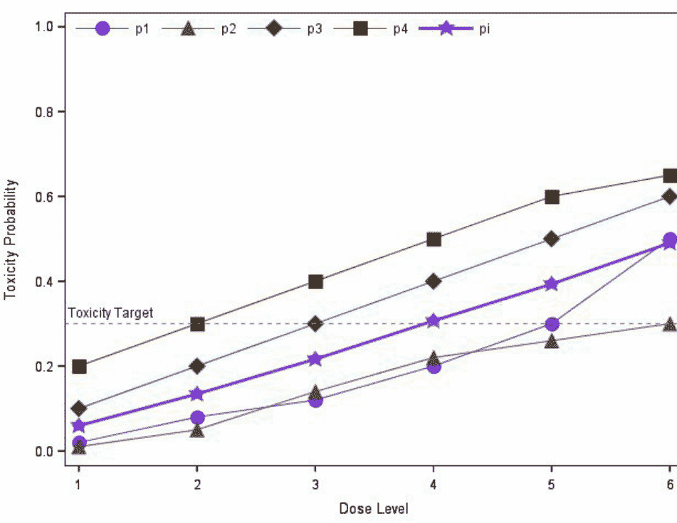

在实施 I 期临床试验之前，应该进行广泛的模拟研究以检查设计的运行特征，以便骨架（skeleton）和先验分布等设计参数得到适当的校准。良好的设计在各种毒性场景下应具有稳健且可接受的行为。为了研究 CRM 和 BMA-CRM 的实际性能，我们考虑了毒性单调增加的六剂量水平。目标毒性概率为 `$\phi=30\%$`。我们使用无信息先验分布 `$\alpha_i \sim N(0,\sigma_i^2)$`，且 `$\sigma_i^2=2$`。第一个队列在最低剂量水平接受治疗，最大样本量为 30。“比较 BMA-CRM 和 CRM 的模拟研究”中的场景 1、场景 2 和场景 3 总结了在每个场景下重复的真实毒性概率、选择百分比、每个水平接受治疗的人数、观察到的限性毒性反应（DLT）总数以及试验提前终止的百分比。正如预期的，与使用单一骨架的四个独立 CRM 相比，BMA-CRM 生成了更稳健的剂量发现。宏 `%CRMSIM` 和 `%BMACRMSIM` 生成了表 5.3 至表 5.5 的结果，并包含在配套网站提供的书籍补充材料中。

`%CRMSIM` 宏中的输入参数列举如下：

- 1. `skeleton`：存储预设的骨架（第一列）和真实毒性概率（第二列）。
- 2. `target`：目标毒性率。
- 3. `cohort`：队列总数。
- 4. `cohortsize`：每个队列中的人数。
- 5. `toxstop`：如果最低剂量水平毒性过高，则提前终止试验的阈值概率。
- 6. `ntrial`：模拟中的重复次数。

作为示例，我们考虑了“示例代码 5.3 CRM 设计的模拟”中场景 1 下使用骨架 1 的 CRM。

## 示例代码 5.3 CRM 设计的模拟

```
data skeleton;
input p ptrue;
datalines;
0.02 0.07
0.08 0.12
0.12 0.17
0.20 0.30
0.30 0.45
0.50 0.60;
run;
%CRMSim(skeleton,target=0.3,ncohort=10,cohortsize=3,toxstop=0.9,ntrial=10000);
```


输出表包含以下变量：

- 1. `doseselect`：每个剂量水平被选为最大耐受（MTD）的百分比。
- 2. `ntox`：每个剂量水平观察到的 DLT 平均数。
- 3. `ntrted`：分配到每个剂量水平的平均人数。
- 4. `nstop`：提前终止的百分比。

`BMACSIM` 宏与 `CRMSIM` 具有类似的输入和输出变量。`BMACSIM` 要求用户在不同的数据集（`skeleton` 和 `truerate`）中创建骨架和毒性率。此外，用户还应在 `priormodel` 数据集中为每个骨架指定先验概率。

### 表 5.3 比较 BMA-CRM 和 CRM 的模拟研究场景 1

| Dose Level | 1 | 2 | 3 | 4 | 5 | 6 | # DLTs | % Stop |
|---|---|---|---|---|---|---|---|---|
| P(Tox) | 0.07 | 0.12 | 0.17 | 0.30 | 0.45 | 0.60 | | | |
| BMA-CRM | 0.0 | 3.0 | 24.0 | 51.1 | 20.6 | 1.3 | | | |
| # of Pts | 4.1 | 4.2 | 7.2 | 9.1 | 4.5 | 0.9 | 7.3 | 0 |
| CRM 1 | 0.0 | 2.6 | 20.3 | 53.0 | 23.0 | 1.1 | | | |
| # of Pts | 4.0 | 4.2 | 6.7 | 9.2 | 5.4 | 0.7 | 7.5 | 0 |
| CRM 2 | 0.0 | 3.5 | 33.4 | 45.0 | 14.3 | 3.8 | | | |
| # of Pts | 4.0 | 4.6 | 8.2 | 7.6 | 3.8 | 1.6 | 7.3 | 0 |
| CRM 3 | 0.0 | 3.0 | 24.1 | 53.0 | 18.6 | 1.3 | | | |
| # of Pts | 4.1 | 4.2 | 7.6 | 9.1 | 4.2 | 0.8 | 7.2 | 0 |
| CRM 4 | 0.0 | 2.6 | 24.1 | 54.2 | 17.6 | 1.5 | | | |
| # of Pts | 4.1 | 4.3 | 7.4 | 9.4 | 4.0 | 0.9 | 7.2 | 0 |

### 表 5.4 比较 BMA-CRM 和 CRM 的模拟研究场景 2

| Dose Level | 1 | 2 | 3 | 4 | 5 | 6 | # DLTs | % Stop |
|---|---|---|---|---|---|---|---|---|
| P(Tox) | 0.10 | 0.20 | 0.30 | 0.40 | 0.50 | 0.60 | | | |
| BMA-CRM | 1.6 | 26.7 | 41.7 | 23.1 | 5.7 | 0.9 | | | |
| # of Pts | 5.4 | 7.9 | 9.2 | 4.4 | 1.7 | 0.3 | 8.0 | 0.3 |
| CRM 1 | 2.2 | 25.0 | 38.4 | 26.6 | 6.9 | 0.6 | | | |
| # of Pts | 5.2 | 7.8 | 8.8 | 5.8 | 2.1 | 0.2 | 8.1 | 0.3 |
| CRM 2 | 1.5 | 27.2 | 47.0 | 18.5 | 3.4 | 2.1 | | | |
| # of Pts | 5.1 | 8.6 | 9.8 | 4.3 | 1.4 | 0.7 | 8.0 | 0.3 |
| CRM 3 | 1.7 | 26.6 | 43.6 | 21.4 | 5.7 | 0.7 | | | |
| # of Pts | 5.4 | 7.9 | 9.6 | 5.2 | 1.6 | 0.3 | 8.0 | 0.3 |
| CRM 4 | 1.8 | 26.1 | 43.5 | 22.7 | 5.0 | 0.6 | | | |
| # of Pts | 5.4 | 8.0 | 9.4 | 5.4 | 1.5 | 0.3 | 8.0 | 0.3 |

### 表 5.5 比较 BMA-CRM 和 CRM 的模拟研究场景 3

| Dose Level | 1 | 2 | 3 | 4 | 5 | 6 | # DLTs | % Stop |
|---|---|---|---|---|---|---|---|---|
| P(Tox) | | 0.05 | 0.14 | 0.20 | 0.23 | 0.30 | | | |
| BMA-CRM | 0.0 | 2.9 | 11.0 | 21.9 | 32.3 | 31.9 | | | |
| # of Pts | 3.8 | 4.4 | 5.7 | 6.5 | 5.5 | 4.2 | 5.7 | 0 |
| CRM 1 | 0.0 | 2.6 | 8.9 | 21.6 | 43.0 | 23.9 | | | |
| # of Pts | 3.7 | 4.2 | 5.3 | 6.6 | 7.0 | 3.2 | 5.7 | 0 |
| CRM 2 | 0.0 | 3.9 | 14.1 | 19.0 | 16.1 | 46.9 | | | |
| # of Pts | 3.7 | 3.7 | 6.5 | 5.2 | 3.5 | 6.4 | 5.9 | 0 |
| CRM 3 | 0.0 | 2.8 | 12.0 | 24.0 | 31.4 | 29.8 | | | |
| # of Pts | 3.8 | 4.3 | 6.2 | 6.4 | 5.5 | 3.9 | 5.7 | 0 |
| CRM 4 | 0.0 | 2.7 | 11.8 | 25.2 | 27.2 | 33.1 | | | |
| # of Pts | 3.8 | 4.3 | 6.0 | 6.6 | 5.1 | 4.2 | 5.7 | 0 |

## 5.4 分数连续评估方法 (Fractional Continual Reassessment Method)

大多数剂量发现方法（包括上述 CRM 和 BMA-CRM）都要求 DLT 结果在治疗后不久即可确定。换句话说，必须获得所有先前治疗过的患者的毒性结果才能确定下一次分配。然而，在治疗后测量 DLT 结果可能需要很长时间。在更常见的情况下，如果患者招募和入组很快，由于治疗中患者的结局可能仍然不可，就会出现毒性数据缺失。例如，在放射治疗试验中，DLT 发生在治疗后很久。在一项针对胰腺癌的 I 期试验中，目标是确定奥沙利铂联合吉西他滨和同步放射治疗的 MTD [7]。招募速度为每两周一名患者，而治疗后平均需要九周时间评估每个患者的毒性结果。因此，在为新到达的患者分配剂量时，治疗中的患者可能尚未完成整个评估期，因此其毒性结果可能被视为缺失或删失。

为了适应晚发毒性，我们可以通过著名的 Kaplan-Meier 估计对底层毒性时间进行建模 [8,9]。处理删失数据的另一种方法是将质量重新分配到右侧 [10,11]。通常，有一个特定的毒性评估窗口来确定 DLT 结果。在评估窗口 [0, $\tau$] 内，如果患者发生了 DLT，则取 $y=1$；如果患者在时间 $\tau$ 后仍未发生，则取 $y=0$。由于对每个新队列进行连续剂量决策，当新队列准备治疗时，治疗中的患者可能尚未发生 DLT。在这种情况下，毒性事件可以被视为删失数据，我们通过将质量分分在删失点和 $\tau$ 之外（任何大于 $\tau$ 的区域）来采用右侧分配的方法。在构建似然函数时，只有分配到 [0, $\tau$] 内删失点的质量才有贡献，而分配到 $\tau$ 之外的质量则没有贡献。因此，由于删失，我们只能依靠删失数据的信息。相比之下，简单的方法可能会直接丢弃缺失数据，假设未来永远不会发生毒性，这无疑会丢失决策所需的信息。

为了充分利用随访时间，在试验期间需要收集更多数据，例如患者的入组日期、决策日期（删失时间）以及毒性发生的日期。

```
$L(\alpha|D) \propto \prod_{i=1}^{n} p_{j}^{(i)}^{\exp(\alpha)} (1-p_{j}^{(i)})^{1-y_i}$
```

`y_i` 的值为 0 或1，或者在删失观测时取 1 的分数。一旦删失数据被分数化，分级 CRM (`fCRM`) 的其余实现部分与通常的 CRM 一样直观。

为了说明说明，我们考虑一个具有六个剂量水平的 I 期剂量终点研究。试验的骨架设定为 $(p_1, ..., p_6) = (0.1, 0.2, 0.3, 0.4, 0.5, 0.6)$。在试验中，每个患者被随访 90 天，即 $\tau=90$。假设有 12 名患者接受了治疗并观察到 3 例剂量毒性反应（DLT），其详细信息见**fCRM 试验中前 12 名患者的累计数据**。

### 表 5.6 fCRM 试验中前 12 名患者的累计数据

| 患者 | 剂量水平 | DLT | 随访 | 入组日期 | DLT 日期 | 填充 DLT |
|---|---|---|---|---|---|---|
| 1 | 1 | 0 | 0 | 01-Jan-11 | | 0 |
| 2 | 1 | 0 | 0 | 02-Jan-11 | | 0 |
| 3 | 1 | 0 | 0 | 15-Jan-11 | | 0 |
| 4 | 2 | 0 | 0 | 01-Feb-11 | | 0 |
| 5 | 2 | 0 | 0 | 05-Feb-11 | | 0 |
| 6 | 2 | 1 | 0 | 20-Feb-11 | 13-Apr-11 | 1 |
| 7 | 3 | 1 | 1 | 03-Mar-11 | 20-Apr-11 | 1 |
| 8 | 3 | 0 | 1 | 07-Mar-11 | | 0 |
| 9 | 3 | 0 | 1 | 10-Mar-11 | | 0 |
| 10 | 3 | 0 | 1 | 01-Apr-11 | | 0.22 |
| 11 | 3 | 1 | 1 | 02-Apr-11 | 28-Apr-11 | 1 |
| 12 | 3 | 0 | 1 | 02-Apr-11 | | 0.22 |

假设一名新患者于 2011 年 5 月 10 日进入试验，我们可以使用 SAS 宏 `%crm` 来确定该参与者的剂量水平。如果队列大小为三个，则必须分别记录队列中每个患者的信息，以计算每个个体对似然函数的单独贡献。为了实现这一目标，需要输入 12 名患者的信息，包括他们观察到的毒性结果、是否已完全随访的指标、入组日期以及 DLT 发生的日期。如果患者在完成随访期后未出现毒性，则输入的日期设为随访期的最后一天。如果患者未出现毒性但仍在随访期内，其删失标记指定为当前决策日期：2011年5月10日。

`%crm` 宏（示例代码 5.4 分级 CRM 宏）需要以下输入变量。`km.sas` 文件的位置应在 `%include` 语句中指定。

- 1. `currentdata` 是存储累计信息的数据库。具体而言，用户需要输入剂量水平 (`doselevel`)、DLT 结果 (`DLT`, 如果观察到 DLT 则为 1，否则为 0)、表示患者是否仍在试验随访期内的指标变量 (`followup`) 以及患者的入组日期 (`entrydate`) 和事件日期 (`timetoevent`)。
- 2. `skeleton` 是存储预测骨架的数据集。
- 3. `currenttime` 是当前日期（新患者的入组日期）。
- 4. `tau` 是毒性评估的完整随访期。
- 5. `target` 是目标毒性率。
- 6. `tstop` 是如果最低剂量水平毒性过大时提前终止试验的阈值概率。

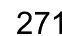

### 示例代码 5.4 分级 CRM 宏

```sas
data currentdata;
  input doselevel DLT followup entrydate timetoevent;
  informat entrydate timetoevent date7.;
  datalines;
  1 1 0 0 01-JAN-11
  2 1 0 0 02-JAN-11
  3 1 0 0 15-JAN-11
  4 2 0 0 01-FEB-11
  5 2 0 0 05-FEB-11
  6 2 1 0 20-FEB-11 13-APR-11
  7 3 1 1 03-MAR-11 20-APR-11
  8 3 0 1 07-MAR-11
  9 3 0 1 10-MAR-11
  10 3 0 1 01-APR-11
  11 3 1 1 02-APR-11 28-APR-11
  12 3 0 1 02-APR-11
  ;
run
```

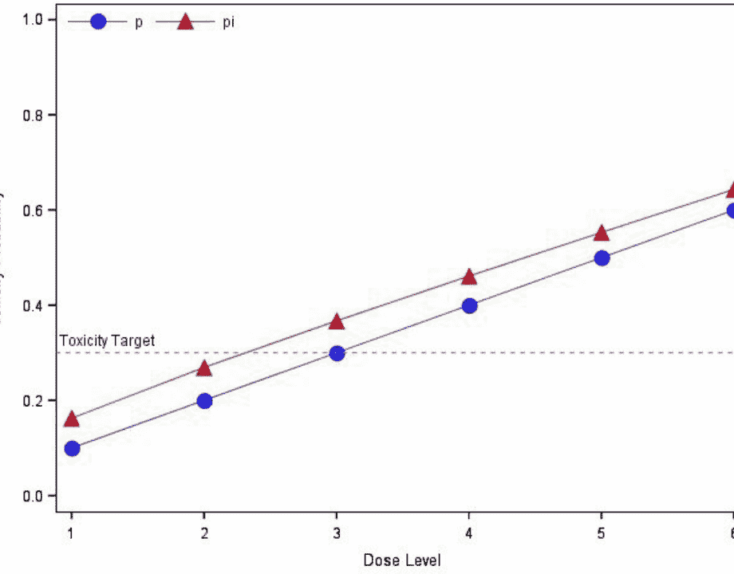

## 5.5 事件时间持续评估方法 (Time-to-Event Continual Reassessment Method)

Cheung 和 Chappell [12] 以患者的暴露时间作为权重，提出了事件时间持续评估（TITE-CRM），将随访信息纳入毒性评价中。设 `u_i` 为受试者 `i` 的实际随访时间，`y_i` 为在 `u_i` 时观察到的毒性结果。如果第 `i` 个患者未发生剂量毒性反应（DLT），则 `y_i` 取值为 0，否则 `y_i=1`。通常假设均匀权重方案，形式为 `w_i=u_i/\tau`。随访时间越长，权重越高。如果患者在时间 `u_i` 之前发生了 DLT，则权重值为 1。在 CRM 模型下，伪二项分布似然函数给出：

```
$L(\alpha|D) \propto \prod_{i=1}^{n} \{w_{i}p_{i(i)}^{\exp(\alpha)}\}^{y_{i}} \{1-w_{i}p_{i(i)}\}^{1-y_{i}}$
```

在这种公式下，未发生毒性且未完成完全随访的患者被处理为“无毒性”，`y_i=0`，尽管他们的数据实际上是缺失的。

为了说明 TITE-CRM，我们考虑一个包含六剂量水平的假设试验。目标毒性率为 0.3，骨架设定为 $(\rho_{1}, \dots, \rho_{6}) = (0.1, 0.2, 0.3, 0.4, 0.5, 0.6)$。在试验中，每个患者随访时间为90天，即 $\tau=90$。假设新患者的入日期为 2011年4月20日。在新患者进入之前，已有9名患者接受了治疗，其数据见“TITE-CRM 试验中前9名患者的累计数据”。

### 表 5.7 TITE-CRM 试验中前9名患者的累计数据

| 患者 | 剂量水平 | DLT | 随访 | 入日期 |
| :--- | :--- | :--- | :--- | :--- |
| 1 | 1 | 0 | 0 | 01-Jan-11 |
| 2 | 1 | 0 | 0 | 02-Jan-11 |
| 3 | 1 | 0 | 0 | 15-Jan-11 |
| 4 | 2 | 0 | 1 | 01-Feb-11 |
| 5 | 2 | 0 | 1 | 05-Feb-11 |
| 6 | 2 | 1 | 2 | 20-Feb-11 |
| 7 | 3 | 1 | 3 | 03-Mar-11 |
| 8 | 3 | 0 | 3 | 07-Mar-11 |
| 9 | 3 | 0 | 3 | 10-Mar-11 |

`TITECRM` 宏（示例代码 5.5 事件时间 CRM 宏）实现了 TITE-CRM 以确定新患者的剂量水平。输入变量与 § fCRM 中的变量相似。

### 示例代码 5.5 事件时间 CRM 宏

```
currentdata;
  input doselevel DLT followup entry date7;
  datalines;
  1 0 0 01Jan
  1 0 0 02Jan
  1 0 0 15Jan
  2 0 1 05Feb
  2 0 1 20Feb
  2 1 1 03Mar
  3 0 1 07Mar
  3 0 1 10Mar
run;
data skeleton;
  input p;
  datalines;
  0.1
  0.2
  0.3
  0.4
  0.5
  0.6;
run;
%macro TITECRM(currentdata,skeleton,currenttime,tau=90,target=0.3,toxstop=0.9)
proc iml;
  use &skeleton;
  read all;
  use &currentdata;
  read all;
  currenttime=input(currenttime,'.date7');
  ndrow=row(p);
  doselevel={};
  dosecurr=doselevel(row(doselevel));
  w=(row+0)+(followup=1)%(currenttime-entrydate)/&tau;
  stop=0;
  start posterior (alpha) global (DLT,doselevel,p,w);
  sigma=2;
  lik=1;
```

```
nn=row(DLT);
aa=sum(DLT);
if aa==0 then
 do k=1 to nn;
 pi=?(p[doselevel[k]])##exp(alpha);
 lik=lik=((1-w[k]*pi)##(1-DLT[k]));
 end;
else
 do k=1 to nn;
 pi=?(p[doselevel[k]])##exp(alpha);
 lik=lik=((w[k]*pi)##(DLT[k]))*((1-w[k]*pi)##(1-DLT[k]));
 end;
end;
lik=exp(-0.5*alpha*alpha/sigma2);
return(lik);
finish;
/* used to calculate the posterior mean of pi */
start posttoxf(alpha) global(, DLT,doselevel,p);
post=p[j]##exp(alpha)*posterior(alpha);
```


```sas
return(post);

finish;

call qgrad("posterior", "posterior",.{M .P}) eps=1E-4 peak=-1

scale=0.5; /* default: PEAK=1 */

pi=();

 do j=1 to ndose;

 call quad(pj,"posttoxf",.{M .P}) eps=1E-4 peak=-1 scale=0.5;

 pj=pj/marginal;

 pi=pi/marginal;

 end;

lb=log(log(target)/log(p[1]));

call quad(poster,"posterior",lb) eps=1E-4 peak=-1 scale=0.5;

postver=postver/marginal;

 if postver>tostop then stop;

 diff-abs=abs(pi-target);

 dosebest=diff-abs)<c;

 if dosebest>dosecurr then

 if dosecurr<ndose then do

 dosenext=dosecurr+1;

 end;

 if dosebest<dosecurr then

 if dosecurr>1 then do

 dosenext=dosecurr-1;

 end;

 end;

if stop=1 then dosenext="The trial should be early terminated";

*title "dose for next patient"

 print dosenext;

doselevel=1:ndose;

doselevel=`doselevel`;

 create doselevel from doselevel[colname="doselevel"];

 append from doselevel;

create pi from pi[colname="pi"];

 append from pi;

quit;

data &skeleton;

merge &skeleton. pi doselevel;

run;

*title "Skeleton Versus Estimated Toxicity";

proc sgplot data = skeleton;

line doselevel / response='p'

markeratrs=(symbol=circle) size=10) lineatrs=(pattern = solid);

line doselevel / response='pi'

markeratrs=(symbol=triangles) size=10) lineatrs=(pattern = solid);

yaxis min = 0 max = 1 label="Toxicity Probability";

xaxis label="Dose Level";

key location=inside lineatrs=(pattern = dash);

end;

%end TITECRM;
```

毒性率的后验估计如图5.5所示（TITE-CRM设定与估计概率），分配给新患者的剂量水平为 2。

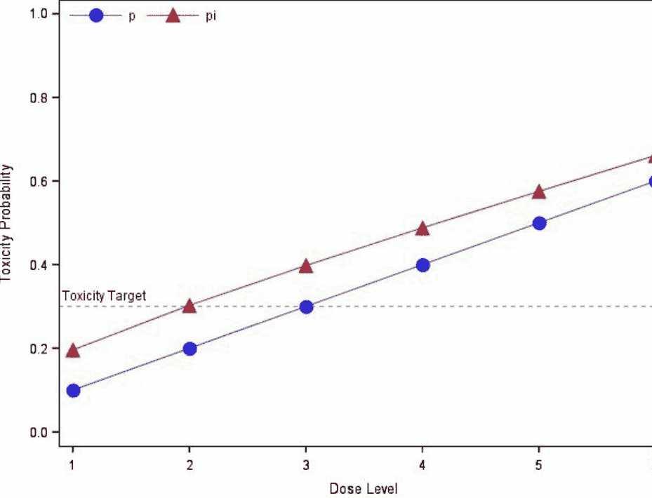

基于暴露时间权重方案，TITE-CRM 中的权重函数可能有多种形式，其中均匀权重最直接。相比之下，分数 CRM 应用 Kaplan-Meier 估计将删失数据向右重新分布，从而产生 0 到 1 之间的结果。在 $(0, \tau)$ 中发生的所有 DLT 中，70% 在 $(\tau/2, \tau)$ 即评估期的后半部分被观察到。样本样本量为 36 名患者，骨架为 $(0.1, 0.2, 0.3, 0.4, 0.5)$。在每种情景下，重复试验 1000 次。如“比较 fCRM 和 TITE-CRM 的研究”情景 1 和情景 2 所示，fCRM 和 TITE-CRM 的结果在 MTD 选择和每个剂量治疗的患者人数方面是相似的。同样，TITE-CRM 对不同水平使用相同的权重函数，这考虑了信息。由于数据的稀疏性，很难通过分层在 Kaplan-Meier 估计或权重函数中纳入剂量水平。fCRM 和 TITECRM 宏生成的表 5.8 和表 5.9 结果也包含在网站的补充材料中。在 fsim 宏的 `%include` 语句中指定 .sas 文件的位置。使用 fsim 和 TITECRM 宏进行模拟。这两个宏的输入变量为：

- 1. `skeleton`：包含真实毒性率和骨架的数据。
- 2. `target`：毒性率。
- 3. `ncohort`：队列总数。
- 4. `cohortsize`：队列大小。
- 5. `tau`：评价毒性的随访期。
- 6. `a`：相邻队列之间之间的时间。
- 7. `stop`：如果最低剂量水平毒性过大，提前终止试验的阈值概率。
- 8. `trial`：重复次数。

例如，示例代码 5.6 fCRM 和 TITE-CRM 模拟生成了表 5.9 中情景 2 的结果；输出变量与 sim 中的相同。

## 示例代码 5.6 fCRM 和 TITE-CRM 设计模拟

```sas
data skeleton;

input p ptrue;

datalines;

0.1 0.15

0.2 0.30

0.3 0.45

0.4 0.55

0.5 0.60

0.6 0.70;

run;

fCRMsim(skeleton,target=0.3,ncohort=12,tau=3,a=1,cohortize=3,
tostop=0.9,ntrial=1000);

TITECRMsim(skeleton,target=0.3,ncohort=12,tau=3,a=1,cohortize=3,
tostop=0.9,ntrial=1000);
```


表 5.8 比较 `fCRM` 和 `TITE-CRM` 的情景 1

| 剂量水平 | 1 | 2 | 3 | 4 | 5 | 6 | # DLT | % Stop |
| :--- | :--- | :--- | :--- | :--- | :--- | :--- | :--- | :--- |
| P(Tox) | 0.04 | 0.08 | 0.12 | 0.20 | 0.30 | 0.50 | | |
| fCRM | 0 | 0.1 | 3.4 | 29.6 | 55.4 | 11.5 | | |
| # Pts | 3.3 | 3.7 | 5.1 | 8.7 | 9.5 | 5.7 | 8.5 | 0 | |
| TITE-CRM | 0 | 0.1 | 3.5 | 30.9 | 53.9 | 11.6 | | |
| # Pts | 3.4 | 3.7 | 5.2 | 8.5 | 9.5 | 5.6 | 8.5 | 0 | |

表 5.9 比较 `fCRM` 和 `TITE-CRM` 的情景 2

| 剂量水平 | 1 | 2 | 3 | 4 | 5 | 6 | # DLT | % 停止 |
|---|---|---|---|---|---|---|---|||
| P(Tox) | 0.15 | 0.30 | 0.45 | 0.55 | 0.60 | 0.70 | | |
| fCRM | 17.5 | 63.7 | 17.6 | 0.8 | 0.0 | 0.0 | | |
| 患者人数数 | 10.4 | 14.5 | 7.9 | 2.7 | 0.4 | 0.0 | 11.3 | 0.4 |
| TITE-CRM | 18.6 | 62.9 | 16.4 | 0.8 | 0.0 | 0.0 | | |
| 患者人数数 | 9.4 | 14.4 | 8.5 | 2.8 | 0.6 | 0.0 | 11.6 | 1.4 |

## 5.6 总结

持续重评估法及其变体已得到广泛研究，其性能通常优于基于算法的方法（例如 `3+3` 设计）。所有累积数据都可以进行整合和建模，以做出更佳的决策。在贝叶斯范式中，可以实施更直接的比较和早期停止规则，这有助于更快地确定合适的剂量。

# 参考文献

- 1. O'Quigley J, Pepe M & Fisher L. (1990). 持续重评估法: 癌症 1 期临床试验的实用设计。*Biometrics* 46: 33-48.
- 2. O'Quigley J & Shen LZ. (1996). 持续重评估法: 一种似然法。*Biometrics* 52: 673-684.
- 3. Yin G & Yuan Y. (2009). 贝叶斯模型平均在在 I 期临床试验中的持续重评估法。*Journal of the American Statistical Association* 104: 954-968.
- 4. Raftery AE, Madigan D & Hoeting JA. (1997). 线性回归模型的贝叶斯模型平均。*Journal of the American Statistical Association* 92: 179-191.
- 5. Hoeting JA, Madigan D, Raftery AE & Volinsky CT. (1999). 贝叶斯模型平均: 教程。*Statistical Science* 14: 382-401.
- 6. Spiegelgehalter DJ, Best NG, Carlin BP & Van Linde A. (2002). 模型复杂性和拟合的贝叶斯测量。*Journal of the Royal Statistical Society: Series B (Statistical Methodology)* 64: 583-639.
- 7. Desai SP, Ben-Josef E, Normolle DP, Francis IR, Greenson JK, Simeone DM, Chang AE, Lawrence TS & Zalupski MM. (2007). 奥沙利铂剂量以及胰腺癌的联合放疗研究。*Journal of Clinical Oncology* 25: 4587–4592.
- 8. Kaplan EL & Meier P. (1958). 不完全观测的非参数估计。*Journal of the American Statistical Association* 53: 457-481.
- 9. Yin G, Zheng S & Xu J. (2013). I 期临床试验中晚期毒性的剂量寻找方法。*Journal of* B. (1967). 带截断数据的双样本问题。见 Le Cam L & Neyman J 编. 第五届伯克利数学统计会议，卷 IV。纽约: Prentice Hall, 831-853.
- Portnoy S. (2003). 截断分位数。*Journal of the American Statistical Association* 98:1001-1012.
- Cheung YK & Chappell R. (2000). 具有晚期毒性的 I 期临床试验的序列设计。*Biometrics* 56: 1177-1182.

# 作者

- 尹国盛，教授，统计与精算科学系，香港大学，香港。
- 林瑞涛，博士候选，统计与精算科学系，香港大学，香港。

## 第 6 章：经典剂量反应研究

### 6.1 引言

### 6.2 经典剂量反应研究中的统计设计考量

### 6.3 设计与最终分析阶段的考量

### 6.4 使用模拟数据的示例

### 6.5 总结

## 6.1 引言

在药物开发过程中，候选化合物在进入市场供患者使用之前需要经过毒性、药代动力学/药效学、有效性和安全性的一系列严格。该过程涉及对动物的不同阶段非临床研究，以及对健康志愿者和目标疾病人群的临床研究 [1, 2]。临床研究可分为四个阶段（I 期-IV 期），对应药物开发的四个阶段：人体药理学、治疗探索性、治疗确认性以及治疗使用研究 [3]。I 期和 II 期通常被认为是探索和学习阶段。III 期研究的主要目标是治疗确认。III 期试验是上市后研究。由于 III 期关键性研究通常规模很大且成本极高（某些 III 期研究的成本可能超过从化合物最初开始到 II 期结束的总成本），II 期研究是最关键的组成部分之一。此外，监管机构通常建议在启动 III 期之前探索测试疗法的完整剂量范围，并鼓励识别最小有效剂量（`MinED`）[4]。鉴于 III 期及以后投入的巨大资源，设计良好的 II 期研究对患者和申办方都有益，从而缩短上市时间。本章描述了剂量反应的一般考量，并使用 `SAS` 展示了两个示例。

## 6.2 经典剂量反应研究中的统计设计考量

### 6.2.1 剂量反应

在大多数情况下，有效性曲线和毒性曲线是分离的。在这种情况下，患者有广泛的剂量范围可选。在其他情况下，两条曲线可能非常接近，医生必须非常仔细地为患者用药，使其在从有效性的同时，不必暴露于药物的潜在毒性。这可以通过所谓的治疗指数（`TI`）来量化。`TI`（也称为治疗窗或安全窗口，有时称为治疗比例）是对……的比较

从概念上说，药物的有效性随着剂量增加而增加（图 6.1）。图 6.1 中绘制的左侧“可能的有效性和毒性剂量反应曲线”可以被视为有效性-反应曲线；即反应（y 轴）代表药物有效性的某些衡量。除了有效性反应，还有毒性剂量-反应曲线。我们将假设如图 6.1 所示，当剂量增加时，有效性和毒性都会随之增加。基于这些曲线，可以定义最大耐受剂量（`MTD`）。`MTD` 是特定人群可以接受的最大剂量。

剂量范围范围试验通常包含较少的剂量。一种常见的设计是四组研究，分为安慰剂、低剂量、中等剂量和高剂量。在设计剂量范围研究时，记住以下问题非常重要：

- 1. 应该考虑哪些剂量范围？
- 2. 概念是否得到证明？
- 3. 如何安排从安慰剂到最大耐受剂量的间隔？
- 4. 应该包含几个治疗臂或剂量水平？
- 5. 总样本量和分配方案是什么？

II 期开发计划通常由小规模的概念验证（`PoC`）和中等规模的剂量范围研究组成。

# 图 6.1 可能的有效性和毒性剂量反应曲线

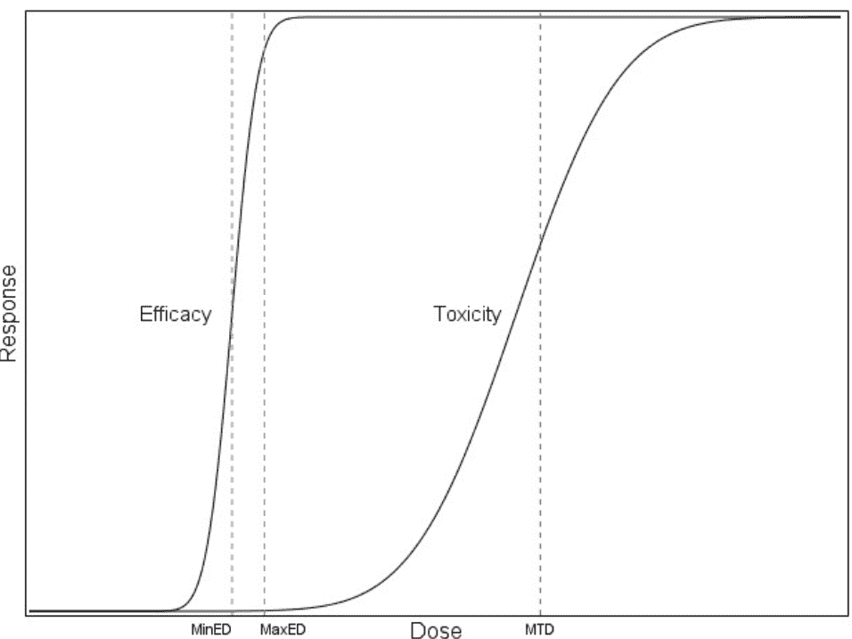

产生治疗效果的药物剂量与产生毒性的剂量 [6]。显然，具有宽治疗窗（或高治疗指数 `TI`）的药物更优优。如果一种药物的治疗窗较窄，那么该药物的开发需要更加谨慎，医生在开方该药物时也会更加小心。

通常，针对致命疾病（如癌症）开发的药物往往具有窄的治疗窗。另一方面，治疗慢性疾病（如高血压、抑郁症、高胆固醇或关节炎）的药物要求具有宽的治疗窗，因为这些药物经常用于老年患者或患有合并的患者，有时也用于儿童。

在临床开发中，三期试验旨在确认产品的疗效。三期研究获得的结果提供了证据，帮助监管机构决定是否批准某产品，而三期项目投入了大量的资源。因此，二期剂量范围试验提供的信息对于帮助设计三期试验至关重要。换句话说，如果产品注册所需的合适剂量或剂量范围未包含在三期试验中，那么候选产品很可能无法按计划获得市场上市许可。因此，从剂量范围试验中获得的信息需要为三期研究设计中的剂量选择提供充分的支持。

### 6.2.2 寻找有效剂量

`ICH E4` 将最小有效剂量（`MinED`）定义为“具有可观察有用作用的最小剂量” [4]。寻找 `MinED` 是药物开发中的一个重要步骤。为了说明，让我们考虑以下报告的案例。在一个治疗骨关节炎的药物 [7] 的临床开发计划中，首次剂量-反应研究包含了安慰剂、80 mg、120 mg 和 160 mg 的测试药物。该研究结果表明，所有三个剂量都是有效的（见图 6.2 三项骨关节炎药物研究的剂量-反应结果的左侧面板）。这些结果还显示，80 mg 可能已经处于剂量-反应曲线的高端。第二项研究旨在探索 40 mg 剂量，该第二项研究的结果见图 6.2 的中间面板。根据这些发现，项目组使用 120 mg 的剂量进行三期研究，以确认该药物的长期疗效。

在与食品药品管理局（`FDA`）举行的二期结束会议上，提到未发现最小有效剂量（`MinED`）。这里的主要问题是疗效反应随着剂量水平的变化而改变，且三个测试剂量几乎等等地达到了完全疗效，因此没有检测到剂量-反应关系。项目组设计了第三项剂量-反应研究来探索较低的剂量范围。第三次包含的剂量包括 2.5 mg、10 mg 和 40 mg。如图 6.2 三项骨关节炎药物研究的剂量-反应结果右侧面板所示，第三项研究成功建立了剂量-反应关系，即反应随着剂量的增加而增加。基于这些结果，很明显三期研究设计的剂量太高了。这一过程的影响会导致开发计划的严重延误和资源的巨大浪费。

图 6.2 三项骨关节炎药物研究的剂量-反应结果

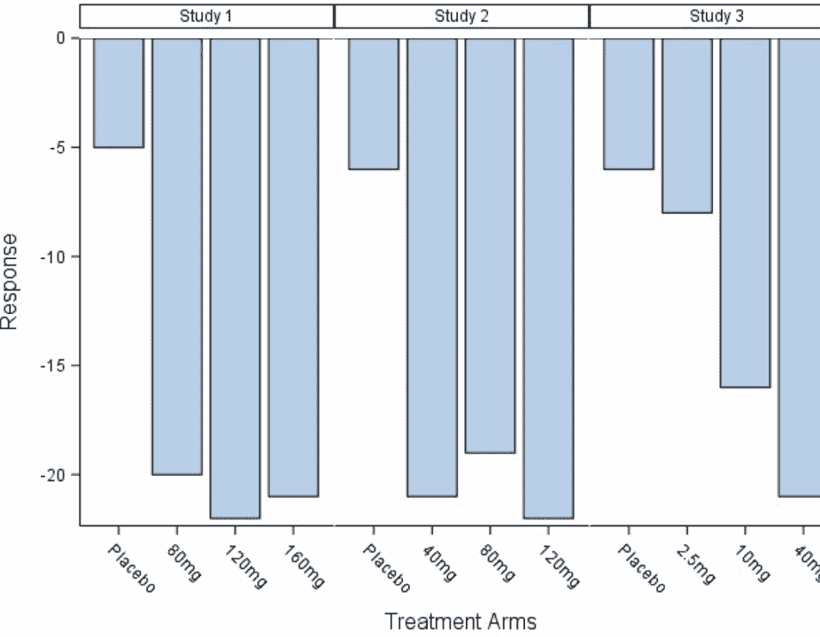

因此，`MinD` 是产品开发中一个非常重要的概念。遗憾的是，该术语并没有一个通用的定义 [8]。寻找 `MinD` 至关重要，因为人们通常认为毒性随着剂量的增加而增加。因此，有效的较低剂量意味着它可能比高剂量安全。

从三期研究获得的临床结果用于获得研究性产品的上市许可。基于这些数据，如果某个剂量是有效且安全的，那么该剂量就可以被批准，产品标签将规定获批的剂量或剂量范围。然而，在批准和广泛使用后，如果观察到影响患者获益风险平衡的过度事件，就会引发对批准剂量是否足够低的疑问。此时，要确定该产品的 `MinD` 将非常具有挑战性。因此，美国的药物价格与剂量没有直接关联。但在许多其他国家，药物的价格与其剂量挂钩。换句话说，如果产品剂量更高，价格就更贵。现在假设某产品在这样一个国家获得批准，并根据最低批准剂量定价。如果以后发现该产品的 `MinED` 实际上低于批准剂量，那么在上市阶段就需要减量。相应的，该产品的价格必须进一步降低。当这种情况发生时，会对此类产品的收益产生巨大影响。因此，从营销策略的角度来看，在产品进入三期开发之前在二期识别 `MinD` 是至关重要的。

寻找 `MinED` 是二期的临床实践。如上所述，如果不在二期阶段识别 `MinED`，那么在产品开发的更后期阶段寻找 `MinED` 将非常困难且昂贵。事实上，二期可能是表征剂量与产品疗效之间关系的唯一机会。因此，对二期给予更多关注并仔细设计剂量范围试验是非常重要的。

### 6.2.3 确定研究的剂量范围

在非自适应设计实践中，通常第一个剂量范围研究会涵盖较宽的剂量范围，随后的剂量范围研究将设计设计为较窄的剂量范围，以筛选出 III 期要评估的目标剂量。临床试验中的剂量范围定义为设计中包含的最大剂量除以最低剂量的比值。例如，如果试验 A 中的剂量为安慰剂、20 mg、40 mg 和 80 mg，则剂量范围为 4 (= 80/20)。如果试验 B 中的剂量为安慰剂、0.1 mg、1 mg 和 10 mg，则剂量范围为 100 (= 10/0.1)。虽然试验 A 中使用的剂量比试验 B 中使用的剂量高，但实际上试验 B 的剂量范围要宽得多——是是试验 A 的 25 倍。在第一个剂量范围研究中涵盖较宽的剂量范围是至关重要的。剂量范围选择不当可能会导致成本和资源的潜在浪费，并推迟上市时间。

从上述特定开发计划中吸到的关键教训是，在 II 期早期阶段没有探索极低剂量。换句话说，如果在第一项研究中探索了 10 mg 或以下的剂量，则可以通过第二次研究建立一个较窄的剂量范围。这样，III 期研究就可以设计合适的剂量范围。

总的来说，开发新干预措施的设计第一个剂量范围试验时最困难的挑战是待选剂量的选择。通常，该研究基于两个非常重要的假设：

- 1. 从早期试验中正确估计了最大耐受剂量 (`MTD`)
- 2. 功效反应随剂量的增加呈单调性。

然而，目前尚不清楚有效活动处于什么剂量范围。在此阶段，最好的可用指导是来自临床前实验或通过生物标志物从 I 期获得的数据。即使在 `MTD` 被正确估计且存在单调剂量-反应关系的假设下，仍可能存在许多可能的剂量反应曲线形状。

图 6.3“几种可能的剂量反应曲线”展示了三个剂量反应曲线的示例。剂量反应曲线 1 基于兔子反应模型，曲线 2 基于小鼠模型，曲线 3 来自狗模型。垂直虚线（位于图 6.3 右侧）代表最大耐受剂量 (`MTD`)。此阶段的主要挑战变成了：在接下来的剂量范围临床试验中应该考虑什么剂量范围？从这个角度来看，剂量范围试验设计的主要挑战是考虑需要研究哪些范围的剂量。

图 6.3 几种可能的剂量反应曲线

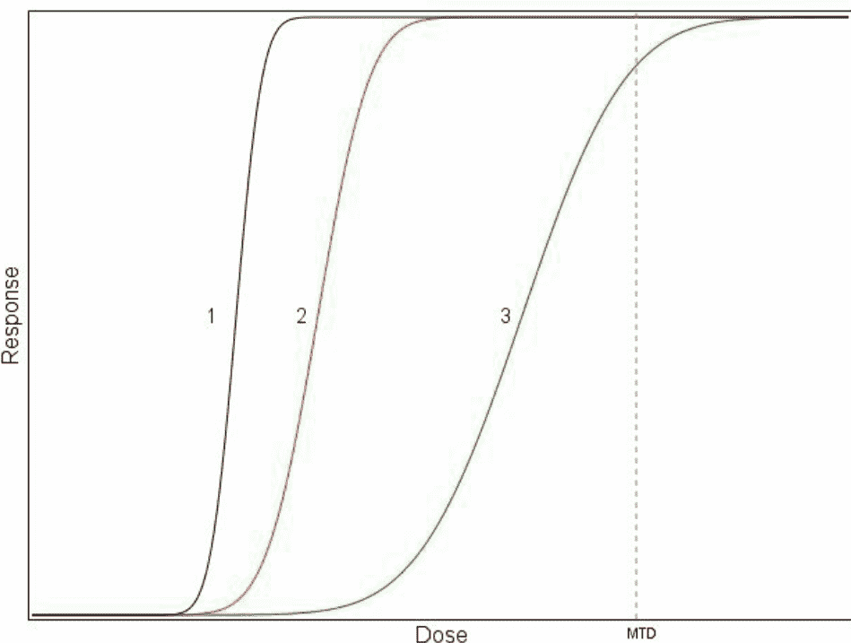

考虑到前节对 `MinED` 的讨论，关键在于意识到在剂量范围设计中需要研究较宽的剂量范围。高剂量通常设定为 `MTD` 或 `MTD` 以下的剂量，以避免任何不可接受的毒性。真正的设计挑战是为该剂量范围试验选择最低剂量。如果对识别 `MinED` 以下的剂量感兴趣，那么困难的问题就是“低到什么程度才足够？”一旦为设计选择了低剂量，剂量范围就可以计算为最高剂量除以最低剂量的比值。

### 6.2.4 概念是否已证明？

有时，将概念验证 (`PoC`) 和剂量范围研究合并到具有明确定义的目标、假设和决策标准的单一研究中是理想的。这种设计的优点是首先对 `PoC` 做出“去/留 (Go/No Go)”决策。如果决定是“去”，则同一项研究将按顺序提供剂量范围信息，以识别可以实现目标治疗效果的剂量，并帮助设计下一项研究。如果设计和分析得当，这种结合通过为未来提供一系列有效剂量来节省开发时间。缺点是在该概念被证明之前，有更多的投资面临风险。

当在单一假设检验下检查简单的 `PoC` 时，关于在统计设计原则方面对 `PoC` 研究设计的讨论并不多。相比之下，剂量范围试验有多种设计和分析策略。剂量范围方法存在三大主要类：多重比较程序 (`MCP`)；建模方法；以及结合了前者的 `MCP-Mod` [13,14]。

`MCP` 方法将剂量视为离散因子，并且通常对底层的剂量-反应关系不做过多假设。当在对多个剂量进行测试时没有施加假设的顺序，则需要进行多重性调整以保护族整体错误率 (`FWER`)。常用的程序如 `Bonferroni`、`Dunnett`、`Holm` 和 `Hochberg` 需要对 `α` 进行拆分，这会导致样本量增加。建模方法将剂量视为连续变量，并假设反应与剂量之间存在函数关系。有时由于假设的关系（例如非递减的剂量-反应关系），可以避免多重性。问题是，模型误设定可能会导致潜在偏差。第三种方法 `MCP-Mod` 通过首先使用 `MCP` 选择剂量反应模型以保护 `FWER` 来解决这个问题；然后使用所选模型来估计剂量-反应关系。这种方法在模型选择方面是灵活的；但在模型选择步骤上付出了 `α` 的代价。

### 6.2.5 如何分配测试剂量

`Hamlett` 等提议使用二分剂量间距 (`BDS`) 进行剂量分配，因为这种剂量分配方法是基于将剂量间隔一分为半的。多年来，`BDS` 已成功应用于许多剂量范围设计 [12,16]。在使用 `BDS` 方法确定剂量时，假设 `MTD` 为 `τ`，因此剂量空间为 `[0, τ]`。在一般情况下，`τ` 可以取 1。假设剂量-反应关系是单调的。进一步假设剂量数量是已知的。在此设定下，从 `[0,1]` 区间选择剂量。假设我们一个包含三个治疗组的设计，包括安慰剂、低剂量和一个高剂量。安慰剂剂量取零。现在的挑战是选择一个低剂量和一个高剂量，考虑到我们可能不希望高剂量接近 1（假设的 `MTT`）。一种直观的方法可能是将此区间分为两个 `[0,1/2]` 和 `(1/2,1]`，并在每个区间内选择一个剂量。自然的选择是选择每个区间的中点（将每个区间对半），得到剂量 `x1=1/4` 和 `x2=3/4`。注意，如果在上限区间（大于 1/2 且接近 1）选择剂量，这些剂量将具有毒性，在剂量选择过程中通常感兴趣。相反，低剂量的活性对于药物开发非常重要。因此，`BDS` 的基本思想是寻找剂量范围的低端。

另一种情况下，假设我们想考虑一个包含安慰剂、低、中、高剂量的四治疗组设计。为了避免选择过高毒性剂量，我们可能希望将 3/2 作为高剂量；即保持 `(1/2,2]` 区间不变。由于我们想使用一些低剂量来帮助识别 `MinED`，可以将下部区间 `[0,1/2]` 和 `[1/2,1]` 一分为二，给出这两个区间的中点并将这两个区间再次对半平分——得到三个剂量 `x1=1/8, x2=3/2^3` 和 `x3=3/2^2`。我们以这种方式继续对下部区间平分并取每个区间的中点，直到分配完所有剂量。通常，假设有 `m` 个测试

除安慰剂剂量外，测试剂量的分配为 `x1=1/2^m, x2=3/2^m, x3=3/2^{m-1}, x4=3/2^{m-2}, ..., xm=3/2^2`。

其他细分方式也是可能的。我们可以不拆分初始区间 `[0, T/2]` 和 `[T/2, T]`，而是使用 `1/p` 分割——`[0, T/p]` 和 `(T/p, T]`——其中 `p >= 2`，然后重复上述程序。`BDS` 设计是非参数的，因为它不依赖于除两个假设之外的任何底层模型：已知最大耐受剂量（`MTD`）以及非递减的剂量-反应关系。它提供了一种识别低于 `MTD` 剂量的方法，以及可能估计最小有效剂量（`MinED`）手段。

除了 `BDS` 之外，其他算法也可能有用，例如，对数剂量间距、斐波那契数列以及改进的斐波那契数列方法也可以被考虑 [17,18]。然而，重要的是，这些方法大多数都建议从低剂量到高剂量的设置剂量间距。在实践中，剂量间距应考虑从 `MTD` 开始，并向低剂量移动。因此，在应用任何此类算法时，剂量分配将反转（从高到低，而不是从低到高）。

### 6.2.6 剂量数量与对照组

如在前述节中讨论，在 II 期剂量范围研究中，宽泛的剂量范围至关重要。一旦从 I 期估计出 `MTD` 并考虑宽泛的剂量范围，自然会产生的问题是研究中应该包含多少剂量、安慰剂对照组是否足够，或者是否还需要活性对照组。

单剂量加安慰剂组的设计可能能够证明概念（`PoC`），但从本质上说，它无法表征剂量-反应关系。任何在安慰剂和测试剂量之间插值剂量-反应关系的尝试都需要非常强的假设，而这些假设通常是不切实际的。因此，剂量范围研究通常需要几个测试剂量水平。一种非常常用的设计是四组研究，包括安慰剂组、低剂量组、中剂量组和正在开发的候选药物的高剂量组。一些作者建议更多剂量可能会帮助；在首次剂量范围研究中，在研究设计中增加更多剂量 [19]。然而，使用的剂量数量可能会受到实际和后勤考虑的限制（例如，测试剂量的可用剂型、给药频率、门诊患者自行使用的便利性或盲法复杂性等）。鉴于研究中已经包含了许多治疗组，在同一项研究中添加许多测试剂量可能是不实际的。

在早期的 II 期剂量范围试验设计中，通常总样本量受预算、患者可用性和招募困难的限制。在这种情况下，设计中越多的治疗组提供的治疗效果估计就越不精确。因此，在研究设计中对剂量组进行盲法并不一定使设计更有可能产生更多信息的结果。在确定剂量组之前，需要一个深思熟虑的设计策略。

在我们看来，对于首次剂量范围研究设计，覆盖宽泛的剂量范围比简单地在狭窄剂量范围内增加更多剂量更重要。这既符合实际，又具有科学合理性。在实践中，一个具有 4 到 5 个测试剂量加安慰剂对照组的试验，如果剂量范围足够宽且剂量间距合理，将能够很好地理解测试药物何时最活跃。一些模拟研究表明，在治疗组数量（4、5、6 或 7 组，包括安慰剂组）中，三个测试剂量（4 组设计）在某些情况下可能是不够的，因为它显著限制了用于拟合数据的潜在相关模型空间，从而对识别最佳剂量的能力产生明显影响 [16]。当研究超过三个剂量时，性能会提高。另一方面，六个测试剂量（7 组设计）的结果并不一定比四组或五个测试剂量（5 组或 6 组设计）的比较更好。当总样本量固定时，在使用相同的总样本量时，7 组设计的每组样本量较小，精度将被牺牲。考虑不平衡样本量分配也是一个好主意，例如将更多受试者分配给极端剂量（即较高剂量和安慰剂组）。

因此，包含四到五个测试剂量（除安慰剂外）并覆盖宽泛范围的剂量设计，为设计剂量范围临床试验提供了非常有用且务实的依据 [20]。

### 6.2.7 样本量考虑

#### 6.2.7.1 用于确定 PoC 的统计假设

每当给定研究需要计算样本量时，第一点是理解要测试的假设。在设计 II 期剂量范围程序的过程中，初始统计假设通常是概念证明（`PoC`）假设。在研究仅设计两个治疗组的情况下——将安慰剂组与研究药物的 `MTD` 进行比较——假设可以通过比较测试治疗的反应与安慰剂的反应以直接的方式表示。如果比较是基于均值的，那么假设可以写为：

`H0: μ_T = μ_P` VS. `H1: μ_T > μ_P`

其中 `μ_T` 是测试治疗，`μ_P` 是安慰剂。然而，在包含两个以上组别的剂量范围试验中，`PoC` 假设并不直观。这是因为仅仅测试最高剂量可能不是最高效的，而是应该使用对比（contrast）。在这种场景下，可以考虑几种可能的方案。一种方案是使用如上所示比较两个剂量的对比。另一种方案是使用包含两个以上组别的对比，以执行 `PoC` 测试。

如果选择了第二种方案，那么编写这种对比可能有许多变体。例如，在包含安慰剂、低剂量、中剂量和高剂量的四组设计中，`PoC` 可以基于高剂量（设 `μ_L` 为低剂量的平均反应，`μ_M` 为中剂量的平均反应，`μ_H` 为高剂量的平均反应）：

`H0: μ_H = μ_P` VS. `H1: μ_H > μ_P`

或者，对比可以是一个趋势检验，它基于所有剂量 [12, 16]，假设单调的剂量-反应关系和等间距剂量：

`H0: -3μ_P - μ_L + μ_M + 3μ_H = 0` VS. `H1: -3μ_P - μ_L + 3μ_H > 0`

另一种可能的 `PoC` 对比也可以包含对每个剂量的相等权重（即测试三个剂量的加权和与安慰剂的对比）：

`H0: -3μ_P + μ_L + μ_M + μ_H = 0` VS. `H1: -3μ_P + μ_L + μ_M + μ_H > 0`

假设只有高剂量有效（即测试最高剂量与其他组的加权和对比）：

`H0: -μ_P - μ_L - μ_M + 3μ_H = 0` VS. `H1: -μ_P - μ_L - μ_M + 3μ_H > 0`

从上面的示例可以看出，如果使用对比（包含两个以上治疗组）来作为 `PoC` 假设，那么编写这种对比可能有许多可能的方法，但项目团队反思并选择对于特定化合物和治疗领域最有意义的对比方法是至关重要的。

在剂量范围研究的数据分析中，也可以使用建模方法或 `MCP-Mod` 方法 [13]。在这些设置中，可能会有一个感兴趣的参数——例如，对于线性模型，参数可以是斜率；对于指数模型，参数可以是 。在这些情况下，样本量可以使用模拟来计算，或者使用 `proc power` 计算。

然而，从研究设计的角度来看，也可以使用 `PoC`（概念验证）假设来计算样本量。同样，这种 `PoC` 可以仅基于针对安慰剂的最高剂量，也可以基于包含两个两个治疗组在内的对比方案。当然，如果目标是撰写一个反映底层模型的对比方案，则可以考虑更多样化的对比方案。

#### 6.2.7.2 选择与安慰剂的治疗差异

在设计剂量爬坡临床试验时，识别最小临床意义差异（`MCID`）的概念是必须的。尽管在实践中，有时很难客观地建立一个被广泛接受的 `MCID`，但在计算临床试验的样本量时，将治疗差异（`δ`）作为目标是至关重要的。换句话说，没有 `δ` 就无法计算样本量。因此，如果对于给定的适应症存在 `MCID`，它对新产品的临床开发将非常有帮助。

通常在 III 期临床试验中，用于试验设计的治疗差异主要基于该产品在早期研究中观察到的结果。但在 II 期早期，这种 `δ` 并不容易获得。通常，在实践中有三种方法可以获得用于设计早期 II 期临床试验的 `δ`。一种流行的方法是使用其他产品的数据，特别是当已经有批准用于普通患者人群的产品时。在美国，产品获批后，美国食品药品管理局（`FDA`）会发布该产品的批准摘要性依据（`SBA`）。在欧洲，欧洲药品管理局（`EMA`）会发布欧洲公共评估报告（`EPAR`）来解释为什么该产品获准公众使用。通常，从 `SBA` 或 `EPAR` 中都可以观察到治疗差异。在某些情况下，从出版物、产品标签或注册网站（如 `clinicaltrials.gov`）中可以找到其他产品的治疗差异信息。因此，通过使用其他产品的观察治疗差异，可以选择一个 `δ` 来帮助这项新研究的设计。

选择治疗差异的方法方法是评估开发中产品观察到的早期数据。项目团队成员利用临床前数据、`PK` 数据、生物标志物或其他从该产品获得的其他数据，并提出一个合理的 `δ`，使得候选药物很有可能实现目标。通常，使用其他产品（基于出版物、标签、`SBA` 或 `EPAR`）或产品本身获得的 `δ`，团队成员之间可能会进行长时间的讨论。主要原因是，在开发早期阶段，没有直接的疗效数据来支持该候选药物的临床获益。

选择 `δ` 的一种方法是确定一个值，使得使用该 `δ` 计算出的样本量是行的。通常，在临床开发的早期，团队对测试产品是否有效且安全并没有把握。因此，由于投资风险高，投入规模往往是有限的。招募的患者总数不能超过某个数字。在此基础上，可以根据患者人数和预设的第一类错误（`α`）和第二类错误（`β`）反向计算出 `δ`。样本量计算的数学公式表明，研究所需的患者人数与预设的 `δ` 成反比关系。如果预算有限，导致样本量较小，则需要一个较大的 `δ` 以以合理的概率检测到治疗效应。作者理解这在实践中可能会发生，但不建议采用这种方法进行具有信息性的决策。在设计此类具有可行样本量的早期疗效试验时（样本量并不大，意味着使用了更大的 `δ`，或在样本量计算中使用了更高的 `α` 或 `β`），最重要的一点是在获取数据和分析数据之前建立“通过/停止（Go/NoGo）”决策标准，并理解与之相关的风险（即停止一种有前景的药物以及继续推进无效药物的风险）。

#### 6.2.7.3 第一类和第二类错误的选择

在新产品的临床开发中，众所周知 `α` 是犯第一类错误的概率；即 `β` 是停止开发一种有前景药物的概率。在大多数 III 期开发计划中，机构通常预计 `α` 设置为双侧 0.05（单侧为 0.025）。在 III 期，`α` 可被视为监管风险，因为它代表了批准了一个对目标人群疗效不足的产品，但可能导致不良事件或其他安全顾虑。另一方面，`β` 可被视为赞助者的风险，因为由于错误决策停止了有前景药物的开发，赞助者的投资就浪费了。出于这个原因，监管机构并不要求在任何临床阶段使用特定的 `β`。因此，`β` 的选择通常由赞助者决定。通常在 III 期，赞助者倾向于为研究设计选择较小的 `β`（或更高的功效），以便通过较大的样本量以更准确的估计达到决策标准（即更窄的置信区间）。

然而，II 期设计中 `α` 或 `β` 的选择可以是灵活的。主要原因有两个：(i) II 期临床试验后的决策主要是赞助者的决策而非监管决策，因此赞助者可以选择他们愿意承担的风险水平；(ii) II 期没有足够的证据让赞助者投入巨额投资。因此，赞助者可能会接受更高的风险（即更高的 `α` 或 `β`）。选择 `δ` 的一种方法是确定一个值，使得使用该 `δ` 计算出的样本量是行的。通常，在临床开发的早期，团队对测试产品是否有效且安全并没有把握。因此，由于投资风险高，投入规模往往是有限的。招募的患者总数不能超过某个数字。在此基础上，可以根据患者人数和预设的第一类错误（`α`）和第二类错误（`β`）反向计算出 `δ`。样本量计算的数学公式表明，研究所需的患者人数与预设的 `δ` 成反比关系。如果预算有限，导致样本量较小，则需要一个较大的 `δ` 以合理的概率检测到治疗效应。作者理解这在实践中可能会发生，但不建议采用这种方法进行具有信息性的决策。在设计此类具有可行样本量的早期疗效试验时（样本量并不大，意味着使用了更大的 `δ`，或在样本量计算中使用了更高的 `α` 或 `β`），最重要的一点是在获取数据和分析数据之前建立“通过/停止”决策标准，并理解与之相关的风险（即停止一种有前景的药物以及继续推进无效药物的风险）。

- 3. `δ` 是基于所有剂量的效应加权之和
- 4. `σ` 是标准差
- 5. `f_i` 是治疗组患者人数的比例
- 6. `c_j` 是与治疗组相关的对照系数
- 7. `k` 是剂量组的数量（加上安慰剂），其中安慰剂被标记为 0 剂量组。

在剂量范围研究的样本量计算中，可能有两种常见的患者分配方式：平衡分配（即每个治疗组接受相同数量的患者）或不平衡分配（高剂量组和安慰剂组接受的患者更多，而其他剂量组每组接受的患者较少）。上述样本量公式适用于这两种患者分配类型。这些分配方式的示例可以在 [20] 中找到。上述公式适用于主要终点为连续变量的情况。基于其他类型反应变量（如二分类变量或事件时间）的样本量公式可以在 [21] 中找到。

为了演示早期 II 期剂量范围试验是如何设计的，下一节将讨论一个真实案例。该示例反映了三个关键特征，且假设安全性剂量反应关系是单调的。因此，这种新产品的极高剂量如果没有表现出药效，赞助者可以停止该产品，并将投资和资源投入开发其他具有更大成功潜力的化合物。

考虑到证明药物长期安全性的要求，新化合物提供足够低的剂量至关重要，这样在患者接受长期治疗的 III 期研究中就不会出现安全问题，且患者仍能获得疗效获益。因此，在药效（`PoC`）研究中，探索这种新化合物的某些剂量以帮助发现最小有效剂量（`MinED`）。出于这些原因，研究广泛范围的剂量很有意义（使得高剂量接近 `MTD` 以助于 `PoC`，且低剂量足够低以建立 `MinED`）。

在此例中，项目团队决定研究 5 组跨越广泛范围的并行剂量组。除了这 5 组剂量组外，还使用了安慰剂对照组和活性对照组来确认疗效并探索药物安全性。在某些早期 II 期临床研究中，没有活性对照组。活性对照更可能用于 III 期开发。在本案例研究中，选择活性对照的原因是，如果结果无法区分安慰剂和测试剂量，将无法不清楚测试药物是真正无效，还是恰好产生了很高的安慰剂反应（即安慰剂效应）。在这种情况下，活性对照与安慰剂之间的比较有助于项目团队区分上述两种情况：如果活性对照明显优于安慰剂，则可以得出测试药物无效的结论。另一方面，如果数据无法区分活性对照和安慰剂，那么这项研究就没有参考价值，因为仍然不知道测试药物是否有益。

（注：原文中存在大量重复段落，译文已按要求去重，仅保留核心内容。）

因此，没有 `MCP` 调整。对于低剂量到离散剂量的简单趋势对比，治疗组简单地从高到低进行排序。假设安慰剂反应为 0，`MTD` 的最低剂量（2.5%）假设响应率为 20%，次低剂量（`MTD` 的 5%）假设响应率为 40%，中等剂量（`MTD` 的 12.5%）假设响应率为 60%，第二高剂量（`MTD` 的 25%）假设响应率为 100%。然后，将系数 -5, -3, -1, 3, 5 分配给这些组 [16]。这里测试的原假设是：
```
H0: ...
```


$H_0: -5\mu_0-3\mu_1-\mu_2+3\mu_3+5\mu_4 \le 0$

$H_1: -5\mu_0-3\mu_1-\mu_2+3\mu_3+5\mu_4 > 0$，其中 $\mu_0$ 代表安慰剂组的均值，$\mu_1$ 代表 5% 剂量组的均值，$\mu_2$ 代表 12.5% 剂量组的均值，$\mu_3$ 代表 25% 剂量组的均值，而 $\mu_4$ 代表 75% 剂量组的均值。

在具有 $k$ 个剂量组和安慰剂的剂量反应研究中，基于对比的样本量可以推导如下 [21]。令 $\mu_i$ 为组 $i = 0, \dots, k$ 的总体均值，其中 $\mu_0$ 是安慰剂组的均值，令 $c_i$ 为对应的系数。无治疗效应（即所有剂量的效应之和）的假设可以写为：

```
$H_0: L(\mu)=\sum_{i=0}^k c_i\mu_i \le 0$ vs $H_1: L(\mu)=\sum_{i=0}^k c_i\mu_i > 0$，且 $\sum_{i=0}^k c_i^2 = 0$。
```

在备假设和方差齐的情况下，每组样本量（即每组样本量相等）可以获得：

```
$n = \frac{(z_{1-\alpha}+z_{1-\beta})^2\sigma^2}{\sum_{i=0}^k c_i^2}$
```

其中 $z_{1-\alpha}$ 和 $z_{1-\beta}$ 是正态分布对应的分位数。

用于生成这些数据的标准差设为 4。从观察到的安慰剂反应来看，药物预期的临床差异（δ）可以考虑 1.00、1.25 或 1.50。对于如此大的标准差和较小的差异（δ），所需的样本量可能会很大。例如，如果使用两两比较，在单侧 $\alpha$ 为 0.05、90% 效能且 $\delta$ 为 1.25 的情况下，每组样本量约为 176。对于一个 7 组研究，总样本量将达到 1232。使用上述趋势对比进行研究，样本量将减少到每组 126（总计 882）。

在每组治疗人数相同的平衡设计下，使用相同的假设来检测显著的趋势对比。对于不同的 $\alpha$ 和效能，考虑各种 $\alpha$ 场景下的组样本量。标准差假设为 4，100% 的响应假设为 1、1.25 或 1.5。

由于药物处于临床开发的早期，且概念尚未证实，因此在 II 期研究中证明 882 个样本的预算是非常的。经过审查，公司决定愿意在 $\alpha$ 上承担更高的风险，以合理的投资减少样本量。折中方案是将单侧 $\alpha$ 增加到 0.1，并保持 90% 的效能。

对于这项研究，选择了大约 1.25 的治疗差异。在各种 $\alpha$、效能和 $\delta$ 下，每组 97 个样本的样本量为单侧 $\alpha = 0.1$ 提供了 90% 的估计效能，对于该样本量，单侧 $\alpha = 0.05$ 的效能超过了 80%。

每组 100 个样本足以使用上述线性对比检测 WOMAC OA 疼痛量表中从基线变化大于 1.25 的差异。由于采用了趋势趋势检验，因此不需要进行多重比较调整。如果该检验在 $\alpha = 0.1$ 时显著，将估计最小有效剂量 (MinED)。

## 表 6.1 各种 $\alpha$、效能和 $\delta$ 下的样本量

| 单侧 $\alpha$ | 效能 | ε | 每组人数 | 总人数 |
|---|---|---|---|---|
| 0.10 | 0.9 | 1.00 | 151 | 1057 |
| 0.05 | 0.8 | 1.00 | 142 | 994 |
| 0.05 | 0.9 | 1.00 | 196 | 1372 |
| 0.10 | 0.9 | 1.25 | 97 | 679 |
| 0.05 | 0.8 | 1.25 | 91 | 637 |
| 0.05 | 0.9 | 1.25 | 126 | 882 |
| 0.10 | 0.9 | 1.50 | 67 | 469 |
| 0.05 | 0.8 | 1.50 | 63 | 441 |
| 0.05 | 0.9 | 1.50 | 87 | 609 |

`npergroup` 是每个治疗组的人数，`ntotal` 是研究所需的总人数。对于 $\sigma = 4$ 的对比项 `-5\mu_0-3\mu_1-\mu_2+3\mu_3+5\mu_4`，值得注意的是，在上面的示例中，选取的趋势系数是假设不同剂量是等距的，而实际上情况并非如此。严格来说，为了在不同剂量不等距的情况下获得趋势系数，使用 `SAS/IML` 中的正交函数在计算正交系数并集成到 `SAS` 宏中（示例代码 6.1 `SAS/IML` 计算正交系数）是很有用的。

# 6.4 使用模拟数据进行分析示例

### 6.4.1 Emax 模型简介介绍

本节描述了针对连续终点和二分类终点的两个模拟实际示例。模拟数据假设在 II 期剂量范围试验中有 5 个剂量组，分别为 0mg（安慰剂）、2.5mg、5mg、10mg 和 20mg。每个剂量组的样本量为 60。使用混合过程（mixed procedure）拟合 4 参数模型以分析数据。请注意，`SAS` 中的 `proc nlin` 也可以用于拟合 4 参数模型，它专门用于非线性回归模型。两种过程产生的估计值和结果非常相似。此外，为了方便连续和二分类终点情况的读者，还包含了用于 PoC 趋势测试的代码，使用使用 `polyorth` 宏生成的对比考虑了等间距或不等剂量间距。

该模型是剂量响应研究中常用的非线性终点模型之一 [24]。模型所示：

```
$y_i = E_0 + E_{max} \tilde{A} - \frac{D_i^h}{ED_{50}^h + D_i^h} + I\mu_i$,
```

其中：

- 1. `i` 是受试者 ID
- 2. `y_i` 是第 $th$ 个患者观测到的连续响应变量
- 3. `E_0` 是基础效应，即剂量为 0 mg 时的响应
- 4. `E_{max}` 是药物引起的最大效应
- 5. `ED_{50}` 是产生一半效应的剂量
- 6. `h` 是 Hill 参数或斜率，用于衡量响应对药物剂量范围的敏感性，决定了剂量-响应曲线的陡峭程度 $(N > 0)$
- 7. `D_i` 是第 $i$ 个患者的剂量水平
- 8. `epsilon_i` 是第 $i$ 个受试者的随机误差。此处采用的一个标准假设是 `epsilon_i` 项是独立同分布的，均值为 0，方差为 `sigma_epsilon^2`。另一个标准假设是误差项服从正态分布。

图 6.5 Emax 模型剂量响应曲线（重自文献 [24]）显示了基于单调增加假设的典型剂量响应曲线。请注意，模型剂量响应曲线相对于剂量的增加可能是增加的也可能是减少的。如果响应是减少，参数值将为负。

# 图 6.5 Emax 模型剂量响应曲线

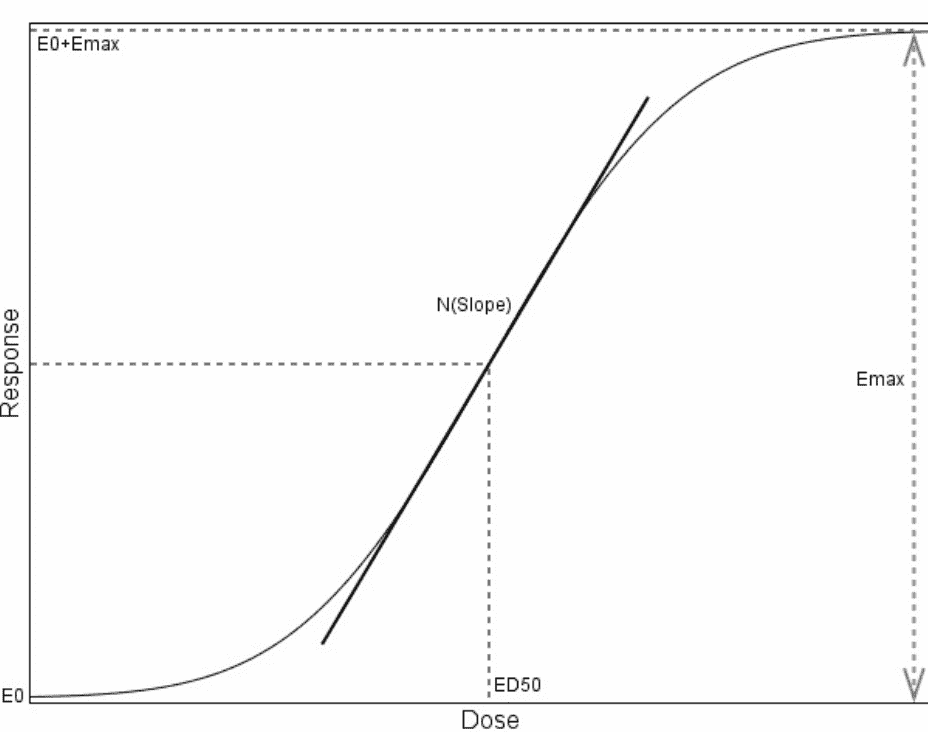

上述模型是传统的 4 参数模型（也称为 Sigmoid 模型），常用于剂量响应研究分析。通过 4 个参数（$E_0$、$ED_{50}$ 和 $h$），模型为拟合各种形状的剂量响应关系提供了巨大的灵活性，使其成为流行的剂量响应模型之一。然而，该模型的应用存在一些局限性。首先，由于模型有 4 个参数，至少至少 5 个剂量（可以包含0作为安慰剂），并假设剂量响应曲线是单调的。其次，4 参数模型有时不收敛。在 4 参数模型不收敛或研究仅设计 4 个剂量水平的情况下，通常的做法是移除 Hill 参数，例如通过斜率参数 `h=↑`。此时模型变为 3 参数模型（即所谓的双曲线模型），

```
$y_i = E_0 + E_{max} \tilde{A} - \frac{D_i}{ED_{50}+D_i} + \mu_i$，
```

其中各项的定义与上述 Sigmoid 模型相同。

上述模型假设响应变量是连续的，但有时响应变量可能是二分类的，例如响应率。在这种情况下，可以将模型修改为使用 logit 链接的广义模型：

```
$\log(\frac{\pi}{1-\pi}) = E_0 + E_{max} \tilde{A} - \frac{D^h}{ED_{50}+D^h}$
```

其中 `pi` 是观测到的响应率。

在接两个章节中，我们将使用上述模型分析模拟数据，作为应用演示。数据集模拟为 `detcon`（连续连续终点）和 `detbin`（二分类终点）。

### 6.4.2 连续终点

模拟和分析的示例 `SAS` 代码在示例代码 6.2 中提供，该代码模拟了基于上述模型的数据集。

示例代码 6.2 使用 $Emax$ 模型模拟连续数据的程序

```
data dose;

  input dose@;

  datalines;

0 2.5 10 20

run;

%macro simu(n=, sd=, e0=10, emax=80, ed50=5.5, h=1, outdst=dstcon)

** n 是每个剂量组的样本量；

 proc sql noprint;

  select count(dose)into:ngpr

  from dose;

quit;

%let ngpr=&ngpr;

data data_null;

  set dose;

  mean=&e0.+(&emax.*dose*h)/(ed50.**h);

  call symput("mean"|put(mean, 1));

  call symput("dose"|put(dose, 1));

run;

%do i=1 to &ngpr; %put &i.****mean;

data outdst;

  do i=1 to &ngpr;

  group=&i;

  mean=&mean;

  dose=&dose;

  do n=1 to &n;

  resp=&mean.&sd.*rannor(1500);* 使用种子数1500

  output;

  end;

end;

%mend;

%simu(n=60, sd=10, e0=10, emax=80, ed50=5.5, h=1, outdst=dstcon);
```

示例代码 6.3 下 `proc nmixed` 使用模拟数据拟合 4 参数模型。

示例代码 6.3 4 参数 $Emax$ 模型拟合 `proc nmixed`

```
proc nmixed data=dtcn alpha=0.05;

**设置初始值;

parms eo=10 emax=80 edso=5.5 h=1 v=400;

**指定 edso 必须为正;

bounds edso>0;

**定义模型;

if dose=0 then eta=;

else eta= eo + {(emax**h)/(ed50**h)};

model resp= normal(eta, v);

**估计均值差异;

estimate "Diff Means (dose 20mg-placebo)"

  eo+((20**h)/(ed50**h+20**h));

estimate "Diff Means (dose 10mg-placebo)"

  eo+((10**h)/(ed50**h+10**h));

estimate "Diff Means (dose 5 mg-placebo)"

  eo+((5**h)/(ed50**h+5**h));

estimate "Diff Means (dose 2.5mg-placebo)"

  eo+((2.5**h)/(ed50**h+2.5**h));

predict eta=etah;

**输出估计值;

dataset 输出均值差异;

dataset parms 输出参数: e0 emax ed50;

ods output=est ParameterEstimates=parms;
```

使用 `proc nmixed` 的示例代码 6.3 4 参数 Emax 模型的关键结果在图 6.6 中。图中显示了模型估计剂量的输出以及 95% 置信区间。第一行表示 20mg 剂量与安慰剂之间的均值差异为 60.8，95% 置信区间为 (57.2, 64.4)。

| Label | Estimate | Standard Error | DF | Pr >t | Alpha | Lower | Upper |
|---|---|---|---|---|---|---|---|
| Diff Means (dose 20mg-placebo) | 60.8246 | 1.8432 | 33.02 | <0001 | 0.05 | 57.1993 | 64.4500 |
| Diff Means (dose 10mg-placebo) | 50.9201 | 1.6521 | 30.89 | <0001 | 0.05 | 47.6761 | 54.1642 |
| Diff Means (dose 5 mg-placebo) | 37.5029 | 1.6567 | 22.84 | <0001 | 0.05 | 34.2428 | 40.7632 |
| Diff Means (dose 2.5mg-placebo) | 23.7832 | 1.7872 | 13.29 | <0001 | 0.05 | 20.2353 | 27.2692 |

图 6.6 示例代码 6.3 输出

如果读者感兴趣使用对比（使用示例代码 6.1 中的 `SAS` 宏 `%poly` 生成）练习趋势测试，在下方的示例代码 6.4 中提供了使用模拟数据集生成用于趋势测试的正交多项式的样本代码。多项式的输出显示在图 6.7 中。趋势测试在示例代码 6.5 考虑等间距或不等间距的趋势 POC 中执行，输出显示在图 6.8 中。

# 示例代码 6.4 用于趋势测试的正交多项式程序

```
data dose;

  input dose@;

  datalines;

0 2.5 5 10 20

  run;

  %polyorth(fichin=dose);
```

# 示例 6.7 示例 6.4 输出

| Polynomial degree | level_1 | level_2 | level_3 | level_4 | level_5 |
|---|---|---|---|---|---|
| deg. 1 | -0.47434 | -0.31623 | -0.15811 | 0.15811 | 0.79057 |
| deg. 2 | -0.54598 | -0.33428 | -0.03402 | 0.05163 | 0.40507 |
| deg. 3 | -0.46999 | 0.42226 | 0.51435 | -0.57050 | 0.10388 |
| deg. 4 | -0.23872 | -0.72143 | 0.63125 | -0.15781 | 0.11127 |

# 示例代码 6.5 考虑等间距或不等间距的趋势 POC

```
title "General linear model for PoC hypothesis testing";

proc glm data=dstcon;

  class group;

  model resp = "Trend contrast" group;

  contrast -0.47434 -0.31623 -0.15811 0.15811 0.79057;

```

run;

# 图 6.8 示例 6.5 输出

| Source | DF | Type III | Mean Square | F | Pr > F |
|---|---|---|---|---|---|
| group | 4 | 13867.7035 | 34119.9259 | 328.46 | <0.0001 |

| Contrast | DF | Type III | Mean Square | F | Pr > F |
|---|---|---|---|---|---|
| Trend contrast | 1 | 109819.5017 | 109819.5017 | 1054.98 | <0.0001 |

使用简单的 `%polyorth` 宏有助于获取实际的系数，用于样本量计算。

### 6.4.3 二元终点

此处提供了二元终点模拟和分析的示例 `SAS` 代码。读者可以参考示例代码 6.6“使用 Emax 模型模拟二元数据的程序”，根据上述模型模拟一个数据集。

示例代码 6.6 使用 $E_{max}$ 模型模拟二元数据的程序

```sas

data dose;

  input dose@;

  datalines;

  0 2.5 10 20

run;

%macro sql(n, e0=-1.39, emax=3.54, ed50=5.5, h=1);

  proc sql noprint;

    select count(dose) into:ngprp

    from dose;

quit;

%let ngprp = &ngprp;

data null;

  set dose;

  pai=exp(e0+(emax.**dose**&h))/(ed50.**dose**&h))/

  (1+exp(e0+(emax.**dose**&h))/(ed50.**dose**&h))));

  call synonym(compress("pai"||put(n_, 1)), compress(pai) );

  call synonym(compress("dose"||put(n_, 1)), compress(dose) );

run;

%do i=1 to &ngprp; %put Group &i. **** &pai&;. %end;

proc im;

  prob= %do i=1 to &ngprp; &pai&;. %end;

  p = repeat(prob,n); /* repeat row times: n/group *

  call srandseed(321); /* to set seed number; *

  x = rand("Bernoulli", p);

  /* create MyData set *

  append from x;

  /* write data in vectors *
```


`close` `MyData`;

```sas
/* close the data set */
quit;

data mydata;
  set mydata;
  id_n_;
run;

proc transpose data=mydata out=mydata;
  var col-colngp;
  by id;
run;

data xdose;
/* add the COLn to retrieve the dose */
set dose;
  _name_ = compress("COL" || put(n_, 1));
run;
```

```sas
proc sql noprint; /* retrieve the dose for the different groups*/
create table dstbin as
select a.id as os, a.coll as resp, b.dose
from mydata left join xdose b
where a._name=b._name
order by b.dose, a.id;
quit;
```

```sas
create table resp as
select dose,sum(resp) as count, count(*) as n,
sum(resp)/count(*) as pai
from dstbin
group by dose;
quit;
```

```sas
proc print data=resp;
run;
%mend;
```

```sas
%simu(n=60, e0=-1.39, emax=3.54, ed50=5.5, h=1);
```

上述代码创建了两个数据集：一个名为 `dstbin`，基于原始刻度；另一个名为 `resp`，基于汇总刻度（见图 6.9 示例代码 6.6 的输出）。注意，`proc nlmixed` 使用了 `resp` 数据集（该过程也可以在模型语句中使用 `bernoulli` 对个体级数据 `dstbin` 进行模型拟合）。示例代码 6.7 中“使用 `proc nlmixed` 进行 4 参数二元 Emax 模型拟合”下方的 `proc nlmixed` 调用用于使用上一个程序中的模拟数据来拟合 4 参数 Emax 模型。

## 图 6.9 示例代码 6.6 的输出

| Obs | dose | count | pai |
|---|---|---|---|
| 1 | 0.0 | 90 | 0.1500 |
| 2 | 2.5 | 22 | 0.3667 |
| 3 | 5.0 | 33 | 0.5606 |
| 4 | 10.0 | 42 | 0.7000 |
| 5 | 20.0 | 48 | 0.8000 |

## 示例代码 6.7 使用 `proc nlmixed` 进行 4 参数二元 Emax 模型拟合

```sas
proc nlmixed data=resp alpha=0.05;
*****specify that ed50 must be positive;
bounds ed50>0;
*****define models;
if dose=0 then eta = e0;
else eta = e0 + ((emax*dose**h)/(ed50**h+dose**h));
nexpeta = exp(eta);
p = expeta/(1+expeta);
count = binomial(n, p);
*****estimate the difference in proportions (dose group-control group);
```

```sas
estimate "Diff Props - control group"
exp(e0+(emax*2*h/(ed50+2*h)))/(1+exp(e0+(emax*2*h/(ed50+2*h)))-exp(e0));
```

```sas
estimate "Diff Props (10 mg - control group"
exp(e0+(emax*10*h/(ed50+2*h)))/(1+exp(e0+(emax*10*h/(ed50+2*h)))-exp(e0));
```

```sas
estimate "Diff Props (5 mg - control group"
exp(e0+(emax*5*h/(ed50+2*h)))/(1+exp(e0+(emax*5*h/(ed50+2*h)))-exp(e0));
```

```sas
estimate "Diff Props (2.5 mg - control group"
exp(e0+(emax*2.5*h/(ed50+2*h)))/(1+exp(e0+(emax*2.5*h/(ed50+2*h)))-exp(e0));
```

```sas
data mydata;
  set mydata;
  id_n_;
run;
nexpeta = exp(eta);
```


# 参考文献

- Ting N. (2006). 引言与药物开发过程。In Ting N, ed. *药物开发中的剂量发现*. New York: Springer.

- Ting N. (2011). 治疗慢性疾病的第2期临床开发。*Drug Information Journal* 45: 431–442。

- 国际协调会议. (1997). E8: 临床试验的一般考虑因素。访问：[http://www.ich.org/fileadmin/Public_Web_Site/ICH_Products/Guide]

- 国际协调会议. (1994). E4: 支持药物注册的剂量-响应关系。访问：[http://www.ich.org/fileadmin/Public_Web_Site/ICH_Products/Guide]

- Grieve AP. (2011). 适应性试验设计：寻找答案。*International Clinical Trials*, Issue 22, 16-20.

- Trevor AJ, Katzung BG, Masters SB. (2010). *Katzung and Trevor’s药理学考试与委员会评审*, 第九版. New York: McGraw Hill, 15.

- Ting N. (2008). 确认与探索：临床试验设计的步进式方法。*Drug Information Journal* 42: 545-554.

- Thomas N & Ting N. (2009). 最小有效剂量。In D’Agostino RB, Sullivan L, Massaro J, eds. *临床试验百科全*. Hoboken, NJ: Wiley-Blackwell.

- Fillon TG. (1995). 通过回归模型和百分位数估计估计化合物的最小治疗有效剂量。*Statistics in Medicine* 14: 925-932.

- Pinheiro JC, Bornkamp B & Bretz F. (2006). 结合多次比较和建模程序的剂量药研究的设计与分析。*Journal of Biopharmaceutical Statistics* 16: 639–656.

11. Hochberg Y & Tamhane A. (1987). 多重比较程序。New York: Wiley.

12. Wang X & Ting N. (2012). 结合剂量范围探索的概念性临床试验设计。Pharmaceutical Statistics 11: 403-409.

13. Pinheiro J, Bretz F & Branson. (2006). 剂量-响应研究分析-建模方法。In Ting N, ed. 药物开发中的剂量发现. New York: Springer.

14. Ting N, ed. (2006). 药物开发中的剂量发现. New York: Springer.

15. Hamlet A, Ting N, Hanumara C & Finman JS. (2002). 早期反应临床试验设计中的剂量间隔。Drug Information Journal 36: 855-864.

16. Ting N. (2009). II期骨关节炎临床试验设计的实际与统计考量：案例研究。Communications in Statistics – Theory and Methods 38: 3282-3296.

17. Penel N & Kramar A. (2012). 修改的斐波那契剂量递增广泛对应什么？BMC Medical Research Methodology 12: 103.

18. Quinian JA & Krams M. (2006). 执行适应性设计：逻辑与运营考量。Drug Information Journal 40: 437-444.

19. Krams M, Lees KR, Hacke W, Orgogozo JM & Ford GA 为 ASTIN 研究小组。(2003)。ASTIN: 针对急性缺血性卒中 UK-279,276 的适应性剂量-响应研究。Stroke 34: 2543-254.

20. Yuan G & Ting N. (2014). 首剂量范围临床试验设计：更多剂量？还是更宽的范围？In Young WR & Chen DG, eds. 临床试验生物统计学与生物医药应用。Boca Raton, FL: Chapman and Hall/CRC.

- 21. Chow SC, Shao J & Wang H. (2007). 临床研究中的样本量计算，第二版。Boca Raton, FL: Chapman & Hall/CRC.

- 22. Bellamy N, Campbell J, Stevens J, Pilcher L, Stewart C & Mahmood Z. (1997). 西安大略和麦克马斯特大学 VA3.0 骨关节炎指数计算机化版本的验证研究。Journal of Rheumatology 24: 2413-2415.

- 23. Fedorov VV & Leonov SL. (2014). 非线性响应模型的优化设计。Boca Raton, Florida: Chapman and Hall/CRC.

- 24. MacDougall J. (2006). 剂量-响应研究分析 – Emax 模型。In Ting N, ed. 药物开发中的剂量发现. New York: Springer.

# 作者

Naitee Ting，高级首席生物统计学家，勃林格殷恩格翰制药有限公司，美国康涅狄格州里奇菲尔德。

袁郭君，全球生物统计总监，EMD Serono, Inc（默克 KgaA 子公司），美国马萨诸塞州比勒卡。

François Beckers，全球生物统计学负责人，Merck Serono, Inc（默克 KgaA 子公司），德国达姆施塔特。

## 第7章：用于剂量-响应测试的 MCP-Mod

### 7.1 引言
### 7.2 方法论
### 7.3 设计阶段 MCP-Mod 的考量
### 7.4 使用 SAS 的示例
### 7.5 结论
### 7.6 参考文献
### 7.7 附录

#### 7.1 引言
药物行业中一个众为人知的问题是为III期选择合适的剂量。历史上，剂量发现研究是基于多次比较进行设计和分析的。然而，在II期，精确的剂量-响应关系通常是未知的。

MCP-Mod 方法最近被认为是处理II期设计和分析中模型不确定性的有效方法。在设计阶段，识别一组合适的模型；在分析阶段，使用趋势检验对这些模型进行剂量响应测试。一旦建立了剂量-响应信号，将使用集合中的最佳模型进行目标估计。

然而，其结论的有效性很大程度上取决于对模型的适当选择。在本章的剩余部分，我们将详细介绍 MCP-Mod 的核心方法论，包括对通用模型的扩展，通过示例进行说明，并提供底层 SAS 代码。

#### 7.2 方法论

##### 7.2.1 原始 MCP-Mod 方法
在本节中，我们首先为单正态分布终点提供原始 MCP-Mod 方法 [2] 的简短技术描述。随后，我们描述了一种最近开发的 MCP-Mod 变体，该变体将方法论扩展到通用参数模型的剂量发现研究（例如二分类、计数或事件终点，并包括某些纵向方法），[4]。

MCP-Mod 程序通过五个步骤实施；参见图 7.1 原始 MCP-Mod 程序的分层概述：

- 在设计阶段，识别若干候选剂量响应形状，这些形状可能代表真实的剂量响应关系。
- 推导出优化对比系数，使得检测与相应候选模型的特定剂量响应形状的边际功效最大化。
- 在分析阶段，基于之前的优化系数通过多次对比检验评估单个形状的显著性，以评估是否可以建立剂量响应信号。这形成了 MCP-Mod 的 MCP 部分。
- 使用模型选择准则（如 AIC 或 BIC）选择候选模型或使用模型平均法。
- 使用选定的模型通过基于的方法对适当剂量进行推断。这形成了 MCP-Mod 的 Mod 部分。

药物开发过程中最具挑战性的决策通常会同时涉及定性和定量的考量。在接下来的章节中，我们将详细描述 MCP-Mod 方法的每一个步骤。在下一节中，我们将通过一个数值示例和相应的 SAS 代码来展示原始的 MCP-Mod 方法。

## 7.1 原始 MCP-Mod 流程的高级概述

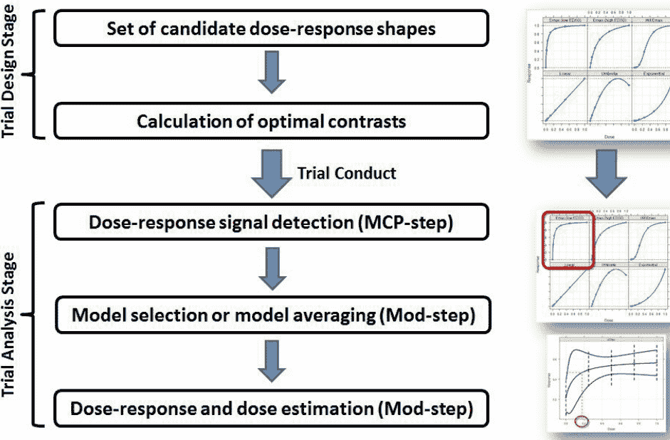

对于一组对活性剂量 `$d_2,...,d_k$` 以及安慰剂 `$d_1$` 有响应的并行组患者（总共 `$k$` 组），其主要响应变量为 `$y$`。为了进行剂量-响应信号测试和估计目标剂量，我们考虑模型规范的单因素布局：`$y_{ij}=\mu_i+\epsilon_{ij}, \epsilon_{ij} \sim N(0,\sigma^2)$`，其中 `$j=1,...,n$`，`$i=1,...,k$`，其中在剂量 `$d_i$` 处的平均响应可以表示为 `$\mu_i=\mu(d_i,\theta)$`，其中 `$\mu$` 是由参数向量 `$\theta$` 参数化的某种剂量-响应模型，`$n_i$` 表示分配到剂量 `$d_i$` 的患者人数，`$e_{ij}$` 是第 `$i$` 组中第 `$j$` 个患者的误差项（假设受访者相互独立）。我们注意到，实践中使用的许多剂量-响应模型可以写为 `$\mu(d,\theta)=\theta_0+\theta_1f^0(d,\theta_2)$`，且 `$f^0(d,\theta_2)$` 通常是取决于 `$\theta_2$` 的剂量水平的非线性变换。参数 `$\theta_0$` 和 `$\theta_1$` 决定了函数 `$f$` 的位置和缩放。`$f^0$` 的示例是 `$f^0(d,\theta_2)=d/(d+\theta_2)$`，这导致了（双曲线）模型，其中 `$\theta_2$` 表示 `$ED_{50}$` 参数。更多的剂量-响应模型见“临床试验中常用的剂量-响应模型”示例。列 `$\theta_2$` 列出了每个模型中决定模型形状的参数。例如，对于 beta 模型 `$B(\zeta_1, \zeta_2) = (\zeta_1 + \zeta_2)^2(\zeta_1\zeta_2)$`，其中 `$D$` 是大于研究中所用剂量的常数（例如最高剂量的 1.2 倍），对于二次模型 `$\zeta = \beta_2/|\zeta_1|$`。

## 表 7.1 临床试验中常用的剂量-响应模型示例

| 模型名称 | `$\mu(d, \theta)$` | `$\theta_2$` |
|---|---|---||
| 线性 | `$E_0 + \alpha d$` | |
| 对数 | `$E_0 + \alpha \log(d + c)$` | |
| 二次 | `$E_0 + \beta_1 d + \beta_2 d^2$` | `$\zeta$` |
| | `$E_0 + E_{max} d / [d + ED_{50}]$` | `$ED_{50}$` |
| 指数 | `$E_0 + E_1[\exp(d/\zeta) - 1]$` | `$\zeta$` |
| | `$E_0 + E_{max}(d/h)^{\eta}/[d+ED_{0}]$` | `$(ED_{50}, \eta)$` |
| betaMod | `$E_0 + E_{max}B(\zeta_1, \zeta_2)[d/D]^{\zeta_1}[1 - d/D]^{\zeta_2}$` | `$(\zeta_1, \zeta_2)$` |

MCP-Mod 的第一步是识别一组 `$M$` 个带参数的模型，以及它们标准化响应的先验参数值。当与试验计划的剂量 `$d_1, ..., d_k$` 使用时，这些候选模型产生平均响应 `$\mu_m = [\mu_{m1}, ..., \mu_{mk}]$`，其中 `$\mu_{mi} = \mu_m(d_i, \theta_{2m})$` 具有指定的参数 `$\theta_{2m}$`，且 `$\mu_m$` 是第 `$m$` 个剂量-响应函数，`$m=1, ..., M$`。

第二步是使用单一对比测试候选集中的每种剂量-响应形状，选择系数以在底层平均响应等于 `$\mu_m$` 时使检验效能最大化。这种方法形成了线性对比 `$c_\mu$` 方面的剂量-响应趋势检验，其中 `$c$` 是一个对比向量，使得 `$\sum c_i=0$` 且 `$\mu$` 是剂量水平上的真实平均值。对于任何给向量 `$\mu$`，最优对比 `$c(\mu_i - \mu^*), i=1, ..., k$` 在归一化后产生唯一解（符号符号除外）`$c/||c||$`，其中 `$\mu^* = \mu/k$`。`$M$` 个可能的剂量-响应形状中的每一个都由一个对比 `$c_m = [c_{m1}, ..., c_{mk}]$` 表示。第 `$m$` 个形状的对比系数在试验设计阶段指定，以便它们能最大化检测第 `$m$` 个预期剂量-响应形状的效能。

第三步是对整体剂量-响应进行测试，其定义为：

```
T_m = \frac{\sum_{i=1}^k c_{mi} y_i}{\sqrt{\hat{S}^2 \sum_{i=1}^k c_{mi}^2}}
```

`$\hat{S}^2 = \sum_{i=1}^k (y_{ij} - \hat{y}_{ij})^2$` 在具有 `$N-k$` 自由度的从 `$t$` 分布下，在假设 `$H_0: \mu=0$` 时，剂量-响应模型是可建立的。在实践中，这些计算依赖于样本量，并基于 `$N-k$`。剂量-响应模型在 `$q_{1-\alpha}$` 处是显著的。如果 `$T_{\max} \geq q_{1-\alpha}$`，则剂量-响应模型可以建立。这些模型是显著的，控制多重比较错误率（familywise error rate, FWER）在 `$\alpha$` 水平上。如果没有候选模型具有统计学显著性，MCP-Mod 程序表明无法建立剂量-响应信号。但这种结果并不意味着药物没有效果。可能的原因包括样本量较小或方差较大。

第四步是从模型集中选择一个或多个权重模型。可以使用 AIC 或 BIC 等信息准则进行此操作。

第五步也是最后一步是将选定的模型拟数据，并使用反回归技术估计目标剂量。注意在这一步中将从数据中估计所有参数 `$(\theta_0, \theta_1$` 和 `$\theta_2)$`。

#### 7.2.2 适用于一般参数模型的 MCP-Mod
在本节中，我们描述了 MCP-Mod 流程的扩展，以承认实践中的建模情况和研究设计比上述正态分布终更为复杂。例如，响应变量可能是计数、二元或事件时间变量，而不是正态分布。此外，最终分析通常需要对相关协变量进行调整（例如区域、年龄……），患者的测量随时间记录（因此需要使用纵向模型），且患者可能接受多种治疗（如交叉或不完全设计）。MCP-Mod 的核心思想在这些情况下仍然适用，如所述并在 [4] 中详细阐述。

令 `$y$` 表示试验单位（例如患者）分配到剂量 `$d$` 的响应向量（该公式可以很容易扩展到多剂量情况）。我们假设残差分布由 `$F(z, \eta, \mu(d))$` 给出，其中 `$\mu(d)$` 表示剂量-响应参数，`$\eta$` 是干扰参数，`$z$` 是可能的协变量。此时 MCP-Mod 的关键特征可以针对 `$\mu(d)$` 阐述：

- 通过一组候选剂量-响应模型考虑剂量-响应模型的不确定性
- 通过基于合理的剂量-响应形状的最优对比测试剂量-响应信号
- 通过模型选择或模型平均结合不同的模型
- 使用非线性回归进行剂量-响应估计和剂量选择。

由于所有剂量-响应信息都被认为由 `$\mu(d)$` 表示，因此该参数的可解释性对于与临床团队沟通以及选择剂量-响应形状至关重要，指定临床相关的效应等。例如，考虑 Weibull 分布（Weibull distribution）：它通常由尺度参数 `$\lambda$` 和形状参数 `$\alpha$` 参数化，而这两者都不易于解释。为了具有可解释性，模型可以根据事件的中位时间 `$\mu = \log 2^{1/\alpha}$` 和 `$\alpha$` 进行重新参数化，然后将 `$\mu$` 作为一个可解释的剂量-响应参数。

令 `$\mu$` 表示方差分析（ANOVA）参数化下估计的剂量-响应参数的方差，该参数通过极大似然法（ML）、广义估计方程（GEE）、部分似然法等针对上述通用参数模型的最合适估计方法获得。这种通用版本 MCP-模型的关键假设是：剂量处的响应 `$\hat{\mu}$` 渐近服从正态分布，其协方差矩阵为 `$\Sigma$`。这种近似已被证明适用于大多数参数估计问题，例如广义线性模型、参数化时间事件模型、混合效应模型等。MCP 步骤包括为剂量-响应关系 `$\mu(d)$` 设定一组候选模型。与原始的 MCP 方法类似，每个候选模型的形状都决定了趋势检验的最优对比，用于评估相关的剂量-响应模型信号。最优对比被应用于前述的 ANOVA 型估计值 `$\hat{\mu}$`，并使用相关的渐近分布来实施检验（即临界值和 p 值）。可以证明，测试假设 `$c^*_\mu=0$` 检验的（最优）对比与 `$\Sigma^{-1/2}(\hat{\mu}-\mu)^T\Sigma^{-1/2}\mathbf{c}$` 成比例，这推广了公式：

### 7.2.1 通用 MCP-模型方法 [4]。从公式可以看出，`$\Sigma$` 只需在比例上已知。一旦确定了剂量-响应信号，将进入 Mod 步骤，拟合剂量-响应曲线并根据 MCP 步骤中识别的模型估计目标剂量。有许多方法可以将剂量-响应模型拟合到观测数据中，包括基于极大似然化或受限似然化的方法。Pinheiro 等人建议了一种替代的二阶段剂量-响应模型拟合方法，使用广义最小二乘法来拟合从 ANCOVA 模型拟合得到的剂量-响应模型，这具有某些计算上的优势 [4]。尽管这种方法依赖于渐近结果，但因为它仅依赖于 `$\mu$` 和 `$\Sigma$`，所以具有通用应用的吸引力。广义 MCP Mod 方法也可以在 SAS 中实现，如后文示例所示。

## 7.3 设计阶段 MCP-Mod 的考虑因素

实施 MCP-Mod 时的一个主要考虑因素是候选模型集合的选取。根据经验法则，通常选择 3-7 个剂量形状（对应于 2-4 个剂量-响应模型）是合适的。请注意，每个剂量-响应模型可能会使用多种剂量-响应形状，因为这些形状定义了 MCP 步骤中使用的最优对比，而模型则是 Mod 步骤中要拟合的模型。虽然通常情况下候选集应该是宽泛的，但当存在很大不确定性时，应该记住，使用非常宽泛且灵活的候选集并不是没有代价的。通常情况下，样本量会随着候选形状（即对比度）集合的变宽泛而增加，因为 MCP 步骤的临界值也会随之增大。此外还存在一种权衡：虽然可以减少潜在的偏差（在模型设定错误的情况下），但它会增加估计值的方差。为了找到良好的平衡点，应考虑以下因素。

- 通用经验：Thomas 等人表明，在许多情况下，线性或 sigmoid 模型即可充分描述观测数据 [5]。
- 药物特异性信息：相似药物的剂量-响应曲线、开发早期的预测或相同药物在不同适应症中的信息。
- 统计学考虑：如果只有少数剂量可用（例如三个），则很难拟合更复杂的模型（如 sigmoid 或 beta 模型，它们都有四个参数），这些通常被包含在候选集中。在这种情况下，我们倾向于使用参数较少的剂量-响应模型。另一个考虑因素是评估从候选集中省略某个剂量-响应形状的后果，这并不一定会有严重后果，因为其他形状可能捕捉到遗漏的模型。这可以在 MCP 步骤（对功效的影响）和 Mod 步骤（对剂量-响应估计精度的影响）通过仿真进行评估 [6]。

在确定模型集合之外，设计剂量发现研究时至少还需要解决另外两个问题：(i) 使用多少以及哪些剂量，(ii) 分配多少受试者。对于 (i)，我们建议根据经验法则使用 4-7 个剂量水平，并考虑至少一个剂量范围 [7]。更正式地也可以考虑最优设计理论来计算剂量和分配，其核心思想是利用预期的剂量-响应曲线信息，然后计算剂量，使参数估计的协方差矩阵在特定意义下最小化。在使用 MCP-Mod 时，已经确定了剂量-响应模型集合，这些信息可以用于计算例如模型平均最优设计（D最优设计）或目标剂量的估计（c最优设计）。由于生产方面的实际限制，可能无法直接使用计算出的最优设计。但也可以将设计的搜索限制在可行范围内。若干作者在剂量发现研究的背景下讨论了最优设计理论 [8,9]。Atkinson 等提供了最优设计的通用背景，并讨论了如何在 SAS 中实现 [10]。对于上述问题 (ii)，根据 MCP-Mod 的两个步骤，可以使用两种方法计算总样本量。可以考虑 MCP 步骤，计算样本量以使多重对比检验达到特定的功效；有关该方法的详细描述见 [6]。或者，也可以根据达到目标剂量或剂量-响应曲线估计的特定精度（例如通过指定所需的置信区间宽度）来计算样本量。这通常需要使用仿真来进行，因为没有闭式表达式。然而，通常需要记住，使用 MCP 步骤检测显著趋势的样本量通常远小于以足够精度确定剂量-响应曲线和目标剂量所需的样本量（见 [1] 中 PhRMA 自适应剂量范围研究工作组的结论）。

## 7.4 关于 MCP-Mod 的进一步考虑

Bretz 等人提出的原始 MCP-Mod 流程灵感来自 Tukey 等人的工作，他们建议基于不同的功能性剂量-响应描述同时使用多种趋势检验，并随后对所得 p 值进行多重比较调整 [2,13]。自此以后，该方法已成为多项研究的主题。Thomas 和 Wakana 等人研究了贝叶斯方法的扩展，用于从稀疏设计中估计或选择剂量-响应曲线 [14,15]。Klingenberg 将 MCP-Mod 方法应用于具有二元响应的概念性研究 [16]。Benda 提出了一种基于重复二元数据的时间依赖性剂量发现方法 [17]。Akacha 和 Benda 研究了受访者脱落对使用复发事件数据分析的影响 [18]。Wouter 扩展了 MCP-Mod 方法以研究纵向毒理学数据 [19]。Tao 等人通过点模型整合了有效性和安全性终点 [20]。Dette 等人、Baeyen 等人、Gutjahr 和 Bornkamp 研究了使用似然比检验代替多重对比检验 [21-23]。Miller、Tanaka 和 Franchetti 等人将 MCP-Mod 方法扩展到灵活的两阶段设计，这种设计包含了在严格的 FWER（族性家族错误率）控制下执行调整（例如添加或删除剂量）的可能性 [24-26]。Dragalin 等人、Bornkamp 等人和 Vandemeuleebroecke 等人研究了响应自适应设计中的 MCP-Mod 流程，解决了剂量发现研究中的两个主要挑战：剂量-响应模型的不确定性以及参数估计的大变异性 [27-29]。

## 7.5 使用 SAS 的分析示例

### 7.5.1 optcont 宏

在本节中，我们将通过两个示例说明 MCP-Mod 的应用，并展示如何使用 SAS 实现它。第一个示例说明了针对正态分布数据的原始 MCP-Mod 流程（如 7.2.1 原始 MCP-Mod 方法中描述），该方法使用了模型选择方法。在这种情况下，`proc glmix` 可用于 MCP 步骤，因为它允许计算多重比较调整后的 p 值。`proc nlmixed` 可用于拟合相关的非线性回归模型并估计目标剂量。第二个示例说明了 MCP-Mod 在线性混合效应模型背景下的更复杂应用。这里使用了 7.2.2 通用参数模型 MCP-Mod 中描述的广义两步法 MCP-Mod 方法论。在此过程中，我们还说明了如何应用自助模型平均法对剂量-响应曲线和目标剂量进行推断。`proc glmix` 用于 MCP 步骤，`proc glm` 用于 Mod 步骤，以基于通用非线性优化程序进行非线性模型拟合。两个示例都依赖于最优对比的计算。为了方便起，在讨论具体示例之前，我们先详细描述通用的 SAS 宏 `optcont`。

`optcont` 宏实现了最优对比：


## 7.4 关于 MCP-Mod 的进一步考虑

Bretz 等人提出的原始 MCP-Mod 流程灵感来自 Tukey 等人的工作，他们建议基于不同的功能性剂量-响应描述同时使用多种趋势检验，并随后对所得 p 值进行多重比较调整 [2,13]。自此以后，该方法已成为多项研究的主题。Thomas 和 Wakana 等人研究了贝叶斯方法的扩展，用于从稀疏设计中估计或选择剂量-响应曲线 [14,15]。Klingenberg 将 MCP-Mod 方法应用于具有二元响应的概念性研究 [16]。Benda 提出了一种基于重复二元数据的时间依赖性剂量发现方法 [17]。Akacha 和 Benda 研究了受访者脱落对使用复发事件数据分析的影响 [18]。Wouter 扩展了 MCP-Mod 方法以研究纵向毒理学数据 [19]。Tao 等人通过点模型整合了有效性和安全性终点 [20]。Dette 等人、Baeyen 等人、Gutjahr 和 Bornkamp 研究了使用似然比检验代替多重对比检验 [21-23]。Miller、Tanaka 和 Franchetti 等人将 MCP-Mod 方法扩展到灵活的两阶段设计，这种设计包含了在严格的 FWER（族性家族错误率）控制下执行调整（例如添加或删除剂量）的可能性 [24-26]。Dragalin 等人、Bornkamp 等人和 Vandemeuleebroecke 等人研究了响应自适应设计中的 MCP-Mod 流程，解决了剂量发现研究中的两个主要挑战：剂量-响应模型的不确定性以及参数估计的大变异性 [27-29]。

## 7.5 使用 SAS 的分析示例

### 7.5.1 optcont 宏

在本节中，我们将通过两个示例说明 MCP-Mod 的应用，并展示如何使用 SAS 实现它。第一个示例说明了针对正态分布数据的原始 MCP-Mod 流程（如 7.2.1 原始 MCP-Mod 方法中描述），该方法使用了模型选择方法。在这种情况下，`proc glmix` 可用于 MCP 步骤，因为它允许计算多重比较调整后的 p 值。`proc nlmixed` 可用于拟合相关的非线性回归模型并估计目标剂量。第二个示例说明了 MCP-Mod 在线性混合效应模型背景下的更复杂应用。这里使用了 7.2.2 通用参数模型 MCP-Mod 中描述的广义两步法 MCP-Mod 方法论。在此过程中，我们还说明了如何应用自助模型平均法对剂量-响应曲线和目标剂量进行推断。`proc glmix` 用于 MCP 步骤，`proc glm` 用于 Mod 步骤，以基于通用非线性优化程序进行非线性模型拟合。两个示例都依赖于最优对比的计算。为了方便起，在讨论具体示例之前，我们先详细描述通用的 SAS 宏 `optcont`。

`optcont` 宏实现了最优对比：

```
$C_{opt} \alpha \alpha' \Sigma^{-1} ( \mu - \frac{\mu' \Sigma^{-1} \mu}{\mu' \Sigma^{-1} \mu} ) $
```

为了计算最优对比，需要单个剂量的预期的 `mu` [4]。通常，使用剂量-响应模型确定平均响应，这些模型提供了决定模型形状的模型参数的“估计值（gestimates）”（请参见“临床试验中常用的剂量-响应模型”示例的右列）。注意，给向量 `mu` 加上常数或将 `mu` 乘以常数不会改变最优对比。也就是说，只有 `mu` 中元素的相对大小对计算有效。此外，还需要指定预期的协方差矩阵 `Sigma`。如上述公式所示，矩阵 `Sigma` 只需要知道其乘数常数。为了获得唯一表示，通过其 `L2` 范数对对比进行标准化，即 `C_{opt} / \|C_{opt}\|`。`optcont` 宏的输入参数是剂量（确定不同模型的 `mu`）、`sigma`（确定矩阵）、方向（`inc` 或 `dec`，决定响应值的增加或减小是否被视为获益）以及剂量名称（`dosename`，确定数据集中剂量变量的名称）。输入参数 `doses` 和 `sigma` 需要通过单独的数据集手动提供或通过适当的程序提取。模型数据集需要完全符合下面给出的格式，即当模型参数少于三个时，具有 `modnam`、`par2` 和 `par3` 列，并指定缺失值。对于 `sigma` 数据集的列名不需要使用特定名称。给定这些输入参数，宏会生成一个名为 `optcontr` 的 SAS 数据集，其中包含不同形状的最优对比。此外，它还会创建一个名为 `modcontr` 的全局变量，包含候选模型名称和对比，随后可以在 `estimate` 语句中使用而无需重新输入。`modcontr` 语句中使用的剂量名称由 `dosename` 确定。宏代码见附录 A。

### 7.5.2 示例 1：具有自身结果和模型选择的 biom 数据

此示例使用了 `DoseFinding` 包中的 `biom` 数据集 [11]。示例代码 7.1 中的 `biom` 数据也曾用于 [2] 说明 MCP-Mod。这是一个随机双盲试验，总共 100 名患者，平均分配到安慰剂或四种编码为 0.05、0.20、0.60 和 1 的剂量之一。

示例代码 7.1 biom 数据

```
data biom;
  input dose resp @;
  datalines;
0.05 1.3538
... (此处省略后续具体数据，根据要求不重复原文) ...
```
```
model resp = dose /NOINT solution COVB ;
  estimate &modcontr;
/ adjust=simulate(nsamp=1000000 seed=1) uppertailed;
run;
run;
```

使用 `optcont` 宏运行此代码可以生成 *Optimal Contrasts for the Candidate Shapes for the biom Data* 中给出的最优对比，并保留两位小数。可以直接使用这些对比，通过 *Example Code 7.2 Contrasts for biom Data* 底部的 `proc glmmix` 调用来计算统计量和经过多重性调整的 p 值

## 表 7.2 biom 数据备选形状的最优对比

| 剂量 (Dose) | (ED50=0.05) | (ED50=0.2) | 指数 (ζ=0.3) | 线性 | 二次 (ζ=-0.8) | Si |
|---|---|---|---|---|---|---|
| 0 | -0.80 | -0.64 | -0.30 | -0.44 | -0.59 | -0 |
| 0.05 | -0.17 | -0.36 | -0.29 | -0.38 | -0.39 | -0 |
| 0.2 | 0.21 | 0.06 | -0.26 | -0.20 | 0.09 | 0. |
| 0.6 | 0.36 | 0.41 | -0.02 | 0.27 | 0.67 | 0. |
| 1 | 0.40 | 0.53 | 0.87 | 0.74 | 0.22 | 0. |

必须调用 `execute` 函数，因为对比结果存储在 `modcont` 宏变量中，需要在执行 `proc glmmix` 之前进行解析。这通过 *Results of the Contrast Test for the biom Data* 生成统计量和调整后的 p 值。在这种情况下，所有模型都产生了较小的 p 值，表明有强有证据存在剂量-反应效应。

## 表 7.3 biom 数据对比测试结果

| 模型形状 | 统计量 | 调整后的 p 值 |
|---|---|---|
| (ED50=0.05) | 3.34 | 0.0018 |
| (ED50=0.2) | 3.46 | 0.0012 |
| 指数 (ζ=0.3) | 2.26 | 0.0323 |
| 线性 | 2.97 | 0.0053 |
| | 3.29 | 0.0021 |
二次 ($\tilde{\mu} = -0.8$)
Sigmoid ($ED_{50} = 0.2, h = 3$) 3.41 0.0014

可以使用 `proc mixed` 拟合单个模型。在附录 B 中，我们提供了用于拟合 biom 数据示例中非线性回归模型的 SAS 代码，并使用 AIC 标准对其进行比较。不同模型的 AIC 值在 *AIC Values for Fitted Models for the biom Data* 中。可以看出，二次模型提供了最低的 AIC。

## 表 7.4 biom 数据拟合模型的 AIC 值

| 模型形状 | AIC |
|---|---|
| | 219.1 |
| 指数 | 223.1 |
| 线性 | 220.5 |
| 二次 | 219.7 |
| Sigmoid | 220.8 |

最后一步包括拟合模型和估计目标效应。在我们的案例中，0.4 的目标效应在 *Figure 7.2 Estimated Dose-Response* 中。

图 7.2 估计的剂量-反应

## 最优对比


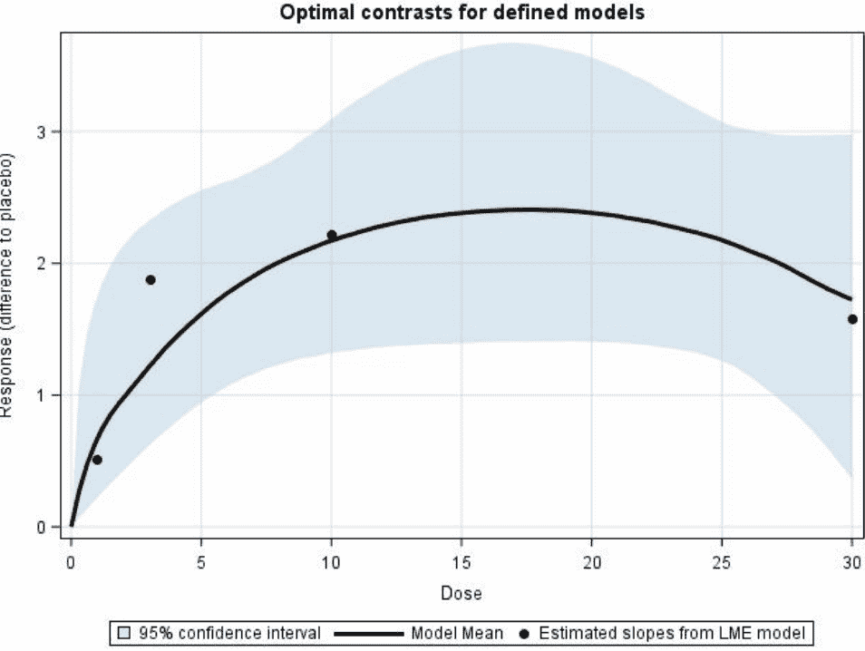

## 7.6 结论

目前的剂量发现实践往往不尽人意：许多剂量发现研究的设计并不合理（剂量过少、剂量范围过窄、样本量不足等），且从这些研究中得出的推断不够准确，导致药物开发中产生不理想的严重后果（例如：III 期失败率高、批准后需要更改标签等）。

在此，我们描述了一种用于分析剂量发现研究的统一策略，包括选择一个或多个剂量进入进一步开发。所提的方法结合了多重比较和建模方法的优点，由一个多阶段程序组成。在第一阶段，使用多重比较方法进行剂量-效应检验，以识别与一组候选模型相对应的具有统计学意义的差异。如果在第一阶段建立了剂量-效应信号，则使用最佳模型进行剂量-效应和目标剂量估计。我们通过对真实数据和模拟数据的分析，展示并评估了结合统计学显著性和临床相关性的不同基于模型的剂量选择方法。

所提方法的 MCP 部分被认为能将族性错误率（FWER）维持在名义水平，在单调剂量-效应设置下其效能与标准趋势检验相当，在非单调场景下表现更好（前提是候选模型足够足够）。与传统的多重比较剂量发现方法相比，这种新方法的明显优势在于通过使用建模技术增加了搜索和识别未来药物开发合适剂量的灵活性。文献中已经研究并探讨了所提方法的几种变体。

与传统的基于 ANOVA 的两对多重比较相比，MCP-Mod 的优势在于能够在设计中允许更多剂量，而不需要大幅增加患者人数。在 ANOVA 类型方法中，仅使用相应剂量的信息来估计剂量-效应，这意味着当每个剂量处需要固定的 MCP 精度时，所需的样本量很大取决于所研究的剂量。通过使用建模技术，MCP-Mod 允许我们跨剂量水平进行信息插值，总样本量将不再强烈依赖于研究的剂量数量。使用更多剂量的可能性通常会导致信息丰富的剂量发现设计，并为 II 期结束时的决策提供更好的依据。

MCP-Mod 可适用于广泛的参数模型，超越标准 ANOVA 模型中正态分布终点的设置。例如，响应变量可能是计数、二分或事件时间变量，而不是呈特定分布。对于广义 MCP-Mod，只需要获得剂量处的响应估计值以及相关的协方差矩阵。在 SAS 中，可以使用不同的方法来产生这些估计。`proc glmix` 可能是最通用的过程，因此推荐用于大多数情况。另一个优势是它能产生适当的多重性 p 值。然后可以使用提供的 proc 代码执行 Mod 步骤，该代码非常灵活，且不依赖终点的底层分布。当然，其他过程如 `proc nlin` 或 `proc mixed` 可用于 Mod 步骤。此外，最终分析通常需要对相关的协变量（如地区、年龄等）进行调整，患者的测量值通常随时间记录（需要使用纵向模型），且患者可能接受多种治疗（如交叉或不完全区设计）。在本章中，我们通过两个真实数据集说明了如何在实践中使用 MCP-Mod 方法。此外，我们还提供了相关的 SAS 代码，使感兴趣的读者能够在许多实际相关的情况中实施并执行 MCP-Mod 方法。实现 MCP 的另一种可能性是通过 DoseFinding R 包 [11]，该包包含了用于剂量发现研究设计和分析的广泛功能。商业软件软件包 ADDPLAN-DF 包含了使用 MCP-Mod 设计剂量发现研究的广泛工具 [12]。此外，Cytel 开发了 PROC MCPMOD 作为 SAS 的插件，专注于使用 MCP-Mod 进行剂量发现研究的分析。

# 参考文献

- 1. Bornkamp B, Brest F, Dmitrienko A, Enas G, Gaydos B, Hsu CH, Koenig F, Krams M, Liu Q, Neuenschwander B, Parke T, Pinheiro J, Roy A, Sax R, & Shen F. (2007). Innovative approaches to designing and analyzing adaptive dose-ranging trials (with discussion). Journal of Biopharmaceutical Statistics 17: 965-995.
- 2. Bretz F, Pinheiro J & Branson M. (2005). Combining multiple comparisons and modeling techniques in dose-response studies. Biometrics 61: 738-748.
- 3. European Medicines Agency. (2014). Qualification opinion of MCP-Mod as an efficient statistical methodology for model-based design and analysis of Phase II dose-finding studies under model uncertainty. Available at: http://www.ema.europa.eu/docs/en_GB/document_library/Regulat
- 4. Pinheiro J, Bornkamp B, Glim E & Bretz F. (2014). Multiple comparisons and modeling for dose finding using general parametric models. Statistics in Medicine 33: 1646-1661.
- 5. Thomas N, Sweeney K & Somayaji V. (2014). Meta-analysis of clinical response in a large drug development portfolio. Statistics in Biopharmaceutical Research 6: 302-317.


## 参考文献

- 6. Pinheiro J, Bornkamp B & Bretz F. (2006). Design and analysis of dose finding studies combining multiple comparisons and modeling procedures. Journal of Biopharmaceutical Statistics 16: 639-656.

- 7. European Medicines Agency. (2015). Report from Dose Finding Workshop. Available at: `http://www.ema.europa.eu/docs/en_GB/document_library/Report/2`

- 8. Dette H, Bretz F, Pepelyhev A & Pinheiro JC. (2008). Optimal designs for dose finding studies. Journal of the American Statistical Association 103: 1225-1237.

- 9. Bretz F, Dette H & Pinheiro J. (2010). Practical considerations for optimal designs in clinical dose finding studies. Statistics in Medicine 29: 731-742.

- 10. Atkinson A, Donev A & Tobias R. (2007). Optimum Experimental Design with SAS. Oxford, UK: Oxford University.

- 11. Bornkamp B, Pinheiro J & Bretz F. (2014). DoseFinding, version 0.9-12. Available at `CRAN.R-project.org`.

- 12. ADDPLAN DF. (2013). Adaptive Designs – Plans 3.1. Available at `www.addplan.com`.

- 13. Tukey JW, Ciminera & Heys JF. (1985). Testing effect of a drug using multiple doses. Biometrics 41: 295-301.

- 14. Thomas N. (2006). Dose-response signal using a sigmoid Emax model in phase II. Journal of Biopharmaceutical Statistics 16: 657-677.

- 15. Wakana A, Yoshimura I & Hamada C. (2007). A method for dose selection in phase II trial. Biometrics 26: 498-511.

- 16. Klingenberg B. (2009). Proof of concept and dose estimation by binary responses. Statistics in Medicine 28: 274-292.

- 17. Benda A. (2010). The impact of dropouts on the analysis of dose-finding. Statistics in Medicine 29: 1096-1106.

- 18. Wouter W. (2012). Statistical analysis of longitudinal data for dose finding. M.Sc. thesis, University of Gent.

- 19. Tao A, Lin Y, Pinheiro J & Shih WS. (2015). Joint modeling of efficacy and safety in phase II studies. International Journal of Statistics and Probability 4: 33-45.

- 20. Dette H, Titoff S, Volgushev S & Bretz F. (2015). Model identification for dose response detection. Biometrics. DOI: 10.1111/biom.12357.

- 21. Baayan C, Hougaard P & Pipper B. (2015). Testing effect of a drug using nested models for the dose-response. Biometrics 71: 417-427.

- 22. Gutjahr J & Bornkamp B. (2015). Likelihood ratio tests for a dose-response effect using multiple nonlinear models. Technical Report, Cornell University Library. Available at: `http://arxiv.org/abs/1510.06253`.

- 23. Miller F. (2010). Adaptive dose-finding: Proof of concept with type error control. Biometrical Journal 52: 577-589.

- 24. Tanaka Y. (2011). An adaptive two-stage dose-response design method for establishing proof of concept in drug development. PhD thesis, University of Pittsburgh.

- 25. Franchetti Y, Anderson S & Sampson A. (2013). An adaptive two-stage dose-response design method for establishing proof-of-concept. Journal of Biopharmaceutical Statistics 23: 1124-1154.

- 26. Dragalin V, Bornkamp B, Bretz F, Miller F, Padmanban SK, Patel N, Pereovskaya I, Pinheiro J & Smith JR. (2010). A simulation study to compare new adaptive dose-ranging designs. Statistics in Biopharmaceutical Research 2: 487-512.

- 27. Bornkamp B, Bretz F, Dette H & Pinheiro J. (2011). Response-adaptive dose-finding under model uncertainty. Annals of Applied

- 29. Vandemeulelebroecke M, Bretz F, Pinheiro J & Bornkamp B. (2011). 自适应剂量范围研究。In: Pong A & Chow SC, eds. Handbook of Adaptive Designs in Pharmaceutical and Clinical Development. Boca Raton, Florida: CRC Press.

# 作者

Björn Bornkamp, 高级专家统计方法学专家，诺华斯，瑞士巴塞尔。

Vladimir Bezlyak, 高级首席生物统计学家，诺华斯，瑞士巴塞尔。

Frank Bretz, 统计方法学与咨询小组全球负责人，诺华斯，瑞士巴塞尔。

## 附录

### 附录 A

示例代码 7.4 代码 `%optcont` 宏

```
%macro optcont(doses=,
models,
sigma=,
direction=
dosevarname=)
****************************************/
读取模型
****************************************/
data &models;
  set modelspec length $50;

if compress(modnam)="emax" then
  do nododel=1;
    modelspec=emax="!!compress("(ed50=!!par1!!")";
  end;
if compress(modnam)="exponential" then
  do nododel=2;
    modelspec=exponential !!compress("(delta=!!par1!!")";
  end;
if compress(modnam)="linear" then
  do nododel=3;
    modelspec=modnam;
  end;
if compress(modnam)="linlog" then
  do nododel=4;
    modelspec=linlog !!compress("(off=!!par1!!")";
  end;
if compress(modnam)="quadratic" then
  do nododel=5;
    modelspec=quadratic !!compress("(delta=!!par1!!")";
  end;
if compress(modnam)="sigEmax" then
  do nododel=6;
    modelspec=sigamax !!compress("(ed50=!!par1!!",h=!!par2!!")";
  end;
if compress(modnam)="betaMod" then
  do nododel=7;
    modelspec=betamod !!compress("(dell=!!par1!!,del2=!!par2!!")";
  end;
run;
proc sql noprint;
  select count(distinct(dose))format=1.0 into &n_dose from &doses;
quit;
proc sql noprint;
  select count(nodelum) into :n_mod from &models;
quit;
proc sql noprint; :model1 - :mod%left(&n_mod_) from &models;
quit;
```

```
proc sql insert;
  select modspec into :modelspec - :modelspecleft(&n_mod_) from models;
quit;

if &direction=incr then &do; let dir1=1; &end;
if &direction=decr then &do; let dir1=-1; &end;
```

********************************************************************************

********************************************************************************/

对比量的计算

****************************************************************/

```
proc iml;
  /* 读取剂量、协方差矩阵、模型/估值和模型名称 */
  use doses var (dose);
  read all into dose;
  use &sigma;
  read all into sigma;
  use &models;
  use all var(modelnam par par2 par3) into par;
  use &models;
  read all var(modnam) into modlist;

  /* 单位矩阵 */
  unity=j(&n_dose, 1, 1);

  /* 用于计算均值向量和对比量的空矩阵 */
  meanat=(&n_dose, &n_mod+1, -88);
  meanat,(1)=dose;

  /* 行标签 */
  contmat=j(&n_dose, &n_mod, -88);

  /* 计算每个模型的均值向量 */
  do j=2 to &n_mod+1;
    modnam=par[-1,1]; /* 对于每个剂量 */
    do i=1 to 3
      if modnam=1 then
        meanat[i,j]=dose[i]/par[j-1, 2] + dose[i];
      if modnam=2 then
        meanat[i,j]=exp(dose[i]/par[j-1, 2]) - 1;
      if modnam=3 then
        meanat[i,j]=dose[i];
      if modnam=4 then
        meanat[i,j]=-log(dose[i] + par[j-1, 2]);
      if modnam=5 then
        meanat[i,j]=dose[i] + par[j-1, 2]*dose[i]**2;
      if modnam=6 then
        meanat[i,j]=dose[i]*par[j-1, 3]/(par[j-1, 2)*par[j-1,
          3] + dose[i]**par[j-1], 3);
      if modnam=7 then
        maxDens=dose(par[j-1, 2]**par[j-1, 2) * (par[j-1,
          3]**par[j-1, 3]/((par[j-1, 2) + par[j-1,
          3)));
        standdose=dose[i]/par[j-1, 4];
        meanat[i,j]=1/maxDens*(standdose**j-1, 2) *
          (1 - standdose**j-1, 3]);
  end;
  invsigma=inv(&sigma);

  do j=2 to &n_mod+1; /* 对比量的计算 */
  mean_t=trans(meanat[,j]);
  1=mean_t*invsigma*unity;
  2=-t(unity)*invsigma*unity;
  3=1_/2
  4=3*unity;
  5=meanat(, j)-4;
  contrast=insigma_*5;
  c_norm=sqrt(ssq(contrast));
  meanat[, j-1]=&dir*contrast/c_norm;
  end;
  /* 将最终对比量导出到数据集 */
  append from comat;
  quit;

data &models;
  set &models;
run;

data __;
  set &models;
  do j=1 to &n_mod;
  if i=j then
  do;
    call execute ("data optcontrasts; set optcontrasts;
    attrib col="compress(j) label="compress(modnam)");
  end;
  data optcontrasts;
  merge &doses(keep=dose) optcontrasts;
run;

/* 在对比矩阵中添加标签 */
%global modcontr;
%let modcontr=;

do i=1 to &n_mod;
  %let k=eval(&i);
  data optcontrasts;
  set optcontrasts;
  attrib col="&modspec&k.";

  proc sql noprint;
  select col into &cont_i from optcontrasts;
  quit;

  %let type=&modspec&k;

  if eval(&i) < &n_mod then
  do;
    %let modcontr=&modcontr.str('%%modspec&i.')&dosevariable&i.;
  end;
  else if eval(&i>&n_mod) then
  do;
    %let modcontr=&modcontr.str('%%modspec&i.')&dosevariable&i.;
  end;
%mend;
```

# 附录 B

# 示例代码 7.5 代码拟合示例 1 中的剂量-反应模型

```
****************************************************************

拟合所有模型并比较 AIC 值

************************************************

/* emax 模型 */

proc nlmixed data=biom;

  ods output FitStatistics=item;

  parms e0=0.3 emax=1 ed50=1 sigma=1;

  bounds 0.001 < ed50 < 1.5; /* ed50 的边界: [0.001,1.5] */
```


`mn=0+ emax*dose/(dose + ed50);`

`model resp ~ normal(mn, sigma=2);`

`run;`

`data item;`

`set item(where=desc='AIC (smaller better)');`

`model="emax";`

`run;`

/* 指数模型 */

`proc nlmixed data=biom;`

`ods output FitStatistics=fitexpo;`

`parms e0=0.3 e1=delta sigma=1;`

`bounds 0.1 < delta < 2;` /* delta 的边界: [0.1,2] */

`mn=0+ e1*(exp(dose/delta)-1);`

`model resp ~ normal(mn, sigma=2);`

`run;`

`data fitexpo;`

`set fitexpo(where=desc='AIC (smaller better)');`

`model="expo";`

`run;`

/* 线性模型（也可以用其他过程拟合） */

`proc nlmixed data=biom;`

`ods output FitStatistics=fitlin;`

`parms e0=0.3 delta=1;`

`mn=0+ delta*dose;`

`model resp ~ normal(mn, sigma=2);`

`run;`

`data fitlin;`

`set fitlin(where=desc='AIC (smaller better)');`

`model="lin";`

`run;`

/* 二次项模型（也可以用其他过程拟合） */

`proc nlmixed data=biom;`

`ods output FitStatistics=fitquad;`

`parms e0=0.3 b1=1 b2=1 sigma=1;`

`mn=e0 + b1*dose + b2*dose^2;`

`model resp ~ normal(mn, sigma=2);`

`run;`

`data fitquad;`

`set fitquad(where=(descr='AIC (smaller better)');`

`model="quad";`

`run;`

/* Emax 模型 */

`proc nlmixed data=biom;`

`ods output FitStatistics=fitsig;`

`parms emax=0.3 ed50=1 h=1 sigma=1;`

`bounds 0.001 < ed50 < 1.5, 0.5 < h < 1;`

`mn=0+ emax*dose/(dose + ed50);`

`model resp ~ normal(mn, sigma=2);`

`run;`

`data fitsig;`

`set fitsig(where=(descr='AIC (smaller better')));`

`model="emax";`

`run;`

`ata itemexpo fitlin fitquad;`

/* 比较不同模型的 AIC */

`proc print data=aics;`

`run;`

/* emax 模型具有最佳 AIC 值 */

## 附录 C

示例代码 7.6 代码为示例 1 绘制图表

```
****************************************************************
创建一个显示结果的图
****************************************************************
/* 包含预测剂量-反应曲线位置的数据集 */
data biompredict;
do i=1 to 100;
    dosepred=(i-1)/99;
    output;
end;
drop i;
run;
data biompredict;
merge biompredict;
run;

/* 模型拟合 */
%let deltiff=0.4;

/* 在指定的剂量网格上拟合 emax 并预测 */
proc nlmixed data=biompredict;
  ods output FitStatistics;
  parms emax=0.3 ed50=1 sigma=1;
  bounds 0.001 < ed50 < 1.5;
  mn=0+ emax*dose/(dose + ed50);
  model resp ~ normal(mn, sigma=2);
  predict emax*dosepred/(dosepred + ed50) out=preout;
  estimate 'TD' &deltiff* ed50/(emax &deltiff);
run;

/* 创建绘图使用的调整后均值 */
proc sql;
    create table adj_means as
    select distinct(dose), mean(resp) as mean_resp
    from biom
    group by dose;
run;
data adj_means;
    set adj_means;
    if dose=0 then mean0=mean_resp;
    retain mean0;
    if dose ne 0 then diff=mean_resp-mean0;
run;
data preout;
    set preout adj_means;
    recline=0.4;
run;

/* 绘制剂量-反应曲线置信区间和调整后原始均值 */
proc sgplot data=preout;
    xaxis grid label="Dose";
    yaxis grid label="Response (difference to placebo)";
    band x=dosepred lower=upper upper=upper /transparency=0.5;
```

```
legendlabel="95% confidence interval";
series x=dosepred y=pred /legendlabels="Model Mean" lineattrs=(thickness=3)
scatter x=dose-diff / markerattrs=(symbol=circlefilled)
legendlabel="Observed difference";
refine refine / lineattrs=(thickness=2 color=red pattern=shortdash)
legendlabel="target difference";
run;
```

## 附录 D

完整数据可在补充材料中获得。

生成示例 2 结果示例代码 7.7

```sas
data neurodeg;
    input resp id dose time @@;
    datalines;
    191.70155 1 0 178.39954 1 0 3 167.33850 1 0
    6 149.50935 1 0 9 91.134853 1 0 12
    205.09590 250 30 175.24421 250 30 3 152.41340 250 30
    6 113.48094 30 9 84.95754 250 30 12

    /* 剂量数量 */
    proc sqlprint;
        select count(distinct(dose))format=1.0 into :n_dose from neurodeg;
    quit;

    /* 用于获取计算对比差的矩阵的初始模型 */
    ods output CoVB=(keep=col2-col6)
    ParameterEstimates=beta(where=(Effect ne "Intercept"));

    proc glimmix data=neurodeg;
        class dose id;
        model resp=dose*time/solution CoVB;
        random intercept time / type=UN subject=id;

    data omega;
        set omega;
        where effect ne "Intercept"
        drop effect;
    run;

    data models;
        length modnam $25;
        input modnam parl-3;
        datalines;
        emax 1.11
        quadratic -0.022 .
        exponential 8.867 . .
        linear . . .
    run;

    data doses;
        input dose @@;
        datalines;
        0 1 3 10 30
    run;

    /* 根据候选模型和协方差矩阵计算最优对比差 */
%optcont(models=models, doses=doses, sigma=omega, direction=incr,
dosevarname=dose*time);
%put &modcontr;

data _null_;
  call execute(
  proc glmix data=neurodeg;
  class dose id;
  model resp=dose*time /solution COVB ;
  random intercept time / type=UN subject=id;
  estimate
  / adjust=simulate(&modcontr; (nsample=1000000 seed=1) upperialed)
  run;);
run;

/* 自举模拟以获取剂量-响应估计的估计和置信区间 */
proc iml;
  /* 初始化步骤 */
  call randseed(1);
  nsime=1000;

  /* 读取数据 */
  use omega;
  read all var (col2 col3 col4 col5 col6) into cv;
  use beta;
  read all var (Estimate) into mn;
  read all var (dose) into dose;

  /* 模型拟合 */
  /* 后续需要的变量 */
  invs=inv(cv);
  nd=row(dose);
  predmn=mn;
  resp=mn;

  /* 定义用于优化不同模型的函数 */
  start fnglsemax(par) global (dose, resp, predmn, nd);

  do i=1 to nd;
    predmn[i]=par[1]+par[2]*dose[i]/(dose[i] + par[3]);
  end;
  dif=(predmn-resp);
  return(dif*invs*dif);
  finish fnglsemax;

  start fnglsexpo(par) global (dose, resp, predmn, nd);

  do i=1 to nd;
    predmn[i]=par[1]+par[2]*(exp(dose[i]/par[3])-1);
  end;
  dif=(predmn-resp);
  return(dif*invs*dif);
  finish fnglsexpo;

  start fngslin(par) global (dose, resp, predmn, nd);

  do i=1 to nd;
    predmn[i]=par[1]+par[2]*dose[i];
  end;
  dif=(predmn-resp);
  return(dif*invs*dif);
  finish fngslin;

  start fngslquad(par) global (dose, resp, predmn, nd);

  do i=1 to nd;
    predmn[i]=par[1]+par[2]*dose[i]+par[3]*dose[i]^2;
  end;
  dif=(predmn-resp);
  return(dif*invs*dif);
  finish fngslquad;

/* 拟合模型的宏模型 */
%macro gfitmod(saveastart=)
optn=(. . .);
/* emax: 边界: [0.03, 0.5] 用于 ED50 */
call nlplgnrc(rc, xr, "fnglsemax", stemax, optn, con);
gaicemax=2*paremax(xr);
paremax=xr;
if saveastart=1 then stemax=xr;

/* exponential: 边界: [0.1, 0.2] 用于 ED50 delta */
call nlplgnrc(rc, xr, "fngsexpo", stexpo, optn, con);
gaicexpo=2*pareexpo(xr);
pareexpo=xr;
if saveastart=1 then stexpo=xr;

/* linear: start=(0); con=(. . .) */
call nlplgnrc(rc, xr, "fngslin", start, optn, con);
gaiclin=2*parlin(xr);
parlin=xr;

/* quadratic: start=(0, 0, 0); con=(. . . .) */
call nlplgnrc(rc, xr, "fnglsquad", start, optn, con);
gaicquad=2*parquad(xr);
parquad=xr;
%end;

/* 从多变量分布中采样并拟合模型 */
emaxdat=(nsim, 4, 0);
expodatj=(nsim, 4, 0);
quaddatj=(nsim, 4, 0);
lindatj=(nsim, 3, 0);

i=1 to nsim;
  resp=t(randnormal(1, mn, cv));
  %gfitmod(i,saveastart=0);
  emaxdat[i]=gaicemax|paremax;
  expodat[i]=gaicexpo|pareexpo;
  quaddat[i]=gaicquad|parquad;
  lindat[i]=gaiclin|parlin;
end;

create emaxdat from emaxdat[colname=('emax_gaic' 'emax_e0' 'emax_ed50')];
append emmaxdat;
close emmaxdat;

create expodat from expodat[colname={'expo_gaic' 'expo_e0' 'expo_el', 'expo_delta'}];
append expodat;
close expodat;

create quaddat from quaddat[colname={'quad_gaic' 'quad_e0' 'quad_bl', 'quad_b2'}];
append quaddat;
close quaddat;

create lindat from lindat[colname={'lin_gaic' 'lin_e0' 'lin_delta'}];
append lindat;
close lindat;
quit;

/* 数据步中的后处理 */
data simresults;
    merge emaxdat expodat quaddat lindat;
    min_gaic=min(emax_gaic, expo_gaic, quad_gaic, lin_gaic);
    array doserp(101);

    if(emax_gaic=min_gaic) then
    do
        i=1 to 101;
        dose=(i-1)/100+30;
        doserp(i)=emax-emax*dose/(emax_ed50+dose);
    end
    bestmod='emax';
    end;

    if(expo_gaic=min_gaic) then
    do
        i=1 to 101;
        dose=(i-1)/100+30;
        doserp(i)=expo_el*(exp(dose/expo_delta)-1);
    end
    bestmod='exponential';
    end;

    if(lin_gaic=min_gaic) then
    do
        i=1 to 101;
        dose=(i-1)/100+30;
        doserp(i)=lin_lin;
    end;

    if(quad_gaic=min_gaic) then
    do
        i=1 to 101;
        dose=(i-1)/100+30;
        doserp(i)=quad_quad;
    end;
run;
```

临床研究旨在估计相同的剂量-效应曲线。如果对临床前试验的转化性有信心，则可以基于临床前数据的弱信息先验分布（weakly informative prior）来计算化合物剂量-效应的后验分布。


贝叶斯剂量-效应分析有帮助的另一个示例是在相同适应症中测试相同终点的化合物时。如果另一种内部化合物已针对特定适应症进行了测试，则可以利用该化合物的信息，为相同适应症和终点的下一次剂量-效应研究构建一个信息先验分布。如果不倾向于使用另一种化合物的剂量效应，则可以使用先验结果作为安慰剂反应建模的信息先验分布。这些示例展示了贝叶斯技术如何允许利用先验信息，以便用更少的患者来表征剂量-效应曲线，或以更高的精度进行估计。

ICH E4《支持药物注册的剂量-效应信息指南》指出，“了解剂量、血中药物浓度与反应（有效性和不良反应）之间的关系对于个体患者安全、有效地使用药物至关重要” [1]。该指南进一步指出，“机构也应开放使用统计学和药代动力学技术，例如贝叶斯方法和群体方法、建模以及药代动力学-药效学（PK/PD）方法。”这进一步强调了贝叶斯剂量-效应分析的重要性和价值。

对于剂量有限和小样本量设计的剂量-效应研究，基于渐近的最大似然估计（MLE）可能无法充分估计模型参数，而贝叶斯模型没有这种缺陷。在一些稀疏设计的反应临床研究示例中，此处使用基于渐近的最大似然法得出的 `ED50` 参数估计值为负值 [2]。然而，利用充分先验信息的贝叶斯 Sigmoid 模型能够获得对 `ED50` 和参数的合理估计。

在临床试验的学习阶段（即 II 期），实施贝叶斯剂量-效应分析允许利用外部信念和/或数据来做出适当决策，即使在样本量较小的情况下也能为剂量-效应关系提供精确估计。

通常，炎症和免疫学领域临床试验的反应本质上是二元的，即结果的成功或失败。尽管这些疾病领域已有连续量表，但临床医生更倾向于根据受试者是否反应或缓解来定义成功。除了连续终点的模型外，我们还提供了一个用于二分类数据的贝叶斯模型示例。

## 8.2 贝叶斯剂量-效应的统计模型

在本章中，我们仅提供贝叶斯双曲模型（第 6 章）。Sigmoid 模型或其他非线性模型不在讨论范围之内 [3,4]。但需要，可以通过在双曲模型中添加参数 `$h$` 来轻松实现 Sigmoid 模型。根据第 6.4.1 节，贝叶斯双曲模型写为：

```
$y_i = E_0 + E_{max} \tilde{A} - \frac{D_i}{ED_{50} + D_i} + I_i \mu_i$
```

其中

- 1. `$i$` 是受试者 ID

- 2. `$y_i$` 是第 `$i$` 个患者观察到的连续反应变量

- 3. `$E_0$` 是基础效应，当剂量为 0mg 时的反应

- 4. `$E_{max}$` 是药物引起的最大效应

- 5. `$ED_{50}$` 是产生一半效应的剂量

- 6. `$D_i$` 是第 `$i$` 个患者的剂量水平

- 7. `$\epsilon_i$` 是第 `$i$` 个患者的随机误差。此处采用的一个标准假设是 `$\epsilon_i$` 项是独立同分布分布的，均值为 0，方差为 `$\sigma^2$`。另一个标准假设是误差项呈正态分布。

此外，假设 `$y_i\sim N(\mu_i, \tau)$`，其中 `$\tau=1/\sigma^2$` 是精密度。对于贝叶斯分析，对双曲模型参数的分布做出先验假设，即通过假设模型参数周围的分布（即 `$E_0, ED_{50}$` 和精密度参数 `$\tau$` 的分布）来实现。

对于二分类结果，可以使用 logit 链接将模型修改为广义双曲模型：

`$\log \frac{\pi}{1-\pi} = E_0 + E_{\max} \tilde{A} - \frac{D_i}{ED_{50}+D_i},$`

其中 `$\pi$` 是观察到的反应率。

## 8.3 连续终点的分析示例

### 8.3.1 每组 75 名患者的哮喘试验

考虑一项评估临床试验中新实体反应的 II b 期研究。感兴趣的典型 II 期终点是 `FEV1`（第一秒用力呼气量），这是哮喘研究中常用的肺功能测试。`FEV1` 终点的优势是，观察到变化所需的随访时间比典型的 III 期急性加作终点要短得多。`FEV1` 终点是连续的，可以假设为从正态分布。申办者对这种实验药物运行了两次 II 期研究；第一项研究测试了耐受剂量（MTD）的效果，第二项研究测试了另一个接近 MTD 的剂量和一个低剂量。基于这两项之前的研究，我们对剂量-效应有了一些了解。该化合物的临床前研究提供了对剂量-效应的一些了解。目前的研究探索了广泛的剂量范围；假设试验数据可用，我们将根据从之前的研究中获得的知识来分析数据。为了本示例的目的，模拟样本数据的代码见代码 8.1。

```sas
%macro conexism(ntrt,r0,r1,r2,r3,r4,r5,r6,r7,r8,npergrp,pdrop,seed);
  data sims (keep subject response);
    format treatment $8;
    subject = 0;
    %do trt = 0 to &ntrt;
      do i = 1 to &npergrp;
        subject = subject + 1;
        if &trt = 0 then do;
          treatment = "Placebo";
          dose = 0;
        else do;
          treatment = "Active";
          dose = 3**(&trt-1);
        end;
        response = 0.35*ror(floor(&seed)) + &&trt;
        dropout = ranbin(floor(&seed), 1, &pdrop);
        if dropout = 0 then output;
      end;
    %end
%mend;

proc sort data = sims;
  by dose;
run;

proc means data = sims;
  var response;
  output out=sumstat mean=mean sum=sum n=n std=sd;
  by dose;
run;

  data sumstat (keep = mean dose n sd);
    set sumstat;
  run;

%conexism(ntrt=5, r0=0.02, r1=0.075, r2=.10, r3=.16, r4=.20, r5=.25,r6,r7,r8,npergrp=75, pdrop=.10, seed=35213);
```

此模拟产生的剂量汇总数据见下面的“每组 75 名患者的哮喘试验剂量摘要”。一旦生成试验，将使用 `proc mcmc` 语句在代码 8.2“每组 75 名患者的哮喘试验分析”中进行贝叶斯分析。

# 表 8.1 每组 75 名患者的哮喘试验剂量摘要

| 剂量 | N | 均值 | 标准差 |

|---|---|---|---|

## 示例代码 8.2 每组 75 名患者的哮喘试验分析

```sas
/** MCMC 语法设置输出数据集以包含后验摘要，设置
 蒙特卡洛迭代次数以及种子、要监控的参数、
以及要监控自相关性和薄抽样（thinning）的图表 **/
proc mcmc data = outemaxsim nmc = 50000 nbi = 1000 seed = 3746
monitor = (param, var_sub, std_sub, ed50, len50)
thin = 9 stats (percentile.5 15 50 75 95 97.5);
ods output PostsummariespostIntervals-intervals;
param e0 max len50) /** 设置参数 **/
/** 为每个参数设置先验概率 **/
prior e0-normal(mean=0, precision=10)
prior emax-normal(mean=0.20, precision=10)
prior tau-gamma(shape=0.001, scale=0.001)
prior len50-normal(mean=-0.69, precision=0)
beginprior
  /** 设置残差方 ***/
  var_sub = 1/tau;
  std_sub = sqrt(var_sub);
  /** Ed50 ***/
  ed50 = exp(len50);
  /** 计算后验预测分布 ***/
  Preddist output=predout nsim=5000 covariates=Sumstat;
enddata;
mu = e0 + (emax/dose)/(ed50 + dose);
model response - normal(mean=mu, precision=tau);
run;
```

`proc mcmc` 语句使用了通过宏 `示例代码 8.1 每组 75 名患者的哮喘试验模拟数据` 生成的输入数据集 `sims`。后验样本将使用 `out` 选项保存在 `emax_out` 数据集中在本示例中，计划了 50,000 次马尔可夫链模拟（`nmc`），带有 1,000 个预热样本（`nbi`）和 3 的薄抽样率（`thin`），这意味着每 3 个模拟样本保留一个，其余样本被丢弃。模型参数和所有初始值在 `prior` 语句指定的先验中指定，先验概率在 `prior` 语句中指定。

一旦计算出后验分布，`mcmc` 会计算参数的点估计，以及标准差和分位数。默认情况下，仅提供分位数，但可以使用 `proc mcmc` 过程中的 `stats(percent =)` 选项指定分位数。还会生成后验样本的图表，例如默认由 `ods deviance information criterion (dic)` 生成的图表（在使用多条链时可以作为模型诊断工具，未显示），以及最高后验密度（HPD）区间（未显示）。这些 `mcmc` 轨迹图、自相关图和核密度图。这些图表生成如图 8.1 `e0` 诊断图、图 8.2 `Emax` 诊断图、图 8.3 `tau` 诊断图、图 8.4 `Ned50` 诊断图和图 8.5 `var_sub` 诊断图所示。轨迹图和自相关图提供了收敛性的良好可视化。参数 `e0`、`emax`、`ed50` 的轨迹图表明马尔可夫链已经稳定，且链具有良好的混合特性。自相关图显示三个参数的后验样本之间的自相关程度较低（可能是由于后验样本的薄抽样导致的）。

图 8.1 `e0` 诊断图

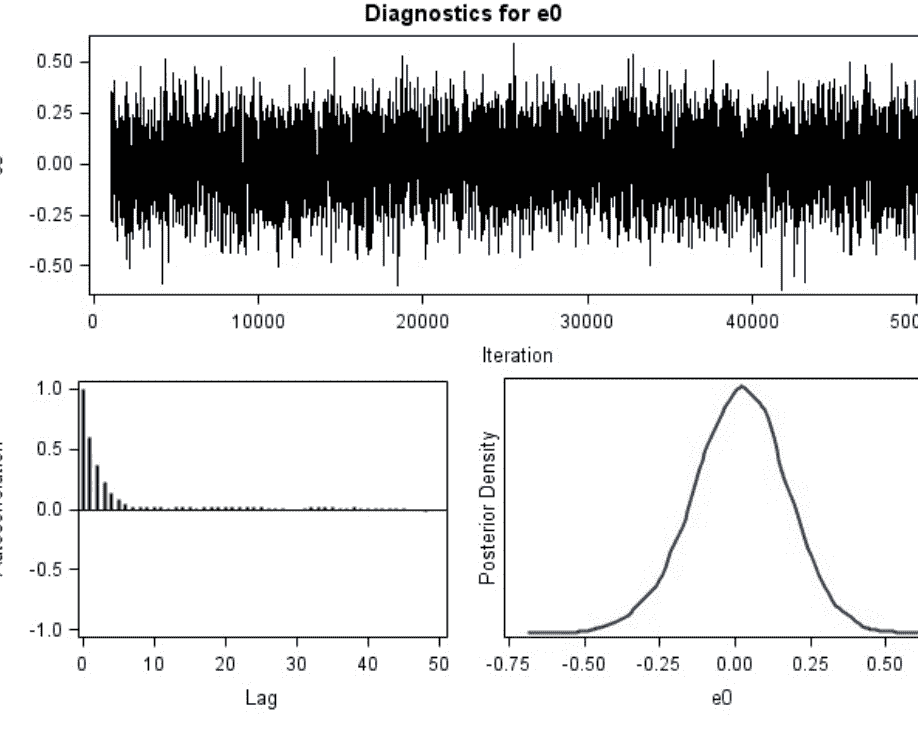

图 8.2 `Emax` 诊断图

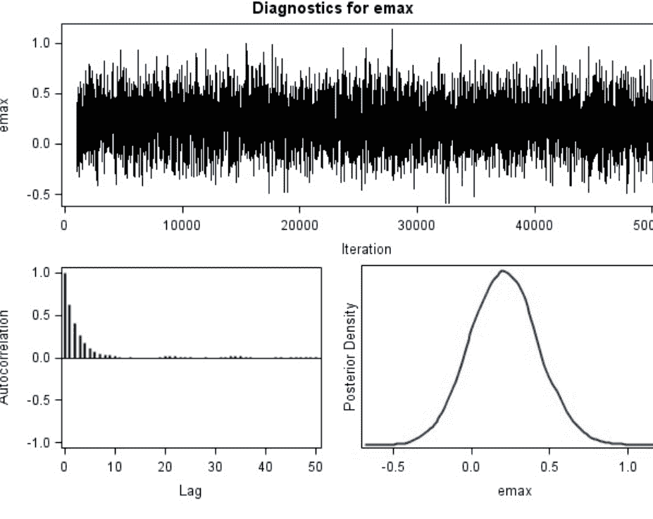

图 8.3 `tau` 诊断图

## `tau` 的诊断

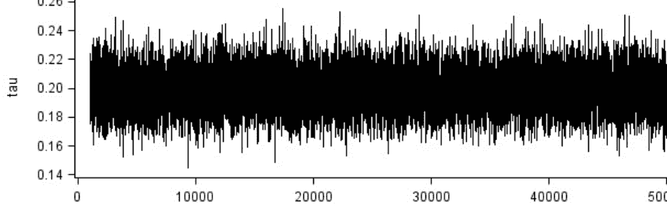

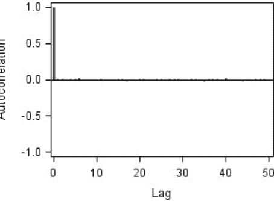

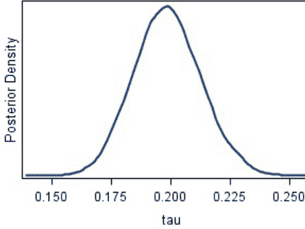

图 8.4 `Ined50` 诊断图

## `Ined50` 的诊断

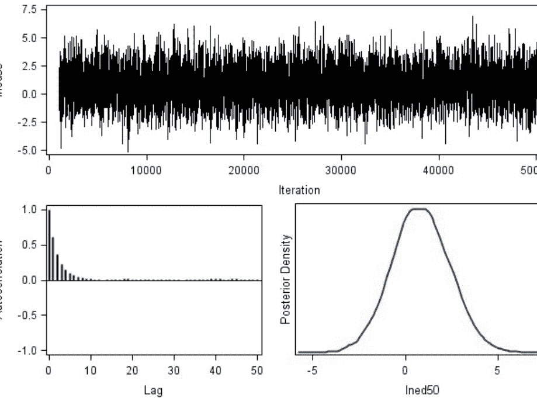

图 8.5 `var_sub` 诊断图

## `var_sub` 的诊断

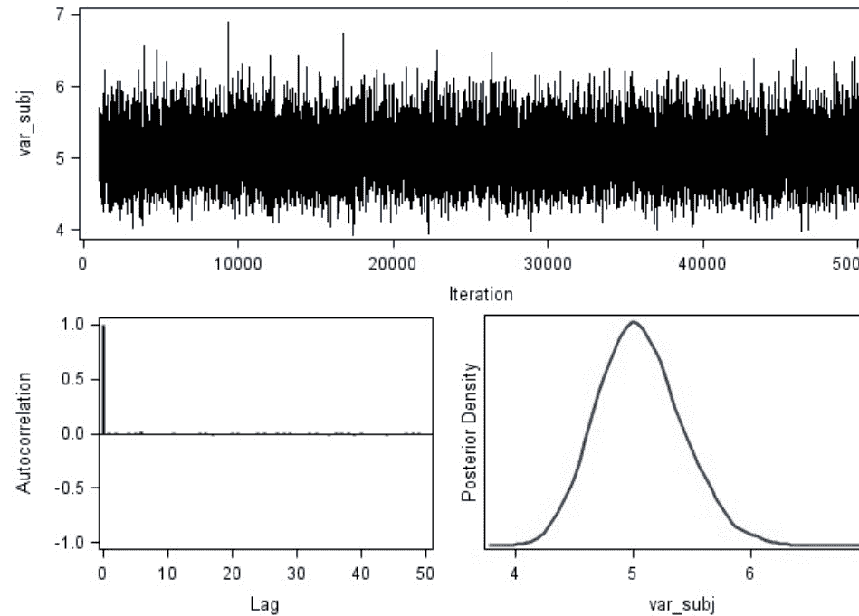

图 8.6 示例代码 8.2 的后验摘要

| 参数 | N | 平均值 | 标准差 | 2.5 | 10 | 15 | 50 | 75 | 95 | 97.5 |

|---|---|---|---|---|---|---|---|---|---|---|

| e0 | 16687 | 0.0147 | -0.3058 | -0.2472 | -0.1887 | -0.1373 | 0.0177 | 0.1181 | 0.2656 | 0.4118 |

| emax | 16687 | 0.0286 | -0.2169 | -0.1412 | -0.0650 | 0.0369 | 0.2287 | 0.3510 | 0.5299 | 0.6442 |

| tau | 16687 | 0.0140 | -0.1723 | -0.1760 | -0.1907 | -0.1840 | -0.1643 | 0.1984 | 0.2020 | 0.2272 |

| ined50 | 16687 | 0.8417 | 1.5422 | -1.6612 | -1.2140 | -0.7453 | -0.2362 | 0.8279 | 1.8811 | 3.0485 | 3.8775 |

| var_subj | 16687 | 0.5097 | 0.3595 | 4.4012 | 4.4965 | 2.1695 | 2.6905 | 3.0407 | 5.2287 | 5.6828 | 5.8028 |

| std_subj | 16687 | 2.2480 | 0.0797 | 2.0972 | 2.1205 | 2.1471 | 2.1695 | 2.2452 | 2.2287 | 2.4039 | 2.4089 |

| ed50 | 16687 | 0.0321 | 0.1170 | 0.1899 | 0.3250 | 0.4724 | 0.6784 | 2.2284 | 2.6609 | 3.2138 | 4.0315 |

`emax` 的后验平均值（标准差）等于0.21，表明药物的最大效应为0.21（见图 8.6 示例代码 8.2 的后验摘要）。尽管在本研究中两个较高剂量的估计值更大，但来自之前研究的合并信息明确表明实验药物的最大效应约为0.21。最大效应的先验信息对后验估计有影响。`ed50` 的后验平均值（标准差）估计约为2.04 (0.12)。然而，`ed50` 估计周围似乎有较高的变异性。先验信息不强，因此本研究的似然性驱动了后验密度的估计。注意中位数为2.29（因为 ed50 是偏态分布）。由于 ed50 分布的偏态性，2.29 似乎是更合理的 ed50 估计值。

## 8.3.2 每组 100 名患者的哮喘试验

对于之前的示例，考虑申办者未对实验药物进行二期研究的情况。实验药物的临床前数据将阐明潜在的 `ED50` 和药物的最大效应。由于缺乏临床数据，临床前数据（在应用某些不确定性后）以扩散先验的形式用于分析。

模拟数据的代码与之前的示例相同，不同之处每组计划样本量为100而不是75，且种子发生了变化。在更新 `nprxgrp = 100` 和 `seed = 9865` 后，重新运行了 `conamaxsim` 宏（示例代码 8.3 每组 100 名患者的哮喘试验）。

该模拟结果的摘要数据在 `每组 100 名患者的哮喘试验的剂量摘要`中提供。带有新先验的 `proc mcmc` 调用在 `示例代码 8.3 每组 100 名患者的哮喘试验`中提供。`E0` 的先验保持不变。扩散先验被假设为正态分布，均值为0.15，精度较低为1（与之前示例的精度10相比）。`ED50` 也是扩散的，假设在0到20之间为均匀先验。在本示例中没有关于药物的临床信息，因此我们假设从0到20均匀。如果我们更多更多的信息（类似于之前的示例），我们可以假设一个以20为边界的 beta 分布，并调整 beta 分布的参数使其具有信息量。表 8.2 每组 100 名患者的哮喘试验的剂量摘要

| 剂量 | N | 平均值 | 标准差 |

|---|---|---|---|

| 0 | 87 | 0.008 | 0.29 |

| 1 | 93 | 0.080 | 0.34 |

| 3 | 89 | 0.064 | 0.33 |

| 9 | 96 | 0.138 | 0.38 |

| 27 | 95 | 0.234 | 0.35 |

| 81 | 90 | 0.236 | 0.37 |

## 8.3 每组 100 名患者的哮喘试验

```sas
/** MCMC 语法设置输出数据集以包含后验摘要，设置
 蒙特卡洛迭代次数以及种子、要监控的参数、
以及要监控自相关性和薄抽样（thinning）的图表 **/
proc mcmc data = outemaxsim nmc = 50000 nbi = 1000 seed = 3746
monitor = (param, var_sub, std_sub, ed50, len50)
thin = 9 stats (percentile.5 15 50 75 95 97.5);
ods output PostsummariespostIntervals-intervals;
param e0 max len50) /** 设置参数 **/
/** 为每个参数设置先验概率 **/
prior e0-normal(mean=0, precision=10)
prior emax-normal(mean=0.20, precision=10)
prior tau-gamma(shape=0.001, scale=0.001)
prior len50-normal(mean=-0.69, precision=0)
beginprior
  /** 设置残差方 ***/
  var_sub = 1/tau;
  std_sub = sqrt(var_sub);
  /** Ed50 ***/
  ed50 = exp(len50);
  /** 计算后验预测分布 ***/
  Preddist output=predout nsim=5000 covariates=Sumstat;
enddata;
mu = e0 + (emax/dose)/(ed50 + dose);
model response - normal(mean=mu, precision=tau);
run;
```


`proc mcmc`语句使用了通过宏`示例代码 8.1 每组 75 名患者的哮喘试验模拟数据`生成的输入数据集`sims`。后验样本将使用`out`选项保存在`emax_out`数据集中。在本示例中，计划了 50,000 次马尔可夫链模拟（`nmc`），带有 1,000 个预热样本（`nbi`）和 3 的薄抽样率（`thin`），这意味着每 3 个模拟样本保留一个，其余样本被丢弃。模型参数和所有初始值在`prior`语句指定的先验中指定，先验概率在`prior`语句中指定。

一旦计算出后验分布，`mcmc`会计算参数的点估计，以及标准差和分位数。默认情况下，仅提供分位数，但可以使用`proc mcmc`过程中的`stats(percent=)`选项指定分位数。还会生成后验样本的图表，例如默认由`ods deviance information criterion (dic)`生成的图表（在使用多条链时可以作为模型诊断工具，未显示），以及最高后验密度（HPD）区间（未显示）。这些`mcmc`轨迹图、自相关图和核密度图。这些图表生成如图 8.1 `e0`诊断图、图 8.2 `Emax`诊断图、图 8.3 `tau`诊断图、图 8.4 `Ned50`诊断图和图 8.5 `var_sub`诊断图所示。轨迹图和自相关图提供了收敛性的良好可视化。参数`e0`、`emax`、`ed50`的轨迹图表明马尔可夫链已经稳定，且链具有良好的混合特性。自相关图显示三个参数的后验样本之间的自相关程度较低（可能是由于后验样本的薄抽样导致的）。

### 图 8.1 `e0`诊断图


### 图 8.2 `Emax`诊断图


### 图 8.3 `tau`诊断图

#### `tau`的诊断


### 图 8.4 `Ined50`诊断图

#### `Ined50`的诊断


### 图 8.5 `var_sub`诊断图

#### `var_sub`的诊断


### 图 8.6 示例代码 8.2 的后验摘要

| 参数 | N | 平均值 | 标准差 | 2.5 | 10 | 15 | 50 | 75 | 95 | 97.5 |
|---|---|---|---|---|---|---|---|---|---|---|
| e0 | 16687 | 0.0147 | -0.3058 | -0.2472 | -0.1887 | -0.1373 | 0.0177 | 0.1181 | 0.2656 | 0.4118 |
| emax | 16687 | 0.0286 | -0.2169 | -0.1412 | -0.0650 | 0.0369 | 0.2287 | 0.3510 | 0.5299 | 0.6442 |
| tau | 16687 | 0.0140 | -0.1723 | -0.1760 | -0.1907 | -0.1840 | -0.1643 | 0.1984 | 0.2020 | 0.2272 |
| ined50 | 16687 | 0.8417 | 1.5422 | -1.6612 | -1.2140 | -0.7453 | -0.2362 | 0.8279 | 1.8811 | 3.0485 | 3.8775 |
| var_subj | 16687 | 0.5097 | 0.3595 | 4.4012 | 4.4965 | 2.1695 | 2.6905 | 3.0407 | 5.2287 | 5.6828 | 5.8028 |
| std_subj | 16687 | 2.2480 | 0.0797 | 2.0972 | 2.1205 | 2.1471 | 2.1695 | 2.2452 | 2.2287 | 2.4039 | 2.4089 |
| ed50 | 16687 | 0.0321 | 0.1170 | 0.1899 | 0.3250 | 0.4724 | 0.6784 | 2.2284 | 2.6609 | 3.2138 | 4.0315 |

`emax`的后验平均值（标准差）等于0.21，表明药物的最大效应为0.21（见图 8.6 示例代码 8.2 的后验摘要）。尽管在本研究中两个较高剂量的估计值更大，但来自之前研究的合并信息明确表明实验药物的最大效应约为0.21。最大效应的先验信息对后验估计有影响。`ed50`的后验平均值（标准差）估计约为2.04 (0.12)。然而，`ed50`估计周围似乎有较高的变异性。先验信息不强，因此本研究的似然性驱动了后验密度的估计。注意中位数为2.29（因为 ed50 是偏态分布）。由于 ed50 分布的偏态性，2.29 似乎是更合理的 ed50 估计值。

## 8.3.2 每组 100 名患者的哮喘试验

对于之前的示例，考虑申办者未对实验药物进行二期研究的情况。实验药物的临床前数据将阐明潜在的 ED50 和药物的最大效应。由于缺乏临床数据，临床前数据（在应用某些不确定性后）以扩散先验的形式用于分析。

模拟数据的代码与之前的示例相同，不同之处每组计划样本量为100而不是75，且种子发生了变化。在更新 `nprxgrp = 100` 和 `seed = 9865` 后，重新运行了 `conamaxsim` 宏（示例代码 8.3 每组 100 名患者的哮喘试验）。

该模拟结果的摘要数据在 `每组 100 名患者的哮喘试验的剂量摘要`中提供。带有新先验的 `proc mcmc` 调用在 `示例代码 8.3 每组 100 名患者的哮喘试验`中提供。`E0` 的先验保持不变。扩散先验被假设为正态分布，均值为0.15，精度较低为1（与之前示例的精度10相比）。`ED50` 也是扩散的，假设在0到20之间为均匀先验。在本示例中没有关于药物的临床信息，因此我们假设从0到20均匀。如果我们更多关于药物的信息（类似于之前的示例），我们可以假设一个以20为边界的 beta 分布，并调整 beta 分布的参数使其具有信息量。

### 表 8.2 每组 100 名患者的哮喘试验的剂量摘要

| 剂量 | N | 平均值 | 标准差 |
|---|---|---|---|
| 0 | 87 | 0.008 | 0.29 |
| 1 | 93 | 0.080 | 0.34 |
| 3 | 89 | 0.064 | 0.33 |
| 9 | 96 | 0.138 | 0.38 |
| 27 | 95 | 0.234 | 0.35 |
| 81 | 90 | 0.236 | 0.37 |

## 8.3 每组 100 名患者的哮喘试验

```sas
/** MCMC 语法设置输出数据集以包含后验摘要，设置
蒙特卡洛迭代次数以及种子、要监控的参数、
以及要监控自相关性和薄抽样（thinning）的图表 **/
proc mcmc data = outemaxsim nmc = 50000 nbi = 1000 seed = 3746
monitor = (param, var_sub, std_sub, ed50, len50)
thin = 9 stats (percentile.5 15 50 75 95 97.5);
ods output PostsummariespostIntervals-intervals;
param e0 max len50) /** 设置参数 **/
/** 为每个参数设置先验概率 **/
prior e0-normal(mean=0, precision=10)
prior emax-normal(mean=0.20, precision=10)
prior tau-gamma(shape=0.001, scale=0.001)
prior len50-normal(mean=-0.69, precision=0)
beginprior
  /** 设置残差方 ***/
  var_sub = 1/tau;
  std_sub = sqrt(var_sub);
  /** Ed50 ***/
  ed50 = exp(len50);
  /** 计算后验预测分布 ***/
  Preddist output=predout nsim=5000 covariates=Sumstat;
enddata;
mu = e0 + (emax/dose)/(ed50 + dose);
model response - normal(mean=mu, precision=tau);
run;
```

### 图 8.7 8.3 的后验摘要

| 参数 | N | 平均值 | 标准差 | 2.5 | 10 | 15 | 50 | 95 | 97.5 |
|---|---|---|---|---|---|---|---|---|---|
| e0 | 16687 | 0.2667 | 0.0225 | -0.2164 | -0.2177 | -0.1591 | -0.0268 | 0.2537 | 0.2958 |
| emax | 16687 | 0.2643 | 0.2564 | -0.0168 | -0.0777 | -0.0786 | -0.0168 | 0.0424 | 0.6581 | 0.7372 |
| tau | 16687 | 0.2653 | 0.2160 | 0.2348 | 0.2395 | 0.2450 | 0.2487 | 0.2530 | 0.2924 | 0.2976 |
| ed50 | 16687 | 10.3736 | 5.7192 | 0.6038 | 1.1927 | 2.3341 | 3.3789 | 4.3571 | 10.5813 | 19.0939 | 19.5264 |
| var_sub | 16687 | 3.7829 | 3.7828 | 3.3404 | 3.4203 | 3.4909 | 3.5471 | 3.7735 | 4.1730 | 4.2583 |
| std_sub | 16687 | 1.9441 | 0.0589 | 1.8331 | 1.8944 | 1.8870 | 1.8833 | 1.9426 | 2.0428 | 2.0635 |

该试验每组样本量更大；假设的先验比之前的示例更弱。轨迹图和自相关图提供了参数的良好可视化（未显示）。如果我们将 `e0`、`emax` 和 `ed50` 参数的平均估计与后验分布进行比较，两个示例非常具有可比性，`ed50` 除外（见图 8.7 与图 8.6）。`e0` 平均值估计值为 0.01（每组 75 名患者），对比 0.02（每组 100 名患者），而 emax 均值为 0.24（每组 75 名患者），对比 0.24（每组 100 名患者），但 ed50 均值为 22.04（每组 75 名患者），对比 10.37（每组 100 名患者）。此外，ed50 的后验分布存在差异：每组 75 名患者的 95% 置信区间为 (0.12, 48.30)，而每组 100 名患者的 ed50 为 (0.60, 19.53)。每组 100 名患者的 ed50 先验在 0 到 20 之间是均匀；此上限反映在 ed50 的后验分布中。作为敏感性分析，在相同的模拟数据上运行了相同的先验，但仅更改了 ed50 先验。ed50 先验被设置为均匀分布 (0, 81)，表示整个给药范围而非均匀分布 (0, 20)，所有其他先验保持不变。使用新先验后，ed50 后验分布的均值（标准差）为 53.24 (8.81)，95% 置信区间为 (37.96, 68.82)。这进一步阐明了先验可能会结果产生影响并需要仔细讨论，并使理解临床终点围绕先验的生物学依据至关重要。

## 8.4 二分类终点的分析示例

针对系统性红斑狼 (SLE) 适应症的 IIb 期研究计划已经开始。该研究将使用系统性红斑狼反应者指数 (SRI) 作为主要终点。为了在 SRI 中被认为是反应者，受试者的主要症状评分 (SLEAI-2K) 必须减少 4，且根据医生评估症状没有恶化，并且次要症状评分 (BILAG) 最高两个类别中没有新的器官领域评分。必须满足这三个标准才能被视为反应者。已决定本研究将包含三个活性剂量组和一个安慰剂组，每个剂量组有 60 名受试者。初始样本量估计假设安慰剂反应为0.4，在 `α=0.05` 且效能为 80% 的情况下治疗反应为 0.65。新化合物的剂量反应将在给药 24 周后进行评估，以估计进入 III 期测试的最优剂量（假设研究成功）。该分析提出了一个贝叶斯模型。

SLE 上最后获批准的药物是贝西尤单抗，它使用 SRI 二分类终点进行注册。在两个 III 期研究中，562 名测试受试者中有 218 名安慰剂受试者是反应者，反应率为0.388。假设新试验中的安慰剂受试者率与这些 III 期试验相同，则该 0.388 的估计值可用于 `E` 的先验分布。因此，`logit(0.388)` 将用于 `E` 参数信息量正态先验的中心趋势估计值。拟议的新化合物研究比这些研究小，且被认为具有更大的变异。此外，仅使用了两项研究来提供安慰剂反应的信息，因此将使用弱信息先验。为了使先验分布弥散，采用了方差 4。

```
proc mcm, this could be parameterized as sd = 2, var = 4 of precision = 0.25 for the normal distribution.
```

对药物的先验信念是，服用该药物的受试者 SRI 反应者可以增加 25%。可以使用此信息构建一个信息量先验，尽管下方的示例代码中没有说明。使用与用于 `E0` 参数相同的假设标准差实现了一个非信息先验（即均值为 0）。

`ED50` 参数的信息仅来自非临床研究。将使用一个缩放至略大于剂量范围的均匀分布 (0, 12) 作为非信息先验分布。

“示例代码 8.4 二分类终点的模拟数据”用于模拟本研究的数据，包括 15% 的脱落率。

### 示例代码 8.4 二分类终点的模拟数据

```sas
%macro binmaxsim(ntrt=0,p1,p2,p3,p4,p5,p6,p7,p8,npergrp,dpdrop,s
data sims
  data sims (Keep = subject treatment dose response);
  format treatment $88;
  subject = 0;
  do trt = 0 to &ntrt;
    do i = 1 to &npergrp;
      subject = subject + 1;
      if trt = 0 then do;
        treatment = "Placebo";
        dose = 0;
      end;
      else do;
        treatment = "Active";
        dose = 3*(&ntrt -1);
      end;
      response = ranbin(floor(&seed), 1, &p&trt);
      dropout = ranbin(floor(&seed), 1, &pdrop);
      if dropout = 0 then output;
    end;
  run;

proc freq data = sims noprint out=sum_dt;
  table response * dose count pct;
run;

data sum_dt;
  set sum_dt;
  total = sum(count) by=dose;
  pct = (count / total)*100;
end;
%mend;

%binmaxsim(ntrt=3,p1=.35,p2=.4,p3=.5,p4=.6,npergrp=60,dpdrop=.15,seed=1234)
```

模拟的剂量汇总数据如下（SLE 试验），并在“示例代码 8.5 SLE 试验”中进行分析。

### 表 8.3 SLE 试验

| 剂量 | 反应率 | 百比 |
|---|---|---|
| 0 | .46 | 21.7 |
| 1 | .52 | 40.4 |
| 2 | .51 | 49.0 |
| 3 | .24 | 49.0 |

## 示例代码 8.5 SLE 试验


```proc mcm data = sum_dt outpost = emax nmc = 150000 seed = 1234
  monitor (ed50 predose1 predose3 predose9 pipred0 pipred1 pipred9) = stats(percent = 2.5 5.0 10.0 95 97.5);
ods output PostIntervals = intervals;
  ods output Summaries = summaries;
  prior e0 = ~normal(mean=-0.45,var=4);
  prior emax = ~normal(mean=0,var=4);
  prior ed50 = ~uniform(0,15);
  data;
  predose1 = exp(e0+(emax*1))/(1+e0+(emax*1));
  predose3 = exp(e0+(emax*3))/(1+e0+(emax*3));
  predose9 = exp(e0+(emax*9))/(1+e0+(emax*9));
  pipred0 = exp(e0+(emax*0))/(1+e0+(emax*0));
  pipred1 = exp(e0+(emax*1))/(1+e0+(emax*1));
  pipred3 = exp(e0+(emax*3))/(1+e0+(emax*3));
  pipred9 = exp(e0+(emax*9))/(1+e0+(emax*9));
  end;
  eta = e0 + ((emax*dose)/(ed50+dose));
  expeta = exp(eta);
  p = expeta/(1+expeta);
  model count ~ binomial(total, p);
run;
```

图 8.8 e0 的诊断图


图 8.9 Emax 的诊断图


图 8.10 ed50 的诊断图


### 图 8.11 示例代码 8.5 的输出

| 参数 | N | 均值 | 标准差 | 2.5 | 10 | 50 | 80 | 95 | 97.5 |
|---|---|---|---|---|---|---|---|---|---|
| e0 | 150000 | 0.3239 | 1.6574 | -1.5247 | -1.3857 | -0.7150 | -0.9176 | -0.5524 | -0.4641 | -0.3934 |
| emax | 14995 | 0.6418 | 3.2591 | 0.5399 | 0.7410 | 1.4752 | 2.1472 | 2.314 | 2.625 |
| ed50 | 150000 | 0.4935 | 0.1648 | 0.2398 | 0.5123 | 3.5133 | 12.113 | 13.865 | 14.295 |
| prepped0 | 150000 | 0.0444 | 0.0280 | 0.0307 | 0.3150 | 0.3689 | 0.4228 | 0.4479 | 0.4625 |
| prepped1 | 150000 | 0.2845 | 0.0630 | 0.1781 | 0.2200 | 0.2854 | 0.3683 | 0.3853 | 0.4068 |
| prepped2 | 150000 | 0.0435 | 0.3578 | 0.3701 | 0.3840 | 0.4382 | 0.4960 | 0.5132 | 0.5267 |
| prepped3 | 150000 | 0.0174 | 0.0465 | 0.0422 | 0.2438 | 0.5196 | 0.5613 | 0.5954 | 0.6314 |

所有的 `prepped` 语句均是使用 `proc mcm` 中的 `predist` 语句生成的。正如迹线图和低相关性所示，`e0` 和 `emax` 的后验估计是稳定的。

如诊断图所示，`ed50` 的估计值可能并不稳定。轨迹图（trace plot）看起来不像“毛毛毛虫”，这可能表明链的混合程度并不良好。此外，后验密度形状有些不规则，且高自相关性在前几个滞后阶后仍然存在。还需要注意，后验分布在 15 附近突然截断。这是在 0 到 15 范围内选择先验分布的结果。如果先验分布的信息量较少，`ed50` 的置信区间可能会更大。需要注意的是，`ed50` 是自变量（在本例中为剂量）的函数。对应自变量的诊断图评估需要比因变量的诊断图评估更加细致。理解和评估 `ed50` 估计稳定性的潜在方法包括：

- 使用 `ed50` 的对数重新运行 `proc mcmc`。（参见 8.3 连续终点分析，其中使用适当且缩放的先验分布对 `ed50` 进行建模，且 `ed50 = exp(ln50)`）。
- 为 `ed50` 使用不同的先验（缩放后的 Beta 分布或信息量较少的先验），这可能有助于稳定估计。`ed50` 的后验均值（标准差）估计值为 4.99 (4.3)，95% 置信区间为 (0.16, 14.29)（图 8.11）。这意味着研究可能没有涵盖感兴趣的剂量范围。如果实际 `ed50` 高于 9 mg，则没有测试的剂量能达到 `ed50` 水平，模型可能无法代表这些值之间真实的剂量-反应关系。第一剂剂量的修正后效应为：1 mg 剂量下 SRI 约增加 8%（95% 置信区间为 1.1-24.4），3 mg 剂量下 SRI 响应增加 15%（95% 置信区间为 2.7-32.2），9 mg 剂量下增加 23%（95% 置信区间为 5.1-40.5）。剂量-反应模型显示 SRI 响应的增加比例少于 25%，尽管基于置信区间观察到的安慰剂反应确实如此。由于观测数据与先验显示出某种的一致性，因此安慰剂反应受先验的影响并不大。1 mg 处的建模响应受模型结构的影响很大，因为 3 mg 和 9 mg 剂量对 SRI 表现出强反应。应该进行敏感性分析以更好地了解它们对 MCMC 估计的影响。这些分析可能包括改变先验分布或运行多条链以测试收敛性，从而更好地理解结论的稳健性。图 8.12 显示了观测比例、后验估计值以及 95% HPD 区间（包含 95% 后验样本的最窄区间）的图表。这从直观上表明，考虑到剂量似乎已经接近了模型估计的最最大响应，整个剂量范围可能没有得到充分探索。

### 图 8.12 SRI 的观测值与 Emax 后验估计值


生成图 8.12 的代码在示例代码 8.6 中。

### 示例代码 8.6 生成 SRI 观测值与后验估计值的代码

```
proc sort data = summaries;
  by parameter;
run;

proc sort data = intervals;
  by parameter;
run;

data combined (drop=alpha);
  merge summaries intervals;
  by parameter;
run;

data_plot;
  retain logit0;
  set combined;
  if parameter = 'e0' then do;
    logit0 = mean;
    e0 = exp(mean)/(exp(mean)+1);
    call symput('e0', put(temp, best.8));
  end
  else if parameter = 'ed50' then call symput('ed_50', put(mean, best.8));
  else if parameter = 'emax' then do;
    temp = (exp(logit0)/(exp(mean+logit0)+1);
    call symput('maxeffect', temp);
  end
  else if parameter = 'pipred0' then dose = 0;
  else if parameter = 'pipred1' then dose = 1;
  else if parameter = 'pipred3' then dose = 3;
  else if parameter = 'pipred9' then dose = 9;
  if name in ('pipred0', 'pipred1', 'pipred3', 'pipred9');
run;

data plot_dt;
  label pct_col = "Observed Proportion";
  label mean = "Posterior Proportion";
  merge plot_dt;
  by dose;
  dose_jit = dose + 0.1;
  pct_col = pct_col / 100;
run;

proc sgplot data = plot_dt;
  title1 "Observed and Emax Posterior Estimates for SRI Response";
  title2 "With 95% Posterior Density Intervals";
  scatter x = dose_jit y = pct_col;
  markeratts=(symbol=circlefilled-red) name='scat1';
  scatter x = y = mean / hpldower yerrorupper = hpdupper
  markeratts=(symbol=circlefilled-black) name='scat2';
  errorbaratts=(color=black) name='scat2';
  series x = dose y = mean / line=(pattern=solid color = black);
  xaxis values = (0 1 3 9) label="Dose" offsetmax=0.1 offsetmax=0.03;
  yaxis values = (0 to 1 by 0.2) label="portion of SRI Responders";
  refine &e.0 &maxeffect / axis / title=" noborder";
  keylegend "scat1" / "scat2";
run;
```

| 随机化 | 但可能导致治疗组之间的不平衡。 | 随机化 |
| :--- | :--- | :--- |
| 限制随机化 (Restricted randomization) | 平衡各治疗组之间的受试人数。 | 置换块设计 (Permuted block design)、偏硬币设计 (Biased coin design) |
| 协变量适应随机化 (CAR) | 旨在在选定的协变量之间平衡治疗分配。 | 分层方案 (Stratified scheme)、基于最小化的 CAR、基于模型的的最优 CAR |
| 响应自适应随机化 (RAR) | 允许分配概率随试验进行而变化，使得患者被分配到更好组的概率增加。 | 胜者为规则 (Play-the-winner rule)、最优 RAR (Optimal RAR) |
| 协变量调整响应自适应随机化 | 结合了 CAR 和 RAR，将随机化概率倾向于潜在更好的治疗，同时控制患者的异质性。 | 贝叶斯 CARA |

## 9.2 简单随机化 (Simple Randomization)

随机化的简单的方法是简单随机化，它在整个试验过程中固定分配概率，而不考虑历史分配和响应信息。尽管如此，分配概率在不同治疗组之间可以是相等的也可以不同的。对于具有 K 种治疗方案的试验，在等随机化下，每个试验参与者以 1/K 的概率简单地分配到 K 组之一。如果认为某种治疗更有益，或者研究人员对了解更多关于特定药物感兴趣，则可以将更多患者随机分配到该治疗组。例如，新疗法与标准护理之间的分配比例可以指定为 2:1 或 3:1。

在 SAS 中，可以使用 `SimpleRandomize` 宏来设计简单随机化试验。输入变量包括 `n`（试验的总样本量）和 `groupdata`（存储治疗方案标识及其相应分配比例的集合）。

作为示例说明，我们考虑一个包含 A、B、C 三种治疗方案的三臂试验。根据 1:1:2 的分配比例，我们可以通过调用 `SimpleRandomize` 宏来随机化 100 名患者，如代码 9.1 简单随机化所示。

## 示例 9.1 简单随机化

```sas
%macro SimpleRandomize(n, groupdata, seed);
proc iml;
  use &groupdata;
  read all;
  call randseed(&seed);

  nu=j(&n,1);
  prob=ratio/sum(ratio);
  agroup=j(&n,1);
  call randgen(u, "Uniform");
  cprob = j(nrow(group),1);
  do j=1 to nrow(group);
    cprob[j]=sum(prob[1:j]);
  end;
  do j=1 to &n;
    k=1;
    do while (u[j]>cprob[k])
      k=k+1;
    agroup[j]=k;
  end;
end;
group=group[agroup];

create SimpleRandomization var {group}; /** 创建数据集集 */
append;
quit;

proc print data=SimpleRandomization;
run;

proc freq data=SimpleRandomization;
tables group;
run;
%end SimpleRandomize;
```

```sas
data ThreeArm;
input group $;
datalines;
A 1
B 1
C 2;
run;
%SimpleRandomize(n=100,groupdata=ThreeArm,seed=6);
```

该宏生成了 100 名受试者的治疗分配序列。我们可以使用 `proc freq` 来显示治疗分配的频率（示例代码 9.1 的输出）。

## 表 9.2 示例代码 9.1 的输出

| 组 (Group) | 频率 (Frequency) | 百比 (Percent) | 累积频率 (Cumulative Frequency) | 累积百分比 (Cumulative Percent) |
| :--- | :--- | :--- | :--- | :--- |
| A | 19 | 19.00 | 19 | 19.00 |
| B | 22 | 22.00 | 41 | 41.00 |
| C | 59 | 59.00 | 100 | 100.00 |

## 9.3 限制随机化 (Restricted Randomization)

### 9.3.1 置换块随机化 (Permuted Block Randomization)

在分配概率相等的情况下，每组的患者人数理论上应该是接近的。然而，简单随机化通常无法保证不同组之间达到完美平衡，特别是当样本量较小时。相比之下，限制随机化旨在实现不同组之间的完美平衡。

限制随机化最流行的技术是置换块设计。例如，在一个包含 A、B、C 三种治疗方案的三臂试验中，使用块大小大小为 3 的可能序列有：

- ABC
- ACB
- BAC
- BCA
- CAB
- CBA

只要跟踪了之前的分配情况，在每个块的结束时，分配的治疗方案是已知的。防止这种选择偏倚的一种自然补办法是随机混合不同大小的块，使得块的大小也变得不可预测。

置换块设计对于平衡各组之间的患者人数特别有用。要调用 `proc plan`，我们需要指定块的大小，如示例代码 9.2 所示。

## 示例代码 9.2 置换随机化

```sas
proc plan seed=3;
factors block=3 level=('A' 'B' 'C') permute;
output out=PermutedBlock;
run;

proc sort data=PermutedBlock; by block;
run;

proc print data=PermutedBlock;
run;
```

输出显示了不同块大小的治疗分配。

## 表 9.3 置换随机化的输出

| 块 (Block) | 序列 (Sequence) | 治疗方案 (Treatment) |
| :--- | :--- | :--- |
| 1 | 1 | A |
| 1 | 2 | B |
| 1 | 3 | C |
| 2 | 1 | B |
| 2 | 2 | C |
| 2 | 3 | A |
| 3 | 1 | C |
| 3 | 2 | A |
| 3 | 3 | B |

### 9.3.2 偏硬币设计 (Biased Coin Design)

另一种著名的限制随机化方法是偏硬币设计 (BCD)，它旨在提供治疗组之间的近似平衡。BCD 的每一步都倾向于目前人数较少的治疗方案。作为说明，`n1` 和 `n2` 分别表示分配到第 1 组和第 2 组的受试者人数。设 `ρ` 为第 1 组规定的随机化概率。随着试验进行，新患者分配到第 1 组的概率为：

$$\text{(分配到第 1 组的患者)} = \begin{cases} \rho, & n_1 < n_2 \\ 1/2, & n_1 = n_2 \\ 1-\rho, & n_1 > n_2 \end{cases}$$

`ρ` 的选择有很多种：Efron 建议 `p=2/3`，使得试验可以通过简单的抛偏硬币来进行。基于固定的 `ρ`，治疗分配无法描述两组之间的平衡程度。为了适应样本量信息，Wei 建议分配到第 1 组的概率为：


$$\rho = \frac{1}{2}(1 - \frac{\Delta}{n})$$

其中 $\Delta = n_1 - n_2$，且 $n = n_1 + n_2$。

`BCDRandom` 宏实现了 Wei 的 BCD，为每个新患者生成治疗分配。用户需要输入每组累计的人数。在双臂试验开始时，尚未招募患者。我们使用以下代码将第一个患者以等概率随机分配到每个组，由于运气，第一名患者被分配到治疗 B。

## 示例代码 9.3 偏倚币设计

```sas
* f(x)=1-x <- 分配到 A 组的概率 */
* g(x)=x <- 分配到 B 组的概率 */
* 其中 x <- (治疗组间人数差异)/(总人数人数) */

%macro BCDandomize(n1, n2, seed);
data Assignment;
%let numer=EVAL(&n1+&n2);
%let denom=EVAL(&n1+&n2);

* 以概率 x 分配到 B，概率 1-x 分配到 A */
%if %SYSEVAL(&n1&=0) & %SYSEVAL(&n2&=0) %then let DiffRatio = %SYSEVAL(
%let AllocProb=%SYSEVAL(1/2-&DiffRatio/2);
%let RandNum=%SYFUNC(runani(&seed)); *均匀[0,1] 随机变量;
%if %SYSEVAL(&RandNum <&AllocProb) %then let Assign-A=;
%else let Assign-B=;

* 创建受试者人数变量 _ */
%let AssignNum = %EVAL(&n1+&n2+&1);
groupA = &n1;
groupB = &n2;
allopB = &AllocProb;
newGroup = "Assign";

label group groupA = "A组人数"
groupB = "B组人数"
allop = "分配到 A 组的概率"
newGroup = "下一次分配"
run;

proc print data=Assignment label noobs;
run;
%end BCDandomize;

%BCDandomize(n1=0,n2=0,seed=123);
%BCDandomize(n1=5,n2=10,seed=123);
```

### 表 9.4 示例代码 9.3 的新试验

| A组人数 | B组人数 | 分配到 A 组的概率 | 下一次分配 |
|---|---|---|---|
| 0 | 0 | 0.5 | B |

在正在进行的试验中，动态偏倚币设计（BCD）可以自适应地改变分配比例。假设试验已向 A 组分配了 5 名患者，向 B 组分配了 10 名患者。我们再次像[示例代码 9.3 偏倚币设计](#)（示例代码 9.3 的进行试验）的第二次调用一样应用 `BCDandomize` 宏。

### 表 9.5 示例代码 9.3 的进行试验

| A组人数 | B组人数 | 分配到 A 组的概率 | 下一次分配 |
|---|---|---|---|

## 9.4 协变量自适应随机化

### 9.4.1 分层随机化

在随机化之前，会收集一些基线预后因素（协变量），例如年龄、性别和疾病严重程度，这些因素可能对治疗结果产生重要影响。因此，在这些协变量上平衡治疗分配是理想的，以便进行有效且高效的治疗比较。

在重要协变量上平衡治疗分配的最简单方法是通过分层。如图 9.1 “分层随机化的插图”所示，试验参与者首先根据其预后变量的值被分为互斥的各个层，然后在每个层内将他们随机分配到每种治疗中。

图 9.1 分层随机化的插图

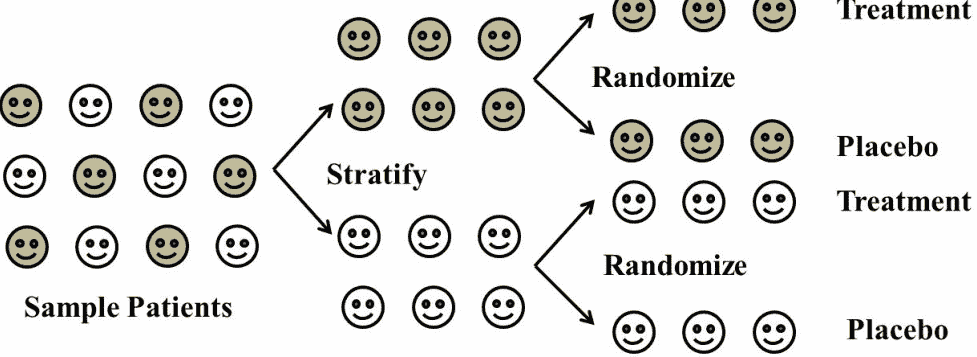

如果层数较少，分层随机化可以在协变量的各种组合之间达到平衡。然而，如果层数相对于受试者数量较大，分层可能变得毫无意义。因为层数随着分层因素数量的增加呈乘法增长，某些层可能会变得非常稀疏甚至为空。这反可能导致治疗组之间出现显著的不平衡 [5]。

```sas
可以使用 plan 来设计分层随机化程序。假设试验已入组了 24 名患者，我们需要根据两个预后因素对受试者进行分层
```

[sas]

患者进行分层：性别和血压。该因素因素两个水平——男性或女性，而血压有 3 个水平——高、正常和低。结合置乱块随机化，基于这两个因素的分层导致了六个互斥的组。如果我们取块大小为 4，示例代码 9.4 “分层随机化”的输出为此类试验产生了一个分层块随机化方案（示例代码 9.4 的输出）。

## 示例代码 9.4 分层随机化

```sas
proc plan seed=123;
    factors Block=1 random Gender=2 ordered Pressure=3 ordered Sequence=4
    ordered/noprint;
    treatments Treatment=4 randomRandomization Gender cvals=('Male' 'Female') ordered
    output=stratifiedRandomization
    Pressure cvals=('High' 'Normal' 'Low')
    Treatment cvals=('A' 'B')
run;

proc print data=stratifiedRandomization;
run;
```

### 表 9.6 示例代码 9.4 的输出

| 性别 | 压力 | 序列 | 治疗 |
|---|---|---|---|
| 男性 | 高 | 1 | A |
| 男性 | 高 | 2 | B |
| 男性 | 高 | 3 | A |
| 男性 | 高 | 4 | B |
| 男性 | 正常 | 1 | A |
| 男性 | 正常 | 2 | B |
| 男性 | 正常 | 3 | A |
| 男性 | 正常 | 4 | B |
| 男性 | 低 | 1 | A |
| 男性 | 低 | 2 | B |
| 男性 | 低 | 3 | A |
| 男性 | 低 | 4 | B |
| 女性 | 高 | 1 | A |
| 女性 | 高 | 2 | B |
| 女性 | 高 | 3 | A |
| 女性 | 高 | 4 | B |
| 女性 | 正常 | 1 | A |
| 女性 | 正常 | 2 | B |
| 女性 | 正常 | 3 | A |
| 女性 | 正常 | 4 | B |
| 女性 | 低 | 1 | A |
| 女性 | 低 | 2 | B |
| 女性 | 低 | 3 | A |
| 女性 | 低 | 4 | B |

### 9.4.2 协变量自适应随机化

当存在许多预后因素时，要在试验中实现平衡是困难的。Taves [6] 和 Simon [7] 提出了最小化方法（也称为动态分配、协变量自适应或随机化），用于顺序治疗分配。在随机化过程中，每个受试者的分配概率取决于当前的平衡情况。

详细而言，令 $l$ 表示预后因素的总数，在双臂试验中，令 $n_{1}$ 为分配到 1 组的人数，$n_{2}$ 为分配到 2 组的人数，则 $i$ 的差异由

$g_i = |n_{1} - n_{2}|, i=1, \dots$ 给出。

总不平衡通过每个因素的加权和来衡量，$G = \sum_{i=1}^l w_i g_i$，其中 $w_i$ 是描述第 $i$ 个因素的重要性。表 9.7 最小化方法的插图

| 预后因素 | 治疗 | 不平衡 | 新患者 | 潜在不平衡 |
|---|---|---|---|---|
|  | A | B |  | 分配到 A | 分配到 B |
| 性别 | 男性 | 9 | 7 | 2 | 1 |
|  | 女性 | 10 | 13 | 4 | 4 |
| 肿瘤 | I | 7 | 6 | 1 | 2 |
| II | 10 | 3 | 3 | 3 |
| III | 2 | 2 | 0 | 总计 | 8 |

概率 p = 0.75（示例代码 9.5 基于最小化的协变量自适应分配）。

## 示例代码 9.5 基于最小化的协变量自适应分配

```sas
data FactorWeight;
input w;
datalines;
1
1
;
run;

%macro MinimizationRandomize(TreatedPatients,NewPatient,FactorWeight,p,seed);
proc ilm;
use &TreatedPatients;
read all into X;
use &TreatedPatients;
read all var (group);
use &NewPatient;
read all into Y;
use &FactorWeight;
read all;
call randseed(&seed);
X=X//Y;

imA=0;
groupA=group//'A';
do i=1 to ncol(X);
  do j=1 to max(X[i,j]);
    imA=imA+w[i]*abs(sum(groupA[loc(X,[i,j])='A'])-sum(groupA[loc(X,[i,j])='B']));
  end;
end;
nimB=0;
groupB=group//'B';
do i=1 to ncol(X);
  do j=1 to max(X[i,j]);
    imB=imB+w[i]*abs(sum(groupB[loc(X,[i,j])='A'])-sum(groupB[loc(X,[i,j])='B']));
  end;
end;
print imA imB;

nu=1;
call randgen(u, "Uniform");

if (imA<imB & u<=p) then
call symput('newgroup', 'A');
if (imA>=imB & u<=p) then
call symput('newgroup', 'B');
if (imA<imB & u>p) then
call symput('newgroup', 'B');
if (imA>imB & u>p) then
call symput('newgroup', 'A');

NextGroup=sumget('newgroup');
print NextGroup;
quit;
```

```sas
data &NewPatient;
  length group $;
  group=symget("newgroup");
  set &NewPatient;
run;
```

```sas
proc data=\&TreatedPatients;
run;

data &TreatedPatients;
  set &TreatedPatients. &Newpatient;
run;
```

```sas
proc data=\&TreatedPatients;
run;
%mend MinimizationRandomize;
```

- * 第1个受试者：男性，肿瘤 I

  data NewPatient;

  input gender tumororage;

  datalines;

  1 1

```sas
%MinimizationRandomize(TreatedPatients,NewPatient,FactorWeight,p=0.75,seed=6)
```

- * 第2个受试者：男性，肿瘤 II

  data NewPatient;

  input gender tumororage;

  datalines;

  1 2

```sas
%MinimizationRandomize(TreatedPatients,NewPatient,FactorWeight,p=0.75,seed=6)
```

- * 第3个受试者：女性，肿瘤 II

  data NewPatient;

  input gender tumororage;

  datalines;

  2 2

```sas
%MinimizationRandomize(TreatedPatients,NewPatient,FactorWeight,p=0.75,seed=6)
```

该宏产生了一组输出。首先，它提供了当新患者被分配到组 A 和 B 时的总不平衡量；其次，宏根据最小化方法为新受试者建议一个分组；最后，通过包含新患者的数据来更新 `TreatedPatients` 数据集。上述示例的完整输出在此省略，我们将在“示例代码 9.5 的输出”中总结随机化的结果。

### 表格 9.8 示例代码 9.5 的输出

| 受试者编号 (Sub) | 治疗组 | 性别 | 不平衡（分配到 A） | 不平衡（分配到 B） |
|---|---|---|---|---|
| 1 | B | 男性 | 12 | 8 |
| 2 | A | 男性 | 8 | 8 |
| 3 | A | 女性 | 6 | 10 |

因此，为了最小化总不平衡量，第一个受试者应被分配到治疗 B。对于第二个受试者，无论该参与者被分配到治疗 A 还是 B，总不平衡量都是相同的。因此，我们可以完全随机地选择治疗。显然，第三个受试者将接受治疗 A，以最小化总不平衡量。

### 9.4.3 基于模型的优化协变量自适应随机化

为了实施最小化方法，需要对连续协变量进行分类。然而，确定分类的数量和相应的截止值通常是任意的。作为替代，可以开发一种优化随机化程序，使得在存在协变量的情况下估计治疗效应方差最小。具体而言，令 $Y_j$ 为第 $j$ 个患者的结果，$X_j$ 为 $p$ 维协变量（包括截距），$Z_j$ 为治疗指示，如果第 $j$ 个患者被分配到治疗组则值为 1，如果分配到控制组则值为 -1。对于连续结果 $Y_j$，我们假设一个线性模型：

$$$$Y_j = X_j^T \beta + Z_j \epsilon_j.$$

其中 $\epsilon_j$ 是从均值为 0、方差为 $\sigma^2$ 的正态分布的随机误差，$\beta$ 和 $\zeta$ 是待估计的参数，其中 $\zeta$ 表示治疗效应。估计治疗效应的方差为：

$$$$Var(\hat{\zeta}) = \frac{\sigma^2}{n-Z^TX(X^TX)^{-1}X^TZ}.$$

其中 $X$ 表示协变量的 $n \times p$ 矩阵，$Z$ 是 $Z_j, j=1..n$ 的 $n \times 1$ 向量。因此，可以通过最小化损失函数来实现最小 $Var(\hat{\zeta})$：

$$$$\mathcal{L}_n = Z^TX(X^TX)^{-1}X^TZ.$$

这可以解释为由于治疗分配效率低下而导致的单位损失。

假设 $n$ 个患者已经分配到两个治疗组，并且收集了 $(n+1)$ 个患者的协变量 $X_{n+1}$。为了构建一个顺序程序，选择第 $(n+1)$ 个患者的治疗分配以以高概率最小化损失 $\mathcal{L}_{n+1}$。例如，$(n+1)$ 个患者被分配到治疗组的概率可以指定为

$$Pr(Z_{n+1}=1|R_{n+1}) = \frac{X_{n+1}^T(X^TX)^{-1}X^TZ}{1 + \gamma X_{n+1}^T(X^TX)^{-1}X^TZ}$$

其中 $\gamma \ge 0$ 是预设的调节参数，用于控制随机程度。显然，如果 $\gamma = 0$，该程序简化为等比例随机化；通常建议 $\gamma = 5$ 以平衡治疗组和损失。假设 $n$ 个患者已经分配到两个治疗组，并且收集了 $(n+1)$ 个患者的协变量 $X_{n+1}$。为了阐明基于模型的 CAR，我们根据其预后因素分配患者。一旦入组 $n$ 个患者，基于模型的 CAR 将通过包含新患者的数据更新 `TreatedPatients` 数据集。示例代码 9.6 的输出显示：

```sas
proc data=\&TreatedPatients;
run;
```

| 17 | 1 | 0.06 | -0.69 | 1 |
| 18 | 1 | -0.09 | 1.1 | 1 |
| 19 | 1 | 0.23 | -1.63 | 1 |
| 20 | 0 | 0.37 | -2.23 | 0 |
| 21 | 0 | 0.20 | -1.98 | 0 |
| 22 | 1 | -0.80 | -0.30 | 1 |
| 23 | 1 | 0.15 | 2.50 | 0 |

## 9.5 响应自适应随机化

### 9.5.1 胜者规则 (Play-the-Winner Rule)

从伦理角度来看，临床试验应该利用从数据中积累的证据，将更多患者分配到优治疗组，以便更多患者从更好的治疗中获益。基于响应或结果的自适应随机化旨在通过将患者数量推向潜在更好的治疗组来实现这一目标。

胜者规则尝试将更多患者分配到潜在更好的治疗中：一直保持胜者治疗，直到出现失败结果，然后切换到另一种治疗方法 [10]。该规则通常适用于二分类情况，即结果要么成功，要么失败。在一项比较两种治疗方法 A 和 B 的研究中，图 9.2 治疗 A 和 B 的二分类结果下的胜者规则显示：第一个患者以等概率随机分配到治疗 A 或 B。如果上一个患者的响应是成功的，则该患者的治疗方法将保留给下一个患者；而在失败的情况下，下一个患者将接受另一种治疗。成功用实心圆表示，失败用空心圆表示。

图 9.2 治疗 A 和 B 的二分类结果下的胜者规则

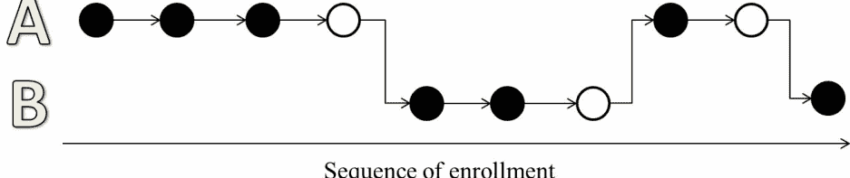

这种交替过程持续到总样本量耗尽。随着试验人数趋于无穷大，分配到治疗 A 和 B 的患者数量比例倾向于 $(1-p_B) / (1-p_A)$，其中 $p_A$ 和 $p_B$ 分别表示治疗 A 和 B 的响应率。

### 9.5.2 随机胜者规则


上述讨论的原始胜者规则缺乏随机性，因为每次治疗分配完全取决于上一个患者的结果，而无视试验中其他患者的结果。这种确定性规则会增加选择偏倚的潜在风险。作为一种补救措施，Wei 和 Durham 引入了胜者规则的随机版本；即：在观察到失败结果时，以较高概率切换到另一种治疗，而不是确定性的切换 [11]。作为一个众为人知的例子，密歇根体外膜肺氧氧机 `ECMO` 试验使用了这种方案将婴儿分配到常规疗法或 `ECMO` [12]。

随机胜者规则可以用奖罐模型来插说明（图 9.3 随机胜者规则下的奖罐模型）。假设奖罐中有两种类型的球，标记为 `A` 或 `B`。从每种类型 `$m$` 个球开始，随机抽取一个球并放回，以决定新患者的治疗方法。如果是类型 `A` 的球，则受试者被分配到 `A` 组；如果响应是成功的，则在奖罐中增加 `$\alpha$` 个类型 `A` 的球和 `$\beta$` 个类型 `B` 的球，其中 `$\alpha \ge \beta \ge 0$`。因此，下一个抽取的球有更高的概率

`Pr(Treatment A) = \frac{\alpha+m}{\alpha+\beta+2m} \ge 0.5`，

成为类型 `A` 的球，下一个患者更有可能被分配到 `A` 组。另一方面，如果分配到 `A` 组的受试者响应为失败，则在奖罐中增加 `$\beta$` 个类型 `A` 的球和 `$\alpha$` 个类型 `B` 的球，使得下一个抽取的球成为类型 `A` 的球的概率较低

`Pr(Treatment A) = \frac{\beta+m}{\alpha+\beta+2m} \le 0.5`，

以此此类推，下一个患者被分配到 `A` 组的概率也是如此。

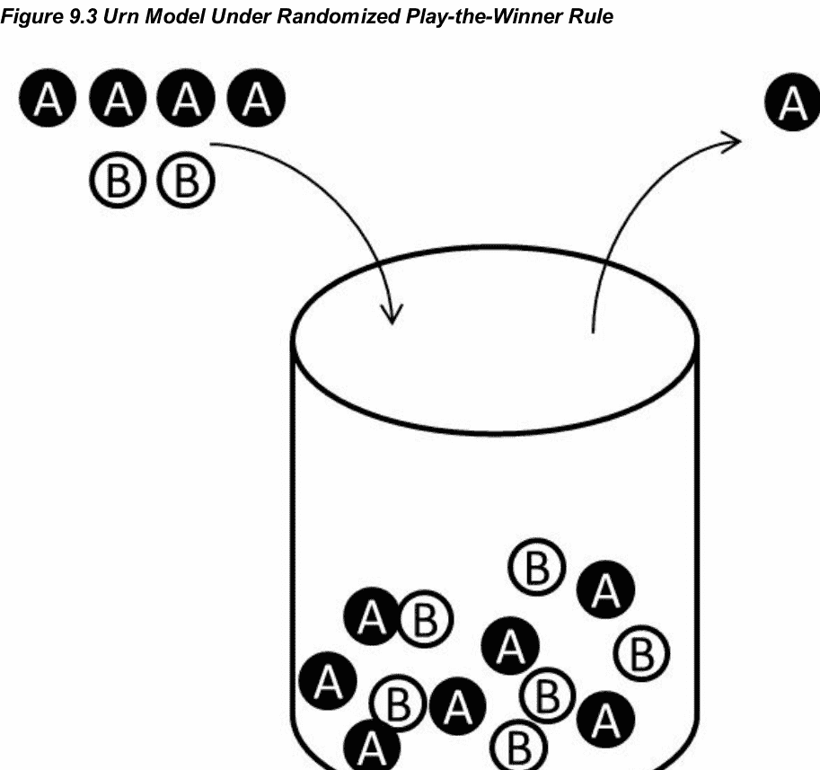

### 示例代码 9.7 随机胜者规则

示例代码 9.7 随机胜者规则执行随机胜者规则以确定下一次治疗分配。例如，假设已有20 名患者被分配到治疗 `A`，13 名分配到治疗 `B`。在接受治疗的患者中，治疗 `A` 有 14 人，治疗 `B` 有 5 人有良好响应。我们从一个空奖罐开始（即 `$m=0$`），并设置 `$\alpha=1$` 和 `$\beta=0$`。可以使用 `RPWrandomize` 宏来确定下一个患者的治疗组。

```
@macro RPWrandomize(n1, y1, n2, y2, m, alpha, beta, seed);
procA;
  call randomize(&seed);
  /* # 类型 A 的球 */
  nball=m+y1*alpha+(n2-y2)*alpha+y2*beta+(n1-y1)*beta;
  /* # 类型 B 的球 */
  nball2=m+y2*alpha+(n1-y1)*alpha+y1*beta+(n2-y2)*beta;
  /* 下一个抽取的球是 A 的概率 */
```

```
p1=nball/(nball+n2);
/* 根据 p1 分配下一个患者 */
Assignment=j(1);
call randassign(Assignment, "BERNOULLI",pl);
if Assignment=1 then Assignment='A';
else Assignment='B';
print p1[colname="Allocation probability A" label=""];
Assignment[colname="Next assignment" label=""]
quit;
%mend RWPandomize;
%RWPandomize(n1=20,y1=14,
```

随机胜者分配显示，计算出的下一个患者分配到治疗的概率为 0.67。

### 表 9.10 随机胜者分配

| Allocation probability A | Next assignment |
|---|---|
| 0.667 | |

### 9.5.3 优随机化

通过最小化治疗差异的差可以优化自适应随机化。从伦理角度来看，让我们考虑两组试验，`$p_1$` 和 `$p_2$` 分别表示治疗 1 和治疗 2 的响应率。如果偏好较小的响应，我们可能会最小化分配到 1 组的预期人数。胜者规则产生的分配比例为 `$(1-p_2)/(1-p_1)$`，这并不是常数。

### 表 9.11 内曼与最优随机化分配

| 随机化方案 | 分配至 Arm 的概率 | 下一次分配 |
|---|---|---|
| 内曼 `Neyman` | 0.4850509 | B |
| 最优 `Optimal` | 0.5743003 | B |

最小化治疗失败次数（无响应）与化假设检验功效存在权衡。为了给临床试验选择合适的随机化方案，需要进行模拟研究以比较几种不同的自适应随机化程序。为了说明，我们考虑一个具有二分类结局的两臂临床试验。对于每对 `$p_1$` 和 `$p_2$`，样本量 `$n$` 的确定目标是：在等比例分配下，使 I 类错误率达到 0.05（双侧），且效能达到 0.90。我们研究了四种自适应随机化程序：等比例随机化、`$\alpha=1$` 且 `$m=0$` 的随机获胜者规则 `RPW`、内曼分配程序，以及最小化无响应者总数的最优自适应方案 `Opt`。

SAS 宏 `rarsim`（可在补充网站获取）在每种场景下模拟 5000 次重复（`nsim=5000`）。表 9.12-9.14 总结了四种自适应随机化方法的运行特征，包括分配到治疗 1 的比例的均值，即 `$n1/n$`（表 9.12）、假设检验的效能（表 9.13）以及治疗失败的预期次数（表 9.14）。标准差位于括号内。

### 表 9.12 响应自适应随机化程序的模拟研究 (`n1/n`)

| `$p_1$` | `$p_2$` | `$n$` | Opt | Neyman | RPW | Equal |
|---|---|---|---|---|---|---|
| 0.2 | 0.2 | 200 | 0.50 (0.05) | 0.50 (0.05) | 0.50 (0.03) | 0.50 (0.04) |
| 0.5 | 0.5 | 200 | 0.50 (0.04) | 0.50 (0.04) | 0.50 (0.03) | 0.50 (0.03) |
| 0.2 | 0.3 | 784 | 0.45 (0.03) | 0.47 (0.02) | 0.47 (0.02) | 0.50 (0.02) |
| 0.2 | 0.4 | 218 | 0.42 (0.05) | 0.45 (0.04) | 0.43 (0.04) | 0.50 (0.03) |
| 0.4 | 0.6 | 260 | 0.45 (0.04) | 0.50 (0.03) | 0.40 (0.05) | 0.50 (0.03) |
| 0.4 | 0.7 | 112 | 0.44 (0.06) | 0.52 (0.05) | 0.33 (0.09) | 0.50 (0.05) |
| 0.6 | 0.8 | 218 | 0.46 (0.04) | 0.54 (0.04) | 0.34 (0.10) | 0.50 (0.03) |

### 表 9.13 响应自适应随机化程序的模拟研究 (效能)

| `$p_1$` | `$p_2$` | `$n$` | Opt | Neyman | RPW | Equal |
|---|---|---|---|---|---|---|
| 0.2 | 0.2 | 200 | 0.04 | 0.05 | 0.05 | 0.04 |
| 0.5 | 0.5 | 200 | 0.04 | 0.05 | 0.04 | 0.04 |
| 0.2 | 0.3 | 784 | 0.90 | 0.90 | 0.90 | 0.90 |
| 0.2 | 0.4 | 218 | 0.90 | 0.89 | 0.89 | 0.90 |
| 0.4 | 0.6 | 260 | 0.90 | 0.90 | 0.90 | 0.90 |
| 0.4 | 0.7 | 112 | 0.90 | 0.88 | 0.88 |
| 0.6 | 0.8 | 218 | 0.90 | 0.89 | 0.86 |

### 表 9.14 响应自适应随机化程序的模拟研究 (失败次数)

| `$p_1$` | `$p_2$` | `$n$` | Opt | Neyman | RPW | Equal |
|---|---|---|---|---|---|---|
| 0.2 | 0.2 | 200 | 0.50 (0.05) | 0.50 (0.05) | 0.50 (0.03) | 0.50 (0.04) |
| 0.5 | 0.5 | 200 | 0.50 (0.04) | 0.50 (0.04) | 0.50 (0.03) | 0.50 (0.03) |
| 0.2 | 0.3 | 784 | 0.45 (0.03) | 0.47 (0.02) | 0.47 (0.02) | 0.50 (0.02) |
| 0.2 | 0.4 | 218 | 0.42 (0.05) | 0.45 (0.04) | 0.43 (0.04) | 0.50 (0.03) |
| 0.4 | 0.6 | 260 | 0.45 (0.04) | 0.50 (0.03) | 0.40 (0.05) | 0.50 (0.03) |
| 0.4 | 0.7 | 112 | 0.44 (0.06) | 0.52 (0.05) | 0.33 (0.09) | 0.50 (0.05) |
| 0.6 | 0.8 | 218 | 0.46 (0.04) | 0.54 (0.04) | 0.34 (0.10) | 0.50 (0.03) |

基于结果可以看出，随机获胜者规则将更多患者分配给更好的治疗。然而，当 `$p_1 < p_2$` 时，内曼分配是不符合伦理的，因为它将更多患者分配给了较差的治疗。相比之下，最优自适应设计在效能方面表现良好。

### 例 9.9 贝叶斯自适应随机化

```sas
%macro BayesianRandomize(n1,n2,y1,y2,alpha=0.5,alpha2=0.5,gamma=1,seed=123);
 proc iml
 call randseed(&seed);
 /* A 优于 B 的后验概率 */
 使用 MCMC 计算概率 */
 postb=j(1000,1)
 call randgen(posta, "BETA", gamma+alpha,n1-y1+beta);
 call randgen(postb, "BETA", gamma+alpha2,n2-y2+beta);
 lambda=sum(postb)/1000;

 if design=1 then Gamma=Gamma
 else Gamma=(n1+n2)/2;

 pi=Gamma/(Gamma-lambambda-gamma)
 Assignment=j(1);
 call randgen(Assignment, "BERNOULLI",pi);
 if Assignment=1 then Assignment='A';
 else Assignment='B';
 Print Gamma[colname="Allocation probability to arm A" label=""]
 Assignment[colname="Next assignment" label=""]
 quit;
%end BayesianRandomize;

 BayesianRandomize(n1=20,n2=13,y1=14,y2=5,alpha=0.5,alpha2=0.5,gamma=1,seed=123);
 BayesianRandomize(n1=20,n2=13,y1=14,y2=5,alpha=0.5,alpha2=0.5,gamma=2,n=150,seed=123);
```

### 表 9.15 例 9.9 的输出

|  | 分配至 Arm A 的概率 | 下一次分配 |
|---|---|---|
| 1 | 0.9618 | A |
| 0.11 | 0.5878 | B |

尽管 `RAR` 有助于缓解伦理问题，但可能会导致不同组之间的预后因素不平衡。为了获得更平衡的设计，可以使用协变量调整响应自适应随机化程序来同时解决响应和协变量的问题。在这种随机化方案下，分配概率会向更有效的治疗偏移，同时调整协变量的分布以实现平衡 [17, 18]。

## 9.6 总结

本章回顾了临床试验中各种类型的适应随机化设计。当使用恰当时，适应性设计可以提高试验的效率并降低成本。此外，还可以最大限度地利用招募患者的信息，并显著降低患者的风险。

然而，在实践中，由于以下考虑，随机试验仍然由传统的固定随机化方案主导：

- 患者在某些协变量上可能无法平衡，特别是那些具有可能随时间趋势的协变量。
- 中期监测和试验结束时的假设检验是非传统的且困难的。
- 延迟结局 `Delayed outcomes` 可能会影响适应随机化设计的实际实施。

为了方便适应随机化的实际应用，应该建立更自动化、更频繁的更新系统。还需要在统计学家和临床医生之间建立必要的基础设施和合作关系。对各种类型随机设计的统计特性进行进一步研究是有必要的 [1]。

# 参考文献

- 1. Hu F & Rosenberger WF. (2006). The Theory of Response-Adaptive Randomization in Clinical Trials. Hoboken, New Jersey: John Wiley & Sons.
- 2. Efron B. (1971). Forcing a sequential experiment to be balanced. Biometrika 58: 403-417.
- 3. Wei LJ. (1978). The adaptive biased coin design for sequential experiments. The Annals of Statistics 6: 92-100.
- 4. Antoni AB & Giovagnoli A. (2004). A new biased coin design for sequential allocation of two treatments. Journal of the Royal Statistical Society: Series C (Applied Statistics) 53: 651-664.
- 5. Therneau TM. (1993). How many stratification factors are too many to use in randomization plan? Clinical Trials 14: 98-108.
- 6. T DR. (1974). Minimization: A new method of assigning patients to treatment and control groups. Clinical Pharmacology and Therapeutics 15: 443-453.
- 7. Pocock SJ & Simon R. (1975). Sequential treatment assignment with balancing prognostic factors in the controlled clinical trial. Biometrics 31: 103-115.
- 8. Atkinson AC. (1999). Optimum biased-coin designs for sequential treatment allocation with covariate information (with discussion). Statistics in Medicine 18: 741-755.
- 9. Smith RL. (1984). Properties of biased coin designs in sequential clinical trials. The Annals of Statistics 12: 1018-1034.
- 10. Zelen M. (1969). Play the winner rule and the controlled clinical trial. Journal of the American Statistical Association 64: 131-146.
- 11. Wei LJ & Durham S. (1978). The randomized-winner rule in medical trials. Journal of the American Statistical Association 73: 840-843.
- 12. Bartlett RH, Rol DW, Cornell RG, Andrews AF & Dillon PW. (1985). Extracorporeal circulation in neonatal failure: A prospective randomized study. Pediatrics 76: 479-487.
- 13. Rosenberger WF, Stallard N, Ivanova A, Harper CN & Ricks ML. (2001). Optimal designs for binary response trials. Biometrics 57: 909-913.
- 14. Melfi VF & Geraldes M. (2001). An adaptive randomized design with application to estimation. Canadian Journal of Statistics 29: 107-116.
- 15. Hu F & Rosenberger WF. (2003). Optimality, variability power: Evaluating response-adaptive randomization for treatment comparisons. Journal of the American Statistical Association 98: 671-678.


- 16. Thall PF & Wathen JK. (2007). Practical adaptive randomization in clinical trials. European Journal of Cancer 43: 859-866.

- 17. Ning J & Huang X. (2010). Response-adaptive randomization in clinical trials with adjustment for covariate imbalance. Statistics in Medicine 29: 1761-1768.

- 18. Yuan Y, Huang X & Liu S. (2011). A Bayesian response-adaptive covariate-balanced randomization design with application to leukemia clinical trial. Statistics in Medicine 30: 1218-1229.

- 19. Yin G. (2012). Clinical Trial Design: Bayesian and Frequentist Adaptive Methods. Hoboken, New Jersey: John Wiley & Sons.

# 作者

- Ruitao Lin, 博士候选，香港大学统计学及精算科学系，中国，香港。
- Guosheng Yin, 教授，香港大学统计学及精算科学系，中国，香港。

# 第 10 章：二元结局试验中的优响应适应随机化设计

## 10.1 引言

### 10.2 优配分配

### 10.3 用于实施优配分配的响应适应随机化

### 10.4 优响应适应随机化的模拟

### 10.5 响应适应随机化的与样本量

### 10.6 额外考虑

### 10.7 示例

### 10.8 总结

### 参考文献

### 作者

## 10.1 引言

### 10.1.1 随机临床试验

随机临床试验（RCT）的最常见目标是比较目标人群中一种或多种实验治疗法与对照治疗法的效果。随机化在 RCT 设计中起着基础性作用。通过在治疗分配中引入刻意的随机因素，可以增加重要患者特征（无论已知未知）在各组间平衡分布的可能性，因此观察到的治疗差异应归于治疗效应，而不是患者本身。重要的是，随机化本身不足以实现 RCT 的目标，它应该辅助其他技术，如盲法、分配隐藏、分层或协变量调整（适当）、协变量调整分析以及试验的严格实施。在设计 RCT 时，制定要回答的主要科学问题至关重要。这需要对疾病、目标人群、实验治疗和对照治疗的选择以及主要结局变量进行仔细考虑。这一主要问题通常以治疗效应检验的形式出现。试验应具有足够的样本量以对主要问题提供可靠的答案 [3]。还可以包含一些不重要但仍在试验范围内的额外研究问题。

一旦确定了试验目标，就有几个重要的统计考虑，包括限于：1) 目标分配比例的选择；2) 随机化程序的选择；3) 试验样本量的选择；4) 数据分析统计方法的选择。让我们更详细地考虑前两项。许多 RCT 采用等分配设计，例如两臂研究中的 1:1 分配。实践中经常推荐等分配，因为它通常能最大化统计检验的效力，而且也符合试验开始时的均衡性（equipoise）观点 [3]，第 98 页。有多种实现等分配的随机化程序，包括完全（简单）随机化、区组随机化、极大程序 [4] 和偏倚硬币设计 [5]。相反，在许多情况下，固定不等分配可能更优。例如，2:1 分配（即分配到实验治疗的人数是对照组的两倍）如果实验治疗证明是有效的，则可能比 1:1 分配具有伦理优势 [6,7]。为了获得更多关于实验治疗安全性的信息、出于经济效率或考虑可能的患者脱落，不等分配也可能更优。实施固定不等分配的随机化程序包括例如，区组设计和偏倚随机化 [9]。

### 10.1.2 响应适应随机化

通过响应适应随机化（Response-Adaptive Randomization, RAR），根据试验中治疗分配的历史和患者的反应修改治疗随机化概率，以实现某些预定的实验目标（例如，从统计效率和伦理角度来看达到理想的分配比例），同时保持试验结果的有效性和完整性。例如，一个目标可能是在不损失统计功效性的情况下减少治疗失败的次数 [10]。

RAR 在生物统计学文献中有着悠久的历史 [11,12]。然而，其在实践中的应用受到限制，主要由于 20 世纪 80 年代一项设计不良的 ECMO 试验带来的负面影响 [13]。与此同时，在过去的十年里，对 RAR 的研究取得了实质进展——许多新方法被开发出来，各种 RAR 设计的统计特性也得到了建立。Hu 和 Rosenberger 的专著提供了临床试验中 RAR 的现代理论 [14]。最近的统计研究重点是开发最优 RAR 程序，其能够同时解决与统计效率和伦理相关的目标。最优 RAR 程序应与启发式 RAR 程序进行对比，例如随机胜者者规则（randomized play-the-winner rule）[12] 或贝叶斯自适应随机化 [15]。前者明确针对统计效率和伦理目标，而后者主要关注将更多患者分配给实证中效果更好的治疗方案。

回顾 RAR 可以产生最大收益的临床试验情景是很有启发意义的。Palmer 和 Rosenberger 在 [16] 中对个体伦理（为试验中的每位受试者做最好的事情）与集体伦理（为未来可能从试验结果中获益的患者做最好的事情）之间的微妙平衡平衡进行了极好的讨论。他们考虑了疾病特征的两个维度——严重性和患病率，并建议当疾病严重或危及生命，以及当疾病罕见或极罕见时，个体伦理应优于集体伦理。事实上，当疾病是（非常）罕见时，大多数该病患者将在试验内接受治疗，极少数患者将在试验外接受治疗。此外，如果疾病结果严重或危及生命，那么试验中治疗失败次数的微小减少也是理想的，并且从伦理角度来看可以被视为一种重大贡献。RAR 与个体伦理原则一致，它可以成为罕见疾病试验和严重结果试验中具有吸引力的研究设计。

伦理目标是使用 RAR 的原因之一。另一个重要原因是对统计效率的追求。在具有异质性结果的试验中应用 RAR，可以实现比等比例随机化能产生更准确的治疗效应估计或更强效检验的分配 [17-19]。在 FDA 的草案中，对 RAR 提供了以下观点：“……最近该方法已经过修订以适应剂量-反应评估的目标”，且它“……对于探索性研究特别有价值” [20]。事实上，RAR 可用于二期剂量范围研究，增加在对剂量-反应曲线形状提供最多信息的剂量水平或特殊感兴趣的剂量水平上的分配频率。这些思想的一个良好范例是 ASTIN 试验，这是一项针对急性缺血性卒中的的自适应剂量范围研究，评估了 15 种不同的剂量水平和安慰剂，目标是确定产生 95% 最大治疗效果的剂量（ED95）[21]。ASTIN 研究使用了贝叶斯 RAR 设计，其中任何剂量水平的随机化概率被设定为给定剂量为 ED95 的后验概率。发现剂量-反应曲线是平坦的，研究因无效而终止，从而节省了大量的成本和患者资源。

通过讨论各种 RAR 设计，阐述 RAR 试验的关键假设具有启发意义 [2,22]：

- *显而易见的陈述*：更好的治疗方案在试验中的表现实际上会更好。
- *结果更好的治疗方案不会导致严重后果。*
- *研究结果应能较快地观察到，且患者入组率应较低，以便对设计进行调整。*
- 数据必须具有极的质量，以便在整个试验过程中进行准确的估计和调整。
- 疾病随时间保持稳定（患者特征没有漂移）。
- 试验经过了仔细计划，并在不同的实验情景下运行了大量的模拟。

显然，RAR 设计是更复杂的实验，比固定时间表随机化设计需要更充分的前期规划 [2]。

### 10.1.3 响应适应随机化设计的分类

#### 10.1.3.1 RAR 瓮模型

FDA 关于自适应设计的草案指南将 RAR 方法归类为“属性尚不明确的自适应研究设计” [20]。事实上，成功实施 RAR 的试验数量有限，据我们所知，尚没有任何 RAR 试验在确认性（三期）设置中运行。然而，随着对 RAR 的统计特性、优点和局限性的日益增加，未来可能会进行更多使用 RAR 的试验 [2,23]。在本小节中，我们简要讨论三种主要的 RAR 设计：1) RAR 瓮模型，2) 贝叶斯自适应随机化，以及3) 最优 RAR 程序。在成熟度方面，前两种可以被视为“成熟方法”，并有一些现实应用实例，而第三种类型包含了潜力尚未在实践中得到证实的程序。

瓮模型为临床试验中实施 RAR 提供了一种实用的概率机制 [24]。最著名的 RAR 瓮模型是随机胜者规则（RPWR），由 Wei 和 Durham 于 1978 年开发 [12]。该方法假设一个具有二分类法结果的两臂比较试验，其中患者的治疗分配通过从瓮中随机抽取球来决定，瓮的组成根据试验中前一个患者的结果进行顺序更新，使得代表更成功治疗的球被更频繁地选中。RPWR 是一种启发式的诉求，将较少的患者分配给不成功的治疗方案——其限制分配比例与该治疗的失败率成反比。然而，这种分配在任何统计标准上都不是最优的（特别是，这种方法的统计功效可能低于 1:1 分配）。RPWR 被用于一项体外膜肺氧（ECMO）试验，比较了 ECMO 疗法与常规治疗 [13]。试验开始时有强烈的伦理理由支持 ECMO 分配。在实际试验中，RPWR 在 12 名婴儿随机化后停止（一名婴儿被分配到常规治疗并死亡，11 名婴儿被分配到 ECMO 并全部存活）。因此，研究未能提供关于两种疗法的结论结果。根据 RAR 的现代理论，ECMO 试验的失败可以用样本量、RPWR 的高变异性以及对瓮初始组成的依赖来解释（最初瓮各有一个球，几次分配后瓮的组成变得极度倾向于 ECMO 臂，导致常规治疗没有选择的机会）。尽管如此，ECMO 试验是一个可以使用稳健统计特性的 RAR 设计的好情景。在这种背景下可能有效的方法是丢掉失败者（drop-the-loser），这是一种与 RPWR 相同限制分配的瓮设计，但变异更低且收敛速度更快 [25]。许多其他具有成熟统计特性的瓮模型可用；详见 [22] 的第 10.5 节、[14] 的第 4 章以及 [26]。

#### 10.1.3.2 贝叶斯自适应随机化

贝叶斯自适应随机化由 Thompson 在 [27] 中提出，是另一种促进 RAR 的启发式方法。让 $p_E$ 和 $p_C$ 分别代表实验组和对照组治疗的成功率。假设 $p_E$ 和 $p_C$ 遵循独立的先验分布，并通过积累患者结果数据顺序更新 $p_E$ 和 $p_C$ 的后验分布。当前的合格患者根据概率 $\lambda_E = P(p_E > p_C|data)$ 和 $\lambda_C = 1 - \lambda_E$ 在治疗 E 和 C 之间随机化。也就是说，当前患者以更高的概率分配给更成功的治疗。Thall 和 Waten 在 [15] 中指出，这种随机化程序虽然具有伦理前景，但由于 $\lambda_E, \lambda_C$ 的随机性质，可能会产生高度变异。作者建议将治疗分配概率稳定为：

$$\lambda_E = \frac{\{Pr(p_E > p_C|data)\}}{\{Pr(p_E > p_C|data)\}+\{Pr(p_E < p_C|data)\}} \text{ and } \lambda_C = 1 - \lambda_E,$$

其中 $\gamma\in[0,1]$ 是调节参数（$\gamma=0$ 对应 1:1 随机化，$\gamma=1$ 是原始的 Thompson 方案 [27]）。根据经验证据，Thall 和 Waten 建议在实践中使用 $\gamma=1/2$ 或 $\gamma=n/(2N)$（其中 $n$ 是当前样本量，$N$ 是允许的最大样本量）[15]。[28] 描述了该方法在软组织肉瘤试验中的应用。一些作者描述了贝叶斯适应随机化在肿瘤学多臂随机临床试验中的应用，在这些试验中，最大化个体患者参与试验的获益是至关重要的 [29-31]。Korn 和 Freilin 在 [32] 中认为，由于试验中无反应者的数量，伦理收益通常比固定比例 1:1 或 2:1 随机化要得多，而且这些收益可能会被适应随机化固有的复杂性所抵消（例如：必须快速观察结果、患者入率必须较低，且必须定期更新数据以修改治疗概率）。在随后的注释中，Berry 在 [33] 中承认，贝叶斯适应随机化的伦理收益在双臂试验中确实相当有限，但在多目标、多臂试验中可能会更加显著。RAR（响应适应随机化）的潜在收益不仅应从伦理角度（即减少无反应者的数量）进行评估，还应从统计效率标准（例如提高精确度或增加统计检验的效能）进行评估。特别是，带有共同对照组评估不同实验治疗方法的 II 期剂量试验提供了一个很好的设定，其中 RAR 可以提供双重利益：让更多患者进入表现更好的治疗组，并为所选的实验目标提供更多的统计信息 [21,31]。

#### 10.1.3.3 最优响应适应随机化

如第 10.1.2 节所示，现代 RAR 的研究专注于为具有两个或多个治疗臂和不同类型主要结局（二分类、连续（高斯分布）和事件时间）的多臂临床试验开发最优 RAR 程序。其思想是确定一个对于所选试验目标最优的分配设计，并构建一个变异最小且收敛于所选最优分配的 RAR 程序 [34]。需要 RAR 组件是因为最优分配通常取决于模型参数，而这些参数需要使用试验中累积的结果数据进行估计。最优 RAR 设计具有坚实的理论基础，它们通常比传统的等比例分配随机化设计更高效、更符合伦理 [14,17-19]。在广泛满足的条件下，最优 RAR 设计的渐近比例和极大似然估计量与固定随机化设计相似 [35]。关于遵循最优 RAR 设计的适当统计推断程序的最新综述可以参阅 [36]。必须承认的是，许多最优 RAR 设计是相对较新的方法，尚未在实践中证明其潜力。为了促进这些设计的实施，必须开发经过验证的信息系统（用于执行交互式数据输入和治疗随机化概率的动态更新）。此外，来自卫生部门（FDA、EMA）的投入对于临床试验中成功实施最优 RAR 设计至关重要。

### 10.1.4 本章结构

本章的目的是为新接触该主题的统计学家或临床试验专家提供最优 RAR 设计方法的阐述，并提供一些 SAS 代码来模拟治疗分配序列和所选 RAR 设计的操作特征。选择一类 RAR 设计（双臂二分类结局试验的最优 RAR）是因为它非常基础，但同时它包含了 RAR 的所有关键要素，并且非常适合用于说明。本章并非旨在对如何在实践中选择最佳 RAR 设计进行全面研究。关于该主题的详细讨论，请参阅 [14,37]。

在第 10.2 节中，我们回顾并比较了双臂二分类结局试验的几种最优分配规则。第 10.3 节描述了可以收敛于所选最优分配的 RAR 设计。我们还讨论了最优 RAR 设计的理论方面——最优性、变异性和功效之间的关系、渐近最优 RAR 程序以及 RAR 后的统计推断。在第 10.4 节中，我们讨论了最优 RAR 设计的蒙特卡洛模拟。在第 10.5 节中，我们讨论了 RAR 试验的样本量和功效问题。第 10.6 节描述了 RAR 试验的一些额外重要考虑和实际问题。在第 10.7 节中，我们通过重新设计真实的临床试验来说明 RAR 的效用。结论性意见在第 10.8 节给出。

## 10.2 最优分配

考虑一个比较实验治疗 $E$ 与对照治疗 $C$ 的二分类结局临床试验。令 $p_E$ 表示 $E$ 的成功概率（$q_E=1-p_E$），$p_C$ 表示 $C$ 的成功概率（$q_C=1-p_C$）。假设试验的样本量 $n$ 是固定且预先定的。令 $\rho$ 表示实验治疗的分配比例，其中 $0 < \rho < 1$。这意味着大约有 $n_E=n\rho$ 患者被分配给 $E$，$n_C=n(1-\rho)$ 患者被分配给 $C$。实验设计问题是找到作为形式优化问题解的最优分配 $\rho^*$。在双臂比较试验中，一个常见目标是具有足够的功效来检验研究假设。考虑使用 Wald 检验 $Z_W = \frac{\hat{p}_E-\hat{p}_C}{\sqrt{\frac{\hat{p}_E(1-\hat{p}_E)}{n_E}+\frac{\hat{p}_C(1-\hat{p}_C)}{n_C}}}$ 来检验假设 $H_0: p_E=p_C$ 对于 $H_1: p_E \neq p_C$，其中 $\hat{p}_E$ 和 $\hat{p}_C$ 是相应参数的一致估计量。在 $H_1$ 下，$Z_W$ 服从均值为 $\theta$ 方差为 $V$ 的渐近正态分布。使用大样本近似 $S=n\rho$ 和 $F=n(1-\rho)$，其中 $\rho=(n_{EP}+n_{PC})/n$，得分统计量的方差近似为 $V=n_P\rho(1-\rho)(\rho q_{EE}+(1-\rho)q_{CE})(\rho q_{AE}+(1-\rho)q_{CE})$。

对于固定样本量，使 $V$ 值最大的分配被称为内曼 分配（Neyman allocation），其公式为：

$$\rho_N = \frac{\sqrt{q_E}}{\sqrt{q_E}+\sqrt{q_C}} (10.1)$$

N曼 分配将更大比例的患者分配给变量治疗。遗憾的是，当 $p_E+p_C>1$ 时，N曼 分配倾向于成功较少的一组。Rosenberger 等人在 [10] 中考虑了以下问题：对于 Wald 检验的固定方差，哪种分配最小化预期治疗失败？在这种情况下，优化问题表述为：

$$\min_{\rho\in(0,1)} n\rho q_{EP}+(1-\rho)q_C$$

最优解是以 Rosenberg、Stallard 和 Ivanova 命名的 RSI 分配：

$$\rho = \frac{q_E}{q_E+q_C} (10.2)$$

与内曼分配不同，RSI 分配总是将更大比例的患者分配给成功的治疗。


现在考虑使用基于优势比的得分检验检验效果相等假设，$\theta=\log\{q_{EP}/q_{CE}\}$。对于 $H_0:\theta=0$，计算 $Z=(n_{SE}-n_{SC})/n$ 和 $V=n_{SE}n_{SC}/n^3$，其中 $S_E$ 和 $S_C$ 分别是 $E$ 和 $C$ 的成功数，$S=S_E+S_C$ 且 $F=n-S$。当 $n$ 很大时，$Z$ 服从均值为 $\theta$ 方差为 $V$ 的正态分布。使用大样本近似 $S=n\rho$ 和 $F=n(1-\rho)$，其中 $\rho=(n_{EP}+n_{PC})/n$，方差为 $V=n_P\rho(1-\rho)(\rho q_{EE}+(1-\rho)q_{CE})(\rho q_{AE}+(1-\rho)q_{CE})$。

Magirr 在 [39] 中考虑了在固定值 $\nu$ 下最小化预期治疗失败 $n-\rho q_{EP}+q_C(1-\rho)$ 的问题。可以通过简单的代数证明，这等价于对于 $\rho\in(0,1)$ 最小化值 $\rho(1-\rho)\rho_{EE}+(1-\rho)\rho_{PC}^{-1}$。最优解为：

$$PSCORE=\frac{p_E^2-2p_Ep_C+\sqrt{p_E^2-4p_Ep_C+p_C^2}}{3(p_E-p_C)} (10.3)$$

如果 $p_E=p_C$，则最优解为 $PSCORE=1/2$。这种分配被称为得分分配（score allocation）。可以证明，对于任何 $p_E, p_C\in(0,1)$，都有 $1/3\leq*PSCORE\leq 2/3$。当 $p_E>p_C$ 时，$PSCORE>1/2$

当 $p_E < p_C$ 时，$SCORE < 1/2$，这意味着更大比例的患者被分配到更有效的治疗方案。

Baldi Antognini 和 Giagnoli [40] 考虑了以下结合伦理和推理目标的复合标准：

$$\Phi_{\omega}(\rho) = \omega\frac{\Psi_E(\rho)}{\Psi_E^*} + (1-\omega)\frac{\Psi_C(\rho)}{\Psi_C^*}$$

这里，$\omega(0,1)$ 是用户定义的权重，$\Psi_E(\rho) = q_E\rho + q_C(1-\rho)$ 是治疗失败的预期比例，$\Psi_E = \min(q_E, q_C)$。

$\Phi_I(\rho) = -p_E\rho + p_C(1-\rho)$ 是估计治疗差异的方差，$\rho_I^* = \sqrt{\Psi_E p_E^* + \Psi_C p_C^*}$ 是 $\rho \in(0,1)$ 时 $\Phi_I(\rho)$ 的最小值。使用标准化的伦理和推理标准的动机是将它们带到可比较的尺度上。最小化 $\Phi_\omega(\rho)$ 的最优分配 $\rho_\omega^*$ 是方程 $(0,1)$ 中的唯一解：

$$\omega\frac{\rho_{PE}-\rho_{PC}}{\min(q_E, q_C)} + 1^2 = \frac{\{\frac{\Psi_{QC}-1}{\Psi_{QE}}\rho_{\omega}^*\}^2+\rho_{\omega}^*-1}{\{\rho_{\omega}^*(1-\rho_{\omega}^*)\}^2} (10.4)$$

Baldi Antognini 和 Giagnoli [40] 探索了不同的权重选择。在我们的介绍中，设定 $\omega=1/2$（对伦理和推理同样感兴趣），这种分配规则被称为**复合最优分配**（compound optimal allocation）。对于其他双臂二元结局试验的最优分配规则，由于空间限制我们在此处省略。感兴趣的读者请参考 [41-44]。

图 10.1 显示了在 $p_C=0.4$ 且 $0.2 \le p_E \le 0.9$ 的一系列场景下，四种最优分配比例 (1)-(4) 的值。RSIHR 分配 (2)、得分分配 (3) 和复合最优分配 (4) 总是倾向于更有效的治疗方案，而 Neyman 分配 (1) 可能会倾向于较差的治疗方案。当治疗效果相同时（$p_E=p_C=0.4$），所有所有四种规则都退化为等比例分配。

图 10.1 四种最优分配规则对治疗 E 的分配比例

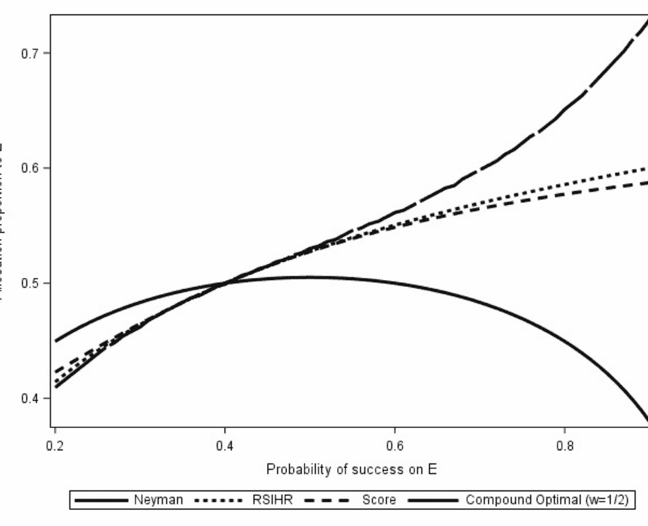

## 表 10.1

**表 10.1**（由补充材料中的程序 `ch10.2.sas` 生成）展示了 $n=100$ 名患者试验几种场景下 Wald 检验的效能和总预期治疗失败次数。比较了六种规则：1:1 分配、2:1 分配以及四种最优分配规则：(1)–(4)。在效能方面，四种最优分配规则与 1:1 分配几乎相同；然而，2:1 分配的效能比其他规则低 1% 到 8%。RSIHR (2)、得分 (3) 和复合最优 (4) 分配与 1:1 分配相比，预期治疗失败次数有少量但一致的减少。当治疗成功概率的绝对差为 0.2 到 0.3 时，这些数字减少了 1 到 3 次；当成功概率差为 0.4 时，可以减少 3 到 6 次。当 $p_{PE} > p_{PC}$ 时，2:1 分配产生的失败次数最少。

# **表 10.1** 对于 n=100 名受试者的六种分配规则效能（预期失败次数）

| PE | PC | 1:1 | 2:1 | RSIHR | Score | 复合最优 ($\omega = 1/2) |

|---|---|---|---|---|---|---|

| 0.2 | 0.4 | 0.61 (70) | 0.53 (73) | 0.61 (69) | 0.61 (68) | 0.61 (68) | 0.61 (68) |

| 0.5 | 0.4 | 0.17 (55) | 0.16 (53) | 0.17 (55) | 0.17 (55) | 0.17 (55) | 0.17 (55) |

| 0.6 | 0.4 | 0.53 (50) | 0.49 (47) | 0.53 (50) | 0.53 (49) | 0.53 (49) | 0.53 (49) |

| 0.7 | 0.4 | 0.89 (45) | 0.84 (40) | 0.89 (46) | 0.88 (45) | 0.88 (45) | 0.88 (45) |

| 0.8 | 0.4 | 0.96 (30) | 0.92 (35) | 0.96 (29) | 0.96 (29) | 0.96 (29) | 0.96 (29) |

## 10.3 用于实施分配的响应适应随机化

### 10.3.1 预备

第 10.2 节讨论的最优分配规则依赖于 $p_E$ 和 $p_C$。目前，假设 $p_E$ 和 $p_C$ 是已知的。那么，如果我们想实施例如 RSIHR (2)，我们必须将 $n$ 分为两组：

$$n_{E} = n \cdot \frac{p_E}{p_E+p_C}$$

然而，这种方法存在几个问题。首先，一次性拥有所有 $n$ 名患者是不行的。其次，在实践中 $p_E$ 和 $p_C$ 是未知的。第三，我们不能简单地将 $n$ 分为两组。RAR（响应适应适应）的想法是随着试验的进展更新分配比例。我们现在描述 RAR 的基本设置。它从使用某种初始规则（如 1:1 分配）在 $E$ 和 $C$ 之间随机分配 $m_0$ 名患者开始。在 $m_0$ 名患者之后，我们估计 $p_E$ 和 $p_C$，并使用这些估计值来确定下一批患者的随机概率。

在第 10.3.2、10.3.3 和 10.3.4 节中，我们讨论了促进优化随机分配分配（RAR）程序的方法。所有这些程序都具有以下重要的渐近性质：

- 1. (10.6) 中的极大似然估计量 $\hat{\varrho}_{Em}$ 和 $\hat{\varrho}_{Cm}$ 对于 $\hat{\rho}_E$ 和 $\hat{\rho}_C$ 是强一致的；它们是渐近不相关的，且具有渐近二元正态分布。
- 2. 样本治疗分配比例 $N_E(m)/m$ 对于目标分配比例 $\rho$ 是强一致的，并且具有渐近正态分布，其渐近方差结构已知。

因此，在执行优化 RAR 程序后，可以使用标准的渐近估计量和检验进行统计推断 [35,36]。

### 10.3.2 序贯极大似然估计设计

序贯极大似然估计（SMLE）设计中，治疗随机化概率设置为目标分配比例的当前估计值 [22,46]。特别是，Rosenberger 及其作者在 [10] 中提出了针对 RSIHR 分配 (10.2) 的 SMLE 程序：

$$\phi_{m+l} = \frac{\sqrt{\hat{p}_{Em}}}{\sqrt{\hat{p}_{Em}} + \sqrt{\hat{p}_{Cm}}}} \quad (10.7)$$

他们证明了通过程序 (10.7) 得到的估计量和样本分配比例均具有强一致性和渐近正态性，并证明了 Wald 检验 $$Z_W = (\hat{p}_{Em} - \hat{p}_{Cm})\left(\frac{\hat{p}_{Em}}{N_{Em}(m)} + \frac{\hat{p}_{Cm}}{N_{Cm}(m)}\right)^{-1/2}$$ 在 $H_0: p_E = p_C$ 下从渐近标准正态分布。他们还通过模拟表明，与等随机化设计相比，程序 (10.7) 可以适度减少治疗失败，且对效能的损失最小或没有损失。SMLE 设计的局限性是其波动可能很大，这可能对效能产生负面影响。更详细的 RAR 程序在第 10.3.3 和 10.3.4 节中描述。

### 10.3.3 双重自适应偏硬币设计

双重自适应偏硬币设计（DBCD）是一类 RAR 程序，只要满足某些微的正则条件，它可以针对任何分配比例 $\rho$ [47,48]。DBCD 的核心要素是定义在 $[0,1] \times [0,1]$ 上的分配函数 $g(x, \rho)$。Hu 和 Zhang [48] 提出了以下分配函数：

$$g(x, \rho) = \begin{cases} \frac{\rho^\gamma}{x^\gamma} & 0 < x < 1 \\ \frac{(1-\rho)^\gamma}{(1-x)^\gamma}}{1-x} & x=0,1. \end{cases} \quad (10.8)$$

用户定义的参数 $\gamma \geq 0$ 控制随机程度（$\gamma=0$ 最随机，gamma \to \infty$ 几乎是确定性程序）。$\gamma$ 的作用很快就会变得清晰。

假设目标分配已选择为 $\rho = \rho(p_E, p_C)$。在 $m$ 个患者之后，目标分配估计为 $\hat{\rho}_m = \rho(\hat{p}_E, \hat{p}_C)$。DBCD 将第 $m+1$ 个患者分配到 $E$ 的概率为：

$$\phi_{m+1} = g\left(\frac{N_E(m)}{m}, \hat{\rho}_m\right)$$

其中 $g(x, \rho)$ 如 (10.8) 所示。如果 $\gamma=0$，DBCD 等于 SMLE 设计。Hu 和 Zhang [48] 证明，在 $\rho = \rho(p_E, p_C)$ 的条件下，分配对其自变量连续的，且样本比例和估计量是强一致且渐近正态的。具体而言，$N_E(m)/m$ 的方差为：

$$\sigma_{\gamma}^2 = \frac{\rho(1-\rho)}{(1+\gamma)^2} + \left(\frac{\partial \rho}{\partial p_E}\right)^2 \left(\frac{\partial \rho}{\partial p_C}\right)^2$$

从效能的角度来看，$\sigma_{\gamma}^2$ 越小越好。当 $\gamma=0$ 时，$\sigma_{\gamma}^2$ 最大。当 $\gamma \to \infty$ 时，$\sigma_{\gamma}^2$ 最小，程序几乎是确定性的。Rosenberger 和 Hu [35] 建议使用 $\gamma=2$ 在随机性和效能之间取得平衡。

### 10.3.4 高效自适应设计

Hu 及其作者 [50] 考虑了以下问题：能否找到一种既保持随机化、又能针对任何分配且波动最小的自适应设计？他们提出了一类高效自适应设计（ERADE），第 $m+1$ 个患者随机分配到 $E$ 的概率为：

$$\phi_{m+1} = \frac{\sqrt{\hat{p}_{Em}}}{\sqrt{\hat{p}_{Em}} + \sqrt{\hat{p}_{Cm}}}$$

其中 $0 \leq \zeta \leq 1$ 是控制随机性的用户定义参数。ERADE 的理论性质与 DBCD ；但一个根本区别是 ERADE 是离散的，而 DBCD 是连续的。事实上，当 $\zeta \to 1$ 时，ERADE 优于 DBCD。$N_E(m)/m$ 的方差为：

$$\sigma_{\zeta}^2 = \frac{\rho(1-\rho)}{(1+\zeta)^2} + \left(\frac{\partial \rho}{\partial p_E}\right)^2 \left(\frac{\partial \rho}{\partial p_C}\right)^2$$

这是 RAR 程序的下界。

### 10.3.5 RAR 设计的理论比较

Hu 和 Rosenberger [34] 推导了最优性、波动性和效能之间的关系，可用于 RAR 设计之间的比较。他们考虑了 RAR 后卡方检验非中心参数的二阶展开，并证明影响检验效能的三个重要因素是分配目标、目标的速度以及样本分配的波动性。对于具有相同目标的 RAR 程序，只能比较波动性。波动小的程序是理想的。Hu 及其作者 [51] 将渐近最优 RAR 程序定义为 $N_E(m)/m$ 方差最小的程序。

$\frac{\partial p_C}{\partial p_E} = \frac{\rho(1-p_E)}{2p_E}$ 和 $\frac{\partial p_E}{\partial p_C} = \frac{\rho(1-p_C)}{2p_C}$。可以很容易证明 $N_E(m)/m$（ERADE 的渐近方差）的方差下界为：

```
$\sigma^2_{ERADE} = \frac{1}{4(\sqrt{p_E}+\sqrt{p_C})^2}\left(\frac{\rho p_C}{\sqrt{p_E}} + \frac{\rho p_E}{\sqrt{p_C}}\right). \quad (10.9)$
```

DBCD($\gamma$)（第 10.3.3 节）的渐近方差为：

```
$\sigma^2_{DBCD(\gamma)} = \frac{\sqrt{p_Ep_C}}{(1+\gamma)(\sqrt{p_E}+\sqrt{p_C})^2} + \frac{2(1+\gamma)}{1+2\gamma}\sigma^2_{ERADE}. \quad (10.10)$
```

SMLE 程序的渐近方差 $\sigma^2_{SMLE}$ 是通过在 $\gamma=0$ 时计算 $\sigma^2_{DBCD(\gamma)}$得到的。显然，$\sigma^2_{SMLE} > \sigma^2_{DBCD(\gamma=2)} > \sigma^2_{ERADE}$：

图 10.2 展示了在 $p_C=0.4$ 且 $0.2 \le p_E \le 0.9$ 的一系列场景下，三种 RAR 设计（SMLE、DBCD($\gamma$) 和 ERADE）的渐近方差 $N_E(m)/m$ 曲线。有趣的是，随着 $p_E$ 从 0.2 增加到 0.9，方差呈单调减小趋势。对于 SMLE，方差从 0.6 降到 0.38；对于 DBCD($\gamma=2$)，它从 0.26 降到 0.12；对于 ERADE，它从 0.18 降到 0.06。对于针对 1:1 分配的完全随机设计（CRD，一种非自适应程序，每次分配均以 1/2 的概率独立进行），对于任何 $p_C$ 和 $p_E$ 值，方差均为恒定的 0.25。因此，在考虑的场景中，DBCD($\gamma=2$) 和 ERADE 的整体波动均小于 CRD。

## 图 10.2 三种 RAR 设计样本比例的渐近方差

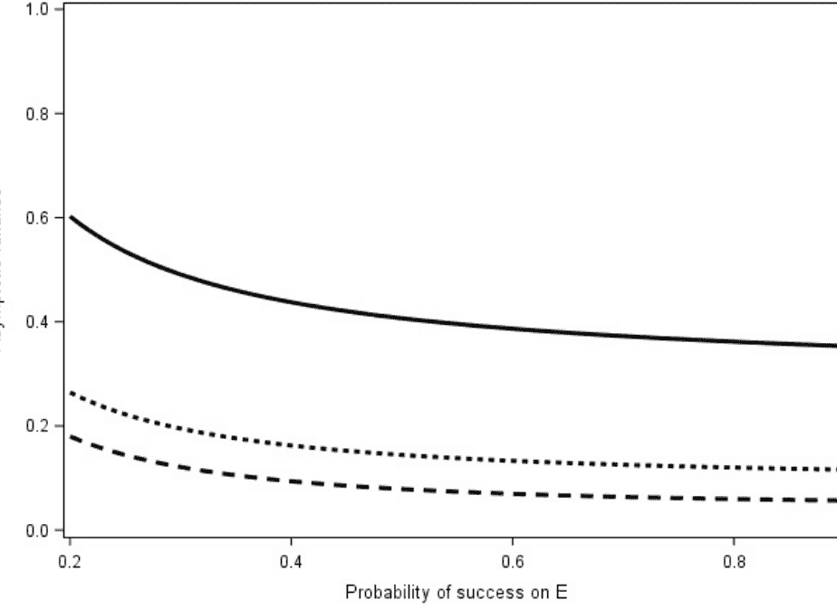

## 10.4 优化响应适应随机化程序的模拟

### 10.4.1 模拟单个 RAR 序列

目标分配比例是预先指定的（例如 1:1 或 2:1），治疗随机化序列可以在任何受试者入组之前预生成。相比之下，RAR 序列无法预生成，因为治疗随机化概率会在整个试验过程中根据累积患者结果数据进行自适应修改。

标准的计算机软件包（如 SAS 或 R）具有内置的随机数生成器，可根据对试验患者结果的某些假设来模拟 RAR 设计。我们从模拟单个随机化序列开始。补充材料中的程序 `ch10.4.1.sas` 为具有 $n=40$ 名患者的试验生成使用 DBCD$(\gamma=2)$ 程序（第 10.3 节）并针对 RSIHR 分配（10.2）的一组分配序列。我们假设治疗的真实成功概率为 $p_E=0.7$ 和 $p_C=0.4$，因此 $\rho=\sqrt{0.7}/\sqrt{0.7+0.4}=0.57$。前 $2m_0$ 名患者使用等随机化在 $E$ 和 $C$ 之间进行随机（在程序 `ch10.4.1.sas` 中，我们设置 $2m_0=10$）。具体而言，前 10 名患者分配 $E$ 的随机概率设置为：

```
$\phi_E=\frac{1}{2}, \quad \phi_{m+1}=\frac{5-N_E(m)}{10-m}, \quad m=1,...,9$
```


其中 `$N_E(m)$` 是 `$m$` 名患者中治疗 `E` 的分配次数。响应适应部分从第 11 名患者开始。第 `$(m+1)$` 名患者（`$m\in\{10,39\}$`）的随机化概率确定如下：假设之前 `$m$` 名患者的所有结果数据均可用，获取 `$N_E(m), N_C(m), S_E(m), S_C(m)$`，并估计治疗成功概率为 `$\hat{p}_{k,m}=(S_k(m)+0)/(N_k(m)+1)$`。注意，`$\hat{p}_{k,m}$` 是无信息先验下的贝叶斯估计，在估计的成功概率等于零或一之前。估计的目标分配更新为 `$\hat{\rho}_m=\hat{p}_{E,m}/\sqrt{\hat{p}_{E,m}+\hat{p}_{C,m}}$`，第 `$(m+1)$` 名患者分配 `E` 的随机概率设置为：

```
$\phi_{m+1} = \frac{\hat{p}_{E,m}^2}{N_E(m) + \frac{(1-\hat{p}_{E,m})^2}{N_C(m)}},quad m=10, \dots, 39$
```

对于 `$(m+1)$` 名患者，生成均匀随机数 `$U_{m+1}\in[0,1]$` 并应用以下规则：如果 `$U_{m+1} \le \phi_{m+1}$`，则分配 `E`；如果 `$U_{m+1} > \phi_{m+1}$`，则分配 `C`。表 10.2 显示了试验过程中随机概率的变化。第一列是患者人数。第二、三列代表 `E` 和 `C` 的当前分配人数。第四、五列代表 `E` 和 `C` 的当前成功人数。第六、七列显示 `E` 和 `C` 的成功概率估计值，第八列显示当前分配估计。如上所述，前 10 名患者的分配不是自适应的，因此在这种情况下第 4-8 列为空。第九列是当前患者的随机概率。第 10 列是患者结果（若成功为 `E`，失败为 0）。

## 表 10.2 单个序列模拟

| 患者 | $N_{E,m-1}$ | $N_{C,m-1}$ | $S_{E,m-1}$ | $S_{C,m-1}$ | $\hat{p}_{E,m-1}$ | $\hat{p}_{C,m-1}$ | $\hat{\rho}_{m-1}$ | $\phi_{m-1}$ | 结果 |
|---|---|---|---|---|---|---|---|---|---|
| 1 | 0 | 0 | NA | NA | | | | 0.5 | |
| 2 | 0 | 1 | NA | NA | | | | 0.5 | |
| 3 | 1 | 1 | NA | NA | | | | 0.5 | |
| 4 | 2 | 1 | NA | NA | | | | 0.4 | |
| 5 | 2 | 2 | NA | NA | | | | 0.5 | |
| 6 | 3 | 2 | NA | NA | | | | 0.4 | |
| 7 | 4 | 2 | NA | NA | | | | 0.2 | |
| 8 | 4 | 3 | NA | NA | | | | 0.3 | |
| 9 | 4 | 4 | NA | NA | | | | 0.5 | |
| 10 | 5 | 4 | NA | NA | | | | 0.0 | |
| 11 | 5 | 5 | 1 | 0 | 0.75 | 0.25 | 0.63 | 0.8 | |
| 12 | 6 | 5 | 1 | 1 | 0.64 | 0.25 | 0.62 | 0.8 | |
| 13 | 7 | 5 | 1 | 1 | 0.69 | 0.25 | 0.62 | 0.7 | |
| 14 | 7 | 6 | 1 | 1 | 0.69 | 0.21 | 0.64 | 0.8 | |
| 15 | 8 | 6 | 1 | 1 | 0.72 | 0.21 | 0.65 | 0.8 | |
| 16 | 9 | 6 | 1 | 1 | 0.65 | 0.21 | 0.64 | 0.7 | |
| 17 | 10 | 6 | 1 | 1 | 0.68 | 0.21 | 0.64 | 0.7 | |
| 18 | 11 | 6 | 1 | 1 | 0.63 | 0.21 | 0.63 | 0.6 | |
| 19 | 11 | 7 | 1 | 1 | 0.63 | 0.19 | 0.65 | 0.7 | |
| 20 | 12 | 7 | 1 | 1 | 0.65 | 0.19 | 0.65 | 0.7 | |
| 21 | 12 | 8 | 1 | 1 | 0.65 | 0.17 | 0.66 | 0.8 | |
| 22 | 13 | 8 | 1 | 1 | 0.61 | 0.17 | 0.66 | 0.7 | |
| 23 | 14 | 8 | 1 | 1 | 0.61 | 0.17 | 0.62 | 0.7 | |
| 24 | 14 | 9 | 1 | 1 | 0.69 | 0.21 | 0.64 | 0.8 | |
| 25 | 15 | 9 | 1 | 1 | 0.69 | 0.21 | 0.65 | 0.8 | |
| 26 | 16 | 9 | 1 | 1 | 0.65 | 0.21 | 0.64 | 0.7 | |
| 27 | 17 | 9 | 1 | 1 | 0.68 | 0.21 | 0.64 | 0.7 | |
| 28 | 18 | 9 | 1 | 1 | 0.63 | 0.21 | 0.63 | 0.6 | |
| 29 | 18 | 10 | 1 | 1 | 0.63 | 0.19 | 0.65 | 0.7 | |
| 30 | 19 | 10 | 1 | 1 | 0.65 | 0.19 | 0.65 | 0.7 | |
| 31 | 20 | 10 | 1 | 1 | 0.65 | 0.17 | 0.66 | 0.8 | |
| 32 | 21 | 10 | 1 | 1 | 0.68 | 0.21 | 0.64 | 0.7 | |
| 33 | 21 | 11 | 1 | 1 | 0.68 | 0.19 | 0.64 | 0.7 | |
| 34 | 22 | 11 | 1 | 1 | 0.65 | 0.19 | 0.65 | 0.7 | |
| 35 | 23 | 11 | 1 | 1 | 0.69 | 0.21 | 0.64 | 0.8 | |
| 36 | 24 | 11 | 1 | 1 | 0.69 | 0.21 | 0.64 | 0.7 | |
| 37 | 25 | 12 | 1 | 1 | 0.65 | 0.21 | 0.64 | 0.7 | |
| 38 | 25 | 13 | 1 | 1 | 0.65 | 0.19 | 0.65 | 0.7 | |
| 39 | 26 | 13 | 1 | 1 | 0.68 | 0.21 | 0.64 | 0.7 | |
| 40 | 27 | 13 | 1 | 1 | 0.68 | 0.19 | 0.64 | 0.7 | |

### 10.4.2 通过蒙特卡洛模拟分析 RAR 设计的运行特征

通过模拟 RAR 试验（例如模拟 10,000 次），可以生成重要设计特征的经验分布，例如治疗分配比例、治疗失败次数等。这使得能够在不同的实验场景下对各种随机化设计进行比较。补补程序 `ch10.4.2.sas` 可用于模拟五种随机化方案的运行特征：

- I. 完全随机设计 `CRD`
- II. 置换区随机设计 `PBD`
- III. `SMLE` 程序
- IV. `DBCD(γ = 2)` 程序
- V. `ERADE` 程序

对于程序 I，每位患者以 1/2 的概率在 `E` 和 `C` 之间进行随机化。对于程序 II，治疗分配是在大小为 `$2m_0$` 的块中随机进行的（其中 `$m_0$` 是预先指定的正整数），使得在每组 `$2m_0$` 名患者后实现治疗平衡。对于程序 III、IV 和 V，首先进行置换区随机化，剩余患者根据具有 RSIHR 目标分配 `$\rho = PRSIHR = \frac{\sqrt{E}}{\sqrt{E}+\sqrt{C}}$` 的 RAR 算法在 `E` 和 `C` 之间进行随机化。

设计特征包括：

- 分配比例 `$N_E(n)/n$`；
- 分配到优势治疗的试验受试人数：`$N_E(m)\{p_E \ge p_C\} + N_C(m)\{p_E < p_C\}$`；
- 试验总失败次数：`$F(m) = F_E(n) + F_C(n)$`，其中 `$F_k(n)$` 是治疗 `$k=E,C$` 的失败次数；
- 治疗差异估计 `$\hat{\Delta}(n) = \hat{\rho}_E - \hat{\rho}_C$`；
- Wald 检验的经验（平均）功效（双侧 `$\alpha=0.05$`）。

程序 `ch10.4.2.sas` 基于 10,000 次模拟，在 `$p_E=0.7$` 且 `$p_C=0.4$` 的场景下模拟了设计 I–V 的五种设计的运行特征。试验样本量设置为 `$n=120$`，这对应于等比例分配设计下 Wald 检验约 92% 的功效。设计 I 和 II 的目标分配为 0.5，设计 III、IV 和 V 为 0.57。

图 10.3 显示了分配比例的模拟分布。对于设计 I `CRD`，分布集中在 0.5 附近，但变异性显著（分配比例的范围为 0.33 到 0.68）。对于设计 II `PBD`，治疗样本量始终完美平衡；因此，分配恒定为 0.5。RAR 设计 III `SMLE`、IV `$\gamma=2$` 的 `DBCD` 和 V `ERADE` 呈现近似正态分布，中心位于目标分配 0.57。与理论一致，在三种 RAR 设计中，`ERADE` 的变异性最低，`SMLE` 的变异性最高。

*图 10.3 五种设计模拟分配比例的分布*

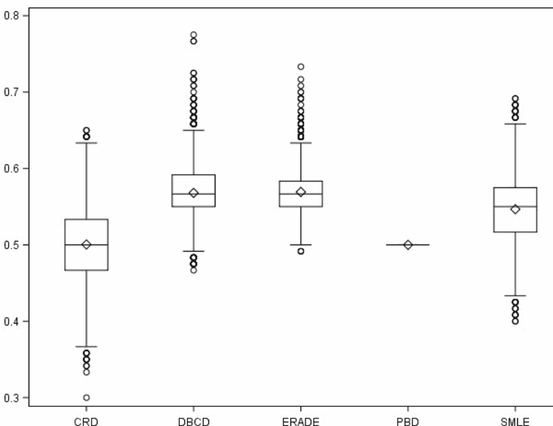

表 10.3 显示了模拟的选汇总统计量。由于在示例中 `$p_E=0.7$` 且 `$p_C=0.4$`，治疗 `E` 是优越的。`SMLE` 的治疗 `E` 分配平均次数为 66，`DBCD` 和 `ERADE` 为 68，平衡设计 I 和 II 为 60（注意该特征在五种设计之间的不同范围）。在治疗失败总数方面，与平衡设计相比，RAR 设计平均少产生 2–3 次失败。所有五种设计都得出了无偏估计，并且在治疗差异上具有相近的均方误差 `MSE`。这些设计的设计的 Wald 检验经验功效为 0.92–0.93。

总体而言，在该示例中，RAR 设计在减少治疗失败方面发挥作用，且在估计质量和功效方面与平衡随机化设计几乎相同。虽然我们在模拟中考虑了 Wald 检验，但也可以考虑其他检验。Gu 和 Lee 在 [52] 中进行了一项全面的模拟研究，探讨了双臂二元结局 RAR 试验中九种不同检验统计量的性质。他们发现，对于小样本试验 `($n=30$)`，卡方检验的 Cook 修正和对数似然比检验的 Williams 修正性能最佳。

## 表 10.3 五种设计模拟分配比例的汇总统计量

| PBD | CRD | SMLE | DBCD (γ=2) | ERADE |
|---|---|---|---|---|
| E 的目标分配比例 | 0.50 | 0.50 | 0.57 | 0.57 | 0.57 |
| E组人数 - 平均 (标准差) | 60.0 (0) | 60.1 (6) | 65.6 (5) | 68.1 (4) | 68.3 (3) |
| E组人数 - 最小-最大 | 60-60 | 36-78 | 46-83 | 56-88 | 57-87 |
| 治疗失败 - 平均 (标准差) | 54.0 (5) | 53.9 (5) | 52.3 (5) | 51.5 (5) | 51.5 (5) |
| 治疗失败 - 最小-最大 | 33-72 | 33-75 | 33-73 | 32-71 | 33-70 |
| 治疗差异估计 - 平均 (标准差) | 0.30 (0) | 0.30 (0) | 0.30 (0) | 0.30 (0) | 0.30 (0) |
| 治疗差异估计 - MSE | 0.0074 | 0.0077 | 0.0078 | 0.0078 | 0.0079 |
| Wald 检验平均功效 | 0.93 | 0.92 | 0.92 | 0.92 |

### 10.5 响应随机化的功效与样本量

对于固定分配 `$\rho$` 的随机设计（例如 `$\rho=1/2$` 或 `$\rho=2/3$`），总样本量 `$n$` 以及治疗组大小 `$n_E=np$`、 `$n_C=n(1-\rho)$` 都是固定的，以达到所需的功效。在 RAR 试验中，总样本量 `$n$` 是固定的，但治疗组大小 `$N_E(n)$` 和 `$N_C(n)$` 是随机的。因此，在规划 RAR 试验时，样本量和功效需要特殊考虑。

Hu 和 Rosenberger 在 [14] 中提出了一种确定目标分配 `$p_E, p_C$` 的 RAR 设计样本量的方法。考虑单侧假设 `$H_0: p_E=p_C$` 对 `$H_a: p_E>p_C$`。对于给定的显著性水平 `$\alpha$`，如果检验统计量满足则拒绝 `$H_0$`：

```
$$\frac{\hat{p}_E-\hat{p}_C}{\sqrt{\frac{\hat{p}_E}{N_E(n)}+\frac{\hat{p}_C}{N_C(n)}}} > z_{1-\alpha}$$
```

其中 `$z_{1-\alpha}$` 是正态分布的 `$(1-\alpha)$` 分位数。在假设 `$N_k(n) \to \infty$`（几乎处处）、`$\hat{p}_k \to p_k$`（概率收敛）且 `$\sqrt{n}(\hat{p}_k-p_k) \to N(0, p_k)$`（分布收敛）时（适用于10.3.2、10.3.3和10.3.4节中考虑的RAR程序），功效函数可以近似为：

```
$$P[p_E, p_C, N_E(n), N_C(n)] = \Phi \left( \frac{p_E-p_C}{\sqrt{\frac{p_E}{N_E(n)}+\frac{p_C}{N_C(n)}}} - z_{1-\alpha} \right), (10.11)$$
```

其中 `$\Phi(\cdot)$` 是正态分布的累积分布函数。重要的是，由于 `$N_E(n)$` 和 `$N_C(n)$` 是随机的，式11是一个随机变量。在进一步的渐近假设下（到为止考虑的RAR程序均满足）：

- `$N_E(n)/n-\rho \ge N(0,1)$`（几乎处处）
- `$\sqrt{n(N_E(n)/n-\rho)} \to N(0, \sigma^2)$`（分布收敛），对于某些 `$\sigma^2 > 0$`，可以得到 RAR 设计功效函数的二阶泰勒近似 [14]。结果表明，目标分配 `$\rho$` 的 RAR 设计功效主要由分配 `$\rho$` 的固定分配设计功效以及 `$N_E(n)/n-\rho$` 和 `$(N_E(n)/n-\rho)^2$` 的值决定（者的期望是分配比例的方差）。因此，可以根据渐近近似辅助 RAR 设计的样本量规划。

样本量分为三种：1）固定分配设计达到 `$1-\beta$` 功效的样本量（第一类）；2）平均达到 `$1-\beta$` 功效的样本量（第二类）；3）以概率 `$1-\xi$`（对于某个正 `$\xi$`）达到功效的样本量（第三类）[14]。

考虑第一类样本量。对于固定分配，治疗组样本量为 `$N_E(n)=np$` 和 `$N_C(n)=n(1-\rho)$`，达到 `$1-\beta$` 功效的样本量通过求解得到：

```
$$\frac{p_E-p_C}{\frac{p_E+p_C}{np(1-\rho)}}z_{1-\alpha} = 1-\beta$$
```

解为：

```
$$n_I = \frac{(\frac{p_E}{\rho}+\frac{p_C}{1-\rho})(z_{1-\alpha}+z_{1-\beta})^2}{(p_E-p_C)^2} \quad (10.12)$$
```

（如有必要，可以将(10.12)中的 `$n_I$` 取整到下一个最大的整数）。

要确定第二类样本量 `($n_{II}$)`，我们需要考虑平均功效函数。根据我们的假设 `$\sqrt{n(N_E(n)/n-\rho)} \to N(0, \sigma^2)$`；则平均功效函数近似为：

```
$$EP[p_E, p_C, N_E(n), N_C(n)] = \int_{-\infty}^{\infty} \frac{p_E-p_C}{\sqrt{\frac{p_E}{np+\sigma\sqrt{n}}+\frac{p_C}{(1-\rho)n-\sigma\sqrt{n}}}}z_{1-\alpha}\phi(x)dx \quad (10.13)$$
```

其中 `$\phi(x)=(2\pi)^{-1/2}\exp(-x^2/2)$`。为了获得平均 `$1-\beta$` 的功效，我们找到最小的正整数 `$n_{III}$`，使得 `$EP(p_E, p_C, NE(n_{III}), NC(n_{III})) \ge 1-\beta$`。

在实践中，每个临床试验仅进行一次，因此确保统计检验在高概率具有足够的功效至关重要。对于 RAR 设计，为了以 `$1-\xi$` 的概率达到固定功效 `$1-\beta$`，其 III 类样本量 `$n_{III}$` 是满足 `$Pr(P(p_E, p_C, NE(n_{III}), NC(n_{III})) \ge 1-\xi)$` 的最小正整数。在文献 [14] 中，作者显示 `$n_{III}$` 可以（近似）找到为满足以下条件的最小正整数：

```
$$\frac{p_E q_E}{n_{III}-1-\xi/2\sqrt{n_{III}}} + \frac{p_C q_C}{(1-\rho)n_{III}+1-\xi/2\sqrt{n_{III}}} < \left(\frac{p_E-p_C}{z_{1-\alpha}+z_{1-\beta}}\right)^2 \quad (10.14)$$
```

以及

```
$$\frac{p_E q_E}{n_{III}-1-\xi/2\sqrt{n_{III}}} + \frac{p_C q_C}{(1-\rho)n_{III}+1-\xi/2\sqrt{n_{III}}} < \left(\frac{p_E-p_C}{z_{1-\alpha}+z_{1-\beta}}\right)^2 \quad (10.15)$$
```

在公式 `(10.14)` 和 `(10.15)` 中，`$\sigma$` 是 `$NE_E(n)/n$` 的渐近标准差。


可以使用补充程序 `ch10_5.sas` 来确定三种类型的样本量：针对等比例分配 $\rho=1/2$ 的 CRD，以及针对 RSIHR 分配 $\rho=\frac{\sqrt{PE}}{\sqrt{PE}+\sqrt{NC}}$ 的 ERADE，适用于单侧检验 $\alpha=0.025$，期望功效水平 $1-\beta=0.90$，且为了以 $1-\xi=0.95$ 的概率达到 90% 的功效。

表 10.4 显示了 $(p_E, p_C)$ 四种实验场景所需的样本量。表 10.4 的第四、五、六列分别显示了 I 类、II 类和 III 类样本量。对于每种类型的样本量，ERADE 设计比 CRD 需要多出 2-3 名患者才能达到相同的功效水平。II 类样本量通常比 I 类样本量多 1 个。这意味着，平均而言，RAR 设计的功效与固定设计几乎相同（这与文献 [14] 中的理论一致，该理论认为 RAR 设计的平均功效损失为 $n^{-1}$ 级）。III 类样本量通常比 I 类样本量多 4-7 名患者。总的来说，这些结果表明与相应的固定分配设计相比，CRD 和 ERADE 不会因为随机化而损失过多功效。

## 表 10.4 两种随机化设计的三类样本量

| $(\rho_E, \rho_C)$ | 设计 | 目标分配 | $n_I$ | $n_{II}$ | $n_{III}$ |
|---|---|---|---|---|---|
| (0.5, 0.4) | CRD | 0.50 | 1030 | 1031 | 1035 |
| | ERADE | 0.53 | 1032 | 1033 | 1037 |
| (0.6, 0.4) | CRD | 0.50 | 253 | 254 | 257 |
| | ERADE | 0.55 | 255 | 256 | 260 |
| (0.7, 0.4) | CRD | 0.50 | 106 | 107 | 111 |
| | ERADE | 0.57 | 109 | 109 | 113 |
| (0.8, 0.4) | CRD | 0.50 | 53 | 54 | 60 |
| | ERADE | 0.59 | 56 | 57 | 61 |

## 10.6 额外考虑

### 10.6.1 多治疗方案与非二分类结局

许多随机对照试验（RCTs）涉及两个以上的治疗组。例如，在 II 期剂量范围研究中，治疗组可能是安慰剂和/或活性对照，以及几种研究性药物的剂量。研究目标可能包括估计各种治疗对比以及检验治疗效应相等的性假设。通常，最优分配比例在不同治疗组之间是不相等的 [53]。正如文献 [33] 所出的，“……自适应随机化在复杂的多臂设置中表现得最为出色”，事实上，预期的最优 RAR 设计在具有两个以上治疗组的试验中比比等随机化提供更实质性的收益（例如，通过将更多患者分配到更好的组）。

deCets 及其合作者提出了一个在多臂设置中寻找最优分配的通用框架。对于多臂试验，可以使用 DBCD 或比例模型。自适应随机化在复杂的多臂设置中表现得最为出色，事实上，预期的最优 RAR 设计在具有两个以上治疗组的试验中比比等随机化提供更实质性的收益（例如，通过将更多患者分配到更好的组）。

### 10.6.2 延迟响应

RAR 的假设是结局是瞬时的。在实践中，如果招募期足够长且观察结果迅速，仍然可以使用 RAR。然而，如果观察存在延迟，其优势就会缩小。

### 10.6.3 误分类响应

RAR 需要准确的数据。在某些试验中，二分类响应可能会被误分类，导致偏差。如果误分类机制已知，可以进行调整。

### 10.6.4 趋势

在某些临床试验中，预后因素可能存在趋势。例如，早期患者的预后可能比后期患者。RAR 的主要批评之一是在存在时间趋势时会导致估计偏差，但可以使用协变量适应随机化设计。

## 10.7 示例

### 10.7.1 重新设计真实临床试验

在本节中，我们给出一个可以使用最优 RAR 设计临床试验示例。Connor 及其合作者在 [66] 中报告了一项关于齐妥信（AZT）在减少母婴传播风险方面的有效性和安全性的随机、双盲、安慰对照试验的结果。试验中，招募了 477 名孕妇并随机分配到 AZT [`nc=239`] 和安慰剂 [`nc=238`]。研究中，409 名女性生产了 415 个婴儿。18 个月时未感染婴儿的估计比例 AZT 组为 0.917，安慰剂组为 0.745；这意味着 AZT 与安慰剂相比减少了约三分之二的母婴传播风险。最优 RAR 设计会更多分配 AZT治疗，从而实现更有效的试验设计。

我们通过模拟对该试验进行重新设计。将比较四种随机化程序：

- 完全随机设计 (`CRD`)：每个患者以 1/2 的概率在治疗组间随机化。（虽然这种设计在实践中不会使用，但在这里包含是为了与两种 RAR 设计比较变异性。）
- 置换设计 (`PBD`)：以 4 为块进行随机化，使得每四名患者治疗数量相等。
- RSIHR 设计：目标分配 $\rho_E=\sqrt{\rho_{PE}}/(\sqrt{\rho_{PE}}+\sqrt{\rho_{PC}})$ 使用 $\gamma=0.5$ 的 ERADE（10.3.4 节）来实现。
- 复合最优设计：目标分配（作为方程 10.4 在 $\omega=0.5$ 下的唯一解获得）通过使用 $\gamma=0.5$ 的 ERADE 程序（10.3.4 节）来实现。

真实的成功概率假设为 $\rho_E=0.917$ (AZT) 和

$p_C = 0.745$ (安慰剂)，意味着 $p_E - p_C = 0.172$。根据这些数字，AZT 治疗的目标分配比例（研究者最初未知）对于 RSIHR 设计中为 0.525，对于复合优化设计为 0.607。我们使用总样本量 $n=477$ 来匹配 [66] 中的真实试验设置。在两种 RAR（比例分配随机化）设计的模拟中，前四名患者使用块大小为 4 的 PBD 分配到 AZT 或安慰剂组；随后使用 ERADE 程序根据相应的分配比例进行分配。在我们的模拟中，我们假设每个患者的结局在下位患者入组研究之前会被观察到，并且 RAR 算法顺序更新治疗随机化概率。在实践中，在当前患者入组时，某些患者的结局数据可能尚未可用（即响应延迟），在这种情况下，只需使用到目前为止收集的数据来更新参数估计和随机化概率。然而，本文并未探讨这一场景。

表 10.5（补充程序 `ch10.7.1.sas`）显示了四种设计的模拟运行特征。所有四种设计都实现了目标分配，在估计质量方面非常相似。RSIHR 设计比 CRD 变异更大（RSIHR、复合优化和 CRD 分配比例的经验标准差分别为 0.006、0.033 和 0.023）。与平衡随机化设计（CRD 和 PBD）相比，RSIHR 设计平均多分配 12 名患者接受 AZT 治疗，而复合优化设计多分配 53 名患者。此外，平均而言，RSIHR 设计导致的治疗失败少 2 例，复合优化设计比平衡设计少 8 例。因此，在本例中，RSIHR 设计的伦理收益获益较小，而复合优化设计在个体和集体伦理之间提供了最佳平衡。

## 表 10.5 使用四种随机化程序重新设计 AZT 试验

| PBD | CRD | RSIHR | 复合优化 |
|---|---|---|---|
| E 均值的分配比例 (标准差) | 0.500 (0.001) | 0.500 (0.023) | 0.526 (0.006) | 0.610 (0.033) |
| E 均值的数量 (标准差) | 238.49 (0.50) | 238.46 (11.05) | 250.89 (2.65) | 291.16 (15.72) |
| E 极值的数量 | 238-239 | 199-279 | 241-261 | 245-348 |
| 治疗失败 - 均值 (标准差) | 80.66 (8.01) | 80.75 (8.22) | 78.53 (7.67) | 71.62 (8.09) |
| 治疗失败 - 极值 | 51-115 | 52-114 | 52-109 | 45-101 |
| 参数估计 ($p_E$) - 均值 (标准差) | 0.9168 (0.0177) | 0.9170 (0.0179) | 0.9170 (0.0174) | 0.9164 (0.0162) |
| 参数估计 ($p_E$) - MSE | 0.0003 | 0.0003 | 0.0003 | 0.0003 |
| 参数估计 ($p_C$) - 均值 (标准差) | 0.7449 (0.0284) | 0.7445 (0.0284) | 0.7444 (0.0289) | 0.7429 (0.0322) |
| 参数估计 ($p_C$) - MSE | 0.0008 | 0.0008 | 0.0008 | 0.0010 |
| 估计治疗差异 - 均值 (标准差) | 0.1719 (0.0334) | 0.1725 (0.0334) | 0.1726 (0.0335) | 0.1735 (0.0363) |
| 估计治疗差异 - MSE | 0.0011 | 0.0011 | 0.0011 | 0.0013 |

## 10.7.2 实现 DBCD

### 10.7.2.1 三队列设计

在这里我们描述了两个示例，读者可以对其进行修改以便在实践中实施 RAR 设计。补充材料中提供了样本结果。

补充程序 `ch10.7.2.sas` 阐述了三队列设计 DBCD [$\gamma=2$] 的实际实现。在本例中，60 名患者使用块大小为 4 的 PBD 随机分配到 E 或 C 组，响应从伯努利分布生成。第二队列根据数据使用 DBCD 随机分配到 E 或 C 组。

### 10.7.2.2 两队列序列设计

补充程序 `ch10.7.2.sas` 还阐述了使用 DBCD [$\gamma=2$] 的两队列序列设计。在本例中，60 名患者使用块大小为 4 的 PBD 随机分配到 E 或 C 组，响应从伯努利分布生成。第一队列（20 名患者）根据数据使用 DBCD 随机分配到 E 或 C 组。

## 10.8 总结

在本章中，我们介绍了二元结局试验的优化 RAR 设计。本章的主要目标是提供优化 RAR 方法论的介绍，而不是就如何选择“最佳”设计提供全面的指导。请注意，文献 [32, 67] 仅研究了两种特定的 RAR 程序（使用 Tall 和 Wathen 方法的贝叶斯自适应随机化 [15]，以及针对 RSI 分配的 RAR 设计 [10]）。然而，优化 RAR 设计的范围广泛得多——它还包括其他类型的优化分配（例如 10.7 节中的复合优化设计），以及具有二元、计数、连续和生存时间结局的多臂 RAR 试验 [14]。在更通用的设置，RAR 在统计效率和伦理方面比均等分配随机化 [17-19, 31] 提供了更显著的改进。我们在书中未讨论的一个重要课题是 RAR 与序贯设计的结合，允许由于无效性（如果没有治疗效果）或有效性（如果治疗效果显著）而提前终止试验。一些作者在理论上证明了序贯 RAR 设计的优势 [68-71]。

需要注意的是，与固定随机化方案相比，RAR 设计在操作上更为复杂，并且需要更充分的前期规划。RAR 适用于招募期较长且结局可以快速观察到的试验；数据必须是高质量的以减轻试验过程中潜在的偏差。关于在实践中实施 RAR 设计的进一步考虑，请参阅 [2, 22, 45]。

# 参考文献

- 1. Altman DG & Bland JM. (1999). 受控试验中的治疗分配：为什么要随机化？*British Medical Journal* 318: 1209.
- 2. Sverdlov O & Rosenberger WF. (2013). 临床试验中的随机化：我们可以消除偏倚吗？*Clinical Investigation* 3: 37-47.
- 3. Friedman LM, Furberg CD & DeMets DL. (2010). *临床试验基础，第四版*。纽约：Springer出版社。
- 4. Berger VW, Ivanova A & Knoll MD. (2003). 通过使用限制较少的随机化程序在保持平衡的同时减少预测性。*Statistics in Medicine* 22: 3017-3028.
- 5. Efron B. (1971). 强制顺序试验达到平衡。*Biometrika* 58: 403-417.
- 6. Pocock SJ. (1979). 临床试验中患者的治疗分配。*Biometrika* 35: 183-197.
- 7. Sposto R & Krailo MD. (1987). 存生存试验中不相等分配的使用。*Statistics in Medicine* 6: 119-125.
- 8. Dumville JC, Hahn S, Miles JNV & Torgerson DJ. (2006). 临床试验中不相等随机化比例的使用：回顾。*Contemporary Clinical Trials* 27: 1-12.
- 9. Kuznetsova O & Timofeyeyev Y. (2011). 用于两个或多个治疗组之间不相等分配的砖隧道随机化。*Statistics in Medicine* 30: 812-824.
- 10. Rosenberger WF, Stallard N, Ivanova A, Harper R & Ricks ML. (2001). 二元反应试验的最优自适应设计。*Biometrics* 57: 909-913.
- 11. Zelen M. (1969). 胜者为王规则与受控临床试验。美国统计协会杂志 64: 131-146.
- 12. Wei LJ & Durham S. (1978). 医学试验中的随机“胜者为王”规则。美国统计协会杂志 73: 840-843.
- 13. Bartlett RH, Rolloff DW, Cornell RG, Andrews AF, Dillon PW & Zwischenberger JB. (1985). 新生儿呼吸衰竭的体外循环：一项前瞻性随机试验。*Pediatrics* 76: 479-487.
- 14. Hu F & Rosenberger WF (2006). 临床试验中反应自适应随机化的理论。纽约：Wiley出版社。
- 15. Thall PF & Wathen JK. (2007). 临床试验中实用贝叶斯自适应随机化。*欧洲癌症杂志* 43: 859-866.
- 16. Palmer CR & Rosenberger WF. (1999). 伦理与实践：三期随机化临床试验的替代设计。*Controlled Clinical Trials* 20: 172-186.
- 17. Tymofeyeyev Y, Rosenberger WF & Hu F. (2007). 在顺序二元反应试验中实施最优分配。美国统计协会杂志 102: 224-234.
- 18. Sverdlov O, Tymofeyeyev Y & Wong WK. (2011). 多臂生存试验的最优反应-自适应随机化设计。*Statistics in Medicine* 30: 2890-2910.
- 19. Sverdlov O, Tymofeyeyev Y & Wong WK. (2014). 具有 Weibull 事件结局的多臂临床试验高效反应-自适应随机化设计。*Biopharmaceutical Statistics* 24: 732-754.
- 20. 美国食品药品管理局. (2010). 行业指南：药物和生物制品自适应设计临床试验（草案）。可用于：http://www.fda.gov/downloads/Guidance
- 21. Krams M, Lees KR, Hacke W, Grieve AP, Orgogoso JM & Ford GA. (2003). 急性缺血性中风的剂量-反应研究。*Stroke* 34: 2543-2548.
- 22. Rosenberger WF & Lachin J. (2002). 临床试验随机化：理论与实践。纽约：Wiley出版社。
- 23. McEntegart D. (2008). Hu F & Rosenberger WF《临床试验中反应自适应随机化》书评。*Pharmaceutical Statistics* 7: 72-73.
- 24. Rosenberger WF. (2002). 随机箱模型和顺序设计（讨论）。*Sequential Analysis* 21: 1-28 (讨论：29-41)。
- 25. Ivanova A. (2003). 胜者为王类型的设计。*Metrika* 58: 1-13.
- 26. Zhang LX, Hu F, Chan WS. (2011). 无限箱模型——理论属性与应用。*Annals of Statistics* 39: 643-671.
- 27. Thompson WR. (1933). 关于两个样本中一个概率超过另一个的可能性。*Biometrika* 25: 275-294.
- 28. Thall PF & Wathen JK. (2005). 多阶段试验中的协变量调整自适应随机化。*Statistics in Medicine* 24: 1947-1964.
- 29. Giles FJ, Kantarian HM, Cortes JE, Garcia-Manero G, Verwe S, Thomas DA, Ferrajoli A, Wathen JK, Xiao LC, Berry DA & Estes. (2003). 50 岁及以上未治疗异常核型白血病患者中阿杉比啶对比胞细胞嘧啶的自适应随机研究。*Journal of Clinical Oncology* 21: 1722-1727.
- 30. Cheung YK, Inoue LY, Wathen JK & Thall PF. (2006). 基于事件时间的连续贝叶斯自适应随机化。*Statistics in Medicine* 25: 55-70.
- 31. Tripp L, Lee EQ, Wen Py, Batchelor TT, Cloughes T, Parmigiani G & Alexander BM. (2012). 复发性胶质母瘤的贝叶斯自适应试验设计。*Journal of Clinical Oncology* 30: 3258-3263.


- 32. Korn E, Fremlin B. (2011). 结局自适应随机化：有用吗？*Journal of Clinical Oncology* 29: 771-776.
- 33. Berry DA. (2011). 自适应临床试验：前景与警告。*Journal of Clinical Oncology* 29: 606-609.
- 34. Hu F & Rosenberger WF. (2003). 治疗比较的反应自适应随机化的优性、变异性与效能。美国统计协会杂志 98: 671-678.
- 35. Rosenberg WF, Sverdlov O & Hu F. (2012). 临床试验的自适应随机化。*Journal of Biopharmaceutical Statistics* 22: 719-736.
- 36. Yi Y & Wang X. (2015). 反应自适应随机化的统计推断。见于 Sverdlov O 编辑，《现代自适应临床试验：统计学与实践方面》。佛罗里达州：CRC出版社。
- 37. Atkinson A & Biswas A. (2014). *临床试验中的随机反应自适应设计*。佛罗里达州：CRC出版社。
- 38. Whitehead J. (1997). *顺序临床试验的设计与分析，第二版*。纽约：Wiley出版社。
- 39. Magirr D. (2011). 二元终点临床试验中的块反应-自适应随机化。*Pharmaceutical Statistics* 10: 341-346.
- 40. Baldi Antognini A & Giovagnoli A. (2010). 临床试验中个人和集体伦理的复合最优分配。*Biometrika* 97: 935-946.
- 41. Britain E & Schselman JJ. (1982). 比例比较的最优分配。*Biometrics* 38: 1003-1009.
- 42. Zhang L & Biswas A. (2007). 二元反应的最优失败-成功-自适应设计。*Drug Information Journal* 41: 709-718.
- 43. Azriel D, Mandel M & Rinott Y. (2012). 最大化二元反应双样本检验效能的最优分配。*Biometrika* 99: 101-113.
- 44. Yi Y & Yuan Y. (2013). 反应自适应设计的优分配。*应用统计学杂志* 40: 1996-2008.
- 45. Gallo P. (2006). 自适应设计实施中的操作挑战。*Pharmaceutical Statistics* 5: 119-124.
- 46. Melfi, Page C & Geraldes M. (2001). 用于估计的自适应随机化设计。*加拿大统计杂志* 29: 107-116.
- 47. Eiseley JR. (1971). 用于顺序临床试验的双重自适应偏倚币。*统计计划与推理杂志* 38: 249-261.
- 48. Hu F & Zhang LX. (2004). 多治疗临床试验双重自适应偏倚币设计的渐近性质。*统计学年* 32: 268-301.
- 49. Rosenberger WF & Hu F. (2004). 临床试验中最大化效能并最小化治疗失败。*Clinical Trials* 1: 141-147.
- 50. Hu F, Zhang LX & He X. (2009). 高效随机-自适应设计。*统计学年* 37: 2543-2560.
- 51. Hu F, Rosenberger WF & Zhang LX. (2006). Asymptotically best response-adaptive randomization procedures. Journal of Statistical Planning and Inference 136: 1911-1922.
- 52. Gu X & Lee JJ. (2010). A simulation study for comparing testing statistics in response-adaptive randomization. BMC Medical Research Methodology 10: 48.
- 53. Sverdlov O & Rosenberger WF. (2013). On recent advances in optimal allocation designs in clinical trials. Journal of Statistical Theory and Practice 7: 753-773.
- 54. Zhu H & Hu F. (2009). Implementing optimal allocation for sequential continuous responses with multiple treatments. Journal of Statistical Planning and Inference 139: 2420-2430.
- 55. Gwise T, Zhou J & Hu F. (2011). An optimal response biased design with k heteroscedastic treatments. Journal of Statistical Planning and Inference 141: 235-242.
- 56. Wong WK & Zhu W. (2008). Optimal treatment allocation rules under a variance heterogeneity model. Statistics in Medicine 27: 2850-2864.
- 57. Hu F, Zhang LX, Cheung SH & Chan WS. (2008). Doubly biased coin designs with delayed responses. The Canadian Journal of Statistics 36: 541-559.
- 58. Zhang LX, Chan WS, Cheung SH & Hu F. (2007). A generalized drop-the-loser rule for clinical trials with delayed responses. Statistica Sinica 17: 387-409.
- 59. Zhang L & Rosenberger WF. (2007). Response-adaptive randomization for survival trials: the parametric approach. Applied Statistics 56: 153-165.
- 60. Li X & Wang X. (2013). Response-adaptive designs with misclassified responses. Communications in Statistics—Theory and Methods 42: 2071-2083.
- 61. Karrison T, Huo D & Chappell R. (2003). Group sequential, response-adaptive designs for clinical trials. Clinical Trials 24: 506-522.
- 62. Chappell R & Karisson T. (2007). Letter to the editor. Statistics in Medicine 26: 3046-3052.
- 63. Simon R & Simon N. (2011). Using randomization tests to preserve type I error with adaptive randomization. Statistics and Probability Letters 81: 767-772.
- 64. Hu F & Rosenberger WF. (2000). Analysis of time trends in adaptive designs with application to neurophysiology. Statistics in Medicine 19: 2067-2075.
- 65. Rosenberger WF & Sverdlov O. (2008). Handling covariates in the design of clinical trials. Statistical Science 23: 404-419.
- 66. Connor EM, Sperling RS, Gelber R, Kiselev P, Scott G, O'Sullivan MJ, VanDyke R, Bey M, Shearer W, Jacobson RL, Jimenez E, O'Neill E, Bazin B, Culmane M, Coombs R, Elkins M, Moye J, Stratton P (1994). Reduction of maternal-infant transmission of human immunodeficiency virus type 1 with zidovudine. The New England Journal of Medicine 331: 1173-1180.
- 67. Yuan Y & Yin G. (2011). On the usefulness of outcome-adaptive randomization. Journal of Clinical Oncology 29: e390-e402.
- 68. Zhu H & Hu F. (2010). Sequential monitoring of randomized clinical trials. The Annals of Statistics 38: 2218-2241.
- 69. Zhu H & Hu F. (2012). Interim analysis of clinical trials based on urn models. Canadian Journal of Statistics 40: 550-568.
- 70. Lai TL & Liao O. (2012). Efficient adaptive randomization and stopping rules in multiarm clinical trials. Sequential Analysis 31: 441-457.
- 71. Chambaz A & van der Laan MJ. (2014). Inference in group-sequential covariate-adjusted clinical trials. Scandinavian Journal of Statistics 41: 104-140.

# 作者

Oleksandr Sverdlov，生物统计学副总，EMD Serono, Inc.（默克 KgaA 子公司），美国马萨诸州 Rockland。

Zorayr Manukyan，生物统计总监，生物治疗研究部门，Pfizer Inc.,美国马萨诸州 Cambridge。

Gaurav Sharma，统计师，EMMES Corporation，美国马里兰州 Rockville。

## 第 11 章：人群富集设计

### 11.1 引言

### 11.2 经典设计

#### 11.3 经典富集设计的效率

### 11.4 适应性富集设计

### 11.5 总结

# 参考文献

# 作者

## 11.1 引言

### 11.1.1 背景

实验性疗法的传统临床开发利用的是“一刀切”的方法，在未选择或未针对的患者人群中测试治疗方案。这种方法假设疾病人群的反应是同质的。随着分子靶向疗法的出现，基因测序和 mRNA 转录谱分析使得疾病的精细化分类成为可能，从而为特定患者群体开发精准诊断、预后和治疗范式，即个性化医疗。因此，这些靶向疗法可能仅对人群的部分受益，而对其他部分没有益甚至产生伤害。另一方面，蛋白质组和基因组生物标志物具有为医疗实践提供巨大价值的潜力。例如，在肿瘤学中，某些生物标志物提供了将有效性准确预测与特定机制治疗相结合，利用肿瘤的遗传组成和每个患者的基因型指导癌症治疗的选择（美国针对分子靶点批准的某些肿瘤药物）。

由于这些新机遇和挑战，不考虑反应异质性的传统药物开发范式可能是次优的。为了开启个性化医疗的任务，超越固定设计的创新统计设计变得越来越具有吸引力，这些设计允许评估由于表型或基因组异质性的治疗效应。

2012 年，FDA 发布了一份关于支持人类药物和生物制品批准的临床试验富集策略草案。在指南中，“富集”一词被定义为“前瞻性使用任何患者特征来选择研究人群，在该人群中检测药物效应（如果确实存在）的可能性比在未选择的人群中更高”。此外，富集策略分为三大类（节选自指南）：

- 减少异质性的策略：包括选择基线测量在窄范围内的患者（减少患者间异质性），并排除疾病自发好转或测量变异大的患者（减少患者内异质性）。这些策略提供的变异性减少增加了统计功效。
- 预后性富集策略：选择更有可能发生疾病相关终点（对于事件驱动的研究）或病情严重恶化的患者（对于连续终点）。这些策略将增加组别之间的绝对效应差异，但不会改变相对效应。
- 预测性富集策略：选择比其他患病患者更容易对药物治疗产生反应的患者。这种选择可以导致更大的效应量（绝对和相对），并允许使用较小的研究人群。

在本章中，我们概述了统计文献中日益增长的人群富集设计，重点关注预测性富集策略的设计，以便提高在临床试验中根据预测生物标志物检测有效疗法的功效和效率。本章的关注点在于感兴趣的疗效终点；不讨论与预测生物标志物安全性相关的设计问题。

# 表 11.1 美国批准的针对分子靶点不同患者人群的肿瘤药物

| 化合物/靶点 | 适应症（流行率目标） |
| :--- | :--- |
| 吉瑞替尼 (Xalkori®)/ EML4-ALK重易位 | EML4-ALK重易位性非小细胞肺癌 (4-7%) |
| 塞瑞替尼 (Zykadia®)/ EML4-ALK重易位 | EML4-ALK重易位性非小细胞肺癌 (4-7%) |
| 维非尼 (Zelboraf®)/ BRAF 突变 | BRAF 突变的晚期黑色瘤 (30-40%) |
| 曲妥单抗 (Herceptin®); 帕帕替尼 (Tykerb®)/ Her2 | Her2 表达乳腺癌 (25%)；Her2 表达的转移性胃癌 (20-30%) |
| Her2 表达的转移性胃癌 (20-30%) | ER(+) 乳腺癌 (60-70%) |
| 芳香酶抑制剂（来曲唑、依西美坦） | CD20(+) B 细胞淋瘤 (90%+) |
| 利妥昔单抗 (Rituxan®)/ CD20 | 晚期头颈癌 (~100%)；EGFR(+) 转移性结直肠癌 (60-80%)；KRAS 转移性结直肠癌 (60%) |

## 11.1.2 需要考虑的问题

在设计具有预测生物标志物设计的试验之前，需要考虑许多问题（选择具有预测生物标志物组成的设计时考虑的问题）。这是一个重要的步骤，因为在快速增长的文献中，我们拥有多种替代设计方案。

首先，我们需要评估潜在生物标志物的临床前证据强度。如果有强有初步证据表明，实验疗法不能让所有患者获益，且获益限于表达特定分子或遗传特征的亚群患者，则可能采用富集策略。否则，采用未筛选或全入组（all-comers）策略可能是更明智的，这样就不会错失药物开发、患者和市场的机会。第二个问题是生物标志物阳性组的流行率（百分比）是高、中还是低。如果流行率很高，人群富集可能是多余的，传统设计可能会产生最大的商业价值和市场覆盖范围。同样，对于低流行率的情况，全入组设计可能不可行。第三，用于识别富集人群的测量的准确性，以及富集标准在区分反应者和非反应者方面的灵敏性和特异性，也是关键问题。一个准确、可重复且经过充分验证的检测方法，对于在前瞻性研究建立预期的治疗活性以及对生物标志物的临床验证（通常通过中心实验室的伴随诊断试盒来识别患者）至关重要。此外，在随机化之前获取基线活检样本（新获取的或存档的）或血清样本的可行性和时机，决定了生物标志物是否能进行前瞻性验证。

# 表 11.2 选择具有预测生物标志物组成的设计时考虑的问题

| 标志物临床前证据的强度 | 我们应该使用富集/靶向策略（例如在 ALK+ 非小细胞肺癌中使用吉瑞替尼）还是使用未筛选/全入组策略（例如在野生型 KRAS 中使用西妥单抗和潘西珠单抗） |
| 标志物的流行率 | 具有生物标志物阳性状态（如突变或异常）的人群百分比 |
| 检测方法的可重复性和有效性 | 检测方法是否准确、可靠并已通过分析验证（本地或中心实验室） |
| 生物标志物状态评估的可行性和时机 | 生物标志物是否可以进行前瞻性验证或回顾性验证 |

我们将在本章在回顾现有的人群富集设计方法时，进一步讨论这些问题。

## 11.2 经典设计

### 11.2.1 回顾性设计

经典人群富集设计分为两类：回顾性富集设计和前瞻性富集设计。

回顾性富集设计是一种传统的全入组设计，对生物标志物进行回顾性验证，该标志物通常在试验开始时不可用或无法评估，使得前瞻性检测不可行。回顾性验证在研究完成后进行，并可能针对之前在相同患者人群中进行过的试验。正如 Mandrek 和 Sargent [1] 所述，当操作得当时，这种设计可以帮助将有效的治疗方法及时引入到标志物定义的患者人群，否则由于伦理和逻辑考虑，这可能是无法实现的。为了使此类（即大规模且耗时较长的）回顾性分析有效并最大限度地减少偏倚，Mandre 和 Sargent [1] 总结了对回顾性验证研究至关重要的要素列表。

- 1. 来自良好的随机对照试验的数据
- 2. 大多数患者具有可用样本以避免选择偏倚
- 3. 前瞻性的陈假设、分析技术和患者人群
- 4. 预定义的标准化的检测方法和评分系统
- 5. 前期的样本量和效力证明依据


以转移性结直肠癌（CRC）中 EGFR 抑制剂西妥单抗和潘西珠单抗的为例。西妥单抗和潘西珠单抗最初用于 EGFR+ CRC 的适应症，这代表了 65% 的晚期结直肠癌患者。根据之前进行的随机 III 期和 II 期试验 [2-4] 的回顾性分析表明，西妥单抗显著提高了野生型 *KRAS*（人类中由 *KRAS* 基因编码的蛋白）患者的总生存期，而对携带 *KRAS* 突变状态的患者则没有生存获益。因此，2009 年，标签被改为野生型 *KRAS*。

## 11.2.2 前瞻性设计

### 11.2.2.1 富集/靶向设计

虽然前瞻性验证可以节省资源和时间，但由于生物标志物的性质，可能会引入严重的偏差。富集设计也称为生物标志物富集设计或基因富集设计。

在研究过程中，检测结果的快速周转对于更快招募患者至关重要。此外，检测在不同实验室之间应保持一致。例如：在本地和中心性的 HER2 状态检测中发现了高度不一致。因此，赫赛单抗治疗获益的人群可能比中心检测定义的 HER2+ 人群要大。

图 11.1 富集设计


富集设计的一个近期案例是 BRAF [8]。几乎 50% 的黑色瘤具有激活性 V60E BRAF 突变。这导致了一个假设：抑制突变的 BRAF 激酶将产生显著的临床获益。因此，只有 V60E BRAF 突变阳性的患者被纳入研究。患者被随机分配到突变 BRAF 抑制剂或对照治疗。正如假设的那样，在预设的亚组中观察到了治疗获益。另一个富集设计的案例用于 HER2+ 乳腺癌患者的 HER2 试验 [9]。

在该设计中应考虑以下因素：

- 1. 通常需要较小的样本量，但考虑到在入组前将进行大量的预筛选检测，筛选时间可能与全入组设计相同（甚至更长）；
- 2. 营销标签将受到限制；
- 3. 可能仍有一部分患者可能从新疗法中获益；
- 4. 限制入组无法提供证明该治疗对生物标志物阴性患者无效有效的数据；
- 5. 标志物的低流行率在操作和财务上可能面临挑战。

这种设计的效率取决于可能从靶向治疗中获益的生物标志物阳性患者的比例，检测的可靠性和可重复性也起着关键作用。当药物的机制行为已知，且有强力的初步证据表明其对亚人群有获益时，这种设计是合适的。

### 11.2.2.2 标志物与治疗相互作用设计

标志物与治疗相互作用设计（Marker by Treatment Interaction Design）也称为标志物分层设计 [7]。当没有初步证据强有力支持将试验限制在具有特定标志物谱的患者中时（这将需要标志物富集设计），就会选择这种设计。这种设计是前瞻性的，并会导致确定的标志物验证策略。在这种情况下，标志物与治疗或分层设计比标志物富集设计提供更多信息。在这种设计中，对患者的标志物状态进行检测，然后根据其标志物的阳性或阴性状态分别随机化 [6]。因此，随机化使用标志物状态作为分层因子；但只有具有有效测量标志物结果的患者会被随机化。每个标志物组的患者被随机分配到两种不同的治疗（图 11.2 标志物与治疗相互作用设计）。分别进行假设检验，以确定每个标志物组内一种治疗方法是否优于另一种治疗方法。计算样本量以确保每个标志物亚组的测试效能。该设计中假设检验的另一种变体是进行正式的标志物与治疗相互作用检验，以观察治疗效果是否在每个标志物状态亚组内发生变化。在这种情况下，研究效能是基于两个独立试验设计的；但它与大型临床试验的区别在于样本量的计算，以及将随机化限制为仅具有有效标志物结果的患者 [1]。

图 11.2 标志物与治疗相互作用设计

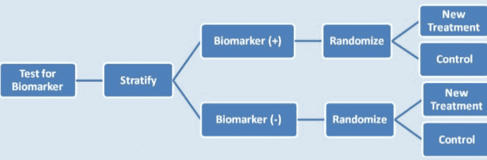

### 11.2.2.3 序贯检验策略设计

原则上，序贯检验设计可以被视为针对所有或未选择患者的经典随机临床试验的特例。

#### 先测试总体差异，后测试亚组

Simon 和 Wang [10] 提出了一种分析策略，对总体假设进行检验，观察新治疗与对照组之间的反应是否存在差异。如果没有差异且反应在预设显著性水平（例如 0.01）上不显著，则在标志物状态阳性的患者中将新治疗与对照组进行比较。第二次比较使用显著性阈值，即初始检验未使用的传统 0.05 的比例。当认为新治疗在更广泛的人群中有效，且亚组分析是补充并作为后备方案时，这种方法非常有用。

例如，如果计划试验使用 .03 的双侧显著性水平检测一致减少具有 90% 的效能，那么总体分析将在发生 297 个事件时进行。如果 25% 的患者测试呈阳性且测试不具有预后意义，那么在分析时，测试阳性患者中大约 75 个事件。如果治疗效果的总体检验不显著，则亚组检验在 .02 双侧显著性水平下检测风险降低 50% 的效能将达到 75%。通过延迟对测试阳性患者的治疗评估，当有 84 个事件时可以达到 80% 的效能，当测试阳性亚组中有 109 个事件时可以达到 90% 的效能。

Song 和 Chi [11] 后对上述方法进行了改进。他们的方法考虑了总体人群假设和标志物阳性人群假设检验统计量之间的相关性。

#### 先测试亚组，后测试总体人群

Bauer [12] 研究了序贯采样中的多重检验。在这里，首先在标志物阳性患者中检验治疗假设，然后在总体人群中检验。当有初步生物学依据认为标志物阳性患者从新药中获益更多，且有足够的标志物流行率来适当保证试验效能时，这种策略是合适的。在这种封闭检验过程中，最终的 I 类错误始终得到保护。首先在标志物状态定义的亚组中进行检验的方法已在进行的美国 III 期试验西妥单抗（cetuximab）中实施，除了静注氟尿啶、白氨酸和奥沙铂作为 III 期结直肠癌的辅助治疗外 [13]。虽然该试验已修订为仅招募 KRAS 野生型肿瘤患者，但已有约 800 名 KRAS 突变肿瘤患者入组。在该试验中，主要分析将在野生型 KRAS 患者中以 0.05 水平进行。每组 1,035 名野生生型 KRAS 患者的样本量将产生 515 个总事件，从而在 0.05 的显著性水平下使用双侧 log-rank 检验提供检测 0.75 风险比的 90% 效能。如果该亚组分析在 P=0.05 时具有统计学意义，则该方案在整个人群中的有效性将在 0.05 下进行检验，因为这是一个封闭检验过程。使用所有 2,910 名患者的这种比较将根据共 735 个事件，具有检测两个治疗组之间 0.79 风险比的 90% 效能。

### 11.2.2.4 标志物分析设计

标志物分析设计 [14] 主要包含两个元素。第一个元素是在所有参与者中检查是否存在标志物的随机试验，随后识别出有潜力的亚组。这是通过绘制治疗获益与标志物截断点或间隔的关系图来实现的。在这种设计中，至关的一点是即使不是在随机化时采集，也至少要在随机化时采集，尽管最好是在随机化时进行检查。先验采集可以减轻因获得标志物数据知识而导致不遵守治疗的风险 [15]。随着数据的流入，研究人员需要评估风险和收益，特别是从隐藏新信息的伦理角度来看。

这种设计有助于理解以下假设检验：(a) 总体人群中的靶向治疗与标准治疗；(b) 标志物阳性人群中的靶向治疗与标准治疗；(c) 标志物阴性人群中的靶向治疗与标准治疗；(d) 基于标志物的治疗选择与靶向治疗以及 (e) 与标准治疗。对于可以测试 (a) 到 (e) 的多个假设，需要根据所考虑的假设类型和数量调整显著性水平和置信区间。

使用截断点的标志物亚组选择可以通过图表完成。文献中提出了各种图表，有助于更好地可视化和理解截断点和间隔。其中某些图表呈现了经过多重性调整的置信区间。以下是的一些常用图表：

- 1. 标志物-治疗预测曲线 [16] - 对于具有间隔内标志物的患者，分别绘制靶向治疗和标准治疗下的反应风险图。
- 2. 选择影响曲线 [17] - 直接以截断点的函数绘制基于标志物的治疗选择的获益。
- 3. 尾部定向亚组图 [18] - 在标志物水平大于截断点的患者中，绘制靶向治疗与标准治疗的估计获益，并以不同临床意义的截断点为函数。因此，当为特定截断点的标志物水平绘制估计获益时，确定了分布的尾部。
- 4. 滑动窗口亚组图 [19] - 在标志物水平处于间隔内的患者中，绘制靶向治疗与标准治疗的估计获益，并以标志物水平为函数。因此，当为特定间隔内的标志物水平绘制估计获益时，确定了滑动窗口。

尾部定向亚组图和滑动窗口图 [20] 提供了考虑多个截断点或间隔多重检验的置信区间。

Baker Kramer [21] 针对罕见事件提出了一种特殊的生物标志物分析设计。在这种设计中，所有受试者被随机分配到靶治疗组或对照组。样本在随机化时被收集，但不进行检测。试验结束时随机选择受试者来检测标志物的存在。随机选择的概率基于感兴趣的阳性结果。King 等人 [22] 建议仅对具有感兴趣阳性结果的受试者进行标志物检测。这种设计被称为生物标志物嵌套病例对照设计。

### 11.2.2.5 基于标志物的策略设计

在这种设计中，患者根据（或不根据）标志物状态被随机分配到治疗组（图 11.3 基于标志物的策略设计）。所有随机分配到非生物标志物组的患者接受对照治疗。在基于生物标志物的组中，如果标志物为阳性，患者接受靶治疗或实验性治疗；如果标志物为阴性，则接受对照治疗 [6-7]。将基于标志物的亚组中所有患者的结果与所有患者的结果进行比较，以研究标志物的预测价值。该设计的一个缺点是，接受相同方案的患者同时包含在基于标志物非基于标志物的亚组中，导致了大量的冗余，使得许多患者在两组中接受了相同的治疗。因此，这种设计可能会减少治疗效应，特别是当标志物流行率较高时，这需要庞大的样本量。如下例所示，在 ERCC1 试验 [23] 中，并在 [6] 中提到，约 57% 的基于生物标志物的策略组患者被分配到相同的顺铂+紫杉醇方案，这与标准治疗组的做法相同。因此，治疗效应差异与拒绝零假设的统计效能之间的比较削化了。这可能导致获得的信息不完整，或者可能会错失价值的生物标志物，此外由于为了达到所需的效能而增加了样本量，还延迟了对生物标志物的评估。该设计的另一个缺点是无法检查阴性组患者对靶治疗的效果，因为这些患者中没有接受该治疗。即使阴性标志物状态组的患者对靶治疗有反应，也无法进行评估。新治疗与对照治疗之间的治疗差异会被基于标志物的治疗选择所稀释，有时与随机设计相比，这可能是一个糟糕的选择。

人们提出了该设计的改进版本，其中阴性标志物状态组接受随机化并接受靶治疗或对照。因此，改进后的设计允许在生物标志物阳性和阴性亚组中均评估靶治疗。这有助于评估标志物阳性患者对治疗的有效性是因为标志物状态为阳性，还是因为无论标志物状态如何改进了治疗。如果需要重新考虑标志物的分类，也可以回溯地进行评估。

图 11.3 基于标志物的策略设计

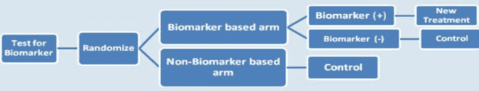

### 11.2.2.6 混合设计

当来自临床前或先前研究的强有力证据表明某些治疗对基于标志物的亚组是有效时，应考虑混合设计 [1]。由于伦理原因，这使得具有特定标志物的患者随机分配到其他治疗方案变得几乎是不可能的。这与富集设计非常相似，所有患者都接受标志物状态检查，并对于生物标志物阳性值的患者随机分配到治疗治疗或标准治疗。然而，只有标志物阳性的患者组被随机分配到治疗，而标志物阴性组的患者被分配到对照或标准治疗（图 11.4 混合设计）。该研究旨在仅检测标志物阳性组的治疗差异。收集所有受试者的样本以帮助未来检测额外的标志物。

## 图 11.4 混合设计


需要注意的是，除了富集/靶设计外，涵盖的所有经典设计都是全人群设计，因此所有患者无论其生物标志物状态。

## 11.3 经典富集设计的效率

Simon 和 Maitournam [24] 以及 Maitournam 和 Simon [25] 考虑了一个三期随机试验设置，使用二分类终点或连续终点来评估分子靶向治疗。这些评估是在假设检测方法对某些从靶治疗中获益的患者群体具有预测作用的情况下进行的。他们比较了允许所有患者参与试验的全人群设计与具有限制亚组人群的富集设计。他们根据平均筛选和随机化样本量比较了运行特征。

对于二分类终点，靶向设计相对于未治疗设计的相对效率可以表示为：

```
$$\frac{n}{n^T} = \left[\frac{\zeta_1}{\zeta_0+(1-\gamma)\zeta_1}\right]^2 f$$
```

其中 $2nT$ 和 $2n$ 分别表示在富集和全人群设计中需要随机化的患者数量，以达到相同的零假设相同的统计效能。$\zeta_1$ 和 $\zeta_0$ 代表生物标志物阳性组和生物标志物阴性组治疗组与对照组的效应量（例如反应率的差异）。$\gamma$ 考虑了人群中生物标志物阴性组的比例，$f$ 是接近 1 的相对效率因子 [24]。根据筛选患者的数量计算相对效率，只需将方程乘以 $(1-\gamma)$ 即可。

对于连续终点，靶向设计相对于未治疗设计的相对效率可以表示为如下形式：

```
$$\frac{n}{n^T} = \frac{1+\frac{\gamma(1-\gamma)}{2\sigma^2}}(\mu_1-\mu_0)^2+(\mu_T-\mu_0)^2}{1-\gamma(1-\frac{(\mu_T-\mu_0)^2}{\mu_T-\mu_1})^2}$$
```

其中 $\mu_0$ 和 $\mu_1$ 表示标志物阴性组和阳性组对照患者的平均反应，$\mu_{OT}$ 和 $\mu_{IT}$ 分别表示标志物阴性组和阳性组治疗患者的平均反应，并假设每个治疗组和亚组内的方差 $\rho^2$ 为常。同样，对于筛选患者的相对效率，只需将方程乘以 $(1-\gamma)$ 即可。上述结果仅在渐近意义下有效。或者，Maitournam 和 Simon [25] 使用 Mann–Whitney Wilcoxon 检验推出了对于小样本量更准确的样本量公式。

宏（$\beta_{norm}$ 和 $\beta_{sigma}$）开发用于根据 [25] 中的公式计算特定效能的样本量。

```
Power = 1-\Psi\left(\frac{0.5n^2+z_{1-\alpha/2}}{\sqrt{\frac{2(n+1)}{12}Var(W_{XY})}}-0.5n^2p_1\right)
```

$Var(W_{XY})$ 是 Mann-Whitney 统计量的方差，给出为

$Var(W_{XY}) = n^2\{p_1(1-p_1) + (n-1)[p_2+p_3-2p_2^2]\}$, 其中 $p_1=Pr(X<Y)$ 是对照结果 $X$ 小于治疗结果 $\gamma$ 的概率，$p_2=Pr[X<Y_1,X<Y_2]$ 是对照结果同时小于两个独立治疗结果的概率，$p_3=Pr[X_1<Y,X_2<Y]$ 是治疗结果同时大于两个独立对照结果的概率。$\Psi$ 表示标准正态分布的累积分布函数。请参考补充材料中的 `efficiency_ct.sas`。

`%MSpower` 宏（示例代码 11.1）根据 [25] 中的公式计算指定效能 $1-\beta$ 拒绝零假设的最小样本量。`%MSpower` 需要指定的参数为：

- 1. beta: 二类错误率
- 2. alpha: 第一类错误率
- 3. pi: 对照结果小于治疗结果的概率
4. p2: 控制结果同时小于两个独立治疗结果的概率
5. p3: 治疗结果同时大于两个独立控制结果的概率。

示例代码 11.1：途计算所需样本量的 MSPower

```sas
%macro MSPower(beta, p1, p2, p3, alpha);
  data result;
    delta=1-(alpha/2);
    za=quantile('Normal', delta);
    p1=&p1; p2=&p2; p3=&p3;alpha=&alpha;
    do i = 1 to 10000;
      nsize=i;
      denom=(i**2)*(p1*(1-p1) + (i-1)*(p2 + p3) - 2*(p1**2));
      den=sqrt(denom);
      a=0.5+(i**2) + za*sqrt((i**2)*(2*i + 1)/12) - 0.5 - (i**2)*p1)/den
      beta=CDF('Normal', a);
      power=1-beta;
      output;
      if beta<=&beta then i=10000;
    end;
  end;
run;

data result2;
  set result end = __;
  end=end;
  end;
  if beta>&&beta then do;
    warning=1;
    nsize2=>10000;
  end;
  else do;
    nsize2=compress(nsize);
  end;
  label nsize2='sample size';
run;

proc format;
  value wa='required sample size greater than 10000';
run;

proc noobs label;
  var nsize2 p1 p2 p3 alpha beta power warning;
  format warning wa.;
run;
%mend MSPower;

%MSPower(0.2, 0.7, 0.6, 0.4, 0.05);
```

宏调用的结果如示例代码 11.1 的输出所示。这表明，拒绝零假设提供 80% 效能的最小样本量为每个治疗组 23 名患者。总样本量为 46 名患者时的实际效能为 82%。

表 11.3 示例代码 11.1 的输出

| 样本量 | p1 | p2 | p3 | alpha | beta | power |
|---|---|---|---|---|---|---|
| 23 | 0.7 | 0.6 | 0.4 | 0.05 | | |

p1, p2 和 p3 可以通过蒙特卡洛方法计算。`simnorm` 宏使用公式 (6) 计算出提供指定 $1-\beta$ 效能以拒绝零假设的最小样本量。指定的参数如下：

1. seed1, seed2: 用于生成随机数的种子
2. mux, muy: 控制组和实验组治疗结果的平均值
3. stdx, stdy: 控制组和实验组治疗结果的标准差


### 4. `beta`: II 类错误率

### 5. `alpha`: I 类错误率

### 6. `simN`: 蒙特卡洛模拟的迭代次数

## 示例代码 11.2：计算所需样本量的 SimNorm 宏

```sas
%macro simnorm(seed1, seed2, mux, muy, stdx, stdy, beta, simN=10000, alpha)
data x;
  call streaminit(&seed1);
  do i = 1 to &simN
    x=rand('normal', &mux, &stdx);
    output;
  end;
run;

data y;
  call streaminit(&seed2);
  do i = 1 to &simN
    y=rand('normal', &muy, &stdy);
    output;
  end;
run;

data one;
  merge x y;
```

```sas
if x<y then flag=1;
else flag=0;
run;
proc means noprint data=one;
var flag;
output out=pl mean=pl;
run;
data_null;
set pl;
call symput('pl', compress(pl));
run;
data_null;
syl=&seed2 +1;
call streaminit(syl);
y1=rand('normal', &muy, &stdx);
output;
call symput('yl', compress(yl));
run;
data_null;
sy2=&seed2 +2;
call streaminit(sy2);
y2=rand('normal', &mux, &stdx);
output;
call symput('y2', compress(y2)));
run;
data x;
set x;
if x<&y1 and x<&y2 then flag=1;
else flag=0;
run;
proc means noprint data=x;
var flag;
output out=p2 mean=p2;
run;
data_null;
set p2;
call symput('p2', compress(p2)));
run;
data_null;
sxl=&seed1 +1;
call streaminit(sxl);
x1=rand('normal', &mux, &stdx);
output;
call symput('x1', compress(x1)));
run;
data_null;
sx2=&seed2 +1;
call streaminit(sx2);
x2=rand('normal', &mux, &stdx);
output;
call symput('x2', compress(x2)));
run;
data y;
set y;
if y>&y1 and y>&y2 then flag=1;
else flag=0;
run;
proc means noprint data=y;
var flag;
output=p3 mean=p3;
run;
data_null;
set p3;
call symput('p3', compress(p3)));
run;
```

```sas
title 'Normal Distribution'

%MSower(&&beta, &p1, &p2, &alpha);

%end simnorm;

%simnorm(seed1=1, seed2=100, mux=5, muy=8, stdx=2, stdy=1.5, beta=0.2, simN=10000, alpha=0.05);
```

宏调用的结果如示例代码 11.2 的输出所示。这表明，如果控制组的治疗结果遵循均值为 5、标准差为 2 正态分布；如果实验组的治疗结果遵循均值为 8、标准差为 1.5 的正态分布，则通过蒙特卡洛模拟得到的 `p1`、`p2` 和 `p3` 的估计值分别为 0.8837、0.9126 和 0.9985，拒绝零假设提供 80% 效能的最小样本量为每个治疗组 12。总样本量为 24 的实际效能为 82%。

# 表 11.4 示例代码 11.2 的输出

| 样本量 | p1 | p2 | p3 | alpha | beta | power |
|---|---|---|---|---|---|---|
| 12 | 0.8837 | 0.9126 | 0.9985 | 0.05 | 0.18012 | 0.81988 |

或者，如果治疗结果遵循 Gamma 分布，`simgamma` 使用公式 (6) 计算出提供指定 `$1-\beta$` 效能以拒绝零假设的最小样本量。指定的参数如下：

1. `seed1`, `seed2`: 用于生成随机数的种子
2. `mux`, `muy`: 控制组和实验组治疗结果的平均值
3. `stdx`, `stdy`: 控制组和实验组治疗结果的标准差
4. `beta`: II 类错误率
5. `alpha`: I 类错误率
6. `simN`: 蒙特卡洛模拟的迭代次数

## 示例代码 11.3：计算所需样本量的 SimGamma 宏

```sas
%macro simgamma(seed1, seed2, mux, muy, stdx, stdy, beta, simN=10000, alpha)

data temp;

  ax=round((mux**2)/(stdx**2));

  bx=round((mux/(stdx**2)));

  ay=round((mux**2)/(stdy**2));

  by=round((muy/(stdy**2)));

  ... (注: 此处原文代码似乎存在逻辑错误，如应为rand(gamma)，但根据指令，代码块不翻译且保持原样)

output;

run;

data x;

  call streaminit(&seed1);

  do i = 1 to &simN

    x=rand('gamma', ax, by);

    output;

  end;

run;

data y;

  call streaminit(&seed2);

  do i = 1 to &simN

    y=rand('gamma', ay, by);

    output;

  end;

run;

data one;

  merge x y;

  if x<y then flag=1;

else flag=0;

run;

proc means noprint data=one;

var flag;

output out=pl mean=pl;

run;

data_null;

set pl;

call symput('pl', compress(pl)));

run;

data_null;

syl=&seed2 +1;

call streaminit(syl);

y1=rand('gamma', ay, by);

output;

call symput('y1', compress(yl)));

run;

data_null;

sy2=&seed2 +2;

call streaminit(sy2);

y2=rand('gamma', ax, by);

output;

call symput('y2', compress(y2)));

run;

data x;

set x;

if x<&y1 and x<&y2 then flag=1;

else flag=0;

run;

proc means noprint data=x;

var flag;

output out=p2 mean=p2;

run;

data_null;

set p2;

call symput('p2', compress(p2)));

run;

data_null;

sxl=&seed1 +1;

call streaminit(sxl);

x1=rand('gamma', ax, by);

output;

call symput('x1', compress(x1)));

run;

data_null;

sx2=&seed2 +1;

call streaminit(sx2);

x2=rand('gamma', ax, by);

output;

call symput('x2', compress(x2)));

run;

data y;

set y;

if y>&y1 and y>&y2 then flag=1;

else flag=0;

run;

proc means noprint data=y;

var flag;

output=p3 mean=p3;

run;

data_null;

set p3;

call symput('p3', compress(p3)));

run;
```

```sas
title 'Normal Distribution'
%MSower(&&beta, &p1, &p2, &alpha);
%end simgamma;

%simgamma(seed1=1, seed2=100, mux=5, muy=8, stdx=2, stdy=1.5, beta=0.2, simN=10000, alpha=0.05);
```

宏调用的结果如示例代码 11.3 的输出所示。这表明，如果控制组的治疗结果遵循均值为 25、标准差为 2 正态分布；如果实验组的治疗结果遵循均值为 8、标准差为 1.5 的正态分布，则通过蒙特卡洛模拟得到的 `p1`、`p2` 和 `p3` 的估计值分别为 0.8837、0.9126 和 0.9985，拒绝零假设提供 80% 效能的最小样本量为每个治疗组 9。总样本量为 18 的实际效能为 81%。

# 表 11.5 示例代码 11.2 的输出

| 样本量 | p1 | p2 | p3 | alpha | beta | power |
|---|---|---|---|---|---|---|
| 12 | 0.8837 | 0.9126 | 0.9985 | 0.05 | 0.18012 | 0.81988 |

临床试验涉及随机化患者数量的要求，而检测灵敏度则在筛选患者数量方面起着至关重要的作用。最相关的检测是识别那些对新治疗比对照组更敏感的患者。当对照组活性药物时，这尤为重要。

Maitournam 和 Simon [25] 做了大量的模拟，评估了富集设计（enrichment design）与全人群设计（all-comers design）的相对效率，并得出结论：

- 当治疗效应限于标记物阳性（marker+）患者且检测特异性接近1时，富集设计在随机化人数和筛选人数方面通常比全人群设计高效得多。随着检测特异性的下降，效率也会随之降低。
- 如果标记物阴性（marker-）患者的治疗效果是阳性患者的一半，即使检测是完美的，富集设计所需的筛选人数也比未筛选的设计要多。富集设计中筛选人数的增加关键取决于检测的灵敏度。在这种情况下，除非检测的特异性接近1，否则富集设计在随机化人数方面没有实质性优势。——如果是如此，优选设计的选择将取决于其他考虑因素，如随机化的相对成本、安全耐受性特征以及更广泛标签适应的商业价值。

## 11.4 适应性富集设计

人们已经认识并记录，制药和生物技术研究投入的增加并没有反映临床开发成功率的提高。Woodcock [26] 概述了药物开发成功率下降的一些原因，即：(i) 由于改进空间缩小，证明药物获益的门槛提高；(ii) 成本和复杂性的增加可能降低许多候选药物进入临床的能力；(iii) 遗传学及相关学科尚未充分发展；(iv) 慢性病使得研究赞助者难以选择易于调查和投资的目标。美国食品药品管理局（FDA）举办了一项“关键路径计划”（Critical Path Initiative），以识别医疗产品管道潜在的关键科学挑战，并在2006年发布了*关键路径机会清单*，特别是借鉴了以往经验、正在进行的创新临床试验以及积累的数据。这种创新意味着了适应性设计方法的使用以及使用贝叶斯方法的潜力。Chow 等人 [27] 将“适应性设计”定义为一种在试验启动后允许对试验和/或试验的统计程序进行调整，且不损害试验的有效性和完整性的设计。Gallo 等人 [28] 的 PRMA 工作小组论文提到“适应性设计是一种使用累积数据来在试验持续过程中决定如何修改研究各个方面的临床试验，且不损害试验的有效性和完整性”。在过去的十年中，由于其灵活性和效率，适应性设计方法的应用变得非常流行。然而，这有时是以增加复杂性和后勤挑战为代价的。在大多数情况下，必须进行密集的规划以定义通过/不通过标准，赞助者应拥有足够的资源来实施和执行。考虑到试验的演变，一些适应性设计包括：

- (i) 分组序设计，
- (ii) 样本量估计设计，
- (iii) 剂量寻找设计，
- (iv) 退出设计，
- (v) 适应性随机化设计，
- (vi) 切换设计，
- (vii) 多重性设计，
- (viii) 生物标志物选择设计，
- (ix) 富集设计。

在这里我们将主要讨论与富集相关的设计。

### 11.4.2 频率学方法

#### 11.4.2.1 适应性签名设计

经典设计仅涉及一个生物标志物，且假设截点（cut-off）是预先的。当潜在生物标志物未知但某些证据表明靶向治疗可能有效时，使用签名设计（signature design）。签名设计通过以下步骤完成：

1. 将研究人群分为训练子样本和验证子样本。
2. 使用训练子样本建立模型，预测靶向治疗与对照组之间的治疗差异随基线变量的变化。
3. 该模型也称为获益函数（benefit function），用于验证验证样本的结果。
4. 该设计使用的获益函数是针对预设数量的生物标志物和显著性水平，治疗相互作用的最小优势值比 [29]。
5. 风险差（risk difference）是另一种使用的获益函数，它是靶向治疗与对照组之间概率随基线变量变化的差异 [20,31]。
6. 对样本中的每个受试者进行预测，并计算预测评分以将该子类分类为敏感或非敏感。
7. 使用预设的预测评分截点选择亚组。
8. 在该亚组中进行第二次假设检验，以观察靶向治疗相对于对照组的获益。该测试在得低的显著性水平下进行（例如：0.01或0.02）。

如果初始假设在较低显著性水平被拒绝，则宣布靶向治疗对于总体人群优于对照组。此时，人群测试完成。

通常，随着敏感患者比例的增加，实验组和对照组客观缓解率之间的差异也随之增加。因此，对于高于某些阈值的流行率，总体效应检验的效力将主导敏感子集的效力。适应性签名设计保留了检测总体效应的能力。然而，它与传统设计（具有广泛入选标准的总体效应测试）相比的优势有所降低。[25] 中提供了协助研究人员评估敏感子集与总体测试之间效力关系的公式。开发了基于 [25] 中公式 (1.1) 计算效力的宏程序。在计算总体测试的效力时，需要指定以下参数：

- `pe`: 接受实验治疗患者的预期反应概率
- `pc`: 接受对照治疗患者的预期反应概率
- `alpha`: 单侧显著性水平
- `N`: 总样本量。

同样，可以通过在敏感性子集中指定这些参数，使用宏来计算子集检验的效能。

例如，如果接受实验治疗的患者预期响应概率为 0.5，接受对照治疗的患者预期响应概率为 0.2，假设单侧显著性水平为 0.05且总样本量为 100，则整体检验的效能可以通过“示例代码 11.4 适应签名设计的效能”进行计算。在本例中，效能为 94.3%。

## 示例代码 11.4 适应签名设计的效能

```sas
%macro power(pe, pc, alpha, N);
data result;
pe=&pe;
pc=&pc;
alpha=&alpha;
N=N;
nb=1&alpha;
pbar=(pe+pc)/2;
za=quantile('Normal', b);
num=(pe-pc)-2*sqrt(pbar*(1-pbar)*4/N);
den=pe*(1-pe)*2/N+pc*(1-pc)*2/N;
alpha=num/den;
power=CDF('Normal', a);

run;

proc noobs;
var pe pc N alpha power;
run;
mend power;
%power(0.5, 0.2, 100);
```

这种设计的优势在于它能够降低在关键性试验中丢失更广泛人群标签的风险。根据 Freidlin 和 Simon [29] 的研究，这种设计可能是理想的，即利用二期临床试验为对靶向治疗反应较好的患者开发检测方法或签名（signatures）。该设计的缺点是，只有一半的患者被用于开发或验证。如果生物标志物敏感患者亚组的患病率较低，则这种设计将需要大量患者进行筛选。这在经济上可能是不可行的，而且在操作上具有挑战性，并会延长入组期。另一个缺点是，子组数量增加会导致高维数据，可能需要较大的样本量来确保试验具有足够的效能。

### 11.4.2.2 生物标志物自适应阈值设计

在这种设计 [32] 中，整体治疗效应的检验与对预设的生物标志物亚组（被认为对靶向治疗最敏感）的截断点（cutpoint）的开发和验证相结合。统计假设检验通过拆分整体 I 类错误率 `alpha` 来进行。首先，在 `alpha1` 处比较整体人群的治疗反应，如果不显著，则在 `alpha-1` 处进行第二次检验。例如，如果无获益的零假设（a）在所需的显著性水平（例如 0.04）下被拒绝，则停止检验；否则，对假设 (b) 进行检验至 0.01 的水平，以将整体 `alpha` 控制在 0.05 以下。使用 Altman 等人 [33] 提出的简化截断模型来开发所提的程序。整体患者人群被分为两组：基于生物标志物的（敏感）和非基于生物标志物的（非敏感）。这种分类可能会导致某些信息的丢失，但所提的检验程序对于偏离简化截断模型的情况具有稳健性。使用置换重采样法（permutation resampling）来选择最佳截断点，以避免多重性问题 [34]。

当治疗效应限制在亚人群时，临床试验样本规划的方法见 [32] 的附录 B。假设在一个具有事件时间结局的试验中，整体检验检测目标治疗效应（在显著性水平 `alpha` 下）并达到 `1-beta` 效能所需的观测事件数，可以通过“示例代码 11.5 生物标志物自适应阈值设计的事件数”中的事件宏进行计算。


## 示例代码 11.5 生物标志物自适应阈值设计的事件数

```sas
%macro events(delta, alpha, beta, pi);
  data result;
    alpha=&alpha;
    power=1-&beta;
    delta=&delta;
    pi=&pi;
    za=quantile('Normal', 1-&alpha);
    zb=quantile('Normal', 1-&beta);
    logd=log(delta)/log(delta);
    D=4*(za+zb)/log(delta)**2;
    DS=D/(pi**2);

  label delta='hazard ratio';
  label pi='treatment effect fraction required';
  label Ds='events required';

run;

proc noobs label;
    var alpha power delta pi Ds;
run;
%mend events;
%events(2, 0.05, 0.2, 0.8);
```

在 `%events` 中需要指定的参数为：

- 1. `delta`：实验组风险与对照组风险的比例值
- 2. `alpha`：显著性水平（单侧 I 类错误率）
- 3. `beta`：假阴性率（II 类错误率）
- 4. `pi`：治疗效应 `delta` 受到限制的人群比例比；如果治疗效应适用于整个研究人群，则 `pi=1`。

例如，如果风险比为 0.5，治疗效应限制在整体人群的 80%，则对于一个 80% 效能的研究（在单侧显著性水平为 0.05 下），所需的观测事件数为 80.4261，这将四进取入为 81 次事件（示例代码 11.5 生物标志物自适应阈值设计的事件数）。

生物标志物的开发和验证通常是昂贵且耗时的。在试验的后期，往往无法获得可靠的生物标志物。如果在整体人群中没有检测到治疗效应，但在亚组中观察到反应增加，则需要另一项关键性试验来进行监管批准。Ravaud 等人 [35] 针对肾细胞患者进行了一项随机研究。总生存期显示出没有统计学差异（p=0.29），标准治疗的中位为 43.1 周，对比 46.9 周（拉替尼）。在 EGFR 过表达的患者亚组中，总生存率具有统计学意义（p=0.02），标准治疗的中位为 37.9 周，对比 46 周（拉替尼）。

在上述情景中，这种设计和统计检验程序可以将针对整体人群的正式假设检验与生物标志物定义子集中效应的不确定性相结合。这在为新疗法提供统计学严谨的期评估的同时，显著提高了效率。该程序在保留整体 I 类错误率的同时，还提供了在整体人群中检测治疗效应的灵活性，同时当靶向治疗对基于生物标志物的亚组有益时，提供了一个统计学有效的检验。这种序贯且结构化的方法在单次随机临床试验中进行，从而消除了对关键性试验的需求。当标记物已知但定义阳性或阴性生物标志物亚组的阈值或截断点未知时，这种设计是合适的。

### 11.4.2.3 交叉验证适应签名设计

这种设计是适应签名设计的扩展，旨在优化适应签名设计中开发和验证部分的效率 [36]。这种设计允许对研究中使用的样本进行完全交叉验证。该程序保留了整个研究的 I 类错误率，并增加了检测从靶向治疗获益的患者亚组中具有临床意义的治疗差异的统计效能。与适应签名设计类似，针对靶向治疗相对于对照组的初始零假设在略低于整体 α 的显著性水平下进行。如果该假设被拒绝，则宣布靶向治疗优于对照治疗，并完成分析。如果第一个假设未被拒绝，则使用设计中的签名部分来选择一个可能有效的生物标志物亚组，也称为敏感子集。敏感子集通过使用全人群开发分类器来确定。其步骤如下：

研究人群被分为 k 个子样本。

针对交叉验证自适应特征设计开发了相应的宏（macros），并包含在补充材料的 `cvad.sas` 中。使用这些宏需要指定三个数据集。

- 1. `OutcomeInput`，包含治疗及治疗结果受试者信息的数据集。该数据集的格式应遵循“OutcomeInput 数据集示例”。

表 11.6 OutcomeInput 数据集示例

| subjid | treatment | response |
| :--- | :--- | :--- |
| 1 | 0 | 1 |
| 2 | 0 | 1 |
| 3 | 1 | 1 |
| 4 | 1 | 1 |

- 2. `GeneInput`，一个包含用于开发潜在生物标志物的受试者基因信息的数据集。然后根据生物标志物值将受试者分类为敏感受试者或非敏感受试者。该数据集的格式应遵循下方“GeneInput 数据集示例”中的示例。

表 11.7 GeneInput 数据集示例

| subjid | gene1 | gene2 | gene3 | gene4 | gene5 | gene6 | gene7 | gene8 |
| 1 | 0.359 | 0.490 | 1.085 | 0.174 | -1.471 | -0.207 | -0.375 | -0.5 |
| 2 | 1.371 | 1.570 | 1.541 | -0.141 | 0.121 | 0.555 | 0.094 | -0.0 |
| 3 | 0.809 | 0.362 | 1.279 | -0.134 | -0.678 | -0.216 | 0.183 | -0.3 |
| 4 | 1.960 | 0.531 | 0.508 | -0.529 | -0.191 | 0.293 | 0.153 | 0.11 |

- 3. `TPInput`，一个包含设计中使用的特定调优参数候选的数据集。该数据集的格式应遵循“TPInput 数据集示例”中的示例。

表 11.9 示例

表 11.0 示例 1：输入数据集
| eta | OS_R | gene_G |
| :--- | :--- | :--- |
| 0.2 | 0.8 | 1 |
| 0.25 | 1.5 | 1 |

`@decision` 宏在指定的显著性水平 `$\alpha_1$`（`$\alpha_1$` 通常略低于总体 `$\alpha$`）下测试靶治疗相对于总体人群的获益。它决定了是否有必要进入设计中的特征部分（示例代码 11.6 决策宏调用）。

## 示例代码 11.6 决策宏调用

```sas
libname perm "directory of sample data";

%macro Decision(outcome, gene, par, alpha, seed);

%global seed;

%let sseed = &seed;

data outcome;

set &outcome;

run;

data gene;

set &gene;

run;

data par;

set &par;

run;

proc freq data=outcome;

table response*treatment/chisq;

out out=chisqtest quisq;

run;

data null;

set chisqtest("chis_value",P_PCHI);

run;

/*如果卡方检验根据预设*/
/*alpha 结果显著，则打印结果并终止*/
/*否则，需要进入 CVSD 阶段*/

%if &chisq_value <&alpha %then %do
ntitle "Chi-square Test SIGNIFICANT"

proc print data=chisqtest;
run;

%abort;
%end
%mend Decision;

%Decision(perm.adsl, perm.adgene, perm.par, 0.04,12345);
```

输出（未显示）的卡方 p 值为 0.7877。由于测试在指定的 `$\alpha$` 水平下不显著，将实施设计中的特征部分，以选择一个可能具有前景的生物标志物亚组，也称为敏感子集。

替换宏（见补充材料）计算了被最终特征分类为敏感的未来受试者中治疗效应的回复估计量。为了节省计算时间，通过对第一个 CV 子集进行 k 折交叉验证来选择调优参数集。

一个用于交叉验证自适应特征设计的、通过开发的宏以识别敏感受试者预测效应的回复估计量的实现示例，见 [示例代码 11.7 回归估计量]。

## 示例代码 11.7 回归估计量

```sas
libname perm "directory of sample data";

%Decision(perm.ads, perm.agene, perm.par, 0.04,12345);

%Resstitution(10,5);
```

结果显示，测试整个研究人群的治疗反应差异的卡方 p 值为 0.7877（与示例代码 11.6 的输出相似）。对于回复估计量，从 `perm.par` 预先指定的调优参数列表中选择了调优参数 `eta=0.2`、`os_rt=0.8` 和 `gene_G=1`。最后，124 名患者中有 113 名被分类为敏感型，对照组和实验组的反应率分别为 53% 和 47%。

CV 宏（见补充材料）计算了被最终特征分类为敏感的未来受试者中治疗效应的 CV 估计量。最佳调优参数集从整个研究人群中选择。

一个用于交叉验证自适应特征设计的、通过开发的宏以识别敏感受试者预测治疗效应回复估计量的实现示例，见 [示例代码 11.8 CV 估计量]。

## 示例代码 11.8 CV 估计量

```sas
libname perm "directory of sample data";

%Decision(perm.adsl, perm.adgene, perm.par, 0.04, 12345);

%CVest(10, 5);
```

结果显示，测试整个研究人群治疗反应的卡方 p 值为 0.7877（与示例代码 11.6 决策宏调用的输出相似）。对于 CV 估计量，从 `perm.par` 预选调优参数列表中选择了调优参数 `eta=0.25`、`os_R=1.5` 和 `gene_c=1`。最后，124 名患者中有 41 名被分类为敏感型，对照组和实验组的反应率分别为 33% 和 67%。

交叉验证方法可以显著增强自适应设计的性能，用于开发特征，特别是在样本量或信噪比有限的情况下 [29]。Molinar 等人 [37] 证明，交叉验证可以在省略部分病例的情况下提供类似的样本的有效性。Freidlin 等人 [6] 认为，这并不意味着分类是不稳定的。在基因组分析中，良好的特征通常不是唯一的。然而，它们通常是相关的。

## 11.4.2.4 自适应无缝/III 设计

无缝设计将传统上独立试验中的目标合并到一个试验中。这种类型的设计消除了试验之间的时间，并可能在总患者数方面提供额外的效率。自适应无缝设计是使用自适应前后数据进行分析的组合。

[45-49]。

例如，Jenkins 等人 [48] 提出了一种具有亚组选择的自适应无缝 II/III 期设计，该设计更具灵活性。它允许试验在期中分析时选择合适的亚组，或者在包含亚组和全人群的所有患者中继续进行。通过这种方法，每一阶段最终终点的测试统计组合被用于假设检验。扩展到第二阶段的决策基于与最终终点相关的期中终点或替代终点。该方法在肿瘤学背景下介绍，以无进展生存期（PFS）和总生存期（OS）作为期中和最终终点，尽管也可以扩展到其他适应症。在这种设计中，设置共同主要终点（co-primary endpoint）承认了在期中观察最佳可能终点和人群时存在的不确定性。额外的灵活性在于，在最终分析时仍然可以对全人群、亚组人群或共同主要终点进行检验，并在期中分析时因无效性而停止试验。这降低了在试验早期错失具有前景的亚组的风险，这从伦理和商业角度来看都是不利的。所提设计使用 PFS 作为期中终点，总生存期作为许多癌症类型接受的确认终点。该设计可以被视为现有无缝设计方法的特例或扩展，这些方法结合了两个阶段的人群和终点以支持许可性声明。这是通过结合对具有临床意义假设的测试统计量来实现，且两个终点的结合不会产生任何额外的偏差。假设我们有一个随机的双平行臂试验。我们像任何无缝 II/III 期试验一样，将试验划分为学习阶段和确认阶段。在收集第一阶段受试者的期中结果（例如 PFS）数据（约 50%）后，进行期中分析，检查全人群（Op）和预设的亚组人群（Sp）对新治疗法的有效性。初始亚组应有明确定义，并应是唯一接受有效性检验的亚组。每个人群（Op 和 Sp）都对应一个原假设和一个备择假设。原假设（H0Op 和 H0Sp）是实验治疗与对照组之间没有差异，这是针对最终终点（在本例中为总生存期）的假设；而备择假设（H1Op 和 H1Sp）表示与对照组相比，新治疗法的有效性有所增加。在期中观察时，可以做出五种关于极显著有效性的决策：

- (1) 因 Op 的极显著有效性而停止试验；
- (2) 如果 Op 和 Sp 的有效性均为中等，则在 Op 中继续试验；
- (3) 如果 Sp 的有效性略优于 Op，且在试验结束时共同主要亚组假设，则在 Sp 中继续试验；
- (4) 如果有效性远优于 Op，则在最终分析时富集以仅包含 Sp；
- (5) 如果治疗效果不再优于对照组，则因无效性停止试验。每种可能的预设决策在样本量和期中分析后的随访上将会有所不同。在第一阶段开始的患者将留在研究中，并对其长期（最终）终点进行监测。

Wang 等人 [45] 提议了类似的设计，但仅针对单个正态分布终点。我们提供了 `% subpower` 宏用于设计公式。

`% subpower` 宏（示例代码 11.9 亚组效能宏）根据给定条件计算亚组效能：

- 1. `f`: 样本量比例
- 2. `alpha_a`: 检验全人群的显著性水平
- 3. `beta_a`: 整个试验的 II 类错误
- 4. `es_ratio`: 效应量比例，`es_ratio = delta_g +delta`
- 5. `alpha_g`: 检验亚组人群的显著性水平。

## 示例代码 11.9 亚组效能宏

```sas
%macro subpower(f,alpha_a, beta_a, es_ratio, alpha_g);

  data result;

    f=&f;

    alpha_a=\&alpha_a;

    beta_a=\&beta_a;

    es_ratio=&es_ratio;

    za=quantile('Normal', 1-alpha_a);

    zb=quantile('Normal', 1-beta_a);

    zag=quantile('Normal', 1-alpha_g);

    d=sqrt(&f)*es_ratio*(za+zb)-zag;

    sub_power=normCDF('Normal', d);

  label es_ratio="effect size ratio";

  label f="sample size ratio";

run;

proc noobs label;

  var f alpha_a beta_a es_sub_power;

  run;

%mend subpower;

%subpower(0.5, 0.04, 0.2, 2, 0.01)
```


例如，假设生物标志物组的患病率为 50%，全人群和亚组的 alpha 分配为 0.04 对 0.01，全人群的效能为 80%，效应量比例为 2，则基于生物标志物人群检测治疗效应的效能为 91%。

在存在多次观察和多个亚组的情况下，有几种多重性方法 [38, 42, 50] 可用于在名水平上控制族误差率（family-wise error rate），即拒绝至少一个真实原假设的概率。使用闭式检验程序（closed testing procedure）来控制多重性，考虑所有可能的交集假设（$H_0^{Cp}, H_0^{Sp}, H_0^{CpSp}$）以拒绝任何初始假设（$H_0$）。检验 $H_0^{Cp}$ 和 $H_0^{Sp}$ 的阶段性 p 值表示为每个阶段 $i\in\{1,2\}$ 的 `Cp_p` 和 `Sp_p`，而 `CpSp_{p_i}` 是 `Cp_{p_i}` 和 `Sp_{p_i}` 的函数，用于考虑多重性。多重性的计算可以使用 Hochberg 矫正 [51] 或 Dunnett 方法 [52]。最终分析使用反正态分布 p 值组合检验法 [53-54] 对全人群（$C_P$）进行。对于每个阶段，指定权重 `w_1` 和 `w_2`（其中 $w_1^2+w_2^2=1$）以合并 p 值。如果 `C(p_1, p_2)=w_1^{-1}(1-p_1)+w_2^{-1}(1-p_2) \geq c`，则拒绝最终分析时的原假设。

## 11.4.3 贝叶斯方法

### 11.4.3.1 贝叶斯自适应随机化（BAR）富集设计

自适应临床试验的一个重要特征是利用来自期中数据的累积信息不断更新设计，这自然地契合贝叶斯范式。贝叶斯方法实际上是专门为通过处理新产生的数据而开发的，通过更新先验信念来提供关于治疗效应的直接概率陈述。此外，与需要控制 I 类错误率的频率派自适应设计不同，贝叶斯推断不受期中分析次数或时间的影响 [55]，允许对不断积累的研究数据进行多次分析，以更新所研究的概率。因此，贝叶斯设计对自适应富集设计很有吸引力，这种设计根据出现的数据对入、随机化比例和亚组选择进行调整，特别是在筛选生物标志物的探索性研究中。

与频率派设计中的等（或固定比例）随机化方法相比，这类贝叶斯设计 [56-57] 实施了自适应随机化方法，允许同时评估治疗和生物标志物，同时根据患者的标记特征为更多患者提供可能有效的治疗。贝叶斯设计通常基于感兴趣终点的分层模型。模型参数也是随机变量，用于建模治疗和生物标志物与感兴趣结果之间关联的随机效应。通过使用分层模型，可以在不同亚组之间借用信息以提高效率。

在评估两种治疗法和一种二分类生物标志物的常见设置中，BAR 可用于以下三个目标：(1) 测试标志物是预后性的还是预测性的；(2) 测试新治疗法在所有患者或特定标记标志物亚组患者中是否优于标准治疗法；(3) 治疗

通过根据患者的标志物状态，将更多患者分配给更有效的治疗方案，使患者在试验中获益。大多数频率派设计也能实现前两个目标。

BAR 富集设计（BAR enrichment design）可以自然地扩展到多种治疗方案和多种标志物。对于基线特征属于标志物组 $j$ 的患者，假设治疗 $i$ 效应大小的后验估计为 $\delta_{ij}$，则到治疗 $i$ 的随机化比例可以表示为 $\lambda_i / \sum \lambda_j$ ，其中 $\lambda$ 是调节参数。注意，当 $\lambda=0$ 时，对应于等随机化。当它变成“胜者为”（play-the-winner）设计时，根据可用数据将下一个患者分配给当前的获胜治疗，且不涉及随机化。$\lambda$ 越大，随机化的不平衡程度就越严重。

BAR 富集设计已经在几项著名的肿瘤学临床试验中成功实施。一个例子是肺癌消除标志物整合靶向治疗方法（BATTLE）试验 [56]。BATTLE 项目由一个伞型试验和四个并行的 II 期研究组成，这些研究针对此前接受过化疗但随后失败的基于标志物的靶向治疗法。该研究的主要目标是根据患者的标志物谱，估计并测试每种治疗方案在 8 周的疾病控制率。使用贝叶斯Probit 模型（Bayesian probit model）通过自适应随机化来描述每个标志物亚组每种治疗的疾病控制率。另一个著名的例子是针对局部晚期乳腺癌女性的新辅助治疗设置的 I-SPY 2（通过影像和分子分析预测治疗反应的系列研究）II 期试验。其新辅助设计旨在在一个特殊的人群中测试联合标准化疗的调查性药物。通过采用创新的 BAR 设计，该研究旨在用一半的时间、更低的成本和显著更少的参与者来测试新治疗法 [58]。显示贝叶斯预测概率优于标准疗法的方案将带着其相应的标志物特征通过试验。如果方案在任何标志物特征下显示出疗效改善概率较低，则会被剔除。当通过测试的药物毕业或被淘汰时，新药物将进入。

BAR 设计的一个明显局限性是，自适应随机化需要快速反馈，以便从中期数据中学习并调整随机化速率。因此，BAR 设计仅适用于终点可以在较短时间内评估的试验。

Korn 和 Freidlin [59] 在随机双臂设置中，比较了结果自适应随机化设计与固定的 1:1 或 2:1 随机化设计。比较是基于所需的样本量、疗效较差的患者人数和比例进行的。作者发现，结果自适应随机化相对于 1:1 或 2:1 随机化没有优势，因此，当倾向于让更高比例的患者被随机分配到实验治疗时，建议使用固定的 2:1 随机化设计。在性评论论文中，Berry [60] 认为，自适应随机化的最大潜力在于多臂试验（如 BATTLE 和 I-SPY 2 研究），尽管在双臂试验中自适应随机化的获处是有限的。

### 11.4.3.2 针对标志物与治疗相互作用的贝叶斯/频率派设计

在生存终点且仅有 1 个标志物的情况下，Karur 和 Simon [61] 提出了一种两阶段贝叶斯设计，类似于 Freidlin 和 Simon [29] 以及 Wang 等人 [45] 的频率派设计。具体而言，它是 Wang 等人 [45] 自适应设计的贝叶斯版本，其中标志物阳性和标志物阴性分层内治疗效应的后验分布基于中期分析，该第一阶段数据用于对患者招募和试验进展做出决策。这本质上是一种混合贝叶斯/频率派设计，它利用了贝叶斯方法在整合候选预测标志物先验置信度方面的灵活性，同时控制了符合传统频率派 III 期试验标准的 I 型和 II 型错误率。在中期分析时，将后验概率与预设阈值进行比较，并采取 3 种行动之一：

- 1. 停止试验
- 2. 在中期停止招募标志物阴性组
- 3. 继续招募阴性和阳性患者。

Karurui 和 Simon 设计能够在数据表明无获益时，限制接受测试药物的阴性患者数量。还证明了该设计比 Wang 等人 [45] 的频率派版本具有许多优势。

## 11.5 总结

在个性化/精准医学的新时代，临床研究人员面临着日益增长挑战，同时也面临独特的机遇，以满足患者、支付方以及不断增加的健康经济成本的需求。在本章中，我们概述了统计文献中日益增长的人群富集设计，重点关注预测富集策略的设计，以增加临床试验中根据预测性标志物检测有效疗法的效能和效率。我们将现有设计分类为经典设计、频率派自适应设计和贝叶斯自适应设计。我们还讨论了标志物富集设计与传统全人群相比的效率、分析的敏感性/特异性，以及标志物阳性组与标志物阴性组的相对治疗效应。

我们的重点是与感兴趣的临床疗效终点和实验治疗相关的一个或多个预测标志物的设计。与安全结局相关的标志物是一个重要研究领域，但本章未涵盖。此外，预后标志物、药代计量标志物和替代标志物不在本章的范围内。

## 参考文献

- 1. Mandrekar SJ and Sargent D. (2009). 用于预测标志物验证的临床试验设计：理论考虑和实践挑战. Journal of Clinical Oncology 27: 4027-4034.
- 2. Karapetis CS, Khambata-Ford S, Jonker J, O'Callaghan CJ, Tu D, Tebbutt C, Simes RJ, Chalchal H, Shaprio JD, Robitaille S, Price TJ, Shepard L, Au HJ, Langer C, Moore MJ & Zalberg JR. (2008). 晚期结肠癌中 K-ras 突变和西妥单抗的获益. New England Journal of Medicine 359: 1757-1765.
- 3. Bokemeyer C, Makhson A, Hartmann JT, Aparicio J, de Braud F, Donea S, Ludwig H, Lim R, Schuch G, Stroch C, Loos AH, Zubel A & Koralewski P. (2009). 转移性结肠癌一线治疗中使用不含西妥单抗的氟尿嘧啶、白氨酸和奥沙利. Journal of Clinical Oncology 27: 663-671.
- 4. Van Cutset E, Köhne CH, Hitre E, Zaluski J, Chang Bien CR, Makhson A, D'Haens G, Pinter T, Lim R, Bodoky G, Folprecht G, Ruff P, Tejpar S, Schlichting M, Nicholson J & Rogue P. (2009). 西妥单抗和化疗作为转移性结肠癌的初始治疗. New England Journal of Medicine 360: 1408-1417.
- 5. Amado RG, Wolf M, Peeters M, Van Cutset E, Siena S, Freeman DJ, Juan T, Sikorski R, Suggs S, Radinsky R, Patterson SD & Chang DD. (2008). 野生型 KRAS 是转移性结肠癌患者泛舒妥单抗疗效所需的. Journal of Clinical Oncology 26: 1626-1634.
- 6. Freidlin B, McShane LM & Korn EL. (2010). 带有标志物的随机临床试验：设计问题 Journal of the National Cancer Institute 102: 152-160.
- 7. Sargent DJ, Conley BA, Allegra C & Collette L. (2005). Clinical trial

癌症治疗试验中预测性标志物验证的设计。
《临床肿瘤学杂志》(Journal of Clinical Oncology) 23: 2020-2227。

+ 8. Chapman PB, Hauschild A, Robert C, Haanen JB, Ascierto P, Larkin J, Dummer R, Garbe C, Testori A, Maio M, Hogg D, Ligan P, Lebbe C, Jouary T, Schafendorf D, O’Day SJ, Sosman JA, Kirkwood JM, Eggermont AMM, Dreno B, Nolop K, Li J, Nelson B, Hou J, Lee RJ, Flaherty KT & McArthur GA. (2011). 携带 BRAF V600E 突变的黑色素使用维罗非尼可提高生存率，《新英医学杂志》(New England Journal of Medicine) 364: 2507-2516。

+ 9. Romond EH, Perez EA, Bryant J, Suman WJ, Geyer CE, Davidson NE, Tan-Chiu E, Martino S, Paik S, Kaufman PA, Swain SM, Pisansky RM, Fehrenbacher L, Kuttte LA, Vogel VG, Visser DW, Yothers G, Jenkins RB, Brown AM, Dakhil SR, Mamounas EP, Pingle WL, Klein PM, Ingle Jn & Wolmark N. (2005). 曲妥珠珠联合化疗治疗手术性 HER2 阳性乳癌，《新英医学杂志》(New England Journal of Medicine) 353: 1673-1684。

+ 10. Simon R & Wang SJ. (2006). 基因特征在肿瘤及其他疾病治疗开发中的应用。《药物基因基因组学杂志》(Pharmacogenomics Journal) 6: 166-177。

+ 11. Song Y & Chi GY. (2007). 临床试验中预设亚组测试的方法。《医学统计学》(Statistics in Medicine) 26: 3535-3549。

+ 12. Bauer P. (1991). 临床试验中的多重检验。《医学统计学》(Statistics in Medicine) 10: 871-890。

+ 13. Albert SR, Sinicrope FA & Grothey A. (2005). N0147: 在 III 期结肠癌根治切除后，奥沙利铂联合5-氟尿嘧啶/白氨酸叶或或联合西妥珠单抗的随机 III 期试验。《临床结直肠癌》(Clinical Colorectal Cancer) 5: 211-213。

+ 14. Baker SG, Kramer BS, Sargent DJ J & Bonetti M. (2012). 生物标志物、亚组评估与临床试验设计。《发现医学》(Discovery Medicine) 13: 187-192。

+ 15. Baker SG & Freedman LS. (1995).遗传检测对癌症预防试验的潜在影响，以乳腺癌为例。《美国国家癌症杂志》(Journal of the National Cancer Institute) 87: 1137-1144。

+ 16. Janes H, Pepe MS, Bossuyt PM & Barlow WE. (2011). 衡量指导治疗决策的标志物性能。《内科学医学杂志》(Annals of Internal Medicine) 154: 253-259。

+ 17. Song X & Pepe MS. (2004) 选择患者治疗的标志物评估。《生物统计学》(Biometrics) 60: 874-883。

+ 18. Bonetti M & Gelber RD. (2000). 使用 Cox 模型在数据子集上评估治疗-协变量交互的图形方法。《医学统计学》(Statistics in Medicine) 19: 2595-2609。

+ 19. Bonetti M & Gelber RD. (2004). 临床试验中患者亚组的治疗效应模式。《生物统计学》(Biostatistics) 5: 465-481。

+ 20. Cai T, Tian L, Wong PH & Wei LJ. (2001). 用于个性化治疗选择的随机比较临床试验数据分析。《生物统计学》(Biostatistics) 12: 270-282。

+ 21. Baker SG & Kramer BS. (2005). 在拟议的随机癌症预防试验遗传研究中权衡益处与危害的统计学。《应用统计学》(Applied Statistics) 54: 941-954。

+ 22. King MC, Wieand S, Hale K, Lee M, Welsh T, Owens K, Tait J, Ford L, Dunn BK, Constantino J, Wickham L, Wolmark N & Fisher B; 国家手术辅助乳腺癌项目. (2001). 携带 BRCA1 和 BRCA2 遗传突变的女性的太莫昔与乳腺癌发病率：国家手术辅助乳腺癌项目 (NSABP-P1) 乳腺癌预防试验。《美国医学杂志》(Journal of the American Medical Association) 286: 2251-2256。

+ 23. Cobo M, Isla D, Massuti B, Montes A, Sanchez M, Vinolas N, Paz-Ares L, Lopez-Vivcano G, Munoz M, Felip E, Alberola V, Camps C, Domaine M, Sanchez JJ, Sanchez-Ronco M, Danenberg K, Taron M, Gandara D & Rosell R. (2007). 基于定量切除修复交叉互补 1 mRNA 表达的定制化顺醇：非小细胞肺癌的 III 期试验。《临床肿瘤学杂志》(Journal of Clinical Oncology) 25: 2747–2754。

+ 24. Simon R & Maitournam A. (2004). 随机临床试验中靶向设计的效率评估。《临床癌症研究》(Clinical Cancer Research) 10: 6759-6763。

+ 25. Maitournam A & Simon R. (2005). 关于靶向临床试验的效率。《医学统计学》(Statistics in Medicine) 24: 329-339。

+ 26. Woodcock J. (2005). FDA 引入意见：临床研究设计与评估问题。《临床试验》(Clinical Trials) 2: 273–275。

+ 27. Chow SC, Chang M & Pong A. (2005) 临床开发中自适应方法的统计学考虑。《生物制药统计学杂志》(Journal of Biopharmaceutical Statistics) 15: 575–591。

+ 28. Gallo P, Chuang-Stein C, Dragalin V, Gaydos B, Krams M & Pinheiro J. (2006). 临床药物开发中的自适应设计——PhRMA 工作组的执行摘要（含讨论）。《生物制药统计学杂志》(Journal of Biopharmaceutical Statistics) 16: 275–283。

+ 29. Freidlin B & Simon R. (2005). 自适应设计与分析：方法、建议与挑战总结。《临床试验》(Clinical Trials) 27: 183-203。

+ 30. Vickers, AJ, Kattan, MW & Sargent, DJ. (2007). 针对随机试验的设计评估。《临床癌症研究》(Clinical Cancer Research) 10: 6759-6763。

+ 31. Foster, JC, Taylor, MG & Jennison, C. (2011). 随机试验中的亚组识别。《生物统计学》(Biostatistics) 12: 270-282。

+ 32. Jiang, W, Freidlin, B & Simon, R. (2007). 针对随机试验的自适应设计。《医学统计学》(Statistics in Medicine) 30: 2867-2880。

+ 33. Altman, RG, Lausen, B & Schäfer, M. (1994). 用于亚组选择的条件误差函数。《生物统计学》(Biometrics) 50: 829-835。

+ 34. Tukey, J. (1977). 关于多重比较的一些考虑。《医学统计学》(Statistics in Medicine) 19: 679-684。

+ 35. Ravaud, A, Gardner, J, Hawkins, R. (2005). 针对癌症的无缝 II/III 设计。《临床癌症研究》(Clinical Cancer Research) 11: 691-698。

+ 36. Molinaro, S, Freidlin, B & Simon, R. (2010). 使用相关终点的自适应设计。《生物信息学》(Bioinformatics) 21: 3301-3307。

+ 37. Jiang, W, Freidlin, B & Simon, R. (2005). 针对癌症的自适应设计。《临床癌症研究》(Clinical Cancer Research) 11: 691-698。

+ 38. Bauer, P & Köhne, K. (1999). 用于治疗选择的条件误差函数。《医学统计学》(Statistics in Medicine) 18: 1833–1848。

+ 39. Müller, HH & Schäfer, H. (2001). 针对临床试验的自适应组设计。《生物统计学》(Biometrics) 57: 886–919。

+ 40. Brath, W, Posch, M & Bauer, P. (2002). 递归组合检验。《美国统计协会杂志》(Journal of the American Statistical Association) 99: 236–244.

+ 41. Schmidli, H, Bretz, F, Racine, A & Maurer, W. (2006). 带有中期选择的无缝 II/III 期临床试验。《生物统计学》(Biometrical Journal) 48 (4): 623–634.

+ 42. Stallard, N & Todd, S. (2003). 纳入治疗选择的序贯设计。《医学统计学》(Statistics in Medicine) 22: 689-703.

+ 43. Royston, P, Parmar, M & Qian, W. (2003). 具有生存终点的多臂试验。《医学统计学》(Statistics in Medicine) 22: 2239-2256.

+ 44. Wang, SJ, Hung, J & O'Neill, RT. (2007). 基因亚组随机试验的治疗效应评估方法。《药物统计学》(Pharmaceutical Statistics) 6: 227-244.

+ 45. Wang, SJ, Hung, J & O'Neill, RT. (2009). 治疗试验中的自适应患者富集设计。《生物统计学》(Biometrical Journal) 51: 358–374.

+ 46. Brath, W, Zuber, E, Branson, M, Bretz, F, Gallo, P, Posch, M & Racine-Poon, A. (2009). 癌症靶向治疗贝叶斯决策工具的验证性自适应设计。《医学统计学》(Statistics in Medicine) 28: 1445–1463.

+ 47. Jenkins, M, Stone, A & Jennison, C. (2011). 用于亚组选择。《药物统计学》(Pharmaceutical Statistics) 10: 347–356.

+ 48. Friede, T, Parsons, N & Stallard, N. (2012). 自适应临床试验中亚组选择的条件误差函数方法。《医学统计学》(Statistics in Medicine) 31: 4309–4320.

+ 49. Bretz, F, Schmidli, H, Konig, F, Racine, A & Maurer, W. (2006). 带有中期选择的无缝 II/III 期临床试验：通用概念。《生物统计学》(Biometrical Journal) 48 (4): 623–634.

51. Hochberg Y. (1988). A sharper Bonferroni procedure for multiple tests of significance. Biometrika 75: 800-802.

52. Dunnett CW & Tamhane AC. (1992). A step-up multiple test procedure. Journal of the American Statistical Association 87: 162-170.

53. Zykin D. (2011). Optimally weighted z-test is a powerful method for combining probabilities in meta-analysis. Journal of Evolutionary Biology 24:1836–1841.

54. Kuan P & Huang B. (2013). A simple and robust method for partially matched samples using the p-values pooling approach. Statistics in Medicine 32: 3247-3259.

55. Spiegelhalter DJ, Abrams KR & Myles JP. (2004). Bayesian Approaches to Clinical Trials and Health-Care Evaluation. Wiley: Chichester.

56. Zhou X, Liu S, Kim ES, Herbst RS & Lee J. (2008). Bayesian adaptive design for targeted therapy development in lung cancer - a step toward personalized medicine. Clinical Trials 5: 181-193.

57. Lee J, Gu X & Liu S. (2010). Bayesian randomization designs for targeted agent development. Clinical Trials 7: 584-596.

58. Barker AD, Sigman CC, Kelloff GJ, Hylton NM, Berry DA & Esserman LJ. (2009). I-SPY 2: an adaptive breast cancer trial in the setting of adjuvantad chemotherapy. Clinical Pharmacology & Therapeutics 86: 97-100.

59. Korn E & Frelin B. (2011). Outcome-adaptive randomization: Is useful? Journal of Clinical Oncology 29: 771-776.

60. Berry DA. (2011). Adaptive clinical trials: the promise and the caution. Journal of Clinical Oncology 29: 606-609.

61. Karuri SW & Simon R. (2012). A two-stage Bayesian design for co-development of new drugs and companion diagnostics. Statistics in Medicine 31: 901-914.

# 作者

黄波，辉瑞肿瘤公司生物统计学总监，Pfizer Inc., Groton, CT, 美国。

王静 Jing静，高级生物统计学家，Gilead Sciences, Inc., Foster City, CA, 美国。

Sandeep Menon，副总裁兼统计研究与咨询中心负责人，Pfizer Inc, Cambridge, MA, 美国。

# 索引

特殊字符

+   - `%BayesianRandomize` 宏
`%BCDRandomize` 宏
9.3.2 偏性币设计
9.3.2 偏性币设计 [2]
`%BMACRM` 宏
`%BMACRSIM` 宏
`%CRM` 宏
`%CRMSIM` 宏
`%CVest` 宏
`%decision` 宏
`%events` 宏
`%fCRM` 宏
5.4 分数连续重新评估法
5.4 分数连续重新评估法 [2]
`%fCRMSIM` 宏
`%MinimizeRandomize` 宏
9.4.2 基于最小化的协变量适应随机化
9.4.2 基于最小化的协变量适应随机化 [2]
`%ModelOptOpt` 宏
`%monitor` 宏
`%MSpower` 宏
`%NeymanRandomize` 宏
`%OptimalRandomize` 宏
`%optpont` 宏
`%polyorth` 宏
6.4.1 Emax 模型简述
6.4.2 连续终点
6.4.2 连续终点 [2]
`%power` 宏
`%RARsim` 宏
`%Resubstitution` 宏
`%RPWrandimize` 宏
`simgamma` 宏
11.3 经典富集设计的效率
11.3 经典富集设计的效率 [2]
11.3 经典富集设计的效率 [3]
`%simornn` 宏
11.3 经典富集设计的效率
11.3 经典富集设计的效率 [2]
`%SimpleRandomize` 宏
`%SSR_CP` 宏
3.3.4.2 前景区域示例
3.3.4.2 前景区域示例 [2]
3.3.4.2 前景区域示例 [3]
`%SSR_EFF` 宏
`%subpower` 宏
`%TITECRM` 宏
`%TITERCMSIM` 宏

# 数字

3+3 设计

# A

药物和生物制品适应性设计临床试验

适应性设计科学工作组 (ADSWG)

适应性设计工作组 (ADWG)

适应性设计
的出现
关于
多重性的
研究
在带有非盲样本量重新估计的情况下

适应性剂量范围研究工作组 (ADRS WG)

适应性富集设计
关于
适应性无缝 II 期/III 期设计
适应性特征设计
生物标志物适应性阈值设计
交叉验证的适应性特征设计
灵活适应性无缝（富集）设计
频率派方法

# 适应性随机化

参见最优响应适应性随机化设计
关于
贝叶斯响应-
协变量适应随机化 (CAR)

+   不同类型的随机化方案
9.4.1 分层随机化
9.4.2 基于最小化的协变量适应随机化
9.4.3 基于模型的优化协变量适应随机化

协变量调整响应适应性随机化
最优

# 响应适应性随机化 (RAR)

+   不同类型的随机化方案
9.5.1 赢家通规则
10.1.2 响应适应性随机化
10.4.1 模拟单个 RAR 序列

# 10.4.2 通过蒙特卡洛模拟的 RAR 设计的特征

# 10.5 响应适应性随机化的效量与样本量

限制随机化

+   不同类型的随机化方案
+   9.3.1 置换块随机化
+   简单随机化
+   适应性无缝 II 期/III 期设计
+   适应性特征设计

适应性试验
+   在设计、实施和分析中的未来机遇与挑战
+   ADRS WG (适应性剂量范围研究工作组)
+   ADSWG (适应性设计科学工作组)
+   高级乳腺癌试验
+   ADWG (适应性设计工作组)
+   AIC (赤池信息准则)
+   Akacha, M.
+   赤池信息准则 (AIC)
分配，最优
+   10.2 最优分配
+   10.3 双重适应性偏性币设计
+   10.2 最优分配
+   Altman, D.
+   抗 TNF
+   Antonijevic, Z.
+   Armitage, P.
+   人工设计

哮喘试验
ASTIN 研究

# B

Baayan, C.

Baker, S.

Baldi, A.

BAR (贝叶斯随机化)
BAR (贝叶斯随机化) [2]

BATTLE (肺癌生物标志物整合方法)
Bauer, P.
1.4 适应性设计的出现
3.3.2 用于控制 I 类错误的方法分类
3.3.3.1 概述
3.3.4.1 概述
11.2.2 序贯检验策略

BAR (贝叶斯随机化)
11.4.3.1 贝叶斯随机化 (BAR) 富集设计
)
贝叶斯剂量-响应
关于
二分类终点的示例
连续终点的示例
用于统计模型
贝叶斯方法
BAR (贝叶斯随机化) 富集设计
贝叶斯/频率派生物标志物交互的设计

贝叶斯模型平均连续重新评估法 (BMA-CRM)
贝叶斯响应适应性随机化

# 贝叶斯生存元实验设计

贝叶斯元实验设计
BSMED 宏

BSMED 宏
*   4.1 引言
*   4.7.1 BSMED 的实现
*   4.7.1.1 详细宏选项
*   4.7.2.1 心血管风险 [2]
*   4.7.2.1 心血管风险 [3]
计算算法
元设计设置
元回归生存模型
先验分布的特化
使用历史数据

贝叶斯/频率派生物标志物交互的设计

Benda, N.

Berry, D.A.
*   10.1.3.2 贝叶斯随机化
*   11.4.3.1 贝叶斯随机化 (BAR) 富集设计

# C

CALL EXECUTE 函数

Canner, P.L.

CAPTURE 试验

CAR (协变量自适应随机化)

- 不同类型的随机化
- 9.4.1 分层随机化
- 9.4.2 基于最小化法的协变量自适应随机化
- 9.4.3 基于模型的优化协变量自适应随机化

心血管风险

- 2.4.4 消耗函数边界
- 4.7.2.1 评估心血管风险
- 4.7.2.2 使用人工实验臂数据评估心血管风险研究

CDP (冠状动脉药物项目)

Centocor

Chang, M.

Chen, M.H.

- 3.3.4.1 概述
- 4.1 引言

Chi, G.Y.

CHMP (人体用药品委员会)

Chow, S.C.

圣诞树形校正

Chuang-Stein, C.

- 1.7 临床药物开发中适应性试验的未来
- 3.1.2 考虑因素与问题的概述

CHW 程序

### 3.3.3.2 作为组合检验特殊情况的 CHW 程序
### 3.3.3.3 CHW 方法示例

经典剂量-反应研究
关于
使用模拟数据进行分析示例
设计和最终分析阶段的考虑因素
统计设计考虑因素

- 临床测试
- 临床试验，演变
- 基于...组合检验方法
- 人体用药品委员会 (CHMP)
- 专有药品委员会 (CPMP)
- 完全随机设计 (CRD)
- 复合最优分配
- 复合最优设计

计算算法
效能计算
预测性数据生成
从后验分布中采样

- 条件效能
- 基于...条件 I 类错误原则的方法
- CONDPOWER 选项

conemaxsim 宏
8.3.1 每组 75 名患者的哮喘试验
8.3.2 每组 100 名患者的哮喘试验

- Connor, E.M.
- 连续重新评估方法 (CRM)

# 关于 (about)

- 1.5.1 早期肿瘤学设计
- 5.2 连续重新评估方法
贝叶斯模型平均连续重新评估方法 (BMA-CRM)
肿瘤学中的剂量发现
分数连续重新评估方法
事件发生时间连续重新评估方法 (TITE-CRM)

# 连续终点 (continuous endpoint)

- 6.4.2 连续终点
8.3.1 每组 75 名患者的哮喘试验

# 对照组 (control groups)

冠状动脉药物项目 (CDP)

# 协变量自适应随机化 (CAR)

- 不同类型的随机化方案
- 9.4.1 分层随机化
- 9.4.2 基于最小化法的协变量自适应随机化
- 9.4.3 基于模型的优化协变量自适应随机化

# 协变量调整反应自适应随机化

- CPMP (专有药品委员会)
CRD (完全随机设计)

关键路径计划文件

# CRM

参见连续重新评估方法 (CRM)

交叉验证适应性签名设计

# Cui, L.

- 3.3.3.1 概述
- 3.3.3.2 作为组合检验特殊情况的 CHW 程序
- 3.3.3.3 CHW 方法示例

# D

数据与安全监测委员会 (DSMB)

数据监测委员会 (DMC)

DBCD (双重自适应偏硬币设计)

- 10.3.3 双重自适应偏硬币设计
- 10.7.2.1 三组设计

DeCani, J.S.

延迟反应、优化反应自适应随机化设计以及

DeMats, D.L.

- 1.3 70 世纪和 80 世纪群序贯设计的出现
- 1.3 70 世纪和 80 世纪群序贯设计的出现 [2]
- 1.3 70 世纪和 80 世纪群序贯设计的出现 [3]
- 2.4.4 消耗函数边界
- 2.4.4 消耗函数边界 [2]
- 3.3.4.1 概述

设计阶段

对于带有 MCP-Mode 程序的考虑因素
在...中的考虑因素
...示例

DESIGN 声明

Dette, H.

偏差信息准则 (DIC)

DiMasi, J.A.

DMC (数据监测委员会)

剂量，间距

剂量范围，确定

剂量-反应

剂量-反应关系

双重自适应偏硬币设计 (DBCD)

- 10.3.3 双重自适应偏硬币设计
- 10.7.2.1 三组设计

Dragalin, V.

DSMB (数据与安全监测委员会)

Dunnett, C.W.

Durham, S.

- 9.5.2 随机获胜者规则
- 10.1.3.1 RAR 抽样模型

# ECMO (体外膜肺氧)) 试验高效随机-适应性设计 (ERADE)

Efron, B.
Elsäßer, A.
EMA (欧洲药品管理局)

Emerson, S.S.

- 2.4.1 停止边界的计算
- 2.4.3 统一族边界

终点
二元

- 6.4.3 二元终点
- 8.4 二元终点的分析示例

二项分布
连续

- 6.4.2 连续终点
- 8.3.1 每组 75 名患者的哮喘试验

正态
生存

富集/目标设计

EPAR (欧洲公共评估报告)
EPIC 试验
EPILOG 试验
ERADE (高效随机-适应性设计)

# 消耗方法 (Error Spending methods)

- 2.4.1 停止边界的计算
- 停止边界的方法

ERRSPEND 语句

# ESTIMATE 语句

欧洲药品管理局 (EMA)

欧洲公共评估报告 (EPAR)

示例

- 用于二元终点
- 用于连续终点
- MCP-Mode 程序
- 经典固定样本量设计的
- 设计阶段的
- 优化反应自适应随机化设计
- 使用模拟数据

体外膜肺氧 (ECMO) 试验

# F

家族性高胆固醇症
2.2 P 经典固定样本量设计的示例
2.4.2 P P值或 Haybittle-Peto 边界
2.4.3 统一族边界

fCRM (分数 CRM)

最终分析阶段，考虑因素

Finkelstein, D.

Fisher 组合检验

拟合先验
固定边界形状方法

固定样本量设计，经典设计的示例

灵活适应性无缝（富集）设计

美国食品药品管理局 (FDA) 安全与创新法 (2012)

分数连续重新评估方法

分数 CRM (fCRM)

Franchetti, Y.

Freidlin, B.

- 10.1.3.2 贝叶斯适应性随机化
11.4.2.1 适应性签名设计
11.4.3.1 贝叶斯适应性随机化 (BAR) 富集设计
11.4.3.2 用于标志物治疗相互作用的贝叶斯/频率派设计

FREQ 程序

频率派方法

Friedman, L.M.

# G

Gallo, P.

Gamma 边界

- 2.4.1 停止边界的计算
停止边界的方法
- 2.4.4 消耗函数边界

Gelfand, A.E.

GENMOD 程序

- 2.4.3 统一族边界
- 2.4.3 统一族边界 [2]

Gibbs 采样算法

Giovagnoli, A.

- 10.2 最优分配
- 10.2 最优分配 [2]

GLIMMIX 程序

- 7.5.1 The optcont 宏
- 7.5.2 示例 1：正态分布数据的模型选择
- 7.5.2 示例 1：正态分布数据的模型选择 [2]
- 7.5.3 示例 2：广义 MCP 方法的模型平均

Greenberg 报告

- 1.2 临床试验的演变与指南文件的出现
- 1.3 70 世纪和 80 世纪群序贯设计的出现

Gregg, E.W.

群序贯设计

关于

- 2.1 引言
- 3.3.3.3 CHW 方法示例
...的出现

检验理论
类型的

Gu, X.

指南文件的，出现

新药申请中临床部分的格式和内容指南

临床研究统计分析指南

Gutjahr, G.

# H

Hayattle-Peto 边界
1.3 70 世纪和 80 世纪群序贯设计的出现
2.1 引言
2.4.1 停止边界的计算
停止边界的方法
2.4.2 P 值或 Hayattle-Peto 边界

He, W.
HER2 阳性曲妥珠抗药晚性乳腺癌
数据，使用...贝叶斯生存元实验设计
HIV (人类免疫病毒)

Hochberg, Y.
1.4 90 世纪适应性设计的出现
10.3.1 基础知识
10.3.3 双重自适应偏硬币设计
10.3.3 双重自适应偏硬币设计 [2]
10.3.5 各种 RAR 设计的理论比较
10.5 反应自适应随机化的效能和样本量
10.6.4 时间趋势

人类免疫病毒 (HIV)

Hung, H.M.
3.3.3.1 概述
3.3.3.2 作为组合检验特殊情况的 CHW 程序
3.3.3.3 CHW 方法示例

Hunsberger, S.A.
3.3.5 基于条件 I 类错误原则的方法
3.3.5 基于条件 I 类错误原则的方法 [2]

Hwang, I.K.
混合设计

# I

I-SPY 2 试验

Ibrahim, J.G.

ICH（国际药品协调会议）

- 1.2 临床试验的演变与指导性文件的出现
- 1.2 临床试验的演变与指导性文件的出现 [2]

IML 程序

- 7.5.1 optcount 宏
- 7.5.3 示例 2：用于模型平均的广 MCP-Mod 方法的 neurodeg 数据
```


INFO=CUM option

```
基于信息的设计

基于信息的组序贯设计

输入

- `options`，针对 `%BSMED`
- `required`，针对 `%BSMED`

国际药品协调会议 (ICH)

- 1.2 临床试验的演变与指导性文件的出现
- 1.2 临床试验的演变与指导性文件的出现 [2]

# J

日本日本厚生劳动省

Jenkins, M.

Jennison, C.

- 1.3 组序贯设计在 70 年代和 80 年代的出现
2.1 引言
2.5 特别问题

Ji, Y.

# K

Kaplan-Meier 估计
5.4 分段连续重评估法
5.4 分段连续重评估法 [2]
5.4 分段连续重评估法 [3]

Karurui, S.W.
《联邦食品、药品和化妆品法》的 Kefauver-Harris (KH) 案 (1938)

Kim, K.M.
- 1.3 组序贯设计在 70 年代和 80 年代的出现
2.4.4 消耗函数边界

King, M.C.

Kittelson, J.M.
2.4.1 停止边界的计算
2.4.3 统一族边界

Klingenberg, B.
Köhne, K.

Korn, E.L.
10.1.3.2 贝叶斯适应随机化
11.4.3.1 贝叶斯适应随机化 (BAR) 富集设计

Kramer, B.S.
Kuznetsova, O.M.

# L

Lan-DeMets 边界
2.4.1 停止边界的计算
导出停止边界的方法
2.4.4 消耗函数边界
3.4 基于信息的设计

Lan, K.K.G.
- 1.3 组序贯设计在 70 年代和 80 年代的出现
- 1.3 组序贯设计在 70 年代和 80 年代的出现 [2]
2.4.4 消耗函数边界
3.3.4.1 概述

Le Tourneau, C.
学习阶段，机会

Lee, J.J.

Li, X.
LIFETEST 程序
肺-MAP（肺部主方案）试验

# M

Magirr, D.

Maitournam, A.

- 11.3 经典富集设计的效率
- 11.3 经典富集设计的效率 [2]

Mandrekar, S.J.

Mann-Whitney Wilcoxon 检验

标志物与治疗交互设计

基于标志物的策略设计

标志物与治疗的预测曲线

Maurer, W.

MCMC 程序

- 4.6.2 从后验分布中采样
- 4.7.1.1 从后验分布采样的详细宏选项
- 4.7.1.3 运行 MCMC 从后验分布中采样
- 8.3.1 每组 75 名患者的哮喘试验
- 8.3.1 每组 75 名患者的哮喘试验 [2]
- 8.3.2 每组 100 名患者的哮喘试验
- 8.4 二分类终点的分析示例

MCP-Mode 程序

- `%optpoint` 宏
关于
分析示例
考虑因素
设计阶段考虑因素
针对剂量反应测试和估计
针对通用参数模型
方法论

Mehta, C.R.

- 3.3.4.1 概述
- 3.3.4.1 概述 [2]

# 3.3.4.1 概述 [3]

Meta 设计设置

输入数据
输入历史数据
符号

meta-回归-回归生存模型
针对未来生存数据的模型
针对历史生存数据的模型

`METHOD=POC` 选项
方法论，针对 MCP-Mode 程序

Metropolis-Hastings 算法
Miller, F.
最小化，协变量自适应随机化
最小有效剂量 (MinED)

误分类响应，最优响应自适应随机化
设计以及
MODEL 语句
基于模型的优化协变量自适应随机化 (CAR)

Molinaro, A.M.

蒙特卡洛估计

- 4.6.3 效能计算
- 10.4.2 通过蒙特卡洛模拟的 RAR 设计运行特征

mTOR 抑制剂

Müller, H.H.

- 3.3.5 基于条件 I 型错误原理的方法
- 3.3.5 基于条件 I 型错误原理的方法 [2]

# N

国立心脏中心

美国国立健康研究院 (NIH)

内曼分配

NIH (美国国立健康研究院)

NLMIXED 程序

- 6.4.1 Emax 模型简介
- 6.4.2 连续终点
- 6.4.3 二分类终点
- 7.5.1 optcount 宏
- 7.5.2 示例 1：具有正态分布结果和模型选择的 biom 数据

非二分类结果，最优响应自适应随机化设计以及

非胰岛素治疗

标准终点

# O

O'Brien-Fleming (OBF) 方法
- 1.3 组序贯设计在 70 年代和 80 年代的出现
- 1.3 组序贯设计在 70 年代和 80 年代的出现 [2]
- 1.3 组序贯设计在 70 年代和 80 年代的出现 [3]
- 1.3 组序贯设计在 70 年代和 80 年代的出现 [4]
2.1 引言
2.4.3 统一族边界
3.3.3.3 CHW 示例
3.3.4.2 前景区域示例
3.4 基于信息的设计

肿瘤设计，早期阶段

开放性研究问题

最优自适应随机化

最优分配
10.2 最优分配
10.3.3 双重自适应偏硬币设计

最优响应自适应随机化设计
关于
贝叶斯自适应随机化
分类
考虑因素
示例
关于在二分类结果临床试验中实施最优分配
最优分配
针对随机临床试验 (RCT) 的效能和样本量
RAR 桶模型
响应自适应随机化 (RAR)
模拟

可选输入，针对 `%BSMED_`
总生存期 (OS)
2.3.4 生存终点

# P

P 值方法

- 导出停止边界的方法
- 2.4.2 P 值或 Haybittle-Peto 边界

Palmer, C.R.

Pampallona-Tsiatis 边界

- 2.4.1 停止边界的计算
导出停止边界的方法
- 2.4.3 统一族边界

Pampallona, S.
参数 O

通用参数模型，用于 MCP-Mode 的程序

PARMS 语句

置换区块设计 (PBD)

置换区块随机化

PFS (无进展生存期)

- 2.3.4 生存终点
- 11.4.2.5 灵活无缝（富集）设计

美国制药研究和制造协会 (PhRMA)

I 期测试

II 期测试

III 期测试

IV 期测试

PHREG 程序

Pinheiro, J.

# PIPRED 语句

PLAN 程序
9.3 置换随机化
9.4.1 分层随机化

平台（伞型）试验

赢者规则
9.5.1 赢者规则
9.5.2 随机赢者规则

PLOTS=ALL 选项
2.4.3 统一族边界
2.4.4 消耗函数边界

PLOTS=BOUNDARY 选项

PoC，统计假设检验
Pocock 方法
2.1 引言
2.4.1 停止边界的计算
2.4.3 统一族边界
- 2.4.3 统一族边界 [2]
2.4.4 消耗函数边界

Pocock, S.J.
- 1.3 组序贯设计在 70 年代和 80 年代的出现
3.3.4.1 概述
- 3.3.4.1 概述 [2]
- 3.3.4.1 概述 [3]

POF (概念验证)

人群富集设计
关于
自适应
贝叶斯方法
标志物-分析-设计
经典
考虑因素

富集/靶向设计的效率
混合设计
标志物与治疗交互设计
基于标志物的策略设计
前瞻性设计
回顾性设计
序贯检验设计

Posch, M.

- 3.3.2 用于控制错误率的方法分类
- 3.3.4.1 概述

效能

针对最优响应自适应随机化的

# POWER 消耗程序

- 2.2 经典固定样本示例
- 2.4.2 P 值或 Haybittle-Peto 边界
- 6.2.7.1 确定 PoC 的统计假设

Power 消耗函数

洛舒伐汀治疗

预测数据生成

预测效能

预测生存数据生成

先验分布的规范

拟合先验
采样先验

PRIOR 语句

先验

拟合
采样

无进展生存期 (PFS)

- 2.3.4 生存终点
- 11.4.2.5 灵活自适应无缝（富集）设计

前景区域

概念验证 (POF)

Prochan, M.A.

- 3.3.5 基于条件 I 型错误原理的方法
- 3.3.5 基于条件 I 型错误原理的方法 [2]

前瞻性设计

# 银屑

- 2.2 经典固定样本示例
- 2.4.3 统一族边界
- 2.4.4 消耗函数边界

# PSS 选项

- 2.4.3 统一族边界
- 2.4.3 统一族边界 [2]

# R

随机对照试验 (RCT)

随机优胜者规则 (RPWR)

- - 9.5.2 随机优胜者规则
- 10.1.3.1 RAR 桶形模型

RAR (响应适应性随机化)

- - 不同类型的随机化方案
- 9.5.1 优胜者规则
- 10.1.2 响应适应性随机化
- 10.4.1 模拟单个 RAR 序列
- 10.4.2 通过蒙特卡洛模拟评估 RAR 设计的运行特性
- 10.5 响应适应性随机化的效能与样本量

RAR 桶模型

RCT (随机对照试验)

REPORT 过程

针对 `%BSMED` 的必要输入

响应适应性随机化 (RAR)

- - 不同类型的随机化方案
- 9.5.1 优胜者规则
- 10.1.2 响应适应性随机化
- 10.4.1 模拟单个 RAR 序列
- 10.4.2 通过蒙特卡洛模拟评估 RAR 设计的运行特性
- 10.5 响应适应性随机化的效能与样本量

基于响应的自适应随机化

限制随机化

- - 不同类型的随机化方案
- 9.3.1 置换随机化

回顾性设计

# Rho 边界

- 2.4.1 停止边界的计算
推导停止边界的方法
2.4.4 消耗函数边界

Robins, J.M.

# Rosenberger, W.F.

- 1.4 适应性设计在 90 年代的兴起
9.5.3 最优自适应随机化
10.1.2 响应适应性随机化
10.2 优化分配
10.3.1 准备知识
10.3.2 顺序最大似然估计设计
10.3.3 双重自适应偏倚硬币设计
10.3.5 各 RAR 设计的理论比较
10.5 响应适应性随机化的效能与样本量
10.6.4 趋势趋势

Royston, P.

- RPWR (随机优胜者规则)
9.5.2 随机优胜者规则
10.1.3.1 RAR 桶形模型

RSIHR 设计

# S

样本量
计算
针对最优响应适应性随机化设计的
考虑因素

样本量重估计 (SSR)
关于
基于前景区域 (promising zone)
盲法方法
考虑与问题
基于信息的设计
非盲方法

SAMPLESIZE 语句

- 2.4.2 P 值或 Haybittle-Peto 边界
2.4.3 统一族边界
2.4.3 统一族边界 [2]
2.4.4 消耗函数边界
采样先验（注：原文为 "sampling priors"，但语境下可能指代采样先验。我将按照指令保留 "sampling priors"）
采样先验

Sargent, D.
SAWP (科学建议工作小组)
SBA (批准摘要依据)

Schäfer, H.
3.3.5 基于条件 I 类错误原理的方法
3.3.5 基于条件 I 类错误原理的方法 [2]

Scharfstein, D.O.
科学建议工作小组 (SAWP)
得分分配
选择影响曲线

SEQDESIGN 过程

- 2.4.2 P 值或 Haybittle-Peto 边界
2.4.2 P 值或 Haybittle-Peto 边界 [2]
2.4.3 统一族边界
2.4.4 消耗函数边界
2.4.4 消耗函数边界 [2]
2.5 特殊边界
3.3.3.3 CHW 方法示例
3.4 基于信息的设计
3.4 基于信息的设计 [2]

SEQTEST 过程

- 2.4.3 统一族边界
2.4.3 统一族边界 [2]
2.4.3 统一族边界 [3]
2.4.4 消耗函数边界

序贯分析，定义

顺序最大似然估计设计 (SMLE)

顺序多次分配随机试验 (SMARTs)

顺序并行比较设计 (SPCDs)

序贯检验策略设计

Shih, W.J.

Simon, R.

- 11.2.2.3 顺序检验策略设计
11.3 经典富集设计的有效性
11.3 经典富集设计的有效性 [2]
11.4.2.1 适应性签名设计
11.4.3.2 生物标志治疗相互作用的贝叶斯/频率派设计
11.4.3.2 生物标志治疗相互作用的贝叶斯/频率派设计 [2]

简单随机化

- 不同类型的随机化方案
9.2 简单随机化

使用模拟数据进行分析示例

SLE (系统性红斑狼疮)

滑动窗口亚组图

SMARTs (顺序多次分配随机试验)

SMLE (顺序最大似然估计设计)

软件

Song, Y.

西南肿瘤研究小组 (SWOG)

SPCDs (顺序并行比较设计)

特殊问题

消耗函数边界

消耗方法

# SSR

- 参见样本量重估计 (SSR)

Stallard, N.

经典剂量-反应研究中的统计设计考虑

用于确定 PoC (概念验证) 的统计假设

用于贝叶斯剂量-反应的统计模型

STOP=BOTH 选项

# 停止边界

计算

- 2.1 引言

- 2.4.1 停止边界的计算

类型

分层随机化

Sugitani, T.

批准摘要依据 (SBA)

生存终点

Sutton, A.J.

SWOG (西南肿瘤研究小组)

系统性红斑狼疮 (SLE)

# T

尾部导向亚组图

Tanaka, Y.

Tao, A.

泰勒近似

Thall, P.F.

Thomas, N.

- 1.5.4 学习阶段的机遇
7.3 设计阶段 MCP-Mod 的考虑因素
7.4 关于 MCP-Mod 的进一步考虑

Thompson, W.R.

三队列设计

最优响应适应性随机化设计的趋势趋势以及

事件时间连续重新评估方法 (TITE-CRM)

Todd, S.

试验，后勤

三角形检验

- 2.1 引言
2.4.1 停止边界的计算
推导停止边界的方法

Tsiatis, A.A.

- 1.3 组序贯设计在 70 年和 80 年代的兴起
2.3.1 通用框架
3.4 基于信息的设计
3.4 基于信息的设计 [2]

Turnbull, B.W.

- 1.3 组序贯设计在 70 年和 80 年代的兴起
2.1 引言

# 2.5 特殊问题

双队列设计

TWOSFREQ 选项

TWOSEMEAN 选项

Tymofeyev, Y.

1.5.5 软件

10.6.1 多于两种治疗和非二分类结局

2 型糖尿病 (T2DM)

# I 类错误

计算
选择
方法的分类

II 类错误，选择

# U

非盲 SSR 方法

统一族 (功效) 方法

- * 2.1 引言
* 2.4.1 停止边界的计算
推导停止边界的方法
* 2.4.3 统一族边界

# V

Vandemeuleroecke, M.

# W

Wakana, A.

Wald 检验

- 2.3.1 通用框架
3.3.1 概述
10.2 优化分配
10.2 优化分配 [2]
10.2 优化分配 [3]
10.3.2 顺序最大似然估计设计
10.4.2 通过蒙特卡洛模拟评估 RAR 的运行特性

Wang-Tsiatis 边界

- 2.4.1 停止边界的计算
推导停止边界的方法
2.4.3 统一族边界

Wang, F.

Wang, S.J.

- 3.3.3.1 概述
3.3.3.2 作为组合检验特例的 CHW 过程
3.3.3.3 CHW 方法示例
11.2.2.3 顺序检验策略设计
11.4.3.2 生物标志治疗相互作用的贝叶斯/频率派设计

Wang, X.

Wathen, J.K.

Wei, L.J.

- 9.3.2 偏倚硬币设计
9.5.2 随机优胜者规则
10.1.3.1 RAR 桶形模型

Weibull 分布

WEIGHT=1 选项

西安大略和麦克马斯特大学 (WOMAC) 关节炎指数

Whitehead, J.

Woodcock, J.

Wouter, W.

# Z

Zhang, L.X.

齐多妥韦 (AZT) 临床试验
