# 现代 C++ 设计：成为一名熟练的 C++ 设计师


## 第 1 章

## 定义案例研究
## 简要介绍

本书关于编程设计。然而，与该主题的许多书籍不同，本书通过探索而非指令来教授设计。通常，大多数撰写关于设计某方面的作者会确立他们希望传达的原则，在抽象层面阐述这些原则，然后继续给出支持当前观点的示例。这不是这样一本书。相反，本书定义了一个需要解决的实际问题，并详细研究其解决方案。也就是说，而不是决定一个主题并创建平凡的示例来支持其教学，我定义了一个难题，然后让该问题的解决方案决定应讨论哪些主题。

有趣的是，以上方法正是如果有人问我*不*该如何学习一个学科时，我会告诉他的。我总是强调人们应先学习广泛的基础知识，然后再将这些原则应用于解决问题。然而，这不是一本旨在教授设计原则的书。相反，这是一本面向已经了解基础知识但希望加深实践知识的人的书。这是一本旨在教人如何从头到尾设计和实现一个现实的、 albeit 小的程序的工艺的书。这一过程不仅仅是了解设计要素。它涉及理解何时以及如何使用你所知道的知识，理解如何在看似等价的方法之间做出选择，以及理解各种决策的长期影响。本书在数据结构、算法、设计模式或 C++ 最佳实践方面并不全面；已有大量书籍涵盖这些主题。这是一本关于学习如何应用这些知识来编写组织良好、内聚、合理、有目的且实用的代码的书。换句话说，


这本书讲述的是学习编写既能现在完成工作（开发），又能让他人在未来继续完成工作（维护）的代码。我将这种方法称为*实用设计*。

为了探索实用设计，我们需要一个案例研究。理想情况下，案例研究问题应满足以下条件：

- 足够大，不至于 trivial，
- 足够小，易于处理，
- 足够熟悉，无需特定领域的专业知识，并且
- 足够有趣，能在整本书的阅读过程中保持读者的注意力。

在考虑了上述标准后，我决定选择一个基于栈的逆波兰表示法（RPN）计算器作为案例研究。计算器的需求细节将在下面定义。我相信，一个功能完整的计算器的代码足够重要，其设计的详细研究可以提供足够的材料来涵盖一本书的内容。然而，该项目足够小，书籍的长度可以保持合理。当然，并不需要专门的领域专业知识。我怀疑本书的每位读者都使用过计算器，并且熟悉其基本功能。最后，我希望让计算器采用 RPN 形式提供一个合适的变化，以防止产生厌倦。

### 关于需求的几句话

无论大小，所有程序都有需求。需求是指程序必须遵守的那些特性，无论是明确的还是隐含的。整本书都已写在收集和管理软件需求方面（参见例如 [28] 或 [21]）。通常，尽管尽了最大努力，实际上不可能在前期收集到所有需求。有时，所需要的努力在经济上不可行。有时，领域专家忽略了对他们来说似乎显而易见的需求，他们只是没有将所有需求传达给开发团队。有时，需求只有在程序开始成形后才变得明显。有时，客户自己也不够了解自己的需求，无法向开发团队阐述。虽然其中一些困境可以通过敏捷开发方法来缓解，但事实仍然是，在所有需求都已知之前，必须做出许多设计决策，其中一些决策可能产生深远的影响。

在本书中，你不会学习收集需求的技术；相反，需求只是直接给出。好吧，大多数需求会提前给出。其中一些需求已被明确保留到后面的章节，以便你可以研究你的设计如何改变以适应未知的未来扩展。当然，有人可以合理地争辩说，由于作者知道需求会如何变化，初始设计将正确地“预测”未预见的功能。虽然这种批评是公平的，但我仍然认为，设计决策背后的思考过程和讨论仍然是相关的。作为一名软件架构师，你的工作的一部分将是预测未来的请求。虽然任何请求都是可能的，但在开始时加入过多的灵活性在经济上不可行。为未来的扩展而设计始终必须被视为在前期明确考虑可扩展性的成本差异与如果请求更改则稍后修改代码之间的权衡。设计在简单性和灵活性之间的光谱中应处于何处，最终必须根据功能请求实现的可能性以及如果一开始未考虑其纳入，则添加新功能的可能性来衡量。

### 逆波兰表示法

我假设阅读本书的任何人都熟悉计算器的典型操作。然而，除非你是在使用惠普计算器长大的，否则你可能不熟悉基于栈的 RPN 计算器的工作方式（如果不熟悉栈的工作方式，请参阅 [5]）。简单地说，输入数字被推入栈中，操作在栈上已有的数字上执行。二元运算符，例如加法，会弹出栈顶的两个数字，将这两个数字相加，然后将结果推回栈上。一元运算符，例如正弦函数，会弹出栈顶的一个数字，将该数字用作操作数，然后将结果推回栈上。对于熟悉基本编译器术语的人来说，RPN 充当操作的后缀表示法（请参阅 [1] 了解后缀表示法的详细讨论）。下面的列表描述了我认为的逆波兰表示法相对于传统语法优势的几个方面：

- 所有操作都可以不使用括号表示。
- 可以同时可视化多个输入和输出。
- 大型计算可以轻易地分解为多个简单操作。
- 中间结果可以轻易地保留和重用。

虽然 RPN 最初看起来会非常别扭，但一旦你习惯了它，当你被要求执行任何比简单算术更复杂的操作时，你就会诅咒每一个不采用它的计算器。

为了确保 RPN 计算器的操作是清晰的，让我们检查一个简短的示例。假设我们希望计算以下表达式：
(4+7)*3+2
7

在典型的非 RPN 计算器上，我们会输入 ((4 + 7) * 3 + 2)/7 然后按 = 键。在 RPN 计算器上，我们将改为输入 4 7 + 3 * 2 + 7 /，其中每个数字后面都有一个 enter 命令以便将输入推入栈。请注意，对于许多计算器，为了减少按键输入，+ 等操作也可能在隐式输入栈上前一个数字。图 1-1 显示了上述计算在 RPN 计算器上逐步执行的步骤。

operation: 4, enter 7, enter + 3, enter *
4: 4: 4: 4: 4: stack: 3:

3: 2: 2: 4 2: 2: 11 2: 1: 4 1: 7 1: 11 1: 3 1: 33

operation: / 7, enter + 2, enter
4: 4: 4: 4: stack: 3:

3: 2: 2: 35 2: 2: 33 1: 5 1: 7 1: 35 1: 2

Figure 1-1. An example calculation performed on an RPN calculator showing intermediate steps. Counterintuitively, the top of the stack is at the bottom of the screen.

### 计算器的需求

一旦你理解了逆波兰表示法的性质，计算器的其余功能应从需求描述中直接得出。如果 RPN 仍然不清楚，我建议在继续之前花一些时间澄清这一概念。在此前提下，计算器的需求现在定义如下：

- 计算器将基于栈；栈大小不应硬编码。
- 计算器将使用 RPN 执行操作。
- 计算器将 exclusively 在浮点数上操作；应实现输入数字的技术（包括科学记数法）。
- 计算器将具有撤消和重做操作的能力；撤消/重做栈大小应无限。
- 计算器将具有交换栈顶两个元素的能力。
- 计算器将能够丢弃（擦除）栈顶的元素。
- 计算器将能够清除整个栈。

- 计算器将能够复制栈顶的元素。
- 计算器将能够取栈顶元素的负值。
- 计算器将实现四种基本算术运算：加法、减法、乘法和除法。除以 0 不被允许。
- 计算器将实现三种基本三角函数及其反函数：sin、cos、tan、arcsin、arccos 和 arctan。三角函数的参数将以弧度给出。
- 计算器将实现 y^x 和 y √x 的函数。
- 计算器将实现运行时插件结构以扩展计算器可以执行的操作。
- 计算器将实现命令行界面（CLI）和图形用户界面（GUI）。


- 计算器将不支持无穷大或虚数。

- 计算器将具有容错性（即，如果用户给出错误输入也不会崩溃），但不需要处理浮点异常。

现在计算器有了需求，它值得有一个名字。我选择将计算器命名为 pdCalc，缩写自 Practical Design Calculator。请原谅我命名创意不足。

本书的其余部分将详细探讨满足上述要求的计算器的完整设计。除了描述最终设计所做的决策外，我还将讨论替代方案，以便你了解最终决策为何如此，以及不同决策可能带来的后果。请注意，本书中介绍的最终设计并不是满足要求的唯一设计，甚至可能不是满足要求的最佳设计。我鼓励有雄心的读者尝试替代设计，并扩展计算器以满足自己的需求和兴趣。

### 源代码

在本书的正文中，你将看到大量代码片段，我们在设计计算器的过程中会用到这些片段。这些代码片段大多直接取自 pdCalc 的 GitHub 源代码仓库（请参阅附录 A 获取下载源代码的说明）。我会指出正文中代码与仓库中代码之间的任何重大差异。偶尔，代码片段由一些人为构造的小例子组成。这些代码片段不属于 pdCalc 的源代码仓库。所有代码均在 GPL 版本 3 [7] 下提供。我强烈鼓励你尝试源代码并以任何你认为合适的方式修改它。

为了构建 pdCalc，你需要访问一个符合 C++14 的编译器和 Qt（版本 4 或 5）。由于该项目具有固有的 Qt 依赖性（并且我喜欢 Qt Creator IDE），我使用了 Qt 项目文件作为构建系统，并使用 Qt Test 作为单元测试框架。我已在 Linux 和 Windows 上使用 gcc/mingw 构建并测试了该程序，但代码也应该在其他系统或使用其他编译器构建和执行时只需进行少量或无需修改源代码即可。移植到不同平台时，需要对 qmake 项目文件进行一些调整。由于我预计本书的读者倾向于拥有多年经验的开发人员，我怀疑从源代码构建代码将是一项相当简单的任务。然而，为了完整性，我在附录 A 中包含了构建指导。此外，我还包含了附录 B 来解释 pdCalc 源代码、库和可执行文件的组织。虽然这两个附录出现在本书的末尾，但如果你打算构建 pdCalc 并在阅读正文的同时探索其完整实现，你可能希望先阅读它们。

# 第 2 章

### 分解

软件是复杂的，是人类有史以来最复杂的事业之一。当你第一次阅读大型编程项目的需求文档时，你可能会感到不知所措。这是可以预期的；任务本身就令人不知所措！因此，大型编程项目通常从分析开始。

项目的分析阶段包括花费时间探索问题域以完全理解问题、澄清需求并解决客户域与开发人员域之间的任何歧义。如果不完全理解问题，作为架构师或开发人员的你就完全没有机会开发出可维护的设计。对于本书选用的案例研究来说，领域应该是熟悉的（如果不是，你可能希望在此暂停并进行分析练习）。因此，我们将跳过正式的、独立的分析阶段。也就是说，分析的各个方面永远无法完全跳过，我们将在构建设计的过程中探索几种分析技术。这种有意将分析和设计耦合起来强调了这两个活动之间的相互作用，以证明即使对于最简单的问题域，产生良好的设计也需要一些正式的问题分析技术。

作为软件设计师，我们用来解决固有问题复杂性的最重要技术之一是层次分解。大多数人倾向于以两种方式分解问题：自上而下或自下而上。自上而下的方法从整体图景开始，随后不断细分问题直到达到最底层。在软件设计中，绝对的最底层是单个函数实现。然而，自上而下的设计可能会在实现之前停止，并以设计对象及其公共接口结束。自下而上的方法将从单个函数或对象级别开始，并反复组合组件，直到最终涵盖整个设计。

对于我们的案例研究，在设计的各个阶段都将使用自上而下和自下而上的方法。我发现先以自上而下方式开始分解直到定义了粗模块及其接口，然后再自下而上实际设计这些模块是实用的。在着手分解我们的计算器之前，让我们先开始研究良好分解的元素。

## 良好分解的元素

什么使分解变得良好？显然，我们可以随意将功能拆分为不同的模块并组合完全不相关的组件。

一次会很困难，实现一个独立运行的栈是完全合理的。其次，一旦组件被拆分为不同的模块，就可以定义单元测试来验证单个模块，而无需在测试开始前完成整个程序。第三，对于大型项目，如果定义了具有清晰边界和接口的模块，开发工作就可以在多个程序员之间分配，防止他们因需要修改相同的源文件而不断干扰彼此的进度。

良好的设计的其余原则，即封装、内聚和低耦合，都描述了模块应具备的特征。基本上，它们可以防止意大利面条代码。封装，或信息隐藏，是指一旦模块被定义，其内部实现（数据结构和算法）就会隐藏在其他模块之外。相应地，一个模块不应使用任何其他模块的私有实现。这并不是说模块不应相互交互。相反，封装坚持模块只能通过明确定义且最好是有限的接口相互交互。这种明确的分离确保了在接口保持不变且接口保证的契约得到满足的前提下，内部模块实现可以独立修改，而无需担心破坏外部依赖代码。

内聚是指模块内部的代码应该是自洽的，或者正如名称所示，是内聚的。也就是说，模块内的所有代码在逻辑上应该契合。回到我们糟糕的计算器设计的例子，一个混合算术代码与用户界面代码的模块将缺乏内聚。除了它们都是计算器的组件之外，没有任何逻辑联系将这两个概念绑定在一起。虽然像我们的计算器这样的小代码如果缺乏内聚也不会完全无法穿透，但通常情况下，大型、非内聚的代码库非常难以理解、维护和扩展。

糟糕的内聚可能以两种方式表现出来：要么不应该放在一起的代码被硬塞在一起，要么应该放在一起的代码被拆分开来。在第一种情况下，代码功能几乎不可能分解为 mentally 可管理的抽象，因为逻辑子组件之间不存在清晰的边界。在后一种情况下，阅读或调试不熟悉的代码（尤其是第一次）可能非常令人沮丧，因为代码中的典型执行路径以看似随机的方式在文件之间跳转。任何一种表现都是适得其反的，因此我更喜欢内聚的代码。

最后，我们将研究耦合。耦合表示组件的相互连接性，无论是功能耦合还是数据耦合。功能耦合发生在模块的逻辑流程需要调用另一个模块来完成其操作时。相反，数据耦合是当数据在各个模块之间共享时，无论是通过


直接共享（例如，一个或多个模块指向同一组共享数据）或通过传递数据（例如，一个模块向另一个模块返回指向内部数据结构的指针）。主张零耦合显然是荒谬的，因为这种状态意味着没有任何模块能够以任何方式与其他模块通信。然而，在良好的设计中，我们确实力求低耦合。低到什么程度才算低？轻率的回答是尽可能低，同时仍能保持必要的运行能力。现实是，在不以有害地复杂化代码为代价的情况下最小化耦合，是一种随着经验积累而获得的技能。与封装一样，低耦合是通过确保模块之间仅通过清晰定义、有限的接口进行通信来实现的。高度耦合的代码难以维护，因为一个模块设计的微小改动可能导致许多不可预见的、连锁的改动，波及看似无关的模块。注意，封装保护模块 A 免受模块 B 内部实现变更的影响，而低耦合则保护模块 A 免受模块 B 接口变更的影响。

## 选择架构

虽然现在很诱人遵循上述指导原则，直接开始将我们的计算器分解为看似合理的构成组件，但最好先看看是否有人已经解决了我们的问题。因为类似的问题在编程中经常出现，软件架构师创建了解决这些问题的模板目录；这些原型被称为模式。模式通常有多种变体。本书将考察的两种模式类别是设计模式 [6] 和架构模式。

设计模式是用于解决软件设计中反复出现的类似问题的概念模板；它们通常应用于局部决策。我们将在本书中反复遇到设计模式，并在计算器的详细设计过程中使用它们。然而，我们的第一个顶层分解需要一种全局范围的模式，它将定义整体设计策略，即软件架构。此类模式自然被称为架构模式。

架构模式在概念上与设计模式相似；两者主要在适用范围上有所不同。设计模式通常应用于特定的类或一组相关类，而架构模式通常概述整个软件系统的设计。请注意，我指的是软件系统而不是程序，因为架构模式可以扩展到简单的程序边界之外，包括对硬件的接口或多个独立程序的耦合。对我们的案例研究特别感兴趣的两种架构模式是多层架构和模型-视图-控制器（MVC）架构。我们将在应用于 pdCalc 之前先在抽象层面考察这两种模式。对案例研究的成功应用将代表计算器的第一层分解。

## 多层架构

在多层或 n 层架构中，组件按顺序排列在各层中。通信是双向的，通过相邻层进行，但不相邻的层不允许直接通信。n 层架构如图 2-1 所示。

- Tier 1
- Tier 2
- Tier n

图 2-1. 多层架构，箭头表示通信

多层架构最常见的形式是三层架构。第一层是表示层，由所有用户界面代码组成。第二层是逻辑层，捕获应用程序所谓的“业务逻辑”。第三层是数据层，其名称所示，封装系统的<|message|> 数据。非常常见的是，三层架构被用作企业级平台，其中每一层可能代表不仅是不同的本地进程，而且可能是运行在不同机器上的不同进程。在这样的系统中，表示层将是客户端界面，无论是传统的桌面应用程序还是基于浏览器的界面。程序的逻辑层可以在应用程序的客户端或服务器端运行，或者可能同时在两者上运行。最后，数据层将由数据库表示，该数据库可以本地或远程运行。然而，正如你将在 pdCalc 中看到的那样，三层架构也可以应用于单个桌面应用程序。

让我们检查三层架构如何遵循我们的一般分解原则。首先也是最重要的是，在最高层的分解中，架构是模块化的。至少存在三个模块，每个层一个。然而，三层架构并不排除每一层存在多个模块。如果系统足够大，每个主要模块都值得进一步细分。其次，该架构鼓励封装，至少在层之间是如此。虽然有人可能愚蠢地设计一个三层架构，让相邻层访问邻近层的私有方法，但这种设计违反直觉且非常脆弱。也就是说，在层共存于同一进程空间的应用程序中，很容易使层相互交织，必须小心确保这种情况不会发生。这种分离是通过通过明确的接口清晰地划分每一层来实现的。第三，三层架构是内聚的。架构的每一层都有一个明确的任务，该任务不会与其它层的任务混杂。最后，三层架构真正作为有限耦合的典范。通过通过明确定义的接口分离每一层，每一层都可以独立于其它层进行更改。此特性对于必须在多个平台上执行的应用程序特别重要（只有表示层在平台之间发生变化），或在生命周期中需要对某一层进行不可预见的替换的应用程序（例如，由于可扩展性问题必须更改数据库）。

## 模型-视图-控制器（MVC）架构

在模型-视图-控制器架构中，组件被分解为三个不同的元素，恰如其名地命名为模型、视图和控制器。模型抽象领域数据，视图抽象用户界面，控制器管理模型与视图之间的交互。通常，MVC 模式被局部应用于框架级别的单个 GUI 小部件，其中设计目标是在可能存在多个不同视图与同一数据相关联的情况下，将数据与用户界面分离。例如，考虑一个调度应用程序，要求应用程序必须能够存储约会的日期和时间，但用户可能以日历形式查看这些约会，日历可以按日、周或月查看。应用 MVC，约会数据由模型模块抽象（可能是在面向对象框架中的一个类），并且每种日历样式由不同的日历样式抽象（可能三个独立的类）。引入控制器来处理由视图生成的用户事件并操作模型中的数据。

乍一看，MVC 与三层架构似乎没有区别，模型取代数据层，视图取代表示层，控制器取代业务逻辑层。然而，这两种架构模式在交互模式上是不同的。在三层架构中，层之间的通信是严格线性的。也就是说，表示层和数据层只能双向与逻辑层对话，彼此之间从不对话。在 MVC 中，通信是三角形的。虽然不同的 MVC 实现在确切的通信模式上有所不同，但典型的实现如图 2-2 所示。在该图中，视图可以向模型生成事件。视图也可以直接操作模型，但这是不鼓励的。控制器在视图和模型之间进行调解，并且是唯一允许直接操作模型的组件。


由控制器处理并直接从模型获取要显示的数据。控制器处理来自视图的事件，但它也可以直接操作模型或控制器。最后，模型可以由视图或控制器直接操作，但它也可以生成事件

由视图处理。一个典型的此类事件将是状态更改事件，这将导致视图更新向用户展示的内容。

- Controller
- View
- Model

## Figure 2-2. An MVC architecture with arrows indicating communication. Solid lines indicate direct communication. Dashed lines indicate indirect communication (e.g., via eventing) [30].

正如我们对三层架构所做的那样，现在让我们检查 MVC 如何遵守一般的分解原则。首先，一个

表示层或视图仅负责接受命令，而不是解释或执行它们。强制执行这种区分可以缓解开发人员为自己创造的一个常见问题：将表示层与逻辑层混合。

(a) Three-Tiered Architecture (b) MVC Architecture

User
Interface Command Dispatcher

Command Dispatcher
Stack User Stack Interface

Figure 2-3. Calculator architecture options

## Choosing the Calculator’s Architecture

从图 2-3 可以快速看出，这两种架构将计算器划分为相同的模块。事实上，在架构层面，这两种竞争架构仅在耦合上有所不同。因此，在在这两种架构之间进行选择时，我们只需要考虑它们两种通信模式之间的设计权衡。

显然，三层架构与 MVC 架构之间的主要区别是用户界面（UI）与栈之间的通信模式。在三层架构中，UI 和栈只能通过命令调度器间接通信。这种分离的最大好处是系统耦合度的降低。UI 和栈不需要知道彼此的接口。缺点当然是，如果程序需要大量的 UI 和栈直接通信，命令调度器将被要求中介这种通信，这会降低命令调度器模块的内聚性。MVC 架构具有完全相反的权衡。也就是说，以额外的耦合为代价，UI 可以直接与栈交换消息，避免命令调度器执行与其主要目的无关的额外功能的不便。因此，架构决策归结为检查 UI 是否经常需要与栈直接连接。

在 RPN 计算器中，栈充当程序输入和输出的存储库。用户经常希望看到栈上出现的输入和输出的精确内容。这种情况有利于 MVC 架构及其视图与数据之间的直接交互。也就是说，计算器的视图不需要命令调度器在数据和用户之间转换通信，因为不需要对数据进行转换。因此，我选择了模型-视图-控制器作为 pdCalc 的架构。与三层架构相比，MVC 架构的优势对于我们的案例研究来说，坦率地说，是很小的。如果我选择使用三层架构，pdCalc 仍然会有一个完全有效的设计。

## Interfaces

虽然选择 MVC 架构后，宣布分解的第一层完成可能很诱人，但我们还不能宣布胜利。虽然我们已经定义了三个最高层的模块，但我们还必须定义它们的公共接口。然而，如果不使用某种正式方法来捕获我们问题中的所有数据流，我们很可能会遗漏接口的关键必要元素。因此，我们转向面向对象的分析技术，即用例。

用例是一种分析技术，它生成用户与系统交互的特定操作的描述。从本质上讲，用例定义了一个工作流程。重要的是，用例不指定实现。在用例生成期间，特别是当用例揭示需求中的歧义时，应咨询客户。有关用例和用例图的信息，请参阅 Booch et al [4]。

为了设计接口

上一次操作并显示新的栈。

*Exception: There is no command to redo. An error condition is displayed.*

## Use Case: User Swaps Top Stack Elements

*Scenario: The user enters the command to swap the top two elements on the stack. The system swaps the top two elements on the stack and displays the new stack.*

*Exception: The stack does not have at least two numbers. An error condition is displayed.*

## Use Case: User Drops the Top Stack Element

*Scenario: The user enters the command to drop the top element from the stack. The system drops the top element from the stack and displays the new stack.*

*Exception: The stack is empty. An error condition is displayed.*

## Use Case: User Clears the Stack

Scenario: The user enters the command to clear the stack. The system clears the stack and displays the empty stack. Exception: None. Let clear succeed even for an empty stack (by doing nothing).

## Use Case: User Duplicates the Top Stack Element

Scenario: The user enters the command to duplicate the top element on the stack. The system duplicates the top element on the stack and displays the new stack.

Exception: The stack is empty. An error condition is displayed.

## Use Case: User Negates the Top Stack Element

Scenario: The user enters the command to negate the top element on the stack. The system negates the top element on the stack

and displays the new stack.

*Exception:* The stack is empty. An error condition is displayed.

## Use Case: User Performs an Arithmetic Operation

*Scenario:* The user enters the command to add, subtract, multiply, or divide. The system performs the operation and displays the new stack. *Exception:* The stack size is insufficient to support the operation. An error condition is displayed.
*Exception:* Division by zero is detected. An error condition is displayed.

## Use Case: User Performs a Trigonometric Operation

*Scenario:* The user enters the command for sin, cos, tan, arcsin, arccos, or arctan. The system performs the operation and displays the new stack.

*Exception:* The stack size is insufficient to support the operation. An error condition is displayed.
*Exception:* The input for the operation is invalid (e.g., arctan(−50) produces an imaginary result). An error condition is displayed.

## Use Case: User Performs y^x

*Scenario:* The user enters the command for y^x. The system performs the operation and displays the new stack. *Exception:* The stack size is insufficient to support the operation. An error condition is displayed.
*Exception:* The input for the operation is invalid (e.g., −1^0.5 produces an imaginary result). An error condition is displayed.

## Use Case: User Performs □^x y

*Scenario:* The user enters the command for ^x □y. The system performs the operation and displays the new stack. *Exception:* The stack

size is insufficient to support the operation.
An error condition is displayed.
*Exception:* The input for the operation is invalid (e.g., ⁴ ■ -1 produces an imaginary result). An error condition is displayed.

## Use Case: User Loads a Plugin

*Scenario:* The user places a plugin into the plugins directory. The system loads the plugin on startup, making the plugin functionality available.

*Exception:* The plugin cannot be loaded. An error condition is

## Analysis of Use Cases

我们现在将分析用例，以便为 pdCalc 的模块开发 C++ 接口。请记住，C++ 语言并未正式定义模块概念。因此，从概念上讲，将接口视为一组类的公开面向函数签名和


按逻辑分组的函数以定义一个模块。为简洁起见，文中省略了 std 命名空间前缀。

让我们按顺序检查用例。随着公共接口的开发，它将被填入表 2-2。例外情况是第一个用例，其接口将在表 2-1 中描述。通过为第一个用例使用单独的表，我们将能够保留首次尝试时产生的错误，以便与最终产品进行比较。到本节结束时，所有模块的整个公共接口都将被开发并编目。

我们从第一个用例开始：输入一个浮点数。用户界面的实现将负责从用户获取数字并将其输入计算器。这里，我们关心的是将数字从 UI 传输到栈所需的接口。

无论数字从 UI 到栈的路径如何，我们最终必须拥有一个

违反最小惊讶原则（也称为最小惊讶原则）。本质上，该原则指出，当设计师面对多个有效的设计选项时，正确的选择是符合用户直觉的那个。在接口设计上下文中，用户是

另一位程序员或设计师。这里，任何在我们系统上工作的程序员都期望所有命令都被同等处理，因此良好的设计应遵守这一原则。

为了避免违反最小惊讶原则，我们必须构建一个接口，将新输入的数字从 UI 通过命令调度器路由。我们再次参考图 2-3b。不幸的是，UI 没有与命令调度器的直接连接，使得直接通信不可能。它确实有一个间接路径。因此，我们唯一的选项是让 UI 引发一个事件（你将在第 3 章详细学习事件）。

合理的做法是让 UI 直接调用栈的获取元素函数以响应 stackChanged() 事件。事实上，这正是我们在 MVC 模式中希望视图与其数据交互的方式。

当然，上述工作流程假设用户输入了一个有效数字。为了完整性，用例还规定必须对数字输入执行错误检查。因此，命令调度器实际上应该在将数字推入栈之前检查其有效性，并在发生错误时通知用户界面。UI 相应地应该能够处理错误事件。那就是表 2-1 中的两个额外函数：命令调度器上的 error() 事件，以及 UI 上的函数 displayError()，用于处理错误事件。请注意，我们本可以选择另一种错误处理设计，即让 UI 执行自己的错误检查，并且仅对有效数字引发 number entered 事件。然而，为了提高内聚性，我更喜欢将错误检查的“业务逻辑”

放在控制器中而不是放在接口中。

呼！这完成了我们对第一个用例的分析。如果你在阅读过程中迷路了，请记住，上面描述的所有函数和事件都已在表 2-1 中进行了总结。现在只需再进行 12 个令人兴奋的用例即可完成我们的接口分析！别担心，枯燥很快就会结束。我们很快将推导出一种设计，可以将几乎所有用例整合到统一的接口中。

## 表 2-1. 从将浮点数输入栈的用例分析得出的公共接口

Functions Events Userinterface void displayError(const string&) void stackChanged() Command void numberEntered(double) Dispatcher stack void push(double) void getElements(n, vector<double>&) numberEntered(double) error(string) stackChanged()

在立即继续下一个

用例之前，让我们暂停片刻，讨论我们刚刚对错误处理做出的两个隐含决定。首先，用户界面通过捕获事件而不是捕获异常来处理错误。因为用户界面不能直接向命令调度器发送消息，所以 UI 永远无法将对命令调度器的调用包装在 try 块中。这种通信模式立即排除了使用 C++ 异常进行模块间错误处理（请注意，这并不排除在单个模块内部使用异常）。在这种情况下，由于数字输入错误在命令调度器中被捕获，我们本可以直接使用回调通知 UI。然而，这种约定不够通用，因为它对于在栈中检测到的错误会失效，因为栈没有与 UI 的直接通信。其次，我们决定所有错误，无论原因如何，都将通过将描述错误的字符串传递给 UI 来处理，而不是建立错误类型的类层次结构。这一决定是合理的，因为 UI 从不尝试区分错误。相反，UI

只是作为一个管道，将其他模块的错误消息原样显示出来。

## MODERN C++ DESIGN NOTE: MOVE SEMANTICS

在表 2-1 中，栈具有函数 void getElements(n, vector<double>&)，它使调用者能够用栈顶的 n 个元素填充一个向量。然而，函数的接口并没有告诉我们元素是如何实际添加到向量的。它们是添加到前面吗？是添加到后面吗？是否假定向量已正确调整大小，并且新元素使用 operator[] 输入？在添加新元素之前是否会从向量中删除旧元素？希望这种模糊性能通过开发者文档得到解决（祝你好运）。在没有进一步信息的情况下，人们很可能会得出结论，新元素只是简单地推到向量的末尾。然而，从 C++11 开始，上述接口模糊性可以通过语言本身在语义上得到解决。

引用和移动语义使我们能够非常明确地做出此接口决策。我们现在可以高效地（即无需复制向量或依赖编译器实现返回值优化）实现函数 `vector<double> getElements(n)`。在函数内部创建一个临时向量，并在函数返回时将其内容移动到调用者。接口契约现在是明确的：一个新的大小为 n 的向量将被返回，并填充栈顶的 *n* 个元素。

为了不使文本中的接口臃肿，函数的两种变体在定义接口的表中都没有明确出现。然而，两种变体都出现在源代码中。这种约定将在本书中经常使用。在实现中有多个执行相同操作的辅助调用很有用时，两者都会出现，但文本中只出现一个变体。这种省略对于本书的说明性目的是可以接受的，但对于真实项目的详细设计规范来说，这种省略是不可接受的。

接下来的两个用例，即操作的撤销和重做，足够相似，我们可以同时分析它们。首先，我们必须向用户界面添加两个新事件：一个用于撤销，一个用于重做。相应地，我们必须在命令调度器中添加两个事件处理函数，分别用于撤销和重做。在简单地将这些函数添加到表 2-2 之前，让我们退一步看看是否可以简化。

### 表 2-2. 整个第一级分解的公共接口
**Functions** **Events**

| Functions | Events |
|---|---|
| `Userinterface void postMessage(const string&)`<br>`void stackChanged()`<br>`Command void commandEntered(const string&)`<br>`Dispatcher`<br>`stack void push(double)`<br>`void getElements(n, vector<double>&)`<br>`double pop()`<br>`void swapTop()` | |

```
commandEntered(string)
error(string)
stackChanged() error(string)
```

此时，你应该开始从用户界面事件被添加到表中看到一个模式的出现。每个用例都添加了一个形式为 commandEntered() 的新事件，其中 command 到目前为止已被 number、undo 或 redo 替换。在后续用例中，command 可能会被 swap、add、sin、exp 等操作替换。与其继续通过为每个命令在 UI 中提供一个新的事件，并在命令调度器中提供相应的事件处理程序来使接口膨胀，我们改为用听起来相当通用的 UI 事件 commandEntered() 和命令调度器中的伙伴事件处理程序 commandEntered() 替换这一系列命令。此事件/处理程序对的唯一参数是一个字符串，它编码了给定的命令。在输入数字的情况下，参数是数字的 ASCII 表示。


将所有 UI 命令事件合并为一个带有字符串参数的事件，而不是将每个命令作为单独的事件发出，这服务于几个设计目的。首先，最直观明显的一点是，这种选择简化了界面。我们不再需要为每个单独的 UI 和命令调度器提供单独的函数对，现在只需一个函数对来处理所有命令的事件。这既包括需求中的已知命令，也包括未来扩展可能产生的任何未知命令。然而，更重要的是，这种设计促进了内聚性，因为现在 UI 不需要理解它触发的任何事件。相反，命令事件的解译被放置在命令调度器中，这个逻辑自然属于那里。创建一个针对命令的 `commandEntered()` 事件甚至会对命令、图形用户界面按钮和插件的实现产生直接影响。我将把这些讨论留到你在第 4、6 和 7 章中遇到这些主题时再进行。

我们现在回到对撤销和重做用例的分析。如上所述，我们将放弃在表 2-2 中为我们遇到的每个新命令添加新的命令事件。相反，我们向 UI 添加 `commandEntered()` 事件，并向命令调度器添加 `commandEntered()` 事件处理程序。这个事件/处理程序对将足以处理所有用例中的所有命令。然而，栈尚不具备实现每个命令所需的全部功能。例如，为了撤销压入栈的操作，我们需要能够从栈中弹出数字。让我们在表 2-2 中向栈添加一个 `pop()` 函数。最后，我们注意到，如果尝试弹出空栈，可能会发生栈错误。因此，我们向栈添加一个 `genericError()` 事件，以对应命令调度器上的 `error()` 事件。

我们进入下一个用例，交换栈顶元素。显然，此命令将复用先前用例中的 `commandEntered()` 和 `error()` 模式，因此我们只需确定是否需要向栈的接口添加新函数。显然，交换栈顶两个元素既可以通过栈上的 `swapTop()` 函数实现，也可以通过现有的 `push()` 和 `pop()` 函数实现。有些随意地，我选择实现一个单独的 `swapTop()` 函数，所以我将它添加到了表 2-2 中。这个决定可能潜意识地植根于我追求最大化效率的自然设计倾向（我的大多数专业项目都是高性能数值模拟），而牺牲了复用性。事后看来，这可能不是更好的设计决策，但这个例子表明，有时设计决策仅仅基于设计者的直觉，并受其个人经历的影响。

此时，快速浏览其余用例可以发现，除了加载插件之外，表 2-2 定义的现有模块接口足以处理用户与计算器的所有交互。每个新命令只向命令调度器内部添加新功能，其逻辑将在第 4 章中详细说明。因此，唯一需要检查的剩余用例是关于为 pdCalc 加载插件的。插件的加载虽然复杂，但对计算器中其他模块的侵入性极小。除了命令和用户界面注入（你将在第 7 章中遇到这些主题）之外，插件加载器是一个独立组件。因此，我们将推迟其接口的设计（以及对其他接口必要的相应更改），直到我们准备好实现插件。

推迟顶层接口的很大一部分设计是一个有点风险的主张，设计纯粹主义者可能会对此提出异议。然而，从务实的角度来看，我发现当足够多的主要元素被设计出来时，你就需要开始编码了。无论如何，设计会随着实现的推进而变化，因此通过过度投入初始设计来追求完美大多是徒劳的。当然，也不应该在一阵敏捷狂热中完全放弃所有前期设计！

话虽如此，采用延迟设计主要组件的策略还是存在一些需要注意的地方。首先，如果设计中被延迟的部分会对架构产生实质性影响，那么延迟可能会在以后导致大量的返工。其次，延迟部分设计会延长接口稳定化所需的时间。在大型团队独立处理相互关联的组件时，这种延迟可能会或可能不会造成问题。知道什么可以延迟什么不能延迟，只能靠经验获得。如果你不确定某个组件的设计是否可以安全延迟，最好谨慎行事，预先进行一些额外的设计和分析工作，以尽量减少对整体架构的影响。影响程序架构的糟糕设计将在项目期间影响开发。它们比糟糕的实现导致更严重的返工，在最坏的情况下，糟糕的设计决策在经济上可能无法修复。有时，它们只能通过大规模重写来修复，而重写可能永远不会发生。

在完成对用例的分析之前，让我们将表 2-1 中为第一个用例开发的接口与表 2-2 中涵盖所有用例的接口进行比较。令人惊讶的是，表 2-2 只比表 2-1 稍长一点。这证明了将命令抽象为一个通用函数而不是为每个命令单独创建函数的设计决策是正确的。简化模块之间的通信模式是设计代码而非随意编写代码的诸多省时优势之一。第一个接口和完整接口之间唯一的其他区别是增加了一些栈函数，以及修改了一些函数名（例如，将 `displayError()` 函数重命名为 `postMessage()` 以增加操作的通用性）。

## 关于实际实现的简要说明

就本文而言，所开发的接口（如表 2-2 所示）代表了代码中实际部署接口的理想化版本。实际代码在语法上可能有所不同，但接口的语义意图将始终保持。例如，在表 2-2 中，我们将获取 n 个元素的接口定义为 `void getElements(n, vector<double>&)`，这是一个非常好用的接口。然而，利用现代 C++ 的新特性（参见关于移动语义的侧边栏），实现还提供了 `vector<double> getElements(n)` 作为逻辑上等价的重载接口，从而使用了右值引用和移动构造。

定义良好的 C++ 接口是一项非常艰巨的任务；我知道至少有一本优秀的书完全专门讨论这个主题 [20]。在本书中，我只提供足够详细的接口说明，以清晰地解释设计。可用的源代码展示了开发高效 C++ 接口所需的复杂性。在一个非常小的项目中，允许开发人员在调整接口时有一些自由度通常是可以容忍的，而且往往是有益的，因为它允许实现细节被推迟到可以实际确定的时候。然而，在大型开发中，为了防止独立团队之间出现绝对混乱，明智的做法是在实现开始之前尽可能快地确定接口。

## 对当前设计的评估

在开始详细设计我们的三个主要组件之前，让我们停下来，根据本章开头确定的标准来评估我们当前的设计。首先，我们定义了三个不同的模块，因此我们的设计显然是模块化的。其次，每个模块都是一个内聚的单元，每个模块都专注于一项特定任务。用户


interface 代码属于一个模块，操作逻辑属于另一个模块，而数据管理则属于另一个独立的模块。此外，每个模块都封装了其自身的所有功能。最后，模块之间是松散耦合的，而在需要耦合的地方，则是通过一组清晰定义、简洁的公共接口进行的。我们的顶层架构不仅满足了良好的设计标准，而且还符合一种众所周知且经过充分研究的架构设计模式，该模式已成功使用了数十年。此时，我们已重新确认了设计的质量，并且应该对继续进行下一步分解，即各个组件的设计感到非常安心。

## Next Steps

下一步该去哪里？我们现在已经确定了计算器的整体架构，但该如何着手选择先设计和实现哪个组件呢？在企业环境中，对于大型项目，很可能会同时设计和编码多个模块。毕竟，这难道不是创建通过接口清晰分离的独立模块的主要原因之一吗？当然，对于我们的项目，模块将按顺序处理，并进行一定程度的迭代以进行 *a posteriori* 改进。因此，我们必须选择一个模块先进行设计和构建。

在三个模块中，最合理的起点是与其他模块依赖最少的模块。从图 2-3 可以看出，事实上，栈是唯一一个不依赖于其他模块接口的模块。栈发出的唯一向外箭头是虚线，这意味着通信是通过事件间接进行的。尽管该图在图示上使这一决定显而易见，但即使没有架构图，人们也可能得出同样的结论。栈本质上是一个独立的数据结构，易于在隔离环境中实现和测试。一旦栈完成并通过测试，它就可以集成到剩余模块的设计和测试中。因此，我们通过设计和实现栈来开始下一级的分解。

# CHAPTER 3

## The Stack

栈是我们将要设计和实现的计算器的第一个模块。虽然我在第 2 章中定义了模块的公共接口，但对其实现却几乎没有说明。在 C++ 中，模块不是定义好的语言概念。因此，我们本质上只能将栈分解为一组逻辑上的函数和类，并称之为我们的模块。所以，我们就从这里开始。如果你对栈数据结构的机制有点生疏，现在是查阅你最喜欢的数据结构和算法书籍的绝佳时机。我个人最喜欢的是 Cormen 等人编写的那本

## Decomposition of the Stack Module

分解栈模块时要问的第一个问题是：“栈应该被分成多少个部分？”用面向对象的术语来说，我们问：“我们需要多少个对象，它们是什么？”在这种情况下，答案相当明显：一个，即栈本身。本质上，整个栈模块是一个单一数据结构的体现，可以很容易地由一个类封装。该类的公共接口已在第 2 章中描述过。

第二个可能要问的问题是：“我甚至需要构建一个类吗，还是可以直接直接使用标准模板库 STL 栈类？”这实际上是一个非常好的问题。所有设计书籍都宣讲，当你可以使用库中的数据结构时，就永远不要自己编写数据结构，尤其是当数据结构可以

栈模块的接口。在供应商修改其产品的接口的情况下，或你决定用另一家供应商的产品替换一家供应商的产品时，这些更改只会影响栈模块的实现，而不会影响栈模块的调用者。即使底层实现是标准化的，例如 ISO 标准化 STL 栈，接口保护也能让你在不影响依赖模块的情况下更改底层实现。例如，如果你改变主意，后来决定使用例如 vector 而不是 stack 来重新实现你的栈模块。

将 STL 容器包装起来而不是直接使用它的第二个原因是，这一决定使我们能够将接口限制为完全匹配我们的需求。在第 2 章中，我们花费了大量精力为栈模块设计一个有限的、最小的接口，以满足 pdCalc 的所有用例。通常，底层实现可能提供比你实际希望公开的功能更多的功能。如果我们直接选择 STL 栈作为我们的栈模块，这个问题不会很严重，因为 STL 栈的接口不出所料，与我们为计算器栈定义的接口非常相似。然而，假设我们选择 Acme 公司的 RichStack 类，其 67 个公共成员函数未包装地用作我们的栈模块。一个没有阅读设计规范的初级开发人员可能会无意中违反栈模块的某些隐式设计契约，通过调用在应用程序上下文中不应公开的 RichStack 函数。虽然这种滥用可能与模块的文档化接口不一致，但绝不能依赖其他开发人员实际阅读或遵守文档。 如果你可以通过编译器可以强制执行的语言结构，例如访问限制，强制防止误用发生，请这样做。

### 将 STL 容器包装起来的第三个原因是

扩展或修改底层数据结构的功能。例如，对于 pdCalc，我们需要添加两个 STL 栈类上不存在的函数 getElements() 和 swapTop()，并将错误处理从标准异常转换为我们的自定义错误事件。因此，包装类使我们能够修改 STL 的标准容器接口，以便我们能够符合我们自己内部设计的接口，而不是受限于 STL 为我们提供的功能。

正如人们所预期的那样，上面描述的封装场景经常发生，因此已被编纂为一种设计模式，即适配器 包装器 模式 [6]。正如 Gamma 等人所描述的，适配器模式用于将一个类的接口转换为客户端期望的另一个接口。通常，适配器提供某种转换能力，从而充当原本不兼容的类之间的代理。

在该模式的原始描述中，适配器被抽象化，以便单个消息可以通过多态性使用适配器类层次结构包装多个不同的适配对象。对于 pdCalc 栈模块的需求，一个简单的具体适配器类就足够了。

记住，设计模式的存在是为了帮助设计和沟通。不要陷入完全按照文本中规定的方式实现模式的陷阱。以文献作为指导来帮助阐明你的设计，但最终，优先实现最适合你的应用程序的最简单解决方案，而不是最接近学术理想的解决方案。

我们应该问的最后一个问题是：“我的栈应该是通用的 即模板化的吗？”这里的答案是响亮的也许。在理论上，设计抽象数据结构以封装任何数据类型是良好的实践。如果数据结构的最终目标是出现在库中或被多个项目共享，则数据结构应被泛化。然而，在单个项目的上下文中，我不建议一开始就使数据结构通用。通用代码更难编写，更难维护，也更难测试。除非一开始就存在多种类型使用场景，否则我发现编写通用代码不值得麻烦。我已经完成了太多项目，在其中我花费了额外的时间设计、实现和测试通用数据结构，最后只为一种类型使用它。现实地说，如果你有一个非通用数据结构，突然发现你需要将其用于不同类型时，所需的重构通常不会比该类从一开始就设计为通用时更困难。此外，现有的测试将很容易适应通用接口，为单一类型建立了正确性的基线。我们因此将设计我们的栈为双精度专用。

## The Stack Class

现在我们已经确定了我们的


该模块将由一个类组成，即底层栈数据结构的适配器，让我们来设计它。在设计一个类时，首先要问的问题之一是：“这个类将如何被使用？” 例如，你是在设计一个抽象基类以便被继承并多态使用吗？你是在主要作为普通旧数据（POD）存储库来设计这个类吗？在任何给定时间是否会有许多该类的不同实例存在？任何给定实例的生命周期是什么？谁通常拥有该类的实例？实例会被共享吗？这个类会被并发使用吗？通过提出这些和其他类似问题，我们揭示了我们栈的以下功能需求列表：

- 系统中应只存在一个栈。
- 栈的生命周期是应用程序的生命周期。
- UI 和命令调度器都需要访问栈；两者都不应拥有栈。
- 栈访问不是并发的。

只要满足上述前三个条件，该类就是单例模式的绝佳候选者 [6]。

## 单例模式

单例模式用于创建一个类，其中系统中永远只应存在一个实例。单例类不被其使用者所拥有，但单例类的唯一实例也不是全局变量（然而，有人认为单例模式是伪装的全局数据）。为了不依赖荣誉制度，语言机制被用来确保永远只能存在一次实例化。

此外，在单例模式中，实例的生命周期通常从首次实例化开始直到程序终止。根据实现方式，单例可以创建为线程安全或仅适用于单线程应用程序。关于不同 C++ 单例实现的精彩讨论可以在以下位置找到

```
class Singleton
{
public:

static Singleton& Instance {
static Singleton instance;
return instance;
}

void foo(){ /* does foo things */ }

private:
// prevent public instantiation, copying,
assignment, movement, // & destruction
Singleton() { /* constructor */ }
Singleton(const Singleton&) = delete;
Singleton& operator=(const Singleton&) =
delete;
Singleton(Singleton&&) = delete;
Singleton&& operator=(Singleton&&) =
delete;
~Singleton() { /* destructor */ }
};
```

单例类的静态实例

在函数作用域而不是类作用域中持有，以防止在某个单例类的构造函数依赖于另一个单例的情况下出现不可控的实例化顺序冲突。C++ 实例化顺序规则的细节超出了本书的范围，但 Alexandrescu [2] 中在单例上下文中有详细讨论。

请注意，由于访问唯一实例周围缺乏锁定，我们的模型单例目前仅适用于单线程环境。在多核处理器时代，这种限制明智吗？对于 pdCalc，绝对是！我们的简单计算器不需要多线程。编程很难。多线程编程更难。除非绝对必要，否则不要把一个更简单的设计问题变成一个更难的问题。

现在我们有了 Singleton 类的框架，让我们看看如何使用它。为了访问实例并调用 foo() 函数，我们只需使用以下代码：

```
Singleton::Instance().foo();
```

在第一次调用 Instance() 函数时，instance 变量被静态实例化，并返回对该对象的引用。因为在函数作用域静态分配的对象会一直保留在内存中直到程序终止，instance 对象不会在 Instance() 函数的作用域结束时被析构。在对 Instance() 的后续调用中，instance 变量的实例化会被跳过（它已在之前的函数调用中构造并驻留在内存中），并且只是简单地返回对 instance 变量的引用。请注意，虽然底层单例实例是静态持有的，但 foo() 函数本身并不是静态的。

好奇的读者现在可能会质疑：“为什么还要保留类的实例？为什么不简单地将 Singleton 类的所有数据和所有函数都设为静态呢？” 原因是因为单例模式允许我们在需要实例语义的地方使用 Singleton 类。这些语义的一个特别重要的用途是在回调的实现中。例如，考虑 Qt 的信号和槽机制（你将在第 6 章遇到信号和槽），它可以宽松地解释为一个强大的回调系统。为了将一个类的信号连接到另一个类的槽，我们必须提供指向两个类实例的指针。如果我们没有使用 Singleton 类的私有实例来实现我们的单例（即仅使用静态数据和静态函数），使用我们的 Singleton 类与 Qt 的信号和槽将是不可能的。

## 作为单例类的栈模块

我们现在拥有了栈模块的基本设计。我们决定整个模块将封装在一个类中，该类本质上充当 STL 容器的适配器。我们决定我们的一个类符合单例的模型标准，并且这个单例类将具有第 2 章中设计的公共接口。结合

这些设计元素，我们得到了类的初始声明，如清单 3-2 所示。

### 清单 3-2. 作为单例类的栈

```
Stack
{
class StackImpl;
public:
static Stack& Instance();
void push(double);
double pop();
void getElements(int, vector<double>&) const;
void swapTop();

private:
Stack();
~Stack();
// appropriate blocking of copying, assigning, moving... unique_ptr<StackImpl> pimpl_;
};
```

由于本书的重点是设计，除非细节特别具有指导意义或突出设计的关键要素，否则每个成员函数的实现在正文中均未提供。作为提醒，pdCalc 的完整实现可以从 GitHub 仓库下载。偶尔，仓库源代码将是出现在正文中的理想化接口的更复杂的变体。这将是本书其余部分的通用格式。

对于不熟悉 pimpl 惯用法（将一个类的实现放在单独的私有实现类中）的读者，pimpl 成员变量会显得非常神秘。不要担心。你将在下面的一个部分回顾这一原则。

在暂时离开栈类设计的讨论之前，让我们稍作绕路，讨论一个相关的实现细节。我们花费了大量时间回顾在栈设计中使用适配器模式来隐藏底层数据结构的重要性。做出这一决定的理由之一是它提供了在不影响依赖于栈接口的类的情况下无缝更改底层实现的能力。问题是，“为什么栈的底层实现可能会改变？”

在我第一个栈实现的版本中，我选择了底层数据结构的显而易见的选择，即 STL stack。然而，我很快遇到了使用 STL stack 的效率问题。我们的栈类接口提供了一个 getElements() 函数，使用户界面能够查看计算器栈的内容。不幸的是，STL stack 的接口没有提供类似的函数。查看 STL stack 中除栈顶元素之外的元素的唯一方法是连续弹出栈，直到达到感兴趣的元素为止。显然，因为我们只是想查看栈的元素而不是更改栈本身，我们需要立即将所有条目重新压回栈中。有趣的是，对于我们的目的，STL stack 证明是一个


不合适的用于实现栈的数据结构！一定有更好的解决方案。

幸运的是，STL 提供了另一种适合我们任务的数据结构——双端队列，即 deque。deque 是一种 STL 数据结构，其行为与 vector 类似，只是 deque 允许在其前端和后端同时推送元素。而 vector 针对在保持连续性保证的同时增长进行了优化，deque 则通过牺牲连续性来优化快速增长和收缩。这一特性正是实现栈高效所需的精确设计权衡。事实上，实现 STL 栈最常见的方法就是简单地包装一个 STL deque（是的，就像我们的 Stack 一样，STL 的 stack 也是适配器模式的一个例子）。幸运的是，STL deque 也支持非破坏性迭代，这正是我们实现 Stack 的 getElements() 方法所需要的、STL stack 中额外缺失的要求。我很高兴使用了封装来隐藏 Stack 的实现细节。意识到可视化 STL stack 的局限性后，我能够将 Stack 类的实现更改为使用 STL deque，而对 pdCalc 的任何其他模块都没有影响。

## Pimpl 惯用法

如果你选择查看 pdCalc 实现的 GitHub 仓库版本，你会注意到许多实际的类实现都隐藏在 pimpl 惯用法之下（这是桥接模式的 C++ 特化）。对于不熟悉这个术语的人来说，它是 pointer to implementation 的缩写。在实践中，与其在头文件中声明类的所有实现，不如前向声明指向“隐藏”实现类的指针，并在实现文件中完整声明和定义这个“隐藏”类。包含和使用不完整类型（pimpl 变量）是允许的，前提是 pimpl 变量仅在包含其完整声明的源文件中被解引用。例如，考虑下面具有公共接口函数 f() 和 g() 的类 A；具有函数 u()、v() 和 w() 的私有实现；以及私有数据 v_ 和 m_：

```cpp
class A
{
public:
    void f();
    void g();

private:
    void u();
    void v();
    void w();
    vector<double> v_;
    map<string, int> m_;
};
```

与其将 A 的私有接口视觉上暴露给该类的使用者，使用 pimpl 惯用法，我们写成：

```cpp
class A
{
    class AImpl;
public:
    void f();
    void g();

private:
    unique_ptr<AImpl> pimpl_;
};
```

其中 u、v、w、v_ 和 m_ 现在都成为类 AImpl 的一部分，而 AImpl 仅在与类 A 关联的实现文件中声明和定义。为了确保 AImpl 不能被任何其他类访问，我们将此实现类声明为完全定义在 A 内部的私有类。Sutter 和 Alexandrescu [27] 对 pimpl 惯用法的优点给出了简要说明。主要优点之一是，通过将类 A 的私有接口从 A.h 移动到 A.cpp，我们不再需要在仅 A 的私有接口发生变化时重新编译使用类 A 的任何代码。对于大规模软件项目，编译期间的时间节省可能非常可观。

就我个人而言，我在编写的大多数代码中都使用 pimpl 惯用法。我一般规则的例外是私有接口非常有限的代码，或计算密集型代码（即 pimpl 的间接开销显著的代码）。除了不必在类 AImpl 发生变化时重新编译包含 A.h 的文件这一编译优势外，我发现 pimpl 惯用法为代码增加了显著的清晰度。这种清晰度源于能够将辅助函数和类隐藏在实现文件中，而不是列在头文件中。以这种方式，头文件真正只反映接口的精髓，从而防止类膨胀，至少在可见接口层面是如此。对于任何仅消费你的类的其他程序员来说，实现细节在视觉上被隐藏，因此不会分散对你希望得到良好文档、有限的公共接口的注意力。

在继续完成 Stack 的接口之前，请注意，这里使用 pimpl 惯用法完全隐藏了底层栈数据结构的选择，远离 Stack 类的用户。这是一个实现细节，应该隐藏在用户之外。pimpl 惯用法使我们能够完全隐藏它，甚至隐藏在视觉检查之外。pimpl 惯用法真正是封装的极致体现。

## 添加事件

构建符合第 2 章栈接口的 Stack 所需的最后一个要素是事件的实现。事件是一种弱耦合形式，它使一个对象，即通知者或发布者，能够向任意数量的其他对象，即监听者或订阅者，发出信号，表明发生了有趣的事情。这种耦合是弱的，因为通知者和监听者都不需要直接了解对方的接口。事件如何实现取决于语言和库，即使在给定的语言内，也可能存在多种选项。例如，在 C# 中，事件是核心语言的一部分，事件处理相对容易。在 C++ 中，我们就没有那么幸运，必须自行实现事件系统或依赖提供此功能的库。

C++ 程序员有几种已发布的库选项来处理事件；其中最突出的是 Boost 和 Qt。Boost 库支持信号和槽，这是一种静态类型机制，发布者可通过回调向订阅者发出事件信号。另一方面，Qt 既提供完整的事件系统，也提供动态类型的事件回调机制，巧合的是，它也被称为信号和槽。两个库都记录完善、测试充分、备受尊重，并且可用于开源和商业用途。任一库对于在我们的计算器中实现事件都是可行的选择。然而，出于教学目的以及为了最小化计算器后端对外部库的依赖，我们将自行实现事件系统。在设计自己的软件时，做出适当决策非常依赖于具体情况，你应该权衡使用库与为你的特定应用程序构建自定义事件处理的利弊。也就是说，除非你有令人信服的理由另行处理，否则默认立场应该是使用库。

## 观察者模式

由于事件是如此常见实现的 C++ 特性，你可以放心，描述事件的设计模式存在；该模式即观察者。观察者模式是发布者和监听者抽象实现的标准方法。正如模式名称所暗示的那样，在这里，监听者被称为观察者。

在 Gamma 等人 [6] 描述的模式中，具体发布者实现抽象发布者接口，具体观察者实现抽象观察者接口。概念上，实现是通过公共继承完成的。每个发布者都拥有其观察者的容器，并且发布者的接口允许附加和分离观察者。当事件发生（被触发）时，发布者遍历其观察者集合并通知每个观察者事件已发生。通过虚分派，每个具体观察者根据其自己的实现处理此通知消息。

观察者可以通过两种方式从发布者接收状态信息。首先，具体观察者可以有一个指向其正在观察的具体发布者的指针。通过此指针，观察者可以在事件发生时查询发布者的状态。这种机制称为拉取语义。或者，可以实现推送语义，即发布者在事件通知时将状态信息推送给观察者。展示推送语义的观察者模式简化类图见图 3-1。


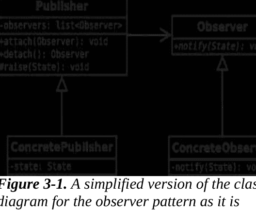

图 3-1. 为 pdCalc 实现的观察者模式的类图的简化版本。该图说明了事件数据的推送语义。

## 增强观察者模式的实现

在我们计算器的实际实现中，除了图 3-1 所示的抽象之外，还添加了多个额外功能。首先，在图中，每个发布者拥有一个观察者列表，所有观察者在事件发生时都会被通知。然而，这种实现意味着

发布者只有一个事件，或者发布者有多个事件，但没有办法区分哪些观察者会被每个事件调用。更好的发布者实现反而持有观察者列表的关联数组。以这种方式，每个发布者可以有多个不同的事件，每个事件只通知对监视该特定事件感兴趣的观察者。虽然关联数组中的键在技术上可以是设计者选择的任何合适的数据类型，但我选择为计算器使用字符串。也就是说，发布者通过名称区分各个事件。此选择增强了可读性并实现了在运行时添加事件的灵活性（与例如选择枚举值作为键相比）。

一旦发布者类可以包含多个事件，程序员就需要能够在调用 attach() 或 detach() 时按名称指定事件。因此，这些方法签名必须相应地修改，与图 3-1 中的显示不同，以包含事件名称。对于附加操作，通过添加

事件的名称来完成方法签名。调用者只需使用具体的观察者实例和该观察者要附加到的事件的名称调用 attach() 方法。然而，从发布者中分离观察者则需要稍微复杂一些的机制。由于发布者中的每个事件可以包含多个观察者，程序员需要能够区分用于分离的观察者。自然地，这个

需求也导致了为观察者命名，并且 detach() 函数签名必须修改以同时容纳观察者和事件的名称。

为了便于分离观察者，每个事件上的观察者应间接存储并通过其名称引用。因此，与其存储观察者列表的关联数组，我们选择使用观察者的关联数组的关联数组。

在现代 C++ 中，程序员可以选择使用 map 或 unordered_map 作为关联数组的标准库实现。这两种数据结构的规范实现分别是红黑树和哈希表。由于关联数组中元素的顺序并不重要，我为 pdCalc 的 Publisher 类选择了 unordered_map。然而，对于每个事件订阅的可能较少的观察者数量，任一数据结构都是同样有效的选择。

到目前为止，我们尚未精确指定观察者在发布者中是如何存储的，只是它们以某种方式存储在关联数组中。由于观察者以多态方式使用，语言规则要求它们由指针或引用持有。然后问题就变成，发布者应该拥有观察者还是仅仅引用由其他类拥有的观察者？如果我们选择引用路线（通过引用或原始指针），则需要除发布者之外的另一个类来拥有观察者的内存。这种情况是有问题的，因为在任何特定实例中谁应该拥有观察者并不清楚。因此，每位开发人员可能都会选择不同的选项，并且观察者的长期维护将陷入混乱。更糟糕的是，如果观察者的所有者释放了观察者的内存而没有同时将观察者从发布者中分离，触发发布者的事件将导致崩溃，因为发布者将持有对观察者的无效引用。出于这些原因，我更喜欢让发布者拥有其观察者的内存。

既然我们放弃了引用，我们必须使用拥有语义，并且由于 C++ 多态性的机制，我们必须通过指针实现所有权。在现代 C++ 中，指针类型的唯一所有权是通过 unique_ptr 实现的（请参阅“现代 C++ 设计说明”侧边栏，了解所有权语义的设计影响）。将上述所有建议放在一起，我们能够设计出 Publisher 类的最终公共接口，如清单 3-3 所示。

## 清单 3-3. Publisher 类的最终公共接口
// Publisher.h
class Observer;
class Publisher
{
class PublisherImpl
public:
void attach(const string& eventName,
unique_ptr<Observer> observer);
unique_ptr<Observer> detach(const string&
eventName, const string& observerName);
//
...
private:
unique_ptr<PublisherImpl> publisherImpl_;
};
```

事件存储的实现细节变为

```
// Publisher.cpp
class Publisher::PublisherImpl {

// ...
private :
using ObserversList =
unordered_map<string,
unique_ptr<Observer>>;
using Events = unordered_map<string,
ObserversList>;
Events events_;
};
```

Observer 类的接口比 Publisher 类的接口简单得多。然而，由于我尚未描述如何处理事件数据，我们尚未准备好设计 Observer 的接口。我将在第 3.3.1.2 节下面同时介绍事件数据和 Observer 类的接口。

## 现代 C++ 设计说明：
拥有语义和
UNIQUE_PTR

在 C++ 中，拥有一个对象意味着在不再需要该对象时负责删除其内存。在 C++11 之前，虽然任何人都可以实现自己的智能指针（而且很多人确实这样做了），但语言本身并未表达指针所有权的标准语义

（除 auto_ptr 外，后者已被弃用）。通过原生指针传递内存更多的是信任问题。也就是说，如果你“new”了一个指针并通过原始指针将其传递给库，你希望库在完成使用后删除内存。或者，库的文档可能会告知你在执行某些操作后删除内存。如果没有标准的智能指针，在最坏的情况下，你的程序会泄漏内存。在最好的情况下，你必须使用非标准的智能指针与库进行接口。

C++11 通过标准化一套主要借鉴自 boost 库的智能指针纠正了未知指针所有权的问题。unique_ptr 最终允许程序员正确实现唯一所有权（因此 auto_ptr 被弃用）。本质上，unique_ptr 确保在任何时候只有一个指针实例存在。为了让语言强制执行这些规则，unique_ptr 的拷贝和非移动赋值未实现。相反，

采用移动语义来确保所有权的转移（也可以使用显式函数调用来手动管理内存）。Josuttis [8] 提供了使用 unique_ptr 机制的优秀详细描述。需要记住的一个重要点是不要在 unique_ptrs 和原始指针之间混合指针类型。

从设计角度来看，unique_ptr 意味着我们可以使用标准 C++ 编写接口，不明确地表达唯一所有权语义。正如在观察者模式的讨论中所看到的，唯一所有权语义在任何一个类创建要由另一个类拥有的内存的设计中都很重要。例如，在计算器的事件系统中，虽然事件的发布者应该拥有其观察者，但发布者很少有足够的信息来创建其观察者。因此，能够在一个位置创建观察者的内存但能够将该内存的所有权传递到另一个位置，即发布者，这一点很重要。unique_ptr 提供了该服务。因为


观察者通过 unique_ptr 传递给发布者，所有权随之转移给发布者；当发布者不再需要该观察者时，智能指针会删除观察者的内存。或者，任何类都可以从发布者处收回某个观察者。由于 detach() 方法通过 unique_ptr 返回观察者，发布者在将观察者转移回调用方时，明确放弃了对其内存的所有权。

上述观察者模式的实现明确强制执行了发布者拥有其观察者的设计。使用此实现最自然的方式是创建小巧、专用的中间 Observer 类，这些类自身持有指向实际应响应事件的类的指针或引用。例如，从第 2 章我们知道，pdCalc 的用户界面是 Stack 类的观察者。然而，我们真的希望用户界面成为如图 3-2a 那样被 Stack 拥有的 Observer 吗？不。更好的方案是直接让用户界面成为观察者。唯一看似可行的折中方案似乎是让 Stack 引用用户界面。不过，我之前曾说过，让发布者引用其观察者是不安全的，因为观察者可能在发布者尚未察觉的情况下消失，从而留下悬空引用。这个悬空引用问题能解决吗？

幸运的是，现代 C++ 再次借助共享语义（shared semantics）解决了这个问题（如图 3-2b 所示）。在这种情况下，观察者通过 std::shared_ptr 共享（参见下文关于 shared_ptr 的边栏），而发布者则通过 weak_ptr（shared_ptr 的一个近亲）持有对观察者的引用。weak_ptr 的设计目的正是为了缓解对共享对象的悬空引用问题。Meyers [19] 在第 20 条中描述了这种由发布者共享观察者所有权的设计。就我个人而言，我更倾向于使用拥有语义（owning semantics）和轻量级专用观察者类的设计。

## 处理事件数据

在描述观察者模式时，我提到处理事件数据存在两种不同的范式：拉语义（pull semantics）和推语义（push semantics）。在拉语义中，观察者仅被通知某个事件已发生。然后，观察者还要负责获取可能需要的任何额外数据。这种实现非常简单。观察者持有对任何可能需要从中获取状态信息的对象的引用，并在事件发生时调用成员函数来获取这些状态。

拉语义有几个优点。首先，观察者可以在处理事件时精确地选择要获取的状态。其次，不会因向观察者传递可能不用的参数而消耗不必要的资源。第三，拉语义易于实现，因为事件不需要携带数据。然而，拉语义也有缺点。首先，拉语义增加了耦合，因为观察者需要持有对发布者的引用并理解其状态获取接口。其次，观察者只能访问发布者的公共接口。这种访问限制使得观察者无法从发布者获取私有数据。

与拉语义相反，推语义的实现方式是：当事件被触发时，发布者将与事件相关的状态数据发送出去。观察者随后将这些状态数据作为通知回调的参数接收。接口通过将抽象 Observer 基类中的 notify 函数设为纯虚函数来强制实现推语义。

推语义用于事件处理同样有利有弊。第一个优点是推语义降低了耦合。发布者和观察者都无需了解彼此的接口，只需遵从抽象的事件接口。其次，发布者可以在推送状态时将私有信息发送给观察者。第三，发布者作为触发事件的对象，可以精确地发送处理事件所需的数据。推语义的主要缺点是实现起来稍微困难，而且在观察者并不需要发布者所推送的状态数据时，可能会带来不必要的开销。最后，请注意，使用推语义的设计总可以在特殊情况下通过向推送数据中添加一个回调引用来轻松地补充拉语义。反之则不然，因为推语义需要在事件处理机制中配备专门的基础设施。

基于上述推语义与拉语义之间的权衡，我为 pdCalc 的事件处理选择了推语义。推语义的主要缺点是实现可能带来计算开销。然而，由于我们的应用对性能要求并不高，这种模式所展现的更低耦合度以及发布者对参数的控制，超过了轻微的性能开销。我们现在的任务就是设计一种通过推语义传递事件数据的实现。

为了实现事件处理的推语义，必须标准化事件被触发时从发布者向观察者传递参数的接口。理想情况下，每对发布者/观察者都会就待传递参数的类型达成一致，并且发布者会在事件触发时调用观察者上相应的成员函数。然而，在我们的发布者/观察者类层次结构中，这种理想情况实际上是不可能的，因为具体发布者并不知道具体观察者的接口。具体发布者只能通过调用 Publisher 基类中的 raise() 函数来泛化地触发事件。反过来，raise() 函数通过 Observer 基类的虚函数 notify() 以多态方式通知具体观察者。因此，我们需要寻找一种通用技术，通过抽象的 raise/notify 接口传递定制数据。

我们困境的解决方案相当简单。

我们为事件数据创建了一个平行的对象层次结构，并通过这一抽象状态接口将事件数据从发布者传递给观察者。该层次结构中的基类 EventData 是一个空类，只包含一个虚析构函数。每个需要参数的事件随后继承这个基类，并实现任何被认为合适的数据处理方案。当事件被触发时，发布者通过 EventData 基类指针将数据传递给观察者。收到数据后，具体观察者将状态数据向下转换为具体数据类，然后通过派生类的具体接口提取所需数据。虽然具体发布者和具体观察者必须就数据对象的接口达成一致，但并不要求任何一方了解另一方的接口。这样我们就保持了松耦合。

为了巩固上述想法，让我们考察计算器的 Stack 如何实现状态数据。回想第 2 章，Stack 实现了两个事件：stackChanged() 事件和 error(string) 事件。stackChanged() 事件在此上下文中并不令人感兴趣，因为该事件不携带数据。而 error 事件确实携带数据。请考虑清单 3-4 中展示的 Stack 错误条件的类层次结构。

### 清单 3-4. 事件数据层次结构

```
// Publisher.h
class EventData
{
public:

virtual ~EventData();
};

// Stack.h
class StackEventData : public EventData
{
public:

enum class ErrorConditions { Empty,
TooFewArguments };
StackEventData(ErrorConditions e) : err_(e)
{ }
```

```
static const char* Message(ErrorConditions ec); const char* message() const;
ErrorConditions error() const { return err_; }

private:
ErrorConditions err_;
};
```


作为一个具体示例，假设错误是因为对一个空栈执行弹出操作而触发的。为了引发这一事件，`Stack` 调用了以下代码（实际实现略有不同，因为 `Stack` 被封装在 pimpl 中）：

```
parent_..raise(Stack::StackError,
make_shared<StackEventData>(
StackEventData::ErrorConditions::Empty));
```

`raise()` 函数的第一个参数是一个解析为 `"error"` 的静态字符串。回顾一下，为了处理多个事件，发布者会为每个事件命名。在这里，`Stack::StackError` 静态变量保存的就是该事件的名称。使用变量而非直接使用字符串，是为了防止因事件名称输入错误而导致运行时错误。`raise()` 函数的第二个参数创建 `StackEventData` 实例，并用空栈错误条件对其初始化。请注意，该实现使用 `shared_ptr` 传递事件数据。这一决定将在下面关于共享语义的边栏中讨论。虽然 `StackObserver` 类尚未引入，但为了完整性，我指出事件可以通过以下典型代码进行处理：

```
StackObserver::notify(shared_ptr<EventData> d)
{
shared_ptr<StackEventData> p =
dynamic_pointer_cast<StackEventData>(d);
if(p) {

// do something with the data }
else
{

// uh oh, what event did we just catch?! }
}
```

## 现代 C++ 设计说明：共享语义与 shared_ptr

`unique_ptr` 使程序员能够安全地表达唯一所有权，而 `shared_ptr` 使程序员能够安全地表达共享所有权。在 C++11 标准之前，C++ 通过原始指针或引用实现数据共享。由于类数据的引用只能在构造期间初始化，因此对于后期绑定的数据，只能使用原始指针。所以，两个类常常各自包含一个指向公共对象的原始指针，从而共享同一份数据。这种场景的问题显然在于：不清楚哪个对象拥有这个共享对象。尤其地，这种模糊性意味着不确定何时可以安全地删除这样的共享对象，以及最终应该由哪个拥有者释放内存。`shared_ptr` 在标准库层面解决了这个难题。`shared_ptr` 通过引用计数实现共享语义。当新对象指向一个 `shared_ptr` 时，内部引用计数会增加（通过构造函数和赋值操作强制执行）。当 `shared_ptr` 离开作用域时，其析构函数被调用，从而使内部引用计数递减。当计数降至零时，最后一个 `shared_ptr` 的析构会触发底层内存的回收。与 `unique_ptr` 一样，显式成员函数调用也可以（提前释放内存）。事件处理完成后，发布者不能简单地在事件已被处理后释放内存。此外，由于任何给定事件都可能调用多个观察者，发布者也不能将数据的唯一所有权转移给任何特定观察者。因此，C++11 中标准化的 `shared_ptr` 为处理这种情况提供了理想的语义。

现在你已经理解了事件数据，让我们最终编写抽象 `Observer` 接口。不出所料，它正是你可能期待的样子。参见清单 3-5。

## 清单 3-5. 抽象 Observer 接口

```
class Observer
{
public :

explicit Observer(const string& name);
virtual ~Observer();
virtual void notify(shared_ptr<EventData>) = 0;
```

## 作为事件发布者的 Stack

构造 `Stack` 的最后一步，就是将各部分组合到一起。清单 3-1 展示了作为单例的 `Stack`。为了实现事件，我们只需修改这段代码，使其继承 `Publisher` 基类。现在我们必须问自己：这种继承应该是公有继承还是私有继承？

通常，在面向对象编程中，人们使用公有继承来表达 is-a 关系。也就是说，公有继承表达的是派生类是基类的一种类型或特化。更准确地说，is-a 关系遵循里氏替换原则（LSP）[29]，该原则指出（通过多态），接受基类指针（或引用）作为参数的函数，必须能够在不知道的情况下接受派生类指针（或引用）。简而言之，在可以使用基类的任何地方，派生类都必须可以互换使用。当人们提到继承时，通常指的是公有继承。

私有继承用于表达 implements-a 关系。简单地说，私有继承用于将一个类的实现嵌入到另一个类的私有实现中。它不遵循 LSP，而且事实上，如果继承关系是私有的，C++ 语言不允许将派生类替换为基类。为了完整起见，与之密切相关的受保护继承在语义上与私有继承相同。唯一区别在于，私有继承中基类的实现在派生类中变为私有，而受保护继承中基类的实现在派生类中变为受保护。

我们的问题现在可以细化为：`Stack` 是一个 `Publisher`，还是 `Stack` 实现了 `Publisher`？答案是“是”和“是”。这没什么帮助，那么我们该如何选择？

为了在这种情形下消除公有继承或私有继承的歧义，我们必须更深入考察 `Stack` 类的使用方式。公有继承（即 is-a 关系）表明我们意图将栈作为发布者以多态方式使用。但事实并非如此。虽然 `Stack` 类是发布者，但它在 LSP 意义上并不是一个可以替换为 `Publisher` 的发布者。因此，我们应该使用私有继承，以表明在 `Stack` 内部使用 `Publisher` 实现的意图。等价地，我们可以说 `Stack` 提供了 `Publisher` 服务。如果你一直在跟随仓库中的源代码，你可能已经注意到一个大提示：私有继承才是答案。`Publisher` 类是用非虚的受保护析构函数实现的，这使得它无法用于公有继承。

熟悉面向对象设计的读者可能会问，为什么我没有问那个无处不在的 has-a 问题，它表示所有权或聚合关系。也就是说，为什么 `Stack` 不直接拥有一个 `Publisher` 并复用其实现，而是私有继承它？许多设计者几乎完全倾向于用聚合代替私有继承，他们认为，当在这两者之间进行等价选择时，人们应该始终选择带来更松耦合的语言特性（继承是比聚合更强的关联）。这种观点有其道理。不过就我个人而言，我只是倾向于接受以更强耦合换取更高清晰度的技巧。我相信私有继承比聚合更清楚地表达了实现 `Publisher` 服务的设计意图。这个决定没有对错之分。在你的代码中，你应该选择适合你个人品味的风格。

私有继承自 `Publisher` 类的另一个后果是，`Publisher` 的 `attach()` 和 `detach()` 方法变成了私有方法。然而，如果任何其他类打算订阅 `Stack` 的事件，它们就必须是 `Stack` 公共接口的一部分。因此，实现者必须选择使用 using 声明或转发成员函数，将 `attach()` 和 `detach()` 提升到 `Stack` 的公共接口。这两种方法在此上下文中都是可接受的，实现者可以自由选择他或她偏好的方式。

## 完整的 Stack 接口

我们终于准备好编写完整的 `Stack` 公共接口了。参见清单 3-6。

**清单 3-6.** 完整的 Stack 公共接口

```
class Stack : private Publisher
{
public:

static Stack& Instance();

void push(double, bool suppressChangeEvent = false); double pop(bool suppressChangeEvent = false);
void swapTop();
vector<double> getElements(size_t n) const;

using Publisher::attach;
using Publisher::detach;
```


如本章所述，Stack 是一个单例类（注意 Instance() 方法），它实现了 Publisher 服务（注意 Publisher 类的私有继承以及 attach() 和 detach() 方法被提升到公共接口中）。Stack 类的公共部分，结合第 3-2 节中描述的 EventData 类，涵盖了第 2 章表 2-2 中介绍的栈模块的完整接口。虽然我尚未描述 Stack 的任何具体观察者，但我们已经完全定义了 pdCalc 的事件系统，它基于经过验证的观察者模式。此时，我们已准备好设计 pdCalc 的下一个组件，即命令分发器模块。

## 关于测试的简短说明

在结束本章对 pdCalc 源代码的首次介绍之前，我应该稍作停顿，说几句关于测试的话。虽然测试绝不是本书的核心探索主题，但它却是任何高质量实现不可或缺的一部分。除了在 GitHub 上找到的计算器源代码之外，我还包含了所有的自动化单元测试代码。由于我选择使用 Qt 作为 pdCalc 的图形用户界面框架（见第 6 章），Qt Test 框架自然成为构建 pdCalc 单元测试套件的理想选择。主要是，这一选择不会为项目增加任何额外的库依赖，并且测试框架保证能在 Qt 已移植的所有平台上工作。话虽如此，众多高质量的 C++ 单元测试框架中的任何一个都同样适用。

就个人而言，我发现单元测试在编程即使是小型项目时也是不可或缺的。首先，单元测试提供了一种确保代码按预期运行的手段。其次，单元测试使你能够在用户界面开发之前很久就看到模块正常工作。早期测试能够实现早期缺陷检测，而软件工程的一个众所周知事实是，更早的缺陷检测会导致指数级更低的缺陷修复成本。我还发现，在开发周期的早期看到模块完全正常工作会带来一种奇特的动力。最后，单元测试还能让你知道代码在代码更改前后功能保持一致。由于迭代是设计和实现的基本要素，你的代码即使在你认为已完成之后也会多次更改。在每次构建时自动运行全面的单元测试将确保新的更改不会不可预测地破坏任何现有功能单元。

由于我非常重视测试（这是我试图传授给新专业开发人员的首批课程之一），我努力确保对 pdCalc 代码的测试完整性。测试代码不仅为读者提供了一个范例（我希望如此），而且也确保了我在撰写本书的代码开发部分期间我的代码是正确的。然而，尽管我有意编写无错误代码，并且在源代码上进行了不合理的多次审查，我确信最终产品中仍然存在错误。请随时通过电子邮件向我发送你发现的任何和所有错误。我将尽最大努力实时将更正纳入 GitHub 仓库的代码中，并对第一个向我报告我错误的人给予适当的署名。

# 第 4 章

## 命令分发器

命令分发器是计算器的核心。作为 MVC 框架中的控制器，命令分发器负责应用程序的全部业务逻辑。本章不仅讨论计算器命令分发器模块的具体设计，而且更广泛地讨论松散耦合命令基础设施的灵活设计。

## 命令分发器的分解

我们在分解栈时问的第一个问题是：“栈应该被分成多少个组件？”现在我们对命令分发器提出同样的问题。要回答这个问题，让我们考虑命令分发器必须封装的功能。命令分发器的功能是

- 1. 存储已知命令的集合，
- 2. 接收并解释对这些命令的请求，
- 3. 分发命令请求（包括能够撤销和重做），以及
- 4. 执行实际操作（包括更新计算器的状态）。

在第 2 章中，我讨论了内聚的原则。在类级别，设计内聚意味着每个类应该只做一件事，并且 presumptively 做得很好。在最高分解级别，命令分发器确实只做一件事：它解释命令。然而，在任务级别，从我们上面的功能列表来看，它显然必须执行多个任务。因此，我们将命令分发器分解为多个不同的类，每个主要任务一个类。因此，我们有以下类：

- 1. CommandRepository：存储可用命令的列表
- 2. CommandDispatcher：接收并解释执行命令的请求
- 3. CommandManager：分发命令并管理撤销和重做
- 4. Command hierarchy：执行命令

本章的其余部分致力于描述上述类和类层次结构的设计和主要实现细节。

## Command 类

在分解的这个阶段，我发现切换到自底向上的设计方法更有用。在严格的自上而下的方法中，我们可能会从 CommandDispatcher 开始，即接收和解释命令请求的类，然后向下工作到命令本身。然而，在这种自底向上的方法中，我们将首先研究命令本身的设计。我们从被称为命令模式的抽象开始。

## 命令模式

命令模式是一种简单但非常强大的行为模式，它将请求封装为对象的形式。结构上，该模式被实现为一个提供执行请求接口的抽象命令基类。具体命令只需实现该接口。在最平凡的情况下，抽象接口仅由一个命令组成，用于执行命令所封装的请求。平凡实现的类图如图 4-1 所示。

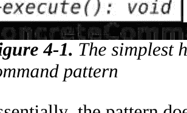

图 4-1. 命令模式的最简单层次结构

本质上，该模式做了两件事。首先，它将命令的请求者与命令的分发者解耦。其次，它将对操作的请求封装到一个对象中，该请求原本可能由函数调用实现。该对象可以携带状态并拥有超出请求本身即时生命周期的扩展生命周期。

实际上，这两个特性给了我们什么？首先，由于请求者与分发者解耦，执行命令的逻辑不需要驻留在与负责执行命令的类相同或甚至相同的模块中。这显然降低了耦合，但也提高了内聚，因为可以为系统必须实现的每个唯一命令创建唯一的类。其次，由于请求现在被封装在与操作生命周期不同的命令对象中，命令既可以延迟执行（例如，排队命令），也可以被撤销。撤销操作成为可能，因为已执行的命令可以用足够的数据保留下来以将状态恢复到命令执行之前的瞬间。当然，将排队能力与撤销能力结合起来允许为实现命令模式的所有请求创建无限的撤销/重做。

## 关于实现撤销/重做的更多内容

pdCalc 的要求之一是实现无限的撤销和重做操作。大多数书籍指出，撤销可以通过命令模式实现，只需增强抽象命令


interface with an undo command. However, this simplistic treatment glosses over the actual details necessary to properly implement the undo feature.

Implementing undo and redo involves two distinct steps. First (and obviously), undo and redo must be implemented correctly in the concrete command classes. Second, a data structure must be implemented to track and store the command objects as they are dispatched. Naturally, this data structure must preserve the order in which the commands were executed and be capable of dispatching a request to undo, redo, or execute a new command. This undo/redo data structure is described in detail in Section 4.4 below. The implementation of undo and redo are discussed presently.

Implementing undo and redo operations themselves is usually straightforward. The redo operation is the same as the command’s execute function. Provided that the state of the system is the same before the first time a command is executed and after undo has been

example. That is, consider taking the square
of the number on the top of the stack. The
undo operation would be to take the square
root of the result of the squaring operation.
However, was the original number the
positive or negative root of the square?
Without retaining additional state
information, the inversion method breaks
down.

The alternative to implementing undo as an
inverse operation is to preserve the state of
the system before the command is first
executed and then implement the undo as a
reversion to this prior state. Returning to our
example of squaring a number, the forward
operation would both compute the square, but
also save the top number on the stack. The
undo operation would then be implemented
by dropping the result from the stack and
pushing the saved state from before the
forward operation was performed. This
procedure is enabled by the command pattern
since all commands are implemented as
instantiations of concrete command classes
that are permitted to carry state. An

interesting feature of this method of implementing undo is that the operation itself need not have a mathematical inverse. Notice that in our example, the undo did not even need to know what the forward operation was. It simply needed to know how to replace the top element from the stack with the saved state.

Which mechanism to use in your application really depends on the distinct operations your application performs. When operations have no inverses, storing the state is the only option. When the inverse operation is overly expensive to compute, storing the state is usually the better implementation. When storage of the state is expensive, implementing undo via inversion is preferred, assuming an inverse operation exists. Of course, since each command is implemented as a separate class, a global decision for how undo is implemented need not be made for the entire system. The designer of a given command is free to choose the method most appropriate for that particular operation on a command-by-command basis. In some cases,

even a hybrid approach (both storing and inverting separate parts of the operation) may be optimal. In the next section, we will examine the choice that I made for pdCalc.

## The Command Pattern Applied to the Calculator

In order to execute, undo, and redo all of the operations in the calculator, we will implement the command pattern, and each calculator operation will be encapsulated by its own concrete class deriving from an abstract Command class. From the discussion above concerning the command pattern, we can see that two decisions must be made in order to apply the pattern to the calculator. First, we must decide what operations must be supported by every command. This collection of operations will define the abstract interface of the Command base class. Second, we must choose a strategy for how undo will be supported. To be precise, this decision is always deferred to the implementer of a particular concrete

command. However, by choosing either state reconstruction or command inversion upfront, we can implement some infrastructure to simplify undo for command implementers. We’ll tackle these two issues consecutively.

## The Command Interface

Choosing what public functions to include in the abstract Command class is identical to defining the interface for all commands in the calculator. Therefore, this decision must not be taken lightly. While each concrete command will perform a distinct function, all concrete commands must be substitutable for each other (recall the LSP). Because we want interfaces to be minimal but complete, we must determine the fewest number of functions that can abstractly express the operations needed for all commands. The first two commands to be included are the most obvious and easiest to define.

They are execute() and undo(), the functions for performing the forward and inverse operations of the command, respectively.

These two functions return void and require no arguments. No arguments are needed because all of the data for the calculator is handled via the Stack class, which is globally accessible via the singleton pattern. Additionally, the Command class will need a constructor and a destructor. Because the class is intended to be an interface class with virtual functions, the destructor should be virtual. Listing 4-1 illustrates our first attempt at an interface.

### *Listing 4-1.* A First Attempt at the Command Interface

```
class Command
{
public:

virtual ~Command();
void execute();
void undo();

protected:
Command();
```

```
private:
virtual void executeImpl() = 0; virtual void
undoImpl() = 0;

};
```

In Listing 4-1, the reader will immediately notice that the constructor is protected, both execute() and undo() are public and nonvirtual, and separate executeImpl() and undoImpl() virtual functions exist. The reason the constructor is protected is to signal to an implementer that the Command class cannot be directly instantiated. Of course, because the class contains pure virtual functions, the compiler prevents direct instantiation of the Command class anyway. Making the constructor protected is somewhat superfluous. Defining the public interface using a combination of virtual and nonvirtual functions, on the other hand, deserves a more detailed explanation.

Defining the public interface for a class via a mixture of public nonvirtual functions and private virtual functions is a design principle

known as the non-virtual interface (NVI) pattern. The NVI pattern states that polymorphic interfaces should always be defined using non-virtual public functions that forward calls to private virtual functions. The reasoning behind this pattern is quite simple. Since a base class with virtual functions acts as an interface class, clients should be accessing derived class functionality only through the base class’s interface via polymorphism. By making the public interface nonvirtual, the base class implementer reserves the ability to intercept virtual function calls before dispatch in order to add preconditions or postconditions to the execution of all derived class implementations. Making the virtual functions private forces consumers to use the non-virtual interface. In the trivial case where no precondition or postcondition is needed, the implementation of the non-virtual function reduces to a forwarding call to the virtual function. The additional verbosity of insisting on the NVI pattern even in the trivial case is warranted because it preserves design flexibility for future expansion at zero

another use case. Consider taking the sine of a number. This command only requires one number to be on the stack. Ah, preconditions are command-specific. The correct answer to our question concerning the general handling of preconditions is to ask derived classes to check their own preconditions by having execute() first call a checkPreconditionsImpl() virtual function.

What about postconditions for execute()? It turns out that if the preconditions for each command are satisfied, then all of the commands are mathematically well-defined. Great, no postcondition checks are necessary! Unfortunately, mathematical correctness is insufficient to ensure error-free computations with floating point numbers. For example, floating point addition can result in positive overflow when using the double precision numbers required by pdCalc even when the addition is mathematically defined. Fortunately, however, our requirements from Chapter 1 stated that floating point errors can be ignored. Therefore, we are technically excepted from needing to handle floating


鉴于 `checkPreconditionsImpl()` 和 `executeImpl()` 必须由派生类连续调用并处理，我们为什么不能将这两个操作合并到一个函数调用中呢？我们可以这样做，但该决定会导致设计不佳。首先，将这两个操作合并到一个 `executeImpl()` 函数调用中，会导致内聚性丧失，因为要求一个函数执行两个不同的操作。其次，通过使用单独的 `checkPreconditionsImpl()` 调用，我们可以选择强制派生类实现者检查前置条件（通过将 `checkPreconditionsImpl()` 设为纯虚函数），或可选地为前置条件检查提供默认实现。最后，谁能保证 `checkPreconditionsImpl()` 和 `executeImpl()` 会分派到同一个派生类？请记住，层次结构可以有多层深。

与 `execute()` 函数类似，人们可能会假设撤销命令也需要前置条件检查。然而事实证明，我们永远不需要检查撤销前置条件，因为它们将始终通过构造为真。也就是说，由于撤销命令只能在执行命令成功完成后才被调用，`undo()` 的前置条件被保证满足（当然，前提是 `execute()` 的实现是正确的）。与正向执行一样，`undo()` 也不需要后置条件检查。

对 `execute()` 和 `undo()` 的前置条件和后置条件的分析导致在虚接口中仅添加了一个函数 `checkPreconditionImpl()`。然而，为了使该函数的实现完整，我们必须确定该函数的正确签名。首先，函数的返回值应该是什么？我们可以选择使返回值为 `void` 并通过异常处理前置条件失败，或者使返回值为可以指示前置条件未满足的类型（例如，在前置条件失败时返回 `false` 的布尔值，或指示发生失败类型的枚举）。对于 pdCalc，我选择通过异常处理前置条件失败。这种策略提供了更大的灵活性，因为错误不需要由直接调用者 `execute()` 函数处理。此外，异常可以设计为携带可由派生命令扩展的自定义描述性错误消息。这与使用枚举类型形成对比，后者必须完全由基类实现者定义。

我们在指定 `checkPreconditionImpl()` 签名时必须处理的第二个问题是，选择该函数应为纯虚函数还是具有默认实现。虽然大多数命令确实需要满足某些前置条件，但并非每个命令都需要。例如，将新数字输入堆栈不需要前置条件。因此，`checkPreconditionImpl()` 不应是纯虚函数。相反，它被赋予一个默认实现，即什么都不做，这相当于说明前置条件已满足。

由于命令中的错误是通过 `checkPreconditionImpl()` 函数检查的，任何命令的正确实现都不应抛出异常，除非来自 `checkPreconditionImpl()`。因此，为了增加接口保护，`Command` 类中的每个纯虚函数都应标记为 `noexcept`。为简洁起见，我在文本中经常省略此关键字；然而，`noexcept` 确实出现在实现中。此说明符对于插件命令的实现尤其重要，而插件命令将在第 7 章中讨论。

要添加到 `Command` 类的下一组函数是用于多态复制对象的函数。此集合包括受保护的拷贝构造函数、公共非虚 `clone()` 函数和私有 `cloneImpl()` 函数。在设计这一点时，命令必须

是，p2 将被构造为 `Command` 实例，而不是 `Add` 实例，并且 p 中的任何 `Add` 状态都会在复制中丢失。

既然我们不能直接使用拷贝构造函数，那么如何在多态设置中复制类呢？解决方案是提供一个虚拟克隆操作，可按如下方式使用：

```
Command* p2 = p->clone();
```

这里，非虚 `clone()` 函数将克隆操作分派给派生类的 `cloneImpl()` 函数，其实现只是调用其自己的拷贝构造函数，并以解引用的 `this` 指针作为参数。对于上面的示例，扩展的接口和实现如下：

```
class Command
{
public:

Command* clone() const { return cloneImpl(); }
```

```
protected:
Command(const Command&) { }

private:
virtual Command* cloneImpl() const = 0;
};

class Add : public Command
{
public:

Add(const Add& rhs) : Command{rhs} { }
private:
Add* cloneImpl() const { return new
Add{*this}; }
};
```

这里唯一有趣的实现特性是 `cloneImpl()` 函数的返回类型。请注意，基类将返回类型指定为 `Command*`，而派生类将返回类型指定为 `Add*`。这种构造称为返回类型协变，一条规则规定派生类中的重写函数可以返回比虚接口中返回类型更具体的类型。协变允许克隆函数始终返回与调用克隆的层次级别相对应的特定类型。此功能对于具有公共克隆函数并允许从层次结构中的所有级别进行克隆调用的实现非常重要。

我选择用帮助消息函数及其对应的虚实现函数来完善命令接口。此帮助函数的意图是强制各个命令实现者提供简要文档，以便可通过用户界面中的帮助命令查询。帮助函数对于命令的功能不是必需的，其作为设计的一部分包含是可选的。然而，即使对于像计算器这样简单的程序，提供一些命令使用的内部文档也总是很不错的。

综合以上所有信息，我们终于可以编写 `Command` 类的完整抽象接口；请参阅清单 4-3。

## 清单 4-3. 命令类的完整抽象接口

```
class Command
{
public:

virtual ~Command();
void execute();
void undo();
Command* clone() const;
const char* helpMessage() const;

protected:
Command();
Command(const Command&);

private:
virtual void checkPreconditionsImpl() const;
virtual void executeImpl() noexcept = 0;
virtual void undoImpl() noexcept = 0;
virtual Command* cloneImpl() const = 0;
virtual const char* helpMessageImpl() const
noexcept = 0;

};
```

如果查看 `Command.h` 中的源代码，你还会看到一个虚 `deallocate()` 函数。此函数专门用于插件，其添加到接口中的情况将在第 7 章中讨论。

## MODERN C++ 设计说明：OVERRIDE 关键字

`override` 关键字是在 C++11 中引入的。从功能上讲，它可以防止一种常见错误，这种错误常常让新的 C++ 程序员感到惊讶。请考虑以下代码片段：

```
class Base
{
public:

virtual void foo(int);
};
```

class Derived : public Base

```
```cpp
{
public:
void foo(double);
};
Base* p = new Derived;
p->foo(2.1);
```
```

调用哪个函数？大多数初学者 C++ 程序员假设调用 `Derived::foo()`，因为他们期望 `Derived` 的 `foo()` 覆盖基类的实现。然而，由于基类和派生类之间 `foo()` 函数的签名不同，`Base` 的 `foo()` 实际上隐藏了 `Derived` 的实现，因为重载不能跨作用域边界发生。因此，调用 `p->foo()` 将调用 `Base` 的 `foo()`，而不管参数的类型。有趣的是，出于同样的原因

```
```cpp
Derived d;
d->foo(2);
```
```

永远不可能调用 `Derived` 以外的 `foo()`。在 C++03 和 C++11 中，上述代码的行为


以完全相同令人困惑，但技术上正确的方式。然而，从 C++11 开始，派生类可以可选地使用 override 关键字标记覆盖的函数：

```cpp
class Derived : public Base
{
public:

void foo(double) override;
};
```

现在，编译器会将该声明标记为错误，因为程序员明确声明派生函数应进行覆盖。因此，override 关键字的添加通过允许程序员消除其意图的歧义，防止令人困惑的错误发生。

从设计角度来看，override 关键字明确将函数标记为覆盖。虽然这可能看起来不重要，但在处理大型代码库时非常有用。在实现派生类而其基类位于代码的另一个独立部分时，方便地知道哪些函数覆盖了基类函数，哪些没有，而无需查看基类的声明。

## The Undo Strategy

在定义了命令的抽象接口之后，我们接下来着手设计撤销策略。从技术上讲，因为我们接口中的 undo() 命令是纯虚函数，我们可以简单地挥挥手声称 undo 的实现是每个具体命令的问题。然而，这既不优雅也不高效。相反，我们寻求所有命令（或至少命令的分组）可能具有的功能共同点，以便能够在命令层次结构中每个叶节点之上更高级别实现撤销。

如前所述，撤销可以通过命令反转或状态重建（或两者的组合）来实现。命令反转已被证明是有问题的，因为对于某些命令，逆问题是不适定的（具体来说，它有多个解）。因此，让我们将状态重建作为 pdCalc 的通用撤销策略来审视。

我们通过考虑一个用例，即加法操作来开始分析。加法从栈中移除两个元素，将它们相加，并返回结果。一种简单的撤销可以是通过丢弃结果并恢复原始操作数来实现，前提是这些操作数已由 execute() 命令存储。现在，考虑减法、乘法或除法。这些命令也可以通过丢弃其结果并恢复其操作数来撤销。撤销所有命令的实现是否可以如此简单，以至于我们只需在 execute() 期间存储栈中的前两个值，并通过丢弃命令的结果并恢复存储的操作数来实现撤销？不。考虑正弦、余弦和正切。它们各自从栈中取出一个操作数并返回一个结果。考虑 swap。它从栈中取出两个操作数。

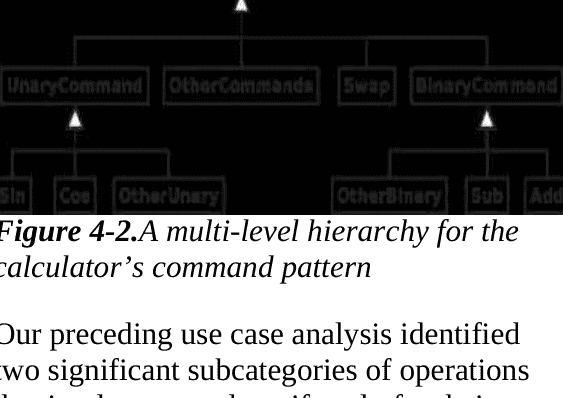

*Figure 4-2. A multi-level hierarchy for the calculator’s command pattern*

我们之前的使用案例分析确定了两个重要的操作子类别，它们为各自的成员统一实现撤销：二元命令（取两个操作数并返回一个结果的命令）和一元命令（取一个操作数并返回一个结果的命令）。因此，我们可以通过对这两个命令类进行通用处理来显著简化实现。虽然不符合一元或二元命令家族的命令仍需要单独实现 undo()，但这两个子类别约占计算器核心命令的 75%。创建这两个抽象将节省大量工作。

让我们检查 UnaryCommand 类。根据定义，所有一元命令都需要一个参数并返回一个值。例如，f(x) = sin(x) 从栈中取出一个数字 x 并将结果 f(x) 返回到栈上。如前所述，考虑所有一元函数作为一个家族的原因是，无论函数如何，所有一元命令都以相同的方式实现向前执行和撤销，仅在 f 的函数形式上有所不同。此外，它们还必须至少满足相同的先决条件。即，栈上必须至少有一个元素。

在代码中，一元命令的上述共同特征是通过在 UnaryCommand 基类中重写 executeImpl()、undoImpl() 和 checkPreconditionsImpl() 并创建一个新的 unaryOperation() 纯虚函数来强制执行，该函数将每个命令的确切实现委托给进一步派生的类。其结果是具有以下在 Listing 4-4 中声明的 UnaryCommand 类。

**Listing 4-4. The UnaryCommand Class**

```cpp
class UnaryCommand : public Command
{
public:
virtual ~UnaryCommand();
protected:
void checkPreconditionsImpl() const override;
UnaryCommand() {}
UnaryCommand(const UnaryCommand&);
private:
void executeImpl() override;
void undoImpl() override;
virtual double unaryOperation(double top) const = 0;
double top_;
};
```

为了完整性，让我们检查从 Command 中重写的三个函数的实现。检查先决条件是微不足道的；我们确保栈上至少有一个元素。如果没有，则抛出异常：

```cpp
void UnaryCommand::checkPreconditionsImpl() const
{
    if(Stack::Instance().size() < 1)
        throw Exception{"Stack must have one element"};
}
```

executeImpl() 命令也相当直接：

```cpp
void UnaryCommand::executeImpl() {
    top_ = Stack::Instance().pop(true);
    Stack::Instance().push(unaryOperation(top_));
}
```

栈顶元素从栈中弹出并存储在 UnaryCommand 的状态中以用于撤销。请记住，因为我们已经检查了先决条件，可以确保 unaryOperation() 将在没有错误的情况下完成。具有特殊先决条件的命令仍需要实现 checkPreconditionsImpl()，但它们至少可以将一元先决条件检查委托给 UnaryCommand 的 checkPreconditionsImpl() 函数。一举，我们将一元函数操作分派给进一步派生的类，并将其结果推回栈上。

UnaryCommand 的 executeImpl() 函数中唯一的特殊之处是传递给栈的 pop 命令的布尔参数。此布尔值可选择抑制栈更改事件的发出。因为我们知道接下来的 push 命令会立即再次更改栈，因此没有必要发出两个后续的栈更改事件。对此事件的抑制允许命令实现者将命令的操作合并为一个用户可见的事件。虽然 Stack 的 pop() 的此布尔参数不是原始设计的一部分，但此功能现在可以作为便利添加到 Stack 类中。记住，设计是迭代的。最后要检查的成员函数是 undoImpl()：

```cpp
void UnaryCommand::undoImpl() {
    Stack::Instance().pop(true);
    Stack::Instance().push(top_);
}
```

此函数也具有预期的明显实现。一元操作的结果从栈中丢弃，并且在 executeImpl() 执行期间存储在类的 top_ 成员中的先前栈顶元素被恢复到栈上。

作为使用 UnaryCommand 类的示例，我们展示了正弦命令的部分实现：

```cpp
class Sine : public UnaryCommand
{
private:
    double unaryOperation(double t) const override { return std::sin(t); }
};
```

显然，使用 UnaryCommand 作为基类而不是最高级的 Command 类的优势在于，我们无需实现 undoImpl() 和 checkPreconditionsImpl()，并用稍微更简单的 unaryOperation() 替换了 executeImpl() 的实现。不仅总体上需要的代码更少，而且因为 undoImpl() 和 checkPreconditionsImpl() 的实现在所有一元命令上是相同的，我们也减少了代码重复，这始终是积极的。

二元命令以与一元命令类似的方式实现。唯一的区别是执行操作的函数接受两个操作数，并且相应地必须为撤销存储这两个值。BinaryCommand 类的完整定义可以在 GitHub 仓库源代码中的 Command.h 头文件里，与 Command 和 UnaryCommand 类一起找到。


## 具体命令

在上面定义了 Command、UnaryCommand 和 BinaryCommand 类之后，就完成了在计算器中使用命令模式的抽象接口。正确实现这些接口涵盖了命令设计的大部分工作。然而，在这一点上，我们的计算器尚未拥有任何单一的具体命令（除了部分 Sine 类实现之外）。本节将最终解决这个问题，我们的计算器的核心功能将开始成形。

计算器的核心命令都定义在 CoreCommands.h 文件中，其实现可以在对应的 CoreCommands.cpp 文件中找到。什么是核心命令？我将核心命令定义为从第 1 章中列出的需求中提炼出的功能集合。计算器必须执行的每一种不同操作都存在一个唯一的核心理命令。为什么我称它们为核心命令？因为它们是核心命令，因为它们与计算器一起编译和链接，因此在计算器加载时即可立即使用。事实上，它们是计算器的固有组成部分。这与插件命令形成对比，插件命令可以在运行时由计算器动态地选择性加载。插件命令将在第 7 章中详细讨论。

虽然人们可能会怀疑我们现在需要进行分析来确定核心命令，但事实证明这种分析已经完成。具体来说，核心命令是由第 2 章中用例描述的操作定义的。细心的读者甚至会回忆起，用例中的异常列表定义了每个命令的前置条件。因此，通过必要时参考用例，可以很轻易地推导出核心命令。为方便起见，它们都列在表 4-1 中。

### 表 4-1. 按其直接抽象基类列出的核心命令

| Command | UnaryCommand | BinaryCommand |
|---|---|---|
| EnterCommand | Sine | Add |
| SwapTopOfStack | Cosine | Subtract |
| DropTopOfStack | Tangent | Multiply |
| Duplicate | Arcsine | Divide |
| ClearStack | Arccosine | Power |
|  | Arctangent | Root |
|  | Negate |  |

将上面的核心命令列表与第 2 章中的用例进行比较时，可以注意到撤销和重做作为命令的明显缺失，即使它们都是用户可以要求计算器执行的操作。这两个“命令”是特殊的，因为它们作用于系统中的其他命令。因此，它们并不是以命令模式的意义上实现为命令。相反，它们由尚未讨论的 CommandManager 内在处理，CommandManager 是负责请求命令、分派命令以及请求撤销和重做操作的类。撤销和重做操作（与每个命令定义的撤销和重做操作相对）将在下面的第 4.4 节中详细讨论。

每个核心命令的实现，包括前置条件的检查、正向操作和撤销实现，都相对简单。大多数命令类可以用大约 20 行代码实现。有兴趣的读者可以参考仓库源代码以查看细节。

### 深度命令层次结构的替代方案

为每个操作创建一个单独的 Command 类是实现命令模式的非常经典的方式。然而，现代 C++ 却为我们提供了一个非常有说服力的替代方案，使我们能够扁平化层次结构。具体来说，我们可以使用 lambda 表达式（参见侧边栏）来封装操作，而不是创建额外的派生类，然后使用标准函数类（参见侧边栏）在 UnaryCommand 或 BinaryCommand 级别的类中存储这些操作。为了使讨论具体化，让我们考虑 BinaryCommand 类的一个替代部分设计，如清单 4-5 所示。

### 清单 4-5. 一个替代的部分设计

```cpp
class BinaryCommandAlternative final : public Command
{
    using BinaryCommandOp = double(double, double);
public:
    BinaryCommandAlternative(const string& help, function<BinaryCommandOp> f);
private:
    void checkPreconditionsImpl() const override;
    const char* helpMessageImpl() const override;
    void executeImpl() override;
    void undoImpl() override;

    double top_;
    double next_;
    string helpMsg_;
    function<BinaryCommandOp> command_;
};
```

现在，我们不再使用一个抽象的 BinaryCommand，其 executeImpl() 通过委派给 binaryOperation() 虚函数来实现，而是声明一个具体且 final 的（参见侧边栏）类，它接受一个可调用目标并通过调用该目标来实现 executeImpl()。事实上，BinaryCommand 和 BinaryCommandAlternative 之间唯一的实质性区别是 executeImpl() 命令实现的细微差异；参见清单 4-6。

### 清单 4-6. 一个细微的差异

```cpp
void
BinaryCommandAlternative::executeImpl()
{
    top_ = Stack::Instance().pop(true);
    next_ = Stack::Instance().pop(true);

    // invoke callable target instead of virtual dispatch:
    Stack::Instance().push(command_(next_, top_));
}
```

现在，作为一个例子，我们不再像这样声明一个 Multiply 类并实例化一个 Multiply 对象

```cpp
auto mult = new Multiply;
```

我们创建一个能够进行乘法的 BinaryCommandAlternative，如下所示

```cpp
auto mult = new BinaryCommandAlternative{
    "help msg",
    [](double d, double f) { return d * f; }
};
```

为完整起见，我提到因为没有类进一步派生自 BinaryCommandAlternative，我们必须直接在构造函数中处理帮助信息，而不是在派生类中处理。此外，按实现方式，BinaryCommandAlternative 仅处理二元前置条件。然而，额外的前置条件可以用与处理二元操作类似的方式来处理。也就是说，构造函数可以接受并存储一个 lambda，在 checkPreconditionImpl() 中对两个栈参数的测试之后执行前置条件测试。

显然，单目命令可以通过创建 UnaryCommandAlternative 类以与二元命令类似的方式处理。凭借足够的模板，我相当确定你甚至可以将二元和单目命令统一到一个类中。但请注意，太多的小聪明，虽然在茶水间令人印象深刻，通常不会导致可维护的代码。在这种扁平化的命令层次结构中为二元命令和单目命令保留单独的类可能在简洁性和可理解性之间取得了适当的平衡。

BinaryCommand 的 executeImpl() 与 BinaryCommandAlternative 的 executeImpl() 之间的实现差异相当小。然而，你不应低估这种变化的幅度。最终结果是命令模式实现中的显著设计差异。在一般情况下，哪一个更好？我认为不能明确地说；每种设计都有权衡。BinaryCommand 策略是命令模式的经典实现，大多数经验丰富的开发人员会将其识别为此类。源代码非常易于阅读、维护和测试。对于每个命令，都创建恰好一个类来执行恰好一个操作。另一方面，BinaryCommandAlternative 非常简洁。不是为 n 个操作有 n 个类，只存在一个类，每个操作都由构造函数中的 lambda 定义。如果代码的稀少是你的目标，这种替代风格很难被击败。然而，由于 lambda 按定义是匿名对象，未对系统中的每个二元操作进行命名而导致的一些清晰度丧失。

对于 pdCalc 来说，哪种策略更好，深度命令层次结构还是浅层命令层次结构？就我个人而言，我更喜欢深度命令层次结构，因为命名每个对象带来的清晰度。然而，对于像加法这样简单的操作


subtraction, 我认为可以提出一个很好的论点，即减少的行数比匿名性所失去的更能提高清晰度。出于我个人的偏好，我使用深层层次结构和 BinaryCommand 类实现了大多数命令。尽管如此，我还是通过 BinaryCommandAlternative 实现了乘法，以说明实践中的实现。在生产系统中，我强烈建议选择其中一种策略。在同一个系统中实现两种模式肯定比采用其中一种更令人困惑，即使所选的模式被认为是不理想的。

## MODERN C++ DESIGN NOTE: LAMBDAS, STANDFUNCTION, AND THE FINAL KEYWORD

Lambdas、标准函数和 final 关键字实际上是三个独立的现代 C++ 概念。因此我将分别讨论它们。

### Lambdas:

Lambdas（更正式地称为 lambda 表达式）可以被视为匿名函数对象。思考 lambdas 的最简单方法是考虑其函数对象等价物。定义 lambda 的语法如下：

```
[capture-list](argument-list){function-body}
```

上述 lambda 语法与一个函数对象完全等价，该函数对象通过构造函数将 capture-list 存储为成员变量，并提供一个 operator() const 成员函数，其参数由 argument-list 提供，函数体由 function-body 提供。operator() 的返回类型通常从函数体中推导出来，但如果需要，也可以使用替代的函数返回类型语法手动指定（即 -> ret 位于参数列表和函数体之间）。

鉴于 lambda 表达式与函数对象之间的等价性，lambdas 实际上并没有为 C++ 提供新的功能。C++11 中可以用 lambda 完成的所有事情，都可以用不同的语法在 C++03 中完成。然而，lambdas 提供的是一种引人注目、简洁的内联匿名函数声明语法。lambdas 的两个非常常见的用例是 STL 算法的谓词和 C++11 异步任务的目标。有些人甚至认为 lambda 语法如此引人注目，以至于在高级代码中不再需要编写 for 循环，因为它们可以用 lambda 和算法代替。个人而言，我认为这种观点过于极端。

在二进制命令的替代设计中，你又看到了 lambdas 的另一种用途。它们可以存储在对象中，然后按需调用以提供实现算法的不同选项。在某种程度上，这种范式编码了策略模式的一个微型应用。为了避免与命令模式混淆，我在正文中特意没有介绍策略模式。有兴趣的读者可参考 Gamma 等人 [6] 了解详情。

### Standard function:

than lambdas.

### The final Keyword:

final 关键字在 C++11 中引入，使类设计者能够声明类不能被继承，或者虚函数不得被进一步重写。对于那些来自 C# 或 Java 的程序员来说，你们会知道 C++ 在终于（双关语）添加此功能方面来得很晚。

在 C++11 之前，需要使用讨厌的 hack 来防止类的进一步派生。从 C++11 开始，final 关键字使编译器能够强制执行此约束。在 C++11 之前，许多 C++ 设计者认为 final 关键字是不必要的。希望类不可继承的设计者只需将析构函数设为非虚，从而暗示从该类派生超出了设计者的意图。任何看过从 STL 容器继承的代码的人都会知道开发人员通常如何遵循未由编译器强制执行的意图。你有多少次听过同事

## The Command Repository

我们的计算器现在已经拥有满足其需求所需的所有命令。然而，我们尚未定义存储命令并随后按需访问它们的必要基础设施。在本节中，我们将探讨存储和检索命令的几种设计策略。

### The CommandRepository Class

乍一看，实例化一个新命令似乎是一个微不足道的问题要解决。例如，如果用户请求将两个数字相加，以下代码将执行此功能：

```
Command* cmd = new Add;
cmd->execute();
```

太好了！问题解决了，对吧？不完全是。如何调用此代码？此代码出现在哪里？如果添加了新的核心命令（即需求发生变化）会怎样？如果动态添加新命令（例如插件）会怎样？看起来很容易解决的问题实际上比最初预期的更复杂。让我们通过回答上述问题来探索可能的设计替代方案。

首先，我们问代码如何被调用的问题。计算器的需求之一是同时具有命令行界面（CLI）和图形用户界面（GUI）。显然，初始化命令的请求将源自用户界面中响应用户操作的部分。让我们考虑用户界面将如何处理减法。假设 GUI 有一个减法按钮，并且当此按钮被点击时，会调用一个函数来初始化并执行减法命令（我们暂时忽略撤销）。现在考虑 CLI。当识别到减法标记时，会调用类似的函数。起初，人们可能会期望我们可以调用同一个函数，前提是它存在于业务逻辑层而不是用户界面层。然而，GUI 回调的机制使这成为不可能，因为它会在业务逻辑层强制产生对 GUI 小部件库的不期望的依赖（例如在 Qt 中，按钮回调是类中的一个槽，这要求回调的类是 Q_OBJECT）。或者，GUI 可以部署双重间接来分派每个命令（每次按钮点击都会调用一个函数，该函数会调用业务逻辑层中的一个函数）。这种场景似乎既不优雅也不高效。

虽然上述策略看起来相当繁琐，但这种初始化方案的结构性缺陷远不止不便。在我们为 pdCalc 采用的模型-视图-控制器架构中，视图不允许直接访问控制器。由于命令理应属于控制器，UI 直接初始化命令违反了我们的基础架构。

我们如何解决这个新问题？请回顾表 2-2，命令分派器的唯一公共接口是事件处理函数 commandEntered(const string&)。这一认识实际上回答了我们最初提出的两个问题：初始化和执行代码如何被调用以及它驻留在何处？此代码必须通过 UI 到命令分派器的事件间接触发，其中特定命令通过字符串编码。代码本身必须驻留在命令分派器中。请注意，此接口还有额外的好处，即在创建新命令时消除了 CLI 和 GUI 之间的重复。现在两个用户界面都可以通过引发 commandEntered 事件并通过字符串指定命令来简单地创建命令。你将在第 5 章和第 6 章中分别看到每个用户界面如何实现引发此事件。

从上述分析中，我们有动机在命令分派器中添加一个新类，其职责是拥有和分配命令。我们将此类称为 CommandRepository。目前，我们假设命令分派器的另一部分（CommandDispatcher 类）接收 commandEntered() 事件并根据 commandEntered() 的字符串参数从 CommandRepository 请求适当的命令，而命令分派器的另一个组件（CommandManager 类）随后执行命令（并处理撤销和重做）。也就是说，我们将命令的初始化和存储与其分派和执行解耦。CommandManager 和 CommandDispatcher 类是即将到来的章节的主题。现在，我们将重点关注命令存储、初始化和检索。

我们从 CommandManager 类的以下骨架接口开始：

```
class CommandRepository
{
public:

unique_ptr<Command>
allocateCommand(const string&) const; };
```


从上面的接口可以看出，给定一个字符串参数，仓库会分配对应的命令。该接口采用智能指针作为返回类型，以明确指出调用者拥有新构造命令的内存所有权。

现在让我们考虑 `allocateCommand()` 的实现可能是什么样子。这个练习将帮助我们修改设计以获得更大的灵活性。

```cpp
unique_ptr<Command>
CommandRepository::allocateCommand(const string& c) const
{
    if (c == "+") return make_unique<Add>();
    else if (c == "-") return make_unique<Subtract>();
    // ... all known commands ...
    else return nullptr;
}
```

上面的接口简单有效。命令相当简单：

```cpp
void
CommandRepository::registerCommand(const string& name, unique_ptr<Command> c)
{
    if (repository_.find(name) != repository_.end())
        // handle duplicate command error
    else
        repository_.emplace(name, std::move(c));
}
```

这里，我们检查命令是否已存在于仓库中。如果存在，则处理错误。如果不存在，则将命令参数移动到仓库中，该命令成为命令名称的原型。请注意，使用 `unique_ptr` 表示注册命令会将该原型的所有权转移给命令仓库。在实际使用中，所有核心命令都通过 CoreCommands.cpp 文件中的一个函数注册，每个插件内部也有一个类似的函数来注册插件命令（我们将在第 7 章研究插件的构造时看到该接口）。这些函数分别在计算器初始化期间和插件初始化期间被调用。可选地，可以为命令仓库增加一个注销命令，其实现是显而易见的。

使用我们的新设计，我们可以按如下方式重写 `allocateCommand()` 函数：

```cpp
unique_ptr<Command>
CommandRepository::allocateCommand(const string& name) const
{
    auto it = repository_.find(name);
    if (it != repository_.end()) {
        return unique_ptr<Command>(it->second->clone());
    } else {
        return nullptr;
    }
}
```

现在，如果在仓库中找到命令，则返回原型的拷贝。如果未找到命令，则返回 `nullptr`（或者也可以抛出异常）。原型的拷贝以 `unique_ptr` 返回，表示调用者现在拥有该命令拷贝的所有权。请注意使用了来自 Command 类的 `clone()` 函数。clone 函数最初是为 Command 类添加的，并承诺将来会给出理由。如今显而易见，我们需要 `clone()` 函数，以便在原型模式的实现中多态地复制 Commands。当然，如果我们在设计 Command 类时没有预见到为所有命令实现克隆函数的必要性，现在也可以很容易地添加它。记住，你不会在第一次尝试就把设计做到完美，所以要习惯迭代设计的思想。

本质上，`registerCommand()` 和 `allocateCommand()` 构成了 CommandRepository 类的最小完整接口。然而，如果你检查该类的包含源代码，你会看到一些差异。首先，接口中添加了一些额外函数。这些额外函数大多是便利性和语法糖。其次，整个接口都隐藏在 pimpl 后面。第三，我使用别名 `CommandPtr` 而不是直接使用 `unique_ptr<Command>`。就本章而言，只需将 `CommandPtr` 视为由以下 using 语句定义：

```cpp
using CommandPtr = std::unique_ptr<Command>;
```

真正的别名，可以在 Command.h 中找到，稍微复杂一些。它将在第 7 章中详细解释。相应地，我使用函数 `MakeCommandPtr()` 而不是 `make_unique<Command>()` 来创建 `CommandPtr`。

最后，仓库代码中接口的唯一其他部分尚未讨论但会影响设计的是选择将 CommandRepository 设为单例。做出这一决定的原因很简单。无论系统中存在多少个不同的命令分派器，函数的原型永远不会改变。因此，将 CommandRepository 设为单例可以集中存储、分配和检索计算器的所有命令。

## MODERN C++ 设计说明：统一初始化

你可能已经注意到我经常使用大括号进行初始化。对于编程 C++ 很长时间的开发者来说，使用大括号初始化类（即调用其构造函数）可能看起来很奇怪。虽然我们习惯于使用列表语法初始化数组，例如

```cpp
int a[] = { 1, 2, 3 };
```

但使用大括号初始化类是 C++11 中的新特性。虽然仍然可以使用圆括号调用构造函数，但使用大括号的新语法，称为 *统一初始化*，是现代 C++ 的首选语法。虽然这两种初始化机制在功能上执行相同的任务，但新语法有三个优点：

- 1. 统一初始化是非窄化的：

  ```cpp
  class A { A(int a); };
  A a(7.8); // ok, truncates
  A a{7.8}; // error, narrows
  ```

- 2. 统一初始化（结合初始化列表）允许使用列表初始化用户定义类型：

  ```cpp
  vector<double> v{ 1.1, 1.2, 1.3 }; // valid since C++11; initializes vector with 3 doubles
  ```

- 3. 统一初始化永远不会被误解析为函数：

  ```cpp
  struct B { B(); void foo(); };
  B b(); // Are you declaring a function that returns a B?
  b.foo(); // error, requesting foo() in non-class type b
  B b2{}; // ok, default construction
  b2.foo(); // ok, call B::foo()
  ```

使用统一初始化时只有一个大 caveat：列表构造函数总是在任何其他构造函数之前被调用。典型的例子来自 STL vector 类，它有一个初始化列表构造函数和一个单独的接受整数来定义向量大小的构造函数。因为如果使用大括号，初始化列表构造函数总是在任何其他构造函数之前被调用，所以有以下不同的行为：

```cpp
vector<int> v(3); // vector of size 3, all elements initialized to 0
vector<int> v{3}; // vector with 1 element initialized to 3
```

幸运的是，以上情况并不经常出现。然而，当出现时，你必须理解统一初始化和函数式初始化之间的区别。

从设计角度来看，统一初始化的主要优点是用户定义类型可以被设计为接受相同类型的值列表进行构造。因此，容器，如 vectors，可以使用值列表进行静态初始化，而不是先默认初始化然后再连续赋值。这一现代 C++ 特性使得派生类型的初始化可以使用与内置数组类型相同的语法进行初始化，这是 C++03 中缺少的语法特性。

## 注册核心命令

我们现在已经定义了计算器的核心命令以及一个用于按需加载和提供命令的类。然而，我们尚未讨论将核心命令加载到 CommandRepository 中的方法。为了正常运行，所有核心命令的加载必须只执行一次，并且必须在计算器使用之前执行。这本质上为命令分派器模块定义了一个初始化要求。最终化函数不需要，因为在程序退出时注销核心命令是不必要的。

调用命令分派器初始化操作的最佳位置是在计算器的 `main()` 函数中。因此，我们只需创建一个全局的 `RegisterCoreCommands()` 函数，在 CoreCommands.h 头文件中声明它，在 CoreCommands.cpp 文件中实现它，并在 `main()` 中调用它。创建全局函数而不是在 CommandRepository 的构造函数中注册核心命令的原因是为了避免将 CommandRepository 与命令层次结构的派生类耦合。注册函数当然可以命名为类似 `InitCommandDispatcher()`，但我更喜欢一个更具体描述该功能的名字。

隐式地，我们刚刚扩展了命令分派器的接口（最初在表 2-2 中定义），尽管扩展相当微不足道。我们是否应该能够提前预见到接口的这一部分？可能不能。这一接口更新是由在比第 2 章的高层分解更详细得多的设计层面上做出的设计决策所必需的。我发现稍微修改关键接口在


development to be an acceptable way of designing a program. A design strategy requiring immutability is simply too rigid to be practical. However, note that easy acceptance of a key interface modification during development is in contrast with the acceptance of a key interface modification after release, a decision that should only be made after significant consideration for how the change will affect clients already using your code.

## The Command Manager

Having designed the command infrastructure and created a repository for the storage, initialization, and retrieval of commands in the system, we are now ready to design a class with responsibility for executing commands on demand and managing undo and redo. This class is called the CommandManager. Essentially, it manages the lifetime of commands by calling the execute() function on each command and subsequently retaining each command in a manner appropriate for implementing unlimited undo and redo. We’ll start by defining the interface for the CommandManager and conclude the section by discussing the strategy for implementing unlimited undo and redo.

### The Interface

The interface for the CommandManager is remarkably simple and straightforward. The CommandManager needs an interface for accepting commands to be executed, for undoing commands, and for redoing commands. Optionally, one could also include an interface for querying the available number of undo and redo operations, which might be important for the implementation of a GUI (e.g., for redo size equals zero, grey out the redo button). Once a command is passed to the CommandManager, the CommandManager owns the lifetime of the command. Therefore, the interface for the CommandManager should enforce owning semantics. Combining, we have the following complete interface for the CommandManager:

```cpp
class CommandManager
{
public:
    size_t getUndoSize() const;
    size_t getRedoSize() const;
    void executeCommand(unique_ptr<Command> c);
    void undo();
    void redo();
};
```

In the actual code listed in CommandManager.h, the interface additionally defines an enum class for selecting the undo/redo strategy during construction. I’ve included this option for illustrative purposes only. A production code would simply implement one undo/redo strategy and not make the underlying data structure customizable at construction.

### Implementing Undo and Redo

To implement unlimited undo and redo, we must have a dynamically growable data structure capable of storing and revisiting commands in the order they were executed. Although one could contrive many different data structures to satisfy this requirement, we’ll examine two equally good strategies. Both strategies have been implemented for the calculator and can be seen in the CommandManager.cpp file.

Consider the data structure in Figure 4-3, which I have termed the list strategy. After a command is executed, it is added to a list (the implementation could be a list, vector, or other suitable ordered container), and a pointer (or index) is updated to point to the last command executed. Whenever undo is called, the command currently pointed to is undone, and the pointer moves to the left (the direction of earlier commands). When redo is called, the command pointer moves to the right (the direction of later commands), and the newly-pointed-to command is executed. Boundary conditions exist when the current command pointer reaches either the far left (no more commands exist to be undone) or far right (no more commands exist to be redone). These boundary conditions can be handled either by disabling the mechanism that enables the user to call the command (e.g., grey out the undo or redo button, respectively) or by simply ignoring an undo or redo command that would cause the pointer to overrun the boundary. Of course, every time a new command is executed, the entire list to the right of the current command pointer must be flushed before the new command is added to the undo/redo list. This flushing of the list is necessary to prevent the undo/redo list from becoming a tree with multiple redo branches.

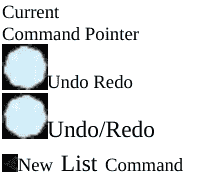

*Figure 4-3. The undo/redo list strategy*

As an alternative, consider the data structure in Figure [4-4](#), which I have termed the *stack strategy*. Instead of maintaining a list of commands in the order in which they were executed, we maintain two stacks, one for the undo commands and one for the redo commands. After a new command is executed, it is pushed onto the undo stack. Commands are undone by popping the top entry from the undo stack, undoing the command, and pushing the command onto the redo stack. Commands are redone by popping the top entry from the redo stack, executing the command, and pushing the command onto the undo stack. Boundary conditions exist and are trivially identified by the sizes of the stacks. Executing a new command requires flushing the redo stack.

Redo
New
Undo Command
Push
Pop Push
Pop
Undo Stack Redo Stack

**Figure 4-4. The Undo/Redo Stack Strategy**

Practically, choosing between implementing undo and redo via either the stack or list strategy is largely a personal preference. The list strategy requires only one data container and less data movement. However, the stack strategy is slightly easier to implement because it requires no indexing or pointer shifting. That said, both strategies are fairly easy to implement and require very little code. Once you have implemented and tested either strategy, the CommandManager can easily be reused in future projects requiring undo and redo functionality, provided commands are implemented via the command pattern. For even more generality, the CommandManager could be templated on the abstract Command class. For simplicity, I chose to implement the included CommandManager specifically for the abstract Command class previously discussed.

## The Command Dispatcher

The final component of the command dispatcher module is the CommandDispatcher class itself. Although this class might more aptly be named the CommandInterpreter, I have retained the name CommandDispatcher to emphasize that this class serves as the command dispatcher module’s interface to the rest of the calculator. That is, as far as the other modules are concerned, the CommandDispatcher class is the entirety of the command dispatcher module.

As previously stated, the CommandDispatcher class serves two primary roles. The first role is to serve as the interface to the command dispatcher module. The second role is to interpret each command, request the appropriate command from the CommandRepository, and pass each command to the CommandManager for execution. We address these two roles sequentially.

### The Interface

For all the complications in the implementation of the command dispatcher module, the interface to the CommandDispatcher class is remarkably simple (as are most good interfaces). As discussed in Chapter 2, the command dispatcher’s interface consists entirely of a single function used to execute a command; the command itself is specified by a string argument. This function is, naturally, the executeCommand() event handler previously discussed. Thus, the CommandDispatcher class's interface is given by the following:

```cpp
class CommandDispatcher
{
public:
    CommandDispatcher(UserInterface& ui);
    void executeCommand(const string& command);

private:
    unique_ptr<CommandDispatcherImpl> pimpl_;
};
```

Recall that the fundamental architecture of the calculator is based on the model-view-controller pattern and that the CommandDispatcher is permitted to have direct access to both the model (stack) and view (user interface). Thus, the CommandDispatcher’s constructor takes a reference to an abstract UserInterface class, the details of which are discussed in Chapter 5. A direct reference to the stack is unneeded since the stack was implemented as a singleton. As per my usual convention, the actual implementation of the CommandDispatcher is deferred to a private implementation class, CommandDispatcherImpl.

An alternative design to the one above would be to make the CommandDispatcher class an observer directly. As discussed in Chapter 3, I prefer designs that use intermediary event observers. In Chapter 5, I’ll discuss the design and implementation of a CommandIssuedObserver proxy class to broker events between user interfaces and the CommandDispatcher class.


## 实现细节

通常在本书中，我不会讨论 pimpl 类中包含的实现细节。在这种情况下，CommandDispatcherImpl 类的实现尤其具有启发性。CommandDispatcherImpl 类的主要功能是实现 executeCommand() 函数。该函数必须接收命令请求，解释这些请求，检索命令，请求执行命令，并优雅地处理未知命令。如果我们从上到下开始对命令调度器模块进行分解，尝试干净地实现此函数将非常困难。然而，由于我们采用了自下而上的方法，executeCommand() 的实现在很大程度上是将现有组件粘合在一起的练习。请考虑以下实现，其中 manager_ 对象是 CommandManager 类的一个实例，如图所示

### Listing 4-7. The Implementation of executeCommand()

```
```cpp
1 void
2 CommandDispatcher::CommandDispatcherImpl::executeCommand
3 string&
4 command)
5 {
6 double d;
7 if( isNum(command, d ) )
8 manager_.executeCommand(
9 MakeCommandPtr<EnterNumber>(d) );
10 else if(command == "undo")
11 manager_.undo();
12 else if(command == "redo")
13 manager_.redo();
14 else
15 {
16 auto c =
17 CommandRepository::Instance().allocateCommand(command);
18 if(!c)
19 {
20 ostringstream oss;
21 oss << "Command " << command << " is not a known command";
22 ui_.postMessage(
23 oss.str());
24 }
25 else
26 {
27 try
28 {
29 manager_.executeCommand( std::move(c)
);
30 }
31 catch(Exception& e)
32 {
33 ui_.postMessage( e.what() );
34 }
35 }
36 }
37
38 return;
39 }
```
```

第 5-10 行处理特殊命令。特殊命令是指未在命令存储库中输入的任何命令。在上面的代码中，这包括输入新数字、undo 和 redo。如果未遇到特殊命令，则

假设命令可以在命令存储库中找到。此请求在第 13 行发出。如果命令存储库返回 nullptr，则错误在第 16-18 行处理。否则，命令将由命令管理器执行。请注意，命令的执行在 try/catch 块中处理。以这种方式，我们能够捕获由命令前置条件失败引起的错误，并在用户界面中报告这些错误。CommandManager 的实现确保前置条件失败的命令不会进入 undo 堆栈（通过执行顺序显而易见）。

在 CommandDispatcher.cpp 中找到的 executeCommand() 的实际实现与上面的代码略有不同。首先，实际实现包含两个额外的特殊命令。其中第一个额外的特殊命令是 help。help 命令可以发出以打印命令存储库中当前所有命令的简要说明信息。虽然实现以通用方式将帮助信息打印到用户界面，但我只在 CLI 中公开了 help 命令（即我的 GUI 实现没有帮助按钮）。第二个特殊命令涉及存储过程的处理。存储过程在第 8 章中解释。此外，我将 try/catch 块放在其自己的函数中。这只是为了缩短 executeCommand() 函数并将命令解释的逻辑与命令执行分离。

## 重新审视之前的决策

此时，我们已经完成了计算器的两个主要模块：堆栈和命令调度器。让我们重新审视我们的原始设计，以讨论出现的一个显著的细微偏差。

请回顾第 2 章，我们的原始设计通过在堆栈和命令调度器中引发事件来处理错误，并且这些事件应由用户界面处理。做出此决策的原因是

两种可能的堆栈错误条件是弹出空堆栈和交换不足堆栈大小的顶部两个元素。在设计命令时，我意识到如果命令触发了其中任何一种错误条件，用户界面将被通知，但命令调度器不会（它不是堆栈事件的观察者）。在任何一种错误情况下，命令都会完成，尽管不成功，并且会被错误地放置在 undo 堆栈上。然后我意识到，要么命令调度器必须捕获堆栈错误并防止错误地放置到 undo 堆栈上，要么不允许命令产生堆栈错误。正如最终设计所示，我选择了更容易、更干净的实现，即在执行命令之前使用前置条件来防止堆栈错误的发生，从而隐式地抑制堆栈错误。

大问题是，为什么我没有更改描述原始设计和相应代码的文本以反映错误报告的变化？简单地说，我希望

读者看到错误确实会发生。
设计是一个迭代过程，试图通过示例教授设计的书籍应该拥抱这一事实而不是隐藏它。设计应该是某种程度的流动的（但也许具有较高的粘度）。及早改变糟糕的设计决策要好得多，而不是在遇到证明原始设计存在缺陷的证据时仍坚持下去。糟糕的设计更改得越晚，修复它的成本就越高，开发人员在尝试实现错误时所承受的痛苦就越大。至于更改代码本身，我会在重构时从 Stack 类中删除多余的代码，除非 Stack 类被设计为在另一个通过事件处理错误的程序中重用。毕竟，作为通用设计，通过引发事件报告错误的机制并不存在缺陷。回顾一下，这一机制对于 pdCalc 来说只是不合适。

# CHAPTER 5

## 命令行界面

这是一个非常令人兴奋的章节。虽然命令行界面（CLI）可能没有现代图形用户界面（GUI）的吸引力，尤其是手机或平板电脑的界面，但 CLI 仍然是一个非常有用和有效的用户界面。本章详细介绍了 pdCalc 命令行界面的设计和实现。到本章结束时，我们将首次拥有一个功能（尽管功能不完整）的计算器，这是在我们开发中一个重要的里程碑。

### 5.1 用户界面抽象

虽然我们可以独立设计一个完全功能的 CLI，但我们从需求中知道，功能完整的

计算器必须同时具有 CLI 和 GUI。因此，我们的整体设计将更好地通过首先考虑这两个接口之间的共同点并将此功能分解到一个通用抽象中来服务。让我们考虑构建用户界面抽象的两种设计替代方案，自上而下的方法和自下而上的方法。

在考虑具体类型之前设计抽象接口类似于自上而下的设计。关于用户界面，你首先考虑任何 UI 必须遵守的最基本要素，并基于这种极简概念创建一个抽象接口。当抽象概念遗漏了实现具体类型所需的内容时，就需要对接口进行改进。

在考虑具体类型之后设计抽象接口类似于自下而上的设计。同样，关于用户界面，你首先考虑所有具体类型（本例中为 CLI 和 GUI）的需求，寻找所有类型之间的共同点，然后将共同特征提炼成抽象。当你添加一个需要抽象最初提炼时未考虑的额外功能的新具体类型时，就需要对接口进行改进。

一般来说，创建抽象接口哪种策略更好：自上而下还是自下而上？与往常一样，答案取决于特定情况、个人舒适度和风格。在这种特定情况下，我们最好从抽象开始并向下工作到具体类型（自上而下的方法）。为什么？在这种情况下，自上而下的方法基本上是免费的。用户界面是 pdCalc 的高级模块之一，我们在第 2 章进行初始分解时已经定义了 UI 的抽象接口。让我们现在将抽象模块接口转变为实用的面向对象设计。

### 5.1.1 抽象接口


拥有 UI 的抽象接口的意义在于使程序的其余部分能够与用户界面交互，而无需考虑当前界面是图形化、命令行还是完全其他的东西。理想情况下，我们将能够把抽象接口分解为使用每个具体接口所需的最小函数数量。任何共享实现的函数都可以在基类中定义，而任何需要根据具体类型进行唯一实现的函数则可以在抽象基类中声明为虚函数，并在派生类中定义。概念相当直接，但正如通常一样，魔鬼在于细节。

考虑图 5-1 所示的层次结构。我们的目标是为 pdCalc 的 UserInterface 类设计一个最小但完整的接口，该接口符合里氏替换原则，并且适用于 CLI 和 GUI。正如之前讨论的，我们已在第 2 章中为此 UI 定义了一个高级接口。让我们从这个预定义接口开始并根据需要进行重构。

## 图 5-1. 最小接口层次结构

参考第 2 章中的表 2-2，你会看到 UserInterface 类的完整接口由两个事件处理函数 postMessage() 和 stackChanged() 以及一个由 UserInterface 引发的事件 commandEntered() 组成。有趣的是，UserInterface 类是一个发布者、一个观察者以及一个抽象用户界面。

这两个事件处理函数 postMessage() 和 stackChanged() 在接口层面很直接。正如我们对之前的观察者所做的那样，我们只需将这两个函数添加到 UserInterface 类的公共接口中，并创建代理观察者类来中介发布者和实际观察者之间的通信。这些代理在下面的第 5.1.2.2 节中详细讨论。具体用户界面必须根据单个 UI 如何与用户交互，以唯一的方式处理事件处理的实现。因此，postMessage() 和 stackChanged() 都必须是纯虚函数。由于 UserInterface 类在事件处理期间无需介入，我出于简单性选择放弃 NVI 模式。然而，正如第 4 章中所讨论的，人们也可以改用 NVI 模式，使用平凡的转发非虚接口函数。

UserInterface 类作为发布者的角色比其作为观察者的角色稍微复杂一些。正如你在第 3 章中设计 Stack 类时所看到的，Stack 实现发布者接口而不是作为发布者进行替代。因此我们得出结论，Publisher 类的继承应为私有。对于 UserInterface 类，其与 Publisher 类的关系类似，只是 UserInterface 类本身不是发布者。UserInterface 类是系统中用户界面的抽象接口，仅继承 Publisher 类是为了强制要求用户界面必须自行实现发布者接口。CLI 和 GUI 类都需要访问 Publisher 的公共函数（例如以引发事件）。因此，在这种情况下受保护的继承模式是合适的。

进一步回顾第 3 章，使用私有继承后，为了使 Stack 类实现发布者接口，我们需要将 Publisher 类的 attach() 和 detach() 函数提升到 Stack 的公共接口中。这里使用受保护继承也是如此。问题是，提升应该发生在 UserInterface 类中还是其派生类中？要回答这个问题，我们需要问 pdCalc 将如何使用特定的用户界面。显然，CLI 或 GUI “是”一个 UserInterface。因此，具体用户界面将公开继承自 UserInterface 并被期望遵守 LSP。因此，附加或分离事件到或从特定用户界面必须能够在不知道底层 UI 类型的情况下完成。因此，attach() 和 detach() 函数必须作为 UserInterface 公共接口的一部分可见。

有趣的是，在观察者模式的一个相当独特的实现中，发布者接口的一部分在 UserInterface 级别实现，而发布者接口的另一部分在派生类级别实现。

综合以上所有要点，我们终于可以如清单 5-1 所示定义 UserInterface 类。

## 清单 5-1. UserInterface 类

```
class UserInterface : protected Publisher {
public:

UserInterface();
virtual ~UserInterface();
virtual void postMessage(const string& m) = 0; virtual void stackChanged() = 0;
using Publisher::attach;
using Publisher::detach;
static const string CommandEntered;
};
```

CommandEntered 字符串是 command entered 事件的名称。它用于附加或分离此事件，可以取 UserInterface 类中事件唯一的任何名称。

为完整起见，我在图 5-2 中展示了最终的用户界面层次结构。类图说明了 CLI、GUI、抽象 UserInterface 类以及发布者接口之间的关系。请记住，UserInterface 类与 Publisher 类之间的继承是受保护的，因此 UserInterface（或后续派生类）不能用作 Publisher。如前所述，混凝土 CLI 和 GUI 类与抽象 UserInterface 类之间的继承意图是公开的，允许任一具体类型的实例被替换为 UserInterface。

Publisher
UserInterface
CLI GUI Figure 5-2. The user interface hierarchy

### 5.1.2 用户界面事件

定义 UserInterface 类并不能完成 UI 的接口。由于 UserInterface 类是一个事件发布者，我们还必须定义对应于 commandEntered() 事件的事件数据类。此外，定义 UserInterface 类最终完成了一个发布者/观察者对，因此我们终于准备好设计和实现事件代理类，以在用户界面与命令调度器和栈之间中介事件。

在第 4 章中，你看到所有命令都是通过事件传递给命令调度器的。具体来说，UI 引发一个包含特定命令编码为字符串参数的事件，CommandDispatcher 接收此事件，并将字符串参数传递给 CommandRepository，在那里检索用于处理的具体命令。就命令调度器而言，处理 commandEntered() 事件是相同的，无论编码的命令字符串来自 CLI 还是 GUI。

同样，当 Stack 类引发 stackChanged() 事件时，Stack 对处理此事件的具体 UserInterface 漠不关心。因此，我们有动机在用户界面层次结构中在 UserInterface 类级别统一处理 commandEntered() 事件的发出和 stackChanged() 事件的处理。

我们首先检查引发 commandEntered() 事件的通用基础设施。commandEntered() 事件在 UserInterface 类的构造函数中为所有用户界面注册。因此，任何派生的用户界面类只需通过调用 Publisher 接口定义的 raises() 函数来引发此事件，该函数通过受保护继承成为任何具体 UI 实现的一部分。raises() 函数的签名需要事件的名称和事件的数据。由于事件的名称已在 UserInterface 的构造函数中预定义，引发命令输入事件所需的唯一额外功能是一个通用的 CommandData 类。现在让我们看一下它的设计。

### 5.1.2.1 命令数据

在第 3 章中，我们设计事件系统使用推送语义来传递事件数据。回想一下，推送语义仅仅意味着发布者创建包含处理事件所需信息的对象，并在引发事件时将该对象推送给观察者。事件数据对象必须公开继承自抽象 EventData 类。观察者在事件引发时通过抽象接口接收事件数据，并通过向下转型事件数据到适当的派生类来检索数据。

对于命令输入事件，事件数据只是包含要输入到栈中的数字或要发出的命令名称的字符串。CommandData 类只需接受一个字符串


command on construction, store this command, and provide a function for observers to retrieve the command. The entire implementation is given in Listing 5-2.

## Listing 5-2. The Complete Implementation for the CommandData Class

```
class CommandData : public EventData
{
public:

CommandData(const string& s) :
command_(s) { } const string& command()
const { return command_; }

private:
string command_;
};
```

While the mechanics for determining how and when to raise a CommandEntered event is somewhat different between the CLI and the GUI, both raise events by ultimately calling Publisher's raise() function with a CommandData argument encoded with the
particular command being issued. That is, for some command string, cmd, the following code raises a commandEntered() event in the CLI, the GUI, or any other user interface that might inherit from UserInterface:

```
raise( UserInterface::CommandEntered, make_shared<CommandData>(cmd) );
```

Now that we can raise UI events, let’s see how they’re handled.

### 5.1.2.2 User Interface Observers

The goal for this subsection is to construct the mechanics to enable classes to listen to events. Because the abstract user interface is both a source and sink for events, the UI serves as an ideal candidate to demonstrate how publishers and observers interact with each other.

In Chapter 3, we saw that observers are classes that register for and listen to events raised by publishers. Thus far, we have encountered both the CommandDispatcher and UserInterface classes that both need to
observe events. While it is possible to make the CommandDispatcher or UserInterface an observer directly, I prefer constructing a dedicated observer intermediary between the publisher and the class that needs to observe an event. I have often nebulously referred to this intermediary as a proxy. I am now ready to give a more concrete meaning to this term.

The proxy pattern [6] is a design pattern that uses a class, the proxy, to serve as the interface for something else. The something else, let’s call it the target, is not strictly defined. It could be a network connection, a file, an object in memory, or, as in our case, simply another class. Often, the proxy pattern is used when the underlying target is impossible, inconvenient, or expensive to replicate. The proxy pattern uses a class buffer to allow the system to perceive the target as an object independent of its underlying composition. In our context, we are using the proxy pattern simply to buffer communication between publishers and observers.

Why are we bothering with the proxy pattern here? This strategy has several distinct advantages. First, it increases clarity in the target class’s public interface by replacing a generically named notify() function with a descriptively named event handling function. Second, an otherwise unnecessary inheritance from the Observer class is removed. Eliminating this dependency reduces coupling, increases cohesion, and facilitates reuse of the target in a setting where it is not an observer. Third, using a proxy class eliminates the ambiguity that arises for a target class that needs to listen to multiple events. Without using proxy classes, an observer would be required to disambiguate events in its single notify() function. Using an individual proxy for each event enables each event to call a unique handler function in the target object. The main disadvantage of implementing the observer pattern using a proxy is the slight cost of one extra indirection for handling each event. However, in situations where using the observer pattern is appropriate, the cost of an extra indirection is negligible.

Using the proxy pattern for implementing the observer pattern leads to the following two classes for handling commandEntered() and stackChanged() events: CommandIssuedObserver and StackUpdatedObserver respectively. The CommandIssuedObserver mediates between commandEntered() events raised by the UI and observation in the command dispatcher. The StackUpdatedObserver mediates between stackChanged() events raised by the stack and observation in the UI. The implementation for both of these classes is relatively straightforward and very similar. By way of example, let’s examine the implementation for CommandIssuedObserver. See Listing 5-3.

## Listing 5-3. The Declaration for CommandIssuedObserver

```
class CommandIssuedObserver : public Observer {
public:

CommandIssuedObserver(CommandDispatcher& ce); void notifyImpl(shared_ptr<EventData>)
override;
private:
CommandDispatcher& ce_;
};
```

Because it mediates events between the UI as a publisher and the CommandDispatcher as the target of the observer, the CommandIssuedObserver’s constructor takes a reference to a CommandDispatcher instance, which it retains to call back to the command dispatcher when the UI raises a commandEntered() event. Recall that the CommandIssuedObserver will be stored by the UI in the Publisher’s event symbol table when the observer is attached to the event. The implementation of notifyImpl() is simply a dynamic cast of the EventData parameter to a specific CommandData instance followed by a call to CommandDispatcher’s commandEntered() function.

Of course, before an event is triggered, the

CommandIssuedObserver must be registered with the UI. For completeness, the following UI code illustrates how to accomplish this task:

```
ui.attach( UserInterface::CommandEntered, make_unique<CommandIssuedObserver>(ce) );
```

where ui is a UserInterface reference. Note that since the attach() function was intentionally hoisted into the abstract UserInterface scope, attaching through a reference allows us to reuse the same call for both the CLI and the GUI. That is, registering events is accomplished through the abstract UI interface, which greatly simplifies user interface setup in pdCalc's main() routine. The declaration and registration of StackUpdatedObserver is analogous.

The complete implementation of the observer proxy classes can be found in AppObservers.cpp. While the usage of the observer proxies is intertwined with the event-observing classes, the proxies are not part of the interface for the target classes.

Hence, they are included in their own file. The attachment of the proxies to events is performed in main.cpp. This code structure preserves the loose binding between publishers and observers. Specifically, publishers know which events they can raise, but not who will observe them, while observers know which events they will watch, but not who raises them. Code external to both publishers and their observers binds the two together.

## The Concrete CLI Class

The remainder of this chapter is devoted to detailing the CLI concrete class. Let’s start by re-examining the CLI’s requirements.

## Requirements

The requirements for pdCalc indicate that the calculator must have a command line interface, but what, precisely, is a CLI? My definition for a command line interface is any user interface to a program that responds to
user commands interactively through text. Even if your definition for a command line interface is somewhat different, I believe we can certainly agree that a broad requirement simply indicating a program should have a CLI is woefully insufficient.

In a production development situation, when you encounter a requirement too vague to design a component, you should immediately seek clarification from your client. Notice I said when and not if. Regardless of how much effort you place upfront trying to refine requirements, you always have incomplete, inconsistent, or changing requirements. This usually arises for a few reasons. Sometimes, it is due to a conscious effort not to spend the upfront time refining requirements. Sometimes, it arises from an inexperienced team member not understanding how to gather requirements properly. Often, however, it simply arises because the end user doesn't know what he or she truly wants or needs until the product starts to take shape. I find this true even for small development projects for which I am my own customer!


在你作为实现者时，始终保留在不与客户沟通的情况下细化需求的便捷选项，但我的经验表明，这条路无一例外会导致代码被反复重写：一次是为了你认为用户想要的，一次是为了用户认为他想要的，还有一次是为了用户真正想要的。

显然，对于我们的案例研究，我们只有一个假设的最终用户，所以我们将自行进行细化。我们规定如下：

- 1. CLI 应接受针对计算器定义的任何命令的文本命令（命令存储库中存在的命令加上 undo、redo、help 和 exit）。
- 2. help 命令应显示所有可用命令的列表以及简短的说明信息。
- 3. CLI 应接受以空格分隔的命令，并按应处理的顺序排列。

请记住，此顺序对应于逆波兰表示法。行上的所有命令在按下回车后才会被处理。

- 4. 处理完命令后，界面应最多显示栈的顶部四个元素以及栈的当前大小。

令人惊讶的是，上面列出的最小需求足以构建一个简单的 CLI。虽然这些需求有些随意，但为了描述设计和实现，必须选择一些具体内容。如果你不喜欢由此产生的 CLI，我强烈鼓励你自行指定需求并相应地修改设计和实现。

## The CLI Design

CLI 的设计非常简单。因为我们的整体架构设计将计算器的全部“业务逻辑”放在后端，前端只是一个薄层，它除了接收并标记用户输入、将该输入按顺序传递给控制器并显示结果之外什么都不做。让我们从描述接口开始。

### The Interface

根据我们在本章前面进行的分析，我们知道具体的 CLI 类将继承自抽象的 UserInterface 类。这种继承是公开的，因为 CLI “是一个” UserInterface 并且必须作为其替代。因此，CLI 必须实现 UserInterface 的两个抽象纯虚函数，postMessage() 和 stackChanged()。这两个方法仅通过 UserInterface 引用多态地调用；因此，这两个方法成为 CLI 的私有接口的一部分。除了构造和析构之外，CLI 需要公开的唯一功能是一个启动其执行的命令。此函数驱动整个 CLI，并且只有在用户请求退出程序时才会（正常）返回。综合以上，CLI 的整个接口可由代码清单 5-4 给出。

**Listing 5-4. The Entire Interface for the CLI**

```
class Cli : public UserInterface
{
    class CliImpl;
public:
    Cli(istream& in, ostream& out);
    ~Cli();

    void execute(bool suppressStartupMessage = false, bool echo = false);

private:
    void postMessage(const string& m) override;
    void stackChanged() override;

    unique_ptr<CliImpl> pimpl_;
};
```

虽然接口大多不言自明，但构造函数和 execute() 函数的参数值得解释。为了满足需求，让我们讨论为什么使用对基类 C++ I/O 流的引用通常是一种良好的设计实践。首先，使用不同的 I/O 模式的需求非常常见。具体来说，重定向到或从文件重定向是经常被请求的对 CLI 的修改。事实上，你将在第 8 章看到这个请求！其次，实现通用与特定接口几乎不会增加任何复杂性。例如，与直接写入 cout 相比，只需保留对输出流的引用并写入该流即可。在基本情况下，此引用仅指向 cout。最后，使用任意流输入和输出极大地简化了测试。虽然程序可能使用 cin 和 cout 实例化 Cli 类，但测试可以使用文件流或字符串流实例化 Cli 类。以这种方式，可以使用字符串或文件模拟交互式流输入和输出。此策略简化了 Cli 类的测试，因为输入可以轻松传入，输出可以作为字符串轻松捕获，而无需通过标准输入和输出。

### 5.2.2.2 The Implementation

Cli 类的实现值得研究，以观察 pdCalc 设计的模块化所带来的简洁性。Cli 类的整个实现实际上包含在 execute() 和 postMessage() 成员函数中。execute() 函数驱动 CLI。它向最终用户展示启动消息，等待输入命令，对这些命令进行标记化，并引发事件以向命令调度器发出信号，表明已输入新命令。stackChanged() 函数是一个观察者代理回调目标，在 stackChanged() 事件被引发后将栈顶写入命令行。基本上，CLI 归结为两个 I/O 例程，其中 execute() 处理输入，stackChanged() 处理输出。让我们从 execute() 函数开始查看这两个函数的实现，如清单 5-5 所示。

**Listing 5-5. The execute() Function**

```
void Cli::CliImpl::execute(bool suppressStartupMessage, bool echo)
{
    if (!suppressStartupMessage)
        startupMessage();

    for (string line; getline(in_, line, '\n');) {
        Tokenizer tokenizer{line};
        for (const auto& i : tokenizer) {
            if (echo) out_ << i << endl;
            if (i == "exit" || i == "quit")
                return;
            else
                parent_.raise(CommandEntered, make_shared<CommandData>(i));
        }
    }
    return;
}
```

CLI 的主要算法相当简单。首先，CLI 等待用户输入一行。其次，此输入行由 Tokenizer 类进行标记化。CLI 然后遍历输入行中的每个标记，并使用标记字符串作为事件数据引发事件。当遇到 quit 或 exit 标记时，CLI 终止。

execute() 函数中唯一尚未解释的部分是 Tokenizer 类。简单地说，Tokenizer 类负责接收一段文本并将其拆分为单独的空格分隔标记。CLI 也不 Tokenizer 也不确定标记的有效性。标记只是作为事件引发，供命令调度器处理。请注意，作为替代方案，许多库（例如 boost）提供了简单的标记器。

鉴于标记化算法的简单性（请参阅 Tokenizer.cpp 中的实现），为什么我将 Tokenizer 设计为类而不是作为返回字符串向量的函数？现实情况是，两种设计在功能上都有效，并且在测试和维护方面同样容易。然而，我更喜欢类设计，因为它为 Tokenizer 提供了不同的类型。让我们检查为标记化创建不同类型的优点。

假设我们想在函数 foo() 中标记化输入，但在单独的函数 bar() 中处理标记。考虑以下两种可能的函数对来实现此目标：

```
// use a Tokenizer class
Tokenizer foo(const string&);
void bar(const Tokenizer&);
```

```
// use a vector of strings
vector<string> foo(const string&);
void bar(const vector<string>&);
```

首先，使用 Tokenizer 类，foo() 和 bar() 的签名立即向程序员说明了函数意图。我们知道这些函数涉及标记化。使用字符串向量则在没有进一步文档的情况下留下歧义（我故意没有为参数提供名称）。更重要的是，通过键入标记器，编译器可以确保 bar() 只能使用 Tokenizer 类作为参数调用，从而防止程序员意外地使用无关的字符串集合调用 bar()。类设计的另一个好处是


A Tokenizer class encapsulates the data structure that represents a collection of tokens. This encapsulation shields the interface to bar() from a decision to change the underlying data structure from, for example, a vector of strings to a list of strings. Finally, a Tokenizer class can encapsulate additional state information about tokenization (e.g., the original, pre-tokenized input), if desired. A collection of strings is obviously limited to carrying only the tokens themselves.

Now let’s examine a simplified implementation of the stackChanged() function, shown in Listing 5-6.

**Listing 5-6. The stackChanged Function**

```cpp
void Cli::CliImpl::stackChanged() {
    unsigned int nElements{4};
    auto v =
        Stack::Instance().getElements(nElements);
    ostringstream oss;
    size_t size = Stack::Instance().size();

    oss << "stack\n";
```

In the display code, we meticulously designed these two layers to be independent. Interpretation and processing of commands (the business logic) resides entirely in the command dispatcher. Therefore, the CLI is only responsible for accepting commands, tokenizing commands, and reporting results. Furthermore, based on the design of our event system, the CLI has no direct coupling to the command dispatcher, a decision consistent with our MVC architecture. The command dispatcher does have a direct link to the user interface, but because of our abstraction, the command dispatcher binds to an abstract UserInterface rather than a specific user interface implementation. In this way, the CLI perfectly substitutes as a UserInterface (application of the LSP) and can trivially be swapped in or out as any one of many unique views to the calculator. While this flexibility may seem like overkill for the design of a calculator, the modularity of all of the components is beneficial from both a testing and separation of concerns standpoint even if the calculator were not slated to have another user interface.

```cpp
Stack::Instance().attach(
    Stack::StackChanged,
    make_unique<StackUpdatedObserver>(cli));
cli.execute();
return 0; }
```

Due to the modularity of the design, the entire calculator can be set up, assembled, and executed in just six executable statements! The logic within the main() function is easy to follow. From a maintenance perspective, any new programmer to the project would easily be able to trace the calculator’s logic and see that the functionality for each module is clearly divided into distinct abstractions. As will be seen in future chapters, the abstraction is even more powerful as more modules are added.

To get you started quickly, a project is included in the repository source code that builds an executable, pdCalc-simple-cli, using the above main() function as the application’s driver. The executable is a standalone CLI that includes all of the features discussed up to this point in the book.

In the next chapter, we’ll consider the design of the graphical user interface for our calculator. As soon as the GUI is complete, many users will quickly dismiss the CLI as simply an exercise or a relic from a previous era. Before doing so, I’d like to encourage the reader not to be so quick to judge the humble CLI. CLIs are very efficient interfaces, and they are typically much easier to script for tasks requiring large deployments or automation. As for pdCalc, personally, I prefer the CLI to the GUI due to its ease of use. Of course, maybe that is just an indication that I, too, am a relic from a previous era.

# CHAPTER 6

## The Graphical User Interface

In this chapter, we will explore the design of the graphical user interface (GUI) for pdCalc. Whenever one designs a GUI, a widget platform needs to be selected. As previously noted, I have chosen to use Qt for the creation of the GUI. That said, this is not a how-to chapter on using Qt to design an interface. Rather, I assume that the reader has a working knowledge of Qt, and the chapter itself focuses on design aspects of the GUI. In fact, as much as possible, I will refer the reader to the source code to see detailed aspects of the widget implementations. Any discussion of the Qt implementation is either merely incidental or worthy of particular emphasis. If you have no interest in GUI design, this chapter can be skipped entirely with virtually no loss in continuity.

### 6.1 Requirements

In Chapter 5, we began our analysis of the command line interface (CLI) by deriving an interface abstraction that would be used by both the CLI and the GUI. Obviously, we will

2. The GUI should have clickable buttons for entering numbers and all supported commands.

3. The GUI should have a status display area for displaying error messages.

The above requirements still do not explain what the calculator should actually look like. For that, we need a picture.

Figure 6-1 shows the working calculator as it appears on my Linux desktop (Kubuntu 16.10 using Qt 5.7.1).

> To show the finished GUI as a prototype for designing the GUI is most certainly “cheating.”

Hopefully, this shortcut does not detract from the realism of the case study too much.

Obviously, one would not have a finished product at this stage in the development.

In a production setting, one might have mock-ups drawn either by hand or with a program such as Microsoft PowerPoint, Adobe Illustrator, Inkscape, etc.

Alternatively, maybe the GUI is being modeled from a physical object, and the designer either has photographs or direct access to that object.

For example, one might be designing a GUI to replace a physical

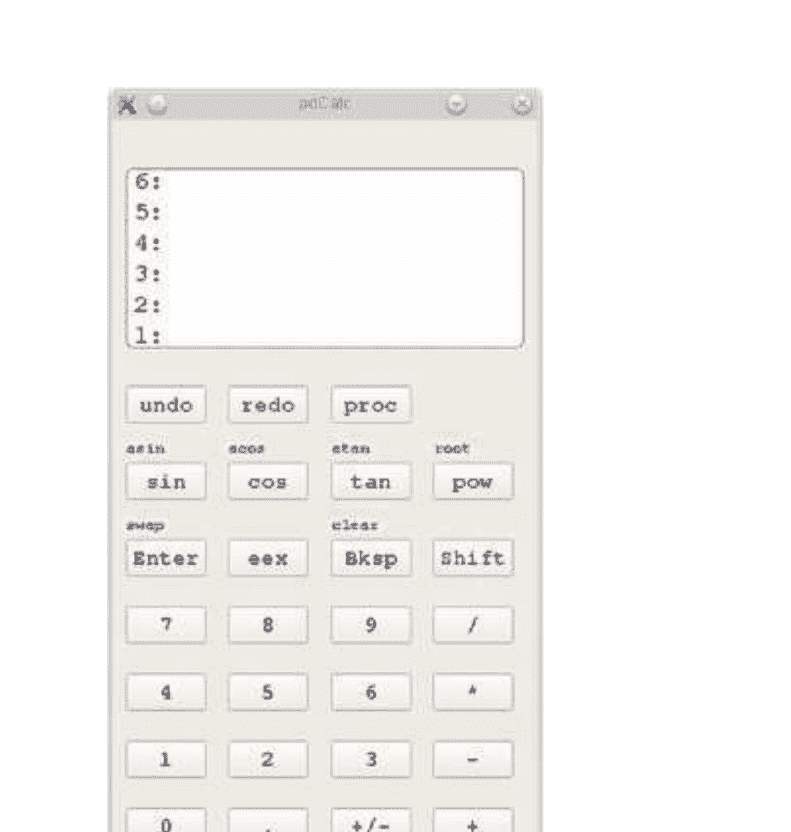

Figure 6-1. The GUI on Linux with no plugins

The GUI for pdCalc was inspired by my HP48S calculator. For those familiar with any of the Hewlett-Packard calculators in this series, the interface will feel somewhat familiar. For those not familiar with this series of calculators (likely, the majority of readers), the following description explains the basic behavior of the GUI.

The top third of the GUI is a dedicated input/output (I/O) window. The I/O window displays labels for the top six stack levels on the left, with the top of the stack being at the bottom of the window. Values on the stack appear on the right side of the window on the line corresponding to the number’s location on the stack. As the user enters a number, the stack reduces to showing only the top five stack elements, while the number being entered is displayed left justified on the bottom line. A number is terminated and entered onto the stack by pressing the enter button.

Assuming sufficient input, an operation takes place as soon as the button is pressed. If insufficient input is present, an error message is displayed above the I/O window. With respect to commands, a valid number in the input area is treated as the top number on the stack. That is, applying an operation while entering a number is equivalent to pressing Enter and then applying the operation.

To economize on space, some buttons have a shifted operation above and to the left of the button itself. These shifted operations can be activated by first pressing the shift button and then pressing the button below the shifted text. Pressing the shift button places the calculator in shift mode until a button with a shifted operation is pressed or until the shift button is pressed again. For clarity, a shifted operation is often the inverse of the operation on the button.

To ease input, many buttons are bound to keyboard shortcuts. Numbers are activated by pressing the corresponding number key, the enter button is activated by pressing the enter key, shift is activated by pressing the s key, backspace is activated by pressing the backspace key, the exponentiation operation is activated by pressing the e key, and the four basic arithmetic operations (+, -, *, /) are activated by pressing the corresponding keys.

Finally, a few operations are semi-hidden. When not entering numbers, the backspace button drops the top entry from the stack, while the enter button duplicates the top entry on the stack. Some of these combinations are not intuitive and therefore might not represent very good GUI design. However, they do mimic the input used on the HP48S. If you have never used an HP48 series calculator before, I highly suggest building and familiarizing yourself with the GUI from the GitHub repository before continuing.

If you’re wondering what a prockey does, it executes stored procedures. It is one of the “new” requirements we’ll encounter in Chapter 8. One’s first critique about the GUI might be that it is not very pretty. I agree. The purpose of the GUI in this chapter is not to demonstrate advanced Qt features. Rather, the purpose is to illustrate how to design a code base to be modular, robust, reliable, and


extensible. 为了使 GUI 更具吸引力而非功能性而添加代码会分散这一信息。当然，设计允许更漂亮的 GUI，因此请随意在提供的基础设施之上制作自己的漂亮 GUI。
我们现在已有足够的细节来设计和实现计算器的 GUI。然而，在开始之前，有必要对构建 GUI 的替代方案进行简要讨论。

## 6.2 构建 GUI

本质上，构建 GUI 存在两条不同的路径：在集成开发环境（IDE）中构建 GUI，或在代码中构建 GUI。在这里，我宽松地使用术语 *code* 来表示通过文本构建 GUI，无论是通过使用 C++ 等传统编程语言，还是使用 XML 等声明式标记语法。当然，在两者极端之间是混合方法，它利用了 IDE 和代码两者的元素。

### 6.2.1 在 IDE 中构建 GUI

如果您只需要一个简单的 GUI，那么在 IDE 中设计和构建 GUI 显然是更轻松的途径。大多数 IDE 都有一个图形界面，用于将视觉元素布局到画布上，该画布例如可能代表一个对话框或一个部件。一旦新画布设置好，用户就可以通过将现有部件拖放到画布上来可视化地构建 GUI。现有部件包括 GUI 工具包的内置图形元素（例如一个推送按钮）以及已在 IDE 框架中启用拖放的自定义部件。布局完成后，可以通过图形方式或少量代码将操作连接起来。最终，IDE 会创建与图形布局的 GUI 对应的代码，并且此 IDE 创建的代码会与您其余的源代码一起编译。

使用 IDE 构建 GUI 既有优点也有缺点。一些优点如下。首先，由于过程是可视化的，您可以在执行布局时轻松看到 GUI 的外观。这与为 GUI 编写代码形成鲜明对比，在编写代码时，您只有在编译和执行代码后才能看到 GUI 的外观。这种差异非常类似于使用所见即所得文本编辑器（如 Microsoft Word）与使用标记语言（如 LaTeX）撰写论文之间的差异。其次，IDE 通过在幕后自动生成代码来工作，因此图形化方法可以显著减少编写 GUI 所需的代码量。第三，IDE 通常会在属性表中列出 GUI 元素的属性，使得在无需不断查阅 API 文档的情况下对 GUI 进行样式化变得轻而易举。这对于不常用的功能尤其有用。

使用 IDE 构建 GUI 的一些缺点如下。首先，您仅限于 IDE 选择公开的 API 子集。有时整个 API 都被公开，有时则不是。如果您需要 IDE 作者选择不授予您的功能，您将被迫编写自己的代码。也就是说，IDE 可能会限制对 GUI 元素的精细控制。其次，对于重复的 GUI 元素，您可能必须多次执行相同的操作（例如，在所有推送按钮中单击使文本变红），而在代码中，很容易将任何重复任务封装在类或函数调用中。第三，使用 IDE 设计 GUI 会将 GUI 限制为可在编译时决定的决策。如果您需要动态更改 GUI 的结构，您将需要为此编写代码。第四，在 IDE 中设计 GUI 会将您的代码绑定到特定厂商产品。在企业环境中，这可能不是一个重大问题，因为整个公司的开发环境可能是一致的。然而，对于开源、分布式项目，并非每个可能想要为您的代码库做出贡献的开发人员都愿意被限制使用您选择的同一 IDE。

### 6.2.2 在代码中构建 GUI

在代码中构建 GUI 正是名称所暗示的含义。不是图形化地放置
如下。首先，对部件的完整 API 完全公开。因此，程序员可以根据需要拥有尽可能精细的控制。如果部件库设计者希望用户能够做某事，您就可以在代码中实现它。其次，重复的 GUI 元素可以通过使用抽象轻松管理。例如，在设计计算器时，我们无需手动自定义每个按钮，而是可以创建一个按钮类并简单地实例化它。第三，在运行时动态添加部件很容易。对于 pdCalc 来说，这一优势在满足支持动态插件的要求方面将非常重要。第四，在代码中设计 GUI 可实现完全的 IDE 独立性，前提是构建系统独立于 IDE。

虽然在代码中构建 GUI 有许多优点，但也存在缺点。首先，布局不是可视化的。为了看到 GUI 成形，您必须编译和执行代码。如果看起来不对，您必须调整代码，再次尝试，并重复此过程直到正确为止。这可能
非常乏味且耗时。其次，您必须自己编写所有代码。而 IDE 会自动生成 GUI 代码的很大一部分，特别是与布局相关的部分，当您编写代码时，您必须手动完成所有工作。最后，当在代码中编写 GUI 时，您将无法在属性表中简洁地访问部件的所有属性。通常，您需要更频繁地查阅文档。尽管如此，良好的 IDE 代码补全可以显著帮助完成此任务。有人可能会对我的最后一点表示不满，声称“指出使用 IDE 可以减轻不使用 IDE 的缺点是不公平的”。请记住，除非您在纯文本编辑器中编写源代码（可能性不大），否则代码编辑器本身很可能是一个复杂的 IDE。我的比较是在使用 IDE 的图形 GUI 布局工具构建 GUI 与使用现代代码编辑器（本身很可能也是 IDE）手动编写代码之间进行的。

### 6.2.3 哪种 GUI 构建方法更好？

对本节标题中过于笼统问题的回答，当然是两者都不是。哪种技术更适合构建 GUI 完全取决于上下文。当您在自己的编程追求中遇到这个问题时，请参考上述权衡，并为您的情况做出最合理的选择。通常，最佳解决方案是混合策略，其中 GUI 的某些部分将以图形方式布局，而 GUI 的其他部分将完全由代码构建。

在我们的上下文中一个更具体的问题是，“哪种 GUI 构建方法更适合 pdCalc？” 对于此应用程序，权衡明显偏向基于代码的方法。首先，计算器的视觉布局相当简单（一个状态窗口、一个显示部件和一个按钮网格），并且很容易在代码中实现。这一事实立即消除了 IDE 方法最显著的优势：可视化处理复杂布局。其次，按钮的创建和布局是重复的但很容易封装，这是在代码方法中的一个优势。最后，由于计算器必须支持运行时插件，代码方法更适合动态添加部件元素（运行时发现的按钮）。

在本章的剩余部分，我们将探讨 pdCalc 的 GUI 在代码中的设计。特别是，主要重点将放在组件及其接口的设计上。由于我们的重点不是部件构建，许多实现细节将被忽略。然而，请不要担心。如果您对细节感兴趣，所有代码都可在 GitHub 仓库中供您查阅。

## 模块化

从本书开始，我们就讨论了计算器的分解策略。使用 MVC 架构模式，我们将设计拆分为模型、视图和控制器。在第 4 章中，我们看到了

QMainWindow。主窗口也是 MVC 视图的入口点，因此我们的主窗口还必须继承自 UserInterface。MainWindow 是我们的第一个类。接下来，视觉上检查图 6-1，计算器显然分为用于输入的组件（按钮集合）和用于显示的组件。我们因此再添加两个类，InputWidget 和 Display。我们已经讨论过，使用代码方式构建 GUI 的一个优势是抽象按钮的重复创建，因此我们也将创建一个 CommandButton 类。最后，让我们添加一个负责管理计算器外观的组件（例如字体、边距、间距等），恰当地命名为 LookAndFeel 类。还存在一个用于存储过程输入的组件，但我们将推迟到第 8 章再讨论该组件。

让我们现在来看每个类的设计，从 CommandButton 开始。如果需要，我们将在出现时讨论对这种初始分解的必要改进。

同时限制 QPushButton 的接口以完全满足我们的需求。我们将这个类称为 CommandButton。

在模式术语中，我们提出的是同时充当适配器和外观的东西。我们在第 3 章见过适配器模式。外观模式是其近亲。适配器模式负责将一个接口转换为另一个接口（可能伴随一些适配），而外观模式负责为子系统中的一组接口提供统一的接口（通常作为简化）。我们的 CommandButton 被要求同时做到这两点。我们既在简化 QPushButton 接口，使其成为 pdCalc 所需的受限子集，同时又将 QPushButton 的功能适配以匹配我们问题的需求。那么，CommandButton 是外观还是适配器？区别是语义上的；它兼具两者的特征。记住，了解不同模式的目标并根据需要进行调整很重要。不要为了模式的纯粹性而迷失在《设计模式》[6] 的刻板实现中。

## 6.3.2 The CommandButton Design

除去开场白，我们仍必须确定我们的 CommandButton 究竟需要做什么以及它将如何与 GUI 的其余部分交互。在许多方面，CommandButton 看起来和表现都与 QPushButton 相似。例如，CommandButton 必须呈现一个可点击的视觉按钮，并且在按钮被点击后，它应该发出某种信号以让其他 GUI 组件知道发生了点击操作。然而，与标准的 QPushButton 不同，我们的 CommandButton 必须同时支持标准状态和 Shift 状态（例如，一个按钮同时支持 sin 和 arcsin）。这种支持应该是视觉上的（两种状态都应由我们的 CommandButton 小部件显示）和功能上的（点击信号必须描述标准点击和 Shift 点击）。因此，我们有两个设计问题需要回答。首先，我们如何设计和实现小部件使其在屏幕上正确显示？其次，计算器总体上将如何处理 Shift 操作？

让我们首先解决 CommandButton 外观问题。当然，我们可以从头实现按钮，手动绘制屏幕，并使用鼠标事件捕获按钮点击，但对于 CommandButton 来说这是过度设计。相反，我们寻求一种复用 Qt 的 QPushButton 类的解决方案。对于复用，我们本质上有两个选项：继承和封装。

首先，让我们考虑通过继承在 CommandButton 类的设计中复用 QPushButton 类。这种方法是有道理的，因为可以逻辑上认为 CommandButton “是”一个 QPushButton。然而，这种方法存在一个明显的缺陷。“是”关系意味着公有继承，这意味着 QPushButton 的整个公共接口将成为 CommandButton 的公共接口的一部分。然而，我们已经确定为了 pdCalc 内部的简洁，我们希望 CommandButton 具有受限的接口（外观模式）。好的，让我们尝试私有继承并将我们的观点修改为 CommandButton 与 QPushButton 之间“实现”关系。现在我们遇到第二个缺陷。如果没有从 QPushButton 公有继承，CommandButton 将失去其对 QWidget 类的间接继承，而在 Qt 中，类要成为用户界面对象这一先决条件。因此，任何私有继承 QPushButton 的实现也需要从 QWidget 公有继承。然而，由于 QPushButton 也继承自 QWidget，CommandButton 同时继承这两个类会导致歧义，因此不被允许。我们必须寻求替代设计。

现在，考虑在 CommandButton 中封装一个 QPushButton（即 CommandButton “拥有”一个 QPushButton）。我们可能应该从这个选项开始，因为一般实践表明我们应尽可能优先选择封装而不是继承。然而，许多开发人员倾向于从继承开始，我想讨论这种方法的缺点，而不只是诉诸 C++ 经典。除了打破强继承关系外，选择封装方法克服了之前讨论的使用继承的两个缺点。首先，由于 QPushButton 将被封装在 CommandButton 中，我们可以自由地仅暴露对应用程序有意义的 QPushButton 接口部分（或完全不暴露）。其次，通过使用封装，我们将避免同时从 QWidget 和 QPushButton 类继承所带来的多重继承混乱。请注意，我原则上并不反对使用多重继承的设计。多重继承只是在此实例中存在歧义。

封装关系可以采用组合或聚合的形式。CommandButton 类应该使用哪一种？考虑两个类 A 和 B，其中 A 封装 B。在组合关系中，B 是 A 的组成部分。在代码中，该关系表示如下：

```
class A
{

// ... private:
B b_; };
```

相比之下，聚合意味着 A 只是内部使用一个 B 对象。在代码中，聚合表示如下：

```
class A
{

// ...
private:
B* b_; // or some suitable smart pointer or reference };
```

对于我们的应用程序，我认为聚合更有意义。也就是说，我们的 CommandButton 使用一个 QPushButton 而不是由 QPushButton 组成。区别很微妙，同样可以做出一个同样合理的论证来声明该关系为组合。话虽如此，这两种设计在 Qt 中在机械上都可行，所以你的编译器真的不会在意你如何表达该关系。

现在我们已经决定在 CommandButton 中聚合 QPushButton，我们可以继续 CommandButton 类的整体设计。我们的 CommandButton 必须同时支持主命令和次要命令。视觉上，我选择在按钮上显示主命令，并在按钮上方左侧以蓝色显示次要命令。（我稍后会讨论 Shift 状态如何操作。）因此，CommandButton 仅实例化一个 QPushButton 和一个 QLabel，并将它们都放置在 QVBoxLayout 中。QPushButton 显示主命令的文本，QLabel 显示 Shift 命令的文本。布局如图 6-2 所示。为了完成设计，如前所述，为了在图形上与 GUI 的其余部分交互，CommandButton 必须公有继承自 QWidget 类。设计结果是一个可复用的 CommandButton 小部件类，用于通用的推送按钮，声明主命令和次要命令。由于推送按钮操作是通过使用 QPushButton 实现的，因此 CommandButton 类的整体实现非常简单。

Figure 6-2. The layout of the CommandButton

复用 QPushButton 的最后一个小细节仍然存在。显然，由于 QPushButton 在 CommandButton 中被私有封装，客户端无法在外部连接到 QPushButton 的 clicked() 信号，使得客户端代码无法得知何时点击了 CommandButton。这种设计实际上是有意的。CommandButton 将在内部捕获 QPushButton 的 clicked() 信号并随后重新发出自己的信号。此公共 CommandButton 信号的设计与 Shift 状态的处理密切相关。


我们现在回到在计算器中对移位状态进行建模的问题。我们有两个实际可行的选项。第一个选项是让CommandButton了解计算器何时处于移位状态，并且仅发出正确的移位或非移位命令。另一种选择是让CommandButton同时发出移位和非移位命令，并让信号的接收者来整理计算器的当前状态。让我们审视这两个选项。

第一个选项，让CommandButton知道计算器是处于移位状态还是非移位状态，实现起来相当容易。在一种实现中，shift按钮被按下时会通过Qt的信号与槽通知每个按钮，按钮便在移位状态和非移位状态之间切换。如果愿意，甚至可以在每次切换移位状态时，将shift位置上的文本与按钮上的文本互换。或者，shift按钮可以连接到一个槽，该槽设置一个全局移位状态标志，按钮在发出点击信号时可以查询该标志。在任一实现场景中，当按钮被点击时，只会发出当前状态的命令，该命令的接收者最终通过commandEntered()事件将单个命令发送出GUI。

在第二个选项中，CommandButton不需要知道计算器的任何状态。相反，当按钮被点击时，它会发出同时包含移位和非移位状态的点击信号。本质上，按钮只是在被点击时通知其监听者，并提供两个可能的命令。然后，接收者负责确定在commandEntered()事件中应触发哪个命令。接收者很可能必须负责跟踪移位状态（或者能够轮询保存该状态的另一个类或变量）。

对于CommandButton来说，处理计算器状态的两种设计都相当有效。然而，就个人而言，我更倾向于那种不需要CommandButton了解任何移位状态的设计。在我看来，这种设计能促进更好的内聚性和更松的耦合。该设计更具内聚性，因为CommandButton应该负责显示一个可点击的控件，并在按钮被点击时通知系统。要求CommandButton理解计算器状态会侵犯其抽象的独立性。按钮不再是带有两个命令的通用可点击按钮，而是与计算器全局状态的概念紧密地联系在一起。此外，强制CommandButton理解计算器状态会增加系统中的耦合，因为它被迫与shift按钮或它们必须轮询的类进行不必要的相互关联。在按下shift按钮时通知每个CommandButton所获得的唯一优势是，能够交换主命令和次命令的标签。当然，标签交换可以独立于CommandButton的信号参数来实现。

## 6.3.3 CommandButton 接口

```
shftCmd);
};
```

CommandButton类有两个构造函数：四参数重载和两参数重载。四参数重载允许同时指定主命令和次命令，而两参数重载只允许指定主命令。每个命令需要两个字符串才能完整指定。第一个字符串对应于GUI中标签将显示的文本，无论是在按钮上还是在移位命令位置。第二个字符串对应于将由commandEntered()事件引发的文本命令。可以通过要求这两个字符串相同来简化接口。然而，我选择增加灵活性，使得显示的文本可以与命令调度器要求的文本不同。请注意，由于末尾的父指针，我们使用重载而不是默认参数。

接口中唯一其他公共部分是clicked()信号，它随按钮的主命令和移位命令一起发出。双参数信号与单参数信号背后的理由之前已经讨论过。尽管onClicked()槽是私有的，我还是在CommandButton的接口中列出了它，以强调必须创建这个私有槽来捕获内部QPushButton的clicked()信号。onClicked()函数的唯一目的是捕获QPushButton的clicked()信号，并转而发出带有两个函数参数的CommandButton的clicked()信号。

如果你查看CommandButton.h中CommandButton类的实际声明，你会看到一些附加函数作为CommandButton公共接口的一部分。这些只是转发函数，用于改变底层QPushButton的外观（例如文本颜色）或添加视觉元素（例如工具提示）。虽然这些函数是CommandButton接口的一部分，但它们在功能上是可选的，并且独立于CommandButton的底层设计。

## 获取输入

GUI需要从用户那里接收两种不同类型的输入：数字和命令。这两种输入类型都由用户通过排列在网格中的CommandButton（或映射到这些按钮的键盘快捷键）输入。这个CommandButton集合、它们的布局以及它们向GUI其余部分发出的关联信号，共同组成了InputWidget类。

命令输入在概念上很简单。点击一个CommandButton，就会发出一个信号，反映该特定按钮的命令。最终，GUI的另一部分会接收此信号，并触发一个commandEntered()事件，由命令调度器处理。

输入数字比输入命令稍微复杂一些。在CLI中，我们可以很轻松地让用户输入数字，并在输入完成后按回车键。然而，在GUI中，我们没有这种内置机制（假设我们想要一个比Qt窗口中的CLI更复杂的GUI）。虽然计算器确实有一个用于输入数字的命令，但请记住，它假定输入的是完整的数字，而不是单个数字。因此，GUI必须有一种机制来构造数字。

构建一个数字包括输入数字以及特殊符号，如小数点、正负号运算符或指数运算符。此外，用户在输入时可能会出错，因此我们还需要支持基本编辑（例如退格键）。数字的组装是一个两步过程。InputWidget只负责发出组合和编辑数字所需的按钮点击信号。GUI的另一部分将接收这些信号并组装完整的数字输入。

### InputWidget 的设计

从概念上讲，InputWidget类的设计是直接的。该控件必须显示生成和编辑输入所需的按钮，将这些按钮绑定到按键（如果需要），并在这些按钮被点击时发出信号。如前所述，InputWidget包含用于数字输入和命令输入的按钮。因此，它负责数字0-9、正负号按钮、小数点按钮、指数按钮、回车按钮、退格按钮、shift按钮，以及每个命令对应的按钮。回想一下，作为一种节约措施，CommandButton类允许每个可视按钮有两个不同的命令。

为了在整个GUI中保持一致，我们将专门使用CommandButton来表示所有输入按钮，即使是那些既不发出命令也没有辅助操作的按钮（例如0按钮）。我们的CommandButton设计如此灵活，真是方便！然而，这个决定仍然给我们留下了两个待解决的设计问题。我们如何在视觉上排布按钮？当按钮被点击时我们又该怎么做？

对于将按钮放置在……中，存在两种选项。


InputWidget。首先，InputWidget 本身拥有一个布局，它将所有按钮放置在这个内部布局中，然后 InputWidget 本身可以被放置在主窗口的某个位置。另一种选择是让 InputWidget 在构造期间接受一个外部拥有的布局，并将它的 CommandButtons 放置在该布局上。一般来说，让 InputWidget 拥有自己的布局是更优的设计。它相比替代方案具有更高的内聚性和更低的耦合度。唯一让 InputWidget 接受外部布局会更优的例外情况是，如果设计要求其他类共享同一个布局来放置额外的控件。在这种特殊情况下，使用一个对两个类都外部拥有的共享布局会更清晰。

让我们现在把注意力转向 InputWidget 中按钮被点击时发生的情况。因为 InputWidget 封装了 CommandButtons，每个 CommandButton 的 clicked() 信号对 InputWidget 类的使用者来说并不是直接可访问的。因此，InputWidget 必须捕获所有 CommandButtons 的点击并重新发出它们。对于正弦或正切等计算器命令来说，重新发出点击只是一个简单的转发命令。事实上，Qt 启用了一种简写记法，可以直接将 CommandButton 的 clicked() 信号连接到 InputWidget 的 commandEntered() 信号，从而省去在 InputWidget 中经过私有槽的需要。数字、数字编辑按钮（例如，正负号、退格）和计算器状态按钮（例如，shift）最好通过在 InputWidget 的私有槽中捕获来自 CommandButton 的特定 clicked() 信号来处理，然后为每种操作随后发出一个 InputWidget 信号。

正如刚才描述的那样，每当按下输入按钮时，InputWidget 必须发出自己的信号。在一个极端情况下，InputWidget 可以为每个内部 CommandButton 提供单独的信号。在另一个极端情况下，InputWidget 无论按下哪个按钮都只发出一个信号，并通过参数区分操作。正如预期的那样，对于我们的设计，我们将寻求一种折中方案，兼具两种极端的特点。

本质上，InputWidget 接受三种不同的输入类型：修饰符（例如，enter、backspace、正负号、shift）、科学计数法字符（例如，0-9、小数点、指数）或命令（例如，正弦、余弦等）。每个修饰符都需要独特的响应；因此，每个修饰符都绑定到自己的独立信号。另一方面，科学计数法字符可以通过简单地在屏幕上显示输入字符来统一处理（这是 Display 类的职责）。因此，科学计数法字符都通过发出一个编码特定字符为参数的单一信号来处理。最后，命令通过发出一个单一信号来处理，该信号只是将主命令和次要命令原样转发为信号的函数参数。

在构建信号处理时，重要的是要保持 InputWidget 作为一个向 GUI 其余部分发出原始用户输入的信号类。让 InputWidget 解释按钮按下会导致问题。例如，假设我们设计 InputWidget 聚合字符并仅发出完整、有效数字。由于这种策略意味着在每个字符输入时都不会发出信号，字符在数字完成之前既不能显示也不能编辑。这种情况显然是不可接受的，因为用户肯定期望在输入时看到每个字符出现在屏幕上。

让我们现在把注意力转向将我们的设计转化为 InputWidget 的最小接口。

### 6.3.6 InputWidget 的接口

让我们通过展示类声明来开始讨论 InputWidget 的接口。正如预期的那样，我们清晰的设计导致了一个简洁的接口。参见列表 6-2。

*列表 6-2.* InputWidget

```
class InputWidget : public QWidget
{
    Q_OBJECT
public:
    explicit InputWidget(QWidget* parent = nullptr);

signals:
    void characterEntered(char c);
    void enterPressed();
    void backspacePressed();
    void plusMinusPressed();
    void shiftPressed();
    void commandEntered(string, string);
};
```

完全有效；每个都如图 6-3 所示。

(a) 分离输入/输出 (b) 合并输入/输出

6: 5:5: 4:4: 3:3: 2: 0.037₂ 0.037 1: 101: 10

1.23e−7 1.23e−7

*图 6-3.* 输入和输出显示选项

选择一种 I/O 风格与另一种风格最终归结为客户的偏好。我对两种风格都没有特别偏好，我选择了合并显示，因为它看起来更像我的 HP48S 计算器的显示。显示风格确定后，让我们现在关注这种选择所暗示的设计影响。

在屏幕上为输入和输出分别使用单独的控件，如图 6-3a 所示，选择分别使用输入和输出显示类将是显而易见的。输入显示将具有槽来接收 InputWidget 的信号，而输出显示将具有槽来接收完成数字（来自输入显示）和栈更新。内聚性会很强，组件的分离也会很合适。

我们的设计 however 要求一个混合的输入/输出显示，如图 6-3b 所示。混合设计显著改变了使用独立输入和输出显示类的合理性。虽然将输入和输出显示关注点合并到一个类中确实会降低显示的内聚性，但试图维护两个独立的类同时指向同一个屏幕控件会导致笨拙的实现。例如，选择哪个类应该拥有底层的 Qt 控件是任意的，很可能导致共享控件设计（也许使用 shared_ptr？）。然而，在这种情况下，输入显示类还是输出显示类应该初始化屏幕上的控件才有意义呢？如果输入显示与单个显示控件共享指针，让输入显示向输出显示发出信号有意义吗？答案很简单，对于合并的 I/O 显示控件来说，两类设计是不可行的，即使我们可能更希望分离输入和输出显示关注点。

上述讨论指出了几点有趣之处。首先，设计在屏幕上的视觉呈现可以合法地改变底层组件的设计和实现。虽然在给出具体的 GUI 示例后这似乎显而易见，但间接的含义是，如果屏幕上的控件只发生轻微变化，GUI 类设计可能需要显著改变。其次，存在设计直接违背第 2 章中提出的良好设计要素的情况仍然能得到更清晰的结果。显然，第 2 章中的指导原则旨在帮助设计过程，而不是作为不可违背的规则。也就是说，我的一般建议是，在违反最佳实践时要谨慎行事，但以保持清晰度为重于遵循指导原则。

现在我们已经决定采用单个 I/O 显示和单个底层的 Display 类，让我们来看一下它的设计。

### Display 类的设计

我承认。我的原始设计和 Display 类的实现是拙劣的。不是使用适当的分析技术和前期设计，我让设计有机地增长（即与实现并行）。然而，一旦我的设计迫使 Display 类发出 commandEntered() 信号以使 GUI 正常工作时，我就知道设计有“坏味道”。负责在屏幕上绘制数字的类可能不应该解释命令。也就是说，实现工作正常，所以我保留了代码并完成了计算器。然而，当我最终开始撰写设计时，我在试图为我的设计制定理由时遇到了如此大的困难，以至于我最终不得不承认设计存在致命缺陷，急需重写。

显然，在重新设计显示后，我本可以简单地选择只描述改进后的产品。然而，我认为研究我第一次误导性的尝试，讨论其明显的迹象是很有启发性的


设计存在一些严重问题，最终才看到了经过一夜重构后最终出现的设计。也许，这里最有趣的教训是糟糕的设计确实可以导致可工作的代码，因此永远不要假设可工作的代码就是良好设计的指标。此外，如果糟糕的设计是局部的，可以对其进行重构，有时重构仅仅是为了提高清晰度而进行的。当然，重构的前提是你的项目计划包含足够的应急时间，以便定期暂停来偿还技术债务。让我们在回到更好的设计之前，先简要研究一下我的错误。

## 一个糟糕的设计

根据上面的分析，我们确定计算器应该有一个统一的 Display 类来处理输入和输出。我对显示的设计产生的根本性错误源于对“一个 Display 类”这一点的错误解读，即意味着没有为正交关注点创建额外的类。因此，我将 InputWidget 类未处理的全部功能都塞进了一个单一的 Display 类中。让我们沿着这条路走下去。然而，与我之前所做的那样完成设计和实现不同，我们将在看到第一个致命缺陷出现时就停止并重新设计该类（这正是我本应最初做的）。

在单一 Display 类设计中，Display 负责显示来自用户输入和来自计算引擎的输出。显示输出是微不足道的。Display 类观察 stackChanged() 事件（间接地，因为它不是 GUI 外部接口的一部分），并用新的栈值更新屏幕显示部件（在本例中为一个 QLabel）。从概念上讲，显示输入也是微不足道的。Display 直接接收 InputWidget 类发出的信号（例如 characterEntered()）并用当前输入更新屏幕显示部件。这种交互的简单性掩盖了该设计的基本问题，即输入并不是以原子方式输入供显示使用。相反，它是通过多次信号逐步组装的，通过独立输入多个字符并按下回车键来完成输入。这种输入的顺序构造意味着计算器必须维护一个活动输入状态，而输入状态本不应该存在于显示部件中。

那么，除了意识形态上的厌恶之外，Display 类维护输入状态有什么问题？我们不能简单地将状态视为显示输入缓冲区吗？让我们继续沿着这个设计走下去，看看它为什么有缺陷。例如，考虑退格按钮，其操作根据输入状态而重载。如果当前输入缓冲区非空，退格按钮会从该缓冲区擦除一个字符。然而，如果当前输入缓冲区为空，按下退格按钮会导致发出将栈顶数字弹出栈的命令。由于在这种设计下，Display 拥有输入状态并且是 backspacePressed() 信号的接收端，Display 必须成为发出弹出栈命令的源头。一旦 Display 开始发出命令，我们就完全放弃了内聚性，是时候找点意面酱了，因为意大利面条代码随之而来。从这里开始，我没有放弃设计，反而加倍投入，我的原始设计实际上变得更糟了。然而，与其继续沿着这条误导的道路走下去，不如直接转向研究更好的方法。

## 6.4.3 一个改进的显示设计

在讨论糟糕的显示设计早期，我指出致命的错误来自于假设统一的显示必然需要单一的类设计。然而，正如我们所见，这一假设是无效的。状态在计算器中的出现意味着至少需要两个类，一个用于视觉显示，一个用于状态。

这是否让你想起了我们已经见过的模式？GUI 需要维护内部状态（模型）。我们目前正在设计显示（视图）。我们已经为接受输入并发出命令设计了一个类，InputWidget（控制器）。显然，GUI 本身不过是熟悉模式的体现，即模型-视图-控制器（MVC）。请注意，相对于第 2 章图 2-2 中看到的 MVC 原型，GUI 可以用间接通信取代控制器和模型之间的直接通信。这种促进降低耦合的微小改动是由 Qt 的信号和槽机制实现的。

我们现在将注意力转向新引入的模型类的设计。在完成模型后，我们将返回 Display 类以完成其现在更简单的设计和接口。

模型类，我恰当地称之为 GuiModel，负责 GUI 的状态。为了正确实现这一目标，模型必须是导致系统状态发生变化的所有信号的接收端，并且必须是指示系统状态已发生变化的所有信号的源头。自然地，模型也是系统状态的存储库，并且应为 GUI 的其他组件提供查询模型状态的设施。让我们在列表 6-3 中查看 GuiModel 的接口。

### Listing 6-3. The GuiModel Interface class

```
GuiModel : public QObject {

Q_OBJECT

public:

enum class ShiftState { Unshifted, Shifted };
struct State { /* discussed below */ };

GuiModel(QObject* parent = nullptr);
~GuiModel();
void stackChanged(const vector<double>& v);

const State& getState() const;

public slots:

// called to toggle the calculator's shift state
void onShift();

// paired to InputWidget's signals
void onCharacterEntered(char c);
void onEnter();
void onBackspace();
void onPlusMinus();
void onCommandEntered(string primaryCmd, string secondaryCmd);

signals:
void modelChanged();
void commandEntered(string s);
void errorDetected(string s);

};
```

GuiModel 类中的六个槽都对应于 InputWidget 类发出的信号。GuiModel 解释这些请求，按适当方式更改内部状态，并发出一个或多个自己的信号。特别值得注意的是 commandEntered() 信号。尽管 GuiModel 的 onCommandEntered() 槽接受两个参数，即原始的主命令和

State 结构体的组成部分定义了 GUI 的整个状态。特别是，该 State 结构体包含一个保存栈顶可见数字最大数量的副本的数据结构、当前输入缓冲区、定义系统移位状态的枚举，以及定义输入缓冲区有效性的 Qt 枚举。声明如列表 6-4 所示。

### Listing 6-4. The State struct for the GuiModel

```
struct State {
    vector<double> curStack;
    string curInput;
    ShiftState shiftState;
    QValidator::State curInputValidity;
};
```

一个有趣的问题是，为什么 GuiModel 的 State 会缓冲来自栈顶的可见数字？鉴于 Stack 类是单例，Display 可以直接访问 Stack。然而，Display 仅观察 GuiModel 的变化（通过 modelChanged() 槽）。

由于与栈变化无关的状态变化在 GUI 中频繁发生（例如字符输入），Display 将被迫在每次 modelChanged() 事件上浪费地查询 Stack，因为 Display 不是 stackChanged() 事件的直接观察者。另一方面，GuiModel 是 stackChanged() 事件的观察者（通过 MainWindow 的函数调用间接）。因此，高效的解决方案是让 GuiModel 仅在计算器的栈实际发生变化时更新栈缓冲区，并让 Display 类访问该缓冲区，该缓冲区通过构造保证是最新的，以用于更新屏幕。

## 6.6 The Display Redux

我们现在准备将注意力重新转向 Display 类。将所有状态和状态交互都放在 GuiModel 类中后，Display 类可以简化为一个仅监视模型变化并显示计算器当前状态的对象


on the screen. 除构造函数外，Display 类的接口仅由两个函数组成：模型更改时调用的槽，以及用于在状态区显示消息的成员函数。后者函数调用用于显示在 GUI 内部检测到的错误（例如无效输入），以及在命令调度器中检测到的错误（通过 UserInterface 的 postMessage() 传输）。Display 类的完整接口在列表 6-5 中给出。

**列表 6-5. Display 类接口 class**

```cpp
Display : public QWidget {
Q_OBJECT
public:
explicit Display(const GuiModel& g,
QWidget* parent = nullptr, int nLinesStack =
6, int minCharWide = 25);
void showMessage(const string& m);

public slots:
void onModelChanged();
};
```

必须公开继承自我们的抽象 UserInterface 类。最后，MainWindow 类拥有前面讨论过的所有 GUI 组件，并根据需要将这些组件粘合在一起。就实际目的而言，将组件粘合在一起仅仅意味着将信号连接到相应的槽。这些直接的实现细节可以在 MainWindow.cpp 源代码文件中找到。我们将在本节的剩余部分讨论 MainWindow 的设计和接口。

我们编写了一个 Qt 应用程序；很明显，我们会在某个地方有一个 QMainWindow 的派生类。仅此一点本身并不特别有趣。有趣的是，决定使用多重继承使同一个类也充当 pdCalc 其余部分的 UserInterface。也就是说，这真的是一个有趣的决定，还是仅仅因为一些开发者对多重继承有道德上的厌恶而显得挑衅？

确实，我本可以将 QMainWindow 和 UserInterface 分成两个独立的类。在主窗口装饰有菜单、工具栏和多个底层控件的 GUI 中，我也许会将两者分开。然而，在我们的 GUI 中，QMainWindow 基类除了为我们的 Qt 应用程序提供入口点外，没有任何其他用途。MainWindow 在其 QMainWindow 角色中实际上什么都不做。因此，为避免多重继承而专门创建一个 MainWindow 类，其唯一目的是包含 UserInterface 类的具体特化，除了避免多重继承之外没有任何意义。虽然有些人可能不同意，但我认为在这种情况下缺乏多重继承实际上会使设计复杂化。

上面描述的情况实际上是多重继承是极佳选择的一个典型例子。特别是，当派生类的多个基类表现出正交功能时，多重继承表现出色。在我们的例子中，

一个基类充当 Qt 的 GUI 入口点，而另一个基类充当 pdCalc GUI 视图的 UserInterface 特化。请注意，两个基类都不共享功能、状态、方法或祖先。当至少一个基类是纯抽象的（没有状态且只有纯虚函数的类）时，多重继承尤其合理。使用纯抽象基的多重继承的场景非常有用，以至于在不允许多重继承的编程语言中也被允许（例如 C# 和 Java 中的接口）。

MainWindow 的接口仅由一个构造函数、UserInterface 类中两个纯虚函数的重写，以及用于动态添加命令的几个函数组成（你将在第 7 章设计插件时遇到这些函数）。为了完整性，MainWindow 的接口在列表 6-6 中显示。

## 列表 6-6. MainWindow 的接口

```
class MainWindow : public QMainWindow,
public UserInterface
{
class MainWindowImpl;
public:
MainWindow(int argc, char* argv[],
QWidget* parent = nullptr); void
postMessage(const string& m) override;
void stackChanged() override;

// plugin functions ...
};
```

## 6.8 外观与感觉

在我们以一些执行 GUI 的示例代码结束本章之前，我们必须简要回到 GUI 的最后一个组件，LookAndFeel 类。
LookAndFeel 类仅管理 GUI 的动态可定制外观，例如字体大小和文本颜色。接口很简单。对于每个定制点，都存在一个函数来返回请求的设置。例如，要获取显示的字体，我们提供以下函数：

```
class LookAndFeel
{
public:

// one function per customizable setting, e.g.,
const QFont& getDisplayFont() const;
// ...
};
```

由于我们在计算器中只需要一个 LookAndFeel 对象，该类被实现为单例。一个很好的问题是，“我们为什么需要这个类？” 答案是它给了我们根据当前环境动态修改计算器外观的机会，并且它将对 pdCalc 外观的内存访问集中化。例如，假设我们希望使我们的 GUI DPI 感知并据此选择字体大小（我在源代码中没有这样做，但你可能想要这样做）。使用静态

配置文件（或概念上的等价物，注册表设置），我们必须在安装过程中为每个平台定制设置。或者我们必须在安装程序中为每个平台构建定制，或者我们必须编写在安装期间执行以动态创建适当静态配置文件 的代码。如果我们必须编写代码，为什么不把它放在它所属的源代码中呢？作为实现决策，LookAndFeel 类可以被设计为仅读取配置文件并将外观属性缓冲到内存中（外观代理对象）。这就是 LookAndFeel 类的真正威力。它将外观属性的位置集中化，以便只需更改一个类即可实现全局外观更改。也许更重要的是，LookAndFeel 类使各个 GUI 组件与定义 GUI 如何发现（并可能适应）特定平台上的设置的实现细节隔离开来。LookAndFeel 的完整实现

```
int main(int argc, char* argv[]) {
QApplication app{argc, argv}; MainWindow gui{argc, argv};

CommandDispatcher ce{gui};
RegisterCoreCommands(gui);
gui.attach( UserInterface::CommandEntered,
make_unique<CommandIssuedObserver>(ce)
);
Stack::Instance().attach(
Stack::StackChanged,
make_unique<StackUpdatedObserver>(gui)
);

gui.setupFinalButtons(); gui.show();
gui.fixSize();

return app.exec(); }
```

请注意，上面用于执行 GUI 的 main() 函数与第 5 章结尾列出的用于执行 CLI 的 main() 函数之间存在相似之处。这种相似性并非偶然，而是 pdCalc 模块化设计的结果。

与 CLI 一样，为了让你快速入门，仓库源代码中包含一个项目，该项目使用上述 main() 函数作为应用程序驱动程序来构建可执行文件 pdCalc-simple-gui。可执行文件是一个独立的 GUI，包含本书到目前为止讨论的所有功能。

在结束本节之前，我将对上述实现做一些评论。首先，QApplication 类、对 gui 调用 show()，以及 app.exec() 调用都是样板 Qt 代码。就我们而言，这些调用只是使我们能够启动 GUI 并将其显示在屏幕上。其次，setupFinalButtons() 在 gui 上被调用，但我们从未将此函数定义为 MainWindow 接口的一部分。此函数是为了解决插件存在时正确添加按钮的问题。对于本章设计的独立 GUI，setupFinalButtons() 函数是不必要的。我在上面的代码列表中包含此函数，以便上面的 main() 函数可以原样使用，并与现有的 GitHub


repository code. 最后，fixSize() 函数也没有包含在本章构建的接口中。该函数是一个实现细节，对 GUI 的设计没有任何贡献。该函数只是用于固定 GUI 在屏幕上的大小并移除调整大小的能力。同样，该函数存在的必要性源于插件，因为我们只能在插件添加其按钮后才知道 GUI 的最终几何形状。

## 6.10 A Microsoft Windows Build Note

pdCalc 旨在同时作为 GUI 和 CLI。在 Linux 中，控制台应用程序（CLI）与窗口应用程序（GUI）之间不存在编译时区分。统一的应用程序可以用相同的构建标志编译以适用于两种样式。然而在 Microsoft Windows 中，创建既作为 CLI 又作为 GUI 运行的应用程序并不那么简单，因为操作系统要求应用程序在编译期间声明使用控制台或 Windows 子系统。

为什么在 Windows 上子系统的声明很重要？如果应用程序被声明为窗口应用程序，如果它从命令提示符启动，应用程序将简单地返回且无输出（即应用程序看起来像从未执行过）。然而，当双击应用程序的图标时，应用程序会在没有后台控制台的情况下启动。另一方面，如果应用程序被声明为控制台应用程序，GUI 在从命令提示符启动时会出现，但 GUI 在通过双击应用程序图标打开时会带有一个后台控制台。

传统上，Microsoft Windows 应用程序是为其中一个子系统设计的。在少数应用程序同时具有 GUI 和 CLI 的情况下，开发人员已创建技术来避免上述问题。其中一种技术创建了两个应用程序，a.com 和 an.exe，操作系统可以根据通过命令行参数选择的选项适当调用它们。

为了保持 pdCalc 的代码简单且跨平台，我忽略了这个问题，并简单地以控制台模式构建了 GUI（pdCalc-simple-gui 然而没有 CLI，是以窗口模式构建的）。确实，这意味着如果通过双击 pdCalc 的图标启动应用程序，后台会出现一个额外的控制台窗口。如果您打算主要将应用程序用作 GUI，可以通过简单地移除使用控制台的能力来解决该问题（例如，在 pdCalc.pro 构建文件中注释掉行 win32:CONFIG += console）。如果您需要同时访问 CLI 和 GUI 并且多余的控制台让您抓狂，您有两个现实的选择。首先，搜索互联网上讨论的上述技术之一并尝试一下。个人而言，我从未走过那条路。其次，构建两个单独的可执行文件（也许分别称为 pdCalc 和 pdCalc-cli）而不是一个能够切换模式的可执行文件

医生的个人实践。必要的定制可以通过插入核心系统的不同模块来捕获。当然，人们可以想到插件的许多额外应用。

在 pdCalc 的上下文中，插件是提供新计算器命令的共享库，并且可选地提供新的 GUI 按钮。这项任务会有多困难？在第 4 章中，我们创建了许多命令，并且看到添加新命令相当简单。我们只需继承自 Command 类（或其派生类之一，例如 UnaryCommand 或 BinaryCommand），实例化命令，并将其注册到 CommandRepository。例如，取正弦命令，它在 CoreCommands.h 中声明如下：

```
class Sine : public UnaryCommand {
// implement Command virtual members };
```

并在 CoreCommands.cpp 中通过行 registerCommand( ui, "sin", MakeCommandPtr<Sine>() ); 注册

事实证明，这个配方几乎可以完全被插件命令遵循，除了一个关键步骤。由于 pdCalc 在编译时不知道插件命令的类名，我们不能使用插件类的名称进行分配。

这种看似简单的插件命令类名未知导致了我们需要为插件解决的第一个问题。具体来说，我们需要建立一个抽象接口，以便插件命令能够被 pdCalc 发现并在其中注册。一旦我们就插件接口达成一致，我们很快就会遇到第二个根本性的插件问题，即如何动态加载插件以使共享库中的名称对 pdCalc 可用。为了使我们的生活更复杂，第二个问题的解决方案是平台相关的，因此我们将寻求一种设计策略来最小化平台依赖的痛苦。我们将遇到的最后一个问题是更新现有代码以动态添加新命令和按钮。也许令人惊讶的是，这个最后一个问题是最容易解决的。在开始解决我们的三个问题之前，我们需要考虑 C++ 插件的几条规则。

## 7.1.1 Rules for C++ Plugins

插件在概念上不是 C++ 语言的一部分。相反，插件是操作系统动态加载和链接共享库的方式的体现（因此插件具有平台特定的性质）。对于任何非平凡大小的项目，应用程序通常分为一个可执行文件和几个共享库（传统上，Unix 中为 .so 文件，Mac OS X 中为 .dylib 文件，MS Windows 中为 .dll 文件）。

通常，作为 C++ 程序员，我们对这种结构所包含的细微差别 blissfully 毫不知情，因为可执行文件和库是在同质构建环境中构建的（即相同的编译器和标准库）。对于实用的插件接口，我们却没有这种保证。相反，我们必须以防御性编程并假设最坏情况，即插件是在与主应用程序不同的但兼容的环境中构建的。在这里，我们将做出相对较弱的假设，即两个环境至少共享相同的对象模型。具体来说，我们要求两个环境使用相同的虚拟函数指针（vptr）布局来处理。如果您不熟悉虚拟函数指针的概念，所有血腥细节都可以在 Lippman [13] 中找到。虽然原则上 C++ 编译器编写者可能会选择不同的 vptr 布局，但在实践中，编译器通常使用兼容的布局，尤其是同一编译器的不同版本。如果没有这个共享对象模型假设，我们将被迫开发仅限 C 语言的插件结构。请注意，我们还必须假设 sizeof(T) 对主应用程序和插件中的所有类型 T 都是相同的大小。这排除了例如 32 位应用程序和 64 位插件，因为这两个平台具有不同的指针大小。

如何在异构环境中编程会影响我们可以使用哪些编程技术？在最坏的情况下，主应用程序可能使用不同的编译器和不同的标准库构建。这一事实有几个严重影响。首先，我们不能假设插件和应用程序之间的内存分配和释放是兼容的。这意味着在插件中 new 的任何内存都必须在同一插件中 delete。第二，我们不能假设标准库代码在任何插件和主应用程序之间是兼容的。因此，我们的插件接口不能包含任何标准容器。虽然库不兼容可能看起来很奇怪（它是标准库，对吧？），请记住标准规定了接口，而不是实现（在某些限制下，例如向量占用连续内存）。例如，不同的标准库实现经常具有不同的字符串实现。有些更喜欢小字符串优化，而其他则更喜欢使用写时复制。第三，虽然我们假设了虚拟函数指针的兼容布局，但


vptr 在我们的对象中，我们不能假设对齐方式相同。因此，插件类不应从主应用程序类继承，这些主应用程序类在基类中定义了成员变量，如果这些成员变量在主应用程序中使用。之所以如此，是因为主应用程序的编译器可能使用与插件编译器定义的成员变量不同的内存偏移量，如果每个编译器使用不同的对齐方式。第四，由于不同编译器之间名称修饰的差异，导出的接口必须指定 `extern "C"` 链接。链接要求是双向的。插件不应在没有 `extern "C"` 链接的情况下调用应用程序函数，主应用程序也不应在没有 `extern "C"` 链接的情况下调用插件函数。请注意，因为非内联、非虚成员函数需要在编译单元之间进行链接（与通过 vptr 通过虚函数表中的偏移量调用的虚函数相反），应用程序应仅通过虚函数调用插件代码，并且插件代码不应调用在主应用程序中编译的基类非内联、非虚函数。最后，异常在主程序和插件之间的二进制接口上很少可移植，因此我们不能在插件中抛出异常并在主应用程序中捕获它们。

这说得有点多。让我们通过枚举 C++ 插件的规则来回顾：1. 在插件中分配的内存必须在同一插件中释放。2. 标准库组件不能在插件接口中使用。

3. 假设对齐不兼容。避免插件从具有成员变量的主应用程序类继承，如果这些变量在主应用程序中使用。

4. 从插件导出的函数（由主应用程序调用）必须指定 extern "C" 链接。从主应用程序导出的函数（由插件调用）必须指定 extern "C" 链接。

5. 主应用程序应仅通过虚函数与插件派生类通信。插件派生类不应调用非内联、非虚的主应用程序基类函数。

6. 不要让插件中抛出的异常传播到主应用程序。

有了这些规则，让我们回到设计插件时必须解决的三个基本问题。

## **问题 1：插件接口**

插件接口负责多项内容。首先，它必须能够发现新的命令和新的 GUI 按钮。我们将看到，这种功能最有效地通过类接口实现。其次，插件必须支持用于分配和释放上述插件类的 C 链接接口。第三，pdCalc 应提供一个派生自 Command 的 PluginCommand 类，以帮助正确编写插件命令。从技术上讲，PluginCommand 类是可选的，但提供此类接口有助于用户遵守插件规则 3 和 6。第四，插件接口提供一个用于查询插件支持的 API 版本的函数是值得的。最后，pdCalc 必须为其必须使插件可调用的任何函数提供 C 链接。具体来说，插件命令必须能够访问栈。我们将按顺序解决这些问题，从发现命令的接口开始。

### 发现命令的接口

我们面临的第一个问题是如何从插件分配命令，而我们既不知道插件提供什么命令，也不知道我们需要实例化的类的名称。我们将通过创建一个所有插件必须遵守的抽象接口来解决这个问题，该接口同时导出命令及其名称。首先，让我们讨论我们需要什么功能。

回想一下第 4 章，要将新命令加载到计算器中，我们必须将其注册到 CommandRepository。根据设计，CommandRepository 专门构建为允许命令的动态分配，这正是我们对插件命令所需的功能。目前，我们假设插件管理系统可以访问注册命令（我们将在第 7.4 节中解决这一缺陷）。CommandRepository 的注册函数需要命令的字符串名称和一个作为命令原型的 unique_ptr。由于 pdCalc 事先不知道插件中的命令名称，插件接口必须首先使名称可发现。其次，由于 C++ 缺乏反射作为语言特性，插件接口必须提供一种创建与每个发现名称关联的原型命令的方法。再次，根据设计，抽象 Command 接口通过 clone() 虚成员函数支持原型模式。让我们看看这两个先前的设计决策如何有效地实现插件。

基于上述 C++ 插件规则，我们实现命令发现的唯一手段是将其封装为所有插件必须遵守的纯虚接口。理想情况下，我们的虚函数将返回一个以字符串为键的 unique_ptr<CommandPtr> 值的关联容器。然而，我们的 C++ 插件规则还规定我们不能使用标准容器，从而排除了 string、map、unordered_map 和 unique_ptr。 rather than（糟糕地）重新实现这些容器的自定义版本，我们将只使用一种通常被避免的、低级设施：指针数组。

上述设计通过创建所有插件必须遵守的 Plugin 类来强制执行。此抽象类的目的是标准化插件命令发现。类声明如下所示：

```
class Plugin
{
public:

Plugin();
virtual ~Plugin();

struct PluginDescriptor
{
int nCommands;
char** commandNames;
Command** commands;
};

virtual const PluginDescriptor&
getPluginDescriptor() const = 0; };
```

我们现在有一个抽象插件接口，当被特化时，要求派生类返回一个描述符，提供可用命令的数量、这些命令的名称以及命令本身的原型。显然，命令名称的顺序必须与命令原型的顺序匹配。不幸的是，使用原始指针和原始数组，命令名称和命令原型的内存归属的歧义出现了。我们无法使用标准容器，这迫使我们采用不幸的设计：通过注释进行契约。由于我们的规则规定在插件中分配的内存必须由同一插件释放，最好的策略是规定插件负责释放 PluginDescriptor 及其组成成分。如前所述，内存契约是通过注释“强制执行”的。

很好，我们的问题解决了。我们创建一个插件，称之为 MyPlugin，它继承自 Plugin。我们将在第 7.3 节中看到如何分配和释放插件。在 MyPlugin 内部，我们通过继承 Command 来创建新命令，如常。 由于插件知道自己的命令名称，不像主程序，插件可以使用 new 操作符分配其命令原型。然后，为了注册所有插件的命令，我们只需分配一个同时包含命令名称和命令原型的插件描述符，通过覆盖 getPluginDescriptor() 函数返回描述符，让 pdCalc 注册命令。由于命令必须各自实现 clone() 函数，pdCalc 可以通过此虚函数复制插件命令原型以将其注册到 CommandRepository。  trivially，注册的字符串名称可以从 commandNames 数组创建。对于已分配的 Plugin* p，pdCalc 内的以下代码可以实现注册：

```
const Plugin::PluginDescriptor& d = p->getPluginDescriptor();
for(int i = 0; i < d.nCommands; ++i)
CommandRepository::Instance().registerCommand(d.commandNames[i], MakeCommandPtr( d.commands[i]->clone() ));
```

此时，你可能会认识到我们插件的一个困境。命令在插件中分配，在主程序中通过 clone() 调用在与 CommandRepository 注册时被复制，然后最终由主程序在


CommandRepository 的析构函数执行。更糟糕的是，每次执行一个命令时，CommandRepository 都会克隆其原型，从而通过 Command 的 clone() 函数在插件中触发一条新的语句。此已执行命令的生命周期由 CommandManager 通过其 undo 和 redo 栈管理。具体来说，当一个命令从这些栈中被清除时，delete 会在主程序中被调用，当持有该命令的 unique_ptr 被销毁时。至少，在没有某些调整的情况下就是这样运作的。正如第 4 章中所暗示的，CommandPtr 不仅仅是 unique_ptr<Command> 的简单别名。我现在将最终描述 CommandPtr 别名以及 MakeCommandPtr() 函数背后的机制，该机制允许正确的插件命令内存管理。

从根本上说，我们首先需要一个在适当的编译单元中调用 delete 的函数。解决这个问题的最简单方案是在 Command 类中添加一个 deallocate() 虚函数。此

函数的职责是在 Commands 被销毁时在正确的编译单元中调用 delete。对于所有核心命令，正确的行为就是在主程序中删除该类。因此，我们不将 deallocate() 函数设为纯虚函数，并为其提供以下默认实现：

```
void Command::deallocate()
{
delete this;
}
```

对于插件命令，deallocate() 的重写具有相同的定义，只是该定义出现在插件的编译代码中（例如，在特定插件的命令使用的基类中）。因此，当在主应用程序中对 Command 指针调用 deallocate() 时，虚函数分派确保 delete 从正确的编译单元被调用。现在我们只需要一种机制来确保在回收 Commands 时调用 deallocate() 而不是直接调用 delete。幸运的是，

仿佛标准委员会在设计 unique_ptr 时完美地预见到了我们的需求。让我们回到 CommandPtr 别名，看看 unique_ptr 如何用于解决我们的问题。

定义 CommandPtr 别名并实现能够调用 deallocate() 而不是 delete 的 MakeCommandPtr() 函数所需的代码行数非常少。该代码使用了 unique_ptr 的 delete 对象（参见侧边栏），这使得在 unique_ptr 的析构函数被调用时可以调用自定义例程来回收 unique_ptr 所持有的资源。让我们看一下代码：

```
inline void CommandDeleter(Command* p)
{
p->deallocate();
return;
}
```

```
using CommandPtr = unique_ptr<Command,
decltype(&CommandDeleter)>;
inline auto MakeCommandPtr(Command* p)
```

在接受 Command 指针参数的上面，你会看到一个非常不同的重载，它使用可变参数模板和完美转发。此重载函数必须存在，这是由于在构造存储过程时对 MakeCommandPtr() 的不同语义使用。我们将在第 8 章重新审视这两种函数形式的原因。如果悬念令人难以忍受，请随时跳到第 8.1.2 节。

## MODERN C++ DESIGN NOTE: UNIQUE_PTR DESTRUCTION SEMANTICS

unique_ptr<T,D> 类模板是一个智能指针，它模拟对资源的唯一所有权。最常见的用法仅指定第一个模板参数 T，它声明要拥有的指针类型。第二个参数 D 指定在 unique_ptr 销毁期间被调用的自定义 delete 可调用对象。让我们看一下 unique_ptr 析构函数的概念模型：

```
template<typename T, typename D = default_delete<T>>
class unique_ptr
{

T* p_; D d_;

public:
~unique_ptr() {

d_(p_); }
};
```

而不是直接调用 delete，unique_ptr 的析构函数使用函数调用语义将拥有的指针传递给 deleter。从概念上讲，default_delete 实现如下：

```
template<typename T>
struct default_delete
{

void operator()(T* p)
{
delete p;
```

也就是说，default_delete 只是删除 unique_ptr 包含的底层指针。然而，通过在构造期间指定自定义 deleter 可调用对象（D 模板参数），unique_ptr 可用于释放需要自定义释放语义的资源。作为一个简单的例子，结合 lambda 表达式，unique_ptr 的 delete 语义允许我们创建一个更简单的 RAII（资源获取即初始化）容器类 MyObj，由 malloc() 分配：

```
MyObj* m = static_cast<MyObj*>(malloc(sizeof(MyObj))); auto d = [] (MyObj* p){ free(p); };
auto p = unique_ptr<MyObj, decltype(d)>{m, d};
```

当然，我们对 pdCalc 的设计也显示了 unique_ptr 自定义 delete 语义的有用性的另一个实例。应该注意的是，shared_ptr 也以类似的方式接受

自定义 deleter。

## 7.2.2 The Interface for Adding New GUI Buttons

从概念上讲，动态添加按钮与动态添加命令并没有太大区别。主应用程序不知道需要从插件导入哪些按钮，因此 Plugin 接口必须提供一个提供按钮描述符的虚函数。然而，与命令不同，插件实际上不需要分配按钮本身。回想一下第 6 章，GUI CommandButton 小部件仅需要文本即可构造。特别是，它需要推送按钮的显示文本（可选地，移位状态文本）和在 clicked() 信号发出时发出的命令文本。因此，即使对于插件命令，对应的 GUI 按钮本身完全位于主应用程序中；插件只需要提供文本。这导致了 Plugin 类中以下简单的接口：

```
class Plugin
{
public:

struct PluginButtonDescriptor {
int nButtons;
char** dispPrimaryCmd; // primary
command label char** primaryCmd; char**
dispShftCmd; char** shftCmd;
};
// primary command // shifted command label
// shifted command

virtual const PluginButtonDescriptor*
getPluginButtonDescriptor() const = 0; };
```

再次，由于我们必须为插件遵循的规则，接口必须由低级字符数组组成，而不是更高级别的 STL 构造。
相对于 getPluginDescriptor()，getPluginButtonDescriptor() 函数的一个有趣方面是返回指针而不是引用的决定。此选择的理由是插件编写者可能希望编写一个插件，该插件

我们最初的问题是主程序不知道插件命令的类名，因此无法通过调用 new 来分配它们。我们通过创建负责导出命令原型、命令名称以及 GUI 创建按钮所需信息的抽象 Plugin 接口解决了这个问题。当然，为了实现此接口，插件必须派生自 Plugin 类，从而创建主应用程序无法提前知道名称的特化。似乎我们没有取得任何进展，并回到了我们最初的问题。

我们新的问题，与原始问题相似，但实际上要容易得多解决。该问题通过在每个插件中创建一对具有预指定名称的 extern "C" 分配/释放函数来解决，这些函数通过基类指针分配/释放 Plugin 特化类。为了满足这些要求，我们向插件接口添加了以下两个函数：

```
extern "C" void* AllocPlugin();
extern "C" void DeallocPlugin(void*);
```

显然，AllocPlugin() 函数分配 Plugin 特化并将其返回给主应用程序，而 DeallocPlugin() 函数在主应用程序使用完毕后释放插件。有趣的是，AllocPlugin() 和 DeallocPlugin() 函数使用 void 指针而不是 Plugin 指针。此接口是必要的，以保留 C 链接，因为 extern "C" 接口必须符合 C 类型。保持 C 链接的一个不幸后果是必须进行强制转换。主应用程序必须将 void* 强制转换为 Plugin* 才能使用它，而共享库必须将 void* 转换回 Plugin* 才能调用 delete。请注意，然而，我们不需要具体的 Plugin 的类名。因此，AllocPlugin()/ DeallocPlugin() 函数对解决了我们的问题。

## The Plugin Command Interface

从技术上讲，一个特殊的插件命令


接口并非必要。然而，提供这样的接口有助于编写遵循 C++ 插件规则的插件命令。具体而言，通过创建 PluginCommand 接口，我们向插件开发者保证了两个关键特性。首先，我们提供了一个接口，保证插件命令不会继承自具有任何状态的命令类（以避免对齐问题）。这一属性是显而易见的。其次，我们调整了 checkPreconditionsImpl() 函数，以在插件边界之外创建无异常的接口。牢记这些指导原则，下面是 PluginCommand 接口：

```
class PluginCommand : public Command
{
public:

virtual ~PluginCommand();

private:
virtual const char*
checkPluginPreconditions() const noexcept =
```
```
0; virtual PluginCommand*
clonePluginImpl() const noexcept = 0;

void checkPreconditionsImpl() const
override final;
PluginCommand* cloneImpl() const
override final;
};
```

虽然在第 4 章中仅简要提及，但 Command 类中的所有纯虚函数都被标记为 noexcept，除了 checkPreconditionsImpl() 和 cloneImpl()（参见关于 noexcept 关键字的侧边栏）。因此，为确保插件命令不会引发异常，我们只需在 PluginCommand 层级实现 checkPreconditionsImpl() 和 cloneImpl() 函数，并在其派生类中实现新的、无异常的纯虚函数即可。checkPreconditionsImpl() 和 cloneImpl() 在 PluginCommand 类中均被标记为 final，以防止特化意外重写这两个函数。checkPreconditionsImpl() 的实现可以非常简单地写成如下形式：

```
void
PluginCommand::checkPreconditionsImpl()
const {
const char* p = checkPluginPreconditions();
if(p) throw Exception(p);

return;
}
```

请注意，上述实现背后的关键思想是，PluginCommand 类的实现位于主应用程序的编译单元中，而该类的任何特化都位于插件的编译单元中。因此，通过虚函数分派，对 checkPreconditionsImpl() 的调用在主应用程序的编译单元中执行，而该函数又调用位于插件编译单元中的无异常 checkPluginPreconditions() 函数。如果发生错误，checkPreconditionsImpl() 函数将通过 nullptr 返回值接收错误

不幸的是，C++98 的异常规范存在许多问题。虽然它们是指定函数可能抛出的异常的美好尝试，但它们通常表现并不如预期。例如，编译器从未在编译时保证异常规范，而是在运行时通过检查来强制执行此约束。更糟糕的是，声明 no throw 异常规范可能会影响代码性能。出于这些原因以及更多原因，许多编码标准都写明应避免使用异常规范（例如，参见 [27] 中的标准 75）。

虽然指定函数可以抛出哪些规范已被证明并非非常有用，但指定函数不能抛出任何异常可能是一个重要的接口考虑因素。幸运的是，C++11 标准通过引入 noexcept 关键字解决了异常规范的混乱问题。有关 noexcept 指定符用法的深入讨论，请参阅 [19] 中的第 14 条。对于我们的讨论，我们将集中于该关键字在设计中的有用性。撇开性能优化不谈，在函数规范中使用 noexcept  largely 是一种偏好问题。对于大多数函数而言，没有异常规范是常态。即使函数的代码本身不会发出异常，也很难静态保证函数内部的嵌套函数调用不会发出任何异常。因此，noexcept 是在运行时强制执行而不是在编译时保证的。因此，我个人的建议是，将 noexcept 指定符的使用保留在需要对函数的意图做出强有力声明的特定情况下。pdCalc 的 Command 层级说明了在正确操作中不抛出异常很重要的几种情况。这一要求已在接口中编纂，以告知开发者抛出异常将导致运行时故障。

## 7.2.5 API 版本控制

不可避免地，在长期应用程序的生命周期中，插件的规范可能会发生变化。这意味着在某一时间点编写的插件可能无法再与更新的 API 版本一起使用。对于作为单个单元发布的应用程序，构成整体的组件（即多个共享库）由开发计划同步。对于完整应用程序，版本控制用于向外部世界表达整体应用程序已发生变化。然而，由于插件旨在与主应用程序的开发独立，同步插件发布与应用程序发布可能是不可能的。此外，插件 API 可能会或可能不会随每次应用程序发布而更改。因此，为确保兼容性，我们必须将插件 API 与主应用程序分开进行版本控制。虽然您可能不预期将来会更改插件 API，但如果您不将查询插件支持的 API 版本的能力作为 API 本身的一部分预先添加，您以后添加此功能时将不得不引入破坏性更改。根据您的要求，这种破坏性更改可能不可行，您将永远无法添加 API 版本控制。因此，即使最初未使用，也应将向插件接口中添加查询插件支持的 API 版本的函数视为隐式要求。正如 hopefully 显而易见的那样，API 版本与应用程序的版本是不同的。

实际的 API 版本编号方案可以简单或复杂，视情况而定。在简单的一侧，它可以是一个整数。在更复杂的一侧，它可以是一个包含多个整数的结构，用于主版本号、次版本号等。对于 pdCalc，我选择了一个简单的结构，仅使用主版本号和次版本号。接口代码如下所示：

```
class Plugin
{
public:

struct ApiVersion
{
```
```
int major;
int minor;
};

virtual ApiVersion apiVersion() const = 0; };
```

由于 pdCalc 处于首次发布，主应用程序不需要比检查插件是否使用 API 版本 1.0 更复杂的算法。如果违反此约束，违规插件将不被加载。

## 7.2.6 使栈可用

插件接口的一部分包括使插件及其命令对 pdCalc 可发现。pdCalc 插件接口的另一部分包括使 pdCalc 的必要功能对插件可用。具体而言，新命令的实现需要访问 pdCalc 的栈。

正如我们在开发核心命令时所看到的，命令只需要对栈进行非常基础的访问。具体而言，它们需要能够将元素推入栈、从栈弹出元素，并可能检查栈中的元素（以实现前置条件）。我们使此功能对核心命令可用的策略是，将 Stack 类实现为单例，并提供包含 push、pop 和检查成员函数的公共接口。然而，此设计无法扩展到插件命令，因为它违反了两条 C++ 插件规则。也就是说，我们当前的接口不符合 C 链接（栈提供 C++ 类接口），并且当前的检查函数通过 STL vector 返回栈元素。

解决此问题的方案非常简单。我们只需向栈添加一个新的接口（最好在专门指定的头文件中），该接口由一组全局（在 pdCalc 命名空间之外）的 extern "C" 函数组成，用于在 C 链接和 C++ 类链接之间进行转换（再次使用适配器模式）。请记住，由于 Stack 类被实现为单例，因此既不


插件和全局辅助函数都不需要持有 aStack 的引用或指针。辅助函数通过其 Instance() 函数直接访问 aStack。我选择在一个独立的 StackPluginInterface.h 头文件中实现以下五个函数：

```
extern "C" void StackPush(double d, bool suppressChangeEvent); extern "C" double StackPop(bool suppressChangeEvent);
extern "C" size_t StackSize();
extern "C" double StackFirstElement();
extern "C" double StackSecondElement();
```

为简单起见，因为我的示例插件不需要对栈进行比栈顶两个元素更深的访问，所以我只创建了两个检查函数：StackFirstElement() 和 StackSecondElement()，用于获取栈顶的两个元素。如果需要，也可以实现一个返回任意深度栈元素的函数。为了保持 extern "C" 链接，此类函数的实现者需要记得使用 double 原始数组，而不是 STL vector。

插件。

一旦插件被打开，我们就需要从共享库中导出符号，以便调用插件中包含的函数。这种导出通过调用 dlopen() 或 LoadLibrary()（取决于平台）来完成，两者都使用插件函数的字符串名称将该插件函数绑定到一个函数指针。然后，主应用程序通过这个获得的函数指针间接调用绑定的插件函数。

为了绑定到共享库中的符号，我们需要有一个插件句柄（打开插件时的返回值），要知道我们想要调用的插件函数的名称，还要知道该函数的签名。对 pdCalc 而言，第一个需要调用的插件函数是 AllocPlugin()，用于分配嵌入式 Plugin 类（见前面 7.2.3 节）。由于这个函数是作为插件接口的一部分声明的，因此我们知道它的名称和签名。例如，在 Windows 上，对于一个已经加载并由 HINSTANCE handle 指向的插件，我们可以通过以下代码将插件的 AllocPlugin() 函数绑定到一个函数指针：

```
// function pointer of AllocPlugin 's type:
extern "C" { typedef void* (*PluginAllocator)(void); }
// bind the symbol from the plugin
auto alloc = GetProcAddress(handle, "AllocPlugin");
// cast the symbol from void* (return of GetProcAddress)
// to the function pointer type of AllocPlugin
PluginAllocator allocator{
reinterpret_cast<PluginAllocator>(alloc) };
```

随后，通过以下代码分配插件的 Plugin 特化：

```
// only dereference if the function was bound properly
if(allocator)
{

// dereference the allocator, call the function,
// cast the void* return to a Plugin*
auto p = static_cast<Plugin*>((*allocator)());
```

现在，通过 abstractPlugin 接口，具体的 Plugin 就可以使用了（例如，加载插件命令、查询受支持的插件 API）。

释放插件时，需要与之类似的代码序列来绑定并执行插件的 DeallocPlugin() 函数。感兴趣的读者可参阅 GitHub 仓库中特定于平台的代码来了解细节。请记住，在释放插件之前，由于插件分配的命令驻留在主应用程序的内存中（但必须在插件中回收），所以在所有命令被释放之前不得关闭插件。驻留在主应用程序内存空间中的插件命令示例包括 CommandRepository 中的命令原型和 CommandManager 中撤销/重做栈上的命令。

由于插件是获取到的资源，我们应该在使用完毕后释放它。在 POSIX 平台上通过调用 dlclose() 来释放，在 win32 平台上则通过调用 FreeLibrary() 来释放。例如，以下 POSIX 系统代码关闭了一个通过 dlopen() 打开的共享库（句柄）：

```
// only try to close a non-null library
if(handle) dlclose(handle);
```

既然我们已经讨论了打开、使用和关闭插件这些特定于平台的机制，现在让我们把注意力转向一种可以缓解多平台源代码固有复杂性的设计策略。

## 7.3.3 跨平台代码的设计

跨平台的可移植性是任何软件项目都值得称赞的目标。然而，在保持代码库可读性的同时实现这一目标，需要足够的深思熟虑。在本节中，我们将考察一些在保持可读性的同时实现平台可移植性的设计技术。

## 显而易见的解决方案：库

可移植性问题显而易见（且首选）的解决方案是使用一个为你抽象平台依赖的库。在任何开发场景中，使用高质量库总能节省你为项目设计、实现、测试和维护功能所付出的努力。在跨平台开发中使用库还有一个额外好处，即通过平台无关的 API 将平台特定代码隐藏在背后。当然，这样的 API 允许你维护单一代码库，使其能够在多个平台上无缝工作，而无需用预处理器指令弄脏源代码。虽然我没有在第 6 章明确讨论这些优点，但 Qt 的工具包抽象层为构建 GUI 提供了平台无关的 API，而构建 GUI 原本是一项依赖平台的任务。在 pdCalc 中，我们使用 Qt 构建了一个 GUI，它可以在 Windows 和 Linux（可能也包括 OS X，尽管我尚未验证）上编译并执行，而无需在平台之间更改任何一行源代码。

唉，显而易见的解决方案并非总能用得上。不将库纳入项目的原因有很多。第一，许多库并非免费，而且库的成本可能高得令人望而却步，尤其当许可证除开发费用外还收取使用费时。第二，库的许可证可能与项目的许可证不兼容。例如，也许你正在构建闭源代码，但唯一可用的库却带有不兼容的开源许可证（反之亦然）。第三，库通常不附带源代码。缺少源代码使得扩展库的功能变得不可能。第四，你可能需要库的技术支持，但供应商可能不提供任何支持。第五，库的升级周期可能与你的项目不兼容。第六，库可能与你的工具链不兼容。最后，对于你寻求的功能，库可能根本不存在。因此，虽然使用库通常是实现可移植性的首选，但足够多的反例也使得讨论如何在不使用库的情况下实现可移植性成为必要。

## 原始预处理器指令

在尝试实现跨平台代码时，使用原始预处理器指令无疑是首先尝试的方法。几乎所有写过可移植代码的人可能都是这样起步的。简单来说，凡是出现依赖平台的代码之处，平台特定部分都被 #ifdef 预处理器指令包围。例如，我们以在 Linux 和 Windows 中运行时加载共享库为例：

```
#ifdef POSIX
void* handle = dlopen("libPlugin.so", RTLD_LAZY);
#elif WIN32
HINSTANCE handle = LoadLibrary("Plugin.dll");
#endif
```

也不要忘记包围头文件的预处理器指令：

```
#ifdef POSIX
#include <dlfcn.h>
#elif WIN32
#include <windows.h>
#endif
```

对于少量平台或极少数情况，使用原始预处理器指令或许还能忍受。然而，这种技术的扩展性很差。一旦需要支持的平台数量或需要依赖平台代码的位置数量增加，使用原始预处理器指令很快就会变成一团乱麻。代码变得难以阅读，而且在添加新平台时找出所有依赖平台的位置将成为一场噩梦。即使在一个中等规模的项目中，在代码中散布 #ifdef 也会迅速变得不可行。

### 7.3.3.3 （稍微）更巧妙的预处理器指令


```
CLOSE_LIBRARY(handle);
```

这种技术比在每个函数调用处随意撒 #ifdef 的原始方法要干净得多。然而，它严重受限于仅适用于参数完全相同的函数调用。显然，我们仍然需要在调用点使用 #ifdef 来打开共享库，因为 POSIX 调用需要两个参数，而 Windows 调用只需要一个。当然，利用 C++ 的抽象能力，我们可以做得更好。

## 7.3.3.4 一个构建系统解决方案

一个乍看之下似乎很有吸引力的有趣想法是，将平台相关的代码分离到单独的平台特定源文件中，然后使用构建系统根据平台选择正确的文件。让我们考虑一个例子。将所有 Unix 特定的代码放在一个名为 UnixImpl.cpp 的文件中，并将所有 Windows 特定的代码放在一个名为 WindowsImpl.cpp 的文件中。在各自的平台上，对构建脚本进行编码以仅

编译适当的平台特定文件。使用这种技术，不需要平台预处理器指令，因为任何给定的源文件只包含一个平台的源代码。

上述方案存在两个明显的缺点。首先，该方法只有在所有平台上所有平台特定文件对自己的源代码保持相同的接口（例如，函数名、类名、参数列表）时才有效。这一壮举说起来容易做起来难，尤其是在有独立团队在每个平台上工作和测试的情况下。问题更加严重，因为编译器在任何给定时间只能看到单个平台的代码，因此没有语言机制（例如类型系统）来强制执行这些跨平台接口约束。其次，任何在单个平台上检查源代码的开发人员都完全无法了解实现跨平台兼容性的机制。在任何一个平台上，只有众多平台相关源文件中的一个实际上存在，并且该源文件

没有任何提示其他源文件的存在。当然，这个后一个问题加剧了前一个问题，因为缺乏跨平台源代码透明度，再加上缺乏对该技术的语言支持，使得维护接口一致性几乎不可能。因此，纯构建系统解决方案是不可行的。

在指出了这种技术的缺点之后，我们必须小心不要因噎废食，因为我们最终解决方案的核心在于预处理器和构建系统解决方案的交汇处的一种语言支持机制。这种设计技术将在下一节中进行探讨。

## 7.3.3.5 一个平台工厂函数

在代码中到处散布预处理器宏以实现平台特定功能，类似于使用整数标志和 switch 语句来执行类型特定代码。毫不巧合，这两个问题都有相同的解决方案，即

构建一个抽象类层次结构并通过多态执行特定功能。

我们将设计一个通用的跨平台架构的解决方案分为两步。首先，我们将为处理动态加载设计一个平台层次结构。其次，我们将把这个特定解决方案扩展为将平台依赖抽象为平台无关接口的框架。在这两个步骤中，我们将采用一种混合解决方案，该方案通过最少使用平台特定的预处理器指令，以类型安全的方式利用构建系统。在此过程中，我们将遇到另外两个重要的设计模式：工厂方法和抽象工厂。让我们从检查平台无关的插件动态加载开始。

为了解决我们的具体问题，我们首先定义一个用于 DynamicLoader 基类的平台无关抽象接口。我们的 DynamicLoader 只需要做两件事：分配和释放插件。因此，基类可以很简单地定义如下：

```
class DynamicLoader
{
public:

virtual ~DynamicLoader();
virtual Plugin* allocatePlugin(const string&
pluginName) = 0; virtual void
deallocatePlugin(Plugin*) = 0;
};
```

上述基类的设计意图是层次结构将由平台来专门化。

请注意，接口本身是平台无关的。平台相关的分配和释放是实现细节，由该接口的平台特定派生类通过虚函数处理。此外，由于每个平台特定的实现完全包含在派生类中，通过将每个派生类放在单独的文件中，我们可以使用构建系统有选择地仅为

每个平台编译相关文件，从而避免在层次结构中的任何地方使用平台预处理器指令。甚至更好，一旦分配了 DynamicLoader，接口就会抽象掉插件加载的平台特定细节，并且插件的消费者无需关心插件加载的细节。加载只需工作即可。对于 DynamicLoader 派生类的实现者，编译器可以使用类型信息来强制执行跨平台的接口一致性，因为每个派生类都必须符合抽象基类指定的接口，而该抽象基类对所有平台都是通用的。该设计在图 7-1 中以图形方式进行了总结。包含的 pdCalc 源代码为 POSIX 兼容系统和 Windows 实现了平台特定的加载器。

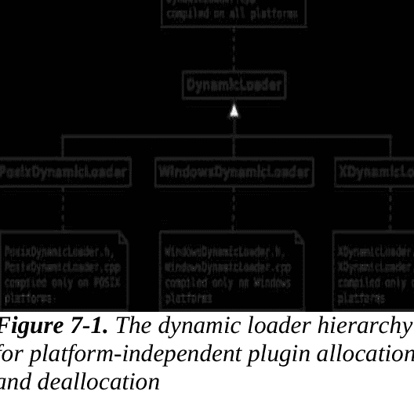

图 7-1. 用于平台无关插件分配和释放的动态加载器层次结构

上述设计隐藏了平台特定细节在抽象接口之后，减轻了插件消费者需要了解插件如何加载的需求。那是，当然，假设插件消费者实例化了正确的平台特定派生类，而 DynamicLoader 层次结构无法自动处理这种情况。在这里，我们引入了一个新的设计

模式，工厂函数，来解决实例化正确派生类的问题。简单地说，工厂函数是一种模式，它将类型的创建与逻辑实例化点分离。

在继续之前，我应该指出工厂函数与 Gang of Four [6] 定义的工厂方法模式之间的语义差异。简单地说，工厂方法模式通过单独的类层次结构实现工厂。更一般地说，工厂是任何将层次结构中特定派生类的选择与逻辑实例化点分离的机制。工厂函数是一个由单个函数而不是单独的创建层次结构组成的工厂。

通常，工厂是通过调用一个函数来实现的，该函数接受一个标志（整数、枚举、字符串等）来限定层次结构的特化，并返回一个基类指针。让我们检查一个人工示例。假设我们有一个 Shapes 层次结构，其派生类为

Circle、Triangle 和 Rectangle。此外，假设我们定义了以下枚举类：

```
enum class ShapeType {Circle, Triangle, Rectangle};
```

以下工厂函数可用于创建形状：

```
unique_ptr<Shape> shapeFactory(ShapeType t)
{
	switch(t) {
	case ShapeType::Circle:
		return make_unique<Circle>();
	case ShapeType::Triangle:
		return make_unique<Triangle>();
	case ShapeType::Rectangle:
		return make_unique<Rectangle>();
	}
}
```

可以通过以下函数调用创建一个 Circle：auto s = shapeFactory(ShapeType::Circle);

为什么上述构造比键入 auto s =

```
make_unique<Circle>();
```

更有用呢？说实话，它没有。相反，考虑一个接受字符串参数而不是枚举类型的工厂函数（用一系列 if 语句替换 switch 语句）。我们现在可以用以下语句构造一个 Circle：

```
auto s = shapeFactory("circle");
```

由于 shapeFactory() 的字符串参数值的发现可以推迟到运行时，因此上述构造比使用类名直接实例化更有用。上面描述的简单工厂方法的典型用法是使定义哪个特化被实例化的条件出现在配置文件或输入文件中。

在我们的例子中，工厂甚至更简单。由于我们的层次结构按平台特化，而不是传递一个标志来选择适当的派生类，我们只需通过使用预处理器指令进行选择，


如 Listing 7-1 所示。

### Listing 7-1. 一个动态加载器工厂函数

```cpp
unique_ptr<DynamicLoader>
dynamicLoaderFactory() {
#ifdef POSIX
    return make_unique<PosixDynamicLoader>();
#elif WIN32
    return make_unique<WindowsDynamicLoader>();
#else
    return nullptr;
#endif
}
```

通过将 dynamicLoaderFactory() 函数编译到其自己的源文件中，我们可以通过将一组预处理器指令隔离到一个源文件中来实现平台无关的插件创建。然后在需要插件分配或释放的位置调用工厂函数，以返回正确类型的 DynamicLoader。通过让工厂返回一个 unique_ptr，我们无需担心内存泄漏。以下代码片段说明了 DynamicLoader 的平台无关用法：

```cpp
// Question: What platform?
auto loader = dynamicLoaderFactory();
// Answer: Who cares?
auto plugin = (loader ? loader->allocatePlugin(pluginName) : nullptr);
```

对于 pdCalc 的目的而言，我们可以用 DynamicLoader 层次结构和我们简单的工厂函数停止。我们只需要抽象一个平台相关特性（插件的分配和释放），而上面的代码已足以满足此目的。然而，我们已经走到这一步，值得再迈出一步，看看适用于需要多种不同平台相关特性的情况的平台无关性的通用实现，即使它不是我们案例研究所特别需要的。

## 7.3.3.6 用于通用平台无关代码的抽象工厂

作为软件开发人员，我们不断面临由平台依赖性引起的设计挑战。以下是 C++ 开发人员常见的平台特定编程任务的不完整列表：插件加载、进程间通信、文件系统导航（在 C++17 中标准化）、图形、线程（在 C++11 中标准化）、持久设置、二进制序列化、sizeof() 内置数据类型、计时器（在 C++11 中标准化）以及网络通信。列表上的大多数功能，如果不是全部，都可以通过 boost 或 Qt 等库中的平台无关 API 获得。对我个人而言，造成最多困扰的平台特定特性就是谦逊的目录分隔符（Posix 系统上的 / 和 Windows 系统上的 \）。

假设我们的计算器需要读取、写入和保存持久自定义设置的能力（请参阅第 8 章，了解为什么这对计算器可能是必要的）。通常，Linux 系统将设置保存在文本文件中（例如，在 Ubuntu 上，用户设置保存在主目录的 .config 目录中的文件中），而在 Windows 系统上，持久设置保存在系统注册表中。实际上，最佳解决方案是使用已经实现此抽象的现有库（例如，Qt 的 QSettings 类）。出于教学目的，我们假设没有外部库可用，并且我们将研究一种设计，该设计在我们现有的动态加载器旁边添加持久设置（或任意数量的平台相关功能）。我们的重点将放在抽象上，而不是每个平台上设置实现的细节。

简单的解决方案是搭载我们的动态加载器，并将必要的设置接口直接添加到 DynamicLoader 类中。当然，我们需要将类重命名为更通用的名称，例如 OsSpecificFunctionality，其派生类如 LinuxFunctionality 和 WindowsFunctionality。这种方法简单、快速且很快变得难以处理；它与内聚性背道而驰。对于任何规模的代码，这种技术最终会导致不可控制的臃肿，从而完全缺乏接口的可维护性。尽管项目上存在时间压力，我建议始终避免这种快速解决方案，因为它只是增加了你的技术债务，并会在未来造成比现在采用正确解决方案更长的延迟。

与其使我们现有的 DynamicLoader 类膨胀，我们反而从其设计中汲取灵感，并创建了一个单独的、类似的设置层次结构，如图 7-2 所示。同样，我们有在每个唯一平台上实例化平台特定派生类的问题。然而，与其添加一个额外的 settingsLoaderFactory() 函数来镜像现有的 dynamicLoaderFactory() 函数，我们反而寻求一个通用解决方案，该方案能够在保留平台选择单一代码点的同时实现无限的功能扩展。据预期，我们并不是第一个遇到此特定问题的程序员，并且已经存在解决方案：抽象工厂模式。

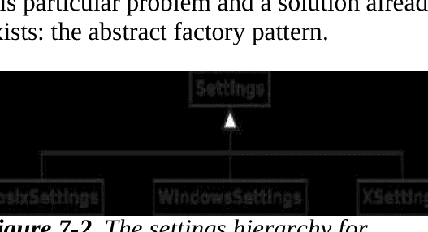

### Figure 7-2. The settings hierarchy for platform-independent persistent settings

根据 Gamma 等人[6] 的说法，抽象工厂“提供了一种创建相关或依赖对象的族的接口，而无需指定其具体类。”本质上，该模式可以分为两个步骤构建：

1. 为每个相关对象创建独立的层次结构（族），例如动态加载器层次结构和设置层次结构，通过其平台依赖性相关。
2. 创建一个层次结构，专门针对依赖关系（例如平台），为每个族提供工厂函数。

我发现上述抽象如果没有具体示例就很难理解；因此，让我们考虑我们在 pdCalc 中试图解决的问题。在浏览此示例时，请参考图 7-3 中的（过于复杂）类图。请记住，此抽象的总体目标是创建一个单一的源位置，能够提供创建任意数量的平台特定特化的平台无关机制。

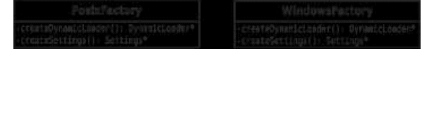

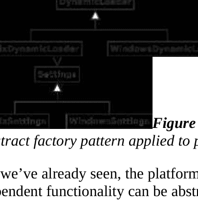

### Figure 7-3. The abstract factory pattern applied to pdCalc

正如我们已经看到的，平台相关的功能可以抽象为并行、独立的层次结构。这些层次结构使平台相关的实现能够通过多态性通过平台无关的基类接口访问。对于 pdCalc，此模式转化为提供平台无关的 Settings 和 DynamicLoader 层次结构，分别抽象持久设置和动态加载。例如，我们可以通过抽象 DynamicLoader 接口多态地分配和释放插件，前提是系统根据平台实例化正确的底层派生类（PosixDynamicLoader 或 WindowsDynamicLoader）。抽象工厂的这一部分在图 7-3 中由 DynamicLoader 层次结构表示。

现在问题简化为根据当前平台实例化正确的派生类。与其提供单独的工厂函数来实例化 DynamicLoader 和 Settings 对象（一种分散的方法，需要在每个工厂中分别使用平台 #ifdefs），我们反而创建一个层次结构，该层次结构提供用于创建 DynamicLoader 和 Settings 对象的工厂函数的抽象接口。然后将此抽象工厂层次结构（图 7-3 中的 PlatformFactory 层次结构）专门化于平台，以便我们拥有工厂层次结构的平台特定派生类，这些派生类创建功能层次结构的平台特定派生类。此方案将平台依赖性集中到一个工厂函数中，该函数实例化正确的 PlatformFactory 特化。在 pdCalc 的实现中，我选择将 PlatformFactory 设为单例，并因此将 PlatformFactory 的工厂函数“隐藏”在 Instance() 函数中。

抽象工厂模式可能仍然没有太多意义，所以让我们看一些示例代码，以自上而下的方式查看抽象。最终，抽象工厂模式使我们能够在 pdCalc 中编写以下平台无关的高级代码：

```cpp
// PlatformFactory Instance returns either a PosixFactory or a
// WindowsFactory instance (based on the platform), which in turn
// creates the correct derived DynamicLoader
auto loader = PlatformFactory::Instance().createDynamicLoader();
```

```cpp
// The correctly instantiated loader provides platform specific
// dynamic loading functionality polymorphically through a platform
// independent interface
auto plugin = loader->allocatePlugin(pName);
```


// ...
loader->deallocatePlugin(plugin);

// 同样的原则适用于设置 ...
auto settings =
PlatformFactory::Instance().createSettings();
settings->readSettingsFromDisk();
// ...
settings->commitSettingsToDisk();

深入来看，我们首先要检查的是 PlatformFactory 的 Instance() 函数，它会根据平台返回 PosixFactory 或 WindowsFactory。

```
PlatformFactory&
PlatformFactory::Instance()
{
#ifdef POSIX

static PosixFactory instance;
#elif WIN32
static WindowsFactory instance;
#endif
return instance;
```

}
上面的函数做了一个微妙但聪明的处理，这是一个值得了解的技巧。
从客户端的角度来看，
PlatformFactory 看起来像一个普通的单例类。调用 Instance() 函数，会返回一个 PlatformFactory 引用。客户端随后像使用任何其他单例类一样使用该 PlatformFactory 的公共接口。然而，由于 Instance() 成员函数返回的是一个引用，我们可以多态地使用该实例。由于 PosixFactory 和 WindowsFactory 都派生自 PlatformFactory，因此实例化的 instance 变量是与平台匹配的特化版本，由实现中的 #ifdef 定义。我们巧妙地将实现细节，即抽象工厂模式的机制，从类的使用者那里隐藏起来。除非客户端注意到 PlatformFactory 中的工厂函数是纯虚的，否则他可能意识不到自己在使用一个面向对象的层次结构。当然，目标并不是为了在某种险恶的阴谋中隐藏任何东西来混淆

实现。相反，这种信息隐藏被用来减轻 PlatformFactory 客户端的复杂性负担。我们接下来检查 PosixFactory 和 WindowsFactory 类中 createDynamicLoader() 函数的简单实现（注意函数的协变返回类型）：

```
unique_ptr<DynamicLoader>
PosixFactory::createDynamicLoader()
{
return make_unique<PosixDynamicLoader>
();
}
```

```
unique_ptr<DynamicLoader>
WindowsFactory::createDynamicLoader()
{
return
make_unique<WindowsDynamicLoader>();
}
```

上面，我们只是用一个类层次结构替换了动态

加载器工厂函数（参见列表 7-1），用多态性替换了平台 #ifdefs。仅有一小部分功能依赖于平台，用抽象工厂替换工厂函数显然是过度设计。然而，对于我们的示例，我们有独立的 DynamicLoader 和 Settings 族都依赖于相同的平台条件（原则上，我们可以有任意数量的此类层次结构），而抽象工厂模式允许我们将平台依赖集中在一个位置（在这里，是 PlatformFactory 的 Instance() 函数中），而不是将其分散到多个独立的工厂函数中。从维护的角度来看，其价值主张与更倾向于使用多态而不是 switch 语句类似。

难题的最后几部分是 DynamicLoader 和 Settings 层次结构的实现。幸运的是，这些实现与第 7.3.3 节概述的思路完全相同，我不必在此重复它们。确实使用抽象工厂模式并不会给平台相关函数的实现增加任何固有的复杂性。该模式只是在通过单一工厂层次结构而不是一系列工厂函数实例化这些类时增加了一些机制。

在 pdCalc 仓库的源代码中，不存在 Settings 层次结构（或其在 PlatformFactory 中的相关 readSettingsFromDisk() 和 commitSettingsToDisk() 函数）的实现，因为按编写方式，pdCalc 并不需要持久化设置抽象。Settings 层次结构只是作为一个合理的示例人为制造出来，以具体展示抽象工厂模式的机制和相关性。话虽如此，我确实选择在 pdCalc 的代码中仅为 DynamicLoader 包含一个完整的抽象平台工厂实现，以说明抽象工厂模式的实际实现，即使更简单的单个工厂函数本可以胜任，并且更适合生产代码。

## 7.4 问题 3：改造 pdCalc

我们现在转向最后一个插件问题，即改造已开发的类和接口以适应动态添加计算器功能。这个问题不是关于插件管理。相反，我们在这里解决的问题是扩展 pdCalc 的模块接口以接受插件功能。本质上，在第 7.2 节定义了如何在插件中发现命令和按钮的情况下，本节描述了如何将这些新发现的命令整合到 pdCalc 中。

让我们首先创建一个接口以实现新发现的插件命令的注入。回忆一下第 4 章中核心命令在应用程序启动时如何加载到 CommandRepository 中。首先，主应用程序调用 RegisterCoreCommands() 函数。其次，在此函数内部，CommandRepository 类的 registerCommand() 函数

对每个核心命令调用一次，将命令的名称和命令原型注册到 CommandRepository。在第 7.2 节中，我们开发了一个接口用于从插件导出命令名称和命令原型。显然，要注册这些插件命令，我们只需要扩展命令分发器模块的接口以包含 registerCommand() 函数。然而，这种接口扩展提出了一个有趣的问题。在 C++ 中，没有正式的模块定义，将模块接口扩展意味着什么？

## 模块接口

到目前为止，我们还没有严格定义实现或描述模块的机制。我们只是松散地声明某些类属于某些模块（例如，CommandRepository 属于命令分发器模块）。但这到底意味着什么？目前的 C++ 语言并没有实现模块概念。因此，模块本质上是一个元语言概念，而

语言本身在强制执行模块接口方面几乎没有帮助。我们确实有几种基本选择来定义模块及其接口。首先，将所有不直接属于接口的类封装在一个源文件中，并且只在一个头文件中公开有限的模块接口。其次，将每个模块构建为单独的 DLL 并使用 DLL 符号导出机制选择性地导出接口函数。第三，通过文档和注释中的声明隐式定义模块边界。让我们探讨每一种选项。

## 源代码隐藏

让我们首先讨论 C 程序员一直可用的封装模型：将非公共接口类和函数隐藏在源文件中，并且不在头文件中公开其接口。这是 C++ 提供的唯一真正隐藏符号的机制（记住，访问修饰符，如 private，不能用于类本身，就像在

选项中那样）。采用此选项当然超出了 C++ 语言本身的范围。DLL 隐藏基于操作系统的库格式并通过编译器指令实现。本质上，程序员用特殊的编译器指令装饰类或函数以指示函数是否要从 DLL 导出或导入。编译器随后创建仅公开导出适当标记符号的 DLL，而链接到 DLL 的代码必须指定其打算导入哪些符号。由于同一个头文件在编译 DLL 时必须标记为导出，而在编译使用 DLL 的代码时必须标记为导入，因此实现通常是通过使用编译器/OS 特定的预处理器指令来完成的。例如，在 Windows 中，将采用以下代码（或类似变体）：

// Declspec .h
#ifdef BUILDING_DLL

#define DECL... #else


#define DECLSPEC #endif

declspec(export)

declspec(import) 我们想从 DLL 中导出的函数 foo() 的声明应写成 #include "Declspec.h" DECLSPEC void foo();

在构建 DLL 时，预处理器宏 `BUILDING_DLL` 会被定义；因此，`DECLSPEC` 宏展开为 `declspec(export)`。当使用 DLL 时，`BUILDING_DLL` 宏保持未定义，`DECLSPEC` 宏展开为 `declspec(import)`。任何未使用 `DECLSPEC` 宏修饰的函数或类保持为 DLL 私有。GCC 使用略有不同的语法实现了类似的机制。

大多数 Windows 程序员非常熟悉用于控制模块接口的 DLL 隐藏机制，因为在 DLL 中全局隐藏符号是 Visual Studio 的默认范式。如果一个符号未被修饰，它就不会从 DLL 中导出。因此，要生成一个能够被外部调用的 DLL（难道还有别的种类吗？），Windows 程序员必须使用 `declspec` 指令手动导出符号。然而，许多 UNIX 程序员并不熟悉 DLL 隐藏，因为默认的共享库实现会公开导出所有符号。也就是说，在典型的 UNIX 或 Linux 系统中，不需要在共享库代码中将符号标记为导出或导入，因为共享库加载时，链接器会将共享库中的所有符号公开提供给调用程序。如果需要，编译器命令行选项可以将默认可见性从公开反转为私有，并且符号可以类似于 Windows 构建方式那样手动标记为导入或导出。

在本节开头我曾指出，如果你希望对大型 C++ 代码库真正隐藏模块接口，使用 DLL 隐藏是最合理的选择。只要你愿意为每个模块分配单独的 DLL，它就能提供非常精细的模块访问控制粒度。这种技术的主要缺点在于可读性、可维护性和可移植性。使用该技术确实需要对每个可导出函数使用编译器和操作系统特有的修饰符，而这些修饰符并不是 C++ 语言的一部分。虽然额外的 `DECLSPEC` 宏对每个函数或类来说并非难以忍受，但在考虑多个操作系统或多个编译器时，该宏的定义很快就会变得笨拙。此外，在构建或使用 DLL 时，因忘记定义正确的预处理器宏而引发的问题，可能会让新手程序员困惑不已。最后，在存在模板代码的情况下正确实现 DLL 导入和导出可能并非易事。

## 隐式隐藏或文档化隐藏

我称之为隐式隐藏的技术，不过是通过不记录接口来隐藏接口。这在实践中意味着什么？由于 C++ 语言不直接支持模块，隐式隐藏只是在一组类和函数周围绘制一个逻辑结构，并声明这些类组成一个模块。语言允许从模块外部的代码调用任何类的任何公有函数。因此，模块的公有接口只是通过仅记录那些应该从外部调用的函数来“声明”的。从纯粹的技术角度看，隐式隐藏根本就不是隐藏！

为什么会有人选择隐式隐藏而不是源代码隐藏或 DLL 隐藏呢？很简单，这是为了图方便。使用隐式隐藏可以让开发者以逻辑清晰、可读且可维护的方式组织类和源代码。每个类（或一组紧密相关的类）可以放在各自的头文件和源文件对中。这样只需包含必要的代码，从而加快编译时间。隐式隐藏也不会强制规定必须将哪些边界内容包含到特定的共享库中，如果设计目标是尽量减少随软件包一起发布的独立共享库数量，这一点可能很重要。

当然，隐式隐藏的问题在于，不存在任何语言机制来防止用户误用那些设计者本意是仅在逻辑模块内部使用的函数和类。这是否是一个严重的问题？为什么我们要强制阻止用户调用未被认定为公有接口的部分？主要的设计原因是，我们不希望用户依赖未记录的特性，因为非公有接口是可能发生变化的。不出所料，这与我们在类设计中重视封装的原因相同。也就是说，实现应该允许独立于接口而改变。那么，强制隐藏非公有接口有多重要？最终，这取决于你有多信任代码的用户——他们要么不调用未记录的接口，要么至少愿意承担因未记录接口变更而被迫进行的计划外维护。

## pdCalc 的模块设计

在 pdCalc 的设计中，我选择使用隐式隐藏。对于这个项目，我认为简洁性的好处超过了使用其他模块接口隐藏模式所必需的复杂性。你为自己的项目选择哪种技术，自然会归结为个人偏好。鉴于 pdCalc 的代码库相对较小，选择隐式隐藏可以按逻辑而非模块边界来分组类。此外，隐式隐藏允许将多个模块（例如命令调度器、栈和插件管理）合并到一个共享的后端库中。

我选择隐式隐藏对解决最初的问题——扩展命令调度器模块的接口，以包含来自 `CommandRepository` 类的 `registerCommand()` 函数——有着直接的影响。这种扩展只需通过“声明”即可完成，更准确地说，是通过修改文档来完成。本质上，只需更新第 2 章中的表 2-2，就可以将该函数添加到接口中。

隐式隐藏没有特定的语言支持特性，因此你不能指着某个具体的类说：“这个头文件定义了模块的接口。”相反，文档被用来在定义模块公有接口的公有类和函数的选定部分周围画出一条隐式的线。因此，一旦文档被修改，`main()` 函数就可以在插件加载期间通过调用 `CommandRepository` 现有的 `registerCommand()` 函数来注入插件命令。无需修改任何代码就能为 pdCalc 加入插件命令注入功能。

## 7.4.2 向 GUI 添加插件按钮

当然，GUI 方面会稍微复杂一些，因为必须为每个发现的插件命令创建一个能够引发 `commandEntered()` 事件的按钮。

在 7.2 节中，我们定义了一个用于标记 CommandButtons 的接口。每个插件都提供一个 PluginButtonDescriptor，它定义了主命令标签、次命令标签以及与标签关联的底层命令。因此，为了添加一个与插件命令对应的新 GUI 按钮，我们只需扩展 GUI 的 MainWindow 类的接口，以包含一个根据按钮标签添加按钮的函数：

```
class MainWindow : public QMainWindow,
public UserInterface
{
public:

// Existing interface plus the following:
void addCommandButton(const string&
dispPrimaryCmd,
const string& primaryCmd, const string&
```

```
dispShftCmd,
const string& shftCmd);
};
```

当然，这个函数还需要根据某种合适的算法来布置按钮。我采用的简单算法是将按钮从左到右排列，每行四个。

正如第 6 章中简要提到的，MainWindow 类还包括一个 setupFinalButtons() 函数和一个 fixSize() 函数。setupFinalButtons() 函数将撤销（undo）、重做（redo）和 proc（参见第 8 章）按钮添加到 GUI 的顶行。fixSize() 函数强制 GUI 的几何尺寸固定在其当前值。从逻辑上讲，这些操作只能在所有插件按钮添加完毕之后调用。

与 CommandRegistry 的 registerCommand() 函数不同，addCommandButton() 并不是 MainWindow 类原本就有的公有函数。


因此，我们必须添加并实现这个新函数。很可能，一个模块化的 GUI 实现在 GUI 模块中已经在某个地方有了一个类似的函数，因为这种功能早已需要用来为核心命令创建按钮。因此，实现 `addCommandButton()` 函数可能就像从 MainWindow 将此调用转发到适当的内部 GUI 类一样简单，而该函数可能已经存在于那里。

## 7.5 集成插件

到目前为止，我们已经讨论了 C++ 插件的指导原则、插件接口、插件命令内存管理、加载和卸载插件、为平台相关代码设计抽象接口的设计模式，以及改造 pdCalc 以实现插件命令和 GUI 注入。然而，我们尚未讨论任何用于查找插件、从磁盘实际加载和卸载插件、管理插件生命周期的机制，或将插件功能注入 pdCalc 的机制。这些操作由 PluginLoader 类和应用程序的 main() 函数执行，两者现在都将进行描述。

### 7.5.1 加载插件

加载插件由 PluginLoader 类完成。PluginLoader 负责查找插件动态库文件，将插件加载到内存中，并根据需要将具体的 Plugin 特化提供给 pdCalc。PluginLoader 还负责在适当的时候释放插件资源。正如我们之前所见，一个良好的设计将通过 RAII 实现自动释放。

加载插件的第一步是确定应该加载哪些插件以及何时加载。实际上，回答这个问题只有两种实用选择。要么 pdCalc 在程序启动时自动加载插件（例如，配置文件中指定的文件或特定目录中的所有 DLL），要么插件根据用户的直接请求按需加载。当然，这些选项并不相互排斥，可以设计一个 PluginLoader 类同时结合这两种选项，甚至可能允许用户指定哪些手动加载的插件将来应自动加载。插件如何加载并没有对错之分。这一决定必须由程序的需求来决定。

为了简单起见，我选择实现一个在 pdCalc 启动期间自动加载插件的插件加载器。PluginLoader 通过读取一个 ASCII 配置文件来查找这些插件，该文件由每一行单独列出插件文件名的文本行组成。配置文件任意命名为 plugins.pdp，并且该文件必须位于当前可执行文件路径中。plugins.pdp 中列出的插件文件可以使用相对路径或绝对路径指定。更复杂的插件加载器实现可能会将插件文件的存储位置放在操作系统特定的配置位置（例如 Windows 注册表）并使用更好的文件格式，例如 XML。像 Qt 这样良好的库可以帮助你解析 XML 并使用平台无关的抽象找到系统特定的配置文件。

考虑到上述插件加载器设计约束，PluginLoader 接口相当简单：

```
class PluginLoader
{
public:

void loadPlugins(UserInterface& ui, const string& pluginFileName); const vector<const Plugin*> getPlugins();
};
```

loadPlugins() 函数以配置文件的名称作为输入，将每个库加载到内存中，并为每个库的 Plugin 类分配一个实例。UserInterface 引用仅用于错误报告。当 main() 函数准备好注入插件的命令时，将调用 getPlugins() 函数以返回已加载的 Plugins 集合。当然，loadPlugins() 和 getPlugins() 函数可以合并，但我更喜欢一种设计，使程序员能够对插件加载与插件使用的时间进行更精细的控制。我的 PluginLoader 实现使用了几种巧妙的技术，利用 RAII 来管理插件的自动释放。由于这里的实现与设计正交，有兴趣的读者可参考 PluginLoader.cpp 源文件了解详情。

### 7.5.2 注入功能

既然我们决定插件应从配置文件自动加载，最合理的插件加载位置是在 main() 函数调用树中的某个位置。从本质上讲，这个 loadPlugins() 函数只是把我们之前讨论的所有部分组合在一起：加载插件库、加载插件、从插件描述符中提取命令和按钮，并将这些命令和按钮注入 pdCalc。当然，一个完善的实现还将对插件进行错误检查。例如，错误检查可能包括检查插件 API 版本、确保命令尚未注册，以及确保 GUI 按钮对应于命令存储库中的命令。清单 7-2 是加载插件的函数骨架。其输入是用于报告错误的 UserInterface 引用和 PluginLoader 引用。

## *清单 7-2.* 一个用于加载插件的函数

```
void setupPlugins(UserInterface& ui,
PluginLoader& loader) {
    loader.loadPlugins(ui, "plugins.pdp"); auto
    plugins = loader.getPlugins();

    for(auto p : plugins) {
        auto apiVersion = p->apiVersion(); // verify
        plugin API at correct level

        // inject plugin commands into
```
```
CommandRepository - recall // the cloned
command will auto release in the plugin auto
descriptor = p->getPluginDescriptor();
for(int i = 0; i < descriptor.nCommands; ++i)
{

registerCommand( ui,
descriptor.commandNames[i],
MakeCommandPtr( descriptor.commands[i]->
>clone() ) ); }

// if gui, setup buttons
auto mw = dynamic_cast<MainWindow*>
(&ui);
if(mw)
{

auto buttonDescriptor = p->
>getPluginButtonDescriptor();
if(buttonDescriptor)
{

for(int i = 0; i <buttonDescriptor->nButtons;
++i) {
auto b = *buttonDescriptor;
// check validity of button commands
```
```
mw-
>addCommandButton(b.dispPrimaryCmd[i],
b.primaryCmd[i], b.dispShftCmd [i],
b.shftCmd[i]);
}
}
}
}
return;
}
```

在长篇描述如何实现 C++ 插件之后，结局有些平淡无奇，因为大部分机制都在更深层的抽象中处理。当然，正如你在本书中学到的，这种“乏味”只有通过细致的设计才能实现。简单性总是比代码本身显示的更难实现。如果在这种高层抽象中泄露出任何复杂性，它肯定会暗示设计不佳。

## 一个具体的插件

在长篇讨论如何将原生 C++ 插件集成到 pdCalc 之后，我们终于到达可以实现一个具体插件的地步。基于我们第 1 章的需求，我们需要编写一个插件来添加自然对数、其逆指数算法以及双曲三角函数的命令。当然，你可以随意添加包含你喜欢的任何功能的插件。例如，两个有趣的插件可能是概率插件和统计插件。概率插件可以计算排列、组合、阶乘和随机数，而统计插件可以计算均值、中位数、众数和标准差。现在，我们只考虑我们的双曲、自然对数插件的设计和实现。

## 插件接口

HyperbolicLnPlugin 的实现实际上相当直接。我们将从类的接口开始，然后不寻常地检查一些实现细节。所选代码用于进一步检查突出了与原生 C++ 插件相关的特定细节。

HyperbolicLnPlugin 的接口由专门化 Plugin 类的类定义以及所需的插件分配和释放函数给出；见清单 7-3。

**清单 7-3.** HyperbolicLnPlugin 类的接口

```cpp
HyperbolicLnPlugin : public pdCalc::Plugin
{
class HyperbolicLnPluginImpl;
public:
HyperbolicLnPlugin();
~HyperbolicLnPlugin();

const PluginDescriptor&
getPluginDescriptor() const override; const
PluginButtonDescriptor*
getPluginButtonDescriptor() const override;
```


```
pdCalc::Plugin::ApiVersion apiVersion()
const;

private:
unique_ptr<HyperbolicLnPluginImpl>
pimpl_;
};

extern "C" void* AllocPlugin();
extern "C" void DeallocPlugin(void*);
```

正如预期，该类实现了 Plugin 类中的三个纯虚函数，并将大部分实现延迟到私有实现类。AllocPlugin() 和 DeallocPlugin() 函数具有显而易见的实现。AllocPlugin() 仅返回一个新 HyperbolicLnPlugin 实例，而 DeallocPlugin() 函数将其 void* 参数转换为 Plugin*，随后对该指针调用 delete。请注意，插件按定义不是主程序的一部分，因此不应属于 pdCalc 命名空间。因此，在少数位置使用了显式的命名空间限定。

STL 容器。我们通常更希望在接口中使用 vectors 和 unique_ptrs 来管理资源，但我们被迫改用原始数组。当然，pimpl 提供的封装使我们能够实现所需的任何内存管理方案。对于 HyperbolicLnPlugin，我选择了一种使用 strings、unique_ptrs 和 vectors 的复杂自动内存管理方案。使用 RAII 内存管理方案的优点是，我们可以确保在出现异常的情况下插件不会泄漏内存（即在构造期间抛出的内存不足异常）。现实地说，我不会期望计算器在低内存环境中运行，即使在这种情况下，也很不清楚在插件分配期间泄漏内存是否重要，因为用户在此情况下最可能的下一步操作就是重启计算机。因此，回顾起来，使用构造函数中裸 new 和析构函数中 delete 的更简单内存管理方案可能更务实。

## 7.6.2 源代码依赖倒置

令人惊讶的是，上述 HyperbolicLnPlugin 的类声明确实是插件的完整接口。我说令人惊讶是因为乍一看，人们可能会惊讶插件的接口与插件提供的功能没有任何关系。当然，这种情况正是应该如此。插件提供的计算器功能确实只是实现细节，可以完全包含在插件的实现文件中。

上述细微差别，即 pdCalc 只知道插件的接口，而不知道其功能本身，不应被忽视。事实上，这种源代码依赖倒置正是插件设计的全部目的。源代码依赖倒置到底是什么，为什么它很重要？要回答这个问题，我们必须先进行一次简短的历史回顾。

传统上（想想 1970 年代的 Fortran），代码是通过简单地编写新函数和子程序来扩展的。这种方法的主要设计问题是，要求主程序调用新函数会将主程序绑定到任何扩展的具体接口。因此，主程序变得依赖于扩展作者随意定义的接口更改。也就是说，每个新扩展都定义了一个主程序必须遵守的新接口。这种设置非常脆弱，因为主程序需要不断修改以跟上其扩展接口的变化。由于每个新扩展都需要对主程序源代码进行独特的修改，主程序处理扩展的代码复杂度随扩展数量线性增长。如果这还不够糟糕，添加新功能总是需要重新编译和重新链接主程序。具体来说，想象一下 pdCalc 的设计，每次添加新的插件命令时都需要修改、重新编译和重新链接 pdCalc 的源代码。

上述问题可以通过函数指针和回调在不使用面向对象编程的情况下解决，尽管方式有些不优雅和笨重。然而，随着面向对象编程的兴起，特别是继承和多态，依赖性问题以类型安全的方式并得到语言支持而得到解决。这些技术使得源代码依赖倒置的普及成为可能。具体来说，源代码依赖倒置指出，主程序定义了一个接口（例如我们在本章中研究的插件接口），所有扩展都必须遵守。在这种策略下，扩展服从于主程序的接口而不是相反。因此，主程序可以通过插件进行扩展，而无需修改、重新编译或重新链接主程序的源代码。更重要的是，可扩展性的接口由应用程序决定，而不是其插件。具体来说，pdCalc 提供

Plugin 接口类来定义新功能的添加，但 pdCalc 从未了解其扩展的实现细节。不符合 pdCalc 接口的插件根本无法注入新的 Commands。

## 7.6.3 实现 HyperbolicLnPlugin 的功能

到目前为止，我们知道 HyperbolicLnPlugin 将通过为每个操作实现一个命令类来提供其功能。实现其中几个类后，很快就会注意到插件中的所有命令都是单目命令。不幸的是，根据 C++ 插件的第三条规则（假设不兼容的对齐），我们不能从 UnaryCommand 类继承，而必须从 PluginCommand 类继承。请注意，我们的对齐假设甚至排除了通过多重继承使用 UnaryCommand 类，我们必须在 HyperbolicLnPluginCommand 基类中重新实现单目命令功能。虽然这感觉有点重复，但 C++ 插件的规则让我们别无选择（尽管我们可以提供 UnaryPluginCommand 和 UnaryBinaryCommand 的源代码，但这些必须与每个插件分别编译）。

因此，我们最终到达了所有 HyperbolicLnPlugin 中的命令都派生的接口类；参见列表 7-4。

## 列表 7-4. HyperbolicLnPluginCommand 类

```
class HyperbolicLnPluginCommand : public pdCalc::PluginCommand {
public:

HyperbolicLnPluginCommand() {}
explicit HyperbolicLnPluginCommand(const HyperbolicLnPluginCommand& rhs); virtual ~HyperbolicLnPluginCommand() {}
void deallocate() override;
}
```

```
protected:
const char* checkPluginPreconditions() const noexcept override;

private:
void executeImpl() noexcept override;
void undoImpl() noexcept override;
HyperbolicLnPluginCommand*
clonePluginImpl() const noexcept override;

virtual HyperbolicLnPluginCommand*
doClone() const = 0;
virtual double unaryOperation(double top)
const = 0;
double top_;
};
```

与 UnaryCommand 类一样，HyperbolicLnPluginCommand 类实现了纯虚 executeImpl() 和 undoImpl() 命令，将命令操作委托给纯虚 unaryOperation() 函数。此外，HyperbolicLnPluginCommand 类实现了 checkPluginPreconditions() 函数以确保堆栈上至少有一个数字

clonePluginImpl() 函数由以下内容给出

```cpp
HyperbolicLnPluginCommand*
HyperbolicLnPluginCommand::clonePluginImpl()
const noexcept {

HyperbolicLnPluginCommand* p; try
{

p = doClone(); }
catch(...)
{

return nullptr; }
return p; }
```

此函数的唯一目的是调整插件命令的克隆，以确保异常不会跨越插件与主应用程序之间的内存边界。

完成 HyperbolicLnPlugin 所需的全部工作就是为插件中所需的每个数学操作子类化 HyperbolicLnPluginCommand


并且实现剩余的几个纯虚函数（unaryOperation()、doClone() 和 helpMessageImpl()）。此时，这些函数的实现与第 4 章中一元函数的实现并无不同。有兴趣的读者可参考 HyperbolicLnPlugin.cpp 中的源代码以了解详情。

### 7.7 后续步骤

在对 C++ 插件进行了相当长时间的讨论，并且实现了双曲三角函数和自然对数插件之后，我们已经完成了第 1 章中为 pdCalc 设定的要求。计算器，如最初所述，已经完成！好吧，至少版本 1.0 完成了。然而，作为经验丰富的软件开发者，我们知道任何“完成”的产品都只是客户提出新功能请求前的暂时里程碑。下一章正好处理这种情况，我们将在其中修改设计以纳入未计划的扩展。

## 第 8 章 新需求

这是一个美好的星期一早晨，你在放松的周末之后刚走进办公室。毕竟，你在周五刚刚完成了 pdCalc，现在准备发布。在你坐下来喝早晨咖啡之前，你的项目经理走进你的办公室并说：“我们还没完。客户要求了一些新功能。”

在软件开发中，以上场景再常见不过了。虽然新功能可能不会在上线日期被请求，但新功能几乎不可避免地会在你完成设计和实现的大部分工作之后被提出。因此，应该尽可能以防御性的方式开发以预见可扩展性。我说的是*尽可能防御*而不是*尽可能防御*，因为过度抽象的代码对开发的危害可能与过度具体的代码一样大。通常，如果需要的话，简单重写不灵活的代码比无缘无故维护高度灵活的代码更容易。在实践中，我们寻求在代码既简单且可维护又具有一定可扩展性之间取得平衡。

在本章中，我们将探讨如何修改代码以实现超出原始需求设计的功能。本章中关于新功能的讨论范围从完整的设计和实现到仅设计再到仅供自学探索的建议。让我们从两个我们将从需求一直推进到实现的扩展开始。

### 8.1 完全设计的新功能

在本节中，我们将考察两个新功能：计算器的批处理操作和存储过程的执行。让我们从批处理操作开始。

#### 8.1.1 批处理操作

对于少数不熟悉该术语的人来说，任何程序的*批处理操作*只是程序从头到尾的执行，一旦程序启动后无需用户交互。大多数桌面程序都不以批处理模式运行。然而，批处理操作在许多编程分支中仍然非常重要，例如科学计算。也许更有兴趣的是，对于你们这些受雇于大型公司的员工，你们的工资很可能由以批处理模式运行的程序来处理。

让我们诚实一点。除了也许用于测试之外，pdCalc 的批处理操作并不是一个非常有用的扩展。我主要包含它是因为它展示了经过良好设计的 CLI 如何轻易地扩展以添加批处理模式。

回顾第 5 章，pdCalc 的 CLI 具有以下公共接口：

```cpp
class Cli : public UserInterface
{
    class CliImpl;
public:
    Cli(istream& in, ostream& out);
    ~Cli();

    void execute(bool suppressStartupMessage = false, bool echo = false);
};
```

要使用 CLI，类使用 cin 和 cout 作为参数构造，然后使用空参数调用 execute()：

```cpp
Cli cli{cin, cout};
// setup other parts of the calculator
cli.execute();
```

我们如何修改 Cli 类以启用批处理操作？令人惊讶的是，我们根本不需要修改类的代码！根据设计，CLI 本质上是一个解析器，它只是从输入流中获取以空格分隔的字符输入，将数据通过计算器处理，并将字符输出到输出流。由于我们事先考虑过没有将这些输入和输出流硬编码为 cin 和 cout，我们可以通过将输入和输出流改为文件流来将 CLI 转换为批处理器，如下所示：

```cpp
ifstream fin{inputFile};
ofstream fout{outputFile};
Cli cli{fin, fout};
// setup other parts of the calculator
cli.execute(true, true);
```

其中 inputFile 和 outputFile 是可通过 pdCalc 的命令行参数获取的文件名。回想一下，execute() 函数的参数只是抑制启动横幅并将命令回显到输出。

是的，就这么简单（但请参阅 main.cpp 中的一些实现技巧）。我们的 CLI 最初构建时就可以通过更改其构造函数参数来转换为批处理器。当然，你可以争辩说我作为作者有意以这种方式设计 Cli 类，因为我知道计算器将以这种方式扩展。事实上，我只是因为这种设计几乎没有额外的认知负担就能使 CLI 更灵活，所以我将所有 CLI 接口都构造为使用流输入而不是硬编码输入。

在离开本节之前，我会快速指出，事实上 pdCalc 的 CLI 在操作系统的协助下已经具有批处理模式。通过在命令行重定向输入和输出，我们可以实现相同的结果：

```bash
my_prompt> cat inputFile | pdCalc --cli > outputFile
```

对于 Windows，只需将 Linux 的 cat 命令替换为 Windows 的 type 命令即可。

#### 8.1.2 存储过程

将批处理模式添加到 pdCalc 坦白说是一个有点牵强的例子。添加的功能并不特别有用，代码更改也很微不足道。在本节中，我们将研究一个更有趣的功能扩展：存储过程。

什么是存储过程？在 pdCalc 中，存储过程是存储的、可重复的操作序列，对当前栈进行操作。存储过程提供了一种通过从现有计算器原语创建用户定义函数来扩展计算器功能的技术。你可以将执行存储过程视为运行计算器的一个非常简单的程序。最容易理解概念的方法是考虑一个例子。

假设你需要频繁计算三角形的斜边。对于图 8-1 所示的直角三角形，我们可以使用毕达哥拉斯公式计算斜边 c 的长度：

c = sqrt(a^2 + b^2)

图 8-1. 一个直角三角形

假设我们有一个三角形，其边 a = 4，b = 3，且这些值已输入到 pdCalc 的栈中。在 CLI 中，你会看到以下内容：

```
Top 2 elements of stack (size = 2):
2: 3
1: 4
```

为了计算该三角形的 c，我们将实现以下指令序列：dup * swap dup * + 2 root。按下回车后，最终结果将为

```
Top element of stack (size = 1):
1: 5
```

如果命令是一次输入一个，我们每次按下回车时都会看到中间结果栈。如果我们将所有命令输入到同一行然后按下回车，pdCalc 会在显示最终结果之前显示每个中间栈。当然，这个命令序列并不唯一。例如，使用命令序列 2 pow swap 2 pow + 2 root 也能达到相同结果。

如果你像我一样，如果你必须用 pdCalc 反复计算斜边，你可能希望在第一次手动计算后自动化该操作。这正是存储过程允许的。自动化不仅节省时间，而且还更不容易出错，因为封装了许多连续命令的存储过程可以编写、测试并随后重复使用。只要操作可以从 pdCalc 原语（包括插件函数）组装，存储过程就能在无需编写任何 C++ 代码的情况下扩展计算器的功能以计算简单公式。现在我们只需要设计并实现这个新功能。

##### 8.1.2.1 用户界面


pdCalc 既有 GUI 也有 CLI，因此添加任何面向用户的功能都需要对两个用户界面组件进行修改。对于存储过程而言，对用户界面的修改非常微小。首先，存储过程只是一个包含 pdCalc 指令有序序列的文本文件。因此，用户可以使用任何纯文本编辑器创建存储过程。因此，除非你想提供一个带语法高亮的存储过程文本编辑器，否则存储过程的用户界面就简化为从 CLI 和 GUI 启用其执行。

让我们先解决在 CLI 中集成存储过程的问题。如前所述，存储过程只是文件系统中的文本文件。回想一下，CLI 通过对空格分隔的输入进行标记化，然后通过引发事件将每个标记单独传递给命令调度器来工作。因此，访问存储过程的一个简单方法是只需将存储过程文件名传递给 CLI。该文件名将像其他命令或数字一样被标记化并传递给命令调度器进行处理。为了确保文件名被命令调度器的解析器解释为存储过程而不是命令，我们只需在文件名前面加上符号 proc: 并更改命令调度器的解析器。例如，对于名为 hypotenuse.psp 的存储过程，我们将向 CLI 发出命令 proc:hypotenuse.psp。我采用文件扩展名 psp 作为 pdCalc 存储过程的缩写。当然，该文件本身是一个普通的 ASCII 文本文件，其中包含用于计算直角三角形斜边的命令序列，如果你愿意也可以使用 .txt 扩展名。

回想一下，GUI 被设计为与 CLI 完全相同的方式将命令传递给命令调度器。因此，为了使用存储过程，我们添加一个按钮以打开对话框来浏览文件系统以查找存储过程。一旦选择了存储过程，我们就在文件名前面加上 proc: 并引发 CommandEntered 事件。

显然，你可以让你的存储过程选择对话框变得尽可能花哨。我选择了一个简化的设计，允许将文件名输入到可编辑的组合框中。为了便于使用，组合框预先填充了当前目录中所有扩展名为 .psp 的文件。

### 8.1.2.2 对命令调度器的更改

清单 8-1 是 CommandDispatcher 的 executeCommand() 函数的简略列表，其中包括解析存储过程所需的逻辑。代码中省略的部分出现在第 4.5.2 节。

CommandDispatcher 的 executeCommand() 函数 清单 8-1。

```
void
CommandDispatcher::executeCommand
string& command)
{

// handle numbers, undo, redo, help in nested
```
```
if
// ...
else if(command.size() > 6 &&
command.substr(0, 5) == "proc:") {

auto filename = command.substr(5,
command.size() - 5); handleCommand(
MakeCommandPtr<StoredProcedure>
(ui_,filename)); }
// else statement to handle Commands from
CommandRepository
// ...

return;
}
```

从上面的代码可以看出，实现只是剥离字符串 command 参数中的 proc: 来创建存储过程文件名，创建一个新的 StoredProcedure 命令子类，并执行此类。现在，我们假设将 StoredProcedure 类作为 Command 类的子类是最佳设计。我将在以下各节中讨论为什么这种策略是首选并检查其实现。然而，在此之前，让我们讨论一下 MakeCommandPtr() 函数的这个新重载。

在第 7.2.1 节中，我们首次看到了由以下实现给出的 MakeCommandPtr 的一个版本：

```
inline void CommandDeleter(Command* p)
{
 p->deallocate(); return;
}
using CommandPtr =
std::unique_ptr<Command,
decltype(&CommandDeleter)>;
inline auto MakeCommandPtr(Command* p)
{
return CommandPtr{p, &CommandDeleter};
}
```

上面的函数是一个帮助函数，用于从原始 Command 指针创建 CommandPtrs。此形式的函数用于从现有 Command 的克隆创建 CommandPtr（例如，如 CommandRepository::allocateCommand() 中所示）：

```
auto p = MakeCommandPtr( command->clone() );
```

在语义上，在 CommandDispatcherImpl::executeCommand( 中我们看到完全不同的用法，即构造一个派生自 Command 的类的实例。当然，我们可以用现有的 MakeCommandPtr 原型满足此用例。例如，我们可以按如下方式创建 StoredProcedure：

```
auto c = MakeCommandPtr(new StoredProcedure{ui,filename});
```

然而，只要有可能，最好不要用裸 new 污染高级代码。因此，我们寻求实现一个重载的帮助函数来为我们执行此构造。它的实现如下所示：

```
template<typename T, typename... Args>
```
```
auto MakeCommandPtr(Args&&... args)
{

return CommandPtr{new
T{std::forward<Args>(args)...},
&CommandDeleter}; }
```

在 C++11 之前，没有简单高效的技术来使用可变数量的构造函数参数构造通用类型，这是创建从 Command 类派生的任何可能类所必需的，每个类都有不同的构造函数参数。然而，现代 C++ 提供了使用可变参数模板和完美转发优雅地解决此问题的解决方案。此构造是下面侧边栏的主题。

## MODERN C++ DESIGN NOTE:
### VARIADIC TEMPLATES AND
### PERFECT FORWARDING

可变参数模板和完美转发在 C++ 中各自解决不同的问题。
可变参数模板使类型安全通用

```
virtual double area() const = 0;
};

class Circle : public Shape
{
public:

Circle(double r) : r_{r} {}
double area() const override { return 3.14159
* r_ * r_; }

private:
double r_;
};

class Rectangle : public Shape
{
public:

Rectangle(double l, double w) : l_{l}, w_{w}
{} double area() const override { return l_ *
w_; } private:
double l_, w_;
};

in C++, substitutability, implemented as
```

虚拟分派，解决了通过基类指针调用派生类型的特定实现的问题，使用基类保证的接口。在形状示例中，可替代性意味着能够按如下方式计算面积：

```
double area(const Shape& s)
{
return s.area();
}
```

对于从 Shape 派生的任何类。虚拟函数的确切接口完全规定，包括任何函数参数的数量和类型（即使在 area() 函数的此示例中空虚的情况下）。问题是，对象构造永远无法以这种方式“虚拟化”，即使可以，也不会起作用，因为构造对象所需的信息（其参数）非常频繁地从一个派生类到下一个派生类不同。

进入通用完美转发
构造函数模式。在此模式中，我们使用可变参数模板提供一个类型安全的接口，可以采用任意数量具有不同类型的构造函数参数。第一个模板参数始终是我们想要构造的类型。然后，使用完美转发来保证参数以正确的类型传递给构造函数。完美转发在此情况下为何必要的确切原因源于模板中类型的推导方式，超出了本讨论的范围（详见 [19]）。对于我们的形状示例，应用 GpFC 模式得到以下实现：

```
template<typename T, typename... Args>
auto MakeShape(Args&&... args)
{

return make_unique<T>(forward<Args>
(args)...); }
```

下面的代码说明了如何使用 MakeShape() 函数创建具有不同数量构造函数参数的不同类型：

```
auto c = MakeShape<Circle>(4.0);  
auto r = MakeShape<Rectangle>(3.0, 5.0);
```

请注意，GpFC 模式也适用于创建彼此之间没有继承层次关系的类。事实上，GpFC 模式被标准库中的 make_unique() 函数用于以高效、通用且不需要裸 new 的方式创建 unique_ptrs。虽然严格来说它们是不同的，但我喜欢将 GpFC 模式视为工厂方法的通用类似物。

## 8.1.2.3 设计存储过程类

我们现在回到设计 StoredProcedure 类的棘手问题。我们首先问的问题是我们是否需要一个类。我们已经有了一个用于解析单个命令、执行它们并将它们放在撤销/重做堆栈上的设计。也许正确的答案是以与


批处理输入的处理方式。即，在交互式会话（GUI 或 CLI）期间，通过读取存储过程文件、解析它并以批处理方式执行其中的命令（就像在 CLI 中执行一条包含多个命令的长行一样），而无需引入新的 StoredProcedure 类。

在考虑以下非常简单的示例后，上述设计几乎可以立即被否定。假设你为计算三角形面积实现了一个存储过程。该存储过程的输入将是三角形底边和高度压入栈中。triangleArea.psp 给出如下：

```
*
0.5
*
```

如果我们没有 StoredProcedure 类，那么 triangleArea.psp 中的每个命令都将被执行并按顺序进入撤销/重做栈。对于

I/O 栈上的值 4 和 5，正向执行存储过程将得到正确的结果 10 以及如 Figure 8-2 所示的撤销栈。基于此撤销栈，如果用户尝试撤销，而不是撤销整个三角形面积存储过程，用户将只撤销栈顶的操作，即最后一次乘法。I/O 栈将读作

4
5
0.5

（撤销栈中 5 和 0.5 之间有一个 *）而不是
4
5
* 0.5
* 5
4
Figure 8-2. The undo stack without a StoredProcedure class

要完全撤销一个存储过程，用户需要按 n 次撤销，其中 n 等于存储过程中命令的数量。重做操作也存在同样的缺陷。在我看来，撤销存储过程的预期行为应该是撤销整个过程并使 I/O 栈恢复到执行存储过程之前的状态。因此，不采用 StoredProcedure 类来处理存储过程的设计无法正确实现撤销和重做，必须因此被舍弃。

## 8.1.2.4 The Composite Pattern

本质上，为了解决存储过程的撤销/重做问题，我们需要一个封装多个命令但表现如单个命令的特殊命令。幸运的是，组合模式解决了这一困境。根据 Gamma et al [6]，组合模式“让客户端能够统一地处理单个对象和对象组合”。通常，组合模式指的是树状数据结构。我更倾向于一种更宽松的定义，即该模式可应用于任何允许

## 8.1.2.5 A First Attempt

实现组合模式的常见方法是通过递归。Composite 类保存一个 Components 集合，通常通过简单的向量或更复杂的结构如二叉树节点来实现。Composite 的 doSomething() 函数只需遍历该集合，对集合中的每个 Component 调用 doSomething()。Leaf 节点的 doSomething() 函数实际执行操作并终止递归。虽然不是必需的，但 Component 类中的 doSomething() 函数通常是纯虚函数。

让我们考虑在 pdCalc 中为 StoredProcedures 实现组合模式的上述方法。我们已经确定 pdCalc 的 Command 类是 Component，而具体的命令类，如 Add，是 Leaf 类。因此，我们只需考虑 StoredProcedure 类本身的实现。注意，由于 Component 和 Leaf 类的当前实现可以原样使用，组合模式可以很简单地应用于扩展现有代码库的功能。

考虑 StoredProcedure 类的以下骨架设计：

```
class StoredProcedure : public Command
{
private:

void executeImpl() noexcept override;
void undoImpl() noexcept override;
vector<unique_ptr<CommandPtr>>
components_;
};
```

executeImpl() 命令的实现如下：

```
void StoredProcedure::executeImpl() {
for(auto& i : components_) i->execute();
return; }
```

undoImpl() 的实现类似，但对 component_collection 进行反向迭代。

上述设计是否解决了之前在不使用 StoredProcedure 类而直接将存储过程命令进入撤销/重做栈时遇到的撤销/重做问题？考虑 Figure 8-4 中 triangleArea.psp 示例的撤销栈。图中所示的存储过程 SP 作为单个对象出现在撤销栈中，而不是代表其组成命令的各个对象。因此，当用户发出撤销命令时，CommandManager 将把存储过程作为单个命令进行撤销，通过调用存储过程的 undoImpl() 函数。该存储过程的 undoImpl() 函数反过来通过遍历其 Commands 容器来撤销各个命令。这种行为正是我们所期望的，并且组合模式的这种应用确实解决了手头的问题。

## Figure 8-4. The undo stack using a StoredProcedure class

要完成 StoredProcedure 类的实现，我们需要解析存储过程文件中的字符串命令（并进行错误检查），并用它们填充 StoredProcedure 的 components_ 向量。此操作可以在 StoredProcedure 的构造函数中编写，实现将是有效且完整的。我们现在将拥有一个可以将字符串命令转换为 Commands、将它们存储在容器中，并在需要时执行和撤销这些存储 Commands 的 StoredProcedure 类。换句话说，我们本质上重写了命令分发器！相反，让我们考虑一种替代设计，该设计通过重用 CommandDispatcher 类来实现 StoredProcedure 类。

## 8.1.2.6 A Final Design for the StoredProcedure Class

本设计的目标是原样重用 CommandDispatcher 类。放宽此限制并修改 CommandDispatcher 的代码可以稍微清理实现，但无论哪种方式，设计的本质都相同。考虑 StoredProcedure 类的以下修改后的骨架设计：

```
class StoredProcedure : public Command {
private:

void executeImpl() noexcept override; void undoImpl() noexcept override;

std::unique_ptr<Tokenizer> tokenizer_;
std::unique_ptr<CommandDispatcher> ce_;
bool first_ = first;
};
```

当前设计几乎与之前的设计相同，只是 components_ 向量被 CommandDispatcher 替换，并且对 tokenizer 的需求被明确化。好在我们在第 5 章中编写的 tokenizer 是可重用的！

我们现在准备查看 executeImpl() 和 undoImpl() 的完整实现。请注意，虽然下面的实现没有使用上面看到的模式的规范版本，但 StoredProcedure 类的实现仍然只是组合模式的一种应用。首先，让我们检查 executeImpl()：

```
void StoredProcedure::executeImpl()
noexcept
{
if(first_) {
for(auto c : *tokenizer_) {
ce_->commandEntered(c); }
first_ = false;
}
else
{
for(unsigned int i = 0; i < tokenizer_->nTokens(); ++i) ce_->commandEntered("redo");
}

return;
}
```

第一次调用 executeImpl() 时，

令牌必须从 tokenizer 中提取并由 StoredProcedure 自己的 CommandDispatcher 执行。对 executeImpl() 的后续调用仅要求 StoredProcedure 的 CommandDispatcher 重做 StoredProcedure 的每个命令的前向执行。请记住，StoredProcedure 的 executeImpl() 函数本身将被 pdCalc 的 CommandDispatcher 调用；因此，我们的设计要求嵌套 CommandDispatchers。Figure 8-5 显示了三角形面积存储过程示例的这种设计，其中 CD 代表 CommandDispatcher。

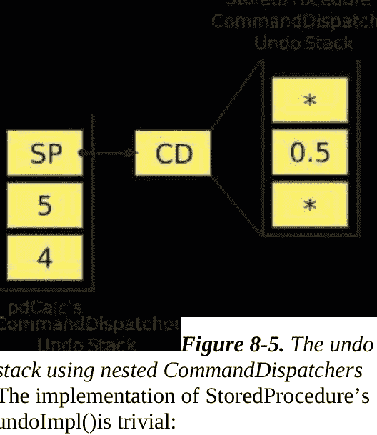

## Figure 8-5. The undo stack using nested CommandDispatchers

StoredProcedure 的 undoImpl() 实现很简单：

```
void StoredProcedure::undoImpl () noexcept
{
for(unsigned int i = 0; i < tokenizer_->nTokens(); ++i) ce_->commandEntered("undo");
return;
}
```

撤销是通过请求


底层 CommandDispatcher 用于撤销存储过程中命令的数量。在结束对最终 StoredProcedure 类的讨论之前，我们应该考虑 StoredProcedure 类中命令的标记化。StoredProcedure 的标记化过程涉及两个步骤。必须打开并读取存储过程文件，然后对文本流进行实际标记化。此过程需要在每次 StoredProcedure 实例化时仅执行一次，在初始化时执行。因此，标记化的自然位置是在 StoredProcedure 的构造函数中。然而，将标记化放在 StoredProcedure 的构造函数中会与 pdCalc 对命令的错误处理程序不一致。特别是，pdCalc 假定命令可以构造，但不一定可以无失败地执行。如果命令无法执行，则期望此错误通过检查命令的前置条件来处理。标记化会失败吗？当然会。例如，如果无法打开存储过程文件，标记化就会失败。因此，为了保持错误处理的一致性，我们在 StoredProcedure 的 checkPreconditionsImpl() 函数中实现标记化，该函数将在 pdCalc 的 CommandDispatcher 第一次尝试执行存储过程时被调用。由于标记化只需要执行一次，因此我们仅在 checkPreconditionsImpl() 函数的第一次执行时执行该操作。完整的实现可以在 StoredProcedure.cpp 文件中找到。

## 设计更实用的计算器

到目前为止，关于 pdCalc 的所有讨论都集中在可从 GitHub 下载的已完成代码的设计和实现上。然而，本章的其余部分标志着这种风格的转变。从现在开始，我们只会讨论扩展的想法以及 pdCalc 如何修改以适应这些新功能的建议。不仅没有提供工作代码，而且在撰写这些章节之前也没有创建工作代码。因此，我即将讨论的设计尚未经过测试，选择完成这些扩展的大胆读者可能会发现所讨论的想法并不理想，或者，敢说，错误。欢迎来到从空白处设计功能的狂野西部！需要实验和迭代。

## 复数

计算器的原始设计规范要求使用双精度数，我们明确设计并实现了计算器仅处理双精度数。然而，需求会发生变化。假设你的同事，一名电气工程师，来到你的办公室，爱上了你的计算器，但需要一个能处理复数（虚数）的计算器。这是一个合理的要求，所以让我们看看如何重构我们的计算器以

需要解决的问题是复数将如何被解释和呈现。例如，我们是否希望复数 c 表示为 c = re + im * i（也许虚数应为 j，因为功能请求来自电气工程师）。也许我们更喜欢使用 c = (re, im) 或使用角括号或方括号的变体。对此问题没有正确答案。虽然某些选择可能比其他选择更容易实现，但由于这只是一个约定，实际上，我们会将解决权交给我们的客户。对于我们的案例研究，我们将简单地采用约定 c = (re, im)。

我只会讨论修改命令行版本的 I/O。一旦为 CLI 建立了处理复数的基础设施，适配 GUI 应该相当直接。我们遇到的第一个问题是 Tokenizer 类。该类的原始设计只是通过按空白分割输入来进行标记化。然而，对于复数来说，这种方案是不够的。

例如，复数将根据是否在逗号后插入空格而被不同地标记化。

在某个时候，输入变得足够复杂，以至于你需要采用语言语法并将简单的输入例程迁移到“真正的”扫描器和解析器（可能使用 lex 和 yacc 等库）。有些人可能会争辩说，通过添加复数，我们已经达到了这种复杂程度。然而，我认为如果我们修改 tokenize() 例程以扫描 ( 标记并为开头和结尾括号之间及包括括号在内的任何内容创建一个“数字”标记，我们就可以利用现有的简单输入标记化器。显然，我们需要执行一些基本错误检查以确保格式正确。另一种替代方案是基于正则表达式匹配来分解输入流。这基本上就是 lex 的工作原理，我会在从头编写复杂的扫描器之前调查使用 lex 或类似库。

我们遇到的下一个输入问题是 CommandDispatcherImpl 的 executeCommand() 函数中数字的解析。目前，一个字符串参数（标记）被传递给此函数，并解析该字符串以确定它是数字还是命令。经检查，我们可以看到如果修改 isNum() 以识别并返回复数而不是浮点数，executeCommand() 将适用于复数。最后，EnterNumber 命令需要更新以接受并存储 complex<double>。

这解决了修改输入例程的问题，但我们如何修改输出例程？请记住，Cli 类是 Stack 的 stackChanged() 事件的（间接）观察者。每当 Stack 引发此事件时，Cli 的 stackChanged() 函数将被调用以将当前堆栈输出到命令行。让我们检查 Cli::stackChanged() 是如何实现的。基本上，CLI 通过以下函数调用回调堆栈以使用以下函数调用填充容器中的前 nElements：

```
auto v =
Stack::Instance().getElements(nElements);
```

然后创建一个 ostringstream，oss，并首先用一些堆栈元数据填充，然后使用以下代码用堆栈元素填充：

```
size_t j{ v.size() };
for(auto i = v.rbegin(); i != v.rend(); ++i)
{

oss << j << ":\t" << *i << "\n";
--j;
}
```

最后，oss 的底层字符串被发布到 CLI。令人惊讶的是，一旦修改 Stack 的 getElements() 函数以返回 vector<complex<double>>，Cli 的 stackChanged() 函数将仅通过重新编译即可按预期工作。由于我们使用了 auto，并且 operator<<( ) 已为 std::complex 重载，只要我们对复数的标准格式满意，我们的输出修改就在什么都不做的情况下完成了！这就是设计良好且实现良好的代码的美妙之处。

### 8.2.1.2 修改堆栈

在第 3 章中，我们最初设计计算器的堆栈仅操作双精度变量。显然，这一限制意味着 Stack 类现在必须重构以处理复数。当时，我们质疑为堆栈硬编码目标数据类型的逻辑，我建议不要设计通用的 Stack 类。我的建议通常是，不要在第一次重用案例明确建立之前设计通用接口。

设计良好的通用接口通常比设计特定类型更困难，从我的个人经验来看，我发现代码的偶然重用很少会实现。然而，对于我们的 Stack 类，重用此数据结构用于另一种数据类型的时机已经到来，此时将 Stack 的接口转换为通用接口而不是仅仅将类重构为硬编码复数是明智的。

使 Stack 类通用几乎和你预期的那样容易。第一步是通过用通用类型 T 替换对 double 的显式使用，使接口本身通用。接口变为

```
template<typename T>
class Stack : private Publisher
{
public:

static Stack& Instance();
void push(T, bool suppressChangeEvent = false);
double pop(bool suppressChangeEvent = false);
void swapTop();

std::vector<T> getElements(size_t n) const;
void getElements(size_t n, std::vector<T>&)
```


```
const;
using Publisher::attach;
using Publisher::detach;
};
```

使用通用接口后，就不再需要 pimpl 模式了。回想一下，使用 pimpl 模式能够通过指向仅在源文件中定义的实现类的指针间接引用类的实现，从而隐藏类的实现。然而，为了使 Stack 泛型化，其实现也必须泛型化，因为它必须存储任意类型 T，而不是单一已知类型 double。这意味着 StackImpl 也需要被模板化。C++ 规则坚持 StackImpl<T> 的定义必须在 Stack<T> 对特定 T 实例化时可见，因此要求 StackImpl<T> 的定义出现在 Stack<T> 之前的头文件中。一旦我们失去了将 StackImpl<T>设为私有的能力，就不再有使用 pimpl 模式的理由，而应直接在 Stack<T> 的

类中定义栈的实现。

总体而言，所需实现的更改是直接的。用 T 替换 double 的使用，并将实现本身移至头文件。pdCalc 中 Stack 类的使用显然必须重构为使用泛型接口而非非模板化接口。

接口中需要修改的最后一部分是第 7 章中为将栈命令导出到插件而添加的五个全局 extern "C" 辅助函数。因为这些函数必须具有 C 链接，所以我们不能使它们成为模板，也不能用 C++ 复杂类型代替 double 进行返回。第一个问题乍看之下并不像看起来那么严重。虽然我们的目标是使 Stack 类泛型化且可重用，但栈的插件接口不需要泛型。对于 pdCalc 的任何特定版本，无论是操作实数还是复数的版本，系统中只会存在 Stack<T> 的一个特定实例化，并且该实例化对 T 有特定的实现。因此，pdCalc 对栈的 C 链接接口只需要反映计算器中使用的 T 的选择即可。也就是说，容器被设计为泛型且可重用，但插件的接口不需要这种灵活性，因为一旦为计算器选择了数据格式，它就不会被重用。

用 Complex<double> 表示法替换 C 链接接口中的栈是直接的。我们有几个选项。首先，我们可以用两个 double 的序列替换每个 double，一个表示实部，一个表示虚部。当然，由于函数不能返回两个 double，我们必须修改返回栈值的函数，使其在参数列表中使用指针参数来“返回”复数值。第二个选项是通过数组返回复数。鉴于我倾向于在可能的情况下消除接口中的原始指针，我认为这种选项不是最优的。最后

一种解决方案，也是我首选的选择，就是简单地定义一个结构体，如

```
struct Complex {
 double re;
 double im;
 };
```

来补充接口函数，用 Complex 替换当前对 double 的使用。虽然这个新的 Complex 结构体确实复制了标准 complex 类的存储，但我们不能在纯 C 接口中使用标准 complex 类。

## 8.2.1.3 修改命令

修改命令以使用复数其实非常容易，因为 C++ 库为计算器所需的所有数学运算提供了重载。除了将 Stack 替换为 Stack<complex<double>> 的语法更改外，以及在 BinaryCommand 和 UnaryCommand 中用 complex<double> 替换 double，绝大多数命令都保持不变。例如，清空实数栈与清空复数栈是相同的。添加两个复数与添加两个实数是相同的，得益于运算符重载。当然，我们可能想要添加诸如复共轭之类的额外命令，但即使这种功能也由 C++ complex 类提供。如果您创建的命令使用了 complex 类原生不支持的算法，那么在修改命令以支持复数时，您更可能遇到数学上的困难而非程序上的困难。

## 变量

本章前面，我们将存储过程实现为存储简单指令序列的方法。虽然存储过程对于仅使用每个输入一次的简单操作来说效果很好，例如毕达哥拉斯定理，但您在尝试实现使用每个输入多次的更复杂公式时，例如二次公式，很快就会遇到问题。为了克服这一困难，您需要实现将参数存储在命名变量中的能力。

在 pdCalc 中实现变量将需要对现有组件进行多项修改，包括添加一个突出的新组件，即符号表。为了示例代码的简单性，我已改回使用实数表示法来表示 pdCalc。然而，使用复数不会增加额外的设计复杂性。让我们现在探讨一些实现变量的可能设计思路。

## 输入和新命令

显然，使用变量需要某种提供符号名称的方法。目前，我们的计算器仅接受数字和命令作为输入。输入任何在 CommandRepository 中找不到的字符串都会导致错误。

然而，请回想一下，此错误是在 CommandDispatcher 中生成的，而不是在 tokenizer 中。因此，我们需要修改 CommandDispatcher，使其不再拒绝字符串，而是以某种方式将其放置在栈上。现在，我们假设栈可以接受字符串和数字。我将在后续章节中讨论对 Stack 类的必要修改。再次说明，我将讨论限制在命令行界面。图形用户界面唯一额外的复杂性是提供输入字符字符串而不仅仅是数字的机制，或许是伴随虚拟数字键盘的虚拟键盘。

从技术上讲，我们可以允许任何字符串代表变量。然而，我们可能最好将允许的语法限制为某些字符串子集，可能用符号分隔以区分变量名和命令。因为这种选择纯属约定，所以您可以自由选择适合您或您用户口味的任何规则。个人而言，我

可能会选择类似 *变量名必须以字母开头，并且可以包含字母、数字以及可能的一些特殊符号，如下划线的任意组合*。为了消除变量名与命令之间的混淆，我会用单引号或双引号将变量括起来。

现在我们已经确定了变量的语法，我们仍需要一种机制来从栈中取出一个数字并将其存储到变量中。完成此任务的最简单方法是提供一个新的二元命令 store，该命令从栈中移除一个数字和一个字符串，并在符号表中创建将此变量名链接到此数字的条目。例如，考虑栈

4.5
2.9
"x"

发出 store 命令应导致符号表中出现 x → 2.9 的条目，并且结果栈为

# 4.5

隐式地，变量在使用时应被转换为数字以供计算使用，但在栈上应显示为名称。我们还应提供一个显式命令 eval，用于将符号名转换为数字。例如，给定栈

"x"

发出 eval 命令应导致栈变为

2.9

此类命令的实现应该相当明显：用符号表中该变量的值替换栈顶的变量。显然，请求对符号表中不存在的变量进行求值应导致错误。对数字进行求值可以导致错误，或者更可取地，只是返回该数字。您可能可以想到许多用于处理变量的花哨命令，例如列出符号表。然而，store 和 eval 命令构成了最小


necessary command set to use variables.

## Number Representation and the Stack

Until now, our stack has only needed to represent a single, unique type, either a real or complex number. However, since variables and numbers can both be stored on the stack, we need the ability for the stack to store both types simultaneously. We dismiss immediately the notion of a stack that could handle two distinct types simultaneously because this would lead quickly to chaos. Instead, we seek a uniform representation capable of handling both number and variable types through a single interface. Naturally, we turn to a hierarchy.

Consider the design expressed in the class diagram in Figure 8-6. This hierarchy enables both Variables and Numbers to be used interchangeably as Values. This polymorphic design solves three problems that we’ve already encountered. First, Variables and
Numbers can both be stored uniformly in a Stack<Value*> (likely using a more appropriate smart pointer storage scheme). Second, when commands such as Add or Sine need a number to perform an operation, they can pop Values from the stack and request doubles through the virtual evaluate() function. Obviously, a Number directly stores the double that it represents, while a Variable stores the variable’s name, which can be converted to a numeric value via lookup in the variable symbol table. Finally, subclasses of Value can return a string representation of their underlying value (either a Number’s numeric value or a Variable’s name). This string conversion is necessary for display on the I/O stack.

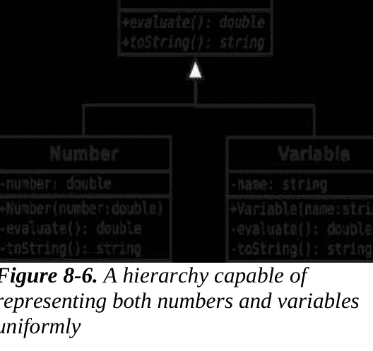

Figure 8-6. A hierarchy capable of representing both numbers and variables uniformly

## 8.2.2.3 The Symbol Table

At its core, a symbol table is merely a data structure that allows symbolic lookup by pairing a key to a value (an associative array). In this case, the name of the variable serves as the key and the numeric value serves as the value. The C++ standard library provides this service directly through either a map or an unordered_map, depending on the desired
underlying data structure. However, as in Chapter 3, I highly recommend against directly using a standard library container as an external facing interface within a program. Instead, one should employ the adapter pattern to encapsulate the library container behind an interface defined by the application itself. This pattern adds no restrictions to the users of a class, but it does permit the designer to restrict, expand, or later modify the component’s interface independently of the interface of the underlying library container.

Therefore, the recommended design for a symbol table is to create a SymbolTable class to wrap an unordered_map<string, double>. This underlying hash table provides a storage type to map between the variable name as a string and the underlying numeric value. The public interface for the SymbolTable class provides member functions for adding and, optionally (we did not specify a command for clearing variables), removing variables from the symbol table. The SymbolTable should probably be implemented as a singleton since
we only need one symbol table in the calculator.

## A Trivial Extension: Numeric Constants

Once we’ve established the mechanics for storing user-defined variables, we can make a trivial extension to provide user-defined constants. Constants are simply variables that cannot be altered once set. Constants could be hard coded in pdCalc, added at program launch through reading a constants file, or added dynamically during calculator execution.

Obviously, in order to store a constant, we will need to add a new command; let’s call it cstore. cstore works identically to store except that the command informs the symbol table that the variable being stored cannot be changed. We have two obvious options for implementation. First, inside the SymbolTable class, we add a second map that indicates whether a given name represents a
variable or a constant. The advantage of this approach is that adding an additional map will require minimal implementation changes to the existing code. The disadvantage is that this approach requires two independent lookups for each call to the symbol table. The better approach is to modify the original map to store the value type as an Entry instead of a double, where an Entry is defined as

```
struct Entry
{
double val; bool isConst;
};
```

Of course, to avoid hard coding the double type, we could, of course, template both SymbolTable and Entry.

## Functionality Enabled by Variables

Let’s examine what variables enable us to do. Consider the quadratic equation ax²+bx+c = 0 with roots given by r = (-b ± sqrt(b²-4ac))/2a

Where we formerly could not write a stored procedure for computing both roots, we can now write the stored procedure

```
"c" store "b" store "a" store "b" 2 pow 4 "a"
"c" * - sqrt "root" store "b" - "root" + 2 a * /
"b" - "root" 2 a * /
```

which will take three entries from the stack representing the coefficients a, b, c and return two entries representing the roots of the quadratic equation. Now our calculator is getting somewhere!

## Some Interesting Extensions for Self-Exploration

This chapter concludes with a section listing a few interesting extensions to pdCalc that you might consider trying on your own. In contrast to the previous section, I offer no design ideas to get you started. I have provided merely a brief description of each challenge.

### High DPI Scaling

Monitors with extremely high pixel resolutions are becoming increasingly the norm. Consider how you would modify the GUI for pdCalc to properly handle scaling for such displays. Is this feature operating system independent or do we have another use for the PlatformFactory from Chapter 7? Since version 5.6, Qt helps you out with this task via an interface for high DPI scaling.

### Dynamic Skinning

In Chapter 6, a class was introduced to manage the look-and-feel of the GUI. However, the provided implementation only centralized the look-and-feel. It did not permit user customization.

Users often want to customize the look-and-feel of their applications. Applications that permit such changes are considered “skinable,” and each different look-and-feel is a called a skin. Consider an interface and the appropriate implementation changes necessary to the LookAndFeel class to enable skinning of pdCalc. Some possible options
include a dialog for customizing individual widgets or a mechanism to choose skins from skin configuration files. Having a centralized class to handle the look-and-feel for the application should make this change straightforward. Don’t forget to add a signal to LookAndFeel so the other GUI elements will know when they need to repaint themselves with a new appearance!

### Flow Control

With variables, we greatly enhanced the flexibility of stored procedures. For computing most formulas, this framework should prove sufficient. However, what if we wanted to implement a recursive formula such as computing the factorial of a number? While we have the ability to perform such complex computations via plugins, it would be nice to extend this functionality to users of the calculator who are not also experienced C++ programmers. To accomplish this task, we would need to devise a syntax for flow control. The simplest design would at least be able to handle looping and conditional
operations. Adding flow control to pdCalc would be a fairly significant enhancement in terms of both added capability and implementation effort. It might be time to move to a real scanner and parser!

### An Alternative GUI Layout

The pdCalc GUI currently has a vertical orientation inspired by the HP48S calculator. However, modern screen resolutions tend to be wider than they are tall, making the vertical orientation suboptimal. Hard coding a horizontal orientation is no more challenging than the original vertical orientation. Consider instead how to redesign pdCalc to be able to switch between orientations at runtime. Maybe vertical orientation is simply a different skin option?

### A Graphing Calculator

The HP48 series of calculators were not merely scientific calculators, they were graphing calculators. Although it might not


尽管已有复杂的独立绘图程序，为计算机实现一个绘图计算器或许是可行的，而且这个练习可能会非常有趣。自 5.7 版本起，Qt 新增了一个绘图模块，使这项任务比以往轻松得多。有了这一套绘图控件，最大的挑战也许只是设计一种图形输入方法。如果你有兴致来一次 20 世纪 70 年代的复古怀旧，不妨考虑为命令行界面实现一个 ASCII 绘图计算器！

## 插件管理系统

目前，插件在 pdCalc 启动时加载，加载哪些插件是通过读取文本文件中的共享库名称来决定的。插件一旦加载，就无法卸载。请考虑实现一个动态插件管理系统，使插件可以在运行时被选择、加载和卸载。你甚至可以扩展插件接口，以支持动态查询插件描述。我认为，这里的真正难点在于：当某个插件的一条命令当前位于撤销/重做堆栈上时，该如何处理该插件的卸载。

## 移动设备界面

在我最初筹划这本书时，我曾设想用一章来介绍如何将 pdCalc 扩展到 iOS 或 Android 平板电脑。Qt 库同样可以帮你完成这项任务。我之所以没有在本书中加入这一章，是因为我没有任何平板电脑编程的实践经验。我觉得，仅凭我对该设计领域的初次尝试，就试图教别人如何设计平板电脑界面，是一种不诚实的行为。嗯，那或许会是一个糟糕设计的绝佳范例！尽管如此，将 pdCalc 扩展到平板电脑或智能手机界面仍是一个值得接受的挑战，也是我留给你的最后一个挑战。

# 附录 A

### 获取、构建和执行 pdCalc

本附录说明如何获取和构建本书所描述的程序 pdCalc。

#### 获取源代码

pdCalc 的源代码托管在 Apress 的 GitHub 仓库中。要找到正确的仓库，最简单的方法是通过本书的 Apress 网站：

[http://www.apress.com/us/book/97814842305](http://www.apress.com/us/book/97814842305)

点击“下载源代码”按钮将直接带你进入 GitHub 托管站点。到达那里后，你有两种下载源代码的选择。第一种选择是使用 git 客户端（[https://git-scm.com/](https://git-scm.com/)）并将仓库克隆到本地计算机。

对于熟悉使用 git 管理源代码的人来说，这是首选的源代码获取方式。使用 git 克隆仓库，你可以定期从在线仓库拉取更新和错误修复。也许你甚至会决定亲自为 pdCalc 贡献一个错误修复！获取源代码的第二种选择是从 GitHub 下载 pdCalc 的单个 zip 文件。显然，如果你对代码做了任何本地修改，下载单个 zip 文件会使源代码的更新远比使用 git 困难。

#### 依赖项

现在你有了源代码，可能希望构建并执行 pdCalc 及其单元测试套件。不过，在完成这一目标之前，你还需要确保拥有合适的工具链。pdCalc 有意将外部依赖保持在极少状态，实际上只有两个，而且这两个依赖都可以免费获得，支持 Linux、Windows 或 Mac OS X。要构建 pdCalc，你需要一个现代的 C++ 编译器（符合 C++14 标准）和 Qt（版本 4 或 5）。

作为愿意通读本书的人，你很可能已经拥有 C++ 编译器，或知道如何获取。话说回来，为了简单起见，我为 pdCalc 提供的构建系统假定使用 gcc 编译器（在 Windows 中是 mingw）。如果你的 Linux 系统上没有 gcc，通常可以通过系统包管理器安装。如果安装失败，也可以从自由软件基金会的网站（https://gcc.gnu.org/）下载。在 Windows 上，mingw 作为可选组件与 Qt 捆绑在一起。我非常推荐通过 Qt 的安装程序获取它。

在 Linux 上，Qt（包括其名为 Qt Creator 的原生集成开发环境（IDE））通常可以通过系统包管理器获取。如果选择这种途径，请确保安装 Qt 的开发包，而不只是运行时库。对于 Linux 和 Windows，Qt 也可以从 http://www.qt.io/download/ 下载。进入网站后，选择“桌面和移动版”，然后选择适合你使用场景的授权版本。pdCalc 以 GPL 第 3 版发布，因此与 Qt 的开源版本兼容。在 Qt 的下载页面上，你可以选择完整可下载的二进制安装程序、基于网络的二进制安装程序，或者完整源代码。除非你有从源代码构建复杂库的经验，否则我推荐使用二进制安装程序之一。在 Windows 上，请务必安装 mingw 编译版本的 Qt 以及 mingw 工具链。在所有操作系统上，尽管并非绝对必要，我仍然强烈建议安装 Qt Creator。请耐心等待下载。Qt 及其众多模块是一个功能强大但体积相当大的软件包。

#### 构建 pdCalc

为了避免额外的依赖，pdCalc 的目标代码是使用你工具链自带的 make 工具构建的，该工具会调用编译器和链接器。对于 pdCalc，在 Linux 系统上，你将使用 make，它会调用 gcc 进行编译和链接。在 Windows 系统上，你将使用 mingw32-make，它会调用 mingw 编译器和链接器。

既然你已经了解 qmake 的工作原理，下面我们来看看如何使用 Qt Creator 或命令行构建 pdCalc。

##### 使用 Qt Creator

如果你倾向于使用 Qt Creator，使用 qmake 的大部分复杂性都会对你隐藏起来。开始时，只需启动 IDE，然后打开 pdCalc.pro 项目。该文件位于源代码树的顶层。

当你第一次使用 Qt Creator 打开 qmake 项目文件时，会看到一个配置列表，询问你要以哪个版本的 Qt 为目标。如果计算机上只有一个版本的 Qt，你可能只有一个选项。如果你展开所选 Qt 版本的“详细信息”按钮，就可以配置 pdCalc 为调试（debug）、发布（release）和分析（profile）模式，并可以选择一个文件夹作为源外构建目录。选择好配置选项后，点击“配置项目”按钮。如果之后需要更改配置选项，Qt Creator 有相应的工具。

Qt Creator 配置完你的项目后，你将进入项目的编辑模式。Qt Creator 的编辑模式是浏览源代码的好工具。完整的源代码树会显示在界面左侧的可展开树形控件中，单击即可打开各个文件。pdCalc 的源代码树在附录 B 中描述。

Qt Creator 的工作方式与你可能使用过的任何其他功能完备的 IDE 类似，完整的使用说明超出了本附录的范围（完整手册见 http://doc.qt.io/qtcreator/）。不过，我将重点介绍一些快速功能，帮助你入门。

要学习的第一个快捷操作是选择要构建和运行的项目配置。这些选项通过显示区域左下方的显示器图标来选择。该图标当前会显示活动项目（如果只加载了 pdCalc 一个项目，则为 pdCalc）和当前配置（例如 Debug 或 Release）。单击这个显示器图标，会打开一个窗格，让你选择要构建的配置以及要运行的可执行文件。对于 pdCalc，你有四个可执行选项：pdCalc、pdCalc-simple-cli、pdCalc-simple-gui 和 testDriver。pdCalc 运行 pdCalc 的完整版本（默认是 GUI），pdCalc-simple-cli 运行第 5 章末尾构建的简单 CLI，pdCalc-simple-gui 运行第 6 章末尾构建的简单 GUI，testDriver 运行单元测试套件。如果要更改构建或运行配置选项，可以点击“Projects”按钮（文件夹图标），在……


显示器左侧打开配置面板。点击“编辑”按钮将返回编辑模式。

pdCalc 可以通过“构建”菜单或点击显示器左下角的锤子图标（至少在我看来是这样）来构建。如果你想在构建时查看编译器输出，请点击屏幕底部的“编译输出”按钮。如果你遇到任何构建问题，可以在同一信息面板的“问题”选项卡中找到。点击其中一个问题，应该会跳转到对应的源代码出错行。希望 pdCalc 能顺利构建，没有问题、没有警告、也没有错误。如果你遇到构建问题，请参阅下面的“故障排除”部分。

### A.3.2 使用命令行

如果你不喜欢 Qt Creator，也可以直接在命令行构建 pdCalc。qmake 支持源外构建，这也是推荐策略。只需为你要构建的每种 pdCalc 配置创建一个构建目录，将路径切换到构建目录，然后执行以下命令：

```bash
qmake -recursive CONFIG+=$CONFIG
$PATH_TO_PDCALC
```

其中 $CONFIG 可以替换为 debug 或 release（如果未指定 CONFIG 选项，默认为 debug），$PATH_TO_PDCALC 应替换为 pdCalc 的 pdCalc.pro 文件所在路径。

上述命令会触发 qmake 递归遍历 pdCalc 目录树，读取每个项目文件并编写相应的 makefile。如果一切正常执行，上述命令的输出应是一系列提示行，告诉你 qmake 读取了哪些项目文件。makefile 编写完成后，就可以通过执行 make 命令来构建 pdCalc。

源代码已过期，执行开始前将先构建项目。如果你当前选择了 testDriver 可执行文件，单元测试套件将执行，其输出将显示在“应用程序输出”信息面板中。希望你能看到各个测试通过的详细信息，并以“所有测试通过”的最终消息结束。如果你当前选择了 pdCalc 或 pdCalc-simple-gui 可执行文件，GUI 应会启动。如果你选择了 pdCalc-simple-cli 可执行文件，CLI 将在“应用程序输出”信息面板中启动。但是，你无法通过此面板与 CLI 交互，因此这种执行 CLI 的方式相当没用。

## 使用命令行

由于共享库处理方式的细微差异，Unix（包括 Linux）和 Windows 构建将二进制文件输出到不同的目录。在 Unix 系统上，所有可执行文件都构建在 bin 目录中，所有共享库都构建在 lib 目录中。因此，在启动可执行文件之前，必须将 pdCalc 的 lib 目录添加到库路径中。例如，要在 Linux 上通过命令行执行 pdCalc，必须先执行以下命令：

```
export
LD_LIBRARY_PATH=$PATH_TO_PDCALC_LIB
```

其中 $PATH_TO_PDCALC_LIB 是 pdCalc lib 目录的相对路径或绝对路径。例如，如果从 bin 目录执行 pdCalc，$PATH_TO_PDCALC_LIB 可以设置为相对路径 ../lib。

Windows 不会将共享库路径与可执行文件路径分开。这种无区分意味着要么必须将 lib 目录添加到主路径中，要么 pdCalc 的库必须位于 bin 目录中。我在 Windows 上选择了后一种方案来构建 pdCalc。也就是说，可执行文件和动态链接库都直接构建到 bin 目录中。

构建 pdCalc 会生成四个可执行文件：

pdCalc、pdCalc-simple-cli、pdCalc-simple-gui 和 testPdCalc（在 Windows 中都有 .exe 扩展名）。testPdCalc 运行单元测试套件；它是一个纯命令行程序。在每个单元测试运行时，你会看到各个测试的名称、每个测试的通过或失败情况，以及每个单元测试套件的一些统计信息。如果所有测试都通过，最终输出将显示“所有测试通过”的消息。

pdCalc 可执行文件启动完整的计算器。可以使用 --gui 选项启动图形用户界面，使用 --cli 选项启动命令行界面，使用 --batch 选项以批处理模式运行计算器。批处理操作需要输入文件，并且可选地需要输出文件。pdCalc 还可以使用 --help 选项查看各种操作模式的列表。如果未给出命令行选项，pdCalc 默认启动 GUI。

pdCalc-simple-cli 可执行文件启动第 5 章末尾构建的简单 CLI。pdCalc-simple-gui 可执行文件启动第 6 章末尾构建的简单 GUI。严格来说，这两个可执行文件都不是必需的。它们只是为了方便读者在 pdCalc 达到功能完整状态之前能够运行它。用敏捷术语来说，这些功能不完整的可执行文件提供了最小可行产品的各个阶段。

## A.5 故障排除

为简单起见，默认的 qmake 项目文件假定使用基于 gcc 的编译器（Windows 中使用 mingw）。理论上，源代码应该可以在任何平台上使用任何兼容 Qt 且符合 C++14 标准的编译器无需修改即可构建。但现实世界的生活似乎永远无法与这种理想吻合。因此，如果你选择使用不同的编译器，可能需要对编译和链接的标志进行一些更改。特别是，pdCalc 无法使用 Microsoft 提供的 MSVC 编译器通过默认配置构建。可能还需要额外的修改来支持使用 MSVC 从 DLL 导出名称。如果我收到足够的读者请求，我可能会在未来的更新中将 MSVC 纳入构建系统。

上述告诫已经说明，尽管我付出了相当大的努力来确保 pdCalc 构建无故障，我仍然发现 Qt、gcc、环境变量、操作系统，甚至可能还有天气的每一种不同组合，都会设法产生一些新的、奇妙的构建错误。如果你遇到构建或运行时错误，我鼓励你努力自行诊断和纠正。诊断和纠正构建错误是值得掌握的技能。这也会让你更加感激团队中那个负责维护跨平台构建系统却默默无闻的人。通常问题只是编译器版本冲突或路径错误/缺失这样的小事。

在 Windows 上构建时，我发现了两个令人困惑的问题，现在我将详细说明，以免其他人花费过多时间调试它们。首先，我发现了一个晦涩的 qmake 仅限 Windows 的 bug。如果你在 Windows release 构建中看到“Fatal error: MainWindow.moc: No such file or directory”，恭喜你，你也遇到了。尝试更换 Qt 版本。该 bug 似乎已在 5.9.1 版本中修复。

如果你在构建 hyperbolicLnPlugin 时看到错误“The system cannot find the file specified”，则说明构建未能将 plugins.pdp.win 文件复制到 bin 目录。此错误表明 mingw32-make 在你的路径中找到了 sh.exe，并使用 sh.exe shell 进行构建，但 qmake 已将你的项目配置为使用标准 Windows shell，即 cmd.exe。如果你无法弄清楚路径中为什么会有 sh.exe，通常罪魁祸首是安装了 git。这个问题可以通过以下三种不同的解决方法中的任何一种来解决：

- 1. 从路径中移除 sh.exe 并重新构建。这将使 mingw32-make 正确地使用 cmd.exe 进行构建。

- 2. 手动将 plugins.pdp.win 文件复制到 bin 目录，将其重命名为 plugins.pdp，从 hyperbolicLnPlugin.pro 中删除第 16 行（以 win32:QMAKE_PRE_LINK+= 开头的那一行），重新运行 qmake，然后重新运行 mingw32-make。

- 3. 修改 hyperbolicLnPlugin.pro 的第 16 行，使用 Unix 的 cp 命令而不是 Windows 的 copy 命令。为此，只需将该行替换为

```
win32:QMAKE_PRE_LINK+=cp $$PWD
../../plugins.pdp.win
$$HOME/bin/plugins.pdp
```

重新运行 qmake，然后重新运行 mingw32-make。

最后，我确实理解，在一本新书上投入时间（可能还有金钱），却发现自己无法按照作者说明构建随附的源代码，这是极其令人沮丧的。如果你在尝试修复构建或运行时问题而未成功


如果你自己犯了错，并且发现自己准备把电脑（或这本书！）从最近的窗户扔出去，请给我发一封电子邮件（PracticalDesignBook@gmail.com）。我会尽我所能，尽可能快速且轻松地让你重新运行起来。

## 源代码的组织结构

观察源代码最简单的方式是通过 IDE（如 Qt Creator）。不过，本附录作为源代码树的导航指南提供。除了下面表格中列出的源代码文件外，源代码树还包含 qmake 项目文件、一些杂项配置文件、一些回归测试基线文件，以及一些回归测试基线文件。

源代码树的根级别包含

pdCalc 目录包含编译为 pdCalc 可执行文件的源代码。值得注意的是，该目录包含位于 main.cpp 中的 main() 函数，它是应用程序的入口点。

## pdCalc-simple-cli 目录

pdCalc-simple-cli 目录包含编译为第 5 章末尾定义的简单仅 CLI 可执行文件的源代码。该目录仅包含一个文件 main.cpp。

## pdCalc-simple-gui 目录

pdCalc-simple-gui 目录包含编译为在末尾定义的简单仅 GUI 可执行文件的源代码。

- Command.cpp
- CommandDispatcher.cpp
- CommandManager.cpp
- CommandRepository.cpp
- CoreCommands.cpp
- DynamicLoader.cpp
- PlatformFactory.cpp
- PluginLoader.cpp
- PosixDynamicLoader.cpp PosixFactory.cpp
- Stack.cpp
- StackPluginInterface.cpp
- StoredProcedure.cpp
- WindowsDynamicLoader.cpp
- WindowsFactory.cpp

## B.1.6 cli 目录

cli 目录包含命令行界面模块的源代码。该模块是 pdCalc 中最简单的模块之一，只包含两个文件 Cli.h 和 Cli.cpp。

## gui 目录

gui 目录

gui 目录包含图形用户界面的源代码。该目录中的文件涵盖了主 GUI 窗口、GUI 的输入和输出类，以及控制 GUI 外观和风格的类。表 B-3 列出了 gui 目录中的源文件。

## 表 B-3. gui 目录中的源文件

| 头文件 | 源文件 |
|--------------|--------------|
| CommandButton.h | CommandButton.cpp |
| Display.h | Display.cpp |
| GuiModel.h | GuiModel.cpp |
| InputWidget.h | InputWidget.cpp |
| LookAndFeel.h | LookAndFeel.cpp |
| MainWindow.h | MainWindow.cpp |
| StoredProcedureDialog.h | StoredProcedureDialog.cpp |

## plugins 目录

plugins 目录是 pdCalc 插件的源代码占位目录。它只包含一个子目录 hyperbolicLnPlugin，该子目录包含本书中开发的双曲函数和自然对数插件的源代码。hyperbolicPlugin 目录中的两个源文件是 HyperbolicLnPlugin.h 和 HyperbolicLnPlugin.cpp。实现插件加载和插件管理的源代码全部包含在 backend 目录中。

## test 目录

test 目录是 pdCalc 所有单元测试的根目录。该目录只是以下子目录的容器，每个子目录测试与其名称对应的模块：testDriver、utilitiesTest、backendTest、cliTest、pluginsTest。虽然我愿意相信自己在全面测试 pdCalc 方面已经很勤勉，但我确定两件事：我本可以更多地测试代码，而且出版后仍会发现错误。下面我将详细介绍 test 下每个目录的内容。

## testDriver 目录

testDriver 目录包含一个源文件 main.cpp。该文件设置 Qt Test 环境并注册所有单独的测试模块。main.cpp 编译为 testPdCalc 可执行文件（Windows 中为 testPdCale.exe），该文件负责运行所有单元测试。

## utilitiesTest 目录

utilitiesTest 目录包含测试 utilities 模块所需的文件。该目录中包含的文件见表 B-4。

## 表 B-4. utilitiesTest 目录中的源文件

| 头文件 | 源文件 |
| --- | --- |
| PublisherObserverTest.h | PublisherObserverTest.cpp |
| TokenizerTest.h | TokenizerTest.cpp |

## backendTest 目录

backendTest 目录包含用于测试 pdCalc 后端模块的源代码。该目录中的文件见表 B-5。除了源代码文件之外，该目录还包含一个包含测试存储过程的 hypotenuse 文件，以及文件 plugins.unix.pdp 和 plugins.unix.win，它们是两个相应操作系统的插件加载器文件。

## 表 B-5. backendTest 目录中的源文件

| 头文件 | 源文件 |
| --- | --- |
| CommandDispatcherTest.h | CommandDispatcherTest.cpp |
| CommandManagerTest.h | CommandManagerTest.cpp |
| CommandRepositoryTest.h | CommandRepositoryTest.cpp |
| CoreCommandsTest.h | CoreCommandsTest.cpp |
| PluginLoaderTest.h | PluginLoaderTest.cpp |
| StackTest.h | StackTest.cpp |
| StoredProcedureTest.h | StoredProcedureTest.cpp |

## cliTest 目录

cliTest 目录包含测试命令行界面所需的源代码文件。该目录中的两个源文件是 CliTest.h 和 CliTest.cpp。除了源文件之外，cliTest 目录还包含一个子目录 testCases。testCases 目录包含用于测试命令行界面的输入文件和输出基线文件。

## guiTest 目录

一般来说，自动测试图形用户界面是困难的。在 pdCalc 的单元测试中，只有 GUI 中的 Display 类会被自动测试。用于测试 Display 类的两个源文件 DisplayTest.h 和 DisplayTest.cpp 位于 guiTest 目录中。

## pluginsTest 目录

pluginsTest 目录包含用于测试 pdCalc 自带的唯一插件——双曲函数和自然对数插件——的源文件。这些测试包含在以下两个源文件中：HyperbolicLnPluginTest.h 和 HyperbolicLnPluginTest.cpp。

模式, 33, 37, 38 聚合, 125
替代 GUI 布局, 222 分析, 9, 17, 21–27
架构

模型-视图-控制器, 12–14 多层, 12–14
n 层, 12, 13
三层, 13–17

作者联系方式, xx

## B

批量操作, 195–197 本书结构, xvi
桥接模式, 38

## C

CLI. 参见命令行界面 克隆, 66–67, 85
内聚性, 10–11, 16, 22, 25
命令

二元, 71, 74–76, 78, 79
类, 58, 60–62, 65, 66, 68, 71, 74, 76,
78, 82, 85, 87, 91
层次结构, 59, 71
模式

抽象, 58
应用, 61
注册, 88
一元, 71–75, 78
CommandButton
抽象, 122–123
设计, 123–127
接口, 127–128
命令数据, 102–103
CommandDispatcher, 58, 82, 91–95
命令调度器, 16, 17, 21–26
命令行界面
类, 105–112
设计, 107–112
实现, 97, 106, 108–112
需求, 9, 105–106, 111
CommandManager, 58, 76, 82, 83, 88, 89, 91, 93, 94
CommandRepository, 58, 65, 81–87, 91

复数, 211–218

组合模式, 205–209

组合, 125

耦合, 9–12, 14–17, 28

协方差, 67

## D

分解, 9–29

依赖项, 外部, 225–226

依赖反转, 189–190

243 Deque, 38

Display

设计, 134

改进的设计, 135–136 糟糕的设计, 134–135

动态换肤, 221–222

## H

Has-a 关系, 53

帮助函数, 67–68

高 DPI 缩放, 221

## E

封装, 10–11, 13, 15

事件数据, 42, 44, 47–51

事件, 14–15, 22–26, 32, 33, 35, 40–54

## F

外观模式, 123–124 工厂函数, 168–177 方法, 168, 170, 171 模式, 173–177

final 关键字, 79–81

流程控制, 222

函数, std, 74, 84, 85, 94

## G

gcc, 226, 227, 230, 231

Github, xix, 6, 225

图形用户界面

构建, 118–121

声明式风格, 120


- 命令式风格，120
- 模块化，122–132
- 需求，115–118

- 图形计算器，222
- GUI。*参见* 图形用户界面
- GUI 框架，xviii
- GuiModel，136–139

## I, J, K

- IDE。*参见* 集成开发环境
- Implements-a 关系，52
- 继承，41，52–54
- InputWidget
  - 设计，129–131
  - 接口，131–132
- 集成开发环境，118–121
- 接口，9–14，17–29
- Is-a 关系，52

## L

- Lambda 表达式，76，79，80
- 语言选择，xvii–xviii
- 里氏替换原则，52，61
- 外观与感觉，141–142
- LSP。参见 里氏替换原则

## M

- MainWindow，138–141，143
- make，226，227，229，231，232
- mingw，226，227，230
- 移动设备接口，223
- 模块化，10

### 模块接口样式

- DLL 隐藏，179–180
- 隐式隐藏，181
- pdCalc，181–182
- 源代码隐藏，178–179

- 移动语义，22，24，27

### 多平台设计

- 抽象工厂，172–177
- 构建系统，167–168
- 工厂函数，168–172
- 库，165
- 预处理器指令，165–167

## N

- Noexcept 关键字，158
- 非虚接口模式，62–64
- NVI 模式。参见 非虚接口模式

## O

- 面向对象设计，10
- 观察者模式，41–51，54
- 观察者，41–51，54，99，101–105，109
- Override 关键字，69–70

## P

- 模式
  - 架构，12，14–16，28
  - 设计，12，28
- pdCalc
  - 构建，226–229
  - 执行，229–230
- 完美转发，201–203
- Pimpl 惯用法，37–40
- 纯旧数据，34
- 插件管理系统，223
- 插件
  - 具体示例
    - 实现，190–192
    - 接口，187–189
  - C++ 规则，146–148
  - 定义，145–146
  - 基本问题，146，148
  - 集成
    - 注入，185–187
    - 加载，184–185
  - 接口
    - 添加 GUI 按钮，154–155
    - 分配/释放，156
    - API 版本控制，159–160
    - 命令发现，149–153
    - 命令，156–158
    - 堆栈可用性，160–161
  - 加载，161–177
  - 改造，177–183
- POD。参见 纯旧数据
- 实现指针惯用法。参见 Pimpl 惯用法
- 后置条件，63–65
- 后缀记法，3
- 前置条件，63–65，72–73，75，76，78，94，95
- 最小惊讶原则。*参见* 最小惊异原则
- 最小惊异原则，21，22
- 原型模式，83，85
- 代理模式，103，104
- 发布者，40–54，101–105

## Q

- qmake，226–232
- Qt，xviii，115，116，118，120，122–126，129–130，133，136，138–140，143，226–231
- Qt Creator，227–229
- Qt Test，226

## R

- RAII。*参见* 资源获取即初始化
- 重做。*参见* 撤销
- 需求，2–3，5–6
- 资源获取即初始化，154，184，185，189

- 目标受众，xv–xvi
- 测试，33，54–55

## U

- 撤销
  - 实现，59–61，89–91
  - 策略，70–74，90，91
- 统一初始化，86–87
- unique_ptr
  - 析构语义，153–154
- 用例，17–27
- 用户界面
  - 抽象，97–105，107
  - 事件，101–105
  - 模块，16，21–22
  - 观察者，103–105

## V

- 变量，216–222
- 可变参数模板，201–204

## W, X, Y, Z

- 包装模式。参见 适配器模式

