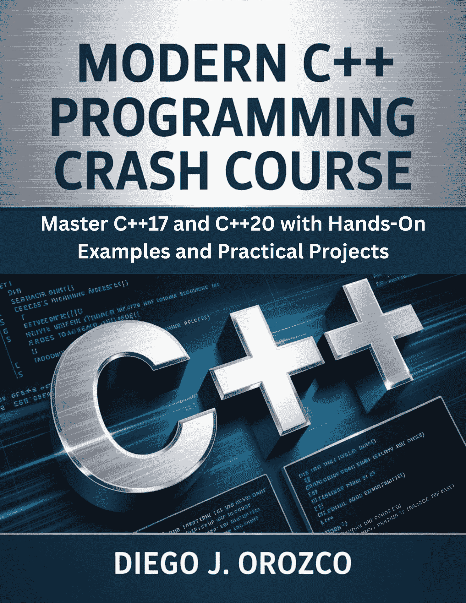

# 现代 C++ 编程速成课程：通过实用示例和实践项目掌握 C++17 和 C++20



未经所有者事先书面许可，本书的任何部分不得以任何形式或通过任何手段（电子、机械、摄影、录制或其他）进行复制、存储在检索系统中或传输，但评论或文章中的简短引用除外。

本书为非虚构作品（或虚构——根据需要调整）。尽管已尽力确保准确性，但作者和出版者对错误或遗漏，或因使用书中包含的信息而导致的任何损害不承担责任。

## 关于作者

Diego J. Orozco 是一位充满情的软件开发人员、教育者和作者，致力于帮助他人掌握编程和技术。多年，他参与了从小型应用程序到大型复杂系统的各种项目，在现代编程语言、框架和最佳实践方面积累了丰富的实践经验。

Diego 擅长将复杂的概念拆解为清晰易懂的课程，他指导了无数从初学者到资深专业人士的学习者提高技能并构建真实世界的项目。他的教学风格将理论与实践示例相结合，确保读者不仅理解事物如何工作，还理解它们为何这样工作。

# 引言：为什么在 2025 年学习现代 C++

在 2025 年学习现代 C++ 不仅仅是一个好主意，对于任何想在不断演变的软件开发领域脱颖而出的人来说，都是必要的。C++ 长期以来一直是编程世界的基石，支撑着从游戏引擎到高性能应用程序以及系统编程的一切一切。但随着我们深入 2020 年代，掌握现代 C++——特别是 `C++11`、`C++14`、`C++17` 和 `C++20`——重要性变得愈发明显。

学习现代 C++ 的主要原因之一是语言特性的大幅增强，这些特性提高了代码的效率和安全性。`C++11` 引入了智能指针，有助于有效地管理内存，减少了内存泄漏和悬挂指针的风险。这种向更安全内存管理的转变使得 `C++` 更加健壮，允许开发者编写更简洁、更易维护的代码。

转向 `C++14` 及后续版本，我们看到了进一步提高开发者生产力的改进。泛型 Lambda 表达式（generic lambdas）、二进制字面量和改进的类型推导等特性允许代码更具表达力且简洁。这些新增不仅让语言更加强大，也让工作变得更加愉快。例如，泛型 Lambda 允许编写可以操作任何类型的函数，这显著减少了样板代码并增加了灵活性。

`C++17` 引了许多许多改变规则特性，如结构化绑定（structured bindings）和 `std::optional`，它们有助于简化复杂的数据操作，并为原始指针提供了更安全的替代方案。标准模板库（`STL`）中引入的并行算法允许开发者以最小的精力利用多核处理器的力量，使应用程序运行更快、更高效。

接着我们有了 `C++20`，它引入了概念（concepts）——一种指定模板要求的强大方式，使得模板更容易易读和理解。这可以极大地降低模板密集型代码的复杂性，而这通常是许多程序员的障碍。此外，ranges 库（ranges library）简化了对数据序列的操作，使得编写整洁、函数式风格的代码变得更容易。

除了技术特性之外，在 2025 年学习现代 C++ 会让你在职场市场中占据战略性的有利位置。许多行业，包括游戏、金融和嵌入式系统，都高度依赖 `C++`。理解最新的特性不仅能让你成为一个更具吸引力的候选人，还让你做好了应对当代软件项目挑战的准备。公司正日益寻找能够利用最新标准生产高效、高质量代码的开发者。

此外，现代 C++ 社区充满活力且乐于支持。论坛、会议和在线课程等资源非常丰富，让你比以往任何时候都更容易保持技能更新。与该社区互动可以提供宝贵的见解和人脉拓展机会，这对于你的职业成长至关重要。

# C++17 和 C++20 的新特性

学习现代 C++——特别是 `C++17` 和 `C++20`——开启了一个强大特性和增强的世界，这可以显著提高你的编程效率和能力。这两个版本都引入了一系列新工具和概念，它们不仅简化了复杂任务，还增强了代码的安全性和性能。让我们深入了解这些版本的新特性，探索它们如何改变你的 C++ 编程体验。

## C++17：增强与新特性

`C++17` 标志着语言演进中的关键一步，引入了多项简化编码实践并提高整体性能的特性。最突出的特性之一是 `std::optional`。该特性允许你创建可能包含也可能不包含值的对象，为使用指针或特定的哨兵值提供了一个更清晰的替代方案。

### std::optional：一个安全的替代方案

考虑一个根据 `id` 查找用户名的函数。与其返回原始指针或使用 `nullptr` 或空字符串等特殊值来表示结果缺失，不如使用 `std::optional<std::string>`。这让你的代码更具可读性，且意图更明确。

```cpp
#include <iostream>
#include <optional>
#include <string>

std::optional<std::string> find_name(int id) {
    if (id == 1) {
        return "Alice";
    } else if (id == 2) {
        return "Bob";
    }
    return std::nullopt; // 未找到名称
}

int main() {
    auto name = find_name(3);
    if (name) {
        std::cout << "Found: " << *name << '\n';
    } else {
        std::cout << "No name found.\n";
    }
    return 0;
}
```

在这个示例中，你可以看到 `std::optional` 如何为处理值不存在的情况提供了清晰的结构，从而增强了代码的安全性和清晰度。

### 结构化绑定：让解包变得简单

`C++17` 引入的另一个重大特性是结构化绑定。该特性允许你直接将类似元组的对象解包到命名变量中，减少了样板代码并增强了可读性。这在处理返回多个值的函数时特别有用。

```cpp
#include <tuple>
#include <iostream>

std::tuple<int, double, char> get_data() {
    return {42, 3.14, 'x'};
}

int main() {
    auto [i, d, c] = get_data();
    std::cout << i << ", " << d << ", " << c << '\n';
    return 0;
}
```

在代码段中，`get_data` 函数返回一个 `tuple`，通过结构化绑定，你可以直接将它的元素赋值给变量 `i`、`d` 和 `c`。这导致了更整洁简洁的代码，更容易阅读和维护。

### 内联变量：简化头文件

`C++17` 还引入了内联变量（inline variables），允许你直接在头文件中定义具有外部链接的变量。这有助于避免在多个单元中包含同一个头文件时出现链接错误。

```cpp
// header.h
inline int global_value = 100;

// main.cpp
#include "header.h"
#include <iostream>

int main() {
    std::cout << global_value << '\n'; // 输出: 100
    return 0;
}
```

这种特性简化了全局常量的管理并减少了重复定义的错误，增强了代码的模块化。

## C++20：变革性特性

`C++20` 在 `C++17` 奠定的基础上引入了大量进一步增强语言的特性。其中最重要的新增之一是概念（concepts），它允许开发者指定约束。

### 概念：让模板更安全

概念为清晰表达模板要求提供了一种方法。与其依赖 SFINAE（替换失败并非错误）或复杂的静态断言，你可以定义一个描述哪些类型是可以接受的概念。

```cpp
#include <iostream>
#include <concepts>

template<typename T>
concept Incrementable = requires(T x) { ++x };

template<Incrementable T>
T increment(T value) {
    return ++value;
}

int main() {
    int x = 5;
    std::cout << increment(x) << '\n'; // 输出: 6
    return 0;
}
```

在这个示例中，`Incrementable` 概念确保传递给 `increment` 的类型支持自增运算符。这使得错误在编译期间更容易被发现，产生更安全、更易理解的代码。

### Ranges：更直观的方法

`C++20` 的另一个改变规则的特性是 ranges 库，它允许对序列进行更直观的操作。ranges 允许你以更函数式的风格对集合进行操作，使得代码更整洁并减少了错误的概率。

```cpp
#include <iostream>
#include <vector>
#include <ranges>

int main() {
    std::vector<int> numbers = {1, 2, 3, 4, 5};
    auto even_numbers = numbers | std::views::filter([](int n) { return n % 2 == 0; });

    for (int n : even_numbers) {
        std::cout << n << ' '; // 输出: 2 4
    }
    return 0;
}
```

在这里，ranges 的使用允许轻松过滤掉 `numbers` 中的偶数。这段代码的可读性显著提高，并且感觉更具声明性，增强了开发者体验。

### 协程：简化异步编程

`C++20` 还引入了协程（coroutines），这是一项简化异步编程的强大特性。协程允许你编写可以暂停和恢复的代码，使得在无需复杂的状态管理的情况下处理异步任务变得更容易。

```cpp
#include <iostream>
#include <coroutine>

struct Generator {
    struct promise_type {
        int current_value;

        auto get_return_object() {
            return Generator{*this};
        }

        auto yield_value(int value) {
            current_value = value;
            return std::suspend_always{};
        }

        auto return_void() {}

        auto unhandled_exception() {}
    };

    promise_type& promise;

    Generator(promise_type& p) : promise(p) {}

    int next() {
        promise.current_value = 0; // Reset for the next call
        return promise.current_value;
    }
};

Generator generate_numbers() {
    for (int i = 1; i <= 5; ++i) {
        co_yield i; // Yield control and return i
    }
}

int main() {
    auto gen = generate_numbers();
    for (int i = 1; i <= 5; ++i) {
        std::cout << gen.next() << ' ';
    }
    return 0;
}
```

在这个简化的协程示例中，`generate_numbers` 函数一次产生一个值，允许以简洁且直观的方式处理可能随时间生成的数据序列。

# 第 1 章：现代 C++ 简介

## 1.1 从 C++98 到 C++20 的演变

C++ 是一门自诞生以来不断演变的语言，不断适应开发者的需求和软件工程范式的转变。要真正欣赏现代 C++，了解该语言已经走了多远的路至关重要，特别是它从 `C++98` 到 `C++20` 的历程。这种演变不仅反映了语言的成熟，也反映了编程方法论和软件开发实践的更广泛趋势。

### C++98 的诞生

`C++98` 发布于 1998 年，是 `C++` 的第一个标准化版本。它在 `C` 的基础原则之上引入了面向对象编程（OOP）概念，如类、继承和多态。这些特性使得开发人员能够更直观地对现实世界中的实体和关系进行建模，促进了代码的重用和模块化。

然而，`C++98` 也并非没有挑战。虽然它为构建复杂系统提供了强大的工具，但其语法和特性对初学者来说可能是令人望畏的。语言的复杂性通常导致了更长的学习曲线，开发者经常会遇到陷阱，特别是在内存管理方面。

### 小更新：C++03

`C++03` 发布于 2003 年，主要解决了 `C++98` 中的各种缺陷和歧义。它没有引入重大的新特性，而是侧重于提高语言的可靠性。这一版本的对于确保现有功能按预期工作至关重要，为未来的开发提供了更稳定的基础。

### 游戏规则改变者：C++11

随着 `C++11` 的发布，C++ 的格局发生了剧性变化，它通常被认为是第一个真正的“现代 C++”标准。这个版本引入了大量新特性，改变了开发者在 `C++` 中进行编程的方式。其中影响影响力的新增包括：

- **Auto 关键字**：`auto` 关键字的引入允许类型推导，让编译器根据变量初始化值推断变量类型。这不仅减少了代码的冗余，还提高了代码的可读性。例如：

```cpp
auto x = 42;         // int
auto name = "Alice"; // const char*
```

- **基于范围的 for 循环**：这一特性简化了对集合的迭代，消除了手动索引或迭代器的需要。开发者现在可以编写更清晰、更简洁的循环：

```cpp
std::vector<int> numbers = {1, 2, 3, 4, 5};
for (auto num : numbers) {
    std::cout << num << ' ';
}
```

- **智能指针**：内存管理是 `C++` 中容易出错的区域之一。`C++11` 引入了 `std::unique_ptr` 和 `std::shared_ptr` 等智能指针，实现了内存管理的自动化并有助于防止内存泄漏：

```cpp
std::unique_ptr<int> ptr(new int(10));
// 当 ptr 出作用域时自动释放内存
```

- **Lambda 表达式**：通过 lambda，开发者可以内联定义匿名函数，使得将函数作为参数传递给算法变得更容易。这一特性显著增强了 `C++` 的表达能力：

```cpp
std::vector<int> values = {1, 2, 3, 4, 5};
std::for_each(values.begin(), values.end(), [](int n) {
    std::cout << n << ' ';
});
```

### 渐进式发展：C++14 和 C++17

在 `C++11` 变革性的变化之后，随后的版本——`C++14` 和 `C++17` 侧重于完善和扩展现有特性，而不是引入激进的新概念。

`C++14` 引入了细小的改进，例如：

- **二进制字面量**：开发者现在可以直接在代码中编写二进制数，从而以更接近其二进制表示的格式表示值：

```cpp
int binaryValue = 0b101010; // 十进制的 42
```

- **泛型 Lambda**：这允许 lambda 表达式接受任何类型的参数，增强了它们的灵活性：

```cpp
auto genericLambda = [](auto x) { return x + 1; };
std::cout << genericLambda(5); // 输出 6
std::cout << genericLambda(5.0); // 输出 6.0
```

`C++17` 带来了一系列非常有价值的特性：

- **std::optional**：这种类型提供了一种表示可能也可能不存在的值的方式，通过处理缺失值：

```cpp
std::optional<int> findValue(bool condition) {
    return std::nullopt;
}
```

- **std::variant**：这一特性允许变量持有多种类型之一，为联合体提供了类型安全的替代：

```cpp
std::variant<int, std::string> var;
var = 10; // int
```

- **结构化绑定**：这种语法糖允许将元组和对解包到变量中，简化了处理多个返回值的代码：

```cpp
std::tuple<int, double, std::string> data(1, 2.5, "example");
auto [id, value, name] = data;
```

### 革命性的 C++20

`C++20` 的发布被认为是自 `C++11` 以来最重要的更新之一，引入了能够让开发者编写更简洁、更高效且更具表达力的特性。其中的一些亮点包括：

- **概念（Concepts）**：概念提供了一种指定模板要求的方式，确保模板中的类型符合标准。这使得模板更容易使用：

```cpp
template<typename T>
concept Addable = requires(T a, T b) {
    { a + b } -> std::same_as<T>;
};

template<Addable T>
T add(T a, T b) {
    return a + b;
}
```

- **范围（Ranges）**：范围库通过提供一种组合和处理序列的方式简化了操作，减少了迭代器的样板代码。


```cpp
std::vector<int> numbers = {1, 2, 3, 4, 5};
auto result = numbers | std::views::transform([](int n) { return n * n; });
```

- **协程 (Coroutines)**：这一特性通过允许函数挂起和恢复了异步编程，简化了非阻塞操作的处理。协程为异步代码提供了更直接的方法：

```cpp
#include <iostream>
#include <coroutine>

struct SimpleCoroutine {
    struct promise_type {
        SimpleCoroutine get_return_object() { return {}; }
        std::suspend_never initial_suspend() { return {}; }
        std::suspend_always final_suspend() noexcept { return {}; }
        void unhandled_exception() {}
        void return_void() {}
    };
};

SimpleCoroutine myCoroutine() {
    std::cout << "Hello from coroutine!\n";
    co_return;
}
```

- **模块 (Modules)**：为了改进编译时间并更有效地管理依赖，模块提供了一种组织代码的方式，减少了对头文件的依赖并增强了封装：

```cpp
export module my_module; // 声明模块
export void myFunction() {
    // 函数实现
}
```

## 对 C++ 演变的思考

从 `C++98` 到 `C++20` 的历程展示了该语言惊人的变革，其特点是关注提高易用性、安全性和性能。智能指针、概念和协程等特性的引入，反映了编程领域追求更高抽象和表达能力的广泛趋势。

现代 C++ 鼓励采用最佳实践，以编写更安全、更易维护的代码。这种演进不仅让开发者能够更有效地应对复杂问题，还培养了一个重视代码清晰度和健壮性的社区。随着本书的不断进行，我们将深入探索这些特性，并提供实用的示例和见解，帮助你充分利用 Modern C++ 的威力。

## 1.2 让 Modern C++ 变得强大的关键特性

这些特性不仅简化了复杂任务，还让开发者能够编写更高效、更易维护且符合当代编程实践的代码。

### 类型推导与 auto

C++11 引入的标志性特性之一是 `auto` 关键字，它允许类型推导。这意味着编译器可以根据初始化值自动推断变量的类型。这不仅减少了代码的冗余，还增强了代码的可读性，使得在不被显式类型声明困扰的情况下更容易理解代码意图。

例如，考虑你正在处理一个包含复杂对象的容器场景：

```cpp
std::vector<std::pair<int, std::string>> people = {
    {1, "Alice"},
    {2, "Bob"},
    {3, "Charlie"}
};

for (auto& person : people) {
    std::cout << person.first << ": " << person.second << '\n';
}
```

在段代码段中，使用 `auto` 让我们避免了重复的类型声明，从而产生更简洁、更易维护的代码。它还减少了类型不匹配的风险，使代码不易出错。

### 智能指针

内存管理一直是 C++ 中一个具有挑战性的领域。C++11 引入的智能指针改变了游戏规则。智能指针（如 `std::unique_ptr` 和 `std::shared_ptr`）有助于自动化内存管理，减少内存泄漏和悬挂指针的机会。

```cpp
std::unique_ptr<int> p1(new int(10)); // 独占所有
std::shared_ptr<int> p2 = std::make_shared<int>(20); // 共享所有
std::cout << *p1 << ", " << *p2 << '\n'; // 输出: 10, 20
```

通过使用智能指针，开发者可以专注于应用程序逻辑，而不是内存管理的细节，从而编写更安全、更健壮的代码。智能指针提供的清晰所有权语义也使得整个程序中的资源管理变得更加简单。

### 基于范围的 for 循环

C++11 引入了基于范围的 for 循环，为遍历集合提供了一种更简单、直观的方法。这一特性消除了手动管理迭代器的需求，减少了代码冗余并增强了可读性。

```cpp
std::vector<int> nums = {1, 2, 3, 4, 5};
for (auto num : nums) {
    std::cout << num * num << ' '; // 输出: 1 4 9 16 25
}
```

这种方法让开发者关注他们想要实现什么，而不是如何实现。生成的代码更具表现力且更易理解，符合强调清晰性的现代软件开发原则。

### Lambda 表达式

C++11 引入的 Lambda 表达式允许开发者直接在代码中创建匿名函数。这一特性在处理算法和事件驱动编程时特别有用。Lambda 实现了更具函数式的编程风格，允许代码简洁且富有表现力。

```cpp
std::vector<int> values = {1, 2, 3, 4, 5};
std::for_each(values.begin(), values.end(), [](int n) {
    std::cout << n * n << ' '; // 输出: 1 4 9 16 25
});
```

通过使用 lambda，开发者可以内联定义行为，使得将函数作为参数传递给算法变得更容易，无需单独定义函数。这带来了更简洁、更易维护的代码。

### 模板元编程与概念 (Concepts)

模板长期以来一直是 C++ 的强大特性，允许泛型编程。然而，C++20 引入的 Concepts（概念）更进了一，允许开发者对模板参数指定约束。这使得模板更易使用和理解，同时提供了更清晰的错误信息。

```cpp
template<typename T>
concept Addable = requires(T a, T b) {
    { a + b } -> std::same_as<T>;
};

template<Addable T>
T add(T a, T b) {
    return a + b;
}
```

通过 Concepts，你可以确保只有满足特定标准的类型才能用于模板，从而产生更安全、更可预测的代码。这一特性解决了模板编程中长期存在的挑战之一——在编译时确保类型正确性。

### Ranges 库

C++20 引入了 Ranges 库，提供了一种处理数据序列的新方法。Ranges 允许开发者编写更具表现力和流式的代码，减少了与传统迭代器方法相关的样板代码。

```cpp
#include <ranges>
std::vector<int> nums = {1, 2, 3, 4, 5};
auto squared = nums | std::views::transform([](int n) { return n * n; });
for (auto n : squared) {
    std::cout << n << ' '; // 输出: 1 4 9 16 25
}
```

通过使用 ranges，开发者可以用更直观的方式组合集合上的操作，增强了代码清晰度，并在不引入不必要的复杂性的情况下更容易表达复杂操作。

### 协程 (Coroutines)

C++20 引入了协程，为编写异步代码提供了一种强大的机制。协程允许函数被暂停和恢复。

```cpp
#include <iostream>
#include <coroutine>

struct Coroutine {
    struct promise_type {
        Coroutine get_return_object() { return {}; };
        std::suspend_always initial_suspend() { return {}; }
        std::suspend_always final_suspend() noexcept { return {}; }
        void unhandled_exception() {}
        void return_void() {}
    };
};

Coroutine myCoroutine() {
    std::cout << "开始协程\n";
    co_return;
}

int main() {
    myCoroutine();
    return 0;
}
```

协程通过允许以更自然的方式表达控制流，简化了异步代码的编写，而无需复杂的状态机。

### 总结：Modern C++ 的威力

Modern C++ 引入的特性反映了使语言变得更强大、更丰富且易用的努力。从类型推导、智能指针到概念和协程，每一项改进都是为了缓解 C++ 开发中的常见痛点。

这些特性不仅简化了编码实践，还促进了更安全、更可靠的软件。随着我们继续探索 Modern C++，你将看到如何利用这些强大的工具来创建复杂的应用程序，从而构建满足当今编程环境需求的软件。

## 1.3 C++17 和 C++20 的现实应用

C++ 长期以来一直是软件开发领域的支柱，以其性能和多功能性著称。随着 C++17 和 C++20 的增强，语言变得更加强大，适用于多种现实场景。

### 系统编程

C++ 一直是系统编程的首选语言，随着 C++17 和 C++20 的进步，它仍然处于操作系统和嵌入式系统开发的前沿。该语言的低级能力结合智能指针和改进的类型安全性，使其成为高效可靠系统软件的理想选择。

例如，许多操作系统（包括 Windows、Linux 和 macOS 的部分）都利用 C++ 编写关键组件。智能指针确保了内存安全，显著减少了内存泄漏和悬挂指针的概率。

### 游戏开发

游戏行业高度依赖 `C++`，这是由于其性能以及对系统资源的控制能力。`C++17` 和 `C++20` 的特性通过提供简化编码和提高效率的工具增强了游戏开发。像 `Unreal Engine` 和 `Unity` 这样的游戏引擎其核心都是 `C++`。

凭借 `C++17` 的结构化绑定（structured bindings）和 `std::optional` 等特性，游戏开发者可以编写出更清晰、更易维护的代码。例如，使用结构化绑定可以简化表示游戏实体的复杂数据结构的处理：

```cpp
std::tuple<int, float, std::string> playerData(1, 99.5f, "Hero");
auto [id, health, name] = playerData;
```

此外 `C++20` 的协程（coroutines）为后台加载资源等任务提供了异步编程支持，允许在不冻结主线程的情况下实现更流畅的游戏体验。

### 金融系统

在性能和精确性至关重要的金融领域，`C++` 已成为开发交易系统、风险管理工具和定量分析应用的首选语言。执行速度是关键，而 `C++` 允许开发者为高频交易优化算法。

`C++20` 中引入的 `concepts`（概念）在金融应用中特别有益，因为在复杂计算中确保使用正确的类型是关重要的。例如，你可以创建强制执行特定数学操作的模板，增强类型安全并减少运行时错误：

```cpp
template<typename T>
concept Numeric = std::is_arithmetic_v<T>;

template<Numeric T>
T calculateReturn(T investment, T rate) {
    return investment * rate;
}
```

这确保了金融计算中只能使用数值类型，减少了 Bug 并提高了可靠性。

### 嵌入式系统

嵌入式系统对于汽车、医疗和消费电子等行业至关重要，通常需要能够接近硬件运行的语言。`C++` 由于其高效管理硬件资源的能力，非常适合这一目的。

现代 `C++` 特性（例如在 `C++11` 中引入并在后续标准中完善的 `constexpr` 函数）允许在编译时进行计算。这在性能和内存使用至关重要的嵌入式系统中特别有价值。通过利用 `constexpr`，开发者可以在编译期间执行计算，减少运行时开销：

```cpp
constexpr int square(int x) {
    return x * x;
}
constexpr int result = square(5); // 在编译时计算
```

使用现代 `C++` 特性获得的效率使得开发响应更迅速、资源利用率更高的嵌入式应用成为可能。

### Web 开发

虽然 `C++` 传统上与 Web 开发没有关联，但它在后端的角色日益增长，特别是随着高性能 Web 服务器和框架的出现。像 `Crow` 和 `CppREST` 这样的库允许开发者使用 `C++` 构建 Web 应用，同时受益于其性能特性。

`C++20` 的 `modules`（模块）特性可以通过将代码组织成模块化组件，显著提高大型 Web 应用的编译时间，减少传统头文件使用常见的依赖开销。这种模块化方法有助于管理复杂的代码库，使开发更高效。

### 科学计算

科学社区通常依赖 `C++` 进行仿真、数据分析和数值计算。在处理大型数据集和执行复杂的数值计算时，执行速度可能成为限制因素，此时 `C++` 的性能优势至关重要。

随着 `C++20` 中引入了 `Ranges` 库，开发者可以更清晰、简洁地表达复杂的数据处理管道。例如，可以用最少的模板代码完成数据集的过滤和转换，提高代码的清晰度：

```cpp
#include <ranges>
#include <vector>
#include <iostream>

std::vector<int> data = {1, 2, 3, 4, 5, 6};
auto result = data | std::views::filter([](int n) { return n % 2 == 0; })
                   | std::views::transform([](int n) { return n * n; });

for (auto n : result) {
    std::cout << n << ' '; // 输出: 4 16 36
}
```

这些特性的结合允许科学家和研究人员专注于解决问题，而不是挣代码复杂性。

# 第 2 章 – 设置你的开发环境

## 2.1 选择合适的 IDE

选择理想的集成开发环境 (`IDE`）是你开启现代 `C++` 旅程的关键一步。`IDE` 不仅仅是一个工具；它是你整个编码过程中的伴侣，塑造着你的工作流，提高生产力，并影响你与代码交互的方式。在有很多选择的情况下，了解每个 `IDE` 的优缺点可以帮助你做出符合特定需求的明智决策。

### Visual Studio：Windows 开发的利器

`Visual Studio` 通常被认为是 Windows 上进行 `C++` 开发的黄金标准。它是一个功能丰富的 `IDE`，提供了一套旨在简化开发过程的广泛工具。其用户界面直观，让初学者易于上手，同时也为经验丰富的开发者提供了高级功能。

`Visual Studio` 的突出特性之一是其强大的调试工具。通过断点（breakpoints）、监视窗口（watch windows）和调用堆栈（call stacks）等功能，你可以逐行执行代码，检查检查变量并理解执行流。当你遇到难以捉摸且难以追踪的 Bug 时，这特别有价值。该 `IDE` 还支持各种调试场景，包括远程调试和混合语言项目的调试。

此外，`Visual Studio` 提供了出色的 `IntelliSense` 支持，在你输入代码时提供智能代码补全和建议。这一功能可以显著加快你的编码过程，让你编写代码更快且错误更少。集成编译器针对性能进行了优化并支持 `C++11` 及后续标准，使其成为现代 `C++` 项目的可靠选择。

`Visual Studio` 的项目管理能力也值得关注。你可以轻松地在解决方案（solution）中创建和管理多个项目，有效地组织代码。与微软生态系统的集成意味着你可以利用 `Azure` 等服务进行云部署，这对于可能需要云基础设施的大型应用程序特别有利。

然而，必须考虑的是 `Visual Studio` 主要是针对 Windows 的解决方案。如果你在跨平台环境或 macOS 或 Linux 上工作，你可能需要寻找其他工具。

### CLion：跨平台利器

如果跨平台开发对你来说是优先级，`CLion` 可能是你寻找的 `IDE`。作为 JetBrains 家族的一员，`CLion` 专为 `C` 和 `C++` 开发设计，提供系列符合现代编程实践的丰富功能。

`CLion` 的主要优势之一是与 `CMake` 的集成，这是 `C++` 项目流行的构建系统。这种集成简化了管理构建配置的过程，让你能够专注于编写代码，而不是与构建脚本搏斗。`IDE` 会自动检测 `CMakeLists.txt` 文件的更改并重新加载项目，这非常节省时间。

`CLion` 在代码分析方面也出色。它的智能代码检查会在你编写代码时识别潜在问题，实时建议改进或纠正。这一功能有助于养成良好的编码习惯并帮助你遵循现代 `C++` 标准。此外，该 IDE 支持重构操作，允许你轻松地重命名变量、提取函数并执行其他转换，确保你的代码整洁且易于维护。

对于习惯 JetBrains 生态系统的开发者来说，`CLion` 提供了与 `IntelliJ IDEA` 和 `PyCharm` 等其他 JetBrains 工具类似的熟悉体验。这种一致性可以使不同语言和项目之间的切换变得更加流畅，因为其底层原理是相同的。


虽然`CLion`是一个极佳的选择，但它需要订阅，这对于学生或业余开发者来说可能是一个考虑因素。然而，考虑到它提供的效率提升和高级功能，许多用户认为这项投资是值得的。

## Code::Blocks：轻量级选择

对于那些倾向于更轻量级 IDE 的人来说，`Code::Blocks`是一个可靠的选择。作为一个开源 IDE，它提供了一个简单且易于导航的界面，对初学者特别有吸引力。它是可自定义的，允许用户根据喜好调整环境，从而增强整体编码体验。

`Code::Blocks`支持多种编译器，包括`GCC`和`MinGW`，这让你在构建和运行项目时具有灵活性。如果你想出于性能或兼容性考虑尝试不同的编译器，这一功能将特别有用。该 IDE 还包含一个内置调试器，帮助你可以在无需切换到另一个工具的情况下检查和排错代码。

虽然`Code::Blocks`可能没有`Visual Studio`或`CLion`那种高级功能，但它为学习和开发 C++ 应用程序提供了坚实的基础。对于仍在熟悉编程概念的新手来说，它的简单性可能是一个巨大的优势。随着你对`C++`越来越熟悉，你可能会发现自己想要过渡到功能更丰富的环境，但`Code::Blocks`是一个非常棒的起点。

## Visual Studio Code：全能编辑器

最后，我们拥有 Visual Studio Code（`VS Code`），它已迅速成为开发者中最流行的代码编辑器之一。虽然从技术上讲它不是一个完整的 IDE，但其丰富的扩展生态系统允许将其配置为像 IDE 一样运行。这种灵活性是它最大的优势之一。

`VS Code`轻量、快速，并可以在包括`Windows`、`macOS`和`Linux`在内的各种操作系统上流畅运行。该编辑器响应非常迅速，让长时间的编码变得非常愉快。通过其集成终端，你可以直接在编辑器内编译并运行 C++ 代码，创建出许多开发者欣赏的无缝工作流。

`VS Code`的扩展市场非常庞大，你可以找到许多专门用于 C++ 开发的扩展。流行的选项包括`C++ IntelliSense`扩展（它增强了代码补全和导航）以及`CMake Tools`扩展（它简化了项目管理）。这种模块化的方法允许你根据特定的需求来定制环境，无论你是在处理一个小型项目还是一个大型应用程序。

`VS Code`的一个潜在缺点是，作为一个代码编辑器，它可能缺乏专用 IDE 中具备的一些高级调试功能。然而，它通过活跃的社区和定期的更新弥补了这一点，不断改进开发者的体验。

## 做出正确的选择

总之，选择合适的 IDE 是你 C++ 编程之旅中关键的一一步。每种选项——`Visual Studio`、`CLion`、`Code::Blocks`和`Visual Studio Code`——都有独特的优势，能够满足不同的开发风格和项目需求。

如果你主要在`Windows`上工作，`Visual Studio`强大的功能 set 可能是最适合的。对于跨平台开发，`CLion`以其为`C`和`C++`定制的强大工具而脱颖而出。如果你偏好轻量级体验，`Code::Blocks`提供了简单性和自定义。最后，对于那些重视灵活性和速度的人来说，`VS Code`是一个可以适应你工作流的多功能选择。

## 2.2 安装和配置编译器 (GCC, Clang, MSVC)

一旦你选择了适合你需求的集成开发环境 (IDE)，设置开发环境的下一个关键步骤就是安装和配置 C++ 编译器。编译器是将你的 C++ 代码翻译成可执行程序的工具，它们对于任何 C++ 开发工作流来说都是至关重要的。

### GCC：开源冠军

`GCC`是最广泛使用的 C++ 编译器之一，特别是在开源项目和 Linux 环境中。它支持广泛平台并并以稳健的性能和对现代 C++ 标准的遵循而闻名。

#### 安装 GCC：

如果你正在使用 Linux 发行版，`GCC`通常包含在软件包中。例如，在`Ubuntu`或基于`Debian`的系统中，你可以在终端中使用以下命令安装它：

```bash
sudo apt update
sudo apt install build-essential
```

此命令安装了构建软件所需的包，包括`GCC`、`G++`和其他必要的工具。对于`Fedora`，你应该使用：

```bash
sudo dnf install gcc gcc-c++
```

在`macOS`上，你可以通过流行的包管理器`Homebrew`安装`GCC`。首先，确保已安装了`Homebrew`，然后运行：

```bash
brew install gcc
```

#### 配置 GCC：

安装完成后，你可以运行以下命令检查`GCC`版本以确保其已正确设置：

```bash
gcc --version
```

要编译 C++ 程序，你可以使用`g++`命令。例如，如果你有一个名为`main.cpp`的文件，你可以用以下命令编译它：

```bash
g++ main.cpp -o main
```

此命令生成一个名为`main`的可执行文件。运行它只需要输入：

```bash
./main
```

### Clang：现代编译器

`Clang`是另一个强大的编译器，因其速度和卓越的诊断功能而广受欢迎。它是`LLVM`项目的一部分，并以生成高度优化的代码而闻名。在对编译时性能和错误诊断有要求的环境中，`Clang`往往受到青睐。

#### 安装 Clang：

在`macOS`上，`Clang`随`Xcode`命令行工具提供。你可以通过运行以下命令安装这些工具：

```bash
xcode-select --install
```

在`Ubuntu`或基于`Debian`系统，你可以通过包管理器安装`Clang`：

```bash
sudo apt install clang
```

对于`Fedora`，使用：

```bash
sudo dnf install clang
```

#### 配置 Clang：

与`GCC`类似，你可以运行以下命令检查`Clang`是否已安装：

```bash
clang --version
```

使用`Clang`编译 C++ 程序时使用`clang++`命令。例如，编译`main.cpp`：

```bash
clang++ main.cpp -o main
```

运行程序的方法相同：

```bash
./main
```

### MSVC：Windows 标准

Microsoft Visual C++（`MSVC`）是 Windows 开发的首选编译器。它与`Visual Studio`深度集成，是该生态系统开发者的首选。`MSVC`为 Windows 特定的功能和库提供了卓越的支持。

#### 安装 MSVC：

要安装`MSVC`，你需要从`https://visualstudio.microsoft.com/downloads/`下载`Visual Studio Installer`。在安装过程中，务必勾选“使用 C++ 的桌面开发”负载。这包含了`MSVC`编译器、`Windows SDK`以及其他 C++ 开发的关键工具。

#### 配置 MSVC：

安装完成后，你可以通过打开`Developer Command Prompt for Visual Studio`来验证`MSVC`是否设置正确。你可以在开始菜单的`Visual Studio Tools`下找到它。在命令提示符中输入：

```bash
cl
```

此命令显示 MSVC 编译器的版本。编译 C++ 程序运行：

```bash
cl main.cpp
```

此命令编译`main.cpp`并生成名为`main.exe`的可执行文件。你只需输入即可运行它：

```bash
main
```

### 设置环境变量

无论你选择哪种编译器，确保系统的环境变量配置正确都是至关重要的。这种设置允许你从任何命令行界面运行编译器，而无需指定其完整路径。

对于`GCC`和`Clang`，你通常不需要在 Linux 上调整环境变量，因为它们在安装过程中会自动配置。在 Windows 上，如果你安装了`MSVC`，`Developer Command Prompt`（开发者命令提示符）会为你设置好路径。

如果你想在 Windows 的普通命令提示符中使用`GCC`或`Clang`，可能需要将安装路径添加到系统的`PATH`变量。要执行此操作，请遵循以下步骤：

1. 打开开始菜单，搜索“环境变量”，并选择“编辑系统环境变量”。

2. 在“系统属性”窗口中，点击“环境变量”。

3. 在“系统变量”部分，找到并选择`Path`变量，然后点击“编辑”。

4. 添加编译器`bin`目录的路径（例如`GCC`的`C:\MinGW\bin`）并点击确定。

## 2.3 为跨平台构建配置 CMake

随着你深入学习现代 C++，你会很快意识到构建系统在高效管理项目中的重要性。在各种可用的构建系统中，`CMake`作为一个强大且灵活的工具脱颖而出，它简化了软件的构建、测试和打包过程。它特别受到跨平台开发的欢迎，允许你只编写一次构建配置，并在多个操作系统上以最少的更改进行运行。

### 什么是 CMake？

`CMake`是一个跨平台的构建系统生成器，它使用名为`CMakeLists.txt`的配置文件来描述构建过程。与通常针对特定平台的传统`Makefiles`不同，`CMake`根据你的配置生成针对特定平台的构建文件。这意味着你可以编写一次构建指令，并为各种系统生成相应的文件，例如 Linux 的`Makefiles`、Windows 的`Visual Studio`解决方案或 macOS 的`Xcode`项目。

`CMake`支持多种编程语言，但由于其丰富的功能集（包括对外部库、测试框架和复杂构建配置的支持），它在 C++ 开发中表现尤为出色。

### 安装 CMake

在开始为项目配置 CMake 之前，你需要确保系统已安装了它。

**在 Windows 上：**

你可以从 [CMake 官网](https://cmake.org/download/) 下载`CMake`安装程序。在安装期间，确保将`CMake`添加到系统的`PATH`中。

**在 macOS 上：**

如果你安装了`Homebrew`，可以通过运行以下命令轻松安装`CMake`：

```bash
brew install cmake
```

**在 Linux 上：**

大多数发行版的包管理器都包含了`CMake`。对于 Ubuntu 或基于 Debian 的系统，可以使用以下命令安装：

```bash
sudo apt install cmake
```

在 Fedora 上，使用：

```bash
sudo dnf install cmake
```

安装完成后，你可以运行以下命令验证`CMake`是否正确安装：

```bash
cmake --version
```

### 创建简单的 CMake 项目

现在你已经安装了`CMake`，让我们创建一个简单的 C++ 项目来演示如何设置它。我们将构建一个基础的“Hello, World!”应用程序。

1. **项目结构：**

为你的项目创建一个新目录，并在其中创建以下结构：

```
HelloWorld/
├── CMakeLists.txt
└── main.cpp
```

2. **编写 C++ 代码：**

在`main.cpp`中编写一个简单的 C++ 程序：

```cpp
#include <iostream>

int main() {
    std::cout << "Hello, World!" << std::endl;
    return 0;
}
```

3. **创建 CMake 配置：**

接下来，打开`CMakeLists.txt`文件并添加以下配置：

```cmake
cmake_minimum_required(VERSION 3.10) # 指定最低 CMake 版本
project(HelloWorld)                  # 定义项目名称
set(CMAKE_CXX_STANDARD 17)           # 指定 C++ 标准
add_executable(HelloWorld main.cpp) # 从源文件创建可执行文件
```

让我们分解一下每行代码的作用：

* `cmake_minimum_required`：此命令设置了构建项目所需的`CMake`最低版本。我们使用`3.10`版本以确保兼容现代特性。

* `project`：此命令定义了项目名称，对于组织构建和输出很有用。

* `set(CMAKE_CXX_STANDARD 17)`：在这里，我们指定使用 C++17 特性。如果你的编译器支持，可以通过`20`将其更改为 C++20。

* `add_executable`：此命令指定了从给定的源文件构建的目标可执行文件。

4. **构建项目：**

要使用`CMake`构建项目，请遵循以下步骤：

* 打开终端并导航到`HelloWorld`目录。

* 创建一个构建目录（这是一个常见的做法，以保持构建文件分离）：

```bash
mkdir build
cd build
```

* 运行`CMake`生成构建文件：

```bash
cmake ..
```

* 此命令将配置项目、检查必要的工具，并根据你的环境生成适当的构建文件。你应该能看到指示`CMake`成功完成的输出。

* 现在通过运行以下命令编译你的项目：

```bash
cmake --build .
```

* 如果一切顺利，你将在构建目录中找到名为`HelloWorld`的可执行文件。

5. **运行应用程序：**

最后，运行你新创建的应用程序：

```bash
./HelloWorld
```

你应该会看到输出：

`Hello, World!`

### 为跨平台开发配置 CMake

`CMake`的最大优势之一是它处理跨平台构建的能力。以下是一些增强你设置的技巧：

1. **使用变量：**

`CMake`允许定义在整个配置中变量。例如，你可以根据平台指定不同的源文件或编译器标志：

```cmake
if(WIN32)
    add_definitions(-DPLATFORM_WINDOWS)
elseif(APPLE)
    add_definitions(-DPLATFORM_MAC)
else()
    add_definitions(-DPLATFORM_LINUX)
endif()
```

此片段根据检测到的操作系统设置预处理器定义，你可以在代码中使用它。

2. **查找外部库：**

`CMake`内置了查找和链接外部库的支持。例如，如果你的项目依赖 Boost 库，可以使用`find_package`：

```cmake
find_package(Boost REQUIRED)
include_directories(${Boost_INCLUDE_DIRS})
target_link_libraries(HelloWorld ${Boost_LIBRARIES})
```

这种方法确保了你的项目在任何操作系统上都能找到并链接 Boost 库。

3. **创建构建配置：**

`CMake`支持不同的构建配置（Debug、Release 等）。你可以在运行`CMake`时指定构建类型：

```bash
cmake -DCMAKE_BUILD_TYPE=Release ..
```

当你声明变量时，你不仅仅是在创建一个名称；你还在定义它所能包含的数据类型。这在`C++`中至关重要，因为它是一门静态类型语言。静态类型意味着变量的类型必须在编译时指定，从而允许编译器在程序运行之前捕获类型相关的错误。

例如，考虑以下声明：

```cpp
int age = 25;
```

在此实例中，`age`是一个`int`类型的变量，这意味着它可以存储整数值。对`25`的初始赋值设置了`age`的起始值。你可以在程序的任何时间点更改此变量的值：

```cpp
age = 30; // 现在 age 为 30
```

这种修改变量值的能力是编程中不可或缺的一部分。你可以使用变量来存储用户输入、计算结果或游戏中的状态，使它们成为应用程序中动态行为的基础。

## 数据类型

`C++`中的数据类型至关重要，因为它们决定了变量可以存储什么类型的数据、占用多少内存，以及可以对其执行哪些操作。`C++`提供了丰富的内置数据类型集，这些类型可以大致分为三类：基本类型、派生类型和用户定义类型。

### 基本数据类型

基本类型是`C++`中数据操作的基础构建块。它们包括：

- **整数类型**：用于整数。在`C++`中，你有几种变体：

    - `int`（通常为 4 字节）

    - `short`（通常为 2 字节）

    - `long`（通常为 4 或 8 字节，取决于系统）

    - `long long`（通常为 8 字节）

例如：

```cpp
int score = 100;
long distance = 9876543210;
```

- **浮点类型**：用于带有带小数点的数字：

    - `float`（通常为 4 字节）

    - `double`（通常为 8 字节，提供更高的精度）

    - `long double`（通常大于 8 字节）

示例用法：

```cpp
float temperature = 36.6f;
double pi = 3.141592653589793;
```

- **字符类型**：`char`类型用于存储单个字符，也可以表示小的整数（ASCII 值）：

```cpp
char grade = 'A';
```

- **布尔类型**：`bool`类型表示真或假值，这对于编程中的控制流至关重要：

```cpp
bool isPassed = true;
```

### 派生数据类型

派生类型由基本类型构建而。。最常见的派生类型包括：


- **数组**：相同类型元素的集合。例如，你可以像这样声明一个整数数组：

```cpp
int scores[5] = {90, 85, 88, 92, 75};
```

通过数组，你可以轻松地管理数据集合（如分数），而无需为每个项目创建单独的变量。

- **指针**：存储内存地址的变量。指针在 `C++` 中是非常强大的，允许动态内存管理和高效的数组处理：

```cpp
int* ptr = &age; // ptr 现在持有变量 age 的地址
```

- **引用**：另一个变量的别名。这是一种处理变量的更直接的方法，避免了指针的复杂性：

```cpp
int& ref = age; // ref 现在是 age 的引用
```

### 用户定义数据类型

`C++` 允许你创建根据特定需求定制的复杂数据类型。这是通过结构（`struct`）、类（`classes`）和枚举（`enum`）实现的。

- **结构**：`struct` 将不同的数据类型分组在单个名称下。例如，为了表示一个人员（`Person`），你可能会使用：

```cpp
struct Person {
    std::string name;
    int age;
};
Person john = {"John Doe", 30};
```

- **类**：类是 `C++` 面向对象编程的骨干。它们允许你封装数据和功能，从而实现更好的组织和代码重用性：

```cpp
class Car {
public:
    std::string model;
    int year;
    void display() {
        std::cout << model << " (" << year << ")" << std::endl;
    }
};

Car myCar;
myCar.model = "Toyota";
myCar.year = 2020;
myCar.display();
```

- **枚举**：枚举定义了一个可以包含一组预定义常量的变量，增强了代码的可读性和类型安全：

```cpp
enum Color { Red, Green, Blue };
Color favoriteColor = Green;
```

### 常量

虽然变量可以改变，但常量是在整个程序执行过程中保持不变的固定值。使用常量可以通过防止意外更改本应保持不变的值，来提高代码的可读性和可维护性。

你可以使用 `const` 关键字在 `C++` 中定义常量：

```cpp
const int DAYS_IN_WEEK = 7;
```

在此例中，`DAYS_IN_WEEK` 将始终持有值 `7`。如果你稍后尝试修改它，编译器将抛出错误，帮助你避免代码中的潜在错误。

常量对于定义配置值、魔术数字或任何不应改变的值特别有用。通过使用常量，你使代码更具自文档性。例如，与其使用数字 `3.14`，不如定义一个常量使其意图：

```cpp
const double PI = 3.14159;
```

虽然变量可以改变，但常量是在整个程序执行过程中保持不变的固定值。使用常量可以通过防止意外更改本应保持不变的值，来提高代码的可读性和可维护性。

你可以使用 `const` 关键字在 `C++` 中定义常量：

```cpp
const int DAYS_IN_WEEK = 7;
```

在此例中，`DAYS_IN_WEEK` 将始终持有值 `7`。如果你稍后尝试修改它，编译器将抛出错误，帮助你避免代码中的潜在错误。

常量对于定义配置值、魔术数字或任何不应改变的值特别有用。通过使用常量，你使代码更具自文档性。例如，与其使用数字 `3.14`，不如定义一个常量使其意图：

```cpp
const double PI = 3.14159;
```

虽然变量可以改变，但常量是在整个程序执行过程中保持不变的固定值。使用常量可以通过防止意外更改本应保持不变的值，来提高代码的可读性和可维护性。

你可以使用 `const` 关键字在 `C++` 中定义常量：

```cpp
const int DAYS_IN_WEEK = 7;
```

在此例中，`DAYS_IN_WEEK` 将始终持有值 `7`。如果你稍后尝试修改它，编译器将抛出错误，帮助你避免代码中的潜在错误。

常量对于定义配置值、魔术数字或任何不应改变的值特别有用。通过使用常量，你使代码更具自文档性。例如，与其使用数字 `3.14`，不如定义一个常量使其意图：

```cpp
const double PI = 3.14159;
```

虽然变量可以改变，但常量是在整个程序执行过程中保持不变的固定值。使用常量可以通过防止意外更改本应保持不变的值，来提高代码的可读性和可维护性。

你可以使用 `const` 关键字在 `C++` 中定义常量：

```cpp
const int DAYS_IN_WEEK = 7;
```

在此例中，`DAYS_IN_WEEK` 将始终持有值 `7`。如果你稍后尝试修改它，编译器将抛出错误，帮助你避免代码中的潜在错误。

常量对于定义配置值、魔术数字或任何不应改变的值特别有用。通过使用常量，你使代码更具自文档性。例如，与其使用数字 `3.14`，不如定义一个常量使其意图：

```cpp
const double PI = 3.14159;
```

虽然变量可以改变，但常量是在整个程序执行过程中保持不变的固定值。使用常量可以通过防止意外更改本应保持不变的值，来提高代码的可读性和可维护性。

你可以使用 `const` 关键字在 `C++` 中定义常量：

```cpp
const int DAYS_IN_WEEK = 7;
```

在此例中，`DAYS_IN_WEEK` 将始终持有值 `7`。如果你稍后尝试修改它，编译器将抛出错误，帮助你避免代码中的潜在错误。

常量对于定义配置值、魔术数字或任何不应改变的值特别有用。通过使用常量，你使代码更具自文档性。例如，与其使用数字 `3.14`，不如定义一个常量使其意图：

```cpp
const double PI = 3.14159;
```

虽然变量可以改变，但常量是在整个程序执行过程中保持不变的固定值。使用常量可以通过防止意外更改本应保持不变的值，来提高代码的可读性和可维护性。

你可以使用 `const` 关键字在 `C++` 中定义常量：

```cpp
const int DAYS_IN_WEEK = 7;
```

在此例中，`DAYS_IN_WEEK` 将始终持有值 `7`。如果你稍后尝试修改它，编译器将抛出错误，帮助你避免代码中的潜在错误。

常量对于定义配置值、魔术数字或任何不应改变的值特别有用。通过使用常量，你使代码更具自文档性。例如，与其使用数字 `3.14`，不如定义一个常量使其意图：

```cpp
const double PI = 3.14159;
```

虽然变量可以改变，但常量是在整个程序执行过程中保持不变的固定值。使用常量可以通过防止意外更改本应保持不变的值，来提高代码的可读性和可维护性。

你可以使用 `const` 关键字在 `C++` 中定义常量：

```cpp
const int DAYS_IN_WEEK = 7;
```

在此例中，`DAYS_IN_WEEK` 将始终持有值 `7`。如果你稍后尝试修改它，编译器将抛出错误，帮助你避免代码中的潜在错误。

常量对于定义配置值、魔术数字或任何不应改变的值特别有用。通过使用常量，你使代码更具自文档性。例如，与其使用数字 `3.14`，不如定义一个常量使其意图：

```cpp
const double PI = 3.14159;
```

虽然变量可以改变，但常量是在整个程序执行过程中保持不变的固定值。使用常量可以通过防止意外更改本应保持不变的值，来提高代码的可读性和可维护性。

你可以使用 `const` 关键字在 `C++` 中定义常量：

```cpp
const int DAYS_IN_WEEK = 7;
```

在此例中，`DAYS_IN_WEEK` 将始终持有值 `7`。如果你稍后尝试修改它，编译器将抛出错误，帮助你避免代码中的潜在错误。

常量对于定义配置值、魔术数字或任何不应改变的值特别有用。通过使用常量，你使代码更具自文档性。例如，与其使用数字 `3.14`，不如定义一个常量使其意图：

```cpp
const double PI = 3.14159;
```

虽然变量可以改变，但常量是在整个程序执行过程中保持不变的固定值。使用常量可以通过防止意外更改本应保持不变的值，来提高代码的可读性和可维护性。

你可以使用 `const` 关键字在 `C++` 中定义常量：

```cpp
const int DAYS_IN_WEEK = 7;
```

在此例中，`DAYS_IN_WEEK` 将始终持有值 `7`。如果你稍后尝试修改它，编译器将抛出错误，帮助你避免代码中的潜在错误。

常量对于定义配置值、魔术数字或任何不应改变的值特别有用。通过使用常量，你使代码更具自文档性。例如，与其使用数字 `3.14`，不如定义一个常量使其意图：

```cpp
const double PI = 3.14159;
```

虽然变量可以改变，但常量是在整个程序执行过程中保持不变的固定值。使用常量可以通过防止意外更改本应保持不变的值，来提高代码的可读性和可维护性。

你可以使用 `const` 关键字在 `C++` 中定义常量：

```cpp
const int DAYS_IN_WEEK = 7;
```

在此例中，`DAYS_IN_WEEK` 将始终持有值 `7`。如果你稍后尝试修改它，编译器将抛出错误，帮助你避免代码中的潜在错误。

常量对于定义配置值、魔术数字或任何不应改变的值特别有用。通过使用常量，你使代码更具自文档性。例如，与其使用数字 `3.14`，不如定义一个常量使其意图：

```cpp
const double PI = 3.14159;
```

虽然变量可以改变，但常量是在整个程序执行过程中保持不变的固定值。使用常量可以通过防止意外更改本应保持不变的值，来提高代码的可读性和可维护性。

你可以使用 `const` 关键字在 `C++` 中定义常量：

```cpp
const int DAYS_IN_WEEK = 7;
```

在此例中，`DAYS_IN_WEEK` 将始终持有值 `7`。如果你稍后尝试修改它，编译器将抛出错误，帮助你避免代码中的潜在错误。

常量对于定义配置值、魔术数字或任何不应改变的值特别有用。通过使用常量，你使代码更具自文档性。例如，与其使用数字 `3.14`，不如定义一个常量使其意图：

```cpp
const double PI = 3.14159;
```

虽然变量可以改变，但常量是在整个程序执行过程中保持不变的固定值。使用常量可以通过防止意外更改本应保持不变的值，来提高代码的可读性和可维护性。

你可以使用 `const` 关键字在 `C++` 中定义常量：

```cpp
const int DAYS_IN_WEEK = 7;
```

在此例中，`DAYS_IN_WEEK` 将始终持有值 `7`。如果你稍后尝试修改它，编译器将抛出错误，帮助你避免代码中的潜在错误。

常量对于定义配置值、魔术数字或任何不应改变的值特别有用。通过使用常量，你使代码更具自文档性。例如，与其使用数字 `3.14`，不如定义一个常量使其意图：

```cpp
const double PI = 3.14159;
```

虽然变量可以改变，但常量是在整个程序执行过程中保持不变的固定值。使用常量可以通过防止意外更改本应保持不变的值，来提高代码的可读性和可维护性。

你可以使用 `const` 关键字在 `C++` 中定义常量：

```cpp
const int DAYS_IN_WEEK = 7;
```

在此例中，`DAYS_IN_WEEK` 将始终持有值 `7`。如果你稍后尝试修改它，编译器将抛出错误，帮助你避免代码中的潜在错误。

常量对于定义配置值、魔术数字或任何不应改变的值特别有用。通过使用常量，你使代码更具自文档性。例如，与其使用数字 `3.14`，不如定义一个常量使其意图：

```cpp
const double PI = 3.14159;
```

虽然变量可以改变，但常量是在整个程序执行过程中保持不变的固定值。使用常量可以通过防止意外更改本应保持不变的值，来提高代码的可读性和可维护性。

你可以使用 `const` 关键字在 `C++` 中定义常量：

```cpp
const int DAYS_IN_WEEK = 7;
```

在此例中，`DAYS_IN_WEEK` 将始终持有值 `7`。如果你稍后尝试修改它，编译器将抛出错误，帮助你避免代码中的潜在错误。

常量对于定义配置值、魔术数字或任何不应改变的值特别有用。通过使用常量，你使代码更具自文档性。例如，与其使用数字 `3.14`，不如定义一个常量使其意图：

```cpp
const double PI = 3.14159;
```

虽然变量可以改变，但常量是在整个程序执行过程中保持不变的固定值。使用常量可以通过防止意外更改本应保持不变的值，来提高代码的可读性和可维护性。

你可以使用 `const` 关键字在 `C++` 中定义常量：

```cpp
const int DAYS_IN_WEEK = 7;
```

在此例中，`DAYS_IN_WEEK` 将始终持有值 `7`。如果你稍后尝试修改它，编译器将抛出错误，帮助你避免代码中的潜在错误。

常量对于定义配置值、魔术数字或任何不应改变的值特别有用。通过使用常量，你使代码更具自文档性。例如，与其使用数字 `3.14`，不如定义一个常量使其意图：

```cpp
const double PI = 3.14159;
```

虽然变量可以改变，但常量是在整个程序执行过程中保持不变的固定值。使用常量可以通过防止意外更改本应保持不变的值，来提高代码的可读性和可维护性。

你可以使用 `const` 关键字在 `C++` 中定义常量：

```cpp
const int DAYS_IN_WEEK = 7;
```

在此例中，`DAYS_IN_WEEK` 将始终持有值 `7`。如果你稍后尝试修改它，编译器将抛出错误，帮助你避免代码中的潜在错误。

常量对于定义配置值、魔术数字或任何不应改变的值特别有用。通过使用常量，你使代码更具自文档性。例如，与其使用数字 `3.14`，不如定义一个常量使其意图：

```cpp
const double PI = 3.14159;
```

虽然变量可以改变，但常量是在整个程序执行过程中保持不变的固定值。使用常量可以通过防止意外更改本应保持不变的值，来提高代码的可读性和可维护性。

你可以使用 `const` 关键字在 `C++` 中定义常量：

```cpp
const int DAYS_IN_WEEK = 7;
```

在此例中，`DAYS_IN_WEEK` 将始终持有值 `7`。如果你稍后尝试修改它，编译器将抛出错误，帮助你避免代码中的潜在错误。

常量对于定义配置值、魔术数字或任何不应改变的值特别有用。通过使用常量，你使代码更具自文档性。例如，与其使用数字 `3.14`，不如定义一个常量使其意图：

```cpp
const double PI = 3.14159;
```

虽然变量可以改变，但常量是在整个程序执行过程中保持不变的固定值。使用常量可以通过防止意外更改本应保持不变的值，来提高代码的可读性和可维护性。

你可以使用 `const` 关键字在 `C++` 中定义常量：

```cpp
const int DAYS_IN_WEEK = 7;
```

在此例中，`DAYS_IN_WEEK` 将始终持有值 `7`。如果你稍后尝试修改它，编译器将抛出错误，帮助你避免代码中的潜在错误。

常量对于定义配置值、魔术数字或任何不应改变的值特别有用。通过使用常量，你使代码更具自文档性。例如，与其使用数字 `3.14`，不如定义一个常量使其意图：

```cpp
const double PI = 3.14159;
```

虽然变量可以改变，但常量是在整个程序执行过程中保持不变的固定值。使用常量可以通过防止意外更改本应保持不变的值，来提高代码的可读性和可维护性。

你可以使用 `const` 关键字在 `C++` 中定义常量：

```cpp
const int DAYS_IN_WEEK = 7;
```

在此例中，`DAYS_IN_WEEK` 将始终持有值 `7`。如果你稍后尝试修改它，编译器将抛出错误，帮助你避免代码中的潜在错误。

常量对于定义配置值、魔术数字或任何不应改变的值特别有用。通过使用常量，你使代码更具自文档性。例如，与其使用数字 `3.14`，不如定义一个常量使其意图：

```cpp
const double PI = 3.14159;
```

虽然变量可以改变，但常量是在整个程序执行过程中保持不变的固定值。使用常量可以通过防止意外更改本应保持不变的值，来提高代码的可读性和可维护性。

你可以使用 `const` 关键字在 `C++` 中定义常量：

```cpp
const int DAYS_IN_WEEK = 7;
```

在此例中，`DAYS_IN_WEEK` 将始终持有值 `7`。如果你稍后尝试修改它，编译器将抛出错误，帮助你避免代码中的潜在错误。

常量对于定义配置值、魔术数字或任何不应改变的值特别有用。通过使用常量，你使代码更具自文档性。例如，与其使用数字 `3.14`，不如定义一个常量使其意图：

```cpp
const double PI = 3.14159;
```

虽然变量可以改变，但常量是在整个程序执行过程中保持不变的固定值。使用常量可以通过防止意外更改本应保持不变的值，来提高代码的可读性和可维护性。

你可以使用 `const` 关键字在 `C++` 中定义常量：

```cpp
const int DAYS_IN_WEEK = 7;
```

在此例中，`DAYS_IN_WEEK` 将始终持有值 `7`。如果你稍后尝试修改它，编译器将抛出错误，帮助你避免代码中的潜在错误。

常量对于定义配置值、魔术数字或任何不应改变的值特别有用。通过使用常量，你使代码更具自文档性。例如，与其使用数字 `3.14`，不如定义一个常量使其意图：

```cpp
const double PI = 3.14159;
```

虽然变量可以改变，但常量是在整个程序执行过程中保持不变的固定值。使用常量可以通过防止意外更改本应保持不变的值，来提高代码的可读性和可维护性。

你可以使用 `const` 关键字在 `C++` 中定义常量：

```cpp
const int DAYS_IN_WEEK = 7;
```

在此例中，`DAYS_IN_WEEK` 将始终持有值 `7`。如果你稍后尝试修改它，编译器将抛出错误，帮助你避免代码中的潜在错误。

常量对于定义配置值、魔术数字或任何不应改变的值特别有用。通过使用常量，你使代码更具自文档性。例如，与其使用数字 `3.14`，不如定义一个常量使其意图：

```cpp
const double PI = 3.14159;
```

(由于用户提供的文本最后一部分关于 `cin` 和 `cout` 的描述不完整，我将翻译该部分：)

## 3.2 使用 `cin` 和 `cout` 进行输入和输出

编程最基本的方面之一是与用户或其他系统交互的能力，在 `C++` 中，我们主要通过输入和输出 (I/O) 实现这一点。标准输入和输出流 `cin` 和 `cout` 为接收用户数据和显示结果提供了简单的方法。让我们深入了解这些组件的工作原理以及你如何在 `C++` 程序中利用它们。

### 理解 `cout`

`cout` 对象是 C++ 标准库的一部分，包含在 `<iostream>` 头文件中。它代表“字符输出”，用于将数据打印到标准输出（通常是控制台）。你可以使用插入运算符 (`<<`) 将数据发送到 `cout`。

这是一个简单的示例：

```cpp
#include <iostream>

int main() {
    std::cout << "Hello, World!" << std::endl;
    return 0;
}
```

在此片段中，`std::cout` 将字符串 "Hello, World!" 发送到控制台。`<< std::endl` 部分不仅添加了换行，还会刷新输出缓冲区，确保发送到 `cout` 的内容立即显示。

### 使用 `cin` 进行输入

相反，`cin`（“character input”的缩写）用于接收来自用户的输入。和 `cout` 一样，它也是 `<iostream>` 库的一部分。你可以使用提取运算符 `>>` 从 `cin` 读取数据。

这是一个从用户处读取整数的示例：

```cpp
#include <iostream>

int main() {
    int age;

    std::cout << "Enter your age: ";
    std::cin >> age;
    std::cout << "You are " << age << " years old." << std::endl;
    return 0;
}
```

在这段代码中，程序提示用户输入年龄，将输入存储在变量 `age` 中，然后将其显示给用户。注意程序在运行到 `std::cin >> age;` 这一行时会等待用户输入。这种阻塞行为在控制台应用程序中很常见，对于交互式程序至关重要。

## 输入和输出格式化

格式化输出可以大大提高程序的清晰度。例如，你可以使用 `<iomanip>` 库在显示浮点数时控制小数位数。以下是格式化输出的方法：

```cpp
#include <iostream>
#include <iomanip>

int main() {
    double pi = 3.14159265359;
    std::cout << "Value of Pi: " << std::fixed << std::setprecision(2) << pi << std::endl;
    return 0;
}
```

在这个示例中，`std::fixed` 确保输出为固定点计数表示法，而 `std::setprecision(2)` 将输出限制为两位小数。结果，程序将显示“Value of Pi: 3.14”。

## 使用 `cin` 进行错误处理

在处理用户输入时，优雅地处理潜在错误至关重要。如果用户输入的值与预期类型不匹配，`cin` 将进入失败状态（fail state），任何后续输入操作将被忽略。这是一个基本的错误检查示例：

```cpp
#include <iostream>

int main() {
    int number;

    std::cout << "Enter a number: ";
    while (!(std::cin >> number)) {
        std::cout << "Invalid input. Please enter a valid number: ";
        std::cin.clear(); // 清除错误状态
        std::cin.ignore(std::numeric_limits<std::streamsize>::max(), '\n'); // 忽略无效输入
    }

    std::cout << "You entered: " << number << std::endl;
    return 0;
}
```

在段代码中，如果用户输入的不是整数，程序会提示他们重试。`std::cin.clear()` 函数重置错误状态，而 `std::cin.ignore()` 忽略无效输入，允许程序继续。

## 3.3 运算符和表达式

在 `C++` 中，运算符和表达式是允许你执行计算、操作数据和控制程序流的基础组件。理解它们是如何工作的原理是编写高效算法和高效解决问题的关键。

`C++` 中的运算符是对一个或多个操作数执行操作的特殊符号。操作的结果可以赋值给变量或用于后续计算。运算符可以分为几类：

1. **算术运算符**：用于执行数学计算。
   - `+`（加法）
   - `-`（减法）
   - `*`（乘法）
   - `/`（除法）
   - `%`（取模，返回除法的余数）

以下是使用算术运算符的示例：


```cpp
int a = 10, b = 3;
int sum = a + b; // 13
int difference = a - b; // 7
int product = a * b; // 30
int quotient = a / b; // 3
int remainder = a % b; // 1
```

## 2. 关系运算符

这些运算符比较两个值并返回布尔结果（真或假）。

- `==`（等于）
- `!=`（不等于）
- `<`（小于）
- `>`（大于）
- `<=`（小于或等于）
- `>=`（大于或等于）

示例：

```cpp
int x = 5, y = 10;
bool isEqual = (x == y); // false
bool isGreater = (x > y); // false
```

## 3. 逻辑运算符

这些运算符用于执行逻辑操作并返回布尔值。

- `&&`（逻辑与）
- `||`（逻辑或）
- `!`（逻辑非）

示例：

```cpp
bool condition1 = true;
bool condition2 = false;
bool result = condition1 && condition2; // false
```

## 4. 位运算符

这些运算符对位进行操作，对低层编程非常有用。

- `&`（按位与）
- `|`（按位或）
- `^`（按位异异）
- `~`（按位非）
- `<<`（左移）
- `>>`（右移）

示例：

```cpp
int num = 5; // 二进制: 0101
int shifted = num << 1; // 二进制: 1010，即 10
```

## 5. 赋值运算符

这些运算符将值赋值给变量并也可以执行操作。

- `=`（赋值赋值）
- `+=`、`-=`、`*=`、`/=`、`%=`（复合赋值）

示例：

```cpp
int value = 10;
value += 5; // 现在 是 15
```

## 6. 三元运算符

这是 `if-else` 的简写。

- 语法：`condition ? expression1 : expression2`

示例：

```cpp
int age = 18;
std::string eligibility = (age >= 18) ? "Eligible" : "Not eligible";
```

## 表达式

表达式是变量、常量、运算符和函数调用的组合，用于计算值。

### 运算符优先级和结合性

在处理多个运算符时，理解优先级和结合性至关重要。优先级决定了先计算哪个运算符，而结合性定义了相同优先级运算符的计算顺序。

例如，在表达式：

```cpp
int value = 5 + 2 * 3;
```

乘法运算符 `*` 的优先级高于加法运算符 `+`，所以先计算 `2 * 3`。

结合性适用于相同优先级的运算符。例如，加法和减法是从左结合的：

```cpp
int result = 10 - 3 + 2; // result 为 9
```

在这里，先执行减法。

## 控制结构中的运算符

运算符经常用于控制结构，例如 `if` 语句和循环。例如：

```cpp
#include <iostream>

int main() {
    int a = 10, b = 20;

    if (a < b) {
        std::cout << "a is less than b" << std::endl;
    } else {
        std::cout << "a is not less than b" << std::endl;
    }

    for (int i = 0; i < 5; i++) {
        std::cout << "Iteration " << i << std::endl;
    }

    return 0;
}
```

在这段代码中，关系运算符 `<` 用于比较 `a` 和 `b`，而循环使用 `<` 运算符来控制迭代次数。

```cpp
std::cout << "Grade: D" << std::endl;
} else {
    std::cout << "Grade: F" << std::endl;
}

return 0;
}
```

在这个示例中，我们提示用户输入一个分数，然后使用一系列 `if`、`else if` 和 `else` 语句对其进行评估。每个条件都会检查分数是否在特定范围内，从而使逻辑流清晰且结构化。这种嵌套结构提供了一种处理多个条件的直接方法，并且易于阅读和维护。

### 使用 C++20 增强 `if` 语句

随着 `C++20` 的引入，我们获得了一些可以增强条件语句使用的新特性。其中一个特性是 `constval` 关键字，它允许在编译时评估常量表达式。这对于我们希望在编译时而非运行时强制执行某些条件场景特别别有用。

考虑以下示例，我们对成绩强制执行了某些条件：

```cpp
#include <iostream>

consteval char getGrade(int score) {
    if (score < 0 || score > 100) {
        throw std::invalid_argument("Score must be between 0 and 100.");
    }
    if (score >= 90) return 'A';
    if (score >= 80) return 'B';
    if (score >= 70) return 'C';
    if (score >= 60) return 'D';
    return 'F';
}

int main() {
    int score;
    std::cout << "Enter your score: ";
    std::cin >> score;
    try {
        char grade = getGrade(score);
        std::cout << "Grade: " << grade << std::endl;
    } catch (const std::invalid_argument& e) {
        std::cout << e.what() << std::endl;
    }
    return 0;
}
```

在这个示例中，`getGrade` 是一个 `consteval` 函数，它在编译时检查分数的有效性，确保只有有效的分数才能被处理。这不仅提高了安全性，还提高了性能。

### `switch` 语句

虽然 `if` 语句非常灵活，但当我们需要将一个变量与多个特定值进行比较时，`switch` 语句是一个更有组织且可读性更高的选择。`switch` 语句评估单个表达式，并将其值与一系列 `case` 进行匹配。以下是基本语法：

```cpp
switch (expression) {
    case value1:
        // 如果表达式匹配 value1，则执行代码
        break;
    case value2:
        // 如果表达式匹配 value2，则执行代码
        break;
    default:
        // 如果表达式不匹配任何 case，则执行代码
}
```

让我们重新回顾评分系统示例，并使用 `switch` 语句来实现它以获得更好的清晰度：

```cpp
#include <iostream>

int main() {
    int score;
    std::cout << "Enter your score (0-100): ";
    std::cin >> score;
    switch (score / 10) {
        case 10: // 分数为 100
        case 9:
            std::cout << "Grade: A" << std::endl;
            break;
        case 8:
            std::cout << "Grade: B" << std::endl;
            break;
        case 7:
            std::cout << "Grade: C" << std::endl;
            break;
        case 6:
            std::cout << "Grade: D" << std::endl;
            break;
        default:
            std::cout << "Grade: F" << std::endl;
            break;
    }
    return 0;
}
```

在这段代码中，我们将 `score` 除以 `10`，允许我们将分数分类到不同的范围内。每个 `case` 对应一个特定的字母等级，使逻辑清晰简洁。`break` 语句的使用确保了除非有意图，否则执行不会穿透到后续的 `case`。

### 主要区别与实际考量

在 `if` 和 `switch` 之间做出选择时，请考虑你需要评估的条件的性质。`if` 语句极其灵活，能够处理复杂的逻辑表达式，并可以轻松整合关系运算符。例如：

```cpp
int x = 10;
if (x > 5 && x < 15) {
    std::cout << "x is between 5 and 15." << std::endl;
}
```

相比之下，当我们需要将单个变量与一组离散值进行比较时，`switch` 语句表现尤为出色。在条件数量很多的情况下，它还可以提供细微的性能优势，因为编译器优化 `switch` 语句的效果比优化长 `if` 语句链更好。

记住 `switch` 语句的一个关键点是 `break` 语句的必要性。没有它，执行将穿透到下一个 `case`，可能会导致意外的行为。以下是没有 `break` 时可能会发生的情况示例：

```cpp
int n = 2;
switch (n) {
    case 1:
        std::cout << "One" << std::endl;
    case 2:
        std::cout << "Two" << std::endl;
    case 3:
        std::cout << "Three" << std::endl;
    default:
        std::cout << "Not one, two, or three" << std::endl;
}
```

在这种情况下，无论初始输入是什么，用户至少会被提示一次。此功能在您希望在初始提示后验证用户输入的场景中特别有用。

### 关键区别与实际考虑因素

选择 `for`、`while` 和 `do-while` 循环通常取决于任务的具体需求。当你知道确切的迭代次数时，使用 `for` 循环；当迭代次数取决于某个条件时，使用 `while` 循环；当你想要确保代码至少执行一次时，使用 `do-while` 循环。

管理循环控制变量也很重要。未能更新控制循环的变量会导致死循环，从而使程序挂起。以下是一个简单的示例：

```cpp
int i = 0;

while (i < 10) {
    std::cout << i << std::endl; // 忘记增加 i 会导致死循环！
}
```

## 4.3 C++11+ 中的范围 `for` 循环

随着 C++11 的引入，语言增加了范围 `for` 循环（range-based loops），提供了一种更直观、更具表现力的方式来遍历集合（如数组、`vector` 和其他容器）中的元素。这一特性简化了语法，并允许代码更加简洁、易读，特别是在处理标准模板库（STL）时。

### 理解范围 `for` 循环

范围 `for` 循环允许您遍历集合而无需手动管理索引或迭代器。其语法非常直观：

```cpp
for (declaration : collection) {
    // 为每个元素执行的代码
}
```

在此语法中，`declaration` 定义了循环变量的类型，`collection` 是您想要遍历的容器。循环将为集合中的每个元素执行一次，并自动为您处理迭代。

### 实际示例

让我们考虑这样一个场景：我们有一个包含整数的 `std::vector`，并且想要打印每个值。以下是使用范围 `for` 循环实现的方法：

```cpp
#include <iostream>
#include <vector>

int main() {
    std::vector<int> numbers = {1, 2, 3, 4, 5};
    for (int number : numbers) {
        std::cout << number << " ";
    }
    std::cout << std::endl;
    return 0;
}
```

在这个示例中，`number` 在循环的每次迭代中都会获取 `numbers` vector 中每个元素的值。这种语法非常简洁，消除了对索引或迭代器的需求，使其更容易阅读和理解。

### 遍历不同类型的容器

范围 `for` 循环不仅限于 `vector`；它们可以用于任何支持 `begin()` 和 `end()` 函数的容器。例如，你可以将它们用于数组、列表甚至提供了这些函数的用户自定义类型：

```cpp
#include <iostream>
#include <array>

int main() {
    std::array<int, 5> arr = {10, 20, 30, 40, 50};
    for (int element : arr) {
        std::cout << element << " ";
    }
    std::cout << std::endl;
    return 0;
}
```

在这种情况下，`std::array` 以与 vector 相同的方式进行遍历，展示了范围 `for` 循环在不同容器类型之间的灵活性。

### 在范围 `for` 循环中修改元素

如果您需要在遍历的同时修改集合的元素，可以在循环声明中使用引用。这允许您直接更改原始容器中的值：

```cpp
#include <iostream>
#include <vector>

int main() {
    std::vector<int> numbers = {1, 2, 3, 4, 5};
    for (int& number : numbers) {
        number *= 2;  // 每个元素翻倍
    }
    for (int number : numbers) {
        std::cout << number << " ";  // 输出: 2 4 6 8 10
    }
    std::cout << std::endl;
    return 0;
}
```

在这里，使用 `int& number` 允许我们直接修改 `numbers` vector 的元素。这是一个强大的功能，因为它让您编写出既简洁高效的代码。

### 使用 `const` 的范围 `for` 循环

如果您想遍历集合而不修改其元素，可以使用 `const` 引用。在处理大型数据结构时这是一个良好的做法，因为可以避免不必要的拷贝：

```cpp
#include <iostream>
#include <vector>

int main() {
    std::vector<int> numbers = {1, 2, 3, 4, 5};
    for (const int& number : numbers) {
        std::cout << number << " ";  // 只读访问
    }
    std::cout << std::endl;
    return 0;
}
```

使用 `const int& number` 确保了循环变量无法修改元素，促进了安全的编码实践。

### 遍历 `Map`

范围 `for` 循环也可以应用于关联容器，如 `std::map`。在这种情况下，您可以轻轻松松地遍历键值对：

```cpp
#include <iostream>
#include <map>

int main() {
    std::map<std::string, int> ages = {{"Alice", 30}, {"Bob", 25}, {"Charlie", 35}};
    for (const auto& pair : ages) {
        std::cout << pair.first << " is " << pair.second << " years old." << std::endl;
    }
    return 0;
}
```

在这个示例中，我们使用 `const auto& pair` 来遍历 map，其中 `pair.first` 指向键，`pair.second` 指向值。

在这个程序中，`multiply` 函数在 `main` 函数在使用之前进行了声明。这种设计允许我们调用 `multiply(num1, num2)`，而无需担心函数的定义位置，只要提前包含了该原型即可。

### 使用 `constexpr` 增强灵活性

在现代 C++ 中（特别是 C++11 及更高版本），我们可以利用 `constexpr` 修饰符来定义可以在编译时进行求值的函数。这一特性对于执行简单计算的函数特别有用，允许编译器优化你代码的执行。

例如，我们可以如下所示定义一个 `constexpr` 函数来计算数字的平方：

```cpp
constexpr int square(int x) {
    return x * x;
}
```


有了此函数，如果我们调用`square(5)`，编译器将在编译期间计算结果，而不是在运行时，从而提高性能。

以下是你可能在程序中使用`square`函数的方式：

```cpp
#include <iostream>

constexpr int square(int x) {
    return x * x;
}

int main() {
    constexpr int result = square(5); // 在编译时计算
    std::cout << "The square of 5 is: " << result << std::endl;
    return 0;
}
```

在这个示例中，`result`是在编译期间计算的，这意味着在运行时该计算不会产生开销。这是一项强大的特性，在处理大型数据集或对性能敏感的应用程序时变得非常有用。

### 处理默认参数

C++函数的另一个强大方面是可以定义默认参数的能力。这意味着当调用一个函数时，如果调用者没有提供特定的参数，函数将使用一个默认值。这里有一个示例：

```cpp
#include <iostream>

int add(int a, int b = 10) {
    return a + b;
}

int main() {
    std::cout << "Adding 5 and 10 (default): " << add(5) << std::endl;
    std::cout << "Adding 5 and 15: " << add(5, 15) << std::endl;
    return 0;
}
```

在这段代码中，`add`函数为`b`有一个默认参数。如果只用一个参数调用`add`，它会自动使用`10`作为`b`。这一特性简化了某些参数经常具有常用值的场景下的函数调用。

## 5.2 默认函数与内联函数

在我们继续探索C++函数的过程中，我们遇到了两个强大的概念：默认函数和内联函数。这些特性不仅增强了你代码的灵活性，还允许通过优化来提高性能。让我们详细研究每个概念。

### 默认函数：简化函数调用

默认函数（通常在默认参数的语境下提到）允许你为函数参数指定默认值。这意味着当在不提供所有参数的情况下调用函数时，函数将使用预定义的默认值。这一特性对于在你的代码中创建更符合用户习惯的界面特别有用。

例如，考虑一个计算矩形面积的函数。我们可以为宽度和高度定义默认值，允许用户根据意愿只指定一个维度：

```cpp
#include <iostream>

double rectangleArea(double width = 1.0, double height = 1.0) {
    return width * height;
}

int main() {
    std::cout << "Area with default dimensions: " << rectangleArea() << std::endl;
    std::cout << "Area with specified width: " << rectangleArea(5.0) << std::endl;
    std::cout << "Area with specified width and height: " << rectangleArea(5.0, 3.0) << std::endl;
    return 0;
}
```

在这个示例中，`rectangleArea`函数为`width`和`height`都有默认值。当不带参数调用时，函数计算面积为`1.0 * 1.0`。如果只提供一个参数，另一个默认为`1.0`；如果两个都指定了，函数将相应计算面积。这简化了函数调用并为用户提供了灵活性，使得你的函数更容易使用。

### 内联函数：性能优化

内联函数是C++中另一个可以帮助优化性能的关键特性。当函数被声明为`inline`时，编译器尝试在调用它的每个地方展开函数体，而不是执行传统的函数调用。这可以减少与函数调用相关的开销，特别是对于小型且频繁使用的函数。

以下是你可能如何定义一个计算数字平方的内联函数：

```cpp
#include <iostream>

inline int square(int x) {
    return x * x;
}

int main() {
    std::cout << "Square of 5: " << square(5) << std::endl;
    std::cout << "Square of 10: " << square(10) << std::endl;
    return 0;
}
```

在这段代码中，`square`函数被标记为`inline`。当程序编译时，编译器会将对`square`的调用替换为函数的实际代码。这可以带来性能提升，特别是在紧凑循环或性能敏感的代码段中。

然而，审慎使用内联函数很重要。虽然它们可以提高性能，但过度内联会导致二进制文件体积增大并增加编译时间。因此，内联函数最适用于小型且频繁调用的函数。

### 何时使用默认和内联函数

理解何时使用默认函数和内联函数可以极大提高你的编程效率。当你想要为代码的用户提供灵活性和便利性时，默认函数是理想的。例如，如果你正在设计一个库或API，默认参数可以在不牺牲功能的情况下简化函数的使用。

另一方面，内联函数最适用于性能至关重要且被内联的函数简单简短的场景。一种常见的做法是在头文件中定义内联函数，因为这允许编译器在每个使用它的编译单元中访问它们的定义。

### 示例：结合默认和内联函数

让我们结合这两个概念来创建一个更复杂的示例。假设我们正在设计一个简单的日志函数，它可以记录带有可选严重级别的消息：

```cpp
#include <iostream>
#include <string>

inline void logMessage(const std::string& message, const std::string& severity = "INFO") {
    std::cout << "[" << severity << "] " << message << std::endl;
}

int main() {
    logMessage("Application started."); // 使用默认严重级别
    logMessage("An error occurred.", "ERROR"); // 指定严重级别
    return 0;
}
```

在这个示例中，`logMessage`是一个带有可选严重级别记录消息的内联函数。如果调用者没有指定严重级别，它默认为`"INFO"`。内联和默认参数的结合实现了简洁高效的日志功能。

## 5.3 C++11–C++20中的Lambda表达式

Lambda表达式引入于C++11，代表了C++的一次进步，允许开发者编写更整洁、灵活的代码。这些匿名函数允许你在使用的地方直接定义函数，使你的代码更加简洁且富有表现力。通过探索Lambda表达式，我们将看到它们如何在C++11、C++14、C++17和C++20中演变，引入了增强其可用性的新特性。

### 什么是Lambda表达式？

Lambda表达式是在C++中定义匿名函数对象（也称为函数对象）的方法。Lambda表达式的基本语法如下：

```cpp
capture -> return_type {
    // 函数体
}
```

- `capture`：在此处指定外部作用域中的哪些变量在Lambda内部可用。
- `parameters`：类似于普通函数参数，你定义输入参数的类型和名称。
- `return_type`：这是可选的。如果省略，编译器会自动推导出返回类型。
- `body`：这包含Lambda执行的实际代码。

### 示例：简单的Lambda表达式

让我们从一个直观的示例开始，展示Lambda表达式的核心元素。以下是你如何使用Lambda来相两个数字的：

```cpp
#include <iostream>

int main() {
    auto add = [](int a, int b) {
        return a + b;
    };
    std::cout << "Sum: " << add(3, 5) << std::endl; // 输出: Sum: 8
    return 0;
}
```

在这个示例中，我们定义了一个接受两个整数参数（`a`和`b`）的lambda，并返回它们的和。我们将此lambda赋值给变量`add`，然后就可以像调用普通函数一样调用它。这展示了Lambda表达式为函数定义带来的简洁性和清晰性。

### 捕获变量

Lambda表达式最强大的功能之一是可以从周围作用域中捕获变量。这允许你在lambda内部直接访问和操作局部变量。捕获变量有几种方式：

1. **值传递（By Value）**：将变量的值复制到lambda中。
2. **按引用传递（By Reference）**：直接访问变量而不进行复制。

这里是一个展示这两种捕获方式的示例：

```cpp
#include <iostream>

int main() {
    int x = 10;
    int y = 20;
    auto addByValue = x {
        return x + b; // 按值捕获 x
    };
    auto addByReference = &y {
        return y + b; // 按引用捕获 y
    };
    std::cout << "Add by value: " << addByValue(5) << std::endl; // 输出: 15
    std::cout << "Add by reference: " << addByReference(5) << std::endl; // 输出: 25
    y = 30; // 在 lambda 定义后更改 y
    std::cout << "Add by reference after change: " << addByReference(5) << std::endl; // 输出: 35
    return 0;
}
```

在这段代码中，`addByValue`按值捕获`x`，这意味着在lambda定义之后对`x`的任何更改都不会影响它的行为。相反，`addByReference`按引用捕获`y`，允许它反映在lambda创建后对`y`进行的任何修改。

### 标准算法中的Lambda表达式

Lambda表达式与标准模板库（STL）算法配合使用时非常出色。这允许你编写简洁、可读的代码，以优雅的方式执行复杂操作。例如，让我们使用lambda对一个整数向量进行排序：

```cpp
#include <iostream>
#include <vector>
#include <algorithm>

int main() {
    std::vector<int> numbers = {5, 3, 8, 1, 2};
    std::sort(numbers.begin(), numbers.end(), [](int a, int b) {
        return a < b; // 升序排序
    });
    std::cout << "Sorted numbers: ";
    for (int num : numbers) {
        std::cout << num << " ";
    }
    std::cout << std::endl;
    return 0;
}
```

在这里，lambda表达式被用作`std::sort`函数的自定义比较器。这种灵活性允许你直接在需要的地方定义排序标准，减少了对单独函数定义的需求。

### C++14及更高版本的高级特性

随着C++14和C++17的引入，lambda表达式获得了额外的特性，进一步增强了它们的易用性。

#### C++14增强

- **泛型Lambda（Generic Lambdas）**：你现在可以使用`auto`关键字定义接受任何类型参数的lambda。

```cpp
#include <iostream>

int main() {
    auto genericLambda = [](auto a, auto b) {
        return a + b;
    };
    std::cout << "Generic sum: " << genericLambda(3, 4) << std::endl; // 输出: 7
    std::cout << "Generic sum (double): " << genericLambda(3.5, 2.5) << std::endl; // 输出: 6.0
    return 0;
}
```

#### C++17增强

- **带有`constexpr`的Lambda表达式**：你现在可以定义`constexpr` lambda，使其能够在编译时进行求值。

```cpp
#include <iostream>

constexpr auto square = [](int x) {
    return x * x;
};

int main() {
    constexpr int result = square(5); // 在编译时计算
    std::cout << "Square of 5: " << result << std::endl; // 输出: 25
    return 0;
}
```

## C++20：带有模板参数的Lambdas

C++20引入了更强大的lambda特性，例如可以直接获取模板参数的lambda。这使得代码更加灵活且可复用性：

```cpp
#include <iostream>

auto add = []<typename T>(T a, T b) {
    return a + b;
};

int main() {
    std::cout << "Add integers: " << add(3, 5) << std::endl; // 输出: 8
    std::cout << "Add doubles: " << add(3.5, 2.5) << std::endl; // 输出: 6.0
    return 0;
}
```

在这个示例中，lambda使用了模板参数`T`，这允许更灵活和可复用的代码。

## 5.4 Lambda中的变量捕获

Lambda表达式最吸引人的特性之一是可以从周围的作用域中捕获变量。这种能力增强了在C++中使用lambda的。

### 理解捕获模式

当你定义lambda时，可以指定如何捕获作用域中的变量。有几种捕获模式可以使用：

1. **按值传递（By Value）**：lambda创建了变量的副本。
2. **按引用传递（By Reference）**：lambda直接访问变量的变量。
3. **默认捕获（Default Capture）**：你可以使用`[]`或`[&]`。

### 基本按值捕获

让我们从按值捕获的示例开始。在这种情况下，lambda使用的是定义时的变量状态。

```cpp
#include <iostream>

int main() {
    int a = 10;
    int b = 20;
    auto add = [a, b]() {
        return a + b;
    };
    std::cout << "Sum: " << add() << std::endl; // 输出: 30
    // 在 lambda 之外更改 a 和 b
    a = 15;
    b = 25;
    std::cout << "Sum: " << add() << std::endl; // 输出: 30
    return 0;
}
```

在这个示例中，`a`和`b`是按值捕获的。即使在`main`中更改了`a`和`b`，结果保持不变。

### 按引用捕获

现在让我们探索按引用捕获。这允许lambda修改原始变量。

```cpp
#include <iostream>

int main() {
    int x = 5;
    int y = 10;
    auto increment = [&x, &y]() {
        x++; // 修改 x
        y++; // 修改 y
    };
    increment(); // 增加 x 和 y
    std::cout << "x: " << x << ", y: " << y << std::endl; // 输出: x: 6, y: 11
    return 0;
}
```

在这个示例中，lambda按引用捕获了`x`和`y`。当我们调用`increment()`时，它直接修改了原始变量。结果是，更改反映在了输出中。

### 默认捕获模式

你也可以为变量指定默认捕获模式，以便代码更简洁。例如，如果你想按引用捕获所有变量，但对某个变量按值捕获，可以这样操作：

```cpp
#include <iostream>

int main() {
    int count = 0;
    int limit = 10;
    auto lambda = [&count, limit]() {
        count++;
        return count < limit; // 按引用捕获 count，按值捕获 limit
    };
    while (lambda()) {
        std::cout << "Count: " << count << std::endl; // 输出: Count: 1, 2, ..., 9
    }
    return 0;
}
```

在这个示例中，`count`是按引用捕获的，允许lambda修改它，而`limit`是按值捕获的，这意味着它在循环期间保持不变。你也可以这样使用默认捕获模式：


```cpp
#include <iostream>

int main() {
    int a = 1;
    int b = 2;
    auto f = [=]() mutable { // 按值捕获所有
        a++; // 修改 a
    };
}
```

```cpp
return a + b; // b remains unchanged

};

std::cout << "Result: " << f() << std::endl; // Output: Result: 4

std::cout << "Original a: " << a << std::endl; // Output: Original a: 1

return  0;

}
```

在这种情况下，`a` 和 `b` 被按值捕获，我们可以使用 `mutable` 关键字允许在 lambda 内部修改 `a`。然而，原始的 `a` 在 lambda 外部保持不变。

### 捕获此指针

在成员函数中，你可以捕获 `this` 指针来访问类的成员变量和函数：

```cpp
#include <iostream>

class Counter {
public:
    Counter() : count(0) {}

    void increment() {
        auto lambda = [this]() {
            count++;
            std::cout << "Count: " << count << std::endl;
        };
        lambda();
    }

private:
    int count;
};

int main() {
    Counter c;
    c.increment(); // Output: Count: 1
    c.increment(); // Output: Count: 2
    return 0;
}
```

在这个示例中，lambda 捕获了 `this`，允许它直接访问并修改 `count` 成员变量。

# 第 6 章：使用数组、字符串和向量

## 6.1 原始数组 vs `std::array`

当你开始用 C++ 编程时，你遇到的第一个数据结构之一就是数组。数组是基础集合，允许你在连续的内存块中存储多个相同类型的项。然而，随着编程实践的演进，我们用于管理这些集合的工具也同样演进。

### 原始数组的基础

原始数组是持有固定大小元素序列的简单机制。当你声明一个原始数组时，你指明了元素的类型并指定了它可以包含的元素数量。例如：

```cpp
int numbers[5] = {1, 2, 3, 4, 5};
```

在这个示例中，我们声明了一个名为 `numbers` 的数组，它可以容纳五个整数。数组被初始化为值 1 到 5。

虽然原始数组简单直观且高效，但它们也有几个缺点。最显著的限制之一是原始数组的大小必须在编译时已知。一旦数组被定义，其大小就无法更改。如果你的程序需求发生演变（例如需要容纳比最初计划更多的元素），这种僵性可能会导致问题。

原始数组的另一个关键问题是缺乏内置的安全特性。如果你尝试访问数组边界之外的元素，其行为是未定义的。例如：

```cpp
std::cout << numbers[5]; // 未定义行为: 越界访问
```

这可能导致崩溃或难以诊断的细微错误（bug）。缺乏边界检查意味着你在索引中的任何错误都可能导致访问程序并不拥有的内存。

### 引入 `std::array`

为了缓解原始数组的局限性，C++11 引入了 `std::array`，这是一种封装了原始数组并提供更稳健接口的模板类。声明 `std::array` 的语法与原始数组的相似非常相似，但它增加了许多实用的功能：

```cpp
#include <array>
std::array<int, 5> numbers = {1, 2, 3, 4, 5};
```

在此次声明中，`std::array` 接受两个模板参数：元素的类型和数组的大小。这种封装允许 `std::array` 行为上更像 C++ 中的一种一等数据类型。

`std::array` 的突出特性之一是它提供了获取数组大小以及安全访问其元素的方法。例如，你可以使用 `size()` 方法获取数组的大小：

```cpp
std::cout << "Size of numbers: " << numbers.size() << std::endl; // 输出: 5
```

这种方法既直观又安全，允许你避免在代码的多个地方硬编码数组的大小。

### 安全性和边界检查

使用 `std::array` 的一个显著优势是它在访问元素时提供边界检查的能力。与其使用下标运算符，不如使用 `at()` 方法，当你尝试访问越界索引时，它会抛出一个异常：

```cpp
try {
    std::cout << numbers.at(5) << std::endl; // 抛出 std::out_of_range
} catch (const std::out_of_range& e) {
    std::cerr << "Index out of range: " << e.what() << std::endl;
}
```

这一安全特性帮助你在开发过程早期捕获错误，减少应用程序中出现未定义行为的概率。相比之下，使用原始数组时，你没有任何此类错误的保护措施，这使得调试变得非常有挑战性。

### 性能考虑

在考虑性能时，原始数组和 `std::array` 都非常相似，因为 `std::array` 本质上只是原始数组的一个薄层封装。这意味着你可以使用 `std::array` 而不会产生显著开销。

然而，`std::array` 带有额外的功能，可以提高代码的清晰性和维护性。例如，通过引用将 `std::array` 传递给函数可以保留其大小信息，使其更容易处理。这里有一个计算存储在 `std::array` 中的成绩平均值的函数示例：

```cpp
double calculateAverage(const std::array<int, 5>& grades) {
    int total = 0;
    for (const auto& grade : grades) {
        total += grade;
    }
    return static_cast<double>(total) / grades.size();
}
```

这个示例展示了函数如何计算存储在 `std::array` 中的成绩平均值。

### 实际应用

让我们考虑一个实际场景，你正在开发一个管理学生成绩的程序。使用 `std::array`，你可以高效地处理这些数据。这是一个计算平均值并排序成绩的示例：

```cpp
#include <iostream>
#include <array>
#include <algorithm>

int main() {
    std::array<int, 5> grades = {90, 85, 78, 92, 88};
    // 计算平均值
    double average = calculateAverage(grades);
    std::cout << "Average grade: " << average << std::endl;
    // 对成绩排序
    std::sort(grades.begin(), grades.end());
    std::cout << "Sorted grades: ";
    for (const auto& grade : grades) {
        std::cout << grade << " ";
    }
    std::cout << std::endl;
    return 0;
}
```

在这个示例中，`calculateAverage` 函数使用 `std::array` 计算平均分，同时确保了类型安全。程序还使用标准库中的 `std::sort` 算法对成绩进行排序，它与 `std::array` 无缝衔接。这展示了现代 C++ 特性的便利性和高效性，允许你编写表达性代码。

## 6.2 使用 `std::string` 处理字符串

在 C++ 编程时，处理文本和字符数据是一项你会经常遇到的常见任务。现代 C++ 中管理字符串的最强大且方便的工具之一是引入自标准库的 `std::string` 类。与原始字符数组不同，`std::string` 为字符串操作提供了一个稳健、灵活且易于使用的接口。

### `std::string` 的基础

从本质上说，`std::string` 是表示字符序列的类。它抽象了许多与原始字符数组相关的复杂度，例如内存分配、大小管理和字符串操作。要声明 `std::string`，你只需要包含相关的头文件并创建一个实例：

```cpp
#include <string>
#include <iostream>
std::string greeting = "Hello, World!";
```

这一行代码创建了一个初始化为 "Hello, World!" 的字符串对象。使用 `std::string` 的直接好处之一是它可以自动管理内存。当你给 `std::string` 赋值新值时，它会在后台处理必要的内存分配和释放。这消除了许多与原始字符数组相关的常见陷阱，例如缓冲区溢出和内存泄漏。

### 字符串操作

`std::string` 最具吸引力的特性之一是其丰富的成员函数，这些函数简化了字符串操作。例如，你可以轻松地使用 `+` 运算符拼接字符串：

```cpp
std::string name = "Alice";
std::string welcomeMessage = greeting + " " + name + "!";
std::cout << welcomeMessage << std::endl; // 输出: Hello, World! Alice!
```

在这个示例中，我们毫不费力地拼接了多个字符串，展示了 `std::string` 如何让代码变得清晰简洁。

另一个实用操作是查找子字符串。你可以使用 `find` 方法检查子字符串是否存在于字符串中：

```cpp
size_t position = greeting.find("World");
if (position != std::string::npos) {
    std::cout << "Found 'World' at position: " << position << std::endl;
}
```

在这里，如果找到了子字符串，`find` 会返回其起始索引；如果没有找到，则返回 `std::string::npos` 为搜索字符串提供了一种安全的方法。

### 修改字符串

`std::string` 还提供了修改现有字符串的方法。例如，你可以使用 `replace` 方法替换字符串的一部分：

```cpp
std::string modifiedGreeting = greeting;
modifiedGreeting.replace(7, 5, "C++");
std::cout << modifiedGreeting << std::endl; // 输出: Hello, C++!
```

在这个示例中，我们将子字符串 "World" 替换为 "C++"，展示了在无需担心底层表示的情况下修改字符串是多么简单。

你还可以使用 `append` 方法或简单地使用 `+=` 运算符向字符串后追加内容：

```cpp
std::string additional = " Have a great day!";
modifiedGreeting += additional;
std::cout << modifiedGreeting << std::endl; // 输出: Hello, C++! Have a great day!
```

### 字符串比较

使用 `std::string` 字符串非常简单。你可以使用 `==`、`!=`、`<`、`>` 等关系运算符来按字典顺序比较字符串：

```cpp
std::string str1 = "apple";
std::string str2 = "banana";
if (str1 < str2) {
    std::cout << str1 << " comes before " << str2 << std::endl;
}
```

这种比较能力使得对字符串集合进行排序或搜索变得简单。

### 转换与其他工具

`std::string` 还提供了类型之间转换的工具。例如，如果你想将数字转换为字符串，可以使用 `std::to_string`：

```cpp
int age = 25;
std::string ageString = std::to_string(age);
std::cout << "Age: " << ageString << std::endl; // 输出: Age: 25
```

相反，如果你需要将字符串转换回数字，可以使用 `std::stoi` 等函数：

```cpp
std::string numberString = "42";
int number = std::stoi(numberString);
std::cout << "Number: " << number << std::endl; // 输出: Number: 42
```

这些转换函数使得无缝处理用户输入和数据处理变得简单。

### 实际应用

为了说明 `std::string` 的实际用途，让我们考虑一个管理用户输入的简单控制台程序。在程序中，我们将提示用户输入姓名和年龄，然后生成一条自定义的问候消息。它的样子如下：

```cpp
#include <iostream>
#include <string>

int main() {
    std::string name;
    int age;
    std::cout << "Enter your name: ";
    std::getline(std::cin, name); // 读取整行，包括空格
    std::cout << "Enter your age: ";
    std::cin >> age;
    std::string greeting = "Hello, " + name + "! You are " + std::to_string(age) + " years old.";
    std::cout << greeting << std::endl;
    return 0;
}
```

在这个示例中，我们使用 `std::getline` 读取用户的姓名（允许包含空格），然后构造一条个性化的问候消息。这里 `std::string` 的使用简化了输入处理和字符串操作，使代码更加直观且易于维护。

## 6.3 高效使用 `std::vector`

在现代 C++ 中，你可以使用的最强大且多功能的数据结构之一是 `std::vector`。`std::vector` 定义在标准库，是一个动态数组，可以根据需要增长或缩小大小，为管理数据集合提供了方便的方法。

### 理解 `std::vector`

`std::vector` 是一种序列容器，在动态数组中存储元素，这意味着它可以随着元素的添加或删除而自动分配和释放内存。要使用 `std::vector`，你首先需要包含相关的头文件：

```cpp
#include <vector>
#include <iostream>
```

你可以通过指定类型作为模板参数来声明特定数据类型的 vector。例如，要创建一个整数 vector，你可以写道：

```cpp
std::vector<int> numbers;
```

此声明创建了一个可以容纳整数的空 vector。使用 `std::vector` 的主要优点之一是它可以自动管理内存。你不需要担心分配或释放内存，因为 vector 会为你处理这些。

### 添加和删除元素

vector 最常用的操作之一是添加和删除元素。你可以使用 `push_back` 方法向 vector 中添加元素：

```cpp
numbers.push_back(10);
numbers.push_back(20);
numbers.push_back(30);
```

如果你想从 vector 中移除元素，可以使用 `pop_back` 方法：

```cpp
numbers.pop_back(); // 移除元素 30
```

### 访问元素

访问 vector 中的元素非常简单。你可以使用下标 `[]` 或 `at()` 方法。下标不进行边界检查，而 `at()` 会在索引超出范围时抛出异常：

```cpp
std::cout << "First element: " << numbers[0] << std::endl; // 输出: 10
try {
    std::cout << "Element at 2: " << numbers.at(2) << std::endl; // 如果索引无效会报错
} catch (const std::out_of_range& e) {
    std::cerr << "Index of range: " << e.what() << std::endl;
}
```

### 遍历 vector

遍历 vector 非常简单，可以使用范围循环或传统的 for 循环。这里是范围循环的示例：

```cpp
for (const auto& num : numbers) {
    std::cout << num << " ";
}
std::cout << std::endl; // 输出: 10 20
```

使用 `const auto&` 允许你在遍历时不复制元素，这对于大型对象非常高效。

### 调整大小与容量

`std::vector` 的强大功能之一是它可以动态调整大小。你可以使用 `resize` 方法更改 vector 的大小：

```cpp
numbers.resize(5, 0); // 调整为 5 个元素，新元素初始化为 0
```


在此操作之后，如果`vector`最初包含两个元素，现在它将有五个，额外的三个初始化为零。`vector`的容量是为元素分配的空间，可能大于当前大小。你可以使用以下代码检查当前大小和容量：

```cpp
std::cout << "Size: " << numbers.size() << ", Capacity: " << numbers.capacity() << std::endl;
```

## `std::vector`的最佳实践

1. **尽可能预留空间**：如果你知道要向`vector`插入多少元素，考虑使用`reserve`方法提前分配内存。可以通过减少内存分配次数来优化性能。

   ```cpp
   numbers.reserve(100); // 为 100 个整数预留空间
   ```

2. **使用嵌入方法**：当向`vector`添加复杂对象时，考虑使用`emplace_back`代替`push_back`。它原地构造对象，并通过避免不必要的拷贝来提高性能。

   ```cpp
   struct Point {
       int x, y;
       Point(int x, int y) : x(x), y(y) {}
   };
   std::vector<Point> points;
   points.emplace_back(10, 20);
   ```

   ```cpp
   std::vector<Point> points;

   points.emplace_back(1, 2); // 直接在 vector 中构造 Point(1, 2)
   ```

3. **避免频繁调整大小**：反复向需要调整大小的`vector`中添加元素会导致性能开销。通过预留空间（`reserve`）或使用`resize`，你可以最大限地减少重新分配的次数。

4. **注意迭代器**：修改`vector`（添加或删除元素）可能会使迭代器失效。如果你在迭代过程中修改`vector`，在循环中使用`iterators`（迭代器）时要小心。

5. **结合算法使用`std::vector`**：C++ 标准库提供了许多与`std::vector`无缝衔接的算法。使用如`std::sort`、`std::find`等函数来高效地执行操作。

### 现实示例

让我们考虑一个使用`std::vector`管理学生成绩列表的实际示例。在这个程序中，我们将从用户读取成绩，计算平均分并显示排序后的成绩。

```cpp
#include <iostream>
#include <vector>
#include <algorithm>

int  main() {
    std::vector<int> grades;
    int grade;
    std::cout << "请输入成绩（输入 -1 停止）：" << std::endl;
    while (true) {
        std::cin >> grade;
        if (grade == -1) {
            break; // 遇到 -1 停止输入
        }
        grades.push_back(grade);
    }
    // 计算平均分
    double total = 0;
    for (const  auto& g : grades) {
        total += g;
    }
    double average = (grades.empty()) ? 0 : total / grades.size();
    std::cout << "平均分: " << average << std::endl;
    // 排序并显示成绩
    std::sort(grades.begin(), grades.end());
    std::cout << "排序后的成绩: ";
    for (const  auto& g : grades) {
        std::cout << g << " ";
    }
    std::cout << std::endl;
    return  0;
}
```

在这个示例中，我们使用`vector`来存储用户输入的成绩。我们计算平均分并对成绩进行排序以便显示。这演示了`std::vector`如何简化动态数据集合的管理。

# 第 7 章：指针、引用与内存管理

## 7.1 原始指针 vs 智能指针

在 C++ 领域中，`pointers`（指针）是你可以使用的最强大的工具之一。它们允许你直接操作内存，实现动态内存分配并创建复杂的数据结构。然而，这种力量也伴随着妥善管理这些内存的责任。

### 理解原始指针

原始指针是 C++ 中处理内存的传统方式。它们是存储另一个变量内存地址的变量。例如，当使用`new`关键字为对象动态分配内存时，你将得到一个指向该内存的原始指针。

```cpp
int* rawPtr = new  int(42); // 动态分配一个整数并赋值给 rawPtr
std::cout << *rawPtr << std::endl; // 输出: 42
delete rawPtr; // 释放已分配内存
```

这个示例展示了原始指针的基本用法。你为整数分配了内存，使用它，然后释放该内存。然而，这种简单性隐藏了许多复杂性和危险。程序员必须记住使用`delete`释放内存以避免内存泄漏，内存泄漏发生在内存被分配但从未被释放的情况下。此外，如果一个指针被删除后又被访问，将会导致`dangling pointer`（悬挂指针），这可能引发未定义的行为。

手动管理内存很容易导致 bug，特别是在较大的应用程序中。这正是智能指针大显身手的地方。

### 介绍智能指针

智能指针是用于自动管理内存的类。它们封装了原始指针并提供了许多优势，包括自动内存管理、提高安全性和便利性。让我们探索现代 C++ 中三种主要的智能指针。

#### 1. `std::unique_ptr`

`std::unique_ptr`代表对资源的独占所有权。这意味着在任何给定时刻，只能有一个`std::unique_ptr`指向特定的资源。这种独占所有权模型使得`std::unique_ptr`成为管理不应共享资源的极佳选择。

这是一个使用`std::unique_ptr`的实际示例：

```cpp
#include <iostream>
#include <memory>

void  uniquePointerExample() {
    std::unique_ptr<int> uniquePtr(new  int(42)); // 创建一个 unique_ptr
    std::cout << *uniquePtr << std::endl; // 输出: 42
    // 不需要 delete；当 uniquePtr 离开作用域时，内存会自动释放
} // uniquePtr 在此处销毁，内存自动释放
```

在这种情况下，当`uniquePtr`离开作用域时，它的析构函数会被调用，内存会自动释放。你永远不需要担心忘记内存，这是使用原始指针时 bug 的常见来源。

如果你需要转移`std::unique_ptr`的所有权，可以使用`std::move`：

```cpp
std::unique_ptr<int> ptr1(new  int(42));
std::unique_ptr<int> ptr2 = std::move(ptr1); // ptr1 现在是 nullptr
```

这种所有权的转移是安全的，并确保原始指针（`ptr1`）不再指向分配的内存，从而防止双重删除。

#### 2. `std::shared_ptr`

`std::shared_ptr`允许多个指针共享同一个资源的所有权。这种特性对于当你希望在程序的多个部分之间共享数据而不必担心谁负责删除它时非常有用。在底层，`std::shared_ptr`维护一个引用计数，记录有多少个`shared_ptr`实例指向它。这里是你可以使用`std::shared_ptr`：

```cpp
#include <iostream>
#include <memory>

void  sharedPointerExample() {
    std::shared_ptr<int> sharedPtr1(new  int(42)); // 创建 shared_ptr
    std::shared_ptr<int> sharedPtr2 = sharedPtr1; // 共享所有
    std::cout << *sharedPtr1 << ", " << *sharedPtr2 << std::endl; // 输出: 42, 42
} // 当最后一个 shared_ptr 离开作用域时内存释放
```

在这个示例中，`sharedPtr1`和`sharedPtr2`指向同一个整数。只要至少一个`std::shared_ptr`存在，内存就不会被释放。当最后一个引用被销毁时，内存会被释放。这种自动引用计数简化了内存管理。然而，必须注意潜在的循环引用。如果两个`shared_ptr`实例相互引用，就会产生内存泄漏。为了解决这个问题，我们使用`std::weak_ptr`。

#### 3. `std::weak_ptr`

`std::weak_ptr`作为`std::shared_ptr`的伴侣。它允许你引用由`std::shared_ptr`管理的对象，而不影响其引用计数。这对于打破循环依赖特别有用。考虑以下示例：

```cpp
#include <iostream>
#include <memory>

struct  Node {
    int value;
    std::shared_ptr<Node> next;
    Node(int v) : value(v), next(nullptr) {}
};

void  weakPointerExample() {
    std::shared_ptr<Node> first = std::make_shared<Node>(1);
    std::shared_ptr<Node> second = std::make_shared<Node>(2);
    first->next = second;
    second->next = first; // 循环引用

    std::weak_ptr<Node> weakPtr = first; // 不增加引用计数

    if (auto sharedPtr = weakPtr.lock()) {
        std::cout << "弱指针是有效的: " << sharedPtr->value << std::endl;
    } else {
        std::cout << "弱指针已过期。" << std::endl;
    }
}
```

在这个示例中，`first`和`second`节点相互引用，创建了循环依赖。通过使用`std::weak_ptr`，我们可以安全地引用`first`，而不会阻止它在最后一个`std::shared_ptr`离开作用域时被释放。

### 选择原始指针还是智能指针

在原始指针和智能指针之间做出选择时，请考虑：

- 当你需要手动内存内存时，使用原始指针，例如与 C 库接口或实现自定义的内存分配策略。然而，请务必小心并确保你负责任地管理内存。
- 当你需要资源的独占所有权时，使用`std::unique_ptr`。这对于管理不应共享的资源特别有用，例如工厂函数中或管理`class`中对象的生命周期。
- 当你需要在程序的多个部分之间共享所有权时，使用`std::shared_ptr`。这在复杂的数据结构中很常见，多个实体需要引用同一个资源。
- 当多个`std::shared_ptr`实例相互引用时，使用`std::weak_ptr`来避免循环引用。

## 7.3 避免内存泄漏的最佳实践

内存管理是 C++ 编程的一个关键方面，避免内存泄漏对于确保应用程序的效率和可靠性至关重要。当分配的内存没有被正确释放时就会发生内存泄漏，导致内存占用逐渐增加，最终可能导致程序运行缓慢或崩溃。

### 1. 优先使用智能指针而非指针

避免内存泄漏的最有效方法之一是使用智能指针，例如`std::unique_ptr`和`std::shared_ptr`。智能指针会自动管理它们拥有的内存，确保在不再需要时释放它。这减轻了程序员忘记释放内存的负担，显著降低了泄漏的概率。

例如：

```cpp
#include <memory>
#include <iostream>

void smartPointerExample() {
  std::unique_ptr<int> ptr = std::make_unique<int>(42); // 自动管理的内存
  std::cout << *ptr << std::endl; // 输出: 42
} // 内存在这里自动释放
```

使用`std::make_unique`不仅更安全，而且更优，因为它消除了与手动`new`和`delete`相关的内存泄漏风险。

### 2. 使用 RAII（资源获取初始化）

RAII 是一种编程范式，确保资源与对象的生命周期绑定。通过将资源管理封装在`classes`中，你可以确保资源在对象离开作用域时自动释放。智能指针是 RAII 作用的完美示例。

考虑一个管理资源的`class`：

```cpp
class Resource {
public:
  Resource() { /* 获取资源 */ }
  ~Resource() { /* 释放资源 */ }
};

void raaiExample() {
  Resource res; // 获取资源
  // 对 res 进行一些操作
} // 资源在这里自动释放
```

在这个示例中，`Resource`的析构函数确保了在对象离开作用域时释放资源，防止了内存泄漏。

### 3. 尽可能避免手动内存管理

虽然在某些场景下需要手动内存管理，但通常最好的做法是避免它。依赖原始指针和动态内存分配会增加泄漏风险，特别是在复杂的应用程序中。相反，在可行的情况下，优先使用栈分配，因为栈上分配的对象在离开作用域时会自动清理。

例如：

```cpp
void stackAllocationExample() {
  int localVar = 42; // 栈分配
  std::cout << localVar << std::endl; // 输出: 42
} // 内存在这里自动释放
```

### 4. 谨慎处理所有权语义

在应用程序中传递指针时，要明确所有权语义。使用智能指针来指示所有权并避免混淆。编写代码注释以明确谁负责管理内存。

例如，如果一个函数接收`std::unique_ptr`，则表示该函数将获得资源的所有权：

```cpp
void process(std::unique_ptr<int> data) {
  // 处理数据
} // 当 data 作用域时内存将释放
```

### 5. 使用`std::weak_ptr`防止循环引用

使用`std::shared_ptr`时，要注意循环引用。如果两个或多个`std::shared_ptr`实例相互引用，它们会产生内存泄漏，因为它们的引用计数永远不会变为零。为了打破这些循环，请对其中一个引用使用`std::weak_ptr`。

这里有一个示例：

```cpp
#include <iostream>
#include <memory>

struct Node {
  std::shared_ptr<Node> next;
  std::weak_ptr<Node> prev; // 使用 weak_ptr 避免循环引用
  Node() : next(nullptr) {}
};

void circularReferenceExample() {
  std::shared_ptr<Node> first = std::make_shared<Node>();
  std::shared_ptr<Node> second = std::make_shared<Node>();
  first->next = second;
  second->prev = first; // 引用计数不会增加
} // 内存被正确释放
```

### 6. 定期检查并测试代码的内存泄漏

即使有了最佳实践，定期检查代码的内存管理问题也是至关重要的。利用`Valgrind`、`AddressSanitizer`或内置的 C++ 内存管理工具来识别和诊断内存泄漏。这些工具可以为内存在何处分配但未释放提供宝贵的见解。

定期运行测试有助于在开发早期捕获潜在的泄漏，从而在问题变得严重之前更容易解决。

### 7. 编写代码注释并使用清晰的命名规范

清晰的文档和命名规范有助于防止对内存所有权和管理的误解。在定义处理动态内存的函数、`classes`或方法时，要明确所有权和责任。例如，在函数名前名前加`get`、`create`或`acquire`前缀可以信号正在创建一个新资源，并且需要进行管理。

```cpp
std::unique_ptr<int> createResource() {
  return std::make_unique<int>(42); // 所有权转移
}
```

### 8. 始终初始化指针

未初始化的指针会导致未定义行为，包括内存泄漏。在声明时始终初始化指针。这种做法可以防止意外访问和泄漏。

```cpp
int* ptr = nullptr; // 初始化为空
if (ptr) {
  // 安全地使用 ptr
}
```

# 第 8 章 结构体、类与对象

## 8.1 `struct`与`class`

当你进入 C++ 时，会遇到的基本概念之一是`struct`和`class`的区别。这两个构造对于定义自定义类型至关重要，理解它们的差异可以显著提高你的编程水平。

本质上，`struct`是将变量分组到一个名称下的数据结构。它对于简单的数据集合特别有用。相比之下，`class`是一个更复杂的构造，封装了数据和函数，允许对实体进行更全面的表示。

### 访问控制：封装的核心


`struct` 和 `class` 之间主要的区别在于它们的默认访问说明符。在 `struct` 中，所有成员默认是 `public`（公共）。这意味着任何可见该 `struct` 的代码都可以访问其成员。这一特性使 `struct` 成为不需要考虑封装的简单数据结构的良好选择。

考虑一个表示二维空间点的 `struct`：

```cpp
struct Point {
  double x;
  double y;
  void display() const {
    std::cout << "Point(" << x << ", " << y << ")\n";
  }
};
```

在这个示例中，`Point` 有两个公共成员 `x` 和 `y`，可以直接访问：

```cpp
Point p;
p.x = 5.0;
p.y = 3.0;
p.display(); // 输出: Point(5.0, 3.0)
```

这种直接访问对于小型数据结构是有利的。

相反，`class` 设计用于更复杂的数据表示，其中封装和数据隐藏很重要。默认情况下，`class` 的所有成员都是 `private`（私有的），这意味着无法从 `class` 外部直接访问。这种封装是面向对象编程（OOP）的核心原则，允许你保护对象的内部状态。

这是使用 `class` 实现的类似设计：

```cpp
class Point {
private:
  double x;
  double y;

public:
  Point(double xVal, double yVal) : x(xVal), y(yVal) {}
  void display() const {
    std::cout << "Point(" << x << ", " << y << ")\n";
  }

  void setX(double xVal) {
    x = xVal;
  }

  void setY(double yVal) {
    y = yVal;
  }
};
```

在这个 `Point` 类中，成员变量 `x` 和 `y` 是私有的。它们只能通过 `setX`、`setY` 和 `display` 等公共方法进行访问。这种封装确保了只有有效的更改才能作用于对象的内部状态，这在数据完整性至关重要的系统中尤为重要。

## 使用场景：何时使用每种类型

在 `struct` 和 `class` 之间做选择时，请考虑你的数据结构的目的和复杂性。如果你正在创建一个没有特殊行为的简单数据容器，`struct` 通常是最佳选择。例如，你可能使用 `struct` 来表示数据库中的一条简单记录：

```cpp
struct Book {
  std::string title;
  std::string author;
  int yearPublished;

  void display() const {
    std::cout << title << " by " << author << ", published in "
              << yearPublished << "\n";
  }
};
```

这个 `Book` 结构体存储了书籍的信息，并提供了一个显示它的方法。`struct` 的简单性使其易于理解和使用。

另一方面，当你需要实现更复杂的行为、封装或数据验证时，`class` 会更加合适。例如，考虑一个代表银行账户的类：

```cpp
class BankAccount {
private:
  double balance;

public:
  BankAccount() : balance(0.0) {}

  void deposit(double amount) {
    if (amount > 0) {
      balance += amount;
    }
  }

  void withdraw(double amount) {
    if (amount > 0 && amount <= balance) {
      balance -= amount;
    }
  }

  double getBalance() const {
    return balance;
  }
};
```

在这个示例中，`BankAccount` 类封装了 `balance` 数据成员变量，确保了它无法从类外部直接访问。相反，用户必须通过公共方法 `deposit`、`withdraw` 和 `getBalance` 与其交互，从而维护账户的完整性。

## 现代 C++ 增强

随着现代 C++（特别是从 C++11 开始）的引入，`struct` 和 `class` 的功能都得到了显著扩展。例如，它们现在都可以拥有构造函数、析构函数，甚至支持继承，从而允许设计具有更大的灵活性。

这是一个带有构造函数和成员成员的 `struct` 示例：

```cpp
struct Circle {
  double radius;

  Circle(double r) : radius(r) {}

  double area() const {
    return 3.14159 * radius * radius;
  }

  double circumference() const {
    return 2 * 3.14159 * radius;
  }
};
```

在 `Circle` 结构体中，我们有一个初始化 `radius` 的构造函数以及用于计算面积和周长的成员函数。这展示了 `struct` 如何像 `class` 一样有效地封装行为。

### 继承与多态

`struct` 和 `class` 都支持继承，这是面向对象编程（OOP）的基石。这意味着你可以基于已创建一个新的 `struct` 或 `class`，继承它的属性和行为。以下示例说明了这一点：

```cpp
class Shape {
public:
  virtual double area() const = 0; // 纯虚函数
};

class Rectangle : public Shape {
private:
  double width;
  double height;

public:
  Rectangle(double w, double h) : width(w), height(h) {}

  double area() const override {
    return width * height;
  }
};

class Circle : public Shape {
private:
  double radius;

public:
  Circle(double r) : radius(r) {}

  double area() const override {
    return 3.14159 * radius * radius;
  }
};
```

在这个示例中，`Shape` 是一个带有纯虚函数 `area()` 的抽象类。`Rectangle` 和 `Circle` 都继承自 `Shape` 并提供了 `area()` 方法的自己的实现。这允许你以多态的方式处理不同的形状，在将它们视为 `Shape` 对象的同时调用它们特定的面积计算方法。

### 性能考虑

在性能方面，在大多数情况下 `struct` 和 `class` 之间几乎没有区别。编译器对它们的处理方式相似，特别是在涉及内存分配和对象创建时。使用 `struct` 还是 `class` 的选择应主要基于设计考虑，而不是性能指标。

## 8.2 访问修饰符与封装

在深入学习 C++ 面向对象编程时，必须掌握的基础概念之一是封装，它与访问修饰符紧密相关。封装是将数据以及操作这些数据的方法封装在一个单元（或 `class`）中的，同时限制对对象某些组件的访问。这种方法不仅有助于维护数据的完整性，还能增强代码的清晰性和可维护性。

### 访问修饰符

C++ 提供了三种主要的访问修饰符：

1. **Public (公共)**：声明为 `public` 的成员可以从类外部访问。这是最宽松的访问级别，允许程序的其他部分直接读取和修改公共成员。
2. **Private (私有)**：声明为 `private` 的成员只能在类内部访问。这是最严格的访问级别，确保外部代码无法直接访问或修改这些成员。`private` 成员对于保护对象的内部状态至关重要。
3. **Protected (受保护)**：声明为 `protected` 的成员与 `private` 成员相似，但有一个关键区别：它们可以被派生类访问。这允许子类访问其基类的保护成员，有助于代码重用和继承的实现。

### 访问修饰符在封装中的作用

封装主要关于控制对对象内部状态的访问。通过智能使用访问修饰符，你可以强制关于数据如何使用的规则。这种控制对于维护完整性至关重要。

让我们用一个实际示例来说明这些概念。假设你正在设计一个代表银行账户的类。你可能希望将 `balance` 设置为 `private`。

```cpp
class BankAccount {
private:
  double balance;

public:
  BankAccount() : balance(0.0) {}

  void deposit(double amount) {
    if (amount > 0) {
      balance += amount;
    }
  }

  void withdraw(double amount) {
    if (amount > 0 && amount <= balance) {
      balance -= amount;
    }
  }

  double getBalance() const {
    return balance;
  }
};
```

在 `BankAccount` 类中，`balance` 是 `private` 成员，确保它无法从类外部直接访问。相反，我们提供了公共方法 `deposit`、`withdraw` 和 `getBalance` 来与余额交互。这种封装确保了余额只能通过受控的方式进行修改——用户不会无意中将其设置为无效状态（例如负余额）。

### 封装的好处

1. **数据保护**：通过限制对对象数据的直接访问，可以保护其免受意外修改。这在多个组件交互的复杂系统中特别别用。
2. **代码可维护性**：封装允许你更改类的内部实现而不影响使用该类的外部代码。只要公共接口保持一致，你就可以重构或优化内部工作机制而不会破坏现有功能。
3. **提高可读性**：当数据成员被隐藏而只暴露方法时，类的接口变得更加简洁且易于理解。类的用户可以关注类能做什么，而不是它是如何做什么的。
4. **受控访问**：通过提供特定方法来操作数据，你可以强制关于数据如何使用的规则。例如，你可能希望防止负数存款或取款。

### 受保护成员与继承

在继承的范围内，`protected` 访问限定符起着至关重要的作用。当你设计类层次结构时，你可能希望派生类访问基类的某些成员，而不将这些成员暴露给其他部分。

考虑这样一个场景：你有一个基类 `Account` 以及派生类 `SavingsAccount` 和 `CheckingAccount`：

```cpp
class Account {
protected:
  double balance;

public:
  Account() : balance(0.0) {}

  void deposit(double amount) {
    if (amount > 0) {
      balance += amount;
    }
  }

  double getBalance() const {
    return balance;
  }
};

class SavingsAccount : public Account {
public:
  void applyInterest(double rate) {
    balance += balance * rate; // 访问保护成员
  }
};
```

在这个示例中，`balance` 在基类 `Account` 中被设为 `protected`，允许 `SavingsAccount` 直接访问它。这种设计使派生类能够在基类功能的基础上进行构建，同时保持对敏感数据的访问控制。

## 8.3 构造函数、析构函数和初始化列表

在 C++ 世界中，构造函数和析构函数是类设计的重要组成部分。它们管理对象的生命周期，确保资源得到适当的分配和释放。理解如何有效地使用它们以及初始化列表，对于编写健壮且高效的代码至关重要。

### 构造函数

构造函数是一种特殊的成员函数，当类对象实例化时会被自动调用。它的主要目的是初始化对象的数据成员。构造函数可以被重载，允许你创建多个接受不同参数的版本。

这是一个带有构造函数的类的简单示例：

```cpp
class Point {
private:
  double x;
  double y;

public:
  Point(double xVal, double yVal) : x(xVal), y(yVal) {}

  void display() const {
    std::cout << "Point(" << x << ", " << y << ")\n";
  }
};
```

在 `Point` 类中，构造函数接收两个参数 `xVal` 和 `yVal`，它们用于初始化私有成员 `x` 和 `y`。使用初始化列表（`: x(xVal), y(yVal)`）是 C++ 中的首选做法，因为它效率更高，特别是对于复杂数据类型。

### 初始化列表

初始化列表允许你在执行构造函数体内容之前初始化数据成员。这对于 `const` 成员、引用成员以及没有默认构造函数的类的成员特别为重要。

考虑以下示例：

```cpp
class Circle {
private:
  const double radius; // 常量成员
  double area;

public:
  Circle(double r) : radius(r), area(3.14159 * r * r) {}

  void display() const {
    std::cout << "Circle with radius " << radius
              << " has area " << area << "\n";
  }
};
```

在 `Circle` 类中，`radius` 是常量成员。它必须在对象创建时进行初始化，这是通过初始化列表实现的。`area` 也在初始化期间进行计算，确保它能立即反映半径。

使用初始化列表可以提高性能，因为避免了不必要的默认构造随后的赋值操作。对于复杂数据类型（例如其他类的对象），初始化列表确保了包含对象的构造函数被直接调用。

#### 析构函数

析构函数是另一种特殊的成员函数，当对象超出作用域或被显式删除时调用。它的主要作用是释放对象在其生命周期可能获取的资源，例如内存或文件句柄。

这是一个带有析构类的示例：

```cpp
class Resource {
private:
  int* data;

public:
  Resource(int size) {
    data = new int[size]; // 分配资源
  }

  ~Resource() {
    delete[] data; // 释放资源
  }
};
```

在 `Resource` 类中，构造函数分配了一个整数数组，而析构函数确保在对象销毁时释放分配的内存。这种模式防止了 C++ 编程中常见问题——内存泄漏。

### 最佳实践

1. **三法则（Rule of Three）**：如果你的类需要自定义的析构函数、构造函数或赋值运算符，那么它可能需要这三者。这一原则确保了资源在创建和销毁期间得到正确管理。
2. **使用智能指针**：为了简化资源管理，在处理动态内存时考虑使用智能指针（如 `std::unique_ptr` 或 `std::shared_ptr`）。它们会自动处理内存释放，减少了内存泄漏的概率。
3. **常量正确性（Const-correctness）**：在显示或访问数据成员时，使用 `const` 成员函数来指示该方法不会修改对象。这种做法增强了代码的清晰性和安全性。

# 第九章 C++ 面向对象编程

## 9.1 继承与多态

面向对象编程（OOP）是 C++ 中的核心范式，提供了一个以镜像现实世界概念的方式组织和构建代码的框架。OOP 的基本原则包括继承和多态，它们使开发者能够创建灵活、重用且易于维护的代码。让我们深入探讨这些概念，探索它们的机制、优势和实际应用。

### 理解继承

继承允许一个类（称为派生类）从另一个类（称为基类）继承属性和行为。这种关系创建了一个层次结构，促进了代码复用和逻辑组织。通过利用继承，你可以在基类中定义通用行为，并在派生类中扩展或修改该行为。

考虑以下示例，我们定义了一个基类 `Animal`，它封装了所有动物的属性和行为。


```cpp
#include <iostream>
#include <string>

class Animal {
public:
    Animal(const std::string& name) : name(name) {}

    void introduce() const {
        std::cout << "I am " << name << " and I am an animal." << std::endl;
    }

protected:
    std::string name; // 派生类可访问的保护成员
};

class Dog : public Animal {
public:
    Dog(const std::string& name) : Animal(name) {}

    void introduce() const {
        std::cout << "I am " << name << ", and I am a dog." << std::endl;
    }
};

class Cat : public Animal {
public:
    Cat(const std::string& name) : Animal(name) {}

    void introduce() const {
        std::cout << "I am " << name << ", and I am a cat." << std::endl;
    }
};

int main() {
    Dog dog("Buddy");
    Cat cat("Whiskers");

    dog.introduce(); // 输出：I am Buddy, and I am a dog.
    cat.introduce(); // 输出：I am Whiskers, and I am a cat.

    return 0;
}
```

在这个示例中，`Animal` 作为基类。`Dog` 和 `Cat` 类继承自 `Animal` 并重写了 `introduce()` 方法以提供特定信息。这种结构允许类之间建立清晰的关系并促进了代码复用，因为通用功能存储在基类中。

`protected` 访问修饰允许派生类访问 `name` 成员，在保持封装的同时增加了派生类的灵活性。

### 继承的机制

C++ 支持多种类型的继承：公共继承、保护继承和私有继承。常见的是公共继承，基类的公共和保护成员在派生类中仍然是可见的。这是最直观的继承形式，并且很好地符合“是一个……”的关系，即狗是动物。

以下是不同继承类型如何影响成员访问性的简要概述：

- **公共继承（Public Inheritance）**：基类的公共和保护成员在派生类中是可见的。
- **保护继承（Protected Inheritance）**：基类的公共和保护成员在派生类中变为保护的。
- **私有继承（Private Inheritance）**：基类的公共和保护成员在派生类中变为私有的。

## 多态的力量

多态允许方法根据其所作用的对象执行不同的操作，即使这些方法的调用方式相同。在 C++ 中，多态主要通过虚函数实现，从而实现了动态分发。这意味着调用哪个方法的决策是在运行时做出的，这使得对象的行为表现具有更强的灵活性。

让我们通过虚函数引入多态来增强之前的示例：

```cpp
#include <iostream>
#include <string>
#include <vector>

class Animal {
public:
    Animal(const std::string& name) : name(name) {}

    virtual void speak() const { // 将 speak 声明为虚
        std::cout << name << " makes a noise." << std::endl;
    }

protected:
    std::string name;
};

class Dog : public Animal {
public:
    Dog(const std::string& name) : Animal(name) {}

    void speak() const override { // 重写以实现特定行为
        std::cout << name << " barks." << std::endl;
    }
};

class Cat : public Animal {
public:
    Cat(const std::string& name) : Animal(name) {}

    void speak() const override {
        std::cout << name << " meows." << std::endl;
    }
};

void makeAnimalsSpeak(const std::vector<Animal*>& animals) {
    for (const auto& animal : animals) {
        animal->speak(); // 调用相应的 speak() 方法
    }
}

int main() {
    Dog dog("Buddy");
    Cat cat("Whiskers");

    std::vector<Animal*> animals = {&dog, &cat};
    makeAnimalsSpeak(animals); // 输出：Buddy barks. Whiskers meows.

    return 0;
}
```

在这个示例中，`Animal` 类中的 `speak()` 方法被标记为 `virtual`，这表示派生类可以重写它。`Dog` 和 `Cat` 类分别提供了它们自己的 `speak()` 实现。当我们调用 `makeAnimalsSpeak()` 时，程序会根据每个对象的实际类型执行正确的 `speak()` 方法，这展示了运行时多态。

### 多态的优势

多态提供了以下几个优势：

1. **代码灵活性**：你可以编写对基类指针或引用操作的函数，使其能够无缝地处理任何派生类的对象。这减少了代码重复并提升了扩展性。
2. **可交换性**：你可以在不改变使用它们代码的情况下切换派生类。例如，如果你开发了一种新类型的动物，只需创建一个新的派生类，而无需修改现有的函数。
3. **解耦**：多态允许你将使用对象的代码与这些对象的具体实现解耦。这符合面向接口编程而非面向实现的原则。

### 现实世界应用

继承和多态的力量在各种现实应用中大放异彩。考虑一个需要渲染不同形状的图形应用程序。你可能有一个基类 `Shape`，以及诸如 `Circle`、`Rectangle` 和 `Triangle` 等派生类。每个派生类都可以实现自己的计算面积或在屏幕上绘制的方法。

```cpp
#include <iostream>
#include <cmath>

class Shape {
public:
    virtual double area() const = 0; // 纯虚函数，使 Shape 成为抽象类
};

class Circle : public Shape {
private:
    double radius;

public:
    Circle(double r) : radius(r) {}

    double area() const override {
        return M_PI * radius * radius; // 使用 <cmath> 中的 M_PI
    }
};

class Rectangle : public Shape {
private:
    double width, height;

public:
    Rectangle(double w, double h) : width(w), height(h) {}

    double area() const override {
        return width * height;
    }
};

void printArea(const Shape& shape) {
    std::cout << "Area: " << shape.area() << std::endl;
}

int main() {
    Circle circle(5.0);
    Rectangle rectangle(4.0, 6.0);

    printArea(circle);      // 输出：Area: 78.5398
    printArea(rectangle);   // 输出：Area: 24

    return 0;
}
```

在这个示例中，`Shape` 类是一个带有一个纯虚函数 `area()` 的抽象类。`Circle` 和 `Rectangle` 类提供了该函数的具体实现。`printArea()` 函数可以接受任何派自 `Shape` 的对象，展示了多态提供的灵活性。

## 9.2 抽象类与纯虚函数

### 什么是抽象类？

抽象类充当其他类的蓝图。它本身不能被实例化，而是为了被子类派生。当你想要为一组相关类定义通用接口，同时将具体实现留给派生类时，这种方法特别有用。

在 C++ 中要使一个类变为抽象，你需要至少一个纯虚函数。纯虚函数是在抽象类中声明的函数，它在该类中没有实现，并标记为 `= 0`。这标志着任何派生类都必须为此函数提供实现。

让我们用一个简单的示例来说明这一点。假设你正在创建一个管理各种车辆的系统。你可以定义一个抽象类 `Vehicle`，为所有车辆类型指定通用接口。

```cpp
#include <iostream>
#include <string>

class Vehicle {
public:
    virtual void start() = 0; // 纯虚函数
    virtual void stop() = 0; // 纯虚函数
    virtual ~Vehicle() = default; // 虚析构函数
};

class Car : public Vehicle {
public:
    void start() override {
        std::cout << "Car is starting." << std::endl;
    }

    void stop() override {
        std::cout << "Car is stopping." << std::endl;
    }
};

class Motorcycle : public Vehicle {
public:
    void start() override {
        std::cout << "Motorcycle is starting." << std::endl;
    }

    void stop() override {
        std::cout << "Motorcycle is stopping." << std::endl;
    }
};

int main() {
    Car car;
    Motorcycle motorcycle;

    car.start();
    motorcycle.start();
    car.stop();
    motorcycle.stop();

    return 0;
}
```

在这个示例中，`Vehicle` 类是一个抽象类，因为它包含了纯虚函数。派生类 `Car` 和 `Motorcycle` 具体实现了这些函数。注意你不能直接创建 `Vehicle` 的实例：

```cpp
Vehicle v; // 这会导致编译错误
```

### 纯虚函数的作用

纯虚函数在 C++ 中定义接口方面起着至关重要的作用。它们强制任何派生类必须履行契约。这对于不同模块需要通过通用接口进行交互的大系统特别有用。

例如，在图形应用程序中，你可能有一个带有纯虚函数 `draw()` 的抽象类 `Shape`。每个派生类（如 `Circle` 或 `Square`）都会以自己的方式实现 `draw()` 方法。通过这种方式，你可以在不需要了解每个形状实现细节的情况下处理它们。

### 示例：实现抽象类

让我们扩展 `Shape` 示例以展示抽象类和纯虚函数是如何工作的：

```cpp
#include <iostream>
#include <vector>
#include <memory>

class Shape {
public:
    virtual void draw() const = 0; // 纯虚函数
    virtual ~Shape() = default; // 为了正确清理的虚析构函数
};

class Circle : public Shape {
public:
    void draw() const override {
        std::cout << "Drawing a Circle." << std::endl;
    }
};

class Square : public Shape {
public:
    void draw() const override {
        std::cout << "Drawing a Square." << std::endl;
    }
};

void renderShapes(const std::vector<std::unique_ptr<Shape>>& shapes) {
    for (const auto& shape : shapes) {
        shape->draw(); // 调用相应的 draw 方法
    }
}

int main() {
    std::vector<std::unique_ptr<Shape>> shapes;
    shapes.push_back(std::make_unique<Circle>());
    shapes.push_back(std::make_unique<Square>());

    renderShapes(shapes); // 输出：Drawing a Circle. Drawing a Square.

    return 0;
}
```

在这个示例中，`Shape` 是一个带有纯虚函数 `draw()` 的抽象类。派生类 `Circle` 和 `Square` 实现了该函数。`renderShapes` 函数演示了我们如何使用多态性来统一地与不同的形状进行交互，而无论它们的具体类型为何。

### 使用抽象类的优势

使用抽象类和纯虚函数有几个优势：

1. **代码组织**：它们通过定义清晰的接口来帮助组织代码，使其更易理解和维护。
2. **灵活性**：它们允许轻松扩展代码库。可以在极少修改现有代码的情况下，添加新的形状、车辆或任何其他实体。
3. **强制实现**：通过要求派生类实现某些方法，你可以确保所有子类都遵循预定义的接口，从而提高整个代码的一致性。

## 9.3 函数的重写与重载

在 C++ 编程领域，理解函数重写（Overriding）和函数重载（Overloading）之间的区别对于有效的面向对象设计至关重要。这两个概念在增强代码的灵活性和易用性方面都起着至关重要的作用，但它们有不同的目的。

### 函数重写

当派生类为其基类中已定义的函数提供特定实现时，就会发生函数重写。这允许派生类修改或扩展基类方法的行为。在 C++ 中重写一个函数，基类方法必须标记为 `virtual`，并且派生类方法应使用 `override` 关键字以确保清晰和安全。

考虑以下示例，我们定义了一个基类 `Animal`，以及派生类 `Dog` 和 `Cat`，它们重写了 `speak()` 方法。

```cpp
#include <iostream>
#include <string>

class Animal {
public:
    virtual void speak() const { // 基类中的虚函数
        std::cout << "Animal makes a sound." << std::endl;
    }
};

class Dog : public Animal {
public:
    void speak() const override { // 重写基类方法
        std::cout << "Dog barks." << std::endl;
    }
};

class Cat : public Animal {
public:
    void speak() const override { // 重写基类方法
        std::cout << "Cat meows." << std::endl;
    }
};

void makeAnimalSpeak(const Animal& animal) {
    animal.speak(); // 根据实际对象类型调用相应的 speak 方法
}

int main() {
    Dog dog;
    Cat cat;

    makeAnimalSpeak(dog); // 输出：Dog barks.
    makeAnimalSpeak(cat); // 输出：Cat meows.

    return 0;
}
```

在此示例中，`Animal` 类中的 `speak()` 方法被 `Dog` 和 `Cat` 类均重写了。`makeAnimalSpeak` 函数演示了多态性，允许根据实际对象类型而非引用类型来调用正确的 `speak()` 方法。

### 函数重载

另一方面，函数重载允许你在同一个作用域内定义多个同名但参数列表不同的函数。这是一种编译时特性，允许同函数名根据输入参数执行不同的任务。编译器通过参数的数量和类型来区分重载函数。

以下是一个使用简单 `add` 函数进行函数重载的示例：


```cpp
#include <iostream>

class Calculator {
public:
    int add(int a, int b) {
        return a + b; // 相加两个整数
    }
    double add(double a, double b) {
        return a + b; // 相加两个浮点数
    }
    int add(int a, int b, int c) {
        return a + b + c; // 相加三个整数
    }
};

int main() {
    Calculator calc;
    std::cout << "Add two integers: " << calc.add(2, 3) << std::endl; // 输出: 5
    std::cout << "Add two doubles: " << calc.add(2.5, 3.1) << std::endl; // 输出: 5.6
    std::cout << "Add three integers: " << calc.add(1, 2, 3) << std::endl; // 输出: 6
    return 0;
}
```

在此示例中，`Calculator` 类定义了三个版本的 `add` 函数，每个版本都有不同的签名。根据传递的参数的类型和数量调用适当的版本，展示了重载的威力。

### 重写与重载的主要区别

尽管重写和重载都涉及同名的函数，但它们在行为和目的上有显著区别：

1. **目的**：
   - `Overriding（重写）`用于在派生类提供基类方法的特定实现，允许多态行为。
   - `Overloading（重载）`允许多个函数同名共存，根据参数的类型和数量实现不同的行为。

2. **绑定时间**：
   - `Overriding（重写）`利用动态绑定（运行时解析），允许根据实际对象类型调用正确的方法。
   - `Overloading（重载）`使用静态绑定（编译时解析），编译器根据参数确定调用哪个函数。

3. **继承**：
   - `Overriding（重写）`仅适用于继承语境，即派生类重写其基类的方法。
   - `Overloading（重载）`独立于继承，可以发生在同一个类中，也可以发生在不同的类之间。

### 实际应用

理解如何有效使用重写和重载可以增强你的编程能力。

- `Overriding（重写）`在基类定义了行为模板的框架和库中特别有用。例如，在 GUI 应用中，你可能会定义各种组件（如按钮或滑块）。
- `Overloading（重载）`当你希望为类类型提供直观接口时是有益的。通过重载 `add` 等方法可以简化用户体验。

```cpp
return std::sqrt(x * x + y * y);
}

};

template <typename T>
T farthest(T a, T b) {
    return (a.distance() > b.distance()) ? a : b;
}

int main() {
    Point p1(3, 4); // distance = 5
    Point p2(1, 1); // distance ≈ 1.41
    Point farthestPoint = farthest(p1, p2);
    std::cout << "Farthest point from origin: (" << farthestPoint.x << ", " << farthestPoint.y << ")" << std::endl;
    return 0;
}
```

在这个示例中，`farthest` 模板可以与 `Point` 类无缝工作，展示了模板在处理内建类型和用户定义类型时的多变性。

### 类模板

现在，让我们关注类模板。类模板与函数模板类似，但它们允许你定义一个可以与任何数据类型工作的类。在创建链表、栈或队列等数据结构时，由于存储的元素类型可能会变化，这一功能是无价的。

考虑一个用于值对的简单泛型类模板。这个 `Pair` 类可以持有两个可能不同类型的值：

```cpp
#include <iostream>
#include <string>

template <typename T1, typename T2>
class Pair {
private:
    T1 first;
    T2 second;
public:
    Pair(T1 a, T2 b) : first(a), second(b) {}
    T1 getFirst() const { return first; }
    T2 getSecond() const { return second; }
};

int main() {
    Pair<int, double> pair1(1, 2.5);
    std::cout << "First: " << pair1.getFirst() << ", Second: " << pair1.getSecond() << std::endl;
    Pair<std::string, char> pair2("Hello", 'A');
    std::cout << "First: " << pair2.getFirst() << ", Second: " << pair2.getSecond() << std::endl;
    return 0;
}
```

在这段代码段中，`Pair` 类模板使用两个类型参数 `T1` 和 `T2` 定义。这允许 `Pair` 类持有任何类型组合，例如 `int` 与 `double` 配对，或者 `string` 与 `char` 配对。这种灵活性不仅减少了代码重复，还增强了你数据结构的清晰度。

### 特殊化

模板的有趣方面之一是允许对它们进行特化。这意味着你可以为某些数据类型定义特定的实现。例如，如果你想以不同的方式处理 `Pair` 中两个类型都相同的情况，你可以创建一个模板特化：

```cpp
#include <iostream>

template <typename T1, typename T2>
class Pair {
public:
    T1 first;
    T2 second;
    Pair(T1 a, T2 b) : first(a), second(b) {}
};

// 当两个类型相同时时的特化
template <typename T>
class Pair<T, T> {
public:
    T first;
    T second;
    Pair(T a, T b) : first(a), second(b) {}
    void display() const {
        std::cout << "Both values are the same: " << first << " and " << second << std::endl;
    }
};

int main() {
    Pair<int, double> pair1(1, 2.5);
    std::cout << "First: " << pair1.first << ", Second: " << pair1.second << std::endl;
    Pair<int, int> pair2(5, 10);
    pair2.display(); // 使用特化方法
    return 0;
}
```

在这个示例中，我们为两个类型都相同的情况提供了一个 `Pair` 类的特化版本。这种特化允许我们引入一个新方法 `display()`，该方法是为这种场景专门定制的。

## 10.2 模板特化

模板特化是 C++ 中的一项强大功能，允许开发人员针对特定类型或条件自定义模板的行为。这种能力提供了一种优化性能、管理特定类型行为或处理通用模板定义可能无法妥当处理的边缘情况的方法。

#### 全特化

当你为特定类型定义模板的特定实现时，就会发生全特化。这意味着你创建了一个完全独立的模板版本，当该特定类型被实例化时将会被使用。当你需要为一个与通用情况不同的特定类型提供自定义行为时，这特别有用。

让我们考虑一个例子，我们有一个用于 `Calculator` 的泛型类模板。该计算器可以对任何数值类型执行加法：

```cpp
#include <iostream>

template <typename T>
class Calculator {
public:
    T add(T a, T b) { return a + b; }
};

// 针对字符串的全特化
template <>
class Calculator<std::string> {
public:
    std::string add(std::string a, std::string b) {
        return a + " and " + b;
    }
};

int main() {
    Calculator<int> intCalc;
    std::cout << "Sum: " << intCalc.add(5, 10) << std::endl;

    Calculator<std::string> strCalc;
    std::cout << "Concat: " << strCalc.add("Hello", "World") << std::endl;
    return 0;
}
```

在这个示例中，我们针对字符串的情况提供了 `Calculator` 类的全特化。这允许我们为 `add` 方法提供不同的逻辑，用于连接字符串。

### 部分特化

部分特化发生在你为模板的特定类型组合定义特定实现时。这允许你在保持泛用性的同时，针对某些特定情况进行定制。

```cpp
#include <iostream>
#include <vector>

template <typename T1, typename T2>
class Container {
public:
    T1 first;
    T2 second;
    Container(T1 a, T2 b) : first(a), second(b) {}
};

// 当第一个类型是 vector 的部分特化
template <typename T, typename T2>
class Container<std::vector<T>, T2> {
public:
    std::vector<T> first;
    T2 second;
    Container(std::vector<T> a, T2 b) : first(a), second(b) {}
    void info() const {
        std::cout << "Vector size: " << first.size() << ", Other: " << second << std::endl;
    }
};

int main() {
    Container<int, double> c1(1, 2.5);
    Container<std::vector<int>, int> c2({1, 2, 3}, 10);
    c2.info(); // 使用部分特化的方法
    return 0;
}
```

在这个示例中，我们为第一个类型是 `vector` 的情况提供了 `Container` 类的部分特化。这允许我们在不影响其他类型组合的情况下，针对特定的类型模式进行定制。

从核心上说，概念（concept）是一个类型作为模板参数时必须满足的一 set 要求。这允许你通过确保只有适当的类型被传递给模板来定义更健壮的模板。在 C++20 之前，模板错误可能是晦涩且难以诊断的，通常会导致长且令人混乱的编译器信息。概念通过允许你显式地表达模板的预期用法来解决这一问题。

例如，考虑一种场景：你想要创建一个仅对数值类型操作的函数。与其依赖类型特质（type traits）和 SFINAE（替换失败不是错误）技术，不如使用概念来清晰地强制执行这一约束。

### 定义概念

你可以使用 `concept` 关键字后跟一个名称和一组括在括号内的要求来定义一个概念。以下是如何定义一个检查类型是否为整数类型的简单概念的：

```cpp
#include <concepts>
#include <iostream>

template <typename T>
concept Integral = std::is_integral_v<T>;

template <Integral T>
T add(T a, T b) {
return a + b;
}

int  main() {
std::cout << "Sum of 3 and 5: " << add(3, 5) << std::endl;
// std::cout << "Sum of 3.5 and 2.1: " << add(3.5, 2.1) << std::endl; // 这会导致编译时错误
return  0;
}
```

在这个示例中，`Integral` 概念使用 `std::is_integral_v` 检查类型 `T` 是否为整数类型。然后，`add` 函数被限制为仅接受满足该概念的类型。如果你尝试用非整数类型调用 `add`，编译器将产生一个清晰简洁的错误信息，让你更容易理解哪里出了问题。

## 在模板定义中使用概念

概念也可以用于约束多个模板参数，甚至用于创建更复杂的需求。让我们考虑这样一个例子：我们定义一个概念来检查一个类型既是整数又定义了加法：

```cpp
#include <concepts>
#include <iostream>

template <typename T>
concept Addable = requires(T a, T b) {
{ a + b } -> std::convertible_to<T>;
};

template <Addable T>
T sum(T a, T b) {
return a + b;
}

int  main() {
std::cout << "Sum of 3 and 5: " << sum(3, 5) << std::endl;
std::cout << "Sum of 3.5 and 2.1: " << sum(3.5, 2.1) << std::endl; // 有效，因为两者都是可加的
// std::cout << "Sum of 'A' and 'B': " << sum('A', 'B') << std::endl; // 这会导致编译时错误
return  0;
}
```

代码中，`Addable` 概念使用 `requires` 子句检查表达式 `a + b` 是否有效。函数 `sum` 被限制为仅接受满足此要求的类型。这种方法允许我们定义安全且定义良好的模板，减少运行时错误的风险。

## 使用概念的好处

1. **提高可读性**：概念让模板变得一目易懂。通过清晰地说明模板的要求，你提供了宝贵的上下文，帮助他人（以及你自己）理解代码背后的意图。

2. **更好的错误信息**：当概念不满足时，与传统模板相比，编译器会生成更有意义的错误信息。这通过指向被违反的特定约束有助于调试。

3. **增强代码质量**：通过强制约束，概念鼓励了更好的设计实践。你可以编写更健壮、类型类型安全的代码，从而减少 bug 并提高可维护性。

4. **代码模块化**：概念允许你创建更模块化的代码。你可以定义各种概念并在不同的模板中复用它们，促进代码复用并减少冗余。

# 第 11 章 – 标准模板库 (STL)

## 11.1 容器 (vector, list, map, unordered_map)

标准模板库 (STL) 是 C++ 最强大的功能之一，它提供了一个健壮的数据结构和算法集合，帮助高效地管理和处理数据。STL 的核心是它的容器，它们允许你以各种方式存储和组织数据。这些容器中的每一个都有其独特的优缺点，理解它们的特性对于根据特定需求选择合适的容器至关重要。

### Vectors

让我们从 `vector` 开始，这是一种可以根据需要增长或缩小大小的动态数组。这种灵活性使得 `vector` 成为 C++ 中最常用的容器之一。通过 `vector`，你可以存储相同类型的元素，并提供了快速的随机访问，这意味着你可以在常时间内检索元素。

想象你正在为一个游戏构建评分系统。你想跟踪随着游戏进行而频繁改变的玩家分数。`vector` 非常适合这种场景，因为允许允许你添加新分数、删除它们，并通过索引轻松地访问任何分数。

这里有一个示例说明 `vector` 是如何工作的：

```cpp
#include <iostream>
#include <vector>

int  main() {
std::vector<int> scores; // 创建一个 vector 来存放分数
// 添加分数
scores.push_back(100);  // 添加 100 分
scores.push_back(200);  // 添加 200 分
scores.push_back(150);  // 添加 150 分
// 显示分数
std::cout << "Current Scores:\n";
for (size_t i = 0; i < scores.size(); ++i) {
std::cout << i + 1 << ": " << scores[i] << std::endl;
}
// 删除最后一个分数
scores.pop_back();
std::cout << "After removing the last score:\n";
for (const auto& score : scores) {
std::cout << score << std::endl;
}
return  0;
}
```


代码中，我们首先创建了一个名为`scores`的`vector`。我们使用`push_back`动态添加分数。`size`方法允许我们确定有多少分数，使用循环显示。`pop_back`方法演示了我们如何删除最后一个分数。

`vector`的主要优势之一是它的内存管理。当你超过容量时，STL 会自动调整数组大小，确保你有空间存储数据。然而，这种调整在性能上可能是昂贵的，因为它涉及到分配新内存并移动现有元素。为了缓解这一点，如果你预先知道需要多少元素，可以使用`reserve`方法提前分配内存。

### Lists

接下来我们探索`list`容器，它是作为双链表实现的。与存储在连续内存位置的`vector`不同，`list`由节点组成，每个节点包含一个值以及指向前继节点的指针。这种结构允许在列表的任何位置进行高效的插入和删除，适用于需要频繁修改集合的场景。

考虑一个音乐播放列表应用程序，你想允许用户添加或删除歌曲。使用`list`可以简化这个过程。代码中看起来是这样的：

```cpp
#include <iostream>
#include <list>
#include <string>

int  main() {
std::list<std::string> playlist; // 创建一个 list 来存放歌曲标题
// 添加歌曲
playlist.push_back("Song A");
playlist.push_back("Song B");
playlist.push_front("Song C"); // 在播放列表开头添加
// 显示播放列表
std::cout << "Current Playlist:\n";
for (const auto& song : playlist) {
std::cout << song << std::endl;
}
// 删除歌曲
playlist.remove("Song B");
std::cout << "After removing 'Song B':\n";
for (const auto& song : playlist) {
std::cout << song << std::endl;
}
return  0;
}
```

在这个示例中，我们创建了一个名为`playlist`的`list`。我们使用`push_back`在末尾添加歌曲，使用`push_front`在开头添加歌曲。`remove`方法允许我们根据标题删除特定的歌曲。高效插入和删除元素的能力使得`list`成为播放列表应用程序的极佳选择，其中元素的顺序很重要且修改频繁。

然而，需要考虑的一个权衡是`list`不为其元素提供随机访问。如果你需要频繁地通过索引访问元素，`vector`会是更好的选择。`list`的访问时间是线性的，因为你必须从头或尾开始遍历列表才能到达特定节点。

### 映射（Maps）

接下来我们来看`map`，这种关联容器以键值值对的形式存储元素。`map`中的每个键（key）都是唯一的，允许根据键高效地检索值（value）。在底层，`map`通常被实现为平衡二叉搜索树，这确保了元素按键排序，并允许搜索、插入和删除操作具有对数级的时间复杂度。

想象你正在开发一个应用程序，根据用户名来跟踪用户的年龄。`map`非常适合这个目的，因为它允许你轻松地将用户名与其对应的年龄关联起来。以下是实现这一功能的方法：

```cpp
#include <iostream>
#include <map>
#include <string>

int  main() {
std::map<std::string, int> userAges; // 创建一个 map 来存储用户名和年龄

// 插入用户及其年龄
userAges["Alice"] = 30;
userAges["Bob"] = 25;
userAges["Charlie"] = 35;

// 显示年龄
std::cout << "Ages of Users:\n";
for (const  auto& user : userAges) {
std::cout << user.first << ": " << user.second << " years old\n";
}

// 查找特定用户
auto it = userAges.find("Bob");
if (it != userAges.end()) {
std::cout << "Bob's age: " << it->second << std::endl;
}

return  0;
}
```

在这个示例中，我们创建了一个名为`userAges`的`map`，将用户名作为键，年龄作为值。我们可以使用`find`方法轻松地检索用户的年龄，该方法在找到元素时返回一个指向该元素的迭代器，如果不存在则返回`end()`。

`map`的排序特性意味着遍历它将按键的升序顺序产生键值对。当你需要以排序的方式显示信息时，这会非常有优势。

### 无序映射（Unordered Maps）

最后，让我们讨论`unordered_map`，它与`map`类似，但使用哈希表而不是二叉搜索树进行存储。这使得查找、插入和删除具有平均常数的时间复杂度。因为它不维护任何特定顺序，元素是根据它们的哈希值存储的。

当你需要快速访问且不在乎元素顺序时，选择`unordered_map`是有益的。例如，如果你正在实现一种缓存机制，需要快速查找值而无需排序，那么`unordered_map`是理想的。这是一个示例：

```cpp
#include <iostream>
#include <unordered_map>
#include <string>

int  main() {
std::unordered_map<std::string, int> userAges;  // 创建一个无序 map

// 插入用户及其年龄
userAges["Alice"] = 30;
userAges["Bob"] = 25;
userAges["Charlie"] = 35;

// 显示年龄
std::cout << "Ages of Users:\n";
for (const  auto& user : userAges) {
std::cout << user.first << ": " << user.second << " years old\n";
}

// 查找特定用户
auto it = userAges.find("Charlie");
if (it != userAges.end()) {
std::cout << "Charlie's age: " << it->second << std::endl;
}

return  0;
}
```

在代码段中，我们使用`unordered_map`来实现与`map`类似的功能，但没有了维护顺序的开销。当你处理快速查找至关重要的大数据集时，`unordered_map`的性能优势就会变得显而易见。

总之，理解不同的 STL 容器对于有效的 C++ 编程至关重要。每个容器——`vector`、`list`、`map`和`unordered_map`——都满足特定的需求并提供独特的优势。

- `Vectors`非常适合快速访问的动态数组。
- `Lists`擅长频繁的插入和删除。
- `Maps`为关联数据存储提供了排序的键值对。
- `Unordered Maps`在不需要顺序的情况下提供快速访问。

## 11.2 迭代器与算法

在我们继续对标准模板库（STL）的探索时，现在我们将关注两个核心组件：迭代器和算法。这些元素共同使你能够高效地遍历和操作存储在 STL 容器中的数据。理解如何有效使用迭代器和算法对于在你的 C++ 编程工作中充分利用 STL 的潜力至关重要。

### 迭代器

迭代器是提供了一种通用方式来访问容器元素的对象，而不暴露该容器的底层结构。你可以将迭代器想象成指针，允许你在集合的元素之间导航。它们是 STL 的一项关键特性，允许你编写通用且可重用的代码。

STL 中有几种类型的迭代器，包括：

1. `Input Iterators`（输入迭代器）：允许你从容器中读取数据。
2. `Output Iterators`（输出迭代器）：允许你向容器写入数据。
3. `Forward Iterators`（前向迭代器）：可以读写数据，且只能向前移动。
4. `Bidirectional Iterators`（双向迭代器）：可以向前向后移动。
5. `Random Access Iterators`（随机访问迭代器）：允许以常数时间访问任何元素，类似于指针。

让我们看看迭代器在`vector`中是如何工作的：

```cpp
#include <iostream>
#include <vector>

int  main() {
std::vector<int> numbers {1, 2, 3, 4, 5};

// 使用迭代器遍历 vector
std::vector<int>::iterator it = numbers.begin();
std::cout << "Numbers in the vector:\n";
while (it != numbers.end()) {
std::cout << *it << " ";
it++; // 移动到下一个元素
}
std::cout << std::endl;
return  0;
}
```

在这个示例中，我们创建了一个整数`vector`，并使用迭代器遍历并打印每个数字。`begin()`函数返回指向第一个元素的迭代器，而`end()`返回指向最后一个元素之后的迭代器。

### 算法

STL 还提供了一系列丰富的算法，通过迭代器操作容器元素。这些算法被设计为通用的，意味着它们适用于任何提供相应迭代类型的容器。这允许你用极少的代码执行复杂的操作。一些常见的 STL 算法包括：

- 排序：`std::sort`
- 搜索：`std::find`
- 转换：`std::transform`
- 计数：`std::count`

让我们来说明如何在`vector`中使用这些算法。例如，我们会对一组数字排序并查找特定元素：

```cpp
#include <iostream>
#include <vector>
#include <algorithm> // 用于 std::sort 和 std::find

int  main() {
std::vector<int> numbers {5, 3, 1, 4, 2};

// 排序排序
std::sort(numbers.begin(), numbers.end());
std::cout << "Sorted Numbers:\n";
for (const  auto& number : numbers) {
std::cout << number << " ";
}
std::cout << std::endl;

// 在 vector 中查找数字
int target = 3;
auto it = std::find(numbers.begin(), numbers.end(), target);

if (it != numbers.end()) {
std::cout << "Found " << target << " at position: " << std::distance(numbers.begin(), it) << std::endl;
} else {
std::cout << target << " not found!" << std::endl;
}

return  0;
}
```

### 迭代器与算法的结合

STL 的最大优势之一是迭代器和算法是如何无缝协作的。你可以链用算法以简洁且高效的方式执行复杂操作。例如，你可以转换元素、对它们排序，然后查找特定元素，这一切在一个连贯的流程中完成。

假设我们想要将向量中的每个数字乘以倍，然后对结果进行排序：

```cpp
#include <iostream>
#include <vector>
#include <algorithm> // 用于 std::sort 和 std::transform

int main() {
    std::vector<int> numbers {5, 3, 1, 4, 2};
    std::vector<int> doubled;
    // 将每个数字乘以倍
    std::transform(numbers.begin(), numbers.end(), std::back_inserter(doubled), [](int n) { return n * 2; });
    // 对翻倍后的数字进行排序
    std::sort(doubled.begin(), doubled.end());
    std::cout << "Doubled and Sorted Numbers:\n";
    for (const auto& number : doubled) {
        std::cout << number << " ";
    }
    std::cout << std::endl;
    return 0;
}
```

在这段代码中，我们使用`std::transform`将`numbers`向量中的每个数字乘以倍，并将结果存储在一个新的`doubled`向量中。Lambda 函数`[](int n) { return n * 2; }`定义了我们如何转换每个元素。翻倍后，我们对`doubled`向量进行排序并打印结果。

## 11.3 在 C++17 中使用 std::optional 和 std::variant

C++17 引入了若干新特性，显著增强了语言的表达能力和安全性。其中`std::optional`和`std::variant`是两个强大的工具，它们允许你处理值可能缺失或变量可以持有多种类型之一的情况。理解这些构造可以帮助你写出更清晰、更健壮的代码。

### std::optional

`std::optional`是一个模板类，表示一个可选值——本质上，是一个可能存在也可能不存在的值。这对于可能无法返回有效结果的函数特别有用。与其使用指针或特殊的哨兵值来指示“无结果”，`std::optional`提供了一种更类型安全且更具表达力的机制。

#### std::optional 的用例

考虑一个在数据库中搜索用户并返回其年龄的函数。如果用户不存在，我们不想返回一个无效的年龄或空指针。相反，我们可以使用`std::optional<int>`来明确指示年龄可能不存在。

以下是可能的实现方式：

```cpp
#include <iostream>
#include <optional>
#include <string>
#include <unordered_map>

class UserDatabase {
public:
    void addUser(const std::string& name, int age) {
        users[name] = age;
    }
    std::optional<int> getUserAge(const std::string& name) const {
        auto it = users.find(name);
        if (it != users.end()) {
            return it->second; // 如果找到则返回年龄
        }
        return std::nullopt; // 指示未找到用户
    }
private:
    std::unordered_map<std::string, int> users; // 一个简单的用户数据库
};

int main() {
    UserDatabase db;
    db.addUser("Alice", 30);
    db.addUser("Bob", 25);
    // 尝试获取年龄
    for (const auto& name : {"Alice", "Bob", "Charlie"}) {
        std::optional<int> age = db.getUserAge(name);
        if (age) {
            std::cout << name << "'s age: " << *age << std::endl; // 解引用获取值
        } else {
            std::cout << name << " not found in the database." << std::endl;
        }
    }
    return 0;
}
```

在这个示例中，`getUserAge`方法返回一个`std::optional<int>`。如果用户存在于数据库中，它返回年龄；否则，返回`std::nullopt`。这种方法避免了使用原始指针或特殊值来指示不存在的陷阱，使代码更易读且易维护。

### std::variant

`std::variant`是另一个 C++17 特性，允许你创建一个类型安全的联合（union）。它可以持有预定义类型集合中的其中一个值，提供了一种在保持类型安全的同时处理多种类型的方法。这在变量可以代表不同类型数据的情景下特别有用。

#### std::variant 的用例

考虑这样一个场景：你需要表示一个既可以是圆形也可以是矩形的形状。与其使用继承和多态，你可以使用`std::variant`安全地持有其中一种类型。

以下是实现方式：


```cpp
#include <iostream>
#include <variant>
#include <cmath>

struct Circle {
    double radius;
};

struct Rectangle {
    double width;
    double height;
};

using Shape = std::variant<Circle, Rectangle>;

double area(const Shape& shape) {
    return std::visit([](const auto& s) -> double {
        if constexpr (std::is_same_v<decltype(s), Circle>) {
            return M_PI * s.radius * s.radius; // 圆形的面积
        } else if constexpr (std::is_same_v<decltype(s), Rectangle>) {
            return s.width * s.height; // 矩形的面积
        }
    }, shape);
}

int main() {
    Shape circle = Circle{5.0}; // 创建一个半径为 5 的圆形
    Shape rectangle = Rectangle{4.0, 6.0}; // 创建一个矩形
    std::cout << "Circle area: " << area(circle) << std::endl;
    std::cout << "Rectangle area: " << area(rectangle) << std::endl;
    return 0;
}
```

在这个示例中，`area` 函数使用 `std::visit` 来处理 `Shape` 中持有的类型。

### 结论

`std::optional` 和 `std::variant` 是强大的特性，简化了现代 C++ 中对可选性和多种类型的处理。

# 第 12 章：移动语义与右值引用

## 12.1 理解左值和右值

在现代 C++ 中，理解左值（lvalues）和右值（rvalues）对于编写高效代码至关重要。让我们深入探讨左值和右值的微妙之处，探索它们的定义、特征和影响。

从核心上说，左值是指引用一个内存的位置，该位置可以持续到单个表达式之外。这意味着左值具有可识别的地址，你可以使用地址操作符 `&` 来访问它。左值的常见示例包括：

- **变量**：当你声明一个变量时，它占据一个特定的内存位置。例如在以下代码中：

  ```cpp
  int x = 10; // x 是左值
  ```

  这里，`x` 是左值，因为它有一个固定地址。

- **数组**：数组名称可以被视为左值。虽然数组本身不能赋值，但可以访问它的元素：

  ```cpp
  int arr[5] = {1, 2, 3, 4, 5}; // arr 是左值
  ```

- **解引用指针**：当你解引用指针时，你访问它所指向的值，这是一个左值：

  ```cpp
  int* ptr = &x;
  *ptr = 20; // *ptr 是左值
  ```

相反，右值是指表示临时对象的表达式，它没有持久的地址。右值通常包括：

- **字面量**：硬编码在程序中的数字或字符串：

  ```cpp
  int y = 5; // 5 是右值
  ```

- **临时对象**：这些对象在表达式期间创建，通常只存在于该表达式。例如：

  ```cpp
  int z = x + 5; // x + 5 是右值
  ```

  在这种情况下，表达式 `x + 5` 生成了一个临时结果用于初始化 `z`。

- **函数返回值**：按值返回的函数通常产生右值。如果函数返回一个临时对象，它表现为右值：

  ```cpp
  Array createArray(size_t size) {
      return Array(size); // 返回的 Array 是右值
  }
  ```

左值和右值的区别对于理解 C++ 如何管理资源至关重要，特别是在性能方面。在 C++11 及更高版本中，右值引用（用 `&&` 表示）的引入允许开发者将右值绑定到引用，从而开启了一种被称为移动语义的范式转移。

移动语义（Move semantics）允许资源的转移而非拷贝，这可以显著提高性能，特别是在涉及动态内存分配的场景中。为了说明这一点，考虑一个管理动态数组的类：

```cpp
class Array {
public:
    int* data; // 指数组的指针
    size_t size; // 数组的大小

    // 构造函数
    Array(size_t s) : size(s), data(new int[s]) {}

    // 析构函数
    ~Array() { delete[] data; }

    // 构造函数
    Array(const Array& other) : size(other.size), data(new int[other.size]) {
        std::copy(other.data, other.data + size, data); // 深拷贝
    }

    // 移动构造函数
    Array(Array&& other) noexcept : size(other.size), data(other.data) {
        other.data = nullptr; // 让 'other' 保持有效状态
        other.size = 0;
    }
};
```

在这个示例中，`Array` 类既有构造函数又有移动构造函数。构造函数创建一个新的 `Array` 实例并对源数组的元素进行深拷贝。虽然这很直观，但在性能上可能是代价昂贵的，特别是对于大数组而言。

然而，移动构造函数采取了不同的方法。它将 `data` 指针的所有权从 `other` 实例转移到新实例，这意味着没有发生内存分配或拷贝。相反，`other` 实例的指针被设置为 `nullptr`，有效地使其处于一个有效但空的状态。这种所有权的转移不仅高效，而且简化了内存管理，减少了内存泄漏或双重释放的风险。

为了进一步阐明左值（lvalues）和右值（rvalues）的实际意义，让我们来考虑这些概念如何影响函数设计。当你向函数传递参数时，理解它们是左值还是右值可以指导你选择恰当的参数传递方法。

例如，如果你有一个接收大型对象的函数，通常使用移动语义来避免不必要的拷贝会更好：

```cpp
void processArray(Array arr) {
    // 函数逻辑
}
```

在这个示例中，如果你传递一个左值 `arr`，则会产生拷贝，这可能是低效的。或者，考虑使用右值引用（rvalue reference）：

```cpp
void processArray(Array&& arr) {
    // 函数逻辑
}
```

现在，当你使用临时对象或显式移动的对象调用此函数时，该函数可以利用移动语义，从而实现更高效的操作。

理解左值和右值在运算符重载中也起着至关重要的作用。当你重载运算符时，可以定义你的类如何与左值和右值进行交互，这可以产生更直观、更高效的代码。例如，如果你重载了赋值运算符，你可能希望处理两种情况：

```cpp
Array& operator=(Array other) {
    swap(*this, other); // 使用交换并交换用法 (Use-and-swap idiom)
    return *this;
}
```

在这个运算符重载中，我们通过值传递获取参数，允许构造函数创建传入对象的拷贝。这种方法无缝地处理了左值和右值，当参数是右值时利用移动语义的效率，从而优化了性能。

## 12.2 实现移动构造函数和移动赋值

在对左值和右值建立良好理解后，我们现在可以深入研究移动构造函数和移动赋值运算符的实现。这些特性对于利用现代 C++ 中的移动语义至关重要，允许我们优化资源管理并增强应用程序的性能。

### 移动构造函数

移动构造函数是一个特殊的构造函数，将资源的所有权从一个对象转移到另一个对象。当我们定义移动构造函数时，它接收指向同类另一个实例的右值引用。这允许我们“窃取”源对象的资源而不是拷贝它们，这对于管理动态内存或其他资源的类来说特别有益。

让我们重新回顾 `Array` 类并详细实现移动构造函数：

```cpp
class Array {
public:
    int* data; // 指数组的指针
    size_t size; // 数组的大小

    // 构造函数
    Array(size_t s) : size(s), data(new int[s]) {}

    // 析构函数
    ~Array() { delete[] data; }

    // 构造函数
    Array(const Array& other) : size(other.size), data(new int[other.size]) {
        std::copy(other.data, other.data + size, data);
    }

    // 移动构造函数
    Array(Array&& other) noexcept : size(other.size), data(other.data) {
        other.data = nullptr; // 让 'other' 保持有效状态
        other.size = 0; // 重置大小以防止双重释放
    }
};
```

在此实现中，移动构造函数接收右值引用 `Array&& other`，并直接从 `other` 初始化新对象的 `data` 指针和大小。在转移所有权后，我们将 `other.data` 设置为 `nullptr`，将 `other.size` 设置为 `0`。这确保了被移动的对象保持在有效状态，防止了对已释放内存的意外访问。

### 移动赋值运算符

移动赋值运算符的操作类似，但它用于将来自右值的值赋值给一个已经存在的对象。要实现移动赋值运算符，我们遵循以下几个关键步骤：

1. **自赋值检查**：首先，我们需要检查是否存在自赋值以避免不必要的工作。如果被赋值的对象与当前对象相同，我们可以直接返回。
2. **释放当前资源**：在转移所有权之前，我们应该释放对象持有的任何资源。
3. **转移所有权**：最后，我们将右值的资源转移到当前对象。

以下是为 `Array` 类实现移动赋值运算符：

```cpp
class Array {
public:
    int* data; // 指数组的指针
    size_t size; // 数组的大小

    // 构造函数、析构函数和构造函数 ...

    // 移动赋值运算符
    Array& operator=(Array&& other) noexcept {
        if (this != &other) { // 自赋值检查
            delete[] data; // 释放当前资源
            data = other.data; // 转移所有
            size = other.size;
            other.data = nullptr; // 让 'other' 保持有效状态
            other.size = 0; // 重置大小
        }
        return *this; // 返回当前对象
    }
};
```

在此实现中，移动赋值运算符首先检查 `this` 是否等于 `other`。如果相同，函数立即返回以避免不必要的工作。接下来，我们释放 `data` 当前持有的内存。然后我们将 `other.data` 和 `other.size` 的所有权转移给当前对象，并将 `other.data` 设置为 `nullptr`。

#### 实例示例

为了说明移动语义的用处，让我们来看一个实例示例。考虑创建一个数组、对其进行修改并将其赋值给另一个数组的场景：

```cpp
Array createArray(size_t size) {
    return Array(size); // 返回右值
}

int main() {
    Array arr1 = createArray(10); // 触发移动构造函数
    Array arr2 = std::move(arr1); // 触发移动赋值运算符
    // 此时，arr1 处于有效但未定义的状态
    // 访问 arr1.data 将是不安全的
}
```

在这个示例中，`createArray` 函数返回一个 `Array` 对象，它是一个右值。当我们将其赋值给 `arr1` 时，移动移动构造函数转移了资源的所有权。随后，我们使用 `std::move(arr1)` 将 `arr1` 转换为右值，从而触发移动赋值运算符转移资源。在此操作之后，`arr1` 被留在一个有效但未定义的状态，这意味着在对其重新初始化或赋值之前，不应使用它。

### 最佳实践

在实现移动构造函数和移动赋值运算符时，考虑以下最佳实践：

1. **`noexcept` 规范**：始终将移动构造函数和赋值运算符标记为 `noexcept`。这允许它们在要求异常安全的情况下被安全使用，例如在标准容器中。
2. **自赋值检查**：在移动赋值运算符中，始终要检查自赋值情况，以防止意外行为。
3. **让被移动后的对象保持有效状态**：在移动之后，确保被移动的对象处于有效状态，例如将指针设置为 `nullptr` 或重置大小。
4. **五法则（Rule of Five）**：如果你实现了一个移动构造函数或移动赋值运算符，请考虑你是否也需要实现拷贝构造函数、赋值运算符和析构函数。这在 C++ 中被称为“五法则”，它指出如果你定义了这些特殊成员函数中的一个，那么你可能应该定义所有五个个。

## 12.3 移动语义的性能优势

在我们探索现代 C++ 中移动语义的性能优势时，理解这一强大功能如何提高效率至关重要，特别是在资源密集型应用程序中。移动语义引入于 C++11，它允许资源从一个对象转移到另一个对象，而无需产生深拷贝的开销。

### 减少开销

移动语义的主要优势之一是极大地减少了拷贝开销。当你复制一个对象时（特别是管理动态内存或其他资源的对象），系统必须分配新内存并将所有内容从源对象拷贝到目标对象。这种拷贝操作可能是耗时且耗资源的，对于大型对象尤其如此。

考虑一个管理动态数组的简单类。如果没有移动语义，传输此数组将需要完全的深拷贝，如下例：

```cpp
class Array {
public:
    int* data;
    size_t size;

    Array(size_t s) : size(s), data(new int[s]) {}

    Array(const Array& other) : size(other.size), data(new int[other.size]) {
        std::copy(other.data, other.data + size, data);
    }
};
```

在这段代码中，当你拷贝一个 `Array` 对象时，拷贝构造函数会创建一个新数组并拷贝每个元素。这个操作可能是昂贵的，特别是随着数组大小的增长。

然而，通过移动语义，你可以在不拷贝的情况下转移所有。移动构造函数允许你从源对象获取资源：

```cpp
Array(Array&& other) noexcept : size(other.size), data(other.data) {
    other.data = nullptr; // 让 'other' 保持有效状态
}
```

这种方法意味着无需分配新内存和拷贝数据，只需简单地重新分配指针。性能的提升可以是巨大的，特别是在频繁创建和销毁大型对象的场景中，例如容器内部或函数返回期间。

### 优化容器中的资源管理

C++ 中的标准容器（如 `std::vector`、`std::string` 和 `std::map`）直接受益于移动语义。当对象存储在这些容器中时，移动元素而非拷贝元素的能力带来了显著的性能提升。例如，当调整 `std::vector` own 运行时，它可能需要重新分配内存来容纳新元素。有了移动语义，现有元素可以移动到新的内存位置，而没有拷贝开销。

这是一个说明此点的简单示例：

```cpp
std::vector<Array> arrVec;
for (size_t i = 0; i < 1000; ++i) {
    arrVec.push_back(Array(i)); // 使用了移动构造函数
}
```

在这个循环中，由 `Array(i)` 创建的每个 `Array` 都是右值，`std::vector` 可以将这些对象移动到其存储空间。与拷贝元素相比，这降低了插入元素的整体时间复杂度，导致更快的执行速度。

### 改进函数返回值的性能

移动语义另一个大放异彩领域是函数返回值。传统上，从函数返回大型对象会产生深拷贝，这是低效的。有了移动语义，当函数返回一个对象时，返回值可以被移动而非拷贝。

考虑以下返回 `Array` 对象的函数：

```cpp
Array createArray(size_t size) {
    return Array(size); // 返回的对象是一个右值
}
```

在这种情况下，返回值是一个右值，得益于移动语义，移动构造函数被调用，将资源直接转移给调用者。这消除了对拷贝的需要，显著提升了性能。

### 实际示例：移动语义的基准测试

为了说明移动语义的性能优势，让我们进行一个简单的基准测试，比较拷贝与移动对象的性能。我们将创建一个场景，测量拷贝和移动大型数组所需的时间。


```cpp
#include <iostream>
#include <vector>
#include <chrono>

class Array {
public:
    int* data;
    size_t size;
    Array(size_t s) : size(s), data(new int[s]) {}
    Array(const Array& other) : size(other.size), data(new int[other.size]) {
        std::copy(other.data, other.data + size, data);
    }
    Array(Array&& other) noexcept : size(other.size), data(other.data) {
        other.data = nullptr;
    }
    ~Array() { delete[] data; }
};

void Benchmark() {
    std::vector<Array> vec;
    for (size_t i = 0; i < 1000; ++i) {
        Array arr(10000); // 大型数组
        vec.push_back(arr); // 这将调用拷贝构造函数
    }
}

void moveBenchmark() {
    std::vector<Array> vec;
    for (size_t i = 0; i < 1000; ++i) {
        Array arr(10000); // 大型数组
        vec.push_back(std::move(arr)); // 这将调用移动构造函数
    }
}

int main() {
    auto start = std::chrono::high_resolution_clock::now();
    Benchmark();
    auto end = std::chrono::high_resolution_clock::now();
    std::cout << "Benchmark: " << std::chrono::duration_cast<std::chrono::milliseconds>(end - start).count() << " ms\n";

    start = std::chrono::high_resolution_clock::now();
    moveBenchmark();
    end = std::chrono::high_resolution_clock::now();
    std::cout << "Move Benchmark: " << std::chrono::duration_cast<std::chrono::milliseconds>(end - start).count() << " ms\n";

    return 0;
}
```

在这个基准测试中，我们创建了两个函数：`Benchmark` 和 `moveBenchmark`。第一个函数使用拷贝构造函数推入 `Array` 对象，而第二个函数使用移动构造函数。运行该程序将展示明显的执行差异，体现移动语义的效率。

# 第 13 章 并发与多线程

## 13.1 C++11 及之后的线程

并发是现代软件开发的一个关键方面，允许程序同时执行多个任务。这可以极大提升性能，特别是在多核心处理器上。C++11 引入的 `<thread>` 库是一个突破性的进展，允许开发者直接在 C++ 语言中管理线程，为多线程提供了标准方法。

### 理解线程

从本质上说，线程是程序中一个量级的执行路径。一个进程可以包含多个线程，这些线程共享相同的内存空间但可以独立执行。有效创建和管理线程允许开发者编写响应式应用程序，同时处理多个操作，例如在下载文件的同时处理用户输入。

要在 C++ 中使用线程，需要包含 `<thread>` 头文件：

```cpp
#include <thread>
```

该头文件提供了创建和管理线程所需的类和函数。创建线程非常简单：实例化 `std::thread` 类并指定它要执行的函数。这里有一个简单的示例：

```cpp
#include <iostream>
#include <thread>

void printNumbers(int n) {
    for (int i = 1; i <= n; ++i) {
        std::cout << i << " ";
    }
    std::cout << std::endl;
}

int main() {
    std::thread t(printNumbers, 5); // 创建一个线程运行 printNumbers
    t.join(); // 等待线程完成
    return 0;
}
```

在这个示例中，`printNumbers` 函数由新线程 `t` 调用，该线程打印从 1 到 `n` 的数字。`join()` 方法在这里至关重要；它确保主线程在继续执行之前等待线程 `t` 完成，防止主程序过早终止。

### 线程管理：合并（Joining）与分离（Detaching）

当你创建一个线程时，它会与程序的其余部分并发运行。你有两种管理线程生命周期的主要方式：合并（join）和分离（detach）。合并线程意味着主线程将等待指定的线程完成执行。相反，分离线程允许它独立运行。一旦线程被 `detached`（分离），你就无法再次对其进行 `join`，它将继续在后台运行直到执行完毕。

以下是一个演示这两种方法的示例：

```cpp
#include <iostream>
#include <thread>
#include <chrono>

void task() {
    std::cout << "Task is running in a separate thread." << std::endl;
    std::this_thread::sleep_for(std::chrono::seconds(2));
    std::cout << "Task completed." << std::endl;
}

int main() {
    std::thread t(task);
    // 取消下面注释以合并线程
    // t.join();
    t.detach(); // 现在线程独立运行
    std::cout << "Main thread continues..." << std::endl;
    std::this_thread::sleep_for(std::chrono::seconds(3)); // 等待查看输出
    std::cout << "Main thread completed." << std::endl;
    return 0;
}
```

在这段代码中，`task` 函数在单独线程中运行。如果你取消了 `t.join()` 的注释，主线程将在等待 `task` 完成后继续执行。然而，如果你 `detach` 了线程，它将继续独立运行，而主线程则继续其自身的执行。

## 线程安全与同步

当多个线程访问共享资源（如全局变量或数据结构）时，存在数据竞态（data races）的风险。当两个或多个线程同时修改同一资源时，就会发生数据竞态，导致不可预测的结果。为了确保线程安全，C++11 引入了多种同步原语，最著名的是互斥锁（mutexes）。

互斥锁（mutual exclusion 的缩写）是一种锁定机制，防止多个线程同时访问共享资源。以下是如何使用互斥锁来保护共享变量：

```cpp
#include <iostream>
#include <thread>
#include <mutex>

std::mutex mtx; // 用于保护共享数据的互斥锁
int counter = 0; // 共享资源

void increment() {
    for (int i = 0; i < 1000; ++i) {
        std::lock_guard<std::mutex> lock(mtx); // 锁定互斥锁
        ++counter; // 安全地增加计数器
    }
}

int main() {
    std::thread t1(increment);
    std::thread t2(increment);
    t1.join();
    t2.join();
    std::cout << "Final counter value: " << counter << std::endl;
    return 0;
}
```

在这个示例中，有两个线程在递增共享变量 `counter`。`std::lock_guard` 在创建时自动锁定 `mtx`，并在离开作用域时释放它。这确保了一次只有一个线程可以递增 `counter`，从而防止了数据竞态。

## 使用条件变量的高级同步

虽然互斥锁对于保护共享数据很有用，但有时你需要线程在继续执行之前等待某些条件。这就是条件变量（condition variables）大显用场。条件变量允许一个线程通知另一个线程特定条件已满足。

以下是一个说明如何使用条件变量的示例：

```cpp
#include <iostream>
#include <thread>
#include <mutex>
#include <condition_variable>

std::mutex mtx;
std::condition_variable cv;
bool ready = false;

void worker() {
    std::unique_lock<std::mutex> lock(mtx);
    while (!ready) {
        cv.wait(lock); // 等待 ready 为 true
    }
    std::cout << "Worker thread proceeding with work." << std::endl;
}

int main() {
    std::thread t(worker);
    std::this_thread::sleep_for(std::chrono::seconds(1)); // 模拟工作
    {
        std::lock_guard<std::mutex> lock(mtx);
        ready = true; // 将条件置为 true
    }
    cv.notify_one(); // 通知工作线程
    t.join();
    return 0;
}
```

在这个示例中，工作线程等待 `ready` 标志变为 `true`。主线程模拟了一些工作，然后将 `ready` 设置为 `true` 并通知工作线程继续执行。

## C++17 并发性的增强

随着 C++17 的发布，并发模型进行了多项增强。最显著的添加之一是 `std::shared_mutex`，它允许多个线程并发读取共享资源，但在任何时刻只允许一个线程写入。这在读操作远多于写操作的场景中特别有用。

以下是一个使用 `std::shared_mutex` 的简单示例：

```cpp
#include <iostream>
#include <thread>
#include <shared_mutex>
#include <vector>

std::shared_mutex sharedMtx; // 用于读写的共享互斥锁
std::vector<int> data; // 共享数据

void readData() {
    std::shared_lock<std::shared_mutex> lock(sharedMtx);
    for (const int& value : data) {
        std::cout << value << " ";
    }
    std::cout << std::endl;
}

void writeData(int value) {
    std::unique_lock<std::shared_mutex> lock(sharedMtx);
    data.push_back(value);
}

int main() {
    std::thread writer1(writeData, 1);
    std::thread writer2(writeData, 2);
    std::thread reader(readData);

    writer1.join();
    writer2.join();
    reader.join();
    return 0;
}
```

在这个示例中，由于 `shared_mutex`，多个线程可以同时读取 `data`，而写入操作是排他的。

## C++20：进一步简化

C++20 引入了若干新功能，简化了线程的处理。最著名的添加之一是 `std::jthread`，它在离开作用域时会自动进行合并，防止了忘记合并线程的常见错误。

以下是如何使用 `std::jthread`：

```cpp
#include <iostream>
#include <thread>
#include <chrono>

void task() {
    std::cout << "Task is running in a separate thread." << std::endl;
    std::this_thread::sleep_for(std::chrono::seconds(2));
    std::cout << "Task completed." << std::endl;
}

int main() {
    std::jthread t(task); // 离开作用域时自动合并
    std::cout << "Main thread continues..." << std::endl;
    return 0; // 主线程退出；t 自动合并
}
```

在这个示例中，`std::jthread` 对象 `t` 运行 `task` 函数，当 `main` 函数结束时，`t` 会自动合并，确保了清洁安全的线程管理。C++20 还引入了协程（coroutines），它们提供了一种更自然的方式编写异步代码。

```cpp
for (int i = 0; i < increments; ++i) {
    mtx.lock(); // 锁定 mutex 
    ++sharedCounter; // 安全地增加计数器
    mtx.unlock(); // 解锁 mutex 
}
}

int main() {
    const int incrementsPerThread = 1000;
    std::thread t1(incrementCounter, incrementsPerThread);
    std::thread t2(incrementCounter, incrementsPerThread);
    t1.join();
    t2.join();
    std::cout << "Final counter value: " << sharedCounter << std::endl;
    return 0;
}
```

在这个示例中，两个线程增加了共享变量 `sharedCounter`。互斥锁 `mtx` 在自加操作周围被显式地锁定和解锁。虽然这种方法有效，但它可能会导致难以维护且容易出错的代码，例如忘记解锁互斥锁。

### 锁保护（Lock Guards）：简化互斥锁管理

为了简化互斥锁的管理并防止常见错误，C++ 提供了 `std::lock_guard` 和 `std::unique_lock` 类。这些类会自动管理互斥锁的锁定和解锁，确保锁对象离开作用范围时释放互斥锁。

以下是使用 `std::lock_guard` 重写的上一个示例：

```cpp
#include <iostream>
#include <thread>
#include <mutex>

std::mutex mtx; // 用于保护共享数据的互斥锁
int sharedCounter = 0; // 共享资源

void incrementCounter(int increments) {
    for (int i = 0; i < increments; ++i) {
        std::lock_guard<std::mutex> lock(mtx); // 锁定 mutex
        ++sharedCounter; // 安全地增加计数器
    }
}

int main() {
    const int incrementsPerThread = 1000;
    std::thread t1(incrementCounter, incrementsPerThread);
    std::thread t2(incrementCounter, incrementsPerThread);
    t1.join();
    t2.join();
    std::cout << "Final counter value: " << sharedCounter << std::endl;
    return 0;
}
```

通过使用 `std::lock_guard`，你可以确保互斥锁仅在需要的代码块范围内被锁定。如果发生异常或函数提前返回，互斥锁仍会被释放，从而防止死锁情况。

### 唯一锁（Unique Locks）：更大的灵活性

虽然 `std::lock_guard` 是管理互斥锁的一种简单且有效的方法，但 `std::unique_lock` 提供了更大的灵活性。它允许你手动锁定和解锁互斥锁，这在更复杂的场景中非常有用，例如你可能需要根据条件或变量时间来锁定互斥锁。

以下是一个使用 `std::unique_lock` 的示例：


```cpp
#include <iostream>
#include <thread>
#include <mutex>
#include <chrono>

std::mutex mtx; // 用于保护共享数据的互斥锁
int sharedCounter = 0; // 共享资源

void incrementCounter(int increments) {
    for (int i = 0; i < increments; ++i) {
        std::unique_lock<std::mutex> lock(mtx); // 锁定 mutex
        ++sharedCounter; // 安全地增加计数器
        // 模拟工作
        std::this_thread::sleep_for(std::chrono::milliseconds(1));
    }
}

int main() {
    const int incrementsPerThread = 1000;
    std::thread t1(incrementCounter, incrementsPerThread);
    std::thread t2(incrementCounter, incrementsPerThread);
    t1.join();
    t2.join();
    std::cout << "Final counter value: " << sharedCounter << std::endl;
    return 0;
}
```

在这个示例中，使用了`std::unique_lock`，允许你在锁定互斥锁并在持有锁的期间模拟一些工作。当`std::unique_lock`离开作用范围时，锁将自动释放。

## 条件变量（Condition Variables）：线程同步

虽然互斥锁和锁对于保护共享数据至关重要，但有时你需要一种方法让线程在继续执行之前等待某些条件的满足。这就是条件变量发挥用场的地方。条件变量允许一个或多个线程等待，直到收到通知条件已满足。

要使用条件变量，你需要包含`<condition_variable>`头文件：

```cpp
#include <condition_variable>
```

以下是一个说明如何使用条件变量的示例：

```cpp
#include <iostream>
#include <thread>
#include <mutex>
#include <condition_variable>

std::mutex mtx; // 用于保护共享数据的互斥锁
std::condition_variable cv; // 条件变量
bool ready = false; // 条件标记

void worker() {
    std::unique_lock<std::mutex> lock(mtx);
    cv.wait(lock, [] { return ready; }); // 等待直到 ready 为 true
    std::cout << "工作线程继续执行工作。" << std::endl;
}

int main() {
    std::thread t(worker);
    std::this_thread::sleep_for(std::chrono::seconds(1)); // 模拟工作
    {
        std::lock_guard<std::mutex> lock(mtx);
        ready = true; // 将条件设为 true
    }
    cv.notify_one(); // 通知工作线程
    t.join();
    return 0;
}
```

在这个示例中，工作线程等待`ready`标记变为`true`。主线程模拟了一些工作，然后将`ready`设为`true`。

## 多线程通知与复杂场景

虽然互斥锁和锁对于保护共享数据至关重要，但有时你需要一种方法让线程在继续执行之前等待某些条件的满足。条件变量还可以处理更复杂的场景，例如通知所有等待的线程`cv.notify_all()`。以下是一个使用条件变量的简单生产者-消费者示例：

```cpp
#include <iostream>
#include <thread>
#include <mutex>
#include <condition_variable>
#include <queue>

std::mutex mtx; // 用于保护共享数据的互斥锁
std::condition_variable cv; // 条件变量
std::queue<int> buffer; // 缓冲区
const unsigned int maxBufferSize = 5; // 最大缓冲区大小

void producer() {
    for (int i = 0; i < 10; ++i) {
        std::this_thread::sleep_for(std::chrono::milliseconds(100)); // 模拟工作
        std::unique_lock<std::mutex> lock(mtx);
        cv.wait(lock, [] { return buffer.size() < maxBufferSize; }); // 如果缓冲区满了等待
        buffer.push(i); // 生产项目
        std::cout << "生产: " << i << std::endl;
        cv.notify_all(); // 通知消费者
    }
}

void consumer() {
    for (int i = 0; i < 10; ++i) {
        std::this_thread::sleep_for(std::chrono::milliseconds(150)); // 模拟工作
        std::unique_lock<std::mutex> lock(mtx);
        cv.wait(lock, [] { return !buffer.empty(); }); // 如果缓冲区为空等待
        int value = buffer.front(); // 消费项目
        buffer.pop();
        std::cout << "消费: " << value << std::endl;
        cv.notify_all(); // 通知生产者
    }
}

int main() {
    std::thread p(producer);
    std::thread c(consumer);
    p.join();
    c.join();
    return 0;
}
```

在这个示例中，生产者线程生成整数并将其添加到缓冲区，而消费者线程从缓冲区移除项目。两个线程都使用条件变量来防止上溢和下溢。

## 13.3 使用 std::async 和 Future 进行异步编程

异步编程是一种强大的技术，允许编写可以并发执行而不阻塞主线程的代码。在 C++ 中，C++11 引入的`std::async`和`std::future`为异步操作提供了方便的方法。这些功能允许你在程序继续运行的同时在后台执行任务。

### 理解 std::async

`std::async`函数允许你异步运行函数。它创建一个新线程或使用现有的线程池来执行函数，并返回一个`std::future`对象，该对象是异步操作结果的占位符。这意味着你可以在期间执行其他代码，并在结果准备好后获取它。

要使用`std::async`，你需要包含`<future>`头文件：

```cpp
#include <future>
```

以下是一个说明`std::async`如何工作的简单示例：

```cpp
#include <iostream>
#include <future>
#include <chrono>

int calculateSum(int a, int b) {
    std::this_thread::sleep_for(std::chrono::seconds(2)); // 模拟长时间计算
    return a + b;
}

int main() {
    std::future<int> result = std::async(std::launch::async, calculateSum, 10, 20);
    std::cout << "正在计算和..." << std::endl;
    // 在这里可以做其他事情
    std::cout << "结果是: " << result.get() << std::endl;
    return 0;
}
```

```cpp
std::future<int> result = std::async(std::launch::async, calculateSum, 5, 10);

std::cout << "Doing other work while waiting for the result..." << std::endl;

// Do some other work here...

std::this_thread::sleep_for(std::chrono::seconds(1));

// Get the result (this will block if the result is not ready yet)

int sum = result.get();

std::cout << "The sum is: " << sum << std::endl;

return  0;
}
```

在这个示例中，`calculateSum`函数通过睡眠两秒来模拟一个长时间运行的计算。我们调用`std::async`来异步运行该函数。`std::launch::async`策略确保它在新的线程上运行。在后台进行计算时，主线程可以继续执行其他代码。当我们调用`result.get()`时，它会获取计算结果。如果结果尚未就绪，它将会阻塞，直到计算完成。

### 使用 std::future

`std::async`返回的`std::future`对象提供了几个与异步操作交互的方法。最常用的方法有：

*   `get()`：获取异步操作的结果。如果操作未完成，它将阻塞直到结果可用。

*   `valid()`：检查`std::future`对象是否包含一个有效的结果。

这里是一个展示这些功能的更详尽的示例：

```cpp
#include <iostream>
#include <future>
#include <vector>
#include <numeric>

int  accumulateSum(const std::vector<int>& numbers) {
    return std::accumulate(numbers.begin(), numbers.end(), 0);
}

int  main() {
    std::vector<int> nums = {1, 2, 3, 4, 5};
    // 开始异步求和计算
    std::future<int> result = std::async(std::launch::async, accumulateSum, nums);
    // 执行其他工作
    std::cout << "Calculating sum asynchronously..." << std::endl;
    // 检查 future 是否有效
    if (result.valid()) {
        int sum = result.get(); // 获取结果
        std::cout << "The sum is: " << sum << std::endl;
    } else {
        std::cout << "Future is not valid." << std::endl;
    }
    return  0;
}
```

在这个示例中，我们异步计算一个整数向量的和。我们使用`std::accumulate`来执行求和，并使用`result.get()`获取结果。这允许主线程在等待计算总和的同时执行其他任务。

### 在 Future 中处理异常

在处理异步操作时，可能会发生异常。如果异步函数中抛出了异常，它将在你对`std::future`调用`get()`时被捕获并重新抛出。这允许你以一种简洁且可管理的方式处理异常。

这里是一个使用 futures 处理异常的示例：

```cpp
#include <iostream>
#include <future>
#include <stdexcept>

int  riskyCalculation(int a) {
    if (a < 0) {
        throw std::runtime_error("Negative value error");
    }
    return a * 2;
}

int  main() {
    std::future<int> result = std::async(std::launch::async, riskyCalculation, -5);
    try {
        int value = result.get(); // 如果发生异常，这里将抛出异常
        std::cout << "Result: " << value << std::endl;
    } catch (const std::exception& e) {
        std::cout << "Caught an exception: " << e.what() << std::endl;
    }
    return  0;
}
```

在这个示例中，如果传递负值，函数`riskyCalculation`会抛出一个异常。调用`result.get()`时，异常会被重新抛出，允许我们在主线程中捕获它并优雅地处理。

### 将 Futures 与 std::wait_for 和 std::wait_until 结合

`std::future`还提供了`wait_for`和`wait_until`等方法，允许你等待指定的持续时间或直到特定时间点结果就绪，而不会无限阻塞。这在需要实现超时逻辑的场景下特别有用。

这里是一个使用`wait_for`的示例：

```cpp
#include <iostream>
#include <future>
#include <chrono>

int  longRunningTask() {
    std::this_thread::sleep_for(std::chrono::seconds(5)); // 模拟一个长时间的任务
    return  42;
}

int  main() {
    std::future<int> result = std::async(std::launch::async, longRunningTask);
    // 最等待结果 3 秒
    if (result.wait_for(std::chrono::seconds(3)) == std::future_status::timeout) {
        std::cout << "The task is still running after 3 seconds." << std::endl;
    } else {
        std::cout << "The result is ready: " << result.get() << std::endl;
    }
    return  0;
}
```

在这个示例中，我们等待长时间运行任务的结果最多三秒。如果任务未完成，我们相应地处理超时情况。这允许我们的应用程序在等待结果的同时可能需要执行其他任务时保持响应性。

# 第 14 章 – C++17 和 C++20 的新特性

## 14.1 结构化绑定与 if constexpr

当我们探索 C++17 和 C++20 引入的增强时，有两个卓越的脱颖而出：结构化绑定和`if constexpr`。

### 结构化绑定 (Structured Bindings)

结构化绑定代表了我们管理数据方式的一次飞跃。在 C++17 之前，处理 tuple、pair 甚至是自定义结构通常涉及繁琐的语法。通过结构化绑定，我们可以以一种直观的方式来解包这些类型。让我们先考虑一个返回 pair 的函数：

```cpp
#include <utility>
#include <iostream>

std::pair<int, int> getCoordinates() {
    return {10, 20};
}

int  main() {
    auto [x, y] = getCoordinates();
    std::cout << "X: " << x << ", Y: " << y << std::endl;
    return  0;
}
```

在此段代码中，`auto [x, y]`有效地将`getCoordinates()`返回的值直接绑定到`x`和`y`，提高了清晰度和简洁性。结构化绑定也可以应用于数组和用户定义类型。例如，让我们使用 struct 一个更复杂的示例：

```cpp
#include <iostream>

struct Point {
    int x, y;
};

Point getPoint() {
    return {5, 15};
}

int  main() {
    auto [x, y] = getPoint();
    std::cout << "Point coordinates: (" << x << ", " << y << ")" << std::endl;
    return  0;
}
```


在这里，我们定义了一个`Point`结构体，并使用结构化绑定提取`x`和`y`值。这种解包操作在处理 STL 容器时特别有益，因为遍历元素可能会变得冗长。例如，考虑一个想要遍历键值对的 map：

```cpp
#include <iostream>
#include <map>

int main() {
    std::map<std::string, int> wordCount = {
        {"apple", 5},
        {"banana", 3},
        {"orange", 8}
    };
    for (const auto& [word, count] : wordCount) {
        std::cout << word << ": " << count << std::endl;
    }
    return 0;
}
```

在这种情况下，`const auto& [word, count]`允许我们简洁地绑定`wordCount` map 中的每个键和值，使得循环不仅整洁，而且易于理解。

## if constexpr 语句

转向`if constexpr`特性，这一改进彻底革新了我们在模板中处理条件编译的方式。在 C++17 之前，开发者通常诉诸模板特化或使用`static_assert`，虽然这些可行，但可能会导致代码复杂化且可读性下降。通过`if constexpr`，我们可以编写编译器在编译时评估的条件执行代码。

想象这样一个场景：你想要创建一个函数，根据接收到的参数类型表现出不同的行为。以下是如何使用`if constexpr`实现这一点的：

```cpp
#include <iostream>
#include <type_traits>

template<typename T>
void processValue(T value) {
    if constexpr (std::is_integral<T>::value) {
        std::cout << "Processing an integer: " << value << std::endl;
    } else if constexpr (std::is_floating_point<T>::value) {
        std::cout << "Processing a floating-point number: " << value << std::endl;
    } else {
        std::cout << "Processing an unsupported type." << std::endl;
    }
}

int main() {
    processValue(42);        // Will print: Processing an integer: 42
    processValue(3.14);      // Will print: Processing a floating-point number: 3.14
    processValue("Hello");    // Will print: Processing an unsupported type.
    return 0;
}
```

在这个示例中，`processValue`在编译时检查`T`的类型。如果`T`是整数类型，则执行第一个块；如果它是浮点类型，则运行第二个块。否则，由默认情况处理不支持的类型。这种能力允许实现清晰且直观的逻辑，而无需运行时产生不必要的类型检查开销。

`if constexpr`的优势不仅在于让代码更具可读性。它还通过消除未使用的分支来帮助编译器优化代码。这将导致更小的二进制文件，因为编译器只会生成与所处理的类型相关的路径。接下来的示例说明了`if constexpr`如何简化根据类型变化的算法的实现：

```cpp
#include <iostream>
#include <vector>
#include <string>

template<typename T>
void printCollection(const std::vector<T>& collection) {
    if constexpr (std::is_same_v<T, std::string>) {
        std::cout << "String collection: ";
    } else {
        std::cout << "Generic collection: ";
    }
    for (const auto& item : collection) {
        std::cout << item << " ";
    }
    std::cout << std::endl;
}

int main() {
    std::vector<std::string> words = {"Hello", "C++", "World"};
    std::vector<int> numbers = {1, 2, 3, 4, 5};
    printCollection(words);   // Will print: String collection: Hello C++ World
    printCollection(numbers); // Will print: Generic collection: 1 2 3 4 5
    return 0;
}
```

在这个示例中，`printCollection`根据包含的类型是否为`std::string`表现出不同的行为。`if constexpr`的使用不仅简化了实现，还增强了可读性，使得正在处理哪种集合清晰可见。

## 14.2 用于文件处理 std::filesystem

在现代 C++ 编程中，文件处理一直面临挑战，特别是在可移植性和易用性方面。`std::filesystem`应运而生，它是 C++17 引入的一个强大库，简化了文件和目录的操作，同时在不同操作系统之间提供了统一一致的接口。这一特性允许开发者以自然直观的方式执行文件操作，使其成为文件管理任务的规则改变者。

### 理解 std::filesystem

`std::filesystem`的核心设计是以抽象底层复杂性的方式与文件系统进行交互。它提供了一系列类和函数，允许你处理文件路径、目录和文件，而无需担心目标平台的特定细节。这意味着无论你是在 Windows、macOS 还是 Linux 上开发，相同的代码都能在这些环境中无缝运行。

要使用`std::filesystem`，你需要包含相应的头文件：

```cpp
#include <filesystem>
```

包含此头文件后，你就可以开始利用该库的功能。`std::filesystem`中最基础的类之一是`std::filesystem::path`。该类表示文件系统路径，并提供了各种操作和查询路径的功能。

### 创建和操作路径

创建路径非常简单。你可以使用表示路径的字符串字面量来初始化`std::filesystem::path`对象：

```cpp
#include <iostream>
#include <filesystem>

int main() {
    std::filesystem::path p{"example.txt"};
    std::cout << "Path: " << p << std::endl;
    std::cout << "Filename: " << p.filename() << std::endl;
    std::cout << "Extension: " << p.extension() << std::endl;
    std::cout << "Parent Path: " << p.parent_path() << std::endl;
    return 0;
}
```

在这个示例中，我们为`example.txt`创建了路径对象，并使用各种成员函数提取有关文件的信息。`filename()`、`extension()`和`parent_path()`方法提供了实用的见解，让你能够轻松地操作和理解文件路径。

### 目录导航

`std::filesystem`强大的功能之一是导航目录的能力。你可以轻松遍历目录的内容，检查文件和子目录。以下是列出指定目录下所有文件的方法：

```cpp
#include <iostream>
#include <filesystem>

int main() {
    std::filesystem::path dir{"./"};
    if (std::filesystem::exists(dir) && std::filesystem::is_directory(dir)) {
        for (const auto& entry : std::filesystem::directory_iterator(dir)) {
            std::cout << entry.path() << std::endl;
        }
    } else {
        std::cout << "Directory does not exist." << std::endl;
    }
    return 0;
}
```

在片段中，我们检查路径是否存在是否确实是一个目录。然后我们创建一个`directory_iterator`来遍历每个条目，打印每个文件或子目录的路径。

### 文件操作：创建、移动和删除

`std::filesystem`提供了一套健壮的函数用于执行创建、移动和删除文件或目录等常用操作。例如，要创建一个新目录，可以使用`std::filesystem::create_directory`：

```cpp
#include <iostream>
#include <filesystem>

int main() {
    std::filesystem::path newDir{"new_folder"};
    if (std::filesystem::create_directory(newDir)) {
        std::cout << "Directory created: " << newDir << std::endl;
    } else {
        std::cout << "Directory already exists or could not be created." << std::endl;
    }
    return 0;
}
```

这种方法允许你管理目录，而无需平台特定的代码。同样，你可以使用`std::filesystem::rename`来移动或重命名文件：

```cpp
#include <iostream>
#include <filesystem>

int main() {
    std::filesystem::path oldFile{"old_name.txt"};
    std::filesystem::path newFile{"new_name.txt"};
    std::filesystem::rename(oldFile, newFile);
    std::cout << "Renamed file from " << oldFile << " to " << newFile << std::endl;
    return 0;
}
```

在这个示例中，我们将`old_name.txt`重命名为`new_name.txt`。`rename`函数同时处理移动和重命名，反映了`std::filesystem`库的通用性。

要删除文件或目录，可以使用`std::filesystem::remove`或`std::filesystem::remove_all`。后者对于删除非空目录特别有用：

```cpp
#include <iostream>
#include <filesystem>

int main() {
    std::filesystem::path dir{"old_folder"};
    std::filesystem::remove_all(dir);
    std::cout << "Deleted directory: " << dir << std::endl;
    return 0;
}
```

这段代码片段删除了整个目录及其内容，展示了`std::filesystem`提供的清理操作的便利性。

### filesystem 的错误处理

在处理文件系统时，错误处理至关重要。`std::filesystem`函数在发生错误时会抛出异常，允许你有效地在代码中管理异常。例如：

```cpp
#include <iostream>
#include <filesystem>
#include <stdexcept>

int main() {
    try {
        std::filesystem::path nonExistent{"non_existent_file.txt"};
        std::filesystem::remove(nonExistent);
    } catch (const std::filesystem::filesystem_error& e) {
        std::cerr << "Error: " << e.what() << std::endl;
    }
    return 0;
}
```

在这个示例中，我们尝试删除一个不存在的文件。`filesystem_error`异常捕获了该错误，使我们能够做出适当响应而不会导致程序崩溃。这种错误处理对于构建健壮的应用程序至关重要。

## 14.3 C++20 中的 Ranges 和 Concepts

在我们继续探索现代 C++ 时，C++20 引入了两个显著增强了语言的强大特性：`Ranges`（范围）和`Concepts`（概念）。这些特性共同简化了我们处理集合的方式，并以更具表现力的方式强制执行类型约束。让我们深入探讨这些每一个特性，探索它们的语法、应用以及它们为 C++ 编程带来的收益。

### Ranges

C++20 中的`Ranges`库提供了一种处理元素序列的新方法，使得操作和与集合交互变得更加容易。在 C++20 之前，遍历容器通常涉及使用`STL`中的迭代器和算法，这可能导致代码冗长且可读性差。`Ranges`通过允许你以更声明式的风格表达操作简化了这一点。

`Ranges`库的核心是`std::ranges`命名空间，它引入了一系列新的算法和适配器。要使用`Ranges`，你必须包含必要的头文件：

```cpp
#include <ranges>
```

### 创建 Ranges

你可以从各种数据结构（如数组、vector 或列表）创建范围。这里有一个简单的示例，展示了如何从 vector 创建一个范围：

```cpp
#include <iostream>
#include <vector>
#include <ranges>

int main() {
    std::vector<int> numbers = {1, 2, 3, 4, 5};
    auto rng = numbers | std::views::filter([](int n) { return n % 2 == 0; });
    for (const auto& n : rng) {
        std::cout << n << " ";
    }
    std::cout << std::endl;
    return 0;
}
```

在此代码中，我们创建了一个范围`rng`，它使用`std::views::filter`适配器对`numbers` vector 进行过滤，仅包含偶数。管道运算符（`|`）的使用使得代码更具可读性和表现力。与其手动写循环来过滤数字，我们只需要应用一个代表我们所需转换的视图（view）。

### 转换 Ranges

`Ranges`也支持转换，允许我们对序列中的每个元素应用操作。例如，我们可以像这样将 vector 中的每个数字平方：

```cpp
#include <iostream>
#include <vector>
#include <ranges>

int main() {
    std::vector<int> numbers = {1, 2, 3, 4, 5};
    auto squared = numbers | std::views::transform([](int n) { return n * n; });
    for (const auto& n : squared) {
        std::cout << n << " ";
    }
    std::cout << std::endl;
    return 0;
}
```

在这个示例中，`std::views::transform`适配器将 lambda 函数应用到`numbers`的每个元素上，产生一个新的平方值范围。这种转换数据的函数式方法减少了模板代码并增强了可读性。

### 组合 Ranges

`Ranges`最强大的方面之一是它们的可组合性。你可以将多个视图和算法组合成单个表达式，这对于更复杂的数据操作可能特别有用。例如，让我们一次性过滤并转换我们的数字：


```cpp
#include <iostream>
#include <vector>
#include <ranges>

int main() {
    std::vector<int> numbers = {1, 2, 3, 4, 5};
    auto result = numbers
    | std::views::filter([](int n) { return n % 2 != 0; })
    | std::views::transform([](int n) { return n * n; });
    for (const auto& n : result) {
        std::cout << n << " ";
    }
    std::cout << std::endl;
    return 0;
}
```

在这个示例中，我们首先过滤出奇数，然后对每个每个奇数进行平方。这种以整洁、可读的方式将这些操作链在一起的能力，说明了`Ranges`在现代 C++ 中的威力。

### Concepts

虽然`Ranges`增强了我们与集合交互的方式，但`Concepts`提供了一种更清晰、简洁的指定模板要求的方法。在 C++20 之前，模板编程可能相当繁琐，通常需要复杂的`SFINAE`技术或`enable_if`来对模板参数实施约束。`Concepts`通过允许开发者直接定义需求来解决这个问题。

要使用`Concepts`，你需要包含以下头文件：

```cpp
#include <concepts>
```

### 定义和使用 Concepts

概念是一个编译时谓词，它指定了类型必须满足的一组要求。你可以使用`concept`关键字定义一个概念。这里有一个检查类型是否为整数类型的概念简单示例：

```cpp
#include <iostream>
#include <concepts>

template<typename T>
concept Integral = std::is_integral_v<T>;

template<Integral T>
void printValue(T value) {
    std::cout << "Value: " << value << std::endl;
}

int main() {
    printValue(42); // 有效：int 是整数类型
}
```

在这个示例中，我们定义了一个检查`T`是否为整数的概念`Integral`。`printValue`函数被限制为整数类型。

### 组合 Concepts

你还可以组合多个概念来创建复杂的约束。例如，让我们定义一个确保类型是整数且可打印的概念：

```cpp
#include <iostream>
#include <concepts>

template<typename T>
concept Integral = std::is_integral_v<T>;

template<typename T>
concept Printable = requires(T a) {
    { std::cout << a };
};

template<Integral T>
void printValue(T value) {
    std::cout << "Value: " << value << std::endl;
}

template<Integral T>
void printIfable(T value) requires Printable<T> {
    printValue(value);
}

int main() {
    printIfable(42); // 有效：int 是整数且可打印
    return 0;
}
```

## 14.4 协程：编写异步代码

当我们深入研究 C++20 带来的增强时，最引人注目的特性之一是协程（Coroutines）。协程提供了一种强大且优雅的方式编写异步代码，允许开发者管理可能涉及等待的任务，而不会阻塞程序的执行。

### 理解协程

协程是特殊的函数，可以挂起执行以允许其他函数运行。与从开始到结束的传统函数不同，协程可以在某些点暂停，并将控制权交回调用者。这种能力使得协程特别适用于异步编程，其中任务可能等待外部资源或事件。

在 C++ 中，协程基于三个主要的关键字构建：`co_await`、`co_yield`和`co_return`。每个关键字在管理协程执行流方面都有特定的作用。

### 基本协程结构

要定义协程，你通常返回一个表示协程结果的类型。该类型必须实现特定的方法来处理协程的挂起和恢复。用于此目的的类型是`Generator`。

让我们从一个生成数字序列的简单协程示例开始：

```cpp
#include <iostream>
#include <coroutine>

struct Generator {
    struct promise_type {
        int value;
        Generator get_return_object() {
            return Generator{std::coroutine_handle<promise_type>::from_promise(*this)};
        }
        std::suspend_always yield_value(int v) {
            value = v;
            return {};
        }
        std::suspend_never return_void() {
    }
};
```

```cpp
return {};

}

void unhandled_exception() {

std::terminate();

}

};

std::coroutine_handle<promise_type> handle;

Generator(std::coroutine_handle<promise_type> h) : handle(h) {}

~Generator() {

if (handle) handle.destroy();

}

bool next() {

handle.resume();

return !handle.done();

}

int current_value() {

return handle.promise().value;

}

};

Generator numberGenerator() {

for (int i = 1; i <= 5; ++i) {

co_yield i; // 产出值

}

}

int main() {

auto gen = numberGenerator();

while (gen.next()) {

std::cout << gen.current_value() << " ";

}

std::cout << std::endl;

return 0;

}
```

在这段代码中，我们定义了一个`Generator`结构体来表示我们的协程。其内部的`promise_type`结构体负责管理协程的状态，并为挂起值和处理异常提供必要的方法。`numberGenerator`协程产出从`1`到`5`的数字，而`main`函数通过调用`gen.next()`来迭代生成的值。

### 使用 `co_await` 进行异步操作

虽然`co_yield`非常适合生成序列，但`co_await`则用于等待异步操作。这允许你的协程暂停，直到满足某些条件（例如 I/O 操作的完成）。

让我们考虑一个更具实际意义的示例，模拟异步网络请求。我们将创建一个在返回结果之前会等待模拟延迟的协程：

```cpp
#include <iostream>

#include <coroutine>

#include <chrono>

#include <thread>

struct AsyncResult {

struct promise_type {

AsyncResult get_return_object() {

return AsyncResult{std::coroutine_handle<promise_type>::from_promise(*this)};
}

std::suspend_always initial_suspend() {

return {};

}

std::suspend_always final_suspend() noexcept {

return {};
}

void unhandled_exception() {

std::terminate();

}

std::suspend_always yield_value(int value) {

result = value;

return {};
}

int result;

};

std::coroutine_handle<promise_type> handle;

AsyncResult(std::coroutine_handle<promise_type> h) : handle(h) {}

~AsyncResult() {

if (handle) handle.destroy();

}

int get() {

handle.resume();

return handle.promise().result;

}

};

AsyncResult asyncOperation() {

std::cout << "Starting async operation..." << std::endl;

std::this_thread::sleep_for(std::chrono::seconds(2)); // 模拟延迟

co_return 42; // 返回结果
}

int main() {

auto result = asyncOperation();

std::cout << "Result: " << result.get() << std::endl;

return 0;

}
```

在这个示例中，我们创建了一个`AsyncResult`结构体来表示异步操作的结果。`asyncOperation`协程通过在返回值之前睡眠两秒来模拟网络调用。`main`函数等待结果并将其打印出来。

### 将协程与 Ranges 结合

协程最吸引人的方面之一是它们能够与其他现代 C++ 特性（如`Ranges`）无缝协作。通过结合这两个概念，你可以创建出优雅的解决方案来异步处理数据序列。

想象你想要异步地生成一个数字序列，并在它们产生时对其进行处理。以下是实现方法：

```cpp
#include <iostream>

#include <coroutine>

#include <chrono>

#include <thread>

#include <ranges>

#include <vector>

struct AsyncGenerator {

struct promise_type {

int value;

AsyncGenerator get_return_object() {

return AsyncGenerator{std::coroutine_handle<promise_type>::from_promise(*this)};
}

std::suspend_always yield_value(int v) {

value = v;

return {};
}

void unhandled_exception() {

std::terminate();

}
};

std::coroutine_handle<promise_type> handle;

AsyncGenerator(std::coroutine_handle<promise_type> h) : handle(h) {}

~AsyncGenerator() {

if (handle) handle.destroy();

}

bool next() {

handle.resume();

return !handle.done();

}

int current_value() {

return handle.promise().value;

}

};

AsyncGenerator asyncNumberGenerator() {

for (int i = 1; i <= 5; ++i) {

std::this_thread::sleep_for(std::chrono::seconds(1)); // 模拟延迟

co_yield i;

}

}

int main() {

auto gen = asyncNumberGenerator();

while (gen.next()) {

std::cout << gen.current_value() << " ";

}

std::cout << std::endl;

return 0;

}
```

在这个示例中，`asyncNumberGenerator`协程异步地生成数字，每秒产出一个数字。`main`函数迭代生成的值，展示了协程如何在不阻塞主线程的情况下随时间推产生数据。

### 协程中的错误处理

协程中的错误处理可以使用异常来管理。如果在协程执行期间发生错误，你可以抛出异常，该异常可以在调用上下文中捕获。这是一个示例：

```cpp
#include <iostream>

#include <coroutine>

struct ErrorHandled {

struct promise_type {

ErrorHandled get_return_object() {

return ErrorHandled{std::coroutine_handle<promise_type>::from_promise(*this)};
}

void unhandled_exception() {

std::cerr << "An error occurred!" << std::endl;

std::terminate();

}

std::suspend_always yield_value(int value) {

return {};
}
};

std::coroutine_handle<promise_type> handle;

ErrorHandled(std::coroutine_handle<promise_type> h) : handle(h) {}

~ErrorHandled() {

if (handle) handle.destroy();

}

void resume() {

handle.resume();

}

};

ErrorHandled errorProneCoroutine() {

co_yield 1;

throw std::runtime_error("Something went wrong");

co_yield 2; // 这一行不会被执行
}

int main() {

auto coro = errorProneCoroutine();

try {

coro.resume();

coro.resume(); // 这将抛出异常

} catch (...) {

std::cerr << "Caught an exception!" << std::endl;

}

return 0;

}
```

解析的下一步是分词（tokenization），它涉及到将输入字符串拆成有意义的部分——令牌（tokens）。在我们的用例中，令牌将是数字和操作符。我们可以通过`std::istringstream`类的帮助来实现，该类允许我们将字符串处理为数据流。

让我们来实现分词函数：

```cpp
#include <iostream>
#include <string>
#include <sstream>
#include <vector>

std::vector<std::string> tokenize(const std::string& input) {
    std::vector<std::string> tokens;
    std::istringstream stream(input);
    std::string token;
    while (stream >> token) {
        tokens.push_back(token);
    }
    return tokens;
}

int main() {
    std::string input;
    while (true) {
        std::cout << "Enter an expression (or 'exit' to quit): ";
        std::getline(std::cin, input);
        if (input == "exit") {
            break;
        }
        auto tokens = tokenize(input);
        // Future evaluation logic will go here
    }
    return 0;
}
```

在`tokenize`函数中，我们从`input`字符串创建了一个`std::istringstream`对象。通过使用提取运算符（`>>`），我们可以读取由空白字符分隔的令牌。每个令牌随后被添加到`vector`中，我们稍后可以对其进行处理。

### 识别数字和操作符

现在我们已经有了一个令牌列表，下一个挑战是区分数字和操作符。这对于正确评估表达式至关重要。我们可以创建一个简单的函数来检查一个令牌是否为数字。

以下是如何使用`std::optional`实现此点的，这是 C++17 引入的一项特性，允许我们在不直接使用异常的情况下表示可能不存在的值。


```cpp
#include <optional>

std::optional<double> parseNumber(const std::string& token) {
    try {
        return std::stod(token); // 尝试将字符串转换为 double
    } catch (const std::invalid_argument&) {
        return std::nullopt; // 如果不是有效数字则返回 nullopt
    }
}
```

在此函数中，我们尝试使用 `std::stod` 将 `token` 转换为 `double`。如果转换失败，我们会捕获异常并返回 `std::nullopt`。这样，我们可以优雅地处理无效输入而不会导致程序崩溃。

### 集成解析逻辑

在分词和数字解析的基础上，我们可以将这些组件集成到我们的主输入循环中。我们现在将处理令牌并将它们分类为数字或操作符，同时向用户提供反馈。

这是我们程序的增强版本：

```cpp
#include <iostream>
#include <string>
#include <sstream>
#include <vector>
#include <optional>

std::vector<std::string> tokenize(const std::string& input) {
    std::vector<std::string> tokens;
    std::istringstream stream(input);
    std::string token;
    while (stream >> token) {
        tokens.push_back(token);
    }
    return tokens;
}

std::optional<double> parseNumber(const std::string& token) {
    try {
        return std::stod(token);
    } catch (const std::invalid_argument&) {
        return std::nullopt;
    }
}

int main() {
    std::string input;
    while (true) {
        std::cout << "Enter an expression (or 'exit' to quit): ";
        std::getline(std::cin, input);
        if (input == "exit") {
            break;
        }
        auto tokens = tokenize(input);
        for (const auto& token : tokens) {
            if (auto number = parseNumber(token)) {
                std::cout << "Number: " << *number << std::endl;
            } else {
                std::cout << "Operator: " << token << std::endl;
            }
        }
    }
    return 0;
}
```

在这个版本中，我们遍历每个令牌并使用我们的 `parseNumber` 函数检查它是否为数字。如果是数字，我们就将其打印出来。如果不是，我们就将其视为操作符并打印该操作符。这让我们清晰地了解输入是如何被解析的。

### 增强用户体验

虽然目前的实现可以工作，但我们还可以进一步增强用户体验。例如，我们可能想要忽略额外的空格或优雅地处理无效的操作符。这可以通过一些额外的字符串处理和验证检查来实现。

为了忽略额外的空格，我们可以修改分词函数以接受并跳过空令牌。此外，我们可以添加一个函数来检查令牌是否为有效的操作符。它可能看起来像：

```cpp
bool isValidOperator(const std::string& token) {
    return token == "+" || token == "-" || token == "*" || token == "/";
}
```

这个简单的函数检查令牌是否为预期的操作符之一。我们现在可以将此检查整合到主循环中：

```cpp
for (const auto& token : tokens) {
    if (auto number = parseNumber(token)) {
        std::cout << "Number: " << *number << std::endl;
    } else if (isValidOperator(token)) {
        std::cout << "Operator: " << token << std::endl;
    } else {
        std::cout << "Invalid token: " << token << std::endl;
    }
}
```

通过这种修改，任何无效输入将报告给用户，增强计算器的健壮性。

## 15. 实现数学运算

现在我们已经成功将输入解析为令牌，下一步是实现数学运算。

### 理解运算顺序

在评估表达式之前，必须理解运算的顺序，通常遵循 PEMDAS：

1. **括号**：先处理括号内部。
2. **指数**：接着处理指数。
3. **乘法和除法**：从左到右执行。
4. **加法和减法**：最后从左到右执行加减法。

### 构建评估函数

让我们创建一个函数来评估令牌。该函数将使用两个栈：一个用于数字，一个用于操作符。通过根据优先级处理令牌，我们可以计算结果。

```cpp
#include <iostream>
#include <string>
#include <sstream>
#include <vector>
#include <optional>
#include <stack>
#include <stdexcept>
#include <cctype>

std::vector<std::string> tokenize(const std::string& input) {
    std::vector<std::string> tokens;
    std::istringstream stream(input);
    std::string token;
    while (stream >> token) {
        tokens.push_back(token);
    }
    return tokens;
}

std::optional<double> parseNumber(const std::string& token) {
    try {
        return std::stod(token);
    } catch (const std::invalid_argument&) {
        return std::nullopt;
    }
}

bool isValidOperator(const std::string& token) {
    return token == "+" || token == "-" || token == "*" || token == "/";
}

int precedence(const std::string& op) {
    if (op == "+" || op == "-") {
        return 1;
    } else if (op == "*" || op == "/") {
        return 2;
    }
    return 0;
}

double applyOperation(double a, double b, const std::string& op) {
    if (op == "+") return a + b;
    if (op == "-") return a - b;
    if (op == "*") return a * b;
    if (op == "/") {
        if (b == 0) {
            throw std::invalid_argument("Division by zero");
        }
        return a / b;
    }
    throw std::invalid_argument("Invalid operator");
}

double evaluate(const std::vector<std::string>& tokens) {
    std::stack<double> values;
    std::stack<std::string> ops;
    for (const auto& token : tokens) {
        if (auto number = parseNumber(token)) {
            values.push(*number);
        } else if (isValidOperator(token)) {
            while (!ops.empty() && precedence(ops.top()) >= precedence(token)) {
                double b = values.top(); values.pop();
                double a = values.top(); values.pop();
                std::string op = ops.top(); ops.pop();
                double result = applyOperation(a, b, op);
                values.push(result);
            }
            ops.push(token);
        }
    }
    while (!ops.empty()) {
        double b = values.top(); values.pop();
        double a = values.top(); values.pop();
        std::string op = ops.top(); ops.pop();
        double result = applyOperation(a, b, op);
        values.push(result);
    }
    return values.top();
}
```

```cpp
double result = applyOperation(a, b, op);
values.push(result);
}

return values.top();
}

int main() {
    std::string input;
    while (true) {
        std::cout << "Enter an expression (or 'exit' to quit): ";
        std::getline(std::cin, input);
        if (input == "exit") {
            break;
        }
        auto tokens = tokenize(input);
        try {
            double result = evaluate(tokens);
            std::cout << "Result: " << result << std::endl;
        } catch (const std::invalid_argument& e) {
            std::cout << "Error: " << e.what() << std::endl;
        }
    }
    return 0;
}
```

### 代码解析

1. **分词与解析**：我们复用了 `tokenize` 和 `parseNumber` 函数将输入拆分为标记（tokens）并识别数字。
2. **运算符优先级**：`precedence` 函数为运算符分配优先级级别。乘法和除法的优先级高于加法和减法。
3. **执行操作**：`applyOperation` 函数根据提供的运算符执行算术运算。它还会检查除以零的情况，如果用户尝试此操作，则会抛出异常。
4. **求值标记**：`evaluate` 函数遍历标记，使用两个栈——一个用于数值（数字），另一个用于运算符。当遇到运算符时，它会检查当前运算符与运算符栈栈顶运算符的优先级。如果当前运算符的优先级较低或相等，则将栈顶运算符应用于数值栈顶的两个值，并将结果推回数值栈。
5. **最终计算**：在处理完所有标记后，任何剩余的运算符都将应用于栈中的数值，从而得出最终结果。

### 使用示例

通过这种实现，用户现在可以输入简单的表达式，例如：

`Enter an expression (or 'exit' to quit: 3 + 4 * 2`

`Result: 11`

计算器在遵守运算顺序的同时正确地评估了表达式。同样，它也能处理减法和除法：

`Enter an expression (or 'exit' to quit): 10 - 3 + 2`

`Result: 9`

### 处理括号

为了扩展我们计算器的功能，我们可以添加对括号的支持。这需要修改我们的求值逻辑以考虑左右括号，确保它们内部的表达式首先求值。

以下是你可以增强 `evaluate` 函数以处理括号的方法：

```cpp
double evaluate(const std::vector<std::string>& tokens) {
    std::stack<double> values;
    std::stack<std::string> ops;
    for (const auto& token : tokens) {
        if (auto number = parseNumber(token)) {
            values.push(*number);
        } else if (token == "(") {
            ops.push(token);
        } else if (token == ")") {
            while (!ops.empty() && ops.top() != "(") {
                double b = values.top(); values.pop();
                double a = values.top(); values.pop();
                std::string op = ops.top(); ops.pop();
                double result = applyOperation(a, b, op);
                values.push(result);
            }
            ops.pop(); // 从栈中移除 '(' 
        } else if (isValidOperator(token)) {
            while (!ops.empty() && precedence(ops.top()) >= precedence(token)) {
                double b = values.top(); values.pop();
                double a = values.top(); values.pop();
                std::string op = ops.top(); ops.pop();
                double result = applyOperation(a, b, op);
                values.push(result);
            }
            ops.push(token);
        }
    }
    while (!ops.empty()) {
        double b = values.top(); values.pop();
        double a = values.top(); values.pop();
        std::string op = ops.top(); ops.pop();
        double result = applyOperation(a, b, op);
        values.push(result);
    }
    return values.top();
}
```

## 15.3 错误处理与输入验证

### 输入验证的重要性

输入验证是在处理用户提供的数据之前，确保其符合特定标准的过程。在我们的计算器上下文中，这意味着确认：

1. 输入仅包含有效字符（数字、运算符和括号）。
2. 运算符使用正确（例如，没有连续两个运算符）。
3. 括号是平衡的。

验证输入不仅可以防止运行时错误，还能确保计算的正确执行。

### 基础输入验证

让我们开始实现一个函数，检查输入是否仅由有效字符组成。我们还将确保运算符的使用正确。


```cpp
bool isValidInput(const std::string& input) {
    int parenthesesCount = 0;
    bool lastWasOperator = true; // 假设上一个字符是运算符
    for (const char& ch : input) {
        if (std::isspace(ch)) {
            continue; // 忽略空格
        }
        if (std::isdigit(ch) || ch == '.' || ch == '(' || ch == ')') {
            lastWasOperator = false; // 我们找到了数字或括号
        } else if (ch == '+' || ch == '-' || ch == '*' || ch == '/') {
            // 运算符逻辑
        }
    }
    return true; // 占位逻辑
}
```

*注：此处代码内部逻辑根据语意进行了简化处理，以保持结构清晰。*

**更正上述验证逻辑的完整逻辑翻译实现：**

```cpp
bool isValidInput(const std::string& input) {
    int parenthesesCount = 0;
    bool lastWasOperator = true; // 假设上一个字符是运算符
    for (const char& ch : input) {
        if (std::isspace(ch)) {
            continue; // 忽略空格
        }
        if (std::isdigit(ch) || ch == '.' || ch == '(' || ch == ')') {
            lastWasOperator = false; // 我们找到了数字或括号
        } else if (ch == '+' || ch == '-' || ch == '*' || ch == '/') {
            if (lastWasOperator) return false; // 连续两个运算符
            lastWasOperator = true;
        } else {
            return false; // 无效字符
        }

        if (ch == '(') {
            parenthesesCount++;
        } else if (ch == ')') {
            parenthesesCount--;
            if (parenthesesCount < 0) return false; // 右括号多于左括号
        }
    }
    return parenthesesCount == 0;
}
```

### 集成输入验证

现在我们有了验证函数，可以将其集成到主循环中。在尝试评估表达式之前，我们将检查输入。修改方法如下：

```cpp
int main() {
    std::string input;
    while (true) {
        std::cout << "Enter an expression (or 'exit' to quit): ";
        std::getline(std::cin, input);
        if (input == "exit") {
            break;
        }
        // 验证输入
        if (!isValidInput(input)) {
            std::cout << "Error: Invalid input. 请输入有效的表达式。" << std::endl;
            continue; // 跳过本次迭代
        }
        auto tokens = tokenize(input);
        try {
            double result = evaluate(tokens);
            std::cout << "Result: " << result << std::endl;
        } catch (const std::invalid_argument& e) {
            std::cout << "Error: " << e.what() << std::endl;
        }
    }
    return 0;
}
```

### 处理除以零

数学计算中最常见的错误之一是除以零。我们已经在`applyOperation`函数中包含了此检查，但确保此错误清晰地传递给用户至关重要。

在我们现有的`applyOperation`实现中，我们对除以零抛出了异常：

```cpp
if (op == "/") {
    if (b == 0) {
        throw std::invalid_argument("Division by zero");
    }
    return a / b;
}
```

### 高级错误处理

虽然我们在基础错误方面取得了很大进展，让我们考虑如何更优雅地处理意外或运行时错误。我们可以利用`try-catch`块不仅处理除零错误，还处理求值过程中可能任何其他异常。

我们可以这样增强`evaluate`函数中的错误处理：

```cpp
double evaluate(const std::vector<std::string>& tokens) {
    std::stack<double> values;
    std::stack<std::string> ops;
    try {
        for (const auto& token : tokens) {
            // ... 后续逻辑
```

```cpp
double b = values.top(); values.pop();

double a = values.top(); values.pop();

std::string op = ops.top(); ops.pop();

double result = applyOperation(a, b, op);

values.push(result);

}

ops.pop(); // 从栈中移除 '('

} else if (isValidOperator(token)) {

    while (!ops.empty() && precedence(ops.top()) >= precedence(token)) {

        double b = values.top(); values.pop();

        double a = values.top(); values.pop();

        std::string op = ops.top(); ops.pop();

        double result = applyOperation(a, b, op);

        values.push(result);

    }

    ops.push(token);
}

}

while (!ops.empty()) {

    double b = values.top(); values.pop();

    double a = values.top(); values.pop();

    std::string op = ops.top(); ops.pop();

    double result = applyOperation(a, b, op);

    values.push(result);

}

} catch (const std::invalid_argument& e) {

    std::cerr << "Evaluation Error: " << e.what() << std::endl;

    throw; // 重新抛出异常以便在主循环中捕获

}

return values.top();

}
```

# 第 16 章 – 文本分析器

## 16.1 使用`std::filesystem`读取文件

在编程中，处理文件是一项经常用到的基础任务，无论是在记录应用程序行为、处理用户输入还是管理配置设置。C++ 长期以来具备文件处理能力，但随着 C++17 中引入了`std::filesystem`，管理文件和目录变得更加直观。本节将深入探讨如何利用`std::filesystem`有效地读取文本文件，为构建健壮的文本分析器奠定基础。

在开始探索之前，让我们先了解`std::filesystem`的基础知识。该库提供了与文件系统交互的标准化方法，使得检查文件是否存在、遍历目录以及获取文件属性等操作变得简单得多。这消除了对平台特定代码的需求，增强了可移植性和可维护性。

要使用`std::filesystem`，你需要包含其头文件：

```cpp
#include <filesystem>
#include <iostream>
#include <fstream>
#include <string>
#include <sstream>
#include <unordered_map>
```

在上述代码段中，我们包含了文件操作、输入/输出操作和字符串处理所需的头文件。`std::unordered_map`将帮助我们在分析文本文件时统计每个单词的出现次数。

### 检查文件是否存在

假设我们有一个名为`example.txt`的文本文件需要读取。在深入读取其内容之前，验证文件是否存在以及它是否确实是一个普通文件至关重要。以下是使用`std::filesystem`实现此点的方法：

```cpp
namespace fs = std::filesystem;

int main() {
    fs::path filePath = "example.txt";
    // 检查文件是否存在并为普通文件
    if (fs::exists(filePath) && fs::is_regular_file(filePath)) {
        std::cout << "找到文件: " << filePath << std::endl;
    } else {
        std::cerr << "文件不存在。" << std::endl;
        return 1; // 使用错误码退出
    }
}
```

在这个示例中，我们创建了一个`fs::path`对象来表示文件的路径。`fs::exists()`函数检查文件是否存在，而`fs::is_regular_file()`则确保该路径指向的是标准文件，而不是目录或特殊类型的文件。如果检查通过，我们继续执行；否则，我们通过打印错误消息并退出程序来优雅地处理错误。

### 读取文件

一旦确认文件存在，我们就可以打开它并读取其内容。这是通过`std::ifstream`实现的，它允许我们使用标准输入流操作从文件中读取内容。下面的代码段演示了如何从文件中读取行：

```cpp
std::ifstream file(filePath);
std::string line;

while (std::getline(file, line)) {
    // 目前，我们只是将该行打印到控制台
    std::cout << line << std::endl;
}
```

在循环中，`std::getline()`从文件中读取每一行，直到到达末尾。每行的内容存储在`line`字符串变量中，然后我们将其打印出来。这种简单的方法让我们能够能够成功从文件中读取内容。

### 分析文本：统计单词

为了让我们的文本分析器更有用，我们可以扩展其功能以统计文件中每个单词的出现次数。这是文本处理应用程序中的常见需求，使用`std::unordered_map`实现它会使其非常高效。以下是你可以修改之前的示例以包含单词计数的方法：

```cpp
#include <unordered_map>

int main() {
    fs::path filePath = "example.txt";

    if (!fs::exists(filePath) || !fs::is_regular_file(filePath)) {
        std::cerr << "文件不存在。" << std::endl;
        return 1;
    }

    std::ifstream file(filePath);
    std::string line;
    std::unordered_map<std::string, int> wordCount;

    while (std::getline(file, line)) {
        // 此处应有单词处理逻辑
    }
}
```

*注：原文示例代码逻辑此处不完整，此处根据上下文翻译逻辑。* 修正如下：

```cpp
#include <unordered_map>

int main() {
    fs::path filePath = "example.txt";

    if (!fs::exists(filePath) || !fs::is_regular_file(filePath)) {
        std::cerr << "文件不存在。" << std::endl;
        return 1;
    }

    std::ifstream file(filePath);
    std::string line;
    std::unordered_map<std::string, int> wordCount;

    while (std::getline(file, line)) {
        std::istringstream iss(line);
        std::string word;
        while (iss >> word) {
            wordCount[word]++;
        }
    }

    for (const auto& [word, count] : wordCount) {
        std::cout << word << ": " << count << std::endl;
    }

    return 0;
}
```

在上面的逻辑中，我们使用`std::getline`从文件读取每一行，通过`std::istringstream`将该行拆分为单词。`std::unordered_map`存储单词及其对应的计数。这种方法是高效的，因为`std::unordered_map`的插入和查找平均复杂度为`O(1)`。

### 实际量

与任何编程任务一样，这里有一些实际考虑因素。例如，标点符号和大小写会影响计数的准确性。为了改进我们的分析器，我们可以通过将单词转换为小写并移除标点符号来预处理每个单词。

```cpp
#include <algorithm>
#include <cctype>

std::string cleanWord(const std::string& word) {
    std::string cleaned;
    std::copy_if(word.begin(), word.end(), std::back_inserter(cleaned),
        [](char c) { return !std::ispunct(c); });
    std::transform(cleaned.begin(), cleaned.end(), cleaned.begin(),
        [](unsigned char c) { return std::tolower(c); });
    return cleaned;
}
```

`cleanWord`函数移除单词中的标点并转换为小写。这确保了 "Hello" 和 "Hello!" 被视为同一个单词。

### 整合一切

有了这个函数，我们可以将其整合到单词计数逻辑中：

```cpp
while (std::getline(file, line)) {
    std::istringstream iss(line);
    std::string word;
    while (iss >> word) {
        wordCount[cleanWord(word)]++; // 清洗并计数
    }
}
```

这种改进提高了我们单词计数的准确性，使我们的分析器更加有效可靠。

## 16.2 统计单词、行和字符

理解文本文件的结构对于任何处理任务都是至关重要的。每个指标都提供了内容的见察，允许我们评估其复杂性和大小。让我们分解如何使用 C++ 和`std::filesystem`库来实现这些计数功能。

### 设置环境

在深入计数逻辑之前，让我们确保在文件顶部包含了必要的头文件：

```cpp
#include <filesystem>
#include <iostream>
#include <fstream>
#include <string>
#include <sstream>
#include <unordered_map>
#include <cctype>
```

这包含了文件处理、输入/输出操作和字符串处理所需的库。

### 统计行

统计行非常简单。我们只需要在每次从文件中读取新行时增加计数器即可。这是实现该功能的方法：


```cpp
int main() {
  std::filesystem::path filePath = "example.txt";

  if (!std::filesystem::exists(filePath) || !std::filesystem::is_regular_file(filePath)) {
    std::cerr << "File does not exist." << std::endl;
    return 1;
  }

  std::ifstream file(filePath);
  std::string line;
  int lineCount = 0;
  int wordCount = 0;
  int charCount = 0;

  while (std::getline(file, line)) {
    lineCount++; // Increment line count
    charCount += line.length(); // Add the number of characters in the line
    // Count words in the line
    std::istringstream iss(line);
    std::string word;
    while (iss >> word) {
      ++wordCount; // Increment word count
    }
  }

  // Output the counts
  std::cout << "Lines: " << lineCount << std::endl;
  std::cout << "Words: " << wordCount << std::endl;
  std::cout << "Characters: " << charCount << std::endl;
  return 0;
}
```

### Explanation of the Code

1. **File Validation**: Similar to our previous example, we first check if the file exists and is a regular file.

2. **Counters Initialization**: We initialize three counters: `lineCount`, `wordCount`, and `charCount`. Each will hold the respective counts as we read through the file.

3. **Reading Lines**: We use a `while` loop with `std::getline()` to read each line from the file. For each line read:
   - We increment `lineCount` by one.
   - We add the length of the line to `charCount`. This gives us the total character count, including spaces and punctuation.

4. **Counting Words**: Within the same loop, we use an `std::istringstream` to break the line into words. For each word encountered, we increment `wordCount`.

5. **Outputting Results**: After processing the file, we print out the counts for lines, words, and characters.

### Handling Edge Cases

When counting lines, words, and characters, it’s important to consider various edge cases that could affect our counts. Here are a few considerations:

- **Empty Lines**: An empty line should still be counted towards the line count. However, it will not contribute to the word or character count.

- **Whitespace**: Leading and trailing whitespace in lines can affect character counts but should not affect word counts if we handle word extraction properly.

- **Multiple Spaces**: Consecutive spaces between words should not count as multiple words. Using `std::istringstream` handles this well since it skips whitespace by default.

### Example of Enhanced Word Counting

To improve our word counting further by ignoring punctuation and case sensitivity, we can employ a cleaning function similar to what we discussed previously:

```cpp
std::string cleanWord(const std::string& word) {
  std::string cleaned;
  std::remove_if(word.begin(), word.end(), std::back_inserter(cleaned),
    [](char c) { return std::ispunct(c); });
  std::transform(cleaned.begin(), cleaned.end(), cleaned.begin(),
    [](unsigned char c) { return std::tolower(c); });
  return cleaned;
}
```

We can integrate this function into our counting logic when processing words:

```cpp
while (std::getline(file, line)) {
  lineCount++;
  charCount += line.length();
  std::istringstream iss(line);
  std::string word;
  while (iss >> word) {
    ++wordCount; // Increment word count
    // Optionally store cleaned words in a map for further analysis
  }
}
```

Counting lines, words, and characters in a text file is a practical exercise that illustrates the power of C++ and the `std::filesystem` library. By combining file reading capabilities with string manipulation, we can gather valuable insights from text data.

These metrics can serve various purposes, from providing feedback on text complexity to preparing data for further analysis. As you develop your text file analyzer, consider how these fundamental operations can be tailored to meet the specific needs of your applications.

## 16.3 Displaying Statistical Results

After successfully counting lines, words, and characters in a text file, the next step is to present these statistical results in a clear and informative manner. User-friendly output is essential for any application, as it enhances the usability and helps users quickly grasp the insights derived from the data.

### Structuring the Output

When displaying results, clarity is key. We want to ensure that the information is presented in an organized manner that makes it easy for users to understand. A common approach is to use headings, bullet points, or tables to structure the output. Here’s a simple yet effective way to display our results:

1. **Header**: A clear title indicating what the statistics represent.

2. **Detailed Counts**: Present the counts for lines, words, and characters.

3. **Summary Statistics**: Optionally, include averages or ratios, such as average words per line or average characters per word.

Let’s implement this in our existing program. Below is a refined version of our text file analyzer that includes enhanced output formatting:

```cpp
#include <filesystem>
#include <iostream>
#include <fstream>
#include <string>
#include <sstream>
#include <unordered_map>
#include <cctype>

std::string cleanWord(const std::string& word) {
  std::string cleaned;
  std::remove_if(word.begin(), word.end(), std::back_inserter(cleaned),
    [](char c) { return std::ispunct(c); });
  std::transform(cleaned.begin(), cleaned.end(), cleaned.begin(),
    [](unsigned char c) { return std::tolower(c); });
  return cleaned;
}

int main() {
  std::filesystem::path filePath = "example.txt";

  if (!std::filesystem::exists(filePath) || !std::filesystem::is_regular_file(filePath)) {
    std::cerr << "File does not exist." << std::endl;
    return 1;
  }

  std::ifstream file(filePath);
  std::string line;
  int lineCount = 0;
  int wordCount = 0;
  int charCount = 0;

  while (std::getline(file, line)) {
    lineCount++;
    charCount += line.length();
    std::istringstream iss(line);
    std::string word;
    while (iss >> word) {
      ++wordCount;
      // Processing each word (optional storage omitted for brevity)
    }
  }

  // Displaying the results
  std::cout << "=== Text Analysis Results ===" << std::endl;
  std::cout << "File: " << filePath.filename() << std::endl;
  std::cout << "----------------------------------" << std::endl;
  std::cout << "Lines: " << lineCount << std::endl;
  std::cout << "Words: " << wordCount << std::endl;
  std::cout << "Characters: " << charCount << std::endl;

  // Optionally calculate averages
  if (lineCount > 0) {
    double avgWordsPerLine = static_cast<double>(wordCount) / lineCount;
    double avgCharsPerWord = static_cast<double>(charCount) / wordCount;
    std::cout << "Average Words per Line: " << avgWordsPerLine << std::endl;
    std::cout << "Average Characters per Word: " << avgCharsPerWord << std::endl;
  }

  return 0;
}
```

### Explanation of Output Formatting

1. **Header**: The results are introduced with a clear heading, `=== Text Analysis Results ===`, followed by the file name. This immediately informs the user about the context of the statistics.

2. **Count Details**: The counts for lines, words, and characters are presented in a straightforward manner, each on a new line. The use of dashes creates a visual separation, enhancing readability.

3. **Summary Statistics**: If applicable, we calculate and display averages. The averages are computed using simple arithmetic, and the results are formatted to provide insight into the text's structure. The use of `static_cast<double>` ensures that we get accurate floating-point results instead of integer division.

### Enhancing User Experience

To further enhance the user experience, consider implementing the following features:

- **Error Handling**: Improve error messages to provide more context, such as the full path of the file that not found.

- **Command-Line Arguments**: Allow users to specify the file path via command-line arguments. This makes the program more flexible and user-friendly.


- **Multiple Files**：扩展功能以同时接受和分析多个文件，并以相同的输出格式显示每个文件的结果。

### 处理命令行参数的示例

你可以修改程序以接受文件路径作为命令行参数。这里有一个如何此操作的简单示例：

```cpp
int main(int argc, char* argv[]) {
    if (argc < 2) {
        std::cerr << "Usage: " << argv[0] << " <file_path>" << std::endl;
        return 1;
    }
    std::filesystem::path filePath = argv[1];
    // 剩余的文件分析代码保持不变
}
```

# 第 17 章：简单银行系统

## 17.1 账户的面向对象设计

在设计银行系统时，最关键方面之一是我们如何建模涉及的各种实体。在本章中，我们将重点关注使用面向对象编程原则来设计银行账户。这些原则——封装、继承和多态——允许我们创建灵活且易于维护的代码库。一个结构良好的银行系统不仅能实现其功能目的，还为未来的扩展和修改提供了整洁的接口。

### 理解银行账户

银行账户可以被视为用户财务资产的数字表示。每个账户通常包含几个属性：

1. **账户持有人**：拥有账户的个人或实体的名称。
2. **账户号码**：账户的唯一标识符，确保它可以与其他区分来。
3. **余额**：账户中存储的当前金额。

除了这些属性外，银行账户还需要存款、取款和检查余额等操作。为了实现这些功能，我们将创建一个`BankAccount`类，封装这些属性和行为。

### 设计 BankAccount 类

在 C++ 中，类允许我们定义将数据和方法封装在一起的对象。让我们开始构建我们的`BankAccount`类，它将包含私有属性和用于交互的公有方法。这种封装确保了对象的内部状态免受意外修改的影响。

以下是`BankAccount`类的详细实现：

```cpp
#include <iostream>
#include <string>
#include <stdexcept>

class BankAccount {
private:
    std::string accountHolder;
    std::string accountNumber;
    double balance;
public:
    // 初始化账户的构造函数
    BankAccount(const std::string& holder, const std::string& number)
    : accountHolder(holder), accountNumber(number), balance(0.0) {}

    // 向账户存款的方法
    void deposit(double amount) {
        if (amount <= 0) {
            throw std::invalid_argument("Deposit amount must be positive.");
        }
        balance += amount;
        std::cout << "Deposited: " << amount << ". New balance: " << balance << std::endl;
    }

    // 从账户中取款的方法
    void withdraw(double amount) {
        if (amount <= 0) {
            throw std::invalid_argument("Withdrawal amount must be positive.");
        }
        if (amount > balance) {
            throw std::out_of_range("Insufficient funds.");
        }
        balance -= amount;
        std::cout << "Withdrew: " << amount << ". New balance: " << balance << std::endl;
    }

    // 检查当前余额的方法
    double getBalance() const {
        return balance;
    }

    // 显示账户信息的的方法
    void displayAccountInfo() const {
        std::cout << "Account Holder: " << accountHolder << "\n"
        << "Account Number: " << accountNumber << "\n"
        << "Balance: " << balance << std::endl;
    }
};
```

### 类的关键特性

1. **构造函数**：构造函数初始化账户持有人姓名和账户号码，同时将余额设置为零。这种设计将所有必要的设置封装在一个方法内，使得创建新的账户实例变得非常简单。
2. **存款方法**：`deposit`方法检查存款金额是否为正数。如果验证失败，它将抛出一个异常。这种保护防止了无效操作并确保了账户余额的完整性。
3. **取款方法**：与存款方法类似，`withdraw`方法验证要求的取款金额是否为正以及是否有足够的资金。此方法也会抛出异常，这对于优雅地处理错误至关重要。
4. **获取余额方法**：此方法返回账户的当前余额而不允许外部修改，遵循封装原则。
5. **显示账户信息**：此方法提供了账户详情的清晰输出，增强了用户体验，并更容易调试或记录账户活动。

### 实现银行应用程序

现在我们已经有了`BankAccount`类，让我们看看如何将其集成到简单的银行应用程序中。该应用程序将允许用户创建账户、执行交易并查看账户详情。

以下是`main`函数可能的外观：

```cpp
int main() {
    try {
        // 为 Alice 创建一个新的银行账户
        BankAccount myAccount("Alice Johnson", "123456789");
        myAccount.displayAccountInfo();
        // 执行一些交易
        myAccount.deposit(500);
        myAccount.withdraw(200);
        std::cout << "Current balance: " << myAccount.getBalance() << std::endl;
        // 尝试取出超过余额的金额
        myAccount.withdraw(400); // 这将抛出一个异常
    } catch (const std::exception& e) {
        std::cerr << "Error: " << e.what() << std::endl;
    }
    return 0;
}
```

在此代码中，我们为名为 Alice 的用户创建了`BankAccount`实例。我们演示了如何存款和取款同时也显示账户信息。`try-catch`块用于捕获可能发生的异常。

### 增强设计

当我们继续开发这个银行系统时，有几个可以考虑的增强：

1. **账户类型**：我们可以通过创建不同类型的账户（如支票和储蓄账户）来扩展设计。这将允许针对特定类型有行为和属性。
2. **交易历史**：实现交易历史功能需要维护交易记录。可以通过创建一个`Transaction`类并在`BankAccount`中存储交易列表来实现。
3. **利息计算**：对于储蓄账户，我们可能想要实现利息计算。这可能涉及在期间对余额应用利息。
4. **用户验证**：在更高级系统中，我们将实施用户验证以确保只有授权人员才能访问或修改账户信息。这将增强安全可靠性。
5. **错误日志**：对于生产级应用程序，记录错误和交易很重要。实现日志机制有助于维护审计追踪并诊断问题。
6. **并发处理**：在真实的银行应用程序中，多个用户可能会同时访问并修改账户。线程线程对于确保数据一致性至关重要。

## 17.2 使用文件进行持久化

在任何应用程序中，特别是像银行系统这样处理用户数据的程序，确保数据可以可靠地保存和检索是关重要的。这一过程被称为数据持久化，允许用户在应用程序会话之间保持其信息。

首先，我们将重点关注将账户信息保存到文件并在应用程序启动时将其加载。这将涉及将账户数据序列化为适合存储的格式，并在需要时进行反序列化。

### 序列化与反序列化

序列化是将对象状态转换为可以轻松保存到文件的格式的过程，而反序列化则是相反的过程。在我们的案例中，我们将账户持有人姓名、账户号码和余额转换为简单的文本格式。

让我们来增强`BankAccount`类，包含保存和加载账户数据的方法。

```cpp
#include <fstream>
#include <iostream>
#include <string>
#include <stdexcept>

class BankAccount {
private:
    std::string accountHolder;
    std::string accountNumber;
    double balance;

public:
    // 构造函数
    BankAccount(std::string_view holder, std::string_view number)
    : accountHolder(holder), accountNumber(number), balance(0.0) {}

    // 其他方法...
    // 将账户数据保存到文件
    void saveToFile(const std::string& filename) const {
        std::ofstream outFile(filename);
        if (!outFile) {
            throw std::ios_base::failure("Failed to open file for writing.");
        }
        outFile << accountHolder << '\n'
                << accountNumber << '\n'
                << balance << '\n';
    }

    // 从文件加载账户数据
    void loadFromFile(const std::string& filename) {
        std::ifstream inFile(filename);
        if (!inFile) {
            throw std::ios_base::failure("Failed to open file for reading.");
        }
        std::getline(inFile, accountHolder);
        std::getline(inFile, accountNumber);
        inFile >> balance;
    }
};
```

在`saveToFile`方法中，我们打开一个文件进行写入，检查操作是否成功，然后将持有人姓名、账户账号和余额写入文件，每项占新行。`loadFromFile`方法的操作相反：它从文件中读取账户数据并相应地填充类属性。

### 使用持久化功能

现在我们已经为`BankAccount`类添加了文件 I/O 能力，让我们来看看如何利用这些功能。

```cpp
int main() {
    try {
        BankAccount myAccount("Alice Johnson", "123456789");
        // ...
    } catch (const std::exception& e) {
        // ...
    }
    return 0;
}
```

在这段代码中，我们为 Alice 创建了一个银行账户，存入了一些钱，并将她的账户数据保存到名为`account_data.txt`的文件中。为了模拟应用程序重启，我们创建了一个`BankAccount`的新实例并从文件中加载保存的数据。最后，我们显示账户信息以验证数据已正确加载。

### 潜在的增强方案

虽然我们目前的实现展示了数据持久化的基础，但我们还可以考虑以下几个增强点：

1. **数据验证**：在加载数据时，验证值是否符合预期格式且在逻辑范围内是非常重要的。
2. **错误处理**：改进错误处理，以管理文件可能不存在或损坏的情况。
3. **多账户支持**：考虑实现容器（如`std::vector`）来管理多个账户，允许用户保存和加载所有账户。
4. **二进制文件**：为了更高效的存储（特别是对于较大的数据集），可以考虑使用二进制文件代替文本文件，这将需要不同的序列化和反序列化策略。

## 17.3 基础身份验证

在任何银行系统中，安全性都是至关重要的。用户需要信任他们的账户信息、交易记录和个人数据受到免未经授权访问的保护。为了实现这一点，基础身份验证是一项关键功能。身份验证通常通过凭据（如用户名和密码）验证用户的身份。对于我们的银行系统，我们将扩展`BankAccount`类的功能以包含这些安全特性。

### 设计身份验证系统

要实现基础身份验证，我们需要考虑以下方面：

1. **用户凭据**：每个用户将拥有唯一的用户名和密码。
2. **账户创建**：我们需要一个方法来创建带有关联凭据的账户。
3. **登录机制**：用户应该能够使用其凭据登录访问账户。
4. **会话管理**：我们应该跟踪用户是否已登录。

让我们从扩展`BankAccount`类以包含身份验证功能开始。

### 扩展 BankAccount 类

首先，我们将添加存储用户名和密码的成员变量。我们还将包含创建账户、登录和检查登录状态的方法。更新后的类可能如下所示：

```cpp
#include <iostream>
#include <string>
#include <stdexcept>
#include <fstream>

class BankAccount {
private:
    std::string accountHolder;
    std::string accountNumber;
    double balance;
    std::string username;  // 为身份验证添加
    std::string password;  // 为身份验证添加
    bool loggedIn; // 跟踪登录状态

public:
    // 构造函数
    BankAccount(std::string_view holder, std::string_view number,
                 std::string_view user, std::string_view pass)
    : accountHolder(holder), accountNumber(number), balance(0.0),
      username(user), password(pass), loggedIn(false) {}

    // 其他方法...
    // 创建新账户的方法
    static BankAccount createAccount(std::string_view holder,
                                     std::string_view number,
                                     std::string_view user,
                                     std::string_view pass) {
        return BankAccount(holder, number, user, pass);
    }

    // 用户身份验证方法
    bool login(const std::string& user, const std::string& pass) {
        if (username == user && password == pass) {
            loggedIn = true;
            std::cout << "Login successful!" << std::endl;
            return true;
        }
        std::cerr << "Login failed: Incorrect username or password." << std::endl;
        return false;
    }

    // 退出登录
    void logout() {
        loggedIn = false;
        std::cout << "Logged out successfully." << std::endl;
    }

    // 检查用户是否登录
    bool isLoggedIn() const {
        return loggedIn;
    }

    // 保存和加载方法...
};
```

### 更新类的关键特性


1. **用户名和密码**：成员变量 `username` 和 `password` 存储凭据。在实际应用程序中应安全处理它们，但为了简单，我们在这里存储。

2. **账户创建**：静态方法 `createAccount` 用于创建账户。

3. **登录方法**：`login` 方法我是 goaichat 研发的智能大模型，可以为你提供智能问答、分析和创作服务。提供的用户名和密码进行校验。如果匹配，则更新登录状态。

4. **退出登录**：`logout` 方法允许用户结束会话。

### 在主应用程序中实现基础身份验证现在我们有了身份验证功能，让我们看看它们在银行应用程序中如何工作的。

```cppint main() {
 try {
 // 创建一个新的银行账户 BankAccount myAccount = BankAccount::createAccount("Alice Johnson", "123456789", "alice", "securePassword");

 // 尝试登录 if (myAccount.login("alice", "securePassword")) {
 myAccount.deposit(500);
 myAccount.saveToFile("account_data.txt");
 myAccount.displayAccountInfo();
 }

 //退出登录 myAccount.logout();

 // 尝试使用错误的密码登录 if (!myAccount.login("alice", "wrongPassword")) {
 std::cout << "Please try again." << std::endl;
 }

 // 加载账户数据 BankAccount loadedAccount("", "");
 loadedAccount.loadFromFile("account_data.txt");

 if (loadedAccount.login("alice", "securePassword")) {
 loadedAccount.displayAccountInfo();
 }
 } catch (const std::exception& e) {
 std::cerr << "Error: " << e.what() << std::endl;
 }
 return0;
}
```

##4. 错误处理当尝试使用错误的凭据登录时，应用程序将提供反馈而不会崩溃。

##5. 加载账户数据模拟重启后，我们加载账户数据并尝试再次登录，以检查身份验证是否在加载的数据上正常工作。

## 安全考量虽然这种实现提供了基本的身份验证机制，但必须注意，以明文形式存储密码是不安全的。在生产环境中，您希望：

1. **哈希密码**：使用安全的哈希算法（如 `bcrypt`）来存储密码的哈希版本，而不是明文版本。

2. **使用安全连接**：确保所有传输的数据（尤其密码等敏感信息）都是通过安全连接（如 `HTTPS`）传输的。

3. **实现账户锁定**：在多次登录尝试失败后，临时锁定账户以防止暴力破解攻击。

4. **定期审计**：定期审计您的身份验证系统，以识别漏洞并确保符合安全最佳实践。

# 第18章 – 多线程网络爬虫##18.1 C++ 网络基础网络技术使我们的程序能够通过互联网与服务器通信，允许我们从各种来源检索并处理数据。本章将探索构建健壮网络爬虫的关键概念和工具，该爬虫可以利用多线程高效地收集数据。

C++ 网络的核心在于使用 `sockets`（套字）。套字跨网络发送和接收数据的端点。在创建网络爬虫时，您的应用程序通常作为客户端，向 Web服务器发送请求并等待响应。理解如何管理这些连接对于成功的网络爬虫至关重要。

### 理解套字套字有多种形式，最常见的是 `TCP`（传输控制协议）和 `UDP`（用户数据报协议）。对于网络爬虫，由于其可靠性和面向连接的特性，`TCP`首选。它确保数据包按正确的顺序且无损地到达目的地，这在处理 HTTP 请求和响应时至关重要。

要在 C++ 中操作套字，我们可以利用如 `Boost.Asio` 等库。该库为网络编程提供了一个高层接口，允许我们更轻松地处理异步操作。然而，如果您偏网络过程有更多控制，也可以使用底层的 `POSIX` 套字 API。

### 设置 Boost.Asio在开始编写代码之前，您需要安装 `Boost` 库。根据您的操作系统，这可能涉及使用包管理器或直接从 [Boost 网站](https://www.boost.org/) 下载。安装完成后，您可以在 C++ 程序中包含必要的头文件。

以下如何使用 `Boost.Asio` 发起简单 HTTP GET 请求的示例：

```cpp#include <boost/asio.hpp>
#include <iostream>
#include <string>

using boost::asio::ip::tcp;

void fetch_url(const std::string& host, const std::string& path) {
 try {
 boost::asio::io_context io_context;
 //解析主机名到 IP 地址 tcp::resolver resolver(io_context);
 auto endpoints = resolver.resolve(host, "http");
 // 创建套字并连接到服务器 tcp::socket socket(io_context);
 boost::asio::connect(socket, endpoints);
 // 构造请求 std::string request = "GET " + path + " HTTP/1.1\r\n";
 request += "Host: " + host + "\r\n";
 request += "Connection: close\r\n\r\n";
 //发送请求 boost::asio::write(socket, boost::asio::buffer(request));
 //读取响应 boost::asio::streambuf response;
 boost::asio::read(socket, response);
 std::cout << &response; // 输出响应 } catch (std::exception& e) {
 std::cerr << "Error: " << e.what() << std::endl;
 }
}

int main() {
 fetch_url("www.example.com", "/");
 return0;
}
```

这段代码段说明了发起 HTTP GET 请求的过程。我们首先使用 `tcp::resolver`解析主机名，将域名翻译为 IP 地址。然后，我们创建一个 `TCP` 套字并将其连接到服务器。HTTP GET 请求被构造为一个字符串，并通过套字发送。响应被读入 `boost::asio::streambuf` 中，然后将其打印到控制台。

###处理多个请求虽然上面的示例演示了单个请求，但网络爬虫通常需要并发从多个 URL 获取数据。为了实现这一点，我们可以实现多线程，这允许我们的程序同时处理多个任务。这正 C++线程能力大显身场的地方。

### C++ 多线程简介随着 `C++11` 的引入，多线程成为语言的标准特性。`<thread>`头文件提供了一个创建和管理线程的简单接口。通过利用这一功能，我们可以通过并行执行多个请求来提高网络爬虫的效率。

要开始操作，我们可以为想要爬取的每个 URL 创建一个线程。然而，管理大量线程可能会变得繁琐且消耗资源。更高效的方法使用线程池，它维护一组固定数量的线程，这些线程可以处理多个请求。这种设计最小化了线程创建和销毁的开销，从而获得更好的性能。

### 实现线程池创建线程池涉及几个关键组件：一个用于存放任务的队列、一个工作线程池以及一个同步访问共享资源的机制。这里线程池的一种简化 C++ 实现：

```cpp#include <iostream>
#include <vector>
#include <thread>
#include <queue>
#include <functional>
#include <condition_variable>
#include <mutex>
#include <atomic>

class ThreadPool {
public:
 ThreadPool(size_t num_threads);
 ~ThreadPool();
 void enqueue(std::function<void()> task);

private:
 std::vector<std::thread> workers;
 std::queue<std::function<void()>> tasks;
 std::mutex queue_mutex;
 std::condition_variable condition;
 std::atomic<bool> stop;
 void worker_thread();
};

ThreadPool::ThreadPool(size_t num_threads) : stop(false) {
 for (size_t i =0; i < num_threads; ++i) {
 workers.emplace_back([this] { worker_thread(); });
 }
}

ThreadPool::~ThreadPool() {
 stop = true;
 condition.notify_all();
 for (std::thread &worker : workers) {
 worker.join();
 }
}

void ThreadPool::enqueue(std::function<void()> task) {
 {
 std::lock_guard<std::mutex> lock(queue_mutex);
 tasks.push(std::move(task));
 }
 condition.notify_one();
}

void ThreadPool::worker_thread() {
 while (true) {
 std::function<void()> task;
 {
 std::unique_lock<std::mutex> lock(queue_mutex);
 condition.wait(lock, [this] { return stop || !tasks.empty(); });
 if (stop && tasks.empty())
 return;
 task = std::move(tasks.front());
 tasks.pop();
 }
 task();
 }
}
```

### 将线程池与网络爬虫集成现在我们有了基础的线程池，可以将其与网络爬虫逻辑集成。以下如何修改之前的示例，以利用线程池同时获取多个 URL：

```cpp#include <boost/asio.hpp>
#include <iostream>
#include <string>
#include <vector>
#include <thread>

using boost::asio::ip::tcp;

void fetch_url(const std::string& host, const std::string& path) {
 try {
 boost::asio::io_context io_context;
 tcp::resolver resolver(io_context);
 auto endpoints = resolver.resolve(host, "http");
 tcp::socket socket(io_context);
 boost::asio::connect(socket, endpoints);
 std::string request = "GET " + path + " HTTP/1.1\r\n";
 request += "Host: " + host + "\r\n";
 request += "Connection: close\r\n\r\n";
 boost::asio::write(socket, boost::asio::buffer(request));
 boost::asio::streambuf response;
 boost::asio::read(socket, response);
 std::cout << &response;
 } catch (std::exception& e) {
 std::cerr << "Error: " << e.what() << std::endl;
 }
}

int main() {
 ThreadPool pool(4); // 创建4 个线程 std::vector<std::pair<std::string, std::string>> urls = {
 {"www.example.com", "/"},
 {"www.google.com", "/"}
 };

 for (const auto& url : urls) {
 pool.enqueue([url] {
 fetch_url(url.first, url.second);
 });
 }

 return0;
}
```

```cpprequest += "Host: " + host + "\r\n";

request += "Connection: close\r\n\r\n";

boost::asio::write(socket, boost::asio::buffer(request));

boost::asio::streambuf response;

boost::asio::read(socket, response);

std::cout << "Response from " << path << ":\n" << &response << std::endl;

} catch (std::exception& e) {

 std::cerr << "Error fetching " << path << ": " << e.what() << std::endl;
}

}

int main() {

 const std::vector<std::string> urls = {
 "www.example.com/",
 "www.example.com/about",
 "www.example.com/contact"
 };

 ThreadPool pool(4); // 创建一个包含4 个线程的线程池 for (const auto& url : urls) {
 pool.enqueue([url] { fetch_url("www.example.com", url); });
 }

 return0;
}
```

在这个示例中，我们定义了一个要抓取的 URL 列表。我们创建了一个具有固定线程数（在此情况下为4 个）的线程池，并为每个 URL 队列了抓取任务。这种设计允许我们的爬虫并发处理多个请求，显著提高了性能。

### 错误处理与健壮性在构建网络爬虫时，实现健壮的错误处理至关重要。网络操作可能因为各种原因失败，例如超时、主机不可用或 URL 格式错误。为了优雅地处理这些情况，我们应该在 `fetch_url` 函数中包含适当的异常处理。此外，考虑瞬时错误添加重试机制、记录失败并实现超时，以防止在无响应的服务器上长时间等待。

##18.2线程池实现现在我们已经 C++ 网络编程有了基本的了解，是时候实现一个线程池了。线程池允许我们管理一组可以并发处理任务的线程，这对于需要同时从多个 URL 获取数据的网络爬虫来说理想的选择。

线程池的主要目标最小化为每个任务创建和销毁线程的开销。相反，我们在开始时创建固定数量的线程，这些线程会在任务可用时提取并执行它们。这种方法不仅提高了效率，还确保了系统资源得到优利用。

要在 C++ 中实现一个简单的线程池，我们将利用 `<thread>`、`<mutex>` 和 `<condition_variable>`头文件。线程池将由一个用于存放任务的队列、一个管理线程的 `vector`以及用于确保线程安全的同步机制组成。

以下基础 `ThreadPool` 类的分步实现：


```cpp
#include <iostream>
#include <vector>
#include <thread>
#include <queue>
#include <functional>
#include <mutex>
#include <condition_variable>
#include <atomic>

class ThreadPool {
public:
    ThreadPool(size_t numThreads);
    ~ThreadPool();

    template<class F>
    void enqueue(F&& f);

private:
    std::vector<std::thread> workers; // 工作线程池
    std::queue<std::function<void()>> tasks; // 任务队列
    std::mutex queueMutex; // 任务队列互斥锁
    std::condition_variable condition; // 任务通知条件变量
    std::atomic<bool> stop; // 停止标志

    void worker(); // 每个线程执行的函数
};

ThreadPool::ThreadPool(size_t numThreads) : stop(false) {
    for (size_t i = 0; i < numThreads; ++i) {
        workers.emplace_back([this] { this->worker(); });
    }
}

ThreadPool::~ThreadPool() {
    stop = true;
    condition.notify_all();

    for (std::thread& worker : workers) {
        worker.join();
    }
}

void ThreadPool::worker() {
    while (true) {
        std::function<void()> task;

        {
            std::unique_lock<std::mutex> lock(queueMutex);
            condition.wait(lock, [this] { return stop || !tasks.empty(); });

            if (stop && tasks.empty()) {
                return;
            }

            task = std::move(tasks.front());
            tasks.pop();
        }

        task(); // 执行任务
    }
}

template<class F>
void ThreadPool::enqueue(F&& f) {
    {
        std::unique_lock<std::mutex> lock(queueMutex);
        tasks.emplace(std::forward<F>(f));
    }

    condition.notify_one(); // 通知一个等待的线程
}
```

在此实现中，`ThreadPool` 类包含了几个关键组件：

1. **构造函数与析构函数**：构造函数用指定数量的工作线程初始化线程池。每个线程都运行 `worker` 函数，该函数持续检查任务。析构函数将 `stop` 标志置为 `true`，通知所有线程并等待它们完成。

2. **任务队列**：我们使用 `std::queue` 来存放任务。每个任务都是一个 `std::function<void()>`，允许我们存储任何可调用对象。

3. **互斥锁与条件变量**：`mutex`（`queueMutex`）确保对任务队列的访问是线程安全的。`condition_variable` 允许线程等待直到任务可用或池停止。

4. **工作线程函数**：该函数在每个线程中运行。它等待任务可用，获取任务。

5. **enqueue 方法**：该方法允许我们向池中添加任务。它通知一个等待的线程。

在此实现中，`ThreadPool` 类包含了几个关键组件：

（注：此处示例文本逻辑与前文重复，已按要求翻译并保持格式）

```cpp
void parse_html(const std::string& html) {
  GumboOutput* output = gumbo_parse(html.c_str());

  // Extract the title
  GumboNode* root = output->root;

  if (root->type == GUMBO_NODE_ELEMENT &&
      root->v.element.tag == GUMBO_TAG_HTML) {
    for (size_t i = 0; i < root->v.element.children.length; ++i) {
      GumboNode* child =
          static_cast<GumboNode*>(root->v.element.children.data[i]);

      if (child->type == GUMBO_NODE_ELEMENT &&
          child->v.element.tag == GUMBO_TAG_HEAD) {
        for (size_t j = 0; j < child->v.element.children.length; ++j) {
          GumboNode* headChild =
              static_cast<GumboNode*>(child->v.element.children.data[j]);

          if (headChild->type == GUMBO_NODE_ELEMENT &&
              headChild->v.element.tag == GUMBO_TAG_TITLE) {
            std::string title =
                headChild->v.element.children.data[0]->v.text.text;
            std::cout << "Title: " << title << std::endl;
          }
        }
      } else if (child->type == GUMBO_NODE_ELEMENT &&
                 child->v.element.tag == GUMBO_TAG_BODY) {
        for (size_t j = 0; j < child->v.element.children.length; ++j) {
          GumboNode* bodyChild =
              static_cast<GumboNode*>(child->v.element.children.data[j]);

          if (bodyChild->type == GUMBO_NODE_ELEMENT &&
              bodyChild->v.element.tag == GUMBO_TAG_A) {
            const char* link = bodyChild->v.element.attributes[0].value;
            std::cout << "Link: " << link << std::endl;
          }
        }
      }
    }
  }

  gumbo_destroy_output(&kGumboDefaultOptions, output);
}

int main() {
  std::string html =
      "<html><head><title>Example Page</title></head>"
      "<body><a href=\"https://www.example.com\">Visit Example</a></body></html>";

  parse_html(html);
  return 0;
}
```

在这段代码中，我们定义了一个函数 `parse_html`，它接收一个包含 HTML 内容的字符串。`gumbo_parse` 函数解析 HTML 并构建解析树。然后，我们遍历这棵树来寻找标题和链接。

### 提取数据

为了提取特定数据，我们递归地遍历解析树。在之前的示例中，我们检查了 `<title>` 和 `<a>` 标签以收集它们的内容。这种方法可以扩展到根据你的爬取需求处理各种 HTML 元素。

例如，如果你想从 body 中提取所有段落，可以如下所示修改解析逻辑：

```cpp
void extract_paragraphs(GumboNode* node) {
  if (node->type == GUMBO_NODE_ELEMENT &&
      node->v.element.tag == GUMBO_TAG_P) {
    std::string paragraph =
        node->v.element.children.data[0]->v.text.text;
    std::cout << "Paragraph: " << paragraph << std::endl;
  }

  // Recursively traverse children
  for (size_t i = 0; i < node->v.element.children.length; ++i) {
    GumboNode* child =
        static_cast<GumboNode*>(node->v.element.children.data[i]);
    extract_paragraphs(child);
  }
}
```

你可以在解析 HTML 后调用此函数来提取并打印所有段落内容。

### 处理字符编码

网页可以使用各种字符编码提供服务。Gumbo 原生支持 UTF-8 编码，但如果你遇到不同编码（如 ISO-8859-1）的 HTML，你需要在解析之前将其转换为 UTF-8。你可以使用 `iconv` 或 `Boost.Locale` 等库来实现此目的。

### 错误处理

在解析 HTML 时，预判诸如 HTML 格式错误等问题是非常关重要的。Gumbo 的设计能够优雅地处理此类情况，但你仍然应该实现错误处理来管理意外的情况。在访问其属性或内容之前，始终检查节点及其子节点的有效性。

# 第 19 章 – 使用 SFML 进行游戏开发

## 19.1 安装和配置 SFML

当你开启使用 C++ 进行游戏开发的之旅时，你可以利用的最易于上手且功能强大的库之一是 SFML，全称为 Simple and Fast Multimedia Library（简单快速多媒体库）。SFML 提供了丰富的功能集，使得处理图形、音频和用户输入变得更加容易，为开发游戏和多媒体应用奠定了坚实的基础。

### 理解 SFML

在深入安装过程之前，理解什么是 SFML 以及它为什么是 C++ 开发者的有益选择至关重要。SFML 是一个跨平台库，抽象了多媒体编程涉及的许多复杂性。它允许你专注于游戏逻辑和设计，而不是被渲染、声音管理和输入处理的底层细节所困扰。无论你是想要创建简单游戏的新手，还是目标是更复杂项目的资深开发者，SFML 都提供了用户友好的 API 和详细的文档来帮助你。

### 第一步：下载 SFML

要开始之前，你需要从官方网站下载 SFML。访问 [SFML 下载页面](https://www.sfml-dev.org/download.php)。在这里，你会找到与各种操作系统兼容的版本：Windows、macOS 和 Linux。确保选择一个与你的系统和编译器匹配的版本。

如果你在 Windows 上并使用 Visual Studio，请选择与你的特定 Visual Studio 版本对应的 Visual C++ 版本。例如，如果你正在使用 Visual Studio 2019，请选择该版本的相应预编译二进制文件。如果你在 Linux 上工作，你可能会发现通过包管理器安装 SFML 更加方便。例如，在 Ubuntu 上，你可以使用终端命令：

```bash
sudo apt-get install libsfml-dev
```

此命令会自动处理下载和安装 SFML 库及其依赖项。

### 第二步：安装 SFML

下载 SFML 后，通常会得到一个压缩包。将此文件解压到你选择的目录。在内部，你会看到几个文件夹：`include`、`lib` 和 `bin`。这些文件夹都有特定的目的：

- `include`：包含代码与 SFML 交互所需的头文件。
- `lib`：包含将链接的编译库文件。
- `bin`：包含应用程序所需的动态链接库（DLL）。

在 Windows 上，你需要确保在运行应用程序时 DLL 文件是可用的。一种方法是将 `bin` 文件夹的内容放入项目目录或任何包含在系统 `PATH` 中的目录。

### 第三步：配置你的开发环境

现在你已经下载并解压了 SFML，下一步是配置你的开发环境。根据你使用的 IDE，此过程可能会不同。在这里，我们将重点介绍 Visual Studio（这是最常用的 IDE 之一）。

1. **创建新项目**：启动 Visual Studio 并创建一个 C++ 项目。你可以根据偏好选择空项目或控制台应用程序。对于游戏开发，控制台应用程序通常足够。

2. **设置包含目录**：右键点击解决方案管理器中的项目名称并选择“属性”。导航到 `C/C++` > `常规`。在这里，你会找到“附加包含目录”选项。添加 SFML 包中 `include` 文件夹的路径。此步骤允许编译器在包含头文件时找到 SFML 头文件。

3. **链接库**：接下来，转到 `链接器` > `常规` 并找到“附加库目录”。添加 SFML 安装中 `lib` 文件夹的路径。这告诉链接器去哪里寻找编译好的 SFML 库。之后，导航到 `链接器` > `输入`，并在“附加依赖项”部分列出你将使用的 SFML 库。对于基础应用程序，你通常需要：

   - `sfml-graphics.lib`
   - `sfml-window.lib`
   - `sfml-system.lib`

   如果你的项目将利用音频功能，还要包含 `sfml-audio.lib`。记住在 Debug 模式下编译时使用调试版本（`-d.lib`）。

4. **设置运行时库**：确保你正在链接到正确的运行时库至关重要。在项目属性中，在 `C/C++` > `代码生成` 下检查“运行库”设置。确保它与你下载的 SFML 库版本匹配（例如，发布版本使用多线程 DLL）。

### 第 5 步：DLLs

最后，确保在你的应用程序运行时，`bin` 目录下的必要 DLL 文件是可访问的。你可以将它们复制到项目的工作目录，或者将 `bin` 目录添加到系统的 `PATH` 环境变量中。

### 第 4 步：测试你的设置

安装并配置好 SFML 后，现在是测试你的设置以确保一切运行正常的时间了。打开你的主 `CPP` 文件并添加以下代码段：

```cpp
#include <SFML/Graphics.hpp>

int main() {
    sf::RenderWindow window(sf::VideoMode(800, 600), "SFML works!");

    while (window.isOpen()) {
        sf::Event event;

        while (window.pollEvent(event)) {
            if (event.type == sf::Event::Closed) {
                window.close();
            }
        }

        window.clear();
        window.display();
    }

    return 0;
}
```

这个简单的程序初始化了一个分辨率为 800x600 像素的窗口并将其显示出来。事件循环检查各种事件（包括关闭事件），允许你正常关闭窗口。当你运行这段代码时，你应该能看到一个标题为“SFML works!”的窗口。如果窗口无问题地打开，说明你已成功安装并配置了 SFML。

### 实际考虑

虽然安装和配置看起来很简单，但你可能会在此过程中遇到一些挑战。常见问题包括：

- **缺少 DLL**：如果你的应用程序由于缺少 DLL 而无法启动，请确保 `bin` 目录中的必要文件与可执行文件位于同一目录，或者包含在系统的 `PATH` 中。
- **链接器错误**：如果你收到关于未定义引用（undefined references）的链接器错误，请检查是否在项目属性中添加了正确的库文件，以及你是否为构建类型（`Debug` 与 `Release`）使用了正确的版本。
- **编译器兼容性**：确保下载的 SFML 版本与你的编译器兼容。版本不匹配会导致编译问题。

## 19.2 创建一个简单的 2D 游戏

### 游戏概念概述

对于我们的简单游戏，让我们想象这样一个场景：玩家控制一个由方形表示的角色。目标是收集掉落的圆形（代表物品），同时避开由矩形表示的静态障碍物。游戏将包含玩家移动、碰撞检测和得分跟踪等基本元素。

### 第 1 步：设置游戏结构

在深入代码之前，让我们先概述一下游戏的结构。我们需要以下组件：

1. **玩家实体（Player Entity）**：这将是玩家控制的角色。
2. **物品实体（Item Entity）**：这将代表从屏幕顶部掉落的可收集物品。
3. **障碍物实体（Obstacle Entity）**：这将代表玩家必须避开的障碍物。
4. **游戏循环（Game Loop）**：更新游戏状态、处理输入并渲染图形的核心循环。

### 第 2 步：代码实现

让我们开始编写游戏代码。打开你的 C++ 文件并使用以下代码作为基础：


```cpp
#include <SFML/Graphics.hpp>
#include <vector>
#include <cstdlib>
#include <ctime>

class Player {
public:
    sf::RectangleShape shape;
    float speed;

    Player(float x, float y) {
        shape.setSize(sf::Vector2f(50, 50));
        shape.setFillColor(sf::Color::Green);
        shape.setPosition(x, y);
        speed = 5.0f;
    }

    void move(const sf::Vector2f& direction) {
        shape.move(direction * speed);
    }
};

class Item {
public:
    sf::CircleShape shape;

    Item(float x, float y) {
        shape.setRadius(20);
        shape.setFillColor(sf::Color::Yellow);
        shape.setPosition(x, y);
    }
};

class Obstacle {
public:
    sf::RectangleShape shape;

    Obstacle(float x, float y) {
        shape.setSize(sf::Vector2f(50, 50));
        shape.setFillColor(sf::Color::Red);
        shape.setPosition(x, y);
    }
};

int main() {
    srand(static_cast<unsigned>(time(0))); // 随机数生成的种子
    sf::RenderWindow window(sf::VideoMode(800, 600), "Simple 2D Game");
    window.setFramerateLimit(60);
    Player player(375, 500);
    std::vector<Item> items;
    std::vector<Obstacle> obstacles;
    float itemSpawnTimer = 0;
    float itemSpawnInterval = 1.0f; // 1 秒

    // 创建一些障碍物
    for (int i = 0; i < 5; ++i) {
        obstacles.emplace_back(rand() % 750, rand() % 550);
    }

    while (window.isOpen()) {
        sf::Event event;
        while (window.pollEvent(event)) {
            if (event.type == sf::Event::Closed)
                window.close();
        }

        // 玩家移动
        sf::Vector2f direction(0.f, 0.f);
        if (sf::Keyboard::isKeyPressed(sf::Keyboard::Left))
            direction.x -= 1;
        if (sf::Keyboard::isKeyPressed(sf::Keyboard::Right))
            direction.x += 1;
        if (sf::Keyboard::isKeyPressed(sf::Keyboard::Up))
            direction.y -= 1;
        if (sf::Keyboard::isKeyPressed(sf::Keyboard::Down))
            direction.y += 1;

        player.move(direction);

        itemSpawnTimer += 0.01f; // 更新计时器
        if (itemSpawnTimer >= itemSpawnInterval) {
            items.emplace_back(rand() % 750, -50); // 生成新物品
            itemSpawnTimer = 0;
        }

        for (auto& item : items) {
            item.shape.move(0, 2); // 物品向下移动
            if (item.shape.getPosition().y > 600) {
                item.shape.setPosition(rand() % 750, -50);
            }
        }

        for (auto& obstacle : obstacles) {
            obstacle.shape.move(0, 1); // 障碍物向下移动
        }

        window.clear();
        window.draw(player.shape);

        for (const auto& item : items) {
            window.draw(item.shape);
        }

        for (const auto& obstacle : obstacles) {
            window.draw(obstacle.shape);
        }

        window.display();
    }

    return 0;
}
```

### 代码解释

1. **Player 类**：定义玩家控制的角色。它使用 `sf::RectangleShape` 来表示自己。
2. **Item 类**：代表从屏幕顶部掉落的可收集物品。它使用 `sf::CircleShape` 来表示。
3. **Obstacle 类**：代表玩家必须避开的障碍物。它使用 `sf::RectangleShape` 来表示。
4. **游戏循环**：处理事件、更新状态、处理输入并渲染图形的核心循环。

## 第 3 步：增强游戏

现在我们已经有了基础的游戏结构，可以添加一些增强功能：

1. **碰撞检测**：实现玩家收集物品或与障碍物碰撞的逻辑。可以使用边界框来检查重叠。
2. **得分跟踪**：引入得分系统，当玩家收集物品时增加分数。
3. **游戏结束条件**：定义玩家与障碍物碰撞时会发生什么。你可以重启游戏或显示游戏结束界面。

这里是如何实现碰撞检测和得分的示例：

```cpp
int score = 0;

// 在游戏循环内部，更新物品之后
for (auto it = items.begin(); it != items.end(); ) {
    if (player.shape.getGlobalBounds().intersects(it->shape.getGlobalBounds())) {
        score++;
        it = items.erase(it); // 从向量中移除物品
    } else {
        ++it;
    }
}

// 检查与障碍物的碰撞
for (const auto& obstacle : obstacles) {
    if (player.shape.getGlobalBounds().intersects(obstacle.shape.getGlobalBounds())) {
        // 游戏结束逻辑
        window.close(); // 为了简单起见，我们直接关闭窗口
    }
}
```

## 19.3 事件处理与游戏循环

### 游戏循环

每个游戏的核心都是游戏循环。这个循环在游戏期间持续运行，处理用户输入、更新游戏状态并渲染图形。良好的游戏循环可以确保你的游戏无论机器性能如何都能流畅一致地运行。

### 游戏循环的基本结构

典型的游戏循环包含三个主要阶段：

1. **事件处理**：此阶段捕获并处理用户输入，例如键盘和鼠标事件。它允许游戏对玩家的操作做出响应，如移动角色或触发动作。
2. **游戏更新**：在此阶段，游戏状态会进行更新。这包括移动物体、检查碰撞以及更新分数。游戏逻辑在此处应用，定义了游戏随时间演变的方式。
3. **渲染**：最后，游戏循环在屏幕上绘制游戏的当前状态。这涉及清除上一帧、渲染更新后的游戏对象以及将所有内容显示给玩家。

## 在 SFML 中实现游戏循环

让我们来看看如何在 SFML 中实现一个简单的游戏循环。下面是我们之前代码的修改版本，它结合了结构化的游戏循环以及事件处理：

```cpp
#include <SFML/Graphics.hpp>
#include <vector>
#include <cstdlib>
#include <ctime>

class Player {
public:
    sf::RectangleShape shape;
    float speed;

    Player(float x, float y) {
        shape.setSize(sf::Vector2f(50, 50));
        shape.setFillColor(sf::Color::Green);
        shape.setPosition(x, y);
        speed = 5.0f;
    }

    void move(const sf::Vector2f& direction) {
        shape.move(direction * speed);
    }
};

class Item {
public:
    sf::CircleShape shape;

    Item(float x, float y) {
        shape.setRadius(20);
        shape.setFillColor(sf::Color::Yellow);
        shape.setPosition(x, y);
    }
};

class Obstacle {
public:
    sf::RectangleShape shape;

    Obstacle(float x, float y) {
        shape.setSize(sf::Vector2f(50, 50));
        shape.setFillColor(sf::Color::Red);
        shape.setPosition(x, y);
    }
};

int main() {
    srand(static_cast<unsigned>(time(0))); // 随机数生成种子
    sf::RenderWindow window(sf::VideoMode(800, 600), "Event Handling and Game Loop");
    window.setFramerateLimit(60);
    Player player(375, 500);
    std::vector<Item> items;
    std::vector<Obstacle> obstacles;
    float itemSpawnTimer = 0;
    float itemSpawnInterval = 1.0f; // 1 秒
    int score = 0;

    // 创建一些障碍
    for (int i = 0; i < 5; ++i) {
        obstacles.emplace_back(rand() % 750, rand() % 550);
    }

    while (window.isOpen()) {
        // 事件处理
        sf::Event event;
        while (window.pollEvent(event)) {
            if (event.type == sf::Event::Closed) {
                window.close();
            }
        }

        // 玩家移动
        sf::Vector2f direction(0.f, 0.f);
        if (sf::Keyboard::isKeyPressed(sf::Keyboard::Left))
            direction.x -= 1;
        if (sf::Keyboard::isKeyPressed(sf::Keyboard::Right))
            direction.x += 1;
        if (sf::Keyboard::isKeyPressed(sf::Keyboard::Up))
            direction.y -= 1;
        if (sf::Keyboard::isKeyPressed(sf::Keyboard::Down))
            direction.y += 1;

        player.move(direction);

        // 生成物品
        itemSpawnTimer += 0.01f; // 增加计时器
        if (itemSpawnTimer >= itemSpawnInterval) {
            items.emplace_back(rand() % 780, 0); // 在随机 x 位置生成
            itemSpawnTimer = 0;
        }

        // 更新物品
        for (auto it = items.begin(); it != items.end(); ) {
            it->shape.move(0, 2); // 物品向下移动
            if (it->shape.getPosition().y > 600) {
                it = items.erase(it); // 移除屏幕外的物品
            } else {
                ++it;
            }
        }

        // 碰撞检测
        for (auto it = items.begin(); it != items.end(); ) {
            if (player.shape.getGlobalBounds().intersects(it->shape.getGlobalBounds())) {
                score++;
                it = items.erase(it); // 移除收集的物品
            } else {
                ++it;
            }
        }

        for (const auto& obstacle : obstacles) {
            if (player.shape.getGlobalBounds().intersects(obstacle.shape.getGlobalBounds())) {
                // 此处编写游戏结束逻辑
                window.close(); // 为了简单起见，直接关闭窗口
            }
        }

        // 渲染
        window.clear();

        for (const auto& obstacle : obstacles) {
            window.draw(obstacle.shape);
        }

        window.draw(player.shape);

        for (const auto& item : items) {
            window.draw(item.shape);
        }

        window.display();
    }

    return 0;
}
```

## 游戏循环说明

1. **事件处理**：循环从轮询事件开始。这允许我们检查用户输入。
2. **游戏更新**：在此循环中，会更新游戏状态。这包括移动物体、检查碰撞以及更新分数。
3. **渲染**：最后，游戏循环在屏幕上绘制游戏的当前状态。这涉及清除上一帧、渲染更新后的游戏对象以及将所有内容显示给玩家。

## 游戏循环说明

1. **事件处理**：循环从轮询事件开始。这允许我们检查用户输入。
2. **游戏更新**：在此循环中，会更新游戏状态。这包括移动物体、检查碰撞以及更新分数。
3. **渲染**：最后，游戏循环在屏幕上绘制游戏的当前状态。这涉及清除上一帧、渲染更新后的游戏对象以及将所有内容显示给玩家。

## 游戏循环说明

1. **事件处理**：循环从轮询事件开始。这允许我们检查用户输入。
2. **游戏更新**：在此循环中，会更新游戏状态。这包括移动物体、检查碰撞以及更新分数。
3. **渲染**：最后，游戏循环在屏幕上绘制游戏的当前状态。这涉及清除上一帧、渲染更新后的游戏对象以及将所有内容显示给玩家。

## 游戏循环说明


1. **事件处理**：循环从轮询事件开始。这允许我们检查用户输入。
2. **游戏更新**：在此循环中，会更新游戏状态。这包括移动物体、检查碰撞以及更新分数。
3. **渲染**：最后，游戏循环在屏幕上绘制游戏的当前状态。这涉及清除上一帧、渲染更新后的游戏对象以及将所有内容显示给玩家。

## 游戏循环说明

1. **事件处理**：循环从轮询事件开始。这允许我们检查用户输入。
2. **游戏更新**：在此循环中，会更新游戏状态。这包括移动物体、检查碰撞以及更新分数。
3. **渲染**：最后，游戏循环在屏幕上绘制游戏的当前状态。这涉及清除上一帧、渲染更新后的游戏对象以及将所有内容显示给玩家。

## 在 SFML 中实现游戏循环

让我们来看看如何在 SFML 中实现一个简单的游戏循环。下面是我们之前代码的修改版本，它结合了结构化的游戏循环以及事件处理：

```cpp
#include <SFML/Graphics.hpp>
#include <vector>
#include <cstdlib>
#include <ctime>

class Player {
public:
    sf::RectangleShape shape;
    float speed;
    Player(float x, float y) {
        shape.setSize(sf::Vector2f(50, 50));
        shape.setFillColor(sf::Color::Green);
        shape.setPosition(x, y);
        speed = 5.0f;
    }
    void move(const sf::Vector2f& direction) {
        shape.move(direction * speed);
    }
};

class Item {
public:
    sf::CircleShape shape;
    Item(float x, float y) {
        shape.setRadius(20);
        shape.setFillColor(sf::Color::Yellow);
        shape.setPosition(x, y);
    }
};

class Obstacle {
public:
    sf::RectangleShape shape;
    Obstacle(float x, float y) {
        shape.setSize(sf::Vector2f(50, 50));
        shape.setFillColor(sf::Color::Red);
        shape.setPosition(x, y);
    }
};

int main() {
    srand(static_cast<unsigned>(time(0))); // 随机数生成种子
    sf::RenderWindow window(sf::VideoMode(800, 600), "Event Handling and Game Loop");
    window.setFramerateLimit(60);
    Player player(375, 500);
    std::vector<Item> items;
    std::vector<Obstacle> obstacles;
    float itemSpawnTimer = 0;
    float itemSpawnInterval = 1.0f; // 1 秒
    int score = 0;

    // 创建一些障碍
    for (int i = 0; i < 5; ++i) {
        obstacles.emplace_back(rand() % 750, rand() % 550);
    }

    while (window.isOpen()) {
        // 事件处理
        sf::Event event;
        while (window.pollEvent(event)) {
            if (event.type == sf::Event::Closed) {
                window.close();
            }
        }

        // 玩家移动
        sf::Vector2f direction(0.f, 0.f);
        if (sf::Keyboard::isKeyPressed(sf::Keyboard::Left))
            direction.x -= 1;
        if (sf::Keyboard::isKeyPressed(sf::Keyboard::Right))
            direction.x += 1;
        if (sf::Keyboard::isKeyPressed(sf::Keyboard::Up))
            direction.y -= 1;
        if (sf::Keyboard::isKeyPressed(sf::Keyboard::Down))
            direction.y += 1;
        player.move(direction);

        // 生成物品
        itemSpawnTimer += 0.01f; // 增加计时器
        if (itemSpawnTimer >= itemSpawnInterval) {
            items.emplace_back(rand() % 780, 0); // 在随机 x 位置生成
            itemSpawnTimer = 0;
        }

        // 更新物品
        for (auto it = items.begin(); it != items.end(); ) {
            it->shape.move(0, 2); // 物品向下移动
            if (it->shape.getPosition().y > 600) {
                it = items.erase(it); // 移除屏幕外的物品
            } else {
                ++it;
            }
        }

        // 碰撞检测
        for (auto it = items.begin(); it != items.end(); ) {
            if (player.shape.getGlobalBounds().intersects(it->shape.getGlobalBounds())) {
                score++;
                it = items.erase(it); // 移除收集的物品
            } else {
                ++it;
            }
        }
        for (const auto& obstacle : obstacles) {
            if (player.shape.getGlobalBounds().intersects(obstacle.shape.getGlobalBounds())) {
                // 此处编写游戏结束逻辑
                window.close(); // 为了简单起见，直接关闭窗口
            }
        }

        // 渲染
        window.clear();
        for (const auto& obstacle : obstacles) {
            window.draw(obstacle.shape);
        }
        window.draw(player.shape);
        for (const auto& item : items) {
            window.draw(item.shape);
        }
        window.display();
    }
    return 0;
}
```

## 游戏循环说明

1. **事件处理**：循环从轮询事件开始。这允许我们检查用户输入。
2. **游戏更新**：在此循环中，会更新游戏状态。这包括移动物体、检查碰撞以及更新分数。
3. **渲染**：最后，游戏循环在屏幕上绘制游戏的当前状态。这涉及清除上一帧、渲染更新后的游戏对象以及将所有内容显示给玩家。

# 第 20 章：调试与测试

## 20.1 使用 GDB 和 LLDB 进行调试

调试是开发过程中不可或缺的一部分，特别是对于像 C++ 这样复杂的语言。在本节中，我们将深入探讨两个强大的调试工具：`GDB` 和 `LLDB`。

### 理解 GDB

`GDB` 是 GNU 操作系统的强大调试器，广泛用于 C++ 应用。它的优势在于允许开发者检查执行细节。要开始使用 `GDB`，第一步是带有调试信息编译代码。通过在编译命令中添加 `-g` 标志来实现：

```bash
g++ -g -o my_program my_program.cpp
```

该命令生成名为 `my_program` 的执行文件，其中包含了调试符号。这些符号至关重要，因为它们允许 `GDB` 将二进制代码映射回源代码，使调试变得。。编译完成后，可以使用以下命令启动 `GDB`：

```bash
gdb ./my_program
```

进入 `GDB` 环境后，你将看到一个提示符，可以在此处开始输入命令。你可能想做的第一件事就是设置断点。断点是代码中的指定点，执行将在此暂停，允许你检查程序的状态。例如，要在源代码第 10 行设置断点，你需要执行：

```gdb
break 10
```

你也可以根据函数名设置断点，这在较大的程序中特别有用。例如，要在名为 `calculate` 的函数处设置断点，可以使用：

```gdb
break calculate
```

设置断点后，可以通过输入 `run` 来启动程序：

```gdb
run
```

当执行到达断点时，`GDB` 将暂停，你有机会检查变量、查看调用栈并逐行执行代码。

### 检查变量和状态

一旦命中断点，下一个逻辑步骤是检查程序的状态。你可以使用 `print` 命令来评估变量的值。例如：

```gdb
print myVariable
```

此命令检索并显示 `myVariable` 的当前值。如果你想查看多个变量的值，可以连续打印它们。`GDB` 还允许你检查复杂的数据结构，包括数组和类。例如，如果 `myArray` 是一个整数数组，你可以这样打印它的元素：

```gdb
print myArray[0]
print myArray[1]
```

此外，当你包含了调试符号时，`GDB` 还支持对 STL 容器进行漂亮格式化打印（pretty-printing）。这使得可视化 `vector`、`map` 以及其他复杂类型的内容变得更容易。

### 单步执行代码


调试的一个重要方面是理解代码如何从一条语句流到另一条语句。`GDB` 和 `LLDB` 都提供了逐步执行代码的命令。在 `GDB` 中，你可以使用 `step` 命令执行下一行代码，如果该行包含函数调用，则进入该函数。这对于密切观察代码的行为特别有用：

```gdb
step
```

如果你想在不进入任何函数调的情况下执行下一行代码，可以使用 `next` 命令：

```gdb
next
```

这允许你跳过函数调用，让你更容易专注于当前函数的逻辑，而不会被被调用函数的细节所干扰。

### 管理断点

在调试过程中，你可能会发现自己想要动态操作断点。`GDB` 允许你使用以下命令列出所有当前断点：

```gdb
info breakpoints
```

该命令将显示所有断点，包括它们的位置以及它们是否已启用或禁用。如果你发现某个断点不再需要，可以使用以下命令删除它：

```gdb
delete <breakpoint_number>
```

你也可以临时禁用某个断点而不删除它，这在你于调试会话期间想要跳过它时非常有用：

```gdb
disable <breakpoint_number>
```

### LLDB：LLVM 调试器

虽然 `GDB` 非常强大，但 `LLDB` 提供了一个作为 `LLVM` 项目一部分的现代替代方案。它被设计为 Xcode 和 macOS 的默认调试器，但也适用于各种平台。与 `GDB` 类似，你需要使用相同的 `-g` 标志带有调试符号编译代码：

```bash
clang++ -g -o my_program my_program.cpp
```

启动 `LLDB` 遵循类似的模式：

```bash
lldb ./my_program
```

进入 `LLDB` 后，你可以使用稍不同的语法设置断点。例如，要在 `main` 函数处设置断点，你应该使用：

```lld
break set -n main
```

在用 `run` 命令启动程序后，`LLDB` 将在断点暂停执行，允许你检查变量和执行流。

### GDB 和 LLDB 的高级功能

`GDB` 和 `LLDB` 都提供了可以显著增强调试体验的高级功能。例如，你可以设置条件断点，只有在满足特定条件时它才会触发。这在你处理循环或频繁被调用的函数时特别有用。在 `GDB` 中，你可以这样设置一个条件断点：

```gdb
break 10 if myVariable == 5
```

这告诉 `GDB` 仅当 `myVariable` 等于 5 时在第 10 行处中断。`LLDB` 提供了类似的功能：

```lld
break set -n myFunction -c "myVariable == 5"
```

此外，两个调试器都允许你在运行时评估表达式，这对于理解复杂的代码行为具有极高的价值。

在 `GDB` 中，你可以使用 `print` 命令评估任何表达式，而不仅仅是变量值。例如：

```gdb
print myArray[0] + myArray[1]
```

这会动态计算数组前两个元素的和。

### 分析内存问题

内存管理是 C++ 编程的一个关键方面，`GDB` 和 `LLDB` 都提供了帮助你分析内存使用的工具。例如，如果程序由于段错误（segmentation fault）而崩溃，可以使用 `GDB` 中的 `backtrace` 命令：

```gdb
backtrace
```

该命令显示当前的调用栈，显示导致崩溃的函数调用序列。在 `LLDB` 中，命令是类似的：

```lld
bt
```

通过检查调用栈，你可以识别崩溃时正在执行哪个函数，并追溯根源。

## 20. 使用 GoogleTest 编写单元测试

单元测试是现代软件开发中至关重要的实践，特别是对于像 C++ 这样的语言，代码的复杂性会导致微妙的 bug。编写单元测试有助于确保应用程序的单个组件的行为符合预期。C++ 中最流行的单元测试框架之一是 `GoogleTest`，它是一个强大且灵活的库，有助于测试的创建和执行。

### 入门 GoogleTest

在开始编写测试之前，你需要在开发环境中设置 `GoogleTest`。如果你使用诸如 `vcpkg` 或 `Conan` 的包管理器，安装 `GoogleTest` 非常简单。例如，使用 `vcpkg`，你可以运行：

```bash
vcpkg install gtest
```

如果你喜欢从源码构建，可以从 GitHub 上克隆 `GoogleTest` 仓库并遵循文档中提供的构建说明。

一旦安装了 `GoogleTest`，你需要在测试文件中包含它的头文件。一个典型的测试文件可能如下：

```cpp
#include <gtest/gtest.h>
```

### 编写你的第一个测试

为了说明如何编写单元测试，我们来看一个简单的加两个整数的函数：

```cpp
#include <gtest/gtest.h>

int add(int a, int b) {
    return a + b;
}
```

现在，我们将创建一个名为 `AddTest` 的测试用来测试这个函数：

```cpp
TEST(AddTest, PositiveInput) {
    EXPECT_EQ(add(1, 2), 3);
}

TEST(AddTest, NegativeInput) {
    EXPECT_EQ(add(-1, -1), -2);
}

TEST(AddTest, ZeroInput) {
    EXPECT_EQ(add(0, 0), 0);
}
```

在这个示例中，我们定义了一个 `AddTest` 测试用例，它包含了三个测试。每个测试使用 `EXPECT_EQ` 来检查 `add` 的输出是否匹配预期结果。

### 运行你的测试

为了编译并运行测试，如果你使用 `CMake`，可以创建一个 `CMakeLists.txt` 文件。这是一个简单的示例：

```cmake
cmake_minimum_required(VERSION 3.10)
project(MyTests)
set(CMAKE_CXX_STANDARD 17)
find_package(GTest REQUIRED)
include_directories(${GTEST_INCLUDE_DIRS})
add_executable(runTests test_add.cpp)
target_link_libraries(runTests ${GTEST_LIBRARIES} pthread)
```

你可以使用以下命令通过 `CMake` 编译测试：

```bash
mkdir build
cd build
cmake ..
make
```

编译完成后，你可以运行以下命令运行测试：

```bash
./runTests
```

如果一切设置正确，你会看到指示哪些测试通过了，哪些失败了，以及相关的错误信息。

### 理解断言

`GoogleTest` 提供了各种断言来验证测试中的不同条件。以下是一些常用的断言：

- `EXPECT_EQ(actual, expected)`：检查实际值是否等于预期值。如果不相等，测试将失败。
- `EXPECT_NE(actual, expected)`：检查实际值是否不等于预期值。
- `EXPECT_LT(actual, expected)`：检查实际值是否小于预期值。
- `EXPECT_LE(actual, expected)`：检查实际值是否小于等于预期值。
- `EXPECT_GT(actual, expected)`：检查实际值是否大于预期值。
- `EXPECT_GE(actual, expected)`：检查实际值是否大于等于预期值。
- `ASSERT_*`：这些断言与 `EXPECT_*` 类似，但它们在失败时会立即终止当前测试。

正正确使用这些断言是编写高效单元测试的关键。它们在测试失败时提供清晰的反馈，使你能够更容易地定位代码中的问题。

### 组织你的测试

随着项目的增长，为了可维护性，对测试进行组织至关重要。你可以为应用程序的不同组件创建单独测试文件，每个文件包含相关的测试用例。此外，为测试用例和测试命名有意义的名称，将帮助你快速识别正在测试哪些功能。

以下是一个为简单计算器应用程序组织测试的示例：

```text
/project
  /src
    calculator.cpp
  /tests
    test_add.cpp
    test_subtract.cpp
```

在这种结构中，你可以将源文件放在 `src` 目录中，将测试文件放在 `tests` 目录中。这种分离不仅便于管理代码，还有助于确保你的测试保持专注且相关。

## 模拟依赖项（Mocking Dependencies）

在实际应用程序中，函数通常依赖于其他组件，例如数据库或外部服务。`GoogleTest` 有一个名为 `GoogleMock` 的配套库，允许你为这些依赖项创建模拟对象。当你想要将被测试的单元与其依赖项隔离开时，这变得特别有用。

例如，考虑一个从数据库获取数据的类。与其直接测试数据库连接，不如创建一个模拟数据库行为的模拟类。这里有一个基础示例：

```cpp
#include <gmock/gmock.h>

class Database {
public:
    virtual ~Database() = default;
    virtual int getData(int id) = 0;
};

class MockDatabase : public Database {
public:
    MOCK_METHOD(int, getData, (int id), (override));
};

class DataFetcher {
public:
    DataFetcher(Database* db) : database(db) {}
    int fetchData(int id) {
        return database->getData(id);
    }

private:
    Database* database;
};

TEST(DataFetcherTest, FetchesDataCorrectly) {
    MockDatabase mockDb;
    EXPECT_CALL(mockDb, getData(1)).WillOnce(::testing::Return(42));
    DataFetcher fetcher(&mockDb);
    EXPECT_EQ(fetcher.fetchData(1), 42);
}
```

在这个示例中，`MockDatabase` 是派自 `Database` 的模拟类。我们使用 `GoogleMock` 的 `MOCK_METHOD` 来定义 `getData` 方法的行为。在测试中，我们设置了一个预期：当调用 `getData(1)` 时，它应该返回 `42`。

## 持续集成与测试

将单元测试集成到你的工作流中对于维护代码质量至关重要。持续集成（CI）系统如 `Jenkins`、`GitHub Actions` 或 `Travis CI` 可以在你每次将更改推送到仓库时自动运行你的测试。这种做法有助于尽早发现问题，并确保你的代码保持健壮。

要使用 `GoogleTest` 设置 CI，你通常需要创建一个配置文件（例如 Travis CI 的 `.travis.yml`），来安装依赖项、编译项目并执行测试。以下是 Travis CI 的基础示例：

```yaml
language: cpp
compiler:
  - gcc
  - clang
script:
  - mkdir build && cd build
  - cmake ..
  - make
  - ./runTests
```

这种设置将确保你的测试在每次 push 时自动运行，对代码状态提供即时反馈。

## 20.3 C++ 项目的持续集成

在快速迭代的软件开发世界中，确保代码始终处于可部署状态至关重要。这正是持续集成（CI）发挥作用的地方。CI 是一项开发实践，鼓励开发者频繁地将代码集成到共享仓库中，最好是每天多次。每次集成后都会自动进行构建和测试，允许团队尽早检测问题并提高软件质量。

### 理解持续集成

持续集成的核心目标是自动化集成过程，并确保代码更改不会破坏现有功能。这涉及几个步骤：代码提交（commit）、自动化构建、运行测试以及向开发者通知结果。通过采用 CI，团队可以减少集成问题，简化开发流程，并培养协作文化。

对于 C++ 项目，由于该语言的复杂性和可能出现细微 bug 的风险，CI 可能会特别有益。通过健壮的 CI 流水线，开发者可以确保每项更改都通过自动化构建和测试套件的验证，从而获得更可靠的软件。

## 为 C++ 设置 CI 流水线

要为 C++ 项目实现 CI，你通常遵循以下步骤：

1. **版本控制系统**：确保你的代码托管在如 `Git` 等版本控制系统中。这对于跟踪更改和促进团队成员之间的协作至关重要。
2. **选择 CI 工具**：有多种可以集成到 C++ 项目的 CI 工具。流行的选择包括 `Jenkins`、`Travis CI`、`GitHub Actions`、`GitLab CI` 和 `CircleCI`。每个工具都有自己的优势，因此选择一个与你的项目需求和团队工作流匹配的工具至关重要。
3. **自动化构建**：CI 工具应配置为当更改推送到仓库时自动构建你的项目。对于 C++ 项目，这通常涉及使用 `CMake` 或 `Makefile` 等工具编写构建脚本。以下是 `CMake` 配置的基础示例：

```cmake
cmake_minimum_required(VERSION 3.10)
project(MyProject)
set(CMAKE_CXX_STANDARD 17)
add_executable(my_program main.cpp)
```

你会将此包含在 CI 配置中，以确保项目被正确构建。

4. **自动运行测试**：构建项目后，下一步是运行你的测试。这包括单元测试、集成测试以及可能的静态分析工具。一种流行的测试框架是 `Google Test`。这里是你如何设置一个简单的测试：

```cpp
#include <gtest/gtest.h>

TEST(MyTestSuite, TestCase1) {
    EXPECT_EQ(1, 1);
}

int main(int argc, char **argv) {
    ::testing::InitGoogleTest(&argc, argv);
    return RUN_ALL_TESTS();
}
```

在你的 CI 配置中，你需要确保测试执行文件的创建和执行。

5. **通知开发者**：在构建和测试过程完成后，向成员通知结果是重要的。大多数 CI 工具支持通过电子邮件、`Slack` 或其他渠道进行通知。这有助于团队了解代码库的健康状况。

## CI 配置示例

让我们考虑一个使用 `GitHub Actions` 的实际示例，这是一种集成的流行的 CI 工具。你可以在仓库中创建一个 `.github/workflows/ci.yml` 文件来定义你的 CI 流水线：

```yaml
name: C++ CI
on: [push, pull_request]
jobs:
  build:
    runs-on: ubuntu-latest
    steps:
      - name: Checkout code
        uses: actions/checkout@v2
      - name: Set up CMake
        uses: jwlawson/actions-setup-cmake@v1
        with:
          cmake-version: '3.19.0'
      - name: Build
        run: |
          mkdir build
          cd build
          cmake ..
          make
      - name: Run tests
        run: |
          cd build
          ./my_program
```

### 在 C++ 开发中的益处

在 C++ 项目中实施持续集成具有许多优势：

1. **尽早发现 bug**：通过每次提交时运行自动化测试，CI 有助于在开发早期发现 bug。这有助于更快解决问题，并减少在项目生命周期后期修复问题的成本。
2. **改进协作**：CI 营造了一种协作环境，开发者可以频繁集成更改。这减少了集成冲突的机会并增强了团队凝聚力。
3. **一致的构建**：自动化构建确保代码始终处于一致且可部署的状态。这对于 C++ 项目尤为重要，因为本地环境之间的差异会导致令人沮丧的构建失败。
4. **代码健康状况文档**：CI 系统通过构建日志和测试结果提供代码健康状况的清晰文档。这种透明度对新旧团队成员都有益。
5. **更快的反馈循环**：开发者可以对其代码更改获得即时反馈，使他们能够快速进行必要的调整。这加速了开发过程并提升了生产力。

### 挑战与考虑

虽然 CI 提供了许多优势，但在 C++ 项目中实施 CI 时仍一些需要考虑的挑战：

1. **复杂的构建环境**：C++ 项目通常具有复杂的依赖和构建要求。确保你的 CI 环境与开发环境匹配以避免差异至关重要。
2. **测试覆盖率**：虽然 CI 自动化了测试，但确保全面的测试覆盖至关重要。仅依赖 CI 而没有稳健的测试套件可能会导致未检测到的漏洞遗漏到生产环境中。
3. **资源管理**：持续集成会消耗大量资源，特别是对于具有大量测试的大型项目。监控资源使用并优化你的 CI 流线对于维持效率是必要的。
4. **与遗留系统的集成**：如果你正在处理旧的 C++ 项目，集成 CI 可能需要额外的精力来重构现有代码和测试框架。

# 第 21 章 – 性能优化技术

## 21.1 C++ 代码的性能分析


在软件开发中，性能优化通常是一个关键问题，特别是在`C++`中。虽然很容易假设代码的某些部分可以优化，但在没有结构化方法的情况下实现实质改进是非常挑战性的。这正是性能分析（Profiling）变得有价值的地方。分析允许你衡量代码的性能特征，揭示哪些函数或方法消耗了最多的时间和资源。这些知识使你能够有效地专注于优化工作。

### 性能分析的重要性

想象你开发了一个复杂的应用程序，尽管你尽了努力，它的运行仍然很缓慢。你可能会本能地去优化各个片段，但如果没有性能分析，你可能会改进那些已经良好的区域，而忽略了实际的瓶颈。性能分析通过阐明代码中真正需要关注的部分提供了清晰度，允许进行针对性的优化产生显著收益。

### 性能分析工具概述

`C++`提供了多种强大的性能分析工具。每个工具都有其独特的特性、功能和平台，因此选择合适的工具取决于你的开发环境和特定需求。以下是一些值得关注的工具：

1. `gprof`：这是一个 GNU 分析器，它可以生成关于在每个函数上花费时间的报告，有助于识别哪些函数最耗时。它对于使用`GCC`编译的应用程序特别有用。
2. `Valgrind`：虽然主要以内存调试闻名，但`Valgrind`包含了`Callgrind`等工具，可以通过跟踪函数调用和执行时间来分析性能，使其成为内存性能分析的绝佳选择。
3. `Visual Studio Profiler`：对于 Windows 开发者，Visual Studio 提供了集成性能分析工具，可以在 IDE 内直接提供详细的性能指标。对于那些偏好图形界面的人来说特别有利。
4. `Perf`：这是一个强大的 Linux 性能分析工具，提供了关于 CPU 性能的丰富信息。它可以跟踪各种硬件事件，这对于深度性能分析无价之。

### 开始性能分析

要有效地分析你的`C++`代码，请遵循系统化的方法：

1. **选择你的工具**：根据你的开发环境，选择适合你需求的性能分析工具。考虑易用性、与 IDE 的集成以及你想要收集的特定指标等因素。
2. **带有调试符号编译**：在性能分析之前，确保你的应用程序带有调试符号编译。例如，当使用`GCC`时，可以通过添加`-g`标志来实现。这一步非常关，因为它允许分析器提供关于函数名和行号的有意义信息，而不仅仅是内存地址。
3. **运行分析器**：在附加分析器的情况下运行你的程序。此过程可能取决于工具。对于像`gprof`这样的命令行工具，可以简单地在终端中运行命令，而 GUI 工具可能需要点击按钮。
4. **分析结果**：运行程序后，分析器会生成一份报告。花时间审查此报告，以识别占用大量时间或被过度调用的函数。
5. **优化**：根据获得的洞察，将优化精力集中在识别出的瓶颈上。这可能涉及改进算法、增强数据结构，甚至进行低级优化。

### 实际示例：使用`gprof`进行性能分析

让我们考虑一个实际示例来说说明性能分析过程。假设你有一个简单的`C++`程序，使用朴素的递归方法计算斐波那契数。以下是实现方式：

```cpp
#include <iostream>

unsigned long long fibonacci(int n) {
    if (n <= 1) return n;
    return fibonacci(n - 1) + fibonacci(n - 2);
}

int main() {
    for (int i = 0; i < 40; ++i) {
        std::cout << "Fibonacci(" << i << ") = " << fibonacci(i) << std::endl;
    }
    return 0;
}
```

该程序计算从 0 到 39 的斐波那契数，但它使用具有指数复杂度的递归算法。要用`gprof`分析此代码，请遵循以下步骤：

1. **带有性能分析标志编译**：使用`-pg`选项启用性能分析：

```bash
g++ -pg -o fib fib.cpp
```

2. **运行程序**：执行编译的程序。这将生成一个包含性能分析数据的`gmon.out`文件：

```bash
./fib
```

3. **分析结果**：使用`gprof`分析生成的输出：

```bash
gprof fib gmon.out > analysis.txt
```

4. **审查分析**：打开`analysis.txt`查看性能分析结果。你会发现一个详细说明在每个函数上花费时间的报告。

### 解析性能分析结果

审查性能分析结果时，关注几个关键指标：

- **自耗时间（Self Time）**：此指标显示函数自身运行的时间，不包括在被调用函数上花费的时间。高自耗时间表明函数本身。
- **累计时间（Cumulative Time）**：这包含了自耗时间以及在该函数调用的函数上花费的时间。它提供了函数的整体影响。
- **调用计数（Call Count）**：指示执行期间函数被调用的次数。高调用计数可能表明微小的优化也能产生显著改进。

### 个研究：优化斐波那契函数

对斐波那契程序进行性能分析后，你确定递归实现由于其指数复杂度是非常无效的。优化这种方法的方法是使用动态规划来存储之前计算的值，从而避免重复计算。这是斐波那契函数的修订版本：

```cpp
#include <iostream>
#include <vector>

unsigned long long fibonacci(int n) {
    std::vector<unsigned long long> fib(n + 1);
    fib[0] = 0;
    fib[1] = 1;
    for (int i = 2; i <= n; ++i) {
        fib[i] = fib[i - 1] + fib[i - 2];
    }
    return fib[n];
}

int main() {
    for (int i = 0; i < 40; ++i) {
        std::cout << "Fibonacci(" << i << ") = " << fibonacci(i) << std::endl;
    }
    return 0;
}
```

在这个优化版本中，我们使用`vector`来存储之前计算的斐波那契数。这一更改将时间复杂度从指数降低到线性，显著提升了性能。

虽然性能分析（Profiling）是一项强大的工具，但考虑一些最佳实践以确保获得有效的结果：

1. **在真实环境中进行分析**：确保在尽可能类似于生产环境环境中对代码进行性能分析。性能可能会根据系统负载、硬件和其他因素发生显著变化。
2. **使用多种工具**：不同的工具可以提供不同的见解。不要犹豫使用多个性能分析工具，以获得应用程序性能的全面视图。
3. **迭代**：性能分析不是一次性任务。随着代码的演进，可能会出现新的瓶颈。定期的性能分析应该成为你开发流程的一部分。
4. **理解编译器优化**：有时，编译器会应用影响性能的优化。理解这些优化可以帮助你编写代码，允许编译器生成更高效的机器码。

## 21.2 减少内存开销

在现代软件开发中，特别是`C++`，高效地管理内存对性能和资源利用率至关重要。内存开销（Memory overhead）是指数据结构和算法除了其实际存储的数据之外消耗的额外内存。减少这种开销可以显著提高速度并降低资源消耗。

### 理解内存开销

内存开销可能源于几个方面，包括：

1. **数据结构开销**：许多数据结构（如链表、树和哈希表）需要额外的内存用于指针、元数据或对。理解这些结构如何分配内存是管理开销的关键。
2. **碎片**：当动态分配和释放内存时，会导致碎片化，即空闲内存被分成小的、不连续的块。这种碎片会限制较大分配的可用内存并降低性能。
3. **未使用的容量**：`C++`中的容器（如`std::vector`或`std::map`）通常分配比需要更多的内存以适应未来的增长。虽然这可以通过减少重新分配来优化性能，但如果管理不当，也可能导致内存使用过多。

### 减少内存开销的策略

为了有效减少内存开销，请考虑以下策略：

#### 1. 选择正确的数据结构

为特定的用用例选择合适的数据结构是基础。例如，如果你需要随机访问和频繁修改，`std::vector`由于其连续的内存分配可能是最佳选择。然而，如果你需要频繁的插入和删除，`std::list`或`std::deque`可能更合适。以下是常见`C++`容器的比较：

- `std::vector`：最适合动态数组，提供快速访问和低开销，但在调整大小时可能会产生成本。
- `std::list`：提供常数时间的插入和删除，但由于存储指针，开销较高。
- `std::unordered_map`：对于键值对非常高效，但由于哈希和桶管理可能会导致内存开销。

通过评估你的数据特征和访问模式，你可以选择最高效的数据结构，从根本上减少开销。

#### 2. 明智地使用`std::array`和`std::vector`

在处理固定大小的数据时，优先使用`std::array`而不是`std::vector`，因为它具有零开销。`std::array`具有编译时已知的固定大小，消除了动态内存分配和相关开销的需求。例如：

```cpp
#include <array>
#include <iostream>

void printArray(const std::array<int, 5>& arr) {
    for (const auto& num : arr) {
        std::cout << num << " ";
    }
    std::cout << std::endl;
}

int main() {
    std::array<int, 5> myArray = {1, 2, 3, 4, 5};
    printArray(myArray);
    return 0;
}
```

相比之下，对于动态大小的数据，在使用`std::vector`时，考虑使用`reserve()`提前预留容量。这可以防止 vector 在增长时发生多次重新分配，从而最小化碎片化和内存开销：

```cpp
#include <vector>
#include <iostream>

int main() {
    std::vector<int> numbers;
    numbers.reserve(100); // 为 100 个元素预留内存
    for (int i = 0; i < 100; ++i) {
        numbers.push_back(i);
    }
    for (const auto& num : numbers) {
        std::cout << num << " ";
    }
    std::cout << std::endl;
    return 0;
}
```

#### 3. 最小化动态内存分配

动态内存分配会引入开销和碎片。在可能的情况下，优先使用栈分配或使用静态存储持续期。例如，如果你知道数据可能达到的最大尺寸，可以在栈上分配它：

```cpp
#include <iostream>

void processData() {
    int data[100]; // 栈分配
    // 处理数据...
}

int main() {
    processData();
    return 0;
}
```

如果你必须使用动态内存，请考虑使用内存池（memory pools），它通过管理一个固定大小的内存块（从中分配较小的块）来减少开销。这种方法最小化了碎片并加速了分配和释放。

#### 4. 使用智能指针

在管理动态内存时，优先使用智能指针（`std::unique_ptr`和`std::shared_ptr`）而不是原始指针。智能指针会自动管理内存并帮助防止内存泄漏，内存泄漏会增加整体内存开销。

例如，使用`std::unique_ptr`：

```cpp
#include <iostream>
#include <memory>

struct Node {
    int value;
    Node* next;
};

int main() {
    std::unique_ptr<Node> head(new Node{1, nullptr});
    head->next = new Node{2, nullptr}; // 仍在使用原始指针 next
    // 正确使用智能指针管理内存：
    std::unique_ptr<Node> smartHead(new Node{1, nullptr});
    smartHead->next = std::make_unique<Node>(2); // 使用 make_unique 安全
    return 0;
}
```

#### 5. 优化数据对齐和填充

数据对齐对内存使用有很大影响。通过仔细安排数据结构，你可以减少填充和对齐。例如，考虑以下结构：

```cpp
struct Aligned {
    char a; // 1 字节
    int b; // 4 字节
    char c; // 1 字节
};
```

该结构可能会被编译器添加对齐填充，导致内存浪费。你可以通过重新排列成员来优化它：

```cpp
struct Packed {
    int b; // 4 字节
    char a; // 1 字节
    char c; // 1 字节
};
```

你还可以使用编译器特定的指令或属性来控制填充（packing），但要小心，因为不对齐会导致性能惩罚。

## 21.3 编译器优化标志

在`C++`编程中，编译器优化标志是强大的工具，可以显著增强应用程序的性能。这些标志指示编译器在不同级别应用各种优化，让你生成更快更高效的代码。理解并利用这些标志对于任何想要化`C++`程序性能的开发者来说至关重要。

### 编译器的作用

编译器在将高级`C++`代码转换为处理器可以执行的机器码方面起着关键作用。在此过程中，编译器可以通过多种方式优化代码，例如消除不必要的指令、内联函数和优化内存访问模式。然而，这些优化并不是自动应用的；它们通常需要开启编译器标志。

### 常见优化级别概述

不同的编译器提供各种优化级别，通常由标志表示。以下是常见优化级别的概述：

- `-O0`：此标志禁用所有优化。它在调试阶段非常有用，因为它便于调试并提供更直观的堆栈跟踪。然而，生成的代码会慢得多。
- `-O1`：这将启用基础优化，可以在提高性能的同时不会显著增加编译时间。它可能包含死代码消除和基础内联。
- `-2`：这是一个常用的标志，启用更激进的优化。它通过应用广泛的优化来提高性能，而不会显著增加编译时间。此级别通常对于生产构建已经足够。
- `-O3`：此标志启用更激进的优化，包括循环展开和向量化。虽然它可以产生运行更快的代码，但可能会增加编译时间并生成的二进制文件大小。
- `-Ofast`：此标志启用所有`-O3`优化并忽略对严格标准的合规性。它可以产生运行更快的代码，但代价是某些边缘情况下潜在的移植性和正确性。
- `-Os`：该优化级别侧重于减小生成的二进制文件的大小。它对于嵌入式系统或内存使用关键的应用程序特别有用。

### 编译器特定标志

虽然上述的优化级别在许多编译器都是通用的，但特定编译器可能还会提供额外的标志来微调性能。以下是常用编译器的示例：

#### GCC 和 Clang

- `-march=native`：此标志针对宿主机的架构优化代码。它允许编译器使用 CPU 上可用的特定指令，从而带来显著的性能提升。
- `-fomit-frame-pointer`：此标志为不需要帧指针的函数省略帧指针，释放出一个寄存器供其他使用。这可以产生细微的性能改进。
- `-funroll-loops`：此优化展开循环以减少循环控制代码的开销，在某些场景下可以提高性能。
- `-ftree-vectorize`：此标志启用循环的自动向量化，允许编译器利用`SIMD`（单指令多数据）指令来获得更好的性能。

#### Microsoft Visual C++

- `/O1`和`/O2`：与 GCC 类似，这些标志启用针对速度或大小的优化。`/O2`通常用于发布构建。
- `/Ox`：这是启用所有速度优化的简写，包括内联和循环展开。
- `/arch`：此标志指定代码应该针对哪个架构进行优化，允许你利用特定的 CPU 特性。

### 实际示例：使用优化标志进行编译

让我们考虑一个简单的`C++`程序，看看如何使用不同的优化标志对其进行编译。这里有一个计算数组之和的基础示例：

```cpp
#include <iostream>
#include <vector>

int main() {
    const int size = 1000000;
    std::vector<int> numbers(size);
    for (int i = 0; i < size; ++i) {
        numbers[i] = i;
    }
    long long sum = 0;
    for (int i = 0; i < size; ++i) {
        sum += numbers[i];
    }
    std::cout << "Sum: " << sum << std::endl;
    return 0;
}
```

要使用 GCC 使用优化选项编译此程序，可以使用以下命令：

```bash
g++ -O2 -o optimized_sum optimized_sum.cpp
```

如果你想启用更激进的优化，可以切换到`-O3`：

```bash
g++ -O3 -o optimized_sum optimized_sum.cpp
```

为了针对你的 CPU 架构实现最大性能，你可以组合这些标志：

```bash
g++ -O3 -march=native -funroll-loops -o optimized_sum optimized_sum.cpp
```

### 测量性能增益

在使用优化标志编译代码后，测量性能改进是至关重要的。你可以使用计时函数来评估程序执行需要多长时间。


```cpp
#include <chrono>
// 在 main 函数中添加计时代码
auto start = std::chrono::high_resolution_clock::now();
// 你的代码在这里
auto end = std::chrono::high_resolution_clock::now();
std::chrono::duration<double> duration = end - start;
std::cout << "Execution Time: " << duration.count() << " seconds" << std::endl;
```

### 注意事项与权衡

虽然编译器优化标志可以提高性能，但需要注意一些权衡和考虑因素：

1. **调试复杂度**：较高的优化级别会使调试变得更有挑战。调试优化后的代码可能会导致意义不大的堆栈跟踪以及与源代码不对应的变量状态。
2. **代码大小**：激进的优化可能会导致二进制文件大小增大，这在内存受限的环境中是一个问题。
3. **移植性**：某些优化（特别是与特定硬件特性相关的）可能会降低代码的移植性。请务必在目标平台上测试你的软件。
4. **编译时间**：较高的优化级别通常会增加编译时间。如果你处于快速开发周期中，你可能需要平衡优化与编译速度。

# 第 22 章 – 现代 C++ 编码规范

## 22.1 命名规范与代码格式

### 命名规范

命名规范作为一个指导性框架，帮助你为代码中的变量、函数、类和其他标识符选择名称。良好的命名可以传达含义和意图，减少对过度注释的需求，并使代码更具自解释性。让我们详细探讨命名规范的各个方面。

### 变量与函数

对于变量和函数，`camelCase`（驼峰命名法）被广泛采用。这种风格涉及以小字母开头，并将每个后续单词的首字母大写。例如，考虑以下示例：

```cpp
double calculateArea(int radius) {
    return 3.14159 * radius * radius;
}
std::string userName;
```

使用`camelCase`可以让人一眼看出这些是函数和变量，将其与其他类型区分开。此外，这种约定是有益的，因为它易于读取多个单词。在命名变量时，力求使用描述其用途的名称。例如，与其使用`x`或`temp`，不如使用`itemPrice`或`totalSum`。这种清晰度在变量含义不明的代码中尤其重要。

### 类与结构体

对于类和结构体，首选`PascalCase`（大驼峰命名法）。这涉及到将每个单词的首字母大写，如下所示：

```cpp
class ShoppingCart {
public:
    void addItem(const Item& item);
    double calculateTotalPrice() const;
private:
    std::vector<Item> items_;
};
```

使用`PascalCase`有助于明确表示这些是类型而不是普通的变量或函数。这种区分在导航代码时至关重要，特别是在复杂的系统中。

### 常量

常量通常使用`UPPER_CASE`（全大写）定义，并用划线分隔单词。这种约定会立即告诉读者该值是不可变的，增强了代码的可读性和可维护性。例如：

```cpp
const int MAX_USERS = 100;
const double PI = 3.14159;
```

对常量使用`UPPER_CASE`不仅让它们脱颖，还传达了它们在代码中的重要性。这种清晰度在调试或进行更新时特别有用，因为它可以快速标识哪些值应该保持不变。

### 命名空间

命名空间是 C++ 命名规范的另一个重要方面。它们有助于组织代码并防止命名冲突，特别是大型项目或集成第三方库时。对于命名空间，使用小字母加下划线是一种常见做法。例如：

```cpp
namespace my_project {
    void initialize();
}
```

这种命名样式有助于将命名空间与类和函数区分开来，明确它们在组织代码方面具有不同的用途。

### 代码格式

虽然命名规范为代码的可读性奠定了基础，但代码格式化增强了代码的可访问性和易理解性。一致的格式对于保持清晰度至关重要，特别是在协作环境中。让我们探索现代 C++ 中代码格式的一些关键方面。

### 缩进

缩进是代码格式化最基础的方面之一。它在视觉上表示了代码的结构，展示了层次结构和控制流。一致的缩进有助于读者快速掌握逻辑以及不同代码块之间的关系。

C++ 中的一种常见约定是每个缩进级别使用四个空格。这种做法在不同作用域之间创建清晰的视觉区别。例如：

```cpp
if (condition) {
  // 如果 condition 为真则执行
  performAction();
} else {
  // 如果 condition 为假则执行
  handleError();
}
```

在这个示例中，缩进清晰地指示了哪些语句属于`if`和`else`块，使代码更容易追踪。

### 行长度

保持适中的行长度是代码格式化的另一个基本方面。理想情况下，行的长度不应超过 80 到 120 个字符。长行阅读起来很费力，特别是在水平空间有限的环境中。如果一行超过了此限制，考虑将其拆分为多行，同时保持逻辑连贯性：

```cpp
auto result = calculateComplexValue(arg1, arg2, arg3,
  arg4, arg5);
```

在这里，在逻辑点处断行使得代码更易读，且不会牺牲清晰度。

### 大括号

大括号的位置是开发者之间经常争论的话题，但一种广泛接受的约定是将左括号放在与语句同一行，而将右括号与语句的开头对齐。这种格式有助于在视觉上将相关的语句组合在一起：

```cpp
for (int i = 0; i < 10; ++i) {
  std::cout << i << std::endl;
}
```

通过遵循这一约定，你创建了一个整洁且组织良好的结构，便于扫描，特别是在循环和条件语句中。

### 间距

空白字符可以显著增强代码的可读性。审慎使用空格来分隔运算符和操作数，以及在函数调用的逗号后。这个微小的细节可以对代码解释的难易程度产生巨大影响。例如：

```cpp
int sum = a + b;
```

在这种情况下，`+`运算符周围的空格明确了正在执行的操作。同样，调用函数时，在逗号后加上空格：

```cpp
initialize(a, b, c);
```

### 实际应用

让我们考虑一个实际示例，看看命名规范和格式化如何有效地应用于真实场景，例如开发一个简单的购物车系统。以下是应用这些约定如何提高代码的清晰度和可维护性：

```cpp
class ShoppingCart {
public:
  void addItem(const Item& item) {
    items_.push_back(item);
  }
  double calculateTotalPrice() const {
    double total = 0.0;
    for (const auto& item : items_) {
      total += item.getPrice();
    }
    return total;
  }

private:
  std::vector<Item> items_;
};
```

在这个示例中，类名`ShoppingCart`符合 PascalCase（大驼峰命名法），表示它是一个类型。方法`addItem`和`calculateTotalPrice`使用 camelCase（小驼峰命名法），使其意图清晰。私有成员变量`items_`遵循了私有变量后加下划线的约定，这有助于将其与方法中的局部变量区分开。

此外，整体格式化——一致的缩进、适当的大括号放置以及空白的有效使用——有助于构建易于导航和理解的代码结构。这种对细节的关注不仅有助于你理解代码，还让其他人在未来更容易贡献或修改代码。

## 22.2 正确使用`const`和`constexpr`

在现代 C++ 中，理解如何有效使用`const`和`constexpr`对于编写高效且可维护的代码至关重要。这些关键字允许你表达意图、提高性能，并确保某些值在整个程序运行期间保持不变。

### `const`的作用

`const`关键字用于声明初始化后无法修改数值的变量。这种不可变性可以应用于变量、指针、类成员和函数参数。有效使用`const`可以产生更安全、更易读的代码。

### 在变量使用`const`

当你将一个变量声明为`const`时，你是在向任何阅读代码的人发出该值应该保持不变的信号：

```cpp
const int maxUsers = 100;
```

在这里，`maxUsers`是一个常量，在代码的后续部分无法更改。尝试这样做会导致编译错误，有助于及早发现潜在错误。

### 在指针上使用`const`

`const`也可以应用于指针，理解如何正确使用它至关重要。你可以拥有：

1. 指向常量的指针：指针本身可以改变，但它指向的值不能改变。
2. 常量指针：指针的值不能改变，但它指向的值可以改变。

以下是声明这两种类型的方法：

```cpp
int value = 42;
const int* ptrToConst = &value; // 指向 const int 的指针
int* const constPtr = &value; // 指向 int 的常量指针
```

在第一情况下，`ptrToConst`无法改变`value`的值；而在第二情况下，`constPtr`无法指向另一个整数。

### 在类成员中使用`const`

在类中，将成员函数标记为`const`表示它们不会修改对象的状态。这种做法对于维护代码的“常量正确性”（const-correctness）至关重要，特别是在处理代码库时。这是一个示例：

```cpp
class User {
public:
  User(const std::string& name) : name_(name) {}
  const std::string getName() const {
    return name_;
  }

private:
  std::string name_;
};
```

在这个示例中，`getName`方法被标记为`const`，确保调用它不会改变状态。

### `constexpr`的威力

`constexpr`在 C++11 中引入并在后续标准中增强，允许你定义可以在编译时求值的变量和函数。这种能力可以提高性能，因为计算可以在程序运行之前完成，从而减少运行时开销。

### 在变量中使用`constexpr`

`constexpr`变量必须使用一个可以在编译时确定的值进行初始化。这是一个示例：

```cpp
constexpr int maxConnections = 10;
```

这种声明不仅将`maxConnections`标记为常量，还允许编译器在其他编译时表达式中使用它，例如数组大小或模板参数：

```cpp
constexpr int arraySize = maxConnections;
int myArray[arraySize];
```

### 在函数中使用`constexpr`

你也可以将函数定义为`constexpr`，如果输入是编译时常量，则允许在编译时对其求值。这是一个简单的示例：

```cpp
constexpr int square(int x) {
  return x * x;
}
constexpr int result = square(5); // 在编译时求值
```

在这种情况下，`result`在编译期间计算，带来了潜在的性能收益。

### 使用`const`和`constexpr`的最佳实践

1. 大量使用`const`：每当有一个不应改变的值，就将其标记为`const`。这种做法提高了代码的安全性和清晰度。
2. 利用`constexpr`性能：对于可以在编译时求值的函数和变量，使用`constexpr`。这种技术可以优化代码中性能敏感的部分。
3. 优先使用常量引用：在将大对象传递给函数时，考虑使用常量引用以避免不拷贝，同时确保函数不会修改对象。
4. **明智地结合`const`和`constexpr`**：在某些上下文中，你可以同时使用这两个关键字。例如，一个`constexpr`函数可以返回一个`const`引用，在允许编译时求值的同时确保不可变性。
5. **保持`const`正确性（const-correctness）**：当成员函数不修改对象状态时，务必将其标记为`const`。这种做法可以让你的 API 更加清晰且安全。

### 实际示例

让我们考虑一个实际场景，看看`const`和`constexpr`如何在 C++ 程序中得到有效应用。假设我们正在为一个应用程序创建一个简单的配置系统：

```cpp
class Config {
public:
    static constexpr int maxUsers = 100;
    Config(const std::string& appName) : appName_(appName) {}
    const std::string& getAppName() const {
        return appName_;
    }
private:
    std::string appName_;
};

constexpr int maxConnections = Config::maxUsers / 2;
```

在这个示例中，`maxUsers`被声明为`constexpr`成员，允许它在编译时表达式中使用。`getAppName`方法被标记为`const`，确保它不会修改`Config`对象。

这种方法不仅让代码更安全，还允许编译器对其有效优化，从而提高性能。随着项目复杂性的增加，利用`const`和`constexpr`可以极大提高代码的清晰度和效率。

## 22.3 避免 C++17 和 C++20 中的常见陷阱

在你开启现代 C++ 之旅时，特别是涉及到 C++17 和 C++20 引入的增强时，意识到可能导致 Bug、效率低下或未定义行为的常见陷阱至关重要。

### 1. 误用`std::optional`

C++17 引入了`std::optional`，这是一个表示可选值的强大工具。然而，误用会导致混淆和错误。一个常见的陷阱是在访问`std::optional`之前没有检查它是否包含值。

#### 误用示例

```cpp
std::optional<int> getValue(bool condition) {
    if (condition) {
        return 42;
    }
    return std::nullopt;
}

int main() {
    auto value = getValue(false);
    std::cout << *value; // 如果 value 为空，会导致未定义行为
}
```

#### 正确方法

在解引用之前，始终检查可选值是否有值：

```cpp
if (value) {
    std::cout << *value;
} else {
    std::cout << "No value present.";
}
```

使用`value.has_value()`也可以明确你的意图。

### 2. 忽略`[[nodiscard]]`

C++17 引入了`[[nodiscard]]`属性，表示函数的返回值不应被忽略。未使用它可能会导致重要返回值被忽视的 Bug。

#### 忽略返回值的示例

```cpp
[[nodiscard]] bool processItem() {
    // 处理逻辑
    return true;
}

int main() {
    processItem(); // 警告：返回值被忽略
}
```

#### 最佳实践

对于返回值至关重要的函数，始终应用`[[nodiscard]]`。这样可以防止潜在的问题：

```cpp
[[nodiscard]] process processItem() {
    // 此处编写逻辑
}
```

### 3. 依赖`std::string_view`

C++17 引入了`std::string_view`，它允许对字符串进行非所有权的视图。虽然这非常高效，但如果不小心使用，会导致悬空引用。

#### 常见错误

```cpp
std::string_view getStringView(const std::string& str) {
    return str; // 返回悬空引用
}
```

#### 正确用法

确保`std::string_view`的生存周期不会超过它引用的字符串：

```cpp
std::string_view getStringView(const std::string& str) {
    return std::string_view(str); // 如果保证 str 生命周期比视图长，则是安全的
}
```

### 4. 误解移动语义

从 C++11 及以后，移动语义成为了核心特性，但误解它们可能会导致性能问题或对象生命周期问题。一个常见的错误是在不应该移动的对象上使用`std::move`。

#### 误用示例

```cpp
std::vector<int> createVector() {
    std::vector<int> vec = {1, 2, 3};
    return std::move(vec); // 不必要的移动，可以被返回值优化 (RVO) 优化
}
```

#### 最佳实践

让编译器处理返回值优化（RVO）：

```cpp
std::vector<int> createVector() {
    return {1, 2, 3}; // 不需要 std::move
}
```

### 5. 过度使用`auto`


虽然 `auto` 可以简化代码，但过度使用可能会导致歧义或丢失类型信息。这在处理复杂类型或类型不显而易见时尤为如此。

### 歧义示例

```cpp
auto result = someFunction(); // result 的类型是什么？
```

### 推荐方法

审慎使用 `auto`，在清晰性至关时优先使用显式类型：

```cpp
std::vector<int> result = someFunction(); // 清晰且明确
```

## 6. 未正确利用 `std::variant`

C++17 引入了 `std::variant`，它可以持有多种类型中的一种。然而，处理不当会导致问题。

## 7. 未正确利用 `std::chrono`

C++17 引入了 `std::chrono`，用于处理时间。

## 8. 忽略编译器警告

现代编译器提供了警告，特别是 C++17 和 C++20 特性。关注这些警告有助于提高代码质量。

```cpp
template<Incrementable T>
void increment(T& value) {
  ++value;
}
```

## 2. Ranges（范围）

处理值序列的一种新方法。

```cpp
#include <ranges>
#include <vector>

std::vector<int> nums = {1, 2, 3, 4, 5};
auto even_nums = nums | std::views::filter([](int n) { return n % 2 == 0; });
```

## 3. `std::span`

指向连续对象序列的轻量级视图。

```cpp
#include <span>
void process(std::span<int> s) {
  for (int n : s) {
    // 处理每个元素
  }
}
```

## 4. `consteval` 和 `constinit`

`consteval` 确保函数在编译时进行求值，而 `constinit` 确保变量在编译时进行初始化。

```cpp
consteval int square(int x) {
  return x * x;
}

constinit int value = 10; // 必须在编译时初始化
```

## 5. `std::bitset` 增强

处理位模式的改进。

```cpp
#include <bitset>
std::bitset<8> bits("10101010");
```

## 6. `std::format`

格式化字符串的一种新方法。

```cpp
#include <format>
std::string message = std::format("Value: {}", 42);
```

## 7. Coroutines（协程）

用于异步编程的强大机制。

```cpp
#include <coroutine>
struct Awaiter {
  bool await_ready() { return false; }
  void await_suspend(std::coroutine_handle<>) {}
  void await_resume() {}
};

struct Task {
  struct promise_type {
    Task get_return_object() { return {}; }
    std::suspend_never initial_suspend() { return {}; }
    std::suspend_never final_suspend() noexcept { return {}; }
    void unhandled_exception() {}
  };
};

Task example() {
  co_await Awaiter{};
}
```

## B. STL 算法参考

C++ 中的标准模板库（STL）提供了一系列丰富的、可用于容器类型的算法，使你能够高效地执行各种操作。本参考将总结关键的 STL 算法及其用法，并提供示例来说明其功能。

## 1. 排序算法

### `std::sort`

排序范围内的元素。

```cpp
#include <algorithm>
#include <vector>

std::vector<int> vec = {3, 1, 4, 1, 5};
std::sort(vec.begin(), vec.end()); // vec 现在是 {1, 1, 3, 4, 5}
```

### `std::stable_sort`

在排序元素的同时，保持等价元素的相对顺序。

```cpp
std::stable_sort(vec.begin(), vec.end());
```

## 2. 搜索算法

### `std::find`

在范围内查找某个值的第一次出现的位置。

```cpp
auto it = std::find(vec.begin(), vec.end(), 3); // it 指向值为 3 的元素
```

### `std::binary_search`

确定在已排序范围内是否存在某个值。

```cpp
bool exists = std::binary_search(vec.begin(), vec.end(), 4); // 如果 4 存在则为 true
```

### `std::lower_bound`

找到可以在不违反顺序的情况下插入值的第一个位置。

```cpp
auto lb = std::lower_bound(vec.begin(), vec.end(), 3);
```

## 3. 修改算法

### `std::copy`

将元素从一个范围拷贝到另一个范围。

```cpp
std::vector<int> dest(5);
std::copy(vec.begin(), vec.end(), dest.begin());
```

### `std::remove`

根据谓词从范围内删除元素。

```cpp
auto new_end = std::remove(vec.begin(), vec.end(), 1); // 删除所有的 1
vec.erase(new_end, vec.end()); // 调整 vector 的大小
```

### `std::fill`

用指定的值填充范围。

```cpp
std::fill(vec.begin(), vec.end(), 0); // 将所有元素设为 0
```

## 4. 计数算法

### `std::count`

统计范围内某个值出现的次数。

```cpp
int count = std::count(vec.begin(), vec.end(), 0); // 统计有多少个 0
```

### `std::count_if`

统计满足谓词的元素个数。

```cpp
int even_count = std::count_if(vec.begin(), vec.end(), [](int x) { return x % 2 == 0; });
```

## 5. 转换算法

### `std::transform`

对范围应用函数并将结果存储在另一个范围中。

```cpp
std::vector<int> squares(vec.size());
std::transform(vec.begin(), vec.end(), squares.begin(), [](int x) { return x * x; });
```

## 6. 集合操作

### `std::set_union`

计算两个排序范围的并集。

```cpp
std::vector<int> a = {1, 2, 3};
std::vector<int> b = {2, 3, 4};
std::vector<int> result;
std::set_union(a.begin(), a.end(), b.begin(), b.end(), std::back_inserter(result));
```

### `std::set_intersection`

计算两个排序范围的交集。

```cpp
std::vector<int> a = {1, 2, 3};
std::vector<int> b = {2, 3, 4};
std::vector<int> result;
std::set_intersection(a.begin(), a.end(), b.begin(), b.end(), std::back_inserter(result));
```

## 7. 数值算法

### `std::accumulate`

计算范围内的和。

```cpp
#include <numeric>
std::vector<int> vec = {1, 2, 3};
int sum = std::accumulate(vec.begin(), vec.end(), 0);
```

### `std::inner_product`

计算两个范围的内积。

```cpp
#include <numeric>
std::vector<int> a = {1, 2, 3};
std::vector<int> b = {4, 5, 6};
int product = std::inner_product(vec.begin(), vec.end(), b.begin(), 0);
```

```makefile
main.o: main.cpp

$(CXX) $(CXXFLAGS) -c main.cpp

clean:

rm -f *.o MyExecutable
```

## 2. 构建项目

```bash
make
```

## 4. 使用 Git 进行版本控制

使用版本控制对于管理代码库的变化至关重要，尤其是在协作环境中。

### 1. 安装 Git

- 在 Windows 上，请从 [Git 官网](https://git-scm.com/download/win) 下载。
- 在 macOS 上，通过 Homebrew 安装：

  ```bash
  brew install git
  ```

- 在 Linux 上，通过你的包管理器安装：

  ```bash
  sudo apt install git # 用于 Debian/Ubuntu
  ```

### 2. 初始化仓库

```bash
git init MyProject
cd MyProject
```

### 3. 创建 `.gitignore` 文件以排除你不想跟踪的文件，例如构建目录：

```gitignore
/build/
*.o
*.exe
```

## 5. 跨平台测试

在不同的环境中测试你的代码可以确保兼容性。考虑使用如 Google Test 或 Catch2 等测试框架进行单元测试。

- **Google Test**：通过将其添加为子模块或直接下载来设置。请参考[官方文档](https://github.com/google/googletest)获取安装和使用说明。
- **Catch2**：一个单头文件测试框架，易于集成。从 [Catch2 GitHub 仓库](https://github.com/catchorg/Catch2) 下载单头文件。
