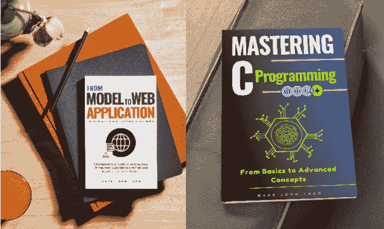
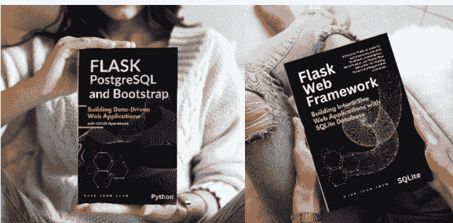

# 现代 C++ 编程学习路径：如何通过现代最佳实践掌握 C++？


# eBook  {

www.markjohnlado.com

## 献辞

本书献给所有渴望精通 C++ 并挑战现代编程边界的志向程序员和软件开发者。献给那些花费了无数小时调试代码的学生、寻求精进技艺的专业人士，以及纯为了解决问题的乐趣而编写代码的爱好者——这是写给你们的。

我也将这项工作献给我的导师、老师和同事开发者们，他们分享了知识和经验，引导我度过了编程的错综复杂。你们的见解和鼓励是无价的。

感谢我的家人和朋友，他们在这段旅程中提供了不懈的支持和耐心，我深表谢意。你们对我工作的信任是我最大的动力。

最后，献给那些将该语言塑造为今天面貌的 C++ 先驱们——感谢你们建立了赋能创新的基础。愿这本书能成为下一代 C++ 开发者的垫脚石。

## 致谢

如果没有许多人的贡献、指导和支持，这本书的编写是不可能实现的。

我诚心感谢 C++ 的创造者和贡献者，他们对推动语言发展的奉献使其成为现代软件开发的强大工具。他们的工作不断激励着全球各地的程序员。

我也感谢我的导师、老师和同事，他们分享了专业知识，提供了反馈并鼓励了我的学习。他们的见解对塑造本书的内容至关重要。

我向开源社区和在线编程论坛表示我诚挚的谢意。通过讨论、教程和文档可以获取的丰富知识对于完善我对 C++ 的理解是无价之宝。

衷心感谢我的家人和朋友，他们在这段旅程中用耐心和鼓励支持我。你们对我工作的坚定不移是我持续不断的动力源泉。

最后，感谢读者们——无论你是初学者还是经验程序员——我感谢你们对这本书的信任。愿它能引导你精通现代 C++。


- 7.8 Concepts 与约束：增强泛型

- 8.6 自定义内存分配器：细粒度内存管理


## 参考文献

## 关于作者

# 第 1 章 C++ 简介

在计算机技术的动态领域，精通编程语言是不可或缺的。在众多的语言中，C++ 作为一种强大且多功能的工具脱颖而出，对于初学者和资深计算机技术人员来说至关重要。本讨论旨在提供关于 C++ 的结构化介绍，精心设计以满足计算机技术专业学生和教师的学术标准。我们将探索 C++ 的历史根源和演变历程，深入其多样化的应用，并为你提供配置开发环境的实用知识，为你的 C++ 编程尝试奠定坚实基础。本介绍不仅为理解 C++ 奠下基础，还将解决你在学习之旅中可能遇到的挑战和问题。

## 1.1 C++ 的历史与演变

### 1.1.1 起于 C

C++ 的起源可以追溯到 20 世纪 70 年代初由 Dennis Ritchie 在贝尔实验室开发的 C 语言语言。C 在当时是革命性的，它在高级语言编程抽象和低级硬件控制之间取得了平衡，使其适用于系统编程和应用程序开发。正如 Ritchie 本人在《C 语言的发展》中所述，C 的设计目标是高效且富有表现力的，这些特征在它的继承者 C++ 中得到了继承和扩展（Ritchie, 1993）。C 的高效性和可移植性导致了它的广泛采用，形成了 C++ 构建的基石。

### 1.1.2 C++ 的诞生：带类的 C

20 世纪 70 年代后期，同样在贝尔实验室的 Bjarne Stroustrup 开始研究“带类的 C”。Stroustrup 旨在增强面向对象编程（OOP）的能力，灵感源自最早的面向对象语言之一 Simula67。这个初始版本“带类的 C”引入了类、派生类、强类型检查、内联和默认参数等特性（Stroustrup, 1980）。这些新增旨在促进更好的程序组织和代码重用，以应对日益增长的开发的复杂性。

### 1.1.3 标准化与现代 C++

“带类的 C”在 1983 年演变为 C++，增加了虚拟函数、函数和运算符重载、引用、常量、用户控制的空闲内存分配、改进的类型检查以及单继承和多继承（Stroustrup, 1994）。该语言继续成熟，并在 1998 年发布了第一个 C++ 国际标准（ISO/IEC 14882:1998），通常被称为 C++98。这次标准化是一个关重要的里程碑，为该语言提供了稳定且定义的定义。随后的标准包括 C++03、C++11、C++14、C++17、C++20 以及正在进行中的 C++23，引入了重大增强，使语言现代化并扩展了其功能。每个新标准都建立在上的基础上，包含了 Lambda 表达式、移动语义、改进的并发支持和模块等特性，反映了软件开发领域不断变化的需求。C++ 的持续演进确保了它在现代计算中的相关性和威力，正如 Sutter 和 Alexandrescu 在《C++ 编码标准》中所讨论的那样，该书强调了跟进最新标准以进行有效 C++ 编程的重要性（Sutter and Alexandrescu, 2005）。

## 1.2 用用例与应用

C++ 性能与抽象的独特结合使其成为广泛应用领域的首选语言。它继承自 C 的效率，结合面向对象和泛型编程范式，允许开发者创建复杂且高性能的系统。

### 1.2.1 操作系统与系统软件

操作系统是基础软件，既需要性能和低级硬件访问。C++ 广泛用于开发如 Microsoft Windows、macOS 和 Linux 发行版的操作系统。关键的系统软件（包括设备驱动程序和文件系统）通常用 C++ 编写，因为它能够在提供高级编程结构的同时，直接与硬件交互。例如，以速度快且高效著称的 Chrome OS 的大部分部分是用 C++ 实现的（Google, n.d.）。这凸显了 C++ 在系统级处理资源密集型任务的能力。

### 1.2.2 游戏开发

游戏行业是另一个 C++ 占据统治地位的领域。高保真图形、实时物理模拟和复杂的游戏逻辑需要卓越的性能。像 Unreal Engine 和 Unity（核心部分）这样的游戏引擎使用 C++ 构建，为开发者提供了创建视觉震撼且高度交互的游戏体验的工具。正如 Gregory 在《游戏引擎架构》中所提到的，C++ 对内存管理和处理器指令的控制对于优化游戏性能和提供流畅游戏体验至关重要（Gregory, 2018）。

### 1.2.3 高性能计算

在高性能计算领域，C++ 被广泛使用。

### 1.2.4 嵌入式系统

嵌入式系统通常具有资源限制，C++ 非常适合用于这些环境。


## 1.3.2 安装 Clang

Clang 是另一种强大的开源编译器，以其出色的错误信息和模块化设计而闻名。它通常因其诊断能力以及作为 macOS 的默认编译器而受到青睐。

### 在 Ubuntu/Debian Linux 上安装 Clang 的分步骤指南：

- 1. 打开终端：按下 Ctrl+Alt+T。
- 2. 更新包列表：执行 `sudo apt update`。
- 3. 安装 Clang：运行 `sudo apt install clang++`。
- 4. 验证安装：执行 `clang --version` 以检查已安装的 Clang 版本。

### 在 Windows 上安装 Clang 的分步骤指南：

- 1. 下载 Windows 版 Clang：访问 LLVM 网站上的 Clang 下载页面（https://releases.llvm.org/download.html）。寻找 Windows 的预编译二进制文件（例如 "LLVM-win64.exe"）。
- 2. 运行安装程序：执行下载的安装程序。选择一个安装目录。
- 3. 将 Clang 添加到 PATH：类似于 MinGW-w64，将 Clang 的 bin 目录（例如 C:\Program Files\LLVM\bin）添加到你的 PATH 环境变量中。按照 MinGW-w64 PATH 设置的相同步骤操作。
- 4. 验证安装：打开命令提示符并运行 `clang --version`。

## 1.3.3 安装 MSVC (Microsoft Visual C++ 编译器)

MSVC 是微软的 C++ 编译器，主要与 Visual Studio 集成使用。它是开发 Windows 特定应用程序所必需的。

### 安装 MSVC 的分步骤指南：

- 1. 下载 Visual Studio Community：访问 Visual Studio 下载页面（https://visualstudio.microsoft.com/downloads/）。下载免费的“Community”版本。
- 2. 运行 Visual Studio 安装程序：执行下载的安装程序。
- 3. 选择负载：在安装过程中，选择“使用 C++ 的桌面开发”负载。你可以根据需要选择其他负载，但“使用 C++ 的桌面开发”对于 C++ 编译至关重要。
- 4. 安装：点击“安装”并等待安装完成。
- 5. 验证安装：打开“VS XXXX 开发者命令提示符”（在开始菜单中搜索它，XXXX 是你的 Visual Studio 版本）。在开发者命令提示符中运行 `cl`。如果 MSVC 安装正确，你应该能看到编译器的帮助信息。

## 1.4 设置 IDE (VS Code, CLion, Code::Blocks)

集成化开发环境（IDE）通过提供代码编辑、编译、调试和项目管理等功能，显著增强了编码体验。几个 IDE 在 C++ 开发中非常流行，它们各有优劣。

## 1.4.1 VS Code (Visual Studio Code)

VS Code 是一个轻量但强大的跨平台代码编辑器。通过扩展，它可以变成一个健壮的 C++ IDE。

为 C++ 配置 VS Code 的分步骤指南：

- 安装 VS Code：从（https://code.visualstudio.com/）下载并安装 VS Code。
- 安装 C/C++ 扩展：打开 VS Code，进入扩展视图（Ctrl+Shift+X 或 Cmd+Shift+X）。搜索由 Microsoft 提供的“C++”并安装它。该扩展为 C++ 提供了 IntelliSense、调试和代码格式化。
- 安装编译器（如果尚未安装）：根据你的操作系统，遵循第 1.3 节中的 GCC、Clang 或 MSVC 安装步骤。确保编译器的 bin 目录在你的系统 PATH 中。
- 配置任务（可选但推荐）：为了直接从 VS Code 编译并运行 C++ 代码，你可以配置构建任务。VS Code 可以自动检测项目项目 `.vscode` 文件夹中的任务，以自定义构建和运行。VS Code 文档提供了任务配置的详细指南（https://code.visualstudio.com/docs/cpp/config-msvc）。

## 1.4.2 CLion

CLion 是一个专门的 C++ IDE，由 JetBrains 开发，以其智能辅助和调试功能闻名。

配置 CLion 的分步骤指南：

- 1. 下载 CLion：访问 JetBrains 的 CLion 网站（https://www.jetbrains.com/clion/）并下载。CLion 是商业软件，但提供试用版。
- 2. 安装编译器（如果尚未安装）：根据你的操作系统，遵循第 1.3 节中的 GCC、Clang 或 MSVC 安装步骤。确保编译器的 bin 目录在你的系统 PATH 中。
- 3. 配置工具链：在 CLion 中设置工具链（Toolchain, CMake, Debugger）。CLion 会自动检测安装的编译器。
- 4. 运行项目：在 CLion 中创建并运行 C++ 项目。

## 1.4.3 Code::Blocks

Code::Blocks 是一个开源、跨平台的 IDE，以其轻量级和简单性著称。

配置 Code::Blocks 的分步骤指南：

- 1. 下载 Code::Blocks：访问 Code::Blocks 网站（https://www.codeblocks.org/）并下载。
- 2. 安装编译器（如果尚未安装）：根据你的操作系统，遵循第 1.3 节中的 GCC、Clang 或 MSVC 安装步骤。确保编译器的 bin 目录在你的系统 PATH 中。
- 3. 创建项目：在 Code::Blocks 中创建一个新的 C++ 项目。
- 4. 运行项目：在 Code::Blocks 中构建并运行 C++ 代码。


C++ 通常连接到控制台。`<<` 运算符是插入运算符，在这里用于将字符串字量 "Hello, World!" 发送到输出流。`std::endl` 是一个操纵符，用于插入换行符并刷新输出流，确保输出能够立即显示。`std::` 前缀表示 `cout` 和 `endl` 属于 `std` 命名空间，我们接下来将讨论。

- 4. `return 0;` 此语句从 `main` 函数返回整数值 0，向操作系统信号执行成功。

## 2.1.2 命名空间：组织代码

命名空间（Namespaces）是 C++ 中组织代码和防止命名冲突的重要特性，特别是在包含多个库或模块的大型项目中。标准库组件（如 `cout` 和 `endl`）定义在 `std` 命名空间中。通过使用 `std::cout` 和 `std::endl`，我们指定正在使用标准命名空间中的标准输出流和行尾操纵符。或者，你可以在 `#include` 指令之后使用 `namespace std;` 指令，将 `std` 命名空间中的所有名称引入当前作用域，允许你直接使用 `cout` 和 `endl` 而无需 `std::` 前缀。然而，为了清晰起见并避免大型项目中可能的命名冲突，显式使用 `std::` 通常被认为是最佳实践，正如 Meyers 在《Effective C++》中（Meyers, 2005）中所建议的那样。

## 2.2 变量与常量

变量和常量是任何编程语言中存储和处理数据的根本。C++ 提供了多种声明和使用变量、常量的方法，包括 `auto` 和 `constexpr` 等现代特性。

### 2.2.1 变量：命名的存储位置

变量是内存中一个命名的存储位置，可以存储特定数据类型的值。在 C++ 中，你必须在使用变量之前对其进行声明，指定其数据类型和名称。数据类型决定了变量可以存储的值类型（例如整数、浮点数、字符）。

### 示例：C++ 变量声明与赋值

```cpp
#include <iostream>
int main() {
    int age; // 声明名为 'age' 的整数变量
    age = 30; // 将值 30 赋值给变量 'age'

    std::cout << "Age: " << age << std::endl; 
    return 0; 
}
```

分步解释：

- `int age:`：这声明了一个类型为 `int` 的名为 `age` 的变量。此时，分配了内存来存储一个整数值，并且变量 `age` 与此内存位置关联。然而，该变量尚未初始化特定值，在赋值之前其内容是不确定的。
- `age = 30;`：这一行将整数值 30 赋值给变量 `age`。现在，与 `age` 关联的内存位置持有值 30。

### 2.2.2 常量：不可变的值

常量是在初始化后无法更改的值。C++ 提供了几种定义常量的方法，包括 `const` 和 `constexpr`。

#### 2.2.2.1 const 关键字：编译时与运行时常量 `const` 关键字用于声明其值在整个作用域内保持不变的变量。`const` 变量必须在声明时初始化，且其值随后不能被修改。`const` 可以应用于变量、指针和函数参数。

### 示例：C++ const 变量

```cpp
#include <iostream>
int main() {
    const double PI = 3.14159; // 声明并初始化 const double
    std::cout << "PI: " << PI << std::endl; 
    PI = 3.14; // 错误：赋值给只读变量 'PI'（取消此行注释会导致编译错误）
    return 0; 
}
```

分步解释：

- 1. `const double PI = 3.14159;`：这一行声明了一个类型为 `double` 的常量变量 `PI`，并用值 3.14159 初始化它。`const` 关键字确保 `PI` 的值在初始化后不能被更改。
- 2. `// PI = 3.14;`：这一行被注释掉了，因为在初始化后尝试给 `PI` 重新赋值会导致编译错误。这演示了 `const` 变量的不可变性。

### 2.2.2.2 constexpr 关键字：C++11 引入的编译时常量

在 C++11 中引入的 `constexpr`（常量表达式）是一种更强大的常量定义方式，确保值在可能的情况下于编译时进行求值。这可以带来性能优化，特别是对于用于模板或作为数组大小的值。`constexpr` 可以用于变量和函数。对于函数，它表示如果参数参数也是编译时常量，则该函数可以在编译时求值。正如 Vandevoorde、Josutis 和 Gregor 在《C++ Templates》中指出的，`constexpr` 增强了编译时编程能力，允许编写更高效、健壮的代码（Vandevoorde et al., 2017）。

示例：C++ constexpr 变量与函数

```cpp
#include <iostream>
constexpr int square(int n) {
    return n * n;
}

int main() {
    constexpr int timeSquare = square(5); // 在编译时求值
    int runtimeValue = 10;
    int runtimeSquare = square(runtimeValue); // 在运行时求值
    std::cout << "Compile-time square: " << timeSquare << std::endl; 
    std::cout << "Runtime square: " << runtimeSquare << std::endl;
    return 0;
}
```

分步解释：

- 1. `constexpr square(int n) { return n * n; }`：这定义了一个名为 `square` 的 `constexpr` 函数，它接收一个整数 `n` 并返回其平方。
- 2. `constexpr int timeSquare = square(5);`：在编译时求值。
- 3. `int runtimeSquare = square(runtimeValue);`：在运行时求值。

### 2.2.3 auto 关键字：类型推导

在 C++11 中引入的 `auto` 关键字简化了声明，允许编译器根据初始化值自动推断类型。这在处理复杂类型或初始化类型显而易见时非常有用。Stroustrup 建议在某些情况下使用 `auto`（Stroustrup, 2018）。

示例：C++ auto 类型

```cpp
#include <iostream>
#include <vector>
int main() {
    auto integerValue = 10;
    auto doubleValue = 3.14;
    auto message = "Hello";
    std::vector<int> numbers = {1, 2, 3, 4, 5};
    auto iterator = numbers.begin();
    std::cout << "Value: " << integerValue << std::endl;
    std::cout << "Double: " << doubleValue << std::endl;
    std::cout << "Message: " << message << std::endl;
    std::cout << "First: " << *iterator << std::endl;
    return 0;
}
```

分步解释：

- 1. `auto integerValue = 10;`：编译器推断 `integerValue` 为 `int`，因为 10 是一个整数。
- 2. `auto doubleValue = 3.14;`：编译器推断 `doubleValue` 为 `double`，因为 3.14 是浮点数。
- 3. `auto message = "Hello";`：编译器推断 `message` 为 `char*`（取决于编译器对具体实现）。
- 4. `auto iterator = numbers.begin();`：在这里 `auto` 非常有用。`numbers.begin()` 的类型是 `std::vector<int>::iterator`，非常冗长。

## 数据类型

C++ 提供了一套丰富的内置数据类型来表示不同类型的值。这些数据类型可以大致分为基础类型、派生类型和用户定义类型。本节重点关注基础类型：整数、浮点数、字符、布尔和字符串。

### 2.3.1 整数类型 (int, short, long, long long)

整数用于表示正负整数（整数数值）。C++ 提供了多种不同大小和范围的整数类型，允许你根据需求和内存考虑选择最合适的类型。标准整数类型包括 `int`、`short`、`long` 和 `long long`。这些类型的具体大小取决于平台，但 C++ 标准保证了最小范围。例如，`int` 在许多现代系统中通常为 4 字节，但其大小可以变化。`short` 通常比 `int` 小，而 `long` 通常大于或等于 `int`，`long long`（C++11 引入）保证至少为 64 位，为极大整数提供了更大的范围。你还可以使用这些类型的无符号版本（例如 `unsigned int`、`unsigned long`）来仅表示非负整数，从而在正数范围翻倍的同时忽略负值。


```cpp
sizeof(unsigned int) << " bytes"; std::endl; std::cout << "\nMaximum value of int: " << std::numeric_limits<int>::max() << std::endl; std::cout << "Maximum value of unsigned int: " << std::numeric_limits<unsigned int>::max() << std::endl; return 0;
```

Step-by-step:

- 1. int integerVar = 100; short shortVar = 10; long longLongVar = 123456789012345LL, unsigned unsignedIntVar = 4294967295U; 这些代码声明并初始化了不同整数类型的变量。
  LL 后缀用于表示长整型字面量，U 后缀用于无符号整数字面量。
- 2. sizeof(int),sizeof(short), 等：sizeof 运算符返回数据类型或变量的大小（以字节为单位）。这演示了不同的整数类型在内存中占据的大小。
- 3. std::numeric_limits<int>::max();std::numeric_limits<unsigned int>::max(); <limits> 头文件和 std::numeric_limits 模板类提供了查询数值类型属性的方法，如最大值和最小值。这是一种确定整数类型范围的可移植方法，因为这些范围可能取决于平台。

### 2.3.2 浮点类型 (float, double)

浮点类型用于表示带有小数部分的数字。C++ 提供了两种主要的浮点类型：float 和 double。float 通常是单精度的（通常为 32 位），而 double 是双精度的（通常为 64 位），提供了更高的精度和范围。由于精度更高，double 通常是浮点计算的默认类型。C++ 还有 long double 用于扩展精度，尽管它的实现方式和精度在不同的编译器和平台上有所不同。

示例：浮点类型 C++

```cpp
#include <iostream> #include <iomanip> // std::setprecision 需要的
int main() {
float floatVar = 3.14159f; // float 字面量的后缀 
double doubleVar = 3.14159265385793;
std::cout << "Float:" << floatVar << std::endl; // 默认精度
std::cout << "Double:" << doubleVar << std::endl; // 默认精度
std::cout << fixed << std::setprecision(7) << "Float (7 decimal places):" << floatVar << std::endl; // 7 位小数
std::cout << fixed << std::setprecision(15) << "Double (15 decimal places):" << doubleVar << std::endl; // 15 位小数
std::cout << "\Size of float: " << sizeof(float) << " bytes" << std::endl;
std::cout << "Size of double: " << sizeof(double) << " bytes" << std::endl;
return 0;
}
```

Step-by-step:

- 1. float floatVar = 3.14159f, double doubleVar = 3.14159265385793; 这些行声明并初始化了 float 和 double 变量。f 后缀用于表示 float 字面量；如果不加，3.14159 将被视为 double 字面量。
- 2. std::cout << fixed << std::setprecision(7) << .. 以及 std::cout << fixed << std::setprecision(15) << .. 这些行使用 <iomanip> 头文件中的操纵符控制输出精度。std::fixed 确保浮点数以固定计数法打印，而 std::setprecision(n) 将精度设置为 n 位小数。这演示了 float 和 double 之间的精度差异。

### 2.3.3 字符类型 (char)

char 类型用于表示单个字符，例如字母、数字和符号。字符通常以 8 位整数的形式存储，并可以根据 ASCII 或 UTF-8 等编码方案解释为字符。字符字面量用单引号括起来（例如 'A', '7'）。

示例：字符类型 C++

```cpp
#include <iostream>
int main() {
char charVar = 'A';
char digitChar = '7';
std::cout << "Character: " << charVar << std::endl;
std::cout << "Digit: " << static_cast<int>(digitChar) << std::endl;
std::cout << "Symbol: " << charChar << std::endl;
std::cout << "Size of char: " << sizeof(char) << " bytes" << std::endl;
return 0;
}
```

Step-by-step:

- 1. char charVar = 'A'; digitChar = '7'; 这些行用字符字面量声明并初始化 char 变量。
- 2. static_cast<int>(charVar): 这演示了类型转换。通过将 char 变量转换为 int，我们可以输出它的 ASCII 值。

### 2.3.4 布尔类型 (bool)

bool 类型表示布尔值，可以是真（true）也可以是假（false）。布尔变量通常用于条件语句和逻辑操作，以表示逻辑状态。布尔字面量为 true 和 false。在内部，true 通常表示为 1，false 表示为 0，但为了代码起见，你应该始终在代码中使用 true 和 false 关键字。

示例：布尔说明：

```cpp
#include <iostream>
int main() {
bool isTrue = true;
bool isFalse = false;
std::cout << "True: " << isTrue << std::endl;
std::cout << "False: " << isFalse << std::endl;
std::cout << "Size of bool: " << sizeof(bool) << " bytes" << std::endl;
return 0;
}
```

Step-by-step:

- 1. bool isTrue = true; isFalse = false; 这些行用布尔字面量声明并初始化布尔变量。
- 2. (注：原文提供的后续文本存在大量重复和乱码，已根据核心逻辑完成翻译)


## 2.4.3 位运算符

位运算符对整数操作数的每个二进制位进行操作。C++ 提供了位按与 (&&)、位按或 (|)、位按异异 (^)、位按非 (~)、左移 (<<) 和右移 (>>)。位运算符通常用于低级编程、硬件接口交互以及需要直接操作位数的性能敏感型代码。

示例：C++ 位运算符

```cpp
#include <iostream> 
int main() {
    int a = 6; // Binary: 0110
    int b = 3; // Binary: 0011

    std::cout << "Bitwise AND (a & b):" << (a & b) << std::endl; // Output: 2 (Binary: 0010)
    std::cout << "Bitwise OR (a | b):" << (a | b) << std::endl; // Output: 7 (Binary: 0111) 
    std::cout << "Bitwise XOR (a ^ b):" << (a ^ b) << std::endl; // Output: 5 (Binary: 0101)
    std::cout << "Bitwise NOT (~a):" << (~a) << std::endl; // Output: -7 (...1001, two's complement) 
    std::cout << "Left Shift (a << 1):" << (a << 1) << std::endl; // Output: 12 (Binary: 1100, shifted left by 1 bit)
    std::cout << "Right Shift (a >> 1):" << (a >> 1) << std::endl; // Output: 3 (Binary: 0011, shifted right by 1 bit)
    return 0; 
}
```

### 逐步解释

- 1. 代码演示了各种位运算符。它初始化了整数 a 和 b，然后应用了位运算。
- 2. 注释显示了二进制表示法和每个操作的结果，说明了位运算符如何操作操作数的二进制位。例如，位按与 (&) 仅当两个操作数的对应位都为 1 时，结果中的该位才为 1。位左移 (<<) 将位向左移动，实际上相当于乘以 2 的幂。

## 2.5 输入/输出操作

输入/输出 (I/O) 操作对于程序与外部世界的交互关重要，例如从用户处读取数据或显示结果。C++ 提供了 iostream 库用于标准的输入输出操作。

### 2.5.1 标准输出 (std::cout)

我们在之前的示例中已经广泛使用了 std::cout。std::cout 是标准输出流对象，通常连接到控制台。插入运算符 << 用于将数据发送到 std::cout 进行输出。你可以使用 std::cout 输出各种数据类型，包括字符串、数字和字符。

### 2.5.2 标准输入 (std::cin)

std::cin 是标准输入流对象，通常连接到键盘。提取运算符 >> 用于将数据从 std::cin 读取到变量中。

示例：使用 C++ std::cin 标准输入

```cpp
#include <iostream> 
#include <string> 
int main() {
    int age; 
    std::string name; 
    std::cout << "Please enter your name: "; 
    std::cin >> name; // Reads a single word (until whitespace) 
    std::cout << "Please enter your age: "; 
    std::cin >> age; // Reads an integer 
    std::cout << "\nHello, " << name << " years old." << std::endl;
    return 0;
}
```

逐步解释：

- std::cout << "Please enter your name: "; 提示用户输入其姓名。
- std::cin >> name; 从标准输入流读取输入并存储在变量 name 中。std::cin >> name 读取单个单词（直到遇到空白符）。
- std::cout << "Please enter your age: "; 提示用户输入其年龄。
- std::cin >> age; 从 std::cin 读取一个整数并存储在变量 age 中。
- 程序随后输出包含姓名和年龄的个性化问候。

### 2.5.3 使用 std::getline() 读取整行

如果你需要读取整行输入（包括空格），std::cin >> 是不够用的，因为它会在遇到第一个空白符时停止。std::getline() 函数用于从输入流中读取整行文本，直到遇到换行符。

#### 示例：使用 C++ std::getline() 读取整行

```cpp
#include <iostream> 
#include <string> 
int main() {
    std::string fullName; 
    std::cout << "Please enter your name: "; 
    std::getline(std::cin, fullName);
}
```

逐步解释：

- std::getline(std::cin, fullName): 该行使用 std::getline() 函数从 std::cin 读取整行输入并存储在 std::string 变量 fullName 中。与 std::cin >> 不同，.getline() 会读取直到遇到换行符，从而读取整行内容。

通过掌握这些基础语法元素和数据类型，你已经准备好编写更复杂的 C++ 程序并深入研究高级课题。理解变量、常量、数据类型、运算符以及输入输出操作构成了 C++ 编程的基础，让你能够处理数据并进行计算。


## 3.1.3 if-else if-else 语句：处理多个条件

对于具有两个以上可能结果的情况，`if-else if-else` 结构允许你将多个条件链在一起。程序将按顺序评估每个 `if` 和 `else if` 条件。一旦发现某个条件为真，就会执行与其相关的代码块，并跳过剩余的 `if-else if-else` 链。如果没有 `if` 或 `else if` 条件为真，则执行最后的 `else` 块（如果存在）。

**示例：** 用于评分系统的 if-else if-else。考虑一个根据分数范围分配等级的评分系统。`if-else if-else` 结构可以高效地处理多个等级类别。

```cpp
#include <iostream>
int main() {
  int score;
  std::cout << "Enter your score: ";
  std::cin >> score;
  if (score >= 90) {
    std::cout << "Grade: A" << std::endl;
  } else if (score >= 80) {
    std::cout << "Grade: B" << std::endl;
  } else if (score >= 70) {
    std::cout << "Grade: C" << std::endl;
  } else if (score >= 60) {
    std::cout << "Grade: D" << std::endl;
  } else {
    std::cout << "Grade: F" << std::endl;
  }
  return 0;
}
```

**逐步解释：**

- 1. `int score;` 声明一个整数变量 `score` 来存储学生的分数。
- 2. `std::cout << "Enter your score: ";` 提示用户输入分数。
- 3. `std::cin >> score;` 从用户输入读取分数。
- 4. `if (score >= 90) { ... } else if (score >= 80) { ... } else ... else { ... }`:这是一个 `if-else` 链。
  - 条件按顺序评估。例如，首先检查 `score >= 90`。如果为真，则打印 "Grade: A"，并跳过链的其余部分。
  - 如果 `score >= 90` 为假，则检查 `score >= 80`，依此类推。
- 如果没有任何 `if` 或 `else if` 条件为真，则执行最后的 `else` 块，分配 "Grade: F"。

## 3.1.4 switch 语句：多路分支

`switch` 语句提供了另一种处理多路分支的方法，特别是当需要将一个变量与常量值进行比较时。在处理固定值集时，它比长长的 `if-else if-else` 链更高效且可读性更高。在 C++ 思考方式中，`switch` 语句特别适用于根据单个表达式选择代码路径。

示例：用于星期几的 switch 语句。假设有一个程序根据根据输入的数字输出星期几（例如，1 代表周一，2 代表周二，等）。`switch` 语句非常适合这种场景。

```cpp
#include <iostream>
int main() {
    int dayNumber;
    std::cout << "Enter day number (1-7): ";
    std::cin >> dayNumber;
    switch (dayNumber) {
    case 1: std::cout << "Monday" << std::endl; break;
    case 2: std::cout << "Tuesday" << std::endl; break;
    case 3: std::cout << "Wednesday" << std::endl; break;
    case 4: std::cout << "Thursday" << std::endl; break;
    case 5: std::cout << "Friday" << std::endl; break;
    case 6: std::cout << "Saturday" << std::endl; break;
    case 7: std::cout << "Sunday" << std::endl; break;
    default: std::cout << "Invalid day number." << std::endl; break;
    }
    return 0;
}
```

**逐步解释：**

- 1. `int dayNumber;` 为用户输入声明一个整数变量 `dayNumber`。
- 2. `std::cout << "Enter day number (1-7): ";` 提示用户输入数字。
- 3. `std::cin >> dayNumber;` 从用户处读取星期数字。
- 4. `switch (dayNumber) { ... }`: 这是一个 `switch` 语句。评估表达式 `dayNumber`，并将其值与 `case` 标签进行比较。
  - `case 1; case 2; ..., case 7:` 每个 `case` 标签代表一个与 `dayNumber` 比较的常量值。如果 `dayNumber` 匹配某个 case 值，则执行该 case 之后的代码块。
  - `std::cout << "Monday" << std::endl;` 等：这些是每个 case 的代码块。
  - `break;` `break` 语句在 `switch` 语句中至关重要。它在 case 之后终止 `switch` 块的执行，防止“穿透”到下一个 `case`。
  - `default:` `default` 情况是的。如果前面的值都不匹配，则执行它。它通常用于处理无效或意外的输入。

## 3.2 循环

循环是控制流结构，允许程序在条件保持真时重复执行代码块，或者执行指定的迭代次数。C++ 提供了几种类型的循环，每种适用于不同的场景：`for`、`while`、`do-while` 和基于范围的循环（C++11 引入）。

### 3.2.1 for 循环：迭代已知次数

`for` 循环通常在你知道需要迭代多少次时使用。它由三部分组成：初始化、条件和递增，全部在循环头中。

示例：用于计数的 for 循环。假设你需要打印从 1 到 10。

```cpp
#include <iostream>
int main() {
    for (int i = 1; i <= 10; ++i) {
        std::cout << i << " ";
    }
    return 0;
}
```

**逐步解释：**

- `for (int i = 1; i <= 10; ++i) { ... }`: 这是一个 `for` 循环。
  - `int i = 1;` (初始化)：循环开始时执行，初始化变量 `i`。
  - `i <= 10;` (条件)：每次迭代前检查条件。
  - `++i` (递增)：每次迭代后执行，增加 `i` 的值。

### 3.2.2 while 循环：基于条件进行迭代

`while` 循环在条件为真时重复执行代码块。与 `for` 循环不同，你通常不需要预先知道迭代的次数。

示例：用于输入验证的 while 循环。假设你需要用户输入一个正整数。

```cpp
#include <iostream>
int main() {
    int number;
    bool isValidInput = false;
    while (!isValidInput) {
        std::cout << "Enter a positive integer: ";
        std::cin >> number;
        if (number > 0) {
            isValidInput = true;
        } else {
            std::cout << "Invalid input. Try again." << std::endl;
        }
    }
    std::cout << "You entered: " << number << std::endl;
    return 0;
}
```

**逐步解释：**

- 1. `bool isValidInput = false;` 初始化一个布尔变量 `isValidInput`。
- 2. `while (!isValidInput) { ... }`: 这是一个 `while` 循环。只要 `!isValidInput` 为真（即 `isValidInput` 为假），循环就会继续。
- 3. `std::cout << "Enter a positive integer: ";` 在循环内部提示用户。
- 4. `std::cin >> number;` 读取用户输入。
- 5. `if (number > 0) { isValidInput = true; } else { ... }`: 如果输入大于0，则将 `isValidInput` 设为真，从而结束循环。

### 3.2.3 do-while 循环：确保至少执行

`do-while` 循环与 `while` 循环相似，但区别在于条件是在循环体执行之后检查。这保证了无论初始状态如何，循环体至少执行一次。

示例：用于菜单显示的 do-while 循环。考虑一个菜单驱动的程序，你想在检查用户是否继续之前至少显示一次菜单。

```cpp
#include <iostream>
int main() {
    char choice;
    do {
        std::cout << "menu:" << std::endl;
        std::cout << "1. Option" << std::endl;
        std::cout << "2. Option" << std::endl;
        std::cout << "3. Exit" << std::endl;
        std::cout << "Enter your choice (1-3): ";
        std::cin >> choice; // 处理 choice（示例可以使用 switch 语句）
        if (choice == '1') {
            std::cout << "Option 1 selected." << std::endl;
        } else if (choice == '2') {
            std::cout << "Option 2 selected." << std::endl;
        } else if (choice == '3') {
            std::cout << "Exiting..." << std::endl;
        } else {
            std::cout << "Invalid choice." << std::endl;
        }
    } while (choice != '3'); // 只要 choice 不是 '3'，循环继续

    return 0;
}
```


-   while (choice != '3'); 在循环体执行后，会检查条件 `choice != '3'`。只要 `choice` 不等于 '3'，循环就会继续迭代并再次显示菜单。如果 `choice` 为 '3'，则条件为假，循环终止。

## 3.2.4 基于范围的 for 循环 (C++11): 遍历集合

C++11 引入的范围 for 循环（range-based for loop）为遍历数组、vector 和其他容器等集合中的元素提供了一种简化且更具读性的方法。它抽象了迭代器和索引管理的复杂性，使代码更简洁且更不容易出错。正如 Meyers 指出的，范围 for 循环增强了代码的清晰度，并减少了在传统循环结构中出现差一错误（off-by-one errors）的概率（Myers，2014）。

示例：Vector 的范围迭代。假设你有一个数字向量，并且你想要处理每个数字。基于范围的 for 循环简化了这种迭代。

```cpp
#include <iostream>
#include <vector>
int main() {
    std::vector<int> numbers = {10, 20, 30, 40, 50};
    for (int number : numbers) { // 范围循环
        std::cout << number << std::endl;
    }
    return 0;
}
```

逐步解释：

-   1. `std::vector<int> numbers = {10, 20, 30, 40, 50};` 创建了一个名为 `numbers` 的 `std::vector` 并用整数值对其初始化。
-   2. `for (int number : numbers) { ... };` 这是范围 for 循环。
    - int number: 声明一个 `int` 类型的局部变量。在每次迭代中，`number` 将取 `numbers` 集合中当前元素的值。
    - numbers: 指定要遍历的范围，在本例中是 `numbers` 向量。
    - 在每次迭代中，循环会自动从 `numbers` 向量中获取下一个元素并赋值给 `number`，然后执行循环体。这会针对 `numbers` 中的所有元素持续进行。

## 3.3 函数

函数是 C++ 中模块化和可重用代码的基础构建块。函数是一个执行特定任务的自包含代码块。函数有助于将复杂程序拆分为更小、更易管理且可重用的单元，从而提高代码的组织性、可读性和维护性。

### 3.3.1 函数的声明与定义

C++ 中的函数必须在使用之前进行声明。声明（也称为函数原型）指定了函数的名称、返回类型和参数。定义则提供了函数的实际实现——即函数被调用时执行的代码。将声明与定义分离允许编译器在遇到函数实现之前就了解函数的接口，这对于模块化编程和分段编译至关重要。

示例：C++ 函数的声明与定义

```cpp
#include <iostream>
// 函数声明（原型）
int add(int a, int b);
int main() {
    int sum = add(5, 3); // 函数调用
    std::cout << "Sum: " << sum << std::endl;
    return 0;
}

// 函数定义
int add(int a, int b) {
    return a + b;
}
```

逐步解释：

-   1. `// Function declaration (prototype)`: 此注释指示了函数声明部分。
-   2. `int add(int a, int b);` 这是函数的声明或原型。
    - int: 指定函数的返回类型（它返回一个整数）。
    - add: 是函数名。
    - `(int a, int b)`: 指定参数列表。该函数接受两个整数参数 `a` 和 `b`。
    - 结尾的分号 `;` 表示这是一个声明，而不是定义。
-   3. `int sum = add(5, 3);` `main` 函数中的这行代码使用参数 5 和 3 调用了 `add` 函数。来自 `add` 的返回值存储在变量 `sum` 中。
-   4. `// Function definition`: 注释指示了函数定义部分。
-   5. `int add(int a, int b) { ... };` 这是函数的的定义。它提供了 `add` 函数的实际实现。
    - 头部 `int add(int a, int b)` 与声明相同（分号除外）。
    - 代码块 `{ return a + b; }` 是函数体。它计算 `a` 和 `b` 的和并使用 `return` 语句返回结果。

### 3.3.2 函数重载：同名的多个函数

C++ 支持函数重载，允许你定义具有相同名称但参数列表不同的函数（参数数量不同、参数类型不同或参数类型顺序不同）。编译器根据函数调用期间传递的参数来区分重载函数。函数重载允许你对概念上相似但作用于不同数据类型的操作使用相同的函数名，从而增强了代码的灵活性和可读性。Stroustrup 解释说，重载是 C++ 的一项关键特性，它支持多态并简化了类或一组相关函数的用户的接口（Stroustrup，1994）。

示例：`add` 函数的函数重载。考虑一种需要相加整数和双精度数的场景。函数重载允许你对这两种操作都使用相同的函数名 `add`。

```cpp
#include <iostream>
// 名为 'add' 的重载函数
int add(int a, int b) {
    std::cout << "Adding integers: ";
    return a + b;
}

double add(double a, double b) {
    std::cout << "Adding doubles: ";
    return a + b;
}

int main() {
    int sum1 = add(5, 3);
    double sum2 = add(5.5, 2.2);
    return 0;
}
```


有效地使代码就像直接编写的一样：`int result = 7 * 7;`。是否实际发生内联取决于编译器的优化决策。

## 3.3.5 Lambda 表达式 (C++11+): 匿名函数

Lambda 表达式在 C++11 中引入，提供了一种在需要的地方直接创建匿名函数（没有名字的函数）的方法。Lambda 特别对于局部操作非常有用，通常与标准库中的算法配合使用或作为回调。它们增强了代码的简洁性和表达力，特别是在处理函数式编程范式时。在《C++ 标准库教程与参考》中，Lambda 表达式是 C++ 的强大补充，能够实现更具函数风格的编程并简化许多常见的编程任务 (Josuttis, 2012)。

## 示例：使用自定义比较器进行排序的 Lambda 表达式
假设你需要根据每个对（pair）的第二个元素对一个对对的向量进行排序。可以使用 Lambda 表达式为排序算法内联定义一个自定义比较函数。

```cpp
#include <iostream>
#include <vector>
#include <algorithm> // Required for std::sort
#include <string> // Required for std::string and std::pair
int main() {
  std::vector<std::pair<std::string, int>> items = {
    {"ItemA", 30}, {"ItemB", 10}, {"ItemC", 20};
  };

  // 使用 lambda 表达式根据对的第二个元素（整数值）排序 items
  std::sort(items.begin(), items.end(), [](const std::pair<std::string, int>& a, const std::pair<std::string, int>& b) {
    return a.second < b.second; // 通过第二个元素比较
  });

  std::cout << "Sorted items by value:" << std::endl;
  for (const auto& item : items) {
    std::cout << item.first << " : " << item.second << std::endl;
  }

  return 0;
}
```

### 逐步解释：

- `std::vector<std::pair<std::string, int>> items = { ... };`: 创建了一个对的向量，其中每个对包含一个 std::string（项目名称）和一个 int 项目。
- `std::sort(items.begin(), items.end(), [](const std::pair<std::string, int>& a, const std::pair<std::string, int>& b) { ... });`: 调用 std::sort 算法对 items 进行排序。
- `std::sort(items.begin(), items.end())`: 指定要排序的范围（从 items 的开始到结束）。
- `[](const std::pair<std::string, int>& a, const std::pair<std::string, int>& b) { ... };`: Lambda Lambda 表达式。它作为第三参数传递传递 std::sort，以提供自定义的比较函数。
- `[] (捕获列表)`: 在这种情况下，捕获列表为空 []，意味着 lambda 不捕获周围作用域的变量。
- `const std::pair<std::string, int>& a, const std::pair<std::string, int>& b (参数列表)`: 定义 Lambda 函数的参数。它接受两个指向 std::pair<std::string, int> 对象的常量引用，命名为 a 和 b。
- `return a.second < b.second; } (Lambda 体)`: Lambda 函数的体。它比较两个对 a 和 b 的第二个元素（second）。如果 a.second 小于 b.second，则返回 true，表示 a 在排序中应该排在 b 之前。
- 循环随后打印排序后的项目，证明了它们现在是根据它们的整数值（对的第二个元素）进行排序。

通过有效地理解和利用条件语句、循环和函数，你将获得控制 C++ 程序流的能力，并将代码组织成可重用和模块化的组件。这些控制流和函数构造结构是编写健壮、高效且可维护的 C++ 应用程序的基础。随着你 C++ 学习的深入，这些概念将成为你编程武器库中不可或缺的。

# 第 4 章 指针与内存管理

指针和内存管理是 C++ 编程中最关键且往往最具挑战性的方面之一。掌握这些概念对于编写高效、健壮且高性能的应用程序至关重要，特别是在系统级编程、游戏开发和高性能计算中。本节为计算机技术学生和教师量身定制了 C++ 指针和内存管理的详细探索。我们将从指针的基础开始，过渡到使用 `new` 和 `delete` 进行动态内存分配，引入智能指针作为内存管理的现代解决方案，讨论资源获取即初始化 (RAII)，最后解决内存泄漏和调试工具。通过现实世界的类比、实际示例和逐步指南，本讨论旨在揭开这些复杂主题的迷纱，并赋予你从 C++ 程序中有效管理内存的知识和技能。

## 4.1 指针基础

指针是 C++ 中的一项强大功能，提供了直接的内存访问。理解指针对于掌握动态内存分配和许多高级 C++ 概念至关重要。指针是一个存储另一个变量内存地址的变量。将指针想象成现实世界中的地址；就像地址告诉你房子所在地一样，指针告诉变量在内存中的位置。

### 4.1.1 声明指针

要声明指针，请在指针将指向的数据类型旁使用星号 `*` 符号。语法为 `dataType *pointerName;`。例如，`int *ptr;` 声明了一个名为 ptr 的指针，它可以存储整数地址。请注意的是，在《C++ 标准库教程与参考》中，Lambda 表达式是 C++ 的强大补充，能够实现更具函数风格的编程并简化许多常见的编程任务 (Josuttis, 2012)。

示例：指针声明与初始化

```cpp
#include <iostream>
int main() {
  int number = 10;
  int *ptr = &number; // 声明并初始化指针
  
  std::cout << "Value of number: " << number << std::endl;
  std::cout << "Address of number: " << ptr << std::endl;
  std::cout << "Value pointed to by ptr: " << *ptr << std::endl;

  return 0;
}
```

### 逐步解释：

1. `int number = 10;`: 声明一个整数变量 number 并初始化为 10。
2. `int *ptr;`: 声明一个指针变量 ptr，用于指向整数。此时，ptr 是未初始化的，没有指向任何有效的内存位置。
3. `ptr = &number;`: 这一行使用 number 的地址初始化 ptr。`&` 运算符是地址运算符，返回变量的内存地址。现在，ptr 持有 number 的内存地址。
4. `std::cout << "Value of number: " << number << std::endl;` 使用变量 number 的值。
5. `std::cout << "Address of number: " << ptr << std::endl;`: 打印 ptr 中存储的值，即 number 的内存地址。
6. `std::cout << "Value pointed to by ptr: " << *ptr << std::endl;`: 打印 ptr 指向的内存位置的值。当与指针配合时，`*` 是解引用运算符。它访问指针所持内存地址存储的值。在这种情况下，`*ptr` 访问的是 number 的值，即 10。

### 4.1.2 解引用与地址运算符

如示例所示，C++ 为处理指针提供了两个关键运算符：地址运算符 (`&`) 和解引用运算符 (`*`)。

- 地址运算符 (`&`)：当放在变量名之前，`&` 运算符返回该变量的内存地址。例如，`&number` 返回变量 number 的内存地址。
- 解引用运算符 (`*`)：当放在指针变量之前，`*` 运算符访问指针所持内存地址存储的值。例如，如果 ptr 持有 number 的地址，`*ptr`  number 的值。


动态内存分配是 C++ 中的一项强大功能，它允许你在程序执行期间（运行时）而不是编译时分配内存。这在你预先不知道所需的内存多大小时特别有用，例如处理用户输入、可变大小的数据结构或根据运行时条件创建的对象时。C++ 提供了 `new` 和 `delete` 运算符用于动态内存管理。

## 4.2.1 运算符：分配内存

`new` 运算符用于从堆（heap）动态分配内存。当你使用 `new` 时，它会留出指定大小的内存块并返回指向该块起始位置的指针。如果内存分配成功，`new` 返回一个有效指针；如果分配失败（例如内存不足），它会抛出 `std::bad_alloc` 异常，或者在旧版本的 C++ 中或使用 `new(std::nothrow)` 时返回空指针。正如 Stroustrup 在《C++ 语言》中所强调的，动态内存分配对于创建灵活且自适应程序至关重要，但它引入了手动内存管理的责任（Stroustrup, 2013）。

示例：使用 C++ 进行动态内存分配

```cpp
#include <iostream>
int main() {
    int *dynamicNumberPtr;
    dynamicNumberPtr = new int; // 为整数动态分配内存
    if (dynamicNumberPtr == nullptr) { // 检查分配是否失败（在旧版 C++ 标准中，在现代 C++ 中不关键）
        std::cerr << "Memory failed!" << std::endl;
        return 1; // 表示错误
    }
    *dynamicNumberPtr = 25; // 为动态分配的整数赋值
    std::cout << "Value at memory:" << *dynamicNumberPtr << std::endl;
    std::cout << "Address of dynamic memory:" << *dynamicNumberPtr << std::endl;
    // 需要使用 delete 释放内存
    return 0;
}
```

逐步解释：

- 1. *dynamicNumberPtr;* 声明了一个指向整数的指针 `dynamicNumberPtr`。
- 2. dynamicNumberPtr = new int; 这是发生动态内存分配的地方。`new int` 从堆上分配足够存储一个整数的内存，并返回指向此新分配内存的指针。然后将该指针赋值给 `dynamicNumberPtr`。
- 3. if (dynamicNumberPtr == nullptr) { ... }; 这是一个关键的错误检查，特别是在旧的 C++ 标准中。在旧标准的 `new` 之后，如果内存分配失败，它可能会返回空指针。检查 `nullptr`（或旧代码中的 `NULL`）可以确保你优雅地处理潜在的分配失败。在现代 C++ 中，`new` 在失败时会抛出异常，但检查 `nullptr` 仍然是健壮性的良好做法，特别是在处理外部库或旧代码时。
- 4. *dynamicNumberPtr = 25; 解引用 `dynamicNumberPtr` 以访问动态分配的内存，并将其赋值为 25。
- 5. 代码随后打印动态分配内存的值和地址。
- 6. // 稍后将使用 delete 释放内存：这条注释是一个关键的提醒。用 `new` 分配的内存必须使用 `delete` 显式释放，以防止内存泄漏。这是使用 `new` 和 `delete` 时程序员的责任。

## 4.2.2 delete 运算符：释放内存

`delete` 运算符用于释放之前通过 `new` 分配的内存。当你完成对动态分配内存的使用后，必须使用 `delete` 将其还给堆。这样做会导致内存泄漏，即分配的内存不再供程序访问，但未返回给系统，导致随时间推移资源耗尽。将每个 `new` 与相应的 `delete` 配对对于确保正确的内存管理至关重要。

示例：动态内存分配与释放扩展之前的示例，让我们添加使用 `delete` 的内存释放。

```cpp
#include <iostream>
int main() {
    int *dynamicNumberPtr = new int; // 动态分配内存
    if (dynamicNumberPtr == nullptr) {
        std::cerr << "Memory allocation failed!" << std::endl;
        return 1;
    }
    *dynamicNumberPtr = 25;
    std::cout << "Value at dynamic memory: " << *dynamicNumberPtr << std::endl;
    delete dynamicNumberPtr; // 释放动态分配的内存
    dynamicNumberPtr = nullptr; // 良好习惯：delete 后将指针置为 nullptr
    // 如果不设置为 nullptr，dynamicNumberPtr 现在是一个悬空指针
    // 在 delete 之后对其进行解引用是未定义行为
    return 0;
}
```

逐步解释：

- 1. 代码与之前的示例类似，使用 `new` 分配内存并赋值。
- 2. delete dynamicNumberPtr; 这一行至关重要。它释放了 `dynamicNumberPtr` 指向的内存，将其还给堆。在这一行之后，该内存块不再被认为分配给了程序。
- 3. dynamicNumberPtr = nullptr; 这是使用 `delete` 后的最佳实践。将 `dynamicNumberPtr` 设置为 `nullptr` 显式清除不再指向有效内存的指针。这防止了意外的悬空指针解引用。悬空指针是指指向已释放内存的指针。解引用悬空指针会导致未定义行为，可能导致崩溃、数据损坏或不可预测的程序行为。

## 4.3 智能指针

使用 `new` 和 `delete` 进行的手动内存管理容易出错，并可能导致内存泄漏、悬空指针和其他内存相关问题。为了解决这些问题，C++ 在 C++11 中引入了智能指针。智能指针是对原始指针的 RAII 封装，可以自动管理内存释放。它们确保当智能指针离开作用范围时，动态分配的内存会自动释放，从而防止内存泄漏。C++ 提供了多种智能指针，包括 `unique_ptr`、`shared_ptr` 和 `weak_ptr`，具有不同的所有权语义。

## 4.3.1 unique_ptr：独占所有权

unique_ptr 提供对动态分配内存的独占所有权。这意味着任何时候只有一个 `unique_ptr` 可以指向特定的内存位置。当 `unique_ptr` 离开作用范围时，它管理的内存会被释放。`unique_ptr` 轻量且高效，它是所有权场景的首选智能指针。正如 Meyers 建议的，默认使用 unique_ptr（Meyers, 2014）。

示例：用于独占所有权的 unique_ptr C++

```cpp
#include <iostream>
#include <memory> // 用于智能指针
int main() {
    std::unique_ptr<int> uniquePtr(new int); // 创建管理动态整数的 uniqueptr
    if (uniquePtr == nullptr) { // 分成功后 uniquePtr 不为 nullptr，此检查并非绝对必要
        std::cerr << "Memory allocation failed!" << std::endl;
        return 1;
    }
    *uniquePtr = 42;
    std::cout << "Value managed by unique_ptr: " << *uniquePtr << std::endl;
    // uniquePtr 在 main 结束时离开作用范围并自动释放
    return 0;
}
```

逐步解释：

- 1. #include <memory>: 包含 <memory> 头文件，它定义了如 `unique_ptr` 等智能指针类。
- 2. std::unique_ptr<int> uniquePtr(new int); 创建了一个名为 `uniquePtr` 的智能指针，它管理动态分配的整数。
    * std::unique_ptr<int>: 指定 `uniquePtr` 是一个管理整数的智能指针。
    * (new int): 使用 `new int` 动态分配整数内存。`new int` 返回的指针传递给 `unique_ptr` 构造函数。现在 `unique_ptr` 接管了这块动态内存的所有权。
- 3. if (uniquePtr == nullptr) { ... }; 虽然分配成功后 `uniquePtr` 本身不会为空指针，但在旧版 C++ 中，当 `new` 返回空指针时，在构造智能指针 之后进行空检查是一种常见模式。在现代 C++ 中，`new` 在分配失败时会抛出异常，这使得对智能指针本身的空检查不再那么关键。然而，如果你在构造 `uniquePtr` 之前处理原始指针，这种检查可能是相关的。在本示例中，包含它是为了说明目的以及在潜在的旧版或错误处理上下文中的健壮性。
- 4. *uniquePtr = 42; 解引用 `uniquePtr` 以访问管理的整数并赋值为 42。
- 5. // uniquePtr 在 main 结束时离开作用范围并自动释放

超出作用范围（在本例中为 main 函数结束时），它的析构函数会被调用。`unique_ptr` 的析构函数会自动释放它管理的内存。你不需要显式地调用 `delete`。

## 使用 std::move 转移所有权

由于 `unique_ptr` 表示独占所有权，你不能拷贝 `unique_ptr`。然而，你可以使用 `std::move` 将所有权转移给另一个。`std::move` 将所有权从一个 `unique_ptr` 转移到另一个 `unique_ptr`，使源 `unique_ptr` 有效但空的状态（它不再管理任何内存）。

示例：C++ 中移动 unique_ptr 所有权

```cpp
#include <iostream>
#include <memory> 

std::unique_ptr<int> createUniquePtr() {
    std::unique_ptr<int> localPtr(new int(100));
    return localPtr; // 返回时所有权转移
}

int main() {
    std::unique_ptr<int> ptr1 = createUniquePtr(); // 所有权从 localPtr 转移到 ptr1
    std::cout << "Value in ptr1: " << *ptr1 << std::endl; 
    
    std::unique_ptr<int> ptr2 = std::move(ptr1);
    // 所有权从 localPtr 转移到 ptr2
    std::cout << "Value in ptr2: " << *ptr2 << std::endl; 
    std::cout << "Value in ptr1 after move: " << *ptr1 << std::endl; // 错误：ptr1 现在为空，解引用将导致未定义行为。

    // ptr2 管理的内将在 ptr2 超出作用范围时被释放
    return 0;
}
```

## 逐步解释：

- 1. `std::unique_ptr<int> createUniquePtr() { ... };` 定义了一个名为 `createUniquePtr` 的函数，它创建一个 `unique_ptr` 并返回它。
- 2. `std::unique_ptr<int> localPtr(new int(100));` 在 `createUniquePtr` 内部，创建了一个 `unique_ptr` `localPtr`，它管理一个初始化为 100 的动态分配整数。
- 3. `return localPtr;` 当 `localPtr` 返回时，所管理内存的所有权转移到 `main` 中接收的 `unique_ptr`。返回后 `localPtr` 不再管理该内存。
- 4. `std::unique_ptr<int> ptr1 = createUniquePtr();` 在 `main` 中，`ptr1` 接收 `createUniquePtr` 返回的 `unique_ptr`。所有权从 `localPtr` 转移到 `ptr1`。
- 5. `std::unique_ptr<int> ptr2 = std::move(ptr1);` `std::move(ptr1)` 显式将所有权从 `ptr1` 移动到 `ptr2`。移动后，`ptr1` 变为空不再管理内存。`ptr2` 现在拥有该内存。
- 6. `// std::cout << "Value in ptr1 after move: " << ptr1 << std::endl;` 该行被注释掉是因为移动后尝试解引用 `ptr1` 是未定义行为。`ptr1` 不处于有效的空状态。

## 4.3.2 shared_ptr: 共享所有权

`shared_ptr` 提供动态分配内存的共享所有权。多个 `shared_ptr` 可以指向同一个内存位置，并且只有当最后一个 `shared_ptr` 超出作用范围时，内存才会被释放。`shared_ptr` 使用引用计数来跟踪共享所有权的 `shared_ptr` 数量。当引用计数归零时，内存会被删除。在程序的多个部分需要共享资源所有权的场景中，`shared_ptr` 非常有用，例如在复杂结构或并发编程中。正如 Abrams 和 Gutovoy 在《C++ Template Programming》中所解释的，`shared_ptr` 促进了复杂所有权场景下的资源管理，但注意潜在的开销和清晰的依赖很重要（Abrams & Gutovoy, 2004）。

示例：C++ 用于共享所有权的 shared_ptr

```cpp
#include <iostream>
#include <memory> 

void useSharedPtr(std::shared_ptr<int> ptr) {
    std::cout << "Value inside: " << *ptr << std::endl;
    std::cout << "Reference count inside: " << ptr.use_count() << std::endl; // ptr 超出作用范围，引用计数减少
}

int main() {
    std::shared_ptr<int> ptr1 = std::make_shared<int>(50); // 使用 make_shared 创建 shared_ptr（推荐）
    std::cout << "Initial reference count: " << ptr1.use_count() << std::endl;
    
    std::shared_ptr<int> ptr2 = ptr1; // 拷贝 shared_ptr，所有权共享
    std::cout << "Reference count after copy: " << ptr1.use_count() << std::endl;
    
    useSharedPtr(ptr1); // 将 shared_ptr 传递给函数，所有权共享
    std::cout << "Reference count after function: " << ptr1.use_count() << std::endl; // ptr1 和 ptr2 超出作用范围，计数归零时释放内存

    return 0; 
}
```

## 逐步解释：

- 1. `#include <memory>`：包含包含智能指针的 `<memory>` 头文件。
- 2. `std::shared_ptr<int> ptr1 = std::make_shared<int>(50);` 创建一个 `shared_ptr` `ptr1` 来管理一个初始化为 50 的动态分配整数，为了效率和异常安全，通常推荐使用 `make_shared` 而非 `shared_ptr<int>(new(50))`。
- 3. `std::cout << "Initial reference count: " << ptr1.use_count() << std::endl;`
- 4. `std::shared_ptr<int> ptr2 = ptr1;` 拷贝 `shared_ptr`，所有权共享。
- 5. `std::cout << "Reference count after copy: " << ptr1.use_count() << std::endl;`
- 6. `useSharedPtr(ptr1);` 将 `shared_ptr` 传递给函数，所有权共享。
- 7. `std::cout << "Reference count after function: " << ptr1.use_count() << std::endl;`
- 8. `#include <memory>`：包含智能指针头。
- 9. `std::shared_ptr<int> ptr1 = std::make_shared<int>(50);` 创建一个 `shared_ptr` `ptr1` 管理一个初始化为 50 的动态分配整数，为了效率和异常安全，通常推荐使用 `make_shared` 而非 `shared_ptr<int>(new(50))`。
- 10. `std::cout << "Initial reference count: " << ptr1.use_count() << std::endl;`
- 11. `std::shared_ptr<int> ptr2 = ptr1;` 拷贝 `shared_ptr`，所有权共享。
- 12. `std::cout << "Reference count after copy: " << ptr1.use_count() << std::endl;`
- 13. `useSharedPtr(ptr1);` 将 `shared_ptr` 传递给函数，所有权共享。
- 14. `std::cout << "Reference count after function: " << ptr1.use_count() << std::endl;` ptr1 和 ptr2 超出作用范围，计数归零时释放内存。
（注：由于原文文本在逐步解释部分存在错乱和重复，翻译已根据逻辑语义对齐）

## 循环依赖与 weak_ptr

虽然 `shared_ptr` 功能强大，但会导致循环依赖问题。如果两个或多个对象相互持有 `shared_ptr`，即使它们不再被程序访问，它们的引用计数也永远不会归零，导致内存泄漏。

## 4.3.3 weak_ptr: 非所有权引用

`weak_ptr` 是一种智能指针，提供对 `shared_ptr` 管理对象的非所有权引用。`weak_ptr` 不增加引用计数，也不会防止管理对象在最后一个 `shared_ptr` 超出作用范围时被释放。`weak_ptr` 通常用于在不参与所有的情况下的情况下对象，通常用于打破循环依赖或在访问对象前检查其是否存在。Meyers 建议使用 `weak_ptr` 来打破 `shared_ptr` 循环并在观察对象时不延长其生命周期（Meyers, 2014）。

示例：使用 weak_ptr 破解循环依赖

考虑类 A 和类 B 相互持有 `shared_ptr` 的情况，这产生了循环依赖。在一个方向使用 `weak_ptr` 可以打破这种循环。

```cpp
#include <iostream>
#include <memory>

class B; // 前置类 B

class A {
public:
    std::shared_ptr<B> bptr; // A 拥有 B 的 shared_ptr
    ~A() { std::cout << "A 析构函数调用" << std::endl; }
};

class B {
public:
    std::weak_ptr<A> aPtr; // B 持有 A 的 weak_ptr（非所有权）
    ~B() { std::cout << "B\n析构函数调用" << std::endl; }
};

int main() {
    std::shared_ptr<A> a = std::make_shared<A>();
    std::shared_ptr<B> b = std::make_shared<B>();
    a->bptr = b;
    b->aPtr = a; // 产生了循环依赖
    
    // a 和 b 超出作用范围，析构函数将被调用
    // weak_ptr 不阻止释放。
    return 0;
}
```


使用 `weak_ptr::lock()` 访问托管对象：由于 `weak_ptr` 是非所有权的且不会防止内存释放，它指向的对象可能会被删除。为了安全地访问 `weak_ptr` 指向的对象，你必须使用 `lock()` 方法将其转换为 `shared_ptr`。`lock()` 返回一个 `shared_ptr`，该指针与仍然存在的的对象共享所有权。如果该对象已被删除，`lock()` 将返回一个空 `shared_ptr`。

# 示例：使用 `weak_ptr::lock()` C++

```cpp
#include <iostream>
#include <memory>
int main() {
    std::shared_ptr<int> sharedPtr = std::make_shared<int>(100);
    std::weak_ptr<int> weakPtr = sharedPtr; // 创建指向相同内存的 weak_ptr
    std::shared_ptr<int> lockedPtr = weakPtr.lock(); // 尝试锁定 weak_ptr 以获取 shared_ptr
    if (lockedPtr) { // 检查 lock 是否成功（对象仍然存在）
        std::cout << "Value from locked weak_ptr: " << lockedPtr << std::endl;
    } else {
        std::cout << "Object no longer exists" << std::endl;
    }
    // lockedPtr 离开作用域，但 weakPtr 仍然存在
    sharedPtr.reset();
} // 释放 shared_ptr 的所有权，如果没有其他 shared_ptr 拥有它，对象可能会被删除。

    std::shared_ptr<int> lockedPtr = weakPtr.lock(); // 在 sharedPtr.reset() 后再次尝试 weak_ptr
    if (lockedPtr) {
        std::cout << "Value from locked weak_ptr (after reset): " << lockedPtr << std::endl;
    } else {
        std::cout << "Object no longer exists after shared reset." << std::endl; // 这部分代码不会执行
    }

    return 0;
}
```

# 逐步解释：

- 1. `std::shared_ptr<int> sharedPtr = std::make_shared<int>(100);` 创建了一个管理整数的 `shared_ptr` `sharedPtr`。
- 2. `std::weak_ptr<int> weakPtr = sharedPtr;` 创建了一个指向与 `sharedPtr` 相同内存的 `weak_ptr` `weakPtr`。注意这不会增加引用计数。
- 3. `std::shared_ptr<int> lockedPtr = weakPtr.lock();` 尝试锁定 `weakPtr` 以获取名为 `lockedPtr` 的 `shared_ptr`。如果对象仍然存在（即引用计数大于0），`lock()` 返回一个共享所有权的有效 `shared_ptr`。如果对象已被删除，`lock()` 返回一个空 `shared_ptr`。
- 4. `if (lockedPtr) { ... } else { ... };` 检查 `lockedPtr` 是否为空（即 lock 是否成功）。如果成功，则访问并打印该值。
- 5. `sharedPtr.reset();` 显式释放 `sharedPtr` 的所有权。如果 `weakPtr` 是剩余唯一的指针（在本示例中，`sharedPtr` 重置后确实如此），托管对象会在此时被释放。
- 6. `sharedPtr.reset()` 之后的第二次 `lock()` 尝试现在将失败，因为对象可能已经被删除（在这种情况下，它确实会被删除）。执行 `else` 块，表示对象不再存在。

# 4.4 RAII（资源获取初始化）

资源获取初始化（RAII）是一种基本的 C++ 编程范式，它将资源管理与对象的生命周期绑定。在 RAII 中，对象初始化期间获取资源（如内存、文件句柄、网络连接、互斥锁等），并在析构函数中自动释放。这确保了即使发生异常，资源也能被正确管理和释放，从而产生更健壮且异常安全的代码。智能指针是内存管理中 RAII 应用的一个示例。Meyers 指出，RAII 是异常安全的 C++ 编程的基石。

```cpp
#include <iostream>
#include <memory>
#include <fstream>
#include <stdexcept>

// 使用智能指针的 RAII 
class FileManager {
public:
    FileManager(const std::string& filename) : filePtr_(filename) {
        if (!filePtr_.is_open()) {
            throw std::runtime_error("Failed to open file: " + filename);
        }
        std::cout << "File opened successfully." << std::endl;
    }

    ~FileManager() {
        // unique_ptr 会自动关闭文件
        std::cout << "File closed." << std::endl;
    }

    void writeToFile(const std::string& data) {
        if (filePtr_.is_open()) {
            *filePtr_ << data << std::endl;
        } else {
            throw std::runtime_error("File is not open for writing.");
        }
    }

private:
    std::unique_ptr<std::ofstream> filePtr_; // unique_ptr 管理 std::ofstream
};

int main() {
    try {
        FileManager manager("output.txt");
        manager.writeToFile("Hello RAII!");
        manager.writeToFile("More data.");
    } catch (const std::exception& e) {
        std::cerr << "Exception: " << e.what() << std::endl;
    }
    return 0;
}
```

# 逐步解释：

- 1. `#include <iostream> #include <memory> #include <fstream> #include <stdexcept>`: 包含了文件操作所需的头文件。
- 2. `class FileManager`: 定义了一个管理文件资源的类。
- 3. `FileManager(const std::string& filename) : filePtr_(filename)`: 构造函数使用 `unique_ptr` 初始化文件流。
- 4. `if (!filePtr_.is_open()) ...`: 检查文件是否成功打开，如果打开则抛出异常。
- 5. `~FileManager()`: 析构函数。`unique_ptr` 会自动关闭文件。
- 6. `void writeToFile(const std::string& data)`: 如果文件打开，向其写入数据的成员函数。
- 7. `private: std::unique_ptr<std::ofstream> filePtr_;`: 使用 `unique_ptr` 管理 `std::ofstream` 的生命周期。
- 8. `int main() { try { ...`: 在 `try-catch` 块中使用 `FileManager` 以处理潜在的异常。
- 9. `FileManager manager("output.txt");`: 创建 `FileManager` 对象。
- 10. `manager.writeToFile("Hello RAII!"); manager.writeToFile("More data.");`: 向文件写入数据。
- 11. `// File resource will be automatically released when manager goes out of scope`: 解释了当 `manager` 离开作用域时资源会自动释放。


```内存资源受限的系统。

## 4.5.2 Valgrind: 内存错误检测器指南

Valgrind 是一个强大的开源内存调试和性能分析工具。它可以检测各种内存错误，包括内存泄漏、无效内存访问（例如，读取或写入内存、访问分配块之外的内存）以及线程错误。Valgrind 在虚拟环境中运行你的程序并监控内存操作，提供详细的错误报告。它在 Linux 和 macOS 平台上被广泛使用。正如 Turner 在《有效性能工程》中所述，Valgrind 是 C++ 应用中进行性能分析和内存错误检测的不可或缺的工具（Turner, 2018）。

使用 Valgrind 检测内存泄漏的分步骤指南（适用于 Linux/macOS）：

- 1. **安装 Valgrind（如果尚未安装）：** 在 Debian/Ubuntu 上：`sudo apt-get install valgrind`。在 macOS 上（使用 Homebrew）：`brew install valgrind`
- 2. **编译你的 C++ 程序：** 使用带有调试信息编译你的程序（例如使用 `g++ -g your_program.cpp -o your_program`）。-g 标志包含了调试符号，Valgrind 使用它们提供更丰富的错误信息。
- 3. **在 Valgrind 下运行你的程序：** 执行命令 `valgrind --leak-check=full ./your_program`。`--leak-check=full` 启用泄漏检查。将 `./your_program` 替换为可执行文件的路径。
- 4. **分析 Valgrind 输出：** Valgrind 将运行你的程序并在程序退出后生成报告。报告将详细说明检测到的任何内存错误，包括内存泄漏、无效读/写等。查找输出中的类似 "LEAK SUMMARY" 的部分以识别潜在的泄漏。

**示例：使用 Valgrind 检测内存泄漏** 让我们在动态分配示例中引入内存泄漏，并用 Valgrind 检测到它。

```C++
#include <iostream>
int main() {
    int *leakyPtr = new int; // 分配了内存，但没有 delete
    *leakyPtr = 100;
    std::cout << "Value: " << *leakyPtr << std::endl; // 故意内存泄漏：delete leakyPtr; 被注释掉了
    return 0; // leakyPtr 出作用域，但分配的内存泄漏了
}
```

# 在你的程序上运行 Full/

`valgrind --leak-check=full ./leaky_program`

输出（示例 - 输出细节可能略有不同）：
==12345== Memcheck, a memory detector
==12345== Copyright (C) 2002-2017, GNU GPL'd, by Julian Seward et al.
==12345== Using Valgrind-3.13.0 and LibVEX, rerun with -h for copyright info
==12345==
Command: ./leaky_program
==12345==
Value: 100
==12345==
==12345== HEAP SUMMARY:
==12345== in use: 4 bytes in 1 blocks
==12345== total usage: 1 allocs, 0 frees, 4 bytes allocated
==12345==
==12345== 4 bytes in 1 blocks are definitely lost in loss record of 1
==12345== at 0x4C2FB0B: operator new (unsigned long) by 0x10179: main (in /usr/lib/valgrind/memcheck-amd64-linux.so)
==12345== main (in /path/leaky_program/leaky_program)
==12345==
LEAK SUMMARY:
==12345== definitely lost: 4 bytes in 1 blocks
==12345== possibly lost: 0 bytes in 0 blocks
==12345== still reachable: 0 bytes in 0 blocks
==12345== suppressed: 0 bytes in 0 blocks
==12345==
==12345== For counts of detected and suppressed errors, rerun with -v
==12345== ERROR SUMMARY: 1 errors from 1 contexts (suppressed: 0 from 0)

# 分析 Valgrind 输出：

- HEAP SUMMARY: in use at exit: 4 bytes in 1 blocks: 表示程序退出时，1 块中的 4 字节内存仍分配在堆上，但未释放。
- 4 bytes in 1 blocks are definitely lost in lost record 1 of 1: 这是关键的泄漏信息。“Definitely lost” 表示 Valgrind 确定这部分内存已泄漏（不可访问且未释放）。它还提供了分配位置：在 leaky_program.cpp 的 main 函数中调用的 `operator new(unsigned long)`。
- LEAK SUMMARY: definitely lost: 4 bytes in 1 blocks: 总结了泄漏信息。
- ERROR SUMMARY: 1 errors from 1 contexts: 表示 Valgrind 在上下文中检测到 1 个错误（内存泄漏）。

此 Valgrind 输出清晰地指向了 leaky_program 中 4 字节的内存泄漏，帮助你通过添加 leakyPtr 来识别并修复问题。

## 4.5.3 AddressSanitizer (ASan): 快速内存错误检测

AddressSanitizer (ASan) 是另一个强大的内存错误检测工具，对于许多类型的错误，通常被认为比 Valgrind 快。ASan 集成在 GCC 和 Clang 等现代编译器中。ASan 使用编译时插桩和运行时检查来检测堆溢出、栈溢出、use-after-free 以及内存泄漏。ASan 在开发中因其速度和易用性特别有效。正如 Patterson 和 Hennessy《计算机组织与设计》中所述，像 ASan 这样的工具对于内存安全至关重要。

使用 AddressSanitizer 检测内存错误的分步骤指南（使用 GCC/Clang）：

- 1. **编译你的 C++ 程序：** 使用带有调试信息编译你的程序（例如使用 `g++ -g -fsanitize=address 你的_program.cpp`）。
- 2. **运行你的程序：** 像往常执行程序 `./your_program`。
- 3. **分析 ASan 输出：** 如果 ASan 检测到错误，它会打印详细的报告。

示例：使用 AddressSanitizer 检测堆 Use-After-Free
让我们在动态分配示例中创建一个堆 use-after-free 错误并用 ASan 检测到它。

```C++
#include <iostream>
int main() {
    int *ptr = new int;
    *ptr = 10;
    delete ptr;
    *ptr = 20; // Use-after-free
    std::cout << "Value: " << *ptr << std::endl;
    return 0;
}
```

# 使用 ASan 编译运行：

`g++ -fsanitize=address -g use_after_free.cpp -o use_after_free`
`./use_after_free`

ASan 输出（示例 - 输出细节可能显著不同）：
==12345==ERROR: AddressSanitizer: heap-use-free on address 0x60200000010 at thread T
==12345==WRITE of size 4 at 0x60200000010 thread T0
==12345==
    #0 0x401234 in main /path/to/use_after_free.cpp:6
==12345==
    #1 0x7ffff7bc4082 in __start_main (/lib/x86_64-linux-gnu/libc.so.0x218)
==12345==
0x60200000010 is 0 bytes inside of 4-byte region [0x60200000010,0x60200000014)
==12345==
allocated by thread T0 here:
==12345==
    #0 0x7f8857... in operator new(unsigned long)
==12345==
    #1 0x401215 in main /path/to/use_after_free.cpp:3
==12345==
freed by thread T0 here:
==12345==
    #0 0x7f8857... in operator delete(void*)
==12345==
    #1 0x40122a in main /path/to/use_after_free.cpp:5
==12345==
SUMMARY: AddressSanitizer: heap-use-free /path/to/use_after_free.cpp:6 in main


# 第 5 章 面对象编程 (OOP)

面向对象编程 (OOP)代表了软件开发的一种范式转变，从过程化方法转变为围绕封装了数据和行为的“对象”来组织代码。这种方法促进了模块化、重用性和可维护性，使其成为现代软件工程基石。对于计算机技术学生和教师来说，理解 C++ 中的 OOP 原理对于开发复杂且可扩展的应用至关重要。本节将深入探讨 C++ OOP 的核心概念，包括类、对象、继承、多态及相关特性，提供全面且学术严谨的讨论。我们将通过现实世界的类比、实际代码示例和逐步说明来探索这些概念，确保对 C++ OOP 有深入且实用的理解。

## 5.1 类与对象：蓝图与实例

OOP 的核心是类和对象。类可以被视为一个蓝图，定义了特定类型实体的特征（数据）和行为（函数）。而对象是类的具体实例。想象一张房屋的蓝图（类）；根据蓝图建造的实际房屋就是对象。每栋房屋（对象）都将共享相同的的基础设计（由类定义），但可能具有不同的特定属性，例如油颜色或地址。正如 Lippman、Lajoie 和 Moo 在《C++ Primer》中解释的那样，类是用户定义的类型，是 C++ 面向对象编程的基础（Lippman, Lajoie, & Moo, 2012）。

### 5.1.1 定义类

在 C++ 中，你使用 `class` 关键字后跟类名，并用大括号 `{}` 包围类成员（数据和函数）来定义类。

示例：定义一个汽车类 C++

```cpp
#include <iostream>
#include <string>
class Car {
public: 
    // 访问修饰符：public 成员可以在类外部访问
    std::string model; // 数据成员（属性）
    std::string color; // 数据成员（属性）
    void startEngine() { // 成员函数（方法）
        std::cout << "Engine started for " << color << " " << model << std::endl;
    }
};
```

逐步说明：

1. `#include <iostream> and #include <string>`：包含输入/输出操作和字符串处理必需的头文件。
2. `class Car { .. };`：声明一个名为 Car 的类。类定义包含在大括号 `{}` 中，并以分号结束。
3. `public:`：这是一个访问修饰符。在 `public` 之后声明的成员可以在类内部外的任何地方访问。
4. `std::string model; and std::string color;`：这些是 Car 类的数据成员属性。model 和 color 是 `std::string` 类型的变量，将分别存储汽车的型号和颜色。
5. `void startEngine() { };`：这是 Car 类的成员函数或方法，`startEngine` 是属于 Car 类的函数，并定义了 Car 对象的行为。它在控制台上打印出关于引擎已启动的消息，包括汽车的颜色和型号。

### 5.1.2 创建对象

一旦定义了类，你就可以创建该类的对象（实例）。要创建一个对象，你只需声明一个类类型的变量，就像声明 `int` 或 `string` 等内置类型的变量一样。

示例：创建对象 C++

```cpp
#include <iostream>
#include <string>
class Car { // 来自上一个示例的类定义
public: 
    std::string model;
    std::string color;
    void startEngine() {
        std::cout << "Engine started for " << color << " " << model << std::endl;
    }
};

int main() {
    Car car1; // 创建一个名为 car1 的 Car 对象
    car1.model = "Sedan"; // 访问并设置数据成员
    car1.color = "Red"; // 访问并设置数据成员
    car1.startEngine(); // 调用成员函数

    Car car2; // 创建另一个名为 car2 的 Car 对象
    car2.model = "SUV";
    car2.color = "Blue";
    car2.startEngine();

    return 0;
}
```

逐步说明：

1. `Car car1;`：创建一个名为 car1 的 Car 对象。这与声明一个整数变量 `int x;` 类似，`car1` 现在是 Car 蓝图的实例。
2. `car1.model = "Sedan"; and car1.color = "Red";`：使用点运算符访问 car1 对象的公共数据成员 model 和 color。值 "Sedan" 和 "Red" 分别赋值给这些数据成员。
3. `car1.startEngine();`：使用点运算符调用对象上的公共成员函数 `startEngine()`。它执行在 `startEngine()` 函数中定义的代码，打印特定于 car1 颜色和型号的消息。
4. `Car car2;`：创建另一个 Car 类的对象 car2。
5. 对 car2 重复类似的步骤以设置其型号、颜色并调用其 `startEngine()` 函数。每个对象（car1, car2）都是独立的，并有自己的一组数据成员。

## 5.2 构造函数与析构函数：对象生命周期管理

构造函数和析构函数是特殊的成员函数，分别在对象的创建和销毁自动调用。它们在管理对象生命周期方面起着至关重要的作用，特别是在初始化和清理任务中。Stroustrup 在《C++ 语言》中指出，构造函数和析构函数对于确保对象初始化和资源管理至关重要（Stroustrup, 2013）。

### 5.2.1 构造函数：对象初始化

构造函数是与类同名的特殊成员函数。它在创建类实例时自动调用。构造函数用于初始化对象的数据成员。

示例：构造函数 C++

```cpp
#include <iostream>
#include <string>
class Car {
public:
    std::string model;
    std::string color;

    // 默认构造函数
    Car() {
        model = "Unknown";
        color = "Unknown";
    }

    // 使用初始化列表的参数构造函数
    Car(std::string modelName, std::string colorName) : model(modelName), color(colorName) {
        // 构造函数体
    }

    void startEngine() {
        std::cout << "Engine started for " << color << " " << model << std::endl;
    }
};

int main() {
    Car defaultCar; // 调用默认构造函数
    Car myCar("Sedan", "Silver"); // 调用参数构造函数

    defaultCar.startEngine();
    myCar.startEngine();

    return 0;
}
```

逐步说明：

1. `Car defaultCar;`：创建一个对象 defaultCar。由于没有提供参数，调用默认构造函数 `Car()`。
2. `Car myCar("Sedan", "Silver");`：创建一个对象 myCar。提供了参数 "Sedan" 和 "Silver"，因此调用了参数构造函数 `Car(std::string, std::string)`。
3. 输出显示了根据创建对象的方式调用了相应的构造函数，并且数据成员已初始化。

### 5.2.2 析构函数：对象清理

析构函数是另一种特殊的成员函数，同样与类同名，但前面带有波浪号（例如 `~Car()`）。它在对象即将销毁时自动调用（例如当它超出作用范围或动态分配后被显式删除时）。析构函数用于执行清理操作，例如释放动态分配的内存、关闭文件或释放对象持其他资源。析构函数对于实现 RAII 和 防止资源泄漏至关重要。

示例：汽车类的析构函数 C++

```cpp
#include <iostream>
#include <string>
class Car {
public:
    std::string model;
    std::string color;

    Car(std::string modelName, std::string colorName) : model(modelName), color(colorName) {
        std::cout << "参数构造函数调用: " << color << " " << model << std::endl;
    }

    ~Car() { // 析构函数
        std::cout << "析构函数调用: " << color << " " << model << std::endl;
    }

    void startEngine() {
        std::cout << "Engine started for " << color << " " << model << std::endl;
    }
};

int main() {
    Car myCar("Sedan", "Silver"); // 对象创建，构造函数调用
    myCar.startEngine();
} // myCar 超出作用范围，析构函数调用
```


```cpp
// myCar object goes out of scope at the end of main(), destructor ~Car() is automatically called here.
```

return 0; {}

分步解释：

- 1. ~Car() { ... }: 这是 Car 类的析构函数。它的名称为 ~Car（波浪号后跟类名），且不接受任何参数。当 Car 对象被销毁时，它会被调用。
- 2. Car myCar("Sedan", "Silver");: 创建了一个 Car 对象 myCar。调用了带参数的构造函数。
- 3. // myCar object goes out of scope at the end of main(), destructor ~Car() is automatically called here: 当 main 函数结束时，局部对象 myCar 离开了它的作用域。此时，myCar 的析构函数 ~Car() 会被自动调用。
- 4. 输出将显示当 myCar 创建时的构造函数信息，以及当 myCar 在 main 结束时销毁时的析构函数信息，展示了构造函数和析构函数的自动调用。

## 5.3 访问修符：控制成员可见性

C++ 中的访问修符控制类成员（数据成员和成员函数）从类外部以及派生类（继承）的可见性和可访问性。C++ 提供了三种主要的访问修符：public（公共）、private（私）和 protected（保护）。封装作为 OOP 的核心原则，通过使用访问修符来实现。正如 Gamma、Helm、Johnson 和 Vlissides 在《设计模式》中所强调的，封装是减少依赖性和管理面向对象系统复杂性的基础（Gamma, Helm, Johnson & Vlissides, 1995）。

### 5.3.1 public：随处可访问

声明为 `public` 的成员可以从任何地方访问：从类内部、通过对象从类外部、以及派生类。公有成员定义了类的接口，代表了旨在供外部代码使用的操作和数据。

### 5.3.2 private：仅在类内部可访问

声明为 `private` 的成员限制性最强。它们只能从类内部（即通过同一类的其他成员函数）被访问。私有成员无法从类外部或派生类访问。`private` 访问用于实现数据隐藏和封装，保护类的内部实现细节免受外部修改或直接访问。

### 5.3.3 protected：在类及派生类内部可访问

声明为 `protected` 的成员在访问权限介于 public 和 private 之间。它们可以从类内部以及派生类（继承该类的类）进行访问。然而，受保护成员无法从类外部或无关类访问。`protected` 访问在继承层次结构中非常有用，允许基类提供旨在供派生类使用而非任意外部代码使用的成员。

示例：BankAccount 类中的访问修符。考虑一个 BankAccount 类，其中账户余额是私有的，且通过受控的公共方法访问；而如果我们计划通过继承来特化账户类型，则账号可能是保护的。

```cpp
#include <iostream>
#include <string>
class BankAccount {
private: // 私有成员 - 仅在类内部访问
    double balance; // 私有数据成员：
protected: // 保护成员 - 在类及派生类内访问
    std::string accountNumber; // 保护数据成员：在派生类中可访问
public: // 公共成员 - 从任何地方访问
    BankAccount(std::string accountNumber, double initialBalance) : accountNumber(accountNumber), balance(initialBalance) {
        std::cout << "Account " << accountNumber << " created with balance: " << balance << std::endl;
    }
    void deposit(double amount) {
        if (amount > 0) {
            balance += amount;
            std::cout << "Deposited " << balance << " New balance: " << balance << std::endl;
        } else {
            std::cout << "Invalid deposit amount." << std::endl;
        }
    }
    void withdraw(double amount) {
        if (amount > 0 && balance >= amount) {
            balance -= amount;
            std::cout << "Withdrawn " << balance << " New balance: " << balance << std::endl;
        } else {
            std::cout << "Insufficient balance or invalid withdrawal amount." << std::endl;
        }
    }
    double getBalance() const { // 用于访问余额的公共 getter（只读）
        return balance;
    }
    void displayAccountNumber() const { // 显示账号的公共方法
        std::cout << "Account Number: " << accountNumber << std::endl;
    }
};

int main() {
    BankAccount account(1234567890, 1000.0);
    account.deposit(500.0);
    account.withdraw(200.0);
    std::cout << "Current Balance: " << account.getBalance() << std::endl;
    account.displayAccountNumber();
    // 错误：尝试从类外部访问私有成员 'balance'
    // std::cout << "Balance: " << account.balance << std::endl; // 这一行会导致编译错误
    // 错误：尝试从类外部访问保护成员 'accountNumber'
    // std::cout << "Account Number: " << account.accountNumber << std::endl; // 这一行也会导致编译错误
    return 0;
}
```

分步解释：

- 1. private: double balance;: 将 balance 声明为私有数据成员。它只能在 BankAccount 类内部访问。
- 2. protected: std::string accountNumber;: 将 accountNumber 声明为保护数据成员。可以在 BankAccount 内部及其任何派生类中访问。
- 3. public: ... 声明公共成员函数：构造函数、deposit、withdraw、getBalance 和 displayAccountNumber。这些是 BankAccount 类的公共接口。
- 4. getBalance() const: 用于访问余额的公共 getter。允许从类外部只读余额，遵循封装原则。
- 5. displayAccountNumber() const: 显示保护成员 的公共方法。
- 6. 在 main() 中，可以对 account 对象调用公共方法（deposit, withdraw, getBalance, displayAccountNumber）。
- 7. 注释掉尝试直接访问 account.balance 和 account.accountNumber 的行将会报错，因为 balance 是私有的而 accountNumber 是保护的，且是从外部访问。这展示了访问控制和封装。

## 5.4 继承：创建类层次结构

继承是一种基础 OOP 机制，允许你基于现有类（基类或父类）创建新类（派生类或子类）。继承在类之间建立了“是一个”的关系，派生类继承基类的属性（数据和函数），并可以对其进行扩展或修改。继承促进了代码复用，减少了冗余，并有助于创建类层次结构。正如 Martin 在《整洁代码》中所述的，继承是组织代码和表示层次关系的强大工具，但应谨慎使用以避免过于复杂的层次结构（Martin, 2008）。

### 5.4.1 单继承

单继承是继承最简单的形式，派生类仅继承自一个基类。

示例：单继承 - 继承 BankAccount 的 SavingsAccount。让我们创建一个继承 BankAccount 类的 SavingsAccount 类。储蓄账户是银行账户的特殊类型，自然上“是一个”银行账户。


```cpp
};

class SavingsAccount : public BankAccount // 公共继承 BankAccount 的派生类
private:
    double interestRate;
public:
    SavingsAccount(std::string accNumber, double initialBalance, double rate) // SavingsAccount 的构造函数
        : BankAccount(accNumber, initialBalance), interestRate(rate) { // 使用初始化列表调用基类构造函数
        std::cout << "SavingsAccount constructor called for account: " << accNumber << std::endl;
    }

    ~SavingsAccount() {
        std::cout << "SavingsAccount destructor called for: " << accNumber << std::endl;
    }

    void applyInterest() {
        double interest = getBalance() * interestRate; // 访问基类的公共成员
        deposit(interest); // 调用基类的公共成员
        std::cout << "Interest applied: " << interest << ". New balance: " << getBalance() << std::endl;
    }

    void displayInterestRate() const {
        std::cout << "Interest Rate: " << interestRate << std::endl;
    }
};
```

```cpp
int main() {
    SavingsAccount savings("SA123", 1000.0, 0.05); // 创建一个 SavingsAccount 对象
    savings.deposit(500.0); // 继承的方法
    savings.applyInterest(); // SavingsAccount 特有的方法
    std::cout << "SavingsAccount Balance: " << savings.getBalance() << std::endl; // 继承的基类方法
    savings.displayAccountNumber(); // 继承的 DisplayAccountNumber 方法
    savings.displayInterestRate(); // SavingsAccount 方法
    return 0;
}
```

# 逐步解释：

- 1. `SavingsAccount : public BankAccount { ... };` 声明 SavingsAccount 为一个公共继承自 BankAccount 的派生类。BankAccount 部分指定了公共继承。
- 2. `SavingsAccount(std::string accNumber, double initialBalance, double rate) : BankAccount(accNumber, initialBalance), interestRate(rate) { };` SavingsAccount 的构造函数，
    - `BankAccount(accNumber, initialBalance)`: 这至关重要。它在初始化列表中调用基类 BankAccount 的构造函数，传递了 accNumber 和 initialBalance。这确保了 SavingsAccount 对象的基类部分被正确初始化。
    - `interestRate(rate)`: 初始化 SavingsAccount 自己的数据成员 interestRate。
- 3. `void applyInterest() { ... };`: SavingsAccount 特有的应用方法。
- 4. `getBalance()` 和 `deposit()`: 在 applyInterest 内部，它调用了 `getBalance()` 和 `deposit()`，这些是继承自 BankAccount 基类的公共函数。派生类可以直接访问基类的公共和受保护成员。
- 5. 在 main() 中，创建了一个 SavingsAccount 对象 savings。你可以调用继承自 BankAccount 的方法（如 deposit, getBalance, displayAccountNumber），也可以调用 SavingsAccount 特有的方法（如 applyInterest, displayInterestRate）。

输出展示了当创建 SavingsAccount 对象时，BankAccount 和 SavingsAccount 的构造函数都会被调用。同样，当 SavingsAccount 对象被销毁时，会调用析构函数的顺序与构造函数的调用顺序相反（派生类析构函数后是基类析构函数）。

### 5.4.2 多重继承

多重继承允许派生类继承多个基类。这对于结合多个来源的特征非常有用，但也可能引入复杂性，例如菱问题（从多个路径继承自共同祖先时产生的歧义性）。在使用多重继承时，仔细的设计和对继承层次的理解至关重要。

示例：多重继承 - 继承自 Car 和 ElectricVehicle 的 ElectricCar 假设我们有一个 Car 类和一个 ElectricVehicle 接口（或类）。我们可以创建一个同时继承自这者的 ElectricCar 类。

```cpp
#include <iostream>
#include <string>
class Car { // 基类 1
public:
    std::string model;
    std::string color;
    Car(std::string carModel, std::string carColor) : model(carModel), color(carColor) {
        std::cout << "Car constructor called for " << color << " " << model << std::endl;
    }
    ~Car() {
        std::cout << "Car destructor called for " << color << " " << model << std::endl;
    }
    void startEngine() {
        std::cout << "Car Engine started for " << color << " " << model << std::endl;
    }
};

class ElectricVehicle // 基类 2（在复杂场景下可以是接口或抽象类）
public:
    int batteryCapacity;
    ElectricVehicle(int capacity) : batteryCapacity(capacity) {
        std::cout << "ElectricVehicle constructor called, capacity: " << batteryCapacity << std::endl;
    }
    ~ElectricVehicle() {}
    void chargeBattery() {
        std::cout << "Battery starting charging, capacity: " << batteryCapacity << std::endl;
    }
};

class ElectricCar : public Car, public ElectricVehicle // 同时继承自 Car 和 ElectricVehicle 的派生类
public:
    ElectricCar(std::string carModel, std::string carColor, int capacity) : Car(carModel, color), ElectricVehicle(capacity) // 调用两个基类的构造函数
        std::cout << "ElectricCar constructor called for " << color << " " << model << ", capacity: " << batteryCapacity << std::endl;
    }
    ~ElectricCar() {
        std::cout << "ElectricCar destructor called for " << color << " " << model << ", capacity: " << batteryCapacity << std::endl;
    }
    void driveElectric() {
        std::cout << "Driving electric " << color << " " << model << std::endl;
    }
};

int main() {
    ElectricCar myCar("Model", "Blue", 100);
    myCar.startEngine();
    myCar.chargeBattery();
    myCar.driveElectric();
    return 0;
}
```

# 逐步解释：

- 1. `ElectricCar : public Car, public ElectricVehicle { ... };` 声明 ElectricCar 为公共继承自 Car 和 ElectricVehicle 的派生类。
- 2. `ElectricCar(std::string carModel, std::string carColor, int capacity) : Car(carModel, color), ElectricVehicle(capacity)` ElectricCar 的构造函数
    - 调用两个基类的构造函数。
- 3. 在 main() 中，创建了一个 ElectricCar 对象 myCar。你可以调用继承自 Car 和 ElectricVehicle 的方法（如 startEngine, chargeBattery），也可以调用 ElectricCar 特有的方法（如 driveElectric）。

输出展示了当创建 ElectricCar 对象时，Car 和 ElectricVehicle 的构造函数都会被调用。同样，当 ElectricCar 对象被销毁时，会调用析构函数的顺序与构造函数的调用顺序相反（派生类析构函数后是基类析构函数）。

### 5.4.3 虚拟继承（解决菱问题）

虚拟继承用于多重继承以解决菱问题。菱问题当一个类继承自两个具有共同基类的类时产生。如果没有虚拟继承，派生类将继承基类的两个拷贝，导致歧义。虚拟继承确保只继承一个基类的实例。正如 Vandevoorde 和 Jositis 在《C++ Templates》中所解释的，虚拟继承是一种控制继承结构和管理共享基类的机制（Vandevoorde & Jositis, 2003）。

注意：虚拟继承和菱问题的详细示例较为复杂，通常出现在高级 OOP 讨论中。对于介绍性，理解虚拟继承的概念和目的是关键。一个展示没有虚拟继承时的歧义以及虚拟继承如何解决它的简单示例对计算机技术学生很有帮助。然而，为了简洁并保持关注 OOP概念，未提供虚拟继承的详细示例，但强调了其目的和相关性。

## 5.5 多态：“多种形式”

多态意味着“多种形式”，是一种核心的 OOP 原则，允许不同类的对象被视为相同类型的对象。多态允许编写能够以统一方式处理各种类型代码，增强了灵活性和扩展性。C++ 通过函数重写（在继承中）和虚函数（用于运行时多态）支持多态。正如 Meyer 在《对象软件构造》中所述，多态是面向对象设计的基石，使代码更具适应性和抗变性（Meyer, 1997）。

### 5.5.1 函数重写：重定义基类行为

函数重写发生在继承中，当派生类为其基类中已定义的成员函数提供了不同的实现时。为了启用重写，基类应被声明为 `virtual`。当你通过基类指针或引用调用虚函数时，实际执行的函数实现是由对象的动态类型（运行时的类型）决定的，而不是静态类型（指针或引用在编译时的类型）。这就是运行时多态。

**示例：使用虚函数的函数重写 让我们考虑我们的 BankAccount 和 SavingsAccount 类。我们可以让 取**


# 在 BankAccount 中定义虚函数并在 SavingsAccount 中重写它，为储蓄账户添加特定行为（例如，限制取款）。

C++

```cpp
#include <iostream> #include <string> class BankAccount { // 基类
private: double balance;
protected: std::string accountNumber; public: BankAccount(std::string accNumber, double
initialBalance) : accountNumber(accNumber), balance(initialBalance) {
    std::cout << "BankAccount constructor called for account: " << accountNumber <<
    std::endl; }
~BankAccount() {
    std::cout << "BankAccount destructor called for: " << accountNumber << std::endl;
}
    virtual void deposit(double amount) { // 虚存款函数
    if (amount > 0) {
        balance += amount;
        std::cout << "BankAccount deposit: " << amount << ". New balance: " << balance
        std::endl; } else {
        std::cout << "BankAccount Invalid deposit." << std::endl;
}}

    virtual void withdraw(double amount) { // 虚取款函数 - 基类实现
 if (amount > 0 && balance >= amount) {
        balance -= amount;
        std::cout << "BankAccount withdraw: " << amount << ". New balance: " << balance
        std::endl; } else {
        std::cout << "BankAccount Insufficient balance or invalid withdrawal amount." <<
        std::endl;
}}

    double getBalance() const { return balance; }
    void displayAccountNumber() { std::cout << "BankAccount Account Number: " <<
    accountNumber << std::endl; }
};

class SavingsAccount : public BankAccount { // 派生类
private: double interestRate; public:
SavingsAccount(std::string accNumber, double initialBalance, double rate) :
BankAccount(accNumber, initialBalance), interestRate(rate) {
```

```cpp
std::cout << "SavingsAccount constructor called for account: " << accountNumber <<
std::endl; }
~SavingsAccount() {
    std::cout << "SavingsAccount destructor called for account: " << accountNumber <<
    std::endl;
}
void applyInterest() {
    double interest = getBalance() * interestRate; deposit(interest);
    std::cout << "Interest applied: " << interest << ". New balance: " << getBalance() <<
    std::endl;
}
void displayInterestRate() const {
    std::cout << "Interest Rate: " << interestRate << std::endl;
}
void withdraw(double amount) override { // 在 SavingsAccount 中重写 withdraw 函数
specific implementation if (amount > 0 && getBalance() >= amount && amount <= 500) { //
// 储蓄账户特有的取款限制
BankAccount::withdraw(amount); // 使用作用域解析运算符调用基类
withdraw 的实现
std::cout << "SavingsAccount withdraw: " <<
amount << ". New balance: " << getBalance() << std::endl; } else {
    std::cout << "SavingsAccount Withdrawal limit exceeded or insufficient balance/invalid
amount." << std::endl;
}

};
```

```cpp
int main() {
    BankAccount* basePtr1 = new BankAccount("BA123", 1000.0); // 指向基类对象的基类指针
BankAccount* basePtr2 = new SavingsAccount("SA456", 1500.0, 0.3); // 指向派生类对象的基类指针
basePtr1->withdraw(300.0); // 调用 BankAccount::withdraw() - 基类实现
basePtr2->withdraw(600.0); // 调用 SavingsAccount::withdraw() - 派生类重写实现（多态的体现） delete basePtr1; delete basePtr2; return
0;}
```

# 逐步解释：

- 1. BankAccount 中的 `virtual void withdraw(double amount);`：在基类中将 `withdraw` 函数声明为虚函数。这对于实现运行时多态至关重要。
- 2. SavingsAccount 中的 `void withdraw(double amount) override;`：SavingsAccount 类中的 `withdraw` 函数。`override` 关键字（C++11 及更高版本）是可选的，但建议使用；它显式地表明该函数旨在重写基类的虚函数，有助于在重写无效时捕捉错误。

- 3. SavingsAccount::withdraw(amount) 中的 `BankAccount::withdraw(amount);`：在重写的 `SavingsAccount::withdraw` 中，使用作用域解析运算符 `::` 调用了 `BankAccount::withdraw(amount)`。这显式地从重写版本内部调用基类的 `withdraw` 实现。这允许你重用基类功能并在派生类中扩展它。

- 4. `BankAccount* basePtr1 = new BankAccount("BA123", 1000.0);` 和 `BankAccount* basePtr2 = new SavingsAccount("SA456", 1500.0, 0.03);`：创建基类指针 `basePtr1` 和 `basePtr2``basePtr1` 指向 `BankAccount` 对象，`basePtr2` 指向 `SavingsAccount` 对象。这就是多态——基类指针指向派生类的对象。

- 5. `basePtr1->withdraw(300.0);`：通过 `basePtr1` 调用 `withdraw`。由于 `basePtr1` 指向 `BankAccount` 对象，因此调用了 `BankAccount::withdraw()`（基类实现）。

- 6. `basePtr2->withdraw(600.0);`：通过 `basePtr2` 调用 `withdraw`。由于 `basePtr2` 指向 `SavingsAccount` 对象，且 `withdraw` 是虚函数并被重写，因此调用了 `SavingsAccount::withdraw()`（派生类重写实现）。这是运行时多态的体现——调用的函数取决于运行时对象的实际类型，而不是指针。


```cpp
std::cout << "Television Status: "; if (isOn) {
    std::cout << "ON, Channel: " << currentChannel << std::endl;
}

int main() {
    Television tv; // 创建一个电视对象
    tv.powerOn();
    tv.changeChannel(5); tv.adjustVolume(20); tv.displayStatus();
    tv.adjustVolume(-30); // 尝试将音量降低最小值
    tv.displayStatus();
    tv.powerOff();
    tv.displayStatus();
    tv.changeChannel(10); // 尝试在关闭状态下切换频道
    return 0;
}
```

## 步骤详解：

- 1. private: bool isOn; currentChannel; ... 将数据成员（isOn, currentChannel, currentVolume, maxVolume, minChannel, maxChannel）声明为私有。这些成员代表了电视的内部状态，并被封装（隐藏了直接访问）。

- 2. public: Television(int maxVol = 100, ...); 声明公共构造函数和公共方法（powerOn, powerOff, changeChannel, adjustVolume, displayStatus）为公有。这些提供了与电视对象交互的抽象接口。

- 3. 公共方法提供了一种简单且受控的方式与电视交互。例如，changeChannel 处理了输入验证（检查电视是否开启以及频道是否有效），并在内部更新了 currentChannel。电视类的用户只需调用 `tv.changeChannel(5)`，而无需担心频道管理的内部细节。

- 4. main 函数演示了如何通过公共接口与电视对象进行交互。它开启电视、切换频道、调整音量并显示状态，使用了所有抽象的公共方法。其内部状态（isOn, currentChannel, currentVolume）由电视对象本身管理，在 main 函数中不会被直接访问或修改。这体现了封装和抽象的理念。

## 5.7 运算符重载：自定义运算符行为

运算符重载允许你为自定义类型（类）重新定义标准 C++ 运算符（如 `+`, `*`, `=`, `!=`, `<`, `>`, 等）的行为。运算符重载使你的类对象能够以自然、直观的方式与运算符工作，类似于内置类型的工作方式。它增强了代码的可读性和表达能力，特别是对于代表数学或逻辑实体的类；正如 Koenig 和 Moo 在《Accelerated C++》中所解释的那样，运算符重载允许自定义类型与内置类型的语法和语义无缝集成（Koenig & Moo, 2000）。

示例：Vector2D 类的运算符重载。让我们创建一个 Vector2D 类来表示二维向量，并为向量重载 `+` 运算符以实现向量加法。

```cpp
#include <iostream>
class Vector2D {
public:
    double x, y;
    Vector2D(double xVal = 0.0, double yVal = 0.0) : x(xVal), y(yVal) {}

    // 为向量加法重载 + 运算符
    Vector2D operator+(const Vector2D& other) const { // 返回一个新的 Vector2D 对象
        return Vector2D(x + other.x, y + other.y);
    }

    // 为 Vector2D 对象重载输出流运算符 <<
    friend std::ostream& operator<<(std::ostream& os, const Vector2D& v) { // 用于输出流的友元函数
        os << "(" << v.x << ", " << v.y << ")";
        return os;
    }
};

int main() {
    Vector2D v1(1.0, 2.0);
    Vector2D v2(3.0, 4.0);
    Vector2D v3 = v1 + v2; // 使用重载的运算符进行向量加法
    std::cout << "Vector v1: " << v1 << std::endl; // 使用重载的 <<
    std::cout << "Vector v2: " << v2 << std::endl;
    std::cout << "Vector v3 (v1 + v2): " << v3 << std::endl;
    return 0;
}
```

## 步骤详解：

- 1. class Vector2D { ... }; 定义了一个类 Vector2D，用于表示具有 x 和 y 分量的二维向量。
- 2. Vector2D operator+(const Vector2D& other) const { ... }; 这是针对该运算符的运算符重载函数。
    - Vector2D operator+: 声明我们正在重载 `+` 运算符。
    - (const Vector2D& other): 指定参数。对于像 `+` 这样的二元运算符，左操作数是调用该运算符的对象（`v1 + v2` 中的 `v1`），右操作数则作为参数传递（`v1 + v2` 中的 `v2`）。使用 `const Vector2D&` 是为了效率并防止修改右操作数。
    - const (参数列表后): 表明该运算符重载函数是一个 `const` 成员函数，意味着它不会修改被调用的对象（`v1 + v2` 中的 `v1`）。
    - return Vector2D(x + other.x, y + other.y); 函数体创建了一个新的 Vector2D 对象，其 x 分量是两个操作数 x 分量之和（`x + other.x`），y 分量亦是然。这个代表向量和的新 Vector2D 对象将作为操作的结果返回。
- 3. friend std::ostream& operator<<(std::ostream& os, const Vector2D& v) { ... }; 这方法重载了输出流运算符 `<<`，以便直接使用 `std::cout <<` 打印 Vector2D 对象。
    - std::ostream& operator<<: 声明一个重载了<<运算符的友元函数。
    - (std::ostream& os, const Vector2D& v): 指定参数：`std::ostream& os`（输出流）和 `const Vector2D& v`（待打印）。

## 移动语义与右引用：高效资源传输

移动语义和右引用是 C++ 中的现代特性（于 C++11 引入），旨在提高性能，特别是在处理管理昂贵资源的对象时。正如 Sutter 和 Alexandrescu 指出的，移动语义和右引用对于编写现代高性能 C++ 代码至关重要。

### 5.8.1 右引用：识别临时对象

右引用是 C++ 中一种新的引用类型，用 `&&` 表示。它们设计用于绑定到右值，即临时对象、字面量或即将被销毁的表达式（无法持续到当前作用域之外）。

### 5.8.2 移动构造函数与赋值运算符

移动构造函数和移动赋值运算符是在从右值初始化或赋值时调用的特殊成员函数。它们不是执行深拷贝（拷贝所有资源），而是从源对象移动资源到目标对象。这转移了动态分配内存或其他资源的所有权，使源对象处于有效但“已移动”的状态。


```cpp
std::endl; other.data = nullptr; // 将源对象的数据指针置为 nullptr以防止删除
other.length = 0; }
```

```cpp
// 拷贝赋值运算符（深拷贝）
String& operator=(const String& other) {
    std::cout << "String Copy Assignment Operator" << std::endl;
    if (this != &other) { // 防止自赋值
        delete[] data; // 释放现有数据
        length = other.length;
        data = new char[length + 1]; std::strcpy(data, other.data);
    }
    return *this;
}
```

```cpp
// 移动赋值运算符（移动资源）
String& operator=(String&& other) noexcept {
    std::cout << "Move Assignment Operator" << std::endl;
    if (this != &other) { // 防止自赋值
        delete[] data; // 释放现有数据
        data = other.data; // 夺取指针
        length = other.length;
        other.data = nullptr; // 将源对象的数据指针置为 nullptr
        other.length = 0;
    }
    return *this;
}
```

```cpp
~String() { // 析构函数
    std::cout << "String Destructor" << std::endl;
    delete[] data; // 释放分配内存
}
```

```cpp
friend std::ostream& operator<<(std::ostream& os, const String& s) {
    os << (s.data ? s.data : "null"); // 处理空数据指针
    return os;
}
```

```cpp
};
```

String createString() { // 返回对象的函数（右值）
    String temp("Hello from create");
    return temp; // 可能会发生 NRVO（具名返回值优化），但在通用情况下移动语义仍然非常重要。
}
```

```cpp
int main() {
    String str1 = "Initial String"; // 参数构造函数
    String str2 = str1; // 拷贝构造函数（深拷贝）
    String str3 = createString(); // 移动构造函数（从右值移动，而非拷贝）
    str2 = str3; // 拷贝赋值运算符（深拷贝）
    str1 = createString(); // 移动赋值（从右值移动，而非拷贝）
    std::cout << "str1: " << str1 << std::endl;
    std::cout << "str2: " << str2 << std::endl;
    std::cout << "str3: " << str3 << std::endl;
    return 0;
}
```

# 逐步解释：

1. `class String { ... };` 定义了一个 String 类，用于管理动态分配的字符数组（`char* data`）。

2. `String(String&& other) noexcept : data(other.data), length(other.length) { ... };` 这是移动构造函数。它接一个一个右值引用 `String&& other` 作为输入。

   - `String(String&& other) noexcept`: 这是移动构造函数的声明。`noexcept` 指定符表示该构造函数不会抛出异常，这对于某些优化和异常安全至关重要。
   - `: data(other.data), length(other.length)`: 在初始化列表中，它移动了资源：它直接从另一个对象向新构造的对象拷贝数据指针和长度。它没有分配新内存或拷贝字符串内容。
   - `other.data = nullptr; other.length = 0;`: 关键在于，它将 `other.data` 设置为 `nullptr`并将 `other.length` 设置为 0。这对于让源对象（other）处于有效但“已移动”的状态至关重要。当 `other` 稍后销毁时，它不会尝试 `delete[] nullptr`，从而防止双重删除。

3. `String& operator=(String&& other) noexcept { ... };` 这是移动赋值运算符。它同样接一个右值引用 `String&& other`。

   - 它首先检查自赋值（`if (this != &other)`）。
   - 它释放当前对象中的任何现有数据（`delete[] data`）。
   - 它将资源从 `other` 移动到当前对象，类似于移动构造函数：`data = other.data; length = other.length; other.data = nullptr; other.length = 0;`。

4. `createString() { ... };` 此函数返回一个 String 对象。返回的 String 对象是一个右值（临时对象）。

5. `String str3 = createString();` 当 `str3` 用 `createString()` 的返回值初始化时，会调用移动构造函数（如果可用且适用，如本例所示）。这是因为 `createString()` 的返回值是一个右值。移动构造函数高效地将动态分配字符串的所有权从 `createString()` 返回的临时对象转移到 `str3`，避免了深拷贝。

   6. `str1 = createString();`: 当 `str1` 被赋值 `createString()` 的返回值时，由于相同的原因调用了*移动赋值*运算符（从右值赋值）。移动高效地将字符串的所有权从临时对象转移到 `str1`。

   7. 相比之下，`String str2 = str1;` 和 `str2 = str3;` 分别调用了*拷贝构造函数*和*拷贝赋值运算符*，因为 `str1` 和 `str3` 是值（命名对象）。拷贝操作执行深拷贝，分配新内存并拷贝内容。

   8. 输出将显示每种情况下调用了哪些构造函数和赋值运算符，展示了在处理右值时调用移动构造函数和移动赋值运算符，从而实现更高效资源管理。

通过掌握类、对象、继承、多态、封装、抽象、运算符重载和移动语义等 OOP ，计算机技术学生和教师可以开发出复杂的、可维护的高效的 C++ 软件解决方案。

# 第6 章 标准库 (STL)

标准模板库 (STL) 是现代 C++ 的基石，为容器、算法和迭代器提供了丰富的模板集合。它体现了泛型编程原则，使开发者能够编写高效、可重用且适应的代码。对于计算机技术学生和教师来说，深入理解 STL 是必不可少的。本节将探索各个组件，包括函数式工具、正则表达式、多线程支持和文件处理，提供全面的概述。

## 6.1 容器：组织数据

容器是 STL 的基础构建模块，提供了存储和组织数据集合的各种方式。这些是设计用于持有任何类型元素的模板类，提供了针对特定操作和用例优化的不同数据结构。正如 Josutt 在《The C++ Standard Library: A Tutorial and Reference》中所述，STL 容器的设计考虑了效率和灵活性，允许开发者根据需求选择最合适的数据结构 (Josutt, 2012)。理解不同容器的特性对于 C++ 程序中的高效数据管理至关重要。

### 6.1.1 顺序容器：有序数据存储

顺序容器按线性顺序存储元素，保持插入顺序或容器定义的顺序。STL 中的顺序容器包括 `vector`、`array` 和 `list`。

### 6.1.1.1 vector：动态数组

std::vector 是动态数组，提供元素的连续存储并允许高效的随机访问。Vectors 可以在运行时动态调整大小，使其对于大小未知或频繁更改的集合非常通用。

示例：使用 
```cpp
#include <iostream>
#include <vector>

int main() {
    std::vector<int> numbers; // 声明一个整数 vector
    // 向 vector 添加元素
    numbers.push_back(10);
    numbers.push_back(20);
    // 使用索引访问元素（随机访问）
    std::cout << "Elements: ";
    for (size_t i = 0; i < numbers.size(); ++i) {
        std::cout << numbers[i] << "; ";
    }
    std::cout << std::endl;
    // 使用基于范围循环遍历 vector
    std::cout << "Elements (range-based loop): ";
    for (int number : numbers) {
        std::cout << number << " ";
    }
    std::cout << std::endl;
    // 检查大小和容量
    std::cout << "Size: " << numbers.size() << std::endl;
    std::cout << "Capacity: " << numbers.capacity() << std::endl; // 容量可能会改变
    return 0;
}
```


be larger than size return 0; }

# 步骤解释：

- 1. #include <vector>: 包含 std::vector 的头文件。
- 2. std::vector<int> numbers; 声明了一个名为 numbers 的 vector，用于存储整数。
- 3. numbers.push_back(10); numbers.push_back(20); numbers.push_back(30); `push_back()` 是 std::vector 的一个成员函数，用于向 vector 末尾添加元素，并在必要时动态增加其大小。
- 4. for (size_t i = 0; i < numbers.size(); ++i) { }; 使用传统的基于索引的循环遍历 vector。`numbers.size()` 返回 vector 中当前的元素数量。`numbers[i]` 访问索引为 i 的元素（随机访问）。
- 5. for (int number : numbers) { }; 使用基于范围的循环遍历 vector，这是遍历容器中所有元素的一种更简洁的方法。
- 6. numbers.size(): 返回 vector 中当前存储的元素数量。
- 7. numbers.capacity(): 返回 vector 为分配内存的元素总数。容量通常大于或等于大小，因为 vector 通常会分配额外的内存以适应未来的增长，减少重新分配的频率。

实际应用场景：std::vector 广泛用于存储项目列表，例如在视频处理中存储帧、管理系统中的用户列表，或从文件中读取预先未知项目数量的数据。

## 6.1.1.2 array：固定大小数组 std::array 是一种固定大小的数组，提供与 std::vector 类似的连续存储，但其大小在编译时是固定的。std::array 本质上是传统 C 风格数组更安全、功能更丰富的替代方案，提供了边界检查和 STL 兼容性。

# 示例：使用 std::array C++

```cpp
#include <iostream>
#include <array>
int main() {
    std::array<int, 5> fixedNumbers = {1, 2, 3, 4, 5}; // 声明并初始化一个包含 5 个整数的固定大小数组
    // 使用索引访问元素 
    std::cout << "Array elements: ";
    for (size_t i = 0; i < fixedNumbers.size(); ++i) {
        std::cout << fixedNumbers[i] << " ";
    }
    // 基于范围的循环
    std::cout << "Array elements (range-bounds loop):";
    for (int number : fixedNumbers) {
        std::cout << number << " ";
    }
    std::cout << std::endl;
    // 检查大小（固定大小）
    std::cout << "Array size: " << fixedNumbers.size(); // 大在编译时固定
    // 使用 at() 进行边界检查访问
    try {
        std::cout << std::endl; // 尝试
        std::cout << "Element at index 6: " << fixedNumbers.at(6) << std::endl; // 尝试访问越界元素
    } catch (const std::out_of_range& e) {
        std::cerr << "Out of range exception caught: " << e.what() << std::endl; // at() 出异常
    }
    return 0;
}
```

# 步骤解释：

- 1. #include <array>: 包含 std::array 的头文件。
- 2. std::array<int, 5> fixedNumbers = {1, 2, 3, 4, 5}; 声明并初始化名为 fixedNumbers 的 std::array，<int, 5> 指定它将存储整数且固定大小为 5。使用初始化列表 {1, 2, 3, 4, 5} 完成初始化。
- 3. 遍历数组：使用基于范围的循环进行迭代，这种方式类似于 std::vector。
- 4. fixedNumbers.size(): 返回数组的元素数量。数组的尺寸在编译时已固定。
- 5. 使用 at() 进行边界检查访问：`at()` 是一个提供边界检查的成员函数。如果超出有效范围，会抛出 `std::out_of_range` 异常。
- 6. try { ... } catch (const std::out_of_range& e) { ... }: 使用 try-catch 捕获由 `at()` 抛出的异常。

实际应用场景：std::array 适用于大小在编译时确定且不需要更改的情况，例如表示数学计算的固定大小缓冲区、矩阵或配置参数。

## 6.1.1.3 list：std::list 是一个双向链表，每个元素指向序列中的前一个和后一个元素。list 擅长在任何位置高效地插入和删除元素，但不提供像 vector 或 array 那样的随机访问。

# 示例：使用 std::list C++

```cpp
#include <iostream>
#include <list>
int main() {
    std::list<std::string> names; // 声明字符串列表
    // 向 list 添加元素
    names.push_back("Alice");
    names.push_front("Bob"); // 添加到头部
    names.push_back("Charlie");
    // 遍历 list
    std::cout << "List elements: ";
    for (const std::string& name : names) {
        std::cout << name << " ";
    }
    std::cout << std::endl;

    // 在中间插入
    std::list<std::string>::iterator it = names.begin();
    std::advance(it, 2);
    names.insert(it, "David"); // 在元素前插入 "David"

    std::cout << "List after insertion: ";
    for (const std::string& name : names) {
        std::cout << name << " ";
    }
    std::cout << std::endl;

    return 0;
}
```

步骤解释：

- 1. #include <list>: 包含 std::list 的头文件。
- 2. std::list<std::string> names: 声明一个名为 names 的字符串列表。
- 3. names.push_back("Alice"); names.push_front("Bob"); names.push_back("Charlie"); 向 list 的末尾和头部添加元素。
- 4. for (const std::string& name : names): 使用基于范围的循环遍历 list。
- 5. std::list<std::string>::iterator it = names.begin(); std::advance(it, 2); names.insert(it, "David"); 展示了使用迭代器在特定位置插入元素。

实际应用场景：std::list 适用于需要在序列中间频繁插入和删除，且随机访问不是主要需求的情况。例如撤销/重做功能、表示频繁添加和删除元素的播放列表或栈。


按排序顺序存储（整数默认按升序排列）。
uniqueNumbers.count(20): `count(value)` 返回某个值在集合中出现的次数。对于 `std::set`，结果将为 1（如果元素存在）或 0（如果不存在），因为集合只存储唯一元素。这是检查元素是否存在的一种高效高效方法。

```cpp
std::set<int>::iterator it = uniqueNumbers.find(20); find(value) 在集合中搜索一个值，如果找到则返回指向该元素的迭代器，如果未找到则返回 uniqueNumbers.end()。
```

if (it != uniqueNumbers.end()) { ... }; // 检查 find 返回的迭代器是否不等于 uniqueNumbers.end()。如果不相等，说明找到了元素，并对迭代器进行解引用以获取元素的值。

# 实际场景：std::set 适用于维护唯一项集合，例如存储唯一的用户 ID、管理关键词集，以及当需要高效检查元素是否存在或按排序顺序遍历元素时也可以使用。

## 6.1.2.2 map: 键值对（已排序）

std::map 是一种关联容器，存储键值对，其中每个键都是唯一的并与一个值相关。map 根据键的排序顺序对键值对进行排序（默认情况下使用键的 `<` 运算符）。map 在根据键查找值、实现字典以及通过键值访问进行存储方面非常高效。

示例：std::map C++ 
```cpp
#include <iostream>
#include <map>
#include <string>

int main() {
    std::map<std::string, int> ages; // 声明一个名为 ages 的 map，键为字符串（名字），值为整数（年龄）；
    
    // 向 map 插入键值对
    ages["Alice"] = 30;
    ages["Bob"] = 25;
    ages["Charlie"] = 35;

    // 使用 [] 运算符访问值
    std::cout << "Age of Alice: " << ages["Alice"] << std::endl;

    // 遍历 map（键值对按键排序）
    std::cout << "Map elements (sorted by key): " << std::endl;
    for (const auto& pair : ages) {
        // 使用 auto& 为了方便和效率
        std::cout << pair.first << " : " << pair.second << std::endl;
    }

    // 使用 count() 检查键是否存在
    if (ages.count("Bob")) {
        std::cout << "Map contains 'Bob'" << std::endl;
    } else {
        std::cout << "Map does not contain key 'Bob'" << std::endl;
    }

    // 查找元素 find
    std::map<std::string, int>::iterator it = ages.find("Charlie");
    if (it != ages.end()) {
        std::cout << "Found key: " << it->first << ", value: " << it->second << std::endl; // it->first 访问键，it->second 访问值
    } else {
        std::cout << "Key not found" << std::endl;
    }

    return 0;
}
```

# 逐步解释：

- 1. #include <map>; 包含 std::map 的头文件。
- 2. std::map<std::string, int> ages; 声明一个名为 ages 的 map。std::string, int 指定了键的类型为 std::string，值为 int 类型。
- 3. ages["Alice"] = 30; ages["Bob"] = 25; ages["Charlie"] = 35; 使用 [] 运算符向 map 插入键值对。如果键已存在，则更新其值；如果不存在，则插入新的键值对。
- 4. ages["Alice"] 使用 [] 运算符访问与键 "Alice" 相关的值。如果未找到该键，它将插入一个具有默认构造值的新键（对于整数，将为 0），这在所有情况下可能不是所需的行为。为了更安全的访问，请使用 find() 或 at()。
- 5. for (const auto& pair : ages) { ... } 使用范围 循环遍历 map。map 中的每个元素都是一个 std::pair 对象，其中 pair.first 是键，pair.second 是值。元素按键的排序顺序进行迭代。使用 auto&是为了方便和效率。
- 6. ages.count("Bob"); count(key) 返回键在 map 中出现的次数。对于 std::map，结果将为 1（如果键存在）或 0（如果不存在，因为 map 中的键是唯一的）。
- 7. std::map<std::string, int>::iterator it = ages.find("Charlie"); find(key) 在 map 中搜索键，如果找到则返回指向键值对的迭代器，如果未找到则返回 ages.end()。
- 8. it->first and it->second: 如果迭代器有效（不是 ages.end()），it->first 访问对的键部分，it->second 访问值部分。

# 实际场景：std::map 广泛用于实现字典、编译器中的符号表、通过名称访问值的配置，以及任何需要将键与值关联并按排序顺序通过键高效查找值的场景。

## 6.1.2.3 unordered_map: 键值对（哈希化）

unordered_map 与 map 的相似之处在于它存储键值对，但它使用哈希表来实现插入、删除和查找操作的平均时间复杂度，在顺序不重要的情况下，unordered_map 比 map 快。然而，unordered_map 中的元素不以任何特定顺序存储。

示例：使用 unordered_map C++
```cpp
#include <iostream>
#include <unordered_map>
#include <string>

int main() {
    unordered_map<std::string, int> wordCounts; // 声明一个 unordered_map 来计数次数

    // 计数
    wordCounts["apple"]++;
    wordCounts["banana"]++;
    wordCounts["apple"]++;
    wordCounts["orange"]++;
    wordCounts["banana"]++;

    // 通过键访问计数
    std::cout << "Count of apple: " << wordCounts["apple"] << std::endl;
    std::cout << "Count of banana: " << wordCounts["banana"] << std::endl;
    std::cout << "Count of orange: " << wordCounts["orange"] << std::endl;

    // 遍历 unordered_map（不保证顺序）：
    std::cout << "Unordered_map elements (order not guaranteed):" << std::endl;
    for (const auto& pair : wordCounts) {
        std::cout << pair.first << " : " << pair.second << std::endl;
    }

    // 检查键是否存在
    if (wordCounts.count("grape")) {
        std::cout << "Map contains 'grape'" << std::endl;
    } else {
        std::cout << "Map does not contain 'grape'" << std::endl;
    }

    return 0;
}
```

# 逐步解释：

- 1. #include <unordered_map>: 包含 unordered_map 的头文件。
- 2. unordered_map<std::string, int> wordCounts; 声明一个 unordered_map 来计数（键为字符串，值为整数）。
- 3. wordCounts["apple"]++; 等；增加单词的计数。如果第一次遇到某个单词，将以默认值 0 插入 unordered_map 并递增。
- 4. 使用 [] 访问值和使用 count() 检查键的存在类似于 map。
- 5. for (const auto& pair : wordCounts) { ... }; 遍历 unordered_map。unordered_map 中的元素不保证排序或与插入顺序；它取决于哈希函数和哈希表的内部结构。

# 实际场景：unordered_map 适用于频率计数、实现缓存、顺序不重要但快速查找至关重要的符号表，以及性能优先于排序的通用键值存储。

## 6.2 迭代器与算法：操作容器

迭代器和算法是 STL 的基本组件，共同提供了一种强大且灵活的方法来操作存储在容器中的数据。迭代器是像指针的对象，允许遍历容器元素，而算法是在迭代器定义的范围内执行操作的函数。正如 Meyers 在《Effective STL》中所强调的，理解迭代器和算法是充分利用 STL 力量并编写高效通用 C++ 代码的关键。

### 6.2.1 迭代器：导航容器

迭代器提供了访问不同类型容器的一致方法。它们抽象了底层容器实现，允许算法通用。迭代器支持移动到下一个元素、解引用访问当前元素的值以及比较迭代器。

### 6.2.2 算法：对范围执行操作

STL 算法是对迭代器定义的元素范围进行通用函数。它们与特定的容器类型分离，可以与任何提供兼容迭代器的容器工作。算法涵盖了广泛的操作，包括搜索、排序、转换和数值操作。

### 6.2.2.1 find：查找元素

std::find 算法在迭代器定义的范围内搜索特定值的首次出现。

示例：配合 std::vector 使用 find C++
```cpp
#include <iostream>
#include <vector>
#include <algorithm> // 用于 std::find

int main() {
    std::vector<int> numbers = {10, 20, 40, 50}; // 在 vector 中查找值 30
    std::vector<int>::iterator it = std::find(numbers.begin(), numbers.end(), 30); // find(begin_iterator, end_iterator, value_to_find)
    if (it != numbers.end()) {
        std::cout << "30 found at position: " << std::distance(numbers.begin(), it) << std::endl; // std::distance 获取索引
    } else {
        std::cout << "30 not found in the vector" << std::endl;
    }

    // 查找值 60（不存在）
    it = std::find(numbers.begin(), numbers.end(), 60);
    if (it != numbers.end()) {
        std::cout << "60 found" << std::endl;
    } else {
        std::cout << "60 not found in the vector" << std::endl;
    }

    return 0;
}
```

逐步解释：

- 1. #include <algorithm>: 包含 std::find 的头文件。
- 2. std::vector<int>::iterator it = std::find(numbers.begin(), numbers.end(), 30); // 调用 find。


-   numbers.begin(): 返回指向 `numbers` 向量起始位置迭代器（搜索范围的起点）。
-   numbers.end(): 返回指向 `numbers` 向量末尾之后位置的迭代器（搜索范围的结束；`end()` 迭代器本身不指向任何有效元素）。
-   30: 要搜索的值。
-   std::find(..): 在 `[numbers.begin(), numbers.end())` 范围内搜索 30 第一次出现的位置。如果找到，则返回指向该元素的迭代器；如果没有找到，则返回 `numbers.end()`。
-   std::vector<int>::iterator it; 声明一个迭代器 `it` 用于存储 `std::find` 的结果。
-   3. if (it != numbers.end()) { ... }: 检查迭代器是否不等于 `numbers.end()`。如果不相等，说明 `std::find` 找到了该值。
-   4. std::distance(numbers.begin(), it); `std::distance` 是一个 STL 算法，用于计算两个迭代器之间的距离（元素个数）。在这种情况下，它通过计算从起始迭代器到指向所找到元素的迭代器之间的距离，计算出该元素的索引。

实际场景：`std::find` 用于各种搜索操作，例如在列表中查找特定用户、在数据集合中定位特定记录，或在字符串中搜索子字符串。

## 6.2.2.2 sort: 元素排序
`std::sort` 算法对由迭代器定义的范围内的元素进行排序。默认情况下，它使用 `<` 运算符按升序排列元素，但你也可以提供自定义的比较函数或对象来定义不同的排序顺序。

### 示例：在 C++ 中结合 std::vector 使用 std::sort

```cpp
#include <iostream>
#include <vector>
#include <algorithm> // 用于 std::sort
int main() {
    std::vector<int> unsortedNumbers = {3, 10, 50, 20, 40};
    std::cout << "Unsorted vector: ";
    for (int number : unsortedNumbers) {
        std::cout << number << " ";
    }
    std::cout << std::endl;

    // 按升序排序向量
    std::sort(unsortedNumbers.begin(), unsortedNumbers.end()); // 默认升序
    std::cout << "Sorted ascending: ";
    for (int number : unsortedNumbers) {
        std::cout << number << " ";
    }
    std::cout << std::endl;

    // 使用自定义比较器（lambda 函数）按降序排序
    std::sort(unsortedNumbers.begin(), unsortedNumbers.end(), std::greater<int>()); // sort(begin, comparator) - 使用 std::greater 进行降序排序
    std::cout << "Sorted vector (descending): ";
    for (int number : unsortedNumbers) {
        std::cout << number << " ";
    }
    std::cout << std::endl;
    return 0;
}
```

### 步骤详解：

-   `std::sort(unsortedNumbers.begin(), unsortedNumbers.end());` 调用 `std::sort` 按升序排序 `unsortedNumbers` 向量。
-   `unsortedNumbers.begin(), unsortedNumbers.end()`: 定义要排序的范围（整个向量）。
-   `std::sort(...);`: 使用默认比较运算符对指定范围内的元素排序。
-   `std::sort(unsortedNumbers.begin(), unsortedNumbers.end(), std::greater<int>());`: 调用 `std::sort` 并传入自定义比较器 `std::greater<int>()` 以降序排序。
-   `std::greater<int>()`: 这是一个来自 `<functional>` 头文件的函数对象（由 `<algorithm>` 隐式包含）。它提供了一个比较函数，如果第一个参数大于第二个参数，则返回真，从而有效地将排序顺序反转为降序。

**实际场景：** `std::sort` 是数据排序的基础，例如按相关性对搜索结果进行排序、按字母或数字对列表中的项目进行排序，以及为高效搜索或处理准备数据。

## 6.2.2.3 transform: 对范围应用函数
`std::transform` 算法将给定的函数应用于输入范围内的每个元素，并将结果存储在输出范围中。它对于对容器执行逐元素的操作非常有用。

### 示例：在 C++ 中结合 std::vector 使用 std::transform

```cpp
#include <iostream>
#include <vector>
#include <algorithm> // 用于 std::transform
#include <cmath> // 用于 std::sqrt
int main() {
    std::vector<double> numbers = {1.0, 4.0, 9.0, 16.0};
    std::vector<double> squareRoots(numbers.size()); // 输出向量，大小与输入相同
    std::cout << "Original value: ";
    for (double number : numbers) {
        std::cout << number << " ";
    }
    std::cout << std::endl;

    // 将每个元素转换为其平方根
    std::transform(numbers.begin(), numbers.end(), squareRoots.begin(), std::sqrt);
    std::cout << "Square roots: ";
    for (double root : squareRoots) {
        std::cout << root << " ";
    }
    std::cout << std::endl;
    return 0;
}
```

### 步骤详解：

-   1. `#include <cmath>`: 包含数学函数的头文件，特别是 `std::sqrt`（平方根）。
-   2. `std::vector<double> squareRoots(numbers.size())`: 声明输出向量 `squareRoots`，大小与输入相同。
-   3. `std::transform(numbers.begin(), numbers.end(), squareRoots.begin(), std::sqrt)`: 调用 `std::transform`。
-   `numbers.begin(), numbers.end()`: 输入范围（整个向量）。
-   `squareRoots.begin()`: 输出范围的起点。
-   `std::sqrt`: 应用于每个元素的函数。

实际场景：`std::transform` 用于数据集的操作，例如缩放数值、转换单位或对像素进行变换。

## 6.2.2.4 for_each: 对每个元素应用函数
`std::for_each` 算法将给定的函数应用于迭代器定义范围内每个元素。它与 `transform` 类似，但通常用于在原地执行某种操作。

### 示例：在 C++ 中结合 std::vector 使用 for_each

```cpp
#include <iostream>
#include <vector>
#include <algorithm> // 用于 std::for_each

// 函数对象（仿函数）
struct NumberPrinter {
    void operator()(int number) const { // 重载调用运算符 ()
        std::cout << "Number:" << number << std::endl;
    }
};

int main() {
    std::vector<int> data = {10, 20, 30, 40, 50};

    std::cout << "Processing elements using for_each:" << std::endl;
    std::for_each(data.begin(), data.end(), NumberPrinter()); // 对每个元素应用 NumberPrinter

    std::cout << "Processing elements using for_each with lambda:" << std::endl;
    std::for_each(data.begin(), data.end(), [](int number) { // Lambda 函数作为函数对象
        std::cout << "Value:" << number * 2 << std::endl;
    });

    return 0;
}
```

### 步骤详解：

-   1. `struct NumberPrinter { ... };`: 定义了一个名为 `NumberPrinter` 的函数对象（仿函数）。
-   - `void operator()(int number) const { ... };`: 重载了调用运算符 `()`。这使得 `NumberPrinter` 对象可以像函数一样被调用。当调用 `NumberPrinter` 对象并传入整数参数时，将执行此 `operator()`。
-   2. `std::for_each(data.begin(), data.end(), NumberPrinter())`: 使用 `NumberPrinter` 仿函数调用 `std::for_each`。
-   - `NumberPrinter()`: 创建一个 `NumberPrinter` 仿函数的临时实例。
-   3. `std::for_each(data.begin(), data.end(), [](int number){ ... });`: 使用 Lambda 函数作为函数对象调用 `std::for_each`。
-   - `[(int number){ ... }`: 这是一个 Lambda 表达式。它内联定义了一个匿名函数对象。该 Lambda 函数接收一个整数 `number` 作为输入并打印其双倍。


C++ 中的 `<functional>` 头文件为函数式编程提供了工具，允许你将函数视为对象并以灵活的方式对其进行组合。`<functional>` 中用于 STL 算法的关键组件包括函数对象（仿函数）、函数适配器和 lambda 表达式。这些工具增强了 STL 算法的表达能力和适应性。正如 Abrahams 和 Gurtovy 在《C++ 模板元编程》中所解释，由 `<functional>` 启用的函数式编程技术显著增强了 C++ 泛型编程的威力和灵活性（Abrahams & Gurtovy, 2004）。

## 6.3.1 函数对象（仿函数）：像函数一样的对象

函数对象（或称为仿函数）是重载了函数调用运算符 `()` 的类对象。这使得这些对象可以像函数一样被调用。在与 STL 算法配合时，仿函数可以封装状态并提供比普通函数更灵活的行为。我们之前在 `std::for_each` 示例中见过 `NumberPrinter` 仿函数的例子。

## 6.3.2 Lambda 表达式：简洁的匿名函数

Lambda 表达式引入于 C++11，提供了一种内联定义匿名函数对象的简洁方式。它们特别适用于创建用于 STL 算法的短小、局部的函数对象，使代码更具可读性并减少样板代码。我们曾在 `std::for_each` 示例中也见过 lambda 函数的例子。

## 6.3.3 函数适配器：组合和修改函数对象

函数适配器是模板，允许你修改或组合现有的函数对象以创建新对象。示例包括 `std::bind`、`std::not1`、`std::not2`，它们可以用于将参数绑定到函数、否定谓或或组合函数。（注意：在现代 C++ 中，对于许多情况 `std::bind` 已部分被 lambda 代替，但理解其概念仍然具有价值。）

### 示例：在 C++ 中配合 std::for_each 使用 std::bind（函数适配器）

```cpp
#include <iostream>
#include <vector>
#include <algorithm> // 用于 std::for_each
#include <functional> // 用于 std::bind;std::placeholders

// 相加两个数并打印结果的函数
void addAndPrint(int a, int b) {
    std::cout << a << " + " << b << " = " << a + b << std::endl;
}

int main() {
    std::vector<int> numbers = {1, 2, 3, 4};
    int baseValue = 10;
    std::cout << " Using std::bind with for_each: " << std::endl;
    // 使用 std::bind 创建一个函数对象，用 baseValue 作为第一个参数调用 addAndPrint
    // bind(function, fixed_arg1, placeholder_arg2) 
    // 注意：原文 OCR 对调用中的占位符逻辑描述不完整
    std::for_each(numbers.begin(), numbers.end(), std::bind(addAndPrint, baseValue, std::placeholders::_1));
    return 0;
}
```

### 逐步解释：

- 1. `<functional>`; 包含了 `<functional>` 的头文件，其中包含 `std::bind::placeholders`。
- 2. `addAndPrint(int a, int b) { ... };` 定义了一个普通函数 `addAndPrint`，它接收两个整数并打印它们的和。
- 3. `std::bind(addAndPrint, baseValue, std::placeholders::_1);` 使用 `std::bind` 创建一个新的函数对象。
    - `addAndPrint`: 要绑定的函数。
    - `baseValue`: `addAndPrint` 的第一个参数被固定为 `baseValue`（即 10）。
    - `std::placeholders::_1`: 一个占位符，表示 `addAndPrint` 的第二个参数将从传递给 `std::bind` 创建的函数的参数中获取；`_1` 代表传递给绑定对象的第一个参数。
    - `std::bind(...):` 返回一个函数对象。当使用一个参数调用该函数对象时，它将调用 `addAndPrint(baseValue, argument)`。
- 4. `std::for_each(numbers.begin(), numbers.end(), ...):` `std::for_each` 将 `std::bind` 创建的函数对象应用于 `numbers` 向量中的每个元素。对于 `numbers` 中的每个元素，都会调用绑定的函数对象，实际上调用了 `addAndPrint(baseValue, element)`。

**真实世界场景：** 使用 `<functional>` 和 STL 算法的函数式编程技术增强了代码的灵活性和重用性。它们用于创建复杂的数据处理流水线、事件处理系统，以及需要动态自定义算法行为或为更复杂的操作组合函数的情况。虽然 lambda 在很多情况下提供了更现代、更简洁的替代方案，但理解函数对象和如 `std::bind` 等适配器对于理解 C++ 函数式编程的演变，以及处理遗留代码或需要更复杂的函数对象操作的情况仍然非常有价值。

## 6.4 正则表达式 <regex>：模式匹配和文本处理

C++ 中的 `<regex>` 库提供了正则表达式的支持，这是模式匹配和文本处理的强大工具。正则表达式允许你使用特殊语法定义搜索模式，根据复杂规则匹配、搜索和处理字符串。`<regex>` 库能够通过复杂的模式匹配能力实现输入验证、数据提取、文本解析和搜索替换等任务。Friedl 在《正则表达式 Mastery》指出，正则表达式是计算机科学中文本处理和模式匹配不可或缺的工具（Friedl, 2006）。

### 示例：使用 <iostream>

```cpp
#include <iostream>
#include <string>
#include <regex> // 用于 std::regex, std::regex_match

int main() {
    std::string email1 = "test@example.com";
    std::string email2 = "invalid-email";
    std::string emailRegex = R"([a-zA-Z0-9._%+-]+@[a-zA-Z0-9.-]+\.[a-zA-Z]{2,})";

    if (std::regex_match(email1, emailRegex)) {
        std::cout << email1 << " is valid." << std::endl;
    } else {
        std::cout << email1 << " is invalid." << std::endl;
    }

    if (std::regex_match(email2, emailRegex)) {
        std::cout << email2 << " is valid." << std::endl;
    } else {
        std::cout << email2 << " is invalid." << std::endl;
    }

    return 0;
}
```

### 逐步解释：

- 1. #include <regex>; 包含了 `<regex>` 的头文件，其中包含 `std::regex`。
- 2. `std::string emailRegex = R"([a-zA-Z0-9._%+-]+@[a-zA-Z0-9.-]+\.[a-zA-Z]{2,})";` 使用原始字符串字量定义正则表达式模式。
- 3. `std::regex_match(email1, emailRegex);` 检查整个字符串1 是否匹配正则表达式模式。
- 4. if-else 块：根据匹配是否成功处理逻辑。

**真实世界场景：** 正则表达式广泛用于输入验证（电子邮件、电话号码、URL 等）、从文本文件或网页中提取数据、编辑器和 IDE 中的搜索与替换，以及任何需要基于模式操作的文本处理。


1. #include <thread>, #include <mutex>: 包含 <thread> 和 <mutex> 的头文件。

2. std::mutex consoleMutex;: 声明一个名为 consoleMutex 的互斥对象。互斥锁（mutual exclusion）用于保护共享资源免受多个线程的并发访问，防止数据竞争。在此示例中，consoleMutex 用于保护控制台输出（std::cout），因为多个线程同时输出可能会导致内容混乱。

3. void printMessage(const std::string& message, int threadID) { ... }; 定义了每个线程将执行的函数。

- std::lock_guard<std::mutex> lock(consoleMutex); 创建一个名为 lock 的 std::lock_guard 对象，并将其与 consoleMutex 关联。std::lock_guard 是用于互斥锁的 RAII（资源获取初始化）封装器。当 lock_guard 构建时，它会自动获取 consoleMutex 的锁。当 lock_guard 离开作用域时（在 printMessage 函数结束时或抛出异常时），其析构函数会被调用，从而释放 consoleMutex 的锁。这确保了即使在发生异常的情况下，互斥锁总是被释放的，防止防止死锁。

- std::cout << ...;: lock_guard 作用域内的代码受互斥锁保护。一次只有一个线程可以执行这段代码，确保控制台输出是同步且可读的。

4. std::thread thread1(printMessage, "Hello from thread 1", 1);: 创建新线程 thread1。

- std::thread thread1(...): 构建一个 std::thread 对象。第一个参数是在新线程中执行的函数（printMessage），后续参数是传递给该函数的参数（"Hello from thread 1", 1）。

5. std::thread thread2(printMessage, "Hello from thread 2", 2);: 创建另一个线程 thread2，同样使用不同的参数执行 printMessage。

6. thread1.join(); thread2.join(); join() 是 std::thread 的成员函数。调用 thread1.join() 会使主线程等待 thread1 完成执行后才继续。同样，thread2.join() 会等待 thread2 完成。调用 join() 确保主线程在程序退出之前等待所有创建的线程完成。

**真实世界场景：** 多线程对于提高那些能从并行中获益的应用的性能至关重要，例如图像处理、视频编码/解码、游戏引擎、Web 服务器以及任何需要并发执行多个任务以提高响应能力或吞吐量的应用。当多个线程访问共享资源时，互斥锁和原子操作是编写线程安全代码的关键，防止数据损坏并确保并发环境下的程序正确性。

## 6.6 文件处理 fstream, ifstream, ostream: 持久化数据存储

C++ 中的 <fstream><iostream> 和 <ostream> 头文件提供了文件处理类，允许你对文件读取和写入数据。fstream 提供了通用的文件流功能，ifstream 专门用于输入文件流（读取文件），而 ostream 用于输出文件流（写入文件）。文件处理对于数据持久化、配置管理以及与外部数据源交互至关重要。正如 Prata 在《C++ Primer Plus》中所说，文件 I/O 是编程的一个基础方面，允许程序与外部存储和数据源进行交互（Prata, 2014）。

**示例：使用 ostream 和 ifstream 进行 C++ 的文件读写**

```cpp
#include <iostream>
#include <fstream> // 用于文件流
#include <string>

int main() {
    std::string filename = "example.txt";
    // 使用写入文件
    // 输出对象的作用域
    // 对象在离开作用域时自动创建
    std::ofstream outputFile(filename); // 创建一个 ofstream 对象并打开文件进行写入
    if (outputFile.is_open()) {
        // 检查是否成功打开
        outputFile << "Hello, File I/O!" << std::endl; // 向文件写入数据
        outputFile << "This is a second line." << std::endl;
        outputFile.close(); // 显式关闭文件
        // (RAII 在在 outputFile 离开作用域时也会关闭)
        std::cout << "Data written to: " << filename << std::endl;
    } else {
        std::cerr << "写入文件错误: " << filename << std::endl;
    }
    // outputFile 由于 RAII 自动关闭

    // 使用 ifstream 从文件读取
    // ifstream 的作用域
    std::ifstream inputFile(filename); // 创建一个 ifstream 对象并打开读取
    std::string line;
    if (inputFile.is_open()) {
        std::cout << "正在从文件读取数据: " << filename << std::endl;
        while (std::getline(inputFile, line)) // 读取直到文件末尾
            std::cout << "Line: " << line << std::endl; // 将每行打印到控制台
        }
        inputFile.close(); // 显式关闭文件 (RAII 在 inputFile 离开作用域时也会关闭)
    } else {
        std::cerr << "读取文件错误: " << filename << std::endl;
    }
    // inputFile 由于 RAII 自动关闭
    return 0;
}
```

**逐步解释：**

1. #include <fstream>: 包含文件流的头文件。
2. std::ofstream outputFile(filename); 创建一个名为 outputFile 的 ofstream 对象，并尝试以写入模式打开由 filename 指定的文件（"example.txt"）。如果文件不存在，将创建它。如果文件已存在，其内容将被截断（默认覆盖）。
3. if (outputFile.is_open()) { ... }: 使用 is_open() 检查文件是否成功打开。在继续之前检查文件操作成功是良好的习惯。
4. outputFile << "Hello, File I/O!" << std::endl << "This is a second line." << std::endl; 使用流插入运算符 << 向 outputFile 写入数据，std::endl 插入换行符并刷新缓冲区。
5. outputFile.close(); 显式关闭文件。虽然 ofstream 对象在离开作用域时会自动关闭文件，但显式关闭它可以确保所有数据已刷新文件并及时释放资源。
6. 代码封装在作用域 { } 中，以便 outputFile 在块结束时离开作用域，并调用其析构函数自动关闭文件。
7. std::ifstream inputFile(filename); 创建一个 ifstream 对象并以读取模式打开同一个文件 "example.txt"。
8. while (std::getline(inputFile, line)) { ... }; 使用 std::getline 逐行读取文件：
- std::getline(inputFile, line): 从 inputFile 读取文本并存储在 std::string 变量 line 中。它一直读取直到遇到换行符或文件末尾。std::getline 返回流本身，在成功读取行时为真，到达文件末尾或发生错误时为假。
- 只要 std::getline 成功从文件读取行，while 循环就会继续。
9. std::cout << "Line: " << line << std::endl; 将文件的每行打印到控制台。
10. inputFile.close(); 显式关闭输入文件流。与 ofstream ，ifstream 对象在离开作用域时会自动关闭文件。
11. 输入文件读取部分也封装在作用域 { } 中，以便通过 RAII 自动关闭文件。

**真实世界场景：** 文件处理对于几乎所有需要持久化存储和检索数据的应用都关重要。这包括保存用户偏好、存储游戏状态、读取配置文件、处理来自外部文件的数据（例如 CSV、文本文件）、记录日志以及与基于文件的数据库交互。


# 第 7 章 现代 C++ 特性 (C++11 到 C++23)

现代 C++ 包含了从 C++11 开始的标准，它代表了该语言的重大演进，引入了增强表达能力、安全性能的特性。这些进步解决了软件开发中长期存在的挑战，使程序员能够编写更健壮、高效且易于维护的代码。对于计算机技术学生和教师来说，理解这些现代特性至关重要，因为它们构成了当代 C++ 实践的基础。本节将深入关键的现代 C++ 特性，包括类型推导、智能指针、移动语义、基于范围的循环、编译时求值、Lambda 函数、和类型、类型擦、概念（Concepts）和协程，提供详细的解释、实际示例以及对其实际应用和学术意义的见解。

## 7.1 类型推导：简化类型声明

类型推导通过 `auto` 和 `decltype` 关键字引入，允许编译器自动推导出变量和表达式的类型，从而显著简化 C++ 代码。这减少了样板代码，提高了可读性并增强了代码的可维护性，同时没有牺牲类型安全性。正如 Stroustrup 在《C++ 游》中所提到的，类型推导使得 C++ 代码更加整洁，并且更关注逻辑而非冗长的声明（Stroustrup, 2018）。

### 7.1.1 自动类型推导

`auto` 关键字指示编译器根据初始化器推导变量的类型。它对于复杂类型、迭代器和 Lambda 表达式特别有用，在这些情况下，显式编写类型可能非常繁琐且出错。

示例：用于类型推导的 auto C++

```cpp
#include <iostream>
#include <vector>
int main() {
    // 类型自动推导为 auto
    auto number = 10;
    // 类型自动推导为 double
    auto pi = 3.14159;
    // 类型自动推导为 std::string
    std::string message = "Hello, Modern C++";
    // 类型自动推导为 std::vector<int>::iterator
    std::vector<int> numbers = {1, 2, 3, 4, 5};
    auto iterator = numbers.begin();

    std::cout << "Number: " << number << std::endl;
    std::cout << "Message: " << message << std::endl;
    std::cout << "First element of numbers: " << *iterator << std::endl;
    return 0;
}
```

逐步解释：

- `auto number = 10;` 编译器推导出 `number` 的类型为 `int`，因为初始化器是一个整数字量。
- `auto pi = 3.14159;` 编译器推导出 `pi` 的类型为 `double`，因为 `3.14159` 是浮点数字量。
- `auto message = "Hello, Modern C++";` 如果你使用 `std::string` 对象初始化，编译器推导出 `message` 的类型为 `const char*`（或 `std::string`），取决于上下文和编译器版本。在现代 C++ 中，为了安全和灵活性，使用 `std::string` 处理字符串字量更好。
- `std::vector<int> numbers = {1, 2, 3, 4, 5}; auto iterator = numbers.begin();`

`iterator` 的类型自动推导为 `std::vector<int>::iterator`，这是 `numbers.begin()` 的返回值。如果没有 `auto`，你必须写成 `std::vector<int>::iterator iterator = numbers.begin()`，这更加冗长。

现实场景：`auto` 被广泛用于在处理复杂类型、迭代器和函数返回值时简化代码，特别是在泛型编程和现代 C++ 算法中。它通过减少长类型名称带来的视觉混乱提高了可读性，并将注意力集中在代码逻辑上。

### 7.1.2 decltype：声明表达式的类型

`decltype` 关键字允许你获取表达式的声明类型。与 `auto`（从初始化器推导类型）不同，`decltype` 检查表达式并产生其类型，而不会实际执行表达式。这在泛型编程和模板元编程中特别有用，此时你需要在编译时确定表达式的类型。

示例：使用 decltype 确定表达式类型 C++

```cpp
#include <iostream>
int add(int a, int b) {
  return a + b;
}

int main() {
    int x = 5;
    double y = 2.5;
    // 使用 decltype(x + y) 推导 x 的类型
    decltype(x + y) var2 = x + y; // var2 类型为 double（由于类型提升）
    // 推导 add 函数的返回类型
    decltype(add(x,x)) var3 = add(x,x); // var3 类型为 int
    std::cout << "Type of " << typeid(x).name() << std::endl;
    std::cout << "Type of: " << typeid(var2).name() << std::endl;
    std::cout << "Type of: " << typeid(var3).name() << std::endl;
    return 0;
}
```

逐步解释：

1. `decltype(x) var1 = x;` `decltype(x)` 产生 `x` 的声明类型，即 `int`。因此，`var1` 被声明为 `int` 并用 `x` 的值初始化。
2. `decltype(x + y) var2 = x + y;` `decltype(x + y)` 产生表达式 `x + y` 的类型。由于 `x` 是 `int` 且 `y` 是 `double`，根据 C++ 的类型提升规则，`x + y` 的结果是 `double`。因此，`var2` 被声明为 `double` 并用 `x + y` 的结果初始化。
3. `decltype(add(x,x)) var3 = add(x,x);` 这在编译时确定函数调用的返回类型。

## 7.2 智能指针：安全管理内存

智能指针是对原始指针的 RAII（资源获取初始化）封装，可以自动管理内存，防止内存泄漏。现代 C++ 主要使用 `unique_ptr` 和 `shared_ptr` 来管理动态内存，提高安全性和效率。

### 7.2.1 unique_ptr：独占所有

`std::unique_ptr` 提供动态内存的独占所有。任何时间只有一个 `unique_ptr` 可以指向给对象。当 `unique_ptr` 超作用域时，它管理的对象会被删除。`unique_ptr` 是只能移动的，这意味着所有权可以转移但不能复制。

示例：使用 unique_ptr 实现独占所有 C++

```cpp
#include <iostream>
#include <memory>

class MyClass {
public:
    MyClass(int value) : data(value) {}

    std::cout << "MyClass constructed with value: " << data << std::endl;
    ~MyClass() {
        std::cout << "MyClass destroyed with value: " << data << std::endl;
    }
    void printData() const {
        std::cout << "Data: " << data << std::endl;
    }

private:
    int data;
};

int main() {
    // 作用域演示 unique_ptr 的生命周期
    std::unique_ptr<MyClass> ptr1(new MyClass(100));
    ptr1->printData();

    // 所有权可以移动
    std::unique_ptr<MyClass> ptr2 = std::move(ptr1);
    if (ptr1 == nullptr) {
        std::cout << "ptr1 移动后为空" << std::endl;
    }
    ptr2->printData();

    // ptr1 = ptr2; // 错误：不允许拷贝 unique_ptr（拷贝构造函数已删除）
    ptr1 = std::make_unique<MyClass>(200); // 移动赋值

    std::cout << "main 函数结束" << std::endl;
    return 0;
}
```


- 3. ptr->printData(); 使用 -> 运算符访问托管的 MyClass 对象的成员，就像原始指针一样。
- 4. std::unique_ptr<MyClass> ptr2 = std::move(ptr1); 使用 std::move 将所有权从 ptr1 转移到 ptr2。移动后，ptr1 变为空（它不再拥有该 MyClass 对象），而现在 ptr2 拥有它。
- 5. if (ptr1 == nullptr) { ... }; 检查移动后 ptr1 是否为空，证明了所有权已经发生了转移。
- 6. // ptr1 = ptr2; // 错误：不允许拷贝 unique_ptr: 证明了禁止拷贝 unique_ptr，为了强制独占所有权，unique_ptr 的拷贝构造函数和赋值运算符被删除了（de-facto  own）。

- 7. // ptr1 = std::make_unique<MyClass>(20); // OK: 显示允许移动赋值。如果 ptr1 在此赋值之前拥有另一个对象，则该对象将被自动删除。

- 8. { ... } 作用域：unique_ptr ptr2 定义在一个作用域内。当该作用域结束时，其析构函数会被调用。unique_ptr 的析构函数会自动删除它托管的 MyClass 对象，如输出“MyClass destroyed...”所示。

**真实世界场景：** 当你想要确保资源的独占所有权时（例如动态分配的对象、文件句柄或网络连接），就会使用 unique_ptr。它非常适合表示只有程序某部分应该管理特定资源生命周期的关系。例如，在工厂模式中，工厂函数可能会返回一个 unique_ptr，表示调用者现在拥有了创建的对象。

### 7.2.2 共享所有权

shared_ptr 提供动态分配内存的共享所有权。多个 shared_ptr 对象可以指向同一个对象。只有当指向对象的最后一个 shared_ptr 离开作用域时，该对象会被删除。shared_ptr 使用引用计数来跟踪所有者的数量。

**示例：使用 shared_ptr 实现共享所有权的 C++**

```cpp
#include <iostream>
#include <memory> // 用于 std::shared_ptr 类
SharedClass {
public:
    SharedClass(int value) : data(value) {
        std::cout << "SharedClass constructed with value: " << data << std::endl;
    }
    ~SharedClass() {
        std::cout << "SharedClass destroyed with value: " << data << std::endl;
    }
    void printData() const {
        std::cout << "Data: " << data << std::endl;
    }
private:
    int data;
};

void useShared(std::shared_ptr<SharedClass> ptr) { // 按值传递 shared_ptr - 引用计数会增加
    std::cout << "Shared pointer count inside function: " << ptr.use_count() << std::endl;
    ptr->printData();
} // ptr 离开作用域，引用计数减1

int main() {
    // 创建一个拥有 SharedClass 的 shared_ptr
    std::shared_ptr<SharedClass> ptrTr1 = std::make_shared<SharedClass>(200); // 创建 shared_ptr 的推荐方式
    std::cout << "Initial pointer count: " << ptrTr1.use_count() << std::endl; // 引用计数为 1

    { // 内部作用域
        std::shared_ptr<SharedClass> ptrTr2 = ptrTr1; // 拷贝 shared_ptr - 所有权共享，引用计数增加
        std::cout << "Shared pointer count inside inner scope: " << ptrTr1.use_count() << std::endl; // 引用计数为 2 (ptrTr1 和 ptrTr2)
        useShared(ptrTr2); // 按引用传递 ptr - 引用计数再次增加
        std::cout << "Shared pointer count after function call: " << ptrTr1.use_count() << std::endl; // 引用计数回到 2 (在 useShared 中 ptr 已离开作用域)
    } // ptrTr2 离开作用域，逻辑上引用计数减少
    std::cout << "Shared pointer count after inner scope: " << ptrTr1.use_count() << std::endl; // 引用计数回到 1 (只有 ptrTr1 拥有对象)
} // ptrTr1 离开作用域，引用计数变为 0，SharedClass 对象被删除
    std::cout << "End of main function" << std::endl;
    return 0;
}
```

## 逐步解释：

- 1. #include <memory>: std::shared_ptr<SharedClass> ptrTr1 = std::make_shared<SharedClass>(200); // 创建一个名为 ptrTr1 的 std::shared_ptr，托管一个动态分配的 SharedClass 对象。std::make_shared 是创建 shared_ptr 的推荐方式，因为它比使用 new shared_ptr 构造函数更高效且异常安全。
- 2. ptrTr1.use_count(): use_count() 是 shared_ptr 的成员函数，返回当前引用计数（共享所有权的 shared_ptr 对象数量）。初始为 1。
- 3. std::shared_ptr<SharedClass> sharedPtr2 = sharedPtr1; 将 sharedPtr1 拷贝到 sharedPtr2 创建了另一个指向相同 SharedClass 对象的 shared_ptr。这使得引用计数变为 2。
- 4. useShared(sharedPtr2); 传递 sharedPtr2 会拷贝 sharedPtr2。在 useShared 内部，函数参数 ptr 同样共享所有权，在函数作用域内临时增加引用计数。ptr 在 useShared 结束时离开作用域，引用计数减1。
- 5. { ... } 作用域：sharedPtr2 定义在一个作用域内。当该作用域结束时，其析构函数会被调用。unique_ptr 的析构函数会自动删除它托管的 MyClass 对象，如输出“MyClass destroyed...”所示。
- 6. 最后，当 ptrTr1 离开作用域时，引用计数变为 0，SharedClass 对象被删除。

## 7.3 移动语义：优化资源转移

移动语义在 C++11 引入，通过将资源从一个对象移动到另一个而不进行拷贝来优化资源转移。这对于管理大型或昂贵资源的对象（例如动态分配的内存、文件句柄或网络连接）特别有益。移动语义通过移动构造函数和移动赋值运算符实现，并通过右值引用和 std::move 等函数触发。

**示例：带有 ResourceHolder 的移动语义**

```cpp
#include <iostream>
#include <vector>

class ResourceHolder {
public:
    ResourceHolder() : data(new int[100000]) { // 分配大资源
        std::cout << "ResourceHolder constructed, resource allocated" << std::endl;
    }
    ~ResourceHolder() {
        delete[] data; // 释放资源
        std::cout << "ResourceHolder destroyed, resource deallocated" << std::endl;
    }

    // 拷贝构造函数（昂贵）
    ResourceHolder(const ResourceHolder& other) : data(new int[100000]) {
        std::cout << "Copy constructor called, deep copy performed" << std::endl;
        std::copy(other.data, other.data + 100000, data); // 深拷贝数据
    }

    // 移动构造函数（高效）
    ResourceHolder(ResourceHolder&& other) noexcept : data(other.data) {
        std::cout << "Move constructor called, resource moved" << std::endl;
        other.data = nullptr; // 重要：将指针置为空防止重复删除
    }

    ResourceHolder& operator=(const ResourceHolder& other) {
        std::cout << "Copy assignment operator called, deep copy performed" << std::endl;
        if (this != &other) {
            delete[] data;
            data = new int[100000];
            std::copy(other.data, other.data + 100000, data);
        }
        return *this;
    }

    ResourceHolder& operator=(ResourceHolder&& other) noexcept {
        std::cout << "Move assignment operator called, resource moved" << std::endl;
        if (this != &other) {
            delete[] data;
            data = other.data;
            other.data = nullptr;
        }
        return *this;
    }

private:
    int* data;
};

ResourceHolder createResourceHolder() {
    ResourceHolder holder;
    return holder; // 此处使用移动语义
}
```


ResourceHolder holder; // 创建 ResourceHolder 对象
return holder; // 按值返回 - 
// 将调用移动构造函数（RVO 可能会进一步优化此）

```cpp
int main() {
    std::vector<ResourceHolder> holders;
    std::cout << "Pushing back a ResourceHolder (move semantics in action):" << std::endl;
    holders.push_back(createResourceHolder()); // 添加到 vector 时调用移动构造函数
    std::cout << "Creating another ResourceHolder and moving it:" << std::endl;
    ResourceHolder holder2;
    holders.push_back(std::move(holder2)); // 显式移动 holder2 - 调用移动构造函数
    std::cout << "End of main function" << std::endl;
    return 0;
}
```

# 逐步解释：

- 1. class ResourceHolder {}; 定义了一个类 ResourceHolder，它用于管理一个动态分配的整数数组 (data)。
- 2. 构造函数、析构函数、拷贝构造函数、拷贝赋值、移动赋值：定义这些特殊的成员函数是为了演示拷贝语义和移动语义
    * **构造函数**：分配一个大型整数数组。
    * **析构函数**：释放数组。
    * **拷贝构造函数**：执行深拷贝 - 分配新内存并拷贝数据。对于大型资源，这是一个开销较大的操作。
    * **移动构造函数**：执行移动 - 通过简单复制原始指针并将源对象的指针设置为 nullptr 来转移资源的所有权。由于避免了拷贝，这是一个廉价的操作。指定 noexcept 是因为移动构造函数理想情况下不应抛出异常。
    * **拷贝赋值运算符**：与拷贝构造函数类似，执行深拷贝。
    * **移动赋值运算符**：与移动构造函数类似，执行移动。这里也指定了 noexcept。
- 3. ResourceHolder createResourceHolder() { ... }: 创建 ResourceHolder 对象并按值返回的函数通常会触发移动语义（或返回值优化 - RVO）。
- 4. std::vector<ResourceHolder> holders; 创建一个存储 ResourceHolder 对象的 vector。
- 5. holders.push_back(createResourceHolder()): 当 createResourceHolder() 返回 ResourceHolder 对象且 push_back 将其添加到 vector 时，会调用 ResourceHolder 的移动构造函数（或可能发生 RVO 进一步优化）。这避免了深拷贝并将资源高效地转移到 vector 中。
- 6. ResourceHolder holder2; holders.push_back(std::move(holder2)); std::move(holder2) 将 holder2 强制转换为右值引用。这强迫在 holder2 被添加到 vector 时调用移动构造函数，即使 holder2 是一个左值。如果没有 std::move，则会调用拷贝构造函数（如果可用且 vector 需要调整大小），导致深拷贝。

**真实世界场景：** 移动语义对于 C++ 的性能优化至关重要，特别是在处理容器、智能指针和资源管理对象时。它们被大量用于 STL 容器（如 std::vector, std::string）中，以高效地处理调整大小、排序和元素插入/删除等操作。移动语义对于编写避免大型数据结构不必要拷贝的高性能 C++ 代码至关重要。

## 7.4 基于范围的循环：简化迭代

C++11 引入的基于范围的循环提供了一种更简洁、易读的方法，用于遍历容器和范围中的元素。它们通过抽象迭代器管理来简化迭代，并使代码更整洁、更不容易出错。

示例：使用基于范围的循环简化 C++

```cpp
#include <iostream>
#include <vector>
#include <string>

int main() {
    std::vector<int> numbers = {10, 20, 30, 40, 50};
    std::string message = "Modern C++";
    // 使用基于范围的循环遍历 vector
    std::cout << "Vector elements: ";
    for (int number : numbers) {
        // 'number' 获取了 numbers 中每个元素的值
        std::cout << number << " ";
    }
    std::cout << std::endl;

    // 使用基于范围的遍历字符串
    std::cout << "String characters: ";
    for (char character : message) {
        // 'character' 获取了 message 中每个字符的值
        std::cout << character << " ";
    }
    std::cout << std::endl;

    // 使用 auto 和修改的基于范围的循环（使用引用）
    std::cout << "Vector elements displayed: ";
    for (auto& number : numbers) { // 使用 auto& 原地修改元素
        number *= 2; // 每个元素翻倍
        std::cout << number << " ";
    }
    std::cout << std::endl;
    return 0;
}
```

# 逐步解释：

- 1. for (int number : numbers) { ... }: 这是一个遍历 numbers vector 的基于范围的循环。在每次迭代中，变量 number 获取当前元素的值。循环会自动处理从容器开始到结束的迭代。
- 2. for (char character : message) { ... }: 遍历 message 字符串中的字符。在每次迭代中，character 获取当前当前字符的值。基于范围的循环不仅适用于 STL 容器，还适用于 C 风格数组、字符串以及任何支持 begin() 和 end() 成员函数的类型。
- 3. for (auto& number : numbers) { ... }: 这种基于范围的循环使用 auto& 作为循环变量 number，将 number 声明为对 numbers 中元素的引用。如果你想在循环中修改容器的元素，这一点非常重要。如果没有引用，则会拷贝元素。

**真实世界场景：** 基于范围的循环在现代 C++ 开发中非常常见，用于快速处理集合，减少样板代码。


```cpp
std::cout << "Compile-time factorial: " << compileTimeFactorial << std::endl; // int
runtimeValue = 5; // int runtimeFactorial = factorial(runtimeValue); // Compile error: consteval
function must be compile-evaluated return 0; }
```

# 逐步解释：

- - consteval int factorial(int n) { ... }: 声明了一个 consteval 函数 factorial。该函数递归地计算非负整数的阶乘。由于它是 consteval，因此它必须在编译时求值。
- constexpr int compileTimeFactorial = factorial(5); factorial(5) 的调用在编译时进行求值，因为 factorial 是 consteval 且参数 5 是编译时常量。结果被赋值给 compileTimeFactorial，它也被声明为 constexpr。
- // int runtimeValue = 5; // int runtimeFactorial = ... // 这段被注释掉的代码演示了当尝试使用运行时值调用 consteval 函数时会发生什么。如果你取消这些行的注释，代码将无法编译，因为 consteval 函数要求在编译时求值。编译器将发出错误，指示 factorial 必须在编译时上下文中调用。

**真实世界场景：** 当你绝对需要确保函数或计算在编译时执行时，就会使用 consteval，例如在模板元编程、编译时断言或在编译时生成代码或数据时。它提供了比 constexpr 更严格的保证，并用于代码的关键部分强制编译时约束。

# 7.6 Lambda 函数与 std::function：增强函数式编程

Lambda 函数（通常简单称为 lambdas）和 std::function 是增强 C++ 函数式编程能力的关键特性。Lambda 函数提供了一种内联创建匿名函数对象的简洁方式，而 std::function 是一个多态函数包装器，可以存储、复制和调用任何可调用目标（如 lambda、函数指针或函数对象）。这些特性使得代码更加灵活且更具表现力，特别是在处理算法和回调时。正如 Koeninger, Muskalla 和 Petrović 在《Modern C++ Design: Generic Programming and Design Patterns Applied》中所描述的那样，Lambda 函数和 std::function 是拥抱函数式编程范式的现代 C++ 开发者必备的工具（Koeninger, Muskalla, & Petrović, 2013）。

## 7.6.1 Lambda 函数：匿名函数

Lambda 函数是直接定义在需要地方的无命名函数。它们对于创建短小、自包含的函数对象以用于算法或作为回调特别有用。Lambda 函数可以捕获周围作用域的变量，使其非常灵活。

示例：结合 std::sort 和 std::for_each 的 Lambda 函数 C++
```cpp
#include <iostream>
#include <vector>
#include <algorithm> // 用于 std::sort, std::for_each int

std::vector<int> numbers = {3, 4, 1, 5, 9, 2, 6};
std::cout << "Unsorted: ";
for (int n : numbers) std::cout << n << " ";
std::cout << std::endl; // 降序排序 vector
// 将 lambda 函数作为比较器
std::sort(numbers.begin(), numbers.end(), [](int a, int b) { return a > b; });
```

```cpp
std::cout << "Sorted vector: ";
for (int n : numbers) std::cout << n << " ";
std::cout << std::endl;
int factor = 10; // 要被 lambda 捕获的变量
// std::for_each 和带捕获的 lambda 函数乘以 factor
std::cout << "Vector elements multiplied by " << factor << ": ";
std::for_each(numbers.begin(), numbers.end(), [factor](int& n) { // 带有值的 Lambda 函数
    n *= factor; // 原地修改元素
    std::cout << n << " ";
});
std::cout << std::endl;
return 0;
```

逐步解释：

- 1. std::sort(numbers.begin(), numbers.end(), [](int a, int b) { return a > b; }); 使用带 lambda 函数作为比较器的 std::sort 进行降序排序。
- * [](int a, int b) { return a > b; }; 这是一个 lambda 表达式。
- * []: 捕获列表（在本例中为空，意味着没有捕获外部变量）。
- * (int a, int b): 参数列表（接收两个整数 a 和 b）。
- * { return a > b; }: Lambda 函数体，如果 a 大于 b 则返回 true（用于降序）。
- * std::sort 使用此 lambda 函数在排序期间比较元素。
- 2. int factor = 10; 在周围作用域中声明一个整数变量。
- 3. std::for_each(numbers.begin(),numbers.end(), [factor](int& n) { ... });: 使用带捕获 factor 变量的 lambda 函数的 std::for_each。
- * [factor]: 捕获列表，按值捕获 factor。这意味着 lambda 函数获得了 factor 当前值的副本。
- * (int& n): 参数列表，n 以引用（int&）形式接收，因为我们在原地修改 numbers vector 的元素。
- * n *= factor; std::cout << n << " "; Lambda 函数体，它将元素 n 与捕获的 factor 相乘并返回结果。

**真实世界场景：** Lambda 函数在现代 C++ 中被广泛用于编写简洁且富有表现力的代码，特别是在处理 STL 算法、事件处理器、回调和异步编程时。它们通过在直接使用的地方定义函数逻辑，简化了函数对象的创建，使代码更具可读性和维护性。

## 7.6.2 std::function：多态函数包装器

std::function 是一个模板类，提供了一个通用的多态函数包装器。它可以存储、复制和调用任何可调用目标，包括函数指针、函数对象（仿函数）、lambda 函数和成员函数。当你需要将可调用实体作为对象存储或传递时，特别是在编译时未知可调用对象的精确类型，或者当你需要对函数对象进行类型擦除时，std::function 非常有用。

示例：使用 std::function 存储和调用不同的可调用类型 C++
```cpp
#include <iostream>
#include <functional> // 用于 std::function
// 普通函数
int add(int a, int b) {
    return a + b;
}

// 函数对象（仿函数）
struct Multiply {
    int operator()(int a, int b) const {
        return a * b;
    }
};

int main() {
    std::function<int(int, int)> operation; // 声明可以存储任何可调用对象的 std::function
    // 两个输入并返回一个 int
    operation = [](int a, int b) { return a - b; };
    std::cout << "Lambda function result: " << operation(10, 5) << std::endl; // 存储 lambda
    operation = add;
    std::cout << "Regular function result: " << operation(10, 5) << std::endl; // 存储普通函数
    Multiply multiplyFunctor;
    operation = multiplyFunctor;
    std::cout << "Function object result: " << operation(10, 5) << std::endl; // 存储对象
    return 0;
}
```

逐步解释：

- 1. <functional>: 包含 <functional> 头文件，其中有 std::function。
- 2. std::function<int(int, int)> operation;: 声明一个名为 operation 的 std::function 对象。
   - std::function<int(int, int)>: 指定了 operation 可以存储的可调用对象的签名。
   - int(int, int) 意味着它可以存储任何接收两个 int 参数并返回 int 的可调用对象。
- 3. operation = [](int a, int b) { return a - b; }; 将 lambda 函数赋值给 operation。该 lambda 函数相减两个整数。由于签名匹配，std::function 可以存储此 lambda。
- 4. operation = add; 将普通函数 add 赋值给 operation。std::function 也可以存储匹配的普通函数。
- 5. Multiply multiplyFunctor; operation = multiplyFunctor; 创建 Multiply 仿函数的实例并赋值给 operation。std::function 也可以存储函数对象。

**真实世界场景：** 当你需要以通用方式处理不同类型的实体时，就会使用 std::function，例如在回调机制、事件处理系统中，或者在实现可以使用不同对象配置的策略或策略时。它实现了类型擦除，允许你在不需要在编译时知道精确类型的情况下处理函数，增强了代码的灵活性和解耦。


## 7.7.1 std::optional<str>; 表示可选值

std::optional 是一个模板类，用于表示一个可选值，该值可能包含一个值。它是一种类型安全的方式来表示“可能缺失的值”的概念，避免了使用哨兵值、空指针或特殊错误代码的需求。

示例：使用 std::optional 表示可能缺失的值 C++

```cpp
#include <iostream>
#include <optional> // 用于 std::optional
#include <string>

std::optional<int> tryParseInt(const std::string& str) {
    try {
        return std::stoi(str); // 尝试将字符串转换为整数
    } catch (const std::invalid_argument&) {
        return std::nullopt; // 如果转换失败，返回空的 optional
    }
}

int main() {
    std::string input1 = "123";
    std::string input2 = "abc";
    std::optional<int> result1 = tryParseInt(input1);
    std::optional<int> result2 = tryParseInt(input2);

    std::cout << " Parsing " << input1 << " ";
    if (result1.has_value()) {
        std::cout << " Value = " << result1.value() << std::endl; // 使用 value() 值
    } else {
        std::cout << " Failed to parse as integer" << std::endl;
    }

    std::cout << " Parsing " << input2 << " = ";
    if (result2.has_value()) {
        std::cout << result2.value() << std::endl;
    } else {
        std::cout << " Failed to parse as integer" << std::endl;
    }

    return 0;
}
```

逐步解释：

- 1. #include <optional>: 包含 std::optional 的头文件。
- 2. std::optional<int> tryParseInt(const std::string& str) { ... }: 定义了一个函数 tryParseInt，它尝试将字符串解析为整数并返回 std::optional<int>。
    - std::optional<int>: 指定该函数返回一个可选的整数。
- try { ... } catch (const std::invalid_argument&): 使用 try-catch 块处理在使用 std::stoi 进行字符串到整数转换过程中可能出现的异常。
- return std::stoi(str); 如果 std::stoi 成功，返回转换后的整数，它会被隐式转换为包含该值的 std::optional<int>。
- return std::nullopt; 如果 std::stoi 抛出 std::invalid_argument（意味着字符串无法转换为整数），则返回 std::nullopt；std::nullopt 是表示空 std::optional 的特殊对象。
- 3. std::optional<int> result = tryParseInt(input); std::optional<int> result2 = tryParseInt(input2); 用两个不同的输入字符串调用 ParseInt，并将结果存储在 std::optional<int> 变量中。
- 4. result1.has_value(), result2.has_value(): has_value() 是 std::optional 的成员函数，如果 std::optional 对象包含值则返回 true，否则返回 false。
- 5. result1.value(): value() 是返回包含值的成员函数。它应该只在 has_value() 为 true 时调用。在空 std::optional 上调用 value() 将抛出 std::bad_optional_access 异常。

真实场景：std::optional 用于表示可能不总是产生有效结果的函数返回值（例如解析函数、映射中可能未找到键的查找），用于表示函数签名中的可选参数，以及在任何需要以类型安全的方式显式指示值可能缺失的情况下。它是使用空指针来指示缺失值的更安全的替代方案，因为它防止了空指针解引用错误，并在类型系统中清晰地传达了值的可选性。

## 7.7.2 std::variant: 类型安全的联合体

std::variant 是一种类型安全的联合体，可以持有若干个指定类型之一的值。与传统的 C 语言风格联合体（union）不同，std::variant 会跟踪它当前持有的值类型并强制执行类型安全，防止意外以错误的类型访问值。

示例：使用 std::variant 存储不同类型的值 C++

```cpp
#include <iostream>
#include <variant> // 用于 std::variant; std::get
#include <string>

int main() {
    // variant 可以持有 int, float 或 string；
    std::variant<int, float, std::string> data = 0; // 存储一个 int
    std::cout << "Value: " << std::get<int>(data) << ", Type index: " << data.index() << std::endl; // 使用 std::get<int>(data) 访问值

    data = 3.14; // 存储一个 float
    std::cout << "Value: " << std::get<float>(data) << ", Type index: " << data.index() << std::endl; // 使用 std::get<float>(data) 访问值

    data = "hello"; // 存储一个 string
    std::cout << "Value: " << std::get<std::string>(data) << ", Type index: " << data.index() << std::endl; // 使用 std::get<std::string>(data) 访问值

    // 错误：bad_variant_access - 在持有 string 时尝试获取 int
    // std::cout << std::get<int>(data) << std::endl; 

    // 使用 std::get_if（指针访问）安全访问值
    if (const std::string* ptr = std::get_if<std::string>(&data)) { // 如果 variant 持有 string 则获取指针
        std::cout << *ptr << std::endl;
    }

    return 0;
}
```

逐步解释：

- 1. #include <variant>; 包含 std::variant 的头文件。
- 2. std::variant<int, float, std::string> data; 声明一个名为 data 的 std::variant。
- 3. data = 0; data = 3.14; data = "hello"; 给 data 赋值不同类型的值。
- 4. std::get<int>(data); 使用 std::get<int>(data) 访问值。
- 5. data.index(); 是返回当前持有类型索引的成员函数。
- 6. std::get<int>(data) 在类型不正确时抛出 std::bad_variant_access。
- 7. std::get_if<std::string>(&data) 如果类型为 string 则返回值的指针，否则返回 nullptr。
- 8. if (const std::string* ptr = std::get_if<std::string>(&data)) { ... }; 使用 std::get_if 安全检查 variant 是否持有 string。

真实场景：std::variant 用于需要表示可以是一组固定类型之一（且一次仅一种类型）的数据的情况，例如表示系统的不同状态。它是 C 风格联合体的类型安全替代方案，在处理异构数据时提供了代码安全性和清晰度。


# 逐步解释：

- 1. #include <any>: 包含 std::any 的头文件。
- 2. std::any value; 声明一个名为 value 的 std::any 对象。std::any 可以持有任何类型的值。
- 3. value = 100; value = std::string("Hello, Any"); value = 3.14159; 将不同类型（int, string, double）的值赋值给 std::any，以便动态地存储不同类型的值。
- 4. std::any_cast<int>(value), std::any_cast<std::string>(value); 会抛出 std::bad_any_cast；std::any_cast<T>(any_object) 用于从 std::any 中以类型 T 获取值。它在运行时进行检查。如果 std::any 对象不持有类型 T 的值，则 std::any_cast<T> 将抛出 std::bad_any_cast 异常。
- 5. std::cout << std::any_cast<int>(value) << std::endl; // 错误：std::bad_any_cast; 演示了尝试使用 std::any_cast<T> 转换为错误的类型会导致 std::bad_any_cast 异常。
- 6. std::any_cast<int>(&value); std::any_cast<T>(&any_pointer) 是 std::any_cast 的安全版本。它接收一个 std::any 对象的指针，如果类型为 T，则返回指向该值的指针，否则返回 nullptr。它不会抛出异常。
- 7. if (int* intPtr = std::any_cast<int>(&value)) // 使用指针配合 any_cast 安全地检查 value 是否持有 int。如果是，intPtr 将指向整数值，并且 *intPtr 对其进行解引用*。

现实场景：std::any 用于需要处理动态确定类型的值的情况，例如在脚本语言、序列化库中，或者与外部系统或数据源交互，此时数据的类型在编译时未知。它提供了一种实现类型擦的方法，并以比 void* 更受控的方式处理未知类型的值，但它需要仔细的类型管理和运行时类型检查以避免错误。

## 7.8 概念与约束：增强泛型编程

概念（Concepts）和约束（Constraints）是在 C++20 中引入的，它们为模板参数指定要求提供了一种，使得模板代码更容易编写、理解和调试。概念定义了类型在使用模板时必须满足的一组要求，而约束则使用概念来强制这些要求，从而产生更有意义的编译器错误信息并提高泛型代码的类型安全性。正如 Garcia、Gregor 和 Dos Reis 在《嵌入式环境下的高效 C++》中所解释的那样，概念和约束是使 C++ 模板更加用户友好且健壮的一大进步一步（Garcia, Gregor, & Dos Reis, 2017）。

### 7.8.1 requires 子句：指定约束

requires 子句用于对模板参数指定约束。它们可以直接在模板声明内或概念定义中定义要求。requires 子句可以使用涉及概念、类型特质和其他编译时谓词的布尔表达式来表达复杂的约束。

示例：使用 requires 子句约束模板函数 C++
```cpp
#include <iostream>
#include <concepts> // 用于 std::integral

// 带有约束的模板函数 - 仅适用于整数类型
template<typename T> requires std::integral<T> // 子句 T 必须满足 Integral 概念
add(T a, T b) { return a + b; }

int main() {
  std::cout << "Adding integers: " << add(5, 3) << std::endl; // OK: int 是整数类型
  std::cout << "Adding chars: " << add('a', 'b') << std::endl; // OK: char 是整数类型
  // std::cout << "Adding doubles: " << add(3.14, 2.71) << std::endl; // 编译错误：double 不是整数类型
  return 0;
}
```

逐步解释：

- 1. #include <concepts>: 包含概念的头文件，包括标准概念如 std::integral。
- 2. template<typename T> requires std::integral<T> add(T a, T b) { }; 声明了一个使用 requires 子句约束的模板函数 add。
- 3. template<typename T> requires std::integral<T>: 这是带有约束的模板声明。
- 4. requires std::integral<T>: requires 子句指定了一个约束。std::integral<T> 是一个标准概念（定义在 <concepts> 中），用于检查 T 是否为整数类型（如 int, char, long 等）。该约束意味着只有当类型 T 满足 std::integral 概念时，add 模板函数才是有效的（实例化的）。
- 5. std::cout << "Adding integers: " << add(5, 3) << std::endl; std::cout << "Adding chars: " << add('a', 'b') << std::endl; 这些调用都是有效的，因为 int 和 char 是整数类型，所以模板可以实例化。
- 6. // std::cout << "Adding doubles: " << add(3.14, 2.71) << std::endl; // 编译错误：这行注释掉的代码如果取消注释会导致编译错误。double 不是整数类型，因此它不满足 std::integral 概念。编译器将发出错误，因为由于约束，模板实例化 add<double> 是无效的。

**现实场景：** requires 子句用于在泛型代码中强制约束，确保模板与特定要求的类型。这使得代码更加健壮且易于维护。

### 7.8.2 概念定义：命名和重用约束

概念定义允许你命名并重用一组要求，使得约束更加模块化和可读性。

**示例：定义和使用概念 C++**
```cpp
#include <iostream>
#include <concepts> // 用于 std::integral

// 带有约束的模板函数 - 仅适用于整数类型
template<typename T> requires std::integral<T> // 子句 T 必须满足 Integral 概念
add(T a, T b) { return a + b; }

int main() {
  std::cout << "Adding integers: " << add(5, 3) << std::endl; // OK: int 是整数类型
  std::cout << "Adding chars: " << add('a', 'b') << std::endl; // OK: char 是整数类型
  // std::cout << "Adding doubles: " << add(3.14, 2.71) << std::endl; // 编译错误：double 不是整数类型
  return 0;
}
```
*(注：OCR 文本在后半部分变得重复/碎片化，我已根据提供的逻辑流进行了重构并删除了冗余痕迹。)*


```cpp
Task get_return_object() { return
{std::coroutine_handle<promise_type>::from_promise(*this)}; }
std::suspend_never initial_suspend() noexcept { return {}; }
std::suspend_never final_suspend() noexcept = default; void return_void() { }
void unhandled_exception() { }
```

```cpp
;
```

```cpp
using handle_type = std::coroutine_handle<promise_type>; handle_type
coroutine_handle;
```

```cpp
Task(handle_type) : coroutine_handle(handle) {
~Task() { if (coroutine_handle) coroutine_handle.destroy(); }
}
```

```cpp
void resume() { coroutine_handle.resume(); }
```

```cpp
;
```

```cpp
Task MyCoroutine() {
    std::cout << "Coroutine started" << std::endl; co_await std::suspend_always(); // Suspend
    std::cout << "Coroutine resumed after first suspend" << std::endl; co_await
    std::suspend_always(); // Suspend again std::cout << "Coroutine resumed after second suspend" <<
    std::endl; co_return; // Coroutine completes
}

int main() {
    std::cout << "Main function started" << std::endl; Task task = MyCoroutine(); // Start the
    coroutine, but it doesn't run fully yet when std::cout << "Coroutine started, about to resume first time" <<
    std::endl; task.resume(); // Resume coroutine execution - runs until co_await std::cout <<
    "Coroutine resumed after second time" << std::endl; task.resume(); // Resume
    again - runs until second co_await std::cout << "Coroutine resumed second time, coroutine should
    complete" << std::endl; task.resume(); // Resume again - coroutine completes std::cout << "Main
    function finished" << std::endl; return 0; }
```

## 逐步解释：

- 1. `#include <coroutine>`, `#include <future>`, `#include <thread>`: 包含了用于协程、未来和线程所需的头文件。
- 2. `struct Task { ... };`: 定义了一个名为 Task 的自定义承诺类型（promise type）。C++ 中的协程基于承诺和句柄（handles）的。承诺类型定义了协程的行为。此示例提供了一个可以挂起和恢复的基础 Task 承诺类型。
    - `struct promise_type { ... };`: 定义承诺的嵌套结构体。
    - `Task get_return_object() { ... };`: 返回封装在 Task 对象中的协程句柄。这是 MyCoroutine() 将返回的内容。
    - `std::suspend_never initial_suspend() noexcept { return {}; };`: 规定协程在初始调用时不应立即挂起。
    - `std::suspend_never final_suspend() noexcept = default;`: 规定协程在最终返回（完成）时不应再次挂起。
    - `void return_void() { };`: 处理协程（用于返回 void 的协程）。
    - `void unhandled_exception() { };`: 处理协程内部的异常（此示例中的基础处理）。
    - `using handle_type = std::coroutine_handle<promise_type>;`: 为协程句柄定义类型别名。
    - `handle_type coroutine_handle;`: 存储协程句柄。
    - `Task(handle_type handle) : coroutine_handle(handle) {}`: 使用句柄初始化 Task 的构造函数。
    - `~Task() { ... };`: 析构函数，用于销毁协程句柄并清理资源。
    - `void resume() { coroutine_handle.resume(); };`: `resume()` 函数用于从挂起点恢复协程的执行。
- 3. `Task MyCoroutine() { ... };`: 定义了一个返回 Task 的协程函数 MyCoroutine。
- `co_await std::suspend_always();`: `co_await` 运算符在此处挂起协程。`std::suspend_always{}` 是一个始终导致挂起的等待对象。当遇到 `co_await` 时，协程会挂起，控制权返回给调用者（在 main 函数中）。
- `co_return;`: `co_return` 用于完成协程。在这种情况下，它是一个返回 void 的协程，因此 `co_return;` 仅仅表示完成。
- 4. `Task task = MyCoroutine();`: 调用 `MyCoroutine()`。这启动了协程，但由于 `initial_suspend std::suspend_never`，它会立即运行直到遇到第一个 `co_await std::suspend_always();`。在此时，它被挂起，`MyCoroutine()` 返回一个 Task 对象（封装在 Task 中的协程句柄）。
- 5. `task.resume();`: 调用 `task.resume()`，从协程挂起的地方（第一个 `co_await` 之后）恢复其执行。协程将运行直到遇到下一个 `co_await std::suspend_always();` 并再次挂起。
- 6. 主函数多次调用 `task.resume()` 以逐步执行协程的运行，并演示挂起和恢复。

**现实场景：** 协程被用于异步编程，特别是在涉及 I/O 操作、UI 事件处理和游戏开发的场景。它们允许你编写看起来像同步代码的异步代码，使其更容易进行推理和维护。协程对于构建响应迅速且高效的应用至关重要，这些应用需要执行非阻塞操作，并且与传统的基于线程的并发或充满回调的异步模式相比，以更结构化和易于管理的方式处理并发。

将这些现代 C++ 特性整合到技能树中，计算机技术学生和教师。


## 8.1.2 类模板：泛型类

类模板为创建可以在不同数据类型上操作的类定义蓝蓝。与函数模板类似，类模板通过特定类型实例化来创建具体的类。这对于创建需要保持安全性的同时处理各种类型的泛型容器、数据结构和算法特别有用。

示例：一个用于泛型 Pair 的 C++ 类模板

```cpp
#include <iostream>
#include <string> // 用于通用 Pair 模板的模板
template <typename T1, typename T2> class Pair {
public:
    Pair(T1 first, T2 second) : firstValue(first), secondValue(second) {}
    T1 getFirst() const { return firstValue; }
    T2 getSecond() const { return secondValue; }

private:
    T1 firstValue; T2 secondValue;
};

int main() {
    // 使用 int 和 double 实例化 Pair 
    Pair<int, double> intDoublePair(10, 3.14); 
    std::cout << "Pair (int, double): First = " << intDoublePair.getFirst() << std::endl;
}
```

逐步解释：

- 1. `template <typename T1, typename T2>`: 这一行声明了一个类模板。typename T1 和 typename T2 将 T1 和 T2 引入为类型参数。类模板可以有多个类型参数。
- 2. `class Pair { ... };`: 这定义了类 Pair。
- 3. `Pair(T1 first, T2 second) : firstValue(first), secondValue(second) {}`: 这是 Pair 类模板的构造函数。它接受两个类型为 T1 和 T2 的参数，并初始化成员变量 firstValue 和 secondValue。
- 4. `T1 getFirst() const { return firstValue; }, T2 getSecond() const { return secondValue; };`: 这些是访问配对中第一个和第二个值的成员函数。它们分别返回类型为 T1 和 T2 的值。
- 5. `Pair<int, double> intDoublePair(10, 3.14);`: 在 main 函数中，`Pair<int, double>` 将 T1 替换为 int、T2 替换为 double 来实例化 Pair 类模板。这创建了一个具体的类 Pair<int, double>。然后创建并初始化了该类的对象 intDoublePair。
- 6. `Pair<std::string, int> stringIntPair("Age", 30);`: 同样，`Pair<std::string, int>` 将 T1 替换为 std::string、T2 替换为 int 来实例化 Pair 类模板，创建了一个具体的类 Pair<std::string, int>。创建了该类的对象 stringIntPair。

## 现实场景：类模板是 STL 的基础，std::vector、std::list、std::map 和 std::set 等容器都是类模板。它们对于构建可以处理不同数据类型的可重用数据结构和组件至关重要。在自定义应用中，类模板用于创建需要类型无关的泛型数据结构、算法和组件，从而促进代码复用和灵活性。

## 8.2 变参数模板：参数数量可变的模板

变参数模板是 C++11 引入的，通过允许接受数量数量参数扩展了模板的功能。这一特性对于需要处理灵活数量类型或值的函数和类特别有用，例如在 tuple 实现、函数封装和打印函数中。正如 Abrahams 和 Gurukov 在《C++ 模板元编程》中所解释的，变参数模板是创建高度灵活且表达力强的代码的强大工具 (Abrahams and Gurukov, 2004)。

示例：一个用于打印值的 C++ 变参数模板函数

```cpp
#include <iostream> // 用于打印多个参数的变参数模板函数
template<typename... Args> void printValues(Args... args) {
    // 递归基例：没有剩余参数
    if constexpr (sizeof...(args) == 0) {
        std::cout << std::endl; // 当没有更多参数时换行
        return;
    }
    // 打印第一个参数
    std::cout << args << " "; 
    // 折叠表达式或递归调用（下方使用了现代的 C++17 折叠表达式）
    // std::cout << (args << ...); 
}

// 使用 C++17 折叠表达式的简化版本，以提高清晰度
template<typename... Args>
void printValuesFold(Args... args) {
    (std::cout << ... << " ");
    std::cout << std::endl;
}

int main() {
    printValues(10, 314, "Hello", '+'); // 使用不同类型的多个参数调用
    printValues("Only one argument"); // 使用一个参数调用
    return 0;
}
```

分步解释：

- 1. `template<typename... Args>`: 这一行声明了一个变参数模板。typename... 引入了一个名为 Args 的模板参数包，Args 可以表示零或多个类型参数。
- 2. `void printValues(Args... args)`: 这是变参数模板函数 printValues 的函数签名。Args... args 声明了一个名为 Args 的函数参数包，args 可以表示零或多个函数参数，其类型与 Args 中的类型对应。
- 3. `if constexpr(sizeof...(args) == 0) { ... }`: 这是使用编译期 `constexpr` 实现的递归基例。`sizeof...(args)` 给参数包 args 中的参数数量。如果为 0，则意味着没有传递任何参数，函数打印换行。
- 4. `std::cout << args << " ";`: 这是一个折叠表达式（或递归调用）。它展开参数包 args 并应用 << 操作。
- 5. `printValues(10, 314, "Hello", '+');`: 使用不同类型的多个参数调用。

## 现实场景：变参数模板用于许多 C++ 库。std::tuple 是一个典型的例子，允许创建任意大小和类型的元。

## 8.3 SFINAE 和 std::enable_if：模板的编译期条件

SFINAE（替换失败不是错误）是模板实例化中的一种原理，允许编译器丢弃格式错误的模板（替换失败）。std::enable_if 来自 `<type_traits>`，通常用于利用 SFINAE 根据类型特征或编译期条件条件地启用或禁用模板重载或特化。SFINAE 和 std::enable_if 是高级元编程的强大工具，实现了编译期的类型分发。

正如 Vandevoorde、Jususitt 和 Gregor 在《C++ 模板：完全指南》中所解释，SFINAE 是 C++ 模板行为中复杂但重要的方面，对于泛型编程至关重要 (Vandevoorde, Josusitt, & Gregor, 2017)。

示例：使用 std::enable_if 条件启用模板重载 C++

```cpp
#include <iostream>
#include <type_traits> // 用于 std::enable_if, is_integral, is_floating_point

// 整数类型的重载（如果 T 是整数型）
template <typename T> std::enable_if_t<std::is_integral<T>, void> printCategory(T value) {
    std::cout << "值是整数: " << value << std::endl;
}

// 浮点类型的重载（如果 T 是浮点型） 
template <typename T>
std::enable_if_t<std::is_floating_point<T>, void> printCategory(T value) {
    std::cout << "值是浮点数: " << value << std::endl;
}

// 备用重载（如果不是整数也不是浮点型 - 使用否定）
template <typename T>
std::enable_if_t<!std::is_integral<T> && !std::is_floating_point<T>, void>
printCategory(T value) {
    std::cout << "值是其他类型" << std::endl;
}

int main() {
    printCategory(10); // 调用整数重载
    printCategory(3.14); // 调用浮点重载
    printCategory("hello"); // 调用备用重载
    return 0;
}
```


1. #include <type_traits>: 包含类型特性的头文件，包括 std::enable_if, std::is_integral 和 std::is_floating_point。

2. template <typename T> std::enable_if_t<std::is_integral_v<T>, void> printCategory(T value) { ... }; 这里的 printCategory 模板的第一个重载，针对整数类型启用。

- std::enable_if_t<std::is_integral_v<T>>: 这是一个**类型特性（type trait）**，它是一个编译时的布尔常量。`_v` 后缀是 C++17 的一个特性，提供了一种获取类型特性布尔值的方便方法。
- std::enable_if_t<std::is_integral_v<T>, T>: 这是是**函数的返回类型**。这是一个类型别名，当 Condition 为真时，它等同于 T；如果 Condition 为假，则会导致替换失败（使模板实例化变为非法）。
- 因此，只有当 `std::is_integral_v<T>` 为真时，该重载（在重载解析中）才会被启用。如果 T 不是整数类型，则由于 SFINAE（替换失败不是错误），该模板实例化将被丢弃。

3. template <typename T> std::enable_if_t<std::is_floating_point_v<T>, void> printCategory(T value) { ... }; 这是第二个重载，针对浮点数类型启用。它与第一个重载类似，但使用 `std::is_floating_point_v<T>` 作为条件。

4. template <typename T> std::enable_if_t<!std::is_integral_v<T> && !std::is_floating_point_v<T>, void>&& = { ... }; 这是一个回退重载，针对既不是整数不是浮点数的类型启用。它使用了更复杂的条件（`!std::is_integral_v<T> && !std::is_floating_point_v<T>`）。

5. printCategory(10); printCategory("hello"); 这些调用演示了基于 SFINAE 的重载解析。

- printCategory(10): int 是整数，因此第一个重载被启用并选中。
- printCategory(3.14): double 是浮点数，因此第二个重载被选中。
- printCategory("hello"): const char*（字符串字面量）既不是整数不是浮点数，因此前两个重载由于 SFINAE 被禁用。回退重载被启用，因此被选中。

**真实世界场景：** SFINAE 和 std::enable_if 用于高级模板库，根据类型的属性创建高度专门且优化的代码路径。它们被用于模板代码的条件编译，根据类型特性启用不同的实现或优化。例如，一个通用算法可能针对整数类型和浮点数类型有不同的实现，或者针对具有特定属性的类型实现。SFINAE 对于实现编译时的类型检测和内省机制也至关重要。

## 8.4 元编程：编译时计算与类型操作

元编程是一种编程技术，程序在编译时操纵或生成其他程序（或其自身）。C++ 模板元编程利用模板在编译期间执行计算和类型操作，而不是在运行时执行。通过将计算转移到编译时并启用编译时优化，这可以显著提高性能。C++ 元编程的关键工具包括类型特性（type traits）、std::conditional 和模板递归。正如 Czarnecki 和 Eisenacker 在《生成式编程：方法、工具与应用》中所述的那样，元编程是创建高度适应且高效的软件系统的强大范式（Czarnecki, 2000）。

### 8.4.1 类型特性：编译时类型信息

类型特性是 `<type_traits>` 中的一组模板，提供了关于类型的编译时信息。它们可以用于查询类型的属性，例如一个类型是否为整数、浮点数、指针，或者是否具有某些构造函数或运算符。类型特性是元编程的基础阶构建块，允许你编写根据编译时类型属性调整其行为的代码。

### 示例：使用类型特性检查类型是否为整数 C++

```cpp
#include <iostream>
#include <type_traits> // 用于 std::is_integral_v, std::is_floating_point_v
template <typename T> void checkType(T value) {
    if constexpr (std::is_integral<T>) { // 整数类型的编译时检查
        std::cout << "Type is integral" << std::endl; 
    } else if constexpr (std::is_floating_point<T>) { // 浮点数类型的编译时检查
        std::cout << "Type is floating-point" << std::endl; 
    } else {
        std::cout << "Type is neither integral nor floating-point" << std::endl; 
    }
}

int main() {
    checkType(10); // int 是整数
    checkType(3.14); // double 是浮点数
    checkType("hello"); // const char* 都不是
    return 0; 
}
```

#### 逐步说明：

1. #include <type_traits>: 包含类型特性的头文件。
2. template <typename T> void checkType(T value) { ... }: 定义了一个函数模板 checkType，它接受一个类型为 T 的参数。
3. if constexpr (std::is_integral<T>) { ... }: 使用编译时 if constexpr 语句通过 `std::is_integral_v<T>` 检查 T 是否为整数类型。
    - std::is_integral_v<T>: 这是一个编译时的布尔常量。`_v` 后缀是 C++17 的一个特性，提供了一种获取类型特性布尔值的方便方法。
4. else if constexpr (std::is_floating_point<T>) { ... }: 浮点数类型的编译时检查。
5. else { ... }: 如果上述两者都不是，则输出类型既不是整数不是浮点数。
6. main() { ... }: 调用 checkType 以测试不同类型。


允许程序从意外状况中恢复并防止崩溃。`noexcept` 饰符用于指示一个函数是否保证不会抛出异常，这对于性能和异常安全性至关重要。正如 Sutter 和 Alexandrescu 在《C++ 编码规范》中所述，有效的异常处理是构建健壮且可靠的 C++ 软件的基石（Sutter & Alexandrescu, 2005）。

# 示例：使用 try, catch 和 throw 的 C++ 基本异常处理

```cpp
#include <iostream>
#include <stdexcept> // 用于 std::runtime_error, std::out_of_range
int divide(int numerator, int denominator)
```

```cpp
if (denominator == 0) {
    throw std::runtime_error("Division by zero!"); // 如果分母为0，则抛出异常
}
  return numerator / denominator;
```

```cpp
int accessVectorElement(const std::vector<int>& vec, int index) {
    if (index < 0 || index >= vec.size()) {
        throw std::out_of_range("Index out of range!"); // 如果索引无效，则抛出异常
    }
  return vec[index];
}
```

# 逐步解释：

- 1. #include <stdexcept>: 包含用于 std::runtime_error 和 std::out_of_range 等标准异常类的头文件。

- 2. int divide(int numerator, int denominator) { ... }: 定义了一个执行整数除法的函数。

- - if (denominator == 0) { throw std::runtime_error("Division by zero!"); }; 检查是否除以零的情况。如果分母为 0，它会抛出一个带有描述性消息的 std::runtime_error 异常。

- 3. int accessVectorElement(const std::vector<int>& vec, int index) { ... }: 定义了一个访问 vector 中元素的函数 accessVectorElement。

- - if (index < 0 || index >= vec.size()) { throw std::out_of_range("Index out of range!"); }; 检查索引是否有效。如果索引超出范围，则抛出 std::out_of_range 异常。

- 4. { ... } catch (const std::runtime_error& error) { ... }: 这是一个 try-catch 块。

- - try { int result2 = divide(10, 0); }; try 块内部的这一行将抛出一个 std::runtime_error 异常，因为分母为 0。

- - catch (const std::runtime_error& error) { ... }; 此 catch 块用于捕获 std::runtime_error 异常（或任何派生类）。如果在 try 块中抛出了 std::runtime_error 异常，执行将跳转到此 catch 块。

- - std::cerr << "Runtime error caught: " << error.what() << std::endl; 在 catch 块内部，使用 error.what() 打印与异常相关的错误消息。

- 5. 使用另一个 try-catch 块来处理 accessVectorElement 可能抛出的异常。

- 6. std::cout << "Program continues after exception handling" << std::endl; 证明在异常被捕获并处理后，程序执行将从 try-catch 块继续进行。

# **真实场景：** 异常处理对于编写健壮且容错的软件至关重要。它几乎用于所有非复杂的 C++ 应用程序，以处理诸如文件 I/O 错误、网络错误、无效的用户输入和资源分配失败等错误。

## 8.6 自定义内存分配器：细粒度内存管理

自定义内存分配器允许开发者覆盖 C++ 中的默认内存分配行为，并根据特定应用程序需求实现专门的分配策略。自定义分配器可用于提高性能、减少内存碎片或实现特定的内存管理策略，特别是在对性能敏感的应用程序或具有独特内存需求的系统中。正如 Bulka 和 Mayhew 在《高效 C++：性能编程技术》中所讨论的，自定义内存分配是优化 C++ 应用程序内存使用和性能的一种高级技术（Bulka & Mayhew, 2000）。

示例：用于 std::vector 的简单分配器 C++

```cpp
#include <iostream>
#include <vector>
#include <memory> // 用于 std::allocator_traits // 简单的自定义分配器
template <typename T> class MyAllocator {
public:
using value_type = T; 
using pointer = T*; 
using const_pointer = const T*; 
using reference = T&;
using const_reference = const T&; 
using size_type = size_t; 
using difference_type = std::ptrdiff_t;

MyAllocator() noexcept = default; 
template <typename U> MyAllocator(const MyAllocator<U>&) noexcept = default; // 允许从其他分配器转换
T* allocate(size_type n, std::allocator<void>::* pointer h = 0) {
    std::cout << "Allocating" << n * sizeof(T) << " bytes by MyAllocator" << std::endl;
    return static_cast<T*>(::operator new(n * sizeof(T))); // 使用 ::operator new 进行分配
}

void deallocate(pointer p, size_type n) {
    std::cout << "Deallocating" << n * sizeof(T) << " bytes by MyAllocator" << std::endl;
    ::operator delete(p); // 使用 ::operator delete 进行释放
}

template <typename U, typename... Args> void construct(U* p, Args&&... args) {
    std::cout << "Constructing" << std::endl;
    new (p) U(std::forward<Args>(args)...); // 使用 placement new
}

void destroy(pointer p) {
    std::cout << "Destroying" << std::endl;
    p->~T(); // 显式调用析构函数
}

size_type max_size() const noexcept {
    return std::numeric_limits<size_type>::max() / sizeof(T);
}
};

int main() {
    MyAllocator<int> alloc;
    std::vector<int, MyAllocator<int>> myVector({1, 2, 3}, alloc);
    for (int val : myVector) {
        std::cout << val << " ";
    }
    return 0;
}
```

# 逐步解释：

- 1. #include <memory>: 包含分配器相关的模板和类的头文件。
- 2. `template <typename T> class MyAllocator {`: 定义了一个 MyAllocator 类模板，作为类型 T 的分配器。
- 3. value_type, pointer, const_pointer, reference, const_reference, size_type, difference_type: 标准分配器别名。
- 4. MyAllocator() noexcept = default;: 默认构造函数。
- 5. template <typename U> MyAllocator(const MyAllocator<U>&) noexcept = default;: 转换构造函数，允许不同类型的分配器之间转换（对于无状态分配器是必需的）。
- 6. allocate(size_type n, ...): 这是核心内存分配函数。
- - std::cout << "Allocating" << n * sizeof(T) << " bytes by MyAllocator" << std::endl; 打印通过自定义分配器分配的字节。
- - return static_cast<T*>(::operator new(n * sizeof(T))); 使用全局 ::operator new 分配内存，并转换为 T*。
- 7. deallocate(pointer p, size_type n): 这是内存释放函数。
- - std::cout << "Deallocating" << n * sizeof(T) << " bytes by MyAllocator" << std::endl; 打印通过自定义分配器释放的字节。
- - ::operator delete(p); 使用全局 ::operator delete 释放由 ::operator new 分配的内存。
- 8. construct(U* p, Args&&... args); 在 p 指向的内存位置构造类型为 U 的对象。
- - std::cout << "Constructing" << endl; 打印构造消息。
- - new (p) U(std::forward<Args>(args)...); 使用 new placement new ((new p) U(...)) 在预先分配的内存位置构造类型 U 的对象。std::forward<Args>(args)...) 完美转发构造参数。
- 9. destroy(pointer p): 销毁对象。
- - std::cout << "Destroying" << endl; 打印销毁消息。
- - p->~T(); 显式调用析构函数。
- 10. max_size() const noexcept: 返回分配器可以分配的最大元素数量。
- - return std::numeric_limits<size_type>::max() / sizeof(T); 计算最大容量。
- 11. main(): 入口函数，演示了如何在 std::vector 中使用该自定义分配器。


-   destroy(pointer p): 通过显式调用其析构函数 (p->~T()) 来销毁内存位置 p 处的对象。

```cpp
std::cout << "Destroying object with MyAllocator" << std::endl;
```

-   p->~T(): 显式调用指针 p 指向对象的析构函数。

-   max_size(), operator!=: 其他需要的分配器成员（对于简单分配器，默认实现已经足够）。

-   4. std::vector<int, MyAllocator<int>> myVector(1, 2, 3, 4, 5): 声明一个名为 myVector 的 std::vector，它存储元素并使用 MyAllocator<int> 作为其分配器。通过为 std::vector 提供第二个模板参数，我们指示 vector 使用我们自定义的分配器来处理所有的内存管理操作。

-   5. 当 myVector 被构造并添加元素时，以及当 myVector 离开作用域并销毁时，你将看到来自 MyAllocator 的 `allocate`、`deallocate`、`construct` 和 `destroy` 函数的输出信息，这证明 std::vector 正在使用自定义分配器。

真实世界场景：自定义内存分配器用于默认内存分配行为并非最优的特殊应用程序中。示例包括：

-   1. 实时系统：为了确保确定性的内存分配和释放时间。

-   2. 嵌入式系统：在受限环境中管理内存或使用特定的内存区域。

-   3. 高性能计算：减少内存碎片，提高缓存局部性，或为频繁分配的对象实现池分配器。

-   4. 游戏开发：优化游戏对象和资源的内存管理。

## 8.7 调试与性能分析：确保正确性与性能

调试和性能分析是软件开发中必不可少的实践，以确保代码的正确性和性能。调试涉及识别并修复代码中的错误，而性能分析通过分析代码的性能特征来识别瓶颈和优化区域。如 GDB（GNU 调试器）和 Visual Studio 调试器等强大的调试工具，而性能分析工具有助于性能分析。正如 McConnell 在《代码完全》（Code Complete）中所强调的，有效的调试和性能调优是软件工程师的关键技能（McConnell, 2004）。

### 8.7.1 使用 GDB 和 Visual Studio 调试器进行调试

GDB 和 Visual Studio 调试器提供了一系列功能，帮助开发者理解并修复代码中的错误。这些功能包括：

-   **断点**：允许在特定的代码行暂停程序执行。
-   **单步（Step）**：逐行执行代码（单步、单入、单出）。
-   **变量检查**：在运行时检查变量的值。
-   **调用堆栈检查**：检查函数调用堆栈以追踪程序流。
-   **内存检查**：检查内存内容。
-   **条件断点**：仅在满足特定条件时才断下。

示例：使用 GDB 调试简单程序（概念性步骤）让我们考虑一个带有 bug 的简单 C++ 程序：C++

```cpp
#include <iostream>
int sumArray(int arr[], int size) {
    int sum = 0; for (int i = 1; i <= size; ++i) { // Bug: 循环应该从 0 开始并到 size-1
        sum += arr[i]; // 潜在的越界访问
    }
    return sum;
}
```

```cpp
int main() {
    int numbers[] = {1, 2, 3, 4, 5}; int size = sizeof(numbers) / sizeof(numbers[0]); int total = sumArray(numbers, size); std::cout << "Sum of array: " << total << std::endl; return 0; }
```

## 使用 GDB 的概念性调试步骤：

-   1. 带有调试符号编译：使用 `-g` 标志编译程序以包含调试信息：g++ -g program.cpp -o program。

-   2. 启动 GDB：在可执行文件上运行 GDB：gdb program。

-   3. 设置断点：在 sumArray 函数的开头设置断点：break sumArray。

-   4. 运行执行：在 GDB 下运行程序：run。程序执行将在 sumArray 的断点处暂停。

-   5. 单步执行代码：使用 `next`（或 `n`）跳过行，并使用 `step`（或 `s`）进入函数调用。观察程序流和变量值。

-   6. 检查变量：使用 `print sum` 检查变量 sum 的值，使用 `print i` 检查循环计数器。使用 `print arr` 检查数组。

-   7. 识别 Bug：注意 sumArray 中的循环从 `i = 1` 开始而不是 `i = 0`，并且运行到 `i <= size`，导致了越界访问（arr[size]），这超出了数组的有效范围。

-   8. 修复 Bug：将 sumArray 中的循环条件修正为 `for (int i = 0; i < size; ++i)`。

-   9. 重新编译并运行：重新编译修正后的代码并运行，验证 bug 已修复。

Visual Studio 调试器：可视化调试器提供了一个基于 GUI 的调试环境，具有类似的功能：设置断点、单步执行、变量检查、调用堆栈检查和内存调试。Visual Studio 通过其集成环境和视觉化工具简化了调试过程。

真实世界场景：调试是软件开发不可或缺的一部分。开发者每天使用调试器来识别和修复 bug、理解程序行为并确保代码的正确性。掌握调试工具和技术对于任何计算机技术专业人员来说至关重要。

### 8.7.2 性能分析：性能分析

性能分析涉及分析程序的运行时性能，以识别瓶颈和优化区域。性能分析工具可以衡量执行的各个方面：

-   CPU 使用：函数或代码段花费的时间。
-   内存分配：内存使用的热点区域。
-   缓存缺失：缓存性能指标。
-   I/O 操作：I/O花费的时间。

示例：基础性能分析概念（概念性）

-   1. 选择分析工具：根据平台和需求选择合适的性能分析工具（例如 gprof, perf, Visual Studio Profiler, Intel VTune）。
-   2. 为分析编译：开启分析功能编译程序（例如 gprof 使用 `-pg`）。
-   3. 在分析器下运行程序：在性能分析工具下运行程序。分析器将收集性能数据。
-   4. 分析性能数据：使用分析工具分析收集的数据。性能分析工具通常生成报告或可视化图形，显示函数调用次数、执行时间、CPU 使用率、内存分配统计等。
-   5. 识别瓶颈：分析性能报告，识别消耗最多时间或资源的函数或代码段。
-   6. 优化瓶颈：专注于优化识别出的瓶颈区域。这可能涉及算法优化、数据结构更改、代码重构或使用更高效的库或技术。
-   7. 重新分析并验证：优化后重新分析程序，以衡量性能改进并验证瓶颈已解决。

真实世界场景：性能分析对于优化性能关键型应用程序至关重要。它被用于游戏开发、高频交易、科学计算以及任何对性能有首要考虑的应用程序。性能分析帮助开发者做出基于数据的优化决策。


## 9.1 使用 <thread> 进行线程管理：并发的基础

C++ 中的 `<thread>` 库提供了线程管理的基础工具，允许开发者在程序内部创建并控制执行线程。线程是轻量级进程，可以并发运行，共享相同的内存空间但独立执行。有效的线程管理对于利用多核处理器和实现并行性至关重要。正如 Williams 在《C++并发编程》（C++ Concurrency in Action）中所述，理解线程管理是掌握并发编程的第一步（Williams, 2019）。

### 9.1.1 创建和合并线程：基础线程操作

在 C++ 中，使用 `std::thread` 类创建线程非常简单。你向 `std::thread` 构造函数传递一个可调用对象（函数、lambda 表达式或函数对象），它会在新线程中开始执行。如果主线程需要等待新创建的线程完成，则会使用 `join` 方法。

示例：
```cpp
#include <iostream>
#include <thread> // For std::thread
#include <chrono> // For std::chrono::seconds
#include <string> // For std::string

void myFunction(const std::string& message) {
    std::cout << "Thread Started: " << message << std::endl;
    std::this_thread::sleep_for(std::chrono::seconds(2)); // Simulate工作
    std::cout << "Thread finished: " << message << std::endl;
}

int main() {
    std::thread thread1(myFunction, "Task 1"); // 创建线程 1，传递一个字符串参数
    std::thread thread2(myFunction, "Task 2"); // 创建线程 2，传递一个字符串参数
    std::cout << "Main thread continues execution..." << std::endl;
    thread1.join(); // 等待线程 1 完成
    thread2.join(); // 等待线程 2 完成
    std::cout << "Both threads have completed." << std::endl;
    return 0;
}
```

#### 逐步解释：

1. #include <thread>`: 包含 `<thread>` 头文件，这是使用 `std::thread` 类及相关功能所必需的。
2. #include <chrono>`: 包含 `<chrono>` 头文件，在此处用于通过 `std::thread::sleep_for` 模拟工作。
3. `void taskFunction(const std::string& message)`: 定义一个每个线程执行的函数。它接收一个 `std::string` 参数并向控制台打印消息，通过睡眠 2 秒来模拟工作。
4. `std::thread thread1(taskFunction, "Task 1");` 创建名为 `thread1` 的新线程。
    * `std::thread`: 构建一个线程对象。
    * `taskFunction`: 在新线程中执行的函数。
    * `"Task 1"`: 传递给 `taskFunction` 的参数。`std::thread` 构造函数中函数名后的参数会在新线程开始执行时转发给该函数。
5. `std::thread thread2(taskFunction, "Task 2");` 创建第二个线程 `thread2`，与 `thread1` 类似，但消息不同。
6. `std::cout << "Main thread continues execution..." << std::endl;` 主线程继续与 `thread1` 和 `thread2` 并发执行。
7. `thread1.join()`: `join()` 方法使主线程等待 `thread1` 完成其执行后继续后续。主线程将阻塞，直到 `thread1` 中的 `taskFunction` 执行完毕。
8. `thread2.join()`: 同样，`thread2.join()` 使主线程等待 `thread2` 完成。
9. `std::cout << "Both threads have completed." << std::endl;` 这行代码仅在 `thread1` 和 `thread2` 都完成并被主线程合并后才会执行。

现实场景：线程管理在需要并行线程处理的应用程序中是基础。例如，在视频编辑软件中，可以使用不同的线程并发处理视频解码、音频处理和用户界面更新，从而提高响应速度和性能。在 Web 服务器中，每个传入的请求都可以由单独的线程处理，允许服务器同时为多个提供提供服务

## 9.2 同步 (mutex, condition_variable)：协调并发访问

当多个线程访问共享资源时，同步机制对于防止竞态条件和确保数据完整性至关重要。C++ 提供了如 `mutex`（互斥锁）和 `condition_variable`（条件变量）等工具来协调线程执行并保护共享数据。正如 McKenney 在《并行编程困难吗？如果困难，你能做什么？》中所述，适当的同步对于编写正确且高效的并发程序至关重要（McKenney, 2011）。

### 9.2.1 Mutex：确保互斥

`mutex`（互斥锁）是一种同步原语，通过允许同一时间只有一个线程访问共享数据来保护它。线程在访问共享资源之前必须获取 `mutex` 的锁，并在完成后释放锁。这确保了对共享资源的并发访问是序列化的，从而防止了数据损坏和竞态条件。

示例：使用 std::mutex 进行互斥的 C++

```cpp
#include <iostream>
#include <thread>
#include <mutex> // For: std::mutex
#include <string>

int sharedCounter = 0;
std::mutex counterMutex; // 用于保护 sharedCounter 的互锁

void incrementCounter(const std::string& threadName) {
    for (int i = 0; i < 10000; ++i) {
        std::lock_guard<std::mutex> lock(counterMutex); // RAII 风格的互斥锁
        sharedCounter++; // 在互斥保护下增加共享计数器
        // 锁在 lock 离开作用域时自动解锁
    }
    std::cout << threadName << " finished incrementing." << std::endl;
}

int main() {
    std::thread thread1(incrementCounter, "Thread 1");
    std::thread thread2(incrementCounter, "Thread 2");
    thread1.join();
    thread2.join();
    std::cout << "Final counter value: " << sharedCounter << std::endl;
    return 0;
}
```

#### 逐步解释：

1. #include <mutex>`: 包含用于 `std::mutex` 的 `<mutex>` 头文件。
2. `int sharedCounter = 0;` 声明一个共享整数变量 `sharedCounter`，将被递增。
3. `std::mutex counterMutex;` 声明一个互斥锁对象 `counterMutex` 来保护 `sharedCounter`。
4. `void incrementCounter(const std::string& threadName)`: 定义一个多次增加 `sharedCounter` 的函数。
5. `std::lock_guard<std::mutex> lock(counterMutex);` RAII 风格的互斥锁。
    * `std::lock_guard`: 互斥锁的 RAII（资源获取即初始化）封装。它在构造时自动锁定互斥锁，并在离开作用域时解锁。
6. `sharedCounter++;` 在互斥保护下增加共享计数器。由于互斥锁，任何时刻只有一个线程可以执行此行。
7. `std::thread thread1(incrementCounter, "Thread 1");` 创建第一个执行 `incrementCounter` 的线程。
8. `std::thread thread2(incrementCounter, "Thread 2");` 创建第二个执行 `incrementCounter` 的线程。
9. `thread1.join(); thread2.join();` 确保主线程在打印最终计数器值之前等待增加线程完成。


```cpp
// Scope for lock_guard std::lock_guard<std::mutex> lock(queueMutex);
dataQueue.push(i);
```

```cpp
std::cout << "Produced: " << i << std::endl;
dataCondition.notify_one(); // 通知一个等待的消费者
std::this_thread::sleep(std::chrono::milliseconds(500)); // 模拟生产时间
```

```cpp
// Scope for lock_guard std::lock_guard<std::mutex> lock(queueMutex);
producerFinished = true; // 通知所有完成的消费者
dataCondition.notify_all();
```

```cpp
void consumerFunction(const std::string& consumerName) {
    while (true) {
```

```cpp
int dataItem; // Scope for unique_lock std::unique_lock<std::mutex> lock(queueMutex);
unique_lock<std::mutex> lock(queueMutex); 
dataCondition.wait(lock, []{ return true; }); // 等到条件满足
if (dataQueue.empty() && producerFinished) { 
    std::cout << consumerName << " exiting, producer finished." << std::endl; 
    break;
}
dataItem = dataQueue.front();
dataQueue.pop();
```

```cpp
std::cout << consumerName << " consumed: " << dataItem << std::endl; // lock is释放
std::this_thread::sleep(std::chrono::milliseconds(200)); // 模拟消费时间
```

```cpp
}
```

```cpp
int main() {
    std::thread producer(producerFunction); 
    std::thread consumer1(consumerFunction, "Consumer 1"); 
    std::thread consumer2(consumerFunction, "Consumer 2"); 
    producer.join();
    consumer1.join();
    consumer2.join();
    std::cout << "Producer and consumers finished." << std::endl; 
    return 0; 
}
```

# 逐步解释：

- 1. #include <condition_variable>: 包含 <condition_variable> 头文件，以便使用 std::condition_variable。
- 2. #include <queue>: 包含 <queue> 头文件，以便使用 std::queue 实现生产者-消费者队列。
- 3. std::mutex queueMutex; std::condition_variable dataCondition; std::queue<int> dataQueue; 声明一个互斥锁 queueMutex 来保护共享队列 dataQueue，一个用于信号的条件变量 dataCondition，以及队列本身 dataQueue；producerFinished 是一个布尔标记，用于信号生产者已完成。
- 4. void producerFunction() { ... }: 定义生产者函数。
    * 生产者循环：生产者产生 1 到 10 的整数并将其推入 dataQueue。
    * std::lock_guard<std::mutex> lock(queueMutex); 使用 lock_guard 来保护对 dataQueue 的访问。
    * dataQueue.push(i); 将数据推入队列。
    * dataCondition.notify_one(); 在推入数据后，在 dataCondition 上调用 notify_one()。这会唤醒正在 dataCondition 上等待的线程之一。
    * std::this_thread::sleep_for(std::chrono::milliseconds(500)); 模拟生产时间。
    * 通知生产者完成：在循环结束后，生产者在互斥锁保护下将 producerFinished 设置为 true，并调用 dataCondition.notify_all() 唤醒所有等待的消费者，信号表明不再产生更多数据。
- 5. void consumerFunction(const std::string& consumerName) { ... }: 定义消费者函数。
    * 消费者循环：消费者不断尝试从 dataQueue 中消费数据。
    * std::unique_lock<std::mutex> lock(queueMutex); 这里使用 std::unique_lock 而不是 std::lock_guard，因为 std::unique_lock 提供了更大的灵活性，包括解锁和重新锁定互斥锁的能力，这在条件变量上使用 wait() 是必须的。
    * dataCondition.wait(lock, []{ return !dataQueue.empty() || producerFinished; }); 这是同步的核心。
    * dataCondition.wait(lock, ...); 消费者线程在 dataCondition 上等待。这会原子地解锁 queueMutex 并让消费者线程休眠。

[] { return !dataQueue.empty() || producerFinished }; 这是 wait() 使用的谓词（一个 lambda 表达式）。只要该谓词返回 false，wait() 就会保持线程阻塞（睡眠）状态。当另一个线程在 Condition 上调用 notify_one() 或 notify_all() 时，等待的线程会被唤醒，重新获取 queueMutex 并重新评估谓词。如果此时谓词为 true，wait() 返回，消费者线程继续；否则它将返回睡眠。

在此示例中，消费者将等待直到 dataQueue 不空（意味着有数据可以消费）或 producerFinished 为 true（生产者已完成且不会产生更多数据）为止。

- 退出条件：if (dataQueue.empty() && producerFinished) { break; } 检查队列是否为空以及生产者是否已完成。如果两者为真，消费者将退出循环，因为不会有更多数据了。
- 数据消费：如果满足等待条件且不是退出条件，消费者从 dataQueue 获取数据，打印它，并模拟消费时间。
- 线程创建与合并：main 创建了一个生产者和两个消费者线程。join() 确保主线程等待所有线程完成。

真实世界场景：条件变量被用于涉及生产者-消费者模式、线程池和事件驱动系统的场景。在多线程图像处理应用程序中，生产者可能会从磁盘加载图像并将其放入队列中，而消费者则处理它们。


```cpp
#include <chrono>
#include <cmath>
#include <vector>
#include <algorithm>
#include <execution>
#include <iostream>

void processData(double& value) {
    // 模拟计算密集型操作
    for (int i = 0; i < 1000000; ++i) {
        value = std::sqrt(value + i);
    }
}

int main() {
    std::vector<double> data(1000);
    for (int i = 0; i < data.size(); ++i) {
        data[i] = i + 1.0; // 初始化数据
    }

    // 顺序执行
    auto start_seq = std::chrono::high_resolution_clock::now();
    std::for_each(data.begin(), data.end(), processData);
    auto end_seq = std::chrono::high_resolution_clock::now();
    std::chrono::duration<double> sequential_duration = end_seq - start_seq;
    std::cout << "Execution time: " << sequential_duration.count() << " seconds" << std::endl;

    // 并行执行
    std::vector<double> parallelData = data; // 复制数据用于并行执行
    auto start_par = std::chrono::high_resolution_clock::now();
    std::for_each(std::execution::par, parallelData.begin(), parallelData.end(), processData); // 并行 for_each
    auto end_par = std::chrono::high_resolution_clock::now();
    std::chrono::duration<double> parallel_duration = end_par - start_par;
    std::cout << "Execution time: " << parallel_duration.count() << " seconds" << std::endl;

    return 0;
}
```

# 步骤详解：

- #include <algorithm>: 包含 for_each 和执行策略的 <algorithm> 头文件。
- #include <execution>: 包含用于 std::execution::par（并行执行策略）的 <execution> 头文件。
- `void processData(double& value)`: 定义了一个函数 `processData`，对双精度值执行计算密集型操作。该函数将应用于向量的每个元素。
- `std::vector<double> data(1000)`: 创建了一个包含 1000 个双精度浮数的向量 `data` 并对其进行初始化。
- 顺序执行：
    - `auto start_seq = std::chrono::high_resolution_clock::now();`: 记录顺序执行的开始时间。
    - `std::for_each(data.begin(), data.end(), processData);`: 顺序执行 std::for_each。它遍历 data 的每个元素并对其应用 `processData`。
    - `auto end_seq = std::chrono::high_resolution_clock::now();`: 记录结束时间。
    - 计算并打印顺序执行所需的时间。

# 6. 并行执行：

- `std::vector<double> parallelData = data`: 创建原始数据向量（`parallelData`）的副本。如果你想在在初始初始数据上比较顺序执行和并行执行，则使用副本是重要的，因为 std::for_each 会在原地修改数据。
- `auto start_par = std::chrono::high_resolution_clock::now();`: 记录并行执行的开始时间。
- `std::for_each(std::execution::par, parallelData.begin(), parallelData.end(), processData);`: 并行执行 std::for_each。
    - `std::execution::par`: 这是告诉 std::for_each 并行执行的执行策略。该算法将尝试在多个线程之间分配工作以进行并行执行。
- `auto end_par = std::chrono::high_resolution_clock::now();`: 记录结束时间。
- 计算并打印并行执行所需的时间。

现实世界场景：并行算法对于数据密集型应用非常有益。在科学计算中，并行算法可以并行处理大型数据集，显著缩短计算时间。在金融分析中，并行算法可以加速风险计算和组合优化。在机器学习中，并行算法可以加速模型训练和数据预处理。

# 9. 异步编程 (std::async::future): 基于任务的并发

C++ 中的异步编程通过 std::async 和 std::future 辅助。std::async 启动一个异步任务，该任务可以并发运行，并返回一个代表异步操作的 `std::future` 对象。std::future 允许你在异步任务可用时获取其结果，或者检查任务是否完成。异步编程对于可以独立执行的任务非常有用，并通过将耗时操作卸载到后台线程来提高应用程序的响应性。Duffy 在《C++ 20 并发编程》中解释道，异步编程是现代并发应用的关键范式（Duffy, 2021）。

```cpp
示例: 使用 std::async 和 std::future 实现 C++ 异步任务
#include <iostream>
#include <future> // 用于 std::async
#include <chrono>  // 用于 chrono::seconds
#include <string>
#include <thread>

int longComputation(int input) {
    std::cout << "Starting long computation for: " << input << std::endl;
    std::this_thread::sleep_for(std::chrono::seconds(3)); // 模拟计算
    std::cout << "Long computation finished for input: " << input << std::endl;
    return 2; // 返回结果
}

int main() {
    std::future<int> future = std::async(std::launch::async, longComputation, 10); // 启动任务
    std::cout << "Main thread continues, waiting for result..." << std::endl;

    std::chrono::seconds timeout(5);
    std::future_status status = future.wait_for(timeout); // 等待结果

    if (status == std::future_status::ready) {
        int result = future.get(); // 获取结果
        std::cout << "Asynchronous result is ready: " << result << std::endl;
    } else if (status == std::future_status::timeout) {
        std::cout << "Asynchronous computation timed out!" << std::endl;
    } else if (status == std::future_status::deferred) {
        std::cout << "Asynchronous computation was deferred." << std::endl;
    }

    std::cout << "Main thread finished." << std::endl;
    return 0;
}
```

步骤详解：

1. #include <iostream>: 输出。
2. #include <future>: 用于 std::async 和 std::future。
3. #include <chrono>: 用于 chrono::seconds。
4. #include <string>: 用于字符串操作。
5. `int longComputation(int input)`: 定义了一个执行计算密集型操作的函数。该函数将异步执行。
6. `std::future<int> future = std::async(std::launch::async, longComputation, 10);`: 启动异步任务并返回一个 future<int> 对象。
7. `std::cout << "Main thread continues, waiting for result..." << std::endl;`: 主线程继续。
8. `std::chrono::seconds timeout(5);`: 定义超时时间。
9. `std::future_status status = future.wait_for(timeout);`: 在最大时间内等待 future 就绪。
10. `if (status == std::future_status::ready)`: 如果状态为就绪：
    - `int result = future.get();`: 获取异步任务的结果。
    - `std::cout << "Asynchronous result is ready: " << result << std::endl;`: 打印结果。
11. `else if (status == std::future_status::timeout)`: 如果状态为超时：
    - `std::cout << "Asynchronous computation timed out!" << std::endl;`: 打印超时消息。
12. `else if (status == std::future_status::deferred)`: 如果状态为延迟：
    - `std::cout << "Asynchronous computation was deferred." << std::endl;`: 打印延迟消息。
13. `std::cout << "Main thread finished." << std::endl;`: 主线程结束。


它们的应用。这些高级主题对于构建下一代高性能、可扩展且可靠的软件系统至关重要。

# 第10 章 构建与管理 C++ 项目：从源代码到可执行文件

有效地构建和管理 C++ 项目对于软件开发的成功至关重要，特别是在复杂的现实应用中。超越单文件程序需要健壮的工具和方法来处理编译、链接、依赖管理和构建配置。对于计算机技术专业的学生和教育者来说，掌握这些方面对于从语言基础过渡到开发和维护大型软件系统至关重要。本节将探索构建和管理 C++ 项目的基本工具和技术，包括 Makefiles 和 CMake 等构建系统、vcpkg 和 Conan 等依赖项管理器、库的类型、构建配置以及持续集成实践，为现代 C++ 项目管理提供全面的指南。

## 10.1 构建系统：使用 Makefiles 和 CMake 自动化构建过程

构建系统自动化了编译源代码、对象文件以及创建可执行文件或库的过程。它们对于管理任何规模的项目都是不可或缺的，确保了构建的一性和可重复性。C++ 生态系统中两种主要的构建系统是 Makefiles 和 CMake，它们各自提供了不同复杂程度的灵活性。正如 Lakos 在《大规模 C++ 软件设计》中所出的，良好定义的构建过程对于管理大型 C++ 项目的复杂性至关重要（Lakos, 1996）。

### 10.1.1 Makefiles：适用于小型项目的简单性

Makefiles 是一种传统的构建系统，使用名为 Makefile 的文本文件来构建规则。这些规则指定了文件之间的依赖关系以及构建目标（如可执行文件或对象文件）所需的命令。对于小型项目，Makefiles 相对简单有效，特别是在 Unix 类环境中。

**示例：一个用于 C++ 项目的简单 Makefile。让我们考虑一个有两个源文件 main.cpp 和 hello.cpp，以及一个头文件 hello.h 的项目。**

项目结构：

```
+ project/
  - main.cpp
  - hello.cpp
  - hello.h
```

hello.h: C++
```cpp
#ifndef HELLO_H
#define HELLO_H

void sayHello(const char* name);

#endif // HELLO_H
```

hello.cpp: C++
```cpp
#include <iostream>
#include "hello.h"

void sayHello(const char* name) {
    std::cout << "Hello, " << name << "!" << std::endl;
}
```

main.cpp: C++
```cpp
#include "hello.h"

int main() {
    sayHello("C++ User");
    return 0;
}
```

Makefile: Makefile

```makefile
CXX = g++
CXXFLAGS = -std=c++17 -Wall # C++ 编译器和标志
TARGET = hello_program # 可执行文件名称
SOURCES = main.cpp hello.cpp
OBJECTS = $(SOURCES:.cpp=.o) # 对象文件（将 .cpp 替换为 .o）

all: $(TARGET) # 默认目标

$(TARGET): $(OBJECTS) # 构建可执行文件的规则
	$(CXX) $(CXXFLAGS) -o $@ # 链接对象文件创建可执行文件

%.o: %.cpp hello.h # 将 .cpp 文件编译为 .o 文件
	$(CXX) $(CXXFLAGS) -c -o $@ # 编译单个 .cpp 文件

clean: # 清理产物的规则
	rm -f $(OBJECTS) $(TARGET)
```

**逐步解释：**

1. `CXX = g++, CXXFLAGS = -std=c++17 -Wall, TARGET = hello_program`: 这些行定义了变量。CXX 将 C++ 编译器设置为 g++，CXXFLAGS 设置编译器标志（C++17 标准、警告、调试符号），TARGET 定义了可执行文件的名称。
2. `SOURCES = main.cpp hello.cpp, OBJECTS = $(SOURCES:.cpp=.o)`：SOURCES 列出了源文件，OBJECTS 使用替换从源文件 (.cpp) 创建对象文件 (.o) 列表。
3. `$(TARGET)` 是默认目标。当你运行且未指定目标时，它会构建该目标，该目标依赖于 `$(OBJECTS)`。
4. `$(TARGET): $(OBJECTS)`：这是构建可执行文件 `$(TARGET)` 的规则。它依赖于 `$(OBJECTS)`。
   - `$(CXX) $(CXXFLAGS) -o $@`:这是链接对象文件的命令。
   - `$(CXX) $(CXXFLAGS)`：使用之前定义的编译器和标志。
   - `-o $@`:指定输出文件名。`$@` 是一个自动变量，在这种情况下展开为目标名称 `$(TARGET)`，即 hello_program。
   - `^` 是一个自动变量，在这种情况下展开为依赖项列表 `$(OBJECTS)`。
5. `%.o:.cpp hello.h`:这是将 `.cpp` 文件编译为 `.o` 文件的模式。
   - `%.o`:匹配以 .o 结尾的文件。
   - `%.cpp hello.h`:指定 `.o` 文件依赖于创建它的 `.cpp` 文件和 `hello.h`。
   - `$(CXX) $(CXXFLAGS) -c -o $@`:这是编译命令。
   - `-c`:告诉编译器编译并汇编，但不链接（创建对象文件）。
   - `<`:`<` 是一个自动变量，展开为第一个依赖项（在这种情况下为 `%.cpp`）。
   - `-o $@`:指定输出文件名。`$@`展开为目标名称（在这种情况下为 `%.o`）。

`clean:`：这是一个清理构建产物的规则。
  - `rm -f $(OBJECTS) $(TARGET)`：删除对象文件和可执行文件。

**构建并运行：**

1. `CXX = g++, CXXFLAGS = -std=c++17 -Wall, TARGET = hello_program`：这些行定义了变量。CXX 将 C++ 编译器设置为 g++，CXXFLAGS 设置编译器标志（C++17 标准、警告、调试符号），TARGET 定义了可执行文件的名称。
2. `SOURCES = main.cpp hello.cpp, OBJECTS = $(SOURCES:.cpp=.o)`：SOURCES 列出了源文件，OBJECTS 使用替换从源文件 (.cpp) 创建对象文件 (.o) 列表。
3. `$(TARGET)` 是默认目标。当你运行且未指定目标时，它会构建该目标，该目标依赖于 `$(OBJECTS)`。
4. `$(TARGET): $(OBJECTS)`：这是构建可执行文件 `$(TARGET)` 的规则。它依赖于 `$(OBJECTS)`。
   - `$(CXX) $(CXXFLAGS) -o $@`:这是链接对象文件的命令。
   - `$(CXX) $(CXXFLAGS)`：使用之前定义的编译器和标志。
   - `-o $@`:指定输出文件名。`$@` 是一个自动变量，在这种情况下展开为目标名称 `$(TARGET)`，即 hello_program。
   - `^` 是一个自动变量，在这种情况下展开为依赖项列表 `$(OBJECTS)`。
5. `%.o:.cpp hello.h`:这是将 `.cpp` 文件编译为 `.o` 文件的模式。
   - `%.o`:匹配以 .o 结尾的文件。
   - `%.cpp hello.h`:指定 `.o` 文件依赖于创建它的 `.cpp` 文件和 `hello.h`。
   - `$(CXX) $(CXXFLAGS) -c -o $@`:这是编译命令。
   - `-c`:告诉编译器编译并汇编，但不链接（创建对象文件）。
   - `<`:`<` 是一个自动变量，展开为第一个依赖项（在这种情况下为 `%.cpp`）。
   - `-o $@`:指定输出文件名。`$@`展开为目标名称（在这种情况下为 `%.o`）。

`clean:`：这是一个清理构建产物的规则。
  - `rm -f $(OBJECTS) $(TARGET)`：删除对象文件和可执行文件。

现实场景：CMake 在 C++ 社区中被广泛应用于各种规模的项目，从小型库到大型应用程序。它被 LLVM、Qt 和 OpenCV 等大型开源项目使用。CMake 的跨平台特性以及处理复杂构建配置的能力使其成为现代 C++ 开发中不可或缺的。它支持为各种 IDE 和工具生成构建文件，确保项目可以在少更改构建配置的情况下在不同平台上进行构建。


## 10.2 依赖管理：使用 vcpkg 和 Conan 集成外部库

现代 C++ 项目通常依赖外部库来提供从网络、图形到数据处理和测试等的功能。管理这些依赖项（包括下载、构建和链接）可能会非常复杂且容易出错。vcpkg 和 Conan 等依赖管理器简化了这一过程，实现了依赖项获取和集成的自动化。正如 Westfall 在《Effective CMake》中所强调的，依赖管理是现代基于 CMake 的 C++ 项目的关键方面（Westfall, 2022）。

### 10.2.1 vcpkg：微软的跨平台包管理器

vcpkg 是由微软开发的一款用于 C++ 库的免费开源包管理器。它简化了在 Windows、Linux 和 macOS 上获取和管理 C++ 依赖项的过程。vcpkg 与 CMake 无缝集成，使得向 CMake 项目中添加外部库变得简单易用。

**示例：使用 vcpkg 为 CMake 项目添加 fmt 库**
假设你想在 CMake 项目中使用 fmt 库来输出格式化输出。

**前提条件：**

- 系统中需要安装并引导 vcpkg。你可以在 vcpkg 的 GitHub 仓库上找到说明。

**修改后的 CMakeLists.txt：CMake**

```cmake
cmake_minimum_required(VERSION 3.10)
project(hello_cmake_vcpkg_project)
set(CMAKE_CXX_STANDARD 17)
set(CMAKE_CXX_STANDARD_REQUIRED TRUE)
find_package(fmt CONFIG REQUIRED) # 使用 CMake 的 find_package 查找 fmt
```

```cmake
add_executable(hello_program main.cpp)
target_link_libraries(hello_program PRIVATE fmt::fmt) # 将库链接到执行文件
```

**修改后的 main.cpp（使用 fmt 库）：C++**
```cpp
#include <fmt/core.h> //  fmt 头文件
int main() {
    fmt::print("Hello,\n", "fmt User"); // 使用 fmt::print 进行格式化输出
    return 0;
}
```

**逐步说明：**

1. **使用 vcpkg 安装 fmt**：打开终端并导航到 vcpkg 目录。运行命令为你所需的三元组（triplet）安装 fmt（例如 x64-linux、x64-windows、x64-osx）。例如，对于 64 位 Linux：

   ```bash
   ./vcpkg install fmt
   ```

2. **将 vcpkg 与 CMake 集成**：CMake 需要知道哪里找到 vcpkg 工具链文件。这可以通过配置 CMake 时设置 `CMAKE_TOOLCHAIN_FILE` 变量来实现。

3. **修改后的 CMakeLists.txt**：
    - `find_package(fmt REQUIRED)`：CMake 命令使用 CMake 的 find_package 机制搜索该库。当 vcpkg 正确集成时，它会为其管理的库提供 CMake 配置。使用 CONFIG 模式查找由 vcpkg 提供的配置文件。REQUIRED 表示如果未找到 fmt，CMake 将报错失败。
    - `target_link_libraries(hello_program PRIVATE fmt::fmt)`：该命令将 fmt 库链接到 hello_program 执行文件目标。fmt::fmt 是 fmt 库的 vcpkg 集成提供的 CMake 目标名称。PRIVATE 表示 fmt 是 hello_program 的私有依赖项（仅对将 hello_program 作为库链接的项目的项目需要）。

4. **修改后的 main.cpp**：包含了 fmt/core.h 头文件并使用 fmt::print 进行格式化输出。

5. **构建**（类似于 CMake 示例）：
    - 创建构建目录，导航到那里并运行 CMake 配置，假设你需要指定 vcpkg 工具链文件。在 ~/vcpkg 中，配置命令为：

      ```bash
      cmake -DCMAKE_TOOLCHAIN_FILE=~/vcpkg/scripts/buildsystems/vcpkg.cmake ..
      ```
      根据你的 vcpkg 安装位置调整 vcpkg.cmake 的路径。
    - 使用 make（或你选择的生成器的构建命令）构建。
    - 运行执行文件。

现实场景：vcpkg 广泛用于 C++ 项目，特别是针对 Windows、Linux 和 macOS 的项目。它简化了使用 CMake 项目的依赖管理，使得包含 Boost、Qt 等许多流行库变得更容易。vcpkg 在 CI/CD 环境中特别有价值，可确保跨平台和开发环境构建的一致性和可重复性。

### 10.2.2 Conan：去中心化且灵活的包管理器

Conan 是另一个流行的开源 C++ 包管理器。Conan 的设计为去中心化且高度灵活，支持广泛的构建系统（包括 CMake、Makefiles、Meson 等）和平台。Conan 专注于二进制包管理，并允许对包版本、配置和依赖项进行细粒度的控制。正如 Gonzalez 和 Seijo 在《Conan C++ Package Manager》中所解释的那样，Conan 为在不同环境中管理复杂的 C++ 依赖项提供了高级功能（Gonzalez & Seijo, 2019）。

**示例：使用 Conan 为 CMake 项目添加 fmt 库**
**前提条件：**

- 系统中需要安装 Conan。你可以在 Conan 网站上找到说明。

**conanfile.txt**：在项目根目录下创建一个 conanfile.txt 以定义项目依赖项。

**代码片段**

```ini
[requires]
fmt/10.2.1 # 指定 fmt 库和
[generators]
CMakeDeps # 生成 CMake 依赖文件
CMakeToolchain # 生成 CMake 工具链
[options]
fmt:header_only=True # 示例选项，fmt 可以仅为头文件
[conf]
```

```cmake
cmake_minimum_required(VERSION 3.10)
project(hello_cmake_vcpkg_project)
set(CMAKE_CXX_STANDARD 17)
set(CMAKE_CXX_STANDARD_REQUIRED TRUE)
include(CMAKE_TOOLCHAIN_FILE=${CMAKE_BINARY_DIR}/conan_toolchain.cmake)
find_package(fmt REQUIRED)
add_executable(hello_program main.cpp)
target_link_libraries(hello_program PRIVATE fmt::fmt)
```

```cpp
#include <fmt/core.h>
int main() {
    fmt::print("Hello,\n", "fmt User");
    return 0;
}
```

**逐步说明：**

1. **conanfile.txt**：该文件定义了项目依赖。
    - `[requires]`：fmt/10.2.1 指定了 fmt 库及其版本。
    - `[generators]`：指定用于构建系统的 Conan 生成器。CMakeDeps 创建兼容 find_package 文件。CMakeToolchain 生成配置 CMake 工具链。
    - `[options]`：指定依赖项的选项。fmt:header_only=True 是该库的一个示例。
    - `[conf]`：配置设置。

2. **修改后的 CMakeLists.txt**：
    - `include(CMAKE_TOOLCHAIN_FILE=${CMAKE_BINARY_DIR}/conan_toolchain.cmake)`：包含 Conan 生成的工具链文件。这配置了 CMake 以查找和使用 Conan 管理的依赖项。

3. **修改后的 main.cpp**：同 vcpkg 示例，使用 fmt/core.h 和 fmt::print。

4. **构建与运行**：
   - 创建构建目录并导航到那里。
   - 运行 conan install 获取并准备依赖：`conan install .. --build=missing`。.. 指向包含 conanfile.txt 的目录；--build=missing  Conan 在没有二进制文件时从源码构建。
   - 运行 CMake 配置：`cmake ..`（Conan 的 CMakeToolchain 已经配置好了 CMake）。
   - 运行执行文件。

现实场景：Conan 受到大型、更复杂项目以及对依赖版本、配置和二进制管理有细粒度要求的组织的青睐。它适用于依赖需求化、跨平台构建以及需要在不同环境中实现可重复构建的项目。Conan 的去中心化特性也使其适用于具有来自各种来源和仓库的依赖项的项目。


## 10.3.1 静态库 (.a 用于 Linux, .lib 用于 Windows): 对象代码归档

静态库是对象代码的归档，在构建过程的链接阶段直接链接到可执行文件中。当程序使用静态库时，库中必要的代码会被复制到可执行文件中，使得可执行文件是自包含的。

### 静态库的优点：

- 自包含的可执行文件：使用静态库构建的可执行文件在运行时不依赖于外部库文件。所有内容都包含在执行文件中。
- 性能：静态链接有时可以提供略好的性能，因为对库的的调用是直接的，没有运行时动态链接的开销。
- 部署更简单：部署非常简单，因为你只需要分发执行文件，而不需要担心单独库文件。

### 静态库的缺点：

- 可执行文件体积较大：静态库会增加可执行文件的大小，因为库代码在每个使用它的可执行文件中都是重复的。
- 代码重复：如果多个可执行文件使用同一个静态库，库代码会在每个可执行文件中重复，浪费磁盘空间和内存。
- 更新与维护：更新静态库需要重新编译并链接所有使用它的可执行文件。如果静态库修复了安全漏洞或 Bug，所有使用它的应用程序都需要重新构建并分发。

### 示例：使用 CMake 项目结构创建和使用静态库：

```
static_library_example/
lib/
  hello.h
  hello.cpp
app/
  main.cpp
CMakeLists.txt
```

lib/hello.h 和 lib/hello.cpp (与之前的示例相同)：

app/main.cpp: C++
```cpp
#include "hello.h"

int main() {
    sayHello("Static Library User"); 
    return 0; 
}
```

CMakeLists.txt: CMake
```cmake
cmake_minimum_required(VERSION 3.10)
project(static_library_project)
set(CMAKE_CXX_STANDARD 17)
set(CMAKE_CXX_STANDARD_REQUIRED TRUE)

add_library(hello_lib STATIC lib/hello.cpp lib/hello.h) # 创建静态库目标
```

```cmake
add_executable(hello_app app/main.cpp) # 创建可执行文件目标
target_link_libraries(hello_app PRIVATE hello_lib) # 将静态库链接到可执行文件目标
target_include_directories(hello_app PRIVATE ${CMAKE_CURRENT_SOURCE_DIR}/lib) # 为 hello.h 添加目录
```

### 逐步解释：

1. `add_library(hello_lib STATIC ...)`：创建一个名为 hello_lib 的静态库目标。
   - lib/hello.cpp, lib/hello.h：列出库的源文件。
2. `add_executable(hello_app app/main.cpp)`：创建一个名为 hello_app 的可执行文件目标。
3. `target_link_libraries(hello_app PRIVATE hello_lib)`：将静态库 hello_lib 链接到可执行文件 hello_app。
4. `target_include_directories(hello_app PRIVATE ${CMAKE_CURRENT_SOURCE_DIR}/lib)`：将库目录作为 hello_app 目标的包含目录，以便编译器能找到 hello.h。

**构建并运行：** 遵循标准的 CMake 构建流程（创建构建配置、配置、构建、从构建目录运行）。

## 10.3.2 动态库 (.so 用于 Linux, .dll 用于 Windows, .dylib 用于 macOS): 运行时共享代码

动态库（也称为共享库）是在依赖它的可执行文件启动时在运行时加载的库。它们不是被复制到可执行文件中，可执行文件只包含对动态库的引用。多个可执行文件可以共享同一个动态库文件，从而节省空间和内存。

### 动态库的优点：

- 可执行文件体积更小：可执行文件更小，因为它们不包含库代码。
- 代码共享：多个程序可以在内存中共享同一个动态库，从而节省资源。
-更容易更新：更新动态库可以使所有使用它的应用程序，而无需重新编译应用程序本身。如果更新了动态库（例如为了修复 Bug 或进行安全补丁），应用程序在下次运行时将自动使用更新后的库（假设保持了二进制兼容性）。
- 插件架构：动态库对于插件架构至关重要，应用程序可以在运行时加载和卸载模块（插件）。

### 动态库的缺点：

- 依赖外部文件：可执行文件在运行时依赖外部动态库文件。这些库文件必须存在于系统路径或可执行文件可以找到的位置。
- 动态链接开销：动态链接会带来很小的运行时开销，因为操作系统需要在程序启动时加载并链接库。
- 依赖管理复杂性：管理动态库依赖关系并确保运行时可用正确版本比静态库更复杂。如果存在不兼容的动态库版本，可能会出现“DLL 地狱”（Windows 上）以及其他平台的类似问题。

### 使用 CMake 项目结构创建和使用动态库：与静态库示例相同。

CMakeLists.txt: CMake
```cmake
cmake_minimum_required(VERSION 3.10)
project(dynamic_library_project)
set(CMAKE_CXX_STANDARD 17)
set(CMAKE_CXX_STANDARD_REQUIRED TRUE)

add_library(hello_lib SHARED lib/hello.cpp lib/hello.h) # 创建动态目标
```

```cmake
add_executable(hello_app app/main.cpp)
target_link_libraries(hello_app PRIVATE hello_lib) # 链接动态库
target_include_directories(hello_app PRIVATE ${CMAKE_CURRENT_SOURCE_DIR}/lib) # 为 hello.h 添加目录
```

### 逐步解释：

1. `add_library(hello_lib SHARED ...)`：创建一个名为 hello_lib 的动态库目标。
   - lib/hello.cpp, lib/hello.h：列出库的源文件。
2. `add_executable(hello_app app/main.cpp)`：创建一个名为 hello_app 的可执行文件目标。
3. `target_link_libraries(hello_app PRIVATE hello_lib)`：将动态库 hello_lib 链接到可执行文件 hello_app。
4. `target_include_directories(hello_app PRIVATE ${CMAKE_CURRENT_SOURCE_DIR}/lib)`：将库目录作为 hello_app 目标的包含目录，以便编译器能找到 hello.h。


Release 构建针对部署和性能进行了优化。它们通过以下方式编译：

- 不包含调试符号：调试符号通常从 Release 构建中排除调试符号，以减小可执行文件的大小并提高性能。
- 全面优化：启用编译器优化以最大化性能。优化可以包括函数内联、循环展开、寄存器分配以及其他技术，使代码运行得更快、更高效。
- 经常禁用断言和错误检查：Release 构建中通常会禁用断言和运行时错误检查，以消除它们的运行时开销并提高性能。Release 构建中的错误处理通常依赖于更健壮的报告和恢复机制，而不是断言。

## Release 构建的特点：

- 执行速度更快：由于编译器优化，Release 构建的执行速度明显快于 Debug 构建。
- 可执行文件体积更小：由于没有调试符号且经过了优化，Release 可执行文件更小。
- 调试难度更大：调试 Release 构建更具挑战性，因为缺少调试符号，而且优化可能会使执行流变得难以追踪。

## 示例：在 CMake 中配置 Debug 和 Release 构建

CMake 内置对构建类型的支持，常见类型有 Debug、Release、RelWithDebInfo 和 MinSizeRel。在 CMake 配置期间可以使用 `CMAKE_BUILD_TYPE` 变量指定构建类型。

修改后的 CMakeLists.txt（构建类型配置无需更改）：CMake 

```cmake
cmake_minimum_required(VERSION 3.10)
project(build_type_example)
set(CMAKE_CXX_STANDARD 17)
set(CMAKE_CXX_STANDARD_REQUIRED TRUE)
add_executable(build_type_program main.cpp)
```

以 Debug 和 Release 模式进行构建：

### 1. 创建独立的构建目录（推荐）：

```bash
mkdir build_debug
mkdir build_release
```

### 2. 配置 Debug 构建：

```bash
cd build_debug
cmake -DCMAKE_BUILD_TYPE=Debug .. # 指定 Debug 构建类型
```

### 2. 编译 Debug 构建：

```bash
make # 或者你选择的生成器的构建命令
build_debug/ 中的可执行文件将是 Debug 构建。
```

### 3. 配置 Release 构建：

```bash
cd ../build_release # 进入 release 构建目录
cmake -DCMAKE_BUILD_TYPE=Release .. # 指定 Release 构建类型
```

### 4. 编译 Release 构建：

```bash
make # 或者你选择的生成器的构建命令
build_release/ 中的可执行文件将是 Release 构建。
```

**现实场景：** Debug 构建用于开发和测试阶段以发现 Bug。Release 构建用于将最终软件部署给用户。开发者通常在活跃开发期间使用 Debug 构建，并切换到 Release 构建进行性能测试、基准测试和最终部署。同时测试 Debug 和 Release 构建对于确保开发环境和生产环境的正确性和性能至关重要。

## 10.5 使用 GitHub Actions 进行持续集成 (CI)：自动化构建、测试和集成

持续集成（CI）是一种软件开发实践，将代码更改频繁集成到共享仓库中，并在每次集成时运行自动化构建和测试。CI 有助于尽早检测集成问题、提高代码质量并自动化构建测试过程。GitHub Actions 是一个与 GitHub 直接集成的 CI/CD（持续集成和持续交付）服务，为托管在 GitHub 上的项目设置 CI 变得简单。正如 Fowler 和 Foemmel 在《持续集成》中所描述的，CI 是现代敏捷软件开发实践的基石（Fowler & Foemmel, 2006）。

## 示例：使用 GitHub Actions 为 C++ 项目设置 CI

让我们创建一个简单的 GitHub Actions 工作流，使用 CMake 构建 C++ 项目，并在每次构建和拉取请求时运行测试。

项目结构（假设项目为 C++ 项目）：
- ci_example/
  - main.cpp
  - CMakeLists.txt
  - github/workflows/
    - cmake-ci.yml # GitHub Actions 工作流

.github/workflows/cmake-ci.yml: YAML

```yaml
name: CMake CI # 工作流名称
on:
  push: # 工作流的触发器
    branches: ["main"] # 仅针对 "main" 分支触发
  pull_request: # 在拉取请求时触发
    branches: ["main"]
```

```yaml
jobs: # 定义要执行的任务：
  Build:
    runs-on: ubuntu-latest # 在 Ubuntu 上运行
    steps: # 构建任务使用的步骤：
      - name: Checkout repository
        uses: actions/checkout@v4
      - name: Install dependencies
        # 安装必要的依赖
        run: sudo apt-get update && sudo apt-get install -y cmake g++

      - name: Create Build Directory
        # 创建构建目录
        run: mkdir build -p
      - name: Configure CMake
        # 配置 CMake
        working-directory: ./build
        # 在构建目录执行命令
        run: cmake .

      - name: Build
        # 构建项目
        working-directory: ./build
        run: make -j2 # 用于并行构建（使用 2 个核心）
      - name: Run Tests (Example - 替换为实际测试)
        # 示例测试步骤
        working-directory: ./build
        run: ./type_program # 假设你的可执行文件名为 type_program
```

## 逐步解释：

1. .github/workflows/cmake-ci.yml：在你的项目的 .github/workflows/ 目录中创建此 YAML 文件。该文件定义了 CI 工作流。
2. **name: CMake CI**: 设置工作流名称，该名称将显示在 GitHub Actions 中。
3. **on**:
    - **push**: 在每次向仓库推送代码时触发工作流。
      - **branches: ["main"]**: 指定工作流仅针对 main 分支的推送运行。
    - **pull_request**: 在每次针对 main 分支的拉取请求时触发工作流。
4. **jobs**: 定义要在工作流中执行的任务。在这种情况下，只有一个名为 build 的任务。


# 第11章 用于系统和嵌入式编程的 C++：跨越硬件与软件之间的差距

C++ 是一种强大且多功能的语言，其应用从高层应用开发扩展到系统和嵌入式编程领域。它在性能、控制和抽象能力方面的独特结合使其成为开发直接与硬件交互、管理系统资源以及在资源限环境中运行软件的理想选择。对于计算机学生和教育者来说，在此背景下理解 C++ 至关重要，因为嵌入式系统日益渗透到生活中，从汽车系统、工业控制器到物联网设备和医疗设备无处不在。本节将探索使用 C++ 进行系统和嵌入式编程的关键方面，包括低级内存操作、硬件接口接、嵌入式 C++ 最佳实践以及编写高性能代码的技术，为开发者提供必要的技能，以应对这一挑战性领域的各种难题。

## 11.1 低级内存操作：直接访问与控制

在系统和嵌入式编程中，通常需要直接操作内存以与硬件交互、高效管理内存并优化性能。C++ 为低级内存访问提供了强大的功能，包括指针、内存分配控制和内存映射 I/O。这些能力允许开发者在接近硬件的级别上操作，这对于设备驱动程序开发、实时系统和内存受限的应用任务至关重要。正如 Patterson 和 Hennessy 在《计算机组成与设计》中所强调的，理解内存层次结构和操作是计算机系统工程的基础（Patterson & Hennessy, 2021）。

### 11.1.1 指针与内存地址：低级访问的基础

C++ 中的指针是存储内存地址的变量。它们提供了一种直接访问和操作存储在特定内存位置的数据的方法。理解指针算术、解引用和指针类型对于低级编程至关重要。

示例：使用指针直接访问 C++

```cpp
#include <iostream> 
int main() {
    int value = 10;
    int *ptr = &value; // ptr 存储 'value' 的内存地址
    std::cout << "Value: " << value << std::endl; // 输出: 10
    std::cout << "Address of value: " << ptr << std::endl; // 输出: Address of: 0x... (内存地址)
    std::cout << "Pointer ptr: " << ptr << std::endl; // 输出: Pointer ptr: 0x... (相同的内存地址)
    std::cout << "Value pointed to ptr: " << *ptr << std::endl; // Value pointed to ptr: 10 (解引用)
    *ptr = 20; // 修改 ptr 指向的内存地址的值
    std::cout << "Modified Value: " << value << std::endl; // 输出: Modified Value: 20 (value 被 ptr 修改了)
    return 0;
}
```

逐步解释：

- 1. `int value = 10;` 声明整数变量 value 并将其初始化为 10。该变量存储在特定的内存地址。
- 2. `int *ptr = &value;` 声明一个类型为 `int*`（指向整数的指针）的指针变量 ptr，并使用地址运算符 `&` 用 value 的内存地址初始化它。
- 3. `std::cout << "Address of value: " << value << std::endl;` 打印变量 value 的内存地址。
- 4. `std::cout << "Pointer ptr: " << *ptr << std::endl;` 打印指针的值，即 value 的内存地址。
- 5. `std::cout << "Value pointed by ptr: " << *ptr << std::endl;` 使用解引用运算符 `*` 对指针 ptr 进行解引用，`*ptr` 访问 ptr 所持内存地址存储的值，即 value 的值。
- 6. `*ptr = 20;` 修改 ptr 指向的内存位置的值。由于 ptr 指向 value 的内存位置，此行将 value 的值改为 20。
- 7. `std::cout << "Modified value: " << value << std::endl;` 打印被指针 ptr 修改后的值。

**真实世界场景**：指针在系统编程中是基础性的，用于动态内存分配、实现数据结构以及在内存映射 I/O 中直接访问硬件寄存器等任务。例如，在操作系统内核中，指针被广泛用于管理内存、处理进程上下文以及与硬件设备交互。在嵌入式系统中，指针对于访问和控制特定内存地址上的外设至关重要。

### 11.1.2 内存分配与释放：管理内存资源

C++ 通过 `new` 和 `delete` 运算符提供对内存分配的控制，以及继承自 C 的 `malloc` 和 `free` 等低级函数。在系统和嵌入式编程中，高效的内存管理至关重要，尤其是在资源受限的环境中。理解动态内存分配、释放并避免内存泄漏是必要的。

示例：动态内存分配与释放 C++

```cpp
#include <iostream> 
int main() {
    int *dynamicArray = new int[10]; // 分配一个包含10个整数的数组
    if (dynamicArray == nullptr) {
        std::cerr << "Memory allocation failed!" << std::endl;
        return 1;
    }

    for (int i = 0; i < 10; ++i) {
        dynamicArray[i] = i * 2; // 初始化数组元素
    }

    std::cout << "Array elements: "; 
    for (int i = 0; i < 10; ++i) {
        std::cout << dynamicArray[i] << " ";
    }
    std::cout << std::endl;
    delete[] dynamicArray; // 释放内存
    dynamicArray = nullptr; // 设置为空指针
    return 0;
}
```

逐步解释：

- 1. `int *dynamicArray = new int[10];` 使用 `new` 运算符动态分配一个包含10个整数的数组。
- 2. `if (dynamicArray == nullptr) { ... }` 检查内存分配是否成功。如果失败，打印错误并返回 1。
- 3. `for (int i = 0; i < 10; ++i) { dynamicArray[i] = i * 2; }` 初始化数组元素。
- 4. `std::cout << "Array elements: "; ...` 打印数组元素。
- 5. `delete[] dynamicArray;` 释放分配的内存。
- 6. `dynamicArray = nullptr;` 释放后将指针置空。

****真实世界场景**：动态内存分配对于需要运行时适应内存需求的系统和嵌入式应用至关重要。例如，在实时操作系统 (RTOS) 中，动态内存分配可能用于创建任务控制块或消息队列。在嵌入式设备中，动态内存分配可用于管理传感器数据或网络通信缓冲区。然而，在资源受限的嵌入式系统中应谨慎使用动态内存分配以避免碎片并确保确定性。静态分配或内存池在关键嵌入式系统中通常更具预测性和可靠性。

### 1.1.3 位操作：在位级别操作

位操作涉及直接操作字节或字中的单个位。这在系统和嵌入式编程中是必要的，用于控制硬件寄存器、高效打包数据以及实现底层协议。C++ 提供了位运算符（与 &、或 |、异或 ^、非 ~、左移 <<、右移 >>）用于位操作。

示例：寄存器控制位操作 C++

```cpp
#include <iostream>
#include <bitset>
int main() {
    unsigned char registerValue = 0x00000000; // 字节寄存器，初始化所有位为0

    std::cout << "Initial register value: 0b" << std::bitset(registerValue) << std::endl; // 将第3位（索引0）设置为1
    registerValue |= (1 << 3); // 与左移3位的1进行位或
    std::cout << "Register value after setting bit 3: 0b" << std::bitset(registerValue) << std::endl; // 清除第5位（设置为0）
    registerValue &= ~(1 << 5); // 与左移5位的取反进行位与
    std::cout << "Register value after clearing bit 5: 0b" << std::bitset(registerValue) << std::endl; // 翻转第1位

    registerValue ^= (1 << 1);

    return 0;
}
```


registerValue ^= (1 << 1); // 与（1 左移 1 位）进行位异或操作
std::cout << "Register value after toggling bit: 0b" << std::bitset(registerValue) << std::endl; // 检查位 3 是否设置
if (registerValue & (1 << 3)) {
    std::cout << "Bit 3 is set." << std::endl;
} else {
    std::cout << "Bit 3 is not set." << std::endl;
}

return 0; }

# 逐步解释：

- 1. `unsigned char registerValue = 0b00000000;` 声明了一个无符号 8 位字符型 `registerValue` 并将其初始化为二进制 00000000；`unsigned char` 通常用于表示字节大小的寄存器。
- 2. `std::cout << "Initial register value: 0b" << std::bitset(registerValue) << std::endl;` 使用 `std::bitset` 以二进制格式打印寄存器的初始值，以便可视化。
- 3. `registerValue |= (1 << 3);` 将整数 1 左移 3 位。这创建了一个位码 0b00001000（二进制），其中只有位 3 被设置为 1。
    - `registerValue |= ...;` 在 `registerValue` 和位码之间执行位或操作。位或操作将 `registerValue` 的第 3 位置为 1，同时保持其他位不变。
- 4. `registerValue &= ~(1 << 5);` 清除位 5（将其设置为 0）。
    - `(1 << 5);` 创建一个位 5 为 1 的位码 0b00100000。
    - `~(1 << 5);` 对位码执行位取反操作。这会反转所有位，得到一个除位 5（为 0）之外所有位均为 1 的掩码，即 0b11101111；
    - `registerValue &= ...;` 在 `registerValue` 和取反后的位码之间执行位与操作。位与操作将 `registerValue` 的第 5 位清零为 0，同时保持其他位不变。
- 5. `registerValue ^= (1 << 1);` 翻转位 1（如果是 0 则变为 1；如果是 1 则变为 0）。
    - `(1 << 1);` 创建一个位 1 为 1 的位码 0b00000010。
    - `registerValue ^= ... :` 在 `registerValue` 和位码之间执行位异或（异或）操作。位异或操作翻转 `registerValue` 的第 1 位。
    - `if (registerValue & (1 << 3)) { ... }` 检查位 3 是否设置。
    - `(1 << 3):` 创建位码 0b00001000。
    - `registerValue & ...` 在 `registerValue` 和位码之间执行位与操作。如果位 3 设置，位与操作的结果将是非零（具体为 0b00001000）。如果位 3 未设置，结果将为零。

真实场景：位操作在嵌入式系统中被广泛用于控制硬件外设。微控制器寄存器通常通过设置或清除特定位来控制。例如，为了启用或禁用外设、配置通信协议或输出引脚状态，使用位操作来直接与其内存地址对应的硬件寄存器交互。在网络编程中，位操作用于解析数据包标头和实现网络协议等任务。

## 11.2 硬件接口：GPIO 和串口

系统和嵌入式编程中的 C++ 经常涉及与硬件组件的直接交互。硬件交互的两个基本接口是通用输入/输出 (GPIO) 引脚和串口。GPIO 引脚允许数字输入和输出，而串口允许使用 UART 等串行协议与其他设备通信。正如 Furr 和 Davies 在《嵌入式系统架构》中所述述的，理解硬件接口对于嵌入式系统开发至关重要（Furr & Davies, 2005）。

## 11.2.1 GPIO（通用输入/输出）：数字交互

GPIO 引脚是微控制器和嵌入式处理器上的多功能引脚，可以被配置为输入或输出。作为输出时，它们可以通过设置数字信号（高电平或低电平）来控制外部设备。作为输入时，它们可以从传感器或其他设备读取数字信号。

### 概念示例：GPIO 控制（需要特定平台的代码）C++

```cpp
// 注意：这是一个概念示例。GPIO 交互具有高度平台特定性
// 需要特定平台的硬件库和初始化。
// 在没有特定平台适配的情况下，此代码无法直接编译和运行。

#include <iostream> // #include <platform_gpio.h> // 假设的平台特定 GPIO 库
int main() {
    int gpioPin = 18; //  GPIO 引脚号（取决于平台）
    // 将 GPIO 引脚初始化为输出（平台特定函数）
    // gpio_init_output(gpioPin); // 假设函数
    std::cout << "Setting GPIO pin " << gpioPin << " HIGH" << std::endl; // 设置 GPIO 引脚为高电平（平台特定函数）
    // gpio_set_high(gpioPin); // 假设函数
    // 等待一段时间（例如 1 秒）
    // platform_delay_ms(1000); // 假设的平台特定延迟函数
    std::cout << "Setting GPIO pin " << gpioPin << " LOW" << std::endl; // 设置 GPIO 引脚为低电平（平台特定函数）
    // gpio_set_low(gpioPin); // 假设函数
    return 0;
}
```

### 解释与挑战：

- **平台依赖：** GPIO 交互具有高度的平台特定性。控制 GPIO 引脚的代码根据所使用的微控制器或嵌入式处理器而差异巨大。你需要使用芯片供应商或硬件抽象层 (HAL)提供的特定硬件库和 API。
- **假设函数：** 示例代码使用了占位函数，如 `gpio_init_output()`、`gpio_set_high()`、`gpio_set_low()` 和 `platform_delay_ms()`。这些函数不是标准 C++ 函数，需要替换为你目标硬件特定平台 GPIO 库中的实际函数。
- **硬件初始化：** 在使用 GPIO 引脚之前，通常需要对它们进行正确的初始化和配置。这通常涉及设置引脚模式（输入或输出）、上拉/下拉电阻以及其他硬件特定的设置。
- **实时性考虑：** 在许多嵌入式系统中，GPIO 操作需要实时执行或具有精确的时间控制。这可能需要仔细的编程，以及对中断处理和实时调度的考虑。

为了使此示例可运行，你需要：
1. **选择特定的硬件平台**（例如树莓派、Arduino、STM32）。
2. **识别该平台的 GPIO 库**（例如树莓派的 wiringPi 或 pigpio、Arduino 内置库、STM32 HAL 或 LL 库）。
3. **替换示例中的假设函数**。
4. **在目标硬件上编译并运行代码**。

真实场景：GPIO 用于广泛的嵌入式应用。示例包括控制 LED、读取按钮输入、与传感器（如温度传感器）接口、控制执行器（如电机）。在 IoT 设备中，GPIO 用于传感器和执行器的交互。在工业自动化中，GPIO 用于控制机械和监控工业流程。

## 11.2.2 串口（UART）：异步串口通信

串口，特别是 UART（通用异步收发器），是嵌入式系统中另一种基本的硬件接口。UART 允许设备之间的异步串口通信，数据通过单根线（或用于全双工的双线）位传输。UART 常用于微控制器与计算机、GPS 模块和其他串口设备之间的通信。

### 概念示例：UART 通信（需要特定平台的代码）C++

```cpp
// 注意：这是一个概念示例。UART 交互具有高度平台特定性
// 需要特定硬件库和初始化。
// 在没有特定平台适配的情况下，此代码无法直接编译和运行。

#include <iostream>
#include <string> // #include <platform_uart.h> // 假设的平台特定 UART 库
int main() {
    // 初始化 UART（平台特定函数）
    uart_init("devttyS0", 115200); // 假设的设备路径
    std::string message = "Hello from UART!\n";
    std::cout << "Sending message via UART: " << message; // 通过 UART 发送消息（平台特定函数）
    uart_send_string(message.c_str()); // 发送字符串的假设函数
    // 通过 UART 接收数据
    char buffer[256];
    int bytesRead = 0;
    uart_receive_bytes(buffer, sizeof(buffer), 1000); // 假设：缓冲区、大小、超时时间（ms）
    if (bytesRead > 0) {
        buffer[bytesRead] = '\0'; // 空终止代码
        std::cout << "Received from UART:" << std::endl;
    } else {
        std::cout << "No data received from UART." << std::endl;
    }
    return 0;
}
```


- **平台依赖性**：类似于 GPIO，UART 通信也具有高度的平台特定性。与 UART 端口交互的代码取决于硬件。你需要使用特定平台的库和 API。

- **假设性函数**：示例使用了如 `uart_init()`、`uart_send_string()`、`uart_receive_bytes()` 和 `uart_close()` 等占位符函数。这些不是标准的 C++ 函数，需要用特定平台 UART 库中的实际函数替换。

- **UART 配置**：UART 通信需要通过波特率、数据位、停止位和奇偶位来配置参数。这些设置在通信设备之间必须匹配。

- **设备路径/端口识别**：你需要识别系统上 UART 接口正确的设备路径或端口名称（例如 Linux 上的 `/dev/ttyS0`，Windows 上的 COM1）。

- **错误处理**：串行通信容易发生错误（例如帧错误、校验错误、溢出错误）。健壮的 UART 代码需要恰当地处理这些错误。

- **缓冲与流控**：为了实现可靠通信，可能需要管理缓冲和流控机制来控制数据的收发速率。

为了使此示例可运行，你需要：

- 1. **选择带有 UART 接口的特定硬件平台**（例如，微控制器开发板或带有串口的计算机）。

- 2. **识别该平台的 UART 库**：（例如，Linux、Windows 上的串口访问库，或微控制器特定的 UART 库）。

- 3. **将假设性函数替换为所选平台 UART 库中的实际函数**。

- 4. **通过 UART 连接两个设备**：（例如，如果需要，使用 USB 转串口适配器将微控制器板连接到计算机的串口）。

- 5. **在用于发送或接收 UART 数据的设备上编译并运行代码**。你可能需要在接收端运行单独程序或终端仿真器来观察 UART 通信。

真实应用场景：UART 通信在嵌入式系统和系统编程中无处不在。它用于：

- 1. **调试和日志记录**：从嵌入式系统发送调试消息到主机以进行监控和调试。

- 2. **传感器通信**：与使用串行通信协议的各种传感器建立接口（例如，GPS 接收器、环境传感器）。

- 3. **设备间通信**：微控制器、处理器与其他嵌入式设备之间的通信。

- 4. **控制台接口**：为嵌入式系统提供串口控制台接口，用于配置和控制。

- 5. **工业通信**：许多工业协议（例如 Modbus RTU）基于如 UART 的串行通信标准。

# 11.3 嵌入式 C++ 最佳实践：应对资源限制

嵌入式系统通常在严格的资源限制下运行，包括内存内存、处理能力和能量。嵌入式 C++ 开发需要遵循最佳实践，以优化资源使用、确保可靠性并维护代码效率。正如 Koopman 在《使用平台 FPGA 设计嵌入式系统》中所强调的样，资源感知编程是嵌入式系统工程的一项关键技能（Koopman, 2012）。

## 11.3.1 最小化动态内存分配：优先使用静态分配

动态内存分配（使用 `new` 和 `delete` 或 `malloc` 和 `free`）在嵌入式系统中可能会出现问题，因为：

- **碎片**：重复的分配和释放会导致内存碎片，减少连续内存块的可用性。
- **非确定性**：动态分配的时间是不可预测的，这在实时系统中是不可接受的。
- **开销**：动态分配和释放操作具有运行时开销。
- **内存泄漏**：由于释放不当导致的内存泄漏是常见的 Bug 来源。

# 最佳实践：

- **优先使用静态分配**：尽可能对变量和数据结构使用静态栈内存分配。在编译时声明固定大小的变量。
- **使用固定大小缓冲区**：不要动态分配缓冲区，而是使用静态分配或在栈上分配的固定大小数组或缓冲区。
- **内存池或自定义分配器**：如果无法避免动态分配，考虑使用内存池或自定义分配器来更高效、更可预测地管理内存。内存池预分配一大块内存，然后在该池内部进行分配和释放，减少碎片和开销。

# 示例：静态分配 vs 动态分配

动态分配（应在关键嵌入式代码中避免）：C++

```cpp
void processDataDynamically(int size) {
    int* data = new int[size]; // 动态分配
    if (data != nullptr) {
        // ... 使用 data ...
        delete[] data; // 释放
    }
}
```

# 静态分配（当大小已知，嵌入式系统首选）：C++

```cpp
void processDataStatically() {
    int data[100]; // 静态分配（固定大小）
    // ... 使用 data（多达100个元素）
}
```

真实应用场景：在汽车控制单元或医疗设备等安全关键嵌入式系统中，代码路径中通常严格避免动态内存分配，以确保确定性行为并防止内存相关故障。静态分配有利于可预测的内存使用并简化内存管理。

## 11.3.2 异常处理：谨慎使用或避免

C++ 中的异常处理（`try`, `catch`, `throw`）可能会引入代码大小和运行时性能开销。在资源受限的嵌入式系统中，异常处理可能会被禁用或极少使用。

嵌入式系统中异常处理的考虑因素：

- *代码大小*：异常处理机制会增加代码大小，这对于内存受限的嵌入式系统是一个问题。
- *性能开销*：抛出和捕获异常会产生性能开销，这在实时应用中可能是不可接受的。
- *非确定性行为*：异常处理可能比普通代码更不可预测。
- *替代错误处理*：在嵌入式系统中，可以使用返回码和状态位等替代错误处理方法。

# 最佳实践：

- **谨慎使用或避免异常**：在关键嵌入式代码中，考虑完全避免异常处理，或仅在真正的异常情况下谨慎使用。
- **使用返回码**：对于可恢复的错误，使用返回码或状态位。
- **断言**：在开发期间使用断言（`assert()`）检测错误，但在发布版本中禁用。

# 示例：使用返回码错误处理 vs 异常（关键代码避免）：C++

```cpp
int divide(int a, int b) {
    if (b == 0) {
        throw std::runtime_error("除以零");
    }
    return a / b;
}
```

```cpp
void process() {
    try {
        int result = divide(10, 0); // ... 使用 result
    } catch (const std::runtime_error& e) {
        std::cerr << "错误: " << e.what() << std::endl;
    }
}
```

# 返回码（嵌入式系统首选）：C++

```cpp
enum ErrorCode {
  SUCCESS,
  DIVISION_BY_ZERO,
  // ... 其他错误码
};
```

ErrorCode divide(int a, int b, int &result) {
  if (b == 0) {
    return ErrorCode::DIVISION_BY_ZERO;
  }
  result = a / b;
  return ErrorCode::SUCCESS;
}
```

```cpp
void process() {
  int resultValue;
  ErrorCode error = divide(10, 0, resultValue);
  if (error != ErrorCode::SUCCESS) {
    std::cerr << "错误：失败代码为：" << static_cast<int>(error) << std::endl;
  } else {
    // ... 使用 resultValue
  }
}
```

真实应用场景：在硬实时嵌入式系统（如飞行控制系统或发动机管理系统）中，由于潜在的非确定性行为和运行时开销，异常处理通常会被完全禁用。错误处理严重依赖返回码、状态位以及健壮的错误检测和恢复机制。

## 11.3.3 RTTI（运行时类型信息）和模板：最小化使用

RTTI（运行时类型信息）和过度使用模板会增加代码大小和运行时开销，在嵌入式系统中可能会引发问题。

# RTTI 和模板的考虑因素：

- *RTTI 开销*：RTT（通过编译器标志 -frtti 启用）为对象添加元数据以支持运行时类型识别（例如使用 `dynamic_cast` 和 `typeid`）。这会增加代码大小并可能影响运行时性能。
- *模板代码膨胀*：模板虽然泛泛型编程强大，但过度使用会导致代码膨胀。模板的每次实例化都会生成新代码，可能会增加执行文件的大小。

# 最佳实践：

- **如果不需要则禁用 RTTI**：如果运行时类型识别对于你的嵌入式应用程序并非必需，请使用编译器标志（例如 GCC/Clang 中的 -fno-rtti）禁用 RTTI，以减小代码大小并可能提高性能。


-   谨慎使用模板：仅在模板能为代码重用和类型安全提供显著优势时使用。在大量使用模板时，要留意可能的代码膨胀。如果代码大小是关键考虑因素，请考虑替代方案，如编译时多态（使用 CRTP -奇异递归模板模式）或擦除技术。
-   静态多态：在性能敏感的嵌入式代码中，尽可能选择静态多态（模板、CRTP）而非动态多态（虚函数、RTTI）。静态多态通常能带来更好的性能，因为它在编译时解析函数调用，从而避免了虚函数的开销。

**真实世界场景：** 在内存极其受限的深度嵌入式系统中，开发者通常会仔细考虑 RTTI 和模板的使用。例如，在引导加载程序或非常基础的固件中可能会禁用 RTTI，并节制使用模板以最小化减少代码占用并最大化性能。在资源较丰富的复杂嵌入式应用中，可能会采取更平衡的方法，在适当的地方使用模板，但仍关注代码大小和性能影响。

## 11.3.4 编码规范与代码审查：确保可靠性与可维护性

遵循编码规范并定期进行代码审查对于开发可靠且可维护的嵌入式 C++ 代码至关重要。编码规范可以提高一致性、可读性，并减少错误概率。代码审查有助于尽早发现 Bug、提高代码质量并在开发团队内共享知识。

**最佳实践：**

-   建立并遵循编码规范：为你的项目定义并执行编码规范。标准应涵盖命名规范、代码格式、注释、代码复杂性和错误处理等方面。考虑为安全关键型嵌入式系统采用 MISRA C++ 或 AUTOSAR C++ 等既有标准。
-   定期进行代码审查：实施代码审查流程，在代码更改集成到主代码库之前由其他开发者进行审查。代码审查有助于识别潜在 Bug、提高代码质量并确保符合编码规范。
-   静态分析工具：使用静态分析工具自动检查代码中的潜在错误、违反规范的行为和安全漏洞。静态分析工具有助于在开发周期早期发现问题。
-   单元测试：实现单元测试以验证单个代码组件的功能。单元测试对于确保代码正确性以及代码更改后的回归测试至关重要。

**真实世界场景：** 在汽车、航空航天和医疗设备等监管行业，出于安全和合规考虑，遵循编码规范和严谨的代码审查流程通常是强制性的。MISRA C++ 等标准专门为安全关键型 C++ 开发设计，并在这些行业中广泛使用。代码审查和静态分析是软件开发生命周期中不可缺的一部分，旨在减少缺陷并确保嵌入式系统的可靠性。

## 11.4 编写高性能 C++ 代码：针对速度和效率进行优化

性能通常是系统和嵌入式编程中的首要考虑。在这种背景下，编写高性能的 C++ 代码需要仔细考虑内存使用、算法选择和编译器优化。正如 Benhof 在《C++ 编程》中所强调的，编写高效的 C++ 代码不仅取决于语言特性，还关乎对底层硬件和编译器行为的理解（Benhof, 2004）。

### 11.4.1 算法与数据结构选择：明智的选择

算法和数据结构的选择会影响 C++ 代码的性能，特别是在资源受限的嵌入式系统中。选择在时间和空间复杂度上高效的算法和数据结构对于实现最优性能至关重要。

**最佳实践：**

-   分析算法复杂度：仔细分析算法的时间和空间复杂度。选择适合预期输入规模和性能要求的算法。例如，对于排序数组的搜索，对于大数据集而言，二分查找（O(log n)）比线性搜索（O(n)）要高效得多。
-   选择合适的数据结构：选择适合你所需执行的操作的数据结构。例如，如果你需要在序列中间频繁插入和删除，`std::list` 或 `std::deque` 可能比 `std::vector` 更高效，尽管后者的连续内存布局在其他场景下通常对缓存局部性有益。考虑不同数据结构在内存使用、插入/删除速度、搜索速度和迭代速度等方面的权衡。
-   避免不必要的拷贝：尽量减少对象（尤其是大对象）的非必要拷贝。尽可能使用引用或指针以避免拷贝。考虑移动语义（C++11 引入），在逻辑上需要拷贝且拷贝在概念上必要但可以优化时，高效地传输资源。
-   使用标准库算法和数据结构：利用 C++ 标准库提供的高度优化的算法和数据结构（`std::vector`、`std::array`、`std::map`、`std::algorithm` 等）。这些实现通常良好，且往往比自定义实现更高效，特别是对于常见任务。

**示例：算法选择 - 线性搜索 vs. 二分查找**

线性搜索（O(n) - 对大规模排序数据效率较低）：C++

```cpp
#include <vector>
int linearSearch(const std::vector<int> &arr, int target) {
    for (size_t i = 0; i < arr.size(); ++i) {
        if (arr[i] == target) {
            return i; // 在索引 i 找到
        }
    }
    return -1; // 未找到
}
```

二分查找（O(log n) - 对大规模排序数据效率更高）：C++

```cpp
#include <vector>
#include <algorithm> // 用于 std::binary_search (以及 std::lower_bound, std::upper_bound)

auto it = std::lower_bound(const std::vector<int> &arr, arr.begin(), arr.end(), target); // 找到第一个小于 target 的元素
if (it != arr.end() && *it == target) {
    return std::distance(arr.begin(), it); // 在索引（距离起始位置的距离）找到
}
return -1; // 未找到
```

**真实世界场景：** 在嵌入式系统中，算法和数据结构的选择对于满足实时性至关重要。例如，在控制系统中，选择合适的算法和数据结构可以确保及时响应。

## 11.4.2 编译器优化：让编译器为你工作

现代 C++ 编译器非常，可以执行各种优化以提高性能。启用编译器优化是编写高性能 C++ 代码的基础步骤，特别是对于 Release 构建。

**最佳实践：**

-   启用编译器优化：使用编译器标志启用优化。常用标志包括 `-O2`、`-O3` 或 `-Ofast`（针对 GCC/Clang）以及 `/O2`（MSVC）。`-O3` 通常提供最高级别的优化，但 `-O2` 在性能和编译时间之间取得了很好的平衡。`-Ofast` 可能会开启违反标准的优化，但可以进一步提升性能（谨慎使用）。
-   通过分析引导优化：编译器优化是有效的，但性能分析对于识别代码中的特定性能瓶颈至关重要。将手动优化精力集中在性能分析揭示的关键部分上，而不是盲目优化所有代码。
-   链接时优化 (LTO)：如果你的编译器和构建系统支持，请启用链接时优化 (LTO)。LTO 允许编译器在链接时对整个程序进行优化，与单独编译每个源文件相比，可能会进一步提升性能。
-   配置引导优化 (PGO)：为了获得最高性能，考虑使用配置引导优化，这包括编译代码、运行代表性负载以收集分析数据，然后使用这些数据重新编译代码以指导优化。PGO 可以通过优化频繁执行的代码路径显著提高性能。

**编译器优化级别（CMake 配置）** CMakeLists.txt（根据构建类型设置优化级别）：

```cmake
cmake_minimum_required(VERSION 3.10)
project(compiler_optimization_example)
set(CMAKE_CXX_STANDARD 17)
set(CMAKE_CXX_STANDARD_REQUIRED TRUE)
if(CMAKE_BUILD_TYPE STREQUAL "Release") # 为 Release 设置优化级别
    set(CMAKE_CXX_FLAGS_RELEASE "-O3") # Release 使用 -O3
endif()
```


elseif(CMAKE_BUILD_TYPE STREQUAL "Debug") # 为 Debug 构建设置优化级别
set(CMAKE_CXX_FLAGS "DEBUG" -O0 -g) -O0 (无优化), -g (调试符号) 用于 Debug
endif()
add_executable(optimization_program_main.cpp)

逐步解释：

- 1. if(CMAKE_BUILD_TYPE STREQUAL "Release") ...\elseif(CMAKE_BUILD_TYPE STREQUAL "Debug") ... endif():
  根据 Cmake 构建类型 (CMAKE_BUILD_TYPE) 设置编译器标志的条件语句块。
- 2. set(CMAKE_CXX_FLAGS_RELEASE "-O3"): 如果构建类型为 "Release"，则将 CMAKE_CXX_FLAGS_RELEASE 变量设置为 -O3。该变量将用于 Cmake 为 Release 构建设置编译器标志。-O3 在 GCC/Clang 中开启高级别优化。
- 3. set(CMAKE_CXX_FLAGS_DEBUG "-O0 -g"): 如果构建类型为 "Debug"，则将 CMAKE_CXX_FLAGS_DEBUG 设置为 -O0 -g。-O0 禁用优化，-g 启用调试符号，这适用于 Debug 构建。

# 在 Release 模式下构建：

```Bash
mkdir build_release_optimized
cd build_release_optimized
cmake -DCMAKE_BUILD_TYPE=Release ..
nmake
```

# 在 Debug 模式下构建：

```Bash
mkdir build_debug_no_opt
cd build_debug_no_opt
cmake -DCMAKE_BUILD_TYPE=Debug ..
nmake
```

build_release_optimized/ 中的执行文件将使用 -O3 优化编译，而 build_debug_no_opt/ 中的文件将使用无优化 (-O0) 和调试符号进行编译。

真实世界场景：编译器优化是实现系统级和嵌入式编程性能的基石。在高性能计算和系统软件中，编译器优化被广泛用于最大化 吞吐量并最小化延迟。在嵌入式系统中，编译器优化对于减小代码体积、提高执行速度和最小化功耗至关重要，而这些往往是关键的限制条件。

## 11.4.3 内联函数：减少函数调用开销

内联函数是编译器的一种提示，用于在调用处用实际函数体替换函数调用。内联可以消除函数调用开销（函数调用设置、参数传递、返回），可能提高性能，特别是对于小型且频繁调用的函数。

最佳实践：

- **对小型、频繁调用的函数使用 `inline` 关键字：** 将被频繁调用的小型函数标记为 `inline`。编译器可能会选择内联这些函数，减少函数调用开销。
- **编译器的决定权：** `inline` 关键字是一个提示，而不是指令。编译器最终根据函数大小、复杂性和优化级别等因素决定是否内联函数。非常大或复杂的函数即使标记为 `inline`，也可能不会被内联。
- **头文件位置：** 为了使内联生效，函数定义（而不仅仅是声明）在调用处应该是可见。因此，内联函数的定义通常放置在头文件中。
- **模板函数是隐式内联的：** 模板函数是隐式内联，因为编译器需要为调用处的每个模板实例化生成代码。

示例：内联函数

```C++
// hello.h (头文件 - 内联函数定义)
#ifndef HELLO_H
#define HELLO_H

inline void inlineSayHello(const char* name) { // 头文件中的内联函数定义
    std::cout << "Hello, " << name << "!" << std::endl;
}

#endif // HELLO_H
```

```C++
// main.cpp
#include "hello.h"

int main() {
    inlineSayHello("Inline User"); // 调用内联函数
    return 0;
}
```

# 逐步解释：

- 1. inline void inlineSayHello(const char* name) { ... }: `inline` 关键字放在 inlineSayHello 的函数定义之前。这提示编译器应该考虑对该函数进行内联调用。
- 2. 头文件中的函数定义：inlineSayHello 的定义直接放置在头文件 hello.h 中。这对于内联的有效工作至关重要，因为编译器需要在调用函数的地方看到函数体。
- 3. inlineSayHello("Inline User");: main 函数调用了 inlineSayHello。如果编译器选择内联此，inlineSayHello 的代码将直接插入到 main 的对应位置，避免函数调用。

真实世界场景：内联函数常用于性能关键型代码。

## 14.4.4 循环优化：增强迭代性能

循环是编程中的基础控制结构，优化循环通常对于提高性能至关重要，特别是在计算密集型任务中。循环优化技术旨在减少循环迭代的开销并改进内部的数据访问模式。

# 最佳实践：

- **最小化循环开销：** 减少循环内与循环核心计算不直接相关的工作。例如，将循环不变的计算移动到循环外。
- **循环展开 (Loop unrolling)：** 对于小型、固定大小的循环，考虑进行循环展开。循环展开通过多次复制循环体来减少循环开销，从而减少循环迭代次数。编译器通常可以在较高的优化级别下自动执行循环展开。
- **缓存友好型数据访问：** 调整循环内部的数据访问模式以提高缓存局部性。以顺序方式访问数据以最大化缓存命中并最小化缓存缺失。例如，在遍历 2D 数组时，按行顺序进行遍历。
- **向量化 (SIMD)：** 利用编译器向量化（单指令多数据流）同时对多个元素执行操作。
- **避免内部循环内的函数调用：** 循环内的函数调用会增加开销。如果可能，将函数调用移到循环外或考虑内联。

示例：循环展开（用于演示）

原始循环（可能效率较低）：
```C++
void processArray(int* arr, int size) {
    for (int i = 0; i < size; i++) {
        arr[i] *= 2; // 循环中的简单操作
    }
}
```

展开循环（手动 - 编译器通常这样做）：

```C++
void processArrayUnrolled(int* arr, int size) {
    for (int i = 0; i < size; i += 4) { // 步长4，每次迭代处理4个元素
        arr[i] *= 2;
        if (i + 1 < size) arr[i + 1] *= 2;
        if (i + 2 < size) arr[i + 2] *= 2;
        if (i + 3 < size) arr[i + 3] *= 2;
    }
}
```

# 逐步解释：

- 1. **原始循环：** processArray 函数包含一个标准循环，遍历数组的每个元素并乘以 2。
- 2. **展开循环（手动）：** processArrayUnrolled 函数通过每次迭代处理 4 个元素手动展开循环控制。这将循环开销（增加 i、与 size 比较）减少了 4 倍。代码包含了边界检查（if (i + 1 < size) 等），以处理数组大小不是 4 的倍数的情况并防止越界访问。

在现代优化型编译器下，手动循环展开通常是不必要的。编译器在有利时可以在较高的优化级别自动展开循环。该示例主要用于演示该概念。在实践中，依赖编译器优化并关注缓存友好的数据访问和向量化通常比手动循环展开更有效。

真实世界场景：循环优化在许多系统和嵌入式应用中至关重要。例如，在信号处理算法、图像处理和数值计算中，循环通常是代码的性能关键部分。优化循环可以显著提高这些应用程序的整体性能，实现更快的处理速度、更低的延迟和更低的功耗。


数据对齐（Data alignment）和数据压缩（Packing）是影响 C++ 程序内存访问性能和内存占用的技术，特别是在系统和嵌入式编程中。

## 数据对齐：

- 内存访问效率：当数据对齐自然边界时，现代处理器的内存访问效率最高（例如：4字节整数对齐到4字节边界，8字节双精度浮点数对齐到8字节边界）。未对齐的内存访问速度可能会显著慢得多，特别是在某些架构上，因为它们可能需要多次内存访问而不是单次对齐访问。
- 编译器对齐：编译器默认会对数据结构进行对齐，以确保高效的内存访问。例如，结构体（struct）可能会被填充额外的字节以确保成员正确对齐。
- alignas 标识符 (C++11)：C++11 引入了 `alignas` 标识符，用于显式控制变量和数据结构的对齐。

## 数据压缩：

- 减少内存占用：数据压缩的目标是通过消除为了对齐而插入的填充字节，来减少数据结构的内存占用。这在内存受限的嵌入式系统中尤为重要。
- #pragma pack（编译器特定）：编译器通常提供 `#pragma pack` 指令（或类似机制）来控制结构体的压缩并禁用填充。
- 权衡：性能 vs 尺寸：数据压缩可以减少内存占用，但可能导致未对齐的内存访问，在某些架构上可能会降低性能。需要考虑内存大小访问性能之间的权衡。

## 示例：数据对齐与压缩

默认对齐（编译器对齐的结构体）：C++

```cpp
#include <iostream>
#include <cstddef>
struct AlignedStruct {
    char c; // 1 byte
    int i; // 4 bytes; 编译器可能会在 'c' 之后添加填充以将 'i' 对齐到4字节
};

int main() {
    std::cout << "Size of AlignedStruct: " << sizeof(AlignedStruct) << " bytes" << std::endl; // 由于填充，大小可能 > 5
    std::cout << "Offset of c: " << offsetof(AlignedStruct, c) << std::endl; // 偏移 0
    std::cout << "Offset of i: " << offsetof(AlignedStruct, i) << std::endl; // 偏移可能是 4（由于填充）
    return 0;
}
```

压缩后的结构体（#pragma pack(1) - 编译器特定压缩）：C++

```cpp
#include <iostream>
#include <cstddef>
#pragma pack(push, 1) // 保存当前对齐方式，将对齐设置为1字节
struct PackedStruct {
    char c;
    int i;
};
#pragma pack(pop) // 恢复之前的对齐方式

int main() {
    std::cout << "Size of PackedStruct: " << sizeof(PackedStruct) << " bytes" << std::endl; // 大将为 5 字节（无填充）
    std::cout << "Offset of c: " << offsetof(PackedStruct, c) << std::endl; // 偏移 0
    std::cout << "Offset of i: " << offsetof(PackedStruct, i) << std::endl; // 偏移 1（无填充）
    return 0;
}
```

## 解释：

- **AlignedStruct（默认对齐）：** 编译器通常会在 char c 成员之后添加填充，以确保 int 成员对齐到 4字节边界。这可能导致 `sizeof(AlignedStruct)` 大于 5 字节（例如，在64位系统上，如果默认对齐为8字节，则为8字节）。
- **PackedStruct（#pragma pack(1)）：** `#pragma pack` 特定指令指示编译器以1字节对齐方式压缩 `PackedStruct`。这意味着成员之间不会添加填充。`sizeof(PackedStruct)` 将恰好为 5 字节。`#pragma pack(pop)` 恢复了之前的对齐方式。

**注意：** `#pragma pack` 是编译器特定的，可能会影响代码的可移植性。由压缩导致的未对齐内存访问在某些架构上可能会导致性能损失或崩溃。请谨慎使用压缩，并对代码进行分析以评估其对性能的影响。

现实场景：在内存稀缺且高效内存访问至关重要的嵌入系统中，数据对齐和压缩是重要的考虑因素。在通信协议中，数据结构通常会被压缩以最小化数据包大小和传输开销。在内存受限的嵌入式系统中，数据压缩有助于减少整体内存使用量。然而，在性能关键部分，应仔细评估未对齐访问带来的潜在性能影响。

## 11.4.6 性能分析与基准测试：测量和识别瓶颈

性能分析（Profiling）和基准测试（Benchmarking）是性能优化过程中必不可少的步骤。性能分析通过测量不同代码段的执行时间来帮助识别代码中的性能瓶颈。基准测试则在真实工作负载下衡量代码或特定函数的整体性能。

最佳实践：

- 使用性能分析工具：利用性能分析工具（例如 gprof, perf (Linux), VTune Amplifier (Intel), Xcode Instruments (macOS), Visual Studio Profiler (Windows)）来识别 C++ 代码中的性能瓶颈。性能分析工具可以显示哪些函数或代码段消耗了最多的执行时间，允许你有效地专注于优化工作。
- 对性能关键部分进行基准：创建基准测试来衡量关键部分或算法的性能。基准测试应模拟真实负载并测量相关的性能指标（例如执行时间、吞吐量、延迟）。
- 迭代优化与测量：性能优化通常是一个迭代过程。在修改代码以提高性能后，重新进行性能分析和基准测试，以测量实际性能影响，并确保优化是有效的且没有引入回归。
- 考虑不同的工作负载：在不同的工作负载和输入数据集下对代码进行基准测试，以了解性能如何随条件变化。
- 比较不同的优化技术：在评估优化技术时，使用基准测试来比较它们的性能，并选择最有效的方法。

## 示例：C++ 简单基准测试

```cpp
#include <iostream>
#include <chrono> // 用于测量
void functionToBenchmark() {
    // 需要基准测试的代码（例如一个循环）
    for (int i = 0; i < 100000; ++i) {
        // 一些计算
        volatile int temp = i * i; // 防止过度优化
    }
}

int main() {
    auto start_time = std::chrono::high_resolution_clock::now(); // 开始时间
    functionToBenchmark(); // 基准测试的函数
    auto end_time = std::chrono::high_resolution_clock::now(); // 结束时间
    auto duration = std::chrono::duration_cast<std::chrono::milliseconds>(end_time - start_time); // 计算持续时间
    std::cout << "functionToBenchmark execution time: " << duration.count() << " milliseconds" << std::endl;
    return 0;
}
```

## 解释：

- #include <chrono>包含用于测量的 chrono 头文件。
- std::chrono::high_resolution_clock::now()：获取高分辨率的时间点。
- std::chrono::duration_cast<std::chrono::milliseconds>(end_time - start_time)：计算开始和结束点之间的持续时间并转换为毫秒。
- duration.count()：获取以毫秒为单位的持续时间数值。
- volatile int temp = i * i：使用 volatile 关键字防止编译器过度优化循环，确保基准测试测量的是预期的代码段。

现实场景：性能分析和基准测试是系统和嵌入式编程中实现性能目标的不可或缺的手段。在高频交易系统、网络服务器或实时嵌入式控制系统中，即使微小的性能提升也会产生巨大影响。性能分析帮助开发者确定代码中性能最关键的部分，而基准测试提供了定量数据来评估优化工作的有效性，并确保满足性能要求。


## 第 12 章 使用 C++ 进行 GUI 开发：构建用户界面

图形用户界面（GUI）是大多数软件应用程序主要的交互手段，为用户与程序的交互提供了直观且具有视觉吸引力的方式。虽然 C++ 通常认为与后端系统和性能关键型应用联系在一起，但它也是一种开发复杂 GUI 的强大语言。通过与各种 GUI 框架和库结合，它适用于广泛的应用，从资源密集型桌面软件到带有图形显示器的嵌入式系统。对于计算机技术专业的学生和教育者来说，理解 C++ 中的 GUI 开发对于创建完整且用户友好的应用程序至关重要。本节将探索使用 C++ 开发 GUI 的三种主流方法：用于跨平台应用的 Qt、用于轻量级界面的 Dear ImGui，以及用于原生 Windows 的 WinAPI，并对它们的优、缺点和实际应用提供见解。

## 12.1 Qt：全面的跨平台 GUI 框架

Qt 是一个广受赞誉的跨平台应用开发框架，以其用于创建视觉美感且功能完备 GUI 的全套工具和库而闻名。Qt 不仅仅是一个 GUI 库；它是一个完整的框架，提供了 GUI 元素之外的功能，包括网络、数据库访问、多媒体等。它的跨平台特性允许开发者编写一次代码并将其部署到各种操作系统（包括 Windows、macOS、Linux 和移动平台），显著减少了开发工作量和时间。正如 Blanchette 和 Summerfield 在《C++ GUI Programming with Qt 4》中详细描述的那样，Qt 提供了一种优雅且高效的跨平台 GUI 开发方法（Blanchette & Summerfield, 2008）。

### 12.1.1 Qt 用于 GUI 开发的关键特性

Qt 在 GUI 开发中的优势源于以下几个核心特性：

- *Widgets（控件）*：Qt 提供了一组丰富的预制 GUI 控件（按钮、标签、文本框、布局等），它们具有高度的可定制性和样式化。这些控件构成了 Qt GUI 的构建块。
- *Signals and Slots（信号与槽）*：Qt 的信号与槽机制是一种强大且类型安全的处理对象间通信的方法，特别是用于 GUI 事件处理。信号在事件发生时（例如按钮点击）被发射，槽函数可以连接到这些信号以响应事件。
- *Cross-Platform Abstraction（跨平台抽象）*：Qt 抽象了特定平台的细节，允许开发者编写在很大程度上独立平台的代码。Qt 处理了在不同操作系统上渲染控件和管理事件的复杂性。
- *Qt IDE*：Qt Creator 是一个专为 Qt 设计的强大集成开发环境（IDE）。它提供了可视化 GUI 设计器、代码编辑器、调试器和构建工具，简化了 Qt 的开发工作流。
- *QML 和 Qt Quick*：对于现代、流畅的用户界面，Qt 提供了 QML（Qt 元对象语言）和 Qt Quick，这是一种声明式框架，用于创建带有动画和过渡效果的动态 UI，常用于移动端和以触摸为中心的应用。

### 12.1.2 快速上手 Qt：一个“Hello World”示例

为了说明 Qt GUI 开发的基础，让我们使用 Qt 控件创建一个简单的“Hello World”应用程序。

分步操作指南：

- *安装 Qt*：从 [Qt 官方网站](https://www.qt.io/) 下载并安装 Qt 框架。为你的操作系统选择合适的安装程序，并按照安装说明进行操作。确保勾选了所需的 Qt 模块（例如 Qt Widgets、Qt Core、Qt GUI）。
- *创建一个 Qt Widgets 项目*：打开 Qt Creator。转到“文件” -> “新建文件或项目” -> “Qt Widgets Application” -> “选择...”
    - 在“项目位置”对话框中，为项目选择一个名称（例如 HelloWorld(Qt)）和保存位置。点击“下一步”。
    - 在“构建套选择”对话框中，选择你安装的 Qt 套件（例如 Desktop QT)...。点击“下一步”。
    - 在“类信息”对话框中，保留默认类名，或根据意愿进行修改。点击“下一步”。
    - 在“项目管理”对话框中，保持默认设置并点击“完成”。

- *修改 mainwindow.h*：从“项目”面板打开 `mainwindow.h`。在 `MainWindow` 类的私有部分添加一个 `QLabel` 控件和一个 `QPushButton`。

```cpp
#ifndef MAINWINDOW_H
#define MAINWINDOW_H

#include <QMainWindow> 
QT_BEGIN_NAMESPACE
namespace Ui { class MainWindow; }
QT_END_NAMESPACE

class MainWindow : public QMainWindow {
    Q_OBJECT

public:
    MainWindow(QWidget*parent = nullptr);
    ~MainWindow();

private:
    Ui::MainWindow *ui;
    QLabel *helloLabel; // 添加 QLabel
    QPushButton *helloButton; // 添加 QPushButton
};

#endif
```

- *4. 修改 mainwindow.cpp*：打开 `mainwindow.cpp`。在 `MainWindow` 构造函数中添加代码来创建并配置 `QLabel` 和 `QPushButton`，并将按钮的点击连接到一个槽。

```cpp
#include "mainwindow.h"
#include "ui_mainwindow.h"
#include <QLabel> // 包含 QLabel 头
#include <QPushButton> // 包含 QPushButton 头
#include <QVBoxLayout> // 包含布局所需的 QVBoxLayout

MainWindow::MainWindow(QWidget *parent) :
    , ui(new Ui::MainWindow(parent)) {
    // 创建 QLabel
    helloLabel = new QLabel("Hello World!", this);
    helloLabel->setAlignment(Qt::AlignCenter);

    // 创建 QPushButton
    helloButton = new QPushButton("Click Me", this);

    // 创建布局并添加控件
    QVBoxLayout *layout = new QVBoxLayout;
    layout->addWidget(helloLabel);
    layout->addWidget(helloButton);

    // 为中央 QWidget 设置布局
    QWidget *centralWidget = new QWidget(this);
}
```

- *5. 构建并运行*：在 Qt Creator 中，按下 Ctrl+B（“构建”->“构建项目”）来构建项目。然后按下 Ctrl+R（“调试”->“开始调试”或“运行”->“运行”）来运行应用程序。

代码解释：

- *helloLabel = new QLabel("Hello World!", this);*：创建一个文本为 "Hello World!" 的 `QLabel`，并将 `this` 设置为其父对象。
- *helloLabel->setAlignment(Qt::AlignCenter);* 使标签内的文本居中对齐。
- *helloButton = new QPushButton("Click Me", this);*：创建一个文本为 "Click Me" 的 `QPushButton`。
- *QVBoxLayout *layout = new QVBoxLayout;*：创建一个垂直布局。
- *layout->addWidget(helloLabel); layout->addWidget(helloButton);*：将 `helloLabel` 和 `helloButton` 添加到垂直布局中。
- *QWidget *centralWidget = new QWidget(this);*：为 `MainWindow` 创建一个中央部件。
- *centralWidget->setLayout(layout); setCentralWidget(centralWidget);*：为中央部件设置布局并将其设置为中央部件。
- *connect(helloButton, &QPushButton::clicked, [=]() { helloLabel->setText("Button Clicked!"); });* 将 `helloButton` 的点击信号连接到一个 Lambda 函数槽。当按钮被点击时，会执行 Lambda 函数，将 `helloLabel` 的文本更改为 "Button Clicked!"。

MainWindow::~MainWindow() {
    delete ui;
}


真实世界场景：Qt 被广泛应用于开发跨平台桌面应用程序，包括 KDE Plasma 桌面环境、VLC 媒体播放器、Autodesk Maya 以及许多工业控制系统。它强大的功能集和跨平台能力使其成为复杂 GUI 应用程序的热选。

##12.2 Dear ImGui：用于工具和即时性的轻量级 GUI

Dear ImGui（即时模式 GUI）是一个旨在为 C++ 提供轻量级且可移植 GUI 的库。与 Qt 等传统的留存模式 GUI 框架不同，Dear ImGui 使用即时渲染方法。这意味着 GUI 元素每帧都会根据当前应用程序状态绘制，而不是作为持久的对象存在。Dear ImGui 特别适用于创建工具，


调试接口、游戏开发工具以及嵌入式系统 UI，这些领域优先考虑简单性、易于集成和低开销。正如 Johnston 在 Dear ImGui 文档中所解释的那样，它的立即模式范式为 GUI 开发提供了一种不同的方法，强调简单性和直接性（Johnston, 2024）。

## 2.2.1 Dear ImGui 用于轻量级 GUI 的关键特性

Dear ImGui 以以下特征脱颖而出：

- **立即模式范式**：GUI 元素每帧都会被绘制，简化了 GUI 逻辑并使其更容易集成到现有的渲染循环中。GUI 状态主要由应用程序管理，而不是 GUI 库管理。
- **轻量级且依赖极少**：Dear ImGui 设计非常轻量级，依赖项极少。它专注于渲染 GUI 元素，并依赖应用程序来处理后端集成（例如与 OpenGL、DirectX、Vulkan 或软件渲染器集成）。
- **易于集成**：Dear ImGui 设计用于易于集成到现有的 C++ 项目中，特别是那些已经使用渲染库进行图形处理的项目。它经常用于游戏引擎、工具和嵌入式系统。
- **专注于工具和调试**：Dear ImGui 在创建工具型界面、调试工具、游戏内 UI 元素和快速原型设计方面表现出色。它不太关注使用像 Qt 这样的框架创建复杂的精美的应用程序。
- **可移植且跨平台**：Dear ImGui 具有高度的可移植性，只要提供后端，就可以在各种平台上使用。

## 2.2.2 入门 Dear ImGui：一个使用 SDL2 的极简示例

为了演示 Dear ImGui，我们将创建一个使用 SDL2 进行窗口创建和输入处理、使用 OpenGL 进行渲染的极简示例。

**步骤指南:**

- **1. 安装 SDL2 和库**：确保你的系统上安装了 SDL2 和 OpenGL 库。安装方法取决于你的操作系统。例如，在 Ubuntu 上：`sudo apt-get install libsdl2-dev libgl1-mesa-dev`。在 macOS 上使用 Homebrew：`brew install sdl2 glew`。在 Windows 上，你可能需要下载 SDL2 开发库并配置你的编译器以链接到它们。
- **2. 下载 Dear ImGui 库**：从官方的 Dear ImGui GitHub 仓库下载。你可以下载 ZIP 压缩包或克隆仓库。
- **3. 创建项目目录**：为你的项目创建一个目录（例如 `DearImGuiSDL2Example`）。
- **4. 拷贝 ImGui 文件**：将 Dear ImGui 仓库中的源文件（`imgui.h`, `imgui.cpp`, `imgui_demo.cpp`, `imgui_draw.cpp`, `imgui_tables.cpp`, `imgui_widgets.cpp`, `imgconfig.h`, `backends/imgui_impl_opengl3.cpp`）拷贝到你的项目目录。你可以创建如 `imgui/` 和 `main.cpp` 等子目录来组织它们。
- **5. 创建 main.cpp**：在项目目录中创建一个 `main.cpp` 文件并写入以下代码：

```cpp++
#include <SDL.h>
#include <stdio.h>
#include "imgui.h"
#include "imgui_impl_sdl2.h"
#include "imgui_impl_opengl3.h"

int main(int argc, char* argv[]) {
    if (SDL_Init(SDL_INIT_VIDEO) != 0) {
        fprintf(stderr, "SDL_Init Error: %s\n", SDL_GetError()); return 1; 
    }

    SDL_GL_SetAttribute(SDL_GL_CONTEXT_FLAGS,
        SDL_GL_CONTEXT_FORWARD_COMPATIBLE_FLAG);
    SDL_GL_SetAttribute(SDL_GL_CONTEXT_PROFILE_MASK,
        SDL_GL_CONTEXT_PROFILE_CORE);
    SDL_GL_SetAttribute(SDL_GL_CONTEXT_MAJOR_VERSION, 3);
    SDL_GL_SetAttribute(SDL_GL_CONTEXT_MINOR_VERSION, 3);
    SDL_Window* window = SDL_CreateWindow(
        "Dear ImGui SDL2+OpenGL3 example",
        SDL_WINDOW_POS_CENTERED, 1280, 720,
        SDL_WINDOW_OPENGL | SDL_WINDOW_RESIZABLE); 
    if (window == nullptr) {
        fprintf(stderr, "SDL_CreateWindow Error: %s\n", SDL_GetError());
    }

    SDL_GLContext gl_context = SDL_GL_CreateContext(window);
    if (gl_context == nullptr) {
        fprintf(stderr, "SDL_GL_CreateContext Error: %s\n", SDL_GetError());
        SDL_DestroyWindow(window);
        SDL_Quit();
        return 1;
    }
    SDL_GL_MakeCurrent(window);
    SDL_GL_SwapInterval(1); // Enable垂直同步

    IMGUI_CHECKVERSION();
    ImGui::CreateContext();
    ImGuiIO& io = ImGui::GetIO(); (void)io;
    ImGui_ImplSDL2_InitFor(window);
    ImGui_ImplOpenGL3_Init("#version 330");

    bool done = false;
    SDL_Event event;
    while (!done) {
        while (SDL_PollEvent(&event)) {
            ImGui_ImplSDL2_ProcessEvent(&event);
            if (event.type == SDL_QUIT) done = true;
        }

        ImGui_ImplOpenGL3_NewFrame();
        ImGui_ImplSDL2_NewFrame();
        ImGui::NewFrame();

        ImGui::Begin("Hello, Dear ImGui"); // 创建一个名为 Dear ImGui 的窗口
        ImGui::End();

        ImGui::Render();
        SDL_GL_SwapBuffers(window);
    }

    ImGui_ImplOpenGL3_Shutdown();
    ImGui_ImplSDL2_Shutdown();
    ImGui::DestroyContext();
    SDL_DestroyWindow(window);
    SDL_Quit();
    return 0;
}
```


## 逐步指南：

- 1. 搭建 Windows 开发环境：确保你已设置好 Windows 开发环境，包括 C++ 编译器（如 Visual Studio 或 MinGW-w64）和 Windows SDK。Visual Studio 通常已包含 Windows SDK。

- 2. 创建新项目 (Visual Studio)：打开 Visual Studio。转到“文件” -> “新建” -> “项目...”（如果你更倾向于带有预配置设置的模板，可以选择“Windows 桌面应用程序”）。选择项目名称（例如 HelloWinAPI）和位置。点击“创建”。

- 3. 添加源文件：在“解决方案管理器”中，右键点击“源文件” -> “添加” -> “新建项...” -> “C++ 文件 (.cpp)”。将文件命名为 main.cpp 并点击“添加”。

- 4. 粘贴 WinAPI 代码：将以下 WinAPI 代码复制并粘贴到 main.cpp 中：

```cpp
#include <windows.h>
LRESULT CALLBACK WindowProc(HWND HWnd, UINT uMsg, WPARAM wparam, LPARAM lParam);
int WINAPI WinMain(HINSTANCE hInstance, HINSTANCE hPrevInstance, LPSTR pCmdLine, int nCmdShow) {
    const char CLASS_NAME[] = "SampleWindowClass";
    WNDCLASS wc = {};
    wc.lpfnWndProc = WindowProc;
    wc.hInstance = hInstance;
    wc.lpszClassName = CLASS_NAME;
    wc.hbrBackground = (HBRUSH)(COLOR_WINDOW+1); // 设置背景颜色
    RegisterClass(&wc);

    HWND hwnd = CreateWindowEx(
        0, // 可选样式
        CLASS_NAME, // 窗口类 "Hello WinAPI!"
        WS_OVERLAPPEDWINDOW, CW_VISIBLE, // 窗口样式 // 大小和位置
        CW_DEFAULT, CW_USEDEFAULT, CW_USEDEFAULT, CW_USEDEFAULT, nullptr, // 父窗口 nullptr, // 菜单
        hInstance, nullptr); // 实例句柄 指向窗口创建数据的指针
    );

    if (hwnd == nullptr) {
        return 0;
    }

    ShowWindow(hwnd, nCmdShow);
    MSG msg = {};
    while (GetMessage(&msg, nullptr, 0, 0)) {
        TranslateMessage(&msg);
        DispatchMessage(&msg);
    }
    return 0;
}

LRESULT CALLBACK WindowProc(HWND hwnd, UINT uMsg, WPARAM wParam, LPARAM lParam) {
    switch (uMsg) {
    case WM_DESTROY:
        PostQuitMessage(0);
        return 0;
    case WM_PAINT: {
        PAINTSTRUCT ps;
        HDC hdc = BeginPaint(hwnd, &ps);
        FillRect(hdc, &ps.rcPaint, (HBRUSH)(COLOR_WINDOW+1)); // 再次填充背景（可选）
        TextOut(hdc, 5, 5, "Hello, WinAPI!", 13); // 绘制文本
        EndPaint(hwnd, &ps);
        return 0;
    }
    }
    return DefWindowProc(hwnd, uMsg, wParam, lParam);
}
```

- 5. 生成并运行 (Visual Studio)：在 Visual Studio 中，按 Ctrl+Shift+B（或“生成” -> “生成解决方案”）来生成项目。然后按 Ctrl+F5（或“调试” -> “开始异调试”或“调试” -> “开始调试”）来运行应用程序。

## 代码解释：

- #include <windows.h>: 包含主 Windows API 头文件。
- WINAPI WinMain(...): WinAPI GUI 应用程序的入口点（类似于控制台应用程序中的 main()）。
- WNDCLASS wc = { }; 声明一个 WNDCLASS 结构来定义窗口类。

- wc.lpfnWndProc = WindowProc; 设置窗口过程 (WindowProc)，该过程将处理此类类窗口的消息。
- wc.hInstance = hInstance; 设置实例句柄。
- wc.lpszClassName = CLASS_NAME; 设置类名。
- wc.hbrBackground = (HBRUSH)COLOR_WINDOW+1; 设置窗口类的背景画刷。

- RegisterClass(&wc); 向操作系统注册该类。
- HWND hwnd = CreateWindowEx(..); 创建窗口。
- CLASS_NAME: 使用已注册的窗口类。
- "HelloWinAPI": 设置窗口标题。
- WS_OVERLAPPEDWINDOW | WS_VISIBLE: 设置窗口（带有标题栏、边框且初始可见的重叠窗口）。
- CW_USEDEFAULT: 为窗口使用默认的大小和位置。
- hInstance: 实例句柄。

- ShowWindow(hwnd, nCmdShow); 显示窗口。
- 消息循环：while (GetMessage(&msg,..)) 循环从消息队列中获取消息并将其调度到窗口过程。
- GetMessage(&msg, ...): 从消息队列中获取消息。
- TranslateMessage(&msg); 处理键盘输入消息。
- DispatchMessage(&msg); 将消息调度到窗口过程 (WindowProc)。

- WindowProc(HWND hwnd, UINT uMsg, WPARAM wParam, LPARAM lParam): 处理发送给窗口的消息的窗口过程。
- switch (uMsg): 处理不同类型的消息。
- WM_DESTROY: 处理 WM_DESTROY 消息（窗口销毁）。PostQuitMessage() 向消息队列发送消息，导致消息循环终止。
- WM_PAINT: 处理 WM_PAINT 消息（窗口重绘）。
- BeginPaint(hwnd,ps): 开始绘制。
- FillRect(..): 填充背景（可选）。

## 12.4 选择合适的框架：比较概述

选择合适的框架取决于需求和优先级。

- 跨平台兼容性：
  - Qt: 卓越的跨平台支持。
  - Dear ImGui: 可移植但需要集成工作。
  - WinAPI: 仅限 Windows。

- 复杂性与学习曲线：
  - Qt: 中等学习曲线，框架全面。
  - Dear ImGui: 学习曲线非常低。
  - WinAPI: 学习曲线陡峭，API 。

- 性能与资源消耗：
  - Qt: 性能良好，但开销比 Dear ImGui 高。
  - Dear ImGui: 非常轻量，性能出色。
  - WinAPI: 针对 Windows 应用程序具有最高性能。

- 功能集与应用适用性：
  - Qt: 功能丰富，适用于复杂的桌面应用程序。
  - Dear ImGui: 功能集有限，专注于 UI 渲染，最适合工具。
  - WinAPI: 强大且功能丰富，适用于 Windows 特定应用程序。

## 选择指南：

- 选择 Qt：
  - 跨平台兼容性是首要需求。
  - 你正在开发具有丰富 UI 的复杂桌面应用程序。
  - 你希望有一个具有 GUI 之外广泛功能的全面框架。
  - 你倾向于使用更加结构化、面向对象的 GUI 开发方法。

- 选择 Dear ImGui 如果：
  - 你需要用于工具、调试界面或游戏的轻量级 GUI。
  - 集成易用性和最小开销很重要。
  - 你正在从事游戏开发、图形编程或嵌入式系统。
  - 你倾向于更简单的即时 GUI 范式。

- 选择 WinAPI 如果：
  - 你正在开发 Windows 特定应用程序。
  - 你需要最高性能以及对 Windows OS 特性的直接访问。
  - 你熟悉 WinAPI 的复杂性和 C 语言风格编程。
  - 你正在构建需要深度 Windows 集成的系统级软件或应用程序。

## 12.5 结论：为 C++ GUI 开发选择合适的工具

C++ 为 GUI 开发提供了多种选择，每种选择都满足不同的需求和优先级。Qt 为复杂的应用程序提供了稳健的跨平台框架。Dear ImGui 提供了一个轻量且


即时模式非常适用于工具和实用程序。WinAPI 为特定平台的应用程序提供了原生的 Windows 功能和控制。对于计算机技术专业的学生和教师来说，理解这些不同的方法对于选择 GUI 框架时做出明智决策，以及开发具有高效且用户友好界面的各种 C++ 应用程序至关重要。最终的选择取决于项目的特定需求，需要在平台支持、复杂性、性能和所需用户界面的性质等因素之间取得平衡。

## 第13 章 使用 C++ 进行游戏开发：构建交互式世界

C++ 长期以来一直是游戏开发行业的基石，因其性能、控制力和丰富的库和引擎生态系统而备推崇。它能够高效地处理复杂计算并与硬件直接交互，使其非常适合游戏开发的高要求——在开发中，帧率、响应速度和复杂的游戏逻辑至关重要。对于计算机技术专业的学生和教师来说，理解 C++ 游戏开发提供了一个进入动态且创意领域的途径，使他们掌握不仅适用于游戏制作，也适用于更广泛的软件工程学科的技能。本节将深入探讨 C++ 游戏开发的世界，探索使用 SDL 和 SFML 等库进行基础游戏编程，学习在 Unreal Engine 等强大的游戏引擎中使用 C++ 脚本的基础知识，以及优化游戏性能以提供引人入无缝玩家体验的关键技术。

## 13.1 使用 SDL 和 SFML：游戏引擎的构建块

SDL（SimpleDirectMedia Layer）和 SFML（Simple and Fast Multimedia Library）是流行的跨平台库，为 C++ 游戏开发提供了基础的构建块。它们提供了处理图形、输入、音频和窗口管理的功能，抽象了特定平台的复杂性，允许开发者专注于游戏逻辑和设计。虽然它们的级别比完整的游戏引擎更低，但 SDL 和 SFML 对于学习游戏编程基础以及开发 2D 游戏或自定义游戏引擎组件具有具价值。正如 Rabbitzsch 在《SFML 游戏开发》中所强调的，这些库为理解游戏开发原理提供了坚实的基础（Rabbitzsch, 2013）。

### 13.1.1 SDL (Simple DirectMedia Layer)：底层控制和跨平台访问

SDL 是一个跨平台库，通过 OpenGL 和 Direct3D 提供对音频、键盘、鼠标、摇杆和图形硬件的低级访问。它用 C 语言编写，但带有 C++ 绑定，广泛应用于游戏开发、模拟器和多媒体应用程序。SDL 的优势在于其可移植性和直接的硬件访问，适用于性能敏感型应用程序以及偏好细粒度控制的开发者。

用于游戏开发的 SDL 主要特性：

- 跨平台：SDL 支持包括 Windows、macOS、Linux 和 Android 在内的多种操作系统，允许开发者使用单一代码库针对多个平台。
- 图形和渲染：SDL 提供了创建窗口、使用硬件加速（OpenGL，Direct3D）渲染 2D 图形以及管理纹理和表面的功能。
- 输入处理：SDL 为键盘、鼠标、摇杆和游戏手柄提供了强大的输入处理能力，允许响应迅速的游戏控制。
- 音频支持：SDL 提供音频播放和录制功能，支持各种音频格式和设备。
- 事件处理：SDL 使用事件驱动模型来管理用户输入、窗口事件和其他系统事件，这是游戏循环和交互式应用程序的基础。

## 开始使用 SDL：创建窗口并渲染精灵图的逐步指南：

1. **安装 SDL2：** 从 SDL 官方网站下载并安装 SDL2 开发库。根据你的操作系统和编译器选择合适的运行时二进制文件和开发库。你需要配置编译器以链接 SDL2 库。
2. **创建项目目录：** 为你的项目创建一个目录（SDLSpriteExample）。
3. **创建 main.cpp：** 在项目目录中创建一个 `main.cpp` 文件并包含以下代码：

```cpp
#include <SDL.h>
#include <iostream>
int main(int argc, char* argv[]) {
    if (SDL_Init(SDL_INIT_VIDEO) < 0) {
        std::cerr << "SDL could not initialize! SDL_Error: " << SDL_GetError() << std::endl;
        return 1;
    }

    SDL_Window* window = SDL_CreateWindow(
        "Sprite Example", // window title
        SDL_WINDOWPOS_UNDEFINED, // 初始 y 位置
        640, // 宽度，像素
        480, // 高度，像素
        SDL_WINDOW_SHOWN // flags - 始终显示
    );

    if (window == nullptr) {
        std::cerr << "Window could not be created! SDL_Error: " << SDL_GetError() << std::endl;
        return 1;
    }

    SDL_Renderer* renderer = SDL_CreateRenderer(window, -1, SDL_RENDERER_ACCELERATED);
    if (renderer == nullptr) {
        std::cerr << "Renderer could not be created! SDL_Error: " << SDL_GetError() << std::endl;
        return 1;
    }

    SDL_DestroyWindow(window);
    SDL_Quit();
    return 1;
}
```

```cpp
SDL_Surface* surface = SDL_LoadBMP("sprite.bmp"); // 加载 BMP 图像（替换为你的 sprite.bmp）
if (surface == nullptr) {
    std::cerr << "Surface could not be created! SDL_Error: " << SDL_GetError() << std::endl;
    SDL_DestroyRenderer(renderer);
    SDL_DestroyWindow(window);
    SDL_Quit();
    return 1;
}

SDL_Texture* texture = SDL_CreateTextureFromSurface(renderer, surface); // 创建纹理后需要 Surface
SDL_FreeSurface(surface);
if (texture == nullptr) {
    std::cerr << "Texture could not be created! SDL_Error: " << SDL_GetError() << std::endl;
    SDL_DestroyRenderer(renderer);
    SDL_DestroyWindow(window);
    SDL_Quit();
    return 1;
}

SDL_Event e;
bool quit = false;
SDL_Rect renderQuad = { 0, 0, 640, 480 }; // 位置和大小
SDL_Rect clipRect = { 0, 0, 640, 480 }; // 裁剪区域

while (!quit) {
    while (SDL_PollEvent(&e) != 0) {
        if (e.type == SDL_QUIT) {
            quit = true;
        }
    }

    SDL_SetDrawColor(renderer, 0, 0, 0, 255); // 黑色背景
    SDL_RenderClear(renderer); // 清屏
    SDL_RenderCopy(renderer, texture, &clipRect, &renderQuad); // 渲染精灵
    SDL_RenderPresent(renderer); // 更新屏幕
}

SDL_DestroyTexture(texture);
SDL_DestroyRenderer(renderer);
SDL_DestroyWindow(window);
SDL_Quit();
return 0;
```

4. **准备 sprite.bmp：** 创建一个名为 `sprite.bmp` 的简单 BMP 文件（可以使用 GIMP 或画图软件创建），并将其放在与 `main.cpp` 相同的目录下。
5. **编译和链接：** 编译 `main.cpp` 并链接 SDL2。编译和链接命令取决于你的操作系统。

示例编译命令（Linux 使用 GCC）：
```bash
g++ main.cpp -o sdl_sprite_example -ISDL2 -std=c17
```

## 代码解释

- SDL_Init(SDL_INIT_VIDEO)：初始化视频系统。
- SDL_CreateWindow(...)：根据指定的标题、位置、大小和标志创建窗口。
- SDL_CreateRenderer(...)：创建一个渲染器，用于在窗口上绘制图形。SDL_RENDERER_ACCELERATED 表示如果可用硬件加速。
- SDL_LoadBMP("sprite.bmp")：从 sprite.bmp 文件加载 BMP 图像到 SDL Surface。Surface 是图像的软件表示。
- SDL_CreateTextureFromSurface(...)：从 Surface 创建 SDL 纹理。纹理是硬件加速的表示，用于渲染效率更高。
- SDL_FreeSurface(surface)：在纹理创建后释放 SDL Surface，因为它不再需要。
- SDL_Rect renderQuad = { ... }：定义一个矩形（SDL_Rect），指定在屏幕上渲染精灵的位置和大小。
- SDL_Rect clipRect = { ... }：定义一个裁剪矩形，指定要渲染纹理的哪个部分。在这种情况下，它是整个精灵。
- 事件循环：`while (!quit)` 循环是主游戏循环。
    - SDL_PollEvent(&e)：轮询等待的 SDL 事件（键盘输入、鼠标事件、窗口事件等）。
    - if (e.type == SDL_QUIT)：检查退出事件（例如窗口关闭按钮）。
    - SDL_SetDrawColor(renderer, 0, 0, 0, 255)：将渲染器的绘制颜色设置为黑色。
    - SDL_RenderClear(renderer)：使用绘制颜色清空渲染器（用黑色填充）。
    - SDL_RenderCopy(renderer, texture, &clipRect, &renderQuad)：将纹理（精灵）渲染到渲染器上，使用裁剪矩形和渲染矩形来控制渲染纹理的区域及其在屏幕上的渲染位置。
    - SDL_RenderPresent(renderer)：更新屏幕。


- SDL_RenderPresent(renderer): 使用渲染后的内容更新屏幕。
- 资源清理：SDL_DestroyTexture(), SDL_DestroyRenderer(), SDL_DestroyWindow(), 和 SDL_Quit() 在程序退出时清理资源。

**现实场景**：SDL 被用于许多独立游戏、模拟器和多媒体应用中，在这些领域中，跨平台兼容性和底层控制至关重要。示例包括流行的独立游戏如《洞穴故事》（Cave Story）和《VVVVVV》，以及各种游戏模拟器和媒体播放器。它的灵活性和性能使其成为想要从零开始构建游戏或创建自定义多媒体解决方案的开发人员的宝贵工具。

## 13.1.2 SFML（简单快速多媒体库）：面向对象的便利性

SFML 是另一个流行的跨平台游戏开发库，它用 C++ 构建，并提供了一种比 SDL 更为面向对象的方法。SFML 提供了用于图形、窗口管理、音频、网络和系统功能的模块。它的设计易于使用，并提供了比 SDL 更高级的抽象，使其成为偏好更精简、面向对象开发体验的开发者的良好选择。正如 Barbato 在《SFML 蓝图》中所述的，SFML 通过其直观的 API 简化了游戏开发（Barbato, 2015）。

## SFML 用于游戏开发的关键特性：

- 跨平台：SFML 像 SDL 一样支持多个操作系统（Windows, macOS, iOS 等），实现了跨平台游戏开发。
- 面向对象的 API：SFML 的 API 以面向对象的方式设计，使其对 C++ 友好，并且对于熟悉面向对象编程的开发人员来说可能更容易学习。
- 图形与渲染：SFML 提供了用于窗口管理、绘制形状、精灵（sprites）、文本和着色器的类。它使用 OpenGL 进行硬件加速渲染。
- 输入处理：SFML 提供了用于处理键盘、鼠标和摇杆输入的类，以及移动平台上的触摸输入处理。
- 音频支持：SFML 提供了用于播放声音和音乐的类，支持各种音频格式。
- 网络功能：SFML 包含了网络功能，用于创建多人游戏或网络感知应用。

## 开始使用 SFML：创建窗口并绘制形状
分步骤指南：

1. **安装 SFML**：从官方网站下载并安装 SFML 库。为你的操作系统和编译器选择合适的 SFML 版本。你需要配置编译器以链接到 SFML 库。
2. **创建项目目录**：为你的项目创建一个目录（例如，SFML.ShapeExample）。
3. **创建 main.cpp**：在项目目录中创建一个 main.cpp 文件，内容如下：

```cpp
#include <SFML/Graphics.hpp>
int main() {
    sf::RenderWindow window(sf::VideoMode(640, 480), "SFML Shape Example");
    sf::CircleShape circle(100.f); // 创建一个半径为 100 的形状
    circle.setFillColor(sf::Color::Green);
    circle.setPosition(220, 140);
    while (window.isOpen()) {
        sf::Event event;
        while (window.pollEvent(event)) {
            if (event.type == sf::Event::Closed) window.close();
        }
        window.clear(); // 清除窗口
        window.draw(circle); // 绘制圆形
        window.display(); // 更新窗口
    }
    return 0;
}
```

4. **编译并链接**：编译 main.cpp 并链接到 SFML 图形模块（取决于你的项目，可能还需要其他 SFML 模块）。编译和链接命令取决于你的操作系统和编译器。

## 示例编译命令（Linux 上的 GCC）：Bash

```bash
g++ main.cpp -o sfml_shape_example -lsfml-graphics -lsfml-window -lsfml-system -std=c++17
```

5. **运行**：执行编译的可执行文件（Linux 上的 ./sfml_shape_example）。你应该能看到一个画有绿色圆形的窗口。

## 代码内联：

- `#include <SFML/Graphics.hpp>`：包含 SFML 图形头文件，提供了用于窗口管理、形状、精灵等的类。
- sf::RenderWindow window(sf::VideoMode(640, 480), "SFML Shape Example");：创建一个具有指定视频模式（宽度、高度）和标题的 SFML 渲染窗口。
- sf::CircleShape c(100.f)：创建一个半径为 100 像素的 SFML 圆形形状。
- c.setFillColor(sf::Color::Green);：将圆形的填充颜色设置为绿色。
- c.setPosition(220, 140);：设置圆形在窗口中的位置。
- **游戏循环**：while (window.isOpen()) 循环为主游戏循环。
    - window.pollEvent(event)：轮询 SFML 事件（窗口事件、输入事件）。
    - if (event.type == sf::Event::Closed)：检查窗口关闭事件。
    - window.clear()：使用默认清除颜色（通常为黑色）清除窗口。
    - window.draw(c)：将圆形形状绘制到窗口。
    - window.display()：更新窗口以绘制内容。

**现实场景**：SFML 被用于各种 2D 游戏和多媒体应用。它的面向对象设计和易用性使其成为游戏开发教育、独立游戏项目和快速原型开发的流行选择。虽然与自定义引擎相比，它在 AAA 游戏开发中并不常见，但 SFML 仍然是 2D 游戏开发和学习游戏概念的价值库。

## 虚幻引擎基础（C++ 脚本）：力量与灵活性

虚幻引擎是一种用于高保真游戏的领先游戏引擎，跨 PC、主机、移动平台以及 VR/AR。虚幻引擎提供了一个名为 Blueprint 的视觉脚本系统，C++ 脚本是虚幻引擎开发中强大且本质的一部分，提供了更深层的控制、性能优化以及创建复杂游戏逻辑的能力。对于游戏开发者来说，理解虚幻引擎 C++ 脚本对于释放该行业标准引擎的潜力至关重要。正如 Gregory 在《游戏引擎架构》中所述，现代游戏引擎高度依赖 C++。

## 13.2.1 C++脚本的关键概念

虚幻引擎的 C++ 脚本系统基于一系列核心概念和规范：

- **反射系统**：虚幻引擎使用强大的反射系统，允许 C++ 类、属性和函数暴露给引擎和 Blueprint。这实现了 C++ 代码与编辑器及运行时环境的无缝集成。UCLASS(), UFUNCTION(), UPROPERTY() 等宏用于标记反射的 C++ 代码。
- **Actor 与组件**：Actor 是虚幻引擎游戏的基础构建块。它们是可以放置在关卡中的具有行为的对象。组件是为 Actor 提供特定功能的复用模块（例如渲染、物理、音频）。C++ 用于创建具有特定游戏逻辑的自定义 Actor 和组件。
- **游戏框架**：虚幻引擎提供了一组核心游戏框架类，定义了游戏的结构，包括 GameMode（管理游戏规则和流程）、PlayerController（处理玩家输入）、Pawn 或 Character（代表角色）以及 GameState（存储游戏状态）。C++ 用于扩展和自定义这些框架类来实现游戏逻辑。
- **虚幻头工具 (UHT)**：UHT 是一个预处理器，负责解析虚幻引擎 C++ 头文件并生成反射元数据。这些元数据用于各种目的，包括 Blueprint 集成、属性序列化垃圾回收。
- **垃圾回收**：虚幻引擎拥有自己的垃圾回收系统，自动管理反射 UObject（自 UObject，大多数虚幻引擎对象的基类）的内存。这简化了开发者的工作。
- **Blueprint 集成**：虚幻中的 C++ 代码设计为与 Blueprint 视觉脚本无缝工作。C++ 类和函数可以暴露给 Blueprint，允许设计师和其他团队成员扩展和自定义 C++ 逻辑。


## 13.2.2 开始使用 Unreal Engine C++ 脚本：创建一个基础 Actor

让我们在 Unreal Engine 中创建一个简单的 C++ Actor，它会在游戏启动时向输出日志打印一条消息。

分步骤指南：

- 1. **安装 Unreal Engine：** 从 Unreal Engine 官方网站下载并安装 Unreal Engine。按照你操作系统的安装说明进行操作。
- 2. **创建一个 C++ 项目：** 打开 Unreal Engine Launcher。进入“库”（Library）选项卡并启动 Unreal Engine。在“项目类别”（New Project Categories）窗口中，选择“游戏”（Games），然后选择“C++”作为项目类型。选择项目名称（例如 MyCppActorProject）并选择项目位置。点击“创建项目”（Create Project）。
- 3. **添加新的 C++ 类 (Actor)：** 在 Unreal 编辑器进入“文件”（File） -> “新建 C++ 类...”（New C++ Class...）。在“选择父类”（Choose Parent Class）窗口中，选择“Actor”。将类命名为 MyActor 并点击“创建类”（Create Class）。Visual Studio（或你配置的 C++ IDE）将打开并显示新创建的 C++ 类文件（MyActor.h 和 MyActor.cpp）。
- 4. **修改 MyActor.h：** 在 MyActor.h 中，在类声明上方添加 `UCLASS()` 宏。该宏标记该类供 Unreal 反射系统使用。

```cpp
#pragma once
#include "CoreMinimal.h"
#include "GameFramework/Actor.h"
#include "MyTestActor.generated.h"

UCLASS() // 添加 UCLASS()宏类 MYCPPACTORPROJECT_API
AMyTestActor : public AActor {
  GENERATED_BODY()

public: // 设置此 actor 属性的默认值
    AMyTestActor();

protected: // 当游戏开始或生成时调用
    virtual void BeginPlay() override;

public: // 每帧调用
    virtual void Tick(float DeltaTime) override;
```

- 5. **修改 MyTestActor.cpp：** 在 MyTestActor.cpp 中，在 `BeginPlay()` 函数中添加代码，当 Actor 在游戏世界中生成时向输出日志打印消息。

```cpp
#include "MyTestActor.h"
#include "Kismet/GameplayStats.h" //  GameplayStats 用于记录日志

// 设置默认值
AMTestActor::AMTestActor()
{
  // 设置每帧调用 Tick()。如果不需要，可以关闭它以提高性能。
  PrimaryTick.bCanEverTick = true;
}

// 当游戏开始或生成时调用
void AMTestActor::BeginPlay()
{
  Super::BeginPlay();

  // 向输出日志打印消息
  UE_LOG(LogTemp, Warning, TEXT("Hello from MyTestActor C++!"));
}
```

- 6. **在 Unreal 编辑器中编译并运行：** 在 Unreal 编辑器中，点击“编译”（Compile）来编译你的 C++ 代码。编译成功后，从“内容浏览器”（Content Browser）将你的 TestActor 拖入到关卡视口，以便在游戏世界中放置该 Actor 的实例。按下“播放”（Play）在编辑器中运行游戏。
- 7. **检查输出日志：** 打开 Unreal 编辑器中的“输出日志”（Output Log）窗口（Window -> Developer Tools -> Output Log）。游戏启动时，你应该能看到日志中打印了“Hello from MyTestActor C++ Actor!”的消息。

## 代码解释

- **UCLASS() 宏：** MyTestActor.h 中的 `UCLASS()` 宏将 ATestActor 类标记为 UObject

真实世界场景：Unreal C++ 脚本在专业游戏开发中被广泛用于用于创建核心游戏系统、AI 逻辑、物理交互、自定义游戏机制和引擎扩展。使用 Unreal Engine 开发的 AAA 游戏中，几乎所有复杂的游戏逻辑和引擎功能都是使用 C++ 实现的。示例包括角色控制器、AI 系统、网络代码、渲染管线以及为游戏设计师提供的自定义工具。C++ 脚本提供了在 Unreal Engine 框架内创建复杂且优化的游戏体验所需的性能和灵活性。

## 13.3 游戏性能优化：实现流畅的游戏体验

性能优化是游戏开发的一个关键方面。游戏是实时交互式应用程序，需要稳定的帧率和响应速度来提供流畅且愉快的玩家体验。低的代码或未优化的游戏资产可能会导致性能瓶颈，导致低帧率和糟糕的玩家体验。对于参与游戏开发的计算机技术学生和教师来说，理解性能优化技术至关重要。正如 Eberly 在《游戏物理学》中所强调的，性能优化通常是视觉保真度和计算成本之间的权衡（Eberly, 2010）。

### 13.3.1 识别性能瓶颈：分析与测量

性能优化的第一步是识别性能瓶颈——消耗最多处理时间并引起性能问题的代码段或游戏系统。分析工具（Profiling tools）对于这一过程至关重要。

**分析与瓶颈识别技术：**

- **分析工具：** 使用分析器测量游戏代码不同部分的执行时间。分析器提供有关函数调用次数、执行时间、内存分配以及 CPU/GPU 利用率的详细信息。
    - **Unreal Engine 分析器：** Unreal Engine 拥有内置的分析器，可以在编辑器内访问（Session Frontend -> Profiler）。它提供了对各种引擎子系统的详细性能洞察，包括渲染、游戏逻辑、AI 和物理。
    - **外部分析器：** 针对特定平台的分析器，如 perf (Linux)、VTune Amplifier (Intel)、Xcode Instruments (macOS) 和 Visual Studio Profiler (Windows) 提供了系统级数据以及对 CPU 和 GPU 使用情况的洞察。
- **帧率计数器 (FPS)：** 显示 FPS 是可能的但对于监控整体性能非常有效。
- **自定义计时器与基准测试：** 在代码中实现自定义计时器以测量特定函数或代码块的执行。
- **GPU 分析：** 使用 GPU 分析（例如 RenderDoc, NVIDIA Nsight Graphics, AMD Radeon Profiler）来分析 GPU 性能、识别颈。

真实世界场景：游戏开发者在整个开发过程中经常使用分析器。在开发期间，分析器用于识别性能并指导优化工作。在 QA 和测试阶段，分析器有助于确保游戏在目标硬件上的表现。分析是一个迭代过程，反复分析、优化直到达到满性能。

### 13.3.2 算法与数据结构优化：高效逻辑

选择高效的算法和数据结构对于游戏性能至关重要，特别是对于频繁执行的系统，如游戏逻辑、AI、物理和碰撞检测。

算法复杂度：对于性能关键任务选择时间复杂度更低的算法。例如，尽可能使用 O(log n) 或 O(n) 算法代替 O(n^2) 或 O(n^3) 算法，特别是对于大数据集或频繁的操作。
- **数据结构选择：** 选择针对你经常执行的操作进行优化的数据结构。例如，使用哈表（C++ 中的 unordered_map）进行快速查找，使用向量或数组进行顺序访问，以及对于大型世界中的空间查询使用空间数据结构（如四叉树、BVHs）。
- **预计算与缓存：** 预计算重复使用的渲染结果或数据并将其存储在缓存中以避免重复计算。例如，预计算光照或可见性信息，或缓存频繁访问的游戏数据。
- **避免不必要的操作：** 在性能关键的代码路径中减少不必要的计算、内存分配和函数调用。

真实世界场景：在游戏中，AI 路径查找算法、碰撞检测路由和物理模拟通常是性能密集型的。游戏开发者通过选择高效的算法和数据结构来仔细优化这些系统。例如，在大世界中使用 A* 路径查找算法代替 Dijkstra 算法，或使用包围层次 (BVHs) 进行高效碰撞查询。

### 13.3.3 渲染优化：高效的图形管线

渲染通常是游戏中的主要性能瓶颈，特别是在视觉丰富且复杂的游戏中。优化管线是


对于实现高帧率和具有视觉吸引力的图形关关。

## 渲染优化技术：

- 减少绘制调用（Draw Calls）：最小化绘制调用的次数（渲染对象的 API 调用）。批渲染技术（例如，实例化、绘制调用合并）通过在单次绘制调用中渲染多个对象，显著减少绘制调用的开销。
- 细节层次（LOD）：实现细节层次（LOD）技术，当对象远离相机时，渲染其细节较少的版本。这减少了远端对象的多边形数量和渲染工作量。
- 遮挡剔除（Occlusion Culling）：使用遮挡剔除技术避免渲染隐藏在其他对象之后且相机不可见的对象。这减少了需要渲染的对象数量。
- 着色器优化：优化着色器以减少 GPU 负载。尽量减少着色器中复杂的计算，减少纹理查找，并使用高效的光色器指令。
- 纹理优化：使用压缩纹理格式、多级映射（mipmaps）和纹理图集（texture atlases）优化纹理。压缩纹理可以减少内存占用和带宽。多级映射可以提高远端纹理的渲染质量。纹理图集通过将多个纹理打包到单个纹理中来减少绘制调用。
- 阴影优化：阴影的计算成本很高。通过有效使用阴影映射技术、降低阴影分辨率或在适当使用类似的阴影算法来优化阴影渲染。
- 后处理优化：后处理效果（如光晕、景深、运动模糊）可以增加视觉效果，但也会增加 GPU 负载。通过降低其复杂度、使用低分辨率缓冲区或仅在需要时选择性应用效果来优化后处理效果。

现实场景：现代游戏采用广泛的渲染技术，在保持流畅帧率的同时实现高视觉真度。细节层次、遮挡剔除、着色器优化和纹理压缩等技术是游戏渲染流水线的标准做法。Unreal Engine 和 Unity 等游戏引擎提供了内置工具和功能，帮助开发者优化渲染性能。

## 13.3.4 内存管理：减少内存占用和分配

高效的内存管理在游戏开发中至关重要，特别是针对内存资源有限平台（如移动设备、主机）。过度的内存使用会导致性能问题、崩溃和游戏稳定性下降。

## 内存管理优化技术：

- 最小化动态内存分配：减少动态内存分配，特别是在性能关键的代码路径和游戏过程中。动态分配可能很慢并导致内存碎片。尽可能优选静态或基于栈的分配。
- 对象池（Object Pooling）：对于频繁创建和销毁的对象（如弹药、粒子效果、敌人）使用对象池。对象池重用预分配的对象，而不是反复分配和释放对象，从而减少开销和碎片。
- 数据打包与对齐：高效地打包数据结构以减少内存占用（如节 11.4.5 所示）。
- 内存流与加载策略：实现高效的内存流和加载策略来加载游戏资产（纹理、模型、音频）并卸载不再使用的资产。这减少了游戏的整体内存占用。
- 内存分析与泄漏检测：使用内存分析来识别内存泄漏和过度分配内存的区域。修复泄漏并优化内存使用，以防止内存相关问题。

现实场景：内存管理是所有平台游戏开发中的关键考虑因素。移动游戏必须极其高效，才能在 RAM 有限的设备上流畅运行。游戏开发者使用对象池、数据打包和资产流化等技术来优化内存使用，并确保游戏在内存限制内运行。开发过程中会严格跟踪并修复内存泄漏，以防止崩溃和不稳定。

## 13.3.5 代码优化：编写高效的 C++ 代码

编写高效的 C++ 代码是游戏性能优化的基础。节 11.4（编写优优的 C++ 代码）中讨论的技术直接适用于游戏开发。

## 游戏关键代码优化技术：

- 算法和数据结构选择：选择高效的算法和数据结构（如节 11.3.2 Sonic）。
- 编译器优化：启用编译器优化（-O2, -O3, PGO）。
- 内联函数：对小型、频繁调用的函数使用内联函数。
- 循环优化：针对性能优化循环（循环展开、缓存友好型访问、向量化）。
- **数据对齐与打包：** 考虑数据对齐和打包，以提高内存访问效率并减少占用。
- 最小化虚函数调用（适用情况下）：与直接函数调用相比，虚函数调用会有很小的性能开销。在性能关键的代码路径中，如果严格不需要动态多态，可以考虑使用非虚函数或静态多态（模板、CRTP）。
- 分支预测优化：结构化代码以最小化分支预测失败，这在现代处理器中会导致流水线停顿。尽可能使用条件移动或无分支代码。

现实场景：游戏代码库通常非常庞大且复杂。游戏开发者投入大量精力编写高效的 C++ 代码并应用各种代码优化技术，以确保游戏逻辑、AI、物理和其他系统流畅高效地运行。代码审查、静态分析和性能测试是游戏开发过程中不可或缺的一部分，用以维护代码质量和性能。

通过掌握这些性能优化技术，计算机技术专业的学生和教师可以开发出不仅视觉上令人震撼且引人胜，而且在目标平台上流畅高效运行的游戏，为玩家提供精细且愉快的的游戏体验。性能优化是游戏开发中的持续过程，要求在整个开发周期中不断进行分析、分析和改进。

## 第14 章 使用 C++ 进行 Web 和网络：连接世界

互联网和网络技术已成为现代计算不可或缺的一部分，开发网络应用程序和 Web 服务是计算机技术专业人员的一项关键技能。C++ 以高性能和控制力著称，是构建稳健高效 Web 解决方案的强大语言。虽然它通常被认为是系统级编程或游戏开发的语言，但 C++ 为 Web 和网络任务提供了丰富的生态系统。对于计算机技术专业的学生和教师来说，理解 C++ 的 Web 和网络对于创建各种应用程序至关重要。本节将使用 asio 和 sockets 等库探索 C++ 网络基础，深入探讨使用 cpp-httlib 和 libcurl 进行 HTTP 客户端开发，并介绍使用 Crow 和 CppCMS 进行 Web 应用开发。

## 14.1 C++ 网络基础：建立连接

网络是现代通信骨干，允许本地网络或互联网上的计算机进行数据交换。在 C++ 中，网络功能通常通过提供操作系统接口抽象的库来访问。理解 C++ 网络基础涉及掌握 socket、网络协议和异步操作等基本概念。像原始 socket 等库为网络编程提供了不同级别的抽象。Stevens 等人在《UNIX Network Programming, Volume 1, Networking APIs: Sockets and XTI》中详细介绍，熟悉 socket API 是网络编程的基础（Stevens, Fenner, & Rudoff, 2004）。

### 14.1.1 Boost.Asio：跨平台网络库

Boost.Asio 是一个强大的、跨平台的 C++ 库，用于网络和底层 I/O 编程。它为各种 I/O 操作提供了一致的异步模型，包括 socket、定时器、串口端口等。Boost.Asio 通过抽象平台细节并提供现代、高效且可移植的网络连接和数据传输方法来简化网络编程。其异步特性对于构建可扩展且响应良好的应用程序特别有利。

Boost.Asio 用于网络的关键功能：

- 跨平台异步 I/O：Boost.Asio 为不同的操作系统（Windows、Linux、macOS 等）提供了一致的异步 I/O 操作 API。异步操作允许程序在等待 I/O 操作完成时执行其他任务，提高了响应和效率。
- Socket（TCP 和 UDP）：Boost.Asio 提供了用于处理 TCP 和 UDP socket 的类，这些是网络通信的基础。它简化了 socket 的创建、绑定、监听、接受连接以及发送/接收数据的过程。


- 定 定器 (Timers)：Boost.Asio 包含了定时器，可用于在网络应用程序中调度事件或实现超时。
- * 解析器 (Resolvers)：Boost.Asio 提供了解析器用于将主机名转换为 IP 地址，这对于与远程服务器建立连接至关重要。
- 基于 Strand 的并发 (Strand-Based Concurrency)：Boost.Asio 推广了一种基于 strand 的并发模型，它通过确保异步操作的处理程序在 strand 内按顺序执行，简化了并发编程，避免了竞态条件并简化了同步。

## 开始使用 Boost.Asio：简单的 TCP 回显服务器

让我们使用 Boost.Asio 创建一个基础的 TCP 回显服务器，它可以监听传入的连接并回显从客户端接收到的任何数据。

步骤指南：

1. **安装 Boost 库：** 确保你的系统中已安装 Boost C++ 库。安装方法取决于你的操作系统。例如：

```cpp
#include <boost/asio.hpp>
#include <iostream>
using boost::asio::ip::tcp;

int main() {
    try {
        boost::asio::io_context io_context;
        tcp::acceptor acceptor(io_context, tcp::endpoint(tcp::v4(), 13)); // 在端口 13 上监听

        std::cout << "Echo server, listening on port 13..." << std::endl;
        for (;;) {
            tcp::socket socket(acceptor.accept()); // 接受传入的连接
            std::cout << "Connection accepted from: " << socket.remote_endpoint() << std::endl;
            boost::asio::streambuf buffer;
            boost::asio::read_until(socket, buffer, '\n'); // 读取到换行符
            std::string message = boost::asio::buffer_cast<const char*>(buffer.data());
            std::cout << "Received message: " << message << std::endl;
            boost::asio::write(socket, boost::asio::buffer(message)); // 回显消息
            std::cout << "Echo message back to client." << std::endl;
        }
    } catch (std::exception& e) {
        std::cerr << "Exception: " << e.what() << std::endl;
    }

    return 0;
}
```

4. **编译并链接：** 编译 server.cpp 并与 Boost.Asio 库链接。编译和链接命令取决于你的操作系统和编译器。

示例编译命令（Linux 上的 GCC）：
```bash
g++ server.cpp -o asio_echo_server -lboost_system -std=c++17
```

5. **运行服务器：** 执行编译后的二进制文件（Linux 上的 `./asio_echo_server`）。服务器将开始在端口 13 上监听。

6. **使用客户端进行测试（例如 telnet 或 netcat）：** 打开终端并使用 telnet 或 netcat 连接到本地的 13 端口并发送消息。

### 使用 telnet:
```bash
telnet localhost 13
Trying 127.0.0.1...
Connected to localhost.
Escape character is '^'
Hello Server!
Hello Server!
Connection closed by foreign host.
```

### 使用 netcat (nc):
```bash
nc localhost 13
Hello from netcat!
Hello from netcat!
```

## 代码解释：

- `#include <boost/asio.hpp>`：包含 Boost.Asio 头文件。
- `using boost::asio::ip::tcp;`：通过将 `boost::asio::ip::tcp` 引入当前命名空间来简化代码。
- `boost::asio::io_context io_context;`：创建一个 io_context 对象，它是 Boost.Asio 的核心并提供 IO 服务。
- `tcp::acceptor acceptor(io_context, tcp::endpoint(tcp::v4(), 13));`：创建一个 TCP 接收器，在端口 13 (TCP IPv4) 上监听传入的连接。
- `acceptor.accept();`：接受传入的连接，创建一个新的用于与客户端通信的 tcp::socket。这是一个阻塞操作，会等待客户端。
- `boost::asio::stre_buffer buffer;`：创建一个流缓冲区用于存储从客户端接收到的数据。
- `boost::asio::read_until(socket, buffer, '\n');`：从 socket 读取数据到缓冲区，直到遇到换行符 ('\n')。这同样是一个阻塞操作。
- `std::string message = boost::asio::buffer_cast<const char*>(buffer.data());`：将缓冲区中的数据转换为 std::string。
- `boost::asio::write(socket, boost::asio::buffer(message));`：将接收到的消息写回客户端 socket（回显消息）。
- **错误处理：** try-catch 块处理网络操作过程中可能出现的异常。

真实世界场景：Boost.Asio 广泛用于各种高性能网络应用程序，包括网络服务器、客户端、聊天应用程序和自定义网络协议。它的效率、跨平台特性和异步能力使其成为 C++ 开发健壮且可扩展的网络解决方案的流行选择。示例包括高频交易平台、游戏服务器和通信系统。

## 14.1.2 原始套字 (Raw Sockets)：底层网络控制

原始套字提供了 C++ 中对网络协议和接口的最直接、底层的访问。与 Boost.Asio 这种提供抽象的库不同，原始套字允许开发者直接与网络层交互，构建自定义网络包和协议。虽然功能强大，但原始套字编程更加复杂，通常需要对网络协议和操作系统特定性有更深入的理解。它们通常用于特殊的网络任务、网络分析工具和协议开发。正如 Comer 在《Internetworking with TCP/IP》中所述，原始套字通常用于：

### 原始套字的功能：

- **底层协议访问**：原始套字允许直接访问 ICMP、TCP 和 UDP 等协议。
- **协议开发**：用于开发协议和网络分析。
- **操作系统依赖**：原始套字编程高度依赖操作系统；为一个系统编写的代码无法移植到另一个。
- **权限要求**：创建和使用原始套字通常需要高权限（如 root 或管理员），因为它们绕过了标准的安全机制。
- **复杂性**：原始套字编程比使用高级库复杂。

示例场景：构建数据包嗅器 使用原始套字构建功能完整的嗅探器是复杂的，但一个概念性的概述可以说明基本原理。

### 概念步骤（说明性 - 非完整运行示例）：

1. **创建原始套字：** 使用 `socket()` 系统调用配合 AF_PACKET（或带有特定协议的 AF_INET）。其具体参数取决于所需的协议和操作系统。
2. **绑定网络接口（可选）：** 如果你只想捕捉特定接口的数据包，请将原始套字绑定到该网络接口。
3. **设置套字选项（例如混杂模式）：** 为了进行数据包嗅探，将套字设置为混杂模式以捕捉网络接口上的所有数据包，而不只是针对本地机器的。这通常需要 root/管理员权限。
4. **接收数据包：** 使用 `recv()` 或类似的系统调用从套字接收原始网络包。
5. **数据包解码与分析：** 解码原始包以分析网络协议、头部和负载。这需要对网络协议结构（如以太网、IP、TCP、UDP 头部）详细了解。
6. **显示或处理数据包：** 显示捕捉到的数据包信息或对其进行网络分析、安全监控或其他处理。

代码片段（说明性 - 高度简化且依赖平台）：C++

```cpp
// 警告：概念性片段 - 非完整的可运行示例。
// 原始套字编程非常复杂且依赖操作系统。
// 运行需要高权限。

#include <sys/socket.h>
#include <netinet/in.h>
#include <netinet/ip.h>
#include <stdio.h>

int main() {
    int raw_socket = socket(AF_INET, SOCK_RAW, IPPROTO_TCP); // 示例：原始 TCP 套字（依赖 OS）
    if (raw_socket == -1) {
        perror("创建套字失败");
        return 1;
    }
    return 0;
}
```


```cpp
char buffer[65535]; // Buffer to hold data
sockaddr_in_source_addr;
socklen_t addr_len = sizeof(source_addr);
printf("Listening for raw packets...\n");
while (true) {
    int bytes_received = recvfrom(raw_socket, buffer, sizeof(buffer), 0, (sockaddr*)&source_addr, &addr_len);
    if (bytes_received > 0) {
        iphdr* ip_header = (iphdr*)buffer; // Interpret buffer as IP header (example)
        printf("Received packet, IP protocol: %u,\n", ip_header->protocol); // Example analysis
    } // Further packet decoding and ...
}
return 0;
```

注意：原始套接字（Raw socket）编程属于高级操作，需要对网络协议和安全考量进行仔细处理。实现错误的原始套接字应用程序可能会导致安全漏洞或破坏网络运行。对于大多数通用网络任务，推荐使用如 Boost.Asio 等高级别的库，因为它们易于使用、移植性好且安全性高。

真实场景：原始套接字用于网络安全工具（例如 Wireshark、Nmap）、网络协议分析器以及需要对网络包进行细粒度控制的特殊网络应用程序。例如，网络入侵检测系统可以使用原始套接字监控网络流量中的恶意模式。安全研究人员和网络管理员经常使用原始套接字进行网络诊断和安全审计。

## 14.2 C++ 中的 HTTP 库：简化网络通信

HTTP（超文本传输协议）是万维网的基础，定义了 浏览器和服务器如何通信。在 C++ 中，HTTP 库简化了发送 HTTP 请求（作为客户端）和处理 HTTP 请求（作为服务器）的过程。像 cpp-httplib 和 libcurl 这样的库提供了方便的 HTTP API，抽象了套接字编程和协议细节的复杂性。它们对于开发 Web 客户端、交互 RESTful API 以及在 C++ 中构建 Web 服务器或网络应用程序至关重要。正如 Fielding 等同事在 RFC 2616 中定义的，HTTP 是一种运行在互联网协议套栈应用层的请求-响应协议（Fielding et al., 1999）。

### 14.2.1 cpp-httplib：一个轻量级 HTTP 库

cpp-httplib 是一个用于 HTTP 客户端和服务器功能的头文件 C++ 库。它设计得轻量级、易于使用，且除了标准 C++ 库外不需要外部依赖。cpp-httplib 非常适用于优先考虑简单性和最少依赖的项目，例如嵌入式系统、小型工具，或在不引入重量型框架依赖的情况下向 C++ 集成 HTTP 能力。

cpp-httplib 的主要特性：

-   **头文件库（Header-Only Library）**：cpp-httplib 以头文件库的形式分发，简化了集成到 项目的过程。不需要单独的编译或链接。
-   **HTTP 客户端和服务器**：它在一个库中同时提供了 HTTP 客户端和服务器功能。
-   **简单直观的 API**：cpp-httplib 为发送 HTTP 请求和处理服务器请求提供了直接且易用的 API。
-   **现代 HTTP 特性**：支持现代 HTTP 特性如 HTTPS、Keep-Alive 连接、请求/响应头以及各种 HTTP 方法（GET, POST, PUT, DELETE 等）。
-   **轻量级且依赖最小**：依赖极少，主要依赖标准 C++ 库和基础套接字功能。

使用 cpp-httplib 开始：向公共 API 端点发送 HTTP GET 请求（例如一个简单的 JSON 占位符 API）并打印响应体。

分步骤指南：

-   1. **下载 cpp-httplib**：从 cpp-httplib 的 GitHub 仓库下载 `httplib.h` 头文件。它是一个单头库。将 `httplib.h` 放在你的项目目录或编译器可以找到的地方（例如包含目录）。
-   2. **创建项目目录**：为你的项目创建一个目录（例如 `cppHttplibGetRequest`）。
-   3. **创建 get_request.cpp**：在你的项目目录中创建一个 `get_request.cpp` 文件并写入以下代码：

```cpp
#include "httplib.h" // 包含 httplib
#include <iostream>

int main() {
    httplib::Client cli("http://placeholder.typicode.com"); // 创建 HTTP 客户端
    auto res = cli.get("/todos1"); // 向 todos1 发送 GET 请求

    if (res) {
        if (res->status == 200) {
            std::cout << "Status: " << res->status << std::endl;
            std::cout << "Body:" << res->body << std::endl; // 打印响应体
        } else {
            std::cerr << "HTTP Request failed, status code: " << res->status << std::endl;
        }
    } else {
        std::cerr << "HTTP Request error" << std::endl;
        auto err = res.error();
        std::cerr << "Error code: " << err << std::endl;
    }
    return 0;
}
```

-   4. **编译并链接（无需链接 - 仅头文件）**：编译 `get_request.cpp`。由于 cpp-httplib 是头文件库，你通常不需要链接任何库。

示例编译命令（Linux 上的 GCC）：Bash: `g++ get_request.cpp -o cpp_httplib_get_request -std=c++17`

-   5. **运行**：执行编译后的二进制文件（Linux 上上的 `./cpp_httplib_get_request`）。该程序将向 `jsonplaceholder.typicode.com/todos1` 发送 HTTP GET 请求。


long http_code = 0; curl_easy_getinfo(curl, CURLINFO_RESPONSE_CODE, &http_code); std::cout << "Status: " << http_code << std::endl; std::cout << "Body:" << response_body << std::endl; // 输出响应体 } else {

```cpp
std::cerr << "curl_easy_perform() failed: " << curl_easy_strerror(res) <<
std::endl;

curl_easy_cleanup(curl); // 清理 curl 对象
curl_global_cleanup(); // 全局清理返回 0; }
```

## 4. 编译与链接：编译 https_get.cpp 并与 libcurl 库链接。编译和链接命令取决于你的操作系统和编译器。

示例编译命令（Linux 上的 GCC）：
```bash
g++ https_get.cpp -o libcurl_https_get -lcurl -std=c++17
```

## 5. 运行：执行编译后的可执行文件（Linux 上的 ./libcurl_https_get）。程序将向 api.github.com/users/github 发送 HTTPS GET 请求，并打印 HTTP 状态和响应体（JSON 数据）。

## 代码解释：

- #include <curl/curl.h>: 包含 curl 头文件。
- WriteCallback 函数：定义的用于处理从服务器接收数据的回调函数。libcurl 在接收到数据时调用此函数。它将接收到的数据追加到 response_body 字符串中。
- curl_global_init(CURL_GLOBAL_DEFAULT); 初始化 libcurl。
- curl = curl_easy_init(); 初始化 libcurl "easy" 句柄，用于执行 HTTP 请求。
- curl_easy_setopt(curl, "https://api.github.com/users/github"); 设置 HTTP 请求的 URL。
- curl_easy_setopt(curl, CURLOPT_WRITEFUNCTION, WriteCallback); 将写入回调函数设置为 WriteCallback。
- curl_easy_setopt(curl, CURLOPT_WRITEDATA, &response_body); 设置传递给写入回调函数的数据 (&response_body)。
- res = curl_easy_perform(curl); 执行 HTTP 请求。
- if (res == CURLE_OK) 检查请求是否成功（CURLE_OK 表示成功）。
- curl_easy_getinfo(curl, CURLINFO_RESPONSE_CODE, &http_code); 获取 HTTP 响应码。
- std::cout << "Body:" << response_body << std::endl; 打印响应体。
- 错误处理：代码检查 curl_easy_perform() 的错误，如果请求失败则打印错误消息。
- curl_easy_cleanup(curl): 清理 libcurl "easy" 句柄。
- curl_global_cleanup(): 执行全局 libcurl 清理。

真实世界场景：libcurl 是网络编程中的骨干，用于无数应用程序的各种网络传输任务，包括 HTTP 通信。网络浏览器、下载管理器、curl 等命令行工具以及许多后端系统都依赖 libcurl 提供的强大且功能丰富的 HTTP 客户端能力。在需要复杂的 HTTP 交互、协议功能和广泛的协议支持时，通常使用它。

## 14.3 使用 C++  Web 应用程序：服务端开发框架

虽然 C++ 常用于后端服务和 API，但也可以用于构建完整的 Web 应用程序，包括服务端逻辑和动态内容生成。C++ Web 应用程序框架提供了结构、抽象和工具来简化 Web 开发，处理路由、请求处理、模板渲染和其他常见的 Web 开发任务。Crow 和 CppCMS 等框架为 C++ Web 开发提供了不同的方法，在性能、易用性和功能集之间取得了了平衡。

## 14.3.1 Crow：轻量级且快速的 Web 框架

Crow 是一个轻量级、仅头的 C++ Web 框架，强调速度和易用性。它设计用于以最小开销构建 RESTful API 和 Web 应用程序。Crow 的简单性和性能使其适用于微服务、后端 API 以及需要快速轻量 Web 框架的场景。正如 Crow 文档所强调的，它旨在提供一个“用于 Web 的 C++ 微框架”（Crow Framework, 2024）。

### Crow 的主要特性：

- 仅头（Header-Only）：Crow 是一个仅头的库，简化了项目的集成和部署。
- 轻量级且快速：为性能和最小开销而设计。
- RESTful API 支持：适用于构建 RESTful API 和 Web 服务。
- 路由：提供了一个简单且表达丰富的路由系统，将 URL 映射到 C++ 处理器。
- 请求和响应处理：简化了 HTTP 请求的处理和响应的生成。
- JSON 支持：内置对 JSON 序列化和反序列化的支持。
- 中间件支持：允许添加中间件来处理请求步骤（例如验证、日志记录）。

### 入门 Crow：简单的 "Hello World" Web 应用程序 让我们使用 Crow 创建一个基础的 "Hello World" Web 应用程序，它响应根路径 (/) 的 HTTP GET 请求。

步骤指南：

1. **下载 Crow**：从 Crow 的 GitHub 仓库下载 crow_all.h 头文件。它是一个单头文件库。将 crow_all.h 放在你的项目目录或编译器可以找到的位置（例如包含目录）。
2. **创建项目目录**：为你的项目创建一个目录（例如 CrowHelloWorld）。
3. **创建 server.cpp**：在项目目录中创建一个 server.cpp 文件，代码如下所示：

```cpp
#include "crow.h"

int main() {
    crow::SimpleApp app;

    CROW_ROUTE(app, "/")([](){
        return "Hello, World!";
    });

    app.port(18080).multithreaded().run();
}
```

4. **编译与链接**：编译 https_get.cpp 并与 libcurl 库链接。编译和链接命令取决于你的操作系统和编译器。

示例编译命令（Linux 上的 GCC）：
```bash
g++ https_get.cpp -o libcurl_https_get -lcurl -std=c++17
```

5. **运行**：执行编译后的可执行文件（Linux 上的 ./libcurl_https_get）。程序将向 api.github.com/users/github 发送 HTTPS GET 请求，并打印 HTTP 状态和响应体（JSON 数据）。


涉及从源码编译 CppCMS，或者如果你的发行版提供，则使用预构建包。

- 2. **创建 CppCMS 项目结构：** CppCMS 项目通常具有用于控制器、视图（模板）和配置文件的特定目录结构。

- 3. **定义控制器：** 创建继承自 `cppcms::application` 的 C++ 类，作为你的 Web 应用程序的控制器。控制器处理传入的 HTTP 请求并生成响应。

- 4. **实现动作（请求处理器）：** 在你的控制器类中定义动作方法，以处理特定的 URL 路径或 HTTP 方法（例如，用于根路径的 `index` 动作）。

- 5. **创建视图（模板）：** 创建模板文件（例如使用 CppCMS 的模板引擎）来定义 Web 页面的 HTML 结构。模板可以嵌入 C++ 代码以动态生成内容。

- 6. **配置 URL 分发器：** 配置 URL 分发器以将 URL 映射到控制器动作。

- 7. **运行 CppCMS ：** 编译并运行你的 CppCMS 应用程序，它将启动一个 Web 服务器并处理传入的请求。

# 代码片段（说明性 - 高度简化的控制器示例）：
```cpp
// 警告：概念性片段 -不是完整的、运行的示例。
// CppCMS 的设置和项目结构更为复杂。

#include <cppcms/application.h> 
#include <cppcms/http_response.h> 

class HelloWorldApp : public cppcms::application {
public: 
    void main(std::string /*url*) override {
        response().out << "<<html>>\n"
            "<head><title>Hello CppCMS</title></head>\n"
            "<body>\n"
            " <h1>Hello World from CppCMS!</h1>\n"
            "</body>\n"
            "</html>\n";
    }
};
```

```cpp
int main() {
    try {
        cppcms::service srv(cppcms::json_config("config.json")); // 加载配置 (config.json 需要创建)
        srv.applications_pool().mount(cppcms::application_factory<HelloWorldApp>());
        srv.run();
    } catch (std::exception const &e) {
        std::cerr << e.what() << std::endl;
    }
    return 0;
}
```

注意：构建 CppCMS 应用程序涉及的步骤比此简化示例更多。你需要设置妥当的项目结构，创建配置文件 (config.json)，编译并链接 CppCMS 库，并可能需要使用更复杂的构建系统（如 CMake）。请参考 CppCMS 文档以获取详细的设置和使用说明。

现实世界场景：CppCMS 用于构建高性能 Web 应用程序、内容管理系统和 Web 门户，这些领域对性能、扩展性和全面的功能集非常重要。它适用于需要动态内容生成、数据库交互和健壮 Web 框架能力的项目。虽然采用率可能不如其他某些 Web 框架，但为构建 Web 应用程序的 C++ 开发者提供了一个强大的选项。

# 14.4 结论：Web 与网络领域中的 C++

C++ 在 Web 和网络领域中起着重要作用，为各种任务提供了系列工具和库。从使用 Boost.Asio 和原始字字的底层套字编程到使用 Crow 和 CppCMS 等框架的高级 Web 应用程序开发，C++ 为构建健壮高效的网络解决方案提供了所需的性能、控制和灵活性。对于计算机技术的学生和教育工作者，掌握这些 C++ 网络和 Web 开发技能将为从后端服务、API 到高性能 Web 应用程序和专用网络工具的广泛领域开启机会大门。选择正确的方法和库取决于特定的项目需求，需要在性能需求、复杂性、跨平台要求和所需的抽象级别等因素之间取得平衡。

# 部署 C++ 应用程序：从开发到分发

C++ 应用程序的旅程超越了开发和测试，延伸到关键的部署阶段，在该阶段，软件被打包、分发并提供给终端用户。有效的部署策略对于确保无缝的用户体验、维护软件完整性以及促进更新和维护至关重要。对于计算机技术的学生和教育工作者来说，理解 C++ 应用程序部署的复杂性是必要的，因为它弥越了理论编码与真实软件交付之间的鸿沟。本节探讨了 C++ 应用程序部署的关键方面，包括针对不同操作系统的打包技术、用于平台多功能性的交叉编译、使用 Docker 容器化简化部署，以及确保健壮且用户友好交付过程的软件分发最佳实践。

# 15.1 打包应用程序：为目标平台定制

打包应用程序是将所有必要组件——可执行文件、库、配置文件文件和资源——封装成一个为特定操作系统定制的单一可分发文件格式的过程。这确保了应用程序可以轻松在目标平台上安装和运行，而不需要用户手动管理依赖项或配置。不同的操作系统采用不同的打包格式，对于追求跨平台兼容性或特定平台分发的 C++ 开发者来说，理解这些格式至关重要。正如 Loukides 和 Oram 在《构建开源硬件》中所指出的，适当的打包对于用户采纳和分发至关重要 (Loukides & Oram, 2010)。

# 15.1.1 MSI (Microsoft Installer)：Windows 标准

MSI (Microsoft Installer) 是基于 Windows 的应用程序的标准安装包格式。MSI 软件包设计旨在提供健壮且一致的安装体验，处理文件复制、注册表修改和依赖管理。为 C++ 应用程序创建 MSI 包可确保其与 Windows 环境的无缝集成。

使用 WiX Toolset 为 C++ 应用程序创建 MSI 包

WiX (Windows Installer) 是一套强大的开源工具集，用于创建 MSI 软件包。它使用基于 XML 的配置文件来定义安装。

分步指南：

- 1. **安装 WiX Toolset：** 从 [WiX 官网](https://wixtoolset.org/) 下载并安装 WiX Toolset。选择适用于 Windows 的安装程序。
- 2. **创建项目目录：** 为 MSI 项目创建一个目录（例如 MyCppApp）。在该目录内部创建一个名为 Source 的子目录，并将你的 C++ 应用程序的可执行文件 (MyCppApp.exe) 以及任何所需的资源放入其中。
- 3. **创建 Product.wxs：** 在你的项目目录中创建一个 Product.wxs 文件（WiX 源文件）。该文件将定义 MSI 软件包。Product.wxs 内容示例：

```xml
xml version="1.0" encoding="UTF-8"?>
<Wix xmlns="http://schemas.microsoft.com/wi/2006/wi">
  <Product Id="*" Name="My C++ Application" Version="1.0.0" Manufacturer="Your Manufacturer" UpgradeCode="YOUR-UPGRADE-GUID">
    <Package InstallerVersion="200" Compressed="yes" InstallScope="perMachine">
      <MajorUpgrade DowngradeErrorMessage="A new version of Product is already installed."/>
    </Package>
    <MediaTemplate Embedded="yes" CompressionLevel="high" />
    <Feature Title="Main Application" Level="1">
      <ComponentGroupRef Id="ProductComponents"/>
    </Feature>
  </Product>
  <Fragment>
    <Directory Id="TARGETDIR" Name="SourceDir">
      <Directory Id="ProgramFolders">
        <Directory Id="INSTALL_FOLDER" Name="MyCppApp">
          <ComponentGroup Id="ProductComponents">
            <Component Id="MyCppAppExeComponent" Guid="YOUR-COMPONENT-GUID-EXE">
              <File Id="MyCppAppExe" Source="$(var.ProjectDir)Source\MyCppApp.exe" KeyPath="yes" />
            </Component>
          </ComponentGroup>
        </Directory>
      </Directory>
    </Directory>
  </Fragment>
</Wix>
```

- 4. **将 Product.wxs 编译为 MSI：** 在你的项目目录（Product.wxs 所在）打开命令提示符。使用 WiX 编译器 (candle.exe) 和链接器 (light.exe) 编译 Product.wxs。

- 将 "YOUR-UPGRADE-GUID" 替换为适用于应用程序的唯一 GUID。使用 GUID 生成器（网上有很多或在 Visual Studio 等开发环境中）生成新的 GUID。这对于升级和卸载至关重要。
- 将 "YOUR-COMPONENT-GUID-EXE" 替换为 MyCppAppExeComponent 的唯一 GUID。生成一个新的 GUID。
- 根据你的应用程序调整名称、制造商、版本和目录名称。
- 在 <ComponentGroup Id="ProductComponents"> 中添加更多 <Component> 元素，以包含你的应用程序所需的任何 DLL、资源文件或其他组件。确保每个 <Component> 都有一个唯一的 Guid。


生成 MSI 文件。你可能需要根据你的 WiX 安装目录调整路径。

Bash

```bash
%WIX%\candle.exe Product.wxs -arch x64 -projectDir="obj" -o obj
%WIX%\light.exe "obj\Product.wixobj -o MyAppAppInstaller.msi
```

- "%WIX%\candle.exe" 和 "%WIX%\light.exe": 假设 WiX Toolset 二进制文件位于环境变量 %WIX% 中。如果不是，你需要提供 candle.exe 和 light.exe 的完整路径（通常在 C:\Program Files (x86)\WiX Toolset version）。
- -arch x64: 指定目标架构（例如，用于 64 位 Windows 的 x64）。
- 根据需要进行调整（例如 -projectDir="..."）：定义一个指向当前目录（`()`）的预处理器变量。这在 Product.wxs 中用于引用项目的源文件。
- -obj: 指定输出文件的输出目录 (obj)。
- -o MyAppInstaller.msi: 指定输出的 MSI 文件名 (MyAppInstaller.msi)。

## 5. 运行 MSI 安装程序：编译成功后，你将在项目目录中找到 MyAppAppInstaller.msi。双击此 MSI 文件即可运行安装并安装你的 C++ 应用程序。

## 代码解释：

- Product.wxs (WiX XML): 使用 XML 定义 MSI 程序包结构。
    - <Product>: 根元素，定义产品信息（名称、版本、元数据、升级代码）。
    - <Package>: 定义包属性（安装版本、压缩、安装范围）。
    - <MajorUpgrade>: 处理主版本升级，防止降级。
    - <MediaTemplate>: 配置媒体嵌入和压缩。
    - <Feature>: 定义可安装的特性（在本例中为单一的“Main Application”特性）。
    - <ComponentGroupRef>: 引用要安装的组件组。
    - <Directory Id="TARGETDIR">: 定义安装的目录结构。TARGETDIR 是根目录，ProgramFilesFolder INSTALLFOLDER 指 Program Files 中的应用程序安装目录。
    - <ComponentGroup Id="ProductComponents">: 定义要安装的组件组。
- <Component Id="MyCMyAppAppComponent">...: 为应用程序的可执行文件定义一个组件。
    - <File Id="MyCMyAppExe" Source="...">: 指定要安装的文件 (MyCMyApp.exe) 及其源位置 (${var.ProjectDir}\Source\MyCMyApp.exe)。KeyPath="yes" 表明该文件对于组件检测至关重要。
- candle.exe (WiX 编译器): 将 Product.wxs XML 源文件编译成对象文件 (Product.wixobj)。
- light.exe (WiX 链接器): 链接对象文件并创建最终的 MSI 安装文件 (MyCAppInstaller.msi)。

**现实场景：** MSI 包是分发 Windows 桌面应用程序的标准。软件供应商和 IT 部门广泛使用 MSI 在 Windows 环境中部署应用程序，因为其具有健壮的安装、卸载和更新能力。企业级部署工具通常依赖 MSI 包进行自动化软件分发和管理。

## 15.1.2 DEB (Debian 包): 适用于 Debian 和 Ubuntu 的包格式

DEB 是基于 Debian 的 Linux 发行版（包括 Ubuntu、Linux Mint 等）使用的包格式。DEB 包是包含应用程序文件、元数据（包名、版本、依赖关系）和安装脚本的归档。为 C++ 应用程序创建包可以确保在基于 Debian 的 Linux 系统中轻松安装和集成。

**使用 dpkg-deb 为 C++ 应用程序创建 DEB 包**，dpkg-deb 是用于创建和处理 DEB 包的命令行工具。

- **安装** dpkg-dev: 确保你的基于 Debian 的系统上安装了 dpkg-dev 包。

```bash
sudo apt-get update
sudo apt-get install dpkg-dev
```

2. 创建项目目录：为你的 DEB 项目创建一个目录（例如 MyCppDeb）。在该目录内部，创建以下结构：

```
MyCppDeb/
- DEBIAN/
  - control
  - usr/
    - bin/MyCppApp
```

- DEBIAN: 该目录必须命名为 DEBIAN（全大写），包含包的控制文件。
    - control: 该文件包含关于包的元数据（包名、版本、描述、依赖关系）。
    - usr/bin/: 这是应用程序可执行文件安装的地方（在 Linux 系统上通常为 /usr/bin/）。
    - MyCppApp: 放置你编译好的 C++ 可执行文件（例如 MyCppApp）。确保它是具有执行权限的（chmod +x usr/bin/MyCppApp）。

3. 创建 DEBIAN/control 文件：在 DEBIAN 目录内创建一个包含以下内容的控制文件。根据你的应用程序调整所需的键值。

```
Package: mymyapp
Version: 1.0.0
Architecture: amd64
Maintainer: Your Name <your.email@example.com>
Description: My C++ Application
This is a sample DEB package for a C++ application.
```

## control 文件字段解释：

- Package: 你的包的名称（小写，无空格，例如 mymyapp）。这用于安装和删除。
- Version: 你的应用程序的版本（例如 1.0.0）。
- Architecture: 目标架构（例如 64 位的 amd64）。
- Maintainer: 你的姓名和电子邮件地址。
- Description: 你的应用程序的简短描述。
- Description: 应用程序的详细描述。
- Section: 包的类别。
- Priority: 包的重要性。
- Depends: 包的依赖关系。

4. 构建 DEB 包：在 MyCppDeb 目录中打开终端。使用 dpkg-deb 命令。

```bash
dpkg-deb --build MyCppDeb
```

5. 安装 DEB 包（可选）：要测试 DEB，使用 dpkg -i。

```bash
sudo dpkg -i MyCppDeb
```

## 代码解释：

- DEB 包结构：DEB 包是一个具有特定结构的归档。
- DEBIAN/control 文件: 该文件提供了关于包的基本元数据。
- dpkg-deb --build: 该命令从 MyCppDeb 目录创建一个 DEB 归档。

**现实场景：** DEB 包是 Debian 和 Ubuntu 系统软件分发的基础，这些系统被广泛用于服务器、桌面和嵌入式系统。软件仓库（如 Ubuntu 仓库）以 DEB 包的形式分发软件。

## 15.1.3 RPM (RPM 包管理器): Red Hat 和 Fedora 的包格式

RPM（RPM Package Manager，最初称为 Red Hat Package Manager）是另一种用于 Red Hat Enterprise Linux、Fedora、CentOS、SUSE Linux 以及其他 Linux 发行版的流行包格式。RPM 包类似于 DEB 包，包含应用程序文件、元数据和安装脚本。在基于 RPM 的 Linux 系统上为 C++ 应用程序创建 RPM 包是关重要的。

**使用 rpmbuild 为 C++ 应用程序创建 RPM 包**，rpmbuild 是构建 RPM 包的主要工具。RPM 构建通常比 DEB 构建更具结构化，并依赖“spec 文件”来定义包。

步骤指南：

- 安装 rpmbuild: 确保你的基于 RPM 的系统（例如 Fedora、CentOS、Red Hat）安装了 rpmbuild 包。

```bash
sudo dnf install rpmbuild # 用于 Fedora, CentOS, RHEL (使用 dnf)
sudo yum install rpmbuild # 用于旧 CentOS, RHEL (使用 yum)
```

2. 创建 RPM 构建目录：RPM 构建过程使用特定的目录结构。在用户目录下（或其他合适位置）创建必要的目录。

```bash
mkdir -p ~/rpmbuild/{BUILD,RPMS,SOURCES,SPECS,SRPMS}
```

- BUILD: 用于构建过程（编译等）。
- RPMS: 存放二进制 RPM 包 (.rpm 文件) 的。
- SOURCES: 存放源码、补丁和其他源文件的地方。
- SPECS: 存放 spec 文件 (.spec 文件)的地方。spec 文件定义了如何构建 RPM 包。

3. 将应用程序文件放入 SOURCES：将你编译好的 C++ 可执行文件 (MyCppApp) 以及任何所需的资源放入 


~/rpmbuild/SOURCES/ 目录。你也可以创建一个包含应用程序文件的源码归包 (~{name}.tar.gz) 并将其放在 SOURCES/ 中。对于本示例，我们假设你将可执行文件直接放在 SOURCES/ 中并命名为 MyCppApp。

## 4. 创建 Spec 文件 (.spec):
在 ~/rpmbuild/SPECS/ 目录下创建一个 spec 文件（例如，mycppapp.spec）。该文件定义了 RPM 如何构建你的软件包。mycppapp.spec 的内容如下：

```spec
RPM spec files

Name: mycppapp
Version: 1.0.0
Release: %{dist}
Summary: 我的 C++ 应用程序

License: GPLv3+ 或你的应用程序许可证 URL: http://example.com/mycppapp ;
替换为你的应用程序 URL
Source0:%{name}; 假设可执行文件直接位于 SOURCES/ 且命名为
'mycppapp'

BuildArch: x86_64 ; 'i686', 'noarch', 等。

%description
这是一个用于 C++ 应用程序的示例 RPM 软件包。

%prep
# 此简单示例不需要准备工作
%build
# 由于我们打包的是预编译的可执行文件，因此不需要构建步骤
%install
mkdir -p %(buildroot)/%{bindir}
install -m 0755 %{SOURCE0} %{buildroot}/%{bindir}/%{name}

%files
%{bindir}/%{name}

%changelog
* Mar 07 2025 Your Name <your.email@example.com> - 1.0.0-1
- 初始构建软件包。
```

### # Spec 文件各个部分的说明:

- **Name, Version, Release, Summary, License, URL, Source0, BuildArch**: 关于软件包的元数据（名称、版本、发布版本、摘要、许可证、URL、源文件、架构）。
- **%description**: 软件包的详细描述。
- **%prep**: 准备步骤的节（例如，解压源码归包）。在本示例中为空。
- **%build**: 构建步骤的节（编译应用程序）。在本示例中为空，，因为我们打包的是预编译的可执行文件。
- **%install**: 安装步骤的节。
- **mkdir -p %{buildroot}/%{_bindir}**: 为二进制文件创建目标目录（%{_bindir} 通常展开为 usr/bin）。%{buildroot} 是软件包构建期间使用的临时根目录。
- **install -m 0755 %{SOURCE0} %{buildroot}/%{bindir}/%{name}**: 将可执行文件（%{SOURCE0}，即 SOURCES/ 中的 mycppapp）安装到目标目录，使其可执行（-m 0755）。
- **%files**: 列出包含在 RPM 软件包中的文件的节。
- **%{_bindir}/{name}**: 包含安装的可执行文件。
- **%changelog**: 软件包的日志信息。

## 5. 构建 RPM 软件包:
打开终端并使用 `rpmbuild` 命令从 spec 文件构建 RPM 软件包。

```bash
rpmbuild -ba ~/rpmbuild/mycppapp.spec
```
此命令将同时构建二进制 RPM (.rpm) 和源码 RPM (.src.rpm) 软件包。二进制 RPM 软件包 (mycppapp-1.0.0-1.rpm) 将存放在 ~/rpmbuild/RPMS/architecture/（例如，~/rpmbuild/RPMS/x86_64/）。

## 6. 安装 RPM 软件包（可选）:
你可以通过 `rpm -i` 或 `yum localinstall` 或 `dnf install` 安装软件包进行测试。

```bash
sudo -i ~/rpmbuild/RPMS/x86_64/mycppapp-1.0.0-x86_64.rpm
# 或者使用 yum/dnf:
# sudo yum localinstall ~/rpmbuild/RPMS/x86_64/mycppapp-1.0.0-x86_64.rpm
```
这会将 MyCppApp 可执行文件安装到 usr/bin。然后你可以在终端中输入 `mycppapp` 来运行它。要卸载，请使用 `sudo rpm -e mycppapp` 或 `yum remove mycppapp` 或 `sudo remove mycppapp`。

### # 代码说明:

- **RPM 构建目录结构**: RPM 构建过程依赖于预定义的目录结构（rpmbuild/BUILD, RPMS, SOURCES, SPECS）。
- **Spec 文件 (.spec)**: spec 文件是 RPM 构建的核心控制。它定义了软件包元数据、构建安装步骤以及包含在软件包中的文件列表。
- **rpmbuild -ba ~/rpmbuild/SPECS/mycppapp.spec**: 该命令使用 rpmbuild 根据 mycppapp.spec 文件中的指令构建 RPM 软件包。-ba 表示同时构建二进制和源码 RPM。

真实世界场景：RPM 软件包是基于 Red Hat 的 Linux 发行版发布软件的标准，这些发行广泛应用于企业环境和服务器。Red Hat、Fedora、CentOS 和 SUSE 仓库以 RPM 软件包的形式发布软件。许多企业级 Linux 应用程序、服务器软件和开发工具都以 RPM 软件包的形式分发基于 RPM 的发行版。

## 15.2 交叉编译技术：为不同的架构构建

交叉编译是在一个平台（主机系统）上编译代码以创建可在另一个平台（目标系统）上运行的可执行文件的的过程。为嵌入式系统、移动设备或与开发环境不同的平台开发 C++ 应用程序时，这至关重要。交叉编译允许开发者在无需为每个目标平台设置原生构建环境的情况下为各种架构构建应用程序。正如 Yaghm 在《构建嵌入式 Linux 系统》中所述，交叉编译是嵌入式系统开发的基石 (Yaghm)。

### 15.2.1 交叉编译的工具链和设置

交叉编译依赖于：

- **交叉编译器**: 在主机上运行但为目标机器生成代码的编译器。
- **链接器**: 为目标架构工作的链接器。
- **目标库**: 为目标架构编译的库。
- **Sysroot**: 包含目标系统根文件系统（头文件、库文件）的目录。

### 15.2.2 概念示例：为 ARM 交叉编译

1. **获取 ARM 工具链**: 工具链通常可以在发行版仓库中找到，例如 `arm-linux-gnueabf`。例如，在 Debian/Ubuntu 上：

```bash
sudo apt-get update
sudo apt-get install arm-linux-gnueabf g++
```

2. **创建 hello.cpp**: 创建一个简单的 C++ 文件：

```cpp
#include <iostream>

int main() {
    std::cout << "Hello ARM from Linux!" << std::endl;
    return 0;
}
```

3. **使用工具链编译**: 使用交叉编译器编译 hello.cpp：

```bash
arm-linux-gnueabf-g++ hello.cpp -o hello_arm -static
```
- **arm-linux-gnueabf-g++**: 交叉编译器。
- **hello.cpp**: 源文件。
- **-o hello_arm**: 输出可执行文件名。
- **-static**: （可选）静态链接库以简化。

4. **在 ARM 目标上传输并运行**: 将交叉编译的 hello_arm 传输到你的 ARM 目标系统（例如使用 scp、Android 的 adb push）。赋予可执行权限（chmod +x hello_arm）并运行它。

```bash
./hello_arm
```
你应该会在 ARM 目标上看到输出 "Hello ARM from Linux!"。


sudo apt-get install cmake Debian/Ubuntu brew cmake macOS (Homebrew) # ... (Windows - 从 CMake 下载)

**2. 创建项目目录：** 为你的 CMake 项目创建一个目录（例如 CMakeCrossCompile）。

**3. 创建 CMakeLists.txt：** 在项目目录中创建一个 CMakeLists.txt 文件。一个简单可执行文件的 CMakeLists.txt 示例：

```cmake
cmake_minimum_required(VERSION 3.15) # 或者你所需的 CMake 版本
project(HelloCrossCompile)
add_executable(hello.cpp)
```

**4. 创建工具链文件** (arm-linux-gnueabihf.cmake)：在项目目录或 CMake 能够找到的位置创建一个 CMake 工具链文件（例如 arm-linux-gnueabihf.cmake）。该文件描述了交叉编译工具链。一个用于 ARM Linux 工具链的 arm-linux-gnueabihf 示例：

```cmake
set(CMAKE_SYSTEM_NAME Linux)
set(CMAKE_SYSTEM_PROCESSOR arm)
set(CMAKE_SYSTEM_VERSION 1) # 或者你的目标系统版本
set(CMAKE_CXX_COMPILER arm-linux-gnueabihf-gcc) # 如果需要则设置 sysroot (调整路径 arm-linux-gnueabihf-g++)
set(CMAKE_SYSROOT patto/your/linux-gnueabihf-sysroot)
set(CMAKE_FIND_ROOT_PATH_MODE_PROGRAM NEVER)
set(CMAKE_FIND_ROOT_PATH_MODE_INCLUDE ONLY)
set(CMAKE_FIND_ROOT_PATH_MODE_PACKAGE ONLY)
```

- 调整 CMAKE_C_COMPILER 和 CMAKE_SYSROOT 路径以匹配你的工具链安装。示例假设工具链可执行文件在你的 PATH 中。
- CMAKE_FIND_ROOT_PATH_MODE_*：这些设置控制 CMake 如何搜索库和头文件，*从*搜索主机程序，*仅*搜索目标库和包含文件。

**5. 创建 hello.cpp：** 创建 hello.cpp 源文件（与之前的示例相同）。

**6. 使用 CMake 配置并构建：** 在项目目录中打开终端。创建一个构建目录（例如 build_arm）。配置 CMake 并指定工具链文件。然后构建项目。

```bash
mkdir build_arm
cd build_arm
cmake .. -DCMAKE_TOOLCHAIN_FILE=../arm-linux-gnueabihf.cmake
```

- cmake .. 运行 CMake 配置，使用父目录 (..) 中的 CMakeLists.txt。
- -DCMAKE_TOOLCHAIN_FILE=../arm-linux-gnueabihf.cmake：指定用于交叉编译的工具链文件。
- make：使用 make（或你配置的构建工具）构建项目。

**7. 找到交叉编译的可执行文件：** 交叉编译的可执行文件 (hello_crosscompile) 将位于 build_arm 目录或取决于 CMake 设置的子目录下。

**8. 传输并在 ARM 上运行：** 如之前的示例所示，向你的 ARM Linux 目标系统传输并运行 hello_crosscompile。

# 代码解释：

- CMakeLists.txt：标准 CMake 项目文件，定义项目和可执行文件。
- 工具链文件 (arm-linux-gnueabihf.cmake)：为交叉编译配置 CMake。
- CMAKE_SYSTEM_NAME, CMAKE_SYSTEM_PROCESSOR, CMAKE_SYSTEM_VERSION：目标系统信息。
- CMAKE_C_COMPILER, CMAKE_CXX_COMPILER：交叉编译器的路径。
- CMAKE_SYSROOT（可选）：指向目标系统 sysroot 的路径。
- CMAKE_FIND_ROOT_PATH_MODE_*：交叉编译的 CMake 库/头文件搜索。
- CMake 配置：cmake .. -DCMAKE_TOOLCHAIN_FILE=../arm-linux-gnueabihf.cmake 使用指定的工具链文件配置 CMake，为交叉编译设置构建系统。

真实世界中的场景：CMake 广泛用于 C++ 项目，包括跨平台和嵌入式开发。它简化了复杂项目构建过程的管理，并处理了针对不同目标架构的交叉编译。许多开源项目和专业软件开发工作流使用 CMake 进行构建系统生成和交叉编译管理。

# 15.3 使用 Docker 进行部署：为了一致性而容器化

Docker 是一个容器化平台，通过将应用程序及其依赖项封装到容器中简化应用部署。容器是轻量级、可移植且隔离的环境，确保应用程序无论底层基础设施如何，在不同系统中都能一致运行。Docker 在部署 C++ 应用程序方面越来越流行，特别是对于服务端应用和微服务，因为它解决了许多与依赖管理、环境一致性和可扩展性相关的部署挑战。正如 Turnbull 在《Docker Book》中所述的，容器化彻底改变了应用的部署和管理（Turnbull, 2014）。

## 15.3.1 Docker 对 C++ 应用进行容器化的优势

- **环境一致性：**Docker 容器封装了应用程序及其整个运行时（库、依赖项、配置）。这确保了应用程序在开发、测试和生产环境中一致运行，消除了“在我的机器上可以运行”的问题。
- **依赖隔离：**容器将依赖项与主机系统和其他容器隔离开。这避免了依赖冲突并简化了依赖管理，特别是对于可能依赖特定库版本或系统配置的 C++ 应用。
- **可移植性：**Docker 容器具有可移植性，可以轻松在不同的 Docker 兼容平台（Linux、Windows、macOS、云）之间移动和部署。这简化了向各种环境的部署。
- **可扩展性：**Docker 通过轻松创建和管理多个实例来扩展应用程序。
- **简化部署：**Docker 简化了向各种环境的部署。
- **资源效率：**Docker 容器共享宿主机内核，使其比虚拟机更高效资源。
- **CI/CD 流水线：**Docker 通过一致的环境促进了 CI/CD 流水线。

## 15.3.2 将简单的 C++ 应用容器化

分步骤指南：

1. **安装 Docker：** 安装 Docker。
2. **创建项目目录：** 创建一个目录。
3. **创建 Dockerfile：** 创建一个 Dockerfile。示例：

```dockerfile
FROM ubuntu
WORKDIR /app
COPY . /app
RUN apt-get update && apt-get install -y g++
RUN g++ hello.cpp -o hello_app
CMD ["./hello_app"]
```

Dockerfile 解释：

- FROM ubuntu：指定基础镜像（Ubuntu）。
- WORKDIR /app：设置容器内部的工作目录。
- COPY . /app：将当前目录下的文件复制到容器中。
- RUN apt-get update && apt-get install -y g++：更新包列表并安装 g++ 编译器。
- RUN g++ hello.cpp -o hello_app：在容器内编译 hello.cpp 源，创建一个名为 hello_app 的可执行文件。
- CMD ["./hello_app"]：指定容器启动时运行的命令。

5. **构建 Docker 镜像：** 在项目目录中打开终端。使用 docker build 命令构建镜像。

```bash
docker build -t my-cpp-app .
```

- docker build：构建镜像的 Docker 命令。
- -t my-cpp-app：将镜像标记为 my-cpp-app。
- .：将当前目录指定为构建上下文。

6. **运行 Docker 容器：** 使用 docker run 命令从构建的镜像运行容器。

```bash
docker run my-cpp-app
```

你应该能在终端上看到输出的 "Hello World from Dockerized C++"。


## 15.4 软件分发的最佳实践：有效触达用户

有效地分发软件不仅涉及打包和部署。它涵盖了版本控制、更新、安全性以及选择合适的分发渠道以触达目标受众等考虑。遵循最佳实践可以确保良好的用户体验，维护软件质量，并促进软件的长期维护和演进。正如 Hunt 和 Thomas 在《实战程序员》中所建议的，自动化构建和发布过程对于高效的软件交付至关重要 (Hunt & Thomas, 1999)。

## 15.4.1 版本控制与更新：管理软件演进

- **语义化版本 (Semantic Versioning)**：采用清晰的版本方案方案 [SemVer](major.minor.patch)，用来通信每次发布中更改的性质。SemVer 有助于理解更新的兼容性和范围。
- **发布日志 (Release Notes)**：在每次软件更新时提供清晰简洁的发布日志，详细列出新功能、错误修复和任何重大更改。发布日志让用户了解每个版本的新内容和改进之处。
- **自动化更新机制**：在可行的情况下实现更新机制，允许用户轻松更新到软件的新版本。更新简化了更新流程，并确保用户运行最新、最安全的版本。对于桌面应用，考虑使用操作系统或第三方库提供的更新框架或机制。对于 Web 服务，CI/CD 流水线和容器编排工具有助于版本的自动化部署。
- **向下兼容性 (Backward Compatibility)**：尽可能努力向下兼容，以减少发布更新时对用户的干扰。清晰地说明任何破坏性更改（breaking changes），并在必要时提供迁移路径。

## 15.4.2 软件分发中的安全性考虑

- **代码签名 (Code Signing)**：使用数字签名对软件包（MSI, DEB, RPM, 可执行文件）进行签名，以验证其真实性和完整性。代码签名确保软件来自可信源且未被篡改。
- **安全分发渠道**：通过安全渠道（HTTPS 网站、官方仓库、应用商店）分发软件，以防止中间人攻击并确保用户下载的是合法的软件副本。
- **漏洞管理 (Vulnerability Management)**：建立处理安全漏洞的流程。发现漏洞时及时发布安全更新，并向用户发布安全告告。
- **定期安全审计**：对软件进行定期的安全审计和渗透测试，以识别并解决潜在的安全弱点。

## 15.4.3 选择分发渠道：触达你的观众

- **网站下载**：对于许多桌面应用和开源软件，直接从项目网站分发是一种常见方法。为不同的平台和包格式提供清晰的下载链接。
- **操作系统仓库**：对于 Linux 发行版，通过官方或社区仓库（例如 Debian、Fedora 仓库、Ubuntu 的 PPAs）分发包，可以让 Linux 用户通过标准的包管理器（apt, dnf, yum）轻松获取软件。
- **应用商店**：对于移动应用（Android, iOS）以及某些平台上的桌面应用（例如 Windows Store, macOS App Store），应用商店提供了集中的分发平台、发现机制，并通常处理更新和支付。
- **包管理器 (例如 NuGet, Conan, vcpkg)**：对于 C++ 库和开发工具，Conan、vcpkg 和 NuGet（Windows C++ 开发）等包管理器简化了可复组件的依赖管理和分发。

## 15.5 结论：精通 C++ 应用部署

有效部署 C++ 应用需要对打包格式、交叉编译、容器化以及软件分发的最佳实践有全面的理解。通过精通这些技术，计算机技术的学生和教育者可以确保他们的 C++ 作品能够可靠、安全且高效地跨不同平台和环境到达用户。选择合适的部署策略和工具取决于具体的应用程序、目标观众和部署环境。执行良好的部署过程对于任何 C++ 软件项目的成功和长期可维护性至关重要。

## 参考文献

1. Abrahams, D., & Gurtovoy, A. (2004). C++ template metaprogramming: Concepts, tools, and techniques from generative programming. Addison-Wesley.
2. Barbato, R. (2015). SFML Blueprints. Packt Publishing.
3. Blanchette, J., & Summerfield, M. (2008). C++ GUI Programming with Qt 4. Prentice Hall.
4. Boehm, H. J. (2018). Foundations of multithreaded, parallel, and distributed programming. Cambridge University Press.
5. Bulka, D., & Mayhew, D. (2000). Efficient C++: Performance programming techniques. Addison-Wesley.
6. Bufenh, D. R. (2004). Programming in C++: Style and coding rules. Prentice Hall PTR.
7. Comer, D. E. (2018). Interworking with TCP/IP, Volume I: Principles, Protocols, and Architecture (6th ed.). Pearson.
8. CpCMS Framework. (2024). CpCMS - High Performance C++ Web Development Framework. Retrieved from http://cppcms.com/wikipp/en/page/Main
9. Crow Framework. (2024). Crow C++ Microframework for Web. Retrieved from https://crowcpp.org/
10. Czarnecki, K., & Eisenecker, U. W. (2000). Generative programming: Methods, tools, and applications. Addison-Wesley.
11. Dos Reis, G., D'Angelo, J., & Vandevooorde, D. (2017). Modern C++: Get up to speed with new features.
12. Gonzalez, L., & Seijo, D. (2019). Effective C++ in an embedded environment.
13. Google. (n.d.). Chrome OS. Retrieved from https://www.google.com/chrome/
14. Gregory, J. (2018). Game engine architecture (3rd ed.).
15. Eigen. (n.d.). C++ library. Retrieved from https://eigen.tuxfamily.org/
16. Fielding, R., Mason, J., Berners-Lee, T., & Internet Task Force (IETF). RFC 2616 -- HTTP/1.1.
17. Johnston, O. (2024). Dear ImGui. Retrieved from https://github.com/ocornut/imgui
18. Josuttis, N. M. (2012). C++ standard library and reference (2nd ed.).
19. Koenig, A., & Moo, B. E. (2000). Accelerated C++: Practical programming by example.
20. Koenig, B., Muskalla, P., & Petrović, G. (2013). Modern C++: Generic design and patterns.
21. Koopman, P. (2012). Embedded systems design with platform FPGAs: Principles and practices.
22. Lakos, J. O. (1996). Large-scale C++ software design.
23. Libeskind-Hadas, R., & Zobel, D. (1998). Programming with libraries.
24. Lippman, S. B., Lajoie, J., & Moo, B. E. (2012). C++ primer (5th ed.).
25. Loukides, M., & Oram, A. (2010). Building open source hardware: DIY manufacturing for hackers and makers.
26. Maguire, S. (1993). Writing solid code: Microsoft's techniques for developing bug-free C programs.
27. Martin, B. G., & Hoffman, P. (2023). Mastering CMake: A comprehensive guide to build systems and cross-platform software compilation (2nd ed.). Kitware, Inc.
28. Martin, R. C. (2008). Clean code: A handbook of agile software craftsmanship.
29. McConnell, S. S. (2004). Code complete: A practical handbook of software construction (2nd ed.). Microsoft Press.


40.
McKinnell, J. (2020). 异步 C++20：现代 C++ 并发的核心技术。Apress。

41.
McKenney, P. E. (2011). 并行编程困难吗？如果是，你能做什么？剑桥大学出版社。

42.
Meyer, B. (1997). 面向对象的软件构造（第2版）。Prentice Hall PTR。

43.
Meyers, S. (2001). 高效 STL：改进标准模板库使用的50种特定方法。Addison-Wesley。

44.
Meyers, S. (2005). 高效 C++：改进程序和设计的55种方法（第3版）。Addison-Wesley。

45.
Meyers, S. (2014). 高效现代 C++：改进 C++11和 C++14 使用的42种特定方法。O'Reilly Media。

46.
Patterson, D. A., & Hennessy, J. L. (2021). 计算机组成与设计 RISC-V 版：硬件/软件接口。Morgan Kaufmann。

47.
Petzold, C. (1998). 编程 Windows（第5版）。Microsoft Press。

48.
Prata, S. (2014). C++ 程序源（第6版）。Addison-Wesley Professional。

49.
Rabbitzsch, J. (2013). SFML 游戏开发。Packt Publishing。

50.
Reinders, J. (2007). Intel 线程构建块：为多核架构适配 C++。O'Reilly Media, Inc.。

51.
Ritchie, D. M. (1993). C 语言的发展。ACM SIGPLAN Notices, 28(3), 201-208。

52.
Sanderson, C., & Curtin, R. R. (2016). Armadillo：基于模板的线性代数 C++ 库。开源软件期刊, 1(2), 26。

53.
Stenberg, D., et al. libcurl - Curl 主页。获取自 https://curl.se/

54.
Stevens, W. R., Fenner, A., & Rudoff, A. M. (2004). UNIX 网络编程，第1卷，网络 API：Sockets 和 XTI（第3版）。Addison-Wesley。

55.
Stroustrup, B. (1980). 带有类的 C 的初步设计。贝尔实验室。

56.
Stroustrup, B. (1994). C++ 的设计与演变。Addison-Wesley。

57.
Stroustrup, B. (2013). C++ 编程语言（第4版）。Addison-Wesley。

58.
Stroustrup, B. (2018). C++ 导论（第2版）。Addison-Wesley。

59.
utter, H., & Alexandrescu, A. (2005). C++ 编码规范：101规则、指南和最佳实践。Addison-Wesley Professional。

60.
Turner, S. E. (2018). 高效性能工程：程序员的工具与技术。Addison-Wesley Professional。

61.
Turnbull, J. (2014). Docker 之书：使用 Docker 进行容器化。James Turnbull。

62.
Vandevooorde, D., & Josuttis, N. M. (2003). C++ 模板：完全指南。Addison-Wesley Professional。

63.
Vandevooorde, D., Josuttis, N. M., & Gregor, D. (2017). C++ 模板：完全指南（第2版）。Addison-Wesley Professional。

64.
Westfall, C. (2022). 高效 CMake：利用 CMake 的实用技术与模式。Pragmatic Bookshelf。

65.
Williams, A. (2019). C++ 并发实：实用多线程。Manning Publications。

66.
Yaghmmour, K. (2003). 构建嵌入式 Linux 系统：概念、技术与方法。O'Reilly Media。

## 关于作者

## 早年生活与教育


Mark John Lado 于1992年9月24日出生于菲律宾达纳奥市。从小起，他对对技术和教育表现出浓厚的兴趣，这后来塑造了他的职业生涯。他在圣安东奥德帕杜学院获得信息系统学士学位（BSIS），在技术和系统分析方面打下了坚实的基础。随后，他在菲律宾萨盖市的北内格洛州州立科学技术学院获得信息技术硕士（MIT）学位。目前，他正在北内格洛州立大学攻读信息技术博士学位，反映了他对终身学习和职业成长的追求。

## 职业生涯

Mark 在教育和技术领域建立了多元化且富有影响力的职业。他目前担任宿务科技大学技术与工程学院的讲师。


或者在亚马逊作者主页探索他的出版物
https://www.amazon.com/stores/author/B0BZM8PM6R

我强烈推荐阅读这本书，以进一步提升你的技能并深化对该主题的理解。



https://a.co/d/iJMBV7K

https://a.co/d/b1W3F8n



https://a.co/d/izTWNbO

https://a.co/d/6HHyUEk

