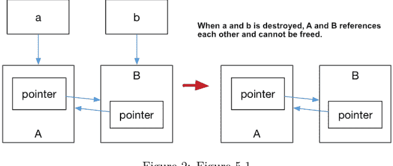
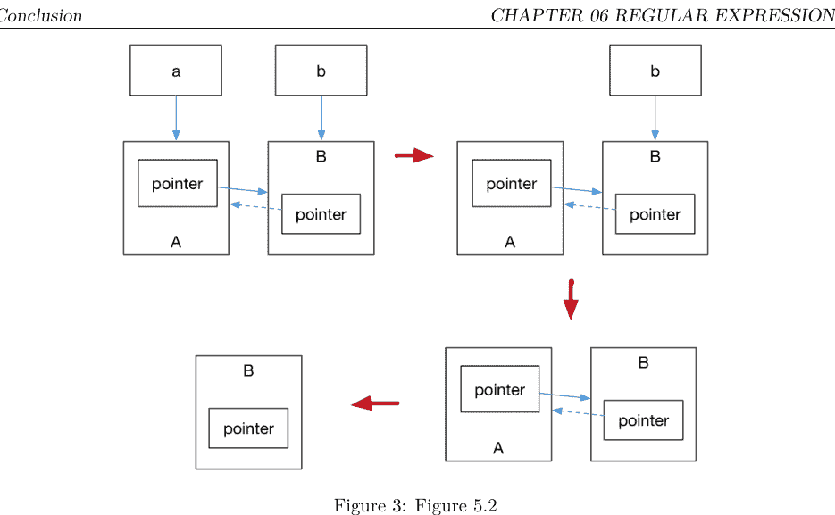

# 现代 C++ 教程：C++11／14／17／20 快速上手


常昆

github.com/changkun/modern-cpp-tutorial


- 代码安全 . . . . . . . . . . . . . . . . . . . . 88

## 前言

## 引言

C++ 用户群体相当庞大。从 C++98 的诞生到 C++11 的正式定型，这一过程跨越了十多年时间。C++14/17 是 C++11 重要的补充和优化，而 C++20 则将这门语言带向了现代化的门槛。这些新标准的扩展特性被赋予了 C++ 语言，注入了新的活力。对于那些仍在使用传统 C++（本书将 C++98 及其之前的 C++ 标准称为传统 C++）的 C++ 程序员来说，在阅读现代 C++ 代码时，可能会发现自己使用的并非同样的语言而感到惊讶。

现代 C++（本书指 C++11/14/17/20）向传统 C++ 引入了许多特性，使得整个 C++ 语言实现了现代化。现代 C++ 不仅增强了 C++ 语言本身的易用性，对 `auto` 关键字的修改让我们在处理极其复杂的模板类型时更有信心。同时，语言运行时也得到了许多增强。Lambda 表达式的出现让 C++ 拥有了“匿名函数”的“闭包”特性，这在现代编程语言（如 Python/Swift）中几乎已成常态；而引用的出现解决了 C++ 一直以来诟诟的临时对象效率问题。

C++17 是过去三年 C++ 社区推动的方向。它也指出了现代 C++ 编程的一个重要发展方向。尽管它的出现不像 C++11 那么频繁，但它包含了大量小巧精美的语言和特性（例如结构化绑定），这些特性的出现再次纠正了我们在 C++ 中的编程范式。

现代 C++ 还为其标准库添加了许多工具和方法，例如语言层面的 `std::thread`，它支持并发编程，且不再依赖于不同平台的底层系统。API 在语言层面实现了跨平台支持；`std::regex` 提供了完整的正则表达式支持及更多功能。C++98 已被证明是一个非常成功的“范式”，现代 C++ 的出现进一步促进了这一范式的发展，使 C++ 成为用于系统编程和库开发的更好的语言。参数在编译时的概念验证（Concepts）增强了语言的易用性。

总之，作为 C++ 的倡导者和实践者，我们始终保持开放的心态接受新事物，我们可以更快地促进 C++ 的发展，让这门古老而新的语言更有活力。

## 目标

- 本书假设读者已经熟悉传统 C++（即 C++98 或更早版本），至少在阅读传统 C++ 代码方面没有困难。换句话说，对于那些在传统 C++ 领域多年经验以及渴望快速理解新特性的人来说……

# 第 01 章：迈向现代 C++

### 目的
本书在一定程度上介绍了现代 C++ 的“黑魔法”。然而，这些魔法是非常有限的，并不适合学习高级 C++ 的读者。本书的目的是为现代 C++ 提供一个快速上手指南。其意图是对关于现代 C++（2020 年之前）的相关特性提供全面的介绍。读者可以根据下表选择感兴趣的内容进行学习并快速熟悉。此外，作者鼓励读者在阅读本书后，能够在新项目中直接使用现代 C++，并在之后逐渐迁移旧项目。

### 代码
本书的每一章都有大量的代码。如果你在根据书中介绍的特性编写自己的代码时遇到问题，不妨阅读附带的源码。所有代码按章节组织，文件夹名为章节号。

### 练习题
每章末尾都有少量练习题，用于测试你是否可以使用章节中的知识点。你可以在这里找到可能的答案，文件夹名称为章节号。

# 第 01 章：迈向现代 C++
编译环境：本书将使用 clang 作为唯一编译器，并在代码中始终使用 `-std=c++17` 标志。
```
clang++ -v
Apple LLVM version 10.0.4
```

## 1.1 弃用特性
在学习现代 C++ 之前，让我们看看一些已被弃用的特性：**注意**弃用并不意味着完全不可用，只是为了兼容性，某些将在未来的标准中消失。

- 字符串字面量不再允许赋值给 `char*`。如果你需要用字符串字面量初始化 `char*`，应该使用 `const`。
```cpp
char* str = "hello world"; // 会出现警告
```
- C++ 异常处理已弃用，应使用 `noexcept`。
- `auto_ptr` 已弃用，应使用 `unique_ptr`。
- `register` 关键字已弃用，且不再具有实际意义。
- 析构函数和拷贝赋值运算符已弃用。
- C 语言的类型转换已弃用（即使用 `static_cast`、`reinterpret_cast`、`const_cast` 等）。
- 特别是，某些 C 标准库在最新的 C++ 标准中已弃用，例如 `<complex>``<cstdalign>``<cmath>`

还有许多如参数绑定（C++11 提供了 `std::bind` 和 `std::function`）、导出等特性也已弃用。上述特性如果你从未未使用或听过，请不要尝试理解它们。你应该转向新标准并直接学习新特性。毕竟，技术是在进步的。

## 1.2 与 C 的兼容性


图 1.2：ISO C 与 ISO C++ 之间的兼容性

## 与 C 的兼容性
由于某些不可抗力和历史原因，我们必须在 C++ 中使用一些 C 代码（甚至是旧 C 代码），例如 Linux 系统调用。在现代 C++ 出现之前，大多数人都在讨论“C 和 C++ 的区别”。通常来说，除了面向对象的类特性和泛型编程的模板特性外，没有其他观点，甚至没有直接答案。“几乎”也是很多人的观点。图 1.2 中的韦恩图回答了 C 和 C++ 的兼容性。

从现在起，你心中应该建立“C++ 不是 C 的超集”的想法（并不是从一开始就有的，后有延伸阅读：C++98 和 C99 的差异）。在编写 C++ 时，应尽可能避免使用如 `void*` 类的程序风格。当你必须使用 C 时，应该注意使用 `extern "C"`，将 C 语言代码与 C++ 代码分离并统一链接，例如：

```cpp
// foo.h
#ifdef __cplusplus
extern "C" {
#endif

add(int x, int y);

#ifdef __cplusplus
}
#endif
```


## 1.2 与 C 的兼容性

第 01 章：迈向现代 C++

```cpp
}
#endif
```

```cpp
// foo.c
int add(int x, int y) {
    return x+y;
}
```

```cpp
// 1.1.cpp
#include "foo.h"
#include <iostream>
#include <functional>
```

```cpp
int main() {
    auto out = std::ref(std::cout << "Result from C code: " << add(1,2));
    out.get() << "\n";
    return 0;
}
```

你应该首先使用 gcc 编译 C 代码：

```
gcc -c foo.c
```

编译并输出 foo.o 文件，然后使用 clang++ 将 C++ 代码链接到 .o 文件（或者将都编译为 .o 然后将它们链接在一起）：

```cpp
clang++ 1.1.cpp -std=c++2a -o 1.1
```

当然，你可以使用 Makefile 来编译上述代码：

```makefile
C = gcc
CXX = clang++
SOURCE_C = foo.c
OBJECTS_C = foo.o
SOURCE_CXX = 1.1.cpp
TARGET = 1.1
LDFLAGS_COMMON = -std=c++2a
```

## 延伸阅读

all:

```makefile
$$(C) -c $(SOURCE_C)
$(CXX) $(SOURCE_CXX) $(OBJECTS_C) $(LDFLAGS_COMMON) -o $(TARGET)
```

clean:

```makefile
rm -rf *. $(TARGET)
```

注意：Makefile 中的缩进是 Tab 键而不是空格字符。如果你将此代码复制到编辑器，Tab 可能会被自动替换。请确保 Makefile 中的缩进正确。它是通过 Tab 完成的。

如果你不知道 Makefile 的用法，没关系。在在本教程中，你不需要构建过于复杂的代码。你也可以简单地在命令行上使用 `clang++-std=c++2a` 来阅读这本书。

如果你是现代 C++ 的初学者，你可能仍然不理解上面那小段代码：

```cpp
auto out = std::ref(std::cout << "Result from C code: " << add(1, 2));
out.get() << "\n";
```

现在不要担心，我们将在后面的章节中遇到它们。

## 延伸阅读

- 《C++ 语言之旅》（第2版）Bjarne Stroustrup
- C++ 历史
- C++ 编译器支持
- ISO C 与 ISO C++ 之间的不兼容性

## 第 02 章：语言可用性增强

当我们在运行时声明、定义变量或常量，并控制代码流、面向对象的函数、模板编程等时，这些可能会在编写代码或编译器编译代码时发生。我们通常称这为语言可用性，指的是发生在运行之前的语言行为。

## 2.1 常量

### nullptr

`nullptr` 的出现是为了替代 NULL。在某种意义上，传统的 C++ 将 NULL 和 0 视为相同，这取决于编译器如何定义 NULL，某些编译器将 NULL 定义为 `((void*)0)`，而有些直接将其定义为 0。

C++ 不允许将 `void *` 隐式转换为其他类型。但如果编译器尝试将 NULL 定义为 `((void*)0)`，那么在以下代码中：

```cpp
char *ch = NULL;
```

C++ 没有通过 `void *` 隐式转换将 NULL 定义为 0。这仍然产生了一个问题。将 NULL 定义为 0 会导致 C++ 的重载功能变得混乱。考虑以下两个函数：

```cpp
void foo(char*);
void foo(int);
```

那么 `foo(NULL)` 语句将调用 `foo(int)`，这会导致代码违背直觉。

为了解决这个问题，C++11 引入了 `nullptr` 关键字，专门用于区分空指针。`nullptr` 的类型是 `nullptr_t`，它可以隐式转换为任何指针或指针类型，并可以与它们进行相等或不等的比较。

你可以尝试使用 clang++ 编译以下代码：

```cpp
#include <iostream>
#include <type_traits>

void foo(char *);
void foo(int);

int main() {
    if (std::is_same<decltype(NULL), void(*)>::value) {
        std::cout << "NULL = 0" << std::endl;
    }
    if (std::is_same<decltype(NULL), void(*)>::value) {
        std::cout << "NULL = (void*)0" << std::endl;
    }
    if (std::is_same<decltype(NULL), nullptr_t>::value) {
        std::cout << "NULL = nullptr" << std::endl;
    }

    foo(0);              // 会调用 foo(int)
    foo(NULL);      // 不编译
    foo(nullptr);      // 会调用 foo(char*)
    return 0;
}

void foo(int i) {
    std::cout << "foo(int) is called" << std::endl;
}

// 输出是：
foo(int) is called
foo(char*) is called
```

从输出可以看出 NULL 不同于 0。因此，养成直接使用 `nullptr` 的习惯。此外，在代码中使用的 `decltype` 和 `std::is_same` 是现代 C++ 的语法。简单来说，`decltype` 用于类型推导，`std::is_same` 用于比较两个类型的相等性。我们将在 `constexpr` 部分详细讨论。

### constexpr

C++ 本身已经有了常量表达式的概念，例如 `1+2`、`3*4`。这类表达式总是产生相同的结果。如果编译器可以在编译时直接嵌入这些表达式，将会提高性能。一个非常明显的例子是在数组定义：

```cpp
#include <iostream>
#define LEN 10

int len_foo() {
    int i = 2;
    return i;
}

constexpr int len_foo() {
    return 5;
}

constexpr int fibonacci(int n) {
    return n == 1 || n == 2 ? 1 : fibonacci(n-1) + fibonacci(n-2);
}

int main() {
    char arr1[10]; // 合法
    char arr2[LEN]; // 合法
    int len = 10;
    // arr3[len];               // 非法

    const int len2 = len + 1;
    constexpr int len2c = len + 2 + 3;
    // arr4[len2];              // 非法，但在大多数编译器中可以
    char arr4[len2c];         // 合法

    // arr5[len_foo()];          // 非法
    char arr6[len_foo() = 2 ? 1]; // 合法

    // 1, 2, 3, 5, 8, 13, 21, 34, 55
    std::cout << fibonacci(10) << std::endl;

    return 0;
}
```

在上面的示例中，`arr4[len2]` 可能会让人困惑，因为 `len2` 被定义为常量。为什么 `arr4[len2]` 是法的？因为 C++ 标准规定数组长度必须是常量表达式，对于 `len2`，它是一个 const 常量而不是常量表达式（尽管大多数编译器支持，但它是非法行为）。我们需要使用 C++11 引入的 `constexpr` 特性来解决这个问题；在 C++98 中，编译器不知道 `len_foo()` 在运行时返回常量，这导致了错误的产生。注意，大多数编译器现在都有自己的优化。许多非法行为在编译优化下变成了合法的。如果你需要重现错误，需要使用旧版本的编译器。C++11 允许用户显式声明函数或对象构造将在编译时变为常量表达式。`constexpr` 关键字显式告诉编译器 `len_foo` 应该是一个编译时表达式。

此外，`constexpr` 函数可以使用递归：

```cpp
constexpr int fibonacci(int n) {
    return n == 1 || n == 2 ? 1 : fibonacci(n-1) + fibonacci(n-2);
}
```

从 C++14 开始，`constexpr` 函数内部可以使用简单语句作为局部变量、循环和分支。例如，代码在 C++11 标准下无法编译。

## 2.2 变量与初始化

```cpp
constexpr int fibonacci(int n) {
    if(n == 1) return 1;
    if(n == 2) return 1;
    return fibonacci(n-1) + fibonacci(n-2);
}
```

对于此，我们可以写一个简化版本使其从 C++11 开始可用：

```cpp
constexpr int fibonacci(int n) {
  return n == 1 || n == 2 ? 1 : fibonacci(n-1) + fibonacci(n-2);
}
```

### if-switch

在传统的 C++ 中，变量的声明可以声明一个临时 int，尽管它可以位于任何地方，即使是一个语句，但在 `if` 和 `switch` 语句中没有办法声明临时变量。例如：

```cpp
#include <iostream>
#include <vector>
#include <algorithm>
```

```cpp
int main() {
  std::vector<int> vec = {1, 2, 3, 4};

  // 从 c++17 开始，可以使用 auto 简化
  const std::vector<int>::iterator itr = std::find(vec.begin(), vec.end(), 2);
  if (itr != vec.end()) {
    *itr = 3;
  }

  if (const std::vector<int>::iterator itr = std::find(vec.begin(), vec.end(), 3);
      itr != vec.end()) {
    *itr = 4;
  }

  // 应该输出：1, 4, 3, 4。可以使用 auto 简化
  for (std::vector<int>::iterator element = vec.begin(); element != vec.end(); ++element) {
    std::cout << *element << std::endl;
  }
}
```


# 第 02 章：语言易性增强

## 2.2 变量与初始化

在上面的代码中，我们可以看到 `itr` 变量定义在整个 `main()` 作用范围内，这导致我们在再次遍历 `std::vectors` 时必须重命名其他变量。C++17 消除了这一限制，使得我们可以在 `if`（或 `switch`）语句中这样做：

```cpp
if (const std::vector<int>::iterator itr = std::find(vec.begin(), vec.end(), 3);
    itr = vec.end()) {
    *itr = 4;
}
```

这类似于 Go 语言吗？

### 初始化列表

初始化是一项非常重要的语言特性，最常见的是对象初始化。在传统的 C++ 中，不同的对象有不同的初始化方法，例如普通数组、POD（普通旧数据，没有构造函数、析构函数和虚函数的类）、struct 类型可以使用 `{}` 初始化，这就是我们所说的初始化列表。对于类对象的初始化，你需要使用拷贝构造函数，或者使用 `()`。这些不同的方法彼此是相互特定的，无法通用的。例如：

```cpp
#include <iostream>
#include <vector>
```

class Foo {
public:
    int value_a;
    int value_b;
    Foo(int a, int b) : value_a(a), value_b(b) {}
};

int main() {
    // C++11 
    int arr[3] = {1, 2, 3};
    Foo foo(1, 2);
    std::vector<int> vec = {1, 2, 3, 4, 5};

    std::cout << "arr[0]:" << arr[0] << std::endl;
    std::cout << "foo:" << foo.value_a << ", " << foo.value_b << std::endl;
    for (std::vector<int>::iterator it = vec.begin(); it != vec.end(); ++it) {
        std::cout << *it << std::endl;
    }
    return 0;
}
```

为了解决这个问题，C++11 首先将初始化列表的概念绑定到类型，并称之为 `std::initializer_list`，允许构造函数或其他函数使用初始化列表作为参数，其中类对象的初始化为普通数组和 POD 初始化方法之间提供了一个统一的桥梁，如下：

```cpp
#include <initializer_list>
#include <vector>
class MagicFoo {
public:
    std::vector<int> vec;
    MagicFoo(std::initializer_list<int> list) {
        for (std::initializer_list<int>::iterator it = list.begin(); it != list.end(); ++it) {
            vec.push_back(*it);
        }
    }
};
int main() {
    // C++11 之后
    MagicFoo magicFoo = {1, 2, 3, 4, 5};
    std::cout << "MagicFoo: ";
    for (std::vector<int>::iterator it = magicFoo.vec.begin(); it != magicFoo.vec.end(); ++it) std::cout << *it << "";
}
```

该构造函数可以初始化列表构造函数，并且带有该构造函数的类型在初始化期间会被特殊对待。

除了对象构造外，初始化列表还可以作为普通函数的形参，例如：

```cpp
public:
    void foo(std::initializer_list<int> list) {
        for (std::initializer_list<int>::iterator it = list.begin(); it != list.end(); ++it) {};
    }
magicFoo.foo({6,7,8,9});
```

其次，C++11 还为任意对象的初始化提供了统一的语法，例如：

```cpp
Foo foo {3, 4};

## 2.3 类型推导

### 结构化绑定

结构化绑定提供了类似于其他语言多返回值的功能。在容器章节中，我们将学习 C++11 添加了 `std::tuple` 容器来构造多个值的返回值。但缺陷是 C++11/14 没有提供一种简单的方法从 `tuple` 中获取并定义元素，尽管可以使用 `std::tie` 进行解包。我们仍然必须非常清楚 `tuple` 包含多少对象、每个对象是什么，这非常麻烦。C++17 完成了这一点，结构化绑定允许我们编写如下代码：

```cpp
#include <iostream>
#include <tuple>

std::tuple<int, double, std::string> f() {
    return std::make_tuple(1, 2, "456");
}

int main() {
    auto [x, y, z] = f();
    std::cout << x << " " << y << " " << z << std::endl;
    return 0;
}
```

`auto` 在类型推导章节中描述。在传统的 C 和 C++ 中，类型必须明确定义，这并没有帮助我们快速编码，特别是面对大量复杂类型时，必须指示变量类型。这不仅降低了我们的开发效率，还让代码变得冗长。

C++11 引入了 `auto` 和 `decltype` 两个关键字来实现类型推导，让 C++ 与其他语言一样，不再担心变量类型。

#### auto

`auto` 在 C++ 中已经存在很久，但它一直是类型的指示器。在传统的 C++ 中，如果变量没有声明为 `auto`。随着 `auto` 被弃用（在 C++17 之后作为保留关键字），语义的改变变得非常自然。使用 `auto` 进行类型推导最常见且值得注意的例子是在之前的章节中：

```cpp
// C++11 之前
vector<int>::const_iterator it = vec.begin(); it != vec.end();
```

当我们有：

```cpp
#include <initializer_list>
#include <vector>
#include <iostream>

class MagicFoo {
public:
    std::vector<int> vec;
    MagicFoo(std::initializer_list<int> list) {
        for (auto it = list.begin(); it != list.end(); ++it) {
            vec.push_back(*it);
        }
    }
};

int main() {
    MagicFoo magicFoo = {1, 2, 3, 4, 5};
    std::cout << "MagicFoo: ";
    for (auto it = magicFoo.vec.begin(); it != magicFoo.vec.end(); ++it) {
        std::cout << *it << " ";
    }
    std::cout << std::endl;
    return 0;
}
```

一些常见的用法：

```cpp
auto i = 5; // 作为 int
auto arr = 10; // 作为 int
```

注意：`auto` 不能用于函数参数，因此以下编译是不可能的（考虑到重载，我们应该使用模板）：

```cpp
int add(auto x, auto y);
// 2.6.auto.cpp:16:9: error: 'auto' not allowed in prototype
```

此外，`auto` 不能用于推导数组类型：

```cpp
auto arr2[10]; // 非法，无法推导数组类型
// 2.6.auto.cpp:30:19: error: 'arr2' declared as array of 'auto'
```

#### decltype

`decltype` 关键字用于解决 `auto` 只能类型变量缺陷。它的用法类似于 `typeof`。有时我们需要计算表达式的类型，例如：

```cpp
auto x = 1;
auto y = 2;
decltype(x+y) z;
```

你已经在上一个例子中看到 `decltype` 用于推断类型的用法。下面的示例用于判断上述变量 `x, y, z` 是否为同一类型：

```cpp
if (std::is_same<decltype(x), int>::value)
  std::cout << "type x == int" << std::endl;
if (std::is_same<decltype(y), float>::value)
  std::cout << "type y == float" << std::endl;
if (std::is_same<decltype(x), decltype(z)>::value)
  std::cout << "type z == type x" << std::endl;
```

其中，`std::is_same<T, U>` 用于判断两个类型 `T` 和 `U` 是否相等。输出是：

```
type x == int
type z == type x
```

#### 后置类型推导

你可能认为，当我们引入 `auto` 时，已经提到过 `auto` 不能用于函数参数的类型推导。`auto` 可以推导函数的返回类型吗？仍然考虑 `add` 函数的例子，我们必须在传统的 C++ 中这样写：

```cpp
template<typename R, typename T, typename U>
R add(T x, U y) {
  return x+y;
}
```

注意：在模板参数列表中，`typename` 和 `class` 没有任何区别。在 `typename` 出现之前，使用 `class` 来定义模板参数。然而，当定义模板中的嵌套依赖类型时，你需要使用 `typename` 来消除歧义。

这种代码实际上非常丑，因为程序员在使用这个模板函数时必须显式指示返回类型。事实上我们不知道 `add()` 函数将执行什么操作，以及要获取什么类型的返回值。

这个问题在 C++11 中得到了解决。尽管你可能立即反应可以使用 `decltype` 来推导 `x+y` 的类型，但我们编写如下代码：

```cpp
decltype(x+y) add(T x, U y)
```

但实际上，这种写法无法编译。这是因为在读取 `decltype(x+y)` 时，`x` 和 `y` 还没有定义。为了解决这个问题，C++11 还提供了后置返回类型，它使用 `auto` 后置返回类型：

```cpp
template<typename T, typename U>
add2(T x, U y) -> decltype(x+y){
  return x + y;
}
```

好消息是，从 C++14 开始，可以直接推导普通函数的返回值的，所以这种方式是合法的：

```cpp
template<typename T, typename U>
add3(T x, U y) {
  return x + y;
}
```


## 2.3 类型推断 第 02 章：语言易用性增强

```cpp
// after c++11
auto w = add2<int, double>(1, 2.0);
if (std::is_same<decltype(w), double>::value) {
    std::cout << "w is double: ";
}
std::cout << w << w << std::endl;
```

```cpp
// after c++14
auto q = add3<double, int>(1.0, 2);
std::cout << "q: " << q << std::endl;
```

### decltype(auto)

decltype(auto) 是 C++14 中一个稍微复杂一点用法。

要理解它，你得了解 C++ 中参数转发（parameter forwarding）的概念，我们将在“语言运行时加固”章节中详细介绍，你稍后可以回来本节的内容。

简单来说，`decltype(auto)` 主要用于推导转发函数或包的类型，这不需要我们显式地指定 `decltype` 的参数表达式。考虑以下示例，当我们需要封装以下函数时：

```cpp
std::string lookup1();
std::string& lookup2();
```

```cpp
In C++11:
std::string look_up_a_string_1() {
    return lookup1();
}
```

```cpp
std::string& look_up_a_string_2() {
    return lookup2();
}
```

使用 `decltype(auto)`，我们可以让编译器完成这些繁琐的参数转发：

```cpp
decltype(auto) look_up_a_string_1() {
    return lookup1();
}
decltype(auto) look_up_a_string_2() {
    return lookup2();
}
```

## 2.4 控制流

### if constexpr

正如我们在本章开头看到的，C++11 引入了 `constexpr` 关键字，它可以将表达式或函数编译为常量结果。一个自然想法是，如果我们将这一特性引入条件判断中，让代码在编译时完成分支判断，是否可以让程序更高效？C++17 将 `constexpr` 关键字引入 `if` 语句，允许你在代码中声明表达式的条件。考虑以下代码：

```cpp
#include <iostream>

template<typename T>
auto print_type_info(const T& t) {
    if constexpr(std::is_integral<T>::value) {
        return t + 1;
    } else {
        return t + 0.001;
    }
}
int main() {
    std::cout << print_type_info(5) << std::endl;
    std::cout << print_type_info(3.14) << std::endl;
}
```

在编译时，实际代码的行为的行为如下：

```cpp
int print_type_info(const int& t) {
    return t + 1;
}
double print_type_info(const double& t) {
    return t + 0.001;
}
int main() {
    std::cout << print_type_info(5) << std::endl;
    std::cout << print_type_info(3.14) << std::endl;
}
```

### 基于范围的 for 循环

最后，C++11 引入了基于范围的迭代方法，我们能够编写像 Python 一样简洁的循环，并且进一步简化之前的示例：

## 2.5 模板

```cpp
#include <iostream>
#include <vector>
#include <algorithm>

int main() {
    std::vector<int> vec = {1, 2, 3, 4};
    if (auto itr = std::find(vec.begin(), vec.end(), 3); itr != vec.end()) {
        for (auto element : vec) {
            std::cout << element << std::endl; // 只读
        }
        for (auto element : vec) {
            element += 1; // 可写
        }
        std::cout << element << std::endl; // 只读
    }
}
```

C++ 模板一直是语言的一门特殊艺术，甚至可以作为一种新语言使用。模板的哲学是在编译时处理所有问题，只在运行时处理，从而极大地优化了性能。因此，模板也是 C++ 的黑魔法之一。

### 外部模板

在传统的 C++ 中，模板只有在在使用时才由编译器实例化。换句话说，只要在编译单元（文件）中遇到完整的模板就会实例化。这导致了重复实例化，我们没有办法不触发实例化。为此，C++11 引入了外部模板语法，允许我们显式编译器何时实例化模板：

```cpp
template class std::vector<bool>; // 强制实例化
extern class std::vector<double>; // 
```

在传统的 C++ 中，`>>` 总是被视为右移运算符。但实际上我们可以轻松编写嵌套模板：

```cpp
std::vector<std::vector<int>> matrix;
```

这在传统的 C++ 编译器下是不合法的，C++11 开始连续括号变得合法并可以编译。即使是以下写法：

```cpp
template<typename T>
class MagicType {
    T magic;
};

// 在 main 函数中
std::vector<MagicType<bool>> v; // 合法但不推荐
```

### 类型别名模板

在理解类型别名模板之前，你需要理解“模板”和“类型”的区别。模板用于生成类型。在传统的 C++ 中，`typedef` 可以为类型定义新名称，但由于模板不是类型，因此无法为模板定义新名称。例如：

```cpp
template<typename T, typename U>
class MagicType {
    T data;
    U magic;
};

// 不允许
template<typename T> MagicType<std::vector<T>>;
```

C++11 使用 `using` 引入别名语法，同时支持与 `typedef` 相同的效果。通常使用 `typedef` 定义别名，但函数指针别名的定义语法不同，这通常给直接读取带来了困难。

```cpp
typedef int (*process)(void);
using NewProcess = int(*)(void);
template<typename T>
using TrueMagic = MagicType<std::vector<T>>;

int main() {
    TrueMagic m;
}
```

### 默认模板参数

我们可能定义了加法函数：

```cpp
template<typename T, typename U>
auto add(T x, U y) -> decltype(x+y) {
    return x+y;
}
```

使用时，发现发现调用 `add` 都必须指定其模板参数的类型。C++11 的便利之处在于指定模板的默认参数：

```cpp
template<typename T = int, typename U = int>
auto add(T x, U y) -> decltype(x+y) {
    return x+y;
}
// 使用: add(1, 2) 或 add<double>(1, 2.0)
```

### 变长模板

模板一直是 C++ 的独特黑魔法之一。在传统的 C++ 中，类模板和函数模板只能接受一组指定的模板参数；C++11 添加了一种新的表示方法，允许任意数量的模板参数，定义时不需要固定参数数量：

```cpp
template<typename... Ts> class Magic;
```

`Magic` 类可以接受无限制数量的 `typename` 作为模板的形式参数，如下所示：

```cpp
class Magic<int,
    std::vector<int>,
    std::map<int, std::string>,
    std::vector<std::vector<int>>> darkMagic;
```

由于它是任意的，模板参数数量为 0 也是可能的：

```cpp
class Magic<> nothing;
```

如果你不想生成 0 个模板参数，可以手动定义至少一个模板参数：

```cpp
template<typename Require, typename... Args> class Magic;
```

变长模板参数也可以直接调整为模板函数。经典 C 中的 `printf` 函数可以达到无限数量的形式参数的调用，但不是类安全的。除了定义类安全的变长函数外，C++11 还可以让类打印函数处理非自包含的对象。除了在模板参数中使用 `...` 来表示模板参数的无限长度外，函数也使用了相同的表示来表示无限长度参数，这为我们简单地编写变长参数函数提供了方便的方法，例如：

```cpp
template<typename... Args>
void printf(const std::string &str, Args... args);
```

那么定义变长模板参数后如何解包参数？

首先，我们可以使用 `sizeof(...)` 计算参数个数：

```cpp
#include <iostream>
template<typename... Ts>
void magic(Ts... args) {
    std::cout << sizeof...(args) << std::endl;
}
```

我们可以向 `magic` 函数传递任意数量的参数：

```cpp
magic(); // 0
magic(1); // 1
magic(1, ""); // 2
```

### 1. 递归模板函数

递归是一种非常容易理解且最经典的方法。这种方法不断递归地将模板参数传递给函数，从而实现递归遍历所有模板参数的目的：


## 2.5 模板
第 02 章：语言易用性增强

```cpp
#include <iostream>
template<typename T0>
void print1(T0 value) {
    std::cout << value << std::endl;
}

template<typename T, typename... Ts>
void print1(T value, Ts... args) {
    std::cout << value << std::endl;
    print1(args...);
}

int main() {
    print1(1, 2, "123", 1.1);
    return 0;
}
```

## 2. 可变参数模板展开

你可能会觉得这种写法非常繁琐。C++17 增加了对可变模板展开的支持，你可以在函数中编写类似 `printf` 的代码：

```cpp
template<typename T0, typename... T>
void print2(T0 t, T... t) {
    std::cout << t << std::endl;
    if constexpr (sizeof...(t) > 0) print2(t...);
}
```

事实上，有时我们使用可变参数模板，但并不一定需要逐个遍历参数。我们可以使用 `std::bind` 和完美转发（perfect forwarding）的特性来实现函数与参数的绑定，从而实现调用。

## 3. 初始化列表展开

递归模板函数是一种标准做法，但其显而易见的缺点是你必须定义一个终止函数。

以下是关于使用初始化列表展开的“黑魔法”描述：

```cpp
template<typename T, typename... Ts>
auto print3(T value, Ts... args) {
    std::cout << value << std::endl;
    (void) std::initializer_list<T>({&args} {
        std::cout << args << std::endl;
    }(), value)...;
}
```

## 2.5 模板 第 02 章：语言易用性增强

在这段代码中，额外使用了 C++11 提供的初始化列表以及 Lambda 表达式的属性（在下一节中提到）。

通过初始化列表，`(lambda expression, value)...` 将被展开。由于逗号表达式的出现，之前的 lambda 表达式会被执行，并完成参数的输出。为了避免编译器警告，我们可以明确将 `std::initializer_list` 转换为 `void`。

### 折叠表达式 (Fold expression)

在 C++17 中，这种变长参数的特性被进一步引入表达式中，考虑以下示例：

```cpp
#include <iostream>
template<typename ... T>
auto sum(T ... t) {
    return (t + ...);
}
int main() {
    std::cout << sum(1, 2, 3, 4, 5, 6, 7, 8, 9, 10) << std::endl;
}
```

### 非类型模板参数推导

我们上面提到的主要是是模板参数的一种形式：类型模板参数。

```cpp
template <typename T, typename U>
auto add(T t, U u) {
    return t+u;
}
```

模板 `T` 和 `U` 的参数是特定类型。但还有一种常见的模板参数形式允许将不同的字面量作为模板参数，即非类型模板参数：

```cpp
template <typename T, int BufSize>
class buffer_t {
public:
    T& alloc();
    void free(T& item);
private:
    T data[BufSize];
};
```

## 2.6 面向对象

```cpp
buffer_t<int, 100> buf; // 100 作为模板参数
```

在这种模板参数形式下，我们可以将 100 作为参数传递给模板。在 C++11 引入类型推导功能后，我们自然会问，既然这里传递的是特定的字面量，编译器是否可以协助类型推导？使用占位符 `auto` 是否不再需要显式指定类型？幸运的是，C++17 引入了这一特性，我们可以使用 `auto` 关键字让编译器协助完成特定类型的推导。

```cpp
template <auto value> void foo() {
    std::cout << value << std::endl;
    return;
}

int main() {
    foo<10>(); // value 为 int
}
```

## 2.6 面向对象

### 委托构造函数 (Delegate constructor)

C++11 引入了委托构造的概念，允许构造函数调用同一类中的另一个构造函数，从而简化了代码：

```cpp
#include <iostream>
class Base {
public:
    int value1;
    int value2;
    Base() {
        value1 = 1;
    }
    Base(int value) : Base() { // 委托 Base()构造函数
        value2 = value;
    }
};

int main() {
    Base b(2);
    std::cout << b.value1 << std::endl;
    std::cout << b.value2 << std::endl;
}
```

### 继承构造函数 (Inheritance constructor)

在传统的 C++ 中，如果构造函数需要继承，需要逐个传递参数，这导致了效率低下。C++11 使用关键字引入了继承构造函数的概念：

```cpp
#include <iostream>
class Base {
public:
  int value1;
  int value2;
  Base() {
    value1 = 1;
  }
  Base(int value) : Base() // 委托 Base()构造函数
    value2 = value;
  }
};
class Subclass : public Base {
public:
  using Base::Base; // 继承构造函数
};
int main() {
  Subclass s(3);
  std::cout << s.value1 << std::endl;
  std::cout << s.value2 << std::endl;
}
```

### 显式虚函数重写 (Explicit virtual function overwrite)

在传统的 C++ 中，往往容易意外地重载虚函数。例如：

```cpp
struct Base {
  virtual void foo();
};
struct SubClass: Base {
  void foo();
};
```

`SubClass::foo` 可能并不是程序员想要重载虚函数，而只是添加了一个同名的函数。另一种可能的情况是当基类的虚函数被删除时，子类没有任何函数实现。C++11 引入了 `override` 和 `final` 关键字来防止这种情况。

### override

在重载虚函数时，`override` 关键字会显式告诉编译器检查它是否是一个重写：

```cpp
struct Base {
    virtual void foo(int);
};
struct SubClass : Base {
    void foo(int) override; // 合法
    void foo(float) override; // 非法
};
```

### final

`final` 用于防止类被继承或函数被重写：

```cpp
struct Base {
    virtual void foo() final;
};
struct SubClass1 : Base {
}; // 非法
class SubClass2 final {
}; // 合法
struct SubClass3 : Base {
    void foo() // // 非法
};
```

### 显式删除函数 (Explicit delete function)

在传统的 C++ 中，如果程序员没有提供，编译器将默认为对象生成构造函数、拷贝构造函数、赋值运算符和析构函数。此外，C++ 还为所有类定义了操作符的 `delete`。这部分函数在程序员需要时可以被重写。

这产生了一些要求：准确控制默认函数生成的能力。例如，当禁止拷贝类时，必须将拷贝构造和赋值运算符声明为 `delete`。尝试使用这些未定义的函数将导致编译或链接错误，这是一种非常传统的方式。

此外，编译器生成的默认构造函数不能与用户定义的构造函数同时存在，但有时我们希望同时拥有这两个构造函数，这很很。。C++11 为上述要求提供了解决方案，允许显式声明来接受或拒绝生成的函数。例如：

```cpp
class Magic {
public:
    Magic() = default; // 显式让编译器使用默认构造函数
    Magic& operator=(const Magic&) = delete; // 显式拒绝构造
    Magic(int magic_number);
};
```

## 2.6 面向对象 第 02 章：语言易用性增强

在传统的 C++ 中，枚举类型不是类型安全的，枚举类型被视为整数处理，这允许两个完全不同的枚举类型直接比较（尽管编译器会检查，但并非完全）。同一个命名空间内不同枚举类型的值名称不能相同，这通常不是我们希望看到的。

C++11 引入了枚举类并使用 `enum class` 语法声明它：

```cpp
enum class new_enum = unsigned int {
value1,
value2,
value3 = 100,
value4 = 100
};
```

枚举因此定义了类型安全。首先，它不能隐式转换为整数，不能转换为数字，更不可能比较不同枚举类型的值。如果相同枚举值之间指定的值相同，你可以比较：

```cpp
if (new_enum::value3 == new_enum::value4) { // true }
```

### 强类型 C++


## 结论 第02 章：语言易用性增强

```cpp
std::cout << "new_enum::value3 == new_enum::value4" << std::endl;
}
```

在这种语法中，枚举类型后面跟着一个冒号和一个类型关键字，用于指定枚举中的枚举值，这允许我们为为枚举赋值（如果未指定，则默认使用 `int`）。

如果我们想要获取枚举值的值，将必须进行显式的类型转换，但我们可以重载 `<<` 运算符来输出它，你可以收集以下代码段：

```cpp
#include <iostream>
template<typename T>
std::ostream& operator<<(typename std::enable_if<std::is_enum<T>>::type&, std::ostream& stream, T value) {
    return stream << static_cast<typename std::underlying_type<T>::type>(value);
}
```

此时，以下代码将能够被编译：

```cpp
std::cout << new_enum::value3 << std::endl;
```

## 结论

本节介绍了现代 C++ 中语言用法的增强，我认为这些是几乎每个人都需要知道和使用的最重要的特性：

- 1. auto 类型推导
- 2. 迭代的作用域
- 3. 初始化列表
- 4. 变长参数模板

## 练习

1. 使用结构化绑定，仅用一行函数代码实现函数：

```cpp
#include <string>
#include <map>
#include <iostream>
template <typename Key, typename Value, typename F>
void update(std::map<Key, Value>& m, F foo) {
    // TODO:
}
```

```cpp
int main() {
    std::map<std::string, long long int> m {
        {"a", 1},
        {"b", 2},
        {"c", 3}
    };

    update(m, [] (std::string key) {
        return std::hash<std::string>{}(key);
    });
    for (auto& [key, value] : m) {
        std::cout << key << " : " << value << std::endl;
    }
}
```

- 2. 尝试使用折叠表达式（Fold Expression）实现一个计算平均值的函数，允许传递任何参数。

参考答案参见此处。

## 第03 章：语言运行时增强

## 3.1 Lambda 表达式

Lambda 表达式是现代 C++ 中最重要的特性之一，Lambda 表达式提供了类似匿名函数的功能。当需要函数但不想使用名称来调用函数时，就会使用匿名函数。实际上有很多很多这样的场景。因此，匿名函数几乎是现代编程语言的标配。

## 基础

Lambda 表达式的基本语法如下：

```cpp
[capture list] (parameter list) mutable(optional) exception attribute -> return type {
// 函数体
}
```

上述语法规则除了 `[capture list]` 中的内容外，其他都是容易理解的，只是普通函数的函数名被省略了。返回值以 `->` 的形式出现（我们在上一节的尾部返回类型中已经提到这一点）。

被调用的捕获列表可以理解为一种参数类型。默认情况下，Lambda 表达式的内部函数体无法使用函数体外部的变量。此时，

## 3.1 Lambda 表达式

捕获列表可以用于传递外部数据。根据传递的行为，捕获列表还分为以下类型：

- 1. 值捕获 类似于参数传递，值捕获基于变量可以复制的事实，不同在于被捕获的变量是在 Lambda 表达式创建时复制的，而不是在调用时：

```cpp
void lambda_value_capture() {
    int value = 1;
    auto copy_value = [value]() {
        return value;
    };
    value = 100;
    auto stored_value = copy_value();
    std::cout << "stored_value = " << stored_value << std::endl;
    // 此时，stored_value == 1，而 value == 100。
    // 因为 copy_value 在它创建时已经被复制了。
}
```

- 2. 引用捕获 类似于引用传递，引用捕获保存引用且值会变化：

```cpp
void lambda_reference_capture() {
    int value = 1;
    auto copy_value = [&value]() {
        return value;
    };
    value = 100;
    auto stored_value = copy_value();
    std::cout << "stored_value = " << stored_value << std::endl;
    // 此时，stored_value == 100，value == 100。
    // 因为 copy_value 保存了引用
}
```

- 3. 隐式捕获 手动编写捕获列表有时是复杂的。这种机械工作可以由编译器处理。此时，你可以向编译器写入 `&` 或 `=` 来声明引用捕获或值捕获。

总结来说，捕获提供了 Lambda 表达式使用外部值的能力。四种常见的捕获列表形式可以是：

- 空捕获列表

## 3.1 Lambda 表达式
## 第03 章：语言运行时增强

- [name1,name2, ...] 捕获一系列变量
- [&] 引用捕获，让编译器自己推导引用列表
- [=] 值捕获，让编译器自己推导值列表

### 4. 表达式

上一节提到捕获列表可以理解为一种参数类型。默认情况下，Lambda 表达式的内部函数体无法使用函数体外部的变量。此时，捕获列表可以用于传递外部数据。

本节讨论泛型 Lambda 表达式。在 C++14 中，`auto` 关键字可以用于参数列表：

```cpp
void lambda_generic() {
    auto generic = [](auto x, auto y) {
        return x + y;
    };
    std::cout << generic(1, 2) << std::endl;
}
```

## 3.2 对象封装
## 第03 章：语言运行时增强

```cpp
std::cout << generic(1.1, 2.2) << std::endl;
}
```

## 3.2 对象封装

虽然这些特性属于标准库而非位于运行时，但它增强了 C++ 的运行时能力。这部分内容也非常重要，所以放在这里介绍。

### std::function

Lambda 表达式的本质是一个类类型的对象（称为闭包类型），它类似于函数类型（称为闭包对象）。当 Lambda 表达式的捕获列表为空时，闭包对象也可以转换为函数指针值，例如：

```cpp
#include <iostream>
using foo = void(*)(int); // 函数指针
void functional(foo f) {
  f(1);
}
int main() {
  auto f = [](int value) {
    std::cout << value << std::endl;
  };
  functional(f); // 通过函数指针调用
  f(1); // 通过 Lambda 表达式调用
  return 0;
}
```

C++11 的 `std::function` 是一种通用的多态函数封装器，其实例可以存储、拷贝任何可调的目标实体。它也是存在于 C++ 中的。一种类型安全的包（相对而言，对函数指针的调用不是类型安全的），换句话说，是一个函数容器。当我们有一个函数容器时，可以更容易更容易将函数和函数指针作为对象处理。例如：

```cpp
#include <functional>
#include <iostream>
```


```cpp
int foo(int para) {
  return para;
}
```

```cpp
int main() {
  // std::function 封装了一个接收 int 参数并返回 int 值的函数
  std::function<int(int)> func = foo;

  int important = 10;
  std::function<int(int)> func2 = [&](int value) -> int {
    return 1+value+important;
  };

  std::cout << func(10) << std::endl;
  std::cout << func2(10) << std::endl;
}
```

std::bind 和 std::placeholder 用于绑定函数调用的参数。它解决了我们可能无法一次性获取函数所有参数的问题。通过此函数，部分调用参数被预先绑定到函数中成为一个新对象，然后在参数完备后完成调用。例如：

```cpp
int foo(int a, int b, int c) {
  //
}
int main() {
  // 在函数 foo 上绑定参数 1, 2，并使用 std::placeholders::_1 作为
  // 第一个参数的占位符
  auto bindFoo = std::bind(foo, std::placeholders::_1, 1,2);
  // 调用 bindFoo 时，我们只需要一个参数
  bindFoo();
}
```

> 提示：auto 关键字的魔力。有时我们可能熟悉函数的返回类型，但可以使用 auto 来规避这个问题。

## 3.3 rvalue Reference（右值引用）

右值引用（rvalue references）是 C++11 引入的重要特性之一，与 Lambda 表达式同义。它的引入解决了 C++ 中大量的历史遗留问题。它消除了诸如 std::vector、std::string 等额外开销，并使得函数对象容器 std::function 成为可能。

### lvalue, rvalue, prvalue, xvalue

要理解什么是右值引用，你必须对 lvalue 和 rvalue 有清晰的理解。

lvalue（左值），顾名思义，是指赋值符号左侧的值。准确来说，lvalue 是一个在表达式（不一定是赋值表达式）之后仍然存在的持久性对象。

Rvalue（右值），右侧的值指的是在表达式结束后就不再存在的临时对象。

在 C++11 中，为了引入强大的右值引用，右值值的概念被进一步划分为：prvalue 和 xvalue。

prvalue（纯右值，pure rvalue），完全的右值，要么是纯粹的，如 10、true；要么求值结果等同于字面量或匿名临时变量，例如 1+2。非引用返回的临时变量、操作表达式生成的临时变量、原始字面量以及 Lambda 表达式都是纯右值。

注意，字符串字面量在类中会变成 rvalue，在其他情况下仍保持为 lvalue（例如，在函数中）。

```cpp
class Foo {
  const char*& right = "this is a rvalue";

public:
  void bar() {
    right = "still rvalue"; // 字符串字面量是一个 rvalue
  }
};

int main() {
  const char* const &left = "this is an lvalue"; // 字符串字面量是一个 lvalue
}
```

xvalue（将亡右值，expiring rvalue）是 C++11 为引入右值引用提出的概念（在传统的 C++ 中，prvalue 和 rvalue 是同一个概念），指一个会被销毁但可以移动的值。

理解 xvalue 可能会困难，让我们来看像这样的代码：

```cpp
std::vector<int> foo() {
  std::vector<int> temp = {1, 2, 3, 4};
  return temp;
}

std::vector<int> v = foo();
```

在代码中，就传统的理解而言，函数的返回值 temp 在内部被创建并赋值给 v，而 v 获得了这个对象，整个 temp 被复制了。然后销毁 temp。如果这个 temp 很大，将导致产生大量的额外开销（这是传统 C++ 受批评的问题之一）。

在最后一行中，v 是 lvalue，而 foo() 的返回值是 rvalue（也是纯右值）。然而，v 可以被其他变量捕获，foo() 的返回值被用作临时值。一旦离开 v，它将被销毁，且无法获取或修改。xvalue 定义了一种行为，使得临时值可以在被识别的同时仍被移动。在 C++11 之后，编译器为我们做了一些工作，让 lvalue 经历了这种隐式的右值转换，等同于 `static_cast<std::vector<int>&&>(temp)`，这里移动了局部返回的值。

### rvalue reference and lvalue reference

要创建一个 xvalue，你需要声明右值引用：`T&&`，其中 T 是类型。右值引用的语句扩展了这个临时值的生命周期，只要变量存，它就会持续存在。C++11 提供了 `std::move` 方法无条件地将 lvalue 转换为 rvalues。通过它，我们可以获得一个临时右值对象，例如：

```cpp
#include <iostream>
#include <string>

void reference(std::string& str) {
    std::cout << "lvalue" << std::endl;
}
void reference(std::string&& str) {
    std::cout << "rvalue" << std::endl;
}

int main() {
    std::string l1 = "string"; // l1 是一个 lvalue
    std::string&& r1 = l1; // 非法，右值不能引用左值
    std::string&& rv1 = std::move(l1); // 合法，std::move 可以将 lvalue 转换为 rvalue
    std::cout << rv1 << std::endl;

    const std::string& lv2 = l1; // 合法，const 左值引用可以扩展变量生命周期
    lv2 += "Test"; // 非法，const 引用不能修改
    std::cout << lv2 << std::endl;

    std::string& rv2 = l1 + l2; // 合法，右值引用扩展生命周期
    rv2 += "string"; // 非法，非 const 引用可以修改
    std::cout << rv2 << std::endl;

    reference(rv2); // 输出: lvalue
    return 0;
}
```

rv2 指的是一个 rvalue，但由于它是一个引用，rv2 仍然是一个 lvalue。注意这里有一个有趣的历史性问题，让我们来看下面的代码：

```cpp
rv2 refers to an rvalue,但由于它是一个引用，rv2 仍然是一个 lvalue. Note that there is a very interesting historical issue, let's look at the following code:

#include <iostream>

int main() {
    int &a = std::move(1); // 非法，非 const 左值引用绑定右值
    const int &b = std::move(1); // 合法，const 左值引用可以
    std::cout << b << std::endl;
}
```

*(注：由于您提供的文本在后半部分大量重复且逻辑混乱，以上仅翻译了输入中完整的部分。)*


- 1. 首先构造两个作为返回右值（as-return-rvalue）的 A 对象，并获取这两个构造函数的输出；
- 2. 函数返回后，它将生成一个 xvalue，它被 A 的移动结构（A&&）引用，从而扩展其生命周期，并将右值中的指针保存到 obj 中。在移动操作过程中，指向值的指针被设置为 `nullptr`，这防止了区域被销毁。

这避免了无意义的拷贝构造并提升了性能。让我们来看涉及标准库的示例：

```cpp
#include <iostream> // std::cout
#include <utility> // std::move
#include <vector> // std::vector
#include <string> // std::string

int main() {

    std::string str = "Hello world.";
    std::vector<std::string> v;

    // push_back(const T&), copy
    v.push_back(str);
    // "str: Hello world."
    std::cout << "str: " << str << std::endl;

    // push_back(const T&), no copy
    // 字符串将被移动到 vector 中，因此 std::move 可以减少拷贝成本
    v.push_back(std::move(str));
    // str 现在是空的
    std::cout << "str: " << str << std::endl;

    return 0;
}
```

## 完美转发 (Perfect forwarding)

正如我们之前提到的，声明的右值引用实际上是一个左值（lvalue）。这为我们进行参数化（传递）造成了问题：

## 3.3 右值引用 (rvalue Reference)

```cpp
#include <iostream>
#include <utility>
void reference(int& v) {
    std::cout << "lvalue reference" << std::endl;
}
void reference(int&& v) {
    std::cout << "rvalue reference" << std::endl;
}
template <typename T>
void pass(T& v) {
    std::cout << " normal param passing: ";
    reference(v);
}
int main() {
    std::cout << "rvalue pass:" << std::endl;
    pass(1);

    int l = 1;
    pass(l);

    return 0;
}
```

对于 `pass(1)`，虽然值是右值，但 `v` 是一个引用，它也是一个左值。因此 `reference(v)` 将调用 `reference(int&)` 并输出 lvalue。对于 `pass(1)`，`1` 是一个右值，为什么它能成功地传递给 `pass(T& v)` 呢？

这是基于引用折叠规则（reference collapsing rule）：在传统的 C++ 中，我们无法继续引用引用类型。然而，C++ 随着右值引用的出现放宽了这一限制，产生了引用折叠规则，允许我们使用左值引用和右值引用。但必须遵循以下规则：

| 函数参数类型 | 实际参数类型 | 推导后的函数参数类型 |
|---|---|---|
| T& | lvalue ref | T& |
| T& | rvalue ref | T& |
| T&& | lvalue ref | T& |
| T&& | rvalue ref | T& |

在模板函数中使用 `T&&` 可能无法产生右值引用，当传递一个左值时，该函数的引用将被推导为左值。更准确地说，无论模板参数是什么种类型的引用，当且仅当参数类型为右值引用时，模板参数才能被推导为右引用类型。这使得 `v` 完成了成功的传递。

完美转发基于上述规则。所谓的“转发”是为了让我们在传递参数时保持原始的参数类型（左值引用保持左值，右值引用保持右值引用）。为了解决这个问题，我们应该使用 `std::forward`（传递）参数：

```cpp
#include <iostream>
#include <utility>
void reference(int& v) {
    std::cout << "lvalue reference" << std::endl;
}
void reference(int&& v) {
    std::cout << "rvalue reference" << std::endl;
}
template <typename T>
void pass(T v) {
    std::cout << " normal param passing: " <<
    reference(v);
    std::cout << " std::move param passing: " <<
    reference(std::move(v));
    std::cout << " std::forward param passing: " <<
    reference(std::forward<T>(v));
    std::cout << " _static_cast<T&> param passing: " <<
    reference(static_cast<T&&>(v));
}
int main() {
    std::cout << "rvalue pass:" << std::endl;
    pass(1);
    int l = 1;
    std::cout << "lvalue pass:" << std::endl;
    pass(l);
    return 0;
}
```

输出结果：

rvalue pass:
normal param passing: lvalue reference
std::move param passing: rvalue reference
std::forward param passing: rvalue reference
static_cast<T&&> param passing: rvalue reference
lvalue pass:
normal param passing: lvalue reference
std::move param passing: lvalue reference
std::forward param passing: lvalue reference
static_cast<T&&> param passing: lvalue reference


# 第 04 章 容器

## 4.1 线性容器

```cpp
v.push_back(3);
```

```cpp
std::cout << "size" << v.size() << std::endl; // 输出 3
std::cout << "capacity" << v.capacity() << std::endl; // 输出 4
```

```cpp
// 这里的自动扩展逻辑与 Golang 的 slice 非常相似。
v.push_back(5);
```

```cpp
std::cout << "size" << v.size() << std::endl; // 输出 5
std::cout << "capacity" << v.capacity() << std::endl; // 输出 8
```

```cpp
// 如如下所示，虽然容器清空了元素，
// 但空元素的内存并未被返回。
v.clear();
```

```cpp
std::cout << "size" << v.size() << std::endl; // 输出 0
std::cout << "capacity" << v.capacity() << std::endl; // 输出 8
```

```cpp
// 可以通过 shrink_to_fit() 调用将额外的内存返回给系统
v.shrink_to_fit();
```

```cpp
std::cout << "size" << v.size() << std::endl; // 输出 0
std::cout << "capacity" << v.capacity() << std::endl; // 输出 0
```

第二个问题要简单得多。使用 std::array 可以让代码更加“现代”，并封装一些操作函数，例如获取数组大小和检查它是否为空，还可以使用库中标准友好的容器算法，例如 std::sort。

使用 std::array 只需要指定它的类型和大小：

```cpp
std::array<int, 4> arr = {1, 2, 3, 4};
```

```cpp
arr.empty(); // 检查容器是否为空
arr.size(); // 返回容器的大小
```

```cpp
// 迭代器支持
for (auto &i : arr)
{
  // ...
}
```

```cpp
// 使用 lambda 表达式排序
std::sort(arr.begin(), arr.end(), [](int a, int b) {
  return b < a;
});
```

## 4.2 无序容器

```cpp
// 数组大小必须是 constexpr
constexpr int len = 4;
std::array<int, len> arr = {1, 2, 3, 4};
```

```cpp
// 非法，与 C 风格数组不同，std::array 不会导出为 T*
int *arr_p = arr;
```

当我们使用 std::array 时，不可避免地会遇到 C 风格的兼容接口。有三种方法可以做到：

```cpp
void foo(int *p, int len) {
    return;
}
std::array<int, 4> arr = {1,2,3,4};
```

```cpp
// C 风格参数传递
// foo(arr, arr.size()); // 非法，无法隐式转换
foo(&arr[0], arr.size());
foo(arr.data(), arr.size());
```

```cpp
// 使用 'std::sort'
std::sort(arr.begin(), arr.end());
```

### std::forward_list

std::forward_list 是一个列表容器，其用法基本上与 std::list 类似，因此我们不花太多时间介绍它。

需要注意的是，与 std::list 的双向链表实现不同，std::forward_list 是使用单链表实现的。它提供了复杂度为 $O(1)$ 的元素插入，不支持快速随机访问（这也是列表的特性）。它是标准库容器中唯一不提供 `size()` 方法的容器。在不需要双向迭代时，它的空间利用率比 std::list 高。

我们对传统 C++ 中的无序容器 std::map/std::set 已经熟悉。这些元素内部通过红黑树实现。插入和搜索的平均复杂度为 $O(\log(size))$。在插入元素时，根据 `<` 运算符比较元素的大小，并确定元素是否相同。选择合适的位置将其插入到容器中。在遍历此容器中的元素时，输出将按照 `<` 运算符的顺序逐一遍历。

无序容器中的元素不是排序的，元素通过哈希表实现。插入和搜索元素的平均复杂度为 $O(constant)$。在不考虑容器内元素顺序的情况下，可以获得显著的性能提升。

C++11 引入了两组无序容器：std::unordered_map/std::unordered_multimap 和 std::unordered_set/std::unordered_multiset。

它们的用法基本上与原始的 std::map/std::multimap/std::set/std::multiset 类似。由于我们对这些容器已经熟悉，将不再逐一比较它们。让我们直接比较 std::map 和 std::unordered_map。

```cpp
#include <iostream>
#include <string>
#include <unordered_map>
#include <map>
```

```cpp
int main() {
    // 以相同的顺序初始化
    std::unordered_map<int, std::string> u = {
        {1, "1"},
        {3, "3"},
        {2, "2"}
    };

    std::map<int, std::string> v = {
        {1, "1"},
        {3, "3"},
        {2, "2"}
    };

    // 以相同的方式迭代
    std::cout << "unordered_map" << std::endl;
    for(const auto & n : u) {
        std::cout << "Key:[" << n.first << "] Value:[" << n.second << "]\n";
    }

    std::cout << "map" << std::endl;
    for(const auto & n : v) {
        std::cout << "Key:[" << n.first << "] Value:[" << n.second << "]\n";
    }
}
```
最终输出是：
unordered_map
Key:[1] Value:[1]
Key:[3] Value:[3]
Key:[2] Value:[2]

## 4.3 元组 (Tuples)

熟悉 Python 的程序员应该意识到元组（tuples）的概念。在传统 C++ 的容器中，除了 std::pair 之外，似乎没有现成的结构来存储不同类型的数据（通常我们会自己定义结构）。但 std::pair 的缺陷是显而易见的，只能存储两个元素。

### 基本操作

元组有三个核心函数可以使用：
1. std::make_tuple：构造元组
2. std::get：获取元组某个位置的值
3. std::tie：解包元组

```cpp
#include <tuple>
#include <iostream>

auto get_student(int id) {
    if (id == 0) {
        return std::make_tuple("John", 'A');
    }
    if (id == 1) {
        return std::make_tuple("Jack", 'B');
    }
    if (id == 2) {
        return std::make_tuple("Ive", 'C');
    }
    return std::make_tuple("", 'D');
}

int main() {
    double gpa;
    std::string name;

    std::tie(gpa, name) = get_student(0);
    std::cout << "ID: 0, GPA: " << gpa << ", Grade: " << name << std::endl;
    return 0;
}
```

### 运行时索引

如果你考虑上面的代码，可能会发现 `std::get` 依赖于编译时常量。如何通过数字索引元组？答案是使用 C++17 的：

```cpp
#include <variant>
#include <tuple>

template <size_t n, typename... T>
constexpr std::variant<T> _tuple_index(const std::tuple<T...>& tpl, size_t i) {
  if constexpr (n >= sizeof...(T)) {
    throw std::out_of_range("index out of range");
  }
  if constexpr (i == n) {
    return std::variant<T>{std::get<n>(tpl)};
  }
  return _tuple_index<sizeof...(T)-1 == n ? n+1 : 0>(tpl, i);
}

template <typename... T>
std::variant<T...> tuple_index(const std::tuple<T...>& tpl, size_t i) {
    return _tuple_index<0>(tpl, i);
}

template <typename T0, typename Ts>
std::ostream& operator<<(std::ostream& s, const std::variant<T0, Ts...> const& v) {
    std::visit([&](auto&& x) { s << x; }, v);
    return s;
}

int main() {
    std::tuple<std::string, double> t("123", 4.5);
    int index = 1;
    std::cout << tuple_index(t, index) << std::endl;
}
```

### 合并与迭代

另一个常见需求是合并两个元组，可以通过 std::tuple_cat 实现：
`auto new_tuple = std::tuple_cat(get_student(i), std::move(tpl));`

你可以立即看到如何快速遍历元组吗？但我们刚刚介绍了如何通过运行时数字来索引元组，遍历变得更简单。首先我们需要知道元组的长度，可以：

```cpp
template <typename T>
auto tuple_len(const T& tpl) {
    return std::tuple_size<T>::value;
}
```

这样我们可以遍历元组：

```cpp
for(int i = 0; i!=tuple_len(new_tuple); ++i)
    // 运行时索引
    std::cout << tuple_index(i, new_tuple) << std::endl;
```

## 总结

本章简要介绍了现代 C++ 中的新容器。它们的用法与 C++ 中现有的容器相似。它们相对简单，你可以根据需要选择容器。


# 第 05 章 智能指针与内存管理

根据实际场景使用，以获得更好的性能。

虽然 `std::tuple` 是高效的，但标准库提供的功能有限，无法满足运行时索引和迭代的需求。幸运的是，我们可以自己实现这些方法。

# 第 05 章智能指针与内存管理

## 5.1 RAII 与引用计数

理解 Objective-C/Swift/JavaScript 的程序员应该知道引用计数的概念。基本思想是统计动态分配对象的数量。每当你向同一个对象添加一个引用时，对象的引用计数加一。每次引用被删除时，引用计数减一。当对象的引用计数减到零时，指向的堆内存会被自动删除。

在传统的 C++ 中，手动“记住”释放资源并不是最佳实践，因为我们可能会忘记释放资源导致内存泄漏。通常的做法是使用 RAII 技术，在初始化时获取资源，并在析构函数中释放资源。

C++11 引入了智能指针的概念，使得程序员不再需要手动释放内存。这些智能指针包括 `std::shared_ptr`/`std::unique_ptr`/`std::weak_ptr`，它们包含在 `<memory>` 头文件中。注意：引用计数不是垃圾回收。引用计数可以尽可能早地回收对象，而会在回收过程中等待。这更清晰地指示了资源的生命周期。

## 5.2 std::shared_ptr

`std::shared_ptr` 是一种智能指针，它跟踪有多少个智能指针指向同一个对象，当引用计数变为零时，会自动删除该对象。

但使用 `std::shared_ptr` 仍然需要配合 `new` 调用，这导致了某种不对称。`std::make_shared` 可以消除对 `new` 的显式使用，因为 `std::make_shared` 会在内部生成该类型的智能指针对象。例如：

```cpp
#include <iostream>
#include <memory>

void foo(std::shared_ptr<int> i) {
    (*i)++;
}

int main() {
    // auto pointer = new int(10); // 非法，直接赋值
    // 构建一个 std::shared_ptr
    auto pointer = std::make_shared<int>(10);
    foo(pointer);
    // shared_ptr 在离开作用域前被销毁
    return 0;
}
```

`std::shared_ptr` 可以通过 `get()` 方法获取原始指针，并通过 `reset()` 方法减少引用计数。例如：

```cpp
auto pointer = std::make_shared<int>(10);
auto pointer2 = pointer; // 引用计数+1
auto pointer3 = pointer; // 引用计数+1
int *p = pointer.get(); // 不增加引用计数
std::cout << "pointer.use_count() = " << pointer.use_count() << std::endl; // 3
std::cout << "pointer2.use_count() = " << pointer2.use_count() << std::endl; // 3
std::cout << "pointer3.use_count() = " << pointer3.use_count() << std::endl; // 3

pointer2.reset();
std::cout << "reset pointer 2:" << std::endl;
std::cout << "pointer2.use_count() = " << pointer2.use_count() << std::endl; // 2
// 注意：这里似乎重复行，保持逻辑：
// std::cout << "pointer2.use_count() = " << pointer2.use_count() << std::endl; // 0, pointer2 已重置
std::cout << "pointer3.use_count() = " << pointer3.use_count() << std::endl; // 2

pointer3.reset();
std::cout << "reset pointer 3:" << std::endl;
std::cout << "pointer.use_count() = " << pointer.use_count() << std::endl; // 1
std::cout << "pointer2.use_count() = " << pointer2.use_count() << std::endl; // 0
std::cout << "pointer3.use_count() = " << pointer3.use_count() << std::endl; // 0, pointer3 已重置
```

## 5.3 std::unique_ptr

`std::unique_ptr` 是一种独占智能指针，禁止其他指针共享对象，从而保证代码安全。

```cpp
std::unique_ptr<int> pointer = std::make_unique<int>(10); // make_unique 引入于 C++14
std::unique_ptr<int> pointer2 = pointer; // 非法
```

`make_unique` 是比较复杂的。C++11 没有提供 `std::make_unique`，可以自己实现：

```cpp
template<typename T, typename... Args>
std::unique_ptr<T> make_unique(Args&&... args) {
    return std::unique_ptr<T>(new T(std::forward<Args>(args)...));
}
```

至于为什么没有提供，C++ 标准委员会主席 Herb Sutter 在他的博客中提到是因为他们忘记了。然而，由于它是可移动的，我们可以使用 `std::move` 将其转移给 `unique_ptr`，例如：

```cpp
#include <iostream>
#include <memory>

struct Foo {
    Foo() { std::cout << "Foo" << std::endl; }
    ~Foo() { std::cout << "-Foo" << std::endl; }
    void foo() { std::cout << ":foo" << std::endl; }
};

void f(const Foo&) {
    std::cout << "f(const Foo&)" << std::endl;
}

int main() {
    std::unique_ptr<Foo> p1(std::make_unique<Foo>());

    // p1 不空，打印
    if (p1) p1->foo();
    std::unique_ptr<Foo> p2(std::move(p1));
    // p1 现在为空，不打印
    if (p1) p1->foo();
    // p2 不为空，打印
    if (p2) p2->foo();
    std::cout << "p2 was destroyed" << std::endl;
}
```

## 5.4 std::weak_ptr

如果你仔细考虑 `std::shared_ptr`，你仍然会发现资源无法释放的问题。看以下示例：

```cpp
#include <iostream>
#include <memory>

class A;
class B;

class A {
public:
    std::shared_ptr<B> pointer;
    ~A() {
        std::cout << "A was destroyed" << std::endl;
    }
};

class B {
public:
    std::shared_ptr<A> pointer;
    ~B() {
        std::cout << "B was destroyed" << std::endl;
    }
};

int main() {
    std::shared_ptr<A> a = std::make_shared<A>();
    std::shared_ptr<B> b = std::make_shared<B>();
    a->pointer = b;
    b->pointer = a;

    return 0;
}
```

结果是 A 和 B 都不会被销毁。这是因为 b 内部的指针也引用了 a，这使得 a 和 b 的引用计数变为 2，离开作用域。当 a, b 智能指针被销毁时，它们只会导致 a 和 b 的引用计数减一。这导致指向 a, b 对象的内存引用计数非零，但外部无法发现这一点，从而导致了内存泄漏，如图 5.1 所示。

解决此问题的方法使用弱引用 `std::weak_ptr`，它是一种弱引用（相比 std::shared_ptr 是强引用）。弱引用不会导致引用计数增加。当使用弱引用时，最终的释放过程如图 5.2 所示。

在上面的图中，B 被留在了最后一步，并且没有任何智能指针指向它，这部分内存资源也将被释放。

`std::weak_ptr` 没有 `*` 和 `->` 运算符，因此它无法操作资源。它的唯一功能是检查 `std::shared_ptr` 是否，`expired()` 方法在资源未释放时返回 `false`，否则返回 `true`。






## 结论

智能指针技术并不新颖。它是许多语言中的通用技术。现代 C++ 引入了这项技术，在很大程度上消除了对 `new/delete` 的滥用。是一种更成熟的编程范式。

## 进阶阅读

- 为什么 C++11 有 make_shared 但没有 make_unique

## 第06 章 正则表达式

## 6.1 引言

正则表达式并不是 C++ 语言的一部分，因此我们在这里只对其进行简要介绍。

正则表达式描述了一种字符串匹配的模式。正则表达式的通用用途主要为了实现以下三项需求：

- 1. 检查字符串是否包含某种形式的子字符串；
- 2. 替换匹配到的子字符串；
- 3. 从字符串中提取符合条件的子字符串。

正则表达式是由普通字符（如 a 到 z）和特殊字符组成的文本模式。模式描述了在搜索文本时匹配的一个或多个字符串。正则表达式充当模板，用于将字符模式匹配到待搜索的字符串上。

### 普通字符

普通字符包括所有未显式指定为元字符的可打印和不可打印字符。这包括所有大写和小写字母、所有数字、所有标点符号以及其他符号。

### 特殊字符

特殊字符是在正则表达式中具有特殊含义的字符，也是正则表达式的匹配语法。见下表：

| 特殊字符 | 说明 |
|---|---|
| $ | 匹配输入字符串的结束位置。 |
| () | 匹配子表达式的开始和结束。可以获取子表达式供以后使用。 |
| * | 匹配上一个子表达式零或多次。 |
| + | 匹配上一个子表达式一次或多次。 |
| . | 匹配除换行符 \n 以外的任意单个字符。 |
| [ | 标记括号表达式的开始。 |
| ? | 匹配上一个子表达式零或一次，或表示非贪婪限定符 |
| \ | 标记下一个字符为特殊字符、字面字符或反向引用。例如，\n 匹配字符 n。序列 \n 匹配字符 \，而 \( 则匹配字符左括号 (。 |
| ' | 匹配换行符。 |
| { | 标记限定符表达式的开始。 |
| \| | 表示两者之间的选择。 |

### 量词

限定符用于指定正则表达式中的给定组件必须出现多少才能满足匹配。见下表：

| 字符 | 说明 |
|---|---|
| * | 匹配上一个子表达式零或多次。例如，foo* 匹配 foo 和 foooo。* 等价于 {0,}。 |
| + | 匹配上一个子表达式一次或多次。例如，foo+ 匹配 foo 和 fooo 但不匹配 fo。+ 等价于 {1}。 |
| ? | 匹配上一个子表达式零或一次。例如，Your(s)? 可以匹配 Your 或 Yours。? 等价于 {0,1}。 |
| {n} | 是一个非负整数。匹配 n 次。例如，o{2} 无法匹配 for 中的 o，但可以匹配 foo 中的两个 o。 |
| {n,} | 是一个非负整数。至少匹配 n 次。例如，o{2} 无法匹配 for 中的 o，但匹配 foooooo 中所有的 o。o{1} 等价于 o+。o{0} 等价于 *。 |
| {n,m} | m 和 n 是非负整数，n 小于或等于 m。例如，o{1,3} 将匹配 foooooo 中的前三个 o。o{0,1} 等价于 ?。注意逗号和两个数字之间没有空格。 |

通过这些表格，我们可以读懂几乎所有的正则表达式。

## 6.2 std::regex 及其相关内容

匹配字符串内容最常用的方法是使用正则表达式。遗憾的是，在传统的 C++ 中，语言层面并不支持表达式，也没有包含在标准库中。C++ 是一种高性能语言。在后端服务的开发中，连接 URL 链接时也会使用正则表达式。这是目前最成熟且常见的做法。

通用的解决方案是使用 boost 的正则表达式库。C++11 正式将正则表达式的处理引入了标准库，从语言层面提供了标准支持，不再依赖于第三方。

C++11 提供的正则表达式作用于 `std::regex` 对象，而模式 `std::regex`（本质上是 `std::basic_regex`）通过 `std::regex_match` 初始化并匹配，产生 stdstd::match（本质上是 std::match_results 对象）。

我们用一个示例来简要介绍这个库的使用。考虑以下正则表达式：

- [a-z].txt: 在此表达式中，[a-z] 表示匹配小写字母，+ 可以匹配上一个表达式多次，所以 [a-z]+ 匹配一个小写字母字符串。在正则表达式中，. 表示匹配任意字符，而 \ 表示匹配字符 .，最后的 txt 表示匹配精确的三个字母。因此文件名的内容是一个包含纯小写字母的测试文件。

`std::regex_match` 用于匹配字符串和正则表达式，有许多不同的重载形式。简单的形式是传递 std::string 和 std::regex 进行匹配。当匹配成功时，它将返回 true，否则返回 false。例如：

```cpp
#include <iostream>
#include <string>
#include <regex>
```

```cpp
int main() {
    std::string fname[] = {"foo.txt", "bar.txt", "test", "a0.txt"};
    // 在 C++ 中，\\ 将作为字符串中的转义字符。为了传递 \
    std::regex txt("[a-z]+\.txt");
    for (const auto &fname : fname) {
        std::cout << fname << " << " << std::regex_match(fname, txt) << std::endl;
    }
}
```

另一种形式是传递三个参数 std::string/std::smatch/std::regex。std::smatch 的本质实际上是 std::match_results。在标准库中，它是 std::match_results<std::string::const_iterator>，意味着迭代器的匹配结果。使用 std::match 可以轻松获取匹配结果，例如：

```cpp
std::regex base_regex("[a-z]+\.txt");
std::smatch base_match;
for(const auto &fname : fname) {
    if (std::regex_match(fname, base_match, base_regex)) {
        // std::smatch 的第一个元素匹配整个字符串
        // std::smatch 的第二个元素匹配第一个括号的内容
        if (base_match.size() == 2) {
            std::string base = base_match[1].str();
            std::cout << "sub-match[1]:" << base << std::endl;
        }
    }
}
```

上述代码段的输出为：

```
foo.txt << 1
bar.txt << 1
test << 0
a0.txt << 0
```


# 第 06 章 练习：正则表达式

```cpp
protected:

Request parse_request(std::istream& stream) const {
    // TODO
}
```

请实现成员函数 `start()` 和 `parse_request`。允许服务器模板用户按照如下方式指定路由：

```cpp
template<typename SERVER_TYPE>
void start_server(SERVER_TYPE &server) {
```

```cpp
// 处理 /match/[digit+numbers] 的 GET 请求，例如 GET 请求为 /match/abc123，将返回
server.resource["fill_your_reg"]["GET"] = (ostream& response, Request& request) (
    string number_request = request.path_match[1];
    response << "HTTP/1.1 200 OK\r\nContent-Length: " << number.length() << "\r\n\r\n" << number
);

// 处理默认 GET 请求；如果没有其他匹配项，将调用匿名函数
// 响应 web/ 文件夹中的文件
// 默认：index.html
server.default_resource["fill_your_reg"]["GET"] = (ostream& response, Request& request) (
    string filename = "www/";
    string path = request.path_match[i];

// 禁止使用 `.` 访问 web/ 文件夹之外的内容
size_t last_pos = path.find(".");
size_t current_pos = 0;
size_t pos;
while((pos=path.find('.', current_pos)) != string::npos && pos != last_pos) {
    current_pos = pos;
    path.erase(pos, 1);
    last_pos--;
}

// (...)
}
```

```cpp
server.start();
```

# 第 07 章 并行与并发

可以在此处找到建议的解决方案。

## 延伸阅读

- 1. 来自 std::regex 作者的注释
- 2. 正则表达式库文档

# 第 07 章 并行与并发

## 7.1 并行的基础

`std::thread` 用于执行线程实例，因此它是所有并发编程的基础。使用时需要包含 `<thread>` 头文件。它提供了许多基本的线程操作，例如使用 `get_id()` 获取正在创建线程的 ID，使用 `join()` 线程等，例如：

```cpp
#include <iostream>
#include <thread>
```

```cpp
int main() {
    std::thread t([()]{
        std::cout << "hello world." << std::endl;
    });
    t.join();
    return 0;
}
```

## 7.2 互斥锁（Mutex）与关键区

我们已经在操作系统或数据库中学习了并发技术的基础，互斥锁是其中的核心之一。C++11 引入了与互斥锁相关的类，所有相关函数都在 `<mutex>` 头文件中。

`std::mutex` 是 C++11 中最基本的互斥锁类，你可以通过实例化 `std::mutex` 来创建一个互斥锁。它可以通过 `lock()` 加锁，通过 `unlock()` 解锁。但在编写代码过程中，不要直接调用这些成员函数。因为调用成员函数时，需要在每个关键区的退出时调用 `unlock()`，当然还包括异常情况。此时，C++11 还提供了一个模板类 `std::lock_guard` 用于互斥锁的 RAII 语法。

RAII 在保持代码简单性的同时保证了代码的异常安全性。

## 7.2 互斥锁与关键区

```cpp
#include <iostream>
#include <thread>
```

```cpp
int v = 1;

void critical_section(int change_v) {
    static std::mutex mtx;
    std::lock_guard<std::mutex> lock(mtx);

    // 执行竞争
    v = change_v;

    // mtx 将离开作用域后释放
}

int main() {
    std::thread t1(critical_section, 2), t2(critical_section, 3);
    t1.join();
    t2.join();

    std::cout << v << std::endl;
    return 0;
}
```

C++ 保证所有栈对象在声明周期结束时被销毁，这种代码也是极其安全的。无论 `critical_section()` 是正常返回还是中间抛出异常，都会触发栈回溯，并自动调用 `unlock()`。

`std::unique_lock` 比 `std::lock_guard` 更灵活，`std::unique_lock` 更加灵活。`std::unique_lock` 对象以独占所有权管理互斥锁对象的锁定和解锁操作（没有其他 `unique_lock` 对象拥有该互斥锁的所有权）。因此在并发编程中，建议使用 `std::unique_lock`。

`std::lock_guard` 无法显式调用 `lock` 和 `unlock`，而 `std::unique_lock` 声明后的任何地方调用。它可以缩小锁的作用范围并提供更高的并发。

如果你使用条件变量 `std::condition_variable::wait`，必须使用 `std::unique_lock` 作为参数。

例如：

```cpp
#include <iostream>
#include <thread>
```

## 7.3 Future（未来）

```cpp
int v = 1;

void critical_section(int change_v) {
    static std::mutex mtx;
    std::unique_lock<std::mutex> lock(mtx);
}
```

`std::future` 提供了一种访问尚未可用结果的方法。`std::future` 是对后可用值的句柄。它可以配合 `std::promise` 来产生值，或配合 `std::async` 来计算值。

```cpp
#include <iostream>
#include <thread>
#include <future>

int main() {
    std::promise<int> p;
    std::future<int> f = p.get_future();

    std::thread t([&p]() {
        std::thread::sleep_for(std::chrono::seconds(1));
        p.set_value(42);
    });

    std::cout << "Result: " << f.get() << std::endl;
    t.join();
    return 0;
}
```

## 7.4 条件变量

条件变量是为了解决死锁而生的。例如，线程可能需要等待条件为真才能继续执行。`std::condition_variable` 主要用于唤醒线程。以下是一个生产者模型的示例：

```cpp
#include <queue>
#include <chrono>
#include <mutex>
#include <thread>
#include <iostream>
#include <condition_variable>

int main() {
    std::queue<int> produced_nums;
    std::mutex mtx;
    std::condition_variable cv;
    bool notified = false; // 通知信号

    auto producer = [&]() {
        for (int i = 0; i < 5; i++) {
            std::thread::sleep_for(std::chrono::milliseconds(500));
            std::unique_lock<std::mutex> lock(mtx);
            std::cout << "producing " << i << std::endl;
            produced_nums.push(i);
            notified = true;
            cv.notify_all();
        }
    };

    auto consumer = [&]() {
        while (true) {
            std::unique_lock<std::mutex> lock(mtx);
            while (!notified) // 防止虚假唤醒
                cv.wait(lock);

            // 临时解锁以允许生产者生产更多，而不是
            // 让消费者持有锁直到被消费。
            lock.unlock();
            std::thread::sleep_for(std::chrono::milliseconds(1000)); // 消费者较慢
            lock.lock();
            if (!produced_nums.empty()) {
                std::cout << "consuming " << produced_nums.front() << std::endl;
                produced_nums.pop();
            }
            notified = false;
        }
    };

    std::thread p(producer);
    std::thread cs[2];
    for (int i = 0; i < 2; ++i)
        cs[i] = std::thread(consumer);

    p.join();
    // 在实际应用中，我们会正确地停止消费者
    return 0;
}
```


## 7.5 原子操作与内存模型

```cpp
cs[i] = std::thread(consumer);
}
for (int i = 0; i < 2; ++i) {
    cs[i].join();
}
return 0;
```

值得提到的是，虽然我们可以在生产者中使用 `notify_one()`，但并不真正建议使用它。因为在有多个消费者的情况下，我们的消费者实现只是简单地放弃了对锁的持有，这使得其他消费者可能竞争这个锁，从而利用多个消费者之间的并发性。尽管如此，但实际上由于 `std::mutex` 的存在，我们根本无法期望多个消费者能够在并行的消费者队列中产生内容，我们仍然需要一种更细粒度的方法。

## 7.5 原子操作与内存模型

细心的读者可能会被这样一个事实所诱惑：上一节中生产者-消费者模型的示例可能存在导致程序错误的编译器优化。例如，布尔值变量 **notified** 并没有通过 *volatile* 修改，且编译器对该变量进行了优化，将其存储为寄存器中。结果是，消费者线程永远无法观察到该值的变化。这是一个很好的问题。为了解释这个问题，我们需要进一步讨论从 C++11 开始引入的内存模型概念。让我们先来看一个问题：以下代码的输出是什么？

```cpp
#include <thread>
#include <iostream>

int main() {
    int a = 0;
    volatile int flag = 0;

    std::thread t1([&]() {
        while (flag != 1) {
            int b = a;
            std::cout << "b = " << b << std::endl;
        }
    });

    std::thread t2([&]() {
    a = 5;
    flag = 1;
```

```cpp
));

    t1.join();

    t2.join();

    return 0;

}
```

直觉上，`t2` 中的 `a = 5;` 似乎始终在 `flag = 1;` 之前执行，而 `t1` 中的 `while (flag != 1)` 似乎 `std::cout << "b = " << b << std::endl;` 不会在标记改变之前执行。从逻辑上讲，`b` 的值应该等于 5。但实际情况比这复杂得多，或者说代码本身是未定义行为，因为对于 `flag`，它们在两个并行线程中被读写。这存在竞争。再次，即使我们忽略竞争性的读写，CPU 仍然可能出现乱序执行，编译器对指令重排的影响也会导致 `a = 5` 发生在 `flag = 1` 之后。因此，`b` 可能输出 0。

# 原子操作

`std::mutex` 可以解决并发读写问题，但互斥是一个操作系统层面的函数。这是因为互斥的实现通常包含两个基本原理：

- 1. 提供线程之间的自动状态转换，即“锁定”状态
- 2. 确保在整个互斥操作期间，被操作变量的内存与临界区隔离开

这是一组非常强大的同步条件，换句话说，当它最终编译成 CPU 指令时，它的表现像很多指令（我们稍后将看如何实现简单的互斥）。对于一个只需要原子操作（无中间状态）的变量来说，这似乎太严苛了。

同步条件的研究有非常久的历史，我们在这里不进行细节。读者应该理解，在现代 CPU 架构下，CPU 指令级提供了原子操作。因此，在 C++11 多线程安全变量的读写中，引入了 `std::atomic` 模板，通过实例化一个原子类型，使得原子类型的读写操作从一组指令减少到单条 CPU 指令。例如：

```cpp
std::atomic<int> counter;
```

并为整数或浮点数的原子类型提供了基本的成员函数，例如包括 `fetch_add`、`fetch_sub` 等，对应的 `+`、`-` 版本则通过重载提供。例如，以下示例：

```cpp
#include <atomic>
#include <thread>
#include <iostream>
```

```cpp
std::atomic<int> count = {0};
```

```cpp
int main() {
    std::thread t1([](){
        count.fetch_add(1);
    });
    std::thread t2([](){
        count++; // 等同于 fetch_add
        count += 1; // 等同于 fetch_add
    });
    t1.join();
    t2.join();
    std::cout << count << std::endl;
    return 0;
}
```

当然，并不是所有类型都提供原子操作，因为原子操作的可行性取决于 CPU 架构以及实例化的类型结构是否满足架构的内存对齐要求，因此我们始终可以通过 `std::atomic<T>::is_lock_free` 来检查原子类型是否需要支持原子操作，例如：

```cpp
#include <atomic>
#include <iostream>
```

```cpp
struct A {
    float x;
    int y;
    long long z;
}
```

```cpp
int main() {
    std::atomic<A> a;
    std::cout << std::boolalpha << a.is_lock_free() << std::endl;
    return 0;
}
```

## 7.5 原子操作与内存模型

### 一致性模型

多个线程并行时，上一节中生产者消费者模型的示例可能存在导致程序错误的编译器优化。例如，布尔值 **notified** 并没有通过 *volatile* 修改，且编译器对该变量进行了优化，将其存储为寄存器。结果是，消费者线程永远无法观察到该值的变化。这是一个很好的问题。为了解释这个问题，我们需要进一步讨论从 C++11 开始引入的内存模型概念。让我们先来看一个问题：以下代码的输出是什么？

如果我们强制线程之间的操作是原子的，由于多线程，出现了顺序执行。有什么方法可以正确地加速这一点？答案是，通常我们考虑四种不同的一致性模型：

- 1. 线性一致性（Linear Consistency）：也称为强一致性或一致。它要求任何读取操作都能读到最新的写入，且所有线程的操作与全局时钟一致。

```cpp
x.store(1)           x.load()
T1          -------->

T2----------------->
            x.store(2)
```

在这种情况下，线程 T1、T2 是原子的，且 `store(1)` 严格在 `store(2)` 之前执行。值得提到的是，全局时钟的要求很难实现，这就是为什么人们继续研究其他一致算法。

- 2. 顺序一致性（Sequential Consistency）：它要求任何读取操作都能读到最后写入的数据，但不要求与全局时钟的顺序一致。

```cpp
x.store(1)   x.store(3)   x.load()
T1          ------------------+----->

T2 ---------------------
x.store(2)
```

顺序一致性要求下，`x.load()` 必须读取最后写入的数据，但 `store(2)` 和 `store(1)` 之间没有任何保证，因为 T2 的 `store(2)` 发生在 `store(3)` 之前。

3. 因果一致性（Causal Consistency）：它的要求进一步降低，因此只保证因果操作的序列，而对非因果操作顺序不保证。

```cpp
a = 1 b = 2
T1 --------------------------->

T2 -------------------------------------
x.store(3) c = a + b y.load()
```

```cpp
a = 1 b = 2
T1 ----------+--------------------

T2 ----------+---------------------
x.store(3) y.load() c = a + b
```

```cpp
b = 2 a = 1
T1 ----------+--------------------

T2 -------------------------------------
y.load() c = a + b x.store(3)
```

上述三个示例都是因果一致的，因为在整个过程中，只有 `c` 依赖 `a` 和 `b`，而 `x` 和 `y` 在示例中没有关联。（但在实际情况下，我们需要更详细的信息来确定 x 与 y 没有关联）


## 7.5 原子操作与内存模型 第 07 章 并行与并发

4. **最终一致性 (Final Consistency)**：这是最弱的一致性要求。它只保证操作会在未来的某个点被观察到，但并不要求观测到的时间。因此我们甚至可以稍微加强这一条件，例如指定操作的观测时间始终是有界的。当然，这就不属于我们的讨论范围了。

```
x.store(3)   x.store(4)
T1--------------------------------------------------------------------->
T2--------------------------------------------------------------------->
x.read()      x.read()      x.read()      x.read()
```

在上述情况下，如果我们假设 x 的初始值为 0，那么 T2 中的四个 'x.read()' 可能不限于以下结果：

```
3 4 4 4 // x 的写入操作被迅速观察到
0 3 3 4 // x 写入操作的观测时间存在延迟
0 0 0 4 // 最后一次读取了 x 的最终值，但之前的更改没有被观察到。
0 0 0 0 // 当前时间内没有观察到 x 的写入操作，但情况
```

### 内存顺序 (Memory Orders)

为了实现极致性能并满足不同强度的一致性要求，C++11 为原子操作定义了六种不同的内存序列。std::memory_order 指定了多个线程之间的同步模型：

1. **宽松模型 (Relaxed model)**：在此模型下，单线程内的原子操作按顺序执行的，不允许指令排序，但线程之间的原子操作顺序是任意的。该类型由 `std::memory_order_relaxed` 指定。让我们来看一个例子：

```cpp
std::atomic<int> counter = {0};
std::vector<std::thread> vt;
for (int i = 0; i < 100; ++i) {
    vt.emplace_back([&]{
        counter.fetch_add(i, std::memory_order_relaxed);
    });
}
for (auto& t : vt) {
    t.join();
}
std::cout << "current counter: " << counter << std::endl;
```

2. **释放/消费模型 (Release/consumption model)**：在此模型中，我们开始限制进程之间的操作顺序。如果一个线程需要修改一个值，但另一个线程对该值的操作有依赖，即后者依赖于前者。具体来说，A 对 x 完成了三次写入，而 B 仅在第三次写入操作时释放，无论 x 的前两次写入如何，当 A 调用 `x.release()`（即使用 `std::memory_order_release`）时，`std::memory_order_consume` 选项确保 B 在调用 `x.load()` 时观察到对 x 的三次写入。让我们来看一个例子：

```cpp
// 初始化为 nullptr 以防止消费者加载悬空指针
std::atomic<int*> ptr(nullptr);
int v;
std::thread producer([&]() {
    int* p = new int(42);
    ptr.store(p, std::memory_order_release);
});

std::thread consumer([&]() {
    int* p;
    while (!(p = ptr.load(std::memory_order_consume))) {
        std::cout << "x: " << *p << std::endl;
        std::cout << "y: " << v << std::endl;
    }
});

producer.join();
consumer.join();
```

3. **释放/获取模型 (Release/Acquire model)**：在此模型下，我们可以进一步收紧不同线程之间原子操作的顺序，特别是指定释放 `std::memory_order_acquire` 和获取 `std::memory_order_acquire` 之间的时机。释放操作之前的所有写入对任何其他线程可见，即发生于（happens-before）。

如你所见，`std::memory_order_release` 确保写入行为发生在释放操作之前，这是一个前向屏障；`std::memory_order_acquire` 确保之前的写入发生在获取操作之后，这是一个后向屏障。对于 `std::memory_order_acq_rel` 选项，它结合了二者的特征定义了一个内存屏障，使得当前线程的读写在该操作前后不会重排。让我们来看一个例子：

```cpp
std::vector<int> v;
std::atomic<int> flag = {0};
std::thread release([&]() {
    v.push_back(42);
    flag.store(1, std::memory_order_release);
});

std::thread acquire([&]() {
    int expected = 1; // 必须使用 compare_exchange_strong
    while (!flag.compare_exchange_strong(expected, 2, std::memory_order_acq_rel)) {
        expected = 1; // 必须使用 compare_exchange_strong
    }
    // flag 已经变为 2
    while (flag.load(std::memory_order_acquire) == 2) {
        std::cout << v[0] << std::endl; // 必须是 42
    }
});
release.join();
acquire.join();
```

在这种情况下使用 `compare_exchange_strong`，它是一种比较交换原语；较弱的版本 `compare_exchange_weak` 允许在失败时返回失败，是因为在某些平台上当 CPU 执行上下文切换时会产生不一致。此外，`compare_exchange_strong` 的性能可能略低于 `compare_exchange_weak`，但在大多数情况下应该使用 `compare_exchange_strong`。

4. **顺序一致性模型 (Sequential Consistent Model)**：在此模型下，原子操作满足一致性，可以通过 `std::memory_order_seq_cst` 显式指定。让我们来看一个简单的示例：

```cpp
std::atomic<int> counter{0};
std::vector<std::thread> vt;
for (int i = 0; i < 100; ++i) {
    vt.emplace_back([&](){
        counter.fetch_add(1, std::memory_order_seq_cst);
    });
}

for (auto & t : vt) {
    t.join();
}
std::cout << "current counter: " << counter << std::endl;
```

这个示例与第一个相同，只需将原子操作的内存顺序改为 `memory_order_seq_cst`。感兴趣的读者可以编写自己的程序来测量这些内存序列带来的性能差异。

## 总结

C++11 语言为并发提供了支持。本节介绍了 `std::thread`/`std::mutex`/`std::future` 等并发编程中不可避免的工具。此外，我们还引入了内存模型，作为 C++11 最重要的特性之一。它们为 C++ 的高性能计算提供了关键基础。

## 练习

- 1. 编写一个简单的线程池，提供以下功能：

```cpp
ThreadPool p(4); // 指定工作线程

// 提交任务并返回一个 std::future
auto f = pool.enqueue([](int life) {
    return life;
}, 42);

// 从 future 获取结果
std::cout << f.get() << std::endl;
```

- 2. 使用 `std::atomic<bool>` 实现互斥锁。

## 扩展阅读

- C++
- Thread document
- Herlihy, M. P., & Wing, J. M. (1990). Linearizability: a correctness condition for concurrent objects. ACM Transactions on Programming Languages and Systems, 12(3), 463–492. https://doi.org/10.1145/78969.78972

## 第08 章 文件系统

文件系统库提供了与文件系统、路径、文件、目录操作相关的函数。与正则表达式库类似，它是 boost 发布并最终合并到 C++ 标准的库之一。

## 8.1 文档与链接

TODO

## 8.2 std::filesystem

TODO

## 第 09 章次要特性

## 9.1 新类型

**long long int**

`long long int` 并不是 C++11 引入的。事实上，早在 C99，`long long int` 就已经包含在 C 标准中了，因此大多数编译器已经支持了它。C++11 正式将其纳入标准库，规定 `long long int` 类型至少为 64 位。

## 9.2 noexcept 及其操作

C++ 相比 C 的一个大优势是 C++ 自身定义了一套完整的异常处理机制。但在 C++11 之前，几乎没有人会在函数名后编写异常声明。从 C++11 开始，这种机制被弃用了，因此我们不会讨论或介绍以前的机制。关于它如何工作以及如何使用，你不必主动去理解它。

C++11 将异常声明简化为两种情况：

- 1. 函数可能会抛出任何异常
- 2. 函数不能抛出任何异常

并使用 `noexcept` 来限制这两种行为，例如：

```cpp
void may_throw();      // 可能抛出任何异常
void no_throw() noexcept; // 不能抛出任何异常
```

如果函数被修改为 `noexcept`，编译器将使用 `std::terminate()` 立即终止程序。

`noexcept` 也可以作为运算符来操作表达式。当表达式没有异常抛出时，它返回 true，否则返回 false。

```cpp
#include <iostream>
void may_throw() {
    throw;
}
```


## 9.2 noexcept 及其操作

```cpp
}
auto non_block_throw = []() {
    may_throw();
}
void no_throw() noexcept {
    return;
}
auto block_throw = []() noexcept {
    no_throw();
}
int main() {
```

```cpp
std::cout << std::boolalpha
    << "may_throw() noexcept?" << noexcept(may_throw()) << std::endl
    << "no_throw() noexcept?" << noexcept(no_throw()) << std::endl
    << "non_block_throw() noexcept?" << noexcept(non_block_throw()) << std::endl
    << "block_throw() noexcept?" << noexcept(block_throw()) << std::endl;
    return 0;
}
```

noexcept 可以在修改函数后修改函数阻塞异常的行为。如果内部产生了异常，我们将不会触发它。例如：

```cpp
try {
    may_throw();
} catch (...) {
    std::cout << "exception captured from may_throw()" << std::endl;
}
try {
    non_block_throw();
} catch (...) {
    std::cout << "exception captured from non_block_throw()" << std::endl;
}
try {
    block_throw();
} catch (...) {
    std::cout << "exception captured from block_throw()" << std::endl;
}
```

最终输出是：
exception captured, from may_throw()

## 9.3 字面量 (Literal)

exception captured, from non_block_throw()

### 原始字符串字面量 (Raw String Literal)

在传统的 C++ 中，编写包含特殊字符的字符串是非常痛苦的。例如，一个包含 HTML 实体的字符串需要大量的转义字符。例如，Windows 上的文件路径通常为：C:\\Path\\To\\File。

C++11 提供了原始字符串字面量，可以在字符串前面加上 `R` 进行装饰，并将原始字符串包裹在圆括号中，例如：

```cpp
#include <iostream>
#include <string>

int main() {
    std::string str = R"(C:\Path\To\File)";
    std::cout << str << std::endl;
    return 0;
}
```

### 自定义字面量 (Custom Literal)

C++11 通过通过重载双引号后缀运算符引入了自定义字面量的能力：

```cpp
// 字符串字面量自定义必须设置为以下参数列表
std::string operator""_wow1(const char *wow1, size_t len) {
    return std::string(wow1)+"woooooooow, amazing";
}

std::string operator""_wow2(unsigned long long i) {
    return std::to_string(i)+"woooooooow, amazing";
}

int main() {
    auto str = "abc"_wow1;
    auto num = 1_wow2;
    std::cout << str << std::endl;
    std::cout << num << std::endl;
    return 0;
}
```

## 9.4 内存对齐 (Memory Alignment)

自定义字面量支持字面量：

- 整数字面量：重载时，必须使用 `unsigned long long`、`const char *` 和模板字面量运算符参数。前者用于上面的代码；
- 浮点数字面量：重载时必须使用 `long double`、`const char *` 和模板字面量；
- 字符串字面量：必须使用形式为 `(const char *, size_t)` 的参数列表；
- 字符字面量：参数只能是 `char`、`wchar_t`、`char16_t`、`char32_t`。

C++11 引入了两个新关键字 `alignof` 和 `alignas` 来支持内存对齐的控制。`alignof` 关键字可以获取 `std::size_t` 类型的平台相关值以查询平台的对齐情况。当然，我们有时对此并不满意，甚至想要自定义结构的对齐。同样，C++ 11 的 `alignas` 可以重塑结构的对齐。让我们来看两个例子：

```cpp
#include <iostream>

struct Storage {
    char a;
    int b;
    double c;
    long long d;
};

struct alignas(std::max_align_t) AlignasStorage {
    char a;
    int b;
    double c;
    long long d;
};

int main() {
    std::cout << alignof(Storage) << std::endl;
    std::cout << alignof(AlignasStorage) << std::endl;
    return 0;
}
```

其中 `std::max_align_t` 对每个标量类型都需要完全相同的对齐，因此它在最大标量上没有区别。反之，大多数平台上的结果是 `long double`，因此我们得到的 `AlignasStorage` 的对齐要求是 8 或 16。

## 总结

本节引入的几个特征都是在现代 C++ 特性中更频繁使用但尚未引入的功能。`noexcept` 是最重要的特性。它的特性之一是防止异常的扩散，有效地让编译器最大限度地优化我们的代码。

# 第 10 章展望：C++20 简介

C++20 似乎是一个令人兴奋的更新。例如，早在 C++11 时代，那个迫切呼唤但最终失落的 Concept（概念）现在已指日可待。C++20 引入了许多特性，如 Concepts/Modules/Ranges。

### Concept (概念)

Concept 是 C++ 的进一步增强。简单来说，Concept 是一种编译时特性。它允许编译器在编译时评估模板参数，极大地提升了我们的体验。例如，以下代码会导致编译错误，因为 `std::list` 不支持随机访问：

```cpp
#include <list>
#include <algorithm>
int main() {
    std::list<int> l = {1, 2, 3};
    std::sort(l.begin(), l.end());
    return 0;
}
```

错误的根源在于 `std::sort` 必须提供随机迭代器。在概念语言中，我们可以这样约束模板参数：

附录中我们将简要讨论现代 C++ 的最佳实践。通常，作者对 C++ 最佳实践的想法主要吸收自《Effective Modern C++》和 C++ Style Guide。在附录中，我们将简要讨论并使用实际示例说明这些方法，并介绍一些作者个人的、非常见的、合理的最佳实践，以及如何确保代码的整体质量。

