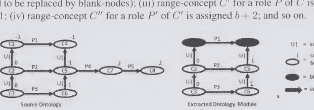
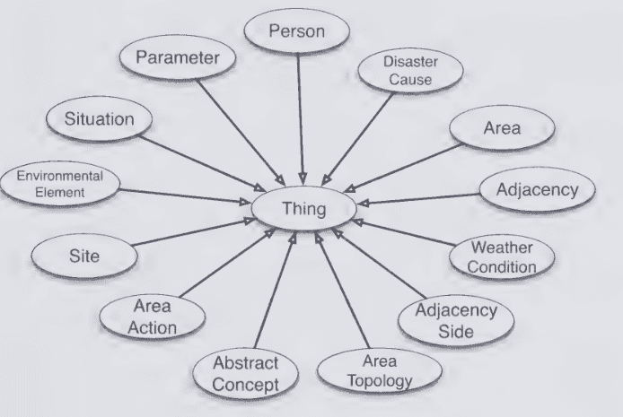
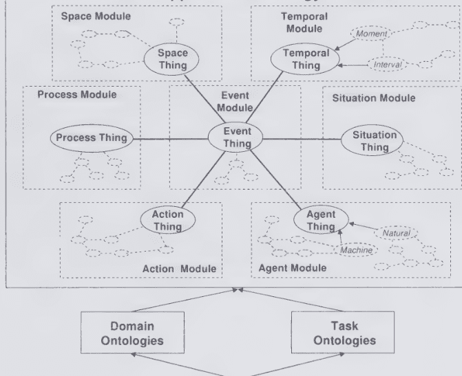
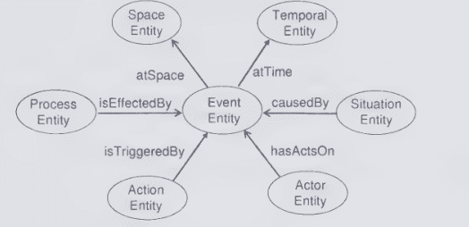
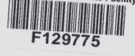

# 模块化本体论：第四届国际工作会议 (WoMO 2010) 论文集

编辑：

Oliver Kutz

Joana Hois

Jie Bao

Bernardo Cuenca Grau


https://archive.org/details/modularorontologie0000inte

FAIA 以专著、博士论文、教科书、手册和论文集的形式，涵盖了理论和应用人工智能研究的所有方面。FAIA 系列丛书包含了若干个子系列，包括“信息建模与知识库”和“基于知识的智能工程系统”。它包含了每两年举办一次的欧洲人工智能大会（ECAI）论文集，以及其他由 ECCAI（欧洲人工智能协调委员会）赞助的出版物。由一组国际知名学者组成的编辑小组负责提供高水平的选书。

丛书编辑：

J. Breuker, R. Dieng-Kuntz, R. Guarino, J.N. Kok, J. Liu, R. López de Mántaras, R. Mizoguchi, M. Musen, S.K. Pal 和 N. Zhong

本系列近期出版：

编辑：

## Oliver Kutz

空间认知研究中心 (SFB/TR 8),

德国不莱梅大学

## Joana Hois

空间认知研究中心 (SFB/TR 8),

德国不莱梅大学

## Jie Bao

美国伦斯勒理工学院计算机科学系

以及

## Bernardo Cuenca Grau

英国牛津大学计算实验室


# 模块化本体

## 序言

Oliver Kutz, Joana Hois, Jie Bao, Bernardo Cuenca Grau

模块化是本体工程中的核心主题。将本体分解为更小、易管理的模块的能力可以提高重用性、维护性和扩展性。然而，定义模块边界、确保模块间的一致性以及管理依赖关系仍然是挑战。

本研讨会展示了关于模块本体各个方面的最新研究。它涵盖了理论基础、算法方法和实际应用。其目标是聚集研究人员讨论当前的技术水平并确定领域的未来方向。

WoMO 涵盖的主题包括但不限于：

### 什么是模块化？

- 模块的种类及其属性
- 模块与上下文
- 表示的粒度

### 逻辑/基础研究：

- 鲁棒性属性，如保守性
- 模块语言（例如 `DDL`, `E-DL`）
- 协调模块间的冲突
- 形式化

### 算法方法：

- 分布式推理
- 模块化与模块提取
- 共享与重用、链接与导入
- 模块化的评估
- 推理复杂度

### 应用领域：

- 语义网中的模块化
- 生命科学、环境智能、电子商务、机器人
- 选择性共享
- 协作本体开发

WoMO 2010 研讨会延续了一系列作为从业者和研究人员讨论最新工作和当前问题的良好平台。它旨在整合解决本体模块化问题的方法，并汇集来自不同领域的研究人员，从基础层面研究本体模块化问题，为分布式本体工程设计工具，并在不同的用例和应用场景中应用模块化。往届 WoMO 活动包括：

- **WoMO 2006** 第一次模块本体研讨会，与 ESWC 2006 在美国佐治亚州雅典举行。受邀演讲者为 Alex Borgida（罗格斯大学）和 Frank Wolver（利物浦大学）。网站为 `http://www.cild.iasate.aachen.de/events/womo.html`，论文集位于 `http://sunsite.informatik.rwth-aachen.de/Publications/CEUR-WS/232`
- **WoMO 2007** 第二次研讨会，与 K-CAP 2007 在加拿大惠斯勒举行。受邀演讲者为 Ken Barker（德克萨斯大学奥斯汀）。网站为 `webrum.uni-mannheim.de/math/lski/WoMO07`，论文集位于 `http://sunsite.informatik.rwth-aachen.de/Publications/CEUR-WS/Vol-315`
- **WoMR 2008** 该系列的第三次研讨会，与 ESWC 2008 在西班牙特内里费举行，主题为“本体：推理与模块化”，特别强调了推理方法。网站为 `http://dm.fbk.eu/worm08`，论文集位于 `http://sunsite.informatik.rwth-aachen.de/Publications/CEUR-WS/Vol-348`

## 贡献概述

WoMO 2010 的受邀演讲者探讨了与本体模块化（`modularity`）相关的通用且有些不常规的问题。

**SIMON COLTON** 在其演讲《面向计算创造力集体的本体使用、重用与滥用》中，描述了计算创造力（`Computational Creativity`）项目，特别是了将自动化构建和类比推理等技术用于本体工程的可能性，以及本体模块化将如何通过集体进行更具创造性的推理并在其中发挥作用。

在题为《本体模块化、信息流与交互情境化语义》的第二场受邀演讲中，**MARCO SCHORLEMMER** 勾勒了模块化的图景，并讨论了由 Jon Barwise 和 Jerry Seligman 引入的通道理论与信息流在本体模块化和意义协商方面的作用，这是一个有趣的话题。

WoMO 2010 的贡献论文涵盖了广泛的主题，从数学基础到对模块化的实证评估、模块的提取与合并，以及在复杂事件处理和机器人等领域的应用。

**DEL VESCO、PARSIA、SATTLER 和 SCHNEIDER** 的论文《本体的模块化结构：一项实证研究》，基于基于局部性的模块（`locality-based modules`）的概念，对该问题以及提取真实本体所有模块的可行性进行了实证分析。他们特别讨论了通过这种方式揭示本体结构在多大程度上允许获取其主题性、连接性、结构、冗余部分或实际建模与预期建模之间一致性的信息。

**HUSSAIN ABIDI** 在《提取与合并情境化本体模块》中介绍了一种提取本体模块的方法。该提取基于用户定义的选择，该选择指出了本体中与模块提取相关的部分和构造。该方法特别适用于医疗保健领域。

在《评估模块化本体内聚性与耦合性的指标套件》中，**ENSAN 和 DU** 为模块化本体的评估问题提供了另一个视角。他们引入了用于衡量本体内聚性（`cohesion`）和耦合性（`coupling`）的语义指标。这些指标的计算基于对局部符号与模块的局部符号及外部符号之间关系/相关性（`relativeness`）和依赖关系的分析。特别是作者使用了“Kitchenham”指标验证框架来检查他们提出的指标。

**POKRYWCZYNSKI 和 MALCOL** 延续了在工程中使用机构（`institutions`）抽象框架的传统。在《利用机构走向模块化本体的功能化方法》中，他们提出了一种通用的框架概念，无论使用何种形式，该框架都允许将本体语言和查询语言翻译成一种全局语言。然后他们泛化了异构情况下的稳健性（`robustness`）和保守性（`conservativity`）概念及其对模块化的作用。

在《将本体最佳实践和设计模式引入机器人技术：USARE》中，**RANDELLI 和 NARDI** 展示了一种用于城市搜索与救援活动背景下非结构化环境的本体。其他信息外，该本体规定了灾害案例、站点类型和位置。作者进一步分析了本体设计模式的使用以及现有本体的重用，以提供敏捷实现并集成到不同的语境中。

复杂事件处理领域的本体开发可以特别受益于模块化，正如 **TYMOURIAN 和 PASCHKE** 在《用于语义复杂事件处理的模块化上层本体》中所述的。他们区分了复杂事件的不同特征和依赖关系，并引入了几个层级本体模块来分别指定这些特征。这些上层本体模块可以为开发单个事件本体提供指南。

## 本卷贡献者

**RAZA ABIDI** 是达尔豪斯大学（`Dalhousie University`）计算机学院计算机科学教授兼健康信息学主任。他的研究专注于语义网、Web 服务以及用于临床决策支持的医疗保健知识管理。他领导 NICHE 研究小组，小组由 20 名跨学科研究人员组成。他已发表 150 多篇研究论文，指导了 50 多名研究生。

`http://www.cs.dal.ca/~sraza`

`sraza@cs.dal.ca`

**JIE BAO** 是伦斯勒理工学院（`Rensselaer Polytechnic Institute`）Tless World Constellation 的研究员。他撰写了 100 多篇文章。

`http://www.cs.dal.ca/~sraza`

`sraza@cs.dal.ca`

（注：此处原文邮箱与链接似乎有重复错误，翻译时保持原样）

`http://www.cs.dal.ca/~sraza`

`sraza@cs.dal.ca`

**SIMON COLTON** 是伦敦帝国理工学院（`Imperial College`）计算系的高级讲师。他领导计算创造力（`Computational Creativity`）小组，`http://www.imperial.ac.uk/~cc`

**GÖKHAN COSKUN** 是德国柏林自由大学（`Freie Universität Berlin`）语义网小组的研究助理。他的研究兴趣包括本体的网络结构。

`http://gokhan.coskun.org`

`coskun@inf.fu-berlin`

**BERNANDO CUENCA GRAU** 是牛津大学（`University Oxford`）的皇家学会研究员。他目前的研究活动专注于支持本体工程关键任务的新推理，如本体合并、设计和维护。他参与了 Web 本体语言（`OWL`）2 扩展的设计。他在 IJCAI、KR 和 WWW 等主要会议上发表了许多关于本体逻辑基础和模块提取的论文。

`http://web.comlab.ox.uk/people/Bernardo.CuencaGrau`

`berg@comlab.ox.uk`

**WEANG DU** 是加拿大新布兰瑞克大学计算机学院教授。他在 1991 年在维多利亚大学获得计算机科学博士。他的研究兴趣包括语义网、知识工程、软件工程、编程语言、互联网计算和移动计算。

`http://www.cs.unb.ca/~wdu`

`wdu@unb.ca`

**FAZEEH ENSAN** 于 2006 年 5 月加入加拿大新布兰瑞克大学计算机学院成为博士生。在加入之前，她在马什哈德费尔多斯基大学（`Ferdoski University of Mashhad`）完成了两年硕士学位，此前她在特黑兰大学工程学院获得计算机工程学士学位。她的研究专注于知识工程的方面。语义网、本体开发、模态和信念缓解。

`http://v37s3b4h7dn47s37hg1br4h7rs7n3du7s8nu.unbf.ca/~m4742/`

`faezeh.ensan@unb.ca`

**JOANA JOIS** 是德国不莱梅大学空间认知研究中心（`SFB/TR 8`）的助理研究。她是语言学本体“广义上层模型”（`Generalized Upper Model`）空间模块的开发者，致力于将空间的形式模型与空间语言相结合。她的研究活动重点是不同领域和应用中的模块化空间本体，以及具有不同类型不确定性的本体。

`http://www.informatik.uni-bremen.de/~joana`

`joana@informatik.uni-bremen.de`

**SAJJAD HUSSIAN** 是达尔豪斯大学计算机科学学院 NICHE 研究小组的活跃研究成员。他正在 Raza Abidi 的指导下，攻读“提取与合并上下文化模块化本体”领域的博士学位。他的研究兴趣包括：(i) 本体论模块化，(ii) 合并的本体对齐，以及 (iii) 本体论调试。他参与了 NICHE 的多个研究项目，并被认为是 `Euler` 推理引擎开发团队的开发者。

`http://www.cs.dal.ca/~hussain`

`hussain@cs.dal.ca`

**OLIVER KUTZ** 是德国不莱梅大学空间认知研究中心（`SFB/TR 8`）的博士后研究员。他在空间逻辑、模态逻辑和描述逻辑、对应语义，以及本体的结构化与异构性方面发表了广泛论文。他共同设计了作为网络本体语言 `OWL 2` 基础的 `SROIQ` 逻辑，以及用于模块化本体设计的 `E-connections` 技术，是 2009 年成立的“本体本体及其应用国际协会”（`IAOA`）的创始成员。

`http://www.informatik.uni-bremen.de/~okutz`

`okutz@informatik.uni.bremen.de`

**GRANT MALCOLM** 是英国利物浦大学计算机科学系的讲师，在该校他担任逻辑与计算小组的成员。他的主要研究兴趣在于代数规范领域。他的工作涉及隐藏代数、并发系统、计算机病毒学、本体论、代数语义学以及生物系统建模。

`http://www.csc.liv.ac.uk/~grant/`

`grant@liverpool.ac.uk`

**DANIELE NARDI** 是罗马萨皮雅大学信息与统计学系的正教授。教育背景：1981 年毕业于都灵理工学院获得电子工程学学位，1984 年毕业于罗马萨皮雅大学获得计算机与系统工程硕士。研究兴趣：人工智能、认知机器人、搜索与救援机器人。“IJCAI-91 出版奖”和“Intelligenza Artificiale 1993”奖的获得者。RoboCup 联合会信托人。“认知机器人团队”研究实验室负责人。

`http://www.dis.unroma.it/~nardi`

`nardi@webbo`

**BIJAN PARSIA** 是英国曼彻斯特大学计算机学院的讲师，在该校他是信息管理小组（`IMG`）的成员。他发表了关于使用描述逻辑进行本体工程的多个方面，包括解释、模块化、推理优化、可视化以及不确定性的表示。

`http://www.cs.man.ac.uk/~bparsia/`

`bparsia@cs.man.ac.uk`

**ADRIAN PASCHKE** 是柏林自由大学（`FUB`）的正教授，企业语义网小组（`AG-CSW`）的负责人。他是信息技术转移中心（`CITT`）有限公司的研究总监、加拿大 `RuleML` 公司的董事，以及柏林语义技术学院（`STI Berlin`）的副局长。他是 `RuleML` 网络标准化倡议的指导主席、`RuleML` 技术小组联合主席、事件处理技术小组的创始成员、`OMG` 投票成员以及多个 W3C 小组的成员，例如 W3C 规则交换格式（`W3C RIF`）工作组（他在该小组担任编辑）。

`http://www.inf.fu-berlin.de/groups/ag-csw`

`paschke@inf.fu.berlin.de`

**Simon Colton** 英国伦敦帝国学院

**Marco Schorlemmer** 西班牙巴塞罗那人工智能研究研究所

我们感谢由德国科学基金会（`DFG`）资助的空间认知研究中心（`SFB/TR 8`）提供的慷慨资金支持，该中心位于德国不莱梅大学与弗兰堡大学。我们感谢程序委员会（`PC`）成员和额外评审员的及时评审工作，并感谢我们的受邀演讲者 Simon Colton 和 Marco Schorlemmer 在研讨会上发表了主旨演讲。我们还要感谢 IOS Press 团队，特别是 Anne Marie de Rover、Carry Koolbergen 和 Maarten Fröhlich。最后，我们要感谢 FOIS 会议举办 WoMO 研讨会，特别感谢当地组织者 Michael Gruninger 提供的支持。

Oliver Kutz

Joana Hois

Jie Bao

Bernardo Cuenca Grau

## 序言

Oliver Kutz, Joana Hois, Jie Bao and Bernardo Cuenca Grau v

## 迈向计算创造力集体中的本体论使用、重用与滥用

一种立场声明

Simon COLTON

计算创造力小组

伦敦帝国学院计算机系

`http://www.doc.ic.ac.uk/ccg`

计算创造力广义上定义为研究构建能够表现出被认为具有创造性行为的软件。从更实用的角度来说，我们研究如何工程软件，使其在艺术和科学项目中承担某些创作责任，并产生在文化上有趣的艺术产物，如诗歌、定理、绘画、旋律等。为此，有大量创造性软件的示例被应用于音乐作曲、视觉艺术、纯数学、自然语言生成、科学发现、视频游戏设计等许多话语领域。此外，计算创造力社区开始对出现的一些棘手问题达成共识，例如：AI 过程何时适用于生成性应用；我们如何衡量软件的创造力水平；以及软件在创作活动中可以扮演什么角色？我们对计算创造力研究的贡献围绕着我们的两件研究软件展开：`HR` 系统 [2] 和绘画池 (`www.paintingfool.com`)。前者是数学理论形成软件，它可以从关于纯数学领域的最少信息开始，最后形成一个丰富的猜想、定理和证明的理论。后者是一个自动画家，我们希望它有一天能在其自己的世界里被作为一种独立的创造性艺术家而认真对待。


# 计算创造力研究人员开发的大多数软件（包括我们的）仅被赋予其特定应用领域的知识

例如，我们的 `HR` 系统被赋予了纯数学领域的足够背景信息，使其能够在这些特定领域中发明概念，但没有被赋予更广泛的数学知识，也绝没有提供纯数学领域之外的信息。在那些具有客观价值衡量标准、我们可以借此评估创造系统所产物的领域，这在很大程度上是可以接受的。然而，我们在 `[3]` 中认为，在某些领域（特别是视觉艺术），在评估创作者所产生产物的价值时，创作者的创造力和智能是被考虑的。特别是在这些领域中，当人们评估作品的价值时，艺术家的文化意识可能会受到质疑。在这些情况下，非常需要本体论中存储的那种知识，创造性软件可以使用这些知识来增强其智能，从而产生更有趣且更具文化价值的产物。

## S. Colton / 迈向计算创造力集体中的本体论使用、重用与滥用

我们认为，除了使用此类本体外，我们还需要为了并非设计初衷的情况重用本体中的知识，并且通过将其用于极具想象力的目的来“滥用”这些本体。

我们目前正致力于构建一个由软件、知识和资源的计算创造力集体（`www.doc.ic.ac.uk/ccg/collective`）。该集体的目的是汇集能够生成不同类型产物（例如诗歌、图片、旋律、定理等）的软件，使得一个过程的输出成为另一个过程的刺激。通过这种方式，我们希望证明这种软件在组合使用时，可以为各种社区产生具有真实价值的文化和科学产物。该集体将分为（至少）四个部分。第一部分将包含产生产物的生成和分析算法。目前，该集体拥有超过 100 个涉及图像和文本处理以及网络材料检索的过程。此外，它还有 50 多种组合两个或多个过程的混合模式。例如，集体中的一个混合模式获取某个 Twitter 用户的最新推文，从推文中提取关键词，从 Google 图片中找到匹配关键词的图片，并将这些图片组合成视觉拼贴。这种从文本到艺术的混合源于 `[6]` 中描述的项目。集体的第二部分将是一组推理方法，用于自由组合集体中的过程。组合过程的首次实例化将基于全局工作空间架构，特别是 `[11]` 中描述的工作。集体的第三部分将是源素材（图像、声音、音乐、文本等），产物生产中的过程可以访问这些素材。自然地，集体产生的任何产物都将添加到这些源素材中。

集体的最后一部分将是一个知识库，集体中的过程可以对其查询，以及一组用于查询、组合并可能“滥用”知识库的技术，以便为集体的运作方式增加智能和想象力。我们预见到使用本体论来表示知识库中的信息，并希望本体的创造性使用为模块化本体设计理论带来有趣的进展。对计算创造力感兴趣的研究人员已经开始转向本体，以测试他们的方法并作为信息来源。例如，Veale 等人的工作在 `[9]` 中研究了用于本体构建的类比推理，他们经常以创造性的方式使用 `WordNet` 等本体，例如用于创造新词 `[8]`。我们也可以声称，`HR` 中的自动理论形成程序是一种本体构建方法，其中本体中的概念是由软件发明的。本体构建方法的一个示例可以在 `[5]` 中的概念融合中找到，这种方法也经常被用于创造性设定环境，例如在 `[7]` 中描述的项目中。我们预见到这类知识生成引擎将成为集体用于创造性产物生成方式的重要组成部分。

## S. Colton / 计算创造力集体中本体论的使用、重用与滥用

我们遵循“好的艺术能引发思考”这一准则，正如 `[4]` 中提到的。遗憾的是，完全由计算机生成的艺术品在本质上是装饰性的，因此它们不太可能具有重要的文化意义。相比之下，我们的目标是让集体产生的产物能够鼓励消费者在解释作品时动用他们的智力。例如，在 `[6]` 描述的作品中，软件完全独立于我们的任何输入，从《卫报》报网站下载了一篇关于阿富汗战争的新闻，并作为回应，生成了一幅涉及轰炸机、一个家庭和一个戴着民族头饰女孩的拼贴画，这迫使观者去思考新闻报道中提出的问题。这突显了计算机生成艺术引发人们思考的一种相当直接的方式。还有许多其他可以实现这一点的方法，通过比喻、伪装、冲击、幽默、讽刺等。这些每种方法都需要关于世界如何相互联系的信息，以便为消费者产生连贯的产物。这正是我们预见本体知识库至关重要的地方，以便集体中的软件能够理解其所产生产物的本质。

我们认为认为对本体论的滥用对于创作目的是有益的。特别是，我们感兴趣以通常使用的方式使用本体论：创造而不是消除歧义，并建议世界是如何运作的；而不是解释它是如何运作的。歧义是艺术过程中不可或缺的一部分，产物被设计为让不同的人以许多方式解释，而这些人在观念上往往不能太字面（天真）。艺术品被不同的人以非常不同的方式解释，这一事实增加了艺术品的价值。我们相信，观察本体论如何设计以最大限度地减少歧义，可能引导产物消费者——最终以适当且富有启发的方式解释艺术品。此外，我们预见通过使用常识以及可能更关注的知识，通过对现实世界知识本体的分析，来确定什么是真实的、可能的以及什么是完全虚幻的。这种想象性行为是人类和计算机创作过程的核心。我们计划进一步研究本体论生产性使用的可能性，以使我们的创作软件具有文化意识；为了追求类比推理、构建比喻等，在新的领域对本体论进行生产性的重用；以及为了想象和趣味性目的，对本体论进行生产性的滥用。为此，我们期待与从事本体设计的各种社区紧密合作。

# 参考文献

- `[1]` CHARNEY, J. 一种结合推理系统的全局空间方法. 博士论文, 伦敦理工学院计算系, 2010.
- `[2]` COLTON, S. 纯数学中的自动理论形成. Springer-Verlag 出, 2002.
- `[3]` COLTON, S. 计算系统中的创造力与创造力的感知。 Proceedings of the AAAI Spring Symposium on Creative Systems (2008).
- `[4]` COLTON, S. 计算创造力研究的七个流行口号. In Proceedings of the Dagstuhl Symposium on Computational Creativity (2009).
- `[5]` FAUCONNER, G., and TURNER, M. 我们思考的方式: 概念融合与大脑中隐藏的复杂性. Basic Books 出, 2002.
- `[6]` KRZECZKOWSKA, A., EL-HAGE, J., COLTON, S., AND CLARK, S. 有意图的自动拼贴生成. Proceedings of the First International Joint Conference on Computational Creativity (2010).
- `[7]` PEREIRA, F. 创造力与人工智能: 概念融合方法. Mouton de Gruyer 出, 2007.
- `[8]` VEALE, T. 使用 wordnet 和 wikipedia 追踪词汇时代精神. Proceedings of the 17th European Conference on Artificial Intelligence (2006).
- `[9]` VEALE, T., AND LI, G. 本体聚类 - 类比作为本体构建中的组织原则. Proceedings of The International Joint Conference on Knowledge Discovery, Knowledge Engineering and Knowledge Management (2009).

# 本体论模块化、信息流与交互情境语义

## 扩展摘要

Marco SCHORLEMMER a,1

^1 人工智能研究学院 (IIIA), CSIC, 西班牙

最初，软件应用程序、数据库和专家系统是由少数软件或知识工程师设计和构建的，他们对 IT 产品的整个生命周期有整体控制权。这种时代已经过去很久了，因为软件和知识工程的实践已从实现定制的立立系统转向基于组件的工程；数据库逐渐部署在分布式架构中并随后进行联邦化；知识系统通过重用更多且之前构建的知识库和推理引擎来构建。此外，IT 系统的分布式性质随着互联网的到来和普及普及经历了剧性的爆炸。万维网及其雄心勃勃的扩展——语义网，带来了以超文本文档、在线数据库、开源代码、术语库、Web 服务、博客等形式存在的、前所未有的全球性信息分发，这不断挑战着 IT 在我们社会中的传统角色。

因此，模块化已成为任何大规模工程任务的必要条件。但是，尽管模块化在软件和知识工程中得到了充分研究，但在 Web 分布层面上 IT 组件的组合和交互仍处于起步阶段，我们刚刚开始掌握这一努力的范围：超越基本语法通信的成功 IT 互操作性非常困难，而且我们这个时代围绕所有 IT 技术演进的基础商品——信息，尚未被很好地理解。理解问题的焦点在于我们如何需要揭示、暴露和通信信息的语义方面。到目前，基于组件的软件工程是一项困难的任务，仍处于计算机科学的前沿；将不同的数据库结合被证明仅在强假设的封闭环境中是成功的；分布式人工智能应用和系统交互也是如此。当我们停留在语法问题上时，实现互操作性相对容易。但当我们尝试处理信息的语义方面，寻求语义网上可用信息的“智能”管理时，互操作性就不是一项容易的任务。

## 本体论与语义网

语义网在世纪末被构想为一种“充分发挥万维网潜力” `[12]` 的方法，作为 Web 的扩展，“其中信息被赋予了定义的含义，使计算机和人类能够更好地协作” `[7]`。在这项工作中，注定发挥关键作用的基础组件之一是本体论：定义术语词以及术语之间关系的文档或文件。

根据这一愿景，万维网联盟 (W3C) 的活动围绕着使用逻辑表示形式对 Web 数据进行结构化的建议展开，这些形式为执行推理和得出这些数据的结论提供了定义的模型论语义。语义网的支持者明确表示，“计算机并没有真正‘理解’这些任何信息，但它将以对人类用户有用且意义的方式更有效地操纵这些术语。” `[7]`

这种对 Web 协作的观点将通过本体论获得的“定义的含义”视为成功交互的前提。通过采取这种立场

## 分布式推理

从本体论等立立知识组件转向分布式模块化产物时，推理是在每个模块或语境中本地执行的。这种分布式推理的关键在于知道在在一个语境下进行的推理何时可以安全地扩展到其他模块的语境，因为这允许将各种本体论模块组合并集成到分布式系统中。这种分布式推理导致了逻辑的通用概念，它是任何语义对齐或本体模块化的核心。在过去的十年中出现了许多将逻辑后果扩展到分布式环境的不同建议。与本体模块化相关的示例包括本地模型语义和多语境系统 `[13]`、一阶逻辑和描述逻辑 `[14,8]`、E-connections `[22]` 以及基于包的描述逻辑 `[4]`。

## M. Schollemmer / 本体论模块化、信息流与交互情境语义 7

以及集成的分布式描述逻辑 `[27]` 等。它们的区别在于对本体论建模不同侧面的侧重点不同，而非源于任何根本的逻辑差异。实际上，这些形式体系是建立在对一阶逻辑的经典塔斯基（Tarskian）语义的扩展基础之上的（尽管在机构理论中，与逻辑无关的方法也得到了提倡和探索 `[15,24,23]`）。这并不意外，因为一阶逻辑因其表达能力、自然的推演系统以及基于集合的直观模型论具有特殊地位，而且其相关的逻辑构成了当前 Web Web 本体论表示语言标准的基础。

## 本体论模块化与信息流

然而，我们将在一个更通用的框架内观察本体论模块化和分布式推理，将其视为分布式信息系统中发生的信息流的一种种特定实例。为此，我们将展示如何通过通道理论（channel theory）来描述本体论模块化和分布式推理。通道理论是由 Barwise 和 Selig `[6]` 提出的关于信息流的数学理论，它最初源于哲学和计算语言学领域，借鉴了 Dretske 对知识信息流分析 `[10]` 以及 Barwise 和 Perry 的情境理论 `[5]` 的哲学基础。作为对任何分布式系统中信息流的抽象解释，通道理论也被探索用于许多与本体论模块化和分布式推理相关的问题的理论基础，例如：信息流框架 `[20]`、本体映射与基于本体论的语义集成 `[17,19]`、通用信息集成 `[15]`、情境推理 `[9]` 以及系统性后果 `[21]`。

从这个更通用的角度看本体论模块化和分布式推理，有利于对分布式推理的构成要素形成一种抽象且统一的观点，使我们能够超越经典的塔斯基语义，并将分布式推理应用于对语义的其他理解上，例如情境定性的语义 `[1]`。

## 意义与交互

我们认为，通过关注本体论和本体对齐来计算独立术语的语义对应关系（基于经典的塔斯基语义），分布式推理问题仅得到了部分解决。由海德格尔和伽达默发起的现代诠释学已经表明，语言是在背景中被倾听的，而解释并不独立于解释者。因此，意义总是在解释者赋予其用法或言语的目的、预期和承诺的语境中重新创造。意义最终上是取决于交互的，并且相对于隐含的背景，这种背景是无法完全去语境化的。

尽管如此，目前先进的本体对齐系统通常在交互之前计算语义对齐 `[11]`。这导致了若干几个缺点：一方面，它限制了交互的动态性和开放性，因为具有预先对齐本体的代理可能会参与交互中；另一方面，它将语义排除在交互语境之外。语义对应是以独立于交互的方式建立的。

但某些术语的意义往往具有特定的交互性。例如，在拍卖语境下，西班牙语的 "remate" 与英语表达 "winning bid"得价）之间存在的语义相似性，如果我们仅依赖基于语法的或结构的匹配技术，甚至依赖字典和同义词表等外部来源，是很难建立的。西班牙语术语 "remate" 可能有许多含义，其中没有一个含义能暗示其作为“得价”的意义。它的意义是在拍卖过程中发生的特定交互时刻被说出时产生的。

## 语义对齐作为维特根斯坦式的语言游戏

我们通过将交互在本体论上优先于意义，来研究软件代理如何根据其通信基础建立各自术语之间的语义关系。通过维特根斯坦的语言游戏 `[26]`，每个代理说出的这些术语的意义实际上在交互中*使用*它们，在某些方面可以被看作是一个简单的语言游戏。我们假设遵循某些交互模型或协议（游戏规则），根据这些规则，它们被允许在交互状态下发表某些言语。这些言语以言语行为的形式存在，其内容是游戏语言（例如 "remate" 或 "winning bid"）。当一个代理听到它无法理解的言语时，它根据对交互的观点在可能的选项中进行猜测，假设所有代理都处于相同或兼容的交互状态。

代理赋予某个术语的“意义”，即是它认为的术语言语行为结果的交互状态转换。正如语言游戏一样，对词汇意义的猜测将避免会导致通信的崩溃：交互没有按照每个代理交互模型所预测的方向进行。如果代理能够对接口进行通信，它们就会意识到这种崩溃。

在我们基于 `[2]` 的模型中，代理并行地遵循它们自己的交互协议以及一种对齐协议。这种对齐协议被视为执行实际通信的协议：任何通信行为都会失效，并在元层面上有一个有效的对应。此外，代理被赋予了执行实际匹配的对齐机制。当触发兼容的交互状态转换时，由于许多交互得以完成并被认为是语义相关的，兼容性意味着交互对于每个代理朝着相同的方向进行——尽管它们的交互观点（即它们自身的交互模型）可能比实际发生的交互更具限制。

从理论角度来看，我们将模型建立在通道理论之上，因为它模拟了分布式系统中发生的信息流。8 M. Schollemmer / 本体论模块化、信息流与交互情境语义

另一方面，它将语义排除在交互语境之外。语义对应是以独立于交互的方式建立的。

但某些术语的意义往往具有特定的交互性。例如，在拍卖语境下，西班牙语的 "remate" 与英语表达 "winning bid" 之间的语义相似性，如果我们仅依赖基于语法的或结构的匹配技术，甚至依赖字典和同义词表等外部来源，是很难建立的。西班牙语术语 "remate" 可能有许多含义，其中没有一个含义能暗示其作为“得价”的意义。它的意义是在拍卖过程中发生的特定交互时刻被说出时产生的。

同样，交互观点（即它们自身的交互模型）可能比实际发生的交互更具限制。

## 致谢

我非常感谢第四届本体论国际研会（ISMo）组织者邀请我参加本次活动，并感谢 Manuel 在此工作期间的合作。

# 参考文献

- `[1]` M. Schorlemmer. Interaction-situated semantics.
- `[2]` M. Schorlemmer. [缺失引用].
- `[3]` M. Schorlemmer. Semantic agreements through interaction.
- `[4]` J. GUGEN. Distributed description logic.
- `[5]` J. BARWISE and J. PERRY. Interactions and semantics.
- `[6]` J. BARWISE and J. Selig. Information Flow: The Logic of Distributed Systems.
- `[7]` T. BERNERS-LEE, E. JENDLER, and O. LASSISA. The semantic web.
- `[8]` A. BORGIDA and L. SERAFINI. Semantic alignment from peer sources.
- `[9]` S. DE SAGER and A. AIHOIMA. Contextual reasoning in agent systems.
- `[10]` F. J. DUN. Knowledge and Flow of Information.
- `[11]` J. EUZENAT and P. SHIVAKO. Ontology Mapping.
- `[12]` D. FENSEL, J. HIBLER, H. LIBERMAN, and W. WASLSTER. Spinning the Semantic Web.
- `[14]` C. GHIDINI and L. SERAFINI. Distributed first-order logic.
- `[15]` J. GUGEN. Data, ontology and logic integration.
- `[17,19]` Ontology mapping and ontology-based semantic integration.
- `[20]` The Information Flow Framework.
- `[21]` System consequence.
- `[23,24]` Theory of institutions.
- `[26]` Wittgenstein's language games.
- `[27]` Integrated distributed description logics.

10 M. Schlemmer / 本体论模块化、信息流与交互情境语义


[16] T. GRUBER. 一本体论规范的翻译方法。《Knowledge Engineering》，5(2):199–220, 1993.

[17] Y. KALFOGLOU AND M. SCHLEMMER. IF-Map: 基于信息流理论的本体论建模方法。在 Spacciapietra 等[25]，页98–127。

[18] Y. KALFOGLOU AND M. SCHLEMMER. 本体论映射：现状。《The Knowledge Engineering Review》，18(1):1–33, 2003.

[19] Y. KALFOGLOU AND M. SCHLEMMER. 基于本体论的语义集成的信息流方法。在 R. Poli, M. Healy, 和 A. Kameas 编，《Applications of Ontology: Computer Applications》，第2卷，第4章。Springer, 2010.

[20] R. E. KENT. 概念知识组织的信息流。在国际知识组织协会第六次国际会议上，加拿大多伦多，2000年7月。

[21] R. E. KENT. 系统序列。在 S. Rudolf, F. Dau, 和 S. O. Kuznetsov 编，《Conceptual Structures》：俄罗斯俄罗斯，2009年7月26–31日。第17次概念结构国际会议 ICCS'2009 论文集，《计算机科学讲义》（LNCS）第5662卷，人工智能，156:1–73, 2004.

[22] O. KUTZ, C. I. WOLTER, AND M. ZAKHARYCHEV. 抽象描述系统的E-连接。《Artificial Intelligence》，156:1–73, 2004.

[23] O. KUT AND T. MOSSAKOWSKI. 结构化本体论中的保守性。在 M. Ghablab, C. D. S, Nikos Fotokakis 和 N. Aviris 编，《第18次欧洲人工智能会议》。2008年7月21–25日，希腊帕特拉斯，页89–93。IOS Press, 2008.

[24] M. SCHLEMMER AND Y. KALFOGLOU. 基于本体论的语义集成制度化。《Applied Ontology》，3(3):131–150, 2008.

[25] S. SPACCIAPIETRA, S. MARCH, AND K. ABERIER 编。《数据语义期刊 I，《计算机科学讲义》（LNCS）第2800卷。Springer, 2003.

[26] L. WITTGENSTEIN. 《哲学哲学》。Suhrkamp Verlag, 1967.

[27] A. ZIMMERMANN AND C. L. DUC. 针对对齐本体论网络进行推理。在 D. Calvanese 和 G. Lausen 编，《推理与规则系统，第二次国际会议 RR-2008》，德国卡尔斯鲁厄，2008年10月31日–11月1日，《计算机科学讲义》（LNCS）第5341卷，页43–57。Springer, 2008.

# 模块化本体论

O. Kitz 等人 (编)

IOS Press, 2010

© 2010 作者与 IOS Press。保留所有权利。

doi:10.3233/978-1-60750-544-0-11

# 本体论的模块化结构：一项经验研究¹

Chiara DEL VESCOVO, Bijan PARSIA, Uli SATTLER 和 Thomas SCHNEIDER

曼彻大学计算机学院，英国

{delvescc, bparsia, sattler, we}@cs.man.ac.uk

摘要：从给定的本体论中高效提取一个捕获该本体论关于一组指定术语知识的模块是一项广为人知的任务。该任务可以基于基于局部性的模块。相比之下，提取本体论的*所有*模块在计算上是困难的，因为其数量可能是指数级的。然而，可以假设通过揭示本体论的模块化结构，我们可以获得关于其拓扑、连通性、结构、冗余部分或实际建模与预期建模之间一致性的信息。此外，增量推理利用了本体论的一些（尽管不是所有）可能模块。

我们报告了估计真实世界本体论模块数量的实验。我们还评估了我们完全模块化的本体论的模块化结构。在评估中，我们查看了模块的数量和大小，以及模块大小与导致模块的签名数量之间的关系。我们报告的关于小规模本体论的理解可能适用于所有本体论。

**关键词。** 本体论、描述逻辑、模块提取、句法局部性、本体论理解

## 1. 引言

**为什么要对本体论进行模块化？** 在软件工程中，在其他条件均等的情况下，模块化结构的系统是理想的。给定一个设计良好的模块化程序，通常更容易对其进行处理、修改和分析，并利用模块化结构来重用部分。因此，对模块（或组件、类、对象、包、切面）的支持是编程语言中的常见特性。

本体论是类似于程序的概念产物，在著名的示例中，它们可能变得像复杂的系统一样复杂，这表明利用模块化可能会很有成效，而本体论模块化的研究一直是本体论工程的一个活跃领域。近期，大量的精力投入到开发逻辑上合理的模块中，这些模块为直观的模块属性提供了强有力的逻辑保证。其中一种保证是保证覆盖，意味着该模块捕获了本体论关于给定一组（签名）的所有知识——一种隔离

> ¹这本工作得到了英国 EPSRC 资助的支持，编号为 EP/E06155/1。

这种保证既由基于保守扩展的模块提供，也由高效计算的近似值提供，例如基于局部性的模块。

给定签名提取一个模块的任务（在本节中我们称之为 `GetOne`）是广为人知的，并开始部署到标准的本体论开发环境中，如 Protege 4 和在线环境。基于局部性的模块的提取已有效应用于本体论重用领域 [13]，以及作为增量推理的子服务 [4]。

虽然 `GetOne` 是一个重要且实用的服务，它本身告诉我们关于整个本体论的模块化结构。（注：原文此处存在大量重复内容，译文已根据要求去重并保持逻辑连贯）。

## C. del Vesco 等人 / 本体论的模块化结构：一项实证研究

教程用本体 Koala 包含 62 个逻辑公理，被划分为一个关于动物的 A 模块和三个关于性别、程度和栖息地的 B 模块。

在 [7] 中也表明，这些部分的某些组合仍然能够构成整个本体。通常情况下，观察到的划分过于粗糙；有时提取的结构看起来是良好的。此外，部分的稳健性属性（例如在词汇表扩展下）并不像基于局域性的模块（`locality-based modules`）那样被充分理解。然而，划分与局局性模块共享高效的计算性。

[2] 描述了 `GetStruct` 的另一种方法。它采用了本地 ModOnt，其目标是为处理本体模块提供支持，这种支持类似于软件模块，并借鉴了软件模块的直觉。这种方法是基于逻辑的且是后验的，据我们所知，尚未检查此类模块是否在绝对意义上提供了覆盖。此外，ModOnt 并不旨在从本体中获取所有模块。

[20] 描述了另一种划分本体的程序。然而，这种方法只考虑本体的概念层次结构，因此无法提供覆盖的强逻辑保证。

在获取 `GetOne` 的后验方法中，一些提供了如覆盖等逻辑保证，而另一些则没有。后者对本文不感兴趣。在考虑保守扩展（`conservative extensions`）时，前者通常局限于低表达能力的描述逻辑（DLS）——这些扩展是可处理的。。著名的例子包括 CEL [23] 的本体提取功能和 MES 系统 [15]。然而，我们采用的方法涵盖了直到 OWL 2 的 DLS。

有许多基于逻辑的模块化方法是先验的，即本体的模块需要预先指定，特征被添加到底层的（描述）逻辑中，且其语义定义良好。这些方法通常支持分布式推理；它们包括 C-OWL [22]、-connections [17]、分布式描述逻辑（`Distributed Description Logs` [3] 和基于包的描述逻辑（`Package-Based Description Logs` [1]在这些情况下，我们可能需要理解语法定义部分的模块化结构。此外，由于实施了结构，并不总是清楚结构是正确的。关于模块结构的决策必须尽早做出以避免误解。[7] 中报告了示例，其中用户尝试通过将公理分离到单独文件中来捕捉其本体的模块化结构，但这完全不符合分析的结构。

## 实验与结果概述。

在下文中，我们将报告了从几个本体中提取所有模块的实验，作为 `GetAll` 的第一种解决方案。我们考虑了三种基于语法局域性（`syntactic locality`）的模块概念——它们都提供了覆盖，但在模块的大小和其他有用属性上有所不同，参见 [19]——并为相应本体中术语的所有子集提取了模块。在这个阶段，我们主要关注模块的数量而不是大小或相互关系；主要关注的是是否发生了可能的组合爆炸。为了测试后者，我们对每个本体进行了子集采样并在每个子本体上进行了完全模块化，测量了每个本体模块数量与子本体大小之间的关系。我们还尝试了不同的方法将模块数量减少到最“有趣”的。

本文的扩展版本以及实验评估额外材料（如表格和图表）在线提供 [8,18]。

## 2. 备知识

**底层描述逻辑。** 我们假设读者熟悉 OWL 和底层的描述逻辑（DLs）[11,10]。我们认为本体是公理的有限集，形式为 `C ⊑ D` 或 `C ≡ D`，其中 C, D 是（可能是复杂的）概念，`R ⊑ S`，其中 R, S 是（可能是逆的）角色。由于我们对本体的逻辑部分感兴趣，我们忽略非逻辑公理。然而，一旦提取了模块的逻辑部分，很容易添加包含公理和注释公理。这包含在 OWL API 中局域性模块提取的公开实现中。

令 `N_C` 为名称集合，`N_R` 为角色名称集合。签名 `Σ` 是一个术语集，即 `Σ ⊆ N_C ∪ N_R`。我们可以认为 `Σ` 指定了一个感兴趣的话题。仅使用来自 `Σ` 术语的公理可以被认为是“在题的”，而所有公理都被视为“离题的”。例如，如果 `Σ = {Animal, Duck, Grass, eats}`，那么 `Duck ⊑ Grass` 是在题的，而 `Duck ⊑ Bird` 是离题的。

**保守扩展与局域性。** 保守扩展（CEs）捕捉了上述知识的解封装。它们的定义如下：

1. 如果对于所有在 `L ⊆ Σ` 上的 `G` 公理，满足 `M ⊢ α` 当且仅当 `O ⊢ α`，则 `O` 是 `M` 关于 `L` 的推演保守扩展（`Σ`-DE）。

2. 如果 `O` 是 `M` 关于 `L` 的 `Σ`-DE，则 `M` 是集合 `O` 的一个基于 dCE 的模块。

遗憾的是，对于许多 DL 来说，CEs 是困难或不可判的，因为 [9,16,19]。因此，已经开发了一些近似方法。我们关注语法局域性（此处简称为：locality）。基于局域性的模块可以被高效计算并提供覆盖，它们捕捉了所有相关的推论，但不仅限于 DL SHIQ，可以很容易扩展到 SHIQ(D)（见 5.12），以及 OWL API 中局域性提取的实现。我们使用 [19] 中的局域性概念。

**定义 2** 如果公理 `α` 对于签名 `Σ` 被称为语法的（`⊥`-local的），如果它的形式为 `C ⊑ D`、`C ⊑ C⁺`、`R ⊑ R`，其中 C 是任意概念，R 是任意角色。

在 [5] 中证明了 `M ⊆ O` 且对于 `Σ` 全是 `O` 成为 `Σ`-DE 的充分条件。

## C. del Vesco 等人 / 本体论的模块化结构：一项实证研究

### (a) `⊥`-局域性

令 `A^⊥, R^⊥ ∈ Σ, C^⊥ ∈ Bot(Σ), i^⊥ ∈ ℕ \ {0}`。

`Bot(Σ) = A^⊥ ∩ C^⊥ | i^⊥`

`Top(Σ) = A^⊥ R^⊥ | C^⊥`

### (b) `T`-局域性

令 `A^⊥, R^⊥ ∈ Σ, C^⊥ ∈ Bot(Σ), i^⊥ ∈ ℕ \ {0}`。

`Bot(Σ) = A^⊥ ∩ C^⊥ | i^⊥`

`Top(Σ) = A^⊥ R^⊥ | C^⊥`

表 1. 语法条件

逆不成立：`A=B` 对于 `{A}` 是 `⊥`-局部的，其中本体 `O` 是空本体。

**真正的模块。** 为了限制模块数量，我们引入了通用模块的概念。直观上，本体的一个通用模块 `M` 如果它可以被划分为一组较小的模块 `{M_1, …, M_n}`，就是良好的，使得 `O` 的每个“相关的”推论都是 `M_i` 的推论。

由于模块内部相关推性的定义仍在进行中

定义 4 一个模块 `M` 被称为**假的 (fake)**，如果存在模块 `M_1, …, M_n` 使得 `M = M_1 ∪ … ∪ M_n` 且集合 `{M_1, …, M_n}` 是 `M`-几乎两对不交的。否则，`M` 被称为**真实的 (genuine)**。

特别是，如果一个模块是假的，那么它由互不交的模块组成，这些模块的签名（signatures）几乎两对不交。例如，在 Koala 中，我们有一个关于 habitat 的假模块，它由一个雨林子模块和一个干森林子模块组成，它们仅在 habitat 术语上重叠，不共享任何其他术语，也不共享任何公理。假模块是没有意义的，因为为假意味着 `M` 的不同签名之间互不交互。考虑到通常模块的总数往往随着子本体的大小增大而呈指数级增长，一个自然的问题是：这是否由于存在指数数量的假模块导致的。

## 3. 实验描述

**本体论 (Ontologies)。** 我们在几个我们认为设计良好且具有足够多样性的现有本体上进行了实验。“设计良好”意味着这些本体在特定程度的细节上覆盖了特定领域；它们在公理上是丰富的，例如，它们没有通过原子包含关系（atomic subsumptions）进行连接，这会使得模块提取变得毫无意义，因为模块签名中的术语几乎不会导致其他术语被包含在模块中。我们专注于设计良好的本体，因为我们想理解它们的结构。“公理 (Axiom)”意味着这些本体具有不同的规模、表达能力、公理与术语数量的比例，并涵盖了不同的领域。

我们还选择了一些已经通过其他技术（特别是 Koala 和 OWL-S）实现成功且具有洞察力的全模块化的本体。遗憾的是，由于实际考虑，我们不得不将注意力限制在小型本体上。然而，这些选择构成了一组在本体工程领域中经常讨论的、且人们对其模块化结构有强有力直觉的本体。

图 1 给出了概览；这些本体的大部分可以在 TONES 仓库中找到。

**全模块化 (Full modularization)。** 令 `O` 为要进行模块化的本体。我们的目标是找到 `O` 的所有模块，即计算 `(σ-mod(Σ) | Σ ∈ O)`。为了跟踪种子签名，我们寻求一种算法，以 `O` 为输入，返回所有对 `(Σ, M)` 的表示，其中 `Σ ⊆ O` 且 `M = σ-mod(Σ)`。

最简单的方法是遍历所有种子 `Σ`，提取对应的模块并将其添加到并集中。由于种子签名数量有指数级之多——这是不可行的——对于 Koala 来说，运行 2 次最简单的测试是不现实的。幸运的是，我们有充分理由相信，在真实的本体中，模块的数量显著少于种子签名：命题 3 说，对于基于局部性的模块 `M = σ-mod(Σ)`，每个种子 `Σ'` 扩展 `Σ` 且是 `Σ ∪ M` 的子集产生相同的模块 `M`。其次，即使两个签名 `Σ` 和 `Σ'` 之间没有关系，对于 `Σ` 和 `Σ'` 的模块的属性仍然可能是一致的。

> ⁵://owl.cs.manchester.ac.uk/repository

| 名称 | DL 表达能力 | 公理数$^a$ | 术语数$^b$ |
|---|---|---|---|
| Koala | ALCON(D) | 42 | 25 |
| Mereology | SHIN | 44 | 25 |
| University | SOIN(D) | 52 | 39 |
| People | ALCHOIN(D) | 108 | 73 |
| miniTambis | ALCON(D) | 173 | 226 |
| OWL-S | ALCON(D) | 277 | 137 |
| Tambis | ALCON(D) | 595 | 494 |
| Galen | ALEH+ | 4,528 | 3,166 |

$^a$我们在此仅计算逻辑公理。

$^b$我们在此仅计算原子概念以及抽象和具体角色。

图 1. 实验中使用的本体


然而，需要注意的是，存在某些非常简单的本体族已经具有指数数量的通用模块，即在最坏情况下，无法触发指数数量的模块。例如，`$T_n = \{C_i \subseteq B \mid 1 \le i \le n\}$` 的每个公理都有指数数量的（基于局部性和 dCE 的）模块：`$\{C_1, \dots, C_n\}$` 的任何带有种子的子集导致一个不同的 `$\perp$`-模块，如果 `$C_i$` 在该集合，则该模块包含公理 `$C_i \subseteq B$`。对于 `$T_n$`，对于 `$\perp$` 和基于 dCE 的模块，我们可以向这些子集中的每一个添加 `$B$` 并以相同的方式论证。这个示例分类法只有线性数量的通用模块——所有的 `$\{C_i \subseteq B\}$`。然而，如果我们向 `$T_n$` 中添加公理 `$B \subseteq A$`，我们就得到了一个具有指数数量通用模块的本体。每个模块 `$M_J := \mathcal{M}(T, A\Sigma_J)$` 通用的，其中 `$J$` 是集合 `$\{1, \dots, n\}$` 中的多索引，`$\Sigma_J$` 是索引属于 `$J$` 的概念集。对通用定义的放宽并没有帮助，因为我们可以用更长的链替换公理 `$B \subseteq A$`。其他路径导致指数数量的通用模块，包括原子限制和合词。例如，本体族 `$T_0 \cup \{D_i \subseteq C_i \mid 1 \le i \le n\}$`，每个 `$T_i^n$` 只有 `$n+1$` 个通用模块，包含包含结构包含了最特定的模块。

另一方面，存在任意大小的本体仅有一个模块，例如那些由非局部公理或同言式组成的本体。最后，每个由原子包含关系组成的本体形成线性顺序 `$T$-` 和 `$\perp$`-模块（每个前缀或后缀）以及平方数量的 `$\perp$` 和 dCE 模块。

## C. del Vescovo 等人 / 本体论的模块化结构：一项实证研究

许多不相关的术语通常会产生许多模块，如果我们使用任意的连贯子集，要证明“真实世界中的本体倾向于具有显著多于指数数量的模块”这一假设将变得困难。

因此，我们选择为随机生成的签名（signature）选择每个子集——尽管我们意识到这些子集是多的，因为本体通常不是以模块化的方式开发的。但这并不是问题：它只会导致我们理解模块的数量。

对于在 0 到 50 阈值之间的每个较小尺寸，我们采样了 10 个签名。在某些情况下，子集的大小分布并不是最优的（例如，当子集被合并时），我们对每个大小采样了 30 个签名。对于这些大小，我们提取了 `TL*`，排除了重复项，并按大小排序。我们按降序对所有子集进行了完全模块化，当单个模块化耗时超过预设的 20 或 600 分钟超时限制时终止；关于该选择的解释见第 4 节。对于每个子集，我们统计了所有模块的数量及其真实模块的数量。计算机规范请参阅 [8]。

## 4. 结果

模块 2 显示了 Koala 和 Mereology 在模块类型 `T` 和 `TL*` 下的全模块化情况。在 `TL*` 的情况下，我们还确定了真实模块，标记为 `TLg*`。除了模块数量外，我们还列出了运行时间和模块大小的四种聚合指标，“大小”指的是逻辑公理。由于公理的数量是一个依赖于语法的衡量标准，我们计划在未来的工作加入包含其他指标，例如术语的数量和所有公理的总和。

| | Koala | | | Mereology | | | | |
|---|---|---|---|---|---|---|---|---|
| | T | TL* | TLg* | T | TL* | TLg* | | |
| 时间 [s] | 0 | 1 | 9 | 34 | 40 | 552 | 1952 |
| 最小大小 | 29 | 6 | 0 | 18 | 0 | 0 | 158 |
| 平均大小 | 35 | 27 | 23 | 26 | 25 | 20 | 22 |
| 最大大小 | 42 | 42 | 42 | 42 | 40 | 40 | 38 |
| 标准差 | 4 | 6 | 6 | 6 | 7 | 8 | | |

`TLg*` = 真实模块。“大小” = 逻辑公理的数量。

图 2. Koala 和 Mereology 的全模块化

对于这两个本体，模块数量从 `T` 模块增加到 `TL*` 模块是符合预期的：如前所述，`T` 模块倾向于更大，因此在这种情况下有更多模块重合。然而，`TL` 模块的粒度太粗了：它们中的大多数都包含了整个本体，且大小至少为 29（Koala 的 69%）或 18（Mereology 的 41%）。

提取的 `TL` 模块提供了更细粒度的视图，尽管它们在 Koala 中的所有大小仍高于 6（14%）。我们为此付出了代价，即模块数量增加了 43 倍以上（Koala）和 14 倍（Mereology）。包含 `TL*` 模块后，模块数量增加了 7 倍（Koala）和 3.5 倍（Mereology）。为了获得更细粒度的模块化，我们也付出了提取时间增加代价。关于 Koala 和 Mereology 之间观察到的差异，请参阅 [8]。

使用描述的算法对 Koala 和 Mereology 等本体进行完全模块化的尝试并没有成功。我们在几小时后、在提取了数千个模块后取消了此类计算。

## 减少模块的总数。尽管模块总数远未达到 Koala 和 Mereology `2^25` 的理论上限，但它仍然太大，无法单独检查每个模块，无法让本体用户定期进行操作。因此，我们尝试了两种方法将总数减少到更少“有趣”的模块。

在提取后区分假模块之外，我们还实验了一种技术，将差异极少量公理的模块通过所有这些模块的并集统一，其中“足够大”和“足够小”是可调参数。为了使 Koala 的模块数量显著减少，我们必须选择极端的参数值，使得统一的模块不再被认为相似。

减少模块大小的另一种尝试是获取第 5 行中的第一个模块（起始策略）并扩展第 13 行中的模块列表（扩展策略）。一种策略是使用 `O` 中所有公理的签名，对于 `O` 中的某个公理，这表明其签名构成了一个与本体相关的话题。通过限制种子签名的数量，我们希望将模块数量限制在更相关的模块上。事实证明这对提取的模块数量几乎没有影响，但显著增加了运行时间，特别是因为对算法 1 第 13 行的字典排序优化无法实现。

子集采样的模块数量。在执行了第 3 节描述的子集采样技术后，我们深信本体表现出了所担心的指数行为。每个图表都显示出指数趋势，这是使用方程 `$m = cr^{bi}$` 对数据点进行的最小二乘拟合，其中 `$i$` 是子集的大小，`$m$` 是模块数量，`$e$` 是自然对数的底，`$c, b$` 是常数。该方程以及相应的决定系数（`$R^2$` 值）在图 4 中给出。对于所研究的本体，`$R^2$` 值和趋势线 [8] 显示明模块数量依赖于子集的大小。在大多数情况下，这种指数行为是可以观察到的，使用了超时限制。

# C. Vescovo 等人 / 本体论的模块化结构


图 3. Koala 的模块数量随子集大小

| 本体 | `$R_m^2$` | `$R_g^2$` | m | g | 估计 m | 估计 g | 时间 [min] | 时间 [min] |
|---|---|---|---|---|---|---|---|---|
| People | .95 | .70 | `$2\cdot10^{13}$` | `$10^n$` | `$10^5$` | `$10^6$` | 20 | 148 |
| Mereology | .87 | .94 | `$1.2\cdot10^{16}$` | `$1.1\cdot10^{13}$` | `$10^2$` | `$10^2$` | - | 4 |
| Koala | .90 | .88 | `$4.5\cdot10^{21}$` | `$.50\cdot10^{19}$` | `$10^3$` | `$10^4$` | - | 4 |
| Galen | .94 | .86 | `$1.2\cdot10^{24}$` | `$2.6\cdot10^{16}$` | NaN | NaN | 60 | 288 |
| University | .84 | .83 | `$1.7\cdot10^{19}$` | `$1.6\cdot10^{14}$` | `$10^4$` | `$10^5$` | 20 | 354 |
| OWL-S | .82 | .84 | `$.0027\cdot10^{-7}$` | `$.0032\cdot10^{16}$` | `$10^{17}$` | `$10^{17}$` | 60 | 73 |
| Tambis | .75 | .70 | `$1.1\cdot10^{22}$` | `$1.4\cdot10^{23}$` | `$10^5$` | `$10^{33}$` | 600 | 681 |
| miniTambis | .47 | .52 | `$2.6\cdot10^{18}$` | `$2.5\cdot10^{14}$` | `$10^{14}$` | `$10^{10}$` | 600 | 963 |

图 4. 经验行为的证据

> m, g
> 
> `↓` 模块, 属 `↓` 模块
> 
> `nR_m^2, R_g^2`
> 
> 拟合趋势线的决定系数
> 
> 根据趋势线估计的本体模块数量
> 
> 估计大于 `$10^{142}$`

**Koala 的权重分析。** 如果我们只考虑真实模块，某些本体具有指数数量的模块。为了关注更少、“有趣的”模块，我们设计了内聚力（cohesion）和拉引力（pulling power）指标。它们基于模块 `$\mathcal{M}$` 的种子签名（SSGs）数量和 `$\mathcal{M}$` 中的术语数量。`$\mathcal{M}$` 的一个 SSG `$\Sigma$` 被称为最小的（mSSG），如果没有签名 `$\Sigma' \subset \Sigma$` 是 `$\mathcal{M}$` 的 SSG。如果我们忽略不在模块中的术语，我们称之为一个真实的 SSG：即签名 `$\Sigma' = \Sigma \cap \mathcal{M}$`。令 `$r, s, m$` 为

M 的真实 MSSig 数量、M 的最小 MSSig 大小，以及 M 的大小。

M 的凝聚力（cohesion）衡量了 M 中的术语相互紧结在一起的紧密程度，这通过 M 的种子签名（seed signatures）数量来体现。更准确地说，M 的凝聚力定义为比率 `$r/s$`。M 的拉力（pulling power）衡量了在一个 MSSig 中需要多少术语才能“拉出”我们找到的所有术语。我们将 M 的拉力定义为比率 `$r/s$`。

作为初稿，我们将模块 `M` 的权重定义为其凝聚力与拉力的乘积：`w = r/s`。我们计算了 Koala 中 3660 个模块的权重。最重的 11 个模块及其差异将整个本体论划分为 10 个部分，每个部分由假定构成一个主题的术语（包括主体）：动物；人与正在工作；学生；人；考拉与有袋类动物；塔斯马尼亚开发者；岩澳鼠；栖息地；学位；性别。这些主题反映了本体论的核心部分。那些未在最重模块中出现的公理（axioms）倾向于我们认为对本体论不重要的部分。在 RainForest 中，前 11 个模块涵盖了 Koala 所有的逻辑公理（42 个中的 39 个），且所有公理从第 4 个重模块开始被覆盖。前 19 个最重模块也是真实的。

下一步将是完善这一衡量标准并将其应用于更多本体论。我们无法期望比 Koala 更大的本体论模块化，我们需要找到单独提取权重模块的方法。

# 5. 讨论与展望

基本结论显而易见：对于真实的本体论，即使我们将注意力限制真实模块（genuine modules），模块的数量随本体论的大小呈指数级增长。我们对中小型本体论（即超过 100 个公理）模块总数的最合理估计表明，完全模块化在实践是不可能的。由于我们是基于模块进行计算，这些模块往往比基于保守扩展的模块更大，我们的结果为模块数量提供了一个下限。

当然，可能存在原则性的方法来减少目标模块数量。可以使用更粗糙的近似方法，尽管在逻辑上很难证明合理。尝试使用“非最小”模块或通过启发式合并模块已表现出糟糕的行为，它们强烈倾向于坍缩为少数几个包含本体论大部分内容的模块。

我们相信这种观察是稳健的，即使我们在 Tambis 和 miniTambis 上的实验未能发现异常行为。正如我们在第 4 节所说，我们预计更长的超时将揭示问题行为。

此外，我们观察到这些本体论具有大量的不可满足概念（unsatisfiable concepts），它们具有庞大的解释（justifications），以及具有大签名（signatures）的较长公理。此类概念的每个模块至少包含一个解释 ⁶；这些本体论的模块往往很大，这减少了模块的总数。同样，具有大签名的公理倾向于增加术语之间的交互机会，并增加模块的签名大小。

> 我们有充分理由相信，基于局部性的模块由于是耗尽的 [19]，始终包含其扩展签名内每个推理的所有解释。

从而导致产生大量的非最小种子签名。然而，这些事实并没有表明 Tambis、miniTambis 与研究的其他本体论（如 University 甚至 Koala）之间存在本质上的区别。Koala 和 University 都有未满足概念。Koala 中不可满足概念的解释大小为 5 个公理，而 University 最高为 9 个，大多数在 6 个以下。miniTambis 和 Tambis 的解释最大大小为 13 个公理，很大比例超过 6 个。如果我们关于解释作用的假设是正确的，那么指数级增长似乎仅仅被延迟了。因此，仍然可能（且我们认为很有可能）存在指数行为，但只有在足够高的超时下才可见。此外，Tambis 和 miniTambis 中解释的大型有一点人为的成分，因为它依赖于不可满足性。这些本体论具有长长的“依赖性”不可满足性链 [14]，这增加了沿链解释的大小。当这些不可满足性被解决时，这些概念将不再拥有这些长解释作为其所有模块的一部分。

这些考虑表明，通常，真实模块与伪模块（fake modules）之间的比例可以被视为公理丰富性的衡量标准，指示了本体论中的公理连接术语的程度：模块越少，其术语的“相互接触”就越多。

尝试从统计学上估计模块数量也没有帮助。我们可以随机抽取少量种子签名，计算它们的模块并用此估计所有模块的数量。我们通过基础随机论说服自己，仅通过对所有种子签名的一小部分进行采样无法获得可靠估计。详见 [8]。

虽然实验结果从分析本体论的完全模块化的角度来看令人沮丧，但它揭示了未来工作的几个有趣方向。首先，我们已经看到了一些与模块数量多寡相关的本体论特征。然而，除了整体论（Merology）中的现象外，我们还没有经过验证的解释。因此，例如，我们需要获得解释结构与模块结构之间关系的精确描述。其次，即使我们无法计算所有模块，我们也可能计算出其数量的更好近似。考虑到签名采样似乎没有帮助，应探索模块数量增加或减少的来源，例如推理层次的形状和公理模式。在方法上，应该使用人工本体论，例如确认解释结构与模块数量之间的关系。第三，我们在计算重模块方面的初步实验是有前景的：我们的权重似乎捕捉到了模块的凝聚力和拉力，生成的重模块似乎与主题良好地对应。我们目前正在研究是否可以在不计算所有模块的情况下计算所有重模块，并研究合适的“块”（blocks）概念。后者与伪模块和真实模块密切相关，我们也在更详细地研究它们。

- [1] BAO, J., VOUTSKIS, G., SLUTZ, G., AND ANOVAR, V. Package-based logics. In Stuckenschmidt et al. [21], pp. 349–371.
- [2] BEZZERA, C., FREITAS, F., ZMERMANN, A., AND EUZENAT, L. ModOnt: A tool for modularizing ontologies. In Proc. WOMONTO-08 (2008), 427 of CEUR.
- [3] BORGIA, A., AND SERAFINI, L. Distributed description codes: Assimilating information from users. J. Data Semantics 1 (2003), 153–184.
- [4] CUENCA GRAU, C., HASCHENWIER, C., AND KAZAKOV, V. History: Incremental reasoning. In Proc. ISACS-07 (2007), 482 of LNCS.
- [5] CUENCA GRAU, HORROCKS, J., AND KAZAKOV, V. Safe and efficient. In Proc. of ESW-08 (2008), vol. 5021 of LNCS, pp. 230–244.
- [6] CUENCA GRAU, B., PARSIA, B., AND SERIN, E. E-connections. WebSem 4 (2006).
- [7] CUENCA GRAU, B., PARSIA, B., AND SERIN, E. Re-use. In Proc. of KR-2006, pp. 198–209.
- [8] MATERIALS. http://owl.cs.manchester.uk/modproject/meat-experiment.
- [9] SATTLER, U., SCHNEIDER, T., AND ZAKHARYASEV, M. Which kind of ontology should I extract? In DL 2009 (2009), vol. 477 of CEUR.
- [10] HORROCKS, I., SUNTZ, C., AND SATTLER, U. Structure-partitioning of class hierarchies. In Proc. of SWC-04 (2004), vol. 3298 of LNCS, pp. 289–303.
- [11] HORROCKS, I., SCHNEIDER, P, AND VAN HAMELEN, F. From RDF to OWL:1Sem (2003).


- [12] JIMÉNEZ, R., BERLANGA, F., AND SUNTISARAVAPORN, B. Module extraction and incremental classification: A pragmatic approach for EL+ ontologies.
- [13] JIMENO, A., JIMÉNEZ, R., AND REHBOLD-SHUMANN, D. Using C-OWL for the alignment and merging of medical ontologies. In Proc. KR-MED (2004), vol. 102 of CEUR.
- [14] KALYANPUR, A., PARSIA, B., AND SERIN, E. Debugging unsatisfiable classes in OWL ontologies. In Proc. of DL-2008 (2008), 355 of CE..
- [15] KONEV, B., LUTZ, C., WALTHER, D., AND WOLTER, F. Formal properties of modularization. In Artificial Intelligence 156, 1 (2004), 1–73.
- [16] KONEV, B., LUTZ, C., WALTHER, D., AND WOLTER, F. E-connections of abstract description systems.
- [17] KUTZ, O., LUTZ, C., WOLTER, F., AND ZAKHARYASEV, M.
- [19] SATTLER, U., SCHNEIDER, T., AND ZAKHARYASEV, M.
- [20] STUCKSMIDT, H., PARENT, C., AND SPACACPIETRA, S., AND EDS. Modular Ontologies: Concepts, Theories and Techniques for Knowledge Modularization, 5445 of LNCS. Springer, 2009.

Sajjad HUSSAIN 1 和 Syed Bibte Raza ABIDI

NICHE Research Group, Faculty of Computer Science, Dominion University, Canada

**摘要。** 从大型本体中提取本体模块，可以生成与特定问题相关的专门化知识模块。扩展本体模块提取方法往往会导致生成的本体模块过于泛化或过于局限，或者有时无法捕获源本体的完整语义。我们提出了一种本体模块提取方法，该方法在提取本体模块的同时，扩展了该模块中概念及其关系的语义。我们的方法具有以下核心原则：(i) 识别与当前问题语境相关的用户所选概念；(ii) 提取用户所选概念、角色及其个体；以及(iii) 提取与用户所选概念在结构上连接的其他概念、角色和个体。我们在医疗领域应用了这种本体模块提取方法，并证明了：(a) 从三个前列腺癌通路本体中提取本体模块；(b) 合并提取的本体模块以为前列腺癌护理管理生成全面的治疗工作流知识。

**关键词。** 本体模块化，本体对齐与合并

## 1. 引言

本体 [3] 是语义网的骨干，因为它们通过共享概念及其关系提供了对领域进行建模的形式化结构。语义网研究的一个关键方面是知识建模，这通过开发领域特定本体来实现。因此，本体作为各种活动的基础表示，例如基于网络的信息共享、检索、调解、阐述和决策支持。知识建模人员（或本体工程师）以多种方式开发本体——即：通过抽象领域概念和关系来开发新本体，向现有本体中添加新概念，或者对齐/合并多个本体以实现专门的本体。

对于成熟的领域——如医学、遗传学和商业——研究人员的通用做法是利用大规模领域本体，以系统地选择一个代表当前任务的概念子集或专门的本体模块。本体模块在一定的抽象层次上，对源本体的选定元素提供集中的表示，同时提供与当前问题语境相关的操作处理和知识约束。

*1 通讯作者：NICHE Research Group. Faculty of Computer Science, Dominion University, 6050 University Avenue Halifax, NS, B3H 1W5, Canada; 邮箱: {hussain,sra}@email.com

提取上下文化本体模块的理由是，使用大型本体会导致为专门问题所需的知识模型引入无关概念，这不仅会产生非预期的解释从而扩展模型的推论闭包，还会损害知识模型的效率、复杂性和细粒度。因此，为了解决大型领域中的专门化问题，需要提取一个能够提供源本体一致片段的本体模块。

基于结构的本体模块提取 [10,13,9,8,14] 通常由特定的问题语境引导，导致从多个提取的本体模块中对概念进行选择、适应、对齐或合并 [5]。然而，挑战在于确保合并后的本体模块不会导致：(i) 领域概念化的差异，(ii) 逻辑冲突以及(iii) 根据语境对概念及其角色的不准确实现；这些问题会导致本体模块变得不一致 [6]。在这种情况下，确保提取的本体模块在语义上一致是至关重要的。上下文化本体模块处理其原始本体模型的片段，并提供(i) 对其本体概念的具体解释；以及(ii) 针对当前问题语境的程序化知识的实现细节。

在本文中，我们探讨了本体模块提取的问题，并提出了一种使用 `N3` 规则 [4] 提取上下文化本体模块的基于结构的方法。基于 [15] 中 `RDF(S)` 和 `OWL` 的完整推理规则，我们从源本体中提取本体模块——该模块包含用户所选概念及其结构连接的概念、角色和个体的公理和断言。尽管我们的提取规则可以被各种语义推理引擎使用，但我们使用 `Euler` 推理引擎 [11] 来推理丰富本体模型之外的解释。通过这种方式，我们认为与现有的本体提取方法 [10,8,13,9] 相比，我们的方法扩展了本体模块的语义（见第4节）。我们将本体提取方法应用于医疗领域的知识形变 [2] 问题，从三个前列腺通路本体 [1] 中提取并合并本体模块，用于治疗决策支持语境。此外，我们提供了我们的方法与少数现有本体提取方法的对比分析。

## 2. 基于结构的本体模块提取：概述与方法

对于基于结构的模块提取，源本体被视为一个无向图，而提取的本体模块是描述关于语境选定概念知识的子图 [10,13,9,8,14]。本体模块提取的早期尝试之一是物化本体视图提取（`MOVE`）过程 [10]，该过程基于需求一致性优化方案（`RCOS`）和语义完整性优化方案（`SCOS`）提取本体模块。给定一个源本体，`MOVE` 将概念和角色标记为已选或未选。对于选定的角色 `R`，根据 `RCOS` 标准，`MOVE` 提取 (i) `R` 的概念公理；(ii) `R` 的角色断言以及与 `R` 相关的概念公理；以此类推。`SCOS` 的作用是保留它们的角色。对于选定的概念，根据 `SCOS` 标准 (a) 必须提取 `C` 的超概念；(ii) 必须提取 `C` 的角色；以及 (iii) 必须提取与用户选定概念在结构上连接的其他概念。（注：原文中此部分存在大量重复和乱码的 OCR 信息，此处已根据核心逻辑进行清理处理）。

28 S. Hussain & S.R. Abidi / 上下文化本体模块的抽象与合并

为了我们的目的，我们将本体论视为一个描述逻辑知识库 `O = ⟨T, A⟩`，它由术语 `T` 和公理断言 `A` 组成。术语和公理断言基于结构化词表 `V = ⟨C, R⟩` 定义，由概念 `C` 和角色 `R` 组成。分类（概念公理和角色公理）`T` 的形式为 `C ⊑ (D ⊑ S)` 或 `C ≡ (D ⊑ S)`，其中 `D, C ⊑ C, S ⊑ R`。对于个体集 `I`，断言（概念断言和角色断言）`A` 由形式 `C(a)` 或 `R(b, c)` 给出定义，例如 `C ⊑ R, R ⊑ a, b, c ⊑ I`。本体论的语义由解释定义，该解释为 (i) 本体论个体、(ii) 本体论概念和 (iii) 本体论角色分别映射为 (a) 域元素、(b) 域子集和 (c) 域上的二元关系。本体论模型是一个解释，在该解释下所有本体公理都得到满足。如果存在一个本体论模型，则该本体论是一致的。没有模型的本体论被称为不一致本体论 [6]。

### 3.1 (问题背景)

令 `V` 为结构化词表集，`Aₓ` 为 `V` 上的公理集，它们用形式语言 `L` 阐述。问题上下文 `C = ⟨I, Cₓ, Aₓ⟩` 是一个元组，由上下文标签 `I`、特定语境的概念 `Cₓ ⊑ C`、特定语境的角色 `Rₓ ⊑ R` 以及特定语境的约束和 `Aₓ ⊑ Aₓ` 组成，用于生成一个语境化的本体。

### 3.2 (语境化本体模块)

给定本体 `O = ⟨T, A⟩` 和问题上下文 `C = ⟨I, Cₓ, Rₓ, Aₓ⟩`。本体 `O' = ⟨T', A'⟩` 是 `O` 的语境化本体，定义为 `O' ⊑ O`，其中术语 `T' ⊑ T` 和公理断言 `A' ⊑ A` 是处理概念 `C'`（使得 `C' ⊑ C`）、角色 `R' ⊑ R`（使得 `R' ⊑ R`）以及个体 `I' ⊑ I` 的公理；并将特定语境的约束 `A'ₓ ⊑ A'ₓ` 应用于 `O'`。

方法基于用户定义的问题 `C = ⟨I, Cₓ, Rₓ, Aₓ⟩` 以及给定的源本体 `O₁...Oₙ`，用户从每个源本体中识别一组概念 `C'ₓ ⊑ Cₓ` 以生成语境化本体模块。通过用户选择的概念 `C's ⊑ Cs`，我们使用我们的结构提取方法提取出语境化本体模块 `O' ⊑ O`（即 `RDF` 子图），它对应于以下内容：(i) 用户选择的概念 `C ⊑ C`；(ii) `C` 的个体；(iii) `C` 中的角色；(iv) `C` 中角色的范围约束；(v) `C` 的子概念；(vi) `C` 的等价概念；(vii) 对 `C` 的限制；(viii) 由 `C` 组成的复杂概念；(ix) 与 `C` 相关的超概念的角，以及 (x) `C` 的超概念。正如我们工作中的 `(?SCOPE ?SPAN) e:findall(?SELECT ?WHERE ANSWER)`，它返回一个列表，其中包含了所有断言的 `N3` 及其 `log:conclusion` 中满足 `?WHERE` 子句（表示为 `N3` 表达式）的 `?SELECT` 实例化（表示为 `N3` 表达式），结果以列表形式返回。我们的本体提取方法在接下来的小节中描述。

### 3.1. 选择

令 `Cs` 为用户选择的概念集，`C c ⊑ C` 为概念集，`Re ⊑ R` 为角色集，`Ie ⊑ I` 为在给定 `Cs` 下要从本体 `O` 中提取的个体集。在我们的方法中，用户选择的概念标记为形式 `O user:selected C` 的三元组，其中 `C ∈ Cs` 是本体中一个用户选择的概念，用于提取本体模块 `O'`。任何被选的概念也会在 `O'` 中提取（`O sbont:extract C`）（根据规则：`{?0 user:selected C} = {?0 sbont:extract C}`），记为 `C ∈ Cs`。我们还使用 `Euler` 构建的 `inefind` 检查某个概念（或角色）是否在 `O'` 中被提取（即 `sbont:extract`）。在 `O'` 中未被提取的任何概念（或角色）根据 `N3` 规则被推断为形式 `O sbont:noValue` 的三元组（记为 `C ∉ Cs`）：

```
?C a rdfs:Class. (?3 3) efindall (?0 sbont:extract ?C) {}) ->
?P owl:ObjectProperty. (?3 3) efindall (?0 sbont:extract ?P) ()
?0 owl:noValue ??
?P owl:DatatypeProperty. (?3 3) efindall (?0 sbont:extract ?P) (})
?0 sbont:noValue ?P).
```

### 3.2. 选取概念、子概念及其角色的识别

概念通过概念公理和角色公理根据其他（子）概念和角色定义。当概念 `C` 在本体 `O'` 中被提取时，有必要提取 `C` 的所有子概念和角色，以保持 `C` 在 `O'` 中的完整语义。为了这一目的，对于任何选取的概念 `C`，我们同样在 `O'` 中提取：

- 子概念：`C` 的所有子概念都被选取了（即 `usr:selected`）：

```
?0 usr:selected C. rdfs:Class. rdfs:subClassOf ?C = ?0 usr:selected
```

- 角色：`C` 的所有角色都被提取了（即 `sbont:extract`）：

```
?0 usr:selected C. rdfs:Class. rdfs:domain ?C = ?0 sbont:extract
```

- `C` 的超类角色也被提取：

```
?0 usr:selected C. rdfs:Class. rdfs:subClassOf ?C = ?0 sbont:extract
```

- 角色范围：提取角色的范围概念：

### 3.3. 从超概念继承角色

对于选取的概念 `C ∈ Cs`，我们的方法并不提取超概念的公理和断言，而是提取继承的规则。为了考虑这一步的原理，考虑我们从 `O1` 提取的本体模块。用户感兴趣的是特殊概念 `C2`，而不是它的超概念 `C1`。由于 `:C2 ⊑ :C1`，因此 `:P1` 是 `C2` 的继承角色。然而，我们使用 `Euler` 内置的元组将超概念（如 `:C1`）替换为选取概念（如 `:C2`）的唯一 `RDF` 空节点 (`:t8`)。节 3.8 和 3.7 描述了此类 `RDF` 空节点的构造。在示例 4.1 中，`_:t8` 是 `:C1` 的空节点，并通过 `rdfs:subClassOf _:t8` 与 `C2` 连接。由于我们对超概念的处理方法，限制了扩展。

### 3.4. 复杂概念的提取

`OWL` 概念如 `owl:intersectionOf` 和 `owl:unionOf` 允许使用（原子或复杂的）概念定义复杂概念。对于我们的目的，当需要提取某个概念或其定义时，本体提取必须限定在所需的概念，而不是它们更泛的概念（见 3.3）。在示例 4.1 中，`:C5` 定义为 `:C2` 和 `:C3` 的并，其中 `:C5` 是 `:C2` 的更泛的概念，用户并不感兴趣。尽管，对于选取的概念 `C2`，处理 `:C5` 是重要的，因为它是结构上连接的（根据公理 `:C5 owl:unionOf(:C2 :C3)`）。然而，提取 `:C5` 及其公理将把提取范围扩大到其他概念。为了允许提取复杂概念，此类概念（由 `owl:intersectionOf` 和 `owl:unionOf` 定义）在 `RDF` 语义中描述如下：

- (a) `?C2 owl:intersectionOf ?L . ?L rdfs:list ?L = ?C2 rdfs:subClassOf ?L.`
- (b) `?C2 owl:unionOf ?L . ?L rdfs:list ?L -> ?C2 rdfs:subClassOf ?C.`

#### 示例 4.1：带有复杂概念的本体（C2 为用户选取）：

```
Ontology O1 (
:C1 a owl:Class; rdfs:subClassOf :Thing.
:C2 rdfs:subClassOf :C1.
:C3 rdfs:subClassOf :C1.
:C4 owl:intersectionOf(:C2 :C3).
:C5 owl:unionOf(:C2 :C3).

:C6 rdfs:subClassOf :C1.
:P1 a owl:ObjectProperty.
rdfs:domain :C1; rdfs:range :C2.
:P2 a owl:ObjectProperty.
rdfs:domain :C2; rdfs:range :C3.
:C7 a owl:Class;
:C8 a owl:Class;
:C9 a owl:Class;
:C10 a owl:Class;
:C11 a owl:Class;
:C12 a owl:Class;
:C13 a owl:Class;
:C14 a owl:Class;
:C15 a owl:Class;
:C16 a owl:Class;
:C17 a owl:Class;
:C18 a owl:Class;
:C19 a owl:Class;
:C20 a owl:Class;
:C21 a owl:Class;
:C22 a owl:Class.
)
```

```
Extracted Ontology (
:t8 a owl:Class; rdfs:subClassOf :Thing.
:C2 rdfs:subClassOf :t8.
:C3 rdfs:subClassOf :t8.
:C4 a owl:Class.
:C5 a owl:Class.
:t9 a owl:Class; rdfs:subClassOf(:C2 :C3).
:t10 rdfs:Class.
:t11 rdfs:subClassOf :C1.
:P1 a owl:ObjectProperty.
rdfs:domain :C1; rdfs:range :C2.
:P2 a owl:ObjectProperty.
rdfs:domain :C2; rdfs:range :C3.
)
```

```
RDF Blank-Nodes (
_:t8 etuple (:C1).
_:t9 etuple (:C5).
)
Breakout Triples: 不包含在提取的本体中。
```

## S. Hussain & S.S.R. Abidi / 提取与合并上下文化本体模块

`rdf:subClassOf :C3` 已提取。类似地，根据规则 (b)，推断出 `:C2 rdfs:subClassOf :C5` 且 `:C3 rdfs:subClassOf :C5`。给定 `:C2` 为选定概念，从 `Oi` 中提取的本体模块如示例 4.1 所示（右侧）。给定在 `Oi` 中 `:C4 rdfs:subClassOf :C2`，根据子概念规则（见第 3.2 节），`:C4` 同样被视为一个选定概念。对于选定概念 `:C2`，其超概念为 `:C1` 和 `:C5`。对于 `:C4`，其超概念为 `:C1`、`:C2` 和 `:C5`。根据前面的述理想关系（见第 3.3 节），选定概念 `:C2` 和 `:C4` 的所有未选定的超概念都被描述为 `RDF` 空白节点（见示例 4.1 的底部）。

### 3.5. 处理针对提取概念的概念公理


对于本体模块 `O` 中的提取概念 `C`，认为需要提取所有其他通过 `C` 的公理在结构上连接的概念——以便使 `C` 的完整语义在 `O'` 中得以保留。使 `C` 与其他概念在结构上连接的概念公理包括：子概念（Sub-concept）、等价类（Equivalent-class）、补集（Complement-of）和限制（Restriction）。通过其概念公理与 `C` 在结构上连接的概念的提取通过以下 N3 规则完成：

### 子概念
`C` 的子概念同样在 `O'` 中被提取：

```
{?7 sbot:extract ?7C ; a rdfs:subClassOf ?7S.} => =
{?7 sbot:extract ?7S}, where rdfs:subClassOf a owl:TransitiveProperty.
```

### 等价类
等价概念 `C` 在 `O'` 中被提取：

```
{?7 sbot:extract ?7C ; owl:equivalentClass ?7S.} => {?7 sbot:extract ?7S},\ where owl:equivalentClass a owl:SymmetricProperty, owl:TransitiveProperty.
```

### 补集
与 `C` 互补的概念同样在 `O'` 中被提取：

```
{?7 sbot:extract ?7C ; owl:complementOf ?7S.} => {?7 sbot:extract ?7S}.
```

### 限制
对 `C` 实施限制的概念同样在 `O'` 中被提取：

```
{?7 sbot:extract ?7C ; a rdfs:subClassOf ?R.
R R a owl:Restriction} => {?7 sbot:extract ?7R}.
```

### 3.6. 处理针对提取角的角色公理

使提取的角色 `P` 与其他角色在结构上连接的角色公理包括：子属性（Sub-property）、等价属性（Equivalent-property）和反向属性（Inverse-property）。与 `C` 的概念公理方法类似，通过其角色与 `P` 在结构上连接的角色的提取通过以下 N3 规则完成：

#### 子属性
通过子概念规则隐式完成（见第 3.2 节和 3.5 节）。

#### 等价属性
`P` 的等价角色同样在 `O'` 中被提取：

```
{?7 sbot:extract ?7P ; owl:equivalentProperty ?7P} => =
{?7 usr:selected ?7P}.
```

#### 反向属性
`P` 的反向角色同样在 `O'` 中被提取：

### 3.7. 针对提取概念的 RDF 图

对于选定概念 `$?C \subseteq C_e$`，我们提取一个由 `$?C$` 的三类公理和断言组成的 RDF 图：(i) 需要提取的概念公理和概念断言，(ii) 需要替换的概念公理，以及 (iii) 需要移除的概念公理和概念断言。尽管 `$?C$` 的 RDF 图是通过 N3 规则实现的，但我们提供了提取模块的抽象实现，如下：

令：`$C_s \subseteq C_e$` 为选定概念集合，`$C_e \subset C$` 为概念集合，`$R_e \subseteq R$` 为角色集合，`$I_e \subseteq I$` 为从本体 `O` 中提取的个体集合。给定 `$?C$ sbont:extract $?C$ ($?C \in C_e$)`。

方法：提取如下形式的三元组：

1. 子图 `G1` 中的 `$?C ?Q$`，其中 `$?Q \in R_e, ?Q \in C_s$`。
2. 子图 `G2` 中的 `$?i ?a$`，其中 `$?C \in C_s$`（即也是选定的）且 `$?i \in I_e$`。
3. 子图 `G3` 中的 `$?i ?a$`，其中 `$?P \in R_e, ?C \in C_e, ?i1, ?i2 \in I$` 使得 `$(?i1 ?a) \wedge (?i2 ?a) \wedge (?P1) (?P2)$`。
4. 子图 `G4` 中的 `$?i ?a$`，其中 `$?P \in R_e, ?C \in C_e, ?i1, ?i2 \in I$` 使得 `$(?i1 ?a) \wedge (?i2 ?a) \wedge (?P1) \ (?P2)$`。
5. 子图 `G5` 中的 `$?C$ rdfs:classOf $?D$` 和 `$?A$`，其中 `$?D \notin C_e, ?Q \in C$` 使得 `$(?C)$ rdfs:classOf $D$ \wedge (?A)$ ($?D$ tuple)`。
6. 子图 `G6` 中的 `$?C$ rdfs:classOf $?D$`，其中 `$?D \notin C_e$`。
7. 子图 `G7` 中的 `$?X1$ user-selected $?Y1, ?X2$ sbont:extract $?Y2, ?Y3, ?X4$ unionOf $?Y5$`。

结果：`$?GRAPH = (G1 \cup G2 \cup G3 \cup G4 \cup G5) - (G6 \cup G7)$`

前四个 (`G1`, `G2`, `G3`, `G4`) 包含 `$?C$` 需要提取的概念公理和断言，其中 (`G1`) 包含 `$?C$` 的概念公理 (`$?C \in C_e$`)；(`G2`) 包含所有的概念断言，如果 `$?C$` 也是选定的 (`$?C \in C_e$`)；(`G3`) 和 `G4` 仅包含那些当 `$?C$` 也是选定的概念断言。

（注：由于原文部分段存在逻辑跳跃或重复，此处严格遵循原文结构进行翻译）

## 34 S. Hussain & S.R. Abidi / 提取与合并上下文化本体模块

选定概念后，根据提取规则获得了提取的 RDF 图。图 1 显示了一个边界评分（boundedness score）为 1 的提取的本体模块。对于一个边界评分为 `$b$` 的选定概念 `C`；(i) `C` 的子概念被分配相同的边界评分 `$b$`；(ii) 超概念被分配为 -1（意味着超概念需要被空白节点替换）；(iii) 角色 `P` 的范围概念 `C'` 被分配 `$b+1$`；(iv) 角色 `P'` 的范围概念 `C''` 被分配 `$b+2$`；以此类推。



**图 1. 基于边界评分的本体模块提取**

## 4. 评估

在本文中，我们对我们的提取方法与其他提到的方法进行了理论对比²，例如 MOVE [10]、Seidenberg 等人 [13]、Noy 等人 [9] 以及 Miao 等人 [8]。对于给定的用户选定概念 `$:C_2$`，表 5.1 显示了这些方法提取的本体模块之间的比较。所有方法都应用于源本体 `$O_2$`（如表 5.1 左上角列所示）。由于 MOVE 中的第 10 条 SCO 准则（见第 2 节），`$:C_1$` 和 `$:C_5$`（及其角色）也被选中；因为 `$:C_1$` 和 `$:C_5$` 是 `$:C_2$` 的超概念。由于 `$:C_1$` 和 `$:C_5$` 被选中，因此根据第 2 条 SCO 准则，所有的子概念 `$:C_2$`、`C_3`、`C_4` 和 `$:C_6$`（及其角色）也都被选中。因此，`$O_2$` 中的所有概念及其角色都被选中，提取的本体模块结果等同于源本体（如表 5.1 左上角列所示）。由于包含了用户选定概念的同级概念，导致了提取的本体模块不必要的扩展。为了限制提取本体模块的递归扩展，Seidenberg 等人 [13] 不提取用户选定概念同级概念的公理和断言。Seidenberg 等人 [13] 提取的本体模块所示表 5.1 的左下角，其中未提取同级概念 `$:C_6$` 的公理和断言。

Noy 等人 [9] 提出的提取方法灵活支持多个用户定义的参数——例如 (i) 直接超类、(ii) 直接子类、(iii) 所有角色以及 (iv) 实例。对于用户规格：(i) 直接超类 = YES，(ii) 直接子类 = YES，所有角色 = YES 且 (iv) 实例 = YES，Noy 等人 [9] 提取了与 Seidenberg 等人 [13] 提取相同的本体模块（见左下角）。然而，对于修改后的用户规格“直接子类 = NO”，Noy 等人 [9] 提取的本体模块所示在表 5.1 的右上角。在这种情况下

² 由于上述方法的实现尚不可用，本文未给出实验性对比。

## S. Hussain and S.S.R. Abidi / 提取与合并上下文化本体模块

用户选定的概念未在本体模块中提取（见右上角）。对于用户选定的 `$:C_2$`，`$:C_1$`（其中 `$:C_2$ rdfs:subClassOf $:C_1$`）未被提取，`$:C_1$` 的 `$:P1$` 也未被提取。结果是 `$:P1$` 的角色断言（例如 `$:i2 :P1 :i14, :i3 :P1 :i14, :i4 :P2$`）未被提取。`$:P1$` 在提取概念的实例 = `$:C_2$`、`$:C_3$`、`$:C_4$` 之间提供了额外的角色断言。这表明对于直接类 = NO，Noy 等人 [9] 提取了一个受限的本体模块，其中用户选定概念的部分（继承）角色（和角色断言）从提取的本体模块中省略了；Miao 等人 [8] 方法过于严格，仅包含单一断言 `$:C_2$ a class`。

**表 5.1: 提取的本体模块之间的比较**

| 源 `$:C_2$` | `$:C_2$` 被用于模块提取: | 由 Noy 等人 [9] 提取的本体模块: |
| :--- | :--- | :--- |
| 直接子类: NO | 直接类: YES | 不包含在提取的本体模块中 |
| 直接角色: YES | 所有角色: YES | |
| `:c1 a class, rdfs:subClassOf :Thing;` | `:c1 a class, rdfs:subClassOf :c1;` | |
| `:c2 a class, rdfs:subClassOf :c2;` | `:c2 a class, rdfs:subClassOf :c2;` | |
| `:c3 a class, rdfs:subClassOf :c3;` | `:c3 a class, rdfs:subClassOf :c3;` | |
| `:c4 a class;` | `:c4 a class;` | |
| `:c5 a class, rdfs:subClassOf :c5;` | `:c5 a class, :C_2, :C_4;` | |
| `:c6 rdfs:subClassOf :c6;` | `:c6 rdfs:subClassOf :c6;` | |
| `:c7 a class, rdfs:subClassOf :c7;` | `:c7 a class, rdfs:subClassOf :c7;` | |
| `:c8 a class, rdfs:subClassOf :c8;` | `:c8 a class, rdfs:subClassOf :c8;` | |
| `:c9 aProperty;` | `:c9 aProperty;` | |
| `rdfs:domain :c1, rdfs:range :c2;` | `rdfs:domain :c1, rdfs:range :c2;` | |
| `rdfs:domain :c2, rdfs:range :c3;` | `rdfs:domain :c2, rdfs:range :c3;` | |
| `:i1 a class, rdfs:subClassOf :i1;` | `:i1 a class, rdfs:subClassOf :i1;` | |
| `:i2 a class, rdfs:subClassOf :i2;` | `:i2 a class, rdfs:subClassOf :i2;` | |
| `:i3 a class, rdfs:subClassOf :i3;` | `:i3 a class, rdfs:subClassOf :i3;` | |
| `:i4 a class, rdfs:subClassOf :i4;` | `:i4 a class, rdfs:subClassOf :i4;` | |
| `:i5 a class, rdfs:subClassOf :i5;` | `:i5 a class, rdfs:subClassOf :i5;` | |
| `:i12 :P1, :i14 :P1, :i12 :P2;` | `:i12 :P1, :i14 :P1, :i12 :P2;` | |
| `:i14, :i4 :P2, :i13 :P3;` | `:i14, :i4 :P2, :i13 :P3;` | |

由 Noy 等人 [9] 提取的本体模块

直接子类: NO

直接类: YES

所有角色: YES

由 Seidenberg 等人 [13] 提取的本体模块:

直接子类: YES

直接类: YES

所有角色: YES

实例: YES

| `:c1 a class, rdfs:subClassOf :Thing;` | `:c1 a class, rdfs:subClassOf :c1;` |
| :--- | :--- |
| `:c2 a class, rdfs:subClassOf :c2;` | `:c2 a class, rdfs:subClassOf :c2;` |
| `:c3 a class, rdfs:subClassOf :c3;` | `:c3 a class, rdfs:subClassOf :c3;` |
| `:c4 a class;` | `:c4 a class;` |
| `:c5 a class, rdfs:subClassOf :c5;` | `:c5 a class, :C_2, :C_4;` |
| `:c6 rdfs:subClassOf :c6;` | `:c6 rdfs:subClassOf :c6;` |
| `:c7 a class, rdfs:subClassOf :c7;` | `:c7 a class, rdfs:subClassOf :c7;` |
| `:c8 a class, rdfs:subClassOf :c8;` | `:c8 a class, rdfs:subClassOf :c8;` |
| `:c9 aProperty;` | `:c9 aProperty;` |
| `rdfs:domain :c1, rdfs:range :c2;` | `rdfs:domain :c1, rdfs:range :c2;` |
| `rdfs:domain :c2, rdfs:range :c3;` | `rdfs:domain :c2, rdfs:range :c3;` |
| `:i1 a class, rdfs:subClassOf :i1;` | `:i1 a class, rdfs:subClassOf :i1;` |
| `:i2 a class, rdfs:subClassOf :i2;` | `:i2 a class, rdfs:subClassOf :i2;` |
| `:i3 a class, rdfs:subClassOf :i3;` | `:i3 a class, rdfs:subClassOf :i3;` |
| `:i4 a class, rdfs:subClassOf :i4;` | `:i4 a class, rdfs:subClassOf :i4;` |
| `:i5 a class, rdfs:subClassOf :i5;` | `:i5 a class, rdfs:subClassOf :i5;` |
| `:i12 :P1, :i14 :P1, :i12 :P2;` | `:i12 :P1, :i14 :P1, :i12 :P2;` |
| `:i14, :i4 :P2, :i13 :P3;` | `:i14, :i4 :P2, :i13 :P3;` |

## S. Hussain & S.S.R. Abidi / 提取与合并上下文化的本体论模块 37

临床任务，即 (a) 会诊任务；(b) 非会诊任务；(c) 转诊任务以及 (d) 随访任务（以概念的形式表示）。这些任务由其他概念支持，例如医生、决策标准、频率、间隔持续时间、检查、患者病情严重程度、测试结果和治疗。这些本体论中总共有 90 个概念、69 条规则和 288 个个体。

## 5.2. 提取上下文化的本体论模块

为了建立关于前列腺癌（PC）路径治疗和医生可用性的集成知识，我们考虑了治疗决策支持：

```
C1 = therapeutic-decision-support, {pc-calgary:Clinician, pc-halifax:Clinician, pc-winnipeg:Clinician, pc-calgary:Treatment, pc-halifax:Treatment, pc-winnipeg:Treatment},
{?X pc-calgary:Clinician} => ?X pc-halifax:Clinician),
{?X pc-calgary:Treatment} -> ?X pc-winnipeg:Followup)
```

`C1` 由其唯一的 `therapeutic-decision-support` 标注，并由其上下文公理（context-axioms）描述。在 `C1` 中，上下文公理描述了特定上下文的知识，如 (i) 加加利医生实现为哈利法医生，(ii) 加加利治疗可以视为温尼湖随访。对于治疗决策支持 `C1`，用户对提取的模块感兴趣，这些模块描述了 (i) 治疗、(ii) 它们的持续时间、(iii) 它们的随访、(iv) 它们的设置以及 (v) 相关的从业人员。根据兴趣，治疗和医生被标记为概念。根据用户选择的概念，还提取了结构上连接的规则和个体。提取的本体论模块 PC-H、PC-C 和 PC-W 通过了概念完整性验证。在 PC-H、PC-C 和 PC-W 中提取的概念（包括它们的断言）是：随访、频率、间隔持续时间和医生。


**图 2 来自 PC 路径的上下文化本体论模块**

## 38 S. Hussain & S.S.R. Abidi / 提取与合并上下文化的本体论

图 2 显示了 PC-Halifax 模块 PC-H 的上下文化图。在 PC-H 中提取了相关的概念和属性（及其相关公理）（用红色显示），并在其上应用了上下文公理。提取三个 PC 本体论（PC-H、PC-C 和 PC-W）花费了时间。未来，我们计划优化顺序以改进推理并降低我们提取方法的复杂性。

## 3.5. 合并上下文化的本体论


# 基于三个上下文化本体论模块（即 PC-H、PC-C 和 PC-W）之间预定义的对应关系（即 C1 的下文），在类之间发现了对齐，包括治疗、随访、频率、间隔持续时间和医生的属性和实例。根据识别出的对齐，C1（即治疗决策支持）上下文公理提取的上下文化模块被合并，以在对齐的 PC 治疗方案之间建立链接。

| 同意 (Assented) | 推断 (Inferred) |
| :--- | :--- |
| PC-Halifax-Surgeon | PC-Halifax-Follow | PC-Halifax-Surgeon | PC-Halifax-Follow | PC-Winnipeg-Follow |
| PC-Halifax-ActiveSurgeon | PC-Halifax-ActiveSurgeon | PC-Halifax-ActiveSurgeon | PC-Halifax-ActiveSurgeon | PC-Winnipeg-ActiveSurgeon |
| PC-Halifax-ActiveSurgeon | PC-Halifax-ActiveSurgeon | PC-Halifax-ActiveSurgeon | PC-Halifax-ActiveSurgeon | PC-Winnipeg-ActiveSurgeon |
| PC-Halifax-Cryotherapy | | | | |
| PC-Halifax-Cryotherapy | | | | |
| PC-Halifax-ExternalRadi | | | | |
| PC-Halifax-ExternalRadi | | | | |
| PC-Halifax-ExternalRadi | PC-Halifax-TimeForRefer | PC-Halifax-TimeForRefer | PC-Halifax-TimeForRefer | |
| PC-Halifax-Surgery | | | | |
| PC-Halifax-Surgery | PC-Halifax-TimeForRefer | PC-Halifax-TimeForRefer | PC-Halifax-TimeForRefer | |
| PC-Halifax-Surgery | PC-Winnipeg-TimeForRefer | PC-Winnipeg-TimeForRefer | PC-Winnipeg-TimeForRefer | |
| PC-Winnipeg-Cryotherapy | | | | |
| PC-Winnipeg-Cryotherapy | | | | |
| PC-Winnipeg-ExternalRadi | | | | |
| PC-Winnipeg-ExternalRadi | | | | |
| PC-Winnipeg-Surgery | | | | |
| PC-Winnipeg-Surgery | | | | |

> 图 3 关于 `PC-Halifax:ActiveSurgeon` 的标记知识（在左侧高亮部分）

| 同意 (Assented) | 推断 (Inferred) |
| :--- | :--- |
| PC-Halifax-Surgeon | PC-Halifax-Follow | PC-Halifax-Surgeon | PC-Halifax-Follow | PC-Winnipeg-Follow |
| PC-Halifax-ActiveSurgeon | PC-Halifax-ActiveSurgeon | PC-Halifax-ActiveSurgeon | PC-Halifax-ActiveSurgeon | PC-Winnipeg-ActiveSurgeon |
| PC-Halifax-ActiveSurgeon | PC-Halifax-ActiveSurgeon | PC-Halifax-ActiveSurgeon | PC-Halifax-ActiveSurgeon | PC-Winnipeg-ActiveSurgeon |
| PC-Halifax-Cryotherapy | | | | |
| PC-Halifax-Cryotherapy | | | | |
| PC-Halifax-ExternalRadi | | | | |
| PC-Halifax-ExternalRadi | | | | |
| PC-Halifax-ExternalRadi | PC-Halifax-TimeForRefer | PC-Halifax-TimeForRefer | PC-Halifax-TimeForRefer | |
| PC-Halifax-Surgery | | | | |
| PC-Halifax-Surgery | PC-Halifax-TimeForRefer | PC-Halifax-TimeForRefer | PC-Halifax-TimeForRefer | |
| PC-Halifax-Surgery | PC-Winnipeg-TimeForRefer | PC-Winnipeg-TimeForRefer | PC-Winnipeg-TimeForRefer | |
| PC-Winnipeg-Cryotherapy | | | | |
| PC-Winnipeg-Cryotherapy | | | | |
| PC-Winnipeg-ExternalRadi | | | | |
| PC-Winnipeg-ExternalRadi | | | | |
| PC-Winnipeg-Surgery | | | | |
| PC-Winnipeg-Surgery | | | | |

> 图 4 关于 `PC-Halifax:ActiveSurgeon` 的标记知识

图 3 和图 4 显示了 `PC-Clinician` 的应用。

- [9] NOY, N. F., AND MUSEN, M. A. Traversing ontologies to extract views. In *Modular Ontologies*, H. S. et al., vol. 5445 of LNCS. Springer, 2009, pp. 245–260.
- [10] RAUGJAN, R., CHANG, E., AND DILLON, T. S. Sub-ontologies and ontology views; a theoretical perspective. *Int. J. Metadata Semant. Ontologies*, 2, 2 (2007), 94–111.
- [11] ROO, J. D. Euler proof mechanism. http://eulersharp.sourceforge.net/
- [12] SEGEV, A., AND GAL, A. Putting things in context: A topological approach to mapping contexts to ontologies. *Journal on Data Semantics IX*, LNCS 4601 (2007), 113–140.
- [13] SEIDENBERG, J. Web ontology segmentation: Extraction, transformation, evaluation. In *Modular Ontologies*, H. S. et al., Ed., vol. 5445 of LNCS. Springer, 2009, pp. 211–243.
- [14] STUCKSCHMIDT, H., AND SCHLICHT, A. Structure-based partitioning of large ontologies. In *Modular Ontologies*, H. S. et al., Ed., vol. 5445 of LNCS. Springer, 2009, pp. 187–210.
- [15] W3C. OWL 2 Web Ontology Language: http://www.w3.org/TR/owl2-profiles/

# 模块化本体论

O. Kutz 等人. (编)

IOS Press, 2010

© 2010 作者与 IOS Press。保留所有权利。

doi:10.3233/978-1-60750-544-0-41

# 一用于评估模块化本体中内聚性与耦合的指标套件

Faezeh ENSAN 和 Weichang DU

新不伦瑞克大学计算机科学系

Frederic, NB, Canada

**摘要。**

在本文，我们提出了一组用于衡量模块化本体中内聚性和耦合性的语义指标。为了定义这些指标，我们考虑了模块化本体论的语义而非其语法。基于语义的定义，本体论评估同时考虑了显式断言的知识以及从显式表示的知识推导出的隐含知识。我们基于 Kitchenham 指标验证框架对所引入的指标进行了验证。

## 1. 引言

近年来，语义网技术和本体论已越来越多地应用于现实世界的问题和领域。到目前为止，人们已经提出了许多用于本体论开发与管理的技术、框架和方法 [6,5]，以及关于本体论语言的各种建议 [16,12]。`OWL-DL` [16] 是本体论语言的一种，被广泛用于表示本体论。`OWL-DL` 基于描述逻辑（`DLs`），描述逻辑为定义和形式化本体论语言提供了坚实的基础。

对于描述一个话语域，本体论的各种设计都是想象的。一种可能的本体论设计是单体设计，即该领域的所有捕获概念、角色、公理和断言都汇到一个单体本体论中，例如在 `OWL-DL` 本体论的情况下位于单个 `OWL` 文件中。设计本体论的另一种方法是模块化方法，即该领域由一组本体论（称为模块化本体论）描述，每个本体论都是话语域的一个子域。领域的子域之间可能存在依赖关系。因此，它们对应的本体论模块无法独立表示。本体论模块可能需要引用其他模块的符号。`OWL-DL` 具有 `import` 功能，可以用于集成不同的本体论模块，并允许它们引用来自其他模块的系统。使用 `import` 功能，本体论模块会导入其他模块的知识库。模块化 `DSL` [3]、`E-connections` [14]、`P-DL` [1] 和 `IBF` [7] 为定义和集成本体论模块提供了替代方法。这些形式化为描述逻辑语法和语义提供了新的扩展，以便使对本体论方法的自动化推理变得可行。

本体论作为语义网应用的基本构建块，应当通过适当的测量进行评估。一套清晰的本体论评估指标和测量方法使得为不同的应用选择本体论更加准确。它还通过提供良好的本体论应该是什么样的指南，增强了本体论设计和开发的过程。以模块化方式开发本体论日益增长的需求，凸显了对评估模块化本体的测量和指标日益增长的需求。迄为止，还没有引入广泛接受的测量方法来评估模块化本体。

内聚性和耦合是用于评估模块化本体的两个重要标准。内聚性是指本体论模块的统一性，耦合是指本体论模块之间存在的相互依赖关系。模块化本体的高内聚、低耦合可以带来更好的可理解性、可重用性和演化性。

文献中有少数提案研究了本体论的内聚性和耦合概念。在 [20] 中，通过结构化指标（如叶节点类的数量和平均深度）研究了本体论的内聚性。在 [17] 中，研究了本体论的耦合性。在 [15] 中，引入了一组指标：分区数量 (`NOP`)、不一致子集数量 (`NMIS`) 和公理平均值 (`AVAI`)。在本文中，我们提出了一组用于衡量模块化本体中内聚性和耦合性的语义指标。为了定义这些指标，我们考虑了模块化本体论的语义而非其语法。基于语义的定义，本体论评估同时考虑了显式断言的知识以及从显式表示的知识推导出的隐含知识。我们基于 Kitchenham 指标验证框架对所引入的指标进行了验证。

## 2. 背景

### 2.1 基于描述逻辑的本体论

本体论可以定义为 $\Psi = (\mathcal{T}, \mathcal{A})$，其中 $\mathcal{T}$ 是术语库（`TBox`），$\mathcal{A}$ 是断言库（`ABox`）。本体论的签名 $Sig(\Psi)$ 包括概念 $\mathcal{C}$、角色 $\mathcal{R}$ 和个体 $\mathcal{I}$。`TBox` $\mathcal{T}$ 包含关于概念和角色的公理，而 `ABox` $\mathcal{A}$ 包含关于个体的断言。解释 $I = (\Delta^\mathcal{I}, \cdot^\mathcal{I})$ 由非空域 $\Delta^\mathcal{I}$ 和解释函数 $\cdot^\mathcal{I}$ 组成。对于概念 $C \in \mathcal{C}$，$C^\mathcal{I} \subseteq \Delta^\mathcal{I}$。对于角色 $R \in \mathcal{R}$，$R^\mathcal{I} \subseteq \Delta^\mathcal{I} \times \Delta^\mathcal{I}$。对于个体 $a \in \mathcal{I}$，$a^\mathcal{I} \in \Delta^\mathcal{I}$。如果存在一个解释满足所有公理，则该本体论是满足的。如果知识库有一个满足所有概念的模型，则它是一致的。一个包含或断言 $\alpha$ 被知识库 $\Psi$ 蕴，表示为 $\Psi \models \alpha$。

### 2.2 测量验证框架

为了验证内聚性和耦合的指标，我们使用了 [13] 中引入的框架。根据该框架，对于测量，应该指定实体、属性、单位和尺度。实体是被测量特征的对象。属性是实体可以拥有的属性，并通过测量正式地捕获。单位决定了如何测量属性，尺度可以是名、序序或比例。

为了验证测量，我们确认属性有效性、单位有效性、工具有效性和协议有效性。属性有效性涉及实体是否拥有该属性。单位有效性意味着引入的单位能够适当测量相应的属性。工具用于获取属性的测量值。工具有效性涉及对属性的建模是否有效以及工具是否经过适当校准。最后，协议有效性处理所用测量协议是否明确且不存在重复计数等问题。

## 44 F. Ensan and W. Du / 用于评估模块化本体内聚性与耦合性的指标套件

必须存在两个实体，使得测量方法对特定属性分配不同的值。

- 不同的实体对于被测量方法测量的属性可以具有相同的值。

- 有效的测量必须遵守表示条件，这意味着当属性被测量方法测量时，其直观理解能够得以保留。

- 被测量方法测量的属性的每个单位都是等价的。

间接测量应该基于一个模型，该模型证明了从其他测量值构建的合理性。给出间接指标的方程不应出现意外的不连续性，例如对于某些值表现为无穷大或未定义。感兴趣的读者可以阅读 [13] 以获取更多关于测量理论的信息。

## 3. 本地模块的评估

在本节中，我们首先阐明了对本体模块概念的意图。实质上，我们为评估本体模块的指标给出了精确定义。

目前为止，文献中本体模块和模块化本体的定义各不相同 [18,9,11]。大多数定义中重合的基本概念是：本体模块引用了来自其他本体的外部符号。更正式地说，本体模块是 `DL`（描述逻辑）知识库，其签名由两个不交的本地和外部实体集合组成。外部符号是所有本体模块的标签。对于本体模块 `M`，`Sig(M) ≡ Loc(M) ∪ Ext(M)`。这个定义包含了基于单体式方法开发的普通本体。相应的，外部符号集为空的单体本体也包含在内。

在接下来，我们为衡量本体模块的数值指标给出一个精确定义。由于本体模块的定义包含了以单体方式开发本体的情况，因此以下定义也可用于定义评估单体本体的指标。在定义本体指标时，我们遵循了 [4] 中定义面向对象设计软件指标的方法。

> 定义 1. 设 {M1,...,Mn} 为一组描述论题域的本体模块。进一步，假设 `R` 是这些这些本体模块上的一个二元关系，对应于衡量本体指标的特定视角。进一步，令 {q1,...,qn} 为一组数字，`S` 为这些数字上的二元关系，如 `<` 或 `≤`。数值指标 `μ` 将本体模块元组及其之间的关系 ({M1,...,Mn}, `R`) 映射到一组数字和数字上的二元关系 (({q1,...,qn}), `S`)。

作为一个说明示例，假设有三个本体模块 `M1`、`M2` 和 `M3`。进一步，重用性视角 `R(M1,M2)` 意味着 `M1` 比 `M2` 更易读。考虑三个任意数字 `q1 = 10`、`q2 = 5`，且在这些数字上的关系 `S` 为“小于”或“<”。`μ` 是一个数值指标，将 `M1` 分配给 `q1`，`M2` 分配给 `q2`，`M3` 分配给 `q3`，并将 `R` 分配给 `S`。基于此，由于 `q3 < q2 < q1`，`M3` 比 `M2` 更重用，`M2` 比 `M1` 重用。

为了引入衡量本体模块的数值指标，应该展示每个本体模块如何产生相应的数字，以及数字之间的关系 (`S`) 如何从特定视角 (`R`) 对应本体模块之间的关系。

**示例 1。** 不同的本体模块处于不同的理解水平。因此，从理解性视角来看，本体模块之间存在关系 `R`，`R(M1, M2)` 意味着本体模块 `M1` 比 `M2` 更易理解。作为数值指标的一个简单示例，假设本体模块的大小是根据理解性视角衡量本体模块定义的。理由是，尺寸较小的本体模块代表了论题域中更聚焦的部分，可以更平滑地理解。即，对于本体模块 `M`，`Size(M) = |Sig(M)|`。对于本体模块 `M1`，`Size(M1)` 是数字，可以在这些数字上定义关系 `S` 为“小于等于” (`≤`)。数值指标为每个本体模块分配一个数字。这些数字之间存在的关系 `S` 与本体模块之间的关系 `R` 相对应。

## 4. 用于评估本体模块的指标集

在本节中，我们提供了衡量本体模块内聚性和耦合性的方法。本体模块中的内聚性涉及其所包含的概念和角色之间有多“相关”和“依赖”。耦合意味着其概念和角色与来自外部本体模块的外部符号之间有多“相关”和“依赖”。为了更好地解释，考虑以下三个本体模块：

- `M1 = {A, B}`，`A` 和 `B` 是本地概念
- `M2 = {A ⊆ B}`，`A` 和 `B` 是本地概念
- `M3 = {A ⊆ B}`，`A` 是本地概念，`B` 是来自外部本体模块 `M3` 的外部概念


在这个示例中，第一种情况 A 和 B 是共同位于本体模块 M1 中的两个不相关的概念。它们可能是描述无关主题的不同信息片段。因此，本体模块 M1 不具有高内聚性。在第二种情况下，A 定义为 B 的子类，且 A 和 B 之间密切相关。在这里，本体模块 M2 是高度内聚的，即它描述了一个相关的子论域。在第三种情况下，A 依赖于来自外部本体模块 M3 的外部符号 B。因此，本地符号与外部本体模块外部符号之间的依赖越多，耦合性越高。

接下来，为了精确化内聚耦合，我们提供了模块中内聚性和耦合的正式定义。

## 定义 3

设 P 和 Q 为本体 M 中的两个符号，$M_Q$ 的定义与定义 2 类似。如果 A 对 B 没有强依赖，且 SDep_M(P) 与 SDep_M(A) 不同，则 A 和 B 之间存在中度依赖，A 对 B 是中度依赖。我们将 SDep_M(A) 定义为 M 中所有 A 有中度依赖的符号的集合。

直观地说，当一个概念或角色的定义为空集时，某些概念和角色的解释可能会受到影响，导致它们与其他符号产生新的强依赖关系。例如，在本体 M 中，满足 A ⊆ ⊔ C，SDep_M(A) = ∅，即 A 对其他符号没有强依赖。在这种情况下，如果 B 是空集，A 将对 C 产生强依赖：SDep_M(B) = {C}，这与 SDep_M(A) 不同。因此，根据定义 3，A 对 B 存在中度依赖。以下展示了更大知识库中的中度依赖关系。

## 示例 3

设 M 为具有以下公理的本体模块：

- A ⊆ B
- A ⊆ (B ⊓ C) ⊔ D
- A ⊆ B ⊔ K

在该本体中，A 对 B 是强依赖的，因此 SDep_M(A) = {B}。现在，我们研究 A 对 C、R、K 和 D 的中度依赖。

- $M_C$ 意味着 A ⊆ B，A ⊆ B ⊔ K。相应地，SDep_M-C(A) = {B, D}，这与 SDep_M(A) 不同。因此，A 对 C 是中度依赖。
- $M_R$ 意味着 A ⊆ B，A ⊆ B ⊓ K。相应地，SDep_M-R(A) = {B, D}，这与 SDep_M(A) 不同。因此，A 对 R 是中度依赖。
- $M_K$ 意味着 A ⊆ B，A ⊆ (B ⊓ C) ⊔ D。相应地，SDep_M-K(A) = {B}，这与 SDep_M(A) 相同。因此，A 对 K 不是中度依赖。
- $M_D$ 意味着 A ⊆ B，A ⊆ (B ⊓ C)，A ⊆ B ⊔ K。相应地，SDep_M-D(A) = {B, R}，这与 SDep_M(A) 不同。因此，A 对 D 不是中度依赖。

如前所述，区分本地符号的依赖关系与对外部符号的依赖关系至关重要。前者代表本体模块的内聚性，而后者显示了它与其他模块的耦合性。在下文中，我们正式定义本地依赖和外部依赖。

## 定义 4

对于本体模块 M：

```
SDepLoc(M) = {(P,Q) | P ∈ Loc(M), Q ∈ SDep_M(P) and Q ∈ Loc(O)}
SDepExt(M) = {(P,Q) | P ∈ Loc(M), Q ∈ SDep_M(P) and Q ∈ Ext(O)}
MDepLoc(M) = {(P,Q) | P ∈ Loc(M), Q ∈ SDep_M(P) and Q ∈ Loc(O)}
MDepExt(M) = {(P,Q) | P ∈ Loc(M), Q ∈ SDep_M(P) and Q ∈ Ext(O)}
```

基于集合的依赖关系，我们引入了两个衡量本体模块内聚性的指标和两个衡量耦合性的指标。

## 定义 5

对于本体模块 M，NSLD 和 NMLD 是衡量其内聚性的两个指标，定义如下：

NSLD 是本体模块本地符号之间存在的**本地强依赖**数量。$NSLD(M) = |SDepLoc(M)|$，即本体模块 M 的 SDepLoc 集合的大小。

NMLD 是本体模块本地符号之间存在的**本地依赖**数量。$NMLD(M) = |MDepLoc(M)|$，即本体模块 M 的 MDepLoc 集合的大小。

NSLD 和 NMLD 是根据定义 5 为本体模块分配数值的数值型指标。分配给本体模块的数值之间存在“大于或等于”（即‘$\ge$’）的关系。这种关系与本体模块的内聚性相关，而内聚性本身又关联于可理解性、可复用性、可演性和推理性能视角。NSLD 和 NMLD 分配给本体模块的值越大，本体模块的内聚性越高。

## 定义 6

对于本体模块 M，NSED 和 NMED 是衡量其耦合性的两个指标，定义如下：

NSED 是本体模块本地符号之间存在的**外部强依赖**数量。$NSED(M) = |SDepExt(M)|$，即本体模块 SDepExt 集合的大小。

NMED 是本体模块本地符号之间存在的**外部中度依赖**数量。$NMED(M) = |MDepExt(M)|$，即本体模块 MDepExt 集合的大小。

NSED 和 NMED 是根据定义 6 为本体模块分配数值的数值型指标。分配给本体模块的数值之间存在“小于等于”（‘$\le$）的关系。这种关系与本体模块的耦合性相关，而耦合性本身关联于可理解性、可复用性、可演性和推理性能视角。指标分配给本体模块的值越小，本体模块的耦合越低。

## 推论 1

定义 5 和 6 防止了重复计数。

除了强依赖中度依赖外，定义 7 引入了另一个衡量指标。

## 定义 7

根据该定义，MLD 是本地符号之间可能存在的本地依赖的最大数量。$MLD = |Loc(M)| \times (|Loc(M)|-1)$。

# 5 指标的理论验证

在接下来，我们根据 Kitchenham 框架对每个指标进行验证。

## 5.1 NSLD, NMLD, NSED 和 NMED 的分析

NSLD 和 NMLD 是本体模块本地符号之间强力和中度依赖的直接衡量。NSED 和 NMED 是本地与外部符号之间强力和中度依赖的直接衡量。这些指标捕捉的实体是本体模块。对于 NSLD 和 NSED，属性是本地和外部强依赖的数量，单位是定义 2 中的强依赖；对于 NMLD 和 NMED，属性是本地和外部中度依赖的数量，单位是定义 3 中的中度依赖。

- **属性有效性**：本体模块始终表示一组符号（概念和规则），或者在设定含义时可能受到条件限制。观察发现，实体（本体）拥有该属性（本地、强或中度依赖的数量）。
- **单位有效性**：定义 2 为 NSLD 和 NSED 的单位提供了定义，定义 3 为 NMLD 和 NMED 的单位提供了定义。对于 NSLD 和 NSED，属性通过本地符号以及本地与外部符号之间的强依赖数量进行计数；对于本地符号以及本地与外部符号之间的中度依赖数量进行计数。
- **工具有效性**：定义 5 和 6 为收集和计算模块符号间的强力和中度依赖提供了基础。NSLD、NMLD、NSED 和 NMED 的工具具有理论模型。NSLD 和 NSED 基于以下理论：当 A 在一个等于 $\perp$ 的新知识库中不可满足时，可以获得对 B 的强依赖。NMLD 和 NMED 基于以下理论：当 A 在一个等于 $\perp$ 的新知识库中符号集合的强依赖关系不同时，可以获得对 B 的中度依赖。只要推理任务，即概念满足性检查，以及计数方法能够正常工作，工具就是有效的。
- **协议有效性**：定义 4, 5 为 NSLD、NMLD、NSED 和 NMED 提供了一种句一致且无歧的机制。根据推论 1，该机制不存在重复计数问题。

两个具有不同符号和不同包含公理的本体模块具有不同数量的强依赖和中度依赖。因此，找到两个强依赖和中度依赖数量不同的本体模块是显而易见的（两个具有两个测量值的实体）。此外，完全可能找到两个具有本地和外部符号以及 TBox 的本体模块，尽管它们的 NSLD、NMLD、NSED 或 NMED 的值是相同的。例如，考虑两个本体 M1={⊆BCB} 和 M2={D∩N}，其中所有符号都是局部的。M1 的 NSLD 值等于其在 M2 中的值，等同于 2，尽管本体模块具有不同的符号集和公理。本体的本地符号之间的相互依赖程度越高，NSLD 和 NMED 的值越大。因此，所有这些指标都满足表示条件 [10]。在计算 NSLD 时，每个本地强依赖等同于其他本地依赖。例如，5 个本地强依赖多于 4 个，无论导出依赖的公理如何，也与涉及依赖的概念和角色的无关。同样，每个单元等同于 NMLD、NSED 和 NMED。

## 5.2 MLD 的分析

MLD 是一种间接测量，表示在最佳情况下，本体模块中本地符号之间可能存在的强和中度依赖的最大数量。MLD 捕捉其特征的实体是本体模块。对于 MLD 而言，属性是本地符号之间强和中度依赖的最大数量，单位是根据定义 7 基于本体模块本地符号数量定义的组件，标度类型是区间型。

- **属性有效性**：本体模块代表一组本地和外部符号，这些符号之间可以存在强依赖和中度依赖。可以观察到，实体（本体模块）拥有该属性（强和中度本地依赖的最大数量）。
- **单位有效性**：定义 7 给出了 MLD 单位的精确定义。该属性通过本体模块中所有本地依赖的数量来衡量。
- **工具有效性**：MLD 的工具具有基于理论的模型，考虑了具有 $n$ 个成员的集合成员之间存在的 $n\times(n-1)$ 关系。假设强或中度依赖是本地本体符号之间的二元关系，且 $n$ 为本体模块中本地符号的数量，则本地符号之间最多存在 $n\times(n-1)$ 个本地依赖。只要本地符号的数量被正确测量，该工具就是有效的。
- **协议有效性**：定义 7 为测量 MLD 提供了一种句一致且无歧的机制。计算协议不存在计数错误。

很容易证明两个本体模块具有不同的 MLD 值。此外，两个具有相同本地符号数量的不同本体模块具有相同的 MLD 值。强和中度本地依赖最大数量的值越大，MLD 指标的值越大。MLD 仅满足了表示条件。在计算 MLD 时，本体模块中不同本地符号之间的所有依赖关系都是等价的。

# 6. 结论

在本文中，我们提出了一组用于评估模块化设计中本体内聚性和耦合性的指标。通过这些指标，我们能够比较不同的本体模块。我们为所表示的指标提供了理论验证。

对于未来的工作，我们打算研究模块化本体的某些属性（如推理性能）与内聚性及耦合性指标之间的关联。我们打算研究基于 IBF 等模块化形式开发的模块化本体的内聚性和耦合性指标，并分析在具有不同指标值的不同模块化本体上的推理性能。

# 参考文献

- [1] BAO, J., CARAGEA, D., AND HONAVAR, V. Modular ontologies - a formal investigation of semantic and expressivity. In ASWC (2006), R. Mizoguchi, Z. Shi, and F. Giunchiglia, Eds., vol. 4185, pp. 616–631.
- [2] BAO, J., SLUTZKI, G., AND HONAVAR, V. A semantic import to knowledge knowledge from multiple ontologies. In Proceedings of the National Conference on Artificial Intelligence (AAAI) (2007), AAAI Press, pp. 1304–1309.
- [3] BOROIDA, A., AND SERAFINI, L. Distributed description logics: Assimulating information from peer sources. Data Scienceics (2003), 153–184.
- [4] CHAMDERER, S., AND KEMMER, C. A metrics for object oriented design. IEEE Transactions on software engineering 20, (1994), 476–493.
- [5] CORCHO, F., FERNANDEZ-LOPEZ, M., AND GOMEZ-PEREZ, A. Methods and tools for building ontologies, where is there meeting point? Data Technol. Eng. 46, 1 (2003), 41–64.
- [6] ENSIGN, F., AND DU, W. Domain-centric ontology development and maintenance frameworks. In Proceedings of the Nineteenth International Conference on Software Engineering & Knowledge Engineering (SEKE2007).
- [7] ENSIGN, F., AND DU, W. Domain-centric ontology development and maintenance frameworks. In Proceedings of the Nineteenth International Conference on Software Engineering & Knowledge Engineering (SEKE2007).
- [8] ENSIGN, F., AND DU, W. Domain-centric ontology development and maintenance frameworks. In Proceedings of the Nineteenth International Conference on Software Engineering & Knowledge Engineering (SEKE2007).
- [9] ENSIGN, F., AND DU, W. Domain-centric ontology development and maintenance frameworks. In Proceedings of the Nineteenth International Conference on Software Engineering & Knowledge Engineering (SEKE2007).
- [10] ENSIGN, F., AND DU, W. Domain-centric ontology development and maintenance frameworks. In Proceedings of the Nineteenth International Conference on Software Engineering & Knowledge Engineering (SEKE2007).
- [11] ENSIGN, F., AND DU, W. Domain-centric ontology development and maintenance frameworks. In Proceedings of the Nineteenth International Conference on Software Engineering & Knowledge Engineering (SEKE2007).
- [12] ENSIGN, F., AND DU, W. Domain-centric ontology development and maintenance frameworks. In Proceedings of the Nineteenth International Conference on Software Engineering & Knowledge Engineering (SEKE2007).
- [13] ENSIGN, F., AND DU, W. Domain-centric ontology development and maintenance frameworks. In Proceedings of the Nineteenth International Conference on Software Engineering & Knowledge Engineering (SEKE2007).
- [14] ENSIGN, F., AND DU, W. Domain-centric ontology development and maintenance frameworks. In Proceedings of the Nineteenth International Conference on Software Engineering & Knowledge Engineering (SEKE2007).


## 参考文献

- [1] BAO, J., CARAGEA, D., AND HONAVAR, V. 模块化本体——语义和表达能力的形式化研究。在 ASWC (2006), R. Mizoguchi, Z. Shi, and F. Giunchiglia, 编, 卷 4185, pp. 616–631.
- [2] BAO, J., SLUTZKI, G., AND HONAVAR, V. 从多个本体到知识的语义导入。在人工智能国际会议 (AAAI) (2007), AAAI 出版社, pp. 1304–1309.
- [3] BOROIDA, A., AND SERAFINI, L. 分布式描述逻辑：从同类源吸收信息。Data Scienceics (2003), 153–184.
- [4] CHAMDERER, S., AND KEMMER, C. 面向对象设计的指标。IEEE软件工程交易 20, (1994), 476–493.
- [5] CORCHO, F., FERNANDEZ-LOPEZ, M., AND GOMEZ-PEREZ, A. 构建本体的方法与工具，汇点在哪里？Data Technol. Eng. 46, 1 (2003), 41–64.
- [6] ENSIGN, F., AND DU, W. 以领域为中心的本体开发与维护框架。在第十九届国际软件工程与知识工程会议 (SEKE2007) 上。
- [7] ENSIGN, F., AND DU, W. 以领域为中心的本体开发与维护框架。在第7届语义网国际会议上，p.532.
- [8] ENSIGN, F., AND DU, W. 以领域为中心的本体开发与维护框架。基于框架的模块化本体。知识封装。
- [9] ENSIGN, F., AND DU, W. 以领域为中心的本体开发与维护框架。基于框架的模块化本体。
- [10] FENTON, N. 软件测量：一种必要的基础。在第41届国际科学会议上，IEEE , 2008。
- [11] GRAU, B., ZAKOV, V., AND HORLOCK, I. 模块化本体的逻辑框架。在2000 年 7 月人工智能国际会议 (IJCAI) 上，pp. 298–303。
- [12] HORLOCK, I. 模块化本体的逻辑框架。W3C 建议，2002。
- [13] KITCHNAM, B., PLEE, S., AND FENGER, M. 软件测量。IEEE 软件工程交易 21, (1995), 929–944.
- [14] KURZ, O., LUTZ, C., AND WOLTER, F. 模块化本体的逻辑框架。156。
- [15] MA, Y., JIN, B., AND FENG, Y. 基于本体的内聚性指标。信息期刊，2009。
- [16] MCGUNESS, D., VAN HAMRELEN, F. 语义网语言概览。10 (2004)。
- [17] ORME, A., TAO, H., AND ETZKORN, L. 基于本体的耦合性指标。IEEE软件，23, (2006), 102–108.
- [18] STUCKMIDT, H., AND KLEIN, M. 模块化本体中的推理与管理。数据与知识工程 63, (2007), 200–223.
- [19] VRANDECIC, D., AND SURE, Y. 设计更好的本体指标。讲义录 519 (2007)。
- [20] YAO, H., ORME, A., AND ETZKORN, L. 基于本体的内聚性指标。计算机科学杂志 1, 1 (2005), 107–113.

广泛使用的符号系统。并不是某一种语言或符号系统比其他任何都要“优”，但对于特定的领域或应用，某一个系统可能比其他的更合适。在任何情况下，为本体选择特定的符号系统都会限制其可能的使用范围。很有可能，用相同语言编写的本体或其组成部分只能被整合到用相同语言编写的其他本体中；或者为了合并两个或多个现有的本体，可能需要将其中一种翻译成另一种语言。

即使在同一种语言中，不同的本体也可能使用不同的词汇。例如，如果主要本体的用户群体使用不同的自然语言，且这些概念和角色名称来自自然语言，就会发生这种情况。同样，这使得本体难以共同使用。为了解决这个问题，我们必须在词汇之间找到对应关系，例如 [10]。

另一个问题源于本体必须是显式的要求。在本体中显式地呈现所有所需信息可能是不方便，甚至是不可能的。许多用于编写本体的语言是逻辑，其语义提供了一种概念概念，从而提供了隐含信息。为了获得这些信息，必须对本体进行查询：以推导出或推理本体陈述中隐含的内容。我们可能希望获得导出的层次结构，或者使用本体访问实例数据（例如，如基于本体的数据访问 [6] 中）。显然，当查询和本体用同一种语言编写时，获取查询结果可能是最好的；如果它们不是，则本体或查询可能需要翻译成另一种语言。

当然，上述问题可能会同时出现，因此我们可能有两个用不同形式化表示的本体（或一个本体和一个查询），它们的词汇源自不同的自然语言。在某种意义上，那些开发和使用本体的人可能面临着类似于巴别塔建造者所面临的问题。人们已经花费了大量工作在大量的本体中收集了大量的知识。但这些本体通常用不同的语言表述，并使用不同的词汇，在许多情况下，我们无法使用它们。

作为解决这些问题的核心，我们对本体的本质提出了一个新观点。与标准方法不同，我们的关注重点不在于本体是如何构建的，或者使用了什么形式化来构建它们，而在于我们使用它们的方式。我们希望将本体与其功能等同。我们将本体抽象地视为一个“黑箱”，它对关于某些感兴趣词汇的查询提供答案。我们称之为功能方法。Leques 等人 [5] 和 [22] 也为知识表示提出过类似的方法。他们的功能性工作特征是确定可以被叙述或询问的内容，而不考虑用于表示知识的结构。这是设计和实现一个名为 Krypton 的知识表示系统的基础。

识别本体的功能对于模块化和应用同样重要。在本体开发中，它允许重用现有的本体，并在开发大规模本体时将工作分配给独立的设计师小组。在本体应用中，模块化允许仅对本体的相关部分进行推理，从而提高效率。

# D. Krywczyński 和 G. Malcolm / 迈向模块化本体的功能性方法

说一个本体的某部分是一个模块，意味着该部分可以独立地运行。因此，我们必须设定本体（及其部分）运行的语境。也就是说，我们必须固定一种将用于回答查询的语言。这允许我们说，两个本体在一种固定的语言中是等价的，如果它们对该固定词汇上的所有查询都给出相同的答案。对于本体的模块，如果在一个固定的语言中，该模块和整个本体对固定词汇上的所有查询都给出相同的答案，我们就说它具有独立运行的功能。

这些直觉体现在“不可拆分性”的概念中，该概念联系了两个在固定语言上对所有查询给出相同答案的本体。在标准方法中，两个本体是不可区分的当且仅当它们具有相同的公理。但正如 [25] 中观察到的，计算由公理组成的本体之间的语法差异几乎没有用处。而在功能方法中，如果两个本体对于关于词汇 $\Sigma$ 的查询语言来说是不可拆分的，那么它们在关于某些词汇 $\Sigma$ 时是不可区分的，无论公理是什么，形式化方法又是什么。这样做的好处之一是，大型本体可以自由使用一个与感兴趣词汇具有相同结果的部分：我们说本体的这部分可以“独立运行”。同样，如果不同的本体在功能方法中是不可区分的，我们就可以自由相互替换。在 [16] 中，Konev 等人研究了各种描述逻辑的不可拆分性，并提出了鲁健性属性，这些属性能够通过模块化与标准属性（如插值属性）联系起来。本文的目标是以一种方式泛化他们的结果，使其尽可能地独立于表达本体的特定形式化方法。

许多本体语言之间的关系是广为人知的，在它们之间进行翻译或将它们嵌入其他语言通常是直接的。当然，将一个特定本体翻译成另一个本体的细节需要根据情况处理。在本文中，我们引入了一个框架，以捕捉“全局”本体语言的签名，并能以更通用、更抽象的方式翻译“查询”语言。为了这一点，我们使用了机构（institutions），这是 Goguen 和 Burstall [11, 13] 引入的，用于系统地处理具有模型论语义的逻辑。逻辑可以表示为实例 [9]，包括许多用于指定本体的逻辑 [21]。这样做的好处是允许对语言之间的翻译进行系统处理，最近的研究已将其应用于对齐 [17, 19] 等问题。在一个框架内，可以捕捉通用的后果概念。我们的主要目标是研究如何在抽象层面组合本体。通常，如果本体不一致，可能会导致不理想的结果。第 3 节泛化了鲁健性属性 [16]。

## 1. 机构与本体

在本节中我们简单介绍后续章节需要的机构的主要定义。我们从机构的定义开始，该定义于 Goguen 和 Burstall 的论文 [13] 中。

**定义 1.1.** 一个机构 $\mathcal{I} = (\text{Sig}^\mathcal{I}, \text{Sen}^\mathcal{I}, \text{Mod}^\mathcal{I}, \vDash^\mathcal{I})$ 是一个范畴，对于任何签名 $\Sigma$，$\text{Sen}^\mathcal{I}(\Sigma)$ 是 $\Sigma$-句子的集合，$\text{Mod}^\mathcal{I}(\Sigma)$ 是 $\Sigma$-模型的集合，而 $\vDash^\mathcal{I}$ 是满足关系。这些需要满足*满足条件*：

```
M \vDash_\sigma e \quad \text{iff} \quad M \vDash \sigma(e)
```

在本文中，我们关注 $\mathcal{EL}$ 和一阶逻辑 (FOL)，因此我们用两种逻辑来说明。在 $\mathcal{EL}$ 中，签名是原始概念名称和角色名称的集合。对于 FOL，签名将是 $(\Pi_n)_{n\in\omega}$，每个 $\Pi_n$ 是 $n$ 元符号的集合。说 $\text{Sig}^2$ 是一个范畴意味着我们对签名之间的态射也感兴趣。

在 $\mathcal{EL}$ 中，态射 $(P, R) \to (P', R')$ 是函数对 $(f, g)$，其中 $f : P \to P'$  $g : R \to R'$ 将概念名称映射到概念名称并将角色名称映射到角色名称。在 FOL 中，签名态射 $\Pi \to \Pi'$ 是函数 $f_n : \Pi_n \to \Pi'_n$，对于 $n\in\omega$，将 $n$ 元符号映射到 $n$ 元符号。

在 $\mathcal{EL}$ 中，很容易看出签名如何扩展为句子。在 $\mathcal{EL}$ 中，$(P, R)$-句子（即集合 $\text{Sen}^\mathcal{EL}(P)$）是广概念包含 $C \subseteq D$，其中概念 $C$ 和 $D$ 由 $P$ 中的原始概念名称构建并对交集和 $R$ 存在量化封闭。签名态射 $(f, g) : (P, R) \to (P', R')$ 扩展为 $(P', R')$ 句子的映射，将 $p$ 替换为 $f(p)$，将 $r$ 替换为 $g(r)$。同样，在 FOL 中，签名态射 $f : \Pi \to \Pi'$ 扩展为公式的映射，将每个 $n$ 元符号 $\pi$ 替换为

在 $\mathcal{EL}$ 中，$\Sigma$-模型及其同态是这些模型的解释性结构和同态的标准概念。模型以类族的方式工作；例如，给定一个 $\mathcal{EL}$ 签名 $(f, g) : (P, R) \to (P', R')$ 和 $(P', R')$-模型 $M$，还原模型 $\text{Mod}^f\sigma(M)$ 是 $(P, R)$-模型，它将 $\rho \in P$ 解释为

## D. Pokryczyński & G. Malcolm / 模块化本体论的功能性方法

M 解释了 $f(p)$，角色名也同样如此。此外，满足关系是 $\mathcal{EL}$ 和 FOL（一阶逻辑）中标准的满足概念。显很容易看出，满足条件对于这两个机构都成立。

满足关系可以扩展为一种蕴含关系。如果 $E$ 是一个 $\Sigma$-句子集且 $e$ 是一个 $\Sigma$-句子，我们写作 $E \models_{\Sigma} e$，意味着每一个 $\Sigma$-模型在满足 $E$ 中的每个句子的情况下也满足 $e$。在 $\mathcal{EL}$ 中，这样的句子集合被称为 Tbox，我们将此类集合称为本体。

如果签名范畴（category of signatures）具有“包含态射”（inclusion morphisms），并包含并和交集，且这些包含在扩展到句子时被保留，则该机构是*包含性*（inclusive）的。为了正式地表示这一点，我们首先必须定义*包含性*范畴的概念。

**定义 1.2**（包含范畴）。一个包含范畴 $\mathcal{C}$ 是一个具有宽子范畴包含包含关系的范畴，该子范畴具有有限交和并，并且对于每一对对象 $A, B$，在 $I$ 中的并是它们在 $I$ 中交集在 $\mathcal{C}$ 中的推推（pushout）。两个包含范畴之间的泛子是*包含泛子*（或保持包含关系），当且仅当它将源范畴中的包含映射到目标范畴中的包含时。

**定义 1.3**。一个*包含机构*是一个具有其签名范畴及其 Sen 泛子的机构，换句话说，签名范畴配备了一个包含系统，使得 $\Sigma \hookrightarrow \Sigma'$ 意味着 $Sen(\Sigma) \subseteq Sen(\Sigma')$。

由于这一要求，我们通常会省略包含关系。例如，如果 $\iota : \Sigma \hookrightarrow \Sigma'$，当 $E$ 被视为一组 $\Sigma'$-句子集时，我们简单地写 $E$ 而不是 $Sen(\iota)(E)$。

为了说明包含机构，我们可以参考 $\mathcal{EL}$ 和 FOL，在这些地方，包含、并集等是逐元素完成的；例如，一组包含关系 $P \hookrightarrow P'$ 和 $R \hookrightarrow R'$ 的包含 $(P, R) \hookrightarrow (P', R')$，以及 $(P_1, R_1) \cup (P_2, R_2) = \dots$（由于图像截断而省略）。

将逻辑视为机构的一个用处是能够以系统的方式联系不同的逻辑：*共变态射*（comorphism）的概念规定了“较弱”的逻辑如何被“嵌入”“更丰富”的逻辑中。

**定义 1.4**。一个共变态射 $\mu : \mathcal{I} \to \mathcal{I}'$ 包含：

- 一个泛子 $\mu : Sig^{\mathcal{I}} \to Sig^{\mathcal{I}'}$


- 一个自然变换 $\alpha^\mu : Sen^{\mathcal{I}} \to Sen^{\mathcal{I}'}$（即一个函数族 $\alpha^\mu : Sen(\Sigma) \to Sen(\mu(\Sigma))$）
- 一个自然变换 $\beta^\mu : Mod^{\mathcal{I}} \to Mod^{\mathcal{I}'}$（即一个泛子族，将模型映射到模型，将同态映射映射到同态 $\beta^\mu : Mod^\Sigma(\Sigma) \to Mod^{\mu(\Sigma)}(\mu(\Sigma))$），使得满足以下满足条件：对于所有的 $\mathcal{I}$-签名 $\Sigma$、所有的 $\Phi^\mu(\Sigma)$-模型 $M$ 以及所有的 $\Sigma$-句子 $e$。

$$\Phi^\mu(M) \models_{\mathcal{I}} e \text{ 当且仅当 } M \models_{\Phi^\mu(\Sigma)} \alpha^\mu(e).$$

作为一个例子，我们描述了如何将 $\mathcal{EL}$ 翻译为逻辑 FOL，给出一个态射 $e: \mathcal{EL} \to \text{FOL}$。这也被标准翻译 [3]。给定一个签名 $(P, R)$，令 $\Phi^e$ 为 FOL 签名，其一元符号为 $P$，二元关系符号为 $R$，且对于所有 $n$，$n$-关系符号为 $\Phi$。

## 2. 框架中的 $\Sigma$-蕴含与不可分性

在这一部分中，我们关注基于逻辑的模块化的基本概念：$\Sigma$-蕴含、查询语言中的 $\Sigma$-蕴含以及 $\Sigma$-保守扩展。本节详细说明了 Konev 等人在 [16] 中提出的结果。我们的目标是在机构的设置下给出这些概念，因此独立于特定的本体或查询语言。为了实现这一点，我们引入了框架（framework）的概念，它允许即使本体不同于查询语言也能研究蕴含。

**定义 2.1**。查询基（query basis）是一个包含态射 $\eta : \mathcal{Q} \to \mathcal{G}$。

位于查询基 $\eta : \mathcal{Q} \to \mathcal{G}$ 之上的框架是一个包含态射 $\mu : \mathcal{L} \to \mathcal{G}$。我们将 $\mathcal{L}$ 称为本体，$\mathcal{G}$ 称为全局语言，$\mathcal{Q}$ 为框架的查询语言。

给定关于查询基 $\eta$ 的框架 $\mu : \mathcal{L} \to \mathcal{G}$ 以及 $\Lambda$ 为一个 $Sig^\mu$-签名，我们有 $O \subseteq Sen^\mu(\Lambda)$ 是一个 $\Lambda$-本体。

这种构造背后的直觉是，给定分别在两个机构 $\mathcal{L}$ 和 $\mathcal{Q}$ 中表示的本体和查询，我们选择一个全局机构 $\mathcal{G}$，使得存在共变态射 $\mathcal{L} \to \mathcal{G}$ 和 $\mathcal{Q} \to \mathcal{G}$。使用这些共变态射，可以将本体和查询翻译到 $\mathcal{G}$，然后检查查询是否是本体的结果。

我们允许查询基上存在多个框架。图 1 是查询基 $\eta$ 上框架 $\mu_1$ 和 $\mu_2$ 的图形表示。


图 1. 查询基上的框架 $\mu_1$。这种情况可能会出现，例如当我们想要合并用语言编写的本体时。框架允许我们处理不同语言的本体和查询之间的蕴含或*结果*问题。

**定义 2.2**。令 $\mu:\mathcal{L} \to \mathcal{G}$ 为 $\eta$ 上的框架，$O$ 为 $\mu$ 的 $\Lambda$-本体，$\varphi \in Sen^\Lambda(\Sigma)$ 为一个 $Sig^\Lambda$ 中的查询。我们称 $\varphi$ 是关于 $\eta$ 的 $O$ 的*结果*（写作 $O \vdash_\eta^\Lambda \varphi$），当且仅当

$$\alpha_\mu^\Lambda(O) = \Phi_{\mu(\Lambda \cup \Sigma)}(\Sigma) \alpha_\eta^\Lambda(\varphi).$$

这说明在框架 $\mu$ 中，查询 $\varphi$ 是沿 $\mu$ 翻译到 $\mathcal{G}$ 后的本体 $O$ 的结果，相对于签名并 $\Lambda$ 和 $\Sigma$。Scholemmer 和 Kalogi [26] 引入了一个非常相似的概念，区别在于他们将全局机构固定为 FOL。

对于任何机构 $G$，恒等映射 $id_G:\mathcal{G} \to \mathcal{G}$ 是一个查询基，并且自身提供了一个框架，即机构 $G$，框架中的结果概念推广了固定机构中的蕴含。

**命题 2.3**。对于查询基 $id_G:\mathcal{G} \to \mathcal{G}$ 上的任何框架 $id_G:\mathcal{G} \to \mathcal{G}$，框架中的结果就是 $G$ 中的结果；即 $O \vdash_\Sigma^\Lambda \varphi$，对于任何 $\Lambda$-本体 $O$ 和 $\Sigma$-句子。

**命题 2.4**。对于查询基 $\eta$ 上的任何框架 $\mu:\mathcal{L} \to \mathcal{G}$，那么对于 $\mu$ 的任何 $\Lambda$-本体 $O$ 以及 $\varphi \in Sen^\Lambda(\Lambda')$，我们有

$O \vdash_{\Lambda \cup \Lambda'}^\Lambda \varphi$ 意味着 $O \vdash_{\Lambda'}^\Lambda \varphi$。

此外，如果 $\beta^\mu$ 对模型是满射，则结论也成立。

由于 $\mathcal{EL}$ 和 FOL 模型本质相同（见第 1 节），我们有：

**推论 2.5**。由于共变态射 $ef : \mathcal{EL} \to FOL$ 的 $\beta^{ef}$，对于每个 $\mathcal{EL}$-签名 $\Lambda, \Lambda'$ 以及 $ef$ 的任何 $\Lambda'$-本体 $O$，以及 $\varphi \in Sen^{\mathcal{EL}}(\Lambda')$：

$$O_{\Lambda'}^{\mathcal{EL}} \quad \text{iff} \quad O_{\Lambda'}^{\Lambda'} \varphi.$$

移动到丰富的全局语言会保持结果：

**引理 2.6**。对于查询语言 $\eta : Q \to \mathcal{G}$ 上的框架 $\mu$，如果存在共变态射 $\lambda : \mathcal{G} \to \mathcal{G}'$，则存在一个查询语言 $\eta' = \eta; \lambda$ 上的框架 $\mu' = \mu$，并且有：

$$O_{\mu}^{\eta} \varphi \quad \text{implies} \quad O_{\mu}^{\eta'} \varphi.$$

对于 $\mu$ 的任何 $\Lambda$-本体以及任何查询 $\varphi \in Sen^\mu(\Sigma)$，其中 $\Sigma \in Sig^\mu$。此外，如果 $\beta^\lambda$ 是满射，则结论也成立。

$\Sigma$-蕴含的概念是文献 [16–18, 23, 24] 中描述逻辑的基础。密切的概念是*不可分性*和*保守扩展*。我们在框架设置中介绍这些概念。

我们通常对比较给定查询基上不同语言（框架）中的本体感兴趣。也就是说，我们有两个框架 $\mu_1 : \mathcal{L}_1 \to \mathcal{G}$ 和 $\mu_2 : \mathcal{L}_2 \to \mathcal{G}$；我们将其称为二分框架 $(\mu_1, \mu_2)$。

**定义 2.7**（$\Sigma$-蕴含与不可分性）。对于查询基 $\eta$ 和 $\eta$ 上的框架 $\mu_1, \mu_2$，$\mu_1$ 的 $\Lambda_1$-本体 $O_1$ 和 $\mu_2$ 的 $\Lambda_2$-本体 $O_2$，我们称：

- $O_1$ $\Sigma$-蕴含 $O_2$，如果 $O_2 \vdash_\eta^\Sigma \varphi \quad \text{implies} \quad O_1 \vdash_\eta^\Sigma \varphi$。
- $O_1$ 和 $O_2$ 关于 $\eta$ 是 $\Sigma$-不可分的，如果 $O_1 \approx_\Sigma^\eta O_2$，当且仅当 $O_1 \vdash_\Sigma^\eta O_2 \quad \text{and} \quad O_2 \vdash_\Sigma^\eta O_1$。
- $O_2$ 关于 $\eta$ 是 $O_1$ 的 $\Sigma$-保守扩展，当且仅当 $O_1 \subseteq \alpha_{\Lambda_1}^\eta(O_1) \supseteq \alpha_{\Lambda_1}^\eta(O_1)$ 且 $O_2$ 关于 $\eta$ 是 $\Sigma$-不可分的。
- $O_2$ 关于 $\eta$ 是 $O_1$ 的保守扩展，如果对于所有 $\Sigma \in |Sig|$ 使得 $\varphi^\eta(\Sigma) \subseteq \varphi^{\mu_1}(\Lambda_1)$。

“$\Sigma$-不可分性”这一术语取自 [16]，意味着两个本体在意义上是*等价*的，因为它们导出相同的结论。事实上，对于任何查询 $\eta$ 和签名 $\Sigma$，关于 $\eta$ 的关系 $\approx_\Sigma^\eta$ 是一个等价关系。

在上述定义的情况下，我们称 $\varphi$ 分离了 $O_1$ 和 $O_2$，如果 $O_1 \vdash_\eta^\Sigma \varphi$ 或 $O_2 \vdash_\eta^\Sigma \varphi$ 或反之。

如果一个本体可以直接翻译成查询语言，那么蕴含就可以还原为证明一个本体中的每个句子都是另一个本体的结果：

**命题 2.8**。给定关于查询基 $Q \xrightarrow{\eta} G$ 的框架 $L \xrightarrow{\mu} G$ 具有共形态 $L \xrightarrow{\rho} Q$，$\mu = \rho; \eta$，以及 $\Lambda$-本体 $O_1$ 和 $O_2$，我们有：

```
$O_1 \equiv_\Sigma^\eta O_2 \text{ 当且仅当 } O_1 \vdash_\Sigma^\eta \varphi, \text{ 对于所有 } \varphi \in \alpha^\Lambda(O_2).$
```

## 3. 健壮性质与 Craig 插值性质

在本节中，我们考虑如何合并本体。如果我们在同一个查询基 $\eta$ 上有框架 $\mu_1$ 和 $\mu_2$，那么对于 $\mu_1$ 的 $\Lambda_1$-本体 $O_1$，它可以通过使用 $G$ 中 $\mu_1(O_1)$ 和 $\mu_2(O_2)$ 的并集，与 $\mu_2$ 的 $\Lambda_2$-本体 $O_2$ 合并，即使 $\mu_1$ 和 $\mu_2$ 的本体语言不同。这证明了使用本体符号的合理性，我们可以写成 $O_1 \cup O_2 \equiv_\Sigma^\eta$。

在上一节中，我们研究了 $\approx^\eta$ 的一些性质，但我们主要感兴趣的是确定它哪些健壮性质，即本体可以多安全地合并。我们在框架设置中引入了三种类型的健壮性质。

**定义 3.1**。对于任何二元框架 $\hat{\mu} = (\mu_1, \mu_2)$，我们称 $\hat{\mu}$ 在以下情况下是健壮的：

- *词汇扩展*：对于 $Sig^{\mu_1}$ 中的所有签名 $\Lambda_1$，$Sig^{\mu_2}$ 中的 $\Lambda_2$，以及 $Sig^\eta$ 中的 $\Sigma, \Sigma'$，使得 $\Sigma \to \Sigma'$ 且 $\Phi^{\eta}(\Phi^{\mu_1}(\Lambda_1) \cup \Phi^{\mu_2}(\Lambda_2)) \to \Phi^{\eta}(\Sigma)$，对于所有本体 $O_1 \in Sen^{\mu_1}(\Lambda_1)$ 和 $O_2 \in Sen^{\mu_2}(\Lambda_2)$，满足 $O_1 \approx_\Sigma^\eta O_2 \text{ 推出 } O_1 \approx_{\Sigma'}^\eta O_2$。
- *并运算*：对于 $Sig^{\mu_1}$ 中的所有签名 $\Lambda_1$，$Sig^{\mu_2}$ 中的 $\Lambda_2$ 以及 $Sig^\eta$ 中的 $\Sigma$，使得 $\Phi^{\mu_1}(\Lambda_1) \cup \Phi^{\mu_2}(\Lambda_2) \to \Phi^{\eta}(\Sigma)$ 且所有本体 $O_1 \in Sen^{\mu_1}(\Lambda_1)$ 和 $O_2 \in Sen^{\mu_2}(\Lambda_2)$，对于 $i=1, 2$，满足：$O_i \approx_{\Lambda_i}^\eta O \text{ 推出 } O_1 \cup O_2 \approx_\Sigma^\eta O$。
- *替换*：在框架 $\mu : \mathcal{L} \to \mathcal{G}$ 中，如果对于 $Sig^{\mu_1}$ 中的所有签名 $\Lambda_1$，$Sig^{\mu_2}$ 中的 $\Lambda_2$，$Sig^{\mu}$ 中的 $\Lambda$ 以及 $Sig^\eta$ 中的 $\Sigma$，使得 $\Phi^{\mu_1}(\Lambda_1) \cup \Phi^{\mu_2}(\Lambda_2)) \to \Phi^{\eta}(\Sigma)$，对于所有本体 $O_1 \in Sen^{\mu_1}(\Lambda_1)$，$O_2 \in Sen^{\mu_2}(\Lambda_2)$，$O \in Sen^{\mu}(\Lambda)$，满足：$O_1 \approx_\Lambda^\eta O_2 \text{ 推出 } O \cup O_1 \approx_\Sigma^\eta O \cup O_2$。

我们简要讨论这三种类型健壮性背后的直觉。

词汇扩展健壮性允许我们使用 $O_1$ 或 $O_2$ 中不存在的新符号扩展签名 $\Sigma$，这种扩展不会影响 $O_1$ 和 $O_2$ 的 $\Sigma$-不可分性。

并运算健壮性。我们将使用一个典型的例子来展示这种健壮性。首先引入一个关于并运算健壮性的命题：

**命题 3.2**。对于关于 $\eta$ 的二元框架 $(\mu_1, \mu_2)$，其在并运算下是健壮的，对于 $\mu$ 的 $\Lambda$-本体 $O$ 以及 $O_i$ 的 $\Lambda_i$-本体（对于 $i=1, 2$），

$$\Phi^{\mu_1}(\Lambda) \cap \Phi^{\mu_2}(\Lambda) \to \Phi^{\mu}(\Lambda),$$

如果 $\alpha_{\Lambda_1}^\eta(O_1) \cup \alpha_{\Lambda_2}^\eta(O_2)$ 是 $\alpha_{\Lambda}^\eta(O)$ 的保守扩展。

例如，假设两个本体设计小组独立地通过创建自己的公理集 $O_1 \subseteq Sen(\mathcal{A}_1)$ 和 $O_2 \subseteq Sen(\mathcal{A}_2)$ 来完善本体 $O$。两个团队都确保他们的本体是 $O$ 的保守扩展。假设这些小组在某点决定合并本体，他们希望 $O_1 \cup O_2$ 是 $O$ 的保守扩展，但 $O_1$ 和 $O_2$ 是 $O$ 的保守扩展这一事实并不足以保证 $O$。并运算健壮性和上述命题提供了充分条件。

替换健壮性。这允许在新的应用中重用现有本体。例如，假设一组本体设计者正在使用 $\Sigma$ 开发本体。我们知道另一个已经定义了 $\Sigma$ 成员的本体 $O'$，因此与其从头开始，不如使用 $\Sigma$-模块 $O_\Sigma$。如果用于查询的框架 $\mathcal{F}$ 在替换下是健壮的，那么当 $O_\Sigma \equiv_\Sigma^\eta O'$ 时，得出 $O \cup O_\Sigma \equiv_\Sigma^\eta O \cup O'$。因此 $O_\Sigma$ 仍然有效。

健壮性质与 Craig 插值性质密切相关，在机构设置可以通过多种方式公式化；概述基本情况涉及签名交换图 $E_1 \subseteq Sen(\Sigma_1)$ 和 $E_2 \subseteq Sen(\Sigma_2)$，使得


图 2 签名交换图。


# 正文

$\sigma'_1(E_1) \models_{\Sigma} \sigma'_2(E_2)$。Craig 插值说存在一个*插值元*；即一个 $\Sigma$-句子集 $E$，使得 $E_1 \models_{\Sigma_1} \sigma_1(E)$ 且 $\sigma_2(E) \models_{\Sigma_2} E$。如果该性质对于所有此类集合都成立，我们称该图具有 *CIP*。然而，在许多情况下这是一个很强的要求。通过考虑某些交换图可以获得较弱的概念。经典 CIP（我们称为弱插值）具有 $\Sigma - \Sigma_1 \cap \Sigma_2$ 和 $\Sigma' = \Sigma_1 \cup \Sigma_2$。通常要求上箭头属于态射类 $L$，左箭头属于类 $R$，从而给出一个 $(L, R)$-CIP 的概念。此类类的示例可能是：包含、主观态射等，如果每个图都是 CIP，且该图的上箭头在 L 中而左箭头在 R 中，那么我们可以说机构是 $(L, R)$-CIP。

Aguier 和 Barbier 引入了态射的保守性概念，并证明保守态射保持 CIP。

## 定义 3.3

令 $I$ 为机构。令 $\sigma : \Sigma \to \Sigma'$ 为签名态射，令 $O \in Sen(\Sigma')$。我们定义 $O_\sigma = \{\phi \in Sen(\Sigma) \mid O \sqsubseteq_\sigma \sigma(\phi)\}$。

机构 $\mu : I \to I'$ 是保守的，当对于每个签名态射 $\sigma : \Sigma \to \Sigma'$ 和 $I$ 中的每个句子集 $O \in Sen(\Sigma')$ 都满足：

```
$$\mu_{AS(O)}(O) \rightleftharpoons (\sigma(O))\varphi(\sigma)$$
```

对于保守的 $\mu$，它表明如果 $I$ 中的交换图通过 $\mu$ 映射到 $I'$ 中具有 CIP 的图，那么 $S$ 具有 CIP。

以下引理指出，如果图 3 中的图在全局机构中具有 CIP，则框架具有某种保守性质：

```
$$\Phi^{\mu}(\Lambda) \cup \Phi^{\mu}(\Sigma) \xrightarrow[1]{\mu} \Phi^{\mu'}(\Lambda) \cup \Phi^{\mu'}(\Sigma)$$
$$\downarrow l$$
$$\downarrow l$$
$$\Phi^{\mu}(\Lambda) \cup \Phi^{\mu}(\Sigma) \xleftarrow[1]{\mu'} \Phi^{\mu'}(\Lambda) \cup \Phi^{\mu'}(\Sigma)$$
```

图 3 交换图。

## D. Pokrywczyński 和 G. Malcolm / 迈模块化本体的功能化方法

注意，反向并不成立，因为这将意味着对查询具有稳健性和插值性的签名进行扩展。

现在我们研究不同类型之间的相关性。以下命题表明，G 中的弱插值意味着在词汇扩展下的稳健性。

## 命题 3.6

令 $G = (\mu_1, \mu_2)$ 是一个关于查询基底 $\eta : Q \to G$ 的二元框架，其中 $\eta$ 是保守的，且对于 Sig 中的每个签名 $\Sigma$，$\eta$ 都是满射。此外，存在一个共变态 $\rho : L_2 \to Q$ 使得 $\mu_2 = \rho$；则 $G$ 在词汇扩展下是稳健的。

以下内容可以被理解为命题 3.6 的部分逆命题。

## 命题 3.7

如果关于查询基底 $1_G$ 的 $1_G : G \to G$ 在词汇扩展下是稳健的，则 $G$ 具有弱插值。

进一步的结果需要具有布尔算子的算术结构/机构（institutions）：

## 定义 3.8

如果对于每个 $\phi, \psi \in Sen(\Sigma)$，都存在 $\Sigma$ 句子 $\neg\phi$ 和 $\phi \land \psi$，使得对于每个 $\Sigma$-模型 $M$，满足以下条件：

```
M ⊨ ϕ M ⊨ ψ iff M ⊨ ϕ ∧ ψ
M ⊨ ¬ϕ M ⊨ ¬ψ iff M ⊨ ¬ϕ.
```

以下命题展示了 $G$ 在并合（joints）下的稳健性与插值之间的相关性。

## 命题 3.9

对于任何关于查询基底 $\eta$ 的二元框架 $G = (\mu_1, \mu_2)$，若存在共变态 $L_2 \to Q$ 且 $G$ 在布尔算子下是闭的，则若 $G$ 具有弱插值，则 $G$ 在并合下是稳健的。

## 定理 3.10

如果任何关于查询基底 $1_{FOL} : FOL \to FOL$ 的二元框架 $G = (\mu_1, \mu_2)$ 在词汇扩展、并合、替换下都是稳健的。

以下命题展示了对于关于查询基底 $\mu : Q \to G$ 的任何框架 $\mu : Q \to G$，插值与在并合下的稳健性之间的相关性。

## 命题 3.11

令 $Q$ 是一个具有否定元的机构，令 $\mu : Q \to G$ 是一个关于查询基底 $\mu : Q \to G$ 的框架，使得 $(\mu,\rho)$ 在并合下是稳健的。那么 $Q$ 具有弱插值。

## 推论 3.2

令 $Q$ 是一阶逻辑任意片段的且在布尔算子下闭的机构，令 $\mu : Q \to FOL$ 是一个关于查询基底 $\mu : Q \to FOL$ 的框架，使得 $\mu$ 在可能的无限本体的并合下是稳健的。那么 $Q$ 具有弱插值。

## 4. 结论

我们提出了一种本体的功能化方法，专注于作为提供查询答案的本体。使用机构（institutions）和机构共变态（institution comorphisms）允许我们以一种独立语言的方式处理异构本体。我们的框架概念捕捉了查询可能提交给不同形式编写的本体的情况，并允许我们泛化来自 [16] 的结果稳健性。

我们未来的工作将侧重于使用框架进一步研究描述逻辑的属性。特别是，我们希望关注签名中包含个体的描述逻辑。我们想要研究给定一个机构 $I$ 如何生成其在签名中包含个体的对应机构 $I'$，以及它们之间是什么关系（态射和共变态）。这允许我们考虑查询实例数据的问题，即向带有存储类和关系的 ABox 的本体提交查询。

# 参考文献

- [1] M. AIGUER AND F. BARBIER. An Institution-independent Proof of the Both Definability Theorem. Studio Logica, 85(3):333–359, 2007.

- [2] F. BAADER, S. BRANDT, and C. LUTZ. Pushing the EL envelope. In L. P. Kaelbling and A. Saffotti, editors, Proceedings of the Neeteenth International Joint Conference on Artificial Intelligence (IJCAI05), 364–369. Professional Book Center, 2005.

- [3] F. BAADER, D. GALVANSE, D. L. McGGUINNESS, D. NARDI, and P. F. PATEL-SCHNEIDER, editors. The Description Logic Handbook: Theory, Implementation, and Applications. Cambridge University Press, 2003.

- [4] W. N. Bosch. Construction of Engineering Ontologies for Knowledge Sharing and Reuse. PhD thesis, University Twente, En, 1997.

- [5] R. J. BRACHMAN, R. FIXES, and H. J. LEVESQUE. Krypton: A functional approach to knowledge representation. IEEE Computer, 10(6):67–73, 1983.

- [6] D. GALVANSE, D. LEMBO, M. LENZERINI. Tractable description logics for ontologies. In Proceedings of the 20th Conf. Conf on Artificial Intelligence (AAAI 2005), pages 602–607, 2005.

- [7] M. CODESCU and M. MOSKOWSKI. Heterogeneous alignments. In ICSTW: Proceedings of the 2008 IEEE International Conference on Software Testing and Validation Workshop, 131–140, Washington, DC, USA, 2008. IEEE Computer Society.

- [8] R. DIACESCU. An Institution-independent Proof of Query Interpolation. Studio Logica, 7(1):59–79.

- [9] R. DIACESCU. Ontology modeling.

- [10] J. EUZENAT. Introducing. In Proceedings of the 21th Conference on Automated Deduction (CADE-21).

- [11] J. KUTZ. What is a concept? In 39, 2008.

- [12] R. STEUDER. Knowledge engineering. Data. Eng., 25(2):19–27, 1998.

- [13] M. SCHORLEMER. Institutionalising ontology-based integration. App. Ontol., 3(3):131–150, 2008.

- [14] M. FIELD AND D. GRÜNING. Ontologies: Principles, methods and applications. Knowledge Engineering Review, 11:93–136, 1996.

- [15] B. KROTTSCH. Formalizing ontology alignment with its operativity category. In Proceedings of the 2006 conference on Formal Ontology in Information Systems, pages 277–288, Amsterdam, Netherlands, 2006 IOS Press.

- [16] N. F. NOY AND M. NUSEN. A fixed-point algorithm for comparing ontology versions. In Proceedings of AAAI, pages 744–750, 2002.

- [17] R. DIACESCU. Modular properties. In 90, 2008.

- [18] R. KONHOV. Can you tell the difference? In Proceedings of AAAI, pages 285–295, 2008.

- [19] C. KUTZ. Conservative structures. In 15, 2008.

- [20] O. KUTZ. Modules in ontologies. In 178, 2008.

- [21] H. J. LEVESQUE. Foundations of a Functional Approach to Knowledge Representation. Art. Intell., 23(2):155–212, 1984.

- [22] C. KUTZ, F. WOLTER. Conservative extensions in expressive description logics. In Proceedings of the Twentieth International Conference on Artificial Intelligence (IJCAI07), pages 453–458. AAAI Press, 2007.

- [23] C. KUTZ AND F. WOLTER. Conservative extensions in the lightweight description logic. In Proceedings of the 21th Conference on Automated Deduction (CADE-21), Lecture Notes in Artificial Intelligence, pages 84–99. Springer, 2002.

# 将本体论最佳实践与设计模式引入机器人领域：USAREEnv

Gabriele RANDELLI ᵃ，¹ 和 Daniele NARDI ᵃᵇ

ᵃ 计算机与系统科学系

罗马萨皮恩大学

Ariosto 25, 00185 Rome, Italy

## 摘要

具有知识表示和推理功能的系统在机器人社区中十分常见。然而，大多数提出的架构都是即兴的（ad-hoc）实现，缺乏模块化、标准化，且数据无法在不同用户之间复用或共享。我们认为，语义网（Semantic Web）近年来在推广标准表示和本体论实践方面的努力应该被机器人社区采纳，以促进更有效、可复用的系统设计，并适应日常生活中非专家用户的使用。在本文中，我们研究了如何将本体论最佳实践和标准表示集成到机器人系统设计中，针对一个真实应用领域——城市搜索与救援机器人进行本体论建模。我们还讨论了该方法对机器人系统的益处，并介绍了一些有效的设计指南。

**关键词。** 本体论、搜索与救援机器人、非结构化环境、本体论设计模式

## 引言

在机器人社区中，一些系统开始采用某些高级知识来完成其任务。事实上，大多数机器人决策式架构根据某些目标和给定的结果规划行动，这需要表示其知识并对其进行推理的能力。然而，知识表示和推理模块通常被实现为专门的组件，缺乏符号表示，或缺乏任何有效的设计方法。由于这种方法，只有机器人专家才能控制它们，而想要理解它们的功能并使用它们则非常困难。

另一方面，语义网社区在知识表示形式化、推理机制和查询语言方面颁布了一些广为人知的标准，例如网络本体语言（OWL）。不仅如此，许多软件工程方法也被应用于本体表示，以产生高效且高质量的本体论模型。

> ¹ 通讯作者：Gabriele Randelli，计算机与系统科学系。Via Ariosto 25, 00185 Rome, Italy; 邮箱：randelli@di.unroma.it.

我们的贡献尝试通过语义网社区建立的标准最佳实践来重塑机器人社区，原因有几：首先，标准语言允许不同实体之间进行语义知识共享：例如人类、机器人和硬件设备，在智能环境或共生系统中。最佳实践促进了机器人社区的本体复用和共享，并允许敏捷的建模过程。最后，符号表示对人类来说更舒适，提高了他们在控制机器人时的情境感知能力，并相对于原始数值表示增加了更多信息。

我们通过展示一个用于城市搜索与救援活动的非结构化环境模块化本体 `USAEnv` 验证了本体模式的使用。城市搜索与救援（USAR）涉及对受困狭窄空间的受害者进行定位、营救和医疗稳定。它包括部署机器人小组探索未知的灾难环境，同时寻找幸存者。在所有可能的任务中，这对机器人和人类来说都是要求最高的任务之一，因为环境是非结构化的，带来了两个主要挑战：机器人的移动性和情境感知。

本文的其余部分结构如下：第1节中，我们介绍了机器人和救援领域所采用的本体表示现状，并介绍了标准表示和本体论设计模式；第2节中，我们界定了我们的应用领域：USAR室内环境和搜索与救援（SAR）活动。第3节描述了 `USAEnv` 本体模型；第4节描述了如何在机器人领域采纳最佳实践，并将其应用于 `USAEnv`。最后，在第5节中，我们对 `USAEnv` 以及在机器人社区中使用最佳实践提供了一些说明和未来工作。

# 相关工作

## 机器人领域的语义知识

许多机器人系统利用某些语义知识，但这些知识通常硬编码在它们的实现中。这大大减少了复用这些知识以及利用任何推理机制的可能性。事实上，根据 Hertzberg 和 Saffotti [12]，机器人领域的语义知识的特征是需要显式表示，以及需要将该表示中的符号锚定到现实世界。然而，仍有少数方法采用符号声明语言。Modayil 和 Kuipers [16] 提出了一种基于地心占据网格的无监督学习方法来构建和识别一个本体论，但没有显式的符号表示。另一方面，Louti 等人 [14] 验证了知识表示和推理系统（KRR）如何改进锚定和人机交互任务。此外，他们采用了通用的上层本体——DOLCE（一种用于语言和认知工程的描述性本体）。

语义信息增强了自主系统和人机活动。第一个方面由 Calisi 等人 [6] 通过分析，通过定义一种基于机器人上下文的架构，提高了机器人在典型任务（导航、制图和探索）中的性能。另一方面，语义知识改进了人机交互，特别是在人类存在至关重要的领域，因为符号表示相对于数值表示更易于管理，并降低了用户在执行任务时的认知疲劳。然而，很少的工作基于标准表示形式化。考虑后一点，语义网的复杂性开发了用于本体的标准语言，如 RDFS（描述格式模式）[5] 或本体语言（OWL）[13]。网络标准可以改进机器人与人类之间的知识共享和合作，这是在异构和共生系统中部署机器人的关键方面。

## 城市搜索与救援的本体论

城市搜索与救援（USAR）活动具有内在的困难，因此人类的存在至关重要，在危险环境中部署完全机器人仍然是不现实的。本体表示可以帮助分类这些环境，提高与搜索与救援相关的机器人任务效率。通常，本体建模是一个协作和标准化的过程，涉及来自不同社区（研究、工业等）的多个专家。美国国家标准与技术研究院³ 促进了工业技术的标准化，并在推动救援本体论方面发挥着领先作用。Schlenoff 和 Messina 定义了一个关于机器人及其能力的本体论草图 [20]。然而，他们的工作没有涉及环境，这是一个补充方面。Matsuno 通过分析 USAR 活动确定了关于机器人和救援场景的主要特征 [7]。他们的目标是支持人类在特定灾难场景中部署机器人和选择设备的决策。尽管如此，他们的工作是一组指南，而不是真正的实现。


# 本体论设计模式

使用标准形式是迈向高效知识共享和复用的第一步。从软件开发的角度来看，本体论是一个解决某些胜任能力问题以实现某的构制品。为了增强其建模和工程水平，本体论可以受益于著名的软件工程技术，例如本体论设计模式（ODP）的应用。Svátek [21] 引入了本体论设计模式，将其与软件设计模式（SDP）进行比较；Blomqvist 和 Sandkuhl 建议将其分为五个领域：应用、架构、设计、语义和语法模式 [3]。本体论设计模式解决了出现在不同领域中的常见建模问题。一方面，它们可以被视为最佳实践；另一方面，它们提供了克服特定语言限制的解决方案（例如，OWL 不支持 n 元关系）。在这两种情况下，它们都是逻辑模式且与上下文无关的。Angaruren 等人 [1] 引入了逻辑本体设计模式（LOP），定义了其创建、应用和文档化的基本步骤。他们还实现了一个本体论设计模式公共目录⁴，其中提供了一些 ODP。某些 ODP 依赖于内容并解决特定的领域问题，因此它们被称为内容依赖型本体论设计模式。

> ³http://www.nist.gov
>
> ⁴http://www.gong.manchester.ac.uk/odp/html/index.html

## 内容本体设计模式（CP）

与本体模式（LPs）不同，CP 本身就是一个本体，可以容易地导入、重用或扩展。Presutti 和 Gangemi [19] 引入了内容本体设计模式的概念，并展示了它们的创建和用法。Blomqvist 等人 [2] 通过实验评估了内容本体设计模式，以识别它们的优势以及促进其重用的需求。一些已知的 CP 可以在他们的项目 OntologyDesignPatterns 在线上获取。

这使得属于机器人社区但并非精通本体工程的 ODP 开发者，能够以更少的精力开发机器人本体，通过重用现有的本体（甚至是通用的本体），并采用针对已知问题的经过验证的解决方案。这种方法促进了高质量本体的开发，这些本体可以与其他设备或人类重用并共享，从而增强机器人在日常生活许多场景中的广泛部署。

# 问题空间

搜索与救援（USAR）活动在非结构化环境中进行。当一个环境的完整性因自然灾害（如地震、喷发等）或人为事件（如炸弹或建筑坍塌）而改变时，该环境即是非结构化的。由于此类现场存在许多风险，大多数时间内操作员在远程现场进行操作，只能通过机器人接口获取适当的状况感知或人机感知。环境的复杂性以及远程机器人控制导致了高认知负荷的评估。

USAR 操作建模涉及对两个方面的理解：如何表征非结构化环境，以及与搜索救援工作流相关的主要要求。Murphy [17] 以及 Chatterjee 和 Matsuno [7] 关于 USAR 任务、环境和操作员要求的两项研究影响了我们的分析。

## 2.1 USAR 室内环境表征

根据 Murphy 的观点，救援环境分为三个不同的区域。热区（hot zone）是实际灾区，可以通过空隙进入。温区（warm zone）是救援人员在进入热区之前准备的地方。最后，冷区（cold zone）是指挥总部所在地。USAREnv 只关注热区。

表征和描述非结构化的室内环境非常困难。先验信息（如项目计划）部分有用，因为环境状态已经改变。大多数典型的地标（例如房间或走廊）可能不再重要。需要一种不同的分类，且必须考虑到 USAR 活动的特殊特征。一个现场可以分为若干区域（或分区）。其中一些可以通过开口进入，而另一些仅可观察到，甚至被完全覆盖或淹没。每个区域都应该用对机器人部署和人类响应者都有用的信息进行描述。这种描述是一组区域条件。救援现场区域的特征与结构化环境完全不同。区域条件的示例可以是：

光照、杂乱程度、毒性水平、移动难度、通信水平等。对所有不稳定或受损的物体、突出的结构元件、气体或电力泄漏进行制图也是重要的。

## 2.2 USAR 活动要求

为救援任务部署机器人配置仍然是一个非标准化的过程，不如说是由 SAR 专家执行的即时活动。在最开始，由于安全问题，人类人员无法进入现场。因此，部署机器人产生初步评估，并在远程现场进行控制。这个过程是迭代的：每当获取新信息时，它就会与之前的信息整合，针对更窄的区域精细化和专门评估，并选择更合适的机器人配置。当某些区域被宣布为安全时，人类救援队可以与机器人一起部署，以便在现场进行响应并进一步增加信息的详细级别。US 工作流由五个主要活动组成。该分析基于 Chatterjee 和 Matsuno [7] 的工作。

- **观察与分析**。获取有关状况的相关信息是定义后续任务的第一步。深入来说，根据 Drury 等人 [10]，获取适当的人机感知和态势感知涉及几个方面：受控的机器人、其邻近环境、其他操作员、机器人团队以及任务目标。一个重要方面是衡量与特定区域相关的风险程度；这需要评估物体和所有结构元件的稳定完整性。上一次迭代提供的反馈与旧数据整合。

- **任务识别**。根据特定任务的完成情况，引出子任务或定义新任务。任务的示例包括：映射、探索、寻找受害者、递送物体、离开现场等。

- **资源管理**。以当前状况评估和要完成的任务作为输入，分配资源，包括机器人、硬件和软件设备、现场人员（如果允许进入）。在救援专家和机器人专家之间选择正确的资源。资源可能不可用，应该订购并交付，随之产生的延迟必须考虑在内。资源选择基于几个方面：机器人限制、能力、与人类或其他设备的交互、环境条件等。

- **操作执行**。在此阶段，一个或多个操作员负责控制和监控每个机器人；例如，设置其速度或自主模式，选择特定的探索策略等。由于主要目标是寻找幸存者，操作员必须控制机器人以评估检测到的人是否还活着。如果检测到的人还活着，收集一些关于其健康状况的信息是非常重要的。这些数据将有助于医生和救援人员决定如何救援该人员以及她需要的医疗护理。

- **性能评估**。活动环的结束需要评估所采用的配置，针对特定的区域和任务。这将为迭代过程提供反馈。

# 3 USAREnv

## 3.1 能力问题（Competency Questions）

对救援环境和 USAR 活动的分析可以识别出若干能力问题。能力问题是定义本体范围的一种方法，因为知识库应该包含足够回答这些问题的信息。我们在这里列出了针对我们问题的能力问题列表。这并不是详尽的，因为我们认为本体建模应该是一个涉及专家社区的协作迭代过程。尽管如此，我们认为 USAREnv 提供了足够相关的概念集，以便机器人团队进行整合。问题被分为四组：现场、区域、环境要素和人员。它们的识别决定了 USAREnv 的模型定义。

## 3.2 USAREnv 模型

USAREnv 定义的主要概念概述如图 1 所示。“环境”（environment）一词已被许多本体采用，从地理或生物学视角对其处理。由于我们的观点更具操作性并与特定任务相关，我们倾向于采用“现场”（site）一词。

现场具有某些属性：

- 灾害原因（地震、喷发、爆炸、火灾、洪水、滑坡、风暴、其他类型的灾害）；
- 是否为公共现场，这影响估计的人数；
- 全球定位，以便使用无人机或卫星获取航空图像。

现场被分解为区域（或分区）。每个区域由若干区域条件表征。它们代表每个区域的固有特征，或者由某些包含的元素决定。在任何情况下，每个区域条件的要求都是为了区域相对于相邻区域的独特表征。任何不符合此要求的区域都是偶然属性（accidental property）。偶然属性像条件一样描述区域的一个特定方面，但它们不对区域检测做出贡献。这种区分允许将符号仅分组为区域条件，而在任务执行期间使用偶然属性作为额外信息。一些关于感知锚定的支持这种方法。Coradeschi 和 Saffiotti [8] 区分了匹配属性和动作属性，而 Bonarini 等人 [4] 区分了实质属性和偶然属性。

我们识别了一系列相关区域，如表 1 所示，部分基于 Chatterjee 和 Matsuno [7] 的工作。这些区域大部分是为了表征区域以便部署正确的机器人配置。可以通过以下方式推断：



通过机器人接口向操作员提供新信息的机制。例如，光照条件意味着需要在机器人顶部安装灯光，水下区域需要水下机器人，以此类推。结合这些条件可以推断出更高层次的知识。一个例子是移动难度（mobility hardness）概念，它与条件以及聚类水平都密切相关。关于偶然属性，一个例子是区域拓扑，它不被认为是区分一个区域与另一个区域的相关条件。

给定两个相邻区域，它们至少在一个区域条件上有所不同，否则它们就可以被合并。对区域的大小、形状或拓扑结构没有限制；然而，为了简单起见，我们假设每个区域与其他区域有六个相邻边：上、下、前、后、左、右。由于这些方向必须相对于参考系，可以假设存在一个全局定位系统，例如经度、GPS 等。最后，相邻边保证了对相对相邻区域的访问，而在某些情况下这种访问是不可能的。有三种相邻属性：

1. 给定一个区域 `a_i` 和它的一个相邻边 `l_m^{a_i}`，`m ∈ S={top, down, front, back, left, right}`，存在多个相邻区域：
   `Adj(a_i, l_m^{a_i}) = {a_j | ∀j(l_m^{a_i} = l_n^{a_j} ∧ j ≠ i), n ∈ S}`

2. 给定两个相邻区域 `a_i` 和 `a_j`，它们可以从多个相邻边与 `a_i` 相邻：
   `AdjSides(a_i, a_j) = {l_k^{a_i} : a_j ∈ Adj(a_i, l_k), k ∈ S}`

3. 给定两个相邻区域 `a_i` 和 `a_j`，它们的相邻边集 `AdjSides(a_i, a_j)`，且给定相邻边 `l_k^{a_i} ∈ AdjSides(a_i, a_j)` 在允许从 `a_i` 导航到 `a_j` 时可访问，则 `a_i` 和 `a_j` 之间的可用边集为：
   `AccessSides(a_i, a_j) = {l_{ij}^{ω_i} ∈ AdjSides(a_i, a_j), l_{ij}^{ω_i} is accessible}`

### 表 1. 表征区域的唯一条件

| 区域条件 | 描述 | 域 |
| --- | --- | --- |
| 可访问性 | 灾区可以有三种不同的可访问条件：当其处于可观测状态时为暴露，在地下 | 暴露、覆盖、淹没 |
| 空气质量 | 空气质量是救援人员的一个基本考虑方面，因为在空气质量低的情况下，他们需要携带氧气瓶以及额外的负载。此因素不影响机器人性能。 | 低、高 |
| 杂乱程度 | 杂乱是由几个突出的结构性元素（如破裂的管道）在没有任何秩序的环境中位移造成的。这阻碍了机器人的移动性及其对区域的观测。 | 低、中、高 |
| 通信质量 | 机器人之间以及机器人与远程操作员之间的通信对于从场景获取反馈并控制场景至关重要。在缺乏通信的情况下，机器人必须自主执行活动。 | 低、高 |
| 地面条件 | 地面区域是适用于轮式或履带式地面机器人的。在有地面的情况下，评估其状况非常重要，以便部署最佳的运动方法。 | 无地面、易、普通、难 |
| 光照 | 光照影响基于摄像头的识别方法的使用，以及提供给操作员的视频流质量。可以通过在机器人上安装灯光来改进。 | 低、高 |
| 磁场水平 | 高磁场的存在会改变传感器，例如指南针。 | 低、高 |
| 放射性水平 | 辐射水平对人类人员安全至关重要。在高水平情况下，救援人员必须穿防辐射服。高辐射水平通常由放射性物体的存在引起，因此机器人应配备将它们移到现场外的工具，如抓取器。 | 低、高 |
| 温度 | 高温可能是爆炸或火灾的结果，并意味着易燃气体或液体的存在。在高温情况下，救援人员必须穿防燃服。如果不耐热，机器人也无法部署。 | 低、中、高 |

区域包含两个不交的实体类：*环境元素*（物理对象）和*人员*。USAREnv 将人员分类为幸存者或受害者（我们不考虑现场的人员）。每个人都可以与身体部位相关。我们的本体中考虑了收集有关幸存者健康状况的信息。特别是，为了帮助医生和救援人员，可以说明幸存者是否受伤以及是否能够移动，因为这决定了采用的救援方法。当机器人靠近人员时，还可以监测其体温。

关于环境元素，USAREnv 将其分为气体、液体或固体。这保持了本体的通用性，以便导入关于对象的重要本体。固体进一步分解为结构元素或障碍物。这种区别是相关的，因为障碍物有助于聚类。然而，关于机器人移动性，环境元素本身具有某些属性（例如稳定性、完整性、放射性等）。这些属性有助于操作员理解这些状况。例如，发现不稳定物体可以防止救援人员进入危险区域，并预测可能发生的坍塌。最后，值得提到检测特定物体是相关的，因为它们是机器人定位和导航的地标，或者为环境内的救援人员提供提示。

# 4 在 USAREnv 中采用本体最佳实践

USAREnv 的实现具有三个设计选择：

1. 采用标准表示形式；
2. 重用现有本体，特别是通用本体，以促进模块化；
3. 通过本体设计模式促进敏捷实现。

## 4.1 采用的形式

正如前所述，USAREnv 的目标是使用语义知识支持救援任务，操作员可以利用这些知识评估状况，机器人可以利用增强自主技能，硬件设备（例如 RFID、PC 等）也是如此。因此，我们的目标之一是提供标准的表示，促进不同代理之间的共享和重用。

USAREnv 使用 `DL_ALCHO(D)`，属于 `OWL2 DL` 家族。这种高表达本体的缺点是 `OWL2 DL` 在分类法和数据复杂度方面是 `NEXPTIME`。然而，与其他本体相比，机器人本体的数据较少，因此在大多数情况下这种复杂度是可以接受的。

USAREnv 是通过已知且可用的工具（如 `Protege`）实现的。

## 4.2 模块化

为了降低开发工作并重用现有本体，我们的方法是利用模块化。其优点是多方面的：每个组件都可以分配给不同的人，增强协作设计。为了支持协作本体建模，`Protégé` 发布了 `Collaborative Protege` 以及其基于 Web 的界面 `WebProtége`。另一个优势是本体的每个模块都覆盖一个特定的问题领域，可以通过本体设计模式解决或导入现有本体来解决。最后，组件的实现实现了一个独立的本体片段设计模式，并可以发布和重用。

> 6http://protege.stanford.org/

USAREnv 的初步版本被设计为一个单体式本体，但随后它被划分为四个模块。其提取过程基于 Doran 等人 [9] 提出的模块提取算法。USAREnv 模块如下：

- `sites.owl`：描述救援现场、其整体状况（例如天气、位置等），并将其划分为不同的区域，附带特定的区域条件，这些区域可以被进一步扩展；
- `landmarks.owl`：是一个对象集合以及它们的属性，这些属性在救援任务中对于识别至关重要，旨在改进机器人定位、检测危险状况、获取环境的语义地图，并为操作员提供自然反馈；
- `people.owl`：包含了从人体部位角度描述的人体描述，这些部位可以通过计算机视觉和机器学习技术被机器人检测；
- `spatial.owl`：包含了相邻区域之间的空间关系，以及从一个区域到另一个区域的通达性。

USAREnv 导入了 `DOLCE+Dns OWL (DUL)`²，它是 `DOLCE Lite-Purpose` 库与描述 (`DnS`) 在本体论上的结合与简化。我们决定导入整个本体，而不是仅复制粘贴相关的片段，因为它是轻量级且具有足够的扩展性，我们认为这是一种由于 `OWL` 无法部分导入本体的局限性而权衡。此外，`DUL` 具有与 `DOLCE+Dns` 几乎相同的表达能力。

我们将 USAREnv 本身设计为更高级别机器人本体的一个模块。事实上，从严格的机器人和救援角度来看，它只处理非结构化环境。然而，它可以很容易被视为一个模块并集成到不同的复合本体中。例如，如第 2 节所述，机器人部署需要将可用机器人平台与环境条件进行匹配。在这里，USAREnv 需要与描述结构和设备的机器人本体耦合。此外，它还可以与结构化环境的本体集成，为机器人提供一个全面的本体。

## 4.3 本体设计模式的作用

应用“n 元关系”逻辑模式（LP）。OWL 只支持二元关系（在 OWL 中被称为属性）。尽管如此，在许多场景中，处理连接两个以上个体的关系是十分常见的。W3C 本体工程工作组 (OEF) 定义了 n 元关系设计模式，以扩展 OWL 并克服这一局限性 [8]。作为一种逻辑模式，它是依赖语言的，但与上下文无关，因此没有可以被导入和复用的实现方案。在 USAREnv 中，这种模式对于建模相邻性非常有用——


特别是，我们的胜任力问题如下：

1. 一个区域由六个面（顶、底、左、右、前、后）识别；
2. 一个区域可以与同一侧的不同区域相邻；
3. 一个区域可以从不同侧与同一个区域相邻；
4. 给定一个区域，任何相邻区域可以或不可以从该区域可通达。

这些胜任力问题涉及四个个体之间的关系：源区域、目标区域、相邻侧面和通达性条件（见图 3）。


n 元关系设计模式通过具象化（reification）对这个问题进行建模，即用一个类来表示关系，该类的个体是关系本身的实例。属性为关系的每个参数提供了二元链接。

USAREnv 通过本体设计模式解决问题：

- 人类及其身体部位（`PartOf ODP`）；
- 区域、相邻区域、相邻位点和区域通达性（`N元关系 ODP`）；
- 幸存者检测、被检测的身体部位、检测时间（`Observation ODP`）。


# 用于语义复杂事件处理的模块化上层本体论

Kia TEYMOURIAN, Gökhan COSKUN 和 Adrian PASCHKE

柏林大学

计算机科学学院

Königin-Luise-Str. 24/26, 14195 Berlin 德国

## 摘要

事件驱动系统高度依赖于复杂事件处理。复杂事件处理可以通过模块化本体论进行概念化，因为事件具有某些共同的通用属性，例如时间和空间。这使得模块化上层本体论对于描述事件领域具有吸引力。模块化本体论的主要动机是扩展性、复杂性管理、理解性、上下文感知和复用性。

关键词：模块化本体论，复杂事件处理，语义事件处理。

## 1. 引言

许多机构的现状是，某些重要事件无法用于流程管理，因为决策者无法从工作流数据中到它们。事件检测是事件驱动系统和流程管理的关键因素之一。通过结合本体论和规则（知识库）使用事件语义模型可以提高事件处理的质量。此前，我们在 [35,34] 中针对语义增强复杂事件处理（SCEP）提出了一种新方法。本体论在 SCEP 中起着至关作用，因为它们是事件与其他非事件概念的概念化。

## 2. 复杂事件处理

事件是任何发生的事情。现实世界的发生可以定义为发生在空间和时间上的事件 [13,24]。事件实例是包含描述事件数据的语义对象。复杂事件可以是事件的复合。

事件模式是匹配特定事件集合的模板 [23]。事件过滤器是事件源（如事件云或事件流）的构造性视图。反应规则结合推导规则、完整性约束和事务知识等其他规则类型的实例化。

### 2.1 语义增强型复杂事件处理

我们关于语义事件处理的最初想法描述在 [35,34]。我们提出了一种用于 CEP（复杂事件处理）的声明式知识表示方法，该方法整合了针对事件、过程、状态、动作以及其他随变化的概念的领域和应用特定本体。特定的领域、任务和应用本体需要动态地连接并集成到相应的事件处理应用程序中，这也导致了这些本体的模块化集成方法。捕获特定领域的事件并据此生成复杂反应是一项基础挑战。关于事件类型及其层次结构（即特化、泛化或事件之间或其他形式的关系）的知识是有用的。

事件知识库代表了复杂的事件数据模型，这些模型链接到现有的语义领域知识（如领域词汇表/本体）和现有领域数据。语义推理用于推断事件之间的关系，例如事件类型及其属性之间的传递性或相等性。可以根据事件的数据属性对事件进行时空推理，例如描述时间量的时间本体。人们可能会定义在超市中，盗窃报警等同于火灾报警。知识表示超越了事件类型及其层次结构，更有趣的是事件与其他非事件概念之间的关系，这些概念指明了更复杂的事件和反应。另一点是，在盗窃报警的情况下，只有参加过特殊安全课程的员工才应该被通知。在这个例子中，我们拥有人员、教育和课程等非事件概念。

使用事件语义是检测现实世界复杂事件的一种极具前景的方法。关于事件类型及其层次结构（即特化、泛化或事件之间或其他形式的关系）的知识是有用的。事件的语义（元）模型通过将事件数据结合本体和规则（知识库），提高事件处理的质量。事件知识库代表了复杂的事件数据模型，这些模型链接到现有的语义领域知识（如领域词汇表/本体）和现有领域数据。语义推理用于推断事件之间的关系，例如事件类型及其属性之间的传递性或相等性。可以根据事件的数据属性对事件进行时空推理，例如描述时间量的时间本体。我们目前正致力于这种基于知识或语义 CEP (SCEP) 方法的实现。

我们的研究旨在开发一种用于 CEP 的知识表示方法，该方法整合了针对事件、过程、状态、动作以及其他随变化的概念的领域和应用特定本体。特定的领域、任务和应用本体需要动态地连接并集成到相应的事件处理应用程序中，这也导致了这些本体的模块化集成方法。捕获特定领域的事件并据此生成复杂反应是一项基础挑战。

现代声明式规则特别是基于逻辑（形式化）事件表示，结合本体/（业务）词汇表，能够使系统从纯事件处理系统演变为语义丰富的“智能”响应式系统。在本体、逻辑编程、时间逻辑、逻辑、事件/动作逻辑方面进行的工作，使得复杂事件和动作及其语义处理具有更具表达力的表示。智能 CEP（即 CEP 技术与规则技术 + 本体协同工作）为从从海量事件中高效检测感兴趣的相关情况提供了希望和可能，同时为描述高级逻辑（如业务规则策略和响应式工作流，例如用于敏捷语义业务管理）提供了所需的表达力。

### 2.2 SCEP 的用例

语义事件处理有不同的用例，例如：

- 业务活动监控 (BAM)
- 欺诈检测
- 智能办公室/城市
- 医疗保健（智能医院）
- 物流与货物
- 信息发布
- 事件驱动自适应系统
- 供应链管理

在所有这些情况下，语义 CEP 都能提高事件处理的质量，因为它受益于将事件语义与目标应用领域中其他概念的现有知识相结合。事件处理领域添加逻辑背景知识的收益与数据处理是相同的。

## 3. 现有本体的重用

在过去的二十里，人们对使用本体兴趣日益增加。根据过去几年，这一趋势主要由语义网（Semantic Web）的愿景驱动。本体被定义为与问题相关的、显式的且形式的共享概念化规范，其重要性在于创建它们时进行的深层次问题和领域分析。因为良好的分析可以阐明领域知识的结构 [6]。但由于分析仅是本体创建过程的一部分，良好的分析是一项非常繁琐且耗时的活动。为了给本体创建过程提供一些结构指导，人们提出了一些工程方法论（例如 Methontology[9]、On-To-Knowledge 和 NeON）。在大多数方法论中，都推荐重用本体，因为预计通过避免重新构建现有概念模型可以降低工程成本。在降低成本后，从语义网的角度来看，重用本体增加了互操作性，其中本体被视为共享知识 [3,2]。

即使这些方法中的大多数也提到了重用现有本体作为可能的起点，但没有一个方法详细描述如何发现和分析候选本体。这非常重要，因为重用本体假设了已存在本体的可用性以及针对特定用例潜在候选者的发现。在这方面，Ontolingua 上的在线本体和 OntSelect 库是可用的，像 Swoogle¹ 和 Watson² 这样的搜索引擎已经在语义网背景下开发出来。虽然发现潜在本体的问题已基本解决，但在选择合适的本体以及分析发现的本体方面仍然存在问题。

上层本体（如建议合并本体 SUMO）的想法是为本体模块提供一个共同基础并允许连接不同模块。重用本体本体对于确保不同模块之间的互操作性至关重要。它描述了所有模块所需的通用概念。为了清晰起见，上层本体对于模块之间的关系没有任何说明。它是一个自包含的本体，提供了基础概念的语义模型。其他本体模块导入整个上层本体，并被视为针对特定任务、应用或领域的细化。

## 4. 事件本体的相关工作

本体在 SCEP 中起着关键作用。它们应该是应用领域的概念化，以便于对事件和其他非事件概念进行推理。已经提出了许多用于事件及其关系建模的不同事件本体。Shaw R 等人对现有本体进行了比较 [31]，基于其主要组成属性（如类型、时间、空间、分区、因果关系和组合关系）。表 1 列出了表示事件的现有本体。这些本体中的每一个都是为了不同的目的和用例开发的，例如事件本体 [38]是为了与其他音乐相关的本体一起描述事件。每个事件本体用于描述不同应用领域的事件，如博物馆中的历史事件、数字图书馆、语义事件、基于代理的系统等。它们描述了事件的一些概念以及基于目标应用领域的方面。据我们所知，现有本体专门用于开发和用于复杂事件检测与处理，或用于通用复杂事件处理的概念化。

现有本体使用不同的本体语言描述，资源描述框架架构 (RDFS) 和不同层级的 Web 本体语言 (OWL)。为了描述事件处理本体，可能会提出具有不同表达能力和局限性的不同本体语言。推理表达能力与推理成本（特别是事件的性能和实时处理）之间的权衡是可以观察到的。本体语言的表达能力水平和对事件的推理应根据语义事件处理的使用来定义。

## 5 结论与后续工作

在本文中，我们通过为机器人搜索与救援应用领域设计本体，将本体设计模式和最佳实践引入到我们的救援机器人项目中。事实上，USAREnv 描述了非结构化环境，以提高救援任务期间的人机交互感知。

采用的表示形式 OWL 促进了本体的复用和共享。这对于可以扩展和修改本体的开发者以及终端用户都是相关的。事实上，USAREnv可以在不同用户之间共享：救援人员、机器人、智能或符号环境中的硬件设备。最佳实践减少了建模工作；此外，它们产生的高质量制品允许复用特定的本体模块。

USAREnv 仍处于初步阶段。考虑到本体复用的优势，特别是通用本体，我们未来的工作是通过导入上层本体的片段来建模空间关系：例如 DOLCE 或 BFO。此外，我们的目标是将 USAREnv 的模式作为独立的内容本体设计模式开放，以便机器人和救援社区复用它们。我们的目标是将 USAREnv 集成到我们的机器人界面中，并通过密集实验（例如在 RoboCup 比赛期间）评估其有效性。

## References

[1] ARANGUEN, M. E., ANTEZA, E., KUIPER, M., and STEVENS, R. Ontology design patterns for bio-ontologies: a case study on the cell cycle ontology. BMC Bioinformatics 9, Suppl 5 (2008), S1.

[2] BLOOMIST, E., GAMGEMI, A., and PRESUTTI, V. Experiments on pattern-based ontology design. In K-CAP 2009 (2009), ACM.

[3] BLOOMIST, E., and SANDUKHL, K. Patterns in ontology engineering: Classification of ontology patterns. In *Proc. of ICEIS 2005*.

[4] BONARINI, A., MATTECCI, M., AND RESTELLI, M. 锚定（Anchoring）：我们是对旧问题需要新的解决方案，还是为新问题准备了旧解决方案？见 AAAI 秋季研讨会“单机器人及多机器人系统中传感器数据的锚定系统”论文集（2001年11月），第 79–86 页。

[5] BRICKLEY, D., AND GUHA, R. RDF 词表字典语言 1.0：RDF Schema（Schema），2004年2月。

[6] CALISI, D., IOCCHI, L., NARDI, D., RANDELLI, G., AND ZIPARO, V. 利用上下文信息改进搜索与救援。《高级机器人》 23（2009年6月）。

[7] CHARTEREE, R., AND MATSUMO, F. 机器人灾难本体论与灾难描述本体论：救援基础设施背景下必要性与范围的分析。《高级机器人》 19（2005年10月），839–859(21)。

[8] CORADESCHI, S., AND SAFFOTTI, A. 用于动作的符号感知性锚定。见第17届 IJCAI 会议论文集（2007），第 407–412 页。

[9] DORAN, P., TAMMA, V., AND IANNONE, L. 用于本体救援的本体论模块：本体工程视角。见第17届 ACM 信息与战术知识管理会议论文集（2007），第 61–70 页。

[10] DRURY, J., SCHOLTZ, J., AND YANCO, H. 人机交互中的感知性。《系统、人与控制论》，2003年，第1卷，第 912–918.1 页。

[11] GEMANGI, A. 语义网的本体论设计模式。见国际语义网会议（ISWC）论文集（2005），Springer 柏林/海德堡，第 262–276 页。

[12] HERTZBERG, J., AND SAFFOTTI, A. 在机器人领域中使用语义知识。《机器人与自主系统》 56, 11（2008），第 875–877 页。机器人中的语义知识。

[13] HITZLER, P., KROTZSCH, M., PARSIA, B., PAT-SCHNEIDER, P. F., AND RUDOLPH, S. OWL 2 Web 本体论语言 —— 入导。万维网会议，工作草稿-owl2-primer-20090421，2009年4月。

[14] LOUTFI, A., CORADESCHI, S., DAOUTIS, M., AND MELCHERT, J. 在机器人系统中使用知识进行感知锚定。《国际人工智能工具期刊》 17, 5（2008），第 925–934 页。

[15] MASOLDI, C., CARGO, S., GANGEMI, A., GUARINÓ, N., OLTRAMARI, A., AND SCHNEIDER, L. WordWeb 交付物 17，WordWeb 基础本体论库与 DLCE 本体论。IST-CNR 技术报告，2002年。

[16] MODAJIL, J. AND KIPERS, B. 用于目标发现的引导学习。IEEE/RSJ 智能机器人与系统国际会议，2004，第 742–747 页。

[17] MURPHY, R. R. 救援机器人中的人机交互。《系统、人与控制论》，C部分：应用与综述。IEEE Transactions 33, 2（2004），第 138–153 页。

[18] NOY, N., AND RADERT, A. 在语义网上定义 n 元关系（n-relations）。技术报告，W3C 万维网联盟委员会，2006年。编辑草案。

[19] PREUTTI, V., AND GANGEMI, A. 作为 Web 本体构建模块的本体论设计模式。见 ER ’08：第27届国际概念建模会议论文集（柏林，海德堡），Springer-Verlag，第 128–141 页。

[20] SCHLENOFF, C., AND MESSINA, A. 用于城市搜索与救援的机器人本体论。见 KRAS ’05：2005年 ACM 自主系统知识表示研究研讨会论文集（美国纽约，纽约，2005年）。ACM，第 37–44 页。

[21] SVÄTER, V. 语义网本体论的设计模式：动机与划分。见第7届业务信息系统会议论文集（2004），第 437–446 页。

[22] VALERO, A., RANDELLI, G., SARACINI, C., BOTTA, F., AND NARDI, D. 给我控制权，我能看到机器人！见 IEEE 安全、安全与救援机器人国际工作会议（SSRR 2009）。

[23] VALERO, A., SARACINI, C., BOTTA, F., AND RANDELLI, G. 移动机器人操作中的空间模式。《认知智能》 10, 2（2009），第 338–341 页。

## 附录：USAREnv 本体设计模式应用

我们报告了两个案例：逻辑 DP (LP) 和内容 DP (CP) 的应用。将模式应用到我们的案例中，关系 `Adjacent` 变为类 `isAdjacentRelation`，而这四个个体属于三个类和一个数据类型，并通过四个功能性属性与 `isAdjacentRelation` 相关联（见图 4）。


### 应用观测 CP

与逻辑模式相反，CP 是语言无关的（因为它们不影响任何语言限制），但依赖于内容。因此，CP 是由 Gangemi 定义并在 OntologyDesignPatterns.org 项目上提供的独立本体片段，它们处理以下胜任力问题：

- 观察到了哪些对象？
- 在什么参数下观察到了该对象？
- 何时观察到了某个对象？

USAREnv 有一项基础的观测活动：幸存者检测。我们的胜任力问题如下：

- 检测到了哪些幸存者？
- 检测到了特定幸存者的哪些部分？
- 何时检测到了给定的人/身体部位？

在我们的案例中，模式领域比问题领域具有更广泛的匹配，因为观测 CP 的胜任力问题更加通用。因此，应用此 CP 意味着像 Gangemi [11] 描述那样对其导入并专门化。`Observation` 类被专门化为 `Victim`，而 `HumanBody` 专门化 `Parameter`。涉及的类见图 5。


图 5。观测 CP 中的参与类。


# 用于语义复杂事件处理的模块化上层本体

## 表 1. 用于事件概念化的部分本体

| 事件模型 | 应用领域描述 / URL |
|---|---|
| CIDOC CRM [7] | 博物馆和图书馆中的事件 `http://cidoc.ics.forth.gr/cidoc_v4.2.owl` |
| ABC 本体论 [22] | 数字图书馆中事件的概念化 `http://metadata.net/harmony/ABC/ABC.owl` |
| 事件本体论 [38] | 数字音乐及通用领域事件的描述 `http://purl.org/NET/c4dm/event.owl` |
| DOLCE+DnS Ultralite [10] | 用于建模社会现实中事件层面的上层本体 `http://www.loa-cnr.it/ontologies/DUL.owl` |
| Event-Model-F [30] | 实现分布式事件触发系统的互操作性 `http://events.semantic-multimedia.org/ontology/2008/12/15/model.owl` |
| OpenCyC 本体论 | 人类共识现实的描述，包含大量术语和断言的上层本体 `http://www.opencyc.org/` |
| VueModel | DOLCE 及其他事件概念化的扩展 `http://semanticweb.cs.vu.nl/2009/04/event/` |
| IPTC | 收集和结构化事件信息 `http://iptc.org/` |
| GEM [36] | 地理空间事件模型 |
| EventMedia [8] | 多媒体事件模型 |
| LODE [31] | 用于作为链接数据发布事件记录的建模 |
| CultureSampo [19,29] | 文化遗产国家出版系统 |

## 5. 用于 CEP 的上层本体模块

我们认为事件处理领域应该通过模块化和分层的本体模型来描述，该模型可以在不同的应用领域中使用。图 1 显示了事件处理领域的上层本体模块，它们可以捕捉每一个通用顶级概念，如事件、情境、过程、时间、空间、动作、代理概念。事件本体包含了事件的核心概念和属性，模块之间的连接可以通过例如 `ε-connection` [16]、分布式逻辑 [4] 实现。时间本体论捕捉了所有与事件发生时间相关的概念，可以被视为时间本体论。空间本体论包含了与事件的地质信息相关的概念，并回答诸如事件发生在哪里，或哪些位置与事件相关的问题。

我们主张，除了通用的顶级本体外，还需要特定的领域本体和任务/应用本体。例如，描述一个关于“股票报价变化”的事件，所需的属性与描述一个关于“Web 服务状态变化”的事件所需的属性不同。一个涵盖所有应用领域的方法将是不完整的。事件在不同领域中可以彼此之间有不同的关系，但事件之间简单的层级关系是不够的。

其他特定的、任务和应用本体是通用顶级本体的子本体。它们代表了应用领域中更具体的专门化概念。领域特定事件被建模为领域本体的领域类（domain classes），并与其他领域本体的其他类具有关系。它们可以拥有对象类型或数据类型属性。例如，为了描述上述股票价格变化的例子，可以为该事件的一个事件类命名为 `stockpriceChange`。该类的每个实例都由一个 URI 标识，并通过 `rdf:type` 谓词与该类相关。

### CEP 上层本体模块



图 1. 模块化顶级本体

为 CEP 采用模块化顶级本体的原因与本体和数据库模块化的通用原因相同，例如：可扩展性、复杂性管理、可理解性、上下文感知、个性化和重用 [32]。通过模块化本体，事件处理系统可以在数据查询、本体推理、演化和维护方面实现更好的可扩展性。对于 CEP 本体论的描述，可能会提出具有不同表达能力和局限性的不同本体语言。在推理表达能力与推理成本（特别是事件的性能和实时处理）之间可以观察到权衡（trade-off）。

正由于这种权衡，本体语言的表达水平以及对事件的推理，应该基于 SCEP 的目标用例来定义。

## 6. 模块发现与开发

我们在事件模块化工作中使用了一种语义驱动的策略 [33]。我们尝试提取具有特殊含义的本体相关片段，并在 SCEP 的不同用例中找到对最终用户 [15] 有意义的模块。对于模块的发现和开发，我们遵循了以下步骤：

- **第一步：现有本体的调查**：我们调查了在其他研究领域中指定的现有事件本体。我们观察到这些本体中的每一个都是为了不同的用例而开发的，并根据目标用例定义了不同的概念。通过比较现有本体，我们可以找到一组在多个现有本体中定义的通用概念和属性，例如事件的概念化。显然，一组通用概念无法满足不同应用对事件属性的需求。要开发一个能够适应所有不同应用要求的单一事件本体似乎是不可能的。然而，识别事件的核心方面是可能的，例如：类型、地点引用、时间（时期或时刻）等。同样可以观察到，相同的概念在不同的本体中以不同的属性被表示出来。

- **第二步：关于事件的事实性方面提问**：我们的第二步是针对事件的事实性方面进行提问。我们发现针对事件领域提出以下事实性问题是非常有趣的：
  - 发生了什么？
  - 它是什么时候发生的？
  - 事件发生在哪里？
  - 谁参与了？谁是谁报告的？
  - 事件为什么发生？
  - 它是如何发生的？
  - 关于事件还可以说什么？

这些问题的答案可以定义事件周围的重要方面。这些答案可以在不同的本体中表示，因为它们被定义在本体模块中，如时间、空间、动作、过程等。

- **第三步：定义模块的需求**：在对事件处理领域提出能力需求（competency）问题后，可以确定本体模块的能力范围。例如本体模块的任务。

- **第四步：常用概念的收集**：我们开始寻找最重要的概念和断言。从现有本体中收集了最重要的概念。

- **第五步：模块的链接与导入**：我们尝试定义可以相互连接的模块潜在接口。这可以增加可理解性和重用率。

我们识别了以下以上层形式定义的本体模块：

**事件本体论**：事件本体论应该包含关于事件最高概念，如类型。事件类型可以用于连接关于事件的知识。事件类型的子类可以特化事件并代表“发生了什么？”的答案。

**时间本体论**：时间是事件最重要的属性。在某些应用领域中，只考虑事件的时间戳；在另一些领域中考虑开始和结束时间、时间间隔（时间窗口），或者在某些领域考虑持续时间。存在不同的时间本体论 [17], [40], [39]。上层本体模块应该只包含这些本体的主要概念和共同部分，这些部分是有意义且合理的。

**空间本体论**：还存在不同的空间本体论，如地点本体 [18]、地理信息或用于语义网的地点本体 [1], [20]。建议将现有本体用于地理信息系统 (GIS)，通过添加地理或地理空间信息来提高该系统的质量，例如增加不同地理系统之间的互操作性。地理本体描述了地点的二维视图，在空间本体中，这种概念化可以扩展到三维视图。空间本体论还用于描述三维格式的地。

**情境本体模块**：我们区分了情境和复杂事件。情境由一个或多个（复杂）事件启动或终止，即复杂事件持有有效区间。在我们的本体中，情境是离散的情境实例。它们具有固定的上下文，如时间分配（日期）、地点、参与者等。它们不可重复且在时间上是连接的。

## 90 K. Teymrian / 用于语义复杂事件处理的模块化上层本体论

（有效性区间）。它们可以重复，且其有效性区间可能连续。情境描述的类型基于情境个体之间的差异（个体的分类），并基于情境时间结构上的差异（单调性、同质性）。此外，还提出了不同的情境本体论⁶

**代理、动作与过程模块**：提出了动作本体论⁷用于表示关于动作的知识，这些本体论可以泛化为上层动作本体论模块。

提出了几种代理本体论，如 [21] 或多智能体系统领域的 [37]，用以概念化代理的行为。代理可以被视为一个执行者（actor），类似于 [14] 的执行者本体论也并行存在。执行者可以是人类也可以是机器。

在业务过程管理领域提出了如 COBRA [28] 等过程本体论，它们包含了其他时间或事件本体论。在语义网服务和业务过程执行领域可以找到其他过程本体论 [25]。基于这些现有的本体论构建一个用于过程描述的上层本体论。

## 7. 重用 CEP 本体论模块

重用性是将复杂系统分解为模块的主要优势之一，因此也是模块化本体论的关键论点。与其为每个用例单独创建特定的本体论，以灵活方式重用模块的能力非常重要。这种假设承认了模块以及它们如何被连接和协同使用。以往关于本体论合并、匹配和对齐的研究表明，在不需要人工干预的情况下自动完成这些工作的技术是不现实的。特别是当存在基于不同语言、设计模式、粒度等的异构模块时。事实上，在需要时知道如何连接模块是必要的。出于这个原因，我们主张需要一种本体论来描述这些模块之间如何相互链接。为了避免误解，需要强调的是，桥接本体论（bridge ontology）并不是另一个上层本体论。它更像是一种元信息，描述如何组合不同的本体论模块。

为了使用上述上层 CEP 本体论模块，我们开发了如图 2 所示的连接器本体论。该本体论是连接已开发模块的桥接本体论。根据案例需求，针对不同的模块组合开发多种桥接本体论。例如，在业务活动监控（BAM）中，只有事件、时间和过程模块可能是有用的，而像空间模块这样的其他模块则不应导入。

## 8. 讨论与展望

我们展示了关于开发复杂事件处理上层本体论模块的工作，这些模块被用于不同的用例。研究了一些现有的本体论，以发现它们的共同部分以构建轻量级本体论模块。

> ⁶ 情境本体论如 `http://www.loa-cnr.it/ontologies/ExtendedDns.owl`
>
> ⁷ 动作本体论如 `http://ontology.hmc.edu/C-Map/Action.html`

# CEP 桥接本体论



图 2. 事件处理桥接本体论

我们描述了围绕事件概念发现本体论模块的语义方法，并利用新闻式问题寻找事件的事实方面。每个模块的主要概念也以简短的形式描述。

未来，我们将在选定的用例中对这些模块进行使用测试，以研究它们的可靠性。我们将利用这些使用测试来评估本体论模块并提高其实现的质量。

## 9. 致谢

本工作部分由德国联邦教育与研究部（BMBF）资助的“InnoProfile-企业语义网”项目以及 BMBF 的新德国联邦州-创业地区创新计划提供支持。

# 参考文献

- [1] ABDELMOT, A. I., SMART, P., AND JONES, C. B. Building place ontologies for the semantic web: issues and approaches. In GIR ’07: Proceedings of the 4th ACM workshop on Geographical information retrieval (New York, NY, USA, 2007), ACM, pp. 7–12.
- [2] BONTAS, E. P., AND, MOCHI, M. Towards a reuse-oriented methodology for ontology engineering. In Proceedings of the 7th International Conference on Technology and Knowledge Engineering TKE 203 (2005).
- [3] BONTAS, E. P., MOCHOL, M., AND TOLSDORF, Case studies on ontology reuse. In Proceedings of the 5th International Conference on Knowledge Management (2005).
- [4] BORGIDA, A., AND SERAFINI, L. Distributed description logics: Assimilating information from peer sources. Journal of Data Science (1) (2003), 3.
- [5] CHARKWARTHY, S., AND MISHRA, D. Snap: an expressive specification language for active datasets. Data Know. 14 (1) (1994).
- [6] CHANDRAKAR, B., JOSEPHSON, J. R., AND BENJAMINS, V. R. What are ontologies, and why do we not need IEEE? Intelligent Systems 14 (1999), 20–.
- [7] DOERR, M. The docid conceptual reference model: an approach to interoperability. AI Mag. 24, 3 (2003), 75–92.
- [8] EGENHOFER, M., FREKSA, C., AND MILLER, H. Geographic Information, Third International Conference, Adelphi, MD, October 23, 2004), 323 of Lecture Notes, Science.
- [9] FERNANDEZ, M., GOMEZ-PEREZ, A., AND JURMONTO, S. Methodology: from ontological engineering. In AAAI Spring Symposium (1997), March (1997), pp. 33–40.
- [10] GANG, A., AND MIKA, P. Understanding the semantic web. In DAO (2003).
- [11] GATZI, S., AND DITRICK, R. Detecting coincident members. In Proceedings of the 5th International Conference on Knowledge Management (2005).
- [12] GEHANI, N., JAGADISH, V., AND SHIMUI, O. Composite event. In VLDB (1992), pp. 227–338.
- [13] GIBERT, K., LAITIO, J., AND PUPPUT, T. A medical system. In KCARE (2007), pp. 101–116.
- [14] GRAU, B., PARS, A., AND KOUKARIS, M. Modularity. In LNCS (2006), pp. 198–209.
- [15] HAARS, V., AND MOLLER, R. Racer design. In ICAR (2001), pp. 70–95.
- [16] HOBBS, J., AND PAN, F. The semantic web. In ACM Trans. Lang., 3,1 (2004), 66–85.
- [17] HYVÖN, E., LINDOOS, R., AND TAKALA, J. A national publication. In SWC (November 2007), pp. 33–34.
- [18] HYVÖN, E., MARELA, A., AND SEPPALA, J. Cultural heritage on. In ESWC (2009), 555 of Lecture Notes in Computer Science, Springer, pp. 851–856.
- [19] JONES, B. C., ALANI, H., AND HENRIKSSON, R. Geographic retrieval with place. In Spatial Information Theory, LNCS 2005, pp. 322–335.
- [20] LACLAVIK, M. Agent-OWL with JADE agent. (2005).
- [21] LACOZE, C., AND HUNTER, J. The acte ontology. In DCMI ’01, National Institute of Informatics; Tokyo, Japan, pp. 160–176.
- [22] LUCKHAM, D. The Power of Events: An Introduction to Event Processing in Distributed Systems. Addison-Wesley London, Amsterdam, 2002.
- [23] MAY, C. K., AND ROY, S. W. Designing IT Systems for Agile Companies. McGraw-Hill, New York, NY, 1999.
- [24] NITSCHE, J., WUTKE, D., AND VAN LESSEN, T. Executable business processes. In Tagungsblatt (2007), pp. 52–63.
- [25] PASCHAE, AND KOZLENOK, A. Rule-based event processing and reactive rules. In Proc. 2nd International Workshop on Event Drive Architecture and Event Processing Systems (EDA-PS (2007)), pp. 53–66.


## 参考文献

- [26] PEDRINACCI, C., DOMINGUE, J., AND DE MEDEIROS, A. K. A core ontology for business process analysis. In ESWC (2008), S Bechhofer, M. Hauswirth, J. Hoffmann, and M. Koukarakis, Eds., vol. 501 of Lecture Notes in Computer Science, Springer, pp. 49–94.

## K. Teymourian 等 / 用于语义复杂事件处理的模块化上层本体

- [29] RUOTSALA, T., AND HYVÖN, E. 一种基于本体的语义相关性确定方法。In DEXA (2007), R. Wagner, N. Revel, and G. Pernul, 编, Lecture Notes in Computer Science 第4653 卷, Springer, pp. 680–688.

- [30] SCHERP, A., FRANZ, T., SAATHOFF, C., AND STAAB, S. F–a 一个基于基础本体 dds ultral 的事件模型。In-CAP ’09: 第五届知识捕获国际会议（New York, NY, USA, 2009），ACM, pp. 137–144.

- [31] SHAW, R., TRONCY, R., AND HARDMAN, L. Lo: 事件描述的链接。

- [32] STUCSCHMIDT, H., PARENT, C., AND SPACCAPPIETRA, S. 编. 模块化本体：知识模块化的概念、理论与技术, Lecture Notes in Computer Science 第5445 卷, Springer, 2009.

- [33] STUCSCHMIDT, H., PARENT, C., AND SPACCAPPIETRA, S. 编. 模块化本体：知识模块化的概念、理论与技术, Lecture Notes in Computer Science 第5445 卷, Springer, Berlin, 2009.

- [34] TYMOURIAN, K., AND PASCHKE, A. 基于语义规则的复杂事件处理。In RuleML 2009: 规则交换与应用国际 RuleML 研会（2009）。

- [35] TYMOURIAN, K., AND PASCHKE, A. 语义事件处理。In DEBS ’09: 第三届 ACM 分布式事件系统国际会议（New York, NY, USA, 2009），ACM, pp. 1–2.

- [36] WORBOYS, M. F., AND HORNSBY, K. 从对象到事件：Gem，地理空间事件模型。In Ebenhofer 等人 [8], pp. 327–344.

- [37] XIAORONG, S. C., XIANG, X., AND MADEY, G. 一种用于代理的建模与仿真的本体，2004。

- [38] Y. RAIMOND, S. A. 事件本体。http://motools.sourceforge.net/event/event.html。

- [39] ZHANG, C., CAO, C., SUI, Y., AND NIU, Z. 一种中文时间本体。2007, pp. 575–580.

- [40] ZHOU, Q., AND FIKES, R. 一种可重用的时间本体。技术报告。

## 主索引

- 复杂事件处理 81
- 描述逻辑 11
- 机构 53
- 集成 53
- 插值 53
- 模块化本体 81
- 模块化 53
- 模块提取 11
- 本体 11, 53, 67
- 本体理解 11
- 本体设计模式 67
- 本体模块化 25
- 本体协调与合并 25
- 搜索与救援机器人 67
- 语义事件处理 81
- 语义技术 81
- 语法局部性 11
- 非结构化环境 67

## 作者索引

- Abidi, S.S.R. ... 25
- Bao, J. ... v
- Colton, G. ... 1
- Coskun, G. ... 81
- Cuenca Grau, B. ... v
- del Vescovo, C. ... 11
- Du, W. ... 41
- Ensan, F. ... 41
- Hois, J. ... v
- Hussain, S. ... 25
- Kutz, O. ... v
- Malcolm, G. ... 53
- Nardi, D. ... 67
- Parsia, B. ... 11
- Paschke, A. ... 81
- Pokrywczyński, D. ... 53
- Randelli, G. ... 67
- Sattler, U. ... 11
- Schneider, T. ... 11
- Schorlemmer, M. ... 5
- Teymurian, K. ... 81

DEC 09 2010

卡内基·梅隆大学图书馆


卡内基·梅隆校外设施



## 模块化本体

模块化以其不同的形式存在，仍然是本体工程中的核心研究课题之一，正追赶软件工程领域相关 40 年的相关研究。模块化本体研讨会（WoMO）汇聚了来自不同领域的研究人员，他们从根本上研究本体的模块化问题，开发分布式本体工程的设计工具，并在不同的用例和应用场景中应用模块化。

本书中的贡献对于对语义网本体及其语言和工具感兴趣的研究人员、学生和从业人员来说，特别是对于致力于本体模块化和集成问题以及相应工具的研究小组。它们也应该引起更广泛的知识表示与推理、信息集成、描述逻辑和本体语言、分布式系统社区，以及来自语义网和其他其他新兴本体应用领域（如生命科学、机器人技术、电子商务和环境智能）从业人员的兴趣。
