# More OCaml：算法、方法与趣闻


在《More OCaml》中，John Whitington 带领读者通过 OCaml 进行了一场函数式编程的漫游之旅，介绍了各种语言特性并描述了一些经典算法。本书以一个处理 PDF 文件生成的庞型示例结束。每章都包含问题，并附有详细答案和提示。

《More OCaml》既能吸引那些希望提高技能的现有 OCaml 程序员，也能吸引渴望探索 OCaml 等函数式语言的资深程序员。希望每位读者都能发现一些新东西，或者以全新的视角看待旧事物。对于更随性的读者或习惯了其他函数式语言的人来说，书的开头提供了基础 OCaml 的总结。

JOHN WHITINGTON 创立了一家广泛使用 OCaml 的软件公司。他在剑桥大学为计算机系的学生教授函数式编程。他的其他书籍包括《PDF Explained》（O’Reilly, 2012）和《OCaml from the Very Beginning》（Coherent, 2013）。

## 目录

- [基础 OCaml 总结]
- [我们的工作环境]
- 1 [解析“Fold”]
- 2 [惰性计算]
- 3 [带记录的命名元组]
- 4 [通用输入/输出]
- 5 [比特流]
- 6 [数据压缩]
- 7 [标签与可选参数]
- 8 [格式化打印]
- 9 [查找项]
- 10 [寻找排列]
- 11 [创建集合]
- 12 [玩游戏]
- [生成 PDF 文档 - 扩展示例]
- 13 [表示文档]
- 14 [编写文档]
- 15 [漂亮的图片]
- 16 [添加文本]
- A [问题答案]
- A [问题提示]
- A [处理错误]
- [索引]

## 前言

当我写《OCaml from the Very Beginning》时，我的意图是写一本不需要先备知识的书——让一个对编程陌生的聪明个体也能读懂。由于这个原因，加上对长度的考虑，许多有趣的材料被省略了。而本书没有受到同样的限制，包含了若干需要一定函数式语言经验的话题。读过前一本书的人读这本书应该没有问题。同样，对于熟悉 Standard ML 或 Haskell 等其他语言的函数式程序员来说，它也是理解的。读者可能需要偶尔查阅 OCaml 手册。

在编写超过几十行的程序时，通常会有两种不同的活动：首先，通过寻找合适的抽象机制来应对问题固有的复杂性挑战；其次，寻找并使用特定语言提供的各种第三方库。大多数项目都涉及这两者的结合。在本书中，我们完全专注于前者。部分内容。

## 致谢

我感谢许多同事和朋友：Mark Shinwell, Leo White, Daniel Madhav, Stefan Schmied, Manuel Cornes, Giannis Tsarai, Emmanuel Delorde, Jonas Bülow, Emmanuel Alvarez, Stefan Cornes, Chris Paulson, Peter Schumer, Andrew Shinwell, Emmanuel Bjärby 等。Stefan Cornes 为早期草稿提供了帮助建议。第 3 章中 OCaml 的总结归于 University Press，2014。第 11 章归于 Chris Okasaki 的《Purely Data Structures》（Cambridge University Press, 1998）。第 12 章受到 David Miller 在《Mathematical Journeys》（John Wiley & Sons, 978-07166352）中的启发。

## 基础 OCaml 总结

本章包含了书中使用的每个 OCaml 构造总结以及一些示例。本章未包含的现有 OCaml 语法将在出现时介绍。

### 简单数据类型

整数 `min_int` ... of int。布尔值 `true` 和 `false` of bool。类型为 char 的字符如 `'X'`。

数学运算符 `+ - * / mod` 接收两个整数并返回另一个。

```

```

运算符 `= <= > >= <>` 比较两个值并评估为 `true` 或 `false`。

```

```

条件表达式 `if expression1 then expression2 else expression3`，其中 `expression1` 的类型为 bool，且 `expression2` 和 `expression3` 的类型相同。

```

```

布尔运算符 `&&`（逻辑与）和 `||`（逻辑或）允许我们构建复合布尔表达式。

```

```

元组用于组合固定数量的元素 `(a, b)`、`(a, b, c)` 等，类型为 α × β、α × β × γ 等。例如，`(1, '1')` 是类型为 int × char 的元组。在屏幕上，OCaml 使用 `'a` 表示 α 等。

字符串是写在双引号之间的字符序列，类型为 string。例如，`"one"` 的类型为 string。

## 命名与函数

使用 `let name = expression` 构造为表达式求值结果命名。

```ocaml
let x = 5 > 2
```

x 是新的，且值为 `false`。

使用 `let name1 = expression1 in let name2 = expression2 in ...` 构建复合表达式。

```ocaml
let x = 4 in let y = 5 in x + y
```

匿名（未命名）函数 `fun name -> expression`。

```

```

将运算符转换为函数，如 `( < )` 和 `( + )`。

```ocaml
( + ) 1 2
```

3

## 函数

通过 `let name argument1 argument2 … = expression` 引入函数。对于某些类型 α、β、γ 等，它们的类型为 α → β、α → β → γ 等。例如，`let f a b = a > b` 是一个类型为 α → α → bool 的函数。

递归函数的引入方式相同，但使用 `let rec` 代替 `let`。例如，这里有一个函数 `g`，它使用递归函数 `f` 计算大于或等于给定正整数的最小 2 的幂：

```ocaml
let rec f x y =
  if y < x then f x (2 * y) else y
let g z = f z 1
```

相互递归函数，通过编写 `let rec f x = …` 和 `g y = …` 以及 `…` 引入。

## 模式匹配

使用 `match expression1 with pattern1 | … -> expression2 | pattern2 | … -> expression3 | …` 进行模式匹配。表达式 `expression2`、`expression3` 等必须具有相同的类型，而这整个 `match … with` 表达式的类型。特殊模式 `_` 可匹配任何内容。

```ocaml
match x with
  0 -> 1
| 1 | 2 -> 3
| _ -> 4
```

使用逗号分隔来同时匹配两个或多个对象，如 `match a, b with 0, 0 -> expression1 | x, y -> expression2 | …`：

```ocaml
match x, y, z with
  0, 0, 0 -> true
| _, _, _ -> false
```

## 列表

列表是同类型元素零个或多个元素的有序集合。它们被书写在方括号之间，元素之间用分号分隔，例如 `[1; 2; 3; 4; 5]`。如果列表不为空，它有一个头（head），即第一个元素，和一个尾（tail），即由其余元素组成的列表。

`::` “cons”操作符用于将元素添加到列表头部。`@` “append”操作符用于将两个列表连接在一起。

```ocaml
1 :: [2; 3]
[1; 2] @ [3]
```

列表和 `::` “cons”符号可以用于模式匹配，以区分长度为零、一等的具有特定内容的列表。例如，我们可以计算列表的长度：

```ocaml
let rec length l =
  match l with
    [] -> 0
    | _::t -> 1 + length t
```

## 异常

使用 `exception name` 定义异常。可以通过添加 `of` 类型来携带额外信息。使用 `raise` 抛出异常。使用 `try … with …` 处理异常：

```ocaml
exception Problem of int

let f x y =
  if y = 0
    then raise (Problem x)
    else x / y
let g x y =
  try f x y with Problem p -> p
```

## 部分应用

通过提供少于完整数量的参数对函数进行部分应用。对由操作符构建的函数进行部分应用。

```ocaml
let add x y = x + y
List.map (add 3) [1; 2; 3]
List.map (( + ) 3) [1; 2; 3]
```

## 新数据类型

使用 `type name = constructor1 of type1 | constructor2 of type2 | …` 定义新类型。像内置类型一样对它们进行模式匹配。多态类型。

```ocaml
type colour =
  Red | Blue | Green | Grey of int
[Red; Blue; Grey 16] (* 这类型为 colour list

type 'a tree =
  Lf
| Br of 'a tree * 'a * 'a tree
```

例如，`Br (Lf, 'X', Br (Lf, 'Y', Lf))` 的类型为 `char tree`。非常有用的内置数据类型是 option 类型，定义为 `type 'a option = None | Some of 'a`。类型可以在多个类型参数上是多态，例如标准库中的 `('a, 'b) Hashtbl.t`。

## 基本输入/输出

值 `()` 及其类型 `unit`。`in_channel` 类型输入通道和 `out_channel` 类型输出通道。内置函数如 `open_in`、`close_in`、`open_out`、`close_out`、`input_char`、`output_char` 等，分别用于从中读取和写入。

## 可变状态

类型为 α ref 的引用。使用 `ref` 构建它们，使用 `!` 访问其内容并使用 `:=` 操作符更新它们。

```ocaml
let p = ref 0
## p := 5
## !p
```

类型为 α array 的数组书写形式类似 `[1; 2; 3]`。使用 `Array.make` 创建数组，使用 `Array.length` 查找长度，使用 `a.(index)` 访问元素。使用 `a.(index) <-` 更新：

```ocaml
let swap x y =
  let t = a.(x) in
  a.(x) <- a.(y)
```

使用 `begin` 和 `end` 代替括号将表达式分组：

```ocaml
if x = y then
  begin
    a := b;
    c := d
  end
else
  e := f
```

根据布尔值多次执行某项操作，使用 `while` 结构：

```ocaml
while x < y
```

使用 `for` 结构根据固定次数执行操作：

```ocaml
for x = 1 to 10 do print_int x
```

## 浮点数

浮点数类型 `float`。浮点运算符 `+.`、`*.`、`/.` 以及内置函数 `min_float`、`max_float`。

```ocaml
2.0
```

## OCaml 标准库

来自标准库的函数。例如 `List.map`、`String.length`、`Array.copy`。`Buffer` 模块允许高效合并字符串。

## 简单模块

在 `.ml` 文件中编写模块。在 `.mli` 文件中构建接口。使用 `val` 关键字。例如，内容 `let f = x + 1`。

## 编译程序

`ocamlc` 和 `ocamlopt` 编译器。例如：

`ocamlc -o x x.ml` 使用字节码编译器将 `x.ml` 编译为 `x`。

`ocamlopt -o x x.ml` 使用原生代码编译器将 `x.ml` 编译为 `x`。

## 我们的工作环境

示例代码以及章节末问题的答案都可以从书的网站 [`http://www.ocaml-book.com/`](http://www.ocaml-book.com/) 下载，并在 Unix（包括 Linux）、Mac OS 和 Microsoft Windows 上构建。

由于我们的程序需要尾递归列表函数，我们为标准库 `List` 模块提供了一个封装。此外，三个小型工具函数（`take`、`drop` 和 `from`）位于 `Util` 模块中。这些模块包含在 `More` 中。因此，通过编写 `open More`，可以使用 `Util` 模块，且 `List` 中的所有函数都是尾递归的。

如果使用 OPAM（OCaml 包管理器），可以通过 `opam install more-ocaml` 安装包。然后（或其他其他方式安装——参见在线资源），我们的模块在交互式环境中是用的：

```ocaml
OCaml
## "topfind";
- unit = ()
Findlib 已加载。附加指令：
  #require "package";; 加载包
  #list;; 列出可用包
  #camlp4o;; 加载 camlp4（标准语法）
  #camlp4r;; 加载 camlp4（修订语法）
  #predicates "p,q,..."; 设置这些谓词
  #Topfind.reset(); 强制重新加载包
  #thread;; 启用线程
```

有时我们希望看到一段代码运行了多少时间。可以通过 `Unix` 模块中的 `gettimeofday` 函数来实现（与其名称相反，该模块在 Windows 上也可以运行）。此函数返回一个浮点数，表示自 1970 年 1 月 1 日 GMT 00:00:00 以来的秒数：

```ocaml
## #use "topfind";;
- : unit = ()
Findlib 已成功加载。附加指令：
  #require "package";;      加载一个包
  #list;;                 列出可用的包
  #camlp4o;;              加载 camlp4（标准语法）
  #camlp4r;;              加载 camlp4（修订后的语法）
  #predicates "p,q,...";;   设置这些谓词
  Topfind.reset();;       强制重加载包
  #thread;;               启用线程
- : unit = ()
## #require "unix";;
/Users/john/.opam/4.01.0/lib/ocaml/unix.cma: loaded
## Unix.gettimeofday ();;
- : float = 1407679005.43897
## Unix.gettimeofday ();;
- : float = 1407679011.08860302
```

现在，通过评估 `Unix.gettimeofday ()`、运行一段代码并再次评估 `Unix.gettimeofday ()`，我们可以计算出经过的时间。在编译独立程序时使用 `Unix` 模块：

```
ocamlfind ocamlc -package more,unix program.ml -linkpkg -o program
ocamlfind ocamopt -package more,unix program.ml -linkpkg -o program
```

# 第 1 章

## 揭解“Fold (Fold)”

OCaml 标准库中的 `List` 模块对列表定义了两个命名有趣的函数：

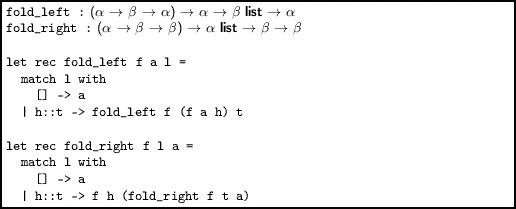

它们是做什么的？为什么它们被认为足够重要而包含在标准库中？正如我们将看到的，它们以一种非常优雅且通用的方式抽象了带累加器的列表递归思想。

让我们首先检查 `fold_left` 及其相当复杂的类型。第一个参数本身是一个函数，它接收现累加器和输入列表中的一个元素，以某种方式将它们合并，并返回一个新的累加器，准备处理下一个元素。因此，第一个参数的类型为 α → β → α。然后我们有一个累加器的初始值，其类型必须为 α，以及类型为 β list 的输入列表。返回值是最终累加器，因此它的类型必须为 α。我们可以如下对函数进行注释：

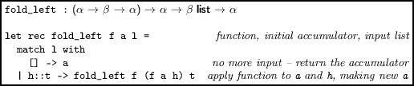

我们可以找到一个数字列表的和：

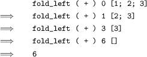

在这里，α 和 β 都是 `int`。函数 `(+)` 的类型是正确的，我们使用 `(+)` 的单位元 `0` 作为初始累加器，因为对于所有的 `x`，`x + 0 = x`（我们不能从列表本身获取初始累加器，因为我们的函数必须为空列表中的所有整数和提供一个结果）。

对于读者来说，这似乎比简单的递归解决方案要复杂，但对于经验丰富的函数式编程人员来说，使用 `fold_left` 实际上更易读。让我们使用 `fold_left` 找到列表中的最大数：

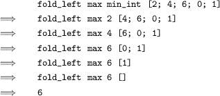


构造函数 `Nil` 表示空列表，而 `Cons` 则从头部（head）和尾部（tail）构建列表。例如，我们可以将列表 `[1; 2; 3]` 写为 `Cons (1, Cons (2, Cons (3, Nil)))`。

也可以定义一个无限列表，其元素只在我们实际需要时才产生。这被称为惰性列表（lazy list）。我们没有使用尾部，而是使用尾部函数。该函数在给定一个单元值时，会产生尾部：

```ml
type 'a lazylist = Cons of 'a * (unit -> 'a lazylist)
```

注意，我们没有 `Nil` 构造函数，因为列表没有尽头。我们使用 `unit` 而不是其他类型是一种选择——我们可以使用任何类型，但 `unit` 是简单的类型，只包含一个值。

我们如何使用这种东西呢？让我们先写一个函数，它接收一个整数 `n`，构建所有整数 `n`, `n + 1`, `n + 2`… 的惰性列表并返回它：

> 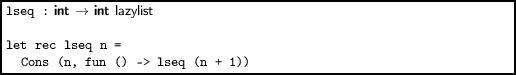

当我们将其输入 OCaml 交互界面时，我们看到的是：

```ml
OCaml
### lseq 0;;
- : int lazylist = Cons (0, <fun>)
```

我们可以看到列表的头部是零——其余部分尚未计算。OCaml 用 `<fun>` 表示尾部函数。

我们现在可以写函数从列表中提取项了。这里是惰性的 head 和 tail 函数：

> 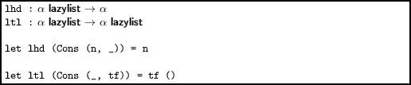

注意，由于我们的数据类型中只有一个构造函数，因此我们可以在函数参数中直接进行模式匹配（pattern match）。当我们将单元值 `()` 应用于尾部函数时，我们是在强制对尾部求值。

这里是熟悉的 `take` 和 `drop` 函数的惰性版本，它们获取或丢弃列表的前 `n` 个元素：

> 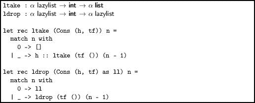

`ltake` 函数必须返回一个普通列表。注意这里使用 `as` 关键字来为模式的一部分命名（这里，`Cons (h, tf)` 被命名为 `ll`），使得 `ldrop` 的基础情况变得更简单。

现在我们实际上可以获取元素了：

```ml
OCaml
### ltake (lseq 0) 20;;
- : int list =
[0; 1; 2; 3; 4; 5; 6; 7; 8; 9; 10; 11; 12; 13; 14; 15; 16; 17; 18; 19]
### ldrop (lseq 0) 20;;
- : int lazylist = Cons (20, <fun>)
```

两个常用的函数在惰性世界中有对应物：

> 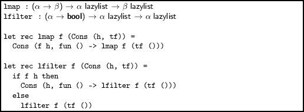

注意延迟（delaying）和强制求值（forcing）经常一起出现。`map` 函数立即返回——假设 `f` 是快速的。其余元素的计算总是延迟的。

`filter` 函数不同——它必须先找到至少一个匹配的元素作为头部，如果没有，它将不会返回，因此需要注意。让我们使用这两个函数找到能被五整除数：

> 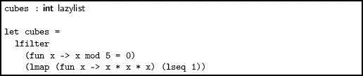

现在，使用 `ltake`：

```ml
OCaml
### ltake cubes 20;;
- : int list =
[125; 1000; 3375; 8000; 15625; 27000; 42875; 64000; 91125; 125000; 166375; 216000; 274625; 343000; 421875; 512000; 614125; 729000; 857375; 1000000]
```

这是另一个惰性列表示例，这次是通过使用 `lfilter` 和递归创建的质数列表，从 `lseq` 计算计算：

> 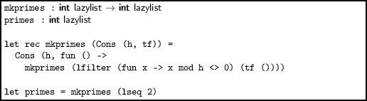

有很多列表函数无法适配惰性列表。例如，不能反转惰性列表或附加两个惰性列表。但有一个 `append` 的对应物。我们可以公平地合并两个列表，交替从每个列表中取元素：

> 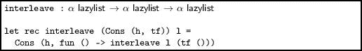

例如，零和一之间交替的列表可以使用 `interleave` 和一个构建常数列表的函数构建：

> 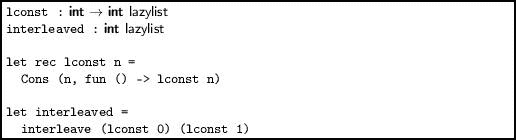

另一个有趣的例子是计算所有零和一列表的惰性列表。我们可以通过前一个零和一个一并交替产生的列表来实现：

> 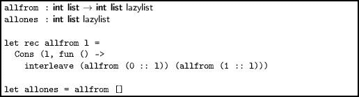

这产生了：

```ml
OCaml
### ltake allones 20;;
- : int list =
[]; [0]; [1]; [0; 0]; [0; 1]; [1; 1]; [0; 0; 0]; [0; 0; 1]; [0; 1; 0]; [1; 0; 1]; [1; 1; 0]; [0; 0; 0; 0]; [0; 0; 0; 1]; [0; 0; 1; 0]; [0; 1; 0; 1]; [1; 0; 1; 1]; [1; 1; 0; 0]; [0; 0; 0; 0; 0]; [0; 0; 0; 0; 1]; [0; 0; 0; 1; 0]; [0; 0; 1; 0; 1]; [1; 0; 1; 1; 0]]
```

为了看到为什么，我们可以将求值可视化为树，每个左分支前加上零，每个右分支加上一：

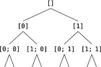

交替是公平的，交替的交替同样如此，因此我们按此顺序看到结果：`[0; 0]` `[0; 1]` `[1; 0]` `[1; 1]`。

### 问题

1. 写一个元素为 1, 2, 4, 8, 16… 的惰性列表。它的类型是什么？
2. 写一个函数返回惰性列表的第 `nth` 个元素，其中元素零是列表的头部。
3. 写一个函数，给定一个列表，返回由该列表形成重复序列的惰性列表。例如，给定列表 `[1; 2; 3]`，它应该返回一个元素为 1, 2, 3, 1, 2, 3… 的惰性列表。
4. 写一个元素为斐波那契数 0, 1, 1, 2, 3, 5… 的惰性列表，其前两个元素根据定义为零和一，每个后续元素之前两个的和。
5. 写函数 `unleave`，给定一个惰性列表，返回两个惰性列表，一个包含原始列表位置 0, 2, 4, 6… 的元素，另一个包含位置 1, 3, 5, 7… 的元素。
6. 文档中的字母标签为 A,B,C,…X,Y,Z,AA,AB,…BA,BB,…AAA… 写一个包含表示此序列字符串的惰性列表。

# 第 3 章 带记录的命名元组（Named Tuples with Records）

元组可用于组合相同或不同类型的固定数量元素。然而，一旦我们超过两个或三个项目，记住顺序可能会很困难。记录（Records）解决了这个问题，允许我们为每个项目命名。由于这种命名方式，它们有许多其他属性。

让我们定义一个用于二维坐标的简单类型：

```ml
type point = {x : float; y : float}
```

记录就像带标签的元组。我们将它们写在大括号 `{ }` 中。记录的每个元素都有名称和类型，字段之间用分号分隔。我们可以使用相同的语法构造类型值，但用等号代替冒号：

```ml
let p = {x = 4.5; y = 6.0}
```

我们可以向记录中添加另一个字段，一个标签：

```ml
type point = {x : float; y : float; label : string}
```

我们可以对其进行参数化，就像列表或变体类型一样：

```ml
type 'a point =
  {x : float; y : float; label : string; content : 'a}
```

现在我们可以拥有 `int point` 和 `string point` 类型的值。我们可以直接定义：

> 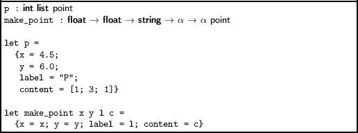

注意我们经常在记录定义中写类似 `x = x` 的内容，如这里的 `make_point`。这可以简化为只需 `x`，通过对 `make_point` 的所有参数这样做，我们得到了更简单的定义：

> 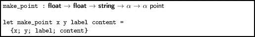

构建了记录值后，我们现在需要知道如何提取部分。我们可以使用点表示法，写作 `record.field`：

> 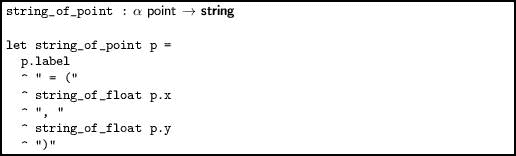

或者，我们可以在模式匹配中使用记录语法，这里在参数本身中：

> 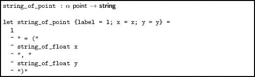

注意我们只需要在模式中包含我们打算使用的记录部分。这可以通过在模式中添加通配符 `_` 来变得更加显式：

> 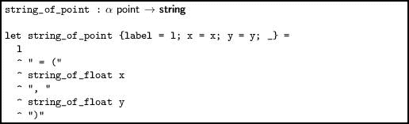

最后，我们也可以在模式中使用简写形式的记录：

> 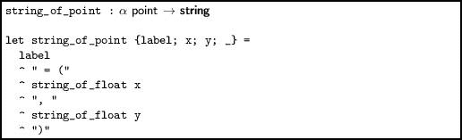

当我们需要一个仅更改一个或多个字段的记录副本时，可以使用 `with` 关键字：

> 

再次，简写形式可以帮助：

> 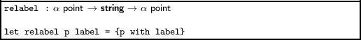

## 可变记录（Mutable records）

记录的单个字段可以变为可变的（其值可以被改变——直接突变），使用 `mutable` 关键字：

```ml
type 'a point = {x : float; y : float; label : string; mutable content : 'a}
```

事实上，OCaml 的引用类型（reference type）只是一个带有单个可变字段的记录（record）：

```ocaml
OCaml
### let x = ref 0;;
- : int ref = { contents = 0 }
```

在这里，类型 `ref` 定义为 `type 'a ref = {mutable contents : 'a}`，构造函数 `ref` 的类型为 `α → α ref`。可变字段的值可以使用 `<-` 符号进行更新，如下：

```ocaml
type 'a ref = {mutable contents : 'a}
let ref (x : 'a) = {contents = x}
let ! (r : 'a ref) : 'a = r.contents
let := (r : 'a ref) (x : 'a) = r.contents := x

### let x = ref 0;;
- : int ref = { contents = 0 }
### x := 1;;
### !x
- : int = 1
```

# 第 5 章

## 位流

我们已经处理过按字节流的信息流。然而，我们经常需要将数据视为一个位流。我们能为此构建一个良好的抽象吗？

我们可以从一个函数开始，该函数从一个字节构建一个位列表，并对流中的每个字节都使用该函数，从而构建一个最终的列表。这有两个缺点：它在空间和时间上都是低效的（当然，位的数量是字节的八倍），而且它是一次性处理所有字节，而不是按需处理。

相反，让我们根据我们的输入类型构建一个位流：

```ocaml
type input_bits =
    {input : input;
     mutable byte : int;
     mutable bit : int}
```

`input` 字段是该位流所依据的输入。它将从该输入当前字节的最高位开始。`byte` 字段保存刚从输入中读取的字节，如果尚未读取任何字节，则为一个未定义的值。`bit` 字段记录当前的位，但我们不会使用 `0..7`，而是使用 `128, 64, 32, 16, 8, 4, 2, 1`，这样该字段就可以直接使用内置的逻辑与运算符 `land` 来提取该位，然后减半：

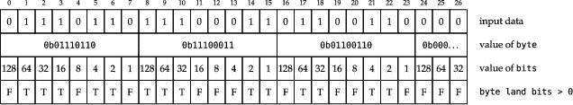

表达式 `x land y`（其中 `x` 和 `y` 是整数）产生一个整数，其值的位模式是 `x` 和 `y` 的按位逻辑与结果。这个 `input_bits` 类型可以被完全抽象化，在 `.mli` 中仅通过 `type input_bits` 来定义。

现在，我们可以定义一个函数，从输入构建一个 `input_bits`：

> 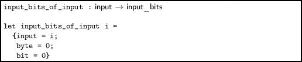

获取下一个位的函数非常简单。如果 `bit` 为 0，我们必须从输入中加载一个新的 `byte` 并返回下一个位。如果 `bit` 非 0，我们提取给定的位，并将 `bit` 减半以备下次使用：

> 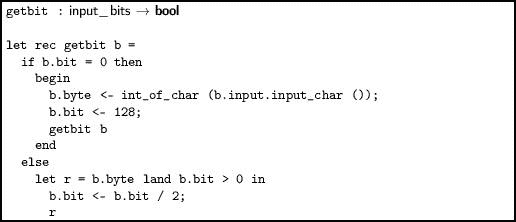

当然，如果底层的 `input_char` 调用抛出了 `End_of_file`，该函数也会抛出。

另外两个函数很有用。我们可以轻而易举将位流对齐到下一个字节边界：

> 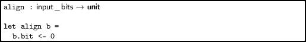

我们可以写一个函数 `getval` 来返回一个被视为整数的指定数量位，允许我们读取任意宽的数据字段。我们使用 `lor` 运算符（它提供两个整数的按位逻辑或结果）以及 `lsl` 或逻辑左移位运算符（它将整数中的位向左移动指定的位数，并在右侧填充 0）：

> 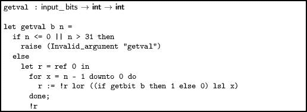

OCaml 整数至少是 31 位（取决于计算机），因此我们可以用此函数读取宽达 31 位的字段。在特定计算机上，这个数字可以通过计算 `Sys.word_size - 1` 来得出。

### 示例：解码 TCP 数据报头部

这里是用于网络通信的 TCP（传输控制协议）数据报头部的布局：

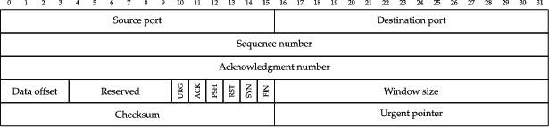

它包含了小至 1 位、大至 32 位的字段。我们将使用以下 20 字节的 TCP 数据报头部作为示例：

`00 26 bb 14 62 b7 cc 33 58 55 1e ed 08 00 45 00 03 78 f7 ac`

图 5.1 中的代码用于打印头部的相关信息，使用了 `getbit`、`getval` 和一个尚未定义的函数 `getval_32` 来读取 TCP 数据报头部并打印摘要。`getval_32` 函数在 `Int32.t` 中返回多达 32 位（实现 `getval_32` 是章节末尾的问题之一）。

以下是我们示例数据的输出：

> 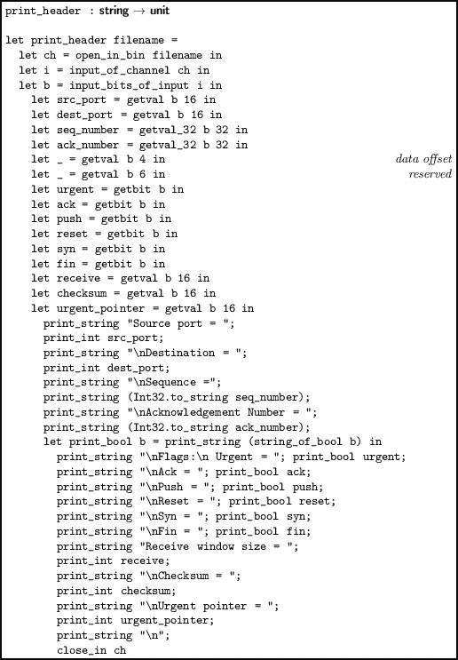

**图 5.1：**

- `Source port = 38`
- `Destination = 47892`
- `Sequence = 1656212531`
- `Acknowledgement Number = 1481973485`
- `Flags:`
  - `Urgent = false`
  - `Ack = false`
  - `Push = false`
  - `Reset = false`
  - `Syn = false`
  - `Fin = false`
  - `Receive = false`
  - `Checksum = false`
  - `Window = false`

## 输出位流

`input` 字段是该位流所依据的输入。它将从该输入当前字节的最高位开始。`byte` 字段保存刚从输入中读取的字节，如果尚未读取任何字节，则为一个未定义的值。`bit` 字段记录当前的位，但我们不会使用 `0..7`，而是使用 `128, 64, 32, 16, 8, 4, 2, 1`，这样该字段就可以直接使用内置的逻辑与运算符 `land` 来提取该位，然后减半：


表达式 `x land y`（其中 `x` 和 `y` 是整数）产生一个整数，其值的位模式是 `x` 和 `y` 的按位逻辑与结果。这个 `input_bits` 类型可以被完全抽象化，在 `.mli` 中仅通过 `type input_bits` 来定义。

现在，我们可以定义一个函数，从输入构建一个 `input_bits`：

> 

获取下一个位的函数非常简单。如果 `bit` 为 0，我们必须从输入中加载一个新的 `byte` 并返回下一个位。如果 `bit` 非 0，我们提取给定的位，并将 `bit` 减半以备下次使用：

> 

当然，如果底层的 `input_char` 调用抛出了 `End_of_file`，该函数也会抛出。

另外两个函数很有用。我们可以轻而易举将位流对齐到下一个字节边界：

> 


我们可以编写一个函数 `getval`，返回一个被视为整数的指定数量位，允许我们读取任意宽的数据字段。我们使用 `lor` 运算符（它提供两个整数的按位逻辑或结果）以及 `lsl` 或逻辑左移位运算符（它将整数中的位向左移动指定的位数，并在右侧填充 `0`）。

> 

OCaml 整数至少是 31 位（取决于计算机），因此我们可以用此函数读取宽达 31 位的字段。在特定计算机上，这个数字可以通过计算 `Sys.word_size - 1` 来得出。

## 示例：解码 TCP 数据报头部

这里是用于网络通信的 TCP（传输控制协议）数据报头部的布局：


它包含了小至 1 位、大至 32 位的字段。我们将使用以下 20 字节的 TCP 数据报头部作为示例：`00 26 bb 14 62 b7 cc 33 58 55 1e ed 08 00 45 00 03 78 f7 ac`。

图 5.1 中的代码用于打印头部的相关信息，使用了 `getbit`、`getval` 和一个尚未定义的函数 `getval_32` 来读取 TCP 数据报头部并打印摘要。`getval_32` 函数在 `Int32.t` 中返回多达 32 位（实现 `getval_32` 是章节末尾的问题之一）。以下是我们示例数据的输出：

---

> 

> 图 5.1：

---

`Source port = 38`

`Destination = 47892`

`Sequence = 1656212531`

`Acknowledgement Number = 1481973485`

`Flags:`

`Urgent = false`

`Ack = false`

`Push = false`

`Reset = false`

`Syn = false`

`Fin = false`

`Receive = false`

`Checksum = false`

`Window = false`

## 输出位流

`input` 字段是该位流所依据的输入。它将从该输入当前字节的最高位开始。`byte` 字段保存刚从输入中读取的字节，如果尚未读取任何字节，则为一个未定义的值。`bit` 字段记录当前的位，但我们不会使用 `0..7`，而是使用 `128, 64, 32, 16, 8, 4, 2, 1`，这样该字段就可以直接使用内置的逻辑与运算符 `land` 来提取该位，然后减半。

注意：后续包含原文中的重复内容。

# 第 6 章：数据压缩

通常我们需要尝试减少某些数据占据的空间，以便存储或传输。如果数据是随机的，就无法压缩——压缩数据我们需要识别并利用模式。然而，大多数数据完全不是随机的，而是结构化的、包含重复模式。没有压缩方案可以保证缩小所有输入的大小，但我们希望在典型数据上实现良好的压缩。

我们将查看一种简单的按字节压缩方案，使用我们的输入和输出数据类型来实现它，以便应用于不同类型的输入和输出。然后，我们将考虑一种更复杂但更高效的按位压缩数据的方案。

## 按字节的压缩方案

以下来自 ISO-32000（PDF 标准）的摘录定义了一种按字节的压缩方案：

> 编码后的数据应为一系列运行段（runs），每个运行段由一个长度字节和随其后的 1 到 128 字节数据组成。如果长度字节在 0 到 127 范围内，则在解压期间将字面复制接下来的 `+1`（1 到 128）个字节。如果长度在 129 到 255 范围内，则在解压期间将接下来的单个字节复制 `257 - length`（2 到 128）次。长度值为 128 时表示 EOD [数据结束]。

例如，考虑文本“`((5.000000, 4.583333), (4.500000,5.000000))`”，它可以用 ASCII 表示为长度为 43 的整数列表 `[40; 40; 53; 46; 48; 48; 48; 48; 48; 48; 44; 32; 52; 46; 53; 56; 51; 51; 51; 51; 41; 44; 32; 40; 52; 46; 53; 48; 48; 48; 48; 48; 44; 53; 46; 48; 48; 48; 48; 48; 48; 41; 41]`。其压缩方式如图 6.1 所示。也就是说，压缩为 `[255; 40; 1; 53; 46; 251; 48; 5; 44; 32; 52; 46; 53; 56; 253; 51; 6; 41; 44; 32; 40; 52; 46; 53; 252; 48; 2; 44; 53; 46; 251; 48; 255; 41; 128]`，长度为 35。用这种方法（对于长常量数据）实现的最大压缩率为 64:1。最坏情况（交替字节）为 127:128——略有膨胀。

---

> 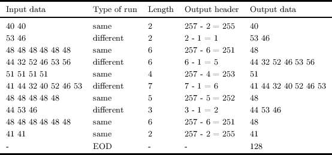

> 图 6.1：

---

### 转换工具函数

让我们从两个工具函数开始，以便我们在字符串和整数列表之间进行转换——这将使得我们在 OCaml 顶层评估示例时，更容易理解这些内容：

> 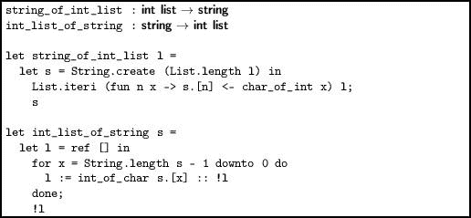

注意标准库函数 `List.iteri` 的使用，它类似于 `List.iter`，但它每次都会向函数传递一个额外的整数，表示列表中的位置，从 0 开始。同样注意，我们在 `int_list_of_string` 中使用了 `downto` 以避免列表反转。

### 通用抽象

现在我们将构建一个小的抽象，以便我们的压缩和解压能够共享一个共同的基础。我们的 `compress` 和 `decompress` 函数需要从任何输入读取并写入到任何输出。然而，对于我们的测试，我们将从字符串读取并写入字符串。由于我们无法预知压缩或解压缩输出的大小，因此无法分配适当大小的字符串。因此，让我们从 `Buffer` 构建一个输出。这样，我们可以写一个 `process` 函数，它在给定压缩或解压函数的情况下，创建一个缓冲区，从其中构建输出，调用该函数处理数据，然后提取最终的字符串。

> 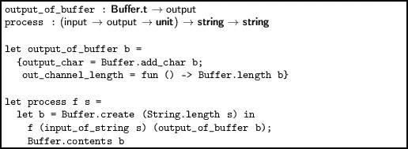

现在，假设有一个函数 `decompress`，我们可以通过传入该函数和一个字符串来调用 `process`，并返回一个新的字符串。

### 解压缩逻辑

整个过程封装在一个循环中，该循环在遇到异常时终止。如果输入数据是良好的，该异常将是 `EOD`，这是我们为此目的定义的。在循环内部，我们从输入中读取一个字节。它要么在 `0...127` 范围内，此时它是一个“不同”运行段，我们将某些字节复制到输出；或者它在 `129...255` 范围内，此时它是一个“相同”运行段，我们将输出下一个字节的多个副本。否则，该字节值必须为 128，我们将抛出 `EOD` 异常。`decompress_string` 函数正如我们声称的简单，因为我们写了 `process`。

> 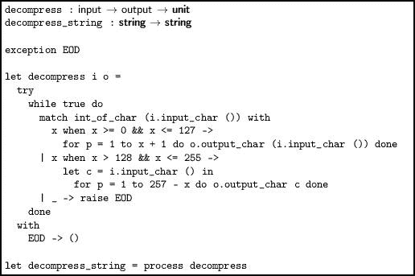

### 压缩逻辑

对于压缩，我们将首先编写识别输入中“相同”运行段和“不同”运行段的函数，然后编写一个根据需要使用它们的主函数。`get_same` 函数返回第一个字符和一个表示从第一个字符开始的一个或多个相同字符数量的整数。它让输入指向最后一个字符。如果发现了 128 个字符，我们必须提前停止。如果在调用该函数时已到达输入末尾，则像往常一样抛出 `End_of_file`。

> 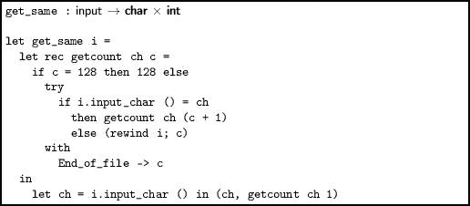

`get_different` 函数相当笨拙。它将返回从当前位置开始的非空字符列表。一旦注意到两个相同的字符，就必须停止，回溯并移除一个字符。例如，如果我们正在读取累加器，我们希望返回 `['A'; 'n'; 'A']`。再次，如果我们在输入末尾，`End_of_file` 将被抛出。

> 

压缩函数现在相对简单。重复调用 `get_same`。如果指示长度为一的运行段，我们调用 `get_different`。在每种情况下，在 `End_of_file` 时写入相应的数据。`compress_string` 函数的构建类似于 `decompress_string`。

### 示例

让我们用示例数据尝试：

```ocaml
### open Examples;
### example;
- : string = "((5.000000, 4.583333), (4.500000))"
### int_list_of_string example;
- : int list = [40; 40; 53; 46; 48; 48; 48; 48; 48; 48; 44; 32; 52; 46; 53; 56; 51; 51; 51; 51; 41; 44; 32; 40; 52; 46; 53; 48; 48; 48; 48; 48; 44; 53; 46; 48; 48; 48; 48; 48; 48; 41; 41]
### let smaller = compress_string example;
val smaller : string = "((5.000000, 4.583333), (4.500000))"
### int_list_of_string smaller;
- : int list = [255; 40; 1; 53; 46; 251; 48; 5; 44; 32; 52; 46; 53; 56; 253; 51; 6; 41; 44; 32; 40; 52; 46; 53; 252; 48; 2; 44; 53; 46; 251; 48; 255; 41; 128]
### decompress_string(smaller);
- : bool = true
```

我们之前的位处理方法要求整个字节相等。现在考虑位处理，但基于相同的原理——编码数据的长度。我们将为 CCITT 组编写一个压缩和解压缩器。这是自 1970 年以来使用的基本方案，适用于 1 位像素文件。它也被用于 PDF 格式。这里是我们的示例，80x21，扫描打印文件的单位像素图像：


我们可以使用字符 `0` 和 `1` 将其放入源文件中以便可读性。如果每行末尾添加反斜杠，字符串就可以跨行。下一行开头的空格也会被跳过，因此我们可以对齐得很整：

```ocaml
let input_data = "000000000000000000000000000000000000000000000000000000000000000000000000\
000000000000000000000000000000000000000000000000000000000000000000000000"
```

```text
0000001110000000110000000111000000001001000111000001110000011000001100001111000000
0000001111111111100000000001111111111000111110111000111100011110000111001111100000
00000000011100000000000000001111000000001000000000000000000000000000000000000000
00000000000000000000000000000000000000000000000000000000000000000000000000000000
00000000000000000000000000000000000000000000000000000000000000000000000000000000
```

你可以看到，它由 `0`（白色）和 `1`（黑色）像素的连续段组成，每行 80 位，共 21 行。

## 准备工作

首先，我们最好定义一个函数，将 `0` 和 `1` 的字符串转换为包含实际二进制数据的字符串。我们可以通过构建一个由缓冲区构建的 `output_bits` 来实现。然后，在刷新（flush）之后，我们可以使用 `Buffer.contents` 来提取我们写入的数据。

> 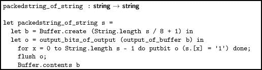

注意，由于字符串始终是字节的整数（可能会由 `flush` 填充零），我们必须记住图像的宽度和高度（这里是 80 和 21），并将其中一个或两个传递给我们的其他函数。例如，我们可以写一个函数来打印这些打包二进制字符串之一。这需要图像的宽度以便知道何时换行：

> 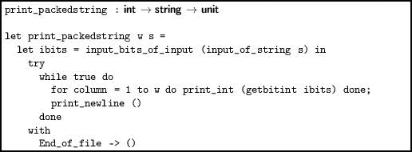

为了简单起见，这里我们不用末尾的填充（在示例中，由于宽度是 80，它本身就是完整字节组成的）。

## 传真压缩原理

我们已经说过，压缩将通过对数据中 `0` 和 `1` 的连续段长度进行编码来进行。我们如何编码它们呢？我们需要一组可以相互区分的二进制序列（即任何序列都不能另一个序列的前缀）。在传真压缩的情况下，长度为 0 到 63 的连续段有相应的代码，白色和黑色连续段有不同的代码，如图 6.2 所示。根据对实际文档的统计分析，为更常见的情况选择了较短的代码。

---

> 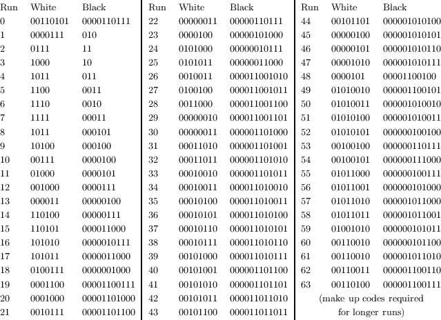

> 图 6.2：

---

注意，没有任何白色符号是另一个白色符号的前缀，没有任何黑色符号是另一个黑色符号的前缀。这些从 0 到 63 的连续段代码被称为终止代码（terminating codes）。当连续段更长时，我们使用一个如图 6.3 所示的“补偿代码”（make-up code），后面跟着一个终止代码。因此，最长的连续段长度为 1728 + 63 = 1791。

---

> 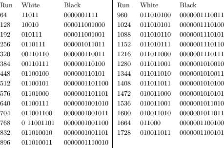

> 图 6.3：

---

区分白色和黑色代码的原因是为了在不可靠的传输机制（如传真机运行的电话线）中进行纠错——否则我们只需要一组代码并假设连续段是交替出现的。零长度连续段的存在是因为每行都定义为从白色连续段开始。如果它真的是黑色的，则先输出一个零长度的白色连续段。没有任何连续段超过一行的。作为一个例子，让我们压缩示例数据的前三行：

```text
00000000000000000000000000000000000000000000000000000000000000000000000000000000
00000000000000000000000000000000000000000000000000000000000000000000000000000000
00000000000000000000000000000000000000000000000000000000000000000000000000000000
00000000000000000000000000000000000000000000000000000000000000000000000000000000000000000000000000000000000000000000000000000000000000000000000000000000000000000
00000000000000000000000000000000000000000000000000000000000000000000000000000000
```

我们得到：


我们将数据从 240 位减少到 64 位，减少了约四分之一。

## 压缩传真数据

首先，我们需要编码终止代码和补偿代码。我们将使用数组进行索引，但对每个元素使用列表，因为我们不需要对每个位进行随机访问。如图 6.4 所示。现在，我们可以写一个函数，给定连续段长度和颜色，给出相应的位列表：

---

> 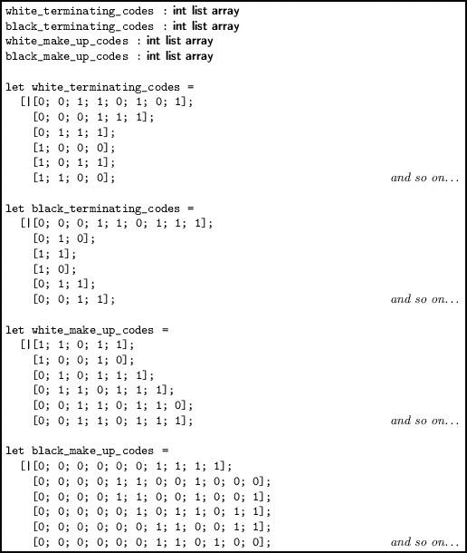

> 图 6.4：

---

> 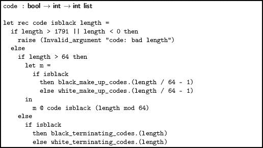

现在，一个给定颜色、`input_bits`、读取的位数和图像宽度的函数返回位数和颜色：

> 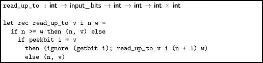

例如，第一次调用 `read_up` 将计算 `(80, 0)`。现在我们可以编写主函数。给定 `input_bits` 和 `output_bits` 以及图像的宽度和高度，对于每一行，我们检查是否需要添加零宽白色连续段，然后调用 `encode_line`。

> 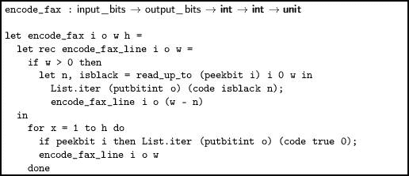

现在我们可以写一个 `process` 函数，就像我们在逐字节示例中做的那样，但是针对 `input_bits` 和 `output_bits`。我们必须确保刷新输出。主函数 `compress_string_ccitt` 然后很简单：

> 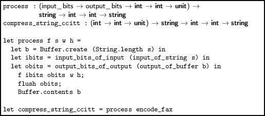

对于完整的输入数据，输入字符串长 80×21=1680 位，压缩字符串长 960 位，压缩比为 7:4。

## 解压缩传真数据

对于解压缩，我们将编写两个读取白色和黑色代码的函数。简单的方法是直接编码决策树：

> 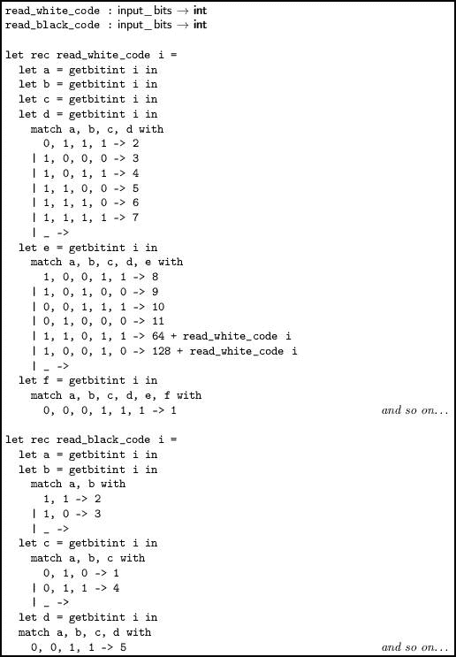

现在，解码相对简单。我们解码每一行的连续段直到达到宽度，并对每一行这样做。我们交替读取白色和黑色代码——每行都从白色开始。我们可以再次使用 `process`：

> 

我们可以通过对示例数据求值 `s = decompress_string_ccitt (compress_string_ccitt s)` 来验证我们的代码。

## 思考

1. 使用 `input` 和 `output` 类型为 `compress` 和 `decompress` 增加了多少复杂度？重写这些函数，让它们以函数式风格处理整数列表，并进行比较。
2. 用从压缩列表自动生成的树替换我们手动的代码树。该树在分支处没有数据（因为没有代码是另一个代码的前缀），仅在某些叶子处有数据。首先定义一个合适的数据类型。
3. 如果我们将数据作为单行 1680 位而不是 21 行 80 位会怎样？尝试压缩已经压缩的数据会怎样？
4. 写一个函数，给定输入数据，计算不同黑白连续段的频率直方图。这可以用于为每个图像构建自定义代码。

# 第 7 章：标签和可选参数

OCaml 允许对函数的某些或全部参数进行标记，以便提供少量文档、防止交换相同类型的参数并允许灵活的部分应用。考虑一个向数组部分填充元素的函数：

> 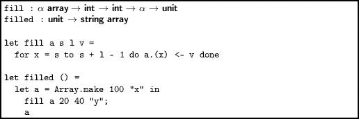


`fill` 函数接收四个参数：数组本身、起始位置、填充长度和用于填充的元素。然而，由于起始位置和长度都是整数，很容易弄反。可以通过给这两个参数加上标签来解决。标签由波浪号 `~` 引入，后面跟着标签名称、冒号和参数名称本身。

考虑下面的 `fill` 和 `filled` 函数。如你所见，我们用标签定义了 `fill`，标签也出现在类型中。在第一个 `filled` 函数中，我们调用 `fill` 函数，引用标签并给出即时整数。在第二个中，我们展示了它与其他名称有效（事实上，它对任何表达式都有效）。在第三个，我们展示了标记参数可以与其他参数进行置换和重新排列（未标记参数必须彼此之间保持正确的顺序）。

> 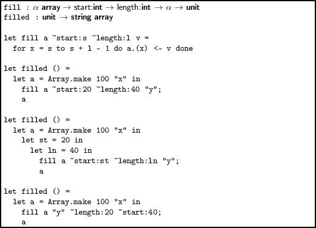

我们可以做的另一个变化是将标签也作为函数内部参数的名称。这简化了语法：我们只需要写 `~label`。

> 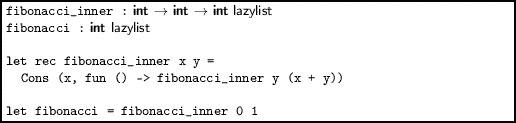

你可以看到在 `filled` 中，这种“名称重用”（punning）在调用函数时如果碰同名值也同样有效。当然，这两种功能不需要一起使用。

### 带标签的部分应用

标签参数的另一个常见用途是在使用部分应用（partial application）时提供灵活性。考虑以下函数：

```ocaml
let divide x y = x / y
```

我们可以使用部分应用来编写一个函数，该函数将一万除以列表中的每个数字：

```ocaml
let f = divide 10000 in [f 100; f 50; f 20]
```

这产生了 `[100; 200; 500]`。但我们不能重用 `divide` 来编写一个将列表中的每个数字除以十的函数——这需要先部分应用第二个参数 `y`。`divide` 函数的设计已经固定了哪些参数可以被部分应用（OCaml 允许我们对参数的任何前缀进行部分应用——第一个、第一个和第二个、第一个、第二个和第三个等）。

例如，我们可以使用部分应用的 `List.map` 将同一个函数应用到许多列表上，但我们无法通过将列表传递给 `List.map` 来将多个函数应用到单个列表。

在我们的示例中，我们可以为 `divide` 函数的参数标记标签：

```ocaml
let divide ~x ~y = x / y
```

该函数的类型反映了这一点：

```ocaml
# let divide ~x ~y = x / y;;
val divide : x:int -> y:int -> int = <fun>
```

现在，我们可以按任何顺序应用参数：

```ocaml
# let f = divide ~x:10000 in [f 100; f 50; f 20];;
- : int list = [100; 200; 500]
# let f = divide ~y:10000 in [f 100000; f 10000; f 1000];;
- : int list = [10; 1; 0]
```

事实上，如果我们按顺序应用参数，可以省略标签：

```ocaml
# let f = divide 10000 in [f 100; f 50; f 20];;
- : int list = [100; 200; 500]
```

### 可选参数

OCaml 还允许我们将标签参数设为可选——也就是说，我们不需要提供它。在未提供一个或多个参数的情况下调用的函数可以决定做什么。

考虑这个简单的函数 `split`，它从输入列表返回一个单元素列表列表，例如对于输入列表 `[1; 2; 3]` 返回 `[[1]; [2]; [3]]`：

> 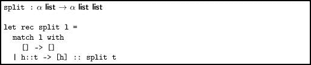

我们希望扩展该函数以生成指定大小的子列表，而不是默认的 1。我们可以添加一个标签参数并适配该函数，使用在第 xiii 页中描述的 `Util` 模块中的 `take`（从列表开始获取指定数量的项）和 `drop`（从列表开始丢弃指定数量的项）：

> 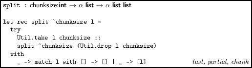

不过，这里存在两个问题。使用该函数的现有代码将无法编译，而且我们必须始终指定 `chunksize` 参数，即使它为 1。这可以通过可选标签参数来解决，该参数用问号 `?` 代替波浪号 `~` 引入，并赋予一个默认值：

> 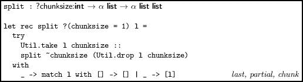

注意问号也出现在类型中。同样注意，在 `split` 的递归调用中，我们可以像通常一样写 `~chunksize` 而不是 `~chunksize:chunksize`。现在，我们的 `split` 函数可以带或不带这个可选参数调用：

```ocaml
# split [1; 2; 3];;
- : int list list = [[1]; [2]; [3]]
# split ~chunksize:3 [1; 2; 3; 4; 5; 6; 7];;
- : int list list = [[1; 2; 3]; [4; 5; 6]; [7]]
```

事实上，如果在 `split` 的定义没有为可选参数提供默认值，我们就可以访问它的实现——作为 `option` 类型的值（`None` 或 `Some`），并且我们可以对其进行模式匹配：

> 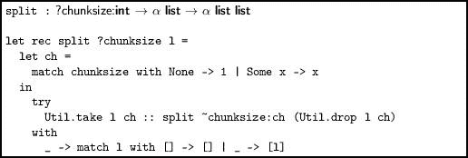

这在存在可选参数时特别有用。

### 标准库中的标签

标准库包含了其他模块的三个标签版本：`ListLabels`、`ArrayLabels` 和 `StringLabels`。例如，我们可以写：

```ocaml
ListLabels.map ~f:(fun x -> x*2) [1; 2; 3];;
- : int list = [2; 4; 6]
```

如果我们希望默认使用标签模块，`StdLabels` 模块以原始名称包含了这些模块，因此通过编写 `open StdLabels`，`List.map` 和 `Array.blit` 现在将带有标签：

```ocaml
open StdLabels;;
# List.map ~f:(fun x -> x*2) [1; 2; 3];;
- : int list = [2; 4; 6]
```

这些模块并没有标记所有参数。通常，它们会对作为函数的参数进行标记，当存在多个可能混淆的同类型参数时进行标记。例如，`ArrayLabels` 中的 `pos` 和 `len` 可能会混淆。`ArrayLabels.make` 的类型为 `pos:int -> len:int -> α`。

### 问题

1. 在按顺序应用参数时，我们可以省略标签吗？

2. 如果我们默认使用标签模块，应该怎么做？

3. 当存在可选参数时，这主要有什么用？

4. 如果我们在 `split` 的定义中不给可选参数提供默认值，我们可以访问它的实际实现吗？

> 

这将导致 `print_nums data` 输出以下内容：

```text
A       | B      | C
------+-------+-------
000001| 35.54| 39.42
000002| 12.31| 23.24
000003| 13.53| 24.21
000004| 57.75| 126.75
```

### 打印位置（Printing places）

当然，一旦我们使用 `sprintf` 计算出一个字符串，我们就可以对其进行任何操作——但为了方便和效率，`Printf` 模块提供了其他几个函数：


这些函数都返回 `unit`。例如，要将一个点写入标准输出，可以使用 `%!` 转换规范每次进行刷新，以便屏幕即时更新：

> 

不过，有人认为将 `string_of_point` 作为基础函数更好，以便在其他情况下重用它，而是由调用函数将生成的字符串写入屏幕。

### 问题（Questions）

1. 给定一个整数对的列表，如 `[(1, 2); (5, 6); (6, 6); (7, 5)]`，编写一个函数返回字符串表示，例如 `"(1, 2) --> (5, 6) --> (6, 6) --> (7, 5) --> (1, 2)"`。

2. 编写一个函数，给定一个字符串，返回另一个用十六进制表示该字符串的字符串。例如，输入字符串 `Hello` 应该产生输出 `48656c6c6f`，因为 `'H'` 的 ASCII 值为 `0x48`，依此类推。

3. 为什么以下代码会导致类型错误？

```ocaml
# let mkstring () = "string";;
val mkstring : unit -> string = <fun> 
# Printf.printf (mkstring ());;
;;
Error: This expression has type string but an expression was expected of type
         ('a, out_channel, unit) format =
           ('a, out_channel, unit, unit, unit, unit) format6
```

可以如何修复它？

4. 使用 `Printf` 模块文档描述的 `*` 语法编写一个函数，可以将给定的宽度打印整数表。例如，给定宽度 10，我们可能会看到：

```text
(          1)
(         23)
(      33241)
(          0)
```

## 查找内容（Searching for Things）

我们如何在另一个更长的序列中查找一个序列呢？假设我们要写一个函数 `search_list`，它给定在列表 `l` 中要查找的列表 `p`（模式），并确定其是否存在（即判断它是否为一个子列表）。

例如，列表 `[1; 2]` 在 `[2; 1; 2; 2]` 中，但不在 `[2; 1; 1]` 中。如果存在列表 `x` 和 `y` 使得 `l = x @ p @ y`，则定义列表 `p` 是列表 `l` 的子列表。

当然，`x`、`p`、`y`、`l` 中的一个、二、三个或全部可以是空列表。例如，`[]` 是 `[1; 2; 3]` 的子列表，也是 `[]` 的子列表。如果满足以下条件：

- `p` 的长度小于或等于 `l` 的长度，且满足以下之一：
  - 在 `l` 的开头找到了子列表 `p`，或者
  - 列表 `p` 是 `l` 尾部的子列表

我们可以使用第 xiii 页描述的 `Util` 模块中的 `take` 和 `drop` 函数轻松地写出来：

> 

（记住 `||` 运算符如果左侧评估为 `true`，则不会求值其右侧，因此此函数将作为 `true` 退出。）

4. 在我们的最终搜索程序中添加特殊符号 `\`。它表示接后的符号不是特殊符号，而是一个普通字符。注意，在 OCaml 代码中，该字符我们必须写成 `'\\'`。

5. 添加一个类型为 `bool` 的标记参数，其值当为 `true` 时表示不区分大小写的搜索。

# 第 10 章：排列

我们如何计算一个长度为 `n` 的给定列表的 `n!` 种排列？例如，给定列表 `[1; 2; 3]`，我们想要找到 `[[1; 2; 3]; [2; 1; 3]; [2; 3; 1]; [1; 3; 2]; [3; 1; 2]; [3; 2; 1]]` 或类似的结果（我们不在乎排列列表本身的顺序）。因此，我们需要一个类型为 `α list → α list list` 的函数。

对于像这种棘手的问题，有时直接开始编写、找出哪些空白并填补它们是有用的。我们的 `perms` 函数的基础基础情况是显而易见的：空列表有一种排列，即空列表本身：

> 

对于主情况，让我们尝试最简单的分解方法。我们通过递归免费地计算尾部的排列，然后以某种方式将结果与头部结合：

> 

在这里，`combine` 是我们尚未构出的函数。它必须接受一个排列列表（例如 `[[3; 2]; [2; 3]]`）和一个单个元素（例如 `1`），并产生 `[[1; 2; 3]; [2; 1; 3]; [2; 3; 1]; [1; 3; 2]; [3; 1; 2]; [3; 2; 1]]`。

该列表的元素可以通过将 `1` 放入 `[[3; 2]; [2; 3]]` 中每个列表的每个位置来产生。因此，我们将使用 `List.map` 配合一个尚未编写的函数 `interleave` 来简化问题，并使用 `List.concat` 结合结果：

> 

现在，我们只需要构建函数 `interleave`，它接收一个项目（如 `1`）和一个列表（如 `[2; 3]`），通过将该项目放在列表的每个可能位置来构建列表 `[[1; 2; 3]; [2; 1; 3]; [2; 3; 1]]`。

> 

该函数维护一个已出现元素的列表（初始为空），并构建每个新列表。当输入列表为空时，生成最终列表。这样，我们就避免了使用任何计数器来判断何时完成。例如，考虑我们示例中 `interleave` 的调用：


现在我们可以把整个代码写出来：

> 

这里是列表 `[1; 3; 5; 7]` 的 24 种排列：

```ocaml
# perms [1; 3; 5; 7];;
- : int list list =
[[1; 3; 5; 7]; [3; 1; 5; 7]; [3; 5; 1; 7]; [3; 5; 7; 1]; [1; 5; 3; 7];
 [5; 1; 3; 7]; [5; 3; 1; 7]; [5; 3; 7; 1]; [1; 5; 7; 3]; [5; 1; 7; 3];
 [5; 7; 1; 3]; [5; 7; 3; 1]; [1; 3; 7; 5]; [3; 1; 7; 5]; [3; 7; 1; 5];
 [3; 7; 5; 1]; [1; 7; 3; 5]; [7; 1; 3; 5]; [7; 3; 1; 5]; [7; 3; 5; 1];
 [1; 7; 5; 3]; [7; 1; 5; 3]; [7; 5; 1; 3]; [7; 5; 3; 1]]
```

注意，当列表中存在重复项时，我们的函数无法正常工作——它会将每个项目都视为是不同的：

```ocaml
# perms [1; 1; 2];;
- : int list list =
[[1; 1; 2]; [1; 1; 2]; [1; 2; 1]; [1; 2; 1]; [2; 1; 1]]
```

在这个实现中，在内存耗尽很久早，我们就遇到了了缺乏尾递归的问题：

```ocaml
# List.length (perms [1; 2; 3; 4; 5; 6; 7; 8]);;
- : int = 40320
# List.length (perms [1; 2; 3; 4; 5; 6; 7; 8; 9]);;
- : int = 362880
# List.length (perms [1; 2; 3; 4; 5; 6; 7; 8; 9; 10]);;
Stack overflow during evaluation
```

为了修复这个问题，我们必须通过添加累加参数将 `interleave` 重写为尾递归：

> 

现在我们可以根据时间和内存继续进行（尽管排列的顺序不同——你能修复它吗？）

另一种寻找排列的方法是选择输入中的每个元素并将其作为第一个元素，将其添加到剩余列表的每个排列之前。首先，让我们定义一个函数从列表中移除给定元素的（第一次）出现：

> 

这不需要尾递归，因为这个列表总是很小。现在我们可以写新的 `perms` 函数了。基础情况是相同的。在主情况中，我们两次使用 `List.map`。内部的 `map` 将给定元素添加到列表的每个排列之前。外部的 `map` 对每个元素都将其选择为第一个元素。然后拼接结果。

> 

该函数的优势在于能够按正确的字典序（排列）产生项：

`[[1; 2; 3]; [1; 3; 2]; [2; 1; 3]; [2; 3; 1]; [3; 1; 2]; [3; 2; 1]]`

### 逐个排列

有一个众知的算法，可以给定当前排列生成字典序的下一个排列。可以使用它来构建一个函数来生成所有排列，而不需要我们沉重的递归；更有的是，可以构建一个每次需要新排列时计算所需的懒列表。

我们从一个排序的数组开始，例如 `[1; 2; 3]`。这是第一个排列。我们生成新排列直到数组变为反排序——`[3; 2; 1]`——这是最后一个排列。找到字典序下一个排列有四个步骤：

1. 找到右侧较小的项。将其称为 `first` 项。这是必须修改的项，以找到距离当前排列最近的排列。
2. 找到 `first` 项右侧比它大的最小项。将其称为 `last` 项。这是将取代 `first` 项位置的项。
3. 交换这两个字符。
4. 将 `first` 项原始索引之后的所有内容按字典序排序。这确保我们选择的是下一个排列，而不是之后的任何。

将第一个项标记为 `F`，最后一个项标记为 `L`，我们有 `[1; 2(F); 3(L)]` → `[1(F); 3; 2(L)]` → `[2; 1(F); 3(L)]` → `[2(F); 3(L); 1]` → `[3; 1(F); 2(L)]` → `[3; 2; 1]`。

`first` 函数找到数组中“第一个项”的索引：

> 

相应的 `last` 函数稍微麻烦，需要检查两个条件并使用特殊的初始化，而不是像 `first` 那样简单用最后一个元素初始化。

> 

两个简单的工具函数：交换数组中的给定索引，以及根据偏移和长度排序子数组：

> 

现在我们准备好写 `next_permutation` 了：

> 

我们定义一个非递增的谓词：

> 

最后，我们完成了：

> 


注意，这个算法在处理元素重复时是正确的——它只会包含一次排列。现在我们可以使用第 2 章中的标准懒列表类型第 2 章来生成给定列表所有排列的重复懒列表：

> 

这个非常命令式的算法现在穿上了函数的衣服。

## 问题

1. 写一个函数来生成列表中所有元素的无序组合。例如，对于列表 `[1; 2; 3]`，结果（顺序不重要）可能是 `[]; [1]; [2]; [3]; [1; 2]; [1; 3]; [2; 3]; [1; 2; 3]]`。
2. 生成所有“排列组合”——即列表所有组合的所有排列。对于列表 `[1; 2; 3]`，这可能是 `[]; [1]; [2]; [3]; [1; 2]; [2; 1]; [1; 3]; [3; 1]; [2; 3]; [3; 2]; [1; 2; 3]]`。
3. 写一个函数，给出长度为 `n` 仅包含 `true` 和 `false` 的所有可能列表。
4. 变式算法的排序阶段可以替换为简单的列表反转，因为项在每次交换后已经按反字典序排序了。请实现它。
5. 命令式算法可以以函数式的方式通过列表来定义。请演示这一点。

# 第 11 章 集合

在本章中，我们将介绍用于存储集合的各种简单和复杂的数据结构。我们将研究它们的理论性能特征，并在各种类型的数据上对它们进行对比计时测试，以了解它们在实际应用中的性能。在此过程中，我们将学习 OCaml 中一些高级的模块化抽象机制。

对于每种集合表示，我们将提供以下五个函数：

- `set_of_list`：从列表（可能包含重复项）构建集合。通过 `set_of_list []` 构建空集合。
- `list_of_set`：返回一个包含集合中元素的列表，顺序不固定。
- `insert`：如果给定的元素不在集合中，则将其插入集合。
- `size`：返回集合中元素的数量。
- `member`：测试元素是否存在于集合中。

## 简单列表

图 11.1 使用内置列表类型表示集合，展示了这五个函数。它们大部分是非常简单易见的，`set_of_list` 除外，它通过向现有集合重复插入来工作。

> 

> 图 11.1:

这些函数的效率并不高。`member`、`size` 和 `insert` 函数所需的时间与集合的大小成正比。`set_of_list` 函数更糟：它所需的时间与集合大小的平方成正比，因为它对增长列表中的每个元素都使用了 `insert`。唯一的亮点是 `list_of_set`，它（当然）以常数时间运行。

我们没有隐藏集合的类型——调用者可以像普通列表一样操作它们——因此这种抽象既安全也不完整。以下是一个 `.mli` 文件的接口，它将集合的实际类型抽象为简单的 `α t`。

> 

这里是带有实现的相应 `.ml` 文件：

> 

记住，通过在接口后隐藏实现，我们可以随心所欲地切换实现，使其高效或修复错误。

由于我们希望构建多个此类集合实现并对它们进行基准测试，现在是查看 OCaml 将多个模块放在单个源文件中的语法了。图 11.2 展示了一段 OCaml 代码，将我们的 `.ml` 和 `.mli` 文件全部放在一起：

> 

> 图 11.2:

通用的语法形式是：

```ocaml
module module name :
  sig
    contents of .mli file
  end
=
  struct
    contents of .ml file
  end
```

当这段代码粘贴到顶层或通过其他方式加载时，就可以使用新模块 `SetList`，并且可以通过给定的接口使用 `SetList.size` 等函数。

由于我们所有不同的集合实现将共享 `SetList` 相同的接口，我们将使用 `module type` 语法将此模块定义拆分以定义签名，并使用 `include` 关键字为我们的模块使用该签名：

> 

因此，我们避免了接口的重复。每个新的集合表示只需要一个实现。

## 性能

集合数据类型的每次使用情况都不同——有时有一个初始插入阶段，随后是数百万次没有插入的成员测试。有时插入和成员测试的概率相等。某些函数可能完全不需要。我们将考虑两种插入的基准测试：

- 按随机顺序插入整数 1…50000；
- 按顺序插入 50000 个整数 1…50000。

然后，对于这些“有序”和“无序”情况中的每一种，我们将：

- 在 1…100000 的数字范围内执行 50000 次成员测试，使得其中一半存在，另一半不存在；
- 计算集合中的元素数量；
- 计算集合的大小。


正如预期的，巨大的区别在于成员测试的时间，这是由于树的平衡或缺乏平衡导致的。当我们引入更多存储集合的方法时，我们将进行相同的测试并比较结果。

## 二叉搜索树

二叉搜索树是一种二叉树，其属性是：每个节点的左子树的所有元素都比它小，右子树的所有元素都比它大。如果树平衡得良好，我们可以在与集合元素数量对数成正比的时间内到达任何元素。

就像集合表示一样，集合有多种表示，取决于元素的插入顺序。以下是与插入顺序对应的树：


我们可以看到，当按数字顺序添加项时，这种数据结构并不比简单列表好。（等一下，修正文本流）这两条规则共同确保了树是合理平衡的——从根到叶的最长路径（黑、红、黑……黑）不超过最短路径（黑、黑、黑……黑）的两倍。因此，红黑树的最大深度与集合元素数量的对数成正比。

```ocaml
type 'a t = Lf | Br of 'a t * 'a * 'a t
```

`SetTree` 模块见 11.3。

> 

> 图 11.3:

当树平衡平衡时，`insert` 和 `member` 以对数时间运行。`size` 函数以线性时间运行，因为它必须访问每个节点。`list_of_set` 也是如此。当平衡时，`insert` 和 `member` 需要线性时间。


注意，在无序情况下，插入和成员测试的性能极大提升，大约提高了两倍。然而，如果按顺序插入元素，不平衡树的构建时间实际上比相应的列表长。

## 平衡树

我们已经看到二叉搜索树只有在平衡的情况下才有用。在过去的几十年里，开发了多种数据结构试图保持二叉树“合理平衡”，以便操作保持高效。“红黑树”就是这样一种常用且有趣的数据结构。红黑树由 Rudolf Bayer 发明，这里介绍的函数式公式源于 Chris Okasaki 的里程碑著作《Purely Functional Data Structures》（Cambridge University Press,1998）。

红黑树是普通的二叉树，增加了一个属性：每个节点是红色或黑色。叶子节点被认为是黑色。平衡通过每个修改树的操作（在我们的用例中是 `insert`）来确保保持以下属性仍然：

- 每个红色节点的子节点都是黑色的；
- 从根到叶子的条路径包含相同数量的黑色节点。


`list_of_set`、`size` 和 `member` 函数很容易修改：它们只需忽略颜色字段。然而，`insert` 函数必须修改以维护红黑树属性。

```ocaml
type colour = R | B
type 'a t = Lf | Br of colour * 'a t * 'a * 'a t
```

与普通的二叉搜索树一样，通过 `insert` 添加的新节点将位于叶子节点的位置。我们将其标记为红色（Red），以确保“任何路径上的黑色节点数量均相同”这一不变性不被破坏。然而，这可能会破坏另一个不变性（即红色节点的父节点不能红色）。事实证明，通过考虑新插入节点的父节点和祖父节点，执行一个简单的操作，并可能向上继续此过程，我们可以高效地恢复这一不变性。接下来的 Okasaki 风格图示说明了这一过程：


在每种情况下，节点 `x`、`y`、`z` 以及子树 `α`、`β`、`γ`、`δ` 都保持相同的顺序，因此保持了二叉树不变性。模式匹配在这里为优雅，因为我们所有的情况中只有一种的结果是不相同的：

> 

现在，我们可以编写插入函数本身了：

> 

注意，我们将其封装在一个函数中，以将树的根设置为黑色（Black）——平衡操作不会这样做，因为根节点没有父节点或祖父节点可以比较，否则我们可能会导致一个红色根节点有一个红色子节点。完整模块见图 11.4。

---

> 

> 图 11.4:

---

由于我们已经保证了树将保持合理的平衡，因此即使对于巨大的集合，也不需要尾递归函数了。平衡树对性能的影响是显而易见的，更复杂的红黑树数据结构似乎几乎或完全没有变慢：


### 哈希表

哈希表（Hash Table）是一种旨在为集合和映射提供极快速数据插入和访问的数据结构。它包含一组 `0...n` 的桶（buckets）。当我们向集合中插入一个值时，它通过哈希函数进行处理并将其分配到一个桶中，使得值在各个桶之间的分布大致均匀。当我们需要测试某个项的成员性时，会应用相同的哈希函数，我们只需要在一个桶中进行搜索。如果哈希函数工作良好且桶的数量恰当，那么无论集合中有多少项，查找时间都是常数级的。

例如，如果哈希函数是 `x-→x mod 23`，要插入的数据为 `34, 2, 67, 3, 4, 84, 1467, 7432, 48, 1`，那么桶将为 `11, 2, 21, 3, 4, 15, 18, 3, 1, 1`。对 `67` 的成员测试现在由应用哈希函数，然后在桶 `21` 中搜索 `67` 是否存在。

OCaml 标准库在 `Hashtbl` 模块中提供了哈希表实现。为了为集合构建哈希表，我们使用从 `α` 映射到 `unit` 的哈希表，类型为 `(α, unit) Hashtbl.t`。使用 `Hashtbl.mem`、`Hashtbl.add`、`Hashtbl.create` 和 `Hashtbl.iter` 函数，可以很容易地构建一个与我们的签名匹配的实现，如图 11.5 所示。

---

> 

> 图 11.5:

---

缺点是哈希表是可变数据结构，因此像 `insert` 这样的操作会改变结构。那么，`insert` 的结果改变了集合而不是创建一个新集合。这意味着虽然 `SetType` 接口在技术上得到了满足，但我们预期的抽象实际上被破坏了。这就是可变性。然而，我们在基准测试中的性能是显而易见的：


基准测试程序可以在资源中找到。

## 问题

1. 比较我们的集合表示在创建和存储它们所需的内存量。你可以使用 OCaml 标准库中 `Gc` 模块的函数来找出在每种集合表示分配大集合之前之后分配了多少字的内存（words）。
2. 编写函数（必要时采用简单的）对每种表示中的集合执行“并集”（union）操作。两个集合的并集是存在于其中一个、另一个或两者之中的元素集合。操作后，两个输入仍应作为集合可用。
3. OCaml 有内置的 `Set` 模块。它使用了这里没有讨论过的高级模块语法，但你可以这样构建一个用于处理整数集合的模块：

   ```ocaml
   module S = Set.Make (struct type t = int let compare = compare end)
   ```

   这个新模块 `S` 提供了用于集合的类型 `t`，以及 `add`、`elements`、`mem`、`empty` 和 `cardinal` 函数，它们的定义可以在 OCaml 手册中找到。使用这些函数构建一个与我们的接口相似的集合模块。对它在我们的示例中的速度进行评论。
4. 我们可以在红黑树的定义中通过使用两个不同的 `Br` 节点（一个红色，一个黑色）而不是存储颜色来节省内存。实现这一点。节省了多少内存？

# 第 12 章

## 玩游戏

井字棋游戏（Noughts and Crosses）是一个规模巨大但可控的问题。让我们回顾规则，然后看我们是否能构建游戏树（即一个描述所有可能游戏的结构），并从中得出一些统计数据。

3x3 网格被构建出来。两个玩家（O 和 X）交替回合，在空位放置棋子。当一个玩家在行、列或对角线上形成三个棋子时，游戏获胜。如果棋盘满且没有形成这种模式，则为平局。例如，在这个板上，O 赢了：

让我们考虑游戏树的形状。显然，在顶层它会有九种分支，因为 O 可以放置在任何格子。然后是八种、七种，依此类推。当我们到达第五层时，某些游戏已经结束了，因为分支数可能会减少。树在棋盘满时结束，即使没有人获胜。游戏树的一部分如图 12.1 所示。让我们开始构建。

我们需要一个类型来表示 X、O 和空位：

---


> 图 12.1:

---

```ocaml
type turn = O | X | E
```

使用元组是自然的，因为板的大小是固定的。但这样失去了使用 `List.map` 等标准列表处理函数的能力。因此，以牺牲一点优雅性的代价，我们将使用长度为 9 的列表——即 `turn list`。

我们需要在 X 获胜、O 获胜或棋盘满时终止树。因此我们需要检查所有的行、列和对角线。我们不想重复编写逻辑或构建巨大的模式匹配，因此简单的方法是编写一个接受九个布尔值并只检查 `true` 的函数。然后我们可以对板本身使用 `List.map` 来构建这些中间布尔列表。

> 

我们可以为板上的位置编号：


现在，我们可以使用 `List` 模块的函数编写一个返回当前空位置编号的函数：

> 

这是通过构建元组列表 `[(X, 1); (E, 2); (E, 3)` …`(O, 9)]`，过滤掉任何非空的项，并提取空位置列表 `[2, 3` ...]`。编写一个函数也是简单的，给定一个如 `[E; E; E; E; X; E; O; E; E]` 的板、一个如 `O` 的回合和一个如 `8` 的数字，它将填充板中的正确槽位以产生 `[E; E; E; E; X; E; O; X; E]`。我们 `Util` 模块中的 `take` 和 `drop` 函数（在 xiii 页描述）是理想的：

> 

在编写主树构建函数之前，还需要另一个简单的函数，即切换该谁的回回合：

> 

游戏树的类型应该是什么？每个节点都需要一个代表棋盘的回合元素列表，以及一个包含零或多个树的列表，代表每个可能的移动产生的游戏。由于列表可以包含零元素，我们不需要单独的叶子节点构造函数：

```ocaml
type tree = Move of turn list * tree list
```

现在我们可以构建主函数了。我们的任务是根据给定的回合（X 或 O）和当前棋盘，构建从该棋盘开始的树。如果某位玩家已经获胜，则后续节点列表为空，递归停止。如果没有获胜，我们计算空位，通过在每个空位中填入当前回合来构建新棋盘，然后对这些每一个新棋盘映射 `next_moves`。

> 

注意，当棋盘填满（平局）时递归会停止，因为在这种情况下 `empty` 会返回空列表。现在我们可以构建游戏树本身了，这可能需要一秒左右的时间：

> 

这产生了如下所示的树。

> 

你可以看到这个游戏树中的第一个结束位置是 `[O; X; O; X; O; X; O; E; E]`。你还可以看到几场平局。我们现在可以使用这个游戏树来计算特定玩家获胜了多少场：

> 

这很很快地告诉我们，O 赢了 131184 局。本章末尾的问题要求你算出更多这样的数字。这里是完整的代码：

> 

在问题中，你将从树中提取剩余的统计数据，并构建一些替代表示方法。

### 习题

1. X 在多少情况下获胜？共有多少种可能的不同的游戏？有多少场以平局结束？
2. 构建我们游戏树的懒加载版本，节点仅在被探索时才创建。现在写一个函数，计算如果 O 先手并选择中心位置，O 和 X 分别获胜或平局的多少次。如果 O 选择角落呢？侧边的中间呢？
3. 检查有人获胜的另一种方法是将棋盘数字重新排列成所谓的魔幻方，其中每一行、每一列或对角线的和等于 15：

   

   现在，如果玩家任何三个位置之和为 15，他们就获胜了。使用这种替代表示重新实现我们的游戏树程序。

> 生成 PDF 文档

> 扩展示例

# 第 13 章 表示文档

在本章中，我们将定义一个表示 PDF 文档的数据类型。PDF 是一种用于描述各种图形和文本数据的结构化格式。PDF 文件格式本身既大又复杂，但我们只介绍示例所需的部分。编写 PDF 文件相对容易，但读取它们则要困难得多，因此我们将集中在内存中创建 PDF 数据结构，然后将它们写入有效的文件。

这是一个示例 PDF，就像它在 PDF 查看器中显示的那样：


这里是对应的代码，如果你在纯文本编辑器打开该 PDF 文件，将会看到它：


```pdf
%PDF-1.1  
1 0 obj  
<</Type /Page  
  /Parent 3 0 R  
  /Resources  
    <<</Font  
      <<</F0  
          <<</Type /Font /Subtype /Type1 /BaseFont /Times-Italic>>>>>>  
    /MediaBox [0 0 595.275590551 841.88976378]  
    /Rotate 0 /Contents [4 0 R] >>  
endobj  
2 0 obj  
<</Type /Catalog /Pages 3 0 R>>  
endobj  
3 0 obj  
<</Type /Pages /Kids [1 0 R] /Count 1>>  
endobj  
4 0 obj  
<</Length 53>>  
stream  
1 0 0 1 50 770 cm BT /F0 36 Tf (Hello, World!) Tj ET  
endstream  
endobj  
xref  
0 5  
0000000000 65535 f  
0000000015 00000 n  
0000000200 00000 n  
0000000245 00000 n  
0000000296 00000 n  
trailer  
<</Size 5 /Root 2 0 R>>  
startxref  
397  
%%EOF
```

正如我们所见，相当复杂。我们的第一个工作是为 PDF 文档定义一个令人舒适的 OCaml 数据类型，在写入文件时可以将其平化为上述格式。

PDF 文件的正体是一组编号的对象——在上面的示例中有四个，从 `1 0 obj` 到 `4 0 obj`。每个对象都包含一些结构化数据，例如字典 `</Type /Pages [1 0 R] /Count 1>>`，它分别将 `/Type`、`/Kids` 与名称 `/Pages`、数组 `[1 0 R]` 以及整数 `1` 关联。在正体之前之后是一些数据，我们大部分我们不需要保存在我们的结构中——它们是在写入时生成的。以下是我们将用到的所有类型的数据：

- 布尔值，如 `true` 和 `false`
- 整数，如 `256`、`-1`
- 浮点数，如 `1.5`
- 字符串，如 `(a string)`，即括号内的字符
- 名称，如 `/Name`
- 有序数组，如 `[1 2]`
- 字典，即键值对的无序集合，其中键是名称。例如，`<<One /Two /3>>`。
- 流，如上面示例中的对象 4，是任意字节。
- 引用，如 `4 0 R`，它指向另一个对象（这里是 `4`）。

这是一个用于存储此类数据的 OCaml 数据类型：

```ocaml
type pdfobject =
  Boolean bool
  | Integer int
  | Float float
  | String string
  | Array pdfobject list
  | Dictionary (string * pdfobject) list
  | Stream pdfobject
  | Indirect int
```

注意它是递归的，镜像了数据的结构。例如，示例中的对象 3，即 `</Type /Pages [1 0 R] /Count 1>>`，将被表示为：

```ocaml
Dictionary [("/Type", Name "/Pages"), Integer 1]
```

现在我们需要一个类型来表示整个文档，它包含这些对象的列表、PDF 版本（示例中为 1.1）以及尾部（`<<Size 5 /Root 2 0 R>>`）。此外，传统上将主类型命名为 `t`：

```ocaml
type t = {
  version : int;
  objects : (int * pdfobject) list;
  trailer : pdfobject
}
```

我们将这两个类型放入 `pdf.ml` 和 `pdf.i`。这里是我们如何构建一个示例数据的实例：

```ocaml
let objects = [
  (1,
    Dictionary [
      ("/Type", Name "/Page");
      ("/Parent", Indirect 3);
      ("/Resources",
        Dictionary [
          ("/Font",
            Dictionary [
              ("/F0",
                Dictionary [
                  ("/Type", Name "/Font");
                  ("/Subtype", Name "/Type1");
                  ("/BaseFont", Name "/Times-Italic")
                ])
            ])
          )
      );
      ("/MediaBox",
        Array [Float 0.; Float 0.; Float 595.275590551; Float 841.88976378]);
      ("/Rotate", Integer 0);
      ("/Contents", Array [Indirect 4])
    ])
  );
  (2,
    Dictionary [
      ("/Type", Name "/Catalog");
      ("/Pages", Indirect 3)])
  );
  (3,
    Dictionary [
      ("/Type", Name "/Pages");
      ("/Kids", Array [Indirect 1]);
      ("/Count", Integer 1)])
  );
  (4,
    Stream (
      Dictionary [("/Length", Integer 53)],
      "1 0 0 1 50 770 cm BT /F0 36 Tf (Hello, World!) Tj ET"))]

let hello =
  {version = (1, 1);
  objects = objects;
  trailer = Dictionary [("/Size", Integer 5); ("/Root", Indirect 2)]}
```

与直接生成 PDF 文件相比，使用这种数据结构的优势在于，可以使用模式匹配和其他标准的 OCaml 技术轻松地进行程序化操作。请注意页面本身的内容 `"1 0 0 1 50 770 cm BT /F0 36 Tf (Hello, World!) Tj ET"` 仍然是一个普通字符串。我们很快将研究这种独立的语言。

在接下来的三个章节中，我们将学习如何将这种表示形式写入文件，并在页面上添加我们自己的文本和图形。

## Questions

1. 通过间接引用（如 `3 0 R`）画出对象 1、2、3、4 和尾部字典（trailer dictionary）的关系图。

2. 使用我们的数据类型表示以下 PDF 对象：
   - `/Name`
   - `(Quartz Crystal)`
   - `<</Type /ObjStm /N 100 /First 807 /Length 1836 /Filter /FlateDecode>>`
   - `[1 2 1.5 (black)]`
   - `[1 2 0 R]`

3. PDF 文件可以包含任意对象，如果 PDF 阅读器无法理解它们，它们将被忽略。设计一种使用一个或多个 PDF 对象表示以下类型的方法：

   `type tree = Lf | Br of tree * int * tree`

4. 编写一个类型为 `pdfobject → pdfobject` 的函数，给定一个对象，将任何键为 `/Rotate` 的字典项的值替换为 `90`。

## 第 14 章：编写文档

我们已经构建了存储在内存中的 PDF 文档表示，并定义了一个示例文档。现在，我们必须构建将其写入文件的函数。回想上一章节的示例文件：

```pdf
%PDF-1.1  
1 0 obj  
<</Type /Page  
  /Parent 3 0 R  
  /Resources  
    <</Font  
      <</F0  
          <</Type /Font /Subtype /Type1 /BaseFont /Times-Italic>>>>>>  
      /MediaBox [0 0 595.275590551 841.88976378]  
      /Rotate 0 /Contents [4 0 R] >>  
endobj  
2 0 obj  
<</Type /Catalog /Pages 3 0 R>>  
endobj  
3 0 obj  
<</Type /Pages /Kids [1 0 R] /Count 1>>  
endobj  
4 0 obj  
<</Length 53>>  
stream  
1 0 0 1 50 770 cm BT /F0 36 Tf (Hello, World!) Tj ET  
endstream  
endobj  
xref  
0 5  
0000000000 65535 f  
0000000015 00000 n  
0000000200 00000 n  
0000000245 00000 n  
0000000296 00000 n  
trailer  
<</Size 5 /Root 2 0 R>>  
startxref  
397  
%%EOF
```

我们记得，它由一个头部、然后是一些对象（这里有四个）和一个尾部组成。我们需要四个函数：

1. `string_of_pdfobject` 函数，用于从 `Pdf.pdfobject` 生成字符串，例如从 `pdfobject` 字典 `Dictionary` `[("/Type", Name "/Pages"); ("/Kids", Array [Indirect 1]); ("/Count", Integer 1)]` 生成字符串 `"<</Type /Pages /Kids [1 0 R] /Count 1>>"`。
2. `write_header` 函数，用于写入头部（即对象之前的所有内容）；
3. `write_trailer` 函数，用于写入尾部（即对象之后的所有内容）；以及
4. 主函数 `pdf_to_file`，它使用这三个函数将 `Pdf.t` 写入给定文件名的文件中。

`string_of_pdfobject` 函数最佳的表达方式是使用 `let rec … and …` 结构引入的一组互递归函数。将其写成一个单一函数是可能的，但会非常大，因此更难以阅读和编辑。让我们逐部分展示，然后一次性展示。

首先是主体部分。给定一个我们想要生成字符串的对象，假设 `string_of_array`、`string_of_dictionary` 和 `string_of_stream` 存在：


除了我们留待以后单独实现的那些外，所有情况都非常简单。字符串必须放在括号之间，间接引用打印为 `2 0 R` 等。

要从 `Array` 构建字符串，我们需要从一个左中括号开始，为数组中的每个 `Pdf.pdfobject` 添加字符串（这些可能是任意复杂的），并在它们之间加上空格。然后用右中括号结束：


使用标准库中的 `Buffer` 模块来收集这些字符串是自然而然的。它也比字符串拼接更高效。注意我们没有在开头添加空格，而是在闭合括号之前添加。`string_of_dictionary` 与此类似：


现在是 `string_of_stream`。PDF 中的 stream 如下所示：

```pdf
stream
```

这使用 `Buffer` 模块也是类似的：


图 14.1：互递归函数从 `Pdf.pdf` 构建字符串。除了我们留待以后单独实现的那些外，所有情况都非常简单。字符串必须放在括号之间，间接引用打印为 `2 0 R` 等。

要从 `Array` 构建字符串，我们需要从一个左中括号开始，为数组中的每个 `Pdf.pdfobject` 添加字符串（这些可能是任意复杂的），并在它们之间加上空格。然后用右中括号结束：


`string_of_objects` 返回一个列表，按数字对字典 `[("/Type", Name "/Pages"); ("/Kids", Array [Indirect 1]); ("/Count", Integer 1)]` 进行排序，然后输出每个对象：

```pdf
3 0 obj
<< /Type /Pages /Kids [1 0 R ] /Count 1 >>
```

以这种格式写入文件：

```pdf
xref
0 5
0000000000 65535 f
0000000015 00000 n
0000000200 00000 n
0000000245 00000 n
0000000296 00000 n
trailer
<< /Size 5 /Root 2 0 R>>
startxref
397
%%EOF
```

这包含了文件中的字节偏移量（15、230、279、338），尾部字典，等等。不需要详细理解它。这是由 PDF 阅读器读取的第一部分。


主函数是简单的。我们打开文件，写入头部、对象和尾部，然后关闭文件。发生异常时，我们关闭文件并重新抛出。


这段代码进入 `pdfwrite.ml`。`pdfwrite.ml` 的接口非常简单。我们只暴露 `pdf_to_file`：


这部分包含了我们需要的所有内容：

```pdf
%PDF-1.1  
1 0 obj  
<</Type /Page  
  /Parent 3 0 R  
  /Resources  
    <</Font  
      <</F0  
          <</Type /Font /Subtype /Type1 /BaseFont /Times-Italic>>>>>>  
      /MediaBox [0 0 595.275590551 841.88976378]  
      /Rotate 0 /Contents [4 0 R] >>  
endobj  
2 0 obj  
<</Type /Catalog /Pages 3 0 R>>  
endobj  
3 0 obj  
<</Type /Pages /Kids [1 0 R] /Count 1>>  
endobj  
4 0 obj  
<</Length 53>>  
stream  
1 0 0 1 50 770 cm BT /F0 36 Tf (Hello, World!) Tj ET  
endstream  
endobj  
xref  
0 5  
0000000000 65535 f  
0000000015 00000 n  
0000000200 00000 n  
0000000245 00000 n  
0000000296 00000 n  
trailer  
<</Size 5 /Root 2 0 R>>  
startxref  
397  
%%EOF
```

这是我们的程序在示例 `Pdf.hello` 上的输出：

```pdf
%PDF-1.1 
1 0 obj 
<< /Type /Page /Parent 3 0 R /Resources << /Font << /F0 << /Type /Font /Subtype /Type1 /BaseFont /Times-Italic >> >> >> /MediaBox [ 0. 0. 595.275590551 841.88976378 ] /Rotate 0 /Contents [ 4 0 R ] >>
endobj 
2 0 obj 
<< /Type /Catalog /Pages 3 0 R >>
endobj 
3 0 obj 
<< /Type /Pages /Kids [1 0 R ] /Count 1 >>
endobj 
4 0 obj 
<< /Length 53 >>
stream 
1 0 0 1 50 770 cm BT /F0 36 Tf (Hello, World!) Tj ET
endstream 
endobj 
xref 
0 5 
0000000000 65535 f
0000000015 00000 n
0000000230 00000 n
0000000279 00000 n
0000000338 00000 n
trailer 
<< /Size 5 /Root 2 0 R>>
startxref 
440
%%EOF
```

## 2. 构建一个三页的 PDF 示例

其 `/Kids` 数组将包含三个条目和三个页面对象。如果需要，这三个页面可以共享页面内容。你需要仔细地对额外的对象进行编号。

## 3. 修改程序，使用我们在第 6 章中的字节级压缩算法来压缩“Hello, World”程序中的内容流。你需要修复 `/Length` 并在流字典中添加 `/Filter /RunLengthDecode`。现在修改程序，使用相同章节中的位级压缩算法，并带有 `/Filter /CCITTFaxDecode`。除了更改 `/Filter` 条目外，你还需要向流字典中添加以下条目：


```ocaml
("/DecodeParms", 
    Pdf.Dictionary
      [("/Rows", Pdf.Integer 1);
      ("/Columns", Pdf.Integer (52 * 8));
      ("/BlackIs1", Pdf.Boolean true);
      ("/EndOfBlock", Pdf.Boolean false)])
```

数字`52`是我们示例中数据的字节数。

# 第 15 章：漂亮的图片

我们还没有解释在页面上显示“Hello, World!”的代码结构。这里再次给出：

```pdf
1 0 0 1 50 770 cm BT /F0 36 Tf (Hello, World!) Tj ET
```

这是一个操作符-操作数的序列列表。每个序列由零或多个操作数和一个操作符组成。我们示例中的序列如下：


在本章中，我们将引入几个用于绘制线条和填充形状的简单操作符（在下一章中我们将讨论添加文本并构建基础排版器）。这里是起初将使用的操作符：


这里有一个数据类型，它是新的`Pdfpage`模块的一部分，用于编码这些操作符。需要时，我们将用新的操作符对其进行扩展。

```python
type t =
    Move of float * float
  | Line of float * float
  | Close
  | Stroke
  | Fill
  | FillColour of float
  | StrokeColour of float
```

为了将这些内容放入 PDF 文档，我们需要将每组操作数和操作符转换为字符串。这很简单：


现在我们可以使用`Buffer`模块中的函数将它们组合成单个字符串，并在每个后面加上一个空格字符。


这是一个非常简单的示例——我们移动到`(100, 100)`，画三条线并关闭路径。然后我们使用`Fill`操作符。PDF 中的坐标原点位于页面左下方。


我们的页面看起来如下：


并不是所有的操作序列都是有效的，而且我们的数据类型没有进行确保列表正确的检查。这可以通过构建一个高级数据类型来解决，然后将其展平为`Pdfpage.t`元素的列表。在我们的示例以及章节末尾的问题中，坚持上述模式就足够了——一个`Move`、一个或多个`Line`、一个`Close`（如果填充的话）以及一个`Fill`或`Stroke`。

例如，我们将创建一个创建单线的函数，并用它来构建一个函数，该函数根据页面尺寸绘制一页网格纸。首先，一个从`(x,y)`到`(x1,y1)`构建单线的函数：


现在，一个给定步长并从`0…n`返回一组等间距浮点值的函数：


注意，我们非常小心地避免了浮点值的重复相加——这会累积误差。我们可以构建所有的线条：


这是在 A4 纸上执行`graph_string 595.28 841.89 10.`的结果：


## 练习

1. 编写一个函数，给定中心点和半径，返回一个表示圆的`Move`、`Line`和`Close`元素列表。使用数量圆大小合适的线条。
2. 使用上一个问题中的函数编写一个程序，输出一个布满随机大小和填充灰色圆的页面。
3. 序列`red green blue` `rg`和`red green blue` `RG`是序列`grey` `g`和`grey` `G`的颜色对应物。将它们添加到我们的数据类型中，并重做圆程序以使用颜色。
4. 序列`width` `w`设置线宽。将其添加到我们的数据类型中，并用它在页面中心画一个大空心圆。
5. 操作符`W`代替描边（stroke）或填充操作符，用于设置裁剪路径。将其添加到我们的数据类型中。将你的大圆变成随机圆图案的裁剪路径，这样你现在就有圆中圆的效果了。

# 第 16 章：添加文本

在本章中，我们将开发一个非常简单的排版器。给定一个表示页面内容的字符串，它将其拆分为单词，跨行断开并放在页面上。在章节末尾的问题中，排版器将实现对对齐、缩进并生成多页文档。起初，某些内容（如页码、页边距）是硬编码的——我们将定义页面的宽度和高度。


我们首先将文本拆分为单词。为了我们的目的，由一个或多个空格分隔的任何都是单词。为了保留换行符，`\n`被视为


现在我们可以写一个读取单词的函数。首先，将字符读入缓冲区，直到遇到空格或输入结尾。如果遇到结尾，我们就返回缓冲区。


通过重复调用`read_word`来收集所有单词是简单的。


我们将考虑卡夫卡的《变形》：

一个早晨，格戈尔从不安中醒来，发现自己变成了一只甲虫。他躺在床上，背部隆起像坚硬的甲壳。他抬起头，看到自己变成了一只巨大的害虫。他的腿细长而无力，完全无法动弹。他焦虑地闭上眼睛，仿佛这一切只是个梦。

`"back,"; "and"; "if"; "he"; "lifted"; "his"; "head"; "a"; "little"; "he";`

`"could"; "see"; "his"; "brown"; "belly,"; "slightly"; "domed"; "and";`

`"divided"; "by"; "arches"; "into"; "stiff"; "sections."; "The"; "bedding";`

`"was"; "hardly"; "able"; "to"; "cover"; "it"; "and"; "seemed"; "ready";`

`"to"; "slide"; "off"; "any"; "moment."; "His"; "many"; "legs,"; "pitifully";`

`"thin"; "compared"; "with"; "the"; "size"; "of"; "the"; "rest"; "of";`

`him,"; "waved"; "about"; "helplessly"; "as"; "he"; "looked."; "\n";`

`"\"What's"; "happened"; "to"; "me?"; "he"; "thought."; "It"; ...`

注意换行符作为一个独立的单词。我们的下一个任务是将这一系列单词拆分为给定宽度的行。我们将会有两种类型的行：`Full`（完整行）是指我们在末尾必须进行断句的行；`Partial`（部分行）是指由于换行符或输入结束而结束的行。在第一个示例中，我们不需要区分这两种，但当涉及到对齐（justification）和更高级示例时，它将是无价的。该类型非常简单：

```ml
type line =
    Full of string
    | Partial of string
```

### 换行函数

`lines`函数接收一个字符字符宽度和一个单词列表，并返回一个行列表。在`lines_inner`函数中有三种情况：

1. 如果我们到达了单词列表的末尾，返回收集到的`line`列表，如果当前行缓冲区不为空，则为其中的内容添加一行。
2. 如果我们遇到了换行符单词，则从当前缓冲区创建一个`Partial`行（即使它是空的——这允许使用多个换行符插入空行），然后继续执行。
3. 如果我们遇到任何其他单词，查看该单词和缓冲区的长度。如果单词比整行还长且我们正处于该行的开头，我们输出一个超长行（另一种方案是以某种方式对单词进行折行或加连字符）。否则，我们查看当前单词是否能够放入。如果可以，我们将它和一个空格添加到缓冲区中并继续执行。如果不能，我们输出一个`Full`行，并在下一行开始处理该单词。


例如，这里是我们的文本被拆分为每行不超过二十个字符的行：

```ml
[Text.Full "One morning, when "; Text.Full "Samsa woke from ";
Text.Full "dreams, he found "; Text.Full "transformed in his ";
Text.Full "into a horrible "; Text.Full "He lay on his ";
Text.Full "back, and if he "; Text.Full "his head a little ";
Text.Full "could see his brown "; Text.Full "slightly domed and ";
Text.Full "by arches into "; Text.Full "sections. The ";
Text.Full "was hardly able to "; Text.Full "it and seemed ready ";
Text.Full "slide off any "; Text.Full "His many legs, ";
Text.Full "thin compared with "; Text.Full "size of the rest of ";
Text.Full "waved about "; Text.Partial "as he looked.";
Text.Full "\"What's happened to "; Text.Full "he thought. It ";
Text.Full "a dream. His room, "; Text.Full "proper room, ";
Text.Full "a little too small, "; Text.Full "peacefully between ";]
```

### PDF 运算符

现在我们需要为我们的`page`模块添加适当的文本显示运算符，然后生成一个用于显示行的操作符列表，重复使用它来显示整个页面。PDF 运算符中的文本部分看起来如下：

```pdf
BT 1 0 0 1 40 50 Tm /F0 12 Tf (text) Tj
```


以下是添加到`page.t`类型中的片段：

```text
| BeginText
| EndText
| SetTextPosition float float
| SetFontAndSize string float
| ShowText string
```

以及`string_of_op`函数：

```text
| BeginText -> "BT"
| EndText -> "ET"
| SetTextPosition (x, y) -> Printf.sprintf "1 0 0 1 %f % Tm" x y
| SetFontAndSize (font, size) -> Printf.sprintf "%s %f Tf" font size
| ShowText t -> Printf.sprintf "(%s) Tj" t
```

考虑图 16.1。`typeset_line_at`函数在`x`坐标 20 和给定的`y`坐标处构建单行。`downfrom`函数为若干行构建一个`y`坐标列表。工具函数`clean_lines`从`line`列表创建纯字符串，而`typeset_page`函数将所有内容整合在一起，生成一个大的`page.t`操作列表。生成的 PDF 如图 16.2 所示。本章的完整代码包含在线资源中——在尝试题目之前应该查阅。


图 16.1：


图 16.2：

### 练习

1. 提取字体大小、行高、边距并自动计算行的字符数（可以通过公式`w/f`计算，其中`w`是宽度，`f`是字体大小）。程序现在适用于任何页面大小。
2. 每个段落的第一行（除外）应缩进八个字符。实现它。
3. 实现完全对齐。这将产生段落第一行的左边距和最后一行的右边距。这可以通过修改字符和单词之间的间距来实现。当然，`Partial`行不应拉伸。
4. 如果长度需要，允许程序生成多个页面。这可以通过扩展 PDF 文件中的`/Kids`条目并生成多个页面对象来实现。

### 题目答案

提示可以在第 309 页找到。

## 1（拆解“Fold”）

### 1

这可以通过对扣除进行折叠来实现，并将初始累加器设置为预算：


可以使用部分应用，如第二个定义所示。

### 2

我们可以使用一个从零开始的累加器，每处理一个元素就递增一次：


由于我们忽略了元素本身，该函数是多态的。

### 3

如果列表为空，我们返回`None`，否则我们使用左折叠，它会用列表中的后续元素替换累加器。我们必须初始化累加器，因此我们选择第一个元素进行初始化（我们已经消除了没有元素的情况，因此`List.hd`将成功）。


不太符合习惯。

### 4

如果我们从左侧开始，将每个元素构造到累加器中（初始为空列表），列表将反转。


由于累加器是空列表（类型为`α list`），函数保持多态，具有我们预期的类型。

### 5

累加器初始设置为`false`。对于每个元素，我们计算经过测试的元素与累加器之间的逻辑或。如果至少出现一次`true`，结果将是`true`。


我们可以借助`Unix.gettimeofday`函数来比较`List.mem`和`member`的速度，如图 A.1 所示。在作者的机器上，结果如下：

> 

> 图 A.1：

`我们的 member 耗了 2.513232 秒`

`List.mem 耗了 1.162159 秒`

在我们的`member`函数版本中，速度有显著的损失，至少在这种场景下如此。

## 2（懒惰策略）

### 1

这与文中的`lseq`函数类似，但我们每次都翻倍，而不是加 1。

> 

写完该函数（给定一个数字，从该点开始翻倍）后，我们只需要从 1 开始对列表本身编码。

### 2

如果我们被获取第 0 个元素，我们已经拥有它了——作为懒惰列表的头部。如果没有，我们就强制求值尾部并递归。

> 

当然，这在输入错误（当`n < 0`时）的情况下不会终止。应该添加错误检测。

### 3

下面，函数`lrepeating_inner`获取当前列表`c`和原始列表`l`。通过对`c`进行匹配，我们构建懒惰列表。当我们到达输入列表的最后一个元素时，从原始列表重新开始，原始列表始终是被保留的。

> 

注意，我们不能从空列表构建，因为可能没有头部。

### 4

前两个斐波那契数字定义为 0 和 1。此之后，我们保留当前和上一个数字，并生成懒惰列表。

> 

### 5

这有点微妙。我们必须两次强制求值尾部，为两个输出列表的头部显示新元素，并为下次每个列表求值时准备最后的尾部。

> 

注意，我们不能将`unleave t`的计算提取到`let`语句中以便执行一次，因为这样做不会延迟求值。

### 6

如果我们写一个函数，给定一个数字并给出正确的字符串，那么懒惰列表本身很容易用`lmap`和`lseq`构建。

> 

## 3（带记录的具名元组）

### 1

由于引用只是一个带有可变字段`contents`的记录，我们可以使用`<-`构造：

```ocaml
let x = ref 0;;
val x : int ref = {contents = 0}
# x.contents <- 1;;
- : unit = ()
# x;;
- : int ref = {contents = 1}
```

当然，没有理由使用这个来代替`:=`。

### 2

`Unix.time`函数返回当前时间。`Unix.localtime`函数基于此构建一个类型为`Unix.tm`的记录。首先我们需要两个辅助函数：

> 

现在是主函数，它既使用了记录模式的简写形式，又只命名了我们需要的字段：

> 

注意，模式绑定的名称不包含`Unix`前缀。

### 3

构造`type t = {x : int ref}`是一个包含指向整数引用的记录类型。我们可以使用现有的引用构建它，并提取该引用在其他地方使用。我们可以在此数据类型的两个或多个实例之间共享单个引用。构造`type t = {mutable x : int}`是带有单个可变字段的记录。我们必须使用`<-`而不是`:=`来修改它，且它不能被共享。

### 4

我们可以使用多个类型参数（用括号和逗号编写），然后以适当的方式将这些类型用于字段：

```ocaml
type ('a, 'b, 'c) t =
  {a : 'a;
   b : 'a;
   c : 'b;
   d : 'b;
   e : 'c;
   f : 'c}
```

### 5

对于第一部分，我们可以使用函数`Gc.stat`返回一个`Gc.stat`记录。然后我们可以将各种组件写入给定文件（这里，我们只选择了其中几个）：

> 

对于第二部分，我们为文档给出的魔数定义名称。然后我们可以写一个`change_verbosity`函数，将它们相加产生新标志，并使用`with`语法配合`Gc.get`构建一个新的传递给`Gc.set`的记录：

> 

## 4（通用输入/输出）

### 1


这是文中`input_of_string`的简单修改，将字符串运算符替换为数组运算符。

> 

注意，字符数组比字符串需要更多的空间。

## 2（懒惰策略）

### 1

这与文中的`lseq`函数类似，但我们每次都翻倍，而不是加 1。

> 

写完该函数（给定一个数字，从该点开始翻倍）后，我们只需要从 1 开始对列表本身编码。

### 2

如果我们被获取第 0 个元素，我们已经拥有它了——作为懒惰列表的头部。如果没有，我们就强制求值尾部并递归。

> 

当然，这在输入错误（当`n < 0`时）的情况下不会终止。应该添加错误检测。

### 3

下面，函数`lrepeating_inner`获取当前列表`c`和原始列表`l`。通过对`c`进行匹配，我们构建懒惰列表。当我们到达输入列表的最后一个元素时，我们从原始列表重新开始，原始列表始终是被保留的。

> 

注意，我们不能从空列表构建，因为可能没有头部。

### 4

前两个斐波那契数字定义为 0 和 1。此之后，我们保留当前和上一个数字，并生成懒惰列表。

> 

### 5

这有点微妙。我们必须两次强制求值尾部，为两个输出列表的头部显示新元素，并为下次每个列表求值时准备最后的尾部。

> 

注意，我们不能将`unleave t`的计算提取到`let`语句中以便执行一次，因为这样做不会延迟求值。

### 6

如果我们写一个函数，给定一个数字并给出正确的字符串，那么懒惰列表本身很容易用`lmap`和`lseq`构建。

> 

## 3（带记录的具名元组）

### 1

由于引用只是一个带有可变字段`contents`的记录，我们可以使用`<-`构造：

```ocaml
let x = ref 0;;
val x : int ref = {contents = 0}
# x.contents <- 1;;
- : unit = ()
# x;;
- : int ref = {contents = 1}
```

当然，没有理由使用这个来代替`:=`。

### 2

`Unix.time`函数返回当前时间。`Unix.localtime`函数构建一个类型为`Unix.tm`的记录。首先我们需要两个辅助函数：

> 

现在是主函数，它既使用了记录模式的简写形式，又只命名了我们需要的字段：

> 

注意，模式绑定的名称不包含`Unix`前缀。

### 3

构造`type t = {x : int ref}`是一个包含指向整数引用的记录类型。我们可以使用现有的引用构建它，并提取该引用在其他地方使用。我们可以在此数据类型的两个或多个实例之间共享单个引用。

构造`type t = {mutable x : int}`是带有单个可变字段的记录。我们必须使用`<-`而不是`:=`来修改它，且它不能被共享。

### 4

我们可以使用多个类型参数（用括号和逗号编写），然后以适当的方式将这些类型用于字段：

```ocaml
type ('a, 'b, 'c) t =
  {a : 'a;
   b : 'a;
   c : 'b;
   d : 'b;
   e : 'c;
   f : 'c}
```

### 5

对于第一部分，我们可以使用函数`Gc.stat`返回一个`Gc.stat`记录。然后我们可以将各种组件写入给定文件（这里，我们只选择了其中几个）：

> 

对于第二部分，我们为文档给出的魔数定义名称。然后我们可以写一个`change_verbosity`函数，将它们相加产生新标志，并使用`with`语法配合`Gc.get`构建一个新的记录传递给`Gc.set`：

> 

## 4（通用输入/输出）

### 1

这是文中`input_of_string`的简单修改，将字符串运算符替换为数组运算符。

> 

注意，字符数组比字符串需要更多的空间。

### 2

我们创建一个`Buffer.t`，尝试读取指定数量的字符，然后返回内容。如果其中任何一个调用失败，则返回内容。

`Same`情况包含一个`(length, value)`元组，而`Diff`只是一个字节列表。现在可以写一个函数`get_same`，它接收第一个值、当前计数和列表，并返回一个包含相同字符最终计数的对以及剩余列表的元组：

> 

同样地，我们可以定义一个函数将不同的运行序列（run）读取到一个累加器中，并返回该运行序列和剩余列表。该函数仅在`get_same`返回一个长度为 1 的运行序列时才会被调用。

> 

现在我们可以写一个函数，同时使用这两个函数来获取单个运行序列，创建我们新数据类型的实例：

> 

现在，我们使用定义的规则来构建一个从运行序列生成字节列表的函数：

> 

完成所有这些操作后，定义压缩函数本身就简单了，它会积累运行序列，并在处理所有数据后将它们拼接起来。我们必须在结尾添加 EOD 标记。

> 

解压缩要简单得多，利用了我们在第 xiii 页的`Util`模块中`take`和`drop`函数。我们读取每个运行序列并将其扩展为字节列表，不断积累直到数据结束。

> 

注意一个小技巧——我们使用了`Array`模块中的函数来扩展`Same`运行序列。

### 3

树的分支不携带任何信息（因为没有任何代码可以是另一个代码的前缀）。叶子可以携带信息，取决于那里是否有代码。为了避免可选类型（option types），我们可以直接分为三种情况：`Lf`表示空叶子，`Code`表示满节点，`Br`表示分支，其中 0 向左，1 向右。

```ocaml
type tree = Lf | Code of int | Br of tree * tree
```

现在，我们可以定义一个向现有树添加代码的函数。例如，`add_elt Lf ([0; 1], 67)`为长度为 67 的运行序列添加代码`[0; 1]`。这将构建树`Br (Br (Lf, Code 67), Lf)`。我们对代码进行模式匹配，在向左或向右的过程中构建树。

> 

现在，为了构建整棵树，我们只需使用`fold_left`重复插入，使用已经构建好的`(code, run length)`元组：

> 

现在，例如，我们可以将白色终止代码构建一棵树：

> 

（`Util.from a b`给出从`a`开始到`b`结束的升序数字列表。）函数执行成功，验证了没有冲突，并产生：

```ocaml
  Br
    (Br
      (Br
        (Br
          (Br
            (Br (Br (Lf, Br (Code 29, Code 30)),
              Br (Br (Code 45, Code 46), Code 22)),
              Br (Br (Code 23, Br (Code 47, Code 48)), Code 13)),
          Br
            (Br (Br (Code 20, Br (Code 33, Code 34)),
              Br (Br (Code 35, Code 36), Br (Code 37, Code 38))),
              Br (Br (Code 19, Br (Code 31, Code 32)), Code 1))),
          Br
            (Br (Br (Code 12, Br (Br (Code 5, Code 4)), Code 6)),
              (Br (Br (Code 39, Code 0), Br (Code 1, Code 2)),
              (Br (Code 43, Code 4))),
            Br
              (Br (Br (Code 28, Br (Code 61, Code 62)),
                Br (Br (Code 63, Code 0), Lf))),
            Br
              (Br
                (Br (Code 11,
                  Br (Br (Code 27, Br (Code 59, Code 60)), Br (Lf, Code 18)))),
              Br
                (Br (Br (Code 4, Br (Code 49, Code 50)),
                  Br (Br (Code 51, Code 52), Code 25)),
                Br (Br (Code 55, Code 56), Br (Code 57, Code 58)), Lf))),
            Br (Lf, Code 2))),
        Br
            (Br (Br (Code 3, Br (Lf, Code 8)),
              Br (Br (Code 9, Br (Code 16, Code 17)), Code 4)),
            Br (Br (Code 5, Br (Br (Code 14, Code 15), Lf)), Br (Code 6, Code 7))))
```

### 4

使用`compress_string input_data 1680 1`而不是`compress_string input_data 80 21`压缩数据生成了一个长度为 110 字节的字符串，而不是 120 字节。这是因为我们可以在行尾生成一个白色区域，然后在下一行开头生成一个白色区域，而不是在行边界分割。

如果我们尝试用`compress_string 880 1`重新压缩这些数据，大小会增加到 197 字节。这并不意外，因为白色和黑色代码是密集的，算法对稀疏数据效果最好。

### 5

我们可以重用`read_up_to`函数来构建直方图。给定白色和黑色数组（长度均为 1792，初始化为零）、宽度和高度，我们可以反复调用`read_up_to`。我们必须维护待读像素的计数，以及该行剩余的计数，以便将其传递给`read_up_to`函数。

> 

现在构建两个直方图很容易——一个白色，一个黑色，并返回它们：

> 

我们可以定义一个简单的函数来打印直方图，忽略零计数：

> 

这是示例数据的白色运行直方图：

```ocaml
# print_histogram white;;
5 runs of 1
7 runs of 2
15 runs of 3
15 runs of 4
34 runs of 5
20 runs of 6
4 runs of 7
4 runs of 8
4 runs of 9
3 runs of 10
3 runs of 11
7 runs of 12
1 run of 13
1 run of 14
1 run of 15
1 run of 16
1 run of 17
1 run of 18
1 run of 19
1 run of 20
1 run of 21
1 run of 22
1 run of 23
1 run of 24
1 run of 25
1 run of 26
1 run of 27
1 run of 28
1 run of 29
1 run of 30
1 run of 31
1 run of 32
1 run of 33
1 run of 34
1 run of 35
1 run of 36
1 run of 37
1 run of 38
1 run of 39
1 run of 40
1 run of 41
1 run of 42
1 run of 43
1 run of 44
1 run of 45
1 run of 46
1 run of 47
1 run of 48
1 run of 49
1 run of 50
1 run of 51
1 run of 52
1 run of 53
1 run of 54
1 run of 55
1 run of 56
1 run of 57
1 run of 58
1 run of 59
1 run of 60
```

这是黑色运行的直方图：

```ocaml
# print_histogram black;;
12 runs of 1
55 runs of 2
38 runs of 3
5 runs of 4
2 runs of 5
34 runs of 6
20 runs of 7
4 runs of 8
4 runs of 9
4 runs of 10
3 runs of 11
3 runs of 12
7 runs of 13
1 run of 14
1 run of 15
1 run of 16
1 run of 17
1 run of 18
1 run of 19
1 run of 20
1 run of 21
1 run of 22
1 run of 23
1 run of 24
1 run of 25
1 run of 26
1 run of 27
1 run of 28
1 run of 29
1 run of 30
1 run of 31
1 run of 32
1 run of 33
1 run of 34
1 run of 35
1 run of 36
1 run of 37
1 run of 38
1 run of 39
1 run of 40
1 run of 41
1 run of 42
1 run of 43
1 run of 44
1 run of 45
1 run of 46
1 run of 47
1 run of 48
1 run of 49
1 run of 50
```

## 7（标签参数和可选参数）

### 1

如果`α`是`int`，那么第一个和第二个参数可能会混淆。我们可以通过添加标签并调用`Array.make`来修复此问题。注意这里使用了变量重用（punning）。

> 

### 2

我们可以为起始和长度定义单独类型，这样在调用函数时必须提到它们的名称。

```ocaml
type start = start int
type len = len int
```

### 3

有三个函数可能会产生混乱，我们可以用简单的包装器对它们进行标记。这些函数的多个参数类型相同，因此可能会混淆。

> 

### 4

我们可以将累加器设置为可选参数。现在调用者调用函数的方式就像调用`List.map`一样。

> 

## 8（格式化打印）

### 1

我们可以使用`Printf.bprintf`来累积各个部分，并特别处理最后一个元素。外部函数负责设置所有内容。

> 

### 2

再次，`Printf.bprintf`是关键。这一次，我们可以精确计算初始缓冲区大小。

> 

### 3


`Printf.printf` 的格式字符串必须在编译时已知。使用 `printf` 打印 `mkstring` 结果的解决方案是使用 `%s` 格式符。

```ocaml
Printf.printf "%s" (mkstring ())
```

### 4

`*` 字符可以用作宽度或精度指定符，表示宽度或精度是作为参数提供的。我们使用 `*` 作为宽度，并传入 10。

```ocaml
Printf.sprintf "(%*i)" 10 1
```

所以，结果是：

```text
(         1)
```

我们可以使用 `List.iter` 通过依次将此操作应用于数字列表中的每个元素来打印表格。

> 

## 9（查找内容）

### 1

对于第一部分（即考虑所有匹配项），我们可以通过增加一个额外的参数来重写 `search` 以计数匹配项，并重构其逻辑使其不会在找到第一个匹配项时结束。

> 

不需要重写 `at` 函数。现在，对于只考虑非重叠匹配项的版本，我们在匹配后只需按模式 `ss` 的长度跳跃：

> 

### 2

编写一个返回列表开头长匹配前缀长度的函数很简单：

> 

现在，我们可以写一个函数来跟踪找到的最长前缀的位置和长度，并在搜索整个列表后返回它们。

> 

在这里，`currpos` 是当前位置，`bestpos` 是到目前为止找到的最长匹配前缀的位置，`bestlen` 是到目前为止最长前缀的长度。

### 3

我们可以写一个简单的分析函数，在给定搜索函数的情况下测量它的运行时间。这允许我们比较为字符串搜索编写的朴素版本和更好的 `search` 版本：

> 

在作者的机器上使用 `ocamlc` 编译：

```text
Naive version took 7.608291 seconds
Better version tool 3.388830 seconds
```

现在使用 `ocamlopt` 编译：

```text
Naive version took 2.966211 seconds
Better version tool 0.450546 seconds
```

### 4

我们可以为主搜索添加一个用例。我们必须检查反斜杠后面的字符是否匹配（假设存在这样一个后续字符）。如果是，我们在模式中移动两个位置，在字符串中移动一个位置。否则，匹配失败。

```ocaml
| '\\' ->
    if
      sp < String.length s &&
      ssp < String.length ss - 1 &&
      ss.[ssp + 1] = s.[sp]
    then
      Some (2, 1)
    else
      None
```

### 5

可以使用标准库函数 `String.uppercase` 以及可选的布尔参数：

> 

当然，模式和字符串都必须大写。

## 10（寻找排列）

### 1

列表的组合可以通过计算尾部的组合来生成。然后考虑两种可能性——头部包含在这一组合中，或者不包含：

> 

注意基础情况是包含空列表的列表，而不仅仅是空列表。

### 2

我们通过 `perms` 和刚刚编写的 `combinations` 函数来构建它：

> 

当然，我们使用了 `perms` 的尾递归版本。

### 3

它的形状与 `combinations` 相似，但有两个不同：我们保留了一个计数器以确保计算结束，并且我们总是向列表中添加内容——要么是 `true`，要么是 `false`。

> 

### 4

给定一个数组、偏移量和长度，反复交换子数组两端的元素：

> 

确保它适用于空范围、偶数长度子数组和奇数长度子数组是很重要的。你可以向此函数添加对无效参数的检测。

### 5

`first` 和 `last` 两个函数证明比它们的命令式对应版本还要笨拙。`first` 函数给定一个列表，返回一个包含三个元素的元组：“第一个”项目之前的元素、该项目本身以及紧随其后的元素。这是通过反转输入列表并寻找第一个合适的项目来实现的，因为比在原始输入中寻找最后一个合适的项目要简单：

> 

`last` 函数仍然更冗长：我们通过排序并找到大于 `f` 的最小项目来确定正确的项目。然后我们可以调用 `split_at` 返回 `f` 实例之前和之后的项目。

现在，我们可以仔细地编写一个函数 `select_case`，它接收一个起始棋盘（例如 `[E; E; E; E; O; E; E; E; E]`）和游戏树，返回与该棋盘匹配的游戏树部分。由于懒加载，树的其余部分现在没有被探索。

我们现在可以轻松地为延迟情况修改 `num_wins`，并编写一个函数 `pos_wins`，它返回从类似 `[E; E; E; E; O; E; E; E; E]` 的位置开始的胜利次数。

> 

同样，我们可以修改 `drawn` 函数以适应新的懒性结构，并编写一个新函数 `draws` 来从给定的起始棋盘（如 `[E; E; E; E; O; E; E; E; E]`）计算平局位置：

> 

现在我们可以为中心点、侧边中间和角点定义起始棋盘。现在我们可以考虑对称性来枚举所有情况，并使用 `pos_wins` 和 `draws`：

> 

得到如下结果：

```text
val centre_x_wins : int = 5616
val centre_o_wins : int = 15648
val centre_drawn : int = 4608
val side_x_wins : int = 40704
val side_o_wins : int = 56928
val side_drawn : int = 20736
val corner_x_wins : int = 31584
val corner_o_wins : int = 58608
val corner_drawn : int = 20736
```

当然，总数是 255168。

### 3

使用魔方表示法的策略是构建一个与原始问题同构（具有相同的本质特征——即完全相同的形状）但更容易处理的问题。在构建树之前，我们需要五个小函数：

- `sum`：检查列表之和是否为 15。
- `threes`：在数字列表中找到所有长度为三的数字组合（`combinations` 函数来自第 10 章）。
- `won`：使用 `threes` 检查整数列表是否包含和为 15 的三个数字组合。
- `drawn`：给定 X 和 O 的整数列表，计算游戏是否为平局。
- `possibles`：给定所有非空单元格，列出所有空单元格。

> 

现在，该类型包含一个 X 位置列表、一个 O 位置列表以及子节点列表：

```ocaml
type tree = Move of int list * int list * tree list
```

这次我们不需要为回合定义类型——只需使用布尔值即可。`next_moves` 函数遵循通常模式——如果游戏结束（胜利或平局），则子节点列表为空。否则，我们为下位玩家可以放置棋子的每个可能位置构建子节点。

> 

---

> 

> 图 A.3：

---

游戏树如图 A.3 所示。我们可以写一个简单的 `xwins` 函数来测试新函数返回的结果是否与原始函数相同。

> 

## 13 表示文档

### 1

为尾部字典写入 `T`，我们得到了图 `T` → `2` → `3` ←→ `1` → `4`。

### 2

这些可以通过引用数据结构写出来：

- `Name "/Name"`
- `String "Quartz Crystal"`
- `Dictionary [("/Type", Name "/ObjStm"); ("/N", Integer 100); ("/First", Integer 807); ("/Last", Integer 1836); ("/Filter", Name "/FlateDecode")]`
- `Array [Integer 1; Integer 2; Float 1.5; String "black"]`
- `Array [Integer 1; Indirect 2]`

在最后两个示例中，我们在适当的地方使用了整数。注意在最后一个示例中，解析具有某种歧义——我们需要一直读到 `R` 才能确定它不是几个整数的数组。

### 3

考虑树 `Br (Br (Lf, 1, Lf), 2, Br (Lf, 3, Lf))`。我们将使用嵌套字典来表示它。分支将具有键为 `/Type` 值为 `/Br`。它将包含子树的 `/Left` 和 `/Right` 项。叶子简单由 `/Lf` 表示。在 PDF 文件中我们这样写：

```pdf
</Type /Br /Value 2 /Left <<</Type /Br /Value 1 /Lf /Right /Lf>> /Right <<</Type /Br /Value 3 /Left /Lf /Right /Lf>>>>
```

从我们的 OCaml 数据类型构建它：

```ocaml
let tree =
  Pdf.Dictionary
    [ ("/Type", Name "/Br")
    ; ("/Value", Integer 2)
    ; ("/Left",
       <<("/Type", Name "/Br"); ("/Value", Integer 1); Name "/Lf";
         ("/Right", Name "/Lf")>>)
    ; ("/Right",
       <<("/Type", Name "/Br"); ("/Value", Integer 3);
         ("/Left", Name "/Lf"); ("/Right", Name "/Lf")>>)
    ]
```

### 4

给定所有非空单元格，列出空单元格。

> 

现在，该类型包含一个 X 位置列表、一个 O 位置列表以及子节点列表：

```ocaml
type tree = Move of int list * int list * tree list
```

这次我们不需要为回合定义类型——只需使用布尔值即可。`next_moves` 函数遵循通常模式——如果游戏结束（胜利或平局），则子节点列表为空。否则，我们为下位玩家可以放置棋子的每个可能位置构建子节点。

> 

（注：此处由于原文存在重复段落且与后文逻辑有重叠，已按翻译要求保持逻辑一致。）

```ml
let text_width = page_width -. margin -. margin
let max_chars = int_of_float (text_width /. font_size *. (5. /. 3))
```

我们现在可以将这些新名称插入到 `typeset_line_at` 中：

```ml
Pdfpage.SetTextPosition (margin, y);
Pdfpage.SetFontAndSize ("/F0", font_size);
```

我们将 `max_chars` 传递给 `clean_lines` 并修改对 `downfrom` 的调用：

```ml
let ls = clean_lines (lines max_chars words) in
downfrom
  (font_size *. line_spacing)
  (page_height -. margin -. line_spacing) (List.length ls) 0
```

这是一个新程序的示例，文本在一个小得多的页面上进行排版（当然，它会溢出底部）：


### 2

我们可以通过在 `lines_inner` 的缓冲区中于每个换行符后手动插入空格字符来实现这一点（即在第二个及后续段落的开头）。这如图 A.5 所示。

---

> 

> 图 A.5：

---

注意 `lines` 中可选参数的使用。我们现在可以修改 `typeset_page` 中的某行：

```ocaml
let ls = clean_lines (lines max_chars ~indent:8 words) in
```

结果如图 A.6 所示。

---

> 

> 图 A.6：

---

### 3

页面高度可以很容易地计算：

```ocaml
let text_height = page_height -. margin -. margin
```

现在，我们可以在 `typeset_line_at` 中使用 `Pdfpage.SetCharacterSpacing`，添加一个额外的间距参数：

> 

间距是按规定计算的，但仅针对 `Full` 行：

> 

在修改后的 `typeset_page` 中，我们可以计算正确的间距，并将它们传递给 `typeset_line_at`：

> 

这是一个示例页面。你可以看到行是完全对齐的——紧贴左右页边距。


### 4

这个问题的答案太长，无法包含在文中。请参考在线资源获取程序本身。多页输出示例如图 A.7 所示。

---

 

 


> 图 A.7：

---

## 问题提示

### 1. 解析“折”（Fold）

1. 累加器必须从什么开始？我们每次必须执行什么操作？考虑文中的 `sum` 函数作为起点。
2. 我们需要忽略每个元素，在看到每个元素时仅累加器加 1。累加器的最终值将是列表的长度。累加器的初始值是什么？
3. 处理空列表没有最后一个元素的一个良好方法是返回一个可选类型（option type）。
4. 这类产生列表的折叠其累加器是一个列表类型——你可以从空列表开始。
5. 类型将与 `List.mem` 相同。我们如何跟踪是否已经看到了匹配的元素？累加器的初始值是什么？
6. 这将涉及一个字符串累加器和字符串拼接运算符。如何确保句子前后没有多余的空格？
7. 内置的 `max` 运算符返回两个值中较大的一个。
8. 你可以使用标准库函数 `Unix.gettimeofday` 来帮助为函数计时。

### 2. 懒性计算（Being Lazy）

1. 这与文中的 `lseq` 非常相似。
2. 类比普通列表上的相同函数来构造。记住需要强制求值（force evaluation）才能获取尾（tail）。
3. 我们如何知道何时到达输入列表的末尾并必须重新开始？如果输入列表为空我们该怎么办？
4. 考虑斐波那契数列的定义。将其拆分为两个函数：一个根据给定的数字构建懒性列表，另一个是列表本身的构造。
5. 函数的类型将是 `α lazylist → α lazylist × α lazylist`。你需要两次强制输入列表尾部的求值以产生两个输出列表的头部，然后研究如何产生尾部。
6. 写一个从数字构建字母字符串的函数。然后可以使用文中的一些通用懒性列表处理函数来构建懒性列表本身。

### 3. 带有记录的命名元组

1. 引用（reference）到底是什么？
2. 查看 `Unix.time` 和 `Unix.localtime` 函数。你需要自己处理星期和月份从整数到字符串的转换，但这并不难。
3. 记录可以被参数化，就像其他类型一样。
4. 考虑 `Gc.stat` 和 `Gc.get`。

### 4. 通用输入输出

1. `input_string` 的简单修改。
2. 使用 `Buffer` 累加部分。
3. 新字段类型为 `unit`。

### 5. 位流（Streams of Bits）

1. 读取整个字节的测试是什么？如果满足条件我们该怎么办？
2. 将整数函数替换为 `Int32` 模块中的函数。
3. 写入整个字节的测试是什么？如果不满足怎么办？

### 6. 数据压缩

1. 对表示数据的整数列表进行列表处理。为了测试，重用 `int_list_of_string` 和 `string_of_list`。
2. 定义一个合适的树类型——因为没有任何代码是另一个的前缀。写一个向树添加代码的函数。现在可以构建整个树。
3. 建立两个直方图——一个用于白色，一个用于黑色。

### 7. 标签与可选参数

1. 考虑 `α` 为 `int` 时会发生什么。
2. 考虑哪些函数具有多个类型相同的参数。我们可以只对这些添加标签并封装函数。
3. 我们可以为累加器使用可选参数。

### 8. 格式化打印

1. 考虑使用 `Printf.bprint` 作为累加部分的方法。最后一个元素有什么特殊之处？如果没有最后一个元素怎么办？
2. 有一个用于十六进制的格式说明符。考虑小字符代码的情况。

### 9. 搜索内容

1. 章中的 `at` 函数可以复用，用于问题的两个部分。
2. 先写一个返回模式在列表开头的最长前缀长度的函数。将其封装在另一个遍历整个列表的函数中。
3. 表达式 `Unix.gettimeofday()` 给出一个浮点数。
4. 在内部匹配中添加一个分支。它必须手动检查模式中的下一个字母是否匹配字符串中的下一个字母（如果存在）。
5. 这不需要修改搜索代码本身——只需对模式和字符串进行预处理。标准库中有 `String.uppercase` 函数。

### 10. 寻找排列


## 基础情况

1. 基础情况是什么？对于主情况，首先通过递归计算尾部的组合。现在你可以做什么？
2. 你可以从已经写的函数开始构建它。
3. 基础情况是什么？你需要一个计数器来确保只生成给定长度的列表。

不要使用索引来表示“第一个”和“最后一个”，而是使用值本身。将代表旧排列的列表拆开，并重新排列它，直到你得到下一个。

## 创建集合

### 1

在`Gc`模块的文档中，你会找到`Gc.counters`函数以及关于如何计算自程序启动以来分配的内存总量的描述。

### 2

在签名中添加一个类型为`α t → α t → α t`的`union`函数，然后为每种集合表示在结构体中添加一个`union`函数。

### 3

你可以将给的代码包含在新模块的结构中。现在，你可以将类型`t`设置为`S.t`，即这些新集合的类型。

### 4

先修改类型。然后对每个函数的修改就会相对容易跟随。

## 玩游戏

### 1

我们已经有了查找 X 获胜次数的代码。游戏平局的条件是什么？

### 2

只需要修改类型树和`next_moves`函数，而且只需要修改一点点。现在我们需要一个函数来提取树中以中间位置的 O 开头的部分。一旦我们有了这个，只需对计算获胜和和平局的函数进行简单修改即可完成。

### 3

不需要担心格子中数字的顺序——无论如何，树都具有相同的本质特征。

## 表示文档

### 3

一个由嵌套字典构建的结构将体。

### 4

考虑字典项可能出现的地方。该函数或函数将是递归的，遵循数据结构的通用模式。

## 编写文档

### 1

删除末尾的空格很简单。我们如何检测是否即将输出第一个项目，因此不需要空格？

### 2

记得修改`/Size`条目，并根据需要更改`/Indirect`条目以反映新结构。

### 3

对于“Hello, World!”文件中的内容流，一行长文本即可。然而，在编码其他示例内容流时，请咨询 PDF 规范以确保文件仍然有效。要进行测试，请在你喜欢的 PDF 阅读器中打开。

## 精美图片

### 1

我们需要在圆上生成一组点，然后可以使用`Move`、`Line`和`Close`将它们构建成路径。然后可以使用`Fill`使用此路径构建最终的页面内容。

### 2

首先编写一个函数，使用我们之前编写的函数为伪随机圆生成路径。现在可以为每个圆添加`FillColour`和`Fill`，产生最终的运算符列表。

### 3

我们在数据类型及其关联函数中添加`FillColourRGB`和`StrokeColourRGB`项。然后我们可以将它们替换到上一个答案中。

## 添加文本

### 1

一旦定义了新值，你需要修改`typeset_line_at`、`clean_lines`和`downfrom`。

### 2

尝试在`lines_inner`的每个新行之后添加八个空格字符。

### 3

如果有`n`个字符，我们必须在它们之间插入`n - 1`个等大的空格。

### 4

为了使多页文档的构建更简单，考虑仔细选择文件中对象的顺序（以及相应的编号）。

## 处理错误

第一次正确编写即使是很小的程序是非常困难的。编程中一个不幸但不可避免的部分是定位和修复错误。OCaml 有了一系列消息来帮助你完成这个过程。

以下是 OCaml 在程序无法被接受或运行时引起问题（所谓的“运行时错误”）时打印的常见消息描述。我们还描述了 OCaml 打印的警告，提醒程序员程序虽然可以接受评估，但可能包含错误。

## 错误（ERRORS）

这些是在表达式由于某种格式错误而无法被接受评估时打印的消息。不会尝试评估。你必须修复表达式并重试。

### 语法错误（Syntax error）

当 OCaml 发现程序文本包含不是有效单词（如`if`、`let`等）或其他语言的其他基本部分，或者它们以无效组合存在时，就会发生此错误——这被称为语法。仔细检查并重试。

```ocaml
OCaml
# 1 +`;;;
Error: syntax error
```

OCaml 标记了它认为错误发生的地方。由于此错误由许多不同的错误和问题引起，下划线可能无法精确指示你错误的准确位置。

### 未绑定的值 …（Unbound value …）

当你提到一个未定义（技术上“未绑定到值”）的名称时就会发生此错误。这可能是因为你拼错了名称。

```ocaml
OCaml
# x + 1;;
Error: Unbound value x
```

在我们的示例中`x`未定义，因此它被标记了。

### 此表达式的类型为 … 但期望的类型为 … 的表达式（This expression has type … but an expression was expected of type …）

你会频繁地看到此错误。它发生在表达式语法是正确的（即它由有效的单词和结构组成），并且 OCaml 在评估之前已对表达式进行了类型检查。如果类型检查出现问题，OCaml 向你显示预期类型和实际类型之间发生不匹配的地方。

```ocaml
OCaml
# 1 + true;;
Error: This expression has type bool but an expression was expected of type int
```

在这个示例中，OCaml 在`+`的右侧寻找整数，但发现的是`bool`。如果函数是递归的，发现问题的源头并不。如此，仔细查看程序通常会说明问题。

### 此函数应用于多个参数（This function is applied to many arguments）

如字所言。函数名被标记了。

```ocaml
OCaml
# let rec f x = 1 + f (x + 1);;
val f : int -> int = <fun>
# f y;;
Error: This function is applied to many arguments; maybe you forgot ';'
```

“可能你忘了`;`”这适用于连续调用中意外漏掉`';'`导致此类错误。

### 未绑定的构造函数 …（Unbound constructor …）

当使用了未定义的构造函数名称时发生此错误。

```ocaml
OCaml
# type t = Roof | Wall | Floor;;
type t = Roof | Wall | Floor
# Window;;
Error: Unbound constructor Window
```

OCaml 知道这是一个构造函数名称因为它大写字母开头。

### 构造函数 …期望 … 参数但在此处应用于 … 参数（The constructor … expects … argument(s), but is applied here to … argument(s)）

当构造函数提供了错误类型的数据时就会发生此错误。这只是另一个类型错误，但我们得到了特定的消息。

```ocaml
OCaml
# type p = A of int | B of bool;;
type p = A of int | B of bool
# A;;
Error: The constructor A expects 1 argument(s), but is applied here to 0 argument(s)
```

## 运行时错误（RUN-TIME ERRORS）

在任何足够强大的编程语言中，某些错误在尝试评估表达式之前无法检测到（直到“运行时”）。异常机制用于处理和从这类问题中恢复。

### 评估期间栈溢出（循环递归？）（Stack overflow during evaluation）

当函数构建了一个过大的表达式时就会发生这种情况。这可能是由于编程错误导致函数永远不会停止，或者参数太大。

```ocaml
OCaml
# let rec f x = 1 + f (x + 1);;
val f : int -> int = <fun>
# f 0;;
Stack overflow during evaluation (looping recursion?).
```

找到无限递归的原因并重试。如果这真的不是错误，重写函数以使用累加参数（因此，变为尾递归）。

### 异常：匹配失败 …（Exception: Match_failure …）

当模式匹配找不到任何可以匹配的对象时发生此错误。在最初输入程序时，你已经被警告过这种可能性。例如，如果定义了以下函数`f`：

```ocaml
let f x = match x with 0 -> 1
```

然后使用`1`作为参数调用该函数将产生：

```ocaml
# f 1;;
Exception: Match_failure ("//toplevel//", 1, 10).
```

在这个示例中，匹配失败发生在顶层（即我们正在使用的交互式 OCaml 环境），第 1 行，第 10 个字符。

### Exception: …

当一个未处理的异常到达 OCaml 时，会打印此内容。

```ocaml
# exception Exp of string;;
exception Exp of string
# raise (Exp "Failed");;
Exception: Exp "Failed".
```

这可能发生在内置异常（如`Division_by_Zero`或`Not_found`）或用户定义的异常（如上述的`Exp`）上。

### WARNINGS（警告）

警告不会阻止表达式被接受或评估。它们会在表达式被接受之后、评估之前打印。警告用于 OCaml 担心你可能犯了错误的情况，尽管表达式本身实际上并不符合规范。你应该仔细检查程序中的每一个新警告。

#### This pattern-matching is not exhaustive（此模式匹配是不完备的）

当 OCaml 确定你在模式匹配中漏掉一个或多个情况时，会打印此警告。这可能导致运行时抛出`Match_failure`异常。

```ocaml
# let f x = match x with 0 -> 1;;
Warning 8: this pattern-matching is not exhaustive.
Here is an example of a value that is not matched:
1
val f : int -> int = <fun>
```

非常有帮助的是，它能够生成一个模式匹配未涵盖的示例，因此这应该能为你提供关于漏掉了什么的提示。如果你确定由于其他原因该情况永远不会发生，则可以忽略该警告。

#### This match case is unused（此匹配分支未被使用）

当模式匹配的两个部分涵盖了同一个情况时，会发生这种情况。在这种情况下，第二个部分永远无法到达，因此程序员几乎可以犯了错误。

```ocaml
# let f x = match x with _ -> 1 | 0 -> 0;;
Warning 11: this match case is unused.
val f : int -> int = <fun>
```

在这种情况下，第一种情况匹配所有内容，因此第二种永远无法匹配。

#### This expression should have type unit（此表达式类型应该是 unit）

有时在编写命令式程序时，我们会忽略某些产生副作用的函数的返回值。然而，这可能指示一个错误。

```ocaml
# f 1; 2;;
Warning 10: this expression should have type unit.
- : int = 2
```

在这种情况下，使用内置的`ignore`函数更好，以避免此警告：

```ocaml
# ignore (f 1); 2;;
- : int = 2
```

`ignore`函数的类型为`α → unit`。它没有副作用。
