# MS 10266A 使用 Visual Studio 2010 的 C# 编程第 1 卷学生手册第 1 卷

请务必访问书中背面附附课程配套 CD 光盘上的扩展学习内容。

- 课程 4：使用泛型方法和委托 12-56
- 模块 10 实验 A：创建和使用属性 L10A-1

# 模块 1

## 介绍 C# 和 .NET 框架

目录：

### 模块概述

- .NET Framework 4 简介
- 在 Visual Studio 2010 中创建项目
- 编写 C# 应用程序
- 构建图形化应用程序
- 为应用程序编写文档
- 使用 Visual Studio 2010 调试应用程序

Microsoft® Visual Studio® 2010 和 Microsoft .NET Framework 4 提供了一个全面的开发平台，使您能够构建、调试、部署和管理应用程序。

本模块描述了 .NET Framework 4 的用途，以及如何使用 Visual Studio 2010 构建应用程序。

### 目标

完成本模块后，您将能够：

- 解释 .NET Framework 4 的用途。
- 使用 Visual Studio 2010 创建 Microsoft Visual C#® 项目。
- 解释 Visual C# 应用程序的结构。
- 使用 Windows® Presentation Foundation (WPF) 应用程序模板构建简单的图形化应用程序。
- 使用 XML 注释为应用程序编写文档。
- 使用调试器单步执行程序。

### 第 1 课

#### .NET Framework 4 简介

#### 什么是 .NET Framework 4？

- Visual C# 的用途
- 什么是程序集（Assembly）？
- 通用语言运行时（CLR）如何加载、编译和运行程序集
- .NET Framework 提供了哪些工具？

本课介绍了 .NET Framework 4，并描述了 .NET 的核心概念以及某些有助于简化开发的工具。

### 目标

完成本课后，您将能够：

- 描述 .NET Framework 4 的用途。
- 描述 Visual C# 在编写 .NET Framework 4 应用程序代码中的作用。
- 描述程序集的用途。
- 解释通用语言运行时（CLR）如何编译和运行程序集。
- 描述 .NET Framework 4 提供的工具。

#### 什么是 .NET Framework 4？

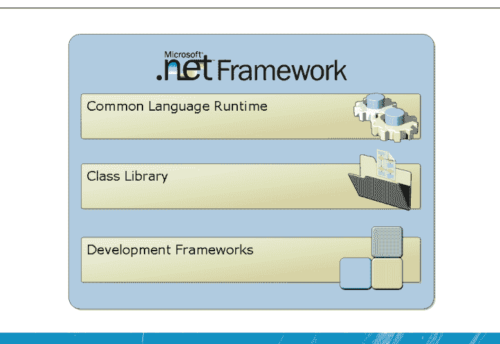

#### 关键点

.NET Framework 4 提供了一个全面的开发平台，为构建应用程序和服务提供了一种快速且高效的方法。使用 Visual Studio 2010，开发者可以利用 .NET Framework 4 创建跨越广泛计算设备的各种解决方案。

.NET Framework 4 提供了三个主要元素：CLR、.NET Framework 类库以及一组开发框架。

### 通用语言运行时 (CLR)

.NET Framework 4 提供了一个名为 CLR 的环境。CLR 管理代码的执行，并通过提供一个健壮且安全的执行环境来简化开发过程，该环境提供了内存管理、事务、进程间通信、多线程等许多其他常用服务。

### .NET Framework 类库

.NET Framework 4 提供了一个可重用类的库，开发者可以使用这些类来构建应用程序。这些类提供了常用功能和结构的基础，有助于简化应用程序开发，并消除了开发者不断重复发明逻辑的需求。例如，`System.File` 类包含了允许开发者操作 Windows 文件系统上文件的功能。除了使用 .NET Framework 类库中的类外，您还可以通过创建自己的类库来扩展这些类。

### 开发框架

.NET Framework 4 提供了几种开发框架，您可以使用它们构建常见类型的应用程序。这些框架提供了所需的组件和基础设施来帮助您开始工作。开发框架包括：

- ASP.NET：让您能够构建服务端 Web 应用程序。
- WPF：让您能够构建丰富的客户端应用程序。
- Windows Communication Foundation (WCF)：让您能够构建安全且可靠的面向服务的应用程序。
- Windows Workflow Foundation (WF)：让您能够构建工作流解决方案以满足现代组织的复杂业务需求。

问题：.NET Framework 4 的用途是什么？它提供的三个组件是什么？

#### 额外阅读

有关 .NET Framework 的更多信息，请参阅 Microsoft .NET 页面：http://go.microsoft.com/fwlink/?LinkId=192876。

### Visual C# 的用途

| C# |
| :--- |
| C# 是许多构建 .NET Framework 应用程序的开发者的首选语言 |
| C# 的语法与 C、C++ 和 Java 非常相似 |
| C# 已标准化，并由 ECMA-334 C# 语言规范进行描述 |

#### 关键点

CLR 运行由编译器生成的可执行代码。您可以使用任何能够生成 CLR 识别的格式的可执行代码的语言来为 .NET Framework 构建应用程序。Visual Studio 2010 为 C++、Visual Basic、F# 和 C# 提供了编译器。其他语言的编译器可以从各种第三方处获得。

C# 是许多开发者的首选语言。它使用的语法与 C、C++ 和 Java 非常相似，并具有几个为与 .NET Framework 协作设计的扩展和功能。由于其渊源，许多熟悉其他编程语言的开发者发现 C# 很容易学习并且可以快速上手。

C# 语言已标准化，并由 ECMA-334 C# 语言规范进行描述。除了微软之外，其他供应商也生产 C# 编译器。微软的实现被称为 Visual C# 并集成在 Visual Studio 中。Visual Studio 通过功能全的代码编辑器、编译器、项目模板、设计器、代码向导、强大且易用的调试器和其他工具支持 Visual C#。微软还以 Visual C# Express 版提供 C#，它提供了 Visual Studio 中的部分功能。

> **注意：** C# 是一门不断演变的语言。Visual C# 2010 使用 C# 4.0，它包含了 C# 语言的几个扩展，这些扩展尚未成为 ECMA 标准。

**问题：** 你使用过哪些编程语言？

#### 额外阅读

有关 Visual C# 2010 的微软实现的更多信息，请参阅 Visual C# 页面：http://go.microsoft.com/fwlink/?LinkId=192877。

有关 C# 4.0 新特性的更多信息，请参阅 Visual C# 2010 新功能页面：http://go.microsoft.com/fwlink/?LinkId=192878。

#### 什么是程序集（Assembly）？

| .NET Framework 应用程序的构建块 |
| :--- |
| 形成一个逻辑功能单元的类型和资源集合 |

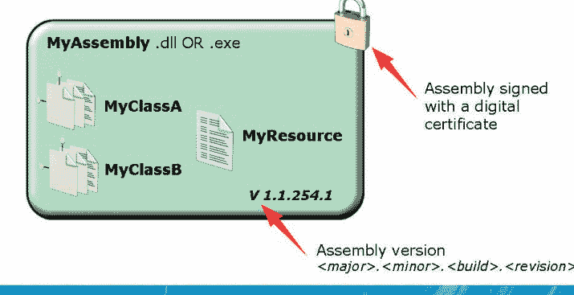

#### 关键点

CLR 运行由编译器生成的可执行代码。您可以使用任何能够生成 CLR 识别的格式的可执行代码的语言来为 .NET Framework 构建应用程序。Visual Studio 2010 为 C++、Visual Basic、F# 和 C# 提供了编译器。其他语言的编译器可以从各种第三方处获得。

程序集是 .NET Framework 应用程序的构建基石；它们构成了部署、版本控制和安全的基本单元。您可以将程序集视为一组共同工作并形成逻辑功能单元的类型和资源。程序集为 CLR 提供了类型实现所需的信息。

程序集可以是两种类型：可执行程序，或包含其他程序可以调用的执行代码的库。通过使用库，开发者可以将应用程序开发模块化。

通常，当您将程序集作为应用程序发布给客户时，您会希望程序集包含版本信息，并且程序集已签名。

程序集的版本化很重要，因为最终您构建的任何应用程序都有版本。版本信息可以帮助您识别客户拥有哪些版本，并允许您执行必要的升级步骤。同样，版本信息在记录和修复错误方面也有帮助。

程序集签名同样重要，因为它确保您的程序集不会被轻易修改或被恶意来源的替代实现所替换，并且为程序集提供了强名称。

问题：为什么你选择分发集而不是分发源代码？

### 扩展阅读

有关程序集的目的和特性的更多信息，请参阅通用语言运行时中的集（Assemblies in the Common Language Runtime）页面：http://go.microsoft.com/fwlink/?LinkId=192879。

有关程序集版本更多信息，请参阅程序集版本（Assembly Versioning）页面：http://go.microsoft.com/fwlink/?LinkId=192880。

有关程序集签名更多信息，请参阅 SignTool.exe（签名工具）页面：http://go.microsoft.com/fwlink/?LinkId=192881。

#### 通用语言运行时如何加载、编译和运行程序集

集包含 MSIL 代码，该代码实际上是不可执行的

CLR 从程序集中加载 MSIL 代码并将其转换为计算机所需的机器码

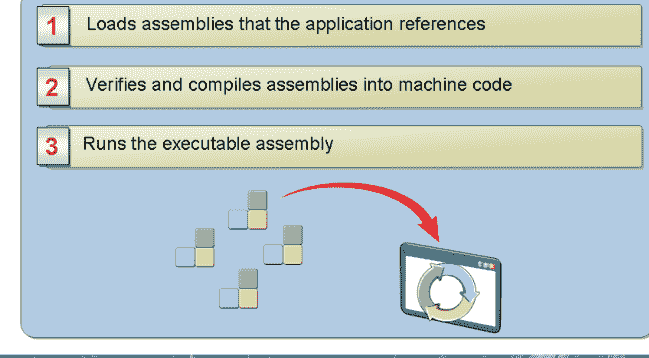

#### 关键点

集包含 MSIL 代码，该代码不是可执行的。当你运行 .NET Framework 应用时，CLR 从程序集中加载 MSIL 代码并将其转换为计算机所需的机器码。

CLR 是 .NET Framework 的核心组件。它处理代码执行并为应用程序开发提供有用的服务。当你运行 .NET Framework 应用时，CLR 包含执行以下任务的几个组件：

1. 类加载器（Class Loader）定位并加载应用程序所需的所有程序集。这些程序集已经过编译为 MSIL。
2. MSIL 到本地代码的编译器（MSIL-to-native compiler）验证 MSIL 代码，然后将所有程序集编译为准备好执行的机器码。

> 注意：CLR 执行验证步骤是因为由于你可能会编写自己的 MSIL 代码。如果你使用 C# 编译器，MSIL 代码将是有效的，但 CLR 无法做出任何假设。

3. 代码管理器（Code Manager）加载可执行程序集并运行 `Main` 方法。
4. 垃圾回收器（Garbage Collector）为你的应用程序创建的所有对象提供自动的生命周期内存管理。垃圾回收器会释放应用程序不再使用的任何对象。
5. 异常管理器（Exception Manager）为 .NET 应用程序提供结构化异常处理，该处理与 Windows 结构化异常处理集成。

**问题**：当你运行应用程序时，CLR 执行哪些步骤？

#### .NET Framework 提供了哪些工具？

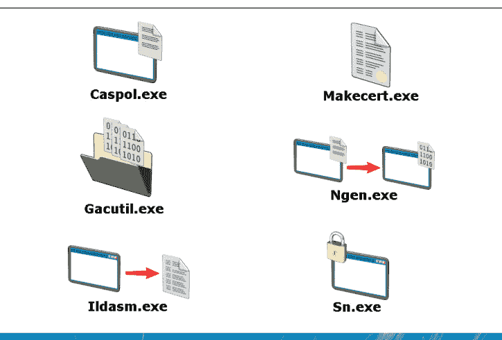

#### 关键点

.NET Framework 提供了多个工具来帮助简化 .NET 应用程序的。下表描述了一些关键工具。

| 工具 | 描述 |
|---|---|
| 代码访问安全策略工具 (`Caspol.exe`) | 允许用户修改机器、用户和企业安全策略。这可以包括定义自定义权限集并将程序集添加到完全信任列表中。 |
| 证书创建工具 (`Makecert.exe`) | 允许用户为其开发环境创建用于 x.509 证书。通常情况下，你可以使用这些证书对你的程序集进行签名并定义安全套接层 (SSL) 连接。 |
| 全局程序集缓存工具 (`Gacutil.exe`) | 允许用户操作 GAC 中的程序集。这包括在 GAC 中安装和卸载程序集，以便多个应用程序可以访问它们。 |

### 介绍 C# 和 .NET Framework 1-15

| 工具 | 描述 |
|---|---|
| 原生映像生成器 (`Ngen.exe`) | 允许用户提高 .NET 应用程序的性能。原生映像生成器通过将程序集预编译为包含特定机器码的映像来提高性能。CLR 然后可以运行预编译的映像，而不是仅使用即时编译 (JIT) 编译。或者，如果你使用 JIT 编译，你的代码将在执行之前进行编译。 |
| MSIL 反汇编器 (`Ildasm.exe`) | 允许用户操作程序集，例如确定程序集是否为托管，或反汇编程序集以查看编译后的 MSIL 代码。 |
| 强名称工具 (`Sn.exe`) | 允许用户使用强名称对程序集进行签名。强名称工具包括创建新密钥对、从密钥对中提取公钥以及验证程序集的命令。 |

**问题**：你创建了两个都使用名为 `Contoso.ReportGenerator.dll` 程序集的应用程序。这两个应用程序都将在同一台机器上运行。共享 `Contoso.ReportGenerator.dll` 程序集的最佳方法是什么，你会使用哪种工具？

### 扩展阅读

有关 .NET Framework 提供的工具的更多信息，请参阅 .NET Framework 工具页面：http://go.microsoft.com/fwlink/?LinkId=192882。

### 第 2 课

在 Visual Studio 2010 中创建项目

- Visual Studio 2010 的关键功能
- Visual Studio 2010 中的模板
- Visual Studio 项目和解决方案的结构
- 创建 .NET Framework 应用
- 构建和运行 .NET Framework 应用
- 演示：创建一个程序集

本节向你介绍 Visual Studio 2010 并描述它如何通过使用应用程序模板和功能简化开发。

### 目标

完成本节后，你能够：

- 描述 Visual Studio 2010 提供的功能。
- 描述 Visual Studio 2010 支持的各种项目类型。
- 描述 Visual Studio 解决方案中的主要文件。
- 解释如何使用 Visual Studio 中的模板创建控制台应用程序。
- 使用 Visual Studio 编译并运行应用程序。

### Visual Studio 2010 的关键功能

> Visual Studio 2010：

直观的 IDE，允许开发者使用所选语言快速构建应用程序

- Visual Studio 2010 的功能：
  - 快速应用程序开发
  - 服务器数据访问
  - 调试功能
  - 异常处理
  - 文档

#### 关键点

Visual Studio 2010 提供了一个单一开发环境，允许你使用各种编程语言设计、实现、测试和部署各种类型的应用程序和组件。Visual Studio 2010 的一些关键功能是：

- 直观的集成开发环境。Visual Studio 2010 提供了设计、实现、测试和部署应用程序所需的所有功能和工具。
- 快速应用程序开发。Visual Studio 2010 为图形组件提供了设计视图，让你能够轻松构建界面。或者，你可以使用更多控制的代码视图。Visual Studio 2010 还提供了帮助加速开发的向导。

### 介绍 C# 和 .NET Framework

- 服务器数据访问。Visual Studio 2010 提供了服务器资源管理器（Server Explorer），允许你登录服务器并探索其数据库和服务。它为你的应用程序提供了一种熟悉的创建、访问和修改数据库的方法。
- 调试功能。Visual Studio 2010 提供了调试器，允许你逐步执行本地或远程代码、在断点暂停并跟踪执行路径。
- 异常处理。Visual Studio 2010 提供了错误列表窗口，显示你在编辑和生成期间产生的任何错误、警告或消息。
- 文档。Visual Studio 2010 还通过 Microsoft IntelliSense®、代码片段和集成帮助系统提供帮助和指导。

**问题**：你选择 Visual Studio 2010 而不是像 Notepad++ 这样的编辑器的主要原因有哪些？

### Visual Studio 2010 中的模板

| | |
|---|---|
| 控制台应用程序 | C:/ |
| WPF 应用程序 | |
| 类库 | |
| Windows Forms 应用程序 | |
| ASP.NET 应用程序 | |
| ASP.NET MVC 2 应用程序 | |
| Silverlight 应用程序 | |
| WCF 服务应用程序 | |

#### 关键点

Visual Studio 2010 支持开发不同类型的应用程序，如 Windows 客户端应用程序、Web 应用程序、和服务库。为了帮助你开始，Visual Studio 2010 提供了多个应用程序模板，为不同类型的应用程序提供结构。

- 提供基础代码，你可以在此基础上快速创建运行的应用程序。
- 包含与项目类型相关的组件和控件。
- 根据你正在开发的应用程序类型配置 Visual Studio 2010 IDE。
- 添加此类类型应用程序通常所需的初始程序集引用。

### 模板类型

下表描述了在使用 Visual Studio 2010 开发 .NET Framework 应用程序时的一些常用应用模板。

| 模板 | 描述 |
| --- | --- |
| 控制台应用程序 (Console Application) | 提供环境设置、工具、项目引用和启动代码，用于开发在命令行界面中运行的应用程序。与 Windows Forms 应用程序模板相比，此类应用程序被认为是轻量级的，没有图形化用户界面 |
| WPF 应用程序 (WPF Application) | 提供环境设置、工具、项目引用和启动代码，用于构建丰富的 Windows 应用程序。WPF 应用程序允许您创建下一代 Windows 应用程序，对界面设计设计 |


| 类库（Class Library） | 提供环境设置、工具和启动代码，用于构建 `.dll` 程序集。你可以使用此类文件存储可能想要从许多其他应用程序中调用的功能 |

| Windows Forms 应用程序（Windows Forms Application） | 提供环境设置、工具、项目引用和启动代码，用于构建图形化的 Windows Forms 应用程序 |

| ASP.NET Web 应用程序（ASP.NET Web Application） | 提供环境设置、工具、项目引用和启动代码，用于创建服务器端的编译 ASP.NET Web 应用程序 |

| ASP.NET MVC 2 应用程序（ASP.NET MVC 2 Application） | 提供环境设置、工具、项目引用和启动代码，用于创建模型视图-控制器（MVC）Web 应用程序。ASP.NET MVC Web 应用程序与标准 ASP.NET Web 应用程序的区别在于，应用程序架构帮助您分离表示层、业务逻辑层和数据访问层 |

| Silverlight 应用程序（Silverlight Application） | 提供环境设置、工具、项目引用和启动代码，用于构建丰富的图形 Web 应用程序 |

| WCF 服务应用程序（WCF Service Application） | 提供环境设置、工具、项目引用和启动代码，用于构建面向服务的架构（SOA）服务 |

**问题：** 对于以下每一项，你会使用哪些项目模板：

- 运行在基于 Windows 的计算机上的客户端应用程序。

- 你想在其他应用程序中使用的功能库。

- 你将托管在 Internet 信息服务（IIS）Web 服务器上的网站。

### Visual Studio 项目和解决方案的结构

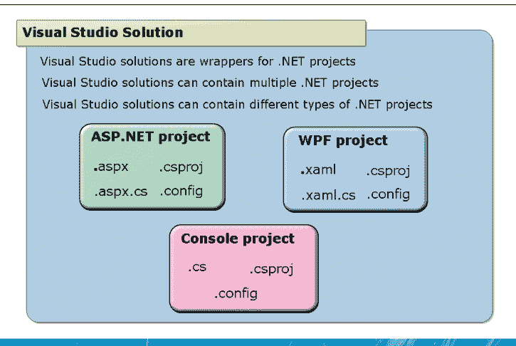

#### 关键点

Visual Studio 2010 使用解决方案和项目作为概念容器，在开发过程中组织您的源文件。对源文件进行分类可以简化 .NET Framework 应用程序的生成和部署过程。

### Visual Studio 项目

项目用于组织源文件、引用和项目级配置设置，这些共同构成了一个 .NET Framework 应用程序或库。当你在 Visual Studio 中创建项目时，项目会自动组织到解决方案中。

下表描述了你在 Visual Studio 项目中常见的某些文件类型。

### 1-24 使用 Microsoft® Visual Studio® 2010 进行 C# 编程

| 文件名 | 描述 |

| --- | --- |

| `.cs` | 可以属于单个项目解决方案的代码文件。此类文件可以代表以下任何内容：\n* 模块\n* Windows Forms 文件\n* 类文件 |

| `.csproj` | 可以属于多个项目解决方案的项目文件。`.csproj` 文件还存储了项目的设置，例如生成输出的路径和目标平台。 |

| `.aspx` | 代表 ASP.NET 页面的文件。ASP.NET 文件可以包含您的 Visual C# 代码，或者您可以使用随附的 `.aspx.cs` 文件来存储页面标记之外的代码。 |

| `.config` | 配置文件是基于 XML 的文件，你可以用它来存储应用程序级设置（例如数据库连接字符串），你可以在不重新编译应用程序的情况下修改它们。 |

| `.xaml` | XAML 文件用于 WPF 和 Microsoft Silverlight® 应用程序中定义用户界面元素。 |

### Visual Studio 解决方案

单个 Visual Studio 解决方案是一个或多个项目的容器。默认情况下，当你创建一个新项目时，Visual Studio 会自动为该项目创建一个解决方案。你可以向解决方案添加其他项目。这非常有用，例如，你正在构建一个库程序集和一个测试该库的应用程序。你可以作为解决方案的一部分对两个项目进行生成和编译，而无需运行多个 Visual Studio。

解决方案还可以包含解决方案中任何项目都可以使用的项目无关项。例如，ASP.NET 解决方案可以包含单个级联样式表（`.css`）文件，为包含的 ASP.NET 项目提供标准的样式。

将多个项目分类到单个 Visual Studio 解决方案中具有以下优势：

- 它允许你在单个 Visual Studio 2010 会话中处理多个项目。

- 它允许你对多个项目全局应用配置设置。

- 它允许你在单个解决方案中部署多个项目。

下表描述了解决方案定义文件。

| 文件名 | 描述 |

| --- | --- |

| `.sln` | Visual Studio 2010 解决方案文件，提供对多个项目、项目项和解决方案项的单一访问点。`.sln` 文件是标准文本文件 |

| `.suo` | 解决方案选项文件，存储你在 Visual Studio 中更改的设置 |

**问题：** 在 Visual Studio 中 `.sln` 文件扮演了什么角色？

### 创建 .NET 应用程序

| 步骤 | 指令 |

| --- | --- |

| 1 | 打开 Visual Studio 2010 |

| 2 | 在文件菜单上，点击新建，然后点击项目 |

| 3 | 在新建项目对话框中，指定以下设置并点击确定：\n- 项目模板\n- 项目名称\n- 位置 |

| 编程辅助功能包括： |

| --- | |

| IntelliSense | |

| 代码片段 | |

#### 关键点

Visual Studio 2010 提供的模板允许你以最小努力创建应用程序。你可以根据需要插入并修改这些代码。

以下步骤描述了如何使用控制台模板创建控制台应用程序：

1. 打开 Visual Studio 2010。

2. 在文件菜单上，指向新建，然后点击项目。

3. 在新建项目对话框中，指定以下设置：

   a. 在安装模板列表中，点击 C#。

   b. 在中间面板中，点击控制台应用程序。

   c. 在名称框中，为项目指定名称。

   d. 在位置框中，指定你想保存项目的路径。

### 编程辅助功能

Visual Studio 2010 提供了许多可以帮助你编写代码的功能。在编写代码时，开发者需要有关程序元素的信息。与其通过搜索帮助文件或其他源代码查找信息，Visual Studio 中的 IntelliSense 直接提供开发者所需的信息。IntelliSense 提供以下功能：

- 快速信息：快速信息选项显示代码中任何标识符的声明。将鼠标悬停在标识符上即可显示该标识符的快速信息，它显示在黄色弹出框中。

- 完成单词：完成单词选项在你输入字符以消除歧义后，输入变量、命令或函数名的剩余部分。输入名称的前几个字母，然后按 ALT+右箭头或 CTRL+空格键来完成单词。

通常，当你构建 .NET Framework 应用程序时，你需要在代码中重复常见的结构。例如，循环或处理异常的代码。代码片段的设计旨在减轻实现此类代码的负担，提供可以随时插入代码中并根据需要进行修改的模板代码模板。你可以通过代码片段选择器访问这些片段。

你可以使用代码片段管理器对话框来管理代码片段，该对话框位于工具菜单。代码片段管理器允许通过指定代码片段选择器查找的新文件夹来添加新代码片段；导入代码片段或在线搜索代码片段。代码片段管理器还用于发现与代码片段相关的快捷键序列。

最后，Visual Studio 2010 在右键单击代码语句时出现的快捷菜单上提供了许多其他功能。这些包括重构、组织、创建单元测试、转到定义、查找所有引用和大纲。这些功能将在后面的模块中进行详细介绍。

**问题：** 代码段的作用是什么？

### 构建并运行 .NET Framework

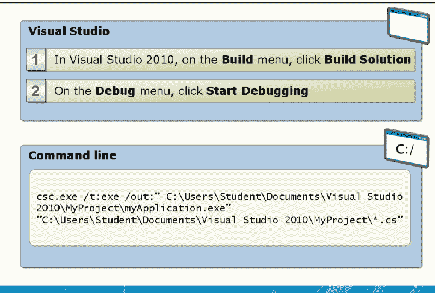

#### 关键点

Visual Studio 提供了一个集成环境，使你能够快速编译和运行应用程序。

如果你没有 Visual Studio，你也可以从命令行生成并运行应用程序。

以下步骤描述了如何生成和运行应用程序。

### 在 Visual Studio 2010 中生成并运行应用程序

以下步骤假设你已创建一个新的控制台应用程序。

1. 在 Visual Studio 2010 中，在“生成”（Build）菜单上，点击“生成解决方案”（Build Solution）。

2. 在“调试”（Debug）菜单上，点击“开始调试”（Start Debugging）。

### 从命令行生成应用程序

以下步骤假设你已创建一个名为 `MyProject` 的新控制台应用程序，它保存在 `C:\Users\Student\Documents\Visual Studio 2010\MyProject\` 文件夹中。

1. 点击“开始”，找到“所有程序”，点击“Microsoft Visual Studio 2010”，点击“Visual Studio 工具”，然后点击“Visual Studio 命令提示符 (2010)”。

2. 在 Visual Studio 命令提示符窗口中，输入以下代码示例中的文本，然后按回车。

3. 右键点击“开始”菜单，点击“打开 Windows 资源管理器”，然后移动 `C:\Users\Student\Documents\Visual Studio 2010\MyProject\`。

```
csc.exe /t:exe /out:"C:\Users\Student\Documents\Visual Studio 2010\MyProject\myApplication.exe" "C:\Users\Student\Documents\Visual Studio 2010\MyProject\*.cs"
```

`MyProject` 文件夹现在应该包含 `myApplication.exe` 程序集，你可以运行它。

**问题：** 描述两种生成和运行 .NET Framework 应用程序的方法。

### 演示：反汇编 .NET Framework 程序集

- 在此演示中，你将：

- 运行现有的 .NET Framework 应用程序

- 打开 `Ildasm`

- 反汇编现有的 .NET Framework 程序集

- 检查反汇编后的 .NET Framework 程序集

#### 关键点

- 运行现有的 .NET Framework 应用程序。

- 打开 `Ildasm`。

- 反汇编现有的 .NET Framework 程序集。

- 检查反汇编后的 .NET Framework 程序集。

### 演示步骤

1. 使用用户 `Student` 和密码 `Pa$$SWord` 登录到 `10266A-GEN-DEV` 虚拟机。

2. 在 `E:\Demofiles\Mod1\Demo1` 文件夹运行 `MyFirstApplication.exe`，并检查应用程序的输出。

3. 关闭 `MyFirstApplication.exe`。

4. 在 `C:\Program Files\Microsoft SDKs\Windows\v7.0A\bin` 文件夹运行 `ildasm.exe`。

5. 使用 `ildasm` 打开 `E:\Demofiles\Mod1\Demo1` 文件夹中的 `MyFirstApplication.exe`，然后检查 `MyFirstApplication` 程序集的内容。检查以下项：

   - 程序集清单（Manifest）中的公用密钥令牌和版本号。

   - `MyFirstApplication.Program` 节点中的构造函数和 `Main` 方法。

6. 关闭 `ildasm.exe`。

**问题：** 在开发 .NET Framework 应用程序时，你会如何发现 `ildasm` 有用？

### 第 3 节：编写 C# 应用程序

- 什么是类和命名空间？

- 控制台应用程序的结构

- 使用控制台应用程序执行输入输出

- C# 应用程序注释的最佳实践

本节描述了简单 C# 应用程序的结构，以及 C# 应用程序如何包含一个或多个类。本节描述了如何引用在其他程序集和库中定义的类的功能，以及如何使用 .NET Framework 类库中的 `Console` 类来执行简单的输入输出操作。最后，本节解释了你应该以及为什么要为你的应用程序添加注释。

### 目标

在完成本节后，你将能够：

- 描述 Visual C# 如何使用命名空间和类。

- 描述应用程序的结构。

- 使用 `Console` 类提供的方法执行输入和输出操作。

- 应用 Visual C# 应用程序注释的最佳实践。

### 什么是类和命名空间？

| 类本质上是一个定义实体特征的蓝图 |

| 命名空间表示类的逻辑集合 |

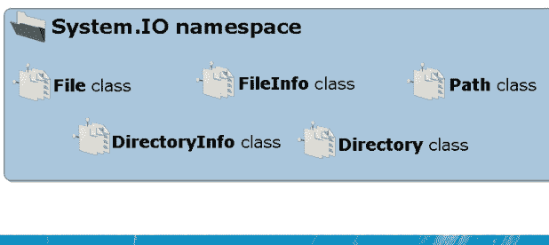

#### 关键点

Visual C# 是一种面向对象的语言，使用类和命名空间将 .NET Framework 应用程序模块化为逻辑组件。

类本质上是一个定义实体特征的蓝图，包含了定义对象可以包含的数据类型的属性，以及定义对象行为的方法。命名空间表示类的逻辑集合。类存储在程序集中，而命名空间仅仅是区分不同程序集中可能具有相同名称类的工具。

例如，`System.IO` 命名空间包含了以下类，让你能够操作 Windows 文件系统。然而，你可以在自己的命名空间下创建同名的类：

- `File`

- `FileInfo`

- `Directory`

- `DirectoryInfo`

- `Path`

要使用 .NET Framework 中定义的类，请执行以下任务：

1. 添加包含类编译代码的程序集的引用。

2. 将包含类的命名空间引入作用范围。

如果你正在编写 .NET Framework 应用程序向文件系统上的新文件写入文本，可以将 `System.IO` 命名空间引入作用范围，然后使用 `File` 类的 `WriteAllText` 方法。

要在 Visual C# 应用程序中将命名空间引入作用范围，可以使用 `using` 语句。以下代码示例显示了如何将 `System.IO` 和 `System.Collections` 命名空间引入作用范围。

```
using System;
using System.IO;
using System.Collections;
```

`using` 语句仅仅是为了方便，你可以没有它进行管理。例如，你可以使用 `System.Console` 而不是 `Console`。

**问题：** 在你的控制台应用程序中，你想使用 `System` 命名空间部分的 `Console` 类。你如何将 `System` 命名空间引入作用范围？

### 控制台应用程序的结构

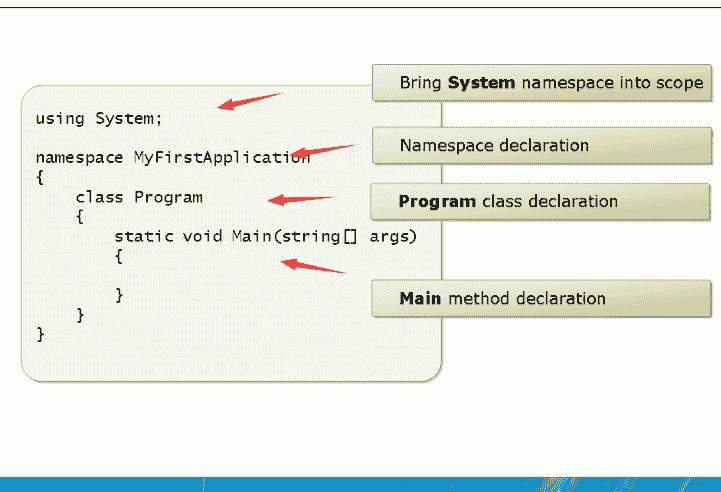

#### 关键点

当使用控制台应用程序模板创建新的控制台应用程序时，Visual Studio 2010 执行以下任务：

- 它创建一个新的 `.csproj` 文件来表示控制台项目，并结构化所有默认组件。

- 它添加对 .NET Framework 类库中控制台应用程序常用的程序集的引用。这组程序集包含了 `System` 程序集。

- 它创建一个带有 `Main` 方法的 `Program.cs` 文件，该方法提供了控制台应用程序的入口。

Visual Studio 2010 创建的 `Program.cs` 文件类似于下面的代码。

```
using System;

namespace MyFirstApplication
{
    class Program
    {
        static void Main(string[] args)
        {
        }
    }
}
```

下表描述了 `Program.cs` 中的代码项。

| 代码项 | 说明 |

| --- | --- |

| `using System;` | 将 `System` 命名空间引入作用范围。 |

| `namespace MyFirstApplication { ... }` | 定义一个名为 `MyFirstApplication` 的新命名空间。通常，在新项目中，这默认为项目名称。 |

| `class Program { ... }` | 定义一个名为 `Program` 的新内部类。 |

| `static void Main(string[] args) { ... }` | 定义一个返回类型为 `void` 的私有 `Main` 方法，接受一个字符串数组参数。 |

### 什么是 Main 方法？

每个编译成可执行文件的 .NET Framework 应用程序都必须有一个 `Main` 方法。该方法为 CLR 提供了应用程序的入口。当你运行 .NET Framework 应用程序时，`Main` 方法是 CLR 执行的第一个方法。

在开发 .NET Framework 应用程序时，保持 `Main` 方法的轻量级是一个良好的做法，让它仅作为入口，而不是应用程序中大部分逻辑的容器。

`Main` 方法具有以下显著特征：

- 它是私有的（`private`）。这意味着它对 `Program` 类之外的其他类是不可见的。

- 它使用 `static` 关键字，因此可以在创建 `Program` 类实例的情况下进行调用。

- 它使用 `void` 返回类型，因此它是一个不返回数据的方法。

- 它以字符串数组的形式接受数据。因此，当你运行控制台应用程序时，你提供的任何命令行参数将在 `args` 参数中可用。

**问题：** 在你的控制台应用程序中，你有一个名为 `Main` 方法。`Main` 方法的作用是什么？

### 延伸阅读

有关命令行参数的更多信息，请参见 `Main()` and Command-Line Arguments (C# Programming Guide) 页面，地址：`http://go.microsoft.com/fwlink/?LinkId=192889`。

### 使用控制台应用程序执行输入和输出

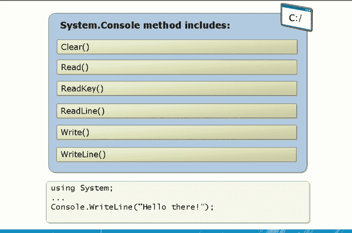

#### 关键点

`System` 命名空间提供了 `Console` 类，它包含几个方法，允许您为应用程序添加基本的控制台 I/O 功能，例如接受输入和显示数据。

下表描述了 `Console` 类提供的一些关键方法。

| 方法 | 说明 |

|---|---|


| `Clear()` | 清除控制台窗口和控制台缓冲区中的任何数据。下面的代码示例提供了该方法的示例。

```csharp
using System;
... Console.Clear(); // 清除控制台显示
``` |

| `Read()` | 从控制台窗口读取下一个字符。下面的代码示例提供了该方法的示例。

```csharp
using System;
...
int nextCharacter = Console.Read();
``` |

| `ReadKey()` | 从控制台窗口读取下一个字符或按键。下面的代码示例提供了该方法的示例。

```csharp
using System;
...
ConsoleKeyInfo key = Console.ReadKey();
``` |

| `ReadLine()` | 从控制台窗口读取下一行字符。下面的代码示例提供了该方法的示例。

```csharp
using System;
...
string line = Console.ReadLine();
``` |

| `Write()` | 将文本写入控制台窗口。下面的代码示例提供了该方法的示例。

```csharp
using System;
...
Console.Write("Hello there!");
``` |

| `WriteLine()` | 将文本写入控制台窗口并紧跟换行。下面的代码示例提供了该方法的示例。

```csharp
using System;
...
Console.WriteLine("Hello there!");
``` |

**问题：** 你将使用哪两个方法来完成以下操作：

- 在新行上显示消息“Please press any key”。
- 捕获用户按下的键。

### 进阶阅读

有关 `Console` 类的更多信息，请参阅 http://go.microsoft.com/fwlink/?LinkId=192883 上的 `Console` 类页面。

### C# 应用程序注释的最佳实践

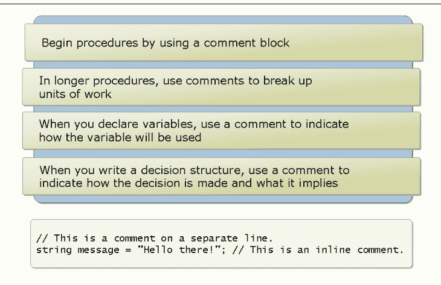

#### 关键点

良好的编程习惯是用简短的注释开始所有过程，该注释描述了该过程的功能特征。这不仅有利于你自己，也有利于其他检查代码的人员。

在 Visual C# 中，注释以两个斜杠（`//`）开始。注释可以紧跟在同一行的语句后面，也可以占据整行。接下来的代码示例说明了这两种情况。

```
// 这是一个单独成一行的注释。
string message = "Hello there!"; // 这是一个内联注释。
```

### 注释和取消注释工具按钮

您可以通过选择代码行并在文本编辑器工具栏上选择“注释”或“取消注释”按钮，为代码块添加或删除注释符号。

### 注释指南

随着代码变得越来越复杂，请使用注释使您的代码更具可读性且易于维护。您应该使用自然语言来解释一段代码的目的，特别是当目的可能显而易见或清晰时。

以下列表提供了一些关于何时应该注释代码的指南：

- 使用注释块开始过程。该块应包含过程目的、返回值、参数等信息。
- 在较长的过程中，使用注释拆分过程中的工作单元。
- 当声明变量时，使用注释指示该变量将如何被使用。
- 当编写决策结构时，使用注释指示如何做出决策以及其含义。

**问题：** 为什么对您的代码进行注释很重要？

### 第 4 节：构建图形应用程序

- 什么是 WPF？
- WPF 应用程序的结构
- WPF 控制库
- WPF 事件
- 构建简单的 WPF 应用程序
- 演示：构建简单的 WPF 应用程序

本节向您介绍具有图形用户界面的应用程序，并提供 WPF 应用程序的示例。

本节还将解释什么是 WPF、WPF 应用程序的结构以及您如何使用 Visual Studio 2010 创建自己的 WPF 应用程序。

### 目标

完成本节后，您将能够：

- 描述 WPF 的目的。
- 描述 WPF 应用程序的结构。
- 描述 WPF 控件以及如何设置控件属性。
- 事件的概念以及 WPF 控制如何使用事件。
- 说明如何使用 Visual Studio 2010 构建简单的 WPF 应用程序。

### 什么是 WPF？

| WPF 是一种用于构建基于 Windows 的应用程序的新基础，通过结合以下内容： | WPF 功能 |
|---|---|
| 媒体 | 客户端应用程序开发 |
| 文档 | 用户界面设计 |
| 图形用户界面 | 使用 XAML |
| | 与旧应用程序的兼容性 |

#### 关键点

Windows Presentation Foundation 是一种通过结合以下内容构建 Windows 应用程序的新基础：它提供了创建视觉震撼体验的基础。

当您使用 WPF 模板创建 WPF 应用程序时，它执行以下任务：

- 创建一个新的 `.csproj` 文件来表示 WPF 项目。
- 添加必要的程序集，包括 `PresentationCore`、`PresentationFramework`、`System`、`System.Core` 和 `System.Xaml`。
- 创建 `App.xaml` 标记文件和 `App.xaml.cs` 代码文件，可以使用它定义应用程序级资源。
- 创建 `MainWindow.xaml` 标记文件和 `MainWindow.xaml.cs` 代码文件，您将其作为构建第一个窗口的起点。

**问题：** 为什么使用 WPF 来创建应用程序很重要？

### 进阶阅读

有关什么是 WPF 的更多信息，请参阅 Introduction to WPF 页面。

### XAML 应用程序的结构

```
标记文件
<Window x:Class="WpfApplication1.MainWindow" xmlns="http://schemas.microsoft.com/winfx/2006/xaml/presentation"
             xmlns:x="http://schemas.microsoft.com/winfx/2006/xaml"
             Title="MainWindow" Height="350" Width="525">
    <Grid>
    </Grid>
</Window>
```

```
代码文件
```csharp

namespace WpfApplication1

{

    public partial class MainWindow : Window

    {

        public MainWindow()

        {

            InitializeComponent();

        }

    }

}

```

#### 关键点

Windows Presentation Foundation 是一种用于创建应用程序的统一图形子系统，它提供了创建视觉震撼体验的基础。

Windows Presentation Foundation 的功能包括：

- 客户端应用程序开发：广泛支持。
- 用户界面设计：易于设计。
- 使用 XAML：允许声明式使用，比过程化代码更易于实现。
- 与旧应用程序的兼容性：XAML 允许在应用程序中使用它。

**问题：** 为什么你会选择使用 XAML 来创建应用程序？

### WPF 控件库

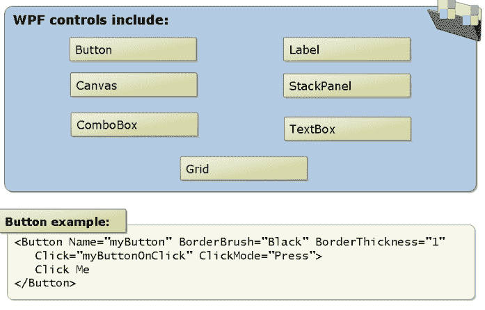

#### 关键点

WPF 包含了丰富的控件库，你可以用它构建 WPF 应用程序。库中包含的控件是常用的用户界面组件，你通常可以在每个 Windows 应用程序中找到它们，例如按钮和文本框。你也可以定义自定义控件。

### WPF 常用控件

下表描述了 WPF 控件库中一些常用的控件。它还为每个控件提供了一个简单的 XAML 示例，显示了你可以在设计时设置的属性。

| 控件 | 描述 | XAML 示例 |
| --- | --- | --- |
| `Button` | `Button` 控件代表典型的点击按钮，你可以在大多数 Windows 应用程序中找到它。 | `<Button Name="myButton" BorderBrush="Black" BorderThickness="1" Click="myButtonOnClick" ClickMode="Press">点击我</Button>` |
| `Canvas` | `Canvas` 控件代表一个布局面板，允许你绝对定位子控件。 | `<Canvas Background="Black" Height="200" Width="200"><!-- 子控件 --></Canvas>` |
| `ComboBox` | `ComboBox` 控件代表一个下拉列表，用户可以滚动列表并从中选择。 | `<ComboBox Name="myComboBox"><ComboBoxItem>a</ComboBoxItem><ComboBoxItem>b</ComboBoxItem></ComboBox>` |
| `Grid` | `Grid` 控件代表一个灵活的表格，可以包含多列多行。你通常使用 `Grid` 控件来定位子控件。 | `<Grid ShowGridLines="True" Width="200" Height="200"><Grid.ColumnDefinitions><ColumnDefinition /><ColumnDefinition /></Grid.ColumnDefinitions><Grid.RowDefinitions><RowDefinition /><!-- 子控件 --></Grid.RowDefinitions></Grid>` |
| `Label` | `Label` 控件代表只读文本块，你可以用它显示静态文本。 | `<Label Name="myLabel">你好</Label>` |
| `StackPanel` | `StackPanel` 控件允许你水平或垂直堆叠控件。 | `<StackPanel Name="myStackPanel" Orientation="Vertical"><Label>项目 1</Label><Label>项目 2</Label><Label>项目 3</Label></StackPanel>` |
| `TextBox` | `TextBox` 控件代表可编辑字段，你可以用它显示和捕获文本。 | `<TextBox Name="myTextBox"></TextBox>` |

注意，你还可以通过在代码后文件中使用 Visual C# 动态定义控件。

### WPF 控件属性

WPF 中的每个控件都有一组关联的属性，你可以使用这些属性来定义控件的外观和行为。例如，大多数控件都有 `Height` 属性和 `Width` 属性来指定控件的尺寸，以及 `Margin` 属性表示控件相对于其包含的布局控件的位置。

你可以设置控件属性：

- 在 XAML 窗口中通过直接编辑 XAML 进行声明式设置。
- 在属性（Properties）窗口中。这种方法会代表你修改控件的 XAML 定义。
- 在运行时通过使用 C# 代码。这种方法不会更改任何控件的 XAML 定义。

**问题：** 你正在构建一个简单的表单来获取用户凭据并允许用户登录。你可以使用哪些控件来构建此表单？

### 扩展阅读

有关 WPF 控件库中控件的更多信息，请参阅 http://go.microsoft.com/fwlink/?LinkId=192886 控件库页面。

以下代码示例显示了带有 `Click` 事件处理程序的 `Button` 控件的 XAML 标记，以及定义事件处理程序的 C# 代码。当用户点击按钮时，将调用 `myButton_Click` 方法。`myButton_Click` 方法的参数由 WPF 定义并在运行时填充有关按钮和事件的信息。

```xml
[XAML 控件声明]
<Button Name="myButton" Click="myButton_Click">点击我</Button>
```

```csharp
[Visual C# 事件程序]
private void myButton_Click(object sender, RoutedEventArgs e)
{
    // 事件处理代码
}
```

以下代码示例显示了你如何为 `Window` 控件定义关闭事件处理程序。

```xml
[XAML 控件声明]
<Window x:Class="WpfApplication.MainWindow" Name="myWindow"
xmlns="..."
xmlns:x="..."
Title="MainWindow" Height="350" Width="525"
Closing="myWindow_Closing">
</Window>
```

```csharp
[Visual C# 事件程序]
private void myWindow_Closing(object sender,
System.ComponentModel.CancelEventArgs e)
{
    // 在此处执行某些操作的代码。
}
```

**问题：** 在开发 WPF 应用时，你可以使用哪两种方法为控件指定事件？

### 构建一个简单的 WPF 应用程序

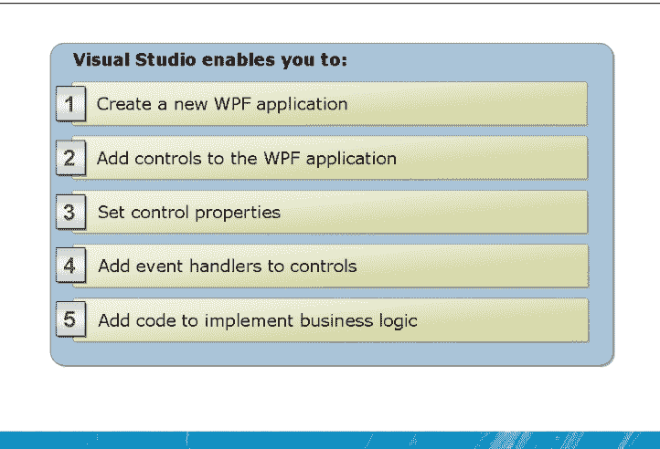

#### 关键点

你可以在 Visual Studio 2010 中使用 WPF Application 模板创建 WPF 应用程序。

### 创建新的 WPF 应用程序

- 在 Visual Studio 2010 中，点击新建（New）。
- 在 Visual Studio 2010 中，创建一个具有以下特征的项目：
    - 类型：WPF Application
    - 名称：MyFirstWpfApp
    - 位置：E:\Demofiles\Mod1\Demo2\Starter
- 在项目（Project）窗口中，点击确定。

### 向应用程序添加控件

- 使用工具箱（Toolbox）向应用程序添加一个按钮控件。

### 设置属性

- 使用属性（Properties）窗口设置按钮控件的属性：
    - FontSize：20
    - Height：50
    - Width：150
- 使用 XAML 窗口执行以下操作：
    - 在 `Button` 元素中，将 `Content` 属性设置为 `Click Me`。
    - 在 `Window` 元素中，将 `Height` 属性设置为 150。
    - 在 `Window` 元素中，将 `Width` 属性设置为 190。

### 向控件添加事件处理程序

- 使用属性（Properties）窗口中的事件（Events）选项卡为控件生成 `Click` 事件处理程序。

### 向应用程序添加代码

- 在解决方案管理器（Solution Explorer）中，右键点击 XAML 文件，然后查看代码（View Code）。

**问题：** 在构建应用程序时，你通常使用 Visual Studio 2010 中的哪些窗口？

### 演示：构建一个简单的 WPF 应用程序

在此演示中，你将：

- 创建一个 WPF 应用程序
- 向应用程序添加控件
- 设置控件的属性
- 向应用程序添加代码
- 构建并运行应用程序

#### 关键点

- 创建一个 WPF 应用程序。
- 向应用程序添加控件。
- 设置控件的属性。
- 向应用程序添加代码。
- 构建并运行应用程序。

### 演示步骤

1. 打开 Visual Studio 2010。
2. 在 Visual Studio 2010 中，创建一个具有以下特征的项目：
    - 类型：WPF Application
    - 名称：MyFirstWpfApp
    - 位置：E:\Demofiles\Mod1\Demo2\Starter
3. 使用工具箱（Toolbox）向应用程序添加一个按钮控件。
4. 检查 Visual Studio 2010 生成的 XAML 标记。
5. 使用属性（Properties）窗口设置按钮控件的属性：
    - FontSize：20
    - Height：50
    - Width：150
6. 使用 XAML 窗口执行以下操作：
    - 在 `Button` 元素中，将 `Content` 属性设置为 `Click Me`。
    - 在 `Window` 元素中，将 `Height` 属性设置为 150。
    - 在 `Window` 元素中，将 `Width` 属性设置为 190。
7. 使用属性（Properties）窗口中的事件（Events）选项卡为控件生成 `Click` 事件处理程序。
8. 打开 `MainWindow.cs` 文件，并在 `ClickMeButton_Click` 方法中添加以下代码：

```csharp
private void ClickMeButton_Click(object sender, RoutedEventArgs e)
{
    MessageBox.Show("You clicked me!!");
}
```


9. 构建并运行应用程序。

**问题：** 在 Visual Studio 2010 中开发 WPF 应用时，你可以使用哪两种主要方法来设置 WPF 控件的属性？

### 第 5 Lesson

### 为应用程序编写文档

- 什么是 XML 注释？
- 常见的 XML 注释标签
- 从 XML 注释生成文档

本节介绍了 XML 注释，并解释了当你在开发 .NET 应用程序时可以如何使用它们。本节还展示了如何使用 Sandcastle 工具构建格式化的帮助文件。

### 目标

完成本节后，你将能够：

- 描述什么是 XML 注释，以及你如何在 .NET 应用程序中使用它们。
- 描述一些常用的 XML 注释标签。
- 解释如何生成 XML 文档文件，以及如何使用 Sandcastle 通过该 XML 文档文件生成格式化的帮助文件。

### 什么是 XML 注释？

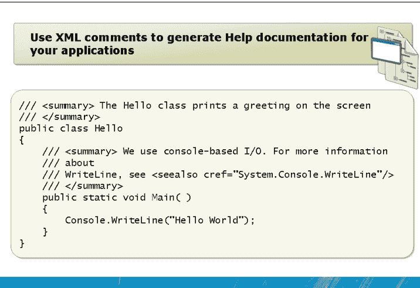

```assembly
/// <summary> The Hello class prints a greeting on the screen
/// </summary>
public class Hello {
    /// <summary> We use console-based I/O. For more information
    /// about
    /// WriteLine, see <seealso cref="System.Console.WriteLine"/>
    /// </summary>
    public static void Main() {
        Console.WriteLine("Hello World");
    }
}
```

#### 关键点

在 Visual Studio 2010 中，你可以向源代码中添加注释，这些注释将被处理为 XML 文件。该文件随后可以作为为代码中的类创建帮助文档过程的输入。你还可以使用 XML 文件来支持你组件的 IntelliSense（智能感应）。

内联注释是 Visual C# 标准的一部分，而 XML 注释是微软的一个扩展，通常由如 Sandcastle Help File Builder 等第三方工具使用。

### XML 文档注释

Visual C# 中的文档注释以三个斜杠（`///`）开头，随后紧跟一个 XML 文档标签。

在接下来的代码示例中，`Hello` 类包含了 `<summary>` 和 `<seealso>` 文档标签。

```assembly
/// <summary> The Hello class prints a greeting on the screen
/// </summary>
public class Hello
{
    /// <summary> We use console-based I/O. For more information about
    /// WriteLine, see <seealso cref="System.Console.WriteLine()"
    /// </summary>
    public static void Main()
    {
        Console.WriteLine("Hello World");
    }
}
```

**问题**：为什么要使用 XML 注释而不是标准注释？

#### 额外阅读

有关 XML 注释的更多信息，请参阅 [XML Documentation Comments (C# Programming Guide)] 页面：http://go.microsoft.com/fwlink/?LinkId=192887。

### 常见的 XML 注释标签

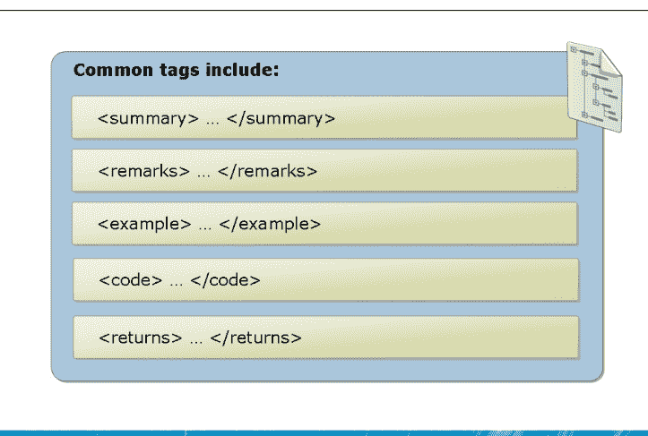

#### 关键点

有几个建议使用的 XML 标签供你选择。你也可以创建自己的自定义标签。下表显示了一些 XML 标签及其用途。

| 标签 | 用途 |
|---|---|
| `<summary> ... </summary>` | 提供简短描述。使用 `<remarks>` 标签提供更长的描述。 |
| `<remarks> ... </remarks>` | 提供详细描述。该标签可以包含嵌套的段落、列表和其他类型的标签。 |
| `<example> ... </example>` | 提供如何使用方法、属性或其他库成员的示例。它通常涉及嵌套的 `<code>` 标签的使用。 |
| `<code> ... </code>` | 表示所包含的文本是应用程序代码。 |
| `<returns> ... </returns>` | 对方法的返回值和返回类型进行文档说明。 |

**问题**：你会使用哪个标签来为方法提供详细描述？

#### 额外阅读

有关 XML 注释标签的更多信息，请参阅 [Recommended Tags for Documentation Comments (C# Programming Guide)] 页面：http://go.microsoft.com/fwlink/?LinkId=192888。

### 从 XML 注释生成文档

| 使用 Visual Studio 2010 生成 XML 文件 |
| 从 csc.exe 生成 XML 文件 |
| `<?xml version="1.0"?>` |
| `<doc>
  <assembly><name>MyProject</name></assembly>
  <members>
    <member name="T:Hello">
    <summary>The Hello class prints a greeting on the screen</summary>
  </member>
    <member name="M:Hello.Main">
    </member>
  </members>
</doc>` |
| 在 Sandcastle Help File Builder 中使用 XML 文件 |

#### 关键点

你可以通过在项目的属性窗口中选择“XML 文档文件”复选框，或者在构建带有 XML 注释的应用程序时使用 `/doc` 命令行开关，将 XML 标签和文档编译为 XML 文件。

如果没有错误，你可以使用 Windows 管理器® 等应用程序查看生成的 XML 文件，并可以使用 Sandcastle 等工具生成帮助文件。

> 注意：Sandcastle 不作为 Visual Studio 的一部分提供，但它可以从 CodePlex 网站单独下载。

- 使用 Visual Studio 2010 生成 XML 文件
1. 在“解决方案管理器”中，右键点击项目，然后点击“属性”。
2. 在“属性”窗口中，选择“生成”选项卡，勾选“XML 文档文件”复选框。

### 使用 csc.exe 生成 XML 文件

- 点击“开始”，指向“所有程序”，点击“Microsoft Visual Studio 2010”，点击“Visual Studio 工具”，然后点击“Visual Studio 命令提示符 (2010)”。
- 在“Visual Studio 命令提示符 (2010)”窗口中，输入以下代码。

```bash
csc.exe /doc:"C:\Users\Documents\Visual Studio 2010\MyProject.xml" /out:"C:\Users\Documents\Visual Studio 2010\myApplication.exe"
```

> **注意**：编译器生成的 XML 文件类似于下面的代码。

```xml
<?xml version="1.0"?>
<doc>
  <assembly>
    <name>MyProject</name>
  </assembly>
  <members>
    <member name="T:Hello">
      <summary>The Hello class prints a greeting on the screen</summary>
    </member>
    <member name="M:Hello.Main">
      <summary> We use console-based I/O. For more information about WriteLine,
see <seealso ref="System.Console.WriteLine"/></summary>
    </member>
  </members>
</doc>
```


### 使用 Sandcastle 生成 .chm 文件

现在有了从项目中提取的注释 XML 文件，可以使用 Sandcastle Help Builder 等工具创建 .chm 文件。

1. 点击“开始”，指向“所有程序”，点击“Sandcastle Help Builder”。
2. 在 Sandcastle Help Builder 中，点击“文件”菜单，点击“新建项目”。
3. 在“另存新项目”对话框中，执行以下操作，然后点击“保存”：
   a. 浏览到保存项目的路径。
   b. 为 Sandcastle 项目命名。
4. 在“项目管理器”窗口中，右键点击“文档源”，然后“添加文档源”。
5. 在“选择文档源”对话框中，浏览到 XML 文件，然后点击“打开”。
6. 在“文档”菜单上，点击“生成项目”。

等待项目成功生成。这需要几分钟。

**问题**：你需要为 `csc.exe` 提供哪个开关来产生输出？

#### 额外阅读

有关 Sandcastle Help Builder 的更多信息，请参阅 Sandcastle Help Builder 页面：http://www.codeplex.com/SHFB。

### 第 6 课

### 使用 Visual Studio 2010 调试应用程序

- 在 Visual Studio 2010 中调试
- 使用断点
- 逐行执行和跳过代码
- 使用调试窗口

在本节中，你将学习如何使用 Visual Studio 2010 来帮助你调试应用程序。你将学习如何使用调试工具栏、断点和调试窗口在运行时检查应用程序并逐行执行代码。

### 目标

完成本节后，你将能够：

- 描述 Visual Studio 提供的辅助调试的功能。
- 解释如何设置、禁用、启用和删除断点。
- 解释如何进入、跳过和跳出代码。
- 描述如何使用调试窗口检查有关应用程序的信息。

### Visual Studio 2010 中的调试

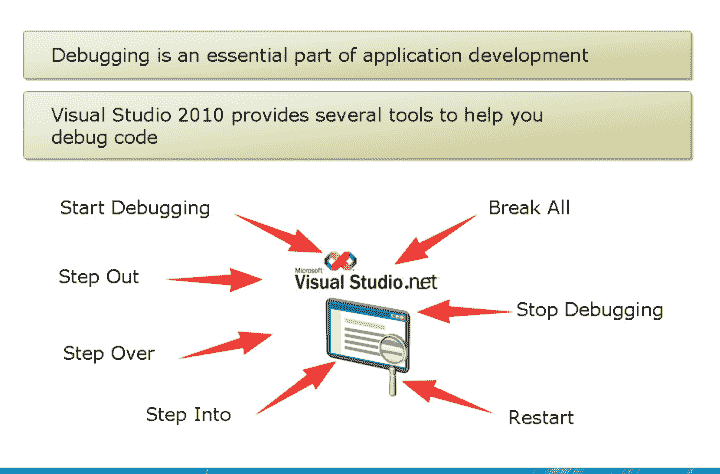

#### 关键点

调试是应用程序开发中不可或缺的一部分。你在编写代码时可能会发现错误，但某些错误——特别是逻辑错误——可能只在你未测试过的特定情况下发生。用户可能会向你报告这些错误，而你必须修复它们。

Visual Studio 2010 提供了多种工具帮助你调试代码。你可以在开发代码、测试阶段或应用程序发布后使用这些工具。无论在什么情况下，你都可以以相同的方式使用这些工具。

你可以在启用或不启用调试的情况下运行应用程序。启用调试时，应用程序处于 Debug 模式。要访问许多调试功能（包括逐行单步代码），你可以使用“调试”（Debug）菜单上的控件、“调试”工具栏上的控件以及快捷键。

### 调试控件

下表列出了“调试”菜单和“调试”工具栏上的主要调试控件以及相应的快捷键。

| 菜单选项 | 工具栏按钮 | 快捷键 | 描述 |
| :--- | :--- | :--- | :--- |
| 开始调试 (Start Debugging) | 开始/继续 | F5 | 当应用程序未运行且你处于断点模式时，此按钮可用。它将在 Debug 模式下启动应用程序，或者在你处于断点模式时恢复应用程序。 |
| 中断全部 (Break All) | 全部全部 | CTRL+ALT+BREAK | 此按钮会导致应用程序处理暂停并进入断点模式。应用程序在运行时可用。 |
| 停止调试 (Stop Debugging) | 停止 | SHIFT+F5 | 此按钮停止调试。应用程序在运行或处于断点模式时可用。 |
| 重启 (Restart) | 重启 | CTRL+SHIFT+F5 | 此按钮等同于停止后启动。它将导致应用程序从头重新启动。应用程序在运行或处于断点模式时可用。 |
| 进入 (Step Into) | 进入 | F11 | 此按钮用于逐语句执行代码。请参本节的下一个主题。 |
| 逐过程 (Step Over) | 跳过 | F10 | 此按钮用于逐语句执行代码。请参本节的下一个主题。 |
| 跳出 (Step Out) | 跳出 | SHIFT+F11 | 此按钮用于逐语句执行代码。请参本节的下一个主题。 |
| 窗口 (Windows) | 窗口 | Various | 此按钮允许访问各种调试窗口，每个窗口都有自己的快捷键。 |

问题：Visual Studio 2010 提供了哪些调试功能？

### 使用断点

> 当你在 Debug 模式下运行应用程序时，可以暂停执行并进入断点模式

Visual Studio 2010 允许你：

- 定位特定的代码行并设置断点
- 定位断点并禁用它
- 定位断点并删除它

#### 关键点

当你在 Debug 模式下运行应用程序时，可以暂停执行并进入断点模式。在断点模式下，除非你重启断点模式或逐行执行代码，否则不会进行进一步的执行。你还可以查看和更改变量值、执行额外代码或评估表达式。当你处于断点模式时，当前代码行由代码左侧灰色条中的黄色箭头指示，下一个要执行的语句由黄色背景指示。

“中断全部”（Break All）调试功能允许你进入断点模式。然而，此功能无法对代码执行暂停的确切位置提供过多控制。

断点允许你精确选择代码执行暂停的位置。如果你在某行代码上放置了断点，一旦到达该行代码，应用程序将进入断点模式，而在执行该行代码之前。

### 设置断点

1. 定位想要设置断点的代码行。
2. 使用以下步骤之一添加断点：
   a. 点击代码行左侧的灰色条。
   b. 将光标置在代码行上，然后按 F9。
   c. 将光标置在代码行上，然后在“调试”菜单中点击“切换断点”（Toggle Breakpoint）。
   d. 右键点击代码行，指向“断点”，然后点击“插入断点”。

断点由代码行左侧灰色条中的实心红圆圈表示，并在包含断点的代码行由红色背景表示。

### 禁用或启用断点

1. 定位具有已启用或已禁用断点的代码行。
2. 使用以下步骤之一禁用或启用断点：
   a. 右键点击代码行左侧灰色条中的实心红圆圈，然后点击“禁用断点”（Disable Breakpoint）或“启用断点”（Enable Breakpoint）。
   b. 右键点击包含断点的代码行，指向“断点”，然后点击“禁用断点”或“启用断点”。
   c. 如果断点已禁用，点击代码左侧的实心红圆圈将其启用。

禁用的断点由代码左侧灰色条中的红色圆圈圈表示，并在包含断点的代码周围由红色轮廓表示。

### 删除断点

1. 定位具有断点的代码行。
2. 使用以下步骤之一删除断点：
   a. 如果断点已启用，点击代码左侧的实心红圆圈以将其删除。
   b. 将光标置在代码行上，然后按 F9。
   c. 将光标置在代码行上，然后在“调试”菜单中点击“切换断点”。
   d. 右键点击代码行，指向“断点”，然后点击“删除断点”（Delete Breakpoint）。
   e. 右键点击代码行左侧灰色条中的实心红圆圈，然后点击“删除断点”。

问题：你如何使用 Visual Studio 2010 中的调试功能来调试你的应用程序并在特定行上暂停？

### 逐语句执行和跳过代码

> 你可以一次执行一条语句代码，以精确查看处理过程如何在应用程序中进行

Visual Studio 2010 允许你：
- 进入当前语句（Step into）
- 跳过当前语句（Step over）
- 跳出当前语句（Step out）

#### 关键点

你可以一次执行一条语句代码，以精确查看处理过程如何在你的应用程序中进行。这是一种极其实用的调试技术，因为它允许你验证代码的逻辑。在语句执行之间，你可以查看并编辑变量值。每当你的代码遇到分支语句时，你都可以逐语句执行。

你用于逐语句执行代码的各种工具允许你按照自己想要的方式进行执行。你还可以完全跳过代码。

进入、跳过和跳出

用于逐语句执行代码的各种工具允许你按照你想要的方式执行。对于逐语句执行代码至关重要的调试功能如下：

- 进入（Step Into）：此功能执行当前执行位置的语句。如果语句是方法调用，当前执行位置将移动到方法内部。进入方法后，你可以逐语句执行其内部。此外，你可以使用“进入”函数在 Debug 模式下启动应用程序。如果你这样做，应用程序将在启动后立即进入断点模式。

- 跳过（Step Over）：与“进入”一样，“跳过”执行当前执行位置的语句。然而，此函数不会进入方法或属性。相反，方法或属性内部的代码将被执行，执行位置移动到方法调用或属性访问之后的语句。例外是方法或属性的代码包含断点。如果是这种情况，执行将继续到断点。

- 跳出（Step Out）：跳出功能允许你执行方法、属性访问器或循环的剩余代码。执行将回到调用方法或访问属性的语句，或者循环代码之后的语句。执行在此处暂停。

### 跳过代码

在断点模式下，下一个要执行的语句由代码左侧灰色条中的黄色箭头和语句的黄色背景指示。你可以覆盖此设置并设置另一个语句作为下一个执行的语句。要这样做，右键点击你想要执行的语句，然后点击“设置下一个语句”（Set next statement）。箭头和黄色背景将移动到你选择的语句。

如果你使用这种技术，你应该意识到你正在改变应用程序的工作方式。如果你跳过了重要的代码（如变量赋值或关键的方法调用），你可能会引入本不会发生的错误。你应该谨慎地跳过语句。

### 继续执行和重启

当你完成逐语句执行代码后，可以使用“开始/继续”（start/continue）函数返回 Debug 模式。随后执行将继续。

再次进入中断模式，可以通过点击**全部中断（Break all）**按钮或当代码遇到断点时。

如果你想终止应用程序并重新以调试模式运行它，可以使用**重新启动（Restart）**功能。当你想要测试应用程序首次启动时执行的代码，或在应用程序运行期间仅执行一次的代码时，这非常有用。

**问题：** 为什么要使用单步进入（Step into）和单步跳过（Step over）调试调试函数？

### 使用调试窗口

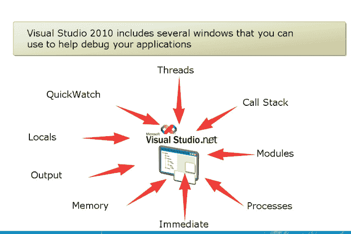

#### 关键点

Visual Studio 2010 包含了几个用于调试应用程序的窗口。这些窗口在运行时可用，大部分处于中断模式。

下表描述了 Visual Studio 2010 中一些常用的调试窗口。

| 窗口 | 描述 |
|---|---|
| 快速监视 (QuickWatch) | 这是一个模式窗口，允许你评估变量和表达式。在**表达式（Expression）**中输入变量名或表达式，然后点击**重新评估（Reevaluate）**来查看变量的值和类型或表达式的结果。点击**关闭（Close）**退出快速监视窗口。 |
| 本地变量 | 此窗口允许你查看和编辑本地（作用域内的）变量。你可以展开变量、查看成员，并在**值（Value）**列中编辑某些变量的内容。 |

| 窗口 | 描述 |
|---|---|
| 立即 (Immediate) | 此窗口允许你评估表达式、执行语句并打印变量值。你可以使用此窗口发布 Visual Studio 2010 命令，如 `Debug.Print()` 来打印变量或表达式的值。 |
| 输出 (Output) | 在此窗口中，你可以查看错误和信息消息。此窗口的主要用途之一是使用 `System.Diagnostics.Debug.WriteLine()` 方法查看应用程序的跟踪。 |
| 内存 (Memory) | 此窗口允许你检查并编辑应用程序使用的内存内容。这是一项高级功能，如果你不小心使用此窗口，可能会导致你的应用程序出现不可预测的行为。 |
| 调用堆栈 (Call Stack) | 此窗口允许你查看到达当前代码位置的方法调用栈。当前位置显示在窗口顶部，应用程序为到达此位置而处理的一系列调用显示在下方。 |
| 模块 (Modules) | 此窗口允许你查看应用程序所使用的模块（程序集和可执行文件）的信息。每个模块都列出了其位置、版本和其他信息。 |
| 进程 (Processes) | 在此窗口中，你可以查看调试器附加的进程信息。 |
| 线程 (Threads) | 在此窗口中，你可以检查和控制应用程序中的线程。 |

**问题：** 在开发应用程序时，为什么要使用本地变量（Locals）和立即（Immediate）窗口？

### 实验：介绍 C# 和 .NET 框架

- 练习 1：构建简单的控制台应用程序
- 练习 2：构建 WPF 应用程序
- 练习 3：验证应用程序
- 练习 4：为应用程序生成文档

| 虚拟机 | 10266A-GEN-DEV |
|--- |---|
| 用户名 | Student |
| 密码 | Pa$$w0rd |

登录信息

预计耗时：60 分钟

### 目标

完成本实验后，你将能够：

- 使用 Visual Studio 2010 和 C# 4.0 创建、构建并运行一个简单的控制台应用程序。
- 使用 Visual Studio 2010 创建、构建并运行一个基础 WPF 应用程序。
- 使用 Visual Studio 2010 调试器设置断点、单步执行并检查变量值。
- 为应用程序生成文档。

### 引言

在本实验中，你将创建简单的控制台和 WPF 解决方案以开始使用 Visual Studio 2010 和 C#。你还将配置项目、使用代码编辑功能并创建注释。你将熟悉调试器界面。你将编译、运行并使用调试器步执行程序。最后，你将为应用程序生成文档。

### 实验设置

对于本实验，你将使用提供的虚拟机环境。在开始实验之前，你必须：

- 启动 10266A-GEN-DEV 虚拟机，然后使用以下凭据登录：
- 用户名：Student
- 密码：PaSSSw0rd

> 注意：完成本课程中实验的逐步说明可以在提供的实验答案中找到。在虚拟机上每个实验练习的 Labfiles 文件夹下的 Solution 文件夹中提供了已完成且可运行的代码。

### 实验场景


Fabrikam, Inc. 生产一系列高度敏感的测量设备，可以重复测量物体并采集数据。你被要求编写 C# 应用程序来读取测量设备生成的一小组输入数据，对这些数据进行格式化使其更易读，然后显示格式化后的结果。

数据由代表对象位置 x 坐标和 y 坐标的数字对数据组成。每行文本包含一组坐标。下面的代码示例类似于典型数据集。

```
x23.8976,12.3218
x25.7639,11.9463
x24.8293,12.2134
```

你被要求按照下面的代码示例格式化数据。

```
x23.8976,12.3218
x25.7639,11.9463
x24.8293,12.2134
```

### 练习 1：构建简单的控制台应用程序

在本练习中，你将最初通过控制台 I/O 构建并测试应用程序。

#### 场景

作为原型，你决定实现一个控制台应用程序来读取输入并格式化它。当你确认代码工作正常后，将重定向输入来自文件。

该实验的主要任务如下：

1. 创建新的控制台项目。
2. 添加代码读取用户输入并输出到控制台。
3. 修改程序读取并回显文本直到文件结束。
4. 使用数据测试应用程序。

#### 任务 1：创建新的控制台项目

1. 登录到 10266A-GEN-DEV 虚拟机，用户名 Student，密码 PaSSw0rd。
2. 打开 Visual Studio 2010。
3. 在 E:\Labfiles\Lab 1\Starter 文件夹创建一个名为 ConsoleApplication 的项目。

#### 任务 2：添加代码读取用户输入并输出到控制台

1. 在 Main 方法中添加示例所示语句，从键盘读取一行文本并存储在变量 line 中。

```csharp
static void Main(string[] args)
{
    // 存储读取的行
    string line;

    // 从键盘读取一行
    line = Console.ReadLine();
}
```

此代码使用 `Console.ReadLine` 方法读取输入，并对每行代码包含注释以说明其目的。

1. 添加下方代码示例中加粗的语句，使用 `Console.WriteLine` 方法将文本输出到控制台。

```csharp
static void Main(string[] args)
{
    // 存储读取的行
    string line;

    // 从键盘读取一行
    line = Console.ReadLine();

    // 将结果输出到控制台窗口
    Console.WriteLine(line);
}
```

1. 生成应用程序。
2. 运行应用程序并验证其符合预期。你应该能够输入一行文本并看到该行回显在控制台上。

#### 任务 3：修改程序读取并回显文本直到文件结束

1. 在 Main 方法中，修改下方代码示例中加粗的语句，从键盘读取一行文本。

```csharp
static void Main(string[] args)
{
    // 存储读取的行
    string line;

    // 循环直到没有更多输入（控制台中的 Ctrl-Z，或文件结束）
    while ((line = Console.ReadLine()) != null)
    {
    }
}
```

```
// 将结果输出到控制窗口
Console.WriteLine(line);
```

此代码将语句整合到一个 `while` 循环中，重复地从键盘读取文本，直到 `Console.ReadLine` 方法返回空值（这在 `Console.ReadLine` 方法检测到文件末尾或用户输入 CTRL+Z 时发生）。

2. 将 `Console.WriteLine` 语句移动到下方代码示例的 `while` 循环体内。该语句会回显用户输入的每行文本。

```csharp
static void Main(string[] args)
{
    // 用于存储读取的行
    string line;

    // 循环直到没有更多输入（控制台中的 Ctrl-Z，或文件末尾）
}
```


### 任务 4：添加代码格式化数据并显示

1. 在 `while` 循环体内，将下方代码示例中 `Console.WriteLine` 语句之前添加**加粗**的语句和注释。

```csharp
static void Main(string[] args)
{
    // 用于存储读取的行
    string line;

    // 循环直到没有更多输入（控制台中的 Ctrl-Z，或文件末尾）
    while ((line = Console.ReadLine()) != null)
    {
        // 格式化数据
    }
}
```

```csharp
line = line.Replace(",", ", ");
```

```csharp
// 将结果输出到控制窗口
Console.WriteLine(line);
```

此代码替换了从键盘读取的输入中每个出现的逗号字符 `","`，并将其替换为文本 `"y"`。它使用了 `line` 字符串变量的 `Replace` 方法。然后代码将结果赋值回 `line` 变量。

2. 将下方代码示例中**加粗**的语句添加到 `while` 循环体内的代码中。

```csharp
static void Main(string[] args)
{
    // 用于存储读取的行
    string line;

    // 循环直到没有更多输入（控制台中的 Ctrl-Z，或文件末尾）
    while ((line = Console.ReadLine()) != null)
    {
        // 格式化数据
        line = line.Replace(",", ", x");
        line = "x:" + line;

        // 将结果输出到控制窗口
        Console.WriteLine(line);
    }
}
```

此代码在 `Console.WriteLine` 语句之前使用字符串拼接运算符 `+` 为 `line` 变量添加了前缀 `"x:"`。代码将结果赋值回 `line` 变量。

3. 生成应用程序。

4. 运行应用程序并验证其工作符合预期。

应用程序期望的输入如下代码示例所示。

```
23.54367,25.6789
```

你的代码应该将输出格式化为如下代码示例所示。

```
x:23.54367 y:25.6789
```

### 任务 5：使用数据文件测试应用程序

执行以下步骤将包含样本数据的 `DataFile.txt` 文件添加到项目中。该文件位于 `E:\Labfiles\Lab 1\Ex1\Starter` 文件夹中。这些步骤指定了在生成项目时应将该文件复制到存放编译应用程序的文件夹中：

- 在解决方案管理器中，右键点击 `ConsoleApplication` 项目，指向“添加”，然后点击“选择现有项”。
- 在“添加现有项 - ConsoleApplication”对话框中，转到 `E:\Labfiles\Lab 1\Ex1\Starter` 文件夹，在文件名文本框旁边的下拉列表中选择“所有文件 (*.*)”，点击 `DataFile.txt`，然后点击“添加”。
- 在解决方案管理器中，选择 `DataFile.txt`。在属性窗口中，将“生成操作”属性更改为“无”（None），然后将“复制到输出”更改为“始终”（Copy Always）。
- 重新生成应用程序。
- 打开 Visual Studio 命令提示符窗口，并到 `E:\Labfiles\Lab Ex1\Starter\ConsoleApplication\bin\Debug` 文件夹。
- 运行 `ConsoleApplication` 应用程序并将输入重定向自 `DataFile.txt`。

验证生成的输出是否如下代码示例所示：

在命令提示符中，输入下方代码示例中的命令：

```
ConsoleApplication < DataFile.txt
```

- 关闭命令提示符窗口并返回 Visual Studio。
- 修改项目属性，以便在通过 Visual Studio 运行项目时重定向输入自 `DataFile.txt` 文件。
- 在 Visual Studio 中以调试模式运行应用程序。

应用程序将运行，但控制窗口在生成输出后会立即关闭。这是因为在不进行调试的情况下运行程序时，Visual Studio 会提示用户关闭控制窗口。

当程序以调试模式运行时，Visual Studio 在程序结束时自动关闭控制窗口。

8. 在 `Main` 方法结束处的大括号上设置断点。

9. 再次以调试模式运行应用程序。验证生成的输出是否与之前的输出一致。

### 练习 2：构建 WPF 应用程序

在本次练习中，你将构建一个简单的应用程序，提供与你开发的控制台应用程序类似的功能。

#### 场景

你被要求以更有帮助的方式显示输出。应用程序应执行与控制台应用程序相同的任务，只是输出显示在窗口中。

1. 创建一个新的 WPF 应用程序。
2. 创建界面。
3. 添加格式化用户输入的代码。
4. 修改应用程序从文件数据。

#### 任务 1：创建 WPF 应用程序

在 `E:\Labfiles\Lab 1\Starter` 文件夹中使用模板创建一个名为 `WPFApplication` 的新项目。

#### 任务 2：创建界面

在 `MainWindow` 中添加 `TextBox`、`Button` 和 `TextBlock` 控件。使用属性窗口按所示设置每个控件的属性。

| 控件 | 属性 | 值 |
| :--- | :--- | :--- |
| `TextBox` | `Name` | `input` |
| | `Height` | `28` |
| | `HorizontalAlignment` | `Left` |
| | `Margin` | `12,12,0` |
| `Button` | `Name` | `testButton` |
| | `Content` | `Format Data` |
| | `Height` | `23` |
| | `HorizontalAlignment` | `Left` |
| | `Margin` | `320,17,0` |
| `TextBlock` | `Name` | `formattedText` |
| | `Height` | `23` |
| | `HorizontalAlignment` | `Left` |
| | `Margin` | `14,50,0` |

#### 任务 3：添加格式化用户输入的代码

1. 为按钮的 `Click` 事件创建事件程序。
2. 将下方代码示例中**加粗**的代码添加到事件程序方法中。

```csharp
private void testButton_Click(object sender, RoutedEventArgs e)
{
    // 将 TextBox 的内容复制到字符串
    string line = input.Text;

    // 格式化字符串数据
    line = line.Replace(",", y:");
    line = "x:" + line;

    // 将结果存储在 TextBlock 中
    formattedText.Text = line;
}
```

3. 生成应用程序并验证错误。
4. 运行应用程序并验证其工作方式与练习 1 中的控制台应用程序相似。

### 任务 4：修改应用程序从文件数据

1. 为 `Window_Loaded` 事件创建事件程序。该事件在窗口显示之前、应用程序启动之后发生。
2. 在事件程序中，将下方代码示例中**加粗**的代码添加。

此代码从标准输入读取文本，以与练习 1 相同的方式格式化，并将结果追加到 `TextBlock` 控件的末尾。它继续读取所有文本直到检测到文件末尾。

注意可以使用 `+=` 运算符向 `TextBlock` 控件的 `Text` 属性追加数据，并之间添加换行符 `("\n")` 用于格式化输出的行，以确保每个项目都出现在 `TextBlock` 控件的新行中。

3. 按照以下步骤修改项目设置，以将标准输入重定向到 `DataFile.txt` 文件。该文件的副本位于 `E:\Labs\Lab 1\Ex2\Starter` 文件夹中：

a. 在“解决方案管理器”(Solution Explorer)中，右键点击 `WpfApplication` 项目，指向“添加”(Add)，然后点击“现有项”(Existing Item)。
b. 在“添加项 - WpfApplication”对话框中，转到 `E:\Labs\Lab 1\Ex2\Starter` 文件夹，在文件名输入框旁边的下拉列表中选择“文件 (*)”，点击 `DataFile.txt`，然后点击“添加”。
c. 在解决方案管理器中，选择 `DataFile.txt`。在“属性”窗口中，将“生成操作”(Build Action)更改为“无”，然后将“输出到”更改为“始终复制”(Copy Always)。
d. 在解决方案管理器中，右键点击 `WpfApplication` 项目，并点击“属性”(Properties)。
e. 在“调试”(Debug)选项卡上，在“命令行参数”(Command arguments)框中输入 `DataFile.txt`。
f. 点击“确定”。
g. 关闭 `WpfApplication` 属性窗口。

4. 在调试模式下生成并运行应用程序。验证当应用程序启动时，它从 `DataFile.txt` 读取数据并如下例所示 `TextBlock` 控件中显示结果：

```
x:23.8976 y:12.3218
x:25.7639 y:11.9463
x:24.8293 y:12.2134
```

5. 关闭 `MainWindow` 窗口，然后返回 Visual Studio。

### 练习 3：验证应用程序

在此练习中，你将创建额外的测试数据并将其作为应用程序的输入。你将使用 Visual Studio 调试器单步执行代码，并在运行期间对其进行检查。

#### 场景

你想验证 WPF 应用程序的代码运行是否符合你的要求。你决定创建一些额外的测试数据，并使用 Visual Studio 调试器单步执行应用程序。此练习的主要任务如下：

1. 修改 `DataFile.txt` 中的数据。
2. 使用 Visual Studio 调试器单步执行应用程序。

#### 任务 1：修改 DataFile.txt 中的数据

按照所示代码修改 `DataFile.txt` 文件的内容：

```
1.2543,0.342
32525.7639,99811.9463
24.8293,12.2135
23.8976,12.3218
25.7639,11.9463
24.8293,12.2135
```

注意：`DataFile.txt` 末尾必须有一个空行。

#### 任务 2：使用 Visual Studio 调试器单步执行应用程序

1. 在 `Window_Loaded` 事件处理程序的开头设置断点。
2. 以调试模式启动运行应用程序。当应用程序运行 `Window_Loaded` 事件处理程序时，它将到达断点并进入 Visual Studio。方法的左大括号会被高亮。
3. 单步进入 `Window_Loaded` 方法中包含可执行代码的第一条语句。`while` 语句应该被高亮。这是因为声明 `line` 变量的语句不包含任何可执行代码。
4. 检查 `line` 变量的值。它应该是 `null`，因为它尚未被赋值。
5. 单步进入下一语句。光标移动到 `while` 循环开头的大括号处。
6. 检查 `line` 变量的值。它应该是 `1.2543,0.342`。这是来自 `DataFile.txt` 文件第一行的文本。`while` 语句中的 `Console.ReadLine` 语句从文件中读取了此文本。
7. 单步进入下一语句。光标移动到后续代码示例中的某行：

```csharp
line = line.Replace("x", " y:");
```

8. 单步进入下一语句。
9. 检查 `line` 变量的值。它现在应该是 `1.2543 y:0.342`。这是调用 `Replace` 方法并将结果赋值回 `line` 的结果。
10. 单步进入下一语句。
11. 检查 `line` 变量的值。它现在应该是 `x:1.2543 y:0.342\n`。这是在 `line` 前部添加文本 `"x:"` 并在末尾添加换行符的结果。
12. 单步进入下一语句。光标移动到 `while` 循环末尾的右大括号。
13. 在“立即窗口”(Immediate window)中，检查 `formattedText` `TextBlock` 控件的 `Text` 属性的值。它应该包含与变量相同的文本。

注意：如果立即窗口不可见，按 `CTRL+ALT+I`。

14. 在 `while` 循环结束处设置另一个断点。
15. 继续运行程序以进行 `while` 循环的下次迭代。它将在到达循环末尾的断点时停止。
16. 检查 `line` 变量的值。它现在应该是 `x:32525.7639 y:99811.9463\n`。这是来自 `DataFile.txt` 第二行的数据。
17. 在立即窗口中，再次检查 `formattedText` `TextBlock` 控件的 `Text` 属性的值。它现在应该包含 `DataFile.txt` 前两行的格式化结果。
18. 移除运行中的断点。
19. 继续运行程序。
20. 关闭 `MainWindow` 窗口并返回 Visual Studio。

### 练习 4：为应用程序生成文档

在此练习中，你将为应用程序添加 XML 注释并使用 Sandcastle 生成帮助文件。此练习的主要任务是：

1. 打开启动项目。
2. 为应用程序添加 XML 注释。
3. 生成 XML注释文件。
4. 生成 `.chm` 文件。

#### 任务 1：打开启动项目

在 Visual Studio 中，打开位于 `E:\Labs\Lab 1\Ex4` 的解决方案。该解决方案是练习 2 的副本。

#### 任务 2：为应用程序添加 XML 注释

1. 显示 `.xaml.cs` 文件。

在 `MainWindow` 类声明之前添加 XML 注释：

```csharp
/// <summary>
/// 读取和格式化数据的 WPF 
/// </summary>
```

在 `MainWindow` 构造函数之前添加 XML 注释：

```csharp
/// <summary>
/// MainWindow 构造函数
/// </summary>
```

在 `testButton_Click` 方法之前添加 XML 注释：

```csharp
/// <summary>
/// 读取用户输入的数据。
/// 格式化并显示在格式化的 TextBlock 控件中。
/// </summary>
/// <param name="sender"></param>
/// <param name="e"></param>
```

在 `Windows_Loaded` 方法之前添加 XML 注释：

```csharp
/// <summary>
/// 在窗口加载后，从标准输入读取数据。
/// 格式化每一行并显示在格式化的 TextBlock 控件中。
/// </summary>
/// <param name="sender"></param>
/// <param name="e"></param>
```


保存`MainWindow.xml`。

### 任务 3：生成 XML 注释文件

- 设置项目属性以便生成时生成 XML 文档文件。
- 生成解决方案，然后修正任何错误。
- 验证名为`comments.xml`的 XML 注释文件已生成在`E:\Labs\Lab 1\Ex4\Starter\WpfApplication\bin\Debug`文件夹中，并对其进行检查。
- 将`comments.xml`文件复制到`E:\Labs\Lab 1\Ex4\Helpfile`文件夹。

#### 任务 4：生成 .chm 文件

1. 以管理员身份打开 Windows 命令提示符窗口。管理员密码为`PaSSword`。
2. 转到`E:\Labs\Lab 1\Ex4\Helpfile`文件夹。
3. 使用记事本编辑`builddoc.cmd`脚本，然后验证输入变量已设置为`"E:\Labs\Lab 1\Ex4\Starter\WpfApplication\bin\Debug\WpfApplication.exe"`。
4. 运行`builddoc.cmd`脚本。
5. 打开`builddoc.cmd`脚本生成的`test.chm`文件。
6. 浏览为应用程序生成的文档，然后关闭`test.chm`。

### 实验回顾

### 复习题

- 你在控制台应用程序中使用哪些方法来捕获和显示信息？
- 在你的 WPF 应用程序中，“格式数据”（Format Data）按钮上处理了什么事件？
- 在验证应用程序时，使用了哪些调试函数？
- 你如何指示 Visual Studio 2010 生成包含 XML 注释的 XML 文件？

### 复习题

1. 你在控制台应用程序中使用哪些方法来捕获和显示信息？
2. 在你的 WPF 应用程序中，“格式数据”（Format Data）按钮上处理了什么事件？
3. 在验证应用程序时，使用了哪些调试函数？
4. 你如何指示 Visual Studio 2010 生成包含 XML 注释的 XML 文件？

### 模块回顾与收获

- 复习题
- 最佳实践
- 工具

### 复习题

1. .NET Framework 的目的以及 Visual C# 的作用是什么？
2. Visual Studio 2010 模板的作用是什么？
3. Visual Studio 项目和解决方案的作用是什么？
4. `Main`方法的作用是什么？
5. 列出 WPF 提供的一些控件。
6. XML 注释的作用是什么？
7. Visual Studio 2010 调试器的作用是什么？

### 编写 C# 应用程序的最佳实践

根据你自己的工作情况补充或修改以下最佳实践：

- 保持`Main`方法短小且轻量。
- 使用有意义名称声明变量，并避免对底层数据类型的引用，例如`nameString`。
- 使用有意义名称定义控件，并避免对底层控件类型的引用，例如`labelName`。
- 在代码中添加注释来描述你的思考过程。

### 工具

| 工具 | 用途 | 位置 |
|---|---|---|
| `Caspol.exe` | 允许用户修改机器、用户和企业安全策略。这可能包括定义自定义权限集并将程序集添加到完全信任列表中。 | `C:\Windows\Microsoft.NET\Framework\v4.0.30319` |
| `Gacutil.exe` | 允许用户操作全局程序集缓存（GAC）中的程序集。这包括在 GAC 中安装和卸载程序集，以便多个应用程序访问它们。 | `C:\Program Files\Microsoft SDKs\v7.0A\bin` |
| `ldasm.exe` | 允许用户操作程序集，例如确定程序集是否为托管，或反汇编程序集以查看编译后的 MSIL 代码。 | `C:\Program Files\Microsoft SDKs\v7.0A\bin` |
| `Makecert.exe` | 允许用户为开发环境创建 .x509 证书。通常，你可以使用这些证书对程序集签名并定义 SSL 连接。 | `C:\Program Files\Microsoft SDKs\v7.0A\bin` |

| 工具 | 用途 | 位置 |
| --- | --- | --- |
| `Ngen.exe` | 允许用户提高 .NET 应用程序的性能。原生映像生成器（Native Image Generator）通过将程序集预编译为包含特定机器码的映像来提高性能。CLR 可以运行预编译的映像，而不是使用 JIT 编译。 | `C:\Windows\Microsoft\.NET\v4.0.30319` |
| `Sn.exe` | 允许用户使用强名称签名程序集。强名称工具（Strong Name Tool）包含了创建新密钥对、从密钥对中提取公钥以及验证程序集的命令。 | `C:\Program Files\Microsoft SDKs\Windows\v7.0A\bin` |

# 模块 2

## 使用 C# 编程结构

目录：

- 课程 1：变量的声明与赋值 2-4
- 课程 2：使用表达式和运算符 2-23
- 课程 3：创建和使用数组 2-36
- 课程 4：使用决策语句 2-49
- 课程 5：使用迭代语句 2-63
- 实验：使用 C# 编程结构 2-78

### 模块概述

- 变量声明与赋值
- 使用表达式和运算符
- 创建和使用数组
- 使用决策语句
- 使用迭代语句

为了充分利用一种编程语言，理解该语言提供的结构是至关重要的。C# 是一种过程化编程语言，与你可能熟悉的其他过程化编程语言共享许多特性。例如，你可以声明变量、为它们赋值，并根据这些变量的值做出决策。

本模块引入了许多基础 C# 语言数据类型和编程结构，并描述了这些结构的语法和语义。

### 目标

完成本模块后，你将能够：

- 解释如何声明变量并赋值。
- 使用运算符构建表达式。
- 创建并使用数组。
- 使用决策语句。
- 使用迭代语句。

### 课程 1

### 变量声明与赋值

- 什么是变量？
- 什么是数据类型？
- 变量声明与赋值
- 什么是作用域？
- 将值转换为不同的数据类型
- 只读变量和常量

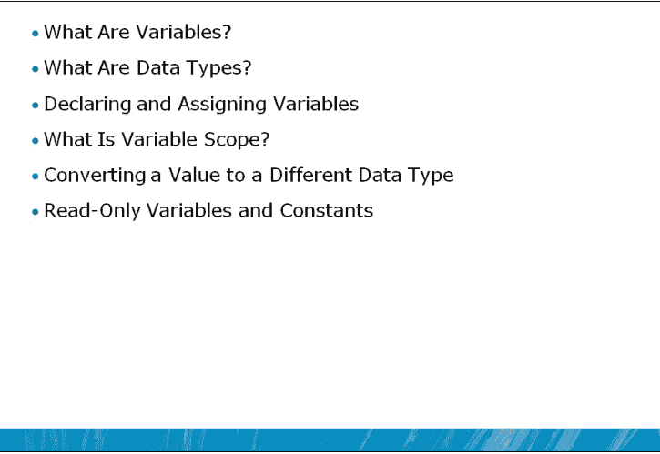

所有应用程序都使用数据。这些数据可能通过用户界面、数据库、网络服务或其他来源提供。为了在你的应用程序中存储和使用数据，你必须熟悉如何在 C# 中定义和使用变量以及数据类型。

本课程描述了 C# 如何使用变量以及 C# 提供的内置数据类型。本课程还解释了如何将变量中的数据转换为不同的类型。

### 目标

完成本课程后，你将能够：

- 描述变量的作用。
- 描述数据类型的作用。
- 解释如何声明和赋值变量。
- 解释作用域如何决定变量的可见性。
- 解释如何将变量数据转换为其他类型。
- 说明只读变量和常量的最佳实践。

#### 什么是变量？

变量存储值

| 变量具有以下维度： | 名称 |
| 地址 |
| 数据类型 |
| 值 |
| 作用域 |
| 生命周期 |

#### 关键点

变量代表数据的命命名位置。应用程序可以使用赋值的变量来访问数据。

变量存储可以更改的值。你通常需要存储、比较并对它们进行操作。

变量具有以下维度：

- 名称：引用变量的唯一标识符。
- 地址：变量的内存位置。
- 数据类型：变量可以存储的数据类型和大小。
- 值：地址中的值。
- 作用域：可以访问变量的定义区域。
- 生命周期：变量有效的时间段。

#### 什么是数据类型？

C# 是类型安全语言
编译器保证存储在变量中的值总是适当的类型

数据类型包括：

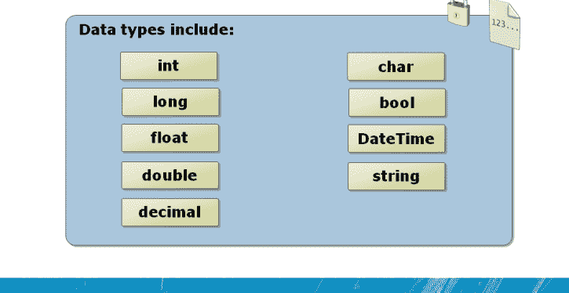

#### 关键点

变量持有特定类型的数据。当你为应用程序声明变量以存储数据时，你需要为该数据选择合适的数据类型。C# 是一种类型安全语言，这意味着编译器保证存储在变量中的值总是适当的类型。

### 常用数据类型

下表显示了 C# 中常用的数据类型及其特性。

| 类型 | 描述 | 大小（字节） | 范围 |
|---|---|---|---|
| `int` | 整数 | 4 | -2,147,483,648 到 2,147,483,647 |
| `long` | 整数（更大的范围） | 8 | -9,223,372,036,854,775,808 到 9,223,372,036,854,775,807 |

| 类型 | 说明 | 字节 (bytes) | 范围 |
| --- | --- |--- | --- |
| `float` | 浮点数 | 4 | +/-3.4 × 10^38 |
| `double` | 双精度（更精确的）浮点数 | 8 | +/-1.7 × 10^308 |
| `decimal` | 货币值 | 16 | 28 位有效数字 |
| `char` | 单个字符 | 2 | 不适用 |
| `bool` | 布尔值 | 1 | 真或假 |
| `DateTime` | 时间点 | 8 | 0001/01/01 的 0:00:00 到 9999/12/31 的 23:59:59 |
| `string` | 字符序列 | 每个字符 2 字节 | 不适用 |

问题：你会使用什么类型来存储一个数字字符序列？

### 变量的声明与赋值

在使用变量之前，你必须先声明它

```
DataType variableName;

DataType variableName1, variableName2;

...

DataType variableName = new DataType();
```

声明变量后，你可以给它赋一个值

```
variableName = Value;

DataType variableName = Value;
```

注意：变量名被称为标识符。标识符必须满足：

- 仅包含字母、数字和下划线字符
- 以字母或下划线开头
- 不要是 C# 预留的关键字之一

#### 关键点

在使用变量之前，你必须先声明它，以便指定它的名称和特征。

### 标识符

变量名被称为标识符。C# 对你可以使用的标识符有特定的规定：

- 标识符只能包含字母、数字和下划线字符。
- 标识符必须以字母或下划线开头。
- 变量的标识符不应该是 C# 预留的关键字之一。该主题的 CD 内容中提供了 C# 关键字的完整列表。

注意：C# 是区分大小大小的。如果你使用`MyData`作为变量的标识符，它与`myData`不同。你可以同时声明两个名为`MyData`和`myData`的变量，C# 不会混淆它们，尽管这不是良好的做法。

你应该为变量使用有意义的名称，因为这可以让你的代码易于理解。你还应该采用并坚持命名约定。

注意：不同的组织可能有不同的命名约定。该主题的 CD 内容描述了一些常见的约定。如果你的组织目前没有遵循特定的命名风格，你可能希望采用这些约定。

### 声明变量

当你声明变量时，你在内存中为该变量预留了一些存储空间。你必须指定它将包含的数据类型。你可以使用逗号分隔符在单个声明中声明多个变量；这样声明的所有变量具有相同的类型。变量声明的语法所示下面的代码示例。

```
DataType variableName;

// 或者

DataType variableName1, variableName2;
```

### 给变量赋值

声明变量后，你可以使用赋值语句为它赋值，以便稍后在应用程序中使用。在应用程序运行期间，你可以根据需要更改变量的值。

赋值运算符 (=) 将值赋给变量。变量赋值的语法所示下面的代码示例。

```
variableName = value;
```

表达式右侧的值被赋给表达式左侧的变量。

以下代码示例声明了一个名为`price`的整数并将数字 10 赋值给该整数。

```
int price = 10;
```

以下代码示例将数字 20 赋值给一个名为`price`的现有整数变量。

```
price = 20;
```

你也可以在声明变量时对其赋值。以下代码示例显示了变量声明和赋值的语法。

```
DataType variableName = value;
```

表达式的类型必须与变量的类型匹配，否则你的程序将无法编译。例如，以下示例中的代码无法运行，因为你不能将字符串值赋给整数变量。

```
int numberOfEmployees = "Hello";

numberEmployees = "Hello";
```

> 注意：当你声明变量时，在赋值之前，它包含一个随机值。这是 C 和 C++ 程序中 Bug 的丰富来源，因为这些程序创建了变量并在赋值之前意外地将其用作信息源。C# 不允许你使用未赋值的变量。你必须在使用变量之前给它赋值；否则，你的程序可能无法编译。

### 隐式类型变量

在声明变量时，你可以使用`var`关键字而不是指定`int`或`string`等显式数据类型。当编译器看到`var`关键字时，它会使用赋给变量的值来确定类型。因此，当你定义这样的变量时，必须在定义时初始化它，如下示例所示。

```
var price = 20;
```

在这个示例中，`price`变量是一个隐式类型变量。然而，`var`关键字并不意味着你之后可以给`price`赋不同类型的值。`price`的类型是固定的，就像你显式声明它为整数一样。

当你不知道或难以显式确定要赋给变量的表达式类型时，隐式类型变量非常有用。

问题：声明和赋值变量的语法是什么？

### 更多阅读

关于 C# 关键字的关键字，请参见[关键字](http://go.microsoft.com/fwlink/?LinkIdId=19290)。关于命名约定的更多信息，请参见[命名约定](http://go.microsoft.com/fwlink/?LinkIdId=19291)。关于大小写约定的更多信息，请参见[大小写约定](http://go.microsoft.com/fwlink/?LinkIdId=19292)。

### 什么是作用域

变量的作用域决定了程序的哪些部分可以访问该变量。如果你在作用域之外引用变量，编译器将生成错误。

### 作用域

变量可以具有以下作用域级别：

- 块 (Block)
- 过程 (Procedure)
- 类 (Class)
- 命名空间 (Namespace)

这些作用域从最窄（块）到最宽（命名空间）。以下章节将描述这些作用域。

### 块作用域

块是在起始和终止语句之间的语句，例如循环。如果你在块内声明变量，只能在该块内使用它。变量的生命周期是整个块。以下示例显示了如何声明具有块作用域的局部变量`area`。

```
if (length > 10)

{

    int area = length * length;

}
```

### 过程作用域

过程中定义的变量在过程外部不可用。只有包含定义的过程可以使用它。在块或过程中声明变量，它们被称为局部变量。以下示例显示了如何声明具有过程作用域的局部变量`name`。

```
void ShowName()

{

    string name = "Bob";

    MessageBox.Show("Hello " + name);

}
```

### 类作用域

如果你希望局部变量的生命周期超出过程的生命周期，请在类作用域声明变量。在类或结构中但在过程中内部声明的变量被称为类变量。你可以通过访问修饰符为类变量分配作用域。以下示例显示了如何声明具有类作用域的局部变量`message`。

```
private string message;

void SetString()

{

    message = "Hello World!";

}

void ShowString()

{

    MessageBox.Show(message);

}
```

### 命名空间作用域

当你在类级别使用`public`关键字声明变量时，它们对于命名空间内的所有过程都可用。以下示例显示如何在一个类中声明名为`message`的变量，并在另一个类中访问它。

```
public class CreateMessage

{

    public string message = "Hello";

}

public class DisplayMessage

{

    public void ShowMessage()

    {

        CreateMessage newMessage = new CreateMessage();

        MessageBox.Show(newMessage.message);

    }

}
```


问题：你正在开发一个应用程序，需要声明一个类两个方法可访问的变量。实现这一目标最简单的方法是什么？

### 更多阅读

关于作用域的更多信息，请参见[3.7 作用域](http://go.microsoft.com/fwlink/?LinkIdId=19293)。

### 将值转换为不同的数据类型

| 隐式转换 |
| :--- |
| 由通用语言运行时自动执行 |
| `int a = 4;` |
| `long b; // int 到 long 的隐式转换` |

| 显式转换 |
| :--- |
| 可能需要编写代码来执行转换 |
| `DataType variableName = (castDataType) variableName;` |
| `int count = Convert.ToInt32("1234");` |
| `int number = 0;` |
| `if (Int.TryParse("1234", out number)) // 转换成功` |

**关键点**
在设计应用程序时，你可能需要将数据从一种类型转换为另一种类型。当必须将一个类型的值赋值给不同类型的变量时，转换是必要的。例如，你可能需要将从文本文件中读取的字符串值 `"99"` 转换为存储在整数变量中的整数值 `99`。将一种数据类型的值转换为另一种数据类型的过程称为转换或强制转换（casting）。

**隐式和显式转换**
.NET Framework 中有两种类型的转换：

- *隐式转换*。由通用语言运行时 (CLR) 自动执行，这些操作保证在不丢失信息的情况下成功。
- *显式转换*。需要你编写代码来执行转换，否则这种转换可能会丢失信息或产生错误。

显式转换减少了代码中出现错误的可能性，并使你的代码更高效。C# 禁止丢失精度的隐式转换。但是，请注意，某些显式转换可能会产生意外之外的结果。

### 隐式转换

当值从一种数据类型自动转换为另一种数据类型时，就会发生隐式转换。源代码中不需要任何特殊语法。C# 仅允许安全的转换，例如整数的宽扩展。

下面的代码示例显示了如何将数据从整数隐式地转换为 `long` 类型。

```cs
int a = 4;
long b;
b = a; // int 到 long 的隐式转换
```

这种转换总是成功的，永远不会导致信息丢失。然而，这种转换是不 true；你不能隐式地将 `long` 值转换为 `int` 类型，因为这种转换存在丢失信息的风险（`long` 值可能在 `int` 类型支持的范围之外）。下表显示了 C# 支持的隐式类型转换。

| 从 | 到 |
| :--- | :--- |
| `sbyte` | `short`, `int`, `long`, `float`, `double`, `decimal` |
| `byte` | `short`, `ushort`, `int`, `uint`, `long`, `float`, `double`, `decimal` |
| `short` | `int`, `long`, `float`, `double`, `decimal` |
| `ushort` | `int`, `uint`, `long`, `ulong`, `float`, `double`, `decimal` |
| `int` | `long`, `float`, `double`, `decimal` |
| `uint` | `long`, `float`, `float`, `double`, `decimal` |
| `long`, `ulong` | `float`, `double`, `decimal` |
| `float` | `double` |
| `char` | `ushort`, `int`, `uint`, `long`, `ulong`, `float`, `double`, `decimal` |

### 显式转换

在 C# 中，你可以使用强制转换运算符执行显式转换。强制转换在圆括号中指定要转换的类型。执行显式转换的语法在下面的代码示例所示。

```cs
DataType variableName1 = (castDataType) variableName2;
```

你只能通过这种方式执行有意义的转换，例如将 `long` 转换为 `int`。如果数据的格式必须发生物理变化（例如当你将字符串转换为整数时），你不能使用强制转换。要执行这些类型的转换，你可以使用 `System.Convert` 类的方法。

### 使用 System.Convert 类

`System.Convert` 类提供了可以将基类型转换为另一个基类型的方法。这些方法的名称如 `ToDouble`、`ToInt32`、`ToString` 等。CLR 可以使用此类的所有语言都可以。你可能会发现使用该类进行转换更简单，因为 Microsoft IntelliSense 可以帮助你定位所需的转换方法。下面的代码示例将字符串转换为 `int` 类型。

```cs
string possibleInt = "1234";
int count = Convert.ToInt32(possibleInt);
```

除了 `Convert.ToString` 方法外，许多类型还实现了自己的 `ToString` 方法。接面的代码示例将 `int` 转换为字符串类型。

```cs
int number = 1234;
string numberString = count.ToString();
```

C# 的一些内置数据类型提供了 `TryParse()` 方法，该方法允许你在执行转换之前确定转换是否会成功。下面的代码示例显示了如何使用 `int.TryParse()` 方法将字符串转换为 `int`。

```cs
int number = 0;
string numberString = "1234";
if (int.TryParse(numberString, out number))
{
    // 转换成功，number 现在等于 1234
}
else
{
    // 转换失败，number 现在等于 0
}
```

**问题：** 你正在将一个字符串转换为 `int` 类型，但你不确定该字符串是否包含有效的 `int` 值。你应该使用哪种转换方法？

### 扩展阅读

有关 `System.Convert` 类的更多信息，请参见 http://go.microsoft.com/fxlink/?LinkId=192894 上的 `Convert` 类页面。

### 只读变量和常量

| 只读变量 |
| :--- |
| 使用 `readonly` 关键字声明 |
| 在运行时初始化 |
| `readonly string currentDateTime = DateTime.Now.ToString();` |

| 常量 |
| :--- |
| 使用 `const` 关键字声明 |
| 在编译时初始化 |

**关键点**
当你设计应用程序时，你可能需要将数据从一种类型转换为另一种类型。当必须将一个类型的值赋值给不同类型的变量时，转换是必要的。例如，你可能需要将从文本文件中读取的字符串值 `"99"` 转换为存储在整数变量中的整数值 `99`。

将一种数据类型的值转换为另一种数据类型的过程称为转换或强制转换。

**隐式和显式转换**
.NET Framework 中有两种类型的转换：

- *隐式转换*。由通用语言运行时 (CLR) 自动执行，这些操作保证在不丢失信息的情况下成功。
- *显式转换*。需要你编写代码来执行转换，否则这种转换可能会丢失信息或产生错误。

显式转换减少了代码中出现错误的可能性，并使你的代码更高效。C# 禁止丢失精度的隐式转换。但是，请注意，某些显式转换可能会产生意外之外的结果。

### 隐式转换

当值从一种数据类型自动转换为另一种数据类型时，就会发生隐式转换。源代码中不需要任何特殊语法。C# 仅允许安全的转换，例如整数的宽扩展。

下面的代码示例显示了如何将数据从整数隐式地转换为 `long` 类型。

```cs
int a = 4;
long b;
b = a; // int 到 long 的隐式转换
```

这种转换总是成功的，永远不会导致信息丢失。然而，这种转换是不 true；你不能隐式地将 `long` 值转换为 `int` 类型，因为这种转换存在丢失信息的风险（`long` 值可能在 `int` 类型支持的范围之外）。下表显示了 C# 支持的隐式类型转换。

| 从 | 到 |
| :--- | :--- |
| `sbyte` | `short`, `int`, `long`, `float`, `double`, `decimal` |
| `byte` | `short`, `ushort`, `int`, `uint`, `long`, `float`, `double`, `decimal` |
| `short` | `int`, `long`, `float`, `double`, `decimal` |
| `ushort` | `int`, `uint`, `long`, `ulong`, `float`, `double`, `decimal` |
| `int` | `long`, `float`, `double`, `decimal` |
| `uint` | `long`, `float`, `float`, `double`, `decimal` |
| `long`, `ulong` | `float`, `double`, `decimal` |
| `float` | `double` |
| `char` | `ushort`, `int`, `uint`, `long`, `ulong`, `float`, `double`, `decimal` |

### 显式转换

在 C# 中，你可以使用强制转换运算符执行显式转换。强制转换在圆括号中指定要转换的类型。执行显式转换的语法在下面的代码示例所示。

```cs
DataType variableName1 = (castDataType) variableName2;
```

你只能通过这种方式执行有意义的转换，例如将 `long` 转换为 `int`。如果数据的格式必须发生物理变化（例如当你将字符串转换为整数时），你不能使用强制转换。要执行这些类型的转换，你可以使用 `System.Convert` 类的方法。

### 使用 System.Convert 类

`System.Convert` 类提供了可以将基类型转换为另一个基类型的方法。这些方法的名称如 `ToDouble`、`ToInt32`、`ToString` 等。CLR 可以使用此类的所有语言都可以。你可能会发现使用该类进行转换更简单，因为 Microsoft IntelliSense 可以帮助你定位所需的转换方法。下面的代码示例将字符串转换为 `int` 类型。

```cs
string possibleInt = "1234";
int count = Convert.ToInt32(possibleInt);
```

除了 `Convert.ToString` 方法外，许多类型还实现了自己的 `ToString` 方法。接面的代码示例将 `int` 转换为字符串类型。

```cs
int number = 1234;
string numberString = count.ToString();
```

C# 的一些内置数据类型提供了 `TryParse()` 方法，该方法允许你在执行转换之前确定转换是否会成功。下面的代码示例显示了如何使用 `int.TryParse()` 方法将字符串转换为 `int`。

```cs
int number = 0;
string numberString = "1234";
if (int.TryParse(numberString, out number))
{
    // 转换成功，number 现在等于 1234
}
else
{
    // 转换失败，number 现在等于 0
}
```

**问题：** 你正在将一个字符串转换为 `int` 类型，但你不确定该字符串是否包含有效的 `int` 值。你应该使用哪种转换方法？

### 扩展阅读

有关 `System.Convert` 类的更多信息，请参见 http://go.microsoft.com/fxlink/?LinkId=192894 上的 `Convert` 类页面。

### 只读变量和常量

| 只读变量 |
| :--- |
| 使用 `readonly` 关键字声明 |
| 在运行时初始化 |
| `readonly string currentDateTime = DateTime.Now.ToString();` |

| 常量 |
| :--- |
| 使用 `const` 关键字声明 |
| 在编译时初始化 |

**关键点**
当你设计应用程序时，你可能需要将数据从一种类型转换为另一种类型。当必须将一个类型的值赋值给不同类型的变量时，转换是必要的。例如，你可能需要将从文本文件中读取的字符串值 `"99"` 转换为存储在整数变量中的整数值 `99`。

只读变量和常量允许你像使用变量一样存储数据。但是，它们有一些细微的区别。你可以使用只读变量或常量存储不改变的数据，例如：

- 一天的小时数。
- 光速。
- 圆的度数。

**比较只读变量和常量**
使用只读变量和常量之间存在细微差异。当你使用常量时，只能在声明时初始化它。然而，你可以在声明处或类的构造函数中初始化只读变量。

因此，你只能在设计时定义并初始化常量，无法在应用程序运行时为其赋值不同的值。

### 语法

使用 `readonly` 关键字声明只读变量，如下面的代码示例所示。

```cs
readonly DataType variableName = Value;
```

使用 `const` 关键字声明常量，如下面的代码示例所示。

```cs
const DataType variableName = Value;
```

#### 示例

下面的代码示例使用常量来存储当前日期时间。此示例使用了 `DateTime` 类和 `Now` 属性，在运行时计算当前日期时间。如果你对常量使用这种方法，将得到编译错误。

```cs
readonly string currentDateTime = DateTime.Now.ToString();
```

下面的代码示例使用 `PI` 来计算半径为 `5` 的圆的面积和周长。

```cs
const double PI = 3.14159;
int radius = 5;
double area = PI * radius * radius;
double circumference = 2 * PI * radius;
```

问题：常量和只读变量之间的主要区别是什么？

### 扩展阅读

有关常量的更多信息，请参见 http://go.microsoft.com/fwink/?LinkIdId=192895 上的常量引用页面。

### 第 2 节：使用表达式和运算符

- 什么是表达式？
- 什么是运算符？
- 指定运算符优先级
- 字符串的最佳实践

赋值给变量的值可以是简单的常量值，但更多情况下，它是运行时评估表达式的结果。本节描述了如何使用 C# 提供的各种运算符构建表达式。本节还描述了运算符优先级以及如何使用括号控制表达式中元素的评估顺序。最后，本节解释了动态构建字符串值的最佳实践。

### 目标

完成本节后，你将能够：

- 描述表达式的目的。
- 描述运算符的作用。
- 解释运算符优先级。
- 解释字符串拼接的最佳实践。

### 什么是表达式？

表达式是你用于评估和操作数据的基础构建结构。

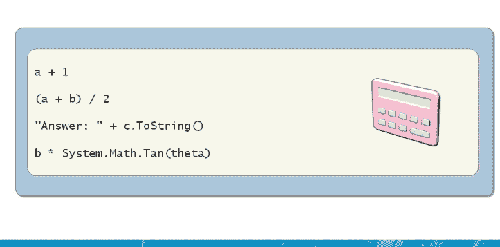

#### 关键点

表达式是几乎每个 C# 应用程序的核心组件。这是因为表达式是你用于评估和操作数据的基础构建结构。

表达式是操作数和运算符的集合。这些术语定义如下：

- 操作数（Operands）。操作数是值，例如数字和字符串。它们可以是常量（字面量）值、变量、属性或方法调用结果。
- 运算符（Operators）。定义了在操作数上执行的操作，例如加法或乘法。除了所有基础数学运算都有对应的运算符外，还有一些更高级的运算符，例如逻辑比较或对构成数值的数据位进行操作。

当你的应用程序运行时，所有表达式都会被求值为单个值。表达式产生的数值类型取决于你所使用的操作数类型和所使用的运算符。

C# 应用程序中表达式的长度没有限制，但在实践中，你受限于计算机内存和打字时的耐心。然而，通常建议使用较短的表达式并分段组合表达式处理的结果。这不仅能让你更容易看到自己在做什么，而且当代码运行结果不符合预期时，更易于调试。

#### 示例

你可以组合运算符和操作数的这些基础构建块，创建任何你认为的简单或复杂的表达式。在尺度的最简单一端，你可以为表达式使用单个操作数，如下代码示例所示：

```
a
```

这看起来可能没什么用，但实际上是至关重要的。例如，如果你想给变量赋值，你就需要这种类型的表达式。

你可以通过使用运算符来构建更复杂的表达式，如下代码示例所示。

```
a + 1
```

运算符可以作用于不同的数据类型，而该表达式的结果取决于操作数的数据类型。例如，如果 `a` 是整数，表达式的结果是一个比 `a` 大 `1` 的整数。如果 `a` 是双精度浮点数（`double`），结果是一个比 `a` 大 `1` 的双精度浮点数。这种区别虽然微妙但非常重要。在第二种情况下（`a` 是 `double`），C# 编译器在评估表达式之前必须生成代码将常量整数 `1` 转换为常量双精度浮点数 `1`。规则是：表达式的类型与操作数的类型相同，尽管一个或多个操作数可能需要转换以确保它们相互兼容。这非常重要，因为下面代码示例中的表达式包含两个整数操作数，所以结果是一个整数。

```
5 / 2
```

结果的值是整数 `2`（而不是 `2.5`）。如果你将其中一个操作数转换为双精度浮点数，C# 编译器会将另一个操作数也转换为双精度浮点数，结果将是双精度浮点数。因此，下面代码示例中的表达式产生双精度浮点数值 `2.5`。

```
5.0 / 2
```

你可以继续使用额外的值和运算符来构建表达式，如下代码示例所示。

```
a + b - 2
```


该表达式求值为变量 `a` 和 `b` 的和，并从结果中减去 2。

某些运算符（如 `+`）可以用于评估具有多种类型的表达式。例如，下面代码示例中的表达式使用 `+` 运算符来拼接字符串。

答案：`" " + c.ToString()`

`+` 运算符使用了一个方法调用结果的操作数，即 `ToString()`。该方法将变量的值转换为字符串，无论是什么类型。

`.NET Framework` 类库包含许多额外方法，你可以使用它们对数据执行数学和字符串操作。在模块的后续部分，你将看到如何创建自己的方法。特别是 `System.Math` 命名空间包含了几个可以在表达式中使用的方法，如下代码示例所示。

```
b * System.Math.Tan(theta)
```

该表达式求值为变量 `b` 与变量 `theta` 的正值的乘积。

问题：表达式 `"99" + "1"` 的值是多少？

## 什么是运算符？

运算符是你用于定义要在操作数上执行的操作的字符序列。

| 算术运算符 `+, -, *, /` | 赋值 `=, +=, -=, *, /=` |
|--- |--- |
| 递增、递减 `++, --` | 位移 `<<, >>` |
| 比较 `==, !=, <, <=, >=, is` | 类型信息 `typeof` |
| 字符串拼接 `+` | 委托拼接 `+-` |
| 逻辑/位运算 `, |, ^ ~, &, ||` | 溢出检查 `, unchecked` |
| 索引 `[ ]` | 间接性, 地址 `*, ->, [ ], & ]` |
| 强制转换 `( ), as` | 条件（三元运算符） `?:` |

### 关键点

运算符将操作数组合成表达式。C# 提供了广泛的运算符，你可以使用它们执行基础数学和逻辑运算。

## 运算符类型

运算符分为三类：

- 一元运算符（Unary）。这种类型的运算符作用于单个操作数。例如，你可以将 `-` 运算符作为一元运算符使用。要这样做，将它直接放在数值操作数之前，它会将操作数的值转换为当前值乘以 -1 的值。
- 二元运算符（Binary）。这种类型的运算符作用于两个值。这是最常见的运算符类型，例如 `*`，它乘以两个操作数的值。
- 三元运算符（Ternary）。C# 中只有一个三元运算符：`? :`。

## C# 运算符

下表显示了 C# 中使用的运算符，按类型分组：

| 运算符类型 | 运算符 |
| --- | --- |
| 算术 | `+, -, *, %` |
| 递增、递减 | `++, --` |
| 比较 | `==, !=, <, >, >=, <=` |
| 字符串拼接 | `+` |
| 逻辑/位运算 | `&, ^, !, &&, ||` |
| 索引（从 0 开始） | `[ ]` |
| 强制转换 | `(), as` |
| 赋值 | `=, +=, *=, &=, <<=, >>=` |
| 位移 | `<<, >>` |
| 类型信息 | `typeof` |
| 委托拼接 | `+, -` |
| 溢出控制 | `checked, unchecked` |
| 间接性和地址（安全代码） | `*, ->, [ ], &` |
| 条件（三元运算符） | `?:` |

## 变量的递增与减少

如果你给变量加 1，你可以使用 `+` 运算符，如下示例所示：

```
count = count + 1;
```

然而，给变量加 1 是非常常见的，因此 C# 为此目的提供了自己的运算符：`++`。要让变量 `count` 递增 1，你可以编写如下语句：

```
count++;
```

同样，C# 还提供了 `--` 运算符，你可以用它从变量减 1，如下示例所示：

```
count--;
```

`++` 和 `--` 运算符是一元运算符。

## 使用复合赋值运算符

如果你想给变量的值增加 42，可以组合赋值运算符和加运算符。例如，下面示例中的语句为名为 `answer` 的变量增加了 42。在该语句执行后，`answer` 的值比之前增加了 42。

```
answer += 42;
```

然而，给变量赋值是非常常见的，因此 C# 允许你通过使用 `+=` 运算符以快捷方式完成此任务。要给 `answer` 增加 42，你可以编写如下语句：

```
answer += 42;
```

你可以使用这种快捷方式将任何算术运算符与赋值运算符结合，如下表所示。这些运算符统称为复合赋值运算符。

| 替换为 | |
| --- | --- |
| `variable = variable * number;` | `variable *= number;` |
| `variable = variable / number;` | `variable /= number;` |
| `variable = variable % number;` | `variable %= number;` |
| `variable = variable + number;` | `variable += number;` |

有关关于 C# 运算符的更多信息，请参阅 C# 运算符页面（http://go.microsoft.com/fwlink/?LinkId=192896）以及“运算符（C# 编程指南）”页面（http://go.microsoft.com/fwlink/?LinkId=192897）。

## 指定运算符优先级

| 优先级最高 | |
|---|---|
| `++, --` (前缀), `+, -` (一元), `!, ~` | |
| `*, /, %` | |
| `+-` | |
| `<<, >>` | |
| `>, <=, >=` | |
| `==, !=` | |
| `&` | |
| `^` | |
| `|` | |
| `&&` | |
| `||` | |
| 赋值运算符 | |
| 最低 | |

### 关键点

一个表达式可以包含一组复杂的运算符和操作数。运算符处理的顺序和操作数求值的顺序取决于运算符本身。在许多情况下，表达式的流并不总是简单的从左到右。

你用于构建表达式的每个运算符都有关联的优先级，该优先级决定了它们处理的顺序。此外，运算符具有特定的结合性，这决定了它们与具有相同优先级的运算符相关的时的处理顺序。为了让表达式完全按照你想要的方式运行，可以使用括号来控制处理顺序。

## 运算符优先级

某些运算符的优先级高于其他运算符，这意味着它们在其他运算符之前被处理。例如，在下面的代码示例中，除法在加法之前执行。

```
a = b + 1 / 2;
```

下表显示了从最高到最低的运算符优先级。

| 优先级 | 运算符 |
|---|---|
| 最高高 | `++, --` (前缀), `+, -` (一元), `!, ~` |
| | `*, /, %` |
| | `+, -` |
| | `<<, >>` |
| | `<, >, <=, >=` |
| | `==, !=` |
| | `&` |
| | `^` |
| | `|` |
| | `&&` |
| | `||` |
| | 赋值运算符 |
| 最低 | `++, --` (后缀) |

## 运算符结合性

当使用相同优先级的运算符时，运算符的结合性是右结合或左结合的。左结合运算符从左到右处理，例如 `/` 运算符，如下面的代码示例所示。

```
a / 5 / b
```

在这里，`a` 被除以 5，然后将除法的结果除以 `b`。除了赋值运算符外，所有的二元运算符都是左结合的，赋值运算符是右结合的，所示：

```
a = b = c
```

在这里，将 `c` 的值赋值给 `b`，然后将 `b` 的值赋值给 `a`。在实践中，这很少产生影响。此外，值得注意的是，对于许多运算符，结合性并不总是重要的，如下代码示例所示。

```
a + 5 + b
```

在这个代码示例中，无论从左到右还是从右到左处理表达式，结果都没有区别。然而，`+` 运算符仍然是左结合的，这在更高级的情况下可能会产生影响，例如在重载运算符时。

## 使用括号

你可以使用括号来控制处理顺序并更改表达式中的优先级。表达式中任何被括号括起来的部分都会在括号外的表达式部分之前处理，如下面的代码示例所示。

```
a = (b + 1) / 2;
```

在这里，表达式的 `(b + 1)` 部分首先处理，该操作的结果被除以 2，以确定赋值给 `a` 的值。

你可以嵌套括号来进一步控制表达式执行的顺序。

## 执行字符串拼接的最佳实践

### 关键点

在 C# 中使用 `+` 运算符实现多个字符串的拼接非常。然而，这被认为是一种坏习惯，因为字符串是不可变的。这意味着每当你拼接字符串时，你都会在内存中创建一个新字符串并丢弃旧字符串。下面的代码示例在运行时会创建五个字符串值。

另一种方法是使用 `StringBuilder` 类，它允许你动态且高效得多地构建字符串。接下来的代码示例显示了如何使用 `StringBuilder` 类。

```
StringBuilder address = new StringBuilder();

address.Append("23");

address.Append(", Oxford Street");

address.Append(", Thornbury");

string concatenatedAddress = address.toString();
```

**注意：** `StringBuilder` 类位于 `System.Text` 命名空间。

**问题：** 为什么拼接字符串被认为是坏习惯？你如何避免它？

## 扩展阅读

有关 `StringBuilder` 类的更多信息，请参阅 StringBuilder 类页面（http://go.microsoft.com/fwlink/?Linkid=192898）。

# 课程 3：创建和使用数组

- 什么是数组？
- 创建和初始化数组
- 数组公开的常用属性和方法
- 访问数组中的数据

数组是某种可以存储多个值的集合。数组持有相同值。你需要存储和处理一组值集合，通常你预先不知道这个集合有多大。数组允许你存储和处理相关的数据。

本课程将介绍数组，并解释如何使用它们来存储和处理数据。

## 目标

完成本课程后，你将能够：

- 描述什么是数组
- 说明如何创建和初始化数组
- 描述数组公开的常用属性和方法
- 说明如何访问数组中的数据

### 什么是数组？

数组是组合在一起的元素序列

| 数组特性包括： | 数组中的每个元素包含一个值 | 数组是从零开始索引的 | 数组的长度是可以包含的元素总数 | 数组可以是单维的、多维的或交错的 | 数组的秩是维度的数量 |

#### 关键点

数组是作为一个单元管理的对象集合。你可以将数组看作元素的序列。数组中的所有元素具有相同的类型。你可以构建一维（列表）、二维（表格）、三维（立方体）等数组。数组具有以下特征：

- 数组中的每个元素包含一个值。数组是从零开始索引的。数组中的第一个项是 0。数组的长度是可以包含的元素总数。数组的下界是第一个元素的索引。数组可以是单维的、多维的或交错的。数组的秩（rank）是维度的数量。

特定类型的数组只能持有该类型的元素。如果你需要操作一组不同的对象或值类型，请考虑使用 `System` 命名空间定义的集合类型。

**问题：** 什么是数组？你为什么想在 C# 中使用数组？

### 创建和初始化数组

数组可以有多个维度

| | |
|---|---|
| 单维 | `Type[] arrayName = new Type[ Size ];` |
| 多维 | `Type[,] arrayName = new Type[ Size1, Size2];` |
| 交错 | `Type[][] JaggedArray = new Type[size][];` |

#### 关键点

当你声明数组时，你指定了它包含的数据类型并为数组命名。声明数组将数组引入作用域，但实际上并没有为其分配内存。当你使用 `new` 关键字时，CLR 会在物理上创建该数组。此时，你应该指定数组的大小。

#### 单维数组

要声明数组，你需要指定数组中元素的类型，并使用方括号 `[]` 表示该变量是一个数组。当你之后使用 `new` 关键字为数组分配内存时，指定数组的大小。数组的大小可以是任何整数表达式。或者，你可以初始化数组并并在大括号 `{}` 中指定一组值。

> 注意：如果你没有初始化数组中的元素，C# 编译器会在你使用 `new` 关键字创建数组时自动为你初始化它们。所使用的值取决于数组元素的类型。例如，如果数组包含数值数据，每个元素都将被初始化为零。如果数组包含字符串，则每个元素将初始化为 `null`。

下面的代码示例显示了声明和初始化一维数组的语法。

```
Type[] arrayName1 = new Type[ Size ];

Type[] arrayName2 = new Type{element1, element2, ..., elementN};
```

#### 多维数组

数组可以有多个维度。维度的数量对应于标识数组中单个元素所需的索引数量。你可以指定多达 32 个维度，但你很少需要超过三个维度。

你可以像声明一维数组一样声明多维数组变量，但需要使用逗号分隔各个维度。与一维数组一样，你也可以为每个维度指定一组数据，编译器将根据每组数据的元素数量来确定相应维度的大小。在初始化多维数组时，你将这些组数据嵌套在大括号内。

下面的代码示例显示了声明和初始化多维数组的语法。

```
Type[ , , . ] arrayName1 = new Type[Size1, Size2, . . . .];

Type[ , , . ] arrayName2 = {element1, element2, element3},

{element4, element5, element6},

{elementN-2, elementN-1, elementN}};
```

#### 锯齿数组

C# 中的多维数组必须是矩形的；每个维度上的元素数量必须相同。C# 还支持锯齿数组。锯齿数组简单来说就是数组的数组，每个数组的大小可以不同。锯齿数组对于建模稀疏数据结构非常有用，在这些情况下，如果某些项不需要使用，你可能并不总是分配内存。

下面的代码示例显示了如何声明和初始化锯齿数组。
注意，你必须指定第一个数组的大小，但不能指定包含在该数组中的数组的大小。你需要通过 `new` 关键字单独为锯齿数组中的每个数组分配内存。

```
Type[][] JaggedArray = new Type[10][

JaggedArray[0] = new Type[5]; // 可以指定不同的大小

JaggedArray[1] = new Type[7];

...

JaggedArray[9] = new Type[21];
```

#### 隐式类型数组

与隐式类型变量类似（即你声明 `var` 类型，且编译器从初始化程序中推断类型），你也可以拥有隐式类型数组。该类型是从初始化程序中指定的元素类型推断出来的。指定的元素必须全部是相同类型，否则编译器将显示错误。下面的代码示例显示了如何创建隐式类型数组。

```
var numbers = new[]{1, 2, 3, 4, 5, 6, 7, 8, 9, 10};
```

下面的代码示例显示了一个无法编译的示例，因为初始化程序包含多个多个不同数据类型的元素。

```
var mixed = new[]{1, DateTime.Now, true, false, 1.2};
```


#### 问题：如何声明多维数组？

### 扩展阅读

有关数组的更多信息，请参阅 http://go.microsoft.com/fwlink/?LinkId=192899 页面上的“Harness of the Features of C# to Power Your Scientific Computing Projects”中的多维数组部分。

有关一维数组的更多信息，请参阅 http://go.microsoft.com/fwlink/?LinkId=192900 页面上的“Single-Dimensional Arrays (C# Programming Guide)”。

有关多维数组的更多信息，请参阅 http://go.microsoft.com/fwlink/?LinkId=192901 页面上的“Multidimensional Arrays (C# Programming Guide)”。

有关锯齿数组的更多信息，请参阅 http://go.microsoft.com/fwlink/?LinkId=192902 页面上的“Jagged Arrays (C# Programming Guide)”。

### 数组公开的常用属性和方法

| `Length` |
| :--- |
| `int[] oldNumbers = { 1, 2, 3, 4, 5 };` |
| `int numberCount = oldNumbers.Length;` |

| `Rank` |
| :--- |
| `int[] oldNumbers = { 1, 2, 3, 4, 5 };` |
| `int rank = oldNumbers.Rank;` |

| `CopyTo()` |
| :--- |
| `int[] oldNumbers = { 1, 2, 3, 4, 5 };` |
| `int[] newNumbers = new int[oldNumbers.Length];` |
| `oldNumbers.CopyTo(newNumbers, 0);` |

| `Sort()` |
| :--- |
| `int[] oldNumbers = { 5, 2, 1, 3, 4 };` |
| `Array.Sort(oldNumbers);` |

#### 关键点

C# 中的数组对于存储数据非常有用，并提供了一些允许你操作数据的有用功能。

C# 中的所有数组实际上都是另一种类型 `System.Array` 的实例。`System.Array` 类型提供了你可以从自己的数组中使用的常用功能。下表描述了它提供的一些主要属性和方法。

| 成员 | 类型 | 说明 |
| :--- | :--- | :--- |
| `BinarySearch()` | 方法 | 允许使用二分搜索算法在排序的一维数组中搜索特定值。 |
| `int[] numbers = { 1, 2, 3, 4, 5 };` | | |

### 遍历所有元素

你可以使用 `for` 循环遍历数组。你可以使用数组的 `Length` 属性来决定何时停止循环，如下例所示。

> **注意：** `for` 语句将在本模块稍后部分进行详细描述。

```
int[] oldNumbers = { 1, 2, 3, 4, 5 };

for (int i = 0; i < oldNumbers.Length; i++)
{
    int number = oldNumbers[i];
    ...
}
```

另一种方法是使用 `foreach` 循环（在模块 12 中会有详细介绍）。`foreach` 语句会自动按索引顺序从数组中检索所有元素，并将它们赋值给 `foreach` 结构中指定的变量。

```
int[] oldNumbers = { 1, 2, 3, 4, 5 };

foreach (int number in oldNumbers)
{
    ...
}
```

**问题：** 请解释访问数组中数据的两种方法。

### 第 4 节

### 使用决策语句

- 使用单向 `if` 语句
- 使用二选一 `if` 语句
- 使用多结果 `if` 语句
- 使用 `switch` 语句
- 选择决策构造的指南

默认情况下，C# 按照顺序执行程序中的语句。然而，你经常需要根据表达式的值或布尔条件指定应该运行的备选语句。为了实现这一点，C# 提供了条件决策语句。本节将介绍不同类型的决策语句，并解释你可以在如何在 .NET Framework 应用程序中使用它们。

### 目标

完成本节后，你将能够：

- 解释如何使用 `if else` 语句。
- 解释如何使用 `?:` 运算符。
- 解释如何使用 `switch` 语句。
- 描述在何时应该使用 C# 中提供的各种不同决策构造。
- 描述帮助你决定何时选择特定决策结构的指南。

### 使用单向 if 语句

```
if ([condition]) [要执行的代码]

// 或者

if ([condition])
{
    [如果条件为真，则执行的代码]
}
```

| 条件运算符：或用 `||` 表示 | 与用 `&&` 表示 |
| :--- | :--- |

```
示例

if ((percent >= 0) && (percent <= 100))
{
    // 如果 a 大于 50，在此处添加要执行的代码。
}
```


#### 关键点

当你想根据条件执行代码语句时，单向 `if` 语句非常有用。单向 `if` 语句的基本语法如下例所示。

```
if ([condition]) [要执行的代码]
```

在此代码中，如果表达式 `[condition]` 求结果为布尔真值，则执行 `[要执行的代码]`。注意，条件必须包含在括号内。

你可以执行多条代码语句。要做到这一点，你可以使用大括号来界定运行的代码。如下代码示例所示。

```
if ([condition])
{
    [如果条件为真，则执行的代码]
}
```

### 使用 Microsoft® Visual Studio® 2010 进行 C# 编程

即使在 `[condition]` 为真时只执行单行代码，使用这种格式也是标准做法，因为这使你的代码更易于阅读和扩展。

例如，如果你想在变量值大于 50 时执行代码，可以使用以下代码示例中的代码。

```
if (a > 50)
{
    // 如果 a 大于 50，在此处添加要执行的代码。
}
```

### 使用条件逻辑运算符

C# 提供了两个布尔运算符：逻辑“与”运算符（用 `&&` 表示）和逻辑“或”运算符（用 `||` 表示）。这些统称为条件逻辑运算符。它们的目的是将两个布尔表达式或值合并为单一的布尔结果。这些二进制运算符与相等运算符和关系运算符相似，因为它们所出现的表达式的值要么为真要么为假。然而，它们不同在于所操作的值为真或假的逻辑不同。

`&&` 运算符的结果仅在它操作的两个布尔表达式都为真时才为真。例如，下代码示例中的语句仅当 `percent` 的值大于或等于 0 且 `percent` 的值小于或等于 100 时，才将值赋值给 `validPercentage`。

```
bool validPercentage;

if (percent >= 0 && (percent <= 100))
    validPercentage = true;
```

> 注意：你可以通过将布尔表达式的值直接赋值给 `validPercentage` 变量来获得相同的结果，如下代码示例所示。

```
validPercentage = (percent >= 0) && (percent <= 100);
```

如果它操作的布尔表达式之一为真，`||` 运算符的结果即为真。你使用 `||` 运算符来判断组合布尔表达式中是否有任意一个为真。例如，下代码示例中的语句如果 `percent` 的值小于 0 或 `percent` 的值大于 100，则将值 `true` 赋值给 `invalidPercentage`。

```
bool invalidPercentage;

if (percent < 0 || percent > 100)
{
    invalidPercentage = true;
}
```

有时，在使用 `&&` 或 `||` 运算符时，一旦可以确定结果，就不需要两个操作数。这种行为被称为短路。

**问题：** 你必须何时将代码包含在 `if` 语句的主体中？

### 使用二选一 if 语句

当 `[condition]` 求结果为布尔假时，提供一个额外的执行代码块

```
if (a > 50)
{
    // 此处大于 50
}
else
{
    // 此处小于或等于 50
}
```

或者

```
string productColor = "green";

string response = (carColor == "red") ?
    "You have a red car":
    "You do not have a red car";
```

#### 关键点

为了仅在 `[condition]` 求结果为假时提供一个额外的执行代码块，你使用 `else` 关键字，如下代码示例所示。

```
if ([condition])
{
    [如果条件为真，则执行的代码]
}
else
{
    [如果条件为假，则执行的代码]
}
```

```
if (a > 50)
{
    // 如果 a 大于 50，在此处添加要执行的代码。
}
else
{
    // 如果 a 小于或等于 50，在此处添加要执行的代码。
}
```

### 使用 ?: 运算符

作为使用 `if else` 语句的替代方案，在某些简单情况下，你可以使用三元运算符。

使用 `?:` 运算符的基本语法如下代码示例所示。

```
Type result = [condition] ? [true expression] : [false expression]
```

在此代码中，如果表达式 `[condition]` 求结果为真，则执行 `[true expression]`，但如果 `[condition]` 求结果为假，则执行 `[false expression]`。

下代码示例展示了使用 `?:` 运算符检查字符串值并返回响应的示例。

```
string productColor = "green";

string response = (carColor == "red") ?
    "You have a red car":
    "You do not have a red car";
```

**问题：** 想想一个你可能想要使用 `if else` 语句的场景并讨论。

### 扩展阅读

有关 `?:` 运算符的更多信息，请参阅 ?: Operator (C# Reference) 页面：http://go.microsoft.com/fwlink/?LinkId=192904。

### 使用多结果 if 语句

你可以结合多个 `if` 语句来创建一个多结果语句。

```
#### 示例

if (a > 50)
{
    // 在处添加如果 a 大于 50 时执行的代码。
} else if (a > 10)
{
    // 在处添加如果 a 大于 10 且小于
    // 等 50 时执行的代码。
} else
{
    // 在处添加如果 a 小于或等于 50 时执行的代码。
}
```

#### 关键要点

你可以结合多个 `if` 语句来创建一个多结果语句。下面的代码示例展示了该语法的用例。

```
if ([condition])
{
    [如果 condition 为真则执行的代码]
} else if ([condition2])
{
    [如果 condition 为假且 condition2 为真则执行的代码]
} else
{
    [如果 condition 和 condition2 都为假则执行的代码]
}
```

需要注意的是，如果 `[condition]` 为真，则将执行第一个代码块，无论 `[condition2]` 的值如何。在这种情况下，剩余代码将被跳过，且不会评估 `[condition2]`。这会对性能产生影响，因为每个条件的评估都需要时间。你可以通过确保先测试最常满足的条件或评估耗时最短的条件来简化你的代码。

下面的代码示例展示了使用这种结构的多结果语句的示例。

```
if (a > 50)
{
    // 在处添加如果 a 大于 50 时执行的代码。
}
else if (a > 10)
{
    // 在处添加如果 a 大于 10 且小于或
    // 等 50 时执行的代码。
}
else
{
    // 在处添加如果 a 小于或等于 50 时执行的代码。
}
```

注意，`else` 语句必须位于所有 `else if` 语句之后。

**问题：** 在 `else if` 结构中，`else` 语句的作用是什么？

### 使用 switch 语句

`switch` 语句允许你根据变量或表达式的值执行多个代码块中的一个。

```
switch (a)
{
    case 0:
        // 如果 a 为 0，则执行。
        break;
    case 1:
    case 2:
    case 3:
        // 如果 a 为 1, 2 或 3，则执行。
        break;
    default:
        // 如果 a 为任何其他值，则执行。
        break;
}
```

#### 关键要点

`switch` 语句允许你根据变量或表达式的值执行多个代码块中的一个。这些代码块提供了一个非常简单、易读的结构，并提供了使用 `if` 语句的替代方法。

### switch 语句语法

下面的代码示例显示了 `switch` 语句的基本语法。

```
switch ([expression to check])
{
    case [test1]:
        ...
        [exit case statement]
    case [test2]:
        ...
        [exit case statement];
default:
...
[exit case statement]
```

在 `switch` 语句中，你可以在 `[expression to check]` 中指定要检查的表达式，并提供与 `[testX]` 中的变量进行比较的值。每个比较都会轮流测试，因此如果 `[expression to check]` 等于 `[test1]`，则执行第一个代码块；如果 `[expression to check]` 等于 `[test2]`，则执行第二个代码块，依此类推。除了计算机内存外，你在此处包含的比较次数没有限制。如果没有匹配，将执行由 `default` 指定的代码块。`default` 块是可选的。

`[expression to check]` 返回的值类型必须是整数、字符串或布尔值，且 `case` 语句指定的值必须与此类型匹配。

每个比较 (`[testX]`) 是单个值。你还可以通过使用多个连续的 `case` 语句来检查多个值，如下面的代码示例所示。

```
switch (a)
{
    case 0:
        // 如果 a 为 0，则执行。
        break;
    case 1:
    case 2:
    case 3:
        // 如果是 1, 2 或 3，则执行。
        break;
    default:
        // 如果 a 为任何其他值，则执行。
        break;
}
```

`switch` 语句中的每个代码块必须以一个显式终止该结构的语句结束（如在之前的示例中显示为 `[exit case statement]`）。如果你省略了此语句，你的代码将无法编译。你可以使用以下语句：

- `break;` 此语句终止选择语句的处理。
- `goto case [testX];` 此语句导致执行跳转到 `switch` 语句中指定的代码块。
- `return;` 此语句导致 `switch` 语句及其包含的方法终止。你可以通过此语句传递返回值。

推荐的方法是尽可能地使用 `break` 语句。使用 `goto` 或 `return` 可能会导致代码难以维护。

下面的代码示例展示了使用 `switch` 语句检查字符串值的示例。

```
switch (carColor.ToLower()) {
    case "red":
    // 红色汽车
    break;
    case "blue":
    // 蓝色汽车
    break;
    default:
    // 未知汽车
    break;
}
```


**问题：** 除默认情况（default case）外，`switch` 语句中 `case` 的顺序重要吗？

### 选择决策结构的指南

| 场景 | 推荐结构 |
| :--- | :--- |
| 当你有一个单一条件来控制单个代码块的执行时 | 使用 `if` 结构 |
| 当你有一个单一条件来控制两个代码块之一的执行时 | 使用 `if/else` 结构 |
| 当你需要根据涉及多个变量的条件运行多个代码块之一时 | 使用 `if/elseif/else` 结构 |
| 当你需要对涉及多个变量的条件进行更复杂的分析时 | 使用嵌套 `if` |
| 当你需要根据单一变量的可能值执行操作时 | 使用 `switch` 语句 |

#### 关键要点

在本节中，你看到了几种可以用于实现条件语句的结构。你应该根据你想要实现的功能选择使用哪种结构。选择决策结构的指南如下：

- 当你有一个单一条件来控制单个代码块的执行时，使用 `if` 结构。一个典型的示例是在你收到对是/否问题的回答后。如果用户回答为“是”，你的代码可以使用 `if` 结构来执行代码块。
- 当你有一个单一条件来控制两个代码块之一的执行时，使用 `if/else` 结构。如果你提示用户在两种方案之间进行选择，那么这就是要使用的结构。
- 当你需要根据涉及多个变量的条件运行多个代码块之一时，使用 `if/elseif/else` 结构。一个很好的例子是检查位于矩形区域的点坐标。你可以为每个矩形区域使用一个表达式。你还可以使用此结构来检查单个变量是否在某个范围或多个范围内。
- 当你需要对涉及多个变量的条件进行更复杂的分析时，使用嵌套 `if`。这种结构提供了最大的灵活性，但通常会导致代码难以阅读（具有许多缩进）。你可以使用此结构测试多个变量和条件以提供多结果结构。
- 当你需要根据单一变量的可能值执行操作时，使用 `switch` 语句。当你测试单个变量的值时，可以使用此结构代替嵌套 `if` 结构以使代码更清晰。

**问题：** 你使用哪种语句来根据单一变量的可能值执行操作？

### 迭代语句类型

迭代语句包括：

- `while` 循环允许你执行零次或多次代码块。
- `do` 循环允许你执行一次或多次代码块。
- `for` 循环允许你重复执行指定次数的代码。

#### 关键点

在 C# 应用程序中，你可以使用三种类型的迭代语句（语句/statements）。这些语句中的每一个工作方式都略有不同，并且有独特的用途。

### While 循环

`while` 循环允许你执行零次或多次代码块。`while` 循环不使用计数器变量，尽管你可以通过在循环外定义变量并在每次迭代时对其进行操作来实现计数器变量。

在 `while` 循环的每次迭代开始时，会检查一个布尔条件。如果该条件评估为 `true`，则开始迭代。如果条件评估为 `false`，则循环终止。

如果你预先不知道是否对某个变量进行迭代处理，`while` 循环将非常有用。

#### Do 循环

`do` 循环与 `while` 循环完全相同，只有一个细节不同。在 `do` 循环中，条件是在迭代结束时评估的，而不是开始时。这意味着 `do` 循环至少执行一次，而 `while` 循环可能完全不执行。

当你预先不知道代码需要执行多少次时，`do` 循环非常有用。例如，你可以使用 `do` 循环反复提示用户直到用户提供有效输入。

#### For 循环

`for` 循环允许你重复执行指定次数的代码。为了实现这一点，你为循环定义了一个计数器变量，其值在每次迭代时发生变化。当计数器变量达到你定义的限制值时，循环终止。

`for` 循环体中的代码可以使用计数器变量的值。这意味着，例如，你可以使用 `for` 循环处理数组的每个成员。你还可以嵌套带有不同计数器的 `for` 循环，以便处理多维数组或检查指定坐标的像素。

**问题：** 你会使用哪种迭代语句来提示用户提供有效响应？

### 使用 While 语句

`while` 循环的语法包含：

- 定义 `while` 循环的 `while` 关键字。
- 在每次迭代开始时测试的条件。
- 每次迭代执行的代码块。

示例：

```csharp
double balance = 1000;
double rate = 2.5;
double targetBalance = 1000;
int years = 0;
while (balance <= targetBalance)
{
    balance *= (rate / 100);
    years += 1;
}
```

#### 关键点

循环允许你执行零次或多次代码块。在每次迭代的开始时，`while` 循环会评估一个表达式。如果该表达式为 `true`，则开始下一次迭代。如果为 `false`，循环终止。

### While 循环语法

`while` 循环的语法包含以下元素：

- 定义 `while` 循环的 `while` 关键字。
- 在每次迭代开始时测试的条件。
- 每次迭代执行的代码块。

下面的代码示例显示了 `while` 循环的语法。

```
while ([condition])
{
    // 循环代码。
}
```

`[condition]` 可以是可以评估为布尔值的表达式。每次迭代开始时（包括第一次遇到 `while` 循环时），都会评估该表达式。如果表达式为 `true`，则执行迭代；否则，循环终止。

> 注意：条件在每次迭代开始前会评估一次。在迭代执行期间不会监控条件，因此最后一次迭代总会在循环终止之前完成。

#### 示例

下面的示例代码显示了一个简单的计算，你可以用它来确定在指定利率下，银行余额超过指定值需要多少年。

```csharp
double balance = 100D;
double rate = 2.5D;
double targetBalance = 1000D;
int years = 0;
while (balance <= targetBalance)
{
    balance *= (rate / 100) + 1;
    years += 1;
}
```

在这段代码中，在每次迭代之前都会检查 `balance <= targetBalance` 条件。如果在循环开始之前 `balance` 大于 `targetBalance`，则将执行迭代且 `years` 将保持其默认值 0。

> 注意：当你使用 `while` 循环时，代码必须更改布尔条件；否则，你的循环将无限迭代次数。

**问题：** 使用 `while` 循环时，条件表达式必须评估为什么类型？

### 使用 Do 语句

`do` 循环的语法包含：

- 定义 `do` 循环的 `do` 关键字。
- 每次迭代执行的代码块。
- 在每次迭代结束时测试的条件。

示例：

```csharp
string userInput = "";
do {
  userInput = GetUserInput();
  if (userInput.Length < 5)
  {
    // 你必须输入至少5个字符。
  }
} while (userInput.Length < 5);
```

#### 关键点

`do` 循环允许你执行一次或多次代码块。在迭代结束时，会评估条件。如果表达式为 `true`，则开始迭代。如果为 `false`，循环终止。

### Do 循环语法

`do` 循环的语法包含以下元素：

- 定义 `do` 循环的 `do` 关键字。
- 每次迭代执行的代码块。
- 在每次迭代结束时测试的条件。

下面的代码示例显示了 `do` 循环的语法。

```
do
{
    // 代码。
} while ([condition]);
```

`[condition]` 可以是评估为布尔值的表达式。每次迭代开始时（包括第一次遇到 `while` 循环时），都会评估该表达式。如果表达式为 `true`，则执行迭代；否则，循环终止。

#### 示例

下面的示例代码显示了 `do` 循环的用法，直到用户提供有效输入。

```csharp
string userInput = "";
do {
  userInput = GetUserInput();
  if (userInput.Length < 5)
  {
    // 你必须输入至少5个字符。
  }
} while (userInput.Length < 5);
```

这段代码中，条件在每次迭代结束时检查。如果条件为 `true`，循环继续。如果为 `false`，循环结束。

**问题：** 使用 `do` 循环时，条件表达式必须评估为什么类型？

### 使用 For 语句

`for` 循环的语法包含：

- 定义 `for` 循环的 `for` 关键字。
- 循环规范（计数器、限制、修改器）。
- 每次迭代执行的代码块。

示例：

```csharp
for (int i = 0; i < 10; i++)
{
    // 代码，可以使用 i。
}
```

#### 关键点

`for` 循环允许你通过计数器变量重复执行指定次数的代码。

### For 循环语法

`for` 循环的语法包含以下元素：

- 定义 `for` 循环的 `for` 关键字。
- 循环规范，由：
    a. 用于计数器的数值型变量。
    b. 计数器的起始值。
    c. 计数器的限制。
    d. 在每次迭代结束如何修改计数器的指令。

下面的代码示例显示了 `for` 循环的语法。

```
for ([counter variable] = [starting value]; [limit]; [counter modification])
{
    // 代码。
}
```

#### 示例

下面的代码示例显示了一个执行 10 次迭代的简单 `for` 循环。变量 `i` 在第一次迭代时创建并设置为 0，并在每次迭代结束时递增。当 `i` 的值达到 10 时，循环终止。

```csharp
for (int i = 0; i < 10; i++)
{
    // 代码，可以使用 i。
}
```

这段代码循环五次，每次迭代中 `i` 的值分别为 0, 2, 4, 6 和 8。

在这些代码示例中，控制变量 `i` 是作为 `for` 结构的一部分创建的。`i` 的作用范围是 `for` 循环体。当循环结束时，`i` 将不再可用。如果你需要在循环外部检查控制变量的值，可以在循环开始之前声明一个变量并使用它，如下例所示。

```csharp
int j;
for (j = 0; j < 10; j++)
{
  // 循环执行的代码，可以使用 j。
  // j 在这里也是可用的
}
```

你需要嵌套循环，每个循环都定义它们自己的计数器变量。如果你需要处理多维数组，这种写法非常有用。接下来的代码示例展示了如何使用两个嵌套的 `for` 循环来反序处理字符串数组中的字符。

```csharp
string[] strings = new string[]{"One", "Two", "Three", "Four", "Five"};
string result = "";
for (int stringIndex = 0; stringIndex < strings.Length; stringIndex++)
  for (int charIndex = strings[stringIndex].Length - 1;
       charIndex >= 0; charIndex--)
    result += strings[stringIndex][charIndex];
```

变量初始化后，外层 `for` 循环以计数值 0, 1, 2, 3 和 4 进行迭代。`strings.Length` 为 5。对于每个值，将使用数组中对应的字符串来确定内层循环计数器的起始值。

内层循环逐字符地遍历字符串，从字符串末尾开始向后处理（`charIndex` 变量被设置为字符串的长度，并在每次迭代结束时减 1。当 `charIndex` 小于 0 时，循环停止）。内层循环体从 `stringIndex` 引用的字符串中获取 `charIndex` 索引的字符。注意，你可以使用类似数组的索引从字符串中获取单个字符。当字符串中的每个字符都处理完毕后，外层循环的第一次迭代结束，外层循环开始第二次迭代。这个过程一直持续，直到每个字符串中的每个字符都被处理完毕。

当这段代码结束时，`result` 的值为字符串 `enOowTeerhTruoFeviF`。

**问题：** `for` 循环的四个组成部分是什么？

### break 和 continue 语句

### break 语句

```csharp
while (oldNumbers.Length > count)
{
    if (oldNumbers[count] == 5)
    {
        break; // 允许你退出循环并跳转到下一行代码
        count++;
    }
}
```

### continue 语句

```csharp
while (oldNumbers.Length > count)
{
    if (oldNumbers[count] == 5)
    {
        continue; // 允许你跳过当前迭代中的剩余代码，测试条件，然后开始循环的下一次迭代
    }
    // 不会被执行
    count++;
}
```

#### 关键点

当你使用 `while`、`do` 和 `for` 循环结构时，也可以使用 `break` 和 `continue` 语句来修改循环的行为。

> 注意：谨慎使用 `break` 和 `continue`。它们可能会导致代码难以理解和维护。

### break 语句

`break` 语句允许你完全退出循环，并跳转到循环外的下一行代码。如果你正在遍历数组查找某个记录，并且希望在找到记录时退出循环，那么 `break` 语句就特别有用。

> 注意：不要将循环中的 `break` 与 `switch` 语句中的 `break` 混淆。

接下来的代码示例展示了如何在数组中找到值 5 时退出 `while` 循环。

```csharp
int[] oldNumbers = { 1, 2, 3, 4, 5, 6, 7, 8 };
int count = 0;
while (oldNumbers.Length > count)
{
    if (oldNumbers[count] == 5)
    {
        break;
    }
    count++;
}
```

`break` 语句在与 `while`、`do` 和 `for` 循环配合使用时产生相同的行为。

### continue 语句

`continue` 语句与 `break` 语句相似，不同在于它不是完全退出循环，而是跳过当前迭代中的剩余代码，测试条件并开始循环的下一次迭代。接下来的代码示例展示了如何在 `while` 循环中添加额外的逻辑，这些逻辑在找到值 5 时不会执行。

```csharp
int[] oldNumbers = { 1, 2, 3, 4, 5, 6, 7, 8 };
int count = 0;
while (oldNumbers.Length > count)
{
    if (oldNumbers[count] == 5)
    {
        continue;
    }
    // 当找到值 5 时不会执行此代码
    count++;
}
```


`continue` 语句在与 `while` 和 `do` 循环配合使用时产生相同的行为。唯一的细微差别是，当它与 `for` 循环配合使用时，当前迭代中的剩余代码会被跳过（与其他循环一样），`for` 规范中的修改器在测试条件之前递增，然后开始下一次迭代。

问题：`break` 语句和 `continue` 语句之间的区别是什么？

### 实验：使用 C# 编程结构

- 练习 1：提高准确性的计算平方根
- 练习 2：将整数数值数据转换为二进制
- 练习 3：矩阵乘法

登录信息

| 虚拟机 | 1026A-GEN-Dev |
| :--- | :--- |
| 用户名 | Student |
| 密码 | fiveF |

预计时间：90 分钟

### 目标

完成本实验后，你将能够：

- 使用 C# 数据类型和表达式执行科学计算。
- 使用 C# 语法熟悉某些算法。
- 使用数组处理数据。

### 引言

在本实验中，你将创建一些执行科学计算的应用程序，以帮助你熟悉 `for` 结构。

> **重要：** 这些练习的目的不是让你熟悉 `break` 和 `continue` 语句或数学算法，而是为了让你使用 C# 来实现解决方案。

### 实验设置

在开始实验之前，你必须使用以下信息登录：
- 虚拟机：1026A-GEN-Dev
- 用户名：Student
- 密码：fiveF

#### 场景


Fabrik, Inc. 了一系列捕捉数据的高灵敏度设备。你被要求实现某些科学仪器需要的功能。你将编写 C#

### 练习 1：提高准确性的计算平方根

在此练习中，你将编写一个程序提示用户输入数值，然后使用牛顿法计算该数值的平方根。你将显示结果，并将其与 .NET 框架类库中使用 `Math.Sqrt` 计算的值进行比较。

#### 场景

某些用于支持设备的软件需要以高准确性进行计算。.NET 框架使用 `double` 类型执行许多计算。`double` 类型范围很大，但准确性并不总是足够。`decimal` 类型提供了更高的准确性，代价是范围较小且内存需求增加。然而，这种准确性是重要的。一项科学计算需要计算平方根。你决定使用 `decimal` 类型来实现。

牛顿计算 10 平方根的算法如下：

1. 从初始猜测开始：将要找平方根的值除以 2。在这种情况下，10/2 的值为 5。
2. 通过将原始数字除以上一个猜测值，加上上一个猜测值，并将整个结果除以 2 来精炼猜测值：计算 `((number / guess) + guess) / 2`。在本例中，计算 `((10 / 5) + 3.5) / 2 = 3.17857`。答案 3.5 成为下一个猜测。
3. 使用新猜测再次执行计算 `((number / guess) + guess) / 2`。在本例中，计算 `((10 / 3.5) + 3.5) / 2 = 3.17857`。3.17857 然后是下一个猜测。
4. 重复此过程，直到后续猜测之间的差异小于预定值。最终猜测即为到指定精度的 10 的平方根。

此练习的主要任务如下：

1. 创建一个新的 WPF 项目。
2. 创建用户界面。
3. 使用 .NET 框架的 `Math.Sqrt` 方法计算平方根。
4. 使用牛顿法计算平方根。
5. 测试应用程序。

#### 任务 1：创建一个新的 WPF 项目

- 1. 以用户 Student 登录 10266A-GEN-DEV 虚拟机，密码为 PaSsSword。
- 2. 打开 Microsoft Visual Studio® 2010。
- 3. 在 `E:\Labfiles\Lab 2\Ex1\Starter` 文件夹下使用 Windows® Presentation Foundation (WPF) 模板创建一个名为 SquareRoots 的项目。

#### 任务 2：创建用户界面

- 1. 在 `MainWindow` 中添加 `TextBox`、`Button` 和两个 `Label` 控件。将它们放置在窗口的任何位置。
- 2. 使用属性窗口，根据下表中的值设置每个控件的属性。其他属性保持默认值。

| 控件 | 属性 | 值 |
| --- | --- | --- |
| `TextBox` | `Name` | `inputText` |
| | `Height` | 28 |
| | `HorizontalAlignment` | Left |
| | `Margin` | 12,12,0 |
| | `Text` | 0.00 |
| | `VerticalAlignment` | Top |
| | `Width` | 398 |
| `Button` | `Name` | `calculateButton` |
| | `Content` | Calculate |
| | `Height` | 23 |
| | `HorizontalAlignment` | Right |
| | `Margin` | 0,11,12,0 |
| | `VerticalAlignment` | Top |
| | `Width` | 75 |
| `Label` | `Name` | `frameworkLabel` |
| | `Content` | 0.00 (Using .NET Framework) |
| | `Height` | 28 |
| | `HorizontalAlignment` | Left |
| | `Margin` | 12,41,0 |
| | `VerticalAlignment` | Top |
| | `Width` | 479 |
| `Label` | `Name` | `newtonLabel` |
| | `Content` | 0.00 (Using Newton) |
| | `Height` | 28 |
| | `HorizontalAlignment` | Left |
| | `Margin` | 12,75,0 |
| | `VerticalAlignment` | Top |
| | `Width` | 479 |

`MainWindow` 窗口应该如截图所示。

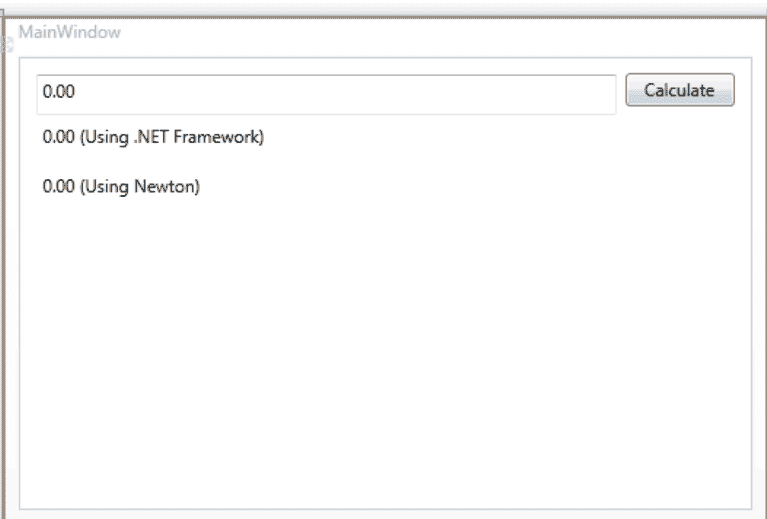

#### 任务 3：使用 .NET Framework 的 `Math.Sqrt` 方法计算平方根

- 1. 为按钮的 `Click` 事件创建一个事件处理程序。
- 2. 在 `calculateButton_Click` 方法中，添加代码读取用户在 `inputText` `TextBox` 控件中输入的数据，然后将其转换为 `double` 值。将该 `double` 值存储在名为 `doubleValue` 的变量中。使用 `double` 类型的 `TryParse` 方法来执行转换。如果用户输入的文本无效，则显示一个内容为“Please enter a double,”的消息框，然后执行 `return` 语句退出该方法。

> 注意：你可以通过使用 `MessageBox.Show` 方法在消息框中显示消息。

- 7. 关闭应用程序并返回 Visual Studio。

#### 任务 4：使用牛顿迭代法计算平方根

- 在 `calculateButton_Click` 方法中，在你上一个任务中添加的代码之后，创建一个名为 `numberDecimal` 的 `decimal` 变量。使用用户在 `inputTextBox` `TextBox` 控件中输入的数据初始化此变量，将其转换为 `decimal` 类型（之前你将其读取为 `double`）。如果用户输入的文本无效，则显示一个内容为“Please enter a decimal,”的消息框，并执行 `return` 语句退出方法。

注意：此步骤是必要的，因为 `decimal` 和 `double` 类型的范围不同。用户输入的有效 `double` 数字可能超出 `decimal` 类型的范围。

- 声明一个名为 `delta` 的 `decimal` 变量，并将其初始化为表达式 `Math.Pow(10, -28)` 的值。这是 `decimal` 类型支持的最小值，你将使用此值来判断使用牛顿法生成的答案何时足够准确。当两个连续估计值之间的差小于此值时，你将停止。

注意：`Math.Pow` 方法返回一个 `double`。在将此值赋值给 `delta` 变量之前，你需要使用 `Convert.ToDecimal` 方法将该值转换为 `decimal`。

- 声明另一个名为 `guess` 的 `decimal` 变量，并用平方根的初始猜值对其初始化。该初始猜值应该是 `numberDecimal` 值除以 2 的结果。

- 再次声明另一个名为 `result` 的 `decimal` 变量。你将使用该变量根据上一次迭代的值为算法的每次迭代生成值。使用表达式 `((numberDecimal / guess) + guess) / 2` 将 `result` 变量初始化为第一次迭代的值。

- 添加一个 `while` 循环来生成更精确的猜值。`while` 循环体应将 `result` 赋值给 `guess`，并使用表达式 `((numberDecimal / guess) + guess) / 2` 生成 `result` 的新值。当 `result` 和 `guess` 之间的差小于等于 `delta` 时，`while` 循环终止。

注意：使用 `Math.Abs` 方法计算 `result` 和 `guess` 之间差的绝对值。使用牛顿算法时，两个变量之间的差在减小过程中可能会在正值和负值之间交替出现。因此，如果不使用 `Math.Abs` 方法，算法可能会带有不准确的结果终止。

- 6. 当循环结束时，在 `newtonLabel` 中格式化并显示 `result` 变量。

#### 任务 5：测试应用程序

- 1. 在 Debug 模式下生成并运行应用程序。使用下表进行测试，并验证使用牛顿法计算的平方根比使用 .NET 方法计算的更准确。

| 测试值 | .NET Framework | 牛顿法 |
| --- | --- | --- |
| 2 | 5 | 5 |
| 10 | 3.162277660168379 | 3.162277660168379 |
| 25 | 5 | 5 |
| 2 | 1.4142135623730951 | 1.4142135623730951 |

### 练习 2：整数转二进制

场景：另一台设备需要以二进制格式显示十进制数据。你被要求编写代码，可以将非负整数转换为二进制表示的字符串，然后显示结果。

将数字值 6 转换为二进制的过程如下：

- 1. 将整数除以 2，保存结果并将余数作为第一位。
- 2. 将上次的结果除以 2，保存结果并将余数作为下一位。
- 3. 重复此过程，直到结果为 0。
- 4. 反序显示保存的字符。例如，生成的字符为“0”、“1”、“1”，因此按“110”的顺序显示。110 是数字 6 的二进制表示。

此练习的主要任务是：

- 创建一个新的 WPF 项目。
- 创建用户界面。
- 添加生成整数二进制表示的代码。
- 测试应用程序。

#### 任务 1：创建一个新的 WPF 项目

- 在 `E:\Labfiles\Lab 2\Ex2\Starter` 文件夹下使用 WPF 模板创建一个名为 IntegerToBinary 的项目。

#### 任务 2：创建用户界面

- 1. 在 `MainWindow` 中添加一个 `TextBox`、`Button` 和 `Label` 控件。将它们放置在窗口的任何位置。
- 2. 使用属性窗口，根据下表中的值设置每个控件的属性。其他属性保持默认值。

| 控件 | 属性 | 值 |
| --- | --- | --- |
| `TextBox` | `Name` | `inputTextBox` |
| | `Height` | 28 |
| | `HorizontalAlignment` | Left |
| | `Margin` | 12,12,0 |
| | `Text` | 0 |
| | `VerticalAlignment` | Top |
| | `Width` | 120 |
| `Button` | `Name` | `convertButton` |
| | `Content` | Convert |
| | `Height` | 23 |
| | `HorizontalAlignment` | Left |
| | `Margin` | 138,12,0 |
| | `VerticalAlignment` | Top |
| | `Width` | 75 |
| `Label` | `Name` | `resultLabel` |
| | `Content` | |
| | `Height` | 28 |
| | `HorizontalAlignment` | Left |
| | `Margin` | 12,41,0 |
| | `VerticalAlignment` | Top |
| | `Width` | 479 |

#### 任务 3：添加代码以生成整数值的二进制表示

- 1. 为按钮的 `Click` 事件创建一个事件处理程序。
- 2. 在 `convertButton_Click` 方法中，添加代码读取用户在 `inputTextBox` `TextBox` 控件中输入的数据，然后将其转换为 `int` 类型。将整数值存储在名为 `i` 的变量中。使用 `TryParse` 方法执行转换。如果用户输入无效，则显示文本为“TextBox does not contain an integer”的消息框，并执行 `return` 语句退出方法。
- 3. 检查用户输入的值是否为负数（整数转二进制的算法不适用于负数）。如果是，则显示文本为“Please enter a positive number or zero”的消息框，并从方法返回。
- 4. 声明一个名为 `remainder` 的整数变量并将其初始化为零。你将使用该变量来存储算法每次迭代中除以 2 的余数。
- 5. 声明一个名为 `binary` 的 `StringBuilder` 变量并实例化。你将使用该变量来构建表示 `i` 的二进制值的位字符串。
- 6. 添加一个 `do` 循环来执行以下任务：
  - a. 计算 `i` 除以 2 的余数，并将该值存储在 `remainder` 变量中。
  - b. 将 `i` 除以 2。
  - c. 将 `remainder` 的值前置到 `binary` 变量正在构建的字符串开头。

当 `i` 小于或等于 0 时终止 `do` 循环。

> 注意：要向 `StringBuilder` 对象前添加数据，请使用 `StringBuilder` 类的 `Insert` 方法，并将数据值插入位置 0 处。

- 7. 在 `binaryLabel` `Label` 控件中显示 `binary` 变量的值。

> 注意：使用 `ToString` 方法获取 `StringBuilder` 对象构建的字符串。设置 `Label` 控件的 `Content` 属性以显示此字符串。


#### 任务 4：测试应用程序

- 1. 以调试模式生成并运行应用程序以测试你的代码。使用下表所示的测试值，并验证二进制表示已生成并显示。

| 测试值 | 预期结果 |
|---|---|
| 0 | 0 |
| 1 | 1 |
| -1 | 出现消息框，内容为“Please enter a positive number or zero” |
| 10.5 | 出现消息框，内容为“TextBox does not contain an integer” |
| Fred | 出现消息框，内容为“TextBox does not contain an integer” |
| 4 | 100 |
| 999 | 1111100111 |
| 65535 | 111111111111111 |
| 65536 | 100000000000000 |

- 2. 关闭应用程序并返回 Visual Studio。

### 练习 3：矩阵乘法

在此练习中，你将创建另一个 WPF 应用程序。该 WPF 应用程序将提供一个用户界面，允许用户提供两个矩阵的数据并存储在矩形数组中。应用程序将计算这两个数组的积并显示它们。

#### 场景

Fabrikam, Inc. 的某些设备开发了涉及矩阵形式存储的数据集的计算。你被要求实现执行矩阵乘法的代码。你决定通过构建一个 WPF 应用程序来测试你的代码，该程序允许用户指定两个矩阵的数据，计算这些矩阵的积，然后查看结果。

矩阵乘法是一个迭代过程，涉及计算一个矩阵中每行的值与另一个矩阵中每列值的乘积之和，如下所示。


此截图显示了一个 $3\times4$ 矩阵乘以一个 $4\times5$ 矩阵。这将产生一个 $3\times5$ 矩阵。

> 注意：第一个矩阵的列数必须与第二个矩阵的行数匹配。本实验为你提供的初始代码确保了这一点总是成立的。

要计算结果矩阵中的每个元素 $x_{a,b}$，你必须计算第一个矩阵第 $a$ 行中每个值与第二个矩阵第 $b$ 列中每个值的乘积之和。例如，要计算结果矩阵中的 $x_{a,b}$，你必须计算第一个矩阵第 $a$ 行中每个值与第二个矩阵第 $b$ 列中每个值的乘积之和。以下是练习的主要任务：

1. 打开 Matrixplication 项目并检查初始代码。
2. 定义矩阵数组并用 Grid 中的数据填充它们。
3. 乘法两个矩阵并计算结果。
4. 显示结果并测试应用程序。

截图显示了完成后的应用程序。

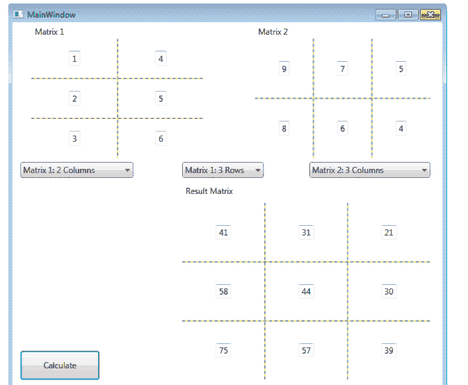

在 `for` 循环体中，添加一个嵌套 `for` 循环，遍历 `matrix2` 数组中的所有的列。使用整数变量 `j` 作为该 `for` 循环的控制变量。留该 `for` 循环体为空。

结果数组中每个单元格的内容通过将 `matrix1` 中由行变量标识的行中的每个项与 `matrix2` 中由列变量标识的列中的每个项相乘并相加得到。你需要另一个循环来执行此计算，并一个变量来存储该 `for` 循环计算的结果。

在内层 `for` 循环中，声明一个名为 `accumulator` 的双精度变量，并将其初始化为零。

- 在声明 `accumulator` 变量之后添加另一个嵌套 `for` 循环。该循环应遍历 `matrix1` 数组中当前行的所有列。使用整数变量 `k` 作为该 `for` 循环的控制变量。留该 `for` 循环体为空。
- 在该 `for` 循环体中，将 `matrix1[cell, row]` 的值与 `matrix2[column, cell]` 的值相乘，然后将结果加到 `accumulator`。
- 在最内层 `for` 循环结束后，将 `accumulator` 中的值存储在结果数组中。该值应存储在列变量和行变量标识的单元格中。

#### 任务 4：显示结果并测试应用程序

- 在 `ButtonCalculate_Click` 方法中，删除注释 TODO Task 4 Display the result。启动代码包含一个名为 `initializeGrid` 的方法，用于在 WPF 窗口的 Grid 控件中显示数组的内容。添加调用该方法的语句。指定该方法应使用网格 `grid3` 显示结果数组的内容。
- 生成解决方案并修正任何错误。
- 在调试模式下运行应用程序。
- 在 `MainWindow` 窗口中，将 Matrix 1 定义为 3×2 矩阵，并将 Matrix 2 定义为 3×3 矩阵。

注意：Matrix 2 矩阵的行数由 Matrix 1 矩阵的列数决定。

- 按照如下表所示为矩阵中的单元格指定值。

| Matrix 1 | | |
| :--- | :--- | :--- |
| 1 | 5 | -9 |
| 3 | -7 | 11 |

| Matrix 2 | | |
| :--- | :--- | :--- |
| 2 | -8 | 14 |
| 4 | -10 | 16 |
| 6 | -12 | 18 |

- 6. 点击 **Calculate**。验证 **Result** 矩阵显示了表中的值。

| Result | | |
| :--- | :--- | :--- |
| -32 | 50 | -68 |
| 44 | -86 | 128 |

- 7. 如下表所示更改 **Matrix 2** 中的数据。

| Matrix 2 | | |
| :--- | :--- | :--- |
| 1 | 0 | 0 |
| 0 | 1 | 0 |
| 0 | 0 | 1 |

- 8. 点击 **Calculate**。验证 **Result** 矩阵显示了表中的值。

| Result | | |
| :--- | :--- | :--- |
| 1 | 5 | -9 |
| 3 | -7 | 11 |

**Matrix 2** 是单位矩阵的示例。当一个矩阵与单位矩阵相乘时，结果与原始矩阵定义的数据相同（这在矩阵中等同于普通算术中数值乘以 1）。在这种情况下，**Result** 矩阵中的值与 **Matrix 1** 中的值相同。

- 9. 再次如表所示更改 **Matrix 2** 中的数据。

| | | |
| :--- | :--- | :--- |
| -1 | 0 | |
| 0 | -1 | 0 |
| 0 | 0 | -1 |

- 10. 点击 **Calculate**。验证 **Result** 矩阵显示了表中的值。

| | | |
| :--- | :--- | :--- |
| -1 | -5 | 9 |
| -3 | 7 | -11 |

这一次，**Result** 中的值与 **Matrix 1** 中的值相同，但每个元素的符号反反了（**Matrix 2** 在矩阵中等于普通算术中的 -1）。

- 11. 关闭 `MainWindow` 窗口。
- 12. 关闭 Visual Studio。

### 实验回顾

复习题

- 你使用了哪个 .NET Framework 类和方法来计算平方根？
- 你使用了哪个 .NET Framework 类来构建表示二进制数的字符串？该类提供了什么用处？
- 你使用了哪种循环结构来遍历 `matrix1` 数组中的所有行？为什么它是一个很好的选择？

### 模块回顾与收获

复习题

1. 如果你声明了一个类型为 `var` 的变量，这意味着什么？
2. 你如何控制表达式中的处理顺序？
3. 数组的目的是什么？
4. 写出使用 `if else` 语句的替代方法。

C# 支持两种类型的方法：

- 实例方法（Instance methods）。这些方法在特定对象的上下文中执行，并可以直接访问属于该对象的数据。例如，在模块 2 中描述的 `ToString` 方法就是实例方法。你通过指定方法所属的对象来调用实例方法。
- 静态方法（Static methods）。这些方法与类型相关，而不是与特定对象相关。静态方法的示例包括模块 2 中描述的 `Convert` 类中的方法，例如 `Convert.ToInt32`。你通过指定类型而不是对象来调用这些方法。

> 注意：模块 7 详细描述了实例方法和静态方法之间的区别。

问题：在使用 C# 开发 .NET Framework 应用程序时，为什么需要使用方法？

### 创建方法

| 方法包含： | |
| :--- | :--- |
| 方法规格定义（访问权限、返回值类型和签名） | |
| 方法体（代码） | |

| 方法签名： | 每个方法的签名在编程类型中必须是唯一的 |
| 名称（帕斯卡命名法 Pascal case） | |
| 参数（驼峰命名法 camel case） | |

```csharp
```


#### Example

```csharp
bool LockReport(string username)
{
    bool success = false;
    // 在此处执行某些处理
    return success;
}
```

#### 关键点

方法包含两个元素：

1. 方法规格定义
2. 方法体

方法规格定义定义了方法的名称、方法可以接受的参数、方法的返回值类型以及方法的访问权限。方法名称和其参数列表的组合被称为方法签名。类中的每个方法都必须具有唯一的签名。

> 注意：方法的访问权限将在模块 7 中进行详细描述。

### 方法的命名

方法的名称与变量名具有相同的语法限制；它必须以字母或下划线开头，并且只能包含字母、下划线和数字字符。记住 C# 是区分大小写的，因此一个类可以包含两个名称相同但仅区别于一个或多个字母大小写的方法，尽管这不被认为是良好的做法。

在选择方法名称时，建议遵循以下最佳实践：

- 使用动词或动词短语来命名方法。这有助于其他开发者理解你的代码结构。
- 使用帕斯卡命名法（Pascal case）。不要以下划线或小写字母开头方法名。

## 实现方法体

方法体是使用任何可用的 C# 编程结构实现的 C# 代码块。方法体括在大括号中。

在方法体内部，你可以定义变量。这些变量仅在方法运行时存在。当方法结束时，它们就会消失。

### 指定参数

参数是方法运行时创建的局部变量，并在调用方法时用指定的值填充。所有方法必须有一个参数列表。你在方法名称后的括号中指定参数。每个参数之间用逗号分隔。如果方法没有参数，你指定一个空参数列表。

对于每个参数，你指定类型和名称。按照惯例，参数使用驼峰命名法（camel case）。

注意，参数名称可以通过 Visual Studio 中的 Microsoft IntelliSense® 暴露给使用你方法的应用程序，因此请保持参数名称含义意义。

### 指定返回值

所有方法都必须有一个返回值。不返回值的方法具有 `void` 返回类型。在定义方法时，你在方法名称之前指定返回值。

当你声明一个返回数据的方法时，必须在方法块中包含一个 `return` 语句。下面的代码示例显示了如何从方法返回字符串。

```csharp
string MyMethod()
{
    return "Hello";
}
```

`return` 语句指定的表达式类型必须与方法的类型相同。当 `return` 语句执行时，该表达式会被求值并传回调用方法的语句。方法随后结束，因此在 `return` 语句之后发生的任何语句都不会执行。

### 方法示例

下面的代码示例显示了一个不接受参数且不返回值的方法。

```csharp
void ClearReport()
{
    // 在此处执行某些处理
}
```

接下来的代码示例显示了一个接受两个字符串参数但不返回值的方法。

```csharp
void CreateReport(string reportName, string reportDescription)
{
    // 在此处执行某些处理
}
```

下面的代码示例显示了一个接受两个字符串参数并使用 `return` 语句返回布尔结果的方法。

```csharp
bool LockReport(string reportName, string userName)
{
    bool success = false;
    // 在此处执行某些处理
    return success;
}
```

> **注意：** 在方法块内声明任何变量仅对该方法块中的其他语句可见。

问题：方法规格定义中的四个元素是什么？

### 扩展阅读

有关方法的更多信息，请参阅 http://go.microsoft.com/fwlink/?LinkId=192905 上的方法（C# 编程指南）页面。

### 调用方法

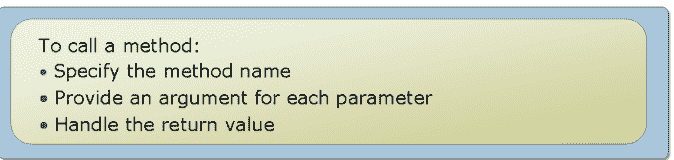

```csharp
Example method
bool LockReport(string reportName, string userName)
{
    ;
}
```

> 注意：
参数按照从左到右的顺序求值

```csharp
Method call
bool isLocked = LockReport("Method Report");
```

#### 关键点

编译器调用调用方法时指定的参数的版本。

这种技术被称为重载（overloading）。只要类型和参数数量不同，就可以创建所需的数量的方法。

### 求值顺序

参数按照严格的从左到右顺序求值。如果评估参数修改了另一个参数，这非常重要。例如，由代码示例定义的方法接受整数参数并将它们相加以返回和。

```csharp
int Sum(int first, int second)
{
    return first + second;
}
```

如果应用程序如下代码所示调用此方法，`i(1)` 的值作为第一个参数，然后 `i` 将增加到 2，`2 + 2` 的值将作为第二个参数。因此，返回给 `result` 的值为 5。

```csharp
int i = 1;
int j = 2;
int result = Sum(i++, i+j);
```

**问题：** 如何调用以下代码中的方法？

```csharp
void DeleteReport(string reportName)
```

### 创建和调用重载方法

- 重载方法：
  - 与现有方法名称相同
  - 与现有方法执行相同的
  - 使用不同的参数执行操作

编译器调用调用方法时指定的参数的版本。

#### 示例

```csharp
void Deposit(decimal amount)
{
    _balance = amount;
}

void Deposit(int dollars, int cents)
{
    _balance += (cents / 100.0m);
}
```

- 有时定义具有不同参数集的方法的多个实现是有用的。方法的每个版本执行相同的操作，它只是使用了不同的数据。.NET Framework 中的一个示例是 `Console` 类的 `WriteLine` 方法。该方法有 19 个不同的版本，你可以用来显示各种类型的数据。例如，下面的代码使用两个 `Console.WriteLine` 语句显示整数值和一个布尔值。注意每个情况下指定的参数类型是不同的。

```csharp
int intData = 99;
bool boolData = true;
...
Console.WriteLine(intData);
Console.WriteLine(boolData);
```

- `Deposit` 方法的签名对于每个实现都是不同的。

注意：仅使用方法重载来提供语义相同的不同方法。

### 定义重载方法

重载方法具有相同的名称，以强调它们的共同意图。然而，每个重载方法必须具有唯一的签名，以便将其与类中方法的其他重载版本区分开来。

方法的签名包含其名称和参数列表；返回类型不是签名的一部分。因此，你不能定义仅在返回类型上不同的重载方法。

下面的代码示例显示了如何在名为 `BankAccount` 的类中定义三个重载的 `Deposit` 方法：

- 第一个 `Deposit` 方法接收一个代表存款金额的小数类型参数。
- 第二个 `Deposit` 方法接收一个代表存款金额的字符串类型参数。
- 第三个 `Deposit` 方法接收两个参数，分别代表以美元和分计算存款金额。

```csharp
public class BankAccount
{
    private decimal _balance;

    public void Deposit(decimal amount)
    {
        _balance += amount;
    }

    public void Deposit(string amount)
    {
        _balance += decimal.Parse(amount);
    }

    public void Deposit(int dollars, int cents)
    {
        _balance += dollars + (cents / 100.0m);
    }
}
```

当你调用 `Deposit` 方法时，编译器通过检查你指定的参数的数量和类型来确定调用哪个版本。

**问题**：方法重载是指什么意思？

### 扩展阅读

有关方法重载的更多信息，请参阅 http://go.microsoft.com/fwlink/?LinkId=192906 上的成员重载页面。

## 使用参数数组

如果一个方法可以接受变数量的参数，则重载可能不可行或不利。

```csharp
Example
int Add(params int[] data)
{
    int sum = 0;
    for (int i = 0; i < data.Length; i++)
    {
        sum += data[i];
    }
    return sum;
}
```

```csharp
Method call
int sum = Add(99, 2, 55, -26);
```

#### 关键点

重载方法是一种实用的技术，但它并不总是恰当的策略。例如，重载一个可以接受变数量参数的方法可能并不总是可行，特别是当参数数量在理论上没有限制时。例如，假设你想定义一个名为 `Add` 的方法，用于计算一组整数值的和。你可以像下面的代码示例所示定义该方法的重载版本。

```csharp
int Add(int one, int two)
{
    return one + two;
}
```

```csharp
int Add(int one, int two, int three)
{
    return one + two + three;
}
```

```csharp
int Add(int one, int two, int three, int four)
{
    return one + two + three + four;
}
```

这种方案在你想要相加两个、三个或四个整数时效果良好，但如果你需要相加五个、六、七个甚至 100 个整数呢？你可以定义 99 个重载版本，但你应该进行到什么程度呢？

解决此问题的方法之一是将参数作为数组传递给方法。理论上，数组的大小没有限制（在实践中，数组的最大大小取决于运行应用程序的计算机上的可用内存）。使用这种方法，你可以定义一个如下代码示例所示的 `Add` 单一版本。

```csharp
int Add(int[] data)
{
    int sum = 0;
    for (int i = 0; i < data.Length; i++)
    {
        sum += data[i];
    }
    return sum;
}
```

这种方法的缺点是，你将不得不手动声明并向数组填充数据，然后在每次调用该方法时将数组传递给该方法，如下代码示例所示。

```csharp
int[] myData = new int[...];
myData[0] = 99;
myData[1] = 2;
myData[2] = 55;
myData[3] = -26;
int sum = addObject.Add(myData);
```

### 使用 params 关键字

`params` 关键字提供了一种实现这种技术的简便方法。当你定义一个带有 `params` 关键字前缀数组参数的方法时，C# 编译器可以自动生成代码，根据调用方法时指定的参数集创建一个数组。下面的代码示例显示了如何使用 `params` 关键字定义方法，以及你如何使用变数量的参数调用此方法。

```csharp
int Add(params int[] data)
{
    int sum = 0;
    for (int i = 0; i < data.Length; i++)
    {
        sum += data[i];
    }
    return sum;
}
```

注意，与 `Add` 方法的唯一区别是使用了 `params` 关键字。当调用 `Add` 方法时，参数会被求值。如果它们的类型与 `params` 关键字指定的数组类型匹配，它们将被收集到一个数组中，并将该数组作为参数传递给 `Add` 方法。

> 注意：如果存在匹配指定类型和参数数量的重载版本，它将优先于接收 `params` 数组的版本。

你可以使用 `params` 关键字使用参数列表调用方法，也可以直接传递数组。下面的代码显示了这两种方法：

```csharp
int sum1 = Add(1, 2, 3, 4, 5);
int[] data = new int[] { 6, 7, 8 };
int sum2 = Add(data);
```

### 测试方法

```csharp
int Calculate(int operandOne, int operandTwo)
{
    int result = 0;
    // 执行某些计算。
    return result;
}

[TestMethod]
public void CalculateTest()
{
    Program target = new Program();
    int operandOne = 0;
    int operandTwo = 0;
    int expected = 0;
    int actual;
    actual = target.calculate(operandOne, operandTwo);
    Assert.AreEqual(expected, actual);
    ...
}
```


#### 关键点

在构建任何应用程序时，验证应用程序的运行情况是否符合预期应该是开发过程的一部分，而不应被忽视。此外，在修改代码后能够快速、方便地重复相同的测试，是一项重要的软件工程原则。

Visual Studio 2010 中的单元测试可以帮助简化测试过程，并确保你的代码提供了足够的覆盖率，从而使错误数量处于低水平。单元测试通过实现这一点，允许你创建一系列可以随时运行的测试，并为你提供反馈，指示你的应用程序是否仍按预期运行。

### 单元测试的优势

单元测试提供了许多许多优势，包括：

- 它们提供即时反馈。
- 它们可以帮助你编写文档，让其他开发者更容易理解你的代码。
- 它们允许你对代码进行持续的回归测试，这有助于减少新 bug 的引入。
- 它们可以帮助减少可靠地重复测试所需的精力。

### 创建单元测试

以下步骤假设你有一个与以下代码示例类似的方法。

```csharp
public int Calculate(int operandOne, int operandTwo)
{
    int result = 0;
    // 执行某些计算；
    return result;
}
```

1. 在 Visual Studio 2010 中，在包含你的方法的编辑器窗口中，右键点击，然后点击“创建单元测试”（Create Unit Tests）。

2. 在“单元测试”对话框中，执行以下操作，然后点击“确定”：
   - 在“当前选择”（Current selection）列表中，展开节点，然后选择你想要创建测试的方法。
   - 在“输出项目”（Output project）列表中，确保选择了“创建一个新的 Visual C# 测试项目”（Create a new Visual C# test project）。

注意：如果你的解决方案已经包含单元测试项目，你可以在“输出项目”列表中选择该项目。

3. 在“新建测试项目”（New Test Project）对话框中，在“为新项目输入名称”（Enter name for your new project）框中输入测试项目的名称，然后点击“创建”（Create）。

当你点击“创建”时，Visual Studio 2010 会根据你指定的名称创建一个新的单元测试项目，并将该项目添加到解决方案中。单元测试项目包含一个包含多个成员的文件，其中最重要的就是骨架测试方法。

下面的代码示例显示了 Visual Studio 2010 用于测试 `Calculate` 方法创建的方法。

```csharp
/// <summary>
/// 对 Calculate 的测试
/// </summary>
[TestMethod]
public void CalculateTest()
{
    Program target = new Program(); // TODO: 初始化为
    // 适当的值。
    int operandOne = 0; // TODO: 初始化为适当的值。
    int operandTwo = 0; // TODO: 初始化为适当的值。
    int expected = 0; // TODO: 初始化为适当的值。
    int actual;
    actual = target.Calculate(operandOne, operandTwo);
    Assert.AreEqual(expected, actual);
    Assert.Inconclusive("验证此测试方法的正确性");
}
```


`CalculateTest` 方法包含用于执行以下任务的代码：

- 初始化包含 `Calculate` 方法的类。
- 初始化两个 `int` 参数。
- 为返回值初始化一个 `int` 参数。
- 传递两个 `int` 参数并调用 `Calculate` 方法。
- 使用 `Assert.AreEqual` 方法调用来确定 `Calculate` 方法返回的结果是否符合预期。

Visual Studio 2010 生成的方法存根（method stub）为确保方法按预期运行提供了良好的起点。

### 运行单元测试

在创建单元测试项目并定义测试方法后，你可以在 Visual Studio 中运行测试。要执行此操作，请执行以下任务：

- 在 Visual Studio 2010 中，在**测试**（Test）菜单上，指向**窗口**（Windows），然后点击**测试视图**（Test View）。

“测试视图”窗口列出了项目中的所有测试方法，并提供了允许你运行测试的控件。

- 在“测试视图”窗口中，选择你想要运行的测试，右键点击，然后点击**运行选择**（Run Selection）。

如果你想在运行测试时调试代码，请点击**调试选择**（Debug Selection）。

问题：为什么在开发 .NET Framework 应用程序时想要使用单元测试？

### 演示：重构和测试一个方法

在此演示中，你将：

- 打开现有应用程序并查看现有代码
- 重构现有的代码块
- 为 `GenerateRandomNumbers` 方法生成单元测试
- 检查自动生成的单元测试方法
- 修改自动生成的单元测试方法
- 运行单元测试

#### 关键点

- 打开现有应用程序并查看现有代码。
- 重构现有的代码块。
- 为 `GenerateRandomNumbers` 方法生成单元测试。
- 检查自动生成的单元测试方法。
- 修改自动生成的单元测试方法。
- 运行单元测试。

### 演示步骤

1. 打开现有应用程序并查看现有代码。
2. 在 Visual Studio 2010 中，重构解决方案。
3. 在编辑器窗口中，检查 `Main` 方法的代码。
4. 选择 `Main` 方法的内容，右键点击，指向“重构”，然后点击“提取方法”。
5. 在“提取方法”对话框中输入 `GenerateNumbers` 并点击“确定”。
6. 在编辑器窗口中，右键点击 `GenerateNumbers` 方法，然后“创建单元测试”。
7. 在“单元测试”对话框中，点击“确定”。
8. 在“新建测试项目”框中，点击“创建”。
9. 在编辑器窗口中，导航到 `Tests` 类，导航到 `GenerateRandomTest` 方法。
10. 对 `GenerateTest` 方法进行以下更改：
    - 将变量设置为 100。
    - 将 `numberOfnumbers` 变量设置为 999。
    - 删除 `expected = null; // TODO: 初始化为适当的值` 行。
    - 将 `Assert.AreEqual(expected, actual);` 行替换为 `Assert.AreEqual(1000, actual.Length);`。
    - 删除 `Assert.Inconclusive("验证此测试方法的正确性");` 行。

你的代码应类似于以下示例：

```cs
public void GenerateRandomTest()
{
    int min = 0; // TODO: 初始化为适当的值
    int max = 100; // TODO: 初始化为适当的值
    int numberOfnumbers = 999;
    // TODO: 初始化为
    // 适当的值
    int[] actual;
    actual = Program_Accessor.GenerateNumbers(min, max, numberOfnumbers);
    Assert.AreEqual(1000, actual.Length);
}
```

11. 生成解决方案。
12. 打开测试视图窗口，运行 `GenerateRandomTest` 测试，并查看测试结果中的结果。
13. 在编辑器窗口中，导航到 `GenerateRandomTest` 方法，然后将 `numberOfnumbers` 变量设置为 1000。
14. 运行 `GenerateRandomTest` 测试，并查看测试结果中的结果。

**问题：** 说明一种你可以查看和启动单元测试的方法。

### 第 2 课：指定可选参数和输出参数

- 什么是可选参数？
- 使用命名参数调用方法
- 什么是输出参数？

你已经看到可以使用参数数组定义一个接受可变数量参数的方法。然而，有时你想要定义一个具有固定数量参数的方法，但允许应用程序仅指定它所需要的参数。你可以通过定义一个接受可选参数的方法来实现这种功能。

默认情况下，当你调用方法时提供的任何参数都是按值传递到方法指定的参数中的。当方法完成时，将被销毁，你对这些参数值所做的任何更改都会丢失。输出参数提供了一种机制，允许你将数据从方法传回调用该方法的代码。

### 目标

完成本课程后，你将能够：

- 解释可选参数的作用。
- 描述如何使用命名参数调用方法。
- 解释输出参数的作用。

### 什么是可选参数？

可选参数允许你定义方法并为参数列表中的参数提供默认值：

- 它们有助于与支持可选参数的其他技术进行互操作
- 在不适合使用重载的情况下，它们可以提供替代实现方案

#### 示例

```cs
void MyMethod(
    int intData, float floatData, int moreIntData = 99
    ...
);
```

```cs
// 为三个参数都提供了参数
MyMethod(10, 123.45, 99);
```

```cs
// 为前两个参数提供了参数
MyMethod(100, 54.321);
```

#### 关键点

通过定义重载方法，你可以实现带有不同参数的不同版本的方法。当你构建使用重载方法的应用程序时，编译器会确定应该使用每个方法的哪个特定实例来满足每次方法调用。

然而，开发者可以使用其他不遵循这些规则的语言和技术来构建 Windows 应用程序和组件。C# 以及其他为 .NET Framework 设计的语言的一个关键特性是能够与使用其他技术编写的应用程序和组件协作。Windows 使用的主要技术之一是组件对象模型 (COM)。COM 不支持重载方法，而是使用可以接受可选参数的方法。为了方便将 COM 库和组件集成到 C# 解决方案中，C# 也支持可选参数。

可选参数在其他情况下也很有用。当由于参数类型变化不足以让编译器区分不同的实现而无法使用重载时，它们提供了一个紧凑且简单的解决方案。例如，考虑以下代码示例中的方法。

```cs
void MyMethod(
  int intData, float floatData, int moreIntData)
{
  ...
}
```

`MyMethod` 方法接收三个参数：两个 `int` 参数和一个 `float` 参数。如果你想提供一个只接受两个参数（`intData` 和 `floatData`）的 `MyMethod` 实现，你可以重载该方法，如下代码示例所示。

```cs
void MyMethod(int intData, float floatData)
{
  ...
}
```

如果你编写了调用 `MyMethod` 方法的语句，可以提供两个或三个适当类型的参数，编译器将使用类型信息来决定调用哪个重载，如下代码示例所示。

```cs
int arg1 = 99;
float arg2 = 100.0F;
int arg3 = 101;

// 调用带有三个参数的重载
DoWorkWithData(arg1, arg2, arg3);

// 调用带有两个参数的重载
DoWorkWithData(arg1, arg2);
```

然而，假设你想实现两个只接受第一个和第三个参数的 `MyMethod` 版本。你可能尝试按如下示例所示实现它们。

```cs
void MyMethod(int intData)
{
  ...
}

void MyMethod(int moreIntData)
{
  ...
}
```

然而，这两个重载具有相同的签名，因此代码将无法编译，而是生成错误“类型 `typename` 已定义具有相同参数类型的成员 `MyMethod`”。

使用可选参数可以帮助解决这个问题。

### 定义可选参数

可选参数允许你定义方法并为参数列表中的参数提供默认值。你通过使用赋值运算符指定默认值。

以下示例显示了如何定义带有可选参数的方法。所有其他参数都是强制性的。

```cs
void MyMethod(int intData, float floatData, int moreIntData = 99)
{
  ...
}
```

使用可选参数时，必须在任何可选参数之前指定所有强制性参数。以下代码示例会导致编译器错误。

```cs
void MyMethod(int intData, float floatData = 101.1F, int moreIntData)
{
  ...
}
```

### 使用可选参数调用方法

你可以像调用任何其他方法一样调用带有可选参数的方法；指定方法名并提供任何必要的参数。与带有可选参数的方法的区别在于，你可以省略相应的参数，方法在运行时将使用默认值。在第一个代码示例中，第一次调用 `MyMethod` 为所有三个参数提供了值。

第二次调用仅指定了两个参数，这些值被应用于第一个和第二个参数。如下代码示例所示，`moreIntData` 参数在方法运行时将接收默认值 99。

```cs
// 为三个参数都提供了参数
MyMethod(10, 123.45F, 99);

// 仅为前两个参数提供了参数
MyMethod(100, 54.321F);
```

**问题：** 在定义带有可选参数的方法时，必须按什么顺序指定参数？

### 扩展阅读

有关可选参数的更多信息，请参阅 [命名和可选参数 (C# 编程指南)](http://go.microsoft.com/fwlink/??LinkId=192909)。

### 使用命名参数调用方法

| 特性 | 描述 |
| :--- | :--- |
| 通过名称指定参数 | 使用 `参数名: 值` 语法 |
| 参数可以以任何顺序出现 | 顺序可以与方法签名不同 |
| 省略的参数 | 如果参数是可选的，则接收默认值 |

```cs
void MyMethod(
  int intData, float floatData = 101.1F, int moreIntData = 99)
{
  ...
}

// 使用命名参数调用方法
MyMethod(moreIntData: 100, intData: 10);
```

#### 关键点

传统上，调用方法时，参数的顺序和位置应与方法签名对应。如果参数错位且类型不匹配，将得到编译错误。

在 C# 中，你可以通过名称指定参数，并提供用冒号分隔的参数名和值。以下示例显示了语法。

```cs
// 方法声明
void MyMethod(int first, double second, string third)
{
  ...
}

// 使用命名参数调用方法
MyMethod(third: "Hello", first: 1234, second: 12.12);
```

在结合可选参数使用命名参数时，你可以轻松地省略参数。这些参数将接收它们的默认值。然而，如果你省略了任何强制性参数，你的代码将无法编译。

你可以混合使用位置参数和命名参数。但你必须在命名参数之前指定所有位置参数。

**问题：** 使用命名参数的语法是什么？

### 什么是输出参数？

| 特性 | 描述 |
| :--- | :--- |
| 输出参数 | 实现从方法传回值 |
| 语法 | 在参数列表中使用 `out` 关键字 |
| 调用 | 指定作为 `out` 参数的变量 |

```cs
void MyMethod(int first, double second, out int data)
{
  ...
  data = 99;
}
```

```cs
int value;
MyMethod(10, 101.1F, out value);
// value = 99
```


#### 关键点

方法可以指定返回类型，并使用`return`语句将值传回调用它的代码。输出参数允许从方法返回更多数据。当你向方法添加输出参数时，方法体预期为该参数赋值。当方法完成后，输出参数的值将赋值给方法调用中指定的相应参数的变量。

方法可以拥有任意数量的输出参数。

有关输出参数的更多信息，请参阅输出参数修饰符（C# 参考）页面，网址为`http://go.microsoft.com/fwlink/?LinkId=192910`。

### 实验：方法的声明与调用

- 练习 1：使用欧几里德算法计算两个整数的最大公约数
- 练习 2：计算三个、四个或五个整数的最大公约数
- 练习 3：比较两种算法的效率
- 练习 4：图形化显示结果
- 练习 5：求解线性方程组（可选）

登录信息

| 虚拟机 | 10266A-GEN-DEV |
| :--- | :--- |
| 用户名 | Student |
| 密码 | Pa$$word |

**预计时间：75 分钟**

### 目标

完成本实验后，你将能够：

- 创建并调用方法。
- 定义方法重载方法。
- 定义接收输出参数的方法。
- 定义接收可选参数的方法并使用命名参数调用它们。

### 引言

在本实验中，你将创建方法来计算两个正整数的最大公约数 (GCD)。你将为其中一个方法创建一个重载版本，该版本可以接受五个整数参数。你将修改方法以接收一个输出参数，返回执行计算所需的时间。最后，你将使用一个带有可选参数的方法通过显示简单的图表来显示方法的相对性能。

### 实验设置

对于本实验，你将使用提供的虚拟机环境。在开始实验之前，你必须：

- 启动`10266A-GEN-DEV`虚拟机，然后使用以下凭据登录：
- 用户名：`Student`
- 密码：`PaSSw0rd`

### 实验场景


Fabrikam, Inc. 生产一系列高度敏感的设备，这些设备可以反复测量物体并捕获数据。

各种科学仪器执行的某些计算依赖于使用质数生成的统计信息。你们的一位同事实现了一个生成质数的方法，但其性能不足以满足将要使用的设备的需求。软件分析师检查了代码，并确定通过使用更快的 GCD 算法可以进行改进。你被要求实现一个测试应用程序，该程序可以使用不同的已知算法计算一组数字的 GCD，并比较它们的相对性能。

# 练习 1：使用欧几里德算法计算两个整数的最大公约数

在此练习中，你将编写一个实现欧几里德算法的方法，计算作为参数传递的两个整数的 GCD。你将使用 Windows® Presentation Foundation (WPF) 测试此方法，该应用程序将提示用户输入参数值并显示结果。你还将生成一个单元测试，以便对该方法进行自动化测试

#### 场景

Fabrikam, Inc. 设备收集的某些数据出于安全考虑必须进行加密。加密算法通常利用质数。生成质数的算法的一部分需要计算两个数字的 GCD。

两个数字的 GCD 是能够恰整除这两个数字的最大数字。例如，15 和 12 的 GCD 是 3。3 是恰整除 15 和 12 的最大整数。

使用欧几里德算法寻找 2806 和 345 的 GCD 过程如下：

- 让 345 除去 2806，直到剩余部分小于 345 并存储余数。
  在此例中，2806 = (8 × 345) + 46，所以余数是 46。
- 让余数 (46) 除去 345，直到剩余部分小于 46 并存储余数。
  345 = (7 × 46) + 23，所以余数是 23。
- 让 23 除去 46，直到剩余部分小于 23 并存储余数。
  46 = (2 × 23) + 0

余数为 0，因此 2806 和 345 的 GCD 是上一个存储的余数的值，在本例中该值为 23。

此练习的主要任务如下：

- 打开启动项目（starter project）。
- 实现欧几里德算法。
- 测试`FindGCDEuclid`方法。
- 为`FindGCDEuclid`方法创建单元测试。

#### 任务 1：打开启动项目

1. 以`Student`身份使用密码`PaSSw0`登录`10266A-GEN-DEV`虚拟机。
2. 打开 Visual Studio 2010。
3. 从`E:\Labfiles\Lab 3\Snippets`文件夹导入代码片段。
4. 打开`E:\Labfiles\Lab 3\Ex1\Starter`文件夹中的 Euclid 解决方案。

# 任务 2：实现欧几里德算法

- 1. 在 Visual Studio 中查看任务列表（Task List）。
- 2. 使用任务列表窗口导航到`TODO Exercise 1, Task 2`任务。该任务位于`GCDAlgorithms class.cs`文件。
- 3. 在`GCDAlgorithms`类中，删除`TODO Exercise 1, Task 2`注释并声明一个公共静态方法`FindGCDEclid`。该方法应接受两个名为`a`和`b`的整数参数，并返回一个整数值。
- 4. 在`FindGCDEclid`方法中，添加代码计算并返回`a`和`b`的 GCD。欧几里德算法如下：
  - a. 如果`a`为 0，则`a`和`b`的 GCD 为`b`。
  - b. 否则，从`a`中减去`b`（当`a > b`时）或从`b`中减去`a`（当`b > a`时），直到`b`为 0。
  - c. 两个参数的 GCD 是新的`a`值。

# 任务 3：测试`FindGCDEclid`方法

- 1. 使用任务列表窗口导航到`TODO Exercise 1, Task 3`任务。该任务位于`MainWindow.xaml.cs`文件。这是用于测试`FindGCDEclid`方法并显示结果的 WPF 窗口后台代码文件。
- 2. 在`GCDAlgorithms`类中调用静态方法`FindGCDEclid`并显示结果。使用`firstNumber`和`secondNumber`作为参数。
- 3. 生成解决方案并修正任何错误。
- 4. 运行 Divisor 应用程序。
- 5. 在 GreatestDivisor 应用程序中，在第一个文本框中输入 2806
- 6. 在第二个文本框中输入 345，然后点击 Find GCD (Integers)。应显示如下所示的结果：

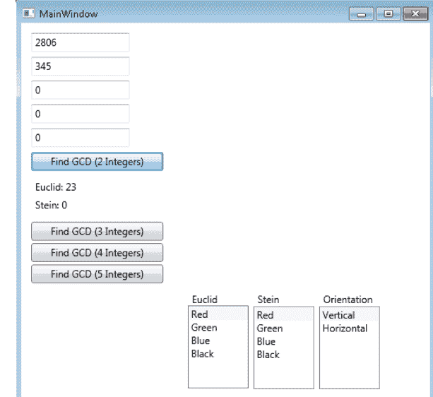

- 7. 使用窗口计算表中指定值的 GCD，并验证结果是否与表匹配。

| 第一个数字 | 第二个数字 | 结果 |
| :--- | :--- | :--- |
| 0 | 0 | 0 |
| 0 | 10 | 10 |
| 25 | 10 | 5 |
| 25 | 100 | 25 |
| 26 | 100 | 2 |
| 27 | 100 | 1 |

- 8. 关闭 GreatestDivor 应用程序。

# 任务 4：为`FindGCDEclid`方法创建单元测试

- 1. 打开`GCDAlgorithms.cs`文件。
- 2. 在`GCDAlgorithms`类中为`FindGCDEclid`方法创建单元测试。创建一个名为 GCD Test Project 的测试项目来存放单元测试。
- 3. 在 GCD Test 项目的`GCDAlgorithmsTest.cs`文件找到`FindGCDEuclidTest`方法。
- 4. 在`FindGCDEuclidTest`方法中将`a`设置为 2806，将变量设置为 345，将预期变量设置为 23，并删除`Assert.Inconclusive`方法调用。
- 5. 打开测试视图（Test View）窗口，如果单元测试未列出，请刷新。
- 6. 运行`FindGCDEuclid`测试并验证测试是否成功运行。

# 练习 2：计算三个、四个或五个整数的最大公约数

在此练习中，你将创建该方法的重载版本，这些版本可以接受三个、四个或五个整数参数，并计算所有这些参数的 GCD。

#### 场景

Fabrik, Inc. 构建的设备使用的某些加密算法需要计算一组数字的最大公约数（GCD），而不仅仅是两个数字。你被要求提供欧几里得算法的实现，能够计算三个、四个或五个整数的 GCD。

寻找三个数字`x`、`y`和`z`的 GCD 的过程非常简单：

- 1. 使用两个数字的算法计算`x`和`y`的 GCD，并将结果存储在变量`r`中。
- 2. 计算`r`和`z`的 GCD。结果即为`x`、`y`和`z`的 GCD。

你可以将相同的技术用于计算四个或五个整数的 GCD：

- `GCD(w, x, y, z) = GCD(w, GCD(x, y, z))`
- `GCD(v, w, x, y, z) = GCD(v, GCD(w, x, y, z))`

本次练习的主要任务如下：

- 1. 打开启动项目。
2. 向`GCDAlgorithms`类中添加重载方法。
3. 测试这些重载方法。
4. 为这些重载方法创建单元测试。

#### 任务 1：打开启动项目

- 打开`E:\Labfiles\Lab 3\Ex2\Starter`文件夹下的 Euclid 解决方案。
此解决方案包含练习 1 代码的完整副本。

# 任务 2：向`GCDAlgorithms`类中添加重载方法

- 1. 在 Visual Studio 中，查看任务列表（Task List）。
2. 使用任务列表窗口导航到`TODO Exercise 2, Task 2`任务。
3. 在`GCDAlgorithms`类中，删除`TODO Exercise 2, Task 2`注释，然后声明`FindGCDEclid`方法的重载版本。该方法应接受三个整数参数`a`、`b`和`c`，并返回一个整数值。

4. 在新方法中，添加代码使用原始的`FindGCDEEuclid`方法寻找参数`a`和`b`的 GCD。将结果存储在新变量`d`中。

5. 再次调用原始的`FindGCDEEuclid`方法来寻找变量`d`和参数`c`的 GCD。将结果存储在新新变量`e`中。

6. 添加代码以从`FindGCDEEuclid`方法返回参数`e`。

7. 声明另一个`FindGCDEclid`方法的重载版本。该方法应接受四个整数参数`a`、`b`、`c`和`d`，并返回一个整数值。使用其他的`FindGCDEclid`重载方法寻找这些参数的 GCD 并返回结果。

8. 声明另一个`FindGCDEclid`方法的重载版本。该方法应接受五个整数参数`a`、`b`、`c`、`d`和`e`，并返回一个整数值。使用其他的`FindGCDEclid`重载方法寻找这些参数的 GCD 并返回结果。

#### 任务 3：测试重载方法

- 1. 使用任务列表导航到`TODO Exercise 2, Task 3`任务。

当你想要测试代码时，此任务位于 WPF 窗口的代码中。

- 2. 删除`TODO Exercise 2, Task 3`注释，找到`else if (sender == findGCD3)`块，并将设置`resultEuclid`标签`Content`属性为 "N/A" 的语句修改如下：

- a. 调用接受三个参数的`FindGCDEEuclid`重载，并将变量`firstNumber`、`secondNumber`和`thirdNumber`作为参数传递。

- b. 在`resultEuclid`标签控件中显示结果。结果的格式应如下代码所示。

```
Euclid:result
```

- 3. 找到`else if (sender == findGCD3)`块、`else if (sender == findGCD4)`块和`else if (sender == findGCD5)`块，修改设置`resultEuclid`标签`Content`属性为 *N/A* 的语句。使用`firstNumber`、`secondNumber`、`thirdNumber`和`fifthNumber`变量作为参数调用相应的`FindGCDEclid`重载。在`resultEuclid`标签控件中显示结果。

- 4. 生成解决方案并修正任何错误。

- 5. 运行`GreatestCommonDivisor`应用程序。

- 6. 在`GreatestCommonDivisor`应用程序的 MainWindow 窗口中输入值 7396 1978 1204 430 258，然后点击 **Find GCD (5 Integers)**。

验证显示了结果 **86**。

- 7. 使用窗口计算下表指定数值的 GCD，并验证显示的结果与表中的结果匹配。

| 第一个数字 | 第二个数字 | 第三个数字 | 第四个数字 | 第五个数字 | 结果 |
|---|---|---|---|---|---|
| 2806 | 345 | 0 | 0 | | 23 |
| 0 | 0 | 0 | 0 | | 0 |
| 0 | 0 | 0 | 0 | 1 | 1 |
| 12 | 24 | 36 | 48 | 60 | 12 |
| 13 | 24 | 36 | 48 | 60 | 1 |
| 14 | 24 | 36 | 48 | 60 | 2 |
| 15 | 24 | 36 | 48 | 60 | 3 |
| 16 | 24 | 36 | 48 | 60 | 4 |
| 0 | 24 | 36 | 48 | 60 | 12 |

- 8. 关闭`GreatestCommonDivisor`应用程序。

#### 任务 4：为重载方法创建单元测试

- 1. 在 Visual Studio 窗口中，查看任务列表。

- 2. 使用任务列表导航到`TODO Exercise 2, **Task 4**`任务。

- 3. 删除 **TODO Exercise 2, Task 4** 并为名为 **FindGCDEclidTest1** 的测试方法添加注释。

- 4. 在 **FindGCDEclidTest1** 方法中，声明变量`a`、`b`、`c`和`expected`，并分别为它们赋值 **7396, 1978, 1204** 和 **86**。

- 5. 声明名为`actual`的变量，并分配调用`FindGCDEclid`方法的结果。使用变量`a`、`b`和`c`作为参数。

- 6. 调用`Assert`类的静态方法`AreEqual`。

- 7. 重复步骤 4–6，创建另外两个测试方法`FindGCDETest2`和`FindGCDETest3`。使用值 7396, 1978, 1204, 430 和 258 进行`FindGCDETest2`和`FindGCDETest3`。结果应为 86。

- 8. 打开测试窗口。

- 9. 运行`FindGCDETest2`和`FindGCDETest3`以验证。

### 练习 3：比较算法的效率

在此练习中，你将编写另一种实现 Stein 算法的方法。你听说它比欧几里得算法更高效。你将通过比较耗时来验证这一假设。

场景

Stein 算法是寻找两个数字 GCD 的另一种算法。以下步骤描述了使用 Stein 算法寻找两个数字 GCD 的过程：

- 1. 如果`u`和`v`均为偶数，`gcd(u, v) = 2gcd(u/2, v/2)`，因为 2 是公约数。
- 2. 如果`u`是偶数而`v`是奇数，`gcd(u, v) = gcd(u/2, v)`，因为 2 不是公约数。
- 3. 同样，如果`u`是奇数而`v`是偶数，`gcd(u, v) = gcd(u, v/2)`。
- 4. 如果`u`和`v`均为奇数，当`u ≥ v`，`gcd(u, v) = gcd((u - v)/2, v)`。如果两者均为奇数且`u < v`，`gcd(u, v) = gcd((v - u)/2, u)`。这些是简单算法（每一步都使用减法）与上述步骤 4 的结合。由于两个奇数之差是偶数，除以 2 会产生整数。
- 5. 重复步骤 3–5，直到`u = 0`。在任何情况下，结果都是`2kv`，其中`k`是步骤 2 中找到的2 的公因子个数。

同样，`gcd(0, v) = v`，因为任何数都能除以零。`gcd(u, 0) = u`。`gcd(0, 0)`通常没有定义，但方便起设置`gcd(0, 0) = 0`。

本次练习的主要任务如下：

- 1. 打开启动项目。
2. 实现 Stein 算法。
3. 测试`FindGCDStein`方法。
4. 添加代码测试算法的性能。

#### 任务 1：打开启动项目

- 打开`E:\Labfiles\Lab 3\Ex3\Starter`文件夹下的 Stein 解决方案。
此解决方案包含练习 2 代码的完整副本。

# 任务 2：实现 Stein 算法

- 1. 打开`GCDAlgorithms.cs`文件。
2. 在`GCDAlgorithms`类的末尾，删除 TODO 注释并声明公共静态方法`FindGCDStein`。该方法接受两个名为`u`和`v`的整数参数，并返回一个整数值。
3. 在`FindGCDStein`方法中，添加下方代码示例中的代码，计算并返回用户指定数值的 GCD。

## 方法的声明与调用

通过 Stein 算法处理参数`u`和`v`。你可以手动输入此代码，也可以使用 Mod03Stein 代码片段。

> 注意：对于本次练习而言，你并不需要理解这些代码。但是，如果你有时间，你可能希望将此方法与练习场景中描述的算法进行比较。该代码使用左移（`<<`）和右移（`>>`）运算符来执行对 2 的快速乘法和除法运算。如果你将一个整数值左移一位，结果等同于将该整数乘以 2。同样地，如果你将一个整数值右移一位，结果等同于将该值除以 2。此外，如果`u`在两个值之间执行位或逻辑运算。因此，如果`u`或`v`中任何一个为 0，表达式`u | v`是返回非零值的快速方法，或者当两者都为 0 时。同样地，`&`运算符执行位与逻辑运算，因此表达式`u & 1`是判断`u`的值是奇数还是偶数的快速方法。

```csharp
static int FindGCDStein(int u, int v) {

    int k;

    // 步骤 1.

    // gcd(0, v) = v，因为任何数都能整除 0，
```


// `v` 是能除 `v` 的最大数。

// 同样，`gcd(u, 0) = u`。`gcd(0, 0)` 通常没有定义，

// 但将 `gcd(0, 0)` 设置为 `0` 是方便的。

return `u | v`;

// 步骤 2.

// 如果 `u` 和 `v` 都是偶数，那么 `gcd(u, v) = 2*gcd(u/2, v/2)`,

// 因为 `2` 是一个公因子。

for (`k = 0; ((u | v) & 1) == 0; ++k`) {

    `u >>= 1`;

    `v >>= 1`;

}

// 步骤 3.

// 如果 `u` 是偶数而 `v` 是奇数，那么 `gcd(u, v) = gcd(u/2, v)`,

// 因为 `2` 不是公因子。

// 同样，如果 `u` 是奇数而 `v` 是偶数，

// 则 `gcd(u, v) = gcd(u, v/2)`。

while ((`u & 1`) == 0) {

    `u >>= 1`;

}

```csharp
// 步骤 4.

// 如果 `u` 和 `v` 都是奇数，且 `u >= v`，

// 那么 `gcd(u, v) = gcd((u - v)/2, v)`.

// 如果两个都是奇数且 `u < v`，则 `gcd(u, v) = gcd((v - u)/2, u)`.

// 这些是简单欧几里德算法一步的组合，

// 该算法在每一步都使用减法，

// 以及上述步骤 3 的应用。

// 除以 2 的结果是一个整数，因为

// 两个奇数的差是偶数。

do {

    while ((`v & 1`) == 0) // 循环 x

        `v >>= 1`;

    // 现在 `u` 和 `v` 都是奇数，所以 `diff(u, v)` 是偶数。

    // 设 `u = min(u, v)`, `v = diff(u, v)/2`。

    if (`u < v`) {

        `v -= u`;

    } else {

        int `diff = u - v`;

        `u = v`;

        `v = diff`;

    }

    `v >>= 1`;

// 步骤 5.

// 重复步骤 3-4 直到 `u = v`，或者（再过一步）

// 直到 `u = 0`。

// 在任何情况下，结果都是 `(2^k) * v`，其中 `k` 是

// 在步骤 2 中找到的 2 的公因子个数。

} while (`v != 0`);

`nu = k`;

return `u`;
```

## 任务 3：测试 `FindGCDStein` 方法

1. 打开 `MainWindow.xml` 文件。
2. 在 `MainWindow` 类的 `FindGCD_Click` 方法中，找到 `TODO Exercise 3, Task 2` 注释。删除此注释，并将设置 `resultStein` 标签 `Content` 属性的语句替换为使用 `firstNumber` 和 `secondNumber` 作为参数调用 `FindGCDStein` 方法的代码。在 `resultStein` 标签中显示结果。结果应如下面的代码示例所示。

```
Stein: result
```

3. 生成解决方案并纠正任何错误。
4. 运行 `GreatestCommonDivisor` 程序。
5. 在 `GreatestCommonDivisor` 程序的 `MainWindow` 窗口中，在前两个输入框中输入值 `298467352` 和 `569484`，然后点击 `Find GCD (2 Integers)`。验证两个标签中都显示了值 `4`。
6. 关闭 `GreatestCommonDivisor` 程序。
7. 打开 `GCDAlgorithms.test.cs` 文件。
8. 在 `GCDAlgorithmsTest` 类末尾，找到 `TODO Exercise 3, Task 2` 注释，删除注释并添加一个名为 `FindGCDSteinTest` 的测试方法。
9. 在 `FindGCDSteinTest` 方法中，声明三个变量名为 `u`、`v` 和 `expected`，并分别为它们赋值值 `298467352`、`569484` 和 `4`。
10. 在 `FindGCDSteinTest` 方法中，声明一个名为 `actual` 的变量，并将其赋值为 `FindGCDStein` 方法的结果。使用 `u` 和 `v` 作为参数调用 `FindGCDStein` 方法。
11. 在 `FindGCDSteinTest` 方法中，使用 `Assert.Equal` 比较 `expected` 和 `actual`。
12. 打开测试视图窗口并刷新显示。
13. 运行 `FindGCDSteinTest` 方法。

## 任务 4：测试性能

1. 打开 `GCDAlgorithms.cs` 文件。
2. 在 `GCDAlgorithms` 类中添加一个名为 `Performance` 的方法，接收参数 `u` 和 `v`。
3. 在 `Performance` 方法开始处，创建一个新的 `Stopwatch` 并启动它。
4. 使用变量 `u` 和 `v` 作为参数调用 `FindGCDEclidean` 和 `FindGCDStein` 方法。
5. 停止计时并通过查询 `ElapsedMilliseconds` 或 `ElapsedTicks` 属性记录每个方法所需的时间。
6. 打开 `MainWindow.xml` 文件。
7. 在 `FindGCD_Click` 方法中，修改 `FindGCDEclidean` 和 `FindGCDStein` 方法的调用以包含时间。
8. 以如下格式显示结果：

```
[Euclid]: result, Time (ticks):
```

```
[Stein]: result, Time (ticks):
```

9. 打开 `GCDAlgorithms.cs` 文件。
10. 在 `GCDAlgorithms` 类中，添加 `FindGCDEclidean` 和 `FindGCDStein` 方法的重载版本以返回时间。
11. 打开 `GCDAlgorithmsTest.cs` 文件。
12. 在测试类中，注释掉 `FindEuclideanTest1`、`FindEuclideanTest2` 和 `FindEuclideanTest3`。
13. 生成解决方案并纠正任何错误。
14. 运行 `GreatestCommonDivisor` 程序。
15. 在 `GreatestCommonDivisor` 程序的 `MainWindow` 窗口中，框中输入值 `298467352` 和 `569484`，然后点击 `Find GCD (2 Integers)`。显示结果 `4`。欧几里德算法报告的时间大约是 `Stein` 算法的三倍。

> 注意：两个值之间的差异越大，`Stein` 算法相对于欧几里德算法就越高效。如果你有时间，请尝试不同的值。

16. 关闭 `GreatestCommonDivisor` 程序。
17. 打开测试视图窗口，如果单元测试未列出则刷新显示。
18. 运行测试并验证测试运行成功。

## 练习 4：图形化显示结果

在本次练习中，你将为应用程序添加一个方法，通过使用简单的可自定义条形图图形化地显示结果。该方法的参数是两个所需的时间、图表方向以及用于显示条形的颜色。图表方向和颜色参数将是可选参数。默认值将生成一个垂直条形图，第一个值使用红色，第二个值使用蓝色。

### 场景

你想使用简单的可自定义条形图图形化地显示时间比较的结果。

本次练习的主要任务如下：

1. 打开启动项目。
2. 图形化显示算法耗时。
3. 修改 `DrawGraph` 方法。
4. 修改调用 `DrawGraph` 方法的代码。

### 任务 1：打开启动项目

打开 `E:\Lablabs\Lab 3\Ex4\Starter` 文件夹下的 `Charting` 解决方案。此解决方案包含练习 3 代码的完整副本。

### 任务 2：以图形形式显示算法耗时

1. 打开 `MainWindow.xaml.cs` 文件。
2. 在 `FindGCD_Click` 方法中，找到 `Call DrawGraph` 注释，并添加对 `DrawGraph` 方法的调用，使用 `timeEuclid` 和 `timeStein` 变量作为参数。
3. 生成解决方案并修正任何错误。
4. 运行 `GreatestCommonDivisor` 应用程序。
5. 在 `GreatestCommonDivisor` 应用程序中，在 `MainWindow` 的前两个框中，输入值 `298467352` 和 `569484`，然后点击 `Find GCD (2 Integers)`。应显示结果为 `4`。两种算法报告的时间将由窗口中的一个简单条形图表示。
6. 关闭 `GreatestCommonDivisor` 应用程序。

### 任务 3：修改 `DrawGraph` 方法

1. 在 `MainWindow` 类中，找到 `DrawGraph` 方法并添加以下可选参数：
   - 一个名为 `orientation` 的参数，类型为 `Orientation`，且默认值为 `Orientation.Horizontal`。
   - 一个名为 `colorEuclid` 的参数，类型为 `string`，默认值为 `"Red"`。
   - 一个名为 `colorStein` 的参数，类型为 `string`，默认值为 `"Blue"`。
2. 在 `DrawGraph` 方法中，找到 `Use optional orientation parameter` 注释，并删除现有 `orientation` 变量的声明。
3. 找到 `Use optional color parameters` 注释，修改 `bEuclid` 和 `bStein` 变量的赋值，使用方法签名中的可选参数。要做到这一点，你需要按照下面的代码示例使用 `BrushConverter` 类和 `ConvertFromString` 实例方法。

```csharp
private void DrawGraph(long euclidTime, long steinTime,
    Orientation orientation = Orientation.Horizontal,
    string colorEclid = "Red",
    string colorStein = "Blue")
{
    BrushConverter bc = new BrushConverter();
    Brush bEclid = (Brush)bc.ConvertFromString(colorEclid);
    Brush bStein = (Brush)bc.ConvertFromString(colorStein);
    ...
}
```

4. 生成解决方案并修正任何错误。
5. 运行 `GreatestCommonDivisor` 应用程序。
6. 在 `GreatestCommonDivisor` 应用程序中，在 `MainWindow` 窗口的前两个框中，你可以选择选择值 `298467352` 和 `56948`，然后点击 `Find GCD (2 Integers)`。图应像以前一样显示，但 `DrawGraph` 方法调用现在使用默认参数值，且图显示为一对红色和蓝色垂直条。
7. 关闭 `GreatestCommonDivisor` 应用程序。

### 任务 4：修改调用 `DrawGraph` 方法的代码

1. 打开 `MainWindow.xaml.cs` 文件。
2. 在 `FindGCD_Click` 方法中，找到 `Modify the call to use the optional parameters`，并修改 `DrawGraph` 方法调用以使用 `orientation`、`colorEuclid` 和 `colorStein` 可选参数，如下：
   a. `orientation` – 设置为图表列表框选中的值。
   b. `colorEclid` – 设置为 `euclidColor` 列表框选中的项。
   c. `colorStein` – 设置为 `steinColor` 列表框选中的项。

## 练习 5：解线性方程组（可选）

1. 运行 `GreatestCommonDivisor` 应用程序。
2. 在 `GreatestCommonDivisor` 应用程序中，在 `MainWindow` 窗口的前两个框中，输入值 `298467352` 和 `5694484`。
3. 在 `Euclid` 列表框中选择 `Green`，在 `Stein` 列表框中选择 `Black`，在 `Orientation` 框中选择 `Horizontal`，然后点击 `Find GCD (2 Integers)`。图应以指定的颜色和方向显示。
4. 关闭 `GreatestCommonDivisor` 应用程序。

在此练习中，你将编写一个求解四个变量（`w`, `x`, `y` 和 `z`）的线性一次方程组的方法。你将使用一个 WPF 应用程序获取用户输入（`w`, `x`, `y` 和 `z` 的系数以及四个方程的结果）来模拟设备采集的数据，并调用该方法。该方法将使用高斯消元法（一种求解线性一次方程组的常用算法）生成 `w`, `x`, `y` 和 `z` 的解，并以数组形式返回。WPF 将显示这些值。

### 场景

`Fabrik, Inc.` 的一个工程应用的一个关键需求是能够根据各种测量设备采集的一些数据求解线性一次方程组。

假设你需要根据下面代码示例中的方程找到 `x`, `y` 和 `z` 的值。

```
2x + y - z = 8          (方程 E1)
-3x - y + 2z = -11     (方程 E2)
2x + y + 2z = -3      (方程 E3)
```

求解这些方程的方法称为高斯消元法，其执行过程如下：

1. 从方程 `E2` 和 `E3` 中消除 `x`：
   - 为了从 `E2` 中消除 `x`，计算 `(3 ÷ 2) × E1 + E2`。
   - `E2` 中 `x` 的系数是 `E1` 中 `x` 的系数的 `-(3 ÷ 2)` 倍，因此将 `E1` 乘以 `(3 ÷ 2)` 并加上 `E2` 即可消除 `E2` 中的 `x`。
   - 为了从 `E3` 中消除 `x`，计算 `E1 + E3`。
   - `E3` 中 `x` 的系数是 `E1` 中 `x` 的系数的 `-1` 倍，将 `E1` 相加 `E3` 即可消除 `E3` 中的 `x`。

结果所示：

```
2x + y - z = 8          (E1)
-3x - y + 2z = -11     (E2)
2x + y + 2z = -3      (E3)
```

2. 接下来，从 `E3` 中消除 `y`：
   - 为了从 `E3` 中消除 `y`，计算 `-4 × E2 + E3`。
   - `E3` 中 `y` 的系数是 `E2` 中 `y` 的系数的 `4` 倍，将 `E2` 乘以 `-4` 并加上 `E3` 即可消除 `E3` 中的 `y`。

结果所示：

```
2x + y - z = 8          (E1)
y + 2z = 5             (E2)
z = 1               (E3)
```

现在方程组呈三角形式——第一个方程有三个未知数，第二个有两个，第三个有一个。

3. 求解 `E3` 并计算 `z` 的值，如下示例所示：

```
z = 1 (E3)
```

4. 将 `z` 的值代入 `E2` 计算 `y` 的值，如下示例所示：

```
y + 2(1) = 5
y + 2 = 5
y = 3 (E2)
```

5. 将 `y` 和 `z` 的值代入 `E1` 计算 `x` 的值，如下示例所示：

```
2x + 3 + 1 = 8
2x = 4
x = 2 (E1)
```


这一过程被称为回代法。

# 使用 Visual Studio 2010 进行 C# 3-60

本练习的主要任务如下：

1. 打开启动项目。
2. 创建复制数组的方法。
3. 将方程转换为三角形式。
4. 执行回代法。
5. 测试解决方案。

## 任务 1：打开启动项目

1. 打开 `E:\Lablabs\Lab 3\Ex4\Starter` 文件夹下的 `Charting` 解决方案。
2. 打开 `MainWindow.xaml` 文件。这与之前练习使用的应用程序不同。这是一个 WPF 应用程序，允许用户输入包含四个变量（`w`、`x`、`y` 和 `z`）的四个一次方程的系数，然后使用高斯消元法求解这些方程。结果显示在屏幕下方。

## 任务 2：创建复制数组的方法

1. 打开 `Gauss.cs` 文件。此文件包含一个 `Gauss` 类，它提供 `SolveGaussian` 方法。该方法接收两个数组作为参数：
   - 一个双精度二维数组，包含用户指定的每个方程变量 `w`、`x`、`y` 和 `z` 的系数。
   - 一个双精度数组，包含用户每个方程的结果（等号右侧的值）。
   
   该方法返回一个双精度数组，该数组将填充提供这些方程解的 `w`、`x`、`y` 和 `z` 值。你将在练习中实现该方法的体。

2. 在 `Gauss` 类中，找到 `TODO Exercise 5, Task 2` 注释。删除此注释并声明一个名为 `DeepCopy1D` 的私有静态方法。该方法应接受并返回一个双精度数组。

`SolveGaussian` 方法会对作为参数传递的数组进行复制，以避免更改用户提供的原始数据。

3. 在 `DeepCopy1D` 方法中，添加代码为传入该方法的一维数组创建深拷贝。你的代码应该执行以下任务：
   - a. 创建并初始化一个与传入数组列数相同的数组。
   - b. 将作为参数传递的数组中的值复制到新数组中。
   - c. 返回新数组。

4. 在 `Gauss` 类中，声明另一个私有静态方法 `DeepCopy2D`。该方法应接受并返回一个二维数组。

5. 在 `DeepCopy2D` 方法中，添加代码为传入该方法的二维数组创建深拷贝。你的代码应执行以下操作：
   - a. 创建并初始化一个与传入数组行、列数相同的数组。
   - b. 将作为参数传递的数组中的值复制到新数组中。

## 任务 3：将方程转换为三角形式

1. 在 `SolveGaussian` 方法中，使用 `DeepCopy1D` 和 `DeepCopy2D` 方法为右侧项（`rhs`）数组和系数数组创建深拷贝。

2. 找到“Convert equation to triangular form”注释，并添加代码将系数副本和 `rhs` 副本所表示的方程转换为三角形式。

> 注意：`Gauss` 类定义了一个名为 `numberOfEquations` 的常量整数，指定了应用程序可以解析的系数数量。

## 任务 4：执行回代法

在 `Gauss` 类的 `SolveGaussian` 方法中，找到“Perform back substitution and return the result”注释，然后添加代码执行回代法。为了实现这一点，你需要从包含一个未知数的方程开始回溯，并代入每个阶段计算的值来求解剩余方程。

## 任务 5：测试解决方案

1. 打开 `MainWindow.xml.cs` 文件。

2. 在 `MainWindow` 类中，找到 `TODO Exercise 5, Step 5` 注释，并向 `SolveGaussian` 方法中添加代码。使用 `coefficients` 和 `rhs` 变量作为参数，并将 `answers` 数组设置为结果。

3. 运行 `GaussianElimination` 程序。

4. 在 `GaussianElimination` 程序的 `MainWindow` 窗口中，输入以下方程，然后点击 `Solve`。

> 注意：如果下方方程中未为 `w`、`x`、`y` 或 `z` 指定值，请在相应的文本框中输入零。

```
2w + x - y + z = 8
-3w - x + 2y + z = -11
-2w + x - 2y = -3
3w - x + 2y - 2z = -5
```

验证是否显示以下结果：

```
w = 4
x = -17
y = -11
z = 6
```

5. 其他方程。注意，并不是所有的方程组都有解。你的代码是如何处理这种情况的？

6. 关闭 `MainWindow` 窗口。

7. 关闭 Visual Studio。

## 实验回顾

复习题：

- 当在方法中使用输出参数（output parameters）时，在方法完成之前必须做什么？
- 在现有的方法签名上添加可选参数时，为什么你的代码可以在不更改任何现有方法调用的情况下成功运行？
- 在 Visual Studio 测试项目创建单元测试方法时，必须用什么特性（attribute）来装饰你的测试方法？

### 复习题

1. 当在方法中使用输出参数时，在方法完成之前必须做什么？

2. 在现有的方法签名上添加可选参数时，为什么你的代码可以在不更改任何现有方法调用的情况下成功运行？

3. 在 Visual Studio 测试项目创建单元测试方法时，必须用什么特性来装饰你的测试方法？

## 模块回顾与收获

- 复习题
- 最佳实践

### 复习题

1. 对于不返回任何数据的方法，你指定什么返回类型？
2. 定义具有相同名称但不同参数列表的方法的过程称为什么术语？
3. 可选参数（optional parameter）和具名参数（named argument）之间的区别是什么？
4. 输出参数的目的是？

### 关于使用方法的最佳实践

根据你自己的工作情况，补充或修改以下最佳实践：

- 保持方法为短小轻量级的功能单元。如果方法开始变得很大，考虑将代码重构为更小的逻辑方法。
- 为所有公共方法创建单元测试。你可以假设你创建的任何私有方法在调用公共方法时都会被测试。
- 仅在绝对必要时使用输出参数。如果你发现自己频繁使用输出参数，请重新考虑方法的用途。

# 第 4 模块

# 处理异常

目录：

- 第 1 课：处理异常 4-3
- 第 2 课：抛出异常 4-23
- 实验：处理异常 4-34

## 模块概述

- 处理异常
- 抛出异常

在之前的模块中，你已经学习了一些重要的概念，这将使你能够开发 Microsoft® .NET Framework 应用程序。到目前为止，如果你的应用程序发生异常，它将以一种糟糕的方式崩溃。这种处理异常的方法在专业应用程序中是不可接受的。

异常处理是一个重要的概念，你的应用程序设计应该考虑到异常处理。本模块解释了你如何能够在应用程序中实现有效的异常处理，以及你如何在方法中使用异常，优雅地向调用你方法的代码指示错误状况。

## 目标

完成本模块后，你将能够：

- 描述如何捕获和处理异常。
- 描述如何创建和抛出异常。

# 第 1 课：处理异常

- 什么是异常？
- 使用 Try/Catch 块
- 使用异常属性
- 使用 Finally 块
- 使用 checked 和 unchecked 关键字
- 演示：在 Visual Studio 中抛出异常

应用程序在开发期间、使用有限且受控的情况下可能运行正常。但当部署到运行环境并面临动态变化的数据时可能会出错。为了管理用户体验并确保异常发生时应用程序可用，你需要处理这些异常。

本节介绍了 `try/catch/finally` 块等概念，这将能够在应用程序中实现结构化异常处理（SEH）。

## 目标

完成本节后，你将能够：

- 描述异常的用途。
- 描述如何使用 `try/catch` 块。
- 描述 `Exception` 类暴露的一些属性。
- 解释如何使用 `finally` 块。
- 解释如何使用 `checked` 和 `unchecked` 关键字来控制数字溢出。

## 什么是异常？

| 异常是错误或特殊情况的指示，例如尝试打开不存在的文件 |
| --- |
| 当方法抛出异常时，调用代码必须准备好检测并处理该异常 |
| 如果调用代码无法处理异常，异常将自动传播到调用它的代码 |
| 异常将一直传播直到遇到处理异常的代码段 |
| 如果没有代码处理异常，运行时将报告未处理的异常并且应用程序将崩溃 |

### 关键点

应用程序在运行时可能会发生很多问题，这不仅是因为逻辑缺陷，还因为应用程序通常依赖于范围之外的许多变量，例如文件系统上的文件和数据库连接。在设计应用程序期间，你必须考虑如何确保在出现问题时应用程序能够顺利恢复。检查方法的返回值以确保执行正确是常见做法，但这种方法存在问题：

- 并不是所有方法都有返回值。
- 你需要知道方法调用失败的原因，而不仅仅是它失败了。
- 这种方法没有涵盖如何处理内存不足等意外错误。

许多旧系统使用了全局错误对象的概念。当部分代码引起错误时，它会设置该对象中的数据以指示错误原因，并返回给调用者。由调用代码有责任检查错误对象并决定如何处理它。不言而明，这种方法并不健壮，因为程序员很容易忘记处理错误。

## 异常是如何传播的

这就是 .NET Framework 中的异常证明其有用之处的地方。异常是错误或异常状态的指示。当方法检测到发生了意料之外的情况时，它可以抛出异常，例如，它尝试打开一个文件，但该文件并不存在。

当方法抛出异常时，调用代码必须准备好检测并处理此异常。如果调用代码没有检测到该异常，它将终止，异常将自动传播到调用它的代码中。这个过程将一直持续，直到某部分代码负责处理该异常。在异常处理逻辑完成后，执行将在该部分代码中继续。

例如，假设 `A` 方法调用了 `B` 方法。在处理过程中，`B` 方法调用了 `C` 方法。在 `C` 方法运行期间，它抛出了一个异常。该异常可能导致 `C` 方法终止，异常被传回给 `B` 方法。如果 `B` 方法没有准备好处理该异常，它也会终止，异常被传回给 `A` 方法。如果 `A` 方法处理了异常，执行将在异常处理逻辑后在 `A` 方法中继续。

如果 `A` 方法没有准备好处理该异常，异常将传播到调用 `A` 方法的方法。如果这是 `Main` 方法，且 `Main` 没有准备好处理该异常，应用程序将向用户报告未处理的异常并终止。

方法可以捕获并处理自己的异常，以提供某种程度的健壮性，这种健壮性是调用代码可能根本不知道的。例如，更新数据库的方法可能会捕获在数据库连接失败时发生的异常。它可能会尝试重新连接，可能使用备选的凭据。此过程可以对调用该方法的代码隐藏。

## 异常类型

在之前的场景中，`A` 方法并不知道 `B` 方法调用了 `C` 方法。因此，当 `B` 方法终止时，它无法处理该异常，从 `A` 方法的角度来看，是 `B` 方法导致了异常。因此，当异常发生时，包含有关原始原因的信息是非常有用的，这样处理异常的方法就可以采取适当的纠正措施。在 .NET Framework 中，异常是基于 `Exception` 类的，它包含了有关异常的信息。当方法抛出异常时，它创建一个 `Exception` 对象并向其填充有关错误原因的信息。该对象被传递给处理异常的代码，该代码可以使用它来确定处理异常的最佳方式。

**问题：** 与其他同学和老师讨论你们应用程序崩溃的经历。

# 使用 Try/Catch 块

### 关键点

`try/catch` 块是结构化异常处理（SEH）的关键编程结构。你将可能失败并引起异常的代码封装在 `try` 块中，并添加一个或多个 `catch` 块来处理可能发生的任何异常。

## Try/Catch 块语法

使用 `try/catch` 块的语法如下面的代码示例所示。

```
try
{
    // Try 块。
}
catch ([catch specification 1])
{
    // Catch 块 1。
}
catch ([catch specification n])
{
    // Catch 块 n。
}
```

在 `try` 块括号中的语句可以是任何 C# 语句，并可以调用其他对象的方法。如果这些语句中的任何一个导致异常，执行将传递到适当的 `catch` 块。

**注意：** 当 `catch` 块中的代码执行完成后，执行将在 `try/catch` 块之后的第一个语句处继续。

每个块的 `catch` 规格决定了将捕获哪些异常，以及使用哪个变量来存储异常（如果有）。你可以为不同类型的异常指定 `catch` 块。.NET Framework 为许多异常定义了许多不同的异常类型。通过各种类处理文件 I/O 的 `System.IO` 命名空间在应用程序尝试访问不存在的文件时会抛出 `FileNotFoundException`。此外，通用语言运行时 (CLR) 本身在尝试执行数字除以零的操作时会抛出 `DivideByZeroException`。

当异常发生时，你不需要为每种异常类型包含 `catch` 块，未匹配的异常将按照前面描述的方式传播。

`catch` 块的最通用形式是一个没有 `catch` 规格的块，因此它可以捕获任何类型的异常。如下面的代码示例所示。

```
try
{
    // Try 块。
}
catch
{
    // Catch 块。
}
```

在这个代码示例中，`try` 块中抛出的任何异常将控制权转移到 `catch` 块。然而，你将无法确定异常的原因。要访问此信息，你必须在 `catch` 规格中提供一个变量，如下代码示例所示。

```
try
{
    // Try 块。
}
catch (Exception ex)
{
    // Catch 块，可以访问 ex 中的异常。
}
```

由抛出异常的代码生成的异常信息将传递到此变量中。注意，此代码也会捕获任何类型的异常。

你经常使用 `Exception` 类型来捕获所有未被处理的异常。在下面的代码示例中，如果 `try` 块中的代码导致 `DivideByZeroException` 异常，则相应 `catch` 块中的代码将运行。如果发生了任何其他类型的异常，则 `Exception` 类型的 `catch` 块将运行。

```
try
{
    // Try 块。
}
catch (DivideByZeroException ex)
{
    // Catch 块，可以访问 ex 中的 DivideByZeroException 异常。
}
catch (Exception ex)
{
    // Catch 块，可以访问 ex 中的异常。
}
```

## Catch 块的顺序

你必须按照正确的顺序放置 `catch` 块。当抛出异常时，CLR 会尝试逐一匹配异常与每个 `catch`。你必须将更具体的 `catch` 块放在不那么具体的 `catch` 块之前，否则你的代码将无法编译。

> 注意：异常类型实现了异常的分层结构。例如，.NET Framework 提供了一个名为 `ArithmeticException` 的异常类型，你可以用它来指示评估算术表达式时的情况。`DivideByZeroException` 是 `ArithmeticException` 的特定分类（.NET Framework 定义了另外两种 `ArithmeticException` 类型：`OverflowException` 和 `NotFiniteNumberException`）。如果你捕获 `DivideByZeroException` 异常，则只捕获该异常。然而，如果你捕获 `ArithmeticException` 异常，该 `catch` 块将拦截 `DivideByZeroException`、`OverflowException` 和 `NotFiniteNumberException`。因此，如果有多个 `catch` 块，必须确保将更具体的异常块放在不那么具体的块之前。`Exception` 类型是最不具体的类型，如果你使用它，它应该是最后一个 `catch` 块。

## 嵌套 Try/Catch 块

`try/catch` 块是像 C# 中任何语句一样的编程结构。你可以嵌套 `try/catch` 块，所以一个 `try` 块可以包含一个 `try/catch` 块，如下代码所示。

```
try
{
    // 外部 try 块。
    ...
    try
    {
        // 嵌套 try 块
    }
    catch (FileNotFoundException)
    {
        // 嵌套 try 块的 catch 块
    }
    // 外部 try 块继续
}
catch (DivideByZeroException)
{
    // Catch 块，可以访问 ex 中的 DivideByZeroException 异常。
}
catch (Exception ex)
{
    // Catch 块，可以访问 ex 中的异常。
}
```

如果在嵌套 `try` 块中发生了 `FileNotFoundException`，则嵌套 `catch` 块运行。执行在嵌套 `try` 块中继续，从 `catch` 块之后的第一个语句开始。如果在嵌套 `try` 块中发生了任何其他类型的异常，异常将传播到外部 `try` 块，在那里由 `Exception` 类型的 `catch` 块捕获。随后执行将在外部 `try/catch` 块之后的第一个语句处继续。

嵌套为方法内部局部处理和恢复某些类型的异常提供了一种方便的机制。

## Try/Catch 示例

下面的代码示例展示了用于文件访问的 `try/catch` 块示例。

```csharp
StreamReader reader = null;
try
{
    string fileName = GetFileName();
    reader = new StreamReader(fileName);
    string savedData = reader.ReadToEnd();
}
catch (IOException ioex)
{
    // 处理 IO 异常。
}
catch (Exception ex)
{
    // 处理所有其他类型的异常。
}
```


在此代码示例中，`try` 块包含尝试从文件中读取数据的代码。如果抛出了 `IOException` 类型的异常，则会执行 `catch` 块。如果抛出了任何其他类型的异常，将执行通用的 `catch` 块。

**问题：** 你将如何使用 `try/catch` 块来捕获所有类型的异常，然后执行某些通用的额外逻辑？

### 扩展阅读

有关关于 `try/catch` 块的更多信息，请参阅 http://go.microsoft.com/fwlink/?LinkId=192911 中的 `try-catch` (C# Reference) 页面。

# 使用异常属性

| 常用属性包括： | `TargetSite` |
| :--- | :--- |
| `Message` | `InnerException` |
| `Source` | `HelpLink` |
| `StackTrace` | `Data` |

```csharp
try {

  // Try 块。

} catch (DivideByZeroException ex) {

  Console.WriteLine(ex.Message);

}
```

#### 关键点

所有异常类都提供了所有异常共有的相同基本信息，但它们也可能提供特定于异常类型的附加信息。

所有异常共有的属性如下表所示。

| 属性 | 描述 |
| :--- | :--- |
| `Message` | 该属性是最常用的，它包含一个描述已发生错误的字符串。 |
| `Source` | 该属性包含一个指示导致错误的对象或应用程序的字符串。 |
| `StackTrace` | 该属性是一个字符串，包含了异常抛出点时的调用堆栈。 |
| `TargetSite` | 该属性是一个字符串，包含了生成异常的方法名称。 |

### 4-14 使用 Microsoft® Visual Studio® 2010 进行 C# 编程

| 属性 | 描述 |
| :--- | :--- |
| `InnerException` | 该属性是类型为 `Exception` 的成员，可以包含一个额外的异常。在某些情况下，你可以使用此属性深入调查问题产生的原因。此属性通常用于嵌套 SEH 代码的 `catch` 块中，用于获取已抛出的异常并将其封装在一个新的异常中，然后由调用堆栈更上处的代码抛出并捕获。 |
| `HelpLink` | 此字符串属性可以用于存储指向所发生错误附加信息的链接。 |
| `Data` | 该属性是一个对象，你可以使用它来存储关于错误的附加信息。 |

下面的代码示例展示了如何在发生 `DivideByZeroException` 异常时显示提供的消息。

```csharp
try

{

    // Try 块。

} catch (DivideByZeroException ex)

{

    Console.WriteLine(ex.Message);

}
```

**问题：** 你有一个 `catch` 块，其中包含将任何异常的详细信息写入日志文件的逻辑。该 `catch` 块将捕获所有类型的异常。你将使用异常类的哪些成员来获取错误的描述和源？

### 扩展阅读

有关 `System.Exception` 类中成员的更多信息，请参阅 http://go.microsoft.com/fwlink/?LinkId=192912 中的 `Exception Members` 页面。

# 使用 Finally 块

> 允许你释放资源并指定无论是否发生异常都会始终运行的代码

```csharp
try {

    OpenFile("MyFile"); // 打开文件

    WriteToFile(..); // 向文件写入一些数据

}

catch (IOException ex)

{

    MessageBox.Show(ex.Message);

}

finally {

    CloseFile("MyFile"); // 关闭文件

}
```


#### 关键点

某些方法可能包含必须始终运行的关键代码，即使发生了未处理的异常也是如此。例如，一个方法可能需要确保它在终止之前关闭了它正在写入的文件，或者释放了某些其他资源。`finally` 块允许你处理这种情况。

在 `try/catch` 块中的任何 `catch` 处理器之后，你都可以指定一个 `finally` 块。它指定了当块结束时必须执行的代码，无论是否发生了异常（无论异常是已处理还是未处理）。

（如果异常被捕获并处理，则 `catch` 块中的异常处理程序将先运行，然后运行 `finally` 块。）

你也可以向没有 `catch` 块的代码中添加 `finally` 块。在这种情况下，所有异常都是未处理的，但 `finally` 块将始终运行。

# Finally 块语法

使用 `finally` 块的语法在下面的代码示例所示。

```csharp
try

{

  // Try 块。

}

catch ([catch specification 1])

{

  // Catch 块 1。

}

catch ([catch specification n])

{

  // Catch 块 n。

}

finally

{

  // Finally 块。

}
```

# Try/Catch/Finally 控制流

当你使用 `finally` 块时，控制流比 `try/catch` 块更复杂。控制流如下：

1. 执行 `try` 块。
2. 如果抛出了异常：
   - 如果存在匹配的 `catch` 块：
     - 执行 `catch` 块。
     - 执行 `finally` 块。
   - 如果没有匹配的 `catch` 块：
     - 异常将向上传播。
     - 执行 `finally` 块。
3. 如果没有发生异常，执行 `finally` 块。

### Try/Catch/Finally 示例

下面的代码示例展示了如何实现 `try/catch/finally` 块。

```csharp
try {

  OpenFile("MyFile"); // 打开文件

  WriteToFile(..); // 向文件写入一些数据

} catch (IOException) {

  MessageBox.Show(ex.Message);

} finally {

  CloseFile("MyFile"); // 关闭文件

}
```

这里的关键是，`finally` 块始终执行。这允许你在异常发生后进行清理工作。

**问题：** 请描述 `catch` 块和 `finally` 块的区别。

如果你有一段可能导致数值溢出的代码，可以使用 `checked` 关键字重新启用溢出检查。

你也可以为整个应用程序启用溢出检查，并使用 `unchecked` 关键字在本地禁用它。

> 注意：你可以通过设置项目属性在 Microsoft Visual Studio® 2010 中激活和禁用溢出检查。在“解决方案管理器”中，点击 `YourProject`（其中 `YourProject` 是你的项目名称）。在“项目”菜单上，点击“YourProject 属性”。在“项目属性”对话框中，点击“生成”按钮。点击右下角的“高级”按钮。在“高级生成设置”对话框中，选择或取消勾选“检查算术溢出/下溢”。

### 使用 checked 块

你使用 `checked` 关键字定义一个由大括号包含的代码块，该块包含数值溢出检查。如果发生数值溢出，导致溢出的语句将抛出 `OverflowException`。下面的代码示例显示了如何启用溢出检查并捕获 `OverflowException` 异常。

```csharp
checked

{

  int x = ...;

  int y = ...;

  int z = ...;

  try {

    z = x * y; // 可能导致数值溢出

  }

  catch (OverflowException ex) {

    ... // 处理溢出异常

  }

}
```

你也可以将 `checked` 运算符应用于单个表达式，如接代码示例所示。溢出检查的范围仅限于该表达式。

```csharp
...

public int Multiply(short operandX, short operandY)

{

    return checked((short)(operandX * operandY));

}

..
```

### 使用 unchecked 块

如果你已为应用程序启用了溢出检查，可以使用 `unchecked` 关键字在代码块或单个表达式中抑制溢出检查。其语法与 `checked` 块或语句相同。

**问题：** 在什么情况下你会想要使用 `checked` 关键字？

### 扩展阅读

有关关于使用 `checked` 和 `unchecked` 关键字的更多信息，请参阅“Checked and Unchecked (C# Reference)”页面：
http://go.microsoft.com/fwlink/?LinkId=192914。

# 演示：在 Visual Studio 中抛出异常

在此演示中，你将：

- 打开现有的应用程序并查看现有代码
- 运行应用程序并检查其当前如何处理异常
- 修改 Visual Studio 中的异常配置，使其始终抛出异常
- 重新运行应用程序并检查不同的行为

#### 关键点

- 打开现有的应用程序并查看现有代码。
- 运行应用程序并检查其当前如何处理异常。
- 修改 Visual Studio 中的异常配置，使其始终抛出异常。
- 重新运行应用程序并检查不同的行为。

### 演示步骤

1. 以学生身份登录 `10266A-GEN-DEV` 虚拟机，密码为 `Pa$$Word`。
2. 打开 Microsoft Visual Studio 2010。
3. 在 Visual Studio 2010 中，打开 `E:\Demofiles\Mod4\Demo1\Starter\FabrikamUserManagement` 文件夹下的 `FabrikamUserManagement` 解决方案。
4. 在代码编辑器窗口中，检查 `Main` 方法中的以下代码：
   - `Main` 方法包含对 `Users.GetUserById` 方法的调用，该方法根据提供的用户 ID 返回用户对象。
   - 如果指定了不存在的用户 ID，该方法返回 `null`。
   - 当方法返回时，应用程序显示返回的 `userName` 字段。
   - 方法调用位于 `try/catch` 块中。
   - `catch` 块包含将任何异常详细显示到命令提示符窗口的代码。
5. 使用调试运行应用程序。
6. 切换到命令提示符窗口，检查“Object reference not set to an instance of an object”异常消息。

应用程序生成此消息是因为找不到 ID 为 5 的用户，因此 `GetUserById` 方法返回 `null`。随后，任何尝试使用该用户对象的代码都会生成空引用异常。由于代码被包含在 `try/catch` 块中，异常被捕获并执行了错误逻辑。

7. 停止调试。
8. 在“调试”窗格上，点击“异常”。
9. 在“异常”对话框中，在“发生异常时列出”列表中，展开“公共语言运行时异常”，然后展开 `System`。
10. 在“发生异常时列出”列表中，找到 `System` 下的 `System.NullReferenceException` 行。
11. 对于 `System.NullReferenceException` 行，取消勾选“用户未处理”，然后勾选“已抛出”。
12. 在“异常”对话框中，点击“确定”。
13. 使用调试运行应用程序。

现在当应用程序尝试使用用户对象并生成空引用异常时，Visual Studio 会停止应用程序并通知你。

**问题：** 你如何保证在发生异常时 Visual Studio 始终通知你，而不是自动将异常传播到 `catch` 块中？

### 第 2 节

### 抛出异常

- 创建异常对象
- 抛出异常
- 处理和抛出异常的最佳实践

使用 `try/catch` 块可以允许应用程序捕获并处理异常。如果应用程序尝试执行非法操作（例如尝试除以零，或访问运行应用程序的用户没有权限的文件），CLR 可能会抛出此类异常。然而，应用程序也可以检测到自身的故障状况，例如作为参数传递给方法的无效参数组合。在这种情况下，由应用程序本身抛出一个指示故障原因的异常是有用的。

本节解释了使你能够创建和抛出异常的关键概念。

### 目标

完成本节后，你将能够：

- 如何使用 .NET 框架提供的预定义异常类型创建新的异常。
- 如何使用 `throw` 关键字抛出异常。
- 处理和抛出异常的最佳实践。

### 创建异常对象

| `System.Exception` |
| --- |
| `System.SystemException` |
| `System.FormatException` |
| `System.NotSupportedException` |
| 以及更多 |

```csharp
catch (Exception e) {

    FormatException ex =

    FormatException("Argument has the wrong format", e);

}
```

#### 关键点

你可以在检测故障状况的方法中添加代码，然后抛出一个适用于故障的异常类型来指示调用者。调用代码可以捕获并处理该异常，如上一节所述。

.NET 框架提供了广泛的内置异常类型，这些类型都继承自 `Exception` 类（你将在第 8 节“继承类和实现接口”中学习更多相关内容）。每个异常类型旨在指示特定的异常分类。例如，`FileNotFoundException` 类型表示尝试打开不存在的文件，而 `DivideByZeroException` 用于指示尝试除以零。并没有阻止你在方法中抛出任何类型的异常，但抛出合适的异常类型被认为是良好的实践。下表列出了一些常用的异常类型。

4-26 使用 Microsoft Visual Studio 2010 编程 C#

| 异常类型 | 说明 |
| --- | --- |
| `ArgumentException` | 如果调用者指定的方法的参数不符合方法要求，你可以抛出此异常。你可以使用此异常类型指示参数的通用错误，或者使用 `ArgumentOutOfRangeException` 和 `ArgumentNullException` 类型来指示更具体的错误（例如，向方法传递值 100，而方法期望值在 1 到 99 之间，或者作为参数传递值 `null`）。 |
| `FormatException` | 如果调用者指定的参数数据不符合格式，你可以抛出此异常。例如，如果调用者传递的字符串参数不包含方法所需的格式，方法应抛出 `FormatException`。 |
| `NotImplementedException` | 你可以抛出此异常表示尚未实现代码。此异常在开发代码时特别有用，此时你定义了方法但尚未编写方法体。 |
| `NotSupportedException` | 如果调用者尝试使用你的方法执行不支持的操作（例如指定的参数指示调用者想要写入只读文件），你可以抛出此异常。 |
| `FileNotFoundException` `DirectoryNotFoundException` | 你可以在代表调用者打开文件的方法中抛出这些异常。如果由调用者指定的参数指示的文件名指向不存在的文件，或者文件位于不存在的文件夹或驱动器中，则抛出这些异常。 |

注意：你可以通过继承 `System.Exception` 类来创建自定义的异常类型。C# 中的继承关系在模块 8“继承类和实现接口”中进行了详细描述。

## 创建异常对象的语法

你使用 `new` 关键字来创建异常对象。指定异常的类型，并提供指示异常原因的信息。你通常将此信息作为包含错误消息的字符串提供，尽管如果该异常是由另一个异常引起的，你也可以包含另一个异常对象。错误消息的文本将通过 `Message` 属性提供给处理该异常的 `catch` 块。如果你在异常中包含了另一个异常对象，则详细信息将通过 `InnerException` 属性提供给处理该异常的 `catch` 块。

下面的代码示例展示了如何创建 `FormatException` 对象的两个例子。

```csharp
// 示例 1

// 创建一个包含错误消息的 FormatException。

FormatException ex =

    new FormatException("Argument has the wrong format");

...

// 示例 2

try {

    ... // 如果数据格式错误可能会导致异常的语句

} catch (FormatException e) {

    // 创建一个包含错误消息和对原始异常引用的 FormatException。

    FormatException ex =

    new FormatException("Argument has the wrong format", e);

...

}
```

不同的异常类可以提供接受额外参数的构造函数。下面的代码示例展示了 `ArgumentOutOfRangeException` 异常。这种异常类型有一个可以接受两个字符串参数的构造函数。第一个参数是超出范围的参数名称，第二个参数是错误消息文本。

```csharp
ArgumentException argEx = new ArgumentOutOfRangeException("param1",

  "Parameter param1 too large.");
```


**问题：** 你正在向应用程序中添加几个新方法。到目前，你已经添加了方法签名。你还需要做什么来指示该方法尚未完成且没有功能？

### 抛出异常

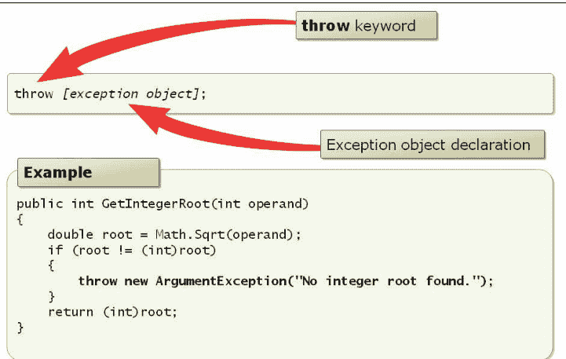

#### 关键点

在你创建异常对象后，你可以抛出（`throw`）它来表示发生了异常。当你抛出异常时，当前代码块的执行将终止，CLR 将将控制权传递给第一个捕获该异常的可用处理程序，正如本模块第 1 节所述的。

> 注意：抛出异常在 CPU 周期方面是一项开销操作，因此你应该谨慎使用。

### 抛出异常的语法

要抛出异常，你使用`throw`关键字并指定要抛出的异常对象。下面的代码示例显示了该语法。

```csharp
throw [exception object];
```

例如，你可以像下面的代码示例所示创建并抛出`FormatException`异常。

```csharp
FormatException ex =
    new FormatException("Argument has the wrong format");

throw ex;
```

## 重新思考异常

常见的策略是让方法或代码块捕获任何异常并尝试处理它们。如果异常的`catch`块无法解决错误，它可以重新抛出异常并将其传递给调用者。要这样做，如下面的代码示例所示指定`throw`关键字。

```csharp
try {

    ... // 可能会导致异常的语句

}

catch (Exception e) {

    // 如果此 catch 处理程序无法解决异常，

    // 则将其抛出给调用代码

}
```

**问题：** 在执行`throw`语句后，执行从何处继续？

### 处理和抛出异常的最佳实践

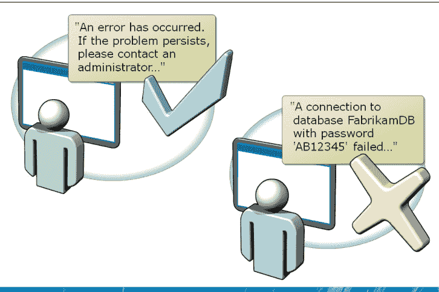

#### 关键点

在应用程序中实现异常处理的结构易于使用，但与任何编程结构一样，遵循良好的设计至关重要。列表解释了处理异常的一些最佳实践：

- 抛出一个与检测到的错误条件合适的异常。
- 你的应用程序中的逻辑不应依赖于`try`和`catch`块在无条件的情况下运行。你应该设计你的方法，使其在正常情况下不会抛出异常。只有对于应用程序预期逻辑流之外的情况，才捕获和抛出异常。
- 当你定义多个`catch`块时，按从最具体到最具体的顺序对它们进行排序。如果你捕获`Exception`类型，它必须是一组`catch`块中的最后一个处理程序。
- 为了诊断目的，请捕获并记录详细的异常消息，然后向用户显示友好的消息。记住，任何显示给用户的文本都应该是可本地化的，且文本应从资源文件中检索。

下面的代码示例展示了你如何向 Windows® 事件日志写入消息。

```csharp
using System.Diagnostics;

...

// 事件源名称。
string source = "My C# application";

// 要写入的事件日志。
string log = "Application";

// 你想要写入的消息。
string message = "An error with code ex1032 has occurred...";

// 检查事件源是否存在，如果不存在，则创建它。
if (!EventLog.SourceExists(source))
{
    EventLog.CreateEventSource(source, log);
}

// 将消息写入事件日志。
EventLog.WriteEntry(source, message, EventLogType.Error);
```


- 不要向用户显示详细的异常消息，因为恶意用户可以使用详细信息来导致你的应用程序出现问题，甚至访问受保护信息。在数据访问层中一个常见的错误是提供详细信息，这可能导致恶意用户了解你的系统，甚至访问受保护信息。

- 有效的异常处理应该让应用程序从异常中恢复，并且你的应用程序不应该崩溃。

**问题：** 在你的应用程序中，你有一个方法返回异常对象。当你有了异常对象时，你正将其作为另一个方法的参数。由于应用程序中的某些数据格式错误，如果你尝试使用这些数据，将会导致异常。在这种情况下你会做什么？

### 实验：处理异常

- 练习 1：使方法异常安全
- 练习 2：检测异常情况
- 练习 3：检查数字溢出

| 登录信息 | |
| :--- | :--- |
| 虚拟机 | 10266A-GEN-DEV |
| 用户名 | Student |
| 密码 | Pa$$word |

预计时间：60 分钟

### 目标

完成实验后，你将能够：

- 添加代码使方法异常安全。
- 向方法添加代码检测条件并抛出异常。
- 添加代码使用 `checked` 关键字检查溢出。

### 引言

在实验中，你将捕获并处理方法可能发生的异常。你还将使用 `finally` 结构来实现即使发生异常也会运行的代码。你还将在检测到条件时抛出异常。最后，你将启用整数溢出检查。

### 实验设置

对于本实验，你将使用可用的虚拟机环境。在开始实验之前，你必须：

- 启动 `10266A-GEN-DEV` 虚拟机，然后使用以下凭据登录：
- 用户名：`Student`
- 密码：`PaSSwrd`

### 实验场景


Fabrikam, Inc. 生产一系列高度敏感的测量设备，可以重复测量对象并捕数据。

异常处理和资源管理是 Fabrikam, Inc. 开发的所有应用程序的关键。在驱动大型机器的软件中未能正确处理异常可能会导致危生命的情况。即使在较小的、不重要的科学设备中，未处理的异常也可能导致数据丢失并需要重复实验。

## 练习 1：使方法异常安全

在此练习中，你将为应用程序添加异常安全功能，以确保即使发生一个或多个异常，它也能继续运行。代码本身位于作为测试框架的 Windows Presentation Foundation (WPF) 应用程序中。

### 场景

Fabrikam, Inc. 提供智能开关设备，可以监控环境以检测关键条件（例如温度超过指定的值），并触发关闭操作。这些切换设备用于能源领域的应用，以启动核反应堆的关闭。无需而说，这些设备的正确操作至关重要。Fabrikam, Inc. 正在开发新型切换设备，需要你编写部分控制其运行的软件代码。你已经获取了执行关闭操作的代码。该代码包含多个步骤，所有步骤都必须运行。如果任何步骤失败，代码必须报告故障，但继续执行后续步骤。

本次练习的主要任务如下：

- 1. 打开 `Failsafe` 解决方案并运行应用程序。
- 2. 检查 `Switch` 类。
- 3. 处理 `Switch` 类抛出的异常。
- 4. 测试应用程序。

#### 任务 1：打开 Failsafe 解决方案并运行应用程序

- 1. 以学生身份 `Student` 登录 `10266A-GEN-DEV` 虚拟机，密码为 `PassSwörd`。
- 2. 打开 Visual Studio 2010。
- 3. 打开 `E:\Labfiles\Lab 4\Ex1\Starter` 文件夹下的 `Failsafe` 解决方案。
- 4. 运行 `Failsafe` 项目并反复点击 `Shutdown` 直到发生异常。

> 注意：`Switch` 类被设计为随机抛出异常，因此你第一次点击按钮时可能不会遇到异常。请反复点击 `Shutdown` 按钮直到发生异常。

#### 任务 2：检查 Switch 类

- 1. 如果尚未打开，请在 Visual Studio 中打开 `Switch.cs` 文件。
- 2. 检查 `Switch` 类。

注意，该类包含几个方法，每个方法都可能根据随机数生成的结果抛出至少一个异常。在文件末尾，请注意 `Switch` 类可以抛出的每个自定义异常的定义。这些是极其基础的异常类，仅封装了错误消息。

#### 任务 3：处理 Switch 类抛出的异常

`SwitchTestHarness` 项目包含对 `SwitchDevice` 引用，并调用 `Switch` 类中的每个方法来模拟多个传感器和诊断设备。目前，项目不包含异常处理，因此当发生异常时，应用程序将失败。你必须在 `SwitchTestHarness` 项目中添加异常处理代码，以保护应用程序免受 `Switch` 类抛出的异常。

- 1. 在 Visual Studio 中打开 `MainWindow.xml.cs` 文件。
- 2. 在 `MainWindow` 类中，找到 `Button1_Click` 方法。当用户点击 `Shutdown` 按钮时，会运行此方法。
- 3. 删除 `TODO - Add exception handling`，然后找到 `Step 1 - disconnect from the Power Generator` 和 `Step 2 - Verify the status of the Primary Coolant System` 注释。将它们之间的代码封装在一个 `try/catch` 块中，捕获 `SwitchDevices.PowerGeneratorCommsException` 异常。这是 `DisconnectPowerGenerator` 方法抛出的异常。
- 4. 在 `catch` 块中，添加代码向 `textBlock1` 控件添加新行，消息为 `"Exception in step 1."`，以及异常的 `Message` 属性的内容。`Message` 属性包含 `Switch` 对象在抛出异常时指定的错误消息。

> 提示：要向 `TextBlock` 控件添加行，请对控件的 `Text` 属性使用 `+=` 算符。

- 5. 将 `Step 2 - Verify the status of the Primary Coolant System` 和 `Step 3 - Verify the status of the Backup Coolant System` 注释之间的代码封装在一个 `try/catch` 块中，捕获 `SwitchDevices.CoolantPressureReadException` 和 `SwitchDevices.CoolantTemperatureReadException` 异常。在每个异常处理程序中，遵循与步骤 3 相同的模式，在 `textBlock1` 控件中打印新行消息（注意这是关闭过程的步骤 2，而不是步骤 1）。
- 6. 将 `Step 3 - Verify the status of the Backup Coolant System` 和 `Step 4 - Record the core temperature prior to shutting down the reactor` 注释之间的代码封装在一个 `try/catch` 块中，捕获 `SwitchDevices.CoolantPressureReadException` 和 `SwitchDevices.CoolantTemperatureReadException` 异常。在每个异常处理程序中，在 `textBlock1` 中打印新行（这是步骤 3）。
- 7. 将 `Step 4 - Record the core temperature prior to shutting down the reactor` 和 `Step 5 - Insert the control rods into the reactor` 注释之间的代码封装在一个 `try/catch` 块中，捕获 `SwitchDevices.CoreTemperatureReadException` 异常。在异常处理程序中，在 `textBlock1` 控件中打印新行（这是步骤 4）。
- 8. 将 `Step 5 - Insert the control rods into the reactor` 和 `Step 6 - Record the core temperature after shutting down the reactor` 注释之间的代码封装在一个 `try/catch` 块中，捕获 `SwitchDevices.RodClusterReleaseException`。在异常处理程序中，在 `textBlock1` 控件中打印新行（这是步骤 5）。
- 9. 将 `Step 6 - Record the core temperature after shutting down the reactor` 和 `Step 7 - Record the core radiation levels after shutting down the reactor` 注释之间的代码封装在一个 `try/catch` 块中，捕获 `SwitchDevices.CoreTemperatureReadException` 异常。在异常处理程序中，在 `textBlock1` 控件中打印新行（这是步骤 6）。
- 10. 将 `Step 7 - Record the core radiation levels after shutting down the reactor` 和 `Step 8 - Broadcast "Shutdown Complete" message` 注释之间的代码封装在一个 `try/catch` 块中，捕获 `SwitchDevices.CoreRadiationLevelReadException` 异常。在异常处理程序中，在 `textBlock1` 控件中打印新行（这是步骤 7）。
- 11. 将 `Step 8 - Broadcast "Shutdown Complete" message` 注释后的代码封装在一个 `try/catch` 块中，捕获 `SwitchDevices.Exception` 异常。在异常处理程序中，在 `textBlock1` 中打印新行（这是步骤 8）。
- 12. 生成解决方案并修复任何错误。

#### 任务 4：测试应用程序

- 运行应用程序并点击 `Shutdown` 按钮。检查窗口中的消息，验证异常现在是否已捕获并报告。

> 注意：`Switch` 类会随机生成异常，因此你第一次点击按钮时可能看不到任何异常。重复点击按钮直到看到异常消息。

### 练习 2：检测异常

在本次练习中，你将修改一个方法，当参数包含错误或无效数据时抛出 `ArgumentException`。

#### 场景

Fabrik, Inc. 产生若干涉及矩阵的计算。这些矩阵代表网格内的点。设备本身收集这些点并构建矩阵。然后使用 C# 方法将它们相乘以生成一组点。在正常操作下，任何矩阵中的数据项都不应为负数。然而，有时设备捕捉到范围外的值会生成 -1。遗憾的是，乘矩阵的代码未能检测到这种情况，并计算出一个错误的结果。你已经获取了嵌入此 WPF 应用程序的代码。

本次练习的主要任务如下：

- 1. 打开 `MatrixMultiplication` 解决方案。
- 2. 在 `MatrixMultiply` 方法中添加抛出异常的代码。
- 3. 处理 `Switch` 方法抛出的异常。
- 4. 实现测试用例并测试应用程序。

#### 任务 1：打开 MatrixMultiplication 解决方案

- 1. 在 Visual Studio 中打开 `E:\Labfiles\Lab 4\Ex2\Starter` 文件夹下的 `MatrixMultiplication` 解决方案。
- 2. 打开 `MatrixMultiply.cs` 文件并注意 `MatrixMultiply` 方法。

`MatrixMultiply` 方法执行矩阵乘法并返回结果。目前，该方法接受任何大小的矩阵，且不对数据进行任何验证。你将添加检查以确保两个矩阵是兼容的（第一个矩阵的列数等于第二个矩阵的行数），并且任何矩阵中都没有负数。如果矩阵不兼容或包含负值，方法必须抛出异常。

#### 任务 2：在 MatrixMultiply 方法中添加抛出异常的代码

- 1. 在 `MatrixMultiply` 方法中，找到并删除 `TODO - Evaluate input matrices for compatibility`。在注释块下方添加代码执行以下操作：
  a. 比较 `matrix1` 的列数与 `matrix2` 的行数。
  b. 如果值不等，抛出 `ArgumentException` 异常。异常消息应指定行列数应匹配。

> 提示：你可以通过检查第一维的长度获取矩阵的列数。通过检查第二个维的长度获取矩阵的行数。

- 2. 找到并删除 `TODO – Evaluate matrix data points for invalid data`。此时，该方法遍历每个矩阵中的数据点，将 `matrix1` 中每个单元格的值与 `matrix2` 中对应单元格的值相乘。在注释块下方添加代码执行以下操作：

a. 检查 `matrix1` 中当前列和行的值是否大于零。`column` 和 `row` 变量包含了你需要检查的列索引和行索引。
b. 如果值不大于零，则抛出 `ArgumentException`。该异常应包含消息 `"Matrix1 contains an invalid entry in cell[x,y]."`，其中 x 和 y 是单元格的列值和行值。

> 提示：使用 `String.Format` 方法来构造异常消息。

- 3. 添加另一个代码块，检查 `matrix2` 中当前列和行的值是否大于零。如果不是，则抛出一个 `ArgumentException`，消息为 `"Matrix2 contains an invalid entry in cell[x,y]."`。`column` 和 `row` 变量包含了你需要检查的列索引和行索引。

#### 任务 3：处理 MatrixMultiply 方法抛出的异常

- 1. 在设计视图（Design View）窗口中打开 `MainWindow` WPF 窗口并检查该窗口。

此窗口提供了用户界面，允许用户输入两个待乘矩阵的数据。用户点击 `Calculate` 按钮进行计算并显示结果。

- 2. 打开 `MainWindow` WPF 窗口的代码文件。
- 3. 在 `MainWindow` 类中，找到 `ButtonCalculate_Click` 方法。该方法在用户点击 `Calculate` 按钮时运行。
- 4. 在 `ButtonCalculate_Click` 方法中找到调用 `Matrix.MatrixMultiply` 方法的代码行，并将该行封装在 `try/catch` 块中，捕获名为 `ex` 的 `ArgumentException` 异常。
- 5. 在 `catch` 块中，添加一条语句显示消息框，其内容包含异常对象的 `Message` 属性的内容。

> 提示：你可以使用 `MessageBox.Show` 方法来显示消息框。将要显示的消息作为字符串作为参数传递给该方法。

- 6. 生成解决方案并修正任何错误。
- 7. 不调试并启动应用程序。
- 8. 在 `MainWindow` 窗口中，在第一个下拉列表框中选择 `Matrix 1: 2 Columns`，在第二个下拉列表框中选择 `Matrix 1: 2 Rows`，然后在第三个下拉列表框中选择 `Matrix 2: 2 Columns`。

这创建了一对初始化为零的 2x2 矩阵。

- 9. 在两个矩阵的单元格中输入一些非负值，然后点击 `Calculate`。

验证结果是否已计算并显示，且没有发生异常。

- 10. 在每个矩阵的单元格中输入一个或多个负值，再次点击 `Calculate`。

验证是否显示了相应的异常消息，并且它识别出了错误的矩阵和单元格。

- 11. 关闭 `MainWindow` 窗口并返回 Visual Studio。

应用程序会抛出并捕获异常，因此你需要测试应用程序的功能是否符合预期。虽然你可以通过应用程序界面测试负数数据点，但用户界面不允许你创建不同维度的数组。因此，我们为你提供了单元测试用例，这些用例将使用会导致异常的数据调用 `MatrixMultiply` 方法。这些测试已经创建；你只需要运行它们来验证你的代码运行符合预期。

#### 任务 4：实现测试用例并测试应用程序

- 1. 在 `Matrix Test` 项目中，检查 `MatrixTest` 类以及 `MatrixMultiplyTest1` 方法。

`MatrixMultiplyTest1` 创建了四个矩阵：`matrix1`、`matrix2`、`expected` 和 `actual`。`matrix1` 和 `matrix2` 是测试期间传递给 `MatrixMultiply` 方法的输入矩阵。`expected` 矩阵包含矩阵乘法的结果，而 `actual` 矩阵存储 `MatrixMultiply` 调用的结果。该方法在调用 `MatrixMultiply` 方法之前，使用一系列 `Assert` 语句来验证 `expected` 和 `actual` 矩阵是否相同。

此测试方法已完备，不需要进一步工作。

- 2. 检查 `MatrixMultiplyTest2` 方法。

此方法创建了两个兼容的矩阵，但 `matrix2` 包含一个负值。这应该导致 `MatrixMultiply` 方法抛出异常。

`MatrixMultiply2` 方法带有 `ExpectedException` 特性，表示该测试方法预期会抛出一个 `ArgumentException` 异常。如果测试没有导致此异常，则测试将失败。

- 3. 检查 `MatrixMultiply3` 方法。

该方法创建了两个不兼容的矩阵并将它们传递给 `MatrixMultiply` 方法，结果应该抛出 `ArgumentException`。同样，该方法带有 `ExpectedException` 特性，表示如果没有抛出此异常，测试将失败。

- 4. 解决方案中的所有测试，并验证所有测试均执行正确。

### 练习 3：检查数值溢出

在本次练习中，你将观察当整数计算导致数值溢出时默认会发生什么。然后你将修改应用程序以检查数值溢出异常并重复计算。

#### 场景

测量设备的部分软件执行整数乘法，但使用的整数值可能非常大。你想确保软件不会产生由数值溢出引起的错误。

本次练习的主要任务如下：

- 1. 打开 `IntegerOverflow` 解决方案。
- 2. 添加一个 `checked` 块。
- 3. 测试应用程序。

#### 任务 1：打开 IntegerOverflow 解决方案

- 1. 打开 `E:\Labfiles\Lab 4\Ex3\Starter` 文件夹下的 `IntegerOverflow` 解决方案。
- 2. 运行应用程序，然后点击 `Multiply`。观察显示的结果并注意它是错误的。

应用程序将 `2147483647` 乘以 `2`，并显示结果 `-2`。这是因为乘法导致了整数溢出。默认情况下，此类错误不会导致异常。但在许多情况下，捕获溢出错误比让应用程序带错误继续更好。

- 3. 在 Visual Studio 中，点击调试菜单上的停止调试。

#### 任务 2：添加 checked 块

- 1. 在解决方案管理器中，打开 `MainWindow.xaml`。
- 2. 定位 `DoMulti_Click` 方法。该方法在用户点击 `Multiply` 按钮时运行。
- 3. 将乘法代码放入 `try/catch` 块中，并捕获 `OverflowException`。
- 4. 在 `try` 块内部，对执行算术操作的代码添加 `checked` 块。
- 5. 生成解决方案并修正所有错误。

#### 任务 3：测试应用程序

- 1. 启动应用程序。
- 2. 点击 `Multiply`。验证应用程序现在显示算术运算导致溢出的消息。
- 3. 点击 `OK`，关闭 `MainWindow` 窗口，然后返回 Visual Studio。
- 4. 关闭 Visual Studio。

### 实验回顾

回顾问题

- 使用什么构造来使方法调用安全？
- 你需要什么特性来修饰测试方法以预期异常？
- 你可以使用什么关键字来显式地指示编译器或运行时检查数值溢出？

### 回习问题

- 1. 使用什么构造来使方法调用安全？
- 2. 你需要什么特性来修饰测试方法以预期异常？
- 3. 你可以使用什么关键字来显式地指示编译器或运行时检查数值溢出？

### 模块回顾与总结

- 回习问题
- 最佳实践


### 回习问题

- 1. 在你的应用程序中，有一个方法依赖于许多不受控制的变量。该方法可能会抛出异常。你实现了一个集中异常处理系统，以便所有异常在一个地方被捕获和处理。当你调用方法时，如果抛出异常，你只需要确保管理并关闭任何资源。你想使用什么构造？
- 2. 在你的应用程序中，定义了多个自定义异常类。你有多个捕获此类异常的 `catch` 块。在你的 `catch` 块中，你想将此类异常封装在更通用的异常类型中。你可以设置哪个构造函数参数以确保更具体的异常包含在链中？
- 3. 你应该如何处理详细的异常消息？

### 异常处理实现的最佳实践

请根据你自己的工作情况补充或修改以下最佳实践：

- 在设计应用程序时，始终要考虑错误情况。用户总会找到破坏你的程序的方法。
- 在设计异常处理时，要确保所有异常都在中心化的位置进行处理。
- 不要设计你的应用程序依赖异常来维持正常运行。
- 不要向用户显示详细的异常信息，因为恶意用户可能会利用详细的技术信息使你的应用程序发生故障。

### 第 5 模块

### 读取和写入文件

目录：

- 课程 1：访问文件系统 5-3
- 课程 2：使用流读取和写入文件 5-27
- 实验：读取和写入文件 5-45

### 模块概述

- 访问文件系统
- 使用流读取和写入文件

访问和操作文件系统上的文件是许多应用程序的共同需求。文件提供了一种存储手段，无论是普通文本文件还是二进制数据文件。

本模块将展示如何使用 Microsoft® .NET Framework 中的类来读取和写入文件。本模块还描述了你可以采取的不同方法，以及如何读取和写入不同格式的数据。

### 目标

完成本模块后，你将能够：

- 描述如何使用 .NET Framework 提供的类访问文件系统。
- 描述如何使用流读取和写入文件。

### 课程 1：访问文件系统

- 操作文件
- 从文件读取和写入文件
- 操作目录
- 操作路径
- 使用常用的文件系统对话框

本课程介绍了几个提供了应用程序可与文件和目录交互功能的类。

### 目标

完成本课程后，你将能够：

- 描述如何使用 `File` 和 `FileInfo` 类控制文件。
- 描述如何使用 `File` 类从文件读取并写入。
- 描述如何使用 `Directory` 和 `DirectoryInfo` 类操作目录。
- 描述如何使用 `Path` 类指定文件路径。
- 描述如何使用常用的文件系统对话框。

### 操作文件

与文件交互是许多应用程序的共同需求。

`System.IO` 命名空间包含许多简化与文件系统交互的类，例如 `File` 和 `FileInfo` 类。

| `File` 类包括： | `FileInfo` 类包括： |
|--- | --- |
| `Copy()` | `CopyTo()` |
| `Create()` | `Delete()` |
| `Delete()` | `Length` |
| `Exists()` | `Open()` |

**关键点**

许多应用程序的共同需求是与存储在文件系统上的文件交互。这可能涉及创建新文件、复制或删除文件，或将文件从一个目录移动到另一个目录。为了简化这些交互，.NET Framework 在 `System.IO` 命名空间中提供了几个类。这些包括 `File` 和 `FileInfo` 类。

### File 类

`File` 类是一个实用类，封装了各种与文件相关的函数。这些函数通过静态方法暴露。下表描述了 `File` 类的一些关键方法并展示了一些代码示例。

| 方法 | 描述 | 代码示例 |
| --- | --- | --- |
| `AppendAllText` | 允许你打开现有文件，向文件中追加文本，然后关闭文件，所有操作都在一次中完成。 | `string filePath = "..."; string fileContents = "..."; File.AppendAllText(filePath, fileContents);` |
| `Copy` | 允许你将现有文件复制到新位置。 | `string sourceFile = "..."; string destFile = "..."; bool overwrite = false; File.Copy(sourceFile, destFile, overwrite);` |
| `Create` | 允许你在 Windows® 文件系统上创建新文件。`Create` 方法返回一个 `FileStream` 对象，允许你使用流模型与文件进行交互。流将在下节课程中介绍。 | `string filePath = "..."; int bufferSize = 128; FileStream file = File.Create(filePath, bufferSize, FileOptions.None);` |
| `Delete` | 允许你从 Windows 文件系统中删除文件。 | `string filePath = "..."; File.Delete(filePath);` |
| `Exists` | 允许你确定文件是否存在。 | `string filePath = "..."; bool exists = File.Exists(filePath);` |
| `GetCreationTime` | 允许你获取文件的创建时间。 | `string filePath = "..."; DateTime time = File.GetCreationTime(filePath);` |
| `GetLastAccessTime` | 允许你获取文件的最后访问时间。 | `string filePath = "..."; DateTime time = File.GetLastAccessTime(filePath);` |
| `Move` | 允许你将文件移动到新位置。你也可以使用此方法重命名文件。 | `string sourceFile = "..."; string destFile = File.Move(sourceFile, destFile);` |
| `ReadAllText` | 允许你将文件中的所有文本读取到字符串变量中。 | `string filePath = "..."; string fileContents = File.ReadAllText(filePath);` |

### FileInfo 类

`FileInfo` 类提供了属性和实例方法，允许你创建、复制和移动文件并处理文件内容。

当你创建 `FileInfo` 类的实例时，你需要指定文件系统上文件的路径。下面的代码示例显示了如何创建一个新的 `FileInfo` 对象来控制 `C:\Temp` 文件夹中的 `myFile.txt` 文件。

```


`string filePath = @"C:\Temp\myFile.txt";`

`FileInfo file = new FileInfo(filePath);`

你可以将`FileInfo`对象作为文件的封装器，通过属性和方法暴露各种数据和功能。你还可以使用`FileInfo`类来创建新文件。下表描述了一些关键属性和方法，并提供了一些代码示例。

| 成员 | 描述 | 代码示例 |
|---|---|---|
| `CreationTime`（属性） | 允许你获取或设置特定文件的创建时间。 | `string filePath = "..."; FileInfo file = new FileInfo(filePath); file.CreationTime = DateTime.Now; ... DateTime time = file.CreationTime;` |
| `CopyTo`（方法） | 允许你将文件复制到文件系统上的新位置。 | `string filePath = "..."; FileInfo file = new FileInfo(filePath); string destPath = "..."; file.CopyTo(destPath);` |
| `Delete`（方法） | 允许你删除文件。 | `string filePath = "..."; FileInfo file = new FileInfo(filePath); file.Delete();` |
| `DirectoryName`（属性） | 允许你获取文件的目录路径。 | `string filePath = "..."; FileInfo file = new FileInfo(filePath); string dirPath = file.DirectoryName;` |

| 成员 | 描述 | 代码示例 |
| --- | --- | --- |
| `Exists`（属性） | 允许你确定文件是否存在。 | `string filePath = "..."; FileInfo file = new FileInfo(filePath); bool exists = file.Exists;` |
| `Extension`（属性） | 允许你获取文件的扩展名。 | `string filePath = "..."; FileInfo file = new FileInfo(filePath); string ext = file.Extension;` |
| `Length`（属性） | 允许你获取以字节为单位的文件长度。 | `string filePath = "..."; FileInfo file = new FileInfo(filePath); long length = file.Length;` |
| `Name`（属性） | 允许你获取文件名。 | `string filePath = "..."; FileInfo file = new FileInfo(filePath); string name = file.Name;` |
| `Open`（方法） | 允许你在 Windows 文件系统上打开文件。`Open`方法返回一个`FileStream`对象，允许你使用流模型与文件进行交互。流将在下节课程中介绍。 | `string filePath = "..."; FileInfo file = new FileInfo(filePath); FileStream stream = file.Open(FileMode.OpenOrCreate);` |

问题：在你的应用程序中，你使用文件作为运行期间的临时存储机制。当应用程序停止运行时，你希望确保该文件存在，然后将其删除。实现这一目标最简单的方法是什么？

### 扩展阅读

有关`File`类的更多信息，请参阅 http://go.microsoft.com/fwlink/?LinkId=192915 File Class 页面。

有关`FileInfo`类的更多信息，请参阅 http://go.microsoft.com/fwlink/?LinkId=192916 FileInfo Class 页面。

### 文件的读取与写入

#### 从文件中读取数据

```sharp
string filePath = "myfile.txt";

byte[] data = File.ReadAllBytes(filePath); // 二进制数据。

string[] lines = File.ReadAllLines(filePath); // 文件中的行。

string data = File.ReadAllText(filePath); // 整个文件。
```

#### 向文件写入数据

```sharp
string filePath = "myfile.txt";

string[] fileLines = {"Line 1", "Line 2", "Line 3"};

File.AppendAllLines(filePath, fileLines); // 追加行。

File.WriteAllLines(filePath, fileLines); // 将所有行写入新文件。

string fileContents = "I am writing this text to a file ...";

File.AppendAllText(filePath, fileContents); // 追加所有文本。

File.WriteAllText(filePath, fileContents); // 将所有行写入新文件。
```

#### 关键点

`File`和`FileInfo`类提供了几种方法，你可以使用这些方法来读取和写入文件。

`File`类包含静态方法，你可以使用这些方法执行直接读取和写入文件的原子操作。这些方法是原子的，因为它们将多个底层函数封装在单次方法调用中。例如，`AppendAllLines`方法封装了获取文件句柄、打开文件流、向文件写入数据然后释放文件句柄的操作。

`FileInfo`类包含实例方法，这些方法在从读取和写入文件时依赖于`FileStream`和`StreamWriter`类。流的使用将在“第2课：使用流读取和写入文件”中介绍。本主题重点关注`File`类提供的静态方法，这些方法不使用流，而是提供单一的原子操作。

### 从文件中读取

当你使用`File`类从文件中读取数据时，有许多备用方法可以使用，每种方法都有不同的行为。以下列表描述了其中一些方法：

- `ReadAllBytes`方法允许你将文件内容作为二进制数据读取，并将数据存储在字节数组中。下面的代码示例显示了如何将`myfile.txt`文件的内容读取到名为`data`的字节数组中。

```csharp
string filePath = "myfile.txt";

byte[] data = File.ReadAllBytes(filePath);
```

- `ReadAllLines`方法允许你从头到尾逐行读取文本文件，并将每一行存储在字符串数组中。下面的代码示例显示了如何读取`myfile.txt`文件的内容并将每一行存储在名为`lines`的字符串数组中。

```csharp
string filePath = "myfile.txt";

string[] lines = File.ReadAllLines(filePath);
```

- `ReadAllText`方法允许你从头到尾读取文件，并将文件中的数据存储在字符串变量中。下面的代码示例显示了如何读取`myfile.txt`文件的内容并将数据存储在名为`data`的字符串中。

```csharp
string filePath = "myfile.txt";

string data = File.ReadAllText(filePath);
```

### 向文件写入

当你使用`File`类向文件写入数据时，有多种选项可用，具体取决于你想写入的数据类型。对于每种选项，你都可以将数据追加到现有文件，或者创建一个新文件然后执行写入操作。

以下列表描述了其中一些方法：

- `AppendAllLines`方法允许你将字符串数组的内容写入文本文件。如果你指定的路径不存在，该操作将创建一个新文件。下面的代码示例显示了如何将名为`fileLines`的字符串数组的内容写入`myfile.txt`文件。

```csharp
string filePath = "myFile.txt";

string[] fileLines = {"Line 1", "Line 2", "Line 3"};

File.AppendAllLines(filePath, fileLines);
```

- `AppendText`方法允许你将字符串变量的内容写入文本文件。与`AppendLines`方法类似，如果文件不存在，该操作将创建文件然后执行写入操作。下面的代码示例显示了如何将字符串变量`fileContents`的内容写入`myFile.txt`文件。

```csharp
string filePath = "myFile.txt";

string fileContents = "I am writing this text to a file called myFile.txt";

File.AppendText(filePath, fileContents);
```

- `WriteBytes`方法允许你将字节数组的内容写入二进制文件。如果文件已存在，此操作将覆盖该文件。下面的代码示例显示了如何将字节数组`fileBytes`的内容写入名为`myFile.txt`的新文件。

```csharp
string filePath = "myFile.txt";

byte[] fileBytes = {12, 134, 8, 32};

File.WriteAllBytes(filePath, fileBytes);
```

- `WriteAllLines`方法允许你将字符串数组的内容写入文本文件。如果你指定的路径不存在，该操作将创建一个新文件。下面的代码示例显示了如何将名为`fileLines`的字符串数组写入`myfile.txt`文件。

```csharp
string filePath = "myFile.txt";

string[] fileLines = {"Line 1", "Line 2", "Line 3"};

File.WriteAllLines(filePath, fileLines);
```

- `WriteAllText`方法允许你将字符串变量的内容写入文本文件。与`AppendLines`方法类似，如果文件不存在，该操作将创建文件然后执行写入操作。（注：此处原文逻辑似乎有误，但已按原意翻译）

问题：在你的应用程序中，你刚刚添加了一些处理异常的逻辑。你现在想进一步扩展此逻辑，将异常详细信息存储到日志文件中，以便诊断问题。你将写入字符串变量，并且不希望覆盖文件中的任何日志记录。你会使用哪种方法？

### 操作目录

`System.IO`命名空间包含`Directory`和`DirectoryInfo`类，有助于简化与目录的交互。

| `Directory`类 |
|---|
| `string dirPath = "C:\Users\Student\MyDirectory";` |
| `...` |
| `Directory.CreateDirectory(dirPath);` |
| `Directory.Delete(dirPath);` |
| `string[] dirs = Directory.GetDirectories(dirPath);` |
| `string[] files = Directory.GetFiles(dirPath);` |

| `DirectoryInfo`类 |
|---|
| `string dirPath = "C:\Users\Student\MyDirectory";` |
| `DirectoryInfo dirInfo = new DirectoryInfo(dirPath);` |
| `...` |
| `bool exists = dirInfo.Exists();` |
| `DirectoryInfo[] dirs = dirInfo.GetDirectories();` |
| `FileInfo[] files = dirInfo.GetFiles();` |
| `string fullName = dirInfo.FullName;` |

### Directory 类

与`File`类类似，`Directory`类是一个工具类，提供了各种操作来让你管理文件夹和目录。`Directory`类通过静态方法暴露其功能。下表描述了某些方法并提供了一些代码示例。

### 5-16 使用 Microsoft® Visual Studio® 2010 进行 C# 编程

| 方法 | 描述 | 代码示例 |
| --- | --- | --- |
| `CreateDirectory` | 允许你创建路径中指定但尚不存在的所有目录。 | `string dirPath = @"C:\NewFolder\SubFolder\"; Directory.CreateDirectory(dirPath);` |
| `DeleteDirectory` | 允许你从文件系统中删除一个或多个目录。 | `string dirPath = @"C:\Users\Student\" + "MyDirectory"; bool deleteSubFolders = true; Directory.Delete(dirPath, deleteSubFolders);` |
| `GetDirectories` | 允许你获取指定路径下的所有子目录。 | `string dirPath = "..."; string[] dirs = Directory.GetDirectories(dirPath);` |
| `GetFiles` | 允许你获取指定路径下的所有文件。 | `string dirPath = "..."; string[] files = Directory.GetFiles(dirPath);` |
| `Exists` | 允许你确定指定路径下是否存在目录。 | `string dirPath = "..."; bool dirExists = Directory.Exists(dirPath);` |

读写文件 5-17

| 方法 | 描述 | 代码示例 |
|---|---|---|
| `Move` | 允许你移动目录。你不能使用`Move`方法将目录移动到不同的驱动器。 | `string sourcePath = "..."; string destPath = "..."; Directory.Move(sourcePath, destPath);` |

### DirectoryInfo 类

`DirectoryInfo`类提供了几个属性和实例方法，允许你对目录进行操作。与`FileInfo`类类似，当你创建`DirectoryInfo`类的实例时，通常会指定指向文件系统中某个目录的路径。下面的代码示例显示了如何创建`DirectoryInfo`类的实例。

```csharp
string dirPath = @"C:\Users\Student\Music\"

DirectoryInfo dir = new DirectoryInfo(dirPath);
```

然后你可以将`DirectoryInfo`对象作为目录的包装器，通过属性和方法暴露各种数据和功能。你还可以使用`DirectoryInfo`类来创建新目录。例如，下面的代码示例显示了你如何判断目录是否存在，如果不存在，又如何创建该目录。

```csharp
string dirPath = @"C:\Users\Student\Music\"

DirectoryInfo dir = new DirectoryInfo(dirPath)

if (!dir.Exists)
{
    dir.Create();
}
```


下表描述了一些关键属性和方法，并提供了一些代码示例。

### 使用 Microsoft® Visual Studio® 2010 进行 C# 编程

| 成员 | 描述 | 代码示例 |
|---|---|--|
| `Create`（方法） | 允许你创建指定路径中的目录。如果目录已存在，则会被忽略。 | `string dirPath = "..."` |

| 成员 | 描述 | 代码示例 |
| --- | --- | --- |
| `GetFiles`（方法） | 允许你获取指定路径下的所有文件。该方法返回 `FileInfo` 数组，允许你对目录中的所有文件使用每个 `FileInfo` 成员。 | `string dirPath = "...";` `DirectoryInfo dir = new DirectoryInfo(dirPath);` `FileInfo[] files = dir.GetFiles();` |
| `MoveTo`（方法） | 允许你移动目录。使用 `MoveTo` 方法将目录移动到不同的驱动器。 | `string dirPath = "...";` `DirectoryInfo dir = new DirectoryInfo(dirPath);` `string destPath = "...";` `dir.MoveTo(destPath);` |
| `Name`（属性） | 允许你获取目录的名称。 | `string dirPath = "...";` `DirectoryInfo dir = new DirectoryInfo(dirPath);` `string dirName = dir.Name;` |
| `Parent`（属性） | 允许你获取父目录。 | `string dirPath = @"C:\Users\Student\Music\";` `DirectoryInfo dir = new DirectoryInfo(dirPath);` `DirectoryInfo parentDir = dir.Parent;` |

### 枚举目录内容

下面的代码示例显示了你如何枚举目录并显示所有子目录及其包含的文件详情。

```csharp
string dirPath =
    @"C:\Users\Student\Documents";

// 获取 Documents 目录下的所有子目录。
string[] subDirs = Directory.GetDirectories(dirPath);

foreach (string dir in subDirs)
{
    // 显示目录名。
    Console.WriteLine("{0} contains the following files:", dir);

    // 获取每个目录中的所有文件。
    string[] files = Directory.GetFiles(dir);

    foreach (string file in files)
    {
        // 显示文件名。
        Console.WriteLine(file);
    }
}
```

**问题：** 你会使用哪个类来检索文件系统中的目录实例，然后对该实例进行交互？

### 扩展阅读

有关关于 `Directory` 类的更多信息，请参阅 `Directory` 类页面：http://go.microsoft.com/fwlink/?LinkId=192917。

有关关于 `DirectoryInfo` 类的更多信息，请参阅 `DirectoryInfo` 类页面：http://go.microsoft.com/fwlink/?LinkId=192918。

### 操作路径

> `System.IO` 命名空间包含 `Path` 类，它可以帮助解析和构建路径以及文件名，且独立于底层文件系统。`Path` 类提供了静态方法用于：

- `GetDirectoryName()`
- `GetExtension()`
- `GetFileName()`
- `GetFileNameExtension()`
- `GetRandomFileName()`
- `GetTempPath()`

### `Path` 类

`Path` 类通过静态方法暴露其功能。下表描述了一些这些方法并提供了一些代码示例。

| 方法 | 描述 | 代码示例 |
| --- | --- | --- |
| `GetDirectoryName` | 允许你获取路径中的目录。 | `string dirPath = @"C:\Users\Student";` `string dirs = Path.GetDirectoryName(dirPath);` |

| 方法 | 描述 | 代码示例 |
|---|---|---|
| `GetExtension` | 允许你获取指定文件的扩展名。 | `string dirPath = @"C:\Users\Student\File.txt";` `string ext = Path.GetExtension(dirPath);` |
| `GetFileName` | 允许你获取包含扩展的文件名。 | `string dirPath = @"C:\Users\Student\File.txt";` `string fileName = Path.GetFileName(dirPath);` |
| `GetFileNameWithoutExtension` | 允许你获取不带扩展的文件名。 | `string dirPath = @"C:\Users\Student\File.txt";` `string fileName = Path.GetFileNameWithoutExtension(dirPath);` |
| `GetRandomFileName` | 允许生成随机文件名。 | `string fileName = Path.GetRandomFileName();` |
| `GetTempFileName` | 允许在临时文件夹创建一个临时文件。该方法随后返回该文件的路径。 | `string tempPath = Path.GetTempFileName();` |
| `GetTempPath` | 允许获取本地临时文件夹的路径。 | `string tempPath = Path.GetTempPath();` |

**问题：** 你正在创建一个允许用户按扩展名浏览文件的筛选。首先你需要获取每个文件的扩展名，然后根据结果运行某些逻辑。你还想在列表中显示包含扩展的文件名。你会使用哪些方法来查询文件？

### 扩展阅读

有关 `Path` 类的更多信息，请参阅 `Path` 类页面：http://go.microsoft.com/fwlink/?LinkId=192919。

## 使用常用文件系统对话框

### 点

构建具有图形用户界应用程序时，让用户输入长而复杂的路径和文件名是不合理的。用户期望通过对话框浏览文件和目录。

创建一个任何 Microsoft 应用程序中的打开或保存文件对话框需要大量的开发和测试工作。幸运的是，.NET Framework 在 `Microsoft.Win32` 命名空间中提供了 `OpenFileDialog` 和 `SaveFileDialog` 类。

> 注意：你也可以在 `System.Windows.Forms` 命名空间找到 `OpenFileDialog` 和 `SaveFileDialog` 类。在 Windows Presentation Foundation (WPF) 引入之前，Windows Forms 是实现 Windows 客户端应用程序的主要技术，因此包含在 `System.Windows.Forms` 命名空间中。

`OpenFileDialog` 和 `SaveFileDialog` 类都提供了功能，允许用户浏览文件或指定文件名并创建任何文件夹为


是必需的。这些功能通过各种属性和方法实现，你可以使用这些属性根据你的需求自定义对话框的行为。然而，请注意，对话框本身实际上不会打开或保存指定的文件；它们所做的只是构建一个你的应用程序可以用来打开或保存该的路径和文件名。

下表描述了 `OpenFileDialog` 类和 `SaveFileDialog` 类共有的一些关键属性。

| 属性 | 描述 |
| :--- | :--- |
| `CheckFileExists` | 允许您指示对话框，如果用户指定了不存在的文件，则显示警告。 |
| `FileName` | 允许您获取或设置在对话框中选中的文件路径。 |
| `Filter` | 允许您限制用户在对话框中可以选择的文件类型。 |
| `InitialDirectory` | 允许您获取或设置对话框首次显示时显示的默认目录。 |
| `Title` | 允许您为对话框指定标题。 |

## 使用 `OpenFileDialog` 和 `SaveFileDialog` 类

你可以像使用任何其他 .NET Framework 类一样使用 `OpenFileDialog` 和 `SaveFileDialog` 类。第一步是创建该类的实例，如下代码示例所示。

```csharp
OpenFile dlg = new OpenFileDialog();
SaveFileDialog dlg = new SaveFileDialog();
```

在你创建任意一个对话框类的实例后，就可以使用它们的属性来自定义其行为。大多数通过这两个类暴露的属性都是相同的，但也有一些例外，例如 `OpenFileDialog` 类中的 `Multiselect` 属性以及 `SaveFileDialog` 类中的 `OverwritePrompt` 属性，如下代码示例所示。

```csharp
...
dlg.Title = "Browse for a file to open";
dlg.Multiselect = false;
dlg.InitialDirectory = @"C:\Users\Student\Documents";
```

```csharp
openDlg.Filter = "Word (*.doc) |*.doc";
...
saveDlg.Title = "Browse for a save location"
saveDlg.DefaultText = "doc"
saveDlg.AddExtension = true;
saveDlg.InitialDirectory = "C:\Users\Student\Documents"
saveDlg.OverwritePrompt = true;
```

为了让对话框在你的应用程序运行时出现，你需要调用 `ShowDialog` 方法，如下代码示例所示。

```csharp
openDlg.ShowDialog();
...
saveDlg.ShowDialog();
```

最后，要获取用户选择的路径，可以通过以下代码示例查询 `FileName` 属性。

```csharp
string selectedFileName = openDlg.FileName;
...
string selectedFileName = saveDlg.FileName;
```

取决于用户是选择了文件还是仅仅关闭了对话框，`FileName` 属性返回的值可能是有效的绝对路径，也可能是空字符串。因此，在使用结果之前，你应该在此时执行执行一些验证。

**问题：** 你几乎几乎完成了一个文本编辑器的实现，最后一步是让用户浏览到保存位置，并提示他们输入文件名。你会使用哪个类以及如何使用它？

### 第 2 节
使用流（Streams）读写文件

- 什么是流？
- 读取和写入二进制数据
- 读取和写入文本
- 读取和写入原始数据类型

如上一节所描述的，以单次原子操作进行数据读写的方法对于少量数据来说是可以接受的。然而，当你处理大量数据时，这种操作效率很，并且会消耗过多的资源。

另一种方法是使用流。这引入了 .NET Framework 的流模型，以及你可以用于在应用程序中实现流操作的类。

### 目标

完成本节后，你将能够：

- 描述流的用途。
- 描述如何读取和写入二进制数据。
- 描述如何读取和写入文本。
- 描述如何读取和写入原始数据类型。

### 什么是流？

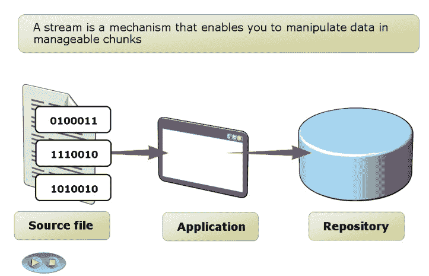

#### 重点

当你处理数据时，无论数据存储在文件系统的文件中，还是存储在可以通过 HTTPS 连接的 Web 服务器上，数据有时会变得太大，无法加载到内存中并在单次原子操作中传输。例如，想象尝试一次性从文件系统加载一个 100 GB 的视频文件到内存中。此操作不仅需要很长的时间，还会消耗大量的内存。

.NET Framework 允许你使用流。流是一个字节序列，可以来自文件系统上的文件、网络连接或内存。流允许你以小的、易于管理的数据包读取或写入数据源。总之，流提供了以下操作：

- 将数据块读取到类型中（例如字节数组）。
- 将数据块从类型写入流中。
- 查询流中的当前位置，并修改当前位置的特定字节选择。

### .NET Framework 中的流

.NET Framework 提供了几个流类，允许你处理各种数据和数据源。在选择使用哪些流类时，你需要考虑以下因素：

- 你正在读取或写入什么类型的数据，例如二进制或字母数字。
- 数据存储在哪里，例如在本地文件系统上、内存中，或通过网络在 Web 服务器上。

.NET Framework 库提供了几个类，你可以使用流来读写数据。在抽象的最高层次，`Stream` 类定义了一个字节序列。在内部，`Stream` 对象维护一个指向当前位置的指针。当你构造数据源的 `Stream` 对象时，指针指向第一个字节。

你不能直接使用 `Stream` 类。相反，你应该实例化针对特定类型的类。例如，`FileStream` 类实现了使用磁盘文件作为数据源的流，而 `MemoryStream` 类实现了使用内存块作为数据源的流。

> 注意：本节剩余的主题将关注读写数据，因此你将使用 `BinaryReader`、`BinaryWriter`、`StreamReader` 和 `StreamWriter` 等类。

问题：你认为流式数据的处处是什么？

### 更多阅读

关于 `FileStream` 类的更多信息，请参阅 `FileStream` 页面：http://go.microsoft.com/fwlinklw=19220.

### 读取和写入二进制数据

```csharp
FileStream sourceFile = new FileStream(sourceFilePath);
BinaryReader reader = new BinaryReader(sourceFile);
int position = 0;
int length = (int)sourceFile.BaseStream.Length;
byte[] data = new byte[length];
int returnedBy;

while ((returnedBy = reader.Read()) != -1) {
    data[position] = (byte)returnedBy;
    position += sizeof(byte);
}

reader.Close();
sourceFile.Close();

byte[] dataCollection = { 1, 4, 6, 7, 12, 33, 26, 98, 82, 101 };
FileStream destFile = new FileStream(destinationFilePath);
BinaryWriter writer = new BinaryWriter(destFile);

foreach (byte data in dataCollection) {
    writer.Write(data);
}

writer.Close();
destFile.Close();
```

#### 重点

通过使用 `FileStream` 对象建立的流只是原始字节序列。如果文件包含结构化数据，你必须将字节序列转换为相应的类型。这可能是一个耗时且容易出错的任务。然而，.NET Framework 库提供了其他类，允许它们在用 `FileStream` 对象打开的流中读写文本和原始类型。这些类包括 `StreamReader`、`StreamWriter`、`BinaryReader` 和 `BinaryWriter`。

### `BinaryReader` 和 `BinaryWriter` 类

许多应用程序使用二进制格式存储数据，因为二进制写入速度快、占用空间小且人类不可读。你可以利用 `BinaryReader` 和 `BinaryWriter` 类在你的 .NET Framework 应用程序中使用二进制格式。

通过提供连接到数据源的流来构造 `BinaryReader` 或 `BinaryWriter` 对象。下面的代码示例显示了如何传递 `FileStream` 对象来初始化这些类。

```c
string filePath = "...";
FileStream file = new FileStream(filePath);
BinaryReader reader = new BinaryReader(file);
BinaryWriter writer = new BinaryWriter(file);
```


在创建 `BinaryReader` 对象后，你可以使用它的成员来读取二进制数据。下表描述了一些关键成员。

> **重要：** 当你完成对 `StreamReader` 或 `StreamWriter` 对象的使用时，必须调用 `Close` 方法来刷新流并释放与流相关的任何资源。你还必须关闭为 `StreamReader` 和 `StreamWriter` 提供数据的 `FileStream` 对象。

| 成员 | 描述 |
|---|---|
| `BaseStream` (属性) | 允许你访问 `BinaryReader` 对象使用的底层流。 |
| `Close` (方法) | 允许你关闭 `BinaryReader` 对象及其底层的流。 |
| `Read` (方法) | 允许你从特定索引读取流中剩余的字节数。 |
| `ReadByte` (方法) | 允许你从流中读取下一个字节，并将流移动到下一个字节。 |
| `ReadBytes` (方法) | 允许你将指定数量的字节读取到字节数组中。 |

> **注意：** `BinaryReader` 类包含另外 16 个方法，可以读取二进制流并将数据转换为 C# 中可用的各种原始数据类型。这些方法将在本节稍后进行详细讨论。

同样，`BinaryWriter` 对象也暴露了各种成员，允许你向底层流写入数据。下表描述了一些关键成员。

### 使用 Microsoft® Visual Studio® 2010 进行 C# 编程

| 成员 | 描述 |
|---|---|
| `BaseStream` (属性) | 允许你访问 `BinaryWriter` 对象使用的底层流。 |
| `Close` (方法) | 允许你关闭 `BinaryWriter` 对象及其底层的流。缓冲区中的任何数据都被刷新到底层流。 |
| `Flush` (方法) | 允许你显式地将当前缓冲区中的任何数据刷新到底层流。 |
| `Seek` (方法) | 允许你设置当前流中的位置，从而写入特定的字节。 |
| `Write` (方法) | 允许你将数据写入流中并移动流。`Write` 方法提供了几个重载，允许你将所有原始数据类型写入流中。 |

### 读取二进制数据

以下示例代码展示了如何使用 `BinaryReader` 和 `FileStream` 类读取包含字节集合的文件。此示例使用 `Read` 方法在文件的字节流中进行进进。

```c
// 源文件路径。
string filePath = "C:\Users\Student\Documents\BinaryFile.bin";

// 创建 FileStream 对象以便与文件系统进行交互。
FileStream sourceFile = new FileStream(
    filePath, FileMode.Open, // 打开一个现有文件。
    FileAccess.Read); // 读取一个现有文件。

// 传入 FileStream 对象创建 BinaryReader 对象。
BinaryReader reader = new BinaryReader(sourceFile);

// 存储流的当前位置。
int position = 0;

// 存储流的长度。
int length = (int)reader.BaseStream.Length;

// 创建数组以存储文件中的每个字节。
byte[] dataCollection = new byte[length];

int returnedByte;
```

```csharp
while ((returnedByte = reader.Read()) != -1)
{
    // 设置下一个索引处的值。
    dataCollection[position] = (byte)returnedByte;

    // 进你的位置变量。
    position += sizeof(byte);
}

// 关闭流以释放任何文件句柄。
reader.Close();
sourceFile.Close();
```

**注意：** 如果文件读取或写入操作抛出异常，你需要确保流和文件句柄被释放。你可以使用 `try finally` 块来确保资源被释放。通常，你应该将执行读取或写入的逻辑放在 `try` 块中，并将任何关闭和释放文件句柄的逻辑放在 `finally` 块中。

### 写入二进制数据

以下代码示例展示了如何使用 `BinaryWriter` 和 `FileStream` 类将一个包含四个字节整数的集合写入文件。

```csharp
string destinationFilePath = 
@"C:\Users\Student\Documents\BinaryData.bin";

// 字节集合。
byte[] dataCollection = { 1, 4, 6, 7, 12, 33, 26, 98, 82, 101 };

// 创建 FileStream 对象以便与文件系统进行交互。
FileStream destFile = new FileStream(
    destinationFilePath, // 传入目标路径。
    FileMode.Create, // 始终创建新文件。
    FileAccess.Write); // 只执行写入。

// 传入 FileStream 对象创建 BinaryWriter 对象。
BinaryWriter writer = new BinaryWriter(destFile);
```

```csharp
// 将每个字节写入流。
foreach (byte data in dataCollection)
{
    writer.Write(data);
}

// 关闭两个流以将数据刷新文件。
writer.Close();
destFile.Close();
```

上述代码产生的内容如下的文件。
`00000000 D01 04 06 07 0C 21 1A 62 52 65`

**问题：** 为什么在完成流的使用后关闭流很重要？

### 读取和写入文本

```csharp
FileStream sourceFile = new FileStream(sourceFilePath);
StreamReader reader = new StreamReader(sourceFile);
StringBuilder fileContents = new StringBuilder();

while (reader.Peek() != -1)
{
    fileContents.Append((char)reader.Read());
}

string data = fileContents.ToString();
reader.Close();
sourceFile.Close();
```

 (356.png) (此处为图片占位符)

```csharp
FileStream destFile = new FileStream(destinationFilePath);
StreamWriter writer = new StreamWriter(destFile);
writer.WriteLine("Hello, this will be written to the");
writer.Close();
destFile.Close();
```

 (此处为另一为图片占位符)

#### 关键要点

除了以二进制形式存储数据外，你还可以存储纯文本。读取和写入文本的过程与读取写入二进制数据非常相似，只是你使用了 `StreamReader` 和 `StreamWriter` 类。

> **注意：** 用于读取和写入控制台的 `Console` 类包含一个 `In` StreamReader 和一个 `Out` StreamWriter。`Console.ReadLine` 方法从 `In` 属性读取文本，`Console.WriteLine` 方法向 `Out` 属性写入文本。

### StreamReader 和 StreamWriter 类

与使用 `BinaryReader` 和 `BinaryWriter` 类类似，当你初始化 `StreamReader` 或 `StreamWriter` 类时，必须提供一个流对象来处理数据，如下例所示。

```csharp
string destinationFilePath = "...";
FileStream file = new FileStream(destinationFilePath);
StreamReader reader = new StreamReader(file);
StreamWriter writer = new StreamWriter(file);
```

下表描述了 `StreamReader` 类提供的允许从底层流读取文本的一些成员。

| 成员 | 描述 |
|---|---|
| `Close` (方法) | 允许你关闭 `StreamReader` 对象及其底层的流。 |
| `EndOfStream` (属性) | 允许你确定是否到达流的末尾。 |
| `Peek` (方法) | 允许你获取流中的下一个可用字符但不消耗它。 |
| `Read` (方法) | 允许你获取并消耗流中的下一个可用字符。该方法返回一个表示字符二进制的 `int` 变量，你可能对其进行转换。 |
| `ReadBlock` (方法) | 允许从流的特定索引读取整块字符。 |
| `ReadLine` (方法) | 允许从流中读取整行字符。 |
| `ReadToEnd` (方法) | 允许从流的当前位置读取所有字符。 |

下表显示了 `StreamWriter` 类提供的允许向流写入文本的一些关键成员。

| 成员 | 描述 |
|---|---|
| `AutoFlush` (属性) | 允许你指示 `StreamWriter` 对象在每次写入调用后将数据刷新到底层流。 |
| `Close` (方法) | 允许你关闭 `StreamWriter` 对象及其底层的流。 |
| `Flush` (方法) | 允许你将当前缓冲区中的任何数据显式地刷新到底层流中。 |
| `NewLine` (属性) | 允许你获取或设置用于换行符的字符。 |
| `Write` (方法) | 允许你将数据写入流中，并移动流的位置。 |
| `WriteLine` (方法) | 允许你将数据写入流中并紧跟一个换行符，然后移动流的位置。 |

**注意：** `Write` 和 `WriteLine` 方法各提供了多个重载，允许你写入除文本以外的各种类型的数据。

#### 读取文本

下面的代码示例显示了如何使用 `StreamReader` 和 `FileSystem` 类来读取文本文件。此示例使用 `Peek` 和 `Read` 方法手动获取文件中的每个字符。

```csharp
string sourceFilePath =
    "C:\Users\Student\Documents\TestData.txt";

// 创建一个 FileStream 对象，以便你与文件系统
// 系统进行交互。
FileStream sourceFile = new FileStream(
    sourceFilePath, // 传入源文件路径。
    FileMode.Open, // 打开一个现有文件。
    FileAccess.Read); // 读取一个现有文件。

StreamReader reader = new StreamReader(sourceFile);
StringBuilder fileContents = new StringBuilder();

// 检查是否已到达文件
// 末尾。
while (reader.Peek() != -1)
{
    // 读取下一个字符。
    fileContents.Append((char)reader.Read());
}
```

```csharp
// 将文件内容存储在字符串变量中。
string data = fileContents.ToString();

// 始终关闭底层流以释放任何文件句柄。
reader.Close();
sourceFile.Close();
```

下面的代码示例提供了一种替代方法，使用 `ReadToEnd` 方法手动从流中检索每个字符。

```csharp
string sourceFilePath =
"C:\Users\Student\Documents\TestData.txt";
string data;

// 创建一个 FileStream 对象，以便你与文件
// 系统进行交互。
FileStream sourceFile = new FileStream(
sourceFilePath, // 传入源文件路径。
FileMode.Open, // 打开一个现有文件。
FileAccess.Read); // 读取一个现有文件。

StreamReader reader = new StreamReader(sourceFile);

// 将整个文件读取到单个字符串变量中。
data = reader.ReadToEnd();

// 始终关闭底层流以释放任何文件句柄。
reader.Close();
sourceFile.Close();
```

### 写入文本

下面的代码示例显示了如何使用 `StreamWriter` 类向文件系统上的一个新文件写入字符串。

```csharp
string destinationFilePath =
"C:\Users\Student\Documents\TestData.txt";
string data = "Hello, this will be written in plain text";

// 创建一个 FileStream 对象，以便你与文件
// 系统进行交互。
FileStream destFile = new FileStream(
    destinationFilePath, // 传入目标路径。
    FileMode.Create, // 始终创建新文件。
    FileAccess.Write); // 仅执行写入。
```

```csharp
// 创建一个新的 StreamWriter 对象。
StreamWriter writer = new StreamWriter(destFile);
```

```csharp
// 将字符串写入文件。
writer.WriteLine(data);
```

```csharp
// 始终关闭底层流以将数据刷新到文件
// 并释放任何文件句柄。
writer.Close();
destFile.Close();
```

**问题：** 你想用最简单的方法向文本文件写入，并在每个字符串后添加换行符。实现此目标最简单的方法是什么？

### 扩展阅读

更多关于 `StreamWriter` 类的信息，请参见 http://go.microsoft.com/fwlink/?fwlinkId=192921 上的 `StreamWriter` 类页面。

更多关于 `StreamReader` 类的信息，请参 http://go.microsoft.com/fwlink/?fwlinkId=192922 上的 `StreamReader` 类页面。

### 读取原始数据类型

```csharp
bool boolValue = reader.ReadBoolean();
byte byteValue = reader.ReadByte();
byte[] byteArrayArray = reader.ReadBytes(4);
char charValue = reader.ReadChar();
...
```


```csharp
bool boolValue = true;
writer.Write(boolValue);
byte byteValue = 1;
writer.Write(byteValue);
byte[] byteArrayArray = { 1, 4, 6, 8 };
writer.Write(byteArrayArray);
char charValue = 'a';
writer.Write(charValue);
...
```


## 关键点

当你使用 `BinaryReader` 和 `BinaryWriter` 类时，你并不局限于使用非结构化的字节数组。这些类还提供了方法，允许你将任何数据读取并写入任何原始数据类型，包括整数、双精度浮点数、布尔和字符串。

> 注意：NET Framework 实现的流模型还支持将你定义的类和结构作为非原始类型进行流处理。这些类型必须是可序列化的，你使用诸如 `BinaryFormatter` 的格式化配合 `FileStream` 对象来指定如何读取和写入数据。对象的序列化和格式化不在本课程的范围内。

## 读取原始数据类型

`BinaryReader` 类通过使用特定的读取方法读取原始数据类型。下面的表格描述了 `BinaryReader` 类提供的的一些读取方法。

| 方法 | 说明 |
| --- | --- |
| `ReadBoolean` | 从流中读取真/假值。 |
| `ReadChar` | 从流中读取单个字符。 |
| `ReadChars` | 从流中读取一组字符。使用此方法时，必须指定要返回的字符数量。 |
| `ReadDouble` | 从流中读取双精度浮点数。 |
| `ReadInt` | 从流中读取一个整数。 |
| `ReadLong` | 从流中读取一个长整数。 |
| `ReadString` | 从流中读取一个字符串。 |

每个读取方法都设计为与特定的数据类型工作。下面的示例显示了如何使用 `BinaryReader` 类读取各种原始数据类型。

```csharp
bool boolValue = reader.ReadBoolean();

byte byteValue = reader.ReadByte();

byte[] byteArrayArray = reader.ReadBytes(4);

char charValue = reader.ReadChar();

...
```

## 写入原始数据类型

`BinaryWriter` 类通过写入方法写入任何原始数据类型，该方法提供了多个重载。下面的示例显示了如何使用 `BinaryWriter` 类将各种原始数据类型写入文件。

```csharp
bool boolValue = true;

writer.Write(boolValue);

byte byteValue = 1;

writer.Write(byteValue);

byte[] byteArrayArray = { 1, 4, 6, 8 };

writer.Write(byteArrayArray);

char charValue = 'a';

writer.Write(charValue);
```

```csharp
writer.Write(shortValue);

string stringValue = "MyString";

writer.Write(stringValue);

uint uintValue = 999999999;

writer.Write(uintValue);

ulong ulongValue = 9999999999999999;

writer.Write(ulongValue);

short shortValue = 999;

writer.Write(shortValue);

// Close both streams to flush the data to the file.

writer.Close();

dest.Close();
```

上面的代码示例生成了一个包含以下内容的文件。

```
00000000 01 01 04 06 08 06 61 62 63 64 64 00 00 00 . aabcdd

00000010 00 00 00 00 00 00 00 02 00 00 00 00 00 . @ . c.

00000020 00 04 00 00 40 FF C9 9A 3B FF FF 63 A7 B3

00000030 B6 E1 0D 63 0F 27 08 4F 79 63 74 77 69 6E 67 FF . MyString

00000040 C9 9A 3B FF FF 63 A7 B3 B6 E0 0D 0F 27 |
```

问题：使用哪种方法从二进制流中读取 64 位有符号整数？

## 扩展阅读

有关 `BinaryWriter` 类的更多信息，请参阅 `BinaryWriter` 类页面：http://go.microsoft.com/fwlink/?LinkId=192923。

有关 `BinaryReader` 类的更多信息，请参阅 `BinaryReader` 类页面：http://go.microsoft.com/fwlink/?LinkId=192924。

# 实验：读取和写入文件

- 练习 1：构建一个简单的文件编辑器
- 练习 2：使编辑器感知 XML

| 虚拟虚拟机 | 10266A-GEN-DEV |
| --- | --- |
| 用户名 | Student |
| 密码 | Pa$$word |

登录信息

预计时间：45 分钟

## 目标

在完成此实验后，你将能够：

- 使用 `File` 类读取和写入数据。
- 使用 `FileStream` 类读取和写入数据。

## 介绍

在本实验中，你将使用 `System.IO` 命名空间中的 `File` 类向文件系统上的文件读取和写入数据。然后，你将使用流类来处理此文件。

## 实验设置

在本实验你将使用可用的虚拟机环境。在开始实验之前，你必须：

- 启动 10266A-GEN-DEV 虚拟机，然后使用以下凭据登录：

- 用户名：**Student**
- 密码：**Pa$$word**

### 实验场景

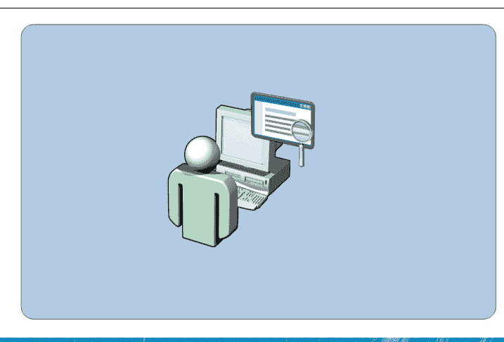

Fabrikam, Inc. 生产一系列高度敏感的测量设备，这些设备可以重复测量物体并采集数据。

Fabrikam, Inc. 构建的许多机器人设备由存储在设备上的文本文件指令进行控制。你被要求编写一个简单的应用程序，用户可以打开、显示和编辑这些文本文件之一（设备将不会安装记事本）。应用程序将运行在设备上，并使用设备内置的小屏幕和键盘。

# 练习 1：构建一个简单的文件编辑器

在此练习中，你将为简单的 WPF 应用程序添加用于编辑文本的功能。WPF 应用程序期望用户通过打开对话框输入文本文件的名称和路径。应用程序将打开此文件并将其显示在 WPF 表单的文本框中。用户可以编辑这些文本，然后修改后的文本保存回文件。

该应用程序的用户界面已经完成，但你将实现用户指定要编辑的文件并保存逻辑。

此实验的主要任务如下：

1. 打开 `SimpleEditor` 项目。
2. 显示对话框以接受文件名。
3. 实现一个新类来读取和写入文本到文件。
4. 更新事件处理程序以使用该类。
5. 实现测试用例。

## 任务 1：打开 SimpleEditor 项目

1. 登录 10266A-GEN-DEV 虚拟机，用户名为 Student，密码为 Password。
2. 打开 Microsoft Visual Studio® 2010。
3. 打开 `E:\Labfiles\Lab5\Ex1\Starter` 文件夹下的 `SimpleEditor` 解决方案。

## 任务 2：显示对话框以接受文件名

1. 显示 `MainWindow` 窗口。简单的文本编辑器。窗口的主部分包含一个用于显示和编辑文本的文本框。打开按钮允许用户打开文件，保存按钮允许用户将更改保存回文件。你将实现这些按钮的逻辑。
2. 查看任务列表。
3. 找到 TODO - 实现获取文件名的方法。此任务位于 `MainWindow.cs` 文件中。
4. 删除注释，并定义一个名为 `GetFileName` 的新方法，该方法不接受参数并返回用户指定的文件名字符串。在方法体内，声明一个名为 `fname` 的字符串并将其初始化为 `String.Empty`。在文件顶部的 `using` 语句末尾，添加语句将 `Microsoft.Win32` 命名空间引入作用域。在 `GetFileName` 方法中，声明 `fname` 变量后，添加代码执行以下操作：
   a. 创建一个名为 `OpenFileDialog` 的对话框新实例。
   b. 将 `openFileDialog` 的 `InitialDirectory` 属性指向 `E:\Labfiles\Lab5\Ex1\Starter` 文件夹。注意：在代码中包含文件路径时，应在字符串前加上 `@` 符号。该符号指示 C# 编译器将 `\` 视为字面量而非转义字符。
   c. 将 `openFileDialog` 的 `DefaultExt` 属性设置为 `"txt"`。
   d. 将 `openFileDialog` 的 `Filter` 属性设置为 `"Text Documents (*txt)|*.txt"`。添加代码执行以下任务：
   a. 调用 `openFileDialog` 的 `ShowDialog` 方法并保存结果。注意：`ShowDialog` 返回布尔值，因此将结果保存在布尔变量中。
   b. 如果结果为 true，将 `openFileDialog` 的 `FileName` 属性值赋值给 `fname` 变量。在方法末尾，返回 `fname` 变量的值。

## 任务 3：实现一个新类来读取和写入文本到文件

1. 在 `FileEditor` 项目中添加名为 `TextFileOperations` 的新类。你将使用此类来封装某些文件操作。这允许你更改读取或写入文件的方式而不影响程序的其他。
2. 在类文件顶部添加语句将 `System.IO` 命名空间引入作用域。在 `TextFileOperations` 类中，添加一个静态方法 `ReadTextContents`。该方法接受名为 `fileName` 的字符串参数并返回字符串对象。在 `ReadTextContents` 方法中，添加代码返回 `fileName` 参数指定的文件的完整内容。提示：使用 `File` 类的静态 `ReadAllText` 方法。
3. 在 `ReadTextContents` 方法下方添加一个静态方法 `WriteTextContents`。该方法不返回值并接受以下参数：
   - 名为 `fileName` 的字符串参数。
   - 名为 `text` 的字符串参数。
4. 在 `WriteTextContents` 方法中，添加代码将 `text` 参数中的文本写入 `fileName` 参数指定的文件。提示：使用 `File` 类的静态 `WriteAllText` 方法。
5. 生成解决方案并修正任何错误。

## 任务 4：更新 MainWindow 事件处理程序以使用 TextFileOperations 类

1. 在任务列表中，找到 TODO - 更新 `OpenButton_Click` 方法。此任务位于 `MainWindow` 类的 `OpenButton_Click` 方法中。
2. 删除注释，并添加代码执行以下任务：
   a. 调用 `GetFileName` 方法。将方法的的结果存储在 `fileName` 成员中。
   b. 如果 `fileName` 不是空字符串，调用 `TextFileOperations` 类的静态 `ReadFileContents` 方法并将 `fileName` 作为参数传递。将结果存储在 WPF 窗口中编辑器 `TextBox` 的 `Text` 属性中。
3. 在任务列表中，找到 TODO - 更新 `SaveButton_Click` 方法。此任务位于 `MainWindow` 类的 `SaveButton_Click` 方法中。
4. 在 `SaveButton_Click` 方法中，删除注释并添加代码执行以下任务：
   a. 检查 `fileName` 成员不是空字符串。
   b. 如果 `fileName` 不是空字符串，调用 `TextFileOperations` 类的静态 `WriteTextContents` 方法。将 `fileName` 和编辑器的 `Text` 属性作为参数传递。
5. 生成解决方案并修正任何错误。
6. 不带调试启动应用程序。
7. 在 `MainWindow` 窗口中，点击 Open。
8. 在打开对话框中，导航到 `E:\Labfiles\Lab5\Ex1\Starter` 文件夹，点击 `Commands.txt`，然后点击 Open。
9. 在 `MainWindow` 窗口中，验证以下代码示例中的内容显示在编辑器控件中：

```
Move x, 10

Move y, 20

If x < y Add x, y

If x > y && x < 20 Sub x, y

Store 30
```

这是 `Commands.txt` 文件的内容。

10. 将 `Store 30` 行改为 `Save 50`，然后点击 Save。
11. 关闭 `MainWindow` 窗口。
12. 使用 Windows 资源管理器导航到 `E:\Labfiles\Lab5\Ex1\Starter` 文件夹。
13. 使用记事本打开 `Commands.txt` 文件。
14. 在记事本中，验证文件的最后一行包含 `Save 50`。
15. 关闭记事本并返回 Visual Studio。

## 任务 5：实现测试用例

1. 在任务列表中，找到任务 `TODO - Complete Unit Tests`。双击此任务。该任务位于 `FileOperationsTest` 类中。
2. 移除注释。
3. 检查 `ReadFileContentsTest1` 方法，然后取消被注释行的注释。该方法创建了三个字符串：
   a. `fileName` 字符串包含一个预写文件的路径，该文件包含特定内容。
   b. `expected` 字符串包含预写文件的内容，包括格式和转义字符。
   c. `actual` 字符串通过调用你刚刚实现的 `ReadFileContents` 方法进行初始化。
   随后，该测试将使用 `Assert` 语句来验证 `expected` 字符串和 `actual` 字符串是否相同。
4. 检查 `WriteFileContentsTest1` 方法，然后取消被注释行的注释。该方法创建了两个字符串：
   a. `fileName` 字符串包含一个不存在的文件路径，该方法将在运行时创建该文件。
   b. `text` 字符串包含该方法将写入文件的某些文本。
   该方法调用 `WriteFileContents` 方法，并将 `fileName` 和 `text` 字符串作为参数传递。这会在指定位置创建文件并写入内容。该方法通过调用 `FileReadAll` 方法并从写入文件中读取文本，创建了另一个名为 `expected` 的字符串。然后，该方法会检查 `text` 字符串和 `expected` 字符串是否相同，最后删除在测试期间创建的文件。
5. 运行解决方案中的所有测试，并验证所有测试均执行正确。

# 练习 2：使编辑器感知 XML

控制机器人设备的应用程序从文件中读取指令，然后在将它们传递给设备上的指令执行模块之前，将其编码为 XML 文档。例如，假设一个文本文件包含代码示例所示指令。

```
Move x, 10

Move y, 20

If x < y Add x, y

If x > y Sub x, y

Store 30
```

控制应用程序将它们封装在一对 XML 标签中，如下代码示例所示。

```
<ControlApplication>

<Instructions Code = "

Move x, 10

Move y, 20

If x < y Add x, y

If x > y Sub x, y

Store 30"

>

</ControlApplication>
```


然而，这些指令中的某些数据可能包含 `>` 和 `<` 等字符，这些字符可能会被误认为是 XML 标签而不是数据。

在此练习中，你将修改 WPF 应用程序，在读取文本文件时查找包含 XML 标签的数据，并在显示之前将其数据编码为 XML 转义序列。例如，`>` 字符将被替换为 `&gt;`，`<` 符号将被替换为 `&lt;`，以此类推。WPF 应用程序将使用文件流读取数据。

此练习的主要任务如下：

1. 打开启动项目。
2. 向 `TextFileOperations` 类中添加一个用于过滤 XML 字符的新方法。
3. 更新用户界面以调用新方法。
4. 实现测试用例。

## 任务 1：打开启动项目

1. 打开 `E:\Labfiles\Lab 5\Ex2\Starter` 文件夹下的 `SimpleEditor` 解决方案。该项目是练习 1 中 `SimpleEditor` 项目的完成版本。

## 任务 2：向 `TextFileOperations` 类中添加一个过滤 XML 字符的新方法

1. 检查任务列表。
2. 在任务列表中，找到 `TODO - Implement a new method in the TextFileOperations class` 任务。双击此任务。

该任务位于 `TextFileOperations` 类中。

3. 移除 `ReadAndFilterTextFileContents`。该方法应接受一个名为 `fileName` 的字符串参数并返回一个字符串。
4. 在 `ReadAndFilterTextFileContents` 方法中，添加以下局部变量：
   a. 一个名为 `fileContents` 的 `StringBuilder` 对象，初始化为 `StringBuilder` 类的新实例。
   b. 一个名为 `charCode` 的整数变量。
5. 添加一条语句，使用 `fileName` 参数实例化名为 `fileReader` 的 `StreamReader` 对象。
6. 添加一个 `while` 语句，读取 `StreamReader` 对象中的每个字符，到达文件末尾。

> **提示：** 使用 `StreamReader` 类的 `Read` 方法从流中读取下一个字符。如果没有更多数据，该方法将返回 -1。

7. 在 `while` 块中，添加一个评估 `charCode` 变量的 `switch` 语句。在 `switch` 语句中，添加注释，并根据表所示的替代表示向 `fileContent StringBuilder` 对象追加内容。

| charCode | 标准表示 | 替代表示 |
|---|---|---|
| 34 | " (直引号) | `&quot;` |
| 38 | & (和符号) | `&amp;` |
| 39 | ' (单引号) | `&apos;` |
| 60 | < (小于号) | `&lt;` |
| 62 | > (大于号) | `&gt;` |

8. 添加一个 `default` 语句，将从流中读取的实际字符追加到 `fileContent StringBuilder` 对象中。

> 注意：`Read` 方法从文件中读取的值作为整数返回并存储在 `charCode` 变量中。在将其追加到 `StringBuilder` 对象的末尾之前，你必须将变量转换为字符。

9. 在方法末尾，将 `fileContent StringBuilder` 对象的内容作为字符串返回。
10. 生成解决方案并修正任何错误。

## 任务 3：更新用户界面以调用新方法

1. 在任务列表中，找到 `TODO - Update the UI to use the new method` 任务。双击此任务。

该任务位于 `MainWindow.xaml.cs` 类的 `OpenButton_Click` 方法中。

在打开对话框中，进入 `E:\Labfiles\Lab 5\Ex2\Starter` 文件夹，点击 `Commands.txt`，然后点击打开。

在 `MainWindow` 中，验证后续代码示例中的测试是否显示在 `TextBox` 控件中。

```
Move x, 10

Move y, 20

If x &lt; y Add x, y

If x &gt; y &amp; x &lt; 20 Sub x, y

Store 30
```

这是来自 `Commands.txt` 文件的测试。注意 `<`、`>` 和 `&` 字符已被替换为 `&lt;`、`&gt;` 和 `&amp;`。

关闭 `MainWindow` 窗口并返回 Visual Studio。

## 任务 4：实现测试用例

1. 在任务列表中，找到 `TODO - Complete Unit Tests`。双击此任务。
2. 检查 `FilterTextContents` 方法，然后取消被注释行的注释。

这位于 `TextOperationsTest` 类中。

该方法创建了三个字符串：

a. `fileName` 字符串包含一个预写文件的路径，该文件包含特定内容。
b. `expected` 字符串包含预写文件的内容，包括格式和转义字符。
c. `actual` 字符串通过调用你实现的 `ReadAndFilterTextContents` 方法进行初始化。

该测试使用 `Assert` 语句来验证 `expected` 字符串和 `actual` 字符串是否相同。该方法已完成，无需进一步工作。

3. 运行解决方案中的所有测试，并验证所有测试均执行正确。

## 实验复习

思考题

- 解释 `File.Load` 和 `File.Save` 静态方法的作用。
- 你有一个包含文本的文件。你想逐个字符读取文件。使用 `StreamReader` 类的哪个方法？

## 模块回顾与要点

- 思考题
- 最佳实践

思考题

1. 向流写入数据时，列出两种可以确保任何缓冲数据写入底层数据源的方法。
2. .NET Framework 提供了哪些类可以显示图形控件，允许从用户处获取保存文件和打开文件路径？
3. 你使用哪种流类来写入文本数据？

## 关于文件系统读写数据的最佳实践

根据你的工作情况补充或修改以下最佳实践：

- 在尝试读取或写入文件之前，务必检查文件是否存在。
- 不要假设文件内容是正确的。记住，文件存储在文件系统中，用户对其有访问权限。用户完全可以编辑他们应该编辑的文件。始终解析文件确保其有效，或者准备好捕获并处理适当异常。
- 当你使用流时，务必确保在使用后关闭流，以释放对底层数据源的任何句柄。
- 很容易假设你拥有生成环境中的任何地方读写文件的权限。通常情况下，并非如此。请确保你的开发环境与生成环境镜像。

# 第 6 模块

## 创建新类型

**目录：**

- **第 1 节：** 创建和使用枚举 6-3
- **第 2 节：** 创建和使用类 6-12
- **第 3 节：** 创建和使用结构 6-33
- **第 4 节：** 比较引用与值 6-41
- **实验：** 创建新类型 6-55

### 模块概述

- 创建和使用枚举
- 创建和使用类
- 创建和使用结构
- 比较引用与值

Microsoft® .NET Framework 基类库包含许多可以在应用程序中使用的类型。然而，在所有应用程序中，你还必须构建实现你解决方案逻辑的类型。

本模块解释了如何创建自己的类型，并描述了引用类型和值类型之间的差异。

### 目标

完成本模块后，你将能够：

- 描述如何创建和使用枚举。
- 描述如何创建和使用类。
- 描述如何创建和使用结构。
- 解释引用类型和值类型之间的差异。

## 第 1 节：创建和使用枚举

- 什么是枚举？
- 创建新的枚举类型
- 初始化和分配枚举变量

```
d = 5;
```

然而，以下代码示例中的语句是非常直观的，这变得明显 `d` 必须指向周几某一天。

```
d = DaysOfWeek.Friday;
```

本节描述了枚举的目的。它还解释了如何创建新的枚举类型以及实例化和分配现有的枚举类型。

### 目标

完成本节后，你将能够：

- 描述枚举的目的。
- 描述如何创建新的枚举类型。
- 描述如何初始化和分配现有的枚举类型。

### 什么是枚举？

| 枚举类型指定了一组命名的常量 |
| :--- |
| Days |
| Monday |
| Tuesday |
| Wednesday |
| ... |

优点包括：

- 代码更易维护，因为你只为变量分配了预期的值
- 代码更易读，因为你为这些值分配了易于识别的名称
- 代码更容易编写，因为 IntelliSense 显示了你可以使用的可能值列表

### 关键点

枚举类型指定了一组相关的、命名的常量。枚举类型是一种标量类型，具有用户定义的值范围。你可以像使用 C# 内置标量类型（如 `int` 或 `float`）一样，创建枚举类型、声明该类型的变量，并为这些变量分配值。你可以使用枚举类型来表示特定领域中的一组值。枚举还有助于让你的代码更易读和维护。

.NET Framework 基类包含许多你可以在应用程序中使用的枚举。许多 .NET Framework 类使用这些枚举作为返回值和方法参数。

你可能在其他语言（如 Java 和 C++）中使用过枚举；然而，它们存在一些细微的差别。区别在于，Microsoft Visual C# 中的枚举基于整型数据类型（如 `int` 和 `long`），而 Java 中的枚举派自对象，这意味着每个枚举都可以包含其自己的可修改字段。Visual C# 和 C++ 中枚举的实现非常相似。

### 优点

枚举提供了常量提供的所有优势，并具有以下额外益处：

- 代码更易维护，因为你只为变量分配了预期的值。
- 代码更易读，因为你为这些值分配了易于识别的名称。
- 代码更容易输入，因为 Microsoft IntelliSense® 显示了你可以使用的可能值列表。
- 代码构型良好，因为你可以指定一组常量值，并定义一个只接受该集合中值的类型。

**问题：** 与其他学生和老师讨论你以前在何时以及如何使用过枚举。

### 创建新的枚举类型

使用 `enum` 关键字定义枚举：

```
enum Name : DataType { Value1, Value2 . . };
```

你可以在命名空间和类中定义枚举，但不能在方法中定义。枚举值默认从 0 开始，除非有显式说明。

```
namespace Fabrikam.CustomEnumerations
{
  enum Days : int { Monday = 1, Tuesday = 2, Wednesday = 3 };
  ...
}
```

#### 关键点

你可以使用 `enum` 关键字创建自己的枚举类型。你必须为枚举分配一个名称，然后列出枚举接受的值。枚举是类型，所以你可以在类或命名空间中声明枚举，但不能在方法中声明。

以下代码示例显示了创建枚举的语法：

```
enum Name : DataType { Value1, Value2 . . };
```

以下代码示例声明了一个季节的枚举：

```
enum Seasons {
```

定义和分配基于枚举变量的方式与你在 C# 中使用其他类型非常相似。变量的类型是枚举的名称，你可以分配的值是枚举定义的字面量。

以下代码示例声明 `Season` 枚举的底层类型为 `short` 而不是 `int`：

```
enum Season : short {
```

这样做的主要目的是节省内存；`int` 占据的内存比 `short` 大。如果你不需要 `int` 的可用范围，使用较小的数据类型是有利的。

你可以基于八种整数类型之一创建枚举：`byte`、`sbyte`、`short`、`ushort`、`int`、`uint`、`long` 或 `ulong`。枚举字面量的值都在所选类型的范围内。

问题：以下代码示例显示了合法的枚举吗？

```
enum Season : sbyte { Spring = -3, Fall };
```

## 其他阅读

有关枚举的更多信息，请参见 C# 编程指南中的枚举类型页面：http://go.microsoft.com/fwlink/19295。

### 初始化和分配枚举变量

| 像其他类型一样实例化枚举变量 |
| :--- |
| `[EnumType] variableName = [EnumValue]` |
| 你只能分配定义好的枚举值 |
| `enum Days : int { Monday = 1, Tuesday = 2, Wednesday = 3, Thursday = 4, Friday = 5, Saturday = 6, Sunday = 7 }` |
| `static void Main(string[] args) { Days myDayOff = Days.Sunday; }` |
| 分配值 Sunday |
| 你可以对枚举执行简单的操作 |
| `for (int dayOfWeek = Days.Monday; dayOfWeek <= Days.Sunday; dayOfWeek++) { ... }` |

#### 关键点

定义和分配基于枚举变量的方式与你在 C# 中使用其他类型非常相似。变量的类型是枚举的名称，你可以分配的值是枚举定义的字面量。

以下代码示例使用了一个名为 `Days` 的枚举，它包含了每周每一天的枚举值：

```
enum Days
{
  Monday = 1, Tuesday = 2, Wednesday = 3, Thursday = 4,
  Friday = 5, Saturday = 6, Sunday = 7
}
```

变量 `myDayOff` 是使用 `Days` 类型声明的。注意，当你为 `myDayOff` 变量赋值时，你需要显式地指定字面量值所属的枚举（例如中的 `Days.Sunday`）。当你创建一个 `Days` 枚举的实例时，你只能分配 `Days` 枚举定义的字面量值之一：周一、二、三、四、五、六或日。

### 使用枚举变量

你可以像使用整数变量一样对枚举变量执行简单操作。下面的代码示例使用枚举变量来遍历一周的每一天，并依次显示每一个：

```c
enum Days
{
    Monday = 1, Tuesday = 2, Wednesday = 3, Thursday = 4,
    Friday = 5, Saturday = 6, Sunday = 7
};

for (Days dayOfWeek = Days.Monday; dayOfWeek <= Days.Sunday;
    dayOfWeek++)
{
    Console.WriteLine(dayOfWeek);
}

/* 输出为:
Monday
Tuesday
Wednesday
Thursday
Friday
Saturday
Sunday
*/
```


注意，你可以使用枚举定义中的字面量值进行比较。比较是通过使用每个字面量的底层整数值完成的。此外，你可以在枚举变量上执行如 `++` 和 `--` 等整数操作。`++` 的效果是将枚举变量推进到它的下一个值，而 `--` 则将退到上一个值。最后，当你显示枚举变量的值时，显示的值是该枚举类型中对应的字面量。然而，如果在枚举类型使用的整数值范围之外增加枚举变量，所示的将是底层的整数值（这通常是编程错误的结果，但 C# 编译器不会检查以此方式赋值给枚举变量的整数值是否超出了枚举定义的字面量值范围）。

> **注意：** 除了 `++` 和 `--` 之外，你不能对枚举变量执行任何其他算术操作，除非你先将变量转换为底层整数类型。这并不是真正的限制；在大多数情况下，算术操作的语义对于枚举类型没有意义（例如，`Days.Monday + Days.Wednesday` 表达式是什么意思？）。

问题：描述如何初始化枚举变量。

## 第 2 Lesson：创建和使用类

- 什么是类？
- 向类中添加成员
- 定义构造函数并初始化对象
- 创建对象
- 访问类成员
- 使用部分类和部分方法

Visual C# 是一种面向对象的编程语言。C# 应用程序的所有逻辑都包含在类和结构体中。本节解释了如何创建你的类并在你自己的 .NET Framework 应用程序中使用它们。它还介绍了如部分类和部分方法等概念。

### 目标

完成本节后，你将能够：

- 描述类的用途。
- 描述如何向类中添加字段和方法。
- 描述如何定义构造函数。
- 如何创建类的实例。
- 描述如何访问类中的字段和方法。
- 描述如何创建和定义部分类和部分方法。

### 什么是类？

| 类是用于创建对象的蓝图 |
| --- |
| 类定义了对象的特征 |
| `class House { ... }` 使用 `class` 关键字的类定义 |
| 对象是类的实例 |


#### 关键点

当你创建一个 C# 应用程序时，你会使用表示应用程序中主要数据类型的类。.NET Framework 提供了大量可重用的工具类，但你也可以定义自己的类，来封装特定于你应用程序的数据和逻辑。

### 什么是类？

你可以将类视为用于创建对象的蓝图。类定义了对象的特征，例如对象可以包含的数据以及对象可以执行的操作。类的特征也被称为成员；成员将在下一个主题中介绍。

#### 什么是对象？

对象是类的实例。如果说类比作蓝图，那么对象就是你使用该蓝图创建的项目。类是对项的定义；对象是项目本身。

### 6-14 使用 Microsoft® Visual Studio® 2010 进行 C# 编程

> **注意：** 实例（`instance`）一词经常被用作对象（`object`）的替代术语。

在现实世界中，房屋的图纸就像类，而按照这些图纸建造的房子就像对象。你可以按照同一套图纸建造许多房屋实例。所有的房子都具有相同的布局和结构（相同的房间），但它们仍然是不同的房子。在面向对象编程中，你可以定义一个 `House` 类来对特定的房间布局和尺寸进行分类。然后，你可以使用此类创建一个或多个 `House` 对象。每个对象都将具有类定义的房间布局和尺寸，但每个 `House` 对象的其他方面可能有所不同，例如房屋对象的位置或正门的颜色。

### 定义新类

你可以使用 Visual Studio®向项目添加新类。通常，你将每个类放在单独的源文件中，并将源文件名命名为类名。Visual Studio 2010 会源文件中生成该类的模板代码。模板代码通常包含 `using` 语句以将命名空间引入作用域、命名空间的定义以及类本身。

#### 向项目添加新类

- 在解决方案管理器中，右键点击项目，指向“添加”，然后点击“类”。
- 在“添加新建项”对话框中，为包含新类的源文件命名，然后点击“添加”。

下面的代码示例了一个名为 `House` 的新类。

```csharp
using System;
using System.Collections.Generic;
using System.Linq;
using System.Text;

namespace House
{
    class House
    {
    }
}
```

> **注意：** 类的默认命名空间取决于你添加该类的应用程序。你可以通过在源文件中重写它来更改此命名空间。

问题：解释类和对象的区别。

### 向类添加成员

| 成员定义了类的数据和行为 |
| --- |
| `public class Residence { public ResidenceType type; public int numberOfBedrooms; public bool hasGarage; public bool hasGarden; public int CalculateSalePrice() { // 计算住宅售价的代码 } public int CalculateRebuildingCost() { // 计算住宅重建成本的代码 } }` | 方法 |

#### 关键点

你可以向类中添加字段和方法，以定义该类的数据和行为。根据类的目的和预期功能，你可以在类中定义任意数量的字段和方法。

**注意：** 本主题介绍的字段和方法是实例字段和实例方法。实例字段是每个实例的数据，实例方法是实例的操作。基于同一类的两个对象拥有自己的实例字段副本。然而，你可以通过创建静态成员在实例之间共享字段。静态关键字将在后的模块中介绍。

#### 定义字段

你可以将字段看作是作用于类的变量。类中定义的所有方法都可以访问该字段。与变量一样，每个字段都有名称、数据类型和访问修饰符。如果你没有为字段显式指定访问修饰符，默认访问级别为私有（`private`），这意味着它只能被类中定义的方法访问。如果你想让供其他类定义的方法访问的字段，你可以将该字段标记为 `public`（公共）。

**注意：** 访问修饰符将在后面的模块中进行更详细的描述。

你可以在类中的任何位置放置字段定义。某些程序员倾向于将字段定义放在类的开头，以便其他程序员更容易阅读代码。

当你定义一个字段时，你也可以为该字段分配默认值，尽管你可以使用构造函数在创建另一个新实例时更改分配给字段的值。

**注意：** 下一个主题将描述如何使用构造函数来初始化类成员。

#### 定义方法

方法是类内部的程序或函数。你使用方法来实现类的行为。每个方法都有一个名称、参数列表、返回类型和一个访问修饰符。

方法对类中的所有其他成员具有完全且无限制的访问权限。这是面向对象编程的一个重要方面；方法封装了对类中字段的操作。当你引用类中的字段时，可以在字段前加上 `this` 关键字，如下面的代码示例中的粗体所示。这种方法有助于消除任何引用歧义（例如，方法的参数名称可以与类中的字段名称相同，尽管不建议这样做），并有助于使你的代码更容易维护。

```csharp
public bool hasGarage;

public void OpenGarageDoor(int doorId)
{
    if (this.hasGarage)
    {
        // 如果住宅有车库，则运行的代码。
    }
}
```

#### 示例

下面的代码示例展示了一个作为房地产应用程序部分的 `Residence` 类。该类有四个字段，分别代表住宅类型、卧室数量、住宅是否有车库以及住宅是否有花园。该类拥有方法，用于计算出售的住宅价值以及用于保险目的的住宅重建成本。

```csharp
public enum ResidenceType { House, Flat, Bungalow, Apartment };

public class Residence
{
    public ResidenceType type;
    public int numberOfBedrooms;
    public bool hasGarage;
    public bool hasGarden;

    public int CalculateSalePrice()
    {
        // 计算住宅销售价值的代码。
    }

    public int CalculateRebuildingCost()
    {
        // 计算住宅重建成本的代码。
    }
}
```

#### 使用类设计器

你可以通过在代码编辑器窗口中编写代码来手动设计类。然而，你也可以使用类设计器窗口来图形化地设计类并添加字段和方法。

要使用类设计器窗口，你需要向项目添加类图。要向 Visual Studio 解决方案中添加类图，请在解决方案管理器中右键点击你的项目，然后点击“查看类图”。类图自动包含你在项目中定义的所有枚举、类和结构体。它还提供了一个工具箱，你可以使用它向图中添加新项，并向这些项中添加字段和方法。

**问题：** 字段和方法之间的区别是什么？

### 定义构造函数和初始化对象

构造函数是运行时隐式调用的特殊方法。

```csharp
public class Residence
{
    public Residence(ResidenceType type, int numberOfBedrooms)
    {
    }

    public Residence(ResidenceType type, int numberOfBedrooms, bool hasGarage)
    {
    }

    public Residence(ResidenceType type, int numberOfBedrooms, bool hasGarage, bool hasGarden)
    {
    }
}
// 三个构造函数
```

如果你不在类中初始化字段，它将被分配其默认值。

#### 关键要点

当你创建一个对象时，确保对象被完全初始化并且其所有字段都设置为有意义的值是非常重要的。为了实现这一点，在类中定义一个或多个构造函数。通用语言运行时（CLR）在创建对象时会自动调用构造函数。

> **注意：** 如果你不在类中初始化字段，它将被分配其默认值。如果字段是数值，则被初始化为 `0`。如果字段是布尔值，则被初始化为 `false`。如果字段是字符串，则被初始化为 `null`。如果属性是一个类，也将被初始化为 `null`。

#### 定义构造函数

构造函数是 CLR 在创建对象时自动调用的特殊方法。在定义构造函数时适用以下规则和指南：

- 构造函数的名称与其所在的类名称相同。
- 构造函数不能指定返回值，即使是 `void` 也不行，但它们可以接受参数。你可以在类中定义任意数量的构造函数，只要每个构造函数都有唯一的参数列表。不带参数的构造被称为默认构造函数。
- 构造函数通常声明为 `public` 访问性，以便应用程序的任何部分创建并初始化对象。如果你想限制可以创建和初始化对象的应用程序部分，可以为构造函数定义更具限制的访问级别。
- 构造函数通常初始化对象中的某些或所有字段，并执行类所需的任何额外初始化任务。

**重要：** 如果你没有为类定义任何构造函数，C# 编译器会自动为你生成一个默认构造函数（一个不带参数的构造函数）。此构造函数什么都不做，但它允许你创建该类的实例。然而，如果你自己定义了一个或多个构造函数，C# 编译器将不再生成默认构造函数。

#### 示例

下面的代码示例展示了如何为 `Residence` 类定义三个构造函数。接下来的列表描述了这些构造函数：

- 第一个构造函数接受两个参数，设置住宅的类型和卧室数量。
- 第二个构造函数接受三个参数，设置住宅的类型、卧室数量以及住宅是否有车库。
- 第三个构造函数接受四个参数，设置住宅的类型、卧室数量、住宅是否有车库以及住宅是否有花园。

**注意：** 注意代码示例如何使用 `this` 关键字来区分字段和同名参数。

```csharp
public enum ResidenceType { House, Flat, Bungalow, Apartment };
```

```csharp
public class Residence
{
    public ResidenceType type;
    public int numberOfBedrooms;
    public bool hasGarage;
    public bool hasGarden;
}
```

```csharp
public Residence(ResidenceType type, int numberOfBedrooms)
{
    this.type = type;
    this.numberOfBedrooms = numberOfBedrooms;
}
```

```csharp
public Residence(ResidenceType type, int numberOfBedrooms, bool hasGarage)
{
    this.type = type;
    this.numberOfBedrooms = numberOfBedrooms;
    this.hasGarage = hasGarage;
}
```

```csharp
public Residence(ResidenceType type, int numberOfBedrooms, bool hasGarage, bool hasGarden)
{
    this.type = type;
    this.numberOfBedrooms = numberOfBedrooms;
    this.hasGarage = hasGarage;
    this.hasGarden = hasGarden;
}
```

还可以使用 `this` 关键字作为构造函数声明的一部分从一个构造函数调用另一个。匹配的构造函数将被执行。使用此功能，你可以实现一个为每个参数调用一组默认值的默认构造函数，如下面的代码示例所示。

```csharp
public class Residence
{
    ...
    public Residence(ResidenceType type, int numberOfBedrooms,
        bool hasGarage, bool hasGarden)
    {
        ...
    }

    // 默认构造函数创建一个带有车库和花园的3卧室住宅
    public Residence() : this(ResidenceType.House, 3, true, true)
    {
        ...
    }
}
```

**问题：** 如果你没有为类定义默认构造函数会发生什么？

#### 延伸阅读

有关构造函数的更多信息，请参阅“实例构造函数 (C# 编程指南)”页面：http://go.microsoft.com/fwlink/?LinkId=19226.

### 创建对象

| 对象初始是未赋值的 |
| --- |
| 在使用类之前，你必须创建该类的实例 |
| 你可以使用 `new` 运算符创建类的新实例 |
| `new` 运算符执行两项操作： |
| • 促使 CLR 为对象分配内存 |
| • 调用构造函数来初始化对象 |

```csharp
// 创建一个有 2 卧室的公寓。
Residence myFlat = new Residence(ResidenceType.Flat, 2);

// 创建一个有 3 卧室并带车库的房子。
Residence myHouse = new Residence(ResidenceType.House, 3, true);

// 创建一个有 2 卧室、车库和花园的单层楼。
Residence myBungalow = new Residence(ResidenceType.Bungalow, 2, true);
```

#### 关键点

当你声明一个类变量时，它初始是未赋值的。你必须创建对应类的实例并将其赋值给类变量。要创建类的实例，你使用 `new` 运算符。

`new` 运算符执行两件事：它调用 CLR 为你的对象分配内存，并调用构造函数来初始化该对象中的字段。运行的构造函数版本取决于为 `new` 运算符指定的参数。下面的代码示例显示了如何使用上一个主题中定义的构造函数创建并使用 `Residence` 类的实例。

```csharp
// 创建一个有 2 卧室的公寓。
Residence myFlat = new Residence(ResidenceType.Flat, 2);

// 创建一个有 3 卧室并带车库的房子。
Residence myHouse = new Residence(ResidenceType.House, 3, true);

// 创建一个有 2 卧室、车库和花园的单层楼。
Residence myBungalow = new Residence(ResidenceType.Bungalow, 2, true);
```

如果你调用 `new` 而不指定任何参数，将运行默认构造函数。记住，如果你为类定义了一个或多个构造函数，C# 编译器就不会自动为你创建默认构造函数。

### 使用对象初始化器

你通过调用构造函数来实例化对象。构造函数可以接受参数，用于指定初始化对象中字段的值。然而，对象可能有任意数量的字段，可能无法或不提供能够初始化这些字段所有可能组合的构造函数。例如，假设 `Residence` 类目前提供下面代码示例所示的三个构造函数。

```csharp
public enum ResidenceType { House, Flat, Bungalow, Apartment };

public class Residence {
    public ResidenceType type;
    public int numberOfBedrooms;
    public bool hasGarage;
}
```


以下是对给定文本的排版处理结果：

---

```csharp
public bool hasGarden;

public Residence(ResidenceType type, int numberOfBedrooms) {
    this.type = type;
    this.numberOfBedrooms = numberOfBedrooms;
}

public Residence(ResidenceType type, int numberOfBedrooms, bool hasGarage) {
    this.type = type;
    this.numberOfBedrooms = numberOfBedrooms;
    this.hasGarage = hasGarage;
}

public Residence(ResidenceType type, int numberOfBedrooms, bool hasGarage, bool hasGarden) {
    this.type = type;
    this.numberOfBedrooms = numberOfBedrooms;
    this.hasGarage = hasGarage;
    this.hasGarden = hasGarden;
}
// ...
```

使用这些构造函数，你可以创建一个 `Residence` 对象并初始化各种字段，但缺少了一种组合。只有当你显式说明住宅有车库时，你才能指定住宅有花园；没有构造函数可以允许你在不设置 `hasGarage` 属性的情况下初始化 `hasGarden` 字段。你可能会想定义一个额外的构造函数，如下面的代码示例所示。

```csharp
public class Residence {
    // ...
    public bool hasGarden;
    // ...

    public Residence(ResidenceType type, int numberOfOfBedrooms, bool hasGarage) {
        this.type = type;
        this.numberOfOfBedrooms = numberOfOfBedrooms;
        this.hasGarage = hasGarage;
    }

    // 用于初始化 hasGarden 字段而不设置
    // hasGarage 的构造函数。
    public Residence(ResidenceType type, int numberOfOfBedrooms, bool hasGarden) {
        this.type = type;
        this.numberOfOfBedrooms = numberOfOfBedrooms;
        this.hasGarden = hasGarden;
    }
}
```

问题是构造函数遵循与方法相同的重载规则，你不能定义两个或多个具有相同签名的构造函数。在这个示例中，`Residence` 类将编译，因为这两个构造函数具有相同的签名。

你可以通过使用对象初始化器来解决这个问题。

对象初始化器通过使用构造函数创建对象，并初始化同一语句中提到的任何其他字段。你在调用构造函数之后的大括号 `{}` 中指定要初始化的字段以及为它们设置的值，如下面的代码示例所示。

```csharp
// 创建一个有 3 卧室并带花园的房子。
Residence myHouse = new Residence(ResidenceType.House, 3) { hasGarden = true };
```

当你使用对象初始化器创建对象时，会先运行相应的构造函数，然后分配属性值。属性赋值可能会覆盖构造函数执行的初始化。

**问题：** 当你初始化类以创建该类的实例时，你必须使用哪个运算符？

### 访问类成员

使用*实例名称*后跟一个点 `.` 来访问对象成员

```csharp
InstanceName.Member
```

示例

```csharp
// 创建一个有 3 卧室的房子。
Residence myHouse = new Residence(ResidenceType.House, 3);

// 指定住宅有花园。
myHouse.hasGarden = true;

// 计算市场价。
int salePrice = myHouse.SalePrice();

// 获取重构费用。
int rebuildCost = myHouse.RebuildingCost();
```

#### 关键点

使用实例名称后跟一个点 `.` 来访问对象成员。访问成员时遵循以下规则和指南：

- 访问方法时，在名称后使用括号。在括号中传递方法所需的任何参数。如果方法不接受任何参数，仍然需要括号。
- 访问公共字段时，使用名称。你可以获取或设置该值。下面的代码示例执行以下任务：
  - 使用指定住宅类型和卧室数量的构造函数创建住宅实例。
  - 将 `hasGarden` 属性设置为 `true` 以指示住宅有花园（你也可以在创建对象时这样做）。

**问题：** 请高亮下方代码示例中的语法错误。

```csharp
Car myCar = new Car("Ford", "Black");

// 设置字段以指示汽车的手箱。
myCar.isManual = true;

// 调用方法计算汽车的价值。
double value = myCar.CalculateValue();
```

# 使用部分类和部分方法

| 跨多个文件拆分定义 |
| 在类和方法声明前加上 `partial` 关键字 |
| `public partial class Residence { partial void SaleResidence(string name); }` | `SaleResidence` 方法定义 |
| `public partial class Residence { partial void SaleResidence(string name) { //逻辑在此处 } }` | `SaleResidence` 方法实现 |
| 部分类和方法的所有部分在编译时必须可用 |
| 编译成单个实体 |

#### 关键点

在某些情况下，你可能将类定义拆分到多个文件中。例如，你可能有多个开发者想要并发处理一个类，或者类中包含某些不应修改的部分。.NET Framework 提供了部分类的概念用于此目的。

.NET Framework 和 Visual Studio 项目中的某些类使用了部分概念。例如，Windows® Presentation Foundation (WPF) 应用程序使用部分类将 Visual Studio 生成的初始化窗口的代码与你用于处理用户输入和显示结果的程序逻辑隔离开。

### 定义部分类

将类定义为部分允许你将类拆分到多个文件中。要定义部分类，你必须使用 `partial` 关键字，如下面的代码示例所示。

```cs
// File1.cs
namespace HouseSystem
{
    public partial class Residence
    {
        //...
    }
}
```

```cs
// File2.cs
namespace HouseSystem
{
    public partial class Residence
    {
        //...
    }
}
```

定义部分类（partial class）时，适用以下规则和指南：

- 类的每个部分在应用程序编译时必须可用，因为编译器会将该类编译成单个实体。
- 类的每个部分都必须以 `partial` 关键字为缀。
- 部分类型不能拆分到多个程序集中。部分类型的每个部分必须存在于同一个程序集中。
- `partial` 关键字必须置于 `class` 关键字之前。

### 定义部分方法

当你定义一个部分类时，可以在该类中定义一个或多个方法作为部分方法（partial methods）。

部分方法在包含部分类的文件中指定方法签名，并可选地在另一个包含部分类的文件中指定实现该方法的代码。如果部分方法没有实现，它将有效地从类中移除，并且在编译类时，任何调用该方法的语句也会被忽略。部分方法通常由框架使用；它们为框架中的类提供了一种机制，当框架外的开发者实现这些方法的代码时，框架中的类可以调用这些方法。

下面的代码示例演示了如何在部分文件中跨方法的声明和实现。在这些示例中，第一个代码文件显示了作为类框架一部分的部分类。`FrameworkClass` 类定义了一个名为 `DoWork` 的方法。该类中的 `FrameworkMethod` 方法调用 `DoWork` 方法。`DoWork` 方法由另一个开发者在单独的文件实现。请注意，如果第二个文件没有实现 `DoWork` 方法，编译器将忽略 `FrameworkMethod` 方法中的调用。

```cs
// 框架提供的代码
public partial class FrameworkClass
{
    partial void DoWork(int data); // 部分方法的定义。

    public void FrameworkMethod()
    {
        DoWork(99);        // 调用部分方法。
        //...
    }
}
```

```cs
// 开发者提供的用于链接框架的代码。
public partial class FrameworkClass
{
    partial void DoWork(int data)
    {
        // 实现 DoWork 方法的代码。
    }
}
```

定义部分方法时，适用以下规则和指南。

- 所有部分方法必须是 `void` 且不能有返回值。
- 所有部分方法都是隐式私有的。你无法从定义该方法的类外部访问部分方法。
- 所有部分方法的声明必须以 `partial` 关键字为缀。
- 部分方法可以有 `ref` 参数，但不能有 `out` 参数。`ref` 参数将在本节稍后介绍。

问题：如果你定义了一个部分方法但没有提供该方法的实现，会发生什么？

# 拓展

有关部分类和方法的更多信息，请参阅《C# 编程指南》中的部分类和方法页面，地址为 http://go.microsoft.com/fwlink/?LinkIdId=192927。

### 第 3 课
创建和使用结构

- 什么是结构？
- 定义和使用结构
- 初始化结构

当你想要在应用程序中模拟现实世界的实体并封装其相关的业务逻辑和数据时，类非常有用。然而，当你创建对象实例时，会产生开销，有时你可能需要一个更轻量级的解决方案。结构具有许多类的特性，但没有了某些开销，尽管它们也有一些局限性。

本节描述了如何定义结构，并解释了类和结构之间的一些区别。

### 目标

完成本节后，你能够：

- 描述结构的用途。
- 描述如何向结构添加成员。
- 描述如何在结构中初始化和访问成员。

### 什么是结构？

| System.Byte | System.Int64 | System.Decimal |
| System.Int16 | System.Single | System.Boolean |
| System.Int32 | System.Double | System.Char |

结构的数据存储在栈上

使用结构来建模包含少量数据的项目

结构可以像类一样包含字段和方法

```cs
int x = 99;
string xString = x.ToString();
```

#### 关键点

结构在许多方面与类非常相似，不同在于由于 CLR 创建和管理结构实例的方式，它的开销更小（你将在本节稍后的部分看到更多内容）。结构也有一些局限性，将在本课程中讨论。

你通常使用结构来建模包含较少数据的项目。你在整个课程中都使用了结构，尽管你可能没有意识到 C# 语言中的原始类型只是 .NET Framework 定义的某些结构的别名，你可以交替地使用这些别名或相应的结构。下表描述了其中一些结构。

| 结构类型 | C# 关键字 |
|---|---|
| System.Byte | byte |
| System.Int16 | short |
| System.Int32 | int |
| System.Int64 | long |
| System.Single | float |
| System.Double | double |
| System.Decimal | decimal |
| System.Boolean | bool |
| System.Char | char |

像类一样，结构可以包含字段和方法。例如，`System.Int32` 定义了 `ToString` 方法，它返回整数值的字符串表示。这意味着你可以对 `int` 执行操作，如下代码所示。

```cs
int x = 99;
string xAsString = x.ToString();
```

请注意，默认情况下，你不能在结构类型上使用 `==` 和 `!=` 等常用运算符，除非你提供了实现。这种语法将在后面的章节中描述。

问题：以下代码合法吗？

```cs
int x = 99;
System.Int32 y = x + 1;
```

### 定义和使用结构

使用 `struct` 关键字声明结构

以类的方式在结构中定义成员

```cs
struct Currency {
    public string currencyCode;
    public string currencySymbol;
    public int fractionDigits;
}
```

结构自动在栈上分配内存

```cs
Currency unitedStatesCurrency;
unitedStatesCurrency.currencyCode = "USD";
unitedStatesCurrency.currencySymbol = "$";
unitedStatesCurrency.fractionDigits = 2;
```

创建结构实例时不需要使用 `new` 运算符

#### 关键点

声明结构的语法与声明类的语法相似，区别在于使用 `struct` 关键字而不是 `class` 关键字。在结构中定义成员的语法与定义类的方式也非常相似。主要的区别是在结构中定义实例字段时，不能在声明中赋值。

下面的示例显示了一个名为 `Currency` 的结构类型，它可以用于表示货币值。

```cs
using System;
using System.Collections.Generic;
using System.Text;

struct Currency {
    public string currencyCode; // ISO 4217 货币代码
    public string currencySymbol; // 货币符号（$,£,...）
    public int fractionDigits; // 小数位数
}
```

### 使用结构

CLR 管理结构的方式与类不同。当你声明一个结构变量时，该变量的内存会自动分配。因此，你不需要使用 `new` 运算符来创建结构实例；你只需要声明该类型的变量。然后，你可以使用引用类成员时相同的点表示法为单个字段赋值。你可以以相同的方式读取字段的值。下面的代码示例显示了如何创建和使用 `Currency` 类型的实例。

```cs
Currency unitedStatesCurrency;
unitedStatesCurrency.currencyCode = "USD";
unitedStatesCurrency.currencySymbol = "$";
unitedStatesCurrency.fractionDigits = 2;
```

问题：使用什么关键字来声明结构？

# 初始化结构体

`new` 运算符仅初始化结构体中的字段

```cs
struct Currency {
    public string currencyCode;
    public string currencySymbol;
    public int fractionDigits;

    public Currency(string code, string symbol) {
        this.currencyCode = code;
        this.currencySymbol = symbol;
        this.fractionDigits = 2;
    }
}

Currency unitedKingdomCurrency = new Currency("GBP", "£");
```

始终使用构造函数来确保结构体和字段已初始化

#### 关键点

当你使用类来创建对象时，你会使用 `new` 运算符为相应的对象分配内存并调用构造函数。然而，你不需要使用 `new` 运算符来创建结构体的实例，当声明结构体变量时，内存会自动分配。但是，如果你想在创建实例时初始化结构体中的字段，可以定义一个或多个构造函数。

结构体的构造函数在语法上与类的构造函数非常相似，但存在一些语义上的区别。最大的区别如下：

- 你不能为结构体定义默认（无参数）构造函数。这是因为与类不同，无论你是否定义了其他构造函数，编译器始终为结构体生成它自己的默认构造函数。
- 所有构造函数必须显式初始化结构体中的每一个字段。此外，在所有字段被赋值之前，构造函数不能调用结构体中的其他方法。

下面的代码示例再次显示了 `Currency` 结构体，但这次它定义了一个接受两个参数的构造函数，用于指定货币代码和符号。变量 `unitedKingdomCurrency` 是通过此构造函数初始化的。

```cs
struct Currency {
    // ...
}
```


`public string currencyCode;` // ISO 4217 货币代码。

`public string currencySymbol;` // 货币符号（$,£,...）。

`public int fractionDigits;` // 小数点位数。

`public Currency(string code, string symbol)` {

    `this.currencyCode = code;`

    `this.currencySymbol = symbol;`

    `this.fractionDigits = 2;`

}

}

```
Currency unitedKingdomCurrency = new Currency("GBP", "£");
```

> **重要：** 如果你创建了一个结构体的实例但没有使用构造函数，则该结构体被视为未初始化。虽然你可以在未初始化状态读取和写入单个字段，但在你显式为该结构体中的每个字段赋值之前，你无法将其作为方法的参数或将其复制到另一个变量中。保证结构体被完全初始化的简单方法是始终使用构造函数。记住，编译器会自动为你生成一个默认构造函数，所以如果你只是想让结构体填充默认值，就不需要编写自己的构造函数。

**问题：** 你决定为 `Currency` 类型添加更多构造函数，并尝试将公共初始化代码提取到该类型中的一个方法中，如下代码示例所示。为什么这种方法不起作用？

```cs
struct Currency {

    public string currencyCode; // ISO 4217 货币代码。

    public string currencySymbol; // 货币符号（$,£,...）。

    public int fractionDigits; // 小数点位数。

    public Currency(string code) {

        this.initialize();

        this.currencyCode = code;

    }

    public Currency(string code, string symbol)

    {

        this.initialize();

        this.currencyCode = code;

        this.currencySymbol = symbol;

    }

    // 指定默认值

    // 构造函数可能会覆盖这些值

    public void initialize()

    {

        this.currencyCode = "USD";

        this.currencySymbol = "$";

        this.fractionDigits = 2;

    }

}
```

# 第 4 节

## 比较引用与值

- 比较引用类型与值类型
- 将值类型按引用传递到方法中
- 装箱与拆箱
- 可空类型

结构体类型（例如用户定义的结构体和 C# 使用的原始类型）也称为值类型。当你声明一个变量为结构体类型时，编译器会生成足够容纳相应值的内存块的代码。例如，声明一个 `int` 变量会导致编译器分配 4 字节内存（32 位）。为 `int` 变量赋值（如赋值 42）的语句会将该值的数据复制到此块内存中。

类类型（例如在第 1 节中定义的 `Residence` 类）被称为引用类型。CLR 处理这些类型的方式不相同。当你声明一个 `Residence` 变量时，编译器不会生成分配足够容纳 `Residence` 对象的内存块的代码。编译器所做的只是分配一小块内存，该内存可能持有指向另一个包含 `Residence` 对象的内存块的地址（或引用）。最后，编译器将此引用初始化为 `null` 值，以表示对象尚未初始化。只有当你使用 `new` 关键字调用构造函数并创建对象时，才会为 `Residence` 对象分配内存。

本节描述了引用类型和值类型之间的区别，并解释了它们作为方法的参数使用时的行为差异。本节还描述了如何通过装箱和拆箱将值转换为引用反之，以及如何创建可以包含空引用的值类型。

### 目标

完成本节后，你能够：

- 描述引用类型和值类型之间的区别。
- 描述如何将值类型按引用传递到方法中。
- 描述如何执行装箱和拆箱。
- 描述如何创建可以包含空引用的值类型。

### 比较引用与值

| 引用类型（堆上的引用） | 值类型（栈上的值） |
| :--- | :--- |
| 当你赋值时，你只是指向一个对象。 | 当你赋值时，你在复制数据。 |
| 如果你给两个变量分配相同的引用，两个变量都指向同一个对象。 | 如果你给两个变量分配相同的值，它们并不指向同一个对象。 |
| 如果你更改一个变量所指向的数据，你正在更改另一个变量所指向的同一个对象。 | 如果你更改一个变量中的数据，更改将反映在其他变量中。 |

**关键点**

值类型和引用类型之间的区别在于复制它们时发生了什么。在下面的代码示例中，`Residence` 类型是一个类（引用类型），而 `Currency` 是一个结构体（值类型）。

内存分为两个主要区域：栈和堆。大多数情况下，值类型在栈上创建，引用类型在堆上创建。内存管理的详细信息将在后面的模块中描述。

```cs
// 创建一个双卧室的 House 对象。
Residence myHouse = new Residence(ResidenceType.House, 2);
Residence refToHouse = myHouse;
```

### 6-44 使用 Microsoft® Visual Studio® 2010 进行 C# 编程

如果你更改 `myHouse` 变量所指向的数据，你正在更改 `refToHouse` 变量所指向的同一个对象。下面的代码使用 `myHouse` 引用更新对象的卧室数量。`Console.WriteLine` 语句打印出数量，尽管该语句使用了 `refToHouse` 引用，因为它们指向同一个对象。

```cs
myHouse.numberOfBedrooms = 3;
Console.WriteLine(refToHouse.numberOfBedrooms);
```

在下一个示例中，`myCurrency` 和 `mySecondCurrency` 都是变量。`Currency` 变量是一个值类型。当你将 `myCurrency` 变量赋值给 `mySecondCurrency` 变量时，CLR 创建数据的副本并将其赋值给 `mySecondCurrency` 变量，因此你可以更改 `myCurrency` 变量的值，而 `mySecondCurrency` 变量的信息不会改变。

> 注意：枚举也是值类型，并遵循与结构体相同的复制行为。

**问题：** 如果 `Residence` 是类（引用类型），下面的代码示例显示什么消息？

```cs
Residence myHouse = new Residence(ResidenceType.House, 2);
Residence anotherHouse = new Residence(ResidenceType.House, 2);

if (myHouse == anotherHouse)
{
    Console.WriteLine("They are the same house");
}
else
{
    Console.WriteLine("They are different houses");
}
```

# 将值类型按引用传递到方法

```cs
static void Main(string[] args) {
  int myInt = 1005;
  ChangeInput(myInt);
}

static void ChangeInput(int input) {
  input = 29910;
}
```

> `myInt` 仍然等于 1005

```cs
static void Main(string[] args) {
  int myInt = 1005;
  ChangeInput(ref myInt);
}

static void ChangeInput(ref int input) {
  input = 29910;
}
```

> `myInt` 现在等于 29910

## 关键点

值类型和引用类型行为上的根本差异对于在方法中传递这些类型的参数时的结果有重大影响。

例如，下面的代码示例显示了一个名为 `UpdateCurrency` 的方法。该方法接收一个 `Currency` 参数（一种值类型），并更改该参数中的 `currencyCode`。

```cs
public void UpdateCurrency(Currency currencyParam) {
  currencyParam.currencyCode = "EUR";
}

...

Currency myCurrency = new Currency(...);
myCurrency.currencyCode = "USD";
UpdateCurrency(myCurrency);
Console.WriteLine(myCurrency.currencyCode);
```

代码创建了一个名为 `myCurrency` 的 `Currency` 变量，并在调用 `UpdateCurrency` 方法之前，将该变量的 `currencyCode` 字段赋值为值 "USD"。当调用该方法时，表达式 `myCurrency` 被求值，该表达式的值作为参数传递给 `UpdateCurrency` 方法。注意，此值是 `Currency` 变量中数据的副本。因此，`UpdateCurrency` 方法仅更改该副本中的数据。当方法完成时，该副本就会丢失。`myCurrency` 变量中的值没有改变，因此 `Console.WriteLine` 语句显示字符串 "USD"。

你可以将其与下面的代码示例中的情况进行对比，在示例中将一个 `Residence` 参数传递到方法中（`Residence` 参数是一种引用类型）。

```cs
public void UpdateResidence(Residence residenceParam)
{
    residenceParam.numberOfBedrooms = 3;
}
```

```cs
// 创建一个带有两个卧室的房子。
Residence myResidence = new Residence(ResidenceType.House, 2);
UpdateResidence(myResidence);
Console.WriteLine(myResidence.numberOfBedrooms);
```

在这种情况下，当调用 `UpdateResidence` 方法时，表达式 `myResidence` 被求值，它是一个指向 `Residence` 对象的引用。该引用作为参数传递给 `UpdateResidence` 方法。参数 `residenceParam` 和变量 `myResidence` 都指向内存中的同一个 `Residence` 对象。因此，`UpdateResidence` 中的代码修改了参数中的 `numberOfBedrooms` 字段，它更新了 `myResidence` 变量引用的同一个对象。当方法结束时，`Console.WriteLine` 语句显示值 3。

### 使用 `ref` 关键字

如果你想将值按引用传递到方法中，可以使用 `ref` 关键字。`ref` 关键字导致方法向方法内部传递一个数据的引用，而不是传递副本。这意味着方法中对该参数的任何更改都是对所引用的对象进行的，并且在方法完成后这些更改将仍然存在。

要使用 `ref` 关键字，你必须执行以下操作：

- 在方法签名中的参数前加上 `ref` 关键字。
- 在方法调用中的对象前加上 `ref` 关键字。

下面的代码示例显示了如何对 `Currency` 类型使用 `ref` 关键字。

```cs
public void UpdateCurrency(ref Currency currencyParam)
{
    currencyParam.currencyCode = "EUR";
}

...

Currency myCurrency = new Currency(...);
myCurrency.currencyCode = "USD";
UpdateCurrency(ref myCurrency);
Console.WriteLine(myCurrency.currencyCode);
```

这一次，`UpdateCurrency` 方法接收一个 `Currency` 变量的引用。传递的参数是 `myCurrency` 变量的引用。在方法内部，参数 `currencyParam` 指向 `myCurrency` 变量（不是副本），通过此引用进行的任何更改都会修改 `myCurrency` 变量中的数据。当方法完成时，`Console.WriteLine` 语句显示值 "EUR"。

**问题：** 在下面的代码示例中，在 `ChangeInput` 方法完成后，`myString` 变量的值是多少？

```cs
class Program
{
    static void Main(string[] args)
    {
        string myString = "Original value";
        ChangeInput(myString);
    }

    static void ChangeInput(string input)
    {
        input = "Changed value";
    }
}
```

### 扩展阅读

有关关于使用 `ref` 关键字的更多信息，请参见 http://go.microsoft.com/fwlink/?LinkId=192928 上的 `ref` (C# 参考) 页面。

### 装箱与解箱

| 装箱（值类型到引用类型） |
| :--- |
| 1. CLR 在堆上分配一段内存 |
| 2. CLR 从栈上将值复制到这块新内存上 |
| `myCurrency = new Currency();` // 值类型 |
| `object o = myCurrency;` // 将值类型装箱为引用 |

| 解箱（引用类型到值类型） |
| :--- |
| 1. CLR 检查装箱变量的类型 |
| 2. 如果类型匹配，CLR 从堆上复制该值 |
| `myCurrency = new Currency(...);` |
| `object o = myCurrency;` // 装箱 |
| ... |
| `Currency anotherCurrency = (Currency)o;` // 编译通过 |

## 关键点

引用类型引用对象，而值类型持有值。C# 语言定义了一种特殊类型称为 `object`，你可以使用它来引用任何类型，如下代码示例所示。

```cs
Residence myHouse = new Residence(...);
object obj = myHouse;
```

如果你定义了可以接收不同类型参数的方法，且预不知道这些类型是什么，那么 `object` 类型非常有用。例如，. Framework 类库中的集合类允许你构建几乎任何类型的对象的集合，这些类定义的方法使用了 `object` 类型。你将在后面的模块中看到更多关于集合类的内容。

> 注意：`object` 类型是 `System.Object` 类的别名。该类是 .NET Framework 实现的整个类型体系的基础；所有数据类型实际上都是 `object` 类型的特殊版本。`System.Object` 类的目的以及与其他类型的关系将在后面的模块中进行详细说明。

在某些情况下，你可能需要将值类型转换为引用类型，例如 `object`。你可以非常简单地实现这一点，如下代码示例所示。

```cs
Currency myCurrency = new Currency(); // 值类型。
object o = myCurrency; // 将值类型装箱为引用。
```

第二条语句需要一点解释。记住 `myCurrency` 变量是一个创建在栈上的值类型。如果对象内部的引用直接指向 `myCurrency` 变量，引用将指向栈。然而，所有的引用都指向堆：对栈上的项创建引用很容易损害 CLR 的健壮性并产生潜在的安全风险，因此这是不允许的。因此，CLR 在堆上分配一段内存，将 `Currency myCurrency` 的值复制到这块内存中，然后对象 `o` 指向该副本。这种从栈到堆的自动复制被称为装箱。

由于变量类型 `object` 可以引用值的装箱副本，因此允许你通过变量访问该装箱值是合理的。你可能期望可以通过简单的赋值语句访问变量引用的装箱 `Currency` 变量，如下代码示例所示。

```cs
Currency anotherCurrency = o;
```

如果你尝试这种语法，将得到一个编译错误。这是因为变量 `o` 可能会引用任何内容，而不仅仅是 `Currency` 变量值，如下代码示例所示。

```cs
Residence myHouse = new Residence(...);
Currency myCurrency;
object o;

o = myHouse; // o 指向 Residence
myCurrency = o; // myCurrency 中存储了什么？
```

要获取装箱副本的值，你必须使用强制转换。编译器将生成代码来检查将对象变量转换为指定类型是否安全。下面的代码示例显示了在这种情况下如何使用强制转换。

```cs
Currency myCurrency = new Currency(...);
object o = myCurrency; // boxing
Currency anotherCurrency = (Currency)o; // 编译通过
```


如果编译器生成的检查对象类型的代码成功确定变量`o`指向`Currency`变量，则此语句将从堆上的装箱`Currency`对象中提取值，并复制到位于栈上的`anotherCurrency`对象（例如对象）中（它是一个值类型）。此过程被称为拆箱。然而，如果`o`指的不是装箱的`Currency`对象，则会出现类型不匹配，导致转换失败，编译器生成的代码将在运行时抛出`InvalidCastException`。

**重要：** 装箱和拆箱仅在从值类型转换为引用类型（例如`object`）并反向转换时发生。如果你从一个引用类型转换为另一个引用类型，则不会进行复制，发生的只是为堆上的现有对象创建一个新引用。

问题：以下代码是装箱还是拆箱的示例？

```
object amount = "1234";
int convertedAmount = (int)amount;
```

### 延伸阅读

有关关于装箱和拆箱的更多信息，请参阅《C#编程指南》中的“装箱和拆箱”页面：
http://go.microsoft.com/f/wlink/?LinkId=19229。

### 可空类型

| 描述 |
| :--- |
| 你可以将引用变量设置为`null`，以表示它尚未被初始化 |
| `null`值本身是一个引用，值类型没有对应的值来表示它们未初始化 |
| `Currency? myCurrency = null; // 非法` |
| 你使用问号（`?`）来表示一个值类型是可空的 |
| `Currency? myCurrency = null; // 合法` |
| `if (myCurrency == null)\n{\n}` |
| 可空类型暴露了`HasValue`和`Value`属性 |
| `Currency? myCurrency = null;\nif (myCurrency.HasValue)\n{\nConsole.WriteLine(myCurrency.Value);\n}` |

#### 关键点

（注：）

当你创建一个引用变量时，它最初是未赋值的。在为引用变量赋值之前，你无法使用它，但在代码中声明变量的这一点，你可能还不知道该如何将其初始化。在这种情况下，`null`值是有用的，因为你可以在稍后的代码中显式地检查它，如果引用变量为`null`，你可以使用`new`运算符来初始化它，如下例所示。

```
Residence myHouse = null;

if (myHouse == null)

{

    myHouse = new Residence(...);

}
```

`null`值本身是一个引用。值类型没有对应的值。这可能会在你的代码中引起问题。例如，可能很难确定一个值类型是否已经初始化（记住，如果你尝试将未初始化的值类型传递给方法，你的代码将无法编译）。

由于`null`值是一个引用，因此在下面的代码示例中的语句在 C# 中是非法的。

```
Currency myCurrency = null; // 非法
```

然而，C# 定义了一个修饰符，你可以用它来声明变量为可空值类型。可空值类型的行为与原始值类型相似，但你可以为它分配`null`值。你使用问号（`?`）来表示一个值类型是可空的。在应用程序的后续部分，你可以像测试引用类型一样测试它，从而确定可空变量是否包含`null`，如下代码示例所示。

```
Currency myCurrency = null; // 合法

...

if (myCurrency == null)

{

    myCurrency = new myCurrency(...);

}
```

你可以直接将适当值类型的表达式赋值给可空变量。以下代码示例均为合法的（记住`int`在 C# 中是值类型）。

```
int? i = null;

int j = 99;

i = 100; // 将值类型常量复制到可空类型。

j = j;   // 将值类型变量复制到可空类型变量。
```

你应该注意，反过来情况是不成立的。你不能将可空值赋值给普通的值类型变量。因此，根据上一个示例中变量`i`和`j`的定义，在下面的代码示例中的语句是非法的。

```
j = i; // 非法
```

这是因为变量`i`可能包含`null`，而变量`j`是一个不能包含`null`的值类型。这意味着你不能将可空变量作为参数传递给期望普通值类型的方法。

### 可空类型的属性

可空类型暴露了一对属性，你可以用它们来确定可空变量是否具有`null`值以及该值是多少：

- `HasValue`：这是一个布尔属性，指示可空类型是包含值还是`null`。如果该属性为`true`，则为`false`；可空变量为`null`。
- `Value`：这是变量的值。你应该只在`HasValue`属性为`true`时才尝试读取此值；否则你的代码将抛出异常。

下面的代码示例显示了如何对可空`Currency`变量使用这些属性。

```
Currency? myCurrency = null;

...

if (myCurrency.HasValue)

{

    Console.WriteLine(myCurrency.Value);

}
```

**注意：** 可空类型的`Value`属性是只读的。你可以使用此属性读取变量的值，但不能修改它。要更新可空变量，请使用普通的赋值语句。

**问题：** 以下代码有什么问题？

```
int amount = null;

if (amount != null)
```


### 实验：创建类型

- 练习 1：使用枚举
- 练习 2：使用结构体表示简单类型
- 练习 3：使用类表示复杂类型
- 练习 4：使用可空结构体

| | |
|---|---|
| 虚拟机 | 1026A-GEN-DEV |
| 用户名 | Student |
| 密码 | |

登录信息

**预计时间：60 分钟**

### 目标

完成本实验后，你能够：

- 使用枚举指定领域。
- 使用结构体表示简单类型。
- 使用类表示复杂类型。
- 使用可空结构体。

### 引言

在本实验中，你将定义一个枚举，然后使用该类型创建变量。你还将定义一个结构体。最后，你将定义一个类并使用该结构体。

### 实验设置

在本实验中可以使用虚拟机。在开始实验之前，你必须：

- 启动 1026A-GEN-DEV 虚拟机，并使用以下凭据登录：
  - 用户名：Student
  - 密码：Pa$$word

### 实验场景


Fabrikam, Inc 生产一系列高敏感测量设备，可以重复测量并捕数据。

你正在开发一个应用程序，用于对高层建筑、桥梁和其他结构进行压力测试。

## 练习 1：使用枚举指定领域

在本练习中，你将定义表示不同材料（不锈钢、铝、钢筋混凝土）以及梁横截（I 型）的枚举。你还将定义另一个名为 `TestResult` 的枚举，用于表示压力测试的结果。

此练习的主要任务如下：

- 1. 打开枚举解决方案。
- 2. 在 `StressTest` 命名空间中添加枚举。
- 3. 获取枚举值。
- 4. 显示选择。
- 5. 测试解决方案。

#### 任务 1：打开枚举解决方案

- 1. 以 `Student` 身份使用密码 `Pa$$wrd` 登录 1026A-GEN-DEV 虚拟机。
- 2. 打开 Visual Studio。
- 3. 打开 `E:\Labfiles\Lab 6\Ex1\Starter` 文件夹下的枚举解决方案。

#### 任务 2：在 StressTest 命名空间中添加枚举

- 1. 查看任务列表。
- 2. 找到“TODO - Implement Material, CrossSection, and TestResult enumerations”任务并双击该任务。该任务位于 `StressTestType.cs` 文件。
- 3. 在 `StressTest` 命名空间中定义一个名为 `Material` 的新枚举。该枚举应包含以下值：
  a. `StainlessSteel`
  b. `Aluminum`
  c. `ReinforcedConcrete`
  d. `Composite`
  e. `Titanium`
- 4. 在 `Material` 枚举下方定义一个名为 `CrossSection` 的新枚举。该枚举应包含以下值：
  a. `IBeam`
  b. `Box`
  c. `ZShaped`
  d. `CShaped`
- 5. 在 `CrossSection` 枚举下方定义一个名为 `TestResult` 的新枚举。该枚举应包含以下值：
  a. `Pass`
  b. `Fail`
- 6. 生成解决方案并修正任何错误。

#### 任务 3：检索枚举值

- 1. 在 `TestHarness` 项目中，显示 `MainWindow.xaml` 窗口。
`TestHarness` 项目的目的是让你能够显示每个枚举中的值。当应用程序运行时，三个列表将填充为每个枚举定义的值。用户可以从每个列表中选择一个项目，应用程序将根据相应的枚举构建一个字符串。
- 2. 在任务列表中，找到 `TODO - Retrieve user selections from the UI` 任务，然后双击该任务。该任务位于 `MainWindow.xaml.cs` 类中。
- 3. 移除注释，并在选定的方法中添加代码以执行以下任务：
  a. 创建一个名为 `selectedMaterial` 的对象，并将其初始化为 `materials` 列表框中 `SelectedItem` 属性的值。
  b. 创建名为 `selectedCrossSection` 的 `CrossSection` 对象，并将其初始化为 `crossections` 列表框中 `SelectedItem` 属性的值。
  c. 创建一个名为 `selectedTestResult` 的 `TestResult` 对象，并将其初始化为 `testresults` 列表框中 `SelectedItem` 属性的值。

> 提示：`ListBox` 控件的 `SelectedItem` 属性具有对象类型。当你将其赋值给枚举变量时，必须将该属性转换为相应的类型。

#### 任务 4：显示选择结果

- 1. 在 `selectionChanged` 方法中，在你上一个任务中添加的代码之后，添加一条语句创建一个名为 `selectionStringBuilder` 的新 `StringBuilder` 对象。
- 2. 添加 `switch` 语句来评估 `selectedMaterial` 变量。在 `switch` 语句中，为 `Material` 枚举的每个可能值添加 `case` 语句。在每个 `case` 语句中，添加代码将文本 "Material:<selectedMaterial>" 追加到 `selectionStringBuilder` 对象中。将此字符串中的文本 "<selectedMaterial>" 替换为表中所示 `selectedMaterial` 变量对应的值。

| Material 枚举值 | <selectedMaterial> 字符串 |
| :--- | :--- |
| Material.StainlessSteel | Stainless Steel |
| Material.Aluminum | Aluminum |
| Material.ReinforcedConcrete | Reinforced Concrete |
| Material.Composite | Composite |
| Material.Titanium | Titanium |

- 3. 添加另一个 `switch` 语句来评估 `selectedCrossSection` 变量。在 `switch` 语句中，为 `CrossSection` 枚举的每个可能值添加 `case` 语句。在每个 `case` 语句中，添加代码将文本 "Cross-section: <selectedCrossSection>" 追加到 `selectionStringBuilder` 对象中。将此字符串中的文本 "<selectedCrossSection>" 替换为表中所示 `selectedCrossSection` 变量对应的值。

| Material 枚举值 | <selectedCrossSection> 字符串 |
| :--- | :--- |
| CrossSection.IBeam | I-Beam |
| CrossSection.Box | Box |
| CrossSection.ZShaped | Z-Shaped |
| CrossSection.CShaped | C-Shaped |

- 4. 添加最后的 `switch` 语句来评估 `selectedTestResult` 成员。在 `switch` 语句中，为 `TestResult` 枚举的每个可能值添加 `case` 语句。在每个 `case` 语句中，添加代码将文本 "Result: <selectedTestResult>" 追加到 `selectionStringBuilder`。将此字符串中的文本 "<selectedTestResult>" 替换为表中所示 `selectedTestResult` 变量对应的值。

| Material 枚举值 | <selectedTestResult> 字符串 |
| :--- | :--- |
| TestResult.Pass | Pass |
| TestResult.Fail | Fail |

- 5. 在 `selectionChanged` 方法结束处，添加代码将使用 `selectionStringBuilder` 对象构建的字符串显示在 `testDetails` 标签的 `Content` 属性中。

#### 任务 5：测试解决方案

- 1. 生成应用程序并修正任何错误。
- 2. 运行应用程序。
- 3. 在 `MainWindow` 窗口中，在 `Material` 列表中点击 **Titanium**，在 `CrossSection` 列表中点击 **Box**，然后在 `Result` 列表中点击 **Fail**。
在窗口底部，验证标签已根据你的选择进行了更新。
- 4. 尝试从三个列表中选择更多值，并验证每次更改后，标签都会更新以反映这些更改。
- 5. 关闭应用程序，然后返回 Visual Studio。

### 练习 2：使用结构体（Struct）建模简单类型

在此练习中，你将定义一个名为 `TestCaseResult` 的类型，用于存储压力测试的结果。它将具有以下字段：

- `Result` : `TestResult`
- `ReasonForFailure`: `string`

该类型很小，因此最好实现为 `struct`（结构体）。你将提供一个构造函数来初始化这些字段。

此练习的主要任务如下：

- 1. 打开 Structures 解决方案。
- 2. 添加 `TestCaseResult` 结构体。
- 3. 在用户界面项目中添加 `TestCaseResult` 对象的数组。
- 4. 用数据填充结果数组。
- 5. 显示数组内容。
- 6. 测试解决方案。

#### 任务 1：打开 Structures 解决方案

- 打开 `E:\Labfiles\Lab 6\Ex2\Starter` 文件夹下的 Structures 解决方案。

#### 任务 2：添加 TestCaseResult 结构体

- 查看任务列表。
- 在任务列表中找到 `TODO - Declare a Structure` 任务，然后双击该任务。该任务位于 `StressTestTypes.cs` 文件中。
- 删除注释，然后声明一个名为 `TestCaseResult` 的新结构体。在 `TestCaseResult` 结构体中，添加以下成员：
  - 一个名为 `Result` 的 `TestResult` 对象。
  - 一个名为 `ReasonForFailure` 的字符串对象。

#### 任务 3：在用户界面项目中添加 TestCaseResult 对象的数组

- 在 `TestHarness` 项目中，显示 `MainWindow.xaml` 窗口。
该项目模拟运行测试并显示结果。它跟踪成功和失败测试的数量，并为每个失败的测试显示原因。
- 在任务列表中，找到 `TODO - Declare a TestCaseResult array` 任务，然后双击该任务。
- 移除注释，声明一个名为 `results` 的 `TestCaseResult` 对象数组。

#### 任务 4：用数据填充结果数组

- 在 `RunTests_Click` 方法中，在清除 `reasonsList` 列表语句之后，添加代码初始化 `results` 数组。将数组长度设置为 10。
- 在创建数组的语句下方，添加代码遍历数组并用 `TestManager` 类静态 `GenerateResult` 方法返回填充每一项。`GenerateResult` 方法模拟运行测试并返回一个包含测试结果和失败原因的 `TestCaseResult` 对象。

#### 任务 5：显示数组内容

- 找到注释 `TODO - Display the TestCaseResult data`。删除注释，并添加代码遍历数组。对于数组中的每个值，执行以下任务：
  - 评估结果值。如果结果值为 `TestResult.Pass`，则增加 `passCount` 值。
  - 如果结果值为 `TestResult.Fail`，则增加 `failCount` 值，并将 `ReasonForFailure` 字符串添加到窗口显示的 `reasonsList` 列表框中。

> 注意：要向列表框添加项目，你需使用 `ListBoxItems.Add` 方法，并将要添加的项目作为参数传递给该方法。

#### 任务 6：测试解决方案

- 生成应用程序并修正任何错误。
- 运行应用程序。
- 在 `MainWindow` 窗口中，点击 **Run Tests**。
- 验证 Successes 和 Failures 信息是否已显示。还要验证如果发生失败，Failures 列表中会出现一条消息。
- 再次点击 **Run Tests** 以模拟运行另一批测试并显示这些测试的结果。
- 关闭应用程序，然后返回 Visual Studio。

## 练习 3：使用类（Class）建模更复杂的类型

在此练习中，你将定义另一个名为 `StressTestCase` 的类型，代表梁的压力测试用例。该类型将比之前的 `TestCaseResult` 结构体更复杂，最好被实现为一个类。`StressTestCase` 将具有以下公共数据成员：

- `girderMaterial`: `Material`
- `crossSection`: `CrossSection`
- `lengthInMm`: `int`
- `heightInMm`: `int`
- `widthInMm`: `int`
- `testCaseResult`: `TestCaseResult`

你还定义了两个构造函数：一个将这些字段（`testCaseResult` 除外）初始化为默认值的默认构造函数，以及允许程序员指定非默认值的重载构造函数。然后你将向类中添加以下方法：

- `PerformStressTest`。此方法将模拟执行压力测试，并设置结果以指示测试通过或失败，以及失败原因。
- `GetStressTestResult`。此方法将返回 `testCaseResult` 字段的值。
- `ToString`。此方法将返回对象的字符串表示以用于显示。

本次练习的主要任务如下：

- 1. 打开 Classes 解决方案。
- 2. 定义 `StressTestCase` 类。
- 3. 向类中添加参数化构造函数和默认构造函数。
- 4. 向类中添加 `PerformStressTest` 和 `GetStressTestResult` 方法。
- 5. 重写 `ToString` 以返回自定义的字符串表示。
- 6. 创建 `StressTestCase` 对象数组。
- 7. 显示 `StressTestCases` 集合。
- 8. 测试解决方案。
- 9. 检查并运行测试。

#### 任务 1：打开 Classes 解决方案

- 在 `E:\Labfiles\Lab 6\Ex3\Starter` 中打开 Classes 解决方案。

#### 任务 2：定义 StressTestCase 类

- 1. 在 `TestHarness` 项目中显示 `MainWindow.xaml` 窗口。
该项目是之前练习测试框架的扩展版本。除了模拟压力测试结果外，它还显示了受试梁的细节。
- 2. 检查任务列表。
- 3. 在任务列表中找到 `TODO - Add the StressTestCase class` 任务，然后双击此任务。
- 4. 删除注释，并添加代码声明一个名为 `StressTestCase` 的公共类，并具有以下公共成员：
  a. 一个名为 `GirderMaterial` 的 `Material`。
  b. 一个名为 `CrossSection` 的 `CrossSection` 对象。
  c. 一个名为 `LengthInMm` 的整数。
  d. 一个名为 `HeightInMm` 的整数。
  e. 一个名为 `WidthInMm` 的整数。
  f. 一个名为 `TestCaseResult` 的 `TestCaseResult` 对象。

#### 任务 3：向类中添加参数化构造函数和默认构造函数

- 1. 在成员声明下方，为 `StressTestCase` 类添加一个接受以下参数的构造函数：
  a. 一个名为 `girderMaterial` 的 `Material`。
  b. 一个名为 `crossSection` 的 `CrossSection` 对象。
  c. 一个名为 `lengthInMm` 的整数。
  d. 一个名为 `heightInMm` 的整数。
  e. 一个名为 `widthInMm` 的整数。

使用 Microsoft® Visual Studio® 2010 进行 C# 编程

在构造函数中，将每个参数的值存储在相应的成员中。

> **提示：** 在构造函数中，为了清楚哪些项是成员变量，哪些项是参数，请对所有成员变量使用 `this` 关键字（代表当前对象）。

- 2. 在构造函数上方添加一个默认构造函数。

> **提示：** 默认构造函数是一个不接受任何参数并实现创建类默认实例功能的构造函数。

在默认构造函数中，使用参数化构造函数和下表所示的数据用默认值初始化 `StressTestCase` 对象的成员。

| 参数名称 | 值 |
|--- | --- |
| girderMaterial | Material.StainlessSteel |
| crossSection | CrossSection.IBeam |
| lengthInMm | 4000 |
| heightInMm | 20 |
| widthInMm | 15 |

> **提示：** 记住你可以使用以下代码示例中的语法直接从一个构造函数调用另一个。

```
public MyDefaultConstructor() : this(parameter1, parameter2, ...)
{
    ...
}
```


## 任务 4: 向类中添加 `PerformStressTest` 和 `GetStressTestResult` 方法

1. 在类构造函数下方，添加代码声明名为 `PerformStressTest` 的新方法。`PerformStressTest` 方法不接受任何参数且不应返回值。此方法将模拟压力测试，然后用测试细节填充 `StressTestCase` 对象。

2. 在 `PerformStressTest` 方法中，创建一个名为 `failureReasons` 的字符串数组，包含以下值：
   - `"Fracture detected"` (检测到断裂)
   - `"Beam snapped"` (梁断裂)
   - `"Beam dimensions wrong"` (梁尺寸错误)
   - `"Beam warped"` (梁变形)
   - `"Other"` (其他)

3. 添加一条调用 `Utility` 类静态 `Rand` 方法的 `Next` 方法语句。将值 `10` 作为参数传递。

> 注意：`Utility.Rand.Next` 方法接受一个整数参数，然后返回零到该整数参数值之间的随机整数。在这种情况下，该方法将返回一个 `0` 到 `9` 之间的整数。

- 如果 `Rand` 方法返回值为 `9`，则添加代码执行以下任务：
  - 将 `TestCaseResult.Result` 成员值设置为 `TestResult.Fail`。
  - 使用参数值 `5` 调用 `Utility.Rand.Next` 方法。将结果存储在名为 `failureCode` 的新成员中。
  - 将 `TestCaseResult.ReasonForFailure` 值设置为 `failureCode` 所指示的 `failureReasons` 数组中的值。

> 注意：此代码模拟了 `10%` 的测试失败概率。`failureReasons` 数组包含了五种可能的失败原因，此代码随机选择其中一种。

4. 如果 `Rand` 方法返回不是 `9`，则添加代码将 `TestCaseResult.Result` 设置为 `TestResult.Pass`。

5. 在 `PerformStressTest` 方法下方，添加一个名为 `GetStressResult` 的公共方法，它不接受参数并返回 `TestCaseResult` 对象。

6. 在 `GetStressResult` 方法中，添加代码返回 `TestCaseResult` 成员。

## 任务 5: 重写 `ToString` 方法返回自定义字符串

1. 在 `GetStressResult` 方法下方添加以下名为 `ToString` 的公共方法。

> 注意：这重写了继承自对象的 `ToString` 方法。你将在后面的模块中看到更多关于继承的内容。

```
public class StressTestCase
{
    public override string ToString()
    }
}
```


## 任务 6：创建 `StressTestCase` 对象数组

1. 在任务列表中找到 `TODO - Create an array of sample StressTestCase objects` 任务，然后双击此任务。该任务位于 `MainWindow.xaml.cs` 类中。
2. 删除注释，并添加名为 `CreateTestCases` 的私有方法。`CreateTestCases` 方法不接受参数并返回 `StressTestCase` 对象数组。
3. 在 `CreateTestCases` 方法中，添加代码创建一个名为 `stressTestCases` 的 `StressTestCase` 对象数组。数组能够容纳 10 个对象。
4. 添加代码生成 10 个 `StressTestCase` 对象，并将每个存储在 `stressTestCases` 数组中。使用下表确定传递给每个实例构造函数的参数。

| 数组位置 | Material | CrossSection | Length | Height | Width |
|---|---|---|---|---|---|
| 0 | 使用默认构造函数 | | | | |
| 1 | `Material.Composite` | `CrossSection.CShaped` | 3500 | 100 | 20 |
| 2 | 使用默认构造函数 | | | | |
| 3 | `Material.Aluminium` | `CrossSection.Box` | 3500 | 100 | 20 |
| 4 | 使用默认构造函数 | | | | |
| 5 | `Material.Titanium` | `CrossSection.CShaped` | 3600 | 150 | 20 |
| 6 | `Material.Titanium` | `CrossSection.ZShaped` | 4000 | 80 | 20 |
| 7 | `Material.Titanium` | `CrossSection.Box` | 5000 | 90 | 20 |
| 8 | 使用默认构造函数 | | | | |
| 9 | `Material.StainlessSteel` | `CrossSection.Box` | 3500 | 100 | 20 |

5. 在方法末尾，返回 `stressTestCases` 数组。

## 任务 7：显示 `StressTestCases` 集合

1. 在任务列表中，找到 `TODO - Iterate through the StressTestCase samples displaying the results`，然后双击此任务。该任务位于 `doTests_Click` 方法中，该方法在用户点击“运行压力测试”时运行。
2. 删除注释，并添加代码调用 `CreateTestCases` 方法。将方法调用的结果存储在名为 `stressTestCases` 的新 `StressTestCases` 数组中。
3. 添加代码创建一个名为 `currentTestCase` 的 `StressTestCase` 对象和一个名为 `currentTestResult` 的 `TestResult` 对象。你稍后将添加代码实例化这些对象。
4. 添加代码遍历 `stressTestCases` 数组中的 `StressTestCase` 对象。对于每个 `StressTestCase` 对象，添加代码执行以下任务：
   a. 将 `currentTestCase` 对象指向该 `StressTestCase` 对象。
   b. 在 `currentTestCase` 对象上调用 `currentTestCasePerformStressTest` 方法。
   c. 将 `currentTestCase` 对象添加到窗口显示的 `testList` 框中。
   d. 调用 `currentTestCaseGetStressResult` 方法，并将结果存储在 `currentTestResult` 对象中。
   e. 向窗口显示的 `resultList` 列表框添加一个字符串。该字符串应由 `currentTestResult.Result` 值和 `currentTestResult.ReasonForFailure` 消息组成。

## 任务 8：测试解决方案

1. 生成解决方案并修正任何错误。
2. 运行应用程序。
3. 在 `MainWindow` 窗口中，点击“Run Stress Tests”。

验证 `Girder Tested` 列表包含一个梁组合列表，且 `Results` 包含了一系列测试结果。

4. 再次点击“Run Stress Tests”。你应该看到一组不同的结果。
5. 关闭应用程序，然后返回 Visual Studio。

## 任务 9：检查并运行单元测试

1. 在任务列表中，找到 `TODO - Examine and Run Unit Tests` 任务，然后双击此任务。该任务位于 `StressTestCaseTest` 类中。
2. 检查 `StressTestCaseConstructor` 方法。该方法使用参数化构造函数使用定义的值创建新的 `StressTestCase` 对象。该方法随后使用一系列 `Assert` 语句来确保创建的对象的属性与传递构造函数的值匹配。
3. 检查 `StressTestCaseConstructorTest1` 方法。该方法使用默认构造函数创建新的 `StressTestCase` 对象，不传递任何参数。该方法随后使用一系列 `Assert` 语句来确保创建的对象的属性与预期的默认值匹配。
4. 检查 `GetStressTestResult` 方法。该方法创建一个新的 `StressTestCase` 对象，并通过调用 `StressTestCase.GetStressTestResult` 方法检索 `TestCaseResult` 对象。该方法随后使用 `Assert` 语句来确保 `TestCaseResult.Result` 和 `TestCaseResult.ReasonForFailure` 包含预期值。
5. 检查 `PerformStressTest` 方法。该方法创建一个 `StressTestCase` 对象，调用 `PerformStressTest` 方法并检索 `TestCaseResult` 对象。该方法随后检查如果测试失败，`TestCaseResult.ReasonForFailure` 成员是否包含文本。如果测试通过，该方法使用 `Assert` 语句来验证 `ReasonForFailure` 成员不包含数据。该方法迭代 30 次。
6. 检查 `ToString` 方法。该方法创建一个默认的 `StressTestCase` 对象，然后验证对象的 `ToString` 方法返回的是一个包含正确细节的字符串。
7. 运行解决方案中的所有测试，并验证所有测试均成功执行。

## 练习 4：使用可空结构体（Nullable Struct）

在此练习中，你将修改 `StressTestCase` 类的构造函数，将 `testCaseResult` 字段初始化为 `null`（表示尚未有结果）。然而，你不能将值类型字段或变量设置为引用值的 `null`。因此，你必须将 `testCaseResult` 字段转换为可空类型以支持空值。然后你将修改 `StressTestCase` 类中的方法以及调用 `GetStressTestResult` 方法显示测试用例结果的，通过 `Value` 属性对此结构体的值进行解引用。

此练习的主要任务如下：

1. 打开 `NullableStruct` 解决方案。
2. 修改 `TestCaseResult` 字段使其可空。
3. 修改参数化构造函数以初始化 `TestCaseResult` 成员。
4. 修改 `PerformStressTest` 方法。
5. 修改 `GetStressTestResult` 方法。
6. 修改 `GetStressTestResult` 方法调用。
7. 测试解决方案。
8. 更新单元测试。

## 任务 1：打开 `NullableStruct` 解决方案

- 打开 `E:\Labfiles\Lab 6\Ex4\Starter` 文件夹下的 `NullableStruct` 解决方案。

## 任务 2：修改 `TestCaseResult` 字段使其可空

1. 审查任务列表。
2. 在任务列表中，找到 `TODO - Make TestCaseResult nullable` 任务，然后双击此任务。该任务位于 `StressTestTypes` 类中。
3. 删除注释，然后修改 `TestCaseResult` 成员定义以允许存储空值。

## 任务 3：修改参数化构造函数以初始化 `TestCaseResult` 成员

- 在 `StressTest` 参数化构造函数中，删除注释 `TODO – Initialize TestCaseResult to null`，然后添加代码将 `TestCaseResult` 成员初始化为 `null`。

## 任务 4：修改 `PerformStressTest` 方法

1. 在 `PerformStressTest` 方法中，删除注释 `TODO – Update the PerformStressTest method and work with the nullable type`，然后添加代码声明名为 `currentTestCase` 的新 `TestCaseResult` 变量。
2. 修改 `if` 语句以执行以下任务：
   a. 在所有实例中，修改 `currentTestCase` 对象而不是 `TestCaseResult` 成员。
   b. 在 `if` 块结束处，将 `currentTestCase` 对象赋值给 `TestCaseResult` 成员。
3. 修改 `else` 块以执行：
   a. 修改 `currentTestCase` 对象而不是 `TestCaseResult` 成员。
   b. 将 `currentTestCase` 对象存储在 `TestCaseResult` 成员中。

## 任务 5：修改 `GetStressResult` 方法

- 在 `GetStressResult` 方法中，修改方法定义以返回一个可空的 `TestCaseResult` 值。

## 任务 6：修改 `GetStressResult` 方法调用

1. 在任务列表中，找到 `TODO - Modify call to GetStressResult method to handle nulls`，然后双击此任务。
2. 删除注释，然后修改代码创建一个名为 `currentTestResult` 的可空 `TestResult` 对象。
3. 在 `for` 块中，在从 `currentTest.GetStressResult` 方法检索 `currentTestResult` 的值后，添加代码检查 `currentTestResult` 是否包含值。如果存在值，将包含 `TestResult.Result` 和 `ReasonForFailure` 属性的字符串添加到 `resultList` 框中。

## 任务 7：测试解决方案

1. 生成解决方案并修正任何错误。
2. 运行应用程序。
3. 在 `MainWindow` 中，点击“Run Stress Tests”。验证应用程序的功能与之前相同。
4. 关闭应用程序，然后返回 Visual Studio。

## 任务 8：更新单元测试

1. 在任务列表中，找到 `TODO - Examine and run unit tests updated to deal with null type` 任务，然后双击此任务。该任务位于 `StressTestCase` 类中。

注意：大多数用例与练习 3 相同。变化在于 `GetStressTestResult` 和 `PerformStressTest` 方法。

检查 `GetStressTestResult` 方法。这创建一个新的 `StressTestCase` 对象。它评估 `GetStressTestResult` 方法调用结果的 `HasValue` 属性，以验证该属性不包含值。测试随后调用 `PerformStressTest` 方法，该方法会在 `StressTestCase` 对象中生成 `TestCaseResult` 值。测试方法再次评估 `HasValue` 属性以验证是否存在值。

检查对 `PerformStressTest` 方法的调用。该方法创建一个 `StressTestCase` 对象，然后调用该对象的 `PerformStressTest` 方法。方法调用 `StressTestCase` 对象并将结果存储在本地可空 `TestCaseResult` 对象中。该方法随后使用 `Assert` 评估 `TestCaseResult` 对象的 `HasValue` 属性以验证结果不为空。该方法随后评估 `TestCaseResult` 对象的 `Value` 属性以确定结果指示压力测试失败还是通过。如果压力测试失败，则进行断言语句用于验证 `ReasonForFailure` 字符串是否包含值。如果压力测试通过，则使用 `Assert` 语句验证 `ReasonForFailure` 字符串是否为空。该方法会迭代 30 次。

4. 运行解决方案中的所有测试，并验证所有测试均已成功执行。
5. 关闭 Visual Studio。

## 实验回顾

### 复习题

1. 你会使用什么类型来建模常量值集合？
2. 如果你想让该类型可被多个类访问，你会在哪个作用域级别上定义枚举类型？
3. 你会使用什么构造结构来建模简单的自定义数值类型？

## 模块回顾与收获

### 复习题

1. 当你定义枚举中的第一个值时，该值默认是索引 0。你如何更改默认索引？
2. 什么是类？
3. 你可以使用什么关键字将类定义拆分到多个文件中？
4. 布尔型变量是值类型还是引用类型？
5. 如何通过引用将值类型传递到方法中？
6. 显式将值类型转换为引用类型的过程称为什么？

## 创建和使用类型相关的最佳实践

根据你自己的工作情况补充或修改以下最佳实践：

- 当你使用系列相关常量时，创建一个枚举将这些常量封装到对象中。
- 使用结构体来实现主要特征为其值的简单概念。对于较小的数据项，也使用结构体，因为复制值的效率与复制地址相同或几乎相同。
- 对于大到无法高效复制的复杂复杂数据，使用类。

# 模块 7

# 封装数据和方法

目录：

- 课程 1：控制类型成员的可见性 7-4
- 课程 2：共享方法和数据 7-15
- 实验：封装数据和方法 7-29

## 模块概述

- 控制类型成员的可见性
- 共享方法和数据

之前的模块已向你展示了如何通过现有类型和创建自己的类型为 Microsoft®-.NET Framework 应用程序添加功能。当你创建自己的类型时，很少会希望暴露类型中的所有成员，因为其中某些成员可能代表辅助函数和内部状态数据，这些数据与其他类无关。通常，你的类型应该只暴露其他类型可以使用的字段和方法。

此外，到目前为止的所有类型都是实例类型，因为它们为类型的特定实例建模数据和行为。有时，定义跨类型所有实例的共享数据和行为是有用的。

本模块描述了如何使用 C# 提供的一些访问修饰符来实现封装。本模块还引入了 `static` 修饰符，它允许你定义可以在同类型的多个实例之间共享的成员。

## 目标

完成本模块后，你将能够：

- 描述如何控制类型成员的可见性。
- 描述如何共享方法和数据。

## 课程 1：控制类型成员的可见性

- 什么是封装？
- 比较私有公共成员
- 比较内部和公共类型

封装是一个基本的面向对象原则。封装是隐藏类型私有数据和内部机制的能力，使其无法被定义在其他类型中的代码访问。类型可以公开成员来定义其向外部世界的行为，但应该保持该行为的实现是私有的。此特性将类型的运行方式与其所使用的应用程序隔离开，并可以减少可能任何意外依赖的范围。

本课程解释了如何使用访问修饰符来控制类型和类型中成员的可见性。

### 目标

完成本课程后，你将能够：

- 描述封装的用途。
- 描述创建公共成员和私有成员的区别。
- 描述创建内部类型和公共类型的区别。

### 什么是封装？

| 定义 |
| :--- |
| 一项基本的面向对象原则 |
| 隐藏内部数据和算法 |
| 提供定义良好的公共操作 |

| 益处 |
| :--- |
| 使外部代码更简单且一致 |
| 允许你稍后更改实现细节 |

#### 关键点

所有应用程序都会处理数据。许多使用非面向对象编程语言（如 C 和 COBOL）构建的旧遗留应用程序通常将处理数据的代码与管理存储这些数据的代码分离。数据管理代码通常以代码库的形式提供，而应用程序的数据处理元素通常构建在应用程序的业务逻辑中。实现业务系统不同部分的几个应用程序可能都使用通过代码库访问的相同数据，但对数据执行它们自己的操作。

然而，在这种情况下，如果数据格式发生变化，管理数据的代码库可能也需要更改。所有使用原始代码库的应用程序可能都需要更新到新版本，这些应用程序中的逻辑也可能需要更改。

### 什么是封装？

封装是隐藏类型私有数据和内部机制的能力，使其无法被定义在其他类型中的代码访问。封装是一项基本的面向对象原则。例如，当你定义一个类时，你应该始终将字段定义为私有，以便外部代码无法访问。

### 封装的益处

封装使你能够隐藏信息。当你隐藏实现细节等信息时，外部代码只关注有用的特性。例如，电话的内部部分由外壳封装，用户无法访问。

此外，当你隐藏类型的状态时，客户端应用程序无法修改或破坏该状态；这防止了导致类型故障并产生意外的结果。

通过封装，你还可以轻松更改类型的实现细节；只要类暴露的公共方法和属性不变，任何应用程序都可以正常工作。

问题：与其他讨论封装的经验。

## 补充阅读

有关封装的更多信息，请参阅 C# 编程指南上的“类和结构体”页面：http://go.microsoft.com/fwlink/?LinkId=12935。

## 比较私有公共成员

| `private` | 最低权限级别 |
| :--- | :--- |
| `class Sales {` | 仅在 `Sales` 类内部访问 |
| `private double monthlyProfit; private void SetMonthlyProfit(double monthlyProfit) { this.monthlyProfit = monthlyProfit; } }` |

| `public` | 最高权限级别 |
| :--- | :--- |
| `class Sales {` | 可供任何类型访问 |
| `private double monthlyProfit; public void SetMonthlyProfit(double monthlyProfit) { this.monthlyProfit = monthlyProfit; } }` |

#### 关键点

C# 提供称为访问修饰符，允许你指定类型和方法的访问级别。你使用这些访问修饰符隐藏来自类型应用程序的数据和方法以实现封装。

C# 提供了多种不同的访问修饰符，提供不同程度的保护。其中某些修饰符适用于类型，另一些适用于类型的成员。本主题关注如何使用 `private` 和 `public` 访问修饰符来隐藏和暴露成员。

## 在类型成员中使用 `private` 和 `public` 修饰符

如果没有为类型中的成员指定访问修饰符，则成员的默认访问级别为 `private`。该成员只能由类型中的代码访问，对其他类型不可见。

以下代码示例中的 `Sales` 类定义包含一个名为 `monthlyProfit` 的私有字段、一个名为 `SetMonthlyProfit` 的私有方法以及一个名为 `GetAnnualProfitForecast` 的私有方法。

### 7-8 使用 Microsoft® Visual Studio® 2010 进行 C# 编程

注意：要使用访问修饰符，请在成员声明之前加上你想要使用的访问修饰符。

```csharp
```


`class Sales`

```
class Sales
{
    private double monthlyProfit;

    private void SetMonthlyProfit(double monthlyProfit)
    {
        this.monthlyProfit = monthlyProfit;
    }

    private double GetAnnualProfitForecast()
    {
        return (this.monthlyProfit * 12);
    }
}
```

所有成员都被声明为 `private`；因此，它们只能被 `Sales` 类中的其他成员访问。`SetMonthlyProfit` 和 `GetAnnualProfit` 方法可以访问 `monthlyProfit` 字段，因为该字段是在类级别声明的，因此在作用范围内。如果你尝试使用你没有访问权限的成员，将得到编译错误。

通过使用 `private` 访问修饰符，你可以保护类型的实现和状态不受消费类型的影响，并封装数据。然而，如果类型不向其他类型暴露任何成员，那么这些类型将毫无用处。例如，上述代码示例中的 `Sales` 类定义无法使用，因为它没有类的入口点；任何类无法访问其或调用其任何功能。要向其他类型暴露成员，你可以使用 `public` 访问修饰符。

与 `private` 访问修饰符相反，`public` 访问修饰符是权限最大的访问级别，不实施任何限制。如果你将一个成员声明为 `public`，任何其他类型都可以访问该成员。

以 `Sales` 类为例，如果你将 `SetMonthlyProfit` 和 `GetAnnualProfitForecast` 方法声明为 `public`，那么其他类型就可以调用这些方法。下面的代码示例显示 `Program` 类现在可以调用 `SetMonthlyProfit` 和 `GetAnnualProfitForecast` 方法。

```csharp
class Sales
{
    private double monthlyProfit;

    public void SetMonthlyProfit(double monthlyProfit)
    {
        this.monthlyProfit = monthlyProfit;
    }

    public double GetAnnualProfitForecast()
    {
        return (this.monthlyProfit * 12);
    }
}

class Program
{
    static void main()
    {
        Sales companySales = new Sales();
        companySales.SetMonthlyProfit(3400);
        Console.WriteLine(companySales.GetAnnualProfitForecast());
    }
}
```

在命名 `private` 和 `public` 成员时，采用一致的命名规范非常重要。本课程对私有字段使用驼峰法（camel case），对公共方法使用帕斯卡命名法（Pascal case）。无论 `public` 还是 `private`，所有方法都使用 PascalCase。你的组织可能会有自己的与此不同的命名规范。

**问题：** 你创建了一个 `Product` 类来封装你组织销售的产品信息。下面的代码示例显示了该类的定义。你想在一个创建 `Product` 对象并显示其详情应用程序中使用该类。`Product` 类的主要问题是什么，可能导致客户端应用程序无法以这种方式使用 `Product` 类型？

```csharp
public class Product
{
    // 将这些字段设为私有，以便应用程序在
    // Product 对象创建后无法更改它们。
    private int productID;
    private string productName;

    // 客户端应用程序可以使用这些公共方法来
    // 获取产品 ID 和名称。
    public int getProductID()
    {
        return this.productID;
    }

    public string GetProductName()
    {
        return this.productName;
    }

    // 提供一个构造函数以允许客户端应用程序
    // 创建 Product 对象。
    Product(int productID, string name)
    {
        this.productID = productID;
        this.productName = name;
    }
}
```

### 扩展阅读

有关 `private` 访问修饰符的更多信息，请参阅 [private (C# 引用)] 页面：http://go.microsoft.com/access/fwinlk/?LinkId=192930。

有关 `public` 访问修饰符的更多信息，请参阅 [public (C# 引用)] 页面：http://go.microsoft.com/fwinlk/?LinkId=192931。

### 比较 Internal 和 Public 类型

| Internal 是类型的默认访问修饰符 |
| Internal 仅允许访问同一程序集中的类型 |
| Public 允许访问其他程序集中的其他类型 |

| Fabrikam.Sales.dll | 仅供 Fabrikam.Sales.dll 中的类型访问的类型 |
| class Sales | 类 Costs |
| { | ... |
| } | } |
| | Fabrikam.Services.dll | Fabrikam.Dal.dll |
| | Fabrikam.Hr.dll | public class Person | public class Record |
| | ... | ... |
| | 可供其他程序集中的类型访问 | } |

### 点

你已经看到了如何使用访问修饰符来显示和隐藏类型中的成员；然而，你也可以使用访问修饰符来显示和隐藏类型本身。

> 注意：此主题主要关注类定义的访问修饰符，尽管相同的原则可以应用于任何类型，无论是类、结构体还是枚举。

### Internal 类型

如果你未为类型指定访问修饰符，则应用于该类型的默认访问级别是 `internal`。`internal` 访问修饰符将可见性限制为定义在同一程序集中的类型代码。`public` 访问修饰符使类型对所有类型的代码可用。

以下代码示例中的 `Sales` 类定义没有显式定义访问修饰符，因此隐式分配了 `internal` 访问修饰符。

```csharp
class Sales
{
    private double monthlyProfit;

    public void SetMonthlyProfit(double monthlyProfit)
    {
        this.monthlyProfit = monthlyProfit;
    }

    public double GetAnnualProfitForecast()
    {
        return (this.monthlyProfit * 12);
    }
}
```

同一程序集中的其他类型现在可以访问 `Sales` 类和任何暴露的成员。你也可以在类型中使用 `internal` 成员。`internal` 方法对同一程序集其他类型可用，但其他程序集中的类型无法访问。这些规则适用于 `internal` 字段和属性。

### Public 类型

.NET Framework 将类型组织成程序集。程序集可以代表应用程序的代码，也可以包含应用程序可以使用的类型库。.NET Framework 类库包含多个具有大量可重用类型的程序集。例如，.NET Framework 类库中的 `System.IO` 程序集提供了与文件系统交互所需的功能。

如果这些程序集仅暴露 `internal` 类型，它们将不会太大用，因为没有其他程序集能够访问其功能。因此，当开发者构建可重用的应用程序编程接口 (API) 时，定义 `public` 类型是常见的。

下面的代码示例显示了 `Sales` 类定义如何被分配 `public` 访问修饰符。其他程序集中的类型现在可以访问 `Sales` 类。

```csharp
public class Sales
{
    private double monthlyProfit;

    public void SetMonthlyProfit(double monthlyProfit)
    {
        this.monthlyProfit = monthlyProfit;
    }

    public double GetAnnualProfitForecast()
    {
        return (this.monthlyProfit * 12);
    }
}
```

# Private 类型

你也可以将类型声明为 `private`。只有当类型嵌套在另一个类型内部时，才能将其定义为 `private`。它常用于定义私有枚举，尽管你也可以定义在代码中使用但不暴露给其他类型的类和结构体。

下面的代码示例显示了公共 `Sales` 类，它包含一个私有的 `Revenue` 结构体。`Revenue` 结构体被 `Sales` 类封装，无法直接访问。

```csharp
public class Sales
{
    private Revenue salesRevenue;

    public void SetRevenue(string currency, double amount)
    {
        this.salesRevenue = new Revenue(currency, amount);
    }

    private struct Revenue
    {
        string currency;
        double amount;

        public Revenue(string currency, double amount)
        {
            this.currency = currency;
            this.amount = amount;
        }
    }
}
```

**问题：** 在上述代码示例的 `Revenue` 结构体中，构造函数被定义为 `public`，尽管该类型被定义为 `private`。这意味着除了 `Sales` 类型以外的类型也可以调用此构造函数吗？

### 延伸阅读

关于内部（internal）修饰符的更多信息，请参阅 internal (C# 引用) 页面：http://go.microsoft.com/fwlink/?LinkIdId=192932。

### 第 2 共享方法与数据

- 创建和使用静态字段
- 创建和使用静态方法
- 创建静态类型并使用静态构造函数
- 创建和使用扩展方法

本节引入了静态类型和静态成员的概念，你可以使用这些概念来实现单例类型。本节还解释了如何使用扩展方法扩展现有类型。

### 目标

完成本节后，你将能够：

- 描述如何创建和使用静态字段。
- 描述如何创建和使用静态方法。
- 描述如何创建和使用静态类型和构造函数。
- 描述如何创建和使用扩展方法。

# 创建和使用静态字段

| 实例字段包含与类型特定实例相关的数据 |
| 静态字段包含与类型本身相关的数据 |
| class Sales { public static double salesTaxPercentage = 20; } |
| 要访问静态字段，你使用类名，后跟一个点号，然后是字段名 |
| Sales.salesTaxPercentage = 32; |

### 关键点

到目前为止，主要重点是如何在类型中创建和使用实例成员。实例成员通常包含与类型特定实例相关的数据并实现功能。当你创建一个类型的实例时，会为每个字段分配内存，使该实例能够持有独特的数据。例如，在接下来的代码示例中，`sales2010` 对象是 `Sales` 类的一个实例，存储在 `sales2010` 对象中的任何数据只能通过 `sales2010` 实例访问。如果你为 `Sales` 类创建了第二个名为 `sales2011` 的实例，它将无法访问 `sales2010` 对象中的任何实例数据，且 `sales2010` 对象也无法访问它的实例数据。

接下来的代码示例显示了数据是如何在 `Sales` 类的实例之间不共享的。

```
sales2010 = new Sales();
sales2010.SetMonthlyProfit(34672);
Console.WriteLine(sales2010.GetAnnualProfitForecast());

sales2011 = new Sales();
sales2011.SetMonthlyProfit(98675);
Console.WriteLine(sales2011.GetAnnualProfitForecast());
```

# class Sales

```
class Sales {
    private double monthlyProfit;

    public void SetMonthlyProfit(double monthlyProfit) {
        this.monthlyProfit = monthlyProfit;
    }

    public double GetAnnualProfitForecast() {
        return (this.monthlyProfit * 12);
    }
}
```

另一种，静态字段不属于类型的实例；它们属于类型本身。内存的分配是独立于任何实例的，且对静态字段的所有引用都指向同一块内存。你不需要创建类型的实例来访问该类型的静态成员。该成员在第一次引用它时被创建并分配内存。

### 使用静态字段

要创建一个静态字段，必须在在该字段的声明中使用 `static` 修饰符。接下来的代码示例显示了如何声明名为 `salesTaxPercentage` 的静态字段并赋值字段值为 20。

```
class Sales {
    public static double salesTaxPercentage = 20;
}
```

你可以在声明中初始化静态字段（如前面的代码示例所示），或者如果字段是 `public` 的，你可以从任何类型访问该字段。你不需要创建 `Sales` 的实例来访问 `salesTaxPercentage`，因为该字段是静态的。相反，你通过指定类型名、后跟一个点号、然后直接是字段名，直接在 `Sales` 类型上访问该字段，如接下来的代码示例所示。

`Sales.salesTaxPercentage = 32;`

注意：你也可以从构造函数初始化静态字段，这将在该模块的后一个主题中介绍。

### 使用 Microsoft® Visual Studio® 2010 进行 C# 编程

你不能从类型的实例访问静态字段，因为静态字段属于类型本身。如果你尝试这样做，将得到一个编译错误，该错误说明该成员无法通过实例引用访问。例如，接下来的代码示例将产生编译错误。

```
Sales sales = new Sales();
sales.salesTaxPercentage = 23; // 编译错误。

...

class Sales {
    public static double salesTaxPercentage;
}
```

然而，你可以从实例方法和构造函数访问静态字段，这允许你与同一类型的多个实例共享数据。例如，接下来的代码示例中的 `User` 类代表访问 Fabrikam, Inc. 网站的用户。每当用户访问网站时，就会创建一个新的 `User` 对象，并增加静态 `usersOnline` 字段。该类的其他实例可以访问数据并对其递增，因为该字段是静态的；因此，`usersOnline` 字段将代表某时刻在线用户的总数。

```
class User {
    internal static int usersOnline;

    internal User() {
        usersOnline++;
    }
}

User a = new User();
User b = new User();
User c = new User();
User d = new User();
int totalUsersOnline = User.usersOnline; // 返回值 4。
```

如果 `usersOnline` 字段不是静态的，数据将不会共享，且 `usersOnline` 字段将只会达到值 1，如下所示。

```
class User
{
    internal int usersOnline;

    internal User()
    {
        usersOnline++;
    }
}

User a = new User();
User b = new User();
User c = new User();
User d = new User();
```


问题：如果你尝试通过实例访问公共静态字段会怎样？

# 创建和使用静态方法

静态方法提供了属于类型本身的功能，而不是实例的功能。你也可以使用静态方法来实现工具类，例如：

```csharp
class Sales {
    static double GetMonthlyTax(double monthlyProfit) ...
}
```

你不需要创建类型的实例来使用静态方法：

```csharp
double monthlyTax = Sales.GetMonthlyTax();
```

## 关键点

你也可以使用`static`修饰符来创建静态方法。静态方法非常有用，通常用于工具类以执行不依赖于实例数据的原子操作。例如，`System.IO`命名空间中的`File`类包含几个静态方法，如`Exists`。

## 使用静态方法

要定义静态方法，你必须在方法声明前加上`static`修饰符，如接下来的代码示例所示。

```csharp
class Sales {
    public static double GetMonthlyTax(double monthlyProfit)
}
```

注意：通常的做法是将`static`修饰符放在访问修饰符之后（如前面的代码示例所示），你也可以将其放在访问修饰符之前。你的组织可能有自己的偏好。

如果定义静态方法，该方法无法引用该类中的任何实例成员。静态方法只能引用其他静态成员，但实例方法可以访问实例成员和静态成员。通常，实例方法使用存储在实例字段中的数据，这些数据是在对象初始化和其他方法调用期间收集的。静态方法只能使用存储在静态字段中的数据以及作为方法参数传递的数据。

对于示例，接下来的代码示例中的`Sales`类暴露了一个`GetMonthlyTax`方法，它使用了传递的`monthlyProfit`参数和私有静态`salesTaxPercentage`字段。

```csharp
class Sales {
    private static double salesTaxPercentage = 20;
    public static double GetMonthlyTax(double monthlyProfit)
    {
        return (salesTaxPercentage * monthlyProfit) / 100;
    }
}
```

访问静态方法的语法与访问实例方法的语法不同——你不需要创建类型的实例。

要访问类上的静态方法，你使用类名，后跟一个点号，然后是方法名。例如，接下来的代码显示了如何访问`Sales`类中的`GetMonthlyTax`方法。

```csharp
double monthlyTax = Sales.GetMonthlyTax(34267);
```

问题：以下代码示例中的`Person`类定义包含一个计算人员在达到退休年龄之前必须工作年数的功能。该类无法编译；你能识别出问题所在吗？

```csharp
class Person
{
    public int retirementAge;

    public Person(int retirementAge)
    {
        this.retirementAge = retirementAge;
    }

    public static int CalculateRemainingWorkYears(int age)
    {
        return (retirementAge - age);
    }
}
```

## 扩展阅读

有关`static`修饰符的更多信息，请参阅 http://go.microsoft.com/fwlink/?LinkIdId=192933 static（C# 参考）页面。

# 创建静态类型和使用静态构造函数

你可以使用`static`修饰符将类型声明为静态。静态类型只能包含静态成员。

```csharp
static class Sales {
    // 使用 static 修饰符定义
}
```

静态类型和实例类型都可以拥有构造函数。你可以使用`new`关键字显式调用实例构造函数。静态构造函数由 CLR 隐式调用。

## 关键点

实例类型可以同时包含静态成员和实例成员，这有时会非常有用。但是，如果你开发了一个只包含静态成员的工具类，你可以将类型本身声明为静态。要将类型声明为静态，你必须在类型的声明中使用`static`修饰符。下文代码显示了如何创建一个静态类。

```csharp
static class Sales {
 ...
}
```

如果你将一个类声明为静态，则该类不能包含实例成员，例如字段、方法和构造函数。该类不能包含实例构造函数；因此，你无法创建该类型的对象。但是，静态类型可以包含静态构造函数，其行为与实例构造函数不同。

在使用静态类型时，你不能通过`new`关键字显式调用构造函数。通常，公共语言运行时 (CLR) 在访问或调用该类型中静态成员的任何代码之前，会隐式地调用静态构造函数。如下代码示例所示，你在静态类型中定义静态构造函数。

```csharp
static class Sales {
    static Sales() {
    }
}
```

在类型中使用静态构造函数时，必须遵循某些规则以避免编译错误。你只能定义一个带有`static`修饰符前缀的构造函数。你不能显式调用静态构造函数；因此，构造函数不需要在类型外部可见，所以它始终使用`private`访问修饰符。在定义静态构造函数的签名时，不能指定参数。此外，静态构造函数只能引用其他静态成员。

# 实现单例设计模式

静态构造函数有许多用途；例如，你可以定义符合单例软件工程模式的对象。该模式规定你的代码被限制为创建一个类型的实例。然后每当你在应用程序需要该类型的实例时，就可以使用该实例。

在接下来的代码示例中，`Sales`类型实现了单例模式。

```csharp
static class Sales {
    static SaleData data = null;
    static Sales() {
        if (SaleData.WebServerConnectionExists()) {
            data = SaleData.GetWeatherData();
        }
        else if (SaleData.LocalDatabaseConnectionExists()) {
            data = SaleData.GetDatabaseData();
        }
        else {
            throw new NotSupportedException(
                "未找到任何数据源.");
        }
    }

    public static string[] GetAllSalesRegions() {
        throw new NotImplementedException();
    }
}
```

`Sales`类包含一个构造函数，确保在调用`GetAllSalesRegions`方法之前已初始化数据对象。该构造函数通过一些条件逻辑实现了这一点，该逻辑要么初始化数据对象，要么抛出异常。

使用`Sales`类的客户端应用程序可以确定在调用`GetAllSalesRegions`方法之前，数据对象已经初始化。

问题：识别以下代码示例中类定义中的错误。

```csharp
static class Person {
    int ageLimit;

    private static Person(int ageLimit) {
        this.ageLimit = ageLimit;
    }

    public static string[] GetAllNames() {
        throw new NotImplementedException();
    }
}
```

# 创建和使用扩展方法

在不具备以下条件的情况下向现有类添加扩展方法：

- 访问现有类的源代码
- 修改或重新编译现有类
- 从现有类派生新类型

```csharp
namespace Fabrikam.Extensions
{
    static class IntExtension 
    {
        internal static int NextRand(int seed, int maxValue)
        {
            Random randomNumberGenerator = new Random(seed);
            return randomNumberGenerator.Next(maxValue);
        }
    }
}
```

```csharp
using Fabrikam.Extensions;
...
int i = 8;
int j = i.NextRand(20);
```

未引用`IntExtension`类。

## 关键点

扩展方法的目的是提供一种方法，用自己的自定义功能扩展类型，而这种功能不会影响或破坏已使用这些类型的其他应用程序。在引入扩展方法之前，有必要定义一个新类来封装现有功能并提供所需的新方法。然而，这可能会影响现有代码并引入破坏性更改。

## 定义扩展方法

当定义扩展方法时，方法签名中的第一个参数表示正在被扩展的类型，并带有`this`关键字前缀，以指示它是一个扩展方法。在运行时，该参数被替换为该类型的实例。在静态类中定义扩展方法并在特定的命名空间中创建这些类是常见做法。但扩展方法必须始终定义。

下面的代码显示了如何为`int`类型定义一个名为`NextRand`的扩展方法。该方法使用现有的`int`对象作为种子。该方法还接受一个表示最大值的参数。

```csharp
namespace Fabrikam.Extensions {
    static class IntExtension {
        internal static int NextRand(this int seed, int maxValue) {
            Random randomNumberGenerator = new Random(seed);
            return randomNumberGenerator.Next(maxValue);
        }
    }
}
```

## 使用扩展方法

应用程序使用扩展方法的方式使用标准方法相同；没有可见的区别。你可以在实例上调用该方法。

代码示例显示了如何调用`Fabrikam.Extensions`命名空间中的`NextRand`方法。注意，客户端代码没有引用`NextRand`方法所在的`IntExtension`类。

```csharp
using Fabrikam.Extensions;
namespace Fabrikam.Client {
    class Program {
        static void Main() {
            int i = 8;
            int j = i.NextRand(20);
        }
    }
}
```

问题：简述标准方法签名与扩展方法签名之间的区别。

## 扩展阅读

有关扩展方法的更多信息，请参阅 http://go.microsoft.com/fwlink/?LinkIdId=192934 方法（C# 编程指南）页面。

# 实验：封装数据和方法

- 练习 1：隐藏数据成员
- 练习 2：使用静态成员共享数据
- 练习 3：实现扩展方法

| 虚拟机 | 10266A-GEN-DEV |
| 用户名 | Student |
| 密码 | Pa$$wOrd |

预计时间：60 分钟

## 目标

完成实验后，你能够：

- 使用访问修饰符隐藏类型中的数据成员。
- 使用静态成员共享类型中的数据。
- 使用扩展方法为`System.Int64`结构添加功能。

## 引言

在实验中，你将使用封装来隐藏类的信息。你将为类型添加静态成员和方法以便在实例之间共享数据。最后，你将为 .NET Framework 中的内置类型添加扩展方法。

## 实验设置

在本实验中，你将使用可用的虚拟机环境。在开始实验之前，你必须：

- 启动 10266A-GEN-DEV 虚拟机，然后使用以下凭据登录：
  - 用户名：`Student`
  - 密码：`PaSSw0rd`

## 实验场景


Fabrikam, Inc. 生产一系列高度的测量设备，这些设备可以重复测量物体并采集数据。

你正在构建一个应用程序，用于驱动机器对高层建筑、桥梁和其他关键结构的钢梁进行压力测试。你已经定义了类型来支持此应用程序，但它们目前公开了所有成员，这可能会导致问题。在创建后，`StressTestCase`的`girderMaterial`、`crossSection`、`lengthInMm`、`heightInMm`和`widthInMm`成员应该是不可变的；这确保了测试用例对象中报告的测试结果与测试数据匹配。

# 练习 1：隐藏数据成员

在本次练习中，你将使`StressTestCase`类中的字段变为私有，并验证这些字段现在在类中是不可访问的。

此练习的主要任务如下：

1. 打开 StressTesting 解决方案。
2. 将`StressTestCase`类中的字段声明为私有。
3. 生成项目并修正错误。
4. 更新单元测试以解决错误。

## 任务 1：打开 StressTesting

1. 使用用户名`Student`和密码`PaSSWord`登录 10266AGEN-DEV 虚拟机。
2. 打开 Microsoft Visual Studio® 2010。
3. 打开`E:\Labfiles\Lab 7\Ex1\Starter`文件夹下的 StressTesting 解决方案。

## 任务 2：将 StressTest 类中的字段声明为私有

1. 查看任务列表。
2. 在任务列表中找到 TODO - Modify the StressTest class to make members private 任务，然后双击该任务。该任务位于`StressTestCase`类中。
3. 在`StressTestCase`类中，删除 TODO - Modify the StressTest class to make members private 注释，然后修改每个字段定义使所有字段变为私有。

## 任务 3：生成项目并修正错误

1. 生成项目，并查看错误列表。

项目应该会生成失败，因为测试框架项目中的`doTests_Click`方法中的代码尝试访问`StressTestCase`类中现在已变为私有的字段。

2. 注释掉导致错误列表中所示错误的代码。

## 任务 4：更新单元测试以解决错误

1. 在“生成”（Build）菜单上点击“生成解决方案”（Build Solution）。应该仍有一些错误。

剩余错误位于单元测试项目。

2. 在任务列表中找到 TODO - Update unit tests to resolve errors 任务，然后双击该任务。该任务位于`StressTestCaseTest`单元测试类中。

3. 在`StressTestCaseConstructor`方法中，注释掉导致错误的五个 Assert 语句。

4. 通过执行以下任务，更新该方法以验证所构建的对象是否包含正确的成员值：

> 提示：你无法直接访问成员数据，因为你刚刚声明了私有成员。`ToString`方法返回对象的字符串表示，包括成员数据。

- 在实例化目标对象之前，声明一个名为`expected`的新字符串，并填充以下代表测试结果的字符串：

`Material: Composite, CrossSection: CShape, Length: 5000mm, Height: 32mm, Width: 18mm, No Stress Test Performed`

- 在方法末尾，添加一个 Assert 语句，检查`expected`字符串是否匹配`target.ToString`的输出。

5. 更新`StressTestCaseConstructor1`方法并执行以下任务解决错误：

- 注释掉现有的五个 Assert 语句。
- 在方法创建目标对象之前，创建一个包含默认`StressTestCase`类预期结果的新字符串。这与之前 expects 期望的字符串相同。
- 在方法末尾，添加一个 Assert 语句，检查`expected`字符串是否匹配`target.ToString`方法的输出。

6. 重新生成解决方案并修正任何错误。

7. 运行解决方案中的所有测试，然后验证所有测试是否成功执行。

# 练习 2：使用静态成员共享数据

在本次练习中，你将定义一个结构体（struct），它包含一对私有字段，用于记录执行的测试总数和失败总数。你将在`StressTestCase`类中添加一个基于此结构体的静态成员。然后你将修改`PerformStressTest`方法，根据情况增加此结构体字段字段。最后，你将在类中添加一个静态方法来返回此结构体的值。

此练习的主要任务如下：

1. 打开 StressTesting 解决方案。
2. 创建一个包含成功和失败次数的结构体。
3. 修改`StressTestCase`类以包含一个`TestStatistics`对象。
4. 在用户界面中显示统计数据。
5. 测试解决方案。
6. 检查并运行`TestStatistics`类的单元测试。

## 任务 1：打开 StressTesting 解决方案

- 打开`E:\Labfiles\Lab 7\Ex2\Starter`文件夹下的 StressTesting 解决方案。此解决方案包含一个属性已变为私有的`StressTestCase`类。


# 任务 2：创建一个结构体以持有成功和失败次数

1. 查看任务列表。
2. 在任务列表中找到 `TODO - Create a struct to hold the number of successes and failures` 任务，然后双击该任务。该任务位于 `StressTestCase` 类中。
3. 删除 `TODO - Create a struct` 注释，定义一个新的名为 `TestStatistics` 的结构体，它具有以下私有成员：
   - a. 整数 `numberOfPerformed`。
   - b. 整数 `numberOfFailures`。
4. 为 `TestStatistics` 添加一个名为 `IncrementTests` 的方法。该方法接受一个布尔参数 `success`，但不返回值。在方法中执行以下任务：
   - a. 增加 `numberOfPerformed`。
   - b. 如果 `success` 参数为 `false`，增加 `numberOfFailures`。
5. 在 `IncrementTests` 方法下方，添加一个 `GetNumberOfPerformed` 方法。该方法不接受参数并返回一个整数。在方法中返回 `numberOfPerformed` 的值。
6. 在 `GetNumberOfPerformed` 方法下方，添加一个 `GetNumberOfures` 方法。该方法不接受参数并返回一个整数。在方法中返回 `numberOfFailures` 的值。
7. 在 `GetNumberOfures` 方法下方，添加一个名为 `ResetCounters` 的内部方法。该方法不接受参数且不返回值。在方法中将 `numberOfFailures` 和 `numberOfPerformed` 成员设置为 0。
8. 生成项目并修正任何错误。

# 任务 3：修改 `StressTestCase` 类以包含一个 `TestStatistics` 对象

1. 在任务列表中找到 `TODO - Add a TestStatistics field and method to the StressTestCase class` 任务，然后双击该任务。该任务位于 `StressTestCase` 类中。
2. 删除 `TODO - Add a TestStatistics field and method` 注释，然后声明一个类型为 `TestStatistics` 的新静态成员 `statistics`。
3. 在 `statistics` 成员声明下方，添加一个名为 `GetStatistics` 的公共静态方法。该方法不接受参数，但返回一个 `TestStatistics` 对象。在方法中返回 `statistics` 成员的值。
4. 在 `GetStatistics` 方法下方，添加一个名为 `ResetStatistics` 的公共静态方法。该方法不接受参数且不返回值。在方法中调用 `statistics` 成员的 `ResetCounters` 方法。
5. 在任务列表中找到 `TODO - Update the PerformStressTest method to handle statistics` 任务，然后双击该任务。
6. 在该任务中删除 `TODO - Update the PerformStressTest method to handle statistics` 注释，并在 `PerformStressTest` 方法中添加代码，在执行测试时调用 `statistics` 成员的 `IncrementTests` 方法。

### 7-36 使用 Microsoft® Visual Studio® 2010 进行 C# 编程

通过或失败。如果测试通过，将值 `true` 作为 `IncrementTests` 方法的参数。如果测试失败，将值 `false` 作为 `IncrementTests` 方法的参数。

## 任务 4：在用户界面中显示统计数据

1. 在测试列表中，找到 `TODO - Update the UI to display statistics` 任务，并双击该任务。该任务位于 `MainWindow` 类中 `doTests_Click` 方法的末尾。
2. 在 `doTests_Click` 方法的末尾，删除注释并添加代码执行以下任务：
   - a. 创建一个名为 `statistics` 的新 `Statistics` 对象。使用调用 `StressTestCase.GetStatistics` 方法返回的值初始化对象。
   - b. 在 `statisticsLabel` 标签中显示消息 "Number of tests: <tests>, Failures: <failures>"，其中 `tests` 是执行的测试次数，`failures` 是失败的测试次数。

> 提示：设置 `Label` 控件的 `Content` 属性以在该控件中显示消息。

   - c. 在 `statistics` 对象上调用 `IncrementTests` 方法，并传递 `true` 作为参数。
   - d. 在 `StressTestCase` 对象上调用静态方法 `GetStatistics`，并将结果存储在变量 `statistics` 中。
   - d. 在 `statisticsLabel2` 标签中显示消息 "Number of tests: <tests>, Failures: <failures>"，其中 `tests` 是执行的测试次数，`failures` 是失败的测试次数。

> 注意：这演示了传递或返回值的原理。当代码第一次调用 `GetStatistics` 方法时，会从 `StressTestCase` 对象返回值的副本。因此，当代码调用 `IncrementTests` 方法时，更新是在副本上进行的，而不是原始值。当第二次调用 `GetStatistics` 方法时，会获取原始值的另一个副本；因此，两个标签将显示相同的值。

#### 任务 5：测试解决方案

1. 生成解决方案并纠正任何错误。
2. 运行应用程序。
3. 在 `MainWindow` 窗口中，点击 `Run Stress Tests`，然后检查统计标签，它们应该显示相同的值。
4. 关闭 `MainWindow` 窗口，然后返回 Visual Studio。

## 任务 6：检查并运行 `TestStatistics` 类的单元测试

1. 在测试列表中，找到 `TODO - Examine and run unit tests` 任务，然后双击该任务。该任务位于 `StressTestClass_TestStatisticsTest` 文件中。
2. 检查 `GetNumberOfFailures` 方法。
3. 检查 `GetNumberOfTestsPerformed` 方法。
4. 检查 `IncrementTestsTest` 方法。

该方法创建一个名为 `target` 的新 `TestStatistics` 对象，然后调用两次 `IncrementTests` 方法，传递 `false` 作为参数。该方法随后从 `TestStatistics` 对象中获取失败次数，并使用 `Assert` 语句验证值是否正确。

该方法创建一个名为 `target` 的新 `TestStatistics` 对象，然后调用三次 `IncrementTests` 方法。该方法随后从 `TestStatistics` 对象中获取执行的测试次数，并使用 `Assert` 语句验证值是否正确。

该方法创建一个名为 `target` 的 `TestStatistics` 对象，然后在该对象上调用四次 `IncrementTests` 方法。该方法随后从 `target` 对象中获取执行的测试次数，并使用 `Assert` 语句验证值是否正确。

运行解决方案中的所有测试，然后验证所有测试均成功执行。

### 练习 3：实现扩展方法

在此练习中，你将为 `TestResult` 结构体添加一个长整型字段以存储信息。你将更新 `StressTestClass` 中的 `PerformStressTest` 方法，用模拟结果填充此字段。为了以二进制字符串的形式显示字段中的数据，你将为 `System.Int64` 结构体添加名为 `ToBinaryString` 的扩展方法。

此练习的主要任务如下：

1. 打开 `StressTesting` 解决方案。
2. 定义一个新的扩展方法。
3. 修改 `TestCaseResult` 结构体以包含一个 `long` 字段。
4. 修改 `PerformStressTest` 方法。
5. 显示失败数据。
6. 测试解决方案。
7. 检查并运行单元测试。

## 任务 1：打开 `StressTesting` 解决方案

- 在 `E\Labfiles\Lab 7\Ex3\Starter` 文件夹打开 `StressTesting` 解决方案。该解决方案包含上一个练习解决方案的副本。

#### 任务 2：定义一个新的扩展方法

1. 在 `StressTest` 项目中，在名为 `Extensions.cs` 的文件中添加一个名为 `Extensions` 的公共静态类：
   - a. 在解决方案资源管理器中，右键点击 `StressTest` 项目，指向添加 (Add)，然后点击类 (Class)。
   - b. 在 `Add New Item - StressTest` 对话框中，在 `Name` 框中输入 `Extensions`，然后点击添加。
   - c. 修改 `Extensions` 类的定义。该类应该是一个公共静态类。
2. 在 `Extensions` 类中，添加一个名为 `ToBinaryString` 的新公共静态扩展方法。该方法应接受一个名为 `i` 的 64 位整数参数并返回一个字符串值。

> 提示：要指示某个方法是扩展方法，请在参数前加上 `this` 关键字。

> 提示：你可以使用 `long` 作为 `System.Int64` 类型的别名。

3. 在 `BinaryString` 方法中，添加代码创建一个字符串，用于存储传入的整数 `i` 的 64 位整数值的二进制表示，并返回该字符串。

## 任务 3：修改 `TestCaseResult` 结构体以包含一个 `long` 字段

1. 查看任务列表。
2. 在任务列表中，找到 `TODO - Modify the TestCaseResult struct` 任务，然后双击该任务。该任务位于 `TestCaseResult` 结构体中。
3. 在 `TestCaseResult` 结构体中，删除注释并添加一个类型为 `failureData` 的公共字段。

## 任务 4：修改 `PerformStressTest` 方法

1. 在任务列表中找到 `TODO - Update the PerformStressTest method` 任务，然后双击该任务。该任务位于 `StressTestCase` 类的 `PerformStressTest` 方法中。
2. 在 `PerformStressTest` 方法中，删除 `TODO - Update the PerformStressTest method` 注释，并添加代码使用随机数更新 `TestCaseResult` 对象的 `failureData` 成员，以模拟从压力测试设备获取的数据。


> 提示：使用 `Utility` 静态类的 `Rand` 成员来生成随机数。该方法包含一个名为 `Next` 的方法，可返回指定范围内的随机数。将 `int.MaxValue` 作为参数传递给 `Next` 方法，以生成 0 到该值之间的随机数。`int.MaxValue` 指定了整数类型。

#### 任务 5：显示失败数据

1. 在任务列表中找到 `TODO - Update the UI to display the binary string` 任务，然后双击该任务。该任务位于 `MainWindow` 类中的 `doTests_Click` 方法。
2. 修改 `doTests_Click` 方法，将 `failureData` 中的二进制数据附加到显示界面上的失败信息之后；将一个空格字符以及 `ToBinaryString` 方法的结果添加到 `resultList.Items` 集合末尾。

#### 任务 6：测试解决方案

1. 生成解决方案并纠正任何错误。
2. 运行应用程序。
3. 在 `MainWindow` 窗口中，点击 `Run Stress Tests`，然后验证在发生错误时，是否显示了二进制数据。
4. 关闭 `MainWindow` 窗口，然后返回 Visual Studio。

## 任务 7：检查并运行单元测试

1. 在任务列表中找到 `TODO - Review and run unit tests` 任务，然后双击该任务。该任务位于 `Extensions` 类中。
2. 检查 `ToBinaryTest` 方法。该方法创建一个值为 8 的长型变量 `i`，并创建一个值为 "1000" 的字符串变量 `expected`。该方法随后在长型变量 `i` 上调用扩展方法 `ToBinaryString`，并将结果存储在期望和实际值中。该方法随后使用 `Assert` 语句验证期望值和实际值是否相同。该方法随后将长型变量 `i` 更新为 10266，并将期望变量更新为二进制表示 "101000000011010"。接下来，直接调用 `ToBinaryString` 方法，将长型变量 `i` 作为参数传递，并将方法调的结果存储在实际变量中。该方法使用第二个 `Assert` 语句验证期望值和实际值是否相同。
3. 运行解决方案中的所有测试，然后验证所有测试均成功执行。

### 实验回顾

| 复习题 |
| :--- |
| - 使用哪种访问修饰符可以防止字段从父类型外部访问？ |
| - 在静态类型中声明构造函数时，构造函数可以接受多少参数？ |
| - 在声明扩展方法时，必须使用哪个关键字为第一个参数添加前缀？ |

### 复习题

1. 使用哪种访问修饰符可以防止字段从父类型外部访问？
2. 在静态类型中声明构造函数时，构造函数可以接受多少参数？
3. 在声明扩展方法时，必须使用哪个关键字为第一个参数添加前缀？

### 模块回顾与总结

- 习习题
- 最佳实践

### 复习题

1. 简要解释封装的作用。
2. 使用哪种访问修饰符可以将一个方法暴露给不同程序集（assembly）中的类型？
3. 如何调用静态构造函数？

# 与封装数据和方法相关的最佳实践

根据你自己的工作情况补充或修改以下最佳实践：

- 不要使用 `public` 和 `internal` 访问修饰符暴露类型的内部工作机制。如有疑问，请使用 `private` 访问修饰符。
- 如果类型不需要存储实例数据，请将类型声明为 `static`。
- 如果你必须为现有类型添加功能且不想派生新类型，请使用扩展方法。

# 模块 8

类的继承与接口的实现

## 内容：

- 课程 1：使用继承定义新的引用类型 8-3
- 课程 2：定义和实现接口 8-27
- 课程 3：定义抽象类 8-45
- 实验：类的继承与接口的实现 8-56

### 模块概述

- 使用继承定义新的引用类型
- 定义和实现接口
- 定义抽象类

本模块介绍了 Microsoft® .NET Framework 中的继承和接口，以及你如何通过使用它们来简化复杂问题、减少代码重复并加速开发。

继承是面向对象语言中的核心概念。你可以使用继承、接口和抽象类在代码中开发对象层次结构。这些对象层次结构可以通过为类暴露的内容定义清晰的合约，并在可以合理地将代码抽象为基类型时提供默认实现，从而帮助减少错误。

### 目标

完成本模块后，你将能够：

- 使用继承定义新的引用类型。
- 定义并实现接口。
- 定义抽象类。

### 课程 1

## 使用继承定义新的引用类型

- 什么是继承？
- .NET Framework 继承层次结构
- 重写与隐藏方法
- 在基类中调用方法和构造函数
- 在继承层次结构中分配和引用类
- 理解多态
- 定义密封类和方法
- 演示：使用继承构建新的引用类型

本课程描述了 .NET Framework 中的继承，并帮助你理解如何使用继承来更快速地开发代码并减少错误。

开发对象层次结构是一个重要的过程。对象层次结构应该经过设计，你应该避免代码重复。理解 .NET Framework 中的继承是这一过程的基础。

### 目标

完成本课程后，你将能够：

- 解释继承的作用及其工作原理。
- 描述 .NET Framework 的继承层次结构。
- 重写和隐藏方法。
- 在基类中调用方法和构造函数。
- 在继承层次结构中分配引用。
- 解释多态如何工作。
- 定义密封类和方法。

类的继承与接口的实现

8-5

### 什么是继承？

- 继承允许你根据现有类型定义新类型：
  - 例如，`Manager` 和 `ManualWorker` 类可能继承自 `Employee` 类
  - `Employee` 类中的字段和方法被 `Manager` 和 `ManualWorker` 继承
  - `Manager` 和 `ManualWorker` 可以定义它们自己的字段和行为
- 在基类中将可访问成员定义为 `protected`

```csharp
// Base class
class Employee {
    protected string empnum;
    protected string empname;
    protected void doWork()
}

// Inheriting classes
class Manager : Employee {
    public void doWork()
}

class ManualWorker : Employee {
    public void doWork()
}
```

C# 支持单继承


#### 关键点


继承是面向对象世界中的一个核心概念。当你定义具有多个共同特征且相互相关的不同类时，你可以将继承作为避免重复的工具。也许它们具有相同类型的不同子类，每个子类都有自己的独特特征——例如，经理和体力工人都是工厂的员工。如果你正在编写一个模拟工厂的应用程序，你将如何指定经理和体力工人有几个相同的特征，但也有其他不同的特征呢？例如，他们都有员工编号和姓名，但经理承担着不同的责任，执行的任务也与体力工人不同。

作为解决方案，你可能会开发一个代表员工的类。该类包含了存储所有员工共同信息的字段，例如员工编号和姓名。然后，你可以开发一个代表经理的类和另一个代表体力工人的类。经理类和体力工人类也需要存储员工编号和姓名。与其在这些类中的每个类都添加重复的字段，你只需指定这两个类都继承自员工类，因为员工类已经有了存储这些值的字段。此外，可能存在一些经理和体力工人共有的行为。你可以将这种行为实现为员工类中的一个方法。经理类和体力工人类可以继承这种行为。通过这样使用继承减少了对代码重复的需求，从而缩短了开发时间并降低了引入错误的风险。你可以为经理类和体力工人类添加额外的特定字段和方法，以建模这些类型的不同数据和行为。

## 定义继承类

你通过使用冒号并提供基类的名称来指定一个类继承自另一个类（称为基类）。请记住，基类中的所有成员默认都是私有的（`private`）。这意味着它们不能被其他类中的代码访问，包括继承自基类的类。你可以使用 `protected` 关键字来使基类的成员对派生类可见，但对不属于继承层次结构的其他类隐藏，如下例所示。

```csharp
// Visual C#
// Base class
class Employee
{
    protected string empNum;
    protected string empName;
    protected void DoWork()
    {
        ...
    }
}
// Inheriting classes
class Manager : Employee
{
    public void DoManagementWork()
    {
        ...
    }
}
class ManualWorker : Employee
{
    public void DoManualWork()
    {
        ...
    }
}
```

最后，C# 只支持单继承。你不能定义一个直接继承自多个基类的类。

**问题：** 你应该使用哪种访问修饰符来使类成员对子类可见？

## .NET Framework 继承层次结构

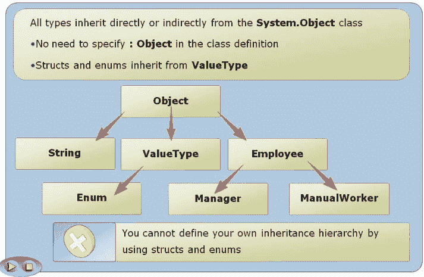

### 关键点

在 .NET Framework 中，所有类型都直接或间接继承自 `System` 命名空间中的 `Object` 类。`Object` 类提供了对所有类型都有用的功能，例如 `ToString` 和 `Equals` 方法。当你创建一个新的引用类型（如类）时，它直接继承自 `Object` 类，你不需要在类定义中指定这种关系。当你继承另一个类（例如 `Employee`）时，你也会自动继承 `Object` 类的所有功能。

值类型（如结构体/`struct`）继承自 `System.Value` 类，而 `System.Value` 类又继承自 `Object` 类。枚举类型（`Enum`）继承自 `System.Enum` 类，而 `System.Enum` 类继承自 `ValueType`。然而，与类不同，这种层次结构是固定的，你不能为值类型定义自定义的继承关系；例如，你不能显式地指定一个 `struct` 继承自另一个 `struct`。

**问题：** 哪些类型继承自 `Object` 类？

## 扩展阅读

有关关于 `Object` 类的更多信息，请参阅 http://go.microsoft.com/fork/??LinkId=192936 中的 `Object` 类页面。

## 方法的覆盖（Overriding）与隐藏（Hiding）

| 覆盖：用语义等价的行为替换或扩展基类中的功能（有意为之） | 隐藏：用新行为替换基类中的功能（可能是一个错误） |
| :--- | :--- |
| ```class Employee {\n  protected virtual void Work()\n  { ... }\n}\nclass Manager : Employee {\n  protected override void Work()\n  { ... }\n}``` | ```class Employee {\n  protected void Work()\n  { ... }\n}\nclass Manager : Employee {\n  public new void Work()\n  { ... }\n}``` |

### 关键点

当你使用继承来定义一个类时，派生类可以提供自己的方法。这些方法中的某些名称可能与从基类继承而来的方法相同。在这种情况下，你必须决定是想要覆盖继承的方法还是隐藏它们。

### 覆盖方法

当你覆盖一个方法时，你提供了一个与原始方法含义相同、但实现特定于该类的实现。例如，`Object` 类提供了 `ToString` 方法，该方法返回对象的字符串表示形式。然而，`Object` 类中 `ToString` 方法的默认实现简单地将类型名称作为字符串返回。你可能在 `Employee` 类中覆盖此行为，返回一个包含员工名称的字符串。

要在子类中覆盖一个方法，你需要使用 `override` 关键字，如下代码示例所示。

```cs
class Object
{
    public virtual string ToString()
    {
        // 将对象的类型作为字符串返回
        // (未显示代码)
        ...;
    }
}

class Employee
{
    protected string empName;
    ...
    public override string ToString()
    {
        return string.Format("Employee: {0}", empName);
    }
}
```

你只能覆盖基类中被标记为 `virtual`、`override` 或 `abstract` 的方法。虚方法通常提供一个默认实现，期望派生类用自己的代码来替换它。当你定义一个可能被其他类继承的类时，你应该决定哪些方法允许以这种方式被覆盖，并将它们声明为 `virtual`。

注意，当你覆盖虚方法时，你不能更改方法的保护级别；如果基类中的方法是 `protected` 的，则覆盖的方法也必须是 `protected` 的。

### 隐藏方法

你可以在继承类中定义与基类中方法名称相同的方法，即使它们没有被标记为 `virtual`、`abstract` 或 `override`。然而，这意味着你的方法与原始方法之间没有关系，你的新方法“隐藏”了原始方法。在这种情况下，C# 编译器会发出一个警告（你可能没有意识到你所继承的类具有这样一个方法，因此你可能希望更改你的方法名称以避免这种冲突），尽管代码仍然可以编译。

如果你意识到自己正在隐藏基类中的方法，可以通过使用 `new` 关键字标记该方法来关闭编译器警告，如下代码示例所示。

```cs
class Employee
{
    protected void DoWork()
    {
        ...
    }
}

class Manager : Employee
{
    public new void DoWork()
    {
        // 隐藏基类中的 DoWork 方法
        ...
    }
}
```

当你隐藏一个方法时，你可以更改其保护级别。例如，你可以在派生类中使用具有同名的公共方法来隐藏基类中的 `protected` 或 `private` 方法。然而，不建议这种做法。通常情况下，覆盖方法比隐藏它要好——隐藏通常是设计不佳的指示。

**问题：** 如果尝试在不使用 `new` 关键字的情况下隐藏方法，会发生什么？

## 调用基类中的方法和构造函数

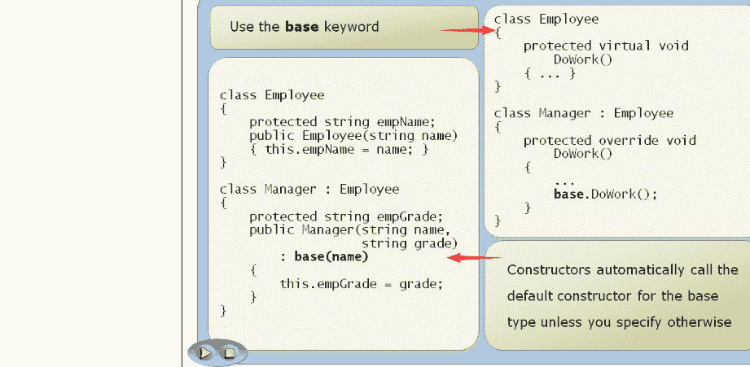

### 关键点

派生类可以使用 `base` 关键字作为方法前缀来调用基类中的方法。此功能在你覆盖方法时非常有用，因为它允许你在调用基类定义的现有功能之外，提供你自己的功能。实际上，这扩展了方法。下面的代码显示了 `Manager` 类中的 `DoWork` 方法覆盖了它所继承的 `Employee` 类中的 `DoWork` 方法，并在适当的地方调用了 `Employee` 类中的 `DoWork` 方法。

```cs
class Employee {
  protected virtual void DoWork()
  {
    ...
  }
}

class Manager : Employee {
  protected override void DoWork()
  {
    // 执行 Manager 特有的处理
    ...
    // 调用基类中的 DoWork 方法
    base.DoWork();
  }
}
...
```

如果没有 `base` 关键字，`Manager` 类中对 `DoWork` 的调用将简单地递归调用 `Manager` 类中的 `DoWork` 方法。

### 调用基类构造函数

除了继承的方法外，派生类自动包含基类的所有字段。这些字段在创建对象时通常需要初始化。你通常在构造函数中执行此类初始化。记住，所有类至少有一个构造函数。（如果你不提供，编译器将为你生成一个默认构造函数）。在派生类的构造函数中作为初始化的一部分调用其基类的构造函数是一项良好实践。在为继承类定义构造函数时，你可以指定 `base` 关键字来调用基类构造函数，如下代码示例所示。

```cs
class Employee
{
    protected string empName;

    public Employee(string name) // 基类的构造函数
    {
        this.empName = name;
    }
    ...
}

class Manager : Employee
{
    protected string empGrade;

    public Manager(string name, string grade)
        : base(name) // 调用 Employee(name)
    {
        this.empGrade = grade;
    }
}
...
```

如果你不在派生类构造函数中显式地调用基类构造函数，编译器会尝试在执行派生类代码之前静默插入对基类默认构造函数的调用。下面的代码示例是上一个示例的提取。

```cs
class Manager : Employee {
    public Manager(string name, string grade) {
        ...
    }
    ...
}
```

编译器将此代码重写为示例所示的代码：

```cs
class Manager : Employee {
    public Manager(string name, string grade)
        : base() {
        ...
    }
}
```

如果 `Employee` 类具有公共默认构造函数，则是有效的。然而，并非所有类都有公共默认构造函数（记住，如果你没有编写任何非默认构造函数，编译器才会生成默认构造函数），在这种情况下，忘记调用正确的基类构造函数会导致编译错误。

**问题：** 如果你不在类中调用基类的构造函数，会发生什么？

## 继承层次结构中的类赋值与引用

C# 类型检查阻止你将一种类型的引用赋值给声明为不同类型的变量...

```cs
Manager myManager = new Manager(...);
ManualWorker myWorker = myManager;
```

...但你可以将引用赋值给继承层次结构中较高的不同类型

```cs
Manager myManager = new Manager(...);
Employee myEmployee = myManager;
```

使用 `is` 和 `as` 操作符安全地将引用赋值给继承层次结构中较低的类型

```cs
Manager myManagerAgain = myEmployee as Manager;
```


### 关键点

C# 的类型检查规则阻止你将一种类型的对象赋值给不同类型的变量。例如，给定下面的代码示例所示的 `Employee`、`Manager` 和 `ManualWorker` 类的定义，在这些定义之后的代码是非法的。

```cs
class Employee {
  ..
}

class Manager : Employee {
  ..
}

class ManualWorker : Employee {
  ..
}
```

```cs
// Manager 构造函数需要一个名称和一个等级
Manager myManager = new Manager("Fred", "VP");
ManualWorker myWorker = myManager; //  - 类型不同
```

但是，只要你使用的类型是继承层次结构中位置更高的类，就可以通过不同类型的变量引用该对象。下面代码示例中的语句是合法的。

```cs
Manager myManager = new Manager("Fred", "VP");
Employee myEmployee = myManager;
// 合法，Employee 是 Manager 的基类
```

之所以这样做有效，是因为继承层次结构意味着你可以简单地将 `Manager` 视为 `Employee` 的一种特殊类型；它拥有 `Employee` 拥有的所有内容，以及你通过向 `Manager` 类添加的任何方法和字段定义的少量额外内容。

你也可以让 `Employee` 变量引用一个 `ManualWorker` 对象。但这里有一个显著的限制——当你使用 `Employee` 变量引用 `Manager` 或 `ManualWorker` 对象时，你只能访问 `Employee` 类定义的方法和字段。`Manager` 或 `ManualWorker` 类中的任何额外方法都无法通过 `Employee` 类可见。这解释了为什么你可以将几乎任何赋值给 `Object` 变量。记住，所有类都直接或间接地继承自 `System.Object`。

### 对象的引用

尽管你可以将 `Manager` 赋值给 `Employee` 变量，但反之则不然；你不能将 `Employee` 对象反向赋值给 `Manager` 变量。这并不是因为所有的 `Employee` 对象都是 `Manager`；某些可能是 `ManualWorker` 对象。但是，只要你通过 `as` 或 `is` 运算符先检查该 `Employee` 是否真的是 `Manager`，你就可以将 `Employee` 对象赋值给 `Manager` 变量。

`as` 运算符检查对象是否为指向指定类型的引用。如果是，它将使用该类型返回一个新引用，否则返回 `null`。

你也可以使用强制类型转换（`cast`）将一种类型的引用赋值给不同类型的变量，只要该转换是有效的。但是，你应该先使用 `is` 运算符来验证转换将成功。与 `as` 运算符类似，`is` 运算符检查对象是否为指向指定类型的引用，如果是则返回 `true`，如果不是则返回 `false`。如果你尝试执行编译器在编译时无法检测到的无效强制转换，你的代码将在运行时抛出 `InvalidCastException`。

下面的代码示例使用 `as` 运算符来检查 `myEmployee` 是否指向一个 `Manager` 对象。如果是，赋值的结果是 `myManagerAgain` 指向与 `myManager` 相同的 `Manager` 对象。如果 `myEmployee` 指向其他类型的 `Employee`（例如 `ManualWorker`），则 `as` 运算符返回 `null`。

```cs
Manager myManager = new Manager("Fred", "VP");
Employee myEmployee = myManager; // myEmployee 指向一个 Manager
myManagerAgain = myEmployee as Manager;
// OK - myEmployee 是一个 Manager
...
ManualWorker myWorker = new ManualWorker("Bert");
myEmployee = myWorker; // myEmployee 现在指向一个 ManualWorker
...
myManagerAgain = myEmployee as Manager;
// 返回 null - myEmployee 是一个 ManualWorker
```


**问题：** 如果尝试执行无效的强制转换，会抛出什么异常？

### 扩展阅读

有关 `as` 运算符的更多信息，请参阅 http://go.microsoft.com/fwlinkink/?LinkId=192941 中的 `as (C# Reference)` 页面。

有关 `is` 运算符的更多信息，请参阅 http://go.microsoft.com/fwlinkink/?LinkId=192942 中的 `is (C# Reference)` 页面。

### 理解多态

在继承层次结构中，相同的语句可以调用同一种方法的不同实现。

```cs
class Employee {

    public virtual string GetTypeName()

    return "This is an Employee";

}

class Manager : Employee {

    public override string GetTypeName()

    return "This is a Manager";

}

class ManualWorker : Employee {

    // 没有重写 GetTypeName

}
```

```cs
Employee myEmployee;

Manager myManager = new Manager(...);

ManualWorker myWorker = new ManualWorker(...);

myEmployee = myManager;

Console.WriteLine(myEmployee.GetTypeName());

myEmployee = myWorker;

Console.WriteLine(myEmployee.GetTypeName());
```

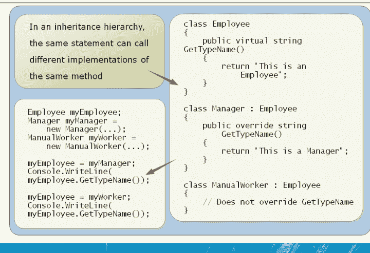

#### 关键点

在共享继承层次结构的类中定义的虚方法（virtual methods）允许你根据对象的类型（该类型在运行时动态确定）调用相同方法的不同版本。这被称为多态，是面向对象系统中非常强大的特性。

考虑下面代码示例中的示例案例，这些案例定义了 `Employee` 层次结构的变体。

```cs
class Employee {

    public virtual string GetTypeName()

    return "This is an Employee";

}

class Manager : Employee {

    ...
```

```cs
public override string GetTypeName()

{

    return "This is a Manager";

}

class ManualWorker : Employee

{

    // 没有重写 GetTypeName

}
```

在这个层次结构中，注意 `Manager` 类中的 `GetTypeName` 方法使用了 `override` 关键字，而 `ManualWorker` 类没有 `GetTypeName` 方法。在下面的代码示例中，两个 `Console.WriteLine` 语句将显示什么？

```cs
Employee myEmployee;

Manager myManager = new Manager(...);

myManualWorker myManualWorker = new ManualWorker(...);

myEmployee = myManager;

Console.WriteLine(myEmployee.GetTypeName()); // Manager

myEmployee = myManualWorker;

Console.WriteLine(myEmployee.GetTypeName()); // ManualWorker
```

你可能期望它们都会在 `Employee` 变量上打印“This is an Employee”，这是因为在第一个情况下，`myEmployee` 实际上是一个 `Manager` 对象。`GetTypeName` 方法被定义为虚方法，所以运行时调用 `Manager.GetTypeName` 方法。因此，语句输出“This is a Manager。”第二个 `Console.WriteLine` 语句调用 `ManualWorker` 对象。然而，`ManualWorker` 类没有 `GetTypeName` 方法，因此调用了 `Employee` 类的默认方法，返回“This is an Employee。”我已经在文中修正了逻辑）。

### 扩展阅读

有关多态的更多信息，请参阅 http://go.microsoft.com/fwlink/?LinkId=192937 中的 `Polymorphism (C# Programming Guide)` 页面。

### 定义密封类和方法

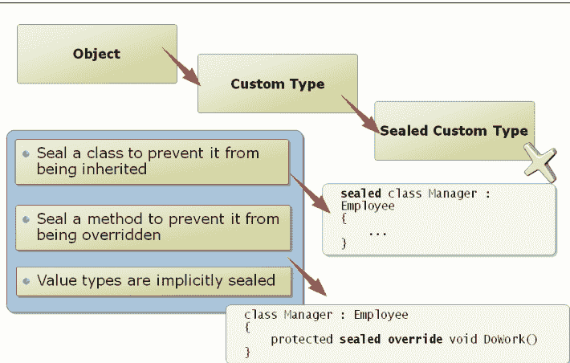

#### 关键点

默认情况下，当你定义一个类时，访问该类程序集的人可以继承它并添加自己的功能。但是，除非你刻意设计一个类以作为基类，否则它很难很好地作为基类。C# 允许你使用 `sealed` 关键字来防止类被作为基类。下面的代码示例将 `Manager` 类声明为密封（sealed）。

```cs
sealed class Manager : Employee

{

  ...

}
```

如果任何类尝试将 `Manager` 作为基类，将产生错误。注意密封类不能声明任何虚方法。

在 .NET Framework 中，所有值类型（结构和枚举）都是隐式密封的。

### 密封方法

你也可以使用 `sealed` 关键字将非密封类中的单个方法声明为密封。这意味着派生类此后不能重写该方法。你只能密封重写（override）方法，并将其声明为 `sealed override`，如下代码示例所示。

```cs
class Manager : Employee

{

    ...

    protected sealed override void DoWork()

    {

        ...

    }

}
```

**问题：** 你可以定义一个继承自 C# `int` 类型的类吗？

# 演示：使用继承构建新的引用类型

- 在此演示中，你将看到如何：
- 通过继承现有的类创建新类
- 在子类中调用基类的方法

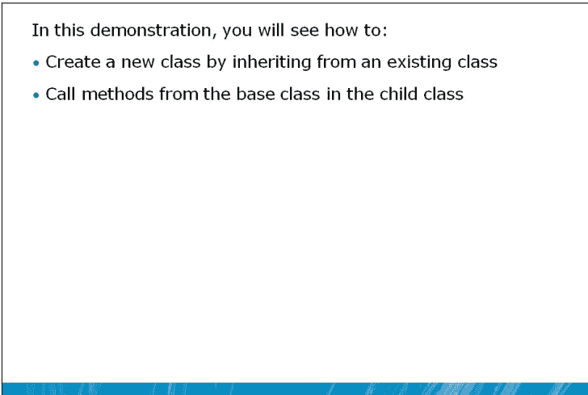

#### 关键要点

- 通过继承现有的类创建新类
- 在子类中调用基类的方法

### 演示步骤

1. 以用户 Student 的身份登录 10266A-GEN-DEV 虚拟机，密码为 PaS$Word。
2. 打开 Visual Studio 2010。
3. 在 Visual Studio 2010 中，打开 `E:\Demofiles\Mod8\Demo1\Starter\UsingInheritance` 文件夹下的 `UsingInheritanceDemo` 解决方案。
4. 在 `Program.cs` 文件中，添加一个名为 `Television` 的新类。你的代码应该类似于下面的代码示例。

```
class Television

{

}
```

5. 在 `Television` 类中，添加一个受 `protected` 的虚拟方法 `SetCurrentChannel`。该方法应向控制台写入消息，表示电视通道已设置。你的代码应该类似于下面的代码示例。

```
class Television

{

    protected virtual void SetCurrentChannel()

    {

        Console.WriteLine("Channel set.");

    }

}
```

6. 在 `Television` 类中，添加一个受 `protected` 的方法 `TurnOn`。该方法应向控制台写入消息，表示电视已开启。你的代码应该类似于下面的代码示例。

```
class Television

{

    protected virtual void SetCurrentChannel()

    {

        Console.WriteLine("Channel set.");

    }

    protected void TurnOn()

    {

        Console.WriteLine("Television on.");

    }

}
```

7. 在 `Program.cs` 文件中，添加一个名为 `WidescreenTV` 的新类，它继承自 `Television` 类。你的代码应该类似于下面的代码示例。

```
class WidescreenTV : Television

{}
```

8. 重写 `SetCurrentChannel` 方法。该方法应向屏幕写入消息，表示宽屏电视上的通道已设置。你的代码应该类似于下面的代码示例。

```
class WidescreenTV : Television {

    protected override void SetCurrentChannel() {

        Console.WriteLine("Widescreen channel set.");

    }

}
```

9. 为 `WidescreenTV` 类添加构造函数。该构造函数应调用基类的构造函数，调用 `TurnOn` 方法，调用 `SetCurrentChannel` 方法，然后调用基类的 `SetCurrentChannel` 方法。你的代码应该类似于下面的代码示例。

```
class WidescreenTV : Television {

    protected override void SetCurrentChannel() {

        Console.WriteLine("Widescreen channel set.");

    }

    public WidescreenTV()

        : base() {

        TurnOn();

        SetCurrentChannel();

        base.SetCurrentChannel();

    }

}
```

10. 取消 `Program` 类中创建 `WidescreenTV` 类实例代码的注释。
11. 以调试模式运行应用程序，并验证是否出现以下消息。

```
Television on.
Widescreen channel set.
Channel set.
```

**问题：** 当你实现接口时，Visual Studio 哪些工具可以帮助？

### 第 2 节：定义和实现接口

- 什么是接口？
- 创建和实现接口
- 通过接口引用对象
- 显式和隐式实现接口
- 演示：创建接口

本节引入了接口，并描述了你如何使用它们来规范你的代码。

接口允许你显式地定义合约，定义你的对象暴露的方法。你可以实现多个接口来表示你的代码可以执行若干功能。例如，你可以实现 `Comparable` 接口来表示两个对象可以进行相等性比较，并实现 `IDisposable` 接口来表示对象可以被清理。

### 目标

在本节之后，你将能够：

- 描述接口的作用。
- 创建并实现接口。
- 使用接口引用对象。
- 解释显式和隐式接口实现。

### 什么是接口？

- 接口是：
- 一种规定了实现类必须暴露的方法的合约
- 独立于实现

| String | Int32 | Employee |
| :--- | :--- | :--- |
| BBB > AAA? | 100 > 99 ? | VP > Worker ? |
| 字母数字比较 | 数字比较 | 等级比较 |

#### 关键要点

继承类是一项强大的机制，但继承的真正威力来自于实现接口。接口不包含任何代码或数据；它只是规定了继承接口的类必须提供的方法和属性。使用接口允许你将类方法的名称和签名与方法的实现完全分离。

接口充当了合约的角色；它们保证了任何实现接口的类都会暴露接口指定的成员。这使你能够简化开发并规范你的代码。

接口允许你指定类应该实现的功能。类如何选择实现这些功能取决于类本身的关注点，而不是接口的属性。不同的类可以以不同的方式实现同一个接口，只要它们暴露了接口定义的方法集即可。

例如，.NET Framework 中一个频繁的需求是类定义一个方法，以便它们能够进行比较，以确定它们的相对顺序。比较两个对象值的实际意义是，`IComparable` 接口。该接口包含一个名为 `CompareTo` 的方法。该方法在对象与指定对象相等时返回 0；如果对象小于参数，则返回负值；如果对象大于参数，则返回正值。

**问题：** 接口可以提供方法的默认实现吗？

### 创建和实现接口


#### 关键要点

语法上，接口与类相似，但你只声明方法而不提供实现代码。

### 定义接口

要定义接口，使用 `interface` 关键字。在接口内部，声明方法的方式与类或结构相同，只是不指定访问修饰符，并用分号替换方法体，如代码示例所示。

```
interface ICalculator

{

    Add();

    Subtract();

}
```

注意，在上面的示例中，接口的名称以大写 I 开头。这是一种命名习惯而非显式要求，但 .NET Framework 文档建议你遵循这一标准；`System` 命名空间中的接口都是这样前缀。

### 实现接口

实现接口需要声明一个继承接口的类或结构，并为定义的每个方法提供代码。

> **注意：** 虽然你不能创建继承其他结构或类的结构，但结构可以实现接口。

当你实现接口时，你必须确保每个方法与其对应的接口方法完全匹配，遵循以下规则：

- 方法名称和返回类型完全匹配。
- 参数（包括 `ref` 和 `out` 修饰符）完全匹配。
- 所有实现接口的方法必须是公开的。但是，如果你使用的是显式接口实现，方法不应有访问限定符。

```csharp
public double Multiply()

{

    return 0;

}

public double Divide()

{

    return 0;

}

#endregion
```

一个类只能继承自另一个类；但一个类可以实现多个接口。如果你想指定一个类实现多个接口，可以在类声明中使用逗号隔开每个接口。当你实现多个接口时，你必须确保你的类实现的每个接口都遵循了上述规则，否则你的代码将无法编译。例如，如果你想指定 `Calculator` 类实现了上一个主题中描述的 `IComparable` 接口，你可以像下面的代码示例所示更改类定义。

```csharp
class Calculator : ICalculator, IComparable

{

    // 实现 ICalculator 的代码。

    #region ICalculator Members

    public double Add()

    {

        return 0;

    }

    public double Subtract()

    {

        return 0;

    }

    public double Multiply()

    {

        return 0;

    }

    public double Divide()

    {

        return 0;

    }

#endregion
```

```csharp
// 实现 IComparable 的代码。

#region IComparable members

public int CompareTo(Object obj)

{

    ...

#endregion
```

**问题：** 当你定义接口时，你会添加方法体吗？

### 通过接口引用对象

#### 关键点

正如你可以通过使用定义为继承层次中较高类的变量来引用对象一样，你也可以通过使用定义为该类实现的接口的变量来引用对象。以上一个主题的为例，你可以使用 `ICalculator` 变量引用 `Calculator` 对象，如下代码示例所示。

```csharp
Calculator myCalculator = new Calculator();

ICalculator iCalculator = myCalculator;
```

这之所以可行是因为所有的 `Calculator` 对象都实现了 `ICalculator` 接口。然而，相反的情况并不成立，如果不进行类型转换，你无法将 `ICalculator` 对象赋值给 `Calculator` 变量，以验证它引用的是一个 `Calculator` 对象而不是其他恰好实现了 `ICalculator` 接口的类。你可以使用 `is` 和 `as` 关键字来检查对象是否实现了某个接口，或者检查接口引用的对象是否是特定类的实例。

### 将接口引用作为参数传递

通过接口引用对象的技巧是非常实用的，因为它允许你定义可以接受不同类型作为参数的方法，只要这些类型实现了指定的接口即可。例如，`PerformAnalysis` 方法可以接受任何实现 `ICalculator` 接口的参数。

```csharp
int PerformAnalysis(ICalculator calculator)

{

    ...

}
```


注意，当通过接口引用对象时，你只能调用通过该接口可见的方法。

**问题：** 如果你尝试将一个对象强制转换为它没有实现的接口，会发生什么？

### 显式和隐式实现接口

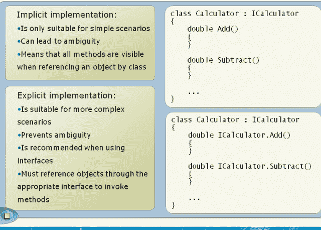

#### 关键点

你目前看到的示例展示了隐式实现接口的类。如果你再次查看`ICalculator`接口和`Calculator`类，`Calculator`类实现了`ICalculator`接口。但在`Calculator`类方法的实现中，没有任何内容表示它们是`ICalculator`接口的一部分，如下代码示例所示：

```csharp
interface ICalculator
{
    double Add();
    double Subtract();
    double Multiply();
    double Divide();
}
```

```csharp
class Calculator : ICalculator
{
    // 在此代码中，ICCalculator 接口的方法
    // 返回测试数据。
```

```csharp
#region ICalculator Members
public double Add()
{
    return 0;
}
public double Subtract()
{
    return 0;
}
public double Multiply()
{
    return 0;
}
public double Divide()
{
    return 0;
}
#endregion
```

这在简单的情况下可能不是一个问题，但假设`Calculator`类实现了多个接口。没有什么可以阻止多个接口指定一个具有相同名称的方法，尽管它们的语义可能不同。例如，假设你扩展了`Calculator`类来实现以下`ITaxCalculator`接口，该接口包含了从值中添加和减去税金额的方法。你可以在下面的代码示例中定义该接口：

```csharp
interface ITaxCalculator
{
    double Add();
    double Subtract();
}
```

现在，如果你在`Calculator`类中实现此接口，就会遇到一个问题，如下代码示例所示：

```csharp
class Calculator : ICalculator, ITaxCalculator
{
    public double Add()
    {
        return 0;
    }
```

```csharp
}
public double Subtract()
{
    return 0;
}
public double Multiply()
{
    return 0;
}
public double Divide()
{
    return 0;
}
```

这是合法的代码，但哪一个`Add`和`Subtract`方法实现是`ICalculator`或`ITaxCalculator`接口方法的实现？对于 C# 来说，答案是两者都是！（等等，原文 OCR 在此似乎有一个拼写错误，我将保留其含义）。

人们往往倾向于尝试像下面的示例那样重写`Calculator`类：

```csharp
class Calculator : ICalculator, ITaxCalculator
{
    // ... 未所示的私有字段
    // 这是 ICalculator 的 Add 方法
    public double Add()
    {
        return 0;
    }
    // 这是 ICalculator 的 Subtract 方法
    public double Subtract()
    {
        return 0;
    }
    public double Multiply()
    {
        return 0;
    }
    public double Divide()
    {
        return 0;
    }
}
```

```csharp
// 这是 ITaxCalculator 的 Add 方法
public double Add()
{
    return calculatedValue + taxAmount;
}
// 这是 ITaxCalculator 的 Subtract 方法
public double Subtract()
{
    return calculatedValue - taxAmount;
}
```

然而，这不再是合法的代码了，因为`Add`和`Subtract`方法具有相同的签名。

### 使用显式接口消除歧义

为了解决这个问题并区分哪个方法属于哪个接口实现，你可以显式地实现接口。要这样做，你在实现方法时指定该方法属于哪个接口，如下代码所示：

```csharp
class Calculator : ICalculator, ITaxCalculator
{
    ... // 未所示的私有字段
    double ICalculator.Add()
    {
        return 0;
    }
    double ICalculator.Subtract()
    {
        return 0;
    }
    double ICalculator.Multiply()
    {
        return 0;
    }
    double ICalculator.Divide()
    {
        return 0;
    }
    double ITaxCalculator.Add()
    {
        return calculatedValue + taxAmount;
    }
    double ITaxCalculator.Subtract()
    {
        return calculatedValue - taxAmount;
    }
}
```

现在你可以看到使用`Calculator`的`Add`方法返回 0，而来自`ITaxCalculator`接口的`Add`方法返回取决于`calculatedValue`和`taxAmount`字段的值。

# 调用通过显式接口定义的方法

除了在方法名前加上接口名称外，这种语法还有另一个细微的区别：这些方法没有被标记为`public`。你无法为显式接口实现的方法指定访问权限。这导致了另一个有趣的现象。如果你在代码中创建一个`Calculator`变量，你无法调用任何`Add`方法，因为它们是不可见的。事实上，这很有意义。对于`Calculator`类而言，它们通过`Calculator`类都是私有的，这使得下面的代码示例中的代码将调用——是`ICalculator`接口的，还是`ITaxCalculator`接口的？

```csharp
Calculator calc = new Calculator();
...
double result = calc.Add();
```

那么，如何访问这些方法呢？答案是你必须通过相应的接口引用`Calculator`对象，如下代码示例所示：

```csharp
Calculator calc = new Calculator();
...
ICalculator calculator = calc;
double result = calculator.Add();
```

```cs
ITaxCalculator taxCalc = calc;
double tax = taxCalc.Add();
```

尽管这些方法对于类来说是私有的，但可以通过接口公开访问，因此这些代码是合法的。

你应该尽可能地显式地实现接口。

**问题：** 显式实现的用处是什么？

#### 额外阅读

有关关于如何显式实现接口成员的更多信息，请参阅《C# 编程指南》中的“显式接口实现”页面：http://go.microsoft.com/fwlink/??LinkId=192938。

### 演示：创建接口

在本次演示中，你将看到如何创建一个接口并在类中实现它。

#### 关键点

在本次演示中，你将看到如何创建一个接口并在类中实现它。

### 演示步骤

- 1. 打开 Microsoft Visual Studio 2010。
- 2. 在 Visual Studio 2010 中，打开`E:\Demofiles\Mod8\Demo2\Starter\UsingInheritanceDemo`文件夹下的`CreatingAnInterfaceDemo`解决方案。
- 3. 在`Program.cs`文件中，添加一个名为`ITelevision`的接口。你的代码应该类似于下面的代码示例：

```cs
interface ITelevision
{}
```

- 4. 向接口中添加一个`TurnOn`方法。你的代码应该类似于下面的代码示例：

```cs
interface ITelevision
{
    void TurnOn();
}
```

- 5. 向接口中添加一个`TurnOff`方法。你的代码应该类似于下面的代码示例：

```cs
interface ITelevision
{
    void TurnOn();
    void TurnOff();
}
```

- 6. 向接口中添加一个`IncreaseVolume`方法。你的代码应该类似于下面的代码示例：

```cs
interface ITelevision
{
    void TurnOn();
    void TurnOff();
    void IncreaseVolume();
}
```

- 7. 向接口中添加一个`DecreaseVolume`方法。你的代码应该类似于下面的代码示例：

```cs
interface ITelevision
{
    void TurnOn();
    void TurnOff();
    void IncreaseVolume();
    void DecreaseVolume();
}
```

- 8. 在`Program.cs`文件中，添加一个名为`Television`的类，该类实现了`ITelevision`接口。你的代码应该类似于下面的代码示例：

```cs
class Television : ITelevision
{
```

- 9. 在`Television`类的定义中，使用 Visual Studio 中的工具实现`ITelevision`接口。

**问题：** 定义接口时推荐的命名规范是什么？

### 第 3 节

### 定义抽象类

- 什么是抽象类？
- 什么是抽象方法？
- 演示：创建抽象类

本节介绍了抽象类，以及你如何使用它们来减少代码重复、加速开发并降低因重复代码引入 bug 的风险。

抽象类结合了对象继承的一些属性和接口的某些属性。你可以通过使用方法的默认实现来减少代码重复。

### 目标

完成本节后，你将能够：

- 描述一个抽象类。
- 描述一个抽象方法。
- 创建一个抽象类。

### 什么是抽象类？

- 抽象类：
  - 包含公共代码，从而减少代码重复
  - 必须继承
  - 不能实例化
  - 可以包含方法、字段、属性和其他成员
  - 使用`abstract`关键字

```cs
abstract class SalariedEmployee : Employee, ISalaried
{
    void PaySalary()
    {
        Console.WriteLine("Pay salary: {0}", currentSalary);
        // Common code for paying salary.
    }
    int currentSalary;
}

class ManualWorker : SalariedEmployee, ISalaried
{
    ...
}

class Manager : SalariedEmployee, ISalaried
{
    ...
}
```

#### 关键点

抽象类提供了一种机制，可以将多个相关类共享的公共代码提取到单个类中。例如，使用本模块早些显示的 Employees 类层次结构，你可能会开发几个类来表示不同类型的员工，例如`Manager`和`ManualWorker`。根据你需要表示的员工类型数量，类的数量将会增加。在这种情况下，这些类中的某些元素具有相同的实现是常见的。例如，在下面的代码示例中，`Worker`和`Manager`类都实现了`ISalaried`接口，并提供了`PaySalary`方法，该方法在两个类中都是相同的：

```cs
interface ISalaried
{
    void PaySalary();
}

class ManualWorker : Employee, ISalaried
{
}
```

```cs
...
void ISalaried.PaySalary()
{
    Console.WriteLine("Pay salary: {0}", currentSalary);
    // Code for paying salary.
}
```

```cs
class Manager : Employee, ISalaried
{
    ...
    void ISalaried.PaySalary()
    {
        Console.WriteLine("Pay salary: {0}", currentSalary);
        // Same code as ManualWorker for paying salary.
    }
}
```

代码中的重复是一个警告信号。如果可能，你应该避免这种重复并减少任何维护成本。实现这种重构的一种方法是将公共实现放入一个专门为此目的创建的新类中。实质上，你可以将一个新类插入到类层次结构中，如下代码示例所示：

```cs
class SalariedEmployee : Employee, ISalaried
{
    ...
    void ISalaried.PaySalary()
    {
        Console.WriteLine("Pay salary: {0}", currentSalary);
        // Code for paying salary.
    }
    int currentSalary;
}
```

```cs
class ManualWorker : SalariedEmployee, ISalaried
{
    ...
}
```

```cs
class Manager : SalariedEmployee, ISalaried
{
    ...
}
```

这种方法是一个很好的解决方案，但有一点仍然不对：你可以实例化`SalariedEmployee`类（或者说，`Employee`类）。这并不合理。`SalariedEmployee`类的存在是为了提供通用实现，而不是作为一个实体的存在。你不希望开发者能够实例化此类。

要声明不能实例化类，你可以使用`abstract`修饰符声明该类为抽象类，如下代码示例所示：

```cs
abstract class SalariedEmployee : Employee, ISalaried
{
    void ISalaried.PaySalary()
    {
        Console.WriteLine("Pay salary: {0}", currentSalary);
        // Code for paying salary.
    }
    int currentSalary;
}
```

如果你尝试实例化`SalariedEmployee`对象，代码将无法编译，如下代码示例所示：

| `SalariedEmployee myEmployee = new SalariedEmployee(); // 非法` |

### 问题：抽象方法包含默认实现吗？

#### 额外阅读

有关`abstract`修饰符的更多信息，请参阅《C# 参考》中的 abstract：http://go.microsoft.com/fwlink/?LinkId=192940。

### 什么是抽象方法？

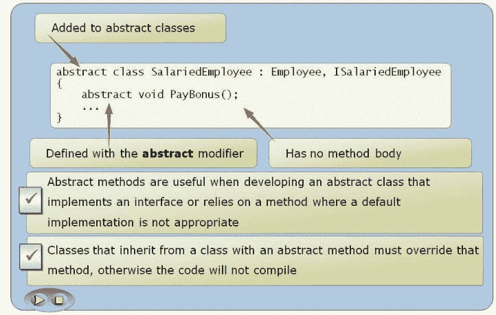

#### 关键点

抽象类可以包含抽象方法。抽象方法在原理上类似于虚方法，只是不包含方法体。派生类必须重写此方法。下面的代码示例将`SalariedEmployee`类中的`PayBonus`方法定义为抽象方法。员工可能共享某些方法（例如`Salary`方法），但它们必须提供`PayBonus`方法的自己的实现，因为不同类型的员工支付奖金逻辑可能不同。如果为抽象类中提供默认实现没有意义，并且你想确保继承类提供该方法的自己的实现，那么抽象方法就是非常有用的。

```cs
abstract class SalariedEmployee : Employee, ISalariedEmployee
{
    abstract void PayBonus();
    ...
}
```


当你定义抽象方法时，使用`abstract`关键字并提供方法签名，但类似于定义接口中的方法，你用分号替换方法体。与接口不同，你可以为抽象方法添加访问修饰符。

> **注意：** 如果你尝试向非抽象类添加抽象方法，你的代码将无法编译。

### 演示：创建抽象类

在此演示中，你将看到：
* 创建一个包含抽象方法的抽象类
* 创建一个继承自抽象类的类

#### 关键点

- 创建一个包含抽象方法的抽象类
- 创建一个继承自抽象类的类

### 演示步骤

1. 打开 Microsoft Visual Studio 2010。
2. 在 Visual Studio 2010 中，打开位于`E:\Demofiles\Mod8\Demo3\Starter\CreatingAnAbstractClassDemo`文件夹下的`CreatingAnAbstractClassDemo`解决方案。
3. 在`Program.cs`文件中添加一个名为`Television`的抽象类。

你的代码应该类似于下面的代码示例。

```csharp
abstract class Television

{

}
```

### 使用 Microsoft® Visual Studio® 2010 进行 C# 编程

4. 为类添加一个公共的`TurnOn`方法。该方法应向控制台写入消息，表示电视已开启。
你的代码应该类似于下面的代码示例。

```csharp
abstract class Television

{

    public void TurnOn()

    {

        Console.WriteLine("Television on.");

    }

}
```

5. 为类添加一个公共的`TurnOff`方法。该方法应向控制台写入消息，表示电视已关闭。
你的代码应该类似于下面的代码示例。

```csharp
abstract class Television

{

    public void TurnOn()

    {

        Console.WriteLine("Television on.");

    }

    public void TurnOff()

    {

        Console.WriteLine("Television off.");

    }

}
```

6. 为类添加一个公共的抽象`IncreaseVolume`方法。
你的代码应该类似于下面的代码示例。

```csharp
abstract class Television

{

    public void TurnOn()

    {

        Console.WriteLine("Television on.");

    }

    public void TurnOff()

    {

        Console.WriteLine("Television off.");

    }

    public abstract void IncreaseVolume();

}
```

7. 为类添加一个公共的抽象`DecreaseVolume`方法。
你的代码应该类似于下面的代码示例。

```csharp
abstract class Television {

    public void TurnOn() {

        Console.WriteLine("Television on.");

    }

    public void TurnOff() {

        Console.WriteLine("Television off.");

    }

    public abstract void IncreaseVolume();

    public abstract void DecreaseVolume();

}
```

8. 在`Program.cs`文件中添加一个继承自抽象`Television`类的`WidescreenTV`类。
你的代码应该类似于下面的代码示例。

```csharp
class WidescreenTV : Television {

    public override void IncreaseVolume() {

        Console.WriteLine("Volume increased (WidescreenTV).");

    }

}
```

9. 重写`IncreaseVolume`方法。该方法应向屏幕写入消息，表示宽屏电视的音量增加了。
你的代码应该类似于下面的代码示例。

```csharp
class WidescreenTV : Television {

    public override void IncreaseVolume() {

        Console.WriteLine("Volume increased (WidescreenTV).");

    }

}
```

10. 重写`DecreaseVolume`方法。该方法应向屏幕写入消息，表示宽屏电视的音量降低了。

你的代码应该类似于下面的代码示例。

```csharp
class WidescreenTV : Television

{

    public override void IncreaseVolume()

    {

        Console.WriteLine("Volume increased (WidescreenTV).");

    }

    public override void DecreaseVolume()

    {

        Console.WriteLine("Volume decreased (WidescreenTV).");

    }

}
```

11. 在`Program.cs`文件中添加一个继承自抽象`Television`类的`TV`类。

你的代码应该类似于下面的代码示例。

```csharp
class TV : Television

{

}
```

12. 重写`IncreaseVolume`方法。该方法应向屏幕写入消息，表示电视的音量增加了。

你的代码应该类似于下面的代码示例。

```csharp
class TV : Television

{

    public override void IncreaseVolume()

    {

        Console.WriteLine("Volume increased.");

    }

}
```

13. 重写`DecreaseVolume`方法。该方法应向屏幕写入消息，表示电视的音量降低了。

你的代码应该类似于下面的代码示例。

```csharp
class TV : Television

{

    public override void DecreaseVolume()

    {

        Console.WriteLine("Volume decreased.");

    }

}
```

14. 取消`Program.cs`文件中代码的注释。

15. 运行应用程序以验证输出。

6. 在接口中添加一个名为`StopCollecting`的方法，无返回类型。该方法应接受参数。添加一个描述该方法用途的注释。

7. 在接口中添加一个名为`GetRawData`的方法，返回类型为整数数组。该方法不接受任何参数。添加一个描述该方法用途的注释。

8. 生成解决方案并纠正任何错误。

### 练习 2：实现接口

在此练习中，你将定义以下枚举：

- 单位（`Units`）：公制（`Metric`），英制（`Imperial`）

随后，你将定义一个名为`MeasureLengthDevice`的类，它实现了`IMeasuringDevice`接口并驱动一个测量物体长度的设备。该类还将包含以下私有字段：

- `unitsToUse`: `Units`
- `dataCaptured`: 整数数组
- `mostRecentMeasure`: 

当设备启动时（调用`StartCollecting`方法时），设备将捕获数据并存储在`dataCaptured`数组中（你将在实验室内通过提供的代码来模拟这一过程）。该数组具有有限且固定的大小；当设备满时，它将回绕并覆盖最旧的数据。每次进行新测量时，设备都会将该测量值复制到`mostRecentMeasure`字段。`GetRawData`方法将返回数组的内容。`MetricValue`和`ImperialValue`方法将返回该字段中的值，并转换为`unitsToUse`字段中指定的单位。如果`unitsToUse`为公制，`MetricValue`直接返回数据，而`ImperialValue`则执行计算将数据转换为英制单位。同样，如果`unitsToUse`为英制，`ImperialValue`直接返回数据，而`MetricValue`则执行计算将数据转换为公制单位。

此练习的主要任务如下：

1. 打开启动项目。
2. 创建`Units`枚举类型。
3. 创建`MeasureLengthDevice`类。
4. 更新测试框架（test harness）。
5. 使用测试框架测试`MeasureLengthDevice`类。

#### 任务 1：打开启动项目

- 打开`E:\>Labfiles\Lab 8\Ex2\Starter`文件夹下的`Module8`解决方案。该解决方案包含了练习 1 的完成接口和练习 2 的骨架代码。

#### 任务 2：创建 Units 枚举

1. 在 Visual Studio 中，双击任务列表。
2. 在任务列表中，双击任务`TODO: Implement the Units enumeration`。该任务位于`UnitsEnumeration.cs`文件中。
3. 移除`UnitsEnumeration`文件中的`TODO`注释并声明一个名为`Units`的枚举。该枚举必须能够从不同程序集的代码中访问。
4. 在枚举中添加值`Metric`。
5. 为你的代码添加注释，以便使用该枚举的开发者理解。
6. 生成解决方案并纠正任何错误。

#### 任务 3：创建 MeasureLengthDevice 类

1. 在任务列表中，双击任务`TODO: Implement the MeasureLengthDevice class`。该任务位于`MeasureLengthDevice.cs`文件中。
2. 移除`TODO`注释并添加一个名为`MeasureLengthDevice`的公共类。
3. 修改`MeasureLengthDevice`类声明以实现`IMeasuringDevice`接口。
4. 使用实现接口向导（Implement Interface Wizard）为`IMeasuringDevice`接口中的每个方法生成方法存根（stubs）。
5. 将`DeviceControl`命名空间引入作用域。

`MeasuringDevice`项目已经包含了对`DeviceController`项目的引用。你正在编写控制设备的代码。然而，由于本次实验未提供物理设备，`DeviceController`项目允许你调用控制仿真设备的方法。`DeviceController`项目不包含用户界面；要控制设备，你必须使用该项目暴露的类和方法。`DeviceController`项目是完整的。如果你愿意可以查看代码，但不需要修改它。

6. 在`MeasureLengthDevice`类中实现接口向导添加的方法存根之后，添加下表所示的字段。

| 名称 | 类型 | 访问修饰符 |
| --- | --- | --- |
| `unitsToUse` | `Units` | `private` |
| `dataCaptured` | `int[]` | `private` |
| `mostRecentMeasure` | `int` | `private` |
| `controller` | `DeviceController` | `private` |
| `measurementType` | `DeviceType` | `private` |

`DeviceType`是一个包含`LENGTH`和`MASS`值的枚举。它用于指定设备记录的测量类型。它定义在`DeviceController`项目中。

7. 修改`measurementType`字段使其成为常量，并将其初始化为`DeviceType.LENGTH`。
8. 找到`StartCollecting`方法，然后移除 Visual Studio 插入的抛出`NotImplementedException`的默认方法。在`StartCollecting`方法中添加代码，使用`DeviceController`类的静态方法`StartDevice`实例化`controller`字段。将`measurementType`字段中的值作为参数传递给`StartCollecting`方法。
9. 在`StartCollecting`方法中调用`GetMeasurements`方法。该方法没有参数且没有返回值。你将在下一步添加`GetMeasurements`方法。
10. 如代码示例所示，向类添加`GetMeasurements`方法。

**注意：**有一个名为**Mod8GetMeasurementsMethod**的代码段，可以使用它来添加此方法。

```csharp
private void GetMeasurements(){

    dataCaptured = new int[10];

    System.Threading.ThreadPool.UserWorkItem((dummy) => {

        int x = 0;

        Random timer = new Random();

        while (controller != null) {

            System.Threading.Thread.Sleep(timer.Next(1000, 5000));

            dataCaptured[x] = controller != null ?

                controller.TakeMeasurement() : dataCaptured[x];

            x++;

            if (x == 10) {

                x = 0;

            }

        }

    });

}
```


`GetMeasurements` 方法从仿真设备检索测量值。在此模块中，你将使用 `GetMeasurements` 方法的代码填充 `dataCaptured` 数组。该数组作为一个固定长度的缓冲区，每次进行新测量时覆盖最旧的值。在后续模块中，你将修改此类以响应设备检测到新测量时触发的事件。

11. 找到 `StopCollecting` 方法，然后移除 Visual Studio 插入的抛出 `NotImplementedException` 的默认方法。添加一个仅当 `controller` 对象不为空运行时运行的代码块。

12. 在条件块中，添加代码调用 `controller` 对象的 `StopDevice` 方法，并将 `controller` 字段设置为 `null`。

13. 找到 `GetRawData` 方法，然后移除 Visual Studio 插入的抛出 `NotImplementedException` 的默认方法。添加代码返回 `dataCaptured` 数组。

14. 找到 `MetricValue` 方法，然后移除 Visual Studio 插入的抛出 `NotImplementedException` 的默认方法。添加代码检查当前单位，如果是公制，则返回 `mostRecentMeasure` 字段的值。如果当前单位是英制，返回 `mostRecentMeasure` 字段乘以 25.4 的结果。

15. 找到 `ImperialValue` 方法，然后移除 Visual Studio 插入的抛出 `NotImplementedException` 的默认方法。添加代码检查当前单位，如果是英制，则返回 `mostRecentMeasure` 字段的值。如果当前单位是公制，返回 `mostRecentMeasure` 字段乘以 0.03937 的结果。

16. 添加一个接受 `Units` 参数的构造函数，并将 `unitsToUse` 字段设置为参数的值。

17. 生成解决方案并纠正任何错误。

#### 任务 4：更新测试框架

本次实验的测试框架是一个简单的 Windows Presentation Foundation (WPF)，旨在测试你开发的 `MeasureLengthDevice` 类。它不包含任何异常处理，以确保它不会持有你开发的类抛出的任何异常。

1. 在 Visual Studio 中，查看任务列表。
2. 点击任务列表中的第一个 `TODO: Add code to instantiate the device field` 打开 `MainWindow.xaml.cs` 文件。该任务位于 WPF 窗口的 `createInstance_Click` 方法中，并在点击“Create Instance”按钮时运行。
3. 在 `createInstance_Click` 方法中，替换两个 `TODO` 以实例化 `device` 字段的实例并设置为 `MeasureLengthDevice` 类。你必须使用 `Units` 枚举的相应成员作为 `MeasureLengthDevice` 构造函数的参数。
4. 生成解决方案并纠正任何错误。

#### 任务 5：使用测试框架测试 `MeasureLengthDevice` 类

1. 将 Exercise2TestHarness 项目设置为默认启动项目。
2. 启动 Exercise2TestHarness。
3. 选择 Imperial（英制），然后点击 Create MeasureLengthDevice Instance（创建长度设备实例）。此按钮将运行你添加的代码，以实例化使用英制量的设备。
4. 点击 Start Collecting（开始收集）。此按钮将运行 `IMeasuringDevice` 接口定义的 `StartCollecting` 方法。
5. 等待 10 秒，确保在执行后续步骤之前，仿真设备已生成了一些值。
6. 点击 Get Raw Data（获取原始数据）。你应该能在窗口底部列表框中看到多达 10 个值。这些是设备模拟器生成的数据。它们存储在 `MeasureLengthDevice` 类 `GetMeasurements` 方法的 `dataCaptured` 数组中。`dataCaptured` 数组充当固定长度缓冲区。初始情况下，它包含零值，但随着设备模拟器报告测量值，这些值会被添加到数组中。当数组填满时，它会循环并从最旧的测量值开始覆盖数据。
7. 点击 Get Metric Value（获取公制值）和 Get Imperial Value（获取英制值）。你应该看到最近生成的测量值的公制值和英制值。注意，自你点击 Get Raw Data 按钮后，可能已经进行了新的测量。
8. 点击 Get Raw Data，并验证上一步显示的英制值是否列在原始数据值列表中。（该值可能出现在列表的任何位置）。
9. 点击 Stop Collecting（停止收集）。
10. 选择 Metric（公制），然后点击 Create MeasureLengthDevice Instance（创建长度设备实例）。此操作将创建一个使用公制量的设备模拟器新实例。
11. 点击 Start Collecting（开始收集）。此按钮启动新的设备对象。
12. 等待 10 秒。
13. 点击 Get Metric Value 和 Get Imperial Value，显示设备获取的最新测量值的公制值和英制值。
14. 点击 Get Raw Data，然后验证上一步显示的公制值是否列在原始数据列表中。（该值可能出现在列表的任何位置。）
15. 点击 Stop Collecting（停止收集）。
16. 关闭 Exercise 2 Test Harness 窗口。

### 练习 3：创建抽象类

在此练习中，你将定义一个名为 `MeasureMassDevice` 的类，它也实现了 `IMeasuringDevice` 接口。你会发现，尽管 `MetricValue` 和 `ImperialValue` 方法的实现方式与 `MeasureLength` 类略有不同，但 `StartCollecting`、`StopCollecting`、`GetRawData` 和 `GetMeasurements` 方法是相同的。代码重复永远不是好事，并可能导致维护困难。因此，你将创建一个抽象类 `MeasureDataDevice`，它为重复的方法提供默认实现。学生将修改 `MeasureLengthDevice` 和 `MeasureMassDevice` 类以继承此类。

此练习中的主要任务如下：

1. 打开启动手项目（starter project）。
2. 创建 `MeasureMassDevice` 类。
3. 更新测试框架。
4. 使用测试框架测试 `MeasureMassDevice` 类。
5. 创建 `MeasureDataDevice` 抽象类。
6. 修改 `MeasureLengthDevice` 和 `MeasureMassDevice` 类，使其继承 `MeasureDataDevice` 抽象类。
7. 使用测试框架测试这些类。

#### 任务 1：打开启动项目

1. 打开 `E:\Labfiles\Lab 8\Ex3\Starter` 文件夹下的 Module8 解决方案。该解决方案包含练习 2 中完成的接口和练习 3 的框架代码。

#### 任务 2：创建 `MeasureMassDevice` 类

1. 在 Visual Studio 中，查看任务列表。
2. 打开 `MeasureMassDevice.cs` 文件。
3. 将 TODO 注释替换为名为 `MeasureMassDevice` 的公共类。
4. 修改 `MeasureMassDevice` 类声明以实现 `IMeasuringDevice` 接口。
5. 使用实现接口向导（Implement Interface Wizard）为 `IMeasuringDevice` 接口中的每个方法生成方法存根。
6. 将 DeviceControl 命名空间作用范围。

`MeasureMassDevice` 项目已经包含了对 DeviceController 项目的引用。该实现了 `DeviceController` 类型，该类型提供了对设备模拟器的访问。

7. 在方法存根之后，添加所示的字段：

| 名称 (Name) | 类型 (Type) | 访问权限 (Access) |
| :--- | :--- | :--- |
| `unitsToUse` | `int` | `private` |
| `dataCaptured` | `int[]` | `private` |
| `mostRecentMeasure` | `int` | `private` |
| `controller` | `DeviceController` | `private` |

8. 修改 `measurementType` 使其成为常量（constant）。
9. 在 `StartCollecting` 方法中，将默认方法体替换为实例化控制器的代码。你必须在构造函数中使用 `Units` 参数。
10. 添加 `GetMeasurements` 方法。该方法没有参数且没有返回值。
11. 按照以下示例添加 `GetMeasurements` 方法：

```csharp
private void GetMeasurements()
{
    dataCaptured = new int[10];

    ThreadPool.QueueUserItem(() =>
    {
        int x = 0;
        Random timer = new Random();

        while (controller != null)
        {
            Thread.Sleep(timer.Next(1000, 5000));
            dataCaptured[x] = controller != null
                ? controller.TakeMeasurement()
                : dataCaptured[x];

            mostRecentMeasure = dataCaptured[x];
            x++;

            if (x == 10)
            {
                x = 0;
            }
        }
    });
}
```


这是你为 `MeasureLength` 类使用的相同方法。

- 12. 在 `StopCollecting` 方法中，将默认体替换为仅当 `controller` 不为空时运行的条件块。
- 13. 在条件块中，调用控制器的 `Stop` 方法，然后将 `controller` 设置为 `null`。
- 14. 在 `GetRawData` 方法中，将体替换为返回 `dataCaptured` 数组的代码。
- 15. 在 `MetricValue` 方法中，将默认体替换为未实现异常（`NotImplementedException`）。

## 继承类和实现接口

- 16. 在 `MetricValue` 方法中，将体替换为检查当前单位的代码，如果是公制，则返回 `mostRecentMeasure` 字段的值。如果当前单位是英制，则返回 `mostRecentMeasure` 乘以 `0.4536` 的结果。
- 17. 在 `ImperialValue` 方法中，将体替换为检查当前单位的代码，如果是英制，则返回 `mostRecentMeasure` 字段的值。如果当前单位是公制，则返回 `mostRecentMeasure` 乘以 `2.2046` 的结果。
- 18. 添加带有 `Units` 参数的构造函数，并将 `unitsToUse` 字段设置为该参数指定的值。

### 任务 3：更新测试框架

此处的测试框架应用程序是练习 2 中使用的 WPF 应用程序的修改版本。它旨在测试 `MeasureLengthDevice` 和 `MeasureMassDevice` 类的功能。它不包含任何异常处理，以确保不会隐藏你所开发的类抛出的任何异常。

- 1. 在 Visual Studio 中，查看测试列表。
- 2. 使用第一个 TODO 打开 `MainWindow.xaml` 文件：使用任务列表中的 `MeasureMassDevice` 类项实例化 `device` 字段。
- 3. 在 `createInstance_Click` 方法中，将两个 TODO 注释都替换为实例化 `device` 字段为 `MeasureMassDevice` 类的代码。你必须在 `MeasureMassDevice` 构造函数中使用 `Units` 参数的适当成员。
- 4. 生成解决方案并纠正任何错误。

8-70 使用 Microsoft® Visual Studio® 2010 进行 C# 编程

- 4. 点击“开始收集”（Start Collecting）。此按钮运行 `MeasureMassDevice` 对象的 `StartCollecting` 方法。
- 5. 等待 10 秒，以确保在执行后续步骤之前仿真设备已生成值。
- 6. 点击“获取公制”（Get Metric）和“获取英制值”（Get Imperial Value）。你应该看到最近生成的测量的公制和英制值。
- 7. 点击“获取原始数据”（Get Raw Data），然后验证上一步显示的英制值是否在原始数据列表中。（该值可能出现在列表任何位置。）
- 8. 停止收集（Stop Collecting）
- 9. 选择“公制”（Metric），然后点击“创建实例”（Create Instance）。此操作将创建一个使用公制测量的设备仿真器新实例。
- 10. 点击“开始收集”（Start Collecting）。此按钮启动新的设备对象。
- 11. 等待 10 秒。
- 12. 点击“获取公制”（Get Metric）和“获取英制值”（Get Imperial Value），显示设备获取的最新测量的公制和英制值。
- 13. 点击“获取原始数据”（Get Raw Data），然后验证上一步显示的公制值是否在原始数据列表中。（该值可能出现在列表任何位置。）
- 14. 停止收集（Stop Collecting）
- 15. 关闭练习 3 测试框架（Exercise 3 Test Harness）窗口。

#### 任务 5：创建抽象类 `MeasureDataDevice`

你开发了两个类：`MeasureLengthDevice` 和 `MeasureMassDevice`。这些类的许多功能是共通。这种代码重复是不必要的，并且存在引入 bug 的风险。为了减少所需的代码和引入 bug 的风险，你将创建一个包含通用功能的抽象类。

- 1. 打开 `MeasureDataDevice.cs` 文件。
- 2. TODO 注释并添加一个名为 `MeasureDataDevice` 的抽象类。
- 3. 修改 `MeasureDataDevice` 类的声明以实现 `IMeasuringDevice` 接口。
- 10. 将 `MeasureLengthDevice.cs` 文件中的 `GetMeasurements` 方法复制到 `MeasureDataDevice` 类中。

8-72 使用 Microsoft® Visual Studio® 2010 进行 C# 编程

Visual Studio 将警告你 `dataCaptured`、`controller` 和 `mostRecentMeasure` 变量未定义。

- 11. 从 `MeasureLengthDevice.cs` 文件中将下表中的五个字段复制到 `MeasureDataDevice` 类中。

| 名称 | 类型 | 访问修饰符 |
| --- | --- | --- |
| `unitsToUse` | `Units` | `private` |
| `dataCaptured` | `int[]` | `private` |
| `mostRecentMeasure` | `int` | `private` |
| `controller` | `DeviceController` | `private` |
| `measurementType` | `DeviceType` | `private` |

`StartCollecting`、`StopCollecting`、`GetRawData` 和 `GetMeasurements` 方法中的警告应该消失。

- 12. 在 `MeasureDataDevice` 类中，修改上一步中添加的五个字段，使其对继承该抽象类的类可见。
- 13. 修改 `measurementType` 字段的声明，使其不再是常量，且在声明时不实例化。
- 14. 生成解决方案并纠正任何错误。

## 任务 6：修改 `MeasureLengthDevice` 和 `MeasureMassDevice` 类以继承 `MeasureDataDevice` 抽象类

在此任务中，你将通过修改 `MeasureLengthDevice` 和 `MeasureMassDevice` 类，使其继承上一个任务中创建的 `MeasureDataDevice` 抽象类，从而移除它们中的重复代码。

- 1. 在 `MeasureLengthDevice.cs` 文件中，修改 `MeasureLengthDevice` 类的声明，使其在实现 `IMuringDevice` 接口的同时继承 `MeasureDataDevice` 类。
- 2. 从 `MeasureLengthDevice` 类中移除 `StartCollecting` 方法。
- 3. 从 `MeasureLengthDevice` 类中移除 `StopCollecting` 方法。
- 4. 从 `MeasureLengthDevice` 类中移除 `GetRawData` 方法。
- 5. 从 `MeasureLengthDevice` 类中移除 `GetMeasurements` 方法。
- 6. 从 `MeasureLengthDevice` 类中移除下表中的字段。

| 名称 | 类型 | 访问修饰符 |
| --- | --- | --- |
| `unitsToUse` | `Units` | `private` |
| `dataCaptured` | `int[]` | `private` |
| `mostRecentMeasure` | `int` | `private` |
| `controller` | `DeviceController` | `private` |
| `measurementType` | `DeviceType` | `private` |

- 7. 修改构造函数，将 `measurementType` 字段设置为 `DeviceType.LENGTH`。
- 8. 修改 `MetricValue` 方法签名，表示它重写了基类中的抽象方法。
- 9. 修改 `ImperialValue` 方法签名，表示它重写了基类中的抽象方法。
- 10. 在 `MeasureMassDevice.cs` 文件中，修改 `MeasureMassDevice` 类的声明，使其继承 `MeasureDataDevice` 类。
- 11. 从 `MeasureMassDevice` 类中移除 `StartCollecting` 方法。
- 12. 从 `MeasureMassDevice` 类中移除 `StopCollecting` 方法。
- 13. 从 `MeasureMassDevice` 类中移除 `GetRawData` 方法。
- 14. 从 `MeasureMassDevice` 类中移除 `GetMeasurements` 方法。
- 15. 从 `MeasureMassDevice` 类中移除下表中的字段。

| 名称 | 类型 | 访问修饰符 |
| --- | --- | --- |
| `unitsToUse` | `Units` | `private` |
| `dataCaptured` | `int[]` | `private` |
| `mostRecentMeasure` | `int` | `private` |

| 名称 | 类型 | 访问修饰符 |
| --- | --- | --- |
| `controller` | `DeviceController` | `private` |
| `measurementType` | `DeviceType` | `private` |

- 16. 修改构造函数，将 `measurementType` 字段设置为 `DeviceType.MASS`。
- 17. 修改 `MetricValue` 方法签名，表示它重写了基类中的抽象方法。
- 18. 修改 `ImperialValue` 方法签名，表示它重写了基类中的抽象方法。
- 19. 生成解决方案并纠正任何错误。

## 任务 7：使用测试框架测试类

在此任务中，你将检查 `MeasureLengthDevice` 和 `MeasureMassDevice` 类是否按预期工作。

- 1. 启动 `ExerciseTest`。
- 2. 选择 `Imperial`（英制），选择 `Mass Device`（质量设备），然后点击 `Create Instance`（创建实例）。
- 3. 点击 `Start Collecting`（开始收集）。
- 4. 等待 10 秒，以确保在执行后续步骤之前仿真设备已生成值。
- 5. 点击 `Get Metric Value`（获取公制值）和 `Get Imperial Value`（获取英制值），显示设备获取的最新测量的公制和英制值。
- 6. 点击 `Get Raw Data`（获取原始数据），然后验证上一步显示的英制值是否在原始数据列表中。（该值可能出现在列表任何位置。）
- 7. 点击 `StopCollecting`（停止收集）。
- 8. 选择 `Metric`（公制），选择 `Length Device`（长度设备），然后点击 `Create Instance`（创建实例）。
- 9. 点击 `Start Collecting`（开始收集）。此按钮启动新的 `device` 对象。
- 10. 等待 10 秒。
- 11. 点击 `Get Metric Value` 和 `Get Imperial Value`，显示设备获取的最新测量的公制和英制值。
- 12. 点击 `Get Raw Data`，然后验证上一步显示的公制值是否在原始数据列表中。（该值可能出现在列表任何位置。）
- 13. 点击 `Stop Collecting`（停止收集）
- 14. 关闭练习 3 测试框架（Exercise 3 Test Harness）窗口。
- 15. 关闭 Visual Studio。

### 实验回顾

- 回顾问题
  - 实现接口需要哪些步骤？
  - 如何实现抽象类？

### 回习问题

- 1. 实现接口需要哪些步骤？
- 2. 如何实现抽象类？

### 模块回顾与总结

- 回习问题
- 最佳实践

### 回习问题

- 1. `object` 类在 .NET 框架中的作用是什么？
- 2. 接口的隐式和显式实现有什么区别？
- 3. 使用抽象类而不是接口的优势是什么？

## 继承最佳实践

根据你自己的工作情况补充或修改以下最佳实践：

- 在需要时创建继承层次以减少代码重复。
- 在需要时，将方法标记为 `virtual` 以允许子类进行重写。
- 在需要时，将方法标记为 `sealed` 以防止子类进行重写。
- 在适当的情况下，将类标记为密封（`sealed`），以防止其他类继承这些类。

## 与接口相关的最佳实践

根据你自己的工作情况，补充或修改以下最佳实践。

- 尽可能使用接口作为契约，指定类将暴露哪些方法。
- 接口名称以大写字母 `I` 开头。
- 尽可能显式地实现接口。

## 与抽象类相关的最佳实践

根据你自己的工作情况，补充或修改以下最佳实践。

- 使用抽象类来抽象通用功能并减少代码重复。
- 使用抽象方法来确保继承类重写了某个方法。

# 第 9 模块

# 对象的生命周期管理与资源控制

目录：

- 第 1 节：垃圾收集简介 9-4
- 第 2 节：资源管理 9-21
- 实验：对象的生命周期管理与资源控制 9-35

### 模块概述

- 垃圾收集简介
- 资源管理

所有应用程序都会使用资源。当你构建 Microsoft® C#® 应用程序时，资源分为两大类：由公共语言运行时 (CLR) 处理的托管资源，以及在 CLR 范围之外由操作系统维护的未托管资源。托管资源通常是基于使用托管语言（如 Visual C#）定义的类的对象。未托管资源的示例包括在 Microsoft .NET Framework 之外实现的项，例如组件对象模型 (COM) 组件、文件句柄、数据库连接和网络连接。

资源管理在你开发的任何应用程序中都非常重要。.NET Framework 通过在对象不再被应用程序引用时自动回收其管理的资源，简化了资源管理。托管资源由 .NET Framework 垃圾回收器处理。然而，未托管资源不受垃圾回收器的控制；你必须采取特殊步骤正确释放它们，并防止它们被持有超过需要的时间。

### 目标

完成本模块后，你将能够：

- 描述 .NET Framework 中垃圾收集的工作原理。
- 在应用程序中有效地管理资源。

# 第 1 节：垃圾收集简介

- 对象的生命周期
- .NET Framework 中的托管资源
- 垃圾回收器是如何工作的？
- 定义析构函数
- `GC` 类
- 演示：实现析构函数

你创建的每个对象都有生命周期，从创建到销毁。当对象被销毁时，必须清理其状态，并回收所有使用的托管资源。在 .NET Framework 中，垃圾回收器执行这些任务。

本节将介绍 .NET Framework 中的垃圾收集。

### 目标

完成本节后，你将能够：

- 描述对象的生命周期。
- 解释如何为托管资源分配内存。
- 描述垃圾回收器的操作过程。
- 定义析构函数。
- 解释 `GC` 类的用途。

## 对象的生命周期

| 步骤 |  |
| :--- | :--- |
| 1 | 分配内存块 |
| 2 | 将内存转换为对象（构造函数） |
| 3 | 在应用程序中使用对象 |
| 4 | 清理对象（析构函数） |
| 5 | 回收内存 |

### 关键点

对象在它的生命周期中有几个不同的阶段，从创建开始到销毁结束。作为开发者，你创建对象的过程非常简单；你使用 `new` 关键字实例化新对象。然而，你创建对象的过程并非如此简单。当你创建一个新对象时，会发生以下情况：

- 分配了一块内存。这块内存的大小足够容纳该对象。
- 将内存块转换为对象。该对象被初始化。

你只能控制这两个步骤中的第二个步骤——将内存块转换为对象。你可以通过实现构造函数来控制这一步。

运行时处理托管对象的内存分配；然而，如果你调用了未托管库，你可能需要为创建的未托管对象手动分配内存。

对象被创建后，你可以使用它的属性、方法和其他成员。

## 销毁对象

当你完成对对象的操作后，可以将其销毁。

你使用销毁来回收该对象使用的任何资源。与创建一样，销毁有两个阶段的过程：

1. 清理对象；例如释放应用程序使用的任何未托管资源，如文件句柄和数据库连接。
2. 回收对象使用的内存。

你只能控制这些步骤中的第一步——清理对象并释放资源。你可以通过实现析构函数来控制这一步。

CLR 处理托管对象使用的内存的释放；然而，如果你使用未托管对象，你可能需要手动释放这些项使用的内存。

**问题**：你如何控制对象的创建阶段？

## .NET Framework 中的托管资源

| 值类型 | 引用类型 |
| :--- | :--- |
| • 通常创建在栈上 | • 创建在堆上 |
| • 离开作用域时自动销毁 | • 支持对同一对象的多个引用 |
| • 永远不会碎片化 | • 只有当最后一个引用消失时才能销毁 |
| • 分配和释放快速 | • 可能导致内存碎片 |
| | • 由垃圾回收器管理 |
| | • 管理成本更高 |

```csharp
private void MyMethod()
{
    MyStruct z = new MyStruct();
    DateTime t = new DateTime();
}
```

```csharp
private void MyMethod()
{
    MyStruct z = new MyStruct();
    DateTime t = new DateTime();
    // 变量在这里消失
}
```

```csharp
private void MyMethod()
{
    string s = new string();
    MyClass c = new MyClass();
    // 引用在这里消失
}
```


#### 关键点

.NET Framework 将应用程序可以使用的项目分为两大类：值类型和引用类型。

# 管理值类型

值类型通常创建在栈上。CLR 管理栈。当变量离开作用域时，其使用的内存会被立即回收。栈是一个后进先出 (LIFO) 结构。CLR 维护指向栈顶的指针。当值类型创建时，它被放在栈顶，栈指针向上移动。

# 管理引用类型

引用类型从堆分配内存。堆是由 CLR 控制的内存块，独立于栈。当你创建一个对象时，CLR 为该对象分配内存并在栈上创建引用。与值类型不同，引用类型可以对同一个对象的多个引用。如果你多次引用同一个对象，引用在离开作用域时会消失，但该对象的其他引用仍然有效。因此，对象的生命周期不受单个引用的作用域限制。

.NET 垃圾回收器的一个重要功能是监控堆上的对象，并确定对象的最后一个引用是否消失。判断对象是否有引用是一个耗时且昂贵的操作，因此垃圾回收器在需要时执行此任务，通常当堆可用内存低于某个阈值时。

垃圾回收器的第二个功能是整理堆。如果应用程序尝试创建一个堆上没有足够空间的对象，垃圾回收器将尝试移动某些现有对象，并将剩余空间压缩成足够容纳新对象的内存块。再次，这可能是计算密集型任务。

# 堆上的值类型

值类型通常创建在栈上。然而，在一种情况下并非此类如此。当你开发一个类时，你可以将值类型作为该类的字段。当你使用该类实例化对象时，构成该对象的字段（包括任何值类型字段）会在堆上分配空间。这些值类型字段一直有效，直到包含它们的对象被销毁且垃圾回收器回收它们使用的空间。

如果你在结构体（`struct`）中使用值类型作为字段，它将作为结构体的一部分存储。结构体是值类型，因此通常存储在栈上，除非它们是类内部的元素。如果值类型是类内部的元素，则如上所述存储在堆上。

问题：栈是先进先出 (FIFO)、后进先出 (LIFO)、先入后出 (FILO) 还是随机访问存储器？

### 延伸阅读

有关自动内存管理的更多信息，请参阅 3.9 自动内存管理页面：
`http://go.microsoft.com/fwlink/?LinkId=192943`。

# 垃圾回收器是如何工作的？

| 栈 (Stack) | 堆 (Heap) | 可达 (reachable) |
| --- | --- | --- |
| James > 6 | 位置 2 Refs: 1, 4 | 位置 4 Refs: 5 | 位置 6 Refs: |
| John > 4 | 位置 1 Refs: | 位置 3 Refs: 终结器 (Finalizer) | 位置 6 Refs: |
| | | | 5 | |

- 将所有对象标记为死亡
- 映射哪些对象应该保持存活
- 将可终结死亡对象添加到可达队列
- 移除死亡对象并整理堆
- 更新指针
- 启动终结线程

#### 关键点

垃圾回收器释放存储在堆上的对象的资源和内存。

垃圾回收器在自己的线程中运行，并且通常在定义良好的情况下自动运行。当垃圾回收器运行时，应用程序中的其他线程会被暂停，因为垃圾回收器可能会移动内存中的对象，并且必须更新指针以指向这些对象的正确地址。

垃圾回收器通过以下步骤来回收资源：

- 它将每个对象标记为死亡；除非证明其他，否则对象被认为是死亡的。
- 它从栈上引用的对象开始，将引用的对象标记为存活。它递归执行此操作；如果一个已标记为存活的对象引用了另一个对象，则该对象也被标记为存活。垃圾回收器包含逻辑以防止无限递归，例如两个对象之间存在循环引用时。
- 它检查被标记为死亡的对象中是否有必须运行的析构函数。运行析构函数被称为终结（finalization）。任何需要终结的对象都会移动到由垃圾回收器维护的称为“可达队列”（reachable queue）的数据结构中。可达队列在资源被回收之前，存储了指向需要终结的对象的指针。
- 添加到可达队列的对象被标记为存活，因为现在对它们有有效的引用；在回收其内存之前，必须运行析构函数。对象通常只被添加到可达队列一次。
- 标记为存活的对象会被移动到堆底部形成一个连续块，从而整理堆。被垃圾回收器移动的对象引用（栈上和堆中其他对象中的引用）会被更新。
- 其他线程恢复执行。
- 在单独的线程上，添加到可达队列的对象将执行终结。当一个对象被终结后，指向该对象的指针将从可达队列中删除。在下次垃圾回收器运行之前，对象不会从内存中移除。

问题：可达队列的目的是什么？

# 定义析构函数

| 代码 | 说明 |
| --- | --- |
| `class Employee { ~Employee { // 析构逻辑。 } }` | 使用波浪号 (`~`) 后跟类名来定义析构函数 |
| | 值类型无法定义析构函数 |

```csharp
class Employee {

 protected override void Finalize() {

  try {

     // 析构逻辑。

  } finally {

    base.Finalize();

  }

}

}
```

- 析构函数永远不接受参数
- 编译器将析构函数转换为 `Finalize` 方法的重写

#### 关键点

你可以向类中添加析构函数，以执行当你的类被垃圾回收时必要的任何额外特定特定的清理工作。

> **重要：** 定义析构函数会增加垃圾回收对象过程的开销；它必须被添加到 *freachable*（可终结）队列中，以便垃圾回收器运行析构函数。垃圾回收器自动管理托管对象的内存，因此只有当对象引用了必须在对象删除时回收的非托管资源时，你应该实现析构函数。

> **重要：** 析构函数运行的时间未指定，你无法保证不同对象的析构函数运行的顺序。因此，不要在析构函数中做任何假设或引入对象之间的依赖关系。

要定义析构函数，你添加一个波浪号 (`~`) 后跟类名。然后将析构逻辑封装在花括号中。

下面的代码示例显示了添加析构函数的语法。

```csharp
class Employee

{

    ...

    // 析构函数

    ~Employee

    {

        // 析构逻辑。

    }

}
```

以下限制适用于析构函数：

- 你不能向结构体（`struct`）或任何值类型添加析构函数。值类型存储在栈上，因此不适用垃圾回收。
- 你永远不能为析构函数声明访问修饰符。析构函数只由垃圾回收器调用，你不能从代码中调用它们。
- 你不能声明带有参数的析构函数。垃圾回收器调用析构函数，你没有控制权向它传递参数。

当你声明析构函数时，编译器会自动将其转换为对象类 `Finalize` 方法的重写；但请注意，你不能自己重写 `Finalize` 方法。你必须声明析构函数，并由编译器执行转换。

编译器会将上例示例中的析构函数转换为 `Finalize` 方法的重写，如下面的代码示例所示。

```csharp
protected override void Finalize()

{

    try

    {

        // 析构逻辑。

    }

    finally

    {

        base.Finalize();

    }

}
```

编译器将析构函数的逻辑添加到 `try` 块中，然后在 `finally` 块中调用基类的 `Finalize` 方法。

当带有析构函数的类符合垃圾回收条件时，它会被添加到 `freachable` 队列中。终结线程随后执行终结。当对象被终结后，指向该对象的指针将从可达队列中删除。在下次垃圾回收器运行之前，对象不会从内存中移除。

**问题：** 可以向结构体添加析构函数吗？

### 延伸阅读

有关析构函数的更多信息，请参阅析构函数（C#编程指南）页面：`http://go.microsoft.com/fwlink/?LinkId=192944`。

# GC 类

| 名称 | 说明 |
| --- | --- |
| `Collect` | 强制垃圾回收 |
| `WaitPendingFinalizers` | 挂起当前线程，直到最终队列中的所有对象都完成终结 |
| `SuppressFinalize` | 防止传递的对象执行终结 |
| `ReRegisterForFinalize` | 对已终结或已抑制终结的对象请求终结 |
| `AddMemoryPressure` | 运行时分配了大块非托管内存 |
| `RemoveMemoryPressure` | 运行时释放了大块非托管内存 |

#### 关键点

在大多数情况下，你应该让垃圾回收器按照它的时间执行操作。然而，在某些情况下，你可能需要显式请求调用垃圾回收器或修改它的运行方式。为了实现这一点，可以使用 `GC` 类。

`GC` 类包含几个你可以从代码中调用的静态方法。下表包含了 `GC` 类暴露的一些常用方法。

| 方法 | 说明 | 注意事项 |
| --- | --- | --- |
| `Collect` | 强制垃圾回收。 | 你应该避免在代码中使用 `Collect` 方法。如果你频繁强制垃圾回收器运行，可能会对你的应用程序产生负面影响。`Collect` 方法在返回时是异步的，无法保证垃圾回收已完成甚至开始，只能保证会在下次间隔运行。<br><br>`GC.Collect();` |
| `WaitPendingFinalizers` | 挂起当前线程，直到最终队列中的所有对象都完成终结。 | 如果你特别需要等待当前最终队列中的所有对象完成终结，可以使用此方法。<br><br>`GC.WaitForPendingFinalizers();` |
| `SuppressFinalize` | 防止传递的对象执行终结。 | 当你实现释放模式时应始终调用此方法。此方法通过防止终结代码运行两次来提高性能。<br><br>`GC.SuppressFinalize(this);` |
| `ReRegisterForFinalize` | 对已终结或已抑制终结的对象请求终结。 | 如果你抑制了对象的终结，或者对象已经终结但你要求运行时再次终结该对象，可以使用此方法。<br><br>`GC.ReRegisterForFinalize(this);` |

| 方法 | 说明 | 注意事项 |
| --- | --- | --- |
| `AddMemoryPressure` | 通知运行时你必须分配大块未托管内存。 | 此方法通知运行时你正准备分配大块内存，并将在可能时释放资源。当你使用此方法时，必须指定你需要分配的内存量。如果你需要分配多个块内存，可以在应用程序中多次调用此方法。你应该在分配大块未托管内存之前调用此方法。如果你正在创建对象，则不应使用此方法。 | `GC.AddMemoryPressure(1000);` |
| `RemoveMemoryPressure` | 通知运行时你已经释放了一大块未托管内存。 | 此方法通知运行时你已经释放了一大块内存，并且这会降低其执行垃圾回收的紧迫性。当你使用此方法时，必须指定你已经释放了多少内存。如果你必须释放多个块内存，可以在应用程序中多次调用此方法。你应该在释放大块未托管内存后调用此方法。如果你正在销毁托管对象，则不应使用此方法。你始终始终使用 `AddMemoryPressure` 和 `RemoveMemoryPressure` 方法，以确保你添加和移除的内存压力完全相同。 | `GC.RemoveMemoryPressure(1000);` |

问题：你如何通知运行时你需要分配大块的未托管内存？

### 延伸阅读

关于 `GC` 类的更多信息，请参阅 `http://go.microsoft.com/fwlink/?LinkId=192945` `GC Members` 页面。

# 演示：实现析构函数

#### 关键点

- 为 `Employee` 类添加一个析构函数。
- 使用 `GC` 类的 `AddMemoryPressure` 方法增加对垃圾回收器的压力。
- 使用 `WaitForPendingFinalizers` 方法停止当前线程，直到当前可达队列中的所有对象都完成终结。

### 演示步骤

1. 以 `Student` 身份登录 `10266A-GEN-DEV` 虚拟机，密码为 `Pass$.$.`。
2. 启动 Microsoft Visual Studio® 2010：
3. 打开 `E:\Demofiles\Mod9\Demo1\Starter\Destructor Demo` 文件夹下的 `Destructor Demo` 解决方案。
4. 在 `Employee.cs` 文件中，为 `Employee` 类添加一个析构函数。析构函数应将当前薪水运行到 `SalaryDetails.txt` 文件中。你的你的代码应该类似于以下代码示例。

```csharp
~Employee()

{

    File.WriteAllText("SalaryDetails.txt", salary.ToString());

    Console.WriteLine("Employee finalized: {0}", name);

}
```

5. 以调试模式运行应用程序。
6. 注意到所有员工的工资都是相同的，薪资增长没有反映析构函数对文本文件进行的更新。这是因为垃圾回收器只在需要时运行，而此程序没有创建足够的对象或使用足够的内存来触发集合。
7. 停止调试。
8. 在 `Program.cs` 文件中，取消 `AddMemoryPressure` 方法调用的注释。
9. 以调试模式运行应用程序。

注意到结果没有变化——尽管应用程序现在需要更多内存，但应用程序的运行速度于垃圾回收器终结对象的速度。

10. 停止调试。
11. 在 `Program.cs` 文件中，取消 `WaitForPendingFinalizers` 方法调用的注释。
12. 以调试模式运行应用程序。

注意到应用程序现在按预期工作，因为应用程序会停止等待终结器更新文本文件后才继续。

**问题：** 你如何延迟当前线程的执行，直到终结队列中的所有对象都完成终结？

# 第二节
## 管理资源

- 为什么要在托管环境中管理资源？
- 什么是 Dispose 模式（Dispose Pattern）？
- 在应用程序中管理资源
- 演示：使用 Dispose 模式

垃圾回收器会自动回收托管对象的内存和资源。然而，如果你在类中使用未托管资源，你必须采取额外的步骤来确保它们被适当释放。

Dispose 模式是一种设计模式，使你能够以受控且及时的方式释放类使用的未托管资源。在你的类型中实现 Dispose 模式将有助于确保应用程序运行良好，并且不会比需要的时间保留未托管资源。

### 目标

完成本节后，你将能够：

- 解释托管代码中资源管理的必要性。
- 说明 Dispose 模式。
- 在应用程序中管理资源。

# 为什么要在托管环境中管理资源？

- 未托管资源不受垃圾回收控制：
  - 当对象完成终结时，你必须负责释放它们
  - 未能妥善释放未托管对象可能导致数据丢失

  示例：文件可能被锁定，阻止其他应用程序使用它们

  示例：如果资源未被妥善管理，内存中的缓存可能会丢失

  示例：到数据库的连接通常是有限的

#### 关键点

垃圾回收器关注托管对象。它不理解如何释放与未托管对象相关的资源。如果你在类中引用了未托管资源，当你删除对该类的最后一个引用时，未托管对象不会被销毁，它将简单变成孤儿。操作系统可能直到你的应用程序终止才会清理该资源。

例如，.NET Framework 类库提供了 `StreamWriter` 类，你可以用它打开文件并向其中写入文本。`StreamWriter` 充当文本文件的托管封装，而文本文件是由操作系统控制的未托管资源。

当 `StreamWriter` 对象打开文件时，操作系统会锁定该文件，以确保没有其他进程向其写入。当你完成代码中 `StreamWriter` 对象的使用时，可以删除对它的所有引用。此操作将销毁托管 `StreamWriter` 对象，但可能不会释放锁，因为它是不受垃圾回收器控制的未托管资源。你必须采取额外的步骤来释放锁；否则，如果你随后尝试创建另一个 `StreamWriter` 对象写入文件，它将失败。

除了未托管锁，错误的资源管理还涉及其他几个问题。例如，某些未托管类型使用内存缓冲区来提高性能，仅在缓冲区满或显式指示时才写入底层数据源。如果你在对象销毁时未能刷新这些缓冲区，这些缓冲区的内容可能会丢失。作为一个示例，当使用 `StreamWriter` 类向文件写入数据时，数据可能会被文件类型缓冲。如果你在销毁 `StreamWriter` 时不释放文件相关的资源，缓冲区可能无法正确刷新，你可能会丢失数据。`StreamWriter` 类提供了 `Flush` 方法将缓冲区写入文件系统，你可以调用它以确保在销毁 `StreamWriter` 对象之前所有数据都已写入文件。

数据库连接是另一种维护成本高且通常受限的资源。数据库服务器通常只支持有限的并发连接。如果你在使用数据库连接后未能释放它们，可用的数据库连接将很快耗尽，你的应用程序在尝试连接数据库时可能会抛出意外的异常。

如果你能正确管理资源并确保在不再需要时释放所有未托管资源，就可以防止这些问题。

**问题：** 哪些类型的资源可能需要正确管理？

# 什么是 Dispose 模式？

```csharp
class LogFileWriter : IDisposable

{

    private bool isDisposed = false;

    LogFileWriter()

    {

        Dispose(false);

    }

    public void Dispose()

    {

        Dispose(true);

        GC.Finalize(this);

    }

    protected virtual void Dispose(bool isDisposed)

    {

        if (!isDisposed)

        {

            if (isDisposed)

            {

                // 清理托管资源

            }

            isDisposed = true;

            base.Dispose(isDisposed);

        }

    }

}
```


- 实现 `IDisposable` 接口
- 跟踪对象状态
- 添加一个公共的 `Dispose` 方法，用于销毁资源并抑制后续的终化
- 添加一个虚的 `Dispose` 方法，其接收一个布尔值，表示对象当前是否正在被释放（如果为 `false`，则正在执行终化）

## 关键点

该模式是一种释放对象所用资源的设计模式。.NET Framework 提供了 `IDisposable` 接口，实现此接口的对象应该遵循 Dispose 模式。

## IDisposable 接口

`IDisposable` 接口定义了一个名为 `Dispose` 的方法，该方法不接受参数。`Dispose` 方法应该释放对象所拥有的所有未托管资源。它还应该通过调用父类型的 `Dispose` 方法来释放其基类型拥有的资源。

C# 包含了一些结构，可以确保实现 `IDisposable` 接口的类能够及时释放资源。

.NET Framework 中的许多类封装了未托管资源（例如 `TextWriter`），它们实现了 `IDisposable` 接口。当你创建引用未托管类型的自定义类时，也应该实现 `IDisposable` 接口。

## 跟踪对象的销毁

调用 `Dispose` 方法不会销毁对象，当 `Dispose` 方法完成后，对象仍然存在；只有在对它的最后一个引用删除且垃圾回收器回收它正在使用的任何资源后，对象才会被销毁。因此，当你在类中实现 Dispose 模式时，你应该跟踪对象的销毁状态，并检查方法是否已经被调用以及资源是否已经释放。常用技术是在类中添加一个 `Disposed` 布尔字段，在 `Dispose` 方法中设置它，并在类的其他每个方法中检查它。如果在销毁后调用了类中的方法，这通常是一个错误，你应该抛出 `ObjectDisposedException`。

此规则的例外是 `Dispose` 方法本身。你应该能够多次运行 `Dispose` 方法而不会抛出任何异常或导致不一致状态。你的 `Dispose` 方法应该包含逻辑，在释放资源之前检查即将释放资源的状态。下面的代码示例显示了一个包含 `TextWriter` 对象并实现 `IDisposable` 接口的类，该类使用 `Dispose` 方法确保 `TextWriter` 对象被正确关闭并回收底层文件资源。

```csharp
class LogFileWriter : IDisposable
{
    private bool isDisposed = false;
    private TextWriter writer = ...;
    ...

    public void WriteDataToFile(...)
    {
        // 检查当前对象未被销毁
        if (isDisposed)
            throw new ObjectDisposedException(...);
    }

    public void Dispose()
    {
        if (!isDisposed)
        {
            // 只有当 TextWriter 不为空时才关闭它
            // （在这种情况下它已经被销毁了）
            if (writer != null)
            {
                writer.Flush();
            }
        }
    }
}
```

```csharp
writer.Close();
writer = null;
// 表示对象已经被销毁且
// 资源已经释放
isDisposed = true;
```

## 从析构函数调用 Dispose

如果你必须保证 `Dispose` 方法始终被调用，可以将其作为由垃圾回收器执行的终化过程的一部分。要实现这一点，你可以为你的类添加一个析构函数并调用 `Dispose` 方法。然而，请记住，终化是一个可能开销较大的过程，因此你只有在确实需要时才实现此策略。

## 尽早释放托管资源

在某些情况下，你可能希望在释放未托管资源之外也释放托管资源。这通常发生在托管资源不再需要且维护成本很高的情况下（例如大数组）。当你的对象被销毁时，垃圾回收器最终会回收这些内存，但你可能通过在 `Dispose` 方法中将它的引用设置为 `null` 来尽早释放该数组使用的内存。请注意，此策略不能保证数组使用的内存会被回收，只保证它可能被回收。时机取决于垃圾回收器。

如果你从析构函数调用 `Dispose` 方法，除了允许应用程序手动调用 `Dispose` 方法外，尝试多次释放托管资源并没有意义。在这种情况下，推荐的方法是重载 `Dispose` 方法并提供一个实现，设置布尔标志来指示 `Dispose` 是作为终化过程的一部分调用的还是直接由应用程序代码调用的。约定是，如果由应用程序调用 `Dispose` 方法则传递值 `true`，如果由析构函数调用则传递 `false`。重载的 `Dispose` 只有在被直接调用（参数为 `true`）时才释放托管资源。当参数为 `false` 时，托管资源可能已经释放，或者迟将由垃圾回收器释放。在这种情况下，`Dispose` 方法只需尝试释放未托管资源。不接受参数并作为 `IDisposable` 接口一部分定义的公共 `Dispose` 方法可以简单地调用 `Dispose(true)`，而析构函数可以调用 `Dispose(false)`。

将 `Dispose` 方法的重载实现为 `protected` 和 `virtual` 是一个良好的做法。这样，它只能被类及其任何子类的代码访问，但如果子类定义了必须销毁的额外资源，子类可以重写它。重载的 `Dispose` 应该调用父类的 `Dispose` 方法（如果父类实现了该方法）。下面的代码示例显示了一个使用该策略的类。

```csharp
class LogFileWriter : IDisposable
{
    private bool isDisposed = false;
    private TextWriter writer = ...;
    private int[] largeArray = ...;

    public void WriteDataToFile(...)
    {
        // 检查当前对象未被销毁
        if (isDisposed)
            throw new ObjectDisposedException(...);
    }

    public void Dispose()
    {
        Dispose(true);
    }

    ~LogFileWriter()
    {
        Dispose(false);
    }

    protected virtual void Dispose(bool isDisposing)
    {
        if (!isDisposed)
        {
            if (isDisposing)
            {
                // 仅当应用程序调用 Dispose 时释放托管资源
                largeArray = null;
                ...
            }

            // 始终释放未托管资源
            if (writer != null)
            {
                writer.Flush();
                writer.Close();
                writer = null;
            }

            // 调用基类的 Dispose
            // （假设基类提供了此方法）
            base.Dispose(isDisposing);
            isDisposed = true;
        }
    }
}
```

## 抑制终化

当你为类添加析构函数时，默认情况下，当垃圾回收器释放资源时，对象会被添加到终化的可达队列。在你的公共 `Dispose` 方法中，释放所有必要的资源后，你应该调用 `GC` 类的静态 `SuppressFinalize` 方法并传入当前对象。这会标记对象，使得垃圾回收器不会浪费时间运行对象的终化代码，因为你已经清理了它。下面的代码示例显示了此方法。

```csharp
public void Dispose()
{
    Dispose(true);
    GC.SuppressFinalize(this);
}
```

问题：如果你在销毁后尝试使用类，你应该在类中抛出什么异常？

### 更多阅读

有关 `Dispose` 方法的更多信息，请参见实现 Dispose 方法页面：http://go.microsoft.com/fwlink/?LinkId=192946。

## 在应用程序中管理资源

### 关键点

仅实现 `IDisposable` 接口的类型不足以管理资源；你必须记住在代码中调用 `Dispose` 方法。

你有几种方法可以在不再需要某个对象时对其进行释放：

- 你可以在代码中的适当位置手动调用 `Dispose` 方法，如下所示代码所示。

```csharp
LogFileWriter lfw = new LogFileWriter(...);
...
// Use the LogFileWriter object.
...
lfw.Dispose();
```

你可以使用 `try/finally` 块并在 `finally` 块中释放你的对象，如下方的代码示例所示。

```csharp
LogFileWriter lfw;
try {
    lfw = new LogFileWriter(...);
    // Use the LogFileWriter object.
}
finally {
    if (lfw != null) {
        lfw.Dispose();
    }
}
```

你可以使用 `using` 块（注意不要与导入命名空间的 `using` 关键字混淆）来封装你的可释放对象，如下方的代码示例所示。

```csharp
using LogFileWriter lfw = new LogFileWriter(...)
{
    // Use the LogFileWriter object.
}
```

使用 `using` 块（第三种方案）是确保在完成对象使用后释放对象的优方式。当你向代码中添加 `using` 块时，你在 `using` 语句中定义的变量仅在该块内可访问。`using` 块是异常安全的，这意味着如果块中的代码抛出异常，运行时仍然会释放 `using` 语句中指定的对象。

要定义 `using` 块，你需要指定 `using` 关键字，后面紧跟括号。在括号内部，你声明并初始化在块中必须使用的变量。当你添加代码时，将代码包含在 `using` 语句之后的大括号中。

接下来的代码示例定义了一个 `using` 块，它声明并初始化了一个 `LogFileWriter` 变量（如前文所示）。

```csharp
using (LogFileWriter lfw = new LogFileWriter())
{
    // Use the LogFileWriter object.
}
```

上面的示例在功能上与以下代码示例等效。

```csharp
LogFileWriter lfw;
try {
    lfw = new LogFileWriter();
    // Use the LogFileWriter object.
}
finally {
    if (lfw != null) {
        lfw.Dispose();
    }
}
```

封装所有代码的大括号。这些大括号封装了 `lfw` 变量，并确保没有其他对象引用 `lfw` 对象。一旦控制流离开该块，对象就会超出范围，并变得可以被垃圾回收。

如果你的代码中不适合使用 `using` 语句（例如，对象没有实现 `IDisposable` 接口），则使用 `try/finally` 块是释放对象的异常安全方法；如果 `try` 块中的代码抛出异常，`finally` 块仍然运行并调用 `Dispose` 方法。你应该在无法使用 `using` 语句的地方都尽量使用 `try/finally` 块。

问题：如果你在完成对象使用后没有释放它，运行时会自动调用 `Dispose` 方法吗？

## 演示：使用 Dispose 模式

- 在此演示中，你将看到如何：
  - 实现 `IDisposable` 接口
  - 使用 `using` 语句自动释放对象
  - 手动释放对象

### 关键点

- 实现 `IDisposable` 接口。
- 使用 `using` 语句自动释放对象。
- 手动释放对象。

### 演示步骤

1. 启动 Visual Studio 2010。
2. 打开 `E:\Demof\Mod9\Demo2\Starter\Dispose` 文件夹下的 Dispose Demo 解决方案。
3. 修改 `Employee` 类实现 `IDisposable` 接口。向学生解释，虽然目前在 `Dispose` 方法中调用 `GC.SuppressFinalize` 没有必要的，但仍然值得将其包含进去，以防以后向 `Employee` 类添加终结器。你的代码应该类似于下面的代码示例。

```csharp
class Employee : IDisposable
{
    bool isDisposed = false;
    string name;

    public Employee(string Name)
    {
        name = Name;
    }

    public void PaySalary()
    {
        if (!isDisposed)
        {
            Console.WriteLine("Employee {0} paid.", name);
        }
        else
        {
            throw new ObjectDisposedException("Employee already disposed.");
        }
    }

    public void Dispose()
    {
        Dispose(true);
    }

    protected virtual void Dispose(bool IsDisposing)
    {
        if (IsDisposing)
        {
            isDisposed = true;
            Console.WriteLine("Employee object disposed.");
        }
        GC.SuppressFinalize(this);
    }
}
```


- 4. 调试模式运行应用程序。

- 5. 当应用程序暂停时，按回车键。

问题：应用程序中管理资源的首选结构是什么？

### 扩展阅读

有关更多关于`using`语句的更多信息，请参阅`using Statement (C# Reference)`页面：`http://go.microsoft.com/fwlink/?LinkIdId=192947`。

在本实验中，你将定义一个实现`IDisposable`接口的类型，然后通过`using`语句引用该类型的对象，以确保它们被正确释放。

### 实验设置

对于本实验，你将使用可用的虚拟机环境。在开始实验之前，你必须：

- 启动`10266A-GEN-DEV`虚拟机，然后使用以下凭据登录：
  - 用户名：`Student`
  - 密码：`PaSSw0rd`

### 实验场景

``

`Fabrik, Inc.`的第一代测量设备将数据记录到设备上的本地循环缓冲区，该缓冲区是通过数组实现的。然而，该数组具有固定的有限大小。如果用户从设备获取数据不够频繁，测量值将被覆盖并丢失。你被要求开发用于驱动这些设备增强版本的软件。新版本支持记录到文件和内存缓冲区。这应该防止数据丢失。

# 练习 1：实现 IDisposable 接口

#### 场景

在练习中，你将创建一个名为`ILoggingMeasuringDevice`的新接口，该接口扩展了`IMeasuringDevice`接口并增加了以下方法：

- `GetLoggingFile`。此方法将返回设备记录数据的文件。

你将修改`MeasureDataDevice`抽象类并添加以下私有字段：

- `loggingFileName`。此字段将包含设备记录数据的文件名。

你将在抽象类中实现`GetLoggingFile`方法，以返回`loggingFileName`字段中的文件名。

在抽象类的`StartCollecting`方法中，你将添加代码来打开文件并在测量写入缓冲区时记录它们。在`StopCollecting`方法中，你将添加代码来关闭文件。

你将扩展抽象类以实现`IDisposable`接口。在`Dispose`方法中，你将添加代码以确保在对象销毁时正确关闭文件并将其内容刷新到磁盘。

你将修改继承自`MeasureDataDevice`抽象类的`MeasureMassDevice`类构造函数，并包含一个允许应用程序指定文件名的参数。构造函数将使用此文件名填充`loggingFileName`字段。

此练习的主要任务如下：

1. 打开启动项目。
2. 创建`ILoggingMeasuringDevice`接口。
3. 修改`MeasuredDataDevice`类实现`ILoggingMeasuringDevice`接口。
4. 修改`MeasuredDataDevice`类实现`IDisposable`接口。
5. 修改`MeasureMassDevice`类以使用日志。

#### 任务 1：打开启动项目

1. 以用户`Student`和密码`Pa$$Sword`登录到`10266A-GEN-DVV`虚拟机。
2. 启动`Visual Studio 2010`。
3. 从`E:\Labfiles\Lab 9\Snippets`文件夹导入代码片段。
4. 打开`E:\Labfiles\Lab 9\Ex1\Starter`文件夹下的`Module9`解决方案。

# 任务 2：创建 ILoggingMeasuringDevice 接口

在任务中，你将开发`ILoggingMeasuringDevice`接口。你将开发这个继承自现有的`IMeasuringDevice`的新接口，而不是编辑现有接口以确保与现有代码兼容。

1. 在`Visual Studio`中，查看任务列表。
2. 打开`IMeasuringDevice.cs`文件。
3. 删除`TODO`注释并声明一个名为`ILoggingMeasuringDevice`的接口。该接口必须能够从不同程序集中的代码访问。
4. 修改接口以继承`IMeasuringDevice`接口。
5. 在接口中添加一个返回`string`值的`GetLoggingFile`方法。该方法不接受任何参数。该方法的目的是返回设备使用的日志文件的文件。添加一个总结该方法目的的`XML`注释。
6. 生成解决方案并纠正任何错误。

## 任务 3：修改 MeasureData 类以实现 LoggingMeasuringDevice 接口

在此项任务中，你将修改现有的`MeasureData`类以实现`ILoggingMeasuringDevice`接口。你将添加代码来启用日志记录，并修改现有方法以使用日志功能。

1. 打开`MeasureData.cs`文件。
2. 删除注释`TODO: Modify this class to implement the ILoggingMeasuringDevice interface instead of the IMeasuringDevice interface above the MeasureDataDevice class to implement the ILoggingMeasuringDevice interface instead of the IMeasuringDevice interface`。
3. 在任务列表中，找到注释`TODO: Add fields necessary to support logging`。双击此项以转到`MeasureDataDevice.cs`文件中的相关行。
4. 删除`TODO`注释并添加一个名为`loggingFileName`的字符串。此字段必须能够被继承自该类的类访问。此字段将存储日志文件的文件名和路径。
5. 添加一个名为`loggingFileWriter`的`TextWriter`字段。此字段应仅对类类中的代码可见。你将使用此对象写入文件。
6. 在任务列表中，找到注释`TODO to implement the ILloggingMeasuringDevice interface`。双击此注释以转到`MeasureDataDevice.cs`文件中的相关行。
7. 删除`TODO`注释，并添加在`ILoggingMeasuringDevice`接口中定义的`GetLoggingFile`方法。该方法不接受任何参数并返回`loggingFileName`字段中的值。
8. 在任务列表中，找到注释`TODO: Add code to open a logging file and write an initial entry`。双击此注释以转到`MeasureDataDevice.cs`文件中的相关行。
9. 删除`TODO`注释并添加以下代码来实例化`loggingFileWriter`。你可以手动输入这些代码，也可以使用`Mod9InstantiateLoggingFileWriter`代码段快捷。

```cs
// New code to check the logging file is not already open.
// If it is already open then write a log message.
// If not, open the logging file.
if (loggingFileWriter == null)
{
    // Check if the logging file exists - if not create it.
    if (!File.Exists(fileName))
    {
        loggingFileWriter = File.CreateText(fileName);
        loggingFileWriter.WriteLine("File status checked - Created");
        loggingFileWriter.WriteLine("Collecting Started");
    }
    else
    {
        loggingFileWriter = new StreamWriter(fileName);
        loggingFileWriter.WriteLine("File status checked - Opened");
        loggingFileWriter.WriteLine("Collecting Started");
    }
}
loggingFileWriter.WriteLine(
("File status checked - Already open");
loggingFileWriter.WriteLine("Collecting Started");
);
```


该代码检查 `loggingFileWriter` 对象是否已经实例化。如果尚未实例化，代码将通过检查 `fileName` 字段是否已存在来实例化它。如果文件存在，代码将打开文件；如果不存在，则将创建一个新文件。

10. 在任务列表中，找到注释 `TODO: Add code to write a message to the log file.`。双击此注释以转到 `MeasureDataDevice.cs` 文件中的相关行。

11. 删除 TODO 注释并添加代码向日志文件写入消息。你的代码在写入消息之前应检查 `loggingFileWriter` 对象已实例化。

12. 在任务列表中，找到注释 `TODO: Add code to log each time a measurement is taken.`。双击此注释以转到 `MeasureDataDevice.cs` 文件中的相关行。

13. 删除 TODO 注释并添加代码向日志文件写入消息。你的代码在写入消息之前应检查 `loggingFileWriter` 对象已实例化。

14. 生成解决方案并纠正任何错误。

## 任务 4：修改 MeasureDataDevice 类以实现 IDisposable 接口

在此项任务中，你将修改现有的 `MeasureDataDevice` 类以实现 `IDisposable` 接口。你将添加代码以确保当 `MeasureDataDevice` 类的实例被释放时，写入日志文件的 `TextWriter` 能被正确关闭。

1. 在 `MeasureDataDevice` 类顶部，删除注释 `TODO: Modify this class to implement the IDisposable interface`，然后修改 `MeasureDataDevice` 类，除了实现 `ILoggingMeasuring` 接口外还要实现 `IDisposable` 接口。

2. 使用接口实现向导为 `IDisposable` 接口中的每个方法生成方法存根。

3. 移动到 `MeasureDataDevice` 类的末尾。在实现向导添加的 `Dispose` 方法之后，添加一个实现释放模式的 `virtual void Dispose` 方法。该方法接收一个布尔参数 `disposing` 并执行以下任务：

   a. 检查 `disposing` 是否为 `true`。否则直接返回。
   b. 如果 `loggingFileWriter` 对象不为空，则向日志文件写入消息 "Object disposed"，刷新 `loggingFileWriter` 的内容。

4. 在任务列表中，找到注释 `TODO: Implement the IDisposable interface`。双击此注释以转到 `MeasureDataDevice.cs` 文件中的相关行。

5. 生成解决方案并纠正任何错误。

## 任务 5：修改 MeasureData 类以使用日志记录

在此项任务中，你将修改 `MeasureData` 类以使用日志记录。

1. 打开 `MeasureData.cs` 文件。
2. 删除注释 `TODO: Modify this class to implement the ILoggingMeasuringDevice interface instead of the IMeasuringDevice interface above the MeasureDataDevice class to implement the IMeasuringDevice interface`。
3. 在任务列表中，找到注释 `TODO: Add fields necessary to support logging`。双击此项以转到 `MeasureDataDevice.cs` 文件中的相关行。
4. 删除 TODO 并添加一个名为 `loggingFileName` 的字符串。此字段必须能够被继承自该类的类访问。此字段将存储日志文件的文件名和路径。
5. 添加一个名为 `loggingFileWriter` 的 `TextWriter` 字段。此字段应仅对类代码可见。你将使用此对象写入文件。
6. 生成解决方案并纠正任何错误。

## 练习 2：对象使用的资源

### 场景

在此练习中，你将使用测试生成程序测试上一个练习中添加的释放功能。测试生成程序是一个简单的 Windows Foundation (WPF) 应用程序。该应用程序没有包含异常处理或遵循最佳实践。

此练习的主要任务是：

1. 打开项目。
2. 使用 harness 测试日志功能。
3. 修改 harness 以正确释放对象。
4. 验证对象已正确释放。

#### 任务 1：打开启动项目

打开来自 `Ex2\Starter` 文件夹的解决方案。包含练习 1 的完成代码和练习 2 的骨架代码。

### 任务 2：使用 harness 测试日志功能

1. 运行 `Exercise2` 测试生成程序。
2. 点击 `Get Measurements`。此操作会导致程序暂停 20 秒，期间生成一些测量数据并显示这些数据。这种暂停是必要的，因为应用程序在等待模拟设备的数据。注意测量数据默认记录到 `E:\Labfiles\Lab9\LogFile.txt`。
3. 在应用程序更新文本框显示模拟设备的数据后，关闭练习 2 窗口。
4. 使用记事本打开 `E:\Labfiles\Lab9` 文件夹中的 `LogFile.txt` 文件。
5. 查看 `LogFile.txt` 的内容。

文件是空的。尽管应用程序已从模拟设备检索值并将其写入日志文件，但 `StreamWriter` 在内存中缓存数据，并在被刷新或关闭时写入底层文件系统。当你关闭应用程序时，你在没有刷新内存缓存的情况下释放了 `StreamWriter`，这就是为什么文件是空的。

6. 关闭记事本。
7. 运行 `Exercise2` 测试生成程序，点击 `Get Measurements` 并等待数据出现。
8. 在应用程序更新文本框显示模拟设备的数据后，再次点击 `Get Measurements`。

应用程序将抛出一个未处理的 `IOException` 异常。每次点击 `Get Measurements` 时，都会创建一个 `MeasureDataDevice` 类的实例。每个 `MeasureDataDevice` 类实例都会创建一个 `StreamWriter` 类实例来记录测量结果。测试生成程序目前在 `Get Measurements` 按钮运行的代码完成后没有释放 `MeasureDataDevice` 对象。这意味着对象没有关闭，因此保持对日志文件的锁定。当你尝试创建另一个使用相同日志文件的 `MeasureMassDevice` 类实例时，该实例将无法访问文件，因为文件仍被第一个实例使用。

9. 停止 `Exercise 2` 应用程序。

## 任务 3：修改测试框架以正确释放对象

1. 在 Visual Studio 中，打开 `Exercise2 Test Harness` 项目中的 `MainWindow.xaml.cs` 文件。
2. 在 `createInstance_Click` 方法中，删除 `MainWindow.xml.cs` 文件中的 `TODO: Modify this method` 注释。修改 `createInstance_Click` 方法，使用 `using` 块确保该字段在方法完成时被释放。
3. 生成解决方案并检查任何错误。

## 任务 4：验证对象是否已正确释放

1. 运行 `Exercise2 Test Harness` 应用程序。
2. 点击 `Get Measurements`（获取测量结果），然后等待数据出现。
3. 在应用程序用仿真设备的数据填充文本框后，关闭 `Exercise 2` 窗口。
4. 打开记事本并检查日志文件。
5. 检查日志文件的内容。

该文件包含显示在表单上的值以及文件打开和关闭时生成的状态消息。当 `Get Measurements` 代码完成后，它现在会释放 `MeasureMassDevice` 实例，这会强制 `StreamWriter` 对象将其内存缓存刷新到文件中，然后关闭 `StreamWriter` 对象。

6. 关闭记事本。
7. 再次运行 `Exercise2 Test Harness`。
8. 点击 `Get Measurements`，然后等待数据出现。
9. 在 `Exercise 2` 窗口中再次点击 `Get Measurements`。应用程序将再次暂停 20 秒。

这一次，应用程序没有抛出异常。这是因为每次你点击 `Get Measurements` 时，资源都得到了妥善释放。当你关闭 `TextBox` 对象时，你释放了对文件的锁定，现在 `TextBox` 类的新实例可以使用相同的日志文件，而不会抛出异常。

10. 打开记事本并检查日志文件。
11. 检查日志文件的内容。

该文件包含表单上显示的最新值。

12. 关闭记事本。
13. 关闭 `Exercise 2` 窗口。
14. 关闭 Visual Studio。

### 实验回顾

- 如何为 `Dispose` 方法设置别名？
- `using` 语句的语法是什么？

### 复习题

1. 如何为 `Dispose` 方法设置别名？
2. `using` 语句的语法是什么？

### 模块回顾与要点

- 复习题
- 最佳实践

### 复习题

1. `IDisposable` 接口中定义了哪些方法？
2. `System.String` 类的实例存储在何处：堆（heap）还是栈（stack）？
3. 你应该为你开发的每个类都添加析构函数？

### 关于释放未托管对象的最佳实践

根据自己的工作情况补充或修改以下最佳实践：

- 当你的代码使用未托管资源时，你应该实现释放模式（dispose pattern）。
- 你应该尽可能使用 `using` 语句来确保对象的释放。
- 在不宜使用 `using` 语句的情况下，你应该使用 `try/finally` 块确保对象的异常安全释放；你应该在 `finally` 块中释放资源。
