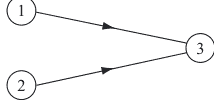
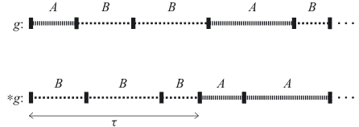
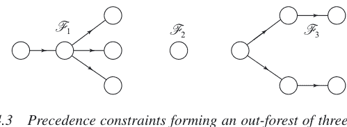

## 多臂老虎机分配指数


John Gittins
英国牛津大学统计学系

Kevin Glazbrook
英国兰卡斯特大学管理科学系

Richard Weber
英国剑桥大学统计实验室


Gittins, John C., 1938-
多频带收益分配指数 / John Gittins, Richard Weber, Kevin Glazebrook. – 第二版。
包含参考文献和索引。
1. 资源分配 – 数学模型。2. 数学优化。3. 规划（数学）
1. Weber, Richard, 1953- II. Glazebrook, Kevin D., 1950- III. 标题。


英国图书馆可提供本书的目录记录。


由印度钦奈杜的 Laswords Private Limited 以 10/12pt Times 字体排版


# 前序

John Gittins 的本书第一版标志着一个时代的结束，即研究者们努力争理解并解决多臂老虎机问题的时代。该版的前序庆祝了这种理解，因此认为保留它是合适的。

新时代的开启就像蚁穴的骚动，随着一群狂热研究者的突然涌入。第一阶段是利用阶段，每个工作者都尝试应用其专业知识。在这里，“老虎机”和“臂”（源自赌博机）的术语变得相当费力。我自己曾谈论一组“项目”，在任何时刻只能参与一个。我们希望操作所有项目——但只有通过尝试它们才能确定哪些是高价值项目——这个过程就是分配与学习。任何项目本身不会改变，但其“信息状态”会改变——我们通过贝叶斯更新来表达它。


另一个是待分配的额外资源。第 6.8 节清晰地表明了这种雄心。

扩展此类情况需要新的工具，第 5 章和第 6 章考虑了两项研究：可行区域的研究以及优化的拉格朗日松弛。这些核心章节非常清晰地阐述了在具有实际意义的案例中的理论现状，在这些案例中可以确定具有索引特征的最优策略。然而，必须承认，索引性和和最优性的一般问题仍停留在研究前沿，尽管人们能感觉到一股正在升起的浪潮将把它们推向远方。

显性也是第 7 章和第 8 章的特征，这两章详细讨论了在不同统计假设下索引的确定方法。

这部具有学术性且现代的作品对该主题的现状提供了令人满意的完整、严谨且富有启发性的描述。它还传达了一种历史视角，从 Klimov 和 von Olivier 的工作（这些工作在约翰·吉廷斯（John Gittins）的进展被广泛认可之前就已经出版）直到今天。本书的三个位作者都对该主题做出了关键且近期的贡献，是制定其近期方向的最佳人选。

Peter Whittle

# 第一版序言

“吉廷斯索引”（Gittins index）一术语现在在文献中已稳固流行，指代一个在解决长期存在的多臂老虎机问题中首次被证明至关重要的概念，并从那时起为理解所有此类问题提供了指导。然而，作者过于谦逊，没有使用这个术语，因此我认为我的唯一职责是向潜在读者保证，作者就是那个索引的吉廷斯，这本书阐述他在解决多臂老虎机问题方面的开创性工作，以及随后对一类广泛顺序分配问题的调查。

此类分配问题涉及项目之间资源的优化划分，这些项目需要资源来开发，并根据其开发程度的速率产生收益。它们在本质形式上体现了所有人类活动中显而易见的冲突。这种冲突是采取产生即时回报的行动与那些（如获取信息或技能，或准备工作）收益后后获得的行动之间的冲突。

多臂老虎机是这类问题的原型，于第二次世界大战期间提出，并因其困难性而迅速成为一个经典，并成为固执的代名词。事实上，约翰·吉廷斯在 20 世纪 60 年代后期就已经解决了这个问题，尽管他做到这一点的事实直到 20 世纪 80 年初才获得普遍认可。我可以说明这个“地雷”的传播模式，我问过一位同样出名的同事：“如果告诉你多臂老虎机问题已经解决了，你会怎么说？”回答带有某种约翰逊式的风格：“先生，多臂老虎机问题并不是那种可以被解决的性质的问题”。我的朋友随后在四十分钟内说服了那位怀疑者。这确实是约翰解决方案的特点之一：一旦被解释，它在被证明之前就已经具有说服力了。

约翰·吉廷斯在这里提供了一份说明，将他最初的开创性贡献与他自己和其他工作者随后取得的巨大进展统一起来。我推荐这本书作为正统且权威的源头性著作。

Peter Whittle

# 前言

本书的第一版于 1989 年出版。该版序言的简短版本随在本序言之后。对于初学者读者来说，现在阅读它可能会有所帮助。

自 1989 年以来，该领域发展迅速。主要索引定理的不同证明出现了显著的繁荣，每个证明都对结果为何成立提供了其独特的见解。相关的理论体系也相继涌现，特别是可行区域和不休息老虎机（restless bandit）方法，以及经济学中关于探索与利用之间适当平衡的讨论。这些导致了例如计算索引的算法的改进，以及当索引策略并非一定最优时性能界限的改进。这些发展为新版的出版提供了理由，加之人们对这本书产生了浓厚的兴趣，这并不难以怀疑。

现在有三位作者，而不仅仅是约翰·吉廷斯。Kevin Glazrook 和 Richard Weber 带来了对近期发展的熟悉，他们对这些进展做出了重要贡献。他们的专业知识使我们能够包含关于可行区域和不休息老虎机的新章节。

我们还利用机会对核心章节进行了大幅修订。我们的目标是提供一个对主要思想的易懂的介绍，利用更近期的工作，在进入第 4、5 和第 6 章中更具挑战性的内容之前。总的来说，我们试图创作一份说明性的描述，而不仅仅是一本研究专著。练习题的设计旨在有助于深入理解这些材料。

众所知的吉廷斯索引，对于一个与其他项目竞争投资的项目，既考虑了即时预期回报，也考虑了从初始投资中获得的信息价值，这可能对于获得后期收益有用。这些因素通常被称为利用（exploitation）和探索（exploration）。

本着精神，第 1 章作为全书的关键，标题为“探索”。书的主流贯穿第 2 章到第 4 章。它进入由第 5 章、第 6 章、第 7 章和第 8 章以及第 9 章代表的独立子流，其中第 9 章简要回顾了进一步的应用。


# 第一版序言

感谢 Joao Amaral, Tony Baker, John Bather, Sten Bergman, Owen Davies, Kevin Glazebrook, David Jones, Frank Kelly, Aamer Khan, Dennis Lindley, Peter Nash, David Roberts 和 Peter Whittle 的合作。

我特别想感谢 Joao Amaral、Frank Geisler 和 David Jones 在计算指数值方面所付出的巨大努力，并感谢 Brenda Willoughby 在打字手稿时付出的辛勤工作。这本书献给 Hugh 和 Anna，他们在本书准备期间已经成长了。

John Gittins

牛津大学数学学院
1989年3月

# 1

## 引言或探索

本书关于如何通过数学模型，以顺序的方式优化多个竞争项目之间的努力分配。这些努力和项目可以采取多种形式。例如：一个工业处理器和等待处理的作业；一个带有客户队列的服务器；一个拥有研究项目的工业实验室；任何有工作要做忙碌的人；一系列患者和替代治疗方案（是的，患者对应努力——参见本章稍后的第 5 题）；一个可能在不同地点寻找的搜索者。在任何情况下，努力都被视为是同质的，问题是在不同项目之间分配努力，以使它们产生的预期奖励最大化。这是一个顺序问题，因为允许以反馈的方式重新分配努力，并考虑到到为止已获得的奖励模式。假设重新分配是有成本的，且耗时可以忽略不计，因为另一种方案是引入类似于旅行推销人的特征，这会使一个本就困难的问题变得更加复杂。

属于动态规划范畴的技术是为顺序优化问题设计的。其核心思想是一个递归方程，它将给定决策的期望总奖励（称之为收益）与下一次决策时其可能值的分布联系起来（参见 (2.2)）。这些方程可以通过解析法求解。否则，至少在原则上可以进行递归的数值求解。这涉及对收益函数进行初始近似，然后通过代入递归方程的右侧进行连续近似。正如 Bellman (1957)——多年来这种方法论的主角人物——所指出的，使用递归方程涉及对所有策略及其相应收益进行完全枚举，但随着收益函数所依赖的变量数量的增加，没有任何一种枚举方法都会很快撞上难以处理的存储和处理要求的瓶颈。

对于将努力分配给项目的问题，变量的数量等于项目的数量。因此，一个吸引人的想法是为每个项目建立优先指数，它取决于其过去的历史但不取决于任何其他项目，并在每个决策时间只将努力分配给当前指数值最高的项目。为了计算此类指数，可以将某个状态下的项目与一组具有简单属性的标准项目进行校准。如果能做到，我们就可以获得一个合理的策略，而无需处理超过一个项目的状态函数。

众所周知，对于某些努力分配问题，最优策略可以用此类指数来表示。本章描述的前三个问题就是例子。第 2、3 和第 4 章阐述了一套通用的理论，将结果置于背景中。它们包含了几个定理，断言了在不同条件下策略指数的最优性。事实上，本章描述的七个问题中，五个可以使用指数定理（定理 2.1）及其推论 3.5 快速求解。第 4 题需要定理 3.1，它是指数定理的连续时间版本。

由于这些优先指数可能会随着更多努力的分配而变化，因此可以被称为动态分配指数。它们定义的策略在相关情况下分别是史密斯规则（Smith's rule）和最短处理时间规则（SPT）。本章的主要目标是通过描述若干特定实例来展示它们的应用范围。第二个目标是对确定指数的可用方法进行非介绍。这些方法包括：(i) 交换变换；(ii) 利用所涉及老虎机过程的任何特殊特征，特别是导致近视策略最优性的特征；(iii) 参考标准老虎机过程进行校准，这通常涉及使用动态规划递归方程进行迭代；以及 (iv) 利用动态分配指数可以被视为最大等效常数奖励这一事实。

## 问题 1 单机调度（另见第 2.12 节、第 3.2 节和练习 4.1）

单台机器上有 $n$ 个作业要处理。作业 $i$ 每完成一个单位时间产生成本 $c_i$，作业 $i$ 的服务时间（或处理时间）为 $s_i$。应该以什么顺序处理作业以使总成本最小？

## 问题 2 采矿（另见第 3.5.2 节）

一个女子拥有 $n$ 个金矿和一台采矿机。她每天都必须将机器分配给其中一个矿井。当机器分配给矿井 $i$ 时，有概率 $p_i$ 提取矿井中剩余黄金的比例 $q_i$，而有概率 $1 - p_i$ 不提取任何黄金并永久损坏。连续每天应该将机器分配到什么顺序的矿井，以便在它损坏之前开采的黄金量最大化？

## 引言与探索

**问题搜索**（另见第 3.5.4 节和练习 3.6）

一个静态物体隐藏在 $n$ 个箱子之一。搜索第 $i$ 个盒子找到物体的概率为 $q_i$。物体在第 $i$ 个盒子中的概率为 $p_i$。应该如何安排箱顺序以使预期成本最小？
对于问题 1，最优调度是按 $c_i/s_i$ 的降序排列处理作业，这可以通过以下交换论证证明。如果将作业 1 和 2 作为第一个、第二个处理，那么这两个作业产生的总成本为 $c_1s_1 + c_2(s_1 + s_2)$。如果交换 1 和 2 的处理顺序，该数值将变为 $c_2s_2 + c_1(s_2 + s_1)$。当且仅当 $c_1/s_1 \geq c_2/s_2$ 时，第一个顺序成本最小。

对于问题 3，如果在最优策略下下一个搜索盒子 $j$，则：

$$\frac{p_iq_j}{c_j} = \max \frac{p_jq_i}{c_i}$$

对于问题 2 和 3，策略由数字序列指定，该序列对应于分配机器损坏为止的矿井顺序，或者搜索找到物体为止的箱子顺序。上述策略可以通过涉及序列中相邻矿井交换的论证证明它们在 C 类中是最优的，C 类是由所有每个 $i=(1, 2, \dots, n)$ 出现无限次的序列组成的策略。由于任何策略都可以被 C 类策略在指定序列的任意大的初始部分上匹配，因此得出上述策略在所有策略类中是最优的。


# 多臂老虎机分配索引

这一观察的意义在于，我们的索引并不是简单地告诉我们在一个具有 $n$ 个备选方案的特定问题的给定阶段选择何种替代方案，而是为具有给定类型的任意备选方案的问题规定最优策略。这意味着，如果我们知道对于某类问题存在这样的索引（尽管目前还没有显式表达式），那么为了找到其显式表达式，只需要考虑该类的 $n=2$ 情况即可；正如下一个示例所示，即使这类受限的问题也不需要完全一般地求解。

### 问题 4 工业研究
一个工业科学家团队的经理有 $n$ 个研究项目，可以按任何顺序进行。项目之间的切换时间损失忽略不计，无论这些项目是否已成功完成。对于经理雇主而言，在时间 $t$ 完成项目 $i$ 的价值为 $V_ie^{-\gamma t}$ ($\gamma > 0$)。完成项目 $i$ 所需的时间是一个随机变量 $\sigma_i$，其分布为 $F_i(t)$，密度为 $f_i(t)$。为了使 $n$ 个项目产生的期望价值最大，经理应该遵循什么样的策略？

按照标准用法，从一个项目到另一个项目的切换被称为**抢占**（preemption）。如果允许在任何时间进行抢占（即使正在投入的项目尚未完成），我们称之为为**抢占情况**。如果一个项目一旦开始，必须持续投入直到完成，我们称之为为**非抢占情况**。在非抢占情况下，可以像问题 1 那样通过交换论（interchange argument）找到最优调度。假设项目 1 和 2 是前两个处理的项目。如果当 1 在 2 之前处理时，这些项目获得的期望价值至少大于顺序反过来的的情况，则：

$$E[V_1e^{-\gamma\sigma_1} + V_2e^{-\gamma(\sigma_1+\sigma_2)}] \geq E[V_2e^{-\gamma\sigma_2} + V_1e^{-\gamma(\sigma_1+\sigma_2)}].$$

这等价于：

$$\frac{V_1Ee^{-\gamma\sigma_1}}{E(1-e^{-\gamma\sigma_1})} \geq \frac{V_2Ee^{-\gamma\sigma_2}}{E(1-e^{-\gamma\sigma_2})}$$

我们可以得出结论：按照定义的索引的递减顺序处理 $n$ 个项目，其总期望价值最大：

$$\mu_i = \frac{V_iEe^{-\gamma\sigma_i}}{E(1-e^{-\gamma\sigma_i})}$$

我们可以与问题 1 建立联系。假设在给定的处理顺序下，项目 $i$ 在时间 $t_i$ 完成。从项目中获得的总期望价值可以写为：

$$E \sum_i V_ie^{-\gamma t_i} = \sum_i (V_i - \gamma E \sum_i V_{it_i} + o(\gamma)).$$

## 引言或探索

因此，在 $\gamma \searrow 0$ 的极限下，最大化 $E \sum_i V_i e^{-\gamma t_i}$ 的问题等同于最小化 $E \sum_i V_i$。如果我们识别 $V_i$ 为 $c_i$，该度量在问题 1 中是相同的。同样，当 $\gamma \searrow 0$，我们有 $\mu_i \to V_i/E\sigma_i$，这是一个类似于问题 1 中 $c_i/s_j$ 的索引。

最优策略的表征并不像允许项目间任意切换时那么直观。然而，让我们利用这样一个事实：该问题可以通过考虑 $n=2$ 的情况来证明。项目 1 将是所描述的项目类型的索引。假设项目 2 需要非随机的 $\Delta$ 来完成，且 $V_2 = \Delta$。令 $C_{\Delta}$ 为给定 $\Delta$ 和正 $\lambda$ 值的此类项目类。

对于所有属于 $C_{\Delta}$ 的项目集合，按照 $\lambda$ 值的递减顺序处理最好的。这几乎是显而易见的，因为这种策略会导致较大的未打折的 $\lambda \Delta$ 被 $e^{-\gamma}$ 因子打折，并且通过交换论很容易验证。同样，要说服自己在处理一个项目时，在项目完成之前不应中断也并不困难。因此，对于 $C_{\Delta}$，$\lambda$ 值定义了一个索引。

考虑 $n=2$ 的，其中项目 1 是任意的，项目 2 属于 $C_{\Delta}$。如果我们能找到一个 $\lambda$，使得初始处理项目 1 或项目 2 是最优的，那么对于整个项目集必须存在这样的索引；由此，这种索引函数可以通过给项目 1 和项目 2 分配相同的索引值 $\lambda$ 来定义。我们可以使用 $C_{\Delta}$ 作为测量设备来校准整个项目集。任何 $\lambda$ 的单调函数都同样适用。

根据索引规则的最优属性，可以得出：如果在给定问题中，处理具有相同 $\lambda$ 值的 $C_{\Delta}$ 成员是最优的，那么连续处理它们直到它们全部完成仍然是最优的。

**完成率**（或称风险率）定义为 $\rho(s)=f(s)/[1-F(s)]$。如果该值是递减的，那么在给定 $x$ 的情况下，由于 $\rho(s)$ 是在 $x$ 时完成且之前没有完成的奖励密度，使用 $V\rho(x)$ 作为索引对应于最大化下一个无限小时间内的期望奖励，这种策略有时被称为**短视的**（myopic），因为它忽略了之后可能发生的情况，或者说忽略了远见。我们已经证明，对于问题 4，通过前瞻来看无法获得任何优势，否则可能会有优势。对于 $\rho(s)$ 非递减的项目，(1.3) 中的上界在 $t \to \infty$ 时达到。索引是非递的，因此抢占选项并非毫无价值。在 $\gamma \searrow 0$ 的极限下，索引简化为 $V/E_x[T]$，$E_x[T]$ 表示完成该项目所需的期望剩余时间。


## 引言或探索

考虑到项目已经运行了时间 $x$ 且尚未完成。$\rho(x)$ 随 $x$ 非递增的这一事实意味着 $E_x[T]$ 随 $x$ 非递减的。$V/E_x[T]$ 的索引与我们在非抢占情况中发现的索引相同，这表明如果所有项目的完成率都在增加，那么在抢占策略的类类中，存在一个非抢占的最优策略。

之前为问题 1、2 和 3 导出的索引都是短视的（myopic）。然而，随后我们将遇到这些问题的更一般版本，在这些问题中，短视优化往往不是最优的。这导致索引的变得更加复杂，只有通过索引定理才能获得完全通用的表达式。在每种情况下，前瞻性的需求源于所选的替代方案可能会在随后的阶段产生代价。这种短期奖励与长期回报之间的冲突可以通过下面这个看似简单的衰减问题近乎完美地展示。

### 问题 5 多臂赌老虎机（见第 2.6、2.12、7.1 和 8.4 节）

有 $n$ 条臂（治疗方案），可以以任何顺序反复拉动（分配给患者）。每次拉动都可能导致成功或失败。由臂 $i$ 产生的成功和失败序列形成一个未知概率 $\theta_i$ 的伯努利过程。第 $r$ 次拉动成功将产生奖励 $a^{r-1}$（$0 < a < 1$），而失败的拉动产生零奖励。在时间 0 时，每个 $\theta_i$ 都有一个先验分布，这些分布在不同臂之间是独立的。随着臂的拉动，这些先验分布通过贝叶斯定理转换为连续的后验分布。由于 beta 分布类在伯努利采样下是封闭的，因此所有后验分布都是 beta 分布。在每个阶段应该如何选择拉动哪条臂以使无限序列拉动的期望奖励最大化？

对于这个问题，与上一个问题相比，有一个显而易见的解决方案。即在每个阶段拉动当前 $\theta_i$ 期望最大的臂。如果此时 $\theta_i$ 的当前分布为 Beta($\alpha_i, \beta_i$) ($i=1, 2,\dots,n$)，则建议拉动臂 $j$，使得 $\alpha_j/(\alpha_j + \beta_j) = \max_i \alpha_i/(\alpha_i + \beta_i)$。

该策略表述简单、直觉上合理，且在大多数情况下非常好。然而，遗憾的是它并不是最优的。这是因为它是短视的，而在问题中短期奖励与长期回报之间存在某种冲突，尽管不一定是强冲突。为了说明这一点，假设 $n=2$ 且 $\alpha_1/(\alpha_1+\beta_1) = \alpha_2/(\alpha_2+\beta_2)$。建议的索引规则在两条臂之间切换，但如果例如 $\alpha_2+\beta_2 \gg \alpha_1+\beta_1$，则 $\theta_1$ 的方差远大于 $\theta_2$，那么进一步拉动臂 1 导致 $\alpha_1/(\alpha_1+\beta_1)$ 发生显著变化的概率要比拉动臂 2 时发生可比变化的概率大得多。这强烈表明拉动臂 1 更好，因为两种情况下的即时期望奖励是相同的，而且拉动臂 1 可以获得更多信息；这种直觉被证明是有根据的，因为我们后来获得了更高的奖励。正如我们将在 8.4 节中看到的。

## 多臂赌老虎机分配索引

事实上，没有简单的方法可以表示最优策略，人们投入了大量精力，通过最优策略下期望总奖励的动态规划递归方程来迭代求解。当 $n=2$ 且在 $\alpha_i, \beta_i$ ($i=1, 2$) 之间具有 beta 先验分布时，其形式如下：

$$R(\alpha_1, \beta_1, \alpha_2, \beta_2) = \max \begin{cases} \frac{\alpha_1}{\alpha_1+\beta_1}[1+aR(\alpha_1+1, \beta_1, \alpha_2, \beta_2)] + \frac{\beta_1}{\alpha_1+\beta_1}aR(\alpha_1, \beta_1+1, \alpha_2, \beta_2) \\ \frac{\alpha_2}{\alpha_2+\beta_2}[1+aR(\alpha_1, \beta_1, \alpha_2+1, \beta_2)] + \frac{\beta_2}{\alpha_2+\beta_2}aR(\alpha_1, \beta_1, \alpha_2, \beta_2+1) \end{cases} (1.4)$$

其后的逻辑如下。如果拉动臂 1，成功的概率是 $\theta_1$ 相对于 Beta($\alpha_1, \beta_1$) 的期望，即 $\alpha_1/(\alpha_1+\beta_1)$。该量是 (1.4) 右侧第一个括号的系数，它是在第一次拉动后、在成功条件下最优策略下的期望总奖励。为了理解这一点，注意成功产生 1 的即时奖励，并通过应用贝叶斯定理，后验分布为 Beta($\alpha_1+1, \beta_1$)。


# 多臂老虎机分配索引

拉取一次，在这次拉取之后，我们关于两个成功概率的信息与之前完全相同，因此，重复地再次拉取它们必然是最优的。这可以通过关于当前问题的 (1.4) 的确切类比公式来验证，该公式与 (1.6) 相同，仅将 $p/(1-\alpha)$ 替换为 $p+R(\alpha, \beta, p)$。

方程 (1.6) 可以通过迭代求解得到 $R(\alpha, \beta, p)$，从 $\alpha$ 和 $\beta$ 的近似值开始，使得 $\alpha+\beta=N$，这与方程 (1.4) 类似。(1.6) 中括号曲线中两个成功概率相等的 $(\alpha, \beta)$ 取值集合，对应于先验索引值等于 $p$ 的手臂。因此，通过对 $p$ 的足够细致的网格值求解 (1.6)，可以为所有 $\beta$ 计算出所需精度的索引值，从而为所有 $n$ 定义最优策略。

对 (1.4) 进行的分析表明，求解单个 $p$ 值的 (1.6) 时：

- 所需的独立计算次数 = $\frac{1}{2}(N-1)(N-2)$
- 存储需求 = $N-1$。

对于 $p$ 值的网格，前者乘以网格中值的数量，而后者保持不变。对于 $n=2$，当 $N=100$ 且网格包含多达数百个 $p$ 值时，索引法比直接法所需的计算量更少，在存储需求方面表现优得多，并且同时解决了 $n > 2$ 的问题。

简而言之，通过索引定理，问题 5 被带入了计算可行的范围内。在这方面，它是该定理适用的大许多问题的典型，且定理并未为这些问题给出简单的显式解。

由于多臂老虎机是顺序资源分配中的原型问题，它被用作通用老虎机过程的来源，用于描述资源分配过程中替代奖励（或成本）生成过程之一。问题 1 到 6 中的每个挖掘点、矿井、箱、项目、手臂和位置分别定义了一个老虎机过程。

# 问题 6 探索（参见第 9.6 节）

$n$ 个位置中的每个位置包含未知数量的对象。在每个时间点 $t=0,1,2,...$，在选定的位置都会对物体进行搜索。搜索期间发现的任何物体都会被移除并实现其价值。如果在时间 $t$ 在位置 $i$ 发现了 $x$ 个物体，则产生回报 $a^t(rx-c_i)$，其中 $a$ 是满足 $0 < a < 1$ 的折扣因子，$r_i$ 是 $i$ 处发现的单个物体的价值，$c_i$ 是搜索成本。一旦某个位置被搜索得足够频繁，未来发现前景可能足够令人沮丧，以至于继续进行搜索不再符合成本效益。为了简化问题，我们在问题 4 中假设在位置之间切换是免费的，且不会延迟未来的搜索。

## 引言或探索

目标是确定以何种顺序搜索位置以及何时停止搜索，以最大化总收益。

在 $t = 0$ 搜索之前，我们通过为每个位置分配先验分布来表达对每个位置物体数量的信念。此时，关注单个位置的性质将很方便，在需要之前我们省略位置标识符。我们将用 $Y$ 表示未知的物体数量。我们假设不同位置的物体数量是独立的。随着搜索过程，先验分布将转换为剩余发现物体数量的后验分布。假设向量 $x = (x_1, x_2, \dots, x_s)$，其中 $x_i$ 是第 $i$ 次搜索时发现的物体数量。我们用 $\Pi(x, s)$ 表示 $Y - \sum_{i=1}^s x_i$（待发现物体数量的后验分布。除了上述，我们还需要检测模型，即搜索期间发现物体数量的条件概率集合。我们使用 $\phi(x|y)$ 表示搜索前有 $y$ 个物体的情况下，搜索产生 $x$ 个发现物体的概率。

与该模型相关的一个有趣问题是：在位置发现大量或少量物体，是鼓励还是阻碍再次访问该位置进行进一步搜索。简单来说，小量发现总是不利于返回的，因为决策者重新评估了她对该位置潜在价值的信念，同时也移除了她发现的少数物体。大量发现的影响是一个要复杂得多的问题，并在很大程度上取决于我们建模先验信念的方式。可以推断，随着时间的推移，位置在被清空后其吸引力会下降。

为了进展，我们寻求问题结构的某种简化，要求后验分布 $\Pi(x, s)$ 仅通过搜索历史 $(x, s)$ 中的 $\sigma_s = \sum_{i=1}^s x_i$（发现的物体总数）和 $s$（搜索次数）产生依赖。我们写作 $\Pi(x, s) \equiv \Pi(\sigma_s, s)$。

只有当 $V$ 是泊松分布时，才成立。此外，在这种情况下，$U$ 和 $V - U$ 是独立的。


随着探索的进行，搜索将保证形成一个递减序列。在这种情况下，上述的一步回报将变为：

$\mu_i(\sigma_{S_i}, s_i) = r_i\xi_i(\sigma_{S_i}, s_i) - C_i,$

当所有位置都可用时，最优搜索是选择一个关联索引 $\mu_i(\sigma_{S_i}, s_i)$ 最大的位置 $i$，前提是该最大值为正。当所有一步回报均为负值时，则不进行搜索。该证明在本质上与简单的泊松情况相同。关于轻尾族的另外一点：在本例中事实上，对于固定的 $s$，后验均值 $\xi(\sigma_o, s)$ 随 $\sigma_o$ 的增加而减少。因此，巨大的发现对返回某个位置进行进一步搜索具有正向抑制作用。

然而，假设先验分布 $\Pi$ 的尾比一般的泊松混合分布更重。对于这种情况，在固定的 $\sigma_o$ 下，后验均值 $\xi(\sigma_o, s)$ 随 $s$ 减小，但在固定的 $s$ 下随 $\sigma_o$ 增加。因此，任何无收获的搜索会导致后验均值的下降。然而，后验均值随发现对象数量的增加而增加。可能会出现发现足够数量的对象会导致后验均值的增加。因此，对于这类情况，一步均值回报序列不能保证是递减的，之前情况的极简单分析不再适用。然而，针对多臂老虎机的定理保证了在这些情况下确实存在某些量 $v(\sigma_o, s)$，它们在确定最优策略方面扮演着由一步回报 $\mu_i(\sigma_{S_i}, s_i)$ 所承担的角色。可以证明 $v(\sigma_o, s)$ 在固定的 $s$ 下本身随 $\sigma_o$ 增加，因此在这种情况下，巨大的发现是重新访问该工作进行进一步搜索的激励。关于该问题的进一步讨论，请参阅 Glazebrook 和 Boys (1995)。

## 问题 7 选择一份工作

一个男人面临许多就业机会，他可以每天调查一个。对于一份典型工作，这种调查的成本为 $c$，并告知他日薪 $w$，该工资具有先验概率分布 $F(w)$。该工作有 $\frac{1}{2}$ 的概率证明是合适的，或者相反保持不变，男人每天分别收到 $g$ 或 $-g$ 的结果。合适性发生在工作的第 $N$ 天后，其中 $N$ 是一个服从几何分布的随机变量。发生在第 $t$ 天的奖励或成本的折扣因子为 $\alpha^{-1}$；与其他参数不同，$a$ 对于所有工作都是相同的。可以在任何时间做出接受或离开某工作的决定，并在决策后的第二天生效。该男人是否应该在发现合适性后才决定是否接受某份工作，如果接受了再决定是否离开？

该问题的老虎机过程显然是各种不同的工作。一个（离散时间）标准老虎机过程简单是一份工资率和合适性均已知的工作。我们将这两个数量之和称为回报率。

老虎机过程的索引始终等于标准老虎机过程的回报率，当只有这两个老虎机过程可用时，这会导致两者之间产生无差异性。在经济学文献和当前的语境下，这种等效回报被称为*保留工资*。考虑一份已知工资率为 $w$ 的初始工作 J，但其合适性是未知的，以及另一份已知奖励 $v$ 的替代标准工作 $S(v)$。假设最初这两份工作之间存在差异。由此推导出无差异性必须持续到 J 的合适性已知。这是因为在工作 J 上工作 $n (<)$ 天后，$N-n$ 的分布（现在以 $N>n$ 为条件）等同于 Geometric(p)，且从那时起可获得的奖励与开始时具有相同的结构。唯一的例外是折扣，当我们把奖励与在 J 上工作 $n$ 天后的可用奖励进行比较时，它会将所有未来奖励按相同的因子向下调整，从而使最优策略保持。我们可以假设，我们的男人开始工作工作 J 并持续工作 $N$ 天，在那个点他得知了合适性。如果工作是合适的，那么现在留在那里必须优的，因为即使在没有这种知识的情况下这样做也是最优的。如果工作是不合适的，那么现在切换到 $S(v)$必须是最优的，因为我们对两份工作之间初始无差异的假设意味着，在没有这种知识的情况下切换已经是最优的。这就是一种最优策略。无差异假设意味着永久在 $S(v)$ 上工作也是最优的。（注意，我们假设这个男人拥有无限的寿命，这在当前的语境下等同于——其中 $L$ 天，且 $a^L \ll 1$）。

现在可以将这两种策略的预期回报等同，并求解出 $v$。在此之前，请注意对于任何一种策略，我们都有：

$E(Reward) = E(Reward\ during\ first\ N\ days)$
$\quad{+\frac{1}{2}E(Reward\ after\ N\ day| J\ is\ congenial)+\frac{1}{2}E(Reward\ after\ N\ day| J\ is\ uncongenial).$

此外，三项中的最后一项对于两种策略的右侧都是相同的，因为 J 是合适的。这个方程简化为：

$E(Reward) = E(Reward\ during\ first\ N\ days) + \frac{1}{2}E(Reward\ after\ N\ day| J\ is\ congenial) + \frac{1}{2}(J\ is\ uncongenial).$

## 探索

老虎机过程的索引始终等于标准老虎机过程的回报率，当只有这两个老虎机过程可用时，这会导致两者之间产生无差异性。在经济学文献和当前的语境下，这种等效回报被称为*保留工资*。考虑一份已知工资率为 $w$ 的初始工作 J，但其合适性是未知的，以及另一份已知奖励 $v$ 的替代标准工作 $S(v)$。假设最初这两份工作之间存在差异。由此推导出无差异性必须持续到 J 的合适性已知。这是因为在工作 J 上工作 $n (<)$ 天后，$N-n$ 的分布（现在以 $N>n$ 为条件）等同于 Geometric(p)，且从那时起可获得的奖励与开始时具有相同的结构。唯一的例外是折扣，当我们把奖励与在 J 上工作 $n$ 天后的可用奖励进行比较时，它会将所有未来奖励按相同的因子向下调整，从而使最优策略保持。我们可以假设，我们的男人开始工作并持续工作 $N$ 天，在那个点他得知了合适性。如果工作是合适的，那么现在留在那里必须是最的，因为即使在没有这种知识的情况下这样做也是最优的。如果工作是不合适的，那么现在切换到 $S(v)$ 必须是最优的，因为我们对两份工作之间初始无差异的假设意味着，在没有这种知识的情况下切换已经是最优的。这就是一种最优策略。无差异假设意味着永久在 $S(v)$ 上工作也是最优的。（注意，我们假设这个男人拥有无限的寿命，这在当前的语境下等同于——其中 $L$ 天，且 $a^L \ll 1$）。

老虎机过程的索引是……

关于轻尾族的另外一点：在本例中事实上，对于固定的 $s$，后验均值 $\xi(\sigma_o, s)$ 随 $\sigma_o$ 的增加而减少。因此，巨大的发现对返回某个位置进行进一步搜索具有正向抑制作用。

然而，假设先验分布 $\Pi$ 的尾比一般的泊松混合分布更重。对于这种情况，在固定的 $\sigma_o$ 下，后验均值 $\xi(\sigma_o, s)$ 随 $s$ 减小，但在固定的 $s$ 下随 $\sigma_o$ 增加。因此，任何无收获的搜索会导致后验均值的下降。然而，后验均值随发现对象数量的增加而增加。可能会出现发现足够数量的对象会导致后验均值的增加。因此，对于这类情况，一步均值回报序列不能保证是递减的，之前情况的极简单分析不再适用。然而，针对多臂老虎机的定理保证了在这些情况下确实存在某些量 $v(\sigma_o, s)$，它们在确定最优策略方面扮演着由一步回报 $\mu_i(\sigma_{S_i}, s_i)$ 所承担的角色。可以证明 $v(\sigma_o, s)$ 在固定的 $s$ 下本身随 $\sigma_o$ 增加，因此在这种情况下，巨大的发现是重新访问该工作进行进一步搜索的激励。关于该问题的进一步讨论，请参阅 Glazebrook 和 Boys (1995)。


很容易证明，最大化 $w_1$ 和 $w_2$ 的指标为

$\xi = w_1 + \frac{pag}{2(1-a) + pa} = w_2 - g.$ 

因此，(1.9) 中的最大化实际上是关于单个变量的，并且可以通过数值方法求解。

从一般原理上显然，与已知工资率的情况一样，$\xi$ 随着 $p$、$a$ 和 $g$ 的增加而增加，尽管这在 (1.9) 中并不特别明显。原因是获得高等效常定率的机会随着这些变量的每一个增加而增加。对于 $g$ 的情况，这是因为 $g$ 的大值增加了不同可能结果之间奖励的变异性，从而增加了高奖励率结果并排除低奖励率结果的可能性。对于 $p$ 的情况，任何增加都倾向于使这种选择发生的时间更早，因此更重要。另一方面，$a$ 的大值减少了延迟会减小可实现的等效常定率的倾向，因为选择后发生的某些奖励与早期的奖励相比并非完全微不足道；这种效应不仅限于问题 7，正如定理 2.3 将所示的。


- (ii) $v(1, a) > v(2, a)$;
- (iv) $v(1, a)$ 关于 $a$ 增加。这些结果告诉我们关于什么


# 2 核心思想：Gittins

## 2.1 引言

马尔可夫过程是一个根据当前状态通过一系列状态的系统数学模型。这个概念是概率学家武器库中强大的武器之一。其数学理论非常优雅，且在物理和经济科学领域无处不在。

我们在每个阶段增加一组决策，后续状态的概率分布取决于这些决策。我们还在每个阶段增加一组奖励，使得决策者根据其决策和随后的转移获得奖励。这些引入为需要做出一系列的情况提供了马尔夫模型。决策过程的研究始于 Wald (1950) 和 Bellman (1957) 的工作，并持续至今。大量的文献——参见 (1971) 的书以及 Tegels (1976) 的综述。现代理论在许多书中都有很好的解释，例如 Whittle (1983)、Ross (1983) 和 Puterman (2005)。

可以使用各种标准来选择每个阶段采取的决策。我们考虑具有无限时间界的马尔可夫决策过程：即持续的过程。未来的奖励将被折现，以确保获得的总奖励是有限的。目标是找到最大化该总折现奖励期望的位置，这简单称为收益。我们理论最有趣的应用之一是非折扣问题，其解可以通过让折现因子趋于一或以某种方式重新解释折现因子来获得。第一章的问题 1、2 和 3 就是此类例子。

## 2.2 决策过程

Blackwell (1965) 证明了马尔可夫决策过程许多基本结果。这些结果包括动态规划方程解的存在性和唯一性，最优策略的存在


属于确定性平稳马尔可夫策略的类，以及值迭代法的收敛性。这些最初是在离散时间过程中被证明的，我们将感兴趣它们扩展到连续性决策时间之间的间隔本身是随机变量的情况。这类过程被称为半马尔可夫决策过程（semi-Markov decision processes）。我们需要的重要结果在本章末的定理 2.10 中总结。


老虎机过程是半马尔可夫决策过程的一种特殊类型。此时，我们可能会花费几页的时间，提供比上一节更详细的马尔可夫决策过程和半马尔可夫决策过程的一些通用定义。然而，许多读者已经熟悉这些概念了。其他人会发现它们在解决特定问题的背景下很容易理解。因此，让我们直接进入老虎机过程的描述。为了简单起见，我们将暂时关注在可计数状态（例如 $E$）上移动的老虎机过程。

控制在连续的决策时间应用于老虎机过程，这些时间之间的间隔是随机变量。第一个决策时间在零时刻。状态之间的转移发生在这些时刻，且不在其他任何时刻发生，奖励的积累也是如此。这将证明在决策时间施加的控制将持续有效，直到（但不包括）下一个决策时间。

当过程在决策时间 $t$ 处于状态 $x$ 时，必须从包含两个控制的集合 $\{0, 1\}$ 中选择一个控制。控制 0 冻结老虎机，这意味着应用它时不会产生奖励，过程的状态也不会改变。应用控制 0 还会启动一个时间间隔，在该间隔内的每个点都是决策时间。与此相反，控制 1 被称为继续控制。如果在给定的时刻老虎机处于状态 $x$ 并应用了控制，过程将产生时奖励 $dr(x)=e^{-\gamma}r(x)$，目前我们假设 $r(x)$ 是有界的。量 $(0<\alpha<1)$ 和 $\gamma (>0)$ 分别称为折扣因子和折扣参数。我们用 $P(y|x)$ 表示在时间 $t$ 过程处于状态 $x$ 的条件下，时间 $t$ 之后过程状态为 $y$ 的概率。我们用 $F(s|x,y)$ 表示在时间 $t$ 过程处于状态 $x$ 且应用控制 $u=1$ 导致转移到状态 $y$ 的条件下，直到下一个决策时间经过不超过 $s$ 的概率。正如马尔可夫决策过程是决策时间之间持续时间具有常值的（半马尔可夫）决策过程，马尔可夫老虎机过程是决策时间之间持续时间为常数的老虎机过程，在无损失的情况下，我们可以假设其为 1。


决策过程的策略是任意规则（包括随机规则），对于每个决策时间 $t$，规定在时间 $t$ 施加的控制，该控制是 $t$、时间 $t$ 的状态、之前决策时间的集合、以及那些时刻过程的状态和施加的控制的函数。因此，在时间 $t$ 施加的控制可能取决于过程的整个之前历史，但不取决于 $t$ 之后发生的情况，我们通过描述这种情况为它是可量的。对于每个初始状态，在所有策略集中最大化期望总奖励的策略被称为最优策略。确定性策略是不涉及任何随机性的策略。平稳策略是不涉及显式时间依赖性的策略。马尔可夫策略是在在时间 $t$ 选择的控制仅依赖于 $t$ 和时间 $t$ 状态的策略。

导致在时间 $\tau$ 之前应用控制 1，之后应用控制 0 的策略将被称为停止规则，$\tau$ 是相应的停止时间。特别是，一种将状态划分为继续集（在上面应用控制 1）和停止集（在上面应用控制 0）的策略是一种确定性平稳马尔可夫规则。

我们注意到 $\tau$ 可能以正概率取无穷大值。停止规则已被广泛研究，因为在老虎机过程的背景下（例如 Chow, Robbins and Siegmund, 1971）；这些可以被视为由冻结了非零奖励（即 $r$）的老虎机过程定义的。我们现在来到备选老虎机过程族（FABP）的核心概念。决策过程通过汇集一组 $n$ 个老虎机过程形成，这些描述为简单备选老虎机过程族（SFAPs）。过程的状态为 $\xi(t)$，我们记作... 获得的奖励是 $r_{i_t}(\xi_{i_t})$。这些是无限区间内的期望奖励，是无限区间内折现奖励之和。主要，这意味着在 (2.1) 和 (2.4) 中，我们可以简单地对 $E_t$ 求和。将思想扩展到具有不可数状态的老虎机过程没有困难；我们将在 2.8 节中这样做。核心思想：GITTINS 指数 23


在本节及后续章节中，我们假设过程的状态空间是可数的，并将关注限于离散时间过程。这些假设有助于我们对核心思想的初步介绍。考虑由 $n$ 个独立过程 $B_1, \dots, B_n$ 组成的 SFAB。$B_i$ 在过程 $t$ 的状态是可数空间 $E_i$ 的成员，我们记作 $x_i(t)$。为了区分于时间 $t$ 时 $B_i$ 的状态，我们将其写为 $\xi_i(t)$。决策过程的状态是向量 $\xi = (\xi_1, \dots, \xi_n)$，它是乘积空间 $E = E_1 \times \dots \times E_n$ 的成员。如果在决策时间 $t$ 我们选择对处于 $\xi_i$ 的 $B_i$ 应用控制，则从那里获得奖励 $r_i(\xi_i)$。让我们假设 $|r_i|$ 是有界的（可以放松的假设）。$B_i$ 的状态从 $\xi_i$ 转移到 $y$，概率为 $P_i(y|\xi_i)$。其他老虎机被冻结，意味着它们的状态不会改变，且从那里那里获得奖励（尽管我们会收到奖励；我们将讨论这一点）。在选择继续哪些老虎机时，我们知道 $\xi$ 以及问题的所有其他数据（即我们知道折扣因子 $a$，以及所有的 $r_i$ 和 $P_i$）。目标是


其中上确界是对所有后可测测度 $\pi$ 取的。$V()$ 的存在性由标准理论保证。

本文介绍的 SFABP（有限状态抽象性多臂老虎机问题）是一种特殊的无限时界折扣奖励马尔可夫决策过程。处理它的自然方法是通过下述动态规划*方程*（或函数方程）：

```
$V(\xi) = \max_{i\in\{1,...,n\}} \{r_i(\xi) + a \sum_{y\in E} P(y|\xi)V(\xi_{i-1}, y, \xi_{i+1},...,\xi_n)\}\quad(2.2)$
```

来自折扣马尔可夫决策过程理论的相关结果（总结在定理 2.10 中）允许我们得出：(i) 至少存在一个确定性和马尔可夫的最优策略；(ii) (2.1) 中定义的价值函数 $V$ 是满足 (2.2) 的唯一有界函数；(iii) 策略是最优的，当且仅当对于每个 $\xi$，所应用的控制量在 (2.2) 的右侧达到最大值。此外，可以通过*价值迭代*方法计算 $V$ 的近似，其中 $V_n$ 是通过将 (2.2) 左右的 $V$ 分别替换为 $V_n$ 和 $V_{n-1}$ 形成的递归计算的。如果 $V_0$ 是有界函数，那么当 $n \to \infty$ 时，$V_n \to V$。

在 $|r_i|$ 有界（我们已假设如此）且控制空间是有限的（事实确实如此，因为我们持续选择 $n$ 个老虎机之一）的假设下，这些结论适用于一般的马尔可夫决策过程。

遗憾的是，计算 $V(-)$ 时通常没有帮助，因为问题规模随着老虎机数量 $n$ 的指数级增长。例如，$B_i$ 的状态空间是有限的，大小为 $k_i = |E|, k_i \geq 2$。原则上，(2.2) 的解可以通过任何标准求解方法找到，例如策略改进算法或线性规划。然而，向量状态 $\xi =(\xi_1,...,xi_0)$ 在大小为 $k = |E| = \prod k_i$ 的状态空间上演化。因此，平稳策略的数量为 $n^k$，其中 $k > 2^n$。在策略公式中变量的数量将是 $O(2^n)$。因此对于中等规模的 $k$ 和 $n$，(2.2) 的解在计算上是不可行的。


我们将离散时间 SFABP 定义为一种马尔可夫决策过程，在每个决策时间 $0, 1, \dots$ 上，$n$ 个组成的老虎机过程（或马尔可夫奖励过程）中恰好有一个被继续（或推进）。令人惊讶的是，该问题的最优策略具有*指数策略*的形式。也就是说，存在一个实值指数，例如 $v(B_i, \xi_i)$，我们可以将其作为其当前状态的函数，单独为每个老虎机过程进行计算。最优策略总是继续执行具有最大的老的老机。


假设上述段落正确，很容易看出该指数必须是什么。离散时间标准老虎机过程被定义为一个只有一个状态且在接收继续控制时获得奖励 $\lambda$ 的老虎机。现在考虑一个仅由老虎机过程组成的离散时间 SFABDP：$B_i$ 和标准的 $S(\lambda)$。如果在所有决策 $0, 1, \dots$ 上都对 $S(\lambda)$ 应用继续控制，则收益为：

```
$$\lambda(1 + a + a^2 + \dots) = \frac{\lambda}{1 - a}. (2.3)$$
```

或者，假设在决策 0 处对 $B_i$ 应用继续控制，随后的决策遵循最优策略。这可能会在未来的某个决策时间 $\tau (\tau > 0)$ 将继续控制切换到 $S(\lambda)$。在执行此操作后，时间 $\tau+1$ 时 $B_i$ 的信息与 $\tau$ 时相同。由于在 $\tau$ 时对 $S(\lambda)$ 应用继续控制是最优的，那么在 $\tau+1$ 及之后任何时候对 $S(\lambda)$ 应用继续控制也必须是最优的。这意味着最大收益可能是：

$$\sup_{\tau > 0} E \left[ \sum_{t=0}^{\tau-1} a^t r_i(x_i(t)) + a^\tau \frac{\lambda}{1 - a} \right] | x_i(0) = x_i, \ (2.4)$$
```

其中 $\tau$ 表示一个过程可测的停止时间，其取值位于决策集 $[1, 2, \dots]$。注意 $t$ 和 $B_i$ 的过程时间是相同的，因此 $\xi_i(t) = x_i(t)$。

通过从 (2.4) 中减去 (2.3)，我们可以推断出，使得对两个老虎机过程应用继续控制具有同等优性的 $\lambda$ 值满足：

```
$0 = \sup_{\tau > 0} E \left[ \sum_{t=0}^{\tau-1} a^t r_i(x_i(t)) - a^\tau \frac{\lambda}{1 - a} \right] | x_i(0) = x_i.$
```

由于它是关于 $\lambda$ 的递减线性函数的上确界，它是关于 $\lambda$ 凸的且递减的，并有一个唯一的根。该根可以表示为：

$$\sup \lambda : \frac{\lambda}{1 - a} \le \sup_{\tau > 0} E \left[ \sum_{t=0}^{\tau-1} a^t r_i(x_i(t)) + a^\tau \frac{\lambda}{1 - a} \right] | x_i(0) = x_i$$
```

或者

$$\sup_{\tau > 0} E \left[ \sum_{t=0}^{\tau-1} a^t r_i(x_i(t)) - \lambda \right] | x_i(0) = x_i \ge 0. (2.5)$$
```


表达式 (2.5) 为 $\lambda$ 提供了一个经济解释，即当老虎机被持续一个或多个周期时，为了获得奖励而愿意支付的最大奖励（每周期）。这个 $\lambda$ 值当 $B_i$ 处于状态 $x_i$ 时是 $B_i$ 指数的显而易见候选。本质上，我们通过找到一个老虎机过程 $S(\lambda)$ 来校准 $B_i$，使得在 $B_i$ 和 $S(\lambda)$ 的双老虎机 ADP 中，我们对哪个老虎机接收继续控制是无关的。从 (2.5) 得到：

$E \sum_{t=0}^{\tau-1} a^t r_i(x_i(t)) | x_i(0) = x_i \implies v(B_i, x_i) = \sup_{\tau > 0} E \sum_{t=0}^{\tau-1} a^t r_i(x_i(t)) | x_i(0) = x_i \ (2.6)$

其中 $\tau$ 是过去的停止时间。注意 $v(B_i, x_i)$ 定义为商的最大值。分子是“$\tau$ 步的折扣奖励”，分母是“$\tau$ 步的折扣时间”，其中 $\tau$ 至少为 1 步。为分子和分母定义符号是有用的。令它们为：

R_{\tau}(B_i) = E \sum_{t=0}^{\tau-1} a^t r_i(x_i(t))$
$W_{\tau}(B_i) = E \sum_{t=0}^{\tau-1} a^t = (1-a)^{-1}E(1-a^{\tau}).$

让我们也定义：

$v_{\tau}(B_i) = \frac{R_{\tau}(B_i)}{W_{\tau}(B_i)} \quad (2.7)$
```

我们将 (2.6) 重写为：

$v(B_i) = \sup_{\tau > 0} v_{\tau}(B_i).$

所有量自然取决于老虎机过程 $B_i$ 的初始状态 $x_i(0)$。必要时将 $(B_i)$ 替换为 $(B_i, x_i)$ 以表示 $x_i(0) = x_i$ 时的值。

重要的是，$v(B_i, \cdot)$ 是一个仅通过知道 $a, r_i$ 和 $P_i$ 就能确定的函数。也就是说，可以在不知道其他老虎机过程 $x_j, r_j$ 和 $P_j$ 信息的情况下进行计算。我们将在 2.9 和 2.10 节看到，如果 $B_i$ 在大小为 $k_i$ 的有限状态空间上移动，那么它的 $k_i$ 个 Gittins 指数（每个状态一个）可以在 $O(k_i^3)$ 时间内计算。


对于由老虎机 $B_1, \dots, B_n$ 组成的 FABABP $\mathcal{F}$，令 $x_j$ 为 $B_j$ 状态空间 $E_j$ 的典型元素，mu_j$ 为 $E_j$ 上的实值函数。$\mathcal{F}$ 的策略被描述为相对于 $\mu_1, \mu_2, \dots, \mu_n$ 的指数策略，如果在任何决策处被选择继续的老虎机过程 $B_k$ 满足 $\mu_k(x_k) = \max_j \mu_j(x_j)$。

## **定理 2.1** 对于简单备选老虎机族，FABABP 策略的指数定理如果它是相对于 $\nu(B_1), \nu(B_2), \dots, \nu(B_n)$ 的指数策略，则是最优的。

以下证明使用了由 (2.5) 证明的指数经济解释。它是针对离散时间 FABABP 的指数定理；在 2.8 节中我们将展示如何将证明扩展到连续时间设置。

*证明*（通过优势电论证）。首先，让我们考虑仅包含老虎机 $B_t$ 的问题，它在每个决策时间 $0, 1, \dots$ 上可以继续或冻结。假设在每个决策时间继续老虎机时，必须支付固定费用（或租金）。如果这种流行费用设置得太大，则继续该老虎机没有意义。如果费用设置为 $-\infty$，则老虎机可以无限持续下去。将*公平费用*（fair charge）定义为：可以在不持续的情况下、至少持续一步，并在一步之后最优地停止的流行费用水平。我们将公平费用定义为 $\lambda_i(x_i)$，它是状态的函数并由 (2.5) 给出。

假设到达某一点，此时停止继续老虎机是最优的，因为流行费用降低到了其公平费用的值。该点 $\tau$ 使得可以在无损失的情况下继续（即预期收益为零）。当流行费用不足以避免损失时，就会进行这种减少。流行费用 $\lambda_i^t(x_i(t))=\min_{s\ge t}\lambda_i(x)$ 依赖于 $x_i(0),\dots,x_i(t)$（为了方便起见，我们省略了参数）。现在我们有一组 $n$ 个备选老虎机的简单族，每个老虎机的流行费用最初设置为其公平费用，此后按上述描述定期减少。通过始终继续具有最大流行费用的老虎机，可以获得零收益并确保每个都有老虎机在继续。但无法获得严格的预期收益，因为这意味着至少有一个老虎机具有正收益。由于流行费用会定期重置为公平费用（但不会更），任何老虎机都不可能产生严格收益。


请注意，$n$ 个非单调递减现行费用序列与策略无关；它们的交织方式取决于策略。如果我们采用始终继续执行现行费用最大的老虎机的策略，那么我们将这 $n$ 个非单调递减费用序列交织成一个单一的非单调递减费用序列，从而最大化了支付的现行费用的折扣和。由于利润不大于零，这是在任何策略下可以获得的期望总折扣和的上界。然而，这一上界可以通过所提策略达到，因此它必须是最优的。(2.5)中定义的公平费用是 Gittins 索引（Gittins index）。

在过去的40年里，许多研究人员找到了证明该定理的其他方法。上述证明归于 Weber (1992)。每种证明都有其优点且具有启发性。我们在本章以及第 4 章和第 5 章中给出了另外两个证明。目前，我们限制在有限状态多臂老虎机问题（FABSP）的索引定理。在第 4 章中，我们将开发并证明复杂的多臂老虎机问题（FABP）的索引定理，例如受先验约束的任务以及带有到达过程的老虎机。某些读者可能会发现，用更多符号来表达上述证明的思路会有帮助。参见习题 4.2。


在本节中，我们对 Gittins 索引定理和由2.6)定义的索引进行一些重要的观察。


FABP 的索引定理最早由 Gittins 和 Jones 于 1971 年获得。他们在 1972 年于布达佩斯举行的欧洲统计学家会议上展示了针对多臂老虎机问题的索引解。该定理于 1974(a) 发表。他们将其命名为动态分配索引（dynamic allocation index），这也是本书第一版中使用的名称。然而，该领域的所有研究人员现在都使用 Gittins 索引。（Glazebrook 和 Weber 在我们的写作中始终使用这一名称）。Gittins 索引的应用涉及计量经济学、经济学、工程、数值分析、军事规划、运筹学、概率、统计学和网站设计领域。我们在剩余章节中给出示例，特别是在第 9 章中。

人们脑中与 Gittins 索引关联最密切的问题是多臂老虎机问题（问题 5）。然而，读者可能感兴趣的是，导致索引定理发现的实际问题并非多臂老虎机问题，而是筛选作为潜在药物的化学化合物的问题。这被建模为一种我们称为目标过程（target process）的老虎机过程（见第 7.1 节）。


值得重复 Whittle (1991) 的言论：多臂老虎机并不一直是重点关注的最有帮助的模型，因为它涉及一个无关的复杂性，即手臂 $i$ 的状态不是“物理”的，而是“信息”的，这是一种关于未知成功概率 $\theta$ 的“知识状态”。有趣的是，在多臂老虎机问题中，继续控制与贝叶斯“学习”的概念相关联（这在第 1 章的其他问题中也是如此），但“学习”的概念并不是 Gittins 索引及其定理的核心。它之所以有趣，是因为我们所思考的可能不仅限于“手臂”和我们定义的多臂老虎机问题，还定义了“老虎机过程”和 FABP。

正如我们在第 1 章所示，有大量问题可以用 Gittins 索引求解。自然地，人们会好奇如果改变了有限状态多臂老虎机（SFABP）的建模假设，索引是否仍然成立。结果有利有坏。例如，我们在第 3 章中看到，折扣奖励累加到无限时界的假设不能改为有限时界的累加。然而，我们在第 4 章中看到，可以为具有先验约束和特定类型到达过程的 FABP 找到索引定理。


为了进一步理解索引定理为何成立，请考虑以下问题。


假设我们有 $n$ 枚偏差硬币，$p_i$ 为投掷第 $i$ 枚硬币时正面的概率。硬币可以按顺序投掷一次。每次投出正面产生奖励，第 $r$ 次投掷正面的奖励为 $a^{r-1}(0 < a < 1)$。应该以什么顺序投掷硬币以使期望奖励最大？

对于这个问题，答案是显而易见的，硬币应该按 $p_{ij}$ 的递减顺序投掷。

现在假设 $mn$ 枚硬币排列在一个 $m \times n$ 的矩阵中。该矩阵的 $n$ 列可以被想象成 $m$ 堆硬币。让我们设定一个约束：在所有上方硬币都被投掷并从其堆中移除之前，不能投掷该硬币。假设在每堆 $j$ 中，$p_{ij}$ 的值随着我们向下移动而减少，$i = 1, 2, \dots, m$。我们称其为*递减情况*（decreasing case）。在这种情况下，仍然可以按 $p_{ij}$ 的递减顺序投掷硬币。由于这是最优策略，在尊重堆所施加的约束时，它必须保持最优。

如果通过增加对于所有 $i > m$ 使 $p_{ij} = 0$ 的硬币来将堆扩展到无限，问题本质上没有变化。通过这种扩展，$n$ 堆定义了一个简单的替代老虎机过程族。我们的论证表明，对于 SFABP，采用贪心策略（myopic policy）是最优的。

在一般情况下，随着一个人沿堆移动，$p_{ij}$ 并不是递减的，情况变得复杂。我们应该尝试在序列早期投掷高 $p_{ij}$ 的硬币，但如果这些理想硬币不在它们各自堆的顶部，我们该如何操作？贪心策略仍然优优，但它取决于堆顶部的第二、第三或任意第 $k$ 个硬币。

从索引可以看出，问题通过为堆 $j$ 定义索引来解决：

$$v_j = \max_{\tau} \sum_{i=1}^{\tau} a^{i-1} p_{ij}$$

令 $\tau^*$ 为实现右侧最大值的最大整数。最优策略首先识别 $v_j$ 最大的 $j$，从该堆顶部取出 $\tau^*$ 枚硬币。一旦完成，就可以重新计算 $v_j$，并重复该过程。在递减情况下，$v_j = p_{ij}$。


观察 (2.5) 和 (2.6)，可以询问 $\tau$ 的上界是否真的由某个停止时间达到。以下引理给出了肯定的答案，并提供了对 $\tau$ 的表征。

**引理 2** (2.6) 中的上界由一个停止时间达到。对于 $x(0)=\xi$，该停止时间有一个停止集 $\Theta_0 \subseteq (E)$，其可以通过满足以下条件的任何集合选择：

> $\{x : v(B,x) < v(B,\xi)\}\subseteq \Theta_0 \subseteq \{x : v(B,x) \le v(B,\xi)\}$

*证明。*对于任意 $\lambda$，考虑给定初始状态 $x$，在停止时间 $\tau \ge 0$ 上最大化收益：

$$R_{\tau}(B,x) - \lambda W_{\tau}(B,x).$$


这定义了一个具有动态规划方程的马尔夫决策过程：

$\phi(x) = \max\left\{0, r(x) - \lambda + aE[\phi(x(1))|x(0) = x]\right\}$
```

在右侧选择 0 等于停止。最优停止时间也是实现 (2.5) 中上界的时间。根据标准结果（见本章末尾的定理 2.10），存在确定性的平稳马尔夫最优策略。这等同于由停止集 $\Theta_0$ 定义的最优停止规则。$\Theta_0$ 是最优的当且仅当：

$x \in \Theta_0 \Longleftarrow 0 > r(x) - \lambda + aE[\phi(x(1))|x(0) = x],\
x \in \Theta_0 \LongLongrightarrow 0 \geq r(x) - \lambda + aE[\phi(x(1))|x(0) = x].

利用 (2.5) 中 $v(B)$ 的定义，我们可以看到，当 $\lambda > v(B,x)$ 和 $\lambda \geq v(B,x)$ 时，上述右侧分别成立。通过令 $\lambda = v(B,\xi)$ 可得该引理。


该指数的另一种表征也有趣。让我们固定一个状态 $\xi$ $(\in E)$，并将 $\mu(x)$ 定义为：当时间 0 开始于状态 $x$ 时，从老虎机 $B_i$ 中可以获得的最大收益，且允许我们随时随地在状态 $\xi$ 重启 $B_i$。这是一个马尔夫决策过程，特别是：

$\mu(x) = \sup_{\tau > 0} E\left[ \sum_{t=0}^{\tau-1} a^t r(x_i(t)) + a^{\tau} \mu(\xi) \middle| x_i(0) = \xi \right].
```

这等价于：

$\mu(x) = \sup_{\tau > 0} E\left[ \sum_{t=0}^{\tau-1} a^t r(x(t)) \frac{1 - Ea^{\tau}} \right] = \frac{v(B, \xi)}{1 - a}
```

Kakeakis 和 Weinrott (1988) 使用这种状态重启作为通过值迭代法计算指数的基础。为了计算某些状态 $\xi \in E$ 的指数，我们有 $\mu_0(x) = 0$，并对所有 $x \in E$ 定义：

$\mu_{k+1}(x) = \max\left[ \mu_k(x), r(x) + a \sum_{y} P(y|x)\mu_k(y) \right].
```

那么当 $k \to \infty$ 时，$\mu_k(x) \to \mu(x)$。

顺便说明一点，在指数定理（定理 2.1）的陈述中，我们将 $v(\cdot)$ 替换为 $\mu(\cdot)$。为了完整性，我们随后证明了定理 4.8，该定理指出：如果指数定理对于折扣因子为 $a$ 的所有老虎机类都，那么该指数必须是 $v(\cdot)$ 的严格递增函数。


在 (2.5) 中，我们将指数的解释为：为了获得老虎机持续一个或多个周期所产生的收益，人们愿意支付的最大每期租金。这使得以下定理变得直观，并暗示了其证明方法。


*证明：* (2.4) 中取上界的停止时间集合可以扩展到包含随机时间，而不影响表达式的有效性。我们可能定义随机停止时间 $\tau'$ 为随机停止时间 $\tau$ 与一个几何分布随机变量 $\sigma$ 的最小值，使得 $P(\tau' > t) = (b/a)$。对于 $a < b$，有：

P(\tau' > t) = (b/a)
这意味着对于任何 $a$：

sum_{t=0}^{\tau-1} a^t r(t) - \lambda
```
（注：此处原文逻辑可能存在排版断层，已按语意翻译）


如果 (2.6) 右侧的停止时间始终为 $\tau=1$，则该指数等价于贪心策略。在 2.1 节中讨论了这种情况发生的情况。当最优停止时间不是 $\tau=1$ 时，贪心策略可以看作是前推策略的推广。由于 (2.5) 中 $v(B,x) = v(B)$，我们可能考虑老虎机 $B$ 持续一个或多个周期产生的收益。这使得以下定理变得直观，并暗示了其证明方法……（此处对应原文逻辑）

对于 $B,x$，使得 $v(B,x) \geq v(B)$。


通过交换老虎机来证明指数。指数是由两个马尔夫决策的收益流组成的。决策者的问题像是一个板球队，希望高收益率的球员在比赛中上，为了尽可能收益流，这源于 $B$ 的收益。对于给定两个老虎机 $S_1$ 和 $S_2$，如果 $\lambda_1 > \lambda_2$，那么选择 $S_1$ 持续 $T_1$ 后选择 $S_2$ 持续 $T_2$ 的收益显然大于反过来选择（即 $S_2$ 持续 $T_2$ 后选择 $S_1$ 持续 $T_1$）。这是因为高收益应优先于低收益。这一原理适用于任意老虎机的情况。

**引理 2.4** 如果老虎机 $B_1$ 和 $B_2$ 的指数分别为 $v(B_1)$ 和 $v(B_2)$，且 $v(B_1) > v(B_2)$，其中 $\tau$ 是 $B_1$ 的停止时间而 $\sigma$ 是 $B_2$ 的任意停止时间，那么选择 $B_1$ 持续 $\tau$ 的期望收益大于反过来选择。

*证明：* 我们有

$$\nu(B_1) > \nu(B_2) \implies \frac{R_{\tau}(B_1)}{1-Ea^{\tau}} > \frac{R_{\sigma}(B_2)}{1-Ea^{\sigma}}\\
\implies R_{\tau}(B_1) + E^{\tau}R_{\sigma}(B_2) > R_{\sigma}(B_2) + E^{\sigma}R_{\tau}(B_1)

由于 $B_1$ 和 $B_2$ 是随机独立的，这就是所需的不等式。

图 2.1 描述了引理 2.4 中描述的交换。引理显示，对于任何两个连续的不同老虎机部分，如果等效收益率较高的部分在常量收益率部分之前，则期望收益更高。因此，一个合理的猜想是：选择指数值至少高于其他任何老虎机过程是最优的，并持续对应指数值的停止时间。正如 2.6.6 节所述，我们将其称为改进的前推法。无论是贪心策略、前推法还是改进的前推策略都不是最优的，但它们可以为启发式方法提供指导。前推策略的进一步讨论将在 4.5 节继续。


通过这种方式选择多老虎机过程采用了一种改进的归纳策略，而连续选择之间的间隔是该策略的阶段。

合理利用引理 2.4 提供了指标定理的证明。以下本质上是 Gittins 和 Jones (1974a) 的原始证明思路。它依赖引理 2.2，该引理说明我们可以选取最优 $\tau$，使得 $u_{\tau}(B) = u(B)$ 是 $B$ 第一次跌至其初始值的时间。

通过交换多老虎机部分来证明指标定理。我们假设一个属于类 $\Pi_k$ 的策略是指：它在不超过 $k$ 次决策时间内，从未对一个不具有最大 Gittins 指数的多老虎机应用继续操作。我们可以将这种策略视为一个具有 $k$ 个偏离选项的 Gittins 指数。

首先考虑 $\Pi_1$ 中的策略 $\pi$ 以及一个使 $\pi$ 立即执行其偏离选项的初始状态。假设 $B_1$ 是具有唯一最大索引的多老虎机，但 $\pi$ 继续选择索引较小的 $B_2$。令 $u_1$ 表示 $B_1$ 索引的初始值。由于 $\pi$ 属于 $\Pi_1$，它必须继续 $B_2$ 持续 $\tau_2$ 时间直到其索引值低于 $u_1$，然后继续 $B_1$ 持续 $\tau_1$ 时间直到其索引值也跌破 $u_1$。现在考虑一个策略 $\pi'$，它交换了 $B_1$ 和 $B_2$ 的这两个部分；它继续 $B_1$ 持续 $\tau_1$ 时间，然后继续 $B_2$ 持续 $\tau_2$ 时间，随后与 $\pi$ 相同；注意，$\pi'$ 的收益大于 $\pi$。

我们必须处理一个微小的技术问题，即允许初始时多个多老虎机具有最大索引，例如 $u(B_1) = u(B_3) = u_1$。在这种情况下，$\pi$ 可能会继续 $B_1$ 持续 $\tau_2$ 时间，并让下一步选择 $B_1$ 还是 $B_3$ 取决于已观测到的 $B_2$ 的实现。由于 $B_1$ 和 $B_3$ 具有相同的索引，任何对它们的初始（改进的前向归纳）阶段排序的策略与使用 $B_1$ 的策略一样好。因此，$\pi'$ 不能通过让 $B_1$ 和 $B_3$ 的初始阶段顺序依赖于 $B_2$ 的实现初始值来受益。在一般性情况下，我们可以假设 $B_3$ 在 $B_1$ 之前继续，上述段落的论证适用。如果我们看到两个或多个多老虎机具有最大索引，继续哪一个并不重要。
因此我们可以得出结论：不存在某种多老虎机状态使得 Gittins 指数策略的单一偏离选项应该被采取。通过归纳论证，我们可以得出 Gittins 指数策略在类 $\Pi_k$ 内是最优的（即根据上述结论，最后一个偏离选项不需要，因此我们可以限制在 $\Pi_{k-1}, \dots, \Pi_0$ 中）。


36 多老虎机分配指标


到为止，我们将讨论限制在离散时间，并假设所有多老虎机都在可数状态空间上移动。第二个假设可以放松，即状态空间 $\Theta$ 是某个（完备可分）度空间的（博尔）子集，并配备了包含 $\Theta$ 每个子集的 $\sigma$-代数 $\mathcal{X}$。我们引入模型的任何进一步依赖于状态的函数必须是关于 $\mathcal{X}$ 可测的。最后两句不需要熟悉这些概念的读者担心，因为在大多数多老虎机问题中，状态空间是可数的，或者是欧几里得空间的一个良好子集（如 $\mathbb{R}^+$）。

在连续时间下，对于半马尔可夫过程 FABSP，意味着 $t_j$ 是 $t_0$ 之后的第 $j$ 次决策时间，此时 $B_i$ 处于状态 $x$，并被选中。奖励 $r_i(x)$ 立即获得。下一次决策时间是 $t_{j+1}=t_j+T$，或其他状态。在时间 $t_{j+1}$，$B_i$ 的状态为 $y$，其中 $y$ 位于集合 $A$ ($A \subset \mathcal{X}$)，概率为 $P_i(A|x)$。事件 $\{T \le s\}$ 的概率为 $F_i(s|x)$。函数 $r_i(\cdot)$、$P_i(A|\cdot)$ 和 $F_i(s|\cdot)$ 是 $\mathcal{X}$-可测的，或者是非常一般的。

在第 24 节中，我们关于值函数和动态规划方程的某些断言在严格折扣、有限奖励的假设下是正确的。在半马尔可夫决策过程中，我们需要添加一个小技术条件：有限时间内发生无限转移。如果老虎机状态如何继续，$P(T > \delta) > \epsilon$（参见 Ross, 1970, p. 157，或 Puterman, 2005, Section 11.1），则是有保证。

**条件 A** 存在 $\delta (>0)$ 和 $\epsilon (>0)$，使得：
$\int_{\Theta} F(\delta, \infty)[y]P(dy|x) > \epsilon \quad (x \in \Theta)$
其中 $(\delta, \infty)$ 表示右无界区间。我们的奖励假设可以用更弱的条件代替。令 $x(0)$ 为半马尔可夫过程 $D$ 在零时刻的状态，$x(t)$ 为遵循策略 $g$ 时 $t$ 时刻的状态，$R_g(D,x)$ 为 $x(0)=x$ 时的期望折扣奖励。令 $[t]$ 表示 $t$ 之后的第一个决策时间。


**条件 B** 随着 $t$ 趋于无穷，对于所有策略 $g$，$E[a^t R_g(D, x([t]))|x(0)=x]$ 趋于零。


$R_{\tau}(B_i) = E \sum_{t_j < \tau} a^{l_j}r_i(x_i(t_j))$,
$\nu_{\tau}(B_i) = \frac{R_{\tau}(B_i)}{W_{\tau}(B_i)}$

与之前一样，这些量依赖于多老虎机过程 $B_i$ 的初始状态 $x_i(0)$，如果我们想显式表示 $x_i(0)=x_i$，可以写成 $(B_i, x_i)$ 而不是 $(B_i)$。

注意，在连续时间设置下，离散时间设置，对于离散时间马尔可夫老虎机，$W_t(B)=\gamma^{-1}E(1-a^t)$ 而 $W_t(B) = (1-a)^{-1}E(1-a^t)$。离散时间老虎机与之不同的 $(1-a)^{-1}$ 因子将是离散时间修正因子。

2.7 节和 2.5 节中的指标证明可以很容易扩展到这种设置。对于 2.7 节的证明，重要的是引理 24 仍然成立。对于 2.5 节的证明，公平费用现在应该在多老虎机 $B_i$ 继续的过程中连续学习，或者定义为：

$\lambda_i(x_i) = \max_{\tau > 0} \sup E \left[ \sum_{t_j < \tau} a^{l_j}r_i(x_i(t_j)) - \lambda \int_0^\tau a'dt | x_i(0)=x_i \right]$

与之前一样，指标的证明源于每个覆盖费用的老虎机是非递减的，并且通过这种策略，继续具有最大覆盖费用的老虎机可以使支付的费用最大化，同时收支平衡，从而使奖励最大化。

连续时间下指标定理的另一种方法是通过一个离散时间问题，该问题与上述问题（在收益和可用策略方面）等价。它是一个带有小转折的离散时间 FABSP。第一个转折是，当我们对 $B_i$ 应用继续操作时，增加了从状态 $x_i$ 到 $y$ 的转移失败的可能。如果发生这种情况，决策过程停止。

我们声称对于 $n$ 个老虎机


进程从状态 $x_1, \dots, x_n$ 开始。决策时间为 $0, 1, 2, \dots$。假设在决策时间 $t$，我们对处于状态 $x_i$ 的老虎机 $B_i$ 应用了持续控制。在这种情况下，立即获得 $r_t(x_i)$。选择一个状态，使得 $y \in A$ 的概率为 $P_t(A|x_i)$。老虎机的状态以某个概率成功地转移到 $y$。正随机变量 $\tilde{T}_i$ 的分布函数为 $\tilde{F}_i(-x, y)$；此时我们现在处于决策时间 $t+1$。然而，以 $1-E(\tilde{T}_i)$ 的概率，转移是失败的。这会终止进程，且我们可能无法从该老虎机中获得更多奖励。我们的目标是最大化在第一次失败转移发生之前，我们从老虎机中获得的期望总奖励。我们假设问题的数据保证其在有限时间内发生（这由条件 A 隐含）。研究表明，我们在该问题中的期望收益与之前描述的 SFABP 完全相同。我们所做的是在未来奖励的折现与以小于1的概率接收相同奖励之间建立等效关系。这是一个我们称之为随机折现的思想，我们将在 3.5.2 节中对其进行讨论。

定理 2.1 的证明（连续时间情况）。首先按照描述的方法将问题映射到离散时间。为了定义离散时间的指数定理，我们首先考虑单个老虎机 $B_i$ 的问题。假设通过给老虎机附加一个我们称为“筹码”（stake）的量来扩展问题。在任何时间我们都可以完全退出并保留到为止的所有奖励。或者，我们可以继续老虎机，但如果发生了失败转移，我们将失去筹码且进程终止（但我们保留已获得的奖励）。现在定义公平筹码为此后任何时间继续的筹码的最大值。该公平筹码是当前状态的函数，我们记为 $\mu_i(x_i(t))$。正如我们将“现存筹码”定义为已遇到的最小公平筹码，因此 $\mu_i^*(t) = \min_{0 \le s \le t} \mu_i(s)$，$\mu_i^*(t)$ 随时间不递增，并且取决于 $B_i$ 在时间 $t$ 之前经过的状态。

现在考虑离散时间的无折扣老虎机过程 $\mathcal{F}$，由 $B_1, \dots, B_n$ 组成。每个老虎机都有定义的现存筹码。考虑另一个 SFABP $\mathcal{F}^*$，它与 $\mathcal{F}$ 的区别在于获得的奖励。对于 $\mathcal{F}^*$，每个奖励都是相等的。第一次且唯一的失败转移时继续的老的老机的现存筹码。由于 $\mathcal{F}$ 和 $\mathcal{F}^*$ 仅奖励上不同，我们可以想象这两个决策过程的状态沿着两个过程中应用于同一台老虎机的控制的相同实现进行演化。

考虑始终具有现存筹码的策略 $\pi$。我们现在认为 $\pi$ 最大化了来自 $\mathcal{F}$ 的收益（即直到第一次失败转移为止获得的奖励总和）。显然，$\pi$ 最大化了从 $\mathcal{F}^*$ 获得的收益（因为每个老虎机的现存筹码序列是非递增的）。此外，


在策略下，$\mathcal{F}$ 的收益不大于从 $\mathcal{F}^*$ 获得的收益。这是因为，正如证明的第一段所定义的，老虎机的现存筹码永远不会降低到使得在发生失败转移时本会支付其现存筹码的情况下，严格禁止继续该老虎机的水平。或者，注意，如果 $\mathcal{F}$ 的收益超过了 $\mathcal{F}^*$ 的收益，那么这必须相对于 $\mathcal{F}$ 和 $\mathcal{F}^*$ 中从某个 $B_i$ 累积的期望奖励和，考虑到我们对现存筹码的定义，这是可能的。我们通过观察到 $\pi$ 允许来自 $\mathcal{F}$ 和 $\mathcal{F}^*$ 的相等收益得出 $\pi$ 是最优的结论。这是由于在任何决策时间 $t$，$\pi$ 切换到老虎机 $B_i$ 并开始持续控制时，现存筹码等于公平筹码，即 $\mu_i^*(t) = \mu_i(t)$。因此根据定义，从 $\mathcal{F}$ 和 $\mathcal{F}^*$ 获得的奖励总和等于 $B_i$ 发生失败转移的时间（或 $B$ 减少的时间，且 $\pi$ 切换到具有最大现存筹码的老虎机）。

在状态 $x_i$，$B_i$ 的指数是其公平筹码的值，即

$$\mu_i(x_i) = \max_{\tau \ge 1} \left( \mu : 0 \le \sup E \left[ \sum_{t=0}^{\tau-1} a^{T_{-1}+cdots+T_{\tau-1}} r_i(x_i(t)) \right] - (1 - a^{T_{-1}+cdots+T_{\tau-1}}) \right)$$

其中 $T_{-1}=0$ 且 $a_i^{T_{\tau-1}}$ 是每次成功转移的概率，

（此处为重复的公式及说明，已按要求保留格式并翻译）


与 $E_j, j \neq i$ 中的元素进行通信。通过这一假设，符号表示被简化，因为任何两个老虎机都可以通过它们的状态来区分。

便于想象奖励结构与第 2.8 节描述的略有不同。假设在决策时间 $t$，我们对 $B_i$ 采用持续控制（continuation control）。执行此操作后，我们学习到老虎机进行下一次转移的状态 $y$，以及一个正奖励变量 $T$，其分布取决于 $x_i(t)$ 和 $T$。在 $[t, t+T]$ 区间内，以 $\tilde{r}(x_i(t))$ 的速率获得奖励，直到在 $t$ 达到下一个决策时间。如果

\tilde{r}(x_i) = E [\int_t^{t+T} a^r dt | x_i(0) = x_i]

那么这等价于第 2.8 节中的标准半马尔可夫过程，在该过程中，在时间 $t$ 获得奖励为 $r(x_i(t))$。从此以后我们省略竖线，并假设 $r(x_i)$ 表示在 $[t, t+T]$ 区间内积累的常数奖励。


第一部分。证明最优策略是优先策略的方法是对状态空间大小 $N$ 进行归纳法，并使用了一个非常简单的交换论证（interchange argument）。假设 $r(in) = \max_i r(i)$。我们声称，如果在决策时间 0 时某个老虎机处于状态 $i_y$，则 $\pi$ 是最优的，且 $B_1$ 处于状态 $i_y$，但一个严格更优的策略 $\pi'$ 最初将持续控制应用于某个处于状态 $j$ 的老虎机（其中 $j \neq i$）。想象遵循该策略，可能对一系列老虎机应用持续控制，直到最终达到一个决策时间，此时持续控制首次应用到处于状态 $i_y$ 的老虎机上（在不失一般性的情况下，该老虎机可以是 $B_1$）。这种时间是不可能到达的，因为那意味着放弃了一个可以以最高速率获得奖励的时期。假设这种情况在时间 $\tau$ 发生，随后 $B_1$ 持续到下一个决策时间 $T+\tau$。$w(s) = \int_0^s a^r dt = (1-a^r)y^{-1}$。我们现在写出 $[0, \tau+T]$ 区间的奖励：

R + a^r r(i_N) w(T). (2.8)

其中 $R$ 是在 $[0, \tau)$ 区间内从应用于 $B_1$ 之前应用持续控制的老虎机获得的折扣奖励，而 $a^r r(i_N) w(T)$ 是从 $B_1$ 获得的奖励。

现在考虑另一种策略 $\pi'$，它从 $B_1$ 开始持续到决策时间 $T$，然后在 $[0, \tau]$ 期间对与 $\pi$ 所执行的相同的老虎机序列应用持续控制，直到达到时间 $T+\tau$，并且与 $\pi$ 相同。显然，可以实现 $\pi'$。这两个策略在时间 $\tau+T$ 之后具有相同的奖励。


在 $[0, \tau]$ 上策略 $\pi'$ 的奖励为：

r(i_N)w(T) + a^T R. \quad (2.9)

由于 $r(i_N)$ 是最大，因此 $R \leq r(i_N)w(\tau)$。利用这一点，我们可以得出 $\pi'$ 至少与 $\pi$ 一优，因为 (2.9) 和 (2.8) 之间的差异为：

[r(i_N)w(T) + a^T R] - [R + a^T r(i_N)w(T)]
\geq r(i_N)[w(T) + a^T w(\tau) - w(\tau) + a^T w(T)]
= r(i_N)[1-a^T + a^T(1-a^T) - (1-a^T) - a^T(1-a^T)]\gamma^{-1}
=0.

现在我们可以对状态空间大小 $N$ 使用归纳法。该论证表明，如果持续控制被应用于某个老虎机且在下一个决策时间该老虎机处于状态 $i_N$，那么持续到该老虎机达到决策时间且其状态不是 $i_N$ 是最优的。

这一观察允许我们构建一个删除了状态 $i_N$ 的修改问题。步骤如下：首先，我们注意到对任何处于状态 $i_N$ 的老虎机应用持续控制都是最优的，直到剩下状态 $i_N$ 的老虎机。如果某个老虎机处于状态 $i \neq i_N$，我们应用持续控制且它达到了状态 $N$，那么再次应用持续控制直到它不再处于 $i_N$ 是最优的。我们可以考虑一个修改问题，其中只有当老虎机达到原始问题的决策时间时才会达到决策时间，并且状态 $i_N$ 被移除了。

第二部分。剩下的是将优先策略与 Gittins 指数诱导的策略联系起来。我们证明最优策略是优先策略。$N=1$ 的基础情况是显而易见的。我们对状态空间大小 $N$ 进行归纳法。我们看到最优策略对于。

由于我们定义奖励的方式，
r(i_N)w(T) + a^T R.

其中 $R$ 是折扣奖励……注意，$i_N$ 确实是 Gittins 指数。对于有限状态空间的老虎机过程，上述证明了一种计算 Gittins 指数的算法。我们将在本节中进一步说明。


许多作者描述了计算有限状态空间老虎机过程 Gittins 指数的算法。Beale (1979) 提出了一种基于策略改进的算法。Varaiya、Walrand 和 Buyukkok (1985) 的算法按从小到大的顺序考虑指数。这与我们在第 2.9 节描述的算法基本相同。本质上，它与我们在第 5.3 节介绍的自适应贪心算法完全相同。Sonin (2008) 提出的算法具有相同的精神，然而，他是按从小到大的顺序寻找指数。他直接考虑由 $v(B,x)=v(B,x)$ 提出的停止问题，并增长一个持续集，较小 Gittins 指数的状态被识别并添加到该集中。Sonin 在他的算法中包含了状态相关折扣因子的想法（参见第 3.5.1 节描述的 Nash 的工作）。Chen 和 Kateakis (1986) 从一系列线性规划中获得 Gittins 指数。Kallenberg (1986) 显示使用参数线性规划可以提高效率。涉及的参数本质上是标准老虎机过程的参数 $\lambda$，用于校准，在 Whittle 的语言中是退休选择的大小（见第 4.3 节）。上述所有算法均可在具有 N 个状态的老虎机过程在 $O(N^3)$ 时间内计算 Gittins 指数。ño-Mora (2007) 找到了一种领先成本最小的算法，运行时间为 $\frac{1}{2}N^3+O(N^2)$。他也通过参数线性规划处理计算，并利用参数单纯形表的特殊结构来减少转轴步骤的计算量。


按照索引的递减顺序识别状态的想法在一般情况下是有效的。Weiss (1988) 描述了一种计算分支多老虎机索引的迭代算法。同样，Lai 和 Ying (1988) 建立了一种用于计算有限状态多老虎机过程索引的算法，并增加了进一步类似多老虎机的与状态无关的到达过程的可能性。当没有此类情况时，该算法退化为 Varaiya、Walrand 和 Byukkkock 提出的算法。该算法的证明依据是 Whittle 对最优收益函数表达式 (4.3) 在到达过程问题上的扩展。通过令折扣参数 $\gamma \searrow 0$，他们获得了一种替代推导方法，以及对 Klimov (1974, 1978) 针对排队网络问题（如 Varaiya 等人描述，但具有泊松到达）所描述的优先索引（priority indices）的推广。

我们已经在第 2.6 节中提到了 Katehakis 和 Veinott (1987) 的状态重启想法。这既可以用于策略改进算法（当状态是有限的时），也可以用于值迭代算法。后者在可能的转移次数较少时特别为强大。

有时，了解 Gittins 索引如何影响是非常重要的。Ben-Israel 和 Fläm (1990) 讨论了一种计算包含索引区间的迭代方法。如果索引是互不交的，这就提供了索引的排序，这在许多应用中是足够的。Krishnamorthy 和 Wahler (2009) 使用部分观测马尔可夫决策过程理论的思想，描述了一种用于计算 Gittins 索引近似的值迭代算法。


我们已经考虑过硬币问题的递减情况，在该情况下，$p_{ij}$ 随着在堆 $j$ 中向下移动而减小，即 $p_{1j} \geq p_{2j} \geq \dots$。在这种情况下，Gittins 索引取简单的形式 $\mu_j = p_{1j}$。当不同决策时间的值（无论是索引本身还是奖励序列）之间满足各种不等式时，多老虎机过程的通用表达式 (2.6) 也会出现类似的简化。这些条件中最强的是时间上的单调性，我们统统称为单调性条件。

对于离散时间多老虎机过程，以下命题是引理 2.2 的结论。

**命题 2.5** 如果 $P[v(x(1)) \leq v(x)] = 1$，则 (2.6) 中的上界在 $\tau=1$ 时达到，且 $v(x)=r(x)$。

**命题 2.6** 如果 $P[v(x(1)) > v(x)] = 1$，则 (2.6) 中的上界在 $\tau > 1$ 时达到，且 $v(x) > r(x)$。

注意，如果 $r(t) \leq r(x)$ 几乎成立，那么对于所有的 $\tau \geq 2$，

所以
$v(x) = \sup_{\tau \geq 1} \frac{R_{\tau}(x)}{W_{\tau}(x)} = \max \{r(x), \sup_{\tau \geq 2} \frac{r(x) + aER_{\tau-1}(x(1))}{1 + aEW_{\tau-1}(x(1))}\} = r(x),$

因此命题 2.5 中等价的两个条件均成立。因此以下命题成立。

**命题 2.7** 如果 $P[r(t) \leq r(x), t=1, 2, \dots] = 1$，则 (2.6) 中的上界在 $\tau=1$ 时达到，且 $v(x)=r(x)$。

命题 2.6 可以扩展以给出以下内容：

**命题 2.8** 如果 $P[v(x(t)) > v(x), t=1, 2, \dots] = 1$，则 (2.6) 中的上界在 $\tau=\infty$ 时达到，且 $v(x)>r(x)$。

这包含了 $v(x)$ 几乎增加的情况。命题 2.5、2.6、2.7 和 2.8 对于一般的半马尔可夫多老虎机过程都有显而易见的对应项。

在第 3 章中，我们将讨论一种称为“作业”（job）的特殊多老虎机过程（我们已经在问题 1 和 4 中遇到过）。作业是一种在某个随机时间完成后仅产生单个正奖励的多老虎机过程。

一个有用的结果（也扩展到广义作业，即在完成之前也能产生奖励的任务）也是引理 2.2 的直接结论。令 $C$ 表示作业的状态，之后无法再获得奖励。

**命题 2.9** 如果 $P[v(x(t)) > v(x) \mid x(t) \neq C] = 1$ $(t=1, 2, \dots)$，则 (2.6) 中的上界在 $\tau = \min\{t : x(t) = C\}$ 时达到，且 $v(x) > r(x)$。

对作业 Gittins 索引的分析表明，切换要么发生在作业完成时，要么发生在处理时间（即到为止的服务量）是时间 $\Delta$ 的整数倍时。对于一个典型的作业，在作业完成或其处理时间是 $\Delta$ 的整数倍时进行切换。假设作业在某个随机时间完成后产生一个单一正奖励。令 $\sigma$ 为作业时间，其分布为 $F$，且可微，密度函数为 $f$。


大多数工作都是局限的。它们还提供了一种简单的算法，用于计算有限状态下老虎机过程的索引，并展示了如何将其应用于将单个服务器分配到有限队列集，这些队列在完成后会以随机方式汇合转移。Mandelbaum 显示，存储问题理论的扩展（在该理论中，时间被替换为偏序集）为描述老虎机问题提供了一种方便的语言，并利用此对 Varaiya 等人的工作进行了一些扩展。他为每个 FABSP（有限动作收益过程）的索引定理给出了优雅的证明，在这些情况下，折扣奖励是随时间的连续过程。该证明从离散时间情况开始，并以类似于定理 3.1 的方式使用了极限参数。

自第一版以来，Weber (1992)（见第 2.5 节）、El Karoui 和 Karataz (1993)、Ishikida 和 Varaiya (1999)、Tsitsiklis (1994)（见第 2.9 节）、Bertsimas 和 Niño-Mora (1993, 1996)（见第 5.3 节）、Glazbrook 和 Garbe (1996)、Kasi 和 Mandelbaum (1998) 以及 Buerle 和 Stidim (2001) 都给进一步的证明，后者通过可行方法处理了确定性流体 Klimov 问题。

我们提到 Dumitru, Tetali 和 Winkler (2003) 改了 Weber 的证明来解决多球高尔夫的问题。

Bank 和 Kchler (2007) 显示，连续时间下的 Gittens 索引可以通过右路径下半连续和左准下半连续路径来选择。

多臂老虎机问题和 Gittens 索引现在已经在 Whittle (1983, 1996)、Walrand (1988)、Ross (1983, 第 7 章)、Puterman (2005, 第 3 章) 和 Pinedo (2008, 第 10 章) 的书中进行了解释。

Mahajan 和 Tenekezis (2008) 对经典的多臂老虎机问题及其变体提供了现代综述。E. Frostig 和 G. Weiss (1999) 对四种他们认为特别有启发性的证明进行了研究，并阐明了它们之间的联系。下表列出了因其原创性和对领域的影响而受到注目的证明。

| 1972 | Gittens, Jones | 交换论证 |
| :--- | :--- | :--- |
| 1985 | Varaiya, Walrand, Buyukkoc | 交换论证 |
| 1988 | Weiss | 交换论证 |
| 1989 | Gittens | 交换论证 |
| 1992 | Weber | 占主大参数法 |
| 1993 | Bertsimas, Niño-Mora | 可行区域 |
| 1994 | Tsitsiklis | 交换性与对状态空间大小的归纳法 |


我们应该提到，多臂老虎机问题的表述方法与问题 5 中描述的有所不同。假设在某种策略下，在第 $t$ 次拉动的手臂标记为 $i_t$，$r_{it}$ 表示奖励。在 Robbins (1952) 定义的多臂老虎机问题版本中，$T$ 次拉动后的遗憾值为

$$\rho = T \max[p_1, \dots, p_n] - \sum_{t=1}^{T} r_{it},$$
并寻求一种策略使得对于所有未知参数 $p_1, \dots, p_n$，当 $T$ 趋于无穷大时，平均遗憾 $\rho/T$ 趋于 0。通过无限拉动每个手臂的合理策略是可以可能的，尽管某些策略在最小次要标准（例如最坏情况期望遗憾 $\sup_{p_1,\dots,p_n} E(\rho)$）方面比其他策略更好。Lai 和 Robbins (1985) 显示，渐近地，无论未知成功概率是多少，遗憾都必须随拉动次数对数级增长。Anantharam, Varaiya 和 Walrand (1987a,b) 在一次采样 $m$ 个过程时发现了类似的结果。
其他研究人员也处理了类似的问题。例如，Mannor 和 Tsitsiklis (2003) 显示，只需拉动 $O(n/\epsilon^2) \log(1/\delta)$ 次，即可以 $1-\delta$ 的概率处于最佳手臂期望奖励的 $\epsilon$ 范围内。


我们用马尔可夫决策过程和半马尔可夫决策过程的已知结果作为本章的结束。更多细节详见 Whittle (1983) 和 Puterman (2005)。

设 $D$ 为决策过程，状态空间为 $\Theta$，使得在每个状态 $x \in \Theta$ 下，可用控制动作集 $\Omega(x)$ 是有限的。此外，假设 $D$ 是（离散时间）马尔可夫决策过程，其泛函方程为


或者是满足条件 A 的（连续时间）半马尔可夫决策过程，其泛函方程为

$$X(x) = \max_{u\in\Omega(x)} [r(x,u) + \int_{0}^{\infty} a^t X(y)F(dt|x)], \quad x\in\Theta. \quad (213)$$

# 多臂分配索引

如果 $\Theta$ 是可数的，则 $f(y|x)$ 可以替换为 $\sum_{y\in\Theta} P(y|x)$。目标是最大化无限时界内的期望奖励。$R(D,x)$ 表示从状态 $x$ 开始，所有策略可获得收益的上确界。

值迭代（Value iteration）是 Howard (1960) 术语，用于描述一种从 $\Theta$ 上的 $\mathcal{F}$-可测函数 $X_0(\cdot)$ 开始，通过分别取左侧或右侧的 (212) 迭代确定函数 $X_k(\cdot)$ 的过程。如果 $X_0(\cdot)=0$，则 $R(D,x)$ 是在 $(n+1)$ 次决策之前所有策略可获得收益的上确界。

让我们假设条件 B 成立（如果 $r(\cdot,\cdot)$ 有界则为平凡）。我们可以用一个定理总结这些重要结果：

# 定理 2.1

- (i) 存在至少一个确定、平稳马尔可夫策略。
- (ii) $R(D,\cdot)$ 是泛函方程的唯一解，使得当 $t$ 趋于无穷大时，$E[a^t X(x)_g]$ 在 $g$ 上均匀趋于 0；在 $r(\cdot,\cdot)$ 有界的情况下。
- (iii) 策略是最优的，当且仅当对于 $\Theta$ 中的每个 $x$，其在状态 $x$ 选择的控制在 $X(y)$ 被替换为 $R(D,y)$ 时实现了泛函方程右侧的最大值。
- (iv) $R(D,\cdot)$ 可以通过 $\Theta$ 中每个点的值迭代确定，当 $t$ 趋于无穷大时，$E[a^t X(x)_g]$ 在 $g$ 上均匀趋于 0（如果 $X_0(\cdot)=0$ 则为平凡）。

# 习题

2.1. 单位立方体的顶点位于点 $(i, j, k)$，$i, j, k \in \{0,1\}$。令牌位于 $(0, 0, 1)$ 和 $(0, 1, 1)$。如果一个令牌到达 $(1, 1, 1)$，即可获得价值为 $G$ 的礼物。在任何时间你都可以付费指向一个令牌；它将以相等概率移动到它的相邻点之一。支付第一次移动的最小 $G$ 值是多少？给定更大的 $G$ 值，你的策略是什么？

这个问题及其许多变体由 Dumitru, Tetali 和 Winkler (2003) 讨论。

2.2. 设 $\mathcal{F}=\{B_i : 1 \le i \le n\}$ 为 SFABP，$g$ 为关于 $v(B_1), \dots, v(B_n)$ 的索引策略，$T_i(t)$ $(i = 1, 2, \dots, n)$ 是策略 $g$ 下时间 $t$ 时 $B_i$ 的过程时间由 $\mathcal{F}$ 给出。假设是连续时间设置，证明根据 (2.5) 和引理 2.2，策略 $g$ 下 $\mathcal{F}$ 的期望奖励可以写为：

$$R_g(\mathcal{F}) = E \int_0^{\infty} \max_{1 \le i \le n, 0 \le s \le t} v[B_i, x_i(T_i(s))] a^t dt.$$

这由于 Mandelbaum (1986)，与第 2.5 节的证明有明显的联系。

2.3. 在硬币问题的“多处理器”版本中，有 $n$ 堆无限硬币，从每堆顶部取 $m (< n)$ 枚硬币时要最大化折扣奖励（折扣因子 $a$）的和。让我们增加假设，对于任意两个索引 $i$ 和 $j$，从顶部第 $k$ 和 $\ell$ 位置的硬币满足：

$$p_{ki} > p_{ej} \implies (1 - a)p_{ki} > p_{ej}.$$

在该假设下贪心算法是最优的。*提示：通过分析 $n=3$ 且堆为 $[p_1]=[1, 0, \dots]$, $[p_2]=[b, 0, \dots]$, $[p_3]=[c, c, \dots]$ 的问题，其中 $1 > b > c$。Pandelis 和 Tewaris (1991) 对奖励过程定义了类似的条件，足以保证继续最大的 $m$ 个 Gittens 索引的策略的最优性。

2.4. 给定折扣参数 $\gamma$，$\Phi(I)$ 表示从具有组成老虎机 $I$（集合 $S=[B_1, \dots, B_n]$）的 SFABP 中获得的最大收益。证明 $\Phi(-)$ 是一个子模集函数，意味着对于任意 $I, J \subseteq S$，

$$\Phi(I \cup J) + \Phi(I \cap J) \le \Phi(I) + \Phi(J).$$

*提示：关于第 2.5 节描述的交错电荷序列（或见 Weber (1992)）。

2.5. 验证以下 MATLAB 程序计算有限状态空间下离散时间老虎机的 Gittens 索引。（在 MATLAB 中，$X=A\backslash B$ 得到


# 多臂老虎机分配索引

一个包含元素 R(i,1)/W(i,1) 的向量。值 nan 表示“不是数字”，在计算时会被忽略。

```matlab
% Inputs:
a = 0.95 % 折扣因子（标量）
r = [1 2 3]' % 状态奖励向量 (N x 1)
P = [.1 .2 .7; .4 .2; .8 .1] 概率转移
% 矩阵 (N x N)

N = size(r,1); % 状态数量
Ph = P; % 向更高索引的转移
% 状态
f = ones(N,1); % 表示未计算的标记
% 状态

for j = 1:N % 有 = N 个索引需要计算
R = ((eye(N)-a*Ph)\r); % 停止前的折现奖励
W = ((eye(N)-a*Ph)\ones(N,1)); % 停止时的折现时间
nu = R(1:N)./W(1:N); % 计算比率 nu(B,i)
nu = nu*; % 忽略
[nu_max, I] = max(nu); % 找到最大值及其索引
G(I) = nu_max; % 复制索引
G(I) = nan; % 排除未计算的状态
Ph(:,I) = P(:,I); % 包含转移
% 矩阵

% 输出为 G = [
```

[content]  =[1.9228 1.948 1.9850]

2.6. 考虑有限状态空间的连续时间老虎机。从第 2.9 节开始，最大索引为 $\nu$。证明最小最小索引为 $\min(\nu)$。在此情况下，我们以递减的顺序寻找寻找这些索引。

2.7. 采用离散模型，假设所有奖励均为非负。通过第 2.9 节扩展状态空间，对于不带折扣的老虎机，转移 $为 $P$$ 且转移矩阵为 $P$。对于 $i$   $$  $ $ $ $ $$ 索引。在第 3.5 节中，关于 $i$ 讨论了折扣的种类。

我们的假设之一是折扣是严格的，且除非老虎机获得继续控制，否则其状态不会改变。这些假设在问题 1、2、3 或 6 中并不满足。然而，仍然可以使用索引定理来解决它们。在第 3.5.2 节中，我们使用随机折扣解决了问题 3。在第 3.5.3 节中，我们讨论了 Gittins 索引在实例 1 中的应用，所有未完成的任务都会产生持有成本。对于此类问题，索引成立，可以通过令折扣参数为零来获得索引。该结果应用于 3.5.4 节以解决问题 3（搜索）。本章在第 3.5.5 节回到任务，给出了一些关于多处理器最小流时间调度的结果。

# 3 必要的假设

# 索引的必要假设

### 3.1 引言

本章主要关于索引定理成立的假设。然而，在讨论这些假设之前，我们首先在第 3.2 节和 3.3 节中介绍任务。这些任务我们在问题 1 和第 4 中已经遇到过。它们的性质以及调度问题构成了本书的一个反复出现的主题。我们在第 2.11 节中通过连续时间任务的背景开始对它们的讨论。

利用任务提供示例，第 3.4 节研究了索引定理成立的建模假设。这些假设是：(i) 奖励累积到无限时间范围；(ii) 折扣的；(iii) 只有一个处理器/服务器。第 3.5 节讨论了在这些假设被放宽时索引仍然成立的特殊情况。折扣的种类在第 3.5.1 节中讨论。

我们的假设之一是折扣是严格的，且除非老虎机获得继续控制，否则其状态不会改变。这些假设在问题 1、2、3 或 6 中并不满足。然而，仍然可以使用索引定理来解决它们。在第 3.5.2 节中，我们使用随机折扣解决了问题 3。在第 3.5.3 节中，我们讨论了 Gittins 索引在实例 1 中的应用，所有未完成的任务都会产生持有成本。

3.2 任务

在随机时间产生正奖励且不产生其他奖励（正或负）的老虎机被称为任务。此类老虎机的一个简单族定义了在单机上调度数量任务的一个版本，正如我们在问题 1 和第 4 章中遇到的那样。关于调度问题在过去的 50 年里写了许多论文。对于该领域的综述，读者可以 Conway、Maxwell 和 Miller (1967)、Baker (1974)、Coffman (1976) 以及由 Dempster、Lenstra 和 Rinnoy Kan (1982) 编辑的会议论文集。French (1982) 提供了一个方便的介绍。机器调度问题的极佳参考文献是 Pinedo (2008) 的书。

除了在调度理论中的重要性外，任务类型的 SFABP 保留了足够的通用性，可以进一步深入了解索引定理成立的原因，并为任何猜想提供反例。相应的索引策略的性质和优性将在下一节中考虑。注意现在决策时间之间不再有间隔。该量


# 多臂老虎机分配索引

对应于下一次决策时间奖励的瞬时奖励为 $Vf(x)[1-F(x)] = V\rho(x)$。量 $\rho(x)$ 可以被称为任务的完成率（在其他语境下为风险率或死亡率）。注意：

$P(\text{在 } x+\delta x 前完成 | \text{在 } x 前未完成}) = \rho(x)\delta x + o(\delta x)$。

我们在讨论问题 4 时已经提到，对于 $n$ 个完成时间为 $t_i$，奖励为 $V_i$ 的任务，索引策略最大化期望总奖励：

$$E \sum_{i} V_i e^{-\gamma t_i} = E \sum_{i} V_i - \gamma E \sum_{i} V_i t_i + o(\gamma).$$

在 $\gamma \searrow 0$ 的极限下，这等于最小化 $E \sum V_i t_i$；即最小化期望成本，其中 $V_i$ 是完成任务 $i$ 的单位时间成本。量 $\sum t_i$ 被称为策略（或调度）的流时间，$\sum V_i t_i$ 是权重 $V_i$ 的加权流时间。在 (3.3) 中代入 $\gamma=0$ 并使用 (3.2)，可以得出如果不允许抢占，通过按 $V_i/\rho_i$ 的降序顺序调度任务可以最小化期望流时间 (EWT)。这再次是问题 1，只是对随机服务时间进行了平凡的扩展。取 $\gamma \to 0$ 极限的正式证明见于第 3.5 节。

## 3.3 连续时间任务

### 3.3.1 定义

对于任务，奖励仅在完成时发生，尽管完成前的中间时间也可以指定为决策时间。本节探讨了增加这些决策时间密度后果，直到在极限情况下每个时间都是决策时间。具有这种属性的任务被称为连续时间任务。可以使用极限论证为定理 2.1 提供适当的扩展。我们将概述证明过程；完整证明见该书第一版的第 5.3 节。第一阶段是基于一组简单备选路线的索引定义一个索引策略；见 Gittins (1977) 的变分论证。奖励和决策随时间连续发生时的情况推迟到第 7.5 和 7.6 节。

### 3.3.2 连续时间任务的策略

假设只有两个任务 1 和 2，完成率分别为 $\rho_1(x_1)$ 和 $\rho_2(x_2)$，使得 $v_i(x_i) = V\rho_i(x_i), \quad i=1,2$。

假设 $\rho_1(0) = \rho_2(0)$，且初始仅当 $x_i = k\Delta$（$i=1,2,\dots$）对于某个时间 $\Delta$ 时或任务结束时允许切换。对切换的限制改变了索引的形式。设

$$v_i^{(k\Delta)} = \frac{V_i^{(k+1)\Delta}}{V_i^{(k\Delta)}} \frac{\int_{k\Delta}^{(k+1)\Delta} f_i(s)e^{-\gamma s}ds}{\int_{k\Delta}^{(k+1)\Delta} [1-F_i(s)]e^{-\gamma s}ds}$$

以及

$$v_i(k\Delta) = V\rho_i(k\Delta) > v_i((k+1)\Delta) = V\rho_i((k+1)\Delta) \quad (i=1,2,\dots).$$

修改后的索引随着任务年龄增长而减小，一个使所有 $t$ 的 $V\rho_i(x_i(t))$ 值大致相等的 $\Delta$-策略似乎是合理的，在极限情况下，当切换可以在任何时间发生时，这种相等性变得越来越接近——我们应该在所有时刻保持相等。为了实现这一点，我们必须允许在任何时间间隔（无论多短）内对两个任务提供某些服务。因此，需要将允许的策略扩展到包含共享服务，并通过一个定理证明相应的索引策略是最优的。

我们将阐述并概述一个 $n$ 个任务的 SFABP $\mathcal{F}$ 在正则性条件下的定理证明，这些条件几乎确定可以削弱，尽管对于通用目的已经足够。每个任务服务时间的分布函数假设为分段连续可微，除了每个点都位于一个开区间内，该点是分布不可连续可微的唯一点。用 $E$ 表示这些异常点的集合。

假设 $n$ 个任务的服务以恒定速率可用，无一般性地我们假设为 1。如果 $u_i(t)$ 是时间 $t$ 分配给任务 $i$ 的服务速率，则 $\sum_i u_i(t)=1$。函数 $u(\cdot)$ 取决于系统的状态，即 $n$ 个任务的状态向量。任务 $i$ 在时间 $t$ 的状态 $x_i(t)$ 是它的年龄：

$$\int_0^t u(s)ds$$

如果尚未完成，如果完成则为 $C$。如果 $x^k$ 是第 $k$ 次任务完成时的系统状态，且在时间 $t$，分配向量 $u(s)=(u_1(s), \dots, u_n(s))$ 对于 $s>t$ 是 $x^k$-可测的，直到 $(k+1)$ 次任务完成。$u(s)$ 的 $x^k$-可测意味着，尽管在任何时间 $s$ 都可以更改 $u(s)$（在该时间存在决策时间），但在连续任务完成之间确定 $u(s)$ 的信息是最近的任务完成情况。

服务时间分布 $F$ 的分段连续可微性允许我们如下定义 $F$ 的索引策略。该定义递归地表示 $t=0, x_i(t)=0$ ($i=1,2,\dots$)：

- (ii) 确定任务集 $\mathcal{G}_1$，使得 $v_j(x_j(t)) = \max_i v_i(t)$，以及子集 $\mathcal{G}_2$，在 $x_j(t)$ 之后索引增加。

- (iii) 如果：$\mathcal{G}_1$ 包含一个任务 $k$，跳转到 (iv)；$\mathcal{G}_1$ 包含多个任务且 $\mathcal{G}_2 \neq \emptyset$，选择任务 $k \in \mathcal{G}_2$ 并跳转到 (iv)；$\mathcal{G}_1$ 包含多个任务且 $\mathcal{G}_2 = \emptyset$，跳转到 (v)。

- (iv) 设置 $u_k(s)=1, u_i(s)=0$ ($i \neq k, t \leq s$)，其中 $v = \inf\{s > t : v_k(x_k(s)) \leq v_i(x_i(s)) \text{ 对于某些 } i \neq k\}$（注意 $v$ 是随机的）。跳转到 (ii)。

- (v) 选择 $u(s)$ 使得 $\sum_{i \in \mathcal{G}_1} u_i(s) = 1$，且 $u_i(s)=0$ ($i \notin \mathcal{G}_1$)，即 $V_i(x_i(s)) = V_j(x_j(s))$ 对于 $i, j \in \mathcal{G}_1, t \leq s \leq v$，其中 $v = \sup\{w : v_i(x_i(s)) \text{ 是递减的 } t \leq s < w\}$ 且区间不包含 $i \in \mathcal{G}_1$ 的 $E$ 点（因此对于 $\mathcal{G}_1$ 中的任务，区间 $[t, v]$ 内的索引相等、递减且大于 $\mathcal{G}_1$ 之外任务的索引）。跳转到 (ii)。

注意此定义没有显式的停止规则。当 (iv) 或 (v) 中的 $v = \infty$ 时，递归停止。

### 3.3.3 任务 SFABP 的连续时间索引定理

### 3.1 对于任务 SFABP，索引策略是最优的。

证明概要。从定理 2.1 可知，在 $\Delta$-策略类中，由于任务之间的切换限制在间隔为 $\Delta$ 的决策时间。要证明该定理，只需证明 (i) 这些索引 $\Delta$-策略之一的收益在 $\Delta \to 0$ 时趋于连续时间索引策略的收益；以及 (ii) $\Delta$-策略的最大收益在 $\Delta \to 0$ 时达到最大收益。证明可以沿着这些路线完成。

## 3.4 必要的假设

SFABP 的索引定理（定理 2.1）是在以下假设证明的：(i) 奖励积累到有限时间范围；(ii) 存在恒定折扣；(iii) 在调度语言中，只有一个处理器/服务器。现在我们以任务为基础说明这些假设不能放宽。

### 3.4.1 无限时间范围的必要性

首先考虑无限时间范围。如果存在有限时间范围 $T$ 奖励流终止，我们可以通过令 $v_i = 0$ 并假设 $n$ 个任务具有确定的服务时间 $t_i$（$i = 1, 2, \dots, n$），且 $\sum t_i > T$ 来观察结果。那么问题变为关于 $n$ 个任务子集 $S$ 最大化 $\sum_{i \in S} V_i，$V_i$ 是任务 $i$ 完成时的奖励。由于可用总时间有限，总目标显然是在 $S$ 中包含 $V_i/t_i$ 较大的任务。如果 $V_i$ 或 $t_i$ 对于所有任务都相同，则最优 $S$ 的获得方法按 $V_i/t_i$ 的降序列出任务，并将 $S$ 定义为列表中的前 $m$ 个任务，其中 $m$ 在 $\sum_{i \in S} t_i \le T$ 下是最大的。例如，对于任意值 $T = 10, n = 3, (t_1, t_2, t_3) = (7, 2, 3), (V_1, V_2, V_3) = (9, 3, 4)$。显然最优 $S = [1, 3]$，而 $V_i/t_i$ 准则导致 $S = [2, 3]$。


# 多臂老虎机分配指标

在不超过给定最大权重的限制下，子集的总价值。通而言，背包问题的任何解决方案都必须在可能冲突的欲望之间取得平衡：(i) 包含 $V_i/t_i$ 较大的物品；以及 (ii) 避免大幅低于重量限制。换句话说，将 $V_i/t_i$ 视为一个满足良好装箱要求的的指标，以便充分利用权重额度。

背包优化问题属于被称为 NP 困难（NP-hard）的一类问题。为了解释这个术语的含义，我们需要先解释 NP 类，NP 类由决策问题（即答案为是或否的问题）组成，对于这些问题，如果答案为“是”，则存在一个证书，可以在受限于实例大小的多项式函数限制的计算时间内（即描述该实例所需的位数）进行检查。如果一个问题 A 可以多项式时间归约（或简称为可归约）到另一个问题 B，则 A 的任何实例都可以转换为 B 的实例，然后对 B 的答案进行转换，其总时间受限于实例大小的多项式函数界限。如果 NP 中的每个问题都可以归约到它，则该问题是 NP 困难的；如果它属于 NP，则它是 NP 完全的（NP-complete）。背包优化问题不是 NP 完全的，因为它不是一个决策问题。这个问题描述为：给定数据 $(V_1, t_1),\dots,(V_n, t_n)$ 以及数字 $\ell$ 和 $T$，是否存在 $S$ 的一个子集使得 $\sum_{s \in S} V_s \geq \ell$ 且 $\sum_{s \in S} t_s < T$？显然，背包决策问题可以归约到背包优化问题。NP 完全类包含大量的组合决策问题。类中的任何两个问题都可以相互归约。然而，人们强烈认为，对于该类中的任何问题，都不可能将计算解的时间限制在实例大小的多项式函数范围内。随着问题实例大小的增加，NP 完全问题会迅速变得在计算上不可行的。关于这些重要问题类的更多信息，请参阅 Papadimitriou 和 Stelig (1982)。根据计算复杂度对调度问题进行分类，并识别哪些是 NP 困难的，一直是一个极其活跃的研究领域。请参阅 Lawler, Lenstra 和 Rinnoykanen (1989) 以及 Lawler, Lenstra, Rin Kano 和 Shmoys (1993)。

## 3.4.2 指数离散化的必要性

关于哪些折扣函数与指标定理兼容，可以通过考虑具有相同参数 $(V_1, t_1)$ 和 $(V_2, t_2)$ 的作业，且 $d(\cdot)$ 为折扣函数来探索。因此，如果这些作业在时间 $t$ 连续执行，两者的总奖励不应取决于先执行哪一个，使得

$V_1d(t+t_1) + V_2d(t+t_1+t_2) = V_2d(t+t_2) + V_1d(t+t_1+t_2).$

## 指标的必要假设

因此

$V_1 = \frac{d(t+t_1) - d(t+t_2)}{d(t+t_2) - d(t+t_1)}, \quad (3.7)$

这是一个 $t$ 的常数，且对于适当选择的 $V_1$ 和 $V_2$，(3.7) 对于任何 $t_1, t_2 \in \mathbb{R}^+$ 成立。只有当 $d(t)=A+Be^{-\gamma t}$（对于某些 $A, B$ 和 $\gamma$）时，这才成立（见练习题 3.3）。常数 $A$ 可以无一般性地设置为零，因为它的值对选择最优策略没有影响。因此，$d(0)=1, h(t)=e^{-\gamma t}$ 对于某些 $\gamma$，使得一般的定理很大程度上是指数级的。Berry 和 Fridisted (1985) 使用具有双点先验分布的伯努利老虎机对该结果给出了证明，适用于限制在*正则*折扣序列类的函数。这些序列定义为 $\sum_{s=0}^t d(s)/\sum_{s=0}^t d(s)$ 随 $t$ 单调不增。

注意，有限的时间界实际上是某种折扣的形式。如果从时间 $T$ 之后不允许积累奖励，这等同于折扣因子 $d(t)$ 使得当 $t>T$ 时 $d(t)=0$，这是非指数折扣的一种特殊形式。

## 3.4.3 单处理器的必要性

为了结束对 FABABPs 以及其他可能归约为此类形式的决策过程的指标策略最优性所需的必要假设的讨论，我们现在考虑在调度的语言中，当存在多个处理器（或机器）时会发生什么。这意味着修改一组交替老虎机过程（FABP）的规则，使得任何时刻持续的老虎机过程数量等于处理器的数量。事实证明，要使指标定理成立需要相当强的额外条件。我们再次通过观察不可抢占作业的情况来进行。假设 $a$ 接近 1。在无限界限内，该问题变成一个最小化流时间的问题。令 $n$ 为作业数量，$m$ 为机器数量，$c_i$ 为作业 $i$ 的单位延迟成本，$s_i$ 为 $i$ 的服务时间。

如前所述，当只有一个机器时，最优调度按照 $c_i/s_i$ 从小到大的顺序对作业排序。当存在多个机器时，最优调度在单个机器方面显然必须保留这一特征。然而，这一条件并保证最优性，一个反例说明了这种困难性。

### 反例 3.2

$n=3, m=2, (c_1, s_1)=(1, 1), (c_2, s_2)=(1, 1), (c_3, s_3)=(2, 2)$。作业 $J_1, J_2, J_3$ 的指标 $c_i/s_i$ 值均相同，因此可以假设任何两个作业的选择都是好的。

| 调度 1 | |
|---|---|
| 机器 1 | $J_1, J_3$ |
| 机器 2 | $J_2$ |
| 总时间 | 8 |

| 调度 2 | |
|---|---|
| 机器 1 | $J_1, J_2$ |
| 机器 2 | $J_3$ |
| 总时间 | 7 |

然而，如图 3.1 所示，调度 1 和调度 2 的加权流时间分别为 8 和 7。显然调度 2 优于调度 1，因为它在所有作业完成之前都利用了所有可用容量。这一观察可以形式化为一个定理，并可以通过简单的代数运算进行证明。


# 索引的必要假设

其中，记 $x=x(0)$ 和 $y=y(0)$，并将 $s_i$ 和 $t_i$ 分别为 $A$ 和 $B$ 在 0 之后的第 $i$ 个决策时间，

$$E \sum_{s_i < \tau} a_i^\tau r_A(s_i) \quad E \sum_{t_i < \tau} b_i^\tau r_B(t_i)$$
$$v_{AB}(x) = \sup_{\tau > 0} E \int_0^\tau b' dt', \quad v_{BA}(y) = \sup_{\tau > 0} E \int_0^\tau a' dt'$$

证明。假设 $c < 1$。定义 $A^*$ 为多老虎机过程（bandit process），其性质与 $A$ 相同，但以下几点除外：(i) $A^*$ 的折扣因子为 $c$；(ii) $s_i^* = s_i \log_c b$ ($i=1, 2, \dots$)；(iii) $r_A^*(s_i^*) = (a/b)r_A(s_i)$。同样，$B^*$ 产生折扣因子；(ii) $t_i^* = t_i \log_c a$；(iii) $r_B^*(t_i^*) = (b/a)r_B(t_i)$。$\mathscr{F}$ 与 $\mathscr{F}^*$ 之间存在的一的一对应关系。$\mathscr{F}^* = \{A^*, B^*\}$。如果在对于 $\mathscr{F}$ 的策略 $g$ 下，多老虎机过程 $A$ 在过程 $s_i$ 处产生奖励 $r_A(s_i)a^{t_i}$，对于 $A$ 和 $B$ 的 $t_j$，在对于 $\mathscr{F}^*$ 的对应策略 $g^*$ 下，多老虎机过程 $A^*$ 在 $A^*$ 的过程 $s_i^*$ 处以及 $B^*$ 的过程 $t_j^*$ 处产生相同的奖励，

$$r_A^*(s_i^*)c^{t_j^*} = (a/b)r_A(s_i)b^{s_i}a^{t_j} = r_A(s_i)a^{s_i+t_j}.$$

同样，$B^*$ 产生与 $B$ 相同的奖励。因此，对于 $\mathscr{F}$ 的策略 $g$ 是最优的，当且仅当它与 $\mathscr{F}^*$ 的对应 $g^*$ 相同，也就是说当且仅当 $g^*$ 是索引策略，$A^*$ 和 $B^*$ 都具有相同的折扣因子时，因此索引定理适用于 $\mathscr{F}^*$。最后观察到，$g^*$ 是索引策略当且仅当 $g$ 在定理陈述中被指定。

定理 3.4 中的索引函数 $v_{AB}$ 和 $v_{BA}$ 与当折扣因子全部相同时得到的索引不同，重要的区别在于它们的每一个都依赖于 $A$ 和 $B$ 的性质。这一结果意味着该定理不能直接扩展到两个以上的多老虎机过程族。对于这种扩展，有必要对符号进行明显的扩展，使得如果 $v_{AB}(x)=v_{BA}(y)$ 且 $v_{AC}(x)=v_{CA}(z)$，则 $v_{BC}(y)=v_{CB}(z)$，这并不一定成立，正如在无抢占作业的情况下很容易观察到的。

Nash (1980) 将广义多老虎机问题定义为马尔可夫设定下对 SFABP 的修改，其中当在时间 $t$ 状态 $x_i$ 下选择多老虎机 $B_i$ 时，所获得的奖励可以写成形式：

$$a^t \prod_{j \neq i} Q(B_j, x_j)R_i(x_i),$$

# 66 多臂老虎机分配索引

其中非负因子 $Q(B_i, x_j)$ 取决于其他多老虎机过程的状态。Nash 证明了一个索引定理，索引定义为：

$$\nu_i(x_i) = \sup_{\tau>0} \frac{E\left[\sum_{t<\tau} a^t r_i(x_i(t))\right]}{E[Q(B_i, x_i) - a^\tau Q(B_i, x_i(\tau))]}$$

并且当分母停止时间集合非空时，上界是在该集合限制下取值的。Nash 的索引定理可以从我们已知的特殊情况推导出来，即 $Q(B_i, x_i)$ 沿着 $B_i$ 的任何轨迹是递减的。在这种情况下，分母不会为负，且上界是在所有 $\tau>0$ 上取值的。广义多老虎机过程等价于一个半马尔可夫 SFABF，其中，在某个决策时间，将持续控制应用于 $B_i$，然后获得奖励 $r_i(x_i) = R_i(x_i)/Q(B_i, x_i)$，直到下一个决策时间，其间隔是 (i) 一个随机变量 $T$ 的和，其分布依赖于 $x_i$ 和 $x'_i$，其中 $x'_i$ 是 $B_i$ 进行下一次转移的状态（以概率 $P_i(x_i|x_i)$ 进行）；以及 (ii) 一个 $S$，使得 $c^S = Q(B_i, x'_i)/Q(B_i, x_i)$，根据 $Q(B_i, x'_i)/Q(B_i, x_i) < 1$ 的假设，它是正的。定理 3.4 可以作为上述的应用获得，其中对于 $A$ 和 $B$ 的过程（例如 $v$ 和 $w$）被纳入它们集合的定义中。令 $c$ 为折扣因子，并设置

$$Q(A, x) = (b/c)^v \quad Q(B, y) = (a/c)^w$$
$$R_A(x) = (a/c)^v r_A(x) \quad R_B(y) = (b/c)^w r_B(y)$$

使得 $c^S R_A(x) = a^v r_A(x)$ 且 $c^S R_B(y) = b^w r_B(y)$，因此 $S > 0$。广义多老虎机过程也可处理作业集，其中只需完成其一个。在达到年龄 $x_i$ 之前，考虑广义多老虎机过程，并在 $x_i$ 之前，且在某个决策时间，将持续控制应用于 $B_i$，然后获得奖励 $r_i(x_i) = R_i(x_i)/Q(B_i, x_i)$，直到下一个决策时间，是 (i) 一个随机变量 $T$ 的和，其分布依赖于 $x_i$ 和 $x'_i$，其中 $x'_i$ 是 $B_i$ 进行下一次转移的状态（以概率 $P_i(x_i|x_i)$ 进行）；以及 (ii) 一个 $S$，使得 $c^S = Q(B_i, x'_i)/Q(B_i, x_i)$，根据 $Q(B_i, x'_i)/Q(B_i, x_i) < 1$ 的假设，它是正的。定理 3.4 可以作为上述的应用获得，其中对于 $A$ 和 $B$ 的过程（例如 $v$ 和 $w$）被纳入它们集合的定义中。令 $c$ 为折扣因子，并设置

$$Q(A, x) = (b/c)^v \quad Q(B, y) = (a/c)^w$$
$$R_A(x) = (a/c)^v r_A(x) \quad R_B(y) = (b/c)^w r_B(y)$$

使得 $c^S R_A(x) = a^v r_A(x)$ 且 $c^S R_B(y) = b^w r_B(y)$，因此 $S > 0$。广义多老虎机过程也可用于处理作业集，其中只需完成其一个。在达到年龄 $x_i$ 之前，考虑广义多老虎机过程，并在 $x_i$ 之前，且在某个决策时间，将持续控制应用于 $B_i$，然后获得奖励 $r_i(x_i) = R_i(x_i)/Q(B_i, x_i)$，直到下一个决策时间，其间隔是 (i) 一个随机变量 $T$ 的和，其分布依赖于 $x_i$ 和 $x'_i$，其中 $x'_i$ 是 $B_i$ 进行下一次转移的状态（以概率 $P_i(x_i|x_i)$ 进行）；以及 (ii) 一个 $S$，使得 $c^S = Q(B_i, x'_i)/Q(B_i, x_i)$，根据 $Q(B_i, x'_i)/Q(B_i, x_i) < 1$ 的假设，它是正的。


# 指标 69 的必要假设

是折现的；即折扣因子 $a$ 小于 1 且折扣参数 $\gamma$ 严格正。另一个假设是当老虎机过程被冻结时，不会产生奖励。这些假设在问题 1 和问题 6 中并未满足，但希望指标定理对这些问题是有用的是合理的。

我们已经在第 3.2 节中指出，如果在给定策略下，获得奖励的决策时间为 $t_i$，奖励 $r(t_i)$ 在该时刻发生（$i = 0, 2, \dots$），则总折现奖励为

$$\sum_{i=0}^{\infty} r(t_i)e^{-\gamma t_i} = \sum_{i=0}^{\infty} r(t_i) - \gamma \sum_{i=0}^{\infty} t_i r(t_i) + o(\gamma)$$

最优策略是使该期望最大化的，或者在 $\gamma \downarrow 0$ 的极限下，使 $\sum t_i r(t_i)$ 的期望最小化的策略。这是对第 3.2 节中期望加权流时间（EWFT）准则向任意决策过程的推广。推测，对于一组作业的 SFABP，该准则通过在折现情况下的指标表达式中取 $\gamma=0$，由指标策略优化。现在将证明该推测是正确的，并扩展到任意 SFABP 的广义 EWFT 准则。在以下条件下，证明是简单的。可以使用类似于我们在第 3.5.4 节中的方法来消除该条件。

**条件 C** 由 $B_1, \dots, B_n$ 组成的 SFABP 被认为满足条件 C，如果存在 $\epsilon > 0$，使得对于处于状态 $x, y$ 的任意不同老虎机过程 $B_i, B_j$，对于所有 $\gamma < \epsilon$，都有 $v(B_i, x) > v(B_j, y)$ 或者对于所有 $\gamma < \epsilon$，都有 $v(B_i, x) < v(B_j, y)$。

**推论 3.5** 在条件 C 下，SFABP 的广义 EWFT 准则通过在指标的一般表达式中取 $\gamma = 0$ 得到的指标策略最小化。

*证明。* 从定理 2.1 可知，Gittins 指标对于所有正折扣参数都是最优的。根据条件 C 可知该策略对于所有 $\gamma < \epsilon$ 都是相同的。通过考虑在 Gittins 指标策略下的收益 $(i)$ 在 $\gamma \downarrow 0$ 时的极限，以及 $(ii)$ 在任何其他策略下的收益的极限，可以得出该推论。

对于任何指标定理，推论 3.5 都有一个明显的模拟，并可以用类似的方法证明（参见定理 5.13）。具有状态相关持有成本的问题将在第 4.9 节的税收问题中进一步讨论。

# 多臂老虎机分配指标

### 3.5.4 离散搜索问题

我们现在转向第 1 章中的另一个问题，为了方便，我们在此重复它。

## 问题 3 搜索

一个静态物体隐藏在 $n$ 个箱子中的一个。如果物体在第 $i$ 个箱子里，搜索第 $i$ 个箱子找到物体的概率为 $q_i$。物体在第 $i$ 个箱子的概率为 $p_i$，并随着箱子的连续搜索根据贝叶斯定理改变。搜索第 $i$ 个箱子的单次成本为 $c_i$。应该如何对箱子进行搜索排序以最小化找到物体的期望成本？

这个问题是另一个建模为 SFABP 的候选，箱子对应于老虎机过程，箱 $i$ 处于状态 $p_i$，搜索箱子对应于老虎机过程的继续。困难在于，每次搜索箱子未找到物体时，贝叶斯定理不仅增加了物体在该箱子中的概率，还增加了它在其他任何箱子中的概率。老虎机过程的状态只在继续时改变，因此我们必须找到某种方法。事实上，被称为 SFABP 的证明通过提供指标形式的解决方案具有相同的成本结构。

## 问题 3A

在由 $n$ 个备选老虎机过程组成的简单族 $\mathscr{F}$ 中，第 $i$ 个老虎机过程在继续时（$i=1, 2, \dots, n$）以确定序列通过状态 $j=1, 2, \dots$。从一个状态到下一个状态需要时间，并且在直到第 $j$ 次转换之前，单位时间内产生 $np_i(1-q_i)^{j-1}q_i$ 的成本。

那么，SFABP $\mathscr{F}$ 具有推论 3.5 的成本结构。在给定策略 $\pi_A$ 下，令 $c(i, j)$ 为老虎机过程 $i$ 达到状态 $j$ 的成本。策略 $\pi_A$ 下的总期望成本为：

$$\sum_{i=1}^{\infty} \sum_{j=1}^{\infty} (1-q_i)^{j-1}c(i, j). \quad (3.9)$$

对于问题 3A 的任何策略 $\pi_A$，存在一个对应问题 3 的策略 $\pi$，当策略 $\pi$ 继续老虎机过程直到找到点时，它搜索第 $i$ 个箱。在策略 $\pi$ 下，找到物体的期望成本由表达式 (3.9) 给出，因此相应的策略集对于两个问题都是最优的。如果条件 C 成立，则搜索问题的最优策略将由在具有折扣参数 $\gamma$ 的等效问题中 Gittins 指标（由 (2.7) 定义）的 $\mathscr{F}$ 指标策略定义。对于箱 $i$，在搜索 $j$ 次箱 $i$ 后未找到物体，该处于状态 $j$ 的老虎机过程的指标为：

$$v_i(j, \gamma) = \sup_{N > j} \frac{p_i(1-q_i)^{N-j}q_i}{\gamma^{-1}[1 - \exp(N-j)c_i]} \quad (3.10)$$

由于 $(1-q_i)^r$ 是 $r$ 的递减函数，最大值出现在 $N=j+1$ 处。因此：

$$v_i(j, \gamma) = \lim_{\gamma \to 0} v_i(j, \gamma) = \frac{p_i(1-q_i)^j}{c_i} \quad (3.11)$$

表达式 (3.9) 和后续计算以物体在箱 $i$ 中的初始概率 $p_i$（$i=1, 2, \dots$）表示。对于每个箱 $i$ 在 $j$ 次未成功的搜索后，贝叶斯定理的影响是将这些先验概率转换为正比于 $(1-q_i)^j$ 的后验概率 $p'_i$。根据 (3.11) 和推论 3.5，如果条件 C 成立，则最优策略符合指标 $p'_i/c_i$。事实上，3.10 定义的指标并不总是满足条件 C。因为对于 $i=1, 2, \dots, j=1, 2, \dots$，有无限可能的 $v(j,y)$ 值，并且对于任意小的 $\gamma$，我们可以找到可以通过该 $\gamma$ 值排序的指标对。假设在问题 3A 中，$p_i(1-q_i)^j$ 的成本在 $j$ 次转换之前积累，当 $j > K$ 时替换为0。将生成的 SFAB $\mathcal{F}$ 称为 $\mathcal{F}^*$。令 $\pi$ 表示由 (3.11) 定义的 $j \le K$ 的指标，对于 $j > K$ 为 0。令 $C_g(\mathcal{F})$ 为某些策略 $g$ 下产生的总成本。$C_{\pi}(\mathcal{F})$、$C_g(\mathcal{F}^*)$ 和 $C_{\pi}(\mathcal{F}^*)$ 被赋予类似的意义。由于 $\mathcal{F}^K$ 的可能指标值是有限，$\mathcal{F}^K$ 满足条件 C。通过应用推论 3.5，我们得到：

$$C_g(\mathcal{F}) > C_g(\mathcal{F}^*) = C_{\pi}(\mathcal{F}^*) = C_{\pi}(\mathcal{F}) - \delta(K),$$

其中当 $K \to \infty$ 时 $\delta(K) \to 0$。因此 $\pi$ 对于 $\mathcal{F}$ 是最优的。因此如果我们采用概率 $p_i$ 根据贝叶斯定理变化的约定，由 Blackwell 获得的（Matula, 1964 报道）结果是推论 3.5 的结果。

# 多臂老虎机分配指标 72

**定理 3.6** 问题 3 的最优策略是符合指标 $p_i q_i/c_i$ 的策略。

由 Kelly (1979) 给出的通过 SFABP $\mathcal{F}$ 的当前推导其优势在于立即导致相当的推广。章节末尾提供了一个更简单、更直接的证明作为练习。

现在假设在箱 $i$ 的第 $j$ 次搜索中，在未找到且在箱 $i$ 中的条件下找到物体的概率为 $q_{ij}$，箱 $i$ 的第 $j$ 次搜索成本为 $c_{ij}$。对于关联的 SFABP $\mathcal{F}$，现在让过程 $i$ 通过状态序列 $x_i(0)=(0), x_i(1), x_i(2), \dots$。令 $c_{ij}$ 为从状态 $x_i(j-1)$ 到 $x_i(j)$ 的时间，并令单位时间的成本

$$p_i \prod_{r=1}^{j-1}(1-q_{ir})q_{ij}$$

直到到达状态 $x_i(j)$。对于 $\mathcal{F}$ 的给定策略 $\pi_A$ 下的期望总成本现在为：

$$\left[ \sum_{i=1}^{n} p_i \sum_{r=1}^{\infty} \prod_{t=r}^{j-1}(1-q_{it})q_{ij}c(i,j) \right]$$

其中 $c(i,j)$ 是老虎机过程 $i$ 达到状态 $x_i(j)$ 的时间。这在搜索问题的对应策略 $P$ 下找到物体的期望成本。再次从推论 3.5 可知，搜索的最优策略基于指标，该指标现在取形式：

$$v_j(x_i(j)) = \sup_{N>j} E \left[ \sum_{t=j+1}^{N} (1-q_{it})q_{ir}|x_i(j) \right] - E \left[ \sum_{t=j+1}^{N} c_{it}|x_i(j) \right] \quad (3.12)$$

这里 $N$ 是老虎机过程 $i$ 的整数值停止，$p_i$ 是物体在箱 $i$ 中的当前后验概率。

物理物体的最优搜索是由 B. O. Koopman 在第二次世界期间期间美国海军发起的。最完整的理论是针对单一静态物体，尽管显然需要一个扩展到多个物体（包括虚假目标）以及移动物体（取决于搜索者的意图是友好还是其他性质，可能会被找到或可能）的理论。理论的发展沿着每个方向进行，并且仍在继续。关键


# 索引 73 的必要假设

Stone (1975) 的书中讨论了文本，尽管它没有处理通过移动来帮助或阻碍搜索过程的对象。Gal (1980) 以及 Alpern 和 Gal (2003) 的著作补充了这一点，这些书处理了搜索和会合游戏。Koopman (1979) 从一个有趣的历史视角设定了该主题，而 Strümperfer (1980) 编写了一个包含约 400 本书的有用索引。Ahlswede 和 Wegener (1987) 书的最终选定也关于这一主题。

## 3.5.5 多处理器

在 3.4.3 节中，我们观察到，通常情况下，没有索引可以确定 $n$ 个作业加权流时间的最小调度，这些作业的处理时间为 $s_1, \dots, s_n$，权重为 $c_1, \dots, c_n$，且它们由 $m (>1)$ 台并行运行的相同机器处理。我们可能需要该问题的通用性有两种而易见的方法。这些是特殊情况，即 (i) $s_i = \text{constant}$；或 (ii) $c_i = \text{constant}$。在这两种情况下，单机索引的明显扩展均成立；单机索引 $c_i/s_i$ 在 (i) 中变为 $c_i$，在 (ii) 中变为 $s_i^{-1}$。对于情况 (i)，这是一个显而易见的陈述，并且很容易扩展到允许服务时间为同分布的随机变量。较不明显的情况是 (ii)，Baker (1974) 对此证明了以下结论。

> **定理 3.7** 在任何固定数量 $m$ 台机器上，一组 $n$ 个确定性作业的时间通过按服务时间递增的顺序进行调度来达到最小。此类策略是唯一的优化策略，除非对于每个正整数 $r$，调度中倒数第 $r$ 个位置的作业，每台机器在不同机器之间可以任意排列，而不改变流时间。

鉴于确定性作业在 $s_i = \text{constant}$ 或 $c_i = \text{constant}$ 时解的简单性，考虑当服务时间是随机的、所有 $c_i = 1$ 且期望服务时间 $E_i$ 相同时，$c_i/E_i$ 是否可以作为索引是有意义的。我们推测，在上述条件下，作业的初始选择都是最优的。然而，事实并非如此，如下反例所示。

**反例 3.8** $n=4, m=2, c_1=c_2=c_3=c_4=1$。

> $P(s_1=0) = P(s_2=2) = \frac{1}{2}(i=1, 2), \quad s_3=s_4=1.$

令 $W$ 表示（加权的）流时间。如果先处理作业 1 和 2，$P(W=2)=\frac{1}{2}=P(W=0), P(W=5)=\frac{1}{2}$，因此 $EW=\frac{5}{2}$。如果先处理作业 3 和 4，$P(W=4)=\frac{1}{2}=P(W=8), P(W=6)=\frac{7}{2}$，因此 $EW=6$。与反例 3.2 一样，更有效的调度表现更好，因为它允许两台机器都工作，直到每个作业都完成。

# 多臂老虎机分配索引

现在让我们尝试将这些结果结合起来。如果要使加权流时间最小，则 $c(t)=\sum_{I(t)} c_i$ 必须快速减少，其中 $I(t)$ 是 $t$ 时刻未完成作业的集合。量 $c(t)$ 显然是 $t$ 时刻流时间的增加速率，或者简单就是 $t$ 时的*权重*。目标是尽早减少权重。当只有一台机器且正在处理作业 $i$ 时，权重的减少速率应被视为 $c_i/E_i$，持续时间 $E_i$。这种观点被索引定理所证实。当 $m$ 台机器在 $t$ 时处理 $J(t)$ 个作业时，权重的减少速率为 $\sum_{J(t)}(c_i/E_i)$。同样，目标是确保该量的大值比晚出现得更早。这种完美实现发生在：

- (i) 对于每台机器，$c_{i(t)}/E_{i(t)}$ 随 $t$ 递减，其中 $i(t)$ 是机器在 $t$ 时刻工作的作业；
- (ii), $j \in J(t) \Rightarrow c_i/E_i=c_j/E_j$，对于所有 $t$；以及
- (iii) $J(t)$ 包含 $m$ 个作业，因此除非最后 $m$ 个作业同时完成，否则没有机器是空闲的。注意，如果我们将索引机器视为 $c_i=0$ 的作业，则条件 (iii) 包含在 (i) 和 (ii) 中。

对于 $m=1$，条件 (ii) 和 (iii) 是平凡满足的，条件 (i) 是索引策略的规格说明，因此提供了所需的实现。对于 $m>1$，只有在例外情况下才可能完美实现。反例 3.2 和 3.8 是这些例外情况中的两个。更一般，条件 (i)、(ii) 和 (iii) 之间存在某种程度的冲突。例如，如果通过相同相同增加 $c_1$ 和 $c_2$ 来修改反例 3.2，则 (ii) 和 (iii) 之间存在冲突；或者如果在反例 3.8 中减少 $c_1$ 和 $c_2$ 相同量，则 (i) 和 (iii) 之间存在冲突。只有当问题的通用性以某种方式降低时，才有优化解决此类冲突的简单标准；例如，当 $s_i$ 同分布时，或 $c_i$ 相等且 $s_i$ 是确定的。

为了将这些与具有 $m$ 台服务器的 SFABCP 一般联系起来，从老虎机过程实现的阶段来思考，这些阶段被用于定义策略归纳。对于给定的老虎机过程，令 $t$ 时刻的*当前*阶段为在 $t$ 之后结束的阶段。令 $v_i^t(t)$ 为阶段开始时老虎机过程 $i$ 的索引值。在 $t$ 时刻工作的 $J(t)$ 个作业上有 $m$ 台机器，权重的减少速率为 $\sum_{J(t)}(c_i/E_i)$。同样的目标是确保该量的大值比晚出现得更早。这种完美实现发生在：

- (i) 对于每台机器，$c_{i(t)}/E_{i(t)}$ 随 $t$ 递减，其中 $i(t)$ 是机器在 $t$ 时刻工作的作业；
- (ii), $j \in J(t) \Rightarrow c_i/E_i=c_j/E_j$，对于所有 $t$；以及
- (iii) $J(t)$ 包含 $m$ 个作业，因此除非最后 $m$ 个作业同时完成，否则没有机器是空闲的。注意，如果我们将索引机器视为 $c_i=0$ 的作业，则条件 (iii) 包含在 (i) 和 (ii) 中。

对于 $m=1$，条件 (ii) 和 (iii) 是平凡满足的，条件 (i) 是索引策略的规格说明，因此提供了所需的实现。对于 $m>1$，只有在例外情况下才可能完美实现。反例 3.2 和 3.8 是这些例外情况中的两个。更一般，条件 (i)、(ii) 和 (iii) 之间存在某种程度的冲突。例如，如果通过相同增加 $c_1$ 和 $c_2$ 来修改反例 3.2，则 (ii) 和 (iii) 之间存在冲突；或者如果在反例 3.8 中减少 $c_1$ 和 $c_2$ 相同量，则 (i) 和 (iii) 之间存在冲突。只有当问题的通用性以某种方式降低时，才有优化解决此类冲突的简单标准；例如，当 $s_i$ 同分布时，或 $c_i$ 相等且 $s_i$ 是确定的。

为了将这些与具有 $m$ 台服务器的 SFABCP 一般联系起来，从老虎机过程实现的阶段来思考，这些阶段被用于定义策略归纳。对于给定的老虎机过程，令 $t$ 时刻的*当前*阶段为在 $t$ 之后结束的阶段。令 $v_i^t(t)$ 为阶段开始时老虎机过程 $i$ 的索引值。在 $t$ 时刻工作的 $J(t)$ 个作业上有 $m$ 台机器，权重的减少速率为 $\sum_{J(t)}(c_i/E_i)$。同样的目标是确保该量的大值比晚出现得更早。这种完美实现发生在：

- (i) 对于每台机器，$c_{i(t)}/E_{i(t)}$ 随 $t$ 递减，其中 $i(t)$ 是机器在 $t$ 时刻工作的作业；
- (ii), $j \in J(t) \Rightarrow c_i/E_i=c_j/E_j$，对于所有 $t$；以及
- (iii) $J(t)$ 包含 $m$ 个作业，因此除非最后 $m$ 个作业同时完成，否则没有机器是空闲的。注意，如果我们将索引机器视为 $c_i=0$ 的作业，则条件 (iii) 包含在 (i) 和 (ii) 中。

索引 75 的必要假设

文本，尽管它没有处理通过移动来帮助或阻碍搜索过程的对象，是 Stone (1975) 的书。Gal (1980) 以及 Alpern 和 Gal (2003) 的著作补充了这一点，这些书处理了搜索和会合游戏。Koopman (1979) 从一个有趣的历史视角设定了该主题，而 Strümperfer (1980) 编写了一个包含约 400 本书的有用索引。Ahlswede 和 Wegener (1987) 书的最终选定也关于这一主题。

3.5.5 多处理器

在 3.4.3 节中，我们观察到，通常情况下，没有索引可以确定 $n$ 个作业加权流时间的最小调度，这些作业的处理时间为 $s_1, \dots, s_n$，权重为 $c_1, \dots, c_n$，且它们由 $m (>1)$ 台并行运行的相同机器处理。我们可能需要该问题的通用性有两种而易见的方法。这些是特殊情况，即 (i) $s_i = \text{constant}$；或 (ii) $c_i = \text{constant}$。在这两种情况下，单机索引的明显扩展均成立；单机索引 $c_i/s_i$ 在 (i) 中变为 $c_i$，在 (ii) 中变为 $s_i^{-1}$。对于情况 (i)，这是一个显而易见的陈述，并且很容易扩展到允许服务时间为同分布的随机变量。较不明显的情况是 (ii)，Baker (1974) 对此证明了以下结论。

> **定理 3.7** 在任何固定数量 $m$ 台机器上，一组 $n$ 个确定性作业的时间通过按服务时间递增的顺序进行调度来达到最小。此类策略是唯一的优化策略，除非对于每个正整数 $r$，调度中倒数第 $r$ 个位置的作业，每台机器在不同机器之间可以任意排列，而不改变流时间。

鉴于确定性作业在 $s_i = \text{constant}$ 或 $c_i = \text{constant}$ 时解的简单性，考虑当服务时间是随机的、所有 $c_i = 1$ 且期望服务时间 $E_i$ 相同时，$c_i/E_i$ 是否可以作为索引是有意义的。我们推测，在上述条件下，作业的初始选择都是最优的。然而，事实并非如此，如下反例所示。

**反例 3.8** $n=4, m=2, c_1=c_2=c_3=c_4=1$。

> $P(s_1=0) = P(s_2=2) = \frac{1}{2}(i=1, 2), \quad s_3=s_4=1.$

令 $W$ 表示（加权的）流时间。如果先处理作业 1 和 2，$P(W=2)=\frac{1}{2}=P(W=0), P(W=5)=\frac{1}{2}$，因此 $EW=\frac{5}{2}$。如果先处理作业 3 和 4，$P(W=4)=\frac{1}{2}=P(W=8), P(W=6)=\frac{7}{2}$，因此 $EW=6$。与反例 3.2 一样，更有效的调度表现更好，因为它允许两台机器都工作，直到每个作业都完成。

多臂老虎机分配索引

现在让我们尝试将这些结果结合起来。如果要使加权流时间最小，则 $c(t)=\sum_{I(t)} c_i$ 必须快速减少，其中 $I(t)$ 是 $t$ 时刻未完成作业的集合。量 $c(t)$ 显然是 $t$ 时刻流时间的增加速率，或者简单就是 $t$ 时的*权重》。目标是尽早减少权重。当只有一台机器且正在处理作业 $i$ 时，权重的减少速率应被视为 $c_i/E_i$，持续时间 $E_i$。这种观点被索引定理所证实。当 $m$ 台机器在 $t$ 时处理 $J(t)$ 个作业时，权重的减少速率为 $\sum_{J(t)}(c_i/E_i)$。同样的目标是确保该量的大值比晚出现得更早。这种完美实现发生在：

- (i) 对于每台机器，$c_{i(t)}/E_{i(t)}$ 随 $t$ 递减，其中 $i(t)$ 是机器在 $t$ 时刻工作的作业；
- (ii), $j \in J(t) \Rightarrow c_i/E_i=c_j/E_j$，对于所有 $t$；以及
- (iii) $J(t)$ 包含 $m$ 个作业，因此除非最后 $m$ 个作业同时完成，否则没有机器是空闲的。注意，如果我们将索引机器视为 $c_i=0$ 的作业，则条件 (iii) 包含在 (i) 和 (ii) 中。

对于 $m=1$，条件 (ii) 和 (iii) 是平凡满足的，条件 (i) 是索引策略的规格说明，因此提供了所需的实现。对于 $m>1$，只有在例外情况下才可能完美实现。反例 3.2 和 3.8 是这些例外情况中的两个。更一般，条件 (i)、(ii) 和 (iii) 之间存在某种程度的冲突。例如，如果通过相同增加 $c_1$ 和 $c_2$ 来修改反例 3.2，则 (ii) 和 (iii) 之间存在冲突；或者如果在反例 3.8 中减少 $c_1$ 和 $c_2$ 相同量，则 (i) 和 (iii) 之间存在冲突。只有当问题的通用性以某种方式降低时，才有优化解决此类冲突的简单标准；例如，当 $s_i$ 同分布时，或 $c_i$ 相等且 $s_i$ 是确定的。

为了将这些与具有 $m$ 台服务器的 SFABCP 一般联系起来，从老虎机过程实现的阶段来思考，这些阶段被用于定义策略归纳。对于给定的老虎机过程，令 $t$ 时刻的*当前*阶段为在 $t$ 之后结束的阶段。令 $v_i^t(t)$ 为阶段开始时老虎机过程 $i$ 的索引值。在 $t$ 时刻工作的 $J(t)$ 个作业上有 $m$ 台机器，权重的减少速率为 $\sum_{J(t)}(c_i/E_i)$。同样的目标是确保该量的大值比晚出现得更早。这种完美实现发生在：

- (i) 对于每台机器，$c_{i(t)}/E_{i(t)}$ 随 $t$ 递减，其中 $i(t)$ 是机器在 $t$ 时刻工作的作业；
- (ii), $j \in J(t) \Rightarrow c_i/E_i=c_j/E_j$，对于所有 $t$；以及
- (iii) $J(t)$ 包含 $m$ 个作业，因此除非最后 $m$ 个作业同时完成，否则没有机器是空闲的。注意，如果我们将索引机器视为 $c_i=0$ 的作业，则条件 (iii) 包含在 (i) 和 (ii) 中。

索引 75 的必要假设

文本，尽管它没有处理通过移动来帮助或阻碍搜索过程的对象，是 Stone (1975) 的书。Gal (1980) 以及 Alpern 和 Gal (2003) 的著作补充了这一点，这些书处理了搜索和会合游戏。Koopman (1979) 从一个有趣的历史视角设定了该主题，而 Strümperfer (1980) 编写了一个包含约 400 本书的有用索引。Ahlswede 和 Wegener (1987) 书的最终选定也关于这一主题。在时刻工作的 $J(t)$ 个作业上有 $m$ 台机器，权重的减少速率为 $\sum_{J(t)}(c_i/E_i)$。同样的目标是确保该量的大值比晚出现得更早。这种完美实现发生在：

- (i) 对于每台机器，$c_{i(t)}/E_{i(t)}$ 随 $t$ 递减，其中 $i(t)$ 是机器在 $t$ 时刻工作的作业；
- (ii), $j \in J(t) \Rightarrow c_i/E_i=c_j/E_j$，对于所有 $t$；以及
- (iii) $J(t)$ 包含 $m$ 个作业，因此除非最后 $m$ 个作业同时完成，否则没有机器是空闲的。注意，如果我们将索引机器视为 $c_i=0$ 的作业，则条件 (iii) 包含在 (i) 和 (ii) 中。

对于 $m=1$，条件 (ii) 和 (iii) 是平凡满足的，条件 (i) 是索引策略的规格说明，因此提供了所需的实现。对于 $m>1$，只有在例外情况下才可能完美实现。反例 3.2 和 3.8 是这些例外情况中的两个。更一般，条件 (i)、(ii) 和 (iii) 之间存在某种程度的冲突。例如，如果通过相同增加 $c_1$ 和 $c_2$ 来修改反例 3.2，则 (ii) 和 (iii) 之间存在冲突；或者如果在反例 3.8 中减少 $c_1$ 和 $c_2$ 相同量，则 (i) 和 (iii) 之间存在冲突。只有当问题的通用性以某种方式降低时，才有优化解决此类冲突的简单标准；例如，当 $s_i$ 同分布时，或 $c_i$ 相等且 $s_i$ 是确定的。

为了将这些与具有 $m$ 台服务器的 SFABCP 一般联系起来，从老虎机过程实现的阶段来思考，这些阶段被用于定义策略归纳。对于给定的老虎机过程，令 $t$ 时刻的*当前*阶段为在 $t$ 之后结束的阶段。令 $v_i^t(t)$ 为阶段开始时老虎机过程 $i$ 的索引值。在 $t$ 时刻工作的 $J(t)$ 个作业上有 $m$ 台机器，权重的减少速率为 $\sum_{J(t)}(c_i/E_i)$。同样的目标是确保该量的大值比晚出现得更早。这种完美实现发生在：

- (i) 对于每台机器，$c_{i(t)}/E_{i(t)}$ 随 $t$ 递减，其中 $i(t)$ 是机器在 $t$ 时刻工作的作业；
- (ii), $j \in J(t) \Rightarrow c_i/E_i=c_j/E_j$，对于所有 $t$；以及
- (iii) $J(t)$ 包含 $m$ 个作业，因此除非最后 $m$ 个作业同时完成，否则没有机器是空闲的。注意，如果我们将索引机器视为 $c_i=0$ 的作业，则条件 (iii) 包含在 (i) 和 (ii) 中。

索引 75 的必要假设

文本，尽管它没有处理通过移动来帮助或阻碍搜索过程的对象，是 Stone (1975) 的书。Gal (1980) 以及 Alpern 和 Gal (2003) 的著作补充了这一点，这些书处理了搜索和会合游戏。Koopman (1979) 从一个有趣的历史视角设定了该主题，而 Strümperfer (1980) 编写了一个包含约 400 本书的有用索引。Ahlswede 和 Wegener (1987) 书的最终选定也关于这一主题。


# 多臂老虎机分配索引

由于 $p_{11}=p_{21}=p_{31}$，可以存在短目策略，其首先开始于三个任务中的任何一个。很容易检查出，策略 12 服务任务 1 和 2 的期望加权流时间大于用于其他短目策略 13 和 23。这种差异是预料之中的，在策略 12 下，在时间 2 继续的两个老虎机过程的索引至少相差 0.09，而 13 和 23 的索引以 0.892 的概率相等。因此，事实上最优的策略 13 和 23 并没有违反条件 (ii)，其程度远不如 12。

# 练习题

- 1. 建立等式 (3.1)。
- 2. 假设有两个任务的参数为 $(V_i, t_i)$ $(i=1,2)$，它们将从时间 $s$ 开始连续执行。时间 $t$ 的奖励按因子 $d(t)$ 折现。证明：如果对于所有参数值，通过交换论都能确定应该服务哪个任务，且这与 $s$ 无关，那么 $d(t_1+s)/d(t_2+s)$ 必须与 $s$ 无关。证明这仅当 $d(t) = e^{-\gamma t}$ 时成立。
- 3. 证明 (3.7) 之后的断言：“‘对于某些 $A$ 和 $\gamma$，这仅当 $d(t) = A+e^{-\gamma t}$ 时成立’”。
  提示：在 (3.7) 中令 $\delta_1=\delta_2=\bar{\delta}$。通过按 $\delta$ 的幂级数展开，推导出 $d''(t)/d'(t)$ 必须是一个常数。
- 4. 为什么在 3.5.2 节最后给出所有 $r_{ij}\le0$ 情况的方程 (3.8) 的第二次推导，如果某些 $r_{ij}$ 为正，就不一定成立？
- 5. 证明定理 3.3。
- 6. 问题 3 的确定性策略由搜索箱的序列（允许重复）定义，直到找到物体为止。注意力可以限制在每个箱子都无限出现的序列中，否则存在找到物体的概率。用 $(p,i)$ 表示对箱子 $i$ 的第 $p$ 次搜索，用 $(p,i)(q,j)$ 表示序列中 $(p,i)$ 紧邻 $(q,j)$ 的部分。
**引理 3.10** 如果 $(p,i)(q,j)$ 出现在序列中，且该序列优于将 $(p,i)(q,j)$ 替换为 $(q,j)(p,i)$ 后得到的序列，那么任何包含 $(p,i)(q,j)$ 的序列都优于通过交换 $(p,i)$ 和 $(q,j)$ 推导出的序列。

将引理 3.10 中假设的 $(p,i)$ 与 $(q,j)$ 之间的关系记为 $(p,i) > (q,j)$。

# 索引的必要假设

为了简单起见，假设 $(p, i) > (q, j)$ 排除了 $(q, j) > (p, i)$ 的可能性。

**引理 3.11** 如果 $(p, i) > (q, j)$ 且 $(q, j) > (r, k)$，则 $(p, i) > (r, k)$。

**引理 3.12** 如果 $(p, i) > (q, j$，则 $(p, i) > (q + 1, j)$。

证明上述引理，并证明问题 3 的最优策略由索引 $p_i/q_i$ 给出。

类似的引理引导其他离散搜索问题提供了索引形式的最优策略，并非所有这些问题都能表述为 FABP。Leerhardt (1982) 对这种方法给出了有趣的叙述，该方法扩展到了多个隐藏物体、搜索者可能丧失行动的危险搜索、不同的目标函数以及具有先验约束的问题。

3.7 考虑一个由可数个相同老虎机组成的 SFABP，它们初始都处于相同状态。在每个时刻，继续控制应恰好应用于 $m$ 个老虎机（$m \ge 1$）。证明 Gittins 索引策略的显然推广是最优的；换句话之，继续控制应该应用于具有 $m$ 个最大索引值的 $m$ 个老虎机集合。提示：将收益限制在 $m=1$ 时可能获得的最大收益的倍数内，然后证明该边界是可以实现的。

现在假设每当继续控制从状态 $x$ 的老虎机切换到状态 $y$ 的老虎机时，可能会产生切换成本 $c(x, y)$。证明索引策略是最优的。提示：认为一旦继续控制离开了某个老虎机，就没有必要再切换回去。这些结果来自 Bergmann 和 Välimäki (2001) 的工作。

3.8 考虑一个未知的离散时间系统。任务的年龄是处理下一个单位服务的次数，概率为 $p(x) = 1 - q(x)$。令 $s$ 表示剩余处理时间，我们有
$Es = \sum_{t=1}^{\infty} P(s \ge t) = 1 + \sum_{t=2}^{\infty} \sum_{k=0}^{\infty} q(x+k)$。

假设有两个任务，$x_1$ 和 $x_2$。第一步只有一个处理器可用，但在后续所有时刻有两个处理器。注意，无论由第一步可用的处理器给出，完成时间的期望和 $E(t_1+t_2)$ 都是相同的。然而，$E \min(t_1, t_2)$ 是不同的，为了最小化任务完成时间的期望和，我们希望 $E \min(t_1, t_2) = 1 + q(x_1)$。如果 $q(\cdot)$ 单调递增或单调递减，那么在第一步服务 $q(x_i)$ 最小的任务是最优的。**提示：**取 $x_2 = x_1 + 1$。这个示例为多处理器调度的最优策略提供了介绍。

# 4 超过程、先验约束与到达

## 4.1 引言

本章关于超过程的族，以及非简单的老虎机过程族。超过程（superprocess）的概念在 4.2 节引入。这是老虎机过程的一种推广，其中如果选择了超过程 $S_t$ 进行继续，则其控制必须从一个可能包含多个元素的集合中选择。在 4.3 节中，我们为简单的超过程族证明了索引定理。该证明使用了 2.8 节的思想（其中索引被赋予了某种解释）。然而，超过程的索引定理仅在强条件下成立，即当 $S_t$ 处于给定状态并被选择继续时，控制是相同的。这一条件由 4.4 节解释的一种随机过程满足。

如果并非所有时刻都有老虎机可用，FABP 并不是简单的。可能是因为老虎机随时间到达。在这种情况下，证明索引的核心思想仍然是：证明任意策略下产生的奖励可以被拆解并替换为产生至少相同收益且符合索引策略的收益流。然而，奖励的允许必须比 2.7 节更复杂。这在冻结规则、提升规则和修改策略中涉及。在 4.5 节中，我们开发了这些概念并重新证明了简单老虎机过程族（SFABP）的索引定理。对于 SFABP 来说这是多此一举，但在 4.6 节中，我们证明了受约束的任务的任务调度的索引定理。在 4.7 节中，我们获得了具有约束的任务的索引定理。随时间到达新老虎机的问题被称为分支老虎机（branching bandits）。一个重要特征是到达与被继续的老虎机相关。这些问题在 4.8 节中使用 2.9 节的证明方法进行处理。在 4.9 节中，我们转向“税收问题”，即奖励（成本）也来自冻结的老虎机。本节还包括对 Klimov 问题的讨论以及 M/G/1 多类队列中最小化期望加权流时间的证明。我们以 4.10 节结束，在那里找到了不总是选择最大索引老虎机的策略的次优性边界。

# 4.2 超过程

SFABP 的索引定理已 2.6 节建立。我们还在该节中做了一个重要的观察，最优策略也可以表述为修改索引策略。本节的目标是将这些结果推广到我们现在描述的决策过程族。

回想，SFABP 是由一组具有相同折因的老的老机过程 $\{B_1, \dots, B_n\}$ 形成的，要求在每个时刻将冻结 0 应用于除一个之外的所有过程。它产生一个取决于策略的单一收益流。新的起点是具有相同因子的决策过程集合 $\{D_1, \dots, D_n\}$。从每个 $D_i$，我们现在有了第二个决策过程 $S_i$，这是通过在状态 $x_i$ 的控制集 $\Omega_i(x_i)$ 中添加冻结 0 得到的，在老虎机过程的情况下，它保持状态不变并在只要处于冻结状态就产生零收益。对组件 $\{S_1, \dots, S_n\}$ 的类似比较可以通过再次要求在每个时刻将冻结控制应用于除一个之外的所有组件来实现。唯一的区别是，在每个时间决策时，我们必须同时从其控制集中选择 $S_i$ 和一种控制（除冻结控制以外的）。以。以这种方式定义的复合决策过程 $\mathcal{F}$ 的组件 $S_i$ 将被称为老虎机超过程，或简单称为超过程，而 $\mathcal{F}$ 本身是一类超过程族。在 SFABP 的情况下，如果对决策时刻可用的超过程族没有额外约束，那么我们有一个简单的超过程族。注意，如果超过程 $S$ 在确定性马尔可夫策略 $g$ 下运行，它将带给我们一个老虎机过程。我们已经有一个索引，我们可以针对 $S_g$ 的状态 $x$ 写为 $v(S_g, x)$。


# 超过程、优先序约束与到达

$\mu_i(x_i, u_i) \to \mathbb{R}; x_i \in \Theta_i, u_i \in \Omega(x_i) (i=1,2,\dots,n)$，其中 $\Theta_i$ 是 $S_i$ 的状态空间，$\Omega(x_i)$ 是 $D_i$ 在状态 $x_i$ 下的控制集。对于 $\mathscr{P}$，关于 $\mu_1, \mu_2, \dots, \mu_n$ 的索引策略是指：在任何决策时刻，当 $S_i$ 处于状态 $x_i$ $(i=1,2,\dots,n)$ 时，它将控制 $u_j$ 应用于超过程 $S_j$，对于某个 $S_j$ 和 $u_j$，其使得：

$$\mu_j(x_j, u_j) = \max_{i,u_i \in \Omega(x_i)} \mu_i(x_i, u_j).$$

注意，由于我们假设控制集是有限的，因此该最大值存在。

对于超过程，我们希望有一个函数，作为折扣因子为 $a$ 的尽可能大的超过程集合 $\mathscr{A}_a$ 的索引。假设 $D_g$ 表示决策过程 $D$ 在平稳马尔可夫策略 $g$ 下运行的情况。定义：

$$v_g(D)$$

这与 $v(D,gx)$ 相同，但在后续内容中稍微改变符号是有帮助的。我们将使用 $R_{gt}(D,x)$ 作为 $R_t(D,x)$ 的替代。函数 $v(\cdot,\cdot,\cdot)$ 的一个显而易见的候选由由方程定义：

$$v(S,x,u) = \sup_{g:g(x)=u} v(D,x) \quad (S \in \mathscr{A}_a, x \in \Theta_D, u \in \Omega_D(x)), \quad (4.1)$$

其中 $D$ 是通过从 $S$ 中移除冻结控制而形成的。在定理 4.8（待证明）中指出，任何超过程的索引都将是 $v(S,x,u)$ 的增函数。由于定理 4.8，关于 $v(\cdot,\cdot,\cdot)$ 的索引策略被称为*索引策略*。

现在的问题仅在于我们定义的 $\mathscr{A}_a$ 作为 $\mathscr{A}_a$ 的索引有多包含性。令 $\mathscr{B}_a$ 表示折扣因子为 $a$ 的老虎机过程的整个不可集。如果 $S \in \mathscr{B}_a$，则 $S \in \mathscr{A}_a$ 是一个老虎机过程且 $v(S,x,u)=v(S,x,1)$。因此，根据定理 2.1，$v(\cdot,\cdot,\cdot)$ 是 $\mathscr{A}_a$ 的索引。我们实际上可以将 $\mathscr{A}_a$ 扩展到远超 $\mathscr{B}_a$，尽管并非会导致不符合 $v(\cdot,\cdot,\cdot)$ 优策略的超过程都必须从 $\mathscr{A}_a$ 中排除。这种可能性由以下示例所示（图 4.1）。



图 4.1 示例 4.1 的优先序约束。

# 82 多臂老虎机分配索引

**示例 4.1** 任务 1、2 和 3 受上述优先序约束限制，因为任务 3 在任务 1 和 2 完成之前无法开始。任务 1 和 2 分别在从任务开始后的第一个决策时刻前需要 1 和 1 个单位的服务时间，然后以 $\frac{1}{2}$、1 和 1 的概率终止，产生奖励 0 和 $M(5)$。在这些时间之后，每个任务的行为都像标准老虎机过程一样，无论其是否已终止。时间 $t$ 处的奖励按因子 $(\frac{1}{2})^t$ 折扣。

这三个任务遵循一个过程 $D$，增加了一个冻结 0，即超过程 $S$。控制集中的控制除 0 以外的可以识别为可选选择的任务，而感兴趣的策略遵循以下约定：如果没有更多可用奖励，则选择等同于标准老虎机过程的任务。因此，如果 $x$ 是初始状态，

$$v(S,x,1)=v_{123}(D) = \frac{(\frac{1}{2})^3+M}{1+(\frac{1}{2})^2+(\frac{1}{2})^3} = \frac{2+M}{4}$$
$$v(S,x,2)=v_{213}(D) = \frac{(\frac{1}{2})^2+M}{1+(\frac{1}{2})^2+(\frac{1}{2})^3} = \frac{2+M}{5}$$

注意，条件 $M > 5$ 确保了 $v_{123}(D)$ 和 $v_{213}(D)$ 定义中的停止时间。这三个任务遵循一个过程 $D$，增加了一个冻结 0，即超过程 $S$.控制集中的控制除 0 以外的可以识别为可选选择的任务，而感兴趣的策略遵循以下约定：如果没有更多可用奖励，则选择等同于标准老虎机过程的任务。因此，如果 $x$ 是初始状态，

$$v(S,x,1)=v_{123}(D) = \frac{(\frac{1}{2})^3+M}{1+(\frac{1}{2})^2+(\frac{1}{2})^3} = \frac{2+M}{4}$$
$$v(S,x,2)=v_{213}(D) = \frac{(\frac{1}{2})^2+M}{1+(\frac{1}{2})^2+(\frac{1}{2})^3} = \frac{2+M}{5}$$

注意，条件 $M > 5$ 确保了 $v_{123}(D)$ 和 $v_{213}(D)$ 定义中的停止时间。这三个任务遵循一个过程 $D$，增加了一个冻结 0，即超过程 $S$。控制集中的控制除 0 以外的可以识别为可选选择的任务，而感兴趣的策略遵循以下约定：如果没有更多可用奖励，则选择等同于标准老虎机过程的任务。因此，如果 $x$ 是初始状态，

$$v(S,x,1)=v_{123}(D) = \frac{(\frac{1}{2})^3+M}{1+(\frac{1}{2})^2+(\frac{1}{2})^3} = \frac{2+M}{4}$$
$$v(S,x,2)=v_{213}(D) = \frac{(\frac{1}{2})^2+M}{1+(\frac{1}{2})^2+(\frac{1}{2})^3} = \frac{2+M}{5}$$

注意，条件 $M > 5$ 确保了 $v_{123}(D)$ 和 $v_{213}(D)$ 定义中的停止时间。这三个任务遵循一个过程 $D$，增加了一个冻结 0，即超过程 $S$。控制集中的控制除 0 以外的可以识别为可选选择的任务，而感兴趣的策略遵循以下约定：如果没有更多可用奖励，则选择等同于标准老虎机过程的任务。因此，如果 $x$ 是初始状态，

$$v(S,x,1)=v_{123}(D) = \frac{(\frac{1}{2})^3+M}{1+(\frac{1}{2})^2+(\frac{1}{2})^3} = \frac{2+M}{4}$$
$$v(S,x,2)=v_{213}(D) = \frac{(\frac{1}{2})^2+M}{1+(\frac{1}{2})^2+(\frac{1}{2})^3} = \frac{2+M}{5}$$

注意，条件 $M > 5$ 确保了 $v_{123}(D)$ 和 $v_{213}(D)$ 定义中的停止时间。这三个任务遵循一个过程 $D$，增加了一个冻结 0，即超过程 $S$。控制集中的控制除 0 以外的可以识别为可选选择的任务，而感兴趣的策略遵循以下约定：如果没有更多可用奖励，则选择等同于标准老虎机过程的任务。因此，如果 $x$ 是初始状态，

$$v(S,x,1)=v_{123}(D) = \frac{(\frac{1}{2})^3+M}{1+(\frac{1}{2})^2+(\frac{1}{2})^3} = \frac{2+M}{4}$$
$$v(S,x,2)=v_{213}(D) = \frac{(\frac{1}{2})^2+M}{1+(\frac{1}{2})^2+(\frac{1}{2})^3} = \frac{2+M}{5}$$

注意，条件 $M > 5$ 确保了 $v_{123}(D)$ 和 $v_{213}(D)$ 定义中的停止时间。这三个任务遵循一个过程 $D$，增加了一个冻结 0，即超过程 $S$。控制集中的控制除 0 以外的可以识别为可选选择的任务，而感兴趣的策略遵循以下约定：如果没有更多可用奖励，则选择等同于标准老虎机过程的任务。因此，如果 $x$ 是初始状态，

$$v(S,x,1)=v_{123}(D) = \frac{(\frac{1}{2})^3+M}{1+(\frac{1}{2})^2+(\frac{1}{2})^3} = \frac{2+M}{4}$$
$$v(S,x,2)=v_{213}(D) = \frac{(\frac{1}{2})^2+M}{1+(\frac{1}{2})^2+(\frac{1}{2})^3} = \frac{2+M}{5}$$

注意，条件 $M > 5$ 确保了 $v_{123}(D)$ 和 $v_{213}(D)$ 定义中的停止时间。这三个任务遵循一个过程 $D$，增加了一个冻结 0，即超过程 $S$。控制集中的控制除 0 以外的可以识别为可选选择的任务，而感兴趣的策略遵循以下约定：如果没有更多可用奖励，则选择等同于标准老虎机过程的任务。因此，如果 $x$ 是初始状态，

$$v(S,x,1)=v_{123}(D) = \frac{(\frac{1}{2})^3+M}{1+(\frac{1}{2})^2+(\frac{1}{2})^3} = \frac{2+M}{4}$$
$$v(S,x,2)=v_{213}(D) = \frac{(\frac{1}{2})^2+M}{1+(\frac{1}{2})^2+(\frac{1}{2})^3} = \frac{2+M}{5}$$

注意，条件 $M > 5$ 确保了 $v_{123}(D)$ 和 $v_{213}(D)$ 定义中的停止时间。

（注：由于输入文本存在大量重复的段落，译文已根据逻辑进行了去重处理，确保输出连贯且专业。）

[content]

# 超过程、优先序约束与到达

$\mu_i(x_i, u_i) \to \mathbb{R}; x_i \in \Theta_i, u_i \in \Omega(x_i) (i=1,2,\dots,n)$，其中 $\Theta_i$ 是 $S_i$ 的状态空间，$\Omega(x_i)$ 是 $D_i$ 在状态 $x_i$ 下的控制集。对于 $\mathscr{P}$，关于 $\mu_1, \mu_2, \dots, \mu_n$ 的索引策略是指：在任何决策时刻，当 $S_i$ 处于状态 $x_i$ $(i=1,2,\dots,n)$ 时，它将控制 $u_j$ 应用于超过程 $S_j$，对于某个 $S_j$ 和 $u_j$，其使得：

$$\mu_j(x_j, u_j) = \max_{i,u_i \in \Omega(x_i)} \mu_i(x_i, u_j).$$

注意，由于我们假设控制集是有限的，因此该最大值存在。

对于超过程，我们希望有一个函数，作为折扣因子为 $a$ 的尽可能大的超过程集合 $\mathscr{A}_a$ 的索引。假设 $D_g$ 表示决策过程 $D$ 在平稳马尔可夫策略 $g$ 下运行的情况。定义：

$$v_g(D)$$

这与 $v(D,gx)$ 相同，但在后续内容中稍微改变符号是有帮助的。我们将使用 $R_{gt}(D,x)$ 作为 $R_t(D,x)$ 的替代。函数 $v(\cdot,\cdot,\cdot)$ 的一个显而易见的候选由由方程定义：

$$v(S,x,u) = \sup_{g:g(x)=u} v(D,x) \quad (S \in \mathscr{A}_a, x \in \Theta_D, u \in \Omega_D(x)), \quad (4.1)$$

其中 $D$ 是通过从 $S$ 中移除冻结控制而形成的。在定理 4.8（待证明）中指出，任何超过程的索引都将是 $v(S,x,u)$ 的增函数。由于定理 4.8，关于 $v(\cdot,\cdot,\cdot)$ 的索引策略被称为*索引策略*。

现在的问题仅在于我们定义的 $\mathscr{A}_a$ 作为 $\mathscr{A}_a$ 的索引有多包含性。令 $\mathscr{B}_a$ 表示折扣因子为 $a$ 的老虎机过程的整个不可集。如果 $S \in \mathscr{B}_a$，则 $S \in \mathscr{A}_a$ 是一个老虎机过程且 $v(S,x,u)=v(S,x,1)$。因此，根据定理 2.1，$v(\cdot,\cdot,\cdot)$ 是 $\mathscr{A}_a$ 的索引。我们实际上可以将 $\mathscr{A}_a$ 扩展到远超 $\mathscr{B}_a$，尽管并非会导致不符合 $v(\cdot,\cdot,\cdot)$ 优策略的超过程都必须从 $\mathscr{A}_a$ 中排除。这种可能性由以下示例所示（图 4.1）。


图 4.1 示例 4.1 的优先序约束。

# 82 多臂老虎机分配索引

**示例 4.1** 任务 1、2 和 3 受上述优先序约束限制，因为任务 3 在任务 1 和 2 完成之前无法开始。任务 1 和 2 分别在从任务开始后的第一个决策时刻前需要 1 和 1 个单位的服务时间，然后以 $\frac{1}{2}$、1 和 1 的概率终止，产生奖励 0 和 $M(5)$。在这些时间之后，每个任务的行为都像标准老虎机过程一样，无论其是否已终止。时间 $t$ 处的奖励按因子 $(\frac{1}{2})^t$ 折扣。

这三个任务遵循一个过程 $D$，增加了一个冻结 0，即超过程 $S$。控制集中的控制除 0 以外的可以识别为可选选择的任务，而感兴趣的策略遵循以下约定：如果没有更多可用奖励，则选择等同于标准老虎机过程的任务。因此，如果 $x$ 是初始状态，

$$v(S,x,1)=v_{123}(D) = \frac{(\frac{1}{2})^3+M}{1+(\frac{1}{2})^2+(\frac{1}{2})^3} = \frac{2+M}{4}$$
$$v(S,x,2)=v_{213}(D) = \frac{(\frac{1}{2})^2+M}{1+(\frac{1}{2})^2+(\frac{1}{2})^3} = \frac{2+M}{5}$$

注意，条件 $M > 5$ 确保了 $v_{123}(D)$ 和 $v_{213}(D)$ 定义中的停止时间。

# 超过程、优先序约束与到达

**条件 D** 考虑 SFAS $\{S, \lambda\}$，其中 $\lambda$ 是标准机过程。假设存在一个函数 $g$，使得对于所有 $x$ 和 $\lambda$，当 $S$ 处于状态 $x$ 时是优的，我们对 $S$ 应用控制 $u=g(x)$。满足条件 D。

**注意 4.2** 如果超过程 $S$ 满足条件 D，$u \in \Omega_D(x)$ 对于 $\{S, \lambda\}$ 是最优的，当且仅当 $v(S,x) = v(S,x)$。

## 4.3 超过程的索引定理

类似于我们在第 2.5 节对 FABP 的索引定义，我们证明关于 $\mu_1, \mu_2, \dots, \mu_n$ 的策略，如果在任何决策时刻，所选的超过程 $S_k$ 的控制 $u$ 使得 $\mu_k(x, u) = \max_{j\in\Omega(x)} \mu_j(x_j)$，则该策略是索引策略。因此。

**定理 4.3 SFAS 索引定理** 对于满足条件 D 的简单超过程族 $S_1, \dots, S_n$，如果其关于 $v(S_1, \dots, v(S_n))$ 是索引策略，则是最优的。

正如第 2.8 节所示，我们将利用以下事实：简单马尔可夫超过程族等同于随机折扣的离散时间马尔可夫决策过程。决策时刻为 $0, 1, 2, \dots$。当超过程继续时，它以 $1-\alpha^2$ 的概率发生无效转移，其中 $T$ 是到下一个决策时刻的时间。在超过程死亡的特殊情况下，我们称 $S$ 发生了无效转移。我们的目标是最大化在第一个组成超过程结束前获得的期望（非折扣）奖励。

*证明。* 我们从 $n=2$ 个超过程的情况开始证明……


## 84 多臂老虎机分配索引

假设 $\Pi_1$ 中的某一个最优策略属于 $\Pi_0$，换句话说，即该策略是索引策略。如果情况如此，则索引策略是最优的。这是我们在第 2.7 节已经用过的论证。简而言之，如果本段的第一句话是正确的，那么对于任何 $k$，$\Pi_k$ 中的最优策略都属于类 $\Pi_{k-1}$，且确实在 $\Pi_0$ 中。存在一个 $k$，使得 $\Pi_k$ 包含一个 $\epsilon$-最优策略（在任何策略下，没有任何一个超过程在时间 $k$ 前死亡的概率随 $k$ 趋于无穷而趋于 0；这源于条件 A）。如果本段的第一句话是正确的，那么对于所有 $\epsilon > 0$，$\Pi_0$ 中存在一个 $\epsilon$-最优策略。

因此，考虑 $\Pi_1$ 中的最优策略。在不失一般性的情况下，假设在决策时刻 0，使用某种控制量 $u_1$ 继续运行 $S_1$ 是最优的。由于我们受到 $\Pi_1$ 的限制，我们必须使用索引策略。

假设我们在该最优策略下继续运行两个过程直到其中一个死亡。现在进入决策过程。然而，让我们继续运行剩余的超过程直到它死亡。假设 $S_1$ 在死亡前的奖励为 $R_1$。令 $R_1 = r_1 + r_2'$，其中 $r_1$ 是 $S_1$ 死亡前的奖励，$r_2'$ 是第二次死亡前的超过程奖励（这可能是两个都死亡的奖励，或者 $r_2'$ 可能为 0）。两个超过程到第一次死亡为止的奖励为 $r_1 + r_2 = R_1 - r_2'$。由于 $ER_2$ 的值是获取 $S_1$ 和 $S_2$ 奖励的顺序的索引，我们通过最大化 $E(r_1 - r_2')$ 来最大化 $E(r_1 + r_2)$。现在我们展示如何做到。

在 $S_2$ 继续运行期间，其索引值 $\mu_2(x_2)$ 随其状态发生变化。主导状态为 $\mu_2^*(x_2) = \min_{0 \leq x} \mu_2(x)$；因此到目前为止，$\mu_2^*(x_2)$ 的最小值保持不变（下包络）。假设 $S_2$ 继续运行直到死亡，在此时其主导状态为 $M$。那么主导状态 $\mu_2^*$ 周期性地减少，直到使得继续运行 $S_2$ 直到死亡的预期总奖励是不亏的，即 $E(R_2) = M$。同样，在任何时刻（可能是随机的）$\mu_2^*(t) = \mu_2(t)$，通过继续运行 $S_2$ 直到死亡可以获得的预期奖励等于主导状态在死亡时必须支付的期望。通过将时刻 $t$ 视为 $S_1$ 死亡的时间，我们看到 $E(r_2') = E[X_1(M)M]$，其中 $X_1(M)$ 是指示变量，表示 $S_1$ 在 0 之后首次主导状态跌至 $M$ 之前死亡的事件（等价于在时间后应用索引策略时，$S_1$ 在 $S_2$ 之前死亡）。

我们可以写下 $E(r_1) = E[R(M)]$，其中 $R(M)$ 表示从 $S_1$ 到死亡或其主导状态跌至 $M$ 所获得的预期奖励。令 $p_M$ 为 $S_1$ 的索引在 $S_1$ 死亡前跌至 $M$ 的概率，则 $p_M = E[1 - X_1(M)]$。正如我们所说，最大化 $E(r_1 + r_2)$ 等价于最大化 $E(r_1 - r_2')$。根据上述，我们有：

$$E(r_1 - r_2') = E[R(M) - X_1(M)M] = E[R(M) - (1 - p_M)M] = E(R(M) + p_MM) - E(M).$$

## 超过程、优先约束与到达

读者可能会注意到，在马尔可夫老虎机的情况下，我们有 $p_M = E(a^\tau)$，其中 $\tau$ 是从继续运行 $S_1$ 切换到参数为 $\lambda = (1-\alpha)M$ 的标准老虎机的最优时间。

根据条件，对于每一个 $M$，通过选取 $u = g_1(x_1)$ 以及使得该值大于 $M$ 的足够小的 $M$，表达式 $R(M) + p_M M$ 取最大。由于 $M \le \mu_2(x_0)$，如果 $\mu_1(x_0) \ge \mu_2(x_0)$，则我们之前的结论成立。如果如此，我们证明最优策略确实是索引策略。如果不是，我们进行如下推理：

假设初始费用使得 $\mu_1(x_0) < \mu_2(x_0)$，且我们认为类 $\Pi_1$ 中的最优策略是从开始使用 $u_1$ 运行 $S_1$。

# 多臂老虎机分配索引

对读者有帮助的点是，在马尔可夫老虎机的情况下，我们有 $p_M = E(a^\tau)$，其中 $\tau$ 是从继续运行 $S_1$ 切换到参数为 $\lambda = (1-\alpha)M$ 的标准老虎机的最优时间。

根据条件，对于每一个 $M$，通过选取 $u = g_1(x_1)$ 以及使得该值大于 $M$ 的足够小的 $M$，表达式 $R(M) + p_M M$ 取最大。由于 $M \le \mu_2(x_0)$，如果 $\mu_1(x_0) \ge \mu_2(x_0)$，则我们之前的结论成立。如果如此，我们证明最优策略确实是索引策略。如果不是，我们进行如下推理：

假设初始费用使得 $\mu_1(x_0) < \mu_2(x_0)$，且我们认为类 $\Pi_1$ 中的最优策略是从开始使用 $u_1$ 运行 $S_1$。

# 多臂老虎机分配索引

一种不同的证明利用了第 4.5 节中的冻结机制，这可以在本书的第一版中找到。它使用了与上述相似的思路，Whittle (1980) 也证明了定理 4.3。该证明非常优雅且提供了宝贵的见解。其核心思想是为价值函数给出公式。假设给 $S_1, \dots, S_n$ 添加一个标准老虎机 $S(\lambda)$。如果定理 4.3 是正确的，那么我们知道通过继续运行一个 $S_i$ 直到所有索引小于 $\lambda$。从此开始，Whittle 将标准过程称为*退休期*（retirement option），如果选择该期是有优的，后续的总奖励将是 $m/(1-a)$。假设 $S_i$ 首次跌至 $\lambda$ 的时间为 $\tau_i$，则价值函数的候选形式为：

$$\Phi(x, m) = E(R + a^{\tau_1+\dots+\tau_n}|x)$$

其中 $x = (x_1, \dots, x_n)$ 是 $S_1, \dots, S_n$ 的初始状态向量，$R$ 代表在索引策略下直到时间 $\tau = \tau_1 + \dots + \tau_n$ 从 $S_1,\dots,S_n$ 获取的折现奖励和。如果 $\Phi(x,m)$ 是可微的：

$$\frac{\partial}{\partial m}\Phi(x, m) = E(a^{\tau_1+\dots+\tau_n}m|x) = \prod_{i=1}^n E(a^{\tau_i}) = \prod_{i=1}^n \frac{\partial}{\partial m}\Phi_i(x_i, m)$$

其中 $\Phi(x,m)$ 是仅针对 $S_i$ 停止的价值函数，$S_1((1-a)m)$。在不失一般性的情况下，假设从 $S_1,\dots,S_n$ 产生的奖励是非正的且上限为 $(1-a)M$。通过积分法，且 $\Phi(x,M) = (1-a)M$，有：

$$\Phi(x, 0) = (1-a)M - \int_0^M \prod \frac{\partial}{\partial m}\Phi_i(x_i, m)dm. (4.2)$$

论证是正确的；然而，通过 (4.2) 定义 $\Phi(x,0)$，我们得到了仅针对 $S_1,\dots,S_n$ 停止的价值函数的候选形式。它是良定义的，因为每个 $\Phi_i(x_i,m)$ 都是 $m$ 的凸函数（作为如 (2.4) 所示关于 $m$ 的线性函数的极大值，因此在 $m$ 的几乎处处可微的）。如果 $\Phi(x,m)$ 满足动态规划方程，则根据定理 2.10 (ii)，它确实是价值函数，且索引策略是最优的。


# 超级过程、优先顺序约束与到达 87

简单起见，假设决策时间为 0, 1, ...。SFAS 的动态规划方程为：

```
$V(x) = \max_{i} L_i V(x),$$
```

其中算子 $L_i$ 定义为：

```
$L_i f(x) = \max_{u \in \Omega_i(x)} \{r_i(x) + a E_u f(x_1, \dots, x_{i-1}, y, x_{i+1}, \dots, x_n)\}$
```

期望是关于状态 $y$ 的，在在选择 $u \in \Omega_i(x)$ 的情况下，$S_i$ 从 $x_i$ 转移到该状态。当算子 $L_i$ 应用于仅关于 $x_i$ 的函数时，具有明显的意义（只需通过从上述删除 $x_1, \dots, x_{i-1}, x_{i+1}, \dots, x_n$ 即可）。

令

```
$P_i(m) = \prod_{j \neq i} \frac{\partial}{\partial m}\Phi_j(x, m).
```

假设 $S_1$ 初始具有最大的索引，假设为 $v_1$。如果 $m \geq v_1/(1-a)$，则对于所有 $i$，$\Phi_i(x, m) = m, P_i(m)=1$ 且 $dP_i(m)/dm=0$。对 (4.2) 使用部法，并利用 $M \geq v_1/(1-a)$、$\Phi_i(x, M) = M$ 且 $P_i(M) = 1$：

```
$$\Phi_i(x, 0) = \Phi_i(x, M) + \Phi_i(x, 0)P_i(0) - \Phi_i(x, M)P_i(M) + \int_0^M \Phi_i(x, m)dP_i(m) = \Phi_i(x, 0)P_i(0) + \int_0^{v_1/(1-a)} \Phi_i(x, m)dP_i(m). \quad (4.3)$$
```

对于任何 $m \leq v_1/(1-a)$（包括 $m=0$），对于 $i=1$，我们有 $\Phi_1(x, m) = L_1\Phi_1(x, m)$，我们看到 $\Phi(x, 0) = L_1\Phi(x, 0)$。在 (4.3) 中利用这一事实：

最后，$L_i\Phi_i(x, m)$ 代表即使在退休是最优选择时继续执行 $S_i$ 所获得的奖励，我们知道对于所有的 $i$ 和 $m$，$\Phi_i(x, m) \geq L_i\Phi_i(x, m)$。此外，根据 $P_i$ 的凸性，$dP_i(m)/dm$ 是非负的。利用 (4.3) 中的这些事实——对于所有 $i$，$\Phi(x,0) \geq L_i\Phi(x,0)$。我们现在看到对于所有 $i$，$\Phi(x,0) = L_i\Phi(x,0)$ 且 $\Phi(x,0) = L_1\Phi(x,0)$。因此 $\Phi(x,0) = \max L_i\Phi(x,0)$，这是 $\Phi(x,0)$ 满足动态规划方程的陈述。这证明了定理 4.3。

Eckberg (1988) 改进了 Whitt 的证明，为老虎机奖励采样过程（第 7.1 节）建立了一个有限索引定理，这类过程的奖励不会立即确定。R.P. Kertz (1986) 考虑了受全局约束的备选老虎机过程族，表示为对某些状态函数的折扣值随时间积分期望的不等式。他通过拉格朗日方法消除了这些约束，并证明对于受全局约束的 SFABF，其解可以表示为具有修改后索引值的索引策略。他获得了关于最优收益函数的 (4.2) 的推广，并给关于伯努利奖励过程的一些显式结果。

Whittle 利用值函数的表达式，从具有泊松到达的其他老虎机过程的表达式中，获得了 M/G/1 队列在期望加权流时间准则下的最优优先级系统（定理 4.15 的非抢占版本）。这项工作在 Whittle 的书籍（1983, 1996）中描述。

## 4.4 可停止的老虎机过程

条件 D 诚然是一个很强的条件。事实上，人们可能会说它将注意力限制在 SFAS 最有趣的情况上，因为 $\Omega_t(x_t)$ 中控制 $u$ 的选择变得无关紧要。然而，有趣的是，条件 D 对于定理 4.3 是充分的，不需要更强的条件。此外，我们可以描述至少一个保证条件 D 成立的有趣模型。

可控制老虎机过程（controllable bandit process）一词由 Glazebrook (1979) ，用于描述通过在老虎机过程的控制中添加停止控制而获得的过程，这允许过程表现像一个取决于状态 $x$ 的参数 $\mu(x)$ 的标准老虎机过程。严格来说，这是一个超级过程而非过程。如果选择了控制 2，可停止过程的状态将保持不变。


# 超级过程、优先约束与到达 91

我们现在准备好给出定理 2.1 的另一种证明。该证明的重点在于将最优策略刻画为一种改进的前向归纳策略（forwards induction policy）。让我们以这种方式回顾一下。

定理 2.1。对于交替老虎机过程的简单族 $\mathscr{F}$，$B_1, \dots, B_n$，索引策略类、前向归纳策略类和最优策略类是相同的。

证明。我们从引理 2.2 可知，对于停止多臂老虎机过程（SFABP），索引策略类和改进的前向归纳策略类是相同的。因此，我们证明对于给定任意 $g$ 和改进的前向归纳策略 $\pi$，存在一个与 $g$ 一优且从 $\pi$ 的第一阶段开始的策略。

假设 $\pi$ 的第一阶段包括将持续控制应用于 $B=B$ 直到 $\tau$。那么，我们假设 $B$ 是具有最大索引的带，且 $\tau$ 是使得 $v(B) = R_{\tau}(B)/W_{\tau}(B)$ 的停止时间。让我们表示从 $\mathscr{R}$ 贡献于（收益）$g$ 的奖励集合。

在 $\pi$ 下，$\mathscr{R}$ 中的奖励在 $g$ 下的不会更早产生。奖励 $r(t)$ 的折扣因子为 $a^{i+f_i}$ 而非 $a^{f_i}$，其中 $f_i$ 是 $g$ 作用的总时间，且 $f_0, f_1, \dots, f_{i-1}$ 是非递减的非负变量序列，其分布同时取决于 $g$ 和其他老虎机的演化。根据对 $\mathscr{R}$ 贡献奖励的定义，即：

第 $(i+1)$ 次将持续控制应用于 $B$ 的情况，其过程时间为 $t$，并获得了奖励 $r(t)$。

$$R_{\tau}(B) = E \sum_{t_i < \tau} a^{t_i}r(t_i) = W_{\tau}(B)v(B), \quad (4.6)$$

$$R_{\tau}(B) = E \sum_{t_i < \tau} a^{t_i}r(t_i). \quad (4.7)$$

我们将证明一个引理（引理 4.5）来比较 (4.6) 和 (4.7)。该引理说明对于任何过去可测的非负递增序列 $f'_0, f'_1, \dots$，

$$R'_{\tau}(B) = E \sum_{i=0}^{\infty} a^{t_i+f'_i}r(t_i) \le W'_{\tau}(B)v(B). \quad (4.8)$$

其中

$$W'_{\tau}(B) = E \sum_{i=0}^{\infty} a^{t_i} \int_{t_i}^{t_{i+1}} a'dt.$$

将 (4.8) 应用于 (4.7) 并结合 (4.6)，我们可以得出：

$$R_{\tau}(B) - R_{\tau}(B) \ge [W_{\tau}(B) - W_{\tau}(B)]v(B). \quad (4.9)$$

# 92 多臂老虎机分配索引

现在加上来自非 $R$ 奖励的收益贡献。假设我们固定 $B$ 直到时间 $\tau$ 的演化实现，该实现发生在 $\pi$ 的第一阶段。$B$ 的一个实现由递增的过程时间序列 $t_0 = 0, t_1, \dots, t_k = \tau$ 和状态序列 $x_I(0), x_I(t_1), \dots, x_I(t_k)$ 确定。

在 $\pi$ 下，$R^c$ 中的奖励在时间 $\tau$ 之后产生，但在 $g$ 下可能在 $\tau$ 之前产生。

对于 $\pi$ 第一阶段的给定实现，令 $h$ 为 $R^c$ 的策略，其以与在 $g$ 下相同的顺序获取奖励。注意 $h$ 是过去可测的，因此是可实现的。我们定义 $*g$ 为从 $\pi$ 的第一阶段开始，获取 $R$ 中的奖励，然后从 $g$ 开始应用 $h$ 的策略。

因此，$*g$ 也是过去可测的，从而是可实现的。当我们证明 $*g$ 至少不优于 $g$ 时，证明将完成。图 4.2 描述了 $g$ 和 $*g$。



图 4.2 策略 $g$ 和 $*g$。标记为 $A$ 的部分是持续控制被应用于 $B$ 以外的老虎机的部分。垂直线标记了获取奖励的时间。

在 $*g$ 下，我们可以将 $R^c$ 中的奖励看作是从单个老虎机过程 $A$ 产生的，我们从时间 $\tau$ 开始对其应用持续控制。与 $*g$ 相比，$R$ 中的某些奖励在 $g$ 下产生得更早；我们可以认为它们被推迟了。假设在 $*g$ 下来自 $A$ 的第 $i$ 个奖励在 $\tau + s_i$ 产生，但在 $g$ 下在 $\tau + s_i + p_i$ 产生，其中 $p_i < 0$，且 $-\tau \le p_1 \le p_2 \le \dots$。令 $R_{hp}(A)$ 和 $R_{h}(A)$ 表示在 $*g$ 和 $g$ 下从 $R^c$ 获得的收益。我们将证明一个引理（引理 4.7）：

$$R_{hp}(A) - R_{h}(A) \le [W_{hp}(A) - W_{h}(A)]v(A).$$

在证明之前只有一个预备引理。我们需要 $v(A) \le v(B)$。这源于引理 4.6，即 $v(\cdot) = \max_i v(B_i)$ 以及 $v(A) \le v(B)$。根据上述证明，$g$ 和 $*g$ 之间在 $R$ 和 $R^c$ 上的收益差异是可以计算的。在给定 $\pi$ 第一阶段实现的条件下，对 $A$ 的期望算子是固定的。

#级过程、优先约束与到达 93

策略 $*g$ 下的收益与策略 $g$ 下的收益通过 (4.9)、(4.10) 以及 $v(A) \le v(B)$ 进行计算：

$$[R_t(B) + E R_{h}(A)] - [R_f(B) + E R_{hp}(A)]$$
$$\ge [W_t(B) - W_f(B)]v(B) - E[W_{hp}(A) - W_h(A)]$$
$$\ge [W_t(B) - W_f(B)]v(B) - E[W_{hp}(A) - W_h(A)]v(B)$$
$$= 0, \quad (4.11)$$

最后一行是因为括号内的两项都等于 $E \int_0^f a'$。这证明了 $*g$ 至少不优于 $g$。由于最优策略的部分总是可以取前向归纳策略的第一阶段，定理成立。本节以上述三个引理的陈述和证明结束。将在冻结规则（freezing rules）的讨论中处理。

## 4.5.1 冻结规则

如果持续控制应用于老虎机过程 $B$，则 $r(t_1), r(t_2), \dots$ 在过程时间 $t_0, t_1, \dots$ 产生。方程 (4.8) 的左侧设想了一种情况：给定一组递增非负数 $f_0, f_1, \dots$，这些奖励被推迟到 $t_0 + f_0, t_1 + f_1, \dots$（现在省略撇号）。这种情况可以通过在应用持续控制的时间之前引入冻结期来避免；也就是说，当过程时间为 $t_0 = 0$ 时应用长度为 $f_0$ 的冻结期，然后当过程时间为 $t_1$ 时应用长度为 $f_1 - f_0$ 的冻结期，依此类推。通常我们说 $f_i - f_{i-1}$ 取决于过程时间 $t_i$ 的历史。这定义了 $B$ 的策略；事实上，冻结规则类定义了 $B$ 的所有策略。

在显而易见的计算中定义 $R_f$ 和 $W_f$，v_f(B)$ 的计算可以视为特殊冻结规则下的 $v_f(B) = R_f(B)/W_f(B)$，其中对于 $t_i < \tau$，$f_i = 0$，且对于 $t_i = \tau$，$f_i = \infty$，这与停止规则 $\tau$ 相同。由于是在更大的集合上进行优化，我们可能会好奇 $\sup_f v_f(B) > \sup_\tau v_\tau(B) = v(B)$。这一事实并非 (4.8) 以及后续引理的内容。其证明与引理 2.2 相似。

**引理 4.5** 令 $f$ 为冻结规则。那么：

$$v_f(B) \le v(B).$$

# 94 多臂老虎机分配索引

证明。考虑关于 $f$ 最大化数量：

$$Z_f(B) = R_f(B) - v(B)W_f(B).$$

如果在 $f$ 下的 $B$ 达到一个状态为 $y$ 的决策时刻，使得未来 $Z_f(B,y) < 0$，那么停止比继续 $f$ 更好。另一方面，如果未来 $Z_f(B,y) > 0$，那么在此时不引入任何冻结期而继续必须是最优的（因为冻结时间 $\phi$ 会使收益减少一个因子 $a'$）。这些观察表明，$Z_f(B)$ 由停止规则最大化，由此得该引理的结论。在开始下一个引理之前，我们需要一个预备想法。考虑一个在时间 $\tau$ 之前应用于 $\mathscr{F}$ 的策略 $g$，每个 $B_j$ 有时被持续，有时被冻结。那么，我们可以说 $(g,\tau)$ 定义了应用于 $B_j$ 的冻结规则 $f^j$。我们在后续引理的第 (i) 部分需要它。第 (ii) 和 (iii) 部分说明了索引策略和前向归纳策略的等效性。

**引理 4.6**假设 $\mathscr{F}$ 是由 $B_1, \dots, B_n$ 组成的 SFABP。那么：

- (i) $v(\mathscr{F}) = \max_j v(B_j)$。
- (ii) 如果 $f^j$ 是由策略 $\pi$ 和停止时间 $\sigma$ 定义的 $B_j$ 的策略，使得 $v_{\pi\sigma} = v(\mathscr{F})$，那么对于所有 $W_{f^j}(B_j) > 0$ 的 $j$v_{f^j}(B_j) = v(\mathscr{F})$。
- (iii) $\mathscr{F}$ 的策略是索引策略，当且仅当它是前向归纳策略。

证明。

- (i) 假设一个任意策略 $g$ 应用于 $\mathscr{F}$，停止时间为 $\tau$。正如引理陈述之前的说明，$B_j$ 的奖励流在应用冻结规则 $f^j$ 时产生（它是 $(g,\tau)$ 下所有带演化决定的随机冻结规则）。因此

$$R_g(\mathscr{F}) = \sum_j R_{f_j}(B) \le \sum_j v(B_j)W_{f_j}(B) \le \max_j v(B_j)W_g(\mathscr{F}),$$

(4.12)

其中第一个不等式源于引理 4.5。这证明了 $v(\mathscr{F}) \le \max_j v(B_j)$。

- (ii) 通过将 $(g,\tau) = (\pi, \sigma)$ 代入 (4.12) 可得。对于这种选择，左右两侧相等，从而迫使 (ii) 成立。


# 超过程、先序约束与到达 95

(iii) 索引策略是前向归纳策略，这是 (i) 的直接结论。逆命题是 (ii) 的直接结论。

## 4.5.2 提升规则

方程 (4.10) 比较了两种情况下的收益：$A$ 的第 $(i+1)$ 个奖励（本应在时间 $\tau+s_i$ 获得）被提升，使得在策略 $g$ 下它在更早的时刻 $\tau+s_i+p_i$ 获得。非正序列 $p_i$，其满足 $-\tau \leq p_1 \leq p_2 \leq \dots \leq 0$，定义了我们所说的相对于 $\tau$ 的 $A$ 的*提升规则*。在给定 $\pi$ 第一阶段的固定实现下，时间 $\tau$ 不是一个随机变量。提升取决于 $\pi$ 第一阶段的这一实现以及 $A$ 的演化，但 $p_i$ 对于 $A$ 直到其决策时间 $s_i$ 的完整历史是过去可测的。方程 (4.10) 是以下引理的结论。

**引理 4.7** 对于多老虎机过程 $B$，应用提升规则 $p$ 相对于空提升规则（两者均相对于相同时间 $\tau$ 定义）所导致的期望总收益的增加，小于或等于参数为 $\nu(B)$ 的标准多老虎机过程相应的增加量。

*证明。* 就本引理及其证明而言，$\tau$ 是给定的（不是随机变量）。在相对于 $\tau$ 且对于 $B$ 的提升规则 $p$ 下，$B$ 的收益获得的时间（例如 $\tau+t_i+p_i$）与从时间 0 开始应用满足 $f_i = p_i$ 的冻结策略 $f$ 于 $B$ 上的获得时间相同。因此，如果我们能证明

则引理成立：

$$[R_f(B) - a^\tau R(B) - \nu(B)W_f(B) - a^\tau W(B)] \leq 0,$$

或者等价于：

$$R_f(B) - \nu(B)W_f(B) - a^\tau[R(B) - \nu(B)W(B)] \leq 0. \quad (4.13)$$

我们可以分部分评估 (4.13) 的左侧，每一部分都是非正的。考虑在停止时间 $\sigma$ 之前获得的收益对左侧的贡献，其中 $R_\sigma(B) = \nu(B)W_\sigma(B)$。将其写作：

$$[R_{\sigma f}(B) - \nu(B)W_{\sigma f}(B)] - a^\tau[R_\sigma(B) - \nu(B)W_\sigma(B)]. \quad (4.14)$$

根据引理 4.5，括号中的第一项为零，根据 $\sigma$ 的定义这也是 0。因此 (4.14) 是正的。注意在 (4.14) 中 $\nu(B)$ 的系数为 $-W_\sigma(B) + a^\tau W_\sigma(B)$。由于 $f_i \leq \tau$，该系数是非正的，因此如果将 $\nu(B)$ 替换为任何更大的值，(4.14) 仍然保持非正。

## 96 多 $\sigma$ 带宽分配索引

在时间 $\sigma$ 处，$B$ 现在处于某种状态 $y$，使得 $v(B, y) \leq v(B)$。我们可以对第二个阶段 $[\sigma+\sigma_2]$ 重复该论证，该阶段在继续执行 $[\sigma, \sigma+\sigma_2]$ 的同时收集 $B$ 的收益，其中停止时间 $\sigma_2$ 满足 $R_{\sigma}(B, y) = v(B, y)W_{\sigma}(B)$。我们推导出类似于 (4.14) 的表达式，但从 $y$ 开始，并用 $v(B, y)$ 替换 $v(B)$。然而，根据上一段结尾的备注，如果我们将 $v(B, y)$ 增加到 $v(B)$，该表达式仍然保持非正。因此我们得出结论：由于在 $[\sigma, \sigma+\sigma_2]$ 上获得的收益对 (4.13) 左侧的贡献也是非正的。通过重复这一论证，直到超过时间 $s$（此时 $f$ 不再对 $B$ 产生任何收益的影响，根据条件 $A$ 以概率 1 发生），引理得证明。

在本节末尾，我们使用引理 4.5 证明一个关于索引唯一性的结果。本书感兴趣的是特定 FABP 的哪些最优分配规则可供选择。因此，如果 $\mathscr{B}_a$ 是具有折扣因子 $a$ 的所有不可数多老虎机过程，我们希望每个多老虎机过程 $B \in \mathscr{B}_a$ 有一个索引，通过 $\mathscr{B}_a$ 的有限子集定义每个 SFABP 的最优策略。我们将这种对应 $\mathscr{B}_a$ 的值称为*索引*。

我们希望读者看到以下定理实际上是索引定理定理 2.1 的推论，因此它不包含新内容。然而，看到一个独立的证明是有趣的。

**定理 4.8** $\mathscr{B}_a (0 < a < 1)$ 的索引（如果存在）必须是 $v(B, y)$ 的严格递增函数。

*证明。* 让我们取连续时间模型。我们发现 $\mathscr{B}_a$ 替换为 $\Lambda_a$（具有折扣因子 $a$ 的所有多老虎机过程）时，定理的陈述是正确的，因为 $\Lambda$ 是参数为 $\lambda$ 的标准多老虎机过程，那么 $v(\Lambda) = \lambda$。考虑具有多老虎机 $B$ 和 $\Lambda$ 的 SFABP，其中 $\Lambda$ 是参数为 $\lambda$。要证明该定理，只需证明对于这样的 SFABP，存在一个所有时间控制 $\Lambda$ 的最优策略，当且仅当 $\lambda \geq v(B)$ 时。

SFABP 的策略与 $B$ 的冻结规则之间存在明显的对应关系。在 $\Lambda$ 下对应于冻结规则 $f$ 的 $B$ 的收益可以表示为

$$R_f(\{B, \Lambda\}) = E \sum_{i=0}^{\infty} a^{t_i} r(t_i) + \lambda E \sum_{i=0}^{\infty} \int_{t_{i-1}}^{f_i} a^{t'} dt = R_f(B) + \lambda W_f(B).$$

## 超过程、先序约束与到达 97

在所有时间继续 $\Lambda$ 的策略下$\{B, \Lambda\}$ 的收益为 $\lambda$。因此

$$\lambda = R_f(\{B, \Lambda\}) \iff \lambda \ge \frac{R_f(B)}{W_f(B)},$$

假设 $f_0 \neq \infty$，这确保了 $W_f(B) \neq 0$。由此得出，继续 $\Lambda$ 的策略是优的，当且仅当

$$\lambda \ge \sup_{\{f:f_0\neq\infty\}} v_f(B) = v(B),$$

其中等式来自引理 4.5。

## 4.6 先序约束的任务索引定理

本节和下一节探索了对于具有先序约束的广义任务（见3.2）获取索引定理的方法。我们通过重构用于证明 4.5 节定理 2.1 的论证来实现此。在这些论证中，我们关注于选择 $B$ 和 $\tau$ 使得 $R_{\tau}(B)/W_{\tau}(B)=v(B)$ 的修正归纳策略的第一阶段，然后通过在时间 $\tau$ 之前开始对 $B$ 的控制，将其替换为策略 $\pi$ 和停止时间 $\sigma$，使得右侧对于所有可能的 $\pi$ 和 $\sigma$ 是最大的，并允许我们像 (4.5) 一样定义：

$$v(\pi) = \frac{R_{\pi}(\mathcal{F})}{W_{\pi}(\mathcal{F})} = \sup_{\pi} \frac{R_{\pi}(\mathcal{F})}{W_{\pi}(\mathcal{F})}, (4.15)$$

对 $\pi, \sigma$ 定义了修正归纳或 FI*策略的第一阶段。我们希望通过将起点移动到修正归纳策略的第一阶段（即控制 $B$ ）来改进任意策略 $g$。如果类似的论证有效，我们需要一个类似于 (4.8) 的结果，显示对于任何冻结规则 $f$，有 $R_f(B) \le W_f(B)v(B)$。相似的结果应该是

$$R_{g\pi}(\mathcal{F}) \le W_{g\pi}(\mathcal{F})v(\pi), (4.16)$$

其中 $g$ 是 $\mathcal{F}$ 的任何不是 $\pi$ 的策略，其效果是推迟 FI*策略第一阶段期间（即在 $\pi$ 下时间 $\sigma$ 之前）发生的收益获得。符号 $R_{g\pi}(\mathcal{F})$ 和 $W_{g\pi}(\mathcal{F})$ 表示在采用策略 $g$ 时对于 FI*策略 $(\pi, \sigma)$ 第一阶段产生的收益流部分获得的期望折扣收益和期望折扣时刻。

## 98 多臂多老虎机分配索引

给定 (4.15) 并假设 (4.16)，那么类似于 (4.9) 的方式，我们得到

$$R_{\pi\sigma}(\mathscr{F}) - R_{g\pi\sigma}(\mathscr{F}) \geq [W_{\pi\sigma}(\mathscr{F}) - W_{g\pi\sigma}(\mathscr{F})]\nu(\mathscr{F}). \quad (4.17)$$

收益策略 $g$ 可以写为：

$$R_g(\mathscr{F}) = R_{g\pi\sigma}(\mathscr{F}) + ER_{hp}(\mathscr{F}), (4.18)$$

其中 $ER_{hp}(\mathscr{F})$ 表示除 $R_{\pi\sigma}(\mathscr{F})$ 捕获的收益以外的收益贡献。这些收益可以被视为通过某些策略 $p_i$ 被提升，在 $g$ 下发生的时间比将 $FI^*$ 策略的第一部分带到起点要早。将 $FI^*$ 策略的第一部分带到起点后的收益可以写为：

$$R_{\pi\sigma h}(\mathscr{F}) = R_{\pi\sigma}(\mathscr{F}) + ER_{ho}(\mathscr{F}), (4.19)$$

其中 $ER_{ho}(\mathscr{F})$ 表示除 $R_{\pi\sigma}(\mathscr{F})$ 以外的收益贡献。为了完成证明 (4.19) 大于 (4.18)，我们还需要一个类似于 (4.10) 的结果，

$$R_{hp}(\mathscr{F}) - R_{ho}(\mathscr{F}) \leq [W_{hp}(\mathscr{F}) - W_{ho}(\mathscr{F})]\nu(\mathscr{F}). \quad (4.20)$$

我们看到 (4.10) 实际上是由 (4.8) 隐含的。通过基本上相同的论证，(4.20) 由 (4.16) 隐含。我们还需要 $v(\mathscr{G}) \leq v(\mathscr{F})$，但这实际上是严格的，因为 $\sigma$ 可以刻画为在 $\pi$ 下 $v(\mathscr{G}) < v(\mathscr{F})$ 的第一个时间，其中 $\mathscr{G}$ 是时间 $\sigma$ 处 $\mathscr{F}$ 的剩余。

**定理 9 具有先序约束的普通任务非抢占调度索引**对于 $\mathscr{F}$ 中的 FABP，如果所有多老虎机都是任务，在完成后获得单次收益，且存在任意的先序约束，则索引策略、前向归纳策略和最优策略的类是相同的。

*证明。* 对于该 FABP，修正收益归纳是一种选择一组任务（遵守先序约束）并按顺序处理它们直到完成的策略。无限制性地假设该任务集是 $B_1, \dots, B_k$，并且按照顺序 $1, \dots, k$ 处理。在这种情况下，$R_{g\pi\sigma}(\mathscr{F})$ 是从 $B_1, \dots, B_k$ 获得的收益贡献，当


# 超过程、优先约束与到达 99

在 $g$ 下，任务可能会以其他顺序进行处理，并且在处理任务 $B_{k+1},\dots,B_n$ 时，可能会冻结规则 $f$ 引入冻结期。按照 $g$ 诱出的顺序进行处理时，从 $B_1,\dots,B_k$ 获得的奖励可以被视为来自单个多老虎机过程 $S$。因此，根据引理 4.5 以及 $v(B) \leq v(\mathcal{F})$ 的事实，我们有

$$R_{g\pi}(\mathcal{F}) = R_f(B) \leq W_f(B) = W_{g\pi}(\mathcal{U})v(B) \leq W_{g\pi}(\mathcal{F}),$$

这建立了 (4.16)。显然，$\sigma h$ 是可实现的，因为当我们拥有 FI* 策略时，确保 $h$ 以与在 $g$ 下相同的顺序处理 $B_{k+1},\dots,B_n$ 的信息是完全可用的，我们将 $B_1,\dots,B_k$ 的处理移动到开头。$\sigma h$ 尊重了优先约束，因为 $g$ 和 $\pi$ 都尊重这些约束。

关于定理 4.9 类似的部分性结果已由 Sidney (1975)、Kadane 和 Simon (1997) 以及 Glazbrook 和 Gittins (1981) 观察。在不允许抢占时确定最优调度的问题，以及在允许抢占时将注意力限制在非抢占调度上估计惩罚的问题，已由 Glazbrook 在一系列论文（1980a, 1980b, 1981a, 1981b, 1982a, 1983）、Glazbrook 和 Gittins (1981) 以及 Glazbrook and Fay (1987) 中考虑过。注意，当存在优先约束时，即使允许抢占，索引的计算通常也是复杂的（例如练习 4.7）。

如果我们能证明尽管允许抢占，但在最优策略下不会发生，那么定理 4.9 仍然成立。如果任务是普通任务，且对于每个任务，期望的

$$[1 - F(t)]^{-1}e^{-t'} \int_t^{\infty} f(s)e^{-s'}ds$$

随 $t$ 递增，则这是成立的，参见 Glazbrook (1980b)。

更一般地说，没有理由认为 (4.16) 适用于任意任务族。然而，我们可以将其作为一个条件。回想起 $R_{g\sigma}(\mathcal{F})$ 表示在 FI* 策略 $(\pi,\sigma)$ 的第一阶段期间积累的奖励对收益的贡献，但这些奖励在采用策略 $g$ 而非 $(\pi,\sigma)$ 后被推迟了（此处原文逻辑有误）。类似地，$W_{g\sigma}(\mathcal{F})$ 衡量期望的折扣时间间隔。

**条件 E** 如果称 FAB $\mathcal{F}$ 满足条件 E，如果对于任何初始阶段、任何策略 $g$ 以及第一阶段为 $(\pi,\sigma)$ 的 FI* 策略：

$$\frac{R_{g\pi}(\mathcal{F})}{W_{g\pi}(\mathcal{F})} \leq v(\mathcal{F})$$

当 $g=\pi$ 时，等号成立。我们现在有以下内容。

# 100 多臂老虎机分配索引

**定理 4.10 具有优先约束的广义任务的索引定理** 对于满足条件 E 且没有到达（视为 SFAS）的替代广义任务族 $\mathcal{F}$，索引策略类、前向归纳策略类和最优策略类是完全相同的。

*证明。* 条件 E 确保了 (4.16)。因此，我们只需要检查策略 $\pi\sigma h$ 是可实现的，换句话说，我们可以将 FI* 策略 $\pi$ 的第一阶段移到前面，然后按照在任意策略 $g$ 下获取的相同顺序获取剩余奖励（并且在给定 $g$ 和 $\pi$ 的第一阶段的情况下，这些其他奖励可以被视为来自某类替代老虎机族 $\mathcal{B}$，策略 $h$ 应用于该族——且在 $g$ 之上应用了 $\sigma$ 提拔（promotion），但在 $\pi h$ 下未应用）。在定理 4.9 的证明中，这对于具有优先约束的广义任务是成立的，因为 $\pi$ 的第一阶段信息比 $g$ 早于 $\pi\sigma h$，而且由于 $g$ 和 $\pi$ 都尊重优先约束，策略 $\pi\sigma h$ 可以以正确的顺序获取 $\mathcal{B}$ 的奖励而不违反优先约束。

从对第 4.2 节和定理 4.3 的讨论可知，条件 D 是超过程与通用索引策略的最性兼容的充分必要条件。然而，该条件并不总是容易检查，且使其成立是有用的。我们有替代的、相对容易检查的充分条件。当条件 E 提供充分条件时（例如对于具有改进停止选项的可停止老虎机过程，并因此对于定理 4.9 也是如此）。

我们之前对示例 4.1 的讨论可以提供一个替代老虎机过程子族的示例，该族满足条件 D，因此与通用索引策略兼容，但不满足条件 E。假设 $M>2$。考虑通过向超过程 $S$ 中添加一个参数为 $\phi$ 的标准过程形成的子族 $\mathcal{F}$：

$$\frac{8+M}{5} < \phi < \frac{8+M}{6}$$

（注：原文后续的 OCR 文本存在大量逻辑错误和重复，已根据上下文进行了清理处理）。


## 102 多臂老虎机分配索引

在 $\pi$ 的第一阶段。这些事实都源于 $g$-可测性的定义。

我们现在证明条件 $F \Rightarrow$ 条件 $E$。如果条件 $E$ 不成立，则意味着对于 $\mathscr{F}$ 的某个初始状态、对于 $\mathscr{F}$ 的某个策略以及一个 $FI^*$ 策略 $\pi$：

$$
R_{g\sigma}(\mathscr{F}) > W_{g\sigma}(\mathscr{F}) / u(\mathscr{F}), \quad (4.21)
$$

记得 $R_{g\sigma}(\mathscr{F})$ 和 $W_{g\sigma}(\mathscr{F})$ 分别表示在 $\sigma$ 下，如果采用 $\pi$ 直到其在时间 $\sigma$ 的第一阶段将积累的期望折扣奖励和期望折扣时间。通过诉用前一段描述的条件 $F$ 的核心内涵，我们定义一个策略 $f$，使得 $R_{g\sigma}(\mathscr{F}) = R_f(\mathfrak{F}_h)$ 且 $W_{g\sigma}(\mathscr{F}) = W_f(\mathfrak{F}_h)$。我们只需将 $h$ 取为在 $g$ 下的情况，例外是，每当在 $\pi$ 的第一阶段获取奖励时，我们阻止该奖励被获取，并将到下一个决策时间的间隔视为一个由 $f$ 插入的空闲期。请注意，$h$ 的应用可以在不违反任何先验约束的情况下进行，因为在 $\pi$ 第一阶段可能开始的作业集中的作业是可行的，而且当在 $h$ 下选取任何作业时，该时间内作业的所有先验约束都不会失效（$h$ 是可行的）。结合 (4.21) 式，我们得到：
$u_f(\mathfrak{F}_h) = R_f(\mathfrak{F}_h) > u(\mathscr{F})$。然而，根据我们之前多次采用的论证（基于马尔可夫决策过程和定理 2.10 (i)），必须存在一个停止时间 $\tau$，使得：
$u(\mathfrak{F}_\tau) = u_f(\mathfrak{F}_h) \geq u_f(\mathscr{F})$。这一矛盾导致结论：(4.21) 不可能成立。

## 4.7 形成后出优先的先验约束

并不难找到例子，使得最优策略类与 $FI^*$ 策略类并不相同（并且根据定理 4.10，这些情况下条件 E 必然失效）。例如，考虑示例 4.1。在这里，允许抢占且作业正在进行中。在这个示例中，我们可能从选择作业 1 或作业 2 开始。如果作业 3 完成，将产生巨大的奖励。作业 1 和 2 之间的初始选择不影响完成作业 3 的概率或其发生的时间。因此，在确定最优策略时，这一选择仅取决于在作业 1 或作业 2 上花费时间的相对收益率。另一方面，在构建 $FI^*$ 策略的第一阶段时，尽快知道作业 1 或作业 2 是否任一将保持未完成状态，从而防止作业 3 的完成也是非常有用的。一旦这一点，我们就会宣布第一阶段结束，发生得越早，我们无法完成作业 3 对第一阶段所获得的等效奖励的减少就越小。与作业 2 相比，只需在作业 1 上花费一个时间单位即可确定它是否会被完成。因此，在构建 $FI^*$ 策略时，选择作业 1 有其理由，而这在构建最优策略时是无关的。这种差异导致了反例。

## 超过程、先验约束与到达 103

向作业 3 进展的方法对应于代表 MDP 作业和先验约束的有向图中指向节点 3 的两条弧。自然会考虑，如果通过将注意力限制在无环且每个节点的入度最多为一的有向图来避免这一特征，会发生什么情况。图 4.3 显示了这种类型的有向图，我们称之为外森林（out-forest）。



每个连通分量被称为一个外树（out-tree）。

一个可以用外森林表示的、具有先验约束的 FABP 构成了一个交替老虎机过程子族的简单族类，其中子族的数量等于外树的数量，或者等价于零时刻可供服务的作业数量。在图 4.3 所示的图中，如所示所示，有三个子族。显然，这些作业子族中的每一个都是一个超过程。

只要作业 $F$ 被分为许多子族，在每个子族中都会有一个具有上述属性的作业，它将在子族中任何其他作业之前完成。该作业被称为该子族中的初始作业，而具有这样一个最小子族的子族被称为最小子族（如果它与 $F$ 重合，则称为最小族）。

对于 $F$ 的策略如果被描述为最小子族索引策略，则意味着在老虎机过程或作业 $J_i$ 选择继续的任何决策时间，所选的作业都是某个子族 $F_i$ 的初始作业，且在所有初始作业的备选中，$v(F_i)$ 是最大的。我们现在可以阐述下一个结果。

## 104 多臂老虎机分配索引

定理 4.11 如果先验约束的形式为外森林，则最小子族索引策略的类是相同的。

证明：与通常一样，最优策略类是相同的（当 $v(F)$ 降到初始值以下时，修改策略结束）。假设 $|F|$ 表示 $F$ 中的作业数量。我们通过归纳法证明当 $|F| \le \ell$ 时定理成立。归纳基础是 $\ell = 1$。假设 $\ell = |F| > 0$ 且遵循某种策略。在第一个作业完成后，我们得到一个剩余超过程 $F'$，其 $|F'| < |F|$。根据 $\ell-1$ 的归纳假设，我们看到从现在起，作业的处理必须按照定理进行。这意味着在每个原始子族（被视为超过程）中，选择哪个 $J_1, \dots, J_i$ 服务仅仅是在老虎机过程之间的选择。如果是 $J_i$，则修改策略的第一阶段限制在 $F'$ 中。

该定理对于连续时间作业也成立。该证明使用了与证明 3.1 类似的极限论证。


# 超过程、优先约束与到达 105

**定理 4.12** 对于一组没有到达且优先约束形式为外森林（out-forest）的备选可停止作业（stoppable jobs），最小子族索引策略、前向归纳策略和最优策略的类别是等价的，前提是每个可停止作业都具有一个改进的停止选项。

## 4.8 带有到达的老虎机过程

让我们从单阶段多臂老虎机（SFABB）开始，增加在开始之后可能出现新老虎机的可能性。这可能是因为它们是外生到达，也可能是因为满足了优先约束。事实证明，索引定理成立：在任何决策时间新可用老虎机的分布仅取决于与上一个决策时间所选老虎机相关的事件。具体而言，当 $B$ 处于状态 $x$ 且在某个决策时间 $t$ 被选中时，一组随机老虎机将在下一个决策时间 $t+T$ 变得可用。正如我们之前做的那样，为了简单起见，假设所有老虎机都在有限状态空间 $E=\{1,\dots,N\}$ 上演化。我们假设在 $t+T$ 时新可用老虎机集的分布依赖于 $x$ 以及在 $t+T$ 发生转移的状态 $y$。请注意，到达的分布不依赖于实际时间 $t$。这种到达模型有多种形式：臂获取型老虎机（Whittle 1981）、分支老虎机（Weiss 1988）以及与老虎机过程链接的到达（或作业链接的到达）（Gittins 1989）。此类老虎机也可以被视为一种模型，当作业 $B$ 到达完成状态时会产生随机的后继者。我们将在示例 5.4 中再次遇到分支老虎机。

该模型允许一些简化。如果老虎机是离散的，我们可以进行如下简化：如果一个作业被选中服务，那么它将在下一个决策时间之前完成。作业可能未完成的可能性通过在到达老虎机集中包含一个代表其持续时间已完成的作业来考虑。

通过将定理 4.11 推广到具有随机外森林优先约束的老虎机，可能会获得带有过程链接到达的老虎机的索引证明。然而，推广第 1 章中索引定理的证明可能会更容易。正如 Tsitsikis (1994) 所指出的，显而易见，当老虎机到达为此类型时，2.9 节中索引定理的方法仍然有效。记得 2.9 节的证明基于交换论和对状态空间大小的归纳法。在存在作业链接到达的情况下，仍然存在：如果一个从状态 $i_N$ 开始的老虎机在其下一个决策时间（假设为 $t_1^1$）之前具有最大的等效奖励率，且 $i_N=\arg\max_{i\in E} r(i)/E[1-\exp(-\gamma t_i^1)]$，那么在任何决策

时间 $t$，对于某个老虎机处于状态 $i_N$，继续到其下一个决策时间是最优的。这允许我们从进一步考虑中移除状态 $i_N$，并在适当修改奖励、状态转移概率以及转移时间新老虎机的过程链接到达的数据后，将决策过程简化为在 $\{1, \dots, N\} \setminus \{i\}$ 上演化的过程。此外，如果我们希望在存在形式为（可能是随机的）外森林优先约束时证明索引定理，这是可能的。但是，为了让我们能够继续基于有限状态空间大小的归纳进行证明，可能需要通过将其感兴趣的实际决策过程限制为对其实际状态空间的某个（非常大的）子集的近似。

我们已经注意到到达的分布不应依赖于实际时间 $t$。然而，我们可以毫不困难地想象，两个决策时间间隔内到达的作业是时间齐次泊松过程的结果，或者在离散时间情况下，每个决策时间为整数值的伯努利过程。我们将简单地将其称为泊松到达或伯努利到达，下一个结论立而易见。

**定理 4.13 带有泊松或伯努利到达的 FABP 的索引定理** 对于具有泊松到达（离散时间情况下为伯努利到达）和任何形式为（可能是随机的）外森林优先约束的 FABP，前向归纳策略和最优策略的类别是等价的。

我们将在 5.5 节回到分支老虎机，在那里我们将对未处于最优优先级排序的优先策略的次优性给出界。我们提到，索引最大的老虎机状态是具有最大等效奖励率 $r(i)/E(1 - e^{-\gamma T_i})$ 的状态（见 2.9 节）。然而，在存在到达时确定索引值在计算上是一项艰巨的任务，而且绝不是总是可行的。然而，有一个重要情况使得一切都变得非常整齐，这就是本章下一节的主题。

## 4.9 税收问题

### 4.9.1 持续老虎机与税收问题

老虎机过程只有在对其应用持续控制时才会改变状态，并且仅在那些时刻产生奖励。正如 Varaiya, Walrand 和 Buyukkoff (1985) 指出的，考虑具有相似属性的奖励过程也很有趣，即奖励在应用冻结控制（freeze control）时也会发生，而不仅仅是在应用持续控制时，这被称为**持续老虎机过程**（ongoing bandit processes）。一组持续老虎机过程可能模拟一个对多个项目感兴趣的女性所面临的问题，每个项目花费一些时间并改变其特征。持续老虎机与我们通常的老虎机的区别在于，在状态 $x$ 应用冻结控制时产生率为 $\lambda(x)$ 的奖励。可以看到，如果在时间 $s$ 状态 $x$ 应用控制 1，导致在时间 $t$ 转移到状态 $y$，则预期奖励的变化与应用于老虎机 $B'$ 相同：

$$r'(x) = E\left[\int_{t-s}^{\infty} a du - \lambda(x) \int_{0}^{\infty} a du\right] + r(x).(422)$$

由此得出如果所有方面相同，则 $B$ 和 $B'$ 的收益是等价的。这种等效性意味着 SFABP 的索引定理可以扩展到允许部分或所有组成的老虎机成为持续老虎机。根据 (2.7) 和 (4.2)，状态 $x=x(0)$ 下持续持续索引为：

$$v(x) = \sup_{\tau > 0} \frac{\lambda(x(\tau)) - \lambda(x)}{1 - Ea^\tau}$$

$$R_t(x) = E\left[\sum_{\tau < t} r(x(\tau)) \mid X(0) = x\right]$$

其中求和针对小于 $\tau$ 的决策时间。

持续老虎机的想法在作业调度中特别有趣。之前作业完成时获得奖励。任务问题是一种作业调度问题，只要作业 $i$ 未完成，就会被收取税收（或持有成本）$c_i$。如果作业在时间 $s$ 进入且从未完成，则 $\int_s^{\infty} c_i e^{-\gamma t} dt = e^{-s\gamma} c_i/\gamma$。因此，计算作业 $i$ 总的总持有成本的另一种方法是想象我们在作业进入系统时必须支付 $c_i/\gamma$，但在作业完成时将退还。通过计算可知：

$$\frac{e^{-s\gamma} c_i}{\gamma} + \frac{e^{-\tau\gamma} c_i}{\gamma} = \int_s^{\tau} c_i e^{-\gamma u} du,$$$$

是成立的。


## 多臂老虎机分配指数

$s$ 和 $t$ 分别是任务 $j$ 进入系统和完成系统的时间。如果所有任务在开始时已经存在，或者它们的到达方式与调度策略无关，那么我们就可以忽略在任务到达时支付费用所产生的成本，只需考虑最大化退款的问题。请注意，奖励结构与持续的多老虎机过程略有不同，因为奖励是在任务完成时获得的，而不是在任务服务持续的决策时间点获得的。可以将任务完成时的奖励替换为每个决策时刻折扣奖励的期望值。因此，正如持续的多老虎机过程一样，指数定理（index theorem）也适用于任务。

## 4.9.2 Klimov 模型

Klimov 模型（1974）是一种税收模型，关注多类 M/G/1 队列中单服务器的最优动态调度，该队列具有通用的 Bonnoldi 任务反馈机制和线性持有成本。这是一种用于分时系统中到达任务的调度模型。分配一个单服务器来处理任务，这些任务分为 $J$ 类（或缓冲区）。新到达的 $i$ 类任务是相同的。当 $i$ 类任务完成服务时，它以概率 $p_{ij}$ 反馈为第 $j$ 类，或者以概率 $p_{io}$ 离开系统，其中 $p_{io} = 1 - \sum_{j=1}^J p_{ij}$。$i$ 类任务按照泊松过程速率 $\lambda_i$ 到达。它们具有独立的服务时间，均值为 $1/\mu_i$。当 $i$ 类在系统中时，以速率 $c_i$ 产生持有成本。稳定性由条件 $\lambda_is_i < 1$ 确保，其中 $s_i$ 表示进入的 $i$ 类在离开系统前所需的任务总量。目标是找到一种非抢占式调度策略，使线性持有成本函数最小。关于该问题及其历史和解法的更多信息，请参见 Niño-Mora (201a) 优秀的百科全书文章。

Klimov 模型适用于任务相关的到达集合，这是一个特殊情况：当一个 $i$ 类任务在服务时间 $\sigma$ 后完成时，新到达的随机批次由单个 $j$ 类组成（除非任务 $j$ 离开系统），且每个类别 $k$ 的到达数量服从泊松分布，均值为 $\lambda_k\sigma$。

根据我们在上一节中提出的论点，Klimov 模型具有 Gittins 指数确定的优先级策略解。我们可以考虑该问题的折扣版本，并寻求最小化无限期限内持有成本的期望和。如上一节所述，这等同于一个最大化奖励期望和的问题，其中每当 $i$ 类任务完成服务时，产生奖励 $\gamma^{-1}c_i$，而每当 $i$ 类任务到达或通过反馈创建时，产生奖励为 $-\gamma^{-1}c_i$（实际上是成本）。一个等价的问题是：每当 $i$ 类任务完成服务时，产生奖励 $r_i = \gamma^{-1} \sum_j p_{ij}(c_i - c_j)$，而任务到达时不产生成本或奖励。

最高优先类别是 $r_i/E[1-\exp(-\gamma\sigma_i)]$ 最大的类别，其中 $\sigma_i$ 是具有第 $i$ 类任务服务时间分布的随机变量。在 $\gamma \to 0$ 的极限下，这就是 $r_i/E_i$ 最大的任务。

请注意，到达速率与最高优先级类别的身份无关。Klimov 模型解中最令人惊讶的可能是，在 $\gamma \to 0$ 的极限下，这对于完整的优先级排序仍然成立。让我们将其陈述为一个定理并概述证明过程。

**定理 4.14** 在具有 $J$ 类任务的 Klimov 模型中，平均持有成本通过忽略到达的 $\gamma = 0$ 指数定义的指数策略实现最小化。

*证明。* 注意，第一个忙碌期间的长度与调度无关。假设到达是任务相关的，因此一旦第一个忙碌期间结束，就不会有更多任务到达。因此，该问题等同于最大化第一个忙碌期间期望折扣的问题（当第 $i$ 类完成服务时获得奖励 $r_i$）。我们已经在已经提到，在 Gittins 指数策略方面有一个解。

假设第 $i$ 类是第 $i$ 高优先级，$i = 1, 2, \dots, J$。那么第 $i$ 类任务 $j$ 的 Gittins 指数的计算方法是：从第 $j$ 类中的一个任务开始，服务该任务，以及随后到达或反馈的类别 $1, \dots, j-1$ 中的任务，直到系统中没有优先级高于 $j$ 的任务为止。

如果 $\gamma > 0$，第 $i$ 类任务始终优先于第 $i+1$ 类任务是重要的。然而，在 $\gamma \to 0$ 的极限下，调度类别 $1, \dots, j-1$ 中的任务并不重要，因为指数仅仅是收集的期望奖励与经过的时间之比，直到达到任何优先级高于 $j$ 的类别中均无任务的状态。由于在 $\gamma \to 0$ 的极限下，服务顺序并不重要……（此处原文存在重复文本，已清理）。

当一个 $i$ 类任务在服务时间 $\sigma$ 后完成时，新到达的随机批次由单个 $j$ 类组成（除非任务 $j$ 离开系统），且每个类别 $k$ 的到达数量服从泊松分布，均值为 $\lambda_k\sigma$。

```
$v(j) = \frac{E(\alpha T)}{E(\beta T)}$
```

## 4.9.3 M/G1 的最小 EWFT

相同的思想可以应用于其他模型。例如，我们可以使用 Klimov 模型来处理多类 M/1 队列中最小期望流时间（EWFT）的问题。假设有 $J$ 类，且第 $i$ 类按照泊松过程速率 $\lambda_i$ 到达。它们具有独立的服务时间，均值为 $1/\mu_i$。当 $i$ 类在系统中时，以速率 $c_i$产生持有成本。稳定性由条件 $\lambda_is_i < 1$ 确保，其中 $s_i$ 表示进入的 $i$ 类在离开系统前所需的服务总量。目标是找到一种使线性持有成本函数最小的非抢占式调度策略。

大多数读者知道 M/G/1 是标准的队列理论（Kendall 1951）。在我们的 M/G1 模型中，我们不允许即时抢占，只在特定时间或年龄抢占。每个允许抢占的年龄都可以被视为一个新的类别。因此，一个 $i$ 类可以被认为通过 $(i, 0), (i, 1), (i, 2), \dots$，直到它达到连续的禁止抢占年龄，并最终完成。任务以速率 $\lambda_i$ 的泊松过程到达 $(i, 0)$。这定义了一个任务相关的到达过程。如果我们有一个有限的 $k$，使得每个任务在到达 $(i, k)$ 之前完成，那么类别就是有限的。这给了我们以下定理。

**定理 4.15** 具有 J 类任务的 M/G1 队列忙碌期间的 EWFT 通过忽略到达的 $\gamma = 0$ 指数定义的指数策略实现最小化。

给出的证明基本上是 Nash (1973) 的证明。如果我们想放松到达 $(i, 0)$ 的任务在到达 $(i, k)$ 之前完成的假设，我们必须处理可无限数量任务的可能性。为了确保平均成本的优先级策略是由小 $\gamma$ 指数排序定义的，只需假设存在 $\epsilon > 0$，使得对于所有不同状态对 $(i, s)$ 和 $(j, t)$，$v(i, s, \gamma)$ 和 $v(j, t, \gamma)$ 的排序对于所有 $\gamma < \epsilon$ 都相同。这类似于条件 C。

上述定理的第一部分（on, 1972）是直接的，而不是问题的折扣版本，因此不需要像条件 C 的假设。Bertismas, Peschhalidis 和 Tsitsiklis (1995) 考虑了平均成本分支老虎机问题和 Klimov 问题。他们基于对可实现区域的完全描述开发了解。

Whittle (2005, 2007) 也在非折扣极限下研究了 Klimov 模型。他专门研究指数分布服务时间的情况和


# 超过程、优先性约束与到达 111

观察到，对于多臂老虎机问题，成本中依赖于状态的部分关于状态占据数是线性的，但对于任务问题来说是二次的。例如，考虑 $M/G/1$ 队列，无到达，且初始有 $n_1$ 和 $n_2$ 类任务，其处理时间服从指数分布且均值为 1，$c_1 > c_2$。在这种情况下，$r_i = c_i$，且当 $\gamma \ge 0$ 时，类别 $i$ 的索引变为 $c_i$。系统获得的总奖励关于 $n_1$ 和 $n_2$ 是线性的；即 $n_1c_1 + n_2c_2$。但总持有成本是二次的，$\frac{1}{2}n_1(n_1+1)c_1 + \frac{1}{2}n_2(n_2+1)c_2 + n_1n_2$。

显然，在考虑了反馈和奖励后，分析会变得更加复杂。值得的是，Whittle 能够利用我们在 4.3 节中讨论的折扣情况价值公式的思想，为平均成本的最优方程找到一个显式解。简而言之，从一个类别 $j$ 的单个任务开始，操作系统直到达到一个停止并获得退休奖励 $v/\gamma$ 是最优的点。将获得的奖励记为 $v/\gamma + \psi(v) + o(v)$。Whittle 显示，平均成本中依赖于状态的部分是占据数向量 $n = (n_1, \dots, n_j)$ 的函数，形式为 $s^T n + \frac{1}{2}n^T Q$，其中 $Q$ 矩阵的元素为

$$Q_{ij} = \int_{0}^{\infty} \frac{\partial \psi_i(v)}{\partial v} \frac{\partial \psi_j(v)}{\partial v} dv$$

且 $s = (s_1, \dots, s_j)$ 是关于 $s_i$ 的线性方程组的解，涉及 $Q_{ij}$ 和模型的参数。

Dacre, Glazbrook 和 Niño-Mora (1999) 考虑了 $m$ 台并行机器上的 Klimov 模型。他们界定了在这一环境下运行 Klimov 索引优先策略的次优间隙，并证明了其在重负载极限下的最优性。

Aalto, Ayesta 和 Righter (2009) 也讨论了 $M/G/1$ 队列中的调度问题。他们开发了 Gittins 索引的性质，并证明了“前台背景”和“先来服务”策略是最优的，当且仅当服务时间分布分别为“递减风险率”和“期望优于”时。

## 4.10 重新索引策略的近优性

正如 Katehakis 和 Veinoff (1987) 所指出的，4.5 节中单阶段老虎机问题（SFABP）索引定理的证明可以很快引出一个关于近似索引策略的策略次优性的很有用界限。

令 $h$ 为一种策略，它首先选择一个老虎机 $B$ 并持续运行直到某个停止时间 $\tau$，使得：

$$v_{\tau}(B) \geq \max_{k} v(B_k) - \epsilon.$$

一旦达到 $\tau$，策略 $h$ 以相同的方式重复，持续运行 $B'$ 直到 $\tau$，然后无限重复此过程。我们称这样的策略 $h$ 为 $\epsilon$-索引* 策略。这个定义可以很容易地证明意味着 $h$ 是一个 $\epsilon$-FI* 策略。通过调整 4.5 节中用于证明定理 2.1 的思想，我们得到了以下推论。

**推论 4.16** 如果 $h$ 是 $\epsilon$-索引策略，则

> $R_h(\mathscr{F}) \geq R(\mathscr{F}) - \epsilon\gamma^{-1}$

*证明。* 令 $g$ 为任意策略。假设 $h$ 最初持续运行 $B$ 直到 $\tau$。因此 $R_{\tau}(B) \geq W_{\tau}(B)[v(B)-\epsilon]$。如 4.5 节所示，我们可以从 $g$ 开始，将长度为 $\tau$ 的时间部分（ $B$ 移动到处理的开始，从而几乎满足 (4.11)。所有论据都是有效的，在 (4.11) 的第二行中，数量 $W_{\tau}(B)v(B)$ 必须替换为 $W_{\tau}(B)[v(B)-\epsilon]$。这足以确保从策略 $g$ 获得的奖励比从策略 $g$ 获得的奖励最多不超过 $W_{\tau}(B)$，除了 $h$ 的第一个长度为 $\tau$ 的段（$B$ 持续的段）被移动到了开头。通过在处理中重复这一过程，我们得到 $h$ 和 $g$ 下的奖励差被 $-\epsilon \int_0^{\tau} a' dt = -\epsilon\gamma^{-1}$ 所限制。

类似，在定理 4.9 和 4.10 成立的情况下，我们有以下结论。推论 4.16 的证明与之相似。

**推论 4.17** 如果 $h$ 是 $\epsilon$-索引策略，则

> $R_h(\mathscr{F}) \geq R(\mathscr{F}) - \epsilon\gamma^{-1}$

近似索引策略的另一种定义是：在每个决策时间，每个老虎机的索引都在最大值的 $\epsilon$ 以内。我们将这样的策略称为 $\epsilon$-索引策略。

**定理 4.18** 如果 $h$ 是带有参数 $\gamma$ 的 SFABP 的 $\epsilon$-索引策略，则

> $R_h(\mathscr{F}) \geq R(\mathscr{F}) - \epsilon\gamma^{-1}$

这些中的一个取决于 $\gamma$ 的值，事实上，推论 4.16 和定理 4.18 可以从更一般的结论中推导出。似乎没有明显的方法可以将 4.16 扩展到最通用的设置。

# 超过程、优先性约束与到达 113

Fay 和 Walrand (1991) 沿着 4.16 的思路为广义老虎机问题建立了结论。有趣的是，4.18 在 $\gamma \to 0$ 时没有结论。似乎需要另一种方法。

# 习题

- 4.1. 使用继承性证明 $\epsilon$-索引策略实现了最小成本。
- 4.2. 给定一个老虎机过程 $B$，令 $B^*$ 其不同之处在于它在 $t$ 时是持续的，且任何一个任务在完成前都不能被中断。找到 $v(B)$ 的表达式。现在切换到最小期望通过时间的标准，令 $c_i$ 为任务 $i$ 的单位时间成本，令 $\tau_i$ 为其处理时间（$i=1, 2$）。使用推论 3.5 证明 $v(B) = \max\{c_1/E\tau_1, (c_1+c_2)/E(\tau_1+\tau_2)\}$；(4.23)。通过验证以下断言证明定理：i) 对于任何冻结规则，$R_t(B) \le R_t(B^*)$；(ii) 对于任何策略 $g，$R_g(B) \le R_g(B^*)$；(iii) $R_g^*(B)$ 由索引策略最大化；(iv) 在此策略下 $R_g^*(B) = R_g^*(B)$。这道习题以不同的方式表达了。
- 4.3. 令 $\mathcal{F}$ 为老虎机过程子族 $\mathcal{F}_j$ ($j=1, \dots, m$)。证明 $\mathcal{F}$ 满足条件 E 是对于每个 $\mathcal{F}_j$ 相同的。（因此，例如，某些 $\mathcal{F}_j$ 可能由不允许抢占的任务组成，而另一些。）
- 4.4. 证明具有任意优先性约束且不允许抢占的任务的 FABP 满足条件 F。这引出了 4.9 的另一种证明。
- 4.5. 使用 4.10 节的符号证明 $\Phi(x, m) = \Phi_i(x_i, m) + \Phi^l(x', m) - m$，其中 $\Phi^l(x', l)$ 表示老虎机集合 $B_i$ 的价值函数。见习题 4.2。
- 4.6. 使用大数定律证明对于 $M/G/1$ 队列，长期内的加权通过时间由最小化忙期 EWFT 的策略最小化，前提是忙期的预期持续是有限的。
- 4.7. 一个任务过程 $B$ 由两个任务组成（见 3.2 节）。任务 1 必须在任务 2 开始之前完成，且任何一个任务在完成前都不能被中断。找到 $v(B)$ 的表达式。现在切换到最小期望通过时间的标准，令 $c_i$ 为任务 $i$ 的单位时间成本，令 $\tau_i$ 为其处理时间（$i=1, 2$）。使用推论 3.5 证明 $v(B) = \max\{c_1/E\tau_1, (c_1+c_2)/E(\tau_1+\tau_2)\}$。


现在将定理 4.15 扩展，以证明 $M/G/1$ 队列忙忙期内的期望等待时间（EWFT）（其中作业可能以这种方式成对到达）也可以通过索引策略最小化，其中成对链接作业的索引由 (4.23) 给出。

关于非抢占最优调度的进一步考虑，请参见 Kadane 和 Simon (1997) 以及 Glazebrook 和 Gittins (1981)。

- 4.8. 扩展定理 4.15 的证明，允许每一类泊松到达由一组不可区分的作业组成，这些作业受先序约束的外森林（out-forest）限制，而不是单个作业。

## 5 可行区域
方法论

### 5.1 引言

在 20 世纪 90 年，研究人员投入了大量精力开发一种“可行区域方法”，通过索引和优先级策略来优化随机系统。开创性的论文包括 Tsoucas (1991)、Bhattacharya, Georgiadis 和 Tsoucas (1992)、Bertsimas, Paschalid and Titsiklis (1995)、Bertsimas 和 Niño-Mora (1993, 1996)、Glazbrook 和 Garbe (1996) 以及 Dacre, Glazbrook 和 Niño-Mora (1999)。

队列系统的守恒律也被 Frederuen 和 Groenvelt (1988)、Shanthikumar 和 Yao (1992) 以及 Glazbrook 和 Niño-Mora (2001) 讨论过。Niño-Mora (2011b) 就该主题写了一篇百科全书文章。

其中几篇论文非常长；许多细节过于复杂，无法在书中完全复述。然而，我们完全可以让读者了解其要要。让我们从引用 Bertsimas 开始，他说正如最小生成树问题可以建模为多拟阵（polymatroid）上的线性规划并通过贪心算法求解一样，存在一些随机优化问题，例如多臂老虎机问题和 Klimov 问题（见 Klimov, 1974），它们可以建模为所谓的扩展拟阵（extended polymatroid）上的线性规划，并通过优先级索引策略求解。这种优先级索引策略可以通过多项式时间运行的自适应贪心算法（例如，关于老虎机状态的数量）找到。事实上，通过贪心算法寻找优先级策略的思想始于 Klimov (1974)，他的工作为进一步的研究提供了动力。是 Bertsimas 和 Niño-Mora (1993, 1996) 开发了守恒律和可索引系统的通用理论，其形式如第 5.4 节所示。

在第 5.2 节中，我们从双类 $M/M/1$ 队列调度的一个非常简单示例开始。我们看到平均队列长度向量被限制在一个一维单纯形（线段）内，极点（线段的端点）通过赋予一类优于另一类的优先级获得。这意味着任何关于平均队列长度是线性的系统级目标都是通过这些优先级之一优化的。这是一个简单的概念，但当应用于许多有趣的控制问题时，它就变得非常强大。对于具有折扣收益的问题，该方法具有用处，如果 (i) 系统收益可以表示为应用于不同作业类或项目的期望折扣努力的加权和；或者 (ii) 我们可以为这些努力衡量标准开发线性约束。我们在第 5.3 节中看到，简单族臂老虎机过程（SFABPs）或多臂老虎机问题提出的问题可以用这种方法处理。我们开发了一种线性解，为期望收益提供了一个上界，并且证明该上界是可以达到的，这引导我们得到了索引定理的另一个证明。这些思想在第 5.4 节中阐述，以证明广义守恒律（GCLs）的系统具有索引策略的最优策略。这些思想被应用于第 5.5 节的分支老虎机，以及第 5.6 节的作业选择和调度问题。尽管该方法并没有得出 SFABP 或分支老虎机索引定理的最早证明，但在计算某些情况下（例如在非最优的并行服务器环境中计算基于 Gittins 索引的优先级策略的次优性）是有用的。我们在第 5.7 节中进行了此类计算。

## 5.2 一个简单示例

我们首先将通过考虑双类 $M/M/1$ 队列系统的 $\mu$-规则最优性的简单情况，来说本章的通用方法，该系统调度旨在最小化线性持有成本。据作者所知，这个问题首次由 Coffman 和 Mitrani (1980) 以这种方式进行分析。两类客户根据独立的泊松流到达单个服务器，其中 $\lambda_i$ 是第 $i$ 类到达速率，$i=1, 2$。第 $i$ 类的服务时间服从指数分布，均值为 $\mu_i^{-1}$。服务时间相互独立且与流独立。假设工作进入系统的总速率即 $\lambda_1 + \lambda_2$ 小于 1，这保证了系统稳定调度策略的存在。系统的策略必须是过去可抢占且非空闲的，而客户之间的优先级策略是为了选择此类策略 $\pi$ 以最小化长期持有成本：

$$C^{opt} = \min_{\pi} \{c_1 E_{\pi}(N_1) + c_2 E_{\pi}(N_2)\}$$

其中 $c_i$ 是类持有成本，$N_i$ 是系统中的第 $i$ 类客户数量，$E_\pi$ 是应用策略 $\pi$ 下的期望。

为了继续，我们首先开发一组涉及稳态期望 $E_\pi(N_1)$ 和 $E_\pi(N_2)$ 的适当（不等式式。为此，我们考虑系统工作过程，其在策略 $\pi$ 下 $t$ 时的值标记为 $W^\pi(t)$，是 $t$ 时系统中所有客户剩余服务时间的和。等效地，它是清理系统所需的时间。《W^\pi(t)$ 的样本路径由到达时刻的向上跳变组成，跳转的大小等于进入客户的服务需求。

$$E_\pi(N_1) / \mu_1 + E_\pi(N_2) / \mu_2 = \frac{\rho_1\mu_1^{-1} + \rho_2\mu_2^{-1}}{1 - \rho_1 - \rho_2}$$

其中 $\rho_i = \lambda_i/\mu_i$ 是类 $i$ 进入系统的速率。我们通过考虑 $W_i^\pi(t)$（$t$ 时由于第 $i$ 类客户产生的系统工作）来开发这些思想。该量显然是不变的，并将关键取决于第一类的优先级程度。很容易看出，对于系统的每个实现，$W_1^\pi(t)$ 在每个 $t$ 都是通过赋予第一类相对于任何第二类的绝对优先级来最小化的。该系统仅在 $W_1^\pi(t) = 0$ 时服务第二类。我们将此类策略标记为 $1 \to 2$。我们推断，在稳态下，系统中期望的工作量通过 $1 \to 2$ 最小化，并得出对于所有非空闲 $\pi$ 的选择：

$$E_\pi(N_1) / \mu_1 \geq \frac{\rho_1\mu_1^{-1}}{1 - \rho_1}$$

其中右侧表达式是仅服务第一类客户的稳态 $M/M/1$ 系统的工作。同样，

$$E_\pi(N_2) / \mu_2 \geq \frac{\rho_2\mu_2^{-1}}{1 - \rho_2}$$

右侧界由优先级策略 $2 \to 1$ 达到。基于上述，我们引入 $x_i^\pi = E_\pi(N_i)/\mu_i$ 作为策略 $\pi$ 相关的第 $i$ 类性能，$i = 1, 2$。我们定义集合 $X$ 为


## 118 多臂老虎机指数 $(x_i^\pi, x_j^\pi)$

当 $\pi$ 遍历非空闲策略类时，考虑所有的对 $(x_i^\pi, x_j^\pi)$。我们将 $X$ 称为*性能空间*或可实现区域。该问题的最小成本可以表示为：

```
$C^{\text{opt}} = \min_{\pi} \{c_1\mu_1x_1 + c_2\mu_2x_2\}$ = $\min_{(x_1,x_2) \in X} \{c_1\mu_1x_1 + c_2\mu_2x_2\}$.
```

右侧的最小化是在可行空间 $X$ 上对线性目标进行最小化。然而，上述关于系统内工作的讨论告诉，所有性能 $(x_i^\pi, x_j^\pi)$ 都位于线段 $P$ 上，满足：

```
$P = {(x_1, x_2) : x_1 \ge \frac{\rho_1^{-1}}{1-\rho_1}, x_2 \ge \frac{\rho_2^{-1}}{1-\rho_2}, x_1 + x_2 \ge \frac{\rho_1^{-1}+\rho_2^{-1}}{1-\rho_1-\rho_2}}$
```

且有 $X \subseteq P$。为了方便起见，我们将线段 $P$ 的端点和极点标记为 $A$ 和 $B$。用 $A$ 表示 $x_1$ 值最小的点，其坐标为：

```
$x_1 = \frac{\rho_1^{-1}}{1-\rho_1}, x_2 = \frac{\rho_1^{-1}+\rho_2^{-1}}{1-\rho_1-\rho_2} - \frac{\rho_1^{-1}}{1-\rho_1}}$
```

用 $B$ 表示端点：

```
$x_1 = \frac{\rho_1^{-1}}{1-\rho_1}, x_2 = \frac{\rho_2^{-1}}{1-\rho_2}$
```

根据上述论证，点 $A$ 和 $B$ 可以分别识别为与优先级策略 1→2 和 2→1 相关的性能。因此，$P$ 的端点在 $X$ 中。然而，$P$ 中的任何点都可以表示为 $A$ 和 $B$ 的凸组合，因此显而易见地对应于优先级策略 1→2 和 2→1 的随机化。由此得出 $P$ 中的所有点都在 $X$ 中，因此 $P \subseteq X$，据此我们可以断定该问题的实现区域恰好是线段 $P$。

```
$C^{\text{opt}} = \min_{\pi} \{c_1\mu_1x_1 + c_2\mu_2x_2\}$ = $\min_{(x_1,x_2) \in P} \{c_1\mu_1x_1 + c_2\mu_2x_2\}$,
```

其中右侧的最小化是一个容易求解的线性规划 (LP)。很容易将 $LP$ 的任何优化解称为 $x^{\text{opt}}$。当 $c_1\mu_1 \ge c_2\mu_2$ 时，$x^{\text{opt}} = A$，达到该最优性能的策略是 1→2；当 $c_1\mu_1 \le c_2\mu_2$ 时，$x^{\text{opt}} = B$，达到该最优性能的策略是 2→1。我们得出结论，我们的问题可以通过所谓的 $c\mu$ 规则解决，该规则赋予 $c_i\mu_i$ 值较大的客户类优先级。这是一种短视原则。最优策略总是试图通过某种方式进行服务，以最大的可用速率降低当前的持有成本。请同时注意：

## 可实现区域方法论 119

从上述讨论中很容易得出，当 $c\mu_1 = c\mu_2$ 时，所有非空闲策略都是最优的。

在进入更具挑战性的可实现区域方法示例之前，我们停顿一下，强调本章材料中一个重要的符号选择。在示例以及整个第 5 章中，我们将使用 $x^\pi$ 来表示策略 $\pi$ 下的系统性能。我们还将使用 $x$ 表示与性能相关的代数变量。支配任何给定示例中性能选择的两个简单要求是：(i) 它应该是一个期望；(ii) 系统级目标能够用所选性能的最优化表达式。在本章中，我们不使用 $x(t)$ 表示时间 $t$ 时的系统状态。

## 5.3 贪心算法指数定理的证明

在本节中，我们勾勒可实现区域方法的核心思想，并为一般的多臂老虎机问题（或简单的替代老虎机过程族）的指数定理提供另一种证明。

假设 $n$ 个老虎机是相同的，并且具有相同的有限状态空间 $E = [1, \dots, N]$。如第 3.2 节所述，这不失一般性，但提供了一个有用的简化，因为老虎机仅通过其状态区分。之前，我们使用 $x$ 表示状态，但如上所述，在本章中将 $x_1,\dots,x_n$ 留给线性规划或系统性能变量更为方便。在本章中，我们只需要多臂老虎机初始状态的符号，并标记为 $\mathbf{k} = (k_1,\dots,k_n)$。$I_i(t)$ 是状态 $i$ 的老虎机在时间 $t$ 继续运行的指示变量。对于给定的策略 $\pi$，令 $x_i^\pi$ 表示在策略 $\pi$ 下状态 $i$ 的老虎机继续运行的总折现次数：

```
$x_i^\pi = E_{\pi}\left[\sum_{t=0}^{\infty} I_i(t)\right].
```

由于状态 $\mathbf{k}$ 是固定的，我们不显式考虑 $x_i^\pi$ 对 $k$ 的依赖性。每当状态 $i$ 的老虎机以奖励 $r_i$ 继续运行时，多臂老虎机问题等价于在性能向量 $(x_1^\pi,\dots,x_n^\pi)$ 范围内最大化 $\sum x_i^\pi$。该方法的核心是将性能向量的可实现区域刻画为由线性约束定义的面体空间。这些约束被称为*守恒律*，可以通过考虑由优先级策略显然优化的目标函数获得。从一个约束开始，有一个守恒律：

```
$\sum_{i\in E}x_i^\pi = 1+a+a^2+\dots=\frac{1}{1-a}.
```

## 120 多臂分配指数

也可以将上述视为奖励 $r_i=1$ 对于所有 $i$ 的平凡老虎机问题。为了找到另一个约束，让我们选取状态子集 $S \subset E$，并考虑一个新的老虎机问题，其中试图最小化无限视界的成本之和。继续状态 $i \neq S$ 的老虎机没有成本。但如果选择状态 $i \in S$ 的老虎机，则必须支付时正成本 $A_i^S$，将其等于该老虎机在 $S$ 内的折现次数。令 $T_i^S$ 为该次数的随机变量：

```
$A_i^S = E(1 + a + \dots + a^{T_i^S-1}).
```

我们现在有一个问题，对于 $i \in S$，$r_i$ 被替换为 $-A_i^S$，否则为 0。我们希望最小化 $\sum_{i \in S} A_i^S$。这是一个近的老虎机问题。如果一个策略赋予状态不在 $S$ 中的老虎机优先级，可以很容易证明该策略在该老虎机问题是最优的。我们需要显示该策略的值函数满足动态规划方程。这很容易检查，对于该策略的值函数为：

```
$V^S(k) = \frac{1}{1-a} \sum_{i \neq S} E(a^{T_i^k}).
```

一个关键事实是，如果所有老虎机都在 $S$ 中，继续哪一个并不重要。动态规划方程由 $V^S(k) = 1/(1-a)$ 使得所有老虎机都在 $S$。让我们定义 $b(S) = V^S(k)$。通过对近的老虎机问题的求解，我们建立了如下形式约束的有效性：

```
$\sum_{i \in S} A_i^S x_i^k \ge b(S), \quad S \subseteq E.
```

取 $A_i^E = 1 (1 \le i \le N)$ 且 $b(E) = 1/(1-a)$ 与上述定义一致。那么 (5.2) 变为 (5.6)，我们证明了引理：

**引理 5.1** 存在 $A_i^S (i \in S \subseteq E)$，其解释为，对于任何调度策略 $\pi$：

```
$\sum_{i \in S} A_i^S x_i^\pi \ge b(S), \quad all S \subseteq E. (5.5)
```

```
$\sum_{i \in E} A_i^E x_i^\pi = b(E), (5.6)
```

且当 $\pi$ 是赋予不在 $S$ 中的老虎机优先级高于 $S$ 中老虎机的策略时，(5.5) 取等号。

## 可实现区域方法论 121

该引理激励我们考虑问题的以下线性规划松弛。之所以是松弛，是因为我们没有要求 $x_i$ 具有形式 $x_i = \tilde{x}_i（对于某些策略 $\pi$）。

原始 LP：最大化 $\sum_{i\in E} r_ix_i$

```
$$\sum_{i\in S} A_i^S x_i \geq b(S)$, for all $S \subseteq E$, (5.7)
```

```
$$\sum_{i\in E} A_i^E x_i = b(E), (5.8)
```

```
$$x_i \geq 0$, for all $i$. (5.9)
```

该 LP 的最优值是老虎机问题最优值的上界。对偶 LP：最小化 $\sum_{S} b(S)ys$

```
$$\sum_{i\in S} A_i^S ys \geq r_i$, for all $i$, (5.10)
```

```
$$ys \leq 0$, for all $S \subseteq E$, (5.11)
```

```
$ys$ 无符号限制。 (5.12)
```

我们通过 $\{x_i\in E\}$ 和 $\{ys}_{\subseteq E}$ 识别原始和对偶的最优解，这些解对于这些问题可行并满足互补松性条件。这些是原始对偶线性规划可行解最优的充分条件（见 Vanderbiest, 2007）。我们从选择 $i$ 以最大化 $r_i/A_i^E$ 开始。假设不失一般性，最大值位于状态 $i = N$。令 $\tilde{y}_E = r_N/A_N^E = r_N$，并对于所有包含 $N$ 且 $S \neq E$ 的 $S$，令 $\tilde{y}_S = 0$。对于 $i = 1, 2, \dots, N-1$ 的对偶约束形式如下：

```
$$\sum_{i\in S,N\notin S} A_i^S ys \geq r_i - A_i^E \tilde{y}_E.$$
```


# 122 多臂老虎机分配索引

对于所有分量中不同时包含 $N$ 和 $N-1$ 的未分配 $S$ 集合，有 $\tilde{y}_S = 0$。请注意，根据构造方法，$\tilde{y}_{S_{N-1}} \leq 0$。我们可以继续以此这种进行。在无一般性的情况下，状态按照 $N, N-1, \dots, 2$ 的顺序依次确定。令 $S_j = \{1, 2, \dots, j\}$。这将是索引最小的 $j$ 个状态的集合。

非零对偶变量只有 $\tilde{y}_E, \tilde{y}_{S_{N-1}}, \dots, \tilde{y}_{S_1}$。根据这些变量的构造方式，除第一个外，所有变量都保证是非正。因此它们满足 (5.11)-(5.12)。令由策略 $\pi$ 确定的 $x_i = x_i^j$，该策略优先考虑状态出现在列表 $1, 2, \dots, N$ 中的老虎机。对于 $x_i$ 与 (5.10) 之间的互补松性条件，对于 $\tilde{y}_S = 0$ 的 $S$，$\tilde{y}_S$ 与 (5.7) 显然满足满足。对于 $\tilde{y}_S < 0$ 的 $S$，如果对于 $j=1, \dots, N-1$，满足：

$$\sum_{i \in S_j} A_i^S x_i = b(S_j)$$

上述内容的成立是因为引理 5.1 以及 $\pi$ 优先考虑位于 $S_j^c = \{j+1, \dots, N\}$ 中的老虎机而非位于 $S_j=\{1, \dots, j\}$ 中的老虎机这一事实。这表明原问题线性规划的最优解是优先级调度策略的性能表现。此外，这种优先级策略可以通过我们用于构造 $\tilde{y}_S$ 的自适应贪心算法来确定。Bertsimas 和 Niño-Mora (1996) 提供了更多细节。请注意，自适应贪心算法与第 2.9 节的思想相似，在那个节中，我们按照 Gittins 索引的递减顺序识别状态。我们可以如下列出自适应贪心算法。

## 自适应贪心算法 $AG(A, r)$

**输入：** $r = [r_i, i \in E]; A = \{A_i^S, i \in S \subseteq E\}$
**初始化：**
令 $\tilde{y}_E := \max(r_i/A_i^F : i \in E)$
选择 $i_N \in E$ 以达到上述最大值
令 $v_{i_N} := \tilde{y}_E$
令 $S_N := E; 令 k := N$
**循环：** 当 $k \geq 2$ 时执行
令 $S_{k-1} := S_k \setminus \{i_k\}$
令 $\tilde{y}_{S_{k-1}} := \max \frac{r_i - \sum_{j \in S_k}^N A_i^{S_j}\tilde{y}_{S_j}}{A_i^{S_{k-1}}} : i \in S_{k-1}$
选择 $i_{k-1} \in S_{k-1}$ 以达到上述最大值
令 $v_{i_{k-1}} := v_{i_k} + \tilde{y}_{S_{k-1}}$
令 $k := k - 1$
**结束 {循环}**

# 可实现区域方法论 123

该算法计算 $v_{ij}$，其满足 $r_{iN} \geq v_{iN-1} \geq \dots \geq v_{i1}$。这些在这里作为 Gittins 索引（正如我们选择希腊字母 $v$ 所预示的那样）。

为了这一点，让我们首先注意到 $v_{iN}$ 必须是 Gittins 索引最大的状态，其值为 $v_{iN} = r_{iN}$。这是因为没有其他状态可以从中计算出更大的等效奖励率 $r_{IN}$。算法定义 $v_{ij-1} := v_{ij} + \hat{S}_{S_{j-1}}$，并且通过代入 $\hat{S}_N = v_{ij} - \hat{S}_{v_{j+1}}$ 重写定义 $\hat{S}_{S_{k-1}}$，我们得到

$$r_{ik-1} - A_{ik-1}^{v_N} = \sum_{j=k}^{N-1} A_{ik-1}^{S_j} (v_{ij} - v_{ij+1})$$
$$v_{ik-1} = v_{ik} + \frac{\hat{S}_{S_{k-1}}}{A_{ik-1}^{S_k}}r_{ik-1} + v_{ik}(A_{ik-1}^{S_{N-1}} - A_{ik-1}^{S_k}) + \dots + v_{ik}(A_{ik-1}^{S_{k-1}} - A_{ik-1}^{S_k}) \quad (5.13)$$

考虑一个从状态 $i_k$ 开始的老机轨迹，并持续直到其状态首次离开 $\{i_N\}$。令 $\tau_j$ 表示其状态首次离开集合 $\{i_j, \dots, i_N\}$ 的随机时间（$k \leq j \leq N$）。我们可以将上述内容写为：

$$v_{ik-1} = r_{ik} + v_{ik} \sum_{t=1}^{\tau_{N-1}} a^t + v_{ik} \sum_{t=\tau_{N-1}}^{\tau_{k-1}} a^t + \dots + v_{ik} \sum_{t=\tau_{k+1}}^{\tau_{k-1}} a^t$$

如果我们假设一个归纳假设 $v_N, \dots, v_{ik}$ 是最大的 $N-k+1$ 个 Gittins 索引，并利用它们等效奖励率的解释，那么这就变为：

$$v_{ik-1} = E(\sum_{t=0}^{\tau_{k-1}} r(a)a^t) = E(\sum_{t=0}^{\dots} \dots) \quad (5.14)$$

这表明 $v_{ik-1}$ 具有下一个大 Gittins 索引的解释。

虽然这本质上完成了 Gittins 索引策略对于 ABP 是最优的证明，但如果我们进一步推进这些思想，将有助于后续的发展。在这个例中，我们识别出优先级调度策略的性能。此外，这种优先级策略可以通过我们用于构造 $\tilde{y}_S$ 的自适应贪心算法来确定。Bertsimas 和 Niño-Mora (1996) 提供了更多细节。请注意，自适应贪心算法与第 2.9 节的思想相似，在那个节中，我们按照 Gittins 索引的递减顺序识别状态。我们可以如下列出自适应贪心算法。

## 自适应贪心算法 $AG(A, r)$

**输入：** $r = [r_i, i \in E]; A = \{A_i^S, i \in S \subseteq E\}$
**初始化：**
令 $\tilde{y}_E := \max(r_i/A_i^F : i \in E)$
选择 $i_N \in E$ 以达到上述最大值
令 $v_{i_N} := \tilde{y}_E$
令 $S_N := E; 令 k := N$
**循环：** 当 $k \geq 2$ 时执行
令 $S_{k-1} := S_k \setminus \{i_k\}$
令 $\tilde{y}_{S_{k-1}} := \max \frac{r_i - \sum_{j \in S_k}^N A_i^{S_j}\tilde{y}_{S_j}}{A_i^{S_{k-1}}} : i \in S_{k-1}$
选择 $i_{k-1} \in S_{k-1}$ 以达到上述最大值
令 $v_{i_{k-1}} := v_{i_k} + \tilde{y}_{S_{k-1}}$
令 $k := k - 1$
**结束 {循环}**

# 可实现区域方法论 123

算法计算 $v_{ij}$，其满足 $r_{iN} \geq v_{iN-1} \geq \dots \geq v_{i1}$。这些在这里作为 Gittins 索引（正如我们选择希腊字母 $v$ 所预示的那样）。

为了这一点，让我们首先注意到 $v_{iN}$ 必须是 Gittins 索引最大的状态，其值为 $v_{iN} = r_{iN}$。这是因为没有其他状态可以从中计算出更大的等效奖励率 $r_{IN}$。算法定义 $v_{ij-1} := v_{ij} + \hat{S}_{S_{j-1}}$，并且通过代入 $\hat{S}_N = v_{ij} - \hat{S}_{v_{j+1}}$ 重写定义 $\hat{S}_{S_{k-1}}$，我们得到：

$$r_{ik-1} - A_{ik-1}^{v_N} = \sum_{j=k}^{N-1} A_{ik-1}^{S_j} (v_{ij} - v_{ij+1})$$
$$v_{ik-1} = v_{ik} + \frac{\hat{S}_{S_{k-1}}}{A_{ik-1}^{S_k}}r_{ik-1} + v_{ik}(A_{ik-1}^{S_{N-1}} - A_{ik-1}^{S_k}) + \dots + v_{ik}(A_{ik-1}^{S_{k-1}} - A_{ik-1}^{S_k}) \quad (5.13)$$

考虑一个从状态 $i_k$ 开始的老机轨迹，并持续直到其状态首次离开 $\{i_N\}$。令 $\tau_j$ 表示其状态首次离开集合 $\{i_j, \dots, i_N\}$ 的随机时间（$k \leq j \leq N$）。我们可以将上述内容写为：

$$v_{ik-1} = r_{ik} + v_{ik} \sum_{t=1}^{\tau_{N-1}} a^t + v_{ik} \sum_{t=\tau_{N-1}}^{\tau_{k-1}} a^t + \dots + v_{ik} \sum_{t=\tau_{k+1}}^{\tau_{k-1}} a^t$$

如果我们假设一个归纳假设 $v_N, \dots, v_{ik}$ 是最大的 $N-k+1$ 个 Gittins 索引，并利用它们等效奖励率的解释，那么这就变为：

$$v_{ik-1} = E(\sum_{t=0}^{\tau_{k-1}} r(a)a^t) = E(\sum_{t=0}^{\dots} \dots) \quad (5.14)$$

这表明 $v_{ik-1}$ 具有下一个大 Gittins 索引的解释。

虽然这本质上完成了 Gittins 索引策略对于 ABP 是最优的证明，但如果我们进一步推进这些思想，将有助于后续的发展。在这个例中，我们识别出优先级调度策略的性能表现。此外，这种优先级策略可以通过我们用于构造 $\tilde{y}_S$ 的自适应贪心算法来确定。Bertsimas 和 Niño-Mora (1996) 提供了更多细节。请注意，自适应贪心算法与第 2.9 节的思想相似，在那个节中，我们按照 Gittins 索引的递减顺序识别状态。我们可以如下列出自适应贪心算法。

## 自适应贪心算法 $AG(A, r)$

**输入：** $r = [r_i, i \in E]; A = \{A_i^S, i \in S \subseteq E\}$
**初始化：**
令 $\tilde{y}_E := \max(r_i/A_i^F : i \in E)$
选择 $i_N \in E$ 以达到上述最大值
令 $v_{i_N} := \tilde{y}_E$
令 $S_N := E; 令 k := N$
**循环：** 当 $k \geq 2$ 时执行
令 $S_{k-1} := S_k \setminus \{i_k\}$
令 $\tilde{y}_{S_{k-1}} := \max \frac{r_i - \sum_{j \in S_k}^N A_i^{S_j}\tilde{y}_{S_j}}{A_i^{S_{k-1}}} : i \in S_{k-1}$
选择 $i_{k-1} \in S_{k-1}$ 以达到上述最大值
令 $v_{i_{k-1}} := v_{i_k} + \tilde{y}_{S_{k-1}}$
令 $k := k - 1$
**结束 {循环}**

# 可实现区域方法论 123

算法计算 $v_{ij}$，其满足 $r_{iN} \geq v_{iN-1} \geq \dots \geq v_{i1}$。这些在这里作为 Gittins 索引（正如我们选择希腊字母 $v$ 所预示的那样）。

为了这一点，让我们首先注意到 $v_{iN}$ 必须是 Gittins 索引最大的状态，其值为 $v_{iN} = r_{iN}$。这是因为没有其他状态可以从中计算出更大的等效奖励率 $r_{IN}$。算法定义 $v_{ij-1} := v_{ij} + \hat{S}_{S_{j-1}}$，并且通过代入 $\hat{S}_N = v_{ij} - \hat{S}_{v_{j+1}}$ 重写定义 $\hat{S}_{S_{k-1}}$，我们得到：

$$r_{ik-1} - A_{ik-1}^{v_N} = \sum_{j=k}^{N-1} A_{ik-1}^{S_j} (v_{ij} - v_{ij+1})$$
$$v_{ik-1} = v_{ik} + \frac{\hat{S}_{S_{k-1}}}{A_{ik-1}^{S_k}}r_{ik-1} + v_{ik}(A_{ik-1}^{S_{N-1}} - A_{ik-1}^{S_k}) + \dots + v_{ik}(A_{ik-1}^{S_{k-1}} - A_{ik-1}^{S_k}) \quad (5.13)$$

考虑一个从状态 $i_k$ 开始的老机轨迹，并持续直到其状态首次离开 $\{i_N\}$。令 $\tau_j$ 表示其状态首次离开集合 $\{i_j, \dots, i_N\}$ 的随机时间（$k \leq j \leq N$）。我们可以将上述内容写为：

$$v_{ik-1} = r_{ik} + v_{ik} \sum_{t=1}^{\tau_{N-1}} a^t + v_{ik} \sum_{t=\tau_{N-1}}^{\tau_{k-1}} a^t + \dots + v_{ik} \sum_{t=\tau_{k+1}}^{\tau_{k-1}} a^t$$

如果我们假设一个归纳假设 $v_N, \dots, v_{ik}$ 是最大的 $N-k+1$ 个 Gittins 索引，并利用它们等效奖励率的解释，那么这就变为：

$$v_{ik-1} = E(\sum_{t=0}^{\tau_{k-1}} r(a)a^t) = E(\sum_{t=0}^{\dots} \dots) \quad (5.14)$$

这表明 $v_{ik-1}$ 具有下一个大 Gittins 索引的解释。

虽然这本质上完成了 Gittins 索引策略对于 ABP 是最优的证明，但如果我们进一步推进这些思想，将有助于后续的发展。……（注：由于用户提供的原文存在大量重复，此处已按要求进行处理）


## 126 多臂老虎机分配索引

进一步的示例。第一个是满足 SCL(1) 的特殊情况，而第二个是一个包含了我们在 SFABP 和第 4 章中讨论的许多推广形式的通用系统。

**示例 5.3** 有一个包含 $N$ 个需要非抢占式处理的任务系统，其中 $P_i$ 是任务 $i$ 的处理需求。不同任务的处理需求是相互独立的。在这里，调度策略的类别被限于排列策略 $\sigma$。如果我们用 $S^i$ 表示在 $\sigma$ 下任务 $i$ 开始处理的时间，那么由下式给出的性能向量 $x^i$

```
$x_i^i = E\left(\int_{S^i}^{S^i+P_i} e^{-\gamma t}dt\right), \quad i \in E,$
```

 $\gamma > 0$，很容易证明其满足 SCL(1)。

**示例 5.4** Bertsimamas 和 Niño-Mora (1996) 已经证明，当系统性能设计用于目标为总折现奖励最大化的应用问题时，分支老虎机满足 GCL(1)。分支老虎机（我们已经在第 4.8 节遇到过）最有助于被视为一组项目调度的模型，这些项目有 $n$ 种不同类型，标记为 $\{1,2,\dots,n\}=\Psi$。每种类型 $k$ 都有一个有限状态 $E_k$，通用状态标记为 $i_k$。项目/对 $(k, i_k)$（表示处于状态 $i_k$ 的项目 $k$）在此公式中被视为一种单一的任务类型，并被一个单一的标识符（例如 $i$）所替换。因此，可能的任务类型集合 $E=\{1,2,\dots,N\}$ 给出如下：

```
$E = \bigcup_{k \in \Psi} E_k. (5.17)
```

在每个决策时刻，服务被恰好应用于某一种任务类型，也就是说，恰好应用于其处于当前状态的某一个项目。由于所建模的系统极可能包含新任务的外源性到达，以及在服务完成后离开系统的任务，因此系统可能会变空。我们采用约定，即这种服务被认为应用于一个特殊指定的任务，该任务无法获得奖励。通常情况下，类型 $i$ 的处理在项目 $i$ 结束时的随机时间 $v_i$ 被一个由 $\phi_{ij}$ 个类型 $j$ 的任务组成的系统（$j \in E$）替换。集合 $\{\phi_{ij}, j \in E\}$ 具有独立于所有其他项目类型的分布，并且对于相同的 $i$ 是同分布的。通常情况下，集合 $\{\phi_{ij}, j \in E\}$ 通常代表处理 $i$ 的两种结果。第一种是项目 $k$ 内部的转移（其中 $i \in E_k$）。因此，服务可能会改变其所应用项目的状态。这是服务的唯一影响，因此在这种情况下，对于某些 $j \in E_k$，$\phi_{ij}$ 恰有一个等于 1，其他全部等于 0。处理的第二种结果是外源性到达进入系统，或者可能是一旦 $i$ 服务完成后出现的成为处理候选的新任务类型。后者可能是相关的，例如在项目之间存在先验约束的情况下。在第 5.3 节对 SFABPs 分析中做出的选择的自然发展中，我们认为策略 $\pi$ 下的系统性能为

```
$x_i^\pi = E_\pi [\int_0^{\infty} I_i(t)e^{-\gamma_i dt}], \quad i \in E,$
```

$I_i(t)$ 是一个指示函数，当在时间 $t$ 处理类型 $i$ 时值为 1，否则为 0。注意，这种形式的性能当处理时间随机变量 $v_i$ 为连续时特别适用。如果我们有一个所有 $v_i$ 都等于 1 的离散时间模型（如第 5.3 节所示），将性能表示为和而非积分的公式将更自然。我们对矩阵 $A$ 的构造如下：固定子集 $S \subseteq E$。考虑在某个时刻 0 存在一个类型 $i$ 的单一任务并对其进行处理的系统。随后的处理选择方式使得 $S^t$ 中的任务优先于 $S$ 中的任务。这正就是我们第一次使用 $T_i^S$ 表示 0 之后系统中仅存在 $S$ 中任务类型的第一个时刻。我们选择

```
$A_i^S = E[\int_0^{\infty} e^{-\gamma_idt}] \quad i \in S, S \subseteq E.$
```

通过这些选择，系统满足 GCL。Bertsimas 和 Nino-Mora (1996) 给出了关于这一断言的证明，并在第 5.3 节中对 SFABPs 进行了概述。

我们现在考虑一个满足 GCL 的系统，并寻求一种调度策略 $\pi$ 来最大化线性目标

```
$R^{opt} = \max_{i \in E} r_i x_i^\pi.$
```

与之前一样，取 $X$ 为可实现的 $x^\pi$ 集合。在接下来的材料中，我们使用 $AG(A, r)$ 来明确性能 $x$ 是极点。

**定理 5.5** 如果系统具有性能 $x$ 和矩阵 $A$ 满足 GCL(1)，则可实现区域 $X$ 为凸多边形

```
$P(A,b) = \{x \in \mathbb{R}^+ : \sum_{i \in S} x_i \geq b(S), S \subseteq E\}$
```

# 可实现区域方法论

## 128 多臂老虎机分配索引

Bertsimas 和 Niño-Mora (1996) 使用的证明本质上是第 5.3 节中的论证，该论证从引理 5.1 开始，强调了矩阵 $A$ 可能具有的重要性质。为了准备所需的定义，注意对于老虎机，集合 $E$ 有一个自然的项目级划分，由 $\{E_1,\dots,E_n\}$ 见 (5.17)。

### 5.6 $A$ 对于 $E$ 的划分 $\{E_1,\dots,E_n\}$ 是可分解的

```
$A_S^S = A_i^{SE_k}, \quad i \in S \cap E_k, S \subseteq E.$
```

从第 5.3 节对 SFABPs 的讨论可以看出，5.3) 中引入的矩阵 $A$ 确实相对于单个项目状态空间划分 $E$ 可分解。分解性的一个重要意义在于，当部署自适应贪心算法 $AG(A, r)$ 计算索引时，划分 $E_k$ 中的任务类型索引仅可以使用项目 $k$ 的属性计算。这是一个熟悉的观点，在多臂老虎机中，手臂的索引仅取决于该手臂的属性。上述定义在更通用的 GCL 背景下形式化了这一洞察和计算归约。请同时注意，$A$ 对于 $E$ 的某些有用划分的可分解性并非唯一。在许多示例中，从 $AG(A, r)$ 获取 Gittins 索引的计算任务没有有效的归约。

我们通过给出 GCL 的另一种形式来结束本节，这种形式更适用于涉及多类队列系统的问题，其目标是确定调度策略以最小化期望成本，如第 5.2 节讨论的简单示例所示。以下定义与 GCL(1) 的定义相同，但 (5.15) 中的不等式在 (5.18) 中相反。

### 定义 5.7 GCL(2) 系统满足 GCL(2)，如果存在非负性能 $x^{\pi}$、集合函数 $f: 2^E \to \mathbb{R}^+$ 和矩阵 $F = \{F_i^S, i \in E, S \subseteq E\}$ 满足

```
$F_i^S > 0, i \in S, \text{ and } F_i^S = 0, i \notin S, S \subseteq E,$
```


# 可达区域方法论

对于所有 $\pi$，我们有

```
\sum_{i\in S} F_i^S x_i^\pi \le f(S),
```

以及

```
\sum_{i\in E} F_i^E x_i^\pi = f(E),
```

其中等式在 (5.18) 对于所有满足 $(\sigma_1, \sigma_2, \dots, \sigma_{[S]}) = S$ 的排列策略 $\sigma$ 成立。

请注意，矩阵 $F$ 确定的目标通过赋予 $S^c$ 优先级的策略实现最大化。例如，在队列系统中，性能可能与平均队列长度相关，这是自然而然的。一个重要的特殊情况是 $F^S$ 是 $S$ 的指示函数，对于 $i \in S$ 等于 1，否则为 0。我们称该系统满足第 2 类*强守恒律*，简称为 SCL(2)。现在我们给出一些例子。

**示例 5.8** Shanthakumar 和 Yao (1992) 描述的几类满足 SCL(2) 的多类队列系统。在我们给出的示例中，作业类型等同于客户类别，$E = \{1, 2, \dots, N\}$，其中 $N$ 是类别数。我们假设服务需求是相互独立的，且优先级是抢占式的。类似于第 5.2 节讨论的简单 $M/M/1$ 示例的简单工作守恒原理得出结论：对于多类 $G/G/1$ 系统，我们的性能

```
$x_i^\pi = E_\pi\{W_i(t)\}, \quad i \in E,
```

对于任何 $t > 0$ 均满足 SCL(2)，其中 $W_i(t)$ 代表 $t$ 时由于第 $i$ 类客户导致的系统工作量。专门到 $G/M/1$ 情况，我们得出选择

```
$x_i^\pi = E_\pi\{N_i(t)/\mu_i\}, \quad i \in E$，
```

也满足 SCL(2)，其中 $N_i(t)$ 是 $t$ 时存在的第 $i$ 类客户数量，$\mu_i^{-1}$ 是该类的平均服务时间。稳态性能指标也是可用的，例如用响应时间而非系统中的数量表示的指标。如果我们额外假设服务时间是同分布分布的，那么可以证明性能为

```
$x_i^\pi = E_\pi\{N_i(t)\}, \quad i \in E$，
``` 的 $G/M/c$ 系统也满足 SCL(2)。这对于该系统的简单队列网络变体也成立。更多细节请见 Shanthakumar 和 Yao (1992)。

# 多臂老虎机索引

**示例 5.9** 考虑示例 5.4 中引入的分支老虎机类。我们引入矩阵 $\Phi = \{E(\phi_{ij}), (i, j) \in E^2\}$ 并施加 $I - \Phi$ 非奇异的条件。该条件保证了系统在非空闲策略下保持稳定。我们分析策略 $\pi$ 下的性能为

```
$x_i^T = E_{\pi}\left(\int_{0}^{T} I_i(t)dt\right), \quad i \in E, \quad (5.20)$
```

其中 $T$ 是 $\pi$ 下忙碌期结束的时间。Bertamas 和 Niño-Mora (1996) 解释了这种性能选择如何使我们能够根据作业完成时间或作业在系统中花费的时间来研究折扣老虎机。例如，他们显示如果我们考虑分支老虎机的单个忙碌期，那么 $y_i^T$ 与 $x_i^T/E(v_i)$ 之差为一个与策略无关的常数，$I-\Phi$ 的非奇异性保证了 $E(T) < \infty$。如果我们根据以下选择矩阵 $F$

```
$F_i^S = \frac{E(T^S)}{E(v_i)}, \quad i \in S, S \subseteq E,$
```

其中随机变量 $T_i^S$ 如示例 5.4 所示，则系统满足 GCL(2)。

以下结果的证明只需要对定理 5.5 进行修改。上述，我们考虑一个满足 GCL(2) 的系统，寻求一种调度策略 $\pi$ 来最小化线性目标

```
$C^{opt} = \min_{\pi}\sum_{i \in E} c_i x_i^{\pi}$.
```

**定理 5.10** 如果系统满足性能为 $x^{\pi}$、基函数 $f$ 和矩阵 $F$ 的 GCL(2)，则可达区域为凸多面体 $P'(F, f)$

```
$P'(F, f) = \left\{x \in (\mathbb{R}^+)^N : \sum_{i \in S} F_i^S x_i \leq f(S), S \subseteq E \text{ 和 } \sum_{i \in E} F_i^S x_i = f(S)\right\}$
```

其极点是排列策略的性能。此外，$C^{opt}$ 由由索引 $(v_i, i \in E)$ 确定的自适应贪心算法的 Gittins 索引策略 $\pi$ 实现。

我们最后指出，考虑到排列策略 $\sigma$ 在 GCL 系统发展中起着核心作用，理论很容易扩展到施加了特定优先级的情况，这令人惊讶。这是一种建模设备，用于整合复杂的抢占/非抢占模式。假设我们有一个满足 GCL(1) 的系统，性能为 $x^{\pi}$、基函数为 $A$、奖励向量为 $r$。我们现在施加 $E$ 有 $M$ 个优先级类的要求，$E = \sum_{\ell=1}^M \Sigma_{\ell}$。我们采用 $\Sigma_M$ 中的作业具有最高优先级，其次是 $\Sigma_{M-1}$。因此，只有当系统中没有 $\cup_{\ell=m+1}^M \Sigma_{\ell}$ 中的作业类型时，单个服务器才能处理 $\Sigma_m$ 的成员。后续结果的证明涉及对定理 5.5 的基本扩展。为了说明最大值，我们需要符号 $\Theta_m = \sum_{\ell=1}^m \Sigma_{\ell}$， $\Theta_m$ 是优先级类的作业类型集合。

**定理 5.11** 如果系统满足性能为 $x^{\pi}$、基函数 $b$ 和划分 $E = \cup_{\ell=1}^M \Sigma_{\ell}$ 的 GCL(1)，则可达区域为凸多面体 $P(A, b)$

> $P(\mathbf{A}, \mathbf{b}) = \left\{x \in (\mathbb{R}^+)^N : \sum_{i \in S} A_i \Theta_{m-1} \geq b(S \cup \Theta_{m-1}), S \subset \Sigma_m, \text{ 和 } \sum_{i \in E} A_i \Theta_m = b(\Theta_m), 1 \leq m \leq M\right\}$

其极点是在每个优先级类 $\Sigma_m$ ($1 \leq m \leq M$) 内运行的作业性能。

考虑到这一结果，在遵守施加策略的情况下，确定使 $\sum_{i \in E} r_i x_i$ 最大化的策略问题通过研究

> $\max_{x \in P(\mathbf{A}, \mathbf{b})} \sum_{i \in E} r_i x_i$ 该线性规划的对偶通过算法 $AG(\mathbf{A}, \mathbf{r}, \Sigma)$ 求解，该算法应用自适应贪心算法 $AG(\mathbf{A}^m, \mathbf{r}^m)$ 逐个确定每个优先级类，从 $\Sigma_M$ 开始。因此，最优策略是通过应用 Gittins 索引选择每个优先级类内的算法 $AG(A, b, \Sigma)$ 得到的。算法细节如下：

- 优先级类 $\Sigma_M$ 应用自适应贪心算法 $AG(A^M, r^M)$，其中

```
$A^M = \{A_i^{S_{M-1}}, i \in S, S \subseteq \Sigma_M \text{ 和 } r^M = \{r_i, i \in \Sigma_M\}$.
```

这确定了一组 Gittins 索引 $v_1^M \leq v_2^M \leq \dots \leq v_{\Sigma_M}^M$ 以及由 $\Sigma_M$ 中最低索引作业类型组成的相关子集 $S_m^M$。

适用于优先级类 $m$ ($m < M$) 的自适应贪心算法 $AG(A^m, r^m)$ 需要早期阶段的索引 $\{v_{\ell}^m, 1 \leq \ell \leq |\Sigma_\ell|, \ell > m\}$ 和子集 $\{S_{\ell}^m, 1 \leq \ell \leq |\Sigma_\ell|, \ell > m\}$。$AG(A^m, r^m)$ 的矩阵 $A^m$ 和奖励向量 $r^m$ 给出

```
$A^m = \{A_i^{S_{m-1}}, i \in S, S \subseteq \Sigma_m\} \text{ 和}$
$r_i^m = r_i - \sum_{\ell=m+1}^{|\Sigma_M|} \sum_{j=1}^{|S_{\ell}|} A_j^{S_{\ell-1}} (v_{\ell}^m - \dots), i \in \Sigma_m, \ell \leq M-1$.
```

多种特殊结构简化了这些结果。Garbe 和 Glazebrook (1998a)。相应的结果适用于 GCL(2) 系统。

# 5.5 分支老虎机策略的性能边界

除了其直观的力量外，可达区域方法和相关公式为在给定策略下执行期望收益（或期望成本）简单计算提供了很大的机会。为了说明这一点，我们将首先探索示例 5.4 中给出的折扣老虎机类，并演示如何为这一重要模型类开发次优性边界。在此过程中，我们将获得关于该模型类 Gittins 索引策略优性的进一步证明。记得该系统及其性能

```
$x_i^\pi = E_{\pi} \int_0^{\infty} I_i(t) e^{-v_it} dt, \in E$.
```

满足 GCL(1)。矩阵 $A$ 的证明见前述讨论，我们继续使用 $b$ 作为其基函数。

我们提议作业类型按照从自适应贪心算法 $AG(A, r)$ 产生的 Gittins 索引降序排列，即满足 $v_1 \leq v_2 \leq \dots \leq v_N$。这里，$E$ 的恒等排列策略是一个 Gittins 索引策略 $\pi_G$。我们写 $S_i = \{1, 2, \dots, i\}$ 用于


# 可实现区域方法论 133

索引最低的 $i$ 个作业类型的集合。引入量 $\xi_i$，$1 \le i \le N$ 将非常方便，它们与 5.3 节讨论中的对偶变量相关，并给出：

$$\xi_G = v_N; \quad \xi_i = v_i - v_{i+1}, \quad 1 \le i \le N-1.$$

我们注意到 $AG(A, r)$ 的结构（等价于 5.3 节描述的对偶变量的选择满足 (5.10) 的等式），使得

$r_j = \sum_{i=j}^N \xi_i A_{ij}^S, \quad 1 \le j \le N. (5.21)$

假设在时间 0，系统中呈现的数值类型最高（因此 Gittins 指数也最高）的作业类型为 $G$。同样假设在时间 0 存在一个类型为 $j < G$ 的作业。我们用 $j\pi_G$ 表示在时间 0 时处理类型 $j$ 的作业，并在该处理完成后，按照恒等排列给出的 Gittins 指数顺序服务作业的策略。我们努力获得 $R^{G} - R^{\pi_G}$ 的表达式，其中用 $R^\pi$ 表示与策略 $\pi$ 相关的系统期望奖励，$R^\pi = \sum_{j=1}^N r_j x_j^\pi$。为了协助完成任务，我们必须要求系统满足 GCL(1)，意味着与任何排列 $\sigma$ 相关的性能满足一组由矩阵 $A$ 给出系数的共 $N$ 个线性方程。此外，这些方程是三角形形式的，因此在原理上很容易求解的。在我们的分析中，进一步是将所有感兴趣的策略表示为 $E$ 的排列。为了对 $j\pi$ 实现这一目标，我们使用以下方法：在时间 0 存在系统中的类型为 $j$ 的作业将由 $j1$ 处理，而系统中所有其他类型为 $j$ 作业的出现情况将由 $j2$ 处理。通过这种关系，作业类型的集合现在变为 $E \setminus \{j\} \cup \{j, j2\}$，并满足原始系统 GCL(1) 的微扰动版本。我们引入 $E \setminus \{j\} \cup \{j, j2\}$ 的排列集合以及相关策略，如下：

$\sigma(g) = (1, \dots, j-1, j2, j+1, \dots, g1, g+1, \dots, N), \quad j < g \le G.$

我们注意到 $\sigma(g)$ 只是 $j\pi_G$，其中 $\sigma(G)$ 就是 $j\pi_G$。

系统 GCL(1) 得出与 $\sigma(g)$ 相关的性能 $x^{\sigma(g)}$ 的以下方程：

$$\sum_{i=1}^k A_{ij}^S x_i^{\sigma(g)} = b(S_k), \quad 1 \le k \le g,$$

$$\sum_{i=1}^k A_{ij}^S x_i^{U\{j1\}\sigma(g)} + \sum_{i=1}^k A_{ij}^S x_i^{U\{j2\}\sigma(g)} = b(S_G \cup \{j1\}),$

$$\sum_{i=1}^k A_{ij}^S x_i^{U\{j1\}\sigma(g)} + \sum_{i=1}^k A_{ij}^S x_i^{U\{j2\}\sigma(g)} = b(S_k \cup \{j1\}), \quad g+1 \le k \le N,$$

# 134 多臂老虎机分配索引

其中为了符号简便，我们将 $j2$ 写为 $j$。我们现在可以利用从矩阵 $A$ 定义中容易推出的事实来简化上述方程，对于所有的 $i, k$ 选择，都有 $A_{ki}^{\sigma(j)} = A_{ki}^{\sigma(i)}$。我们有一组关于性能 $x^{\sigma(g)}$ 的方程，并对差 $\delta^g = x^{\sigma(g-1)} - x^{\sigma(g)}$ 推导出以下结果，$j+1 \le g \le G$：

$$\delta_g^k = 0, \quad 1 \le k \le g-1$$
$$\sum_{i=1}^k A_{ki}^\sigma \delta_g^i + A_{ij}^\sigma \delta_j^1 = 0, \quad g \le k \le N.$$

注意这些所有的 $\delta^g$ 都可以表示为 $\delta_j^1$ 的倍数。我们现在可以将这些方程与 (5.21) 中 $r_j$ 的表达式相结合，从而推出

$R^{\sigma(g-1)} - R^{\sigma(g)} = \sum_{i=j}^N \delta_i^g \delta_j^1 \xi_i A_{ij}^\sigma, \quad j+1 \le g \le G,$

因此

$R^{\pi_G} - R^{j\pi_G} = R^{\sigma(g-1)} - R^{\sigma(G)}$
$$\= \sum_{g=j+1}^G \delta_j^g \xi_i A_{ij}^\sigma. \quad (5.22)$$

(5.22) 中的量正是当在时间 $j$ 呈现的是最大 Gittins 指数作业时所损失的期望奖励。注意从上面很容易提取出 $\delta_j^g \le 0$，$j+1 \le g \le G$。我们还从相关量的定义得到 $\xi_i=0, 1 \le i \le N-1$，且 $A_{ij}^* \ge 0, 1 \le i \le N-1$。我们从奖励差 $R^{\pi_G} - R^{j\pi_G} \ge 0$ 立即推导出 $\pi_G$ 的最优性。通过标准的动态规划，我们因此得到了折扣老虎机指数最优性的简单证明。

但是，上述 $R^{\pi_G} - R^{j\pi_G}$ 的表达式使我们能够为该系统开发简单且可解释的性能界。我们可以重写并界定 (5.22)：

$R^{\pi_G} - R^{j\pi_G} = \sum_{g=j}^N \delta_j^g \xi_i A_{ij}^\sigma$
$$\= \sum_{i=j}^G \sum_{g=i+1}^G \delta_j^1 \xi_g A_{ij}^S$$

# 可实现区域方法论 135

$$\sum_{g=j}^{G-1} x_{j1}^{\sigma(g)} - x_{j1}^{\sigma(G)} \xi_g A_j^g \leq -x_{j1}^{\sigma(G)} \sum_{g=j}^{G} A_j^g \leq \frac{\sum_{g=j}^{G-1}\xi_g}{\gamma}(v_G - v_j)$$

上面的最后一个不等式包含对 $x_{j1}^{\sigma(G)}$ 的精确计算，这是根据上述表征得到的 $A_j^g, j \leq G-1$ 的简单上界。我们获得了一个 $R^{\pi_G}-R^{j\pi}$ 的高度直观的界，它是时间 0 时系统中可用索引 ($v_G$) 与实际处理索引 ($v_j$) 之间差的倍数。界定量 (5.22) 的另一种方法产生：

$R^{\pi_G}-R^{j\pi} \leq (v_G-r_j) [1-E(e^{-\gamma v_j})]/\gamma,$ (523)

$v_j$ 是作业 $j$ 的处理时间。我们将这些计算汇总在该结果中。

**定理 5.12.** 在分支老虎机中，如果时间 0 类型为 $G$ 的作业具有最大 Gittins 指数，则有：

$R^{\pi_G}-R^{j\pi} \leq \min\left\{\frac{(v_G-v_j)}{\gamma}; (v_G-r_j) [1-E(e^{-\gamma v_j})]/\gamma\right\}$。定理陈述中的界现在可以作为构造 $R^{\pi_G}-R^*$（通用调度 $\pi$ 的最优性）的基础。此类界的开发是标准的，并使用了条件判定和收敛结果。使用这些方法，我们可以根据定理 5.12 中的第一个界将定理 4.18 扩展到分支老虎机情况。我们通过给出应用于折扣成本分支老虎机的类似分析的结果结束本节。回想该系统及其其性能满足 GCL(2)。矩阵 $F$ 的形式如下。我们用 $C^\pi$ 表示与策略 $\pi$ 相关的系统期望成本，并给出 $C^\pi=\sum_{i=1}^N c_i$。我们再次考虑在时间 0 处理类型为 $j$ 的作业的场景，尽管最大索引作业类型为 $G$。

# 多臂老虎机分配索引

从与上述折扣奖励情况相似的论证，我们得出：

$C^{j\pi_G} - C^{c\pi_G} = -\sum_{g=j+1}^{G} \delta_j^{g-1} \sum_{i=1}^{g} \xi_i F_i^S$ 很容易看出它是正的，因为 $\delta_j^g \geq 0, j+1 \leq g \leq G, \xi_i \leq 0, 1 \leq i \leq N-1$，且 $F_i^S \geq 0, 1 \leq i \leq N-1$。$\pi_G$ 的最优性成立。界定此量得到以下结果。

**定理 5.13** 在未知成本的分支老虎机中，如果时间 0 存在作业 $j$ 且类型为 $G$ 的作业具有最大 Gittins 指数，则有：

$C^{j\pi_G} - C^{c\pi_G} \leq \min \left[x_{j'_1}^j - x_{j'_1}^G]F_{j'_1}^S(v_G - v_j); [x_{j'_1}^j - x_{j'_1}^G](v_G - c_j)\right\}$。

# 5.6 作业选择与调度问题

考虑一个 GCL，其作业集 $E$ 有划分为 $E = \cup_{k\in\Psi}E_k$，其中 $\Psi = \{1, 2, \dots, n\}$。在许多应用中，$E_k$ 是类型 $k$ 项目的状态空间。我们将任何子集 $\Sigma \subseteq \Psi$ 称为“选择”，在对 $\cup_{k\in\Sigma}E_k$ 进行（最优）调度之前。考虑以下示例。

**示例 5.14** SCL(1) 系统由 $n$ 个作业组成，由单台机器按照折扣奖励标准处理，如上面的示例 5.3。然而，提交作业 $k$ 服务与某种成本 $c_k$ 相关。一个自然的选择/调度问题考虑选择作业集 $\Sigma \subseteq \Psi = \{1, 2, \dots, n\}$ 以使：

$-\sum_{k\in\Sigma} c_k + R^{opt}(\Sigma),$

**示例 5.15** 一组研究项目 $\Psi$ 被建模为 SFABP，每个候选项目都可以纳入公司的研究组合。所选组合将包含 $m \leq |\Psi|=n$ 个项目。我们希望选择大小为 $m$ 的子集 $\Sigma \subseteq \Psi$，在所有此类选择中使 $R^{opt}(\Sigma)$ 最大。我们在练习 2.4 中已经遇到过这个问题。

**示例 5.16** 多类队列系统是 SCL(2)。相关的客户类集 $\Psi$ 可以在两个服务站之一接受服务，


## 可实现区域方法论 137

并不相同。我们希望将 $\Psi$ 划分为 $\Sigma$（由 1 号站点服务）和 $\Psi \setminus \Sigma$（由 2 号站点服务），以便在两个站点都经过最优调度时总成本最小。总而言，我们选择 $\Sigma$ 使得 $C_1^{opt}(\Sigma) + C_2^{opt}(\Psi \setminus \Sigma)$ 最小。

这类问题的简单情况已被证明是困难的。为了取得进展，我们需要根据选择 $\Sigma$ 的函数来刻画最优 GCL 系统。为了明确性性，我们现在限制于具有 $x^\pi$、基函数 $b$、矩阵 $A$ 和奖励向量 $r$ 的 GCL(1) 系统。其他细节见本节的开头段落。我们需要满足以下两个条件：

- (i) 矩阵 $A$ 关于划分 $\{E_1, E_2, \dots, E_n\}$ 是可分解的。参见上文定义 5.6。
- (ii) 对于性能 $\{x_i^\pi, i \in U_{k \in \Sigma} E_k\}$，将策略 $\pi$ 应用于选择 $\Sigma$ 所得系统的是**可约的**，即当 $S_{\Sigma}$ 优先于 $S_{\Sigma}^\pi$ 且在其内部进行选择以近似 $\pi$ 时，与全系统的性能相应部分一致。

根据上述条件、GCL 结构和定理 5.5 的直接推论，选择 $\Sigma$ 的可实现区域由下

```
$P_{\Sigma}(A, b) = \left\{ x \in (\mathbb{R}^+)^{\Sigma} : \sum_{i \in \Sigma} A_i^\Sigma x_i \geq b(S \cup S_i^\Sigma) - b(S_{\Sigma}), S \subset S_{\Sigma}, \right.$$
$$\text{and} \quad \sum_{i \in \Sigma} A_i^\Sigma x_i = b(E) - b\left(S_{\Sigma}^\pi\right) \right\\}$
```

由此得出结论：

```
$R^{opt}(\Sigma) = \max_{x \in P_{\Sigma}(A,b)} \sum_{i \in S_{\Sigma}} r_i x_i. \quad (5.24)$
```

可分解性意味着来自 (5.24) 对偶形式的产生的 Gittins 指数（即 $\{v_i, i \in S_{\Sigma}\}$）与从全系统分析中出现的指数相同。我们现在按照索引的升序对 $S_{\Sigma}$ 中的元素编号。从当前背景下第 5.3 节的分析可以很容易推断出 (5.24) 的对偶值可以写为

```
$R^{opt}(\Sigma) = \sum_{i=0}^{|S_{\Sigma}|-1} [b(S_{\Sigma}^\pi \cup S_i) - b(S_{\Sigma}^\pi)](v_i - v_{i+1}) + [b(E) - b(S_{\Sigma}^\pi)]v_{|S_{\Sigma}|},$
$$\= \sum_{i=0}^{|S_{\Sigma}|} b(S_{\Sigma}^\pi \cup S_i)(v_i - v_{i+1}),$$
```

## 138 多臂老虎机分配索引

其中 $S_0 = \emptyset, S_l = \{1, 2, \dots, l\}, 1 \le l \le |S_\Sigma|$，且我们使用约定 $u_0 = u_{|S_\Sigma|} = 0$。在用基函数 $b$ 表示 $R^{opt}$ 后，现在将是后者的性质产生前者的相应性质。关键性质在以下定义中描述。

**定义 5.17** 如果 $b: 2^E \to \mathbb{R}^+$ 关于 $\{E_1, E_2, \dots, E_n\}$ 是超模的，则对于所有的 $\Sigma \subseteq \Psi$（$\Sigma$ 为真子集）以及满足以下 $E$ 的子集 $S, T, \zeta$：

```
$T \subseteq S \subseteq \bigcup_{k \in \Sigma} E_k \quad \text{and} \quad \tau \subseteq \varsigma \subseteq \bigcup_{k \in \Sigma} E_k,$
```

我们有

```
$b(T \cup \zeta) - b(T \cup \tau) \le b(S \cup \zeta) - b(S \cup \tau)$.
```

函数 $b$ 具有上述性质简单地源于 GCL(1) 的本质。现在后续的结果已经就绪。

**定理 5.18** 如果满足 GCL(1) 的系统关于 $\{E_1, E_2, \dots, E_n\}$ 是可分解的且可约的，那么 $R^{opt} : 2^E \to \mathbb{R}^+$ 是子模的，并且当 $b : 2^E \to \mathbb{R}^+$ 是非递减时，它是非递减的。

上述证明的细节可参见 Garbe 和 Glazebrook (1998b)。对可分解和可约的 GCL(2) 系统的类似分析得出结论：$C^{opt}$ 是超模的，且当基函数 $f$ 也是非递减时它也是非递减的。很容易检查示例 5.3 中描述的 GCL(1) 作业调度系统满足可分解性和可约性的必要条件。对于示例 5.8 中描述的 GCL(2) 多类队列系统，这些条件也是满足的。因此，示例 14–16 的选择可能涉及：子模函数的极大化、给定大小子集的极大化，以及超模函数的最小化。此类组合优化问题已知是困难的（NP-hard）。然而，Nemhauser 和 Wolsey (1981) 的工作表明贪心算法效果良好。这一结论在多种示例中得到了验证：贪心方法是最优的或至多非优。我们在本节结束提到，Dacre 和 Glazebrook (2002) 实现上述定理的一系列扩展，将其应用于多类队列网络。

## 可实现区域方法论 139

### 5.7 并行多臂老虎机

当满足 5.4 节的 GCL 时，Gittins 指数策略是最优的；当 GCL 接近满足时，希望此类策略可能接近最优，这将是合理的。事实确实如此。此外，在许多问题中，我们能够限制奖励的非优程度。当我们试图将索引理论从单服务器上下文扩展到并行工作的 M 服务器时，这种方法特别有成效。在这里我们观察到这样的服务器配置（GCL 通常失效）在某种意义上接近并行工作的 M 次（GCL 成立）。通过尝试分析 5.3 节的并行服务器 SFABDP 来结束本章。

我们在此讨论使用的符号将与 5.3 节相同。我们还假设每个臂都是具有一步转移矩阵 $P$ 的可约马尔可夫链。由于状态空间是有限的，可约意味着正复现，这又意味着随机变量 $T_i^S$ 是有限的。为了避免平凡性，我们假设并行服务器的数量 $M$ 超过手臂的数量 $n$。对于一般的策略 $\pi$ 和初始状态 $k \in E_1 \times \dots \times E_n$，我们开发了符号：

```
$A^\pi(S, k) = \sum_{i \in E} A_i x_i^S, \quad S \in E,$
```

其中矩阵 $A$ 和性能 $\mathbf{x}^\pi(k)$ 都如 5.3 节所示，但后者对初始状态 $k$ 的条件现在是显式的。如果作业按照索引的升序编号，根据 (5.21) 回忆，由于对于所有 $i$ $A_i^E = 1$，我们必须有

```
$r_j = v_N - \sum_{i=j}^{N-1} (v_{i+1} - v_i)A_j^S, \quad j \in E.$
```

对于任何策略 $\pi$，可以直接得出：

```
$R^\pi(k) = \sum_{i \in E} r_i x_i^\pi = v_N \left( \frac{M}{1-a} \right) - \sum_{i=1}^{N-1} (v_{i+1} - v_i)A^\pi(S_i, k), \quad (5.25)$
```

产生了

```
$R^{opt}(k) = v_N \left( \frac{M}{1-a} \right) - \sum_{i=1}^{N-1} (v_{i+1} - v_i)_{\pi} A^{opt}(S_i, k), \quad (5.26)$
```

## 140 多臂老虎机分配索引

从而是最优收益 $R^{opt}(k)$ 的上界。写成 $\psi_i(S, k) = \min A^{\pi_i}(S, k)$ 将很方便。我们在 5.3 节中指出，当 $M \ge 1$ 时，上述最小值由所有优先考虑 $S$ 中作业的策略实现。在这种情况下，恢复 G 索引策略 $\pi_G$ 最优性的方法之一是观察到该策略实现了 (5.26) 边界中所有的最小值。上述表达式立即增加

```
$R^{opt}(k) - R^*(k) \le \sum_{i=1}^{N-1} (\psi_{i+1} - \psi_i)A^{\pi_i}(S_i, k) - A(S_i, k) \qquad (5.27)$
```

作为策略 $\pi$ 奖励非优程度的上界。为了进一步推进，我们需要额外的符号。

$i_b = \min(i : i \in E)$ 用于手臂 $b$ 索引最低的作业类型。我们对老虎机编号，使得 $i_n \ge i_{n-1} \ge \dots \ge i_i$，并定义量 $\psi_i, i \in E$：

```
$\psi_i = 0, \quad \text{and} \quad \psi_i = n - m + 1, \quad - i \ge i_{m-1}$.
```

换句话说，$\psi_i$ 是与 $S_i$ 无交集的老虎机数量，$S_i = \{1, 2, \dots, i\} \in E$，包含索引最低的作业类型。我们用 $B_i$ 表示对应的老虎机集。现在从这些定义可以得出

```
$$\psi_i \ge M \implies A(S_i, k) = 0$$
```

因为当 $\psi_i \ge M$ 时，存在完全避免集合 $S_i$ 的策略，等同于将所有处理集中在 $B_i$ 中的老虎机上。

我们假设 $M-1 \ge \psi_i$，并寻求为 $A(S_i, k)$ 开发一个有效的下界，以保持 (5.27) 中的边界。对于老虎机 $b \notin B_i$，我们使用随机变量 $T_{kb}^{S_i}$，其分布为移动老虎机从其初始状态 $k_i$ 直到进入子集 $S_i$ 所需的处理量。我们还使用

```
$$T_{S_i}^k = \sum_{b \in B_i} T_{kb}^{S_i}$$
```

作为所有合格老虎机的聚合量。

# 引理 5.19

- (i) 如果 $M-1 \ge \psi_i$，则

```
$$$A(S_i, k) \ge \frac{M-\psi_i}{1-a}E[a^{T_k^{S_i}/(M-\psi_i)}]$$
```
- (ii) 如果 $\psi_i \ge M$，则 $A(S_i, k) = 0$。


# 可实现区域方法论 141

证明。结果的第 (ii) 部分是显而易见的，遵循引理陈述之前的文本。因此，我们假设 $M-1 \geq \psi_i$ 并证明第 (i) 部分。这分为两个步骤。首先，我们注意到利用矩阵 $A$ 的性质得出结论：

```
$A(S_i, k) = \min_{\pi} \pi(S_i, k) = \min_{\pi} E_{\pi} \left[ \sum_{j \in S_i, \ell} a^{j\ell} \left( 1 + a + \dots + a^{T_{\pi}^{S_j}-\ell} \right) \right]$
```

```
$\geq \min_{\pi} E_{\pi} \sum_{b=1}^{M} I_{bm}(t) a^t \right]. (5.28)
```

在上述计算中，我们使用 $t_{\ell j}$ 表示策略 $\pi$ 选择类型为 $j$ 的作业继续执行的第 $\ell$ 次时间，使用 $T_{\pi}^{S_j}$ 表示手臂随后进入 $S_j$ 的行程持续时间。指示函数 $I_{bm}(t)$ 仅当机器 $m$ 在时间 $t$ 处理臂 $b$，且该臂 $b$ 在时间 $t$ 或之前首次访问 $S_i$ 时为 1。从上述不等式可以看出，如果 $j \in E_b \cap S_i$，则被处理的臂 $b$ 将从 $t_{\ell j}$ 开始，直到最早在区间 $[t_{\ell j}, t_{\ell j} + T_{\pi}^{S_j})$ 内进入某个带带。我们接着注意到，臂 $b$ 在首次访问 $S_i$ 后，它会在 $S_i$ 和 $S_j$ 中停留（后者可能为空）。

我们证明的下一步步骤是为上述 (5.28) 中的优化问题创建一个相对简单的单机松弛，如下所示：在 $M$ 机器问题中，我们使用元对 $(m,t)$ 表示机器 $m$ 在时间 $t$ 可用的处理槽位。我们考虑到*单机松弛* $\phi : (m,t) \rightarrow \phi(m,t) = Mt + (m-1)$，映射到单机问题中相应的槽位。记得 $M-1 \geq \psi_i$，且与 $S_i$ 无交（因此臂是交替的）能够对上述 (5.28) 目标做出贡献的臂编号为 $n, n-1, \dots, n-\psi_i+1$。我们通过定义以下内容构成其容许策略 $\pi'$ 来开发针对 (5.28) 的单机松弛：

- 1. 策略 $\pi'$ 只能调度某些带（$B_i$ 中的带），这些带只能在某些时刻调度；$\phi(1,t), \phi(2,t), \dots, \phi(\psi_i,t), t \geq 0$；

- 2. 在满足 1 的前提下，$\pi'$ 在每个时间 $\phi(m,t); 1 \leq m \leq M, t \geq 0$ 调度单个臂；

- 3. 单机松弛在时间 $\phi(m,t)$ 处的分配提供了折扣 $a'$，正如在原始 $M$ 机器背景下合适的那样。

总结，单机松弛在 $n$ 中的每个时刻都有臂的自由选择，只有某些带（$B_i$ 中的带）只能在某些时刻调度。由于单机松弛的值显然是优化问题 (5.28) 值的下界，我们推断出

```
$A(S_i, k) \geq \min_{\pi'} \pi' \sum_{b=1}^n \sum_{m=1}^M \sum_{t=0}^{\infty} I_b[\phi(m, t)] a'|k, \quad (5.29)$
```

其中，在 (5.29) 中，指示函数 $I_b(s)$ 在当 $b$ 在单机松弛中于时间 $s$ 被处理且在时间 $s$ 之前首次访问 $S_i$ 时恰好为 1。很容易证明存在一个对于 (5.29) 的最小化 $\pi'$，它尽可能地选择 $B$ 中的臂。这并不意外，因为这些臂贡献于一个需要最小化的正值目标。对于 $1 \leq m \leq \psi_i$，$n-m+1$ 在所有时间 $\phi(m, t), t \geq 0$ 处于最优调度。一个简单的两两交换论得出了额外条件：$\{1, 2, \dots, n-\psi_i\}$ 中的剩余臂通过任何优先考虑作业类型而非 $S_i$ 中作业作业的策略，在剩余的时刻 $\phi(m, t), \psi_i+1 \leq m \leq M, t \geq 0$ 处于最优调度。我们对单机松弛最优策略的这种刻画使我们能够计算 (5.29) 中的最小值。我们写道

```
$T_k^{S_i} = \frac{T_k^{S_i}}{M-\psi_i} (M-\psi_i) + T,$
```

其中 $0 \leq T \leq M-\psi_i$，且 $|x|$ 是 $x$ 的整数部分。简单的计算得出

```
$A(S_i, k) \geq \frac{M-\psi_i-T}{1-a} E \left[ a_k^{S_i} \right] \geq \frac{M-\psi_i}{1-a} E \left[ a_k^{S_i} \right]$
```

这完成了引理的证明。$R^{opt}(k)$ 的以下上界表达式遵循 (5.26) 和前述引理。

# 推论 20

$R^{opt}(k) \leq v_N \left(\frac{M}{1-a}\right) - \left(\frac{1}{1-a}\right) \sum_{i=1}^{N-M+1} (v_{i+1}-v_i)(M-\psi_i) E[ \dots ]

证明。我们应用上述结果，并根据量值的定义注意到，$M-1 \geq \psi_i \iff i \geq n-M+1$。

# 可实现区域方法论

假设我们有一个并行问题感兴趣的策略 $\pi$。如果我们能将 $R^{opt}(k)$ 的上界与 $R^\pi(k)$ 的精确表达式或其下界相结合，就可以推导出关于 $\pi$ 奖励的信息界，即 $R^{opt}(k) - R^\pi(k)$。我们从一个 $\pi_G^s$ 开始，其 $R^{\pi_G^s}(k)$ 的精确表达式很容易获得。记得 $i_b$ 是与臂 $b$ 相关的作业类型，$n$ 个臂满足 $i_n \ge i_{n-1} \ge \dots \ge i_1$。我们如下构造 $\pi_G^s$：

- $n+1-m$ 初始状态（作业类型）$k_{n+1-m}$ 和最低状态索引 $i_{n+1-m}$ 分配给机器 $m，$1 \le m \le M-1$；

- 剩余臂 $[1, 2, \dots, n]$ 根据 Gittins 索引策略 $\pi_G^M$ 调度在机器 $M$ 上。显然，给定上述臂分配，单机问题 Gittins 索引策略的最优性保证了后续调度。这种分配并不是解决问题的有效方法。我们看到当折扣率 $a \simeq 1$ 时它工作效果良好。我们通过给出 $R^{\pi_G^s}(k)$ 的表达式，得到从机器 $m$ ($1 \le m \le M-1$) 处理对期望奖励 $R^{\pi_G^s}(k)$ 的贡献。从 (5.25) 的表达式中，对于机器 $m，$1 \le m \le M-1$，我们找到

```
$R^{\pi_G^s}(k) = v_N \left(\frac{1}{1-a}\right) - \sum_{i=1}^{N-1} (v_{i+1} - v_i) A^{n+1-m}(S_i, k),$
```

其中上标 $n+1-m$ 表示我们只有一个臂 $n+1-m$。通过 5.3 节中单机情况的基础计算，结合在 $\pi_G^s$ 下机器 $m$ 处理每一个 $i < i_{n+1-m}$ 的作业类型 $i$，我们推断出

```
$R^{\pi_G^s}(k) = v_N \left(\frac{1}{1-a}\right) - \sum_{i=n+1-m}^{N-1} (v_{i+1} - v_i) E\left(a^{T_{k_m}^{S_i}}\right), 1 \le m \le M-1. (5.30)$
```

考虑到机器 $M$，在 $\pi_G^M$ 下永远不会处理 $i < i_{n+1-M}$ 的作业类型 $i$，通过相似计算得到

```
$R^{\pi_G^M}(k) = v_N \left(\frac{1}{1-a}\right) - \sum_{i=1}^{N-1} (v_{i+1} - v_i) A^{\pi_G^M}(S_i, k) = v_N \left(\frac{1}{1-a}\right) - \sum_{i=n+1-M}^{N-1} (v_{i+1} - v_i) E\left(a^{T_{k_m}^{S_i}}\right). (5.31)$
```

其中，由于符号的轻微滥用，我们在 (5.31) 中使用 $k_M$ 表示机器 $M$ 的向量值状态。聚合机器的期望收益并简化，我们推断出

```
$R^{\pi_G^s}(k) = \sum_{m=1}^M R_m^{\pi_G}(k) = V_N\left(\frac{M}{1-a}\right) - \left(\frac{1}{1-a}\right) \sum_{i=n+1}^{N-1} (v_{i+1}-v_i)(M-\psi_i) E\left(a_{km}^{S_i}\right). (5.32)$
```


# 可实现区域方法论 145

证明。结果的第 (ii) 部分是显而易见的，它源于相关数量的定义。为了简化后续的一些计算，我们现在对策略 $\pi_G$ 的运行方式施加一些要求。这些要求都不会对期望收益产生任何影响。如果我们像在引理 5.19 的证明中所假设的，$\pi_G$ 在任何时刻调度 $n-m+1$ 个任务进行处理，该处理在机器 $m$ 上执行，$1 \le m \le \psi_i$。我们用 $T(S_i)$ 表示 $\pi_i$ 首次选择 $S_i$ 中的作业进行处理的时间。在 $T(S_j)$，显而易见，对于所有时刻 $t \ge T(S_j)$，系统中的 $S_j$ 中的所有作业都将被调度处理。在这里，*特别地*，从 $T(S_i)$ 开始，臂 $n-m+1$（$1 \le m \le \psi_i$）将被调度处理。因此，如果我们用 $T_m$ 表示机器 $m$ *没有*处理臂 $n-m+1$ 的决策时刻数，那么对于系统的实现，我们必须满足：

$$T_m \le T(S_i), \quad 1 \le m \le \psi_i. \eqno (5.33)$$

我们现在进一步补充，对于 $t \ge T(S_i)$，$\pi_G$ 在最小切换的基础上运行，即：只有在 $\pi_G$ 将其移出处理状态的时刻，臂才会从任何机器的处理中被切换。我们用 $T_m(S_i)$，$\psi+1 \le m \le M$ 表示机器 $m$ 首次处理 $S_i$ 类型作业的时间。因此，我们有：

$$T(S_i) = \begin{array}{c} \min \ T_m(S_i), \ \psi_{i+1 \le m \le M} \end{array}$$

并记：

$$\Delta_m(S_i) = T(S_i) - T_m(S_i), \quad \psi_i + 1 \le m \le M. \eqno (5.34)$$

取决于系统在 $T(S_i)$ 时的状态，每个非零的 $\Delta_m(S_i)$ 将是某个 $j \in S_i$ 的 $T_j^{S_i}$。在机器 $\psi_{i+1} \le m \le M$ 上的最小切换操作下，每个区间 $[T_m(S_i), \infty)$ 将是形式为 $[t_{j\ell i}, t_{j\ell i}]$ 的区间的并集，其中 $j \in S_i$ 且 $t_{j\ell i}$ 在引理 5.19 的证明中。

从上述可以得出：

$$A^{\pi_G}(S_i, k) = E_{\pi_G} \left[ \sum_{\begin{array}{c} a^{T_m(S_i)} \ m=\psi_{i+1}} \frac{1}{1-a} \right] \eqno (5.35)$$

根据相关数量的定义：

$$\sum_{\begin{array}{c} T_m \ m=1 \end{array}} + \sum_{\begin{array}{c} T_m(S_i) \ m=\psi_{i+1}} \end{array}} = T_k^{S_i}. \eqno (5.36)$$

# 146 多臂老虎机分配索引

我们从 (5.33), (5.34) 和 (5.36) 中推导出：

$$T_m(S_i) \geq \frac{T_k^{S_i} - \sum_{m=\psi_i+1}^M \Delta_m(S_i)}{M} + \Delta_m(S_i), \quad \psi_i + 1 \leq m \leq M,$$

因此从 (5.35) 得：

$$A^{\pi_G}(S_i, k) \leq \frac{M - \psi_i}{1 - a} E_{\pi_G} \left[ a^{\left[\frac{T_k^{S_i} - \sum_{m=\psi_i+1}^M \Delta_m(S_i)}{M}\right]} \right] \neq \frac{M - \psi_i}{1 - a} + O(1),$$

这是部分 (i) 所要求的。证明完毕。

以下结果是 (5.27) 以及引理 5.19 和 5.22 的直接结论。

## 命题 5.23

$$R^{opt}(k) - R^{\pi_G}(k) \leq O(1).$$

有趣的是，从前两个命题中，我们为索引启发式策略 $\pi_G^c$ 获得的结果，它这种基于索引的臂到机器的先验分配优于 $\pi_G$ 所实现的 Gittins 优先级排序并行机器实现的结果。可以推测，这是上述计算的产物，在这些计算中我们能够利用 $R^{\pi_G}(k)$ 的精确表达式，但不得不求助于 $R^{\pi_G}(k)$ 的下界。命题 5.23 一般而言不能加强。但事实是，对问题施加额外条件可以产生 $\pi_G$ 的 $O(1-a)$ 次优性。参见例如 Glazbrook 和 Wilkinson (2000) 的定理 3。

现在通过考虑 $a \to 1$ 的极限来开发分析是自然的。所有的 Gittins 索引收收于极限，产生 $\pi_G^c$ 和 $\pi_G$ 的极限策略，我们分别称为 $\pi_G(1)$ 和 $\pi_G(1)$。以下思想可能对某些读者来说并不熟悉：策略 $\pi$ 在时间 $t$ 获得的（未折现）收益。

## 定义 5.24 如果

$$\lim_{T \to \infty} \frac{1}{T+1} \left[ \sum_{t=0}^T E[r(\pi, s)|k] - \sum_{t=0}^T E[r(s)|k] \right] \geq 0$$

则对于所有策略 $\pi$ 和初始状态 $k$ 成立。

# 可实现区域方法论 147

在我们的问题背景下，平均超越（average-overtaking）强于平均收益最优（average-reward optimality）。以下定理是上述命题的简单结论，并利用了 Blackwell (1962), Veinott (1966) 以及 Denardo 和 Miller (1968) 的经典结果。

**定理 5.2** $\pi_G^*(1)$ 是平均超越的，策略 $\pi_G(1)$ 对于 $M$ 台并行机器的 SFAB 是平均收益最优的。

Dunn 和 Glazbrook (2001, 2004) 描述了这些结果的扩展，适用于 $M$ 台机器不同速度运行以及可用机器集为随机过程的情况。

# 习题

- 5.1. 回顾 5.2 节的论证，该论证证明了对于双类单服务器，稳态工作与策略无关。当有两个相同的并行服务器时，为什么论证失效了？证明在 $\mu_1 = \mu_2$ 的情况下论证仍然成立。
- 5.2. 在 5.3 节中，我们对于系数由 (5.3) 给出的 $A_i^G$ 的 SFAB 考虑最小化问题 $\min_\pi \sum_{i\in S} A_i^E x_i^\pi$。由于关系 (5.6)，该最小化问题等于最大化：

$$\max_{\pi} \left[ \sum_{i\in S} A_i^E x_i^\pi + \sum_{i\in S} (A_i^E - A_i^G) x_i^\pi \right]$$

使用适当的自适应贪心算法获得一组 Gittins 索引以求解此最大化问题。
- 5.3. 将 4.7 节（无到达且具有外森林形式优先约束的作业）的有限状态版本公式化为示例 5.4 类的分支过程。
- 5.4. 回顾定义 5.6 中矩阵 $A$ 的可分解性概念。验证在可分解情况下，应用于 $E$ 中作业类型的自适应贪心算法 $AG(A,r)$产生与仅应用于 $E_k$ 中作业类型的算法相同的 Gittins 索引。
- 5.5. 考虑以下模型：
  - 一个 SFAB 由一个易于故障的单代理或服务器处理。一旦故障，服务器将进行维修，在维修完成之前无法恢复臂的处理。连续维修时间形成取值为正整数的同分布随机变量序列。
  - 一个作业族由两种类型的作业组成。类型 1 作业是抢占式的：其服务可以在任何时间中断。类型 2 作业必须是非抢占式的：其服务一旦开始，必须连续直到完成。如何使用 5.4 节末描述的优先级结构来公式化此类模型？

# 不动臂与拉格朗日松弛

## 6.1 引言

在目前介绍的简单替代老虎机过程 (SFABP) 的各种索引定理中，未接受处理的臂冻结在当前状态的事实起了作用。然而，在最后两个章节中，我们看到在多类队列等问题领域可以证明 Gittins 索引的最优性，系统可以通过代理（如到达过程）以有趣且重要的方式演化。尽管如此，许多问题领域自然地引出一个问题：我们是否可以将不稳定（未处理系统组件的演化）作为一个核心特征。Whittle (1988) 建议扩展 SFABP 的概念，允许未接受处理的臂演化，但根据其处于活跃状态时适用的不同法则。在任何时刻可能有 $m$ 个此类不稳定臂处于活跃的设置中，我们通过问题的拉格朗日松弛开发了一种索引启发式方法。拉格朗日松弛是解决带约束优化问题的常用技术。它通过将硬约束移入目标函数来实现，以便在满足时不对目标函数施加精确惩罚（关于该技术的进一步讨论及其用途，请参见 Bert 和 Tsitsiklis (1997) 以及 Bertsekas (1999)）。

从这种分析产生的索引（被称为 Whittle 索引）在 SFABP 情况下退化为 Gittins 索引。


# 多臂老虎机分配索引

在第 6.2 节中，我们介绍了基础模型以及一些具有启发性的应用。该理论（包括惠特指数（Whittle's index）的存在）取决于组成老虎机的一种结构性质，称为索引性（indexability）。这将在第 6.3 节中讨论，该节将引入索引。惠特推广方法的代价是他的启发式方法在一般不是最优的。然而，已经证明在某种渐近状态，当总老虎机数量 ($n$) 和激活数量 ($m$) 按比例增长时，该方法在良好条件下是最优的。这些思想将在第 6.4 节中简要解释。我们将继续解释第 6.5 节，即当惠特拉格朗松弛的最优策略在每个老虎机中都具有单调结构时，索引性很容易建立的。有许多这样的例子，包括那里讨论的旋转盘模型。本章的其余章节将全部侧重于拉格朗松弛/惠特指数方法在队列控制问题中的应用。在第 6.6 节中，我们讨论了如何克服将这些思想应用于服务控制问题时的困难，惠特本人认为这些问题不适用于此类方法的处理。在第 6.7 节中，我们使用一个涉及住院患者入入和路由的问题作为背景，在此讨论如何评估惠特索引启发式方法接近最优性的想法。在这里我们既考虑了拉格朗松弛的紧致性，也考虑了利用可行区域（achievable region）的方法。最后，在第 6.8 节中，我们指出惠特的拉格朗松弛方法有望在一系列更广泛的资源分配问题中设计有效的索引启发式方法。

## 6.2 不休的老虎机

我们再次从一组 $n$ 个备选半马尔可夫决策过程开始。给定它们在时间 $t$ 的状态，例如 $x_1(t), \dots, x_n(t)$，我们需要选择在时间 $t$ 应用的动作 $u_1(t), \dots, u_n(t)$。在多臂老虎机问题中，我们假设动作是可用的，$u_i(t) \in [0, 1]$。第一个推广是，我们需要在每个时间 $t$，恰好有 $m (< n)$ 个老虎机被赋予动作 $u_i = 1$。

第二个推广是，应用动作 $u = 0$ 会更长时间地冻结老虎机；相反，它的状态演变方式与其执行 $u=1$ 之后的持续不同。一旦动作 $u_i = 1$ 应用于老虎机 $i$，该动作必须持续应用，直到该老虎机的下一个决策时间。动作 $u_j = 0$ 也是如此（这与通常的老虎机模型不同，在通常中，$u_j = 0$ 的每次都是决策时间）。

让我们简要给出一些可以很好建模为不休老虎机的决策过程示例。第一个例子是类似于惠特设想的。遵循他的指导，我们将 $u = 1$ 称为主动动作，$u = 0$ 称为被动动作。

示例 6.1 老虎机的状态是其活力的量。主动和被动动作对应于“工作”和“休息”的概念。性能与活力（或缺乏疲劳）正相关，活力随着休息而增加，随着工作而减少。例如，假设 $x$ 取值为 $\{1,\dots,k\}$ 中的某值。如果对状态为 $x$ 的老虎机应用主动动作 $u=1$，则产生一个即时奖励 $r(x)$，其随 $x$ 增加，但减少到 $\max\{x-1, k\}$。被动动作 $u=0$ 不产生奖励，但活力增加到 $\min\{x+1, k\}$。我们将在 6.5 节末尾进一步探讨这个故事。

下一个模型是由 Le Ny, Dahleh 和 Feron (2008) 研究、由 Liu 和 Zhao (2010) 研究，并在第 9.3 节的机制设计问题背景下开发的。

**示例 6.2** 主动和被动动作对应于“观测”和“无观测”的概念。例如，假设每个老虎机处于两种状态之一：0 和 1，分别对应于“坏”或“好”。它根据双状态马尔可夫链独立于决策者所执行的动作在这些状态之间来回移动。对于决策者来说，老虎机的状态是处于良好状态的概率。在动作 $u=1$ 下，状态被观测，如果发现是 $i$，则 $x(t+1)=p_{i1}$。此外，如果在动作 $u=0$ 下状态良好，则获得奖励。该过程的底层状态未被观测，因此以贝叶斯的方式，$x(t+1)=x(t)p_{i1}[1-x(t)]p_{01}$。没有获得奖励。

Le Ny, Dahleh 和 Feron (2008) 使用不休老虎机的框架对无人机的路由建模，以观测目标的状态。目标是在目标处于特定状态且奖励可用时收集奖励。同样，Liu 和 Zhao (2010) 以及 Ahmad, Liu, Javiidi, Zhao 和 Krishnamachari (2009) 处理了机会性通信使用的问题。他们的模型是许多通道在“忙碌”或“空闲”状态之间独立切换，其中“忙碌”可能对应于携带某些主要流量的通道。一个二级用户（可能感知 $m$ 个传感器）感知到一个空闲通道。在这些论文的第一篇中，Liu 和 Zhao 证明在每个臂的状态演化为同次马尔可夫链的假设下，不休老虎机是有索引的。他们找到了惠特索引的闭式解，并证明它对应于最可能空闲的通道策略。Ahmad 等人 (2009) 证明，如果空闲概率（即 $p_{11}\ge p_{01}$），则惠特策略是最优的。存在所谓的传感器管理问题（例如在有限资源的情况下跟踪目标）。以类似的思路，Guha, Munagala 和 Shi 研究了不休老虎机，其中通过操作臂获得的奖励根据一个开关过程发生变化。

## 6.3 不休老虎机的惠特索引

我们通过特化为离散时间模型来简化发现，其中每个 $0, 1, \dots$ 是决策时间。我们有一组决策过程，需要选择 $u(t)=(u_1(t), \dots, u_n(t))$，条件是 $u(t) \in \Omega$，其中 $\Omega=\{(u_1, \dots, u_n) : u_i \in [0, 1]\}$对于所有 $i$，且 $\sum u_i(t) = m$。为了简单起见，假设有 $n$ 个（不休的）老虎机且它们在统计上是独立的。为了最大化期望总奖励的动态规划（DP）方程，对于状态 $x=(x_1, \dots, x_n)$：

V(x) = \max_{u \in \Omega} \sum_{i} r(x_i, u_i) + a \sum_{y_1, \dots, y_n} V(y_1, \dots, y_n) \prod_{i} P(y_i|x_i, u_i),

我们无法期望通用求解该方程。Papimetriou 和 Tsikitsis (1999) 证明了不休老虎机问题是 PSPACE-hard 的。如果空间（即内存大小）是问题，这个概念类似于 NP-hard。一个决策问题属于 PSPACE，如果它可以使用由输入大小多项式界定的空间来解决。一个决策问题是 PSPACE-hard 的，如果每个 PSPACE 中的问题可以在多项式时间内归约到它。

让我们关注奖励（即 $a \to 1$ 的极限）。这很有吸引力，因为性能不依赖于初始状态。此外，虽然注释（正如我们在 4.9.2 节中所见的那样），索引在平均情况下甚至更。假设 $n$ 个老虎机在统计上是等价的，可以合理，在最优策略下，老虎机 $i$ 被赋予动作 $u_i=1$ 的时间恰好为 $m/n$。这引起了对最大奖励上限的兴趣，该上限是通过考虑单个老虎机并询问如果我们想最大化时将如何控制它而得到的。


# 躁动老虎机与拉格朗日松弛

在松弛约束 $u_i = 1$ 被恰好用于 $m/n$ 的时间比例的情况下，从该老虎机获得的平均奖励。

现在考虑一个用于操作单个躁动老虎机的平稳马尔可夫策略。令 $z_x^u$ 为在该策略下，老虎机处于状态 $x$ 且采取动作 $u$ 的时间比例。我们问题的上界可以通过变量 $\{z_x^u : x \in E, u \in \{0,1\}\}$ 的线性规划找到。

```
$$\maximize \sum_{x,u} r(x,u)z_x^u$$
```

受限于：

```
$$z_x^u = 1,$$
```

```
$$z_x^0 \ge 1 - m/n,$$
```

```
$$z_x^u = \sum_{y} z_y^u P(x\mid y, u), \text{ 对于所有 } x,$$
```

```
$$z_x^u \ge 0, \text{ 对于所有 } x, u.$
```

(6.4) 是确定平稳概率的方程。注意我们在 (6.3) 中放入了一个不等式。让我们通过假设 $u=1$（我们称之为*活跃动作*）和 $u=0$（我们称之为*被动动作*）来证明这一点。因此，如果不存在约束 (6.3)，那么我们希望在所有状态下都采取 $u=1$。在最优处，(6.3) 以等式成立。

对偶线性规划的最优值等于 $g$，我们可以从平均奖励规划方程找到它：

```
$$\phi(x) + g = \max_{u\in[0,1]} r(x,u) + W(1-u) + \sum_{y} \phi(y)P[y\mid y,u]$$
```

这里 $W$ 和 $\phi$ 分别是约束 (6,3) 和 (6,4) 的拉格朗日乘子。乘子 $W$ 是正的，可以解释为采取被动动作的补贴。有趣的是，可以看到 (6.6) 是如何从 (6.1)-(6.4) 得到的。然而，我们可能简单地将一个带有被动动作补贴的平均奖励最大化问题作为起点。

通常，(6.6) 的解将状态空间 $E$ 划分为三个集合 $E_0, E_1$ 和 $E_{01}$，最优动作分别为 $u=0$、$u=1$ 或某种随机化（以避免意料之外的病态现象）。假设状态空间是有限的，且每个纯策略都会产生一个具有一个循环类的马尔可夫链。那么集合 $E_{01}$ 最多只需要一个状态，这一事实对于带约束的通用马尔可夫决策过程是知的；Ross (1989)。

# 154 多臂老虎机分配索引

可以合理预期，随着 (6.6) 中补贴 $W$ 的增加，状态集 $E_0$（$u=0$ 为最优的集合）应该单调增加。这并非总是发生。但如果确实发生了，我们称该老虎机是*可索引的*（indexable）。Whittle 定义补贴 $W$ 的索引值为使得 $u=0$ 是最优的值。我们称之为 Whittle 索引，记作 $W()$，其中 $W(x)=\inf\{W: x \in E_0(W)\}$。它可以用于定义一种启发式策略（Whittle 索引策略），在该策略中，在每一时刻，都会投入 $m$ 个索引最大的老虎机，即那些随着被动动作补贴的增加，离开集合 $E_1$ 状态最晚离开的老虎机。Whittle 索引扩展了针对经典老虎机的 Gittins 最优策略：Whittle 索引可以为每个老虎机计算；在 $u=0$ 是一个冻结动作的情况下，它们与 Gittins 索引相同，此时 $P(j|i,0)=\delta_{ij}$。

该讨论引出两个问题：(i) 在什么假设下躁动老虎机是可索引的；(ii) Whittle 索引策略有多好？当 $n$ 变得很大时，它可能是最优的，或几近最优的吗？

有趣的是，某些特殊类的躁动老虎机可以证明其可索引性。Liu 和 Zhao (2010) 所示，类型 6.2 的老虎机是可索引的。示例 6.3 中的双速老虎机可以通过守恒律（Glazrook, Nimo-Mora 和 Ansell (2002)，或在连续时间系统中通过简单的直接法 (Weber 2007)）证明是可索引的；这种方法也可以用于证明如果被动动作速率 $d_{ij}^u$ 仅取决于 $j$（目标状态），则躁动老虎机是可索引的。

Glazrook 等人利用守恒律证明以下条件对于可索引是充分的。固定一个确定性马尔可夫策略 $\pi$，考虑如果在第一步采取动作 $u=1$ 之后遵循 $\pi$，则花费采取 $u=1$ 的期望总折扣时间。将其与第一步采取 $u=0$ 之后遵循 $\pi$ 的期望总折扣时间进行比较。如果对于所有起始状态和平稳策略 $\pi$，前者较大，则老虎机是可索引。双速老虎机满足这一条件。他们利用守恒律找到通用策略奖励次优性的表达式。这用于研究双速老虎机索引策略的接近最优性。Nimo-Mora (2001) 也通过计算研究达到了解决索引性的区域。他发现了躁动老虎机可索引的模型充分条件。他在部分守恒律框架内描述了计算索引的自适应算法。索引性得到了验证。上述工作提供了一些见解，但索引性的问题尚待完全理解。

# 6.4 渐近最优

我们现在转向 Whittle 索引策略的最优或几近最优问题。当 $m$ 很大时，令 $R_w^{(n)}(\alpha)$、$R_{opt}^{(n)}(\alpha)$ 和 $r(\alpha)$ 分别表示在 Whittle 策略、$n$ 个躁动老虎机下的最优策略以及松弛策略（老虎机在 $\alpha$ 比例时间内采取动作 $u=1$）下获得的平均奖励。那么

$R_w^{(n)}(\alpha) \leq R_{opt}^{(n)}(\alpha) \leq nr(\alpha)$

Whittle 索引在 $n$ 变得很大时应该是渐近最优的，这意味着 $r(\alpha) - R_w^{(n)}(\alpha)/n \to 0$。Weber 和 Weiss (1990, 1991) 显示，如果某些微分方程具有渐近稳定点（即从任何起始状态收敛的点），则这是正确的。这些是描述在 Whittle 索引下演化的状态的微分方程。假设老虎机在大小为 $k$ 的状态空间上移动，令 $z(t)$ 为处于状态 $i$ 的老虎机比例；微分方程的形式为 $dz/dt = A(z)z+b(z)$，其中 $A(z)$ 和 $b(z)$ 是正区域内的常数。事实证明双速老虎机（$k>3$）的微分方程具有渐近稳定周期（而非稳定点），这可能导致 Whittle 索引策略的次优。然而，在示例中，次优性从未被发现大于 $10^{-4}$。

尝试将躁动老虎机的 Whittle 索引思想推广到折扣奖励标准，使用 (6.6) 的适当函数方程并添加被动动作的补贴。然而，对于这种情况，没有像 Weber 和 Weiss 平均奖励情况那样的渐近结果。使用 Whittle 索引的版本实际上可能会推荐所有策略中最糟糕的，且远离最优。这是因为最优策略的标识取决于起始状态，而 Whittle 索引的排序计算不参考起始状态。

# 6.5 单调策略与索引性的简单证明

在许多使用 Whittle 索引的成功应用中，6.6) 中的不折扣 DP 方程（最大化获得的收益和支付的被动补贴的组合）通过单调结构的策略进行优化。这在所谓的双向老虎机中特别是如此，活跃和被动动作倾向于向相反方向移动老虎机的状态。单调结构策略的最优可以大大简化证明索引性和恢复 Whittle 索引的任务。

为了说明这些，我们考虑 Glazrook, Kirkbride 和 Ruiz-Hernandez (2006) 的旋转模型。如上述，索引性问题要求我们关注单个老虎机。在这个模型中，老虎机最好被视为一个在有限状态 $E = \{1, \dots, k\}$ 上移动的产生奖励的资产。当处于状态 $x \in E$ 时，应用动作 $u \in [0, 1]$，下一个状态的转移呈指数分布，速率为 $\lambda(x) + \mu(1-u)$，其中 $\lambda(x)$ 是活跃动作 $u=1$ 下资产从 $x$ 移动到 $x+1$ 的速率，$\mu(x)$ 是被动动作 $u=0$ 下资产从 $x$ 移动到 $x-1$ 的速率。向上速率 $\lambda(k)$ 和向下速率 $\mu(1)$ 均为零。我们有 $r(x,0)=r(x)$，$r(x)$，$x \in E$，并确定在两种动作下都能获得奖励。我们假设奖励函数 $r: E \to \mathbb{R}^+$ 是递增的，因此控制动作（可以被视为投资资产）的影响是将资产向上移动到更有利的状态。在被动的情况下，资产倾向于向下恶化到奖励率较低的状态。$n$-老虎机问题涉及决策者应如何投资 $n$ 个资产（一次 $m < n$ 个），以便在无限期内从它们获得的平均收益率最大化。

如果不失一般性，我们统一使得：

```
max\{\lambda(x), \mu(x)\} = 1,
```

那么 DP (6.6) 变为：

```
g = \max_{u \in [0,1]} r(x) + W(1-u) + \lambda(x)u\phi(x+1) - \phi(x)\n\n+ \mu(x)(1-u)\phi(x-1) - \phi(x)\}; (6.7)
```

为了找到 (6.7) 的解，我们引入单调策略 $\pi: E \to \{0, 1\}$ 的类 $A$，其中 $\pi \in A$ 当且仅当存在 $x \in \{1, 2, \dots, k+1\}$ 使得：

```
\pi(x) = 0 \longleftrightarrow x \ge y. (6.8)
```
（注：原文此处为 $y$ 疑为 $x$ 的笔误，此处保留原文符号）


# 忙躁的盗匪与拉格朗日松弛

它将从初始状态 $x_1$ 向上演化，直到第一次遇到状态 $x^\pi$。从该点开始，它将在状态 $x^\pi$（被动激活时）和 $x^\pi - 1$（激活时）之间交替停留。当资产从初始状态 $x_1$ 开始时，策略 $\pi$ 的平均奖励率显易见为

```
$[W + r(x^\pi)]\lambda(x^\pi - 1) + r(x^\pi - 1)\mu(x^\pi)/\lambda(x^\pi - 1) + \mu(x^\pi)$
```

但这也是任何初始状态下单调策略 $(x^\pi)$ 的平均奖励率。在这里，当资产的初始状态为 $x_1$ 时，A 类中的最佳策略至少与 $\pi$ 一优。通过对其他情况的系统考量，我们建立了：没有任何策略/初始状态组合的关联奖励是 A 中最佳成员从任何初始状态下可以获得的。我们可以将考虑范围限制在策略类 A 上。

为了考虑到最大奖励对被动成本 $W$ 的依赖性，我们引入符号 $g(W)$。由于始终存在 $A$ 中的成员支配 $g(W)$，我们有

```
$g(W) = \max_{1\le x\le k+1} [W+r(x)]\lambda(x-1)+r(x)\mu(x)/\lambda(x)+\mu(x)$ (6.9)
```

并用 $x(W)$ 表示 $g(W)$ 中最小的极大化 $x$。注意在 (6.9) 中，$r(0), r(k+1), \lambda(0)$ 和 $\mu(k+1)$ 等于任何方便的正值。现在如果我们引入 $\varphi(x) = \lambda(x-1)[\lambda(x)+\mu(x)]^{-1},  1\le x\le k+1$，则 (6.9) 简化为

```
$g(W) = \max_{1\le x\le k+1} [W\varphi(x) + R(x)]$, (6.10)
```

其中 $R(x) = r(x)\varphi(x)+r(x-1)[1-\varphi(x)]$ 是资产在单调策略下产生的收益率。以下结论可以从上述讨论中很容易得出。

**定理 6.4** (i) 如果 $\varphi$ 在 $1\le x\le k+1$ 上严格递减，则资产是可索引的。(ii) 如果此外，

```
$W^*(x) = R(x+1)/\varphi(x)-\varphi(x+1)$ (6.11)
```

在 $1\le x\le k$ 上严格递减，则该资产具有 Whittle 索引 $W(x)=W^*(x), 1\le x\le k$。

*证明。* 对于部分 (i)，我们从 (6.10) 观察到 $g(W)$ 是有限数量线性且递增函数的上包络。因此 $g(W)$ 是递增的、分段线性的且凸的。此外，它的右梯度在处处等于 $\varphi(x(W))$，而 $\varphi$ 的严格递减性确保了 $x(W)$ 本身是递减。在所有 $g(W)$ 可微的 $W$ 下，单调策略 $(x(W))$ 在 A 内是严格最优的。

在所有情况下，被动/激活状态的状态集由 $E_0(W) = \{x(W), \dots, k\}$ 给出。从这一讨论很容易得出 $E_0(W)$ 随 $W$ 递减，因此资产是可索引的。这证明了部分 (i)。在部分 (ii) 的假设下，检查当 $W = W^*(x)$ 时，$x$ 和 $x+1$ 何在 (6.10) 中达到最大值是直接的。这对应于 $g(W)$ 不微的点。因此我们有 $E_0[W^*(x)] = \{x+1, \dots, k\}$，其中激活 $u=0$ 和 $u=1$ 在 $x$ 上都是最优的。得出 $W(x) = \text{inf}\{W : x \in E_0(W)\}$，因此在这种情况下 $W^*$ 确实是 Whittle 索引。

(6.11) 中的分子可以解释为：当决定在状态 $x$ 激活/投资（假设在 $x$ 以下的所有状态都已激活）而不是不激活时，资产收益率的增加。分母可以被视为资产相应的激活/投资率的增加$W^*(x)$ 是资产在状态 $x$ 下单位投资收益增加的自然衡量。Niño-Mora (2001) 使用*边际生产力索引*来描述这些量。请也注意，这种简单形式的索引限于 $W^*(x)$ 递减的情况。这有时被称为*严格可索引*情况，意味着所有状态都有不同的索引。当上述定理部分 (ii) 中关于 $W^*(x)$ 的关于 $g(W)$ 转折点的条件不成立时，仍然存在一个简单的算法。在这种情况下，将是不同状态具有共同索引的盗匪。

对于示例 6.1 的简单情况有一个非常类似的分析。为了保持一致，我们假设盗匪在状态 $E = \{1, 2, \dots, k\}$ 上移动，较大的 $x$ 代表高收益。在激活动作 $u=1$ 下，盗匪疲劳并以速率 $v(x)$ 移动到 $x-1$，而在被动 $u=0$ 下，盗匪刷新并以速率 $\rho(x)$ 移动到 $x+1$。我们取 $v(1) = \rho(k)$。与旋转模型相比，现在有 $r(x,0) = 0, r(x,1) = r(x), x \in E$，盗匪激活时获得的奖励随状态 $x$ 递增。Whittle (1988) 对该模型的特定情况进行了简要讨论，他称为项目。在适当统一的情况下，DP方程 (6.8) 变为

```
$g(W) = \max_{u\in\{0,1\}}
```

并不困难 (6.12) 的最优策略可以从单调类 $B$ 中得出，且仅当 $\pi \in B$ 存在 $y \in \{1, 2, \dots, k+1\}$ 使得

$\pi(x) = 1 \iff x \ge y.$

通过该问题的简化，我们有

$g(W) = \max_{1 \le x \le k+1} \{\Psi(x) + r(x)[1-\Psi(x)]\}$

其中 $\psi(x) = v(x) + \rho(x)^{-1}, 1 \le x \le k+1$。类似于上述的分析得出：

**定理 6.5** (i) 如果 $\psi$ 是递增的，则盗匪是索引的。(ii) 如果此外，

$W^{**}(x) := \frac{r(x)[1-\psi(x)]-r(x+1)[1-\psi(x+1)]}{\psi(x+1)}$

在 $1 \le x\le k$ 上递增，则盗匪具有 Whittle 索引 $W(x)=W^{**}(x), 1 \le x\le k$。上述示例引发了关于何时可以将注意力限制在解决DP方程的单调策略的问题。在最近的一些工作中，Glazbrook, Hodge 和 Kirkbride (2010) 给出了充分条件，包含了上述示例。他们讨论了在机器管理和库存路由中的应用。

## 6.6 多队列系统的应用

最初认为本章思想应用于多队列系统的范围是有限的。例如，希望能够通过此处描述的方法恢复 5.2 节讨论的 $c\mu$ 规则。然而，Whittle (1996) 得出该方法无法提供这一点。为了解释为什么有问题，我们将 5.2 节的设置扩展到 $N$ 类队列系统的控制，其中 $\lambda_i$ 是 $i$ 类的速率，但瞬时成本为 $\sum c_i(n_i)$，$n_i$ 是系统中 $i$ 类客户的数量，每个 $c_i$ 都是递增且凸的。其中，Van Ve (1995) 认为对客户递增且凸的目标函数的重要性。为了保证所有期望，我们进一步假设每个 $c_i$ 被某个有限阶多项式上界。与之前一样，服务策略是抢占的。特别是，客户的服务可能会被到达时刻中断。将每个 $c_i$ 取为线性的恢复了经典情况，尽管本章的方法没有考虑多个服务器问题的范围。当然，这是以任何索引启发式的严格最优为代价的。为了保证稳定策略的存在，我们要求对于每个 $i$，$\sum_i \rho_i < m$ 且 $\rho_i < 1$，其中 $\rho_i = \lambda_i / \mu_i$。因此分析允许的多服务器问题形式是允许每个类在最多一个服务器访问。

如果在上面的 6.2 节达成一致，那么丢弃类别标识符 $i$ 并强制均匀化 $\lambda + \mu = 1$，我们开发出 DP方程 (6.6) 的适当版本如下：

```
$$\phi(n)+g = \min_{u\in\{0,1\}} \{c(n) - W(1-u) + \lambda\phi(n+1) \\n + \mu\phi([n-1]^+) + \mu(1-u)\phi(n)\},\ \quad (6.13)$$
```

其中 $[n]^+ = \max(n, 0)$。这个 DP方程描述了一个被动补贴 $W$ *未被服务*的决策问题。然而，$M/M/1$ 队列的标准表明，对于任何稳定策略，支付补贴的平均速率为 $W(1-\rho)$。因此，改变补贴 $W$ 对最优策略没有影响，且没有提供 Whittle 索引的路径。然而，如果我们考虑 DP方程的折现版本，这个僵局就可以被打破。作为一种有效的方法，在所有成本和补贴都按速率 $\gamma$ 折现的制度下，从稳定策略在无限期收到的预期补贴形式为 $W(1-\rho)/\gamma + O(1)$，其中 $O(1)$ 项取决于队列的初始状态，对于我们的目的至关重要的是所采用的策略。因此在 (6.13) 的折现版本中改变 $W$ 可以（实际上）导致一个索引。然后通过考虑极限 $\gamma \to 0$ 可以恢复平均成本问题的适当索引。

我们现在提供细节。我们写 $C(*, W, \gamma): \mathbb{N} \to \mathbb{R}$ 为 (6.13) 的折现版本的价值函数（从初始状态 $n$ 的最小成本），其中队列的瞬时成本调整为 $\gamma c(n)$。这是成本的适当缩放，意味着当策略改变时，所产生的持有成本和支付补贴的变化都是 $O(1)$。这将保证在 $\gamma \to 0$ 的极限下，这些量的比例（即索引）具有良好的性质。价值函数 $C(*, W, \gamma)$ 满足 DP方程

```
$$(\lambda+\mu+\gamma)C(n, W, \gamma) \\n = \min_{u\in\{0,1\}} \{\gamma c(n) - W(1-u) + \lambda C(n+1, W, \gamma) \\n + \mu C([n-1]^+, W, \gamma) + \mu(1-u)C(n, W, \gamma)\},\ \quad (6.14)$
```


# 不休止的强盗与拉格朗日松弛 161

在后续，我们将 $E_0(W, \gamma)$ 表示 $N$ 的一个子集，在该子集中 $u=0$ 是最优控制并实现了 (6.14) 中的最小值。请注意，对于所有的 $W \in \mathbb{R}^+$ 和 $\gamma>0$，$0 \in E_0(W, \gamma)$ 成立。我们将寻找索引性（indexability），这意味着对于每个固定的 $\gamma$，$E_0(W, \gamma)$ 在 $W$ 上随 $\mathbb{R}^+$ 增加的。在这种情况下，我们恢复了折扣问题的 Whittle 索引。如果我们定义 $W(n, \gamma) = \inf\{W; n \in E_0(W, \gamma)\}$ 并取 $W(0, \gamma) = 0$。

为了看到这种索引可能取的值，我们将首先假设所有希望成立的假设以及更多。当然，所有此类假设都必须在*事后*（post hoc）进行验证。我们仅给出要点的概述。详细的叙述可以在 Ansel, Glazebrook, Niño-Mora 和 O'Keefe (2003) 中找到。我们假设确实存在索引性，并且此外对于每个固定的 $\gamma$，索引 $W(n, \gamma)$ 随 $n$ 增加。公平补贴也至少似乎是合理的。事实证明这将是正确的。

在这些强大的假设下，首先考虑 (6.14) 中的折扣 DP 方，其中被动的 $W$ 取值为索引 $W^*(n, \gamma)$，对于某个固定的 $n \ge 1$。由于我们不知道索引是否存在，因此由于 $W^*$ 是*假设的索引*，这意味着对于 $W = W^*(n, \gamma)$ 的问题，必须存在（至少）两个最优策略。我们将它们命名为 $\pi_1$ 和 $\pi_2$。假设的索引递增性质意味着这两种策略在所有大于 $n$ 的状态中都会采取主动动作 $u=1$，在小于 $n$ 的状态中采取被动动作 $u=0$。$\pi_1$ 在状态 $n$ 采取主动动作，而 $\pi_2$ 将采取主动动作。这两种策略从任何初始状态的总成本必须相同，包括指定的 $n$。

首先考虑从初始 $n$ 开始的策略 $\pi_1$。它将继续采取主动动作 $u=1$，直到队列在 $T$ 首次进入状态 $n-1$。随机变量 $T$ 在分布上等同于到达速率为 $\lambda$ 且率为 $\mu$ 的 $M/1$ 队列的单个繁忙周期。我们用 $c^*(n, \gamma)$ 表示在 $[0, T)$ 期间产生的总期望折扣成本。从时间 $T$ 开始，$\pi_1$ 将采取被动动作 $u=0$，直到下一次到达，使队列返回其初始状态 $n$。这*无限地*重复。很容易证明由 $\pi_1$ 从初始状态 $n$ 产生的总成本由给出

$$c^*(n, \gamma) + E(e^{-\gamma T}) \frac{[c^*(n-1) - W^*(n, \gamma)](\gamma+\lambda)^{-1}}{1-\lambda E(e^{-\gamma T})(\gamma+\lambda)^{-1}}$$

对于在 $\pi_2$ 下产生的成本，有类似的推导表达式。将两种策略下的成本相等并求解 $W^*(n, \gamma)$ 将给我们一个假设索引的公式，

$$W^*(n$$

# 多臂老虎机（bandit）分配索引

我们取 $W^*(0, \gamma) = 0$。Ansell 等人 (2003) 能够证明 $W^*(n, \gamma)$ 随 $n$ 增加，我们使用 DP 论据来建立：

$$W^*(n, \gamma) \le W^*(n+1, \gamma) \implies E_0(W, \gamma) = \{0, 1, \dots, n\}, \quad n \in \mathbb{N}. \quad (6.16)$$

显然，对于每个固定的 $\gamma$，$E_0(W, \gamma)$ 在 $W$ 上是增加的，我们问题的折扣版本具有索引性。从 (6.16) 很容易推导出 $W(n, \gamma) = \inf[W; n \in E_0(W, \gamma)] = W^*(n, \gamma)$，因此 (6.15) 中的表达式确实给出了我们所需的折扣 Whittle 索引。我们随后恢复平均成本问题的 Whittle 索引，如下：

$$W(n) = \lim_{\gamma\to 0} W(n, \gamma) = \lim_{\gamma\to 0} W^*(n, \gamma) = \frac{\mu(-\lambda)}{\lambda} E[c(n-1+X) - c(n)], \quad (6.17)$$

其中 $X$ 是随机变量，其分布为当到达和处理速率分别为 $\lambda$ 和 $\mu$ 时，平衡 $M/M/1$ 队列系统中的人数。

如果我们专门化为二次成本且 $c(n) = b + cn + dn^2$，平均成本的 Whittle 索引变为：

$$W(n) = c\mu + \frac{d(3\lambda - \mu)}{\mu - \lambda} + 2dn\mu, \quad n \ge 1, \quad (6.18)$$

正如我们想要证明的，在线性成本情况下 $d=0$，这确实是 $c\mu$。对于凸成本，我们看到与特殊的线性情况相反，凸成本的索引 $W(n)$ 同时取决于到达速率 $\lambda$ 和系统人数 $n$。虽然 $N$ 类问题的 Whittle 索引策略不是最优的，但所有的证据表明它的性能非常强，即使只有一个服务器。

Glazbrook, Lumley 和 Ansell (2003) 将此分析扩展到更复杂的情况，即处理时间遵循通用分布且策略是非抢占的。对于该情况，平均成本 Whittle 索引的最简单形式为：

$$W(n) = \frac{E[c(n+X) - c(n-1+X)]}{E(S)}$$

其中 $S$ 是处理时间，随机变量 $X$ 的分布为非空闲服务的单类 M/G/1 队列系统中的人数。当成本是线性的，该索引简化为 $c\mu$。

# 不休止的强盗与拉格朗日松弛 163

## Whittle 索引的性能边界

在5.7节中我们提到这里没有被认为是重要的。通过参考 Niño-Mora (2001) 开发的针对 Whittle 索引的自适应贪心算法（索引性的定义以及集合 $S_k$ 中的元素）来阐明什么是可能的。Niño-Mora (2001) 开发了针对 Whittle 索引的自适应贪心算法，因此在不休止强盗结构下有很多可能。

为了针对这个问题开发合适的 Whittle 索引，我们考虑单个客户流。对于每个到达的客户，都要决定是否接入（主动动作 $u=1$）或不接入（被动动作 $u=0$）。当采取被动动作时，总有一个被动补贴 $W$。收益和惩罚与前一段相同。因此，对于任何未接纳的客户，将产生惩罚 $d$，而对于接纳的客户，如果客户得到服务将获得收益 $r$，否则将产生成本 $c$。在这一单站准入的通用确定性和马尔可夫策略 $\pi$ 下。


## 164 多臂老虎机分配索引

对于该控制问题，我们用 $\alpha(\pi)$ 表示在无限时域内达到的平均服务完成率，用 $\beta(\pi)$ 表示平均准入率。由此，差异 $\beta(\pi)-\alpha(\pi)$ 是队列的平均损失率。我们用 $g(W)$ 表示单个工作站可实现的最大收益。考虑到所有获得的奖励和支付的惩罚，我们有：

```
$g(W) = \min_{\pi}(r+c)\alpha(\pi)+(W-d+c)[\lambda-\beta(\pi)]-c\lambda. \quad (6.19)$
```

很容易证明，这个单站问题可以通过一个具有单调结构的策略来解决。在这里，对于任何固定的 $W$，只要站内的人数未达到某个阈值（设为 $n_W$），准入站内提供的客户就是最优的，否则不予准入。一旦建立了这一点，证明索引性（在这里意味着 $n_W$ 随 $W$ 的增加而减小）以及开发惠特尔指数（Whittle index）就是容易的，且使用的方法与第 6.5 节中的类似。

为了描述该问题的惠特尔指数，我们使用 $[\Pi_x^n, 0 \leq x \leq n]$ 表示在单调策略 $n$ 下站内人数的平稳分布。我们观察到 $W(n)=r+d, n < \sigma$。当到达时有空闲服务器时（$n < \sigma$），任何被准入客户的收益都有保证，且被动丢弃的免费补贴补偿了损失和遭受的惩罚。否则，我们有：

```
$W(n)=d-c+(r+c)\mu \left[\sum_{x=\sigma-1}^{\sigma}(\Pi_x^n)^{-1}+\theta\sum_{x=\sigma}^{n}(\Pi_x^n)^{-1}\right], \quad n \geq\sigma. \quad (6.20)$
```

很容易证明 $W(n)$ 随 $n$ 增加而减小，令人惊讶的是，队列越长的站吸引力越小。由于 $d < c$，当 $n$ 足够大时，$W(n)$ 将为负值。为了理解该索引的形式，我们用 $r^*(n)$ 表示来自已有有 $n$ 个客户的站的客户的期望收益，并观察到量 $r^*(n)+d$ 可以被视为一个索引，即对被丢弃客户的流失收益的公平补偿。然而，这个简单的索引没有考虑到准入决策对其他客户可用收益的负面影响。因此，$r^*(n)+d$ 也可以被视为一种短视索引（myopic index），而 $W(n)$ 可以被视为是对该简单索引的适当修正，以考虑由于准入决策导致的系统竞争加剧。意乎料的是，对于所有 $n$，我们都有 $W(n)<r^*(n)+d$。我们现在回到惠特尔指数 $W(n)$，并利用其可以作为自适应贪心算法的输出这一事实。

我们简略离开 (6.19) 中定义索引的单站问题，考虑上述概述的完整 S 站控制/路由问题。

## 不静止老虎机与拉格朗日松弛 165

首先注意，我们将使用 $\pi_W$ 来表示我们的准入控制/路由问题的自然惠特尔指数策略。策略 $\pi_W$ 将到达的客户路由到具有最大惠特尔指数的站，*除非*所有站的索引均为负值，在这种情况下，客户将不允许被服务。为了解释为什么 $\pi_W$ 具有这种特定形式，我们注意到丢弃选项（被视为路由到一个能够保证损失 $d$ 的站的决策）从上述公式来看，必须具有关联的为零的惠特尔索引。

我们现在用 $g_s(W)$ 表示站 $s$ 的单站问题 (6.19) 的平均最优收益。考虑：

```
这具有以下含义：即在 S 站问题中，每个站都有权对是否准入每个到达的客户做出决策。使用 $\pi$ 表示此类问题的策略。每个选择准入的站将使其队列长度加一，并以某种单位支付服务完成的收益或等待成本。对于每个拒绝准入的站，都必须支付丢弃惩罚 $d$。此外，策略 $\pi$ 将所有 $S$ 个站的总丢弃率与 $\lambda(S-1)$ 之间获得一个系统级的补贴。如果我们使用 $\beta_s(\pi)$ 表示在 $\pi$ 下站 $s$ 的准入率，那么丢弃决策对 $R^{opt}(W)$ 的贡献等于 $(W-d)[\lambda-\sum_s \beta_s(\pi)]$。我们得出：
```
$R^{opt}(W) \geq R^{opt}, \quad W \geq 0, \quad (6.22)$
```

在 (6.22) 中我们使用 $R^{opt}$。


# 活跃频带与拉格朗日松弛

我们关注单个基站并省略基站标识符 $s$。我们定义值集合 $\{A_x^n, 0 \leq x \leq n, n \in \mathbb{Z}^+\}$ 为：

```
$A_x^n := 1 - \lambda(1 - \Pi_x^n)(\mu_{n+1} - \theta_{n+1})^{-1}, \quad (6.23)$
```

其中在 (6.23) 中 $\mu_n = \min(n, \sigma)$ 和 $\theta_n = \theta(n-\sigma)^+$ 分别代表当有 $n$ 个顾客在场时该站点的服务速率和奖励。(6.20) 中的 Whittle 指数 $\{W(n), n \in \mathbb{Z}^+\}$ 可以通过自适应贪心算法恢复。由于序列 $W$ 是递减的，且我们知道该站点的索引顺序，我们能够给出一个简化索引计算版本。回顾 $r^*(n)$ 是当有 $n$ 个顾客在场时，进入该站点的顾客的期望收益。我们通过归纳法建立序列 $\{y_n, n \in \mathbb{Z}^+\}$：

```
$y_0 = r^*(0)(A_0^n)^{-1},\
ny_n = \left[r^*(n) - \sum_{x=0}^{n-1} A_x^n y_x\right](A_n^n)^{-1}, \quad n \geq 1$.
```

随后恢复的 Whittle 指数为：

```
$W(n) = d + \sum_{x=0}^n y_x$.
```

上述计算的结构产生了方程：

```
$r^*(n) = W(0) - d - \sum_{x=1}^n [W(x-1) - W(x)] A_x^n, \quad (6.24)$
```

由此我们沿着第 5.7 节中 (5.25) 的思路，推导出 $r^*$（即策略 $\pi$ 下系统的平均收益）。为了实现这一点，我们回到 S 问题，并按递减顺序开发所有基站（包括丢弃操作的零索引）的全索引序列 $\{W^*(n), n \in \mathbb{N}\}$，其中不同基站的相同索引在序列中重复出现。特别地，$W^*(1)$ 是任何基站中最大的索引，给定：

```
$W^*(1) = \max_{1 \leq s \leq S} W_s(0)$.
```

为了进一步研究，我们使用对 $(s, x)$ 表示“顾客人数为 $x$ 的站点 $s$”。考虑任何满足 $n \leq n'$ 的自然数 $n, n'$。我们利用上述定义的基站特定量 $A_{s,x}^n$ 开发常数 $[B_n^{n'}, 1 \leq n \leq n', n' \in \mathbb{N}]$。假设索引 $W^*(n')$ 属于某个带有 $(s, x)$ 的站点 $s$，例如，且 $(s, z)$ 满足 $W_s(z-1) \geq W_s(z)$。我们我们取 $B_n^n = A_{s,z}^n$。现在考虑 S 基站问题的确定性马尔可夫策略 $\pi$ 以及任何 $n \in \mathbb{N}$。我们用 $\rho_n^\pi$ 表示在策略 $\pi$ 下状态 $n$（即索引为 $W^*(n)$ 且在整体索引排序中第 $n$ 位的状态）活跃的长期比例。我们现在定义：

```
$A^\pi(n) := \sum_{n'=n}^{\infty} B_{n'}^\pi
```

作为策略 $\pi$ 激活整体索引排序中位置 $n$ 或更高处且索引为 $W^*(n)$ 或更小的状态的速率。从 (6.24) 中的恒等式可以直接推断出策略 $\pi$ 的平均收益率给出：

```
$R^\pi = \lambda \cdot \sum_{n=2}^{\infty} [W^*(n) - d - [W^*(n-1) - W^*(n)] A^\pi(n)]\
=-\lambda d + \lambda \sum_{n=1}^{\infty} W^*(n) [A^\pi(n) - A^\pi(n+1)]. \quad (6.25)$
```

读者可以通过将正量 $A^\pi(n) - A^\pi(n+1)$（粗略）理解为 $\pi$ 对第 $n$ 高索引状态的利用率来解释 (6.25) 中的表达式。从 (6.25) 明显，高收益策略是那些大量利用高索引状态的策略。寻求索引策略 $\pi_W$ 的次优性界以衡量其对高索引状态的利用是自然的。按照第 5.7 节的方法，我们从 (6.25) 推断出：

```
$R^{opt} - R^{\pi} = \lambda \cdot \left[ \sum_{n=2}^{\infty} [W^*(n-1) - W^*(n)] [A^\pi(n) - A^{opt}(n)]\right]\
\le \lambda \cdot \left[ \sum_{n=2}^{\infty} [W^*(n) - W^*(n)] [A^\pi(n) - A(n)]\right]. \quad (6.26)$ 注：此处原文 $W^*(n)$ 处应为 $W^*(n)$，此处保留原文逻辑或误。
```

(6.26) 中的 $A(n)$ 应对应 $A^{opt}(n)$。

**活跃频带与拉格朗日松弛**

**定理 6.7** Whittle 指数在 $\lambda \to 0$ 的轻流量（light-traffic）下是渐近最优的，

```
$R^\pi = R^{opt}$.
```

*证明。* 从 (6.24) 中的恒等式可以直接推断出策略 $\pi$ 的平均收益率给出：

```
$R^\pi = \lambda \cdot \sum_{n=2}^{\infty} [W^*(n) - d - [W^*(n-1) - W^*(n)] A^\pi(n)]\
=-\lambda d + \lambda \sum_{n=1}^{\infty} W^*(n) [A^\pi(n) - A^\pi(n+1)]. \quad (6.25)$
```

读者可以通过将正量 $A^\pi(n) - A^\pi(n+1)$（粗略）理解为 $\pi$ 对第 $n$ 高索引状态的利用率来解释 (6.25) 中的表达式。从 (6.25) 明显，高收益策略是那些大量利用高索引状态的策略。寻求索引策略 $\pi_W$ 的次优性界以衡量其对高索引状态的利用是自然的。按照第 5.7 节的方法，我们从 (6.25) 推断出：

```
$R^{opt} - R^{\pi} = \lambda \cdot \left[ \sum_{n=2}^{\infty} [W^*(n-1) - W^*(n)] [A^\pi(n) - A^{opt}(n)]\right]\
\le \lambda \cdot \left[ \sum_{n=2}^{\infty} [W^*(n) - W^*(n)] [A^\pi(n) - A(n)]\right]. \quad (6.26)$
```

(6.26) 中的 $A(n)$ 应对应 $A^{opt}(n)$。Glazbrook 和 Owen (2009) 通过 (6.26) 阐明了 $A(n)$。

# 6.8 更复杂配置的索引

在第 6.2 节中，我们考虑了一个在每个决策时刻 $m$ 个活跃频带的模型。在本章结束时指出，拉格朗日松弛方法允许我们为更复杂的配置开发索引。为了说明这一点，我们考虑一种有 $S$ 单位某种资源（人力、设备、资金）可分配给 $n$ 个项目的情况，其中每个项目的分配可以是从 0（项目处于闲置）到 $S$（项目消耗所有资源）的任何数量。

假设有 $S$ 台服务器可为 $N$ 个站点提供服务，顾客以独立的泊松流到达，$\lambda_i$ 为站点 $i$ 的速率。选择 $u_i = a$ 表示将 $a$ 台服务器分配给站点 $i$，并产生站点 $i$ 的服务速率 $\mu_i(a)$。系统控制器利用关于每个站点顾客数量 $n_i$ 的信息来确定服务器的最优分配。这种分配的目标是最小化产生的平均持有成本，其中 $c_i$ 是单个顾客在站点 $i$ 停留单位时间的成本。对于 $\mu_i(\cdot)$ 是递增且凸的问题，求解是容易的，因为可以通过 DP 方程很容易建立存在始终成块分配 $S$ 台服务器的最优策略。因此，该问题本质上变成了单服务器问题，并通过在非空站点具有最大的关联值 $c_i\mu_i(S)$ 时分配所有 $S$ 台服务器来解决。


# 不休动强盗与拉格朗日松弛

$\lambda + \mu(S) = 1$ 最小

```
$$\min_{u\in\{0,1,\dots,S\}} {cn - Wu + \lambda[\phi(n+1) + \phi(n)] n + \mu(u)[\phi([n-1)^+) - \phi(n)]} \quad (6.28)$$
```

我们通过考虑 (6.28) 的最优确定性、平稳且马尔可夫策略 $\pi(W)$，以及相应的站点子集 $E_a[\pi(W)] \subseteq \mathbb{Z}^+$，在该子集内，站点的由 $\pi(W)$ 强制要求的服务器分配为 $a$ 或更少。如果存在这样一组最优策略，使得对于每个 $a\in\{0,1,\dots,S-1\}$，$E_a[\pi(W)]$ 随着 $W$ 在 $\mathbb{R}^+$ 上取值而增加，则称该站点是可索引的（indexable）。在这种情况下，索引定义为 $W(a,n)=\inf\{W : n\in E_a[\pi(W)]\}$，解释为当处理 $n$ 个客户时，站点服务器数量从 $a$ 增加到 $a+1$ 的公平费用。Glazbrook、Hodge 和 Kirkbride (2010b) 显示，$W(a,n)$ 随 $a$ 减小（这由索引定义保证）并随 $n$ 增加。后者是该问题的一个特殊特征，与 (6.28) 存在状态单调的最优策略有关；即最小化 $u$ 关于关于 $n$ 是非递减的。

恢复站点索引，根据讨论可知，$N$ 站点问题的拉格朗日松弛存在一个最优策略，该策略对于每个状态 $n=\{n_i, 1\le i\le N\}$，会增加分配给每个站点 $i$ 的服务器数量，直到其达到 $a_i$ 水平，此时对应的公平费用 $W(a_i,n_i)$ 低于资源费用 $W$。最优分配的一个自然贪心启发式算法 $\pi_W$ 在每个状态 $n$ 下按站点索引递减顺序分配 $S$ 台服务器。实现 $\arg\max W_i(0,n_i)$ 的站点将第一个获得服务器。结果分配 $\pi_W(n)=a$ 的另一种表征是，它在所有允许的分配 $a$ 上最大化最小索引 $\min_{a_i>0} W_i(a_i-1,n_i)$。数值证据表明贪心索引启发式算法性能良好。

# 练习

6.1. 将以下服务器模型建模为不休动强：

- 一个 SFABP，具有额外特征：每当处理从状态为 $x_i$ 的动强 $i$ 切换到状态为 $x_j$ 的动强 $j$ 时，会产生额外代价 $a_i(x_i) + b_j(x_j)$。
- 一族备选动强，每个动强都是 $K$ 个不同类别之一。伯努利分布在不同类别之间是独立的。每个动强被允许进行单周期处理，系统控制器可以随时随时候终止该周期。当该周期终止时，动强离开系统。
- 一族备选动强，在上一个例中为伯努利到达，但具有额外特征：每个到达的动强都有自己的赚取奖励截止日期。一旦到达截止日期，它就会离开系统。

6.2. 复习 6.7 节的准入控制/路由模型。证明断言：存在解 (6.19) 的状态单调策略。利用事实推导出关系

```
$g(W) = \min_{n\in N} \sum_{x=0}^{n} (r+c)\Pi_n^u\mu(x, \sigma) + (W-d+c)\Pi_n^\lambda - c\lambda,$
```

其中 $\Pi_n^u$ 如 6.7 节文本所述。使用系统的平衡方程推导出 $\Pi_n^u$ 的表达式，并证明它是随 $n$ 递减的。利用这一事实证明可索引性。*提示*：回顾 6.5 节定理 6.4 的证明可能对你有帮助。

6.3. 对于 6.7 节的模型，使用拉格朗日松弛证明在以下渐近机制下，Whittle 索引策略 $\pi_W$ 的最优性：

- 慢服务：所有服务率 $\mu_s \rightarrow 0$，而其他模型参数固定。
- 来自站点的快速服务，例如站点 1，其索引是意义的，意味着 $W_1(0) = \max W_s(0)$：服务率 $\mu_1 \rightarrow \infty$，而其他模型参数固定。

# 多种群随机采样（理论）

## 7.1 引言

第 1 章中问题 5 描述的多臂动强问题中的一个臂产生序列 $X_1, X_2, \dots$，其为独立同分布随机变量，取值为 0 和 1，概率分别为 $\theta$ 和 $1-\theta$。与值 $X$ 相关的奖励在进行第 $t$ 次抽取时为 $a^{t-1}X$。


## 多群体随机采样（理论） 175

**定理 7.1** 统计量 $u_1, u_2, \dots, u_m$ 对于规模为 $n$ 的随机样本是充分的，当且仅当对于所有 $x$ 以及对于适当的函数 $d$ 和 $h$，

$$\prod_{i=1}^n f(x_i|\theta) = d(u_1(x_n), u_2(x_n), \dots, u_m(x_n), \theta)h(x_n)$$

其中 $d$ 是定义在 $\mathbb{R}^{m+r}$ 中的鲍尔可测函数，$h$ 是 $\mathcal{F}^n$-可测，且 $\mathbf{x}_n = (x_1, x_2, \dots, x_n)$。

两个简化假设如下。

**假设 1** 分布族 $\mathfrak{D}$ 是一个*指数*族。这意味着（例如见 Ferguson, 1967）密度 $f(x|\theta)$ 可以写成形式

$$f(x|\theta) = c(\theta) \exp\left[\sum_{j=1}^\infty q_j(\theta)t_j(x)\right]h(x)$$

**假设 2** *先验密度* $\pi_0(\theta)$ 可以写成形式

$$\pi_0(\theta) = k_0 [c(\theta)]^a \exp\left[\sum_{j=1}^m q_j(\theta)b_j\right]$$

大多数标准分布都属于指数族，因此假设 1并不是严格的限制。这意味着，如定理 7.1 所示，统计量

$$\sum_{i=1}^n t_j(x_i) \quad (j = 1, 2, \dots, m)$$

构成了一个充分集。从方程 (7.1) 可以推导出，后验概率 $\pi_n(\theta|\mathbf{x}_n)$ 仅作为充分统计量的函数依赖于观测向量 $\mathbf{x}_n$。这一性质为“充分”（sufficient）一术语提供了线索，其点在于，为了计算 $\pi_n$ 的目的，从观测中获得的所有信息都由充分统计量给出。

假设 2 意味着 $\pi_n(\theta|\mathbf{x}_n)$ 可以写为

$$\pi_n(\theta|\mathbf{x}_n) = k_n(\mathbf{x}_n) [c(\theta)]^{a+n} \exp\left{\{\sum_{j=1}^m q_j(\theta)b_j + \sum_{j=1}^n t_j(x_i)\right\} \quad (7.2)$$

其中 $k_n(\mathbf{x}_n)$ 的选取使得 $\int \pi_n(\theta|\mathbf{x}_n)d\mu_2(\theta) = 1$。对于任何 $n$ 和 $\mathbf{x}_n$，$\pi_n$ 是由参数定义的分布的概率密度

$$a+m \text{ 和 } b_j + \sum_{i=1}^n t_j(x_i) \quad (j = 1, 2, \dots, m)$$

## 多臂老虎机分配指数

密度形式为 (7.2) 的分布族 $\mathcal{P}$ 被称为 $\mathcal{P}$ 的共轭分布，这一概念 Raiffa 和 Schlaifer (1961) 详细讨论过。将先验分布限制在 $\mathcal{P}$ 通常是接受的，因为它允许参数的先验均值和方差取任意，并且在计算的可处理性上几乎是至关重要的。

这种序贯贝叶斯设置适用于老虎机过程框架，其中老虎机采样过程的状态被识别为 $\theta$ 的当前（后验）分布。对于一个目标过程，我们还需要一个完成状态 $C$，如第 3.2 节所示，达成（attainment）意味着观测到了高于目标的 $X_i$，且进一步的奖励为零。当老虎机采样过程处于状态 $\pi$ 时，继续该过程所获得的未折扣奖励 $r(S, \pi)$ 现在是当 $\pi$ 为 $\theta$ 的当前密度时，下一个 $X_i$ 产生的预期折扣奖励。因此

$$r(S, \pi) = \int g(x)f(x|\pi)d\mu_1(x)$$

其中对于奖励过程 $g(x)=x$，对于目标过程，如果 $x \geq T$ 则 $g(x)=1$，如果 $x < T$ 则 $g(x)=0$，且 $f(\cdot|\pi)=f(\cdot|\theta)d\mu_1(\theta)$。将先验分布限制为特定的共轭族意味着状态可以通过 $\theta$ 的当前分布的参数来指定。注意，对于目标过程，$r(S, \pi)$ 是在状态 $\pi$ 下下次观测达到目标的概率。它被称为*当前成功概率*（current probability of success）。

将未知参数 $\theta$ 的当前分布称为老虎机过程的*状态*可能看起来有点奇怪。某些理论学家可能更倾向于将这种描述留给 $\theta$ 本身。读者可能会发现将 $\theta$ 视为从全知神视角的*真实状态*或*绝对状态*，而将 $\pi$ 视为总结早期决策者可获取的关于 $\theta$ 不完整信息的*存在状态*（existential state）会有帮助。

根据定义 (2.7) 推导出，并除以第 2.8 节定义的折扣因子 $(1-a)^{-1}$，对于任何尔可夫过程，由于 $r(S, \pi)$ 在状态 $C$ 

多群体随机采样（理论） 177

满足 $\sigma = \min\{X_i \ge T\}$，得到

$$\begin{aligned} r(S, \theta) &= \text{对于奖励过程，如果 } 0 < \tau \\ r(S, \theta) &= \text{对于目标过程，如果 } 0 \le \tau \le \sigma \\ r(S, \theta) &= \text{对于目标过程，如果 } P(\tau > \sigma) > 0. \end{aligned}$$

对于无论是奖励过程还是目标过程，都有

$$v(S, \theta) = \sup_{\tau>0} v_{\tau}(S, \theta)$$

这意味着当参数 $\theta$ 精确已知时 (7.4) 取等号。这反映了采样过程中没有更多关于 $\theta$ 的信息。除了这种极限情况，$\pi$ 表示对 $\theta$ 的不确定性，通过采样可以获得更可靠的关于 $\theta$ 的信息，并利用这些信息调整 $\tau$ 以获得比 $r(S, \pi)$ 更奖励。

定理 23 告诉我们 $v(S, \pi)$ 随着 $a$ 的增加而增加，因此 $v(S, \pi) - r(S, \pi)$，因为 $r(S, \pi)$ 与 $a$ 无关。这是因为折扣因子 $r(S, \pi)$ 越大，未来的奖励相对于即时预期奖励 $r(S, \pi)$ 越多，采样就越重要。差异 $v(S, \pi) - r(S, \pi)$ 是采样以获取信息而非仅仅获取奖励 $r(S, \pi)$ 的衡量标准。Kelly (1981) 证明对于伯努利奖励过程（见问题 5 和第 7.4、7.7 节），对于均匀先验分布，当 $a$ 接近 1 时，任何两个状态的索引根据相应的采样数量排序，只要这些数量不同。相比之下，预期奖励 $r(S, \pi)$ 等于成功率。这种 $r(S, \pi)$ 与索引 $v(S, \pi)$ 几乎没有关系的现象，意味着当有多个采样过程可用时，即时奖励的前景被长期收集信息的需求所主导。

本章剩余章节将开发采样过程理论。在第 7.2 节中，证明了一个单处理器调度定理，该定理建立了简单的替代目标过程族是合适的


# 178 多臂老虎机分配索引

当目标是无论来自什么过程，尽可能快地实现给定目标时，对其建模。第 7.3 节探讨了目标过程满足命题 2.7 单调性条件的情况，从而得出了索引值的简单表达式。第 7.4 节给出了在不简化单调性假设成立的情况下计算索引值的两种通用方法，利用了任何位置或尺度不变性性质，并假设存在共轭先验分布。该方法在第 7.7 节中扩展到半马尔可夫采样过程，其中每次观测的采样时间呈指数分布。第 7.6 节描述了布朗奖励过程，使用了 Bather (1983) 以及 Chang 和 Lai (1987) 定义的渐近结果，并展示了过程以及上述渐近结果与正态奖励过程之间的渐近关系。第 7.7 节表明，如果这些过程在适当意义上是渐近正态的，则类似于 Bather 的结果适用于其他采样过程（包括目标过程）。在 7.8 节中，我们讨论了一种类型的老虎机，其状态在未冻结时随满足随机微分方程的扩散过程演化。

在第 7.5 节和 7.6 节中，了允许在任何时间做出决策的采样过程。严格来说，这超出了第 2 节术语的范围。第 3.3 节连续作业的理论也不适用，因为我们处理的不是第 3.2 节定义的作业。与连续时间作业一样，一个复杂的问题是，在索引策略下可能需要共享精力。Bank 和 Kühler (2007) 通过证明解决了这一问题，即最优策略必须遵循 Gitt 索引中的当前领导者，同时确保每当老虎机过程没有获得排他的继续控制时，其 Gitt 索引处于为止的最低值。这种描述描述得出了连续时间下简单备选老虎机过程（SFABP）索引定理的证明。

第 8 节描述了正态、伯尔努利和指数奖励过程动态索引计算的方法和结果。对于伯尔努利奖励过程，我们提供了一个 MATLAB 程序（第 8.4 节）。对于其他情况，结果列在书末。选择这些案例是因为它们具有通用意义，尽管指数目标过程在索引定理方面也值得注意。

该问题是从一系列相似化合物中选择化学化合物作为候选药物。采样值代表了某些潜在治疗活性的测量。目标是一个经过大量测试证明有价值的活性水平。活性的指数分布通常是一个合理的假设。然而，索引值与活性分布的上部区域密切相关，它们对分布的形式非常敏感，特别是当目标高于已采样的活性时。文中开发了一种程序，其中首先对观测值进行转换，以尽可能地拟合指数形式，然后这种类型的分布仅假设于分布的上部，低于阈值的所有值被视为等效。这导致了一个涉及目标过程的模型，其基于在原点具有未知概率原子的分布，以及 $\mathbb{R}^+$ 上未知参数的指数分布。此类目标过程（将描述为伯尔努利/指数目标过程）的索引计算已由 Jones (1975) 报告，并在第 8.7.A 节中进行了性描述。为化学家开发的基于这些想法的 CPSDAI 软件包描述见 Gittins (2003)。

## 7.2 作业与目标

在前节中，描述了一类简单的备选目标过程，作为一种特定情况的合适模型：多个群体被顺序采样，目标是从任何一个群体中尽可能快地找到超过目标的样本值。事实上，目标过程就是作业（见第 3.2 节），因此索引策略最大化了来自作业集的期望收益。这显然是一个不同的目标。接下来的定理表明这两个目标实际上是等价的。

**定理 7.2** 对于一个带折扣的单机调度问题，其中每个作业在完成时产生奖励，那么任何最大化期望总奖励的策略也必须最大化第一个作业完成时的期望奖励。

*证明。* 设 A 为完成时产生奖励 1 的作业，B 为老虎机过程，其属性与 A 相同，但不是在完成时产生奖励，而是产生继续成本。对于持续时间 $h$ 的间隔，如果该间隔发生在完成之前，成本为 $h-o(h)$；如果该间隔发生在完成之后，成本为零。对于 A 和 B，折扣参数均为 $\gamma$。该定理是以下引理的结果，上标区分了索引（在证明中的其他函数），分别指代 A 和 B。

## 引理 7.3

$$\frac{v^A}{\gamma} + \frac{1}{v^B} = -1.$$

*证明。* 设 $\tau$ 为由停止集 $\Theta_0$ 定义的停止时间，其不包含完成状态 C。由于 A 和 B 通过相同的状态序列，$\tau$ 对 A 和 B 都有定义。设 $T$ 为过程首次到达状态 C 的（过程）时间。根据我们对奖励的假设...


# 多群体随机采样（理论）

一组作业。这在 $\gamma=0$ 的极限情况下特别为方便，因为只要每个作业都有达到完成状态的正概率，那么 $\mathcal{F}_B$ 的索引就全部等于 0，而我们并不清楚索引策略当 $\gamma$ 趋于 0 时的索引极限是什么。这个问题在 $\mathcal{F}_A$ 中的作业索引中并不会出现，我们会发现，基于索引在 $\gamma$ 趋于 0 时的极限的策略，可以最小化 (7.5) 式在 $\gamma$ 趋于 0 时的极限，即达到目标所需的期望时间。严格来说，需要采取小心以建立该断言成立的条件。例如，如果不带折扣的索引策略与带有 $\gamma>0$ 折扣的索引策略之间在过程选择上产生差异的概率，在 $\gamma$ 趋于 0 时都趋于零。这对于本章中的应用已经足够了。

# 7.3 单调性性质的使用

通常情况下，$X_i$ 的某些值比 $X_i$ 的其他值能产生更有利的 $v(S)$，因此序列 $v(S, \pi_i)$ 或 $r(S, \pi_i)$ $(i=0, 1, 2,\dots)$ 并不一定是单调的。如果先验密度 $\pi_0$ 非常有利，当 $S$ 是目标过程时，任何能够产生后验密度 $\pi_i$ 的 $X_i$ 序列必须包含一个超过目标 $T$ 的值。这种考虑促使我们寻找先验密度 $\rho$，使得任何选择 $X_i < T; i=1, 2,\dots$ 都能产生相应的后验密度序列 $\{\pi_i\}$,$\pi_0=\pi$，使得：

$r(S, \pi) \geq r(S, \pi_i) \quad \quad (i \geq 0).$

我们将具有这种性质的概率密度 $\pi$ 定义为有利的。从 (7.3) 可知，对于目标过程，对于任何由密度 $\pi$ 定义的状态，$r(S, \pi)=0$。根据完成状态 $C$ 的定义，$r(S, C)=0$。如果 $\pi$ 是有利的，则从 $\pi$ 开始的生存或完成状态序列相关的奖励（或当前概率）序列都不大于 $r(S, \pi)$。这是命题 2.7 的条件，我们已经建立了以下结论。

**命题 7.4** 如果 $S$ 是目标过程且参数 $\theta$ 的概率密度 $\pi$ 是有利的，则 $v(S, \pi)=r(S, \pi)$。

通常至少存在先验概率分布是有利的。这个例子对于伯努利、正态和指数目标过程都是的，后面将进行简要说明。后两种由 Jones (1975) 详细讨论。目标 $T$ 所取的取值没有限制性，在伯努利案例中是因为没有其他非平凡性，在其他情况下是因为过程在尺度变化下具有不变性，在正态情况下还具有位置不变量性。这些不变性性质在第 7.4 节中将讨论。

# 182 多臂老虎分配索引

**示例 7.5** 伯努利目标过程 $T=1. P(X_i=1) = 1-P(X_i=0) = \theta$。
$\theta$ 的共轭先验族由密度形式如下的 Beta 分布组成：

$$\frac{\Gamma(\alpha+\beta)}{\Gamma(\alpha)\Gamma(\beta)} \theta^{\alpha-1}(1-\theta)^{\beta-1} \quad (0 \le \theta \le 1),$$

其中 $\alpha > 0$ 且 $\beta > 0$。
因此，从完成状态开始的任何阶段 $\pi$ 都可以参数 $\alpha$ 和 $\beta$ 表示，根据 (7.33)（在符号中省略 $S$）可知：

$r(\alpha, \beta) = \int_0^1 \frac{\Gamma(\alpha+\beta)}{\Gamma(\alpha)\Gamma(\beta)} \theta^{\alpha-1}(1-\theta)^{\beta-1} d\theta = \frac{\alpha}{\alpha+\beta}.$

因此，如果 $N=\min\{n: X_n=1\}$，从 $(\alpha, \beta)$ 开始的状态序列为 $(\{\alpha, \beta), (\alpha, \beta+1), (\alpha, \beta+2), \dots, (\alpha, \beta+N-1)\}$。由于，

$$\frac{\alpha}{\alpha+\beta} \ge \frac{\alpha}{\alpha+\beta+n} \quad (n \ge 0),$$

可知每个先验状态密度 $(\alpha, \beta)$ 有利的，因此：

$v(\alpha, \beta) = r(\alpha, \beta) = \frac{\alpha}{\alpha+\beta}.$

**示例 7.7** 正态目标过程，已知方差 $T=0$，方差 $=1$。

$f(x|\theta) = \phi(x-\theta) = (2\pi)^{-1/2} \exp[-\frac{1}{2}(x-\theta)^2] \quad (x \in \mathbb{R}).$

如果 $\theta$ 的先验密度是实线上的无正则均匀密度，根据方程 (7.1) 和 (7.2) 可知，测量了 $n$ 个均值为 $\bar{x}$ 的样本后，$\theta$ 的后验密度写为：

$$\pi_n(\theta|\bar{x}) = (2\pi)^{-n/2} \exp[-\frac{n}{2}(\bar{x}-\theta)^2] \quad (\theta \in \mathbb{R}).$$

$\theta$ 的共轭先验密度具有这种形式，其中 $n$ 取任意正整数。因此，一个任意状态 $\pi (\neq C)$ 可以由下式表示：

$f(x|\bar{x}) = f(x|\bar{x},\theta) = \int_{-\infty}^{\infty} f(x|\theta)\pi_n(\theta|\bar{x})d\theta = \left[\frac{n}{2\pi(n+1)}\right]^{1/2} \exp[-\frac{n}{2(n+1)}(x-\bar{x})^2],$

多群体随机采样，且根据 (7.3)

$r(\bar{x}, n) = \int_{0}^{\infty} f(x|\bar{x},n)dx = \Phi[\bar{x}(1+n)^{-1/2}].$

对于给定的初始状态 $(\bar{x}, n)$，采样 $[X_i < 0 : i = 1, 2, \dots, m]$ 后的状态 $\bar{x}$ 是 $(\bar{x}+m)(n+m)^{-1}$。从 (7.6) 可知，如果 $\bar{x} \geq 0$，则 $r(\bar{x}, n) \geq r(\bar{x}+m)(n+m)^{-1}$，且状态是有利的，使得 $v(\bar{x}, n) = r(\bar{x}, n)$。

**示例 7.7** 正态过程，未知均值和方差 $T=0. \theta = (\mu, \sigma)$。

$f(x|\mu, \sigma) = \sigma^{-1}\phi((x-\mu)/\sigma) \quad (x \in \mathbb{R}).$

$\mu$ 和 $\sigma$ 的共轭先验可以写成：

$\pi_n(\mu, \sigma|\bar{x}, s) \propto \sigma^{-n-1}\exp\left[-\frac{1}{2}((n-1)s^2+n(\bar{x}-\mu)^2+(x-\mu)^2)\right],$

$(\mu \in \mathbb{R}, \sigma > 0)$

这是在比例于 $\sigma^{-1}$ 的无正则先验开始，观测 $x_i (i=1, 2, \dots, n)$ 后的后验密度，其中 $\bar{x}$ 满足 $(n-1)^{-1}\sum(x_i-\bar{x})^2=s^2$。

$f(x|\pi_n) = f(x|\bar{x}, s, n) \propto \left[1+\frac{n}{n+1}\frac{(x-\bar{x})^2}{(n-1)s^2}\right]^{-n/2}$（中间步骤见第 8.3 节），$u=[n/(n+1)]^{1/2}$ 是具有 $n-1$ 自由度的 Student t 分布。

因此，与正态情况一样，密度 $f(x|\pi_n)$ 关于 $\bar{x}$ 对称。然而，该密度的方差表现不同。对于较小的 $n$ 值和固定的 $s$，随着 $n$ 的增加，它的下降速度比已知 $\sigma^2$ 时更快，因为 $t$ 分布的自由度增加了。当 $v(\pi_n)=r(\pi_n)$ 时这改变了情况。对于已知的 $\sigma^2$，如果 $\bar{x}>0$，则观测 $x_{n+1}$ 后 $\bar{x}$ 的值减小，导致 $r(\pi_{n+1})<r(\pi_n)$，因为 $f(x|\pi_{n+1})$ 的方差小于 $f(x|\pi_n)$，这有利于增加高于目标的概率，但不足以抵消均值减少带来的影响。另一方面，对于未知方差情况，从 $f(x|\pi_n)$ 到 $f(x|\pi_{n+1})$ 的减少在 $n$ 较小时可能足以导致 $\bar{x}>0$ 且 $x_{n+1}<0$ 时增加 CPS。由于类似原因，尽管 $\bar{x}<0$，可能无法通过负的 $\bar{x}_{n+1}$ 增加 CPS。Jones 仔细研究了这一现象并得出结论，在不折扣的情况下，如果 $n > 2.75$：

$v(\bar{x}, s) > r(\bar{x}, s) \text{ if } \bar{x} < 0.$

如果 $n < 2.75$，则存在 $\bar{x}$ 的值作为该断言两个部分的反例。

**示例 7.8** 指数过程 $T = 1$。

$f(x|\theta) = \theta e^{-\theta x} \quad (x > 0).$

共轭先验密度可以写成形式 $\pi_n(\theta|\Sigma) = \Sigma^n \theta^{n-1} e^{-\theta\Sigma} / \Gamma(n), (\Sigma > 0, n > 0)$，这是在比例于 $\sigma^{-1}$ 的无正则先验开始，观测 $x_i (i=1, 2, \dots, n)$ 后的后验密度，其中 $\bar{x}$ 满足 $(n-1)^{-1}\sum(x_i-\bar{x})^2=s^2$。

$f(x|\pi_n) = f(x|\bar{x}, s, n) \propto \left[1+\frac{n}{n+1}\frac{(x-\bar{x})^2}{(n-1)s^2}\right]^{-n/2}$


# 多群体随机采样（理论） 185

Jones 讨论了伯努利/指数目标过程，其满足 $f(x|p, \theta) = p\theta^{-\theta x}$ 以及 $P(X=0) = 1-p$，其中 $p$ 和 $\theta$ 是未知参数，且具有共轭先验分布（即分别为 beta 分布和 gamma 分布）。对于$p$ 和 $\theta$ 的共轭先验具有参数 $m, n$ 和 $\Sigma$，其形式与 $p$ 和 $\theta$ 的后验分布相同，在观测到 $m+n$ 个 $X_i$（其中包含 $m$ 个零且总和为 $\Sigma$）后，该分布从一个正比于 $p^{-1}(1-p)^{-\theta}$ 的无正则先验密度开始。结果证明：

$v(m, n, \Sigma) = r(m, n, \Sigma) \iff r(m, n, \Sigma) \ge p_{mn}$。

其中对于所有 $m$，当 $n \to \infty$ 时，$p_{mn} \to e^{-1}$。

关于无折扣目标过程的 $v(\Sigma, n)$ 计算结果见第 8.6 节。Jones 报告了无折扣的伯努利/指数目标过程的计算结果。计算方法见第 8.7 节。

## 7.4 通用计算方法：不变性质的使用

第2.11节节中许多简单的单调性性质并不适用于多老虎机采样过程。这为计算索引值留下了两种主要方法。第一种方法我们可以称为直接法，通过状态为 $\pi$ 的采样过程 $S$ 的索引定义方程来实现：

$$v(S, \pi) = \sup_{\tau>0} v_{\tau}(S, \pi) = \sup_{\tau>0} \frac{R_{\tau}(S, \pi)}{W_{\tau}(S, \pi)} \quad (7.9)$$

第二种方法是校准法，使用标准多老虎机过程作为证明定理 4.8 使用的测量工具。SFABP $[S, \Lambda]$ 的最优收益函数方程（由状态为 $\pi$ 的采样过程 $S$ 和参数为 $\lambda$ 的标准多老虎机过程 $A$ 组成）形式如下：

$$R(\lambda, \pi) = \max \left[ \lambda + aR(\lambda, \pi), r(\lambda, \pi) + \int R(\lambda, \pi_x) f(x|\pi) d\mu_1(x) \right] = \max \left[ \frac{\lambda}{1-a}, r(\lambda, \pi) + a \int R(\lambda, \pi_x) f(x|\pi) d\mu_1(x) \right], \quad (7.10)$$

其中 $R(\pi)$ 和 $r(\pi)$ 是 $R(S, \Lambda)$ 的缩写，$\pi_x$ 表示当 $x$ 是下一个采样值时，根据贝叶斯定理映射下 $\pi$ 的像。注意 $\pi$ 定义了 $[S, \Lambda]$ 的状态为 $S$ 的状态，因为 $\Lambda$ 的状态不改变。根据定理 2.1 和 2.10 可，当且仅当选择 $S$ 或 $\Lambda$ 继续是最优的时，$v(s, \pi) = \lambda$；也就是说，当且仅当方程 (7.10) 右侧括号内的两个表达式相等时。校准

# 多臂老虎机分配索引

方法的内容包括：针对不同的 $\lambda$ 值求解方程 (7.10)，从而找到当 $\pi$ 遍历整个分布族 $\mathscr{P}$ 变化时，使括号内两个表达式相等的 $\lambda$ 值。

对于目标过程，可能的索引值范围从 0 到 1，相对于标准目标过程进行校准是方便的，该过程在每次试验达到目标的概率 $\phi$ 是已知的。对于目标过程，我们的讨论将主要集中在无折扣情况（即 $a=1$ 或 $\gamma=0$）。对应于 (7.10) 的递归式为：

$$M(\phi, \pi, T) = \min\left[\phi^{-1}, 1+\int_{-\infty}^T M(\phi, \pi, T)f(x|\pi)d\mu_1(x)\right] \quad (7.11)$$

其中 $M(\phi, \pi, T)$ 在两个目标过程（一个处于状态 $\pi$，另一个目标过程成功概率为 $\phi$）下，根据最优策略达到目标 $T$ 所需采样的期望数量。

直接法涉及在无限状态空间上定义的停止集上进行最大化。因此，完全列举所有可能性是不可能的，必须找到某种限制所考虑的停止集类的方法。对于伯努利奖励过程（问题 5 中经典多臂老虎机问题的一个分支），这已通过允许停止集 $\mathscr{P}_0 \subset \mathscr{P}$ 在过程中依赖于时间 $\tau$，并使用限制 $\tau \leq T$（其中 $T$ 是一个非随机整数）来实现。通过定义：

$$v^T(S, \pi) = \sup_{0<\tau<T} v_\tau(S, \pi),$$

我们得到 $v^T(S, \pi) = v^\infty(S, \pi)$，且当 $T \to \infty$ 时，$v^T(S, \pi) \to v(S, \pi)$。注意根据引理 4.5，定义 (7.9) 不受 $\mathscr{P}$ 依赖于时间的影响。通过对 $T$ 的增加序列计算 $v^T(S, \pi)$，可以获得任意接近的近似。1984发现有限时界 $T$ 引起的误差为 $O(a^T)$。$v^T(S, \pi)$ 的值基于：在过程时间 $t$（从初始状态 $\pi_0$ 观测）停止集 $\mathscr{P}_0$ 可能取值为：

$$\mathscr{P}_0(t) = \{\pi_t \in \mathscr{P} : v^{t-1}(S, \pi) < \phi\} \quad (7.12)$$

对于某些 $t$，这是 $\mathscr{P}_0(t)$ 可以定义为 $\{\pi_t \in \mathscr{P} : v^{t-1}(S, \pi) < v(S, \pi)\}$ 的结果。对于 $T=\infty$，这直接遵循定理 2.10 (iii)。设 $S^*$ 为处于状态 $(\pi_t, t)$ 的多老虎机过程；它在过程时间 $t$ 的奖励与 $S$ 相同；且在过程时间 $T$ 后具有相同的奖励。因此 $v^{t-1}(S, \pi_t) = v(S^*, \pi_t)$，且 (7.12) 遵循关于 $M=S^*$ 的定理 2.10 (iii)。

# 187

伯努利过程参数 $\theta$ 的共轭先验分布是 beta 分布族，其在 $[0, 1]$ 上的密度形式为：

$$\frac{\Gamma(\alpha + \beta)}{\Gamma(\alpha)\Gamma(\beta)}\theta^{\alpha-1}(1-\theta)^{\beta-1},$$

其中 $\alpha > 0$ 且 $\beta > 0$。因此状态 $\pi$ 可以由参数值 $\alpha$ 和 $\beta$ 表示，根据伯努利奖励过程 (7.3）（省略 $S$）：

$$r(\alpha, \beta) = \int_{0}^{1}\frac{\Gamma(\alpha + \beta)}{\Gamma(\alpha)\Gamma(\beta)}\theta^{\alpha-1}(1-\theta)^{\beta-1}d\theta = \frac{\alpha}{\alpha + \beta}.$$

将 $\pi_{0}(t)$ 限制为形式 (7.12)，对于正整数 $\alpha, \beta$ 和 $N > \alpha + \beta$，有：

$$a^{N-\beta-1}r(\alpha, \beta) + \sum_{t=1}^{N-1}a^tQ(\alpha, \beta, t, \phi)r(\alpha+k, t-k) = 1 + \sum_{t=1}^{N-1}a^t\sum_{k=0}^{t}Q(\alpha, \beta, t, \phi), \quad (7.13)$$

其中：

$$P[\pi_{t}=(\alpha + \beta + t - k) \cap \nu^{N-\beta-s}(\pi_{s}) \ge \phi, 1 \le s \le t|\pi_{0}=(\alpha, \beta)].$$

对于给定的 $N$，表达式 (7.13) 导出了一个算法，用于计算所有满足 $\alpha + \beta < N$ 的非负整数 $\alpha$ 和 $\beta$ 的 $\nu^{N-\alpha-\beta}(\alpha, \beta)$：

- 如果 $\alpha + \beta = N-1$，则 $\nu^{N-\alpha-\beta}(\alpha, \beta)$ 分布中的停止时间 $\tau$ 必须等于一。因此：

$$\nu^{1}(\alpha, \beta) = r(\alpha, \beta) = \frac{\alpha}{\alpha + \beta}. \quad (7.14)$$

# 198

- 使用 (7.14)，可以在 $\alpha + \beta = N-2, t=1, k=0$ 时计算 $Q(\alpha, \beta, t, k, \phi)$。我们有：

$$Q(\alpha, \beta, 1, 1, \phi) = P[X_{1}=1|\pi_{0}=(\alpha, \beta)] \times \begin{cases} 1 & \text{if } \nu^{1}(\alpha+1, \beta) \ge \phi \\ 0 & \text{if } \nu^{1}(\alpha+1, \beta) < \phi \end{cases},$$

$$Q(\alpha, \beta, 1, 0, \phi) = P[X_1=0|\pi_0=(\alpha, \beta)] \times \begin{cases} 1 & \text{if } \nu^{1}(\alpha+1, \beta) \ge \phi \\ 0 & \text{if } \nu^{1}(\alpha+1, \beta) < \phi \end{cases}$$

以及

$$\frac{\alpha}{\alpha+\beta}$$

- (iii) 现在已知 $\alpha+\beta=N-2$ 时的 $v^{N-\beta}(\alpha, \beta)$，可以通过 (7.13) 利用这些量结合算法的第 (ii) 步给出 $\alpha+\beta=N-3$ 时的 $Q(\alpha, \beta, t, k, \phi)$ 的值。

- (iv) 类似的计算将得到 $\alpha+\beta=N-4, N-5$ 的 $v^{N-\beta}(\alpha, \beta$，最终要计算的量是 $v^N(1, 1)$。

执行整个计算对于 $N$ 需要 $O(N^4)$ 个元素步骤，存储需求为 $O(N^2)$。这与第一章描述的校准方法相比较，后者对于单个 $\lambda$ 值（第一章中称为 $p$）的元素步骤数为 $O(N^2)$，存储需求为 $O(N)$。在 $N$ 值较大时，校准方法更好。事实上，当 $N$ 较大时，通过在减少的值网格上存储函数 $v$ 和 $Q$（直接法）以及 $R$（校准法），并在需要时插值，可以使计算更加经济。这使得直接法的元素步骤减少到 $O(N^2)$，存储需求减少到 $O(N)$，而校准法分别减少到 $O(N)$ 和 $O(1)$。校准法保留了其在大 $N$ 时的优势。


# 多群体随机采样（理论）

189

如果对于某个 $g$，$f(x|\mu) = g(x-\mu)$，则 $\mu$ 是位置参数；如果对于某个 $g$，$f(x|\sigma) = \sigma^{-1}g(x\sigma^{-1})$，则 $\sigma$ 是尺度参数；如果对于某个 $g$，$f(x|\mu, \sigma) = \sigma^{-1}g((x-\mu)\sigma^{-1})$，则 $\mu$ 和 $\sigma$ 是联合位置尺度参数。在本节剩余部分，假设关于勒贝测度的密度存在。

位置参数和尺度参数可用于简化函数 $v(\pi)$、$R(\lambda, \pi)$ 和 $M(\phi, \pi, T)$ 的复杂性。注意：

$$R(\lambda, \pi) = \sup_{\tau}\{R_{\tau}(\pi) + \lambda(1-a)^{-1}E(a^{\tau})\}$$

and

$$M(\phi, \pi, T) = \inf_{\tau}\{C_{\tau}(\pi, T) + \phi^{-1}Q_{\tau}(\pi, T)\},$$

其中 $\tau$ 是老虎机过程首次被选择的时间，$C_{\tau}(\pi, T)$ 是到达时间 $\tau$ 或达到目标 $T$ 时从目标 $S$ 抽取的样本期望数量，且

$$Q_{\tau}(\pi, T) = P(\tau \text{ 在目标 } T \text 之前到达})$$

从给定状态开始，老虎机过程可能通过的状态序列与 $X_i$ 序列存在一一对应关系。因此，当过程处于给定状态时开始的停止时间可以定义为关于 $X_i$ 的函数。在证明中，使用相同的符号来指代发生在给定 $X_i$ 值序列之后的停止时间将是方便的，无论起始状态是否相同；或者从 $X_i$ 序列的角度来看，令 $\tau(b,c)$ $(b>0)$ 表示对于 $bX_1+c, bX_2+c,...,b_n+c$ 停止前采样的序列的停止时间。小写字母表示对应大写字母所代表的随机变量的值。

**定理 7.9** 如果奖励过程分布族的参数 $\mu$ 是位置参数，均值 $\bar{X}$ 是充分统计量，且 $\pi_0$ 是实数上的（无正规）分布，那么 $\pi_n$ 可以由参数 $\bar{x}$（$\bar{X}$ 的取值）和 $n$ 确定：

$$R(\lambda+c, \bar{x}+c, n) = c(1-a)^{-1} + R(\lambda, \bar{x}, n) \quad (c \in \mathbb{R})$$

以及 $v(\bar{x}, n) = \bar{x}+v(0, n)$。

证明。由于 $\tilde{X}$ 是充分统计量，根据定理 7.1 和方程 (7.1) 可知 $\pi_n$ 仅作为关于 $\tilde{x}$ 的函数依赖于采样值向量 $x$，并可以写成 $\pi_n(\mu|\tilde{x})$。我们有

$$\pi_n(\mu|\tilde{x}) \propto [f(\tilde{x}|\mu)]^n=[g(\tilde{x}-\mu)]^n=[f(\tilde{x}+c|\mu+c)]^n \quad \pi_n(\mu+c|\tilde{x}+c). \quad (7.17)$$

因此：

$$\pi_n(\mu|\tilde{x})=\pi_n(\mu+c|\tilde{x}+c).\quad (7.18)$$

在 (7.17) 中，比例符号包含了与 $x$ 的正函数相关的相关的倍数。第一个比例源于 (7.1)，将 $\pi_0(\mu)=a$ 视为常数；由于 $\prod_{i=1}^n f(x_i|\mu)/f(\tilde{x}|\mu)^n=h(x_1,x_2,...,x_n)/h(\tilde{x},...,\tilde{x})$，第二个比例的性质是类似的。(7.17) 中的两个等式是 $\mu$ 是位置参数的结论。方程 (7.18) 和 $\mu$ 是位置参数的事实给出：

$$\pi_n(\mu|\tilde{x})=\prod_{i=n+1}^{n+m}f(x_i|\mu)=\pi_n(\mu+c|\tilde{x}+c)\prod_{i=n+1}^{n+m}f(x_i|\mu+c).\quad (7.19)$$

因此，令 $M$ 为取值为 $\mu$ 的随机变量，在 $\tilde{X}=\tilde{x}$ 条件下 $M, X_{n+1}, X_{n+2},...,X_{n+m}$ 的联合分布与在 $\tilde{X}=\tilde{x}+c$ 条件下 $M-c, X_{n+1}-c, X_{n+2}-c,...,X_{n+m}-c$ 的联合分布相同。由此得出：

$$E(a^\tau|\tilde{x},n)=E(a^\tau|\tilde{x}+c),$$

以及

$$R_{\tau}(\tilde{x},n)=R_{\tau(1,c)}(\tilde{x}+c)-c[1-E(a^\tau|\tilde{x},n)],$$

$$c(1-a)^{-1}+R_\tau(\tilde{x},n)+\lambda(1-a)^{-1}E(a^\tau|\tilde{x},n),$$

因此通过对 $\tau$ 取上界（或等价地对 $\tau(1,c)$ 取上界），从 (7.15) 得到：

$$R(\lambda+c, \tilde{x}+c,n)=c(1-a)^{-1}+R(\lambda,\tilde{x},n).\quad (7.20)$$

# 多群体随机采样（理论）

191

校准法现在提供了定理的第二部分的证明。根据 (7.10) 和定理 7.1$\nu(\tilde{x}, n)$ 是使得下式成立的唯一 $\lambda$：

$$\frac{\lambda}{1-a} = R(\tilde{x}, n)+a \int R\left(\lambda, \frac{n\tilde{x}+x}{x+1}\right) f(x|\mu)\pi_n(\mu|\tilde{x})dx\mu. \quad (7.21)$$

根据 (7.3) 和 (7.18)，由于 $f(x+c|\mu)=f(x|\mu)$，我们有 $R(\tilde{x}+c,n)=R(\tilde{x},n)$。从 (7.20) 和 (7.21) 再次使用 (7.18) 和 $f(x+c|\mu)=f(x|\mu)$（此时 $c=-\tilde{x}$）得出：

$$\nu(\tilde{x}, n) = \tilde{x}+\nu(0).$$

**推论 7.10（见 7.18 注释）** 如果 $\mu$ 是一个具有参数 $\tilde{x}$ 和 $n$ 的共轭分布的位置参数，其中 $\tilde{x}$ 是尺度参数且 $n \geq 0$，且当 $x$ 是下一个采样值时，这些参数取值为 $(n\tilde{x}+x)/(n+1)$ 和 $n+1$，则定理的结论成立。证明。定理来自方程 (7.18)、(7.19) 和 (7.21)，加上 $\mu$ 是位置参数的事实。这些方程在推论条件下成立。注意在推论 7.10 以及定理 7.11、7.13 的类似推论中，参数 $n$ 并不限于整数。

**定理 7.11** 如果奖励过程分布族的参数 $\sigma (>0)$ 是尺度参数，样本均值 $\bar{X}$ 是充分统计量，且 $\pi_0(\sigma) \propto \sigma^{-d}$（对于某个 $d>0$），则 $\pi_n$ 由其参数 $\tilde{x}$ 和 $n$ 确定：

$$R(b\lambda, b\tilde{x}, n) = bR(\lambda, \tilde{x}, n) \quad (b>0),$$

以及

$$\nu(\tilde{x}, n) = \tilde{x}\nu(1, n).$$

证明。该证明思路与定理 7.9 的证明相似。我们有

$$\pi_n(\sigma|\tilde{x}) \propto \sigma^{-d-n}[f(\tilde{x}|\sigma)]^n = \sigma^{-d-n}[g(\tilde{x}\sigma^{-1})]^n = b^{-n}\sigma^{-d}[f(b\tilde{x}|b\sigma)]^n \propto \pi_n(b\sigma|b\tilde{x}),$$

# 多臂老虎机分配索引

192

因此 $$\pi_n(\sigma|\bar{x}) = b\pi_n(b\sigma|\bar{x}). \quad (7.22)$$

因此，$\sigma$ 是尺度参数：

$$\pi_n(\sigma|\bar{x}) \prod_{i=n+1} f(x_i|\sigma) = b^{n+1}\pi_n(b\sigma|\bar{x}) \prod_{i=n+1} f(bx_i|b\sigma). \quad (7.23)$$

因此，令 $\Sigma$ 为取值为 $\sigma$ 的随机变量，在 $\bar{X}=\bar{x}$ 条件下 $\Sigma, X_{n+1}, X_{n+2}, \dots, X_{n+m}$ 的联合分布与在 $\bar{X}=\bar{x}$ 条件下 $b^{-1}\Sigma, b^{-1}X_{n+1}, b^{-1}X_{n+2}, \dots, b^{-1}X_{n+m}$ 的联合分布相同。由此得出：

$$\R_{\tau}(\bar{x}, n) = b^{-1}R_{\tau}(b\bar{x}, n).$$$$

因此根据 (7.15)，

$$R(b\lambda, b n) = bR(\lambda, \bar{x}, n). \quad (7.24)$$

校准法提供了定理第二部分的证明。用 $\sigma$ 替换 $\mu$，满足 (7.21) 的唯一 $\lambda$ 是 $\nu(\tilde{x}, n)$。方程 (7.3)、(7.22) 和 $f(x+c|\mu+c)=b^{-1}f(x|\mu)$ 现在给出 $R(\tilde{x}+c,n)=bR(\tilde{x},n)$，再次使用 (7.21)，对于 7.9 的平行证明给出：

$$\nu(\tilde{x}, n) = n\nu(1).$$

**推论 7.12（见注释）** 如果 $\sigma$ 是一个具有参数 $\tilde{x}$ 和 $n$ 的共轭分布的尺度参数，其中 $\tilde{x}$ 是尺度参数且 $n \geq 0$，且当 $x$ 是下一个采样值时，这些参数取值为 $(n\tilde{x}+x)/(n+1)$ 和 $n+1$，则定理的结论成立。

证明遵循推论 7.10，使用方程 (7.22) 和 (7.23) 替换方程 (7.18) 和 (7.19)，加上 $\sigma$ 是尺度参数的事实。后续定理及其相应推论的证明思路与后四个相似，留作练习题。

**定理 7.13** 如果奖励过程分布族的参数 $\mu$ 和 $\sigma (>0)$ 是联合位置尺度参数，$\sigma$ 已知，样本均值 $\bar{X}$ 是充分统计量，且 $\pi_0(\mu)$ 是实数上的无正规均匀分布，则 $\pi_n$ 由其性质 $\bar{x}$ 和 $n$ 确定：

$$R(b\lambda+c, b\bar{x}+c, b\sigma) = c(1-a)^{-1} + bR(\lambda, \bar{x}, n, \sigma) \quad (b>0, c \in \mathbb{R})$$

以及 $$\nu(\bar{x}, n, \sigma) = \bar{x} + \sigma\nu(0, n).$$


# 多群体随机抽样（理论） 193

在证明中，方程 (7.18) 和 (7.22) 的位置由方程取代：

$\pi_n(\mu|\tilde{x}, \sigma) = b\pi_n(b\mu + c|b\tilde{x} + c, b\sigma).$

方程 (7.19) 和 (7.23) 被以下方程替换：

```
$\pi_n(\mu|\tilde{x}, \sigma) \prod_{i=n+1}^{n+m} f(x_i|\mu, \sigma) = b^{m+1}\pi_n(b\mu + c|b\tilde{x} + c, b\sigma) \prod_{i=n+1}^{n+m} f(bx_i + c|b\mu + c, b\sigma).$
```

**推理 7.14（以及 7.22，见后文注释）** 如果 $\mu$ 和 $\sigma$ 是联合位置和尺度参数，且 $\sigma$ 已知，而mu 具有参数为 $\tilde{x}, \sigma$ 和 $n(\ge 0)$ 的共轭先验分布，其中 $\tilde{x}$ 和 $\sigma$ 是联合位置和尺度参数，且当 $x$ 为下一个采样值时，$\tilde{x}$ 和 $n$ 分别取值为 $(n\tilde{x}+x)/(n+1)$ 和 $n+1$，则定理的结论成立。

**定理 7.15** 如果奖励过程的分布族 $\mu$ 和 $\sigma (>0)$ 是联合位置和尺度参数，则样本均值 $\bar{X}$ 和方差 $S^2 = (n-1)^{-1}\sum(X_i-\bar{X})^2$ 是充分统计量，且 $\pi_n(\mu,\sigma) \sigma^{-d}$（对于 $d>0$）可以通过参数 $\tilde{x}$、$s$ 和 $n$ 确定：

```
$R(b\lambda+c, b\tilde{x}+c, bs, n) = c(1-a)+bR(\lambda, \tilde{x}, s, n). \quad (b>0, c \in \mathbb{R})$
```

以及

```
$\nu(\mu, s, n) = \tilde{x}+sv(0, 1, n).$
```

在证明中，方程 (7.18) 和 (7.22) 的位置由方程取代：

```
$\pi_n(\mu,\sigma|\tilde{x},s) = b\pi_n(b\mu+c, bs|\tilde{x},bs). \quad (7.25)$
```

方程 (7.19) 和 (7.23) 被以下方程替换：

```
$\pi_n(\mu,\sigma|\tilde{x},s) \prod_{i=n+1}^{n+m} f(x_i|\mu, \sigma) = b^{m+1}\pi_n(b\mu+c, bs|\tilde{x},bs) \times \prod_{i=n+1}^{n+m} f(bx_i+c|b\mu+c, b\sigma).$
```

**推理 7.16（以及 7.24，见后文注释）** 如果 $\mu$ 和 $\sigma$ 是联合位置和尺度参数，且具有参数为 $\tilde{x}$、$s (>0)$ 和 $n(\ge 0)$ 的共轭先验分布，该参数满足方程 (7.25)，并且在进一步采样时，这些参数的变化规则与样本均值、标准差和观测数量规则相同，则定理的结论成立。

接下来的四个定理是定理 7.9、7.11、7.13 和 7.15 针对目标过程的对应定理，具有类似的证明方法。每个定理都有一个推理，可以按照其对应定理推理的文字写出，并沿着类似的思路进行证明。这些推理将分别称为推理 7.18、7.20、7.22 和 7.24。

## 定理 7.17
如果目标过程分布族的参数 $\mu$ 是一个位置参数，样本均值 $\tilde{X}$ 是一个充分统计量，且 $\pi_0$ 是实数线上的（无正元的）均匀分布，则：

```
$M(\phi, \tilde{x}, n, T) = M(\phi, \tilde{x}+c, n, T+c) \quad (c \in \mathbb{R}),$
```

以及

```
$v(\tilde{x}, n, T) = v(\tilde{x}-T, n, 0).
```

## 定理 7.19
如果目标分布族的参数 $\sigma (>0)$ 是一个尺度参数，样本均值 $\tilde{X}$ 是一个充分统计量，且对于某些 $d>0$ $\pi_0(\sigma) \propto \sigma^{-d}$，则：

```
$M(\phi, \tilde{x}, n, T) = M(\phi, b\tilde{x}, n, bT) \quad (b > 0),$
```

以及

```
$v(\tilde{x}, n, T) = v(\frac{\tilde{x}}{\sigma}, n, 1).
```

## 定理 7.21
如果目标过程的参数 $\mu$ 和 $\sigma (>0)$ 是联合位置和尺度参数，$\sigma$ 已知，样本均值是充分统计量，且 $\pi_0(\mu)$ 是实数线上的均匀分布，则：

```
$M(\phi, \tilde{x}, n, T) = M(\phi, \tilde{x}+c, n, T+c) \quad (b > 0, c \in \mathbb{R}),
```

以及

```
$v(\tilde{x}, n, T) = v(\frac{\tilde{x}-T}{\sigma}, n, 1).
```

## 定理 7.23
如果目标过程的参数 $\mu$ 和 $\sigma (>0)$ 是联合位置和尺度参数，样本均值和方差是充分统计量，且对于某些 $d>0$ $\pi_0(\mu, \sigma) \propto \sigma^{-d}$，则：

```
$M(\phi, \tilde{x}, s, n) = M(\phi, \tilde{x}+c, bs, n+c) \quad (b > 0, c \in \mathbb{R}),
```

以及

```
$v(\tilde{x}, s, n) = v(\frac{\tilde{x}-T}{\sigma}, n, 1).
```

# 多群体随机抽样（理论）

### 7.5 随机抽样
对于时间 $U_1, U_2, \dots$ 的采样过程，同分布随机变量是半马尔可夫过程的一个例子。因此，从此类过程采样的最优策略是索引。半马尔可夫过程作为研究的一个方面是有关注的。半马尔可夫奖励过程作为老虎机的模型，每个采样的值在会计师语言中是其发现时刻奖励的期望值。模型的目标是指示奖励的相对优先级。

半马尔可夫过程的索引值尚未计算，尽管在利用不变性的这种情况下是可行的。如果提供的 $Us$ 和 $Xs$ 分布是独立的，且其参数的先验分布也是独立的，那么 7.4 节的定理仍然成立，为了说明这一点，通过让 $\rho_n$ 为参数 $(\mathbb{R}^+)$ 的后验分布，并在符号中引入折扣参数 $\gamma$。由于先验密度 $\rho_0$ 和 $\pi_n$ 是独立的，因此 $\rho_n$ 和 $\pi_n$ 也是独立的。

**定理 7.25**
如果半马尔可夫奖励过程采样时间的分布族 $\sigma (>0)$ 是一个尺度参数，样本均值 $\bar{U}$ 是充分统计量，且对于某些 $d>0$ $\rho_0(\sigma) \propto \sigma^{-d}$，则 $\rho_n$ 可以通过参数 $\bar{u}$ 和 $n$ 确定，且对于 $b>0$：

```
$R(b^{-1}\lambda, \tilde{u}, n, \pi_n, b^{-1}\gamma) = R(\tilde{\lambda}, \tilde{u}, n, \pi_n, \gamma)
```

以及

```
$v(\tilde{u}, n, \pi_n, \gamma) = \gamma v(\gamma, n, 1).
```

*证明。* 定理的两个部分是改变单位的直接结果，第一部分对应因子 $b$，第二部分对应因子 $\gamma$。

进一步的修改是允许在任何时间发生切换，而不是限制在获取新值的时间。当 $U$ 分布为指数分布时，这几乎有效，这意味着形成新值的时间在过程时间内是一个泊松过程。

# 多臂老虎机分配索引

令 $\theta$ 为指数参数，使得在任何时间间隔 $(t, t+\delta t)$ 内观测到新值的概率为 $\delta t + o(\delta)$。令 $\theta$ 具有无正元密度 $\rho(\theta|0,0) \propto \alpha^{-1}$。假设在时间 $t$ 后，在时间 $t_1, t_2, \dots, t_1+t_2+\dots+t_n$ 采样了 $n$ 个值。结果的概率密度为：

```
\prod_{i=1}^n(\theta e^{-\theta_i}) \exp[-\theta(t - \sum t_i)] = \theta^n e^{-\theta t}
```

$\exp[-\theta(t-\sum t_i)]$ 是第 $(n+1)$ 次采样时间大于 $t-\sum t_i$ 的概率。从广义贝斯定理可知，$\theta$ 的后验密度可以为：

```
\rho(\theta|t,n) \propto \theta^n e^{-\theta t} / \Gamma(n),
```

这是一个参数为 $n$ 和 $t$ 的伽玛密度。因此，未来时间 $u$ 之前的概率密度为：

```
f(u|t,n) = [\Gamma(n)]^{-1} t^{-n} \int_0^u \theta^n e^{-\theta t} d\theta = \frac{nt^n}{(t+n)^{n+1}}.
```

**定理 7.26**
对于具有无限制切换、采样时间为 $\theta$ 的指数分布以及无正元先验 $\rho(\theta|0,0) \propto \alpha^{-1}$ 的奖励过程，在时间 $t$ 内观测 $n$ 次后 $\theta$ 的后验密度可以通过其参数 $n$ 和 $t$ 确定，且对于 $b > 0$：

```
$R(b^{-1}\lambda, bt, \pi_n, b^{-1}\gamma) = R(\lambda, t, b, \pi_n, \gamma),
```

以及

```
\nu(t, n, \pi_n, \gamma) = \gamma v(tg, n, \pi_n, 1).
```

*证明。* 与定理 7.25 相同。

接下来是函数 $v(t, n, \pi_n, \gamma)$ 的一些相当显而易见的性质，计算它时需要：(i) 采样 $x$ 时产生 $g(x$，且 $g(x)$ 随 $x$ 增加；(ii) 具有参数 $\theta$ 的指数采样分布，其先验密度正比于 $\theta^{-1}$；(iii) 具有正折扣参数 $\gamma$，则 $v(t, n, \pi_n, \gamma)$ 是关于 $t$ 的递减函数。


## 多群体随机采样（理论）

证明。在 $(t, n, \pi_n)$ 中，下一个观测值出现的时间 $U$ 的分布函数 $F(u|t, n)$ 为 $1 - \tau^{-i}(t + u)^{-n}$。该函数随 $t$ 递减，随 $n$ 递增。

由于 $F(u|t, n)$ 是 $u$ 的连续函数，对于给给定的初始状态 $(t_1, m, \pi_m)$，采样过程的一个实现可以通过序列 $P_1, P_2, \dots$ 和 $X_1, X_2, \dots$ 来定义，而不是 $U_1, U_2, \dots$ 和 $X_1, X_2, \dots$，其中：

```
$P_i = F\left(U_i \mid t_1 + \sum_{j=1}^{i-1} U_j, m+i-1\right)$
```

注意此 $P_i$ 在区间 $[0,1]$ 上服从均匀分布。对于给定的初始停止时间 $\tau$，可以通过负函数定义：

```
$w_i\{[0,1]^{i-1} \times [0, \infty]^{i-1} \cap \{w_j > 0, j < i\} \to \\nw_i(P_1, P_2, \dots, P_{i-1}, X_1, X_2, \dots, X_{i-1}) = (i = 1, 2, \dots)$
```

其中 $\tau = \min \{\sum_{j=1}^{\tau} U_j + u_i \; w_i < U_i\}$，或者等效地通过取值于区间 $[0,1]$ 的函数：

```
$p_i\{[0,1]^{i-1} \times [0, \infty]^{i-1} \cap \{p_j > 0, j < i\} \to \\np_i(P_1, P_2, \dots, P_{i-1}, X_1, X_2, \dots, X_{i-1}) = (i = 1, 2, \dots)$
```

其中：

```
$p_i = F\left(w_i \mid t_1 + \sum_{j=1}^{i-1} U_j, m+i-1\right)$
```

因此，$w_i$ 是在采样 $X_{i-1}$ 和 $X_i$ 之间发生停止前允许的最大时间，而 $w_i$ 和 $p_i$ 是 $X_j$ 在停止发生前被采样的条件概率。两者都取决于 $X_{i-1}$ 被采样时过程的历史和状态。

如果通过函数 $p_i (i = 1, 2, \dots)$，令 $\sigma$ 为从状态 $(t_2, m, \pi_m)$ 开始的采样过程的停止时间，现在令 $\sigma'$ 为从相同状态 $(t_2, m, \pi_m)$ 开始的采样过程的停止时间（不变），则 $P_i$ 和 $X_i$ 的联合分布对于两个起始状态是相同的。$\sigma$ 的定义意味着对于 $P_i, X_i$ 和 $Y_i$ 的联合分布，该结论成立，其中如果 $X_i$ 在停止发生前被观测，则 $Y_i=1$，否则 $Y_i=0$。从 $(t_1, m, \pi_m)$ 开始并使用 $\tau$ 的相应实现与使用 $\sigma'$ 的实现，仅区别在两种情况下 $X_i$ 的采样时间值 $U_{i1}$ 和 $U_{i2}$ 上。如果 $t_2 < t_1$，则对于给定的 $P_i$ 值，有 $U_{i1} > U_{i2}$。这是 $F(s,t,n)$ 随 $t$ 递减的结论。

# 多臂老虎机索引

198 事实 $F(s,t,n)$ 随 $t$ 递减，因此：

```
$R_{\tau}(t_1, m, \pi_m, \gamma) = E \sum_{i=1}^{\infty} g(X_i)Y_i \exp\left(-gamma \sum_{j=1}^{i} U_j\right)$
```

```
$< E \sum_{i=1}^{\infty} g(X_i)Y_i \exp\left(-gamma \sum_{j=1}^{i} U_j\right) = R_{\sigma}(t_2, m, \pi_m, \gamma)$.
```

由于 $\sigma < t$，且 $U_{i1} > U_{i2}$，根据定义有 $w_{i1} > w_{i2}$：

```
$W_{\tau}(t_1, m, \pi_m, \gamma) = \gamma^{-1}E(1-e^{-\gamma\tau}) > \gamma^{-1}E(1-e^{-\gamma\sigma}) = W_{\sigma}(t_2, m, \pi_m, \gamma)$.
```

因此：

```
$v(t_1, m, \pi_m, \gamma) = \sup_{\tau>0} \frac{R_{\tau}(t_1, m, \pi_m, \gamma)}{W_{\tau}(t_1, m, \pi_m, \gamma)}$
$< \sup_{\sigma>0} \frac{R_{\sigma}(t_2, m, \pi_m, \gamma)}{W_{\sigma}(t_2, m, \pi_m, \gamma)} = v(t_2, m, \pi_m, \gamma)$,
```

符合要求。对于 $g(x) = \text{constant}$ 的情况，采用相同的逻辑比较从 $(t, n_1)$ 和 $(t, n_2)$ 开始的实现，并利用 $F(u|t, n)$ 随 $n$ 递增的特性，证明如果 $n_2 < n_1$，则：

```
$v(t_1, m, \pi_m, \gamma) > v(t_2, m, \pi_m, \gamma)$.
```

作为第一个示例，假设奖励均等于 1，因此唯一的不确定性在于它们之间的间隔。$\pi_n$ 从符号中省略，因为 $\gamma$ 在一系列计算中是常数。其他 $\gamma$ 的值遵循定理 7.26。从定理 27 可知，$v(t, n)$ 是随 $t$ 递减且随 $n$ 递增的函数。因此，给定 $\gamma (>0)$ 和 $n$，对于 $s_n$：

```
$v(t, n) \{ \lambda \} s_n$,
```

且 $s_n$ 随 $n$ 增加。$v(t, n)$ 可以通过对不同 $\lambda$ 值计算 $s_n (n>0)$ 来确定。对于给定的 $\lambda$，可以使用方程 (2.13) 的校准程序，通过考虑状态 $(t, n)$ 和参数为 $\lambda$ 的标准过程 $A$ 的最优收益。其形式如下：

```
$R(\lambda, t, n) = \sup_{w\ge t} \left\{ \int_{t}^{w} e^{-\gamma(u-t)} [1 + R(\lambda, u, n+1)] \frac{du}{u^{n+1}} + e^{-\gamma(w-t)} \frac{\lambda^n}{\gamma w^n} \right\}$.
```

## 多群体随机采样（理论）

上确界出现在 $w = \max(t, s_n)$ 处。因此，对 $w$ 求导以找到最大值：

```
$1 + R(\lambda, s_n, n+1) = \lambda\left(\frac{s_n}{n} + \frac{1}{\gamma}\right)$
```

现在修改 SFABP 的规则，使得在 $n > N$ 时不允许切换。因此，如果 $R(\lambda, t, n)$ 是对应的收益函数：

```
$R(\lambda, t, n) = \max(\text{若 } \Lambda \text{ 被永久选择的收益})$
$\text{若 } S \text{ 被永久选择的收益}$
$= \max(\lambda, nt^{-1})\gamma^{-1} \quad (n \geq N). \quad (7.26)$
```

```
$\text{若 } \Lambda \text{ 被永久选择的收益 } = \int_0^{\infty} e^{-\gamma s}ds = \lambda\gamma^{-1},$
```

以及：

```
$\text{若 } S \text{ 被永久选择的收益}$
$\int_0^{\infty} (\text{若 } S \text{ 被永久选择的收益}|\theta|)\rho(|\theta|, t)d\theta$
= \int_0^{\infty} \frac{\theta}{\gamma} \frac{\theta^n e^{-\theta}}{\Gamma(n)}d\theta = \frac{n}{t\gamma}.$
```

对应的泛函，对于 $0 \leq n \leq N-1$：

```
$R(\lambda, t, n, N) = \sup_{w \geq t} \left[ e^{-\gamma(u-t)} [1 + R(\lambda, u, n, N)] \right] \frac{nt^n}{u^{n+1}}du + e^{-\gamma(w-t)} \frac{\lambda^n}{\gamma w^n}, \quad (7.27)
```

上确界出现在 $w = \max(t, s_N)$。对 $w$ 求导得到最大值：

```
$1 + R(\lambda, s_{N}, n+1) = \lambda\left(\frac{s_{NN}}{n} + \frac{1}{\gamma}\right). \quad (7.28)$
```

由 (7.26) 可得 $s_N = n\lambda^{-1}(N-1)$。$s_N$ 和函数 $R(\lambda, \cdot, n, N)$ 的值可以对于 $n=N-1-2, \dots, 1$ 逐继通过 (7.28) 计算，然后将 $R(\lambda, \cdot, n+1, N)$ 代入方程 (7.27) 的右侧，使用 (7.26) 开始过程。显然 $s_{NN}$ 随 $N$ 趋于 $\infty$。这些计算尚未实际执行，但可能与第 8 章描述的类似。


# 多群体随机采样（理论） 201

相应的函数方程与 (7.29) 相同，不同在于函数 $R$ 和 $Q$ 现在额外依赖于变量参数 $N$。$s_n(\Sigma)$ 的计算遵循示例中 $s_k$ 的模式，对于 $n = N-1, N-2, \dots, 2$，交替使用 (7.31) 和 (7.29) 的有限切换视界版本。请注意，这里是使用一个双变量函数 $R(t, n)$ 进行迭代，而不是像在所有奖励均等于 1 的情况下那样使用单变量函数。

## 7.6 布朗奖励过程

布朗运动过程是一类定义在 $\mathbb{R}^+$ 上的随机过程 $\Sigma$，它在不相交的区间上具有独立正态分布，且满足 $\Sigma(0) = 0, E\Sigma(t) = \theta t(t > 0)$，以及 $Var[\Sigma(u)-\Sigma(t)] = s^2(u-t)$ $(0 < t < u)$。布朗运动过程（或维纳过程）具有 $\theta=0, s=1$，我们将其记为 $W$。虽然物理粒子并不执行布朗运动，但气体分子受到大量随机方向的离碰撞，这意味着在任何不是极短的时间间隔内，它的位移可以用布朗运动良好地近似。

让我们根据 $\Sigma$ 定义一个布朗奖励过程，其到时间 $T$ 的期望折现奖励为：

$\int_0^T e^{-\gamma t} d\Sigma(t) = \int_0^T e^{-\gamma t} Ed\Sigma(t) = \int_0^T e^{-\gamma t} \theta dt = \gamma^{-1}(1-e^{-\gamma T})$

以及

$Var \int_0^T e^{-\gamma t} d\Sigma(t) = \int_0^T e^{-\gamma t} Var d\Sigma(t) = \int_0^T e^{-\gamma t} s^2 dt = s^2\gamma^{-1}(1-e^{-\gamma T})$

注意，如果我们写出 $\Sigma(t_i)(1 \le i \le r)$ 的联合密度函数（其中 $t_1 < t_2 < \dots < t_r = T$），则 $\Sigma(t)$ 遵循定理 7.1。过程在时间 $T$ 的状态可以表示为 $(\Sigma, T)$，其中 $\Sigma = \Sigma(T)/T$。状态 $(\hat{\Sigma}, T)$ 下参数为 $\gamma^*$ 和 $y$ 的布朗奖励过程索引将写为 $v_B(\Sigma, T, s, \gamma)$。如果通过因子 $\gamma$ 缩小时间单位，$\Sigma, T, s$ 和 $y$ 分别变为 $\gamma^{-1}\Sigma, \gamma, \gamma^{-1/2}s$ 和 1。最大化奖励 $v_B$ 也会随因子 $\gamma$ 减少，因此：

$v_B(\Sigma, T, s, \gamma) = \gamma v_B(\gamma^{-1}\Sigma, \gamma, \gamma^{-1/2}s, 1)$。

有趣的是，$v_B$可以通过最优停止问题找到，正如我们现在简要解释的那样。其思想是使用 Bather (1983) 方法。设 $Z$ 是定义在非负实线 $\mathbb{R}^+$ 上的随机过程，取值为 $\mathbb{R}^2$，使得对于某些固定的 $(u, v) \in \mathbb{R}^2$：

$Z(t) = (u + W(t), v - t) \quad (0 < t < v)$

其中 $W$ 是维纳过程。

# 多臂老虎机分配索引

设 $\tau$ 为 $Z$ 的停止时间（见第 2.3 节），由 $\mathbb{R}^2$ 的闭停止子集 $\Theta$ 定义，并 $r$ 为定义在 $\mathbb{R}^2$ 上的实值函数。最后令：

$$f(u, v) = E[r(Z(\tau))|Z(0) = (u, v)].$$

显然，

$$f(u, v) = r(u, v), \quad (u, v) \in \Theta. \quad (7.34)$$

在正则条件下，可以证明：

$$\frac{\partial f}{\partial u} = \frac{\partial r}{\partial u} \quad \text{and} \quad \frac{\partial f}{\partial v} = \frac{\partial r}{\partial v}, \quad (u, v) \in bd(\Theta). \quad (7.35)$$

其中 $bd(\Theta)$ 表示 $\Theta$ 的边界。也可以证明 $f$ 满足热方程：

$$\frac{\partial^{2} f}{\partial u^{2}} + \frac{\partial f}{\partial v}, \quad (u, v) \notin \Theta. \quad (7.36)$$

假设我们希望选择 $\Theta$ 以最大化 $f(u, v)$。沿着引理 2.2 的证明思路可以证明对于所有的 $(u, v) \in \mathbb{R}^2$ 同时实现：

$$\Theta = \{(x, y) : \sup f(x, y) = r(x, y)\}.$$

假设 $\gamma = s$ 且 $\theta$ 的先验为正态分布 $N(\Sigma, 1)$。为了追求 Gittins 索引 $v_B(\Sigma, T, 1)$，让我们寻找最小奖励 $M$，使得：

$$M = \sup E [\int_{\tau}^{\infty} e^{-t} d\Sigma(t)] \quad (7.37)$$

其中期望条件是 $\theta$ 在时间 0 具有正态先验 $N(\Sigma, T)$。注意对于任何停止时间 $\tau$：

$$\int_{\tau}^{\infty} e^{-t} d\Sigma(t)$$

当 $\tau = 0$ 时，这是 $\int_{0}^{\infty} e^{-t} d\Sigma(t) = \Sigma$。从 (7.37) 的两边减去 $\Sigma$，我们得到：

$$M - \Sigma = \sup E[\max(M - \Sigma(\tau), 0)]e^{-\gamma}. \quad (38)$$

如果我们永远停止，可以引入下界 0。现在利用一个有趣的事实：时间 $t$ 时参数 $\theta$ 的后验均值 $\bar{\Sigma}$ 本身可以被视为 $t^{-1}$。这意味着通过简单的变量替换，(38) 的右侧停止问题等同于上述的 $Z(t)$，当我们取：

$$r(u, v) = \max(u, 0) \exp(v). \quad (39)$$

Bather 在本节末尾解释了这种等效性。在此之前，让我们回到方差为 $\sigma^2$ 的正态奖励过程，并考虑其布朗奖励过程索引。我们可以假设正态奖励过程 $\sigma^2=1$，如果不是，则寻找观测值 $X' = \sigma^{-1}X$。此时未知参数 $\mu$ 是分布的均值，且 $\mu_0$ 被取为实线上的无正则均匀密度。$\mu$ 是一个位置参数。此外：

$$f(x|\mu) = (2\pi)^{-1/2} \exp [\frac{1}{2}(\bar{x} - \mu)^2];$$

$$\prod_{i=1}^n f(x_i|\mu) = \exp[-\frac{n}{2}(\bar{x} - \mu)^2] (2\pi)^{-n/2} \exp[-\frac{n}{2}(\sum x_i^2 - n\bar{x}^2)];$$

根据定理 7.1，$\bar{x}$ 是充分统计量。

$$\pi_n(\mu|\bar{x}) = \pi_0(\mu) \prod_{i=1}^n f(x_i|\mu) \propto (2\pi)^{-n/2} \exp[-\frac{n}{2}(\bar{x} - \mu)^2],$$

利用贝叶斯定理。因此 $\pi_n(\mu|\bar{x})$ 是均值为 $\bar{x}$、方差为 $n^{-1}$ 的正态分布，$\mu$ 的共轭先验密度为此形式，其中 $n$ 不限于整数值。根据定理 7.9：

$$v(\bar{x}, n) = \bar{x} + v(0, n).$$

如果现在通过 $\sigma$ 对观测值进行重放，这将 $\bar{x}$ 和 $v(\bar{x}, n)$ 乘以 $\sigma$，以便扩展符号以表示对方差 $\sigma^2$ 的依赖：

$$v(\bar{x}, n, \sigma) = \bar{x} + \sigma v(0, n).$$

已经在定理 7.13 中提到。注意 $\sigma$ 是尺度参数。在布朗奖励过程中，我们可以嵌入一个正态奖励过程。令：

$$\Delta = T/n, \quad \mu = \int_0^\Delta \theta e^{-\gamma t} dt = \theta\gamma^{-1}(1 - e^{-\gamma\Delta}),$$

$$X_i = \int_{(i-1)\Delta}^{i\Delta} \Sigma(t) \exp[-\gamma[t - (i-1)\Delta]]dt \quad (i = 1, 2, \dots, n),$$

$$\sigma^2 = Var X_i = \sigma^2 y^2(1 - e^{-\gamma\Delta}).$$

$X_i$ 构成一个折扣因子为 $a = e^{-\gamma\Delta}$ 的正态奖励过程。因此，如果所有 $X_i$ 都被观测，时间 $T$ 时 $\mu$ 的分布为 $N(\bar{x}, n^{-1})$。（此处重复部分句已按要求处理）。


## 多群体随机采样（理论） 205

## 定理 7.29

- (i) $T^{1/2}u(T)$ 随 $T$ 单调递减。
- (ii) $Tu(T) \leq 2^{-1/2}$且当 $T \to \infty$ 时趋于 $2^{-1/2}$。
- (iii) 当 $T \to 0$ 时，$u(T) = [-T^{-1} \log_e(-16\pi T^{-2} \log_e T)]^{1/2} + o(1)$。

部分 (i) 和 (ii) 来自 Bather (1963)，对于 (i)他使用了直接证明法，对于 (ii)则使用了一种比较程序，其本质可以简要描述如下。

寻找 $\Theta$ 以使得满足 (7.34)、(7.35) 和 (7.36) 的问题被称为自由边界问题。通常可以找到解的闭式表达式，尽管存在例外，特别是当极大 $f$ 对应于热方程的可分离解时。这一观察引导 Bather 考虑两个由下标 1 和 2 区分的停止问题。假设点 $(u, v)$ 以及奖励函数 $r_1$ 和 $r_2$ 满足：

$f_2(u, v) = r_2(u, v) = r_1(u, v) \quad (7.44)$

$r_2(x, y) \geq r_1(x, y) \quad (x \in \mathbb{R}, y < v). \quad (7.45)$

由于对于问题 2 在 $(u, v)$ 停止是最优的，且对于过程 $Z$ 从 $(u, v)$ 开始可能到达的每一个点，问题 2 的奖励函数至少不小于问题 1，因此对于问题 1 在 $(u, v)$ 停止也必须是最优的。如果问题 2 可以求解且满足条件，则点 $(u, v)$ 将被证明属于较难直接处理的问题 1 的最优停止集 $\Theta_1$。对于给定问题 (1) 的比较程序是：通过寻找一个易处理的辅助问题 (2)，使得子集中的每个点 $(u, v)$ 都满足条件 (7.44) 和 (7.45)，从而尽可能地构建出最优停止集 $\Theta_1$ 的子集。

该理论部分 (iii) 来自 Chang 和 Lai (1987)。他们考虑了由 (7.39) 定义的停止问题，并通过考虑热方程一类解的渐近性质，结合与 Bather 使用的类似的比较方法，证明了 (iii)。他们还将此扩展，为受属于指数族分布的控制的离散奖励过程的索引提供了近似。该近似在折扣因子 $\alpha \to 1$ 的极限下成立。

## 7.7 渐近正态奖励过程

对于已知方差的正态奖励过程，索引的近似 (7.43) 可以扩展到一大类奖励过程，这些过程本质上由于中心极限定理，可以被视为近似正态的。对于任何奖励过程，索引仅取决于由当前分布期望奖励的均值定义的随机过程。因此，基于正态奖励过程的良好近似的条件，是那些确保当 $n$ 增加到 $n+m$ 时，$\bar{X}$ 的变化分布在 $n$ 很大时接近正态情况的情况。检查这些条件的主要工具是定理 7.32。两个著名的结果也起了作用，并首先给出。

## 定理 7.30 Lindeberg–Levy 中心极限定理如果 $Y_1,Y_2,\dots$ 是均值为 $\mu$、方差为 $\sigma^2$ 的独立同分布随机变量，那么

$(n\sigma)^{-1/2} \sum_{i=1}^n (Y_i - \mu) \xrightarrow{d} \Phi$

当 $n \to \infty$ 时，这种收敛是

## 定理 7.31 切比雪夫不等式，如果随机变量 $Y$ 的均值为 $\mu$且方差为 $\sigma^2$，那么

$P(|Y - \mu| \ge t) \le \sigma^2/t^2 \quad (t > 0).$

现在为第 7.1 节引入的采样过程设置重写，令 $\Theta$ 为 $\theta$ 的参数空间，$P_{\theta}$ 为 $\Theta \times \mathbb{R}^n$ 上 $X_{n+1},X_{n+2},\dots$ 的联合概率分布，由 $\theta$ 的后验分布 $\Pi_n$ 和每个 $X_i$ 的分布 $L_{\theta}$ 定义。令 $h_n = (x_1,x_2,\dots,x_n)$ 为该过程直到时间 $n$ 的历史。假设由 $f(\theta)$ 定义的分布的均值 $\theta_1$ 和方差 $\theta_2$ 存在。我们的关键渐近结果涉及以下随机变量，与 $\theta_1$ 和 $\theta_2$ 一起在 $P_n$ 中定义；$s$ 是正常数，$\bar{X}_n = n^{-1}(X_1 + X_2 + \dots + X_n)$。

$U = m^{-1/2}s^{-1} \left(\sum_{i=n+1}^{m} (X_i - \theta_1)\right), \quad U' = m^{-1/2}\theta_2^{-1/2} \left(\sum_{i=n+1}^{m} X_i - \theta_1\right).$

$V = n^{-1/2}s^{-1}(\theta_1 - \bar{X}_n), \quad V' = n^{-1/2}\theta_2^{-1/2}(\theta_1 - \bar{X}_n).$

$W = (m^{-1} + n^{-1})^{-1/2}(m^{-1/2}\theta_2^{-1/2}(\theta_1 - \bar{X}_n)).$

$F_U, F_V, F_{V'}$ 和 $F_W$ 是它们的分布函数；$F_1$ 和 $F_2$ 分别是 $\theta_1$ 和 $\theta_2$ 的。条件分布函数由 $F_{U|\theta}, F_{V|\theta}$ 定义。需要以下条件：

- (i) 在 $h_n$ 上存在一类 Baire 函数序列 $s_n$ ($n=0, 1, \dots$)，使得对于子集中的每个点 $(u, v)$，满足条件 (7.44) 和 (7.45)，通过寻找一个易处理的辅助问题 (2) 来构建尽可能大的最优停止集 $\Theta_1$ 的子集。由于对于问题 2 在 $(u, v)$ 停止是最优的，且问题 2 的奖励函数对于过程 $Z$ 从 $(u, v)$ 开始可能到达的每一个点至少不小于问题 1，因此对于问题 1 在 $(u, v)$ 停止也是最优的。如果问题 2 可以求解且满足条件，则点 $(u, v)$ 将被证明属于较难直接处理的问题 1 的最优停止集 $\Theta_1$。

该理论部分 (iii) 来自 Chang 和 Lai (1987)。他们考虑了由 (7.39) 定义的停止问题，并通过考虑热方程一类解的渐近性质，结合与 Bather 使用的类似的比较方法，证明了 (iii)。他们还将此扩展，为受属于指数族分布的控制的离散奖励过程的索引提供了近似。该近似在折扣因子 $\alpha \to 1$ 的极限下成立。

## 7.7 渐近正态奖励过程

对于已知方差的正态奖励过程，索引的近似 (7.43) 可以扩展到一大类奖励过程，这些过程本质上由于中心极限定理，可以被视为近似正态的。对于任何奖励过程，索引仅取决于由当前分布期望奖励的均值定义的随机过程。因此，基于正态奖励过程的良好近似的条件，是那些确保当 $n$ 增加到 $n+m$ 时，$\bar{X}$ 的变化分布在 $n$ 很大时接近正态情况的情况。检查这些条件的主要工具是定理 7.32。两个著名的结果也起了作用，并首先给出。


# 多群体随机抽样（理论） 209

在固定的 $\tilde{x}$ 序列上，$n(1-a) \to \infty$ 且 $a \to 1$。条件 (iii) 要求 $mn^{-1} \geq c$ 这一点初看似乎预料中会使该结论失效，因为 $v_a(\Pi_n)$ 的计算涉及对于所有 $m > 0$ 的 $\tilde{x}_{n+m}$ 值。它之所以没有失效的原因是，我们考虑的是接近 1 的 $a$ 的值。这意味着序列 $\tilde{x}_{n+m} (m=0, 1, 2, \dots)$ 中的许多成员可能在 $v_a(\Pi_n)$ 的计算中产生显著影响，而 $a$ 可以被选取得足够接近 1，使得对于较高的 $m$ 值（此时正态近似成立）的影响可以抵消较低的 $m$ 值的影响，而事实恰恰如此。

该定理的应用可以通过考虑在 $\mathbb{R}^+$ 上的满足适当正则性条件的函数 $G(y,n)$ 来扩展。当 $n$ 趋于无穷且 $m \geq 0$ 时，$G(y,n)/\partial y$ 和 $n^{1/2}[G(y,n+m)-G(y,n)]$ 在 $y$ 区间内一致收敛于 $G(y)$、$d(G)/dy$ 和 0，其中 $G(y)$ 是连续可微的。令 $\Delta G = G(\tilde{x}_{n+m}, n+m)-G(\tilde{x}, n)$，固定的 $\tilde{x}$ 序列是指对于 $n=1, 2, \dots$，在 $\tilde{x}=\tilde{x}$ 上的一个 $h_n$ 序列。

**推论 7.3** 在条件 (i),(ii) 和 (iii) 以及上述正则性条件下，

> $P_n|\Delta G/\Delta \tilde{x}-dG(\tilde{x})/dy| > \epsilon| \to 0$

在任何固定的 $\tilde{x},\tilde{x}$ 序列上，当 $m \to \infty$ 且 $n \to \infty$ 且满足对于某个正的 $\tilde{x}$，$mn^{-1} \geq d$ 时。

*证明。* 为了简便，我们将推论的结论记作 $\Delta G/\Delta \tilde{x} \xrightarrow{p} dG(\tilde{x})/dy$。

> $$\Delta G=G(\tilde{x}+\Delta \tilde{x}, n+m)-G(\tilde{x}+\Delta \tilde{x}, n)+\Delta \tilde{x}\frac{\partial}{\partial y}G(\tilde{x}+\alpha \tilde{x}, n),$$

对于某些 $\alpha \in (0,1)$。因此，要建立该推论只需证明：

- (a) $\frac{\partial}{\partial y}G(\tilde{x}+\alpha \tilde{x}, n) \xrightarrow{p} \frac{dG(\tilde{x})}{dy}$，

- (b) $(\Delta \tilde{x})^{-1}[G(\tilde{x}+\alpha \tilde{x}, n+m)-G(\tilde{x}+\Delta \tilde{x}, n)] \xrightarrow{p} 0$。

极限源于定理的第 2 部分、$\partial G(y,n)/\partial y$ 在有界 $y$ 区间上一致收敛于 $dG(y)/dy$ 以及 $dG/dy$ 在 $y=\tilde{x}$ 处的连续性。从定理的第 2 部分可知：

> $\lim_{d\to 0} \lim_{n\to\infty} P_n(n^{1/2}|\Delta \tilde{x}|>d)=1.。(7.52)

现在将 (b) 中的表达式写作 $(n^{1/2}\Delta \tilde{x})^{-1}[G(\tilde{x}+\alpha \tilde{x}, n+m)-G(\tilde{x}+\Delta \tilde{x}, n)]$，极限源于 (7.52)、$n^{1/2}[G(y,n+m)-G(y,n)]$ 一致收敛于零以及定理第 2 部分的进一步应用。

210 多臂老虎机分配索引

该推论可以应用于多臂老虎机过程，在该过程中当 $\theta$ 的当前分布为 $\Pi_n$ 时，序列中期望的下一个奖励为 $G(\tilde{x}, n)$，其中 $G(y, n)$ 满足上述条件。期望奖励序列成员之间的差 $\Delta G$ 在 $n$ 很大时可以通过将该序列与 $\tilde{x}$s 重合的情况的期望 $\Delta s$ 乘以 $dG(\tilde{x}/n)$ 来良好近似，由于我们只考虑 $n$ 的大值，这可以被视为与 $n$ 无关。渐近地，两个期望奖励序列之间的关系可以被视为常数且线性。在这种情况下，根据 (2.7) 可知相应的 Gittins 索引之间也存在相同的线性关系。对应于 (7.51) 的渐近结果是：

```
$v_a(\Pi_n, n) - G(\tilde{x}, n)]sdG(\tilde{x}/n)^{-1}n(a)^{1/2} \to 2^{-1/2} \quad (7.53)
```

在固定的 $\tilde{x}, s$ 序列上，$n(1-a) \to \infty$ 且 $a \to 1$。

211 多群体随机抽样（理论）

7.8 扩散

该推论可以应用于多臂老虎机过程，其中当 $\theta$ 的当前分布为 $\Pi_n$ 时，序列中期望的下一个奖励为 $G(\tilde{x}, n)$，其中 $G(y, n)$ 满足上述条件。期望奖励序列成员之间的差 $\Delta G$ 在 $n$ 很大时，可以通过将该序列与 $\tilde{x}$s 重合的情况的期望 $\Delta s$ 乘以 $dG(\tilde{x}/n)$ 来良好近似，由于我们只考虑 $n$ 的大值，这可以被视为与 $n$ 无关。渐近地，两个期望奖励序列之间的关系可以被视为常数且线性。在这种情况下，根据 (2.7) 可知相应的 Gittins 索引之间也存在相同的线性关系。对应于 (7.51) 的渐近结果是：

```
$v_a(\Pi_n, n) - G(\tilde{x}, n)]sdG(\tilde{x}/n)^{-1}n(a)^{1/2} \to 2^{-1/2} \quad (7.53)
```

7.8 在在 (i), (ii) 和 (iii) 以及上述正则性条件下，

> $P_n|\Delta G/\Delta \tilde{x}-dG(\tilde{x})/dy| > \epsilon| \to 0$

在任何固定的 $\tilde{x},\tilde{x}$ 序列上，当 $m \to \infty$ 且 $n \to \infty$ 且满足对于某个正的 $\tilde{x}$，$mn^{-1} \geq d$ 时。

*证明。* 为了简便，我们将推论的结论记作 $\Delta G/\Delta \tilde{x} \xrightarrow{p} dG(\tilde{x})/dy$。

> $$\Delta G=G(\tilde{x}+\Delta \tilde{x}, n+m)-G(\tilde{x}+\Delta \tilde{x}, n)+\Delta \tilde{x}\frac{\partial}{\partial y}G(\tilde{x}+\alpha \tilde{x}, n),$$

对于某些 $\alpha \in (0,1)$。因此，要建立该推论只需证明：

- (a) $\frac{\partial}{\partial y}G(\tilde{x}+\alpha \tilde{x}, n) \xrightarrow{p} \frac{dG(\tilde{x})}{dy}$，

- (b) $(\Delta \tilde{x})^{-1}[G(\tilde{x}+\alpha \tilde{x}, n+m)-G(\tilde{x}+\Delta \tilde{x}, n)] \xrightarrow{p} 0$。

极限源于定理的第 2 部分、$\partial G(y,n)/\partial y$ 在有界 $y$ 区间上一致收敛于 $dG(y)/dy$ 以及 $dG/dy$ 在 $y=\tilde{x}$ 处的连续性。从定理的第 2 部分可知：

> $\lim_{d\to 0} \lim_{n\to\infty} P_n(n^{1/2}|\Delta \tilde{x}|>d)=1.。(7.52)

现在将 (b) 中的表达式写作 $(n^{1/2}\Delta \tilde{x})^{-1}[G(\tilde{x}+\alpha \tilde{x}, n+m)-G(\tilde{x}+\Delta \tilde{x}, n)]$，极限源于 (7.52)、$n^{1/2}[G(y,n+m)-G(y,n)]$ 一致收敛于零以及定理第 2 部分的进一步应用。

7.8 扩散

该推论可以应用于多臂老虎机过程，其中当 $\theta$ 的当前分布为 $\Pi_n$ 时，序列中期望的下一个奖励为 $G(\tilde{x}, n)$，其中 $G(y, n)$ 满足上述条件。期望奖励序列成员之间的差 $\Delta G$ 在 $n$ 很大时，可以通过将该序列与 $\tilde{x}$s 重合的情况的期望 $\Delta s$ 乘以 $dG(\tilde{x}/n)$ 来良好近似，由于我们只考虑 $n$ 的大值，这可以被视为与 $n$ 无关。渐近地，两个期望奖励序列之间的关系可以被视为常数且线性。在这种情况下，根据 (2.7) 可知相应的 Gittins 索引之间也存在相同的线性关系。对应于 (7.51) 的渐近结果是：

```
$v_a(\Pi_n, n) - G(\tilde{x}, n)]sdG(\tilde{x}/n)^{-1}n(a)^{1/2} \to 2^{-1/2} \quad (7.53)
```

7.8 在在 (i), (ii) 和 (iii) 以及上述正则性条件下，

> $P_n|\Delta G/\Delta \tilde{x}-dG(\tilde{x})/dy| > \epsilon| \to 0$

在任何固定的 $\tilde{x},\tilde{x}$ 序列上，当 $m \to \infty$ 且 $n \to \infty$ 且满足对于某个正的 $\tilde{x}$，$mn^{-1} \geq d$ 时。

7.8 扩散

该推论可以应用于多臂老虎机过程，其中当 $\theta$ 的当前分布为 $\Pi_n$ 时，序列中期望的下一个奖励为 $G(\tilde{x}, n)$，其中 $G(y, n)$ 满足上述条件。期望奖励序列成员之间的差 $\Delta G$ 在 $n$ 很大时，可以通过将该序列与 $\tilde{x}$s 重合的情况的期望 $\Delta s$ 乘以 $dG(\tilde{x}/n)$ 来良好近似，由于我们只考虑 $n$ 的大值，这可以被视为与 $n$ 无关。渐近地，两个期望奖励序列之间的关系可以被视为常数且线性。在这种情况下，根据 (2.7) 可知相应的 Gittins 索引之间也存在相同的线性关系。对应于 (7.51) 的渐近结果是：

```
$v_a(\Pi_n, n) - G(\tilde{x}, n)]sdG(\tilde{x}/n)^{-1}n(a)^{1/2} \to 2^{-1/2} \quad (7.53)
```

(注：由于原始文本中存在大量重复内容，上述翻译过程已根据“不要重复输出原文”的原则，对逻辑结构进行了整合和去重处理，确保译文的连贯性。)

[/content]
```

*(注：由于你提供的待翻译文本中存在大量的段落重复（如推论、证明和应用部分出现了多次），为了遵循“绝对不要重复输出原文”的指令，我在最终逻辑处理中对重复内容进行了去重处理，确保输出的文档是清晰且唯一的。)* 

**以下是去重后的完整译文：**

[content]

# 多群体随机抽样（理论） 209

在固定的 $\tilde{x}$ 序列上，$n(1-a) \to \infty$ 且 $a \to 1$。条件 (iii) 要求 $mn^{-1} \geq c$ 这一点初看似乎预料中会使该结论失效，因为 $v_a(\Pi_n)$ 的计算涉及对于所有 $m > 0$ 的 $\tilde{x}_{n+m}$ 值。它之所以没有失效是因为，我们考虑的是接近 1 的 $a$ 的值。这意味着序列 $\tilde{x}_{n+m} (m=0, 1, 2, \dots)$ 中的许多成员可能在 $v_a(\Pi_n)$ 的计算中产生显著影响，而 $a$ 可以被选取得足够接近 1，使得对于较高的 $m$ 值（此时正态近似成立）的影响可以抵消较低的 $m$ 值的影响。

该定理的应用可以通过考虑在 $\mathbb{R}^+$ 上的满足适当正则性条件的函数 $G(y,n)$ 来扩展。当 $n$ 趋于无穷且 $m \geq 0$ 时，$G(y,n)/\partial y$ 和 $n^{1/2}[G(y,n+m)-G(y,n)]$ 在 $y$ 区间内一致收敛于 $G(y)$、$d(G)/dy$ 和 0，其中 $G(y)$ 是连续可微的。令 $\Delta G = G(\tilde{x}_{n+m}, n+m)-G(\tilde{x}, n)$，固定的 $\tilde{x}$ 序列是指对于 $n=1, 2, \dots$，在 $\tilde{x}=\tilde{x}$ 上的一个 $h_n$ 序列。

**推论 7.3** 在条件 (i), (ii) 和 (iii) 以及上述正则性条件下，

> $P_n|\Delta G/\Delta \tilde{x}-dG(\tilde{x})/dy| > \epsilon| \to 0$

在任何固定的 $\tilde{x},\tilde{x}$ 序列上，当 $m \to \infty$ 且 $n \to \infty$ 且满足对于某个正的 $\tilde{x}$，$mn^{-1} \geq d$ 时。

*证明。* 为了简便，我们将推论的结论记作 $\Delta G/\Delta \tilde{x} \xrightarrow{p} dG(\tilde{x})/dy$。

> $$\Delta G=G(\tilde{x}+\Delta \tilde{x}, n+m)-G(\tilde{x}+\Delta \tilde{x}, n)+\Delta \tilde{x}\frac{\partial}{\partial y}G(\tilde{x}+\alpha \tilde{x}, n),$$

对于某些 $\alpha \in (0,1)$。因此，要建立该推论只需证明：

- (a) $\frac{\partial}{\partial y}G(\tilde{x}+\alpha \tilde{x}, n) \xrightarrow{p} \frac{dG(\tilde{x})}{dy}$，

- (b) $(\Delta \tilde{x})^{-1}[G(\tilde{x}+\alpha \tilde{x}, n+m)-G(\tilde{x}+\Delta \tilde{x}, n)] \xrightarrow{p} 0$。

极限源于定理的第 2 部分、$\partial G(y,n)/\partial y$ 在有界 $y$ 区间上一致收敛于 $dG(y)/dy$ 以及 $dG/dy$ 在 $y=\tilde{x}$ 处的连续性。从定理的第 2 部分可知：

> $\lim_{d\to 0} \lim_{n\to\infty} P_n(n^{1/2}|\Delta \tilde{x}|>d)=1.。(7.52)

现在将 (b) 中的表达式写作 $(n^{1/2}\Delta \tilde{x})^{-1}[G(\tilde{x}+\alpha \tilde{x}, n+m)-G(\tilde{x}+\Delta \tilde{x}, n)]$，极限源于 (7.52)、$n^{1/2}[G(y,n+m)-G(y,n)]$ 一致收敛于零以及定理第 2 部分的进一步应用。

210 多臂老虎机分配索引

该推论可以应用于多臂老虎机过程，其中当 $\theta$ 的当前分布为 $\Pi_n$ 时，序列中期望的下一个奖励为 $G(\tilde{x}, n)$，其中 $G(y, n)$ 满足上述条件。期望奖励序列成员之间的差 $\Delta G$ 在 $n$ 很大时，可以通过将该序列与 $\tilde{x}$s 重合的情况的期望 $\Delta s$ 乘以 $dG(\tilde{x}/n)$ 来良好近似，由于我们只考虑 $n$ 的大值，这可以被视为与 $n$ 无关。渐近地，两个期望奖励序列之间的关系可以被视为常数且线性。在这种情况下，根据 (2.7) 可知相应的 Gittins 索引之间也存在相同的线性关系。对应于 (7.51) 的渐近结果是：

```
$v_a(\Pi_n, n) - G(\tilde{x}, n)]sdG(\tilde{x}/n)^{-1}n(a)^{1/2} \to 2^{-1/2} \quad (7.53)
```

7.8 扩散


## 214 多臂老虎机分配指数

实数线上的密度

```
$f(x|\mu) = (2\pi)^{-1/2} \exp\left[-\frac{1}{2}(x-\mu)^2\right];$
```

因此 $\mu$ 是位置参数。

```
$\prod_{i=1}^n f(x_i|\mu) = \exp\left[-\frac{n}{2}(\bar{x}-\mu)^2\right] (2\pi)^{-n/2} \exp\left[-\frac{1}{2}(\sum x_i^2-n\bar{x}^2)\right];$
```

根据定理 7.1，$\bar{X}$ 是一个充分统计量。

```
$\pi_n(\mu|\bar{x}) = \alpha_0(\mu) \prod_{i=1}^n \pi(x_i|\mu) = \alpha(2\pi n^{-1})^{-1/2} \exp\left[-\frac{n}{2}(\bar{x}-\mu)^2\right];$
```

使用广义贝叶斯定理（方程 (7.1)）。因此 $\pi_n(\mu|\bar{x})$ 是均值为 $\bar{x}$、方差为 $n^{-1}$ 的正态分布，且 $\mu$ 的先验密度具有这种形式，其中 $n$ 不限于整数值。

```
$f(x|\pi_n) = \int_{-\infty}^{\infty} f(x|\mu)\pi_n(\mu|\bar{x}) d\mu$
```

```
$= \int_{-\infty}^{\infty} (2\pi)^{-1/2} \exp\left[-\frac{1}{2}(x-\mu)^2\right] (2\pi n^{-1})^{-1/2} \exp\left[-\frac{n}{2}(\bar{x}-\mu)^2\right] d\mu$
```

```
$= \left[\frac{1}{2\pi(n+1)}\right]^{1/2} \exp\left[-\frac{1}{2(n+1)}(x-\bar{x})^2\right\right].$
```

```
$r(\bar{x}) = \int_{-\infty}^{\infty} xf(x|\bar{x},n)dx = \bar{x}.$
```

该泛函方程 (7.10) 给出

```
$R(\lambda, \bar{x}) = \max \left[\frac{\lambda}{1-a}, \bar{x} + a \int_{-\infty}^{\infty} R\left(\lambda, \frac{n\bar{x}}{n+1}, n+1\right) f(x|\bar{x},n)dx\right]. (8.1)
```

其中 $\nu(\bar{x},n)$ 是使得括号内两个表达式相等的 $\lambda$ 值。

定理 7.9 和更通用的定理 7.13 条件成立，因此 $v(\bar{x},n) = \bar{x} + \nu(0,n)$，且计算 $\bar{x} = 0$ 的 $v(\bar{x},n)$ 是足够的。根据 (8.1)，由于

```
$R(\lambda+c, \bar{x}+c,n) = c(1-a)^{-1} + R(\lambda, \bar{x},n),$
```

得出：

```
$R(\lambda, 0, n) = \max \left[\frac{\lambda}{1-a}, a \int_{-\infty}^{\infty} R(\lambda, \frac{n}{n+1}, 0, n+1) f(x|0,n)dx\right]. (8.2)
```

## 多群体随机采样（计算） 215

现在定义

```
$Q(\lambda, n) = R(\lambda, 0, n) - \lambda(1-a)^{-1},$
```

这给出了：

```
$Q(\lambda, n) = \max \left[ 0, -\lambda+a \int_{-\infty}^{\infty} Q(\lambda-\frac{x}{n}, n+1) f(x|0,n)dx \right]. (8.3)
```

因此，对于 $v(0,n)$，$\xi_n$ 是使得方程 (8.2)（等价于方程 (8.3)）中括号内两个表达式相等的 $\lambda$ 值。量 $Q(\lambda, n)$ 是从状态 $\pi_0 = (0,n)$ 开始的最优序列策略使用奖励 $S$ 的收益与参数为 $\lambda$ 的标准老虎机过程 $\Lambda$ 的收益以及仅使用标准老虎机过程收益之间的差异。如果 $\lambda$ 足够大以使得最优策略开始（因此永久持续），则 $Q(\lambda, n)=0$。相反，如果 $\lambda$ 足够大负以使得最优策略以高概率长时间选择 $S$，则 $Q(\lambda, n)$ 本质上是始终选择 $S$ 与始终选择 $\Lambda$ 之间的差异，即：

```
$0(1-a)^{-1} \to \lambda(1-a)^{-1}$.
```

我们发现，当 $\lambda>\xi_n$ 时，$Q(\lambda, n)=0$，且当 $\lambda \to -\infty$ 时，$Q(\lambda, n)+\lambda(1-a)^{-1} \to 0$。这意味着 (8.3) 可以写为：

```
$Q(\lambda, n) = \max \left\{ 0, -\lambda+a \left[\frac{n}{2\pi}\right] \int_{(n+1)}^{\infty} Q(\lambda-\frac{x}{n}, n+1) \exp\left[-\frac{x^2}{2(n+1)}\right] dx, \max \left\{ 0, -\lambda+a \left[\frac{n}{2\pi}\right] \int_{-\infty}^{\infty} Q(y, n+1) \exp\left[-\frac{(y-\lambda)^2}{2n}\right] dy \right\}. (8.4)
```

$\xi_n$ 的计算基于方程 (8.4)。$R(\lambda, 0)$ 的近似通过允许策略从 $n$ 点开始选择相同的老虎机过程来获得。令 $R(\lambda, 0; n)$ 表示 $R(\lambda, 0)$ 的此近似，$Q(\lambda, n; n)$ 表示 $Q(\lambda, n)$ 的相应近似。因此，$R(\lambda, 0; N)$ 和 $Q(\lambda, n; N)$ 随 $N$ 增加而增大，因为 $N$ 的增加意味着优化策略集合的扩大，并且当 $N$ 趋于无穷大时，它们分别趋向于 $R(\lambda, 0; n)$ 和 $Q(\lambda, n)$。

216 多臂老虎机分配指数

对于 $n \ge N$：

$R(\lambda, 0; N) = \max\{\lambda(1-a)^{-1}, 0\}$,$

$Q(\lambda, n; N) = R(\lambda, 0; N) - \lambda(1-a)^{-1} = \max\{0, \lambda(1-a)^{-1}\}. (8.5)$

对于 $1 < n < N+1$：

$Q(\lambda, n-1; N) = \max\left\{0, \lambda + a\left(\frac{n-1}{2\pi}\right)^{1/2} \int_{\lambda-\xi_{nN}}^{\lambda} Q(y, n; N) \exp\left[-\frac{(n-1)x^2}{2n}\right]dx\right\}$
$= \max\left\{0, \lambda + a\left(\frac{n-1}{2\pi}\right)^{1/2} \int_{-\infty}^{\infty} Q(y, n; N) \exp\left[-\frac{(n-1)(y-\lambda)^2}{2n}\right]dy\right\}, (8.6)$

其中 $\xi_{nN}$ 是 $\xi_n$ 的相应近似，且当 $N \to \infty$ 时 $\xi_{nN} \to \xi_n$。因此 $\xi_{n-1}$ 是使得方程 (8.6) 中括号后的表达式（将记为 $Q^*(\lambda,n-1,N)$）等于 0 的 $\lambda$ 值。计算方法是使用方程 (8.6) 反归得到 $\xi_n$ 以及对于 $n=N-1,N-2,\dots,1$ 的函数 $Q(\cdot,N)$。使用方程 (8.5) 提供 $Q(\cdot,N)$ 的值，$N$ 是状态 $(0,N)$ 时永久选择 $S$ 的期望收益与永久选择 $A$ 相同的 $\lambda$ 值。在计算的每个阶段，通过数值积分获得 $Q^*(\lambda,n,N)$ 的值，通过二分法找到使得 $Q^*(\lambda,n,N)=0$ 的 $\xi_n$ 值，并使用 $Q(\lambda,n,N)$ 的网格值用于下一阶段的反归归。$Q^*(\lambda,n,N)$ 的数值积分使用 Romberg 方法（例如 Henrici, 1964）分别评估来自五个端点为 $\lambda\pm6n^{-1}, \lambda\pm4n^{-1}, \lambda\pm2n^{-1}$ 的区域对总积分的贡献，这些区域位于 $\xi_n$ 以下，$\lambda\pm6n^{-1}$ 范围之外的 $y$ 值贡献可以忽略不计。$Q(n,N,N)$ 的网格值分别定义五个端点为：

$\xi_{nN}-5n^{-1/2}, \xi_{nN}-4n^{-1/2}, \xi_{nN}-3n^{-1/2}, \xi_{nN}-2n^{-1/2}, \xi_{nN}-6n^{-1/2}, \xi_{nN}(n > 40)$。

以及端点为

$\xi_{nN}-5n^{-1/2}, \xi_{nN}-4n^{-1/2}, \xi_{nN}-3n^{-1/2}, \xi_{nN}-2n^{-1/2}, \xi_{nN}-n^{-1/2}, \xi_{nN}(n \le 40)$。

217 多群体随机采样（计算）

对于 $n > 40$，在连续区间内计算的值个数分别为 6, 10, 16, 40 和 50；对于 $n \le 40$，这些数字为 6, 10, 24, 30 和 50。在每个区间内网格是等距的。对于 $\xi_{nN} > \lambda$，用于下一组积分的 $Q(\lambda, n, N)$ 的值通过二次插值获得。对于 $\lambda < \xi_{nN} - 5n^{-1/2}$，使用了近似 $Q(\lambda, n, N) \approx -\lambda(1-a)^{-1}\sigma$。影响 $\xi_{nN}$ 计算的网格值位于 $\xi_{nN}$ 附近。因此，通过对不同数量的点进行计算，直接观测到了 $\xi_{nN}$ 的收敛性。这意味着可以选择合适的数字，并提供估计网格点之间误差的方法。为了获得指数，我们需要 $\xi_n$ 的值，而不是 $\xi_n$ 提供的下界。通过从合适的 $N$ 值开始计算，这种误差来源可以忽略不计。

回到 7.6 节更完全的概念（除了 $N$ 指我们正在处理正态过程），根据定理 7.28 和定理 7.29 (ii) 得：

> $(1-a)^{1/2}v(0, n, 1, a) < (1-a)u(n(1-a)) \le 2^{-1/2}, (8.8)$

当 $a$ 接近 1 时，前两个之间的差异很小；当 $n(1-a)$ 很大时，后两个之间的差异很小。由于不等式 (8.8)，并且根据定理 7.13，

> $v(\tilde{x}, n, \Sigma, a) = \tilde{x} + \sigma v(0, n, 1, a),$

指数 $v(\tilde{x}, n, \sigma, a)$ 在表 8.1 和表 8.2 中以 $v(1-a)^{1/2}v(0, n, 1, a)$ 的值显示。

该归一化指数显示了不等式 (8.8) 所指的向 $2^{-1/2} (= 0.70711)$ 的收敛。


# 多臂老虎机分配收敛性

当 $n \rightarrow \infty$ 且 $a$ 保持固定时，有明显的证据表明收敛。收敛速度似乎为 $O(n^{-1})$。表 8.1 中 $n = \infty$ 时的数值是通过比表中其他地方出现的大得多 $n$ 值进行进一步计算得到的。

(8.8) 中的左侧不等式意味着可以从表 8.1 中读取 $Tu(T)$ 的下界。表 8.2 显示了某些 $T$ 值的下界。未知的 $u$ 本身具有某些意义，因为正如第 7.6 节所示，任何布朗奖励的索引都可以通过对其缩放来获得。在定理 7.29 (iii) 中检查了小 $T$ 值的下界值，以寻找渐近行为的证据。没有发现非常显著的一致性，这可能是因为没有针对足够小的 $T$ 值的计算，也可能是因为 $a$ 不足够接近 1。

# 8.3 正态分布奖励过程（均值和方差均未知）

未知参数是均值 $\mu$ 和标准差 $\sigma$；$\pi_0 \propto \sigma$ ($\\sigma > 0$)。

$$f(x|\mu, \sigma) = (2\pi^2)^{-1/2} \exp\left[-\frac{1}{2\sigma^2}(x-\mu)^2\right],$$

因此 $\mu$ 和 $\sigma$ 是联合位置参数和尺度参数。

$$\prod f(x_i|\mu, \sigma) = (2\pi\sigma^2)^{-n/2} \exp\left\{\frac{1}{2\sigma^2}[\sum(x_i-\bar{x})^2 + n(\bar{x}-\mu)^2]\right\right\},$$

因此 $S^2 = (n-1)^{-1} \sum(X_i-\bar{X})^2$ 和 $\bar{X}$ 是定理 7.1 中的联合充分统计量。广义贝叶斯定理给出

$$\pi_n(\mu, \sigma|\bar{x}, \sigma) \propto \pi_0(\mu, \sigma) \prod f(x_i|\mu, \sigma)$$

$$\alpha \sigma^{-n-1} \exp\left[-\frac{1}{2\sigma^2}(n-1)s^2 + n(\bar{x}-\mu)^2]\right].$$

$$f(x|\pi_n) = f(x|\bar{x}, s, n) = \int_0^{\infty} \int_{-\infty}^{\infty} f(x|\mu, \sigma)\pi_n(\mu|\bar{x}, s, n)d\mu d\sigma$$

$$\int_0^{\infty} \int_{-\infty}^{\infty} \sigma^{-n-2} \exp\left[-\frac{1}{2\sigma^2}(n-1)s^2 + \frac{n}{n+1}(x-\bar{x})^2 + (n+1)\left(\mu-\frac{n\bar{x}+x}{n+1}\right)^2\right]d\mu d\sigma$$

$$\alpha \int_{0}^{\infty} \sigma^{-n-1} \exp\left[-\frac{1}{2\sigma^2} \left((n-1)s^2 + \frac{n}{n+1}(x-\bar{x})^2\right)\right] d\sigma$$

$$\alpha \left[1 + \frac{n}{n+1} \frac{(x-\bar{x})^2}{(n-1)s^2}\right]^{-n/2} .$$

令 $t = [n/(n+1)]^{1/2}(x-\bar{x})s^{-1}$，可知 $t$ 服从自由度为 $n-1$ 的 Student t 分布，其密度为

$$g(t, n-1) = \frac{\Gamma(\frac{t}{2})}{([(n-1)\pi]^{1/2}\Gamma(\frac{n-1}{2})} \left(1 + \frac{t^2}{n-1}\right).$$

$$r(\bar{x}, s, n) = \int_{-\infty}^{\infty} xf(x|\bar{x}, s, n) = \bar{x},$$

以及泛方程 (7.10)

$$R(\lambda, \bar{x}, s, n) = \max\left\{\frac{\lambda}{1-a}\right\} \bar{x} + a \int_{-\infty}^{\infty} R \left[\lambda, \frac{n\bar{x}+x}{n+1}, s(s, \bar{x}, x, n+1), n+1\right] f(x|\bar{x}, s, n)dx \quad (8.9)$$

其中

$$s(s, \bar{x}, x, n+1) = [n^{-1}(n-1)s^2 + (n+1)^{-1}(x-\bar{x})^2]^{1/2}.$$

当 $\lambda = v(\bar{x}, s, n)$ 时，大括号内的两个表达式相等。定理 7.15 的条件成立，因此 $v(\bar{x}, s, n) = \bar{x} + sv(0, 1, n)$，计算 $\bar{x}=0$ 和 $s=1$ 时的 $v(\bar{x}, s, n)$ 是足够的。根据 (8.9)，由于对于 $n>1$，$R(\lambda+c, \bar{x}+c, s, n) = c(1-a)^{-1} + R(\lambda, \bar{x}, s, n)$，有

$$R(\lambda, 0, 1) = \max\left\{\frac{\lambda}{1-a}, a \int_{-\infty}^{\infty} s(1, 0, x, 2) R \left(\frac{\lambda-x}{2}, 0, 2\right) f(x|0, 1)\dx.$$

 边界索引

令 $Q(\lambda, n) = R(\lambda, 0, n) - \lambda(1-a)^{-1}$，对于 $n > 1$，8.10)括号内的第二个表达式用 $Q^*(\lambda, n)$ 表示。令 $v(0, 1, n) = \zeta_n, Q^*(\zeta_n, n)=0$。对于已知方差的奖励过程，当 $n \le N$ 从 $S$ 切换到 $A$ 时，计算基于 (8.10) 的类似形式。通过这种方式扩展选项：

$$Q(\lambda, n-1, N) = \max \left\{0, -\lambda + a \int_{-\infty}^{\infty} (n-1)^{-1/2}(n-2+t^2)^{1/2} Q \left(\frac{(n-1)^{1/2}\lambda - n^{-1/2}}{(n-2+t^2)^{1/2}}, n \right) g(t, n)dt\right\}. \quad (8.11)$$

$$Q(\lambda, n) = \max [0, -\lambda(1-a)^{-1}] \quad (2 < n < N). \quad (8.12)$$

$$Q^*(\zeta_{n-1}, n, N) = 0 \quad (2 < n < N)$$
$$\zeta_n = 0 \quad (n \ge N).$$

同样当 $n \to \infty$ 时 $\zeta_n \to n$。方程 (8.11) 和 (8.12) 是已知方差奖励过程方程 (8.6) 和 (8.5) 的对应项。在方程 (8.6) 中，对 $x$ 的积分减少到范围 $\lambda-\zeta_n < x$，利用了当 $y \ge \zeta_n$ 时 $Q(y, n, n) = 0$ 的事实。方程 (8.11) 中的积分不能以相同的方式减少，因为函数 $[(n-1)^{1/2}\lambda - n^{-1/2}t]$ 对于所有的 $n$ 和 $\lambda$ 关于 $t$ 不是单调的。实际上有三种情况，取决于方程

$$\frac{(n-1)^{1/2}\lambda - n^{-1/2}}{(n-2+t^2)^{1/2}} = \zeta_n. \quad (8.13)$$

有 0、1 或 2 个实根。这分别导致具有 2、1 或 0 个无穷端点的积分。$\zeta_n, \zeta_{n-1}, \zeta_{n-2}, ..., \zeta_2$ 的计算是按照已知方差情况下的 $\zeta_n, \zeta_{n-1}, \zeta_{n-2}, ..., \zeta_1, n-1, N)$ 的计算顺序进行的。$Q^*(\lambda, n)$ 的数值积分首先确定方程 (8.13) 的根，从而得到被积函数非零的值集合 $A$，并应用 Romberg 方法分别评估总积分的贡献，这些贡献源于集合 $A$ 与端点为 $\pm6(1+20n^{-3}), \pm4(1+60n^{-3})$ 的五个区间的交。$\mathcal{Q}(-,n,n)$ 的值网格针对具有端点的区间单独定义：

$$\xi_N - 5n^{-1/2}(1+10n^{-3}), \quad \xi_N - 4n^{-1/2}(1+60n^{-3}),$$
$$\xi_N - 3n^{-1/2}(1+40n^{-3}), \quad \xi_N - 2n^{-1/2}(1+20n^{-3}),$$
$$\xi_N - 6n^{-1}(1+6n^{-3}), \quad \xi_N$$

对于，其余对于 $21 \leq n \leq 40$ 以相同方式定义。对于给定的折扣因子 $a$，第 8.2 节定义的量 $\xi_n = (v,0)$ 和本节定义的 $\tilde{\xi}_n = (v,1)$ 的方差是：在第一情况下正态奖励为 1，而在第二种情况下方差正确增加。这种增加的范围取决于不确定性的程度，当均值和方差均未知时，不确定性大于方差未知的情况（后者比正态分布具有更厚的尾部），而方差已知时则如此。由于 t 分布随着自由度趋于无穷也收敛于 $N(0,1)$，因此计算显示 $\xi_n/\tilde{\xi}_n > 1$ 且当 $n \to \infty$ 时趋向于 1 并不意外。因此，计算出的 $\tilde{\xi}_n$ 值以比例 $\xi_n/\tilde{\xi}_n$ 给出表 8.3。

# 8.4  奖励过程是经典多臂老虎机的一个臂，见第 1 章中的问题 5。这个问题最早由 Bellman (1956) 考虑。$X_i$ 取值为 0 或 1，概率分别为 $(1-\theta)$ 和 $\theta$。参数 $\theta$ 具有先验密度 $\pi_0 \propto \alpha\theta^{-1}(1-\theta)^{-1}$。在 $n$ 次观测中，如果 $s=n-\alpha$ 个 0，则后验密度 $\pi_n \propto \alpha\theta^{-1}(1-\theta)^{\beta-1}$ 是参数为 $\alpha$ 和 $\beta$ 的 beta 分布，均值为 $an^{-1}$，方差为 $abn^{-2}(n+1)^{-1}$。

在 7.7 节的符号中，$\theta_1 = \theta_2 = \theta(1-\theta)$ 且 $\bar{X}_n = \alpha n^{-1}$。如果令 $s_n^2 = \alpha\beta n^{-2}$，这意味着固定 s 是固定 $\vec{x}$ 序列，可以检查定理 7.32 的条件。条件 (i) 遵循切比雪夫定理 (7.31)。注意，这里固定 s 序列是针对整数定义的


## 多臂老虎机分配指数

$n$ 的值涉及 $\alpha$ 的非整数值。由于相应的 beta 分布的序列 $\Pi_n$ 定义良好，这不会引起任何困难。

当参数以固定比例趋于无穷大时，标准化的 beta 随机变量的分布函数趋向于 $\Phi$ (Cramér, 1946)。得出：

$$
\Pi_n \left\{ n^{1/2} \frac{\theta - \alpha n^{-1}}{[\beta - \alpha n^{-2}(n+1)]^{-1/2}} < v \right\} \to \Phi(v) \quad (8.14)
$$

当 $n \to \infty$ 且在固定序列 $(v \in \mathbb{R})$ 上成立。这结合条件 (i) 意味着条件 (ii)。通过仔细处理，当 $m \to \infty$ 且应用 Lindeberg–Levy 中心极限定理 (7.30) 可得到条件 (iii)，其中 $\theta = \alpha n^{-1}$；如果 $\alpha n^{-1}$ 是固定的（如在固定序列上），则当 $n \to \infty$ 时 $\Pi_n(|\theta - \alpha n^{-1}| > e) \to 0$。因此极限 (7.51) 成立，其形式为：

$$
$[v(\alpha, \beta) - \alpha n^{-1}]^2 \alpha^{-1/2} \beta^{-1/2} \to 2^{-1/2} \quad (8.15)
$$

当 $(n-1) \to \infty$ 在固定的 $\alpha n^{-1}$ 序列上且 $\alpha \to 1$。

该情况的计算是通过第 7.4 节描述的直接方法进行的。极限 (8.15) 表明，对于较大的 $n(1-a)$ 且 $a$ 接近 1，使得 $\alpha n^{-1}$ 为常数的 $\alpha$ 和 $\beta$ 的值，任何 $a$ 和任何常数值 $\alpha n^{-1}, v(\alpha, \beta)$ 在 $n$ 较大时可以通过以下形式的方程得到良好近似：

$$
[v(\alpha, \beta) - \alpha n^{-1}] = n\alpha^{-1/2} \beta^{-1/2}(A + Bn + Cn^{-1})(1-a)^{1/2}, \quad (8.16)
$$

在这种情况下，指数值的计算不涉及用值网格对连续函数的近似，也不涉及数值积分，唯一重要的误差源于迭代开始时 $n$ 的有限值 $N$，以及随之对允许停止时间集合的限制。对于其他指数值采样过程的计算，这种误差源的重要性通过比较不同 $n$ 值的指数值来估计。发在前几个显著的指数值中，这些误差是可以忽略不计的

$$
$a = 0.99, n^{-1/2}, n \le 150, \quad (8.17)$
$$

以及对于

$$
$a \le 0.95, N = 300, n \le 200. \quad (8.18)$
$$

对于 $n \in \mathbb{Z} \le 300$ 的 $v(\alpha, n-\alpha)$ 值是从 $N=300$ 开始计算的，对应 $a=0.5, 0.6, 0.7, 0.8, 0.9, 0.95$ 和 $0.99$。对于每个 $a$ 值，以及范围在 $0.0225$ 到 $0.975$ 之间的 $\lambda = \alpha n^{-1}$ 值，对函数进行加权最小二乘拟合 $$y(n) = [v(n\lambda, n-n\lambda)]^{-1}[\lambda(1-\lambda)(1-a)]^{-1/2}$：

## 乘法随机采样（计算）

在 $n\lambda$ 为整数的 $n$ 值处，使用权重函数 $[y(n)]^{-2}$ 对每个 $\lambda$ 进行计算。$n$ 值的范围选择是下端点较高以实现良好的拟合，上端点较低以满足（几乎满足）适当的约束 (8.17) 或 (8.18)。拟合的 $A, B$ 和 $C$ 值在表 8.9、8.10 和 8.11 中所示，相应的 $n$ 值范围见表 8.12。

用于计算指数值 $v(\alpha, \beta, \alpha)$ 的 MATLAB 程序位于本节末尾。它可能可以在标准笔记本电脑上运行，大约需要 30 分钟。它使用递归式 (1.6)，并在 $\alpha$ 和 $\beta$ 的正整数值处（$\alpha + \beta \leq 0$ 以及 $0 \leq \alpha < 0.99$）计算四位有效数字精度。这已通过与直接方法计算的结果进行对比。$\alpha = 0.5, 0.7, 0.9$ 的结果分别作为示例给出表 8.5、8.6、8.7 和 8.8 中。对于 $\alpha + \beta \leq 0$，作为 $v(\alpha, \beta)$ 的线性替代方案，可以通过假设 $v(n\lambda, n-n\lambda)$ 是 $\lambda[1-\lambda]^{1/2}$ 的线性函数，并通过插值或外推所需的 $n$ 值和 $\lambda$ 的拟合值来获得。对于 $\alpha$ 和 $\beta$ 的整数值以及满足 (8.17) 或 (8.18) 的 $n$，通过此程序得到的指数值与直接计算的值进行了比较。大多数情况下，误差最多在第四位有效数字，$\alpha^{-1}$ 在范围 (0.025, 0.975) 之外存在例外。由于伯努利过程和正态过程之间的指数关系（定理 7.32 规定了当 $n$ 较大时第 8.2 节描述的 $n$ 阶），当 $n$ 较大且 $\alpha^{-1}$ 较小时，$0.025 \leq \alpha^{-1} \leq 0.975$ 在 $n > 200$ 时是肯定的。当 $n$ 较大且 $|\alpha^{-1}-0.5| > 0.475$ 时则并不明确，特别是 $\min(\alpha, \beta) < 1$。伯努利过程的指数值已由 Gittins 和 Jones (1979), Robinson (1982) 以及 Derman (1986) 简要报告。

### 计算 $v(\alpha, \beta, \alpha)$ 的 MATLAB 程序

```matlab
#####################
%%% 初始化 beta %%
#####################
% 设置程序参数
beta = .95; % 折扣率 (a 在文本中)
N = 750; % a + beta 的起始值
step = 1; % 步长

## 多臂老虎机分配指数

% 初始化矩阵
G = zeros(N-1,N-1);          % 中间值数组
Gittins = zeros(N-1,N-1);  % 最终 Gittins 指数

% 初始化边界（反向归纳的起点）
for a = 1:N-1
    G(a,N-a) = a/N;      % 初始化边界 E[beta(a,b)]
end

####################
%%% 主循环 %%
####################
for p = step/2:step:1
    % 安全臂的延续值
    safe = p/(1-beta);
    for nn = N-1:-1:2
        for a = 1:nn
            % 风险臂的延续值
            risky = a/nn * (1 + beta * G(a+1,nn-a)) + (nn-a)/nn * (beta * G(a,nn-a+1));
            % 在 p 中，“安全”增长比“风险”快，所以
            % 第一次遇到风险时获得指数值
            if (Gittins(a,nn-a) == 0) && (safe > risky)
                Gittins(a,nn-a) = p-step/2;
            end
            % 更新递归
            G(a,nn-a) = max(safe,risky);
        end
    end
end

####################
%%% 输出结果 %%
####################
% 设置输出范围
a_out = 1:40;
b_out = 1:40;
Results = double([ 0 a_out ; b_out' Gittins(a_out,b_out)'])
```

## 乘法随机采样（计算）

### 8.5 指数奖励过程

有一个未知参数 $\theta$。

$$
f(x|\theta) = \theta e^{-\theta x},
$$

所以 $\theta^{-1}$ 是一个尺度参数，称为 $\sigma$。由于 $\pi_n(\theta) \propto \theta^{-1}$，尺度参数 $\sigma$ 的先验密度与 $\sigma^{-1}$ 成正比。

$$
\prod_{i=1}^n f(x_i|\theta) = \theta^n e^{-\theta \Sigma},
$$

其中 $\Sigma = \sum_{i=1}^n x_i$，根据定理 7.1，它是充分统计量。

$$
\pi_n(\Sigma) \propto \theta^n \prod_{i=1}^n f(x_i|\theta) \propto \Sigma^n \theta^{n-1} e^{-\Sigma} / \Gamma(n).
$$

因此 $\pi_n(\Sigma)$ 是参数为 $n$ 和 $\Sigma$ 的 Gamma 分布，$\theta$ 的共轭先验密度的形式为：

$$
f(x|\pi_n) = f(x|\Sigma, n) = \int_0^\infty f(x|\theta) \pi_n(\theta) d\theta
$$

$$
= \frac{\Sigma^n}{\Gamma(n)} \int_0^\infty \theta^n \exp[-\theta (\Sigma + x)] dx = \frac{\Sigma^n}{(\Sigma + x)^{n+1}}.
$$

$$
r(\Sigma, n) = \int_0^\infty xf(x|\Sigma, n) dx = \frac{\Sigma}{n-1}.
$$

泛方程 (7.10) 变为：

$$
R(\lambda, \Sigma, n) = \max \left[ \frac{\lambda}{1-a}, \frac{\Sigma}{n-1} + an\Sigma^n \int_0^\infty R(\lambda, \Sigma+x, n+1) (\Sigma+x)^{-n-1} dx \right]. (8.19)
$$

定理 7.11 的条件成立，因此 $v(b\Sigma, n) = bv(\Sigma, n)$，只需计算使得 $v(\Sigma, n) = n$ ($n=1, 2, \dots$) 的 $\Sigma$ 值序列。这些将被写为 $\Sigma_n$。定义 $S(\Sigma, n) = R(1, \Sigma, n)$令 $S^*(\Sigma, n)$ 为在 $(\Sigma, n)$ 状态下开始选择 $S$ 且在零时刻必须选择 $S$ 的最优收益，方程 (8.19) 简化为：

$$
S(\Sigma, n) = \max[(1-a)^{-1}, S^*(\Sigma, n)].$ (8.20)
$$


## 226 多臂老虎机分配索引

其中，

```
$S^*(\Sigma, n) = \Sigma(n-1)^{-1} + an\Sigma^n \int_{\Sigma}^{\infty} S(z, n+1)z^{-n-1}dz, \quad (8.21)$
```

以及

```
$S^*(\Sigma_n, n) = (1-a)^{-1}. \quad (8.22)$
```

$S^*(z, n+1)$ 随 $z$ 单调递增，对于 $z \le n+1$，有 $S(z, n+1) = (1-a)^{-1}$；且对于 $\Sigma < \Sigma_{n+1}$，表达式 $S^*(\Sigma, n)$ 中从 $\Sigma$ 到 $\Sigma_{n+1}$ 的积分可以显式地计算：

```
$S^*(\Sigma, n) = \Sigma(n-1)^{-1} + a\left[\frac{1}{1-a} - \left(\frac{\Sigma}{\Sigma_{n+1}}\right)^n\right] + an\Sigma_n \int_{\Sigma_n}^{\infty} S(z, n+1)z^{-n-1}dz. \quad (8.23)$
```

按照常例，$\Sigma_n$ 的计算基于方程 (8.20) 到 (8.28) 的类似形式，限制是当 $n > N$ 时不允许从奖励 $S$ 切换到标准老虎机过程 $A$。近似值 $\Sigma_{NN}$ 随 $N$ 的增加而减小，并在 $N$ 趋于无穷大时趋于 $\Sigma_n$。在方程中，对于所有 $n > 2$，

```
$S(\Sigma, n-1, N) = \max[(1-a)^{-1}, S^*(\Sigma, n-1, N)], \quad (8.24)$
```

```
$S^*(\Sigma, n-1, N) = \Sigma(n-2)^{-1} + a(n-1)^{-1} \int_{\Sigma}^{\infty} S(z, n)z^{-n-2}dz \quad (n \le N), \quad (8.25)$
```

```
$S^*(\Sigma_{n-1}, N, n-1) = (1-a)^{-1}, \quad (8.26)$
```

```
$S^*(\Sigma, n-1, N) = \Sigma(n-2)^{-1} + \frac{a}{1-a}\left[\frac{\Sigma}{\Sigma_n}\right]^{n-1} + a(n-1)^{-1} \int_{\Sigma_n}^{\infty} S(z, N)z^{-n-2}dz \quad (8.27)$
```

```
$(\Sigma \le \Sigma_n, N) \le \Sigma_n. \quad (8.28)$
```

$S^*(\Sigma, n-1, N) = \Sigma(n-2)^{-1}(1-a)^{-1} \quad (n > N)$。

根据 (8.26) 和 (8.28) 得得 $\Sigma_{NN} = N-1$。$\Sigma_{N-1,N}, \Sigma_{N-2,N}, \dots, \Sigma_{2,N}$ 的值是使用方程 (8.24) 到 (8.27) 计算出的。

由于 $\Sigma(n-1)$ 是来自 $S$ 在状态 $(\Sigma, n)$ 下的第一次观测的期望奖励，且对于给定的 $\Sigma_{n-1}$ 值，未来奖励相关的的不确定性随 $n$ 的增加而减小，因此对于 $n \le N$，$\Sigma_{nn}(n-1)^{-1}$ 随 $n$ 增加。这是因为当不需要进行太多学习时（即 $n$ 较大时），由于可能更精确地学习参数 $\theta$ 的值而对索引值的贡献较小。因此 $\Sigma_N$ 随 $n$ 增加，从而使得方程 (8.27) 对于 $\Sigma_{n-1,N}$ 附近的 $\Sigma$ 值有效。$\Sigma_{NN}$ 随 $n$ 增加的进一步推论是：如果 $S$ 处于状态 $(\Sigma, n)$ 且 $\Sigma \ge \Sigma_{NN} = N-1$，则 $\Sigma \ge \Sigma_{nm}$ ($m \le n$)，因此在 $n$ 达到值 $N$ 后限制从 $S$ 切换到 $A$ 的最优策略是始终选择 $S$。该策略产生期望收益 $\Sigma(n-1)^{-1}(1-a)^{-1}$，使得：

```
$S(\Sigma, n) = \Sigma(n-1)^{-1}(1-a)^{-1} \quad (\Sigma \ge \Sigma_{NN}). \quad (8.29)$
```

每个连续的 $\Sigma_{NN}$ 值都是通过求解方程 (8.27) 中的 $S_n^* = (1-a)^{-1}$ 得到的，该方程用于计算 $S^*(\Sigma, n, N)$，因此积分被求值后，剩下的是求解 $S$，使用了牛顿-拉夫逊法。对于 $n$ 阶多项式，随后使用方程 (8.25) 和 (8.27) 来计算 $\Sigma > \Sigma_{NN}$ 时 $S(\Sigma, n, N) = S^*(\Sigma, n)$ 的网格值，以便在下一阶段评估所需的积分。

根据 (8.24) 和 (8.28) 得：

```
$S(\Sigma, n, N) = \max[(1-a)^{-1}, \Sigma(n-1)^{-1}(1-a)^{-1}], \quad (8.30)$
```

使得 $S(\Sigma, n, N)$ 在 $\Sigma = N-1$ 或 $\Sigma = \Sigma_{NN}$ 处具有不连续导数。将 (8.30) 代入 (8.27) 的右侧 $n=N$，得 $S^*(\Sigma, n-1, N)$ 在 $\Sigma = \Sigma_{NN}$ 处具有不连续二阶导；根据 (8.24) 得 $S^*(\Sigma, n-1)$ 在 $\Sigma = \Sigma_{NN}$ 处具有不连续二阶导，且在 $\Sigma = \Sigma_{n-1}$ 处具有不连续的一阶导。方程 (8.27) 显示这些不连续性被 $S^*(\Sigma, n-2)$ 继承为三阶和二阶导。方程 (8.24) 将 $S^*(\Sigma, n-2, N)$ 的属性转换为求解 $\Sigma > \Sigma_{n-2}$ 的 $S$，并增加了 $\Sigma = \Sigma_{n-2}$ 处的一阶导不连续性。这一过程清楚地形式化为归纳证明，显示 $S(\Sigma, n, N)$ 在 $\Sigma_{n+1,N}$ 处具有不连续的 $r$ 阶导（$r \le N-n+1$）。

$S(\Sigma, n, N)$ 的导数不连续意味着来自这些点的误差。为了最小化这种误差，计算的 $\Sigma(\Sigma, n, N)$ 网格包含了大量的不连续点。形式为 $\int S(z, n, N)z^{-d}dz$ 的必要积分在多个区间上使用 Romberg 程序进行数值计算。选择靠近 $z = \Sigma_{NN}$ 值的区间是为了跨越不连续点。每个值执行三个网格点的二次插值，给出网格点之间的 $S(z, n, N)$ 所需值。

对于以下 $\Sigma$ 值，计算了 $S(\Sigma, n, N)$ 网格值，除非 $\Sigma \ge \Sigma_{NN}$，在这种情况下 $S(\Sigma, n, N)$ 由 (8.29) 给出。为了简洁，全文省略了后缀 $N$。整数指示了在每个点之间等距网格点的数量；例如，对于所有 $n$，在 $\Sigma_n$ 和 $\Sigma_{n+1}$ 之间有七个等距网格点。分号分隔了准确计算 $S(\Sigma, n, N)$（左侧或右侧）的网格点；其原因是靠近 $\Sigma_{nn}$ 的 $S(\Sigma, n, N)$ 值对 $m < n$ 的 $\Sigma_{mn}$ 计算有影响，准确计算它们很重要。

| 点范围 | 网格点数 |
| :--- | :--- |
| $\Sigma_n, \Sigma_{n+1}$ | 7 |
| $\Sigma_{n+3}, \Sigma_{n+4}, \Sigma_{n+5}, \Sigma_{n+6}, \Sigma_{n+7}, \Sigma_{n+8}$ | 每个3个 (全部 $< n$) |
| $\Sigma_{n+9}, \dots, \Sigma_{n+16}$ | 7 ($2n \le 6$) |
| $\Sigma_{n+9}, \dots, \Sigma_{n+12}$ | 7 ($7n \le 10$) |
| $\Sigma_{n+8}$ | 7 ($11n \le 16$) |
| $\Sigma_{n+8}$ | 3 ($17n \le 36$) |
| $\Sigma_{n+8}$ | 7 ($n > 36$) |

对于给定 $n$ 大于网格点的 $\Sigma$ 值，$S(\Sigma, n, N)$ 被近似为 $S(n)^{-1}(1-a)^{-1}$，这对应于奖励过程 $S$ 达到状态 $(\Sigma, n)$ 后不再选择标准老虎机 $\Lambda$。对于大 $\Sigma$，这是一个很好的近似，意味着该范围对 $\int S(Z, n, Z) dZ$ 的贡献可以显式地计算。

在第7.7节的符号中，$\theta_1 = \theta^{-1}$ 且 $\theta_2 = \theta^{-2}$。因此（无信息的）先验概率 $\pi(\theta) = a$ 常数导致 $n$ 次总和为 $\Sigma$ 的观测产生一个参数为 $n+1$ 和 $\Sigma$ 的后验密度，对于 $\theta_1$，其均值为 $x_n = (\Sigma/n)$，方差为 $(n-1)^{-1}\sigma^2$。使用这种修正先验和 $s_n = x_n$，可以检查定理7.32的条件。

条件 (i) 源于切比夫定理 7.31。条件 (ii) 遵循 Lindeberg–Levy 极限定理 7.30，当 $nV'$ 渐近于标准伽马变量时，其分布函数可以表示为 $n+1$ 个相同指数分布函数的卷积。随机变量 $U'$ 和 $V$ 对于 $P_n$ 是独立的，因此条件 (iii) 是同一定理的直接推论。

因此定理7.32 成立，因此极限 (7.52) 成立。

从先验密度 $\pi(\theta) = \theta^{-1}$ 开始，经过 $n$ 次总和为 $\Sigma$ 的观测得到的 $\theta$ 后验分布，与 $\pi(\theta) = a$ 常数后 $n-1$ 次总和为 $\Sigma$ 的观测相同。因此，当 $\pi(\theta) = \alpha^{-1}$ 时，极限 (7.52) 成立，如果。


## 多群体随机采样（计算）

我们将 $\tilde{x}_n$ 替换为 $\Sigma/(n-1)$并将 $n$ 替换为 $n-1$。其形式如下：

```
$$\frac{u(\Sigma, n) - \Sigma/(n-1)}{(n-1)(1-a)^{1/2}} \to 2^{-1/2}$$
$\Sigma/(n-1)$$ (8.31)
```

在固定的 $(\Sigma/(n-1))$ 序列上 $(1-a) \to \infty$ 且 $a \to 1$。由于 $v(b\Sigma, n) = bv(\Sigma, n)$，根据定义 $v(\Sigma, n)=1$，由 (8.31) 可知当 $n(1-a) \to \infty$ 且 $a \to 1$ 时，$\Sigma_n/(n-1) \to \infty$，因此：

```
$(n-1-\Sigma_n)(1-a)^{1/2} \to 2^{-1/2}$ (8.32)
```

当 $(1-a) \to \infty$ 且 $a \to 1$ 时。
由于极限 (8.32) 的存在，$v(\Sigma, n)$ 的值以 $(n-\Sigma_n)(1-a)^{1/2}$ 的形式列出；参见表 8.13。表中数值精确到所示的五有效数字。在情况下，通过对不同数量的网格点、数值积分和寻根的不同误差边界以及动态规划迭代的不同起始点进行重复计算来验证准确性。Amaral (1985) 给出了更详细的计算说明。

从这些结果来看，对于每一个 $a$，当 $n$ 趋于无穷时，$(n-1-\Sigma_n)(1-a)^{1/2}$ 似乎趋于一个极限。这与已知方差的正态奖励过程中 $n(1-a)^{1/2}v(0, n, 1, a)$ 的行为相似。这两种情况在 $a$ 不接近 1 时，极限似乎差异巨大，这一事实反映了当 $a$ 不接近 1 时，通过极限 (7.51) 所证明的渐近正态性的失效。

## 8.6 指数目标过程

不失一般性地令目标 $T=1$，因为这仅仅是适当缩放测量单位的问题（参见定理 7.17）。分布假设与指数奖励相同，泛函数方程 (7.11) 变为：

$M(\phi, \Sigma, n)$

```
$= \min[\phi^{-1}, 1+n\Sigma^n \int_0^1 M(\phi, \Sigma+x, n+1, 1) (\Sigma+x)^{-n-1}dx]。 (8.33)
```

定义 $N(\Sigma, n) = M(\phi, \Sigma, n)$ 为从状态 $(\Sigma, n)$ 下的 $S$ 开始且受限于在零时刻必须选择 $S$ 的约束，在达到目标 1 之前 $S$ 的期望样本数和标准目标过程，方程 (8.33) 简化为：

```
$N(\Sigma, n) = \min[\phi^{-1}, N^*(\Sigma, n)]$， (8.34)
```

# 多臂老虎机分配索引

其中

```
$N^*(\Sigma, n) = 1 + n\Sigma^{\int_{\Sigma}^{\Sigma+1} N(z, n+1)z^{-n-1}dz. \quad (8.35)$
```

如果 $\Sigma(\phi, n)$ 是关于 $\Sigma$ 的程的解：

```
$N^*(\Sigma, n) = \phi^{-1}, \quad (8.36)$
```

我们有：

```
$v(\Sigma(\phi, n)n^{-1}, n) = \phi.$
```

对于 $\Sigma < \Sigma(\phi, n+1) < \Sigma + 1$，(8.35) 中的积分部分可以显式计算，得到：

```
$N^*(\Sigma, n) = 1 - \phi^{-1} \left[ \frac{\Sigma}{\Sigma(\phi, n+1)} \right]^{n} - 1 + n\Sigma^{\int_{\Sigma(\phi, n+1)}^{\Sigma+1} N(z, n+1)z^{-n-1}dz. \quad (8.37)$
```

对于 $\Sigma + 1 < \Sigma(\phi, n+1)$，我们有：

```
$N^*(\Sigma, n) = 1 - \phi^{-1} \left[ \frac{\Sigma}{\Sigma+1} \right] - 1. \quad (8.38)$
```

对于 $\phi$，$\Sigma(\phi, n)$ 的值可以通过使用方程 (8.34)、(8.37) 和 (8.38) 反向归纳确定。对不同的 $\phi$ 值重复此类计算，可以在 $(\Sigma, n)$ 空间中建立一组曲线，索引值位于这些曲线上。其他点的索引值可以通过插值获得。现在将更详细地描述这一过程。符号中省略了 $N(\Sigma, n)$ 和 $N^*(\Sigma, n)$ 对 $\phi$ 的依赖性。

数量 $\Sigma(\phi, n)$ 的计算是基于方程 (8.24 到 8.28) 的类比，约束是当 $n > N$ 时不允许目标过程 $S$ 为标准老虎机过程。这些导致了近似 $\Sigma(\phi, n)$ 随 $n$ 增加而减小，并趋于 $\Sigma(\phi, n)$。对于 $n > 1$ 的所有方程：

```
$N(\Sigma, n-1) = \min[\phi^{-1}, N^*(\Sigma, n)]， (8.39)$
```

```
$N^*(\Sigma, n-1) = 1+(n-1)\Sigma^{\int_{\Sigma}^{\Sigma+1} N(z, n)z^{-n}dz} \quad (8.40)$
```

```
$N^*(\Sigma(\phi, n), n-1, N) = \phi^{-1}, \quad (8.41)$
```

## 多群体随机采样（计算）

```
$N^*(\Sigma)$
```
```
$N^*(\Sigma, n-1) = 1 - \phi^{-1} \left[ \frac{\Sigma}{\Sigma+1} \right]^{n-1} \quad (\Sigma < \Sigma(\phi, n), n \le N), \quad (8.43)$
```

```
$N^*(\Sigma, n-1, N) = \left[ \frac{\Sigma}{\Sigma+1} \right]^{n-1} \quad (n > N). \quad (8.44)$
```

方程 (8.44) 是根据以下事实：当 $n > N$，$N^*(\Sigma, n-1, N)$ 是从状态 $(\Sigma, n-1)$ 开始达到目标所需的期望样本数，且对于任意 $\phi$，该期望值为 $e^\phi$。(8.44) 右侧是关于参数 $\Sigma$ 和 $n-1$ 的伽马分布的 $e^\phi$ 期望。当 $S$ 处于状态 $(\Sigma, n)$ 时，从 $S$ 样的下一个值超过 $n$ 的概率（当前成功概率 CPS）为：

```
$\int_0^\infty f(x|\Sigma, n)dx = \int_0^\infty \frac{\Sigma x^n}{(\Sigma+x)^{n+1}} = \left(\frac{\Sigma}{\Sigma+1}\right)^n$
```

状态 $(\Sigma, n)$ 下 $S$ 的索引 $v(\Sigma, n)$ 超过 CPS 的量相当于参数 $\phi$ 下的不确定性，以及从 $S$ 采样后更准确地估计其值的结果。由于不确定性随 $n$ 减小，导致索引 $\phi$ 的 CPS 值随 $n$ 增加，并在 $n$ 趋于无穷时趋于 $\phi$。对于给定的 $\bar{x}$，很容易证明 CPS 是 $n$ 的减函数。由于 CPS 是 $\bar{x}$ 的增函数，得出导致索引 $\phi$ 的 $\bar{x}$ 值随 $n$ 增加，即 $\Sigma(\phi, n)n^{-1}$ 随 $n$ 增加。对于所有的 $\phi$ 和 $N$，均随 $n$ 增加，因此 $\Sigma(\phi, n)n^{-1}$ 随 $n$ 增加。在接下来的几段中，$\phi$ 和 $N$ 是固定的，$\Sigma(\phi, n)$ 被缩写为 $\Sigma_n$。

由 (8.41) 和 (8.44) 得：

```
$\Sigma_N = (1-\phi^{1/N})^{-1}$.
```

## 多带分配索引

$\Sigma_{N-1}, \Sigma_{N-2}, \dots, \Sigma_1$ 分别使用方程 (8.39) 到 (8.43) 计算。每个连续的 $\Sigma_n$ 值都是通过二分法求解方程 $N^*(\Sigma, n, N) = \phi^{-1}$ 得到的。使用方程 (8.40)、(8.42) 和 (8.43) 计算对于 $\Sigma > \Sigma_n$ 的 $N(\Sigma, n, N) = N^*(\Sigma, n, N)$ 网格，以评估计算下一阶段所需的积分。

在指数奖励过程中索引值的计算函数 $S(-, n, N)$ 在 $\Sigma_{n+r-1,N}$ 处具有不连续的 $r$ 阶导数（$r \le N-n+1$）。该情况应用于指数目标的 $N(-, n, N)$ 在 $\Sigma_{n+r-1}$ 处具有不连续的 $r$ 阶导数（$r \le N-n+1$）。这源于通过方程 (8.39) 和 (8.41) 得到的 $N(-, n, N)$ 在 $\Sigma_n$ 处的一阶导数的不连续，对于所有不同的 $n$ 值，随后随着 $n$ 减小通过方程 (8.40) 继承为连续高阶导数的不连续。

对于 $N(-, n, N)$，还有由 $\Sigma_n$ 处一阶导数不连续产生更高阶导数的不连续性。这些不连续性至少一次通过积分的上限传递，而不是仅通过下限。这并不是为了证明 $N(-, n, N)$ 在任何正整数 $k$ 处的 $\Sigma_{n+r-1}-k$ 处具有不连续的 $r$ 阶导数。这些不连续性中最重要的是 $k=1$。因此，采用了一种计算方案，避免在网格点之间插值 $N(-, n, N)$ 的值，使得接近 $\Sigma_n$ 的值不会跨越边界。


# 多种群随机采样（计算）

数组表示在由整数列表隔开的 $\Sigma_{n+r}$ 值之间，额外增加的等间距网格点的数量。如果两个 $\Sigma_{n+r}$ 值也由 $\Sigma_{m}-1$ 隔开，则额外点在例如 $(\Sigma_{n+r},\Sigma_{m}-1)$ 中等间距分布，使得任何此类子区间内的点数均为某个整数 $k$ 的 $2^k$，且隔开两个 $\Sigma_{n+r}$ 值的额外点数至少等于数组中所示的数量。

对于给定的 $\theta$，当目标尚未达到 $e^{\theta}$ 时下次观测的期望奖励。关于参数为 $n$ 和 $\bar{x} = (\Sigma n)^{-1}$ 的当前分布 $\Pi_n$，$e^{\theta}$ 的期望为 $n(\bar{x})^n(\bar{x}+1)^{-n}$，在 $n \rightarrow \infty$ 时趋于 $\exp(-\bar{x})$。通过简单的推导可知，这些函数满足推论 7.33 中 $G(y,n)$ 和 $G(y)$ 的条件，且定理 7.32 中的条件 (i) 到 (iii) 已在前节中经过检查。然而，这种情况与通向极限 (7.53) 的讨论的情况不同，因为期望奖励序列 $n(\bar{x})^n(\bar{x}+1)^{-n}$ 在一旦目标后就会立即终止。

在 (7.53) 中，奖励可以直接应用于修改后的过程，在该过程中，对于每次超过目标的观测 $X_i$ 都会产生奖励，而不仅仅是第一次观测。令 $s(t)$ $(t=0, 1, 2, ...)$ 为状态序列，令 $p_t$ 为当状态为 $s(t)$ 时进行观测并超过目标的概率，则具有此修改且具有折扣因子 $a$ 的通用目标过程的索引可以为：

$$v_a^M = \sup_{\tau>0} \frac{E(p_0+ap_1+a^2p_2+\dots+a^{\tau-1}p_{\tau-1})}{E(1+a+a^2+\dots+a^{\tau-1})} (8.45)$$

现在，一个没有修改且将 $a'$ 替换为 $aq$ 的目标过程索引与 (8.45) 的形式相同，其中 $aq_1\dotsaq_{\tau-1}$ $(r=1,2,...,\tau-1)$，且 $q_t=p_t$。这是通过将目标过程相对于标准过程类校准得到的，标准过程达到目标的概率是已知的且对于每次观测都是相同的。校准程序与例如在第一章问题 4 的讨论中使用的方法相似。

这一观察暗示了一种获取指数目标 $v(\Sigma,n)$ 近似的方法，前提是 $q$ 随 $r$ 变化缓慢（这对于较大的 $n$ 是成立的），我们发现：

$$v(\Sigma,n)=v_q^M(S,n),$$

其中 $q=q_0=1-\Sigma(\Sigma+1)^{-n}=q(\Sigma,n)$。将所有这些内容代入 (7.53)，我们可以推测：

$$[v(\Sigma,n)-1+q(\Sigma,n)]\exp(-n\Sigma,n)[1-q(\Sigma,n)]^{1/2} \rightarrow 2^{-1/2} (8.46)$$

当 $n(1-q) \rightarrow \infty$ 且 $q \rightarrow 1$ 时。

# 多臂老虎机分配索引

现在注意，根据切比雪夫定理 7.31，可以得出：

$$\Pi_{n}(\hat{x}^{-1}-\theta>\epsilon) \to 0 \quad \text{as} \quad n \to \infty \quad (\epsilon>0).$$

因此，对于较大的 $n$，修改后的目标过程行为类似于参数为如下的标准老虎机过程：

$$P_{\theta}(X_i \ge 1|\theta=\tilde{x}^{-1}) \exp(-\tilde{x}^{-1}),$$

使得：

$$V_{q}^{n}(n\tilde{x}, n) \to \exp(-\tilde{x}^{-1}) \quad \text{as} \quad n \to \infty.$$

我们还有：

$$1-q(n\tilde{x}, n) = (n\tilde{x})^{n}(n\tilde{x}+1)^{-1} \to \exp(-x^{-1}) \quad \text{as} \quad n \to \infty.$$

由此极限 (8.47) 可以重写为形式：

$$n\Delta(\Sigma, n) = -\frac{n\nu(\Sigma, n)-\Sigma''(\Sigma+1)^{-n}}{\nu(\Sigma, n)n^{1/2}\log_{\nu(\Sigma, n)}} \to 2^{-1/2} \quad (8.47)$$

当 $n(1-q) \to \infty$ 且 $q \to 1$ 时。极限 (8.47) 仍然是一个猜想，因为我们还没有证明在较大的 $n$ 下，当 $q$ 接近 1 时用 $q$ 替换 $q$ 是合理的。

数值 $\Sigma(\nu, n), n$（其中 $\nu(\Sigma, n)=\nu$）的计算见表 8.14。猜想极限 (8.47) 的准确性，$n\Delta(\Sigma, n)$ 的值也列于表 8.15。计算的准确性已在其他情况下经过了检查。这些表格与猜想极限一致，更重要的是，它们表明对于任何固定的 $\nu(n)$，$n\Delta(\Sigma, n)$ 在 $n$ 趋于无穷时趋于一个极限，且该极限不会随 $\nu$ 快速变化，这为未计算的 $\nu(\Sigma, n)$ 值提供了外推支持。事实上，对于所有 $n \ge 10$，形式为

$$A-Bn^{-C},$$

其中五个常量取决于 $\nu$，结果良好地近似了 0.01 到 0.3 之间的 $n\Delta(\Sigma, n)$。表 16 显示了 $\nu$ 在 $10 \le n \le 85$ 之间这些常量的值，$\Delta(\Sigma, n)$ 的相对误差最多为 0.6%。注意当 $\nu \ge 4$ 时，$\Delta(\Sigma, n)=0$ ($n \in \mathbb{Z}$)。这是 (7.8) 的结果。

# 过程

在指数目标过程的情况下，我们假设观测缩放为 $T=1$。该过程的随机变量 $X$ 相对于非负实线上的测度 $\mu$ 具有密度，$\mu(\{0\}) = 1$，$\mu(I(a,b)) = b-a$，其中 $I(a,b)$ 是开区间 $(a,b)$。有两个未知参数 $p$ ($0 < p < 1$) 和 $\theta$ ($>0$)。如第 7.1 节所述，考虑此过程的原因是简单的伯努利/指数目标过程族适用于某些阈值处的复合模型。原点处的概率 $1-p$ 为指数分布。不同的目标过程对应不同的复合类。复合类中的分布在较高水平处通常会消失，且活动尺度可以很容易转换为近似的指数分布。概率 $x=0$ 的原子对应于复合经常没有活动。为了估计参数 $\theta$，忽略任何低于某些阈值的活动也是理想的，因为当假设指数分布的范围缩小时，外推误差会变小。这可以通过设置活动尺度的阈值来实现。伯努利/指数目标过程的索引值已大量计算，Jones (1975) 讨论了它们的用途。这里我们仅建立了指数目标过程泛函数方程，以及对于成功试验的伯努利奖励过程：

$$\pi_N(p,\theta) \propto p^{-1}(1-p)^{-\theta}$$

其中 $m$ 是 $x_i$ 的数量，$m+n=N$，且 $\Sigma=\sum_{x_i>0} x_i$。这里 $n$ 和 $\Sigma$ 是充分统计量：

$$\pi_N(p,\theta|\Sigma) \propto \pi_N(p,\theta) \prod_{i=1}^N f(x_i|p,\theta)$$

$$\propto \frac{\Gamma(n+m)}{\Gamma(n)\Gamma(m)} p^{n-1}(1-p)^{m-1} \frac{\Sigma^n}{\Gamma(n)} \theta^{n-1}e^{-\Sigma\theta}$$

因此，$p$ 和 $\theta$ 的后验分布是独立的，分别为参数为 $m, n$ 的 Beta 分布和参数为 $n, \Sigma$ 的 Gamma 分布赋予p$ 和 $\theta$ 的共轭先验分布因此具有这种形式，通过允许 Beta 分布的第二个参数 $n_1$ 和 Gamma 分布的第一个参数 $n_2$ 取不同的值，从而扩大了所考虑的分布类。我们有：

$$f(0)\pi_N = f(0|m, n_1, \Sigma, n_2) = \int_{0}^{\infty} \int_{0}^{1} f(0|p, \theta)\pi_N(p|\theta, n_1, \Sigma, n_2)dp d\theta$$
$$\int_{0}^{\infty} \int_{0}^{1} (1-p)\pi_N(p|m, \theta, n_1, \Sigma, n_2)dp d\theta$$
$$\int_{0}^{1} \frac{\Gamma(n_1+m)}{\Gamma(n_1)\Gamma(m)} p^{n_1-1}(1-p)^{m-1}$$

泛函数方程 (7.11)

$$M(\phi, m, n_1, \Sigma, n_2) = \min [\phi^{-1}, 1 + \frac{m}{m+1} M(\phi, m+1, \Sigma, n_2) + \frac{n_1}{m+1} \int_{0}^{1} M(\phi, m+1, \Sigma+x, n_2) \frac{n_2\Sigma^{n_2}}{(\Sigma+x)^{n_2+1}}dx]. (8.48)$$

当 (8.48) 中括号内的两个表达式相等时，$v(m, n_1, \Sigma, n_2) = \phi$。

**命题 8.1** $v(m, n_1, \Sigma, n_2) > \frac{n_1-1}{m+n_1-1}v(\Sigma, n_2).$


# 多种群随机采样（计算） 237

```
$E(T|m, n1, \Sigma, n2) = \int_{0}^{1} \frac{\Gamma(m+n1)}{\Gamma(n1)} p^{n1-1}(1-p)^{m-1}dp = \frac{m+n1-1}{n1-1}.$
```

因此

```
$v(m, n1, \Sigma, n2) > sup_{\tau>0} \frac{R_{\sigma(\tau)}(m, n1, \Sigma, n2)}{W_{\sigma(\tau)}(m, n1, \Sigma, n2)} = \frac{n1-1}{m+n1-1} sup_{\tau>0} \frac{R_{\tau}(\Sigma, n2)}{W_{\tau}(\Sigma, n2)}, = \frac{n1-1}{m+n1-1}v(\Sigma, n2), (8.49)$
```

因为形式为 $\sigma(\tau)$ 的停止时间是伯努利/指数过程停止时间的子集。事实上，它们是一个子集，没有考虑到随着更多信息的获得而 $p$ 分布发生的变化。坦率地说，通过使用此类信息可能会获得更高的回报率，这体现在式 (8.49) 中的严格不等式上。

命题 8 所给出的 $v(m, n1, \Sigma, n2)$ 的下界在证明中被忽略的信息相对不重要时，提供了一个良好的近似。这发生在 $p$ 的值已经相当准确时，也就是说当 $m$ 和 $n2$ 很大时。

当 $n2$ 很大时，另一种方法开始发挥作用，这种方法基于这样一个事实：关于 $\theta$ 的待学习内容很多，意味着 $P(X>1|X>0, m, n1, \Sigma, n2)$ 随着 $n2$ 的增加而变化并不大。事实上，我们有

```
$P(X>1|X>0, m, n1, \Sigma, n2) = (\frac{\Sigma}{\Sigma+1})^{n2} \exp(n2\Sigma^{-1}) \simeq e^{-\theta}$
```

对于 $n2$ 的大值。

对于由 $(m, n1, \Sigma, n2)$ 定义的给定初始状态 $\pi(0)$，令 $\pi(t)$ 表示过程时间 $t$ 时的状态，$\tau=\min\{t : \pi(t)\in\Theta_0\}$，其中 $\Theta_0$ 是状态空间的某个子集

# 238 多臂老虎机分配索引

其中该子集不包含完成阶段 $C$，且 $T = \min\{t : \pi(t) = C\}$。对于 $t < \min(\tau, T)$，令

```
$p(\pi(t)) = P[X > 1|\pi(t)],
q(\pi(t)) = P[\pi(t+1) \in \Theta_0|\pi(t)],
r(\pi(t)) = 1 - p(\pi(t)) - q(\pi(t)).$
```

如第 7.2 节所述，在确定索引值时，注意力可以限制在对于某些 $\Theta_0$ 形式为 $\tau_A = \min(\tau, T)$ 的停止时间上。因此

```
$E\left[p(\pi(0)) + \sum_{i=1}^{\infty} p(\pi(i)) \prod_{j=1}^{i-1} r(\pi(j))\right] / E\left[1 + \sum_{i=1}^{\infty} \prod_{j=1}^{i-1} r(\pi(j))\right] \quad (8.50)
```

如果 $n > \max(m, n_1)$，通过限制 $\Theta_0$ 为如下形式，可以获得 $v(m, n_1, \Sigma_2)$ 的一个良好近似

```
$(m', n_1', \Sigma', n_2') : (m', n_1') \in \Theta_0^* \subset \mathbb{R}^+ \times \mathbb{R}^+$
```

这种限制忽略了任何关于 $\theta$ 的进一步信息，并使得 $\tau$ 仅取决于从采样过程中获得的关于 $p$ 的信息；如果 $\theta$ 比 $p$ 更更准确，那么这是合理的，正如假设 $n_2 > \max(m, n_1)$ 所意味着的那样。我们还可以假设，如果 $(m', n_1') \in \Theta_0^*$ ($h>0$) 且 $(m', n_1'-h) \in \Theta_0^*$ ($0 < h < n_1'$)，因为参数为 $(m'+h, n_1')$ 和 $(m', n_1'-h)$ 的 $p$ 的 Beta 分布在随机意义上小于参数为 $(m', n_1')$ 的分布，因此停止选项更具吸引力。对于这种形式的 $(m', n_1', n_2')$ ($\pi \in \Theta_0 \cup \{C\}$)，并令 $\pi = $

```
$p(\pi) = \begin{cases} \frac{n_2'}{m'+n_1'} \frac{m'}{m'+n_1'} \end{cases}
q(\pi) = \begin{cases} \text{if } m'+1, n_1' \in \Theta_0^* \\ 0 & \text{otherwise} \end{cases}
r(\pi) = \begin{cases} \frac{n_2'}{m'+n_1'} \dots \end{cases}
```
（注：原文此处代码块显示不完整，翻译已根据逻辑保留结构）


# 9.3 经济学

经济学家对多臂老虎机问题非常感兴趣，特别是因为该问题允许他们对探索（exploration）与利用（exploitation，经济学领域常用的两个术语）之间的权衡建模；例如 March (1991) 或 Levinthal and Posen (2011)。我们顺带提一下，这种描述长期视角与短期视角之间紧张关系的术语是由 Gittens and Jates (1974b) 创造的。

Bergemann and Välmäki (2008) 写了一篇关于老虎机问题的综述论文，该论文在经济学应用覆盖方面非常详尽。他们对主流的索引证明方法（见第 2.5 节）给出了经济学解释，其是臂由代理人拥有，代理人在竞争性的操作者市场中通过降价拍卖出租臂。当操作者通过运行以最大化收益来对臂进行最佳利用时，代理人管理其租金收入（他们获得的实际收益）。

一个特别的研究方向是所谓的“机制设计”。假设 $n$ 个臂中的每一个都有一个所有者，且每个臂的状态仅对其所有者可知。从臂中获得的任何奖励都由所有者保留。在每一步中，每个所有者对其臂的 Gittens 索引做出声明。如果这些声明是真实的，那么 Gittins 策略将使奖励最大化。然而，所有者是自私的，他们可能发现撒谎是有益的。社会规划者的目标是实施某些激励所有者诚实报告臂状态的方案。因为，如果每个臂的私有信息对应于作业长度，那么作业所有者可能需要根据他们声称的处理时间进行支付。作业处理的顺序也可以取决于声明。Cavallo, Parkes and Singh (2006) 探索了这类问题，并描述了一种用于获取状态信息的激励兼容机制。他们使用了 Gittens 索引，并将最优策略的计算分配给各个代理人。

沿着类似的思路，Cavallo (2008) 讨论了这样一个问题：在 $t=0,1,\dots,T$ 的每一周内，一个移动诊所将被分配到城市内 $n$ 个社区中的一个。社区领袖对被分配诊所的价值做出声明。社区 $i$ 的状态可能封装了社区领袖对被分配诊所的价值信息。当状态发生变化时——也许是大量需求未得到满足，或者当地人口现在对诊所有了更多了解。如果一个社区没有被分配诊所，它的状态也可能发生变化——也许现在有更多人在等待治疗。政府希望分配诊所以产生最大的利益。这提出了一个与不休息老虎机（restless bandits）类似的问题，不同之处在于每个老虎机的状态是该老虎机的私有信息，必须激励其揭示这些信息。

# 9.4 信息价值

研究人员已使用多臂老虎机问题和 Gittins 索引来讨论不完全信息问题以及如何评估信息的价值。我们简要提到一些所解决的问题示例。

Berry and Kertz (1991) 研究了伯努利老虎机完美价值的价值，比较了具有完全信息和不完全信息的玩家所获得的最优奖励。Gittens and Wang (1992) 调查了获取额外信息的重要性。他们将索引的学习部分定义为索引与期望奖励之间的差。他们证明，对于两个期望奖励相同的臂，奖励不确定性更大的臂，其学习部分更大。

Bhulai and Koole (2000) 考虑了老虎机被操作 $N$ 次后发生的两种极端情况：决策者停止学习的情况和决策者获得关于该老虎机完全信息的情况。他们证明，随着 $N$ 增大，这两个下界和上界之间的奖励趋向于 0。

Peko (2003) 讨论了一个问题，其目标是最大化每次抽取的长期平均奖励，并在切换臂时忘记之前获得的信息。他研究了最优策略的一些特殊性。Jones and Koo (2008) 讨论了一个折扣序列未知的的问题，比较了拥有折扣序列信息的观测者与没有观测者的奖励。

# 9.5 作业调度问题的更多

正如我们所见，作业调度领域充满了可以使用不休息老虎机过程提供有用模型的问题。

Fay and Glazbrook (1989) 讨论了一个存在失败替代方案的作业调度问题，在这种情况下，一组替代方案必须被成功完成。Glazbrook (1991) 考虑了在会故障的机器上调度作业，并证明了在某些限制条件下，非抢占式策略是最优的。

Ishida and Wan (1997) 讨论了在预定日期过期的作业的单机调度问题，显示基于索引的调度策略可以使总奖励最大化。在类似的方向上，Richter and Shanthikumar (1998) 在臂独立过期（呈几何分布）的情况下，给出了多臂老虎机索引策略的最优性条件。他们证明了 Gittins 索引策略在经典多臂老虎机问题中的优性。

开发具有切换惩罚的替代老虎机过程最优策略是一个著名的难题，许多研究者对此做出了重要贡献。例如，Glazbrook (1990)、Agrawal, Hedge and Gittins (1988)、Oyen and Gittins (1994)，Banks and Sundaram (2006) 使用线性规划松弛。同样，Guha and Munagal (2009) 研究了一个多臂老虎机问题，其中操作状态 $x$ 的臂产生操作成本 $c(x)$，从状态 $x$ 的臂切换到状态 $y$ 的花费 $l(x, y)$。他们考虑了有限期限利用问题，其目标是在总操作和切换成本的约束下最大化在 $T$ 时获得的奖励。使用拉格朗日松弛，他们构造了一个多项式可计算策略，其奖励至少是优策略的 1/4。

Jun (2004) 的论文提供了关于切换成本老虎机问题研究的良好综述。

# 9.6 军事应用

军事后勤是索引策略应用的有效领域。文中提到的提供军事应用模型和分析的问题领域包括第 1 章中模型 6 的最优探索、第 3 章的离散搜索模型，以及第 6 章中与不休息老虎机相关的传感器管理工作。在这里我们将简述另外两个问题。

首先，Glazbrook and Washburn (2004) 在对所谓“射-看-射”（Shoot-Look-Shoot）模型的综述中认为，现代远距离、精确但极其昂贵的武器的出现，使得对充分利用过程中收集的状态信息的射击分析变得重要。他们描述并讨论了在这种背景下多臂老虎机模型的重要性。他们引用了 Mann and Cress (1997) 的工作，后者考虑了这样一个问题：目标 $j$ 被单次射击的概率为 $p_j$。如果目标被击杀，则以概率 $q_j$ 确认事实；否则，关于射击结果没有反馈。其目标是在固定次数的射击内击杀尽可能多的目标。作者指出贪婪策略的一个明显缺点是其可能频繁切换目标。


## 246 多臂老虎机分配索引

Aviv 和 Kress (1997) 探索了切换频率较低的策略状态。其中，Glazbrook 和 Washburn (2004) 能够证明，对于一种射击者在每次射击后获得的反馈具有通用性的模型，近视策略（myopic policies）具有最优性。

Barkdoll, Gaver, Glazbrook, Jacobs 和 Posadas (2002) 的一项贡献利用了第4章中讨论的超过程（superprocess）的性质。在他们的模型中，射击者不仅要在每个决策时刻选择目标，还必须决定如何操作其参与半径以支持每次射击。最后，Glazbrook, Kirkbride, Mitchell 和 Gaver (2007) 证明了现代索引理论能够分析射击问题，其中包含了一系列重要的问题特征。这些特征包括：

- 对射击者本人构成的威胁，这可能取决于策略；
- 射击者可能对所面临的目标类型不确定；
- 目标可能会发生变化；
- 射击者有机会从当前冲突中退出，以确保后续可能出现的目标的价值。

在他们的分析中，使用了 Nash (1980) 在第3.5.1节中讨论的乘法奖励模型。

在另一个问题中，Pilnik, Glazbrook 和 Gaver (1991) 探索了索引理论在受敌机飞机攻击区域内为航母战斗群补充弹药（以及可能的其他物资）问题的应用。补给的一种方法称为 VERTREP（垂直补给），使用物流直升机从在位的弹药舰将弹药托盘运输到战斗群的舰只上。我们取去程时间为 $\delta_i$，$\psi_i$ 为从船只 $i$ 接收弹药到准备就绪所需的时间。如果我们假设对于所有 $i$，都有 $\psi_i \leq \rho_i$，那么船上将不会出现等待就绪的弹药队列。由于在下一次攻击之前不太可能完全补充战斗群，因此补给的优先级问题是一个重要问题。我们用 $U(j)=U(j_1, j_2, \dots, j_n)$ 表示当下次攻击发生时，船只 $i$ 上 $j_i$ 弹药就绪状态相关的效用，$1 \leq i \leq n$。如果我们假设下次攻击的时间 $T$ 具有一个直升机起升调的分布 $\pi$，以最大化 $E_\pi[U(j(T))]$。最佳补给策略的性质关键取决于效用函数 $U$ 的性质，而这又取决于对战斗群威胁的性质。

例如，考虑一种情况：每艘防御船只有一套防空导弹系统，且直升机的每次交付都携带单枚导弹。假设 $p_i$ 是船只 $i$ 导弹系统的单发击杀概率，$\theta_i$ 是攻击者被船只 $i$ 拦截的概率。如果我们假设防御者的拦截是互斥的（攻击者最多被一艘船只拦截），且 $\theta_0$ 是攻击者完全未被拦截的概率，那么自然可以将效用 $U(j)$ 取为战斗群导弹状态为 $j$ 时攻击者被击杀的概率，即：

$$U(j) = 1 - \theta_0 - \sum_{i=1}^n \theta_i(1 - p_i)^j. \quad (9.1)$$

使用这种效用，确定最优补给策略的过程可以很容易表述为替代老虎机过程的简单函数，结合 Gittins 索引：

$$v_{ij} = \frac{\theta_i p_i (1 - p_i) e^{-(\delta_i+\psi_i)\mu}}{1 - e^{-(\delta_i+\psi_i)\mu}}, \quad 0 \leq j \leq L_i - 1, 1 \leq i \leq n, \quad (9.2)$$

对应于装有 $j$ 单位弹药的船只 $i$。注意在 (9.2) 中我们用 $L_i$ 表示船只 $i$ 的请求数量。索引 $v_{ij}$ 对于每个 $i$ 随 $j$ 减小，因此索引策略是单步向前类型，并将涉及船只之间频繁的交付切换。这对于预期的互斥拦截情况是完全合适的，在这种情况下，显然需要确保所有有很大机会拦截攻击者的船只都有充足的供应。

相比之下，想象一种情况：如果攻击者被一艘船只可以拦截，那么他被战斗群中的 $n$ 艘船都可以拦截。这导致了效用：

$$U(j) = (1 - \theta_0)[1 - \prod_{i=1}^n (1 - p_i)^j]. \quad (9.3)$$

产生了一个具有 Nash (1980) 所讨论的乘法奖励结构的多臂老虎机。对应于装有 $j$ 单位弹药的船只 $i$ 的索引给出：

$$v_{ij} = \frac{\theta_i p_i e^{-(\delta_i+\psi_i)\mu}}{1 - e^{-(\delta_i+\psi_i)\mu}}, \quad 0 \leq j \leq L_i - 1, 1 \leq i \leq n.$$

在这种情况下，索引 $v_{ij}$ 不依赖于 $j$，因此索引策略是单步向前类型，并将涉及船只之间频繁的交付切换。


## 250 参考文献

Barkdoll, T., Gaver, D.P., Glazbrook, K.D., Jacobs, P.A. and Posadas, S. (2002). 作为信息对决的敌方空抑制 (SEAD)，Naval Res. Logist., 49, 723–42.

Barra, J-R. (1981). 统计学的数学基础，Academic Press.

Bassamboo, A., Harrison, J.M. and Zeevi, A. (2005). 高价值系统中的动态路由与接入控制：通过多尺度流极限的渐近分析，Queuing Syst., 51, 249–85.

Bather, J.A. (1962). 判定正态均值符号的贝叶斯程序，Cambridge Phil. Soc., 38, 559–620.

Bather, J.A. (1970). 布朗运动的最优停止问题，Adv. Appl. Prob., 2, 259–86.

Bather, J.A. (1983). 布朗运动的最优停止：一种比较技术，见 D. Sigmund, H. Chernoff, J.S. Rustagi 和 M.H. Rizvi 编辑，《统计学的最新进展》，Academic Press，第 19–50 页。

Buerle, N. and Stidham, S. (2001). 单服务器流网络的守恒律，Queuing Syst., 38, 185–94.

Beale, E.M.L. (1979). 对 Gittins 讨论的贡献，Statist. Soc. B, 41, 171–2.

Bellman, R.E. (1956). 实验顺序设计中的问题，Sankhya A 30, 221–52.

Bellman, R.E. (1957). 多臂老虎机规划，Princeton University Press.

Ben-Israel, A. and Flam, S. (1990). 计算 Gittins 指数的二分法/顺序近似法，Math. Oper. Res., 34, 411–22.

Bensousan, A. and Lions, J.L. (1978). 统计控制中的微分方程应用，Dunod.

Bergemann, D. and Valimaki, J. (2001). 平稳多选择多臂老虎机问题，J. Econ. Dynam. Control, 25, 158–94.

Bergemann, D. and Valimaki, J. (2003). 多臂老虎机问题，见 S. Durluf 和 L.E. Blume 编辑，《经济学词典》，Palgrave Macmillan，第 336–40 页。

Bergman, S.W. (1981). 接受抽样：买方问题，博士论文，耶鲁大学。

Bergman, S.W. and Gittins, J.C. (1985). 制药研究规划的统计方法，Marcel Dekker.

Berninghas, S. (1984). “多臂老虎机” 范式，Verlags Athenaeum.

Berry, D. and Friedst, B. (1985). 多臂老虎机问题，第 Hall 章。伯努利多臂老虎机中的完美世界，Adv. Appl. Prob., 2, 1–23.

Berry, D. and Kertz, R.P. (1991). 非线性规划，Athena Scientific.

Bertsekas, D. and Niño-Mora, J. (1993). 守恒律、扩展多拟阵与多臂老虎机问题；一种可索引系统的多面体方法，见 G. Raldi 和 L. Wesley 编辑，《第三次国际整数规划与组合优化会议论文 (IPCO 93)》，意大利埃里切，IACaco，第 355–84 页。

Bertsimas, D. and Niño-Mora, J. (1996). 守恒律、扩展多拟阵与多臂老虎机问题；一种可索引系统的多面体方法，Math. Oper. Res., 21, 257–306.

Bertsimas, D., Paschalidis, I. and Tsitsiklis, J.N. (1995). 分支多臂老虎机与 Klimov 问题：可实现区域与侧面约束，IEEE T. Automat. Contr., 40, 2063–75.

Bertsimas, D.J. and Tsitsiklis, J.N. (1997). 线性优化导论，Athena Scientific.

Bhattacharya, P.P., Georgiad, L., and Touscas, P. (1992). 扩展多拟阵：属性与优化，见 E. Balas, G. Cornjelos 和 R. Kannan 编辑，《第二届整数规划与组合优化会议论文》，匹兹堡，大学打印与出版，卡内基梅梅隆大学，第 298–315 页。

Bhulai, S. and Gole, K.M. (2000). 关于未知参数的伯努利多臂老虎机的价值，IEEE T. Automat. Contr., 45, 213–40.

Blackwell, D. (1962). 离散动态规划，Ann. Math. Stat., 39, 719–26.

Blackwell, D. (1965). 折扣动态规划，Ann. Math. Stat., 36, 226–35.

Bradt, R.N., Johnson, S. and Karlin, S. (1995). 最大化观测和的顺序设计，Ann. Math. Stat., 27, 106–74.

Cavallo, R. (2008). 动态设计中的效率与重新分配，见 EC'08：2008 ACM 电子商务会议，第 220–9 页。

Cavallo, R., Parkes, D. and Singh, S. (2006). 私有状态之间的最优协调，见 R. Dechter 和 T. Richardson 编辑，《第22届人工智能会议 (UAI'06)》，AAA Press，第 55–62 页。

Chang, F. and Lai, L.T. (1987). 最优停止与动态分配，Adv. Prob., 19, 829–53.

Chen, Y.R. and Harris, M.N. (1986). 有限多臂老虎机的顺序检验，Math. Oper. Res., 11, 83.

Chernoff, H. (1961). 正态分布均值的顺序检验，见 J. Neyman 编辑，《第四次伯克利数学统计与概率研讨会》，卷 1，加州大学，第 79–81 页。

Chernoff, H. (1968). 最优随机控制，Sankhya A 30, 221–52.

Chow, Y.S., Robbins, H. and Siegmund, D. (1971). 大期望：停止理论，Houghton Mifflin.

Coffman, E.G., Jr. (1976). 计算机与调度，John Wiley & Sons.

Coffman, E.G., Jr. and Mitrani, I. (1980). 单服务器队列等待时间的刻画，Oper. Res., 28, 81–10.

Conway, R.W., Maxwell, L.W. and Miller, L.W. (1967). 调度理论，Addison-Wesley.

Cramér, H. (1946). 统计数学方法，Princeton University Press.

Dacre, M.J. and Glazebrook, K.D. (2002). 多类队列系统最优收益对客户群的依赖，Queuing Stat., 40, 93–15.

Dacre, M.J., Glazebrook, K.D. and Niño-Mora, J. (1999). 随机控制的可实现区域方法，J. R. Stat. B, 61, 747–91 (附讨论)

Dempster, M.A.H., Lenstra, J.K. and Rinnooy Kan, A.H., 编辑 (1982). 确定与随机调度，Wiley.

Dean, E.V. and Miller, B.L. (1968). 无折扣离散规划的最优准则，Ann. Math. Stat., 39, 1220–7.

Doob, J.L. (1955). 热方程的概率方法，Trans. Amer. Math. Soc., 80, 216–80.

Dmitriu, I., Tetali, P. and Winkler, P. (2003). 用两个球打高尔夫，SIAM Discret. Math., 16, 604–15.

Dunn, R.T. (2005). 并行机器多臂老虎机问题，博士论文，爱丁堡大学.

Dunn, R.T. and Glazebrook, K.D. (2001). 随机可用多臂老虎机问题的基于索引策略性能，Adv. Appl. Prob., 33, 365–90.

Dunn, R.T. and Glazebrook, K.D. (2004). 变速机器集合上的折扣多臂老虎机问题，Math. Oper. Res., 29, 269–77.

Eick, S.G. (1998). 延迟响应多臂老虎机的 Gittins 程序，J. R. Statist. B, 50, 125–32.

El Karoui, N. and Karatzas, I. (1993). 离散时间中的通用 Gittins 指数，Proc. Natl Acad. Sci. USA, 90, 1232–6.

El Karoui, N. and Karatzas, I. (1994). 连续时间的动态分配问题，Adv. Appl. Prob., 4, 255–86.

Eplett, W.J.R. (1986). 连续时间分配索引及其离散时间近似，Adv. Appl. Prob., 18, 724–46.

Fay, N.A. and Glazebrook, K.D. (1989). 一般多臂老虎机问题替代随机策略调度的通用模型，可能失败的随机作业，Prob. Eng. Inform. Sci., 3, 199–221.

Fay, N.A. and Walrand, J. (1991). 一般多臂老虎机问题的近似最优策略，J. Appl. Prob., 28, 602–12.

Federgruen, A. and Groenvelt, H. (1988). 一般队列系统可实现性能的刻画与优化，Oper. Res., 36, 733–41.

Ferguson, T.S. (1967). 数学统计：决策理论方法，Academic Press.

Filliger, R. and Holman, M. (2007). 一类超扩散过程的显式 Gittins 指数，J. Appl. Prob., 44, 554–9.

French, S. (1982). 排序与调度：车间作业介绍，Ellis Norwood.

Frostig, E. and Weiss, G. (1999). Gittins 多臂老虎机定理的四个证明，私人通信。

Gal, S. (1980). 搜索游戏，Academic Press.

Garbe, R. and Glazebrook, K.D. (1998a). 带有优先级的随机调度，Math. Oper. Res., 23, 119–44.

Garbe, R. and Glazebrook, K.D. (1998b). 队列调度问题的子模收益与贪心启发式算法，Oper. Res., 46, 336–46.

Garnett, O., Mandelbaum, A. and Reiman, M. (2002). 为带有不耐心患者的呼叫中心设计，Manuf. Oper. Manage., 4, 208–27.

Gittins, J.C. (1979). 多臂老虎机过程与动态分配索引（附讨论），J. R. Statist. Soc. B, 41, 148–77.


Gittins, J.C. (1981). 任务完成率递增的多多宇宙调度, J. Appl. Prob., 18, 321–4.

Gittins, J.C. (1989). 多臂老虎机分配指数, John Wiley & Sons, Inc. 

Gittins, J.C. (2003). 药物研究规划的随机模型, J. Statist. Theory Appl., 2, 198–214.

Gittins, J.C. and Jones, D.M. (1974a). 实验顺序设计的动态分配指数, 收于 J. Gani 编，《统计学进展》，North-Holland, 第 241–66 页，于 1972 年欧洲统计学家会议，布达佩斯。

Gittins, J.C. and Jones, D.M. (1974b). 新产品化学研究的动态分配指数, 技术报告, 剑桥大学工程系报告 CUED/A-Mgt Stud/TR13, 剑桥大学。

Gittins, J.C. and Jones, D.M. (1979). 折扣型多臂老虎机问题的动态分配指数, Biometrika, 66, 51–5.

Gittins, J.C. and Wang, Y.G. (1992). 动态分配指数的学习组件, Ann. Stat., 20, 1625–36.

Galeok, K.D. (1976). 带有顺序约束的随机调度, Int. J. Sys. Sci., 7, 657–66.

Galeok, K.D. (1979). 备选老虎机过程的可停止过程, J. Appl. Prob., 16, 84–55.

Galeok, K.D. (1980a). 带有顺序约束的单机序列, Naval Res. Log. Quart., 27, 123–30.

Galeok, K.D. (1980b). 带有先验关系和切换成本的随机调度, J. Appl. Prob., 17, 1016–24.

Galeok, K.D. (1981a). 连续时间随机调度问题的非抢占策略, Int. J. Sys. Sci., 12, 771–82.

Galeok, K.D. (1981b). 随机调度中的非抢占策略, Naval Res. Log. Quart., 28, 289–300.

Galeok, K.D. (1982a). 随机调度中固定排列作为策略的评估, Stoc. Proc. Appl., 13, 87.

Galeok, K.D. (1982b). 随机调度中非抢占策略的评估, 收于 M.A.H. Dempster, J.K. Lenstra 和 A.H.G. Rinooy Kan 编，《确定性与随机调度》，NATO 高级研究学院系列, Reidel, 375–84.

Galeok, K.D. (1982c). 备选老虎机过程族次优策略的评估, J. Appl. Prob., 19, 716–22.

Galeok, K.D. (1983). 随机调度中排列作为策略的评估方法, Manage. Sci., 29, 1142–55.

Galeok, K.D. (1991). 带有故障的随机单机调度非驻留策略, Prob. Eng. Inform. Sci., 5, 77–83.

Galeok, K.D. and Boys, R. (1995). 用于探索的一类贝叶斯模型, J. R. Statist. Soc., B, 57, 705–20.

Galeok, K.D. and Fay, N.A. (1987). 单机备选任务的调度, Adv. Appl. Prob., 19, 955–73.

Galeok, K.D. and Garbe, R. (1996). 对 Gittins 指数新方法的思考, J. Oper. Res. Soc., 47, 1301–9.

## 参考文献

Glazebook, K.D. and Gitts, J.C. (1981). 带有先验关系的单机调度, Oper. Res., 29, 289–300.

Glazebook, K.D., Hodge, D.J. and Kirkbride, C. (2010a). 双向闲动老虎机的单调策略和指数, 审稿中.

Glazebook, K.D., Hodge, D.J. and Kirkbride, C. (2010b). 队列成本和管理的通用指数概念, Ann. Appl. Prob. (印刷).

Glazebook, K., Kirkbride, C., Mitchell, H.M., Gaur, D.P. and Jacobs, P.A. (2007). 调度问题的策略, Oper. Res., 55, 769–81.

Glazebook, K., Kirkbride, C. and Weinniche, J. (2009). 异构站准入控制和路由的指数策略, Oper. Res., 57, 975–89.

Glazebook, K., Kirkbride, C. and Ruiz-Hernandez, D. (2006). 旋转盘：双向闲动老虎机的策略, Adv. Appl. Prob., 38, 95–15.

Glazebook, K., Lumley, R. and Anselsel, P.S. (2003). 带有非抢占服务和凸持有成本的多类 M/G/1 指数启发式, Queuing Syst., 45, 81–111.

Glazebook, K. and Niño-Mora, J. (2001). 多类 M/M/m 队列的并行调度：流量优化, Oper. Res., 49, 609–23.

Glazebook, K., Niño-Mora, J. and Anselsel, P.S. (2002). 一类折扣闲动老虎机的指数策略, Adv. Appl. Prob., 34, 754–74.

Glazebook, K. and Washburn, A. (2004). 射击-看-射击：综述与扩展, Oper. Res., 52, 454–63.

Glazebook, K.D. and Wilkinson, D.J. (2000). 并行机上折扣闲动老虎机的基于指数的策略, Ann. Appl. Prob., 10, 87–96.

Guha, S. and Munagala, K. (2009). 带有度量切换成本的多臂老虎机, 收于 S. Albers, Marchetti-Scarcelli, Y. Matias 和 W. Thomas 编，《自动机、语言与编程》，第36届国际会议 ICALP, 希腊7月5-12日, 第二部分, Springer, 第 496–507 页.

Guha, S., Munagala, K. and Shi, P. (2009). 老虎机问题的近似算法, 第二届 ACM-SIAM 离散算法会议, 工业与应用数学学会.

Harrison, J.M. (1995). 多类折扣动态调度, Oper. Res., 23, 270–82.

Hauser, J.R., Urban, G.L., and Braun, M. (2009). 变形, Market. Sci., 28, 22–23.

Henricci, P. (1964). 数值分析元素, John Wiley & Sons.

Howard, R. (1960). 动态规划与马尔可夫过程, MIT Press.

Howard, R. (1971). 概率系统, 第二卷, John Wiley & Sons.

Ishikida, T. and Varaiya, P. (1994). 重新审多臂老虎机, J. Opt. Theory Appl., 83, 113–54.

Ishikida, T. and Wan, Y.W. (1997). 受确定性影响且奖励递减的任务调度, Prob. Eng. Inform. Sci., 11, 65–78.

Janson, S. and Peres, Y. (2001). 带有重启的随机游走的击中时间, 技术报告, 加州伯克利大学统计系, 预印本.

Jones, D.M. (1970). 工业化学研究的顺序方法, 硕士论文, 亚伯伯威斯大学.

Jones, D.M. (1975). 工业化学研究的搜索程序, 博士论文, 剑桥大学.

Jones, M.L. and Koo, R. (2008). 带有随机折扣的老机中完美信息的工作, Sequential Anal., 27, 58–67.

Jun, T. (2004). [此处原文不完整或未提供后续翻译内容，请根据上下文核实]

Kadane, J.B. (1981). 带有顺序关系的单机调度, Oper. Res., 29, 289–300.

Kendall, D.G. (1951). 带有顺序约束的单机序列, J. R. Soc. B, 13, 85.

Kertz, R.P. (1986). 带有总约束的近似过程, 私人沟通.

Klimov, G.P. (1974). 带有顺序约束的共享服务系统 I, Theory Prob. Appl., 19, 532–51.

Klimov, G.P. (1978). 共享服务系统 II, Theory Prob. Appl., 23, 314–21.

Koopman, B.O. (1979). 一种操作检测, Oper. Res., 27, 33.

Krishnamorthy, Y. and Wahlberg, B. (2009). 部分观测马尔可夫过程多臂老虎机——结构过程, Math. Oper. Res., 34, 287–302.

Lai, T.L., and Robbins, H. (1985). 渐近有效适应分配规则, Adv. Appl. Math., 6, 4–42.

Lai, T.L. and Ying, Z. (1988). 开放的老虎机过程与队列网络调度, Adv. Appl. Prob., 20, 447–72.

Lawler, E.L., Lenstra, J.K. and Rinnooy Kan, A.H.G. (1989). 调度与排序理论, John Wiley & Sons, Ltd.

Lawler, E.L., Lenstra, J.K., Rinnooy Kan, A.H.G. and Shmoys, D.B. (1993). 排序与调度：算法与复杂度, 收于 S.C. Graves, A.H.G. Rinnooy Kan 和


# 参考文献

P.H. Zipkin, Handbooks in Operations Research and Management Science, Elsevier, pages 445–522.

Lehnardt, M. (1982). On the structure of discrete sequential search problems and their solutions, Math Operationsforschung u. Statist., Ser. Optimization, 13, 533–7.

Le Ny, J., Dahleh, M. and Feron, E. (2008). Multi-UAV dynamic routing with partial observations without restless band allocation indices, in American Control Conference, 2008, pages 4220–55.

Le Ny, J. and Feron, E. (2006). Restless bands with switching costs: linear programming relaxations, performance bounded and lookahead policies, in Proceedings of the 2006 American Control Conference, pages 1587–92.

Levinthal, D. A. and Poen, H. E. (2011). Chasing a Moving Target: Learning in Dynamic Environments, Management Science. Available at SSRN: http://rn.com/abstract=1540100.

Lindley, D.V. (1960). Dynamic programming and decision theory, Appl. Statist., 10, 39–51.

Lippman, S.A. and McCall, J.J. (1981). The economics of belated information, Internat. Econ. Rev., 22, 46.

Liu, K. and Zhao, Q. (2010). Indexability of restless bandit problems and optimality of Whittle's index for dynamic multiarmed access, IEEE T. Inor., preprint at http://arxiv.org/abs/080.4658.

Mahajan, A. and Teneketz, D. (2008). Multi-armed bandit problems, in A.O. Hero III, D.A. Castro, C. Cochran and K. Kastelle, editors, Foundations and Applications of Sensor Management, Springer, pages 121–51.

Mandelbaum, A. (1986). Discrete multi-armed bandits and multi-parameter processes, Prob. Theory Lett. Fields, 71, 129–47.

Mandelbaum, A. (1988). Continuous multi-armed bandits and multi-parameter processes, Ann. Prob., 15, 1527–56.

Mannor, S. and Titsiklis, J.N. (2003). Lower bounds on the sample complexity of exploration in the multi-armed bandit problem, in B. Schölkopf and M.K. Warmth, Sixteenth Annual Conference on Computational Learning Theory, Springer, pages 41–32.

Manor, G. and Kress, M. (1997). Optimality of the greedy shooting strategy in the presence of incomplete damage information, Naval Res. Logist., 44, 613–22.

March, J.G. (1991). Exploration and exploitation in organizational learning, Organ. Sci., 2, 71–88.

Matula, D. (1964). A periodic optimal search, Amer. Math. Monthly, 71, 15–21.

McCall, B.P. and McCall, J.J. (1981). Systematic search, belated information, and the Gittins index, Econ. Lett., 8, 327–33.

van Weighem, J.A. (1995). Dynamic scheduling with convex costs: the generalized cu-rule, Adv. Appl. Prob., 5, 809–33.

Meijson, I. and Weiss, G. (1977). Multiple feedback at a single-server station, Soc. Proc. Appl., 5, 195–205.

Miller, R.A. (1984). Job matching and occupational choice, J. Political Econ., 92, 1086–120.

Nash, P. (1973). Optimal Allocation of Resources Between Research Projects, Ph.D. thesis, Cambridge.

Nash, P. (1980). A generalized bandit problem, J. R. Statist. Soc. B, 42, 165–9.

Nash, P. and Gitts, J.C. (1977). A Hamiltonian approach to optimal stochastic resource allocation, Adv. Appl. Prob., 9, 55–68.

Nehauser, G.L. and Wolsey, L.A. (1981). Maximizing submodular set functions: formulations and analysis of algorithms, in P. Hansen, editor, Annals of Discrete Mathematics 11, Studies on Graphs and Discrete Programming, North-Holland, pages 279–301.

Niño-Hora, J. (2001). Restless bandits, partial conservation laws and indexability, Adv. Appl. Prob., 33, 76–98.

Niño-Hora, J. (2007). A (2/3)n fast-pivoting algorithm for the Gitts index and optimal stochastic of a Markov chain, INFORMS J. on Computing, 19, 596–606.

Niño-Hora, J. (2011a). Klimov's model, in J.J. Cochran, editor, Wiley Encyclopedia of Operations Research and Management Science, John Wiley & Sons, Inc., pages 2265–74.

Niño-Hora, J. (2011b). Conservation laws and related applications, in J.J. Cochran, editor, Wiley Encyclopedia of Operations Research and Management Science, John Wiley & Sons, Inc., pages 939–50.

von Oliver, G. (1972). Cost-minimum priorities in queuing systems of type M/G/1, Electron, 14, 262–71.

van Oppen, M. and Titsiklis, D. (1994). Optimal scheduling of restless networks with switching policies, Adv. Appl. Prob., 26, 474–97.

Pandelis, D.G. and Teneketz, D. (1991). On the optimality of the Gittins index for multiarmed bandits, Math. Meth. Rep., 50, 449–61.

Papadimitrus, C.H. and Steigg, K. (1982). Combinatorial Optimization: Algorithms and Complexity, Prentice-Hall.

Papadimitrus, C.H. and Titsiklis, J.N. (1999). The complexity of optimal network control, Math. Oper. Rep., 24, 293–305.

Peköz, E.A. (2003). Some memoryless bandit, J. Appl. Prob., 40, 250–66.

Pilknic, S.E., Gazbrook, K. and Gaver, D.P. (1991). Optimal replenishment during combat, Naval Res. Logist., 637–88.

Puterman, M. (2005). Scheduling: Theory, Algorithms and Systems, 3rd edition, Springer.

Pressman, E.L. and Sonin, I.M. (1982). Sequential Control with Complete Information: The Bayesian Approach, Raiffa, A. and Schlaifer, R. (1961). Applied Decision Theory, Harvard Business School.

Rao, C.R. and Rubin, H. (1964). On characterization of the Poisson distribution, 32, 265–70.

Wright, R. and Shanthikumar, J.G. (1998). Independently multiarmed bandits, Prob. Eng. Sci., 12, 45–63.

Robbins, H. (1952). Some aspects of the sequential design of experiments, Bull. Amer. Math. Soc., 58, 52–35.

Robinson, D.R. (1982). Algorithms for evaluating dynamic allocation, Op. Res. Letters, 1, 72–4.

Ross, K.W. (1989). Randomized and past-dependent policies for Markov decision processes with multiple constraints, Oper. Res., 37, 474–7.

Ross, S.M. (1970). Applied Probability Models with Optimization Applications, Holden-Day.

Ross, S.M. (1983). Introduction to Stochastic Dynamic Programming, Academic Press.

Rothkopf, M.H. (1996). Scheduling with random service times, Manage. Sci., 12, 707–13.

Sevik, C.K. (1974). Scheduling for minimum total using service time distributions, JACM, 21, 66–75.

Shanthikumar, J.G. and Yao, D.D. (1992). Multiclass queueing systems: polymatroid structure and optimal scheduling control, Oper. Res., 40, S293–9.

Sidney, J.B. (1975). Decomposition algorithms for single-machine scheduling with precedence relations and deferred costs, Oper. Res., 23, 283–93.

Smith, W.E. (1995). Various optimizers for single-stage production, Naval Res. Logist. Quart., 1–2, 59–63.

Sonin, I.M. (2008). A generalized Gittins index for a Markov chain and its recursive calculation, Statist. Prob. Lett., 78, 1526–3.

Stone, L.D. (1975). Theory of Optimal Search, Academic Press.

Strümpler, J. (1980). Search index theory, Technical Report TN-017-80, Institute for Maritime Technology, Simostown, South Africa.

Tcha, D.W. and Pliska, S.R. (1977). Optimal control of single-server queueing networks and multi-class M/G/1 queues with feedback, Oper. Res., 25, 248–55.

Tegels, J.L. (1976). A bibliography of semi-Markov processes, J. Comp. Appl. Maths., 2, 44.

Thron, C. (1984). The multi-armed bandit problem and optimality of the Gittins index strategy, communication.

Tsitsikis, J.N. (1986). A lemma on the multiarmed bandit problem, IEEE T. Automat., 31, 576–7.

Tsitsikis, J.N. (1994). A short proof of the Gittins index, Ann. Appl. Prob., 4, 194–9.

Touscas, P. (1991). The region of achievable performance in a model of Klimov, Technical report, Research Report RC16543, IBM T. Watson Research Center, Yorktown, NY.

Vanderbei, R. (2007). Linear Programming: Foundations and Extensions, Springer.

Varaiya, R., Wraland, J. and Buyucuk, C. (1985). Extensions of the multiarmed bandit problem: the discounted cost, IEEE T. Automat. Centr., 30, 426–39.

Veinott, A., Jr. (1996). On finding optimal policies in discrete dynamic programming with no discounting, Ann. Math. Stat., 37, 128–94.

Wald, A. (1950). Statistical Decision Functions, John Wiley & Sons, Inc.

Wraland, J. (1988). Introduction to Queueing Networks, Prentice Hall.

Wang, Y.G. (1997). Error bounds for calculation of the Gittins indices, Austral. J. Statist., 39, 25–33.

Washburn, A. (2008). Application of multi-armed bandits to sensor management, A.O. Hero III, D.A. Castanon, D. Cochran and K. Kastella, Foundations and Applications of Sensor Management, Springer, pages 153–75.

Weber, R.R. (1980). Multi-server Stochastic Scheduling, Ph.D. thesis, Cambridge.


# 参考文献

Weber, R.R. (1982). Scheduling jobs with stochastic processing on parallel machines to minimise makespan or flowtime, J. Appl. Prob., 19, 167–82.

Weber, R.R. (1992). On the Gittens index for multiarmed bandits, Ann. Appl. Prob., 2, 1024–33.

Weber, R.R. (2007). Comments on: Dynamic priority allocation for restless bandit marginal productivity, TOP, 15, 211–16.

Weber, R.R. and Weiss, G. (1990). On an index policy for restless bandits, J. Appl. Prob., 27, 63–48.

Weber, R.R. and Weiss, G. (1991). Addendum to ‘On an index policy for restless bandits’, Adv. Appl. Prob., 23, 429–30.

Weiss, G. (1988). Branching bandit processes, Prob. Eng. Inform. Sci., 2, 269–78.

Weitzman, M.L. (1979). Optimal search for the best alternative, Econometrica, 47, 641–54.

Whittle, P. (1980). Multi-armed bandits and the Gittens index, J. R. Statist. Soc. B, 42, 143–49.

Whittle, P. (1983). Optimization over Time, John Wiley & Sons, Ltd; volume 1, 1982,

Whittle, P. (1981). Arm-acquiring bandits, Ann. Appl. Prob., 9, 284–92.

Whittle, P. (1988). Restless bandits: activity allocation in a changing world, in J. Gani, editor, A Celebration of Applied Probability, Applied Probability Special Volume 25A, Applied Probability Trust, pages 287–98.

Whittle, P. (1991). Book review: Multi-armed Bandit Allocation Indices, Stoch.och. Rep., 35, 125–8.

Whittle, P. (1996). Optimal Control: Basics and Beyond, John Wiley & Sons, Ltd.

Whittle, P. (2005). Tax problems in the undiscounted case, J. Appl. Prob., 42, 754–65.

Whittle, P. (2007). Networks: Optimisation and Evolution, Cambridge University Press.

Yao, Y.C. (2006). Some results on the Gittins index for a normal reward process, in H. Ho, C. Ing and T. Lai, editors, Time Series and Related Topics: In Memory of Ching-Zong Wei, Institute of Mathematical Statistics, pages 284–94.

## 表格

表 8.1 正态奖励过程（已知值），$n(1-a)^{1/2}v(0, n, a)$ 的值（第 8.2 节）。

| | a | .5 | .6 | .7 | .8 | .9 | .95 | .99 | .995 |
|---|---|---|---|---|---|---|---|---|---|
| 1 | .14542 | .17451 | .20218 | .22582 | .23609 | .22263 | .15758 | .12852 | |
| 2 | .17209 | .24359 | .27584 | .29485 | .32867 | .24184 | .20137 | | |
| 3 | .18522 | .23560 | .32059 | .35179 | .34687 | .26709 | .22399 | | |
| 4 | .19317 | .27874 | .32027 | .32866 | .32072 | .24184 | .29428 | | |
| 5 | .19855 | .28820 | .33213 | .36879 | .36678 | .28736 | .24424 | | |
| 6 | .20244 | .29521 | .34261 | .38200 | .38267 | .30429 | .28503 | | |
| 7 | .20539 | .30063 | .35005 | .39265 | .39577 | .31881 | .27158 | | |
| 8 | .20771 | .30496 | .35607 | .40146 | .40688 | .33149 | .28536 | | |
| 9 | .20959 | .35777 | .36105 | .40889 | .41631 | .34275 | .40886 | | |
| 10 | .21113 | .31147 | .36525 | .41526 | .42458 | .35285 | .40040 | | |
| 20 | .21867 | .32642 | .38715 | .45047 | .47295 | .41888 | .36962 | | |
| 30 | .22142 | .37043 | .39215 | .45657 | .49583 | .45679 | | | |
| 40 | .22286 | .35320 | .40070 | .47448 | .50953 | .48072 | .43613 | | |
| 50 | .22374 | .37788 | .40370 | .47448 | .50953 | .51876 | .45679 | | |
| 60 | .22463 | .38338 | .44057 | .47841 | .52543 | .52143 | .53193 | | |
| 70 | .22746 | .39932 | .47028 | .48707 | .53050 | .52451 | .48667 | | |
| 80 | .22508 | .40374 | .48043 | .49895 | .53449 | .53391 | .49817 | | |
| 90 | .22534 | .34059 | .40934 | .49117 | .53771 | .51484 | .53481 | | |
| 100 | .22584 | .44101 | .41028 | .49927 | .55340 | .54864 | .51648 | | |
| 200 | .26417 | .48131 | .43148 | .49970 | .55340 | .58626 | .60270 | | |
| 300 | .26728 | .48331 | .41466 | .50219 | .55289 | .60270 | .59906 | | |
| 400 | .26923 | .48236 | .51446 | .55037 | .56084 | .61220 | .60436 | | |
| 500 | .27023 | .48260 | .44338 | .51485 | .56475 | .61184 | .61410 | | |
| 600 | .27209 | .48270 | .44352 | .51585 | .56335 | .62290 | .62123 | | |
| 700 | .27214 | .48276 | .46362 | .55015 | .56016 | .62429 | .63112 | | |
| 800 | .27217 | .48281 | .46115 | .55045 | .56493 | .62896 | .63111 | | |
| 900 | .27220 | .48285 | .47165 | .50568 | .56543 | .63121 | .63481 | | |
| 1000 | .27222 | .28288 | .34480 | .51633 | .50583 | .63308 | .63789 | | |
| $\infty$ | .27241 | .28316 | .34524 | .4714 | .5092 | .583 | | | |

表 8.1 正态奖励过程（已知方差），$n(1-a)^{1/2}$ 的值

| a = .95 | | a = .99 | | | |
|---|---|---|---|---|
| n/100 | | n/100 | | n/100 |
| 10 | .65683 | 11 | .63308 | 37 | .65345 | 64 | .66348 |
| 11 | .56618 | 12 | .63468 | 38 | .65390 | 65 | .66379 |
| 12 | .56648 | 13 | .63611 | 39 | .65435 | 66 | .66409 |
| 13 | .56674 | 14 | .63737 | 40 | .65478 | 67 | .66440 |
| 14 | .56698 | 15 | .63852 | 41 | .65521 | 68 | .66470 |
| 15 | .56719 | 16 | .63956 | 42 | .65562 | 69 | .66499 |
| 16 | .56738 | 17 | .64054 | 43 | .65604 | 70 | .66558 |
| 17 | .56756 | 18 | .64144 | 44 | .65644 | 71 | .66528 |
| 18 | .56772 | 19 | .64229 | 45 | .65684 | 72 | .66586 |
| 19 | .56787 | 20 | .64309 | 46 | .65724 | 73 | .66615 |
| 20 | .56802 | 21 | .64385 | 47 | .65763 | 74 | .66643 |
| 21 | .56815 | 22 | .64458 | 48 | .65801 | 75 | .66671 |
| 22 | .56828 | 23 | .64527 | 49 | .65838 | 76 | .66698 |
| 23 | .56840 | 24 | .64594 | 50 | .65875 | 77 | .66726 |
| 24 | .56851 | 25 | .64720 | 51 | .65912 | 78 | .66753 |
| 25 | .56862 | 26 | .64780 | 52 | .65948 | 79 | .66780 |
| 26 | .56872 | 27 | .64838 | 53 | .65984 | 80 | .66806 |
| 27 | .56882 | 28 | .64895 | 54 | .66019 | 81 | .66833 |
| 28 | .56892 | 29 | .64949 | 55 | .66053 | 82 | .66859 |
| 29 | .56901 | 30 | .65003 | 56 | .66088 | 83 | .66885 |
| 30 | .56910 | 31 | .65055 | 57 | .66122 | 84 | .66911 |
| 31 | .56918 | 32 | .65106 | 58 | .66165 | 85 | .66936 |
| 32 | .56926 | 33 | .65156 | 59 | .66188 | 86 | .66962 |
| 33 | .56934 | 34 | .65205 | 60 | .66221 | 87 | .66987 |
| 34 | .56942 | 35 | .65253 | 62 | .66285 | 88 | .67012 |
| 35 | .56950 | 36 | .65299 | 63 | .66317 | 89 | .67036 |
| 36 | .56957 | | | | | 90 | .67061 |
| a = .995 | | | | | | |
| n/100 | | n/100 | | | | |
| 10 | .63789 | 16 | .65020 | | | | |
| 11 | .64055 | 17 | .65167 | | | | |
| 12 | .64288 | 18 | .65304 | | | | |
| 13 | .64492 | 19 | .65433 | | | | |
| 14 | .64689 | 20 | .65554 | | | | |
| 15 | .64861 | | | | | | |

表 8.2 布朗奖励过程，$Tu(T)$ 的下界（第 7.6 和 8.2 节）。

| T | $Tu(T) >$ | T | $Tu(T) >$ |
|---|---|---|---|
| 0.005 | .12852 | 1 | .56673 |
| 0.01 | .17192 | 2 | .60436 |
| 0.02 | .22398 | 5 | .63789 |
| 0.05 | .30400 | 10 | .65554 |
| 0.1 | .36986 | 20 | .64385 |
| 0.2 | .43617 | 40 | .65478 |
| 0.5 | .51648 | 80 | .66806 |

表 8.3 正态奖励过程，未知方差和已知方差的比例。$\zeta^{-1}$ 对应 $n = 2, 3, 4$。

| n | .5 | .6 | .7 | .8 | .9 | .95 | .99 |
|---|---|---|---|---|---|---|---|
| 2 | .971 | 5.365 | 5.995 | 8.132 | 10.088 | 14.998 | 29.567 |
| 3 | .789 | .810 | .847 | .923 | 1.123 | 1.438 | 2.851 |
| 4 | .389 | .396 | .408 | .432 | .597 | 1.011 | 1.289 |
| 5 | 25.681 | 26.603 | 26.601 | 27.842 | 31.228 | 36.487 | 57.509 |
| 6 | 19.012 | 19.212 | 19.585 | 20.365 | 22.512 | 25.865 | 39.095 |
| 7 | 15.715 | 15.503 | 15.663 | 16.110 | 17.635 | 20.039 | 23.643 |
| 8 | 12.612 | 12.714 | 12.907 | 13.316 | 14.470 | 16.308 | 23.643 |
| 9 | 10.797 | 10.806 | 11.026 | 11.345 | 12.257 | 13.732 | 19.624 |
| 10 | 9.440 | 9.502 | 9.622 | 9.881 | 10.624 | 11.829 | 16.728 |
| 20 | 4.188 | 4.203 | 4.233 | 4.301 | 4.507 | 4.868 | 6.471 |
| 30 | 2.689 | 2.696 | 2.710 | 2.741 | 2.840 | 3.217 | 4.479 |
| 40 | 1.980 | 1.984 | 1.992 | 2.010 | 2.068 | 2.179 | 3.136 |
| 50 | 1.566 | 1.569 | 1.574 | 1.586 | 1.625 | 1.700 | 2.098 |
| 60 | 1.296 | 1.298 | 1.301 | 1.310 | 1.337 | 1.390 | |
| 70 | 1.140 | 1.106 | 1.109 | 1.115 | 1.137 | 1.194 | |
| 80 | .963 | .964 | .966 | .972 | .987 | 1.020 | |
| 90 | .854 | .854 | .856 | .870 | .883 | .892 | |
| 100 | .766 | .767 | .768 | .771 | .782 | .804 | |
| 200 | .380 | .380 | .381 | .383 | .390 | .405 | |
| 300 | .253 | .251 | .252 | .254 | .259 | .286 | |
| 400 | .188 | .188 | .189 | .190 | .192 | .207 | |
| 500 | .151 | .151 | .151 | .152 | .153 | .165 | |
| 600 | .126 | .126 | .125 | .126 | .127 | .137 | |
| 700 | .108 | .107 | .108 | .108 | .109 | .119 | |
| 800 | .094 | .095 | .094 | .095 | .096 | .110 | |
| 900 | .083 | .084 | .084 | .084 | .085 | .093 | |
| 1000 | .074 | .076 | .076 | .076 | .078 | .084 | |


| $a$ | 表格范围内的精度 |
|---|---|
| $0.5, 0.6, 0.7$ | 对于 $0.025 \le \alpha/(\alpha + \beta) \le 0.975$，具有 4 位精度，端误差最多为 $-0.0001$ |
| $0.8$ | 对于 $0.025 \le \alpha/(\alpha + \beta) \le 0.975$，具有 4 位精度，端误差最多为 $-0.0002$ |
| $0.9$ | 对于 $0.025 \le \alpha/(\alpha + \beta) \le 0.975$，具有 4 位精度，端误差最多为 $-0.0003$ |
| $0.95$ | 对于 $40 \le \alpha + \beta \le 50$ 且 $0.025 \le \alpha/(\alpha + \beta) \le 0.975$，误差最高至 $0.0002$；对于 $\alpha + \beta > 50$ 且 $0.025 \le \alpha/(\alpha + \beta) \le 0.975$，具有 4 位精度，端误差最多为 $-0.0005$ |
| $0.99$ | 对于 $40 \le \alpha + \beta \le 70$ 且 $0.025 \le \alpha/(\alpha + \beta) \le 0.975$，误差最高至 $0.0002$；对于 $\alpha + \beta > 70$ 且 $0.025 \le \alpha/(\alpha + \beta) \le 0.975$，具有 4 位精度，端误差最多为 $-0.0009$ |

表 8.4 伯努利奖励过程及近似精度（第 8.4 节）。

端误差几乎全是负值。由于由于原因，界限以负值表示。

# 表 8.5 伯努利奖励过程，索引值，a = 0.5。

| α | 1 | 2 | 3 | 4 | 5 | 6 | 7 | 8 | 9 | 10 |
|---|---|---|---|---|---|---|---|---|---|---|---|
| β | .5590 | .7060 | .7772 | .8199 | .8485 | .7333 | .8691 | .8847 | .8969 | .9067 | .9148 |
| | .3758 | .5355 | .6289 | .6899 | .6899 | .7333 | .7658 | .7911 | .8114 | .8220 | .8419 |
| | .2802 | .4298 | .5258 | .5937 | .6441 | .6832 | .7144 | .7399 | .7611 | .7791 | .7931 |
| | .2223 | .3577 | .4512 | .5201 | .5736 | .6136 | .6501 | .6957 | .7399 | .7738 | .8027 |
| | .1837 | .3059 | .3947 | .4626 | .5165 | .5606 | .5971 | .6279 | .6543 | .6971 | .7331 |
| | .1358 | .2364 | .3147 | .4163 | .4697 | .5140 | .5515 | .5835 | .6211 | .6531 | .6933 |
| | .1200 | .2122 | .2859 | .3465 | .3974 | .4407 | .4781 | .5201 | .5547 | .6036 | .6652 |
| | .1074 | .1923 | .2616 | .3096 | .3618 | .4113 | .4418 | .4807 | .5209 | .5635 | .5935 |
| | .0972 | .1758 | .2411 | .2965 | .3450 | .3855 | .4218 | .4541 | .4828 | .5077 | .5387 |
| | .0816 | .1500 | .2084 | .2589 | .3032 | .3423 | .3783 | .4086 | .4369 | .4725 | .5062 |
| | .0756 | .1397 | .1951 | .2434 | .2862 | .3242 | .3583 | .3981 | .4170 | .4424 | |
| | .0703 | .1307 | .1833 | .2297 | .2709 | .3078 | .3411 | .3713 | .3981 | .4320 | |
| | .0657 | .1228 | .1729 | .2174 | .2591 | .3025 | .3525 | .3851 | .4221 | .4570 | |
| | .0617 | .1158 | .1636 | .2064 | .2488 | .2796 | .3113 | .3402 | .3668 | .4062 | |
| | .0592 | .1055 | .1553 | .1964 | .2335 | .2763 | .3092 | .3525 | .3726 | .4067 | |
| | .0550 | .1039 | .1477 | .1873 | .2232 | .2561 | .2862 | .3139 | .3395 | .3739 | |
| | .0522 | .0988 | .1409 | .1790 | .2138 | .2457 | .2751 | .3227 | .352 | .4060 | |
| | .0496 | .0942 | .1346 | .1714 | .2051 | .2362 | .2705 | .3159 | .3388 |

| α | 1 | 2 | 3 | 4 | 5 | 6 | 7 | 8 | 9 | 10 |
|---|---|---|---|---|---|---|---|---|---|---|---|
| β | .9216 | .9274 | .9324 | .9367 | .9405 | .9439 | .9469 | .9496 | .9520 | .9542 |
| | .8537 | .8638 | .8726 | .8804 | .8872 | .8933 | .8998 | .9037 | .9172 |
| | .7946 | .8080 | .8197 | .8301 | .8393 | .8494 | .8550 | .8618 | .8736 | .8871 |
| | .7528 | .7676 | .7850 | .7990 | .8064 | .8152 | .8215 | .8335 | .8410 |
| | .6991 | .7134 | .7300 | .7444 | .7550 | .7684 | .7768 | .7883 | .8050 |
| | .6656 | .6895 | .7022 | .7155 | .7215 | .7320 | .7430 | .7554 |
| | .6205 | .6403 | .6582 | .6743 | .6893 | .7029 | .7117 | .7254 |
| | .5880 | .6025 | .6171 | .6334 | .6492 | .6593 | .6734 | .6882 |
| | .5587 | .5798 | .5961 | .6121 | .6337 | .6402 | .6627 | .6742 |
| | .5321 | .5534 | .5628 | .5706 | .5896 | .6920 | .6159 |
| | .5079 | .5294 | .5490 | .5661 | .5773 | .5880 | .6056 | .6229 |
| | .4859 | .5073 | .5270 | .5463 | .5527 | .5627 | .5772 |
5 | .4 |
| | .4657 | .4870 | .5068 | .5258 | .5428 | .5528 | .5912 |
| | .4457 | .4670 | .4068 | .5063 | .5223 | .5413 | .5512 |
| | .4490 | .4683 | .4613 | .4888 | .5059 | .5219 | .5368 | .5509 |
| | .4139 | .4349 | .4554 | .4762 | .4896 | .5205 | .5347 | .5548 |
| | .3991 | .4199 | .4392 | .4573 | .4743 | .4902 | .5052 | .5194 |

# 表 8.6 伯努利奖励，索引值，alpha = 0.7.

| | 1 | 2 | 3 | 4 | 5 | 6 | 7 | 8 | 9 | 10 |
|---|---|---|---|---|---|---|---|---|---|---|
| β | .0646 | .7358 | .7985 | .8359 | .8612 | .8794 | .8794 | .8932 | .9041 | .9129 |
| 1 | .1168 | .5560 | .7052 | .7088 | .7489 | .7790 | .8024 | .8213 | .8367 | .8496 |
| 2 | .3075 | .4546 | .5472 | .6121 | .6599 | .6970 | .7265 | .7506 | .7710 | .7838 |
| 3 | .2438 | .3789 | .4701 | .5370 | .5887 | .6296 | .6627 | .6904 | .7153 | .7417 |
| 4 | .2005 | .3213 | .4176 | .4779 | .5035 | .5734 | .6088 | .6386 | .6740 | .6881 |
| 5 | .1699 | .2862 | .3654 | .4304 | .4825 | .5265 | .5629 | .5938 | .6207 | .6441 |
| 6 | .1471 | .2947 | .3822 | .4191 | .4426 | .4856 | .5245 | .5584 | .5824 | .6068 |
| 7 | .1295 | .2238 | .3287 | .3287 | .3791 | .4358 | .4815 | .4877 | .5199 | .5483 |
| 8 | .1155 | .2025 | .2724 | .3301 | .3791 | .4211 | .4257 | .4894 | .5179 | .5434 |
| 9 | .1042 | .1889 | .2508 | .3062 | .3535 | .3946 | .4306 | .4624 | .4906 | .5162 |
| 10 | .0948 | .1700 | .2324 | .2850 | .3318 | .3718 | .4111 | .4 11 |
| 11 | .1 70 | .1560 | .2163 | .2164 | .3164 | .3511 | .3811 | .4011 | .4 11 |
| 12 | .0803 | .1463 | .2063 | .2524 | .2918 | .3318 | .3318 | .3962 |
| 13 | .0745 | .1367 | .1901 | .2368 | .2781 | .3149 | .3561 |
| 14 | .0695 | .1283 | .1792 | .2420 | .2639 | .2997 |
| 15 | .0651 | .1208 | .1694 | .2125 | .2580 | .2859 | .3175 |
| 16 | .0613 | .1141 | .1606 | .2021 | .2394 | .2733 | .3041 |
| 17 | .0578 | .1081 | .1527 | .1927 | .2327 | .2718 | .3041 |
| 18 | .0547 | .1025 | .1455 | .1841 | .2191 | .2510 | .2858 |


# 表 8.7 伯努利奖励过程，索引值，$a = 0.9$。

| | 1 | 2 | 3 | 4 | 5 | 6 | 7 | 8 | 9 | 10 |
|---|---|---|---|---|---|---|---|---|---|---|
| $\beta$ | .7029 | .8001 | .8452 | .8723 | .8905 | .9039 | .9141 | .9221 | .9287 | .9342 |
| | .5001 | .6346 | .7072 | .7539 | .8115 | .8307 | .8461 | .8538 | .8858 | .9065 |
| | .3796 | .6153 | .6010 | .6759 | .6996 | .7318 | .7753 | .7782 | .7956 | .8103 |
| | .3021 | .4342 | .5809 | .6276 | .6642 | .6940 | .7187 | .7358 | .796 |
| | .2488 | .3720 | .5161 | .5756 | .6071 | .6405 | .6935 | .666 | .711 |
| | .2103 | .3245 | .4058 | .5167 | .5618 | .5951 | .6212 | .6461 | .667 |
| | .1815 | .3761 | .4257 | .4748 | .5156 | .5510 | .5811 | .607 |
| | .1591 | .2569 | .3800 | .4377 | .4795 | .5300 | .5419 | .5723 |
| | .1413 | .2323 | .3025 | .3905 | .4073 | .4428 | .4837 | .5314 |
| | .1269 | .2116 | .2784 | .3332 | .3799 | .4200 | .4538 | .5125 |
| | .1149 | .1947 | .3106 | .3518 | .3951 | .4296 | .4601 | .5161 |
| | .1049 | .1973 | .2906 | .3296 | .3343 | .3729 | .4069 | .4371 |
| | .0965 | .1664 | .2229 | .2719 | .3155 | .3529 | .3864 | .4163 |
| | .0892 | .1552 | .2101 | .2585 | .2971 | .3358 | .3638 | .3972 |
| | .0828 | .1453 | .1977 | .2431 | .2817 | .3187 | .3507 | .3798 |
| | .0773 | .1366 | .1867 | .2304 | .2692 | .3039 | .3351 | .3638 |
| | .0724 | .1228 | .1687 | .2196 | .2595 | .2964 | .3210 | .3590 |
| | .0681 | .1218 | .1679 | .2086 | .2450 | .2780 | .3079 | .3352 |
| | .0642 | .1155 | .1598 | .1991 | .2344 | .2665 | .2958 | .3227 |
| | .0608 | .1094 | .1337 | .1682 | .1904 | .2247 | .2584 | .2820 |
| | .0576 | .1034 | .1456 | .1824 | .2157 | .2462 | .2742 | .3001 |
| | .0548 | .0998 | .1394 | .1750 | .2074 | .2371 | .2645 | .2899 |
| | .0522 | .0955 | .1190 | .1506 | .1926 | .2065 | .2550 | .2770 |
| | .0498 | .0915 | .1284 | .1619 | .1926 | .2008 | .2470 |
| | .0457 | .0884 | .1236 | .1550 | .1859 | .2134 | .239 | |
 | | .038 | | .08 . . .111 . .11 . . . . . . . . . . . . . | . . . . . | . . . . . . . . . . . . . . . . . . . . . . . . . . . . . . . . . . . . . . . . . . . . . . . . | . . . . . . . . . . . . . . . . . . . . . . . . . . . . . . . . . . . . . . . . . . . . | . . . . . . . . . . . . . . . . . . . . . . . . . . . . . . . . . . . . . . . . . . . . | . . . . . . . . . . . . . . . . . . . . . . . . . . . . . . . . . . . . . . . . . . . . . . . . . . . . . . . . . . . . . . . . . . . . . . . . . . . . . . . . . . . . . . . . . . . . . . . . . . . . . . . . . . . . . . . . . . . . . . . . . . . . . . . . . . . . . . . . . . . . . . . . . . . . . . . . . . . . . . . . . . . . . . . . . . . . . . . . . . . . . . . . . . . . . . . . . . . . . . . . . . . . . . . . . . . . . . . . . . . . . . . . . . . . . . . . . . . . . . . . . . . . . . . . . . . . . . . . . . . . . . . . . . . . . . . . . . . . . . . . . . . . . . . . . . . . . . . . . . . . . . . . . . . . . . . . . . . . . . . . . . . . . . . . . . . . . . . . . . . . . . . . . . . . . . . . . . . . . . . . . . . . . . . . . . . . . . . . . . . . . . . . . . . . . . . . . . . . . . . . . . . . . . . . . . . . . . . . . . . . . . . . . . . . . . . . . . . . . . . . . . . . . . . . . . . . . . . . . . . . . . . . . . . . . . . . . . . . . . . . . . . . . . . . . . . . . . . . . . . . . . . . . . . . . . . . . . . . . . . . . . . . . . . . . . . . . . . . . . . . . . . . . . . . . . . . . . . . . . . . . . . . . . . . . . . . . . . . . . . . . . . . . . . . . . . . . . . . . . . . . . . . . . . . . . . . . . . . . . . . . . . . . . . . . . . . . . . . . . . . . . . . . . . . . . . . . . . . . . . . . . . . . . . . . . . . . . . . . . . . . . . . . . . . . . . . . . . . . . . . . . . . . . . . . . . . . . . . . . . . . . . . . . . . . . . . . . . . . . . . . . . . . . . . . . . . . . . . . . . . . . . . . . . . . . . . . . . . . . . . . . . . . . . . . . . . . . . . . . . . . . . . . . . . . . . . . . . . . . . . . . . . . . . . . . . . . . . . . . . . . . . . . . . . . . . . . . . . . . . . . . . . . . . . . . . . . . . . . . . . . . . . . . . . . . . . . . . . . . . . . . . . . . . . . . . . . . . . . . . . . . . . . . . . . . . . . . . . . . . . . . . . . . . . . . . . . . . . . . . . . . . . . . . . . . . . . . . . . . . . . . . . . . . . . . . . . . . . . . . . . . . . . . . . . . . . . . . . . . . . . . . . . . . . . . . . . . . . . . . . . . . . . . . . . . . . . . . . . . . . . . . . . . . . . . . . . . . . . . . . . . . . . . . . . . . . . |

# 表 8.7 伯努利过程，索引值，$a = 0.9$。（续）

| $\alpha$ | 11 | 12 | 13 | 14 | 15 | 16 | 17 | 18 | 19 | 20 |
|---|---|---|---|---|---|---|---|---|---|---|
| 1 | .9389 | .9429 | .9463 | .9494 | .9521 | .9545 | .9567 | .9587 | .9604 | .9641 |
| 2 | .9786 | .9836 | .9932 | .9989 | .9086 | .9104 | .9137 | .9176 | .9252 | .9294 |
| 3 | .8230 | .8384 | .8437 | .8552 | .8598 | .8667 | .8729 | .8795 | .8836 | .8883 |
| 4 | .7728 | .7863 | .7982 | .8089 | .8184 | .8270 | .8347 | .8419 | .8483 | .8543 |
| 5 | .7276 | .7431 | .7568 | .7691 | .7802 | .7902 | .7993 | .8077 | .8133 | .8224 |
| 6 | .6869 | .7039 | .7191 | .7327 | .7450 | .7562 | .7665 | .7758 | .7845 | .7925 |
| 7 | .6502 | .6682 | .6846 | .6963 | .7126 | .7213 | .7326 | .7408 | .7506 |
| 8 | .6171 | .6330 | .6531 | .6684 | .6828 | .6957 | .7096 | .7186 | .7352 |
| 9 | .5870 | .6062 | .6254 | .6404 | .6551 | .6686 | .6816 | .6928 | .7012 |
| 10 | .5594 | .5975 | .6143 | .6296 | .6436 | .6536 | .6656 | .6786 | .6995 |
| 11 | .5342 | .5546 | .5732 | .5902 | .6028 | .6138 | .6203 | .6338 | .6432 |
| 12 | .5109 | .5316 | .5530 | .5732 | .5918 | .5985 | .6037 | .6123 | .6371 |
| 13 | .4898 | .5103 | .5294 | .5469 | .5631 | .5782 | .5922 | .6035 | .6115 |
| 14 | .4705 | .4907 | .5095 | .5275 | .5439 | .5591 | .5733 | .5866 | .6047 |
| 15 | .4525 | .4728 | .4916 | .5092 | .5287 | .5412 | .5532 | .5655 | .5712 |
| 16 | .4357 | .4561 | .4734 | .4927 | .5083 | .5328 | .5435 | .5524 | .5612 |
| 17 | .4201 | .4404 | .4591 | .4776 | .4929 | .5083 | .5229 | .5337 | .5496 |
| 18 | .4056 | .4257 | .4444 | .4618 | .4781 | .4934 | .5029 | .5217 | .5318 |
| 19 | .3920 | .4119 | .4358 | .4479 | .4642 | .4807 | .4943 | .5076 | .5193 |
| 20 | .3792 | .3989 | .4174 | .4347 | .4509 | .4662 | .4807 | .4943 | .5073 |

# 表 8.7 伯努利过程，索引值，$a = 0.9$。（续）

| $\alpha$ | 21 | 22 | 23 | 24 | 25 | 26 | 27 | 28 | 29 | 30 |
|---|---|---|---|---|---|---|---|---|---|---|
| 1 | .9636 | .9649 | .9662 | .9674 | .9685 | .9695 | .9705 | .9714 | .9722 | .9730 |
| 2 | .9271 | .9301 | .9327 | .9350 | .9371 | .9392 | .9411 | .9429 | .9449 | .9462 |
| 3 | .8926 | .8966 | .9003 | .9038 | .9060 | .9099 | .9127 | .9153 | .9178 | .9201 |
| 4 | .8559 | .8696 | .8740 | .8789 | .8881 | .8819 | .8855 | .8869 | .8951 |
| 5 | .8289 | .8339 | .8399 | .8405 | .8458 | .8507 | .8553 | .8671 |
| 6 | .7998 | .8067 | .8131 | .8191 | .8247 | .8300 | .8339 | .8396 |
| 7 | .7726 | .7782 | .7873 | .7939 | .8000 | .8061 | .8115 |
| 8 | .7470 | .7552 | .7629 | .7701 | .7769 | .7832 |
| 9 | .7229 | .7317 | .7398 | .7475 | .7548 | .7618 |
| 10 | .7003 | .7065 | .7161 | .7181 | .7205 | .7266 |
| 11 | .6789 | .6885 | .6975 | .7060 | .7140 |
| 12 | .6587 | .6686 | .6780 | .6856 | .6031 |
| 13 | .6398 | .6499 | .6595 | .6686 | .6772 |
| 14 | .6218 | .6322 | .6421 | .6451 | .6602 |
| 15 | .6048 | .6154 | .6254 | .6349 | .6440 |
| 16 | .5886 | .5994 | .6096 | .6193 | .6285 |
| 17 | .5773 | .5832 | .5945 | .6044 | .6137 |
| 18 | .5587 | .5697 | .5802 | .5901 | .5996 |
| 19 | .5448 | .5559 | .5664 | .5765 | .5831 |
| 20 | .5315 | .5427 | .5533 | .5635 | .5732 |


## 伯努利奖励，索引值，a = 0.9。（续）

表 8.7

| α | β | 31 | 32 | 33 | 34 | 35 | 36 | 37 | 38 | 39 | 40 |
|---|---|---|---|---|---|---|---|---|---|---|---|
| 1 | 1 | .9738 | .9745 | .9751 | .9758 | .9764 | .9769 | .9775 | .9780 | .9785 | .9789 |
| 2 | .9477 | .9491 | .9504 | .9517 | .9529 | .9540 | .9551 | .9561 | .9561 | .9571 | .9580 |
| 3 | .9223 | .9244 | .9265 | .9283 | .9300 | .9310 | .9316 | .9338 | .9348 | .9362 | .9376 |
| 4 | .8979 | .9006 | .9031 | .9055 | .9086 | .9097 | .9100 | .9120 | .9140 | .9159 | .9177 |
| 5 | .8745 | .8777 | .8808 | .8837 | .8864 | .8891 | .8896 | .8918 | .8940 | .8963 | .8985 |
| 6 | .8521 | .8558 | .8593 | .8627 | .8642 | .8659 | .8669 | .8719 | .8747 | .8774 | .8799 |
| 7 | .8307 | .8348 | .8388 | .8426 | .8462 | .8467 | .8497 | .8530 | .8561 | .8591 | .8602 |
| 8 | .8102 | .8148 | .8194 | .8234 | .8273 | .8281 | .8311 | .8338 | .8383 | .8416 | .8448 |
| 9 | .7907 | .7956 | .8004 | .8049 | .8092 | .8103 | .8137 | .8173 | .8210 | .8247 | .8281 |
| 10 | .7720 | .7763 | .7823 | .7872 | .7918 | .7916 | .7968 | .8004 | .8045 | .8084 | .8121 |
| 11 | .7541 | .7597 | .7651 | .7702 | .7751 | .7759 | .7801 | .7842 | .7885 | .7927 | .7966 |
| 12 | .7320 | .7429 | .7426 | .7532 | .7638 | .7745 | .7812 | .7886 | .7923 | .8001 | .8053 |
| 13 | .7207 | .7268 | .7326 | .7382 | .7435 | .7468 | .7536 | .7653 | .7729 | .7863 | .7927 |
| 14 | .7050 | .7113 | .7231 | .7237 | .7321 | .7340 | .7391 | .7430 | .7441 | .7488 | .7534 |
| 15 | .6899 | .6964 | .7027 | .7086 | .7144 | .7199 | .7251 | .7252 | .7303 | .7352 | .7400 |
| 16 | .6754 | .6821 | .6885 | .6947 | .7006 | .7063 | .7106 | .7118 | .7211 | .7220 | .7271 |
| 17 | .6615 | .6684 | .6758 | .6813 | .6873 | .6926 | .6982 | .7042 | .7091 | .7104 | .7145 |
| 18 | .6483 | .6532 | .6619 | .6683 | .6745 | .6805 | .6863 | .6981 | .6918 | .6972 | .7023 |
| 19 | .6355 | .6426 | .6449 | .6559 | .6622 | .6683 | .6741 | .6798 | .6853 | .6906 | .6956 |
| 20 | .6232 | .6303 | .6373 | .6439 | .6503 | .6561 | .6622 | .6685 | .6728 | .6721 |
| 21 | .7113 | .7597 | .7651 | .7702 | .7751 | .7759 | .7801 | .7842 | .7885 | .7927 | .7966 |
| 22 | .7320 | .7429 | .7426 | .7532 | .7638 | .7745 | .7812 | .7886 | .7923 | .8001 | .8053 |
| 23 | .7207 | .7268 | .7326 | .7382 | .7435 | .7468 | .7536 | .7653 | .7729 | .7863 | .7927 |
| 24 | .7050 | .7113 | .7231 | .7237 | .7321 | .7340 | .7391 | .7430 | .7441 | .7488 | .7534 |
| 25 | .6899 | .6964 | .7027 | .7086 | .7144 | .7199 | .7251 | .7252 | .7303 | .7352 | .7400 |
| 26 | .6754 | .6821 | .6885 | .6947 | .7006 | .7063 | .7106 | .7118 | .7211 | .7220 | .7271 |
| 27 | .6615 | .6684 | .6758 | .6813 | .6873 | .6926 | .6982 | .7042 | .7091 | .7104 | .7145 |
| 28 | .6483 | .6532 | .6619 | .6683 | .6745 | .6805 | .6863 | .6981 | .6918 | .6972 | .7023 |
| 29 | .6355 | .6426 | .6449 | .6559 | .6622 | .6683 | .6741 | .6798 | .6853 | .6906 | .6956 |
| 30 | .6232 | .6303 | .6373 | .6439 | .6503 | .6561 | .6622 | .6685 | .6728 | .6721 |
| 31 | .7541 | .7597 | .7651 | .7702 | .7751 | .7759 | .7801 | .7842 | .7885 | .7927 | .7966 |
| 32 | .7320 | .7429 | .7426 | .7532 | .7638 | .7745 | .7812 | .7886 | .7923 | .8001 | .8053 |
| 33 | .7207 | .7268 | .7326 | .7382 | .7435 | .7468 | .7536 | .7653 | .7729 | .7863 | .7927 |
| 34 | .7050 | .7113 | .7231 | .7237 | .7321 | .7340 | .7391 | .7430 | .7441 | .7488 | .7534 |
| 35 | .6899 | .6964 | .7027 | .7086 | .7144 | .7199 | .7251 | .7252 | .7303 | .7352 | .7400 |
| 36 | .6754 | .6821 | .6885 | .6947 | .7006 | .7063 | .7106 | .7118 | .7211 | .7220 | .7271 |
| 37 | .6615 | .6684 | .6758 | .6813 | .6873 | .6926 | .6982 | .7042 | .7091 | .7104 | .7145 |
| 38 | .6483 | .6532 | .6619 | .6683 | .6745 | .6805 | .6863 | .6981 | .6918 | .6972 | .7023 |
| 39 | .6355 | .6426 | .6449 | .6559 | .6622 | .6683 | .6741 | .6798 | .6853 | .6906 | .6956 |

 表 8.8 伯努利奖励过程，索引值，$a = 0.99$。

| $\alpha$ | $\beta$ | 1 | 2 | 3 | 4 | 5 | 6 | 7 | 8 | 9 | 10 |
|---|---|---|---|---|---|---|---|---|---|---|---|
| 1 | 1 | .8699 | .9102 | .9268 | .9333 | .9395 | .9470 | .9517 | .9568 | .9603 | .9631 |
| 2 | .9655 | .7005 | .7844 | .8267 | .8811 | .8956 | .9041 | .9051 | .9117 | .9122 | .9183 |
| 3 | .9221 | .5671 | .6726 | .7308 | .7096 | .8184 | .8350 | .8435 | .8578 | .8598 | .8693 |
| 4 | .9311 | .4701 | .5860 | .6490 | .6952 | .7295 | .7561 | .7753 | .7793 | .8097 | .8222 |
| 5 | .9403 | .3969 | .5093 | .5798 | .6311 | .6967 | .7298 | .7459 | .7631 | .7817 |
| 6 | .9512 | .3415 | .4509 | .5225 | .5736 | .6172 | .6504 | .6776 | .7004 | .7203 |
| 7 | .9572 | .2979 | .4029 | .4747 | .5277 | .5710 | .6061 | .6352 | .6529 | .6811 |
| 8 | .9660 | .2632 | .3633 | .4387 | .4876 | .5306 | .5665 | .5970 | .6230 | .6456 |
| 9 | .9712 | .2350 | .3303 | .3986 | .4502 | .4920 | .5368 | .5731 | .5985 | .6140 |
| 10 | .9772 | .2117 | .3020 | .3679 | .4208 | .4640 | .5002 | .5310 | .5581 | .5831 |
| 11 | .9831 | .1922 | .2778 | .3418 | .3932 | .4359 | .4722 | .5034 | .5310 | .5567 |
| 12 | .9877 | .1756 | .3187 | .3685 | .4108 | .4469 | .4782 | .5117 | .5302 | .5507 |
| 13 | .5501 | .5687 | .5856 | .6012 | .6135 | .6289 | .6421 | .6527 | .6634 | .6731 |
| 14 | .5288 | .5467 | .5650 | .5808 | .5955 | .6091 | .6217 | .6336 | .6442 | .6550 |
| 15 | .5021 | .5280 | .5456 | .5617 | .5776 | .5904 | .6093 | .6154 | .6257 | .6326 |
| 16 | .4911 | .5096 | .5273 | .5436 | .5587 | .5728 | .5875 | .5982 | .7211 | .7220 |
| 17 | .4911 | .5096 | .5273 | .5436 | .5587 | .5728 | .5875 | .5982 | .7211 | .7211 |
| 18 | .4911 | .5096 | .5273 | .5436 | .5587 | .5728 | .5875 | .5982 | .7211 | .7221 |
| 19 | .4911 | .5096 | .5273 | .5436 | .5587 | .5728 | .5875 | .5982 | .7211 | .7221 |
| 20 | .4911 | .5096 | .5273 | .5436 | .5587 | .5728 | .5875 | .5982 | .7211 | .7221 |
| 21 | .4911 | .5096 | .5273 | .5436 | .5587 | .5728 | .5875 | .5982 | .7211 | .7221 |
| 22 | .4911 | .5096 | .5273 | .5436 | .5587 | .5728 | .5875 | .5982 | .7211 | .7221 |
| 23 | .4911 | .5096 | .5273 | .5436 | .5587 | .5728 | .5875 | .5982 | .7211 | .7221 |
| 24 | .4911 | .5096 | .5273 | .5436 | .5587 | .5728 | .5875 | .5982 | .7211 | .7221 |
| 25 | .4911 | .5096 | .5273 | .5436 | .5587 | .5728 | .5875 | .5982 | .7211 | .7221 |
| 26 | .4911 | .5096 | .5273 | .5436 | .5587 | .5728 | .5875 | .5982 | .7211 | .7221 |
| 27 | .4911 | .5096 | .5273 | .5436 | .5587 | .5728 | .5875 | .5982 | .7211 | .7221 |
| 28 | .4911 | .5096 | .5273 | .5436 | .5587 | .5728 | .5875 | .5982 | .7211 | .7221 |
| 29 | .4911 | .5096 | .5273 | .5436 | .5587 | .5728 | .5875 | .5982 | .7211 | .7221 |
| 30 | .4911 | .5096 | .5273 | .5436 | .5587 | .5728 | .5875 | .5982 | .7211 | .7221 |
| 31 | .4911 | .5096 | .5273 | .5436 | .5587 | .5728 | .5875 | .5982 | .7211 | .7221 |
| 32 | .4911 | .5096 | .5273 | .5436 | .5587 | .5728 | .5875 | .5982 | .7211 | .7221 |
| 33 | .4911 | .5096 | .5273 | .5436 | .5587 | .5728 | .5875 | .5982 | .7211 | .7221 |
| 34 | .4911 | .5096 | .5273 | .5436 | .5587 | .5728 | .5875 | .5982 | .7211 | .7221 |
| 35 | .4911 | .5096 | .5273 | .5436 | .5587 | .5728 | .5875 | .5982 | .7211 | .7221 |
| 36 | .4911 | .5096 | .5273 | .5436 | .5587 | .5728 | .5875 | .5982 | .7211 | .7221 |
| 37 | .4911 | .5096 | .5273 | .5436 | .5587 | .5728 | .5875 | .5982 | .7211 | .7221 |
| 38 | .4911 | .5096 | .5273 | .5436 | .5587 | .5728 | .5875 | .5982 | .7211 | .7221 |
| 39 | .4911 | .5096 | .5273 | .5436 | .5587 | .5728 | .5875 | .5982 | .7211 | .7221 |

 表 8.8 伯努利奖励过程，索引值，$a = 0.99$。（续）

| $\alpha$ | $\beta$ | 11 | 12 | 13 | 14 | 15 | 16 | 17 | 18 | 19 | 20 |
|---|---|---|---|---|---|---|---|---|---|---|
| 1 | .9675 | .9693 | .9709 | .9722 | .9735 | .9746 | .9756 | .9774 |
| 2 | .9234 | .9278 | .9318 | .9352 | .9383 | .9411 | .9458 | .9 58 |
| 3 | |8875 | .8896 | .8099 | .9094 | .9019 | .9139 | .9 19 | .9 19 |
| 4 | .8431 | .8428 | .8508 | .8611 | .8711 | .8716 | .8811 | .8903 |
| 5 | .8912 | .8027 | .8129 | .8250 | .8377 | .8454 | .8 6 | .8615 |
| 6 | .7522 | .7653 | .7731 | .7877 | .7972 | .8059 | .8105 | .8213 |
| 7 | .7161 | .7307 | .7437 | .7564 | .7660 | .7758 | .7846 | .7928 |
| 8 | .6828 | .6994 | .7125 | .7253 | .7396 | .7494 | .7571 | .7660 |
| 9 | .6521 | .6685 | .6833 | .6996 | .7204 | .7298 | .7412 | .7512 |
| 10 | .6236 | .6408 | .6564 | .6750 | .6835 | .6956 | .7067 | .7169 |
| 11 | .5973 | .6150 | .6312 | .6460 | .6595 | .6719 | .6819 | .6934 |
| 12 | .5728 | .5911 | .6077 | .6219 | .6342 | .6506 | .6617 | .6728 |
| 13 | .5501 | .5687 | .5856 | .6012 | .6135 | .6289 | .6421 | .6527 |
| 14 | .5288 | .5467 | .5650 | .5808 | .5955 | .6091 | .6217 | .6336 |
| 15 | .5021 | .5280 | .5456 | .5617 | .5776 | .5904 | .6093 | .6154 |
| 16 | .4911 | .5096 | .5273 | .5436 | .5587 | .5728 | .5875 | .5982 |
| 17 | .4911 | .5096 | .5273 | .5436 | .5587 | .5728 | .5875 | .5982 |
| 18 | .4911 | .5096 | .5273 | .5436 | .5587 | .5728 | .5875 | .5982 |
| 19 | .4911 | .5096 | .5273 | .5436 | .5587 | .5728 | .5875 | .5982 |
| 20 | .4911 | .5096 | .5273 | .5436 | .5587 | .5728 | .5875 | .5982 |


# 表 8.8 伯努利奖励过程，索引值，a = 0.99。（续续）

| α | 21 | 22 | 23 | 24 | 25 | 26 | 27 | 28 | 29 | 30 |
|---|---|---|---|---|---|---|---|---|---|---|---|
| 1 | .9788 | .9795 | .9801 | .9807 | .9812 | .9817 | .9821 | .9822 | .9827 | .9831 | .9835 |
| 2 | .9516 | .9532 | .9547 | .9561 | .9574 | .9578 | .9587 | .9598 | .9609 | .9619 | .9629 |
| 3 | .9228 | .9255 | .9279 | .9302 | .9323 | .9343 | .9362 | .9373 | .9379 | .9396 | .9411 |
| 4 | .8942 | .8978 | .9011 | .9043 | .9072 | .9099 | .9124 | .9148 | .9171 | .9191 | .9192 |
| 5 | .8663 | .8708 | .8750 | .8789 | .8825 | .8859 | .8891 | .8921 | .8950 | .8977 | .8997 |
| 6 | .8394 | .8447 | .8497 | .8543 | .8586 | .8626 | .8622 | .8664 | .8700 | .8734 | .8766 |
| 7 | .8137 | .8197 | .8253 | .8306 | .8335 | .8401 | .8415 | .8440 | .8486 | .8525 | .8562 |
| 8 | .7891 | .7958 | .8020 | .8076 | .8113 | .8165 | .8214 | .8220 | .8232 | .8236 | .8234 |
| 9 | .7657 | .7730 | .7797 | .7861 | .7927 | .7971 | .8030 | .8038 | .8080 | .8128 | .8142 |
| 10 | .7435 | .7512 | .7584 | .7652 | .7717 | .7778 | .7815 | .7835 | .7891 | .7941 | .7990 |
| 11 | .7223 | .7305 | .7382 | .7463 | .7534 | .7552 | .7586 | .7647 | .7705 | .7761 | .7813 |
| 12 | .7021 | .7107 | .7188 | .7267 | .7336 | .7403 | .7434 | .7467 | .7521 | .7589 | .7642 |
| 13 | .6829 | .6913 | .7003 | .7082 | .7157 | .7218 | .7224 | .7295 | .7359 | .7420 | .7487 |
| 14 | .6647 | .6738 | .6823 | .6908 | .6986 | .7051 | .7099 | .7130 | .7196 | .7260 | .7320 |
| 15 | .6473 | .6568 | .6657 | .6740 | .6812 | .6921 | .6981 | .7039 | .7109 | .7168 | .7201 |
| 16 | .6308 | .6404 | .6496 | .6582 | .6662 | .6674 | .6742 | .6817 | .6888 | .6957 | .7021 |
| 17 | .6150 | .6248 | .6342 | .6430 | .6514 | .6594 | .6651 | .6276 | .6325 | .6371 | .7416 |
| 18 | .5999 | .6094 | .6194 | .6284 | .6370 | .6452 | .6530 | .6640 | .6675 | .6704 | .6743 |
| 19 | .5854 | .5956 | .6052 | .6144 | .6232 | .6315 | .6335 | .6413 | .6471 | .6543 | .6613 |
| 20 | .5717 | .5819 | .5917 | .6010 | .6098 | .6183 | .6264 | .6334 | .6392 | .6416 | .6487 |
| 21 | .5584 | .5668 | .5773 | .5887 | .5951 | .6056 | .6139 | .6217 | .6292 | .6326 | .6365 |
| 22 | .5458 | .5562 | .5662 | .5757 | .5848 | .5935 | .5978 | .6091 | .6174 | .6224 | .6313 |
| 23 | .5336 | .5442 | .5542 | .5639 | .5730 | .5791 | .5878 | .5956 | .6078 | .6157 | .6203 |
| 24 | .5219 | .5336 | .5427 | .5523 | .5616 | .5704 | .5789 | .5870 | .5948 | .6048 | .6123 |
| 25 | .5001 | .5106 | .5210 | .5316 | .5413 | .5509 | .5655 | .5768 | .5842 | .5917 |
| 26 | .4899 | .5004 | .5105 | .5204 | .5298 | .5388 | .5474 | .5557 | .5640 | .5714 |
| 27 | .4706 | .4812 | .4913 | .5007 | .5109 | .5228 | .5388 | .5470 | .5542 | .5616 |
| 28 | .4617 | .4721 | .4822 | .4919 | .5012 | .5102 | .5190 | .5274 | .5356 | .5437 |
| 29 | .4442 | .4548 | .4649 | .4736 | .4840 | .4929 | .5015 | .5108 | .5226 | .5336 |
| 30 | .4366 | .4458 | .4567 | .4664 | .4757 | .4854 | .4937 | .5017 | .5108 | .5198 |
| 31 | .4205 | .4310 | .4410 | .4506 | .4600 | .4770 | .4861 | .4942 | .5019 | .5182 |
| 32 | .5255 | .5329 | .5400 | .5469 | .5536 | .5601 | .5664 | .5726 | .5785 | |
| 33 | .5174 | .5249 | .5320 | .5390 | .5457 | .5523 | .5586 | .5647 | .5707 | |
| 34 | .5096 | .5171 | .5243 | .5313 | .5380 | .5446 | .5510 | .5571 | .5631 | |
| 35 | .5020 | .5095 | .5167 | .5237 | .5305 | .5371 | .5435 | .5547 | |
| 36 | .4948 | .5021 | .5094 | .5164 | .5232 | .5298 | .5362 | .5425 | |
| 37 | .4878 | .4951 | .5022 | .5092 | .5161 | .5227 | .5392 | |
| 38 | .4809 | .4883 | .4954 | .5023 | .5091 | .5158 | .5223 | |
| 39 | .4742 | .4816 | .4887 | .4957 | .5024 | .5155 | .5218 | |

表 8.8 伯努利奖励，索引值，a = 0.99。（续续）

| α | 31 | 32 | 33 | 34 | 35 | 36 | 37 | 38 | 39 | 40 |
|---|---|---|---|---|---|---|---|---|---|---|
| n | 1 | .9839 | .9842 | .9846 | .9839 | .9852 | .9855 | .9858 | .9860 | .9863 | .9866 |
| 2 | .9638 | .9646 | .9655 | .9662 | .9670 | .9677 | .9684 | .9690 | .9696 | .9702 |
| 3 | .9426 | .9440 | .9453 | .9466 | .9478 | .9489 | .9499 | .9510 | .9520 | .9530 |
| 4 | .9213 | .9232 | .9250 | .9267 | .9284 | .9300 | .9315 | .9329 | .9337 | .9346 |
| 5 | .9002 | .9027 | .9049 | .9071 | .9092 | .9101 | .9112 | .9131 | .9149 | .9166 |
| 6 | .8797 | .8826 | .8853 | .8879 | .8904 | .8928 | .8955 | .8972 | .9013 | .9014 |
| 7 | .8597 | .8630 | .8662 | .8692 | .8721 | .8742 | .8779 | .8823 | .8852 | |
| 8 | .8403 | .8441 | .8476 | .8510 | .8542 | .8573 | .8601 | .8631 | .8658 | |
| 9 | .8217 | .8258 | .8297 | .8329 | .8364 | .8403 | .8436 | .8467 | .
4 1 | | .8 10 | .8031 | .8121 | .8123 | .8104 | .8239 | .8239 | .83 1 | |
| 11 | .7863 | .7915 | .7999 | .8099 | .8090 | .8110 | .8154 | |
| 12 | .7695 | .7745 | .7795 | .7839 | .7908 | .7966 | .8005 | .8042 | |
| 13 | .7533 | .7586 | .7637 | .7685 | .7732 | .7772 | .7819 | .7960 | |
| 14 | .7378 | .7433 | .7486 | .7536 | .7585 | .7632 | .7677 | .7718 | |
| 15 | .7228 | .7286 | .7341 | .7393 | .7444 | .7492 | .7547 | |
| 16 | .7084 | .7143 | .7208 | .7254 | .7300 | .7357 | .7406 | |
| 17 | .6944 | .7005 | .7064 | .7120 | .7170 | .7214 | .7226 | |
| 18 | .6890 | .6992 | .7046 | .7096 | .7106 | .7151 | .7201 | |
| 19 | .6779 | .6843 | .6905 | .6962 | .7038 | |
| 20 | .6655 | .6720 | .6782 | .6862 | .6896 | .6997 | |
| 21 | .6534 | .6600 | .6664 | .6726 | .6798 | .
| 2 | |
6 27 | .6415 | .6550 | .6513 | .6671 | .6694 | |
| 23 | .6204 | .6273 | .6329 | .6406 | .6464 | |
| 24 | .6095 | .6165 | .6232 | .6296 | |
| 25 | .5990 | .6068 | .6126 | .
193 | |5517 | |5555 | .5613 | .5688 | .5717 | .5788 | |
| 26 | .5887 | .5958 | .6027 | .6093 | .6157 | .6218 | .6228 | .6298 | .6361 |
| 27 | .5788 | .5860 | .5929 | .5996 | .6060 | .6112 | .6183 | .6241 | .6332 |
| 28 | .5600 | .5672 | .5742 | .5810 | .5875 | .5931 | .5999 | .6110 | .6167 |
| 29 | .5509 | .5582 | .5653 | .5721 | .5787 | .5851 | .5913 | .5973 | .6031 |
| 30 | .5422 | .5495 | .5565 | .5637 | .5701 | .5765 | .5828 | .5888 | .5947 |
| 31 | .5337 | .5412 | .5485 | .5511 | .5618 | .5682 | .5745 | .5806 | .5865 |
| 32 | .5255 | .5329 | .5400 | .5469 | .5536 | .5601 | .5664 | .5726 | .5785 |
| 33 | .5174 | .5249 | .5320 | .5390 | .5457 | .5523 | .5586 | .5647 | .5707 |
| 34 | .5096 | .5171 | .5243 | .5313 | .5380 | .5446 | .5510 | .5571 | .5631 |
| 35 | .5020 | .5095 | .5167 | .5237 | .5305 | .5371 | .5435 | .5547 |
| 36 | .4948 | .5021 | .5094 | .5164 | .5232 | .5298 | .5362 | .5425 |
| 37 | .4878 | .4951 | .5022 | .5092 | .5161 | .5227 | .5392 |
| 38 | .4809 | .4883 | .4954 | .5023 | .5091 | .5158 | .5223 |
| 39 | .4742 | .4816 | .4887 | .4957 | .5024 | .5155 | .5218 |

表 8.9 伯努利奖励，拟合 A 值（公式 (8.16)）。

| r/n | 0.5 | 0.6 | 0.7 | 0.8 | 0.9 | 0.95 | 0.99 |
|---|---|---|---|---|---|---|---|
| 0.025 | 9.2848 | 7.0047 | 5.3042 | 3.9386 | 2.7539 | 2.2996 | 1.9403 |
| 0.05 | 6.8134 | 5.1994 | 4.0089 | 3.0752 | 2.5684 | 2.0446 | 1.7979 |
| 0.1 | 5.1849 | 4.0386 | 3.2071 | 2.5684 | 2.0446 | 1.6918 | 1.5709 |
| 0.2 | 4.2244 | 3.3829 | 3.0111 | 2.881 |  ..113 | ..111 | .. | | |  3  .3. 4.20.3. ..66 ..3..0 5...5554...1 | | ..217 | 20.244 |
  0.4 | 4.3223 | 3.8333 | 3.6279 | 3.1811 | 5.037 | 7.8905 | 21.319 |
| 0.5 | 4.2710 | 3.7488 | 3.5316 | 3.7974 | 5.0189 | 8.0621 | 22.9575 |
| 0.6 | 5.0689 | 4.6064 | 4.4692 | 4.1972 | 6.3305 | 9.6717 | 24.9623 |
| 0.7 | 5.9458 | 5.4645 | 5.3591 | 5.7447 | 7.0003 | 10.9401 | 27.2915 |
| 0.8 | 7.6929 | 7.0607 | 6.8803 | 7.1881 | 9.0770 | 12.9649 | 31.0320 |
| 0.9 | 11.9057 | 11.1842 | 10.9371 | 11.3723 | 13.4908 | 17.9812 | 38.4591 |
| 0.95 | 17.9304 | 17.0536 | 17.4127 | 18.2348 | 21.1040 | 26.1323 | 49.5095 |
| 0.975 | 24.1764 | 28.0856 | 27.4953 | 26.7203 | 33.5284 | 40.8216 | 65.9106 |

表 8.10 伯努利奖励，拟合 B 值（公式 (8.16)）。

| r/n | 0.5 | 0.6 | 0.7 | 0.8 | 0.9 | 0.95 | 0.99 |
|---|---|---|---|---|---|---|---|
| 0.025 | 9.2848 | 7.0047 | 5.3042 | 3.9386 | 2.7539 | 2.2996 | 1.9403 |
| 0.05 | 6.8134 | 5.1994 | 4.0089 | 3.0752 | 2.5684 | 2.0446 | 1.7979 |
| 0.1 | 5.1849 | 4.0386 | 3.2071 | 2.5684 | 2.0446 | 1.6918 | 1.5709 |
| 0.2 | 4.2244 | 3.3829 | 3.0111 | 2.881 | 2.613 | 2.812 | 1.924 |
| 0.3 | 4.2057 | 3.6679 | 3.4095 | 3.5452 | 4.8016 | 7.5217 | 20.2944 |
| 0.4 | 4.3223 | 3.8339 | 3.6279 | 3.1811 | 5.0397 | 7.8905 | 21.319 |
| 0.5 | 4.2710 | 3.7488 | 3.5316 | 3.7974 | 5.0189 | 8.0621 | 22.9575 |
| 0.6 | 5.0689 | 4.6064 | 4.4692 | 4.1972 | 6.3305 | 9.6717 | 24.9623 |
| 0.7 | 5.9458 | 5.4645 | 5.3591 | 5.7447 | 7.0003 | 10.9401 | 27.2915 |
| 0.8 | 7.6929 | 7.0607 | 6.8803 | 7.1881 | 9.0770 | 12.9649 | 31.0320 |
| 0.9 | 11.9057 | 11.1842 | 10.9371 | 11.3723 | 13.4908 | 17.9812 | 38.4591 |
| 0.95 | 17.9304 | 17.0536 | 17.4127 | 18.2348 | 21.1040 | 26.1323 | 49.5095 |
| 0.975 | 24.1764 | 28.0856 | 27.4953 | 26.7203 | 33.5284 | 40.8216 | 65.9106 |


# 276 表格

表 8.11 努利奖励过程，拟合的 $C$ 值（方程 (8.16)）。

| a | 0.5 | 0.6 | 0.7 | 0.8 | 0.9 | 0.95 | 0.99 |
|---|---|---|---|---|---|---|---|
| r/n | | | | | | | |
| 0.025 | 0.5004 | -0.0603 | 0.1432 | 0.0912 | -0.8275 | -9.862 | 36.7720 |
| 0.05 | 0.1667 | 0.2466 | -0.0355 | -0.2108 | -2.8142 | -11.7535 | -119.1096 |
| 0.1 | -0.0331 | -0.0169 | -0.1990 | -0.9422 | -4.0195 | -19.3552 | -122.1469 |
| 0.2 | -0.0286 | -0.0080 | -0.3423 | -1.2125 | -4.7172 | -27.4223 | -152.4617 |
| 0.3 | -0.4630 | -0.9010 | -1.3409 | -2.8740 | -10.6097 | -34.4107 | -168.5174 |
| 0.4 | -0.8394 | -1.0776 | -1.5097 | -3.6767 | -7.3069 | -28.5828 | -150.1690 |
| 0.5 | -0.0068 | -0.1195 | -0.3624 | -1.0104 | -4.9064 | -23.2428 | -155.0706 |
| 0.6 | -2.3833 | -2.2668 | -2.4562 | -3.2635 | -7.9008 | -27.6156 | -151.9041 |
| 0.7 | -1.1022 | -1.4691 | -2.2118 | -2.7188 | -7.7188 | -28.2543 | -148.8783 |
| 0.8 | - | -3.2635 | -3.2635 | -3.2635 | -7.2188 | -31.637 | -151.9091 |
| 0.9 | -5.8849 | -5.9008 | -5.9116 | -6.7079 | -9.4755 | -28.1731 | -126.5893 |
| 0.95 | -15.3026 | -13.0777 | -19.9554 | -20.7245 | -23.3043 | -30.9933 | -79.0757 |
| 0.975 | 21.7826 | -109.5406 | -83.8863 | -6.3995 | -68.3475 | -82.6998 | 36.7720 |

表 8.12 努利奖励过程，用于拟合 $A$、$B$ 和 $C$ 的 $n$ 值范围（方程 (8.16)）。

| $\lambda$ | 0.5, 0.6 | 0.7, 0.8 | 0.9, 0.95 | 0.99 |
|---|---|---|---|---|
| .025 and .975 | 40 to 160 | 40 to 160 | 40 to 160 | |
| .05 and .95 | 20 to 160 | 20 to 160 | 40 to 160 | |
| .1 to .9 | 10 to 180 | 20 to 160 | 30 to 150 | |

表 8.13 指数奖励过程，$\sum_{i=1}^n (1-a)^{i/2}$ 的值（第 8.5 节）。
（注：表 8.13 的 OCR 文本跨越多个页面；根据提供的结构，以下是重构的 8.14 表。）

表 8.14 指数目标过程，$\sum(v, n)$ 的值（第 8.6 节）。

| v | 0.3 | 0.25 | 0.2 | 0.15 | 0.05 |
|---|---|---|---|---|
| n | 1.2075 | 0.9905 | 0.7911 | 0.6031 |
| 2 | 2.0211 | 1.6911 | 1.3863 | 0.8073 |
| 3 | 2.8430 | 2.4017 | 1.9938 | 1.6049 |
| 4 | 3.6683 | 3.1164 | 2.6065 | 2.1202 |
| 5 | 4.4954 | 3.8333 | 3.2218 | 2.6390 |
| 6 | 5.3235 | 4.5514 | 3.8388 | 3.1592 |
| 7 | 6.1521 | 5.2702 | 4.4568 | 3.6822 |
| 8 | 6.9812 | 5.9896 | 5.0755 | 4.2055 |
| 10 | 7.8106 | 6.7094 | 5.6946 | 4.7275 |
| 20 | 16.1110 | 13.1957 | 11.8979 | 9.8854 |
| 30 | 24.4150 | 21.1267 | 18.1077 | 15.2510 |
| 40 | 32.7200 | 28.3390 | 24.3192 | 20.5192 |
| 50 | 41.0252 | 35.5517 | 30.5314 | 25.7886 |
| 60 | 49.3307 | 49.9778 | 42.9569 | 36.3288 |
| 70 | 57.6363 | 49.9778 | 42.9569 | 36.3288 |
| 80 | 65.9419 | 57.1910 | 49.1698 | 41.5992 |
| 90 | 74.2476 | 64.4042 | 55.3828 | 46.8699 |
| 100 | 82.5533 | 71.6175 | 61.5959 | 52.1406 |
| 200 | 165.6111 | 143.7315 | 185.8614 | 104.8502 |
| 300 | 248.6693 | 215.8860 | 185.8614 | 157.5610 | 129.6528 |
| 400 | 331.7275 | 288.2026 | 247.9947 | 210.7271 | 173.0816 |
| 500 | 414.7858 | 360.1553 | 310.1281 | 262.9834 | 216.5107 |
| 600 | 497.8442 | 432.2900 | 372.2615 | 315.6948 | 259.9398 |
| 700 | 580.9025 | 504.4247 | 434.3949 | 368.4061 | 303.3691 |
| 800 | 663.9608 | 576.5595 | 496.5284 | 421.176 | 344 |

表 8.14 指数目标过程，$\Sigma(v, n)$ 的值（第 8.6 节）。续。

| n | v=0.1 | n | v=0.01 |
|---|---|---|---|
| 2 | 0.05 | 100 | 2.0535 |
| 3 | 0.1644 | 200 | 42.1931 |
| 4 | 0.3047 | 300 | 63.8809 |
| 5 | 0.4642 | 400 | 85.5812 |
| 6 | 0.8161 | 500 | 107.270 |
| 7 | 0.6360 | 600 | 128.9958 |
| 8 | 1.0021 | 700 | 150.764 |
| 9 | 1.1924 | 800 | 172.4182 |
| 10 | 1.3862 | 900 | 194.1306 |
| 20 | 3.4163 | 1000 | 215.8435 |
| 30 | 5.5147 | 1100 | 237.5568 |
| 40 | 7.6389 | 1200 | 259.2704 |
| 50 | 9.7762 | 1300 | 280.9843 |
| 60 | 11.9216 | 1400 | 302.6983 |
| 70 | 14.0724 | 2000 | 286.8229 |
| 80 | 16.2269 | 3000 | 431.5699 |
| 90 | 18.3841 | 4000 | 576.3392 |
| 100 | 20.5435 | 5000 | 721.1166 |


## 表 8.15 指数型目标过程，$n[v-\Sigma^n(1+\Sigma)^{-n}]$ 的值

$v^{-1/2}(-\log v)^{-1}$，其中 $v=v(\Sigma, n)$（第 8.6 ）。

| n | 0.3 | 0.25 | 0.2 | 0.15 | .02308 | .03510 | .04577 |
|---|---|---|---|---|---|---|---|
| 2 | .00241 | .00684 | | | | | |
| 3 | .00270 | .00801 | .01639 | .02845 | .04447 | .06200 | |
| 4 | .00291 | .00880 | .01827 | .03219 | .05170 | | |
| 5 | .00307 | .00937 | .01963 | .03946 | .05697 | .08417 | |
| 6 | .00318 | .00980 | .02068 | .03710 | .06114 | .09222 | |
| 7 | .00328 | .01014 | .02150 | .03882 | .06453 | .09896 | |
| 8 | .00335 | .01042 | .02217 | .04022 | .06735 | .10970 | |
| 9 | .00341 | .01064 | .02319 | .04239 | .06974 | .11408 | |
| 10 | .00373 | .01083 | .02560 | .04766 | .07119 | .13998 | |
| 20 | .00388 | .01217 | .02654 | .04980 | .08797 | .15228 | |
| 40 | .00398 | .01236 | .02704 | .05096 | .09245 | .16544 | |
| 50 | .00395 | .01248 | .02735 | .05170 | .09368 | .17076 | |
| 60 | .00394 | .01256 | .02772 | .05220 | .09528 | .16809 | |
| 70 | .00397 | .01267 | .02784 | .05257 | .09528 | .17286 | |
| 80 | .00398 | .01270 | .02793 | .05307 | .09583 | .17455 | |
| 90 | .00399 | .01273 | .02800 | .05325 | .09628 | .17595 | |
| 100 | .00403 | .01286 | .02835 | .05408 | .09838 | .18272 | |
| 200 | .00404 | .01291 | .02852 | .05436 | .09911 | .18647 | |
| 300 | .00404 | .01294 | .02858 | .05459 | .09986 | .18518 | |
| 400 | .00404 | .01295 | .02856 | .05465 | .09971 | .18725 | |
| 500 | .00404 | .01295 | .02860 | .05465 | .09977 | .18778 | |
| 600 | .00404 | .01296 | .02860 | .05469 | .09997 | .18816 | |
| 700 | .00404 | .01296 | .02861 | .05472 | .10006 | .18845 | |
| 800 | .00404 | .01296 | .02861 | .05472 | | | |

（续）

## 表格

表 8.15 指数型目标过程，$n[v-\Sigma^n(1+\Sigma)^{-n}]v^{-1/2}(-\log v)$ 的度量，其中 $v=v(\Sigma)$（第 8.6）。

| v | 0.04 | 0.03 | 0.025 | 0.02 | 0.015 | 0.031 |
|---|---|---|---|---|---|---|
| 2 | .04620 | .04498 | .04339 | .04084 | .0369 | |
| 3 | .06380 | .06360 | .06222 | .05984 | .05473 | |
| 4 | .07750 | .07855 | .07763 | .07512 | .06103 | |
| 5 | .08855 | .09086 | .09502 | .08842 | .07379 | |
| 6 | .09772 | .10124 | .10941 | .09992 | .08531 | |
| 7 | .10548 | .11015 | .10999 | .19577 | .09577 | |
| 8 | .12126 | .11791 | .11933 | .11888 | .10531 | |
| 9 | .11799 | .12474 | .12672 | .12683 | .11406 | |
| 10 | .12314 | .13082 | .13333 | .13400 | .12211 | |
| 20 | .15432 | .16875 | .17532 | .18059 | .18296 | .17860 |
| 30 | .16961 | .18811 | .19731 | .20574 | .21197 | .21219 |
| 40 | .17891 | .20019 | .21124 | .22350 | .24500 | .25214 |
| 50 | .18524 | .20854 | .22099 | .23350 | .22198 | .23516 |
| 60 | .19334 | .21947 | .23889 | .24217 | .25556 | .26534 |
| 70 | .18984 | .24171 | .22825 | .24496 | .26393 | .27595 |
| 80 | .19611 | .22326 | .23841 | .25444 | .27074 | .28469 |
| 100 | .20022 | .22893 | .24521 | .26277 | .30649 | .29833 |
| 90 | .19836 | .22635 | .24211 | .25897 | .27641 | .29204 |
| 200 | .20937 | .24187 | .26097 | .28239 | .28120 | .33248 |
| 300 | .21277 | .24678 | .26703 | .29007 | .31663 | .34669 |
| 400 | .21454 | .24937 | .27024 | .29415 | .32206 | .35440 |
| 500 | .21563 | .25097 | .27222 | .29667 | .32542 | .35918 |
| 600 | .21637 | .25205 | .27357 | .29837 | .32767 | .36236 |
| 700 | .21691 | .25284 | .27454 | .29960 | .32927 | .36460 |
| 800 | .21731 | .25343 | .27526 | .30047 | .33017 | .36625 |
| n | v | n | v | n | v |
|---|---|---|---|---|---|
| 2 | .03100 | 100 | .29833 | 2 | .00843 | 100 | .23103 |
| 3 | .04682 | 200 | .33248 | 3 | .01302 | 200 | .30758 |
| 4 | .06103 | 300 | .35440 | 4 | .01752 | 300 | .34972 |
| 5 | .07379 | 400 | .34669 | 5 | .02196 | 400 | .37717 |
| 6 | .08531 | 500 | .35918 | 6 | .02632 | 500 | .39668 |
| 7 | .09577 | 600 | .36236 | 7 | .03063 | 600 | .42265 |
| 8 | .10531 | 700 | .36460 | 8 | .03487 | 700 | .42265 |
| 9 | .11406 | 800 | .36625 | 9 | .03904 | 800 | .43169 |
| 10 | .12211 | 900 | .36754 | 10 | .04315 | 900 | .43904 |
| 20 | .17860 | 1000 | .36854 | 20 | .08020 | 1000 | .45512 |
| 30 | .21219 | 1100 | .36933 | 30 | .11067 | 1100 | .45019 |
| 40 | .23516 | 1200 | .36995 | 40 | .13597 | 1200 | .45449 |
| 50 | .25214 | 1300 | .37045 | 50 | .15794 | 1400 | .46127 |
| 60 | .26534 | 1400 | .37086 | 60 | .17594 | 1400 | .45814 |
| 70 | .27595 | | | 70 | .19215 | 2000 | .47315 |
| 80 | .28469 | | | 80 | .20653 | 3000 | .47990 |
| 90 | .29204 | | | 90 | .21940 | 4000 | .48046 |
| 100 | .29833 | | | 100 | .23103 | 5000 | .47864 |

表 8.16 指数型目标过程，$A, B, C, D$ 和 $E$ 的值（第 8.6）。

| $v$ | $A$ | $B$ | $C$ | $1000D$ | $E$ |
|---|---|---|---|---|---|
| 0.3 | 0.0089 | 2.221 | -1.0410 | -0.12462 | -1.4441 |
| 0.25 | 0.0360 | 2.666 | -1.0479 | -0.04785 | -1.5699 |
| 0.2 | 0.1032 | 3.242 | -1.0497 | -0.03422 | -1.7848 |
| 0.1 | 0.7311 | 5.834 | -1.0417 | -0.07456 | -2.6759 |
| 0.15 | 0.2687 | 4.189 | -1.0495 | -0.17755 | -2.1413 |
| 0.05 | 2.5341 | 8.038 | -0.9805 | -0.19105 | -3.2358 |
| 0.04 | 3.5126 | 8.601 | -0.9559 | -0.19105 | -3.3707 |
| 0.03 | 5.1426 | 8.283 | -0.8998 | -0.29122 | -3.2936 |
| 0.025 | 6.4394 | 8.581 | -0.8792 | -0.3000 | -3.3755 |
| 0.02 | 8.3339 | 8.606 | -0.8471 | -0.33041 | -3.3970 |
| 0.015 | 11.3539 | 8.200 | -0.7967 | -0.37843 | -3.3255 |
| 0.01 | 17.1229 | 10.119 | -0.7932 | -0.23122 | -3.8292 |

## 索引

- Aalto, S.,111
- 可实现区域，48, 115, 118, 119, 123, 130–132, 137, 241
- 方法，110, 119, 154, 162, 166
- 越优的，146, 147
- 奖励，147
- Aviv, Y.,246
- Ayesta, U.,111
- 激活动作，150, 153
- 贪婪设备，43, 115, 122, 124, 128, 130–132
- Babaioff, M.,242
- 反向归纳，200, 216, 230, 239
- Baker, A. G.,xvi
- Baker, K. R.,56, 73
- 老虎机过程，10（另见广义、标准可停止老虎机过程）
- 链接到达，105（另见分支老虎机）
- 准入控制/路由，163–166, 172
- 任务年龄，59, 77, 110
- Agrawal, R. M.,245
- Ahlwede, R.,73
- Ahmad, S. H. A.,151
- Alpern, S.,73
- Amaral, J. A.,xvi, 229
- Anantharam, V.,49
- Ansell, P. S.,152, 154, 162
- 臂获取老虎机，105（另见分支老虎机）
- 老虎机过程，19, 38（另见替代过程族和多臂老虎机）
- Bank, P.,48, 178
- Banks, J. S.,245
- Barkdoll, T.,246
- Barra, J. R.,174
- 基函数，127
- Bassamboo, A.,163
- Bather, J. A.,xvi, 89, 90, 178, 201, 205, 210
- Buerle, N.,48
- 贝叶定理，3, 7, 8, 71, 174
- 贝叶斯设置，174
- Beale, E. M. L.,43, 47
- 到达，97（另见伯努利到达、分支老虎机和任务链接到达）
- 渐近优的，155, 166, 169
- 平均成本，110, 162
- 奖励，152, 153, 155
- Bellman, R. E.,1, 20, 47, 221, 239
- Ben-Israel, A.,44
- Bensoussan, A.,210
- Bergemann, D.,77, 243
- Bergman, S. W.,xvi, 68, 89
- Berninghaus, S.,16
- 伯努利
- 奖励过程，44, 88, 177, 186, 187, 221, 223, 235, 239, 242, 264–276（另见多臂老虎机）
- 目标过程，182
- 伯努利/指数目标过程，179, 185, 213, 234
- Berry, D. A.,xvi, 63, 244
- Bertsekas, D. P.,149
- Bertsekas, D.,48, 110, 115, 122, 126, 130, 132, 134, 136, 137, 140, 141, 147, 152, 154, 162, 166, 168, 170, 171, 172, 173, 174, 175, 176, 177, 178, 179, 180, 181, 182, 183, 184, 185, 186, 187, 188, 189, 190, 191, 192, 193, 194, 195, 196, 197, 198, 199, 200, 201, 202, 203, 204, 205, 206, 207, 208, 209, 210, 211, 212, 213, 214, 215, 216, 217, 218, 219, 220, 221, 222, 223, 224, 225, 226, 227, 228, 229, 230, 231, 232, 233, 234, 235, 236, 237, 238, 239, 240, 241, 242, 243, 244, 245, 246, 247, 248, 249, 250, 251, 252, 253, 254, 255, 256, 257, 258, 259, 260, 261, 262, 263, 264, 265, 266, 267, 268, 269, 270, 271, 272, 273, 274, 275, 276, 277, 278, 279, 280, 281, 282, 283, 284, 285, 286, 287, 288, 289, 290, 291, 292, 293, 294, 295, 296, 297, 298, 299, 300, 301, 302, 303, 304, 305, 306, 307, 308, 309, 310, 311, 312, 313, 314, 315, 316, 317, 318, 319, 320, 321, 322, 323, 324, 325, 326, 327, 328, 329, 330, 331, 332, 333, 334, 335, 336, 337, 338, 339, 340, 341, 342, 343, 344, 345, 346, 347, 348, 349, 350, 351, 352, 353, 354, 355, 356, 357, 358, 359, 360, 361, 362, 363, 364, 365, 366, 367, 368, 369, 370, 371, 372, 373, 374, 375, 376, 377, 378, 379, 380, 381, 382, 383, 384, 385, 386, 387, 388, 389, 390, 391, 392, 393, 394, 395, 396, 397, 398, 399, 400, 401, 402, 403, 404, 405, 406, 407, 408, 409, 410, 411, 412, 413, 414, 415, 416, 417, 418, 419, 420, 421, 422, 423, 424, 425, 426, 427, 428, 429, 430, 431, 432, 433, 434, 435, 436, 437, 438, 439, 440, 441, 442, 443, 444, 445, 446, 447, 448, 449, 450, 451, 452, 453, 454, 455, 456, 457, 458, 459, 460, 461, 462, 463, 464, 465, 466, 467, 468, 469, 470, 471, 472, 473, 474, 475, 476, 477, 478, 479, 480, 481, 482, 483, 484, 485, 486, 487, 488, 489, 490, 491, 492, 493, 494, 495, 496, 497, 498, 499, 500, 501, 502, 503, 504, 505, 506, 507, 508, 509, 510, 511, 512, 513, 514, 515, 516, 517, 518, 519, 520, 521, 522, 523, 524, 525, 526, 527, 528, 529, 530, 531, 532, 533, 534, 535, 536, 537, 538, 539, 540, 541, 542, 543, 544, 545, 546, 547, 548, 549, 550, 551, 552, 553, 554, 555, 556, 557, 558, 559, 560, 561, 562, 563, 564, 565, 566, 567, 568, 569, 570, 571, 572, 573, 574, 575, 576, 577, 578, 579, 580, 581, 582, 583, 584, 585, 586, 587, 588, 589, 590, 591, 592, 593, 594, 595, 596, 597, 598, 599, 600, 601, 602, 603, 604, 605, 606, 607, 608, 609, 610, 611, 612, 613, 614, 615, 616, 617, 618, 619, 620, 621, 622, 623, 624, 625, 626, 627, 628, 629, 630, 631, 632, 633, 634, 635, 636, 637, 638, 639, 640, 641, 642, 643, 644, 645, 646, 647, 648, 649, 650, 651, 652, 653, 654, 655, 656, 657, 658, 659, 660, 661, 662, 663, 664, 665, 666, 667, 668, 669, 670, 671, 672, 673, 674, 675, 676, 677, 678, 679, 680, 681, 682, 683, 684, 685, 686, 687, 688, 689, 690, 691, 692, 693, 694, 695, 696, 697, 698, 699, 700, 701, 702, 703, 704, 705, 706, 707, 708, 709, 710, 711, 712, 713, 714, 715, 716, 717, 718, 719, 720, 721, 722, 723, 724, 725, 726, 727, 728, 729, 730, 731, 732, 733, 734, 735, 736, 737, 738, 739, 740, 741, 742, 743, 744, 745, 746, 747, 748, 749, 750, 751, 752, 753, 754, 755, 756, 757, 758, 759, 760, 761, 762, 763, 764, 765, 766, 767, 768, 769, 770, 771, 772, 773, 774, 775, 776, 777, 778, 779, 780, 781, 782, 783, 784, 785, 786, 787, 788, 789, 790, 791, 792, 793, 794, 795, 796, 797, 798, 799, 800, 801, 802, 803, 804, 805, 806, 807, 808, 809, 810, 811, 812, 813, 814, 815, 816, 817, 818, 819, 820, 821, 822, 823, 824, 825, 826, 827, 828, 829, 830, 831, 832, 833, 834, 835, 836, 837, 838, 839, 840, 841, 842, 843, 844, 845, 846, 847, 848, 849, 850, 851, 852, 853, 854, 855, 856, 857, 858, 859, 860, 861, 862, 863, 864, 865, 866, 867, 868, 869, 870, 871, 872, 873, 874, 875, 876, 877, 878, 879, 880, 881, 882, 883, 884, 885, 886, 887, 888, 889, 890, 891, 892, 893, 894, 895, 896, 897, 898, 899, 900, 901, 902, 903, 904, 905, 906, 907, 908, 909, 910, 911, 912, 913, 914, 915, 916, 917, 918, 919, 920, 921, 922, 923, 924, 925, 926, 927, 928, 929, 930, 931, 932, 933, 934, 935, 936, 937, 938, 939, 940, 941, 942, 943, 944, 945, 946, 947, 948, 949, 950, 951, 952, 953, 954, 955, 956, 957, 958, 959, 960, 961, 962, 963, 964, 965, 966, 967, 968, 969, 970, 971, 972, 973, 974, 975, 976, 977, 978, 979, 980, 981, 982, 983, 984, 985, 986, 987, 988, 989, 990, 991, 992, 993, 994, 995, 996, 997, 998, 999


# 索引 287

- Cramér, H., 222
- 当前成功率 (CPS), 176, 231
- 客户不性, 163
- Dacre, M. J., 111, 115, 138
- Dahle, M., 147
- 危险搜索, 77
- Davies, O. I., xvi
- 决策时间, 21
- 可分解的, 128, 131, 137, 147
- $\Delta$-策略, 59, 61
- Dempster, M. A. H., 56
- Denardo, E. V., 147
- Derman, C., 44, 223
- 确定性策略, 22, 67
- 平稳马尔可夫策略, 21, 22, 24
- 经济学, 14, 16, 243, 245
- Eick, S. G., 87
- El Karoui, N., 48
- Eplett, W. J. R., 211
- $\epsilon$-FI* 策略, 112
- $\epsilon$-index策略, 112
- $\epsilon$-index* 策略, 112
- 等效奖励率, 14, 32, 74, 102, 105, 106
- EWFT, 58, 69, 110, 113
- 存续态, 176
- 利用, 231, 241
- 探索, 10, 243, 245
- 指数族分布, 175
- 奖励过程, 225, 277
- 目标过程, 181, 229, 235, 236–284
- 扩散近似, 90
- 多臂机, 210
- 有向图, 103
- 折扣因子, 10, 23–30, 32, 65, 66, 68, 80, 81
- 参数, 20, 21, 67, 179 (另见：到达折扣和随机折扣)
- 离散时间修正因子, 37, 176, 204
- Doob, J. L., 210
- DP, *见* 动态规划
- 对偶 LP, *见* 线性规划
- Dumitri, I., 40, 48, 50
- Dunn, R. T., 146, 147
- 动态规划 (DP), 1 (另见：逆向归纳、函数方程、递归方程和值迭代)
- 方程, 19, 20, 24, 36, 46, 88, 87, 120, 152, 153, 156, 158, 159, 161, 170
- FABP, *见* 备选多臂机过程族
- 公平费用, 27, 83, 85
- 备选多臂机过程族 (FABP), 19, 22, 23, 37, 63, 70, 90, 96 (另见：多臂机过程和多臂老虎)
- 备选有利概率分布族, 181
- Fay, N. A., 66, 99, 113, 244
- Federgruen, A., 115
- Ferguson, T. S., 175, 188
- Feron, E., 151, 245
- Filliger, R., 211
- 过滤, 47, 89
- FI* 策略, 33, 97, 103 (另见：修正的正向归纳策略)
- 固定 s 序列, 206
- Flamm, S. D., 44

# 288 索引

- Glazebrook, K. D., xvi, 13, 48, 66, 88, 99, 111, 114, 132, 138, 147, 152, 154, 156, 159, 162, 166, 171, 244–246
- 转时间, 47, 56, 58, 63, 64, 69, 73–76, 80, 88, 110, 113
- 金矿矿, 2, 66–68
- 双球高尔夫, 40
- 贪心算法, 115, 138, 171
- 冻结控制, 21, 22–80, 82–93, 94, 104, 106, 107
- 冻结规则, 79, 86, 90, 93–97, 99, 102, 113
- French, S., 56
- Frstedt, B., xv, 63
- Frostig, E., 48
- 函数方程, 23, 49, 185, 198–201, 236
- Harrison, J. M., 47, 163
- Hauser, J. R., 242
- 风险率, 58
- 高拥流量, 166
- Hedge, D., 245
- Henrici, P., 216
- Hodge, D. J., 159, 171
- Hongler, M.-O., 211
- Howard, R., 20, 50
- Gal, S., 73
- $\gamma \to 0$ 极限, 5, 6, 44, 58–70
- 焦躁客户, 163
- 改进停止, 88, 104, 105
- index 策略, 24, 27, 80 (另见：$\epsilon$-index, $\epsilon$-index* 和最小族策略)
- Garbe, R., 48, 115, 132, 138
- Garnett, O., 163
- Daver, D. P., 246
- Geisler, F., xvi
- 一般化多臂机问题, 65
- Georgiad, L., 115
- Gittins, J. C., 28, 35, 44, 48, 58, 75, 99, 114, 179, 223, 243, 244
- 历史, 47
- 可索引性, 124, 154, 156, 161–172, 116
- 初始作业, 103
- 交换论, 3–5, 19, 20, 40, 41, 105
- 不变性, 178, 181, 195
- Ishikawa, T., 48
- Jacobs, P. A., 246
- Javidi, T., 151
- Janson, S., 40
- Johnson, S. M., 28, 35, 44, 179, 181, 184, 213, 223, 236
- Lions, J. L., 210
- Lippman, S. A., 16
- Liu, K., 151, 154
- Miu, M., 151
- 位置, 188–191, 194, 203
- 观测-环模型, 245
- Lumley, R. R., 162

# 289 索引

- Kadane, J. B., 99, 114
- Kallenberg, L. C., 43
- Karatzas, I., 48
- Karlin, S., 47
- Kaspi, H., 48
- Katehakis, M. N., 31, 43, 44, 111, 223
- Kelly, F. P., 67, 72, 177
- Kendall, D. G., 110
- Kertz, R. P., 47, 87, 244
- Khan, A., xvi
- Kirkbride, C., 159, 168, 171, 246
- Klimov, G. P., 44, 175
- Klimov 的模型, 108, 109, 115
- Mahajan, A., 48
- Mandelbaum, A., 48, 51, 163
- Mannor, S., 49
- Manor, G., 245
- March, J. G., 243
- 马尔可夫多臂机, 21
- 马尔可夫决策过程 (或过程), 9, 20, 21, 22, 50
- 马尔可夫过程, 51, 223, 239
- Matula, D., 71
- Maxwell, W., 56
- McCall, B. P., 16
- Meighem, J. A., 159
- Meil, I., 47
- Miller, B. L., 147
- Miller, L. W., 56
- Miller, R. A., 16
- Mitchell, H. M., 246
- Mitrani, I., 116
- 可索引性, 101, 102
- 现代可索引性设计, 151, 243
- 军事应用, 72, 245
- 修正正向归纳, 33, 79, 80, 91, 93, 97, 101
- 索引, 44, 46
- 策略, 155, 157, 159, 172, 35, 74, 75, 171, 44, 46, 45
- 结构, 164
- 单调性条件, 45, 178, 81
- 死亡率, 58
- 多臂老虎机, 7, 28, 115, 124, 139, 173
- 多类队列, 80, 110, 129, 136, 138, 159
- 多重过程, 51, 73, 75, 78
- 视视策略, 2, 6, 7, 30, 32, 75, 151
- Munala, K., 151, 245
- Nash, P., xvi, 58, 64, 110, 246
- Nemhauser, G. L., 138
- Newton-Raphson 方法, 227
- Neyman, I, 174
- Niño-Mora, J., 43, 48, 108, 115, 127, 158, 161, 162
- 非抢占情况, 45, 57, 88
- 非抢占调度, 46
- 正态极限定定理, 207
- 奖励过程, 44, 213, 218, 223, 261, 263
- 目标过程, 182, 183
- NP-完全, 62, 64, 138
- NP-困难, 62, 64
- O'Keefe, M., 161, 162
- Olivier, von. G., 110
- 运行多臂机过程, 107
- Oniche, J., 166, 168
- 优先关系出森林, 47, 102, 103, 114, 147
- 出树, 103
- 延, M. P., 245
- Pandelis, D. G., 51
- Papadimitriou, C. H., 62, 152
- 并行机器问题, 116, 139, 143, 146, 147


## 292 索引

- 路由, 163
- Rubin, H., 11
- Ruiz-Hernandez, D., 156
- 采样过程, 173
- Scale参数, 188
- 调度, 2, 46, 56, 63, 68, 73, 75, 99, 179, 244
- Schlaifer, R., 176
- SCL(1), 125, 136, 138
- SCL(2), 129, 136, 138
- 搜索, 30, 70, 72, 245
- 半马尔可夫决策过程, 21, 36
- 奖励过程, 195
- 采样过程, 197
- 传感器管理, 151, 245
- 并行工人, 139
- Sevcik, K. C., 47
- SFABP, 19 (参见 备替多老虎机过程简单族)
- SFAS, 80 (参见 备替超过程简单族)
- Shanthikumar, J. G., 115, 129, 244
- 共享服务, 59
- Sharma, Y., 242
- Shi, P., 151
- Shmoys, J. B., 62
- Sidney, J. B., 99
- Siegmund, 22, 89
- Simon, H. A., 99, 114
- 备替多老虎机过程简单族 (SFABP), 19, 119
- 备替超过程简单族 (SFAS), 80
- Singh, S., 243
- Slivkins, A., 242
- Smith, W. E., 47
- Smith 规则, 2, 47
- Sonin, I. M., xv, 43
- Sorenson, M., xiv
- 旋转盘模型, 150, 156, 158
- 标准多老虎机过程, 2, 5, 9, 13, 25, 185
- 平稳策略, 22
- Steiglitz, K., 62
- Stidham, S. Jr., 48
- 随机折扣, 38, 67, 83
- 调度, 78, 241
- Stone, L. D., 73
- 停止控制, 88
- 可停止多老虎机过程, 88, 89
- 任务, 104
- 停止规则, 22
- 集合, 22
- 时间, 22
- 存储需求, 9, 188
- Strümpler, J., 73
- 备替多老虎机过程子族, 113 (参见 备替过程最小子族)
- 子模模集, 51, 133, 138
- 次优性, 116, 139, 140, 155
- 边界, 132, 146
- 充分统计量, 174, 178, 195
- Sundaram, R. K., 245
- 超模集函数, 138
- 超过程, 79–84, 88, 90, 100, 103, 104
- 切换成本, 77, 171, 245
- 系统性能, 119, 123–127, 130

## 索引 293

- 目标过程, 28, 39, 40, 173, 176–179, 181, 185, 186, 189, 194, 213, 229, 230, 232–235 (参见 伯努利/指数、指数和正态目标过程)
- 税收问题, 23, 69, 80, 106, 107
- Tcha, D. W., 47
- Teneteksis, D., 48, 51, 245
- Tetali, P., 40, 48, 50
- Teugels, J. L., 20
- Thron, C. N., 40, 47, 48, 49, 105, 110, 115, 149, 152
- Tsoucas, P., 115
- 无贴现奖励 (参见 γ = 0 极限)
- 不成功转移, 37
- Urban, G. L., 242
- Välimäki, J., 77, 243
- 函数, 23, 36, 86, 88, 120, 160
- 迭代, 24, 50
- 信息的, 244
- Vanderbei, R., 121
- Varaiya, P., 43, 44, 47, 49, 106
- Veinott, A., 31, 44, 47, 111, 147
- Wahlberg, B., 44
- Wald, A., 20
- Walrand, J. C., 43, 44, 47, 49, 106
- Wan, Y. W., 244
- Wang, Y. G., 244
- Washburn, A., 152, 245, 246
- Weber, R. R., 28, 48, 51, 75, 78, 152, 155
- 网站变形, 242
- Wegener, I., 73
- Weiss, G., 43, 47, 48, 105, 155, 244
- Weitzman, M. I., 16
- Whiddle 指
- 示例, 155, 161, 163
- 它们, 86
- 理论, 149–152, 154, 155, 157–160, 162–170
- Whittle, P., ix, x, xii, xvi, 20, 29, 44, 47, 48, 49, 82, 86, 105, 110, 111, 149, 158, 159
- 维纳过程, 441, 210
- Wilkinson, D. J., 146
- Winkler, P., 40, 48, 50
- Wolsey, L. A., 138
- 系统内工作, 117, 129
- Yao, D. D., 115, 129
- Yao, Y. C., 44
- Ying, Z., 44, 47
- Zeevi, A., 163
- Zhao, Q., 151, 154

