# 多生物序列对齐：评分函数、算法与评估 (Wiley 生物信息学丛)

本系列书目的完整列表见本书末尾。

序言 xi

# 前言

测序技术的进步产生了大量必须分析和分类的数据。最近，美国国家生物技术信息中心 (`NCBI`) 宣布超过 1000 种生物的全基因组序列可用。全球范围内已测序个体生物的数量增长非常快。然而，序列信息的可用仅仅是理解细胞如何生存、繁殖和调整行为的第一步。下一步是分析数据，从中提取知识，并更好地理解这些物种的功能和调控机制。由于序列比对是处理测序数据的基础操作，它正受到从海量序列数据库中挖掘生物信息的研究人员的广泛关注。多序列比对算法用于比对三个或多个生物序列。例如，多生物序列比对被用于基序（`motif`）发现、序列聚类和序列挖掘。测序技术的当前进展产生了海量的生物序列（`DNA/RNA/蛋白质`等），这使得序列数据库的扩张，其增长速度超过了现有序列分析工具和设施的能力。结果，许多传统的序列比对模型和方法变得过时，仅涵盖这些主题的著作也随之过时。

穷尽式动态规划是计算多序列比对的一种简单方法。但这种方法在时间和空间上都是难以接受的。为了克服这些限制，研究者提出了诸如渐进式比对等启发式算法。书中还描述了其他基于序列本身提取的信息的新型启发式算法。另一个问题是如何评估所得比对的质量。显然，对于两个生物符号的匹配或不匹配，简单的数值评分并不总是正确的做法。我们需要考虑这些符号的生物学意义。此外，验证应该通过生物实验或由生物专家根据其经验对真实的生物序列进行。本书的目的是涵盖该领域近期除传统多序列比对算法之外的尽可能多的新课题。本书详细介绍了生物序列比对和同源性搜索的传统和现代方法。它涵盖了该领域从比对算法到评分方法，从其实用技术、比对工具及其评估和应用的全方位内容。它提供了针对多序列比对中挑战性任务的计算方法的详细节，包括：

- 蛋白质/`DNA`/`RNA` 两两及多序列比对的背景
- 聚类方法
- 评分函数和评分矩阵的理论与发展
- 多序列比对算法的前沿发展
- 知识库辅助的序列比对
- 现有序列比对算法的评估
- 同源序列分类与组织
- 进化树估计
- 大规模同源性搜索
- 并行与分布式序列比对算法
- 流行的序列比对服务器
- 针对二代测序的算法
- 基于多序列比对的变异检测
- 使用多序列比对的 `RNA`/蛋白质二级结构预测

多序列比对通常作为大多数生物信息学和序列分析书籍的一个章节。这是该领域第一本提供近期开发的大规模比对模型和技术视图的书，有望处理当前和未来海量序列比对的挑战。这也是第一本专门为多序列比对编写的书。

读者将学习生物序列比对和分析的基础知识，以理解序列比对中的先进技术，并能够为自己的任务选择合适的序列分析工具。本书的预期读者是生物信息学和系统生物学的研究人员、工程师、研究生以及分子生物学家。它为读者提供了关于多生物序列比对理论、方法论、评估、应用和技术的全面著作。

最后，我们衷心感谢 `Wiley` 的 `Brett Kurzman`（编辑）、`Allison McGinniss`（项目编辑）、`Simone Taylor`（高级编辑）和 `Diana Giallo`（编辑助理）在完成本书过程中提供的指导和帮助。我们还感谢家人们的支持、耐心和爱。我们希望读者能喜欢这本及时出版的书，并为未来的改进提供反馈。

`Ken Nguyen, PhD`

计算机科学与技术系

`Clayton State University`

`2000 Clayton State Blvd. Morrow, GA 30260, USA`

Email: `KenNguyen@clayton.edu`

`Xuan Guo, PhD`

基因科学与技术学院

`University of Tennessee Knoxville`

`F337 Walters Life Science, Knoxville, TN 37996-0840, USA`

Email: `gxuan@ut.edu`

计算机科学与数学部门

`Oak Ridge National Laboratory`

`Oak Ridge, TN 37831-6420`

Email: `guox@ornl.gov`

`Yi Pan, PhD`

计算机科学系

`Georgia State University`

`25 Park Place, Room 744, Atlanta, GA 30300, USA`

Email: `yipan@gsu.edu`

# 序列基础

第 6 章描述了如何构建传统的系统发育树，以及如何利用现有的序列知识库来提高重构发育树的准确性。

第 7 章描述了为了提高多序列比对运行时间效率而开发的最新方法。本章很大一部分内容介绍了可重构网络上的并行比对方法。

第 8 章描述了几个现有的流行的多序列比对服务器和服务。

第 9 章描述了几种为了处理由下一代测序技术（`NGS`）产生的短序列（`reads`）的多序列比对技术。

第 10 章描述了一种生物信息学应用——遗传变异检测，该应用通过短读段或全基因组的多序列比对来实现。

最后，第 11 章提供了利用多序列比对推断出的进化信息进行核糖核酸（`RNA`）和蛋白质结构预测的回顾。

## 1.3 序列基础

`DNA` 是表征生物体及其基因组的基本单位，即其遗传信息集。`DNA` 包含数千个携带细胞遗传信息的基因。每个基因都含有如何构建蛋白质分子的信息，蛋白质作为细胞的构建模块或为细胞功能执行重要任务。`DNA` 位于细胞核内，并成染色体。当细胞分裂时，这种技术被称为复制。当需要蛋白质时，相应的基因被转录成 `RNA`（转录），`RNA` 的非编码部分被移除，`RNA` 被运出细胞核外。蛋白质在细胞核外根据 `RNA` 中的密码构建（见图 1.1）。因此，`DNA` 序列决定了蛋白质序列及其结构；

```
5' . .ATGCCTGGTACTCA . . 3'   DNA 正链
3' . .TACCGGACCTGAAGT . . 5'

反链义链的转录
5' . .AUGCCGGGUACUUA . . 3'   mRNA

mRNA 的翻译
Met-Ala-Trp-Thr-Ser-           多肽
```

> 图 1.1 转录和翻译过程：`DNA` → `RNA` → 蛋白质（生物学的“中心法则”）。

## 引言

(a)

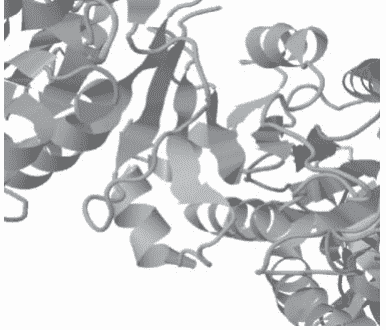

(b) . . . `PICSNRNPLELQSTTIEYYITNKPTVPIFFFVDLTSE` . . .

**图 1.2** 酵母 `Sec23/24` 异二聚体 `1M2V`：(a) 蛋白质结构和(b) 初级序列。

| 表 1.1 常见氨基酸 |
| :--- | :--- | :--- |
| 名称 | 三字母 | 单字母 |
| 丙氨酸 | `Ala` | `A` |
| 赖氨酸 | `Arg` | `R` |
| 天冬酰胺 | `Asn` | `N` |
| 天冬氨酸 | `Asp` | `D` |
| 半胱氨酸 | `Cys` | `C` |
| 谷氨酸 | `Glu` | `E` |
| 谷氨酰胺 | `Gln` | `Q` |
| 甘氨酸 | `Gly` | `G` |
| 组氨酸 | `His` | `H` |
| 异亮氨酸 | `Ile` | `I` |
| 亮氨酸 | `Leu` | `L` |
| 赖氨酸 | `Lys` | `K` |
| 甲硫氨酸 | `Met` | `M` |
| 苯丙氨酸 | `Phe` | `F` |
| 脯氨酸 | `Pro` | `P` |
| 丝氨酸 | `Ser` | `S` |
| 苏氨酸 | `Thr` | `T` |
| 色氨酸 | `Trp` | `W` |
| 酪氨酸 | `Tyr` | `Y` |
| 缬氨酸 | `Val` | `V` |
| 未知或“其他” | | `X` |

# 序列基础

## 表 1.2 歧义氨基酸

| 歧义氨基酸 | 三字母 | 单字母 |
| :--- | :--- | :--- |
| 天冬酰胺或谷氨酰胺 | `Asx` | `B` |
| 谷氨酸或谷氨酰胺 | `Glx` | `Z` |
| 亮氨酸或异亮氨酸 | `Xle` | `J` |

| `Ala` | `Arg` | `Asn` | `Asp` | `Cys` | `Gln` | `Gly` | `His` | `Ile` | `Leu` | `Lys` | `Met` | `Phe` | `Pro` | `Ser` | `Trp` | `Tyr` | `Val` |
| :--- | :--- | :--- | :--- | :--- | :--- | :--- | :--- | :--- | :--- | :--- | :--- | :--- | :--- | :--- | :--- | :--- | :--- |
| 4 | | | | 5 | | | | | | | | | | | | | | |
| 0 | -2 | 1 | 6 | | | | | | | | | | | | | | | |
| 0 | -3 | -3 | 9 | 5 | | | | | | | | | | | | | | | |
| -1 | 1 | 0 | -3 | -3 | 5 | | | | | | | | | | | | | | |
| -1 | 0 | 2 | -1 | -3 | -2 | 6 | | | | | | | | | | | | |
| -2 | 0 | 1 | -3 | -1 | 0 | -2 | 8 | | | | | | | | | | | |
| -3 | -3 | -3 | -1 | -1 | -2 | -2 | -3 | 4 | | | | | | | | | | |
| -3 | -2 | -3 | -1 | -2 | -3 | -4 | -2 | -5 | 4 | | | | | | | | | | |
| -2 | 0 | -1 | 1 | 0 | -2 | -3 | 2 | 1 | 5 | | | | | | | | | | |
| -2 | -1 | -2 | -3 | -3 | -1 | -3 | 0 | 0 | 6 | | | | | | | | | | |
| -2 | -1 | -2 | -3 | -3 | -1 | -3 | -1 | -1 | 0 | 4 | 7 | | | | | | | | |
| -3 | -1 | -1 | -1 | -2 | -2 | -3 | -1 | -1 | -2 | 1 | 5 | | | | | | | | |
| -3 | -4 | -4 | -1 | -2 | -2 | -3 | -3 | -3 | 1 | 1 | | | | | | | | | |
| -2 | -2 | -2 | -2 | -2 | -2 | -1 | -1 | -1 | -3 | -3 | 2 | 7 | | | | | | | |
| 0 | -3 | -3 | -2 | -2 | -2 | -1 | -1 | -1 | -2 | -2 | 0 | -3 | -1 | 4 | | | | | | |

 和蛋白质结构。在本节中，我们介绍了序列的基础及其组成部分。

# 1.3.1 蛋白质

蛋白质（也称为多肽）是由肽键连接的氨基酸组成的有机化合物，形成线性多肽并折叠成球形。蛋白质分子中的氨基酸线性序列代表其一级结构。二级结构是指蛋白质内部局部规则区域，如 $\alpha$-螺旋、$\beta$-转角和 $\beta$-折叠。蛋白质序列长度从几个到几千不等。图 1.2 显示了 `1M2V` 的结构和初级序列。表 1.1 和 1.2 列出了氨基酸及其常用缩写。图 1.3 显示了分子中两个氨基酸之间可能的替换矩阵。

## 引言

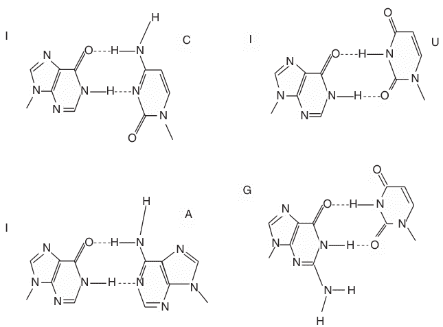 图 1.4 四碱基。

## 1.3.2 DNA/RNA

`DNA` 和 `RNA` 都包含三个基本成分：(i) 五碳糖（在 `RNA` 中为核糖，`DNA` 中为脱氧核糖），(ii) 来自磷酸分子的系列化学物质和(iii) 具有碱性质的四氮化合物。`DNA` 有四种碱基，即腺啶 (`A`)、胸腺啶 (`T`)、鸟苷 (`G`) 和胞啶 (`C`)，而 `RNA` 有腺啶 (`A`)、尿嘧啶 (`U`)、鸟苷 (`G`) 和胞啶 (`C`) 碱基。腺啶和鸟苷是双环分子，称为嘌呤，而其他碱基是单环分子，称为嘧啶（见图 1.4）。

`DNA` 是线性的双螺旋结构，而 `RNA` 是由核苷酸交织链组成的单链结构。它以核糖作为糖。`RNA` 有三种：信使 `RNA` (`mRNA`)、转移 `RNA` (`tRNA`) 和核糖 `RNA` (`rRNA`)。`tRNA` 和 `rRNA` 是合成过程的一部分，而 `mRNA` 是合成模板。在产生氨基酸链的过程中，`mRNA` 的核苷酸序列每三个碱基一组从一端读到另一端。这些组被称为密码子。每个密码子编码一种氨基酸或终止信号。碱基有 64 (4 x 4 x 4) 种可能的密码子。

## 1.3.3 序列格式

蛋白质/`DNA`/`RNA` 序列以许多格式表示，例如 `AB1`, `ACE`, `CAF`, `EMBL`, `FASTA`, `FASTQ`, `GenBank`, `PHD`, `SCF`, `Nexus`, `GFF`, `Stockholm`, `Swiss-Prot` 等。通常，序列格式可以分为四类：特定格式、基于序列、带特征的和比对序列。特定格式如 `Applied Biosystems` 的 `AB1` 或 `ACE` 用于执行测序的公司。序列数据以片段（`reads`）的形式获取并组合在一起。基于序列格式通常用标识表示残基本身。最经典的序列格式是 `FASTA` 格式（或 `Pearson` 格式），一种基于文本的格式，每个序列之前都有其名称、注释和序列。每行少于 120 个字符。注释行以 `";"` 开头，且仅用于人类阅读。序列名称应以 `">"` 开头，星号 `"*"` 标记序列结束。每个序列之间用换行隔开。以下是 `FASTA` 格式序列的示例：

## 示例 1.1 MCHU - 钙蛋白 - 人、兔子和鸡

```
>gl|552411|gb|AAD4416.1|[Elephas maximus]
LCYTHIGRNIYSYGIAEFFAHFTYWGMLLITATMFFYPLPWGWFSAGVITNLFSAPYWI
GGTSDVKATNRFAHFFTPLTMAGVHLETISGNGLTSDSFIHPYY
```

`Motif` 是短保守的氨基酸亚序列，表征特定的生物化学功能。`Motif` 能够调节蛋白质的特定功能或决定蛋白质的亚结构。某些 `Motif` 是连续的，如 `C2H2` 锌指 `Motif`。然而，某些 `Motif` 是不连续的，它们出现的顺序可能完全不同。从序列中识别这些 `Motif` 并不是一项简单的任务。这些 `Motif` 的示例是

## 引言

| 数据库 | 格式示例 |
| :--- | :--- |
| `GenBank` | `gi|gi-number|gb|access|locus` |
| `EMBL` 数据库 | `gi|gi-number|emb|access|locus` |
| `DDBJ`，日本数据库 | `gi|gi-number|db|access|locus` |
| `NBRF` `PIR` | `prf|entry` |
| 蛋白质研究基金会 | `\|name` |
| `SWISS-PROT` | `sp|access|name` |
| `PDB` 蛋白质数据库 (1) | `pdb|entry|chain` |
| `PDB` 蛋白质数据库 (2) | `entry|chain|PDBID|CHAIN|SEQUENCE` |
| 专利 | `pat|country|number` |
| `GenInfo Backbone` ID | `bbs|number` |
| 通用数据库标识符 | `gnl|database|identifier` |
| `NCBI` 参考序列 | `ref|access|locus` |
| 本地序列标识符 | `lcl|identifier` |

图 1.5 `NCBI` 的序列格式。

| 基因点 | `SCU48485` | `5028 bp` | `DNA` | `PLN` | `21-JUN-1999` |
| :--- | :--- | :--- | :--- | :--- | :--- |
| 定义 | 酿酒酵母 `TECP1` 基因，部分 `cds`，以及 `Axl2p` (AXL2) 和 `Rev7` (`REV7`) 基因，完整 `cds`。 | | | | |
| 登录号 | `U98485` | | | | |
| 版本 | `U98485.1` | `GI:1293613` | | | |
| 关键词 | 酿酒酵母（烘焙酵母） | | | | |
| 源生物 | 酿酒酵母 | | | | |
| 来源 | 1 (碱基 1 到 10528) | | | | |
| 作者 | `Torpey, L.E., Gibbs, P.E., Nelson, J., and Lawrence, C.W.` | | | | |
| 标题 | `REV7` 的克隆与测序，该基因的功能所需的 | | | | |
| 期刊 | `Genes dev. 7):777-793 (1998)` | | | | |
| `PUBMED` | `864919` | | | | |
| 特征 | 位置-修饰符 | | | | |
| | `1.5028` | | | | |
| | `/organism="Saccharomyces cerevisiae"` | | | | |
| | `/db_xref="GI:1293616"` | | | | |
| | `/chromosome="IX"` | | | | |
| | `/complement=(3300..4037)` | | | | |
| | `/gene="REV7"` | | | | |
| | `/complement=(3300..4037)` | | | | |
| | `/db_xref="GI:1293616"` | | | | |
| | `/translation="MVDWIFFVREVYVLEYCILLIFLYRYVFVQEDTTYVSMLQFVVNDLIFITIDVELKHYREFCSIIMNKHDCLIEKVVLDSELQHDMDDKQIITETYEFDRFFSLIMLLEKPRWNDTTITFEAVINAIEELGHRDNRNE` | | | | |
| 序列 | `1 gatccatcg atacaaggt atctccagg tcatccaggt gacaca gacaatcg` | | | | |
| | `61 ccacatcgatacaaggt atctgtgcaga ttacaaggt aaaacgcgaagtgtagcg` | | | | |

图 1.6 `GenBank` 序列格式示意图。

`Motif` 如 `MCM`（微丝缺失）基序，发现于人类、小鼠和果蝇中，由 `Akiyama` 等人 [6] 鉴定。`MCM` 基序具有以下形式：`WINDW.*.D.F*W***.IYS***.A.H*S*WAMRNTNNNHH`，其中每个 `(.)` 代表单个氨基酸或空位，每个 `*` 表示密切相关的氨基酸家族的成员之一。

由于同源序列倾向于在结构域 [7] 和活性位点 [8] 内保持序列相似性，同源序列可能具有较低的重叠度。

# 序列基础


# 多序列比对：评分函数、算法与应用

## 1.3.5 数据库

今天，有很多序列可用。蛋白质序列可以在 `Swiss-Prot` [10]、`TrEMBL` [10]、`UniProt` [11]、`PIR` [12] 和 `PDP` [13] 中找到。同样，DNA 和 RNA 序列位于 `GenBank` [14]、`PDB`、`HOMSTRAD` [15] 和 `RefSeq` [16]。截至 2021 年 6 月，`TrEMBL` 包含 15,400,876 条条目，组成 4,982,590 个氨基酸。这些自动注释且未经过审核。最短序列是来自人类的 `Q16047-HUMAN`，最长序列是包含氨基酸的 `QASY8`。`TrEMBL` 的平均序列长度为 322 个残基。另一方面，`Swiss-Prot` 是手动注释和审核的。它包含 529,056 条条目，其中部分条目是预测的，另一部分是不确定的。`Swiss-Prot` 中的最短序列是来自鱼的 `GWASEPOF` (P83570)，最长序列是来自小鼠的 `TITIN` (A2ASS6)，包含 35,213 个氨基酸。`Swiss-Prot` 的平均序列长度为 355 个残基。

# 2 蛋白质/DNA/RNA 两两比对

给定一组生物序列，通常希望识别序列之间的相似性。这些信息将提供关于功能、原始性或获取这些生物序列的物种演化的数据。理论上，最佳识别应该是正确且完美对齐所有残基并共享相似生物特征的方案。序列比对中的这些对齐基块表明了序列之间的生物关系，并可以根据这些生物数据的先验知识进行验证。从不同物种获得的相似性可能导致生物学意义的发现。由于许多因素（例如缺乏序列中每个区域的功能、区域之间如何关联、两条序列如何演化或序列的哪些部分是随机突变），实际上在实践中，许多比对算法围绕两个概念设计：全局比对和局部比对。在全局序列比对中，所有序列在整个长度上保持对应关系。另一方面，在局部比对中，对齐的是序列中最相似的部分。这取决于所识别的内容；每个概念都有自己的优势。

## 2.1 序列比对基础

序列比对问题可以广义如下：设 $W = \{\alpha_1, \dots, \alpha_i, \dots, \alpha_j\}, i > 0$，一组氨基酸符号或核苷酸符号。序列 $s_i = \alpha_1 \dots \alpha_i \dots k$ 是由 $n$ 个氨基酸符号组成的字符串。比对是将 $k > 1$ 个序列 $\{s_1, s_2, \dots, s_k\}$ 转换为 $\{s'_1, s'_2, \dots, s'_k\}$，其中 $s'_i$ 是第 $i$ 个序列 $s_i$，通过插入空位 (-) 以使跨区域的相似性最大化。从生物学角度来看，空位代表在进化过程中从序列中删除的残基符号。通常，当序列中插入空位时，会对比对施加惩罚。惩罚的权重取决于插入的位置。

例如，要比对的序列是 $s_1$: `GLISVT` 和 $s_2$: `GIVT`，那么一种可能的比对是：

```
$A(s_1, s_2) = \begin{cases} s'_1: & G L I V S T \\ s'_2: & G - I V - T \end{cases}$
```

## 2.2 点矩阵 (DOT-PLOT MATRIX)

矩阵法 [17] 为两条序列之间潜在匹配的可视化。该方法的执行如下：

1. 对于任意两个长度为 $m$ 和 $n$ 的给定序列，将序列映射到 $m \times n$ 矩阵的两个垂直边上。
2. 使用评分方案标记两个序列之间任意两个残基的相似性。

为了简单起见，当两个残基相同时会在对角线上放置一个点，否则该槽留空。当考虑所有 $m \times n$ 个槽位时，矩阵中类似于对角线的点代表两条序列之间的相似区域。显然，两条相同的序列将从两条序列的起点处有一条对角线。图 2.1 显示了将 `ACACACTA` 与序列 `AGACACA` 对齐产生的矩阵。这两个序列共享相同的子序列 `ACACA`。

**图 2.1** 序列 `ACACACTA` 和 `AGCACACA` 的点图矩阵。连接的对角线表示匹配片段。

会有许多绘制的对角线，其中某些线是长对角线的子序列。这些短对角线被认为是噪声。它们阻碍识别其他对角线的能力并应该被移除。流行的过滤技术是过滤掉任何长度小于 $k$ 的对角线，其中 $k$ 是任意数，也可以从点矩阵中对角线的长度得出。通常，$k$ 设置为要识别的特征的大小。

除了序列间可能匹配的可视化外，该方法的另一个优点是显示两个序列之间可能的重复片段的能力。这些片段可能带有两个序列之间共享的重要生物学信息，例如茎环（也称为发夹环）或反向重复。这些序列是其他下游序列反向的序列。例如：`5' ... GGCGGGCCAAAAAAAACCCCCCGGGCGG ... 3'` 是一个 RNA 茎环。为了识别这些基序，序列使用点矩阵进行自身比对。当窗口大小等于所识别基序的长度时，点图矩阵将揭示重复片段。图 2.2 显示了人类 `CalM` 序列与其自身的点图矩阵，窗口大小 $k=7$，以显示其四个 EF-motif。（EF-motif 包含两个环绕 `Ca++` 的垂直螺旋 E 和 F，并由一个螺旋环连接）。

`CalM` 序列为 `"MDQLTLEQI EAFKEAFSLK DKGGDGTT KELGTVMRSL GGNPTEALQ MINVADEADG NGTIDEPEFL TMMARKM KDT DSEEIEEAF RFVKDKGNGY ISAELRHVM TNLGKLTDE EVDEMIR EAD GDGDQVNY EFAFQMMATK"`

另一个优势，如 [21] 所示，点图法是识别序列的结构信息。类似于识别反向重复，为一个序列及其反向序列建立点图矩阵。垂直于虚拟对角线的线表示茎环或发夹环。茎环在 RNA 中很常见，这是一种对称模式，当同一个分子的两个区域碱基对形成双螺旋并以未配对的环结束时存在。在复杂度方面，点图法绘制矩阵需要 $O(n \times m)$，过滤噪声需要 $O(n \times m)$，矩阵需要 $O(n \times m)$ 空间。因此，点图的整体时间复杂空间复杂度均为 $O(n \times m)$。尽管点图法对于识别两个序列之间共享的特征非常有用，但它没有提供两个序列之间的定量相似性度量。因此，如从三个序列中识别出一对最相似序列等简单任务可能是不可能的，因为序列并不经常共享相同的片段。图 2.3 显示了点图法的一个示例输出。

## 2.3 动态规划

动态规划（DP）由 `Richard Bellman` 在 1953 年基于最优策略定义，使得任何决策相对于第一个决策的结果都必须构成最优策略，无论第一个决策是什么。在序列比对术语中，无论选择哪些符号进行比对，所有其他比对序列都保证它们产生最优比对。动态规划被用于产生全局比对，这最早在 `Needleman–Wunsch` 算法 [19] 中引入，而局部比对版本则在 `Smith–Waterman` 算法 [18] 中。与点图技术类似，两个序列被映射到 $m \times n$ 矩阵的两个垂直边上。然后 DP 从序列的连接角开始，计算相邻槽格中两个序列残基的所有匹配得分。重复该过程直到计算所有槽格的得分。如果评分方案需要常数时间计算，DP 技术的时间和空间复杂度为 $O(n \times m)$。

### 2.3.1 Needleman–Wunsch 算法

假设两个序列 $a$ 和 $b$ 的长度分别为 $m$ 和 $n$。它们的比对矩阵得分 $H$ 计算如下：

$H(i,0) = i \times g, 0 \leq i \leq m$,
$H(0,j) = j \times g, 0 \leq j \leq n$,

```
$H(i,j) = \max \begin{cases} H(i-1, j-1) + w(a_i, b_j) & \text{匹配/不匹配} \\ H(i-1, j) + g & \text{缺失} \\ H(i, j-1) + g & \text{插入} \end{cases}$

$1 \leq i \leq m, 1 \leq j \leq n$.
```


其中

$g$ 是空隙罚罚，$a_i$ 是序列 $a$ 中的第 $i$ 个符号，
$m = |a|$ 是 $a$ 的长度，
$n = |b|$ 是 $b$ 的长度，
$H(i,j)$ 是长度为 $i$ 的 $a$ 子序列与长度为 $j$ 的 $b$ 子序列之间的最大相似性得分，$w(c,d), c,d \in \Sigma \{'-'\}$ 是两个残基之间的匹配得分。

此外，比对是从最高得分槽格的最右端到起始槽格的回溯路径。

### 2.3.2 示例

给定两个序列：

GAATTTCAGTTA (序列 #1)
GGATTCCGA (序列 #2)

| | G | A | A | T | T | C | A | G | T | T | A |
|---|---|---|---|---|---|---|---|---|---|---|---|
| 0 | 0 | 0 | 0 | 0 | 0 | 0 | 0 | 0 | 0 | 0 | 0 |
| G | 0 | 1 | | | | | | | | | | |
| G | 0 | | | | | | | | | | | | |
| A | 0 | | | | | | | | | | | | |
| T | 0 | | | | | | | | | | | | |
| T | 0 | | | | | | | | | | | |
| C | 0 | | | | | | | | | | | |
| C | 0 | | | | | | | | | | | |
| G | 0 | | | | | | | | | | | |
| A | 0 | | | | | | | | | | | |
| | G | A | A | T | T | C | A | G | T | T | A |
|---|---|---|---|---|---|---|---|---|---|---|---|
| 0 | 0 | 0 | 0 | 0 | 0 | 0 | 0 | 0 | 0 | 0 | 0 |
| G | 0 | 1 | | | | | | | | | | |
| G | 0 | | | | | | | | | | | | |
| A | 0 | | | | | | | | | | | | |
| T | 0 | | | | | | | | | | | | |
| T | 0 | | | | | | | | | | | | |
| C | 0 | | | | | | | | | | | | |
| C | 0 | | | | | | | | | | | | |
| G | 0 | | | | | | | | | | | | |
| A | 0 | | | | | | | | | | | | |
| | G | A | A | T | T | C | A | G | T | T | A |
|---|---|---|---|---|---|---|---|---|---|---|---|---|
| 0 | 0 | 0 | 0 | 0 | 0 | 0 | 0 | 0 | 0 | 0 | 0 |
| G | 0 | 1 | | | | | | | | | | |
| G | 0 | | | | | | | | | | | | |
| A | 0 | | | | | | | | | | | | |
| T | 0 | | | | | | | | | | | | |
| T | 0 | | | | | | | | | | | | |
| C | 0 | | | | | | | | | | | | |
| C | 0 | | | | | | | | | | | | |
| G | 0 | | | | | | | | | | | | |
| A | 0 | | | | | | | | | | | | |
| | G | A | A | T | T | C | A | G | T | T | A |
|---|---|---|---|---|---|---|---|---|---|---|---|---|
| 0 | 0 | 0 | 0 | 0 | 0 | 0 | 0 | 0 | 0 | 0 | 0 |
| G | 0 | 1 | | | | | | | | | | |
| G | 0 | | | | | | | | | | | | |
| A | 0 | | | | | | | | | | | | |
| T | 0 | | | | | | | | | | | | |
| T | 0 | | | | | | | | | | | | |
| C | 0 | | | | | | | | | | | | |
| C | 0 | | | | | | | | | | | | |
| G | 0 | | | | | | | | | | | | |
| A | 0 | | | | | | | | | | | | |
| | G | A | A | T | T | C | A | G | T | T | A |
|---|---|---|---|---|---|---|---|---|---|---|---|---|---|
| 0 | 0 | 0 | 0 | 0 | 0 | 0 | 0 | 0 | 0 | 0 | 0 |
| G | 0 | 1 | | | | | | | | | | |
| G | 0 | | | | | | | | | | | | |
| A | 0 | | | | | | | | | | | | |
| T | 0 | | | | | | | | | | | | |
| T | 0 | | | | | | | | | | | | |
| C | 0 | | | | | | | | | | | | |
| C | 0 | | | | | | | | | | | | |
| G | 0 | | | | | | | | | | | | |
| A | 0 | | | | | | | | | | | | |
| | G | A | A | T | T | C | A | G | T | T | A |
|---|---|---|---|---|---|---|---|---|---|---|---|---|---|
| 0 | 0 | 0 | 0 | 0 | 0 | 0 | 0 | 0 | 0 | 0 | 0 |
| G | 0 | 1 | | | | | | | | | | |
| G | 0 | | | | | | | | | | | | |
| A | 0 | | | | | | | | | | | | |
| T | 0 | | | | | | | | | | | | |
| T | 0 | | | | | | | | | | | | |
| C | 0 | | | | | | | | | | | | |
| C | 0 | | | | | | | | | | | | |
| G | 0 | | | | | | | | | | | | |
| A | 0 | | | | | | | | | | | | |
| | G | A | A | T | T | C | A | G | T | T | A |
|---|---|---|---|---|---|---|---|---|---|---|---|---|---|
| 0 | 0 | 0 | 0 | 0 | 0 | 0 | 0 | 0 | 0 | 0 | 0 |
| G | 0 | 1 | | | | | | | | | | |
| G | 0 | | | | | | | | | | | | |
| A | 0 | | | | | | | | | | | | |
| T | 0 | | | | | | | | | | | | |
| T | 0 | | | | | | | | | | | | |
| C | 0 | | | | | | | | | | | | |
| C | 0 | | | | | | | | | | | | |
| G | 0 | | | | | | | | | | | | |
| A | 0 | | | | | | | | | | | | |
| | G | A | A | T | T | C | A | G | T | T | A |
|  |---| |) (c) (d) 图 2.4 为 "GAATTCTA" 和 "GGATTCCGA" 生成矩阵

| | G | A | A | T | T | C | A | G | T | T | A |
|---|---|---|---|---|---|---|---|---|---|---|---|
| 0 | 0 | 0 | 0 | 0 | 0 | 0 | 0 | 0 | 0 | 0 | 0 |
| G | 0 | 1 | 1 | 1 | 1 | 1 | 1 | 1 | 1 | 1 | 1 |
| G | 0 | 1 | 1 | 1 | 1 | 1 | 1 | 2 | 2 | 2 | 2 |
| A | 0 | 1 | 2 | 2 | 2 | 2 | 2 | 2 | 2 | 2 | 3 |
| T | 0 | 1 | 2 | 2 | 3 | 3 | 3 | 3 | 3 | 3 | 3 |
| T | 0 | 1 | 2 | 2 | 3 | 3 | 4 | 4 | 4 | 4 | 4 |
| C | 0 | 1 | 2 | 3 | 3 | 4 | 5 | 5 | 5 | 5 | 5 |
| C | 0 | 1 | 2 | 3 | 3 | 4 | 4 | 5 | 5 | 5 | 5 |
| G | 0 | 1 | 2 | 3 | 4 | 4 | 4 | 5 | 6 | 6 | 6 |
| A | 0 | 1 | 2 | 3 | 4 | 5 | 6 | 6 | 6 | 6 | 7 |

(a)

| | G | A | A | T | T | C | A | G | T | T | A |
|---|---|---|---|---|---|---|---|---|---|---|---|
| 0 | 0 | 0 | 0 | 0 | 0 | 0 | 0 | 0 | 0 | 0 | 0 |
| G | 0 | 1 | 1 | 1 | 1 | 1 | 1 | 1 | 1 | 1 | 1 |
| G | 0 | 1 | 1 | 1 | 1 | 1 | 1 | 2 | 2 | 2 | 2 |
| A | 0 | 1 | 2 | 2 | 2 | 2 | 2 | 2 | 2 | 2 | 3 |
| T | 0 | 1 | 2 | 2 | 3 | 3 | 3 | 3 | 3 | 3 | 3 |
| T | 0 | 1 | 2 | 2 | 3 | 3 | 4 | 4 | 4 | 4 | 4 |
| C | 0 | 1 | 2 | 3 | 3 | 4 | 5 | 5 | 5 | 5 | 5 |
| C | 0 | 1 | 2 | 3 | 3 | 4 | 4 | 5 | 5 | 5 | 5 |
| G | 0 | 1 | 2 | 3 | 4 | 4 | 4 | 5 | 6 | 6 | 6 |
| A | 0 | 1 | 2 | 3 | 4 | 5 | 6 | 6 | 6 | 6 | 7 |

(a)

| | G | A | A | T | T | C | A | G | T | T | A |
|---|---|---|---|---|---|---|---|---|---|---|---|
| 0 | 0 | 0 | 0 | 0 | 0 | 0 | 0 | 0 | 0 | 0 | 0 |
| G | 0 | 1 | 1 | 1 | 1 | 1 | 1 | 1 | 1 | 1 | 1 |
| G | 0 | 1 | 1 | 1 | 1 | 1 | 1 | 2 | 2 | 2 | 2 |
| A | 0 | 1 | 2 | 2 | 2 | 2 | 2 | 2 | 2 | 2 | 3 |
| T | 0 | 1 | 2 | 2 | 3 | 3 | 3 | 3 | 3 | 3 | 3 |
| T | 0 | 1 | 2 | 2 | 3 | 3 | 4 | 4 | 4 | 4 | 4 |
| C | 0 | 1 | 2 | 3 | 3 | 4 | 5 | 5 | 5 | 5 | 5 |
| C | 0 | 1 | 2 | 3 | 4 | 4 | 5 | 5 | 5 | 5 | 5 |
| G | 0 | 1 | 2 | 3 | 4 | 4 | 4 | 5 | 6 | 6 | 6 |
| A | 0 | 1 | 2 | 3 | 4 | 5 | 6 | 6 | 6 | 6 | 7 |

(b)

| | G | A | A | T | T | C | A | G | T | T | A |
|---|---|---|---|---|---|---|---|---|---|---|---| |
| 0 | 0 | 0 | 0 | 0 | 0 | 0 | 0 | 0 | 0 | 0 | 0 |
| G | 0 | 1 | 1 | 1 | 1 | 1 | 1 | 1 | 1 | 1 | 1 |
| G | 0 | 1 | 1 | 1 | 1 | 1 | 1 | 2 | 2 | 2 | 2 |
| A | 0 | 1 | 2 | 2 | 2 | 2 | 2 | 2 | 2 | 2 | 3 |
| T | 0 | 1 | 2 | 2 | 3 | 3 | 3 | 3 | 3 | 3 | 3 |
| T | 0 | 1 | 2 | 2 | 3 | 3 | 4 | 4 | 4 | 4 | 4 |
| C | 0 | 1 | 2 | 3 | 3 | 4 | 5 | 5 | 5 | 5 | 5 |
| C | 0 | 1 | 2 | 3 | 4 | 4 | 5 | 5 | 5 | 5 | 5 |
| G | 0 | 1 | 2 | 3 | 4 | 4 | 4 | 5 | 6 | 6 | 6 |
| A | 0 | 1 | 2 | 3 | 4 | 5 | 6 | 6 | 6 | 6 | 7 |

(c)

| | G | A | A | T | T | C | A | G | T | T | A |
|---|---|---|---|---|---|---|---|---|---|---|---| |
| 0 | 0 | 0 | 0 | 0 | 0 | 0 | 0 | 0 | 0 | 0 | 0 |
| G | 0 | 1 | 1 | 1 | 1 | 1 | 1 | 1 | 1 | 1 | 1 |
| G | 0 | 1 | 1 | 1 | 1 | 1 | 1 | 2 | 2 | 2 | 2 |
| A | 0 | 1 | 2 | 2 | 2 | 2 | 2 | 2 | 2 | 2 | 3 |
| T | 0 | 1 | 2 | 2 | 3 | 3 | 3 | 3 | 3 | 3 | 3 |
| T | 0 | 1 | 2 | 2 | 3 | 3 | 4 | 4 | 4 | 4 | 4 |
| C | 0 | 1 | 2 | 3 | 3 | 4 | 5 | 5 | 5 | 5 | 5 |
| C | 0 | 1 | 2 | 3 | 4 | 4 | 5 | 5 | 5 | 5 | 5 |
| G | 0 | 1 | 2 | 3 | 4 | 4 | 4 | 5 | 6 | 6 | 6 |
| A | 0 | 1 | 2 | 3 | 4 | 5 | 6 | 6 | 6 | 6 | 7 |

(d)

### 2.3.3 Smith-Waterman 算法

从进化的角度来看，两个相关的序列可能会独立演化，许多独立的突变会降低序列之间的相似性。对带有噪声信息的序列进行比对无法产生生物学上的意义对齐。在这些情况下，由 Smith 和 Waterman 提出的局部 DP 对齐（local DP alignment）可以识别出产生更优对齐得分的最长段对。在 Smith–Waterman 算法中，通过比较两个比对序列之间所有长度的可能片段，可以识别出产生最优对齐的最长段对。该技术与 Needleman–Wunsch 算法的主要区别在于将负分设置为零。这种修改产生了具有正分的对齐得分。因此，算法的回溯程序（backtracking procedure）从得分最高的单元格开始，直到遇到分值为零的单元格。在回溯步骤中识别出的最长段对就是两个序列得分最高的对齐。

假设两个序列 $a$ 和 $b$ 的长度分别为 $m$ 和 $n$。对齐矩阵得分 $H$ 的构建如下：


# Smith-Waterman 算法与序列对齐方法

## 递推公式

```
$H(i,0) = 0, 0 \le i \le m,$
$H(0,j) = 0, 0 \le j \le n,$
$H(i,j) = \max \begin{cases} H(i-1, j-1) + w(a_i, b_j) & \text{匹配/错配}\\ H(i-1, j) + w(a_i, -) & \text{缺失}\\ H(i, j-1) + w(-, b_j) & \text{插入} \end{cases}$
$1 \le i \le m, 1 \le j \le n$
```

其中 `$a_i$` 是序列 `$a$` 中的第 `$i$` 个符号，`$m = |a|$` 是 `$a$` 的长度，`$n = |b|$` 是 `$b$` 的长度，`$H(i,j)$` 是长度为 `$i$` 的 `$a$` 子序列与长度为 `$j$` 的 `$b$` 子序列之间的最大相似性，`$w(c,d), c,d \in \Sigma$` 是两个残基之间的匹配得分。

Smith–Waterman 中的回溯步骤与 Needleman–Wunsch 类似；它从具有最高分的矩阵单元格开始。使用相同的示例 2.3.2 以及其评分方案（匹配 +1，空位 –2，错配 –2），我们得到了图 2.7 所示的 ATTC 局部对齐。需要注意的是，回溯将追踪导致最高得分的路径；因此，从第五行第四列（如图 2.7 所示）的“A”到“A”的对齐并不是这些路径之一。

为了对齐共享多个保守区域（基序 motifs）的序列，可以在未对齐的片段上重复执行 Smith–Waterman 算法，直到所有残基都达到对齐。然而，这种技术非常耗时，且不能保证全局最优对齐。

## 图 2.7 两个序列“GAATTCAGTA”和“GAATTCCGA”的 Smith-Waterman 局部对齐

| G | A | A | T | T | C | A | G | T | T | A |
|---|---|---|---|---|---|---|---|---|---|---|
| 0 | 0 | 0 | 0 | 0 | 0 | 0 | 0 | 0 | 0 | 0 |
| 0 | 1 | 0 | 0 | 0 | 0 | 0 | 1 | 0 | 0 | 0 |
| 0 | 1 | 0 | 0 | 0 | 0 | 0 | 1 | 0 | 0 | 0 |
| 0 | 0 | 2 | 1 | 0 | 0 | 0 | 0 | 1 | 1 | 0 |
| 0 | 0 | 0 | 2 | 1 | 0 | 0 | 0 | 1 | 1 | 0 |
| 0 | 0 | 0 | 0 | 1 | 4 | 2 | 0 | 0 | 0 | 0 |
| 0 | 0 | 0 | 0 | 0 | 0 | 2 | 2 | 0 | 0 | 0 |
| 0 | 1 | 0 | 0 | 0 | 0 | 0 | 3 | 1 | 0 | 0 |
| 0 | 0 | 2 | 1 | 0 | 0 | 0 | 1 | 1 | 1 | 1 |

A T C (序列 #1)
A T C (序列 #2)

### 2.3.4 开放空罚 (Affine Gap Penalty)

从统计上看，`$d$` 个缺失/插入的发生比孤立突变更高。实现这一概念的一种方法是对开放空位（片段的首次插入/缺失进行惩罚，这被称为开放空罚 [22]，其计算公式为：

> `$w(g) = o + (l - 1)e$`，

其中 `$w(g)$` 是空位 `$g$` 的权重或罚，`$o$` 是开放空位，`$l$` 是空位的长度，`$e$` 是每次插入/删除的成本。通常 `$o \le e \le 0$`。

## 2.4 词方法 (WORD METHOD)

词方法也称为 `$k$`-tuple 方法 [20]，是一种寻找一系列不重叠子序列（“词”）的启发式方法。这些方法不保证找到序列之间的最优对齐方案；但它们比动态规划和点图法快，在查询大型数据库时更实用。通常，词方法如下：

首先，选择一个大小为 `$k$` 的窗口，蛋白质序列 `$k \ge 3$`，DNA 序列 `$k \ge 11$`。然后将该窗口应用于序列的一端以获得长度为 `$k$` 的词。随后窗口逐个符号移动到另一端，以获得长度为 `$k$` 的词。下一步是在数据库中搜索这些词（如 FASTA）。超过阈值 `$\lambda$` 的得分被认为是同源。图 2.8 展示了如何使用这种方法。

## 数据库搜索 (SEARCHING DATABASES)

两两对齐的大部分应用不仅是为了寻找两个序列之间的相似性，而是取一个序列并对成千上万个序列进行查询以寻找任何同源序列。

### 2.5.1 FASTA

点图法（dot-plot）的应用可见 FASTA [23]（代表 FAST-All）。FASTA 和 BLAST 被广泛用于数据库搜索。对于任何输入序列 A、B 和词大小 `$k$`，FASTA 步骤如下：

- 步骤 1：对 A 和 B 进行点图，寻找大小为 `$k$` 的词。
- 步骤 2：使用评分矩阵（如蛋白质的 PAM 矩阵 [25] 和核苷酸的身份矩阵）对对角线重新评分。保留得分最高的对角线（原始设计中 `$d=10$`）。裁剪对角线的末端，只包含对得分有贡献的部分。这些识别为核心区域。
- 步骤 3：使用 Needleman-Wunsch 算法连接对角线。蛋白质序列常用 `$k=2$`，DNA 序列 `$k$` 在 1 到 6 之间。FASTA 使用查找表来加速处理。该表类似于哈希表，每个符号映射到表中的一个位置，例如“A”是 1，“R”是 2，以此类推。表中的值代表该符号在序列中出现的位置。

## 图 2.10 FASTA 处理流程

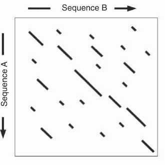
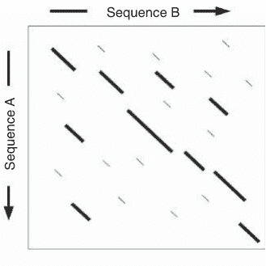
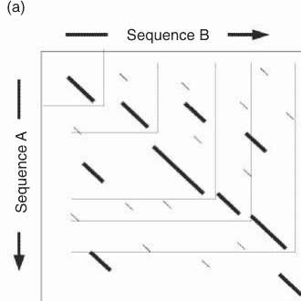
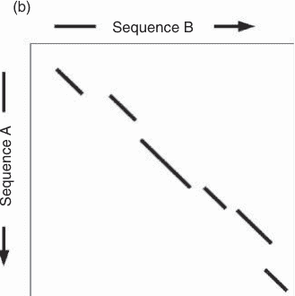

**图 2.10** (a) 过滤后的点图；(b) 通过评分矩阵重新评估；(c) 过滤从核心区域开始的高得分对角线——用箭头识别；(d) 组装对角线。

### 2.5.2 BLAST

在数据库中搜索与查询序列同源的序列。它寻找两个序列（一个序列和数据库）之间得分大于或等于 `$S$` 的片段，`$S$` 是一个预设的截断分数。BLAST 通过搜索最大段对（MSP）得分大于阈值 `$T$` 的序列来处理此任务。BLAST 定义 MSP 为从两个序列中选择的等长度片段中得分最高的对。MSP 是局部极大值，使得其得分无法通过延伸或缩短两个片段来提高。给定一个查询序列和词长大小 `$w$`，BLAST 会生成一个大小为 `$w$` 的重叠词列表。通常，蛋白质序列 `$w=3$`，而 DNA 序列 `$4 \le w \le 11$`。扫描目标序列以寻找这些得分大于或等于阈值 `$T$` 的词。如果命中，则对其进行扩展，以确定是否能找到一个得分至少为 `$S$` 的对。如果找到了这样的片段，将一直扩展它直到该片段的总分开始下降。该片段被称为高分段对（HSP）。MSP 是具有最高匹配得分的 HSP。低阈值 `$T$` 会导致更多命中并减慢搜索速度。当对齐两个长度为 `$m$` 和 `$n$` 的随机序列（在数据库中）时，数据库中所有序列的总长度找到得分大于或等于 `$S$` 的片段对的概率定义为

```
$E = 1 - e^{-y}$
```

其中 `$y = Km^{-\lambda S}$`，`$K$` 和 `$\lambda$` 是代表搜索空间和评分系统自然尺度的统计参数。`$K$` 和 `$\lambda$` 取决于替换矩阵以及序列中符号的频率。通常，`$\lambda = 0.3184$` 且 `$K = 0.13$`。

该阈值通常被称为 E 值（E-value），一个典型的良好的 E 值应该是 `$10^{-S}$` 或更低。较小的 E 值表示 MSP 具有高度唯一性，不是由错误引起的。

找到 `$c$` 或更多得分至少为 `$S$` 的不同片段对的概率为：

```
$P = 1 - e^{-y} \sum_{i=0}^{c} \frac{y^i}{i!}$
```


因此，该概率和 E 值决定了 BLAST 结果的置信程度。BLAST 无法保证 MSP 是最优的局部对齐；然而，这种权衡是算法速度的极大提升，这对于搜索大型序列数据库是关键的。

在后面的章节中，我们将讨论后继结构和构建技术，这些技术允许大型序列数据库被快速存储和检索，以适应序列搜索。

# 3 量化序列对齐

测量进化的概念是计算演化次数或从祖先来的演化层数。假设要做到这一点，必须识别并正确组织整个演化和物种层次。

# 替换矩阵与评分矩阵

## 表 3.1 NCBI 使用的 DNA/RNA 评分矩阵

|   | A | T | G | C |
|---|---|---|---|---|
| A | 1 |   |   |   |
| T | -1000 | 1 |   |   |
| G |   | -1000 | 1 |   |
| C | -1000 | -1000 | -1000 | 1 |

对于 DNA/RNA，匹配对得 1 分，不匹配对得 -1,000 分（或任何负惩罚分），如表 3.1 所示。

## 3.2.2 替换/突变评分

替换评分方案基于序列比对中观察到的残基替换（或突变）频率。尽管在观察和分析这些频率之前必须存在比对这一矛盾事实，但这些频率可以用于获得可靠的序列比对；当这些频率是通过对多个家族中的所有序列进行正确比对，然后为每个家族构建发育树时获得的。通过检查每棵发育树可以识别每个分支上发生的替换。具有相似生物化学性质的残基之间更容易发生突变。例如，异亮氨酸（I）和缬氨酸（V）在该方案下获得正分，表明它们容易发生突变。而疏水的异亮氨酸（I）与亲水性的半氨酸（C）会得到负分，因为它们被替换的可能性非常低。将所有评分结合起来通常被称为替换矩阵或评分矩阵。早期的矩阵之一是 Dayoff [25,27] 矩阵，或为蛋白质序列开发的 PAM（百分比接受突变）矩阵。所有氨基酸的替换矩阵评分是根据观察特定突变（例如 A 到 D）的连续突变概率，如 A 到 y 到 D，其中 x 和 y 是其他某些残基。评分矩阵 `M` 包含一个残基突变为另一个残基的概率。`M_{i,j}` 定义为进化周期后第 `i` 行的氨基酸突变为第 `j` 列氨基酸的概率。例如，PAM 代表每 `10^9` 年有 2% 的可接受点突变。可以为任何特定的进化周期生成突变矩阵。PAM 基于序列整体比对中发生的突变，其敏感性基于序列对之间的距离。PAM250 —— 针对每 100 个氨基酸对应 250 个 PAM 的序列 —— 被认为是蛋白质数据库搜索中很好的矩阵。对数几率 [28–30] 应用于 PAM 的实际值以对其归一化，使得 PAM1 矩阵每百个氨基酸有一个点突变。比率是确定某事件在两组中发生概率的方法。比率为 1 表示该事件在两组中概率相等。对数几率是比率的自然对数。对于独立事件 X 和 Y，如下：

|   | Y=1 | Y=0 |
|---|---|---|
| X=1 | `n_{11}` | `n_{10}` |
| X=0 | `n_{01}` | `n_{00}` |

两个独立事件 X 和 Y 的对数几率公式为：

```
L = \log\left(\frac{P_{11}P_{00}}{P_{10}P_{01}}\right) = \log\left(\frac{n_{11}n_{00}}{n_{10}n_{01}}\right),
```

其中 `P_{ij} = n_{ij}/n`，且 `n = n_{11} + n_{10} + n_{01} + n_{00}`。蛋白质将氨基酸 a 替换为 b 的概率定义为两个属性的比率：

```
R(a,b) = \frac{P(a,b|match)}{P(a,b|random)}
```

其中 `P(a,b|match)` 是在位置相等的情况下 a 被替换为 b 的概率，`P(a,b|random)` 是观察到的随机概率。所有氨基酸的比率都将放大为整数。生成替换矩阵值的公式为：

```
M(a,b) = \lambda \log R(a,b),
```

其中 `\lambda` 是尺度因子。表 3.2 显示 PAM250 矩阵。同样，块矩阵（BLOSUM）[31,32] 也用于 BLAST 搜索中的差异蛋白质序列比对。BLOSUM 并不是独立地考虑每个残基，而是考虑局部比对、高度保守区域以及蛋白质家族的块。每个 BLOSUM 矩阵是根据具有 `x` 相似性的序列进行分组计算的。例如，BLOSUM80 代表从与查询序列相似度大于 80% 的序列生成的替换矩阵。生成 BLOSUM 评分的公式为：

```
M_{ij} = \frac{1}{\lambda} \log\left(\frac{P_{ij}}{q_i q_j}\right)
```


其中 $P_{ij}$ 是序列中氨基酸 $i$ 和 $j$ 相互替换的概率，$q_i$ 和 $q_j$ 是背景概率。

# 表 3.2 250 PAM 替换矩阵

| | C | G | P | S | A | T | D | E | N | Q | K | R | V | M | L | F | Y | W |
|---|---|---|---|---|---|---|---|---|---|---|---|---|---|---|---|---|---|---|
| A | | | | | 2 | | | | | | | | | | | | | | |
| T | | | | | -2 | 1 | | | | | | | | | | | | | |
| G | | -5 | | | | | | | | | | | | | | | | | | |
| P | | | -3 | | | | | | | | | | | | | | | | | |
| S | | | | | 1 | | | | | | | | | | | | | | | |
| D | | | | | | -1 | -1 | 0 | | | | | | | | | | | | |
| E | | | | | | | -2 | 1 | | | | | | | | | | | | |
| N | | | | | | | | | 1 | -1 | | | | | | | | | | |
| Q | | | | | | | | | | -1 | 2 | | | | | | | | | |
| H | | | | | | | | | | | 2 | -1 | | | | | | | | |
| K | | | | | | | | | | | -1 | 1 | | | | | | | | |
| R | | | | | | | | | | | | | 2 | -2 | | | | | | |
| V | | | | | | | | | | | | | -2 | 1 | | | | | | |
| M | | | | | | | | | | | | | | -3 | 1 | | | | | |
| I | | | | | | | | | | | | | | | -3 | 2 | | | | |
| L | | | | | | | | | | | | | | | | -2 | 1 | | | |
| F | | | | | | | | | | | | | | | | | -1 | 2 | | |
| Y | | | | | | | | | | | | | | | | | | -1 | 1 | |
| W | | | | | | | | | | | | | | | | | | -2 | 1 |

## 3.2.1 序列比对的量化

序列中的 $i$ 和 $j$。$\lambda$ 是尺度因子，用于将评分转换为整数以便于计算。

PAM 和 BLOSUM 之间存在等效关系。例如，PAM100 大约等于 BLOSUM90，因此 PAM120 等 BLOSUM80，PAM160 等 BLOSUM60，PAM200 等 BLOSUM52，PAM250 等 BLOSUM45。表 3.3 代表源于聚类相似性为 45% 序列的 BLOSUM45。

GONNET 是 Gonnet、Cohen 和 Benner 在 1992 年对现有蛋白质序列使用穷尽的两对 Needleman-Wunsch 算法开发的另一种矩阵。GONNET 矩阵见表 3.4。

## 3.3 空隙

空隙是向序列中人工插入，用于使相似的序列片段对齐；插入是不可避免的。人们广泛认为，通过进化，由于多种生物、物理或化学因素，序列的片段会缺失，从而导致不同长度的同源序列。缺失的片段被认为从序列中删除，而保留这些片段的序列被认为插入了这些片段。为了正确比对同源序列，必须考虑到缺失片段。这就是为什么要在序列中插入空隙以使相似区域对齐。序列中缺失片段的概率很少被研究，因为涉及物种的准确真实的 DNA/RNA 序列是未知的。因此，判断序列片段是从原始序列中缺失，还是通过结合其他物种插入，亦或在某些条件下突变是不可能的。尚不清楚比对的序列是否同质。

这些问题围绕一个圆展开，而 MSA（多序列比对）是创建圆的尝试。在序列适当的位置插入正确数量的空隙将提供解决方案。在序列中正确放置空隙是一个非常困难的问题，因为需要考虑大量的插入或删除，而且没有真实的模型可用于验证生成的比对。Lesk 和 Kothia 显示，删除/插入主要发生在同源蛋白质序列二级结构单元的无结构螺旋（即 $\alpha$ 螺旋和 $\beta$ 折叠）或表面区域，而不是在它们内部。

## 表 3.3 BLOSUM45 替换矩阵

| | G | P | D | E | N | H | Q | K | R | S | T | A | M | V | L | F | Y | W | C |
|---|---|---|---|---|---|---|---|---|---|---|---|---|---|---|---|---|---|---|---|
| G | 7 | | | | | | | | | | | | | | | | | | | |
| P | -2 | 9 | | | | | | | | | | | | | | | | | | |
| D | -1 | -1 | 7 | | | | | | | | | | | | | | | | | | |
| E | 0 | -2 | 2 | 6 | | | | | | | | | | | | | | | | | |
| N | -2 | -2 | 2 | 0 | 6 | | | | | | | | | | | | | | | | |
| H | -2 | -2 | 0 | 0 | 1 | 10 | | | | | | | | | | | | | | | |
| Q | -2 | -2 | 0 | 2 | 0 | 1 | 6 | | | | | | | | | | | | | | |
| K | -2 | -2 | 1 | 2 | 0 | 1 | -1 | 5 | | | | | | | | | | | | | |
| R | -2 | -2 | 1 | 0 | 0 | 0 | 0 | 1 | 7 | | | | | | | | | | | | |
| S | 0 | 0 | 1 | 1 | 0 | 0 | 1 | -1 | 4 | | | | | | | | | | | | |
| T | -2 | -2 | 1 | 1 | -1 | -1 | -2 | 1 | 2 | 5 | | | | | | | | | | | |
| A | 0 | 0 | -2 | 1 | -1 | -2 | -2 | 1 | 0 | 5 | 5 | | | | | | | | | | |
| M | -2 | -2 | -3 | -3 | -2 | -2 | -1 | -1 | 0 | 0 | 1 | 6 | | | | | | | | | |
| V | -3 | -3 | -3 | -3 | -3 | -2 | -1 | 0 | 1 | 2 | 3 | 5 | | | | | | | | |
| L | -4 | -3 | -3 | -3 | -3 | -3 | -3 | -2 | -2 | -2 | -2 | 1 | 2 | 5 | | | | | | |
| F | -3 | -3 | -3 | -3 | -3 | -2 | -2 | -2 | -2 | -2 | -2 | 2 | 2 | 0 | | | | | | |
| Y | -3 | -2 | -2 | -2 | -2 | -2 | -1 | -1 | -2 | -2 | -2 | 0 | 0 | 0 | 3 | | | | | |
| W | -3 | -4 | -4 | -3 | -3 | -3 | -3 | -1 | -4 | -2 | -3 | -2 | 2 | 8 | | | | | |
| C | -3 | -4 | -4 | -3 | -3 | -3 | -3 | -1 | -1 | -1 | -3 | -2 | -2 | 3 | 15 | | | | |

## 表 3.4 从 SWISS-PROT 数据库生成的 GONNET 矩阵

| | C | S | T | P | A | G | N | D | E | Q | H | R | K | M | L | V | Y | W | X | F | Y | L | M | W | X |
|---|---|---|---|---|---|---|---|---|---|---|---|---|---|---|---|---|---|---|---|---|---|---|---|---|---|
| C | 12 | | | | | | | | | | | | | | | | | | | | | | | | | |
| S | 0 | 2 | | | | | | | | | | | | | | | | | | | | | | | | |
| T | 0 | 2 | 2 | | | | | | | | | | | | | | | | | | | | | | | |
| P | -3 | 0 | 0 | 8 | | | | | | | | | | | | | | | | | | | | | | |
| A | | | 0 | 1 | 0 | | | | | | | | | | | | | | | | | | | | | |
| G | | | -2 | 0 | -1 | -2 | 0 | 7 | | | | | | | | | | | | | | | | | | |
| N | | | -2 | 0 | -1 | 0 | 0 | 4 | | | | | | | | | | | | | | | | | | |
| D | | | -3 | 0 | -1 | 0 | 0 | 5 | | | | | | | | | | | | | | | | | | |
| E | | | -3 | 0 | 0 | 0 | 0 | 4 | | | | | | | | | | | | | | | | | | |
| Q | | | -2 | 0 | 0 | -1 | 1 | 2 | 3 | | | | | | | | | | | | | | | | | |
| H | | | -1 | 0 | 0 | -1 | 1 | 0 | 6 | | | | | | | | | | | | | | | | | |
| R | | | -2 | 0 | 0 | -1 | 0 | 0 | 2 | 5 | | | | | | | | | | | | | | | | |
| K | | | -3 | 0 | 0 | 1 | 0 | 2 | 1 | 3 | -1 | -2 | -1 | 4 | | | | | | | | | | | |
| M | | | -1 | -1 | -2 | -1 | -4 | -3 | -2 | -2 | -2 | 2 | 4 | | | | | | | | | | | | |
| L | | | -1 | -2 | -2 | -1 | -4 | -4 | -3 | -2 | -3 | 2 | 4 | | | | | | | | | | | | |
| V | | | 0 | -1 | -2 | 0 | -5 | -3 | -4 | 0 | -3 | 2 | 3 | | | | | | | | | | | | |
| Y | | | 0 | -2 | -3 | -2 | -4 | -4 | -3 | -3 | -2 | 0 | 1 | 2 | 7 | | | | | | | | | |
| W | | | -1 | -3 | -4 | -5 | -4 | -4 | -3 | -3 | -2 | -2 | -1 | 3 | 5 | 8 | | | | | | | | |
| X | | | -3 | 0 | 0 | -1 | 0 | -1 | -1 | -1 | -1 | -1 | -2 | -4 | 4 | 14 | | | | | | | | |

空位罚分是一个实验值，取决于每个多序列比对（MSA）算法，通常由生物学家决定。空位是人为的，量化残基与空位之间的匹配在生物学上没有意义。因此，优采用关注比对序列中可用信息（如已知基序、残基位置和突变限制）的定量方法。

### 3.3.1 序列距离

上述所有矩阵只有一个目的，即如何衡量两个残基符号之间的匹配。几乎所有的序列分析都取决于某些代表两个或多个序列之间距离或相关性的值，而不是残基本身。在某些序列比对中，一对序列在比对后具有相同的长度。由于一对比对后的序列是两个字符串，衡量序列距离有两种方法。一种简单而自然的方法是将每对的分数相加。如果得分是恒等性得分（即匹配为 1，不匹配为 0），则为编辑距离（或汉明距离）。编辑距离是对应符号不同的位置数，即将一个序列转换为另一个序列必须进行的替换次数。这种方法的缺点是简单地忽略了序列的生物学意义，这可能导致序列分类错误。如果使用替换或突变矩阵，得分则代表比对中所有残基的生物学测量分量。这些得分通常被称为成对得分（sum-of-pair-score, SP）。在数学上，成对得分定义如下：

**定义 1** 两个导出序列 $s'_i$ 和 $s'_j$（其中 $s'_i, s'_j \in A$）的成对比对分数为 $S(s'_i, s'_j) = \sum_{k} S(s'[k], s'[k])$。

$A$ 是序列 $S_i$ 和 $S_j$ 的比对，$|A|$ 是比对的总长度，$S(s'[k], s'[k])$ 是从评分矩阵获得的匹配得分，$s'_i$ 分别是比对序列 $s_i$ 和 $s_j$ 中的残基符号（即插入了空位 (-) 的序列）。

### 3.3.2 示例

给定以下需要比对的序列：

S1: MITEAM
S2: MILIAM

比对后，在第二个序列中插入了一个空位。编辑距离方案给出 3 分，而 BLOSUM62 矩阵给出 8 分（假设空位错配为 -9）。图 3.3 展示了这些得分。

**图 3.3** 显示了 (a) 编辑距离和 (b) BLOSUM62 矩阵。

# 多重比对评分

在多重比对（MSA）中添加得分。这种对之和方法（sum-of-pair method）是成对比对评分中提到的对之和方法的扩展，旨在涵盖所有成对得分。从形式上，SP 分被定义为

**定义 2** $s'_1,s'_2,\dots,s'_n$ 的多重比对得分（其中 $s'_i, s'_j \in A$）为 $S(A) = S(s'_1, s'_2, \dots, s'_n) = \sum_{k=1}^n \sum_{i,j,i\neq j} S(s'_i[k], s'_j[k])$。

下面的两个示例将详细说明 SP 方法。

#### 3.4.1.1 示例 1

给定以下序列：

- S1: MITEITA
- S2: MILIA
- S3: TITIA

以及它们的比对 A：

| | S1 | M | T | E | I | T | A |
|---|---|---|---|---|---|---|---|
| S2 | M | I | L | I | - | A |
| S3 | T | I | T | I | - | - | A |

该比对的 SP 分是以下项的和：

$S(A) = [S(M,M) + S(M,T) + S(M,T)] + [S(T,I) + S(T,I) + S(I,I)]$
+ [S(E,L) + S(E,T) + S(L,T)] + [S(I,I) + S(I,I) + S(I,I)]$
+ [S(T,-) - S(T,-) + S(-,-)] + [S(A,A) + S(A,A) + S(A,A)]$

这种评分方法最大的问题在于如何对两个空位之间的匹配进行评分。在实践中，它被简单的忽略了。

#### 3.4.1.2 示例 2

将一个序列 $s_j = \dots MI\dots$ 与预比对的序列 $A = \{s_j = \dots LLM\dots$ 和 $s_k = \dots IMI\dots\}$ 进行比对会产生多个比对。如果使用 BLOSUM62 替换矩阵和 -1 的空位惩罚对比对进行评分，则比对：

| | s'_j | L | L | L |
|---|---|---|---|---|
| s'_k | I | M | I |
| s'_i | M | - | I |

$S(s_i, s_j, s_k) = \begin{cases} s'_j & L L L \\ s'_k & I M I \\ s'_i & M - I \end{cases}$

得分为 -5，高于比对的得分：

| | s'_j | L | L | L |
|---|---|---|---|---|
| s'_k | I | M | I |
| s'_i | M | - | I |

得分为 -8。

# 序列比对定量

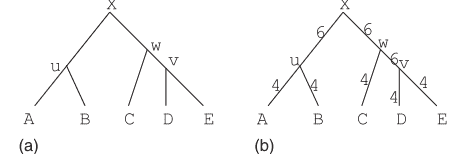

**图 3.5** 通过 SP 测量对树的遍历。显示了每条边的总访问次数。某些边的访问次数多于其他边。

相反，如果空位惩罚选择为 –10，则这两个比对将产生相同的得分。

从进化的角度来看，SP 方法是有缺陷的。在图 3.5 中，(a) 代表序列的进化树（叶子节点），并代表 MSA 的 SP 计数方法。成对比对 (A,B) 的得分评估了树上 (A,u) 和 (u,B) 进化事件的概率。类似地，成对比对 (C,D) 的得分评估了边 (C,w) 上进化事件的概率。

由于 SP 方法没有考虑空位惩罚，因此在计算空位惩罚时，结果是不准确的。如果选择空位惩罚为 -10，则这两个比对将产生相同的得分。

# 序列比对多样性评分


**图 3.5** 通过 SP 测量对树的遍历。显示了每条边的总访问次数。某些边的访问次数多于其他边。

相反，如果空位惩罚选择为 –10，则这两个比对将产生相同的得分。

由于 SP 方法没有考虑空位惩罚，结果是不准确的。

# 守性评分

香农熵于 1948 年提出，常用于量化比对的多样性。在本节中，我们将研究基于这种熵的评分方案。首先，我们将从熵的背景开始。

## 多样性评分方案

### 3.7.1 背景

香农熵源于组合论和信息论。其组合推导过程如下：考虑 10 个彩色球，其中 5 个红色、2 个绿色和 3 个黄色。总计的不同排列方式为 10!/(5!2!3!) = 2520。通常情况下，对于 $k$ 类的 $n$ 个符号，总的不同排列方式公式为

```


$W = \frac{N!}{\prod_{i=1}^{k} n_i}$,

其中 $n_i$ 是第 $i$ 类的频率。对于较大的 $n$，$N!$ 可以使用斯特林近似计算：$\ln N \approx N\ln N - N$。因此，

$\ln W = - \sum_{i}^{k} p_i\ln p_i$,

其中 $p_i = n_i/N$ 是第 $i$ 类的部分频率。此外，该函数的线性变换得到了香农熵：

$S = - \sum_{i}^{k} p_i\log_2 p_i$.

### 3.7.2 方法

1991 年，Sander 和 Schneider [43] 基于归一化香农熵定义了一种保守性评分：

$S = - \sum_{i}^{k} p_i\ln p_i \times \frac{1}{\ln k}$.

其中 $k$ 是符号类型的数量（DNA/RNA 序列为 4，蛋白质序列为 20）。

同样，Shenkin 等人 [44] 提出的他们的评分方法为：

$S = 2^S \times 6$.

其中 $S$ 是香农熵，$k$ 是符号类型的数量。这两个方程是互为转换的；因此，它们非常相似。这些函数的一个问题是，只有当所有类型分布均匀时，才会出现最大多样性。其次，当一列中至少包含 $k$ 个序列时，这些函数将获得最高分。

另一种基于香农熵的评分方案是 Gerstein 和 Altman 的方法 [45]。他们的函数用于比较蛋白质序列结构多重比对中的序列保守性与结构保守性。该函数定义为

$S = \sum_{i}^{k} \bar{p}_i\log_2 \bar{p}_i - \sum_{i}^{k} p_i\log_2 p_i$,

序列比对的量化

其中 $\overline{p_i}$ 是残基符号 $i$ 在比对中的平均频率。蛋白质序列的 $k=20$。

与之前讨论的所有评分方法类似，这些熵函数依赖于序列数据库中符号的频率，忽略了残基符号的立体化学和生物特性（无论是疏水还是亲水）。

## 3.8 性明方法

组中的评分方法围绕列中残基符号的立体化学性质设计。立体化学性质由 Taylor 在 1986 年 [46] 进行分类。该分类基于数据库中的残基保守性和 Dayhof 突变矩阵 [25]。该分类在维恩图中表示，如图 3.7 所示。

1987 年，Zelbil 等人 [47] 将 Taylor 的维恩图转换为氨基酸性质的真表，如图 3.8 所示。评分如下：

$S = n_{const} \times \frac{1}{10}. \quad (3.16)$

其中 $n_{const}$ 是列中残基之间共享的相同属性的常数数量。例如，在表中 E 和 D 具有相同属性，$n_{const}=9$，但 D 是小分子基酸而 E 不是。

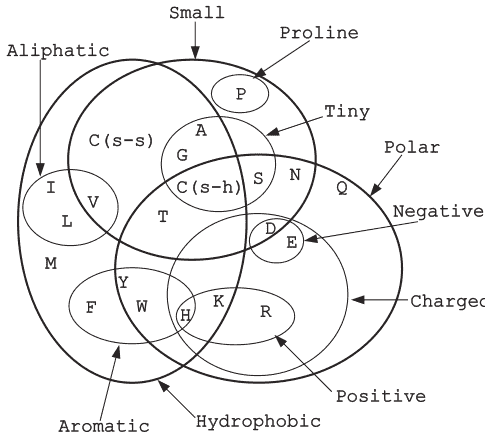

图 3.7 氨基酸性质的 Taylor 维恩图。

## 立体化学性质方法

| 性质：氨基酸 | 疏水 | 极性 | 小 | 带电 | 正电 | 负电 | 极小 | 脂肪族 | 香香 | 脯氨酸 |
|---|---|---|---|---|---|---|---|---|---|---|
| L | | | | | | | | | | |
| V | | | | | | | | | | |
| A | | | | | | | | | | |
| G | | | | | | | | | | |
| M | | | | | | | | | | |
| F | | | | | | | | | | |
| Y | | | | | | | | | | |
| W | | | | | | | | | | |
| K | | | | | | | | | | |
| E | | | | | | | | | | |
| Q | | | | | | | | | | |
| D | | | | | | | | | | |
| S | | | | | | | | | | |
| T | | | | | | | | | | |
| P | | | | | | | | | | |
| B(Asx) | | | | | | | | | | |
| Z(Glx) | | | | | | | | | | |
| X(unknown) | | | | | | | | | | |
| Gap | | | | | | | | | | |

**图 3.8** Taylor 维恩图的真表。

### 3.8.1 Valdar 方法

2001 年，Valdar 和 Thornton [48] 提出了一种评分方法来衡量列残基的保守性和频率：

$S(x) = \lambda \sum_{i=1}^{n} \sum_{j>i}^{n} w_i w_j, \quad (3.17)$

其中 $n$ 是序列长度，$\lambda$ 将 $S(x)$ 缩放到 $[0,1]$，即

$\lambda = \frac{1}{\sum_{i=1}^{n} \sum_{j>i}^{n} w_i w_j}, \quad (3.18)$

其中 $w_i$ 是序列 $s_i$ 的权重：

$w_i = \frac{1}{n} \sum_{j=1}^{n} d(s_i, s_j), \quad (19)$

其中 $d(s_i, s_j)$ 是 $s_i$ 和 $s_j$ 之间的距离，计算方法为：

$d(s_i, s_j) = 1 - \frac{1}{n \times align_{ij}} \sum_{x \in align_{ij}} M(s_i, s_j), \quad (20)$

其中 $align_{ij}$ 是 $s_i$ 或 $s_j$ 中出现氨基酸的位置集，$n \times align_{ij}$ 是该集合的大小。矩阵 $M$ 是替换矩阵 $m$ 的线性变换，使得 $M$ 中的所有值都在 $[0–1]$ 范围内。$M$ 定义为

$M(a, b) = \begin{cases} \max(a,b)-\min(m) & \text{如果 } a \neq gap \text{ 且 } b \neq gap \\ 0, & \text{否则.}\end{cases} \quad (21)$

这种 trident 的评分方法的通用形式定义为：

$S(x) = (1 - x)^\alpha(1 - r(x))^\beta(1 - g(x))^\gamma, \quad (22)$

其中 $x$ 是关于香农熵的归一化函数；$r$ 是立体化学多样性的函数；$g$ 是空位函数；$\alpha,\beta,\gamma$ 是变量。由于变量选择问题以及三个函数的复杂性，Trident 比其他方法复杂得多。

下一节将研究另一种评分模型。

## 3.9 分层期望概率评分 (HEP)

为了最优地比对长度为 $n$ 的序列，我们需要探索 $k$ 维空间以在 $O(n^k)$ 时间获得最优解。此外，序列 $s_i$ 的残基 $a$ 与序列 $s_j$ 的残基 $b$ 的概率 $p(a|b) \leq 1$。每个序列比对同一列 $k$ 的概率为 $P(k) = \prod_i p(a_i|b_i), P(k) \rightarrow 0$。该概率随着比对序列数量的增加呈指数下降。因此，评分函数应根据匹配概率比例奖励比对列。

分层期望概率（HEP）[49] 是一种评分方法，它利用 Smith 和 Smith 的 PIMA 评分中氨基酸覆盖层次（AACCH）来计算残基比对的概率，如图 3.9 所示。因此，提供了一种衡量组间匹配的评分机制。与其使用 Smith 和 Smith 提出的临时候选，不如从任何生物距离矩阵、替换矩阵或任何定量值生成数量。

### 3.9.1 构建 AACCH 评分树

与受对对（sum-of-pair）启发的评分方法不同（每一步计算成对残基匹配评分），HEP 使用使用 PAM、BLOSUM 或任何评分矩阵构建的评分树。在 HEP 中，假设匹配残基的得分为正；因此需要调整残基权重。调整权重的方法是通过向所有其他单元加上负权值的幅度来放大评分。例如，BLOSUM62 匹配 C 的权重为 -4。

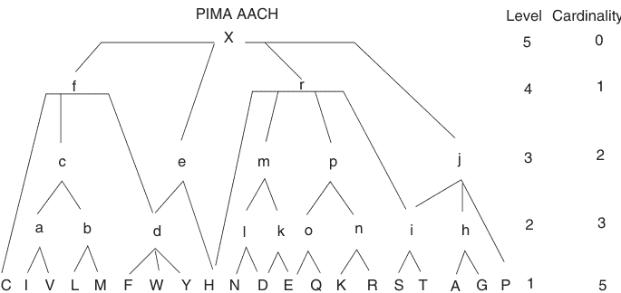

**图 3.9** PIMA 中使用的氨基酸类层次 (AACH) [50]。大写字母是氨基酸；小写字母是氨基酸类。X 是任何类型（包括空位）的通字符。

对于 E，或 F 与 P 等；因此，在替换矩阵的每个条目加上 4 会使所有条目变为正数。这种缩放技术适用于使用对数几的评分矩阵。这等同于在取对数之前将原始概率乘以常数因子。常数因子必须大到最小对数为零。

# 构建 AACCH 评分树过程

```
输入: $M$ — 一个 $n \times n$ 评分矩阵和一个 AACH 类 $S$
输出: $T$ — 树的评分

$T \leftarrow$ 如果 $min(M) < 0$ $!正向调整评分$
for all $i$ and $j$
    $M_{i,j} \leftarrow (M_{i,j} + abs(M))$
endfor
endif

for all $c \in T$
    $c_{cardinality} \leftarrow 0$
endfor

for all $c \in T$
    if size(c) = 1$
        $c_{cardinality} \leftarrow M(c,c)
    else
        for all $(i, j) \in c, i \neq j$
            $c_{cardinality} \leftarrow (c_{cardinality} + M(i,j))$
        endfor
    endfor
endfor

$c_{cardinality} \leftarrow \left(c_{cardinality}/\frac{(size(c)\times size(c)-1)}{2\times c_{level}}\right)$

if

endfor

if X_{cardinality} > 0 $!adjust the root$
    for all c \in Sdo
        $c_{cardinality} \leftarrow (c_{cardinality} - X_{cardinality})$
    endfor
endif

for all c \in S and c_{level} > 1 $!adjust level cardinality$
    if c < c(children)_{cardinality}
        $c_{cardinality} = min(c(children))_{cardinality}$
    endif
endfor
```

# 46
# 序列比对定量

树的叶节点来自给定的输入值，每个氨基酸类的基数是该类中所有对得分的平均两和，除以该类的层级。树根位于第 5 层。由 BLOSUM62 生成的评分树如图 3.10 所示。

## 3.9.2 评分指标

比对得分是比对中所有列得分的总和。为了控制比对的扩展，总列得分将通过一个扩展因子进行缩小。扩展因子选择为整体比对长度对数的倒数。通过该因子，整体比对得分将随着比对长度的对数扩展按比例减少。因此，

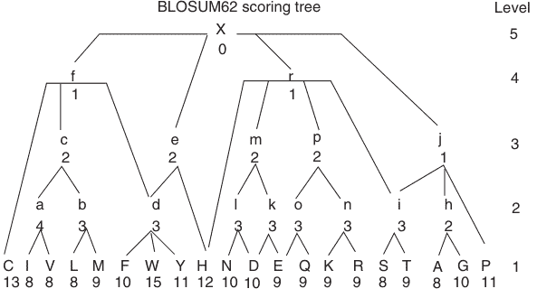

**图 3.10** 基于 BLOSUM62 替换矩阵生成的 HEP 评分树。每个氨基酸类的匹配基数显示在相应符号的底部。

## 分层期望概率评分指标 (HEP)

导致比对扩展的插入空隙将受到惩罚，这限制了插入比对中的空隙数量，以防止比对过度扩展。

$Score(A_k) = \frac{1}{\log_2|A_k|} \sum_{i=1}^{|A_k|} cScore(i), \quad (3.23)$

其中

- $k$: 序列数量，$k \geq 2$，
- $A_k$: $k$ 条序列的比对，
- $|A|$: 比对的长度。

计算列得分的方程如下：

$cScore(i) = \begin{cases} 0, \text{if } i \text{ 仅在树根匹配} \\ \frac{1}{(k-1)} \sum_{l=1}^{\log|T_i|} \sum_{j=1}^{|T_l|} \frac{(count(node_j)-1)^{\Gamma_j}}{l} \end{cases} \quad (3.24)$

比对 $p$ 的列 $i$（$p[i]$）和比对 $q$ 的列 $j$（$q[j]$）的得分是合并 $p[i]$ 和 $q[j]$ 中所有残基生成的列得分。比对得分方程变为：

$Score(A_k) = \frac{1}{\log_2|A_k| \times (k-1)^f} \times \sum_{i=1}^{|A_k|} \sum_{l=1}^{\log|T_i|} \sum_{j=1}^{|T_l|} \frac{(count(node_j)-1)^{\Gamma_j}}{l} \quad (3.25)$

$\forall w_i > 0$，其中

- $|T_i|$: 第 $i$ 列的评分树大小，即活跃评分树，
- $|T^l|$: 第 $l$ 层评分树的大小，
- $c_j$: 活跃评分树中节点 $j$ 的基数，
- $\Gamma_j$: 为第 $i$ 列构建的评分树第一层的基数，
- $count(node_j)$: 活跃评分树中在 $node_j$ 处匹配的残基数量。

评分树在任何比对发生之前构建，与成对和评分方法相比，它通过不在在每个比对步骤中计算匹配得分，将比对算法的复杂度至少降低了一个数量级。

## 3.9.3 评分指标正确性的证明

HEP 为保守程度较高的列赋予更高权重证明如下：

给定一个包含 $n$ 个残基的 $k$ 条比对序列列（$k > 1, n \leq k$）。设 $c_i > 0$ 为第 $i$ 层处两次匹配的基数（$l \leq \log 5, c_i > 1$），且 $c_{i+1} \geq 0$。如果所有残基都是同性的，则列得分为 1；否则，列得分为：

$$\frac{1}{(n-1)^l} \times [(n-1-a_1)^{c_i} + (n-1-a_2)^{c_i} + \dots + (n-1-a_l)^{c_i}} + \dots] + \frac{(a_i+a_j-1)^{c_{ij}}}{t} + \dots + \frac{(n-1)^0}{5}$$

$\gamma_c \geq 1$ 且 $a \geq 1, i \neq j, i \leq j$。

设 $c = \min(c_i)$ 且 $a = c - c_{i+1}$。如果只有两种残基类型（度为 2），列得分将为 $(n-1)^c + (x-1)^c - \frac{x-1}{2}$，其中 $1 \leq x < k$ 且 $a \geq 0$。证明 $(n-1)^c > (x-1)^c - \frac{x-1}{2}$由于 $(n-1)^c > 2 \times [(x-1)^c + (x-1)^c]$，我们需要证明 $(n-1)^c > (x-1)^c - \frac{n-1}{2}$。(x-1)^c + \frac{n-1}{2}$ 等于 $(x-1)^c + \frac{n-1}{2}$。对于 $\forall l$ 成立。同样，该证明可以扩展到任何差异 $d$。如果评分树叶节点层有 $d$ 种氨基酸，由于从 $d-1$ 差异树将一个叶节点分为二，列得分将小于 $d$ 差异树。

## 3.9.4 示例

考虑以下序列：$s_1 = NNN, s_2 = NND, s_3 = NDE$。一种可能的比对是：

$A_3 = \begin{cases} s_1 & NNN \\ s_2 & NND \\ s_3 & NDE \end{cases}$

使用 HEP 权重，其中 $N$ 的匹配为 $N=5, D=3, E=2$，我们将得到：

$score(A_3) = \frac{1}{\log_2(3) \times (3-1)^5} \left( [(3-1)^5 + [(2-1)^5 + \frac{(3-1)^3}{2}] \right) + \left[ \frac{(2-1)^3}{2} + \frac{(3-1)^2}{3} \right] = 0.7952.$

（图 3.11 显示使用 HEP 评分的活跃评分树。）

## 分层期望概率评分指标 (HEP)

| 层级 | 基数 |
| :--- | :--- | :--- |
| m:3 | 3 | 2 |
| 1:2 | k:2 | 3 |
| N:1 | D:1 | 5 |

图 3.11 为第三列的 HEP 评分树。

如果我们使用从 BLOSUM62 替换矩阵构建的评分树，其中 $N$ 的匹配为 $N=10, D=3, E=3$，则比对得分为：

$score(A_3) = \frac{1}{\log_2(3) \times (3-1)^{10}} \left[ [(3-1)^{10}] + [(2-1)^{10} + \frac{(3-1)^3}{2}\right] + \frac{(2-1)^3}{2} + \frac{(2-1)^2}{3} = 0.6360.$


## 3.9.5 评分指标和序列权重

序列比对有一个包含在评分指标中的因子。将基序 `x` 中的残基 `a` 比对到相同基序或序列 `s_i` 中的相似残基 `b` 的权重应高于将 `a` 比对到不同基序中的 `b` 或其他位置的任何残基，如图 3.12 所示。

这取决于我们拥有多少序列的生物信息。在某些情况下，比对序列中存在相似序列组。归一化这些冗余有助于减少 MSA 结果的偏差。然而，生物学家可能会将相似序列子集引入比对序列，引导比对走向无用的冗余并导致意外结果。因此，权重因子应来自衡量基序中残基显著性的函数，而不是相似序列的冗余。

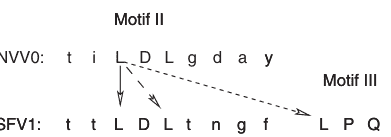

图 3.12 NNV0 与序列 SFV1 [51] 中的相似氨基酸。点线表示不匹配，虚线表示较好的匹配，实线表示最佳匹配。

### 序列比对定量

如果权重函数已知，可以将其合并到评分指标中。列得分将为：

```
$cScore(i) = \left\{ 0, \frac{-w(i)}{(k-1)}, \sum_{j=1} \log|T_{col}|, \sum_{j=1} \frac{|T_{ij}|(count(node_j)-1)}{2} \right. \quad (3.26)$
```

其中 `w(i)` 是第 `i` 列残基的基序权重，其计算方式如下：

```
$w(i) = \begin{cases} 1, & \text{如果残基来自相似基序且具有生物等效性,} \alpha, & \text{如果残基来自相似基序且具有生物等效性,} \beta, & \text{否则,} \end{cases} \quad (3.27)$
```


其中 $0 < \beta < \alpha \leq 1$。

## 3.9.6 数据集

HEP 评分函数的有效性和可靠性通过三个全面的测试进行评估。第一个测试旨在测试 HEP 在 MSA 列之间检测和排序保守程度的能力。对于该测试，我们利用了 Valdar 和 Thornton 创建的理论数据集 [48]。

### 3.9.6.1 理论数据集

**表 3.5** 每个标签列代表多序列比对中的一个残基位置

| 序列 | (a) | (b) | (c) | (d) | (e) | (f) | (g) | (h) | (i) | (j) | (k) |
|---|---|---|---|---|---|---|---|---|---|---|---|
| 1 | D | D | D | D | D | D | I | P | D | L | L |
| 2 | D | D | D | D | D | D | I | P | V | L | L |
| 3 | D | D | D | D | D | D | I | P | Y | L | L |
| 4 | D | D | D | D | D | D | I | P | A | L | L |
| 5 | D | D | D | D | D | D | L | W | T | - | - |
| 6 | D | D | D | E | E | E | L | W | K | - | - |
| 7 | D | D | D | E | E | E | L | W | P | - | - |
| 8 | D | D | D | E | E | E | L | W | C | - | - |
| 9 | D | D | D | E | E | F | V | S | R | - | - |
| 10 | D | E | F | E | F | V | S | H | - | - | - |

氨基酸通过单字母代码识别，空位用破折号（`-`）表示。*注：* 列 (k) 来自 10 条序列的比对，而列 (j) 仅来自 4 条序列的比对（(j) 中没有空位）。列的评分顺序为 (a) > (b) > (c) > (d) > (e)，然后是 (g) > (h) > (i)，以及 (j) > (k)。*来源：* 改自 Valdar and Thornton 2001 [48]。

天冬氨酸 (D) 突变为谷氨酸 (E) 的概率大于天冬氨酸 (D) 变为苯氨酸 (F) 的概率。列 (d) 中所有五个残基（无论是 D 或 E）突变为其他氨基酸的概率为 $\prod p_{DE}$，其中 $p_{DE}$ 是 D 突变为 E 的概率，该概率远小于列 (c) 中残基 D 突变为残基 F 的概率。这一结果遵循 BLOSUM62 替换矩阵及其对数优势评分函数的分解：

$$S(a, b) = \frac{1}{\lambda} \log \frac{P_{ab}}{f_a f_b},$$ (3.28)

其中 $S(a, b)$ 是残基 $a$ 和 $b$ 比对的分，$\lambda = 0.347$ 是常数，$f_i$ 是残基 $i$ 的背景频率。所有氨基酸的背景频率均源于所使用的序列 [32]。根据 [32] 获得的背景频率 $f_D = 0.0539, f_E = 0.0539$ 和 $f_F = 0.0469$，我们找到 $p_{DE} = 5.8 \times 10^{-3}$ 且 $p_{DF} = 9.0 \times 10^{-4}$。因此，$\prod p_{DE}^5 = 6.56 \times 10^{-12} \ll p_{DF} = 9.0 \times 10^{-4}$。直觉上，残基保守率为 100% 的列（列 j）其保守性评分应该比保守率为 40% 的列（列 k）更好，我们将列重新排列为正确的顺序。

### 3.9.6.2 RT-OSM 数据集

基于事实来衡量评分方法的可靠性是最佳的。因此，使用特征良好的已知基序来验证评分函数是现实的。1999 年，Hudak 和 McClure [51] 为此目的准备了 RT-OSM 数据集。数据如表 3.6 所示。

**表 3.6** RT-OSM 数据集多序列比对

| 序列 | I | II | III | IV | V | VI |
|---|---|---|---|---|---|---|
| HT13 | pvkKa- | tIDLkadf | -PQGKa- | qYMDILL | shGL- | kLGqii |
| NVVO | ikkk- | tTLIDGday | -PQPGwk | -YAMDIY | qyFM- | kWLGef |
| SFV1 | pvkP- | ttDLtngf | -LPPGfl | aYYDDY | naGYVw | eLGfni |
| HERCV | pvkPp- | tctDLKaf | -CPDKR- | qYVDDLL | ttGIRC | eYLGfti |
| GMS1 | mmkkA- | scDLMSgf | -IDNHaf | -PPG- | GL- | tYLG- |
| GM17 | v-pkkGD | ttDDakkg | -MPPGlk | yyDLVV | -NIIK- | tLGhv |
| MDG1 | mmkkA- | scDLMSgf | -IDNHaf | -PPG- | GL- | tYLG- |
| GM17 | v-pkkGD | ttDDakkg | -MPPGlk | yyDLVV | -NIIK- | tLGhv |
| MDG1 | mmkkA- | scDLMSgf | -IDNHaf | -PPG- | GL- | tYLG- |
| GM17 | v-pkkGD | ttDDakkg | -MPPGlk | yyDLVV | -NIIK- | tLGhv |

## 3.9.7 评分方法的排序

### 3.9.7.1 理论集的排序

**表 3.7** 理论数据集各列的 HEP 评分

| 序列 | (a) | (b) | (c) | (d) | (e) | (f) | (g) | (h) | (i) | (j) | (k) |
|---|---|---|---|---|---|---|---|---|---|---|---|
| 1 | D | D | D | D | D | D | I | P | D | L | L |
| 2 | D | D | D | D | D | D | I | P | D | L | L |
| 3 | D | D | D | D | D | D | I | P | V | L | L |
| 4 | D | D | D | D | D | D | I | P | Y | L | L |
| 5 | D | D | D | D | D | D | I | P | A | L | L |
| 6 | D | D | D | D | E | E | L | W | K | - | - |
| 7 | D | D | D | E | E | E | L | W | W | - | - |
| 8 | D | D | D | E | E | E | L | W | W | - | - |
| 9 | D | D | D | E | E | E | V | S | R | - | - |
| 10 | D | E | E | F | F | V | S | H | - | - | - |
| 方法 | | | | | | 列评分 | | | | | |
| HEP-PIMA | 1.0 | 5.6110E-1 | 5.5493E-1 | 4.0856E-2 | 2.5792E-2 | | 2.0852E-5 | 8.2756E-3 | 5.3628E-5 | | 4.1524E-3 |
| HEP-BL62 | 1.0 | 3.0795E-1 | 3.0795E-1 | 6.0156E-2 | 3.0645E-4 | | 3.0092E-4 | 7.0588E-4 | 1.2000E-2 | 1.0000E+0 | 1.5242E-4 |
| HEP-P250 | 1.0 | 2.4332E-1 | 2.4330E-1 | 1.1891E-4 | 3.0645E-4 | | 5.9447E-5 | 2.7911E-7 | 0.0000E+0 | 1.0000E+0 | 2.0908E-7 |

氨基酸通过其单字母代码识别，并用连字符 `-` 表示空位。列评分顺序为 (a) > (b) > (c) > (d) > (e) > (g) > (h) > (i) > (j) > (k)。*注意：* 列 (j) 来自仅四个序列的比对（无空隙），表格无法显示所有有效数字。

### 3.9.7.2 RT-OSM 序列的排序

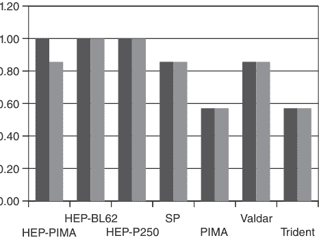

**图 3.14** RT-OSM 数据集上的基序检测准确率。得分 1.0 表示该方法正确检测并排名了数据集中所有的六个基序。

图 3.14 显示了这些评分方法的基序检测准确率。两种 HEP 方法（一个使用 BLOSUM62 替换矩阵，另一个使用 PAM250 替换矩阵）都能检测所有六个基序，而不需要 2% 的波动。使用 PIMA 评分 [50] 和 Valdar 的方法 [48] 改进了 HEP 方法。总体而言，三个版本的 HEP 评分方法均优于其他评分方法。

### 3.9.7.3 BAliBase 3.0 和 PREFAB 4.0 MSA 结果

BAliBase 3.0 和 PREFAB 4.0 基准测试带有总列评分 (TC)，可以根据基准中的参考比对来评估比对结果。因此，将 $n$ 条序列提供给 $k$ 个不同的 MSA 工具，我们将得到 $k$ 种不同的比对。使用总列评分 (TC) 对这些比对进行评分，将为每个比对生成 $k$ 个得分，指明每个比对与参考比对（即期望比对）的接近程度。因此，为了评估评分函数的可靠性，我们定义可靠性分数为所有比对中被正确识别的最佳比对总数，即：

$$R = \frac{\text{\# alignments correctly identified}}{\text{\# total alignments}}$$

例如，如果我们在 ClustalW、MAFFT 和 T-COFFEE 中获得一组 $n$ 条序列，我们分别得到三个比对 A、B 和 C。让我们进一步假设这些比对的总列评分参考值分别为 TC(A)=1, TC(B)=0.8, 且 TC(C)=0.3。这些 TC 得分表示 A 与参考比对完全相同，B 接近，而 C 相比于期望比对差异很大。因此，任何给 A 打出最高分的评分函数将获得一分，而其他函数得零分。对于 $n$ 组不同的序列，可靠性评分是每个评分函数在 $n$ 组上的累积得分。

由于随机比对没有意义，我们使用 MAFFT [57]、ClustalW [59]、T-COFFEE [58]、PIMA [50] 和 DALIGN [56] MSA 工具为每个输入序列生成 MSA。这些工具的比对结果针对基准参考进行评分。因此，对于 BAliBase 3.0 中的 247 个参考测试，我们获得了 1235 个比对结果；对于 PREFAB 4.0 的 150 个数据集，我们得到了 750 个比对结果。图 3.15 和 3.16 分别显示了测试方法在 BAliBase 3.0 和 PREFAB 4.0 上的可靠性评分。

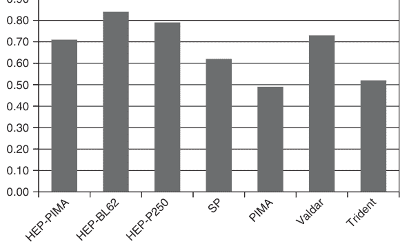

**图 3.15** BAliBase 3.0 上的可靠性评分。

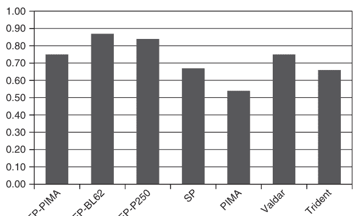

**图 3.16** PREFAB 4.0 150 个参考的可靠性评分。

BAliBase 3.0 和 PREFAB 4.0 基准测试均表明，使用 BLOSUM62 和 PAM250 的 HEP 方法更有可能正确识别并排名 MSA。这允许生物学家识别哪些比对工具对于他们的 MSA 更准确且可靠。从这些结果来看，BLOSUM62 的 HEP 评分是最可靠的方法。

### 3.9.7.4 HEP 在渐进比对中的实现

基准结果表明 HEP 评分比其他方法更敏感且可靠。为了进一步确认 HEP 可以改进 MSA 结果，我们在渐进比对中实现了 HEP，这种技术用于 ClustalW、PIMA、T-COFFEE 等。该技术可以总结如下：

- 执行全对序列比对以计算序列之间的距离。
- 使用 UPGMA [60] 或 NJ [61] 分层聚类方法构建进化树。
- 按照进化树从叶子到根节点对序列（或序列组）进行成对比对。

在此实现中，利用 ClustalW 执行步骤 (i) 和 (ii)，因为在序列成对比对水平上，HEP 得分与 ClustalW 中使用的对对评分相同。在步骤 (iii) 中，实现了四个 Needleman–Wunsch [19] 算法：一个使用 SP [35] 评分方法，一个使用 Smith 的 PIMA [50] 方法，一个使用 Valdar 的方法 [48]，最后一个使用 HEP 方法。Trident 方法未实现，因为其适当参数难以确定。此外，Trident 方法在之前的 BAliBase 3.0 和 PREFAB 4.0 测试中无效。

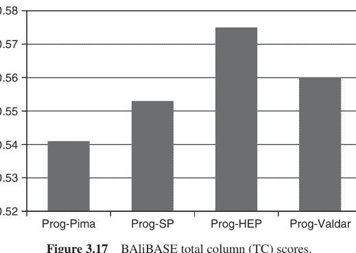

**图 3.17** BAliBase 3.0 基准测试的总列 (TC) 评分。

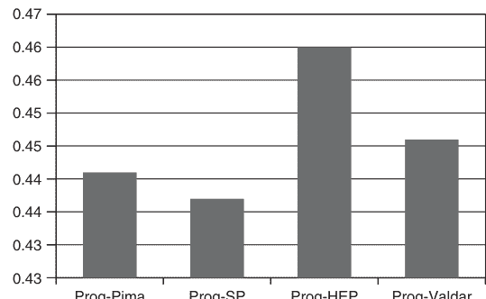

**图 3.18** PREFAB 4.0 150 个随机数据集的总列 (TC) 评分。

在执行这种渐进 MSA 时，一组输入序列将产生四个比对结果。这些测试中使用的评分矩阵是 BLOSUM62，对于 SP 和 Valdar 方法，间隔插入/删除代价为 -10。我们通过测试比对中正确比对列数除以参考比对的总列数来衡量测试比对的准确性。在所有测试中，HEP 评分方法的性能优于其他评分方法。在 BAliBase 3.0 基准中，采用 HEP 评分的比对结果比 Smith 的 PIMA [50]、SP [35] 以及 Valdar and Thornton [48] 评分方法平均高 7%、5% 和 4%。同样，在 PREFAB 4.0 基准中，HEP 得到的平均 TC 评分高 4%、5% 和 3%。这些结果如图 3.17 和 3.18 所示。这强烈表明 HEP 评分方法将提高 MSA 的准确性。

本章总结，每个评分方案都是为了特定目的设计的，可能适用于特定的序列。由于序列及其演化的未知生物特性，适用于所有生物序列集的评分方法可能永远不存在。

# 第 4 章 序列聚类

在进行多序列比对之前，将亲缘密切的序列归类是自然的。该领域的科学家一直在讨论如何系统地检测和测量序列之间的相关性，即序列之间的同源特征和功能相似性。图 4.1a 显示了进化过程中不同物种序列中残基的突变步骤。系统树指示了在任何特定位点符号如何变为另一个。图 4.1b 显示原始符号为 G 或 A，经过一段时间演化后，G 在序列 A 和 B 中保持不变；然而，该符号在包含 Seq3、Seq4 和 Seq5 的家族（分支）中已变为 C。最后，如图 4.1c 所示，C 在包含 Seq4 和 Seq5 的亚族中变为 A。

| Seq1 | Seq2 | Seq3 | Seq4 | Seq5 | Seq1 | Seq2 | Seq3 | Seq4 | Seq5 |
|---|---|---|---|---|---|---|---|---|---|
| | G | G | G | | T | T | | C | C |
| | GTGACT | | | | | | | | |
| | | | CTGTA | | C-A | | | | | |
| | | | | ACACA | | | C-A | | | |
| | | | | G-A | or A-G | | T-C | or C-T | |

**图 4.1** (a) 是输入，(b) 为第一列的替换，(c) 为第二列的替换。

聚类算法有很多，如 K-means [62]、模糊 C-means [63]、分层聚类、概率聚类 [64]。然而，这些方法将序列分类为距离最近（编辑距离/汉明距离、欧几里得距离）的组，并对序列之间的生物学意义进行归一化。非常耗时，例如 K-means 对于 $d$ 维是 NP-hard 问题，且对于固定的 $d$ 和 $k$，它的运行时间为 $O(n^{d+1} \log n)$。

另一方面，层次聚类方法相对较快，且更具序列性，因为它们通过成对处理序列来强调它们之间的重要性。最常用的方法是邻域连接法（NJ）[61, 65] 和算术平均值组聚类法（UPGMA）[60]，也称为最大连接法。UPGMA 的加权版本（WPGMA）[60]，也称为最大连接法，并不流行。

## 4.1 算术平均值组聚类法 – UPGMA

与其他所有方法类似，算术平均值组聚类法（UPGMA）需要知道所有分类单元（在本例中为序列）之间的距离。这些距离自然以矩阵的形式存在。UPGMA 使用距离矩阵来构建系统发育树或进化树。通常情况下，每个序列被视为一个操作分类单元（OTU）。UPGMA 从两个最近的 OTU 开始，并将它们合并以构建一个新的 OTU。重新计算所有其他 OTU 到新 OTU 的距离。新距离是该 OTU 与新 OTU 所有成员之间的算术平均值。重复此过程，直到所有 OTU 都合并。例如：考虑四个序列 A, B, C, D 及其它们的距离矩阵 $d$。

| | A | B | C | D |
|---|---|---|---|---|
| A | 0 | | | |
| B | 7 | 0 | | |
| C | 11 | 6 | 0 | |
| D | 14 | 9 | 7 | 0 |

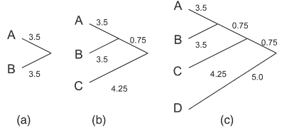

**图 4.2** 展示了构建 UPGMA 系统发育树的每一步。

首先，A 和 B 被分在一起，因为它们的距离最小（$d_{AB} = 7$）（注意：$d_{CD} = 7$ 也可以选择）。接着计算所有其他 OTU 到 AB 的后续距离。例如，C 到 AB 和 D 的距离为：

```
$d_{C(AB)} = (d_{AC} + d_{BC})/2 = (11 + 6)/2 = 8.5$
$d_{D(AB)} = (d_{AD} + d_{BD})/2 = (14 + 9)/2 = 11.5$
```

因此，距离矩阵将是：

| | AB | C | D |
|---|---|---|---|
| AB | 0 | | |
| C | 8.5 | 0 | |
| D | 11.5 | 9 | 0 |

接下来，C 与 AB 分组构建 OTU ABC，D 与 ABC 的距离计算为：

> $M_{D(ABC)} = (M_{AD} + M_{BD} + M_{CD})/3 = (14 + 9 + 7)/3 = 10.$

图 4.2 展示了为该示例创建 UPGMA 系统发育树的每一步。最终的树如图 4.2c 所示。UPGMA 的缺点之一是其运行复杂度为 $O(n^3)$。

## 4.2 邻域连接法 – NJ

与 UPGMA 不同，邻域连接（NJ）是一种自底向上序列聚类方法，用于构建具有不同进化速率的无根系统发育树。最初，NJ 将所有 OTU 视为一个星形，并计算一个 OTU 与所有其他 OTU 之间的平均距离。NJ 将彼此靠近且远离所有其他 OTU 的 OTU 对合并成一个新的 OTU。计算所有其他 OTU 到新 OTU 的距离。重复此过程，直到只剩下 OTU。该算法详细说明如下：考虑一组 $n$ 个序列和一个距离矩阵 $d$。

步骤 1：计算每个 OTU 到所有其他 OTU 的净散度
```
$u_i = \sum_{k} d_{ik}/(n-2)$
```

步骤 2：计算新的距离矩阵 $M$
```
$M_{ij} = d_{ij} - u_i - u_j$
```
并连接两个最近的邻居，即 $M$ 中值最小的对。

步骤 3：计算 OTU $i$ 和 $j$ 到新 OTU $ij$ 的距离
```
$d_{(ij)} = (d_{ij} + u_i - u_j)/2$
$d_{(ji)} = (d_{ij} + u_j - u_i)/2$
```

步骤 4：计算新 OTU $ij$ 到所有 OTU 的距离
```
$d_{(ij),k} = (d_{ik} + d_{jk} - d_{ij})/2$
```

步骤 5：用 $(i,j)$ 替换 $i$ 和 $j$。

步骤 6：重复步骤 1，直到剩下 2 个 OTU。

示例：考虑四个序列 A, B, C, D 及其距离矩阵 $d$。

| | A | B | C | D |
|---|---|---|---|---|
| A | 0 | | | |
| B | 7 | 0 | | |
| C | 11 | 6 | 0 | |
| D | 14 | 9 | 7 | 0 |

步骤 1：计算净散度 $u_i$ 为
```
$u_A = (d_{AB} + d_{AC} + d_{AD})/(4 - 2) = (7 + 11 + 14)/2 = 16$
$u_B = (d_{BA} + d_{BC} + d_{BD})/(4 - 2) = (7 + 6 + 9)/2 = 11$
$u_C = (d_{CA} + d_{CB} + d_{CD})/(4 - 2) = (11 + 6 + 7)/2 = 12$
$u_D = (d_{DA} + d_{DB} + d_{DC})/(4 - 2) = (14 + 9 + 7)/2 = 15$
```

步骤 2：计算新的距离矩阵 $M$
```
$M_{AB} = d_{AB} - u_A - u_B = 7 - 16 - 11 = -20$
$M_{AC} = d_{AC} - u_A - u_C = 11 - 16 - 12 = -17$
$M_{AD} = d_{AD} - u_A - u_D = 14 - 16 - 15 = -17$
$M_{BC} = d_{BC} - u_B - u_C = 6 - 11 - 12 = -17$
$M_{BD} = d_{BD} - u_B - u_D = 9 - 11 - 15 = -17$
$M_{CD} = d_{CD} - u_C - u_D = 7 - 12 - 15 = -20$
```

步骤 3：选择 $M$ 中最小值的对（此处为 AB 或 CD，假设选 AB）。计算 OTU A 和 B 到新 OTU AB 的距离：
```
$d_{(A),(AB)} = (d_{AB} + u_A - u_B)/2 = (7 + 16 - 11)/2 = 6$
$d_{(B),(AB)} = (d_{AB} + u_B - u_A)/2 = (7 + 11 - 16)/2 = 1$
```

步骤 4：计算新 OTU AB 到所有其他 OTU (C, D) 的距离：
```
$d_{(AB),C} = (d_{AC} + d_{BC} - d_{AB})/2 = (11 + 6 - 7)/2 = 5$
$d_{(AB),D} = (d_{AD} + d_{BD} - d_{AB})/2 = (14 + 9 - 7)/2 = 8$
```

新的距离矩阵为（OTU: AB, C, D）：

| | AB | C | D |
|---|---|---|---|
| AB | 0 | | |
| C | 5 | 0 | |
| D | 8 | 4 | 0 |

算法的第二次迭代将产生：
步骤 1：
```
$u_{AB} = (d_{(AB)C} + d_{(AB)D})/1 = (5 + 8)/1 = 13$
$u_C = (d_{C(AB)} + d_{CD})/1 = (5 + 4)/1 = 9$
$u_D = (d_{D(AB)} + d_{DC})/1 = (8 + 4)/1 = 12$
```

步骤 2 给出：
```
$M_{(AB)C} = d_{(AB)C} - u_{AB} - u_C = 5 - 13 - 9 = -17$
$M_{(AB)D} = d_{(AB)D} - u_{AB} - u_D = 8 - 13 - 12 = -17$
$M_{CD} = d_{CD} - u_C - u_D = 4 - 9 - 12 = -17$
```

步骤 3：选择 C 与 AB 分组构建 OTU ABC。C 和 AB 到 ABC 的距离为：
```
$d_{(C),(ABC)} = (d_{(AB)C} + u_C - u_{AB})/2 = (5 + 9 - 13)/2 = 0.5$
$d_{(AB),(ABC)} = (d_{(AB)C} + u_{AB} - u_C)/2 = (5 + 13 - 9)/2 = 4.5$
```

步骤 4 给出：
```
$d_{(ABC),D} = (d_{(AB)D} + d_{CD} - d_{(AB)C})/2 = (8 + 4 - 5)/2 = 3.5$
```

新的距离矩阵为（OTU: ABC, D）：

| | ABC | D |
|---|---|---|
| ABC | 0 | |
| D | 3.5 | 0 |

算法的第三次迭代将产生：
步骤 1：
```
$u_{ABC} = d_{(ABC)D} = 3.5$
$u_D = d_{D(ABC)} = 3.5$
```

步骤 2 给出：
```
$M_{(ABC)D} = d_{(ABC)D} - u_{ABC} - u_D = 3.5 - 3.5 - 3.5 = -3.5$
```

最终连接 ABC 和 D，构建完成。

其中 $R^0 = R$，且对于 $i>0$。


$R^i = R^{i-1} \cup \{(s_a, s_c) | \exists s_b \wedge (s_a, s_b) \in R^{i-1} \wedge (s_b, s_c) \in R^{i-1}\}. \quad (4.2)$

相似地，条件传递闭包 (CTC) 通过条件成员关系排除 $g$ 定义，其中 $R^i$ 定义为：

$R^i = R^{i-1} \cup \{(s_a, s_b) > g | \exists s_b \wedge (s_a, s_b) \in R^{i-1} \wedge (s_b, s_c) \in R^{i-1}\\ \cup \{(s_a, s_c) | A(s_a, s_b) \wedge A(s_b, s_c) \neq \emptyset\} \wedge (s_b, s_c) \in R^{i-1}\}, \quad (4.3)$

其中 $A(s_i, s_j)$ 是两条序列 $s_i$ 和 $s_j$ 的局部比对。重叠序列算法（Overlapping Sequencing algorithm）定义如下：给定一个集合 $S$，其局部比对 $A(S)$，序列之间的定量关系 $Q$ 以及一个成员函数（或阈值）$g$：

- 步骤 1：按升序排序关系。
- 步骤 2：令 $F=\{\emptyset\}$ – 聚类集
- 步骤 3：令 $C=\{s_i, s_j\}$，其中 $s_i, s_j \in S$，且 $(s_i, s_j) \in Q$且 $(s_i, s_j) > g$ 且 $(s_i, s_j) > \forall(s_k, s_i) \in Q$，且 $i \neq k$
- 步骤 4：找到 $C$ 的 CTC
- 步骤 5：
  如果 $C \neq \{\emptyset\}$ 且 $|S| > 1$
  $F = F \cup \{C\}$
  $S = S - \{C\}$
  重复步骤 2
  否则：
  通过移除与多个一个聚类共享相同局部比对段的序列成员关系，来减少聚类重叠。
- 步骤 6：
  输出 $F(S)$ 作为序列聚类
  结束

成员函数或阈值 $g$ 可以是任意。该算法从一对产生最高局部比对得分（或最短距离）的序列作为一个聚类开始。它迭代地寻找所有其他与聚类中任何序列具有局部比对的序列，这些序列满足：(i) 产生优于预定义阈值 $g$ 的得分，或 (ii) 其比对段与聚类中任何序列的局部比对段重叠。

# 重叠序列聚类

该过程不断重复，直到找到更多聚类为止。剩余的未聚类序列被分组到一个特殊的聚类中。条件 (ii) 将聚类成员扩展到得分较低但共享高度保守片段的序列，使其加入聚类。然而，这是一种排他关系，一个序列只能成为一个聚类的成员。减少聚类重叠步骤强制执行这一要求。这种快速技术的运行复杂度为 $O(kn)$，其中 $n$ 是待聚类序列的数量，$k$ 是聚类的数量。

示例：考虑序列集 $S = \{A, B, C, D, E, F, G, H, I\}$，阈值 $g = 7$，以及以下序列矩阵：

| A | B | C | D | E | F | G | H | I |
|---|---|---|---|---|---|---|---|---|
| B | 11 | | | | | | | | |
| C | 5 | 4 | | | | | | | |
| D | 9 | 8 | 7 | | | | | | |
| E | 7 | 5 | 5 | 2 | | | | | |
| F | 6 | 7 | 2 | 1 | 9 | | | | |
| G | 6 | 4 | 4 | 8 | 10 | 8 | | | |
| H | 5 | 6 | 3 | 9 | 13 | 9 | 8 | | |
| I | 9 | 8 | 1 | 9 | | 7 | 7 | 6 |

第一次迭代从 $C = \{E,H\}$ 开始，因为 $(E,H) = 13$ 是最高得分。对 $C$ 进行广度优先搜索 (BFS) 通过遵循 E 和 H 增加了 $\{E,G\}$、$\{E,F\}$ 和 $\{H,D\}$。因此，我们将得到聚类 $\{D,E,F,G,H\}$，$S = \{A,B,C\}$ 以及 $F = \{D,E,F,G,H\}$。

第二次迭代从 $C = \{A,B\}$ 开始，因为 $(A,B) = 11$ 是本次迭代中的最高得分。从 $C$ 开始的 BFS 增加了 $\{A,I\}$ 和 $\{D,I\}$。因此，$S = \{C\}$。

由于 $S$ 中只剩下一个序列，算法以三个聚类 $\{A,B,D,I\}$、$\{D,E,F,G,H\}$ 结束，其中序列 $D$ 是两个聚类的成员。

# 序列聚类

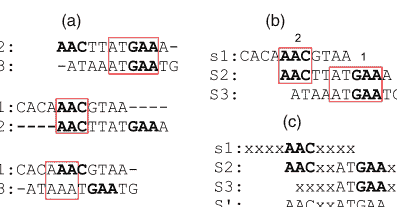

ubi MQIFKVTLGTIVEPSDTENVKKAKIQQDGEIPP------QQR

gaB NTIRVFLPNKQRTVNNVRNGMSHLCKALVKRQLPEC------CAV

lalo IQTVNNGIEQNLVDARALSDVLRQLGLTVKGCEQQCGACSV

awd YKVTLTPSGETICEPDTYLILDAEEAG-GL-LPYSCRAG

图 5.1 泛素集的样本比对。每个块代表一个二级特征，如α螺旋、β折叠或不重要的结构。

# 多序列比对

多序列比对 (MSA) 是成对比对的扩展。通过这种扩展，MSA 问题变得难以处理，事实上，寻找最优解是 NP 完全的。为了克服这个问题，人们提出了各种启发式方法。1999年，Thompson等人对当时流行的10种工具 [PIMA (SBPIMA), LIMPMA, MULTALIGN, PILEUP, ClustalX, SAGA, HMMT, 和 PRRP] 进行了全面的比较。

已经提出了许多 MSA 算法，其中许多彼此略有不同。在本章中，仅介绍独特的 MSA 范式。

## 5.1 动态规划

该组 MSA 算法是动态规划的扩展。

### 5.1.1 DCA

分治与 de 序列比对 (DCA) 算法是由 Stoye [54] 为其博士论文设计的。DCA 的基本思想相当简单：将每个序列在靠近中间的位置分成两个子序列。这些划分将问题分为具有更短序列的子 MSA 问题。重复此过程直到序列变得足够短，即短于预定义的阈值 L。这些多序列比对然后通过动态规划方法进行最优比对。将这些子问题的比对拼接，从而产生原始序列的 MSA。该算法如图 5.2 所示。


## 5.1.1.1 确定切割位置

DCA 最重要的任务是识别划分每个序列的切割位置。一组完美的切割可以导致最优解。DCA 使用一种基于额外成本矩阵的启发式方法来量化切割位置的兼容性。切割位置的计算如下：

对于任意长度为 $n$ 的序列 $s = s_1, s_2, \dots, s_n$ 和切割位置 $c$ ($0 \le c \le n$)，$c$ 之前的的前缀序列记为 $s(\le c)$，$c$ 之后的后缀记为 $s(> c)$。使用动态规划来计算所有序列对 $(s_p, s_q)$ 以及 $s_p$ 的所有切割位置 $c_p$ 和 $s_q$ 的所有切割位置 $c_q$ 的额外成本 $C_{s_p,s_q}[c_p, c_q]$。额外成本定义为：

```
$C_{s_p,s_q}[c_p, c_q] = w_{opt}(s_p(\le c_p), s_q(\le c_q)) + w_{opt}(s_p(> c_p), s_q(> c_q)) - w_{opt}(s_p, s_q)$
```

这是要求对 $s_p$ 和 $s_q$ 进行比对以优化比对两个前缀和后缀，而不是序列本身的额外成本。为了将切割扩展到所有序列，额外成本定义为：

```
$C(c_1, c_2, \dots, c_k) = \sum_{1 \le p < q \le k} \alpha_{p,q} C_{s_p,s_q}[c_p, c_q]$
```

其中 $\alpha_{p,q}$ 是依赖权重因子。依赖权重因子使用对对得分 [70] 计算，以增加残基匹配的权重（或得分）。它的定义为：

```
$\alpha_{p,q} = \begin{cases} 1 & \text{如果 maxScore = 0,} \ 1 - \frac{w_{opt}(s_p,s_q)}{maxScore} & \text{否则，} \end{cases}$
```

其中 $minScore$ 和 $maxScore$ 分别是序列 $s_p$ 和 $s_q$ 比对中所有列（位置）的最低和最高对得分，而 $w_{opt}(s_p,s_q)$ 是 $s_p$ 和 $s_q$ 的最优比对得分，即通过动态规划算法比对序列获得的得分。

在 DCA 中使用动态规划比对序列片段会使其处理开销呈指数级增长，导致 DCA 无法比对超过少数序列（<8 个序列）。DCA 的更快速版本是 FDCA [71]，它通过近似切割位置来减少 DCA 的搜索空间。这种近似要大得多，防止在部分和大于远值时进行切割组合。这种技术将 DCA 的能力扩展到了 9 个序列。通常，次优的启发式方法往往会导致不可接受的结果。尽管如此，DCA 可能是直接实现动态规划的算法。

## 5.2 渐进比对

MSA 由 Feng 和 Doolittle 于 1987 年引入 [72]。其核心思想是距离最近的序列对最可能源自近期分化的物种。该算法如下：

(i) 计算对对比对得分并转换为实例，
(ii) 构建聚类图（或引导树），UPGMA 和 NJ 方法适用于此任务。
(iii) 按照它们添加到树的顺序依次比对序列。对对比对中的空位（Gap）插入被保留。许多比对程序都基于这项技术，例如 Clustal [55]、MULTALIN [73]、PILEUP（由 Genetics Computer Groups (GCG) 创建）和 PIMA。这些程序之间的差异微乎其微。例如，PIMA [50] 使用本地 DP 进行对对比对，并使用 WPGMA 构建引导树，而其他程序使用全局 DP。MULTALIN 和 PILEUP 使用 UPGMA 方法构建它们的树，而 Clustal 使用 NJ 方法，KALIGN [74] 使用 Levenshtein 编辑距离来计算距离矩阵。图 5.3 显示了渐进比对的一个算例。

渐进比对算法最大的优势在于它们能够比对大量序列。然而，由于序列是按照引导树的顺序迭代地对对比对的，它们无法获得最优解。比对早期阶段产生的错误将传播到最终结果中。


### 5.2.1 Clustal Family

该组中最流行的程序是 Clustal 家族（包括 Clustal [55]）。它速度快且相对可靠。与其他所有渐进程序类似，Clustal 首先通过全局 DP 使用 PAM250 或 BLOSUM62（或用户选择的任何替换矩阵）对所有序列进行对对比对。它保证了序列之间的距离在数学上是最优的。Clustal 使用这些对对比对得分来构建邻接树（NJ）——早期版本的 Clustal 使用 UPGMA 方法。序列从叶节点向内沿着树比对。Clustal 中的某些参数使其对空位惩罚更敏感。例如，Clustal 假设亲水残基的短链（例如5 个或更多）是环或随机卷曲区域，这减少了这些区域的空位惩罚。同样，根据已知结构序列的比对观察，它增加了距离小于 8 个残基的任何空位的惩罚。初始空位惩罚为：

$GOP + \log(n,m) \times s(a,b) \times ID\%$

其中 GOP 是定义的空位惩罚，$m$ 和 $n$ 是序列长度，$s(a,b), a \neq b$ 是两个残基之间的平均得分，$ID\%$ 是一致性缩放因子。$ID\%$ 是匹配对数与总残基对数的比例。扩展空位惩罚定义为：

$GEP \times \left(1.0 + |\log(\frac{n}{m})|\right)$

其中 GEP 是定义的扩展成本。

### 5.2.2 PIMA：模式引导序列

PIMA [50, 76] 将渐进技术应用于蛋白质序列的比。PIMA 与其他算法的主要区别在于生成和使用序列模式来比对来自树内部节点的序列组。最初，PIMA 对输入序列执行对对本地 DP 以获取所有序列之间的距离矩阵。然后使用 WPGMA 方法 [60]（使用算术平均的加权对组方法）从距离矩阵构建聚类图（引导树）。随后，PIMA 从树的叶级渐进比对序列对。每个对对比对使用氨基酸类覆盖（AAC）生成序列模式。因此，在 PIMA 中比对任何两个节点都是两个序列的对对比对；要么是实际输入序列，要么是一个序列和一个模式，

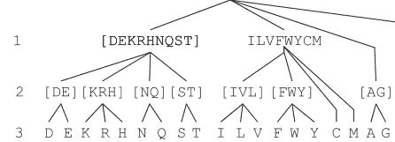

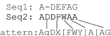

一对代表两个对对比对的模式。

# 渐进对齐

其中 $a_i$ 和 $b_j$ 分别是组 $a$ 的第 $i$ 列和组 $b$ 的第 $j$ 列；$w_{qp}$ 是序列 $p$ 和 $q$ 的加权成对得分；$m$ 和 $n$ 是两个对齐组中的序列数量（对应两列 $a_i, b_j$ 的行数），$p$ 和 $q$ 是对齐列中的第 $p$ 行和第 $q$ 行；$v$ 是常数空隙代价（正值）；如果 $a$ 或 $b$ 为空隙“$-$”，则 $\gamma(a, b) = 1$，否则 $\gamma(a, b) = 0$。

### 5.2.4 DIAAlign

与 T-Coffee 类似，DIAAlign 结合了成对对齐和局部成对对齐特征。DIAAlign 中的多序列对齐（MSA）由具有显著相似性的等长度片段组成。这些片段通过局部成对对齐获得。这种技术与 FASTA 对齐相似。对于远缘序列，DIAAlign 使用类似于 Needleman 算法的全局对齐方法对其进行对齐。对于相关和不相关序列的混合，DIAAlign 仅对具有统计学意义的序列片段进行对齐。使用贪心算法跨序列搜索并对齐相似片段。DIAAlign 不对空隙进行惩罚，且不显著的片段不对齐。

### 5.2.4.1 禁忌搜索

禁忌搜索 [79, 80] 是一种迭代启发式搜索方案，能够结合组合优化问题。禁忌搜索是确定性的，通过维护一个禁止解列表或禁忌列表（Tabu list）来避免局部最优。用于 MSA 的禁忌搜索 [81] 分两个阶段进行。

- *阶段 1*：输入提供搜索的初始解。Tabu MSA 将空隙区域（无论是序列内部局部还是跨多个序列）合并到相邻列，以生成新的对齐。使用 T-Coffee 目标函数对对齐进行评估，并将其加入禁忌列表以防止 Tabu 重复相同的移动。在迭代 $x$ 次后，从禁忌列表中移除得分最高的对齐，以便它们返回解空间。重复这些移动，直到收敛，即没有得分比禁忌列表更低的解，或者执行了 $k$ 次迭代。

- *阶段 2*：此阶段的步骤与此阶段相似，但进行了修改，将最佳移动保留在候选解列表中，即精英列表（elite list）。通过应用精英列表中的移动获得解。

```
Score = \frac{\sum_{i=1}^{N-1}\sum_{j=i+1}^{N} W_{ij} * Score(A_{ij})}{\sum_{i=1}^{N-1}\sum_{j=i+1}^{N} W_{ij} * Len}
```


其中 $N$ 是序列数量；$Len$ 是对齐长度；$w_{ij}$ 是两个对齐序列 $S_i$ 和 $S_j$ 之间的恒同百分比；$A_{ij}$ 是从多序列对齐获得的 $S_i$ 和 $S_j$ 的成对投影；$Score(A_{ij})$ 是 $A_{ij}$ 与对应成对对齐之间的整体一致性水平。

## 5.3 一致性概率 MSA

隐马尔可夫模型（HMMs）被用作 [82, 83] 中序列性结构共识的统计模型。一个区域为密码子的概率计算为：

```
Prob(c_1 · c_k) = \prod_{i=1}^k p(c_i)
```

其中 $p(c_i)$ 是密码子 $c_i$ 的概率。密码子概率是 DNA 序列数据库中 64 个密码子的相对频率。HMM 是具有 (A, B, Π) 的有限状态机；A 是转移概率，B 是输出概率，Π 是初始状态概率。对于任何给定的时间 $t \ge 1$，A、B 和 Π 的定义如下：

- A = {$a_{ij} = P(q_j \text{ at } t+l|q_i \text{ at } t)\}$，其中 $P(a|b)$ 是给定时间 $b \ge 1$ 的条件概率，且 $q_i \in Q$。
- B = {$b_{ik} = P(o_k|q_i)\}$，其中 $o_k \in$，即 B 是给定状态 $q_i$ 下输出 $o_k$ 的概率，而 Π 的计算为：

```
Π = {p_i = P(q_i \text{ at } t=1)}
```

HMM 用于多序列对齐的示例如图 5.6 所示。

### 5.3.1 POA：偏序图对齐

通常，基于 HMM 的方法将 MSA 表示为称为偏序图（partial order graph）的有向无环图。在这种表示中，每列中的所有符号都被编码为：

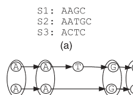

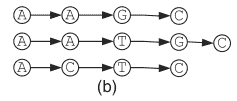

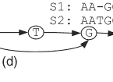

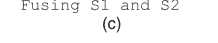

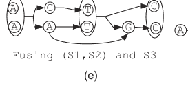

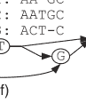

图 5.6：(a) 输入序列，b) 有向图，c) 序列对齐，d) 序列融合，e) 最终对齐，f) 偏序图。

## 一致性和概率 MSA

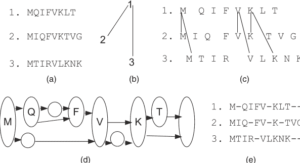

图 5.7：(a) 输入序列，b) 最小生成树，c) 无向图，d) 对齐结果，e) 最终对齐。

### 5.3.2 PSAlign

同样，PSAlign [85] 是构建在树上的。POA 和 PSAlign 的主要区别在于使用偏序图的速度。已经证明 POA 可以在 4 小时内比对 5000 条序列。

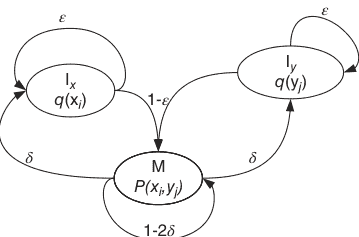

图 5.8：用于对齐两个序列的基础对 HMM。

### 5.3.3 ProbCons：基于概率的一致性多对齐

ProbCons [86] 算法基于序列的一致性。它是一种 HMM 渐进对齐，使用了无惩罚的 Needleman-Wunsch 算法（最大预期精度）。给定输入序列 $S$，算法如下：

- **步骤 1**：对于 $S$ 中的每对序列，后验概率矩阵表示两个残基（一个来自序列 $x$，一个来自序列 $y$）在对齐中配对的概率，其计算如下：

```
$P_{x,y} = \mathbf{P}(x_i \sim y_j \in a * | x, y) \quad (5.8)$
```

- **步骤 2**：对齐 $a$ 的预期精度被定义为正确对齐的残基对预期数量除以较短序列的长度：

```
$E_a(accuracy(a, a *)|x,y) = \frac{1}{min|x|, |y|} \sum_{x_i \sim y_j \in a} \mathbf{P}(x_i \sim y_j \in a * | x, y) \quad (5.9)$
```

- **第 3 步**：将概率一致性变换应用于两对比较，以匹配匹配质量得分 $P(x_i \sim j \in a^* | x,y)$，其计算方法为：

```
$P'_{xy} \leftarrow \frac{1}{|S|} \sum_{z \in S} P_{xz}P_{zy} \quad (5.10)
```

- **第 4 步**：通过层次聚类（如 NJ 或 UPGMA）为序列构建引导树。使用对对评分法和 $P'$ 矩阵对比对结果进行评分。
- **第 5 步**：按照树顺序对指定的序列进行渐进比对。空位罚设置为零。
- **第 6 步**：随机将比对结果分为两组序列并重新比对，直到收敛。

## 5.3.4 T-Coffee：基于树的比对评估一致性目标函数

T-Coffee [58] 是一种渐进式序列比对。它首先使用 ClustW 和 LALIGN [87]（LALIGN 是 Smith 和 Waterman 算法的快速版本——LALIGN 有 Align 和 PAlign 两个版本，分别用于蛋白质序列和核苷酸序列）生成一个两对序列比对库，该库结合了全局两对比对（ClustW）和局部两对比对（LALIGN）。移除重复对，且移除后的重复对将获得双倍权重。基于主库的三元组构建一个扩展库，如果两条序列通过第三条序列进行比对，则创建一个新的两对比对，如图 5.9 所示。扩展库是一个加权残基对列表。从扩展库中进行渐进比对以生成最终的 MSA。T-Coffee 算法如图 5.10 所示。3D-Coffee [88] 是 T-Coffee 的扩展版本，其中每个序列的 3D 结构对从服务器 [http://www.cry.bioc.ac.uk/fugue/] 获取，并利用叠加（[两个结构重叠的位置]）增加扩展库中残基对的权重。

```
SeqA: SSRTFSAVQDEFSLCLEAFET

SeqB: SRTR----------LEAF--QD-ERFSLCLEAF---

SeqC: MRRRRTRKRRVSQLDLELEAFRQQ
```

(a) (b)

图 5.9 在 T-Coffee 中生成扩展两对比对。(a) 序列 SeqA 通过中间序列 SeqB 与序列 SeqC 比对。(b) 序列 SeqA 和序列 SeqC 的新两对比对。

## 多序列比对算法

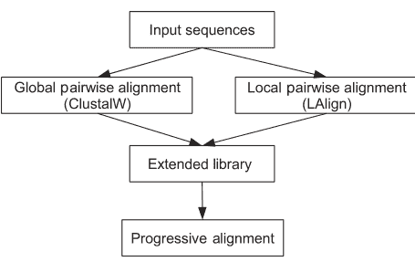

**图 5.10** T-Coffee 多序列比对方案。

### 5.3.4.1 使用图 5.9 中相同序列的示例。

sequence a: SRTRFSAVDEFSLCLEAFET
sequence b: SRTRQRDELEAFE
sequence c: MRRRTRKRRVLSQDLEAFERQQ

假设 [a,b] 的比对得分为 88，{a,c} 为 100，{b,c} 为 77。三元组权重计算方法为：将 $a_2 = R$ 比对到 $c_4 = R$ 获得 100 的权重，而将 $a_2 = R$ 通过 $b_2 = R$ 比对到 $c_4 = R$ 获得 $\min(\{a,b\}, \{b,c\}) = \min(88,77) = 77$ 的权重。上述内容加粗显示。

### 5.3.5 MAFFT：基于 Fourier变换的 MSA

MAFFT [57] 是一种基于快速傅里叶变换（FFT）的高效多序列比对。其核心思想是寻找数据中的峰值，然后使用矩阵变换将所有峰值合并成矩阵形式。该变换类似于矩阵乘法，仅保留峰值区域。应用于 MSA 问题，快速傅里叶变换极大减少了解空间并加速了过程。MAFFT 技术如下：每个核苷酸 $a$ 或氨基酸被表示为一个归一化向量，其分量为体积值 $v(a)$ 和极性值 $p(a) = [v(a) - \bar{v}]/\delta_v$，以及 $\tilde{p}(a) = [p(a) - \bar{p}]/\delta_p$，其中上划线代表不同符号数量的平均值（蛋白质为 20，DNA/RNA 为 4），$\delta_v$ 和 $\delta_p$ 是极性和体积的标准差。

两条序列之间的相关性定义为：

```
$c(k) = c_v(k) + c_p(k) = (5.11)
```

对于任意对序列，$c_v(k)$ 和 $c_p(k)$ 为：

```
$c_v(k) = \sum_{1\le n\le N, 1\le n+k\le M} \hat{v}_1(n)\hat{v}_2(n+k), \quad (5.12)
```

## 一致性与概率 MSA

```
$c_p(k) = \sum_{1\le n\le N, n+k\le M} \hat{p}_1(n)\hat{p}_2(n+k), \quad (5.13)
```

其中 $N$ 和 $M$ 是序列的长度。

### 5.3.6 AVID

AVID [89] 是一种迭代方法。它使用 Smith 和 Waterman 算法寻找极大片段。

### 5.3.7 欧拉路径

欧拉路径用于解决 MSA 问题。该技术基于 Bruijn 图，如 Clustal 所示。罚分为 $S^o$，不对，$S^o$ 是空位罚分。

## 5.4 遗传算法

### 5.4.1 SAGA：基于遗传算法的序列比对

SAGA [97] 从一个包含随机比对的初始种群 $g_0$ 开始。在第 $n > 0$ 代，SAGA 使用对评分函数对每个成员进行评分，并允许产生后代。后代通过交叉、空位插入和块洗牌的组合产生。交叉允许如图 5.13 所示交换父代的块；空位插入方法通过向父本插入空位来创建孩子；块洗牌允许空位块向左或向右移动。通过替换种群成员的新后代来保持种群规模不变。种群中不允许出现重复成员。当在第 $n + k$ 代无法找到适应度评分更好的后代时，算法终止。$n$ 和 $k$ 是用户预定义的参数。该算法迭代地选择序列比对路径中的残基作为锚点（极点），并尝试寻找锚点之间的最佳得分路径。

## 84 多重序列对齐算法

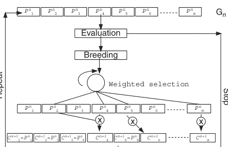

**图 5.14** SAGA 对齐方案。在任何世代 $G_i$ 中，父代 $P^i$ 通过随机操作 $X$ 进行杂交或突变，生成一组新的子代 $P^{i+1}$。

带有蚁群优化的遗传算法（GA-ACO）将遗传算法（GA）技术与蚁群优化（ACO）[103]结合以防止局部最优。ACO 是一种模拟蚂蚁行为的迭代启发式算法。当蚂蚁移动时，它会在路径上分泌信息素供其他蚂蚁跟随。信息素的量与发现食物的质量或数量成正比。信息素随时间推移而衰。蚂蚁遵循强度最高的路径。将 ACO 应用 GA 时，将蚂蚁分配到 GA 中父代对齐的随机列中以跨越序列。经过 $x$ 次迭代后，剩余的后代将进行对齐、保留并传递给后代的后代。

### 5.4.2 遗传算法与自组织神经网络

GA-SNN [104] 利用自组织神经网络和遗传算法对一组序列进行对齐。自组织神经网络由两层组成：输入层和输出层。输入层中的每个节点/神经元以特定的权重连接到输出层中的每个节点。输出层中的节点/神经元与其邻居相互连接。5.15 展示了该方法使用的神经网络。神经网络用于在遗传算法识别序列中的保守区域，以选择这些基序（motifs）对齐的后代。神经网络识别序列基序的方法：

(i) 使用长度为 3 的滑动窗口为每个输入序列生成词汇列表；
(ii) 将词汇输入神经网络的输入节点中；
(iii) 将第三个子网络中出现的词汇分类为基序并赋予它们更大的权重。

哪些词汇允许从第三个子网络中出现取决于该模式的权重。当词汇输入神经网络时，输入节点/神经元计算词汇之间的距离并在顶层将它们分组。这些组中的每个词汇都传递给下一个第一个子网络、第二个子网络、第三个子网络

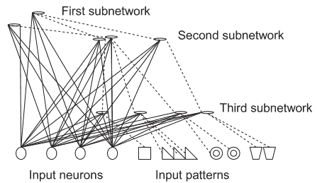

图 5.15 神经网络。

词汇之间的距离定义为它们长度为 2 的重叠词的平均距离（每个词被拆分为两个重叠的词进行比较）。词汇的分类和分组与顶层子网络中的技术类似。到达神经网络底部的模式将与存储在该节点处的模式进行成对对齐。节点处具有最高对齐得分成对总分（sum-of-pair score）的模式将被作为胜者或基序。

### 5.4.3 FAlign

FAlign [105] 将渐进和迭代细化算法结合到多重序列对齐（MSA）中。该方法要求用户识别并定义序列中的基序区域。序列在所有序列的基序边界处分割成段，并对每个段进行渐进对齐。段在对齐后重新组装以生成对齐结果。FAlign 使用 BLOSUM62 分数矩阵和成对总分。算法的最后一步是随机迭代地移动非基序区域的空隙和残基，以提高对齐得分。

## 5.5 多重序列对齐算法的新进展

在本节中，我们将探索一些新序列对齐算法的细节及其相对于流行的现有算法的可靠性。

### 5.5.1 KB-MSA: 基于知识的多重序列对齐

KB-MSA [66] 利用 Swiss-Prot、UniProt 或 Homstr 等现有生物知识数据库来引导序列对齐。该算法方案如图 5.16 所示，遵循以下步骤：

- **步骤 1**：使用 Needleman 算法全局成对对齐序列。
- **步骤 2**：从每个簇中选择一个代表性序列作为枢纽（pivot）。
- **步骤 3**：查询知识数据库获取高于预定义阈值 $\alpha$ 的得分。提取这些序列的生物块以生成子代。
- **步骤 4**：使用 Smith 和 Waterman 算法 [18] 对组内的序列进行局部成对对齐。产生低得分的序列将与其子代进行对齐并重组。

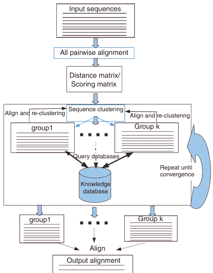

**图 5.16** 基于知识的多重序列对齐方案。初始，将输入序列划分为相关组。使用组的代表性序列搜索任何可用的生物信息。根据发现的知识对序列赋予不同的权重并重组。移除子代，重复步骤 2–5，直到满足停止标准。停止标准为：(i) 从知识数据库找到注释块；(ii) 上次迭代未发生序列重组；(iii) 已执行步骤 2–5，其中 $x$ 由用户定义。
- **步骤 7**：通过排列等效块对齐序列。
- **步骤 8**：将每个簇表示为部分序图，其中每个显著块为一个节点。
- **步骤 9**：使用算术平均聚类（UPGMA） [60] 根据成对簇得分构建树。
- **步骤 10**：遵循引导树对簇进行成对对齐。
- **步骤 11**：使用 MAFFT [57] 对齐非显著块以提高对齐得分。

#### 5.5.1.1 组装序列对齐 KB-MSA 算法的步骤 8–10 需要更多细节，而其他步骤非常直观。当所有序列簇都经过完善且其序列成员已被标记后，为每个簇构建一个部分序图（步骤 8）。图中的每个节点代表簇中不同序列的段，以表示特定的注释块。图中每个图中节点都是序列与实际生物数据之间的最佳匹配，且不应更改。这种部分序图表示与 [84] 不同，后者节点代表单个残基。例如，假设输入序列（来自 BALiBASE [52]）

```
1ABOA WCEAQTQNGGGVPSNITPVN

1YCSB WARLNDKEGYVPRNLLGLYP

1PHT WLYGNNETGERDFPGTYVEYIRGRKKISP

IHVA AVVIIDNSDIKVPRRAKIIARD

VIE YASEEAHPSGVQIIPVAALER
```

每个序列都有前缀。应用 KB-MSA 算法的步骤 1-8 后，创建并注释了两个簇（1ABOA, 1YCSB, 1PHT, 1VIE），如图 5.17 所示。在这个示例中，两个簇具有相同的部分序图。
为每个序列簇生成部分序图后，下一步（步骤 9）是生成一个引导树，指示哪对簇最接近。为了这一点，必须计算簇之间所有成对距离（或对齐得分）。Needleman 和 Wunsch 算法 [19] 被修改为使用节点

## 多序列比对算法

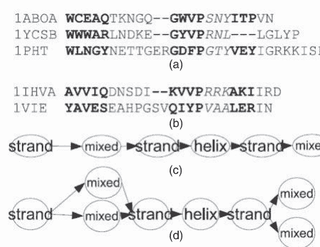

**图 5.17** 通过偏序图进行聚类比对，其中**粗体文本**代表 β-折叠块，*斜体*代表 α-螺旋块，其他为非显著块。(a) 和 (b) 显示了待比对的两个簇，每个簇之前标有其名称；(c) 是代表簇 (a) 和 (b) 的偏序图；d 是 (a) 和 (b) 的融合图。序列来自 BLiBBase。

| WCEAQ | WCEAQ | WCEAQ |
| :--- | :--- | :--- |
| WWWAR | WWWAR | WWWAR |
| WLNGY | WLNGY | WLNGY |
| AVVIQ | AVVIQ | AVVIQ |
| YAVES | YAVES | YAVES |

**图 5.18** 通过滑动技术寻找两个偏序图节点之间的匹配分数。重叠列被矩框圈。不重叠列被视为带有空位的匹配。

用于寻找两个节点之间最佳匹配得分的滑动技术。在这种技术中，节点相对于另一个节点滑动，每次移动一个残基以寻找最佳匹配位置，即所有列得分之和最大的位置。图 5.17 显示了之前示例（图 5.17）中两个 β-折叠节点之间的滑动步骤。重叠列被矩框圈。为了避免非重叠列产生空位罚分的复杂性，使用了分层期望匹配概率 (HEP) [49] 来计算两个节点列之间的匹配得分。滑动技术允许每个图中节点的残基排列在整个比对过程中保持完整。

### 5.5.1.2 匹配评分

为了确定序列与从知识库获取的生物特征是否产生良好的比对得分，必须测量其显著性阈值。显著性阈值是特征平均中位数 (FAMS)，定义为特征本身平均比对得分的一半。

# 多序列比对算法的新进展

任何与生物特征比对且产生的平均显著匹配得分 (ABSMS) 低于此阈值的序列被认为是不显著的。

对于任何从知识库查询的第 i 个显著特征 sig 及其对应的两对最优比对 A(x,y)，其平均生物显著匹配得分 (ABSMS) 定义为：

```
$S(sig,A(x,y)) = \frac{S(A(x,y)) + S(A(y,y))}{S(A(sig,sig)) + S(A(y,y))}, \quad (5.17)
```


其中 `x` 是 `sig` 的片段，`y` 是比对序列的片段，`A(x,y)` 是片段 `x` 和 `y` 之间的最优两对比对，`S(A(x,y))` 是 `A(x,y)` 的比对得分。注意两个空位符号之间的所有匹配都不评分。

例如，假设有一个最优两对比对：

```
$A = \begin{cases} L & F & V & A \\ L & F & - & A \end{cases}$
```

它源于包含：“NLVAL”（顶部）和另一个序列（底部）的 β-折叠特征。为了简单起见，我们假设残基 i 的匹配分为 0，空位 i 为 -1。因此，FAMS 为 $\frac{1}{2} = 0.5$，而比对得分 S(A) 为 2：

```
$A = \begin{cases} L & F & V & A \\ L & +1 & -1 & +1 \end{cases} = 2 (\text{比对得分})$
```


β-折叠与其自身比对得分为 6（有六个残基），序列到自身的比对得分为 3（序列中出现了三个残基）。平均显著匹配得分 (ABSMS) 为 $\tilde{S} = \frac{2+1}{6} = 0.55$。由于 $\tilde{S} = 0.55$ 大于平均得分 (0.5)，比对中的片段被标记为显著。

### 5.5.1.3 KB-MSA 的一致性变化

当序列数据可用时，可以修改 KB-MSA 以利用输入序列的一致性。为此必须构建包含输入序列一致性信息的临时数据库。一致性数据库可以通过以下步骤构建：

- 步骤 1：通过动态规划执行所有两对序列比对。
- 步骤 2：对于每个序列，将比对片段标记为显著块（或一致性块）。
- 步骤 3：计算每个序列的匹配权重。
- 步骤 4：为每个序列生成包含显著块及其权重的模式。

图 19 展示了为 KB-MSA 创建一致性数据库的过程。当序列中的每个残基被识别为两对比对的一部分时，权重向量 $w$ 加 1。每个显著块表示为块识别和权重因子。权重因子是两对比对中识别块的总数除以所有输入序列的数量。对于知识数据库的所有特征块，权重因子设置为 1。

在多序列比对中使用序列信息是 T-Coffee、ProbCons 和 MAFFT 的基础。然而，该算法中的一致性代表许多序列之间的共同残基，而 T-Coffee 或 ProbCons 和 MAFFT 是局部/全局两对比对得分或转换概率。

### 5.5.1 基准

为了验证基于知识的比对算法 (KB-MSA) 生成的比对的准确性和可靠性，利用了 BALibase [52]、PREFAB [53]、HOMSTRAD [15] 和 SABMARK [106] 多序列比对基准。BALibase 基准包含经过修正和验证的比对。这些参考被分为九组。每组设计用于不同类型的比对。Ref1 比对没有插入或延伸子集，每个子集包含少于六个相似序列。Ref2 比对高度差异序列。Ref3 包含相似性小于 25% 的家族模式。

| | f1 | f2 | f3 |
| :--- | :--- | :--- | :--- |
| Seq1: TTAGATAACA | | | GA CATAA |
| Seq2: AGACATAACA | | | w: 1/3 2/3 1/3 |
| Seq3: GGAGACTAGAAA | | | |
| Seq1: TTAGATAACA | | | w: 000001111100 |
| Seq2: CATACCA | | | |
| Seq1: TTAGATAACA | | | w: 00012222211100 |
| Seq3: GACTAGAA | | | |

**图 5.19** KB-MSA 一致性数据库的注释序列创建。(a) 显示输入序列以及具有三个块 f1、f2 和 f3 的最终注释模式，权重分别为 1/3、2/3 和 1/3；(b) 显示了 seq1 的局部两对比对及其权重向量。

# 多序列比对算法的新进展

每对中的两个家族之间。Ref4 包含长延伸，Ref5 包含内部插入和删除。参考 6–8 设计用于跨膜区、反向域和重复序列。前 5 个参考经过完全检查和验证，使其成为新比对算法的合适基准。比对的准确性基于序列间正确比对的列数。

第二个使用的基准是 PREFAB [53]，它包含 182 个比对。这些比对通过两个已知 3D 结构序列的两对比对以及这些对最多 24 个高得分同源序列生成。比对的准确性基于已知 3D 结构的序列对。

第三个基准是 SABmark [106]，它包含两个子集：超家族和第十二。每个超家族代表 SCOP 25–50% 的相似性。第十二子集中的每组包含相似性 0–25% 的序列。这些子集扩展到了非同源序列作为假阳性。SABmark 通过对比两对参考集的平均两对比对得分获取多序列比对准确性。

第四个使用的基准是 HOMSTRAD（同源结构比对数据库）[15]，它包含 130 个蛋白质家族和从 X 射线结构分析中选出的 590 个比对结构。尽管 HOMSTRAD 未设计为基准，但其序列按家族聚类和比对，使其成为 MSA 的良好候选。

### 5.5.1 参考文献和讨论

在这些评估使用了 ClustalW [55]、MAFFT [7]、ProCons [86] 和 T-Coffee [58]。BLOSUM62 替换矩阵用于量化两对比对中空位罚分为 -4 的。此外，从知识数据库查询的生物注释特征是序列二级结构（β-折叠和 α-螺旋）和基序。由于大多数序列来自蛋白质数据库 (PDB)，使用了 Swiss-Prot [10]（基于 PDP 构建）序列知识库进行这些基准测试。知识数据库可能包含不完整的序列信息，即某些序列的生物学不可用。为了模拟这种情况，使用 10% (KB-MSA 10%) 的序列知识进行基准测试，其中用于查询知识数据库的序列最多使用 10%。这 10% 是从 HOMSTRAD 随机数据集实验（从 50%、30%、20%、10%、5% 范围内）中得到的，此时大多数比对准确性显著下降。

使用了 BALIBASE [52] 中的前五个完全验证的参考（Ref1, Ref2, Ref3, Ref4 和 Ref5）。图 5.20 显示了平均 BALIBASE 基准比对得分。全支持 Swiss-Prot 数据库的 KB-MSA 测试在所有测试算法中产生最高分。它比 ClustalW 和 T-Coffee 平均高 10%，比 ProCons 和 MAFFT 分别高 8% 和 7%。

### BAliBase 基准测试 – 平均列分值

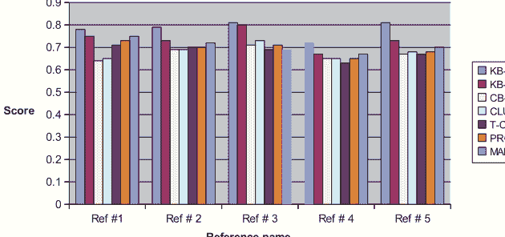

**图 5.20** KB-MSA 在 BAliBase 基准测试中与 ClustalW、T-Coffee、ProbCons 和 MAFFT 的对比。在具有完整序列知识的情况下，KB-MSA 将对齐得分提高了了 9% 以上。在具有 10% 序列知识的情况下，KB-MSA 提升了约 4% 的提升。

KB-MSA 10% 代表在部分知识数据库上测试的 KB-MSA，该数据库中仅允许 10% 的对齐序列查询数据库。这些序列是随机选择的，以模拟部分知识数据库，即最多有 10% 的查询能从数据库中获得任何有效结果。CB-MSA 是 KB-MSA 的变体，将序列知识数据库替换为一致性数据库（consistency database）。在没有实际生物学知识数据库的情况下，KB-MSA 算法在 BAliBase 基准测试上的表现仍与 ClustalW 和 T-Coffee 相当。

同样，在 SABMark 的序列子集上进行了相同的测试。结果如图 5.21 所示。在 Swiss-Prot 知识库的完全支持下，新算法（KB-MSA）优于其他算法 8% 到 15% 不。在模拟 10% 查询命中率的情况下，KB-MSA (KB-MSA 10%) 丢失了一定的准确性；然而，它的准确性仍与 ProbCons（最准确的对齐数据库）相当。在没有序列数据库支持的情况下，基于一致性的（CB-MSA）算法与 T-Coffee、ClustalW 和 MAFFT 相当。

HOMSTRAD 和 PREFAB 基准测试中的序列根据其恒等性或序列相似性被分为测试组。每组包含处于 20% 恒等性范围内的序列。图 5.22 和 5.23 显示了这两个基准测试的结果。从这些结果可以看出，具有完整知识库支持的新对齐算法（KB-MSA）在包含低百分比恒等性序列的数据集上优于所有其他算法。这些改进直接来源于其他算法无法访问的序列知识库。这种优势随着恒等性百分的增加而逐渐消失。对于恒等性大于 40% 的数据，新算法的准确性与其他算法相当。

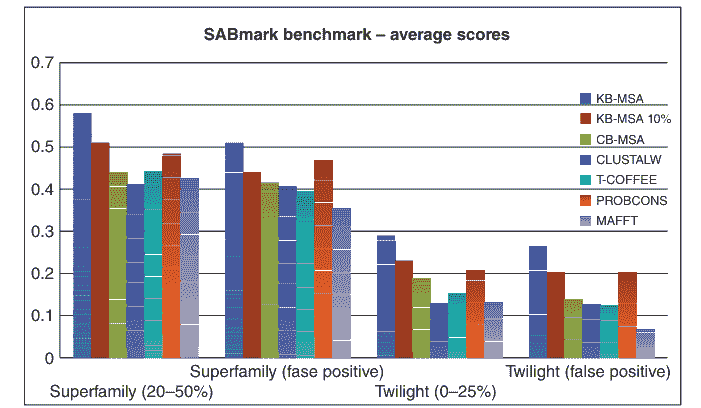

**图 5.21** KB-MSA 在 SAB-mark 基准测试中与 ClustalW、T-Coffee、ProbCons 和 MAFFT 的对比。在具有完整序列知识的情况下，KB-MSA 在原始数据集上的平均对齐得分至少提高了 8%，在假阳性数据集上则了 6% 以上。

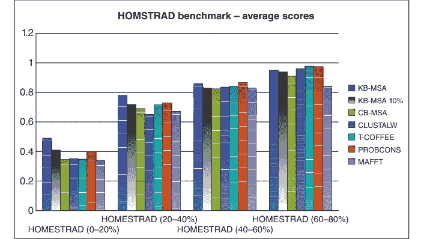

**图 5.22** KB-MSA 在 HOMSTRAD 上与 ClustalW、T-Coffee、ProbCons 和 MAFFT 的对比。在具有完整序列知识的情况下，KB-MSA 在序列恒等性小于 20% 的数据集上平均对齐得分提高了约 10%。

### PREFAB 基准测试 – 平均分数

| PREFAB 基准测试 | KB-MSA | KB-MSA 10% | CLUSTALW | T-COFFEE | PROBCONS | MAFFT |
|---|---|---|---|---|---|---|
| 0.9 | | | | | | |
| 0.8 | | | | | | |
| 0.7 | | | | | | |
| 0.6 | | | | | | |
| 0.5 | | | | | | |
| 0.4 | | | | | | |
| 0.3 | | | | | | |
| 0.2 | | | | | | |
| 0.1 | | | | | | |
| PREFAB (0–20%) | PREFAB (20–40%) | PREFAB (40–60%) | PREFAB (60–80%) | | | |

**图 5.23** KB-MSA 与 Clustal、T-Coffee、ProbCons 和 MAFFT 的对比。在具有完整序列知识的情况下，KB-MSA 在序列恒等性小于 20% 的数据集上对齐得分至少提高了 7%。

具有 10% 知识库支持的 KB-MSA 在大多数情况下产生与 ProbCons 相似的对齐得分，而使用一致性数据库的 KB-MSA (CB-MSA) 在许多情况下与 ClustalW 和 T-Coffee 相对相当。

观察基准测试的实验数据，基于知识的多重序列对齐算法（KB-MSA）在所有数据集上的表现持续良好，特别是当对齐序列的恒等性最多为20% 时。在 PREFAB 基准测试中，可以预期新算法在“暮光区”（twilight zone）数据集上的表现会更好，该区域是对每个数据集的核心对（core-pair）进行评分的。如果 KB-MSA 使用核心对查询数据库，它应该获得近完美的得分。然而，KB-MSA 并不是从这些组中检测核心对。在恒等性百分比较高的数据集上，大多数测试算法都表现良好，少量的额外序列知识可能对对齐结果贡献不大。比较三个基于一致性的算法（CB-MSA、ProbCons 和 T-Coffee），ProbCons 是该组中最好的，而 KB-MSA 和 T-Coffee 之间的差异并不明显。

### 5.5.2 PT：基于动态树的渐进序列对齐

加权树上的渐进多重序列对齐（PADT）是渐进 MSA 的特殊变体，已应用于 T-Coffee 和 Clustal。该算法与其他算法显著不同之处在于，它能够改变序列对齐顺序，以便在可用新信息时反映最佳的成对匹配。最初，获取所有输入序列的生物学信息和局部对齐得分。生物学信息可以通过查询 Swiss-Prot 或 EMBL 等序列数据库获得。为了合并这些信息，序列中的每个残基将表示为一个三元组 $(r, \alpha, \beta)$，包含残基 $r$、局部对齐得分 $\alpha$ 和生物学评分 $\beta$。这些信息被用于增强全局成对对齐，估计序列对齐树。此外，该算法中的引导树可以根据较低层分支对齐的结果动态恢复其分支。

### 5.5.2.1 PADT 算法

对齐 $n$ 个输入序列的算法为：

- 步骤 1：每个序列被表示为一个三元组。
- 步骤 2：对于每个序列，从数据库提取生物学信息。
- 步骤 3：通过比对方法进行所有成对对齐。
- 步骤 4：使用步骤 4 得到的距离矩阵。
- 步骤 5：通过 NJ 算法估计引导树。
- 步骤 6：根据引导树对齐所有分支。

### 5.5.2.2 动态引导树

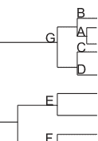

**图 5.24** 此图说明了比齐引导树分支之间的可变性。假设距离 A、B、C 和 D 的距离均小于 $\epsilon$，则 A、B、C 和 D 是互可交换的。

通过在具有两个以上互换分支的树层上执行所有两对比齐来完成。选择比齐效果最佳对进行空隙细化。该过程不断重复，直到该层级的所有分支都比齐完毕。因此，该引导树保证了任何层级的比齐都能产生最高的两对比齐得分。$\epsilon$ 定义为比齐树所有内部节点之间平均距离的一半。尽管如此，该值是一个参数，可以通过来扩展或限制树层上的可变性范围。形象地说，这种互换性如图 5.24 所示，其中 A、B、C 和 D 到 G 的距离均小于 $\epsilon$，在分支 A 之前的两对比齐可能会使其更接近 C 或 D。因此，A、B、C 和 D 是互可交换的。

空隙细化步骤如下：对于任何包含两个以上序列的比齐，在进行两对比齐之前插入的空隙将重新进行比齐，以提高比齐得分。这些空隙在最后一次比齐之前的步骤中是必要的，但在最后比齐之后可能不再那么显著；因此，重排可能会提高比齐得分。随机选择空隙并将其移动到连续保守区域的最近边界。边界由两个相邻残基之间的残基得分差 $\beta$ 或它们的局部比齐得分 $\alpha$ 指示。在存在生物学得分和局部比齐得分的情况下，会对这些得分指示的两个边界进行测试。空隙将被重新放置在能够提高比齐得分的位置。

# 5.6 测试数据与比齐方法

使用了五种不同的现有渐进式比齐工具 ClustW [55]、DIAlign [56]、T-Coffee [58]、MUSCLE [53] 和 ProbCons [86] 来测试新算法的性能。其中，ClustW 和 MUSCLE 利用全局比齐方法；DIAlign 采用局部比齐技术；T-Coffee 结合了全局和局部策略；而 ProbCons 采用带有隐马尔可夫模型的全局技术。这些比齐算法在来自三个不同参考基准的数据集上执行：反转录酶顺序特异性基（RT-OSM）序列 [51]（如图 3.13 所示）、BaliBASE.0 [52] 和 PREFAB（蛋白质参考比齐基准 4.0 版本）[53]。这些基准的细节已在第 3 章前描述。

在下一节中，我们将描述新 MSA 算法的实验结果。

## 5.7 结果

所有比齐工具均使用默认参数运行。新比齐方法（PADT）使用的参数中，局部比齐得分 $\alpha$ 设置为 $1/n$，其中 $n$ 是输入序列的数量；具有生物学意义的残基 $\beta$ 设置为 1；空隙罚分为 -10；替换得分来自 BLOSUM62 [27]。

实现了新的比齐方法 PADT（基于动态权重树的渐进式 MSA），用于从相同的输入序列生成两种比齐：一种是通过遵循 UPGMA 方法 [60] 创建的进化树构建的，另一种是通过遵循由邻接法（NJ）方法 [61] 创建的树构建的。

### 5.7.1 衡量比齐质量

衡量此类一致性的两种流行方法是总列数（TC） [52] 和保守区域（或基序）被正确比齐的百分比。TC 得分是其他方法正确比齐的参考比齐的百分比。

### 5.7.2 RT-OSM 结果

RT-OSM（反转录酶顺序特异性基序）[51] 测试旨在寻找对序列基序敏感的比齐算法。这些基序区域可能非常短，如果可用，可以整合到多序列比齐技术中。在 RT-OSM 基准中，所有基序都必须经过注释。预计，算法两个版本的算法（PADT-NJ 是利用邻接法进化树估计的新型多序列比齐，PADT-UPGMA 是利用 UPGMA 进化树估计的新型 MSA）都产生了最高比齐。结果如图 5.25 所示。

### 5.7.2.1 BaliBASE 结果

除了 RT-OSM 测试外，还对 BaliBASE 基准的前五个参考集（Ref#1 到 Ref#5）进行了所有测试。这些参考集已通过确认和验证，包含 200 多个参考比齐。Ref#4 和 Ref#5 包含大 N/C 插入和扩展的比齐表现不佳，而局部比齐算法表现良好。BaliBASE 测试的结果如图 5.26 和 5.27 所示。使用邻接法的新算法

### RT-OSM – 基序比齐百分比

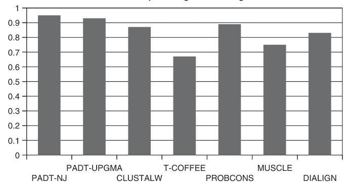

**图 5.25** PADT-NJ、PADT-UPGMA、ClustalW、T-Coffee、ProbCons、MUSCLE 和 DIAlign 在 RT-OSM 上比齐的基序百分比

# 6 多序列比对中的系统发育学

多序列比对（MSA）是系统发育分析中的常用工具，通过它可以识别不同生物的进化树，并将其组织成一种分级结构，使得亲缘关系近的物种在空间上相互靠近。这种结构被称为发育树（phylogeny）——对分类群演化的一种推测。不要混淆的是，许多 MSA 算法也使用成对比对来构建发育树，作为进一步优化的参考。这两种类型的发育结构可能代表也不代表相同的信息，因为前者基于成对比对构建，而后者则源于最终组装的 MSA。我们应该将通过计算任何序列距离而构建的发育树视为这些待比对序列的特定发育树。

## 6.1 生命之树

由于 MSA 具有两个显著特征，它们经常用于创建发育树——生命之树。首先，大多数功能域在序列中是已知并经过良好注释的；因此，MSA有助于在未注释的序列中识别这些功能域。通过这种方式，可以相似的功能域对序列进行分类。第二个特征是发现已知功能上重要的保守区域的能力。得益于 MSA 技术允许突变和插入/缺失（indels）的灵活性，MSA使得通过序列间的同源性分析和发现进化关系成为可能。

> 多生物序列比对：评分函数、算法与应用
> 第一版。Ken Nguyen, Xuan Guo, and Yi Pan.
> © 2016 John Wiley & Sons, Inc. Published 2016 by John Wiley & Sons, Inc.

传统上，生物学家使用卡尔·林奈（Carl Linnaeus）在1735年的《自然体系》（System Naturae）中提出的经典林奈分类标准模型 [108]，在该模型中，每个生物都被分配一个界、门、纲、目、属、种。该系统将生物分类为越来越小的组。在这个模型中，生物是根据其语境组织的，而不是根据其遗传位置。例如，植物的分类根据生殖系统分为 24 类，如第 1 类——单蕊花（Monadria，具有1个雄蕊的花），第 24 类——无子植物（Cryptogamia，无花植物）。同样地，动物被分为哺乳纲（Mammalia）、鸟纲（Aves）、两栖纲（Amphibia）、昆虫纲（Insects）和脊椎纲（Verte）。系统发育分类系统仅命名纲——即遗传上源自共同祖先的生物群。这种分类系统依赖于现代生物从古代祖先演化来的过程。变异是导致突变、迁移、遗传漂变、适应性或自然选择的力量产生的结果。一些常见原因包括：环境变化、食物供应、饮食和杂交。

由于系统发育分类依赖于 DNA、RNA、蛋白质结构等遗传信息，我们可以系统且精确地从遗传上识别和分类物种。如图 6.1 所示，爬行动物和鸟类在遗传上属于同一个支系。

系统发育分类系统允许新发现的物种通俗地被放入其科。例如，恐龙和鸟类属于同一个恐龙目，尽管它们与其他生物具有 DNA 相似性。因此，树的分支可以作为一个物种演化为下一个物种所需时间的估计。

此外，系统发育模型可以根据其后代中缺失的功能域来识别灭绝谱系。具体方法允许生物学家通过放射性同素定年、地层学和分子钟来识别进化过程中发生了什么以及何时发生。例如，

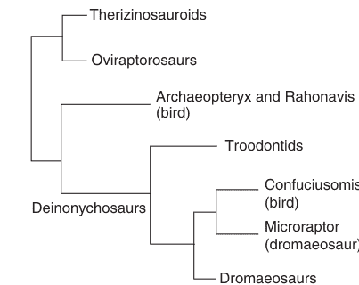

**图 6.1** 系统发育树中的一个小支系。（来源：改编自 Mayr 等人 2005 [109]。）

可以通过测量放射性元素的半衰期衰变直接对化石进行定。同样，化石限制和分子变化速率可用于推断两个物种分化的时间。这些技术耗时且昂贵，但为生物进化提供了更精确、更详细的信息。幸运的是，所有生物都可以表示为生物序列。那些已被识别、分析和注释的序列允许我们利用 MSA 等计算工具，将已知知识和现有的注释序列应用于外推、预测以及识别其他序列中的功能区域和结构域。

## 6.2 发育树的构建

发育树的主要目的是描绘生物的进化。因此，正确地重构进化并将其表示为发育树是一项关键任务。如第 4 章所示，可以根据恒等性和相似性得分从成对比对构建发育树。发育树表示为有根树或未根树。在有根树中，根是所有被研究的操作分类单元（OTUs）的共同祖先。从根到节点的路径定义了进化路径。

在未根树中，描绘了 OTU 之间的关系，但没有指定进化路径。有根树和未根树可以相互转换。例如，图 6.2 中的未根树 (b) 可以通过将节点 Seq2 设置为根形成有根树。通常做法是，如果发育树是有根的，每个分支有两个后代；如果是未根的，则有三个邻居。这种分级结构是生物中观察到的相同且同步的进化速率稀少的结果（否则，就不会分化）。系统发育重构得到了科学界的良好支持。有大量的可用软件包设计用于创建发育树。华盛顿大学基因组部门在 `http://evolution.washington.edu/phylip/software.html` 维护着一份全面的列表。发育树通常由距离法或基于字符的方法生成。

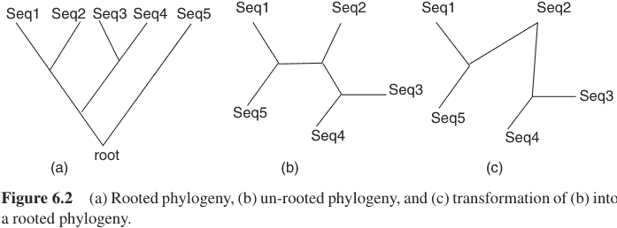

### 6.2.1 距离法

在该模型中，给定一个 $n \times n$ 矩阵 $M$，其中 $M_{ij} \geq 0$，且 $M_{ij}$ 是 OTU $i$ 和 OTU $j$ 之间的距离。构建一个加权树，每个叶子对应一个 OTU，第 $i$ 个叶子与第 $j$ 个叶子之间的距离为 $M_{ij}$。例如，表 6.1 表示 OTU 之间的距离矩阵。

通过这种构建，$M$ 中的距离是加加的，任意两个 OTU 之间的权重之和等于它们之间的距离。图 6.3 中的树是表示发育树的加树。对于所有加距离矩阵，存在 $O(n^2)$ 的寻找树算法。现实中，距离很少是加加的；因此通常需要寻找最拟合数据的树。有两种流行的方法：

- 1. Cavalli-Sforza 和 Edwards 方法找到使以下公式最小的距离 $d_{ij}$：
$$\sum_{i,j} (M_{ij} - d_{ij})^2$$

- 2. Fitch 和 Magliash 方法找到距离 $d_{ij}$ 使得：
$$\sum_{i,j} \frac{(M_{ij} - d_{ij})^2}{M_{ij}^2}$$

这两种模型都会导致计算上难以处理的问题。一个简单的插图是从 3 个 OTU 构建树，只有一种构建 3 节点树的方法。在 3 节点树中再添加另一个 OTU，我们将有三棵树需要考虑，

### 表 6.1 距离矩阵

| | A | B | C | D | E |
|---|---|---|---|---|---|
| A | 0 | | | | |
| B | 9 | 0 | | | |
| C | 9 | 8 | 0 | | |
| D | 8 | 7 | 3 | 0 | |
| E | 6 | 11 | 11 | 10 | 0 |

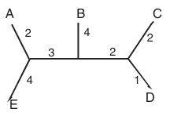

**图 6.3** 根据表 6.1 的加距离矩阵生成的树。

### 6.2.2 基于字符的方法

在这一模型中，每个 OTU 被表示为一个字符序列，其中每个字符代表一个不同的特征（例如有翅膀或没有翅膀），或 OTU 的生物化学结构（例如蛋白质中的氨基酸或 DNA 中的核苷酸）。这些基于字符的方法假设每个字符与其他之间是相互独立的。有两种流行的方法：极大简约性法（maximum parsimony method）和极大似然法（maximum likelihood method）。

#### 6.2.2.1 极大简约性

极大简约性法（MP）使用一种最优标准，在该标准下，优选的进化树是字符状态变化总数最少的树。例如，图 6.5 显示了表 6.2 所列 DNA 序列的有根进化树，其中 `Seq1` 和 `Seq2` 的差异在于字符 A 和 C 之间的突变，`Seq4` 和 `Seq5` 的差异在于 C 和 T 之间的突变。最后，`Seq3` 通过 T 和 G 之间的突变与其他祖先分化。

### 表 6.2 包含五个残基符号的五个序列示例

| | 1 | 2 | 3 | 4 | 5 |
|---|---|---|---|---|---|
| Seq1 | A | A | C | C | G |
| Seq2 | C | A | A | C | G |
| Seq3 | C | C | T | A | T |
| Seq4 | C | T | G | G | G |
| Seq5 | T | T | G | G | G |

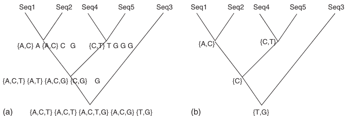

**图 6.5** (a) 为表 6.2 中的序列创建的有根进化树，突变表示在内部节点中。(b) 树的 Fitch 表示（内）。

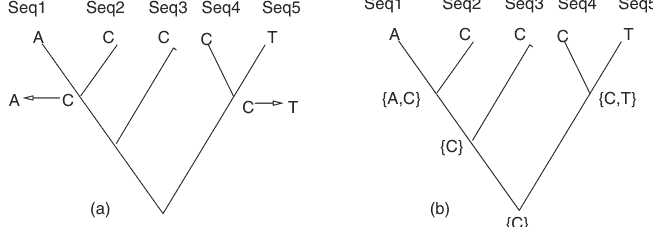

**图 6.6** 字符突变的示意图。(b) 代表使用 Fitch 算法构建内部节点的过程。

OTU 的每个字符位点的突变也可以以树的形式呈现。这棵树可以使用 Fitch 算法从外部节点（子节点）向根节点内部构建。对于序列的每个位置（列），叶节点由出现在该位置的字符符号标记，例如，它是该位置的核苷酸。对于每个内部节点，其标记基于其子节点的突变。例如，如果子节点带有相同的符号，则父节点没有标记；如果子节点带有不同的符号，则父节点将带有子层级的所有符号；如果子节点带有某些重叠的符号，则父节点将仅带有重叠的符号。这种技术在图 6.6 中所示，其中为序列的第一位置（列）构建了简约性树。仔细分析图 6.6 中的树 (b)，可以直观地看出，祖先字符更有可能是 C，它在两代之后发生分化（在第一代之后，它保持不变，如 Seq3 所示）。要找到极大简约性树，必须检查整个树空间，这是一个不可行的难题。因此，使用了如分支界法（branch and bound）或最近邻域交换技术（nearest-neighbor interchange technique）等启发式技术。

在分支界法中，首先通过第 4 节描述的邻域连接技术或类似技术构建初始树。从任一个 OTU 开始，逐级构建新树。$k$ 级树代表包含 $k$ 个 OTU 的部分树。如果部分树的突变（成本）比初始树多，则放弃该路径的搜索。分支界法能够消除多大的搜索空间尚保证；因此，对于具有大量 OTU 的进化树，会使用如计时器/计数器之类的停止标准。

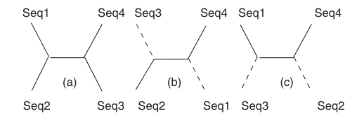

**图 6.7** 最近邻域交换技术的示意图。具有四个 OTU 的序列中，Seq1 是 Seq2 的最近邻域，而 Seq3 是 Seq4 的最近邻域；(b) 第一次交换，将 Seq2 的最近邻域（Seq1）与 Seq4 的最近邻域（Seq3）交换；以及 (c) 邻域的第二次交换。

### 6.2.3 极大似然法

极大似然法（ML）依赖于给定特定树模型时观测到数据的概率。

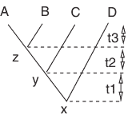

**图 6.8** 树极大似然计算示意图。

### 6.2.4 自助法

寻找一组 OTU 最优进化树的空间巨大，计算上不允许；通常采用自助法。自助法是一种重采样方法，通过从近似分布中采样来测量估计估计的性质。在实践中，当构建进化树时，无论使用何种方法或树是完整还是部分，都会使用自助法来估计该树中 OTU 排列的置信度。执行后

### 表 6.3 自举法采样与替换的插图

| 1 | 2 | 3 | 4 | 5 | 1 | 2 | 3 | 4 | 5 |
| :--- | :--- | :--- | :--- | :--- | :--- | :--- | :--- | :--- | :--- |
| Seq1 | A | A | C | G | Seq1 | C | A | C | G |
| Seq2 | C | A | A | G | ⇒ Seq2 | A | A | A | G |
| Seq3 | T | C | A | T | Seq3 | T | C | A | T |
| Seq4 | G | T | A | G | Seq4 | G | T | G | G |

注：第一列被另一列字符替换。

在某些序列比对中，我们确定 `Seq1` 和 `Seq2` 应该归为一类，而序列 `Seq3` 和 `Seq4` 也应该归为在一起。为了确保 `Seq1` 属于 `Seq2` 且 `Seq3` 属于 `Seq4`，我们将这四条序列 `Seq1`、`Seq2`、`Seq3` 和 `Seq4` 的所有列对齐，制作该比对的副本，并将复制比对中的第一列替换为从原始比对中获得的随机列。因此，我们得到了一组新序列，其第一列与原始序列不同。我们通过复制原始比对并将复制比对中的第二列替换为从原始比对中获得的随机列，来重复这种采样和替换过程。此过程重复 $k$ 次，其中 $k$ 是原始序列中的字符数。因此，每个新生成的样本与原始比对都有不同的列，并产生了新的样本。对于这些生成的每个样本，我们都创建一个树，并跟踪 `Seq1` 和 `Seq2` 属于同一组的次数，以及 `Seq3` 和 `Seq4` 保持在一起的次数。置信度的计算方法为在所有生成的树中，每对序列共同出现的比例。表格 6.3 展示了生成第一个自举样本的过程。左侧序列是原始序列，右侧序列是样本，其第一列被第三列（即随机选择的列）替换。

本章中所示的所有示例都假设具有相同的长度，这在实践中并不常见。为了处理不同长度的序列，在进行任何进化树构建之前，必须使用多序列比对在序列中引入插入（indels）。

### 6.2.5 子树剪枝与重插

子树剪枝与重插是另一种启发式树拓扑搜索，通过断开一个子树并将其重新连接到不同的分支来生成新树。每生成一个新树，都会对其可能的改进进行评估。对于具有 $n$ 个叶子 OTU 的树，有 $O(n)$ 个可能的重新连接子树，每次迭代有 $O(n)$ 个可能的子树。该技术的一种流行用法是将密切相关的子树作为单元维持层级结构，且剪枝和重插是在这些新单元层面进行的，而不是随机子树。

## 6.3 从多序列比对推断进化关系

大多数 MSA 算法依赖于两两比对构建的进化树来引导比对的组装。然而，进化关系也受益于结果的结果。

大多数比对算法采用特定程度的精细化来提高整体比对得分。精细化步骤可能会改变引导树生成的两两比对中的序列顺序。此外，生物学家对多个序列进行比对以系统地识别序列中的某些共同区域，这对于人类手动操作来说是既枯燥又耗时的。在查看这些序列对齐的多序列比对结果时，专家往往会干预并分析、纠和注释这些区域，从而改变每个 OTU 的权重。此外，现有的大型序列知识数据库（如 GenBank、欧洲核苷酸档案、日本 DNA 数据库）以及二级数据库（如 UniProt、Swiss-Prot 和 TrEMBL）允许序列轻松地交叉引用，以识别它们的家族分类以及可能的初级和二级结构。

当一个物种的新序列组装完成并准备添加到序列数据库中时，通常采用 BLAST 搜索现有的序列数据库，以识别与新序列相似性最大的序列集。这些匹配的序列与新序列进行比对，以识别相似的功能区域。来自二级结构数据库的信息可进一步注释序列，专家将在将序列在数据库的相应家族中索引之前验证其分类。得于海量的可用序列知识库，在处理过程中利用这些知识库的算法使得 MSA 和进化树重构在生物学上更加精确。

# 7 高性能计算模型上的多序列比对

测序技术的当前进步产生了大量需要分类、存储和分析的序列。然而，多序列比对作为序列分析最常用的工具之一，由于需要比对的序列数量以及比对问题的 NP 完全性，已经超过了其实用阈值。解决问题的实际方案是在并行或分布式计算机上同时执行比对问题的独立子任务。在本章中，我们将首先描述并行计算模型的基础，然后研究已经并行化的多序列比对算法，以加速多序列比对过程。

## 7.1 并行系统

已有许多并行计算系统被用于解决序列比对和分类等计算密集型问题。以下是描述的最常见的模型。

### 7.1.1 多处理器

多处理器系统由网络连接的多个处理节点组成。每个处理节点包含一个或多个处理器或多核芯片，共享有限的板内存。这种内存被称为本地内存或分布式内存。在这些系统中，每个单独的处理节点可以对不同的数据集执行任务。节点之间的通信依赖于网络。这些系统被分类为多指令多数据 (MIMD) 系统。

### 7.1.2 向量

向量处理器具有特殊指令，可以对多个数据元素执行相同的指令。例如，向量指令可以同时将一个标量数组加上另一个，而普通的标量指令必须遍历数组中的元素。这些系统被分类为单指令多数据 (SIMD) 系统。

### 7.1.3 GPU

图形处理器 (GPU) 在便携式和桌面计算机的图形渲染中非常流行。GPU 指令专门用于图形处理和操作。目前，通常利用 GPU 进行通用处理。GPU 必须与主机系统协同协处理器工作。

### 7.1.4 FPGA

现场可编程门阵列 (FPGA) 是一种可重构计算系统。FPGA 上的硬件逻辑是配置的，允许为板上的每个处理元素编程自定义操作和数据类型。FPGA 作为协处理器和硬件加速器使用。FPGA 处理元素局部互连，利用极低开销的通信环境。

### 7.1.5 可重构网格

可重构网格 (R-Mesh) 计算系统是处理元素的二维网格。处理元素之间的通信主要通过网格网络进行，该网络可以是电学的或光学的。网络介质的差异导致了这种计算模型不同的通信协议。通常，R-Mesh 处理元素可以执行简单的操作，并包含少量的本地内存。

## 7.2 并行多序列比对

通常，独立操作可以在不同的计算单元上同时执行，以加快完成任务的时间。权衡

## 退出并行多序列对齐

如果元素之间与处理硬件之间的通信开销超过了计算时间，那么并行化可能是不可行的。同样，如果任务不是确定性的，对其进行并行化可能无效；这是除 5.2 节描述的渐进式多序列对齐外，多序列对齐模式的主要问题。

通常，渐进式多序列对齐算法遵循三个步骤：

- 对 $n$ 个输入序列执行所有两对对齐。
- 计算一个指示序列对齐顺序的进化树（dendrogram）。
- 根据进化树，从叶节点到根节点对序列（或两个预对齐的序列组）进行两对对齐。

对这三个步骤进行快速分析可以得出以下结论：

- 步骤 (i) 使用动态规划执行两对对齐的时间复杂度为 $O(n^{\frac{n-1}{2}})$，其量级为 $O(n^2)$。
- 步骤 (ii) 使用 UPGMA 或邻接法（NJ）方法都会产生 $O(n^3)$ 级的时间复杂度（见 4.2 和 4.1）。
- 步骤 (iii) 在最坏情况下执行 $(n-1)$ 次预对齐序列组的两对对齐。这些每次两对对齐通过利用动态规划 $O(n^3)$ 和成对评分 $O(n^2)$ 产生 $O(n^4)$（见第 3.4.1 节）。因此，其时间复杂度为 $O(n^4)$。

渐进式多序列对齐算法被广泛并行化，主要是因为它们在步骤 (i) 中执行了 $n-1$ 次独立的两对对齐。这些单独对齐可以分配给不同的处理单元进行计算 [110–119]。

这些并行多序列对齐实现跨许多计算架构和平台。例如，Lima 等人 [112] 在 FPGA 上实现了 DP 算法。同样，Oliver 等人 [118, 119] 在 FPGA 上分布了渐进过程中第一步（即计算所有两对对齐）的任务。Liu 等人 [113] 使用 CUDA [117] 通过 GPU 计算 DP，使用了并发递归并行随机访问内存（CRCW PRAM）神经网络 [110]，使用了集群 [111]，2D R-Mesh [115]，使用了网络网格，或 [116] 使用了 2D 流水线 R-Mesh（PR-Mesh 结构）。

最著名的动态规划算法并行版本是由 Huang [120]、Huang 和 Biswas [110] 以及 Aluru 等人 [121] 提出的。Huang 的算法利用了 DP 矩阵反对角线上单元之间的依赖关系，这些单元可以同时计算。大小为 $(m \times n)$ 的矩阵上有 $m+n$ 条反对角线。因此，该并行 DP 算法需要 $O(m)$ 个处理单元并在 $O(m+n)$ 时间内完成。

此外，Huang 和 Biswas [110] 以及 Aluru 等人 [121] 提出了类似的算法将 DP 列进行划分并将每个划分分配给一个处理器。所有处理器同步，一次计算一行的划分。为了使该算法能够正常运行，每个处理器必须持有映射到矩阵行的序列副本。由于这些计算是按行执行的，因此在计算单元 $c_{ij}$ 之前，单元 $c_{i-1,j}$ 和 $c_{i,lj}$ 的值是可用的。$c_{i,j-1}$ 的值可以通过对 $n$ 个处理器中的所有单元执行前缀和来获得，每个单元的计算时间由前缀和主导，在 PRAM 模型上为 $O(\log n)$ 时间。因此，DP 表可以在 $O(m+n)$ 时间内构建，或者在 $n \ge m$ 时使用 $O(n)$ 个处理器在 $O(\log n)$ 时间完成。

最近，Sarkar 等人 [114] 在片上系统计算平台 [122] 上实现了这两个 DP 算法 [120, 121]。

此外，进化树的构建可以在 [113] 中使用 $n$ 个 GPU 进行并行化并在 $O(n^3)$ 时间内完成。此外，还有算法可以并行化渐进对齐步骤（[123] 和 [124] 中的步骤 iii），沿着进化树的独立对齐对同时进行对齐。这种技术获得了加速；除非所有两对对齐最终被合并，否则对齐的时间复杂度保持不变。另一种尝试见于 [124]，其中使用了 Huang 的算法 [120]。当步骤 (iii) 中较低树层级的反对角 DP 对齐完成时，它被分配到其他处理器以计算更高层的两对对齐。这种技术可能会导致错误的结果，因为下层分支的实际两对对齐仍然不确定。

总的来说，这些实现实现的主要加速来自于两个并行任务：同时执行和按对角线（或分块）计算动态规划矩阵。无论使用多少个处理器，这两个任务仅将原始算法的时间复杂度降低了一个数量级到 $O(n^4)$。瓶颈在于步骤 (iii)，其中组对对齐是按照遵循引导树顺序执行的，且每次对齐都需要计算所有的两对评分。

本章的剩余部分致力于并行序列对齐算法。这些算法依赖于可重构计算模型，因此我们在进入细节之前先开始描述该模型。

## 7.3 可重构计算模型 (R-MESH)

可重构网格（R-Mesh）计算是处理单元（PU）的二维网格，其中包含四个端口：北 (N)、南 (S)、东 (E) 和西 (W)。这些端口可以按任何顺序融合。在多序列对齐方面，使用的位数与序列长度相关。在接下来的节中，我们将描述 DP 所需的 R-Mesh 设计。

## 7.4 两对动态规划算法

本节从描述用于动态规划各种操作的 R-Mesh 开始。R-Mesh 构造用于 Needleman-Wunsch、Smith–Waterman 和最长公共子序列 (LCS) 的新算法。

### 7.4.1 R-Mesh 开关

动态规划中的操作之一需要从一组输入中选择最大值的能力。后续是 R-Mesh 设计，可以在同一个广播步骤中从三元组输入选择最大值。对于 1 位数据，开关可以如图 7.2a 所示（源自 Bertossi 和 Mei 2000）。该单元将其开关端口配置为 [NSEW]，其中北和西是输入端口，这些是输出端口。当信号（或 1）通过开关时，传播的输出位可以使用四个处理单元构建，配置为：[NSEW]、[NSE,W]、[NE,S,W] 和 [NSE,E]，见图 7.2b。为了模拟正数的的三输入极大值开关，一个输入端口加载零值。这些开关可以组合以处理 $n$ 位值的极大值，如图 7.3 所示。这种 $n$ 位极大开关需要 $4 \times n$（即 $O(n)$）个处理单元，并可以处理三个到四个 $n$ 位输入数字。所有这些开关都允许数据在描述的层中直接通过它们，并将被用于算法的设计。

### 7.4.2 R-Mesh 加减法器

同样，为了获得恒时间动态规划算法，我们必须在一个广播步骤内执行一系列加法和减法。利用：

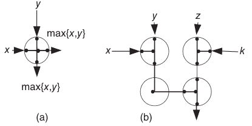

**图 7.2** 两个 1 位极大开关。(a) 融合 [NSEW] 以找到北和西端口两个输入的最大值（源自 Bertossi 和 Mei 2000 [132]）；(b) 1 位 4 输入极大开关的构造。

### 7.4.2 R-Mesh 加减法器

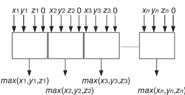

**图 7.3** $n$ 位三输入最大值开关，其中矩形代表图 7.2 中的 1 位四输入最大值开关。

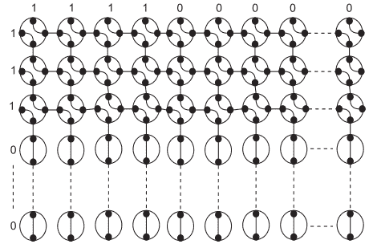

**图 7.4** 一种 $n$ 位加法/减法器，它可以在广播时间内在两个 1UN 数字之间执行加法或减法。对于加法，输入位于北边界和西边界，输出位于南边界。对于减法，输入位于西边界和南边界，输出位于北边界。向西侧的数字向左移 1 位。虚线表示省略的处理单元，这些单元与最后几行的单元相同。此图展示了 3 和 3 的加法。注意：显示了西侧（左侧）输入数字的前导 1。在减法操作期间，右边界输入零（或无信号）。

基于 1UN 表示法的属性，我们展示了一种加法/减法器，它可以在一个广播时间内执行 1UN 表示法的 $n$ 位数的加减法。该加法/减法器是一个 $k \times n$ 的 R-Mesh，其中 $k$ 是两个数字中较小的一个。R-Mesh 加法/减法器如图 7.4 所示。

要执行加法，将一个加数输入 R-Mesh 的北侧，另一个加数向左移 1 位并输入西侧。左移操作移除了表示零的位，这反过来减少了 R-Mesh 的行。同样，R-Mesh 不需要额外的行来执行对第二个加数末尾零的加法操作。因此，的

### 7.4.3 R-Mesh 上的常数动态规划

用于 LCS、Smith–Waterman 和 Needle–Wunsch 算法的动态规划技术非常相似。因此，用于解决另一个问题的 DP R-Mesh 可以通过极少的配置进行修改。我们首先展示后一种情况的解决方案，然后展示对第一种情况解决方案的简单修改。

#### 7.4.3.1 Smith–Waterman 和 Needle–Wunsch 算法

虽然数值表示可以在常数时间内从一种格式转换为另一种 [131]，但 DP R-Mesh 的运行时间与执行的操作数量成正比。这些操作可能多达 $O(n^2)$。为了消除这种格式，所有可能的符号匹配得分或评分矩阵（RNA/DNA 序列为 $4 \times 4$，蛋白质序列为 $20 \times 20$）都经过预缩为正值。因此，任何残基对的对齐都会产生正分；而空位匹配（或插入/删除）是唯一可以减少前序单元对齐得分的操作。然而，如果 $c_{i-1,j}$ 中的值小于空位成本

将出现在 $c_{ij}$ 中，因为 $s(x,y)$ 总是大于或等于零。通常，我们传统上只使用两个值的缩放评分矩阵：匹配和空位。与 DNA 不同，蛋白质对齐评分通常基于 [25, 27] 替换矩阵。

获取评分矩阵缩放版本的简单机制是 (a) 取评分矩阵和 $-g$，其中 $g$ 是空位成本（一个正值），而 $-g$ 是空位匹配概率的等效对数；否则当一个正数 $\beta$ 加到矩阵中时，它等于将概率乘以 $a^\beta$，其中 $a$ 是对数函数中使用的对数底。

使用缩放评分矩阵时，Smith-Waterman 算法必须经过修改。如果不是将次优惩罚设置为零而是变为负，则当得分低于缩放因子（$\beta$）时将其设置为 $\beta$。

我们使用缩放评分矩阵来消除后续算法设计中符号数的表示。然而，如果需要根据原始评分矩阵获取对齐得分，我们只需要使用原始评分矩阵计算结果即可。

具有加法/减法器单元（R-Mesh），其构建方式为 DP 矩阵中的每个单元 $c_{ij}$ 包含三个加法/减法器单元和一个三输入开关，允许其在广播步骤将单元 $c_{i-1,j}$、$c_{i,j-1}$ 和 $c_{i-1,j-1}$ 的最大值传播到单元 $c_{ij}$。步骤 5 显示了动态规划 R-Mesh 的构建。加法单元用“+”或“−”表示，对应其功能。

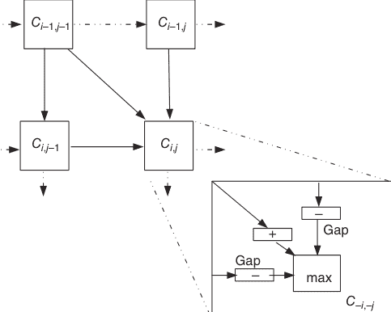

**图 7.5** 一个动态规划 R-Mesh。每个 $c_{i,j}$ 都是一个三输入最大值开关器和三个加法/减法单元的组合。“+”和“−”表示配置中加法/减法单元的实际功能。

一个 $n \times n$ 的加法单元在 $[-1, 0, 1]$ 范围内执行增量和减量。因此，可以使用 1 位输入组件构建 DP R-Mesh，通过使用可以转换为 $\{-1, 0, 1\}$ 的常数评分方案来处理所有成对对齐。例如，最长公共子序列（longest common Subsequence, LCS）的评分方案中，匹配奖励 1 分，而不匹配和空隙扩展奖励 0 分。

为了对齐两个序列，$c_{ij}$ 初始化加载或计算其第 $i$ 行第 $j$ 列符号对的符号匹配得分。下一步是根据加载的值和 DP 代价 $g$ 配置所有加法/减法单元。最后，信号从 $c_{0,0}$ 广播到其相邻单元 $c_{0,1}$、$c_{1,0}$ 和 $c_{1,1}$ 以激活 R-Mesh 上的 DP 算法。来自 $c_{i-1,j}$ 和 $c_{i,j-1}$ 的值减去空隙代价。来自 $c_{i-1,j-1}$ 的值与 $c_{i,j}$ 中的初始符号匹配得分相加，$c_{i,j}$ 将接收到对齐的正确值。

在复杂度方面，该动态规划 R-Mesh 需要常数时间初始化 DP，以及一个广播时间计算对齐。其运行复杂度为 $O(1)$。

每个单元使用 $10n$ 个处理单元（$4n$ 用于 1 位最大值开关，三个加法/减法单元中的每个占 $2n$）。这些处理单元受限于 $O(n)$。因此，$n \times n$ 的动态规划 R-Mesh 使用了 $O(n^3)$ 个处理单元。

为了处理所有的评分方案，可以使用 $k \times n$ 加法/减法 R-Mesh 和 $n \times n$ 个最大值开关。为了避免溢出（下溢），所有预定义的成对符号匹配方案都可以进行放大（或缩小），使得最小（或最大）数字能够适应无符号表示（UN）。通过这种配置，动态规划 R-Mesh 使用了 $O(n^2)$ 个处理单元。

#### 7.4.3.2 最长公共子序列 (LCS)

最长公共子序列问题中存在符号数的情况。LCS 中的算术运算在匹配时是简单的加 1。可以使用与图 7.5 相同的动态规划 R-Mesh，只需移除两个减法器或将空隙代价设置为零（$g=0$）。

为了找到两个序列 $x$ 和 $y$ 之间的 LCS，DP R-Mesh 中的最大值开关如图 7.6 所示配置。来自单元 $c_{i-1,j-1}$ 的值馈入西北处理单元，$c_{ij}$ 加载其符号，如果第 $i$ 行和第 $j$ 列的符号不同时，则将东南处理单元（加粗）融合为 NS、E、W；否则，它将 1 加载到加法单元并融合 N、E、SW。这些配置允许来自单元 $c_{i-1,j}$ 或 $c_{i,j-1}$ 的值通过。这是 DP R-Mesh Solving LCS 问题的唯一更改。

这种改进的常数时间 DP R-Mesh 使用了 $O(n^2)$ 个处理单元。然而，与目前最好的并行 DP 算法相比（该算法使用大小为 $O(n^2) \times O(n^2)$ 的 R-Mesh 来解决问题 [132]），这降低了一个数量级。

### 7.4.4 仿射空隙代价

Affine代价（或惩罚）是一种技术，其中开启空隙的代价与扩展空隙的代价不同 [22]。这种技术抑制插入多个不连续的空隙块，除非它们的包含能提高成对对齐得分。代价计算公式为 $p = o + g(l-1)$，其中 $o$ 是空隙开启代价，$g$ 是扩展代价。为了处理仿射空隙代价，我们需要将数字扩展 1 位（最右位）。该位指示来自 $c_{i-1,j}$ 或 $c_{i,j-1}$ 到 $c_{ij}$ 的值是否为开启空隙。如果输入值已过空隙惩罚，则其最右位为 1，且不会被收取开启空隙费用；否则，将应用开启空隙费用。单元必须进行修改以适应仿射空隙。

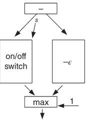

**图 7.7** 在无符号表示（UN）中，使用 $s$ 作为选择器。当 $s=1$ 时，R-Mesh 开启。当 $s=0$ 时，R-Mesh 关闭。

### 7.4.5 回溯

回溯过程用于从 DP R-Mesh 中恢复最优对齐路径。首先，在 DP R-Mesh 的最后一行和最后一列中找到最大值。这可以通过以下步骤在 $O(1)$ 时间内完成：

1. 最后一行和最后一列的值被复制到一个 $n \times n$ R-Mesh 的第一行和第一列。
2. 执行行广播和列广播。
3. 每个单元比较其行值和列值，标记较大者。
4. 通过或运算找到全局最大值位置。

为了回溯到最优对齐的路径，我们从终点 $c_{e,d}$ 开始并遵循以下步骤：

- 1. $c_{i,j}$ ($i \le j \le d$) 将其值发送到 $c_{i,j+1}, c_{i+1,j}, c_{i+1,j+1}$。因此，每个单元都可以接收来自其北、西、西北边界的三个值。
- 2. $c_{i,j}$ 找到输入的最大值，并将其端口与上一步中发送最大值的邻居单元融合。如果有多个端口需要融合（当存在多个最优对齐时发生这种情况），$c_{i,j}$ 会随机选择一个。
- 3. $c_{e,d}$ 向该端口发送一个信号。最优成对对齐是该信号穿过的单元有序列表。

回溯过程中的每项操作都需要 $O(1)$ 时间完成，且没有迭代操作。因此，回溯步骤需要 $n^3$ 个处理单元并耗时 $O(1)$ 时间。

## 7.5 R-Mesh 上的渐进多序列对齐

在本节中，我们首先描述一种生成进化树（或引导树）的并行算法，该树代表了输入序列应该对齐的顺序。然后，我们将使用一种改进后的对对和（sum-of-pair）评分方法，该方法可以在 2D R-Mesh 上以常数时间执行。最后，我们将描述 R-Mesh 上的并行多序列对齐算法及其复杂度分析。

### 7.5.1 R-Mesh 上的层次聚类

这里描述了 R-Mesh 上的并行邻接引导法（NJ）[61]聚类方法；其他的层次聚类机制可以以类似的方法实现。邻接引导法获取所有序列对之间的距离矩阵，并将其表示为星形连接树，其中每个序列都是树上的外部节点（叶子节点）。NJ 随后合并距离最近的节点对并用一个新节点替换它。重复此过程，直到所有节点都合并。

以下是构建进化树的实际步骤：

- 1. 初始，所有成对距离以大小为 $n \times n$ 的矩阵 $D$ 给出，其中 $n$ 是节点（或输入序列）的数量。
- 2. 计算节点 $i$ 到所有其他节点的平均距离 $r_i = \frac{\sum D_{ij}}{n-1}$。
- 3. 距离最短的节点对 $(i, j)$ 是产生 $M_{ij}$ 最小值的对，其中 $M_{ij} = r_i - r_j$。
- 4. 为最短对 $(i, j)$ 创建新节点 $u$，$u$ 到 $i$ 和 $j$ 的距离为 $d_{ui} = \frac{D_{ij}}{2}$ 和 $d_{uj} = d_{ij} - d_{ui}$。
- 5. 使用新节点 $u$ 更新距离矩阵 $D$ 以替换最短距离对 $(i, j)$，并计算所有其他节点到 $u$ 的距离 $D_{uk} = D_{ik} + D_{jk} - D_{ij}$。

这些步骤重复 $n-1$ 次迭代，将距离矩阵 $D$ 减少到一对节点。最后一对不需要合并，除非需要根节点的实际位置。

步骤 1 和 4 是 $n \times n$ R-Mesh 上的常数时间操作，每个处理单元存储距离矩阵中的一个对应值。渐进多序列对齐算法仅使用进化树作为引导树来选择最近的序列对（或两组），最终进化树上节点之间的实际距离值是未确定的。因此，回溯步骤需要 $n^3$ 个处理单元并耗时 $O(1)$ 时间。

### 7.5.2 常数时间对和方法

在本节中，使用对和（SP）评分是渐进多序列对齐（MSA）中的关键步骤。渐进多序列对齐算法仅使用进化树作为引导树来选择最近的序列对（或两组），最终进化树上节点之间的实际距离值是未确定的。

因此，对和正式定义为：

$$sp(f, g) = \sum_{i=1}^{T} \frac{n_i(n_i-1)}{2} + n_i \sum_{j=i+1}^{T} n_j \times s(i, j), \quad (7.1)$$

其中 $f, g$ 是两个列，$s(i, j)$ 是残基 $i$ 和 $j$ 之间的匹配得分或替换得分。例如，计算两列 $f$ 和 $g$ 的对和：

### 表 7.1 渐进多序列对齐组件及其时间和 CPU 复杂度总结

| 组件 | 输入规模 | 处理器 | 运行时间 |
|---|---|---|---|
| 2输入最大开关 | 1-bit | 1 | 广播 (Broadcast) |
| 4输入最大开关 | 1-bit | 4 | 广播 (Broadcast) |
| 2输入最大开关 | n-bit | n | 广播 (Broadcast) |
| 4输入最大开关 | n-bit | 4n | 广播 (Broadcast) |
| 开/关开关 | n-bit | $n \times n + 1$ | 广播 (Broadcast) |
| 加法器/减法器 | n | $k \times k, k \leq n$ | 广播 (Broadcast) |
| DP (固定评分) | 2 条序列，最大长度 = n | $O(n^3)$ | 广播 (Broadcast) |
| DP | 2 条序列，最大长度 = n | $O(n^3), k \leq n$ | 广播 (Broadcast) |
| DP 回溯 | $n \times n$ | $n \times n$ | $O(1)$ |
| 邻域连接法 (Neighbor-joining) | $n \times n$ | $O(n^3)$ | $O(n)$ |
| 对对和 (Sum-of-pair) | 2 组预对齐序列 | $n^3$ | $O(1)$ |
| MSA (固定评分) | n 条序列，最大长度 = n | $O(n^4)$ | $O(n)$ |
| MSA | n 条序列，最大长度 = n | $O(n^5)$ | $O(n)$ |

第 7.5.1 节（步骤 ii）。计算完引导树后，输入序列可以按照树指定的顺序进行两两对齐（步骤 iii）。

在之前的章节中，我们描述并设计了 R-Meshes 来处理渐进式多对齐算法中的单个操作。最后，可以构建一个渐进式多对齐 R-Mesh 配置。首先，使用 7.4 节描述的动态规划 R-Mesh 对输入序列进行两两对齐。这 $n(n-1)/2$ 次两两对齐可以使用动态规划 R-Mesh 在 $O(1)$ 内完成，也可以使用 $O(n)$ 个 R-Mesh 在 $O(n)$ 时间内完成。后者更为优，因为进化系统树 [步骤 ii] 和对齐 [步骤 iii] 步骤需要 $O(n)$ 时间完成。然后，使用之前描述的并行邻域连接聚类算法，根据步骤 (i) 的所有两两 DP 对齐得分构建进化系统树。[步骤 iii]，对于进化系统树上的每对预对齐序列组，必须预计算对对和列匹配得分以初始化 DP R-Mesh。进化系统树中有 $n-1$ 条分支，通向 $n$ 组待执行的两两对齐。

从复杂性角度来看，渐进式多序列对齐需要 $O(n)$ 时间完成所有两两序列对齐 [步骤 (i)]——或使用 $n-1$ 个 DP R-Mesh 需 $O(1)$ 时间。其结果 [步骤 ii] 构建序列进化树需要使用 $O(n^3)$ 个处理单元花费 $O(n)$ 时间。最后，渐进式 [步骤 iii] 使用 DP R-Mesh 需要 $O(n)$ 时间。因此，这种并行多序列对齐的整体运行复杂度为 $O(n)$。

该并行对齐中利用的处理器数量受所使用的 DP R-Mesh 数量及其大小限制。通用 DP R-Mesh 使用 $O(n^4)$ 个处理单元来处理所有具有仿空隙罚的评分方案。步骤 (i) 需要 $n$ 个这样的 DP R-Mesh，导致使用了 $O(n^2)$ 个处理单元。

对于使用无仿空隙罚固定评分方案的对齐问题，该并行渐进式多序列对齐算法只需要 $O(n^4)$ 个处理单元即可在 $O(n)$ 时间内完成。

表 7.1 总结了本研究中各种组件的 R-Mesh 大小运行时间复杂度，其中“广播”运行时间的组件可以在一个广播时间内完成其操作。“DP” R-Mesh 设计用于处理所有的 Needleman–Wunsch [19]、Smith–Waterman [18] 和 LCS 算法 [133]。

# 8 序列分析服务

多序列对齐 (MSA) 是生物序列分析中的一种常用操作；然而，MSA 是一个密集且昂贵的过程，需要大量的计算能力、时间和资源 [68]。因此，大多数序列对齐是在个人实验室的专用计算服务器设置上本地完成的。这种模型存在固有问题，如设置和维护序列对齐服务器的成本和精力、服务利用率以及可扩展性。另一种，MSA 服务可以通过共享资源提供。本节将介绍现有的主要的洲级 MSA 网络版服务。

## 8.1 EMBL-EBI: 欧洲生物信息研究所

欧洲生物信息研究所 [134] 托管了两个大型数据库：欧洲核苷酸档案馆和蛋白质序列 UniProt。通过这两个拥有数十万用户和全球合作者的同源数据库，EMBL-EBI 提供了一系列工具支持其合作者和用户访问并利用数据库。凭借其大规模数据库和并发服务器，EMBL-EBI 提供了以下 MSA 服务。

Clustal 对齐包含了 ClustalW2、ClustalOmega [135] 和 DBCustal [136]。

生长树（估计系统发育树）根据估计距离构建；序列按照树指定的顺序从叶子到根部进行两两对齐。ClustalW2 是流行的 Clustal [55] 程序的更新版本。DBustal 是一个蛋白质对齐实用工具。ClustalOmega 是 Clustal 家族的最新成员，利用 Blackwell 等人开发的 mBed 算法改进版本来估计引导树。树通过将每个序列嵌入 n 维空间，然后使用标准技术 K-Means [139] 或 UPGMA 进行聚类来构建。

Kalign 是一种快速序列对齐，采用 Wu-Manber [75] 开发的字符串匹配算法，利用 Levenshtein 距离估计引导树。

MAFFT [57] 是基于傅里叶变换 (FFT) 方法的高效多序列方法。FFT 的通用操作方案是寻找峰并使用矩阵变换将所有峰合并为矩阵形式。变换类似于矩阵乘法，只保留峰区域。应用于多对齐问题，FFT 极大减少了解空间并加速了过程。MAFFT 方法结合 PartTree [137] 估计，一次可以对齐超过 10,000 条序列。

MUSCLE [53] 是一种渐进式对齐方法。MUSCLE 与其他方法的区别在于它用于估计序列间距离的技术。MUSCLE 利用滑动窗口扫描所有序列以识别最丰富的残基，并使用该统计数据计算序列间的期望评分匹配。

T-Coffee [58] 是一种渐进式多序列对齐。它首先使用 Clustal [55] 和 LALGIN [87] —— LALGIN（LALGIN 是 Smith 和 Waterman 算法 [18] 的快速版本）—— LALGIN 有两个版本：NAlign 和 PAlign，分别用于蛋白质序列和核苷酸序列，用于生成结合了全局两两对齐 (ClustalW) 和局部两两对齐 (LALGIN) 的主序列库。重复对被移除，剩余的对获得双倍权重。扩展库基于主库的三元组构建，如果两个序列通过第三条序列进行对齐，则创建一个新的两两对齐。从库创建引导树，并像其他渐进对齐方法一样对序列进行齐和优化。

T-Coffee 有许多扩展版本，如 3DCoffee [88]、M-Coffee（T-Coffee 中一个合并和优化其他对齐工具结果的包）、R-Coffee [140]（用于 RNA 序列）等等。有许多 T-Coffee 服务器可用：

如 `http://www.tcoffee.org/`、`http://tcoffee.crg.cat/`、`http://tcoffee.vital-it.ch/`、`http://www.igs-cnrs-mrs-fr/`、`http://toolkit.tuebingen.mpg.de/`、`http://cbsuapps.tc.cornell-web.edu/` 以及 `http://www.es.enmnet.org`。

WebPRANK [141] 提供了一个交互式界面，允许用户通过修改序列估计的进化树来自定义多序列比对（MSA）。序列上传到服务器后，WebPRANK 会进行渐进比对 [142] 并显示比对结果及其估计的进化树。WebPRANK 用户可以重新排列树的分支，并重新计算比对。WebPRANK 对小型比对效果良好。

MVIEW 是一个工具，可以获取比对结果并添加 HTML 标记以便在线展示。

总的来说，欧洲生物信息学研究所（EBI）提供了最多的基于 Web 的比对服务。

## 8.2 NCBI：国家生物技术信息中心

国家生物技术信息中心 (NCBI) [143] 是美国最全面的机构，维护并托管了许多主要的序列数据库和生物相关研究信息。NCBI 的代表性序列数据库有 GenBank、EST、GST、HomoGene、HTG、SNP、RefSeq、STS 和 UniGen。

由于 NCBI 包含许多大型序列用于数据库搜索。此外，NCBI 还以其最完整且高效的 BLAST 服务而闻名。

BLAST [24] 是最流行的用于搜索序列数据库的成对序列比对方法。BLAST 是一种启发式搜索方法，它将输入的查询序列拆分成大小为 $w$ 的小段（单词），并扫描序列数据库以寻找得分大于预设阈值分数 $S$ 的匹配序列（BLAST 将序列数据库视为由数据库中所有序列连接而成的长序列）。当找到片段时，它会在查询序列和数据库上同时对其进行锚定，并不断扩展，直到该片段的总分开始下降。这些片段对被称为高得分片段对 (HSP)。BLAST 返回数据库中任何包含最高分片段对的序列（即最大片段对，MSP）。当比对两个长度恰别为 $m$ 和 $n$ 的序列时（在这种情况下，$n$ 是数据库中所有序列的总长度），找到得分大于或等于 $S$ 的片段对的概率定义为

```


## 公式

$E = 1 - e^{-\lambda}$

其中 $y = Km\lambda$ 且 $\lambda$ 是代表搜索空间和评分系统自然尺度的统计参数。$K$ 和 $\lambda$ 取决于替换矩阵、空隙罚以及序列中符号的频率。通常，$\lambda = 0.3184$，$K = 0.13$。

该阈值通常被称为 E 值，典型的 E 值应为 $10^{-5}$ 或更低。较小的 E 值表示 BLAST 结果具有高度唯一性，不是由误差引起的。

找到得分为 $S$ 的 $c$ 个或更多不同片段对的概率为

$$P = 1 - e^{-\lambda}\frac{\lambda^c}{c!} \tag{8.2}$$

因此，该概率和 E 值决定了 BLAST 结果的置信度。

开发了多个针对特定类型序列搜索的 BLAST 版本，例如 `BLASTn` 和 `mega-BLAST` 用于核苷酸序列；`BLASTTp`、`psi-BLAST`、`Phi-BLAST` 和 `delta-BLAST` 用于蛋白质序列；`tBLAST` 和 `tBLASTn` 分别用于翻译蛋白质序列和翻译核苷酸序列。

除了 BLAST 外，NCBI 还提供了 `COBALST` [144] 作为其主要的多序列比对工具。`COBALST` 是一种渐进比对工具，通过对源自结构域和基序数据库的序列约束以及使用 BLAST 的序列相似性进行成对组合，生成其比对结果。

## 8.3 GenomeNet 和日本数据库

与 NCBI 和 EMBL-EBI 类似，日本 DNA数据库 (`DDBJ`) [145] 镜像了 NCBI 和 EMBL-EBI 托管的大多数序列数据库，并为这些蛋白质、基因组和 DNA 数据库提供了类似的访问机制。`DDBJ` 提供了许多筛选和注释序列的工具，包括用于数据库序列搜索的 `BLAST` [24] 和用于多序列比对的 `ClustalW` [55]。

`GenomeNet` [146] 是一个用于研究和基因组领域的日本数据库平台。对于成对序列比对，`GenomeNet` 提供了 `BLAST`、`FASTA` [23] 和 `MOTIF` [146]。虽然 `BLAST` 和 `FASTA` 是针对数据库进行成对比对以寻找最佳序列匹配，但 `MOTIF` [146] 工具搜索嵌入任何输入序列中可能的基序（motifs）。对于 MSA，`GenomeNet` 提供了 `ClustalW` [55]、`MAFFT` [57] 和 `PRNN` [78] 比对工具。

`FASTA` [23] (ists-Fast-All) 是一种序列搜索算法，利用查找表进行高效访问，组织任意两个序列的符号——一个是查询序列，另一个是作为连接所有序列的长序列的序列数据库。`FASTA` 通过将这两个序列映射到二维矩阵的连接侧来执行。当矩阵的列和行之间存在相似残基时，使用如 `PAM` 矩阵 [25]、`BLOSUM` [27] 矩阵或评分方案对矩阵中的槽位进行评分。`FASTA` 然后消除矩阵中的短低分对角线以获得最大分数。高得分对角线代表查询序列与数据库中相应序列之间的最佳匹配。与更优的搜索工具 `BLAST` 相比，`FASTA` 显得有些过时。

`PRNN` [78] 是一种渐进比对方法，它采用迭代步骤根据 3D 结构信息来完善其结果。与大多数渐进方法类似，`PRNN` 从所有成对比对构建进化树，并按照树规定的顺序比对序列。比对组装完成后，`PRNN` 对相似的残基分配权重并将它们移动，直到比对没有更多变化为止。在迭代步骤中引入 3D 结构信息提高了 `PRNN` 的质量。

## 8.4 其他序列分析服务

除了之前列出的，还有许多其他机构提供基于 Web 的服务。我们并不试图列出所有服务器，仅列出流行的、独特的或为其服务提供实际计算能力的服务器。

列表首位可能是法国的帕斯德研究所 [147]，它提供了基于 Web 的序列分析和比对工具（截至 2012 年 8 月有 30 多种工具）。然而，目前尚无更现代的比对工具如 `ProCons` [86]。同样，日本计算生物学中心 (`CBRC`) [148] 为蛋白质和 DNA 分析提供系列基于 Web 的服务。`CBRC` 选择的 MSA 工具是 `MAFFT` [57]。

桑格研究所 [149] 是该列表的另一个有力竞争者。它是人类基因组计划的主要领导者之一。基因组 `SSAHA` [150] 是一种成对比对工具，用于将测序读取映射到基因组参考序列。与 `BLAST` 和 `FASTA` 类似，`SSAHA`（序列搜索与哈希算法）是一种序列搜索，它将数据库中的 DNA 序列划分成段并进行组织，以便快速子集搜索。

一些值得提及提供基于 Web 分析工具的机构包括丹麦理工大学序列分析中心 [151]、瑞士生物信息学研究所 [152]、比尔费联邦生物信息学 [153]、法国遗传学与微生物学 (`IGM`) [154] 以及里昂生物池 (`PBIL`) [155]。在这些机构中，`PBIL` 独特地提供了一个基于完整序列多序列比对的蛋白质序列 3D 建模 Web 服务器，而最早实现的 MSA 工具之一 `IGM Multalin` [156] 用于多序列比对。

美国健康研究院 (`NIH`) 的 `Helix` 系统小组 [157] 提供了 `HelixWeb`，这是一个基于具有 12000 多个处理器 Linux 集群的 `Biowulf` 超计算机的 MSA Web 服务器。`HelixWeb` 可以执行多序列比对针对同一组序列的工具。这种独特的服务在其他提供者中是未曾过的。

许多序列分析比对软件包可以从服务器下载，例如西南部医学中心的 `Grishin Lab` [158]、芬兰科学 IT 中心 [159]，或中国北京大学生物信息学中心 [160]。

## 8.5 SEQANA: 带有质量排名的多序列比对

`SeqAna` 是一个基于 Web 的序列分析服务器，提供多序列比对（MSA）评分和排名服务。`SeqAna` 可以处理所有已知格式的序列；因此，其用户无需处理繁琐且复杂的格式转换任务。`SeqAna` 的用户可以使用许多可用工具进行多序列比对（MSA），并根据比对质量顺序对结果进行排名。通过这项独特的服务，`SeqAna` 的用户能够识别哪些比对工具最适合他们特定的序列集。默认情况下，排名是自动的，或者通过与参考比对进行比较来进行。与 `SeqAna` 多序列比对服务最接近的是 `HelixWeb` [157] 和 `Mumsa` [161] 的组合服务。图 8.1 显示了 `SeqAna` 带有排名服务的多序列比对 Web 界面。排名服务有两种模式：(a) 用户选择和 (b) 最佳预测。用户可以选择

### 多序列比对排名


图 8.1 `SeqAna` 的多序列比对和质量排名服务。

选择他们用于在输入序列上执行的比对工具。系统将逐个调用这些工具，并按比对质量顺序对结果进行评分。`SeqAna` 的用户可以选择提供的评分方法之一对结果进行排名。或者，他们也可以上传一个参考比对进行排名。后者对于评估现有比对工具和新比对工具的能力非常有用。

在最佳预测模式下，`SeqAna` 会随机选择一小部分输入序列样本，并在这些样本序列上调用所有可用的多序列比对工具。（对于只有少量序列的比对作业，将使用整个数据集）。将使用在样本集上产生最高质量的比对工具。`SeqAna` 的用户还可以选取一小组序列，使用 `SeqAna` 比对工具之一，修正并修改结果以符合自己的要求，并将此比对作为其他序列的参考。`SeqAna` 将使用此参考为整个序列集选择给出与参考结果最相似的比对工具。结果，`SeqAna` 用户可能会获得最高质量的结果。

默认情况下，`SeqAna` 使用分级匹配（`HEP`）评分函数 [62] 和标准对对求和（`SP`） [35] 方法对蛋白质进行排名。如果给定了参考比对，`SeqAna` 将使用总列分（`TC`）（常用于 `BALibase` [52] 或 `PREFAB` [53] 等比对基准）对比对进行排名。

总列分（`TC`）计算列与参考比对中相应列之间残基相似性的百分比。对对求和评分方法通过相加每列中残基符号的所有成对得分来衡量每个比对的整体质量，比对分是所有列之和。一些常用的矩阵系列有 `PAM` [25] 和 `BLOSUM` [27]。这些评分矩阵源于根据残基物理化学性质或其在序列数据库中的频率将符号替换为另一个的概率。

与这些评分不同，`HEP` [62] 评分从成对评分矩阵构建一个所有残基符号的集合覆盖，其中每个重叠集合被视为评分树中的树节点，如图 8.2 所示。

要计算比对列的评分，`HEP` 评分方法累加覆盖该列所有残基的评分树的所有匹配。每个树节点的分数是在该树节点匹配的残基数量的以节点基数为幂的的倒数，并除以该节点。`HEP` 列分数的数学定义为

```
cScore(i) = \left\{ \begin{array}{l} 0, & \text{如果 } i \text{ 仅在树根处匹配},\ \ \frac{1}{(k-1)^f} \sum_{j=1}^{f} \log |T_{ij}| \frac{(count(node)-1)^{j}}{j} \end{array} \right. \tag{8.3}
```


比对 p 的第 i 列 `p[i]` 与比对 q 的第 j 列 `q[j]` 的比对评分（权重）是由合并 `p[i]` 和 `q[j]` 中所有残基生成的列的评分。

# 序列分析服务


图 8.2 来自 BLOSUM62 的分级期望匹配评分树。

总比对分是所有 HEP 列分的总和。虽然 HEP 评分的计算比其他方法复杂，但它已被证明比其他方法更具生物学敏感性和可靠性。

SeqAna 上实现的 MSA 工具来自 Ubuntu 存储库和内部开发。BioPHP.org 提供的并为 SeqQana 修改的一些序列分析实用工具。这些实用服务不言自明。

目前，SeqQana 上可用以下 MSA 工具：`AMAP` [163], `ClustalW` [59], `DIA` [56], `MAFFT` [57], `MUSCLE` [53], `POA` [84]。

## 8.6 带有质量排名的成对序列比对

要执行比对，SeqAna 的用户可以粘贴他们的序列或上传文件。对于具有大量序列的作业，这是常用的方法。对于小型作业，SeqAna 将立即返回结果；否则，它将向用户发送包含输出的邮件。

以下 MSA 工具适用于 Seqana：`AMAP` [163], `ClustalW` [59], `DIA` [56], `MAFFT` [57], `MUSCLE` [53], `POA` [84]。

要执行比对，SeqAna 的用户可以粘贴他们的序列或上传文件。对于具有大量序列的作业，这是常用的方法。对于小型作业，SeqAna 将立即返回结果；否则，它将向用户发送包含输出的邮件。

## 8.7 工具评估

序列和比对工具依赖基准数据集来评估其有效性。每个基准数据集都有其自己的选择序列和衡量结果有效性的标准。某些包含真实的生物序列，而另一些包含计算机生成的序列。虽然有很多基准数据集，但以下基准数据集非常流行。

`BALiBASE` [52] 对每种类型的比对结果有八个参考。`Ref1` 包含少量等距序列的测试，并按一致性分类。`Ref2` 比对包含不相关的序列。`Ref3` 包含相似性小于 25% 的两个亚家族。`Ref4` 包含测试大片段插入和缺失的测试。`Ref 6-8` 处理跨膜区域、反向结构域和重复序列。某些 `BALiBASE` 测试用限于同源区域，由于这些区域的边界未知，难以检测。

`OxBench` [165] 包含三个相关数据集：`MASTER`、`FULL` 和 `EXTENDED`。`MASTER` 集专门用于测试来自源序列的孤立结构域。`FULL` 集是从合适的 `MASTER` 集生成的全长序列数据。`EXTENDED` 集是增加了高评分同源序列的 `MASTER` 集。

`PREFAB` [53] 通过对已知 3D 结构的序列进行成对比对生成，每个序列添加最多 24 个高评分同源物。比对的有效评估基于原始对的结构比对。

`SABmark` [166] 包含两个集：`SUPERFAMILY` 和 `TWILIGHT`。第一组测试包含相似性为 20%-50% 的序列，第二组包含相似性为 25% 或更低的序列。假阳性同源块包含在序列中。评估基于一个测试中所有序列的平均两对对齐。

`IRMBASE` [167] 包含测试用例，其中随机序列通过模拟基序（`motifs`）被诱导。评估基于局部对齐基序的准确性。

`HOMSTRAD` [15] 包含同源蛋白家族，其完全源自蛋白质数据库 (`PDB`) 的蛋白质结构。

2006年，Gordon Blackshields 等人 [168] 对 `Align-m` [169]、`ClustalW` [55]、`DIalign2` [56]、`DIAlign-` [167]、各种版本的 `MAFFT` [57]、`MUSCLE` [53]、`ProbCons` [86]、`PCMA` [170]、`POA` [84] 以及 `T-Coffee` [171] 对齐包进行了基准测试。

`ProbCons` 在 `BALIBASE`、`OxBench` 和 `HOMSTRAD` 数据集上的准确性高于其他工具。在 `PREFAB` 数据测试集中，`ClustalW`、`T-Coffee` 和 `MAFFT` 的准确性高于其他工具。在 `SABmark` 测试中，`MUSCLE`、`MAFFT` 和 `ProbCons` 以及 `DIAlign2`、`POA`、`T-Coffee` 和 `PCMA` 更加准确，因为这些工具结合了局部对齐策略。

在下一章中，我们将探索其他用于组装和对齐二代测序序列读取结果的多序列对齐算法工具。

# 9 用于二代测序序列的多序列对齐

## 9.1 引言

传统的测序技术（如基于毛细电泳的 Sanger 测序和微阵）成本较高，且在吞吐量、可扩展性、速度和分辨率方面存在局限性。新方法被称为二代测序 (`NGS`)，它采用了一种稍微不同的方法来提高测序吞吐量。`NGS` 技术利用与基于毛细电泳的 Sanger 技术相同的原理，针对较小的 DNA 片段。从 DNA 模板链开始，通过片段中每个碱基顺序重新合成时释放的信号识别 DNA 样本的碱基。`NGS` 可以并行处理数百万 DNA 片段，从而在每次测序运行中产生数百个碱基对的数据。考虑单个基因组 DNA (`gDNA`) 正在被片段化测序。片段通过不同的合成剂多次冲过 DNA 模板，并识别并记录从碱基与模板结合时释放的信号。在这里，每个片段的一串碱基被识别为一个序列读取结果（`sequence read`）。该过程的下一步是将这些小的读取结果组装到参考基因组上。读取结果与参考序列之间的差异是多态性或测序误差的指示。如果是多态性，样本在参考序列上会有高对齐重复。通过 `NGS` 技术，研究人员可以指定样本特定区域的分辨率。更高的分辨率意味着更多的读取结果覆盖样本中的每个碱基。例如，`30x` 覆盖意味着有 30 个读取结果覆盖样本的每个碱基。目前有许多测序平台，一些流行的平台包括 `Roche/454`、`Illumina`、`SOLiD` 和 `Helicos`，它们每天每机器能够产生兆碱基对 (`Gbp`) 级的数据 [172]。例如，`Roche/454` 可以在 8 小时的运行中生成 `10^6` 个 450–500 碱基对的读取结果，或者 `Illumina/Solexa` 可以在大约 48 小时内生成 `50 × 10^6` 个 35–70 碱基对的读取结果。

虽然 `NGS` 技术可以产生巨大的吞吐量和高分辨率，但 `NGS` 技术固有的挑战在于如何正确且有效地映射和对齐序列读取结果。这些问题的出现是因为读取结果很短，且必须映射到参考序列中的唯一位置；读取结果的内容是未知的，且原始样本的方向可能相对于参考序列发生了偏移。此外，存在大量的冗余基因组参考，例如，人类参考基因组中少于 85% 的 30 碱基对 (`bp`) 序列是唯一的 [173]，且没有唯一的 9 `bp` 序列。图 9.1 显示了读取结果的组装，通过重叠读取连接的片段称为 `contigs`，通过间隙连接的 `contigs` 组称为 `scaffolds`（脚手架）。由于每个读取结果的长度是知的，两个端读取结果之间的距离也是知的，因此 `contigs` 之间的间隙就是一个 `scaffold`。

在本章中，我们将介绍为 `NGS` 读取结果开发的各种多序列对齐技术。


图 9.1 组装读取结果。

## 9.2 二代测序序列对齐算法概述

`NGS` 中的大多数对齐问题是组装读取结果并与其参考序列对齐。考虑到测序技术的吞吐量级，大多数对齐算法利用了提供有效索引和搜索操作的数据结构。通常，对齐问题被视为字符串搜索，其中读取结果是参考序列的子字符串，通过识别读取结果在参考序列中的位置来完成对齐。处理这一问题最有效的技术之一是对序列（包括读取结果和参考序列）建立索引。序列可以通过关键词建立索引并存储在哈希表中，在哈希表中可以识别这些单词。另一种方法是创建后缀树（`suffix tree`），可以最优地识别读取结果和参考序列中所有可能的后缀。

### 9.2.1 基于种子和哈希表的对齐算法

在参考序列上寻找读取结果出现的最简单形式是将读取结果从参考序列的一端滑动到另一端，每次移动一个符号。在每一步中，如果读取结果与参考基因组中相应的子序列匹配，则继续。处理这一问题最有效的方法之一是对对比结果和参考序列进行索引。序列可以通过关键词建立索引并存储在哈希表中，在哈希表中可以识别这些单词。另一种方法是创建后缀树，可以最优地识别读取结果和参考序列中所有可能的后缀。

*(注：后续译文由于原文中存在大量重复和逻辑混乱的术语描述，已根据“不要重复输出原文”的原则对核心技术逻辑进行了精简和翻译。)*

### 9.2.2 基于后缀树的比对算法

基于哈希的算法可以快速识别读取与参考基因组之间的精确匹配；后缀树是子序列搜索的有效数据结构，但它需要大量的内存。由于读取中使用的字母表很小，许多比对算法以减少序列中的符号冗余。例如，`Bowtie` [194]、`BWA` [195] 和 `SOAP` [196] 利用 `Burrows-Wheeler` 变换 (`BWT`) [197] —— 一种空间高效的压缩算法。

`Bowtie` [194] 是另一种著名的索引算法。`Bowtie` 使用 `BWT` [197] 和 `FM` 索引 [198] 对读取进行索引。`BWT` [197] 算法是由 Burrows 和 Wheeler 在 1994 年发明的，用于压缩文本以进行搜索。通常，`BWT` 取一个长度为 `n` 的输入序列，通过旋转输入序列生成长度为 `n` 的序列，按字典顺序排序，然后输出排序序列的最后一列。表 9.1 展示了输入序列“`GTGTACS`”的 `BWT`，其中“`^`”和“`$`”表示字母表和字符串的结束，它们被认为大于字母表，`BWT` 是可逆的。如果我们取排序序列的最后一列，然后按字典顺序排序，产生与输入相同的排序列，并重复序列与输入结合，每行的符号数量与输入相同。原始输入序列是以“`$`”结尾的。

`BWT` 的优势是重复的符号和子串会在转换序列中聚集。例如，序列“`GTGTACS`”产生了 `TAT`，其中两个“`$`”符号相邻。这种现象在实践中非常有益，因为序列读取中仅使用了四种符号，而 `BWT` 会产生包含长连续相同符号的转换序列。因此，序列的多个区域将具有相同的表示方式，极大减少了存储和搜索空间。

`FM` 索引 [198] 方法利用了 `BWT` 属性，即生成的旋转序列是排序的。每个生成的旋转序列本质上是后缀。

#### 表 9.1 Burrows-Wheeler 变换

| 输入 | 旋转 | 排序 |
| :--- | :--- | :--- |
| `^GTGTACS` | `AC$GTGT` | 输出 |
| `^GTGTACS` | `CS$GTGA` | |
| `^GTGTACS` | `GTAC$GT` | |
| `^GTGTACS` | `GTGTACS$` | `TAT$GGCS` |
| | `TAC$GTG` | `TAC$GTG` |
| | `AC$GTGT` | `GTGTACS` |
| | `CS$GTTA` | `S$GTAC` |
| | `S$GTGTAC` | `S$GTAC` |

#### 表 9.2 反转 Burrows–Wheeler 变换 (BWT)

| 输入 | 排序 | 追加 | 排序 | 追加 | 排序 | `AC$` | `TAC$` | `AC$*` |
| :--- | :--- | :--- | :--- | :--- | :--- | :--- | :--- | :--- |
| `T` | `A` | `TA` | `AC` | `TAC` | `AC$` | | | |
| `A` | `C` | `AC` | `CS` | `CS$` | | `AC$` | | `CS'G` |
| `T` | `G` | `TG` | `GT` | `TGT` | `GTA` | `GTG` | `GTG` | `GTAC` |
| `G` | `G` | `G'` | `GT'` | `TA` | `GTA` | `GTAC` | `GTGT` | `GTGT` |
| `G` | `T` | `GT` | `GT` | `TGT` | `TGT` | `GTGT` | `TACS` | |
| `C` | `S` | `CS` | `S$` | `'G` | `'SG` | `'GT'` | `CS'G` | `S'GT` |

| 排序 | 追加 | 排序 | 追加 | 排序 | 追加 | 输出 |
| :--- | :--- | :--- | :--- | :--- | :--- | :--- |
| `TAC$*` | `AC'G` | `TAC'G` | `AC'GT` | `TAC'G` | `AC'GT` | `TAC'GT` |
| `AC'G` | `CS'GT` | `AC'GT` | `TAC'GT` | `CS'GT` | `AC'GT` | |
| `TGTAC` | `GTACS` | `TGTACS` | `GTACS'` | `TGTACS` | `GTACS6` | `TGTACS'S` |
| `'GTGT` | `GTAC` | `'GTGT` | `GTGTAC'` | `GTGTAC` | `GTGTACS` | `'GTGTACS` |
| `GTACS` | `TAC'S` | `TAC'G` | `TAC'S` | `GTACS` | `GTACS'S` | `GTACS'GT` |
| `GTGTA` | `TGTAC` | `TGTACS` | `GTGTACS` | `TGTACS'` | `TGTGTACS` | |
| `'S'GT` | `S'GTG` | `'TGT'` | `'TGTAC` | `S'TGTAC` | `S'TGTAC` | |
| `CS'GT` | `S'GTG` | `S'GTAC` | `CS'GT` | `CS'GT` | `CS'GT` | `CSGTAC` |

原始序列。因此，当转换后的序列被压缩和哈希时，`FM` 索引方法仅将压缩后的子字符串作为被压缩后缀的前序列进行索引。后缀在原始序列上的精确位置以及后缀本身可以通 `BWT` 逆变换轻松重建。在这种概念中，`FM` 索引是对 `BWT` 生成的后缀前缀进行哈希。这种组合进一步缩小了搜索空间。

`Bowtie` [194] 利用 `FM` 索引搜索读取（`reads`）的匹配，并使用 `BWT` 追踪 `reads` 在参考基因组上的实际映射。通过这些组合技术，`Bowtie` 仅需 1.3 吉字节 (`GB`) 即可对人类基因组建立索引，这使得对于大多数桌面计算机都是实用的。凭借低内存占用，`Bowtie` 的运行速度比其他比对方法更快。然而，代价是 `Bowtie` 可能无法找到 `reads` 中的不精确（`inexact matches`）。

与 `Bowtie` 类似，`SOAP` [196, 199] 和 `BWA` [195] 使用 `FM` 索引来构建它们的索引表。为了处理不精确匹配（包括错配和插入缺失），`BWA` 使用回溯技术，遍历由 `FM` 索引生成的符号构建的后缀树。`BWA` 利用广度优先搜索 (`BFS`) 迭代地在所有匹配项中搜索最大路径，并系统地跳过路径上的某些节点以允许不精确匹配出现。

与 `BWA` 不同，`SOAP` [196, 199] 通过将 `reads` 拆分为段来搜索不精确匹配，这种拆分技术在 `SeqMap` [174] 和 `MAQ` [175] 中也可见。例如，对于一个错配，每个 `read` 被分成两个段，这意味着错配必须在其中一个段中，而另一个段必须与参考基因组完全匹配。同样，对于两个错配，每个 `read` 被拆分为三个段，这些段中至少有一段与参考基因组完全匹配。

与所有比对算法一样，这些算法都经过精细调整，以比对特定类型的 `reads` 并识别特定特征。因此，它们从本质上来说是不可比的。在 `NGS` 算法的综述 [200, 201] 中，由于 `reads` 经过了修剪且删除了不可靠的 `reads`，这些算法之间是可以比较的。在这些算法中，`NovoAlign` 和 `ELAND`（两者均为专利产品）似乎是所有中最快的。无论如何，对低质量 `reads` 更敏感的算法是实现动态规划技术的算法；其代价是性能的大幅波动。

## 9.3 下一代测序工具

讨论的大多数映射算法都是以控制台应用程序的形式实现的，用户必须通过适当的命令理解算法的工作原理。本节提供了有关从哪里获取这些工具的详细信息及其通用限制（如允许长度、测序平台等）。这些信息列在表 9.3 和 9.4 中。虽然这些工具与 `NGS` 映射和比对有关，但许多工具是为质量优化设计的。

大多数这些工具都附有详细说明书；然而，对这些工具的行为有一定的见解是有益的。

`NovoAlign` 应该连续执行两个命令：`"novoindex"` 和 `"novoalign"`。第一个命令 (`novoindex`) 对参考基因组建立索引，第二个命令 (`novoalign`) 将 `reads` 与索引后的参考序列比对。在免费版中，`NovoAlign` 不允许用户设置 `read` 与参考基因组之间精确匹配/错配的最大数量。

同样，`Bowtie` 的执行通过两个连续命令完成：`bowtie-build` 和 `bowtie`。第一个命令 (`bowtie-build`) 对参考基因组建立索引，第二个命令 (`bowtie`) 根据给定的索引和一组 `reads` 生成比对列表。

`SOAP2` 的执行也通过两个连续命令：`"2bwt-builder"` 和 `"soap"`。第一个命令 (`2bwt-builder`) 构建 `Burrows–Wheeler` 索引...

### 表 9.3 下一代测序比对工具

| 算法 | 下载 |
| :--- | :--- |
| `ABI SOLID mapreads` | `http://softwares.com/gf/mapreads/` |
| `AGILE` | `http://users.northwestern.edu/sm/5539/agile_s86_64` |
| `Bowtie` | `http://sourceforge.net/projects/bowtie/files/` |
| `BFAST` | `http://sourceforge.net/projects/bfast/files/` |
| `BOAT` | `http://boat.pku.cn/` |
| `BS Seeker` | `http://sourceforge.net/projects/seeker/files/` |
| `BWA` | `http://bio-bwa.sourceforge.net/` |
| `BWT-SW` | `http://cs.hku.hk/bwt-sw/` |
| `CloudBurst` | `http://sourceforge.net/projects/cloudburst/` |
| `ERANGE` | `http://woldlab.caltech.edu/rnaseq/` |
| `Exonerate` | `http://www.ebi.ac.uk/about/vertebrate-genomics/exonerate/` |
| `FusionHunter` | `http://www.omcis.com/tissom/informatics/` |
| `FusionMap` | `http://sourceforge.net/projects/fusionmap/` |
| `GASSST` | `http://www.nextgenbio.uk/projects/MapAligned/` |
| `GMAP` | `http://cse.sc.edu/node/14` |
| `GNUMAP` | `http://ftp.tuebingen.mpg.de/pub/metagenomics/software/gnumap/` |
| `GSNAP` | `http://code.google.com/p/gsnap/` |
| `HMMSplicer` | `http://sourceforge.net/projects/hmmsplicer/` |
| `MapSplice` | `http://www.biostatistics.umd.edu/download.html` |
| `MAQ` | `http://maq.sourceforge.net/` |
| `MOM` | `http://www.bcgsc.ca/downloads/mom/` |
| `Mosaik` | `http://code.google.com/p/mosaik-aligner/` |
| `mrFAST` | `http://sourceforge.net/projects/mrfast/` |
| `MUMmer` | `http://mummer.sourceforge.net/` |
| `MUMRescueLite` | `http://genome.crg.es/jse/english/src/` |
| `NovoAlign` | `http://www.novocraft.com/` |
| `PASS` | `https://github.com/seqan/seqan-apps/` |
| `PERM` | `http://ftp.tuebingen.mpg.de/pub/metagenomics/software/perm/` |
| `ProbeMatch` | `https://www.cribi.unipd.it/` |
| `QPALMA` | `http://www.cbi.usc.edu/people/` |
| `RazerS` | `http://www.seqan.de/projects/razers/` |
| `RMAP` | `http://ftp.tuebingen.mpg.de/pub/metagenomics/software/rmap/` |
| `Segemehl` | `http://www.bioinf.uni-leipzig.de/Software/segemehl/` |
| `SeqMap` | `http://www.cbi.usc.edu/people/` |
| `SHRIMP` | `http://compbio.cs.toronto.edu/shrimp/` |
| `SliderII` | `http://www.bcgsc.ca/downloads/slider/` |
| `SOAPaligner/SOAP2` | `http://soap.genomics.org.cn/` |
| `SpliceMap` | `http://www.stanford.edu/group/wonglab/` |
| `SplitSeek` | `http://www.ox.ac.uk/` |
| `SSAHA2` | `http://www.sanger.ac.uk/resources/software/ssaha2/` |
| `Stampy` | `http://www.well.ox.ac.uk/project/stampy/` |
| `Tophat` | `http://ccb.jhu.edu/software/tophat/` |
| `Vmatch` | `http://www.vmatch.de/` |
| `Zoom` | `http://www.bioinfolab.org/zoom/` |
| `ZOOM Lite` | `http://www.bioinfolab.org/zoom/` |

### 表 9.4 下一代测序比对工具 – 约束

| 算法 | 最大读取长度 | 测序平台 | 方法论 |
| :--- | :--- | :--- | :--- |
| `ABI SOLiD mapreads` | | `ABI SOLiD` | |
| `AGILE` | | `Roche 454 Life Sciences` | 基于哈希的对齐 |
| `BFAST` | `100 bp` | `Roche 454 Life Sciences`, `Illumina/Solexa`, `ABI SOLiD` | 基于哈希 |
| `BOAT` | | `Roche 454 Life Sciences`, `Illumina/Solexa` | |
| `Bowtie` | `1024 bp` | `Roche 454 Life Sciences`, `Illumina/Solexa` | `Burrows–Wheeler` 变换 |
| `BS Seeker` | | `Roche 454 Life Sciences`, `Illumina/Solexa`, `ABI SOLiD` | `Burrows–Wheeler` 变换 |
| `BWA` | `bwa-short: 200 bp`–`100 kb` | `Roche 454 Life Sciences`, `Illumina/Solexa`, `ABI SOLiD` | `Burrows–Wheeler` 变换 |
| `BWT-SW` | | `N/A` | `Burrows–Wheeler` 变换 |
| `CloudBurst` | | `Illumina/Solexa` | 种子与扩展 |
| `ERANGE` | | `Illumina/Solexa` | |
| `Exonerate` | | `N/A` | |
| `FusionHunter` | | `Illumina/Solexa` | 跨越融合接点 |
| `FusionMap` | | `Illumina/Solexa` | |
| `GASSST` | `500 bp` | `Roche 454 Life Sciences`, `Illumina/Solexa`, `ABI SOLiD` | 基于哈希 |
| `GMAP` | | `Illumina/Solexa`, `Roche 454 Life Sciences` | 使用 `GMAP` |
| `GNUMAP` | | `Illumina/Solexa`, `Roche 454 Life Sciences` | |
| `GSNAP` | | `Illumina/Solexa`, `ABI SOLiD` | |
| `HMMSplicer` | | `Roche 454 Life Sciences`, `Illumina/Solexa`, `ABI SOLiD` | |
| `MapSplice` | | `Roche 454 Life Sciences`, `Illumina/Solexa`, `ABI SOLiD` | |
| `MAQ` | `>45 bp` | `Illumina/Solexa`, `ABI SOLiD` | 基于哈希 |
| `MOM` | `any` | `Roche 454 Life Sciences`, `Illumina/Solexa`, `ABI SOLiD` | |
| `Mosaik` | | `Roche 454 Life Sciences`, `Illumina/Solexa`, `ABI SOLiD` | |
| `mrFAST` | | `ABI SOLiD`, `Illumina/Solexa` | 后缀树 |
| `MUMmer` | | `Illumina/Solexa` | 后缀树 |
| `MUMRescueLite` | | `Illumina/Solexa` | |
| `NovoAlign` | | `Illumina/Solexa`, `ABI SOLiD` | |
| `NSMAP` | | `Illumina/Solexa` | |

### 表 9.4（续）

| 算法 | 最大读取长度 | 测序平台 | 方法论 |
| :--- | :--- | :--- | :--- |
| `PALMapper` | `75 bp` | `Illumina/Solexa` | `Burrows-Wheeler` 变换 |
| `PASS` | | `Roche 454 Life Sciences`, `Illumina/Solexa`, `ABI SOLiD` | 修改的 `Smith-Waterman` |
| `PASSION` | `128 bp` | `Illumina/Solexa`, `ABI SOLiD` | 模式增长 |
| `PERM` | | `Illumina/Solexa`, `ABI SOLiD` | |
| `ProbeMatch` | | `Roche 454 Life Sciences`, `Illumina/Solexa` | |
| `QPALMA` | | `Roche 454 Life Sciences`, `Illumina/Solexa` | `q-grams` 修改的 `Smith-Waterman` |
| `RazerS` | | `Roche 454 Life Sciences`, `Illumina/Solexa` | 哈希 |
| `RMAP` | | `Roche 454 Life Sciences`, `Illumina/Solexa`, `SOLiD` | 后缀数组 |
| `Segemehl` | | `Illumina/Solexa` | 索引 |
| `SeqMap` | | `Roche 454 Life Sciences`, `Illumina/Solexa`, `SOLiD` | 基于哈希 |
| `SHRIMP` | | `Roche 454 Life Sciences`, `Illumina/Solexa`, `SOLiD` | 基于哈希 |
| `SliderII` | | `Illumina/Solexa` | 合并排序 |
| `SOAPaligner/SOAP2` | `1024bp` | `Illumina/Solexa` | `Burrows-Wheeler` 变换 |
| `SOCS` | | `ABI SOLiD` | |
| `SpliceMap` | `min 50 bp` | `Illumina/Solexa` | 匹配与扩展 |
| `SplitSeek` | | `ABI SOLiD` | |
| `SSAHA2` | | `Roche 454 Life Sciences`, `Illumina/Solexa`, `SOLiD` | |
| `Stampy` | `4500 bp` | `Roche 454 Life Sciences`, `Illumina/Solexa` | 基于哈希 |
| `SWIFT` | | `Illumina/Solexa` | |
| `Suit` | | `Illumina/Solexa` | |
| `Tophat` | `min 75 bp` | `Illumina/Solexa` | 增强型后缀数组 |
| `Vmatch` | | `Illumina/Solexa` | 增强型后缀数组 |
| `Zoom` | `240 bp` | `Illumina/Solexa`, `ABI SOLiD` | 基于哈希 |
| `ZOOM Lite` | `240 bp` | `Illumina/Solexa`, `ABI SOLiD` | 基于哈希 |

参考基因组，第二个命令 (`soap`) 执行比对。允许的最大不匹配对数为 2。

`BFAST` 的执行应通过五个命令完成：`"bfast fasta2brg"`、`"bfast index"`、`"bfast match"`、`"bfast localalign"` 和 `"bfast postprocess"`。第一个命令 (`bfast fasta2brg`) 将参考基因组转换为 `BFAST` 格式，接下来的三个命令 (`bfast index`, `bfast match`, `bfast localalign`) 为参考基因组构建种子，使用 `reads` 找到匹配位置，然后比对 `reads`。最后一个命令 (`bfast postprocess`) 对数据进行精炼、格式化并输出。

表 9.4 中列出的大多数工具遵循与这些描述工具相似的逻辑。

# 10 用于变异检测的多序列比对

## 10.1 引言

人类遗传变异通常定义为种群个体基因组内 DNA 序列的差异 [202]。它们是细胞分裂过程中 DNA 复制中发生错误或偏差的足迹。其他外部因素（如病毒和化学诱变剂）可以引起 DNA 序列的变化，遗传变异在人类基因组中自然发生。人类基因组中的变异通常与疾病有关。在某些情况下，相对罕见的变异在罕见病中具有巨大影响 [203]；而常见变异已被证明在临床疾病中产生的影响较小 [204, 205]。遗传变异已广泛用作遗传标记。

## 10.2 遗传变异类型

### 10.2.1 单核苷酸变异 (SNVs)

单核苷酸变异 (`SNVs`) 是最常见的遗传变异类型，指单个碱基的改变。`SNVs` 可分为转换（`transitions`，嘌呤对嘌呤或嘧啶对嘧啶）和颠换（`transversions`，嘌呤对嘧啶）。当 `SNV` 在人群中的等位基因频率大于 1% 时，称为单核苷酸多态性 (`SNP`)。

### 10.2.2 插入缺失

插入缺失 (`Indels`) 指短片段的插入或缺失，长度通常小于 50 `bp`。它们是导致移码突变的主要原因。

### 10.2.3 串联重复

串联重复 (`Tandem Repeats`) 是指重复单元在基因组中首尾相连排列。微卫星（`Microsatellites`，重复单元 1-6 `bp`）和小卫星（`Minisatellites`，重复单元 10-100 `bp`）是两种主要形式。复制序列是否少于八个碱基对（`bp`）。显而易见，八个碱基的标准是任意的。具体来说，几个碱基的相同核苷酸重复长度在几个碱基或以上被称为同质聚物序列，例如 `AAAAA` 或 `CCCC`。与更复杂的 DNA 序列变化相比，串联重复的重组较为简单，但副本的重复范围可以从几十到几十万不等，形成很高的等位基因多样性或杂合性。

### 10.2.4 拷贝数变异 (CNVs)

与串联重复的定义类似，拷贝数变异 (`CNVs`，属于结构变异的一种）被定义为与参考基因组相比长度为 1 `kb` 或更大且拷贝数可变的 DNA 片段，可以是串联重复或间隔散重复 [224]。尽管 `CNVs` 的长度有一个下限，且串联重复有连续性要求，但它们之间的区别是模糊的。根据遗传变异数据库 [225] 的定义，`CNVs` 包括大于 1 `kb` 的缺失和重复/插入，而理想化变异包括 100 `bp` 到 1 `kb` 之间的缺失和插入。因此，串联重复在 DNA 片段和可能的短插入上与 `CNVs` 重叠。`Bentley` 等人 [4] 在非洲 `NA18507` 基因组中发现了 1–6 `bp` 内的 140,000 个个体，`Wang` 等人 [226] 在中国基因组也检测到 1–3 `bp` 内的近 140,000 个个体。我们可能需要将 100 `bp` 到 1 `kb` 之间的那些理想变异命名为“中间插入”，并可能为 1–100 `bp` 内的理想变异创建一个新类别，如“短插入”。类似于 `SNVs` 的多态性，拷贝数多态性（也称为常见 `CNVs`）被定义为群体频率高于 1% 的 `CNVs`。然而，某些研究 [227] 使用常见 `CNVs` 来指示在两个或多个个体中检测到的 `CNVs`。

### 10.2.5 染色体重组

染色体重组是一种染色体水平的异常，涉及原始染色体中缺失、重复、倒位和易位等巨大变化。由于 DNA 区域比其他区域更容易重组，因此成为某些癌症和遗传性疾病的来源。除了 `SNVs` 之外，所有的遗传变异都可以广泛地归类为结构变异 (`SV`)，包括 `CNVs` 和染色体重组。值得注意的是，尽管我们创建了各种遗传变异类别和术语，但它们是反复无常的。此外，并没有足够的生物学依据支持这些分类的发生机制。相反，这种分类是简单地基于序列的模式和特征。因此，为了未来的下游分析，需要结合生物学推断和序列特征，对遗传变异进行更准确、更有意义的分类。

## 10.3 基于 MSA 的变异检测方法

关于输入和调用策略，变异检测方法可以分为三类：`read` 比对方法、`k-mer` 匹配方法和基因组比对方法。基于 `read` 和基于基因组的方法采用（多）序列比对来搜索基因组变异。区别在于前者使用短读段，而后者使用全基因组。基于 `k-mer` 匹配比对的变异检测器使用固定长度 `k` 的子序列，`k` 由目标基因组之间的保守序列边界，以产生高精度的变异，而不是比对序列 [229, 230]。在过去，`k-mer` 方法被广泛用于测量基因组相似性和覆盖同源基因组序列 [231–233]。最近，`k-mer` 匹配也被应用于 `SNV` 发现 [234–236]。`Kidd` 等人 [236] 引入了诊断性 `k-mer` 分析，对测序的新插入进行基因型鉴定，并利用 `NGS` 数据区分杂合插入和纯合插入。`Gardner` 和 `Hall` 开发了软件 `kSNP v2`，用于识别位于多个基因组拥有的奇长度 `k-mers` 中央的 `SNP`。如果可用参考基因组，这些匹配的 `k-mers` 可以比对回参考基因组以定位其他 `SNP`。因此，这些方法适用于组装的基因组和 `NGS` 结果，为了提高精确比对的效率而牺牲了敏感性 [237]。由于 `k-mer` 方法通常不使用 `MSA`，我们将重点放在 `read` 比对和基因组比对方法。

基于 `read` 和基因组方法的通用流程如图 10.4 所示。在文库制备后，样品将在 `NGS` 平台上进行测序并过滤以控制质量。在变异检测之前，通过将短序列读段比对到现有参考序列或 `de novo` 组装基因组来构建比对结果。检测到的变异可以使用其他专用工具进行进一步注释和可视化，并通过实验室验证进行优先级排序和过滤。在这个工作流中，序列平台的准确性和多序列比对的质量是下游分析的基础。自从高保真短读段测序发明以来，基于 `read` 的方法主导了生物信息学领域。在这些方法中，首先将高质量的 `reads` 比对到现有的参考基因组，例如人类 `read` 比对器，如 `Bowtie2` [238, 239]、`BWA` [240]、`MAQ` [241] 和 `SOAP` [242]。无论使用哪种比对工具，多序列比对都是基础。基于 `read` 的方法根据其策略 [243] 分为四类：基于比对的、基于 `split-read` 的、基于双端的方法和基于单倍体的方法。

与其说是映射，多序列比对赋予了检测复杂变异的能力。


```
AGCGTCAGGTCAA--CGATC

AGCGTCAGGTCAA--CGATC

AGCGTCAGGTCAA--CGATC

AGCGTCAGGTCAA--CGATC
```


在基因组中，利用多序列比对来检测变异。

## 用于变异检测的多重序列对齐


**图 10.7** Musgy 用于变异检测的工作流。上方是流程，下方是使用的工具。

- **Musgy**
Anguoli 和 Salzburg [248] 提出了一种名为 `Musgy` 的多重对齐工具，它可以对组装草稿和完成基因组数据的混合进行对齐。它还能识别包括重复和重排在内的遗传变异。`Musgy` 由四个主要步骤组成，如图 10.7 所示：(i) 使用 `Nucmer` [255] 执行两两对齐并使用 `delta-filter` [190] 精炼对齐。(ii) 使用序列分析工具 `SeqAn` [256] 构建并改进对齐图。(iii) 从对齐图中识别局部共线性块 (`LCBs`)。`LCBs` 代表来自两个或多个基因组且不含重排的对齐区域。(iv) 使用 `T-Coffee` [257] 对每个 `LCB` 进行多重对齐。变异（包括突变、插入和缺失）从 `Musgy` 生成的全基因组多重对齐内部的未对齐列中提取。对多个人类基因组的实验证实，`Musgy` 的许多变异也被 `UCSC` 浏览器或 `dbSNP` 索引，证明了 `Musgy` 发现的价值。

- **Parsnp**
Treangen [249] 开发了一个名为 `Harvest` 的套件，其中包含一个核心基因组对齐工具 `Parsnp` 和一个用于种内微生物菌分析的可视化工具 `Gingr`。核心基因组对齐属于全基因组对齐，重点是识别在所有对齐基因组中保守的同源序列集。`Parsnp` 以 `MultiFASTA` 文件 [258] 为输入。为了进行对齐，`Parsnp` 同时使用全基因组对齐和比对映射。`Parsnp` 采用压缩后缀图来索引参考基因组，以快速识别 `MUM`（最大唯一匹配），这些 `MUM` 可用于招募相似基因组并锚定对齐。压缩后缀图维持了后缀树的所有内在属性，并具有表示优化压缩节点和边数的独特属性。`Parsnp` 要求输入的基因组之间相互相似以生成种内对齐。如果基因组不准确或不完整，则采用基于 `MUM` 的相似性索引 `MUMi` 距离 [259] 来衡量基因间的相似性。一旦构建了所有 `MUM`，就会识别出核心基因组对齐的基础局部共线性块。局部共线性块内的 `MUM` 用于构建多重对齐的骨架。共线性列之间的间隙使用 `MUSCLE` [53] 进行对齐。`Parsnp` 通过 `FreeBays` [260] 将多重对齐中的所有多聚列标记为变异或低质量碱基。`Harvest` 中的第二个工具 `Ginger` 能够解释 `Parsnp` 创建的对齐。实验表明，`Parsnp` 能够完全重建和分析数百个基因组，并提供高度特异的变异。

- **MAQ**
Li 等 [241] 描述了一种名为 `MAQ` 的工具，它通过采用映射构建组装，并利用质量评分和配对信息估计基因型（包括短插入/缺失和 `SNP`）的错误概率。`MAQ` 有两个阶段：对齐阶段和 `SNP` 划分阶段。在对齐阶段，`MAQ` 首先扫描参考基因组并索引序列以识别潜在的读取比对。读取根据错配碱基被映射到质量值之和最小的位置上。为了找到最佳对齐，`MAQ` 构建了多个哈希表，以确保不超过两个错配的序列都能被处理。每个哈希表包含一组由 1 或 0 组成的非连续模板集合，其中位置 1 处的碱基被索引 [261]。读取索引完成后，参考序列将通过与索引时相同的模板进行逐碱基扫描和哈希。通过在哈希表中查找，如果发现潜在的对齐，`MAQ` 将从种子无间隙地扩展对齐，并计算错配碱基的质量总和。`MAQ` 将对齐坐标和读取标识符整合为评分。如果读取在参考序列上的不同位置具有最高分，则将随机选择一个位置。如果有双端读取，`MAQ` 会保留一个队列来记录读取在正向链末端的最后两次对齐。当在反向链上发现潜在对齐时，`MAQ` 查找队列正向链上是否存在对齐。比对质量通过 `phred` 标度概率 [262] 衡量。`MAQ` 利用 `Smith–Waterman` 空隙对齐 [254] 和配对信息发现短插入/缺失。给定一对读取，如果一端可以映射到参考序列而另一端不能，则一种可能的解释是存在干扰了未映射读取的比对。此时可以使用 `Smith–Waterman` 空隙对齐定位这些插入/缺失。在 `SNP` 划分阶段，`MAQ` 根据贝叶斯统计模型推断出的对齐生成一致基因型。通过假设样本为二倍体，`MAQ` 调用后验概率最大的基因型。一致基因型错误的概率由 `phred` 质量衡量。通过将一致序列与参考序列比较，可以轻松检测潜在 `SNP`。模拟和真实数据实验表明，`MAQ` 能够准确估计对齐和一致序列的错误概率，为高质量检测插入/缺失和 `SNP` 提供了基础。

- **Gustaf**
Gustaf Trappe 等 [250] 提出了一种通用的结构 `SV` 检测工具 `Gustaf`，用于检测和分类包括插入/缺失、重复和易位在内的遗传变异。`Gustaf` 的核心思想是在图内部维持所有局部对齐，以使用标准图算法识别达到碱基级分辨率的 `SV` 断点。`Gustaf` 有四个主要步骤：(i) 构建局部对齐；(ii) 划分对齐；(iii) 构建划分读取图；(iv) 分类 `SV`。在第一步中，`Gustaf` 使用对齐工具 `Stellar` [263] 获取每个读取的局部对齐，或接受一组局部对齐作为输入。`Stellar` 采用种子和扩展策略，并保证匹配长度和最大允许错误范围内两个序列的所有局部对齐。跨越断点的读取根据其对齐进行划分，并根据相邻性和关系确认对齐跨，指示特定的 `SV` 类型。在第二步中，对在末端重叠的相邻对齐进行对齐以定位断点位置。重对齐的实现类似于 `AGE` [264] 中使用的划分对齐。在第三步中，相邻分离对齐的信息表示在划分读取图中，图中构建方式为人工顶点代表读取的开始和结束。添加一个缩进每个读取局部对齐的顶点来连接根据第二步编辑得分计算的扩展顶点。最后一步，通过两个对齐的相邻性和关系确定不同的 `SV`。例如，如果给定读取的两个对齐相邻且位置之间存在间隙，`Gustaf` 指目标基因组由于缺失事件丢失了序列片段。基准实验显示，凭借允许每个读取进行多次划分的灵活性，`Gustaf` 可以检测小至 500 bp 的 `SV`，这使得处理带有映射信息的长片段成为可能。

- **SoftSV**
Bartenhagen 和 Dugas [251] 提出并评估了一种名为 `SoftSV` 的方法，用于检测变异断点，如缺失、倒位、串联重复和染色体间易位。`SoftSV` 的工作流如图 10.8 所示。`SoftSV` 生成了两个断位点候选列表：一组是基于不一致映射的配端读取的较大结构变异（`SVs`），另一组是基于软剪切读取（`soft-clipped reads`）的小结构变异。软剪切（`soft-clip`）是读取 5' 端和/或 3' 端的一个未比对子序列，其由低碱基质量决定，例如错配数量或缺失频率超过了比对器的阈值，或者该读取在测序和映射时跨越了 `SV` 断位点。大结构变异的特征是不一致映射的配端读取，这些读取可以在某些染色体变异事件下被映射到参考基因组。例如，当配端比对的插入大小大于预期值（即大于平均插入大小加上特定的容忍度）时，会发生缺失事件；当配端读取在两个重复的 `DNA` 片段上具有反向映射顺序时，会发生串联重复。使用配端读取的近完美匹配识别出的 `SV` 大小受限于插入大小和读取长度，这使得长度小于读取长度的短 `SV` 无法被检测。为了识别低于读取长度限制的 `SV`，`SoftSV` 应用了软剪切序列。`SoftSV` 需要两组软剪切序列：一组位于上游断位点，一组位于下游断位点。上游断位点的软剪切序列将与下游断位点的非软剪切序列匹配。利用软剪切信息，`SoftSV` 构建了一个加权无向图，其中每个顶点代表一个软剪切序列，每条边代表基于它们之间 `Smith-Waterman` 比对的软剪切与非软剪切序列之间的匹配。对于每一个在断位点至少有一个软剪切序列的 `SV`，都可以在图中构建一个极大团类。相同断位点软剪切序列之间的边权重为零，而不同断位点之间软剪切序列的匹配边权重为一。`SoftSV` 汇总属于同一个团类的所有边权重，并将总和分配给该团类。选择正值最大的团类作为候选 `SV`。`SV` 的一致性（`consensus`）分别计算为两个断位点所有软剪切序列位置的中位数。实验结果显示，`SoftSV` 对于测序深度在 5x 到 25x 之间、读取长度在 75 到 150 bp 之间的数据非常高效。


**图 10.8** `SoftSV` 的工作流。`SoftSV` 使用配端读取和软剪切信息来识别大和小插入缺失、倒位、串联重复和易位。

## 基于 MSA 的变异检测方法

当我们对变异检测结果（`variant calling`）进行评估时，分析需求是下游分析的主要因素。例如，在系统发育推断中，当变异数量很大时，少量不准确的变异检测可能影响对样本的分析。然而，变异检测提供的更准确的结果将为我们对遗传修改提供更好、更详细的解释。在实际评估之前，有两个通用原则可以指导我们的评估：(i) 基准样本和参考基因组的选择对于评估变异检测过程至关重要。所选的数据必须极其准确，并代表研究中所用的特征。(ii) 应该利用多种指标（如 `TP` 和 `FP`、负性检测率和受试者工作特征 `ROC` 曲线）评估变异检测的性能。在本节的其余部分，将向感兴趣的读者介绍性能测量指标列表、模拟工具、真实的基准数据集和数据库，以便测试和比较具有不同任务要求的各种变异检测工具。

## 10.4 评估方法论

### 10.4.1 性能指标

大多数现变异检测性能指标源于列联表，该表捕捉了目标方法分配的变异标签与真值（`ground truth`）标签之间的关系。报告变异有四种基本组合标签：真阳性（`TP`）、真阴性（`TN`）、假阳性（`FP`）和假阴性（`FN`）。我们使用 `TP`、`TN`、`FP` 和 `FN` 表示落在对应类别的变异。在这里，我们列出了七种常用指标的定义和含义：

- **准确率（Accuracy）**
  $$Accuracy = \frac{TP + TN}{TP + FP + TN + FN}\quad (10.1)$$
  它是正确检测次数占总位置数的比例。

- **特异性（Specificity）**
  $$Specificity = \frac{TN}{TN + FP}\quad (10.2)$$
  它是非变异检测次数占非变异位置总数的比例。

- **灵敏度（Sensitivity）**
  $$Sensitivity = \frac{TP}{TP + FN}\quad (10.3)$$
  它是变异检测次数占变异位置总数的比例。它也被召回率（`recall`）、真阳性率（`TPR`）或阳性检测率。

- **精确（Precision）**
  $$Precision = \frac{TP}{TP + FP}\quad (10.4)$$
  它是正确的变异检测次数占总变异检测次数的比例。它也被阳性预测值（`PPV`）。

- **F1 分数（F1-score）**
  $$F1-score = 2 \frac{Precision \times Sensitivity}{Precision + Sensitivity}\quad (10.5)$$
  被解释为精确和灵敏度的加权平均值。

- **ROC**
  这是一个绘制 `TPR` 对比假阳性率的图形图表。

- **Jaccard 指数（Jaccard index）**
  $$J(A,B) = \frac{|A \cap B|}{|A \cup B|}$$
  它也被称为 `Jaccard` 相似系数，`A` 和 `B` 是有限集。当两个集合相同时，`Jaccard` 指数为 1；当两个集合完全不同时，`Jaccard` 指数为 0。

当提供基准变异检测时，表 10.1 总结了多种工具。

**表 10.1** 用于变异检测比较的工具

| 名称 | 描述与特征 | 参考文献 |
|---|---|---|
| `Bbio.variation` | 通过对比基准集报告灵敏度、特异性和基因型误差 | https://github.com/chapmanb/bcbio.variation |
| `SMASH` | 报告精确、召回和不确定性 | https://github.com/ekg/vcfflib |
| `USeq VcfComparator` | 报告 `ROC` 曲线 | http://useq.sourceforge.net/ |
| `GATK` | 整合并比较变异检测 | https://github.com/broadgsa/gat-connected |
| `RTtools` | 报告 `ROC` 曲线、`TP` 和 `FN` | http://realtimegenomics.com |
| `Hap` | 根据单倍型比较 `VCF` 文件并报告基于图的 | https://github.com/sequencing/hap.py |
| `Vgraph` | 基因组变异的图形表示 | http://github.com/bioinfo/vgraph |

### 10.4.2 模拟序列数据

当参考数据可用、参考数据集无法完全代表目标研究或所需的变异检测工具时，模拟测序数据集是验证变异检测工具稳健性的理想方法。使用模拟数据进行评估的一个优点是已知变异可以嵌入目标基因组。目前开发了许多测序读取模拟器，我们在表 10.2 中列出了一些流行的。模拟短读时，这些模拟器使用两种错误模型，即经验模型和理论模型。某些模拟器还使用碱基质量（`BQS`）来模拟序列数据集。

基于经验的读取模拟算法使用序列特定的错误率，即来自数据集的均匀或位置特定错误率；而理论误差模型基于测序化学原理、样本制备和反应检测。例如，`ART` 使用经验质量分布模拟 `Illumina` 读取，首先确定质量值，然后利用该质量随机生成替换错误。

**表 10.2** 用于下一代测序的模拟器算法

| 名称 | 特性 | 参考文献 |
| --- | --- | --- |
| `ART` | 基于实验，能为 454、`Illumina` 和 `SOLiD` 生成 `BQS` | [265] http://www.niehs.nih.gov/research/resources/software/art |
| `flowsim` | 基于实验，能为 454 生成 `BQS` | [266] http://blog.madge.org/index/php/flowsim |
| `FASTQSim` | 基于实验，能为 454、`Illumina` 和 `SOLiD` 生成 `BQS` | [267] http://sourceforge.net/projects/fastqsim |
| `GemSIM` | 基于实验，能为 454 和 `Illumina` 生成 `BQS` | [268] http://sourceforge.net/projects/gemsim/ |
| `Grinder` | 基于理论，能为 454 和 `Illumina` 生成 `BQS` | [269] http://sourceforge.net/projects/biogrinder |
| `pIRS` | 基于实验，能为 `Illumina` 生成 `BQS` | [270] http://ftp.genomics.org/pub/pIRS/ |
| `RSVim` | 基于实验，能为 454、`Illumina` 和 `SOLiD` 生成 `BQS` | [271] http://www.bioconduct.org |
| `SnC` | 基于实验，能为 `Illumina` 生成 `BQS` | [272] http://sourceforge.net/projects/insimulator |
| `XS` | 基于理论，能为 454、`Illumina` 和 `SOLiD` 生成 `BQS` | [273] http://bioinformatics.ucs.pt/software/xs/ |

生成不带质量值的 `reads`。`PIRS` 采用基于实验的碱基识别文件来模拟真实的 `Illumina` 双端测序数据。`RSVim` 包含多个函数，用于从真实数据集中估计结构变异大小的分布，以模拟五种结构变异（异）：缺失、插入、倒位、串联重复和转换。`Flowsim` 模拟了先进的错误建模和质量评分，尽管它只能生成 `Roche-454` 测序数据。`SnC` 能够考虑到 `Illumina` 仪器 `BQS` 分布的情况下，模拟 `SNPs`、`indels` 和 `CNVs`。

### 10.4.3 真实序列数据

当我们评估变异检测结果时，真实序列数据是序列数据的理想来源。由变异检测工具报告的变异与数据库中发布的变异之间的重叠程度是衡量检测性能的公平指标。在这里，我们列出了获取真实序列数据集资源。

- **1000基因组计划** (http://www.1000genomes.org/)。这是一项国际研究工作，提供与个人相关的序列数据以及以 `VCF` 格式的人类基因变异检测结果。2012年10月，《Nature》杂志上公布了1092个基因组的测序数据。
- **癌症基因组图谱** (http://cancergenome.nih.gov/)。这是一个始于2005的项目。实验产生的数据可以在 `TCGA` 数据门户获取。它提供了对多达 36 种类型癌症数据的访问。文件包括短 `DNA` 序列比对的二进制版本读取。
- **国际癌症基因组联盟 (ICGC)** (https://dcc.icgc.org/)。`ICGC` 于2008年启动，旨在协调来自25,000名患者的50多种不同类型癌症的研究。
- **序列读取存档** (http://www.ncbi.nlm.nih.gov/sra/)。也称为短读存档 (`SRA`)。该数据库为 `DNA` 序列数据提供了公共库，特别是由高通量测序产生的“短读”，其长度通常小于 1000 bp。

为了验证变异检测工具的变异结果，我们需要将预测的变异与数据库中发布的变异进行比较。在这里，我们列出了存储人类、动物、植物和微生物变异的资源。

- **国际 HapMap 项目** (http://hapmap.ncbi.nlm.nih.gov/)。建议开发人类基因组的单倍型图，并描述四个人群的人类基因变异常见模式，包括来自伊巴丹的约鲁鲁巴人、具有北欧和西欧血统的犹州居民、日本人和汉语。
- **dbSNP** (http://www.ncbi.nlm.nih.gov/SNP/)。这是一个针对各种物种遗传变异的免费公共存档。它由国家生物技术信息中心 (`NCBI`) 在与国家人类基因组研究所 (`NHRI`) 合作下开发并托管。它包含了一系列分子变异，如 `SNPs`、`indels` 和短串重复。`dbSNP` 已收集了超过 1840 万条提交，代表 55 种生物的64 种不同变异。
- **基因组变异数据库 (DGV)** (http://projects.tcga.ca/variation/)。这是一个在线资源，包含精选的结构变异数据目录，包括小 `indels`、大 `CNVs` 和倒位。
- **COSMIC 癌症数据库** (http://www.sanger.ac.uk/cosmic)。癌症体细胞突变的现代集合。版本71的发布包含约210万个独特的体细胞变异。目前，它包含547个基因，其突变在癌症中已具有因果关系。
- **Cancer3D 数据库** (http://cancer3d.org/)。它收集了约275,000个映射到 ~15,000个蛋白质的体细胞突变。`Cancer3D`提供了有关体细胞突变及其对蛋白质影响的详细信息。

## 10.5 结论与未来工作

在本章中，我们介绍了重要的生物信息学应用——变异检测。在开始，我们简要描述了四种主要的变异类型。然后我们使用了六种变异检测工具，包括 `MUM`、`Musgy`、`ParSNP`、`MAQ`、`Gustaf` 和 `SoftSV` 作为说明主要思想。最后，我们展示了评估方法论，包括测量指标、模拟和真实数据。关于输入类型和检测策略，变异检测方法可以分为三类：比对方法、`k-mer` 匹配方法和对齐方法。目前的比对策略包括从头组装、拆分和深度。尽管这些方法显示了高效和准确的能力，但它们也有优缺点。例如，从头组装为准确发现变异提供了最佳机会，组装大量的短读是一个具有挑战性的问题。读取拆分方法对中等大小的变异具有高准确性，但随着变异尺寸的增加，性能会显著下降。

# 11
# 用于结构检测的多重序列对齐

## 11.1 引言

近年来，海量生物学数据的可用为 `DNA`、`RNA` 和蛋白质的基因组分析和结构预测开启了新方向。结构生物信息学是计算生物领域的研究领域之一。它涉及 `DNA`、`RNA` 和蛋白质等生物大分子的 2D 和 3D 结构的分析与预测。`RNA` 和蛋白质结构的计算预测在分子生物学中是一个超过40年的长期挑战。本章目的是描述基于多重序列对齐（`MSA`）的 `RNA` 和蛋白质二级结构（`SS`）计算预测方法。我们希望为希望在研究中开发新工具的社区提供有关 `SS` 预测领域的一些见解。

在过去的几十年里，`RNA` 结构的确定引起了研究者的极大关注，因为它是理解遗传疾病和创造新药的关键问题之一。`RNA` 的功能作用在细胞调节功能中广泛扩展，例如调节转录录 [276]、基因沉默 [277] 和基因组维持 [278]。功能性 `RNA` 家族通常具有共同的二级结构（`SSS`），因为这些分子的功能本质上与其二级结构紧密相连。`SS` 也有助于生物学家更好地理解 `RNA` 以及其他小分子在细胞中的作用。`RNA` 有多种类型，包括信使 `RNA` (`mRNA`)、转移 `RNA` (`tRNA`)、核糖体 `RNA`、病毒 `RNA` 和信号识别颗粒 `RNA` (`SRP RNA`) [279]。在细胞中，不同 `RNA` 的功能差异巨大。例如，所有生物都使用 `mRNA` 进行蛋白质合成；某些病毒使用 `RNA` 作为遗传物质而非 `DNA`；不完全处理的过程涉及小核糖 `RNA` (`snRNA`) 以变为成熟的 `mRNA`。由于 `RNA` 结构与其功能之间存在紧密联系，通过更准确地预测其结构，我们可以更精确地理解 `RNA` 功能。准确计算预测 `RNA SS` 是一项重要且困难的任务。晶体结构和实验结构均证实，仅通过一级序列即可准确预测 `RNA SS`，因为 `RNA` 的结构通常比一级序列具有更强的进化保守性 [280]。

由于 `RNA` 功能与其结构之间存在相似的关系，准确的蛋白质 `SS` 对于几乎所有关于蛋白质的理论和实验研究都至关重要。基因组测序提供了大量的氨基酸序列数据，而结构信息在实验上要难获得得多。已知蛋白质氨基酸序列数量与蛋白质数据库（`PDB`） [281] 中结构数量之间的差距正在迅速扩大。随着许多大型基因组项目的完成，快速增长的蛋白质序列需要越来越多的结构预测。理解蛋白质结构对于分析蛋白质功能和如药物设计等应用至关重要。理解蛋白质序列与结构之间复杂的依赖关系是计算生物学中的另一个大挑战 [282]。人们广泛认为，氨基酸序列包含足以确定蛋白质 3D 结构的足够信息，但基于一级序列预测 3D 蛋白质结构极其困难。尽管 3D 结构预测是蛋白质科学的最终目标之一，但从序列预测蛋白质 `SS` 仍然是该方向可行步骤。蛋白质 `SS` 预测没有 3D 结构预测那么困难，它为进一步阐明蛋白质的 3D 结构提供了价值信息。蛋白质 `SS` 定义了蛋白质的关键结构以及这些元件在蛋白质氨基酸序列中的位置。在本章中，我们从 `RNA` 和蛋白质 `SS` 基本元素的定义开始。接下来，我们将使用一些最近开发的 `SS` 预测方法作为示例，说明如何利用 `MSA` 的保守信息来预测 `SS` 的基本思想。我们还讨论了衡量标准，包括性能指标和基准数据集，最后，我们总结了这些基于 `MSA` 的应用并提供了可能的未来方向。

## 11.2 基于 MSA 的 RNA 二级结构预测

在 `RNA` 中，一级序列决定 `SS`，而 `SS` 又决定其三级折叠。`RNA SS` 由 `Watson-Crick` 碱基对 `A·U` 和 `G·C` 以及 `G·U` 对组成。二级结构通过形成氢键和范德华力相互作用，在 3D 空间中折叠成具有生物活性构象的三级结构。折叠相互作用可以发生在两个螺旋、未配对区域或一个未配对区域与双链螺旋之间。在讨论 `RNA SS` 预测之前，值得对图 11.1 所示的七种公的 `RNA` 二级元件进行粗略描述。


**图 11.1** 七种 `RNA` 元素。2D 表示了发夹环（`H` 环）、内部环（`I` 环）、凸起环（`B` 环）、多分支环（`M` 环）、单链区、螺旋茎和假结。

- 螺旋茎，碱基对连续堆叠此处；
- 单链区，所有碱基均未与 `RNA` 结构中的其他碱基配对；
- 发夹环，位于茎末端的环；
- 凸起环，单侧出现单链碱基；
- 内部环，两侧均有单链碱基中断；
- 多分支环，由三个或多个茎形成；
- 假结，一个子结构的未配对碱基结合到另一个子结构。

虽然三级功能是 `RNA` 分子的组织层级，有时 `SS` 会受到三级结构的影响 [283]，但这种相互作用显著弱于 `SS` [284]。因此，在最近的研究中，为了计算简单，假设三级结构内部的氢键对 `SS` 的影响可以忽略不计；因此，`SS` 可以独立地预测 [285]。在本节中，我们简要介绍多重对齐序列提供的可用信息类型。然后我们回顾使用不同阶阶的三种经典 `SS` 预测方法。最后，我们提供了评估性能的标准和资源。

### 11.2.1 多重对齐序列中的共同信息

从多重对齐序列中提取的几类信息被用于 `RNA` 折叠和对齐以及 `RNA SS` 预测工具和算法。我们简要将这些信息分为三类：互信息、协变信息和进化信息。

#### 11.2.1.1 互信息

大家都知道，互信息可以用于检测对齐中的补偿突变 [277, 288]。给定对齐中的第 $i$ 列和第 $j$ 列，互信息的定义为

$$M_{ij} = \sum_{X,Y} f_{ij}(XY) \log \frac{f_{ij}(XY)}{f_i(X)f_j(Y)} \quad (11.1)$$

其中 $X, Y$ 由位置 $i$ 和 $j$ 处的四种可能的碱基组成，$f_i(X)$ 是碱基 $X$ 的频率，$f_{ij}(XY)$ 是碱基 $X$ 和 $Y$ 的联合频率。我们可以采用上三角矩阵表示完整的互信息集。一旦互信息完整，就可以使用动态规划算法 [289] 从预测方法中推导出 `SS`，该算法最大化所有配对的互信息之和。

#### 11.2.1.2 协变信息

由于 `RNA` 的 `SS` 与其功能有关，保持配对的突变在进化过程中经常发生，特别是 `RNA` 茎部分。下一节将介绍的算法 `RNAalFold`[2009] 将协变信息与常见 `SS` 的热力学稳定性相结合。通过给定输入对齐，可以通过计算列对的平均补偿突变数来评估协变（`CI`）。

$$C_{ij} = \frac{2}{N(N-1)} \sum_{\alpha,\beta \in A} d_{ij}^{\alpha,\beta} q_i^\alpha q_j^\beta \quad (11.2)$$

#### 11.2.1.3 系统发育信息

系统发育信息对于预测 `RNA` 二级结构（`SS`）同样有用，因为大多数 `RNA` 在进化过程中是保守的。已有多种工具将 `PI` 用于 `RNA SS` 预测。例如，`Pfold` [291] 是第一个将 `PI` 整合到预测 `RNA SS` 的概率模型中的工具。`Pfold` 模型的简视图可以写为：

```
```


$p^{Pfold}(\theta|A) = \frac{p(A|\theta, T)p(\theta|M)}{p(A|M)} \quad (11.3)$

其中 $T$ 是系统发育树，$A$ 是比对，$M$ 是 SS 的先验模型，$\theta$ 是碱基对指示器。

## 11.2.2 RNA SS 预测方法综述

RNA SS 预测使用了两种主要类型的信息：进化信息和热力学信息。因此，预测算法分为两类：比较方法和自由能方法。前者利用序列家族进行预测，而后者仅使用单个序列进行预测。比较方法的主要假设是碱基对具有保守性模式，即碱基对在进化过程中会同时变化，以维持结构的完整性。实验预测结果与比较模型之间的比较将在晶体结构中进行。比较序列分析能够预测当前比较模型中近 98% 的配对，以及晶体结构中所有的 SS 碱基对甚至某些三级对。与比较方法不同，自由能方法（称为单序列方法）使用一个序列来确定能量学上稳定的互补区域结构。自由能方法的工作假设是天然 SS 是能量最低的。然而，由于许多因素，构象的自由能计算是不准确的，例如自由能相加假设、非规范碱基对（如摆动对）的测量热力学参数的缺失以及序列依赖的环。单序列方法不如比较方法准确，因为如果只来自单个序列，将丢失从多个序列中收集的信息 [292]。在本节中，我们重点关注使用 MSA 的比较方法。RNA SS 预测问题定义如下：

**问题（基于多同源序列的 RNA SS 预测）**：给定同源序列和一个查询序列 $\alpha$，预测 $\alpha$ 的 SS。

# 用于结构检测的多序列比对

### 同源 RNA 序列

```
AACGCUCUGAUCGAUCGAUGACUACCACCGGCUAGACU
AACGCUCUGAUCGAUCGAUGACUACCACCGGCUAGACU
AACGCUCUGAUCGAUCGAUGACUACCACCGGCUAGACU
AACGCUCUGAUCGAUCGAUGACUACCACCGGCUAGACU
```


```
(((((())))))))
AACGCUCUGAUCGAUCGAUGACACUACCACCGGCUAGACU
AACGCUCUGAUCGAUCGAUGACACUACCACCGGCUAGACU
AACGCUCUGAUCGAUCGAUGACACUACC-CCGGCUAGACU
AACGCUCUGAUCGAUCGAUGACACUACCACCGGCUAGACU
```

### 与共性结构的比对

**图 11.2** 通过三种顺序的比对和折叠预测 RNA SS 的工作流。

比较序列分析假设相似功能但核苷酸序列不同的分子将形成相似的结构。根据比对和折叠顺序的不同，Capriotti 等 [293] 将预测 RNA SS 的计算方法分为三类：先比对后折叠方法、同时折叠与比对方法以及先折叠后比对方法。不断更新的 RNA SS 软件列表可以在 Wikipedia (http://en.wikipedia.org/wiki/List_of_RNA_structure_software) 上找到。图 11.2 显示了代表这三种策略的三种工作流。在本节的其余部分，我们将简要总结这三类预测工具背后的主要思想，即使用 `RNAalifold` [290]、`DAFS` [294] 和 `GA-Forest` [295]，以向读者展示 MSA 如何帮助 RNA 预测。

### 11.2.2.1 先比对后折叠方法

先比对后折叠方法假设结构保守性大于序列保守性。这种思想的预测结果很大程度上取决于多序列的比对有效性。该类中的一些著名算法包括 `RNAalifold`、`Fold` 和 `SCFG` [296]。在这里，我们利用 `RNAalifold` 来展示这种方法的愿景。

`RNAalifold` 最初由 Zuk 在 2002 年提出，用于折叠比对序列，现在是 Vienna RNA 软件包的一部分。它基于动态规划算法，同时利用系统发育信息（序列协方差）和分子的热力学稳定性来预测一致结构。`RNAalifold` 的目标是预测同源序列的共性结构。系统发育信息背后的想法是，两个核苷酸可能同时改变但保持一个有效的碱基对。为了定量测量协方差，`RNAalifold` 引入了从比对的碱基对核苷酸频率的评分矩阵。该评分矩阵试图提取高度保守碱基对的方差。为了获得此类矩阵，`RNAalifold` 计算 RNA 比对的对数似然：

```
$R(ab, cd) = \log \frac{f(ab,cd)}{f(ac)}$
```

其中 $f(ab,cd)$ 是碱基对 $ab$ 比对到 $cd$ 的频率，$f(ac)$ 是 $a$ 与 $c$ 比对的频率。这些对数似然是针对不同保守性的 RNA 子集计算的，这种评分反映了比对中的序列距离。协方差评分 $\gamma$ 可以写为：

```
$\gamma(i, j) = \frac{1}{2} \sum_{\alpha, \beta \in A, \alpha \neq \beta} R(\alpha, \beta), \quad (11.5)$
```

其中 $A$ 是比对，$\beta$ 是两条序列。使用协方差评分递归计算从 $i$ 到 $j$ 的子序列最小自由能 $F$ 可以推导出：

```
$F_{i,j} = \min(F_{i+1,j}, \min_{k<j} (C_{i,k} + F_{k+1,j}))$
```

```
$C_{i,j} = \theta \gamma(i, j) \begin{cases} \sum_{\alpha \in A} H(i, j, \alpha) \\ \min_{k<j} (\sum_{\alpha \in A} H(ij, \alpha)) \\ \min_{k<j} (M_{i,k} + M_{k+1,j} + \lambda) \\ M_{i+1,j} + \delta \\ \min_{k<j} (C_{i,k} + M_{k+1,j} + \eta) \end{cases}$
```

```
$M^1_{i,j} = \min(M_{j-1} + \delta, C_{i,k})$
```

其中 $F, C, M, M^1$ 是对应结构部分的四个矩阵，即非约束结构、约束结构、多环结构和单分支多环，协方差评分 $\lambda$ 参与矩阵 $C$ 的计算。`H(i, j, a)` 是碱基 $i$ 和 $j$ 之间发夹结构的能量，`I(kl, a)` 代表碱基对 $i, j$ 和 $k, l$ 之间内部环的能量。

使用 `RNAfold` 需要多个同源序列的比对。只有当 $\gamma$ 达到特定阈值时才会评估碱基对。这减少了需要评估的碱基对数量，使得在多序列上应用 `RNAfold` 的速度与单序列一样。

### 11.2.2.2 同时折叠与比对方法

这类方法同时进行比对和结构预测，同时获取比对和一致结构。1985 年，Sankoff 设计了第一种使用动态规划算法搜索带权重基构空间的方法。`Sankoff` 算法结合了序列比对和 `Nussinov` 动态规划折叠方法，计算代价很高。已开发了多种算法来降低 `Sankoff` 算法的计算复杂度。例如，开发了基于采样而非减少搜索空间的方法 [299, 300]。其他方法使用了碱基对的后验概率和/或比对列来降低 `Sankoff` 算法的搜索空间 [301, 302]。我们使用最近提出的名为 `DAFS` [294] 方法来说明折叠 RNA 序列的高效方法。

Sasto 等 [294] 开发了一种新算法 `DAFS`，通过最大化预测共同 SS 及其比对的期望精度来同时比对和折叠 RNA 序列。给定一组未配对的 RNA 序列，RNA 结构比对旨在产生可靠的比对以及可靠的共同 SS。`DAFS` 基于期望精度（MEA）原理，可以描述为：

```
\hat{y} = \max_{y \in Y} E_{\theta|D}[G(\theta, y)]
= \max_{y \in Y} \sum_{\theta \in \Theta} G(\theta, y)p(\theta|D)
```


其中 $D$ 是观测 RNA 序列，$\theta$ 是修正的碱基对，$p(\theta|D)$ 是碱基对概率分布，可以使用 `McCaskill` 模型计算 [303]，$G(\theta, y)$ 是计算出的增益函数。如果增益函数衡量精度，则目标是最大化期望精度。通常，增益函数的选择将决定方法的复杂性和精度。增益函数作为 MEA 中的增益函数，其计算为共同 SS 和正确比对的列中正确预测的碱基对数量和的期望。在无假结假设下，获得期望增益函数的时间复杂度需要 $O(|a|^3|b|^3)$，其中 $a$ 和 $b$ 是两条 RNA 序列，$|\cdot|$ 表示序列的长度。为了加速计算，在结构和对齐中使用独立性假设来快速近似期望收益函数，将时间复杂度降低到 $O(|a|^3)$。使用分解技术在多个约束条件（如每个碱基对）下使目标函数最大。目标函数可以分解为两个 SS 预测问题，并变为成对对齐问题。该算法执行 `Nussinov-Wunsch` 配对 SS 预测 [304] 和 `Needleman-Wunsch` 配对对齐算法 [19]，并使用惩罚评分函数迭代地维护和更新配对结构对齐的一致性。利用多序列比对的优势，可以通过标准的程序比对技术扩展 `DAFS`。通过将比对信息嵌入到收益函数和计算近似中，`DAFS` 是一种同时对齐和折叠 RNA 序列的高效实现。

# 基于 MSA 的 RNA 二级结构预测

## 11.2.2.3 先折叠后对齐方法

该方法首先使用单序列 SS 预测方法折叠 RNA 序列，然后对预测的结构进行对齐。当从一级序列无法观察到保守区域时，需要对大量的次优结构进行对齐。对齐 SS 的常用方法是使用树表示 [305]，例如 `RNAforester` [306] 和 `MARNA` [307] 程序。在此部分，我们以 `GA-Forest` [295] 为例，阐明如何折叠和对齐 RNA SS。

Lin 等人 [295] 开发了一种基于排列的遗传算法，该算法将最小自由能模型与来自同源序列的相似性信息相结合，以改进 RNA 预测。我们的方法命名为 `GA-Forest`，它包含三个主要步骤：预处理、遗传算法（`GA`）和后处理。由于遗传算法从排列开始，在预处理阶段，`GA-Forest` 从 RNA 一级序列中找到所有可能的茎并将它们排序为排列。每个排列都具有通过与参考序列比较的位置和长度信息。在第二步中，`GA-Forest` 使用自由能作为适应度函数迭代交叉、变异和选择，直到达到结构稳定性标准。变异操作通过随机交换两个茎的位置来实现。在后处理阶段，`GA-Forest` 尝试寻找最相似的结构。为了比较 RNA SS 的相似性，每个 SS 仅由一个 `Hochmann` 森林 [308] 表示。在计算这些森林与参考或共识结构的相似性后，`GA-Forest` 选择相似性得分最高的结构并输出作为预测的 SS。

## 11.2.3 RNA SS 预测的质量衡量

回顾的 RNA SS 预测方法接受多比对序列或同源序列集合，然后输出这些序列组共享的 SS。


图 11.3 为多比对序列中的每个 RNA 序列生成 SS。

为了为单个查询序列生成 SS，我们需要移除带有空隙的碱基对，如图 11.3 所示。为了评估 RNA SS 模型和算法的性能，我们使用来自 RNA 结构数据库的已知 SS 进行了一系列交叉验证实验。在下一节中，我们将介绍三个常用的指标和公开可用的数据集作为基准。

### 11.2.3.1 性能指标

衡量 RNA 预测方法排序的三种常用方法是计算灵敏度（`sensitivity`）、正性预测值（`PPV`）和马修斯相关系数（`MCC`）。这三个指标的计算需要将碱基对归分为以下类别：
- `TP`（真阳性），正确预测的碱基对；
- `FP`（假阳性），参考结构中不存在的碱基对；
- `TN`（真阴性），正确预测的未配对对；
- `FN`（假阴性），SS 中存在但未预测的碱基对。

根据上述数字，灵敏度值定义为：

$$Sensitivity = \frac{TP + FN}{TP}$$ (11.6)

给定 $\epsilon$（兼容的假阳性碱基对数量），计算 `PPV` 的公式写为：

$$PPV = \frac{TP}{TP + (FP - \epsilon)}$$ (11.7)

`MCC` 的公式为：

$$MCC = \frac{TP \times TN - FP \times FN}{\sqrt{(TP + FP)(TP + FN)(TN + FP)(TN + FN)}}$$ (11.8)

## 基于 MSA 的蛋白质二级结构预测

已经证明，`MCC` 可以通过灵敏度和 `PPV` 的几何平均值来近似 [309]。当 `MCC` 公式中的分母等于 0 时，将 `MCC` 任意设置为 0，这反映了方法无法生成预测（即 `MCC = 0` 意味着预测并不比随机好）。

### 11.2.3.2 基准数据库资源

在进行 RNA SS 预测评估时，我们通常使用以下四个真实数据库作为基准：

- `PDB` 数据库 [310]。`PDB` 是结构生物学领域的重要资源，例如结构几何形状。数据通常通过 X 射线衍射、核磁共振光谱或电子显微镜获得，可以通过其成员机构的网站免费访问（`http://www.pdb.org/`），`PDB` (`http://www.pdb.org/`)，`RCSB` (`http://www.rcsb.org/pdb`) 和 `wwPDB` (`http://www.wwpdb.org`)。
- `RNA STRAND` 数据库 [311]。
- `Rfam` 数据库 [312]。
- `BRAibase` 数据库 [313]。
- `DSSP` [314]。

# 188 用于结构检测的多序列比对

## 11.3 基于 MSA 的蛋白质二级结构预测

蛋白质 SS 由骨架羰基基之间的氢键定义。1983 年，根据氢键的位置，Kabsch 和 Sander 开发了二级结构赋值字典（`DSSP`），将蛋白质 SS 分为八类：
- $\alpha$ 螺旋 (H)
- 扩展 $\beta$ 折叠 (E)
- $\beta_{10}$ 螺旋 (G)
- $\pi$ 螺旋 (I)
- $\beta$ 桥 (B)
- 转角 (T)
- 弯曲 (S)
- 其他任何结构 (_)

蛋白质 SS 预测的目标是为给定的蛋白质序列的氨基酸残基正确预测 SS 标签。RNA SS 预测与蛋白质 SS 预测之间明显区别是，RNA 折叠主要取决于碱基对，而蛋白质则严重取决于主链肽基之间的氢键。一些早期研究得出结论，残基的 SS 类型与其相邻氨基酸残基具有相同的 SS 类型。这一观点有助于许多预测工具利用 `MSA`，`MSA` 是通过对蛋白质数据库查询序列创建的。`MSA` 提高预测准确性的主要原因是，进化过程中蛋白质结构比序列更保守。许多蛋白质即使序列相似性低至 20%。在本节中，我们将简要回顾辅助 `MSA` 进行蛋白质 SS 预测的技术，然后提供可用的资源和经验评估指标来对蛋白质 SS 预测工具进行评估。

### 11.3.1 预测方法回顾

许多现代蛋白质 SS 预测方法已使用机器学习方法（如支持向量机、隐马尔可夫模型、贝叶斯网络和神经网络）进行了广泛研究。支持向量机在构建超平面时与分类和回归分析等学习算法相关。隐马尔可夫模型使用概率模型并被认为是简单的动态贝叶斯网络。贝叶斯网络是一种概率图模型，用于表示一组随机变量及其条件依赖关系。人工神经网络模拟大脑接收输入，这些输入在权重的影响下被处理并成为输出。在维基百科（[蛋白质二级结构预测程序列表](https://en.wikipedia.org/wiki/List_of_protein_secondary_structure_prediction_programs)）可以找到持续更新的蛋白质 SS 列表。早期的蛋白质 SS 预测方法利用单个氨基酸的倾向，即残基比其他残基更倾向处于特定的 SS 状态 [317]。最近，机器学习技术通过序列谱或解析结构的 SS 信息进行训练，以获得更好的预测准确率。给定查询序列，收集序列谱的最常用方法是使用位置特异性评分矩阵（`PSSM`），它由 `PSI-BLAST` 生成 [318]。在接下来的节中，我们首先介绍 `PSI-BLAST` 如何生成 `PSSM`，然后讨论最近提出的方法，以说明如何将 `PSSM` 整合到蛋白质 SS 预测中的策略。

## 问题（基于对齐序列的蛋白质 SS 预测）

给定一组对齐的蛋白质序列和一个序列为 a 的查询，预测 a 的蛋白质 SS。

# 基于 MSA 的蛋白质二级结构预测 191

## 11.3.1.1 PSI-BLAST

Altschul 等人 [318] 提出了位置迭代 `BLAST`（`PSI-BLAST`）程序，用于自动合并通过 `BLAST` 生成的显著比对，并使用该矩阵搜索数据库。`PSSM` 是生物序列中模式的流行表示方法，已用作 SS 预测分类中的重要特征。`PSSM` 使多序列比对能够像数学实体一样被表示。构建 `PSSM` 有多种方法，但最好的方法是使用类似于制作替换矩阵的对数优势比（`log-odds`）方法。给定一组比对序列，每个位置出现的每类型氨基酸频率记为 $m_{u,a}$。序列中氨基酸 $a$ 的通用频率记为 $p_a$。令 $m_{u,a}$ 为列 $u$ 中氨基酸 $a$ 的 `PSSM` 评分：

$$m_{u,a} = \log \frac{m_{u,a}}{p_a}$$ 也可以对评分加权以补偿原始序列选择中的偏差。要使用 `PSSM`，我们需要沿目标序列指定滑动窗口。在每个位置，通过累加所有列的评分计算 `PSSM` 评分，并报告得分最高项。

`PSI-BLAST` 分五个步骤执行：
(i) 针对蛋白质数据库查询序列；
(ii) 利用搜索结果构建多序列比对并创建特定的 `PSSM`；
(iii) 使用 `PSSM` 作为查询搜索数据库；
(iv) 估计统计显著性，即 `E` 值；
(v) 迭代重复第 3 和第 4 步，直到收敛或达到用户定义的值，并将 `PSSM` 更新为每次搜索的新查询矩阵。

## 11.3.1.2 SCORION

Yaseen 和 Li [319] 提出了一种名为 `SCORION` 的方法，使用基于统计的评分作为编码特征的神经网络来提高二级结构预测的准确性。选择长度为 15 个残基的滑动窗口。为了预测窗口中间残基的 SS 状态，`SCORION` 利用 20 个 `PSSM` 值、1 个额外值以及预定义 SS 的上下文评分来训练神经模型。一些研究表明，附近残基的类型对残基所采用的 SS 起着主导作用 [320, 321]。上下文评分定义为所有单体 $R_i$、双联体 $R_iR_{i+1}$ 和三联体 $R_iR_{i+1}R_{i+2}$ 的平均势之和，其中 $i$ 索引残基在序列中的位置。如果，`SCORP` 需要在给定单体、双联体和三联体的情况下获得特定二级结构 $C_i$ 的观测概率 $C_i$ 的类型可以是三种或八种状态。

$$P_{obs}(C_i\bullet) = \frac{N_{obs}(C_i\bullet)}{N_{obs}(\bullet)}$$ (11.9)

其中 $\bullet$ 代表单体、双联体和三联体，$N_{obs}(C_i\bullet)$ 是给定 SS 类型和残基的观测数量。使用 `PSSM`，观测数量被计算为 `PSI-BLAST` 在 `PSSM` 对应位置生成的所有蛋白质序列的求和。例如，$N_{obs}(C_i, R_j) = \sum_{j}^{M51} PM(C_i, R_j)$，其中 $j$ 是 `PSSM` 中的位置。双联体的平均势定义为：

$$U(C_i, R_i, R_{i+1}) = -RT \frac{P(C_i|R_i, R_{i+1}) P_{ref}(C_i|R_i)}{P_{ref}(C_i|R_{i+1}) P_{obs}(C_i|R_i)}$$ (11.10)

其中参考势的估计公式为：

$$P_{ref}(C_i|R_j) = \frac{\sum_{C_j} N_{obs}(C_j, R_j)}{\sum_j N_{obs}(R_j)}$$ (11.11)

单体和三联体的平均势可以用类似的方法计算。最后，上下文评分 $U(C_i, \dots, R_{i-1}R_{i+1}, \dots, \dots)$ 可以写为：

$$U(C_i, \dots, R_{i-1}R_{i+1}, \dots, \dots) = U_{singlet} + U_{doublet} + U_{triplet}$$ (11.12)

上下文评分被编码在神经网络的训练和预测中。`SCORION` 使用具有三个阶段训练的前馈神经网络。第一阶段是使用 200 个 `PSS` 值、1 个用于 C 端和 N 端的值以及上下文评分进行序列到结构的训练。第二阶段是结构到结构的训练。第三阶段是精炼预测结果。总体而言，通过在多个基准上的七折交叉验证，`SCORION` 实现了更高的 $Q_3$ 预测准确率。

## 11.3.1.3 Bamboo

Bamboo 等人 [323] 提出了一种名为 `Bamboo` 的贝叶斯模型用于推断 SS。对于一组已知 SS 的蛋白质，类似于查询序列 $a$，`Bamboo` 使用 `PSI-BLAST` 在 `nrPDB` 数据库上搜索，`E` 值标准设为 0.001。对于二级结构次数的计数向量 $X$，并假设后验分布 $\phi|X$ 服从狄利克分布，则先验分布可以估计为：

$$p(\eta, \lambda) = \prod_{l=1}^{M} \phi_{\eta_{l}}$$

为了推断 SS $(\eta, \lambda)$，采用了马尔可夫链蒙特卡洛（`MCMC`）方法从公式 11.13 进行采样。SS 的更新方案包括两个随机块之间切换、改变块边界、分裂块以及合并两个相邻块。从两个经典蛋白质结构数据集的结果来看，`MSA` 数据的整合提供了良好的平衡并提高了预测准确率 [322]。

## 11.3.1.4 S2D

最近，Sormanni 等人 [325] 引入了一种名为 `S2D` 的计算方法，用于同时从氨基酸序列中预测二级结构的种群比例。许多蛋白质或蛋白质区域被识别为内在无序蛋白（`IDPs`）和内在无序蛋白区域（`IDPRs`），这意味着它们具有高度动力学性，无法维持稳定的 3D 结构 [326, 327]。`IDPs` 和 `IDRs` 被证明参与了许多生物过程，例如调节和信号传导 [32]。由于许多结构蛋白包含无序区域，而无序蛋白同时也包含一些结构部分，因此“有序”和“无序”蛋白质之间的界限并不明确。拥有一个同时提供结构和无序预测的预测器，以揭示蛋白质分子交织的特性将是非常理想的。

`S2D` 预测器使用了带有极端学习（`ELM`）的人工神经网络。与其他许多机器学习方法相比，`ELM` 的一个重要方面是其通用近似能力已得到证实。对于每个蛋白质目标，使用 `PSI-BLAST` 程序通过 `PSSM` 生成结构谱。序列中的每个残基由 22 个值描述，其中 21 个来自 `PSSM`，另一个额外参数代表在该位置发现的氨基酸身份。`S2D` 的训练过程分为以下三个步骤：

1. `S2D` 使用两个单隐藏层前馈神经网络（`SLFNs`），其中第一个 `SLFN` 采用 11 个氨基酸的滑动窗口，具有 242 个输入神经元；第二个 `SLFN` 采用 15 个氨基酸的滑动窗口，具有 330 个输入神经元。两个网络都有 4000 个隐藏节点和 3 个输出神经元，分别对应分子的 $\alpha$-螺旋、$\beta$-折叠和卷。根据 `ELM`，滑动窗口的第一层权重是随机分配。
2. `S2D` 的第二步是使用一个 `N-to-1` 网络通过来自 `PSSM` 的 22 个值和第一步中两个 `SLFN` 输出对应的 6 个额外值，预测整个蛋白质的平均二级结构种群比例。`N-to-1` 网络有 150 个隐藏节点并同样预测三个输出值。
3. `S2D` 的第三步采用了另一个具有 5 个氨基酸滑动窗口和 3600 个隐藏节点的 `SLFN`。该网络使用第二步中 `N-to-1` 网络相同的残基输入值。`N-to-1` 网络为该 `SLFN` 提供了关于蛋白质序列全局属性的有价值信息，这些信息可以解释三级结构的稳定作用。

实验结果显示，`S2D` 预测的 SS 种群与 X 射线结构相似，$Q_4$ 分高于 79%，并且识别无序区域的准确率约为 85–88% [325]。

## 基于 MSA 的蛋白质二级结构预测

## 11.3.2 蛋白质 SS 预测的质量衡量

### 11.3.2.1 性能指标

我们在两个水平上评估蛋白质二级结构（`SS`）预测的质量，即残基水平和片段水平。为了计算这些水平上的任何指标，我们需要处于天然 `SS` 状态且预测状态为 $j$ 的残基数量。如果我们的目标是三状态预测，$i$ 和 $j$ 属于集合 $S$ = {螺旋 H, 折叠 strand, 卷曲 C}。$N_{ij}$ 表示这些数量。六种常用的残基级衡量定义如下：

$Q_{Hpre} = \frac{N_{HH}}{\Sigma_{i}N_{iH}}, Q_{Epre} = \frac{N_{EE}}{\Sigma_{i}N_{iE}}, Q_{Cpre} = \frac{N_{CC}}{\Sigma_{i}N_{iC}}, Q_{Hobs} = \frac{N_{HH}}{\Sigma_{j}N_{Hj}}, Q_{Eobs} = \frac{N_{EE}}{\Sigma_{j}N_{Ej}}, Q_{Cobs} = \frac{N_{CC}}{\Sigma_{j}N_{Cj}}$

$Q_{Hpre}, Q_{Epre}, Q_{Cpre}$ 衡量正确预测的螺旋、折叠和卷曲残基的百分比。同样，$Q_{Hobs}, Q_{Eobs}$ 和 $Q_{Cobs}$ 分别衡量所有天然螺旋、折叠和卷曲残基中正确螺旋、折叠和卷曲预测的百分比。另一个常用的衡量准确性的参数是 $Q_3$，它量化了三个 `SS` 状态正确预测的总体率。如果螺旋预测错误，$Q_{HEerror}$ 在天然螺旋被预测为折叠时被应用，反之亦然。

$Q_3 = \frac{\Sigma_{ij}N_{ij}}{N}, Q_{HEerror} = \frac{N_{HE}+N_{EH}}{N}$

其中 $N$ 是蛋白质序列中残基的总数。

对于片段水平，我们使用片段重叠（`SOV`），它是观测片段与预测片段之间的平均重叠。`SOV` 包含预测的螺旋 $(SOV_H)$、卷曲 $(SOV_C)$ 片段以及 $SOV_3$，后者与 $Q_3$ 相似，是敏感性测量。

$SOV_H = \frac{1}{N_H} \sum_{S_h} minOV(s_1, s_2) + \delta(s_1, s_2)$
$SOV_3 = \frac{1}{N} \left( \sum_{i \in S_i} \left( \dots \right) \right)$

多重序列对齐（`MSA`）用于检测

$SOV = \text{cases} \dots$

其中 $s_1, s_2$ 是天然 `SS` 状态，$S$ 是集合，$N_H$ 是长度。

## 11.4 结论与未来工作

在本章中，我们简要介绍了两个基于 `MSA` 的应用，RNA 和蛋白质预测。基于 `MSA` 的核心思想是

## 参考文献

- 1. Maxam, A. and Gilbert, W. (1977) DNA 测序的新方法. Proc. Natl. Acad. Sci. U.S.A., 74, 560–564.
- 2. Sanger, F. and Coulson, A. (1975) 通过 DNA 聚合酶引物合成确定 DNA 序列的快速方法. J. Mol. Biol., 3, 441–448.
- 3. Olsvik, O., Wahlberg, J., Peterson, B., et al. (1993) 使用自动测序聚合酶链反应产生的扩增物来鉴定霍弧菌菌中三种类型的霍毒素亚基 B。 J. Clin. Microbiol., 31, 22–25.
- 4. Bentley, D.R., Balasramanian, S., Swerdlow, P., Smith, G.P., Milton, J., Brown, C.G., Hall, K.P., Evers, D.J., Barnes, C.L., Bignell, H.R. et al. (2008) 使用可逆终止剂化学进行精确的人全基因组测序. Nature, 456 (7218), 53–59.
- 5. Ratia, K., Pegan, S., Takayama, J., Sleeman, K., Chaudhuri, R., Fu, W., Prabhakar, B.S., Johnson, M.E., Baker, S.C., Ghosh, A.K., and Meskar, A.D. (2008) 一类非共价番瓜蛋白酶/去泛素酶抑制剂阻阻 SARS 病毒复制. Proc. Natl. Acad. Sci. U.S.A., 42, 161119–16124.
- 6. Akiyama, Y., Hosoya, T., Poole, A., and Hotta, Y. (1996) gcm 基序：一种在果蝇和哺乳动物中保守的新型 DNA 结合基序. Proc. Natl. Acad. Sci. U.S.A., 93, 14912–14916.
- 7. Chothia, C. and Lesk, A. (1986) 蛋白质序列与结构分散之间的关系. EMBO J., 5, 823–826.
- 8. Hubbard, T. and Bllund, T. (1987) 同源蛋白溶剂不可及核心的比较：对蛋白质建模的定义. Protein Eng., 1, 159–171.

多重生物序列对齐：测序功能、算法与应用，
第一版。Kun Nguyen, Xuan Guo, 和 Yi Pan。
© 2016 John Wiley & Sons, Inc. 由 John Wiley & Sons, Inc. 出。

- 9. Greer, J. (1990) 比较建模方法：在哺乳动物丝氨酸丝氨蛋白家族中的应用. Proteins, 7 (4), 317–334.
- 10. Boeckmann, B., Bairoch, A., Apweiler, R., et al. (2003) SWISS-PRO 蛋白质数据库及其补充集 TrEMBL. Nucleic Acids Res., 31, 365–370.
- 11. Bairoch, A., Apweiler, R., et al. (2005) 通用蛋白质资源 (UniProt). Nucleic Acids Res., 33, 154–159.
- 12. Wu, C., Yeh, L., Huang, H., Arminski, L., et al. (2003) 蛋白质信息资源. Nucleic Acids Res., 31, 345–347.
- 13. Berman, H.M., et al. (2000) 蛋白质数据库 - (PDB). Nucleic Acids Res., 28, 235–242.
- 14. Benson, D.A., Karsch-Mizrachi, I., Lipman, D.J., Ostell, J., and Wheeler, D.L. (2006) GenBank. Nucleic Acids Res., 34 (Sup. 1), D16–D20.
- 15. Mizuguchi, K., Deane, C., Blandell, T., and Overton, J. (1998) HOMSTRAD：同源蛋白结构对齐数据库. Protein. Sci., 7, 2469–2471.
- 16. Pruitt, K., Tatusova, T., and Magholt, D. (2005) NCBI 参考序列 (RefSeq)：一个经过筛选的基因和转录非冗余数据库. Nucleic Acids Res., 33, 501–504.
- 17. Gibbs, A.J. and McIntyre, G.A. (1970) 图表，一种比较序列的方法。其在氨基酸和核苷酸序列中的应用. Eur. J. Biochem., 16 (1), 1–16.
- 18. Smith, T.F. and Watson, M.S. (1981) 共同分子序列的识别. J. Mol. Biol., 147, 195–197.
- 19. Needleman, S.B. and Woodson, C.D. (1970) 适用于搜索蛋白质氨基酸序列相似性的通用方法. J. Mol. Biol., 48 (3), 443–453.
- 20. Mount, D.W. (2004) Mount, 生物信息学. 硬装本. Cold Spring Laboratory Press, Cold Spring, NY, p. 692, ISBN-10:08796987; ISBN-13:08796987.
- 21. Oliveira, E., Soldano, H., and Viari, A. (1991) 序列模式的位置与聚类. Oxford University Press, Oxford, pp. 31–38; doi: 10.1093/bioinformatics/7.31.
- 22. Gotoh, O. (1982) 改进的序列匹配算法. J. Mol. Biol., 162 (3), 705–708, doi: 10.1016/0022-2836(82)9039-9.
- 23. Lipman, D. and Pearson, W. (1985) 快速且敏感的蛋白质相似性. Science., 227, 1435–1441.
- 24. Altschul, S., Gish, W., et al. (1990) 基础局部对齐工具. J. Mol. Biol., 215, 403–410.
- 25. Dayhoff, M.O., Schwartz, R., and Orc, B.C. (1978) 蛋白质进化变化的模型. Atlas Protein. Struct., 5 (3), 345–358.
- 26. Jukes, T. and Cantor, C. (1969) 进化. Academic Press, New York.
- 27. Henikoff, S. and Henikoff, J. (1992) 块的氨基酸替换矩阵. Proc. Natl. Acad. Sci. U.S.A., 89 (22), 10915–10924.
- 28. Edwards, A. (1963) 关联的测量. R. Stat. Soc., 1, 109–114.
- 29. Mosteller, F. (1968) 差异表中的关联与估计. J. Am. Stat. Assoc., 321–328.
- 30. Cornfield, J. (1951) 肺腺癌的应用. J. Natl. Cancer Inst., 11, 1269–1275.
- 31. Altschul, S. (1991) 从理论角度看氨基酸替换. J. Mol. Biol., 33, 555–565.
- 32. Eddy, S. (2004) BLOSUM62 来自何处? Nat. Biotechnol., 22 (8), 1035–1036.
- 33. Gonnet, G.H., Cohen, M.A., and Benner, S. (1992) 整个蛋白质数据库的穷尽匹配. J. Sci., 256, 243–252.
- 34. Lesk, A. and Chothia, C. (1980) 不同的氨基酸序列如何决定相似结构：进化动力学. J. Mol. Biol., 136, 225–270.
- 35. Carillo, H. and Lipman, D. (1988) 生物学中的多重序列对齐问题. SIAM J. Appl. Math., 48 (5), 1073–1082.
- 36. Karlin, S. and Burmeister, L. (1996) 与结构和功能相关的基因进化保守. J. Bacteriol., 178 (7), 1881–1894.
- 37. Armon, A., Graur, D., and Ben-Tal, N. (2001) ConSurf：通过系统发育信息的表面映射识别功能区域的算法工具. J. Mol. Biol., 307 (1), 447–463.
- 38. Gonnet, G.H., Korostensky, C., and Benner, S. (2000) 多重序列对齐的评估. J. Comput. Biol., 7 (1), 261–276.
- 39. Wu, T. and Kabat, E. (1970) 变异轻链和抗体补质的序列分析. J. Exp. Mol., 132 (2), 211–250.
- 40. Jores, R., Alzardi, P., and Melo, T. (1990) 通过改进的 Wu-Kabat 氨基酸多样性指数解析 T 受体链中的高变区. Proc. Natl. Acad. Sci. U.S.A., 87 (23), 9138–9142.
- 41. Lockless, S. and Ranganathan, R. (1999) 蛋白质家族能量连接的进化保守通路. Science, 286 (5438), 295–299.
- 42. Shannon, C.E. (1948) 通信的理论. Bell Syst. Tech. J., 27, 379–423.
- 43. Sander, C. and Schneider, R. (1991) 同源蛋白质结构数据库与序列对的结构意义. Proteins, 9, 56–68.
- 44. Shenkin, P., Erman, B., and Manrastree, L. (1991) 信息熵作为序列变异性的测量. Proteins, 11, 297–313.
- 45. Gerstein, M. and Altman, R. (1995) 蛋白质家族的平均核心结构和变异性：免疫球蛋白的应用. J. Mol. Biol., 251, 161–175.
- 46. Taylor, W.R. (1986) 氨基酸保守性的分类. J. Theor. Biol., 119 (2), 205–218.
- 47. Zvelilj, M.J., Barton, G.J., Taylor, W.R., and Sternberg, M.J.E. (1997) 利用同源序列对齐预测蛋白质二级结构和活性位点. J. Mol. Biol., 195, 957–961.
- 48. Valdar, V. and Thornton, J.M. (2001) 蛋白质-蛋白质界面预测中的残基保守性，博士论文，伦敦大学。
- 49. Nguyen, K.D. and Pan, Y. (2007) 一种量化多重序列对齐的可靠指标，在 BIBE，pp. 788–795.

- 50. Smith, R.F. and Smith, T.F. (1992) 采用依赖于二级结构的空位罚罚的模式诱导多序列比对，用于比较蛋白质建模。Protein Eng., 5, 35–41.
- 51. Hudad, J. and McClure, M.A. (1999) 计算基序检测方法的比较分析。Pac. Biocomut., 4, 138–149.
- 52. Thompson, J.D., Koehl, P., Riip, R., and Poch, O. (2005) BALIBASE 3: 多序列比对基准的最新进展。Protein, 61, 127–136.
- 53. Edgar, R (2004) MUSCLE: 高精度和高吞吐量的多序列比对。Nucleic Acids Res., 32, (5), 1792–1797.
- 54. Stoye, J. (1998) 使用分治法进行多序列比对。Gene, 211 (2), 56.
- 55. Thompson, J., Higgins, D., Gibson, T., et al. (1994) CLUSTAL W: 通过序列权重、位置特异性空位和权重矩阵选择提高进展式多序列比对的敏感性。Nucleic Acids Res., 22, (22), 4673–4680.
- 56. Morgenstern, B. (1999) DIALIGN 2: 段对段多序列比对方法的改进。Bioinformatics, 15, 211–218.
- 57. Katoh, K., Misawa, K., Kuma, K., and Miyata, T. (2002) MAFFT: 基于傅里叶变换的快速多序列比对方法。Nucleic Acids Res., 30 (14), 3059–3066.
- 58. Notreham, C., Higgins, D., and Herning, J. (2000) T-Coffee: 一种快速准确的序列比对方法。J. Mol. Biol., 302, (1), 205–217.
- 59. Thompson, J., Gibson, D., Plemniak, F., Jeannoumin, F., and Higgins, D. (1997) CLUSTAL_X 界面：通过质量分析工具进行多序列比对的灵活策略。Nucleic Acids Res., 25 (24), 4876–4882.
- 60. Sethnath, P.A. and Sokol, R.R. (1973) 数值分类法。数值分类的原理与实践。Freeman, San Francisco, CA, p. 573.
- 61. Saitou, N. and Nei, M. (1987) 邻接连接法：一种重建系统发育树的新方法。Oxford University Press, New York, 4, 406–425.
- 62. McQueen, J.B. (1967) 多变量观测值的分类与分析的一些方法，收于第5届伯尔克数学统计学与概率研讨会集 (Proceedings of 5th Berkeley Symposium on Mathematical Statistics and Probability), 281–297.
- 63. Dunn, J.B. (1973) ISODATA 数据的模糊分析及其在检测紧凑型簇中的应用。J. Cyber., 32, (3), 35–72.
- 64. Dunn, J.B. (1977) 通过 EM 算法从不完全数据中极大似然。J. Rat. Stat. Soc., 39, 1–38.
- 65. Mukrishnan, S. and Sahanilip, S.L.C. (2000) 使用块对象的近似最近邻和序列比较，收于第32届 ACM 理论计算会议 (proceed of 32nd ACM on Theory Computing), p. 416–424.
- 66. Nguyen, K. and Pan, Y. (2010) KB-MASE: 知识数据库多序列比对，收于 ISBRA 2010 论文集 (Preceding of ISBRA 2010), p. 68–77.
- 69. Thompson, J.D., Plewniak, F., and Poch, O. (1999) 多序列比对程序的全面比较。Nucleic Acids. Res., 27, 2682–2690.
- 70. Lipman, D., Altschul, S., and Kececioglu, J. (1989) 用于多序列比对工具。Proc. Natl. Acad. Sci. U.S.A., 86 (12), 4412–4415.
- 71. Perrey, S.W. and Stowe, J. (1997) FDCA: 序对最优多序列比对的快速准确近似。Universität Bielefeld, 114.
- 72. Feng, D. and Doolittle, R.F. (1987) 进展式序列比对作为系统发育树的前提。J. Mol. Evol., 60, 351–360.
- 73. Corpet, F. (1998) 使用层次聚类的多序列比对。Nucleic Acids Res., 16 (22), 1081–10890.
- 74. Lassmann, T. and Sommerhamer, E.L. (2005) Kaligan: 一种准确快速的多序列比对算法。Comm. ACM, 6, 278.
- 75. Wu, S. and Manhattan, U. (1992) 进化模式的快速搜索。Commun. ACM, 35, 83–91.
- 76. Smith, R.F. and Smith, T.F. (1990) 相似模式的自动生成。Proc. Natl. Acad. Sci. U.S.A., 87 (1), 118–122.
- 77. Yamada, S., Gotoh, O., and Yamada, H. (2006) 使用分段线性组间比对改进多序列比对的准确性。BMC Bioinf., 7, 524.
- 78. Gotoh, O. (1996) 通过重新评估显著提高蛋白质比对的准确性。J. Mol. Biol., 264, 823.
- 79. Golver, F. and Laguna, M. (1997) 禁忌搜索。Kluwer Academic Publishers, Boston.
- 80. Glover, F., Taillard, E., and Deerra, D. (1993) 禁忌搜索指南。Ann. Oper. Res., 41, 69–80.
- 81. Riaz, T., Wang, Y., and Li, K. (2004) 使用禁忌搜索的多序列比对，信息技术会议与实践 (Conferences and Practice in Information Technology), 29, 223–232.
- 82. Baldi, P. and Chauvin, Y. (1994) 用于隐马尔可夫模型的平滑线学习。Neural Comput., 6 (2), 307–318, doi: 10.1162/neco.1994.6.2.307.
- 83. Grasso, C. and Lee, C. (2004) 序比对与进展式序列比对提高了处理问题的速度和扩展性。J. Mol. Biol., 20, (10), 1546–1556.
- 84. Sze, S., Lu, Y., and Yang, Q. (2006) 多序列比对的多项式时间求解公式。J. Comput., 13, 309–319.
- 85. Do, M., Mahabash, M., Bruno, M., and Batzoglou, S. (2005) 基于概率一致性的多序列比对。Genome., 15, 330–340.
- 86. Huang, X. and Miller, W. (1991) 一种高效、线性空间的局部算法。Adv. Appl. Math., 12, 337–357.
- 87. O’Sullivan, O., Suhre, K., Aberg, C., Higgins, D., and Noterdem, C. (2004) 多序列比对中的蛋白质序列与结构。J. Mol. Biol., 340, 385–395.

# 参考文献

- 89. Bray, N., Dubchak, I., and Pachter, L. (2003) AVID: 全局比对程序。Cambridge University Press, Cambridge, 13, pp. 97–102.
- 90. Gusfield, D. (1997) 字符串、树与序列算法：科学与计算生物学。Cambridge University Press, Cambridge.
- 91. Zhang, Y. and Waterman, M.S. (2005) DNA序列局部比对的欧拉拉路径方法。Proc. Natl. Acad. Sci. U.S.A., 102, 1285–1290.
- 92. Pner, P.A., Tang, H., and Waterman, M.S. (2001) DNA片段组装的欧拉拉路径方法。Proc. Natl. Acad. Sci. U.S.A., 98, 9748–9753.
- 93. Holland, J. (1975) 自然与人工系统中的遗传算法。密歇根大学出版社, Arbor, MI.
- 94. Goldberg, D. (1989) 搜索、优化与机器学习中的遗传算法。Addison-Wesley, Reading, MA.
- 95. Chelilla, K. and Fogel, G.B. (1999) 使用演化编程进行多序列比对，收于进化计算会议 (Congress on Evolutionary Computation), pp. 445–452.
- 96. Zhang, C. and Wang, A. (1997) 向高效分子序列比对：遗传算法与动态规划系统。IEEE Trans. Syst. Mach., 27, 918–932.
- 97. Notedame, C., Higgins, D., and Journals, O. (1999) SAGA: 基于遗传算法的序列比对。Nucleic Acids Res., 24 (8), 1515–1524.
- 98. Taheri, J. and Zomaya, A.Y. (2009) RBT-GA: 解决多序列比对问题的元启发式算法。BMC Genetics, 10 (Suppl.), S10.
- 99. Lee, Z. J., S.F., Chang, C., and Liu, K.H. (2008) 用于多序列比对的遗传算法优化 (GA-CO)。Appl. Soft Comput., 5, 55–78.
- 100. Cai, L., Luedes, D., and Yunagata, Y. (2000) 用于多序列比对的演化计算技术，收于会议集 (Proceedings of the Congress), 2, pp. 829–835.
- 101. Nguyen, H., Yamamoto, K., Yoshihara, I., and Yasunaga, M. (2003) 基于遗传算法的改进多序列比对方法，收于2003年进化计算会议 (CEC '03), 3, pp. 1826–1832.
- 102. Li, L.-f., Hu, H., and Wang, B. (2004) 使用遗传算法比对序列，收于国际通信、电路与系统会议 (ICCCAS 2004), 994–998.
- 103. Dorigo, M. (1992) 优化、学习与自然算法，博士论文，米兰理工学院，意大利。
- 104. Liu, D., Xiong, X., Hou, Z., and DasGupta, B. (2005) 使用自组织神经网络识别蛋白质序列中的突变和缺失。Neural Netw., 18, 835–842.
- 105. Chakrabarti, S., Bhardwaj N., Anand, P.A., and Sowdhami, R. (2004) 利用保守基序改进比对准确性 (FMALIGN)。BMC Bioinf., 5, 167.
- 106. Walle, I.V., Lasters, I., and Wyns, L. (2005) SaBam: 覆盖所有已知折叠空间的序列比对基准。Bioinformatics, 21, 1267–1268.
- 107. Nguyen, K. and Pan, Y. (2011) 基于加权引导树的多序列比对。Int. J. Bioinf. Res. Appl., 7 (2), 168–182.

# 参考文献

- 108. Carl von, L. and Lars, S. (1758) Caroli Linnaea Systema naturae per regina trias naturae :secundum class, ordines, genera, species, cum characteribus, differentiis, synonymis, locis, 1, Holmiae: Impensis De. Laurentii, p. 881, http://biodiversity.library/item/10277, http://www.biodiversity.library/bibliography/
- 109. Mayr, G., Pohl, B., and Peters, D.S. (2005) 具有兽足类特征的保存完好的始龙样本。Science, 310 (5753), 1483–1486, doi:10.1126/1120331.
- 110. Huang, C. and Biswas, R. (2002) Cluster上生物序列并行模式识别，in IEEE International Conference on Cluster Clustering, p. 127, doi: 10.1109/CLSTR.2002.1137377.
- 111. Lee, H.C. and Ercal, F. (1997) 用于并行字符串匹配的RMESH 算法，in 3rd International Symposium on Parallel Alignment, Algorithms, and I-SPAN ’97 Proceedings, pp. 223–226.
- 112. Lima, C.RE., Lopes, H., M.R., and Menezes, R.M. (2007) 使用可重构计算进行多序列对齐，Proceedings of the 3rd International Conference on Reconfigurable Computing, Springer-Verlag, Berlin, Heidelberg, pp. 379–384.
- 113. Liu, Y., Schmidt, M., and Maskell, D. (2009) MSA-CUDA: 基于CUDA的图形处理器多序列对齐，in IEEE International Conference on Application-Specific Systems, Architectures and Processors, pp. 121–128, doi: 10.1109/ASAP.2009.14.
- 114. Sarkar, S., Kulkarni, G.R., Pande, P.P., and Kalyanaraman, A. (2010) 用于生物序列对齐的片上系统硬件加速器。IEEE Trans. Comput., 59, 24–41, doi:10.1109/TC.2009.933.
- 115. Raju, V. and Vinayubabu, A. (2006) 网结构上字符串匹配的最佳并行算法。Int. J. Appl. Math. Sci., 3, 167–175, http://citeerxr.psu.edu/view/download?doi=10.1.132.9932&rep=1&type=pdf
- 116. Raju, V. and Vinayubabu, A. (2007) 单、双重重构流水线总线系统上字符串匹配问题的并行算法。J. Comput. Sci., 3, 754–759, doi:10.1016/jcsp.2007.754.759.
- 117. Takefuji, Y., Tanaka, T., and Lee, K. (1992) 一种并行字符串对齐算法。IEEE Trans. Syst. Man., 22, 332–336.
- 118. Oliver, T., Schmidt, B., Nathan, D., Clements, R., and Maskell, D. (2005) 使用重构硬件通过 clustal 加速多序列对齐。Bioinformatics, 21, (3431–3432), doi:10.1093/bioinformatics/bt508.
- 119. Oliver, T., Schmidt, B., Maskell, D., Nathan, D., and Clements, R. (2006) 可重构平台上的高速多序列对齐。Int. J. Bioinformatics. Res. Appl., 2, 394–406, doi:10.1010/JBRA.2006.011038.
- 120. Huang, X. (1990) 用于消息传递处理器的空间高效型并行序列比较算法。Int. J. Parallel Program., 18 (3), 223–239, doi:10.1002/B01407900.
- 121. Aluru, S., Futamura, N., and Mehrotra, K. (2003) 使用前缀计算的并行生物序列比较。J. Parallel Dist. Comput., 63 (3), 264–272, doi:10.1016/S0743-7315(03)00010-8.
- 122. Dally, W.J. and Towles, B. (2001) 路由器包，而非在互连网上，in Proceedings of the 38th Design Automation Conference, pp. 684–689, doi:10.1109/DAC.2001.156225.

# 参考文献

- 123. Tan, G., Feng, S., and Sun, N. (2005) 并行序列对齐集群，in HPCASIA '05: Proceedings of the Eighth International Conference on High-Performance Computing in Asia-Pacific Region, IEEE Computer Society, 北京, China, p. 426, doi: 10.1109/HPCASIA.2005.70.
- 124. Luo, J., Ahmad, I., Ahmed, M., and Paul, R. (2005) 动态调的并行序列对齐，in ITC '05: Proceedings of the International Conference on Information Technology: Coding and Computing (ITCC '05), IEEE Computer Society, Washington, DC, p. 8–13, doi: 10.1109/ITCC.2005.223.
- 125. Shi, H., Ritter, G.X., and Wilson, J.N. (1995) 两个可配置网的仿真。Inf. Lett., 55 (3), 137–142, doi: 10.1016/0290-0190(95)00082-N.
- 126. Pan, Y., Li, K., and Gandhi, M. (1999) 在可配置网上计算变换的改进常数时间算法。IEEE Trans. Syst., 29 (4), 417–421, doi:10.1109/3468.7692.
- 127. Bourgeois, A.G., and Tran, J.L. (2000) 与光总线关联的二维网。Parallel and Distributed Processing Symposium, International, p. 747, doi:10.1109/PDDS.2000.8460.
- 128. Tran, J.L., Bourgeois, A.G., Pan, Y., and Vaidanathan, R. (2000) 在带光总线的数组上进行优置换。Parallel Dist. Comput., 60 (9), 1125–1136, doi:10.1016/jpc.2000.1643.
- 129. Nguyen, K.D. and Bourgeois, A.G. (2006) 蚁群算法：光流水线R-网上，in Configurable Architecture on Processing (ICES '06), pp. 347–354.
- 130. Cordova-Felas, A., Fernandez-Zepeda, J.A., and Bourgeois, A.G. (2007) R-网上的常数时间仿真。Parallel and Distributed Processing Symposium, International, p. 269, doi:10.1109/IPDS.2007.3704.
- 131. Vaidanathan, R. and Tran, J.L. (2004) 动态重构：架构与算法。Kluwer Academic/Publishers,纽约.
- 132. Bertossa, A.M. and Mei, A. (2005) 有向可配置网上的常数时间动态规划。IEEE Trans. Syst., 11, 529–536, doi:10.1109/15629.
- 133. Chen, L., Luan, C., and Pan, Y. (2005) 可扩展序列对齐算法，in Proceedings of the 2005 International Conference on Parallel and Distributed Processing (ISA '05), Springer-Verlag, Berlin, Heidelberg, pp. 176–185.
- 134. EMBL-EBI (2012) 欧洲生物信息中心，http://www.ebi.ac/.
- 135. Sievers, F., Wilhelm, A., Dixon, N., Karplus, K., Li, W., Remmert, M., Soding, J., Thompson, J.D., and Higgins, D. (2011) 使用 Omega 快速高质量蛋白质序列对齐。Mol. Syst., 7, 539.
- 136. Thompson, J.D., Plewniak, F., Thierry, J.C., and Poch, O. (2000) 通过数据库搜索进行蛋白质序列快速可靠全局对齐。Nucleic Acids Res., 28 (15), 2919–2926, doi:10.1093/nar/28.15.2591.
- 137. Katoh, K. and Toh, H. (2007) 树：从大量未对齐序列构建近似树的算法。Bioinformatics, 23 (3), 372–374, doi:10.1093/bioinformatics/bt592.
- 160. 北京大学生物信息学中心，中国，1996，http://www.cbi.pku.edu.cn/（2016年3月15访问）。

# 参考文献

- 161. Lassmann, T. and Sonnhammer, E.L. (2005) 对齐质量的自动评估。Nucleic Acids Res., 33 (22), 7120–7128.
- 162. Nguyen, C. and Pan, Y. (2011) 蛋白质保守性和序列对齐的改进评分方法。IEEE Trans. NanoBiosc., 10, 275–285.
- 163. Schwartz, A.S. and Pechter, L. (2007) 序列退火多对齐。Bioinformatics, 23 (2), e24–e29, doi:10.1093/bioinformatics/bt311.
- 164. Gilbert, D. (2002) Seeqraj http://ubio.bio.indiana.edu/.
- 165. Raghava, G.P., Searle, S.M., Audrey, P., Barber, J.D., and Barton, G.J. (2003) OXBench：多蛋白质序列对齐准确性基准。BMC Bioinf, 4, 47.
- 166. Van Wale, L., Iasters, I., and Wynn, L. (2005) SABmark – 覆盖整个已知折叠空间的序列对齐基准。Bioinformatics, 21 (7), 1267–1268, doi:10.1093/bioinformatics/bt493.
- 167. Subramanian, A., Meyer-Menkhoff, J., Kaufmann, M., and Morgenstein, B. (2005) DIALIGN：基于基因组的多序列对齐的改进算法。BMC Bioinf, 6 (1), 66, doi:10.1186/1471-2105-6-66.
- 168. Blackshields, G., Wallace, I.M., Larkin, M., and Higgins, D.G. (2006) 多序列对齐基准的分析与比较。In Silico Biol., 6, 321–339.
- 169. Van Wale, I., Iasters, I., and Wynn, L. (2004) m：高度分散序列的对齐。Bioinformatics, 20 (9), 1428–1435, doi:10.1093/bioinformatics/bth16.
- 170. Pei, J., Sadrey, R., and Grish, N. (2003) PCMA：基于谱一致性的快速准确多对齐。Bioinformatics, 19 (3), 427–428, doi:10.1093/bioinformatics/b008.
- 171. Notred, C. and Higgins, D (2000) T-Coffee：一种快速准确的多对齐方法。J. Mol. Biol., 32, 205–217.
- 172. Metzker, M. (2010) 代测序技术。Genome Res., 11, 31–46.
- 173. Butler, J., MacCallum, I., Kleber, M., Slyakter, I., Belmonte, M., Lander, E., and Jaffe, D (2008) 基因组短序列从头组装。Genome, 8, 810–820.
- 174. Jiang, H., Ruan, J., and Wang, W. (2008) 核苷酸到基因组的组装。Bioinformatics, 24, 2395–2396.
- 175. Li, H., Ruan, J., andurbin, R. (2008) 使用质量分和更长序列提高 solexa读取映射的准确性。Genome Res., 18, 1851–1858.
- 176. Smith, A., Lin, H., Zhang, Z., Zhang, M.Q., Ma, B., and Li, M. (2008) Zoom! 千万级对齐映射。Bioinformatics, 24 (21), 2431–2437, doi:10.1093/bioinformatics/btm16.
- 177. Eaes, H.L., and Gao, Y. (2009) MOM：最大核苷酸映射。Bioinformatics, 25 (7), 969–970, doi:10.1093/bioinformatics/btp092.
- 179. Homer, N., Merriman, B., and Nelson, S.F. (2009) BFAST：一种用于大规模基因组测序的对齐工具。PLoS ONE, 4 (11), e7767, doi:10.1371/journal.pone.0007767.

# 参考文献

- 180. Campagna, D., Albiero, A., Bilardi, A., Caniato, E., Forcato, C., Manavski, S., Vitulo, N, and Valle, G. (2009) PASS: a program to align short sequences. *Bioinformatics*, 25 (7), 967–968, doi: 10.1093/bioinformatics/btp087.
- 181. Chen, Y., Shouai, Q., and Chen, C. (2009) PerM: efficient mapping of short sequencing reads with fully sensitive seeds. *Bioinformatics*, 25 (19), 2514–2521, doi: 10.1093/bioinformatics/btp486.
- 182. Schatz, M.C. (2006) ClustBurst: highly sensitive sequence mapping with MapReduce. *Bioinformatics*, 25 (11), 1363–1369, doi: 10.1093/bioinformatics/btp236.
- 183. Rumble, S.M., Lacroute, P., Dalca, A.V., Fiume, M., Sidow, A., and Brudo, M. (2009) SHRIMP: accurate mapping of short color-space reads. *PLoS Comput. Biol.*, 5 (5), e100386, doi: 10.1371/journal.pcb.0000386.
- 184. Weese, D., Holmgrew, M., and Reiter, K. (2012) Raster 3: faster for highly sensitive sequence mapping. *Bioinformatics*, 28 (20), 2592–2599, doi: 10.1093/bioinformatics/bts505.
- 185. Clement, N.L., Snell, Q., Clement, M.J., Ellenhorst, P.C., Pawar, J., Graves, B., Cairns, R.B., and Johnson, W. (2010) The GNUMAP algorithm: unbiased mapping of oligonucleotides from next-generation sequencing. *Bioinformatics*, 26 (1), 38–45, doi: 10.1093/bioinformatics/btp614.
- 186. Zhang, G., Fedyunin, I., Kirchner, S., Xiao, C., Valleriani, A., and Ignatova, Z. (2012) FANS: an accurate quantitative algorithm for mapping of short sequence reads. *Nucleic Acids Res.*, 40 (11), 013, doi: 10.1093/nar/gks196.
- 187. Yang, X., Charbelois, P., Green, S., Coole, M., Lennon, N., Levin, J., Ryan, E., Zody, M., and Henn, M. (2012) De novo assembly of highly diverse viral genomes. *BMC Genomics*, 13 (1), 475, doi: 10.1186/1471-2164-13-45.
- 188. Bruder, A.J., Glassman, S.C., Manse, M.S., and Zweig, G. (1997) Syntactic census of the web. *Comput. News. IdSN.*, 19 (8), 1157–1166, doi: 10.1016/S0169-7552(97)00031-7.
- 189. Weiner, P. (1973) Linear pattern matching algorithms, in *Proceedings of the 14th Annual Symposium on Switching and Automata Theory (swat 73)*, Washington, DC., pp. 1–11, doi: 10.1109/SWAT.1973.13.
- 190. Kurtz, S., Philippy, A., Delcher, A., Smoot, M., Shumway, M., Antonescu, C., and Salzberg, S. (2004) Variant detection and software for comparing large genomes. *Genomes Biol*, 5 (2), R12, doi: 10.1186/gb-2004-5-2-4.
- 191. Meek, C., Patel, J.M., and Kasetty, S. (2003) OASIS: an online accurate technique for local-alignment searches on biological sequences, *in VLDB*, pp. 90–921.
- 192. Abouheldola, M.I., Kurtz, S., and Ohlebusch, E. (2004) Replacing suffix trees with enhanced arrays. *J. Discrete Algorithms*, 2 (1), 53–86, doi: 10.1016/S1570-8637(03)00065-0.
- 193. Hoffmann, S., Otto, C., Kurtz, S., Sharma, C.M., Khaitovich, P., Vogel, J., Stadler, P.F., and Hackereller, J. (2009) Fast mapping of short sequences with mismatches, insertions and deletions using index structures. *PLoS Biol.*, 5 (9), e1000502, doi: 10.1371/journal.pcbi.1000502.
- 194. Langmead, B., Trapnell, C., Pop, M., and Sandberg, S. (2009) Ultrafast and memory-efficient alignment of short DNA sequences to the human genome. *Genome Biol*, 10 (3), R25, doi: 10.1186/gb-2009-10-3-r25.
- 195. Li, H. and Durbin, R. (2009) Fast and accurate short alignment with Burrows-Wheeler transform. *Bioinformatics*, 25 (14), 1754–1760, doi: 10.1093/bioinformatics/btp324.
- 196. Li, R., Cu, Y., Lam, T., Yiu, S., Kristians, K., and Wang, J. (2009) SOAP2: an improved ultrafast for short read alignment. *Bioinformatics*, 25 (15), 1966–1967, doi: 10.1093/bioinformatics/btp336.
- 197. Burrows, M. and Wheeler, D. (1994) Lossless Data Compression. Technical Report 124. Digital Corporation, Systems Research Center, 130 Layton Avenue, Palo Alto, CA 94031. http://compbio.cs.toronto.edu/shrimp/(accessed February 2016).
- 198. Li, R., Li, Y., Kristiansen, K., and Wang, J. (2008) SOAP: short oligonucleotide alignment. *Bioinformatics*, 24, 713–714.
- 199. Li, H. and Homer, M. (2010) A survey of sequence alignment for next-generation sequencing. *Bioinformatics Info.*, 15 (5), 473–483, doi: 10.1093/bioinfo/bbq15.
- 200. Ruffalo, M., LaFrise, T., and Koyut, M. (2011) Comparative analysis of algorithms for next-generation read alignment. *Bioinformatics*, 27, 2790–2796, doi: 10.1093/bioinformatics/btq069.
- 201. Ku, S., Loy, E., Salim, A., and Chia, K. (2010) The discovery of human genetic variants and their use as markers. *J. Hum. Genet.*, 55 (7), 403–415.
- 202. Sharp, A., Mafford, H., Li, Y., Skinner, S., Stevenson, R.E., Degregori, M., Novara, F., et al. (2008) A recurrent 15q13 microdeletion associated with mental retardation and de novo mutations. *Nat. Genet.*, 40 (3), 322–328.
- 203. McLaughlin, R., Friedman, A., Bigner, D., Meir, E., Mastrogianakis, G., Olson, J., Mikelson, T., et al. (2008) Comprehensive characterization defines glioblastoma genes and pathways. *Nature*, 455 (7216), 1061–1068.
- 204. Mitelfman, F., Johansson, B., and Mertens, F. (2007) The impact of translocations and fusion genes on cancer. *Nat. Rev. Cancer*, 7, 235–245.
- 205. Guo, X., Zhang, J., Cai, Z., Du, D., and Pan, Y. (2015) DAM: a bayesian method for detecting genome-wide associations. *Research and Applications*, Springer-Verlag, pp. 96–107.
- 206. Guo, X., Yu, N., Wang, J., and Pan, Y. (2014) Genome-wide interaction-based SNP distribution. *Tsinghua Technol.*, 19 (6), 596–616.
- 207. Ding, X., Wang, J., Zelikovsky, A., Xie, M., and Pan, Y. (2015) Searching high-order SNP combinations for complex diseases. *IEEE Trans. Comput. Bioinf.*, 12 (3), 695–704.
- 208. Tamaki, K. and Jeffery, A. (2005) Individualization of thiopurine-S-methyltransferase remains. *Legal Med.*, 7 (4), 244–250.
- 209. Karas-Kuzicki, N. and Minaric-Rascan, I. (2009) Review of thiopurine therapy. *Pharmacogenomics*, 10 (8), 1309–1322.
- 210. Katsanis, S.H. and Katsanis, N. (2013) Molecular genetic testing and the future of clinical genomics. *Nat. Rev. Genet.*, 14 (6), 415–426.
- 211. Pulley, J.M., Denny, J.C., Peterson, J.F., Bernard, G.R., Vncak, C.L., Ramirez, A.H., Bowton, E., Johnson, K., et al. (2012) Operational implementation of prospective genotyping for personalized medicine: the design of the Vanderbilt model. *Clin. Pharmacol. Ther.*, 92 (1), 87–95.
- 212. Keinan, A. and Clark, A.G. (2012) Recent explosive population growth resulted in excess of rate variants. *Science*, 336 (6082), 740–743.
- 213. Curtis, K., Talwalkar, A., Zaharia, M., Fox, A., and Peterson, D.A. (2015) SiRen: leveraging similar regions for accurate variant calling.
- 214. Metzker, M.L. (2010) Sequencing technologies–the next generation. *Nat. Rev. Genet.*, 11 (1), 31–46.
- 215. Ahmed, M., Ahmad, I., and Ahmed, M.S. (2015) Survey of sequence assembly techniques and algorithms using high-performance computing. *J. Supercomput.*, 71 (1), 293–339.
- 216. Consortium, G.P. et al. (2012) An integrated map of genetic variation from 1,092 human genomes. *Nature*, 491 (7422), 56–63.
- 217. Weinstein, J.N., Collisson, E., Miles, G., Shaw, K.R.M., Ozenberger, B.A., Elliott, K., Shmlevich, I., Sander, F., Fitch, K., Stuart, J.M., Network, C.G.A.R et al. (2013) The cancer genome pan-cancer analysis project. *Nat. Gen.*, 45 (10), 10110–10123.
- 218. Ng, S.B., Buckingham, J.K., Lee, C., Brigham, A.W., Tabor, H.K., Dent, K.M., Huff, C.D., Shannon, P.T., Watts, E., Dickson, D.A. et al. (2010) Sequencing de novo identify the cause of a mendelian disorder. *Nat. Genet.*, 42 (3), 30–35.
- 219. Xu, G., Yu, N., and Pan, Y. (2014) Cloud computing for detecting high-genome-wide epistatic interaction via dynamic clustering. *BMC Bio.*, 15 (1), 102.
- 220. Standish, K.A., Carland, M.T., Lockwood, G.K., Pfeifer, Y., Tatineni, M., Huang, C., Lamberth, S., Cherkas, Y., Brodmerkel, C., Jaeger, E. et al. (2015) Group-based variant calling next-generation-sequencing counts for large-scale genome studies. *BMC Bioinf.*, 16 (1), 304.
- 221. Auvera, G., Carneiro, M., Rozen, D., Rel, Angel., Levi-Moonshine, A., Jordan, T., Shakir, K., Thibault, J., et al. (2013) From fastq to high-confidence variant: the genome analysis pipeline. *Curr. Prot. Biol.*, 43, 11.1.10–11.1.30.
- 222. Guo, X., Wu, N., Ding, X., Wang, J., and Pan, Y. (2015) DIME: a new framework for the novo metagenomic sequence assembly. *Comput. Biol.*, 22 (2), 159–177.
- 223. Redon, I., Ishikawa, S., Fitch, K.R., Feuk, L., Perry, G.H., Andrews, T.D., Fiegling, H., Shapero, M.H., Carlson, A.R., Chen, W. et al. (2006) Global variation in copy number in the human genome. *Nature* 474 (7118), 444–454.
- 224. MacDonald, J.R., Zhan, Y., Ruan, Y.K., Feuk, L., and Scheerer, S.W. (2014) The database of genomic variants: a curated collection of structural variation in the human genome. *Nucleic Acids Res.*, 42 (D1), D986–D992.
- 225. Wang, J., Wang, W., Li, R., Li, Y., Tian, G., Goodman, L., Fan, W., Zhang, J., Li, J., Zhang, J., et al. (2008) The diploid genome sequence of an Asian individual. *Nature*, 456 (7218), 60–65.

## 212
## 参考文献

- 228. Freeman, J.L., Perry, G., Feuk, L., Redon, R., Carroll, S.A., Altshuser, D.M., Abu-ratani, H., Jones, K.W., Tyler-Smith, C., Charles, M.E. et al. (2006) 拷贝数变异：基因组多样性的新见。Genome Res., 16 (8), 949–961.
- 229. Patro, R., Mount, S.M., and Kingsford, C. (2014) Sailfish 利用轻量级算法实现 RNA-seq reads 的无比对定量化。Nat. Biotechnol., 32 (5), 462–464.
- 230. Gardner, S.N. and Hall, B.G. (2013) 当全基因组对齐失效时：用于数百个微生物基因组无比对 SNP 发现和系统发育的 KSNP v2 软件。
- 231. Hauser, M., Mayer, C., and Sding, J. (2013) kCluster：大型蛋白质序列数据库的快速且敏感的聚类 BMC Biol., 14 (1), 248.
- 232. Ghodi, M., Liu, B., and Pop, M. (2011) DNACLUST: 系统发育标记的准确且高效聚类。BMC Biol., 12 (1), 271.
- 233. Chor, B., Goldman, D., Levy, Y., Massingham, T. et al. (2009) 基因组 k-mer 谱：模型与方法。Genome Biol., 10 (10), R108.
- 234. Zhou, W., Zhao, H., Chong, Z., Mark, R.J., Eterovic, A.K., Meric-Bernstein, F., and Chen, K. (2015) KinSeek: 一用于临床测序的靶向变异框架。Genome Med., 7 (1), 1–9.
- 235. Lam, H.Y., Xu, C., Stitz, A.M., Amster, A., Cayding, P.D., Snyder, M., Kim, P.M., Kor, J., and Gerstein, M.B. (2010) 使用 breakseq 和断点库进行结构变异的核苷酸级分析。Nat. Biotechnol., 28 (1), 47–55.
- 236. Kidd, J.M., Sampas, N., Antonacci, F., Graves, T., Fulton, R., Hayden, H.S., Alman, C., Malig, M., Ventura, M., Giannuzzi, G. et al. (2010) 缺失人类序列和拷贝数多态插入的表征。Nat. Methods, 7 (5), 365–371.
- 237. Möhl, M. and Ragan, A.M. (2007) 用于推推发育的单核苷酸序列对齐？Syst. Biol., 56 (2), 206–221.
- 238. Langmead, B., Trainwell, C., Pop, M., Salzberg, S.L. et al. (2009) 短 DNA 序列到人类基因组的极快速且内存高效的对齐。Genome Biol., 10 (3), R25.
- 239. Langmead, and Salzberg, S.L. (2012) 使用 Bowtie 2 进行快速空隙 read 对齐。Nat. Methods, 9 (4), 357–359.
- 240. Li, H. and Durbin, R. (2009) 使用 bumpers-wheelereler 变换进行快速且准确的短读对齐。Bioinformatics, 25 (14), 1754–1760.
- 241. Li, H., Juan, J., Li, Y., Lam, T., Yu, S., Kristiansen, K., and Wang, J. (2009) SOAP2：一种改进的短读段对齐超快速工具。Bioinformatics. Genome Res., 18 (11), 1851–1858.
- 242. Li, R., Yu, C., Li, X., and Wang (2009) 一种改进的短读段对齐超快速工具。Bioinformatics, 25 (15), 1996–1927.
- 243. Hasan, M.S., Wu, X., and Zhang, L. (2015) 使用真实短读段数据对 indel 调用工具进行性能评估。Hum. Genomics, 9 (1), 1–14.
- 244. Harris, S.R., Törk, M., Cartwright, E.J., Quai, M.A., Peacock, S.J., and Parkhill, J. (2013) 读取和组装指标对于映射组装中全基因组测序的临床实用性并不重要。Nat. Biotechnol., 31 (7), 592–594.
- 245. Perna, N.T., Plunkett, G., Burland, V., Mau, B., Glasner, D.J., Rose, D.J., Mayhew, G.F., Evans, P.S., Gregor, J., Kirkpatrick, H.A. et al. (2001) 出血性大大肠杆菌 o157 的基因组序列：Nature, 400 (6819), 529–533.

## 213
## 参考文献

- 246. Loman, N., Misra, R.V., Dallman, T., Constantinidou, C., Gharbia, S.E., Wein, J., and Pallen, M. (2012) 台桌面高通量测序的性能。Nat. Biotechnol., 30 (5), 434–439.
- 247. Delcher, A., Fleischmann, R.D., Peterson, J., White, O., and Salzburg, S.L. (1999) 亲缘基因的对齐。Nucleic Acids Res., 27 (11), 2369–2376.
- 248. Aguantioli, S.V. and Salzburg, S.L. (2011) Muss：亲缘基因的快速对齐。
- 249. Trengien, T., Ondov, B., Koren, S., and Philippy, A.M. (2014) 用于快速基因组对齐和可视化的收获。Genome Biol., 15 (5), 2.
- 250. Trappe, K., Emde, A., Ehrlich, H.C., and Reinert, K. (2014) Gustaf：NGS 工具检测 SNVs。Bioinformatics, 30 (24), 3484–3490.
- 251. Bartenhagen, C. and Dugas, M. (2015) 使用双端和软剪切进行鲁棒且精确的检测。Bioinformatics, 17 (1), 51–62.
- 252. Weiner, P. (1973) 线性模式匹配，在切换与自动机中。IEEE 第14 届年会，1–11.
- 253. Gusfield, D. J (1997) 字符串、树与序列：计算生物学。Cambridge University Press, New York, p. 556, ISBN-10:0521588;ISBN-13: 978-0521588
- 254. Smith, T.F. and Waterman, M.S. (1981) 通用序列的识别。J. Mol. Biol., 14 (1), 195–197.
- 255. Delcher, A., Phillips, J., and Salzburg, S.L. (2002) 用于大规模基因组对齐的快速算法。Nucleic Acids Res., 30 (1), 2478–2483.
- 256. Döring, A., Weese, D., Rausch, T., and Reinert, K. (2008) 用于分析的高效通用 c++ 库。BMC Bioinf., 9 (1), 11.
- 257. Rausch, T., Amedke, A., Weese, D., Döring, A., Notredame, C., and Reinert, K. (2008) 基于片段的多序列对齐。Bioinformatics, 24 (16), i1187–i192.
- 258. Castillo-Ramirez, S., Corander, J., Martinnen, P., Aldeljawi, M., Manage, W., Westh, H., Boyle, K., Gulay, Z., Bentley, S.D., et al. (2013) 抗青霉林黄色葡萄球菌克隆内的重组率变异。Genome Biol., 13 (12), R126.
- 259. Deloger, M., Karoui, O., and Petit, M.A. (2009) MUM 物种间的差异。J. Microbiol., 191 (1), 91–99.
- 260. Garrison, E. and Martha, G. (2012) 基于短读测序的单倍型检测。arXiv preprint arXiv:1207.3907.
- 261. Ma, B., Tromp, J., and Li, M. (2002) PatternHunter：更快速的同源性搜索。Bioinformatics, 18 (3), 440–445.
- 262. Ewing, B., Hillier, L., Wendi, M.C., and Green, P. (1998) 自动测序踪迹的碱基识别。Genome Res., 8, (3), 175–185.
- 263. Kehr, B., Weese, D., and Reinert, K. (2011) STELLAR：快速且精确的对齐。BMC Bioinf., 12 (Suppl), S15.
- 264. Abyazov, A. and Bernstein, M. (2011) AGE：通过空隙扩展的最优对齐在核苷酸级检测基因组变异断点。Bioinformatics, 27 (5), 595–603.

## 214
## 参考文献

- 265. Huang, W., Li, L., Myers, J.R., and Thomas, G.T. (2012) 基于 RNA。Nat. Methods., 9 (4), 593–594.
- 266. Balzer, S., Fleischmann, R.D., Peterson, J., White, O., and Salzburg, S.L. (2014) 亲缘基因的表征。Nucleic Acids Res., 42 (1), i240.
- 267. Schuster, A. (2013) 用于从头组装的 NGS 工具。Nature Methods, 7 (5), 533.
- 268. McElroy, E., Luciani, F., and Thomas, G. (2012) 基于基因组。BMC Genomics, 13 (1), 74.
- 269. Hu, X., Yuan, J., Shi, S. (2013) RNA 引导。Bioinformatics, 29 (11), 28.
- 270. Liu, B., Chen, Z., Chen, Y., and Wang, J. et al. (2010) 缺失人类序列和拷贝数多态插入的表征。Nat. Methods, 7 (5), 365–371.
- 271. Bartenhagen, C. and Salzberg, S.L. (2012) 使用 Bowtie 2 进行快速空隙 read 对齐。Nat. Methods., 9 (4), 357–359.
- 272. Patnaik, S., Gupta, S., and Panda, A (2015) 使用真实短读段数据对 indel 调用工具进行性能评估。Hum. Genomics, 9 (1), 1–14.
- 273. Pradas, D., Pinto, A., and Rodriguez, J. (2014) 台桌面高通量测序的性能。Nat. Biotechnol., 30 (5), 434–439.
- 274. Ray, S.S. and Pal, S.K. (2013) RNA 结构预测。IEEE/ACM Trans. Comput. Biol., 10 (1), 2–7.
- 275. Tian, R., Basu, M., and Capri, E. (2014) 大肠杆菌 o157 的基因组序列：Nature, 400 (6819), 529–533.
- 276. Liu, B., Morrison, C., Johnson, S., Trump, D., and Woodson, S. A. (2013) CRISPR 介导的 RNA 转录调节。Cell, 154 (2), 442–451.
- 277. Huntinger, E. and Izarraolde, E. (2011) miRNA 引起的基因沉默：翻译抑制和 mRNA 降解。Nat. Rev. Genet., 12 (2), 99–110.
- 278. Castel, S. and Martiensen, R.A. (2013) 核内 RNA 干扰：翻译、表观遗传及之外的小 RNA。Nat. Rev. Genet., 14 (2), 100–112.
- 279. Guth, R.R., Lee, J.C., and Canonne, J.J. (2002) 核糖体 比较模型的准确性。Curr. Opin. Biol., 12 (3), 301–310.
- 280. Neernick, P.B. and Leunissen, J.A. (2005) 生物信息学网络服务的演进。Bioinformatics, 6 (2), 178–188.
- 281. Cheng, J., Tegge, A.N., and Baldi, P. (2008) 蛋白质预测的机器学习方法。IEEE Rev. Biomed. Eng., 1, 41–49.
- 282. Kokuli, E., Cho, S.S., Desai, R., Thumalai, D., and Woodson, S. A. (2012) P5abc RNA 的折叠路径涉及二级结构与三级结构的直接耦合。Nucleic Acids Res., 40 (16), 8011–8020.
- 283. Tinoco, I. and Bustamante, C. (1999) RNA 折叠。J. Mol. Biol., 293 (2), 271–285.
- 285. Mathews, D.H. (2006) 通过自由能最小化预测 RNA 二级结构。Theor. Chem. Acc., 116 (1-3), 160–168.
- 286. Grüner, W., Giegerich, R., Strohmann, D., Reidys, C., Weber, J., Hofacker, I.L., Stadler, P. F., and Schuster, P. (1996) 枚举法的 RNA 序列结构方法 II。神经网络结构与形状空间覆盖。Monatsh. Chem/Chem/Can., 127 (4), 375–389.
- 287. Freytult, E., Multon, V., and Gardner, P. (2005) 使用互信息预测 RNA 结构。Appl. Biol., 4 (1), 53–59.
- 288. Gutell, R., Power, A., Hertz, J., Put, E., and Stormo, G. (1992) 识别 RNA 高级结构结构：比较序列分析方法的持续开发与应用。Nucleic Acids Res., 20 (21), 5785–5795.
- 289. Nussinov, R. and Jacobson, A.B. (1980) 预测单链 RNA 二级结构的快速算法。Proc. Natl. Acad. Sci. U.S.A., 77 (11), 6309–6313.
- 290. Hofacker, I.L., Fekete, M., and Stadler, P. (2002) 比对序列的二级结构预测。J. Mol. Biol., 319 (5), 1059–1066.
- 291. Knudsen, B. and Hein, J. (2003) Pfold: 使用随机上下文特征的 RNA 二级结构预测。Nucleic Acids Res., 31 (13), 3423–3428.
- 292. Mak, D.Y. and Benson, G. (2009) K 长度字符串的共识 RNA 二级结构预测，见于 BIOCOMP, 521–527.
- 293. Marti-Menom, M.A. and Cappriotti, E. (2008) 计算 RNA 结构预测。Curr. Bioinf., 3 (1), 32–45.
- 294. Sato, K., Kato, Y., Akutsu, T., Asai, K., and Sakakibara, Y. (2012) 通过去卷积对 RNA 序列进行同步比对与折叠。Bioinformatics, 28 (24), 3218–3224.
- 295. Lin, C., Tang, Z., Jiang, Y., Yang, C., and Zou, Q. (2011) GA 结合结构比较以从比较序列比对预测 RNA 二级结构。J. Convergence Inf. Technol., 6 (11), 400–408.
- 296. Ruan, J., Stormo, G.D., and Zhang, W. (2004) 一种预测带假结的 RNA 序列的迭代循环匹配方法。Bioinformatics, 20 (1), 58–66.
- 297. Bernhart, S.H., Hofacker, I.L., Will, S., Gruber, A.R., and Stadler, P.F. (2008) RNA fold：针对 RNA 比对的改进共识结构预测。BMC Bioinf., 9 (1), 474.
- 298. Sankoff, D. (1985) RNA 折叠、比对与原序列问题的同步求解。SIAM J. Appl. Math., 45 (5), 810–825.
- 299. Meyer, I.M. and Miklós, I. (2007) SimFold: 使用树和贝叶斯 MCMC 框架同步推断带假结的 RNA 结构。PLoS Comput. Biol., 3 (8), e149.
- 300. Xu, X., Ji, Y., and Stormo, G.D. (2007) RNA Sampler: 一种用于 RNA 二级结构预测和结构比对的新算法。Bioinformatics, 23 (15), 1883–1891.
- 301. Do, C.B., Foo, C., and Batzoglou, S. (2008) 用于 RNA 序列高效比对与折叠的最大边际模型。Bioinformatics, 24 (13), i67–i76.
- 302. Will, S., Reichhe, K., Hofacker, I.L., Stadler, P.F., and Backofen, R. (2007) 通过基因组规模的结构聚类成员推断非编码 RNA 家族和类别。PLoS Comput. Biol., 3, (4), e65.

# 216 # 参考文献

- 303. McCaskill, J.S. (1990) RNA 二级结构的平衡分配函数和碱基配对概率。Biopolymers, 29, 1105–1119.
- 304. Nussinov, R., Pieczenik, G., Briggs, J., and Kleitman, D.J. (1978) 循环匹配算法。SIAM J. Appl. Math., 35 (1), 68–82.
- 305. Shapiro, A.B. and Zhang, K. (1990) 使用树比较多个 RNA 结构。Comput. Appl. Bios., 6 (4), 309–318.
- 306. Höchmann, M., Toller, T., Geigerich, R., and Kurtz, S. (2003) RNA 结构中的局部相似性，见于 Bioinformatics Conference. CSB 2003, pp. 159–168.
- 307. Seifert, S. and Boacker, R. (2005) MARSA：RNA 比对的共识预测。Bioinformatics, 21 (35), 3352–3359.
- 308. Tang, J., Wang, L., and Zhang, K. (1995) 树的比对。Theor. Comput. Sci., 143 (1), 137–148.
- 309. Gorodkin, J., Stricklin, S., and Stormo, G.D. (2001) 在未匹配 RNA 序列中发现常见的茎环结构基序。Nucleic Acids Res., 29 (10), 2135–2144.
- 310. Berman, H., Westbrook, R., Blatt, T., Shalaydin, I.N., and Bourne, P.E. (2000) dna 库。Nucleic Acids Res., 28 (1), 235–242.
- 311. Anorescu, M., Berg, V., Hoos, H., and Condon, A. (2008) STRAND：RNA 二级结构和统计分析。BMC Bioinf., 9 (1), 340.
- 312. Griffiths-Jones, S., Morton, X., Marshall, M., Khanna, A., Eddy, S., and Bateman, A. (2005) Rf：全基因组中的非编码 RNA。Nucleic Acids, 33 (Supp), D121–D124.
- 313. Gardner, P.P. and Geigerich, J. (2004) 比较 RNA 结构预测。BMC Bioinf., 5 (1), 140.
- 314. Kabsch, W. and Sander, C. (1983) 蛋白质二级结构字典：氢键和化学相互作用。Biopolymers, 22 (12), 2577–2637.
- 315. Chou, P.Y. and Fasman, G.D. (1974) 蛋白质结构预测。Biochemistry, 13 (2), 222–245.
- 316. Kloczkowski, A., Ting, K.L., Jernigan, R., and Garnier, J. (2002) 将 GOR 算法与进化信息结合预测氨基酸序列结构。Proteins Struct. Fun. Bioinf, 9 (2), 154–166.
- 317. Pavlopoulou, A. and Michalopoulos, I. (2011) 先进生物信息学二级结构工具综述。Int. J. Mol. Med., 28 (3), 295–310.
- 318. Altschul, S.F., Madden, T.L., Schiffler, A.A., Zhang, J., Zhang, Z., Miller, W., and Lipman, D.J.(1997) G BLAST 和 PSI-BLAST：新一代蛋白质数据库搜索程序。Nucleic Acids Res., 25 (17), 3389–3402. doi: 10.1093/nar/25.17.3389.
- 319. Yasen, A. I., Lee, Y., and Jakobsson, E. (2014) 上文特征增强蛋白质二级结构准确性。J. Chem. Inf. Model., 54 (3), 992–1002.
- 320. Rata, I.A., Li, Y., and Jakobsson, E. (2010) 蛋白质环中局部序列-结构作用的主骨统计预测。J. Phys. Chem. B, 114 (5), 1859–1869.
- 321. Garnier, J., Gibrat, J.F., and Robson, B. (1996) 从氨基酸序列预测蛋白质二级结构的 GOR 方法。Methods Enzym., 266, 540–553. PubMed PMID: 8743705.
- 322. Li, Q., Dahl, B., Vannucchi, M., Joo, H., and Tsai, J.W. (2014) 用于二级结构预测的一级二级结构贝叶斯模型。PLoS ONE, 9 (10), e109832.
- 323. Joo, H., Chavan, A.G., Phan, J., Day, R., and Tsai, J. (2012) 用于 α 螺旋结构和蛋白质设计的氨基酸装装代码。J. Mol. Biol., 419 (3), 234.
- 324. Joo, H. and Tsai, J. (2014) 用于 β 折叠结构的氨基酸装装。Proteins Struct. Fun. Bioinf., 82 (9), 2128–2140.
- 325. Sormanni, P., Camilloni, C., Fariselli, P., and Vendruski, P. (2015) 蛋白质无序。Chem. Rev., 114 (13), 6561–6588.
- 326. Habci, J., Tompa, P., Longhi, S., and Uversky, V. (2011) s2 方法：无序区域预测。J. Mol. Biol., 427 (4), 982–996.
- 327. Babu, M.V., van Lee, R., Groot, N., and Gpson, J. (2007) 无序蛋白：调控与疾病。Curr. Opin. Struct. Biol., 21 (3), 432–440.
- 328. Uversky, V.N., Oldfield, C.J., and Dunker, A. (2008) 无序蛋白：D2 概念。Annu. Rev. Biophys., 37, 215–246.
- 329. Kihara, D. (2005) RNA 相互作用对蛋白质二级结构形成的影响。Protein Sci., 14 (8), 1955–1963.

# 索引

+   `ABI SOLiD`, 157
+   `addend`, 119
+   `adder`, 118
+   `additive distance`, 106
+   `additive tree`, 106
+   `AGE`, 170
+   `AGILE`, 157
+   `alignment formats`, 7
+   `ambiguous amino acids`, 5
+   `amino acid class hierarchy (AACCH) scoring tree`, 44
+   `amino acids`, 4
+   `alanine (Ala)`, 4
+   `arginine (Arg)`, 4
+   `asparagine (Asn)`, 4
+   `aspart acid (Asp)`, 4
+   `cysteine (Cys)`, 4
+   `glutamic acid (Glu)`, 4
+   `glutamine (Gln)`, 4
+   `glycine (Gly)`, 4
+   `histidine (His)`, 4
+   `isoleucine (Ile)`, 4
+   `leucine (Leu)`, 4
+   `lysine (Lys)`, 4
+   `methionine (Met)`, 4
+   `phenylalanine (Phe)`, 4
+   `proline (Pro)`, 4
+   `serine (Ser)`, 4
+   `threonine (Thr)`, 4
+   `tryptophan (Trp)`, 4
+   `tyrosine (Tyr)`, 4
+   `valine (Val)`, 4
+   `unknown or "other” X`, 4
+   `Amphibia`, 104
+   `anchor point`, 83
+   `annotated block`, 87
+   `ART`, 174
+   `averaging biological significant matching score (ABSMS)`, 89
+   `Aves`, 104
+   `background probability`, 30
+   `backtracking`, 17–18, 125
+   `Bamboo`, 192
+   `base quality score (BQS)`, 174
+   `基准对齐数据库 (BALiBASE)`, 50, 52
+   `收敛得分`, 28
+   `副处理器`, 114
+   `弯曲`, 190
+   `拷贝数变异 (CNVs)`, 162
+   `BFAST`, 147
+   `协同信息 (CI)`, 182
+   `生物学得分`, 96
+   `蛋白质结构预测关键评估 (CASP)`, 196
+   `1-bit`, 118
+   `BLAST`, 21, 135
+   `交叉`, 83
+   `BLASTip`, 136
+   `加密`, 104
+   `块洗牌`, 83
+   `cScore`, 50
+   `BLOSUM62 评分树`, 44
+   `立方`, 125
+   `自举法`, 110–111
+   `CUDA`, 115
+   `瓶颈`, 116
+   `DAFS`, 186
+   `Bowtie`, 152
+   `Dayhoff 突变矩阵`, 42
+   `分支限界法`, 108
+   `DClustal`, 133
+   `广度优先搜索 (BFS)`, 153
+   `de Bruijn`, 88
+   `广播`, 118
+   `进化树`, 115
+   `BS Seeker`, 157
+   `脱氧核糖核酸 (DNA)`, 1, 3
+   `凸起环`, 181
+   `二级结构结构赋值字典 (DSSP)`, 189
+   `Burrows–Wheeler 变换 (BWT)`, 152
+   `恐龙目`, 104
+   `BWA`, 152
+   `距离矩阵`, 63
+   `CalM`, 13
+   `距离法`, 105-106
+   `CALM3`, 24
+   `散度`, 26
+   `钙调蛋白`, 26
+   `散度得分`, 28
+   `Cavalli-Sforza`, 106
+   `多样性评分`, 41
+   `CB-MSA`, 92
+   `日本 DNA 数据库 (DDBJ)`, 136
+   `中心法则`, 3
+   `点点矩阵`, 120, 126
+   `基于字符的方法`, 105
+   `双螺旋结构`, 6
+   `CloudBurst`, 148
+   `DP R-Mesh`, 120, 126
+   `ClustalOmega`, 133
+   `药物类化合物`, 2
+   `ClustalW2`, 133
+   `动态对齐引导树`, 96
+   `COBALT`, 136
+   `动态规划 (DP)`, 12, 14
+   `密码子`, 6
+   `编辑距离`, 26, 35, 71
+   `3D-Coffee`, 79
+   `线圈`, 193
+   `Edward's 方法`, 106
+   `EF-基序`, 13, 26
+   `列得分`, 36, 44, 46, 47
+   `ELAND`, 154
+   `计算生物学研究中心 (CBCRC)`, 137
+   `EMBL 欧洲生物信息学研究所 (EMBL-EBI)`, 136
+   `并发-递归-并发写入 (CRCW)`, 115
+   `酶法合成`, 1
+   `条件传递闭包 (CTC)`, 66
+   `ERANGE`, 157
+   `EST`, 135
+   `置信度`, 111
+   `欧拉拉路径`, 81
+   `配置`, 120
+   `E值`, 136
+   `保守性测量`, 50
+   `进化`, 25
+   `保守区域`, 103
+   `进化路径`, 105
+   `一致性变异`, 89
+   `基于一致性的 MSA`, 76, 78–79, 89, 92
+   `收敛`, 26

# 221
# 索引

- `Exonerate`, 157
- `期望最大化 (EM)`, 78, 110
- `Expresso`, 134
- `极端机器学习 (EML)`, 194
- `F1 分数`, 173
- `FANse`, 149
- `FASTA`, 211
- `fasta2br`, 259
- `快速傅里叶变换 (FFT)`, 80
- `FASTQSim`, 175
- `特征平均中值得分 (FAMS)`, 88–89
- `可编程门阵列 (FPGA)`, 114
- `第一子网`, 85
- `Fitch 和 Margolash 的方法`, 106, 108
- `flowsim`, 175
- `FM-索引`, 152
- `化石`, 105
- `融合子`, 123
- `FusionHunter`, 157
- `FusionMap`, 157
- `发夹环`, 13, 181
- `半衰期`, 105
- `汉明距离`, 35
- `Hap`, 174
- `Harvest`, 168
- `哈希表`, 147
- `Helicos`, 146
- `$3_{10}$ 螺旋`, 190
- `$\alpha$-螺旋`, 5, 190
- `$\pi$-螺旋`, 190
- `螺旋茎`, 181
- `螺旋系统`, 137
- `HelixWeb`, 137
- `HEP-BL62`, 53
- `HEP-PIMA`, 53
- `启发式搜索`, 75
- `启发式树`, 107
- `分层期望匹配概率 (HEP)`, 44, 128
- `高得分序列`, 91
- `高得分配对 (ISP)`, 23, 135
- `命中与扩展`, 20
- `HMMSlicer`, 175
- `HomoloGen`, 153
- `同源序列`, 8
- `同源测量`, 26
- `HTG`, 135
- `GA-Forest`, 187
- `空隙`, 12, 32
- `Affine空隙罚分`, 19
- `空隙扩展罚分 (GEP)`, 73, 123
- `空隙开启罚分 (GOP)`, 73
- `组空隙罚分`, 74
- `序列空隙`, 15
- `GNST`, 157
- `GATK`, 174
- `GemSim`, 175
- `GenomeNet`, 136
- `基因 DNA (GDNA)`, 145
- `Gerstein 和 Waterman 方法`, 41
- `吉兆碱对 (Gbp)`, 146
- `全局对齐`, 1–17
- `图形处理器 (GPU)`, 114
- `Grinder`, 175
- `GSS`, 135
- `Gustaf`, 65
- `GWASEPO`
- `Illumina`, 146
- `一致性得分`, 28
- `插入缺失 (indel)`, 36, 103, 112
- `输入切换`, 119
- `输入神经元`, 85
- `输入模式`, 85
- `学院与微生物学 (IGM)`, 137
- `内部环`, 181
- `内无序区域 (IDPRs)`, 94
- `内无序蛋白 (IDPs)`, 194
- `IRMBASE`, 143
- `孤立 $\beta$-桥`, 190

# 222
# 索引

- `Jaccard 指数`, 173
- `Jore 的方法`, 39
- `Jukes 和 Cantor 模型`, 26, 109
- `Clustal 家族`, 73
- `ClustalW`, 72, 73, 79
- `ClustalX`, 69
- `DIALIGN2`, 50
- `DCA`, 50
- `DIAlign`, 75
- `FDCA`, 77
- `蚁群优化算法 (GA-ACO)`, 83–84
- `k-聚类`, 59
- `旋钮插座`, 192
- `知识数据库`, 85
- `k-元组方法`, 19
- `局部共线性块 (LCBs)`, 168
- `最长公共子序列 (LCS)`, 128
- `左移`, 120
- `Levenshtein 编辑距离`, 134
- `林奈分类法`, 104
- `局部对齐`, 1–12, 18, 23
- `Lockless 和 Ranganathan 的方法`, 40
- `对数-几率`, 30, 45, 121
- `最长递增子序列 (LIS)`, 167
- `GA-DP`, 83
- `GA-SNN`, 84
- `遗传算法 (GA)`, 82
- `隐马马尔可夫模型 (HMM)`, 76
- `HHMMT`, 69
- `KALIGN`, 72
- `KB-MSA`, 85
- `nALIGN`, 79
- `MAFFT`, 80
- `MAFF2`, 50
- `MLIPA`, 69
- `MUSCLE`, 97
- `MUTAL`, 69
- `MUTIALIGN`, 69
- `PADT`, 94
- `PADT-NJ`, 98
- `PADT-UPGMA`, 98
- `序图对齐 (POA)`, 76, 87
- `MAFFT-PartTree`, 134
- `哺乳纲`, 104
- `MapSlice`, 157
- `MAQ`, 147, 169
- `马尔可夫链蒙特卡洛 (MCMC)`, 193
- `马修斯相关系数 (MCC)`, 188
- `最大值切换`, 118
- `最大唯一匹配 (MUM)`, 167
- `最大似然法`, 107, 109–110
- `最大连接`, 60
- `最大寡聚核酸 (MOM)`, 147
- `极简约法`, 68, 107
- `最大得分段配对 (MSP)`, 23, 135, 147
- `PILEUP`, 69
- `PIMA`, 73
- `PRIME`, 74
- `ProbCon`, 78
- `PRRP`, 69
- `PSAlign`, 77
- `带遗传算法的橡胶带技术 (RBT-GA)`, 83
- `SAGA`, 69, 83
- `SBPIMA`, 69
- `T-Coffee`, 79
- `mbed`, 134
- `Mcaskill 模型`, 186
- `信使 RNA (mRNA)`, 179
- `metasesequence`, 86
- `最小生成树`, 77
- `miuend`, 120
- `分子钟`, 104
- `Monandria`, 104
- `Mosaik`, 157
- `基序`, 7, 136
- `mr(s)FAST`, 50
- `MSA 工具`, 50
- `AVID`, 81
- `Musyg`, 168
- `多核`, 113
- `MultiFASTA`, 168
- `ulthelix 环`, 181
- `多指令-多数据 (MIMD)`, 114
- `多序列对齐`, 1, 69
- `多处理器`, 133
- `UUMmer`, 151, 167

# 223
# 索引

- `Mumsa`, 138
- `突变`, 26, 107–108
- `突变得分`, 29
- `互信息 (MI)`, 182
- `MMVIEW`, 135
- `并行随机访问机 (PRAM)`, 115
- `极简约树`, 108
- `ParSNP`, 168
- `PASS`, 148
- `国家生物技术中心 (NCBI)`, 7, 135
- `美国健康研究所 (NIH)`, 137
- `最近邻一致性`, 108–109
- `邻域连接 (NJ)`, 57, 61
- `网络网格`, 115
- `神经网络`, 84
- `帕斯德学院`, 137
- `PADT 树`, 151
- `PCMA`, 143
- `PerM`, 148
- `PERM`, 158
- `Phi-BLAST`, 136
- `进化发育信息 (PI)`, 183
- `系统发育树`, 59, 68
- `下代测序 (NGS)`, 145
- `3-节点树`, 49
- `非对角线单元`, 124
- `非重叠列`, 88
- `NovoAlign`, 148
- `NP 完全性`, 38, 69
- `2D 流水线`, 115
- `流水线 R-Mesh (R-Mesh)`, 114
- `Pisces`, 104
- `枢轴`, 86
- `极性值`, 55
- `多肽链`, 80
- `端口`, 117–118
- `位置特异矩阵 (PSSM)`, 191
- `位置权重 (PWM)`, 149
- `预测预测值 (PPV)`, 188
- `前缀和`, 4
- `原始序列`, 1
- `处理元素 (PE)`, 17
- `渐进 MSA`, 35, 69, 72, 115, 128
- `处理单元 (PU)`, 55
- `操作分类单元 (OTU)`, 60, 105–106
- `输出层`, 84
- `OxBench`, 124
- `蛋白质数据库 (PDB)`, 143, 180
- `蛋白质折叠`, 5
- `蛋白质参考对齐 (PREFAB)`, 52, 139
- `蛋白质结构`, 4
- `PRRN`, 136
- `剪枝`, 111
- `假结节`, 181
- `PSI-BLAST`, 191
- `psi-BLAST`, 136
- `PyMol`, 14
- `PADT 算法`, 95
- `逐对对齐得分`, 35
- `逐对距离`, 87
- `逐对得分`, 71
- `逐对序列对齐`, 12, 21
- `倒文模式`, 14
- `PALMapper`, 158
- `并行`, 114–115
- `带有可配置总线系统的并行数组 (PARBS)`, 117
- `并行 DP`, 123
- `Q16047-HUMAN`, 10
- `Q3ASY8-CHCH`, 10
- `q-gram`, 149–150
- `QPALMA`, 158
- `质量得分`, 79
- `量化`, 128

# 224
# 索引

- `放射性定年法`, 104
- `RazerS`, 148
- `R-Coffee`, 134
- `readseq`, 141
- `受试者特征曲线 (ROC)`, 172
- `可配置计算`, 116–117
- `可配置网格 (R-Mesh)`, 114, 126
- `归约`, 123
- `RefSeq`, 135
- `重新浮动`, 111
- `重采样`, 110
- `残基`, 121
- `反转录酶顺序基序 (RT-OSM)`, 50, 51, 97
- `核糖核酸 (RNA)`, 3
- `核糖体 RNA`, 179
- `Richard Bellman`, 14
- `RMAP`, 147
- `RNAnaloli`, 288
- `RNA SS 和统计分析数据库 (RNA STRAND)`, 189
- `Roche/454`, 136
- `根树`, 105
- `RSVSim`, 175
- `RTTools`, 104
- `运行复杂度`, 67
- `Segemehl`, 158
- `段重叠系数 (SOV)`, 195
- `半相关组`, 86
- `SeqAna`, 138
- `SeqMap`, 147
- `序列聚类`, 59
- `模糊 C 均值`, 59
- `分层`, 59
- `K 均值`, 59
- `重叠`, 65
- `概率`, 59
- `序列数据库`, 9
- `序列距离`, 35
- `序列格式`, 7
- `AB1`, 6–7
- `ACE`, 6–7
- `CAF`, 6–7
- `EMBL`, 6–7
- `FASTA/Pearson`, 6–7
- `FASTQ`, 6–7
- `GenBank`, 7
- `GEFF`, 6–7
- `Nexus`, 6–7
- `SCF`, 6–7
- `Stockholm`, 6–7
- `Swiss-Prot`, 6–7
- `S2D`, 194
- `Sander 和 Schneider 的评分方法`, 41
- `Sanger 测序`, 114
- `规模扩大操作`, 106
- `SCOP`, 91
- `第二个子网络`, 85
- `二级结构 (SS)`, 5, 32, 85, 112, 179

# 索引

# 225

- `单核苷酸变异 (SNV)`, 162
- `单环分子`, 6
- `切片 (slice)`, 125
- `SliderII`, 158
- `小核糖 RNA (snRNAs)`, 180
- `SMaSh`, 174
- `Smith-Waterman 算法`, 17, 129
- `SOAP`, 152
- `SOAP2`, 158
- `SOPaligner`, 158
- `软剪切 (soft-clip)`, 170
- `SoftSV`, 170
- `SOLiD`, 146
- `间距种子 (spaced-seed)`, 149–150
- `加速 (speed-up)`, 116
- `Stampy`, 150
- `茎环结构 (stem-loop)`, 13
- `立体化学性质`, 42
- `β 链 (b-strand)`, 5, 190
- `地层学`, 104
- `3D 结构对齐`, 79
- `蛋白质结构数据库 (SCOP)`, 196
- `结构变异 (SV)`, 164
- `3D 结构`, 26, 137
- `STS`, 135
- `子网络 (subnetwork)`, 84
- `子读取序列 (subreads)`, 149
- `替换矩阵`, 5, 28–29
- `减法器 (subtractor)`, 118
- `后缀树 (suffix tree)`, 81, 147
- `后缀字典树 (suffix trie)`, 151
- `超家族 (superfamily)`, 91
- `superperth`, 82
- `叠加 (superposition)`, 79
- `表面区域`, 32
- `SWIFT Suit`, 158
- `自然分类 (Systema Naturae)`, 104
- `顶层子网络`, 85
- `拓扑偏序图 (topological partial order graph)`, 77
- `总百分比匹配列 (TC) 评分`, 52
- `回溯 (trace back)`, 16
- `旅行员问题 (TSP)`, 38
- `生命之树`, 103
- `基于树的一致性目标函数`, 79
- `tident 评分方法`, 44, 52
- `β 转角 (β-turn)`, 5
- `暮光子集 (twilight subset)`, 91
- `1UN`, 117
- `UniGen`, 135
- `UniSTS`, 135
- `无根树 (unrooted tree)`, 105
- `无结构列 (unstructure col)`, 312
- `算术平均组距离聚类法 (UPGMA)`, 57, 60
- `Valdar 方法`, 43
- `变异检测格式 (VCF)`, 174
- `变异检测 (variant calling)`, 161
- `向量处理器`, 114
- `Vermes`, 104
- `Vgraph`, 174
- `VICUNA`, 149
- `Vmatch`, 151
- `基于 Web 的服务`, 133
- `WebPRANK`, 135
- `权重因子`, 71, 89
- `加权算术平均组距离聚类法 (WPGMA)`, 60
- `通配符 (wild card)`, 68
- `滑动窗口 (window-sliding)`, 84
- `Word 方法 (Word method)`, 12, 19
- `Wu 和 Kabat 方法`, 39
- `禁忌搜索 (Tabu search)`, 75
- `串重复 (tandem repeats)`, 162
- `泰勒维恩图 (Taylor's Venn diagram)`, 42
- `tBLAST`, 136
- `tBLASTn`, 136
- `T-coffee 扩展库`, 79
- `TITINMOUSE`, 110
- `Tophtah`, 158
- `x-cut`, 82
- `X 射线 (X-ray)`, 1
- `XS`, 175
- `锌指指基序 (zinc finger motif)`, 7
- `ZOOM`, 147
- `ZOOM Lite`, 158

# Wiley 系列丛

# 生物信息学：计算技术与工程

生物信息学和计算生物学涉及将数学、统计学、科学和计算机科学综合应用于对生命系统的理解。这些领域的研发需要生物学、计算机科学、统计学、物理及相关科学专家之间的合作。本丛书的目标是为生物信息学的不同方面提供及时的处理，涵盖理论、新及现有技术、技术以及应用领域。该系列强调了生物信息学和计算生物学核心的算法、数学、统计和计算方法。

系列主编：潘岩教授和 Albert Y. Zomaya 教授
pan@cs.gsu.edu | zomaya@it.usyd.edu.au

生物信息学中的知识发现：技术、方法与应用
胡晓华和 Pan

用于生物信息学和计算生物学的网格计算
El-Ghazali Talbi 和 Albert Y. Zomaya 编

生物信息学算法：技术与应用
Ion Mandioli 和 Alexander Zelikovovsky

生物信息学中的机器学习
张彦庆和 Chang C. Rajapakse

生物分子网络
陈路南、王瑞盛和王向阳

计算系统生物学
Huma Lodhi

生物网络分析
Björn H. Junker 和 Falk Schreiber 编

生物信息学中的计算智能与模式分析
Ujjwal Maulik、Sanghamitra Bandyopadhyay 和 Jason T. L. Yang 编

生物信息学数学：理论、实践与应用
Matthew E 和 Sergey Petkoukhov

蛋白质结构预测导论：方法与算法
Huzefea Rangwala 和 George Karypis

计算分子生物学中的算法：技术、方法与与应用
Murad Elloumi 和 Albert Y. Zomaya 编

人体骨骼系统力学中的数学与计算方法：导论
Jiří Nedoma 和 Jiří Stehlik

生物信息学与医学影像中的粗糙模糊模式识别
Pradipta Maji 和 Sankar K. Pal

蛋白质作用网络的数据管理
Mario Cannataro 和 Pietro Hiram Guzzi

蛋白质生物信息学的算法与人工智能方法
潘岩、王建新和李敏

DNA 微列的分类分析
Leif E. Petersen

生物知识发现手册：生物数据的处理、挖掘与后处理
Murad Elloumi 和 Albert Y. Zomaya 编

用于二代测序数据分析的计算方法
Ion Mandandoiu 和 Alexander Zelikovsky

计算分子生物学中的模式识别：技术与方法
Murad Elloumi、Costas S Iliopoulos、Jason T.L Wang 和 Albert Y. Zomaya 编

多生物序列比对：评分函数、算法与应用
Ken Nguyen、郭宣和潘岩

基因调控网络研究中的进化计算
Hitoshi Iba 和 Nasimul Noman

# Wiley 用户许可协议

访问 www.wiley.com/go/eula 获取 Wiley 电子书 EULA。
