# Murach 的 C# 2010 ASP.NET 4 Web 编程（Murach：培训与参考）

## .NET 4 开发者用书

Murach’s C# 2010

Murach’s ADO.NET 4 数据库编程（C# 2010）

Murach’s ASP.NET 4 Web 编程（C# 2010）

Murach’s Visual Basic 2010

Murach’s ADO.NET 4 数据库编程（VB 2010）

Murach’s ASP.NET 4 Web 编程（VB 2010）

Murach’s C++ 2008

Murach’s SQL Server 2008（面向开发人员）

## Web 开发者用书

Murach’s HTML、XHTML 和 CSS

Murach’s JavaScript 和 DOM Scripting

Murach’s PHP 和 MySQL

## Java 开发者用书

Murach’s Java SE 6

Murach’s Java Servlets 和 JSP（第2版）

Murach’s Oracle SQL 和 PL/SQL

## 了解更多 Murach 图书，

请访问 www.murach.com

# 引言

Microsoft 的 ASP.NET 是当今开发 Web 应用程序的关键技术之一。作为 .NET Framework 的一部分，它允许您使用 Visual Studio IDE 及其众多生产力工具和功能，比使用需要大量编码的服务器端语言更快、更轻松地开发 Web 应用程序。事实上，如果您一直在使用 PHP 或 Java servlet 和 JSP 来开发 Web 应用程序，您很快就会发现 ASP.NET 提供了其他平台上根本不可用的许多功能。

在使用本书学习 ASP.NET 之前，您需要了解 C# 编码的基础知识。如果您已掌握，那么本书将帮助您快速入门 ASP.NET 4。事实上，到第 4 章结束时，您将知道如何使用 Visual Studio 和 ASP.NET 开发和测试多页数据库应用程序。

但这远不止是一本入门书。到您读完时，您将具备开发专业级电子商务 Web 应用程序所需的所有技能。

## 本书内容

为了更具体地说明本书的内容，下面是其四个部分各自的简要描述：

- 第 1 部分旨在帮助您快速入门。因此，前三章向您展示如何使用 Visual Studio 和 ASP.NET 设计和编码从数据库获取数据的单页和多页 Web 应用程序。然后，第 4 章向您展示如何测试和调试 Web 应用程序，第 5 章向您展示在使用 ASP.NET 时需要了解的有关 HTML 和 CSS 的知识。至此，您已准备好在后续部分中快速进步。
- 第 2 部分介绍了您在开发的每个 ASP.NET 应用程序中都可能使用的其他技能。其中包括如何使用服务器控件和验证控件，以及更多关于管理应用程序状态的内容。然后，本部分最后三章介绍了使您更容易开发专业外观应用程序的功能：母版页、站点导航和主题。
- 在第 3 部分，您将学习如何使用 ASP.NET 4 的数据访问功能。其中包括使用 SQL 数据源，可减少应用程序所需的数据访问代码量。它包括专为与数据源配合使用而设计的绑定控件，包括 GridView、DetailsView、FormView、ListView 和 DataPager 控件。而且它包括对象数据源，可让您更轻松地将表示代码与数据访问代码分离。
- 第 4 部分完成了开发专业电子商务 Web 应用程序所需技能的集合。在这里，您将学习如何保护数据 transmissions between client and server, how to authenticate and authorize users, how to use email within your applications, how to use the AJAX feature of ASP.NET, how to configure and deploy your applications, and how to create and use WCF services。

要充分利用本书，我们建议你先从头到尾阅读第一部分。但之后，你可以跳到任何其他部分，随时获取所需的信息。由于本书经过精心设计，可以这样使用，因此跳来跳去也不会遗漏任何内容。

## 为什么用这本书学习会更快更好

与我们所有的书籍一样，本书具有竞争对手书籍中找不到的功能。这就是我们相信你用我们的书学习会比用任何其他书更快更好的原因。以下是其中的一些功能。

- * 因为第 1 部分仅用 5 章就介绍了 ASP.NET 的一个完整子集，所以你比使用竞争对手书籍时更快准备好进行生产性工作。该部分还采用了自定进度的学习方法，让有经验的程序员可以更快地学习，而初学者可以以吸收所有新信息为舒适的节奏工作。
- * 因为接下来的三个部分介绍了开发专业级 Web 应用程序所需的所有其他技能，所以你可以在一本书中从初学者成长为专业人士。
- * 与许多 ASP.NET 书籍不同，本书展示了你在开发应用程序时如何充分利用 Visual Studio 2010。因为我们发现该 IDE 是开发生产力的关键之一，我们很惊讶许多书籍仍然忽略或忽视它。
- * 第 1 至第 3 部分各章末尾的练习让你练习刚刚学到的内容。为了帮助你在最短时间内获得最多的练习，这些练习从我们网站上下载的应用程序开始。
- * 如果你翻阅本书，你会看到所有信息都以“成对页面”呈现，右侧页面包含基本语法、指南和示例，左侧页面提供视角和额外解释。这有助于你通过阅读更少的内容更快地学习……并且这是你在需要刷新如何做某事的记忆时理想的参考格式。
- * 为了确保你尽可能彻底地学习 ASP.NET，其所有功能都是在完整应用程序的上下文中介绍的。这些应用程序包括 Web 表单、aspx 代码和 C# 代码。我们认为，最好的学习方式就是研究这些类似的应用程序，即使在大多数竞争对手书籍中你也找不到它们。

## 你需要什么软件

要开发 ASP.NET 4 应用程序，你可以使用 Visual Studio 2010 的任何完整版本，包括 Professional Edition、Premium Edition 或 Ultimate Edition。所有这些版本都包含你所需的一切，包括 Visual Studio 开发环境、Microsoft .NET Framework 第 4 版、C# 2010 和 Visual Basic 2010、一个非常适合测试 ASP.NET 应用程序的内置 Web 服务器，以及一个名为 SQL Server Express 的精简版 SQL Server。

作为商业软件包的免费替代方案，你可以从 Microsoft 网站免费下载 Visual Web Developer 2010 Express Edition 和 SQL Server Express。它们一起提供了上面列出的所有项目。请记住，Web Developer 2010 是完整版本的精简版。这就是为什么你会发现它的一些用户界面比本书中的界面更简单，而本书的界面来自 Professional Edition。你还会发现本书中的一些功能在 Web Developer 2010 中不可用。尽管如此，它仍然是学习如何开发 ASP.NET 4 应用程序的绝佳产品。而且，你使用它开发的应用程序和技能都适用于 Visual Studio 的任何完整版本。

## 我们可下载文件如何让学习更轻松

为了帮助你充分利用本书，你可以下载本书中介绍的所有应用程序的源代码和数据库。然后，你可以自行测试和查看这些应用程序，看看它们是如何工作的。你还可以复制和粘贴你想在自己的应用程序中使用的代码。下载内容还包括各章末尾练习的起始应用程序。有关下载和安装本书所有文件的更多信息，请参阅附录 A。

## ASP.NET 程序员的 3 本配套书籍

在阅读本书时，你可能会发现你的 C# 技能不如预期那么强。在这种情况下，我们建议你购买一本 *Murach's C# 2010*。它会让你快速掌握该语言。它会展示如何使用最有用的 .NET 类。作为奖励，它还会展示如何开发 Windows Forms 应用程序。

我们向所有 ASP.NET 和 C# 程序员推荐的另一本书是 *Murach's ADO.NET 4 Database Programming with C# 2010*。本书展示了你如何在应用程序中使用对象数据源所需的 ADO.NET 代码编写。它让你深入了解在使用 SQL 数据源时 ADO.NET 在做什么。它还展示了如何使用 XML、创建报表以及使用 LINQ 和 Entity Framework。因此，无论你是用 ADO.NET 4 开发 Windows 还是 Web 应用程序，这本书都应该放在你的办公桌上。

第三本配套书籍是 *Murach's SQL Server 2008 for Developers*。首先，它展示了如何以各种形式编写 SQL 语句，以便为你的数据源编写正确的语句。这通常会让你有机会让 Microsoft SQL Server 做更多工作，从而让你的应用程序做更少的工作。除此之外，本书还展示了如何设计和实现数据库以及如何使用存储过程等高级功能。

## 每位 Web 开发人员必备的 2 本书籍

尽管本书第 5 章介绍了 ASP.NET 编程所需的 HTML 和 CSS 技能的入门集合，但每位 Web 开发人员都应该具备完整的这些技能。为此，我们推荐 Murach's HTML, XHTML, and CSS。除此之外，每位 Web 程序员都应该知道如何使用 JavaScript 进行客户端编程。为此，我们推荐 Murach's JavaScript and DOM Scripting。

如果你是这些主题的新手，这些书籍会让你快速入门。如果你有这些主题的经验，这些书籍会让你在需要时轻松学习新技能。并且在你使用这些书籍进行培训后，它们会成为你用过的最好的工作参考。

## 培训师和讲师的支持材料

如果你是企业培训师或大学讲师，希望将本书用于课程，我们提供一份讲师光盘，其中包括：（1）一套完整的 PowerPoint 幻灯片，可用于回顾和强化书本内容；（2）描述学生在完成每章后应具备的技能的教学目标；（3）衡量这些技能掌握程度的题库；（4）本书练习的解答；（5）学生从零开始的项目；（6）这些项目的解决方案；以及（7）书中应用程序的源代码和数据库。

要了解有关此讲师光盘的更多信息并了解如何获取它，请访问我们的网站 www.murach.com 并点击 Trainers 链接或 Instructors 链接。或者，如果你愿意，也可以致电 Kelly，电话 1-800-221-5528，或发送电子邮件至 kelly@murach.com。

## 请告诉我们这本书对你有何帮助

这是我们 ASP.NET 书籍的第四版。对于每个版本，我们都增加了 ASP.NET 的新功能。但我们也尝试回应收到的反馈并改进本书的内容和结构。现在我们已经完成了，我们希望我们成功地让这一版成为有史以来最好的版本。因此，如果你有任何评论，我们将很高兴听到你的意见。如果你喜欢我们的书，请告诉朋友。祝你的 Web 编程好运。

Anne Boehm, Author

anne@murach.com

Mike Murach, Publisher

mike@murach.com

## 第 1 节

### ASP.NET Web 编程的本质

本节介绍了设计、编码和测试 ASP.NET Web 应用程序所需的基本技能。第 1 章首先介绍 Web 编程所需的概念和术语，第 2 章和第 3 章则教授设计 Web 窗体以及编写使其运行的 C# 代码的基本技能。接下来，第 4 章展示了如何使用众多功能来测试和调试 ASP.NET 应用程序。最后，第 5 章介绍了作为 ASP.NET 程序员所需的 HTML 和 CSS 基本技能。

完成全部五章后，你将能够开发自己的真实应用程序。你将扎实理解 ASP.NET 的工作原理，并准备好学习本书其余部分介绍的所有其他 ASP.NET 功能和技术。

## 1

### ASP.NET Web 编程简介

本章介绍 Web 编程和 ASP.NET 的基本概念。你将学习 Web 应用程序如何工作，以及开发 ASP.NET Web 应用程序需要哪些软件。你还将了解 Web 窗体的 HTML 代码如何与使 Web 窗体按预期方式工作的 C# 代码协同配合。完成本章后，你将具备开发自己的 Web 应用程序所需的背景知识。

- **Web 应用程序简介** ........................ 4

  购物车应用程序的两个页面 ........................ 4

  Web 应用程序的硬件和软件组件 ........................ 6

  静态网页如何工作 ........................ 8

  动态网页如何工作 ........................ 10

  ASP.NET 应用程序中如何处理状态 ........................ 12

- **ASP.NET 应用程序开发简介** ........................ 14

  所需的软件 ........................ 14

  .NET Framework 的组件 ........................ 16

  开发 ASP.NET 应用程序的三种环境 ........................ 18

- **ASP.NET 应用程序工作原理快速预览** ........................ 20

  购物车应用程序使用的文件 ........................ 20

  订单窗体的 aspx 代码 ........................ 22

  订单窗体的 C# 代码 ........................ 24

  ASP.NET 应用程序如何编译和运行 ........................ 26

- **前景展望** ........................ 28

### Web 应用程序简介

Web 应用程序由一组响应客户端请求而生成的网页组成。互联网上存在许多不同类型的 Web 应用程序，例如搜索引擎、在线商店、拍卖网站、新闻网站、讨论组、游戏等。

#### 购物车应用程序的两个页面

图 1-1 显示了一个简单 Web 应用程序的两个页面。此处，该应用程序用于一个在线商店，允许用户购买各种万圣节产品，包括服装、面具和装饰品。本书中会多次看到此应用程序的各个部分，因此值得在本章花时间熟悉它。

此图中的第一个网页用于显示万圣节商店中各种可用产品的信息。要选择产品，可使用页面顶部横幅下方的下拉列表。然后，页面会显示产品信息，包括图片、简短描述、详细描述以及产品价格。

如果在页面底部附近的文本框中输入数量并单击“Add to Cart”（添加到购物车）按钮，则会显示此图中的第二个页面。此页面列出购物车的内容，并提供多个按钮，可让你从购物车中移除商品、清空整个购物车、返回上一页继续购物，或进入结账页面。

当然，完整的 Halloween Superstore 应用程序还包含其他页面。例如，如果在第二个页面中单击“Check Out”（结账）按钮，则会进入一个页面，可让你输入完成购买所需的信息。

关于这些页面，需要注意的重要一点是，它们都包含允许用户与页面交互的控件，例如订单页面上的下拉列表和按钮。包含此类控件的页面称为 **Web 窗体**，ASP.NET 应用程序为应用程序中的每个页面都对应包含一个 Web 窗体。

### 购物车应用程序的订单页面

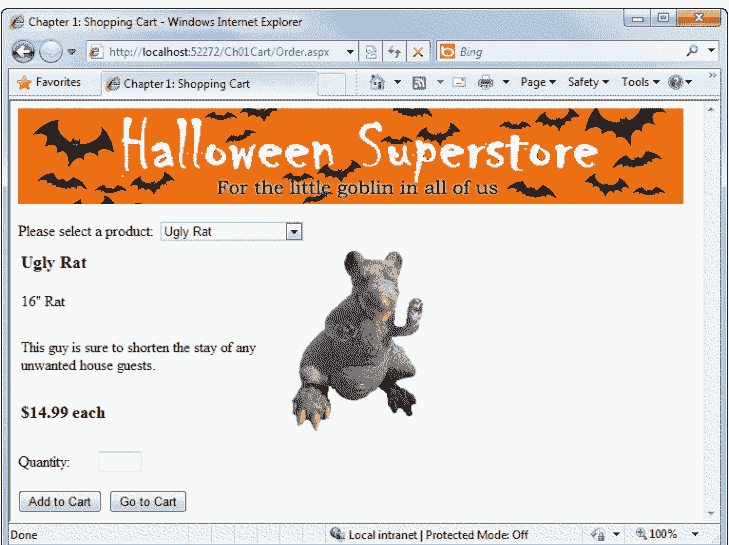

### 购物车应用程序的购物车页面

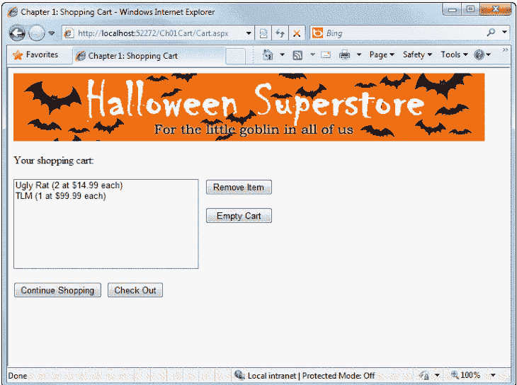

图 1-1 购物车应用程序的两个页面

### Web 应用程序的硬件和软件组件

图 1-2 显示了 Web 应用程序所需的基本硬件和软件组件。首先，Web 应用程序是一种*客户端/服务器应用程序*，这意味着应用程序的功能分布在*客户端*计算机和*服务器*计算机之间。客户端和服务器计算机通过互联网相互连接，并使用 *HTTP*（*超文本传输协议*）进行通信。

要访问 Web 应用程序，需要使用运行在客户端计算机上的*Web 浏览器*。最流行的 Web 浏览器是 Microsoft 的 Internet Explorer，但另外两种选择是 Mozilla Firefox 和 Chrome。

Web 应用程序本身存储在服务器计算机上。该计算机运行*Web 服务器*软件，使其能够将网页发送到 Web 浏览器。虽然可用的 Web 服务器很多，但最流行的两种是 Microsoft 的 *Internet Information Services*（或 IIS）和 Apache 软件基金会的 *Apache HTTP Server*（通常简称为 *Apache*）。不过，对于 ASP.NET 应用程序，服务器通常运行 IIS。虽然 Apache 可以配置为运行 ASP.NET 应用程序，但它并不支持 ASP.NET 的所有功能。

由于大多数 Web 应用程序需要处理存储在数据库中的数据，因此大多数服务器计算机也运行*数据库管理系统*（或 *DBMS*）。两种适用于 ASP.NET 开发的流行数据库管理系统是 Microsoft SQL Server 和 Oracle。但请注意，数据库服务器软件不必与 Web 服务器软件运行在同一台服务器计算机上。事实上，通常使用单独的数据库服务器来提高应用程序的整体性能。

尽管此图显示客户端和服务器计算机通过互联网连接，但这并不是 Web 应用程序中客户端连接到服务器的唯一方式。如果客户端和服务器位于同一个*局域网*（或 *LAN*）中，则它们可以通过*内联网*连接。由于内联网使用与互联网相同的协议，因此 Web 应用程序在内联网上的工作方式与在互联网上相同。

### Web 应用程序的组件

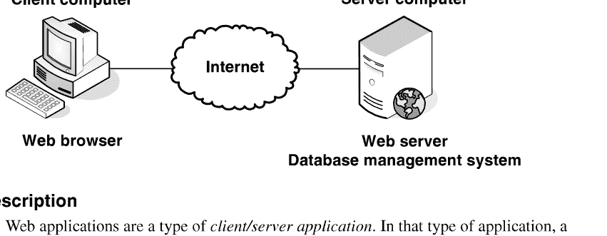

## 说明


Web 应用程序是一种客户端/服务器应用程序。在这种类型的应用程序中，位于客户端计算机上的用户访问服务器计算机上的应用程序。在 Web 应用程序中，客户端和服务器计算机通过互联网或内联网（局域网）连接。

在 Web 应用程序中，用户在客户端计算机上使用Web 浏览器。Web 浏览器为应用程序提供用户界面。最流行的 Web 浏览器是 Microsoft Internet Explorer，但也可以使用 Mozilla Firefox 和 Chrome 等其他 Web 浏览器。

应用程序在服务器计算机上运行，并受Web 服务器软件的控制。对于 ASP.NET Web 应用程序，服务器通常运行 Microsoft 的 Web 服务器，即 Internet Information Services（或 IIS）。

对于大多数 Web 应用程序，服务器计算机还运行数据库管理系统（或 DBMS），例如 Microsoft 的 SQL Server。DBMS 提供对数据库中存储信息的访问。为了提高大型应用程序的性能，DBMS 可以在单独的服务器计算机上运行。

Web 应用程序的用户界面以一系列在 Web 浏览器中显示的网页来实现。每个网页由一个Web 窗体定义，使用 HTML（超文本标记语言），这是一套标准化的标记标签。

Web 浏览器和 Web 服务器使用 HTTP（超文本传输协议）交换信息。

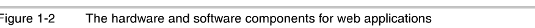

## 静态网页的工作原理

互联网上的许多网页都是静态网页，它们不会根据用户输入而改变。这些页面是 HTML 文档，由 HTML，即超文本标记语言 定义。

图 1-3 显示了 Web 服务器如何处理静态网页。流程始于用户在 Web 浏览器中请求一个网页。当用户在浏览器的地址栏中输入一个称为 URL（统一资源定位符）的网页地址，或当用户点击一个链接前往另一页面时，就会发生这种情况。

在任何一种情况下，Web 浏览器都使用 HTTP 向 Web 服务器发送 HTTP 请求。HTTP 请求包括诸如所请求网页的名称和地址、发出请求的浏览器的地址以及将处理请求的 Web 服务器的地址等信息。

当 Web 服务器从浏览器收到 HTTP 请求时，服务器从磁盘检索请求的 HTML 文件，并以 HTTP 响应的形式将文件发送回浏览器。HTTP 响应包括用户请求的 HTML 文档以及浏览器和 Web 服务器的地址。

当浏览器收到 HTTP 响应时，它会格式化并显示 HTML 文档。然后，用户可以查看内容。如果用户通过点击链接或在浏览器地址栏中输入另一个网页地址来请求另一个页面，则流程重新开始。

图 1-3 还显示了 URL 的组成部分。第一个组成部分是协议，在本例中为 HTTP。在大多数情况下，您可以省略协议，默认使用 HTTP。

第二个组成部分是域名，它标识您的网站。例如，此图中的 URL 包含我们网站的域名 www.murach.com。浏览器使用域名来识别托管网站的服务器。

域名之后，您指定文件在服务器上的路径。请注意，在 URL 中使用正斜杠来分隔路径的各个部分。路径之后，您指定要在浏览器中显示的文件名。在本例中，该文件是一个名为 `index.htm` 的静态网页。

### Web 服务器如何处理静态网页

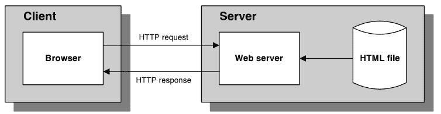

### HTTP URL 的组成部分

`http://www.murach.com/books/cs10/index.htm`

protocol domain name path file name

## 描述

- 静态网页是每次查看时都相同的 HTML 文档。换句话说，静态网页不会根据用户输入而改变。查看静态网页的每个人看到的内容完全相同。
- 静态网页通常是存储在 Web 服务器上的简单 HTML 文件。当浏览器请求静态网页时，Web 服务器从磁盘检索该文件并将其发送回浏览器。静态网页通常具有 `.htm` 或 `.html` 的文件扩展名。
- Web 浏览器通过向服务器发送称为 HTTP 请求的 HTTP 消息来向 Web 服务器请求页面。HTTP 请求包括，除其他内容外，所请求的 HTML 文件的名称以及浏览器和 Web 服务器的 Internet 地址。
- 使用浏览器的用户可以通过多种方式发起 HTTP 请求。一种方法是输入称为 URL 或统一资源定位符的网页地址到浏览器的地址栏，然后按 Enter 键。另一种方法是点击指向网页的链接。
- Web 服务器通过向浏览器发送称为 HTTP 响应的消息来回复 HTTP 请求。HTTP 响应包含浏览器和服务器的地址以及正在返回的 HTML 文档。

## 动态网页的工作原理

Web 应用程序由一个或多个网页组成，这些网页不是静态的，而是在每次显示页面时可以以某种方式改变。它们不是以 HTML 文件的形式存储在磁盘上，而是由应用程序动态生成的。因此，生成的页面通常被称为动态网页。

静态网页和动态网页之间的关键区别之一是，动态网页是包含一个或多个服务器控件的 Web 表单，例如标签、文本框和按钮。用户使用这些控件与应用程序进行交互。

图 1-4 显示了动态网页的基本处理过程。首先，浏览器向 Web 服务器 `IIS` 发送 `HTTP` 请求，其中包含所请求网页的地址以及用户输入到表单中的信息。当 `IIS` 收到此请求时，它通过在应用程序映射列表中查找所请求页面的扩展名来确定这是一个对 Web 表单的请求。这些映射指示文件扩展名与哪个程序相关联。因为 `.aspx` 文件与 ASP.NET 相关联，所以 Web 服务器将请求传递给 `ASP.NET 应用程序服务器` 进行处理。ASP.NET 反过来管理所请求 Web 表单的执行。

顺便说一下，您应该意识到，如果您使用的是 IIS 7，即使请求不是针对 `.aspx` 文件，HTTP 请求也可能被发送到 ASP.NET 进行处理。这是因为 IIS 7 提供了将 ASP.NET 与 IIS 服务器集成的模式。使用集成模式的一个优点是，它允许您使用您将在第 19 章中学到的 ASP.NET 身份验证和授权功能来限制对静态网页以及动态网页的访问。要确定 ASP.NET 应用程序是否使用集成模式，您可以使用应用程序池。您可以在附录 B 中了解有关使用 IIS 7 的应用程序池的更多信息。

当 Web 表单执行时，它会处理用户输入的信息并生成 HTML 文档。例如，如果 Web 表单从数据库显示数据，它会查询数据库以获取所需信息。然后，它生成包含该信息的页面，该页面由 ASP.NET 返回给 Web 服务器。Web 服务器反过来以 HTTP 响应的形式将页面发送回浏览器，浏览器显示该页面。从浏览器请求网页开始到页面发送回客户端结束的整个过程称为往返。

当用户点击控件以启动 HTTP 请求时，这被称为“向服务器回发”，称为回发。例如，在图 1-1 中的订单表单中，用户通过在下拉列表中选择一个项目或点击“添加到购物车”按钮来启动回发。然后，使用用户输入到页面中的新值来处理订单页面的 Web 表单。

### Web 服务器如何处理动态页面

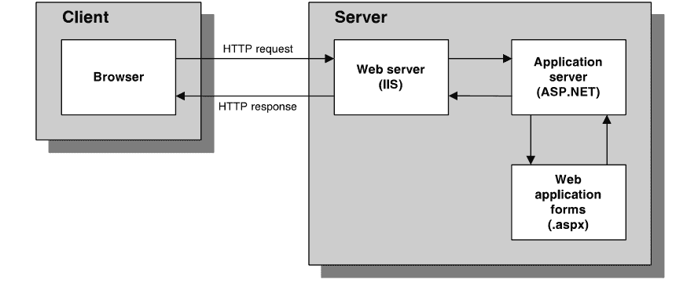

### ASP.NET 网页的 URL

`http://www.microsoft.com/express/product/default.aspx`

## 描述

- 动态网页是由 Web 表单生成的 HTML 文档。通常，网页会根据浏览器发送到 Web 表单的信息而改变。
- 当 Web 服务器收到对动态网页的请求时，它会在应用程序映射列表中查找所请求文件的扩展名，以确定哪个应用程序服务器应处理该请求。如果文件扩展名为 `.aspx`，则请求会传递给 ASP.NET 进行处理。
- 当应用程序服务器收到请求时，它运行指定的 Web 表单。然后，Web 表单生成 HTML 文档并将其返回给应用程序服务器，应用程序服务器将其传回 Web 服务器，然后传回浏览器。
- 浏览器不知道也不关心 HTML 是从静态 HTML 文件检索的还是由 Web 表单动态生成的。无论哪种方式，浏览器只是显示作为请求结果返回的 HTML。
- 页面显示后，用户可以使用其控件与之交互。其中一些控件允许用户将页面发回服务器，这称为回发。然后，使用用户输入的数据再次处理页面。
- 从用户请求网页开始到服务器将响应发送回客户端结束的过程称为往返。
- 如果您使用浏览器请求页面时省略 URL 中的文件名，IIS 默认会按以下四个名称查找文件：`Default.htm`、`Default.asp`、`index.htm` 和 `iisstart.asp`。如果您使用的是 IIS 7，它还会查找名为 `index.html` 或 `default.aspx` 的文件。如果您希望默认显示另一个页面，您可以将该页面的名称添加到此列表中。有关更多信息，请参阅附录 B（Windows 7 和 Windows Vista）或附录 C（Windows XP）。

Figure 1-4 How dynamic web pages work

顺便说一下，ASP.NET 4 的应用程序服务器可以处理由 ASP.NET 2.0、3.0 和 3.5 开发的 Web 窗体的请求，也可以处理由 ASP.NET 4 开发的窗体的请求。这意味着你不必将旧应用程序转换为 ASP.NET 4。需要注意的是，在 IIS 7 下，由 ASP.NET 2.0、3.0 或 3.5 开发的窗体必须与由 ASP.NET 4 开发的窗体在不同的应用程序池中运行。

## ASP.NET 应用程序中状态的处理方式

尽管在前面的图中并不明显，但应用程序在生成网页后即结束。这意味着应用程序维护的任何数据，例如变量或控件属性的当前状态，都会丢失。换句话说，HTTP 不维护应用程序的 state。这在图 1-5 中有所说明。

在这里，你可以看到客户端上的浏览器向 Web 服务器请求一个页面。服务器处理请求并将页面返回给浏览器后，会断开连接。然后，如果浏览器发出额外的请求，服务器就没有办法将浏览器与其之前的请求关联起来。正因为如此，HTTP 被称为 stateless protocol。

尽管 HTTP 不维护状态，但 ASP.NET 提供了几种方法来实现这一点，如本图所示。首先，你可以使用 view state 来维护服务器控件属性的值。例如，你可以使用 view state 来保留在 Web 窗体处理过程中被更改的标签控件的 Text 属性，或维护下拉列表中的项目列表。由于 ASP.NET 默认实现了 view state，因此你无需编写任何特殊代码即可使用它。

其次，你可以使用 session state 在应用程序的执行之间维护数据。为此，ASP.NET 会在用户开始新会话时在服务器上创建一个 session state object。该会话对象包含一个唯一的 session ID，并且每次用户请求页面时，该 ID 都会在服务器和浏览器之间来回传递。然后，当服务器收到用户的新的请求时，它可以为该用户检索正确的会话对象。在你的 Web 窗体的代码中，你可以将数据项添加到会话对象中，以便每次执行 Web 窗体时其先前的值都可用。

第三，你可以使用 application state object 来保存 application state 数据，该数据适用于应用程序的所有用户。例如，你可以使用应用程序状态来维护全局计数器，或维护当前登录到应用程序的用户列表。

第四，你可以使用 profile feature 来跟踪用户数据。尽管配置文件与会话状态对象类似，但它在用户会话之间保持持久，因为它存储在数据库中。当你使用配置文件时，例如，你可以跟踪用户在上次会话中查看的最后三个产品。然后，当用户开始新会话时，你可以在“最近查看的项目”列表中显示这些产品。由于配置文件使用频率不高，我将在本书中不介绍它们。

## 为什么在 Web 应用程序中跟踪状态很困难

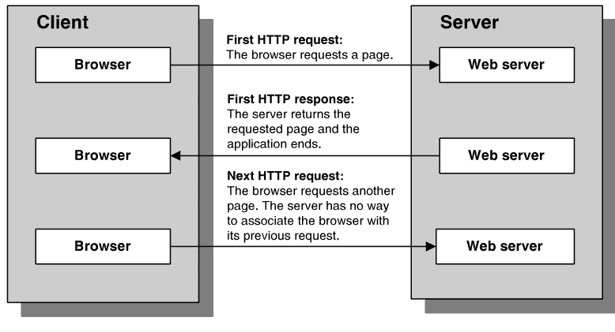

## Concepts

- State 指的是应用程序为单个用户维护的属性、变量和其他数据的当前状态。应用程序必须为当前访问应用程序的每个用户维护单独的状态。
- HTTP 是一个 stateless protocol。这意味着它不会在往返之间跟踪状态。一旦浏览器发出请求并收到响应，应用程序就会终止，其状态就会丢失。

### Four ASP.NET features for maintaining state

- ASP.NET 使用 view state 来维护应用程序在执行之间更改的窗体控件属性的值。由于 view state 默认实现，因此不需要特殊编码。
- 当用户开始新会话时，ASP.NET 会创建一个包含 session ID 的 session state object。该 ID 从服务器传递到浏览器再传回服务器，以便服务器可以将浏览器与现有会话关联起来。要维护 session state，你可以将程序值添加到会话状态对象中。
- 当应用程序开始时，ASP.NET 会创建一个 application state object。要维护 application state，你可以将程序值添加到应用程序状态对象中。这些值在应用程序结束之前可供应用程序的所有用户使用。
- ASP.NET 还可以为应用程序的每个用户维护一个 profile。由于配置文件存储在数据库中，因此配置文件数据在用户会话之间得以维护。这使得个性化应用程序变得更容易。

## ASP.NET 应用程序开发简介

在接下来的三个主题中，你将了解到开发 ASP.NET Web 应用程序所需的软件、.NET Framework 的组件是什么，以及你可以使用的开发环境。

### The software you need

图 1-6 中的第一个表格总结了开发 ASP.NET 应用程序所需的客户端和服务器软件。在你自己的 PC 上，你需要像 Windows XP、Windows Vista 或 Windows 7 这样的操作系统、Microsoft .NET Framework 4，以及像 Microsoft Internet Explorer 这样的浏览器。如果你想从使用该集成开发环境（IDE）中获益，你还需要 Visual Studio 2010。

如果你使用服务器进行开发，它将需要像 Windows Server 2003 或更高版本这样的服务器操作系统、Microsoft .NET Framework 4 和 Internet Information Services。如果你要从远程计算机开发应用程序，它还需要 FrontPage Server Extensions。而如果你要为 Internet 开发应用程序，它还需要一个 FTP 服务器。在附录 A 中，你可以获取有关为客户端和服务器安装软件的信息。

由于大多数 ASP.NET 应用程序需要数据库访问，因此你还需要一个数据库服务器，例如 Microsoft SQL Server。对于在你自己的 PC 上的开发工作，你可以使用 SQL Server 2008 Express Edition，它是随 Visual Studio 2010 提供的 SQL Server 的精简版。但对于生产应用程序，你可能需要在服务器上使用 SQL Server 本身。

如果你正在开发生产应用程序，你还应该在 PC 上下载并安装其他 Web 浏览器，包括 Mozilla Firefox 和 Chrome。这样，你就可以使用各种流行的浏览器测试你的应用程序。

该图中的第二个表格显示 Visual Studio 2010 有多个版本。大多数专业开发人员将使用 Professional Edition 或 Premium Edition。但大型开发团队可能会使用 Ultimate Edition，其中包含为架构师、开发人员和测试人员等专业开发角色设计的特性。

一个免费的替代方案是 Visual Web Developer 2010 Express Edition。该产品面向个人开发人员、学生和业余爱好者设计，本书中的大多数功能都适用于此版本。

## Software requirements for ASP.NET 4 application development

| Client | Server |
| :--- | :--- |
| Windows XP or later | Windows Server 2003 or later |
| Microsoft .NET Framework 4 | Microsoft .NET Framework 4 |
| A browser like Internet Explorer (6.0 or later) | Internet Information Services 6.0 or later |
| Visual Studio 2010 | Microsoft SQL Server or equivalent database server |
|  | FrontPage Server Extensions (for remote development only) |

## Visual Studio 2010 Editions

| Edition | Description |
| :--- | :--- |
| Visual Web Developer 2010 Express Edition | Free, downloadable edition for Web development in Visual Basic or C#. There is also an Express Edition of SQL Server called SQL Server 2010 Express. |


| | |
|---|---|
| Visual Studio 2010 Professional Edition | Designed for individual developers who want to build a wide variety of Windows, Web, mobile, and Office-based solutions. |
| Visual Studio 2010 Premium Edition | Designed for individuals and teams who want to build scalable applications and includes standard testing tools, database deployment and change-management tools, and basic lifecycle management tools. |
| Visual Studio 2010 Ultimate Edition | Designed for teams and includes full testing, modeling, database, and lifecycle management tools. |

## Description

- 要开发 ASP.NET 4 应用程序，你需要在自己的 PC 上安装上面显示的客户端软件。此外，如果你没有单独的服务器可用，你通常还需要 IIS 和数据库服务器，例如 SQL Server 2008 Express Edition。有关更多信息，请参阅图 1-8。

- Visual Studio 2010 有四个不同的版本，提供开发 ASP.NET 应用程序所需的所有基本功能。你选择的版本取决于你需要的额外功能。

## .NET Framework 的组件

因为在开发应用程序时，你应该对 .NET Framework 的作用有一个基本的了解，图 1-7 总结了其主要组件。正如你所见，该框架分为两个主要组件，.NET Framework 类库和通用语言运行时，而这些组件为用 Visual Basic 或 C# 等 .NET 语言编写的应用程序提供了一组通用的服务。

.NET Framework 类库由提供开发 .NET 应用程序所需许多功能的类组成。例如，ASP.NET 类用于开发 ASP.NET Web 应用程序，而 Windows Forms 类用于开发标准的 Windows 应用程序。其他 .NET 类让你可以处理数据库、管理安全、访问文件并执行许多其他功能。

尽管在该图中并不明显，但 .NET Framework 类库中的类是按层次结构组织的。在此结构中，相关的类被组织成称为命名空间的组。每个命名空间都包含用于支持特定功能的类。例如，`System.Web` 命名空间包含用于创建 ASP.NET Web 应用程序的类，而 `System.Data` 命名空间包含用于访问数据的类。

通用语言运行时，或 CLR，提供使用 .NET 语言开发的任何应用程序执行所需的服务。这是因为所有 .NET 语言都编译为通用的中间语言（或 IL）。CLR 还提供通用类型系统，该系统定义了所有 .NET 语言使用的数据类型。这样，无论你使用哪种 .NET 语言开发应用程序，都可以使用相同的数据类型。

要运行 ASP.NET 应用程序，Web 服务器必须安装 .NET Framework。但是，访问 Web 服务器的客户端计算机不需要 .NET Framework。相反，客户端计算机可以运行任何具有现代 Web 浏览器的客户端操作系统。

## .NET Framework

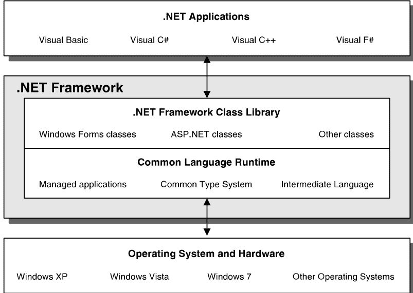

### 描述

- .NET 应用程序通过使用 .NET Framework 的服务来工作。.NET Framework 反过来访问操作系统和计算机硬件。

- .NET Framework 由两个主要组件组成：.NET Framework 类库和通用语言运行时。

- .NET Framework 类库以类的形式提供预先编写的代码，这些类可供所有 .NET 编程语言使用。这些类被组织成称为命名空间的组。支持 ASP.NET Web 程序的类存储在 `System.Web` 命名空间中。

- 通用语言运行时，或 CLR，通过协调内存管理、代码执行、安全性和其他服务等基本功能来管理 .NET 程序的执行。

- 通用类型系统是 CLR 的一个组件，可确保所有 .NET 应用程序无论使用何种编程语言开发，都使用相同的数据类型。

- 所有 .NET 程序都编译为 Microsoft 中间语言（MSIL）或仅为中间语言（IL），该语言以程序集的形式存储在磁盘上。然后由 CLR 运行该程序集。

## 开发 ASP.NET 应用程序的三种环境

图 1-8 显示了用于编码和测试 ASP.NET 应用程序的三种常见开发环境设置。正如你将看到的，每种设置都有其优点和缺点。你选择的环境将取决于你的开发需求和可用的资源。

最简单的开发环境是独立环境。在这种情况下，一台计算机同时充当客户端和服务器。因此，它必须运行支持 ASP.NET 开发的操作系统，并且必须安装 .NET Framework 和 Visual Studio 2010。由于 Visual Studio 2010 附带了用于本地测试的自己的开发服务器，因此在使用独立环境时你不必安装 IIS。此外，由于 Visual Studio 附带 SQL Server 2008 Express Edition（或仅为 SQL Server Express），因此你不必安装单独的数据库产品。这是我将在本书中重点介绍的环境。

第二个开发环境使用通过局域网连接的独立客户端和服务器计算机。在这里，客户端计算机安装了 Windows、.NET Framework 和 Visual Studio 2010，而服务器运行 Windows Server 并安装了 .NET Framework、IIS 和 FrontPage Server Extensions（FPSE）。FPSE 提供 Visual Studio 2010 用于与远程计算机上的 Web 站点通信的服务。此外，服务器使用 SQL Server 来处理数据库访问。借助此环境，多个程序员可以同时处理同一个应用程序，但所有程序员都位于同一站点。

在第三种开发环境中，客户端计算机通过 Internet 而不是 LAN 连接到服务器。这使得可以与托管在另一台服务器上的 Web 站点一起工作。此环境需要 FTP 服务器，用于在客户端计算机和服务器之间复制 Web 站点中的文件。FTP 服务器使用文件传输协议（FTP）执行复制操作，并且可以配置 IIS 以充当 FTP 服务器以及 Web 服务器。因此，如果 Web 站点托管在你有权访问的服务器上，则可以配置服务器以便远程用户可以使用 FTP 访问它。

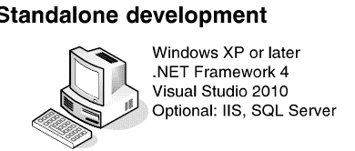

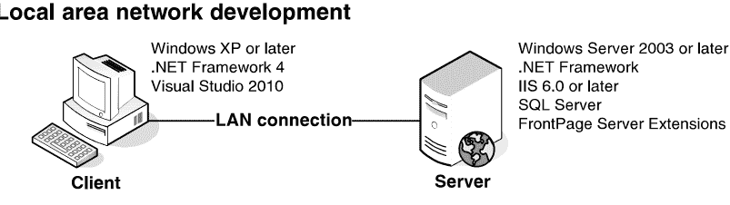

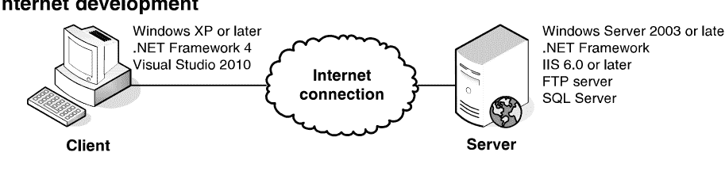

### 描述

- 当你使用独立开发时，一台计算机同时充当客户端和服务器。由于 Visual Studio 附带了一个精简的 Web 服务器，称为 ASP.NET 开发服务器（或仅为开发服务器），因此你无需使用 IIS 在自己的 PC 上测试 Web 应用程序。但是，你确实需要使用 IIS 来测试 Web 应用程序的某些功能。

- 当你使用 *局域网*（LAN）时，客户端计算机通过 LAN 与服务器计算机通信。借助此设置，同一站点的两个或多个程序员可以同时处理同一个应用程序。此设置要求在服务器上安装 *FrontPage Server Extensions*（FPSE）。

- 当你使用 Internet 开发时，客户端计算机通过 Internet 与服务器计算机通信。借助此设置，不同位置的程序员可以同时处理同一个应用程序。此设置要求服务器上安装 *FTP 服务器*。FTP 服务器使用 *文件传输协议*（FTP）在客户端计算机和服务器之间传输文件。


## ASP.NET 应用程序工作原理的快速预览

有了这些背景知识，你就可以了解 ASP.NET 应用程序的工作原理了。因此，本主题提供了 Shopping Cart 应用程序中 `Order` 表单工作原理的快速预览。

### Shopping Cart 应用程序使用的文件

图 1-9 以在 Visual Studio 2010 中使用 Web 窗体设计器开发 Web 窗体时显示的方式呈现了 Shopping Cart 应用程序的 Order 表单。在第 2 章中，你将学习如何使用此设计器，但现在只需尝试了解此表单的工作原理的整体情况。

如果你查看 IDE 中间的设计器窗口，你可以看到用于此表单的表格以及用于显示每个产品数据的标签控件。你还可以看到已使用下拉列表的智能标记菜单来启用 `AutoPostBack` 属性。这意味着当用户从下拉列表中选择一个项目时，`Order` 表单将被发布回 Web 服务器。

如果你查看设计器窗口右侧的解决方案资源管理器，你可以看到此应用程序所需的文件夹和文件。现在，只需关注此图中表格中总结的七个代码文件。表中前三个文件位于 `App_Code` 文件夹中，表示名为 `CartItem`、`CartItemList` 和 `Product` 的业务类。这三个文件都以 `cs` 为扩展名，这意味着它们是 C# 文件。

表中的接下来的四个文件用于两个 Web 窗体 `Cart` 和 `Order`，每个窗体有两个文件。扩展名为 `aspx` 的文件（`Cart.aspx` 和 `Order.aspx`）包含表示表单设计的代码。此代码由标准 HTML 代码加上定义表单上使用的服务器控件的 `asp` 标签组成。我们将此称为 `aspx` 代码，因为包含代码的文件具有 `aspx` 扩展名。

另外两个文件，扩展名为 `aspx.cs`，包含控制表单操作的 C# 代码。这些称为代码隐藏文件，因为它们提供了 Web 表单背后的代码。例如，`Order.aspx.cs` 文件是 `Order` 表单的代码隐藏文件。

在继续之前，你应该意识到不必将 Web 表单的 `aspx` 和 C# 代码存储在单独的文件中。相反，ASP.NET 允许你将此代码合并到单个 `aspx` 文件中。但是，将 `aspx` 和 C# 代码存储在单独的文件中可以简化应用程序开发，因为它让你可以将页面的表示元素与其 C# 编码分开。这也使得 HTML 设计师能够处理应用程序的 `aspx` 文件，然后让 C# 程序员开发代码隐藏文件的代码。

### 设计视图中的订单表单

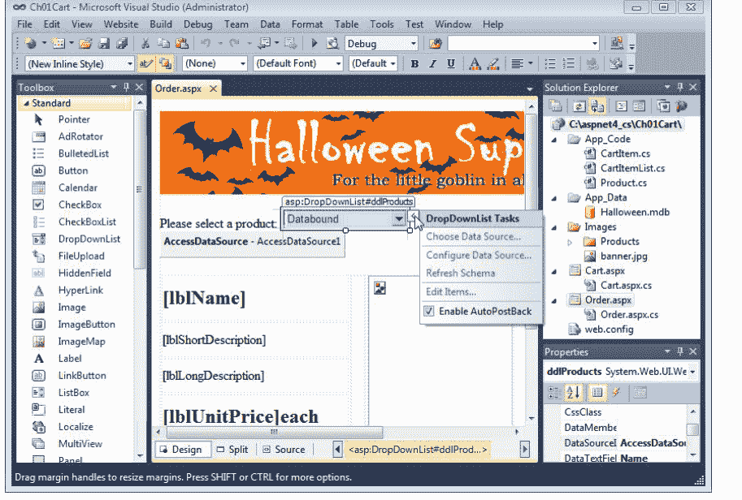

### 购物车应用程序中的 `aspx` 和 C# 文件

| 文件夹 | 文件 | 说明 |
|---|---|---|
| `App_Code` | `CartItem.cs` | 表示购物车中某个商品项的类。 |
| `App_Code` | `CartItemList.cs` | 表示购物车中所有商品项的类。 |
| `App_Code` | `Product.cs` | 表示商品的类。 |
| （根目录） | `Cart.aspx` | 购物车页面的 `aspx` 文件。 |
| （根目录） | `Cart.aspx.cs` | 购物车页面的代码隐藏文件。 |
| （根目录） | `Order.aspx` | 订单页面的 `aspx` 文件。 |
| （根目录） | `Order.aspx.cs` | 订单页面的代码隐藏文件。 |

### 说明

- 对于应用程序中的每个 Web 窗体，ASP.NET 4 会维护两个文件。扩展名为 `.aspx` 的文件包含 HTML 代码和用于服务器控件的 `asp` 标记。扩展名为 `.aspx.cs` 的文件是 *代码隐藏文件*，其中包含该窗体的 C# 代码。

- 如果 ASP.NET 4 应用程序还需要其他类（如 *业务类*），它们将保存在 `App_Code` 文件夹中。


## 订单表单的 `aspx` 代码

为了让你对 aspx 代码的运作方式有所了解，图 3-10 显示了订单表单的部分 aspx 代码。所有这些代码都是你在使用 Web Forms 设计器设计窗体时由 Visual Studio 生成的，因此你无需手动编写。但你仍应对这些代码的运作方式有一个大致的了解。

每个 Web 窗体的第一组标记定义了一个 *页面指令*，它提供了四个 *属性*。在这里，`Language` 属性指明语言为 C#，`CodeFile` 属性指明代码隐藏文件名为 `Order.aspx.cs`，`Inherits` 属性指定名为 `Order` 的类。在图 3-11 中，你将看到 `Order` 类如何继承 `Page` 类。

第二组标记定义了一个 `DOCTYPE` 声明，它告诉浏览器文档使用的是哪个版本的 HTML。你暂时可以忽略这个声明，因为在第 5 章中你会学到更多相关内容。

`html` 标记标记 HTML 文档的开始和结束，`head` 标记定义文档的标题部分。在这里，`title` 标记定义页面运行时显示在浏览器标题栏中的标题。另外，`style` 标记定义页面使用的样式。正如你将在第 5 章中学到的，这只是定义样式的一种方式。

网页本身的内容定义在 `div` 标记内，而 `div` 标记位于 `body` 和 `form` 标记内。请注意，第一个 `form` 标记包含一个值为 `"server"` 的 `runat` 属性。这表示该窗体将由 ASP.NET 在服务器上处理。所有 ASP.NET Web 窗体和所有 ASP.NET 服务器控件都需要此属性。

`div` 标记内的 `asp` 标记定义了页面上显示的服务器控件。由于这些控件包含值为 `"server"` 的 `runat` 属性，它们将由 ASP.NET 在服务器上处理。此处理的最后阶段是 *呈现* 控件，这意味着 `aspx` 代码会被转换为标准 HTML，以便浏览器能够显示页面。

如果你查看下拉列表的 `aspx` 代码，可以看到 `AutoPostBack` 属性已设置为 `True`。这意味着，只要用户从该列表中选择了一个项，就会发生回发。请注意，只要用户单击“Add to Cart”按钮，也会发生回发。但是，该控件不需要 `AutoPostBack` 属性，因为执行回发是按钮的默认操作。

尽管 “Add to Cart” 按钮的 `aspx` 代码不包含 `AutoPostBack` 属性，但它确实包含一个 `OnClick` 属性。此属性指定当用户单击按钮并将窗体回发到服务器时执行的事件处理程序。

另一个值得注意的属性是 `aspx` 代码中最后一个按钮的 `PostBackUrl` 属性。此属性提供了 `Cart.aspx` 文件的路径，这意味着当单击此按钮时将请求购物车窗体。这是在应用程序运行过程中从一个窗体切换到另一个窗体的一种方式，你将在下一张图中看到另一种方式。

尽管这只是对 Web 窗体 `aspx` 代码的简要介绍，但你应开始明白这些代码如何定义一个网页。不过，在接下来的两章中，你将学到更多关于这些代码的内容。而且，以防你需要，第 5 章会提供一份完整的 HTML 速成课程。

## 订单表单的 `aspx` 文件（`Order.aspx`）


```
<%@ Page Language="C#" AutoEventWireup="true" CodeFile="Order.aspx.cs"
Inherits="Order" %>

<!DOCTYPE html PUBLIC "-//W3C//DTD XHTML 1.0 Transitional//EN"
"http://www.w3.org/TR/xhtml1/DTD/xhtml1-transitional.dtd">

<html xmlns="http://www.w3.org/1999/xhtml">
<head runat="server">
    <title>Chapter 3: Shopping Cart</title>
    <style type="text/css">
        .style1{
            width: 250px;
        }
        .style2{
            width: 20px;
        }
    </style>
</head>
<body>
    <form id="form1" runat="server">
        <div>
            <asp:Image ID="Image1" runat="server"
                ImageUrl="~/images/banner.jpg" /><br /><br />
            <asp:Label ID="Label1" runat="server"
                Text="Please select a product:"></asp:Label>&nbsp;
            <asp:DropDownList ID="ddlProducts" runat="server"
                DataSourceID="AccessDataSource1" DataTextField="Name"
                DataValueField="ProductID" Width="150px" AutoPostBack="True">
            </asp:DropDownList>
            <asp:AccessDataSource ID="AccessDataSource1" runat="server"
                DataFile="~/App_Data/Halloween.mdb"
                SelectCommand="SELECT [ProductID], [Name], [ShortDescription],
                    [LongDescription], [ImageFile], [UnitPrice]
                FROM [Products] ORDER BY [Name]">
            </asp:AccessDataSource><br />
            <table>
                <tr>
                    <td class="style1"><asp:Label ID="lblName" runat="server"
                        style="font-weight: 700; font-size: larger"></asp:Label>
                    </td>
                    <td class="style2" rowspan="4"></td>
                    <td rowspan="4" valign="top">
                        <asp:Image ID="imgProduct" runat="server" Height="200px" />
                    </td>
                </tr>
                ...
                (Code for 3 more rows of a table)
                ...
            </table><br />
            <asp:Label ID="Label3" runat="server" Text="Quantity:"
                Width="80px"></asp:Label>
            <asp:TextBox ID="txtQuantity" runat="server" Width="40px"></asp:TextBox><br />
            <asp:Button ID="btnAdd" runat="server" Text="Add to Cart"
                OnClick="btnAdd_Click" />&nbsp;
            <asp:Button ID="btnCart" runat="server" CausesValidation="False"
                PostBackUrl="~/Cart.aspx" Text="Go to Cart" />
        </div>
    </form>
</body>
</html>
```

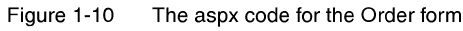

# 订单表单的 C# 代码

为了让你对窗体 C# 代码的运作方式有所了解，图 3-11 显示了订单窗体的代码隐藏文件。在这里，我特别突出显示了 ASP.NET 特有的代码，其余所有代码都是标准 C# 代码。

第一行突出显示的代码是类声明，它命名了与窗体同名的类。由于该语句使用了`partial`关键字，这是一个分部类，在编译时必须与另一个分部类合并。这一行代码的其余部分表明该类继承自`System.Web.UI.Page`类，后者是提供 ASP.NET 页面所有基本功能的 .NET 类。

每次请求页面时，ASP.NET 都会对其进行初始化并引发`Load`事件，该事件由`Page_Load`方法处理。该方法使用页面的`IsPostBack`属性来确定页面是否从同一个页面回发到服务器。如果此属性不为`True`，则使用下拉列表的`DataBind`方法将从数据库检索到的产品绑定到列表中。你经常会看到`IsPostBack`属性在`Page_Load`方法中这样使用，以判断页面是否由用户回发。

当用户单击订单页面上的“Add to Cart”按钮时，`btnAdd_Click`方法就会执行，从而启动回发。该方法首先调用`CartItemList`类的`GetCart`方法，从会话状态获取购物车的当前内容。然后，它检查所选产品是否已在购物车中。如果不在，则将新的购物车项添加到购物车中。如果已在，则将用户输入的数量加到购物车中的数量上。最后，该方法使用页面的`Response`属性的`Redirect`方法转到购物车页面。这是从一个页面切换到另一个页面的第二种方式。

值得注意的一个编码要点是，`IsPostBack`和`Response`都是页面的属性。因此，你可以使用`Page`作为限定符来编写它们，例如`Page.IsPostBack`。但是，由于`Page`是代码隐藏文件中的默认对象，你可以省略此引用。这同样适用于`Session`，尽管本页未使用它。

虽然这只是对代码隐藏文件的简要介绍，但我希望它能让你对代码隐藏文件的编写方式有所了解。不过请记住，所有这些代码都将在接下来的两章中详细解释。现在，你只需要大致了解事件是如何处理的、`IsPostBack`属性是如何使用的，以及一个网页如何切换到另一个网页。

## 订单表单的代码隐藏文件 (`Order.aspx.cs`)

```
using System;
using System.Collections.Generic;
using System.Linq;
using System.Web;
using System.Web.UI;
using System.Web.UI.WebControls;
using System.Data;

public partial class Order : System.Web.UI.Page
{
    private Product selectedProduct;

    protected void Page_Load(object sender, EventArgs e)
    {
        if (!IsPostBack)
            ddlProducts.DataBind();

        selectedProduct = this.GetSelectedProduct();
        lblName.Text = selectedProduct.Name;
        lblShortDescription.Text = selectedProduct.ShortDescription;
        lblLongDescription.Text = selectedProduct.LongDescription;
        lblUnitPrice.Text = selectedProduct.UnitPrice.ToString("c");
        imgProduct.ImageUrl = "Images/Products/" + selectedProduct.ImageFile;
    }

    private Product GetSelectedProduct()
    {
        DataView productsTable = (DataView)
            AccessDataSource.Select(DataSourceSelectArguments.Empty);
        productsTable.RowFilter =
            "ProductID = '" + ddlProducts.SelectedValue + "'";
        DataRowView row = (DataRowView)productsTable[0];

        Product p = new Product();
        p.ProductID = row["ProductID"].ToString();
        p.Name = row["Name"].ToString();
        p.ShortDescription = row["ShortDescription"].ToString();
        p.LongDescription = row["LongDescription"].ToString();
        p.UnitPrice = (decimal)row["UnitPrice"];
        p.ImageField = row["ImageFile"].ToString();
        return p;
    }

    protected void btnAdd_Click(object sender, EventArgs e)
    {
        CartItemList cart = CartItemList.GetCart();
        CartItem cartItem = cart[selectedProduct.ProductID];

        if (cartItem == null)
            cart.AddItem(selectedProduct, Convert.ToInt32(txtQuantity.Text));
        else
            cartItem.AddQuantity(Convert.ToInt32(txtQuantity.Text));

        Response.Redirect("Cart.aspx");
    }
}
```

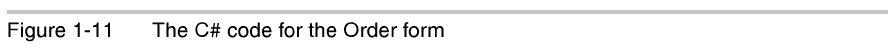

# ASP.NET 应用程序如何编译和运行

图 1-12 中的图表显示了当用户请求 ASP.NET 应用程序的页面时幕后实际发生的情况。在步骤 1 中，ASP.NET 运行时读取请求的网页的`.aspx`文件并生成一个类和一个`partial`类。`partial`类包含表单及其包含的控件的声明，并取名为代码隐藏文件中定义的`partial`类相同的名称（本例中为`Order`）。在步骤 2 中，这些`partial`类被编译以创建一个提供页面所有事件处理代码的单个类。结果存储在单个程序集（`.dll`文件）中。

ASP.NET 运行时生成的类包含实际创建 ASP.NET 页面的代码。该类以网页的`.aspx`文件的名称加上`_aspx`为名，因此本例中名称为`Order_aspx`。在步骤 3 中，该类被编译并存储在另一个程序集中。因为该类继承自`Order`类，所以从`Order_aspx`类实例化对象将包含创建页面的代码，以及`Order`类提供的事件处理代码。

在步骤 4 中，在页面类编译后，ASP.NET 运行时调用 C# 编译器编译应用程序`App_Code`文件夹中的任何类文件。对于购物车应用程序而言，这意味着`CartItem`、`CartItemList`和`Product`类被编译，结果保存在单个程序集中。

所有文件编译成程序集后，ASP.NET 创建页面的一个实例并引发适当的事件。然后，事件由页面的事件处理程序处理，页面的 HTML 被渲染。为了完成往返，页面的 HTML 文档被传回 Web 服务器并发送到用户的浏览器。

请注意，前四个步骤仅在第一次访问`.aspx`页面时执行。这是因为 ASP.NET 缓存了这些步骤创建的程序集。然后，当再次访问页面时，重用已保存的程序集，因此应用程序无需重新编译。但是，ASP.NET 会比较源文件的时间戳与`.dll`文件的时间戳。如果任何源文件自上次编译以来已被修改，ASP.NET 会自动重新编译它们。

## ASP.NET 应用程序如何编译

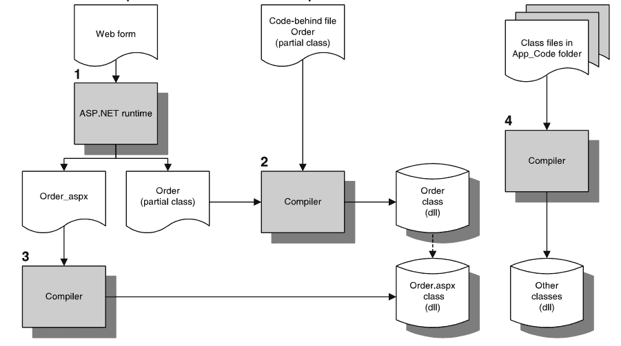

## 当请求 ASP.NET 页面时会发生什么

1. ASP.NET 运行时处理`.aspx`文件并生成一个`partial`类（`Order`），其中包含表单及其控件的声明，以及一个类（`Order_.aspx`），其中包含将初始化表单、实例化控件并生成网页 HTML 的代码。

2. C# 编译器将包含控件声明的`partial`类与表单的代码隐藏文件定义的`partial`类编译成一个 *程序集*（`.dll`），为请求的页面提供事件处理代码。

3. C# 编译器编译`Order_.aspx`类，该类继承第一个编译的类（`Order`），并将结果保存为在请求页面时执行的程序集。

4. 如有必要，C# 编译器编译存储在应用程序`App_Code`文件夹中的任何其他类文件。这些类保存在单个程序集中。

5. ASP.NET 从页面的最终程序集创建页面的一个实例。然后，ASP.NET 引发适当的事件，这些事件由页面的事件处理程序处理，页面生成传回 Web 服务器以供响应的 HTML。

## 描述

- 此过程的前四个步骤仅在第一次请求`.aspx`页面时执行。此后，页面直接从编译后的程序集中处理。

- 你添加到网站的 Web 表单的默认名称是`Default.aspx`，而该表单的代码隐藏类的名称是`_.Default`。

图 1-12 ASP.NET 4 应用程序如何编译和运行

# 视角

现在你已经阅读了本章，你应该对 ASP.NET 应用程序的工作原理以及开发这些应用程序所需的软件有大致的了解。以此为背景，你已准备好学习如何自行开发 ASP.NET 应用程序。而这正是你在接下来的两章中将学习的内容。

# 术语

- web application
- web page
- web form
- client/server application
- client
- server
- HTTP (Hypertext Transfer Protocol)
- web browser
- web server
- IIS (Internet Information Services)
- DBMS (database management system)
- LAN (local area network)
- intranet
- static web page
- HTML document
- HTML (Hypertext Markup Language)
- URL (Uniform Resource Locator)
- HTTP request
- HTTP response
- domain name
- dynamic web page
- server control
- application server
- application mapping
- round trip
- postback
- state
- stateless protocol
- view state
- session state
- session state object
- session ID
- application state
- application state object
- profile
- .NET Framework
- .NET Framework Class Library
- class
- namespace
- CLR (Common Language Runtime)
- IL (Intermediate Language)
- MSIL (Microsoft Intermediate Language)
- Common Type System


- `standalone environment`
- `development server`
- `SQL Server Express`
- `FPSE` (FrontPage Server Extensions)
- `FTP` (File Transfer Protocol)
- `FTP server`
- `business class`
- `aspx code`
- `code-behind file`
- `page directive`
- `attribute`
- `render`
- `assembly`

## 关于本书的应用程序

你可以从我们的网站（`www.murach.com`）下载本书中介绍的所有应用程序。然后，你可以运行这些应用程序，查看其所有代码，并在自己的系统上进行实验。有关下载和运行这些应用程序的更多信息，请阅读附录 A。

## 关于练习

如果你是 ASP.NET Web 编程的新手，我们建议你在完成本书前三个部分中每章的学习后练习所学内容。为帮助你做到这一点，我们为这些章节提供了练习。这些练习中的大多数使用可以从我们网站下载的目录和文件。因此，在开始练习之前，你需要安装这些目录和文件。安装后，它们将被放置在 `C` 盘上的一个名为 `aspnet4_cs` 的目录中。

## 练习 1-1 使用你的 Web 浏览器运行 Internet 应用程序

- 1. 打开你的 Web 浏览器并输入此 URL：

  `http://www.microsoft.com`

  然后，搜索有关 Visual Web Developer 2010 Express Edition 的信息。这当然是你可以免费下载 Visual Web Developer 2010 Express 和 SQL Server 2008 Express 的网站。随着你从一个页面移动到另一个页面，注意大多数都是动态的 `aspx` 页面。

- 2. 在你的 Web 浏览器中输入此 URL：

  `http://www.discountasp.net`

  然后，单击主页上的一些链接，并注意哪些页面是静态的，哪些是动态的。

## 练习 1-2 使用你的 Web 浏览器在 PC 上运行购物车应用程序

在本练习中，你将使用你的 Web 浏览器运行本章中说明的购物车应用程序。这假设你已经按照附录 A 中所述安装了 IIS、Visual Studio 2010 以及这些练习的文件。当你成功运行此应用程序时，就说明你已在 PC 上正确设置了 IIS 和应用程序。请注意，如果你使用的是 Windows XP Home Edition、Windows Vista Home Basic 或 Starter Edition，或 Windows 7 Home Basic 或 Starter Edition，则无法完成此练习。这是因为这些版本不带 IIS，或者随附的 IIS 版本不支持 ASP.NET 开发。

### 为购物车应用程序创建虚拟目录

+ 如果你使用的是 Windows 7 或 Windows Vista，请使用附录 B 中图 B-1 的流程，在 `Default Web Site` 节点下为位于 `C:\aspnet4_cs\Ch01Cart` 的应用程序创建一个名为 `Ch01Cart` 的 IIS 应用程序。如果你使用的是 Windows XP，请使用附录 C 中图 C-1 的流程，在 `Default Web Site` 节点下为位于 `C:\aspnet4_cs\Ch01Cart` 的应用程序创建一个名为 `Ch01Cart` 的 IIS 虚拟目录。

### 运行购物车应用程序

+ 打开你的 Web 浏览器，并输入以下使用虚拟目录作为路径的 URL：

`http://localhost/Ch01Cart/Order.aspx`

这应该会启动图 1-1 中所示的购物车应用程序。如果没有，请确保 IIS 已安装并正在运行，练习文件已安装，并且你已正确完成步骤 1。

+ 从显示的 `Order` 页面上的下拉列表中选择一个产品。请注意，这会启动一次回发，并返回带有所选产品的数据和图片的 `Order` 页面。

+ 输入数量并单击 `Add to Cart` 按钮以显示 `Cart` 页面。然后，单击 `Continue Shopping` 按钮返回到 `Order` 页面。

+ 继续尝试此应用程序，直到你了解其工作原理。请注意，由于此应用程序不包含数据验证，如果你在 `Order` 页面上未输入数量就单击 `Add to Cart` 按钮，你将收到错误。完成后，单击浏览器窗口右上角的 `Close` 按钮以结束应用程序。

## 如何开发一个单页 Web 应用程序

在上一章中，你已了解 Web 编程和 ASP.NET 的基本概念。现在，本章将向你展示如何使用 Visual Studio 2010 开发一个单页 Web 应用程序。如果你曾使用 Visual Studio 开发 Windows 应用程序，你很快就会发现 Web 应用程序的开发方式与之非常相似。因此，你应该能够快速阅读本章。

### 如何使用 ASP.NET 网站 ..... 32

如何开始一个新的网站

如何向网站添加 Web 窗体

如何使用 Visual Studio IDE

如何向网站添加文件夹和文件

如何打开或关闭现有网站

### 如何使用设计视图构建 Web 窗体 ..... 42

`Future Value` 表单的设计

如何使用流式布局

如何向表单添加表格

如何向表格的单元格添加文本

如何向表单添加服务器控件

如何设置控件的属性

Web 服务器控件的常用属性

### 如何在源代码和拆分视图中工作 ..... 52

如何使用源代码视图修改设计

如何使用拆分视图处理设计

如何使用代码片段

`Future Value` 表单的 `aspx` 代码

### 如何向表单添加验证控件 ..... 60

验证控件简介

如何使用必填字段验证器

如何使用范围验证器

### 如何向表单添加代码 ..... 64

如何使用代码编辑器

如何使用页面和控件事件

`Future Value` 表单的 C# 代码

### 如何测试 Web 应用程序 ..... 70

如何使用内置开发服务器运行网站

如何查看发送到浏览器的 HTML

### 视角 ..... 74

## 如何使用 ASP.NET 网站

本章首先介绍使用 ASP.NET 应用程序的一些基本技能。一旦你熟悉这些技能，你就可以准备好学习如何构建你的第一个 ASP.NET 应用程序。

## 如何开始一个新的网站

在 Visual Studio 2010 中，Web 应用程序称为 `web site`，图 2-1 显示了开始新网站的对话框。打开 New Web Site 对话框后，你选择要为网站使用的语言和要创建的网站类型，并指定网站的创建位置。

我为本书的所有网站都从 `ASP.NET Empty Web Site` 模板开始。当你使用此模板时，起始网站仅包含一个 `web.config` 文件，其中存储有关网站的信息。相比之下，如果你从 `ASP.NET Web Site` 模板开始应用程序，起始网站将包含许多窗体和文件。你将在下一章了解有关此模板的更多信息。

`Web Location` 下拉列表为你指定网站位置提供了三个选项。最简单的方法是创建 `file-system web site`。这种类型的网站可以存在于本地硬盘上的任何文件夹中，或网络共享驱动器上的文件夹中。你可以使用 Visual Studio 的内置开发服务器或 IIS 运行文件系统网站。

你使用 `HTTP` 选项创建在本地计算机或可通过局域网访问的计算机上运行在 IIS 下的网站。要使用此选项，你必须指定要创建网站的 IIS 服务器。此外，你必须选择或创建将包含网站文件的 IIS 目录，或选择或创建网站的虚拟目录。你将在第 4 章了解有关此选项的更多信息。

第三个选项 `FTP` 允许你通过使用 FTP 将其上传到该服务器，在远程服务器上创建网站。要创建这种类型的网站，你必须至少指定 FTP 服务器的名称和网站所在的文件夹。我不会在本書中介绍 `FTP` 选项。

除了语言和位置之外，Visual Studio 2010 还允许你为网站选择 `target framework`。默认情况下使用 .NET Framework 4，这通常是你想要的。然后，你可以在 Web 应用程序中使用该框架提供的功能。但是，如果你要将应用程序部署到没有 .NET Framework 4 的服务器上，你可能希望改为定位 .NET Framework 2.0、3.0 或 3.5。然后，你可以看到你将只使用这些框架提供的功能。

默认情况下，Visual Studio 2010 在 `My Documents\Visual Studio 2010\Projects` 中为你的网站创建解决方案文件。无论网站本身的位置如何，此解决方案文件都存储在此文件夹中。要更改默认存储解决方案的位置，请选择 `Tools▶Options`。然后，展开

### 新建网站对话框

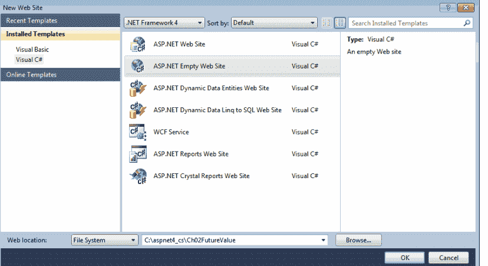

### ASP.NET 网站的三个位置选项

| 选项 | 描述 |
|---|---|
| File System | 在本地计算机上的文件夹或网络共享文件夹中创建的网站。你可以直接从内置开发服务器运行网站，或为文件夹创建 IIS 虚拟目录并在 IIS 下运行应用程序。 |
| HTTP | 在 IIS Web 服务器控制下创建的网站。IIS 服务器可以位于本地计算机或可通过局域网访问的计算机上。 |
| FTP | 在远程托管服务器上创建的网站。 |

### 描述

+ • 要创建名为 `web site` 的新的 ASP.NET Web 应用程序，你使用 `File➡New Web Site` 命令。
• `web project` 是用于 Web 网站开发的项目。实际上，网站通常被称为 Web 项目，反之亦然。但是，ASP.NET 4 网站不使用项目文件。相反，它们使用 `web.config` 文件存储项目信息。
• 当你开始新的网站时，Visual Studio 会在解决方案文件的默认位置为网站创建解决方案文件，该位置通常为 `My Documents\Visual Studio 2010\Projects`。
• 默认情况下，你创建的网站以 .NET Framework 4 为目标，以便你可以使用其提供的功能。如果你想以 .NET Framework 的不同版本为目标，你可以从对话框顶部第一个下拉列表中选择版本。
• Visual Studio 2010 还提供了一种称为 `web application project` 的 Web 项目类型。通过这种类型的项目，你可以创建与使用 Visual Studio 2003 创建的应用程序结构相似的 Web 应用程序。

`Projects and Solutions` 节点，选择 `General` 类别，并在 `Projects Location` 文本框中输入位置。

在图 2-1 的对话框中，我正在我的 PC 上 `aspnet4_cs` 文件夹中启动一个名为 `Ch02FutureValue` 的新文件系统网站。然后，当我单击 `OK` 按钮时，Visual Studio 创建了名为 `Ch02FutureValue` 的文件夹，并在该文件夹中放置了网站的 `web.config` 文件。它还在这些文件的默认文件夹中创建了一个解决方案文件。

用于开发网站的文件夹和文件可以称为 `web project`。因此，实际上，网站通常被称为 web 项目，反之亦然。需要注意的是，ASP.NET 4 网站不使用项目文件来存储项目信息。相反，它们使用 `web.config` 文件。

## How to add a web form to a web site

如果您从 `ASP.NET Empty Web Site` 模板启动一个网站，您想做的第一件事就是向该网站添加一个 `web form`。为此，您使用图 2-2 所示的 Add New Item 对话框。从此对话框中，您选择 Web Form 模板。然后，您输入要为新表单使用的名称并单击 `Add` 按钮将其添加到您的网站。

当您添加新的 web 表单时，请确保语言设置是 Visual C# 并且 `Place Code in Separate File` 框已选中。这些设置很容易被忽略，但如果在创建页面时设置错误，则手动更改起来很困难。

如果您选择 `Place Code in Separate File` 框，则会向您的项目添加两个文件。例如，当我添加本图所示的表单时，添加了名为 `Default.aspx` 和 `Default.aspx.cs` 的文件。`Default.aspx` 文件包含定义表单的 HTML 和 ASP 代码，而 `Default.aspx.cs` 文件包含确定表单如何工作的 C# 代码。然后，Visual Studio 会显示 `aspx` 文件，如您将在下一幅图中看到的那样。

要从另一个网站添加现有的 web 表单，您可以使用本图中的第二个过程。如果您需要创建一个与另一个网站中的表单相似的表单，您可能需要这样做。当您添加表单的 `aspx` 文件时，代码隐藏文件也会被添加。然后，您可以修改 `aspx` 和 C# 代码，以便表单在您的新网站中按您希望的方式工作。

### The Add New Item dialog box for adding a new web form

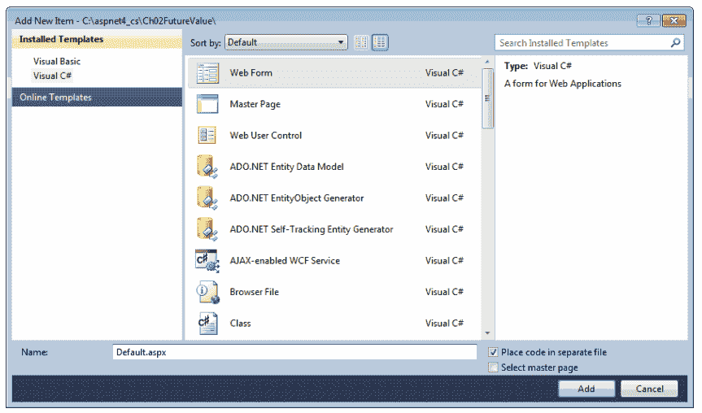

#### Two ways to open the Add New Item dialog box

- Right-click the project in the Solution Explorer, and then choose Add New Item from the shortcut menu.
- Click on the project in the Solution Explorer to select it, and then choose the `Website→Add New Item` command.

#### How to add a new web form to a project

- From the Add New Item dialog box, select the Web Form template, enter a name for the form, check the `Place Code in Separate File` box, and click the `Add` button.


## How to add an existing web form to a project

- In the Solution Explorer, right-click the project and choose Add Existing Item. Then, locate the form you want to add, select it, and click the Add button.

### Description

- If there's a form in another application that is like one that you're going to develop, you can copy that form into your web site. That copies both the web form and the code-behind file. Then, you can modify the aspx code and C# code so the form works the way you want it to.

- The drop-down list above the list of templates lets you change the order of the templates. The two buttons let you choose whether the templates are displayed as small icons or medium icons.

## How to work with the Visual Studio IDE

图 2-3 显示了我添加了一个名为 `Default` 的表单后的 `Ch02FutureValue` 网站。如果您使用 Visual Studio 构建 Windows 应用程序，您应该已经熟悉 *Toolbox*、*Solution Explorer* 和 *Properties window*，以及 Standard 工具栏。它们对于 Web 应用程序的工作方式与对于 Windows 应用程序的工作方式基本相同。例如，Solution Explorer 显示网站的文件夹和文件。在此示例中，Solution Explorer 显示了 web 表单的两个文件和 `web.config` 文件。

要设计 web 表单，您使用位于此集成开发环境（IDE）中央的 *Web Forms Designer*。当您向网站添加新的 web 表单时，此 Designer 会以 *Source view* 显示，其中显示表单的起始 HTML 代码。通常，您会在 *Design view* 中完成大部分设计，您可以通过单击 Designer 窗口底部的 Design 按钮来切换到该视图。您也可以在 *Split view* 中工作，这让您同时看到 Source view 和 Design view。

如果您的环境设置设置为 Web Developer，您会注意到根据您工作的视图启用了不同的工具栏。例如，在 Source view 中，Standard 和 HTML Source Editing 工具栏已启用。而在 Design view 中，Standard 和 Formatting 工具栏已启用。这就是 Visual Studio IDE 的典型工作方式。顺便说一下，要更改环境设置，您可以使用 Tools→Import and Export Settings 命令。

在构建网站的各个阶段，您可能希望关闭、隐藏或调整显示的窗口的大小。随着您在本章的进展，您会看到一些示例，并且本图提供了您可以用于处理窗口的几种技术。

在设计完 web 表单后，您需要切换到 Code Editor，它会替换屏幕中央的 Web Forms Designer。然后，您可以在表单的代码隐藏文件中编写 C# 代码。切换到 Code Editor 的一种方法是双击 Solution Explorer 中的代码隐藏文件。例如，如果您双击名为 `Default.aspx.cs` 的文件，您将切换到 Code Editor 并显示该文件的起始代码。本章后面您将学习在 Web Forms Designer 和 Code Editor 之间切换的其他方法。

在使用 Visual Studio 时，您会发现它通常提供多种完成同一任务的方法。当然，其中一些比其他方法更高效，我们将在本书的进展中尽力向您展示最佳技术。然而，通常如何工作是个人偏好的问题，因此我们鼓励您查看和尝试工具栏按钮、Solution Explorer 顶部的按钮、Web Forms Designer 或 Code Editor 顶部的选项卡、通过右键单击对象获得的快捷菜单等。

### The starting screen for a new web site

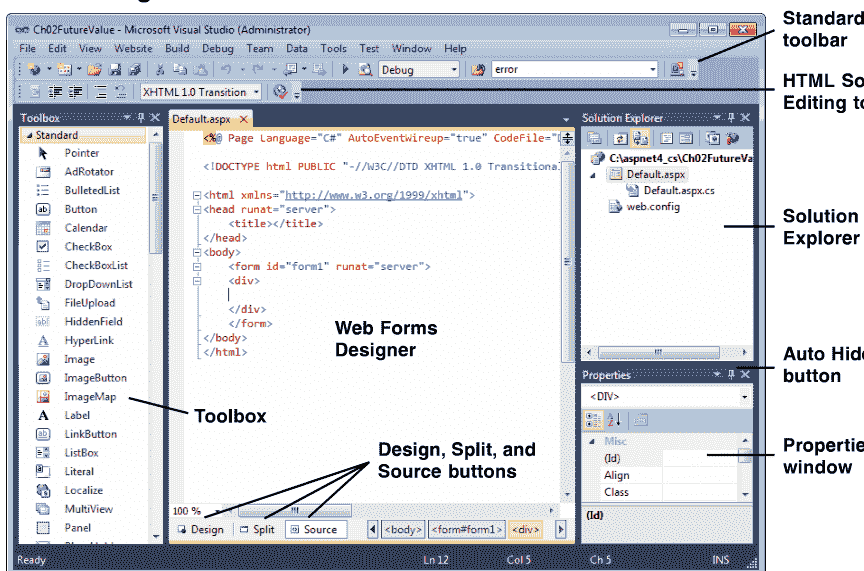

#### How to work with views and windows

- To change the Web Forms Designer from one view to another, click on the Design, Split, or Source button.

- To close a window, click on the close button in the upper right corner. To redisplay it, select it from the View menu.

- To hide a window, click on its Auto Hide button. Then, the window is displayed as a tab at the side of the screen, and you can display it by moving the mouse pointer over the tab. To restore the window, display it and click on the Auto Hide button again.

- To size a window, place the mouse pointer over one of its boundaries and drag it.

### Description

- Visual Studio IDE 中的主要窗口是 Web Forms Designer 窗口，或简称为 *Web Forms Designer*。三个辅助窗口是 *Toolbox*、*Solution Explorer* 和 *Properties window*。

- 您使用 Web Forms Designer 来设计 *web form*。稍后，要为表单编写 C# 代码，您可以使用图 2-17 所示的 Code Editor。

- Visual Studio 通常提供多种完成同一任务的不同方法。在本书中，我们将尽力向您展示效果最好的技术。

Figure 2-3 How to work with the Visual Studio IDE

## How to add folders and files to a web site

在您启动新网站后，立即添加应用程序所需的任何其他文件夹和现有文件通常是有意义的。为此，您可以使用 Solution Explorer 中项目或其文件夹的快捷菜单，如图 2-4 所示。如您所见，此菜单提供了 New Folder 命令以及 Add Existing Item 命令。

对于 Future Value 应用程序，我首先添加了一个名为 `Images` 的文件夹。为此，我在 Solution Explorer 顶部的项目上右键单击，选择了 New Folder 命令，并输入了文件夹的名称。然后，我向 `Images` 文件夹添加了一个名为 `MurachLogo.jpg` 的现有图像文件。为此，我右键单击该文件夹，选择 Add Existing Item，然后从显示的对话框中选择文件。

这些是我为 Future Value 应用程序需要的唯一其他文件夹和文件，但通常您需要其他文件。例如，下章中的应用程序需要三个现有的业务类、一个 Access 数据库和许多图像文件。

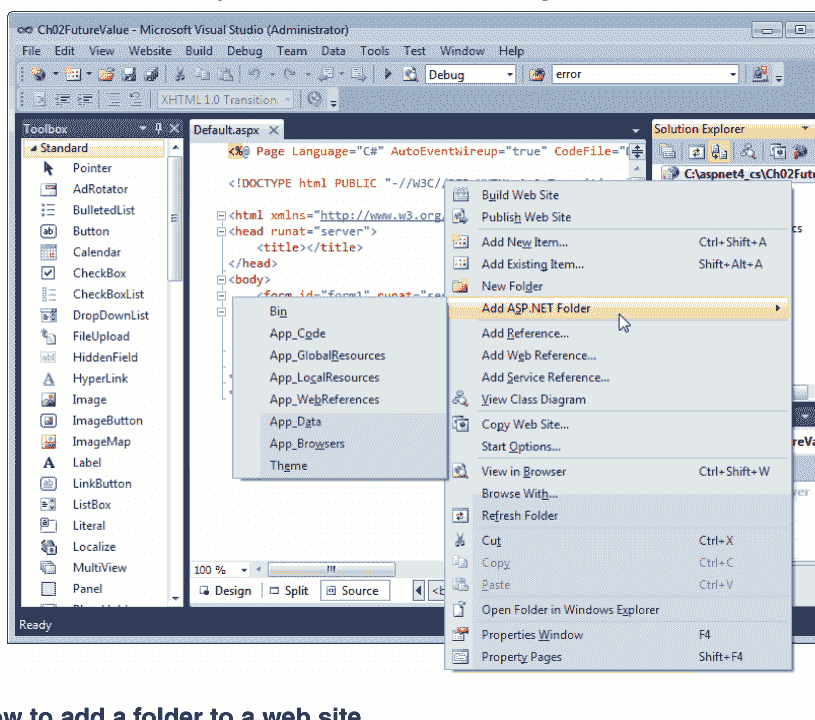

### 正在将 Future Value 项目作为新文件夹添加

#### 如何向网站添加文件夹

- 要添加标准文件夹，请在解决方案资源管理器中右键单击要添加文件夹的项目或文件夹，然后选择**新建文件夹**。接着，输入文件夹名称并按 Enter。

- 要添加特殊的 ASP.NET 文件夹，请在解决方案资源管理器中右键单击项目，然后选择**添加 ASP.NET 文件夹**。接着，从显示的列表中选择该文件夹。

#### 如何向网站添加现有项

- 在解决方案资源管理器中，右键单击要添加现有项的项目或文件夹。然后，选择**添加现有项**并在出现的对话框中做出响应。

### 说明

- 创建新的 Web 窗体时，Visual Studio 会生成窗体的起始 HTML，并将其显示在 Web 窗体设计器的源视图中。

- 在开始设计应用程序的第一个 Web 窗体之前，可以使用解决方案资源管理器向网站添加任何其他文件夹或文件。

## 如何打开或关闭现有网站

图 2-5 展示了打开现有网站的三种方式。“打开项目”和“最近使用的项目”命令最容易使用，但“打开网站”命令提供了更大的灵活性。在“打开网站”对话框中，可以使用左侧的图标来识别要打开的网站类型，从而可以直接从网站所在的 Web 服务器打开网站。

要关闭项目，请使用“关闭项目”命令。首次关闭项目后，当使用“最近使用的项目”命令时，你可以在项目列表中找到该项目。

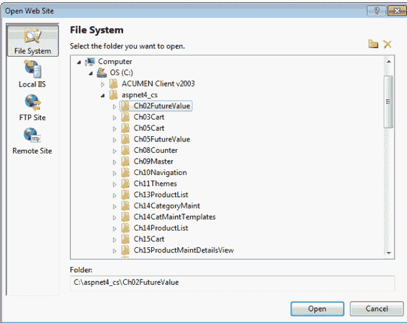

### “打开网站”对话框

#### 打开网站的三种方式

- 使用“文件”→“打开项目”命令。

- 使用“文件”→“最近使用的项目”命令。

- 使用“文件”→“打开网站”命令。

#### 如何使用“打开网站”对话框

- 要打开文件系统网站，请在对话框左侧选择**文件系统**，然后使用文件系统树定位网站。

- 要打开由你自己计算机上的 IIS 管理的网站，可以单击**本地 IIS**，然后从可用网站列表中选择该网站。或者，如果你愿意，也可以使用文件系统树打开它。不过，在这种情况下，该网站默认不会在 IIS 下运行。

- “打开网站”对话框左侧的其他图标允许你从 FTP 站点或远程 IIS 站点打开网站。

#### 如何关闭项目

- 使用“文件”→“关闭项目”命令。

### 注意

- “最近使用的项目”列表和“打开项目”命令也可以从起始页中使用。

图 2-5 如何打开或关闭现有网站

## 如何使用设计视图构建 Web 窗体

既然你已经知道如何启动、打开和关闭网站，接下来就可以学习如何构建 Web 窗体了。首先，我会向你展示将要构建的 Web 窗体。然后，我会向你展示如何构建它。

### Future Value 窗体的设计

图 2-6 展示了一个 Future Value Web 窗体的设计，该窗体用于计算固定每月投资额的未来价值。这个窗体具有足够的功能，让你能够真实地了解窗体开发所涉及的内容，但它又非常简单，不会让你被细节淹没。在这种情况下，整个应用程序仅由这一个窗体组成。

如果仔细研究这个窗体，你会发现它包含六个*Web 服务器控件*。这些控件派生自 ASP.NET 类，并且具有使它们适合 Web 应用程序的特殊功能。该窗体包含一个*下拉列表*、两个*文本框*、一个*标签*和两个*按钮*。这些控件与你在 Windows 应用程序中使用的控件类似。

当你单击 Web 窗体中的按钮时，它会自动向服务器发起回发。例如，当你单击“计算”按钮时，应用程序会根据下拉列表和两个文本框中的值计算未来价值。当窗体返回浏览器时，结果会显示在标签中。当你单击“清除”按钮时，文本框和标签会被清空，下拉列表中的值会重置为 50。

与 Web 服务器控件相比，此页面顶部的图像（Murach 徽标）是由标准 HTML 元素定义的。由于你无法在代码中引用标准 HTML 元素，因此通常不会在 Web 应用程序中使用它们。不过，就像本应用程序中的这个元素一样，它们偶尔也会很有用。

此 Web 窗体上 Web 服务器控件的排列是通过 HTML 表格完成的。但请注意，在窗体上排列控件的首选方式是使用 CSS。你将在第 5 章中了解更多相关内容。

在此窗体的表格上方，已经输入并格式化了一个标题。然后，在表格前四行的第一列中，输入了描述第二列数据的文本。表格的第五行不包含文本或控件。第六行包含两个按钮。

在本章的其余部分，你将学习如何构建此 Web 窗体、如何验证用户在窗体中输入的数据，以及如何为其代码隐藏文件编写代码。然后，你将学习如何测试 Web 应用程序。在本章末尾，你会找到一些练习，这些练习将引导你完成此 Future Value 应用程序的开发，并帮助你体验 Visual Studio 的其他功能。

在本章中，请注意术语*页面*有时用来指代 Web 窗体。这是因为 Web 窗体表示发送到浏览器的页面。

### 浏览器中的 Future Value Web 窗体

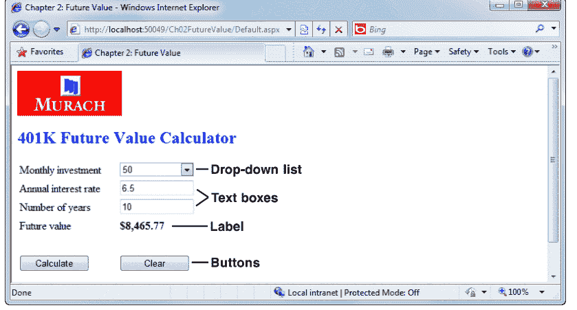

### Future Value 窗体使用的六个 Web 服务器控件

- *下拉列表*可用于选择每月投资额，范围从 50 到 500，以 50 为增量。

- 两个*文本框*用于输入年利率和每月付款的年数。

- *标签*用于显示计算出的未来价值。

- “计算”和“清除”*按钮*用于将窗体回发到服务器并启动需要执行的处理。

### 说明

- 除了*Web 服务器控件*之外，Future Value 窗体还使用标准 HTML 元素来显示窗体顶部的图像，并使用文本来显示图像下方的标题。它还使用 HTML 表格来对齐图像和标题下方的文本及 Web 服务器控件。

- 当用户单击“计算”按钮时，会根据三个用户输入计算未来价值，结果显示在标签控件中。

- 当用户单击“清除”按钮时，两个文本框和标签会被清空，下拉列表会重置为 50。

- 要结束应用程序，用户可以单击浏览器窗口右上角的“关闭”按钮。

### 如何使用流布局

默认情况下，你以*流布局*方式开发 Web 窗体。使用流布局时，添加到窗体中的文本和控件会从左到右、从上到下排列。因此，显示窗体时，控件的位置可能会根据浏览器窗口的大小和显示器的分辨率而改变。

为了理解流布局的工作原理，图 2-7 展示了 Future Value 窗体某个版本的开头部分，该版本没有使用表格来对齐文本和控件。为了创建此窗体，我首先直接在窗体中输入标题文本。然后，我按了两次 Enter 键，在标题与其后的文本和控件之间添加空间。接下来，我输入了标识第一个控件的文本，按了一次空格键在文本后添加一些空间，然后添加了一个下拉列表。当我添加下拉列表时，它被放置在该文本和空间的右侧。我使用类似的技术输入了其余文本和文本框。

最后，我格式化了窗体顶部的标题。为此，我选择了文本，然后使用格式工具栏中的控件将字体大小更改为“x-large”、将标题设为粗体，并将其颜色更改为蓝色。

你可以在此图中的 aspx 代码中看到结果。请注意，每个换行都会插入一个 `br` 元素。此外，还使用了 `span` 和 `strong` 元素来对标题应用格式。如你所见，`span` 元素包含一个 `class` 属性，该属性指定了一个样式类的名称。虽然你在这里看不到，但这个样式类是在页面的 `head` 元素中定义的，它指定了字体大小和颜色。`strong` 元素使标题变为粗体。

#### Future Value 表单的开头（使用流布局创建）

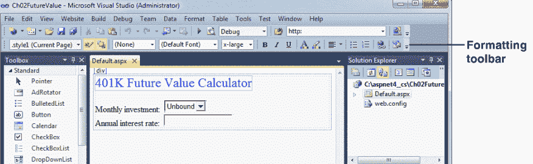

#### Future Value 表单的 aspx 代码

```
<form id="form1" runat="server">
<div>
<span class="style1"><strong>401K Future Value Calculator</strong></span><br />
Monthly investment:&nbsp;
<asp:DropDownList ID="DropDownList1" runat="server">
</asp:DropDownList><br />
Annual interest rate:&nbsp;
<asp:TextBox ID="TextBox1" runat="server"></asp:TextBox>
</div>
</form>
```

### 如何使用流布局

- 当你以*流布局*向表单添加控件时，它们会一个接一个地出现，从左到右、从上到下。流布局是 Visual Studio 2010 中 Web 表单的默认布局。

- 为了便于在设计视图中处理表单，Visual Studio 会在 `div` 标签定义的区域周围放置一个边框。

- 要在控件后插入换行，请按 Enter。一个 `<br />` 标签会被插入到 aspx 文件中。

- 要插入文本内容，直接在设计器窗口中键入。然后，你可以使用格式工具栏中的控件和格式菜单中的命令来更改字体或字号；应用*加粗*、*斜体*或*下划线*；或应用前景色或背景色。

- 当你对文本内容应用格式时，Visual Studio 通常会创建一个样式类并将该类应用于文本。然后，你可以将相同的类应用于其他文本内容。

- 要在使用流布局时对齐文本和控件，你可以使用表格，如下一张图所述。不过，首选技术是使用 CSS。

- 有关使用格式工具栏、样式类和 CSS 的更多信息，请参阅第 5 章。

图 2-7 如何使用流布局

### 如何向表单添加表格

由于空格和换行所能实现的操作有限，你会希望使用其他技术来在流布局中格式化表单。在本章中，我将展示如何使用表格来格式化表单。然后，在第 5 章中，我将展示如何使用 CSS 来格式化表单。

图 2-8 展示了如何向表单添加表格。在此情况下，一个六行两列的表格已经添加到表单中，但显示了“插入表格”对话框，以展示该表格的设置。通常，你可以保持对话框中的条目如此简单，因为一旦表格放到表单上，你就可以轻松地调整它。


调整行或列大小的最简单方法是拖拽其边框。要更改列宽，请拖拽其右边界。要更改行高，请拖拽其底边界。你也可以通过选择表格然后拖拽其控制手柄来更改整个表格的高度和宽度。请注意，当你进行此类更改时，Visual Studio 会像格式化文本时那样创建样式类。然后，这些类会应用于表格的相应元素。

你还可以在设计视图中格式化表格，方法是选择一个或多个行或列，然后使用“表格”菜单中的命令，或右键单击所选内容时显示的快捷菜单中的命令。这些命令允许你添加、删除或调整行或列的大小。它们还允许你合并行或列中的单元格。例如，如果你希望某行中的一个控件跨两列，你可以合并该行中的单元格。

## 如何向表格的单元格中添加文本

在图 2-8 中，你可以看到文本已经输入到表格第一列前四行的单元格中。要做到这一点，只需在单元格中键入文本。然后，你可以通过选择文本并使用格式工具栏中的控件或格式菜单中的命令来格式化文本。例如，如果你想让四个文本条目加粗，可以选择包含文本的四个单元格，然后点击“加粗”按钮。

*第 2 章*     *如何开发单页 Web 应用*

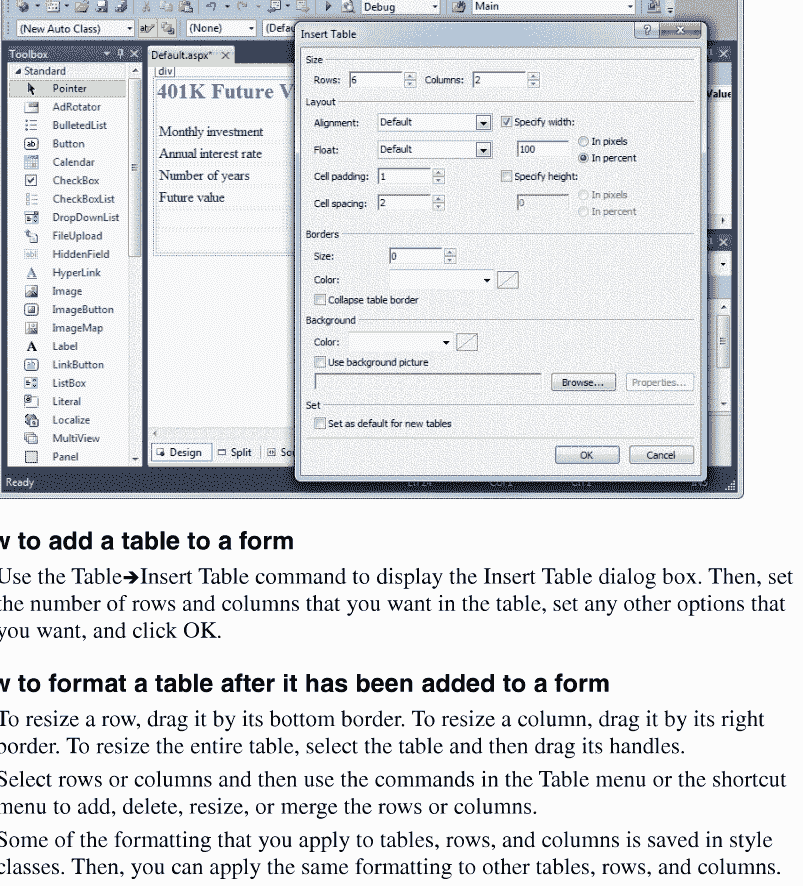

## 已插入表格的 Future Value 表单

## 如何向表单添加表格

- 使用“表格”➔“插入表格”命令以显示“插入表格”对话框。然后，设置你想要的表格行数和列数，设置任何其他想要的选项，并单击“确定”。

## 如何格式化已添加到表单中的表格

- 要调整行大小，请拖拽其底边界。要调整列大小，请拖拽其右边界。要调整整个表格的大小，请选择表格，然后拖拽其控制手柄。
- 选择行或列，然后使用“表格”菜单或快捷菜单中的命令来添加、删除、调整大小或合并行或列。
- 你应用于表格、行和列的某些格式会保存在样式类中。然后，你可以将相同的格式应用于其他表格、行和列。

## 如何添加和格式化文本

- 要向表格添加文本，请在表格的单元格中键入文本。
- 要格式化表格中的文本，请选择文本，然后使用格式工具栏中的控件或格式菜单中的命令来应用格式。

## 说明

- 要控制流布局中 Web 表单上的文本和控件的对齐方式，可以使用表格。


## 如何向表单添加服务器控件

图 2-9 展示了如何向表单添加 Web 服务器控件。要做到这一点，你可以从工具箱的“标准”组中拖出一个控件并放到表单上。或者，你可以将光标移到想要插入控件的位置，然后双击工具箱中的控件。无论你是在表格单元格内还是表格外放置控件，这种方法都有效。

将控件添加到表单后，你可以通过拖拽控件侧边的控制手柄来调整其大小。如果控件在表格中，你可能还想同时调整表格的列或行。请记住，你可以调整单元格的大小以及单元格内的控件的大小，有时你必须同时调整两者才能获得你想要的格式。

虽然你通常会在 Web 表单上使用 Web 服务器控件，但你也可以使用 HTML 控件。这些控件出现在工具箱的“HTML”组中，你可以像添加 Web 服务器控件一样将它们添加到表单。此外，你可以通过从解决方案资源管理器中拖拽图像来向表单添加 HTML 图像控件。我就是这样在 Future Value 表单顶部添加图像的。

## 如何设置控件的属性

将控件放到表单上后，你需要设置每个控件的属性，以便在显示表单时控件的外观和工作方式符合你的要求。若要设置这些属性，你需要在属性窗口中操作，如图 2-9 所示。若要显示特定控件的属性，只需在设计视图中单击该控件。

在属性窗口中，通过单击属性来选择它。然后，该属性的简要描述会显示在窗口底部的窗格中。要更改属性设置，请通过在属性名称右侧的输入框中键入新值或从下拉列表中选择新值来更改其条目。在某些情况下，当你单击某个属性时，会出现一个带有省略号（...）的按钮。在这种情况下，你可以单击此按钮以显示一个对话框，帮助你设置该属性。

某些属性按组显示。在这种情况下，组名称旁边会出现一个 ▷ 符号。此图中的 Font 属性就说明了这一点。要显示组中的属性，只需单击组名称旁边的 ▷ 符号。

若要按字母顺序或按类别显示属性，你可以单击属性窗口顶部的相应按钮。一开始，你可能希望按类别显示属性，以便了解不同属性的作用。但一旦你更加熟悉这些属性，按字母顺序显示可能会让你更快找到所需的属性。

在处理属性时，你会发现大多数属性都已按你想要的默认方式设置好了。此外，有些属性（如 Height 和 Width）会随着你在设计视图中调整控件大小和位置而交互式地设置。因此，你通常只需为每个控件更改少量属性。唯一

## 添加六个Web服务器控件后的FutureValue表单

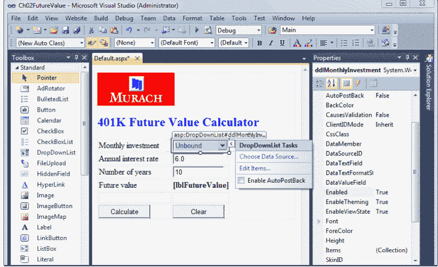

## 如何向Web表单添加Web服务器控件

+   将控件从工具箱的“标准”组拖动到表单或表单表格中的单元格。或者，将光标移动到需要放置控件的位置，然后双击工具箱中的控件。

## 如何设置控件属性

+   单击控件将其选中，其所有属性都会显示在“属性”窗口中。然后，您可以在该窗口中选择一个属性并设置其值。选择属性时，窗口底部的窗格中会显示简要说明。
+   要更改“高度”和“宽度”属性，可以拖动控件上的某个句柄。这也会更改“属性”窗口中的“高度”和“宽度”值。
+   您可以使用“属性”窗口顶部的头两个按钮按类别或字母顺序对属性进行排序。
+   您可以使用“属性”窗口中显示的▷和◁符号来展开和折叠属性列表。（如果您使用的是Windows XP，则使用+和–符号代替这些符号。）
+   许多Web服务器控件都有一个*智能标记菜单*，其中提供了执行常见任务和设置常见属性的选项。要显示智能标记菜单，请单击控件右上角的“智能标记”图标。

## 注意

+   此表单上的图像是通过将MurachoLogo.jpg文件从“解决方案资源管理器”拖动到表单而创建的。这会创建一个HTML图像控件。

图2-9 如何向表单添加Web服务器控件并设置其属性

例如，我为下拉列表设置的属性是ID属性。该属性包含您在为代码隐藏文件编写C#代码时用来引用控件的名称。

对于某些控件，设置属性的另一种方法是使用控件的*智能标记菜单*。例如，在图2-9中，您可以看到下拉列表的智能标记菜单。您可以使用此菜单为控件选择数据源，这会设置*DataSourceID*、*DataTextField*和*DataValueField*属性；编辑列表中的项，这会修改通过*Items*属性访问的项集合；以及在从列表中选择值后启用或禁用页面的自动回发，这会设置*AutoPostBack*属性。由于智能标记菜单有助于设置常见属性，因此当您将控件拖动到表单时，它们会自动显示。您也可以通过单击控件右上角的“智能标记”图标来显示智能标记菜单。

## Web服务器控件的常见属性

图2-9中的第一个表列出了您在开发Web表单时最可能使用的Web服务器控件属性。如果您使用过Windows控件，您会注意到Web服务器控件的许多属性提供了类似的功能。例如，您使用ID属性为需要在代码中引用的控件命名，您可以使用Text属性来确定控件中显示的内容。但是，AutoPostBack、CausesValidation、EnableViewState和Runat属性是Web服务器控件独有的。由于您已经知道Runat属性的用途，我将重点介绍另外三个属性。

AutoPostBack属性确定当用户更改控件的值时，页面是否回发到服务器。请注意，此属性仅适用于某些控件，如复选框、下拉列表和单选按钮。另请注意，此属性不适用于按钮控件。这是因为按钮控件始终将页面回发到服务器或显示另一个页面。

CausesValidation属性可用于按钮控件，它确定当用户单击按钮时是否激活验证控件。这允许您在页面回发到服务器之前检查有效数据。您将在接下来几个图中了解更多关于验证控件的信息。

EnableViewState属性确定服务器控件是否在一次回发到下一次回发之间保留其属性设置。要实现这一点，表单和控件的*EnableViewState*属性都必须设置为True。由于这通常是您希望设置该属性的方式，因此默认值为True。

此图中的第二个表列出了另外四个常用于下拉列表和列表框的属性。但是，您不需要在设计时设置这些属性。相反，您在为代码隐藏文件编写C#代码时使用它们。例如，您使用*Items*集合来添加、插入和移除ListItem对象。您使用*SelectedValue*属性来检索当前选定项的值。当您查看Future Value表单的代码隐藏文件时，您将了解更多关于这些属性的信息。

## Web服务器控件的常见属性

| 属性 | 描述 |
| :--- | :--- |
| AutoPostBack | 确定当控件的值更改时，页面是否回发到服务器。可用于复选框、下拉列表、单选按钮或文本框等控件。默认值为False。 |
| CausesValidation | 确定当您单击按钮、链接按钮或图像按钮时，是否执行验证控件所执行的验证。默认值为True。（您将在本章后面学习如何使用两个常见的验证控件。） |
| EnableViewState | 确定控件是否在HTTP请求之间保持其视图状态。默认值为True。 |
| Enabled | 确定控件是否可用。默认值为True。 |
| Height | 控件的高度。 |
| ID | 用于引用控件的名称。 |
| Runat | 指示控件将由ASP.NET在服务器上处理。 |
| TabIndex | 确定按Tab键时表单上控件接收焦点的顺序。 |
| Text | 控件中显示的文本。 |
| ToolTip | 当用户将鼠标悬停在控件上时显示的文本。 |
| Visible | 确定控件是显示还是隐藏。 |
| Width | 控件的宽度。 |

## 下拉列表和列表框控件的常见属性

| 属性 | 描述 |
| :--- | :--- |
| Items | 表示控件中项的ListItem对象集合。虽然您可以在设计时设置这些列表项的值，但通常使用代码来添加、插入和移除下拉列表或列表框中的项。 |
| SelectedItem | 当前选定项的ListItem对象。 |
| SelectedIndex | 当前选定项的索引。如果列表框中没有选定任何项，则此属性的值为-1。 |
| SelectedValue | 当前选定项的值。 |

## 注意

+   • 单击按钮时，它们始终会回发到服务器。这就是它们没有AutoPostBack属性的原因。

## 如何在源视图和拆分视图中工作

在Design视图中设计表单时，Source视图中会生成HTML和asp标签。这是用于呈现发送到用户浏览器的网页的代码。您在Design视图中看到的只是该代码的可视化表示。在许多情况下，您需要在Source视图中工作才能使页面看起来符合您的要求。在Source视图中工作时，您还可以使用Visual Studio for ASP.NET的一项新功能，称为代码片段。您可能还想在Split视图中工作，以便同时查看Design视图和Source视图。

## 如何使用源视图修改设计

正如您在上一章中所看到的，HTML由标签组成。例如，`<form>`和`</form>`标签标记Web表单HTML代码的开始和结束。而`<table>`和`</table>`标签标记表格HTML代码的开始和结束。

除了HTML标签之外，ASP.NET还为添加到表单中的Web服务器控件添加了asp标签。在图2-11中，您可以看到Future Value表单的一些asp标签。例如，`<asp:DropDownList>`和`</asp:DropDownList>`标签标记下拉列表代码的开始和结束。在这些标签中，您会找到控件属性设置的代码。但是请注意，在页面发送到浏览器之前，所有这些asp代码都会被转换为HTML，因为浏览器只能解释HTML。

由于包含Web表单源代码的文件具有aspx扩展名，因此我们将表单的源代码称为*asp代码*。这也表明该代码同时包含HTML和asp标签。

如果您需要，第5章提供了HTML速成课程。不过，与此同时，您可能会惊讶地发现，使用*HTML编辑器*调整aspx代码来修改表单设计是多么容易。

首先，您可以在源代码顶部附近的`<title>`和`</title>`标签之间输入表单的标题。这是表单运行时显示在浏览器标题栏中的标题（见图2-6）。在此示例中，标题为“第2章：Future Value。”您将看到，本书中的所有应用程序都有标题，这些标题既指示章节编号，也指示应用程序类型。

您还可以更改已输入到表单中的文本或HTML元素的某些设置。例如，如果您想将表格第一行中的文本从“Monthly investment”更改为“Investment amount”，您只需在Source视图中编辑文本即可。如果您想修改标题的颜色，也可以这样做。编辑时，只需遵循其他条目的语法，在阅读第5章之后，这会更容易做到。

要更改服务器控件的属性，您可以单击起始asp标签以选择控件。然后，您可以使用“属性”窗口，就像在设计视图中一样。更改属性时，控件asp标签中表示该属性的*attribute*也会更改。您还可以更改

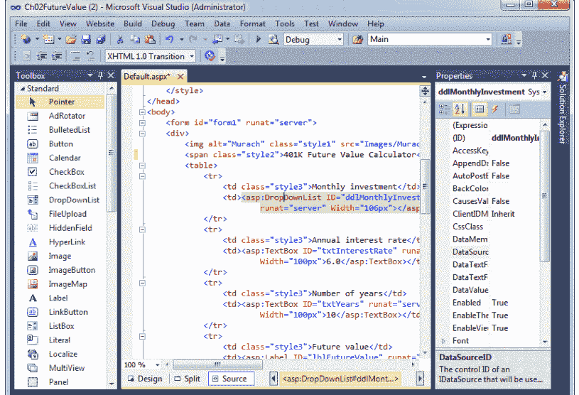

## Source 视图中 Future Value 表单的设计

### 如何为表单输入标题

- 在 *<title>* 和 *</title>* 标签之间输入文本。

### 如何更改表单的 HTML 和文本

- 直接更改源代码本身。

### 如何更改控件的属性设置

- 要选择一个控件，将插入点移入该控件的 aspx 标签中。然后，使用属性窗口更改该控件的属性设置。或者，你也可以直接在源代码中修改属性设置。

### 如何添加控件

- 从工具箱拖动控件到你希望它出现的位置。

## 说明

- Design 视图呈现你在 Source 视图中看到的代码的视觉表示。
- 源代码包含 HTML 标签和 aspx 标签。在表单发送到浏览器之前，aspx 标签会被转换为 HTML，因为浏览器只能使用 HTML。
- 你为控件设置的属性会作为 *attributes* 出现在该控件的 aspx 标签中。
- 我们将源代码称为 *aspx code*，因为源文件具有 aspx 扩展名。

在语法明显时，直接在源代码中修改 attributes。通常这是进行调整的最快方法。

除了在 Source 视图中更改现有控件的属性外，你还可以添加新控件。要做到这一点，只需从工具箱拖动控件并将其放置在你希望它出现的位置。然后，你可以使用标准技术设置控件的属性。

## 如何使用 Split 视图来处理设计

除了 Design 视图和 Source 视图之外，你还可以在 Split 视图中工作。图 2-12 显示了 Future Value 表单在 Split 视图中的外观。使用此视图时，你可以同时看到表单的 aspx 代码和该代码的视觉表示。当你需要对表单的外观进行细微调整时，这特别有帮助。然后，你可以检查在 Source 视图中进行的更改是否符合你的预期，而无需切换到 Design 视图。

请注意，当你在 Source 视图中进行更改时，该更改不会自动反映在 Design 视图中。相反，会在 Design 视图窗口顶部显示一个栏，指示两个视图不同步。在此图中，当我更改表格第一单元格中的文本时显示了此栏。要同步两个视图，你可以单击此栏或 Design 视图窗口中的任意位置。相比之下，如果你在 Design 视图中进行更改，它会立即反映在 Source 视图中。

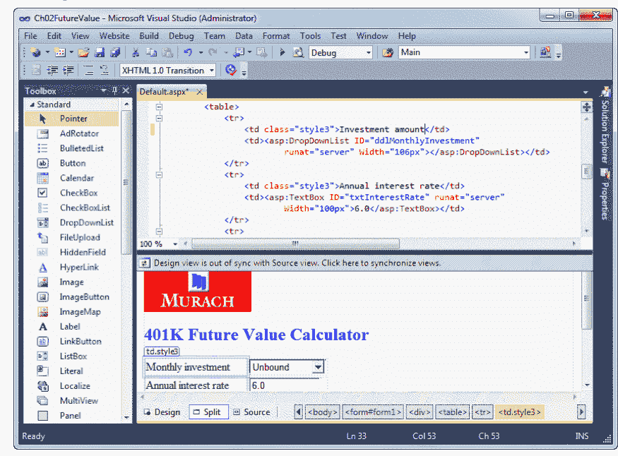

## Split 视图中 Future Value 表单的设计

## 说明

- 你可以使用 Split 视图同时在 Source 视图和 Design 视图中显示表单。这消除了在两个视图之间来回切换的需要。
- 默认情况下，设计器窗口按上图所示水平分割。然后，窗口的上半部分以 Source 视图显示表单，窗口的下半部分以 Design 视图显示表单。
- 你也可以垂直分割设计器窗口。要做到这一点，使用 Tools ▸ Option 命令显示选项对话框。然后，展开 HTML Designer 节点，选择 General 组，并勾选 Split Views Vertically 选项。
- 如果你在 Design 视图中进行更改，它会立即反映在 Source 视图中。但是，如果你在 Source 视图中进行更改，会在 Design 视图窗口顶部显示一个栏，指示 Design 视图与 Source 视图不同步。然后，你可以单击此栏或 Design 视图窗口中的任意位置以同步视图。

图 2-12 如何使用 Split 视图来处理表单的设计

如果你曾使用 Visual Studio 进行 C# 编码，你可能已经熟悉代码片段。你可以在代码编辑器中使用它们来输入常用代码模式。借助 Visual Studio 2010，你也可以在 HTML 编辑器中使用代码片段来输入 ASP.NET 和 HTML 元素。在本主题中，我将向你展示如何使用代码片段输入 ASP.NET 元素，但你可以将相同的技术应用于 HTML 元素。

图 2-13 显示了如何使用代码片段。首先，你可以在 HTML 编辑器中右键单击想要插入元素的位置，然后从快捷菜单中选择 Insert Snippet 命令。然后，要插入 ASP.NET 元素，你双击 ASP.NET 文件夹以显示该文件夹中的片段。最后，你双击要插入的片段的名称。

此时，代码片段会被插入到 HTML 编辑器中。例如，在此图中，你可以看到标签控件已被插入到代码中。还请注意 Text 属性的值已被高亮显示。现在，你只需替换此属性的值并添加要应用于标签的任何其他属性即可。

在大多数情况下，使用工具箱添加 ASP.NET 控件与使用代码片段一样简单。如果使用本图所示的菜单，尤其如此。但是，如果你喜欢使用代码片段的想法，你应该知道每个代码片段都有一个快捷方式，你可以使用它来插入它，而无需使用菜单。例如，创建标签控件的代码片段的快捷方式就是“label”。要使用其快捷方式插入此代码片段，只需输入快捷方式并按 Tab 键即可。


如果你经常使用代码片段，你应该知道可以从默认列表中添加或删除片段。要做到这一点，你可以从 Tools 菜单中选择 `Code Snippets Manager` 命令。然后，你可以使用 resulting 对话框删除不使用的代码片段或添加新的代码片段。但是，请注意，编写新的代码片段需要创建定义代码片段的 XML 文件。要了解如何执行此操作，你可以查阅 Visual Studio 的文档。

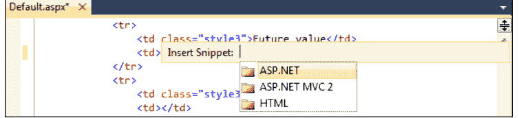

## 显示的代码片段列表

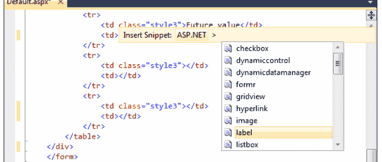

## 显示的 ASP.NET 代码片段列表

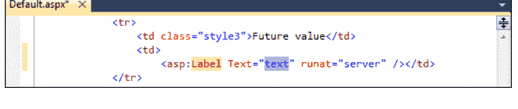

## 为标签控件插入的片段

## 说明

- 要插入代码片段，在 HTML 编辑器中右键单击并从 resulting 菜单中选择 `Insert Snippet` 命令。然后，从显示的列表中双击要插入的片段类型。最后，双击片段或突出显示它并按 Tab 或 Enter 键。

- 一旦片段被插入到你的代码中，你可以替换高亮的属性值并添加任何其他必需的属性。要从一个高亮值移动到下一个，你可以按 Tab 键。

- 你可以使用 Tools → `Code Snippets Manager` 命令显示一个对话框，你可以使用它来编辑可用代码片段的列表并添加自定义代码片段。此对话框还列出了可用于插入片段的快捷方式。

- 要使用快捷方式插入片段，输入快捷方式然后按 Tab 键。

## Future Value 表单的 aspx 代码

图 2-14 展示了迄今为止开发的 Future Value 表单的 aspx 代码（除 `Page` 和 `DocType` 指令外，你将在第 5 章中了解更多相关内容）。现在，请注意，显示在 Web 浏览器中的标题的代码位于 `<head>` 标签之间，与表单使用的样式类代码一起，而表单设计的代码位于 `<div>` 标签之间。

在 `<div>` 标签内，我突出显示了 HTML 图像控件的代码和六个 Web 服务器控件的代码。如果你研究这段代码，你可以看到为每个控件设置的属性。例如，你可以看到我将按钮控件的 `Width` 属性设置为 100 像素，以便它们具有相同的宽度。你还可以看到我将下拉列表的宽度设置为 106 像素，即使它看起来与宽度为 100 像素的文本框相同。我的意思是，aspx 代码中的尺寸属性并不总是保持一致，因此你通常需要调整这些属性才能使设计符合你的预期。

在继续之前，我想指出，当你从 Solution Explorer 拖动图像时，会显示一个 Accessibility Properties 对话框，让你为 HTML 图像控件设置两个属性。首先，它让你设置 Alternate Text 属性（`Alt`），该属性指定如果由于某种原因无法显示图像时显示的文本。因为 Visual Studio 2010 使用的 HTML 版本需要此属性，所以你需要确保为其输入一个值。

其次，它让你指定 Long Description 属性（`LongDesc`），该属性提供指向图像更详细描述的 *Uniform Resource Indicator*（URI）。URI 可以是 Web 页面的地址（URL）或标识资源或信息单元的名称（URN，或 *Uniform Resource Name*）。Long Description 属性不是必需的，在大多数情况下你会将其留空。

## Future Value 表单的 aspx 代码

```
<html xmlns="http://www.w3.org/1999/xhtml">
<head runat="server">
<title>Chapter 2: Future Value</title>
<style type="text/css">
<style1
{color: #0000FF;
font-size: x-large}
<style2
{width: 100%}
<div>
<style3
{width: 140px;
height: 23px}
<style4
{width: 150px;
height: 65px}
</style>
</head>
<body>
<form id="form1" runat="server">
<div>
<br /><br />
<span class="style1"><strong>401K Future Value Calculator</strong></span><br /><br />
<table class="style2">
<tr>
<td class="style3">Monthly investment</td>
<td><asp:DropDownList ID="ddlMonthlyInvestment"
runat="server" Width="106px"></asp:DropDownList></td></tr>
<tr>
<td class="style3">Annual interest rate</td>
<td><asp:TextBox ID="txtInterestRate" runat="server"
Width="100px">6.0</asp:TextBox></td></tr>
<tr>
<td class="style3">Number of years</td>
<td><asp:TextBox ID="txtYears" runat="server"
Width="100px">10</asp:TextBox></td></tr>
<tr>
<td class="style3">Future value</td>
<td><asp:Label ID="lblFutureValue" runat="server"
Font-Bold="True"></asp:Label></td></tr>
<tr>
<td class="style3">&nbsp;</td>
<td>&nbsp;</td></tr>
<tr>
<td class="style3"><asp:Button ID="btnCalculate" runat="server"
Text="Calculate" Width="100px"
OnClick="btnCalculate_Click"/></td>
<td><asp:Button ID="btnClear" runat="server"
Text="Clear" Width="100px" OnClick="btnClear_Click"/></td></tr>
</table>
</div>
</form>
</body>
</html>
```

**图 2-14** Future Value 表单的 aspx 代码

## 如何向表单添加验证控件

验证控件是一种用于验证输入数据的 ASP.NET 控件类型。下面的主题将介绍验证控件，并向您展示如何使用其中两个常用的控件。然后，在第 7 章中，您可以学习掌握这些控件使用所需的所有技能。

### 验证控件简介

图 2-15 显示了工具箱中的 Validation 组。它提供了五个可以称为 *validators* 的控件。这些是您用来检查用户是否输入了有效数据的控件。您可以使用该组中的最后一个控件，即验证摘要控件，来显示表单上验证器检测到的所有错误。

将验证控件添加到 Web 表单的最简单方法是将其从工具箱拖动。在此示例中，表单中添加了四个验证器：两个必填字段验证器和两个范围验证器。在这种情况下，控件已添加到表格下方，因此 ASP.NET 将使用流式布局来定位控件。但是，这些控件也可以添加到表格的第三列。虽然这些控件在表单显示时不会显示，但如果检测到错误，其 `ErrorMessage` 属性中的消息将被显示。

在此情况下，第一个必填字段验证器检查是否在利率文本框中输入了值，而第一个范围验证器检查该值是否在 1 到 20 之间。同样，第二个必填字段验证器检查是否在年数文本框中输入了值，而第二个范围验证器检查该值是否在 1 到 45 之间。

验证测试通常在页面发布到服务器之前在客户端进行。这样，如果检测到任何无效数据，就无需往返服务器即可显示错误消息。

在大多数情况下，客户端验证是在焦点离开与之关联的验证器的输入控件时完成的。这可能发生在用户按 Tab 键移动到下一个控件时，或单击另一个控件将焦点移动到该控件时。验证也会在用户单击其 `CausesValidation` 属性设置为 `True` 的按钮时进行。

要执行客户端验证，浏览器必须支持 *Dynamic HTML*，或 *DHTML*。由于当今使用的大多数浏览器都支持 *DHTML*，因此验证通常可以在客户端完成。但是，当页面提交时，验证也会始终在服务器上进行。ASP.NET 在初始化页面后执行此验证。

当 ASP.NET 在服务器上执行验证测试时，它会将每个验证器的 `IsValid` 属性设置为指示测试是否成功。此外，在所有验证器测试完成后，它会将页面的 `IsValid` 属性设置为指示所有输入数据是否有效。您可以在导致页面发布到服务器的事件的事件处理程序中测试此属性。当您查看此表单的代码隐藏文件时，您将看到其工作原理。

### Future Value 表单上的验证控件

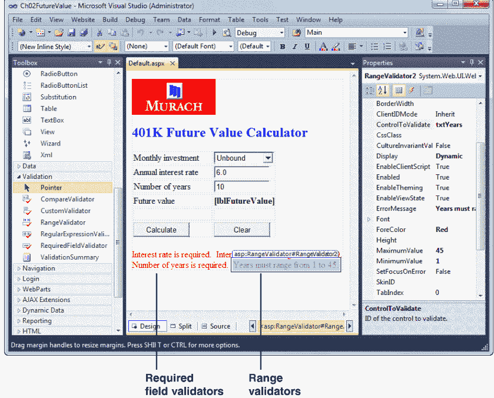

必填字段验证器

范围验证器

### 描述

- 您可以使用 *validation controls* 来测试用户输入并生成错误消息。验证通常在焦点离开正在验证的控件时以及用户单击其 `CausesValidation` 属性设置为 `True` 的按钮时执行。

- 每个验证控件都与特定的服务器控件关联，但您可以将一个或多个验证控件与单个服务器控件关联。

- 验证控件通过运行客户端脚本来工作。然后，如果验证失败，页面将不会发布回服务器。但是，如果客户端不支持脚本，验证也会在服务器上执行。

- 如果客户端不支持脚本，您可以通过测试页面的 `IsValid` 属性是否为 `True` 来测试服务器上验证是否成功。

### 如何使用必填字段验证器

要使用 *required field validator*，您需要设置图 2-16 顶部表格中显示的属性。这些是所有验证器使用的属性。

首先，您通过其 `ControlToValidate` 属性将验证控件与表单上的特定输入控件关联。然后，当用户单击其 `CausesValidation` 属性设置为 `True` 的按钮时，验证器会检查是否已在输入控件中输入了值。如果没有，则会显示 `ErrorMessage` 属性中的消息。如果用户清除输入控件中的值然后将焦点移动到另一个控件，也会显示错误消息。

验证控件的 `Display` 属性决定了 `ErrorMessage` 属性中的消息如何显示。当您使用流式布局时，`Dynamic` 通常对此属性最有效。如果您使用第 7 章中解释的验证摘要控件，则可以将此属性更改为 `None`。

如果您查看此图中的 aspx 代码，您可以看到为上一图中显示的两个必填字段验证器设置了属性。第一个验证名为 `txtInterestRate` 的文本框。第二个验证名为 `txtYears` 的文本框。此 aspx 代码将在图 2-14 中的代码中表格的结束标记之后添加。

另请注意，两个必填字段验证器的 `ForeColor` 属性均设置为 `Red`。虽然以前版本的 ASP.NET 会自动以红色显示错误消息，但在 ASP.NET 4 中并非如此。因此，如果您不希望错误消息以黑色显示，则需要指定要使用的颜色。一种方法是设置 `ForeColor` 属性。您也可以通过第 5 章中所示的 CSS 或第 11 章中所示的皮肤来设置颜色。

### 如何使用范围验证器

*range validator* 允许您为输入值设置有效范围。要使用此控件，您需要设置图 2-16 中的第一个表格中的属性，以及第二个表格中的属性。特别是，您为输入值设置最小值和最大值。

为了使此控件正确工作，您必须将 `Type` 属性设置为正在测试的数据类型。例如，由于利率输入可以有小数位，因此第一个范围验证器的 `Type` 属性设置为 `Double`。相比之下，由于年份输入应为整数，因此第二个范围验证器的 `Type` 属性设置为 `Integer`。您可以通过查看 aspx 代码来了解两个范围验证器的所有属性是如何设置的。

### 常见验证控件属性

| 属性 | 说明 |
| --- | --- |
| `ControlToValidate` | 要验证的控件的 ID。 |
| `Display` | 确定错误消息的显示方式。指定 `Static` 以在页面布局中为消息分配空间，`Dynamic` 以在发生错误时分配空间，或 `None` 以在验证摘要控件中显示错误。 |
| `ErrorMessage` | 验证失败时在验证控件中显示的消息。 |

### 范围验证器的附加属性

| 属性 | 说明 |
| --- | --- |
| `MaximumValue` | 控件可以包含的最大值。 |
| `MinimumValue` | 控件可以包含的最小值。 |
| `Type` | 用于范围检查的数据类型（`String`、`Integer`、`Double`、`Date` 或 `Currency`）。 |

### Future Value 表单上验证控件的 aspx 代码

```
<asp:RequiredFieldValidator ID="RequiredFieldValidator1" runat="server"
ControlToValidate="txtInterestRate" Display="Dynamic"
ErrorMessage="Interest rate is required." ForeColor="Red">
</asp:RequiredFieldValidator>&nbsp;
<asp:RangeValidator ID="RangeValidator1" runat="server"
ControlToValidate="txtInterestRate" Display="Dynamic"
ErrorMessage="Interest rate must range from 1 to 20.."
MaximumValue="20" MinimumValue="1" Type="Double" ForeColor="Red">
</asp:RangeValidator><br />
<asp:RequiredFieldValidator ID="RequiredFieldValidator2" runat="server"
ControlToValidate="txtYears" Display="Dynamic"
ErrorMessage="Number of years is required." ForeColor="Red">
</asp:RequiredFieldValidator>&nbsp;
<asp:RangeValidator ID="RangeValidator2" runat="server"
ControlToValidate="txtYears" Display="Dynamic"
ErrorMessage="Years must range from 1 to 45.">
MaximumValue="45" MinimumValue="1" Type="Integer" ForeColor="Red">
</asp:RangeValidator>
```

### 说明

- 必填字段验证器通常与文本框控件一起使用，但也可以与列表控件一起使用。

- 范围验证器测试用户输入是否在有效范围内。

- 如果用户没有向范围验证器关联的输入控件中输入值，则范围验证测试会通过。因此，如果需要值，还应提供必填字段验证器。

## 如何向表单添加代码

要添加 Web 表单所需的功能，您可以向其代码隐藏文件添加 C# 代码。此代码响应用户在表单上发起的事件。此代码还响应表单处理过程中发生的事件。

### 如何使用代码编辑器

要创建和编辑 C# 代码，您可以使用图 2-17 所示的 *代码编辑器*。显示代码编辑器窗口最简单的方法是双击 Web 窗体设计器窗口中表单主体外部或某个控件上。这会显示表单的代码隐藏文件。

如果您在设计视图中双击表单主体外部，将为页面 `Load` 事件生成一个 *事件处理程序*。如果您双击一个控件，将为该控件的默认事件生成一个事件处理程序。例如，如果您双击按钮控件，将为该控件的 `Click` 事件创建事件处理程序。然后，您可以在事件处理程序的大括号内输入要执行的代码。

要为其他控件事件创建事件处理程序，您可以使用属性窗口顶部的事件按钮。单击此按钮后，将显示当前选定控件的所有事件列表。然后，您可以双击任何事件以生成该事件的事件处理程序。

当 Visual Studio 为控件生成事件处理程序时，它还会将适当的事件属性添加到该控件的 aspx 代码中。例如，在图 2-14 中，您看到了为 Future Value 表单上的计算和清除按钮生成的 `OnClick` 事件属性。这就是 ASP.NET 中事件与事件处理程序的连接方式，您将在第 6 章中了解更多相关信息。

您也可以通过直接在代码编辑器窗口中输入方法的代码来编码除事件处理程序之外的其他方法。然后，您可以从表单的事件处理程序中调用这些方法。

在使用代码编辑器时，您会注意到它提供了一些强大的功能，可以帮助您更快、更准确地编码。其中最有用的功能之一是 IntelliSense 提供的自动列出成员功能。当您键入对象名称和句点时，此功能会显示该对象可用的成员列表。然后，您可以通过单击、键入其名称的前几个字母或使用箭头键滚动列表来突出显示所需的成员。当您按下 Tab 或 Enter 键时，所选成员将被插入到您的代码中。

您还可以使用文本编辑器工具栏在代码编辑器中处理代码。您可以使用它执行诸如一次注释或取消注释多行代码、增加或减少多行代码的缩进以及使用书签等功能。如果您尝试使用此工具栏，您应该很快就能了解其工作原理。

### 显示代码编辑器窗口的项目

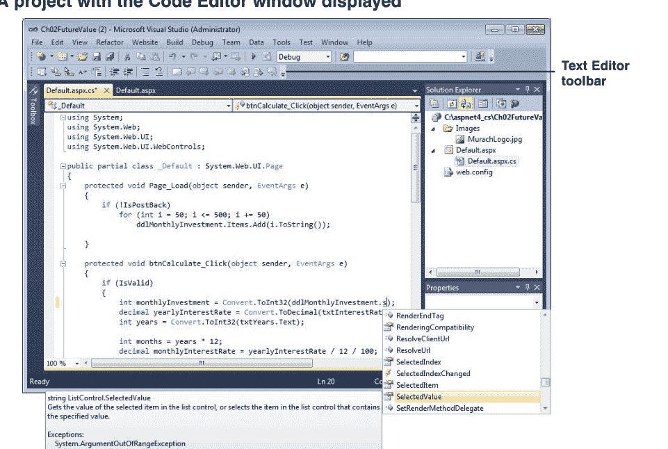

文本编辑器工具栏

### 在代码编辑器窗口中打开或切换到文件的三种方法


在解决方案资源管理器中选择一个 Web 表单，然后单击解决方案资源管理器顶部的查看代码按钮。双击解决方案资源管理器中的 C# 文件（`.aspx.cs`或`.cs`）。或，单击 Web 窗体设计器顶部的选项卡（如果文件已打开）。

## 启动事件处理程序的三种方法

- 双击 Web 表单主体外部以启动页面的`Load`事件的事件处理程序。
- 双击 Web 窗体设计器中的控件以启动该控件的默认事件的事件处理程序。
- 在 Web 窗体设计器中选择一个控件，单击属性窗口中的事件按钮（带闪电的按钮），然后双击您要为其创建事件处理程序的事件。

## 说明

- *代码编辑器* 包含强大的文本编辑功能，例如自动缩进、语法检查和语句完成（如上图所示）。
- 要输入除事件处理程序之外的其他方法，您需要从头开始键入该方法。


## 如何使用页面和控件事件

图 2-18 中的第一张表列出了用于处理 Web 页面的一些常见事件。页面的`Init`和`Load`事件在每次从服务器请求页面时都会发生。`Init`事件首先发生，ASP.NET 使用它来恢复页面及其控件的视图状态。因此，您通常不会为此事件创建事件处理程序。相反，您可以将任何初始化代码添加到`Load`事件的事件处理程序中。您将在下一张图中看到其工作原理。

相比之下，`PreRender`事件在处理完页面上的所有控件事件后引发。它是在页面呈现为 HTML 之前的最后一个事件。在第 8 章中，您将看到此事件在处理会话状态中的数据时如何有用。

本图中的第二张表列出了一些 Web 服务器控件的常见事件。例如，当用户单击按钮时，将引发该控件的`Click`事件。然后，页面将发布回服务器，如果存在，则执行页面的`Init`和`Load`事件的事件处理程序，然后执行被单击控件的`Click`事件的事件处理程序。

`TextChanged`事件发生在用户更改文本框中的值时。在大多数情况下，您不会为`TextChanged`事件编写事件处理程序。但是，您可能会为用户单击单选按钮或选中复选框时发生的`CheckedChanged`事件编写事件处理程序。您也可能会为用户从列表中选择项目时发生的`SelectedIndexChanged`事件编写事件处理程序。

如果您希望其中一个事件的事件处理程序在事件发生时立即执行，您可以将控件的`AutoPostBack`属性设置为 True。然后，事件处理程序将在页面的`Init`和`Load`事件处理程序之后执行。请注意，如果您不将`AutoPostBack`属性设置为 True，事件仍会被引发，但事件处理程序要等到另一个用户操作导致页面发布到服务器时才会被执行。然后，执行页面的`Init`和`Load`事件的事件处理程序，然后按引发顺序执行控件事件的事件处理程序。

在本图中，您可以看到 Future Value 表单上清除按钮的`Click`事件的事件处理程序。此事件处理程序将下拉列表中的值重置为 50，并将文本框和标签重置为空字符串。请注意，此事件处理程序的名称为`btnClear_Click`，即按钮的 ID 后跟事件名称。如果您回顾图 2-14 中 Future Value 表单的 aspx 代码，您会看到这是 ASP.NET 在生成事件处理程序时添加到控件的`OnClick`事件属性中引用的名称。

## 常见的 ASP.NET 页面事件

| 事件 | 方法名 | 发生时机... |
| :--- | :--- | :--- |
| `Init` | `Page_Init` | 页面从服务器请求时触发。此事件在页面控件的视图状态被还原之前引发。 |
| `Load` | `Page_Load` | 页面从服务器请求时触发，在所有控件初始化并还原视图状态之后。这是您通常用来执行初始化操作（例如检索数据和初始化表单控件）的事件。 |
| `PreRender` | `Page_PreRender` | 页面所有控件事件均已处理，但在将要发送回浏览器的 HTML 生成之前。 |

## 常见的 ASP.NET 控件事件

| 事件 | 发生时机... |
| :--- | :--- |
| `Click` | 用户单击按钮、链接按钮或图像按钮控件时。 |
| `TextChanged` | 用户更改文本框中的值时。 |
| `CheckedChanged` | 用户在单选按钮组中选择单选按钮，或选择/取消选择复选框时。 |
| `SelectedIndexChanged` | 用户从列表框、下拉列表、复选框列表或单选按钮列表中选择一项时。 |

## `btnClear`按钮的`Click`事件的代码

```
protected void btnClear_Click(object sender, EventArgs e)
{
    ddlMonthlyInvestment.SelectedIndex = 0;
    txtInterestRate.Text = "";
    txtYears.Text = "";
    lblFutureValue.Text = "";
}
```

## 描述

- 与 ASP.NET 网页及其服务器控件关联的所有事件都在服务器上执行。因此，必须将页面 post 回服务器以处理您编写了事件处理程序的任何事件。
- 当页面 post 回服务器时，`Init`和`Load`事件总是会引发，因此这些事件的事件处理程序会首先运行。接下来，按引发顺序执行任何被引发的控件事件的事件处理程序。当这些事件处理程序执行完毕后，`PreRender`事件会被引发，并且该事件的任何事件处理程序都会运行。

## Future Value 表单的 C# 代码

图 2-19 展示了 Future Value 表单代码隐藏文件的完整 C# 代码。它包含三个事件处理程序，分别处理页面的`Load`事件以及 Calculate 和 Clear 按钮的`Click`事件。此代码还包含一个名为`CalculateFutureValue`的方法，由 Calculate 按钮`Click`事件的事件处理程序调用。

在此代码中，我突出显示了在 Web 表单代码中经常测试的两个页面属性。第一个是`Page_Load`方法中使用的`IsPostBack`属性。如果为 True，则表示页面是从用户处 post 回来的。如果为 False，则表示页面是用户首次请求。

因此，`Page_Load`方法中 if 语句内的语句仅在页面首次请求时执行。在这种情况下，50 到 500 的值会被添加到下拉列表中。对于该用户后续的所有请求，`IsPostBack`属性将为 True，因此值不会被添加到下拉列表中。

另一个经常测试的页面属性是`IsValid`属性。当用户的浏览器不支持验证控件的客户端脚本时，它很有用。在这种情况下，应用程序必须依赖始终在服务器上执行的验证。然后，如果`IsValid`为 True，则表示所有输入数据均有效。但如果`IsValid`为 False，则表示一个或多个控件包含无效输入数据，因此不应进行处理。

在`btnCalculate_Click`方法中，您可以看到`IsValid`测试是如何使用的。如果它不是 True，则不会进行处理。否则，此方法使用下拉列表的`SelectedValue`属性获取所选项目的数值，表示投资金额。然后，它从文本框中获取年数和利率值并将其转换为月度单位。最后，它调用`CalculateFutureValue`方法计算未来价值，使用`ToString`方法将未来价值转换为货币格式的字符串，并将格式化的值放入表单的标签中。当此方法结束时，Web 表单会被发送回用户的浏览器。

除了`IsPostBack`和`IsValid`属性之外，这都是标准的 C# 代码，因此您不应该有任何理解困难。但如果有，您可以通过购买我们的最新 C# 书籍快速提升 C# 技能。

## Future Value 表单的 C# 代码

```
using System;
using System.Web;
using System.Web.UI;
using System.Web.UI.WebControls;
public partial class _Default : System.Web.UI.Page
{
protected void Page_Load(object sender, EventArgs e)
{
if (!IsPostBack)
for (int i = 50; i <= 500; i += 50)
ddlMonthlyInvestment.Items.Add(i.ToString());
}
protected void btnCalculate_Click(object sender, EventArgs e)
{
if (IsValid)
{
int monthlyInvestment =
Convert.ToInt32(ddlMonthlyInvestment.SelectedValue);
decimal yearlyInterestRate =
Convert.ToDecimal(txtInterestRate.Text);
int years =
Convert.ToInt32(txtYears.Text);
int months = years * 12;
decimal monthlyInterestRate = yearlyInterestRate / 12 / 100;
decimal futureValue =
this.CalculateFutureValue(monthlyInvestment,
monthlyInterestRate, months);
lblFutureValue.Text = futureValue.ToString("c");
}
}
protected decimal CalculateFutureValue(int monthlyInvestment,
decimal monthlyInterestRate, int months)
{
decimal futureValue = 0;
for (int i = 0; i < months; i++)
{
futureValue = (futureValue + monthlyInvestment)
* (1 + monthlyInterestRate);
}
return futureValue;
}
protected void btnClear_Click(object sender, EventArgs e)
{
ddlMonthlyInvestment.SelectedIndex = 0;
txtInterestRate.Text = "";
txtYears.Text = "";
lblFutureValue.Text = "";
}
}
```


## 如何测试 Web 应用程序

在设计表单并为 Web 应用程序开发代码后，您需要测试它以确保其正常工作。然后，如果您发现应用程序中的任何错误，可以对其进行调试、纠正错误并再次测试。

在第 4 章中，您将学习测试和调试 Web 应用程序所需的所有技能。现在，我只想向您展示如何使用内置开发服务器运行网站，以便您可以测试本章开发的任何应用程序。然后，我将向您展示发送到浏览器的 HTML 代码，以便您可以了解其工作原理。

## 如何使用内置开发服务器运行网站

当您使用图 2-20 中的一种技术运行文件系统网站时，Visual Studio 会编译应用程序。如果应用程序编译没有错误，Visual Studio 会自动启动内置 ASP.NET 开发服务器，并在默认浏览器中显示网站的起始页面。然后，您可以测试应用程序以确保其按您期望的方式工作。

但是，如果在编译过程中检测到任何错误，Visual Studio 会打开错误列表窗口并显示错误。这些可能包括必须纠正的错误以及警告消息。在此图中，错误列表窗口中显示了三个错误和一个警告。

要修复错误，您可以在错误列表窗口中双击它。这会将光标移动到代码编辑器中导致错误的源代码行。通过将光标从错误列表窗口移动到所有消息的代码编辑器，您应该能够找到编码问题并修复它们。

在使用开发服务器测试应用程序时，可能会发生异常。如果应用程序未处理异常，ASP.NET 会切换到代码编辑器窗口并突出显示导致异常的语句。在这种情况下，您可以通过单击调试工具栏中的停止调试按钮或使用 Debug➡停止调试命令来结束应用程序。然后，您可以修复问题并再次测试。

在第 4 章中，您将学习更复杂应用程序所需的所有调试技能。对于简单应用程序，您应该能够仅凭目前拥有的技能应付。

An ASP.NET project with the Error List window displayed

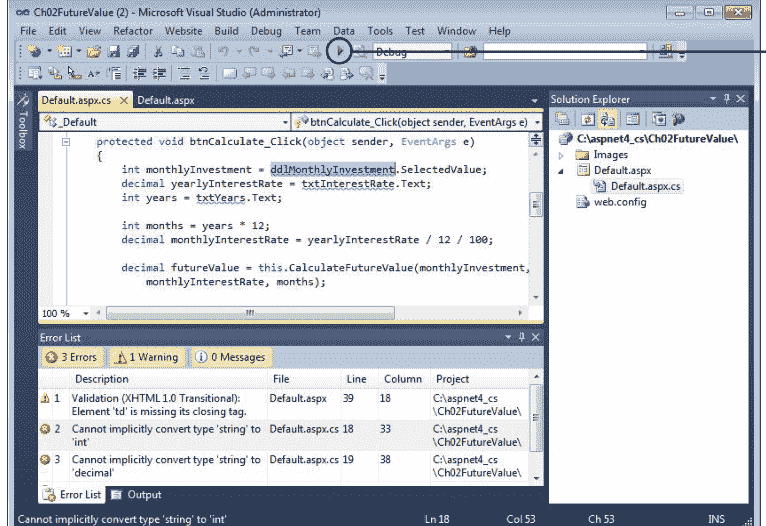

## How to run an application

- Click on the Start button in the Standard toolbar or press F5. Then, the project is compiled and the starting page is displayed in your default browser.
- The first time you run an ASP.NET application, a dialog box will appear asking whether you want to modify the `web.config` file to enable debugging. Click the OK button to proceed.

## How to stop an application

- Click the Close button in the upper right corner of the browser. Or, if an exception occurs, click the Stop Debugging button in the Debug toolbar or press Shift+F5.

## How to fix syntax errors

- If any errors are detected when the project is compiled, an Error List window is opened and a list of errors is displayed along with information about each error. To display the source code that caused an error, double-click on the error in the Error List window.
- Syntax errors are also highlighted in the Code Editor window with a wavy underline.
- After you've fixed all the errors, run the application again and repeat this process if necessary. Note, however, that you don't have to fix the warnings.

Figure 2-20  How to run a web site with the built-in development server

## How to review the HTML that’s sent to the browser

To view the HTML for a page that’s displayed in a browser, you can use the Source command in your browser’s View menu. To illustrate, figure 2-21 presents the HTML that’s sent back to the browser after I selected a new value from the drop-down list, entered new values into the text boxes, and clicked the Calculate button. Although you’ll rarely need to view this code, it does give you a better idea of what’s going on behind the scenes.

First, you’ll see that this code doesn’t include any `asp` tags. That’s because these tags are rendered to standard HTML so the controls they represent can be displayed in the browser. For instance, the `asp` tag for the drop-down list in the first row of the table has been converted to an HTML `select` tag.

Second, you can see that the view state data is stored in a hidden input field named `_VIEWSTATE`. Here, the value of this field is encrypted so you can’t read it. Because the data in view state is passed to and from the browser automatically, you don’t have to handle the passing of this data in your code.


Third, you can see that the data that I selected from the drop-down list is included in the HTML. Although you can’t see it, the data that was entered into the text boxes is included as well. This illustrates that you don’t need view state to save the information that’s entered by the user. Instead, view state is used to maintain the state of properties that have been set by code. For example, it’s used to maintain the values that are loaded into the drop-down list the first time the user requests the form.

Keep in mind that this HTML is generated automatically by ASP.NET, so you don’t have to worry about it. You just develop the application by using Visual Studio in the way I’ve just described, and the rest of the work is done for you.

## The HTML for the Future Value form after a post back

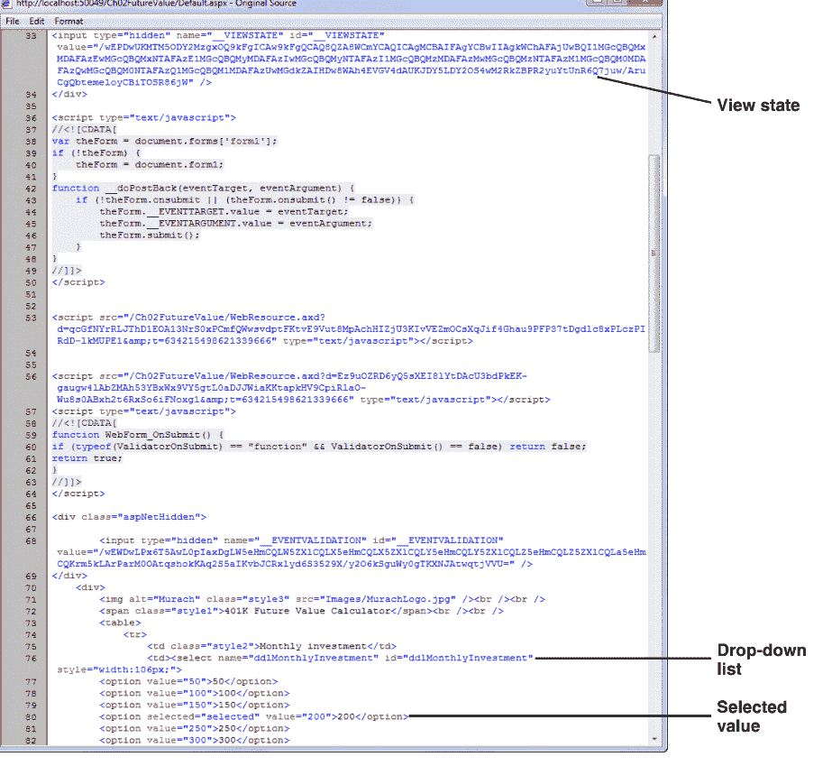

### Description

- To view the HTML for a page, use the `View->Source` command in the browser’s menu.
- The HTML that the browser receives consists entirely of standard HTML tags because all of the ASP.NET tags are converted to standard HTML when the page is rendered.
- View state data is stored in a hidden input field within the HTML. This data is encrypted so you can’t read it.
- If the page contains validation controls and client scripting is enabled for those controls, the HTML for the page contains script to perform the validation on the client if the client supports DHTML.
- Values that the user enters into a page are returned to the browser as part of the HTML for the page.

Figure 2-21 How to review the HTML that’s sent to the browser

## Perspective

The purpose of this chapter has been to teach you the basic skills for creating one-page ASP.NET applications with Visual Studio. If you’ve already used Visual Studio and C# to develop Windows applications, you shouldn’t have any trouble mastering these skills. You just need to get used to HTML and the properties and events for web server controls and validation controls.

## Terms

- web site
- file-system web site
- target framework
- web project
- web form
- project
- Web Forms Designer
- Toolbox
- Solution Explorer
- Properties window
- Source view
- Design view
- Split view
- code snippets
- web server control
- drop-down list
- text box
- label
- button
- flow layout
- HTML control
- smart tag menu
- HTML Editor
- attribute
- aspx code
- validation control
- validator
- required field validator
- range validator
- Dynamic HTML (DHTML)
- Code Editor
- event handler
- smart tag

## Exercise 2-1 Build the Future Value application

This exercise guides you through the development of the Future Value application that’s presented in this chapter.

### Start, close, and open the application

1. Start an empty file-system web site as shown in figure 2-1 named `Ch02FutureValue` in the `C:\aspnet4_cs` directory.
2. Add a web form as shown in figure 2-2 using the default name. Be sure that the Place Code in Separate File option is selected.
3. Add a folder named `Images` to your project and add the Murach logo to it, as shown in figure 2-4. You can find the logo in the `C:\aspnet4_cs` directory. Note that you’ll have to change the file type to All Files (`*,*`) to see this file.
4. Close the web site using the technique in figure 2-5, and reopen it using one of the three techniques in that figure. Then, switch to Design view.

### Use Design view to build the form

5. Drag the logo from the `Images` folder in the Solution Explorer to the top of the web form. When the Accessibility Properties dialog box is displayed, enter “Murach” for the alternate text but leave the long description blank.
6. Enter the text for the heading as shown in figure 2-6. Then, select this text, and use the techniques in figure 2-7 to format it.
7. Use the techniques in figure 2-8 to add and format a table that provides for the six rows shown in figure 2-6. Then, add the text shown in figure 2-6 to the first four rows in the first column of the table.
8. Use the techniques in figure 2-9 to add the Drop-down list, text boxes, label, and buttons shown in figure 2-6 to the table. Then, adjust the size of the columns, rows, and controls so the table looks the way it does in figure 2-6.
9. Switch to Source view and notice that when you changed the size of the controls, a `Width` attribute was added to the controls.
10. Switch back to Design view. Then, use the techniques of figure 2-9 and the summary in figure 2-10 to set the properties of the controls so they look like the ones in figure 2-6. When you do that, be sure to enter descriptive names for the `ID` property of each control.

### Use Source view to modify the aspx code

11. Switch to Source view, and use the technique of figure 2-11 to enter “Future Value” for the title of the form.
12. Press F5 to run the application. When the dialog box asks whether you want to modify the `Web.config` file to enable debugging, click the OK button. Now, test to see what works by clicking on the controls. Also, check to make sure that the web form looks the way it’s supposed to when it’s displayed in the default browser.
13. To end the application, click the Close button in the upper right corner of the browser. Depending on the browser you’re using, this may or may not end debugging. If it doesn’t, click the Stop Debugging button in the Debug toolbar. Then, switch to Split view, adjust the design of the form as necessary, and test it again.

### Add the validation controls

14. Add the validation controls for the interest rate and years text boxes as shown in figures 2-15 and 2-16.
15. Press F5 to run the application. Then, test the field validators by leaving fields blank or entering invalid data. The validation will be done when the focus leaves a text box or when you click on a button.
16. To end the application, click the browser’s Close button. Then, fix any problems and test again. If, for example, validation is done when you click the Clear button, you can fix that by setting its `CausesValidation` property to `False`.

### 边编写 C# 代码边测试

17. 使用图 2-17 中的技巧之一为窗体打开代码编辑器。然后，使用窗口顶部的选项卡切换到“设计”视图。

18. 双击窗体主体之外的区域，切换到代码编辑器，并为 `Load` 事件创建事件处理程序。接下来，编写该事件处理程序的代码，代码应类似于图 2-19 中的代码。然后按 F5 编译并测试此事件处理程序。如果在输入代码或编译应用程序时检测到任何错误，请使用图 2-20 中的技巧修复这些错误。

19. 切换回“设计”视图，双击“Clear”按钮，为该按钮的 `Click` 事件创建事件处理程序。接下来，编写该事件处理程序的代码，代码应类似于图 2-19 中的代码。然后编译并测试此代码，并修复任何错误。

20. 按图 2-19 所示，从头编写 `CalculateFutureValue` 方法。

21. 切换回“设计”视图，双击“Calculate”按钮，为该按钮的 `Click` 事件创建事件处理程序。接下来，编写该事件处理程序的代码，代码应使用 `CalculateFutureValue` 方法，并类似于图 2-19 中的代码。然后编译并测试，并修复任何错误。

### 进行更多测试和实验

22. 将下拉列表的 `EnableViewState` 属性设置为 `False`，然后测试应用程序，看看会发生什么。发生异常时，单击“调试”工具栏中的“停止调试”按钮。然后重置该属性。

23. 将第一个文本框的验证控件的 `EnableClientScript` 属性设置为 `False`，这样该验证将只在服务器端执行。然后，测试应用程序以确保验证仍然有效。

24. 再次运行应用程序，并使用图 2-21 中的技巧查看发送到浏览器的 HTML。完成后，关闭项目。

# 3 如何开发多页 Web 应用程序

在上一章中，你学习了如何开发一个简单的单页 Web 应用程序。现在，你将学习如何开发多页应用程序，这需要几项新技能。你还将学习如何从数据库获取 Web 窗体中的数据。

- **购物车应用程序** ... 78
  - Order 页面 ... 78
  - Cart 页面 ... 80
  - 购物车应用程序使用的文件和文件夹 ... 82
  - 如何向网站添加类 ... 84
- **处理多个 Web 窗体的六项技能** ... 86
  - 如何使用起始文件和文件夹创建网站 ... 86
  - 如何重命名 Web 窗体 ... 88
  - 如何更改起始 Web 窗体 ... 88
  - 如何重定向或转移到另一个页面 ... 90
  - 如何使用跨页回发 ... 92
  - 如何编写绝对 URL 和相对 URL ... 94
- **如何创建和使用数据源** ... 96
  - 如何创建 Access 数据源 ... 96
  - 如何配置 Access 数据源 ... 98
  - 如何将下拉列表绑定到数据源 ... 100
  - 如何使用 C# 代码从数据源获取数据 ... 102
- **如何使用会话状态** ... 104
  - 会话状态的工作原理 ... 104
  - 如何处理会话状态中的数据 ... 106
- **购物车应用程序的代码** ... 108
  - `Product` 类的代码 ... 108
  - `CartItem` 类的代码 ... 108
  - `CartItemList` 类的代码 ... 110
  - Order 页的 aspx 代码 ... 112
  - Order 页的 C# 代码 ... 116
  - Cart 页的 aspx 代码 ... 118
  - Cart 页的 C# 代码 ... 120
- **小结** ... 122

## 购物车应用程序

为了说明你将学习的各项技能，本章展示了一个购物车应用程序的两个页面。该应用程序从数据库获取产品数据，将数据存储在会话状态中，并使用三个业务类。因此，尽管这是一个简单的应用程序，也并非无关紧要。

在接下来的四个主题中，你将了解该应用程序所需的两个 Web 窗体以及文件夹和文件。然后，你将学习如何将这三个业务类添加到该项目中。

### Order 页面


图 3-1 展示了购物车应用程序的第一个页面。此页面名为 `Order.aspx`，包含一个下拉列表，用户可通过它选择产品。产品通过 `AccessDataSource` 控件从 Access 数据库中检索。由于下拉列表绑定到数据源，产品名称会自动显示。

虽然从图中看不出来，但产品数据是从名为 `Halloween.mdb` 的 Access 数据库中检索的。该数据库包含一个名为 `Products` 的表。`Products` 表包含以下列：`ProductID`、`Name`、`ShortDescription`、`LongDescription`、`CategoryID`、`ImageFile`、`UnitPrice` 和 `OnHand`。除 `CategoryID` 和 `OnHand` 之外，该应用程序使用了所有这些列。

下拉列表的 `AutoPostBack` 属性设置为 `True`。这样，当用户选择产品时，页面会回发到服务器。然后，页面的代码会从数据源中检索所选产品的数据，而数据源已经从 Access 数据库中检索了所有产品的数据。所选产品的数据会显示在多个标签中。此外，`ImageFile` 列用于设置 `Image` 控件的 `ImageUrl` 属性，以便产品图像显示在该控件中。

选择产品后，用户可以输入数量并单击“`Add to Cart`”按钮。但如果用户未输入有效数量就单击“`Add to Cart`”按钮，则会显示错误消息。为此，页面中包含两个验证控件。必填字段验证器确保用户输入数量，范围验证器确保数量是 1 到 500 之间的整数。

如果用户输入了有效数量，包含用户购物车的列表会使用产品信息进行更新。如果购物车中还没有该产品，则向列表中添加一个新项。如果购物车中已有该产品，则输入的数量会累加到购物车中该产品的现有数量上。由于每次添加或更新产品时都必须检索并更新购物车，因此表示购物车的列表会保存在会话状态中。

## Order 页面的设计

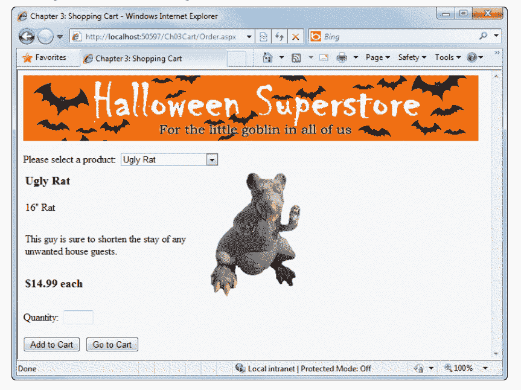

### 说明

+   - 此应用程序的 `Order` 页面接受在线商店中任何商品的订单。
+   - 要订购商品，用户从下拉列表中选择产品，在文本框中输入数量，并单击“`Add to Cart`”按钮。
+   - 用户单击“`Add to Cart`”按钮时，所选产品会添加到购物车中。如果购物车中已有该产品，则数量会累加到现有购物车商品的数量中。然后，显示 `Cart` 页面。
+   - 产品信息由绑定到下拉列表的 `AccessDataSource` 控件从 Access 数据库中检索。
+   - 下拉列表的 `AutoPostBack` 属性设置为 `True`，以便用户选择产品时页面会回发。然后，显示所选产品的信息。
+   - 购物车信息保存在会话状态中，以便每次订购产品时都可以检索和更新。
+   - 验证控件确保用户为数量输入从 1 到 500 的整数。

图 3-1　购物车应用程序的 `Order` 页面

## Cart 页面

用户在 `Order` 页面选择产品、输入数量并单击“`Add to Cart`”按钮后，将显示图 3-2 中的 `Cart` 页面。此页面在列表框中列出购物车中当前的所有商品。为此，它必须从会话状态中检索购物车。

要处理购物车中的商品，用户可以使用列表框右侧的两个按钮。要从购物车中移除商品，用户可以选择该商品并单击“`Remove Item`”按钮。或者，要移除购物车中的所有商品，用户可单击“`Empty Cart`”按钮。

如果用户想向购物车中添加商品，可以单击“`Continue Shopping`”按钮返回 `Order` 页面。或者，用户可以单击“`Check Out`”按钮完成订单。然而，在此版本的购物车应用程序中，结账方法尚未实现。因此，如果用户单击“`Check Out`”按钮，会显示一条消息，指出结账功能尚未实现。当然，在完整的应用程序中，单击此按钮将显示额外的页面以完成订单。

与大多数应用程序一样，在 ASP.NET 中实现购物车有几种不同的方式。例如，一个设计决策是如何保存购物车数据。对于此应用程序，我决定将购物车数据保存在会话状态中。不过，你也可以将购物车数据保存在数据库表中。每种方法都有其优缺点。

购物车应用程序的另一个设计决策是在显示购物车时使用什么类型的 ASP.NET 控件。为了保持此应用程序简单，我使用了列表框。不过，你可以使用第 14 章介绍的 `GridView` 控件创建更高级的购物车。使用该控件，你可以将购物车数据整齐地显示在多列中，并在每行中包含按钮或其他控件，让用户删除或修改购物车中的商品。

### The design of the Cart page

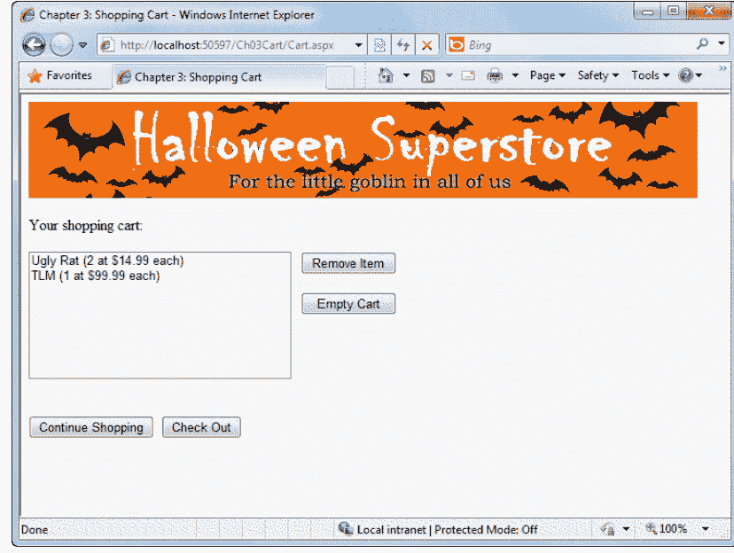

### Description

- The `Cart` page displays the items in the shopping cart in a list box control. To load the list box, it uses the shopping cart information that's saved in session state by the `Order` page.
- The user can select any item in the shopping cart and then click the `Remove Item` button to remove the item from the cart. If the user clicks the `Remove Item` button without selecting an item, a message is displayed that asks the user to select the item to be removed.
- To remove all the items from the cart, the user can click the `Empty Cart` button.
- After reviewing the cart, the user can click the `Continue Shopping` button to return to the `Order` page and order additional products.
- If the user clicks the `Check Out` button, a message is displayed that indicates that the check out function hasn't been implemented yet.

Figure 3-2 The `Cart` page of the Shopping Cart application

## The files and folders used by the Shopping Cart application

Figure 3-3 summarizes the files and folders used by the Shopping Cart application. By default, Visual Studio 2010 places new web page files and their related code-behind files in the application's root folder, but other files used by the application are placed in special folders. The first table in this figure lists the most commonly used special folders. Besides these folders, though, you can also create your own folders. For example, it's common to create an `Images` folder to store any image files used by the application.

The `App_Code`, `App_Data`, `App_Themes`, and `Bin` folders are used for certain types of files required by the application. For instance, class files (other than the class files for web pages) are stored in the `App_Code` folder, and any database files used by the application are stored in the `App_Data` folder. In contrast, the `App_Themes` folder is used to store any theme data, which you'll learn more about in chapter 11. And the `Bin` folder is used to store any compiled assemblies, such as class libraries, that are used by the application.

Note that the special folders aren't available to the application through normal means. For example, you can't store an image file in the `App_Data` folder and then refer to it in the `ImageUrl` attribute of an `Image` control. The only exception is that you can refer to the `App_Data` folder in a connection string for an Access database.

The second table in this figure lists the specific files and folders that make up the Shopping Cart application. As you can see, the `App_Code` folder contains three class files named `CartItem.cs`, `CartItemList.cs`, and `Product.cs` that define the `CartItem`, `CartItemList`, and `Product` classes required by the application. And the `App_Data` folder contains an Access database named `Halloween.mdb`.

The Shopping Cart application also includes a folder named `Images`. This folder includes just one image file, `banner.jpg`, which provides the banner that's displayed at the top of each page. However, this folder also includes a subfolder named `Products`, which includes a separate image file for each product in the `Products` table of the database. Because the `Products` table includes a column named `ImageFile` that provides the file name for each product's image, the application can display the correct image for each product.

Finally, the root folder for the application contains two files for each of the application's web pages: one for the page itself, the other for the code-behind file. For example, the `Cart.aspx` file contains the aspx code that defines the `Cart` page, and the `Cart.aspx.cs` file is the code-behind file that contains the C# code for the `Cart` page.

Please note that the root folder also contains a `web.config` file. This file is added automatically when you create an application.

### The Solution Explorer for the Shopping Cart application

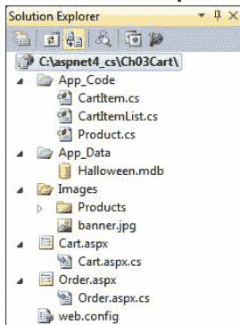

#### Special folders used in ASP.NET 4 applications

| Folder | Description |
|---|---|
| `App_Code` | Non-page class files that are compiled together to create a single assembly. |
| `App_Data` | Database files used by the application. |
| `App_Themes` | Themes used by the application. |
| `Bin` | Compiled code used by the application. |

#### Files in the Shopping Cart application

| Folder | File | Description |
|---|---|---|
| `App_Code` | `CartItem.cs` | A class that represents an item in the shopping cart. |
| `App_Code` | `CartItemList.cs` | A class that represents the shopping cart. |
| `App_Code` | `Product.cs` | A class that represents a product. |
| `App_Data` | `Halloween.mdb` | The Access database file that contains the Halloween database. |
| `Images` | `Banner.jpg` | An image file that displays the banner used at the top of each page. |
| `Images\Products` | (multiple) | Contains an image file for each product in the database. |
| (root) | `Cart.aspx` | The aspx file for the Cart page. |
| (root) | `Cart.aspx.cs` | The code-behind file for the Cart page. |
| (root) | `Order.aspx` | The aspx file for the Order page. |
| (root) | `Order.aspx.cs` | The code-behind file for the Order page. |
| (root) | `web.config` | The application configuration file. |

### Description

- The `Images` folder is a custom folder that I created to hold the image files used by this application. The `Products` subfolder contains the image files for the products in the `Products` table of the `Halloween` database.

## How to add a class to a web site

As you just saw in the previous figure, the Shopping Cart application requires three business classes named `Product`, `CartItem`, and `CartItemList`. To use these classes with the web site, you can use the techniques presented in figure 3-4.


To add a new class to the web site, you use the `Add New Item` dialog box shown in this figure. From this dialog box, you select the Class template, enter the name for the class, and then click the Add button. When you do, Visual Studio will create a declaration for the new class. Then, you can complete the class by coding its properties and methods.

Before you create a new class, you'll typically add the special `App_Code` folder to the web site so that you can add the class directly to this folder. However, you can also add a new class without first adding the `App_Code` folder. To do that, just select `Add New Item` from the shortcut menu for the project. Then, when you click the Add button to add the class, Visual Studio will display a dialog box that indicates that the class should be placed in an `App_Code` folder and asks if you want to place the class in that folder. If you click the Yes button on this dialog box, Visual Studio will create the `App_Code` folder and place the new class in it.

To add an existing class to a web site, you use the `Add Existing Item` command as described in this figure. Then, the class file that you select is copied to your web site.

If the existing class you want to use is stored in a *class library*, you can use that class by adding a reference to the class library to your web site as described in this figure. One of the advantages of using class libraries is that the source code is stored in a single location. Then, if you need to modify a class, you can just modify the code in the class library and it will be available to any web sites that use that library. In contrast, if you copy a class to each web site that uses it, you have to modify the code in each web site.

### The dialog box for adding a new class to the `App_Code` folder

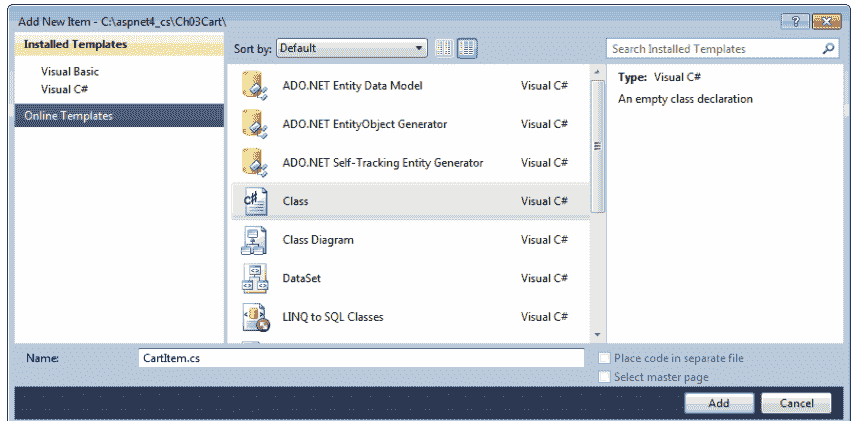

### Two ways to open the `Add New Item` dialog box

- Right-click the `App_Code` folder in the Solution Explorer if it already exists, and then choose `Add New Item` from the shortcut menu.

- Click on the `App_Code` folder in the Solution Explorer to select it, and then choose the `Website→Add New Item` command.

### How to add a new class to a web site

- From the `Add New Item` dialog box, select the Class template, name the class, and click the Add button. Visual Studio will create the declaration for the class.

- If you try to add a class directly to the project instead of to the `App_Code` folder, Visual Studio will warn you that the class should be placed in the `App_Code` folder and ask you if you'd like to place the class in this folder. If you click the Yes button, Visual Studio will create the `App_Code` folder if necessary and place the class in this folder.

### How to add an existing class to a web site

- To add a class from another project to a web site, right-click the `App_Code` folder in the Solution Explorer and select `Add Existing Item`. Then, locate the class file you want to add, select it, and click the Add button. The file is copied to your project.

### How to use a class that's part of a class library

- Right-click the project in the Solution Explorer and select `Add Reference` from the shortcut menu. Click the Browse tab in the dialog box that's displayed, and then locate and select the `.dll` file for the class library you want to use. The class library is added to the project's `Bin` folder, which is created if it doesn't already exist. To use the classes in the class library without qualification, add a `using` statement for the class library.

## 处理多个 Web 表单的六项技能

要创建一个多页网站，你需要学习一些新技能，例如如何重命名 Web 表单、如何更改网站的起始页，以及如何从一个表单转移到另一个表单。在我介绍这些技能之前，我想先向你展示如何创建一个默认包含多个文件夹和文件的网站。

### 如何创建包含起始文件和文件夹的网站

虽然我使用 ASP.NET Empty Web Site 模板创建了本书中的所有网站，但你应该了解另一个可用于创建包含多个起始文件和文件夹的网站的模板。这就是 ASP.NET Web Site 模板，其生成的文件如 Figure 3-5 所示。

首先，你应该注意到网站的根文件夹中包含一个名为 `Site.master` 的文件。该文件定义了一种称为 *master form* 的表单类型，并且该表单的内容会显示在网站中的其他每个表单上。你将在第 9 章了解更多关于处理 master forms 的内容。

除了 master form 之外，根目录还包含两个名为 `About.aspx` 和 `Default.aspx` 的表单。它还包含一个名为 `Global.asax` 的文件。你将在第 8 章学习如何使用此文件来处理应用程序事件。

接下来，注意 `Account` 文件夹中的四个表单。这些表单用于添加用户账户、登录网站以及更改密码。你将在第 19 章看到此类表单的工作方式。此文件夹还包含一个 `web.config` 文件，该文件仅适用于此文件夹中的表单。相比之下，根文件夹中的 `web.config` 文件适用于整个网站。

除了 `Account` 文件夹外，此网站还包含三个文件夹。`App_Data` 文件夹，如你所知，用于存储应用程序使用的数据文件，例如数据库文件。`Scripts` 文件夹包含一个名为 *jQuery* 的 JavaScript 库，可让你处理 HTML 元素。你将在第 21 章了解更多关于 JavaScript 和 *jQuery* 的内容。最后，`Styles` 文件夹包含一个名为 `Site.css` 的外部样式表。你将在第 5 章了解更多关于使用外部样式表的内容。

### 使用 ASP.NET Web Site 模板创建的网站

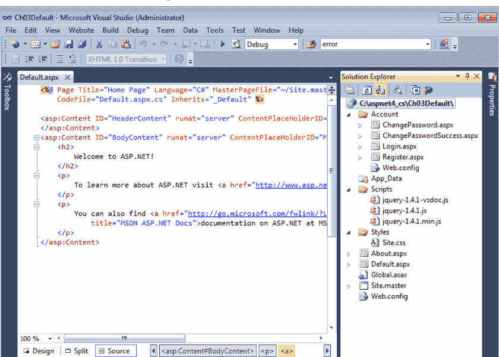

### 网站使用的部分文件

| Folder | File | Description |
| :--- | :--- | :--- |
| `Account` | `ChangePassword.aspx` | A form that lets users change their password. |
| `Account` | `ChangePasswordSuccess.aspx` | A form that indicates if a password has been successfully changed. |
| `Account` | `Login.aspx` | A form that lets users log in to an application. |
| `Account` | `Register.aspx` | A form that lets users create new accounts. |
| `Styles` | `Site.css` | An external style sheet with styles used by the forms. |
| (root) | `About.aspx` | A form that lets you enter information about your web site, company, etc. |
| (root) | `Default.aspx` | The default form for the web site. |
| (root) | `Global.asax` | A file that lets you work with application data. |
| (root) | `Site.master` | The master page for the web site. |

## Description

- When you start a web site from the ASP.NET Web Site template, Visual Studio adds a number of folders and files to the web site. You’ll learn how to work with many of the forms, the controls used on the forms, and the files later in this book.

### How to rename a web form

When you add a web form to a web site, the form file is given the name you specify in the `Add New Item` dialog box. In addition, the partial class that contains the C# code for the form is given the same name, which is usually what you want. In some cases, though, you may need to rename the form file or the form class. In particular, if you use the technique in Figure 3-5 to start an ASP.NET web site, you'll want to rename the default form so its name is more descriptive. Figure 3-6 shows you how.

When you change the name of a form file, you might think that Visual Studio would change the name of the class that contains the C# code for the form to the same name. However, it doesn't. To do that, you have to open the Code Editor window for the form and change the name in the class declaration.

When you change the name of a form file, the `CodeFile` attribute in the `Page` directive for the page is changed automatically. However, if you change the name of a class, the `Inherits` attribute in the `Page` directive is not changed unless you use the `Rename` command from the smart tag menu that becomes available when you change the class name. If you don't use this command, you'll have to change the `Inherits` attribute manually when you change the name of a class.

### How to change the starting web form

If a web site consists of a single form, that form is displayed by default when you run the application. If a web site contains two or more forms, however, the current form—the one that's selected in the Solution Explorer—is displayed when you run the application. Or, if a form isn't currently selected, the form named `Default.aspx` is displayed. If the web site doesn't contain a form named `Default`, a directory listing of the application is displayed.


To make sure that the correct page is displayed when you run an application, you should set the start page for the application. To do that, just right-click on the form in the Solution Explorer and select the `Set As Start Page` command from the shortcut menu. Note that this only sets the start page that Visual Studio uses when you run an application. It doesn't set the page IIS displays by default when you run the application from a browser outside of Visual Studio. To do that, you have to use IIS. See appendix B (Windows 7 and Windows Vista) or appendix C (Windows XP) for more information.

#### Solution Explorer 窗口中正在重命名的 Web 表单文件

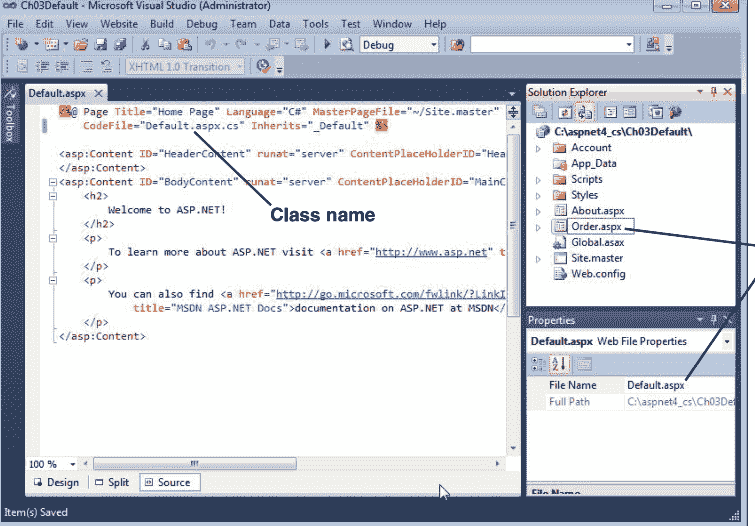

### 重命名 Web 表单的两种方法

- Right-click the form in the Solution Explorer, and then select the `Rename` command from the shortcut menu. Then, change the name directly in the Solution Explorer window.

- Click on the form in the Solution Explorer to select it. Then, click on it again and change the name directly in the Solution Explorer window.

### How to rename the class that contains the C# code for a web form

- Display the code for the form in the Code Editor window. Then, change the name that's used for the form in the class declaration at the beginning of the file.

- Use the `Rename` command in the smart tag menu that becomes available to change the class name in the `Inherits` attribute of the `Page` directive. Alternatively, display the `aspx` code for the form and then change the `Inherits` attribute manually.

### How to change the starting web form for a web site

- Right-click on the web form that you want to use as the starting form in the Solution Explorer. Then, choose `Set As Start Page` from the shortcut menu.

### Note

- In most cases, you'll give a web form an appropriate name when you add it to the project. If you start a web site from the ASP.NET Web Site template, though, you may want to change the name of the web form that's added by default so it's more descriptive.

Figure 3-6 How to rename a web form and change the starting web form

## How to redirect or transfer to another page

When you develop an application with two or more pages, you'll need to know how to display one page from another page. When the user clicks the Add to Cart button on the Order page of the Shopping Cart application, for example, the Cart page should be displayed. Similarly, when the user clicks the Continue Shopping button on the Cart page, the Order page should be displayed. Three ways to do that are presented in Figure 3-7.

When you use the `Transfer` method of the `HttpServerUtility` class, ASP.NET immediately terminates the execution of the current page. Then, it loads and executes the page specified in the `Transfer` method and returns it to the browser. The drawback to using this method is that when the new page is sent to the browser, the browser has no way of knowing that the application returned a different page. As a result, the URL for the original page is still displayed in the browser's address box. This can be confusing to the user and prevents the user from bookmarking the page.

The `Redirect` method of the `HttpResponse` class works somewhat differently. When this method is executed, it sends a special message called an *HTTP redirect message* back to the browser. This message causes the browser to send a new HTTP request to the server to request the new page. Then, the server processes the page and sends it back to the browser.

Note that because of the way the `Redirect` method works, it requires an extra round trip to the browser. If this extra round trip will cause a performance problem, you may want to use the `Transfer` method instead. For most applications, however, the user friendliness of the `Redirect` method outweighs the small performance gain you get when you use the `Transfer` method.

Unlike the `Transfer` and `Redirect` methods, the `RedirectPermanent` method, which is new to ASP.NET 4, is typically used when a page is physically moved or renamed within a web site. For example, suppose you create a web site that includes a page named `Products.aspx` that's stored in the project folder. Later, suppose you decide to create a subfolder named `Customer`, and you move the Products page to this folder. Then, you can use the `RedirectPermanent` method as shown in the third example in this figure to redirect to the page. The main advantage of using this method is that search engines will store the new URL. That way, if the page is requested at the old location, it can be displayed from its new location.

### HttpServerUtility 类的 Transfer 方法

| 方法 | 说明 |
| :--- | :--- |
| `Transfer(URL)` | 终止当前页面的执行，并将控制权转移到指定 URL 所对应的页面。 |

### HttpResponse 类的 Redirect 和 RedirectPermanent 方法

| 方法 | 说明 |
| :--- | :--- |
| `Redirect(URL)` | 将客户端重定向到指定 URL，并终止当前页面的执行。 |
| `RedirectPermanent(URL)` | 永久重定向到指定 URL，并终止当前页面的执行。 |

### 将控制权转移到另一个页面的代码

```csharp
Server.Transfer ("Cart.aspx");
```

### 将客户端重定向到另一个页面的代码

```csharp
Response.Redirect("Cart.aspx");
```

### 将客户端永久重定向到另一个页面的代码

```csharp
Response.RedirectPermanent ("Customer/Products.aspx");
```

### 说明

- `Transfer` 方法是 `HttpServerUtility` 类的成员，该类包含用于处理 Web 请求的辅助方法。若要引用此类，请使用页面的 `Server` 属性。

- `Redirect` 和 `RedirectPermanent` 方法是 `HttpResponse` 类的成员，该类包含有关响应的信息。若要引用此类，请使用页面的 `Response` 属性。

- 这三种方法都会使浏览器显示 URL 所指定的页面。有关 URL 编码的更多信息，请参阅图 3-9。

- 使用 `Transfer` 方法时，当前页面会被终止，并在其位置处理一个新页面。此处理在服务器上进行，因此效率很高。但是，浏览器不会更新以反映新页面的地址。

- 使用 `Redirect` 方法时，服务器会向浏览器发送一条称为 **HTTP 重定向消息**的特殊消息。浏览器收到此消息后，会向服务器发送 HTTP 请求以请求新页面。然后，服务器处理新页面并将其发送回浏览器。由于这需要与浏览器进行往返，因此其效率低于 `Transfer` 方法。

- 通常情况下，应使用 `Redirect` 方法来显示另一个网页。只有在应用程序性能至关重要时，才应使用 `Transfer` 方法。

- 如果更改了页面的名称或位置，可以使用 `RedirectPermanent` 方法为该页面指定新的 URL。然后，搜索引擎会存储该 URL，并在收到对旧 URL 的请求时使用它来显示该页面。


## 如何使用跨页回发

转至另一个网页的第四种方式是使用*跨页回发*，如图 3-8 所述。要使用跨页回发，请在按钮控件的 `PostBackUrl` 属性中指定另一个页面的 **URL**。然后，当用户单击按钮时，包含 `PostBackUrl` 属性所指定 URL 的 HTTP POST 消息会被发送回服务器。结果是，加载并执行该 URL 对应的页面，而不是最初显示的页面。

例如，Order 页面上的 Go to Cart 按钮使用跨页回发转到 Cart 页面。因此，该按钮的 `PostBackUrl` 属性被设置为 `Cart.aspx`，如图所示。然后，当用户单击 Go to Cart 按钮时，ASP.NET 会加载并执行 `Cart.aspx` 页面，而不是 `Order.aspx` 页面。

请注意，此控件的 `PostBackUrl` 属性中的 URL 以波浪符（`~/`）运算符开头。当你从属性窗口设置 `PostBackUrl` 属性时，会自动添加该运算符；你将在下一个主题中了解更多相关信息。

如果用户在采用跨页回发的页面的一个或多个控件中输入数据，则可以使用 `PreviousPage` 属性检索用户输入的数据。如图中的代码示例所示，你应先检查并确保 `PreviousPage` 属性引用有效对象。如果该属性未引用有效对象，则意味着该页面不是因跨页回发而加载的，或者请求来自另一个网站。无论哪种情况，都没有可用的上一页面。

如果 `PreviousPage` 属性引用有效对象，则可以使用 `FindControl` 方法查找上一页面上的控件。然后，可以将其强制转换为文本框（如果该控件是文本框）。最后，可以使用 `Text` 属性检索文本框包含的数据。

由于检索用户输入的数据需要额外的编程，因此跨页回发最适合在无需处理用户输入的情况下使用。例如，由于用户单击 Go to Cart 按钮时无需处理任何数据，因此我使用了跨页回发，而不是 `Response.Redirect` 或 `Server.Transfer`。但是，对于 Order 页面上的 Add to Cart 按钮，我使用了 `Response.Redirect`，以便轻松检索所选产品和用户输入的数量。

### Button 控件的 `PostBackUrl` 属性

| 属性 | 说明 |
| :------- | :---------- |
| `PostBackUrl` | 指定用户单击按钮时应请求的页面的 URL。 |

### 与跨页回发一起使用的 `Page` 类成员

| 属性 | 说明 |
| :------- | :---------- |
| `PreviousPage` | 返回表示上一页面的 `Page` 对象。 |

| 方法 | 说明 |
| :----- | :---------- |
| `FindControl(id)` | 返回具有指定 `id` 的 `Control` 对象。如果该控件是文本框，则可以将 `Control` 对象强制转换为 `TextBox`，然后使用 `Text` 属性访问用户输入的数据。 |

### 用于将页面回发到另一个页面的按钮的 `aspx` 代码

```html
<asp:Button ID="btnCart" runat="server" Text="Go to Cart"
   CausesValidation="False" PostBackUrl="~/Cart.aspx" />
```

### 从上一页面检索数据的代码

```csharp
protected void Page_Load(object sender, EventArgs e)
{
    if (PreviousPage != null)
    {
        TextBox txtQuantity =
            (TextBox) PreviousPage.FindControl("txtQuantity");
        lblQuantity.Text = txtQuantity.Text;
    }
}
```

### 说明

- *跨页回发*允许你使用按钮的 `PostBackUrl` 属性来指定用户单击按钮时应请求的页面。

- 当回发到另一个页面时，可以通过 `PreviousPage` 属性访问上一页面。然后，可以使用 `FindControl` 方法检索用户输入的数据。

- 通常情况下，跨页回发比 `Server.Transfer` 和 `Response.Redirect` 方法更高效。但是，跨页回发使得从原始页面检索数据更加困难。

- 如果不需要从原始页面检索数据，则跨页回发显然比 `Server.Transfer` 和 `Response.Redirect` 方法更好。


在第 1 章中，你已经了解了 URL 的基本组成部分。你在那一章中看到的 URL 都是*绝对 URL*。绝对 URL 包含网站的域名。在 `Transfer` 或 `Redirect` 方法中编写绝对 URL 时，可以显示另一个网站上的页面。例如，图 3-9 中的前两个语句显示域名为 `www.murach.com` 的网站上的页面。第一条语句显示网站根目录中名为 `Default.aspx` 的页面。第二条语句显示网站 `Books` 目录中名为 `Search.aspx` 的页面。

若要显示同一网站内的页面，可以使用*相对 URL*。这种 URL 指定页面相对于当前页面所在目录的位置。图中第三条和第四条语句对此进行了说明。第三条语句显示与当前页面存储在同一目录中的页面。第四条语句显示当前页面所在目录的 `Login` 子目录中的页面。

接下来的两条语句演示如何使用相对 URL 从当前目录向上导航目录结构。若要向上导航一级目录，请编写两个句点后跟一个斜杠，如第五条语句所示。若要向上导航两级目录，请编写两个句点和一个斜杠，然后再编写两个句点和一个斜杠，如第六条语句所示。若要继续向上导航更多级目录，请为每一级目录编写两个句点和一个斜杠。

若要导航到主机的根目录，请编写一个斜杠，如第七条语句所示。你也可以在斜杠后面编写该目录的路径，以导航到根目录内的某个目录，如第八条语句所示。

除了在 `Transfer`、`Redirect` 和 `RedirectPermanent` 方法中编写 URL 之外，还可以为某些服务器控件的属性编写 URL。图中最后两个示例对此进行了说明。倒数第二个示例演示如何设置按钮控件的 `PostBackUrl` 属性。最后一个示例演示如何设置图像控件的 `ImageUrl` 属性。

请注意，这两个 URL 都以波浪符 `~` 运算符开头。该运算符使 URL 基于网站的根目录。例如，第一个 URL 中的 `Cart.aspx` 文件直接位于根目录中，第二个 URL 中的 `banner.jpg` 文件位于根目录的 `Images` 子目录中。

尽管在这些示例中也可以使用相对 URL，但当你将页面或文件从一个文件夹移动到另一个文件夹时，使用波浪符运算符的 URL 更容易维护。这是因为，维护相对于网站根目录的 URL 比维护相对于另一个页面的 URL 更容易。因此，我建议你在为服务器控件的属性编写 URL 时，始终使用波浪符运算符。

## 如何编写绝对 URL 和相对 URL

## 绝对和相对 URL 的示例

### 使用绝对 URL 的语句

```cpp
Response.Redirect("http://www.murach.com/Default.aspx");
Response.Redirect("http://www.murach.com/Books/Search.aspx");
```

### 使用基于当前目录的相对 URL 的语句

```cpp
Response.Redirect("Checkout.aspx");
Response.Redirect("Login/Register.aspx");
```

### 使用在目录结构中向上导航的相对 URL 的语句

```cpp
Response.Redirect("../Register.aspx");
Response.Redirect("../../Register.aspx");
Response.Redirect("/Register.aspx");
Response.Redirect("/Login/Register.aspx");
```

### 使用基于当前网站根目录的 URL 的服务器控件属性

```text
PostBackUrl="~/Cart.aspx"
ImageUrl="~/Images/banner.jpg"
```

## 说明

- 当编写*绝对 URL*时，需要编写完整的 URL，包括网站的域名。绝对 URL 让你能够显示其他网站中的页面。
- 当编写*相对 URL*时，要以当前目录为基础，即包含当前页面的目录。
- 若要转到主机的根目录，需要编写一个斜杠。然后，可以在斜杠后面编写一个或多个目录。
- 若要从当前目录向上移动一级，需要编写两个句点和一个斜杠。若向上移动两级，编写两个句点和一个斜杠，后面再跟两个句点和一个斜杠，依此类推。
- 如果为服务器控件的属性指定 URL，可以使用 Web 应用程序根运算符 `~` 来基于网站根目录构建 URL。

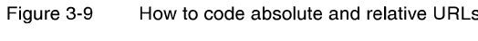

## 如何创建和使用数据源

要连接到数据库并处理其数据，可以使用一个名为*数据源*的 ASP.NET 控件。为了说明其工作原理，以下主题展示了如何创建连接到 Microsoft Access 数据库的数据源，并将其绑定到下拉列表。但请记住，数据源的使用远比这些主题所介绍的要多。这就是本书第 3 部分专门讨论数据源和数据库使用的原因。

### 如何创建 Access 数据源

ASP.NET 4 在工具箱的“数据”组中提供了多个数据源控件。其中最简单的控件是 `AccessDataSource`，它设计用于从 Microsoft Access 数据库文件中检索数据。图 3-10 展示了如何创建此类数据源。

不过，在使用 Access 数据源之前，必须先创建 Access 数据库并将其添加到网站的 `App_Data` 文件夹中。正如我之前提到的，本章的购物车应用程序使用了一个名为 `Halloween.mdb` 的数据库。

要创建 `AccessDataSource` 控件，请打开工具箱的“数据”组，将 `AccessDataSource` 控件拖放到窗体上。由于应用程序运行时数据源不会显示在页面上，因此将数据源放置在页面上的哪个位置并不重要。但是，如果数据源要绑定到 Web 控件，将其放在该控件附近是合理的。

当将 Access 数据源拖放到页面上时，会出现一个智能标记菜单。然后，选择“配置数据源”命令，以打开“配置数据源”向导的第一页，如图所示。在此对话框中，选择要用于数据源的 Access 数据库文件。

一旦为数据源选择了数据库文件，就必须按照下一张图所述配置数据源。然后，可以按照图 3-12 所述将其绑定到下拉列表。

### 配置数据源向导的第一页

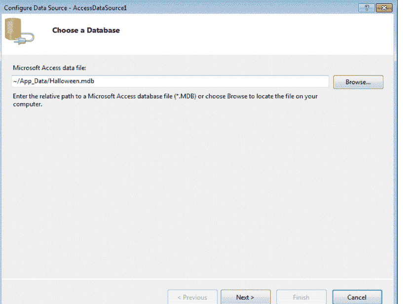

### 如何创建 Access 数据源

1. 在 Web Forms 设计器中，打开工具箱的“数据”组，将 `AccessDataSource` 控件拖到窗体上。
2. 从数据源控件的智能标记菜单中选择“配置数据源”，以显示“配置数据源”对话框。
3. 在 `App_Data` 文件夹中标识要使用的 Access 数据库，然后单击“下一步”。然后，按照下一张图所述完成“配置数据源”向导。

## 说明

- 在创建 Access 数据源之前，必须将 Access 数据库文件添加到 `App_Data` 文件夹中。
- 购物车应用程序使用 `AccessDataSource` 控件来提供下拉列表中显示的产品列表。该控件从 Microsoft Access 数据库文件中读取数据。
- 尽管数据源控件在 Web Forms 设计器中可见，但它们不会向浏览器呈现任何 HTML。因此，应用程序运行时它们是不可见的。

图 3-10 如何创建 Access 数据源

### 如何配置 Access 数据源

图 3-11 展示了如何使用“配置数据源”向导配置 Access 数据源。该向导的第一页让你选择要使用的 Access 数据库文件（如上一张图所示），而此图所示的第二页则让你指定从数据库中检索数据的查询。

要创建查询，可以编写 SQL Select 语句。或者，可以从单个表或视图中选择列，让向导为你生成 Select 语句。目前，我们将使用第二种方法。

要从表中选择列，请使用“名称”下拉列表选择要从中选择列的表。然后，在“列”列表中选中要检索的每一列。在此图中，我选择了 `Products` 表并选中了其中的六列。当你选中列时，向导会创建一条 SQL Select 语句，显示在对话框底部的文本框中。

“列”列表右侧的前两个按钮可让你指定选择数据的其他选项。如果只想选择满足特定条件的行，请单击 `WHERE` 按钮，然后指定所需的条件。或者，如果要指定排序顺序，请单击 `ORDER BY` 按钮，然后选择要数据按其排序的列。在此图中，我使用此按钮指定数据应按 `Name` 列排序，因此 Select 语句包含一个 Order By 子句。

当你指定完希望数据源检索的数据后，单击“下一步”。这将进入一个包含“测试查询”按钮的页面。如果单击此按钮，向导会立即检索你已指定的数据。然后你可以查看这些数据，确保其符合预期。如果不是，请单击“上一步”按钮并根据需要调整查询。

### 配置数据源向导的第二页

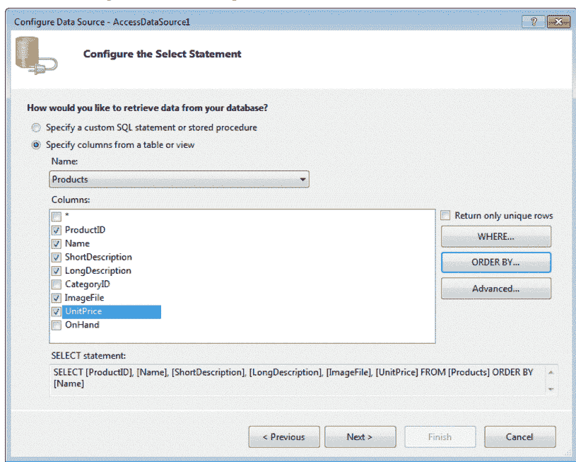

### Access 数据源控件的 aspx 代码

```html
<asp:AccessDataSource  ID="AccessDataSource1" runat="server"
 DataFile="~/App_Data/Halloween.mdb"
 SelectCommand="SELECT  [ProductID], [Name], [ShortDescription],
[LongDescription], [ImageFile], [UnitPrice]
 FROM [Products] ORDER BY [Name]">
</asp:AccessDataSource>
```

## 说明

- “配置数据源”向导允许你使用 SQL 创建查询。你可以直接指定查询的 Select 语句，也可以让向导根据你的规格构造 Select 语句。
- 可以单击 `WHERE` 按钮指定用于选择记录的一个或多个条件。
- 可以单击 `ORDER BY` 按钮指定记录的排序顺序。
- 可以单击“高级”按钮为数据源包含 Insert、Update 和 Delete 语句。


### 如何将下拉列表绑定到数据源

创建数据源后，可以将下拉列表绑定到该数据源，如图 3-12 所示。首先，从下拉列表的智能标记菜单中选择“选择数据源”命令。然后，当显示“数据源配置向导”时，在第一个下拉列表中选择数据源。在此图中，我选择了 `AccessDataSource1`，即我在前面各图中创建的数据源。

接下来，选择为下拉列表提供要显示的数据的列。你在此处选择的列将用于下拉列表的 `DataTextField` 属性。在此图中，我选择了 `Name` 列，这样下拉列表就会显示数据源中每个产品的名称。

最后，选择要用作用户所选项目值的列。你在此处选择的列将用于列表的 `DataValueField` 属性，并且可以使用列表的 `SelectedValue` 属性来检索该列的值。在此图中，我选择了 `ProductID` 列。因此，程序可以使用 `SelectedValue` 属性来确定用户所选产品的 ID。

## AccessDataSource 类的 Select 方法

| 方法 | 描述 |
| --- | --- |
| `Select(selectOptions)` | 返回一个 `IEnumerable` 对象，其中包含从底层 Access 数据库检索到的行。要获取所有行，`selectOptions` 参数应为 `DataSourceSelectArguments.Empty`。 |

## 用于检索行的 DataView 类的成员

| 属性 | 描述 |
| --- | --- |
| `RowFilter` | 用于过滤从 Access 数据库检索到的行的字符串。 |
| 索引器 | 描述 |
| `[index]` | 返回指定索引位置的行的 `DataRowView` 对象。 |

## 用于检索列的 DataRowView 类的成员

| 索引器 | 描述 |
| --- | --- |
| `[index]` | 以对象形式返回指定索引位置的列的值。 |
| `[name]` | 以对象形式返回指定名称的列的值。 |

## 获取所选产品的产品信息的代码

```
DataView productsTable = (DataView)
    AccessDataSource1.Select(DataSourceSelectArguments.Empty);
productsTable.RowFilter =
    "ProductID = '" + ddlProducts.SelectedValue + "'";
DataRowView row = (DataRowView) productsTable[0];

Product p = new Product();
p.ProductID = row["ProductID"].ToString();
p.Name = row["Name"].ToString();
p.ShortDescription = row["ShortDescription"].ToString();
p.LongDescription = row["LongDescription"].ToString();
p.UnitPrice = (decimal)row["UnitPrice"];
p.ImageFile = row["ImageFile"].ToString();
```

## 描述

- `AccessDataSource` 类的 `Select` 方法返回一个 `IEnumerable` 对象，其中包含从 Access 数据库检索到的行。要处理这些行，必须将 `IEnumerable` 对象强制转换为 `DataView` 对象。
- `DataView` 类的 `RowFilter` 属性允许您根据条件字符串过滤数据视图中的行。
- 您可以使用 `DataView` 类的索引器以 `DataRowView` 对象的形式返回特定行。然后，您可以使用 `DataRowView` 类的索引器返回指定列的值。列的索引器可以是表示列在行中位置的整数，也可以是表示列名称的字符串。
- `DataView` 和 `DataRowView` 类存储在 `System.Data` 命名空间中。

## 如何使用会话状态

在第 1 章中，您了解到 HTTP 是一种无状态协议。您还了解到 ASP.NET 使用 *会话状态* 来跟踪每个用户会话，并且您可以使用会话状态在应用程序的执行之间维护程序值。现在，您将了解有关会话状态的工作原理以及如何使用它的更多信息。

## 会话状态的工作原理

图 3-14 显示了会话状态如何解决 ASP.NET 应用程序的状态管理问题。如您所见，会话状态通过为每个用户的会话创建一个 *会话状态对象* 来跟踪各个用户会话。此对象包含唯一标识会话的会话 ID。此会话 ID 会连同 HTTP 响应一起传回浏览器。然后，如果浏览器发出另一个请求，会话 ID 将包含在请求中，以便 ASP.NET 可以识别会话。ASP.NET 然后将会话与之前保存的会话状态对象匹配。

默认情况下，ASP.NET 将会话 ID 作为 *cookie* 发送给浏览器。然后，当浏览器向服务器发送另一个请求时，它会自动将包含会话 ID 的 cookie 与请求一起发送。在第 8 章中，您将了解有关 cookie 的更多信息。您还将学习如何通过将会话 ID 包含在页面的 URL 中而不是 cookie 中来实现会话状态。

尽管 ASP.NET 自动使用会话状态来跟踪用户会话，但您也可以使用它在应用程序的执行之间存储自己的数据。此图列出了这样做的三个典型原因。首先，您可以使用会话状态维护有关用户的信息。例如，用户登录到应用程序后，您可以使用登录信息从文件或数据库中检索有关用户的信息。然后，您可以将该信息存储在会话状态对象中，以便每次执行应用程序时都可用。

其次，您可以使用会话状态保存用户正在处理的对象。例如，考虑一个允许用户更改客户记录的维护应用程序。在这种情况下，您可以将当前正在修改的客户记录保存在会话状态对象中，以便下次执行应用程序时可用。

第三，您可以使用会话状态跟踪用户当前正在执行的操作。例如，如果维护应用程序允许用户添加或更改客户记录，您可以在会话状态对象中保存一个项目，指示用户当前是正在添加还是更改记录。这样，应用程序每次执行时都可以确定如何继续。

## ASP.NET 如何维护会话的状态

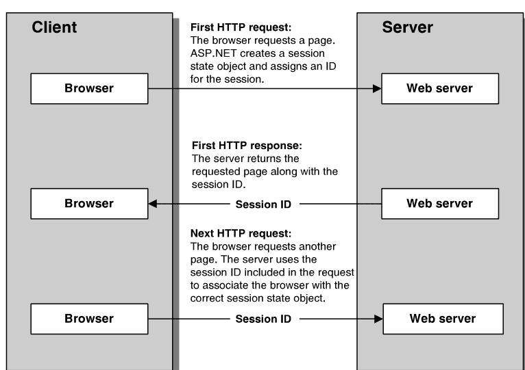

## 描述

- ASP.NET 使用 *会话状态* 来跟踪应用程序中每个用户的状态。为此，它会创建一个 *会话状态对象*。
- 会话状态对象包含一个会话 ID，该 ID 作为 *cookie* 发送回浏览器。然后，浏览器会自动将会话 ID cookie 与每个请求一起返回给服务器，以便服务器可以将浏览器与现有的会话状态对象关联起来。
- 如果您希望应用程序在不支持 cookie 的浏览器上运行，您可以配置 ASP.NET 将会话 ID 编码到应用程序每个页面的 URL 中。有关更多信息，请参阅第 8 章。
- 您可以使用会话状态对象在应用程序的执行之间存储和检索项目。

## 会话状态的典型用途

- **保留有关用户的信息**，例如用户名或用户是否已注册。
- **保存用户正在处理的对象**，例如购物车或客户记录。
- **跟踪待处理操作**，例如用户在下订单时已完成的步骤。

## 如何在会话状态中处理数据

图 3-15 显示了如何使用会话状态对象存储应用程序数据。为此，您使用此对象创建的 `HttpSessionState` 类的成员。要从 Web 表单访问此对象，您使用页面的 `Session` 属性。

会话状态对象包含由项目名称及其值组成的项目集合。将项目添加到此集合的一种方法是使用索引器，如第一个示例所示。在这里，一个名为 `cart` 的对象被分配给名为 `Cart` 的会话状态项目。如果执行此语句时 `Cart` 项目不存在，它将被创建。否则，`Cart` 项目的值将被更新。

将项目添加到会话状态集合的另一种方法是使用 `Add` 方法，如第二个示例所示。就像使用索引器一样，如果项目已存在，执行 `Add` 方法时它将被更新。否则，它将被添加到集合中。


您还可以使用索引器检索会话状态集合中项目的价值，如第三个示例所示。在这里，`Cart` 项目的值被检索并分配给 `cart` 变量。由于会话状态项目的值存储为 `Object` 类型，因此您通常将其强制转换为适当的类型。在此示例中，`Cart` 项目的值被强制转换为排序列表，因为 `cart` 变量被定义为排序列表。

由于会话状态对象使用宝贵的服务器内存，因此您应避免使用它来存储大型项目。或者，如果您必须将大型项目存储在会话状态中，则应在完成后立即将其删除。为此，您使用 `Remove` 方法，如本图中的第四个示例所示。

本图中的前四个示例使用页面的 `Session` 属性来访问会话状态对象。然而，由于 `Session` 是 `System.Web.UI.Page` 类的属性，因此您只能从继承 `System.Web.UI.Page` 类的类中使用此属性。换句话说，您只能从页面的代码隐藏文件中使用它。要从不继承 `System.Web.UI.Page` 类的类（例如数据库或业务类）访问会话状态，您使用当前请求的 `HttpContext` 对象的 `Session` 属性。要获取此 `HttpContext` 对象，您使用 `HttpContext` 类的 `Current` 属性，如本图中的最后一个示例所示。

## `HttpSessionState` 类的常见成员

| 属性 | 说明 |
|---|---|
| `SessionID` | 会话的唯一 ID。 |
| `Count` | 会话状态集合中的项数。 |
| 索引器 | 说明 |
| `[name]` | 具有指定名称的会话状态项的值。 |
| 方法 | 说明 |
| `Add(name, value)` | 向会话状态集合中添加一项。 |
| `Clear()` | 从会话状态集合中移除所有项。 |
| `Remove(name)` | 从会话状态集合中移除具有指定名称的项。 |

## 添加或更新会话状态项的语句

```
Session["Cart"] = cart;
```

## 添加或更新会话状态项的另一种方式

```
Session.Add("Cart", cart);
```

## 检索会话状态项值的语句

```
SortedList cart = (SortedList) Session["Cart"];
```

## 从会话状态中移除项的语句

```
Session.Remove("Cart");
```

## 从非继承 `System.Web.UI.Page` 的类中检索会话状态项值的语句

```
SortedList cart = (SortedList) HttpContext.Current.Session["Cart"];
```

## 说明

- 会话状态对象由 `HttpSessionState` 类创建，该类定义了会话状态项的集合。
- 若要从 Web 窗体的代码隐藏文件中访问会话状态对象，请使用页面的 `Session` 属性。
- 若要从 Web 窗体代码隐藏文件以外的类中访问会话状态对象，请使用 `HttpContext` 类的 `Current` 属性获取当前请求的 `HttpContext` 对象。该对象包含 HTTP 请求的相关信息。然后，使用 `HttpContext` 类的 `Session` 属性获取会话状态对象。
- 默认情况下，会话状态对象保存在服务器内存中。因此，应避免在会话状态中存储大型项。

## 购物车应用程序的代码

现在你已经掌握了开发多窗体应用程序的基本技能，可以查看购物车应用程序的所有 aspx 和 C# 代码了。由于你应该能够轻松理解这些代码，我将尽量精简描述。

### `Product` 类的代码

图 3-16 显示了 `Product` 类的 C# 代码。该类表示用户可以从购物车应用程序中订购的产品。它为 `Products` 表中除 `CategoryID` 和 `OnHand` 之外的每一列都提供了一个属性。

```
public class Product
{
    public string ProductID { get; set; };
    public string Name { get; set; };
    public string ShortDescription { get; set; };
    public string LongDescription { get; set; };
    public decimal UnitPrice { get; set; };
    public string ImageFile { get; set; };
}
```

### `CartItem` 类的代码

图 3-16 还显示了 `CartItem` 类的代码，该类表示购物车中的一项。在无参构造函数之后，该类的下一个构造函数接受两个参数，用于初始化 `Product` 和 `Quantity` 属性。这两个属性分别保存购物车项对应的 `Product` 对象和数量。

除了构造函数和属性之外，`CartItem` 类还包含两个方法。第一个方法 `AddQuantity` 用于将传入的数量添加到购物车项中。当用户为购物车中已有的产品添加数量时，会调用此方法。第二个方法 `Display` 返回一个字符串，该字符串格式化购物车项中的数据，以便在购物车页面的列表框中以单行显示。

```
public class CartItem
{
    public CartItem() {}
    public CartItem(Product product, int quantity)
    {
        this.Product = product;
        this.Quantity = quantity;
    }
    public Product Product { get; set; };
    public int Quantity { get; set; };
    public void AddQuantity(int quantity)
    {
        this.Quantity += quantity;
    }
    public string Display()
    {
        string displayString =
            Product.Name + " (" + Quantity.ToString()
            + " at " + Product.UnitPrice.ToString("c") + " each)";
        return displayString;
    }
}
```

### 说明

- `Product` 类表示一种产品。
- `CartItem` 类表示用户添加到购物车中的产品以及订购数量。
- 为简单起见，`Product` 和 `CartItem` 类使用自动实现的属性进行定义。但在生产应用程序中，它们很可能通过标准属性访问的私有字段来定义。

### `CartItemList` 类的代码

图 3-17 显示了 `CartItemList` 类的代码，该类表示 `CartItem` 对象的列表。该列表在类的开头定义为一个名为 `cartItems` 的私有字段。然后，该类的构造函数使用一个新的 `List<CartItem>` 对象初始化该字段。

接下来，`Count` 属性是一个只读属性，仅返回列表中项的数量。其后是一个重载的索引器。第一个索引器使用传入的索引获取和设置列表中的购物车项。当购物车项在购物车页面的列表框中显示时，使用该索引器获取购物车中的项。第二个索引器是一个只读索引器，使用传入的产品 ID 获取购物车项。该索引器用于判断产品是否已在购物车中。请注意，如果未找到具有指定 ID 的产品，该索引器将返回 `null` 值。

第一个方法 `GetCart` 获取存储在会话状态中的 `CartItemList` 对象。但首先，它会检查名为 `Cart` 的会话状态项是否等于 `null`。如果等于 `null`，则意味着当前用户的购物车尚未创建。然后，创建一个新的 `CartItemList` 对象并将其添加到会话状态中。

关于此方法，你应注意两点。第一，它是一个静态方法。这很合理，因为它只是检索存储在会话状态中的 `CartItemList` 对象，不针对当前的 `CartItemList` 对象进行操作。第二，由于这段代码不在代码隐藏文件中，因此不能使用页面的 `Session` 属性来引用会话状态对象。相反，必须通过当前请求的 `HttpContext` 对象来引用会话状态对象。

下一个方法 `AddItem` 向购物车项列表中添加新的购物车项。它接受 `Product` 对象和数量作为参数。然后，根据这些值创建 `CartItem` 对象，并将该购物车项添加到购物车项列表中。

最后两个方法 `RemoveAt` 和 `Clear` 应该很容易理解。`RemoveAt` 方法只是从购物车项列表中移除给定索引处的购物车项。`Clear` 方法则从列表中移除所有购物车项。

请注意，从购物车中添加和移除项的方法并没有直接引用会话状态。这是因为会话状态是一个对象。因此，当你从会话状态中检索购物车时，会将其存储在一个引用类型变量中。然后，当你使用该变量从购物车中添加和移除项时，会话状态对象会自动更新。当你看到 `Order` 和 `Cart` 页面的代码时，这一点会更容易理解。

```
using System;
using System.Collections.Generic;
using System.Web;

public class CartItemList
{
    private List<CartItem> cartItems;

    public CartItemList()
    {
        cartItems = new List<CartItem>();
    }

    public int Count
    {
        get { return cartItems.Count; }
    }

    public CartItem this[int index]
    {
        get { return cartItems[index]; }
        set { cartItems[index] = value; }
    }

    public CartItem this[string id]
    {
        get {
            foreach (CartItem c in cartItems)
                if (c.Product.ProductID == id) return c;
            return null;
        }
    }

    public static CartItemList GetCart()
    {
        CartItemList cart = (CartItemList) HttpContext.Current.Session["Cart"];
        if (cart == null)
            HttpContext.Current.Session["Cart"] = new CartItemList();
        return (CartItemList) HttpContext.Current.Session["Cart"];
    }

    public void AddItem(Product product, int quantity)
    {
        CartItem c = new CartItem(product, quantity);
        cartItems.Add(c);
    }

    public void RemoveAt(int index)
    {
        cartItems.RemoveAt(index);
    }

    public void Clear()
    {
        cartItems.Clear();
    }
}
```

图 3-17    `CartItemList` 类的代码

### `Order` 页面的 aspx 代码

图 3-18 显示了 `Order` 页面的 aspx 代码，图 3-1 中展示了该页面的呈现形式。由于此页面的所有代码都是由 Web Forms 设计器生成的，因此你无需编写其中任何代码。为了便于理解此代码，我突出显示了此页面上每个服务器控件的开始标记和 `ID` 属性。

第一组共四个控件，定义了一个用于横幅的图像、一个文本为“Please select a product:”的标签、一个名为 `ddlProducts` 的下拉列表，以及该下拉列表所绑定的 Access 数据源。此处，下拉列表的 `AutoPostBack` 属性设置为 `True`，这样当用户选择某个产品时，页面就会回发到服务器。此外，`DataSourceID`、`DataTextField` 和 `DataValueField` 属性指定了下拉列表如何绑定到 Access 数据源。

第二组服务器控件使用多个标签和一个图像控件来显示产品信息。使用表格管理这些控件的布局，以便图像显示在标签的右侧。为此，第一行第二个和第三个单元格的 `rowspan` 属性设置为 4。这意味着这些单元格横跨表格的所有四行。第二个单元格用于在表格的第一列和第三列之间添加间距，不包含任何数据。第三个单元格包含产品的图像。除了 `rowspan` 属性外，此单元格还包含一个 `valign` 属性，该属性使图像显示在单元格顶部，而不是显示在单元格中间。

```
<%@ Page Language="C#" AutoEventWireup="true" CodeFile="Order.aspx.cs" Inherits="Order" %>

<!DOCTYPE html PUBLIC "-//W3C//DTD XHTML 1.0 Transitional//EN" "http://www.w3.org/TR/xhtml1/DTD/xhtml1-transitional.dtd">

<html xmlns="http://www.w3.org/1999/xhtml">
<head runat="server">
<title>Chapter 3: Shopping Cart</title>
<style type="text/css">
.style1 {
    width: 100%;
}
.style2 {
    width: 250px;
}
.style3 {
    width: 20px;
}
</style>
</head>
<body>
<form id="form1" runat="server">
<div>
<asp:Image ID="Image1" runat="server" ImageUrl="~/Images/banner.jpg" /><br /><br />
<asp:Label ID="Label1" runat="server" Text="Please select a product:"></asp:Label>&nbsp;
<asp:DropDownList ID="ddlProducts" runat="server" DataSourceID="AccessDataSource1" DataTextField="Name" DataValueField="ProductID" Width="150px" AutoPostBack="True">
</asp:DropDownList>
<asp:AccessDataSource ID="AccessDataSource1" runat="server" DataFile="~/App_Data/Halloween.mdb" SelectCommand="SELECT [ProductID], [Name], [ShortDescription], [LongDescription], [ImageFile], [UnitPrice] FROM [Products] ORDER BY [Name]">
</asp:AccessDataSource><br />
<table class="style1">
<tr>
<td class="style2">
<asp:Label ID="lblName" runat="server" Font-Bold="True" Font-Size="Larger">
</asp:Label>
</td>
<td class="style3" rowspan="4">
</td>
<td rowspan="4" valign="top">
<asp:Image ID="imgProduct" runat="server" Height="200px" />
</td>
</tr>
```

### 说明

- `Order.aspx` 页面显示了一个绑定到 Access 数据源的下拉列表。
- 使用一个表格来指定显示用户所选产品信息的标签和图像控件的布局。

第三组服务器控件定义了一个文本为“Quantity:”的标签，后跟一个名为 `txtQuantity` 的文本框。然后，两个验证器控件为该文本框提供数据验证。请注意，两者都在 `ControlToValidate` 属性中指定了 `txtQuantity`，并在 `Display` 属性中指定了 `Dynamic`。范围验证器还提供了 `MaximumValue`、`MinimumValue` 和 `Type` 属性，这些属性指定数量必须是 1 到 500 范围内的整数。

此页面的最后一组控件包含两个按钮。此处，`OnClick` 属性指定了单击此按钮时将执行的事件处理程序。相比之下，`btnCart` 按钮使用 `PostBackUrl` 属性来指示：当用户单击该按钮时，应请求 `Cart.aspx` 页面，而不是 `Order.aspx` 页面。由于 `CausesValidation` 属性设置为 `False`，因此在单击此按钮时不会执行 `txtQuantity` 文本框的验证控件。


```html
<tr>
    <td class="style2">
        <asp:Label ID="lblShortDescription" runat="server">
        </asp:Label>
    </td>
</tr>
<tr>
    <td class="style2">
        <asp:Label ID="lblLongDescription" runat="server">
        </asp:Label>
    </td>
</tr>
<tr>
    <td class="style2">
        <asp:Label ID="lblUnitPrice" runat="server" Font-Bold="True" Font-Size="Larger">
        </asp:Label>
        <asp:Label ID="Label2" runat="server" Text="each" Font-Bold="True" Font-Size="Larger">
        </asp:Label>
    </td>
</tr>
</table>
<br />
<asp:Label ID="Label13" runat="server" Text="Quantity:"></asp:Label>&nbsp;
<asp:TextBox ID="txtQuantity" runat="server" Width="40px">
</asp:TextBox>
<asp:RequiredFieldValidator ID="RequiredFieldValidator1" runat="server" ControlToValidate="txtQuantity" Display="Dynamic" ErrorMessage="Quantity is a required field." ForeColor="Green">
</asp:RequiredFieldValidator>
<asp:RangeValidator ID="RangeValidator1" runat="server" ControlToValidate="txtQuantity" Display="Dynamic" ErrorMessage="Quantity must range from 1 to 500." MaximumValue="500" MinimumValue="1" Type="Integer" ForeColor="Green">
</asp:RangeValidator><br /><br />
<asp:Button ID="btnAdd" runat="server" Text="Add to Cart" OnClick="btnAdd_Click" />&nbsp;
<asp:Button ID="btnCart" runat="server" CausesValidation="False" PostBackUrl="~/Cart.aspx" Text="Go to Cart" />
</div>
</form>
</body>
</html>
```

### 说明

- `txtQuantity` 文本框允许用户输入所选项的订购数量。使用 `RequiredFieldValidator` 和 `RangeValidator` 来确保用户在此文本框中输入有效数据。
- `btnAdd` 按钮的 `OnClick` 属性指示单击此按钮时将执行名为 `btnAdd_Click` 的事件处理程序。
- `btnCart` 按钮使用跨页发布来发布到 `Cart.aspx` 页面。

## Order 页面的 C# 代码

图 3-19 显示了 Order 页面代码隐藏文件 `Order.aspx.cs` 的代码。该代码首先声明一个类级变量，该变量将保存一个 `Product` 对象，该对象表示用户从下拉列表中选择的项。`Page_Load` 方法中的第二条语句会调用 `GetSelectedProduct` 方法获取 `Product` 对象，并将该对象赋给此变量。

`Page_Load` 方法首先检查页面是否首次加载（`IsPostBack` 不为 True），如果是，则调用下拉列表的 `DataBind` 方法。该方法将下拉列表绑定到 Access 数据源，从而检索数据源 `SelectCommand` 属性中指定的数据。然后，此方法调用 `GetSelectedProduct` 方法，该方法从 Access 数据源获取所选产品的数据并返回一个 `Product` 对象。该对象存储在 `selectedProduct` 变量中，该变量可用于此类中的所有方法。最后，`Page_Load` 方法格式化标签和图像控件，以显示所选产品的数据。此时，Order 页面被发送回用户的浏览器。

对于许多应用程序，在使用数据绑定时，你不需要在 `Page_Load` 方法中调用 `DataBind` 方法。相反，你可以让 ASP.NET 自动绑定任何数据绑定控件。遗憾的是，这种自动数据绑定要在 `Page_Load` 方法执行之后才会发生。在这种情况下，除非下拉列表已经绑定，否则 `GetSelectedProduct` 方法无法正常工作，因此我不得不调用 `DataBind` 方法来强制数据绑定比正常情况下更早发生。

如果用户单击“Add to Cart”按钮，则会执行 `btnAdd_Click` 方法。在检查页面有效之后，此方法调用 `CartItemList` 类的 `GetCart` 方法来获取存储在会话状态中的购物车。请记住，如果会话状态中尚不存在购物车，此方法会创建一个新的 `CartItemList` 对象并将其存储在会话状态中。还要记住，`GetCart` 是一个静态方法，因此你应从类（而不是从该类创建的对象）调用它。

接下来，此方法确定购物车是否已包含所选产品的项。为此，它使用 `CartItemList` 对象的索引器来获取具有该产品 ID 的 `CartItem` 对象。如果未找到具有此产品 ID 的项，则调用 `CartItemList` 对象的 `AddItem` 方法，将包含所选产品和数量的项添加到列表中。相反，如果找到了具有该产品 ID 的项，则调用 `CartItem` 对象的 `AddQuantity` 方法，将数量添加到该项中。最后，此方法使用 `Response.Redirect` 转到 `Cart.aspx` 页面。

## Order 页面代码隐藏文件 (Order.aspx.cs)

```csharp
using System;
using System.Web.UI;
using System.Data;

public partial class Order : System.Web.UI.Page
{
    private Product selectedProduct;

    protected void Page_Load(object sender, EventArgs e)
    {
        if (!IsPostBack)
            ddlProducts.DataBind();

        selectedProduct = this.GetSelectedProduct();
        lblName.Text = selectedProduct.Name;
        lblShortDescription.Text = selectedProduct.ShortDescription;
        lblLongDescription.Text = selectedProduct.LongDescription;
        lblUnitPrice.Text = selectedProduct.UnitPrice.ToString("c");
        imgProduct.ImageUrl = "Images/Products/" + selectedProduct.ImageFile;
    }

    private Product GetSelectedProduct()
    {
        DataView productsTable = (DataView)
            AccessDataSource1.Select(DataSourceSelectArguments.Empty);
        productsTable.RowFilter =
            "ProductID = '" + ddlProducts.SelectedValue + "'";
        DataRowView row = (DataRowView)productsTable[0];

        Product p = new Product();
        p.ProductID = row["ProductID"].ToString();
        p.Name = row["Name"].ToString();
        p.ShortDescription = row["ShortDescription"].ToString();
        p.LongDescription = row["LongDescription"].ToString();
        p.UnitPrice = (decimal)row["UnitPrice"];
        p.ImageFile = row["ImageFile"].ToString();
        return p;
    }

    protected void btnAdd_Click(object sender, EventArgs e)
    {
        if (Page.IsValid)
        {
            CartItemList cart = CartItemList.GetCart();
            CartItem cartItem = cart[selectedProduct.ProductID];
            if (cartItem == null)
            {
                cart.AddItem(selectedProduct, Convert.ToInt32(txtQuantity.Text));
            }
            else
            {
                cartItem.AddQuantity(Convert.ToInt32(txtQuantity.Text));
            }
            Response.Redirect("Cart.aspx");
        }
    }
}
```

图 3-19 `Order` 页面的 C# 代码

## Cart 页面的 aspx 代码

图 3-20 显示了购物车应用程序第二个页面 `Cart.aspx` 的 aspx 代码，该页面在图 3-2 中呈现。同样，我突出显示了定义服务器控件的每个标签的开头。

在这里，购物车显示在一个 `ListBox` 控件中，该控件位于一个 HTML 表格内，以便在列表框右侧显示 Remove 和 Empty 按钮。这两个按钮以及 CheckOut 按钮都使用 `OnClick` 属性来命名在按钮被点击时执行的事件处理程序。Continue 按钮使用 `PostBackUrl` 属性返回到 `Order.aspx` 页面。而 `lblMessage` 标签用于向用户显示消息。与 Order 页面一样，此页面还包含一个图像控件，用于定义在横幅中显示的图像。

请注意，这里标签的 `EnableViewState` 属性被设置为 False。这样，该标签的值就不会在 HTTP 请求之间保持。因此，如果在此标签中显示错误消息，则下次显示页面时不会再次显示。

## Cart 页面的 aspx 文件 (Cart.aspx)

```aspx
<%@ Page Language="C#" AutoEventWireup="true" CodeFile="Cart.aspx.cs"
Inherits="Cart" %>

<!DOCTYPE html PUBLIC "-//W3C//DTD XHTML 1.0 Transitional//EN"
"http://www.w3.org/TR/xhtml1/DTD/xhtml1-transitional.dtd">

<html xmlns="http://www.w3.org/1999/xhtml">
<head runat="server">
    <title>Chapter 3: Shopping Cart</title>
    <style type="text/css">
        .style1 {
            width: 100%;
        }
        .style2 {
            width: 285px;
            height: 155px;
        }
        .style3 {
            height: 155px;
        }
    </style>
</head>
<body>
    <form id="form1" runat="server">
    <div>
        <asp:Image ID="Image1" runat="server"
            ImageUrl="~/Images/banner.jpg" /><br /><br />
        Your shopping cart:<br /><br />
        <table class="style1" cellpadding="0" cellspacing="0">
            <tr><td class="style2" valign="top">
                <asp:ListBox ID="lstCart" runat="server"
                    Height="135px" Width="275px"></asp:ListBox></td>
                <td class="style3" valign="top">
                    <asp:Button ID="btnRemove" runat="server" Text="Remove Item"
                        Width="100px" OnClick="btnRemove_Click" /><br /><br />
                    <asp:Button ID="btnEmpty" runat="server" Text="Empty Cart"
                        Width="100px" OnClick="btnEmpty_Click" /></td></tr>
        </table>
        <br />
        <asp:Button ID="btnContinue" runat="server"
            PostBackUrl="~/Order.aspx" Text="Continue Shopping" />&nbsp;
        <asp:Button ID="btnCheckOut" runat="server" Text="Check Out"
            OnClick="btnCheckOut_Click" /><br /><br />
        <asp:Label ID="lblMessage" runat="server" ForeColor="Green"
            EnableViewState="False"></asp:Label>
    </div>
    </form>
</body>
</html>
```

### 描述

- `Cart.aspx` 页面使用列表框来显示购物车。
- `btnContinue` 按钮使用跨页回发将数据回发到 `Order.aspx` 页面。其他按钮回发到 Cart 页面，在那里执行按钮的 `OnClick` 属性指定的事件处理程序。

图 3-20 `Cart` 页面的 aspx 代码

## Cart 页面的 C# 代码

图 3-21 展示了 Cart 页面的代码隐藏文件。此代码首先声明一个类级变量，用于保存购物车的 `CartItemList` 对象。然后，每次页面加载时，`Page_Load` 方法都会调用 `CartItemList` 类的 `GetCart` 方法，从会话状态中检索购物车并将其存储在此变量中。

如果页面是首次加载，`Page_Load` 方法还会调用 `DisplayCart` 方法。此方法首先清除将显示购物车项目的列表框。然后，它使用 for 循环为购物车列表中的每个项目向列表框添加一个项目。请注意，此语句使用 `CartItemList` 对象的 `Count` 属性来获取购物车中的项目数量。

如果用户点击 Remove Item 按钮，则会执行 `btnRemove_Click` 方法。此方法首先确保购物车中至少有一个项目，并且购物车列表框中选择了一个项目。如果是这样，则使用 `CartItemList` 对象的 `RemoveAt` 方法从购物车中删除所选项目。然后，调用 `DisplayCart` 方法再次将购物车项目添加到列表框中，但不包括已删除的项目。

如果用户点击 Empty Cart 按钮，则会执行 `btnEmpty_Click` 方法。此方法调用 `CartItemList` 对象的 `Clear` 方法来清空购物车。然后，它调用列表框的 `Items` 集合的 `Clear` 方法来清空该列表。请注意，虽然可以使用 `Clear` 方法来清空列表框，但此方法也可以调用 `DisplayCart` 方法。同样，`btnRemove_Click` 方法也可以使用列表框的 `Items` 集合的 `Remove` 方法来删除所选索引处的项目，而不是调用 `DisplayCart` 方法。这只是说明像这样的方法通常有多种编码方式。


请注意，`Cart` 页面不包含 Continue Shopping 按钮的 `Click` 事件方法。这是因为该按钮使用 `PostBackUrl` 属性直接发布到 `Order.aspx` 页面。因此，如果用户点击 Continue Shopping 按钮，则不会执行 `Cart` 页面。

## `Cart` 页面的代码隐藏文件 (`Cart.aspx.cs`)

```csharp
using System;

public partial class Cart : System.Web.UI.Page
{
    private CartItemList cart;

    protected void Page_Load(object sender, EventArgs e)
    {
        cart = CartItemList.GetCart();
        if (!IsPostBack)
            this.DisplayCart();
    }

    private void DisplayCart()
    {
        lstCart.Items.Clear();
        CartItem item;
        for (int i = 0; i < cart.Count; i++)
        {
            item = cart[i];
            lstCart.Items.Add(item.Display());
        }
    }

    protected void btnRemove_Click(object sender, EventArgs e)
    {
        if (cart.Count > 0)
        {
            if (lstCart.SelectedIndex > -1)
            {
                cart.RemoveAt(lstCart.SelectedIndex);
                this.DisplayCart();
            }
            else
            {
                lblMessage.Text = "Please select the item you want to remove.";
            }
        }
    }

    protected void btnEmpty_Click(object sender, EventArgs e)
    {
        if (cart.Count > 0)
        {
            cart.Clear();
            lstCart.Items.Clear();
        }
    }

    protected void btnCheckOut_Click(object sender, EventArgs e)
    {
        lblMessage.Text = "Sorry, that function hasn't been "
            + "implemented yet.";
    }
}
```

## 视角

本章的目的是让你开始开发多页面 Web 应用程序的开发。现在，如果本章奏效，你应该能够自行开发简单的多页面应用程序。是的，还有很多东西需要学习，但你应该有一个良好的开端。

坦率地说，Shopping Cart 应用程序中的大部分 C# 代码都很困难，即使在像这样简单的应用程序中也是如此。因此，如果你对 C# 的经验有限，你可能无法理解其中的一些代码。而且你可能无法为你的新应用程序编写相同类型的代码。

如果是这种情况，我们建议你购买我们最新的 C# 书籍。它会迅速让你掌握 C# 语言。它会向你展示如何使用数十个 .NET 类，例如 `List<T>` 类。它会向你展示如何开发面向对象的 Windows 应用程序。它是一个极好的工作参考书。而且它是本书的完美伴侣，本书假设你已经了解 C#。

## 术语

- class library
- master form
- jQuery
- HTTP redirect message
- cross-page posting
- absolute URL
- relative URL
- data source
- session state
- session state object
- cookie

## 练习 3-1 构建 Shopping Cart 应用程序

本练习指导你构建一个与本章中介绍的类似的 Shopping Cart 应用程序。如果你相对较新于 Visual Studio 和 ASP.NET 4，这是一个很好的练习，通过实践你会学到很多。为了帮助你快速入门，应用程序所需的图像、数据库和类已为你提供。

### 启动网站

1. 在 `C:\aspnet4_cs` 目录中启动一个名为 `Ch03Cart` 的空文件系统网站。

2. 向网站添加一个名为 `App_Data` 的文件夹，如图 2-4 所示。然后，将名为 `Halloween.mdb` 的现有 Access 数据库添加到此文件夹。你可以在 `C:\aspnet4_cs\Ch01Cart\App_Data` 目录中找到此文件。

3. 向网站添加一个名为 `App_Code` 的文件夹。然后，如图 3-4 所示，将名为 `Product` 的现有类添加到此文件夹。你可以在 `C:\aspnet4_cs\Ch01Cart` 目录的 `App_Code` 文件夹中找到此类的文件。

4. 在代码编辑器中打开 `Product` 类并查看其代码。此代码应与图 3-16 中显示的代码相似。

### 构建简单的 Order 页面

5. 向网站添加一个名为 `Order` 的表单并在设计视图中显示它。

6. 添加 `Products` 下拉列表，让用户选择产品，以及标识它的文本。接下来，添加一个 Access 数据源并将其配置为从 `Halloween` 数据库获取产品数据，如图 3-10 和 3-11 所示。然后，如图 3-12 所示，将下拉列表绑定到数据源。

7. 添加用于显示产品名称、简短描述、长描述和单价的标签。确保为这些标签适当设置 `ID` 属性。例如，为将显示产品名称的标签使用 `lblName`。当完成时，页面应看起来像这样：

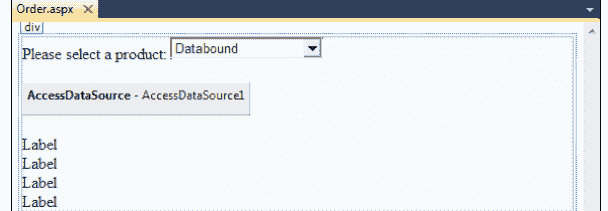

8. 运行应用程序以查看下拉列表的工作方式。此时，你应该能够从列表中选择一个产品，但它不会更改标签显示的文本。

9. 切换到代码编辑器并输入显示下拉列表中选择的产品的代码。为此，你可以为页面的 `Load` 事件编码事件处理程序，并可以使用名为 `GetSelectedProduct` 的方法，如图 3-19 的第 1 部分所示。当添加此代码时，不要忘记包含 `System.Data` 命名空间的 `using` 语句。

10. 将 `Products` 下拉列表的 `AutoPostBack` 属性设置为 `True`。然后，运行应用程序并测试代码。此时，当你从列表中选择一个产品时，页面上应显示该产品的适当数据（但产品图像尚未显示）。

### 构建简单的 Cart 页面

11. 如图 3-4 所示，将名为 `CartItem` 和 `CartItemList` 的现有类添加到 `App_Code` 文件夹。你可以在 `C:\aspnet4_cs\ Ch01Cart\App_Code` 目录中找到这些类的文件。

12. 在代码编辑器中打开 `CartItem` 和 `CartItemList` 类并查看其代码。`CartItem` 类的代码应与图 3-16 中显示的代码相似，`CartItemList` 类的代码应与图 3-17 中显示的代码相似。

13. 向项目添加第二个名为 `Cart` 的 Web 表单。然后，如图 3-6 所示，将 `Order` 表单设置为起始页面。

14. 向 `Cart` 页面添加文本和控件，使其看起来像图 3-2 中显示的页面，但不包括页面顶部的图像控件。为了帮助你对齐控件，你可以使用表格。确保适当设置控件的 `ID` 属性。

15. 设置 Continue Shopping 按钮的 `PostBackUrl` 属性以显示 `Order` 页面。

16. 切换到 `Order` 页面的设计视图并添加 Add to Cart 和 Go to Cart 按钮。然后，设置 Go to Cart 按钮的 `PostBackUrl` 属性以显示 `Cart` 页面。

17. 运行应用程序并使用 Go to Cart 和 Continue Shopping 按钮在两个页面之间切换。

### 修改 Cart 和 Order 页面以便购物车可以存储项目

18. 在 `Order` 页面中，为 Add to Cart 按钮的 `Click` 事件添加代码以添加所选产品。为此，你可以使用 `CartItemList` 类的 `GetCart` 和 `AddItem` 方法、`CartItemList` 类的索引器以及 `CartItem` 类的 `AddQuantity` 方法，如图 3-19 所示。但是，由于没有数量文本框，你可以假设数量始终为 1。

19. 在 `Cart` 页面中，添加显示购物车项目在列表框中的代码。为此，你可以为页面的 `Load` 事件编码事件处理程序，如图 3-21 所示。在此事件处理程序中，你可以使用 `CartItemList` 类的 `GetCart` 方法从会话状态获取购物车，并可以使用名为 `DisplayCart` 的方法在列表框中显示购物车项目。当添加此代码时，不要忘记在任何方法之外声明 `cart` 变量。

20. 运行应用程序并测试此代码。此时，当你选择一个产品并单击 Add to Cart 按钮时，应用程序应将项目添加到购物车并在 `Cart` 页面中显示它。如果购物车已包含该项目，它应将该项目的数量增加 1。

### 修改 Cart 页面以便可以从购物车中删除项目

21. 在 `Cart` 页面中，添加删除所选项目从购物车的代码。为此，你可以为 Remove Item 按钮的 `Click` 事件编码事件处理程序，如图 3-21 所示。请注意，由于你未包含用于显示错误消息的标签，你可以省略设置此标签的代码。

22. 在 `Cart` 页面中，添加清除购物车中所有项目的代码。为此，你可以为 Empty Cart 按钮的 `Click` 事件编码事件处理程序，如图 3-21 所示。

23. 运行应用程序并测试此代码。此时，你应该能够使用 Remove Item 和 Empty Cart 按钮从购物车中删除项目。

the validators on this page work properly. Then, enter customer information in the text boxes and click the Continue Shopping button again. Add another item to the cart and click the Check Out button again. This time, the customer information should be displayed on the `CheckOut` page. Now, click the Cancel Order button to return to the `Order` page. Then, click the Go to Cart button to see that there isn’t anything in the cart, and click the Check Out button to see that no customer information is displayed. If you encounter any problems, fix them.

## 练习 3-3 向 Shopping Cart 应用程序添加图像和格式

在本练习中，你将向练习 3-1 和 3-2 中开发的 Shopping Cart 应用程序添加图像。这将给你一个机会使用更复杂的表格并格式化该表格中的文本。

### 向应用程序添加图像

1. 向你的网站添加一个名为 `Images` 的文件夹。然后，将名为 `banner.jpg` 的文件添加到此文件夹。你可以在 `C:\aspnet4_cs\Ch01Cart\Images` 目录中找到此文件。

2. 在 `Images` 文件夹内，添加一个名为 `Products` 的子文件夹。然后，将产品的 jpg 文件添加到此子文件夹。你可以在 `C:\aspnet4_cs\Ch01Cart\Images\Products` 目录中找到这些文件。

3. 将 `banner.jpg` 文件添加到 Shopping Cart 应用程序中所有页面的顶部。

### 修改 Order 页面以显示图像

4. 向 `Order` 页面添加表格和格式，使其看起来与图 3-1 中显示的 `Order` 页面相似，但不带 Quantity 文本框。

5. 向表格的右列添加一个 `Image` 控件，并将 `ID` 属性设置为 `imgProduct`。另请将包含图像的单元格的 `valign` 属性设置为 `top`。

6. 向 `Order` 页面添加代码以在 `Image` 控件中显示所选产品的图像。为此，你可以将 `Image` 控件的 `ImageUrl` 属性设置为相对于页面的图像文件位置加上所选产品的 `Product` 对象的 `ImageFile` 属性。请注意，这有效是因为 `ImageFile` 属性包含图像文件名的字符串。

7. 运行应用程序并测试 `Order` 页面。加载时，它应显示下拉列表中选择的产品的图像。当你选择新产品时，它应在 `Image` 控件中显示该产品。

## 如何测试和调试 ASP.NET 应用程序

如果你做过很多编程，你就知道测试和调试通常是程序开发中最困难、最耗时的阶段。幸运的是，Visual Studio 包含一个集成调试器，可以帮助你定位和纠正即使是最隐蔽的错误。而且 ASP.NET 包含一个 `Trace` 功能，可在 ASP.NET 页面执行时显示有用的信息。

在本章中，你将学习如何使用这两种强大的调试工具。此外，你将学习如何创建本地 IIS 网站，以便使用该 Web 服务器对其进行测试，以及如何测试应用程序以确定其是否正常工作。

- **如何使用 ASP.NET Development Server 测试应用程序** ................................ 128
  - 如何使用默认浏览器测试应用程序 ........................................ 128
  - 如何使用非默认浏览器测试应用程序 ............... 130
  - 如何使用 Exception Assistant ............................................................... 132
- **如何使用 IIS 测试应用程序** .............................................................. 134
  - 如何创建本地 IIS 网站 ..................................................................... 134
  - 如何使用 IIS 测试文件系统网站 ....................................................... 136
  - 如何在 Visual Studio 外部测试应用程序 .................................. 138
- **如何使用调试器** .................................................................................... 140
  - 如何使用断点 ......................................................................................... 140
  - 如何使用跟踪点 .......................................................................................... 142
  - 如何在中断模式下工作 ................................................................................... 144
  - 如何控制应用程序的执行 ................................................... 146
  - 如何使用 Autos、Locals 和 Watch 窗口监视变量 ........... 148
  - 如何使用 Immediate 窗口处理值 ....................................... 150
- **如何使用 `Trace` 功能** ............................................................................... 152
  - 如何启用 `Trace` 功能 ............................................................................ 152
  - 如何解释 `Trace` 输出 ................................................................................ 152
  - 如何创建自定义跟踪消息 .................................................................. 154
- **如何直接向 HTTP 输出流写入信息** .......................... 156


- **观点** ........................................................................................................... 158

## 如何使用 ASP.NET Development Server 测试应用程序

要测试 ASP.NET 应用程序，你通常首先从 Visual Studio 中以文件系统网站的形式运行它，以便你可以定位和纠正遇到的任何错误。这种初始测试使用默认浏览器和 ASP.NET Development Server。然后，你使用其他 Web 浏览器测试应用程序，以确保它也能正常工作。你将在下面的主题中学习执行这两种类型测试的技术。此外，你将学习如何使用在测试应用程序时出现错误时显示的 Exception Assistant。

## 如何使用默认浏览器测试应用程序

除非你已更改它，否则 Windows 使用 Internet Explorer 作为其默认浏览器。图 4-1 介绍了六种使用默认浏览器运行 Web 应用程序的不同方法。其中三种技术启动调试器，以便你可以使用其功能调试可能出现的问题。其他三种技术不会启动调试器。

第一次使用前三种技术中的一种运行 Web 应用程序时，Visual Studio 会显示一个对话框，指出 `web.config` 文件中未启用调试。从此对话框中，你可以选择启用调试，也可以选择在不调试的情况下运行应用程序。在大多数情况下，你将启用调试，以便可以与应用程序一起使用调试器。

图中所列的所有技术中，除了 View in Browser 命令外，都启动应用程序并显示应用程序指定的起始页。但是，View in Browser 命令会显示所选页面。例如，如果你右键单击 Cart 页面并选择 View in Browser，则会显示 Cart 页面。此命令最适合确保应用程序的页面看起来符合你的要求。

请注意，当你使用 ASP.NET Development Server 运行应用程序时，显示的页面的 URL 将服务器标识为“localhost:”，后跟服务器分配的数字。相比之下，如果你按本章后面所示在 IIS 下运行应用程序，则服务器仅标识为“localhost”。

### 默认浏览器中显示的 Order 页面

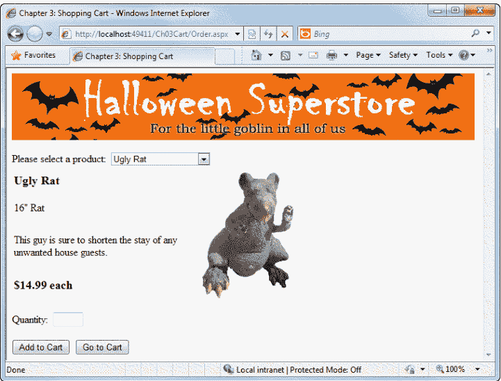

### 三种带调试运行应用程序的方法

- 单击标准工具栏中的 `Start Debugging` 按钮
- 按 `F5`
- 选择 `Debug→Start Debugging` 命令

### 三种不带调试运行应用程序的方法

- 按 `Ctrl+F5`
- 选择 `Debug→Start Without Debugging`
- 在 Solution Explorer 中右键单击页面并选择 `View in Browser`。

### 三种停止使用调试运行的应用程序的方法

- 按 `Shift+F5`
- 单击 Debug 工具栏中的 `Stop Debugging` 按钮
- 选择 `Debug→Stop Debugging`

## 描述

- 如果你使用调试运行应用程序，你可以使用 Visual Studio 的内置调试器查找和纠正程序错误。
- 除非你已更改 Windows 的默认浏览器，否则应用程序将使用 Internet Explorer 运行。有关使用不同浏览器的信息，请参阅图 4-2。要结束应用程序，请关闭浏览器。

图 4-1 如何使用默认浏览器测试应用程序

## 如何使用非默认浏览器测试应用程序

在你用默认浏览器彻底测试应用程序后，你会想用其他浏览器测试它，以确保它按预期工作。图 4-2 描述了两种这样做的方法。首先，你可以在 Solution Explorer 中右键单击应用程序的起始页并选择 `Browse With` 命令。这会显示一个类似本图所示的 Browse With 对话框。从此对话框中，你可以选择要使用的浏览器，然后单击 `Browse` 按钮。

请注意，Browse With 对话框中的浏览器列表包含 Internal Web Browser。如果你选择此浏览器，则页面将在 Visual Studio 内的 Browse 窗口中显示。你可以像使用任何其他浏览器一样从此浏览器测试应用程序。然后，在完成浏览操作后，只需关闭 Browse 窗口即可。

你也可以通过将该浏览器设为默认浏览器来使用另一个浏览器测试应用程序。为此，在 Solution Explorer 中右键单击任何页面并选择 `Browse With`。接下来，选择要指定为默认浏览器的浏览器并单击 `Set As Default` 按钮。然后，单击 `Cancel` 按钮关闭 Browse With 对话框。然后，你可以使用图 4-1 中列出的任何技术在你选择的浏览器中启动应用程序。请注意，将浏览器设为默认是使用调试器与浏览器一起使用的唯一方法。这是因为 `Browse With` 命令在不调试的情况下运行应用程序。

有时，你想要测试应用程序的浏览器即使已安装在计算机上也不会出现在 Browse With 对话框中。在大多数情况下，这是因为你在安装 Visual Studio 之后安装了该浏览器。然后，你可以通过单击 Browse With 对话框中的 `Add` 按钮来添加浏览器，以显示 Add Program 对话框。此对话框让你可以找到要添加的浏览器的可执行文件，并输入在 Browse With 对话框中用于该浏览器的“友好”名称。

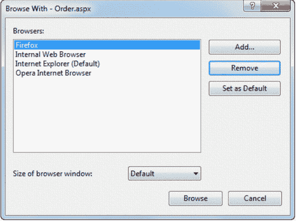

## Browse With 对话框

## 使用非默认浏览器测试应用程序的两种方法

- 在解决方案资源管理器中右键单击应用程序的起始页，从快捷菜单中选择 `Browse With`。在显示的 Browse With 对话框中，选择要使用的浏览器并单击 `Browse` 按钮。
- 在 Browse With 对话框中选择要使用的浏览器，然后单击 `Set as Default` 按钮将其设为默认。 下次运行应用程序时，它将在您选择的浏览器中显示。

## 描述

- 很重要的一点是，在可能用于运行应用程序的任何浏览器中测试 ASP.NET 应用程序。
- 如果某个浏览器未包含在可用浏览器列表中，您可以单击 Browse With 对话框中的 `Add` 按钮，然后使用显示的 Add Program 对话框将所需浏览器添加到列表中。
- 如果选择 Internal Web Browser 选项，页面将在 Visual Studio 内的 Browse 窗口中显示。要结束此窗口中的浏览操作，只需关闭该窗口即可。
- 如果您想使用调试器调试另一个浏览器，则需要更改默认浏览器，因为 `Browse With` 命令会在不调试的情况下启动应用程序。
- 如果您使用 Internet Explorer 以外的浏览器调试应用程序，调试器在关闭浏览器窗口时可能不会结束。在这种情况下，您可以使用图 4-1 中的一种技术来停止应用程序并结束调试。

Figure 4-2 How to test an application with a browser other than the default

## 如何使用异常助手

在测试 ASP.NET 应用程序时，您可能会遇到阻止应用程序执行的运行时错误。发生这种情况时，会引发异常。在许多情况下，应用程序会预料到这些异常并提供代码来捕获它们并适当处理它们。但是，如果未捕获异常，应用程序将进入中断模式，并且异常助手会显示如图 4-3 所示的对话框。

如您所见，异常助手对话框指示发生的异常类型，并指向导致错误的语句。在许多情况下，这些信息足以确定错误的原因以及应采取的纠正措施。例如，此图中的异常助手对话框指示输入字符串格式不正确，并且问题出现在 Order 页面的以下代码行中：

```
cart.AddItem(selectedProduct,
    Convert.ToInt32(txtQuantity.Text));
```

根据这些信息，您可以假设 `txtQuantity` 控件的 `Text` 属性包含一个无法转换为整数的值，因为 `cart` 对象的 `AddItem` 方法将其第二个参数接受为整数。如果应用程序未检查用户是否在此控件中输入了整数值，就会发生这种情况。 （为了允许此错误发生，我禁用了 Order 页面上 Quantity 文本框的范围验证器。）

您遇到的许多异常将是此处所示的系统异常。这些异常适用于算术运算和方法执行等通用系统操作。如果您的应用程序使用 ADO.NET，您还可能遇到 ADO.NET 和数据提供程序异常。例如，如果数据库的连接字符串无效，则会发生数据提供程序异常。如果您尝试向具有已存在键的数据表添加一行，则会发生 ADO.NET 错误。

在某些情况下，仅通过分析异常助手对话框中的信息可能无法确定错误的根本原因。然后，为了获取有关异常可能原因的更多信息，您可以使用此对话框中的故障排除提示列表。此列表中的项目是链接，可在帮助窗口中显示更多信息。您还可以使用此对话框中的其他链接在线搜索更多帮助、显示异常对象的内容以及将异常详细信息复制到剪贴板。

如果您仍然无法确定错误的原因，可以使用 Visual Studio 调试器帮助您定位问题。您将在本章后面学习如何执行此操作。

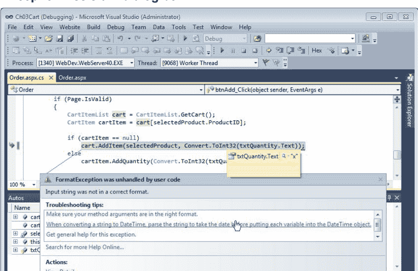

## 一个异常助手对话框

## 描述

- 如果 ASP.NET 应用程序中发生未捕获的异常，应用程序将进入 *break mode* 中断模式，并且 *Exception Assistant* 异常助手会显示如上所示的对话框。
- 异常助手提供异常的名称和描述，并指向导致错误的程序语句。它还包含一份故障排除提示列表。您可以单击这些提示以在帮助查看器中显示更多信息（请参阅第 6 章）。
- 异常助手提供的信息通常足以确定错误的原因。如果不是，您可以关闭此窗口，然后使用本章介绍的调试技术来确定原因。
- 如果在发生异常后继续程序执行，ASP.NET 将终止应用程序并向浏览器发送服务器错误页面。如果您在不调试的情况下运行应用程序，也会显示此页面。它提供应用程序的名称、异常的描述以及导致错误的程序行。它还包含一个 *stack trace* 堆栈跟踪，指示导致错误的流程。

## 如何使用 IIS 测试应用程序

在第 2 章中，您学习了如何创建在 ASP.NET 开发服务器下运行的文件系统网站。但是，如果您有权访问 IIS Web 服务器，您可能希望创建一个在 IIS 下运行的网站，以便在该环境中测试网站。或者，您可能希望先使用 ASP.NET 开发服务器创建和测试文件系统网站，然后再在 IIS 下进行测试。

## 如何创建本地 IIS 网站

本地 IIS 网站是驻留在本地计算机上的网站。因此，要创建本地 IIS 网站，您必须在计算机上安装 IIS。请参阅附录 A，了解如何安装 IIS 的信息。此外，Visual Studio 必须以管理员帐户的上下文运行。您不必是管理员即可执行此操作。相反，您可以通过在开始菜单中右键单击它并选择 `Run As Administrator` 命令来以管理员身份运行 Visual Studio。

图 4-4 说明了如何创建本地 IIS 网站。最简单的方法是从 New Web Site 对话框中单击 `Browse` 按钮，以显示本图所示的 Choose Location 对话框。然后，您可以单击对话框左侧的 Local IIS 按钮以显示 IIS Web 服务器，并选择要创建网站的目录。在本例中，我选择了 `aspnet_2010` 目录。然后，我单击 `Create New Web Application` 按钮在该目录中创建一个名为 `Ch03Cart` 的新网站。

顺便说一下，当您创建 IIS 网站时，可能会显示一个对话框，指示 Web 服务器上未启用 ASP.NET 4.0 Web 扩展。要在 Web 服务器上启用 ASP.NET 4.0，只需单击 `Yes` 按钮即可。

使用此技术时，网站的文件将存储在您创建的目录中。如果这不是您想要的，您可以创建一个指向网站文件将存储的目录的虚拟目录。要执行此操作，只需在 Choose Location 对话框中单击 `Create New Virtual Directory` 按钮。然后，将显示一个对话框，让您输入虚拟目录的名称以及网站文件应存储的路径。例如，在本图所示的对话框中，虚拟目录将命名为 `Ch03Cart`，文件将存储在 C 盘上 `aspnet4_cs` 目录内的同名目录中。

除了使用 New Virtual Directory 对话框为新网站创建虚拟目录外，您还可以使用它为已创建的文件系统网站创建虚拟目录。要执行此操作，只需在此对话框中输入现有网站的路径。然后，当您在 New Web Site 对话框中单击 `OK` 按钮时，Visual Studio 会警告您指定位置已存在网站。要创建指向现有网站的虚拟目录，请选择 `Open the Existing Web Site` 选项。如果您使用此技术，请确保设置应用程序的起始页。此外，如果您使用的是 Windows 7，请确保在创建虚拟目录之前将 IIS 的默认应用程序池设置正确。有关更多信息，请参阅附录 B 中的图 B-4。

**用于选择本地 IIS 网站的对话框**

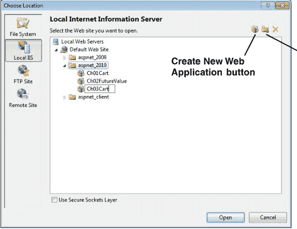

**用于创建虚拟目录的对话框**

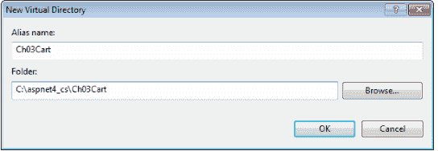

**说明**

- 要创建将在本地计算机上的 IIS 下运行的网站，请在“新建网站”对话框中将位置选项选择为 HTTP，然后输入要创建网站的 IIS 目录路径。或者，单击“浏览”按钮以显示“选择位置”对话框。
- 在“选择位置”对话框中，单击“本地 IIS”按钮并展开“默认网站”节点。然后，从“默认网站”中选择要创建网站的目录并单击“打开”按钮，或者创建新目录或虚拟目录。
- 要为网站创建新的 IIS 目录，请单击“创建新 Web 应用程序”按钮，然后输入目录名称。网站的文件将存储在该目录中。
- 要为网站创建*虚拟目录*，请单击“创建新虚拟目录”按钮以显示“新建虚拟目录”对话框。输入目录名称以及要存储网站文件的路径。如果指定的路径已包含网站，则可以从虚拟目录打开该网站。

图 4-4    如何创建本地 IIS 网站

在继续之前，您应该意识到，您也可以使用 IIS 管理控制台为文件系统网站创建虚拟目录。如果您感兴趣，可以在附录 B（Windows 7 和 Windows Vista）或附录 C（Windows XP）中了解如何执行此操作。不过，除非您需要更改虚拟目录的默认权限，否则我建议您在 Visual Studio 中创建虚拟目录。

## 如何使用 IIS 测试文件系统网站

运行文件系统网站时，默认情况下它将在 ASP.NET Development Server 下运行。但是，由于该服务器存在限制，您需要确保在 IIS 和开发服务器下都测试文件系统网站。图 4-5 描述了如何执行此操作。

首先，您需要按照图 4-4 中的描述为网站创建虚拟目录。然后，如果从该虚拟目录打开网站，它将自动在 IIS 下运行。或者，您可以直接打开文件系统网站并更改其启动选项，以便使用您指定的 URL 启动应用程序。例如，在此图中，您可以看到已选中“使用自定义服务器”选项，并且网站的虚拟目录 URL 已输入到“基 URL”文本框中。

此图还列出了 ASP.NET Development Server 的限制。其中最显著的限制是它始终在当前用户的安全上下文中运行，但您自己的用户帐户可能比 IIS 运行 ASP.NET 应用程序所使用的帐户具有更强的安全权限。因此，当您将应用程序移动到生产 Web 服务器时，可能必须处理在开发服务器下测试时并不明显的安全问题，尤其是当您访问位于应用程序文件夹结构之外的文件夹中的文件或数据库时。

**在 Visual Studio 外部的 Mozilla Firefox 浏览器中显示的 Order 页面**

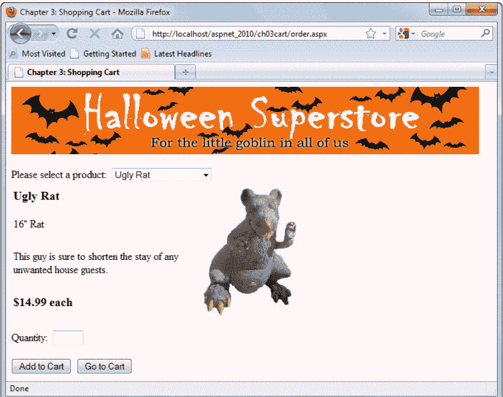

**说明**

- 您可以在 Visual Studio 外部运行任何 IIS 应用程序。为此，请打开要使用的浏览器，如上所示输入应用程序起始页的 URL，然后按 Enter。
- 当您在 Visual Studio 外部运行应用程序时，可以同时在两个或更多浏览器窗口中运行它。这样，您可以确保该应用程序能够处理可能发生的任何*并发错误*。
- 如果您想在测试并发错误时使用调试器，可以在 Visual Studio 内部运行一个带调试的应用程序实例，并在 Visual Studio 外部运行另一个实例。

## 如何使用调试器

以下主题将向您介绍使用 Visual Studio 调试器调试 ASP.NET 应用程序的基本技术。请注意，这些技术与用于调试 Windows 应用程序的技术几乎相同。如果您调试过 Windows 应用程序，那么调试 Web 应用程序应该不会有任何困难。

### 如何使用断点

图 4-7 展示了如何在 ASP.NET 应用程序中使用断点。请注意，您可以在运行应用程序之前或在应用程序执行过程中设置断点。但请记住，应用程序在生成页面后会结束。因此，如果您从浏览器切换到 Visual Studio 来设置断点，则该断点要到下次执行该页面时才会生效。如果您希望断点在第一次执行页面时生效，则需要在运行应用程序之前设置断点。

设置断点并运行应用程序后，应用程序会在执行包含断点的语句之前进入中断模式。例如，在此图中，应用程序将在执行导致图 4-3 中异常的语句之前进入中断模式。然后，您可以使用以下主题中描述的调试功能来调试应用程序。

在某些情况下，您可能希望设置多个断点。您可以在开始执行应用程序之前或在应用程序处于中断模式时进行设置。然后，在运行应用程序时，它将在第一个断点处停止。当您继续执行时，应用程序将执行到下一个断点。

一旦设置了断点，它将保持活动状态，直到您将其移除。实际上，即使在关闭项目后，它也会保持活动状态。如果要移除断点，可以使用此图中介绍的技术之一。


您还可以使用“断点”窗口处理断点。例如，要禁用断点，可以取消断点前面的复选标记。然后，在您重新启用该断点之前，该断点不会生效。您还可以通过选择“断点”窗口中的断点，然后单击此窗口顶部的“转到源代码”按钮，或在“断点”窗口中右键单击断点并从快捷菜单中选择“转到源代码”，来移动到代码编辑器窗口中的断点。

您还可以使用“断点”窗口来标记和筛选断点。您可以使用标签对相关的断点进行分组。要为多个断点分配标签，请在“断点”窗口中选择这些断点，然后右键单击这些断点并选择“编辑标签”以显示“编辑断点标签”对话框。在此对话框中，您可以输入要使用的标签或选择以前创建的标签。

要筛选断点，请从“在列”下拉列表中选择要搜索的列，或使用默认设置搜索所有列。若要仅搜索

**带断点的 Order 页面**


## 如何设置和清除断点

- 若要设置*断点*，请在希望中断的语句左侧的边距指示器栏中单击。该语句将被突出显示，并且边距中将出现一个断点指示符（一个大圆点）。您可以在运行应用程序之前或调试应用程序时设置断点。
- 若要移除断点，请单击断点指示符。若要一次移除所有断点，请使用`调试→删除所有断点`命令。
- 若要禁用所有断点，请使用`调试→禁用所有断点`命令。之后您可以使用`调试→启用所有断点`命令重新启用断点。
- 若要显示*断点*窗口，请使用`调试→窗口→断点`命令或使用“调试”工具栏中最右侧按钮的下拉列表。然后，您可以使用此窗口转到、删除、启用、禁用、标记或筛选断点。

### 说明

- 当 ASP.NET 遇到断点时，它会在执行设置了断点的语句之前进入*中断模式*。从中断模式中，您可以使用调试器来确定错误的原因。
- 您不能在空白行上设置断点。

图 4-7    如何使用断点

Labels 列，例如，从此列表中选择 Labels。然后，在 Search 框中输入搜索文本并按 Enter 键。断点将被过滤，仅显示包含搜索文本的断点。你还可以使用 Delete 和 Enable 或 Disable 按钮删除、启用或禁用已过滤的断点，可以使用 Columns 下拉菜单控制显示的列，并可以使用 Reset 按钮移除过滤。

Visual C# 2010 的 Web Developer Express Edition 支持本章所述的大多数调试功能，但并非全部。例如，Express Edition 中不可用断点窗口。在本章中，如果某个调试功能在 Express Edition 中不可用或与其它版本的工作方式略有不同，我会指出这一点。

## How to use tracepoints

除了断点之外，Visual Studio 还提供了一个名为 *tracepoints* 的功能。Tracepoint 是一种特殊的断点，当遇到它时会执行一个操作。Figure 4-8 显示了 tracepoints 的工作原理。

要设置 tracepoint，你使用 `When Breakpoint Is Hit` 对话框来指示当 tracepoint 被遇到或“命中”时想要执行的操作。在大多数情况下，你将使用 Print a Message 选项在 *Output window* 中显示一条消息。如该对话框所示，消息可以包含变量值、其它表达式以及特殊关键字。

例如，这里显示的消息将包含 `ddlProducts` 控件的 `SelectedValue` 属性的值。你可以在此图中的 Output window 中看到此 tracepoint 的输出。这里，第一个 tracepoint 消息在页面首次请求时显示。第二个消息在从下拉列表中选择产品时显示。第三个消息在输入数量并单击 Add to Cart 按钮时显示。

请注意，Output window 也用于显示 Visual Studio 消息，如此图所示的第一条消息。正因为如此，当你运行应用程序时，此窗口会自动显示。但是，如果你曾经关闭它并且想在不运行应用程序的情况下重新打开它，你可以通过使用 `View➜Output` 命令来做到这一点。

要在使用 tracepoint 时运行宏，你选择 Run a Macro 选项。然后，下拉列表变得可用，你可以从此列表中选择要运行的宏。

默认情况下，程序执行在 tracepoint 操作执行后继续。如果这不是你想要的，你可以取消选中 Continue Execution 选项。然后，程序在 tracepoint 操作完成后将进入中断模式。

在语句上设置 tracepoint 后，该语句将被高亮显示，并在边距中出现断点指示符。如果程序执行将在 tracepoint 操作执行后继续，则指示符将显示为一个大菱形。但是，如果程序将进入中断模式，则使用与标准断点相同的指示符。

## The Order page with a tracepoint and the dialog box used to set it


## Output from the tracepoint in the Output window


### Description

- *tracepoint* 是一种特殊的断点，让你执行一个操作。当 ASP.NET 遇到 tracepoint 时，它会执行指定的操作，然后如果选中了 Continue Execution 选项则继续执行，否则进入中断模式。
- 你通常使用 tracepoints 将消息打印到 *Output window*。消息可以包含文本、值和特殊关键字。你也可以使用 tracepoints 运行宏。
- 要设置 tracepoint，在你想要设置它的语句上右键单击并选择 `Breakpoint→Insert Tracepoint`。然后，填写 `When Breakpoint Is Hit` 对话框并单击 OK。你也可以通过右键单击其指示符并选择 When Hit 将现有断点转换为 tracepoint。
- 如果程序执行将在 tracepoint 操作执行后继续，则 tracepoint 将用如上所示的大菱形标记。否则，它将被标记为与任何其它断点一样。

Figure 4-8 How to use tracepoints

## The Shopping Cart application in break mode


Debugging windows

Pinned data tip

### Description

- 当你进入中断模式时，调试器会高亮显示下一个要执行的语句。
- 你可以使用调试窗口以及 Debug 菜单和工具栏中的按钮来控制程序的执行并确定异常的原因。
- 要在数据提示中显示变量或属性的值，将鼠标指针定位在代码编辑器窗口中的变量或属性上。
- 要在数据提示中显示数组、结构或对象的成员，将鼠标指针定位在其上以显示其数据提示，然后指向数据提示中的加号。
- 要使用数据提示更改属性或变量的值，单击数据提示中的值，然后输入新值。
- 你可以使用数据提示右侧的图标来固定数据提示使其保持显示、取消固定数据提示使其浮动在所有其它打开窗口之上、添加、显示和隐藏数据提示的注释，以及关闭数据提示。
- 你也可以在中断模式下对代码进行更改。这些更改将在你继续程序执行时应用。
- 要继续程序执行，按 F5 或单击 Standard 或 Debug 工具栏中的 Continue 按钮。有关控制程序执行的更多信息，请参阅 figure 4-10

## How to control the execution of an application

一旦进入中断模式，你可以使用各种命令来控制应用程序的执行。这些命令在 figure 4-10 中进行了总结。如你所见，其中大多数命令可从 Debug 菜单或 Debug 工具栏获得，但其中三个命令仅可从代码编辑器窗口的快捷菜单获得。你也可以使用快捷键启动其中一些命令。

要一次执行一个语句，你使用 Step Into 命令。当你使用此命令时，应用程序执行下一条语句，然后返回到中断模式，以便你可以检查属性和变量的值并执行其它调试功能。Step Over 命令与 Step Into 命令类似，但它会不间断地执行被调用方法中的语句（它们被“跳过”）。

Step Out 命令会不间断地执行方法中剩余的语句。当方法结束时，应用程序在调用方法中的下一条语句执行之前进入中断模式。

要跳过你知道工作正常的代码，你可以使用 Run To Cursor 或 Set Next Statement 命令。你也可以使用 Set Next Statement 命令重新运行在异常发生前已执行的代码行。并且，如果你一直在代码编辑器窗口中工作并且忘记了下一个要执行的语句在哪里，你可以使用 Show Next Statement 命令移动到它。

如果你的应用程序被困在处理循环中，以至于无限期地执行而不生成页面，你可以通过选择 `Debug➤Break All` 命令强制其进入中断模式。此命令让你在应用程序执行期间的任何时间进入中断模式。

### Commands in the Debug menu and toolbar

| Command | Toolbar | Keyboard | Function |
|---|---|---|---|
| Start/Continue |  | F5 | Start or continue execution of the application. |
| Break All |  | Ctrl+Alt+Break | Stop execution and enter break mode. |
| Stop Debugging |  | Shift+F5 | Stop debugging and end execution of the application. |
| Restart |  | Ctrl+Shift+F5 | Restart the entire application. |
| Show Next Statement |  |  | Display the next statement to be executed. |
| Step Into |  | F11 | Execute one statement at a time. |
| Step Over |  | F10 | Execute one statement at a time except for called methods. |
| Step Out |  | Shift+F11 | Execute the remaining lines in the current method. |

### Commands in the Code Editor window’s shortcut menu

| Command | Function |
|---|---|
| Run to Cursor | Execute the application until it reaches the statement that contains the insertion point. |
| Set Next Statement | Set the statement that contains the insertion point as the next statement to be executed. |
| Show Next Statement | Move the insertion point to the next statement that will be executed. |

### Description

- 一旦应用程序进入中断模式，你可以使用 Step Into、Step Over、Step Out 和 Run To Cursor 命令执行一个或多个语句并返回到中断模式。
- 要更改应用程序的正常执行顺序，你可以使用 Set Next Statement 命令。只需将插入点放在你想要下一步执行的语句中，发出此命令，然后单击 Continue 按钮以继续应用程序执行。
- 要停止陷入循环的应用程序，切换到 Visual Studio 窗口并使用 `Debug→Break All` 命令。

## 如何使用“自动”、“局部变量”和“监视”窗口监视变量

如果需要查看多个应用程序变量或属性的值，可以使用“自动”、“局部变量”或“监视”窗口来完成。默认情况下，当应用程序进入中断模式时，这些窗口会显示在 IDE 的左下角。如果未显示，可以通过从“调试→窗口”菜单中选择相应的命令来显示它们。请注意，最多可以显示四个独立的“监视”窗口。唯一的例外是如果你使用的是 Web Developer Express Edition，这种情况下只有一个“监视”窗口可用。

“自动”、“局部变量”和“监视”窗口的内容如图 4-11 所示。“自动”窗口与“局部变量”窗口之间的区别在于它们显示的信息量以及信息的范围。

“局部变量”窗口显示当前方法范围内有关变量的信息。如果窗体中的代码当前正在执行，此窗口还包含有关该窗体及窗体上所有控件的信息。

“自动”窗口类似于“局部变量”窗口，但它只显示当前语句和上一条语句中使用的变量的信息。尽管此窗口中的信息可能比“局部变量”窗口中显示的信息更有限，但“自动”窗口有助于你专注于与当前语句相关的变量。

与“自动”和“局部变量”窗口不同，“监视”窗口允许你选择要显示的值。例如，此图所示的“监视”窗口显示了 `txtQuantity` 和 `lblUnitPrice` 控件的 Text 属性、`cartItem` 对象以及存储在 `cart` 变量中的 `CartItemList` 对象的 Count 属性。“监视”窗口还允许你监视指定表达式的值。请注意，表达式不必存在于应用程序中，你就可以将其添加到“监视”窗口。

要将项添加到“监视”窗口，可以直接在“名称”列中键入该项。或者，如果该项出现在代码编辑器窗口中，可以在该窗口中突出显示它，然后将其拖到“监视”窗口。还可以突出显示代码编辑器或数据提示中的项，然后右键单击该项并选择“添加监视”命令，将其添加到当前显示的“监视”窗口中。

除了显示变量和属性的值之外，还可以使用“自动”、“局部变量”和“监视”窗口来更改这些值。为此，只需双击要更改的值并输入新值。然后，你可以继续调试或继续执行应用程序。

## “自动”窗口


## “局部变量”窗口


## “监视”窗口


### 说明

- *“自动”窗口*显示当前语句和上一条语句中变量的信息。
- *“局部变量”窗口*显示当前方法范围内有关变量的信息。
- *“监视”窗口*允许你查看所指定的变量和表达式的值，这些表达式称为*监视表达式*。最多可以显示四个“监视”窗口。
- 若要添加监视表达式，请在“名称”列中键入变量名或表达式，在代码编辑器窗口中突出显示变量或表达式并将其拖到“监视”窗口，或者右键单击代码编辑器窗口中的变量、突出显示的表达式或数据提示，然后选择“添加监视”。
- 若要从“监视”窗口中删除一行，请右键单击该行并选择“删除监视”。若要删除“监视”窗口中的所有行，请右键单击窗口并选择“全选”以选中所有行，然后右键单击并选择“删除监视”。
- 若要显示这些窗口中的任何一个，请单击其选项卡（如果可见），或选择“调试 ➜ 窗口”菜单中的相应命令。
- 若要从这些窗口中的任何一个更改属性或变量的值，请双击“值”列中的值，然后输入新值并按 Enter 键。

图 4-11    如何使用“自动”、“局部变量”和“监视”窗口监视变量

## 如何使用“即时”窗口处理值

*“即时”窗口*如图 4-12 所示，可用于显示未出现在代码编辑器窗口中的变量或属性的值。要显示值，只需键入问号，后跟变量或属性的名称。例如，此图中的第一行代码显示了从“产品”下拉列表中选择的项的 Text 属性。你可以在该窗口的第二行中看到结果。

“即时”窗口还可用于执行 C# 语句。例如，可以执行赋值语句来更改变量或属性的值。例如，在显示“数量”文本框的 Text 属性后，我给该属性赋了值“1”。同样，还可以执行方法。这对于使用不同参数测试方法的结果非常有用。如果执行的方法返回一个值，还可以在方法名前加一个问号，以显示它返回的值。

当你在“即时”窗口中输入命令时，这些命令将在与正在运行的应用程序相同的上下文（或范围）中执行。这意味着无法显示超出范围的变量的值。如果尝试这样做，调试器将显示一条错误消息。

你输入到“即时”窗口中的命令会一直保留在那里，直到退出 Visual Studio 或使用该窗口快捷菜单中的“全部清除”命令显式删除它们。这样，你可以使用标准的 Windows 技术来编辑并重复使用相同的命令，而无需重新输入。

要执行已在“即时”窗口中输入的命令，只需使用向上和向下箭头键滚动浏览这些命令。滚动时，命令会显示在窗口底部。然后，如果需要，可以修改命令并按 Enter 键执行它。

## “即时”窗口


### 说明

- 你可以使用*“即时”窗口*在程序执行期间显示和分配值。若要显示此窗口，请单击“即时窗口”选项卡或使用`调试→窗口→即时`命令。
- 若要在“即时”窗口中显示某值，请输入问号，后跟要显示其值的表达式。然后按 Enter 键。
- 要为变量、属性或对象赋予不同的值，请在“即时”窗口中输入赋值语句。然后按 Enter 键。
- 若要从“即时”窗口执行方法，请输入其名称及所需的任何参数。然后按 Enter 键。如果要显示方法返回的值，请在方法调用前加一个问号。
- 要重新发出命令，请使用向上和向下箭头键在这些命令中滚动，直到找到所需的命令。然后，如果需要，修改该命令并按 Enter 键执行它。
- 要清除“即时”窗口中的所有命令和输出，请使用该窗口快捷菜单中的“全部清除”命令。


## 如何使用 Trace 功能

Trace 功能是 ASP.NET 的一项功能，可显示一些使用调试器无法获得的有用信息。由于调试器运行得很好，你可能不太需要使用 Trace 功能，但至少应该了解它可以提供的信息。

## 如何启用 Trace 功能

要使用 Trace 功能，必须先启用跟踪。为此，请在页面的 `Page` 指令中添加一个 `Trace` 属性，并为该属性赋值为 `True`。然后，当你运行该页面时，跟踪信息将显示在页面输出的末尾，如图 4-13 所示。

当你启用 Trace 功能时，它仅对当前页面启用，这通常是你想要的。要为另一个页面启用跟踪，也必须修改该页面的 `Page` 指令。一旦为页面启用了此功能，只要请求该页面，ASP.NET 就会向该页面添加跟踪输出。

## 如何解释 Trace 输出

在图 4-13 中，你可以看到用户向购物车添加项目后 `Cart` 页面输出开头的内容。在请求详细信息之后，跟踪信息提供应用程序执行时生成的跟踪消息列表。在此，当主要页面事件（如 `PreInit`、`Init` 和 `InitComplete`）发生时，ASP.NET 会自动添加 Begin 和 End 消息。如果向下滚动以查看所有这些跟踪消息，你可以看到页面生命周期内引发的各种事件。

在跟踪消息之后，你会找到有关页面使用的控件、会话状态对象中的项、HTTP 请求中包含的 Cookie、HTTP 请求标头以及服务器变量的信息。例如，在此图中，你可以看到 Shopping Cart 应用程序的 `Cart` 页面的会话状态和 Cookie 数据。在这种情况下，一个名为 `Cart` 的项已被添加到会话状态对象中。一个名为 `ASP.NET_SessionId` 的 Cookie 用于跟踪用户的会话 ID，以便能够检索用户的会话状态对象。

### Cart 页面跟踪输出的开头


### Cart 页面的会话和 Cookie 信息


### 启用 `Cart` 页面跟踪的 `Page` 指令

```
<%@ Page Language="C#" AutoEventWireup="true" CodeFile="Cart.aspx.cs"
Inherits="Cart" Trace="true" %>
```

### 描述

- ASP.NET Trace 功能会跟踪页面的执行，并在该页面的底部显示跟踪信息和其他信息。

- 要为页面激活跟踪功能，请在页面的 asp 文件顶部 `Page` 指令中添加 `Trace` 属性，并将其值设置为 `True`，如上所示。

- 跟踪信息分为多个表，提供特定类型的跟踪信息。例如，Trace Information 表提供有关页面请求如何被处理的的信息，而 Session State 表提供有关当前存储在会话状态中的项目的信息。

图 4-13 如何启用 Trace 功能并解释 Trace 输出

## 如何创建自定义跟踪消息

在某些情况下，您可能希望将自己的消息添加到 Trace 功能生成的跟踪信息中。这可以帮助您跟踪表单方法的执行顺序或方法执行时数据的变化。虽然您也可以通过使用调试器逐步执行表单的方法来进行此类跟踪，但跟踪信息为您提供了消息的静态列表。

请注意，您也可以使用本章前面描述的跟踪点创建此类列表。使用跟踪点的优点是，您可以在不向应用程序添加代码的情况下生成跟踪信息。此外，此输出仅在您使用调试运行应用程序时生成。相比之下，您必须添加程序代码才能添加自定义跟踪消息，并且只要启用了 Trace 功能就会生成跟踪输出。正因为如此，您可能不需要创建自定义跟踪消息。但我在这里包含它，以防您需要。

要将消息添加到跟踪信息中，您使用 `TraceContext` 对象的 `Write` 或 `Warn` 方法。这在图 4-14 中进行了总结。这两种方法之间的唯一区别是，使用 `Warn` 方法创建的消息会以红色显示。请注意，要引用 `TraceContext` 对象，您使用页面的 `Trace` 属性。

当您编写 `Write` 或 `Warn` 方法时，您可以同时包含类别和消息，或仅包含消息。如果仅包含消息，则跟踪输出中的类别列将留空。但是，如果包含类别，则会如图所示显示。在大多数情况下，您会包含类别，因为它可以轻松查看方法执行的顺序。

如果您想在执行 `Write` 或 `Warn` 方法之前确定是否启用了跟踪，您可以使用 `TraceContext` 对象的 `IsEnabled` 属性，如本图中的示例所示。通常，您不会检查 `IsEnabled` 属性，因为只有在启用跟踪时才会执行跟踪语句。

### TraceContext 类的常用成员

| 属性 | 描述 |
| --- | --- |
| `IsEnabled` | 如果为页面启用了跟踪，则为 `True`。 |
| 方法 | 描述 |
| `Write(message)` | 向跟踪输出写入消息。 |
| `Write(category, message)` | 使用指定的类别向跟踪输出写入消息。 |
| `Warn(message)` | 以红色字体向跟踪输出写入消息。 |
| `Warn(category, message)` | 使用指定的类别以红色字体向跟踪输出写入消息。 |

### 写入自定义跟踪消息的代码

```csharp
if (Trace.IsEnabled)
{
    Trace.Write("Page_Load", "Binding products drop-down list.");
}
```

### 包含自定义消息的跟踪的一部分


自定义跟踪消息

### 描述

- 您可以使用 `TraceContext` 对象将自己的消息写入跟踪输出。`TraceContext` 对象可通过页面的 `Trace` 属性获得。

- 使用 `Write` 方法写入基本文本消息。使用 `Warn` 方法以红色字体写入消息。

- 只有在为页面启用跟踪时才会写入跟踪消息。要确定是否启用了跟踪，您使用 `TraceContext` 对象的 `IsEnabled` 属性。

## 如何直接向 HTTP 输出流写入信息

将信息作为程序执行时显示的另一种方法是直接将其写入 HTTP 输出流。为此，您使用 HTTP Response 对象的 `Write` 方法，如图 4-15 所示。使用此技术时，您希望在完成应用程序测试后删除添加的任何语句。

在本图顶部，您可以看到一个包含输出的 `Cart` 页面，该输出指示购物车中当前商品的数量。为了生成此输出，我在页面的 `Page_Load` 方法中添加了 `Response.Write` 方法。如您所见，此方法使用购物车对象的 `Count` 属性来确定购物车中的商品数量。

请注意，您包含在 `Write` 方法中的文本可以包含 HTML 标签。例如，此处显示的 `Write` 方法包含一个 `<br />` 标签，以便在商品计数后跟一个空行。还请注意，您写入输出流的输出始终添加到流的开头。因此，它始终出现在浏览器窗口的顶部。

### 通过 `Response.Write` 生成输出的 `Cart` 页面


### 写入 HTTP 输出流的 `Page_Load` 方法

```csharp
protected void Page_Load(object sender, EventArgs e)
{
    cart = CartItemList.GetCart();
    if (!IsPostBack)
    {
        this.DisplayCart();
        Response.Write("Items in cart = " + cart.Count + "<br />");
    }
}
```

### 从另一个类写入 HTML 输出的代码

```csharp
HttpContext.Current.Response.Write("Now updating file.<br />");
```

### 描述

- `HttpResponse` 对象的 `Write` 方法提供了一种便捷的方式将数据直接写入 HTTP 输出流。输出可以包含任何有效的 HTML。

- 要从网页的代码隐藏文件访问 `HttpResponse` 对象，您使用页面的 `Response` 属性。要从不继承 `Page` 类的类访问此对象，您使用当前请求的 `HttpContext` 对象的 `Response` 属性。要访问此对象，您使用 `HttpContext` 类的 `Current` 属性。

- 使用 `HttpResponse` 对象的 `Write` 方法添加到 HTTP 输出流的 HTML 输出出现在输出流的开头。因此，输出始终出现在浏览器窗口的页面顶部。

图 4-15 如何直接向 HTTP 输出流写入信息

## 观点

正如您现在所了解的，Visual Studio 为调试 ASP.NET 应用程序提供了强大的工具集。对于简单的应用程序，您通常只需使用断点、数据提示和 Autos 窗口即可完成调试。您可能还需要不时逐步执行代码的关键部分。对于复杂的应用程序，您可能会发现需要本章中介绍的其他一些功能。有了这些工具，困难的调试工作变得可以管理。

## 术语

|  |  |  |
| --- | --- | --- |
| 虚拟目录 | 断点 | Immediate 窗口 |
| 浏览位置 | 中断模式 | Autos 窗口 |
| 并发 | 断点窗口 | Locals 窗口 |
| 并发错误 | 跟踪点 | Watch 窗口 |
| 堆栈跟踪 | 输出窗口 | 监视表达式 |
| 调试器 | 数据提示 | Trace 功能 |

## 练习 4-1 使用 Visual Studio 调试器

在本练习中，您将逐步执行在第 3 章练习中开发的购物车应用程序。在此过程中，您将设置断点，使用 Locals 窗口，并使用 Debug 工具栏中的按钮控制程序执行。

1. 在 `aspnet4_cs` 目录中打开 `Ch04Cart` 网站。然后，显示 `Order` 页面的代码，并在调用 `GetSelectedProduct` 方法的语句上设置断点，该语句位于 `Load` 事件处理程序中。

2. 在默认浏览器中运行应用程序。当应用程序进入中断模式时，指向 `IsPostBack` 属性以在数据提示中显示其值。然后，指向数据提示并单击固定图标，以便数据提示保持打开状态。

3. 按 F11 键执行下一条语句。请注意，此语句位于 `GetSelectedProduct` 方法中。再次按 F11 键两次，查看每次只执行一条语句。

4. 单击 Debug 工具栏中的 `Step Out` 按钮，以跳过 `GetSelectedProduct` 方法中的剩余语句。这应该会将您返回到 `Page_Load` 方法。

5. 单击 Debug 工具栏中的 `Continue` 按钮。这应该执行 `Page_Load` 方法中的剩余语句并显示 `Order` 页面。

6. 从组合框中选择另一个产品。这应该导致应用程序再次进入中断模式并在调用 `GetSelectedProduct` 方法的语句上停止。请注意，`IsPostBack` 属性的数据提示仍然显示。

7. 按 F10 键执行“逐过程”命令。这会逐过程执行 `GetSelectedProduct` 方法中的所有语句，并在执行 `Page_Load` 方法中的下一条语句之前进入中断模式。

8. 指向标签的 `Text` 属性以显示这些值。然后，指向所选产品以查看存储在该对象中的值。逐步执行将产品属性赋给标签的 `Text` 属性的语句，并注意 `Text` 属性中的值是如何变化的。

9. 注意“局部变量”窗口中显示的值。单击窗体对象 (`this`) 旁边的加号以展开它并查看可用信息。完成后，单击减号以折叠该对象的信息。

10. 从 `Page_Load` 方法中移除断点。然后，在 `GetSelectedProduct` 方法中给所选产品名称赋值的语句上设置另一个断点，继续执行应用程序，并选择另一个产品。当应用程序再次进入中断模式时，请注意“局部变量”窗口中现在显示的所有变量。这应该包括作用域内的所有变量。

11. 显示一个“监视”窗口。将 `DataViewRow` 对象的 `Name` 列从代码编辑器窗口拖到此窗口中。在“监视”窗口中，它看起来应类似于：`row["Name"].ToString()`。然后，在“监视 1”窗口中输入一个显示 `DataView` 对象的 `Count` 属性的表达式。在“监视”窗口中，它看起来应类似于：`productsTable.Count`。注意 `Count` 属性的值。它应为 1。

12. 在“即时”窗口中输入相同的表达式，并以问号开头。按 Enter 键查看显示的值。它应为 1。

13. 使用“即时”窗口为 `DataViewRow` 对象的 `Name` 列赋予一个新值。在“监视”窗口中检查此属性的值，并注意显示的是新值。

14. 按 F5 继续执行程序。这应显示 `Order` 页面。注意，你在上一步中设置的 `Name` 值显示在 `Order` 页面上。

15. 从组合框中选择另一个产品。这应使应用程序再次进入中断模式。

16. 单击“调试”工具栏中的“停止调试”按钮以结束应用程序。注意，即使你已停止调试，断点仍保留在代码编辑器中。

## 练习 4-2 使用 Trace 功能

在本练习中，你将使用 ASP.NET 的 Trace 功能，在第 3 章练习中创建的 Shopping Cart 应用程序的 `Order` 页面上显示跟踪输出。

1. 如果 `Ch04Cart` 网站尚未打开，请将其打开。

2. 在 Web 窗体设计器中显示 `Order` 页面，并切换到源视图。然后，通过向 `Page` 指令添加 `Trace` 属性来为页面启用跟踪，如图 4-13 所示。

3. 运行应用程序，注意跟踪输出显示在 `Order` 页面上的控件下方。

4. 查看跟踪信息。特别是，查看会话状态信息。完成后，结束应用程序。

5. 向 `GetSelectedProduct` 方法添加一条自定义跟踪消息，指示此方法已创建新的 `Product` 对象。使用方法名作为此消息的类别。如果需要帮助，可以参考图 4-14。

6. 向 `btnAdd_Click` 方法添加一条自定义跟踪消息，指示产品已添加到购物车。使用方法名作为此消息的类别。另外，注释掉显示 `Cart` 页面的语句。否则，你将无法看到此跟踪消息。

7. 运行应用程序以查看显示的消息。然后，单击“Add to Cart”按钮，查看这次显示的消息。

8. 结束应用程序。然后，关闭并保存项目。

## 练习 4-3 使用 IIS 和其他浏览器测试 Shopping Cart 应用程序

在本练习中，你将第 3 章练习中创建的 Shopping Cart 应用程序创建为本地 IIS 站点，并使用除 Microsoft 的 Internet Explorer 之外的其他浏览器来测试此应用程序。

1. 如果你的系统未安装 IIS，请按照附录 A 的图 A-2（Windows 7 和 Windows Vista）或图 A-3（Windows XP）中的说明进行安装。

2. 按照图 4-4 中的说明，为 Shopping Cart 应用程序创建本地 IIS 站点。在“选择位置”对话框中，单击“本地 IIS”按钮，然后选择“默认网站”节点。接下来，单击“创建新虚拟目录”按钮，并输入 `Ch04Cart` 作为指向 `C:\aspnet4_cs\Ch04Cart` 目录中网站的别名。这是你在第 3 章练习中创建的网站。

3. 在“网站已存在”对话框中，选择“打开现有网站”选项。然后，将 `Order` 页面设置为起始页。

4. 按照图 4-1 中的说明，使用默认浏览器测试应用程序。你可以判断网站使用的是 IIS 而不是 ASP.NET 开发服务器，因为 URL 中未指定端口。

5. 如果你可以使用默认浏览器以外的浏览器，请按照图 4-2 中的说明，使用该浏览器测试 Shopping Cart 应用程序。完成后，结束应用程序并关闭项目。

6. 从 Visual Studio 外部启动浏览器，并按照图 4-6 中的说明运行 Shopping Cart 应用程序。完成后，关闭浏览器。

## HTML 和 CSS 快速入门

如你所知，Web 窗体由 HTML 和 `asp` 标签定义，你将在本书中学习如何编写 `asp` 标签。虽然本书并非旨在教你 HTML，但你需要了解一些编写 HTML 的基本技能，以便将其与 ASP.NET 一起使用。当你使用 HTML 定义网页的内容和结构，并使用 CSS（层叠样式表）格式化页面时，这一点尤其重要。这是专业人士用来定义网页的技术，也是你将在本章中学到的技术。

如果你已经知道如何编写 HTML 和 CSS，你应该能够快速浏览本章。但是，你不应完全跳过本章，因为它介绍了一些 Visual Studio .NET 特有的技能。

- HTML 简介 ......................................................... 162
- HTML 元素编码的基本规则 ............................................ 162
- 如何使用 Visual Studio 处理 HTML ....................................... 164
- Web 服务器控件的呈现方式 ............................................. 166
- 如何编写 HTML 文档 ..................................................... 168
- HTML 文档的基本结构 ................................................. 168
- `Page` 指令 ................................................................ 170
- `Doctype` 声明 ........................................................... 170
- 如何编写块级元素 ....................................................... 172


- 如何编写内联元素 ...................................................... 174
- 使用 CSS 的基本技能 .................................................... 176
- 如何在网页中包含 CSS ................................................ 176
- 如何编写 CSS 规则集和注释 ......................................... 178
- 如何为元素、ID 和类编写选择器 ............................. 180
- 使用 CSS 的 Future Value 页面 ................................................ 182
- Future Value 表单的 `aspx` 代码 .......................................... 184
- Future Value 表单的 CSS ................................................ 186
- Visual Studio 中用于处理 CSS 的功能 ..................................... 190
- 如何在设计视图中处理样式 ........................................ 190
- 如何添加样式规则 .................................................... 192
- 如何创建和编辑外部样式表 ......................................... 194
- 如何使用“应用样式”窗口 ............................................... 196
- 如何使用“CSS 属性”窗口 ............................................ 198
- 如何使用“管理样式”窗口 ............................................. 200
- 前景展望 ......................................................................... 202

## HTML 简介

*HTML 文档* 由 *HTML 元素* 组成，这些元素定义了页面的内容和结构。在接下来的主题中，你将学习编码 HTML 元素的规则，你将学习如何使用 Visual Studio 工作，以及一些基本的 Web 服务器控件是如何渲染为 HTML 的。

## 编码 HTML 元素的规则

图 5-1 展示了编码 HTML 元素的基本规则。首先，每个 HTML 元素都编码在以左括号 (<) 开始并以右括号 (>) 结束的标签中。例如，`<title>`、`</h1>` 和 `<br />` 都是 HTML 标签的例子。

大多数 HTML 元素由三部分组成。首先，*开始标签* 标记元素的开始。开始标签由元素名称（例如 `title` 或 `h1`）加上一个或多个可选的 *属性*（例如 `id` 或 `class`）组成，这些属性为标签提供额外信息。开始标签之后是 *内容*，即构成元素的文本或其他数据。内容之后是标记元素结束的 *结束标签*。结束标签由斜杠后跟元素名称组成。这由本图中的第一个示例中的三行代码说明。

重要的是要认识到，元素的内容可以包含其他元素。例如，考虑以下 HTML 代码：

```
<h1>This is a <b>bold</b>heading</h1>
```

这里，`h1` 元素包含文本“This is a bold heading”。在此文本中，`b` 元素表示单词“bold”应加粗。你将在本章后面学习这些和其他格式元素。

并非所有 HTML 元素都有内容和结束标签。这些标签被称为 *自闭合标签*。例如，图中的第二个示例中显示的 `<br />` 元素就是一个自闭合标签，用于插入换行符。

请注意，本图中显示的所有标签都是小写的。这是 XHTML 版本 1.0 标准的强制要求。虽然 ASP.NET 网页目前使用允许大写标签的 XHTML 版本 1.0 Transitional，但你最好使用小写标签，这样将来就不需要更改你的 HTML 了。

还请注意 `<br />` 标签在闭合括号前包含一个斜杠。虽然这些斜杠在早期的 HTML 标准中是可选的，但在 XHTML 版本 1.0 中是必需的。因此，你希望在代码中包含它们。

你也可以在 HTML 文档中编码 *注释*，如本图中的第三个示例所示。这样，你就可以记录可能令人困惑的代码部分。此外，你可以使用空格、缩进和空行使代码更易读。这称为 *空白*，Web 浏览器会忽略它。

如果你想在浏览器不忽略的行中包含空格，可以使用特殊代码 `&nbsp;`，如图 5-1 中的最后一个示例所示。这只是你可以用来在 HTML 中显示特殊字符的 *字符实体* 之一。本章后面我将介绍一个使用另外两个字符实体的示例。在该示例中，你会看到每个字符实体都以和号（`&`）开始，以分号（`;`）结束。

## 如何使用 Visual Studio 工作于 HTML

在第 2 章中，你学习了如何通过将 ASP.NET 控件拖到 Web 窗体设计器的设计表面上来创建简单的 Web 表单。你还学习了从源视图修改窗体设计的一些基本技能。现在，图 5-2 回顾了一些这些技能，并介绍了在源视图中工作的一些额外技能。

当你在源视图中显示 Web 表单时，你会注意到 Visual Studio 使用不同的颜色来标识各种信息项。例如，元素名称以栗色显示，属性名称以红色显示，属性值以蓝色显示。Visual Studio 还通过用红色波浪线下划线使语法错误易于定位。

Visual Studio 还提供了帮助你输入和编辑 HTML 代码的工具。其中最有用的是语句完成功能。使用此功能，在你输入开始标签的左括号时，会显示可用元素的列表。然后，你可以从此列表中选择要添加的元素并按 Tab 或 Enter 键将元素名称添加到文档中。

在你输入元素名称后跟一个空格后，Visual Studio 会显示该元素的可用属性列表。在此图中，例如，你可以看到为 `p` 元素显示的属性列表。要添加属性，只需从列表中选择它并按 Tab 或 Enter 键。然后，你可以键入等号并为属性输入值。输入值时，请确保用引号括起来，否则会出现语法错误。要输入其他属性，键入一个空格以重新显示列表。当你完成为元素输入属性后，输入其闭合括号。然后，如果该元素有结束标签，则会自动添加。

你也可以使用代码片段输入 HTML 元素。这与输入 ASP.NET 元素的方式相同。有关更多信息，请参阅第 2 章中的图 2-13。

当你在源视图中进行更改时，你经常希望在设计视图中检查这些更改的结果。一种方法是在这两个视图之间切换。另一种方法是使用拆分视图。正如你在第 2 章中所学，拆分视图让你同时看到设计视图和源视图。

## Web 服务器控件如何被渲染

在 Web 页面可以在浏览器中显示之前，它包含的任何 Web 服务器控件都必须渲染为标准 HTML。为了帮助你理解其工作原理，图 5-3 列出了一些常见的 Web 服务器控件并描述了它们被渲染为的 HTML 元素。

如果你回顾用于实现本图中控件的 HTML 元素，你会看到同一个元素可用于实现多个控件。例如，文本框、按钮和图像按钮控件都由 `Input` 元素实现。这些控件的外观和行为不同的原因是它们的属性设置不同。在这种情况下，`Type` 属性指示要渲染的输入控件的类型。例如，文本框的 `Type` 属性设置为`"text"`，按钮的 `Type` 属性设置为`"submit"`，图像按钮的 `Type` 属性设置为`"image"`。因此，浏览器会以不同的方式处理这些控件。

为了让你更好地了解 Web 服务器控件如何被渲染，本图还显示了四个 Web 服务器控件的 `aspx` 代码以及为这些控件渲染的 HTML 代码。如果你比较 `aspx` 和 HTML 代码，你应该很快就能看出它们之间的关系。当然，为控件生成的 HTML 取决于你如何设置其属性。你将在下一章中了解可为各种 Web 服务器控件设置的属性。

在继续之前，我想让你注意本示例中控件的一些属性如何包含在渲染的 HTML 的 `style` 属性中。例如，标签控件的 `Font-Bold` 和 `Font-Size` 属性被渲染为 `span` 元素的 `style` 属性。包含在元素 HTML 中的样式称为内联样式，你将在本章后面了解更多关于它们的信息。

现在，我只想让你意识到，当 HTML 元素包含内联样式时，它们会与页面的其他信息一起在客户端和服务器之间传递。因为这可能效率低下，所以你希望避免使用被渲染为内联样式的控件属性。一般来说，这些是影响控件外观的属性。本章后面你将学习如何在不使用内联样式的情况下更改控件的外观。

### 一些常见的 Web 服务器控件及其渲染方式

| 名称 | HTML 元素 | 附加信息 |
|---|---|---|
| `Label` | `<span>` | `<span>` 元素通常用于对所包含的文本应用特殊格式。 |
| `TextBox` | `<input>` | `type="text"` 属性将此元素标识为文本框。 |
| `Button` | `<input>` | `type="submit"` 属性将此元素标识为按钮。 |
| `ImageButton` | `<input>` | `type="image"` 属性将此元素标识为图像按钮。 |
| `LinkButton` | `<a>` | 此控件被渲染为 `Anchor` 元素，其 `href` 属性指向在 JavaScript 中生成的函数，该函数将页面回发到服务器。 |
| `HyperLink` | `<a>` | 此控件被渲染为链接到另一个 URL 的 `Anchor` 元素。 |
| `ListBox` | `<select>` | 列表中的每个项目均由 `<select>` 元素内的 `<option>` 元素定义。 |
| `DropDownList` | `<select>` | 列表中的每个项目均由 `<select>` 元素内的 `<option>` 元素定义。 |
| `Image` | `` | 显示指定的图像。 |

### 四个 Web 服务器控件的 `aspx` 代码

```
<asp:Label ID="lblName" runat="server" Font-Bold="True" Font-Size="Larger" Text="Murach Books"></asp:Label>
<asp:TextBox ID="txtSearch" runat="server" Width="248px"></asp:TextBox>
<asp:Button ID="btnSearch" runat="server" Text="Search" />
<asp:ListBox ID="lstBooks" runat="server">
  <asp:ListItem Value="A4VB">ASP.NET 4 with VB 2010</asp:ListItem>
  <asp:ListItem Value="VB10">Visual Basic 2010</asp:ListItem>
  <asp:ListItem Value="SQL8">SQL Server 2008</asp:ListItem>
</asp:ListBox>
```

### 四个 Web 服务器控件在 HTML 中的渲染方式

```
<span id="lblName" style="font-size:Larger;font-weight:bold;">Murach Books</span>
<input name="txtSearch" type="text" id="txtSearch" style="width:248px;" />
<input type="submit" name="btnSearch" value="Search" id="btnSearch" />
<select size="4" name="lstBooks" id="lstBooks">
  <option value="A4VB">ASP.NET 4 with VB 2010</option>
  <option value="VB10">Visual Basic 2010</option>
  <option value="SQL8">SQL Server 2008</option>
</select>
```

### 描述

- 所有 Web 服务器控件都作为标准 HTML *rendered*，可由浏览器解释。

- 要查看网页渲染的 HTML，请从浏览器窗口中选择 View→Source 命令。HTML 将在单独的记事本窗口中显示。

## 如何编码 HTML 文档

每个用于 Web 表单的 HTML 文档都必须以某种方式结构化，以便 ASP.NET 能够正确解释它。在接下来的主题中，你将了解 HTML 文档的基本结构。你还将了解在 HTML 文档中出现的两种基本类型的元素如何编码。

### HTML 文档的基本结构

图 5-4 显示了为新的 ASP.NET 网页生成的代码。此代码说明了 HTML 文档的整体结构。因为构成此结构的`<|message|>` 元素是自动为你生成的，所以你不必担心自己编码它们。

第一个元素是 ASP.NET `Page` 指令。此指令提供了 ASP.NET 处理 Web 表单所需的信息。你将在下一张图中了解有关此指令的更多信息。

`Page` 指令后面跟着一个 HTML `Doctype` 声明。此声明提供了浏览器显示页面所需的信息。你将在下一张图中了解有关此元素的更多信息。

在 `Page` 指令和 `Doctype` 声明之后是一个 `html` 元素。此元素称为 *root element*，包含文档其余的所有元素。在 XHTML 1.0 标准之前，`html` 元素的开始和结束标签是可选的。因此，你有时会看到没有 `<html>` 和 `</html>` 标签的 HTML 文档。

在 `html` 部分内，HTML 文档包含另外两个部分：文档头和文档体。文档头由 `head` 元素定义，包含有关文档的信息。如图所示，它默认包含的一个元素是 `title` 元素。此元素的值决定了在浏览器窗口标题栏中显示的内容。本章后面，你将了解可以添加到 `head` 元素的另外两个元素。

文档体由 `body` 元素定义，包含在浏览器中查看文档时显示的 HTML 内容。对于 Web 表单，文档体由一个 `form` 元素和一个或多个 `div` 元素组成。如你在前几章中看到的，默认生成的 `div` 元素包含表单的所有 `asp` 和 HTML 元素。此 `div` 元素还可以包含你定义的额外 `div` 元素。当你使用 CSS 格式化 Web 表单时，这很常见。

因为 `head` 和 `body` 元素包含在 `html` 元素内，所以 `html` 元素称为 *parent element*，而 `head` 和 `body` 元素称为 *child elements*。`body` 元素也是一个父元素，因为它包含一个 `form` 元素。而 `form` 元素也是一个父元素，因为它包含一个 `div` 元素。

#### 为新的 ASP.NET 网页生成的代码

```
<%@ Page Language="C#" AutoEventWireup="true" CodeFile="Cart.aspx.cs" Inherits="Cart" %>

<!DOCTYPE html PUBLIC "-//W3C//DTD XHTML 1.0 Transitional//EN" "http://www.w3.org/TR/xhtml1/DTD/xhtml1-transitional.dtd">

<html xmlns="http://www.w3.org/1999/xhtml">
<head runat="server">
<title></title>
</head>
<body>
<form id="form1" runat="server">
<div>

</div>
</form>
</body>
</html>
```

#### 为新页面生成的 HTML 元素

| 元素 | 开始标签 | 结束标签 | 描述 |
|---|---|---|---|
| `Doctype` declaration | `<!DOCTYPE ...>` |  | 标识 HTML 文档的类型。详见图 5-5。 |
| `html` element | `<html>` | `</html>` | 标记 HTML 文档的开始和结束。 |
| `head` element | `<head>` | `</head>` | 标记文档头的开始和结束。 |
| `title` element | `<title>` | `</title>` | 为页面提供标题。 |
| `body` element | `<body>` | `</body>` | 标记文档体的开始和结束。 |
| `form` element | `<form>` | `</form>` | 标记表单的开始和结束。 |
| `div` element | `<div>` | `</div>` | 标记表单内某个分区的开始和结束。 |

#### 描述

- `html` 元素包含文档的内容。此元素称为 *root element*，因为它包含文档中的所有其他元素。在此元素内，你编码 `head` 和 `body` 元素。

- `body` 元素包含定义表单的 `form` 元素。

- `form` 元素包含一个 `div` 元素，用于提供适用于整个页面的格式。你在 Web Forms Designer 中添加到页面的任何元素都应插入此 `div` 元素内。你还可以在外部 `div` 元素内添加额外的 `div` 元素，以将页面内容划分为更小的分区。

- 包含在另一个元素内的元素称为 *child element*。包含子元素的元素称为子元素的 *parent element*。

- 除了 HTML 元素外，还会生成一个 `Page` 指令。此指令为网页提供各种选项。详见图 5-5。

#### 一个典型的 `Page` 指令

```
<%@ Page Language="C#" AutoEventWireup="true" CodeFile="Cart.aspx.cs" Inherits="Cart" %>
```

#### `Page` 指令的常见属性

| 属性 | 描述 |


|---|---|

| Language | 指定用于实现页面处理的语言。对于 C# 应用程序，此属性设置为 C#。 |

| AutoEventWireup | 指示页面事件处理程序是否会在页面事件发生时自动调用（True），或是否必须将事件处理程序绑定到这些事件（False）。对于 C# 应用程序，Visual Studio 在创建 Web 表单时将此属性设置为 True。 |

| CodeFile | 指定代码隐藏文件的名称。此文件定义了与 ASP.NET 在运行时从页面生成的部分类一起编译的部分类。 |

| Inherits | 指定页面在运行时继承的编译类（dll）的名称。此名称通常与 CodeFile 属性中定义的部分类名称相同。 |

| Trace | 指示是否启用跟踪。默认值为 False。 |

## 一个典型的 Doctype 声明

```
<!DOCTYPE html PUBLIC "-//W3C//DTD XHTML 1.0 Transitional//EN" "http://www.w3.org/TR/xhtml1/DTD/xhtml1-transitional.dtd">
```

## 描述

- `Page` 指令在页面编译时由 ASP.NET 处理。它不包含在发送到浏览器的输出中。
- Doctype 声明指定文档的根元素——即 Doctype 声明之后第一个元素——是一个 HTML 元素。
- Doctype 声明的 Public 属性及其后面的字符串指定文档所符合的 HTML 版本。

## 如何编码块级元素

你使用*块级元素*来定义网页表单的主要结构。图5-6列出了最常见的块级元素。每个元素在浏览器中显示时都从新行开始。

我已经提到过 `div` 元素。你用它来将表单划分为逻辑分区。这里显示的其他块级元素用于显示各种级别的标题和标准段落。

如果你回顾本图中的示例，就不难理解这些元素的工作方式。这里，你可以看到文档的内容被结构化为三个分区。第一个分区包含整个网页，并且被划分为另外两个分区：一个用于网页的主要部分，一个用于页脚。请注意，这些分区中的每一个都有一个 `id` 属性。你可以使用此属性从 CSS 中引用这些分区，如本章后面所示。

除了 `div` 元素之外，此 HTML 还使用 `h1`、`h2` 和 `p` 元素来生成显示的文本。当这些元素由浏览器显示时，每个元素都有一个默认的字体和大小，由浏览器的基本字体决定。此基本字体通常是 16 像素的 Times New Roman。

尽管你可能认为会使用 `h1` 到 `h6` 元素来格式化标题，但事实并非如此。相反，你应该使用它们为文档提供逻辑结构。例如，本图中的 `h1` 元素用于标记页面上最重要的标题，而 `h2` 元素用于标记第二重要的标题。然后，你可以使用 CSS 来调整这些元素中文本的大小和格式。

## 常见的块级元素

| Element | Description |

|---|---|

| div | 让你将页面结构化为可以用 CSS 格式化和定位的逻辑分区。此元素可以包含文本、内联元素和其他块级元素。 |

| h1 | 创建一级标题，内容以基本字体大小的 200% 加粗显示。 |

| h2 | 创建二级标题，内容以基本字体大小的 150% 加粗显示。 |

| h3 | 创建三级标题，内容以基本字体大小的 117% 加粗显示。 |

| h4 | 创建四级标题，内容以基本字体大小的 100% 加粗显示。 |

| h5 | 创建五级标题，内容以基本字体大小的 83% 加粗显示。 |

| h6 | 创建六级标题，内容以基本字体大小的 67% 加粗显示。 |

| p | 创建段落文本，大小为基本字体大小的 100%。 |

## 一个使用块级元素的页面

```
<div id="page">
    <div id="main">
        <h1>Murach Books</h1>
        <h2>New! HTML, XHTML, and CSS</h2>
        <p>This book teaches you how to develop web pages the professional way, using HTML/XHTML to provide the content and structure of the elements on a page and CSS to format and lay out those elements.</p>
    </div>
    <div id="footer">
        <p>&copy; Copyright 2010 Mike Murach &amp; Associates, Inc.</p>
    </div>
</div>
```

## 在网页浏览器中显示的页面


## 描述

- *块级元素*是网站的主要构建块，可以包含其他元素。每个块级元素都从新行开始。
- 你可以使用 `div` 元素在文档主体内定义分区。这有助于指示页面的整体结构。
- 标题和段落的基本字体和字体大小由浏览器决定。你可以使用 CSS 更改这些值。

## 如何编码内联元素

与块级元素不同，*内联元素*不会从新行开始。相反，内联元素出现在块级元素内。图5-7介绍了最常见的内联元素以及如何使用它们。

本图的第一个表格列出了用于格式化文本的一些内联元素。然后，前六个示例向你展示了如何使用这些元素中的一些。请注意，每个内联元素都编码在块级元素内，在此例中为 `p` 元素。此外，除了 `br` 元素外，每个元素都有开始标签和结束标签。然后，对这两个标签之间的内容应用适当的格式。

当你回顾这些元素时，你会注意到 `i` 和 `em` 元素都会使内容以斜体显示。同样，`b` 和 `strong` 元素都会使内容以粗体显示。区别在于 `i` 和 `b` 元素不对内容赋予任何含义；它们只是应用格式。相比之下，`em` 元素表示内容应被强调，而 `strong` 元素表示内容应被强烈强调。

因此，你只有在不需要为内容关联任何含义时才应使用 `i` 和 `b`。在本图中，例如，`i` 元素用于将术语“Hypertext Markup Language”斜体化，但 `em` 元素用于强调词语“you won’t pass the class”。`b` 和 `strong` 元素的示例类似。

请注意，自从 CSS 出现以来，`i` 和 `b` 元素的使用方式已经改变。以前，这些元素通常用于应用格式。现在，更常见的做法是使用 `em` 和 `strong`，并使用 CSS 应用适当的格式。

如你所知，第一个表格中的最后一个元素 `br` 会强制换行。但是，请注意，你不应使用此元素在块级元素之间提供空间；你的 CSS 应该负责这一点。相反，你应该只在块级元素内强制换行时使用它。例如，在本图的第六段中，`br` 元素用于在两行诗之间强制换行。

本图的第二个表格列出了用于结构化文本的内联元素。`span` 元素标识块级元素内的文本，如本图最后一个示例所示。然后，你可以从 CSS 中引用 `span` 元素以格式化其包含的文本。

## 用于格式化文本的常见内联元素

| Element | Description |

|---|---|

| `i` | 以斜体显示内容。 |

| `em` | 表示内容应通过斜体显示来强调。 |

| `b` | 以粗体显示内容。 |

| `strong` | 表示内容应通过粗体显示来强烈强调。 |

| `code` | 以等宽字体显示内容。 |

| `sub` | 以下标显示内容。 |

| `sup` | 以上标显示内容。 |

| `br` | 开始新行文本。 |

## 用于结构化文本的内联元素

| Element | Description |

|---|---|

| `span` | 让你标识可以用 CSS 格式化的文本。 |

## 一个使用内联元素的页面

```
```html

<p>If you don't get 78% on your final, <em>you won't pass the class.</em></p>

<p>Save a bundle at our <strong>big yearend sale</strong>.</p>

<p>HTML stands for <i>Hypertext Markup Language</i>.</p>

<p>Please be sure to boldface <b>Murach</b> in the company logo.</p>

<p>Your payment is due on the 4<sup>th</sup> of each month.</p>

<p>"To sleep, perchance to dream—<br />ay, there's the rub."</p>

<p><span id="hurry">Hurry!</span>The sale ends tomorrow.</p>

```
```

## 在网页浏览器中显示的页面


## 描述

- *内联元素*编码在块级元素内且不会从新行开始。许多内联元素，例如上面第一个表格中的元素，用于格式化文本。
- `span` 元素也可以用于格式化文本。但是，该格式是使用 CSS 指定的。

图 5-7    如何编码内联元素

## 使用 CSS 的基本技能

直到最近，大多数 HTML 文档都是这样编码的：HTML 不仅定义了网页的内容和结构，还定义了该内容的格式。然而，这种结构元素和格式元素的混合使得编辑、维护和重新格式化页面变得困难。

今天，层叠样式表（CSS）让你可以将格式与网页的内容和结构分离。因此，大多数曾经在 HTML 中完成的格式现在应该在 CSS 中完成。请注意，除了 CSS 之外，你还可以使用 ASP.NET 的一个功能 `skins` 来为 Web 服务器控件应用格式。如你在第 11 章中将学到的，你可以将样式表和 `skins` 一起存储在主题中。

## 如何在网页中包含 CSS

将样式表应用于 HTML 文档的最佳方式是在一个名为外部样式表 的单独文件中编码样式。当你这样做时，你必须指示每个页面应使用哪个样式表。为此，你在 `head` 元素内编码 `link` 元素，如图 5-8 中的第一个示例所示。

在 `link` 元素上，你编码三个属性。对于样式表，`rel` 和 `type` 属性应始终如图所示进行编码。然后，`href` 属性指定样式表的 URL。在此示例中，样式表存储在与项目其他文件相同的目录中，因此 URL 只是文件名。请注意，样式表必须具有 `.css` 文件扩展名。

与其手动输入样式表的 `link` 元素，你可以让 Visual Studio 为你生成它。你可以从设计视图或源视图中执行此操作，如本图所示。这被称为附加样式表。

尽管不推荐，但你也可以使用内部样式表和内联样式将样式嵌入到 HTML 文档中，如本图所示的第二组示例所示。当你使用内部样式表时，CSS 规则集编码在 `style` 元素中。例如，此组中的第一个示例中的内部样式表包含 `h1` 元素的规则集。你将在下一张图中了解更多关于规则集的信息。

当你使用内联样式时，你为 HTML 元素编码 `style` 属性，其值包含适用于该元素的所有 CSS 声明。例如，此组中的第二个示例中的内联样式将两个 CSS 声明应用于 `span` 元素。你将在下一张图中了解更多关于声明的信息。

如果你确实使用内部样式表或内联样式，则嵌入式样式表中的样式会覆盖外部样式表中的样式，而内联样式会覆盖内部样式表中的样式。例如，如果你编码本图中的内部样式表，则 `h1` 元素的声明将覆盖外部样式表中的声明。

请记住，使用外部样式表是最佳实践。当你使用它们时，CSS 声明位于单独的 CSS 文件中，这将分离

## 如何包含外部样式表

```
<head runat="server">
    <title>Chapter 5: Future Value</title>
    <link href="Main.css" rel="stylesheet" type="text/css" />
</head>
```

## 如何将样式嵌入到HTML文档中（不推荐）

### 在style元素中包含样式表

```
<head runat="server">
    <title>Chapter 5: Future Value</title>
    <style type="text/css">
        h1 {
            color: blue;
            font-size: 16pt;
        }
    </style>
</head>
```

### 使用内联元素的style属性

```
<span style="color: red; font-size: 14pt;">Warning!</span>
```

## 使用两个样式表的网页部分

```
<head runat="server">
    <title>Chapter 5: Shopping Cart</title>
    <link href="Styles/Main.css" rel="stylesheet" type="text/css" />
    <link href="Styles/Order.css" rel="stylesheet" type="text/css" />
</head>
```

## 说明

- 只要可能，最佳实践是使用*外部样式表*。为此，你需要在 `head` 元素中编码一个 `link` 元素。
- 当你为外部 CSS 文件指定相对 URL 时，该 URL 是相对于当前文件的。
- 你可以在单个页面中包含两个或更多外部样式表。然后，第一个样式表中的样式首先应用，接着是第二个样式表中的样式，以此类推。
- 创建外部样式表后，你可以在页面的设计视图中为其生成 `link` 元素。为此，选择“格式→附加样式表”命令，然后在显示的“选择样式表”对话框中选择样式表。
- 你也可以在源视图中通过将样式表从解决方案资源管理器拖到页面的 `head` 元素来生成 `link` 元素。
- 如果使用内部样式表，样式会出现在文档 `head` 部分的 `style` 元素中。
- 如果使用内联样式，样式会出现在应用这些样式的内联元素的 `style` 属性中。

## CSS规则集的组成部分


## 一个简单的样式表

```
/* Adjust the styles for the body */
body {
    background-color: #F5F5F5;
}

/* Adjust the styles for the headings */
h1 {
    color: #FF0000;
}
h2 {
    font-style: italic;
    color: #00008B;
    border-bottom: 3px solid #00008B;
}

/* Adjust the styles for the paragraphs */
p {
    text-indent: 2em;
    margin-top: 0;
    margin-bottom: 5px;
}
```

## 说明

- 一个 CSS 规则集由一个选择器和一个声明块组成。在 Visual Studio 中，规则集被称为样式规则。
- CSS 选择器由编码在规则集开头的标识符组成。
- CSS 声明块由一个左大括号、零个或多个声明以及一个右大括号组成。
- CSS 声明由一个属性、一个冒号、一个值和一个分号组成。虽然块中最后一个声明的分号是可选的，但最佳实践是编写它。
- 为了使代码更易于阅读，你可以在规则集内使用空格、缩进和空行。
- CSS 注释以 `/*` 字符开始，以 `*/` 字符结束。CSS 注释可以写在单行上，也可以跨越多行。
- Visual Studio 提供了生成规则集的功能。详情见图5-15。

## 如何为元素、ID和类编写选择器

规则集的选择器标识了规则应应用于的 HTML 元素。为了更好地理解这一点，图5-10展示了如何使用 CSS 规则集的三种基本选择器：元素选择器、ID 选择器和类选择器。

*元素选择器*标识诸如 `body`、`h1` 或 `p` 元素之类的 HTML 元素。例如，第一个示例中的选择器应用于此图顶部 HTML 中显示的 `h2` 元素。此规则集内的第一条规则将字体设置为 Arial（如果有的话），否则设置为通用无衬线字体。然后，第二条规则将 `h2` 元素上方的边距设置为 5 像素，第三条规则将 `h2` 元素下方的边距设置为零。

*ID 选择器*以井号（`#`）开头，应用于由 `id` 属性标识的单个 HTML 元素。例如，`#main` 应用于具有值为“main”的 `id` 属性的 HTML 元素。正如你所见，那是 HTML 代码中的第一个 `div` 元素。在该规则集内，第一条规则在 `div` 周围添加两像素宽的黑色实线边框；第二条规则在边框外放置 10 像素的外边距；第三条规则在边框和 `div` 内容之间放置 10 像素的内边距。

*类选择器*以句点（`.`）开头，应用于所有由具有指定值的 `class` 属性标识的 HTML 元素。例如，`.copyright` 应用于所有具有值为 `copyright` 的 `class` 属性的元素。这里，唯一分配给该类的元素是 `footer` `div` 中的段落。然后，该规则集中的规则将段落中的文本右对齐，并将字体大小减小到基础字体大小的 80%。

请注意，因为在此图的示例中 `copyright` 类只使用了一次，所以我可以使用 ID 选择器而不是类选择器。事实上，通常只有在需要对多个元素应用格式时才会使用类选择器。我在这里使用类选择器只是为了说明它们的工作方式。

虽然此图仅展示了如何将规则集用于 HTML 元素，但你也可以将 ID 和类选择器的规则集用于服务器控件。要为服务器控件编写 ID 选择器，你编写一个井号，后跟控件 `id` 属性的值，就像对 HTML 元素所做的那样。服务器控件的类选择器类似于 HTML 元素的类选择器，只是类名必须编写在控件的 `CssClass` 属性上。这是因为服务器控件没有 `class` 属性。你将在接下来介绍的应用中看到 `CssClass` 属性的使用方式。


需要注意的是，你为服务器控件指定的样式会应用于渲染后的HTML。例如，假设我想对下拉列表应用样式。一种方法是根据控件的`ID`或`CssClass`值为其编写规则集。另一种方法是为`select`元素编写规则集，因为下拉列表会渲染为`select`元素。虽然通常不需要这样做，但在下一章中你会看到一个可能很有用的示例。

## 可以通过元素、ID或类选择的HTML

```
<div id="main">
  <h2>New! HTML, XHTML, and CSS</h2>
  <p>This book teaches you how to develop web pages the professional way, using HTML/XHTML to provide the content and structure of the elements on a page and CSS to format and lay out those elements.</p>
</div>
<div id="footer">
  <p class="copyright">&copy; Copyright 2010 Mike Murach &amp; Associates, Inc.</p>
</div>
```

## 按元素、ID和类选择的CSS规则集

### 元素

```
h2 {
  font-family: Arial, sans-serif;
  margin-top: 5px;
  margin-bottom: 0;
}
```

### ID

```
#main {
  border: 2px solid black;
  margin: 10px;
  padding: 10px;
}
```

### 类

```
.copyright {
  text-align: right;
  font-size: 80%;
}
```

## 浏览器中显示的元素


## 说明

- 你只需指定元素名称即可为HTML元素编写选择器。
- 为带有`id`属性的HTML元素或ASP.NET服务器控件编写选择器时，你编写一个井号（`#`）后跟`id`值。
- 为带有`class`属性的HTML元素编写选择器时，你编写一个句点后跟类名。然后，规则集将应用于具有该类名的所有元素。
- 类选择器也可以应用于ASP.NET服务器控件。为此，你需要在控件的`CssClass`属性上编写类名。

## 使用 CSS 的 Future Value 页面

图 5-11 展示了一个使用外部样式表的 Future Value 页面的设计。此页面的工作方式与你第 2 章图 2-6 中看到的 Future Value 页面完全相同。因此，在我展示此页面的 HTML 和 CSS 代码之前，你可能想先比较一下这两个页面的外观。

首先，你可以看到使用 CSS 的页面在浏览器窗口中居中，并显示在灰色背景上。虽然你在这里看不出来，但该页面有固定宽度，因此无论你如何改变浏览器窗口的大小，页面大小都不会改变。相比之下，不使用 CSS 的页面总是显示在浏览器窗口左侧的白色背景上。

另一个显著差异是，使用 CSS 的页面上的所有文本都以无衬线字体显示。相比之下，不使用 CSS 的页面使用默认的衬线字体。此外，使用 CSS 的页面上的某些间距也得到了改进。

## Future Value 页面的设计


## 说明

- 上面显示的 Future Value 页面与你在第 2 章中看到的 Future Value 页面类似。不过，此页面使用外部样式表进行所有格式化。
- 此页面的 CSS 使页面在浏览器窗口中居中；设置页面上文本的字体大小、字体和颜色；设置服务器控件的大小；并设置元素的间距。
- CSS 还将文本放置在服务器控件的左侧，并使用一种称为浮动的技术对齐控件。

## Future Value 表单的 aspx 代码

图 5-12 展示了 Future Value 表单的 `aspx` 代码。你可以从该表单的 `link` 元素看出，它使用了一个名为 `Main.css` 的外部样式表。稍后你会看到，这个样式表包含此图中突出显示的每个元素、ID 和类的规则集。

请注意，此表单不像第 2 章中的表单那样使用表格来布局文本和控件。相反，文本和控件被编码在段落中。然后，使用 CSS 来格式化段落并将其布局在页面上。此外，CSS 还用于格式化几个控件。

## Future Value 表单的 CSS

```
/* The styles for the elements */
body
{
    font-family: Arial, Helvetica, sans-serif;
    font-size: 85%;
    margin: 0;
    padding: 0;
    background-color: #D3D3D3;
}
h1
{
    font-size: 140%;
    color: #0000FF;
    margin-top: 20px;
    margin-bottom: 15px;
}

/* The style for the page division */
#page
{
    width: 500px;
    margin: 0 auto;
    padding: 10px;
    background-color: White;
}

/* The style for the paragraphs that contain
the text that identifies the server controls */
.label
{
    float: left;
    width: 140px;
    margin-top: 2px;
    margin-bottom: 5px;
}
```

## 注释

1. 每个浏览器都可以有自己默认的字体和字体大小。因此，你可能需要在 `body` 元素的样式中显式设置这些属性。
2. 你通常会将 `body` 的外边距和内边距设置为零，这样 `body` 就会从浏览器窗口的外缘开始。然后，如果你将页面 `div` 的左右外边距设置为 `auto`，页面就会在窗口内居中。
3. 每个浏览器对于标题和段落上方和下方的间距也都有自己的默认值。要控制这种间距，你可以设置这些元素的外边距和内边距。内边距控制元素内容与围绕它的边框（如果有）之间的空间，而外边距影响边框外部的空间。
4. 你可以使用 `float` 属性将块元素或图像显示在其后面的块元素的左侧或右侧。这种技术可用于对齐表单上的控件，而无需使用表格。

另一个值得注意的规则集是名为 `validator` 的类的规则集。如果你回头查看图 5-12，你会看到该名称被编码在每个验证控件的 `CssClass` 属性上。这说明了如何使用类将 CSS 应用于服务器控件。

此图中的最后五个规则集说明了如何使用 ID 将 CSS 应用于服务器控件。在这种情况下，规则集指定了高度、宽度和外边距，这是控件规则集的典型特征。请注意，这些控件的规则集看起来就像按 ID 选择的段落的规则集一样。

你还应该注意到编码某些属性和值的不同方式。例如，`body` 元素的 `margin` 属性指定一个值，将四个外边距都设置为该值。相比之下，页面 `div` 的 `margin` 属性指定两个值，将左右外边距设置为与上下外边距不同的值。你还可以看到两种设置 `body` 元素和页面 `div` 中 `background-color` 属性的方法：使用颜色名称和使用十六进制值。随着你对 CSS 的进一步了解，你会看到编码属性值的方式多种多样。

## Future Value 表单的 CSS

```css
/* The styles for the paragraphs that contain
the server controls */
.entry
{
    margin-top: 0;
    margin-bottom: 5px;
}
.validator
{
    font-size: 95%;
    color: Red;
    margin-left: 5px;
}
#future_value
{
    height: 1em;
    font-weight: bold;
    margin-top: 0;
}
#buttons
{
    margin-top: 15px;
    margin-bottom: 0;
}

/* The styles for the server controls */
#logo
{
    width: 150px;
    height: 65px;
}
#ddlMonthlyInvestment
{
    width: 106px;
}
#txtInterestRate, #txtYears
{
    width: 100px;
}
#btnCalculate
{
    margin-right: 30px;
}
#btnCalculate, #btnClear
{
    width: 106px;
}
```

## 用于处理 CSS 的 Visual Studio 功能

尽管你刚刚看到的 CSS 可能看起来有些令人望而生畏，但你应该知道，在使用 Visual Studio 时，你不必跟踪所有可用的 CSS 属性。相反，Visual Studio 可以使用可视化界面为你生成规则集。你将在接下来的两个主题中看到它是如何工作的。然后，你将了解 Visual Studio 为处理样式表提供的一些附加功能。

## 如何在设计视图中处理样式

在第 2 章中，你学习了如何使用“格式”工具栏将格式应用于文本字面量。现在，图 5-14 介绍了一些使用“格式”工具栏的其他方式。它还展示了如何从设计视图处理外边距和内边距。

使用“格式”工具栏的一种方式是将文本字面量括在块元素中。为此，选择文本，然后从“块格式”下拉列表中选择要用来格式化文本的元素。如果已经为该元素定义了样式，则文本将根据该样式进行格式化。否则，将应用元素的默认格式。你也可以使用这种技术将一个或多个控件括在块元素中。

“格式”工具栏上的许多其他控件可让你将格式应用于选定的元素或选定的文本。根据你做出的选择和应用的格式，Visual Studio 要么插入内联样式，要么添加一个类，其中包含在内部样式表中定义的样式规则。例外情况是，如果你将格式应用于已经定义了样式规则的元素，那么无论该样式规则位于内部还是外部样式表中，格式都会被添加到该样式规则中。例如，在此图中，第一个下拉列表（目标规则）指示已经在 `Main.css` 样式表中为 `h1` 元素定义了样式规则。因此，应用于该元素的任何格式都会被添加到 `h1` 样式规则中。

如果你想改变这种工作方式，可以通过从“目标规则”下拉列表中选择不同的选项来实现。例如，如果你希望格式以内联样式应用，可以选择“（新建内联样式）”选项。或者，你可以选择“应用新样式”选项，在内部或外部样式表中创建新样式，如下一个图所述。

除了在设计视图中对元素应用基本格式之外，你还可以更改其外边距和内边距。为此，首先单击元素以选中它。然后，单击元素周围出现的框，以显示已应用于该元素的外边距和内边距。最后，拖动外边距的边缘以更改外边距，或者按住 `Shift` 键并拖动内边距的边缘以更改内边距。例如，在此图中，你可以看到我正在拖动 `h1` 元素的底部外边距。如果你尝试使用此功能，就会发现它非常易于使用。

## 带其边距显示的 h1 元素


## 描述

- 要将文字或服务器控件包含在块元素中，请选择该文字或控件，然后从“块格式”下拉列表中选择块元素。
- 要格式化所选文字或所选元素，请使用格式工具栏中的相应下拉列表和按钮。执行此操作时，Visual Studio 通常会向内部或外部样式表添加具有适当样式的样式规则。
- 要显示元素的边距和内边距，请单击该元素以选中它，然后单击其周围出现的框。
- 要更改元素的边距，只需拖动边距的边缘即可。要更改元素的内边距，请按住 `Shift` 键并拖动其边缘。
- 您可以使用“目标规则”下拉列表来更改所选格式的定义位置。两个选项是在内联样式中定义它，或在内部或外部样式表中创建新样式。有关创建新样式的信息，请参阅图 5-15。

## 如何添加样式规则

为了简化创建样式规则的任务，您可以使用图 5-15 所示的新样式对话框。此对话框可让您创建基于元素的样式规则以及基于 `id` 和类的样式规则。它还可让您选择样式规则是添加到当前页面还是添加到新的或现有的样式表。在此示例中，样式规则将被添加到名为 `Main.css` 的外部样式表。

如您在此图中所见，新样式对话框将样式属性分为几个类别。要显示特定类别，只需单击对话框左侧列表中的类别名称即可。在此图中，例如，您可以看到“字体”类别中的属性。

请注意，此处正在创建的样式的字体颜色指定为十六进制值而不是颜色名称。当您展开“颜色”列表然后从可用调色板中选择一种颜色时，此值会自动生成。虽然您也可以在“颜色”框中输入颜色名称，但您通常会使用颜色值，因为它们提供了更广泛的颜色范围。

在选择样式属性时，对话框底部会显示样式的预览。当样式看起来符合您的要求时，您可以单击“确定”按钮来创建它。如果在显示新样式对话框之前您已选择了一个或多个元素或文字，您也可以在创建时将新样式应用于这些元素或文字。要执行此操作，只需在对话框右上角选择“应用”选项即可。

## 新样式对话框


## 描述

- 您可以使用新样式对话框从设计视图中的页面生成样式规则。要显示新样式对话框，请选择 `格式→新建样式` 命令，或从格式工具栏中的 `目标规则` 下拉列表中选择 `应用新样式`。
- 选择器下拉列表可让您选择要应用样式规则的元素，或输入要为其创建样式规则的 `ID` 或类的名称。
- “定义位置”下拉列表可让您确定样式规则是添加到当前页面（内部样式表）还是新的或现有的外部样式表。
- 如果您选择将样式规则添加到现有的外部样式表，则 `URL` 下拉列表和浏览按钮将可用，您可以使用它们来选择样式表。
- 如果您选择将样式规则添加到新的样式表，则会创建一个名为 `StyleSheet.css` 的样式表，并会询问您是否要附加此样式表。
- 新样式对话框左侧的“类别”列表可让您显示不同类别的样式属性。
- 如果您希望将创建的样式规则应用于一个或多个元素或文字，请在显示新样式对话框之前选择这些元素或文字。然后，选择“将新样式应用于文档选择”选项。

图 5-15 如何从设计视图添加样式

## 如何创建和编辑外部样式表

虽然您可以使用任何文本编辑器创建外部样式表，但 Visual Studio 提供了一些功能，使创建和编辑外部样式表变得容易。这些功能在图 5-16 中进行了描述。例如，要创建新的样式表，您可以使用“添加新项”对话框中的样式表模板。当您使用此模板时，会创建一个带有 `body` 元素空样式规则的样式表。

要处理现有的样式表，请在文本编辑器窗口中显示它。然后，您可以使用本图所示的“添加样式规则”对话框添加样式规则。如您所见，此对话框可让您为元素、类或具有指定 `ID` 的元素定义样式规则。样式规则的预览会出现在对话框的右下角附近。然后，您可以单击添加按钮（`>`）将样式规则添加到列表框。

如果您向列表添加了两个或多个样式规则，您可以使用“上移”和“下移”按钮更改规则的顺序。您也可以随时通过在列表中选择规则并单击“删除”按钮来删除规则。完成创建样式规则后，您可以单击“确定”按钮将样式规则添加到样式表。

当您添加新的样式规则时，Visual Studio 会在没有任何样式属性的情况下创建该规则。例如，在我添加了本图所示的样式规则后，以下代码被添加到样式表中：

```css
.entry
{
}
```

然后，您可以使用“修改样式”对话框向样式规则添加属性。此对话框与图 5-15 中看到的“添加样式”对话框类似，但不包括该对话框顶部部分中的选项。因此，您只能使用它来更改样式的属性。

请注意，如果您为类创建样式规则，则默认情况下它会应用于具有该类名的任何元素。但您也可以定义仅应用于具有该类名的特定元素的样式规则。要执行此操作，请选中“可选元素”选项，然后从下拉列表中选择元素。然后，类的选择器将在前面加上元素名称和一个句点。例如，仅应用于 `p` 元素的本图所示类的样式规则将如下所示：

```css
p.entry
{
}
```

您还应注意到，当显示样式表时，Visual Studio 窗口左侧会显示 CSS 轮廓窗口。此窗口以树形结构显示样式表定义的样式规则。您可以使用此树通过展开包含该规则的文件夹然后单击该规则来导航到特定的样式规则。

## Visual Studio 中的外部样式表


## 描述

- 要创建外部样式表，请选择 `网站➜添加新项` 命令。然后，从可用模板列表中选择样式表模板，输入要为新样式表使用的名称，然后单击“添加”。
- 要编辑现有样式表，请在“解决方案资源管理器”中双击它以在文本编辑器窗口中显示它。
- 要向样式表添加样式规则，请使用“添加样式规则”对话框。要显示此对话框，请在编辑器窗口中打开样式表，然后选择 `样式➜添加样式规则`。
- 您也可以使用新样式对话框来创建新的样式表或向现有样式表添加样式规则（请参阅图 5-15）。
- 要修改样式规则，请在规则中的任意位置单击，然后选择 `样式➜构建样式` 命令以显示“修改样式”对话框。
- 您可以使用 Visual Studio 窗口左侧显示的 CSS 轮廓窗口（`视图➜文档大纲`）导航到要使用的样式规则。

图 5-16 如何创建和编辑外部样式表

## 如何使用“应用样式”窗口

为网站定义样式后，你可以使用“应用样式”窗口来应用这些样式。图 5-17 演示了如何使用此窗口。


首先，你需要明白，此窗口的主体部分可以包含图中表格所列的四个部分中的任意一个或多个。不过，如果你像我建议的那样使用外部样式表，就不会看到“当前页”或“内联样式”部分。相反，你会看到页面所使用的每个外部样式表都有一个部分，其中列出了为类和 ID 定义的样式。例如，你可以看到图中 `Main.css` 样式表的样式。此外，如果你在页面中选中某个元素，且为该元素定义了样式，该样式就会出现在“应用样式”窗口底部的“上下文选择器”部分。在此示例中，我选中了 `h1` 元素中的文本，因此 `h1` 样式会以定义它的样式表名称列在该部分中。

要应用样式，只需选择要应用到的元素或文本，然后在“应用样式”窗口中单击该样式。不过请注意，你无法应用像此处所示的 `h1` 样式这样的元素样式。这是因为该样式会自动应用到所有 `h1` 元素。

除了应用样式，你还可以使用“应用样式”窗口显示样式的定义，如这里所示。这样，你可以在应用样式之前确保其定义正确。你还可以使用窗口顶部的按钮创建新样式并附加样式表。你还可以使用单个样式的下拉列表执行各种功能，例如修改或删除样式，或选择应用了该样式的所有元素。如果你花几分钟尝试一下这个窗口，很快就会发现它的用处。

## “应用样式”窗口


### “应用样式”窗口中可能出现的部分

| 部分 | 说明 |
|---|---|
| *样式表名称* | 在具有指定名称的样式表中定义的类和 ID 样式。 |
| 当前页 | 在当前页面中定义的类和 ID 样式。 |
| 上下文选择器 | 应用于当前所选元素的元素样式（如果有）。 |
| 内联样式 | 应用于当前所选元素的内联样式（如果有）。 |

## 说明

- “应用样式”窗口允许你处理内部和外部样式表中定义的样式以及内联样式。要显示此窗口，请使用“视图→应用样式”命令。
- 要查看样式的属性，只需将鼠标指向“应用样式”窗口中的样式即可。
- 要将样式应用于元素或文本，请选择元素或文本，然后在“应用样式”窗口中单击该样式。要清除所有类和内联样式，请单击“清除样式”。
- 你可以使用样式的下拉列表执行多种功能，包括应用样式、选择应用了该样式的所有元素、从现有样式创建新样式、修改样式和删除样式。
- 你可以使用“应用样式”窗口左上角的两个按钮创建新样式并将样式表附加到当前页面。你可以使用“选项”按钮显示的菜单来控制窗口中显示的样式。

图 5-17 如何使用“应用样式”窗口处理样式

## 如何使用“CSS 属性”窗口

图 5-18 展示了“CSS 属性”窗口。虽然你可以使用此窗口创建新的内联样式和样式类，但它对于处理已应用到表单的样式最为有用。因此，这也是本主题的重点。

“CSS 属性”窗口分为两个窗格。窗口顶部的“应用规则”窗格列出了已应用于当前元素的样式。例如，如果你查看此图中屏幕的“设计”视图部分，会看到光标位于 `h1` 元素中。如果你在“源”视图中查看代码，会看到 `h1` 元素编码在 `id` 属性为 `page` 的 `div` 元素内，而 `div` 元素编码在 `body` 元素内。由于此表单使用的 `Main.css` 样式表中为这三个元素都定义了样式规则，因此这三个样式规则会按照应用顺序列在“应用规则”窗格中。

在“设计”视图中选择元素时，所有应用于该元素的样式属性都会列在“CSS 属性”窗格中。例如，在此图中，你可以看到 `h1` 样式的属性。然后，你可以按任意方式更改这些属性，更改将记录在样式规则中。这意味着你所做的更改将应用于使用所选样式格式化的任何元素。

你还可以更改层次结构中比应用于当前元素的样式规则更高层级的任何样式的属性。为此，只需在“应用规则”窗格中选择该样式规则，即可在“CSS 属性”窗格中显示样式属性。请注意，如果某个样式规则的属性被应用于当前元素的其他样式规则覆盖，则属性名称上会出现一条红线。

为了更方便地处理元素的样式属性，你可以使用“CSS 属性”窗口顶部的按钮。这些按钮控制属性是按字母顺序还是按类别显示，以及样式规则设置的属性是否显示在顶部。默认情况下，属性按类别显示，并且已设置的属性位于每个类别的顶部。你还可以单击“摘要”按钮，仅显示样式规则设置的属性。

## 如何使用“管理样式”窗口

Visual Studio 提供的用于处理样式的最后一个窗口是“管理样式”窗口。此窗口对于使用多个样式表的 Web 表单最为有用。图 5-19 说明了此窗口的工作方式。

在此图中，你可以看到第 3 章中看到的购物车应用程序的订单表单已被修改，因此它使用了两个样式表。第一个样式表 `Main.css` 包含该表单的基本样式。此样式表也供购物车表单使用，因此两个表单具有相同的基本格式。订单表单使用的第二个样式表 `Order.css` 包含特定于该表单的样式。

“管理样式”窗口会按样式在样式表中的出现顺序列出每个样式表中的样式。然后，如果你想要将样式从一个样式表移动到另一个样式表，只需单击并将其拖动到希望其出现的位置即可。你还可以在同一样式表内拖动样式来更改样式的顺序。

请注意，你可以使用此窗口处理内部样式表和外部样式表中的样式。例如，假设你使用“格式”工具栏对所选元素应用格式，并且 Visual Studio 生成的样式会被添加到内部样式表中。然后，内部样式表中的样式将出现在“管理样式”窗口的“当前页”标题下，你可以使用此窗口将这些样式移动到外部样式表。

## “管理样式”窗口


## 说明

- “管理样式”窗口提供了一种便捷的方式，可以将页面使用的样式从一个样式表移动到另一个样式表。这包括在外部和内部样式表中定义的样式。要显示此窗口，请使用“视图→管理样式”命令。
- 外部样式表中的所有样式都显示在该样式表名称下。内部样式表中的所有样式都显示在“当前页”标题下。
- 要将样式从一个样式表移动到另一个样式表，只需拖放它。你也可以在样式表内拖放样式以更改样式的顺序。
- 如果你在“管理样式”窗口中选择一个样式，该样式的预览将显示在窗口底部。如果预览未显示，请从单击“选项”按钮时显示的菜单中选择“显示所选样式预览”选项。
- 要查看样式的属性，只需将鼠标指向“管理样式”窗口中的样式即可。
- 你也可以使用“管理样式”窗口应用样式，但这最好使用“应用样式”窗口来完成。

## Perspective

本章的目标是教你 ASP.NET 编程所需的 HTML 和 CSS 基础知识。因此，到目前为止，你应该有能力修改 Visual Studio 生成的 HTML，使其包含你需要的内容，并且结构合理，便于应用 CSS。此外，你应该有能力编写一些基本的 CSS 来进行格式设置和页面布局。

当然，HTML 和 CSS 的内容远不止本章所介绍的。因此，如果你想了解更多，我们推荐我们的书籍 Murach’s HTML, XHTML, and CSS。这本书教你从头开始开发网页所需的一切。当然，当你在 Visual Studio 中工作时，大部分 HTML 都是为你生成的。此外，作为程序员，你可能不负责为页面编写 CSS。即使如此，了解这段代码的工作原理对你来说也是有意义的。

## Terms

| HTML document | cascading style sheets (CSS) |
| HTML element | style sheet |
| tag | external style sheet |
| start tag | attach a style sheet |
| end tag | internal style sheet |
| content | inline style |
| self-closing tag | rule set |
| attribute | style rule |
| comment (HTML) | selector |
| white space | declaration block |
| character entity | declaration |
| render a control | property |
| root element | value |
| child element | rule |
| parent element | comment (CSS) |
| directive block | element selector |
| block element | ID selector |
| inline element | class selector |

## Exercise 5-1 Use Visual Studio to work with the HTML and CSS for a form

在本练习中，你将使用本章学到的 Visual Studio 的一些功能来处理表单的 HTML 和 CSS。

### Review and test the form

- 1. 打开 `C:\aspnet4_cs` 目录中的 `Ch05InvoiceTotal` 网站并查看表单的 HTML。
- 2. 运行应用程序，查看其在 Web 浏览器中的外观。
- 3. 在 `Subtotal` 文本框中输入一个值，然后单击 `Calculate` 按钮查看此应用程序的工作方式。然后，关闭浏览器。

### Format the heading

- 4. 在 Design 视图中显示表单，选择标题的文本。然后，从 Formatting 工具栏的 Block Format 下拉列表中选择 Heading 1。这将用 `h1` 元素包围文本并应用 `h1` 元素的默认格式。
- 5. 使用 Formatting 工具栏将标题的字体大小更改为 `large`。这将在 `h1` 元素上添加一个 `class` 属性，其值为 `style1`，并在内部样式表中为该类创建样式。
- 6. 使用 Design 视图将 `h1` 元素的底部边距更改为 20 像素。然后，使用 CSS Properties 窗口将 `h1` 元素的 `color` 属性更改为红色（Font 类别）并将 `text-align` 属性更改为 `center`（Block 类别）。这些属性将被添加到内部样式表中的样式中。

### Attach the external style sheet

- 7. 注意，此应用程序包含一个名为 `Main.css` 的外部样式表。打开此文件并查看各种选择器和属性。
- 8. 使用图 5-8 中的一种技术为表单添加样式表的 `link` 元素。
- 9. 在 Design 视图中显示表单，注意背景颜色、字体以及文本与窗口边缘之间的空间已经改变，因为 `body` 元素的样式已被应用。

### Apply the style for the div element

- 10. 在 Source 视图中显示表单并移动插入点，使其位于 `div` 元素的开始标签中“v”之后。
- 11. 按空格键显示 `div` 元素的补全列表，选择 `id` 属性，然后按 Tab 或 Enter 键将其插入到元素中。
- 12. 输入等号后跟用引号括起来的值 `page`。在 Design 视图中查看结果。

### Modify a style and create new styles

- 13. 显示外部样式表。然后，右键单击 `#page` 样式规则中的样式并选择 Build Style 命令。
- 14. 从 Modify Style 对话框中选择 Border 类别。然后，使用下拉列表在页面周围显示细的、实心的黑色边框。返回表单查看其外观。
- 15. 从 Format 菜单中选择 New Style 命令。然后，使用控件的 ID 为 `Subtotal` 文本框在 `Main.css` 样式表中创建样式。设置此样式的 `width` 属性（Position 类别）为 106 像素。对 `Calculate` 按钮重复此操作。查看生成的样式。

### Apply the remaining styles

- 16. 将以下每一项用段落元素包围：标识文本框的文本、文本框及其两个验证控件、标识每个标签的文本、每个标签控件和按钮控件。你可以通过使用 Formatting 工具栏或直接在 Source 视图中输入 HTML 来完成此操作。
- 17. 使用 Apply Properties 窗口为每个段落应用样式。包含标识文本框和标签的文本的段落应使用 `.text` 样式格式化；包含文本框和验证控件的段落应使用 `#entry` 样式格式化；包含标签的段落应使用 `.label` 样式格式化；包含按钮的段落应使用 `#button` 样式格式化。注意应用这些样式时生成的 `class` 和 `id` 属性。
- 18. 使用 Apply Properties 窗口将 `.validator` 样式应用于两个验证控件，并注意生成的 `CssClass` 属性。
- 19. 运行应用程序。由于原始 HTML 中的每一行都以 `br` 元素结尾，因此行与行之间现在有太多空间。关闭浏览器。
- 20. 在 Source 视图中显示表单并删除不必要的空格和换行符。然后再次运行应用程序查看其外观。继续进行调整，直到间距看起来合适为止。

> Note: 在应用这些样式后，段落可能在 Design 视图中看起来未正确对齐。在这种情况下，你需要运行应用程序来确定页面是否已正确格式化。

### Move the internal style to the external style sheet

- 21. 显示 Manage Styles 窗口并注意它列出了 `Main.css` 样式表中的样式以及内部样式表中的样式。
- 22. 将内部样式表中的样式拖到外部样式表并将其放置在 `body` 元素样式的正下方。
- 23. 切换到 `Main.css` 文件并更改你刚刚从内部样式表移动的样式的选择器，使其应用于 `h1` 元素。
- 24. 切回表单并从 `h1` 元素中删除 `class` 属性。此外，由于它不再包含任何样式，请删除内部样式表的 `style` 元素。
- 25. 再次运行应用程序以确保其正确显示。完成后，关闭浏览器然后关闭项目。

## How to work with server controls

到目前为止，在本书中，你已经学习了使用一些最常见的服务器控件的基本技能：标签、文本框、按钮、下拉列表和列表框。现在，本章介绍了使用这些控件的一些额外技能。它还介绍了使用其他常见控件（如复选框和单选按钮）以及一些高级控件（如文件上传和图像映射控件）的技能。完成本章后，你将能够创建使用任何服务器控件的 ASP.NET Web 表单。

- **An introduction to server controls** ........................................ 208
- Types of server controls ........................................................................ 208
- The web server controls presented in this chapter ................................. 210
- How to handle control events .................................................................. 212
- How to use access keys with web server controls ................................... 214
- How to set the focus on a web server control ......................................... 214
- How to set the default button control ...................................................... 214
- **How to work with button controls** .................................................... 216
- How to work with buttons, link buttons, and image buttons .................... 216
- How to use the `e` argument of an image button control ........................... 218
- How to use the `Command` event .............................................................. 220
- **How to work with text boxes, labels, check boxes, and radio buttons** .................................................... 222
- How to work with text boxes and labels .................................................. 222
- How to work with check boxes and radio buttons ................................... 224
- C# code for working with these controls ................................................ 226
- **How to work with list controls** ........................................................... 228
- Basic skills for working with list boxes and drop-down lists .................... 228
- Properties for working with list boxes, drop-down lists, and list items .... 230


- Members for working with list item collections ....................................... 232

- How to use the ListItem Collection Editor ............................................... 234

- How to work with radio button lists and check box lists .......................... 236

- How to work with bulleted lists and numbered lists ................................ 238

- **How to use other web server controls** ............................................... 240

- How to get the information you need for using a control ......................... 240

- How to use the image control ................................................................. 242

- How to use the hyperlink control ............................................................. 242

- How to use the file upload control ........................................................... 244

- How to use the image map control .......................................................... 246

- How to use the calendar control ............................................................... 248

- **Perspective** ....................................................................................... 250

## 服务器控件简介

在第 2 章中，你学习了如何向 Web 窗体添加服务器控件以及如何设置控件属性。现在，你将了解不同类型的服务器控件以及如何使用它们。你还将看到本章介绍的 Web 服务器控件的摘要，学习处理控件事件的两种方法，并了解 ASP.NET 为使用 Web 服务器控件提供的三种附加技术。

### 服务器控件的类型

图 6-1 描述了你在本书中将学习的六种不同类型的服务器控件。这六类控件与 Visual Studio 工具箱中的各个组相对应。例如，你可以在工具箱的“标准”组中找到标准控件。

你最常使用的控件是标准控件、数据控件和验证控件。本章你将学习如何使用许多标准控件。然后，在第 7 章中，你将学习如何使用验证控件。在第 13 章到第 17 章中，你将学习如何使用一些数据控件。

其余三种类型的控件仅在特殊情况下使用。例如，你可以使用导航控件提供菜单和路径图，让用户在你的网站中导航到各个页面。你可以使用登录控件管理对站点的访问。你还可以使用 AJAX 扩展控件来设计在回发期间仅更新页面部分内容的页面。你将在后面的章节中了解这些类型的控件。

除了此处显示的服务器控件类型外，ASP.NET 还提供了用于处理 Web 部件、动态数据和报表的控件。本书不涉及这些控件。连同此图所示的六种控件类型，这些控件通常被称为 Web 服务器控件。如你所知，Web 服务器控件由类实现，你可以使用该类从在 Web 服务器上运行的 Web 应用程序中操作该控件。

工具箱中可用的最后一组控件包含 HTML 控件。与 Web 服务器控件不同，你无法从 Web 应用程序中操作 HTML 控件。这是因为这些控件直接映射到标准 HTML 元素。例如，`Text` 控件直接映射到 Type 属性设置为“Text”的 Input 元素。

如果你想从 Web 应用程序中操作 HTML 控件，可以将其转换为服务器控件。为此，只需从控件的快捷菜单中选择“作为服务器控件运行”命令。这会在 HTML 元素中添加一个 `Runat` 属性，其值为“Server”。此属性指示该元素应在服务器上处理。然后，你可以使用标准的面向对象技术与该控件进行交互。然而，由于 HTML 服务器控件提供的功能与 Web 服务器控件不同，因此你不会经常使用它们。

### 标准

- 常用的用户输入控件，如标签、文本框和下拉列表

- 许多控件可以绑定到数据源

- 本章介绍

### 数据

- 通过数据源控件显示数据的数据绑定用户界面控件

- 从各种数据库、XML 数据源和业务对象访问数据的数据源控件

- 第 13 章至第 17 章介绍

### 验证

- 用于验证用户输入

- 通过运行客户端脚本来工作

- 可以处理大多数验证需求

- 第 7 章介绍

### 导航

- 提供用于导航网站的菜单和路径图的控件

- 第 10 章介绍

### 登录

- 提供用户身份验证的控件

- 第 19 章介绍

### AJAX 扩展

- 提供在回发期间更新页面选定部分的控件

- 第 21 章介绍

## 说明

- 工具箱包含多个组，其中包含 90 多种不同的控件。此图中的标题对应于工具箱中组的名称。

- 除上述组外，工具箱还包含 Web 部件、动态数据、报表和 HTML 组。本书不涵盖这些控件。

## 本章介绍的 Web 服务器控件

图 6-2 总结了本章你将学习的 Web 服务器控件。你可以在工具箱的“标准”组中找到所有这些控件。

如果你开发过 Windows 应用程序，你会注意到其中许多控件都有对应的 Windows 版本，并且操作方式与 Windows 控件类似。因此，学习使用这些控件中的大部分应该不会有太大困难。但是，正如你将在此章中看到的，用于操作这些控件的某些技术与用于操作 Windows 对应控件的技术有所不同。此外，它们提供的某些功能也不同。因此，即使你熟悉 Windows 控件，也一定要阅读每个控件的内容。

此外，你应该认识到除了此图中显示的控件之外，还有其他标准控件。事实上，工具箱的“标准”组提供了 29 种不同的 Web 服务器控件。在本章后面，你将学习如何使用 Visual Studio 文档获取其他控件的信息，以便你也可以使用它们。

| 控件 | 名称 | 建议前缀 | 说明 |

|---|---|---|---|

| A | Label | lbl | 显示描述性信息。 |

| [图标] | TextBox | txt | 允许用户输入或修改文本值。 |

| [图标] | Button | btn | 提交页面以进行处理。 |

| [图标] | LinkButton | lbtn | 提交页面以进行处理。 |

| [图标] | ImageButton | ibtn | 提交页面以进行处理。 |

| [图标] | HyperLink | hlnk | 允许用户移动到应用程序中的另一个页面。 |

| [图标] | DropDownList | ddl | 允许用户从控件下拉的列表中选择一项。 |

| [图标] | ListBox | lst | 允许用户从列表中选择一项或多项。 |

| [图标] | CheckBox | chk | 打开或关闭选项。 |

| [图标] | CheckBoxList | cbl | 打开或关闭选项列表中的选项。 |

| [图标] | RadioButton | rdo | 打开或关闭选项。一个组中只能有一个单选按钮处于打开状态。 |

| [图标] | RadioButtonList | rbl | 打开或关闭选项列表中的一个选项。列表中只能有一个单选按钮处于打开状态。 |

| [图标] | Image | img | 显示图像。 |

| [图标] | ImageMap | imap | 显示带有其中一个或多个可点击区域的图像，点击这些区域时会提交页面以进行处理。 |

| [图标] | BulletedList | blst | 显示项目符号或编号列表。 |

| [图标] | Calendar | cln | 显示日历并允许用户选择一个或多个日期。 |

| [图标] | FileUpload | upl | 显示一个文本框和一个按钮，允许用户浏览要上传的文件。 |

## 说明

- 按钮、图像按钮和链接按钮控件都提供相同的功能。它们仅在表单上的显示方式不同。

- 复选框列表和单选按钮列表控件充当复选框或单选按钮项的集合的容器。它们通常用于创建绑定到数据源的复选框或单选按钮列表。

## 如何处理控件事件

与其他对象一样，服务器控件具有在对它们执行某些操作时触发的事件。例如，当你单击按钮控件时，会触发 `Click` 事件。如果你的应用程序需要响应事件，你可以编写一个称为 *事件处理程序* 的方法，如图 6-3 所示。

当你从 Visual Studio 生成事件处理程序时，一个命名该事件处理程序的事件属性会被添加到控件的 asp 代码中。然后，你需要在事件处理程序中输入当该事件发生时要执行的代码。此图第一个示例说明了这一点。此处，名为 `btnCancel` 的按钮的 `OnClick` 属性指示当该控件的 `Click` 事件被引发时，将执行名为 `btnCancel_Click` 的事件处理程序。

你还可以使用单个事件处理程序处理多个事件。为此，你需要在每个控件的相应事件属性上命名该事件处理程序，如第二个示例所示。此处，该事件处理程序将处理名为 `btnPrevious` 和 `btnNext` 的两个按钮的 `Click` 事件。请注意，在此示例中，我更改了事件处理程序的名称，以表明它处理多个事件。

此图还列出了一些最常见的控件事件及其关联的属性。在本章介绍每个 Web 服务器控件时，我将说明如何使用这些事件。

## 使用 OnClick 属性处理单击事件的代码

## 按钮控件的 asp 标签

```
<asp:Button id="btnCancel" runat="server" Text="Cancel Order"
    OnClick="btnCancel_Click" />
```

## 控件单击事件的事件处理程序

```
protected void btnCancel_Click(object sender, EventArgs e)
{
    Session.Remove("Cart");
    Response.Redirect("Order.aspx");
}
```

## 使用相同事件处理程序的两个按钮控件的 asp 标签

```
<asp:Button id="btnPrevious" runat="server" Text="Previous"
    OnClick="NavigationButtons_Click" />
<asp:Button id="btnNext" runat="server" Text="Next"
    OnClick="NavigationButtons_Click" />
```

## 常用控件事件

| 事件 | 属性 | 控件 |

|---|---|---|

| Click | OnClick | Button, image button, link button, image map |

| Command | OnCommand | Button, image button, link button |

| TextChanged | OnTextChanged | Text box |

| SelectedIndexChanged | OnSelectedIndexChanged | Drop-down list, list box, radio button list, check box list |

| CheckedChanged | OnCheckedChanged | Check box, radio button |

## 描述

- *事件处理程序* 是在指定事件发生时被调用的方法。事件处理程序必须声明为 public 或 protected 范围。

- 要将事件绑定到事件处理程序，您需要在控件的相应事件属性中命名该处理程序。例如，您可以使用 `OnClick` 属性来命名在用户单击控件时执行的事件处理程序。

- 一个事件处理程序可以处理多个事件。要做到这一点，您需要在每个想要其处理的控件的每个事件属性上命名该处理程序。

## 如何使用访问键与 Web 服务器控件

访问键允许用户使用键盘快捷键选择控件。例如，如果您将 F 指定为接受客户名字输入字段的访问键，用户可以通过按 Alt+F 直接将焦点移动到该字段。图 6-4 显示了如何使用访问键与 ASP.NET。

要创建访问键，您只需将 `AccessKey` 属性添加到要创建键盘快捷键的控件。由于此属性由 `System.Web.UI.WebControls.WebControl` 类定义，因此您可以使用它与任何 Web 控件。需要注意的是，您为表单定义的访问键可能会与浏览器定义的访问键冲突。因此，您需要确保使用所有现代浏览器对其进行测试。

当您使用访问键与文本框和其他由文字标识的控件时，通常会在文字中下划线标出访问键。要做到这一点，您可以使用带有 `class` 属性的 `Span` 元素。这在图中的文本中有所说明，该文本标识了两个文本框。在这里，`class` 属性的值为“accesskey”。然后，您可以为此类编写样式规则，将 `text-decoration` 属性设置为 underline。

如果您使用标签而不是文字来标识控件，您可以将访问键分配给标签，然后下划线标出标签的相应字母。在这种情况下，您还应编码 `AssociatedControlID` 属性，以指定当用户使用访问键时应接收焦点的控件。

您也可以为按钮控件指定访问键，如本图中的 aspx 代码所示。但是，您不能在按钮控件中下划线标出访问键。这是因为按钮使用 `<input type="submit">` HTML 元素呈现，而该元素不提供格式化按钮上显示的文本的方法。

## 如何将焦点设置到 Web 服务器控件上

ASP.NET 提供了两个功能，让您可以将焦点设置到表单上的特定控件。首先，您可以使用表单的 `DefaultFocus` 属性来确定页面首次显示时哪个控件接收焦点。例如，在图 6-4 中，此属性设置为 `txtName` 控件。

其次，您可以在运行时将焦点移动到控件。要做到这一点，您使用控件的 `Focus` 方法。例如，本图中显示的语句将焦点移动到 `txtEmail` 控件。

## 如何设置默认按钮控件

ASP.NET 还允许您设置按 Enter 键时默认激活的按钮。要做到这一点，您设置表单的 `DefaultButton` 属性。在本图中的示例中，此属性设置为 `btnNext` 按钮。因此，当按下 Enter 键时，表单会发布回服务器，并执行下一个按钮的 `Click` 事件的方法。

## 使用访问键以及默认焦点和按钮属性的表单


## 表单的 aspx 代码

```
<form id="form1" runat="server" defaultfocus="txtName" defaultbutton="btnNext">
<div id="page">
<p>Please enter your contact information:</p>
<p class="text"><span class="accesskey">N</span>ame:</p>
<p class="entry"><asp:TextBox ID="txtName" runat="server" AccessKey="N"></asp:TextBox></p>
<p class="text"><span class="accesskey">E</span>mail:</p>
<p class="entry"><asp:TextBox ID="txtEmail" runat="server" AccessKey="E"></asp:TextBox></p>
<p id="buttons">
<asp:Button ID="btnPrevious" runat="server" AccessKey="P" Text="Previous" />&nbsp;
<asp:Button ID="btnNext" runat="server" AccessKey="N" Text="Next" />
</p>
</div>
</form>
```

## accesskey 类的 CSS

```
.accesskey
{
    text-decoration: underline;
}
```

## 将焦点移动到控件的语句

```
txtEmail.Focus;
```

## 描述

- 您可以在 Web 服务器控件上使用 `AccessKey` 属性为控件指定键盘快捷键。要使用键盘快捷键，用户按住 Alt 键并按下访问键以将焦点移动到控件。

- 如果您使用文字来标识另一个控件，您可以通过在文字中下划线标出该控件使用的访问键的相应字母来标识它，如上所示。

- 如果您使用标签来标识另一个控件，您可以为标签设置 `AccessKey` 属性，然后将 `AssociatedControlID` 属性设置为另一个控件。当用户按下标签的访问键时，焦点将被移动到关联的控件。

- 您可以使用表单的 `DefaultFocus` 属性设置表单首次显示时接收焦点的控件。要在运行时将焦点移动到控件，请使用控件的 `Focus` 方法。

- 您可以使用表单的 `DefaultButton` 属性设置按 Enter 键时导致表单发布回的按钮。

## 如何使用按钮控件

大多数 Web 表单至少有一个用户可以单击以将表单提交到服务器进行处理的按钮控件，通常称为提交按钮。在接下来的主题中，您将学习如何使用 ASP.NET 提供的三种按钮控件：按钮、链接按钮和图像按钮。


## 如何使用按钮、链接按钮和图像按钮

图 6-5 展示了三种按钮控件。这些控件仅在向用户显示的方式上有所不同。这由本图顶部显示的三个按钮所说明。如您所见，按钮在矩形区域内显示文本。链接按钮显示看起来像超链接的文本。而图像按钮显示图像。

本图还展示了所说明的三个按钮的 asp 标签。对于按钮和链接按钮，`Text`属性提供控件显示的文本。对于图像按钮，`ImageUrl`属性提供按钮上显示的图像的 URL 地址。在某些情况下，浏览器可能无法显示图像。因此，您还应编码 `AlternateText`属性，以便在浏览器无法显示图像时提供显示的文本。

当用户单击其中一个按钮控件时，ASP.NET 会引发两个事件：`Click`和`Command`。您可以在本图中看到按钮控件 `Click`事件的事件处理程序。请注意，此事件处理程序接收两个参数。`sender`参数表示被单击的控件。由于此参数的类型为`object`，如果您想访问控件的属性和方法，则需要将其转换为按钮控件。例如，如果您编写一个处理多个按钮的处理方法，您可能希望这样做。然后，您可以使用控件的`ID`属性来确定单击了哪个按钮。然而，更简单的方法是使用`Command`事件。您将在图 6-7 中了解如何使用此事件。

传递给`Click`事件的事件处理程序的第二个参数`e`包含特定于事件的信息。您最有可能使用此参数与图像按钮控件，以确定用户在图像上单击的位置。您将在下一图中了解更多相关信息。

当然，`Click`和`Command`事件处理程序仅在页面发布回自身时执行。但是，如果为`PostBackUrl`属性指定了值，则会执行并显示指定 URL 处的页面。这是您在第 3 章中了解的跨页发布功能。

顺便说一下，从本章及本书的这一点开始，图表通常会展示所使用的控件的 asp 元素。通过研究这些控件的代码，您可以快速了解其属性是如何设置的。请记住，通常您通过使用设计器将控件添加到表单，并通过使用属性窗口设置控件的属性。然后，aspx 文件中 asp 元素的代码会自动生成。

### 浏览器中的一个按钮、一个链接按钮和一个图像按钮


### 三个按钮的 asp 标签

```aspx
<asp:Button ID="btnAdd" runat="server" Text="Add to Cart"
    OnClick="btnAdd_Click" />

&nbsp;&nbsp;&nbsp;&nbsp;

<asp:LinkButton ID="lbtnCheckOut" runat="server"
    PostBackUrl="~/CheckOut1.aspx">Check Out</asp:LinkButton>

&nbsp;&nbsp;&nbsp;&nbsp;

<asp:ImageButton ID="ibtnCart" runat="server" AlternateText="Cart"
    ImageUrl="~/Images/Cart.gif" PostBackUrl="~/Cart.aspx" />
```

### 常用按钮属性

| Attribute | Description |
|---|---|
| `Text` | （仅 `Button` 和 `LinkButton` 控件）按钮显示的文本。对于 `LinkButton` 控件，文本可以作为开始和结束标签之间的内容编码，也可作为 `Text` 属性的值。 |
| `ImageUrl` | （仅 `ImageButton` 控件）按钮要显示的图像。 |
| `AlternateText` | （仅 `ImageButton` 控件）如果浏览器无法显示图像时要显示的文本。 |
| `CausesValidation` | 确定单击按钮时是否执行页面验证。默认值为 `True`。 |
| `CommandName` | 单击按钮时传递给 `Command` 事件的字符串值。 |
| `CommandArgument` | 单击按钮时传递给 `Command` 事件的字符串值。 |
| `PostBackUrl` | 当用户单击按钮时应请求的页面的 URL。 |

### 按钮控件 Click 事件的事件处理程序

```csharp
protected void btnAccept_Click(object sender, EventArgs e)
{
    this.AddInvoice();
    Response.Redirect("Confirmation.aspx");
}
```

### Description

- 当用户单击 *button*、*link button* 或 *image button* 时，`PostBackUrl` 属性指定的页面将被加载并执行。如果未包含此属性，则页面将回发到服务器并引发 `Click` 和 `Command` 事件。您可以为这两个事件中的一个或两个编码事件处理程序。
- 两个参数传递给 `Click` 事件处理程序：`sender` 和 `e`。`Sender` 是用户单击的控件，`e` 包含特定于事件的信息。您可以使用 `e` 参数与图像按钮控件一起确定用户在图像中单击的位置。有关更多信息，请参阅图 6-6。
- 有关为 `Command` 事件编码事件处理程序的信息，请参阅图 6-7。

*Figure 6-5 How to work with buttons, link buttons, and image buttons*

## 如何使用图像按钮控件的 `e` 参数

*of an image button control*

在某些情况下，当用户单击图像按钮时执行的处理将取决于用户在按钮内单击的位置。为说明这一点，请考虑图 6-6 顶部所示的图像按钮，它代表四个导航按钮。 （此图像使用标准图标表示 First (<<)、Previous (<)、Next (>) 和 Last (>>)）。此图像按钮可用于让用户在网站的某个部分中导航页面或在数据表的不同行之间导航。

要处理此类图像按钮，您可以使用传递给按钮`Click`事件处理程序的`e`参数的`X`和`Y`属性。这些属性指示用户单击的`x`和`y`坐标。此图中显示的事件处理程序说明了其工作原理。

在此示例中，使用`if`语句确定`X`属性的值。如果它在 0 到 23 之间，则表示用户单击了 << 图标。然后，事件处理程序执行`GoToFirstRow`方法。如果它在 24 到 47 之间，则表示用户单击了 < 图标，并执行`GoToPreviousRow`方法。如果它在 48 到 71 之间，则表示用户单击了 > 图标，并执行`GoToNextRow`方法。最后，如果它在 72 到 95 之间，则表示用户单击了 >> 图标，并执行`GoToLastRow`方法。请注意，在此示例中不需要检查`y`坐标。这是因为所有图标的`y`坐标范围相同。

### 用于图像按钮控件的图像


### 控件的 asp 标签

```aspx
<asp:ImageButton ID="ibtnNavigate" runat="server"
                 ImageUrl="~/Images/navbuttons.gif" Height="24px" Width="96px"
                 OnClick="ibtnNavigate_Click" />
```

### 控件 Click 事件的事件处理程序

```csharp
protected void ibtnNavigate_Click(object sender, ImageClickEventArgs e)
{
    if (e.X >= 0 && e.X <= 23)
        this.GoToFirstRow();
    else if (e.X >= 24 && e.X <= 47)
        this.GoToPreviousRow();
    else if (e.X >= 48 && e.X <= 71)
        this.GoToNextRow();
    else if (e.X >= 72 && e.X <= 95)
        this.GoToLastRow();
}
```

### ImageClickEventArgs 类的属性

| Property | Description |
|---|---|
| `x` | 表示用户单击图像按钮的 `x` 坐标的整数。 |
| `y` | 表示用户单击图像按钮的 `y` 坐标的整数。 |

### Description

- 当用户单击`ImageButton`控件时，ASP.NET 会调用控件的`Click`事件处理程序，并将用户单击图像的`x`和`y`坐标作为`e`参数的属性传递。
- 传递给图像按钮`Click`事件处理程序的`e`参数是`ImageClickEventArgs`对象。此对象包含属性，可让您检索用户在图像上单击的`x`和`y`坐标。您可以使用这些属性来确定执行的处理。

## 如何使用 `Command` 事件

图 6-7 显示了如何使用`Command`事件通过单个事件处理程序处理一组按钮控件。与`Click`事件一样，此事件接收`sender`参数和`e`参数。在此情况下，`e`参数表示`CommandEventArgs`对象。

`CommandEventArgs`类的两个属性显示在此图中。您可以使用这些属性获取控件的`CommandName`和`CommandArgument`属性。当您创建按钮控件时，可以将`CommandName`和`CommandArgument`属性设置为任何字符串值。然后，您可以在`Command`事件处理程序中检查它们，以确定应用程序在用户单击按钮时应如何响应。

此图中的示例说明了其工作原理。第一个示例显示了四个按钮控件的 asp 标签。请注意，为每个控件分配了不同的`CommandName`值。但是，相同的事件处理程序被命名为`OnCommand`属性上。那样，同一个事件处理程序将处理全部四个控件的`Command`事件。虽然您也可以为每个控件分配`CommandArgument`值，但在这里不是必需的。

第二个示例显示了一个处理全部四个控件的`Command`事件的事件处理程序。为此，它使用`switch`语句测试`e`参数的`CommandName`属性的值。由于此值指示单击的控件，因此可用于根据单击的按钮确定要调用哪个方法。这是另一种执行您在图 6-6 中看到的处理的方法，该处理使用了图像按钮控件。

### 使用 CommandName 属性的四个按钮控件

```aspx
<asp:Button ID="btnFirst" runat="server" Text="<<" Width="25px"
    CommandName="First" OnCommand="NavigationButtons_Command" />
<asp:Button ID="btnPrevious" runat="server" Text="<" Width="25px"
    CommandName="Previous" OnCommand="NavigationButtons_Command" />
<asp:Button ID="btnNext" runat="server" Text=">" Width="25px"
    CommandName="Next" OnCommand="NavigationButtons_Command" />
<asp:Button ID="btnLast" runat="server" Text=">>" Width="25px"
    CommandName="Last" OnCommand="NavigationButtons_Command" />
```

### 按钮的 Command 事件的事件处理程序

```csharp
protected void NavigationButtons_Command(object sender, CommandEventArgs e)
{
    switch (e.CommandName)
    {
        case "First":
            this.GoToFirstRow();
            break;
        case "Previous":
            this.GoToPreviousRow();
            break;
        case "Next":
            this.GoToNextRow();
            break;
        case "Last":
            this.GoToLastRow();
            break;
    }
}
```

### CommandEventArgs 类的属性

| Property | Description |
|---|---|
| `CommandName` | 为生成 `Command` 事件的控件的 `CommandName` 属性指定的值。 |
| `CommandArgument` | 为生成 `Command` 事件的控件的 `CommandArgument` 属性指定的值。 |

### Description

- 每当用户单击按钮控件时都会引发`Command`事件。当您希望为执行相关功能的按钮组编码单个事件处理程序时，它可用作`Click`事件的替代方案。
- 传递给`Command`事件处理程序的`e`参数是`CommandEventArgs`对象。此对象包含属性，可让您检索控件的`CommandName`和`CommandArgument`属性的值。您可以使用这些值来确定哪个控件引发了`Command`事件。

### Note

- 如果您为`Click`事件和`Command`事件都编码事件处理程序，则`Click`事件处理程序将先执行。

*Figure 6-7 How to use the Command event*

## 如何使用文本框、标签、复选框和单选按钮

在开发 Web 表单时，你会经常使用两种控件：文本框和标签。正如你所知，文本框让你可以接受用户的输入，而标签让你可以向用户显示信息。由于你已经掌握了使用这些控件的基本技能，下面介绍的主题将介绍一些额外的技能。之后，你将学习如何使用复选框和单选按钮让用户从一个或多个选项中进行选择。

### 如何使用文本框和标签

在图 6-8 的顶部，你可以看到包含一个文本框和一个标签的网页的一部分。与迄今为止你所看到的文本框不同，这里显示的文本框允许用户输入多行文本。为此，该文本框的`TextMode`属性从默认的`SingleLine`改为`MultiLine`。此外，为了指示一次可以在文本框中显示的行数，`Rows`属性被设置为 5。你可以在该控件的 asp 标签中看到这些属性。

另一个可用于多行文本框的属性是`Wrap`。默认情况下，该属性设置为`True`，这意味着当文本到达文本框末尾时会自动换行。如果你将此属性设置为`False`，用户必须按 Enter 键才能开始新的一行文本。

除了`SingleLine`和`MultiLine`之外，你还可以将`TextMode`属性设置为`Password`。然后，用户输入的字符会被屏蔽，因此不会显示。由于 ASP.NET 提供了可用于接受用户名称和密码的`Login`控件，因此你不太可能使用文本框来接受密码。

尽管大多数文本框用于接受用户的输入，但你偶尔可能需要限制用户向文本框中输入数据。为此，你可以将控件的`ReadOnly`属性设置为`True`。然后，用户可以看到控件中的文本，但无法更改它。

你可以使用`MaxLength`属性指定可以输入到文本框中的最大字符数。如果用户输入的数据将存储在数据库表的列中，这尤其有用。然后，你可以将输入限制为该列允许的字符数。

尽管在设计视图中调整大小时文本框的宽度会自动设置，但你也可以使用`Columns`属性设置宽度。该属性以字符为单位指定文本框的宽度。需要注意的是，宽度是近似的，因为它基于所使用字体的字符平均宽度。

请记住，你还可以使用 CSS 指定控件的一些属性，例如`Width`。在本章中，不过，我会在 aspx 代码中显示这些属性，只要有助于你理解控件的工作方式。

图 6-8 中的标签控件也与迄今为止你所看到的不同之处在于它由两行文本组成。为此，分配给标签的`Text`属性的文本包含 HTML。你将在一分钟后看到分配此值的代码。

在继续之前，我想提醒你，通常你只使用标签来显示从一次页面执行到下一次页面执行会发生变化的文本。要包含不发生变化的文本，你可以使用文字文本。这就是我在示例中输入文本“Enter your question:”的方式。

### 如何使用复选框和单选按钮

除了将文本输入到表单中之外，你可能还想让用户从一个或多个选项中进行选择。为此，你可以使用复选框或单选按钮。这两种控件的主要区别在于，组中的单选按钮是互斥的，而复选框则独立运行。换句话说，如果用户在组中选择了一个单选按钮，则同一组中的所有其他单选按钮都会自动关闭。相比之下，当用户选择一个复选框时，它不会影响其他复选框。

图 6-9 显示了包含四个复选框控件和一组两个单选按钮控件的网页的一部分。第一个复选框让用户表明他是否希望被添加到邮件列表中。其他复选框让用户选择他希望被联系的内容。单选按钮让用户选择他希望被联系的方式。

要创建一组单选按钮，只需为组中每个单选按钮的`GroupName`属性指定相同的名称即可。如果你想在单个表单上创建两个或多个单选按钮组，只需为每个组使用不同的组名即可。请注意，如果你没有为单选按钮指定组名，则该按钮将不属于任何组。相反，它将独立于表单上的任何其他单选按钮进行处理。

如果你开发过 Windows 应用程序，你会意识到这与 Windows 单选按钮的工作方式相反。在 Windows 应用程序中，表单上未专门包含在组中的任何单选按钮都被视为同一组的一部分。因此，如果表单只有一个单选按钮组，你可以让它们默认为同一组。然而，由于 Web Server 单选按钮控件并非如此工作，因此你几乎总是为它们指定组名。


要确定单选按钮或复选框在首次显示时是否被选中，你使用`Checked`属性。例如，如果你查看本图所示的复选框和单选按钮的`aspx`代码，你会看到第一个复选框和第一个单选按钮的`Checked`属性设置为`True`。然后，当网页首次显示时，这些选项将被选中，如图所示。请注意，由于一组中只能选择一个单选按钮，因此你应该只将一个按钮的`Checked`属性设置为`True`。如果你将此属性对组中的多个按钮设置为`True`，最后一个将被选中。

## 用于操作这些控件的 C# 代码

图 6-10 中的示例展示了如何在代码中操作文本框、标签、复选框和单选按钮。首先，要检索用户输入到文本框中的值，你使用`Text`属性。在此示例中，`Text`属性被分配给一个`String`变量。请注意，不过，如果文本框包含数字数据，你可以将其转换为适当的数据类型，然后将其分配给具有该数据类型的变量。为了确保用户输入正确的数据类型，你可以使用下一章中所示的验证控件。

要为标签分配值，你使用标签的`Text`属性，如本图中的第二个示例所示。请注意，这里第一行文本以 HTML 换行标签（`<br />`）结尾。这样，文本将显示为两行，如图 6-8 所示。

本图中的第三和第四个示例展示了处理复选框和单选按钮的两种方法。首先，你可以在表单提交按钮的`Click`事件处理程序中处理这些控件。然后，你只需使用`if`语句测试复选框和单选按钮的`Checked`属性。

你也可以通过为其`CheckedChanged`事件编写事件处理程序来处理复选框和单选按钮。对于复选框，每当控件的选中状态发生变化时，就会引发此事件。然后，你可以使用`if`语句测试控件的`Checked`属性，就像在提交按钮的`Click`事件处理程序中一样。

对于单选按钮，`CheckedChanged`事件的工作方式略有不同。它不是在控件状态任何时候发生变化时引发，而是在状态变为选中时才引发。因此，在`CheckedChanged`事件处理程序中无需测试`Checked`属性。

除了此处显示的复选框和单选按钮控件之外，ASP.NET 还提供了复选框列表和单选按钮列表控件。这些控件可以简化创建控件组的工作。你将在下一节学习这些控件和其他列表控件。

### 获取图 6-8 中用户输入的文本的代码

```
string question = txtQuestion.Text;
```

### 修改图 6-8 中标签的 `Text` 属性的代码

```
lblConfirm.Text = "Thank you for your question.<br />"
                 + "We will respond within 2 business days.";
```

### 处理图 6-9 中第一个复选框和单选按钮的代码

```
protected void btnContinue_Click(object sender, EventArgs e)
{
    if (chkMail.Checked)
        customer.Mail = true;
    else
        customer.Mail = false;

    if (rdoEmail.Checked)
        customer.MailType = "Email";
    else
        customer.MailType = "Postal";
}
```

### 处理复选框和单选按钮的另一种方法

```
protected void chkMail_CheckedChanged(object sender, EventArgs e)
{
    if (chkMail.Checked)
        customer.Mail = true;
    else
        customer.Mail = false;
}

protected void rdoEmail_CheckedChanged(object sender, EventArgs e)
{
    customer.MailType = "Email";
}

protected void rdoPostal_CheckedChanged(object sender, EventArgs e)
{
    customer.MailType = "Postal";
}
```

### 描述

- 要确定复选框或单选按钮是否被选中，你需要测试其`Checked`属性。

- 对于复选框，每当控件的选中状态发生变化时就会触发`CheckedChanged`事件。对于单选按钮，此事件仅在控件的状态变为选中时触发。

*图 6-10 用于操作这些控件的 C# 代码*

## 如何操作列表控件

ASP.NET 提供了多个控件用于呈现信息列表。你将在此处学习全部五个控件：下拉列表、列表框、单选按钮列表、复选框列表和项目符号列表。

### 操作列表框和下拉列表的基本技能

图 6-11 介绍了操作列表框和下拉列表的基本技能。此处显示的列表框允许用户从四种颜色中选择其一。列表框通常用于此类情况，即需要从少量项目中选择。在对比之下，下拉列表通常用于项目较多的列表，以便页面上占用的空间更少。此图中的下拉列表例如显示了一周的各天。

此图还显示了列表框和下拉列表的`aspx`代码。在这里，你可以看到`ListBox`元素具有四个`ListItem`元素，对应列表中的四种颜色。同样，`DropDownList`元素具有七个`ListItem`元素，对应一周的各天。向列表添加此类元素最简单的方法是使用`ListItem Collection Editor`。你将在图 6-14 中看到如何操作。

你也可以使用`C#`代码向列表添加项目。在这种情况下，表单的`aspx`代码不会包含此处所示的`ListItem`元素。相反，ASP.NET 会在页面呈现时生成这些元素。你将在图 6-13 中学习两种向列表添加项目的方法。

#### 在浏览器中显示的列表框


#### 列表框的 `aspx` 代码

```
<asp:ListBox ID="lstColor" runat="server">
    <asp:ListItem Value="Black" Selected="True">Black</asp:ListItem>
    <asp:ListItem Value="Red">Red</asp:ListItem>
    <asp:ListItem Value="Blue">Blue</asp:ListItem>
    <asp:ListItem Value="Green">Green</asp:ListItem>
</asp:ListBox>
```

#### 在浏览器中显示的下拉列表


#### 下拉列表的 `aspx` 代码

```
<asp:DropDownList id="ddlDay" runat="server">
    <asp:ListItem Value="1">Sunday</asp:ListItem>
    <asp:ListItem Value="2">Monday</asp:ListItem>
    <asp:ListItem Value="3">Tuesday</asp:ListItem>
    <asp:ListItem Value="4">Wednesday</asp:ListItem>
    <asp:ListItem Value="5">Thursday</asp:ListItem>
    <asp:ListItem Value="6">Friday</asp:ListItem>
    <asp:ListItem Value="7">Saturday</asp:ListItem>
</asp:DropDownList>
```

#### 描述

- *列表框* 和下拉列表通常包含一个或多个列表项。你可以通过使用`C#`代码或`ListItem Collection Editor`来加载列表项。有关详细信息，请参阅图 6-13 和 6-14。

- 列表框允许用户从项目列表中选择一个或多个项目。下拉列表允许用户从下拉项目列表中选择一个项目。

### 操作列表框、下拉列表和列表项的属性

图 6-12 介绍了操作列表框和下拉列表的一些常用属性。正如你刚才看到的，这些控件包含定义列表中项目的`ListItem`对象。这些对象存储在一个集合中，你可以使用控件的`Items`属性引用该集合。你将在下一张图中看到使用此属性的示例。

你也可以使用控件的`SelectedItem`属性获取选中的项目，使用`SelectedIndex`属性获取或设置选中项目的索引，使用`SelectedValue`属性获取或设置选中项目的值。默认情况下，下拉列表的`SelectedIndex`属性设置为零，这意味着第一个项目被选中。相比之下，列表框的`SelectedIndex`属性默认设置为`-1`，这意味着列表中没有项目被选中。然后，你可以使用如下代码检查用户是否已选择项目：

```
if (lstColor.SelectedIndex > -1) ...
```

你也可以通过将`SelectedIndex`属性设置为适当的索引值来默认选择一个项目。并且，你可以通过将此属性设置为`-1`来清除列表框中的选择。最后，你也可以通过将`SelectedValue`属性设置为适当的值来默认选择一个项目。

`Rows`和`SelectionMode`属性仅适用于列表框控件。`Rows`属性确定一次显示多少个项目。`SelectionMode`属性确定用户是否可以从列表中选择多个项目。请注意，当允许多选时，`SelectedItem`属性获取第一个选中的项目，`SelectedIndex`属性获取第一个选中项目的索引，`SelectedValue`属性获取第一个选中项目的值。

要操作下拉列表或列表框中的项目，你使用本图中显示的属性。`Text`属性指定为项目显示的文本。`Value`属性指定与项目关联的值。`Selected`属性指示项目是否被选中。

本图还显示了操作下拉列表或列表框的三个示例。在第一个示例中，下拉列表的`SelectedValue`属性被赋给一个`int`变量。请注意，由于`SelectedValue`属性包含字符串，因此它被转换为整数。

第二个示例使用`SelectedItem`属性检索选中项目的`ListItem`对象。然后，它使用`ListItem`对象的`Text`属性获取选中项目的显示文本。

第三个示例是下拉列表`SelectedIndexChanged`事件的事件处理程序。此事件在每次选中项目在向服务器的 post 之间发生变化时发生。如果你希望在用户选择项目时页面立即 post，你应将控件的`AutoPostBack`属性设置为`True`。

#### 列表框和下拉列表控件的常用属性

| 属性 | 描述 |
|---|---|
| `Items` | 表示控件中项目的`ListItem`对象集合。此属性返回类型为`ListItemCollection`的对象。 |
| `Rows` | 一次在列表框中显示的项目数。如果列表包含的项目行数超过可显示的数量，则会自动添加滚动条。 |
| `SelectedItem` | 当前选中项目的`ListItem`对象，如果在列表框中选中多个项目，则为索引最低的项目的`ListItem`对象。 |
| `SelectedIndex` | 当前选中项目的索引，如果在列表框中选中多个项目，则为第一个选中项目的索引。如果列表框中没有项目被选中，此属性的值为`-1`。 |
| `SelectedValue` | 当前选中项目的值，如果在列表框中选中多个项目，则为第一个选中项目的值。如果列表框中没有项目被选中，此属性的值为空字符串（`""`）。 |
| `SelectionMode` | 指示列表框是否允许单选（`Single`）或多选（`Multiple`）。 |

#### 列表项对象的常用属性

| 属性 | 描述 |
|---|---|
| `Text` | 为列表项显示的文本。 |
| `Value` | 与列表项关联的字符串值。 |
| `Selected` | 指示项目是否被选中。 |

#### 获取下拉列表中选中项目值的代码

```
int dayNumber = Convert.ToInt32(ddlDay.SelectedValue);
```

#### 获取下拉列表中选中项目的文本的代码

```
string dayName = ddlDay.SelectedItem.Text;
```

#### 使用下拉列表的 SelectedIndexChanged 事件的代码

```
protected void ddlDay_SelectedIndexChanged(object sender, EventArgs e)
{
    int dayNumber = Convert.ToInt32(ddlDay.SelectedValue);
}
```

#### 描述

- 要操作下拉列表或列表框中的项目，你使用控件的`Items`属性。此属性返回包含列表中所有项目的`ListItemCollection`对象。

- 当用户从下拉列表或列表框中选择不同的项目时，会触发`SelectedIndexChanged`事件。

### 列表项集合对象的常见成员

| 成员 | 描述 |
|---|---|
| **属性** |  |
| `Count` | 集合中的项目数。 |
| **Indexer** |  |
| `[integer]` | 表示指定索引处的项目的`ListItem`对象。 |
| **方法** |  |
| `Add(string)` | 在集合末尾添加一个新项目，并将指定的字符串值同时分配给该项目的`Text`和`Value`属性。 |
| `Add(ListItem)` | 将指定的列表项添加到集合末尾。 |
| `Insert(integer, string)` | 在集合的指定索引位置插入一个项目，并将指定的字符串值分配给该项目的`Text`属性。 |
| `Insert(integer, ListItem)` | 在集合的指定索引位置插入指定的列表项。 |
| `Remove(string)` | 从集合中删除其`Text`属性等于指定字符串值的项目。 |
| `Remove(ListItem)` | 从集合中删除指定的列表项。 |
| `RemoveAt(integer)` | 从集合中删除指定索引位置处的项目。 |
| `Clear()` | 从集合中删除所有项目。 |
| `FindByValue(string)` | 返回其`Value`属性具有指定值的列表项。 |
| `FindByText(string)` | 返回其`Text`属性具有指定值的列表项。 |

#### 使用字符串加载项目到列表框的代码

```
lstColor.Items.Add("Black");
lstColor.Items.Add("Red");
lstColor.Items.Add("Blue");
lstColor.Items.Add("Green");
```

#### 使用 `ListItem` 对象加载项目到下拉列表的代码

```
ddlDay.Items.Add(New ListItem("Sunday", "1"));
ddlDay.Items.Add(New ListItem("Monday", "2"));
ddlDay.Items.Add(New ListItem("Tuesday", "3"));
ddlDay.Items.Add(New ListItem("Wednesday", "4"));
ddlDay.Items.Add(New ListItem("Thursday", "5"));
ddlDay.Items.Add(New ListItem("Friday", "6"));
ddlDay.Items.Add(New ListItem("Saturday", "7"));
```

#### 描述

- `ListItemCollection`对象是`ListItem`对象的集合。每个`ListItem`对象代表列表中的一个项目。

- `ListItemCollection`对象中的项目从 0 开始编号。因此，列表中第一个项目的索引为 0，第二个项目的索引为 1，以此类推。

- 当你使用字符串加载项目到列表框时，列表项的`Text`和`Value`属性都设置为你指定的字符串值。要将列表项的`Text`和`Value`属性设置为不同的值，你必须创建一个列表项对象，然后将该项目添加到集合中。

*Figure 6-13 Members for working with list item collections*

### 如何使用 `ListItem Collection Editor`

在上一张图中，你看到了如何使用列表项集合的`Add`方法将项目加载到下拉列表或列表框控件中。但是，如果项目是静态的，你可能希望改用`ListItem Collection Editor`来加载它们。图 6-14 显示了如何使用此编辑器。

当你首次显示`ListItem Collection Editor`时，列表为空。然后，你可以使用 Members 列表下方的 Add 按钮向列表添加项目。添加后，该项目会出现在 Members 列表中，其属性会出现在 Properties 列表中。第一个属性让你禁用列表项，使其不显示在列表中。其他三个属性与你在图 6-12 中学到的属性相同。注意，当你设置`Text`属性时，`Value`属性默认设置为相同的值。如果这不是你想要的，你可以更改此值。

#### `ListItem Collection Editor` 对话框


#### 描述

- 你可以使用`ListItem Collection Editor`向下拉列表或列表框添加项目。你通常会使用它来创建静态项目列表。你添加的每个项目都会在`aspx`文件中生成一个`asp:ListItem`元素。

- 要显示`Collection Editor`对话框，请从`smart tag`菜单中选择`Edit Items`，或选择控件然后在`Properties`窗口中选择`Items`属性时出现的省略号按钮。


- 要向列表添加项目，请单击 Add 按钮，然后在 Properties 列表中输入该项目的属性。该项目会出现在 Members 列表中。

- 默认情况下，`ListItem Collection Editor` 将列表项的 `Value` 属性设置为你为 `Text` 属性指定的值。

- 要删除项目，请在 Members 列表中选择它，然后单击 Remove 按钮。

- 你可以使用 Members 列表右侧的上下箭头按钮将所选项目在列表中向上或向下移动。

## 如何处理单选按钮列表和复选框列表

本章前面你学习了如何使用单选按钮和复选框。但 ASP.NET 还提供了单选按钮列表和复选框列表，你可以使用它们来创建单选按钮或复选框的列表。图 6-15 显示了如何使用这些控件。

正如复选框列表和单选按钮列表的 aspx 代码所示，每个控件都由一个 `ListItem` 对象集合组成。你可以通过控件的 `Items` 属性引用此集合，就像对下拉列表和列表框一样。这些控件也具有 `SelectedItem`、`SelectedIndex` 和 `SelectedValue` 属性，就像下拉列表和列表框一样。

就像一组单选按钮一样，单选按钮列表中一次只能选择一个项目。然后，你可以使用 `SelectedValue` 属性获取或设置所选项目的值，并使用 `SelectedIndex` 属性获取或设置所选项目的索引。这在该图的第一个语句中有所说明，该语句使用 `SelectedValue` 属性获取所选项目的值。请注意，这比获取一组中选定单选按钮的值所使用的代码要简单得多。

与列表框一样，你可以在复选框列表中选择多个项目。因此，你通常会使用项目的 `Selected` 属性来确定列表中的项目是否被选中。这在该图的第二个示例中有所说明。这里，复选框列表的 `Items` 属性用于获取索引为 0 的项目。然后，该项目的 `Selected` 属性用于确定该项目是否被选中。请注意，当你使用复选框列表时，不能按名称引用单个复选框。因此，你的代码可能不如使用单个复选框控件时那样可读。这就是为什么我建议你仅在复选框列表比使用单个控件提供明显优势时才使用它们。

要确定单选按钮或复选框列表中项目的布局，你使用本图所示的属性。`RepeatLayout` 属性决定 ASP.NET 如何在列表中对齐按钮或复选框。在大多数情况下，你会使用表格，这是默认值。但是，ASP.NET 4 还允许你使用有序或无序列表。如果你使用有序列表，控件将作为 `ol` 元素呈现，每个项目为 `li` 元素。如果你使用无序列表，控件将作为 `ul` 元素呈现，其中包含 `li` 元素。然后，你可以使用 CSS 来格式化 `ol` 或 `ul` 和 `li` 元素。请注意，这些是用于呈现下一图所示的编号列表和项目符号列表的相同元素。

`RepeatDirection` 属性决定控件是水平还是垂直排列。对于本图中的单选按钮列表，我将此属性设置为 `Horizontal`。相比之下，我将复选框列表的此属性保持为其默认值 `Vertical`。

`RepeatColumns` 属性指定单选按钮或复选框列表中的列数。默认情况下，项目显示在一列中。但是，如果列表包含不止几个项目，你可能希望将项目显示在两列或更多列中以节省空间。例如，本图所示列表中的四个复选框显示在两列中。

### 浏览器中显示的复选框列表和单选按钮列表


### 复选框列表的 aspx 代码

```aspx
<asp:CheckBoxList id="cblContact" runat="server" Width="305px"
    RepeatColumns="2">
    <asp:ListItem Value="Special">Special offers</asp:ListItem>
    <asp:ListItem Value="New">New products</asp:ListItem>
    <asp:ListItem Value="Related">Related products</asp:ListItem>
    <asp:ListItem Value="Events">Local events</asp:ListItem>
</asp:CheckBoxList>
```

### 单选按钮列表的 aspx 代码

```aspx
<asp:RadioButtonList id="rblMail" runat="server" Width="346px"
    RepeatDirection="Horizontal">
    <asp:ListItem Value="Email">Email</asp:ListItem>
    <asp:ListItem Value="Postal">Postal mail</asp:ListItem>
    <asp:ListItem Value="Both" Selected="True">Both</asp:ListItem>
</asp:RadioButtonList>
```

### 用于格式化单选按钮列表和复选框列表的属性

| 属性 | 描述 |
|---|---|
| `RepeatLayout` | 指定 ASP.NET 在呈现控件时是使用表格（`Table`）、无序列表（`UnorderedList`）、有序列表（`OrderedList`）还是常规 HTML 流（`Flow`）来格式化列表。默认值为 `Table`。 |
| `RepeatDirection` | 指定控件重复排列的方向。可用值为 `Horizontal` 和 `Vertical`。默认值为 `Vertical`。 |
| `RepeatColumns` | 指定重复控件时使用的列数。默认值为 0。 |

### 获取单选按钮列表中选中项值的语句

```csharp
customer.MailType = rblMail.SelectedValue;
```

### 检查复选框列表中第一项是否被选中的语句

```csharp
if (cblContact.Items[0].Selected) ...
```

### 描述

- *单选按钮列表*呈现一组互斥的选项。*复选框列表*呈现一组相互独立的选项。这些控件包含一个 `ListItem` 对象集合，你可以通过控件的 `Items` 属性来引用该集合。

- 这些控件还具有 `SelectedItem`、`SelectedIndex` 和 `SelectedValue` 属性。这些属性的工作方式与下拉列表控件和列表框控件中的对应属性完全相同。更多信息请参见图 6-12。

图 6-15    如何处理单选按钮列表和复选框列表

## 如何处理项目符号列表和编号列表

图 6-16 展示了如何处理项目符号列表控件。尽管名称如此，该控件既可以用来创建*项目符号列表*，也可以用来创建*编号列表*。所创建的列表类型取决于 `BulletStyle` 属性的值。

与本章节介绍的其他列表控件一样，项目符号列表控件包含一个 `ListItem` 对象集合。例如，在本图中，你可以看到顶部两个控件所包含列表项的 aspx 代码。由于第一个控件的 `BulletStyle` 属性设置为 `Disc`，因此它以项目符号列表的形式显示。相比之下，第二个控件的 `BulletStyle` 属性设置为 `Numbered`，因此它以编号列表的形式显示。

与其他列表控件不同，项目符号列表控件通常仅用于显示列表。换句话说，它不用于让用户进行选择。当 `DisplayMode` 属性设置为 `Text` 时就是这种情况。但是，如果该属性设置为 `Hyperlink`，用户可以单击链接来显示列表项的 `Value` 属性所指定的 URL 页面。本图中的编号列表对此进行了演示。

如果 `DisplayMode` 属性设置为 `LinkButton`，则当用户单击链接时，页面会回发到服务器。然后，你可以通过为项目符号列表控件的 `Click` 事件编写事件处理程序来响应用户的单击。在该方法中，你可以使用列表项的 `Selected` 属性来确定该项是否被单击。本图中的语句对此进行了演示。或者，你也可以使用 `e` 参数的 `Index` 属性值来确定用户单击了哪个列表项。

### 浏览器中显示的项目符号列表和编号列表


### 项目符号列表控件的常用属性

| 属性 | 描述 |
|---|---|
| `BulletStyle` | 指定项目符号样式。对于项目符号列表，允许的值为 `Disc`、`Circle`、`Square` 或 `CustomImage`。对于编号列表，允许的值为 `Numbered`、`LowerAlpha`、`UpperAlpha`、`LowerRoman` 或 `UpperRoman`。 |
| `BulletImageUrl` | 当 `BulletStyle` 属性设置为 `CustomImage` 时，指定用于显示项目符号的图像的 URL。 |
| `FirstBulletNumber` | 指定显示数字时的起始编号。 |
| `DisplayMode` | 指定每个项目文本的显示方式。允许的值为 `Text`、`HyperLink` 或 `LinkButton`。默认值为 `Text`。 |

### 上面显示的项目符号列表的 aspx 代码

```aspx
<asp:BulletedList ID="BulletedList1" runat="server" BulletStyle="Disc">
    <asp:ListItem>Styrofoam panel</asp:ListItem>
    <asp:ListItem>Gray and black latex paint</asp:ListItem>
    <asp:ListItem>Stone texture paint</asp:ListItem>
    <asp:ListItem>Rotary tool</asp:ListItem>
</asp:BulletedList>
```

### 上面显示的编号列表的 aspx 代码

```aspx
<asp:BulletedList ID="blstProjectTypes" runat="server" BulletStyle="Numbered"
    DisplayMode="HyperLink">
    <asp:ListItem Value="Costumes.aspx">Costumes</asp:ListItem>
    <asp:ListItem Value="StaticProps.aspx">Static props</asp:ListItem>
    <asp:ListItem Value="AnimatedProps.aspx">Animated props</asp:ListItem>
</asp:BulletedList>
```

### 检查项目符号列表中第一个链接按钮是否被单击的语句

```text
if (blstProjectTypes.Items[0].Selected) ...
```

### 描述

- 项目符号列表控件创建*项目符号列表*或*编号列表*。该控件包含一个 `ListItem` 对象集合，你可以通过控件的 `Items` 属性来引用该集合。

- 如果将 `DisplayMode` 属性设置为 `Hyperlink`，则可以将每个 `ListItem` 对象的 `Value` 属性设置为单击链接时要显示的页面的 URL。

- 如果将 `DisplayMode` 属性设置为 `LinkButton`，则可以使用项目符号列表的 `Click` 事件来响应用户单击其中一个链接的操作。

- 与其他列表控件不同，项目符号列表控件没有 `SelectedItem`、`SelectedIndex` 和 `SelectedValue` 属性。

## 如何使用其他 Web 服务器控件

正如你前面所学到的，除了本章中已经看到的控件之外，ASP.NET 还提供了许多其他控件。因此，在本章的剩余主题中，我将介绍其中的几个控件。但首先，我想向你展示如何获取有关使用一个你以前未使用过的控件的信息。你也可以使用这种技术来获取有关你已使用过的控件的其他信息。

### 如何获取使用控件所需的信息

获取 Web 服务器控件信息的最简单方法是使用 Visual Studio 自带的帮助文档。要访问此文档，请使用“帮助”菜单中的“查看帮助”命令。当你选择此命令时，帮助查看器将显示在默认浏览器中，如图 6-17 所示。

帮助查看器的左侧窗格允许你在“搜索”文本框中输入要查找的文本。例如，要查找有关某个控件的信息，你可以输入该控件的名称。然后，你可以从帮助查看器右侧窗格列出的主题中选择一个主题。

在本图中，我在“搜索”文本框中输入了“calendar control”，并显示了一个关于该控件的主题列表。然后，我选择了此处显示的主题，以显示该控件的概述。当你学习如何使用一个以前未使用过的控件时，这通常是一个很好的起点。

一旦你对控件的工作方式有了基本了解，就可以显示描述该控件特定功能的其他主题。你可以通过使用主题中可用的链接，或者从左侧窗格的目录中选择主题来完成此操作。

除了为控件列出的主题之外，你可能还需要查看定义该控件的类的成员。如果显示某个类的主题，你会发现可以通过两种方式之一进行操作。首先，你可以从目录中选择“成员”主题，以显示该类的所有成员。其次，你可以通过选择相应的主题分别显示每种类型的成员。例如，你可以选择“方法”主题，以显示 `Calendar` 类可用的所有方法。

### 如何使用图像控件

图 6-18 显示了网页的一部分，其中包含一个 *image control*，用于显示图形图像。在此情况下，图形图像存储在 *JPEG* 文件中。JPEG 是一种常用于照片和扫描图像的图形格式。图形图像也经常存储在 *GIF* 文件中，以及最近的 *PNG* 文件中。这些文件通常用于小型图像，例如按钮图像和图标。

你也可以在此图中看到图像控件的一些常见属性。最重要的属性是 `ImageUrl`，它指定图像文件的 URL。正如你在此图的 asp 标签中看到的那样，图像文件位于网站的 `Images` 文件夹中。

如果需要在页面执行时更改图像控件中显示的图像，可以通过为 `ImageUrl` 属性分配不同的值来实现。这在该图的 C# 代码示例中有所说明。这里，将引用网站 `Images\Products` 目录中名为 `cat01.jpg` 的图像的 URL 分配给名为 `imgProduct` 的控件的 `ImageUrl` 属性。

由于某些浏览器可能无法显示图像，因此你还应设置 `AlternateText` 属性。然后，如果无法显示图像，将显示你指定的文本。例如，如果该图中的图像无法显示，则会显示文本“Murach Books”。

`ImageAlign` 属性决定图像相对于网页或其他页面元素的对齐方式。例如，如果将此属性设置为 `Left`，则图像将与页面左侧对齐，页面上的任何文本都将环绕图像右侧。注意，如果你使用 CSS 来格式化网页，则可能不需要使用 `ImageAlign` 属性。

最后两个属性 `Width` 和 `Height` 让你控制显示图像的大小。如果将这两个属性都保持为默认值，ASP.NET 将以原始大小显示图像。如果只指定其中一个属性，ASP.NET 将自动设置另一个属性，以保持原始图像的比例。如果同时设置这两个属性，图像将被扭曲以适应你指定的尺寸。因此，你通常只设置其中一个属性。你也可以在 CSS 中设置图像的大小。或者，你可以使用图像编辑器调整图像大小，使其适合你的应用程序。然后，你无需指定图像的高度或宽度

#### 在浏览器中显示的图像控件和超链接控件


#### 图像控件的 asp 标签

```aspx
<asp:Image ID="Image1" runat="server" ImageUrl="~/Images/MurachLogo.jpg" AlternateText="Murach Books" />
```

#### 设置图像控件 URL 的代码

```csharp
imgProduct.ImageUrl = "Images/Products/cat01.jpg";
```

#### 常见图像属性

| Attribute | Description |
|---|---|
| `ImageUrl` | 图像的绝对或相对 URL。 |
| `AlternateText` | 如果浏览器无法显示图像，则代替图像使用的文本。 |
| `ImageAlign` | 图像相对于网页或其他页面元素的对齐方式。有关更多信息，请参阅联机帮助。 |
| `Width` | 图像的宽度。 |
| `Height` | 图像的高度。 |

### 如何使用超链接控件

图 6-18 中的网页还包含一个 *hyperlink control*。当用户单击该控件时，此控件会导航到 `NavigateUrl` 属性指定的网页。如果你想为超链接控件显示文本，可以设置 `Text` 属性或将文本作为开始和结束标签之间的内容进行编码。无论哪种方式，文本都会显示下划线，如本图所示。或者，你可以为此控件显示图像。为此，将 `ImageUrl` 属性设置为要显示的图像的 URL。

#### 超链接控件的 asp 元素

```aspx
<asp:HyperLink ID="HyperLink1" runat="server" NavigateUrl="http://www.murach.com">Click here to order</asp:HyperLink>
```

#### 常见超链接属性

| Attribute | Description |
|---|---|
| `NavigateUrl` | 当单击控件时显示的页面的绝对或相对 URL。 |
| `Text` | 为控件显示的文本。 |
| `ImageUrl` | 为控件显示的图像的绝对或相对 URL。 |

### Description

- *image control* 显示图形图像，通常为 *GIF (Graphic Interchange Format), JPEG (Joint Photographic Experts Group), 或 PNG (Portable Network Graphics)* 格式。

- 如果未指定图像控件的 `Height` 或 `Width` 属性，则图像将以全尺寸显示，除非大小由 CSS 指定。

- *hyperlink control* 在用户单击控件时导航到另一个网页。你可以为控件显示文本或图像。

## 如何使用文件上传控件


文件上传控件如图 6-19 所示，专为允许用户将文件上传到网站的应用程序而设计。此控件显示一个文本框，让用户输入要上传的文件的路径，外加一个 Browse 按钮，可显示对话框，让用户定位并选择文件。

要上传所选文件，你还必须提供一个单独的控件以导致回发，例如本图中的 Upload 按钮。当用户单击此按钮时，页面将被发布，所选文件连同 HTTP 请求一起发送到服务器。

本图中的第一个示例显示了声明文件上传控件和本图顶部显示的 Upload 按钮的 aspx 代码。请注意，此处文件上传控件不包含指定文件应保存在服务器上的位置的属性。这是因为文件上传控件不会自动保存上传的文件。相反，你必须编写调用此控件的 `SaveAs` 方法的代码。本图中的第二个示例显示了如何编写此代码。

在调用 `SaveAs` 方法之前，你应测试 `HasFile` 属性，以确保用户已选择文件。如果用户已选择有效文件并且文件已成功上传到服务器，则 `HasFile` 属性将为 `True`。然后，你可以使用 `FileName` 属性获取所选文件的名称，并将文件名与要保存文件的路径组合。在本图中，文件存储在 `C:\Uploads` 目录中。

为了说明 `PostedFile.ContentLength` 属性的使用，本图中的事件处理程序使用此属性确定上传文件的大小。然后，如果此值超过 `sizeLimit` 变量设置的限制，则文件不会被保存。相反，将显示错误消息。

### 在浏览器中显示的文件上传控件


### 用于实现文件上传的 aspx 代码

```
File upload:<br /><br />
<asp:FileUpload ID="FileUpload1" runat="server" /><br /><br />
<asp:Button ID="btnUpload" runat="server" Text="Upload" OnClick="btnUpload_Click" /><br /><br />
<asp:Label ID="lblMessage" runat="server"></asp:Label>
```

### Upload 按钮的 `Click` 事件处理程序

```
protected void btnUpload_Click(object sender, EventArgs e)
{
    int sizeLimit = 5242880;    // 5,242,880 is 5MB
    if (FileUpload1.HasFile)
    {
        if (FileUpload1.PostedFile.ContentLength <= sizeLimit)
        {
            string path = "C:\\uploads\\" + FileUpload1.FileName;
            FileUpload1.SaveAs(path);
            lblMessage.Text = "File uploaded to " + path;
        }
        else
            lblMessage.Text = "File exceeds size limit.";
    }
}
```

### `FileUpload` 类的属性和方法

| Property | Description |
|---|---|
| `HasFile` | 如果为 `True`，则用户已选择要上传的文件。 |
| `FileName` | 要上传的文件的名称。 |
| `PostedFile` | 表示已发布文件的 `HttpPostedFile` 对象。你可以使用此对象的 `ContentLength` 属性确定发布文件的大小。 |

| Method | Description |
|---|---|
| `SaveAs(string)` | 将发布文件保存到指定的路径。 |

### Description

- 文件上传控件显示一个文本框和一个按钮，让用户浏览客户端计算机的文件系统以定位要上传的文件。

- 由于文件上传控件不提供上传文件的按钮，因此你必须提供一个按钮或其他控件来发布页面。然后，在按钮的 `Click` 事件处理程序中，你必须调用文件上传控件的 `SaveAs` 方法以将文件保存到服务器。

- 要使用 `SaveAs` 方法，用户必须对指定目录具有写入权限。

## 如何使用图像映射控件

*图像映射*是一幅具有多个可点击区域的图像，这些区域称为*热区*。图6-20展示了*图像映射控件*如何在ASP.NET中提供创建图像映射的简单方式。

图像映射控件允许你创建三种类型的热区：矩形、圆形和多边形。此图中的示例显示了两本书，每本书都有一个多边形热区。每个热区由`PolygonHotSpot`元素定义，多边形形状在`Coordinates`属性中使用一系列指示热区顶点的x和y坐标来定义。

可以使用类似的技术来定义矩形和圆形热区。要创建矩形热区，可以使用`Top`、`Bottom`、`Left`和`Right`属性指定其各边的位置。要创建圆形热区，可以使用`X`、`Y`和`Radius`属性指定其圆心的x和y坐标以及半径长度。

遗憾的是，Visual Studio没有提供便捷的点击式编辑器来定义热区。因此，你需要使用单独的图形程序来确定图像映射热区的x和y坐标，尤其是多边形热区。一旦确定了这些坐标，就可以返回Visual Studio为图像映射创建热区元素。

图像映射的`HotSpotMode`属性指示当用户点击热区时，页面是链接到另一个页面（`Navigate`）还是回发到服务器（`PostBack`）。如果将此属性设置为`Navigate`，则应将每个热区的`NavigateUrl`属性设置为希望在点击热区时显示的页面URL。如果将此属性设置为`PostBack`，则应将每个热区的`PostBackValue`属性设置为希望在点击热区时传递给图像映射`Click`事件处理程序的值。然后，可以在`Click`事件处理程序中使用`e`参数的`PostBackValue`属性来确定点击了哪个热区。此图中的代码示例说明了这一点。

请注意，你也可以为每个热区单独指定`HotSpotMode`属性，而不是为整个图像映射指定。这样，当点击某些热区时执行回发，当点击其他热区时链接到其他页面。

### `new_books_2009.jpg` 图像


### 图像映射控件的 aspx 代码

```aspx
<asp:ImageMap ID="imapBooks2009" runat="server"
    ImageUrl="~/new_books_2009.jpg" HotSpotMode="PostBack"
    OnClick="imapBooks2009_Click">
    <asp:PolygonHotSpot Coordinates="1, 19, 114, 0, 122, 53, 106, 143,
        26, 158, 24, 149" PostBackValue="C++" />
    <asp:PolygonHotSpot Coordinates="128, 21, 241, 42, 218, 178, 103, 159"
        PostBackValue="JavaScript" />
</asp:ImageMap>
```

### 图像映射的 `Click` 事件处理程序

```csharp
protected void imapBooks2009_Click(object sender, ImageMapEventArgs e)
{
    string book;
    if (e.PostBackValue.Equals("C++"))
        book = "C++ 2008";
    else
        book = "JavaScript and DOM Scripting";
}
```

### 图像映射常用属性

| 属性 | 说明 |
|---|---|
| `ImageUrl` | 要显示的图像的URL。 |
| `HotSpotMode` | 设置热区的行为。`PostBack`导致页面回发，`Navigate`链接到另一个页面。此属性也可以为各个热区元素指定。 |

### 说明

- *图像映射控件*允许你显示带有*图像映射*的一个或多个热区。当用户点击热区时，页面要么回发，要么链接到另一个页面。

- 要在用户点击热区时回发页面，请将`HotSpotMode`属性设置为`PostBack`，并将热区的`PostBackValue`属性设置为希望传递给`Click`事件处理程序的值。

- 要在用户点击热区时链接到另一个页面，请将`HotSpotMode`属性设置为`Navigate`，并在热区的`NavigateUrl`属性中指定页面的URL。

- 要创建`CircleHotSpot`元素，请使用`X`、`Y`和`Radius`属性。要创建`RectangleHotSpot`元素，请使用`Top`、`Bottom`、`Left`和`Right`属性。要创建`PolygonHotSpot`元素，请使用`Coordinates`属性。

## 具有显示日历的图像按钮的网页


### 显示日历的网页


### 日历控件的 aspx 代码

```aspx
<asp:Calendar ID="clnArrival" runat="server" Visible="False"
OnSelectionChanged="clnArrival_SelectionChanged"
BorderColor="Black" BorderStyle="Solid">
<TodayDayStyle BackColor="Blue" Font-Bold="True" ForeColor="White" />
<TitleStyle BackColor="Blue" Font-Bold="True" ForeColor="White" />
<NextPrevStyle ForeColor="White" />
</asp:Calendar>
```

### 日历控件的 `SelectionChanged` 事件处理程序

```csharp
protected void clnArrival_SelectionChanged(object sender, EventArgs e)
{
    ddlMonth.SelectedValue = clnArrival.SelectedDate.Month.ToString();
    ddlDay.SelectedValue = clnArrival.SelectedDate.Day.ToString();
    clnArrival.Visible = false;
    ibtnCalendar.Visible = true;
}
```

### `Calendar` 类的常用属性

| 属性 | 说明 |
|---|---|
| `SelectionMode` | 指定可以进行的选择类型。可接受的值有 `Day`、`DayWeek`、`DayWeekMonth` 和 `None`。 |
| `SelectedDate` | 如果选择了单个日期，则为当前选定的日期；如果选择了多个日期，则为第一个选定的日期。 |
| `SelectedDates` | 一个集合，按顺序包含所有选定的日期。要确定所选日期的数量，请使用此集合的 `Count` 属性。 |

### 说明

- 日历控件通常用于为用户提供一种简单的日期选择方式。也可以选择整个星期和月份。

- 当用户从日历控件中进行选择时，会触发 `SelectionChanged` 事件，并将页面回发到服务器。

*图 6-21   如何使用日历控件*

## 小结

在本章中，你学习了如何使用 ASP.NET 提供的 17 个标准 Web 服务器控件。此外，你还学习了如何使用 Visual Studio 提供的帮助文档来了解任何控件。以此为基础，你应该能够使用任何服务器控件。

不过请记住，你将在本书后面学习如何使用本章未介绍的许多控件。例如，在下一章中，你将学习如何使用验证控件。在第13章到第17章中，你将学习如何使用一些数据控件。如果本书中介绍了某个控件，那么你应该先阅读这里的内容，然后再去查阅帮助文档。然后，你可以使用帮助文档来了解这些控件中我们可能没有介绍的任何方面。

## 术语

- Web 服务器控件

- HTML 服务器控件

- 事件处理程序

- 访问键

- 提交按钮

- 按钮

- 链接按钮

- 图像按钮

- 文本框

- 标签

- 复选框

- 单选按钮

- 列表框

- 下拉列表

- 单选按钮列表

- 复选框列表

- 项目符号列表

- 编号列表

- 图像控件

- JPEG（联合图像专家组）

- GIF（图形交换格式）

- PNG（便携式网络图形）

- 超链接控件

- 文件上传控件

- 图像映射

- 图像映射控件

- 热区

- 日历控件

## 添加剩余控件和代码

3. 为窗体的 `Load` 事件创建事件处理程序。然后，如果窗体没有被回发，则添加代码以按上面所示的格式显示当前日期。

4. 在下一段中添加一个日历控件，并将其 `Visible` 属性设置为 `False`，这样窗体首次显示时它会被隐藏。

5. 为图像按钮的 `Click` 事件编写事件处理程序。该事件处理程序应隐藏图像按钮并显示日历控件。

6. 为日历控件的 `SelectionChanged` 事件编写事件处理程序。该事件处理程序应获取选定日期，并按上面所示的格式在文本框中显示。此外，它应隐藏日历控件并显示图像按钮。

7. 运行应用程序并测试这些控件，以确保它们正常工作。

8. 在适当的段落中添加用于输入住宿天数的文本框，以及用于输入成人和儿童人数的两个下拉列表。

9. 在窗体的 `Load` 事件处理程序中添加代码，将数字1到4加载到 `Adults` 下拉列表中，将数字0到4加载到 `Children` 下拉列表中。

10. 在适当的段落中添加房间类型和床类型的单选按钮，确保标识出单选按钮组。为窗体的 `Load` 事件处理程序添加代码，按上面所示设置每组中的默认按钮。

11. 在包含第二组单选按钮的段落之后的段落中添加复选框。

12. 在包含标识此文本框的文本的段落之后的段落中添加多行文本框。此文本框应一次显示四行文本。

13. 在包含标识这些文本框的文本的段落之后的段落中添加姓名和电子邮件的文本框。

14. 将两个按钮控件添加到 ID 为 `buttons` 的段落中，并将标签控件添加到 ID 为 `message` 的段落中。

15. 设置窗体属性，使窗体首次显示时焦点位于到达日期文本框，并在按下 Enter 键时激活 Submit 按钮。

16. 为 Submit 按钮的 `Click` 事件编写事件处理程序，在窗体底部的标签中显示上面所示的消息。

17. 为 Clear 按钮的 `Click` 事件编写事件处理程序，将所有控件值恢复为默认值。

18. 运行应用程序并检查所有控件的外观和工作方式是否符合预期。进行任何必要的更正。

## 验证控件简介

ASP.NET 提供了六个*验证控件*，可用于验证 Web 表单上的数据。在接下来的主题中，你将学习使用这些控件的基本技能。

## 如何使用验证控件

图7-1 总结了 ASP.NET 可用的验证控件。正如你在第2章学到的，前五个控件被称为*验证器*。这些控件用于检查用户是否在 Web 表单的输入控件中输入了有效数据。相比之下，使用验证摘要控件可以显示页面上的所有错误摘要。

该图还演示了验证控件在 Web 窗体设计器中的显示方式。此处你可以看到第3章中展示的 Shopping Cart 应用程序的订单表单。该表单使用了两个验证控件。第一个是必填字段验证器，用于检查用户是否在 `Quantity` 文本框中输入了值；第二个是范围验证器，用于检查用户输入的整数是否在 1 到 500 之间。

在此示例中，必填字段验证器直接出现在文本框右侧，范围验证器出现在必填字段验证器右侧。不过，正如你将在本章后面看到的，这些验证器的定义方式使得无论哪个验证器检测到错误，错误消息都会直接显示在文本框右侧。

### 订单表单上的验证控件


必填字段验证器    范围验证器

### ASP.NET 提供的验证控件

| 控件 | 名称 | 描述 |
|---|---|---|
|  | `RequiredFieldValidator` | 检查是否已输入内容。 |
|  | `CompareValidator` | 将输入项与常量值或另一个控件的值进行比较。也可用于检查特定数据类型。 |
|  | `RangeValidator` | 检查输入项是否在指定范围内。 |
|  | `RegularExpressionValidator` | 检查输入项是否与正则表达式定义的模式匹配。 |
|  | `CustomValidator` | 使用你自行编写的验证代码检查输入项。 |
|  | `ValidationSummary` | 显示来自其他验证控件的错误消息摘要。 |

### 描述

- 你可以将*验证控件*与任何 Web 服务器或 HTML 服务器输入控件一起使用。

- 每个*验证器*与单个输入控件关联，但你可以将两个或更多验证器与同一个输入控件关联。

*图7-1    如何使用验证控件*

## 常用验证器属性

将验证器添加到 Web 表单后，你可以设置其属性，以确定它验证哪个输入控件以及如何显示错误。图7-2 展示了用于实现该目的的属性。最重要的属性是 `ControlToValidate` 属性，它将验证器与页面上的输入控件关联起来。

`Display` 属性决定验证器的错误消息如何显示。你选择的选项取决于两个或多个验证器是否关联到同一个输入控件，以及是否使用验证摘要控件。由于图7-1 中表单的两个验证器将 `Display` 属性设置为 `Dynamic`，活动错误消息将显示在文本框右侧。


你可以使用`ErrorMessage`和`Text`属性来指定当验证器检测到错误时显示的消息。根据是否使用验证摘要控件，你可以设置其中一个或两个属性。如果希望在验证器和验证摘要控件中显示相同的消息，只需设置`ErrorMessage`属性。但如果希望显示不同消息，请将`ErrorMessage`属性设置为要在验证摘要控件中显示的消息，并将`Text`属性设置为要在验证器中显示的消息。

如果验证器的`Enabled`属性设置为`True`，则执行该验证器的验证测试。但如果想跳过某验证器执行的验证，可以将此属性设置为`False`。相反，`EnableClientScript`属性决定是否生成用于验证的客户端脚本。如果此属性设置为`False`，则仅在服务器上执行验证。

当 ASP.NET 执行验证器指定的验证测试时，它会设置验证器的`IsValid`属性来指示数据是否有效。然后，你可以在 C# 代码中引用此属性来测试验证结果。但在大多数情况下，你不会测试单个验证器的结果。相反，你会通过检查页面的`IsValid`属性来测试页面上所有验证器是否都通过了验证测试。

## 常用验证器属性

| 属性 | 描述 |
|---|---|
| `ControlToValidate` | 要验证的控件的 ID。 |
| `Display` | 决定错误消息的显示方式。指定 Static 可在页面布局中为消息分配空间，指定 Dynamic 则仅在发生错误时分配空间，指定 None 则仅在验证摘要控件中显示错误。默认值为 Static。 |
| `ErrorMessage` | 验证失败时在验证器和/或验证摘要控件中显示的消息。若要在验证摘要中显示一条消息，并在验证器中显示另一条消息，请使用`Text`属性设置验证器消息。 |
| `Text` | 当你使用`ErrorMessage`属性在验证摘要控件中显示消息时，验证器中显示的消息。 |
| `Enabled` | 指示验证控件是否已启用。 |
| `EnableClientScript` | 指示是否将在客户端执行验证。 |
| `ValidationGroup` | 指示验证控件属于哪个组（参见图7-8）。 |
| `IsValid` | 指示`ControlToValidate`属性中指定的控件是否通过了验证。 |

## 描述

- 如果你使用两个或多个验证器验证同一控件，通常会将`Display`属性设置为 Dynamic。这样，通过验证测试的验证器不会在页面上占用空间。

- 你还可以通过在`ErrorMessage`和`Text`属性值中包含 HTML 来格式化所显示的错误消息。

- 除上述属性外，验证器还具有影响所显示消息外观的属性。不过，你通常可以使用第5章所示的 CSS 或第11章所示的皮肤来格式化验证器。

- 每个验证器都有一个`IsValid`属性，用于指示其验证是否成功。通常，仅当你使用`Page.Validate`方法手动启动验证时，才会在 C# 代码隐藏文件中使用此属性。

## 注意

- 如果你使用过早期版本的 ASP.NET，你应该知道验证器的错误消息默认不再以红色显示。

图7-2    常用验证器属性

## ASP.NET 如何处理验证控件

为了帮助你回顾验证控件的工作原理，图7-3 总结了关键点。首先，你应该意识到验证测试通常在页面提交到服务器之前在客户端完成。这样，如果检测到任何无效数据，无需往返服务器即可显示错误消息。

在大多数情况下，当焦点离开一个关联了验证器的输入控件时，会执行客户端验证。这可能发生在用户按 Tab 键移动到下一个控件，或单击另一个控件将焦点移动到该控件时。

然而，必填字段验证器的工作方式略有不同。使用此验证器时，直到用户单击一个`CausesValidation`属性设置为 True 的按钮，才会执行验证。例外情况是，如果用户向输入控件输入了值，然后尝试清除该值。在这种情况下，当焦点离开该控件时，将检测到错误。

要执行客户端验证，浏览器必须支持动态 HTML（即 DHTML）。由于当今大多数浏览器都支持 DHTML，因此通常可以在客户端完成验证。不过，如果浏览器不支持 DHTML，则在页面提交时始终在服务器上执行验证。ASP.NET 在初始化页面后执行此验证。

当 ASP.NET 在服务器上执行验证测试时，它会设置每个验证器的`IsValid`属性，以指示测试是否成功。此外，它还会设置页面的`IsValid`属性，以指示所有输入数据是否有效。你通常应该在导致页面提交到服务器的事件的处理程序中测试此属性。

例如，在此图顶部，你可以看到该属性是如何在图7-1 的 Add to Cart 按钮的 Click 事件处理程序中被测试的。你通常这样做是为了防止验证未在客户端完成。如果方法中的操作执行了关键任务（例如更新数据库），这一点尤其重要。当然，如果验证是在客户端完成的，那么当一个或多个控件包含无效数据时，页面不会被提交，因此`IsValid`测试将始终为 True。

如果你想绕过客户端验证，仅在服务器上执行验证，可以将验证控件的`EnableClientScript`属性设置为 False。这样，通常用于在客户端执行验证的脚本不会生成，验证仅在服务器上完成。这在某些应用程序中很有用。

## 包含验证控件的页面的典型代码

```
protected void btnAdd_Click(object sender, EventArgs e)
{
    if (Page.IsValid)
    {
        CartItemList cart = CartItemList.GetCart();
        CartItem cartItem = cart[selectedProduct.ProductID];
        if (cartItem == null)
        {
            cart.AddItem(selectedProduct,
                Convert.ToInt32(txtQuantity.Text));
        }
        else
        {
            cartItem.AddQuantity(Convert.ToInt32(txtQuantity.Text));
        }
        Response.Redirect("Cart.aspx");
    }
}
```

## Description

- 如果浏览器支持 *DHTML (Dynamic HTML)*，验证控件会使用客户端脚本在客户端进行验证。这样，验证会在页面发布到服务器之前执行并显示错误消息。

- 验证也会在服务器上始终执行，就在页面初始化之后，因此无论浏览器是否支持 DHTML，验证都会执行。尽管大多数浏览器都支持 DHTML，但你的代码仍应检查页面是否有效，以防浏览器不支持 DHTML。

- 当你点击其`CausesValidation`属性设置为 True 的按钮时，会在服务器上执行验证。要创建不启动验证的按钮，可以将此属性设置为 False。

- 当焦点离开输入控件时，会在客户端执行验证。例外情况是必填字段验证器，它仅在你点击其`CausesValidation`属性设置为 True 的按钮时执行验证，或者当你向控件中输入值然后清空并离开控件时执行验证。

- 如果验证控件指示数据无效，则该控件的`IsValid`属性将被设置为 False，并且页面的`IsValid`属性将被设置为 False。这些属性可以在你的 C# 代码中进行测试。

- 如果你只想在服务器上执行验证，可以将验证控件的`EnableClientScript`属性设置为 False。然后，不会为验证数据生成客户端脚本。

## How to use the basic validation controls

在接下来的主题中，你将学习在开发 Web 应用程序时最常使用的三种验证控件。这些是必填字段验证器、比较验证器和范围验证器。

## How to use the required field validator

图 7-4 显示了如何使用必填字段验证器。此验证器检查用户是否向输入控件中输入了值。如果用户未输入值，则会显示验证器的错误消息。

本图中的三个示例说明了如何使用必填字段验证器。在第一个示例中，此验证器用于检查文本框中的必填输入。为此，其`ControlToValidate`属性设置为文本框的 ID 属性。然后，如果用户未在文本框中输入任何内容，则`ErrorMessage`属性中的文本将被显示。

第二个和第三个示例显示了如何使用必填字段验证器的`InitialValue`属性来检查用户是否更改了控件的初始值。默认情况下，此属性设置为一个空字符串，如果输入控件为空，则这是你想要的。但是，如果你为输入控件指定了初始值，则需要将必填字段验证器的`InitialValue`属性设置为该值。

在第二个示例中，此技术与文本框一起使用。这里，初始值指示日期输入的格式。如果用户未更改此值，验证测试将失败。

第三个示例将`InitialValue`属性与列表框一起使用。这里，`InitialValue`属性设置为 None，即列表中第一个项目的值。这样，如果用户未选择其他项目，验证测试将失败。你也可以将此技术与下拉列表或单选按钮列表一起使用。

### Additional property of the required field validator

| Property | Description |
|---|---|
| `InitialValue` | 验证的控件的初始值。如果此值未被更改，验证将失败。默认是一个空字符串。 |

## A required field validator that checks for a required entry

```
<asp:TextBox ID="txtName" runat="server"></asp:TextBox>&nbsp
<asp:RequiredFieldValidator ID="RequiredFieldValidator1" runat="server"
    ControlToValidate="txtName"
    ErrorMessage="You must enter a name.">
</asp:RequiredFieldValidator>
```

## A required field validator that checks that an initial value is changed

```
<asp:TextBox ID="txtBirthDate" runat="server" Width="159px">mm/dd/yyyy</asp:TextBox>&nbsp;
<asp:RequiredFieldValidator ID="RequiredFieldValidator2" runat="server"
    ControlToValidate="txtBirthDate"
    InitialValue="mm/dd/yyyy"
    ErrorMessage="You must enter a birth date.">
</asp:RequiredFieldValidator>
```

## A required field validator that forces an option to be chosen from a list box

```
<asp:ListBox ID="lstCardType" runat="server" Width="292px">
    <asp:ListItem Selected="True" Value="None">--Select a credit card--</asp:ListItem>
    <asp:ListItem Value="Visa">Visa</asp:ListItem>
    <asp:ListItem Value="MC">MasterCard</asp:ListItem>
    <asp:ListItem Value="AmEx">American Express</asp:ListItem>
</asp:ListBox>&nbsp;
<asp:RequiredFieldValidator ID="RequiredFieldValidator3" runat="server"
    ControlToValidate="lstCardType"
    InitialValue="None"
    ErrorMessage="You must select a credit card type.">
</asp:RequiredFieldValidator>
```

## How the input controls are initially displayed in a browser


## Description

- *必填字段验证器* 检查用户是否向输入控件中输入了数据。它通常与文本框控件一起使用，但也可以与列表控件一起使用。

## How to use the compare validator

图 7-5 显示了如何使用比较验证器。此验证器允许你将输入控件中输入的值与常量值或另一个控件的值进行比较。你也可以使用比较验证器来确保值是特定数据类型。

要定义比较验证器，你使用本图所示的四个附加属性。要将输入数据与常量值进行比较，你在`ValueToCompare`属性中指定该值。然后，你将`Operator`属性设置为指示你想要执行的比较类型，并将`Type`属性设置为你要比较的数据类型。第一个示例说明了其工作原理。这里，文本框中输入的值将被测试，以确保它是一个大于零的整数。然后，如果用户输入的值不是整数，或者用户输入的整数不大于零，则会显示错误消息。

要仅测试数据类型，你将`Type`属性设置为你要测试的数据类型，并将`Operator`属性设置为 DataTypeCheck。这由第二个示例说明。这里，文本框中输入的值将被测试，以确保它是一个整数。

第三个示例显示了如何将输入控件的值与另一个控件的值进行比较。为此，你将`Operator`和`Type`属性设置为与将输入值与常量进行比较时相同。但是，与设置`ValueToCompare`属性不同，你将`ControlToCompare`属性设置为你要比较值的控件的 ID。此示例测试一个文本框中输入的日期是否在另一个文本框中输入的日期之后。

当你开始使用比较验证器时，你会发现如果用户未向控件中输入值，与该控件关联的比较验证器将通过其验证测试。因此，如果你想确保用户向输入控件中输入值，则必须将必填字段验证器与比较验证器一起使用。

你还应该意识到，如果你将控件的值与另一个控件的值进行比较，如果用户未向另一个控件中输入值或另一个控件的值无法转换为正确类型，验证测试将通过。为了避免该问题，你需要确保另一个控件也得到适当的验证。

## 如何使用范围验证器

*范围验证器*，如图 7-6 所示，通过确保用户输入落在给定的值范围内来验证用户输入。要指定有效范围，您需要设置`MinimumValue`和`MaximumValue`属性。您还必须将`Type`属性设置为您要检查的数据类型。例如，本图中的第一个示例检查用户是否在文本框中输入了 1 到 14 之间的整数。

本图中的第二个示例展示了如何在运行时设置范围验证器的范围。这里可以看到，范围验证器声明时`MinimumValue`和`MaximumValue`属性未被设置。相反，它们在页面首次加载时被设置。在这种情况下，`MinimumValue`属性被设置为当前日期，而`MaximumValue`属性被设置为当前日期之后的 30 天。

与比较验证器一样，您应该意识到，如果用户未在关联控件中输入任何内容，范围验证器将通过其验证测试。因此，如果用户必须输入值，您需要将必填字段验证器与范围验证器一起使用。

## 验证摘要控件的属性

| 属性 | 描述 |
|---|---|
| `DisplayMode` | 指定验证控件的错误信息应如何显示。可用的值有 BulletList、List 或 SingleParagraph。默认值为 BulletList。 |
| `HeaderText` | 在错误信息列表之前显示的文本。 |
| `ShowSummary` | 一个布尔值，决定验证摘要是否应在网页上显示。默认值为 True。 |
| `ShowMessageBox` | 一个布尔值，决定验证摘要是否应在消息框中显示（仅限客户端验证）。默认值为 False。 |

## 两个验证器和一个显示在网页上的验证摘要控件

```
<asp:RequiredFieldValidator ID="RequiredFieldValidator1" runat="server" ControlToValidate="lstCardType" InitialValue="None" ErrorMessage="You must select a credit card type." Display="Dynamic"></asp:RequiredFieldValidator>

<asp:RequiredFieldValidator ID="RequiredFieldValidator2" runat="server" ControlToValidate="txtCardNumber" ErrorMessage="You must enter a credit card number." Display="Dynamic"></asp:RequiredFieldValidator>

<asp:ValidationSummary ID="ValidationSummary1" runat="server" HeaderText="Please correct the following errors:"/>
```

## 控件在网页上的显示效果


Validator messages   Validation summary control

## 描述

- *验证摘要控件*显示页面验证器生成的错误信息的摘要。摘要可以显示在网页上或单独的消息框中。


- 验证摘要控件中显示的错误信息来自页面验证器的 `ErrorMessage` 属性。如果您想在验证器中显示不同的消息，请设置验证器的 `Text` 属性。
- 如果您不想在验证器中显示错误信息，请将其 `Display` 属性设置为 `None`。

## 如何使用验证组

ASP.NET 的 *验证组* 功能让您可以对验证控件进行分组，并指定在页面发布时应验证哪个组。图 7-8 显示了如何使用这些组。

举例说明，本图中的网页提供了一个账单地址和一个可选的送货地址，并有一个复选框来指示送货地址是否与账单地址相同。然后，如果复选框被选中，则不需要送货地址。因此，送货地址字段的验证器不应被执行。要实现这种类型的验证，您可以使用两个验证组：一个用于账单字段，另一个用于送货字段。

本图中的第一个示例仅显示了送货地址文本框之一以及分配给名为 `ShipTo` 的验证组的验证器。对于本示例的目的，您可以假设其他送货字段也分配了 `ShipTo` 组的验证器。并且您可以假设账单字段分配了名为 `BillTo` 的组的验证器。

第二个示例显示了提交页面的按钮。这里，按钮指定了 `BillTo` 作为其验证组。因此，当用户发布表单时，账单字段将被验证，但送货字段不会被验证。请注意，要使其正常工作，按钮的 `CausesValidation` 属性必须设置为 `True`，这是默认值。

第三个示例展示了如果复选框未被选中，您如何在 C# 代码中调用 `ShipTo` 验证器。这里，`Page.Validate`方法使用验证组名称作为其参数执行，这会导致`ShipTo`组中每个验证器的`Validate`方法被执行。因此，送货字段将在服务器上被验证，但仅当复选框未被选中时。

不幸的是，验证器在可能的情况下使用客户端脚本执行这一事实会使验证组的工作方式变得复杂。例如，如果用户将复选框保持未选中状态，则只有账单验证将被执行。这是因为当用户单击按钮时，这些验证器在客户端执行。但当它们检测到缺少必需数据时，它们会显示错误信息并阻止页面发布。因此，调用送货字段验证器的代码要等到所有账单字段都通过验证后才会执行。（解决此限制的唯一方法是编写自己的客户端验证脚本，在复选框未选中时验证送货字段。）

请注意，任何未指定 `ValidationGroup` 属性的验证控件都被视为 *默认组* 的一部分。此组中的验证器仅在页面通过未指定验证组的按钮或其他导致验证的控件发布时执行，或在调用 `Page.Validate` 方法且未指定验证组时执行。

### 单击按钮时导致组验证的属性

| 属性 | 描述 |
|---|---|
| `CausesValidation` | 指定当用户单击按钮时是否应执行验证。 |
| `ValidationGroup` | 指定如果 `CausesValidation` 为 `True` 时应验证的组的名称。 |

### 一个接受账单地址和送货地址的网页


### 一个指定验证组的验证器的文本框

```
<asp:TextBox ID="txtShipToName" runat="server" />
<asp:RequiredFieldValidator ID="RequiredFieldValidator1" runat="server" ControlToValidate="txtShipToName" ErrorMessage="You must enter a ship-to name." ValidationGroup="ShipTo"></asp:RequiredFieldValidator>
```

### 一个指定验证组的按钮

```
<asp:Button ID="btnContinue" runat="server" Text="Continue" ValidationGroup="BillTo" OnClick="btnContinue_Click" />
```

### 有条件地验证 ShipTo 组的 C# 代码

```
if (!chkShipToSameAsBillTo.Checked)
    Page.Validate("ShipTo");
```

### 描述

- *验证组*是一组在页面发布时运行的验证器。
- 要对验证器进行分组，请为每个验证器设置 `ValidationGroup` 属性。然后，使用导致回发的每个控件（如按钮或列表框）的 `ValidationGroup` 属性来指定应执行哪个组。
- 您可以使用 C# 代码强制执行特定验证组的执行，使用 `Page.Validate` 方法并将验证组名称作为参数。
- 任何未指定 `ValidationGroup` 属性的验证器都属于 *默认组*。此组在由未指定验证组的按钮或控件启动时执行，或在使用 `Page.Validate` 方法且未提供参数时执行。

## 如何使用高级验证控件

除了你已经了解的验证控件之外，ASP.NET 还提供了两个提供高级功能的控件。正则表达式验证器让你可以将数据与你指定的模式进行匹配，而自定义验证器则让你可以创建自己的验证例程。

### 如何使用正则表达式验证器

正则表达式是由特殊模式匹配符号组成的字符串。你可以使用正则表达式验证器与正则表达式一起使用，以确保输入控件的数据与特定模式匹配，例如邮政编码、电话号码或电子邮件地址。图 7-9 显示了如何使用正则表达式验证器。

正如你所见，`ValidationExpression` 属性指定输入数据必须匹配的正则表达式。例如，此图中第一个正则表达式验证器的代码指定输入数据必须包含五个十进制数字（`\d{5}`）。而第二个验证器的正则表达式指定输入数据必须采用美国电话号码的格式。

在下一个主题中，你将学习如何创建自己的正则表达式。但是，你应该知道 Visual Studio 提供了几个可以从中选择的标准表达式。这些表达式定义了用于验证美国、法国、德国、日本和中国的电话号码和邮政编码；美国和中国的社会安全号码；以及互联网电子邮件地址和 URL 的模式。

要使用标准表达式，只需从正则表达式编辑器对话框中选择它即可。你也可以通过先选择标准表达式使其定义出现在正则表达式编辑器对话框底部文本框中，然后按你喜欢的方式编辑正则表达式，从而创建基于标准表达式的自定义表达式。

#### 正则表达式验证器的一个附加属性

| 属性 | 描述 |
|---|---|
| `ValidationExpression` | 一个字符串，指定正则表达式。正则表达式定义输入数据必须匹配的模式才能有效。 |

#### 一个验证五位数字的正则表达式验证器

```
<asp:TextBox ID="txtZipCode" runat="server"></asp:TextBox>&nbsp;
<asp:RegularExpressionValidator ID="RegularExpressionValidator1" runat="server" ControlToValidate="txtZipCode" ValidationExpression="\d{5}" ErrorMessage="Must be a five-digit U.S. zip code.">
</asp:RegularExpressionValidator>
```

#### 一个验证美国电话号码的正则表达式验证器

```
<asp:TextBox ID="txtPhone" runat="server"></asp:TextBox>&nbsp;
<asp:RegularExpressionValidator ID="RegularExpressionValidator2" runat="server" ControlToValidate="txtPhone" ValidationExpression="((\(\d{3}\) ?)|\d{3}-)?\d{3}-\d{4}" ErrorMessage="Must be a valid U.S. phone number.">
</asp:RegularExpressionValidator>
```

#### 正则表达式编辑器对话框


#### 描述

- *正则表达式验证器* 将用户输入的内容与 `ValidationExpression` 属性提供的模式进行匹配。如果输入与模式不匹配，则验证失败。
- 你为 `ValidationExpression` 属性指定的字符串必须使用 *正则表达式* 记法。有关更多信息，请参阅下一张图。
- ASP.NET 提供了几个标准正则表达式，你可以使用正则表达式编辑器访问它们。要显示其对话框，请选择验证控件，在属性窗口中选择 `ValidationExpression` 属性，然后单击其省略号按钮。
- 你也可以使用正则表达式编辑器创建基于标准表达式的自定义表达式。要这样做，请选择标准表达式，然后在 Validation Expression 文本框中编辑它。

### 如何创建自己的正则表达式

图 7-10 介绍了正则表达式的基本元素。虽然 .NET Framework 提供了许多其他可在正则表达式中使用的元素，但仅使用此处显示的元素即可创建相当复杂的表达式。事实上，ASP.NET 提供的所有标准表达式仅使用这些元素。

首先，你可以指定任何普通字符，例如字母或十进制数字。例如，如果字符必须是 A，则只需在表达式中包含该字符即可。要包含除普通字符之外的字符，必须在其前面加上反斜杠。例如，`\(` 指定字符必须为左括号，`\]` 指定字符必须为右括号，而 `\\` 指定字符必须为反斜杠。以这种方式使用的反斜杠称为 *转义字符*。

你还可以指定 *字符类*，它由一组字符组成。例如，`\d` 表示字符必须为十进制数字，`\w` 表示字符必须为 *单词字符*，`\s` 表示字符必须为 *空白字符*。这些元素的大写版本——`\D`、`\W` 和 `\S`——匹配任何不是十进制数字、单词字符或空白字符的字符。

要创建可能的字符列表，请将它们括在括号中。例如，`[abc]` 指定字符必须是字母 a、b 或 c，而 `[a-z]` 指定字符必须是小写字母。一个相当常见的构造是 `[a-zA-Z]`，它指定字符必须是小写或大写字母。

你还可以使用 *量词* 来指示输入数据必须包含多少个前一个元素。要指定确切的数字，只需在括号中编码即可。例如，`\d{5}` 指定输入数据必须为五位数字。你也可以指定字符的最小数和最大数。例如，`\w{6,20}` 指定输入数据必须包含六到二十个单词字符。你也可以省略最大数以仅要求最小字符数。例如，`\w{6,}` 指定输入数据必须包含至少 6 个单词字符。你还可以使用 `*`、`?`、和 `+` 量词来指定零个或多个、零个或一个、或一个或多个字符。

如果输入数据可以匹配一个或多个模式，你可以使用垂直线分隔元素。例如，`\w+|s{1}` 意味着输入数据必须包含一个或多个单词字符或单个空白字符。

要创建元素组，请使用括号。然后，你可以将量词应用于整个组，或用垂直线分隔组。例如，`(AB)|(SB)` 指定输入字符必须是 AB 或 SB。并且 `(\d{3}-)?` 指定输入字符必须包含零个或一个三位数字后跟连字符的出现。

为了帮助你理解如何使用这些元素的每一个，此图提供了几个示例。如果你研究它们，你会看到使用这些基本元素可以提供的复杂模式。

#### 常见正则表达式元素

| 元素 | 描述 |
|---|---|
| 普通字符 | 匹配除 `.`、`$`、`^`、`[`、`{`、`(`、`\|`、`)`、`*`、`+`、`?` 或 `\` 之外的任何字符。 |
| `\` | 匹配其后的字符。 |
| `\d` | 匹配任何十进制数字（0-9）。 |
| `\D` | 匹配任何非十进制数字的字符。 |
| `\w` | 匹配任何单词字符（a-z、A-Z 和 0-9）。 |
| `\W` | 匹配任何非单词字符的字符。 |
| `\s` | 匹配任何空白字符（空格、制表符、换行符等）。 |
| `\S` | 匹配任何非空白字符的字符。 |
| `[abcd]` | 匹配括号之间包含的任何字符。 |
| `[^abcd]` | 匹配括号之间未包含的任何字符。 |
| `[a-z]` | 匹配指定范围内的任何字符。 |
| `{n}` | 匹配前一个元素或组的恰好 *n* 次出现。 |
| `{n,}` | 匹配前一个元素或组的至少 *n* 次出现。 |
| `{n,m}` | 匹配前一个元素或组的至少 *n* 次但不超过 *m* 次出现。 |
| `*` | 匹配前一个元素的零次或多次出现。 |
| `?` | 匹配前一个元素的零次或一次出现。 |
| `+` | 匹配前一个元素的一次或多次出现。 |
| `\|` | 匹配由垂直线分隔的元素中的任何一个。 |
| `( )` | 对括号之间出现的元素进行分组。 |

#### 正则表达式示例

| 表达式 | 示例 | 描述 |
|---|---|---|
| `\d{3}` | 289 | 三位数字。 |
| `\w{8,20}` | Frankenstein | 至少八个但不超过二十个单词字符。 |
| `\d{2}-\d{4}` | 10-3944 | 两位数字，后跟连字符和四位数字。 |
| `\w{1,8}\.\w{1,3}` | `freddy.jpg` | 最多八个字母或数字，后跟一个句点和最多三个字母或数字。 |
| `(AB)\|(SB)-\d{1,5}` | SB-3276 | 字母 AB 或 SB，后跟连字符和一位到五位数字。 |
| `\d{5}(-\d{4})?` | 93711-2765 | 五位数字，可选后跟连字符和四位数字。 |
| `\w*\d\w*` | arm01 | 包含至少一个数字的文本输入。 |
| `[xyz]\d{3}` | x023 | 字母 x、y 或 z，后跟三位数字。 |

#### 注释

- 正则表达式可以包含除上面显示的元素之外的其他元素。有关更多信息，请参阅帮助中的 *Regular Expression Language Elements* 主题。
- 标准正则表达式仅使用上面显示的元素。

### 如何使用自定义验证器

如果其他验证器都不能提供程序所需的數據驗證，您可以使用*自定义验证器*。然后，您可以编写自己的验证例程，在页面提交到服务器时执行。这种技术经常用于验证需要数据库查找的输入数据。

图 7-11 显示了如何使用自定义验证器。在此示例中，自定义验证器用于检查用户输入的值是否为产品表中有效的产品代码。为此，程序包含自定义验证器的 `ServerValidate` 事件的事件处理程序。此事件在服务器上执行验证时发生。

当 `ServerValidate` 事件发生时，事件处理程序会接收一个名为 `args` 的参数，您可以使用它来验证用户输入的数据。此参数的 `Value` 属性包含输入值。然后，事件处理程序可以执行必要的测试来确定此值是否有效。如果有效，事件处理程序将 `True` 值分配给 `args` 参数的 `IsValid` 属性，以便验证器通过其测试。如果无效，事件处理程序可以将 `False` 值分配给此参数的 `IsValid` 属性，以便验证器不通过其测试。这会导致显示验证器指定的错误消息。

在此图中，例如，事件处理程序调用 `HalloweenDB` 类的 `CheckProductCode` 方法。虽然您之前还没有看到这个类或方法，但您需要知道的是，它通过在数据库中查找来检查产品代码。如果产品代码存在，此方法返回 `True` 值。否则，它返回 `False` 值。在任何一种情况下，返回的值都分配给 `args` 参数的 `IsValid` 属性。

#### 验证信用卡号码的验证例程

为了让您更好地了解使用自定义验证器可以做什么，图 7-12 显示了自定义验证器的 C# 代码，该验证器验证信用卡号码。为此，它检查信用卡号码是否符合所有信用卡号码都遵循的 mod-10 算法。此测试通常在实际授权卡之前捕获简单的排版错误。请注意，此测试并不能确定指定号码的账户是否存在或账户上是否有可用信用。它仅仅确定该号码是否符合所需的 mod-10 算法。

要验证信用卡号码，`ServerValidate` 事件的事件处理程序调用名为 `ValidateCreditCard` 的方法并将卡号传递给它。在此方法声明三个变量后，它使用 `String` 类的 `Replace` 方法删除卡号中的任何空格。然后，它使用 `for` 循环以相反的顺序将信用卡中的数字存储在 `reversedCardNumber` 变量中。接下来，它使用另一个 `for` 循环将偶数位置的数字加倍。为了确定数字是否处于偶数位置，它使用模运算符（`%`）将位置除以 2 来查看是否有余数。如果没有，则将该位置的数字乘以 2，然后将其连接到名为 `digits` 的变量。 （请注意，由于获取数字的 `Substring` 方法返回一个字符串，因此在乘法之前将字符串转换为整数。）否则，它只连接该数字。

在偶数位置的数字加倍后，该方法使用另一个 `for` 循环将所有数字加起来。 （同样，`Substring` 方法的结果被转换为整数。）然后使用模运算符确定结果是否能被 10 整除。如果是，则信用卡号码有效，并将 `True` 值返回给调用方法。否则，将返回 `False` 值，并显示与自定义验证器关联的错误消息。

#### 信用卡验证器的 C# 代码


```csharp
protected void valCreditCardNumber_ServerValidate(object source,
    ServerValidateEventArgs args)
{
    args.IsValid = ValidateCreditCard(args.Value);
}

private bool ValidateCreditCard(string cardNumber)
{
    int digitSum = 0;
    string digits = "";
    string reversedCardNumber = "";

    //Remove spaces and reverse string
    cardNumber = cardNumber.Replace(" ", null);
    for (int i = cardNumber.Length - 1; i >= 0; i--)
        reversedCardNumber += cardNumber[i];

    //Double the digits in even-numbered positions
    for (int i = 0; i < reversedCardNumber.Length; i++)
    {
        if ((i + 1) % 2 == 0)
            digits += Convert.ToInt32(reversedCardNumber.Substring(i, 1)) * 2;
        else
            digits += reversedCardNumber.Substring(i, 1);
    }

    //Add the digits
    for (int i = 0; i < digits.Length; i++)
        digitSum += Convert.ToInt32(digits.Substring(i, 1));

    //Check that the sum is divisible by 10
    if ((digitSum % 10) == 0)
        return true;
    else
        return false;
}
```

## mod-10 验证算法的作用

1. 从数字中删除任何空格。
2. 反转数字。
3. 将偶数位置的数字加倍。如果原始数字大于或等于 5，则会将额外的数字插入到数字中。
4. 将各个数字加起来。
5. 将结果除以 10。如果余数为 0，则信用卡号码有效。

## 描述

此代码可与自定义验证器一起使用，以确保用户输入的信用卡号码通过标准的 mod-10 算法。如果卡号通过此测试，程序通常会继续检查账户是否有效以及客户是否有可用信用。

## 视角

现在您已完成本章，您应该能够创建提供应用程序所需的大部分数据验证的 Web 表单。请记住，在向表单添加验证器后，您需要彻底测试它们，以确保它们检测到所有无效条目。虽然这可能很耗时，特别是如果您使用需要复杂表达式的正则表达式验证器或需要复杂验证例程的自定义验证器，但它是开发专业 Web 应用程序的重要组成部分。

## 术语

`validation control`

`validator`

`DHTML` (Dynamic HTML)

`required field validator`

`compare validator`

`range validator`

`validation summary control`

`validation group`

`default group`

`regular expression validator`

`regular expression`

`escape character`

`character class`

`word character`

`whitespace character`

`quantifier`

`custom validator`

## 练习 7-1 向预订表单添加验证

在此练习中，您将向练习 6-1 中创建的预订表单添加验证。

### 添加必填字段验证器

1. 在 `C:\aspnet4_cs` 目录中打开 `Ch07Reservation` 网站。
2. 为到达日期、入住晚数、姓名和电子邮件文本框添加必填字段验证器。确保在包含要验证的控件的段落末尾添加这些验证器。为每个验证器输入简短的错误消息，并将 `Display` 属性设置为 `Dynamic`。
3. 注意验证器的错误消息以黑色显示。为修复此问题，请向 `Main.css` 样式表添加一个名为“validator”的类的样式，并添加一个样式属性以将此类的颜色设置为红色。然后，将每个验证器的 `CssClass` 属性设置为此类。
4. 运行应用程序并单击提交按钮。`Number of nights`、`Name` 和 `Email` 文本框的错误消息应显示。要测试到达日期文本框的验证器，您需要删除默认值。现在执行此操作，然后再次单击提交按钮。这次，到达日期文本框的错误消息应显示。
5. 为所有四个文本框输入有效值，然后再次单击提交按钮，查看错误消息不再显示。
6. 关闭浏览器窗口，然后再次运行应用程序。这次，单击清除按钮，查看单击此按钮时也会显示错误消息。为修复此问题，您需要将此按钮的 `CausesValidation` 属性设置为 `False`。您还需要将显示日历控件的图像按钮的 `CausesValidation` 属性设置为 `False`，以便它不执行验证。进行这些更改后，运行应用程序并测试这些按钮，以确保没有显示错误。
7. 将到达日期文本框的 `Text` 属性设置为“mm/dd/yyyy”。然后，修改 `Form_Load` 事件处理程序的代码，使其不将此属性设置为当前日期。此外，修改清除按钮的 `Click` 事件处理程序的代码，使其将此属性设置为其初始值。
8. 将到达日期文本框的必填字段验证器的 `InitialValue` 属性设置为默认情况下在此控件中显示的值。然后，运行应用程序并单击提交按钮。应显示错误消息。向文本框中输入有效日期，然后再次单击提交按钮。这次，此文本框不应显示错误。

### 添加比较验证器

9. 为到达日期文本框添加比较验证器。此验证器应检查此文本框中是否输入了日期。
10. 为入住晚数文本框添加比较验证器。此验证器应检查是否输入了大于或等于 1 的整数。
11. 运行应用程序并在不输入任何数据的情况下单击提交按钮。注意到达日期文本框的两个验证器的错误消息都显示了。这是因为，只要在此文本框中输入条目，比较验证器就会对其进行测试，以确保其格式正确。
12. 在到达日期文本框中输入值“11/31/2010”，并在入住晚数文本框中输入值“x”。单击提交按钮。两个比较验证器的错误消息都应显示，因为“11/31/2010”不是有效日期，“x”不是整数。
13. 在到达日期文本框中输入有效日期，并在入住晚数文本框中输入值“0”。入住晚数的错误消息仍应显示，因为此值必须大于或等于 1。现在，为此文本框输入有效值并单击提交按钮，查看错误不再显示。

### 添加范围验证器

14. 为到达日期文本框添加一个范围验证器。由于日期范围将在运行时设置，因此无需设置 `MinimumValue` 和 `MaximumValue` 属性。
15. 在页面的 `Load` 事件处理程序中添加代码，将范围验证器的最小值设置为当前日期，最大值设置为当前日期之后的六个月。此代码将与图 7-6 所示的代码类似。
16. 运行应用程序，并输入或选择一个早于当前日期的日期。单击 `Submit` 按钮。范围验证器的错误消息应被显示。
17. 输入或选择一个比未来六个月更晚的日期，然后再次单击 `Submit` 按钮。错误消息仍应被显示。
18. 输入或选择一个在当前日期六个月范围内的日期，然后再单击一次 `Submit` 按钮。这次，错误消息不应被显示。

### 添加正则表达式验证器

19. 为 `Email` 文本框添加一个正则表达式验证器。使用图 7-9 所示的 `Regular Expression Editor` 对话框，将 `ValidationExpression` 属性设置为 `Internet E-mail Address` 表达式。
20. 运行应用程序，并输入一个不包含 at 符号 (@) 的电子邮件地址。正则表达式验证器的错误消息应被显示。
21. 输入另一个电子邮件地址，这次不包含句号。错误消息仍应被显示。
22. 输入一个同时包含 at 符号和句号的电子邮件地址，然后单击 `Submit` 按钮，查看错误消息是否不再显示。

### 添加验证摘要控件

23. 在页面底部添加一个新的段落，然后向该段落添加一个验证摘要控件。输入 `HeaderText` 属性的适当值。
24. 运行应用程序并单击 `Submit` 按钮，查看效果。注意，错误消息会同时显示在验证器和验证摘要控件中。
25. 将每个验证器的 `Text` 属性设置为星号。然后再次运行应用程序并单击 `Submit` 按钮，查看效果。
26. 继续试验页面，直到你确信自己理解了验证器的工作方式。

## 如何管理状态

在第 2 章和第 3 章中，你已经了解了视图状态和会话状态的使用方式。现在你将学习更多关于使用这些状态的知识，并且你还将学习如何使用应用程序状态。除此之外，你将学习如何使用 cookies 和 URL 编码在服务器和客户端之间传递数据。由于 HTTP 是一种无状态协议，这些技能对每个 Web 开发人员来说都是必不可少的。

- How to use view state ................................................... 282
- How to work with view state ................................................... 282
- How to use view state for your own data ................................................... 284
- How to use session state ................................................... 286
- How to work with session state ................................................... 286
- When to save and retrieve session state items ................................................... 288
- Options for storing session state data ................................................... 290
- Options for tracking session IDs ................................................... 290
- How to set session state options ................................................... 292
- How to use application state ................................................... 294
- How application state works ................................................... 294
- How to work with application state data ................................................... 296
- How to work with application events ................................................... 298
- How to use cookies and URL encoding ................................................... 300
- How to create cookies ................................................... 300
- How to work with cookies ................................................... 302
- How to enable or disable cookies ................................................... 304
- How to use URL encoding ................................................... 306
- Perspective ................................................... 308

## 如何使用视图状态

在大多数情况下，视图状态是自动的。正因为如此，你无需设置任何属性或编写任何代码即可使用它。尽管如此，你至少应该了解视图状态的工作原理以及如何利用它为自己带来优势。在某些情况下，你甚至可能希望将自己的数据添加到视图状态中。

## 如何操作视图状态

正如图 8-1 中的摘要所述，视图状态的工作原理是在请求页面时，将数据保存在发送到浏览器的 HTML 流中。此数据以名为 `_VIEWSTATE` 的隐藏输入字段的形式保存。由于该字段是隐藏的，因此不会在浏览器中显示。而由于该字段是输入字段，因此在用户发布页面时，它会自动发送回服务器。

视图状态用于保留你在代码中设置的表单和控件属性的值。例如，在第 2 章的 Future Value 应用程序中，下拉列表中的值是由代码设置的。因此，这些值无需在每次页面发布回服务器时都由代码重置。相反，它们会由视图状态自动重置。

页面及其控件的 `EnableViewState` 属性决定了是否启用视图状态，默认情况下是启用的。虽然这通常是你想要的，但在某些情况下你可能希望禁用视图状态。原因之一是为了让控件按你想要的方式工作。另一个原因是当视图状态变得过大而影响性能时，提高性能。

例如，如果你在代码中更改了控件属性的值，但希望每次加载页面时都恢复该属性的初始值，你可以关闭视图状态以使页面正常工作。或者，如果页面永远不会发布回自身，你可以关闭视图状态以提高性能。实际上，你可能不会在发现它造成编程或性能问题之前关闭视图状态。

在 ASP.NET 4 之前的 ASP.NET 版本中，你无法禁用页面的视图状态然后为所选控件启用视图状态。这使得禁用页面上大多数但不是全部控件的视图状态变得困难。但 ASP.NET 4 通过其新的 `ViewStateMode` 属性使这变得容易。请注意，这仅在页面和所选控件的 `EnableViewState` 属性设置为 `True` 时才有效。否则，`ViewStateMode` 属性没有任何效果。

要确定视图状态的大小，你可以按第 4 章所述启用 ASP.NET Trace 功能。然后，你可以滚动到跟踪输出的 Control Tree 部分，查看哪些控件正在使用视图状态以及它们使用了多少字节。这样，你就可以判断是否值得付出努力关闭视图状态。

### 视图状态概念

- *View state* 是 ASP.NET 的一项功能，可在页面的一次执行到另一次执行之间保留页面和控件属性的值。
- 在 ASP.NET 将页面发送回客户端之前，它会确定程序对页面及其控件的属性所做的更改。这些更改被编码成一个字符串，并分配给名为 `_VIEWSTATE` 的隐藏输入字段的值。
- 当页面发布回服务器时，`_VIEWSTATE` 字段会连同 HTTP 请求一起发送回服务器。然后，ASP.NET 从 `_VIEWSTATE` 字段中检索属性值并用它们来恢复页面和控件属性。
- ASP.NET 还使用视图状态来保存页面使用的属性值，例如 `IsPostBack`。
- 视图状态 *不* 用于恢复用户输入到文本框或任何其他输入控件中的数据，除非该控件响应更改事件。
- 如果为数据绑定控件启用了视图状态，则在页面重新发布时控件将不会重新绑定。相反，控件的值将从视图状态中恢复。

### 可能想要禁用视图状态的两种情况

- 当为页面恢复控件属性会影响你希望表单的工作方式时，你可能希望为一个或多个控件禁用视图状态。否则，你可以修改代码，使页面在不关闭视图状态的情况下正常工作。
- 当视图状态字段的大小变得过大而影响性能时，你可能希望为一个或多个控件或整个页面禁用视图状态。

### 如何禁用视图状态

- 要为控件禁用视图状态，请将控件的 `EnableViewState` 属性设置为 `False`。
- 要为整个页面禁用视图状态，请将页面（Page 指令）的 `EnableViewState` 属性设置为 `False`。这会禁用页面上所有控件的视图状态。

### 如何为所选控件启用视图状态

- 将页面和你想要启用视图状态的控件的 `EnableViewState` 属性设置为 `True`。
- 将页面（Page 指令）的 `ViewStateMode` 属性设置为 `Disabled`。
- 将你想要启用视图状态的控件的 `ViewStateMode` 属性设置为 `Enabled`。

### 如何确定页面的视图状态大小

- 通过将页面 Page 指令的 `Trace` 属性设置为 `True`，如第 4 章所述，为页面启用 Trace 功能。然后，滚动到跟踪输出的 Control Tree 部分，查看页面及其控件使用的视图状态字节数。

### 如何将视图状态用于你自己的数据

尽管视图状态旨在跨浏览器往返自动保存页面和控件属性值，但你也可以将自有数据添加到视图状态中。为此，你可以将数据存储在一个由 `StateBag` 类创建的*视图状态对象*中，如图 8-2 所示。


与会话状态对象类似，视图状态对象包含一组键/值对，用于表示保存在视图状态中的项。要访问此对象，请使用页面的 `ViewState` 属性。然后，你可以使用此图中列出的方法来处理视图状态对象。

为便于说明，此图中的前两个示例展示了如何添加或更新名为 `TimeStamp` 的视图状态项。第三个示例展示了如何检索该项。最后一个示例展示了如何移除该项。请注意，在第三个示例中，由于视图状态项存储为对象类型，因此代码必须将该对象强制转换为 `DateTime` 数据类型。

请记住，通常你要使用会话状态而非视图状态来在浏览器往返过程中保存数据。不过，偶尔使用视图状态传递少量数据也是合理的，尤其是当你希望将数据与特定页面关联时。在第 20 章中，你将看到这样一个示例。

## StateBag 类的常见成员

| 索引器 | 描述 |
|---|---|
| `[name]` | 具有指定名称的视图状态项的值。如果你设置了一个不存在的项的值，将创建该项。 |

| 属性 | 描述 |
|---|---|
| `Count` | 视图状态集合中的项数。 |
| `Keys` | 视图状态集合中所有项的键集合。 |
| `Values` | 视图状态集合中所有项的值集合。 |

| 方法 | 描述 |
|---|---|
| `Add(name, value)` | 向视图状态集合添加一个项。如果你指定的项已存在，则更新其值。 |
| `Clear()` | 移除视图状态集合中的所有项。 |
| `Remove(name)` | 从视图状态集合中移除具有指定名称的项。 |

### 添加或更新视图状态项的语句

```
ViewState.Add("TimeStamp", Now);
```

### 添加或更新视图状态项的另一种方式

```
ViewState["TimeStamp"] = DateTime.Now;
```

### 检索视图状态项值的语句

```
DateTime timeStamp = (DateTime) ViewState["TimeStamp"];
```

### 从视图状态中移除项的语句

```
ViewState.Remove("TimeStamp");
```

## 说明

- 视图状态是使用由 `StateBag` 类定义的*视图状态对象*实现的。该类定义了视图状态项的集合。
- 尽管表单和控件属性会自动保存在视图状态中，但你也可以将其他数据保存在视图状态中。
- 要访问页面的视图状态对象，请使用页面的 `ViewState` 属性。

## 如何使用会话状态

在第 3 章中，你学习了一些使用会话状态在浏览器往返过程中保存数据的基本技巧。接下来的主题将回顾并扩展这些信息。

## 如何处理会话状态

如你所知，ASP.NET 使用*会话状态*来跟踪应用程序每个用户的状态。为此，它会创建一个*会话状态对象*，其中包含每个用户会话的唯一*会话 ID*。此 ID 作为响应的一部分传递回浏览器，然后在下一个请求中返回服务器。然后，ASP.NET 可以使用该会话 ID 获取与该请求关联的会话状态对象。

要管理用户会话，你可以将数据存储在会话状态对象中，如图 8-3 所示。由于你已经了解了会话状态在购物车应用程序中的用法，因此理解这些示例应该不会有任何困难。第一个示例添加或更新名为 `EMail` 的会话状态项。第二个示例检索 `EMail` 项的值并将其存储在字符串变量中。第三个示例从会话状态中移除 `EMail` 项。

这三个示例都假定从网页的代码隐藏文件访问会话状态。在这种情况下，你可以使用页面的 `Session` 属性来引用会话状态对象。但是，要从网页外部访问会话状态，你可以使用当前请求的 `HttpContext` 对象的 `Session` 属性，如第四个示例所示。

## HttpSessionState 类的常见成员

| 索引器 | 描述 |
|---|---|
| `[name]` | 具有指定名称的会话状态项的值。如果你设置了一个不存在的项的值，将创建该项。 |

| 属性 | 描述 |
|---|---|
| `SessionID` | 会话的唯一 ID。 |
| `Count` | 会话状态集合中的项数。 |

| 方法 | 描述 |
|---|---|
| `Add(name, value)` | 向会话状态集合添加一个项。如果你指定的项已存在，则更新其值。 |
| `Clear()` | 移除会话状态集合中的所有项。 |
| `Remove(name)` | 从会话状态集合中移除具有指定名称的项。 |

### 添加或更新会话状态项的语句

```
Session["EMail"] = email;
```

### 检索会话状态项值的语句

```
string email = Session["EMail"].ToString();
```

### 从会话状态中移除项的语句

```
Session.Remove("EMail");
```

### 从非页面类检索会话状态项的语句

```
string email = HttpContext.Current.Session["EMail"].ToString();
```

## 说明

- ASP.NET 使用*会话状态*来跟踪应用程序每个用户的状态。为此，它会创建一个*会话状态对象*，其中包含一个*会话 ID*。此 ID 被传递到浏览器，然后在下一个请求中返回服务器，以便服务器识别与该请求关联的会话。
- 由于会话状态仅将会话 ID 发送到浏览器，因此不会减慢响应时间。不过，默认情况下，会话状态对象保存在服务器内存中，因此可能会降低服务器端的性能。
- 要处理会话状态中的数据，你可以使用 `HttpSessionState` 类，该类定义了会话状态项的集合。
- 要从 Web 窗体的代码隐藏文件访问会话状态对象，请使用页面的 `Session` 属性。
- 要从代码隐藏文件以外的类访问会话状态对象，请使用 `HttpContext` 类的 `Current` 属性获取当前请求的 `HttpContext` 对象。然后，使用 `Session` 属性获取会话状态对象。

## 何时保存和检索会话状态项

大多数 ASP.NET 开发人员以一致的方式使用会话状态。首先，应用程序从会话状态检索数据并将其存储在变量中。然后，应用程序在处理用户事件时使用这些变量。最后，应用程序将更新后的变量保存回会话状态，以便下次页面回发到服务器时可以检索这些变量。

如果会话状态中的某个项在应用程序的单个方法中使用，你可以在该方法中检索、处理和保存该项。但是，应用程序更常见的是在两个或更多方法中使用会话状态项。因此，在应用程序首次启动时检索该项，并在其即将结束时保存该项是合理的。为此，你可以使用页面的 `Load` 和 `PreRender` 事件，如图 8-4 所示。

此图中的示例说明了其工作原理。为简单起见，此应用程序包含一个页面，其中包含一个 Post 按钮，用户可以单击该按钮将页面回发到服务器。用户每次单击此按钮时，程序代码都会更新页面上的标签，以指示按钮被单击的次数。

为了实现此应用程序，使用名为 `Count` 的会话状态项来维护用户单击 Post 按钮的次数。首先，如果名为 `Count` 的会话状态项尚未创建，`Page_Load` 方法会将 `count` 变量设置为零。否则，此方法从会话状态对象获取 `Count` 项的值，并将其分配给 `count` 变量。

如果用户单击了 Post 按钮，程序将执行 `btnPost_Click` 方法。此方法将 `count` 变量加一，并更新表单上的标签，以指示按钮被单击的次数。

然后，就在 ASP.NET 为页面呈现 HTML 之前，将执行 `Page_PreRender` 方法。此方法将 `count` 变量的值保存到会话状态中，以便下次用户单击 Post 按钮时可用。由于 `PreRender` 是页面事件，因此每次执行页面时都会引发该事件，就像 `Load` 事件一样。

重要的是要注意，此示例中用于存储会话状态项值的变量是值类型变量。这意味着该值实际上存储在变量中。因此，你必须显式更新 `Page_PreRender` 方法中的会话状态项。

相比之下，如果你使用引用类型变量（如字符串或其他对象变量），则在更新引用它的变量时会自动更新会话状态项。这是因为变量包含指向对象的指针，而不是数据本身。因此，你不必显式更新会话状态项。如果你回顾第 3 章中的应用程序，你会看到会话状态对象中的 `Cart` 项就是这样处理的。

## 一个计数应用程序，统计用户点击按钮的次数


## 计数应用程序的代码

```
int sessionCount;

protected void Page_Load(object sender, EventArgs e)
{
    if (Session["Count"] == null)
        sessionCount = 0;
    else
        sessionCount = Convert.ToInt32(Session["Count"]);
}

protected void btnPost_Click(object sender, EventArgs e)
{
    sessionCount++;
    lblSessionClicks.Text = "You have clicked the button "
        + sessionCount + " times.";
}

protected void Page_PreRender(object sender, EventArgs e)
{
    Session["Count"] = sessionCount;
}
```

## 描述

- 如果会话状态项被两个或多个事件处理程序访问，你通常会编写应用程序使其在 `Load` 事件处理程序中检索该项的值，并在 `PreRender` 事件处理程序中将更新后的值保存回会话状态。
- 由于 `Load` 事件在页面的任何控件事件之前触发，你可以使用其事件处理程序检索会话状态项并将其存储在类级别变量中。然后，该项可供所有其他方法使用。
- 由于 `PreRender` 事件在所有控件事件处理完毕后触发，你可以使用其事件处理程序更新会话状态项。
- 你只有在该项存储在值类型变量中时才需要显式更新会话状态项。如果它存储在引用类型变量中，则在变量更新时会话状态项会自动更新。

## 存储会话状态数据的选项

默认情况下，ASP.NET 将会话状态数据存储在服务器内存中，并使用 cookie 跟踪用户会话。然而，如图 8-5 所示，ASP.NET 实际上提供了四种存储会话状态数据的选项和两种跟踪会话 ID 的选项。虽然你通常使用默认选项，但在需要时应熟悉这些其他选项。

存储会话状态数据的默认方式是 *in-process mode*。在此模式下，会话状态数据存储在与 ASP.NET 应用程序运行的同一进程中的服务器内存中。这是存储会话状态数据最有效的方式，但它仅适用于托管在单个 Web 服务器上的应用程序。

如果你的应用程序用户太多，单个 Web 服务器无法承受负载，你可以将应用程序部署到两个或多个服务器上。这样做时，你需要将会话状态数据存储在所有服务器都可以访问的位置。会话状态提供了两种执行此操作的方法。

*State Server mode* 将会话状态数据存储在服务器内存中，但不在与应用程序相同的进程中。相反，会话状态由 ASP.NET 状态服务管理，该服务可被托管应用程序的所有服务器访问。这是因为当两个或多个服务器托管应用程序时，每次执行应用程序时都可能由不同的服务器处理。因此，如果会话状态数据存储在应用程序首次执行时处理的服务器上，则当应用程序下次执行时由另一台服务器处理时，该数据将不可用。

使会话状态数据可供两个或多个服务器使用的另一种方法是使用 *SQL Server mode*。在此模式下，会话状态数据存储在 SQL Server 数据库中，而不是服务器内存中。虽然 SQL Server 模式比 in-process 和 State Server 模式慢，但它也是最可靠的。这是因为如果你的 Web 服务器宕机，会话状态数据仍会保存在数据库中。相比之下，如果使用 in-process 或 State Server 模式，服务器宕机时会话状态数据会丢失。

存储会话状态数据的最后一个选项是 *custom mode*。在此模式下，你创建自己的会话状态存储提供程序来保存和检索会话状态数据。你可能会使用此选项，如果你想将会话状态数据保存在数据库中，但你的公司使用 Oracle 或其他数据库而不是 Microsoft SQL Server。

幸运的是，所有四种会话状态模式的编程要求都是相同的。因此，你可以在不更改应用程序代码的情况下将应用程序从一种模式更改为另一种模式。但是，如果你使用自定义模式，你将必须创建会话状态存储提供程序。

## 跟踪会话 ID 的选项

默认情况下，ASP.NET 通过将用户会话的会话 ID 发送到浏览器作为 cookie 来维护会话状态。然后，cookie 会随下一次请求一起返回到服务器，以便服务器可以将浏览器与会话关联起来。这称为 *cookie-based session tracking*，这是跟踪会话最可靠和最安全的方式。

如果浏览器不支持 cookie，则除非你切换到 *cookieless session tracking*，否则会话状态将无法工作。无 Cookie 会话跟踪通过将会话 ID 添加到用于请求 ASP.NET 页面的 URL 来工作。不幸的是，由于 URL 对用户可见且未加密，使用无 Cookie 会话跟踪会带来安全风险。

因此，理想情况下，当支持 cookie 时应使用基于 cookie 的会话跟踪，当不支持时应使用无 Cookie 会话跟踪。如图 8-6 所示，ASP.NET 允许你这样做。

## 存储会话状态数据的四个选项

- *In-process mode*（默认）将会话状态数据存储在 IIS 服务器内存中，与 ASP.NET 应用程序在同一进程中。这是使用最多的会话状态模式，但仅适用于应用程序使用单个服务器的情况。
- *State Server mode* 将会话状态数据存储在服务器内存中，由名为 ASP.NET 状态服务的单独服务控制。此服务可被其他 IIS 服务器访问，因此当应用程序托管在由多个 IIS 服务器组成的 Web 场上时可以使用。在这种情况下，对应用程序的每个请求都可能由不同的服务器处理，因此会话状态信息必须对所有服务器可用。
- *SQL Server mode* 将会话状态数据存储在 SQL Server 数据库中。与 State Server 模式一样，SQL Server 模式用于需要多个 IIS 服务器的应用程序。虽然此模式比 In-process 模式和 State Server 模式慢，但它也是最可靠的。
- *Custom mode* 允许你编写自己的 *session state store provider* 来读取和写入会话状态数据。

## 跟踪会话 ID 的两个选项

- 默认情况下，ASP.NET 使用 *cookie-based session tracking* 来跟踪用户会话。但是，如果浏览器不支持 cookie，则此方法不起作用。
- 使用 *cookieless session tracking*，会话 ID 被编码为 URL 的一部分。因此，无论浏览器是否支持 cookie，无 Cookie 会话状态都有效。

## 描述

- 所有四种会话状态模式的编程要求都是相同的，因此如果你更改模式，就不需要重新编码应用程序。但是，如果你使用自定义模式，你确实必须创建一个实现会话状态存储提供程序的类。
- 无 Cookie 会话跟踪会带来安全风险，因为会话 ID 对用户可见。它还限制了在 `Response.Redirect`、`Response.RedirectPermanent` 和 `Server.Transfer` 调用中指定 URL 的方式。出于这些原因，大多数开发人员不使用无 Cookie 会话。
- 你可以通过设置应用程序 `web.config` 文件中会话状态元素的属性来控制会话状态数据的存储方式以及会话 ID 的跟踪方式。有关更多信息，请参阅下一张图。
- `Custom mode` 是一种高级模式，本书未涵盖。要了解有关如何为自定义模式创建会话状态存储提供程序的更多信息，请参阅帮助文档中的“Implementing a Session-State Store Provider”主题。

## 如何设置会话状态选项

正如你所知，当你创建应用程序时，Visual Studio 会向你的网站添加一个 `web.config` 文件。然后，你可以按如图 8-6 所示将会话状态选项添加到此文件中。

尽管 `web.config` 文件是 XML 文件，但即使你不熟悉 XML 语法的细节，也不应难以编辑它。要编辑此文件，只需在解决方案资源管理器中双击它即可在文本编辑器窗口中显示它。然后，如图所示在 `system.web` 元素内添加 `sessionState` 元素。在 `sessionState` 元素内，你可以编码此图中的表中列出的任何属性。在这里显示的示例中，我包含了 `mode` 属性以指示应使用 in-process 模式；我包含了 `cookieless` 属性以指示如果支持则应使用 cookie，如果不支持则应使用 URL；我还包含了 `timeout` 属性以将会话在无活动情况下保持的分钟数增加到 30。

如果你使用 State Server 模式，你需要将 `stateConnectionString` 属性设置为托管 ASP.NET 状态服务的服务器的名称或 IP 地址和端口号。例如，如果服务器名称为 `mma1`，则 `stateConnectionString` 属性将如下所示：

```
stateConnectionString="tcpip=mma1:42424"
```

请注意，端口号始终为 42424。

同样，如果你使用 SQL Server 模式，你需要将 `sqlConnectionString` 属性设置为包含用于存储会话状态数据的数据库的 SQL Server 实例的连接字符串。例如，如果 SQL Server 实例为 `Murach`，则该属性可能如下所示：

```
sqlConnectionString="Data Source=Murach;Integrated Security=SSPI"
```


请注意，连接字符串中不包含数据库，这意味着使用名为 `ASPState` 的默认数据库。如果你想使用不同的数据库来存储会话状态数据，你需要在连接字符串中包含数据库的名称，并且你需要包含 `allowCustomSqlDatabase` 属性，其值为 `True`。

如果你使用除 in-process 之外的任何模式，还可以通过将 `compressionEnabled` 属性设置为 `True` 来压缩会话状态数据。这是 ASP.NET 4 的新功能，可以使将数据传递到另一台服务器或数据库更有效。

## web.config 文件中 session state 元素的属性

| Attribute | Description |
|---|---|
| `Mode` | 会话状态模式。可选值为 `Off`、`InProc`、`StateServer`、`SQLServer` 或 `Custom`。默认值为 `InProc`。 |
| `Cookieless` | 一个 `HttpCookieMode` 值，指定是否使用无 Cookie 会话。`AutoDetect` 如果支持则使用 Cookie，如果不支持则使用查询字符串。`UseUri` 使用查询字符串。默认值为 `UseCookies`。 |
| `Timeout` | 会话在无用户活动的情况下应保持的分钟数。默认值为 20。 |
| `StateConnectionString` | 运行 ASP.NET 状态服务的服务器的名称或 IP 地址以及端口号（始终为 42424）。在使用 `State Server` 模式时，此属性为必需。 |
| `SqlConnectionString` | 用于存储会话状态数据的 SQL Server 实例的连接字符串。如果 `allowCustomSqlDatabase` 属性设置为 `True`，连接字符串还可以包含数据库的名称。在使用 SQL Server 模式时，此属性为必需。 |
| `AllowCustomSqlDatabase` | 一个布尔值，确定 `SqlConnectionString` 是否可以指定用于存储状态信息的数据库的名称。默认值是 `False`，在这种情况下，状态信息存储在名为 `ASPState` 的数据库中。 |
| `CustomProvider` | 自定义会话状态存储提供程序的名称。 |
| `CompressionEnabled` | 一个布尔值，确定是否压缩未存储在进程内的会话状态数据。默认值为 `False`。 |

## 使用进程内模式的 web.config 文件中的 sessionState 元素

```
<?xml version="1.0"?>
<configuration>
  <system.web>
    .
    .
    <sessionState mode="InProc"
      cookieless="AutoDetect"
      timeout="30"
    />
    .
    .
  </system.web>
</configuration>
```

## Description

- `web.config` 文件包含影响 ASP.NET Web 应用程序运行方式的设置。要更改会话状态的默认选项，可以向 `web.config` 文件添加 `sessionState` 元素，然后指定要使用的属性和值。
- 在使用 SQL Server 模式之前，必须创建将用于存储会话状态数据的数据库。有关如何执行此操作的说明，请参阅帮助文档中的“Session-State Modes”主题。
- 如果指定 `Custom` 模式，必须在 `web.config` 文件中包含其他信息以标识会话状态存储提供程序。有关更多信息，请参阅帮助文档中的“Session-State Modes”主题。

## How to use application state

与存储单个用户会话数据的会话状态不同，应用程序状态允许您存储由应用程序的所有用户共享的数据。在接下来的主题中，您将学习如何使用应用程序状态。

## How application state works

图 8-7 介绍了使用 *应用程序状态* 所需的概念。首先，*应用程序* 由位于 IIS Web 服务器单个目录下的所有页面、代码和其他文件组成。

当用户首次请求位于应用程序目录中的页面时，ASP.NET 初始化应用程序。在此过程中，ASP.NET 从 `HttpApplication` 类创建一个 *应用程序对象*。该对象由一个名为 `global.asax` 的特殊类文件表示，您将在图 8-9 中学习如何使用它。

应用程序对象可以被应用程序的任何页面访问。该对象一直存在直到应用程序结束，这通常不会发生，直到 IIS 关闭为止。但是，每次重建应用程序或编辑应用程序的 `web.config` 文件时，应用程序都会自动重新启动。

每次 ASP.NET 启动应用程序并创建应用程序对象时，它还会从 `HttpApplicationState` 类创建一个 *应用程序状态对象*。您可以使用此对象在服务器内存中存储数据，该数据可被应用程序的任何页面访问。

应用程序状态通常用于存储不经常更改的特定于应用程序的数据。例如，您可能会使用应用程序状态来存储订购系统的折扣条款和税率。虽然您可以在每次需要时从数据库检索此类信息，但在应用程序启动时仅检索一次然后存储在应用程序状态中有时更有意义。这样，数据在应用程序执行时更容易访问。

尽管不太常见，但应用程序状态也可以用于存储每次用户访问站点或站点内的页面时都会更改的信息。例如，您可以使用它来跟踪登录提供聊天室或论坛的应用程序的用户。您还可以使用它来存储命中计数器，以跟踪用户检索特定页面的次数。例如，本图顶部的 Counter 应用程序跟踪所有应用程序用户点击 Post 按钮的次数。这与您在图 8-4 中看到的应用程序类似，但该应用程序使用会话状态来跟踪单个用户的计数。

## 一个计数所有用户点击按钮次数的 Counter 应用程序


## Application concepts

- ASP.NET *应用程序* 是 Web 服务器上单个目录内的页面、代码和其他文件的集合。在大多数情况下，ASP.NET 应用程序对应于单个 Visual Studio Web 项目。
- 应用程序从第一个用户请求应用程序的一部分页面时开始。然后，ASP.NET 在处理页面请求之前初始化应用程序。
- 作为初始化的一部分，ASP.NET 从 `HttpApplication` 类创建一个 *应用程序对象*。该对象存在于应用程序的整个生命周期中。您可以使用 `global.asax` 文件来使用应用程序对象，如图 8-9 中所述。
- 一旦应用程序启动，它通常不会在 Web 服务器关闭之前结束。但是，如果您重建应用程序或编辑 `web.config` 文件，则下次用户请求应用程序的一部分页面时，应用程序将被重新启动。

## Application state concepts

- 如果您将项目存储在 *应用程序状态* 中，则这些项目可供应用程序的所有用户使用。
- 为了提供应用程序状态的使用，ASP.NET 为每个应用程序从 `HttpApplicationState` 类创建一个 *应用程序状态对象*，并将此对象存储在服务器内存中。
- 应用程序状态通常用于存储不经常更改的数据，但也可以用于存储应用程序执行时更改的数据。

## How to work with application state data

图 8-8 介绍了使用应用程序状态数据的详细信息。正如前三个示例所示，您将项目添加到应用程序状态以及从应用程序状态检索项目所使用的技术与您用于处理会话状态中的项目所使用的技术类似。主要区别在于，您使用页面的 `Application` 属性从代码隐藏文件访问应用程序状态对象，并且您使用当前请求的 `HttpContext` 对象的 `Application` 属性从代码隐藏文件以外的类访问应用程序状态对象。

当您使用应用程序状态数据时，在修改其任何数据时，您需要锁定应用程序状态集合。这在该图中的最后一个示例中有所说明，该示例将名为 `ClickCount` 的应用程序状态项递增一。在这里，应用程序状态集合在检索 `ClickCount` 项之前被锁定。然后，在更新该项后，应用程序状态集合被解锁。为了最大限度地减少应用程序状态对象被锁定的时间，您应该在 `Lock` 和 `Unlock` 方法之间尽可能少地进行处理。

如果在更新计数时不锁定应用程序状态集合，则两个或多个用户可能同时访问该计数。为了说明这为什么是个问题，让我们假设三个用户同时访问计数项，并且起始计数为 11。然后，当每个用户递增计数时，它变为 12，并且每个用户将该值存储在应用程序状态集合中。在这种情况下，正确的计数应该是 14。

## HttpApplicationState 类的常用成员

| Indexer | Description |
|---|---|
| `[name]` | 具有指定名称的应用程序状态项的值。如果设置不存在的项的值，则会创建该项。 |
| Property | Description |
| `Count` | 应用程序状态集合中的项数。 |
| Method | Description |
| `Add(name, value)` | 向应用程序状态集合添加一项。 |
| `Clear()` | 从应用程序状态集合中移除所有项。 |
| `Remove(name)` | 从应用程序状态集合中移除具有指定名称的项。 |
| `Lock()` | 锁定应用程序状态集合，使只有当前用户可以访问它。 |
| `Unlock()` | 解锁应用程序状态集合，使其他用户可以访问它。 |

## 从应用程序状态检索项的语句

```
int applicationCount = Convert.ToInt32(Application["ClickCount"]);
```

## 向应用程序状态添加项的语句

```
Application.Add("ClickCount", 0);
```

## 从非页面类检索应用程序状态的语句

```
int applicationCount = Convert.ToInt32
(HttpContext.Current.Application["ClickCount"]);
```

## 检索和更新项时锁定应用程序状态的代码

```
Application.Lock();
int applicationCount = Convert.ToInt32(Application["ClickCount"]);
applicationCount++;
Application["ClickCount"] = applicationCount;
Application.Unlock();
```

## Description

- 你可以使用应用程序状态对象来存储对应用程序所有用户都通用的项。
- 要从 ASP.NET Web 窗体的代码隐藏文件中访问应用程序状态对象，请使用页面的 `Application` 属性。
- 要从代码隐藏文件以外的类访问应用程序状态对象，请使用 `HttpContext` 类的 `Current` 属性获取当前请求的 `HttpContext` 对象。然后，使用此对象的 `Application` 属性获取应用程序状态对象。
- 在检索你打算修改的应用程序状态项的值之前，你应该锁定应用程序状态对象，以便其他用户不能同时修改应用程序状态数据。在完成修改应用程序状态数据后，你应该释放应用程序状态对象，以便其他用户可以访问它。

## How to work with application events

现在你已经知道如何处理应用程序状态数据，你可能会想知道如何初始化应用程序状态项的值。要做到这一点，你首先按照图 8-9 中所述将 `Global.asax` 文件添加到项目中。 （如果你从 ASP.NET Web Site 模板开始项目，此文件已包含在内。）默认情况下，此文件包含五个事件处理程序的方法声明，如本图中的示例所示。然后，你可以向这些事件处理程序中的任何一个添加代码。本图总结了你最有可能用于处理应用程序状态数据的四个事件。

本图中的示例展示了如何初始化和更新一个名为 `HitCount` 的会话状态项，该项用于跟踪为应用程序启动新会话的次数。在此示例中，`Application_Start` 事件处理程序从数据库检索当前命中计数编号，并向应用程序状态对象添加一个名为 `HitCount` 的应用程序状态项。类似地，`Application_End` 事件处理程序将 `HitCount` 项保存到数据库中，以便下次应用程序启动时检索时准确。虽然此处未显示包含用于检索和更新计数的方法的 `HalloweenDB` 类，但你需要知道的是，`GetHitCount` 方法以整数值从数据库检索当前命中计数，而 `UpdateHitCount` 方法将整数值保存到数据库。

`HitCount` 项的更新发生在 `Session_Start` 事件处理程序中，每当新用户会话开始时就会引发该处理程序。此事件处理程序首先锁定应用程序状态对象。然后，它将 `HitCount` 项增加 1 并解锁应用程序状态对象。

## 四个常见的应用程序事件

| Event | Description |
| --- | --- |
| `Application_Start` | 当任何用户请求应用程序的第一个页面时引发此事件。它通常用于初始化应用程序状态项的值。 |
| `Application_End` | 当应用程序即将终止时引发此事件。它可用于将关键应用程序状态项的值写入数据库或文件。 |
| `Session_Start` | 当用户会话开始时引发此事件。它可用于初始化会话状态项、更新应用程序状态项或授权用户访问。 |
| `Session_End` | 当用户会话即将终止时引发此事件。它可用于释放用户占用的资源或将用户注销应用程序。只有在使用进程内模式时才会引发。 |

## 创建应用程序状态中对象的 Global.asax 文件

```
<%@ Application Language="C#" %>
<script runat="server">

    void Application_Start(object sender, EventArgs e)
    {
        // Code that runs on application startup
        Application.Add("HitCount", HalloweenDB.GetHitCount());
    }
    void Application_End(object sender, EventArgs e)
    {
        // Code that runs on application shutdown
        HalloweenDB.UpdateHitCount(Application["HitCount"]);
    }
    void Application_Error(object sender, EventArgs e)
    {
        // Code that runs when an unhandled error occurs
    }
    void Session_Start(object sender, EventArgs e)
    {
        // Code that runs when a new session is started
        Application.Lock();
        int hitCount = Convert.ToInt32(Application["HitCount"]) + 1;
        Application["HitCount"] = hitCount;
        Application.Unlock();
    }
    void Session_End(object sender, EventArgs e)
    {
        // Code that runs when a session ends.
    }
</script>
```

## Description

- 要创建 `Global.asax` 文件，请选择 `Website→Add New Item` 命令，然后选择 `Global Application Class` 模板。
- `Global.asax` 文件为应用程序事件提供事件处理程序。事件处理程序在定义代码声明块的 `Script` 元素内编码。
- 要从 `Global.asax` 文件引用应用程序状态对象，你使用应用程序的 `Application` 属性。

## How to use cookies and URL encoding

本章前面你了解到，视图状态数据存储在发送到浏览器的页面上的隐藏字段中。但视图状态只是你可以使用的基于客户端的状态管理选项之一。另两个是 cookie 和 URL 编码。

## How to create cookies

Cookie 是存储在客户端计算机上的名称/值对。例如，图 8-10 中第一个 cookie 的名称是 `ASP.NET_SessionId`，其值为

```
jsswpu5530hcyx2w3jfa5u55
```

这是 ASP.NET 生成的用于跟踪会话的 cookie 的典型会话 ID。其他 cookie 示例是典型的你自己创建的 cookie。

要创建 cookie，你从 `HttpCookie` 类实例化一个对象。然后，你将其包含在服务器发送回浏览器的 HTTP 响应中，用户浏览器将 cookie 存储在其自己的内存中或客户端机器磁盘上的文本文件中。

存储在浏览器内存中的 cookie 称为会话 cookie，因为它仅存在于该会话期间。当浏览器会话结束时，任何会话 cookie 的内容都会丢失。会话 cookie 是 ASP.NET 用于跟踪会话 ID 的方式。相比之下，持久 cookie 被写入磁盘，因此在浏览器会话结束后仍会被保留。无论是会话 cookie 还是持久 cookie，一旦 cookie 发送到浏览器，它就会随每个 HTTP 请求自动返回到服务器。

除了使用 cookie 作为会话 ID 外，你还可以使用 cookie 保存标识每个用户的信息，以便用户每次访问你的网站时不必每次都输入该信息。你还可以使用 cookie 存储信息，以便个性化为用户显示的网页。


当你使用 cookie 存储此类信息时，你应该记住一些用户可能已在其浏览器上禁用了 cookie。在这种情况下，你将无法在用户计算机上保存 cookie。不幸的是，ASP.NET 没有提供一种方法来确定用户是否禁用了 cookie。因此，如果你在应用程序中使用 cookie，你可能需要通知用户必须启用 cookie 才能使用它。

本图还介绍了`HttpCookie`类的一些属性。然后，第一个示例展示了如何创建会话 cookie。在这里，cookie 的名称和值都在构造函数上指定。因为`Expires`属性未设置，所以它被赋予默认值 0001 年 1 月 1 日 12:00 a.m。因为该值已经过去，所以在会话结束时 cookie 会被删除。

如果你在创建 cookie 时未设置 cookie 的值，你可以使用`Value`属性稍后设置它。此外，你可以使用`Expires`属性设置持久 cookie 的过期日期。这由本图中的第二个示例说明。

## Cookie 示例

```
ASP.NET_SessionId=jsswpu5530hcyx2w3jfa5u55
EMail=Anne@Murach.com
user_ID=4993
password=opensessame
```

### 创建 Cookie 的两种方式

```
New HttpCookie(name)
New HttpCookie(name, value)
```

## HttpCookie 类的常用属性

| 属性 | 描述 |
|---|---|
| `Expires` | 一个 `DateTime` 值，表示 Cookie 何时过期。 |
| `Name` | Cookie 的名称。 |
| `Secure` | 一个 `Boolean` 值，表示 Cookie 是否仅在使用安全连接时发送。有关安全连接的信息，请参阅第 18 章。 |
| `Value` | 分配给 Cookie 的字符串值。 |

## 创建会话 Cookie 的代码

```
HttpCookie nameCookie = new HttpCookie("UserName", userName);
```

## 创建持久 Cookie 的代码

```
HttpCookie nameCookie = new HttpCookie("UserName");
nameCookie.Value = userName;
nameCookie.Expires = DateTime.Now.AddYears(1);
```

## 描述

- *cookie* 是存储在用户浏览器或用户磁盘上的名称/值对。

- Web 应用程序通过 HTTP 响应将 Cookie 发送到浏览器。然后，每次浏览器向服务器发送 HTTP 请求时，它都会附加与该服务器关联的任何 Cookie。

- 默认情况下，ASP.NET 使用 Cookie 存储会话的会话 ID，但您也可以创建并向用户浏览器发送自己的 Cookie。

- *会话 Cookie* 保存在浏览器的内存中，仅在浏览器会话期间存在。*持久 Cookie* 保存在用户的磁盘上，并保留到 Cookie 的过期日期。

- 要创建 Cookie，您需要指定其名称或其名称和值。要创建持久 Cookie，您还必须将`Expires`属性设置为希望 Cookie 过期的时间。

## 如何操作 Cookie

创建 Cookie 后，您可以使用图 8-11 中所示的`HttpCookieCollection`类的成员来操作它。该类定义了`HttpCookie`对象的集合。例如，要引用 Cookie 集合中的 Cookie，您可以使用集合的索引器。而要将 Cookie 添加到集合中，您可以使用集合的`Add`方法。

操作 Cookie 的关键在于认识到您必须处理两个`HttpCookieCollection`类的实例。第一个包含已从客户端发送到服务器的 Cookie 集合。您可以使用`HttpRequest`对象的`Cookies`属性访问此集合。第二个包含将发送回浏览器的 Cookie 集合。您可以使用`HttpResponse`对象的`Cookies`属性访问此集合。

要向客户端发送新的 Cookie，您需要创建 Cookie，然后将其添加到`HttpResponse`对象中的 Cookie 集合中。这在该图的第一个示例中进行了说明。这里，创建了一个名为 UserName 的 Cookie 并将其添加到`HttpResponse`对象。

第二个示例向您展示了如何检索从浏览器发送的 Cookie 的值。这里，使用页面的`Request`属性来引用`HttpRequest`对象。然后，使用请求对象的`Cookies`集合的索引器获取 Cookie，并使用 Cookie 的`Value`属性获取 Cookie 的值。

该图中的最后一个示例说明了如何删除持久 Cookie。要执行此操作，您需要创建一个与要删除的 Cookie 具有相同名称的 Cookie，并将其`Expires`属性设置为过去的时间。在此示例中，我将日期设置为当前时间之前一秒。然后，您将 Cookie 添加到`HttpResponse`对象，以便将其发送回浏览器。当浏览器接收到 Cookie 时，它会用新 Cookie 替换现有 Cookie。当客户端系统检测到 Cookie 已过期时，它会删除它。

## HttpCookieCollection 类的常用成员

| 索引器 | 描述 |
|---|---|
| `[name]` | 具有指定名称的 Cookie。 |

| 属性 | 描述 |
|---|---|
| `Count` | 集合中的 Cookie 数量。 |

| 方法 | 描述 |
|---|---|
| `Add(cookie)` | 向集合添加 Cookie。 |
| `Clear()` | 从集合中移除所有 Cookie。 |
| `Remove(name)` | 从集合中移除具有指定名称的 Cookie。 |

## 创建新 Cookie 并将其添加到 HttpResponse 对象的方法

```
private void AddCookie()
{
    HttpCookie nameCookie = new HttpCookie("UserName", txtUserName.Text);
    nameCookie.Expires = DateTime.Now.AddYears(1);
    Response.Cookies.Add(nameCookie);
}
```

## 从 HttpRequest 对象检索 Cookie 值的方法

```
protected void Page_Load(object sender, EventArgs e)
{
    if (!IsPostBack)
    {
        if (!(Request.Cookies["UserName"] == null))
            lblUserName.Text = "Welcome back "
                + Request.Cookies["UserName"].Value + ".";
    }
}
```

## 删除持久 Cookie 的方法

```
private void DeleteCookie()
{
    HttpCookie nameCookie = new HttpCookie("UserName");
    nameCookie.Expires = DateTime.Now.AddSeconds(-1);
    Response.Cookies.Add(nameCookie);
}
```

## 描述

- Cookie 由`HttpCookieCollection`类定义的集合管理。

- 要访问请求或响应的 Cookie 集合，请使用`HttpRequest`或`HttpResponse`对象的`Cookies`属性。要引用这些对象，请使用页面的`Request`和`Response`属性。

- 要删除持久 Cookie，请创建一个与要删除的 Cookie 具有相同名称的 Cookie，并将其`Expires`属性设置为已过去的时间。然后，当客户端系统检测到 Cookie 已过期时，它会删除它。

图 8-11    如何操作 Cookie

## 如何启用或禁用 Cookie

如果应用程序依赖于 Cookie 的使用，在测试应用程序时，您希望确保浏览器中已启用 Cookie。相反，要测试即使禁用 Cookie 也应能工作的应用程序，您需要在浏览器中禁用 Cookie。为此，您可以使用图 8-12 中介绍的技术。

如果您使用的是 Internet Explorer，您可以使用滑块控件来确定允许哪些 Cookie。默认设置是 Medium，它同时启用会话 Cookie 和持久 Cookie。要禁用这两种类型的 Cookie，您可以选择阻止所有 Cookie 的隐私设置，如图所示。或者，您可以单击 Advanced 按钮显示的对话框，以覆盖默认设置，使浏览器接受会话 Cookie 但禁用持久 Cookie。

该图还描述了如果您使用 Mozilla Firefox 如何启用或禁用 Cookie。尽管这种技术与使用 Internet Explorer 启用或禁用 Cookie 的技术大不相同，但您不应该有任何困难理解如何使用它。如果您使用的是 Internet Explorer 或 Firefox 以外的浏览器，您可以使用该浏览器的帮助信息来查找如何启用或禁用 Cookie。

## 禁用 Cookie 的 Internet Explorer 对话框


## 如何为 Internet Explorer 启用或禁用 Cookie

1. 选择 Tools→Internet Options 命令。

2. 选择 Privacy 选项卡。

3. 使用滑块控件将安全级别设置为接受或阻止 Cookie。

## 如何为 Mozilla Firefox 启用或禁用 Cookie

1. 选择 Tools→Options 命令。

2. 单击 Privacy 图标。

3. 从 Firefox will: 下拉列表中选择 Use Custom Settings for History 选项。

4. 选中或取消选中 Accept Cookies From Sites 选项，并从 Keep Until 下拉列表中选择一个项目。

## 描述

- Internet Explorer 还允许您分别启用或禁用持久 Cookie 和会话 Cookie。为此，请单击 Advanced 按钮并从显示的高级隐私设置中进行选择。

## 如何使用 URL 编码

URL 编码提供了另一种通过将信息存储在客户端的页面上来维护状态的方法。此信息存储在添加到 URL 末尾的查询字符串中，如图 8-13 所示。由于使用查询字符串是一种常见技术，您可能已经在 Google (www.google.com) 等搜索网站和 eBay (www.ebay.com) 和 Amazon (www.amazon.com) 等购物网站上看到它们的使用。

在此图的顶部，您可以看到包含查询字符串的两个 URL。第一个包含一个名为 cat 的单个属性，第二个包含两个名为 cat 和 prod 的属性。如您所见，您通过在 URL 后编码问号来添加查询字符串。然后，您编码第一个属性的名称、等号和要分配给该属性的值。要包含另一个属性，您编码一个与号 (&)，后跟属性的名称和值。

在大多数情况下，您将使用查询字符串与超链接或锚元素 (`<a>`) 一起使用，以将信息从应用程序的一个页面传递到另一个页面。该图中的第二个示例说明了如何使用超链接使用查询字符串。这里，超链接的`NavigateUrl`属性表示它将链接到名为`Product.aspx`的页面。此外，URL 包含一个包含类别和产品值的查询字符串。然后，Product 页面可以使用这些值来显示指定产品的信息。

您以相同的方式使用锚元素使用查询字符串。这在该图的第三个示例中进行了说明。这里，`href`属性指定带有查询字符串的 URL。请注意，由于超链接控件提供了与锚元素相同的功能，您可能不会经常使用锚元素。然而，在某些情况下该元素可能很有用。例如，它可用于在代码中创建菜单。

要检索查询字符串中包含的值，您可以使用`Request`对象的`QueryString`属性，如第四个示例所示。此示例中的两个语句检索第二个和第三个示例中查询字符串传递的两个值。

第五个示例显示您还可以在为`Redirect`、`RedirectPermanent`或`Transfer`方法编码的 URL 中使用查询字符串。这里，URL 包含一个包含类别 ID 的单个属性的查询字符串。您还应该意识到，您可以在按钮控件的`PostBackUrl`属性中编码查询字符串，尽管您可能不太可能这样做。

## 两个带查询字符串的 URL

```
Order.aspx?cat=costumes
Order.aspx?cat=props&prod=rat01
```

## URL 包含查询字符串的超链接

```
<asp:HyperLink ID="HyperLink1" runat="server"
    NavigateUrl="~/Product.aspx?cat=fx&amp;prod=fog01">Fog machine
</asp:HyperLink>
```

## URL 包含查询字符串的锚点元素

```
<a href="product.aspx?cat=fx&prod=fog01">Fog machine</a>
```

## 检索查询字符串属性值的语句

```
string categoryID = Request.QueryString["cat"];
string productID = Request.QueryString["prod"];
```

## 在 Redirect 方法中使用带查询字符串的 URL 的代码

```
Response.Redirect("Order.aspx?cat=" + categoryID);
```

## 说明

- 使用*URL 编码*时，由属性/值对组成的*查询字符串*会追加到 URL 的末尾。

- 查询字符串经常用于超链接和锚点元素（`<a>`）中，以将信息从应用程序的一个页面传递到另一个页面，或在同一页面上显示不同的信息。

- 查询字符串也可用于为`Response.Redirect`、`Response.RedirectPermanent`或`Server.Transfer`调用指定的 URL，并可用于按钮控件的`PostBackUrl`属性。

- 当你使用超链接、锚点元素或指定当前页面 URL 的`Redirect`或`Transfer`方法时，该页面会像第一次被请求一样被处理。

- 若要编写查询字符串，请在 URL 后面依次加上问号、属性名、等号和值。若要编写两个或更多属性，请用与号（&）分隔它们，并且不要在查询字符串中包含任何空格。

- 若要检索查询字符串属性的值，请使用`HttpRequest`对象的`QueryString`属性并指定属性名。若要引用`HttpRequest`对象，请使用页面的`Request`属性。

- 不同浏览器对查询字符串中的字符数或 URL 的总字符数施加不同的限制。不过，大多数浏览器支持至少包含 2000 个字符的 URL。

## 本章小结

如果本章达到了预期目的，你现在应该能够在应用程序需要时使用视图状态、会话状态和应用程序状态。只要应用程序适用，你也可以使用 Cookie 和 URL 编码。虽然本章没有提供完整的应用程序来演示所有这些技术的用法，但接下来的练习将让你有机会使用其中一些技术。

在使用这些技术时，请记住它们并不是互相排斥的。事实上，你常常会在同一个应用程序中同时使用两种或更多种技术。例如，大多数 Web 应用程序同时使用视图状态和会话状态。许多应用程序还使用应用程序状态、Cookie 和 URL 编码。

## 术语

- 视图状态

- 视图状态对象

- 会话状态

- 会话状态对象

- 会话 ID

- 进程内模式

- 状态服务器模式

- SQL Server 模式

- 自定义模式

- 会话状态存储提供程序

- 基于 Cookie 的会话跟踪

- 无 Cookie 的会话跟踪

- 应用程序

- 应用程序对象

- 应用程序状态

- 应用程序状态对象

- Cookie

- 会话 Cookie

- 持久性 Cookie

- URL 编码

- 查询字符串

## 练习 8-1：使用 Reservation 应用程序的视图状态

在本练习中，你将启用和禁用 Reservation 窗体及其控件的视图状态。这将让你很好地了解视图状态的工作原理。

### 对所选控件禁用视图状态

- 1. 打开位于`C:\aspnet4_cs`目录中的`Ch08Reservation`网站。

- 2. 将成人人数下拉列表的`EnableViewState`属性设置为 False。

- 3. 运行应用程序，并注意已加载到下拉列表中的值。现在，单击日历图像按钮，注意下拉列表不再包含任何值。这是因为这些值是在代码中加载的，所以需要视图状态来维护它们。

- 4. 返回窗体，将下拉列表的`EnableViewState`属性重新设置为 True，并将窗体底部标签的`EnableViewState`属性设置为 False。

- 5. 运行应用程序，填写窗体，并单击 Submit 按钮查看显示的消息。现在，单击日历图像按钮，注意该消息不再显示。在这种情况下，这可能是你想要的，因为更改日期后你会再次提交窗体。

### 对所选控件启用视图状态

- 6. 在源视图中显示窗体，并向`Page`指令添加一个值为 Disabled 的`ViewStateMode`属性。

- 7. 返回设计视图，并将两个下拉列表和到达日期范围验证器的`ViewStateMode`设置为 Enabled。

- 8. 运行应用程序并测试窗体。尤其要确保下拉列表中的值始终显示，并且范围验证器能正常工作。当你确认它可以正常工作后，关闭浏览器。

## 练习 8-2：使用会话状态存储预订信息


在本练习中，你将把在练习 8-1 中操作的 `Reservation` 应用程序的 `Request` 页面中输入的数据存储在会话状态中，以便可以在另一个页面上显示这些数据。为方便操作，你将从一个包含第二个页面和定义会话状态对象的类的项目开始。

## 查看新窗体和类

1. 如果尚未打开，请打开你在练习 8-1 中使用的 `Ch08Reservation` 网站。
2. 在设计视图中显示 `Confirmation` 窗体，以便查看它的外观。同时，在代码编辑器中打开 `Reservation` 类，查看它的定义方式。

## 在会话状态中保存预订请求

3. 修改 `Request` 窗体上 `Submit` 按钮的 `Click` 事件处理程序代码，使其创建 `Reservation` 对象，使用用户在窗体上输入的值设置该对象的属性，将该对象保存到会话状态，并显示 `Confirmation` 页面。将对象保存到会话状态的语句应在此会话状态项不存在时添加它，如果存在则更新它。
4. 删除 `Submit` 和 `Clear` 按钮的 `Click` 事件处理程序中引用窗体底部消息标签的所有语句。然后，从窗体中删除包含该标签的段落。

## 从会话状态检索预订请求并显示

5. 为 `Confirmation` 页面的 `Load` 事件创建事件处理程序。此事件处理程序应检索由 `Request` 窗体存储在会话状态中的 `Reservation` 对象，并在窗体的标签中显示该对象的属性。指示是否请求吸烟房的标签应设置为“是”或“否”。如果未输入特殊请求，显示特殊请求的标签应设置为“无”。
6. 运行应用程序，填写 `Request` 窗体，并单击 `Submit` 按钮以显示 `Confirmation` 页面。如果预订数据未正确显示，请进行必要的更正，直到显示正确为止。
7. 单击 `Modify Request` 按钮返回 `Request` 窗体，注意数据不再显示。
8. 向 `Request` 页面的 `Load` 事件处理程序中添加代码，检查会话状态中是否存储了 `Reservation` 对象。此代码应仅在页面不是因回发而加载时执行。如果找到 `Reservation` 对象，请检索它并在窗体上显示其属性。若要获取住宿晚数，可以从到达日期中减去离开日期，然后使用生成的 `TimeSpan` 对象的 `Days` 属性。
9. 修改 `Load` 事件处理程序中的代码，使初始化单选按钮的两条语句仅在未找到 `Reservation` 对象时执行。否则，这些单选按钮将无法正常工作。
10. 再次运行应用程序，填写 `Request` 窗体，并单击 `Submit` 按钮以显示 `Confirmation` 页面。单击 `Modify Request` 按钮返回 `Request` 页面。这一次，数据仍应显示。
11. 修改数据并单击 `Submit` 按钮，确保更新后的数据显示在 `Confirmation` 页面上。继续测试，直到你确信它可以正常工作为止。

## 练习 8-3：使用 `Cookie` 存储用户信息

在本练习中，你将把用户输入到 `Reservation` 应用程序 `Request` 窗体中的用户名和电子邮件存储在 `Cookie` 中，以便下次运行应用程序时可以显示它们。

1. 如果尚未打开，请打开你在练习 8-2 中使用的 `Ch08Reservation` 网站。
2. 向 `Confirmation` 窗体上 `Confirm` 按钮的 `Click` 事件处理程序添加代码，创建两个包含用户名和电子邮件的持久性 `Cookie`，并将它们添加到 `HttpResponse` 对象。将 `Cookie` 的过期日期设置为当前日期起六个月后。
3. 向 `Request` 窗体的 `Load` 事件处理程序中添加代码，检索这两个 `Cookie` 并在窗体上显示它们的值。仅当页面不是因回发而加载、会话状态中未找到 `Reservation` 对象且 `Cookie` 存在时，才应执行此代码。
4. 运行应用程序，填写 `Request` 窗体，然后提交并确认请求。关闭浏览器窗口。
5. 再次运行应用程序。这一次，之前保存在 `Cookie` 中的用户名和电子邮件应显示在 `Request` 窗体中。

## 如何使用母版页

在开发网站的页面时，你会经常发现一些页面需要相同的元素。例如，你在本书前面看到的购物车应用程序中的订单页和购物车页顶部都显示了一张图片。创建具有这些共同元素的页面最简单的方法是使用母版页。在本章中，你将学习创建和使用母版页的最重要技能。

- 如何创建母版页 ......................................................... 312
- 母版页简介 .................................................... 312
- 如何创建母版页 .......................................................... 314
- 新母版页的 aspx 代码 ................................................ 316
- 万圣节商店母版页的 aspx 代码 ............................... 318
- 母版页的代码隐藏文件 ........................................... 320
- 如何创建和开发内容页 ....................................... 322
- 如何创建内容页 .......................................................... 322
- 如何向页面添加内容 .......................................................... 324
- 订单内容页的 aspx 代码 ........................................... 326
- 如何嵌套母版页 .............................................................. 328
- 如何创建嵌套母版页 ................................................... 328
- 如何向子母版页添加内容 ......................................... 328
- 如何从内容页访问母版页控件 ........................... 330
- 如何将母版页控件公开为公共属性 ....................... 330
- 如何从内容页访问母版页的公共属性 ........... 332
- 视角 ............................................................................... 334

### 如何创建母版页

*母版页* 是提供框架的页面，可在其中显示来自其他页面的内容。母版页使在应用程序的所有页面上包含横幅、导航菜单和其他元素变得容易。在接下来的主题中，你将学习如何在 ASP.NET 应用程序中创建母版页。

### 母版页简介

图 9-1 显示了母版页工作原理的基础。如你所见，实际发送到浏览器的页面是通过将母版页和 *内容页* 的元素组合而创建的。内容页提供应用程序中每个页面独有的内容，而母版页提供所有页面共有的元素。在此示例中，母版页 `Site.master` 为每个页面顶部提供横幅，为每个页面侧面提供简单的导航菜单，并在每个页面底部显示距离万圣节还有多少天的信息。

此外，母版页包含一个 *内容占位符*，它指示每个内容页的内容应显示的位置。在此示例中，内容页是 `Order.aspx` 页面，其内容显示在母版页中央部分的内容占位符中。

请注意，内容页的名称为 `Order.aspx`，与你在第 3 章中看到的订单页相同。换句话说，当你使用母版页时，你的 Web 应用程序的各个页面就变成了内容页。你将在图 9-6 中学习如何创建内容页或将现有的 ASP.NET 页面转换为内容页。

### 带母版页的购物车应用程序

**母版页 (`Site.master`)**


**内容页 (`Order.aspx`)**


**呈现的页面**


**描述**

- *母版页* 提供了一个框架，在其中呈现网站上每个页面的内容。母版页使创建具有一致外观的页面变得容易。
- 提供在母版页中显示的内容的页面称为 *内容页*。
- 每个内容页的内容显示在母版页的 *内容占位符* 中。

图 9-1      使用母版页的应用程序

### 如何创建母版页

如图 9-2 所解释，你可以通过在“添加新项”对话框中使用母版页模板来创建母版页。此模板包含两个 `ContentPlaceHolder` 控件：一个在 `head` 元素中，一个在 `form` 元素中。`form` 元素中的那个标记了呈现页面上内容页内容显示的位置，它是本图中显示的那个。`head` 元素中的那个可以包含任何通常在 `head` 元素中编码的元素。你将在下一图中了解这两个 `ContentPlaceHolder` 控件的更多工作原理。

要开发母版页，你在 `ContentPlaceHolder` 控件之外添加元素。例如，要创建图 9-1 中的母版页，你在 `form` 元素中占位符上方添加横幅图片，在该占位符左侧添加导航链接，并在该占位符下方添加标签以显示距离万圣节剩余的天数。正如你对任何其他表单一样，你可以使用 CSS 指定这些元素的布局。

尽管母版页默认只有两个内容占位符，但你应该意识到，如果需要，你可以创建额外的占位符。例如，你可能希望这样做以创建在多个区域具有自定义内容的页面布局。要创建额外的 content placeholder，你只需将 Toolbox 的 Standard 组中的 `ContentPlaceHolder` 控件拖到母版页上并为其指定唯一的 `ID`。

请注意，一个应用程序可以包含多个母版页。这允许你创建一个具有两个或多个具有不同页面布局的区域的应用程序。例如，你可能希望为网站在线购物部分的所有内容页使用一个母版页，为客户服务部分的内容页使用另一个母版页。

你创建的母版页也可以嵌套。这让你可以创建一个母版页，其中包含网站所有页面要使用的元素，以及嵌套母版页，其中包含网站各个部分要使用的额外元素。你将在本章后面了解有关嵌套母版页的更多信息。

### 设计视图中的新母版页


**描述**

- 要向项目添加母版页，请选择 `Website→Add New Item` 命令。然后，在“添加新项”对话框中，从模板列表中选择 `Master Page`，在名称文本框中指定要创建的母版页的名称（默认为 `MasterPage.master`），并选择编程语言。然后，单击 `Add`。
- 页面 `form` 元素中的内容占位符在 Web 窗体设计器中显示为控件。虽然你可以更改内容占位符的位置，但你不能从母版页编辑其内容。相反，你通过创建内容页来向母版页添加内容，如本章后面所述。
- 你添加到母版页内容占位符之外的任何元素都将出现在使用该母版页的每个内容页上。
- 尽管大多数母版页在 `form` 元素中只有一个内容占位符，但如果需要，你可以创建多个内容占位符。在这种情况下，每个占位符都显示每个内容页内容的一部分。
- 母版页的 `head` 元素默认也包含一个内容占位符。有关更多信息，请参阅图 9-3。
- 一个应用程序可以有多个母版页，每个内容页指定应使用哪个母版页来显示内容页。
- 母版页的 aspx 文件使用 `.master` 扩展名。代码隐藏文件使用 `.master.cs`。

图 9-2      如何创建母版页

### 新 master 页面的 aspx 代码

图 9-3 顶部所示的列表展示了使用 `Master Page` 模板创建 master 页面时生成的 aspx 代码。可以看出，这段代码与为常规 ASP.NET 网页生成的 aspx 代码类似，但有两个重要的区别。

首先，代码不是以 `Page` 指令开头，而是以 `Master` 指令开头。这表明该文件包含的是 master 页面而不是常规 ASP.NET 页面。其次，master 页面包含两个 `ContentPlaceHolder` 控件。其中第一个位于 `head` 元素内，可用于在 `head` 元素内编码的任何元素。在大多数情况下，你会使用此内容占位符来放置一个 `link` 元素，以标识内容页面的外部样式表。第二个 `ContentPlaceHolder` 控件位于 `div` 元素内，用于页面的主要内容。

请注意，master 页面文件本身是一个格式良好的 HTML 文档，包含 `html`、`head` 和 `body` 元素。`body` 元素包含一个 `form` 元素，该元素又包含一个 `ContentPlaceHolder` 控件。你添加到 master 页面 `body` 中的任何元素都应出现在 `form` 元素内，但位于 `ContentPlaceHolder` 控件之外。同样，你添加到 master 页面标题中的任何元素，例如 `link` 元素，都应出现在 `head` 元素内，但位于 `head` 元素中的 `ContentPlaceHolder` 控件之外。

```aspx
<%@ Master Language="C#" AutoEventWireup="true" CodeFile="Site.master.cs"
Inherits="Site" %>

<!DOCTYPE html PUBLIC "-//W3C//DTD XHTML 1.0 Transitional//EN"
"http://www.w3.org/TR/xhtml1/DTD/xhtml1-transitional.dtd">

<html xmlns="http://www.w3.org/1999/xhtml">
<head runat="server">
    <title></title>
    <asp:ContentPlaceHolder id="head" runat="server">
    </asp:ContentPlaceHolder>
</head>
<body>
    <form id="form1" runat="server">
        <div>
            <asp:ContentPlaceHolder id="ContentPlaceHolder1" runat="server">
            </asp:ContentPlaceHolder>
        </div>
    </form>
</body>
</html>
```

### `Master` 页面指令的属性

| Attribute | Description |
| --- | --- |
| `Language` | Specifies the language used for any code required by the page. |
| `CodeFile` | Specifies the name of the code-behind file. |
| `Inherits` | Specifies the name of the page class defined in the code-behind file. |

### `ContentPlaceHolder` 控件的属性

| Attribute | Description |
| --- | --- |
| `ID` | Specifies the name of the content placeholder. |
| `Runat` | Specifies that the control is a server-side control. |

### Description

- A master page must begin with a `Master` page directive and should include at least one `ContentPlaceHolder` control.
- By default, a master page contains two `ContentPlaceHolder` controls: one in the `head` element and one in the `form` element. The one in the `head` element is typically used for a `link` element that identifies an external style sheet. The one in the `form` element is used for the displayable elements of the content page.
- Any HTML or `asp` elements that you add to the master page will be displayed on every page that uses the master page, along with the content that’s defined for the `ContentPlaceHolder` control in the `form` element.

Figure 9-3    The aspx code for a new master page

### 万圣节商店 master 页面的 aspx 代码

图 9-4 显示了图 9-1 中 master 页面的完整 aspx 代码。首先，你应该注意到文档 `head` 包含一个 `link` 元素。该元素将名为 `Main.css` 的外部样式表链接到页面。此外，文档 `head` 包含默认添加的内容占位符。


接下来，注意页面的主 division 被分为另外三个 division。第一个 division 包含用于显示页面顶部横幅的 `image` 控件。第二个 division 包含四个段落，每个段落包含一个超链接。这些超链接用于创建表单左侧的导航菜单。第三个 division 包含表单的内容占位符。

在这三个 division 之后是一个单独的段落。该段落包含一个 `label` 控件，将用于显示距离万圣节还有多少天。

最后，注意此页面上的每个 division 和段落都有 `id` 属性或 `class` 属性。这些属性在外部样式表中使用，以在 master 页面上布局元素，使其显示如图所示 9-1。

```aspx
<%@ Master Language="C#" AutoEventWireup="true" CodeFile="Site.master.cs" Inherits="Site" %>

<!DOCTYPE html PUBLIC "-//W3C//DTD XHTML 1.0 Transitional//EN" "http://www.w3.org/TR/xhtml1/DTD/xhtml1-transitional.dtd">

<html xmlns="http://www.w3.org/1999/xhtml">
<head runat="server">
    <title>Chapter 9: Master Page</title>
    <link href="Styles/Main.css" rel="stylesheet" type="text/css" />
    <asp:ContentPlaceHolder id="HeadContent" runat="server">
    </asp:ContentPlaceHolder>
</head>
<body>
    <form id="form1" runat="server">
        <div id="page">
            <div id="header">
                <asp:Image ID="Image1" runat="server" ImageUrl="~/Images/banner.jpg" />
            </div>
            <div id="sidebar">
                <p class="link">
                    <asp:HyperLink ID="HyperLink1" runat="server" NavigateUrl="~/Order.aspx" ForeColor="DarkOrange">Home</asp:HyperLink>
                </p>
                <p class="link">
                    <asp:HyperLink ID="HyperLink2" runat="server" NavigateUrl="~/Cart.aspx" ForeColor="DarkOrange">Your Shopping Cart</asp:HyperLink>
                </p>
                <p class="link">
                    <asp:HyperLink ID="HyperLink3" runat="server" NavigateUrl="~/Service.aspx" ForeColor="DarkOrange">Customer Service</asp:HyperLink>
                </p>
                <p class="link">
                    <asp:HyperLink ID="HyperLink4" runat="server" NavigateUrl="~/About.aspx" ForeColor="DarkOrange">About Us</asp:HyperLink>
                </p>
            </div>
            <div id="main">
                <asp:ContentPlaceHolder id="MainContent" runat="server">
                </asp:ContentPlaceHolder>
            </div>
            <p id="message">
                <asp:Label ID="lblMessage" runat="server"></asp:Label>
            </p>
        </div>
    </form>
</body>
</html>
```

## Description

- Most master pages include elements like banners and navigation controls.

- You can use CSS to lay out the elements on a master page just as you can any other page.

## master 页面的代码隐藏文件

master 页面与常规 ASP.NET 页面一样具有事件。因此，必须认识到，其中大多数事件是在内容页面的相应事件之后触发的。例如，master 页面的 `Page Load` 事件将在内容页面的 `Page Load` 事件之后处理。同样，内容页面的任何控件事件都在 master 页面的任何控件事件之前处理。但是请注意，内容页面和 master 页面的 `Load` 事件都在任何控件事件之前处理。

图 9-5 显示了图 9-4 中 master 页面的代码隐藏文件。此代码隐藏文件包含一个在 master 页面加载时执行的 `Page_Load` 方法。可以看出，此方法调用一个名为 `DaysUntilHalloween` 的方法，该方法计算并返回距离 10 月 31 日剩余的天数。然后，将适当的 message 分配给 `lblMessage` 标签的 `Text` 属性。

```aspx
using System;
using System.Collections.Generic;
using System.Linq;
using System.Web;
using System.Web.UI;
using System.Web.UI.WebControls;

public partial class Site : System.Web.UI.MasterPage
{
    protected void Page_Load(object sender, EventArgs e)
    {
        int daysUntil = DaysUntilHalloween();
        if (daysUntil == 0)
            lblMessage.Text = "Happy Halloween!";
        else if (daysUntil == 1)
            lblMessage.Text = "Tomorrow is Halloween!";
        else
            lblMessage.Text = "There are only " + daysUntil
                + " days left until Halloween!";
    }

    private int DaysUntilHalloween()
    {
        DateTime halloween = new DateTime(DateTime.Today.Year, 10, 31);
        if (DateTime.Today > halloween)
            halloween = halloween.AddYears(1);
        TimeSpan ts = halloween - DateTime.Today;
        return ts.Days;
    }
}
```

### Description

- Master pages have events just like regular ASP.NET pages. For this master page, the `Load` event is used to display the number of days remaining until Halloween.

- Most events for the content page are raised before the corresponding events for the master page. For example, the `Load` event for the content page is raised before the `Load` event for the master page. Similarly, events for controls in the content page are raised before events for controls in the master page.

## 如何创建和开发内容页面

创建主页面后，您可以为该主页面创建和开发内容页面。下面的主题将展示如何操作。

### 如何创建内容页面

图 9-6 显示了如何创建内容页面。简而言之，您创建内容页面所使用的步骤与创建普通页面相同，但需要勾选 Select Master Page 复选框。然后，您可以从显示的 Select a Master Page 对话框中选择要为内容页面使用的主页面。

另外，您也可以在 Solution Explorer 中选择要使用的主页面，然后选择 Website→Add Content Page 命令。这将为所选主页面创建一个内容页面。请注意，使用此技术时，内容页面会自动命名为 `Default`。

本图中的代码示例显示了为图 9-4 所示的主页面创建名为 `Order` 的新内容页面时生成的代码。此代码与创建普通 ASP.NET 页面时生成的代码大不相同。虽然 `Page` 指令包含与普通 ASP.NET 页面相同的信息，但它还包含一个 `MasterPageFile` 属性，用于指定您选择的主页面。而且内容页面的其余部分也与正常的 ASP.NET 页面不同。

在描述其他差异之前，您应该知道，在内容页面的 `Page` 指令的 `Title` 属性中指定的标题会覆盖在主页面中指定的任何标题。这样，您就可以为每个内容页面显示不同的标题。但是，如果您希望每个内容页面使用相同的标题，则可以在主页面中指定标题，然后从内容页面中删除 `Title` 属性。

与普通 ASP.NET 页面不同，内容页面不包含 `Doctype` 指令或任何结构性 HTML 元素，如 `html`、`head`、`body` 或 `form`。这是因为这些元素由主页面提供。相反，内容页面为主页面中的每个内容占位符包含一个 ASP.NET `Content` 元素。在本例中，由于主页面包含两个占位符，因此内容页面包含两个 `Content` 元素。如您所见，这些元素的 `ContentPlaceHolderID` 属性标识了它们所关联的占位符。然后，您将页面内容放在 `Content` 元素的开始和结束标签之间。

本图还包含将普通页面转换为内容页面的步骤。如果您在不使用主页面的情况下开始一个网站，而后来决定使用主页面，则需要遵循此步骤。不幸的是，Visual Studio 并未提供自动执行此操作的方法。因此，您必须手动编辑每个页面，以将 `MasterPageFile` 属性添加到 `Page` 指令中，删除 `Doctype` 指令和结构性 HTML 元素（`html`、`head`、`body` 和 `form`），并添加一个或多个 `Content` 元素。

由于此转换过程容易出错，因此值得为除最简单的应用程序之外的所有应用程序使用主页面，即使每个主页面仅包含内容占位符也是如此。然后，当您准备好为应用程序中的页面提供一致的外观时，您可以增强主页面。

图 9-6 还显示了指定内容页面使用的主页面的另外两种方法。首先，您可以在 `web.config` 文件的 `pages` 元素中添加一个 `MasterPageFile` 属性，该属性指定要与未指定主文件的页面一起使用的主页面。其次，您可以在 `Page_PreInit` 方法中设置页面的 `MasterPageFile` 属性来在运行时指定主页面。但是，请注意，Web Forms Designer 不支持这两种技术。如果您使用它们，则将无法在 Design 视图中查看或编辑内容页面。

#### 使用图 9-4 中主页面创建的新页面的 aspx 代码

```
<%@ Page Language="C#" MasterPageFile="~/Site.master" AutoEventWireup="true" CodeFile="Order.aspx.cs" Inherits="Order" Title="Untitled Page" %>

<asp:Content ID="Content1" ContentPlaceHolderID="HeadContent" runat="Server">
</asp:Content>
<asp:Content ID="Content2" ContentPlaceHolderID="MainContent" runat="Server">
</asp:Content>
```

#### 创建新内容页面的两种方法

- 选择 Website→Add New Item 命令。然后，选择 Web Form 模板，输入表单的名称，勾选 Select Master Page 复选框，然后单击 Add。当 Select a Master Page 对话框出现时，选择您想要的主页面，然后单击 OK。

- 在 Solution Explorer 中选择主页面，然后选择 Website→Add Content Page 命令。

#### 如何将普通 ASP.NET 页面转换为内容页面

- 首先，在 `Page` 指令中添加一个 `MasterPageFile` 属性，以指定主页面的 URL。接下来，用如上所示的第二个 ASP.NET `Content` 元素替换包含页面实际内容的 `div` 元素。然后，如果 `head` 元素包含页面使用的其他元素，请用如上所示的第一个 `Content` 元素替换 `head` 元素。最后，删除 `Content` 元素之外的所有内容，仅保留 `Page` 指令。

#### 指定主页面的另外两种方法

##### 在 web.config 文件中

```
<system.web>
  <pages masterPageFile="Site.master" />
</system.web>
```

##### 在 Page_PreInit 方法中

```
protected void Page_PreInit(object sender, EventArgs e)
{
    MasterPageFile = "Site.master";
}
```

#### 描述

- 内容页面 aspx 代码中的 `Page` 指令包含一个 `MasterPageFile` 属性，用于指定主页面名称。

- 内容页面的 aspx 代码包含 `Content` 元素，用于指示应放置页面内容的 content placeholder 的 `ID`。您为页面创建的任何内容都应编码在这些元素的开始和结束标签之间。

- 您也可以在 `web.config` 文件或 `Page_PreInit` 方法中指定主页面。但是，Web Forms Designer 不支持这两种技术，因此您将无法在 Design 视图中查看内容页面。

### 如何向页面添加内容

图 9-7 显示了内容页面在 Design 视图中的外观。如您所见，主页面会与主页面 `form` 元素中内容占位符的 `Content` 控件一起显示。但是，您无法从此视图编辑主页面中的任何元素。您只能通过向内容区域添加文本或将控件从 Toolbox 拖到内容区域来编辑页面的内容。稍后，当您切换到 Source 视图时，您添加的任何元素都将出现在 `Content` 元素的开始和结束标签之间。

如果您使用的是在 `form` 元素中包含多个内容占位符的主页面，则每个占位符将有一个单独的 `Content` 控件。然后，您可以编辑这些控件各自的内容。

#### Design 视图中的内容页面


#### 描述

- 当您在 Design 视图中显示内容页面时，主页面的元素会显示出来，以便您可以了解它们将如何影响页面的最终外观。

- 要添加页面的内容，请单击 `Content` 控件。然后，您可以键入文本或使用 Toolbox 将控件拖到页面的内容区域。您添加的任何文本或其他元素都将放置在 aspx 文件中 `Content` 元素的开始和结束标签之间。

- 如果您只想为页面显示主页面的默认内容，请单击 `Content` 控件右上角的 Smart Tag 图标，然后选择 Default to Master’s Content。然后，您将无法编辑内容区域的内容。要再次编辑内容，请从 smart tag 菜单中选择 Create Custom Content。

#### Order 内容页面的 aspx 代码

为了帮助您了解如何向内容页面添加内容，图 9-8 展示了 Halloween Store 应用程序的 Order 页面的 aspx 代码。如您所见，此代码包含两个 `Content` 控件。第一个包含一个 `link` 元素，用于标识页面使用的外部样式表。当 Order 页面显示时，此样式表中的样式将与主页面标识的外部样式表中的样式合并。

第二个 `Content` 控件包含页面的主要内容。这与通常包含在标准页面的 `form` 元素中的内容相同。因此，您不应该有任何理解上的困难。

#### 内容页的 aspx 代码


```
<%@ Page Language="C#" MasterPageFile="~/Site.master" AutoEventWireup="true" CodeFile="Order.aspx.cs" Inherits="Order" %>

<asp:Content ID="HeaderContent" ContentPlaceHolderID="HeadContent" runat="server">
    <link href="Styles/Order.css" rel="stylesheet" type="text/css" />
</asp:Content>

<asp:Content ID="PageContent" ContentPlaceHolderID="MainContent" runat="server">
    <p id="products">
        <asp:Label ID="Label1" runat="server" Text="Please select a product:"></asp:Label>&nbsp;
        <asp:DropDownList ID="ddlProducts" runat="server" AutoPostBack="True" DataSourceID="AccessDataSource1" DataTextField="Name" DataValueField="ProductID">
        </asp:DropDownList>
    </p>
    <asp:AccessDataSource ID="AccessDataSource1" runat="server" DataFile="~/App_Data/Halloween.mdb" SelectCommand="SELECT [ProductID], [Name], [ShortDescription], [LongDescription], [ImageFile], [UnitPrice] FROM [Products] ORDER BY [Name]">
    </asp:AccessDataSource>
    <asp:Image ID="imgProduct" runat="server" Width="135px" />
    <div id="product">
        <p id="name"><asp:Label ID="lblName" runat="server"></asp:Label></p>
        <p id="shortdesc">
            <asp:Label ID="lblShortDescription" runat="server"></asp:Label>
        </p>
        <p id="longdesc">
            <asp:Label ID="lblLongDescription" runat="server"></asp:Label>
        </p>
        <p id="unitprice">
            <asp:Label ID="lblUnitPrice" runat="server"></asp:Label>&nbsp;
            <asp:Label ID="Label2" runat="server" Text="each"></asp:Label>
        </p>
    </div>
    <div id="order">
        <p id="quantity">
            <asp:Label ID="Label3" runat="server" Text="Quantity:"></asp:Label>&nbsp;
            <asp:TextBox ID="txtQuantity" runat="server"></asp:TextBox>
            <asp:RequiredFieldValidator ID="RequiredFieldValidator1" runat="server" CssClass="validator" ControlToValidate="txtQuantity" Display="Dynamic" ErrorMessage="Quantity is a required field.">
            </asp:RequiredFieldValidator>
            <asp:RangeValidator ID="RangeValidator1" runat="server" CssClass="validator" ControlToValidate="txtQuantity" Display="Dynamic" ErrorMessage="Quantity must range from 1 to 500." MaximumValue="500" MinimumValue="1" Type="Integer">
            </asp:RangeValidator>
        </p>
        <asp:Button ID="btnAdd" runat="server" Text="Add to Cart" OnClick="btnAdd_Click" />
        <asp:Button ID="btnCart" runat="server" Text="Go to Cart" PostBackUrl="~/Cart.aspx" CausesValidation="False" />
    </div>
</asp:Content>
```

图 9-8 Order 内容页的 `aspx` 代码

## 如何嵌套母版页

除了从母版页创建内容页之外，你还可以创建其他母版页。当你像这样嵌套母版页时，可以创建一个 *父母版页*，其中包含网站所有页面使用的元素。然后，可以创建 *子母版页*，它们在父母版页的内容基础上添加内容，并包含网站不同部分页面使用的元素。

## 如何创建嵌套母版页

要创建嵌套在另一个母版页中的母版页，可使用与图 9-2 中创建任何母版页类似的技术。但是，在选择 Master Page 模板并输入页面名称后，你需要勾选 Select Master Page 复选框。然后，系统会要求你选择要用作子母版页父级的母版页。

图 9-9 顶部的代码示例显示了子母版页的 `startup.aspx` 代码。此页面使用一个与你在图 9-4 中看到的类似的父母版页。主要区别是我删除了页面底部的段落。正如你可能还记得的，该段落包含一个标签，用于显示距离万圣节还有多少天。

请注意，此代码几乎与内容页的代码相同。唯一的区别是它以 `Master` 指令开头，而不是 `Page` 指令。不过，与父母版页的 `Master` 指令不同，子母版页的 `Master` 指令包含 `MasterPageFile` 和 `AutoEventWireup` 属性。

## 如何向子母版页添加内容

要向子母版页添加内容，可将元素添加到 `Content` 控件中。这在图 9-9 的第二个代码示例中有所说明。在这里，我向第二个 `Content` 控件添加了 `div` 和 `p` 元素。`div` 元素包含一个 `ContentPlaceHolder` 控件，可供从此母版页创建的任何内容页使用。而 `p` 元素包含原本包含在父母版页上的标签。

第一个 `Content` 控件包含一个 `link` 元素，用于标识页面使用的外部样式表。此外，它也包含一个 `ContentPlaceHolder` 控件。此控件可供任何内容页使用，以便为页面包含样式和其他页眉信息。

创建父母版页和子母版页后，你可以创建使用其中任何一个的页面。例如，如果你希望内容页包含指示距离万圣节还有多少天的标签，你可以创建一个使用子母版页的页面。但如果你不希望此标签包含在内容页中，可以创建一个使用父母版页的页面。

## 使用与图 9-4 中类似的母版页作为其父级的新的子母版页的 aspx 代码

```
<%@ Master Language="C#" MasterPageFile="~/Site.master"
    AutoEventWireup="true" CodeFile="ChildMasterPage.master.cs"
    Inherits="ChildMasterPage" %>

<asp:Content ID="Content1" ContentPlaceHolderID="head" Runat="Server">
</asp:Content>
<asp:Content ID="Content2" ContentPlaceHolderID="Main" Runat="Server">
</asp:Content>
```

## 向页面添加内容后的 aspx 代码

```
<%@ Master Language="C#" MasterPageFile="~/Site.master"
    AutoEventWireup="true" CodeFile="ChildMasterPage.master.cs"
    Inherits="ChildMasterPage" %>

<asp:Content ID="Content1" ContentPlaceHolderID="HeadContent" Runat="Server">
    <link href="Styles/Child.css" rel="stylesheet" type="text/css" />
    <asp:ContentPlaceHolder ID="HeadContent" runat="server">
    </asp:ContentPlaceHolder>
</asp:Content>
<asp:Content ID="Content2" ContentPlaceHolderID="MainContent" Runat="Server">
    <div id="main">
        <asp:ContentPlaceHolder ID="MainContent" runat="server">
        </asp:ContentPlaceHolder>
    </div>
    <p id="message">
        <asp:Label ID="lblMessage" runat="server"></asp:Label>
    </p>
</asp:Content>
```

## 描述

- 当你创建 *嵌套母版页* 时，*父母版页* 通常用于为网站中的每个页面提供元素。然后，不同的 *子母版页* 可用于为网站中不同类型的页面提供额外的元素。
- 要创建子母版页，请使用图 9-2 中创建母版页的技术，但勾选 Select Master Page 复选框，然后从显示的对话框中选择父母版页。
- 要向子母版页添加内容，请将内容放在 `Content` 元素的开始和结束标签之间。使用 `ContentPlaceHolder` 控件来标识可在使用该母版页的内容页中添加内容的位置。
- 当你使用嵌套母版页时，可以为父母版页或任何子母版页创建内容页。

## 如何从内容页访问母版页控件

在许多应用程序中，你需要从应用程序的内容页访问母版页中的一个或多个控件。例如，本章前面显示的母版页在页脚区域有一个标签，通常显示距离万圣节剩余的天数。但如果在显示某些内容页时，你想在此标签中显示其他信息怎么办？

例如，当用户使用 `Order.aspx` 页面购买产品时，你可能希望显示购物车中当前商品的数量，而不是距离万圣节还有多少天。为此，你可以将母版页控件公开为公共属性，然后从内容页访问该属性。

## 如何将母版页控件公开为公共属性

从内容页访问母版页上的控件的最简单方法是创建一个公共属性来提供对该控件的访问。图 9-10 说明了母版页的代码隐藏文件，展示了如何执行此操作。

首先，你在母版页中创建一个公共属性来标识你想要能够访问的控件。在这种情况下，属性的类型为 `Label`，属性名为 `MessageLabel`。然后，你为该属性编写 `get` 和 `set` 访问器。在这里，`get` 访问器返回 `lblMessage` 标签，而 `set` 访问器将属性值分配给 `lblMessage`。

请注意，我还在母版页的 `Page_Load` 方法中添加了另一个 `if` 语句。现在，只有当标签的 `Text` 属性值为空时，`lblMessage` 标签才会被设置为距离万圣节还有多少天。这样，如果内容页在其 `Page_Load` 方法中为此标签分配了值，母版页的 `Page_Load` 方法就不会覆盖该值。这之所以有效，是因为内容页的 `Page_Load` 方法在母版页的 `Page_Load` 方法之前被调用。

## 为提供公共属性的主页提供代码隐藏文件

```csharp
using System;
using System.Collections.Generic;
using System.Linq;
using System.Web;
using System.Web.UI;
using System.Web.UI.WebControls;

public partial class Site : System.Web.UI.MasterPage
{
    public Label MessageLabel
    {
        get { return lblMessage; }
        set { lblMessage = value; }
    }

    protected void Page_Load(object sender, EventArgs e)
    {
        if (lblMessage.Text == "")
        {
            int daysUntil = DaysUntilHalloween();
            if (daysUntil == 0)
                lblMessage.Text = "Happy Halloween!";
            else if (daysUntil == 1)
                lblMessage.Text = "Tomorrow is Halloween!";
            else
                lblMessage.Text = "There are only " + daysUntil
                    + " days left until Halloween!";
        }
    }

    private int DaysUntilHalloween()
    {
        DateTime halloween = new DateTime(DateTime.Today.Year, 10, 31);
        if (DateTime.Today > halloween)
            halloween = halloween.AddYears(1);
        TimeSpan ts = halloween - DateTime.Today;
        return ts.Days;
    }
}
```

## Description

- 如果在母版页中将控件公开为公共属性，则内容页可以访问母版页中的控件。为此，您需要编写一个具有 `get` 和 `set` 访问器的属性。

## 如何从内容页访问母版页的公共属性

图 9-11 显示了如何从内容页访问母版页中的公共属性。如该图上半部分所示，您可以在内容页的 `aspx` 文件中使用 `MasterType` 指令来指定用于母版页的类型名称。此指令中指定的值指定了内容页的 `Master` 属性返回的对象的类型。因此，在此示例中，`Master` 属性将返回类型为 `Site` 的对象。如果查看前一图中的类声明，您会看到 `Site` 是定义母版页的类的名称。

该图第二部分显示了 `Order.aspx` 内容页代码隐藏文件中的两个方法。如您所见，`Page_Load` 方法调用了名为 `DisplayCartMessage` 的方法。此方法确定购物车中当前项目的数量，并相应地设置母版页 `MessageLabel` 属性公开的标签的 `Text` 属性。但请注意，如果购物车为空，则不会为消息标签分配任何值。在这种情况下，母版页的 `Page_Load` 方法将把标签设置为距离万圣节剩余的天数。

尽管在内容页的 `aspx` 文件中使用 `MasterType` 指令可以更轻松地访问母版页的属性，但您应该意识到此指令不是必需的。如果您不指定 `MasterType` 指令，`Master` 属性将返回类型为 `Master` 的对象。然后，您可以将此对象强制转换为母版页的实际类型以访问您创建的任何属性。

例如，您可以使用如下代码为 `MessageLabel` 属性分配文本：

```
MasterPage mp = (Site) this.Master;
if (cart.Count == 1)
    mp.MessageLabel.Text =
        "There is one item in your cart.";
else if (cart.Count > 1)
    mp.MessageLabel.Text =
        "There are " + cart.Count + " items in your cart.";
```

在这里，`Master` 对象被强制转换为 `Site` 对象，以便可以访问其 `MessageLabel` 属性。`MasterType` 指令的目的是避免这种笨拙的强制转换。

## Order.aspx 页的一部分


```aspx
<%@ Page Language="C#" MasterPageFile="~/Site.master"
    AutoEventWireup="true" CodeFile="Order.aspx.cs" Inherits="Order" %>

<%@ MasterType TypeName="Site" %>

<asp:Content ID="Content1" ContentPlaceHolderID="MainContent"
    runat="server">
    .
    .
    .
</asp:Content>
```

## `Order.aspx` 页代码隐藏文件中的两个方法

```csharp
protected void Page_Load(object sender, EventArgs e)
{
    if (!IsPostBack)
    {
        ddlProducts.DataBind();
        this.DisplayCartMessage();
    }
    selectedProduct = this.GetSelectedProduct();
    lblName.Text = selectedProduct.Name;
    lblShortDescription.Text = selectedProduct.ShortDescription;
    lblLongDescription.Text = selectedProduct.LongDescription;
    lblUnitPrice.Text = selectedProduct.UnitPrice.ToString("c");
    imgProduct.ImageUrl = "Images/Products/" + selectedProduct.ImageFile;
}

private void DisplayCartMessage()
{
    CartItemList cart = CartItemList.GetCart();
    if (cart != null)
    {
        if (cart.Count == 1)
            this.Master.MessageLabel.Text
                = "There is one item in your cart.";
        else if (cart.Count > 1)
            this.Master.MessageLabel.Text
                = "There are " + cart.Count + " items in your cart.";
    }
}
```

## Description

- aspx 文件中的 `MasterType` 指令指定母版页类型的名称。如果您在内容页中包含此指令，则可以在代码隐藏文件中使用 `Master` 属性来访问母版页的公开属性。

Figure 9-11    如何从内容页访问母版页的公共属性

## Perspective

我希望本章已经说明了母版页的强大功能。事实上，我建议您对除最简单的应用程序之外的所有应用程序都使用母版页，即使您一开始在母版页中只有占位符。然后，当您准备为内容页提供专业外观时，您可以增强母版页，这也将增强您所有的内容页。

另一种选择是将常规内容页转换为稍后开发的母版页。但正如图 9-6 所示，这是一个耗时且容易出错的过程。提前规划要好得多。

## Terms

- master page

- content page

- content placeholder

- nested master pages

- parent master page

- child master page

## Exercise 9-1 — 为 Reservation 应用程序创建母版页

在此应用程序中，您将首先为 Reservation 应用程序创建一个简单的母版页。然后，您将添加两个使用母版页的内容页，并将两个现有页转换为内容页。

### Create the master page

- 1. 在 `C:\aspnet4_cs` 目录中打开 `Ch09Reservation` 应用程序。

- 2. 使用图 9-2 中的技术向项目添加一个名为 `Site.master` 的母版页。查看此页的 aspx 代码。特别是，注意 `head` 和 `body` 部分中的内容占位符。

- 3. 切换到设计视图，注意 `body` 部分中的内容占位符是如何显示的。

- 4. 在源视图中显示 Request 页面，并将页面顶部的 `h1` 和 `h2` 元素复制到剪贴板。然后，切换回母版页并将这些元素粘贴到 `div` 元素内但在内容占位符之前。注意 `h1` 和 `h2` 元素没有像在 Request 页面上那样格式化。

- 5. 在源视图中显示母版页，并为 `div` 元素添加 `id` 属性，其值为“page”。然后，将 `Main.css` 样式表附加到此页。现在，元素应该正确格式化。

- 6. 在 `h1` 和 `h2` 元素下方添加一个 ID 为“links”的 `p` 元素。然后，在此段落中添加三个超链接。将这些链接的内容设置为“Home”、“Reservation”和“About”，并为每个超链接添加 `CssClass` 属性，其值为“hyperlink”。此外，将预订链接的 `NavigateUrl` 属性设置为 `Request.aspx`，但不要为其他链接设置此属性，因为页面尚不存在。

- 7. 在设计视图中显示母版页以查看其外观。注意第一个和第三个链接未显示为链接，因为它们的 `NavigateUrl` 属性未设置。保存母版页。

### Create two new content pages

- 8. 使用图 9-6 的第一种技术创建一个名为 `Home.aspx` 的新内容页。注意添加到页面中并引用母版页中的内容占位符的两个 `Content` 控件。

- 9. 切换到设计视图，注意母版页上的元素已显示但呈灰色，因此您无法更改它们。

- 10. 单击 `Content` 控件并键入“主页正在开发中。”

- 11. 将主页设为起始页，然后运行应用程序以查看此页的外观。

### 将现有页面转换为内容页

- 12. 使用图 9-6 的第二种技术创建一个新的内容页。将此页重命名为 `About.aspx`，并在 `Content` 控件中添加文本“关于页面正在开发中。”

- 13. 切回母版页，并将第一个和第三个超链接的 `NavigateUrl` 属性分别设置为 `Home.aspx` 和 `About.aspx` 页面。

- 14. 再次运行应用程序。当主页显示时，点击 About 链接以显示 About 页面。

- 15. 在源视图中显示 Request 页面，并在 `Page` 指令中添加 `MasterPageFile` 属性。此属性的值应为母版页的 URL。

- 16. 用图 9-6 中所示的第一个 ASP.NET `Content` 元素替换 `head` 元素。然后，删除此元素内的所有内容，只保留附加 `Request.css` 样式表的 `link` 元素。

- 17. 用图 9-6 中所示的第二个 ASP.NET `Content` 元素替换 `div` 元素。然后，由于它们已包含在母版页中，请从 `Content` 元素中删除 `h1` 和 `h2` 元素。

- 18. 删除 `Doctype` 声明以及 `html`、`body` 和 `form` 元素。

- 19. 在设计视图中显示页面以查看其外观。现在，运行应用程序。当主页显示时，点击 Reservation 链接以显示 Request 页面。此页面现在应同时显示母版页和 Request 页面的内容。

- 20. 重复步骤 15 到 18，将 Confirmation 页面转换为内容页。

- 21. 再运行一次应用程序。点击 Reservation 链接，填写 Request 页面，然后点击 Submit 按钮以显示 Confirmation 页面。与 Request 页面一样，此页面现在应同时显示母版页和 Confirmation 页面的内容。

# 如何使用站点导航

ASP.NET 站点导航功能使用户能够轻松导航到站点中的各个页面。这些功能对于小型和大型网站都很有价值。本章将向您展示如何充分利用这些功能。

- 站点导航简介 ................................................ 338

- 导航控件简介 .............................................. 338

- 如何创建 `web.sitemap` 文件 ................................................... 340

- Navigation 应用程序的 `web.sitemap` 文件 ............................. 342

- 如何使用站点导航控件 ........................................... 344

- 如何使用 `TreeView` 控件 .................................................... 344

- 如何创建 `SiteMapDataSource` 控件 ....................................... 346

- 如何使用 `Menu` 控件 ......................................................... 348

- 如何使用 `SiteMapPath` 控件 ................................................ 350

- Navigation 应用程序的母版页 ..................................... 352

- 视角 ................................................................................... 354

## 站点导航简介

ASP.NET 的站点导航功能旨在简化创建菜单和其他导航功能以帮助用户在网站中查找内容的任务。为了实现这些功能，ASP.NET 提供了站点地图数据源控件和三个导航控件：`TreeView`、`Menu` 和 `SiteMapPath`。以下主题将向您介绍这些控件。

## 导航控件简介

图 10-1 显示了名为 Navigation 应用程序的一个页面。此应用程序是上一章中看到的 Halloween Store 应用程序的一个变体。它在母版页上包含导航功能，并包含一个新页面，用于显示应用程序的完整站点地图。这三个导航控件都在此页面上进行了说明。

`TreeView` 控件以类似于 Windows 资源管理器显示的目录树的树结构显示网站中的页面。用户可以通过点击每个具有子节点的节点旁边的 + 或 – 图标来展开或折叠节点。此控件在您希望向用户提供网站中页面的完整视图时最有用。

`Menu` 控件创建动态菜单，当鼠标悬停在包含子项的菜单项上时展开。例如，如果您将鼠标悬停在此图中的菜单中的 Projects 项上，将会出现一个列出 Costumes、Static Props 和 Animated Props 的子菜单。

`SiteMapPath` 控件显示从网站主页到当前页面的链接列表。这使用户可以轻松快速返回主页或当前页面的父级。

`TreeView` 和 `Menu` 控件必须与 `SiteMapDataSource` 控件一起使用，后者将控件绑定到名为 `web.sitemap` 的文件。此文件包含 XML，用于定义构成网站的页面的结构。您将在接下来的两个图中学习如何创建 `web.sitemap` 文件。

在大多数情况下，您将在母版页中使用 `Menu` 或 `SiteMapPath` 控件，并可能使用 `TreeView` 控件。这样，这些导航控件将可用于网站中的任何页面。但是，如果站点包含大量页面，您可能希望使用包含 `TreeView` 控件的单独站点地图页面。然后，用户可以使用站点地图页面快速定位网站中的任何页面。

## 如何创建 `web.sitemap` 文件

在使用站点导航控件之前，您必须在应用程序的根目录中创建一个 `web.sitemap` 文件。此文件使用 XML 标签定义构成应用程序的页面的层次结构。

如图 10-2 所示，您可以通过选择 Website→Add New Item 命令并从模板列表中选择 Site Map 来向应用程序添加 `web.sitemap` 文件。然后，您使用文本编辑器编辑此文件的内容。`web.sitemap` 文件可以包含两种类型的 XML 元素：`siteMap` 和 `siteMapNode`。

`siteMap` 元素是 XML 文件的根元素，在文件中应只出现一次。通常您不需要修改此元素。

相比之下，您需要为希望包含在导航控件中的网站中的每个页面创建一个 `siteMapNode` 元素。在 `siteMapNode` 元素中，您指定页面的 URL（相对于应用程序的根文件夹）；在菜单、树或地图路径中显示为链接的页面标题；以及页面的描述。

为了表示站点地图中页面的层次结构，您可以嵌套 `siteMapNode` 元素。文件应只包含一个顶级 `siteMapNode` 元素，表示站点的主页。然后，额外的元素可以嵌套在主页 `siteMapNode` 的开始和结束标签之间。

创建站点地图文件时必须遵循的一个重要规则是，每个 `siteMapNode` 元素必须具有唯一的 URL。这意味着网站中的每个页面在站点地图中只能出现一次。

另一个重要点是，您不必将网站中的所有页面都包含在站点地图文件中。相反，您应该只包含希望通过站点的导航控件提供的页面。例如，如果站点使用两页结账流程，您可能不希望将第二个结账页面包含在站点地图文件中。这样，用户将能够从菜单或树视图控件访问第一个结账页面，但不能访问第二个结账页面。

## 从站点地图模板创建的 `web.sitemap` 文件

```
<?xml version="1.0" encoding="utf-8" ?>
<siteMap xmlns="http://schemas.microsoft.com/AspNet/SiteMap-File-1.0" >
    <siteMapNode url="" title="" description="">
        <siteMapNode url="" title="" description="" />
        <siteMapNode url="" title="" description="" />
    </siteMapNode>
</siteMap>
```

## `siteMapNode` 元素的属性

| 属性 | 描述 |
|-----------|-------------|
| `Url` | 页面的 URL。每个 `siteMapNode` 元素必须为此属性指定唯一值。 |
| `Title` | 页面在菜单中显示的文本。 |
| `Description` | 页面的工具提示文本。 |

## 描述

- 要创建 `web.sitemap` 文件，请选择 Website→Add New Item 命令，从可用模板列表中选择 Site Map，然后单击 Add。然后，您可以使用文本编辑器编辑 `web.sitemap` 文件。

- `web.sitemap` 文件包含 ASP.NET 应用程序导航层次结构的基于 XML 的描述。

- 每个 `siteMapNode` 元素定义网站中的一个页面。您可以将 `siteMapNode` 元素嵌套在其他 `siteMapNode` 元素内以表示网站中页面的层次结构。但您不必将网站中的所有页面都包含在站点地图中。

## Navigation 应用程序的 `web.sitemap` 文件

图 10-3 显示了 Navigation 应用程序的完整 `web.sitemap` 文件。此文件定义站点导航结构与图 10-1 中 `TreeView` 控件所示的结构相对应。

如果将此文件中的 `siteMapNode` 元素与图 10-1 中 `TreeView` 控件列出的项目进行比较，您应该会看到 `siteMapNode` 元素的嵌套如何指定站点的层次结构。例如，`Order.aspx`、`Cart.aspx` 和 `Checkout1.aspx` 页面的 `siteMapNode` 元素包含在 `Shopping.aspx` 页面的 `siteMapNode` 元素的开始和结束元素内。

在这种情况下，Navigation 应用程序中的并非所有页面都列在 `web.sitemap` 文件中。例如，还有一个第二步结账页面和一个订单确认页面，它们不在站点地图文件中。这是因为用户不应该被允许直接导航到这些页面。

### 图 10-1 中控件使用的 `web.sitemap` 文件


```xml
<?xml version="1.0" encoding="utf-8" ?>
<siteMap xmlns="http://schemas.microsoft.com/AspNet/SiteMap-File-1.0" >

    <siteMapNode url="Default.aspx" title="Home"
        description="Home page.">

        <siteMapNode url="Shopping.aspx" title="Shopping"
            description="Shop for your favorite products.">
            <siteMapNode url="Order.aspx" title="Order Products"
                description="Order a product.">
            </siteMapNode>
            <siteMapNode url="Cart.aspx" title="Shopping Cart"
                description="View your shopping cart.">
            </siteMapNode>
            <siteMapNode url="Checkout1.aspx" title="Check Out"
                description="Finalize your purchase.">
            </siteMapNode>
        </siteMapNode>

        <siteMapNode url="Projects.aspx" title="Projects"
            description="Do-it-yourself Halloween projects.">
            <siteMapNode url="Costumes.aspx" title="Costumes"
                description="Costume projects.">
            </siteMapNode>
            <siteMapNode url="StaticProps.aspx" title="Static Props"
                description="Static props.">
            </siteMapNode>
            <siteMapNode url="AnimatedProps.aspx" title="Animated Props"
                description="Animated props.">
            </siteMapNode>
        </siteMapNode>

        <siteMapNode url="Service.aspx" title="Service and Support"
            description="Customer service and product support.">
            <siteMapNode url="CustService.aspx" title="Customer Service"
                description="Customer service.">
            </siteMapNode>
            <siteMapNode url="Support.aspx" title="Product Support"
                description="Product support.">
            </siteMapNode>
            <siteMapNode url="Map.aspx" title="Site Map"
                description="A map of all the pages on this web site.">
            </siteMapNode>
        </siteMapNode>

        <siteMapNode url="About.aspx" title="About Us"
            description="All about our company.">
        </siteMapNode>

    </siteMapNode>

</siteMap>
```

## 如何使用站点导航控件

创建站点地图文件后，您就可以使用站点导航控件了。下面的主题将向您展示如何操作。

## 如何使用 TreeView 控件

图 10-4 显示了如何使用 `TreeView` 控件的使用方法，该控件以层次树的形式显示网站中的页面。树上的每个节点都是一个链接，表示网站中的一个页面。您可以单击这些链接中的任何一个直接进入该页面。您还可以单击节点旁边出现的 `+` 或 `–` 图标来展开或折叠节点。

此图中的表格列出了您最有可能与 `TreeView` 控件一起使用的属性。`ID` 属性为 `TreeView` 控件提供名称，`DataSourceID` 属性指定提供站点地图数据的数据源的 ID。您将在下一幅图中学习如何创建站点地图数据源。

其他属性可让您自定义 `TreeView` 控件的外观和行为。例如，您可以使用 `ExpandDepth` 属性设置 `TreeView` 首次显示时初始展开的层级数。您还可以使用 `ShowLines` 属性包含图形显示树层次结构的线条。了解这些属性如何影响 `TreeView` 控件的最佳方法是尝试使用它们。

### 一个 TreeView 控件


### 上述 TreeView 控件的 aspx 代码

```aspx
<asp:TreeView ID="TreeView1" runat="server"
    DataSourceID="SiteMapDataSource1"
    ShowLines="True">
</asp:TreeView>
```

### TreeView 控件的属性

| 属性 | 描述 |

| --- | --- |

| ID | 控件的 ID。 |

| Runat | 必须指定 "server"。 |

| DataSourceID | 树应绑定到的 `SiteMapDataSource` 控件的 ID。 |

| ExpandDepth | 树初始显示时自动展开的层级数。默认值为 FullyExpand。 |

| MaxDataBindDepth | 限制树的最大深度。默认值为 -1，表示无限制。 |

| NodeIndent | 每个层级的缩进像素数。默认值为 20。 |

| NodeWrap | 设置为 True 以换行每个节点的文本。默认值为 False。 |

| ShowExpandCollapse | 如果要隐藏展开/折叠按钮，则设置为 False。默认值为 True。 |

| ShowLines | 设置为 True 以包含显示层次结构的线条。默认值为 False。 |

## 描述

- `TreeView` 控件用于以层次树的形式显示站点地图。
- 要显示应用程序的导航结构，`TreeView` 控件必须绑定到下一幅图中所述的 `SiteMapDataSource` 控件。

## 如何创建 SiteMapDataSource 控件

图 10-5 显示了创建 `SiteMapDataSource` 控件的两种方法。一种方法是从工具箱的数据组将此控件拖到页面上。然后，您可以设置控件的属性。

另一种方法是在 `TreeView` 或 `Menu` 控件上单击 Smart Tag 图标，然后从出现的菜单中选择 New Data Source。这会调出本图顶部所示的数据源配置向导对话框。然后，您选择 Site Map 并单击 OK 以创建 *站点地图数据源*。

要自定义站点地图数据源的行为，您可以使用本图列出的属性。例如，`ShowStartingNode` 属性决定 `web.sitemap` 文件中最高级别的 `siteMapNode` 元素是否会包含在树或菜单中。通常，您会将此属性保留为 `TreeView` 控件的默认值 True，并将其设置为 `Menu` 控件的 False。

`StartFromCurrentNode` 和 `StartingNodeUrl` 属性可让您将 `TreeView` 或 `Menu` 控件绑定到站点地图的某一部分。如果您将 `StartFromCurrentNode` 属性指定为 True，则树或菜单将从当前页面开始。因此，只有当前页面的子页面才会出现在树或菜单中。`StartingNodeUrl` 属性可让您选择站点地图中的任何节点作为树或菜单的起始节点。

### 数据源配置向导对话框


### 默认 SiteMapDataSource 控件

```aspx
<asp:SiteMapDataSource ID="SiteMapDataSource1" runat="server" />
```

### 指定起始级别的 SiteMapDataSource 控件

```aspx
<asp:SiteMapDataSource ID="SiteMapDataSource1" runat="server" StartingNodeUrl="Projects.aspx" />
```

### SiteMapDataSource 控件的常用属性

| 属性 | 描述 |

| --- | --- |

| ID | 控件的 ID。 |

| Runat | 必须指定 "server"。 |

| StartingNodeUrl | `SiteMapDataSource` 控件应用作其起始节点的节点的 URL。 |

| ShowStartingNode | 设置为 False 以省略起始节点。默认值为 True。 |

| StartFromCurrentNode | 设置为 True 以从当前节点开始导航。默认值为 False，这将从 `web.sitemap` 文件中指定的根节点开始导航。 |

### 创建 SiteMapDataSource 控件的两种方法

- 从工具箱的数据组将控件拖到页面上。
- 单击 `TreeView` 或 `Menu` 控件右上角的 Smart Tag 图标，然后在“选择数据源”下拉列表中选择 New Data Source。

## 描述

- 您使用 `SiteMapDataSource` 控件将 `TreeView` 或 `Menu` 控件绑定到 `web.sitemap` 文件定义的导航结构。

## 如何使用 Menu 控件

图 10-6 显示了如何使用 `Menu` 控件，该控件可让你创建垂直或水平排列的菜单。*垂直菜单*通常用于主页面中内容占位符旁边的侧边栏。相比之下，*水平菜单*通常出现在横幅图片下方、内容占位符上方。

菜单中的每个项目都可以包含一个子菜单，当你将鼠标悬停在该项目上片刻时子菜单会出现。例如，本图中示例中显示的 Service and Support 子菜单，只有在将鼠标悬停在 Service and Support 项目上时才会出现。菜单中始终显示的部分称为*静态菜单*。当将鼠标悬停在菜单项上时出现的子菜单称为*动态菜单*。

与 `TreeView` 控件一样，`Menu` 控件必须绑定到站点地图数据源。然后，本图中的其他属性可让你自定义菜单的外观并指定菜单中将出现哪些项目。例如，`Orientation` 属性决定菜单是垂直排列还是水平排列。而 `MaximumDynamicDisplayLevels` 属性决定应显示多少层动态子菜单。

`IncludeStyleBlock` 属性是 ASP.NET 4 中的新属性。此属性的值决定是否生成一个包含用于格式化菜单的 CSS 的样式元素。如果将此属性的值设为 False，则可以通过编写自己的 CSS 来自定义菜单的外观。最简单的方法是先将此属性的值设为 True，在浏览器中显示页面。然后，你可以显示页面的 HTML，复制生成的 CSS，将其粘贴到外部样式表中，并按任意方式修改它。

当你为 `Menu` 控件设置属性时，会发现它包含许多本图中未列出的样式属性。你可以设置这些属性来控制用于显示菜单的格式。最好的方法是如下一章所示为控件定义一个皮肤。

或者，你可以通过从 `Menu` 控件的智能标记菜单中选择 Auto Format 来自动将预定义方案应用于菜单。当你选择一个方案时，Visual Studio 会生成应用你所选格式的属性和样式元素。然后，你可以按任意方式自定义这些属性和元素。当我在本章后面展示 Navigation 应用程序的主页面的 aspx 代码时，你将看到一个示例。

### 一个垂直方向的菜单


### 一个水平方向的菜单


### Menu 控件的典型 ASPX 代码

```aspx
<asp:Menu ID="Menu1" Orientation="Horizontal" runat="server"
    DataSourceID="SiteMapDataSource1">
</asp:Menu>
```

### Menu 控件的常用属性

| Attribute | Description |

|---|---|

| ID | The ID of the control. |

| runat | Must specify "server". |

| DataSourceID | The ID of the `SiteMapDataSource` control the menu should be bound to. |

| IncludeStyleBlock | If True, the CSS that formats the menu is included in a style element in the rendered HTML. If False, no style element is generated. The default is True. |

| ItemWrap | If True, words in the menu items will be word-wrapped if necessary. The default is False. |

| MaximumDynamicDisplayLevels | The number of levels of dynamic submenus to display. |

| Orientation | Horizontal or Vertical. The default is Vertical. |

| StaticDisplayLevels | The number of levels that should always be displayed. The default is 1. |

| StaticEnableDefaultPopOutImage | If True, an arrow graphic is displayed next to any menu item that has a pop-out submenu. If False, the arrow graphic is not displayed. The default is True. |

## Description

- The `Menu` control displays site navigation information in a menu. Submenus automatically appear when the user hovers the mouse over a menu item that has a submenu.
- To display an application’s navigation structure, the `Menu` control must be bound to a `SiteMapDataSource` control.
- The `Menu` control has many formatting attributes that aren’t listed in this figure. You can quickly apply a coordinated set of formatting attributes by clicking the Smart Tag icon for the `Menu` control and choosing Auto Format from the menu that appears. Then, you can select one of several predefined schemes for the menu.

## 如何使用 SiteMapPath 控件

图 10-7 显示了如何使用 `SiteMapPath` 控件，该控件创建一系列从应用程序主页到当前页面的链接。这些链接有时称为*面包屑*，因为它们使用户能够找到返回主页的路径。

与 `TreeView` 和 `Menu` 控件不同，`SiteMapPath` 控件不需要绑定到数据源。相反，它直接从 `web.sitemap` 文件获取站点导航信息。

本图中列出的属性可让你自定义 `SiteMapPath` 控件的外观。特别是，你可以指示要列出多少个父节点，节点列出的方向，节点之间使用的分隔文本，以及当前页面应格式化为链接还是纯文本。

尽管本图未显示它，但 `SiteMapPath` 控件包含其他属性，可让你完全自定义站点地图路径的外观。与 `Menu` 控件一样，你更可能使用皮肤来应用此格式。或者，你可以使用 Auto Format 命令应用预定义方案。

### 一个 SiteMapPath 控件


```
Home > Service and Support > Site Map
```

### SiteMapPath 控件的 ASPX 代码

```aspx
<asp:SiteMapPath ID="SiteMapPath1" runat="server">
</asp:SiteMapPath>
```

### SiteMapPath 控件的常用属性

| Attribute | Description |
|---|---|
| `ID` | The ID of the control. |
| `runat` | Must specify "server". |
| `ParentLevelsDisplayed` | The maximum number of parent nodes to display. The default is -1, which displays all parent nodes. |
| `PathDirection` | Indicates the order in which nodes should be listed. Allowable values are `RootToCurrent` and `CurrentToRoot`. The default is `RootToCurrent`. |
| `PathSeparator` | The string displayed between each node of the path. The default is a greater-than sign. |
| `RenderCurrentNodeAsLink` | Set to True if you want the node that represents the current page to be rendered as a link. The default is False. |

## Description

- The `SiteMapPath` control displays a list of the links for each node in the site map from the root node to the current page.
- Unlike the `TreeView` and `Menu` controls, you don’t need to bind the `SiteMapPath` control to a data source. Instead, it automatically uses the `web.sitemap` file to determine the current page’s position within the web site’s navigation structure.

## Navigation 应用程序的主页面

为了向你展示导航控件如何协同工作，图 10-8 展示了包含导航菜单和站点地图路径的主页面的主体。这是图 10-1 中显示的主页面。

与上一章中看到的主页面一样，此主页面的内容分为三个分区。第一个分区包含一个 `Image` 控件，用于在页面顶部显示横幅。然后，第二个分区包含一个 `Menu` 控件和一个 `SiteMapDataSource` 控件。由于此分区 CSS 的定义方式，它在横幅下方沿页面左侧显示。最后，第三个分区包含一个 `SiteMapPath` 控件，该控件显示在横幅下方，其后是内容占位符。在图 10-1 中，站点地图页面显示在内容占位符内。

还请注意，`asp:Menu` 元素包含多个指定菜单外观的样式元素。这些元素是在我为菜单选择方案时由 Visual Studio 生成的。在下一章中，你将看到如何使用皮肤应用此类格式。除了这些样式元素之外，还向 `Menu` 控件添加了多个属性。然而，我用一个 CSS 样式规则替换了这些属性，该规则提供了相同的格式。

此外，此主页面使用一个名为 `Site.master.cs` 的代码隐藏文件，在页面底部的标签中显示一条消息。由于此代码隐藏文件与第 9 章中介绍的文件相同，因此此处不再重复。

## 导航应用程序的主页正文

```aspx
<body>
    <form id="form1" runat="server">
        <div id="page">
            <div id="header">
                <asp:Image ID="Image1" runat="server"
                    ImageUrl="~/Images/banner.jpg" />
            </div>
            <div id="sidebar">
                <asp:Menu ID="Menu1" runat="server" DataSourceID="SiteMapDataSource1"
                    DynamicHorizontalOffset="2" StaticSubMenuIndent="10px" >
                    <StaticSelectedStyle BackColor="DarkOrange" />
                    <StaticMenuItemStyle HorizontalPadding="5px"
                        VerticalPadding="2px" />
                    <StaticHoverStyle BackColor="Gold" Font-Bold="True"
                        ForeColor="Black" />
                    <DynamicHoverStyle BackColor="Gold" Font-Bold="True"
                        ForeColor="Black" />
                    <DynamicMenuStyle BackColor="LightGray" />
                    <DynamicSelectedStyle BackColor="DarkOrange" />
                    <DynamicMenuItemStyle HorizontalPadding="5px"
                        VerticalPadding="2px" />
                </asp:Menu>
                <asp:SiteMapDataSource ID="SiteMapDataSource1" runat="server"
                    ShowStartingNode="False" />
            </div>
            <div id="main">
                <p id="map">
                    <asp:SiteMapPath id="SiteMapPath1" runat="server">
                    </asp:SiteMapPath>
                </p>
                <asp:ContentPlaceHolder id="MainContent" runat="server">
                </asp:ContentPlaceHolder>
            </div>
            <p id="message">
                <asp:Label ID="lblMessage" runat="server"></asp:Label>
            </p>
        </div>
    </form>
</body>
```


## 观点

这应该能让你很好地了解导航功能有多么有用。如果你尝试使用它们，你很快就会发现它们也很容易使用。

你还会发现，`TreeView`、`Menu` 和 `SiteMapPath` 控件包含许多本章未描述的属性。然而，这些属性中的大多数旨在让你更改导航控件的外观，而不是其行为。因此，一旦你掌握了使用这些控件的基础知识，你就不应该有任何困难去学习如何通过使用其他属性来调整它们的外观。

## 术语

- 站点导航
- 站点地图数据源
- 垂直菜单
- 水平菜单
- 静态菜单
- 动态菜单
- 面包屑

## 练习 10-1 向 Reservation 应用程序添加站点导航

在此应用程序中，你将向 Reservation 应用程序添加站点导航。为了让你更容易操作，你将从一个包含应用程序所用表单中除一个之外的所有表单的项目开始。

### 创建 Web.sitemap 文件

1. 在 `C:\aspnet4_cs` 目录中打开 `Ch10Reservation` 网站。
2. 使用图 10-2 中的技术创建 `Web.sitemap` 文件。
3. 修改最外层的 `siteMapNode` 元素，使其引用 Home 页面，并修改两个嵌套元素，使其引用 Request 和 Accommodations 页面。使用你想要的任何标题和描述。
4. 在 Home 页面元素内添加额外的 `siteMapNode` 元素，使其引用 Services、Activities、Specials 和 About 页面。
5. 在 Accommodations 页面元素内添加 `siteMapNode` 元素，使其引用 Standard Room、Business Room 和 Suite 页面。为此，你需要将 Accommodations 页面的自闭合标签替换为开始和结束标签。
6. 在 Activities 页面元素内添加 `siteMapNode` 元素，使其引用 Restaurants、Shopping、Theaters 和 Outdoor Activities 页面。
7. 在 About Us 页面元素内添加 `siteMapNode` 元素，使其引用 History 和 Directions 页面。`Web.sitemap` 文件现在应包含除 Confirmation 页面之外的每个内容页面的 `siteMapNode` 元素。

### 向母版页添加 Menu 控件

8. 从母版页中删除包含三个超链接的段落。
9. 在 `h2` 元素下方添加一个 `Menu` 控件，将其 `Orientation` 属性设置为 Horizontal，并将其 `StaticEnableDefaultPopOutImage` 属性设置为 False。
10. 向页面添加一个 `SiteMapDataSource` 控件并将其绑定到 `Menu` 控件。将 `ShowStartingNode` 属性设置为 False。
11. 运行应用程序查看菜单的外观，并显示一个带有子项的菜单查看其外观。注意将鼠标指向每个项目时显示的工具提示。然后，关闭浏览器。
12. 显示 `Menu` 控件的智能标记菜单并选择 Auto Format 命令。然后，从显示的主题列表中选择“Classic”，并注意菜单外观的变化。
13. 再次运行应用程序，并显示一个带有子项的菜单。然后，单击其中一个项目以显示关联的页面。继续尝试菜单，直到你确信自己了解其工作原理。

### 向母版页添加 SiteMapPath 控件

14. 在母版页的 `SiteMapDataSource` 控件下方添加一个 ID 为“map”的段落，并在该段落中添加一个 `SiteMapPath` 控件。
15. 运行应用程序查看此控件的外观。如果将 Home 页面设为起始页面，则路径中显示的将是此唯一页面。
16. 显示网站中的其他页面以查看路径如何变化。
17. 显示 Request 页面，输入所需的值，单击 Submit 按钮，并注意 `SiteMapPath` 控件未显示。这是因为该页面未包含在 `Web.sitemap` 文件中。

### 向新页面添加 TreeView 控件

18. 向网站添加一个名为 Map 的新页面，并在页面的第二个 Content 控件中添加一个 `TreeView` 控件。
19. 修改 `Web.sitemap` 文件，使其包含此页面的 `siteMapNode` 元素。此元素应嵌套在 About Us 页面的 `siteMapNode` 元素内。
20. 向 Map 页面添加一个 `SiteMapDataSource` 控件并将其绑定到 `TreeView` 控件。
21. 显示 `TreeView` 控件的智能标记菜单，选择 Auto Format 命令，并选择“Arrows 2”方案。
22. 运行应用程序，并使用菜单显示 Map 页面。注意树中 Map 页面节点的显示颜色不同、下划线不同且间距与其他节点不同。
23. 关闭浏览器并在源视图中显示 Map 页面。然后，删除隶属于 `TreeView` 控件的 `SelectedNodeStyle` 元素。
24. 再次运行应用程序并显示 Map 页面，查看该页面的节点现在看起来与其他节点一样。这说明了一种自定义预定义方案的方法。
25. 单击树中的一个 ▼ 符号以折叠该节点下属的节点。然后，单击 ▷ 符号以重新显示下属节点。
26. 单击树中的任意节点以显示与该节点关联的页面。继续尝试，直到你确信自己了解 `TreeView` 控件的工作原理。

## 如何使用主题

当你开发网站时，你通常希望对所有页面应用一致的格式，以便整个站点具有统一的外观和感觉。此外，通常认为将网页的格式与网页的内容分离是一种良好的编程实践，只要有可能即可。这样，网页设计师可以专注于让网站看起来美观，而程序员可以专注于让网站按预期工作。

为了让此操作变得简单且灵活，ASP.NET 包含一个名为主题的功能，该功能建立在级联样式表（CSS）等格式化技术之上。此功能允许你为网站创建多个主题，并且可以轻松地在主题之间切换。如果你愿意，甚至可以编写代码，允许用户通过选择首选主题来自定义网站。

| 主题 | 页码 |
|---|---:|
| 主题简介 | 358 |
| 应用主题前后的页面 | 358 |
| 主题的工作原理 | 360 |
| 如何创建主题 | 360 |
| 如何使用皮肤 | 362 |
| 如何创建和使用皮肤 | 362 |
| 另一种存储皮肤的方式 | 364 |
| 如何使用自定义主题 | 366 |
| 如何将自定义主题应用于应用程序 | 366 |
| 如何将自定义主题应用于页面 | 366 |
| 如何将皮肤应用于控件 | 366 |
| 如何从应用程序中删除自定义主题 | 368 |
| 如何从页面中删除自定义主题 | 368 |
| 如何从控件中删除自定义主题 | 368 |
| 如何使用样式表主题 | 370 |
| 如何应用样式表主题 | 370 |
| 如何删除样式表主题 | 370 |
| 观点 | 372 |

## 主题简介

在处理标准 HTML 时，将网站的全局格式信息存储在外部样式表中是一种常见做法，如第 5 章所述。然后，你可以将此样式表中的样式应用于应用程序的所有页面。虽然这对于 HTML 元素来说效果很好，但要使其与 ASP.NET 服务器控件一起正确工作可能会很棘手，因为它要求程序员和网页设计师了解服务器控件如何呈现为 HTML。解决此问题的方法是使用主题，它让你可以为 HTML 元素和服务器控件指定格式。

## 应用主题前后的页面

图 11-1 显示了在 Halloween Store 应用程序中应用主题之前和之后的 Order 页面。可以看出，这些页面看起来截然不同。特别是，第二个页面使用了不同的字体，并且对某些元素和控件使用了不同的字体大小和颜色。此外，第二个页面上定义的按钮看起来与第一个页面上的按钮不同，因为它们具有方形角落和不同的背景颜色。最后，在第二个页面外部添加了背景颜色。

此 Order 页面包含 HTML 元素和 ASP.NET 服务器控件。首先，此页面包含两个 HTML 标签，用于定义页面的标题和副标题，如下所示：

```
<h1>Halloween Superstore</h1>
<h2>For the little goblin in all of us</h2>
```

这些标签的自定义格式存储在主题的外部样式表中。然后，此页面使用 ASP.NET 标签来定义页面其余部分上的服务器控件。但是，这些服务器控件的自定义格式并未存储在 Order 页面中。相反，此格式存储在外部文件中，如下图所示。

## 主题的目录结构


## 样式和控件属性的应用顺序

- 1. 样式表主题样式和控件属性
- 2. 外部、内部和内联样式和控件属性
- 3. 自定义主题样式和控件属性

## 描述

- `App_Themes` 文件夹可以包含多个子文件夹，每个子文件夹定义一个主题。
- 每个主题文件夹可以包含一个文件，其中包含定义 HTML 元素外观的层叠样式表 (CSS)，定义控制 ASP.NET 服务器控件外观的皮肤的文件，以及层叠样式表或皮肤使用的任何图像或其他资源的文件。
- ASP.NET 提供了样式表主题和自定义主题。两者之间的区别在于它们包含的样式和控件属性应用的时间，如上图所示。
- 要创建 `App_Themes` 文件夹，你可以右键单击根文件夹，选择 Add ASP.NET Folder 子菜单，选择 Theme 项，并输入主题文件夹的名称。要创建另一个文件夹，请右键单击 `App_Themes` 文件夹而不是根文件夹。

## 如何使用皮肤

在接下来的主题中，你将学习创建和使用皮肤的基本技能。你还将了解存储皮肤的两种不同方法。

## 如何创建和使用皮肤

在创建主题的皮肤之前，你必须创建皮肤文件。然后，你可以通过输入控件的开始标签、输入 RunAt 属性并输入结束标签来向文件中添加皮肤。这在图 11-3 顶部 Halloween 皮肤文件的开头有所说明。

一旦你输入了基本标签，你就可以设置其他属性来控制控件的格式。为此，你可以使用在 aspx 文件中设置控件属性时使用的相同技术。


当你使用主题时，你通常为应用程序中使用的每种类型的控件定义一个皮肤。例如，在此图中，你可以看到图 11-1 中显示的 Order 页面使用的 `Label`、`TextBox`、`Button` 和 `DropDownList` 控件的皮肤。对于更强大的应用程序，你需要为更多类型的控件包含皮肤。否则，没有皮肤的控件可能看起来与其他控件不同。

请注意，此皮肤文件中的前四个皮肤不包含 `SkinID` 属性。因此，它们是默认皮肤，当控件类型不包含 `SkinID` 属性时使用。例如，标签的默认皮肤应用于此图中所显示的第一个 `Label` 控件。

如果需要为控件提供具有不同格式的多个皮肤，你可以编写具有唯一标识皮肤的 `SkinID` 属性的命名皮肤。例如，此图中的命名皮肤为 `Label` 控件提供了一个 `SkinID` 为 `Error` 的第二个皮肤。此皮肤将字体颜色设置为绿色，这是用于显示错误消息的颜色。要将此皮肤应用于 `Label` 控件，你可以将控件的 `SkinID` 属性设置为 `Error`，如此图中的第二个 `Label` 控件所示。

在继续之前，你应该意识到可能不需要包含此图中显示的一些属性。例如，因为默认字体颜色为黑色 `#000000`，并且该颜色不会被主题的样式表或单个控件更改，所以不需要为默认 `Label` 或 `Button` 控件包含 `ForeColor` 属性。但是，如果你想确保字体始终为黑色，则应包含此属性。

### 皮肤文件的开头


### 一个定义了四个默认皮肤和一个命名皮肤的皮肤文件

```
<asp:Label
    runat="server"                          ForeColor="#000000" />

<asp:DropDownList
    runat="server"                          ForeColor="#FF8C00"
    BorderColor="#0000000"                 BorderStyle="Solid"
    BorderWidth="1px"  />

<asp:TextBox
    runat="server"                          ForeColor="#FF8C00"
    BorderColor="#0000000"                 BorderStyle="Solid"
    BorderWidth="1px"  />

<asp:Button
    runat="server"                          ForeColor="#000000"
    Font-Bold="true"                        BackColor="#FFA500"
    BorderColor="#0000000"                 BorderWidth="1px" />

<%-- a named skin for labels --%>
<asp:Label
    runat="server"                          ForeColor="#008000"
    SkinID="Error" />
```

### 使用默认皮肤的 Label 控件

```
<asp:Label ID="Label3" runat="server" Text="Quantity:"></asp:Label>
```

### 指定命名皮肤的 Label 控件

```
<asp:Label ID="lblMessage" runat="server" SkinID="Error"></asp:Label>
```

### 描述

- 要向主题添加新的 `.skin` 文件，你可以右键单击主题的文件夹，并选择 `Add New Item` 命令。然后，你可以使用 `Add New Item` 对话框选择 `Skin File` 模板并输入 `.skin` 文件的名称。
- 要在皮肤文件中指定注释，必须使用 `<%--` 和 `--%>` 标签。
- 要创建默认皮肤，请不要为皮肤指定 `SkinID` 属性。然后，皮肤将自动应用于该类型的任何控件，其 `SkinID` 属性未设置。
- 要创建命名皮肤，请为皮肤指定 `SkinID` 属性。然后，你可以使用 `SkinID` 属性将皮肤应用于该类型的控件。

### 存储皮肤的另一种方法

在图 11-3 中，应用程序的所有皮肤都存储在单个皮肤文件中。但是，也可以将皮肤拆分到多个文件中。例如，图 11-4 显示了如何将图 11-3 中的皮肤存储在单独的文件中。在这里，`Label` 控件的两个皮肤都存储在名为 `Label.skin` 的文件中，`DropDownList` 控件的皮肤存储在名为 `DropDownList.skin` 的文件中，以此类推。

存储皮肤的方式取决于你的偏好以及应用程序使用的皮肤数量。如果有大量皮肤并且每种类型的控件有多个皮肤，你可能会发现通过将其拆分为单独的文件来组织和管理它们会更容易。这可以更轻松地找到皮肤并将其从一个应用程序复制到另一个应用程序。另一方面，你可能会发现额外的皮肤文件会造成文件管理上的麻烦。因此，即使该文件变得很长，你也可能更喜欢将所有皮肤保存在单个文件中。


### 使用多个皮肤文件的主题

#### The Label.skin file

```aspx
<asp:Label
    runat="server"                  ForeColor="#000000" />

<asp:Label
    runat="server"                  ForeColor="#008000"
    SkinID="Error" />
```

#### The DropDownList.skin file

```aspx
<asp:DropDownList
    runat="server"                  ForeColor="#FF8C00"
    BorderColor="#000000"           BorderStyle="Solid"
    BorderWidth="1px" />
```

#### The TextBox.skin file

```aspx
<asp:TextBox
    runat="server"                  ForeColor="#FF8C00"
    BorderColor="#000000"           BorderStyle="Solid"
    BorderWidth="1px" />
```

#### The Button.skin file

```aspx
<asp:Button
    runat="server"                  ForeColor="#000000"
    Font-Bold="true"                BackColor="#FFA500"
    BorderColor="#000000"           BorderWidth="1px" />
```

### Description

- Skins can be stored in a single file as shown in the previous figure or in separate files as shown in this figure.

### How to use customization themes

When you use a customization theme, you can apply the theme to an entire application or to selected pages. You can also apply a skin to individual controls. That’s what you’ll learn to do in the topics that follow. In addition, you’ll learn how to remove a customization theme from an application, page, or control.

### How to apply a customization theme to an application

In most cases, you’ll apply a customization theme to the entire application. To do that, you add a `pages` element within the `system.web` element of the `web.config` file as shown in figure 11-5. Then, you code a `theme` attribute within the `pages` element that specifies the name of the theme.

Remember that when you apply a customization theme to an entire application, the formatting it specifies overrides any formatting that’s specified for individual elements and controls. If an attribute isn’t specified by the theme, though, you can use that attribute in an individual element or control to format that element or control. Because the `Halloween` theme specifies only the `ForeColor` attribute for the `Label` control, for example, you can apply any other formatting to individual labels.

### How to apply a customization theme to a page

Figure 11-5 also shows how to apply a customization theme to a page. To do that at design time, you can use the `Theme` attribute of the `Page` directive. To do that at runtime, you use the `Theme` property of the `Page` class.

Note that the code that applies the theme at runtime must be executed before the HTML elements or ASP.NET controls are added to the page. Because the elements and controls are added during the `Init` event, the theme is typically applied during the `PreInit` event as shown in this figure. This event occurs just before the `Init` event.

In this example, the code that applies the theme sets the `Theme` property for the `Page` equal to a string for a theme that has been stored in the `Session` object. That way, if the user has selected a theme earlier in the session, the theme for this page will be changed to the theme selected by the user. However, unless you store this theme in a persistent data store, it will be lost when the user ends the current session.

### How to apply a skin to a control

In figure 11-3, you saw how to use the `SkinID` attribute to apply a named skin to a server control at design time. Now, figure 11-5 reviews this skill, and it shows how to use the `SkinID` property of a server control to apply a named skin

### How to apply a customization theme to all pages of an application

```
<configuration>
    <system.web>
        <pages theme="Halloween" />
    </system.web>
</configuration>
```

### How to apply a customization theme to a page

#### At design time

```
<%@ Page Language="C#" Theme="Halloween" %>
```

#### At runtime

```
protected void Page_PreInit(object sender, EventArgs e)
{
    Page.Theme = Session["MyTheme"].ToString();
}
```

### How to apply a skin to a control

#### At design time

```
<asp:Label ID="lblMessage" runat="server" SkinID="Head1"></asp:Label>
```

#### At runtime

```
protected void Page_PreInit(object sender, EventArgs e)
{
    lblName.SkinID = Session["MySkinID"].ToString();
}
```

### Description

- To apply a customization theme to the current application, you can edit the `web.config` file for the application. Within the `web.config` file, you can use the `theme` attribute of the `pages` element to specify the name of the theme.
- When you use the `theme` attribute of the `pages` element to apply a theme to a page, any formatting it specifies overrides the formatting specified by individual elements and controls.
- To apply a customization theme to a single page, you can use the `Theme` attribute of the `Page` directive or the `Theme` property of the `Page` class.
- To apply a skin to a control, you can use the `SkinID` attribute or property of the control.
- The code that applies a theme or skin at runtime should be coded in the event handler for the `PreInit` event of the page so the code is executed before the HTML elements and ASP.NET controls are added to the page.

### How to remove a customization theme from all pages of an application

```
<system.web>
    <pages theme="" />
</system.web>
```

### How to remove a customization theme from a page

#### At design time

```
<%@ Page Language="C#" Theme="" %>
```

#### At runtime

```
protected void Page_PreInit(object sender, EventArgs e)
{
    Page.Theme = "";
}
```

### How to remove a customization theme from a control

#### At design time


```
<asp:Label ID="lblMessage" runat="server"
    EnableTheming="False" ForeColor="red">
</asp:Label>
```

#### At runtime

```
protected void Page_PreInit(object sender, EventArgs e)
{
    lblName.EnableTheming = false;
    lblName.ForeColor = System.Drawing.Color.Red;
}
```

## Description

- To remove a customization theme from all of the pages in an application, you can set the `theme` attribute of the `pages` element in the `web.config` file to an empty string.
- To remove a customization theme from a single page, you can set the `Theme` attribute of the `Page` directive or the `Theme` property of the `Page` class to an empty string.
- To remove a customization theme from a control, you can set the `EnableTheming` attribute or property to `False`.
- The code that removes a theme at runtime should be coded in the event handler for the `PreInit` event of the page so the code is executed before the HTML elements and ASP.NET controls are added to the page.

## How to use style sheet themes

If you want to be able to override the attributes specified by a theme, you can use style sheet themes instead of customization themes. Figure 11-7 shows how to use style sheet themes.

## How to apply a style sheet theme

To apply a style sheet theme to an entire application, you add a `pages` element to the `web.config` file just as you do for a customization theme. Instead of adding a `theme` attribute, though, you add a `styleSheetTheme` attribute. This is illustrated in the first example in this figure.

To apply a style sheet theme to a page at design time, you set the `StylesheetTheme` attribute of the `Page` directive. To apply a style sheet theme at runtime, you don’t use the `PreInit` event of the page like you do for a customization theme. Instead, you override the `StyleSheetTheme` property of the page to get and set the name of the theme. Then, when a page loads, it automatically calls the `StyleSheetTheme` property to set the style sheet theme. In this figure, for example, the `StyleSheetTheme` property for the page works with a theme that’s stored in the `Session` object.

## How to remove a style sheet theme

This figure also shows how to remove a style sheet theme from a page. To do that at design time, you set the `StylesheetTheme` attribute of the `Page` directive to an empty string. To do that at runtime, you override the `StyleSheetTheme` property of the page just as you do to apply a theme at runtime. In this case, though, the get accessor can simply return an empty string, and the set accessor doesn’t need to do anything. Note, though, that you can’t omit the set accessor. That’s because the `StyleSheetTheme` property of the page that this property overrides is defined with both get and set accessors.

Although you can also remove a style sheet theme from a control at design time by setting the control’s `EnableTheming` property to `False`, you’re not likely to do that. That’s because any attributes you specify for individual controls are applied after the styles specified by the style sheet theme. So if you need to override an attribute that’s set by a theme, you can simply include that attribute on the control. That’s the main advantage of using style sheet themes.

## 如何将样式表主题应用于应用程序中的所有页面

```
<system.web>
    <pages styleSheetTheme="Halloween" />
</system.web>
```

## 如何将样式表主题应用于单个页面

### 在设计时

```
<%@ Page Language="C#" StylesheetTheme="Halloween" %>
```

### 通过在代码隐藏文件中重写 `StyleSheetTheme` 属性在运行时应用

```
public override string StyleSheetTheme
{
    get
    {
        return Session["myTheme"].ToString();
    }
    set
    {
        Session["myTheme"] = value;
    }
}
```

## 如何从单个页面移除样式表主题

### 在设计时

```
<%@ Page Language="C#" StylesheetTheme="" %>
```

### 在运行时

```
public override string StyleSheetTheme
{
    get { return ""; }
    set { }
}
```

## 描述

- 要在设计时应用或移除样式表主题，可以使用 `StyleSheetTheme` 属性。这与 `Theme` 属性用于自定义主题的方式完全相同。
- 要在运行时应用或移除样式表主题，可以重写页面的 `StyleSheetTheme` 属性。
- 7. 显示确认页面并将页面底部的标签的 `SkinId` 属性设置为“Message”。
- 8. 打开 `web.config` 文件，并添加一个 `pages` 元素，其中包含一个 `theme` 属性以应用 `Basic` 主题。
- 9. 运行应用程序。Request 页面现在应如下所示：


- 10. 完成 Request 页面并单击 Submit 按钮，以查看 Confirmation 页面使用相同的格式。
- 11. 单击 Confirm 按钮，以查看页面底部的消息以粗体栗色字体显示，而不是表单上其他标签使用的字体。

## 向主题添加级联样式表

- 12. 在 `Basic` 主题文件夹内创建一个名为 `Basic` 的样式表。
- 13. 在 `Styles` 文件夹中显示 `Main.css` 样式表。然后，剪切（不是复制）`body`、`h1`、`h2`、`h3` 和 `p` 元素的样式，并将它们粘贴到 `Basic.css` 样式表中。
- 14. 再次运行应用程序。它应该与你将样式移动到主题之前看起来一样。

## 试验主题

- 15. 打开 `Request.css` 样式表，注意它包含一个名为 `validator` 的类的样式，该样式将颜色设置为红色。此类用于格式化页面上的验证器和验证摘要控件。
- 16. 切回 `Basic.css` 样式表，并为 `validator` 类添加一个样式。将此类的 `color` 属性设置为栗色（`#800000`），并将 `font-weight` 属性设置为 `bold`。
- 17. 运行应用程序，并在不输入任何数据的情况下单击 Submit 按钮。错误文本应以粗体栗色字体显示，因为 `Basic.css` 样式表中的样式在 `Request.css` 样式表中的样式之后应用。
- 18. 打开 `web.config` 文件，并用 `styleSheetTheme` 属性替换 `pages` 元素中的 `theme` 属性。
- 19. 再次运行应用程序，并在不输入任何数据的情况下单击 Submit 按钮。这次，错误文本应以粗体红色字体显示，因为 `Basic.css` 样式表中的样式在 `Request.css` 样式表中的样式之前应用。
- 20. 在源视图中显示 Confirmation 页面，并向 `Page` 指令添加一个 `StylesheetTheme` 属性，以从此页面移除 `Basic` 主题。
- 21. 再运行一次应用程序，完成 Request 页面并单击 Submit 按钮。注意主题不再用于格式化 Confirmation 页面。
- 22. 移除你刚刚添加到 Confirmation 页面的 `StylesheetTheme` 属性，以便此页面再次由主题格式化。
- 23. 如果你愿意，可以通过应用和移除主题继续试验。

## 第 3 部分

## ASP.NET 数据库编程

由于大多数 ASP.NET 应用程序将数据存储在数据库中，本节专门介绍数据库编程的基础知识。完成本节后，你应该能够开发使用 *SQL 数据源* 访问和更新应用程序使用的数据库中的数据的数据库应用程序。此外，你还应该至少对如何使用 *对象数据源* 开发 3 层数据库应用程序有一个大致的了解。

首先，第 12 章向你介绍开发数据库应用程序所需了解的概念和术语。本章还概述了在使用 SQL 或对象数据源时执行数据库操作的 ADO.NET 类。尽管如此，当你使用 SQL 数据源时，你并不会直接使用 ADO.NET，即使处理是由 ADO.NET 完成的。

然后，第 13 章向你展示如何使用 SQL 数据源和 `DataList` 控件从数据库获取数据。第 14 章向你展示如何使用 `GridView` 控件创建更复杂的应用程序。第 15 章向你展示如何使用 `DetailsView` 和 `FormView` 控件。第 16 章向你展示如何使用 `ListView` 和 `DataPager` 控件。通过使用 SQL 数据源和数据控件，你将能够以最少的代码开发强大的应用程序。

最后，第 17 章向你展示如何使用对象数据源开发 3 层数据库应用程序。如果你已经知道如何直接使用 ADO.NET，在完成本章后你应该能够使用对象数据源。否则，你至少会理解概念并认识到学习 ADO.NET 的必要性。

## 关系数据库简介

1970 年，E. F. Codd 博士开发了一种当时新颖且革命性的数据库模型，称为 *关系数据库*。这种类型的数据库消除了与标准文件和其他数据库设计相关联的一些问题。通过使用关系模型，你可以减少数据冗余，从而节省磁盘存储并实现高效的数据检索。你还可以以直观且高效的方式查看和操作数据。如今，关系数据库是数据库应用程序的事实标准。

## 表的组织方式

关系数据库的模型规定数据存储在一个或多个 *表* 中。它还规定每个表可以被视为由 *行* 和 *列* 组成的二维矩阵。这由图 12-1 中的关系表说明。该表中的每一行都包含有关单个产品的信息。

在实践中，关系数据库表的行和列有时被称为更传统的术语 *记录* 和 *字段*。事实上，一些软件包使用一套术语，一些使用另一套，一些使用组合。在本书中，我为保持一致使用了 *行* 和 *列* 术语。

如果一个表包含一个或多个唯一标识表中每一行的列，你可以将这些列定义为表的 *主键*。例如，本图中的 `Products` 表的主键是 `ProductID` 列。这里，主键由单个列组成。然而，主键也可以由两个或多个列组成，在这种情况下它被称为 *复合主键*。

除了主键之外，一些数据库管理系统允许你定义额外的键来唯一标识表中的每一行。例如，如果 `Products` 表中的 `Name` 列包含每个产品的唯一名称，它可以被定义为 *非主键*。在 SQL Server 中，这称为 *唯一键*，并且通过定义 *唯一键约束*（也简单称为 *唯一约束*）来实现。唯一键和主键之间的唯一区别是唯一键可以包含空值而主键不能。

*索引* 提供了一种基于一个或多个列的值高效访问表中的行的方法。由于应用程序通常通过引用其键值来访问表中的行，因此为你定义的每个键都会自动创建一个索引。然而，你也可以为其他列定义索引。例如，如果你经常需要按 `CategoryID` 列对 `Products` 表中的行进行排序，你可以为该列设置索引。与键一样，索引可以包含一个或多个列。

## `Halloween` 数据库中的 `Products` 表


## Concepts

- *relational database* 使用 *tables* 来存储和操作数据。每个表由一个或多个 *records*，或 *rows* 组成，这些记录包含单个条目的数据。每行包含一个或多个 *fields*，或 *columns*，每个列代表一个数据项。
- 大多数表包含一个 *primary key*，用于唯一标识表中的每一行。主键通常由单个列组成，但也可以由两列或多列组成。如果主键使用两列或多列，则称为 *composite primary key*。
- 除了主键之外，一些数据库管理系统允许你定义一个或多个 *non-primary keys*。在 SQL Server 中，这些键称为 *unique keys*，并使用 *unique key constraints* 实现。与主键一样，非主键唯一标识表中的每一行。
- 表也可以定义一个或多个 *indexes*。索引提供了一种基于特定列中的值高效访问表数据的方式。表的主键和非主键会自动创建索引。

## `Categories` 和 `Products` 表之间的关系

## Primary key

## Foreign key

| CategoryID | ShortName | LongName |
|---|---|---|
| costumes | Costumes | Costumes |
| fx | FX | Special Effects |
| masks | Masks | Masks |
| props | Props | Props |

| ProductID | Name | ShortDescription | LongDescription | CategoryID | ImageFile | UnitPrice | OnHand |
|---|---|---|---|---|---|---|---|
| arm01 | Freddie Arm | Life-size Freddy... | This arm will gi... | props | arm1.jpg | 19.9500 | 200 |
| bats01 | Flying Bats | Bats flying in fr... | Bats flying in fr... | props | cool1.jpg | 69.9900 | 25 |
| bl01 | Black Light (24") | 24" Black light | Create that cree... | fx | blacklight1.jpg | 24.9900 | 200 |
| cat01 | Deranged Cat | 20" Ugly cat | This is one ugly... | props | cat1.jpg | 19.9900 | 45 |


| fog01 | Fog Machine | 600W Fog mac... | The perfect fog... | fx | fog1.jpg | 34.9900 | 100 |
| fogj01 | Fog Juice (1qt) | 1 qt Bottle of fo... | The drink your ... | fx | fogjuice1.jpg | 9.9900 | 500 |
| frankc01 | Frankenstein | Frankenstein co... | It's alive! | costumes | frank1.jpg | 39.9900 | 100 |
| fred01 | Freddie | Freddie Krueger... | The ultimate in ... | masks | freddy1.jpg | 29.9900 | 50 |
| head01 | Michael Head | Mini Michael M... | For classic horro... | props | head1.jpg | 29.9900 | 100 |
| head02 | Saw Head | Jigsaw head sca... | Perfect for getti... | props | head2.jpg | 29.9900 | 100 |
| hippie01 | Hippie | Women's hippi... | Share the peace... | costumes | hippie01.jpg | 79.9900 | 40 |
| jar01 | Jarlar | Jar Jar Binks | Meesa happy t... | costumes | jarjar1.jpg | 59.9900 | 25 |
| martian01 | Martian | Martian costume | Now includes a... | costumes | martian1.jpg | 69.9900 | 100 |
| mum01 | Mummy | Mummy mask | All wrapped up ... | masks | mummy1.jpg | 39.9900 | 30 |
| pow01 | Austin Powers | Austin Powers ... | Be the most sh... | costumes | powers1.jpg | 79.9900 | 25 |
| rat01 | Ugly Rat | 16" Rat | This guy is sure... | props | rat1.jpg | 14.9900 | 75 |
| rat02 | Uglier Rat | 20" Rat | Yuch! This one ... | props | rat2.jpg | 19.9900 | 50 |
| skel01 | Life-size Skeleton | Life-size plastic ... | This blown plas... | props | skell.jpg | 14.9500 | 10 |
| skullfog01 | Skull Fogger | 2,800 cubic foo... | This fogger put... | fx | skullfog1.jpg | 39.9500 | 50 |
| stro01 | Mini-strobe | Black mini stro... | Perfect for crea... | fx | strobe1.jpg | 13.9900 | 200 |
| super01 | Superman | Superman cost... | Look, up in the ... | costumes | superman1.jpg | 39.9900 | 100 |
| tim01 | T&L Machine | Thunder & Lig... | Flash! Boom! Cr... | fx | tim1.jpg | 99.9900 | 10 |
| vader01 | Darth Vader Ma... | The legendary ... | OB1 has taught... | masks | vader1.jpg | 19.9900 | 100 |

## Concepts

- 关系数据库中的表通过其键列相互关联。例如，`CategoryID` 列用于关联上面的 `Categories` 和 `Products` 表。`Products` 表中的 `CategoryID` 列称为外键，因为它标识 `Categories` 表中的相关行。
- 通常，外键对应于相关表中的主键。但是在 SQL Server 中，外键也可以对应于相关表中的唯一键。
- 当两个表通过外键关联时，具有外键的表称为外键表，具有主键的表称为主键表。
- 数据库中表之间的关系对应于它们所代表的实体之间的关系。最常见的关系类型是图示的 `Categories` 和 `Products` 表所示的一对多关系。一个表也可以与另一个表具有一对一关系或多对多关系。

Figure 12-2 How the tables in a database are related

## How the columns in a table are defined

当你在表中定义一列时，你会像图 12-3 中 `Products` 表的设计所示那样为其分配属性。列的两个最重要的属性是 `Column Name`，它为列提供标识名称，以及 `Data Type`，它指定可以存储在列中的信息类型。使用 SQL Server 时，你可以从此图中的系统数据类型中选择，也可以定义基于系统数据类型的自己的数据类型。当你在表中定义每一列时，你通常会尝试分配将最大限度地减少磁盘存储使用的数据类型，因为这将提高以后查询的性能。

除了数据类型之外，你还必须指出列是否可以存储空值。空值表示未知、不可用或不适用的值。例如，`Products` 表允许其 `ImageFile` 列为空。

你还可以为每个列分配默认值。然后，如果未提供其他值，该值将被分配给该列。如果列不允许空值并且没有默认值，则在向表中添加新行时必须为该列提供值。否则，将发生错误。

每个表还可以包含一个数值列，其值由 DBMS 自动生成。在 SQL Server 中，这样的列称为 `identity column`，并且使用 `Identity`、`Identity Seed` 和 `Identity Increment` 属性来建立。标识列通常用作表的主键。

`check constraint` 定义了列的可接受值。例如，你可以为此图中的 `Products` 表定义一个 `check constraint`，以确保 `UnitPrice` 列大于零。这种 `check constraint` 可以在列级别定义，因为它仅涉及它所约束的列。但是，如果列的 `check constraint` 需要引用表中的其他列，则可以在表级别定义。

在你定义数据库的约束之后，它们由 DBMS 管理。例如，如果用户尝试添加违反约束的数据行，DBMS 会向应用程序发送适当的错误代码，而不会将该行添加到数据库中。然后应用程序可以响应错误代码。

另一种选择是在程序尝试将其添加到数据库之前验证将要添加到数据库的数据。这样，约束可能就不需要了，程序应该运行得更高效。在许多情况下，同时使用数据验证和约束。这样，如果数据验证例程有效，程序运行得更高效，但如果数据验证例程无效或未编码，约束仍然存在。

## Products 表的 Server Explorer 设计视图窗口


## Common SQL Server data types

| Type | Description |
|------|-------------|
| bit | A value of 1 or 0 that represents a True or False value. |
| char, varchar, text | Any combination of letters, symbols, and numbers. |
| date, time, datetime, smalldatetime | Alphanumeric data that represents a date, a time, or both a date and time. Various formats are acceptable. |
| decimal, numeric | Numeric data that is accurate to the least significant digit. The data can contain an integer and a fractional portion. |
| float, real | Floating-point values that contain an approximation of a decimal value. |
| bigint, int, smallint, tinyint | Numeric data that contains only an integer portion. |
| money, smallmoney | Monetary values that are accurate to four decimal places. |

## Description

- 分配给列的 *data type* 决定了可以存储在列中的信息类型。根据数据类型，列定义还可以包括其长度、精度和比例。
- 每个列定义还指示列是否可以包含 *null values*。空值表示列的值未知。
- 可以为列定义 *default value*。然后，如果在向表中添加行时未提供其他值，则使用该值。
- 列也可以定义为 *identity column*。标识列是数值列，其值在向表中添加行时自动生成。
- 为了限制列可以保存的值，你定义 *check constraints*。`Check constraints` 可以在列级别或表级别定义。

## 万圣节数据库的设计

现在你已经了解了关系数据库的基本元素的工作原理，图 12-4 显示了本书记述的编程示例中使用的万圣节数据库的设计。尽管这个数据库看起来可能很复杂，但它的设计实际上比你在实际数据库应用程序工作中遇到的大多数数据库要简单得多。

万圣节数据库的目的是跟踪在线万圣节产品商店中下的订单。为此，数据库必须跟踪的不仅是发票，还包括产品和客户。

该数据库的核心表是 `Invoices` 表，其中包含公司客户下的每个订单的一行。该表的 `primary key` 是 `InvoiceNumber` 列，它是一个 `identity` 列。因此，发票号码会在创建新发票时由 SQL Server 自动生成。

`LineItems` 表包含每个发票的明细行。该表的 `primary key` 是 `InvoiceNumber` 和 `ProductID` 列的组合。`InvoiceNumber` 列将每个明细行与发票关联，`ProductID` 列将每个明细行与产品关联。因此，每个发票对于给定产品只能有一个明细行。

`Products` 和 `Categories` 表协同工作以存储万圣节商店提供的产品信息。`Category` 表只有三列：`CategoryID`、`ShortName` 和 `LongName`。`CategoryID` 列是一个 10 字符的代码，用于唯一标识每个类别。`ShortName` 和 `LongName` 列提供了类别的两种不同描述，应用程序可以根据显示类别信息时可用的空间来使用。

`Products` 表包含每个产品的一行。其 `primary key` 是 `ProductID` 列。`Name`、`ShortDescription` 和 `LongDescription` 列提供了有关产品的描述性信息。`ImageFile` 列提供了描绘产品的单独图像文件的文件名（如果存在）。该列仅指定每个图像文件的文件名，而不是完整路径。本书中的应用程序将图像文件存储在应用程序主目录下名为 `Images` 的目录中，因此应用程序知道在哪里找到它们。如果产品没有图像，则该列包含 `null` 值。

`Customers` 表包含每个曾在万圣节商店购买过的客户的一行。该表的 `primary key` 是客户的电子邮件地址。该表中的其他列包含客户的姓名、地址和电话号码。`State` 列将每个客户与 `States` 表中的一个州关联。`States` 表的 `primary key` 是 2 字符的 `StateCode` 列。

## 构成万圣节数据库的表


## 描述

- `Categories` 表包含每个产品类别的一行。其 `primary key` 是 `CategoryID`，一个标识每个类别的 10 字符代码。
- `Products` 表包含每个产品的一行。其 `primary key` 是 `ProductID`，一个标识每个产品的 10 字符代码。`CategoryID` 是外键，将每个产品与 `Categories` 表中的一行关联。
- `States` 表包含每个州的一行。其 `primary key` 是 `StateCode`，一个标识每个州的 2 字符代码。
- `Customers` 表包含每个客户的一行。其 `primary key` 是 `Email`，通过其电子邮件地址标识每个客户。`State` 是外键，将每个客户与 `States` 表中的一行关联。
- `Invoices` 表包含每个发票的一行。其 `primary key` 是 `InvoiceNumber`，一个在创建新发票时自动生成的 `identity` 列。`CustEmail` 是外键，将每个发票与 `Customers` 表中的一行关联。
- `LineItems` 表包含每个发票的每个明细项的一行。其 `primary key` 是 `InvoiceNumber` 和 `ProductID` 的组合。`InvoiceNumber` 是外键，将每个明细项与发票关联，`ProductID` 是外键，将每个明细项与产品关联。
- 该图中表之间的关系显示为链接，其中端点指示关系的类型。键表示关系的“一方”，无穷大符号（∞）表示关系的“多方”。

## 如何使用 SQL 在关系数据库中操作数据

在接下来的主题中，你将学习可用于操作数据库中数据的四条 SQL 语句：`Select`、`Insert`、`Update` 和 `Delete`。虽然你在接下来的主题中将学习编写这些语句的基础知识，但你可能希望了解的比这里介绍的更多。在这种情况下，我们推荐我们的书籍《Murach’s SQL Server 2008 for Developers》。除了 `Select`、`Insert`、`Update`、`Delete` 语句外，该书还教你如何编写用于定义数据库中数据的语句，并教你如何使用顶级专业人士使用的 SQL Server 的其他功能。

尽管 SQL 是一种标准语言，但每个 DBMS 很可能都有自己的 SQL 方言，其中包括对标准语言的扩展。因此，当你使用 SQL 时，你需要确保你使用的是 DBMS 支持的方言。在本章和整本书中，所有 SQL 示例都是针对 Microsoft SQL Server 的方言，即 `Transact-SQL`。

## 如何查询单个表

图 12-5 显示了如何使用 `Select` 语句查询数据库中的单个表。在该图顶部的语法摘要中，你可以看到 `Select` 子句命名要检索的列，`From` 子句命名包含这些列的表。你还可以编写 `Where` 子句，为要选择的行的条件提供标准。并且你可以编写 `Order By` 子句，命名结果应按其排序的一个或多个列，并指示每个列应按升序还是降序排序。

如果你研究语法摘要下方的 `Select` 语句，你可以看到其工作原理。这里，`Select` 语句从 `Products` 表检索三列。它仅在行的 `CategoryID` 列的值为“Props”时选择该行。并且它按 `UnitPrice` 对返回的行进行排序，因此最便宜的产品首先列出。

该图还显示了由 `Select` 语句返回的结果表，或结果集。结果集是在数据库内临时创建的逻辑表。当应用程序从数据库请求数据时，它会收到一个结果集。

尽管这里没有显示，但你应该意识到，结果集可以包含从表中其他列计算得出的列。例如，你可以通过将 `Products` 表中的 `OnHand` 列乘以 `UnitPrice` 列来为 `Products` 表中的每个产品创建总价值列。此类列称为计算列，它仅存在于查询的结果中。

### Select 语句的简化语法

```
Select column-1 [, column-2]...
From table-1
[Where selection-criteria]
[Order By column-1 [Asc|Desc] [, column-2 [Asc|Desc]]...]
```

### 一个从 Products 表检索并排序所选列和行的 Select 语句

```
Select ProductID, Name, UnitPrice
From Products
Where CategoryID = 'props'
Order By UnitPrice
```

### Select 语句定义的结果集

|  | ProductID | Name | UnitPrice |
|---|---|---|---|
| ▶ | skel01 | Life-size Skeleton | 14.9500 |
|  | rat01 | Ugly Rat | 14.9900 |
|  | arm01 | Freddie Arm | 19.9500 |
|  | cat01 | Deranged Cat | 19.9900 |
|  | rat02 | Uglier Rat | 19.9900 |
|  | head01 | Michael Head | 29.9900 |
|  | head02 | Saw Head | 29.9900 |
|  | bats01 | Flying Bats | 69.9900 |

## 概念

- `Select` 语句的结果是一个 *结果表*，或 *结果集*，如上所示。结果集是由 `Select` 语句请求的所有列和行组成的逻辑行集。
- 结果集可以包含从表中其他列计算的 *计算列*。


要选择表中的所有列，你可以在列名的位置编写一个星号（`*`）。例如，此语句将从 `Products` 表中选择所有列：

```
Select * From Products
```

## 如何从两个或多个表中联接数据

图 12-6 展示了用于从两个表中检索数据的 `Select` 语句的语法。这种操作称为联接，因为来自两个表的数据被联接成一个单一的结果集。例如，本图中的 `Select` 语句将 `Categories` 和 `Products` 表中的数据联接成一个单一的结果集。

内联接是最常见的联接类型。当你使用内联接时，只有当联接中两个表的相关列匹配时，这些行才会被包含在结果集中。这些匹配的列在 `Select` 语句的 `From` 子句中指定。例如，在本图中的 `Select` 语句中，只有当 `Categories` 表中的 `CategoryID` 列的值与 `Products` 表中一个或多个行中的 `CategoryID` 列的值匹配时，`Categories` 和 `Products` 表中的行才会被包含。如果某个类别没有产品，则该类别不会被包含在结果集中。

请注意，本语句中的 `Select` 子句并未指明每个列包含在哪个表中。那是因为每个列只存在于其中一个表中。然而，如果某个列同时存在于两个表中，你就需要指明你想要检索该列的表。例如，如果你想从 `Categories` 表中检索 `CategoryID` 列，你需要像这样编码该列：

```
Categories.CategoryID
```

尽管本图展示了如何从两个表中联接数据，但你应该知道，你可以扩展此语法以联接来自更多表的数据。例如，如果你想在本图显示的结果中包含 `LineItems` 表的数据，你可以像这样编码 `Select` 语句的 `From` 子句：

```
From Categories
    Inner Join Products
        On Categories.CategoryID = Products.CategoryID
    Inner Join LineItems
        On Products.ProductID = LineItems.ProductID
```

然后，在 `Select` 语句的列列表中，你可以包含 `LineItems` 表中的任何列。

### 联接两个表的 Select 语句的语法

```
Select column-list
From table-1
    [Inner] Join table-2
    On table-1.column-1 {=|<|>|<=|>=|< >} table-2.column-2
[Where selection-criteria]
[Order By column-list]
```

### 一个联接 Products 和 Categories 表数据的 Select 语句

```
Select ShortName, ProductID, Name, UnitPrice
From Categories Inner Join Products
    On Categories.CategoryID = Products.CategoryID
Order By Categories.CategoryID
```

### Select 语句定义的结果集

| ShortName | ProductID | Name | UnitPrice |
|---|---|---|---|
| Costumes | frankc01 | Frankenstein | 39.9900 |
| Costumes | hippie01 | Hippie | 79.9900 |
| Costumes | jar01 | JarJar | 59.9900 |
| Costumes | martian01 | Martian | 69.9900 |
| Costumes | pow01 | Austin Powers | 79.9900 |
| Costumes | super01 | Superman | 39.9900 |
| FX | tlm01 | T&L Machine | 99.9900 |
| FX | fog01 | Fog Machine | 34.9900 |
| FX | fogj01 | Fog Juice (1qt) | 9.9900 |
| FX | skullfog01 | Skull Fogger | 39.9500 |
| FX | str01 | Mini-strobe | 13.9900 |
| FX | bl01 | Black Light (24") | 24.9900 |
| Masks | fred01 | Freddie | 29.9900 |
| Masks | mum01 | Mummy | 39.9900 |
| Masks | vader01 | Darth Vader Ma... | 19.9900 |
| Props | rat01 | Ugly Rat | 14.9900 |
| Props | rat02 | Uglier Rat | 19.9900 |
| Props | ske01 | Life-size Skeleton | 14.9500 |
| Props | head01 | Michael Head | 29.9900 |
| Props | head02 | Saw Head | 29.9900 |
| Props | cat01 | Deranged Cat | 19.9900 |
| Props | arm01 | Freddie Arm | 19.9500 |
| Props | bats01 | Flying Bats | 69.9900 |

### 概念

- 联接让你可以将来自两个或多个表的数据组合成一个单一的结果集。
- 最常见的联接类型是内联接。这种联接类型仅在相关列匹配时才返回来自两个表的行。

## 如何在表中添加、更新和删除数据

图 12-7 展示了 SQL `Insert`、`Update` 和 `Delete` 语句的基本语法。你使用这些语句向表中添加新行、更新现有行中的数据以及删除现有行。

要向表中添加单行，你使用本图所示语法的 `Insert` 语句。使用此语法，你指定要添加行的表名、你提供数据的列名以及这些列的值。在示例中，`Insert` 语句向 `Categories` 表添加一行并为该表中的三个列中的每一个提供值。如果表允许空值或为某些列提供默认值，则 `Insert` 语句不必为这些列提供值。此外，`Insert` 语句永远不会为标识列提供值，因为该值由 DBMS 生成。

要更改一个或多个行中一个或多个列的值，你使用 `Update` 语句。在此语句中，你指定要更新的表名、指示要更改的列以及如何更改它们的表达式，以及标识要更改的行条件的条件。在示例中，`Update` 语句仅更改 `Categories` 表中 `CategoryID` 值为 `food` 的那一行中的 `ShortName` 值。

要从表中删除一个或多个行，你使用 `Delete` 语句。在此语句中，你指定要从中删除行的表以及指示要删除的行的条件。在示例中，`Delete` 语句仅删除 `Categories` 表中 `CategoryID` 列为 `food` 的那一行。

### 如何添加单行

#### 添加单行的 Insert 语句语法

```
Insert [Into] table-name [(column-list)]
Values (value-list)
```

#### 添加单行到表的语句

```
Insert Into Categories (CategoryID, ShortName, LongName)
Values ('food', 'Spooky Food', 'The very best in Halloween cuisine')
```

### 如何更新行

#### Update 语句的语法

```
Update table-name
    Set expression-1 [, expression-2]...
    [Where selection-criteria]
```

#### 更改所选行的 ShortName 列值的语句

```
Update Categories
    Set ShortName = 'Halloween cuisine'
    Where CategoryID = 'food'
```

### 如何删除行

#### Delete 语句的语法

```
Delete [From] table-name
    [Where selection-criteria]
```

#### 删除指定类别的语句

```
Delete From Categories
    Where CategoryID = 'food'
```

### 描述

- 你使用 `Insert`、`Update` 和 `Delete` 语句来维护数据库表中的数据。
- `Insert` 语句可用于向表中添加一个或多个行。虽然上面显示的语法是用于添加单行，但还有另一种语法用于添加多行。
- `Update` 和 `Delete` 语句可用于使用上面显示的语法更新或删除表中的一个或多个行。

## ADO.NET 4 简介

`ADO.NET 4` `ActiveX Data Objects` 是 `.NET Framework` 的主要数据访问 API。它提供了在开发数据库应用程序时使用的类。以下主题将介绍重要的 ADO.NET 概念。

### 基本 ADO.NET 组件如何工作

图 12-8 展示了在开发数据库应用程序时使用的主要 ADO.NET 对象。首先，应用程序使用的数据存储在 `dataset` 中，`dataset` 包含一个或多个 `data tables`。要将数据加载到数据表中，你使用 `data adapter`。

数据适配器的主要功能是管理数据集与数据库之间的数据流。为此，它使用 `commands` 来定义要发布的 SQL 语句。例如，用于检索数据的命令通常定义一个 `Select` 语句。然后，命令使用 `connection` 连接到数据库并将 `Select` 语句传递给数据库。`Select` 语句执行后，它产生的结果集被发送回数据适配器，数据适配器将结果存储在数据表中。

要更新数据库中的数据，数据适配器使用定义数据表 `Insert`、`Update` 或 `Delete` 语句的命令。然后，命令使用连接连接到数据库并执行请求的操作。

尽管在本图中并不明显，但数据集中的数据独立于数据被检索的数据库。事实上，连接通常在数据从数据库检索后关闭。然后，在需要时再次打开连接。正因为如此，应用程序必须使用存储在数据集中的数据的副本。这种用于实现此类数据处理的类型架构被称为 `disconnected data architecture`。尽管这比连接架构更复杂，但其优势抵消了复杂性。

使用断开连接数据架构的一个优势是由于使用更少的系统资源来维护连接而提高系统性能。另一个优势是它与 `ASP.NET` Web 应用程序配合良好，后者本质上是断开连接的。

负责直接与数据库工作的 ADO.NET 类由 `.NET data providers` 提供。这些数据提供程序包括用于创建数据适配器、命令和连接的类。`.NET Framework` 目前包含针对 `SQL Server`、`Oracle`、`OLE DB` 和 `ODBC` 的数据提供程序，尽管 `Oracle` 数据提供程序已被弃用。还有其他第三方提供程序可用。

### 基本的 ADO.NET 对象


### 说明

- `ADO.NET` 使用两类对象来访问数据库中的数据：`数据集` `datasets`，它可以包含一个或多个`数据表` `data tables`，以及 `.NET 数据提供程序` `.NET data provider` 对象，其中包括数据适配器、命令和连接。
- 数据集存储来自数据库的数据，以便应用程序访问。`.NET 数据提供程序` 对象负责从数据库中检索数据并更新数据库中的数据。
- 要从数据库中检索数据并将其存储在数据表中，`数据适配器` `data adapter` 对象会发出一个存储在`命令` `command` 对象中的 `Select` 语句。接着，命令对象使用`连接` `connection` 对象连接到数据库并检索数据。然后，数据被传回数据适配器，数据适配器将数据存储在数据集内的表中。
- 要根据数据表中的数据更新数据库中的数据，数据适配器对象会发出存储在命令对象中的 `Insert`、`Update` 或 `Delete` 语句。然后，命令对象使用连接连接到数据库并更新数据。
- 数据提供程序与数据库保持连接的时间仅足以检索或更新指定的数据。然后，它会断开与数据库的连接，应用程序通过数据集对象处理数据。这被称为`断开式数据架构` `disconnected data architecture`。
- 所有 `ADO.NET` 对象都由 `.NET Framework` 的 `System.Data` 命名空间中的类实现。但是，用于实现连接、命令和数据适配器对象的具体类取决于你所使用的 `.NET 数据提供程序`。

## 并发与断开式数据架构

尽管断开式数据架构有优点，但也有一些缺点。其中之一是，当两个或多个用户检索数据然后尝试更新表中同一行数据时，可能会发生冲突。这被称为并发问题。之所以可能发生这种情况，是因为程序从数据库中检索数据后，与数据库的连接就会断开。因此，数据库管理系统无法管理更新过程。

为了说明这一点，请考虑图 12-9 所示的情况。在这里，两个用户正在同时使用 `Products` 表。这两个用户可能在访问同一个网页，也可能在访问不同但都访问了 `Products` 表的页面。现在，假设用户 1 修改了某产品所在行的单价，并更新了数据库中的 `Products` 表。再假设用户 2 修改了同一产品所在行的描述，然后尝试更新数据库中的 `Products` 表。会发生什么？这将取决于程序使用的并发控制。

使用 `ADO.NET` 时，对于并发控制你有两种选择。默认情况下，程序使用乐观并发 `optimistic concurrency`，它会检查某行数据在被检索之后是否已被更改。如果已被更改，更新或删除将被拒绝，并抛出并发异常。然后，程序应处理该错误。例如，程序可以显示一条错误消息，告知用户该行无法更新，然后检索更新后的行，以便用户重新进行修改。

相比之下，`最后更新胜出` `last in wins` 技术的工作方式正如其名。由于该技术不进行任何检查，因此最后一个用户更新的行会覆盖先前用户对该行所做的任何更改。对于上面的示例，用户 2 更新的行将覆盖用户 1 所做的更改，这意味着描述是正确的，但单价是错误的。由于此类错误会破坏数据库中的数据，因此大多数程序都使用乐观并发，这意味着你的程序必须处理抛出的并发异常。

如果你知道并发会成为问题，可以使用一些编程技术来减少并发异常。如果程序使用数据集，一种技术是频繁更新数据库，以便其他用户能够检索到当前数据。程序还应频繁刷新其数据集，使其包含其他用户最近所做的更改。

避免并发异常的另一种方法是每次只检索并处理一行。这样，两个用户同时更新同一行的可能性就会降低。相比之下，如果两个用户检索同一个表，他们当然会检索到相同的行。然后，如果他们更新的是表中同一行，即使时间可能不同，当他们尝试更新数据库时也会发生并发异常。

### 两个处理相同数据副本的用户


### 两个用户尝试更新同一行时会发生什么

- 当两个或多个用户同时检索数据库表中同一行的数据时，称为`并发` `concurrency`。由于 `ADO.NET` 使用断开式数据架构，数据库管理系统无法阻止这种情况发生。
- 如果两个用户同时尝试更新数据库表中的同一行，第二个用户的更改可能会覆盖第一个用户所做的更改。是否会发生这种情况取决于程序使用的`并发控制` `concurrency control`。
- 默认情况下，`ADO.NET` 使用`乐观并发` `optimistic concurrency`。这意味着程序会检查将要更新或删除的数据库行在检索之后是否已被更改。如果已被更改，则会发生`并发异常` `concurrency exception`，更新或删除将被拒绝。然后，程序应处理该异常。
- 如果乐观并发未生效，程序不会在更新或删除发生前检查某行是否已被更改。相反，操作会继续进行，而不会抛出异常。这被称为`最后更新胜出` `last in wins`，因为最后一次更新会覆盖之前的任何更新。这可能导致数据库中出现错误。

### 如何避免并发错误

- 对于许多应用程序来说，并发错误很少发生。因此，乐观并发已足够，因为用户很少需要重新提交被拒绝的更新或删除操作。
- 如果并发可能成为问题，可以设计使用数据集的程序，使其频繁更新数据库并刷新数据集。这样，并发错误就不太可能发生。
- 避免并发错误的另一种方法是设计程序，使其每次只检索并更新一行。这样，两个用户同时检索并更新同一行的可能性就会降低。

## 如何在不使用数据适配器的情况下处理数据

当你需要同时处理来自数据库的两行或多行数据时，通常如本章前面所述，使用数据适配器检索这些行并将其存储在数据集中。但是，你应该知道，也可以在不使用数据适配器的情况下处理数据库中的数据。图 12-10 演示了这一点。

如你所见，你仍然使用命令和连接对象来访问数据库。但你不是使用数据适配器来执行命令，而是直接执行命令。这样做时，你还需要提供代码来处理命令的结果。例如，如果你发出的命令包含 `Insert`、`Update` 或 `Delete` 语句，结果是表示操作影响行数的整数。你可以利用该信息判断操作是否成功。

如果你执行的命令包含 `Select` 语句，结果是包含所请求行的结果集。要读取结果集中的行，可以使用数据读取器 `data reader` 对象。尽管数据读取器提供了读取结果集中行的有效方式，但你无法使用它来修改这些行。此外，它只允许你向前方向读取行。一旦你读取了下一行，前一行就不可用了。因此，你通常使用数据读取器来一次检索和处理单个数据库行。

### 直接访问数据库的 ADO.NET 组件


**描述**

- 而不是使用数据适配器执行命令从数据库检索、插入、更新和删除数据，你可以直接执行这些命令。


- 要从数据库检索数据，你执行包含 `Select` 语句的命令对象。然后，命令对象使用连接连接到数据库并检索数据。你可以使用 `数据读取器` 对象逐行读取结果。

- 要在数据库中插入、更新或删除数据，你执行包含 `Insert`、`Update` 或 `Delete` 语句的命令对象。然后，命令对象使用连接连接到数据库并更新数据。然后你可以检查返回的值以确定操作是否成功。

- 如果你在维护数据库中数据的应用程序中使用此技术，你通常一次只处理一行数据。因此，并发错误的可能性降低了。

*图 12-10 如何在不使用数据适配器的情况下处理数据*

# ADO.NET 4 类简介

下面介绍的主题将介绍一些主要的 ADO.NET 4 类。当你使用下一章中描述的 SQL 数据源时，你不会直接使用这些类。相反，它们在幕后使用。

## SqlConnection 类

在你能够访问数据库中的数据之前，你必须创建一个定义数据库连接的连接对象。为此，你使用图 12-11 中介绍的 `SqlConnection` 类。

此类最重要的属性是 `ConnectionString`。连接字符串是一个提供连接数据库所需信息的字符串。这意味着它包括诸如数据库名称和数据库服务器之类的信息。它还可以包含身份验证信息，例如用户 ID 和密码。

图中所显示的此类两个方法可让你打开和关闭连接。一般来说，你应该仅在检索或更新数据时保持连接打开。当你使用数据适配器时，连接会为你打开和关闭，因此你不需要使用这些方法。

## SqlCommand 类

要对 SQL Server 数据库执行 SQL 语句，你创建一个包含该语句的 `SqlCommand` 对象。图 12-11 展示了你用来创建此对象的 `SqlCommand` 类。请注意，此类的 `Connection` 属性将命令与 `SqlConnection` 对象关联起来，而 `CommandText` 属性包含要执行的 SQL 语句。

`CommandType` 属性指示命令对象应如何解释 `CommandText` 属性的值。例如，除了为 `CommandText` 属性指定 SQL 语句外，你还可以指定存储过程的名称，该名称由一个或多个已编译并与数据库一起存储的 SQL 语句组成。

本章前面你了解到可以使用数据适配器执行命令对象。此外，你还可以通过使用图中所显示的三个 Execute 方法直接执行命令对象。例如，如果你对 `Select` 语句使用 `ExecuteReader`，结果将作为 `DataReader` 对象返回。如果使用 `ExecuteScalar`，则只返回查询结果的第一列和第一行的值。

如果命令包含 `Insert`、`Update`、`Delete` 语句，你将使用 `ExecuteNonQuery` 方法执行它。此方法返回一个整数值，表示受命令影响的行数。例如，如果命令删除单行，`ExecuteNonQuery` 方法返回 1。

**`SqlConnection` 类的常用成员**

| 属性 | 描述 |
| --- | --- |
| `ConnectionString` | 包含让你连接到 SQL Server 数据库的信息，包括服务器名称、数据库名称和登录信息。 |
| 方法 | 描述 |
| --- | --- |
| `Open` | 打开到数据库的连接。 |
| `Close` | 关闭到数据库的连接。 |

**`SqlCommand` 类的常用成员**

| 属性 | 描述 |
| --- | --- |
| `Connection` | 用于连接到数据库的 `SqlConnection` 对象。 |
| `CommandText` | SQL 语句的文本或存储过程的名称。 |
| `CommandType` | `CommandType` 枚举中的一个常量，指示 `CommandText` 属性是否包含 SQL 语句（Text）或存储过程的名称（StoredProcedure）。 |
| `Parameters` | 命令使用的参数集合。 |
| 方法 | 描述 |
| --- | --- |
| `ExecuteReader` | 执行查询并以 `SqlDataReader` 对象形式返回结果。 |
| `ExecuteNonQuery` | 执行命令并返回表示受影响行数的整数。 |
| `ExecuteScalar` | 执行查询并返回查询返回的第一行的第一列。 |

**`SqlParameter` 类的常用成员**

| 属性 | 描述 |
| --- | --- |
| `ParameterName` | 参数的名称。 |
| `Value` | 分配给参数的值。 |
| `SqlDbType` | 参数的 SQL 数据类型。 |

**描述**

- 需要 `SqlConnection` 对象来建立与 SQL Server 数据库的连接。
- `SqlCommand` 对象用于对 SQL Server 数据库执行 SQL 命令。
- `SqlParameter` 对象用于将变量信息传递给 SQL 命令。

## SqlParameter 类

`SqlParameter` 类也在图 12-11 中显示，可让你将参数值传递给 SQL 命令。参数通常用于限制 `Select` 语句检索的行数。例如，你可以通过将 `ProductID` 作为参数传递来检索特定产品的 Product 行。或者，你可以通过将 `CategoryID` 作为参数传递来检索给定类别的所有产品。参数也常用于将列值传递给 `Insert`、`Update` 和 `Delete` 语句。

## SqlDataReader 类

图 12-12 列出了 `SqlDataReader` 类最重要的成员。你使用此类创建数据读取器对象，它提供了一种高效的方式来读取数据库查询返回的结果集中的行。事实上，当你使用数据适配器检索数据时，数据适配器使用数据读取器读取结果集中的行并将它们存储在数据集中。

## SqlDataAdapter 类

正如你所学，数据适配器的任务是提供数据库和数据集之间的链接。例如，图 12-12 中列出的 `SqlDataAdapter` 类的四个属性标识数据适配器用于将数据从数据库传输到数据集以及反之的四个 SQL 命令。`SelectCommand` 属性标识用于从数据库检索数据的命令对象。而 `DeleteCommand`、`InsertCommand` 和 `UpdateCommand` 属性标识用于根据对数据集中的数据所做的更改来更新数据库的命令。

要执行 `SelectCommand` 属性标识的命令并将检索到的数据放入数据集中，你使用 `Fill` 方法。然后，应用程序可以在不影响数据库中的数据的情况下处理数据集中的数据。如果应用程序对数据集中的数据进行了更改，它可以使用数据适配器的 `Update` 方法执行 `DeleteCommand`、`InsertCommand` 和 `UpdateCommand` 属性标识的命令并将更改发布回数据库。

**`SqlDataReader` 类的常用成员**

| 索引器 | 描述 |
| --- | --- |
| `[index]` | 从当前行访问指定索引的列。 |
| `[name]` | 从当前行访问指定名称的列。 |
| 属性 | 描述 |
| --- | --- |
| `IsClosed` | 获取一个布尔值，指示数据读取器是否已关闭。 |
| 方法 | 描述 |
| --- | --- |
| `Read` | 读取下一行。如果还有更多行则返回 True。否则返回 False。 |
| `Close` | 关闭数据读取器。 |

**`SqlDataAdapter` 类的常用成员**

| 属性 | 描述 |
| --- | --- |
| `SelectCommand` | 表示用于查询数据库的 `Select` 语句的 `SqlCommand` 对象。 |
| `DeleteCommand` | 表示用于从数据库删除行的 `Delete` 语句的 `SqlCommand` 对象。 |
| `InsertCommand` | 表示用于向数据库添加行的 `Insert` 语句的 `SqlCommand` 对象。 |
| `UpdateCommand` | 表示用于更新数据库中行的 `Update` 语句的 `SqlCommand` 对象。 |
| 方法 | 描述 |
| --- | --- |
| `Fill` | 执行 `SelectCommand` 属性标识的命令并将结果加载到数据集对象中。 |
| `Update` | 对数据集中被删除、添加或更新的每一行执行 `DeleteCommand`、`InsertCommand` 和 `UpdateCommand` 属性标识的命令。 |

**描述**

- 数据读取器提供对数据库中数据的只读、只进访问。由于它不需要数据集的开销，因此比使用数据适配器更高效。然而，它不能用于更新数据。
- 当数据适配器的 `Fill` 方法用于从数据库检索数据时，数据适配器使用数据读取器将结果加载到数据集中。


## Perspective

本章向您介绍了关系数据库的基本概念，并描述了如何使用 SQL 和 ADO.NET 类来处理关系数据库中的数据。以此为背景，您现在准备学习如何开发 ASP.NET 数据库应用程序。

在接下来的四章中，您将学习如何使用 SQL 数据源和五种数据控件来构建数据库应用程序。之后，第 17 章将向您展示如何使用对象数据源来构建 3 层数据库应用程序。虽然在使用 SQL 数据源时您不需要直接使用 ADO.NET，但在您使用对象数据源时则需要直接使用 ADO.NET。

## Terms

- Microsoft SQL Server Express
- Microsoft SQL Server 2008
- 关系数据库
- 表
- 记录
- 行
- 字段
- 列
- 主键
- 复合主键
- 非主键
- 唯一键
- 唯一键约束
- 唯一约束
- 索引
- 外键
- 外键表
- 主键表
- 一对多关系
- 一对一关系
- 多对多关系
- 链接表
- 数据类型
- 系统数据类型
- 空值
- 默认值
- 标识列
- 检查约束
- SQL 方言
- Transact-SQL
- 结果表
- 结果集
- 计算列
- 连接
- 内连接
- ADO.NET
- ActiveX Data Objects .NET
- 数据集
- 数据表
- .NET 数据提供程序
- 数据适配器
- 命令
- 连接
- 断开式数据架构
- 并发
- 并发控制
- 乐观并发
- 并发异常
- 后写入者胜
- 数据读取器
- 连接字符串

## How to use SQL data sources

在本章中，您将学习如何使用 `SqlDataSource` 控件，该控件可让您在几乎无需编程的情况下访问 SQL Server 数据库中的数据。在此过程中，您还将学习如何使用 `DataList` 控件，该控件可让您创建数据列表。

- 如何创建 SQL 数据源 .................................... 404
- 使用两个 SQL 数据源的产品列表应用程序 .................. 404
- 如何创建 `SqlDataSource` 控件 ................................... 406
- 如何定义连接 ............................................ 408
- 如何将连接字符串保存在 `web.config` 文件中 .................. 410
- 如何配置 `Select` 语句 ................................... 412
- 如何创建 `Where` 子句 ............................................ 414
- 选择参数的工作原理 .............................................. 416
- 如何使用自定义语句和存储过程 ........................ 418
- 如何输入自定义语句 .......................................... 418
- 如何选择存储过程 ......................................... 418
- 如何使用查询生成器创建 `Select` 语句 ................... 420
- 如何定义参数 ............................................ 422
- 如何使用 `DataList` 控件 ......................................... 424
- `DataList` 控件的工作原理 .......................................... 424
- 如何为数据列表定义模板 ............................... 426
- 如何格式化数据列表 ............................................... 428
- 如何使用数据绑定 ................................................. 430
- 如何将列表控件绑定到数据源 ............................... 430
- 如何绑定模板中的控件 .................................. 432
- 产品列表应用程序的 `aspx` 文件 ............................ 434
- 如何使用 SQL 数据源的高级功能 ..................... 436
- 如何创建可更新数据库的数据源 .................. 436
- 如何更改数据源模式 ...................................... 438
- 如何使用缓存 ...................................................... 438
- Perspective .............................................................. 440

## 3.1 RSM 和映射图

本节介绍 RSM 和映射图的相关定义和关系。映射图定义为有向图 `G`，每条边 `E=(u,v)` 带权值，表示输入与输出之间的映射关系。

`RSM` 是一种射线选择方法，用于从给定的输入集合中选择最优映射路径。该方法通过迭代计算权重矩阵，并在每次迭代中更新映射状态。

- `RSM` 算法的时间复杂度为 `O(n²)`
- 空间复杂度为 `O(n)`
- 适用于大规模映射问题

图 1 展示了 `RSM` 的映射过程。初始状态为输入节点集合，经过多次迭代后收敛到最终映射结果。

```c
#define N 1000
void RSM(float *in, float *out) {
    for (int i = 0; i < N; i++) {
        out[i] = in[i] * 2.0f;
    }
}
```

上述代码演示了 `RSM` 的核心计算逻辑。每次迭代对输入数组进行加权变换，并输出到目标数组。

> 注意：`RSM` 算法需要保证映射图的连通性，否则可能无法收敛到全局最优解。

| 参数 | 值 | 说明 |
|------|----|------|
| alpha | 0.5 | 学习率 |
| beta | 0.1 | 衰减因子 |
| gamma | 0.9 | 动量参数 |

## The Product List application displayed in a web browser


## Description

- 产品列表应用程序使用两个 `SqlDataSource` 控件从 SQL Server 数据库获取类别和产品数据，并在两个绑定控件中显示。
- 表单顶部附近的下拉列表显示产品类别。此控件绑定到第一个数据源控件。
- `DataList` 控件绑定到第二个数据源控件，显示在下拉列表中选择的类别中的产品数据。
- 此应用程序在代码隐藏文件中不需要任何 C# 代码。

## How to create a SqlDataSource control

图 13-2 显示了如何创建 `SqlDataSource` 控件。正如您将看到的，此过程与创建 `AccessDataSource` 控件的过程相似。要开始此过程，您可以将 `SqlDataSource` 控件拖放到正在开发的表单上。

由于数据源控件在应用程序运行时不会在页面上显示，因此放置此控件的位置并不重要。但将其放置在它将被绑定的控件附近是有意义的。放置数据源控件到表单上后，您可以使用其智能标记菜单运行 `Configure Data Source` 命令，这会将您带到下一张图中的对话框。

您还可以使用可绑定控件的智能标记菜单中的 `Choose Data Source` 命令创建 `SqlDataSource` 控件。确切的技术因您绑定的控件而异。例如，对于下拉列表，您选择 `Choose Data Source` 命令以启动 `Data Source Configuration Wizard`。然后，您可以从显示的第一个对话框中的下拉列表中选择 `New Data Source` 并单击 `OK`。这会显示本图中所示的对话框。从此对话框中，您可以选择 `Database` 图标并单击 `OK`，这会将数据源控件放置在表单上可绑定控件旁边，并将您带到下一张图中的对话框。

从 `DataList` 控件创建 SQL 数据源的技术类似。唯一的区别是控件的智能标记菜单中的 `Choose Data Source` 命令包含一个下拉列表，可让您选择 `New Data Source`。当您这样做时，会显示与下拉列表相同的 `Data Source Configuration Wizard` 对话框，如本图所示。

## The starting dialog box of the Data Source Configuration Wizard


## `Aspx` code generated for a basic `SqlDataSource` control

```aspx
<asp:SqlDataSource ID="SqlDataSource1" runat="server"
    ConnectionString="<%$ ConnectionStrings:HalloweenConnectionString %>"
    SelectCommand="SELECT [CategoryID], [LongName] FROM [Categories]
        ORDER BY [LongName]">
</asp:SqlDataSource>
```

## Basic `SqlDataSource` control attributes

| Attribute | Description |
| --- | --- |
| `ID` | `SqlDataSource` 控件的 `ID`。 |
| `runat` | 必须指定 `"server"`。 |
| `ConnectionString` | 连接字符串。在大多数情况下，您应该使用 `<%$` 表达式来指定保存在 `web.config` 文件中的连接字符串的名称（参见图 13-4）。 |
| `ProviderName` | 用于访问数据库的提供程序名称。值可以是 `System.Data.Odbc`、`System.Data.OleDb`、`System.Data.OracleClient` 或 `System.Data.SqlClient`。默认值为 `System.Data.SqlClient`。 |
| `SelectCommand` | 数据源用于检索数据而执行的 SQL `Select` 语句。 |

### Description

- 要创建 `SqlDataSource` 控件，请从工具箱的数据组中将控件拖放到表单上。然后，从控件的智能标记菜单中选择 `Configure Data Source` 并继续操作。

- 您还可以使用可绑定控件的智能标记菜单中的 `Choose Data Source` 命令创建 SQL 数据源。使用此命令时，会显示上面所示的对话框。然后，您可以选择 Database 图标并继续操作。

## 如何定义连接

配置 `SqlDataSource` 控件的第一步是为数据源创建连接，如图 13-3 所示。从此对话框中，你可以选择一个已存在的连接（为此项目或另一个项目已创建的连接），或点击 New Connection 按钮显示 Add Connection 对话框。此对话框帮助你识别要访问的数据库并提供访问所需的信息。

在 Add Connection 对话框中，你选择包含要访问的数据库的服务器名称，输入登录到服务器所需的信息，并选择要访问的数据库名称。不过具体操作方式取决于你使用的是自己 PC 上的 SQL Server Express Edition 还是位于数据库服务器上的数据库。

如果你在自己的 PC 上使用 SQL Server Express，可以为服务器名称输入 `localhost\sqlexpress`。或者，你也可以从下拉列表中选择服务器名称，列表中会包含类似这样的计算机名称：`ANNE-PC\SQLEXPRESS`。如果你打算将应用程序从一台计算机移植到另一台计算机，最好使用 `localhost`。这样你就无需更改服务器名称以指向正确的计算机。

对于登录信息，你可以点击 Use Windows Authentication 选项。然后，SQL Server Express 将使用你用于计算机的登录名和密码作为数据库的用户名和密码。因此，你无需在此对话框中提供单独的用户名和密码。最后，你选择要连接的数据库名称。完成后，你可以点击 Test Connection 按钮以确保连接正常。

相比之下，如果你使用的是服务器计算机上的数据库，则需要从网络或数据库管理员处获取连接信息。这将包括服务器名称、登录信息和数据库名称。一旦建立到数据库的连接，你就可以将该连接用于使用该数据库的所有其他应用程序。

第一次创建连接时，Visual Studio 会显示 Change Data Source 对话框。你可以使用此对话框（此处未显示）来选择要使用的数据源和数据提供程序。对于 SQL Server 数据库，你可以选择 Microsoft SQL Server 作为数据源，提供程序将默认为 .NET Framework Data Provider for SQL Server。这适用于 SQL Server 2005 和 2008 数据库，包括 SQL Server Express 数据库。如果你需要访问其他类型的数据库，可以在 Add Connection 对话框中点击 Change 按钮再次显示 Change Data Source 对话框。

### 定义连接的对话框


### 描述

- Configure Data Source 对话框要求你指定要使用的数据库的数据连接。如果你之前为该数据库创建过连接，可以从下拉列表中选择它。要查看该连接的连接字符串，请点击下拉列表下方的 `+` 按钮。

- 要创建新连接，请点击 New Connection 按钮显示 Add Connection 对话框。然后，在 Server Name 文本框中输入数据库服务器名称或从下拉列表中选择。对于 SQL Server Express，你可以使用 `localhost\sqlexpress` 作为服务器名称。

- 输入服务器名称后，选择要使用的身份验证模式（我建议使用 Windows Authentication）。然后，从 Select or Enter a Database Name 下拉列表中选择要连接的数据库。

- 为确保连接配置正确，你可以点击 Test Connection 按钮。

## 如何将连接字符串保存在 `web.config` 文件中

虽然你可以将连接字符串硬编码到程序中，但最好将连接字符串存储在应用程序的 `web.config` 文件中。这样，如果你将数据库移动到另一台服务器或进行其他影响连接字符串的更改，就无需重新编译应用程序。相反，你只需更改 `web.config` 文件中的连接字符串即可。

如图 13-4 所示，如果在向导的下一步中选中 Yes 复选框，ASP.NET 可以自动将连接字符串存储在 `web.config` 文件中。这样你就不必手动编辑 `web.config` 文件或编写代码来检索连接字符串。当你选中此复选框时，连接字符串将自动以你提供的名称保存。

此图还显示了当连接字符串被保存时在 `web.config` 文件中进行的条目。这里，`web.config` 文件包含一个 `connectionStrings` 元素，其中包含每个连接字符串的 `add` 元素。在示例中，连接字符串名为 `HalloweenConnectionString`，连接字符串引用服务器名为 `localhost\sqlexpress` 上的名为 `Halloween` 的数据库。

最后，此图显示了为数据源生成的 `aspx` 代码如何按名称引用连接字符串。这里，示例中阴影部分显示了 `ConnectionString` 属性的值。如你所见，它以 `ConnectionStrings` 开头，后跟冒号和要使用的连接字符串的名称。请注意，此代码由 Data Source Configuration Wizard 自动生成，因此你无需自行编写。

### 保存连接字符串到 `web.config` 文件的对话框


### `web.config` 文件的 `ConnectionStrings` 部分

```
<connectionStrings>
    <add name="HalloweenConnectionString"
        connectionString="Data Source=localhost\sqlexpress;
        Initial Catalog=Halloween;Integrated Security=True"
        providerName="System.Data.SqlClient" />
</connectionStrings>
```

### 引用 `web.config` 文件中连接字符串的 `Aspx` 代码

```
<asp:SqlDataSource ID="SqlDataSource1" runat="server"
    ConnectionString="<%$ ConnectionStrings:HalloweenConnectionString %>"
    SelectCommand="SELECT [CategoryID], [LongName] FROM [Categories] ORDER BY [LongName]">
</asp:SqlDataSource>
```

### 描述

- ASP.NET 应用程序可以将连接字符串存储在 `web.config` 文件中。

- 如果你选择将连接字符串保存在 `web.config` 文件中，数据源控件的 `ConnectionString` 属性将包含一段特殊代码，用于从 `web.config` 文件中检索连接字符串。

- 如果你选择不将连接字符串保存在 `web.config` 文件中，数据源控件的 `ConnectionString` 属性将指定实际的连接字符串。

- 我建议你始终将连接字符串保存在 `web.config` 文件中。这样，如果数据库位置发生变化，你可以更改 `web.config` 文件中的连接字符串，而非每个使用该连接的数据源。

## 如何配置 `Select` 语句

图 13-5 显示了在向导步骤中配置数据源的 `Select` 语句的方法。最简单的方法是从单个表或视图中选择查询的列。你也可以指定自定义 SQL 语句或存储过程，如本章后面所示。

要从表中选择列，请使用 Name 下拉列表选择表。然后，在 Columns 列表框中勾选要检索的每一列。在此图中，我选择了 `Products` 表并选中了四列：`ProductID`、`Name`、`UnitPrice` 和 `OnHand`。

当你在列表框中勾选列时，向导会在对话框底部的文本框中创建 `Select` 语句。在此情况下，`Select` 语句表明数据源将从 `Products` 表中检索 `ProductID`、`Name`、`UnitPrice` 和 `OnHand` 列。

Columns 列表框右侧的按钮可让你为选择数据指定其他选项。例如，如果你想对检索到的数据进行排序，可以点击 `ORDER BY` 按钮显示一个对话框，让你选择最多三个排序列。如果你想选择满足特定条件的行，可以点击 `WHERE` 按钮显示下一图中描述的对话框。如果你想使用高级功能，可以点击 Advanced 按钮显示图 13-16 中描述的对话框。

当你完成指定数据源要检索的数据后，点击 Next。这会带你进入一个包含 Test Query 按钮的对话框。如果你点击此按钮，向导会立即检索你指定的数据。你可以查看这些数据以确保查询检索到预期的数据。如果没有，你可以点击 Back 按钮并根据需要调整查询。


### 定义 `Select` 语句的对话框

### Description

- 要配置 `Select` 语句，您可以选择是否使用自定义 SQL 语句，或从数据库中的表或视图中指定列。

- 如果您选择从表或视图中选择列，则可以選擇要检索的表或视图以及列。您可以点击 `ORDER BY` 按钮来指定记录的排序方式。并且您可以点击 `WHERE` 按钮来指定选择条件，如图 13-6 所示。

- 如果您选择使用自定义 SQL 语句，下一个对话框允许您输入如图 13-8 所示的 SQL 语句，或点击 Query Builder 按钮来构建如图 13-9 所示的查询。

Figure 13-5 How to configure the `Select` statement

## How to create a `Where` clause

如果您点击图 13-5 中第一个对话框中显示的 `WHERE` 按钮，则会显示图 13-6 中的 Add `WHERE` Clause 对话框。它允许您为 `Select` 语句创建 `Where` 子句和参数。

`Where` 子句由一个或多个条件组成，这些条件限制 `Select` 语句检索的行。要创建这些条件，Add `WHERE` Clause 对话框允许您将数据库表中列中的值与多种类型的数据进行比较，包括字面值、页面上另一个控件的值、通过页面 URL 传递的查询字符串的值，或 cookie。

例如，绑定到产品列表应用程序中的 `DataList` 控件的数据源的 `Select` 语句使用一个 `Where` 子句，该子句将 `Products` 表中的 `CategoryID` 列与从下拉列表中选择的类别进行比较。要创建此 `Where` 子句，请在 Column 下拉列表中选择 `CategoryID`，在 Operator 下拉列表中选择等于运算符，在 Source 下拉列表中选择 `Control`。接下来，在 Control ID 下拉列表中选择 `ddlCategory`。此时，控件的 `SelectedValue` 属性会被自动选中。然后，当您点击 Add 按钮时，此条件会显示在对话框的 `WHERE` 子句部分。

### The Add `WHERE` Clause dialog box


### The `WHERE` clause section after a condition has been added


### Description

- Add `WHERE` Clause 对话框允许您为 `Select` 语句指定 `Where` 子句。

- `Where` 子句由一个或多个条件组成，您可以使用此对话框中的控件构建这些条件。要创建条件，您需要选择要比较的列、用于比较的运算符以及用于比较的数据来源。然后，您必须点击 Add 将条件添加到 `Where` 子句条件列表中。

- 比较的数据来源可以是字面值、表单上另一个控件的值、cookie、HTML 表单字段、配置文件属性、页面 URL 中的查询字符串，或存储在会话状态中的值。

### Remember

- 在选择用于比较的列、运算符和来源后，请务必点击 Add 按钮将条件添加到生成的 `Where` 子句中。否则，条件将不会被添加到 `Where` 子句中。

Figure 13-6 How to create a `Where` clause

## How select parameters work

当您按照前一图所述创建 `Where` 子句时，向导会创建一个或多个 `select` 参数，这些参数提供 `Where` 子句使用的值。图 13-7 显示了这些 `select` 参数的工作方式。如您所见，每个包含 `select` 参数的 `SqlDataSource` 控件都由一个包含名为 `SelectParameters` 的子元素的 `SqlDataSource` 元素定义。然后，此元素包含 `Select` 语句使用的每个参数的子元素。

`select` 参数本身由第一表中列出的元素之一定义。这些元素中的每一个都指定一个参数，其值从不同类型来源获取。例如，如果参数的值从表单控件获取，则此控件参数由 `ControlParameter` 元素定义。类似地，`QueryStringParameter` 元素定义一个参数，其值来自用于页面的 URL 中的查询字符串。

此图中的第二张表列出了 `ControlParameter` 元素用于定义从表单控件获取值的参数的属性。如您所见，这些属性提供了参数的名称、用于参数的 SQL 数据类型、提供值的表单控件的 `ID`，以及用于获取值的属性名称。

此图顶部的代码示例显示了产品列表应用程序中使用的第二个 `SqlDataSource` 控件生成的 `aspx` 代码。在这里，`Select` 语句使用一个名为 `CategoryID` 的参数。此参数由 `ControlParameter` 元素定义，其 `Name` 属性设置为 `CategoryID`。此参数的 SQL 数据类型为 `String`，并且参数的值从 `ID` 为 `ddlCategory` 的表单控件的 `SelectedValue` 属性获取。

请注意，此示例中的代码是由 Web Forms Designer 在您使用 Data Source Configuration Wizard 配置数据源时生成的。因此，您不必自己编写此代码。

### The `aspx` code for a `SqlDataSource` control that includes a select parameter

```aspx
<asp:SqlDataSource ID="SqlDataSource2" runat="server"
    ConnectionString="<%$ ConnectionStrings:HalloweenConnectionString %>"
    SelectCommand="SELECT [ProductID], [Name], [UnitPrice], [OnHand]
        FROM [Products]
        WHERE ([CategoryID] = @CategoryID)
        ORDER BY [ProductID]">
    <SelectParameters>
        <asp:ControlParameter Name="CategoryID" Type="String"
            ControlID="ddlCategory" PropertyName="SelectedValue" />
    </SelectParameters>
</asp:SqlDataSource>
```

### Elements used to define select parameters

| Element | Description |
| --- | --- |
| `SelectParameters` | 包含数据源的 `Select` 语句使用的每个参数的子元素。 |
| `Parameter` | 定义具有常量值的参数。 |


- `ControlParameter`：定义从页面上的控件获取其值的参数。
- `QueryStringParameter`：定义从用于请求页面的 URL 中的查询字符串获取其值的参数。
- `FormParameter`：定义从 HTML 表单字段获取其值的参数。
- `SessionParameter`：定义从会话状态中的项获取其值的参数。
- `ProfileParameter`：定义从配置文件属性获取其值的参数。
- `CookieParameter`：定义从 cookie 获取其值的参数。

## Attributes of the `ControlParameter` element

| Attribute | Description |
|---|---|
| `Name` | 参数名称。 |
| `Type` | 参数的 SQL 数据类型。 |
| `ControlID` | 提供参数值的 Web 表单控件的 ID。 |
| `PropertyName` | 提供参数值的 Web 表单控件的属性名称。 |

## Description

- `SelectParameters` 元素定义数据源的 `Select` 语句使用的 *select parameters*。定义这些参数的 aspx 代码在使用 Add WHERE Clause 对话框创建参数时会自动生成。
- *control parameter* 是从 Web 表单上的另一个控件获取其值的参数，例如下拉列表中选择的值。控件参数由 `ControlParameter` 元素定义。
- 一旦您了解如何使用控件参数，您就不应该有任何困难自行学习如何使用其他类型的参数。

Figure 13-7 How select parameters work

## How to use custom statements and stored procedures

本章前面您学习了如何通过从表中选择列来配置 SQL 数据源的 `Select` 语句。如果您需要编写比使用此技术可以创建的更复杂的 `Select` 语句，您可以定义自己的自定义语句。为此，您可以直接输入语句，或使用 Query Builder。您也可以使用数据库中已定义的存储过程。

## How to enter custom statements

如果您从图 13-5 所示的对话框中选择第一个选项，然后点击 Next 按钮，则会显示图 13-8 所示的对话框。如您所见，此对话框包含选项卡，允许您为数据源输入 `Select`、`Update`、`Insert` 和 `Delete` 语句。在这种情况下，`Select` 语句与本章前面由向导生成的语句相同。因此，您可能会认为您不需要输入自定义 `Select` 语句。请记住，通过从表中选择列来创建 `Select` 语句时，您无法控制生成的 `Update`、`Insert` 和 `Delete` 语句。因此，如果您想使用除自动生成的语句之外的语句，可以通过输入自定义语句来实现。

## How to select stored procedures

如果您想要用于选择、插入、更新和删除数据的存储过程已在数据库中定义，您可以轻松地在 SQL 数据源中使用它们。为此，您从图 13-8 所示对话框的相应选项卡中选择 Stored Procedure 选项。然后，您从出现的下拉列表中选择要用于该操作的存储过程。

## 用于输入自定义 Select 语句的对话框


## 说明

- 要将自定义语句用于 SQL 数据源，请选择“SQL 语句”选项，然后在文本框中输入语句。您可以通过选择相应的选项卡来输入 `Select`、`Update`、`Insert` 和 `Delete` 语句。
- 您还可以使用查询生成器生成自定义语句，如图 13-9 所示。
- 要将存储过程用于 SQL 数据源，请选择“存储过程”选项，然后从显示的下拉列表中选择要使用的存储过程。
- 使用自定义语句时，Visual Studio 不会根据您输入的 `Select` 语句生成 `Update`、`Insert` 和 `Delete` 语句。因此，您必须自行输入这些语句，或者使用查询生成器来生成它们。

## 如何使用查询生成器创建 Select 语句

查询生成器让您无需了解正确的 SQL 语法就能轻松生成 SQL 语句。即使您确实知道正确的语法，使用查询生成器也可能比自行输入自定义语句容易得多。在本主题中，我将向您展示如何使用查询生成器创建 `Select` 语句。您可以使用类似的技术来创建其他 SQL 语句。

当“查询生成器”窗口打开时，将显示“添加表”对话框。此对话框（图中未显示）列出了数据源所连接数据库中的所有表和视图。您可以使用此对话框将一个或多个表添加到查询生成器窗口的关系图窗格中，以便在查询中使用它们。例如，在此图中，`Products` 表已添加到关系图窗格中。

在网格窗格中，您可以看到将包含在查询中的列。要添加列到此窗格，只需勾选关系图窗格中列名前面的复选框。您也可以在网格窗格的 `Column` 列中输入表达式来创建计算列，并在 `Alias` 列中输入名称来为计算列指定名称。

将列添加到网格窗格后，您可以使用 `Sort Type` 列来指定应对返回的行进行排序的列，并使用 `Sort Order` 列来指定当识别出多列时的排序优先级。查询生成器会使用这些规范为 `Select` 语句生成 `Order By` 子句。

您可以使用 `Filter` 列来设置条件，以选择查询将检索的行。对于此图中的查询，为 `CategoryID` 列指定了一个名为 `@CategoryID` 的参数。这样，只有其 `CategoryID` 字段与 `@CategoryID` 参数的值匹配的产品才会被检索。

请注意，在此图中，网格窗格中 `CategoryID` 列的 `Output` 列未被选中。这意味着该列不会包含在查询输出中。不过，它仍包含在网格窗格中，以便用于指定筛选条件。

## 查询生成器对话框


## 说明

- 如果您选择输入自定义 SQL 语句，然后在随后的对话框中单击“查询生成器”按钮，则会显示*查询生成器*。
- 查询生成器允许您通过从一个或多个表和视图中选择列，并为每一列指定排序顺序和筛选条件来构建 `Select` 语句。
- 当您首次启动查询生成器时，会显示一个对话框，让您选择要包含在查询中的数据库表。您选择的每个表都会显示在查询生成器窗口顶部的*关系图窗格*中。
- 如果您向关系图窗格添加两个相关的表，查询生成器会自动在 `From` 子句中包含一个 `Join` 短语来连接这两个表。
- 要包含表中的某一列，请使用关系图窗格中该列旁边的复选框。这会将列添加到*网格窗格*中。然后，您可以为该列指定任何排序或筛选要求。
- 您可以在 `Filter` 列的表达式中使用参数来创建参数化查询。如果在查询中使用一个或多个参数，数据源配置向导将允许您指定每个参数值的来源，如图 13-10 所述。
- 当您选择列并指定排序和选择条件时，查询生成器会构建 `Select` 语句并将其显示在 *SQL 窗格*中。
- 要在*结果窗格*中显示查询结果，请单击“执行查询”按钮。如果查询包含参数，系统会要求您输入每个参数的值。

图 13-9 使用查询生成器创建 Select 语句

## 用于定义参数的对话框


## 参数来源

| 来源 | 说明 |
|---|---|
| 控件 | 参数值来自页面上的某个控件。 |
| 查询字符串 | 参数值来自用于请求页面的 URL 中的查询字符串。 |
| 表单 | 参数值来自 HTML 表单字段。 |
| 会话 | 参数值来自会话状态中的某个项。 |
| 配置文件 | 参数值来自配置文件属性。 |
| Cookie | 参数值来自 Cookie。 |

## 说明

- 如果在使用查询生成器定义 `Select` 语句时指定了一个或多个参数，则下一个对话框允许您定义这些参数。
- 要定义参数，您需要为每个参数指定值的来源。

## 如何使用 DataList 控件

`DataList` 控件显示来自重复数据源（如数据表）的项。在接下来的主题中，您将了解 `DataList` 控件的工作原理、如何创建定义 `DataList` 控件的模板，以及如何设置 `DataList` 控件的格式。

不过，在介绍 `DataList` 控件之前，您应该知道您也可以使用 `Repeater` 控件创建列表。然而，`Repeater` 控件有一个主要缺点：您无法使用可视化界面来定义它。相反，您必须直接在 .aspx 文件中输入代码。因此，本书不会介绍 `Repeater` 控件。

## DataList 控件的工作原理

图 13-11 显示了一个简单的*数据列表*，它由两列数据组成。要创建这样的列表，您需要使用 `DataList` 控件的 `DataSourceID` 属性将控件绑定到数据源。然后，在控件内定义一个或多个*模板*，以定义列表的内容和格式。

在此图显示的 .aspx 代码中，您可以看到该数据列表的数据源是一个名为 `SqlDataSource2` 的 SQL 数据源控件。您还可以看到，此列表使用了一个 `Item` 模板。该模板包括两个 `Label` 控件，分别绑定到数据源的 `Name` 和 `UnitPrice` 列。您将在本章后面了解用于完成此绑定的表达式。

## DataList 控件显示的简单列表

- Austin Powers $79.99
- Frankenstein $39.99
- Hippie $79.99
- JarJar $59.99
- Martian $69.99
- Superman $39.99

## DataList 控件的 .aspx 代码

```
<asp:DataList ID="DataList1" runat="server" DataSourceID="SqlDataSource2">
    <ItemTemplate>
        <asp:Label ID="lblName" runat="server"
            Text='<%# Eval("Name") %>'></asp:Label>
        <asp:Label ID="lblUnitPrice" runat="server"
            Text='<%# Eval("UnitPrice", "{0:C}") %>'></asp:Label>
    </ItemTemplate>
</asp:DataList>
```

## DataList 控件的基本属性

| 属性 | 说明 |
|---|---|
| `ID` | `DataList` 控件的 ID。 |
| `Runat` | 必须指定为 `"server"`。 |
| `DataSourceID` | 要将数据列表绑定到的数据源的 ID。 |

## 说明

- *数据列表*显示其绑定到的数据源中的项列表。要将数据列表绑定到数据源，请在控件的智能标记菜单中使用“选择数据源”命令。
- 要定义数据列表中显示的信息，您需要创建一个或多个*模板*。Visual Studio 提供了一个设计器界面，您可以使用它创建模板，如后面的图所示。
- 要在数据列表中显示数据源中某列的数据，请向模板添加一个控件，然后绑定该控件。有关更多信息，请参见图 13-14。
- 您可以将 `DataList` 控件用于编辑操作和显示操作。不过，对于编辑操作，您更可能使用 `GridView`、`DetailsView`、`FormView` 和 `ListView` 控件。

## 如何为数据列表定义模板

图 13-12 向你展示了如何为数据列表定义模板。此图中的表格列出了你最有可能使用的模板。虽然你也可以创建允许用户在列表中选择和编辑项目的模板，但你不太可能对这些功能使用 `DataList` 控件。相反，你将使用下一章中描述的 `GridView`、`DetailsView`、`FormView` 或 `ListView` 控件。

对于数据列表来说，唯一必需的模板是 `Item` 模板，它定义了数据源中每个项目的显示方式。根据应用程序的需求，你可能还需要使用一个或多个其他模板。例如，你通常会使用 `Header` 模板来创建在数据列表第一行显示的标题。

要为数据列表定义模板，你需要在 *模板编辑模式* 中工作。例如，在此图的顶部，你可以看到一个包含四列的列表的 `Item` 模板。当你进入模板编辑模式时，此模板默认显示。要显示不同的模板，你可以使用控件的智能标记菜单中的 Display 下拉列表。你也可以通过从此列表中选择组名来显示一组相关的模板。例如，你可以通过选择 Header and Footer Templates 项来同时显示 `Header` 和 `Footer` 模板。

如果数据列表包含两列或更多列，你希望将每个模板中的文本和控件放在表格中。这样，你就可以通过设置表格中列的宽度来设置数据列表中每列的宽度。此外，如果你在数据列表中添加了两个或多个模板，你可以通过将模板中对应表格列的宽度设置为相同的值来对齐模板中的列。例如，在此插图中，我将 `Item` 模板和 `Header` 模板中对应列的 `Width` 属性设置为相同的值。

在继续之前，你应该意识到你使用模板来定义数据列表的内容而不是其外观。例如，你使用 `AlternatingItem` 模板来为数据列表中每隔一行显示不同的内容，而不是为每隔一行着色或突出显示。要格式化数据列表，你可以使用下一幅图中所显示的样式。

## 曹冲称象

三国时期，曹操得到一头大象。大象又高又大，身子像一堵墙，腿像四根柱子。

曹操问：“这头大象到底有多重呢？”官员们七嘴八舌地议论起来。

有人说：“得造一杆大秤，砍一棵大树做秤杆。”有人说：“有了大秤也不成，谁有那么大的力气提得起这杆大秤呢？”

> “大象太重了！怎么称呢？”


这时，曹操的儿子曹冲才七岁，他站出来说：“我有个办法。把大象赶到一艘大船上，在船身下沉的地方画一条线。再把大象赶上岸，往船上装石头，装到船沉到画线的地方为止。然后称一称船上的石头。石头有多重，大象就有多重。”

曹操微笑着点了点头。他叫人照曹冲说的办法去做，果然称出了大象的重量。

## 属性对话框的 Format 页面


## 数据列表的常用样式元素

| 元素 | 描述 |
|---|---|
| `HeaderStyle` | 用于标题的样式。 |
| `FooterStyle` | 用于页脚的样式。 |
| `ItemStyle` | 用于数据源中每个项目的样式。 |
| `AlternatingItemStyle` | 用于数据源中交替项目的样式。 |
| `SeparatorStyle` | 分隔符的样式。 |

## Header 样式的 asp 标签

```
<HeaderStyle BackColor="Black" Font-Bold="True" ForeColor="White" />
```

## 描述

- 你可以通过应用预定义方案、使用属性对话框、使用属性窗口或编辑 aspx 代码来格式化数据列表。
- 要应用方案，请从控件的智能标记菜单中选择 Auto Format，然后选择要应用的方案。
- 要使用属性对话框，请从控件的智能标记菜单中选择 Property Builder，然后设置数据列表及其模板的属性。
- 要使用属性窗口格式化模板，请展开该模板的样式属性，然后设置其属性。

## 如何使用数据绑定

配置完数据源控件后，你可以将它绑定到 Web 表单控件，以自动在页面上显示数据源检索到的数据。在以下主题中，你将学习如何将列表控件绑定到数据源，以及如何将另一个控件（如 `DataList` 控件）模板中定义的控件绑定。

## 如何将列表控件绑定到数据源

在第 6 章中，你学习了可在 ASP.NET 4 应用程序中使用的五个列表控件。现在，图 13-14 向你展示了如何将这些控件中的任何一个绑定到数据源。

此图中的表格显示了将列表控件绑定到数据源时使用的三个属性。`DataSourceID` 属性提供数据源的 ID。`DataTextField` 属性提供在列表中显示的数据源字段的名称。而 `DataValueField` 属性提供当用户从列表中选择项目时由 `SelectedValue` 属性返回的数据源字段的名称。

你可以通过使用属性窗口手动设置这些属性，也可以通过直接编辑 aspx 代码来设置。或者，你也可以使用本图顶部所示的数据源配置向导来设置这些属性。要这样做，请显示列表的智能标记菜单并选择 Choose Data Source。然后，使用向导的控件设置数据源、显示字段和值字段。

本图中的代码示例显示了一个绑定到名为 `SqlDataSource1` 的数据源的下拉列表。名为 `LongName` 的字段提供在下拉列表中显示的值，而名为 `CategoryID` 的字段提供当用户从列表中选择项目时由 `SelectedValue` 属性返回的值。

## 用于绑定下拉列表的数据源配置向导


## 用于数据绑定的列表控件属性

| 属性 | 描述 |
|---|---|
| `DataSourceID` | 要将列表绑定到的数据源的 ID。 |
| `DataTextField` | 应在列表中显示的数据源字段的名称。 |
| `DataValueField` | 其值应由列表的 `SelectedValue` 属性返回的数据源字段的名称。 |

## 绑定到 SQL 数据源的下拉列表的 aspx 代码

```aspx
<asp:DropDownList ID="ddlCategory" runat="server"
    AutoPostBack="True"
    DataSourceID="SqlDataSource1"
    DataTextField="LongName"
    DataValueField="CategoryID">
</asp:DropDownList>
```

## 描述

- 你可以将继承 `ListControl` 类的任何控件绑定到数据源。这包括列表框控件、下拉列表控件、复选框列表控件、单选按钮列表控件和项目符号列表控件。


你可以使用数据源配置向导为列表控件选择数据源、要在列表中显示的数据字段以及为所选项目返回的数据值。

你还可以使用列表控件的 `DataTextFormatString` 属性指定要应用于控件中显示的文本的格式字符串。

## 图 13-14 如何将列表控件绑定到数据源

### 用于绑定控件的数据绑定对话框


## Eval 和 Bind 方法的语法

```
<%# {Eval|Bind} (NameString [, FormatString]) %>
```

## 代码示例

```
<%# Eval("Name") %>
<%# Eval("UnitPrice", "{0:C}") %>
<%# Bind("UnitPrice", "{0:C}") %>
```

## 描述

要绑定模板中的控件，请从控件的智能标记菜单中选择 `Edit DataBindings` 命令以显示数据绑定对话框。然后，选择要绑定的属性（通常是 `Text`），选择 `Field Binding` 选项，并从 `Bound To` 下拉列表中选择要绑定的字段。

如果你想对绑定数据应用格式，请从 `Format` 下拉列表中选择格式。

当你指定控件的绑定时，Visual Studio 会生成使用 `Eval` 方法的数据绑定表达式。你可以在数据绑定对话框底部的代码表达式框中看到此方法。

你也可以通过选择 `Custom Binding` 选项然后在代码表达式文本框中输入表达式来创建自定义绑定表达式。

`Eval` 方法仅提供在控件中显示来自数据源的数据。相比之下，`Bind` 方法提供双向绑定，这意味着它可用于显示和更新来自数据源的数据。

## 注意

如果 `Field Binding` 选项未启用，你可以单击 `Refresh Schema` 链接，然后单击显示的对话框中的 `OK` 按钮以启用它。

## 图 13-15 如何绑定模板中的控件

## 产品列表应用程序的 aspx 文件

为了向你展示你所学的一切如何协同工作，图 13-16 展示了图 13-1 中产品列表应用程序的 aspx 代码。为了让你更容易跟随这段代码，我对数据源控件及其绑定的控件进行了着色。因为此应用程序完全依赖于此 aspx 文件中声明的数据绑定，所以它不需要任何 C# 代码。

第一个控件是绑定到第一个 `SqlDataSource` 控件 `SqlDataSource1` 的下拉列表。在这里，下拉列表的 `AutoPostBack` 属性被设置为 `True`，这样当用户选择一个类别时，页面会自动回发到服务器。

第二个控件是第一个 `SqlDataSource` 控件，它使用以下 `Select` 语句获取所需数据：

```
SELECT [CategoryID], [LongName] FROM [Categories]
    ORDER BY [LongName]
```

因此，此数据源获取 `Categories` 表中每一行的 `CategoryID` 和 `LongName` 列，并根据 `LongName` 列对结果进行排序。然后，这些列被绑定到此数据源的下拉列表使用。

第三个控件是绑定到第二个 `SqlDataSource` 控件 `SqlDataSource2` 的 `DataList` 控件。此控件的 `Header` 模板提供了一行标题，这些标题定义在表格的一行内。然后，`Item` 模板定义了显示数据源检索到的行数据的表格行。如你所见，表格中的每一列都包含一个标签，其 `Text` 属性绑定到数据源中的一列。还请注意，`Item` 模板中的列使用了与 `Header` 模板中的列相同的样式类。虽然你在这里看不到这些样式类，但它们指定了列的宽度。因此，两个模板中的列是对齐的。此外，每个模板中的最后两列都是右对齐的，因为它们包含数值数据。

`DataList` 控件的最后两个元素定义了交替项和标题的样式。你在本章前面已经看到过 `Header` 样式。它表示标题文本应以白色粗体字体显示在黑色背景上。`AlternatingItem` 样式表示数据列表中的每隔一行应显示在浅灰色背景上。由于没有包含 `Item` 样式，其他行将显示在白色背景上。

第四个控件 `SqlDataSource2` 使用以下 `Select` 语句：

```
SELECT [ProductID], [Name], [UnitPrice], [OnHand]
    FROM [Products]
    WHERE ([CategoryID] = @CategoryID)
    ORDER BY [ProductID]
```

在这里，`Where` 子句指定只有 `CategoryID` 列等于 `CategoryID` 参数值的那些行才会被检索。为了使此功能正常工作，`ControlParameter` 元素指定 `CategoryID` 参数的值是从 `ddlCategory` 控件的 `SelectedValue` 属性获取的。

## Default.aspx 文件

```
<body>
    <form id="form1" runat="server">
        <div id="page">
            <div id="header">
                <asp:Image ID="Image1" runat="server" ImageUrl="~/Images/banner.jpg" />
            </div>
            <div id="main">
                <p>Choose a category:&nbsp;
                    <asp:DropDownList ID="ddlCategory" runat="server"
                        DataSourceID="SqlDataSource1" DataTextField="LongName"
                        DataValueField="CategoryID" AutoPostBack="True">
                    </asp:DropDownList></p>
                <asp:SqlDataSource ID="SqlDataSource1" runat="server"
                    ConnectionString="<%$ ConnectionStrings:HalloweenConnectionString %>"
                    SelectCommand="SELECT [CategoryID], [LongName] FROM [Categories]
                        ORDER BY [LongName]">
                </asp:SqlDataSource>
                <asp:DataList ID="ddlProducts" runat="server" DataKeyField="ProductID"
                    DataSourceID="SqlDataSource2" CellPadding="3" GridLines="Vertical">
                    <HeaderTemplate>
                        <table><tr>
                            <td class="col1">ID</td>
                            <td class="col2">Product</td>
                            <td class="col3">Unit Price</td>
                            <td class="col4">On Hand</td></tr>
                        </table>
                    </HeaderTemplate>
                    <ItemTemplate>
                        <table><tr>
                            <td class="col1">
                                <asp:Label ID="lblID" runat="server"
                                    Text='<%# Eval("ProductID") %>' /></td>
                            <td class="col2">
                                <asp:Label ID="lblName" runat="server"
                                    Text='<%# Eval("Name") %>' /></td>
                            <td class="col3">
                                <asp:Label ID="lblUnitPrice" runat="server"
                                    Text='<%# Eval("UnitPrice", "{0:C}") %>' /></td>
                            <td class="col4">
                                <asp:Label ID="lblOnHand" runat="server"
                                    Text='<%# Eval("OnHand") %>' /></td></tr></table>
                    </ItemTemplate>
                    <AlternatingItemStyle BackColor="#CCCCCC" />
                    <HeaderStyle BackColor="Black" Font-Bold="True"
                        ForeColor="White" />
                </asp:DataList>
                <asp:SqlDataSource ID="SqlDataSource2" runat="server"
                    ConnectionString="<%$ ConnectionStrings:HalloweenConnectionString %>"
                    SelectCommand="SELECT [ProductID], [Name], [UnitPrice], [OnHand]
                        FROM [Products] WHERE ([CategoryID] = @CategoryID)
                        ORDER BY [ProductID]">
                    <SelectParameters>
                        <asp:ControlParameter ControlID="ddlCategory" Name="CategoryID"
                            PropertyName="SelectedValue" Type="String" />
                    </SelectParameters>
                </asp:SqlDataSource>
            </div>
        </div>
    </form>
</body>
```

## 图 13-16 产品列表应用程序的 aspx 文件

## 如何使用 SQL 数据源的高级功能

`SqlDataSource` 控件提供了多个高级功能，你可能希望在应用程序中使用。以下主题中解释了这些功能。

### 如何创建可以更新数据库的数据源

与 ADO.NET 数据适配器类似，SQL 数据源可以包含 `Insert`、`Update` 和 `Delete` 语句，让你能够根据用户对绑定数据控件所做的更改自动更新底层数据库。为了自动生成这些语句，你可以选中图 13-17 中所示对话框中的第一个复选框，该对话框在单击图 13-5 中所示对话框中的 `Advanced` 按钮时显示。你还可以选中乐观并发的复选框，这会增强生成的语句，使其检查更新或删除的行自数据源检索原始数据以来是否已更改。

请注意，要使此功能正常工作，你正在更新的表的 `primary key` 列必须包含在 `Select` 语句中。这是因为该列用于标识正在更新或删除的行。因此，如果高级 SQL 生成选项对话框中的 `Generate` 选项未启用，很可能是因为你未选择 `primary key` 列。

此图中的代码显示了在不使用乐观并发的情况下请求 `Insert`、`Update` 和 `Delete` 语句时生成的 aspx 元素。在这里，`InsertCommand`、`UpdateCommand` 和 `DeleteCommand` 属性提供了语句，而 `InsertParameters`、`UpdateParameters` 和 `DeleteParameters` 子元素定义了这些语句使用的参数。由于未使用乐观并发，这些语句将无论数据自最初检索以来是否已更改都会更新数据库，这可能导致数据损坏。

如果你选中 `Use Optimistic Concurrency` 复选框，则更新和删除命令将包含 `Where` 子句，用于将每个列的值与最初检索的值进行比较。因为这些值作为参数传递，所以生成的 aspx 代码将包含定义这些参数的额外元素。`SqlDataSource` 元素还将包含两个额外的属性。第一个属性表示应使用乐观并发，第二个属性表示应为保存原始列值的参数名称使用的格式。然后，如果任何列的值自最初检索以来已更改，更新或删除操作将被拒绝，并且你的应用程序需要提供处理该情况的代码。你将在第 14 章中看到其工作原理。


## 高级 SQL 生成选项对话框

## 使用操作查询的 SqlDataSource 控件的 aspx 代码

```
<asp:SqlDataSource ID="SqlDataSource1" runat="server"
    ConnectionString="<%$ ConnectionStrings:HalloweenConnectionString %>"
    SelectCommand="SELECT [CategoryID], [ShortName], [LongName]
        FROM [Categories]"
    InsertCommand="INSERT INTO [Categories] ([CategoryID], [ShortName],
        [LongName]) VALUES (@CategoryID, @ShortName, @LongName)"
    UpdateCommand="UPDATE [Categories] SET [ShortName] = @ShortName,
        [LongName] = @LongName WHERE [CategoryID] = @CategoryID"
    DeleteCommand="DELETE FROM [Categories]
        WHERE [CategoryID] = @CategoryID">
    <DeleteParameters>
        <asp:Parameter Name="CategoryID" Type="String" />
    </DeleteParameters>
    <UpdateParameters>
        <asp:Parameter Name="ShortName" Type="String" />
        <asp:Parameter Name="LongName" Type="String" />
        <asp:Parameter Name="CategoryID" Type="String" />
    </UpdateParameters>
    <InsertParameters>
        <asp:Parameter Name="CategoryID" Type="String" />
        <asp:Parameter Name="ShortName" Type="String" />
        <asp:Parameter Name="LongName" Type="String" />
    </InsertParameters>
</asp:SqlDataSource>
```

## 描述

要为数据源自动生成 `Insert`、`Update` 和 `Delete` 语句，请选中通过在图 13-5 中的第一个对话框的 `Advanced` 按钮打开的对话框中的第一个复选框。要生成使用乐观并发的增强版 `Update` 和 `Delete` 语句，还请选中第二个复选框。

aspx 代码中的 `InsertCommand`、`UpdateCommand` 和 `DeleteCommand` 属性定义了数据源使用的 `Insert`、`Update` 和 `Delete` 语句。如果这些语句需要参数，则 `InsertParameters`、`UpdateParameters` 和 `DeleteParameters` 元素指定这些参数。

## 如何更改数据源模式


正如你在第 12 章中回忆的那样，ADO.NET 提供了从数据库检索数据两种基本方式。你可以将数据检索到 dataset 中，该 dataset 在内存中保留数据的副本，以便可以多次访问并在必要时进行更新。或者，你可以使用 data reader 检索数据，这让你可以以只进、只读的方式检索数据。

当你创建 SQL 数据源时，数据默认检索到 dataset 中。但是，如果数据只读取一次且不更新，则通常可以通过使用 data reader 检索数据来提高应用程序的性能。要这样做，只需将图 13-18 中显示的 `DataSourceMode` 属性的值设置为 `DataReader` 即可。

## 如何使用缓存

ASP.NET 的缓存功能让你可以将数据源检索到的数据保存在服务器上的缓存内存中。这样，下次需要检索数据时，就会使用缓存的数据，而不是再次从数据库获取。由于减少了数据库访问，这通常会提高应用程序的整体性能。

要缓存 SQL 数据源检索到的数据，请使用图 13-18 中呈现的数据源属性。要启用缓存，只需将 `EnableCaching` 属性设置为 `True`。然后，你可以使用 `CacheDuration` 属性指定数据应保留在缓存中的时间。例如，如果缓存数据很少更改，你可以设置较长的缓存持续时间值，例如 30 分钟或更长。如果数据更改更频繁，你可以设置较短的缓存持续时间值。

但如果数据库中的数据在持续时间到期前发生变化会怎样？在这种情况下，用户将查看过时的数据。有时这是可以接受的，所以你不必担心。否则，你可以通过设置较短的持续时间来最大限度地减少这种情况发生的可能性。

### DataSourceMode 属性

| 属性 | 描述 |
|---|---|
| `DataSourceMode` | `DataSet` 或 `DataReader`。默认值为 `DataSet`，但如果数据源为只读，可以指定 `DataReader`。 |

### 使用数据读取器的 SqlDataSource 控件

```
<asp:SqlDataSource ID="SqlDataSource1" runat="server"
    ConnectionString="<%$ ConnectionStrings:HalloweenConnectionString %>"
    DataSourceMode="DataReader"
    SelectCommand="SELECT [CategoryID], [LongName]
        FROM [Categories]
        ORDER BY [LongName]"
</asp:SqlDataSource>
```

### SqlDataSource 的缓存属性

| 属性 | 描述 |
|---|---|
| `EnableCaching` | 一个布尔值，表示数据源是否启用缓存。默认值为 `False`。 |
| `CacheDuration` | 缓存数据应保存在缓存存储中的时间长度，以秒为单位。 |
| `CacheExpirationPolicy` | 如果此属性设置为 `Absolute`，则缓存持续时间计时器在第一次检索数据时启动，并且在时间过期之前不会重置为零。如果此属性设置为 `Sliding`，则每次检索数据时缓存持续时间计时器都会重置为零。默认值为 `Absolute`。 |
| `CacheKeyDependency` | 一个字符串，提供与缓存数据关联的键值。如果为缓存数据提供键，则可以使用键值在任何时候以编程方式使缓存数据过期。 |

### 使用缓存的 SqlDataSource 控件

```
<asp:SqlDataSource ID="SqlDataSource1" runat="server"
    ConnectionString="<%$ ConnectionStrings:HalloweenConnectionString %>"
    EnableCaching="True" CacheDuration="60"
    SelectCommand="SELECT [CategoryID], [LongName]
        FROM [Categories]
        ORDER BY [LongName]"
</asp:SqlDataSource>
```

### 描述

- `DataSourceMode` 属性让你可以指定应使用数据读取器检索数据，而不是存储在 dataset 中。对于只读数据，数据读取器通常更高效。

- 数据源缓存属性让你可以指定数据应存储在缓存存储中一段指定的时间。对于不经常更改的数据，缓存可以提高性能。

## 视角

在本章中，你学习了如何使用 `SqlDataSource` 控件。然而，我们只是触及了此数据源所能做的表面的部分。正如你将看到的，SQL 数据源的真正威力在于它与 `GridView`、`DetailsView`、`FormView` 和 `ListView` 等数据控件结合使用时所能做到的。因此，本章实际上只是为你在第 14、15 和 16 章中将要学习的内容奠定了基础。

我还想指出许多开发人员认为的 SQL 数据源控件的一个弱点。因为此控件可以直接指定用于访问和更新数据库的 SQL 语句，所以它违反了良好的应用程序设计的基本原则之一。那就是，用于管理应用程序用户界面的代码应与用于访问应用程序数据库并执行其业务逻辑的代码分离。显然，当你使用 `SqlDataSource` 控件时，数据库代码与表示代码混合在一起。

幸运的是，ASP.NET 提供了几种方法来最小化或消除这个问题。首先，`SqlDataSource` 控件可以使用存储过程而不是 SQL 语句。这样，用于访问和更新数据库的 SQL 语句就放在数据库本身中，与表示代码分离。

其次，你可以使用 `ObjectDataSource` 控件而不是 `SqlDataSource` 控件。当你使用 `ObjectDataSource` 控件时，你可以创建和使用单独的数据库访问类，因此数据库访问代码根本不在 aspx 文件中。在第 17 章中，你将学习其工作原理。

你也可以使用 `LinqDataSource` 控件或 `EntityDataSource` 控件。当你使用这些控件之一时，你无需编写任何用于访问数据库的代码。相反，SQL 语句会根据映射到数据库的对象模型为你生成和执行。这些控件在本书中未涵盖。

## 术语

- SQL 数据源

- select 参数

- control 参数

- Query Builder

- diagram pane

- grid pane

- SQL pane

- data list

- template

- template-editing mode

- two-way binding

## Exercise 13-1 Create an Invoice Line Item List application

在本练习中，你将创建一个按发票列出明细项目的应用程序。为此，你将使用两个 `SqlDataSource` 控件和两个绑定控件。完成后，应用程序应如下所示：


### Create a drop-down list and the data source it’s bound to

- 1. Open the `Ch13InvoiceLineItems` application in the `C:\aspnet4_cs` directory. This application contains the starting page and the image and style sheet used by the page.

- 2. Enter the text shown above into the main division of the page, followed by a space. Add a drop-down list following the text. When the smart tag menu is displayed, select the Choose Data Source command and then select New Data Source from the first drop-down list in the Data Source Configuration Wizard dialog box that’s displayed.

- 3. Continue configuring the data source as shown in figures 13-2 through 13-6. The data source should include the InvoiceNumber column from the Invoices table for all invoices whose Total column is greater than 300. To create the Where clause for the Select statement, select None from the Source drop-down list.

- 4. When the Data Source Configuration Wizard is displayed again, accept the defaults so the InvoiceNumber column is displayed in the drop-down list and stored as the value of the drop-down list.

- 5. Change the name of the drop-down list to `ddlInvoice` and set its `AutoPostBack` property to `True`. Then, review the aspx code that was generated. In particular, review the Select statement and the select parameter that were generated for the `SqlDataSource` control.

### Create another data source and bind it to a data list

- 6. Add a second `SqlDataSource` control to the page. Configure this data source so it uses the connection string that’s stored in the `web.config` file, so it selects the ProductID, UnitPrice, Quantity, and Extension columns from the LineItems table, and so it selects only the line items for the invoice that’s selected from the drop-down list.

- 7. Add a `DataList` control to the form, and set its data source to the `SqlDataSource` control you just created.

- 8. Run the application to see how the data is displayed by default. Then, close the browser window.

### Modify the templates for the data list

- 9. Display the smart tag menu for the `DataList` control, and select the Edit Templates command to display the Item template.

- 10. Delete the literal text for each column. Then, add a table at the bottom of the template that consists of one row and four columns and that has a width of 400 pixels.

- 11. Set the width of each column to 100 pixels, and right-align the second, third, and fourth columns. (You can do that by creating styles that use the `width` and `text-align` properties or by setting the `Width` and `Align` properties of the table cells.)

- 12. Move the labels for the four columns into the four cells of the table, and then delete the space above the table.

- 13. Select the label for the UnitPrice column, display its smart tag menu, and select Edit DataBindings. Then, use the DataBindings dialog box to apply the Currency format to that column. Do the same for the Extension column.

- 14. Use the drop-down list in the smart tag menu for the data list to display the header template for the control.

- 15. Add a table like the one you used for the Item template, but enter the values shown in the heading above. When you’re done, exit from template-editing mode.

### Format the data list

- 16. Display the smart tag menu for the data list, select the Auto Format command, and highlight one or more of the predefined schemes to see how they look.

- 17. Apply the Simple scheme. Then, review the aspx code for the `DataList` control to see the style properties and elements that were generated.

- 18. Run the application to make sure it’s formatted properly. Select a different invoice from the drop-down list to make sure this works. Then, close the browser window.

## How to use the GridView control

- **How to customize the GridView control** ................................ 444

- How the GridView control works ...................................................... 444

- How to define the fields in a GridView control .................................... 446

- Elements used to create and format fields .......................................... 448

- How to enable sorting .................................................................... 450

- How to enable paging ...................................................................... 452

- How to customize paging .................................................................. 454

- **A list application that uses a GridView control** .................... 456

- The Product List application .............................................................. 456

- The aspx file ................................................................................... 458

- **How to update GridView data** ................................................ 460

在本章中，你将学习如何使用 `GridView` 控件。此控件可让你以表格的行和列形式显示数据源的数据。它包含许多高级功能，例如自动分页和排序。它可让你使用最少的 C# 代码更新和删除数据。其外观完全可定制。


- How to work with command fields
- How to use events raised by the `GridView` control
- How to insert a row in a `GridView` control
- **A maintenance application that uses a `GridView` control**
- The Category Maintenance application
- The aspx file
- The code-behind file
- **How to work with template fields**
- How to create template fields
- The template version of the Category Maintenance application
- The aspx code for the template version
- **Perspective**

# How to customize the `GridView` control

`GridView` 控件是 ASP.NET 4 中最强大的用户界面控件之一。它提供了许多选项，可让你自定义其外观和行为。在以下主题中，你将学习如何定义字段、自定义这些字段的内容和外观、启用排序以及提供自定义分页。

## How the `GridView` control works

如图 14-1 所示，`GridView` 控件以行列格式显示数据源提供的数据。事实上，`GridView` 控件将其数据渲染为 HTML 表格，其中数据源中的每一行对应一个 `Tr` 元素，数据源中的每一列对应一个 `Td` 元素。

图上方显示的 `GridView` 控件显示的是万圣节数据库的 `Categories` 表中的数据。这里，控件的前三列显示的是该表的三列数据。

该控件的另外两列显示用户可以单击以编辑或删除行的按钮。在此示例中，用户已单击 `masks` 行的 `Edit` 按钮，将该行置于编辑模式。在此模式下，短名称和长名称列的标签被文本框取代，`Edit` 按钮被 `Update` 和 `Cancel` 按钮取代，`Delete` 按钮被移除。

本图中的表格列出了 `GridView` 控件的一些基本属性，本图中的 aspx 代码即为创建上方 `GridView` 控件的代码。默认情况下，此控件包含数据源中每一列的一个列。这些列由 `BoundField` 元素定义，该元素在 `Columns` 元素内编码。例如，本图中的 `GridView` 控件包含一个包含三个 `BoundField` 元素的 `Columns` 元素。请注意，三个 `BoundField` 元素都包含定义列宽度的 `ItemStyle` 元素。`Columns` 元素还包含两个定义按钮列的 `CommandField` 元素。

`GridView` 控件的大部分 aspx 代码都是由 Visual Studio 在你将控件从工具箱拖到表单上以及使用配置向导配置数据源时自动创建的。但是，你通常会修改此代码以自定义此控件的外观和行为。

### 一个用于更新表的 `GridView` 控件


### 上图所示 `GridView` 控件的 aspx 代码

```
<asp:GridView ID="GridView1" runat="server" AutoGenerateColumns="False" DataSourceID="SqlDataSource1" DataKeyNames="CategoryID">
  <Columns>
    <asp:BoundField DataField="CategoryID" HeaderText="ID" ReadOnly="True" SortExpression="CategoryID">
      <ItemStyle Width="100px" />
    </asp:BoundField>
    <asp:BoundField DataField="ShortName" HeaderText="Short Name" SortExpression="ShortName">
      <ItemStyle Width="150px" />
    </asp:BoundField>
    <asp:BoundField DataField="LongName" HeaderText="Long Name" SortExpression="LongName">
      <ItemStyle Width="200px" />
    </asp:BoundField>
    <asp:CommandField ButtonType="Button" ShowEditButton="True" CausesValidation="False" />
    <asp:CommandField ButtonType="Button" ShowDeleteButton="True" CausesValidation="False" />
  </Columns>
</asp:GridView>
```

### `GridView` 控件的基本属性

| 属性 | 描述 |
|---|---|
| `ID` | 控件的 ID。 |
| `Runat` | 必须指定为 `"server"`。 |
| `DataSourceID` | 要绑定的数据源的 ID。 |
| `DataKeyNames` | 用逗号分隔的主键字段名称。 |
| `AutoGenerateColumns` | 指定控件的列是否应自动生成。 |
| `SelectedIndex` | 指定初始选中的行。 |

### 描述

- `GridView` 控件以行列格式显示来自数据源的数据。数据以 HTML 表格形式呈现。
- 要创建 `GridView` 控件，请从工具箱的数据组中拖动 `GridView` 图标。
- 要将 `GridView` 控件绑定到数据源，请使用智能标记菜单的“选择数据源”命令。

## 如何在 `GridView` 控件中定义字段

默认情况下，`GridView` 控件为数据源中的每一列显示一列。如果不是你想要的，可以从控件的智能标记菜单中选择“编辑列”来显示图 14-2 所示的字段对话框。然后，你可以使用此对话框删除不想显示的字段，更改字段的顺序，添加额外的字段如命令按钮，并调整字段的属性。

“可用字段”列表框列出了 `GridView` 字段的所有可用来源，而“已选字段”列表框显示已添加到 `GridView` 控件的字段。要向 `GridView` 控件添加额外字段，请在“可用字段”列表框中选择要添加的字段，然后单击“添加”。要更改字段的属性，请在“已选字段”列表中选择该字段，并使用“属性”列表。

本图中的表格列出了你最有可能想要更改的一些属性。例如，`HeaderText` 属性决定字段标题行显示的文本，`ItemStyle.Width` 属性设置字段的宽度，而 `DataFormatString` 属性指定你希望如何格式化字段。

与其为要在 `GridView` 控件中包含的每个绑定字段进行定义，不如让控件自动为你生成字段。要做到这一点，请在字段对话框中选择“自动生成字段”选项。然后，将为数据源中的每一列自动生成一个字段。正因为如此，你需要删除默认情况下已添加到“已选字段”列表的任何绑定字段。如果不这样做，这些字段将在 `GridView` 控件中出现两次。

请注意，如果你选择自动生成绑定字段，则这些字段的 aspx 代码直到运行时才生成。这意味着你不能在设计时更改这些字段的外观或行为。正因为如此，你不太可能使用自动生成的字段。

### 字段对话框


### 常用字段属性

| 属性 | 描述 |
|---|---|
| `DataField` | 对于绑定字段，字段应绑定到的底层数据源中的列名。 |
| `DataFormatString` | 用于格式化数据的格式字符串。例如，使用 `{0:c}` 将十进制值格式化为货币。 |
| `ItemStyle.Width` | 字段的宽度。 |
| `ReadOnly` | 如果字段仅用于显示，则为 `True`。 |
| `NullDisplayText` | 如果数据字段为空时显示的文本。 |
| `ConvertEmptyStringToNull` | 如果为 `True`（默认值），则在数据库中更新数据时，空字符串将被视为 `null`。如果底层数据库字段不允许 `null`，请将此属性设置为 `False`。 |
| `HeaderText` | 字段标题行中显示的文本。 |
| `ShowHeader` | 如果应为此字段显示标题，则为 `True`。 |

### 描述

- 默认情况下，`GridView` 控件为数据源中的每一列显示一列。
- 要定义要在 `GridView` 控件中显示的字段，请通过在控件的智能标记菜单中选择“编辑列”命令来显示字段对话框。
- 添加字段到 `GridView` 控件的另一种方法是使用智能标记菜单中的“添加新列”命令。你将在下一章看到如何使用此技术向 `DetailsView` 控件添加命令按钮。

图 14-2    如何在 `GridView` 控件中定义字段

## 用于创建和格式化字段的元素

如图 14-3 所示，`GridView` 控件使用几种不同类型的子元素来创建和格式化其字段。这里列出的第一个元素是 `Columns` 元素，它定义了控件显示的列集合。此元素应放置在 `GridView` 控件的开始和结束标签之间。

在 `Columns` 元素的开始和结束标签之间，你可以放置本图第一个表格中列出的其余元素的任意组合。例如，要创建绑定到数据源列的列，请使用 `BoundField` 元素。

本图的第二个表格列出了可与 `GridView` 控件一起使用的各种样式元素类型，用于设置控件不同部分的格式。其中一些元素用作列元素的子元素。例如，`ItemStyle` 元素在本文图的代码示例中用于设置 Category ID 列的宽度。此示例中的其他样式元素用于设置 `GridView` 控件显示的不同类型行的前景色和背景色。与 `DataList` 控件一样，`GridView` 控件以 HTML 表格形式呈现。因此，你通常使用这些样式元素来格式化 `GridView` 控件，而不是使用 CSS。

请注意，你不必自己创建这些元素。相反，这些元素会在你使用上一图所述的字段对话框时自动创建，或在使用属性窗口指定元素的样式时自动创建，或在使用“自动格式”命令将方案应用于 `GridView` 控件时自动创建。

### 列字段元素

| 元素 | 描述 |
|---|---|
| `Columns` | `GridView` 控件显示的列。 |
| `asp:BoundField` | 绑定到数据源列的字段。 |
| `asp:ButtonField` | 显示按钮的字段。 |
| `asp:CheckBoxField` | 显示复选框的字段。 |
| `asp:CommandField` | 包含 `Select`、`Edit`、`Delete`、`Update` 或 `Cancel` 按钮的字段。 |
| `asp:HyperlinkField` | 显示超链接的字段。 |
| `asp:ImageField` | 显示图像的字段。 |
| `asp:TemplateField` | 让你创建具有自定义内容的列。 |

### 样式元素

| 元素 | 描述 |
|---|---|
| `RowStyle` | 用于数据行的样式。 |
| `AlternatingRowStyle` | 用于交替数据行的样式。 |
| `SelectedRowStyle` | 行被选中时使用的样式。 |
| `EditRowStyle` | 行正在编辑时使用的样式。 |
| `EmptyDataRowStyle` | 数据源为空时使用的样式。 |
| `ItemStyle` | 用于单个字段的样式。 |
| `HeaderStyle` | 用于格式化标题行的样式。 |
| `FooterStyle` | 用于格式化页脚行的样式。 |
| `PagerStyle` | 用于格式化分页行的样式。 |

### 使用字段和样式元素的控件的 aspx 代码

```
<asp:GridView ID="GridView1" runat="server" AutoGenerateColumns="False" DataKeyNames="CategoryID" DataSourceID="SqlDataSource1">
  <Columns>
    <asp:BoundField DataField="CategoryID" HeaderText="ID" ReadOnly="true" >
      <ItemStyle Width="100px" />
    </asp:BoundField>
    .
    .
  </Columns>
  <HeaderStyle BackColor="LightGray" ForeColor="White" Font-Bold="True" />
  <RowStyle BackColor="White" ForeColor="Black" />
  <SelectedRowStyle BackColor="Gray" ForeColor="White" Font-Bold="True" />
  <FooterStyle BackColor="LightGray" ForeColor="Blue" />
  <PagerStyle BackColor="LightGray" ForeColor="Blue" HorizontalAlign="Center" />
</asp:GridView>
```

### 描述

- `GridView` 控件使用多个子元素来定义行中的列字段以及用于格式化数据的样式。

## 如何启用排序

`GridView` 控件内置了让用户根据控件显示的任意一列或所有列对行进行排序的能力。如图 14-4 所示，要启用排序，你只需将 `AllowSorting` 属性设置为 `True`，并为你想要允许排序的每一列提供 `SortExpression` 属性。当为某列启用排序时，用户可以通过单击列标题对数据进行排序。第一次单击时，数据将按升序排序。第二次单击时，数据将按降序排序。以此类推。

请注意，`SortExpression` 属性会自动为默认包含的每个 `BoundField` 列或你使用 Fields 对话框创建的列生成。因此，与其为你想要允许排序的列添加 `SortExpression` 属性，不如删除你不想要允许排序的列的 `SortExpression` 属性。你可以通过在 Fields 对话框中清除 `SortExpression` 属性来做到这一点。或者，你也可以使用 HTML 编辑器删除 `SortExpression` 属性。

本图中的代码示例允许对 `GridView` 控件显示的五个字段中的三个字段进行排序。对于前两个字段，`SortExpression` 属性只是简单地重复字段绑定的数据源列的名称。例如，如果用户单击 `ProductID` 列的标题，数据将按 `ProductID` 字段排序。

不过，在某些情况下，你可能希望排序表达式基于两列或更多列。要做到这一点，你只需用逗号分隔排序字段名称即可。在此示例中，Category ID 列的排序表达式为 `CategoryID, Name`。这样，任何具有相同 Category ID 的行都将按 `Name` 列排序。请注意，第一次单击 Category ID 列标题时，行将按 `CategoryID` 列的升序在 `Name` 列中按升序排序。如果再次单击 Category ID 列标题，类别 ID 将保持升序，但名称将按降序排序。

需要特别注意的是，`GridView` 控件本身并不实际执行排序。相反，它依赖于底层数据源对数据进行排序。因此，排序只有在数据源提供排序功能时才有效。对于 `SqlDataSource` 或 `AccessDataSource`，这意味着你需要使用默认的 `DataSet` 模式。

## 如何启用分页

分页是指 `GridView` 控件能够一次显示一页绑定数据，并显示分页控件让用户选择要显示的下一页数据。如图 14-5 所示，`GridView` 控件允许你通过将 `AllowPaging` 属性设置为 `True` 来启用分页。

启用分页时，`GridView` 控件底部会额外显示一行来显示分页控件。如果需要，你可以提供一个 `PagerStyle` 元素来控制此行的格式。在本图中的示例中，`PagerStyle` 元素指定分页行的背景颜色应为浅灰色，且分页控件应水平居中。

与排序不同，`GridView` 控件不会将分页功能委托给底层数据源。但是，与排序一样，分页仅适用于处于 `DataSet` 模式的数据源。

### 启用分页的 `GridView` 控件


| ID | Name | Category | Unit Price | On Hand |
|---|---|---|---|---|
| arm01 | Freddie Arm | props | $20.95 | 200 |
| bats01 | Flying Bats | props | $69.99 | 25 |
| bl01 | Black Light | fx | $19.99 | 200 |
| cat01 | Deranged Cat | props | $19.99 | 45 |
| fog01 | Fog Machine | fx | $34.99 | 100 |
| fogj01 | Fog Juice (1qt) | fx | $9.99 | 500 |
| frankc01 | Frankenstein | costumes | $39.99 | 100 |
| fred01 | Freddie | masks | $29.99 | 50 |
| head01 | Michael Head | props | $29.99 | 100 |
| head02 | Saw Head | props | $29.99 | 100 |
|  |  |  |  |  |
|  |  |  | 1 2 3 |  |

### 上述控件的 aspx 代码

```
<asp:GridView ID="GridView1" runat="server" AllowPaging="True"
    AutoGenerateColumns="False" DataKeyNames="ProductID"
    DataSourceID="SqlDataSource1">
    <Columns>
        <asp:BoundField DataField="ProductID" HeaderText="ID"
            ReadOnly="True">
            <HeaderStyle HorizontalAlign="Left" />
            <ItemStyle Width="75px" />
        </asp:BoundField>
        <asp:BoundField DataField="Name" HeaderText="Name">
            <HeaderStyle HorizontalAlign="Left" />
            <ItemStyle Width="200px" />
        </asp:BoundField>
        <asp:BoundField DataField="CategoryID" HeaderText="Category" />
        <asp:BoundField DataField="UnitPrice" DataFormatString="{0:c}"
            HeaderText="Unit Price">
            <ItemStyle Width="85px" HorizontalAlign="Right" />
            <HeaderStyle HorizontalAlign="Right" />
        </asp:BoundField>
        <asp:BoundField DataField="OnHand" HeaderText="On Hand">
            <ItemStyle Width="85px" HorizontalAlign="Right" />
            <HeaderStyle HorizontalAlign="Right" />
        </asp:BoundField>
    </Columns>
    <HeaderStyle BackColor="LightGray" />
    <PagerStyle BackColor="LightGray" HorizontalAlign="Center" />
</asp:GridView>
```

## 描述

- 要启用分页，将 `AllowPaging` 属性设置为 `True`。然后，添加一个 `PagerStyle` 元素来定义分页控件的外观。你还可以添加一个 `PagerSettings` 元素，如下一图所示来自定义分页的工作方式。
- 要使分页工作正常，数据源的 `DataSourceMode` 属性必须设置为 `DataSet` 模式。

## 如何自定义分页

图 14-6 显示了如何自定义 `GridView` 控件的分页工作方式。首先，第一张表中的两个属性可让你启用分页并指定每页将显示的数据行数。第二个属性的默认设置是 10。

你还可以通过在 `GridView` 控件的开始和结束标签之间包含一个 `PagerSettings` 元素来自定义分页区域的外观。然后，你可以使用第二张表中的属性进行自定义。其中最重要的属性是 `Mode`，它决定分页区域中显示哪些按钮。例如，如果你将模式设置为 `NextPrevious`，则只会显示 Next 和 Previous 按钮。

如果你为 `Mode` 属性指定 `Numeric` 或 `NumericFirstLast`，则分页区域中会显示单独的页码，以便用户可以直接转到任意列出的页面。然后，你可以使用 `PageButtonCount` 属性指定在分页区域中应显示多少个这些页码。请注意，如果你指定 `NumericFirstLast`，则只有当总页数超过你为 `PageButtonCount` 属性指定的值且未显示第一页或最后一页时，才会显示第一个和最后一个按钮。

此表中的其余属性可让你控制各种按钮显示的文本或图像。默认情况下，First、Previous、Next 和 Last 按钮的值使用小于号和大于号，但示例显示了如何更改这些按钮的文本。

### 影响分页的 GridView 控件属性

| Attribute | Description |
|---|---|
| `AllowPaging` | 设置为 `True` 以启用分页。 |
| `PageSize` | 指定每页显示的行数。默认值为 10。 |

### PagerSettings 元素属性

| Attribute | Description |
|---|---|
| `Mode` | 控制分页区域中显示哪些按钮。你可以指定 `NextPrevious`、`NextPreviousFirstLast`、`Numeric` 或 `NumericFirstLast`。 |
| `FirstPageText` | 用于第一页按钮的显示文本。默认值为 `<<`，显示为 <<。 |
| `FirstPageImageUrl` | 用于显示第一页按钮的图像文件的 URL。 |
| `PreviousPageText` | 用于上一页按钮的显示文本。默认值为 `<`，显示为 <。 |
| `PreviousPageImageUrl` | 用于显示上一页按钮的图像文件的 URL。 |
| `NextPageText` | 用于下一页按钮的显示文本。默认值为 `>`，显示为 >。 |
| `NextPageImageUrl` | 用于显示下一页按钮的图像文件的 URL。 |
| `LastPageText` | 用于最后一页按钮的显示文本。默认值为 `>>`，显示为 >>。 |
| `LastPageImageUrl` | 用于显示最后一页按钮的图像文件的 URL。 |
| `PageButtonCount` | 如果 `Mode` 设置为 `Numeric` 或 `NumericFirstLast`，则要显示的页按钮数。 |
| `Position` | 分页区域的位置。你可以指定 `Top`、`Bottom` 或 `TopAndBottom`。 |
| `Visible` | 设置为 `False` 以隐藏分页控件。 |

## 示例

### 一个 PagerSettings 元素

```
<PagerSettings Mode="NextPreviousFirstLast"
    NextPageText="Next" PreviousPageText="Prev"
    FirstPageText="First" LastPageText="Last" />
```

### 生成的分页区域


## 描述

- 你可以使用 `GridView` 元素的 `PageSize` 属性指定每页显示的行数。
- 你还可以添加一个 `PagerSettings` 元素来控制分页区域的外观。

## 使用 GridView 控件的列表应用程序

现在你已经学习了使用 `GridView` 控件的基础知识，下面这些主题将介绍一个使用 `GridView` 控件列出数据源行的应用程序的设计和代码。正如你将看到的，该应用程序提供了排序和分页功能，并且不需要一行 C# 代码。

## 产品列表应用程序

图 14-7 展示了产品列表应用程序。在这里，Halloweene 数据库的 `Products` 表中的数据在 `GridView` 控件中显示。数据每次显示 8 行，并在 `GridView` 控件底部显示数字分页按钮，以便用户在页面之间导航。此外，用户可以通过单击 `ID`、`Name` 和 `Category` 列的列标题对数据进行排序。


## 描述

- 产品列表应用程序使用 `GridView` 控件显示 `Products` 表中所有产品的列表。`GridView` 控件绑定到以 `DataSet` 模式工作的 `SqlDataSource` 控件。
- 前三列启用了排序。这样，用户就可以按 `ID`、`Name` 或 `Category` 对产品数据进行排序。
- 启用了分页，每页显示 8 个产品。
- 对 `Unit Price` 列应用了货币格式。

## aspx 文件

图 14-8 显示了此应用程序的 aspx 代码，该代码存储在 `Default.aspx` 文件中。由于不需要代码隐藏方法，因此未显示代码隐藏文件。

由于你已经熟悉了 aspx 文件中的所有代码，因此应该能够轻松地理解它。所以我只指出几个重点。

`Columns` 元素包含五个 `BoundField` 子元素，用于定义网格显示的字段。这五个列都从 SQL 数据源检索。前三个 `BoundField` 元素包含 `SortExpression` 属性以允许排序。第四个 `BoundField` 元素包含 `DataFormatString` 属性以应用货币格式。前两个字段的 `ItemStyle` 元素设置了字段的宽度，最后两个字段的 `ItemStyle` 元素将对齐方式设置为右对齐。否则，五个字段使用默认格式。

`PagerStyle` 元素用于将分页按钮居中显示在分页区域中。然后，`PagerSettings` 元素用于指定要显示的分页控件类型。

最后，`SqlDataSource` 控件使用以下 Select 语句从 Halloween 数据库检索数据：

```
SELECT [ProductID], [Name], [CategoryID],
    [UnitPrice], [OnHand] FROM [Products]
```

由于未设置 `DataSourceMode` 属性，因此使用默认的 `DataSet` 模式，这意味着可以启用排序和分页。

## Default.aspx 文件

```
<html xmlns="http://www.w3.org/1999/xhtml">
<head runat="server">
    <title>Chapter 14: Product List</title>
    <link href="Main.css" rel="stylesheet" type="text/css" />
</head>
<body>
    <form id="form1" runat="server">
        <div id="page">
            <div id="header">
                <asp:Image ID="Image1" runat="server"
                    ImageUrl="~/Images/banner.jpg" />
            </div>
            <div id="main">
                <asp:GridView ID="GridView1" runat="server"
                    AutoGenerateColumns="False" DataKeyNames="ProductID"
                    DataSourceID="SqlDataSource1" AllowPaging="True" PageSize="8"
                    AllowSorting="True" CellPadding="4" ForeColor="Black"
                    GridLines="None">
                    <Columns>
                        <asp:BoundField DataField="ProductID" HeaderText="ID"
                            ReadOnly="True" SortExpression="ProductID">
                            <HeaderStyle HorizontalAlign="Left" />
                            <ItemStyle Width="75px" />
                        </asp:BoundField>
                        <asp:BoundField DataField="Name" HeaderText="Name"
                            SortExpression="Name">
                            <HeaderStyle HorizontalAlign="Left" />
                            <ItemStyle Width="200px" />
                        </asp:BoundField>
                        <asp:BoundField DataField="CategoryID" HeaderText="Category"
                            SortExpression="CategoryID, Name" />
                        <asp:BoundField DataField="UnitPrice"
                            HeaderText="Unit Price" DataFormatString="{0:c}">
                            <ItemStyle HorizontalAlign="Right" />
                        </asp:BoundField>
                        <asp:BoundField DataField="OnHand" HeaderText="On Hand">
                            <ItemStyle HorizontalAlign="Right" />
                        </asp:BoundField>
                    </Columns>
                    <HeaderStyle BackColor="Gray" Font-Bold="True"
                        ForeColor="White" />
                    <RowStyle BackColor="White" ForeColor="Black" />
                    <AlternatingRowStyle BackColor="LightGray" ForeColor="Black" />
                    <PagerStyle BackColor="Gray" ForeColor="Blue"
                        HorizontalAlign="Center" />
                    <PagerSettings Mode="NumericFirstLast" />
                </asp:GridView>
                <asp:SqlDataSource ID="SqlDataSource1" runat="server"
                    ConnectionString="<%$ ConnectionStrings:HalloweenConnectionString %>"
                    SelectCommand="SELECT [ProductID], [Name], [CategoryID],
                        [UnitPrice], [OnHand] FROM [Products]">
                </asp:SqlDataSource>
            </div>
        </div>
    </form>
</body>
</html>
```

## 如何更新 GridView 数据


GridView 控件的另一个令人印象深刻的功能是它能够用很少的额外代码更新底层数据源中的数据。不过，在设置之前，你必须先使用上一章中描述的 `Update`、`Delete` 和 `Insert` 语句配置数据源。完成此操作后，你可以设置 `GridView` 控件以调用 `Update` 和 `Delete` 语句，你将在下一部分学习如何操作。然后，你将学习如何向 `GridView` 控件中插入一行。

## 如何使用命令字段

命令字段是包含一个或多个命令按钮的 `GridView` 列。图 14-9 显示了可在 `GridView` 控件的每一行中包含的五个命令按钮。请注意，`Update` 和 `Cancel` 按钮仅在用户单击 `Edit` 按钮编辑一行时显示。你不能在单独的命令字段中显示这些按钮。

当用户单击 `Delete` 按钮时，`GridView` 控件调用数据源控件的 `Delete` 方法，该方法从底层数据库中删除所选行。然后，`GridView` 控件重新显示数据，不包含已删除的行。

当用户单击 `Edit` 按钮时，`GridView` 控件将所选行置于编辑模式。在此模式下，用于显示可编辑绑定字段的标签被文本框替换，以便用户可以输入更改。此外，该行使用 `EditRowStyle` 元素提供的样式属性进行格式化。最后，`Edit` 按钮本身被 `Update` 和 `Cancel` 按钮替换。然后，如果用户单击 `Update` 按钮，`GridView` 控件将调用数据源控件的 `Update` 方法，该方法更新底层数据库。但如果用户单击 `Cancel`，则用户所做的任何更改都将被丢弃并重新显示原始值。

`Select` 按钮允许用户选择一行。然后，所选行将使用 `SelectedRowStyle` 元素中的设置显示。此外，`SelectedIndex` 和 `SelectedRow` 属性会更新以反映所选行。`Select` 按钮最常与 `FormView` 或 `DetailsView` 控件结合使用，以创建显示从 `GridView` 控件中选择的项目的详细信息的页面。你将在第 15 章学习其工作原理。

该图中的两个表格显示了 `CommandField` 元素的属性。例如，你可以将 `ShowEditButton` 属性设置为 `True` 以在命令字段中显示 `Edit` 按钮。你还可以使用 `EditText` 属性设置该按钮上显示的文本。

尽管单个命令字段可以显示多个按钮，但通常会为 `Select`、`Edit` 和 `Delete` 按钮创建单独的命令字段。还通常将 `Select` 和 `Delete` 按钮的 `CausesValidation` 属性设置为 `False`，因为这些按钮执行的操作不需要任何数据验证。另一方面，你通常会将 `Edit` 按钮的 `CausesValidation` 属性保留为 `True`，以便在用户单击 `Update` 按钮时执行验证。本章后面，你将通过创建模板字段学习如何使用验证控件与 `Edit` 按钮。


### 用于操作命令字段的 Fields 对话框

### 定义命令字段的典型代码

```
<asp:CommandField ButtonType="Button" ShowEditButton="True" CausesValidation="False" />
<asp:CommandField ButtonType="Button" ShowDeleteButton="True" CausesValidation="False" />
```

### CommandField 元素的属性

| Attribute | Description |
|---|---|
| `ButtonType` | 指定命令字段中显示的按钮类型。有效选项为 `Button`、`Link` 或 `Image`。 |
| `CausesValidation` | 指定用户单击按钮时是否应执行验证。 |
| `ValidationGroup` | 指定如果 `CausesValidation` 为 `True` 时应验证的组的名称。 |

### 显示按钮并设置其显示的文本或图像的属性

| Button | Show | Text | Image |
|---|---|---|---|
| Cancel | `ShowCancelButton` | `CancelText` | `CancelImage` |
| Delete | `ShowDeleteButton` | `DeleteText` | `DeleteImage` |
| Edit | `ShowEditButton` | `EditText` | `EditImage` |
| Select | `ShowSelectButton` | `SelectText` | `SelectImage` |
| Update | n/a | `UpdateText` | `UpdateImage` |

### Description

- 命令字段会添加按钮，让用户在 `GridView` 控件中编辑、删除或选择数据。
- `CommandField` 元素还提供了 `Insert` 按钮，但 `GridView` 控件并不直接支持插入操作。

Figure 14-9   如何操作命令字段

## 如何使用 GridView 控件引发的事件

尽管 `GridView` 控件会自动提供许多功能，但你仍必须编写一些代码来处理诸如数据验证、数据库异常和并发错误等事项。如图 14-10 所示，其中大部分代码将以事件处理程序的形式存在，这些处理程序响应 `GridView` 控件引发的一个或多个事件。

如果你查看本图中表格中的事件列表，你会看到其中一些事件成对出现，一个事件在操作执行前引发，另一个在操作完成后引发。例如，当用户单击 `GridView` 行中的 `Delete` 按钮时，会引发两个事件。`RowDeleting` 事件在行被删除前引发，而 `RowDeleted` 事件在行被删除后引发。

处理执行前事件的最常见原因是提供数据验证。例如，当用户单击 `Update` 按钮时，你可以处理 `RowUpdating` 事件以确保用户输入了正确的数据。如果没有，你可以将 `e` 参数的 `Cancel` 属性设置为 `True` 以取消更新。

相比之下，执行后事件给了你一个机会来确保数据库操作成功完成。在大多数应用程序中，你应该测试两个条件。首先，你应该通过检查 `e` 参数的 `Exception` 属性来检查是否有任何数据库异常。如果此属性引用一个有效对象，则发生了异常，你可以用适当的错误消息通知用户。

其次，如果使用了乐观并发，你应该检查是否发生了并发冲突。为此，你可以检查 `e` 参数的 `AffectedRows` 属性。如果此属性为零，表示没有行被更改，很可能发生了并发错误，你可以用适当的错误消息通知用户。

当你使用乐观并发时，请记住 `Update` 或 `Delete` 语句中的 `Where` 子句会尝试查找具有与最初检索时相同值的行。如果找不到该行，这意味着另一用户已更新了其中一列或删除了该行，则更新或删除操作永远不会执行，因此没有行受影响。

当你尝试更新一行时，最常见的异常之一是由尝试将空值存储到不允许空值的数据库列中引起的。这发生在用户未在正在更新的列之一中输入值时。在这种情况下，你可以显示适当的错误消息并将 `e` 参数的 `ExceptionHandled` 属性设置为 `True` 以抑制异常的进一步处理。你还可以将 `KeepInEditMode` 属性设置为 `True` 以使 `GridView` 控件保持在编辑模式。这在该图中编码的事件处理程序中有所说明。

### GridView 控件引发的事件

| Event | Raised when ... |
|---|---|
| `RowCancelingEdit` | 行处于编辑模式时，其 `Cancel` 按钮被单击。 |
| `RowDataBound` | 行的数据绑定完成时。 |
| `RowDeleted` | 行已被删除时。 |
| `RowDeleting` | 行即将被删除时。 |
| `RowEditing` | 行即将被编辑时。 |
| `RowUpdated` | 行已被更新时。 |
| `RowUpdating` | 行即将被更新时。 |
| `SelectedIndexChanged` | 行已被选择时。 |
| `SelectedIndexChanging` | 行即将被选择时。 |

### RowUpdated 事件的事件处理程序

```
protected void GridView1_RowUpdated(object sender,
    GridViewUpdatedEventArgs e)
{
    if (e.Exception != null)
    {
        lblError.Text = "A database error has occurred. " +
            "Message: " + e.Exception.Message;
        e.ExceptionHandled = true;
        e.KeepInEditMode = true;
    }
    else if (e.AffectedRows == 0)
    {
        lblError.Text = "Another user may have updated that category. " +
            "Please try again.";
    }
}
```

### Description

- `GridView` 控件在数据更新时引发各种事件，可以对其进行处理。
- `RowUpdating` 和 `RowDeleting` 事件通常用于数据验证。你可以通过将 `e` 参数的 `Cancel` 属性设置为 `True` 来取消更新或删除操作。
- 你可以处理 `RowUpdated` 和 `RowDeleted` 事件以确保行已成功更新或删除。
- 要确定是否发生了 SQL 异常，请检查 `e` 参数的 `Exception` 属性。如果发生了异常，最可能的原因是列的空值而该列不接受空值。要抑制异常，可以将 `ExceptionHandled` 属性设置为 `True`。而要使控件保持在编辑模式，可以将 `KeepInEditMode` 属性设置为 `True`。
- 要确定更新或删除了多少行，请检查 `e` 参数的 `AffectedRows` 属性。如果此属性为零且未抛出异常，最可能的原因是并发错误。

## 如何在 GridView 控件中插入一行

你可能已经注意到，尽管 `GridView` 控件允许你更新和删除行，但它没有插入新行的规定。当你将 `GridView` 控件与 `FormView` 或 `DetailsView` 控件一起使用时，你可以用最少的代码提供插入操作。你将在第 15 章学习如何做到这一点。另一种选择是创建一个页面，让你使用图 14-11 中描述的技术向 `GridView` 控件中插入数据。

要提供插入功能，你必须首先创建一组输入控件，例如文本框，供用户输入要插入行的數據。接下来，你必须提供一个用户可以单击以开始插入的按钮。然后，在此按钮的事件处理程序中，你可以将插入参数值设置为用户输入的值，并调用数据源的 `Insert` 方法来添加新行。

这在该图中的代码中有所说明。这里，如果插入成功，文本框的内容将被清除。但如果抛出异常，则会显示错误消息。此消息指示发生了异常，并使用 `Exception` 对象的 `Message` 属性来显示存储在 `Exception` 对象中的消息。

请注意，在此示例中，为 `Categories` 表中的每一列生成了一个参数。但是，如果表包含标识列，则不会为该列生成参数。这是有意义的，因为该列的值是在行插入时由数据库设置的。

如果你使用的是 Access 数据源而不是 SQL 数据源，你应该意识到这工作方式不同。在这种情况下，会为标识列生成一个参数（在 Access 中称为自动递增列），并且你必须设置该参数的值。要正确设置此值，你必须获取存储在该列中的最大值，然后将该值加一。一种方法是使用你在第 12 章学到的 `ADO.NET` 类来从列中检索最大值。我们不会在本书中介绍执行此操作的特定编码技术。

### SqlDataSource 类用于插入行的方法和属性

| 方法 | 描述 |
|---|---|
| `Insert()` | 执行为数据源定义好的 `Insert` 命令。 |
| 属性 | 描述 |
| `InsertCommand` | 要执行的 `Insert` 命令。 |
| `InsertParameters["name"]` | 具有指定名称的参数。 |

### Parameter 类用于插入行的属性

| 属性 | 描述 |
|---|---|
| `DefaultValue` | 参数的默认值。如果未为参数分配其他值，则使用此值。 |

### 使用 SqlDataSource 控件插入行的代码

```
protected void btnAdd_Click(object sender, EventArgs e)
{
    SqlDataSource1.InsertParameters["CategoryID"].DefaultValue
        = txtID.Text;
    SqlDataSource1.InsertParameters["ShortName"].DefaultValue
        = txtShortName.Text;
    SqlDataSource1.InsertParameters["LongName"].DefaultValue
        = txtLongName.Text;
    try
    {
        SqlDataSource1.Insert();
        txtID.Text = "";
        txtShortName.Text = "";
        txtLongName.Text = "";
    }
    catch (Exception ex)
    {
        lblError.Text = "A database error has occurred. " +
            "Message: " + ex.Message;
    }
}
```

### 描述

- `GridView` 控件不支持插入操作，但你可以使用 `GridView` 的数据源向数据库中插入行。执行后，新行将自动显示在 `GridView` 控件中。
- 为了提供插入功能，页面应包含文本框等控件供用户输入数据，以及用户可以点击以插入数据的按钮。
- 要使用 `SqlDataSource` 控件插入数据库行，首先将每个插入参数的 `DefaultValue` 属性设置为你想要插入的值。然后，调用 `Insert` 方法。
- 如果发生 SQL 错误，`Insert` 方法可能会抛出 `SqlException`。异常最可能的原因是主键约束冲突。

Figure 14-11   如何在 `GridView` 控件中插入一行

## 使用 GridView 控件的维护应用程序

为了让你更好地了解如何使用 `GridView` 控件更新、删除和插入数据，以下主题介绍了一个维护 Halloween 数据库中 `Categories` 表的应用程序。

### Category Maintenance 应用程序

Figure 14-12 向你介绍了 Category Maintenance 应用程序。它允许用户在 Halloween 数据库的 `Categories` 表中更新、删除和插入行。这里，使用 `GridView` 控件显示 `Categories` 表中的行以及 `Edit` 和 `Delete` 按钮。在此图中，用户已点击第三个数据行的 `Edit` 按钮，将该行置于编辑模式。

在 `GridView` 控件下方，三个文本框允许用户输入新类别的数据。然后，如果用户点击 `Add New Category` 按钮，这些文本框中输入的数据将被用于向数据库添加一个类别行。虽然从此图看不出来，但每个文本框都使用了必填字段验证器。此外，`GridView` 控件下方还有一个标签控件，用于在更新、删除或插入操作失败时显示错误消息。


### 描述

- Category Maintenance 应用程序使用 `GridView` 控件让用户更新或删除 `Categories` 表中的行。
- 要编辑类别，用户点击 `Edit` 按钮。这会将 `GridView` 控件置于编辑模式。用户可以更改 `Short Name` 或 `Long Name` 然后点击 `Update`。或者，用户可以点击 `Cancel` 退出编辑模式。
- 要删除类别，用户点击 `Delete` 按钮。
- 用户可以通过在 `GridView` 控件下方的文本框中输入数据并点击 `Add New Category` 按钮来向表中添加类别。
- 如果用户尝试更新或添加某一列为空的行，将显示错误消息。

Figure 14-12  Category Maintenance 应用程序

### aspx 文件

Figure 14-13 显示了此应用程序的完整 aspx 列表。由于大部分代码已经介绍过，我只指出几个重点。

此图的 Part 1 显示了 `GridView` 控件的 aspx 代码。它指定数据源为 `SqlDataSource1`，数据的


```
SELECT [CategoryID], [ShortName], [LongName]
    FROM [Categories]

DELETE FROM [Categories]
    WHERE [CategoryID] = @original_CategoryID
      AND [ShortName] = @original_ShortName
      AND [LongName] = @original_LongName

UPDATE [Categories]
    SET [ShortName] = @ShortName,
        [LongName] = @LongName
    WHERE [CategoryID] = @original_CategoryID
      AND [ShortName] = @original_ShortName
      AND [LongName] = @original_LongName

INSERT INTO [Categories]
    ([CategoryID], [ShortName], [LongName])
    VALUES (@CategoryID, @ShortName, @LongName)
```

这里，`Where` 子句通过查找具有原始检索值的行来实现乐观并发。然后，aspx 代码中的 `DeleteParameters`、`UpdateParameters` 和 `InsertParameters` 元素定义了这些语句使用的参数。

最后，此图的 part 3 显示了用于输入新类别数据的输入控件。如你所见，每个文本框都由一个必填字段验证器验证，确保用户已为该字段输入数据。此验证在用户点击 Add New Category 按钮时执行。此外，每个文本框都编码了 `MaxLength` 属性，以便用户不能输入超过数据源中关联列允许的字符数。

## `Default.aspx` 文件

```
<%@ Page Language="C#" AutoEventWireup="true" CodeFile="Default.aspx.cs" Inherits="_Default" %>

<!DOCTYPE html PUBLIC "-//W3C//DTD XHTML 1.0 Transitional//EN" "http://www.w3.org/TR/xhtml1/DTD/xhtml1-transitional.dtd">

<html xmlns="http://www.w3.org/1999/xhtml">
<head runat="server">
    <title>Chapter 14: Category Maintenance</title>
    <link href="Main.css" rel="stylesheet" type="text/css" />
</head>
<body>
    <form id="form1" runat="server">
        <div id="page">
            <div id="header">
                <asp:Image ID="Image1" runat="server" ImageUrl="~/Images/banner.jpg" />
            </div>
            <div id="main">
                <h1>Category Maintenance</h1>
                <asp:GridView ID="GridView1" runat="server" AutoGenerateColumns="False" DataKeyNames="CategoryID" DataSourceID="SqlDataSource1" ForeColor="Black">
                    <Columns>
                        <asp:BoundField DataField="CategoryID" HeaderText="ID" ReadOnly="True" >
                            <HeaderStyle HorizontalAlign="Left" />
                            <ItemStyle Width="100px" />
                        </asp:BoundField>
                        <asp:BoundField DataField="ShortName" HeaderText="Short Name">
                            <HeaderStyle HorizontalAlign="Left" />
                            <ItemStyle Width="150px" />
                        </asp:BoundField>
                        <asp:BoundField DataField="LongName" HeaderText="Long Name">
                            <HeaderStyle HorizontalAlign="Left" />
                            <ItemStyle Width="200px" />
                        </asp:BoundField>
                        <asp:CommandField ButtonType="Button" CausesValidation="False" ShowEditButton="True" />
                        <asp:CommandField ButtonType="Button" CausesValidation="False" ShowDeleteButton="True" />
                    </Columns>
                    <HeaderStyle BackColor="Gray" Font-Bold="True" ForeColor="White" />
                    <RowStyle BackColor="White" ForeColor="Black" />
                    <AlternatingRowStyle BackColor="#F5F5F5" ForeColor="Black" />
                    <EditRowStyle BackColor="#F46D11" ForeColor="White" />
                </asp:GridView>
            </div>
        </div>
    </form>
</body>
</html>
```

## 注释

- `GridView` 控件绑定到 `SqlDataSource1` 数据源。

- `Columns` 元素包含子元素定义了五个列。其中三个为绑定字段；另外两个为命令按钮。

## The `Default.aspx` file

```
<asp:SqlDataSource ID="SqlDataSource1" runat="server"
    ConflictDetection="CompareAllValues"
    ConnectionString="<%= ConnectionStrings:HalloweenConnectionString %>"
    OldValuesParameterFormatString="original_{0}"
    SelectCommand="SELECT [CategoryID], [ShortName], [LongName] FROM [Categories]"
    DeleteCommand="DELETE FROM [Categories] WHERE [CategoryID] = @original_CategoryID AND [ShortName] = @original_ShortName AND [LongName] = @original_LongName"
    InsertCommand="INSERT INTO [Categories] ([CategoryID], [ShortName], [LongName]) VALUES (@CategoryID, @ShortName, @LongName)"
    UpdateCommand="UPDATE [Categories] SET [ShortName] = @ShortName, [LongName] = @LongName WHERE [CategoryID] = @original_CategoryID AND [ShortName] = @original_ShortName AND [LongName] = @original_LongName">
    <DeleteParameters>
        <asp:Parameter Name="original_CategoryID" Type="String" />
        <asp:Parameter Name="original_ShortName" Type="String" />
        <asp:Parameter Name="original_LongName" Type="String" />
    </DeleteParameters>
    <InsertParameters>
        <asp:Parameter Name="CategoryID" Type="String" />
        <asp:Parameter Name="ShortName" Type="String" />
        <asp:Parameter Name="LongName" Type="String" />
    </InsertParameters>
    <UpdateParameters>
        <asp:Parameter Name="ShortName" Type="String" />
        <asp:Parameter Name="LongName" Type="String" />
        <asp:Parameter Name="original_CategoryID" Type="String" />
        <asp:Parameter Name="original_ShortName" Type="String" />
        <asp:Parameter Name="original_LongName" Type="String" />
    </UpdateParameters>
</asp:SqlDataSource>
```

## Notes

- The `Select` statement retrieves all rows in the `Categories` table.

- The `Where` clauses in the `Delete` and `Update` statements provide for optimistic concurrency.

```
<p id="new">To create a new category, enter the category information and click Add New Category.</p>
<p>
<asp:Label ID="lblError" runat="server" EnableViewState="False" CssClass="error">
</asp:Label>
</p>
<p class="label">ID:</p>
<p class="entry">
<asp:TextBox ID="txtID" runat="server" Width="100" MaxLength="10">
</asp:TextBox>&nbsp;
<asp:RequiredFieldValidator ID="RequiredFieldValidator1" runat="server" ControlToValidate="txtID" CssClass="error" ErrorMessage="ID is a required field.">
</asp:RequiredFieldValidator>
</p>
<p class="label">Short Name:</p>
<p class="entry">
<asp:TextBox ID="txtShortName" runat="server" Width="200" MaxLength="15">
</asp:TextBox>&nbsp;
<asp:RequiredFieldValidator ID="RequiredFieldValidator2" runat="server" ControlToValidate="txtShortName" CssClass="error" ErrorMessage="Short Name is a required field.">
</asp:RequiredFieldValidator>
</p>
<p class="label">Long Name:</p>
<p class="entry">
<asp:TextBox ID="txtLongName" runat="server" Width="200" MaxLength="50">
</asp:TextBox>&nbsp;
<asp:RequiredFieldValidator ID="RequiredFieldValidator3" runat="server" ControlToValidate="txtLongName" CssClass="error" ErrorMessage="Long Name is a required field.">
</asp:RequiredFieldValidator>
</p>
<p>
<asp:Button ID="btnAdd" runat="server" Text="Add New Category" OnClick="btnAdd_Click" />
</p>
</div>
</div>
</form>
</body>
</html>
```

## Notes

- The text boxes are used to enter data for a new row.

- The required field validators ensure that the user enters data for each column of a new row.

## The code-behind file

Although it would be nice if you could create a robust database application without writing any C# code, you must still write code to insert data into a `GridView` control and to catch and handle any database or concurrency errors that might occur. Figure 14-14 shows this code for the Category Maintenance application.

As you can see, this code-behind file consists of just three methods. The first, `btnAdd_Click`, sets the values of the three insert parameters to the values entered by the user. Then, it calls the `Insert` method of the data source control. If an exception is thrown, an appropriate error message is displayed.

The second method, `GridView1_RowUpdated`, is called after a row has been updated. This method checks the `Exception` property of the `e` argument to determine if an exception has been thrown. If so, an error message is displayed, the `ExceptionHandled` property is set to True to suppress the exception, and the `KeepInEditMode` property is set to True to leave the `GridView` control in edit mode. If an exception hasn’t occurred, the `e` argument’s `AffectedRows` property is checked. If it’s zero, it means that a concurrency error has occurred and an appropriate message is displayed.


The third method, `GridView1_RowDeleted`, is called after a row has been deleted. Like the method that’s called after a row is updated, this method checks if an exception has been thrown or if a concurrency error has occurred. The only difference is that this method doesn’t set the `KeepInEditMode` property to `True`, since the control isn’t in edit mode when the Delete button is clicked.

## The `Default.aspx.cs` file

```
public partial class _Default : System.Web.UI.Page
{
    protected void btnAdd_Click(object sender, EventArgs e)
    {
        SqlDataSource1.InsertParameters["CategoryID"].DefaultValue
            = txtID.Text;
        SqlDataSource1.InsertParameters["ShortName"].DefaultValue
            = txtShortName.Text;
        SqlDataSource1.InsertParameters["LongName"].DefaultValue
            = txtLongName.Text;
        try
        {
            SqlDataSource1.Insert();
            txtID.Text = "";
            txtShortName.Text = "";
            txtLongName.Text = "";
        }
        catch (Exception ex)
        {
            lblError.Text = "A database error has occurred.<br /><br />" +
                "Message: " + ex.Message;
        }
    }

    protected void GridView1_RowUpdated(object sender,
        GridViewUpdatedEventArgs e)
    {
        if (e.Exception != null)
        {
            lblError.Text = "A database error has occurred.<br /><br />" +
                "Message: " + e.Exception.Message;
            e.ExceptionHandled = true;
            e.KeepInEditMode = true;
        }
        else if (e.AffectedRows == 0)
        {
            lblError.Text = "Another user may have updated that category." +
                "<br />Please try again.";
        }
    }

    protected void GridView1_RowDeleted(object sender,
        GridViewDeletedEventArgs e)
    {
        if (e.Exception != null)
        {
            lblError.Text = "A database error has occurred.<br /><br />" +
                "Message: " + e.Exception.Message;
            e.ExceptionHandled = true;
        }
        else if (e.AffectedRows == 0)
        {
            lblError.Text = "Another user may have updated that category." +
                "<br />Please try again.";
        }
    }
}
```

## How to work with template fields

Although using bound fields is a convenient way to include bound data in a `GridView` control, the most flexible way is to use template fields. A template field is simply a field that provides one or more templates that are used to render the column. You can include anything you want in these templates, including labels or text boxes, data binding expressions, and validation controls. In fact, including validation controls for editable `GridView` controls is one of the main reasons for using template fields.

## How to create template fields

Figure 14-15 shows how to create template fields. The easiest way to do that is to first create a regular bound field and then convert it to a template field. This changes the `BoundField` element to a `TemplateField` element and, more importantly, generates `ItemTemplate` and `EditItemTemplate` elements that include labels and text boxes with appropriate binding expressions. In particular, each `EditItemTemplate` element includes a text box that uses the `Bind` method to implement two-way binding.

Once you’ve converted the bound field to a template, you can edit the template to add any additional elements you want to include, such as validation controls. In the code example in this figure, you can see that I added a `RequiredFieldValidator` control to the `EditItemTemplate` for the `ShortName` column. That way, the user must enter data into the `txtGridShortName` text box. I also changed the names of the label and the text box that were generated for the `Item` and `EditItem` templates from their defaults to `lblGridShortName` and `txtGridShortName`.

You can also edit the templates from Design view. To do that, you use the same basic techniques that you use to work with the templates for a `DataList` control. The main difference is that each bound column in a `GridView` control has its own templates. In this figure, for example, you can see the `EditItemTemplate` for the `ShortName` column.

Although a text box is included in the `EditItemTemplate` for a column by default, you should know that you can use other types of controls too. For example, you can use a check box to work with a `Boolean` column, and you can use a `Calendar` control to work with a date column. You can also use a drop-down list that lets the user select a value from the list. To do that, you must create a separate data source that retrieves the data for the list. Then, you can bind the drop-down list to this data source by setting the `DataTextField` and `DataValueField` attributes as shown in the last chapter, and you can bind the drop-down list to a column in the `GridView`’s data source by setting its `SelectedValue` attribute using the `DataBindings` dialog box you saw in the last chapter.

## 如何编辑模板


## `GridView` 模板元素

| Element | Description |
|---|---|
| `ItemTemplate` | 用于单个字段的模板。 |
| `AlternatingItemTemplate` | 用于交替行的模板。 |
| `EditItemTemplate` | 用于行正在被编辑时的模板。 |
| `HeaderTemplate` | 用于标题行的模板。 |
| `FooterTemplate` | 用于页脚行的模板。 |

## 包含验证控件的模板字段

```
<asp:TemplateField HeaderText="Short Name">
    <ItemTemplate>
        <asp:Label ID="lblGridShortName" runat="server" Text='<%# Bind("ShortName") %>'></asp:Label>
    </ItemTemplate>
    <EditItemTemplate>
        <asp:TextBox ID="txtGridShortName" runat="server" width="125px" Text='<%# Bind("ShortName") %>'></asp:TextBox>
        <asp:RequiredFieldValidator ID="RequiredFieldValidator5" runat="server" ControlToValidate="txtGridShortName" ErrorMessage="Short Name is a required field." ValidationGroup="Edit"></asp:RequiredFieldValidator>
    </EditItemTemplate>
    <HeaderStyle HorizontalAlign="Left" />
    <ItemStyle Width="150px" />
</asp:TemplateField>
```

## Description

- `Template fields` 比绑定字段提供更多对 `GridView` 控件中列外观的控制。 使用模板字段的常见原因是添加验证控件。

- 要创建模板字段，首先使用 `Fields` 对话框创建一个绑定字段。 然后，单击 `Convert This Field into a TemplateField` 链接。

- 要编辑模板，请从 `GridView` 控件的智能标记菜单中选择 `Edit Templates`。 然后，在智能标记菜单中选择要编辑的模板并通过添加文本或其他控件来编辑模板。 您可能还想更改在转换为模板字段时生成的标签和文本框的名称。 完成后，在智能标记菜单中选择 `End Template Editing`。

## Category Maintenance 应用的模板版本

Figure 14-16 显示了 Category Maintenance 应用的一个版本，该版本在 `GridView` 控件中使用模板而不是绑定字段。 然后，每个 `EditItemTemplate` 都包含一个必填字段验证器。 此外，页面使用验证摘要控件来显示由必填字段验证器生成的任何错误消息。

## 模板版本的 aspx 代码

Figure 14-17 显示了 Category Maintenance 应用模板版本的 aspx 代码。 由于此文件与图 14-13 中显示的文件相似，因此此图仅显示不同的部分。 特别是，它显示了 `GridView` 控件和 `ValidationSummary` 控件的代码。 由于您已经熟悉了大部分代码，我只会指出几个重点。

首先，`GridView` 控件对 `ShortName` 和 `LongName` 列使用模板字段。 这些模板包含必填字段验证器来验证文本框输入字段。 在这里，每个验证器都被分配到名为 `Edit` 的验证组。 然后，在 `Edit` 按钮的 `CommandField` 元素中，`CausesValidation` 属性设置为 `True` 且 `ValidationGroup` 属性设置为 `Edit`。 结果是，当一行以编辑模式显示时，只有属于 `Edit` 组的验证器会在单击 Update 按钮时被调用。

其次，每个 `Edit` 验证器的 `ErrorMessage` 属性提供了在 `ValidationSummary` 控件中显示的错误消息。 对于此控件，您可以看到 `ValidationGroup` 设置为 `Edit`，以便显示正确的消息。 此外，每个验证器的内容指定在 `GridView` 控件中每个字段的右侧会出现一个星号。 如果仔细查看上一张图中的屏幕，您可以看到这些星号以白色显示在深色列分隔符上。

第三，Short Name 和 Long Name 字段的 `EditItemTemplate` 中的文本框包含 `MaxLength` 属性。 这样，用户就不能输入超过数据源允许的字符数。 这是使用模板与 `GridView` 控件的另一个优点。

请注意，此版本的应用与上一个版本之间还有一个其他差异，此图未显示。 由于此版本为 `GridView` 控件中的验证器使用验证组，因此它还必须为 `GridView` 控件外部的验证器使用验证组。 结果是，文本框的三个验证器以及 Add New Category 按钮都具有 `ValidationGroup` 属性，将它们分配给 `New` 组。

## 带模板字段的 Category Maintenance 应用


## Description

- 此版本的 Category Maintenance 应用在 `GridView` 控件中使用模板字段，并且每个可编辑字段的 `EditItemTemplate` 都包含一个必填字段验证器。

- 使用 `ValidationSummary` 控件来显示由必填字段验证器生成的错误消息。

- Short Name 和 Long Name 字段的 `EditItemTemplate` 中的文本框包含 `MaxLength` 属性，以便用户不能输入超过数据源允许的字符数。

## The `Default.aspx` file


```
<asp:GridView ID="GridView1" runat="server"
    AutoGenerateColumns="False" DataKeyNames="CategoryID"
    DataSourceID="SqlDataSource1" ForeColor="Black">
    <Columns>
        <asp:BoundField DataField="CategoryID" HeaderText="ID"
            ReadOnly="True" >
            <HeaderStyle HorizontalAlign="Left" />
            <ItemStyle Width="100px" />
        </asp:BoundField>

        <asp:TemplateField HeaderText="Short Name">
            <EditItemTemplate>
                <asp:TextBox ID="txtGridShortName" runat="server"
                    Width="125px" MaxLength="15"
                    Text='<%# Bind("ShortName") %>'>
                </asp:TextBox>
                <asp:RequiredFieldValidator
                    ID="RequiredFieldValidator4" runat="server"
                    ControlToValidate="txtGridShortName"
                    ErrorMessage="Short Name is a required field."
                    ForeColor="White"
                    ValidationGroup="Edit">*
                </asp:RequiredFieldValidator>
            </EditItemTemplate>
            <ItemTemplate>
                <asp:Label ID="lblGridShortName" runat="server"
                    Text='<%# Bind("ShortName") %>'>
                </asp:Label>
            </ItemTemplate>
            <HeaderStyle HorizontalAlign="Left" />
            <ItemStyle Width="150px" />
        </asp:TemplateField>
        <asp:TemplateField HeaderText="Long Name">
            <EditItemTemplate>
                <asp:TextBox ID="txtGridLongName" runat="server"
                    Width="180px" MaxLength="50"
                    Text='<%# Bind("LongName") %>'>
                </asp:TextBox>
                <asp:RequiredFieldValidator
                    ID="RequiredFieldValidator5" runat="server"
                    ControlToValidate="txtGridLongName"
                    ErrorMessage="Long Name is a required field."
                    ForeColor="White"
                    ValidationGroup="Edit">*
                </asp:RequiredFieldValidator>
            </EditItemTemplate>
            <ItemTemplate>
                <asp:Label ID="lblGridLongName" runat="server"
                    Text='<%# Bind("LongName") %>'>
                </asp:Label>
            </ItemTemplate>
            <HeaderStyle HorizontalAlign="Left" />
            <ItemStyle Width="200px" />
        </asp:TemplateField>
    </Columns>
</asp:GridView>
```

Figure 14-17 Category Maintenance 应用模板版本的 `aspx` 代码（第 1 部分，共 2 部分）

## The Default.aspx file

### Page 2

```
<asp:CommandField ButtonType="Button" CausesValidation="True" ShowEditButton="True" ValidationGroup="Edit" />
<asp:CommandField ButtonType="Button" CausesValidation="False" ShowDeleteButton="True" />
</Columns>
<HeaderStyle BackColor="Gray" Font-Bold="True" ForeColor="White" />
<RowStyle BackColor="White" ForeColor="Black" />
<AlternatingRowStyle BackColor="LightGray" ForeColor="Black" />
<EditRowStyle BackColor="#F46D11" ForeColor="White" />
</asp:GridView>
.
.
<asp:ValidationSummary ID="ValidationSummary1" runat="server" HeaderText="Please correct the following errors:" ValidationGroup="Edit" CssClass="error" />
.
.
```

## Description

- `Short Name` 和 `Long Name` 字段的 `EditItem` 模板包含必填字段验证器，它们被分配到名为 `Edit` 的验证组。此组也在 `Edit` 按钮的代码和 `ValidationSummary` 控件中被引用，以便仅包含此组中的验证器。
- `Short Name` 和 `Long Name` 字段的 `EditItem` 模板中的文本框包含 `MaxLength` 属性，以便用户不能输入超过数据源允许的字符数。
- 此图中未显示的 `aspx` 代码与图 14-13 中的代码相同，只是用于插入新类别的文本框的必填字段验证器以及 `Add New Category` 按钮指定了名为 `New` 的验证组。

## 概述

`GridView` 控件非常适合用于显示从数据库检索到的项目列表的任何应用程序，而且几乎所有应用程序都有这种需求。它也适合显示搜索结果，例如在线目录的产品搜索或在线客户支持站点的文档搜索。此外，它还适合维护仅包含几列的简单表格。

在下一章中，您将在掌握 `GridView` 控件的基础上，学习如何将其与 `FormView` 和 `DetailsView` 控件结合使用。这两个控件都用于显示从 `GridView` 控件或列表控件中选定项目的详细信息。而 `GridView` 控件与 `FormView` 或 `DetailsView` 控件的组合将非常强大。

## 术语

- 分页
- 命令字段
- 编辑模式
- 模板
- 字段

## 练习14-1 创建客户列表应用程序

在本练习中，您将开发一个页面，在包含排序和分页的 `GridView` 控件中显示客户。完成后，页面应如下图所示：


### 创建GridView控件和SQL数据源

- 1. 打开位于 `C:\aspnet4_cs` 目录中的 `Ch14CustomerList` 应用程序。该应用程序包含起始页面以及该页面使用的图像和样式表。
- 2. 向页面的主分区添加一个 `GridView` 控件，并创建一个数据源，从 `Customers` 表中检索 `LastName`、`FirstName`、`State` 和 `City` 列，并按 `LastName` 排序。
- 3. 使用“自动套用格式”对话框将“简单”方案应用于该控件。
- 4. 使用“字段”对话框将每个字段的标题左对齐，并将列宽分别设置为 175、150、75 和 150。
- 5. 运行应用程序查看效果。注意所有客户都显示在单页上。

### 为GridView控件添加分页

- 6. 显示 `GridView` 控件的智能标记菜单，并勾选“启用分页”选项。
- 7. 将 `GridView` 控件的 `PagerSettings` 组中的 `Mode` 属性设置为 `NextPreviousFirstLast`。另外，设置 `PagerStyle` 组中的 `BackColor` 属性，使分页区域的背景颜色与标题的背景颜色相同。
- 8. 再次运行应用程序，使用分页控件显示不同页面。

### 为GridView控件添加排序

- 9. 显示 `GridView` 控件的智能标记菜单，并勾选“启用排序”选项。
- 10. 从 `FirstName` 和 `City` 字段中移除排序表达式，并为 `State` 字段设置排序表达式，使其在州内按城市排序。
- 11. 运行应用程序，并单击 `State` 标题。行应按城市升序在州升序内排序。注意排序列的颜色会发生变化。
- 12. 再次单击 `State` 标题。这次，行应按城市降序在州升序内排序，并且该列应以不同的颜色显示。
- 13. 关闭浏览器，删除应用方案时添加到 `GridView` 控件中的四个 `Sorted` 样式元素。如果需要，也可以删除此应用程序未使用的任何其他样式元素。
- 14. 再次运行应用程序，并单击 `State` 标题。这次，格式不应更改。如果想继续尝试，请继续，然后关闭浏览器。

## 练习14-2 创建产品收货应用程序

在本练习中，您将创建一个简单的应用程序，使用 `GridView` 控件让用户在收到货物时更新产品的现有数量。这将让您了解如何处理命令字段和模板。

### 使用绑定字段创建GridView控件

- 1. 打开位于 `C:\aspnet4_cs` 目录中的 `Ch14ProductReceipt` 应用程序。该应用程序包含一个页面，其中有一个起始 `GridView` 控件及其数据源、一个用于显示验证控件错误消息的验证摘要控件（您将在本练习后面添加这些验证控件），以及一个用于显示数据库错误的标签。
- 2. 在源视图中显示 `Default` 页面，并查看 `GridView` 控件使用的数据源的代码。
- 3. 显示“字段”对话框，将 `Name` 字段的 `ReadOnly` 属性设置为 `True`，以便此字段无法更改。
- 4. 向 `GridView` 控件添加一个命令字段，用于更新行。
- 5. 为 `GridView` 控件的 `RowUpdated` 事件添加事件处理程序。添加如图 14-10 所示的代码，用于检查数据库异常并在页面底部附近的标签中显示错误消息。但是，不要检查并发错误，因为数据源不提供并发检查。
- 6. 运行应用程序。单击某个产品的“编辑”按钮，更改现有数量，并单击“更新”按钮。如果正常工作，请再次单击“编辑”按钮，清除现有数量，并单击“更新”按钮。这次应显示一条错误消息，指示发生了数据库错误。单击“取消”按钮并关闭浏览器。

### 将绑定字段转换为模板字段

- 7. 显示 `GridView` 控件的“字段”对话框，突出显示 `OnHand` 字段，并单击“将此字段转换为模板字段”链接。
- 8. 显示 `OnHand` 字段的 `EditItem` 模板，为文本框指定合适的名称，并将其宽度更改为 75。
- 9. 在文本框后添加必填字段验证控件和比较验证控件。比较验证应检查输入的是否为大于或等于零的整数。如果发生错误，请在文本框后以白色字体显示星号，并在页面底部的验证摘要控件中显示错误消息。
- 10. 运行应用程序，单击某个产品的“编辑”按钮，清除现有数量，并单击“更新”按钮，可以看到文本框右侧显示星号，并在验证摘要控件中显示错误消息。现在，尝试输入无效数字以查看会发生什么。完成实验后，关闭浏览器。

## 15

## 如何使用DetailsView和FormView控件

在本章中，您将学习如何使用 `DetailsView` 和 `FormView` 控件。虽然这两个控件都设计为与 `GridView` 控件配合使用，以显示该控件中所选项目的详细信息，但它们也可以单独使用，或与下拉列表、列表框等其他类型的列表控件结合使用。

- 如何使用 `DetailsView` 控件 ........................................ 484
- `DetailsView` 控件简介 ........................................ 484
- `DetailsView` 控件的属性和子元素 ...................... 486
- 如何在 `DetailsView` 控件中定义字段 .............................. 486
- 如何启用分页 ................................................... 488
- 如何创建主/详细信息页 ........................................... 490
- 如何更新 `DetailsView` 数据 .............................................. 492
- 命令按钮简介 ................................................... 492
- 如何添加命令按钮 .................................................. 494
- 如何使用 `DetailsView` 控件引发的事件 ............................ 496
- 如何创建模板字段 ................................................ 498
- 产品维护应用程序 ............................................... 500
- 应用程序的操作 ..................................................... 500
- `aspx` 文件 ................................................................ 500
- 代码隐藏文件 ......................................................... 504
- 如何使用 `FormView` 控件 ................................................ 508
- `FormView` 控件简介 .................................................. 508
- 如何使用 `Item` 模板 .................................................. 510
- 如何使用 `EditItem` 和 `InsertItem` 模板 ............................... 512
- 使用 `FormView` 控件的购物车应用程序 ................................. 514
- 应用程序的操作 ..................................................... 514
- `Order` 页面的 `aspx` 文件 ................................................. 516
- `Order` 页面的代码隐藏文件 .......................................... 516
- 概述 ................................................................. 520

## 如何使用 DetailsView 控件

以下主题介绍了使用 `DetailsView` 控件的基础知识。不过，你在这些主题中学到的许多内容同样适用于 `FormView` 控件。

## DetailsView 控件简介

如图 15-1 所示，`DetailsView` 控件旨在显示数据源中单个项目的數據。要有效使用此控件，必须提供某种方式让用户选择要显示的数据项。最常见的做法是将 `DetailsView` 控件与其他控件（如 `GridView` 控件或下拉列表）结合使用。在此图的顶部，你可以看到 `DetailsView` 控件如何与下拉列表配合使用，而本章后面你将看到它如何与 `GridView` 控件配合使用。

另外，你可以为 `DetailsView` 控件启用分页。然后，`DetailsView` 控件底部会出现一行分页控件，用户可以使用这些控件选择数据项。你将在图 15-3 中了解其工作原理。


正如图中的代码示例所示，你使用 `DataSourceID` 属性来指定 `DetailsView` 控件应绑定到的數據源。然后，`Fields` 元素包含一组子元素，用于定义 `DetailsView` 控件要显示的各个字段。这与 `GridView` 控件的 `Columns` 元素的工作方式类似。

`DetailsView` 控件可以以三种模式之一显示。在 `ReadOnly` 模式下，当前数据源行的數據会显示但不能修改。在 `Edit` 模式下，用户可以修改当前行的數據。而在 `Insert` 模式下，用户可以输入将作为新行插入到数据源中的數據。

## 显示所选产品的 DetailsView 控件


## 上述所示 DetailsView 控件的 aspx 代码

```
<asp:DetailsView ID="DetailsView1" runat="server" AutoGenerateRows="False" DataKeyNames="ProductID" DataSourceID="SqlDataSource2" Width="450px">
    <Fields>
        <asp:BoundField DataField="ProductID" HeaderText="Product ID:" ReadOnly="True">
            <HeaderStyle Width="125px" />
            <ItemStyle Width="325px" />
        </asp:BoundField>
        <asp:BoundField DataField="Name" HeaderText="Name:" />
        <asp:BoundField DataField="ShortDescription" HeaderText="Short Description:" />
        <asp:BoundField DataField="LongDescription" HeaderText="Long Description:" />
        <asp:BoundField DataField="CategoryID" HeaderText="Category ID:" />
        <asp:BoundField DataField="ImageFile" HeaderText="Image File:" />
        <asp:BoundField DataField="UnitPrice" HeaderText="Unit Price:" />
        <asp:BoundField DataField="OnHand" HeaderText="On Hand:" />
    </Fields>
</asp:DetailsView>
```

## DetailsView 控件的三种模式

| Mode | Description |
|------|-------------|
| ReadOnly | 用于从数据源显示一项。 |
| Edit | 用于编辑数据源中的一项。 |
| Insert | 用于向数据源中插入新项。 |

## 描述

- `DetailsView` 控件显示数据源中单行的數據。它通常与用于选择要显示的项的下拉列表或 `GridView` 控件结合使用。
- `DetailsView` 元素包含一个 `Fields` 元素，其中包含从数据源检索的每个字段的 `BoundField` 元素。
- 你可以通过从 `DetailsView` 控件的智能标记菜单中选择 `Edit Fields` 来编辑字段集合。

## DetailsView 控件的属性和子元素

图 15-2 中的表格列出了用于声明 `DetailsView` 控件的属性和子元素。第一个表格列出了你最有可能为此控件使用的属性。你可以使用 `DataKeyNames` 属性列出数据源的主键字段的名称。并且，如果你希望 `DetailsView` 控件自动生成数据字段，可以将 `AutoGenerateRows` 属性设置为 `True`。然后，你需要删除在创建 `DetailsView` 控件时添加的 `Fields` 元素。

顺便说一下，你可以在 `DetailsView` 元素上使用许多其他属性来指定控件的布局和格式。例如，你可以包含 `Height`、`Width`、`BackColor` 和 `ForeColor` 等属性。要查看所有可用属性，可以使用 HTML 编辑器的 IntelliSense 功能。

此图中的第二个表格列出了 `DetailsView` 元素的开始和结束标签之间可使用的子元素。这些元素中的大多数提供了样式和模板，用于控制 `DetailsView` 控件不同部分的格式。与 `DataList` 和 `GridView` 控件一样，`DetailsView` 控件以表格形式呈现。因此，最好使用样式元素来格式化控件，而不是使用 CSS。

`Fields` 元素可以包含此图第三个表格中列出的任何子元素。这些元素描述了 `DetailsView` 控件显示的各个字段。虽然此图未显示，但这些子元素本身可以包含子元素来指定格式信息。例如，你可以在 `BoundField` 元素的子元素中包含 `HeaderStyle` 和 `ItemStyle`，以控制绑定字段的标题和项部分的格式。同样，你可以使用 HTML 编辑器的 IntelliSense 功能查看有哪些子元素可用以及它们支持哪些属性。

## 如何在 DetailsView 控件中定义字段

就像创建 `GridView` 控件时一样，在创建 `DetailsView` 控件时，会为数据源中的每一列创建一个 `BoundField` 元素。然后，你可以使用第 14 章图 14-2 中看到的 `Fields` 对话框来处理这些字段或创建附加字段。要显示此对话框，请从控件的智能标记菜单中选择 `Edit Fields` 命令。你也可以使用 HTML 编辑器手动创建这些字段。或者，你可以使用本章后面描述的 `Add Field` 对话框。

为 `DetailsView` 控件创建的每个 `BoundField` 元素都包含一个 `SortExpression` 属性。然而，这些排序表达式只有在为控件启用分页时才有意义。因此，如果你不使用分页，可以安全地删除这些属性。

## DetailsView 控件属性

| Attribute | Description |
|---|---|
| ID | 此控件的 ID。 |
| Runat | 必须指定 "server"。 |
| DataSourceID | 要将 `DetailsView` 控件绑定到的數據源的 ID。 |
| DataKeyNames | 构成数据源主键的字段名称列表。 |
| AutoGenerateRows | 如果为 `True`，则为数据源中的每个字段自动生成一行。如果为 `False`，则必须在 `Fields` 元素中定义行。 |
| DefaultMode | 设置 `DetailsView` 控件的初始模式。有效选项为 `Edit`、`Insert` 或 `ReadOnly`。 |
| AllowPaging | 设置为 `True` 以允许分页。 |

## DetailsView 子元素

| Element | Description |
|---|---|
| Fields | `DetailsView` 控件显示的字段。 |
| RowStyle | `ReadOnly` 模式下数据行的样式。 |
| AlternatingRowStyle | 交替行的样式。 |
| EditRowStyle | `Edit` 模式下数据行的样式。 |
| InsertRowStyle | `Insert` 模式下数据行的样式。 |
| CommandRowStyle | 命令行的样式。 |
| EmptyDataRowStyle | 数据源为空时数据行的样式。 |
| EmptyDataTemplate | 数据源为空时使用的模板。 |
| HeaderStyle | 标题行的样式。 |
| HeaderTemplate | 标题行使用的模板。 |
| FooterStyle | 页脚行的样式。 |
| FooterTemplate | 页脚行使用的模板。 |
| PagerSettings | 用于控制分页行的设置。 |
| PagerStyle | 分页行的样式。 |
| PagerTemplate | 分页行使用的模板。 |

## Fields 子元素

| Element | Description |
|---|---|
| asp:BoundField | 绑定到数据源列的字段。 |
| asp:ButtonField | 显示按钮的字段。 |
| asp:CheckBoxField | 显示复选框的字段。 |
| asp:CommandField | 包含命令按钮的字段。 |
| asp:HyperlinkField | 显示超链接的字段。 |
| asp:ImageField | 显示图像的字段。 |
| asp:TemplateField | 具有自定义内容的列。 |

Figure 15-2 Attributes and child elements for the DetailsView control

## 如何启用分页

与 `GridView` 控件一样，`DetailsView` 控件也支持分页。如图 15-3 所示，当你将 `AllowPaging` 属性设置为 `True` 时，`DetailsView` 控件的底部会显示一行分页控件。然后，你可以通过包含 `PagerSettings` 元素来指定分页模式，还可以包含 `PagerStyle` 和 `PagerTemplate` 元素来指定分页控件的外观。

请注意，如果数据源包含的项目超过几十个，分页并不是一种实用的导航方式。因此，在大多数情况下，`DetailsView` 控件会与一个用于选择要显示项目的列表控件关联使用。你将在下一幅图中学习如何创建以这种方式工作的页面。

## 如何创建主/从页面

如图 15-4 所示，主/从页面是一种显示数据源中的数据项列表以及从列表中选择的某一项详细信息的页面。项目列表可以由任何允许用户选择项目的控件显示，包括下拉列表或 `GridView` 控件。然后，你可以使用 `DetailsView` 控件来显示所选项目的详细信息。图 15-1 中显示的页面就是一个主/从页面的示例，其中主列表以下拉列表的形式显示，`DetailsView` 控件用于显示所选项目的详细信息。

主/从页面通常使用两个数据源。第一个数据源检索包含数据项列表的控件要显示的项目。为了提高效率，该数据源应只检索显示列表所需的数据列。例如，图 15-1 中下拉列表的数据源只需要从 Halloween 数据库的 Products 表中检索 `ProductName` 和 `ProductID` 列。

第二个数据源为所选项目提供数据。它通常使用一个参数来指定应从数据库中检索哪一行。在本图的示例中，数据源使用一个绑定到下拉列表的参数。这样，该数据源就会自动检索下拉列表所选产品的数据。

## 主/从页面通常包含：

- 一个允许用户选择要显示项目的控件，例如下拉列表或 `GridView` 控件。
- 一个检索列表中要显示的所有项目的数据源。包含数据项列表的控件应绑定到该数据源。
- 一个显示用户所选项目数据的 `DetailsView` 控件。
- 一个检索用户所选项目数据的数据源。`DetailsView` 控件应绑定到该数据源。为了检索所选项目，该数据源可以使用一个绑定到包含数据项列表控件的 `SelectedValue` 属性的参数。

## 一个带有绑定到下拉列表的参数的 SqlDataSource 控件

```
<asp:SqlDataSource ID="SqlDataSource2" runat="server"
    ConnectionString="<%$ ConnectionStrings:HalloweenConnection %>"
    SelectCommand="SELECT [ProductID], [Name], [ShortDescription], [LongDescription], [CategoryID], [ImageFile], [UnitPrice], [OnHand] FROM [Products] WHERE ([ProductID] = @ProductID)">
    <SelectParameters>
        <asp:ControlParameter ControlID="ddlProducts" Name="ProductID" PropertyName="SelectedValue" Type="String" />
    </SelectParameters>
</asp:SqlDataSource>
```

## 说明

- 主/从页面是一种显示数据库中的项目列表以及列表中某一项详细信息的页面。`DetailsView` 控件通常用于显示主/从页面的详细信息部分。
- 主/从页面的列表部分可以由任何包含数据项列表的控件显示，包括下拉列表或 `GridView` 控件。
- 主/从页面通常包含两个数据源，一个用于主列表，另一个用于 `DetailsView` 控件。

## 如何更新 DetailsView 数据

除了显示数据源中特定项目的数据外，你还可以使用 `DetailsView` 控件来编辑、插入和删除项目。你将在以下主题中学习如何执行这些操作。

## 命令按钮简介

与 `GridView` 控件非常相似，`DetailsView` 控件使用命令按钮来让用户编辑和删除数据。因此，`DetailsView` 控件提供了“编辑”、“删除”、“更新”和“取消”按钮。此外，`DetailsView` 控件还允许用户插入数据，因此它还提供了两个按钮。“新建”按钮使 `DetailsView` 控件进入插入模式，“插入”按钮则接受用户输入的数据并将其写入数据源。这些命令按钮在图 15-5 中进行了总结。

有两种方法可以为 `DetailsView` 控件提供命令按钮。最简单的方法是使用 `AutoGeneratexxxButton` 属性，这些属性在第二个表格中列出，并在代码示例中进行了说明。但是，当你使用这些属性时，你无法控制按钮的外观。为此，你必须使用命令字段，如下一幅图所述。

## 一个带有自动生成命令按钮的 DetailsView 控件

| 产品 ID： | pow01 |
| 名称： | Austin Powers |
| 简短说明： | Austin Powers 服装 |
| 详细说明： | 成为今年派对上最酷炫的客人，宝贝。 |
| 类别 ID： | costumes |
| 图片文件： | powers1.jpg |
| 单价： | 79.9900 |
| 库存量： | 25 |
|  | 编辑 删除 新建 |

## 命令按钮

| 按钮 | 说明 |
| 编辑 | 将 `DetailsView` 控件置于编辑模式。 |
| 删除 | 删除当前项目，并将 `DetailsView` 控件保持在只读模式。 |
| 新建 | 将 `DetailsView` 控件置于插入模式。 |
| 更新 | 仅在编辑模式下显示。更新数据源，然后返回只读模式。 |
| 插入 | 仅在插入模式下显示。插入数据，然后返回只读模式。 |
| 取消 | 在编辑或插入模式下显示。取消操作并返回只读模式。 |

## 生成命令按钮的属性

| 属性 | 说明 |
| AutoGenerateDeleteButton | 生成“删除”按钮。 |
| AutoGenerateEditButton | 生成“编辑”按钮。 |
| AutoGenerateInsertButton | 生成“新建”按钮。 |

## 一个自动生成命令按钮的 DetailsView 元素

```
<asp:DetailsView ID="DetailsView1" runat="server"
    DataSourceID="SqlDataSource2" DataKeyNames="ProductID"
    AutoGenerateRows="False"
    AutoGenerateDeleteButton="True"
    AutoGenerateEditButton="True"
    AutoGenerateInsertButton="True">
</asp:DetailsView>
```

## 说明

- `DetailsView` 控件支持六种不同的命令按钮。
- 你可以使用 `AutoGenerateDeleteButton`、`AutoGenerateEditButton` 和 `AutoGenerateInsertButton` 属性来自动生成命令按钮。
- 要自定义命令按钮的外观，请使用命令字段而不是自动生成的按钮，如下一幅图所述。

## 如何添加命令按钮

与 `GridView` 控件一样，`DetailsView` 控件允许你使用 `CommandField` 元素来指定控件应显示的命令按钮。其中一种方法是使用图 15-6 中显示的“添加字段”对话框向 `DetailsView` 控件添加命令字段。当然，你也可以使用“编辑字段”对话框来添加命令字段，或者使用 HTML 编辑器手动编写 `CommandField` 元素。

要使用“添加字段”对话框创建命令按钮，请选择 `CommandField` 作为字段类型。此时会出现四个复选框，让你选择要在命令字段中显示哪些命令按钮。此外，还有一个下拉列表，让你选择命令按钮应显示为按钮还是超链接。

当你首次为命令字段显示“添加字段”对话框时，你会注意到“显示取消按钮”复选框被禁用。这是因为该按钮只能与“新建/插入”和“编辑/更新”按钮结合使用。当你选择其中一个按钮时，“显示取消按钮”复选框就会启用并默认选中。这很合理，因为你通常希望允许用户取消插入或编辑操作。

请注意，`CommandField` 元素包含一些属性，用于指定要显示的文本或图像，以及按钮是否触发验证。有关使用这些属性的更多信息，请参阅第 14 章。

在继续之前，你应该认识到，你可以使用“添加字段”对话框来创建图 15-2 中第三个表格所示的任何元素。要做到这一点，只需从对话框顶部的下拉列表中选择要创建的字段类型即可。然后，该字段类型的相应选项就会显示出来。如果你尝试一下，应该不会有什么困难就能弄清楚它的工作原理。


## 添加命令字段的“添加字段”对话框


### 上述对话框生成的代码

```
<asp:CommandField ButtonType="Button"
    ShowDeleteButton="True"
    ShowEditButton="True"
    ShowInsertButton="True" />
```

## 说明

- 你可以向 `DetailsView` 控件添加命令按钮，让用户更新、插入和删除数据。
- `DetailsView` 控件的命令按钮与 `GridView` 控件的命令按钮类似。但是，`DetailsView` 控件不提供 `Select` 按钮，而提供了 `New` 和 `Insert` 按钮。有关命令按钮的更多信息，请参阅第 14 章中的图 14-9。
- 要显示“添加字段”对话框，请从 `DetailsView` 控件的智能标记菜单中选择“添加新字段”。

## 如何使用 DetailsView 控件引发的事件

图 15-7 列出了 `DetailsView` 控件引发的事件。可以看出，这些事件与 `GridView` 控件引发的事件类似。其中大多数事件成对出现：一个在操作发生前引发，另一个在操作完成后引发。例如，`ItemDeleting` 事件在项目被删除前引发，而 `ItemDeleted` 事件在项目已被删除后引发。

与 `GridView` 控件一样，处理 `DetailsView` 控件的“之前”事件最常见的原因是提供数据验证。例如，当用户单击 `Update` 按钮时，你可以处理 `ItemUpdating` 事件以确保用户输入了正确的数据。然后，如果用户未输入正确数据，可以将 `e` 参数的 `Cancel` 属性设置为 `True`。这将取消更新。

“之后”操作事件让你检查数据库操作是否成功完成。为此，你需要检查两种类型的错误，如本图中的示例所示。首先，你应该通过测试 `e` 参数的 `Exception` 属性来检查数据库异常。如果它不为 `null`，则发生了数据库异常。然后，你应该显示适当的错误消息，让用户了解问题。

如果数据源使用乐观并发，你还应检查是否未发生并发错误。你可以通过测试 `e` 参数的 `AffectedRows` 属性来做到这一点。如果发生了并发错误，此属性将被设置为零，表示没有行被更改。然后，你可以显示适当的错误消息。

如果更新操作期间未发生错误，本图所示的 `ItemUpdated` 事件最后会调用下拉列表控件的 `DataBind` 方法。这是因为该控件启用了视图状态。因此，除非调用其 `DataBind` 方法刷新其数据，否则该控件将继续显示旧数据。如果该控件禁用了视图状态，则不需要 `DataBind` 调用。

## DetailsView 控件引发的事件

| 事件 | 说明 |
|---|---|
| `ItemCommand` | 在单击按钮时引发。 |
| `ItemCreated` | 在创建项目时引发。 |
| `DataBound` | 在项目的数据绑定完成后引发。 |
| `ItemDeleted` | 在项目已被删除时引发。 |
| `ItemDeleting` | 在项目即将被删除时引发。 |
| `ItemInserted` | 在项目已被插入时引发。 |
| `ItemInserting` | 在项目即将被插入时引发。 |
| `ItemUpdated` | 在项目已被更新时引发。 |
| `ItemUpdating` | 在项目即将被更新时引发。 |
| `PageIndexChanged` | 在显示项目的索引已更改时引发。 |
| `PageIndexChanging` | 在显示项目的索引即将更改时引发。 |

## ItemUpdated 事件的事件处理程序

```
protected void DetailsView1_ItemUpdated(
    object sender, DetailsViewUpdatedEventArgs e)
{
    if (e.Exception != null)
    {
        lblError.Text = "A database error has occurred. " +
            "Message: " + e.Exception.Message;
        e.ExceptionHandled = true;
    }
    else if (e.AffectedRows == 0)
    {
        lblError.Text = "Another user may have updated that product. "
            + "Please try again.";
    }
    else
    {
        ddlProducts.DataBind();
    }
}
```

## 说明

- 与 `GridView` 控件一样，`DetailsView` 控件会引发事件，你可以使用这些事件来测试数据库异常和并发错误。
- 要确定是否发生了 SQL 异常，请测试 `e` 参数的 `Exception` 属性。如果发生了异常，可以将 `ExceptionHandled` 属性设置为 `True` 以抑制异常。你还可以将 `KeepInEditMode` 属性设置为 `True` 以使 `DetailsView` 控件保持在编辑模式。并且可以将 `KeepInInsertMode` 属性设置为 `True` 以使控件保持在插入模式。
- 如果 `e` 参数的 `AffectedRows` 属性为零且未抛出异常，则可能发生了并发错误。
- 如果 `DetailsView` 控件用于主/从页面，则在成功插入、更新或删除后，应调用主列表控件的 `DataBind` 方法。

## 编辑模式下无模板和有模板的 DetailsView 控件


## DetailsView 模板元素

| 元素 | 说明 |
|---|---|
| `ItemTemplate` | 用于单个字段的模板。 |
| `AlternatingItemTemplate` | 用于交替字段的模板。 |
| `EditItemTemplate` | 用于编辑模式下字段的模板。 |
| `InsertItemTemplate` | 用于插入模式下字段的模板。 |
| `HeaderTemplate` | 用于字段的标题文本的模板。 |

## 自定义模板字段的 aspx 代码

```
<asp:TemplateField HeaderText="Name:">
    <ItemTemplate>
        <asp:Label ID="Label8" runat="server" Text='<%# Bind("Name") %>'>
        </asp:Label>
    </ItemTemplate>
    <EditItemTemplate>
        <asp:TextBox ID="txtName" runat="server" Text='<%# Bind("Name") %>' Width="200px" MaxLength="50">
        </asp:TextBox>
    </EditItemTemplate>
    <InsertItemTemplate>
        <asp:TextBox ID="txtName" runat="server" Text='<%# Bind("Name") %>' Width="200px" MaxLength="50">
        </asp:TextBox>
    </InsertItemTemplate>
    <HeaderStyle HorizontalAlign="Left" Width="150px" />
    <ItemStyle Width="250px" />
</asp:TemplateField>
```

## 说明

- 你可以使用模板字段来控制 `DetailsView` 控件中字段的外观，使用与在 `GridView` 控件中处理模板字段相同的技术。有关更多信息，请参阅第 14 章中的图 14-15。

## 产品维护应用程序

以下主题介绍了一个应用程序，该应用程序在主/从页面中使用 `GridView` 和 `DetailsView` 控件来维护 `Halloween` 数据库中的 `Products` 表。

## 应用程序的操作

图 15-9 显示了产品维护应用程序的操作。该应用程序使用 `GridView` 控件在页面左侧列出产品记录。此控件使用分页，让用户滚动浏览整个 `Products` 表。

当用户单击产品的 `Select` 按钮时，该产品的详细信息将显示在页面右侧的 `DetailsView` 控件中。然后，用户可以使用 `Edit` 或 `Delete` 按钮编辑或删除所选产品。用户还可以单击 `New` 按钮插入新产品。

## aspx 文件

图 15-10 显示了产品维护应用程序的 `Default.aspx` 文件。在第 1 部分中，你可以看到显示产品的 `GridView` 控件以及此控件的数据源。请注意，`GridView` 控件的 `SelectedIndex` 属性设置为 `0`。这样，当页面首次显示时，第一个产品的信息将显示在 `DetailsView` 控件中。

`DetailsView` 控件显示在列表的第 2 部分和第 3 部分。这里，`DetailsView` 元素包含控制控件整体外观的属性。我通过对 `DetailsView` 控件应用方案，然后编辑属性以更改颜色来生成其中大部分属性。你还可以看到方案向控件添加了 `RowStyle`、`EditRowStyle` 和 `FooterStyle` 元素。由于未包含 `InsertRowStyle` 元素，因此此样式将默认为 `EditRowStyle`。

为了让用户更轻松地使用 `DetailsView` 控件中的数据，所有绑定字段都已转换为模板字段。然后，修改了这些字段的 `EditItem` 和 `InsertItem` 模板，以便字段显示为图 15-8 中第二个 `DetailsView` 控件所示。此外，为除类别 ID 和图像文件字段外的每个字段添加了必填字段验证器，并为单价和库存字段添加了比较验证器。最后，添加了一个提供 `Edit`、`Delete` 和 `New` 按钮的命令字段。

## 产品维护应用程序


## 描述

- 产品维护应用程序使用 `GridView` 控件和 `DetailsView` 控件让用户更新 `Products` 表中的数据。
- 要选择一个产品，用户在 `GridView` 控件中定位该产品并单击 `Select` 按钮。这会在 `DetailsView` 控件中显示该产品的详细信息。然后，用户可以单击 `Edit` 按钮更改产品数据或单击 `Delete` 按钮删除产品。
- 要向数据库添加新产品，用户在 `DetailsView` 控件中单击 `New` 按钮。然后，用户可以输入新产品的数据并单击 `Insert` 按钮。

## Default.aspx 文件

```
<%@ Page Language="C#" AutoEventWireup="true" CodeFile="Default.aspx.cs" Inherits="_Default" %>

<!DOCTYPE html PUBLIC "-//W3C//DTD XHTML 1.0 Transitional//EN" "http://www.w3.org/TR/xhtml1/DTD/xhtml1-transitional.dtd">

<html xmlns="http://www.w3.org/1999/xhtml" >
<head runat="server">
<title>Chapter 15: Product Maintenance</title>
<link href="Main.css" rel="stylesheet" type="text/css" />
</head>
<body>
<form id="form1" runat="server">
<div id="page">
<div id="header">
<asp:Image ID="Image1" runat="server" ImageUrl="~/Images/banner.jpg" />
</div>
<div id="main">
<div id="gridview">
<asp:GridView ID="GridView1" runat="server" AllowPaging="True" DataKeyNames="ProductID" DataSourceID="SqlDataSource1" AutoGenerateColumns="False" SelectedIndex="0" CellPadding="4" GridLines="None" ForeColor="Black" Width="320px">
<Columns>
<asp:BoundField DataField="ProductID" HeaderText="ID" ReadOnly="True">
<HeaderStyle HorizontalAlign="Left" />
<ItemStyle Width="75px" />
</asp:BoundField>
<asp:BoundField DataField="Name" HeaderText="Name">
<HeaderStyle HorizontalAlign="Left" />
<ItemStyle Width="150px" />
</asp:BoundField>
<asp:BoundField DataField="CategoryID" HeaderText="Category" >
<HeaderStyle HorizontalAlign="Left" />
<ItemStyle Width="95px" />
</asp:BoundField>
<asp:CommandField ButtonType="Button" ShowSelectButton="True" />
</Columns>
<HeaderStyle BackColor="Gray" Font-Bold="True" ForeColor="White" />
<RowStyle BackColor="White" ForeColor="Black" />
<AlternatingRowStyle BackColor="LightGray" ForeColor="Black" />
<SelectedRowStyle BackColor="#F46D11" ForeColor="White" />
<PagerStyle BackColor="Gray" ForeColor="White" HorizontalAlign="Center" />
</asp:GridView>
<asp:SqlDataSource ID="SqlDataSource1" runat="server" ConnectionString="<%$ ConnectionStrings:HalloweenConnectionString %>" SelectCommand="SELECT [ProductID], [Name], [CategoryID] FROM [Products] ORDER BY [ProductID]">
</asp:SqlDataSource>
</div>
</div>
</form>
</body>
</html>
```


```
<div id="detailsview">
    <asp:DetailsView ID="DetailsView1" runat="server"
        DataSourceID="SqlDataSource2" DataKeyNames="ProductID"
        Height="50px" Width="350px" AutoGenerateRows="False"
        BackColor="White" BorderColor="White" BorderStyle="Ridge"
        BorderWidth="2px" CellPadding="3" CellSpacing="1"
        GridLines="None">
        <Fields>
            <asp:TemplateField HeaderText="Product ID:">
                <ItemTemplate>
                    <asp:Label ID="Label4" runat="server"
                        Text='<%# Bind("ProductID") %>'></asp:Label>
                </ItemTemplate>
                <EditItemTemplate>
                    <asp:Label ID="Label1" runat="server"
                        Text='<%# Eval("ProductID") %>'></asp:Label>
                </EditItemTemplate>
                <InsertItemTemplate>
                    <asp:TextBox ID="txtID" runat="server"
                        Text='<%# Bind("ProductID") %>' Width="100px"
                        MaxLength="10">
                    </asp:TextBox>
                    <asp:RequiredFieldValidator
                        ID="RequiredFieldValidator1" runat="server"
                        ControlToValidate="txtID"
                        ErrorMessage="Product ID is a required field.">*</asp:RequiredFieldValidator>
                </InsertItemTemplate>
                <HeaderStyle HorizontalAlign="Left" Width="130px" />
                <ItemStyle Width="220px" />
            </asp:TemplateField>
            .
            <asp:TemplateField HeaderText="Category:">
                <ItemTemplate>
                    <asp:Label ID="Label3" runat="server"
                        Text='<%# Bind("CategoryID") %>'></asp:Label>
                </ItemTemplate>
                <EditItemTemplate>
                    <asp:DropDownList ID="ddlCategory" runat="server"
                        DataSourceID="SqlDataSource3"
                        DataTextField="LongName" DataValueField="CategoryID"
                        SelectedValue='<%# Bind("CategoryID") %>' Width="130px">
                    </asp:DropDownList>
                </EditItemTemplate>
                <InsertItemTemplate>
                    <asp:DropDownList ID="ddlCategory" runat="server"
                        DataSourceID="SqlDataSource3"
                        DataTextField="LongName" DataValueField="CategoryID"
                        SelectedValue='<%# Bind("CategoryID") %>' Width="130px">
                    </asp:DropDownList>
                </InsertItemTemplate>
                <HeaderStyle HorizontalAlign="Left" Width="130px" />
                <ItemStyle Width="220px" />
            </asp:TemplateField>
            .
```

在该图的第 3 部分中，您可以看到 `DetailsView` 控件绑定的数据源的 asp 代码。该数据源包含使用乐观并发的 `Delete` 和 `Update` 语句。

还包含一个数据源用于在 `CategoryID` 字段的 `EditItem` 和 `InsertItem` 模板中显示类别的下拉列表。您可以在该图的第 4 部分看到此数据源。如果您回顾下拉列表的定义，您会看到它们是如何绑定到此数据源的。

## 代码隐藏文件

图 15-11 显示了产品维护应用程序 `Default` 页面的代码隐藏文件。即使此应用程序为 `Products` 表提供了完整的维护，也只需要四个方法。这些方法响应 `DetailsView` 控件引发的事件。前三个处理更新、删除和插入的数据库异常和并发错误。

请注意，插入方法的错误处理代码比更新和删除方法的错误处理代码更简单。这是因为乐观并发不适用于插入操作。因此，没有必要检查 `AffectedRows` 属性以查看是否发生了并发错误。

最后一个方法 `DetailsView1_ItemDeleting` 处理在绑定到数据源的控件上应用格式时可能出现的问题。在这种情况下，货币格式应用于 `Item` 模板中的单价字段。因为此应用程序使用乐观并发，所以每个字段的原始值作为参数传递给 `Delete` 语句，以确保在检索该行后其他用户没有更改产品行。不幸的是，`DetailsView` 控件将单价参数的值设置为其格式化的值，其中包含货币符号。如果允许此值传递给 `Delete` 语句，将抛出异常，因为参数值格式错误。

因此，在执行 `Delete` 语句之前，会调用 `DetailsView1_ItemDeleting` 方法。此方法从参数值中删除货币符号，以便该值以正确的格式传递给 `Delete` 语句。

## `Default.aspx` 文件

第 3 页

```
<asp:CommandField ButtonType="Button"
    ShowDeleteButton="True"
    ShowEditButton="True"
    ShowInsertButton="True" />
</Fields>
<RowStyle BackColor="LightGray" ForeColor="Black" />
<EditRowStyle BackColor="Gray" ForeColor="White" />
<FooterStyle BackColor="LightGray" />
</asp:DetailsView>
<asp:SqlDataSource ID="SqlDataSource2" runat="server"
    ConflictDetection="CompareAllValues"
    ConnectionString="<%$ ConnectionStrings:HalloweenConnectionString %>"
    OldValuesParameterFormatString="original_{0}"
    SelectCommand="SELECT [ProductID], [Name], [ShortDescription],
        [LongDescription], [CategoryID], [ImageFile],
        [UnitPrice], [OnHand]
        FROM [Products]
        WHERE ([ProductID] = @ProductID)"
    DeleteCommand="DELETE FROM [Products]
        WHERE [ProductID] = @original_ProductID
            AND [Name] = @original_Name
            AND [ShortDescription] = @original_ShortDescription
            AND [LongDescription] = @original_LongDescription
            AND [CategoryID] = @original_CategoryID
            AND (([ImageFile] = @original_ImageFile)
                OR ([ImageFile] IS NULL AND @original_ImageFile IS NULL))
            AND [UnitPrice] = @original_UnitPrice
            AND [OnHand] = @original_OnHand"
    InsertCommand="INSERT INTO [Products] ([ProductID], [Name],
        [ShortDescription], [LongDescription], [CategoryID],
        [ImageFile], [UnitPrice], [OnHand])
        VALUES (@ProductID, @Name, @ShortDescription,
            @LongDescription, @CategoryID, @ImageFile,
            @UnitPrice, @OnHand)"
    UpdateCommand="UPDATE [Products] SET [Name] = @Name,
        [ShortDescription] = @ShortDescription,
        [LongDescription] = @LongDescription,
        [CategoryID] = @CategoryID,
        [ImageFile] = @ImageFile,
        [UnitPrice] = @UnitPrice,
        [OnHand] = @OnHand
        WHERE [ProductID] = @original_ProductID
            AND [Name] = @original_Name
            AND [ShortDescription] = @original_ShortDescription
            AND [LongDescription] = @original_LongDescription
            AND [CategoryID] = @original_CategoryID
            AND (([ImageFile] = @original_ImageFile)
                OR ([ImageFile] IS NULL AND @original_ImageFile IS NULL))
            AND [UnitPrice] = @original_UnitPrice
            AND [OnHand] = @original_OnHand">
    <SelectParameters>
        <asp:ControlParameter ControlID="GridView1" Name="ProductID"
            PropertyName="SelectedValue" Type="String" />
    </SelectParameters>
```

## The `Default.aspx` file


```
<DeleteParameters>
    <asp:Parameter Name="original_ProductID" Type="String" />
    <asp:Parameter Name="original_Name" Type="String" />
    <asp:Parameter Name="original_ShortDescription" Type="String" />
    <asp:Parameter Name="original_LongDescription" Type="String" />
    <asp:Parameter Name="original_CategoryID" Type="String" />
    <asp:Parameter Name="original_ImageFile" Type="String" />
    <asp:Parameter Name="original_UnitPrice" Type="Decimal" />
    <asp:Parameter Name="original_OnHand" Type="Int32" />
</DeleteParameters>
<UpdateParameters>
    <asp:Parameter Name="Name" Type="String" />
    <asp:Parameter Name="ShortDescription" Type="String" />
    <asp:Parameter Name="LongDescription" Type="String" />
    <asp:Parameter Name="CategoryID" Type="String" />
    <asp:Parameter Name="ImageFile" Type="String" />
    <asp:Parameter Name="UnitPrice" Type="Decimal" />
    <asp:Parameter Name="OnHand" Type="Int32" />
    <asp:Parameter Name="original_ProductID" Type="String" />
    <asp:Parameter Name="original_Name" Type="String" />
    <asp:Parameter Name="original_ShortDescription" Type="String" />
    <asp:Parameter Name="original_LongDescription" Type="String" />
    <asp:Parameter Name="original_CategoryID" Type="String" />
    <asp:Parameter Name="original_ImageFile" Type="String" />
    <asp:Parameter Name="original_UnitPrice" Type="Decimal" />
    <asp:Parameter Name="original_OnHand" Type="Int32" />
</UpdateParameters>
<InsertParameters>
    <asp:Parameter Name="ProductID" Type="String" />
    <asp:Parameter Name="Name" Type="String" />
    <asp:Parameter Name="ShortDescription" Type="String" />
    <asp:Parameter Name="LongDescription" Type="String" />
    <asp:Parameter Name="CategoryID" Type="String" />
    <asp:Parameter Name="ImageFile" Type="String" />
    <asp:Parameter Name="UnitPrice" Type="Decimal" />
    <asp:Parameter Name="OnHand" Type="Int32" />
</InsertParameters>
</asp:SqlDataSource>
<asp:SqlDataSource ID="SqlDataSource3" runat="server"
    ConnectionString="<%$ ConnectionStrings:HalloweenConnectionString %>"
    SelectCommand="SELECT [CategoryID], [LongName] FROM [Categories]
    ORDER BY [LongName]">
</asp:SqlDataSource>
<asp:ValidationSummary ID="ValidationSummary1" runat="server"
    HeaderText="Please correct the following errors:"
    CssClass="error" />
<p>
    <asp:Label ID = "lblError" runat="server" EnableViewState="False"
    CssClass="error"></asp:Label>
</p>
</div>
</div>
</div>
</form>
</body>
</html>
```

Figure 15-10 The aspx file for the Product Maintenance application (part 4 of 4)

## The Default.aspx.cs file

```
public partial class _Default : System.Web.UI.Page
{
    protected void DetailsView1_ItemUpdated(
        object sender, DetailsViewUpdatedEventArgs e)
    {
        if (e.Exception != null)
        {
            lblError.Text = "A database error has occurred. " +
                "Message: " + e.Exception.Message;
            e.ExceptionHandled = true;
            e.KeepInEditMode = true;
        }
        else if (e.AffectedRows == 0)
            lblError.Text = "Another user may have updated that product. " +
                "Please try again.";
        else
            GridView1.DataBind();
    }

    protected void DetailsView1_ItemDeleted(
        object sender, DetailsViewDeletedEventArgs e)
    {
        if (e.Exception != null)
        {
            lblError.Text = "A database error has occurred. " +
                "Message: " + e.Exception.Message;
            e.ExceptionHandled = true;
        }
        else if (e.AffectedRows == 0)
            lblError.Text = "Another user may have updated that product. " +
                "Please try again.";
        else
            GridView1.DataBind();
    }

    protected void DetailsView1_ItemInserted(
        object sender, DetailsViewInsertedEventArgs e)
    {
        if (e.Exception != null)
        {
            lblError.Text = "A database error has occurred. " +
                "Message: " + e.Exception.Message;
            e.ExceptionHandled = true;
            e.KeepInInsertMode = true;
        }
        else
            GridView1.DataBind();
    }

    protected void DetailsView1_ItemDeleting(
        object sender, DetailsViewDeleteEventArgs e)
    {
        e.Values["UnitPrice"]
            = e.Values["UnitPrice"].ToString().Substring(1);
    }
}
```

## How to use the FormView control

Besides the `DetailsView` control, ASP.NET also provides a `FormView` control. Like the `DetailsView` control, the `FormView` control is designed to display data for a single item from a data source. However, as you’ll see in the following topics, the `FormView` control uses a different approach to displaying its data.

## An introduction to the FormView control

Figure 15–12 presents an introduction to the `FormView` control. Although the `FormView` control is similar to the `DetailsView` control, it differs in several key ways. Most importantly, the `FormView` control isn’t restricted by the HTML table layout of the `DetailsView` control, in which each field is rendered as a table row. Instead, the `FormView` control uses templates to render all of the fields as a single row by default. This gives you complete control over the layout of the fields within the row.

Because you have to use template fields with a `FormView` control, this control can be more difficult to work with than a `DetailsView` control that uses bound fields. As you learned earlier in this chapter, though, you can convert the bound fields used by a `DetailsView` control to template fields so you have more control over them. In that case, a `FormView` control is just as easy to work with.

When you create a `FormView` control and bind it to a data source, the Web Forms Designer will automatically create default templates for you, as shown in the first image in this figure. Then, you can edit the templates to achieve the layout you want. To do that, choose `Edit Templates` from the smart tag menu. This places the control in template-editing mode, as shown in the second image in this figure. Here, the drop-down list shows the various templates you can use with a `FormView` control. For most applications, you’ll use just the `Item`, `EditItem`, and `InsertItem` templates.

### A FormView control after a data source has been assigned


### A FormView control in template-editing mode


## How the FormView control differs from the DetailsView control

- The `DetailsView` control can be easier to work with, but the `FormView` control provides more formatting and layout options.
- The `DetailsView` control can use `BoundField` elements or `TemplateField` elements with templates that use data binding expressions to define bound data fields. The `FormView` control can use only templates with data binding expressions to display bound data.
- The `DetailsView` control renders each field as a table row, but the `FormView` control renders all the fields in a template as a single table row.

## Description

- A `FormView` control is similar to a `DetailsView` control, but its templates give you more control over how its data is displayed. To accomplish that, all the columns in the data source can be laid out within a single template.
- After you create a `FormView` control and assign a data source to it, you can edit the control’s templates so the data is displayed the way you want.

## How to work with the Item template

When you use the Web Forms Designer to create a `FormView` control and bind it to a data source, the Web Forms Designer automatically generates basic templates for the `FormView` control. For instance, the code in figure 15-13 shows a typical `Item` template. This template is used to display the data from the data source in ReadOnly mode.


As you can see, the `Item` template consists of a literal header and a label control for each field in the data source. The `Text` attribute of each label control uses either the `Bind` or `Eval` method for data binding. The `Eval` method is used for columns that can’t be modified. That’s the case for the `ProductID` column in the `Products` table, since this is the key column.

To control the format and layout of the data that’s displayed in ReadOnly mode, you can edit the `Item` template. To do that, it’s common to use `CSS` as described in chapter 5. In particular, it’s common to float the literal text to the left of the labels so the labels are left-aligned. You’ll see an example of this later in this chapter.

Note that if the data source includes `Update`, `Delete`, and `Insert` commands, the `Item` template will include command buttons that let the user edit, delete, or add new rows. Although these buttons are created as link buttons, you can easily change them to regular buttons or image buttons.

## 为 FormView 控件生成的 Item 模板

```aspx
<asp:FormView ID="FormView1" runat="server" DataKeyNames="ProductID"
    DataSourceID="SqlDataSource2">
    <ItemTemplate>
        ProductID:
            <asp:Label ID="ProductIDLabel" runat="server"
                Text='<%# Eval("ProductID") %>' /><br />
        Name:
            <asp:Label ID="NameLabel" runat="server"
                Text='<%# Bind("Name") %>' /><br />
        ShortDescription:
            <asp:Label ID="ShortDescriptionLabel" runat="server"
                Text='<%# Bind("ShortDescription") %>' /><br />
        LongDescription:
            <asp:Label ID="LongDescriptionLabel" runat="server"
                Text='<%# Bind("LongDescription") %>' /><br />
        CategoryID:
            <asp:Label ID="CategoryIDLabel" runat="server"
                Text='<%# Bind("CategoryID") %>' /><br />
        ImageFile:
            <asp:Label ID="ImageFileLabel" runat="server"
                Text='<%# Bind("ImageFile") %>' /><br />
        UnitPrice:
            <asp:Label ID="UnitPriceLabel" runat="server"
                Text='<%# Bind("UnitPrice") %>' /><br />
        OnHand:
            <asp:Label ID="OnHandLabel" runat="server"
                Text='<%# Bind("OnHand") %>' /><br />
    </ItemTemplate>
    .
    .
    .
</asp:FormView>
```

## 描述

- 当你将 `FormView` 控件绑定到数据源时，Web Forms 设计器会生成一个 `Item` 模板，其中包含每个数据源列的标题文本和绑定标签。
- `Item` 模板在 `FormView` 控件以只读模式显示时会被渲染。
- `Item` 模板使用 `Eval` 和 `Bind` 方法为数据源中的列创建绑定表达式（参见第 13 章图 13-15）。
- 如果数据源包含 `Update`、`Delete` 和 `Insert` 命令，则生成的 `Item` 模板将包含 `Edit`、`Delete` 和 `New` 按钮。
- Web Forms 设计器还会生成 `EditItem` 模板和 `InsertItem` 模板，即使数据源不包含 `Update` 或 `Insert` 命令也是如此。有关更多信息，请参阅下一张图。
- 你可以修改生成的模板，以便使用 `CSS` 控制为该模板渲染的数据的格式和布局。

图 15-13 如何使用 Item 模板

## 如何使用 EditItem 和 InsertItem 模板

正如图 15-14 所示，当你将 `FormView` 控件绑定到数据源时，Web Forms 设计器还会生成 `EditItem` 和 `InsertItem` 模板。这些模板用于在编辑和插入模式下显示字段，并且即使数据源没有 `Update` 或 `Insert` 命令也会生成。因此，如果你的应用程序不允许编辑和插入，你可以删除这些模板。尽管该图仅显示了 `EditItem` 模板，但 `InsertItem` 模板是类似的。

使用 `FormView` 控件的一个缺点是，一旦你编辑 `Item` 模板使数据按你想要的方式排列，通常你希望在 `EditItem` 模板和 `InsertItem` 模板中提供类似的布局代码。这样，所有三种模式的布局就会相似。实现此目的的一种方法是复制一个模板中的代码并粘贴到另一个模板中。然后，你可以进行必要的调整，例如将为 `Item` 模板生成的标签替换为为 `EditItem` 或 `InsertItem` 模板生成的文本框。

根据布局的复杂程度，可能需要相当多的工作才能使模板达到你想要的外观。此外，如果你以后决定更改该布局，你将不得不对所有三个模板进行更改。不幸的是，无法避免这种重复工作。

## 在浏览器窗口中显示的生成的 EditItem 模板


## 上图所示 EditItem 模板的 aspx 代码

```aspx
<EditItemTemplate>
    ProductID:
    <asp:Label ID="ProductIDLabel1" runat="server"
        Text='<%# Eval("ProductID") %>' />
    <br />
    Name:
    <asp:TextBox ID="NameTextBox" runat="server"
        Text='<%# Bind("Name") %>' />
    <br />
    ShortDescription:
    <asp:TextBox ID="ShortDescriptionTextBox" runat="server"
        Text='<%# Bind("ShortDescription") %>' />
    <br />
    .
    .
    .
    .
    <asp:LinkButton ID="UpdateButton" runat="server" CausesValidation="True"
        CommandName="Update" Text="Update" />&nbsp;
    <asp:LinkButton ID="UpdateCancelButton" runat="server"
        CausesValidation="False" CommandName="Cancel" Text="Cancel" />
</EditItemTemplate>
```

> 为 `LongDescription`、`CategoryID`、`ImageFile`、`UnitPrice` 和 `OnHand` 列生成的代码与为 `ShortDescription` 列生成的代码类似。

## 描述

- `EditItem` 模板决定了 `FormView` 控件在编辑模式下的渲染方式。它为数据源中每个可编辑的绑定列包含一个文本框。每个文本框的 `Text` 属性使用绑定表达式将文本框绑定到其数据源列。
- `EditItem` 模板还包含 `Update` 和 `Cancel` 按钮。
- `InsertItem` 模板与 `EditItem` 模板类似。它决定了 `FormView` 控件在插入模式下的渲染方式。

## 使用 FormView 控件的购物车应用程序

为了展示 `FormView` 控件的通用性，以下主题介绍了购物车应用程序的 Order 页面版本，该应用程序最初是在第 3 章中介绍的。该版本的应用程序使用简单的标签和图像控件来显示用户选择的产品的相关信息。由于这些控件的数据绑定不起作用，因此需要在 `Page_Load` 方法中编写 C# 代码来设置标签和图像控件的值。相比之下，此新版本的应用程序利用了 `FormView` 控件的数据绑定功能，因此不需要 `Page_Load` 方法。

由于此应用程序不允许用户更新、删除或插入产品信息，因此它没有说明 `EditItem` 或 `InsertItem` 模板的使用，也没有说明 `FormView` 控件的命令按钮的使用。如果你想查看使用这些功能的应用程序，可以从我们的网站 `www.murach.com` 下载本书的应用程序。

## 应用程序的操作

为了帮助你回忆，图 15-15 显示了购物车应用程序显示的 Order 页面。正如你所见，此页面允许用户从下拉列表中选择产品。当用户选择产品时，页面会显示所选产品的名称、描述、价格和图像。然后，用户可以通过输入数量并单击 `Add to Cart` 按钮来订购产品。

这次，产品信息显示在 `FormView` 控件内，并且 `Item` 模板被编码为可以使用 `CSS` 将图像显示在文本右侧。这展示了 `FormView` 控件的布局灵活性。使用 `DetailsView` 控件时，不可能将图像显示在文本数据右侧，因为 `DetailsView` 控件将数据源的每一列显示在单独的表格行中。

## 购物车应用程序的 Order 页面


## 描述

- 这是最初在第 3 章中介绍的购物车应用程序，但这次它使用 `FormView` 控件显示所选产品的数据。
- `FormView` 控件的 `Item` 模板包含绑定到数据源中列的标签。它还包含一个 `Image` 控件，其 `ImageUrl` 属性绑定到数据源中 `ImageFile` 列。
- `FormView` 控件的 `Item` 模板包含使用 `CSS` 格式化的 HTML。

## Order 页面的 aspx 文件

图 15-16 显示了购物车应用程序 Order 页面的 aspx 文件。在这里，`FormView` 控件包含一个 `Item` 模板，其中包含一个包含四个段落的 division。这些段落包含用于呈现所选产品的名称、简短描述、详细描述和价格的标签。此 division 后面跟着一个显示产品图像的图像控件。样式表用于格式化图像和段落，使其显示如前图所示。

请注意，尽管 Web Forms 设计器生成了 `EditItem` 和 `InsertItem` 模板，但此应用程序并未使用它们。因此，我删除了这些模板，以免它们使列表杂乱无章。

此页面上绑定表达式中使用的格式字符串有两个有趣之处需要注意。首先，用于绑定图像控件的格式字符串是此：`"Images/Products/{0}"`。由于 `Products` 表中的 `ImageFile` 列仅包含每个产品的图像文件名，而不是其完整路径，因此此格式化表达式在文件名前面加上路径 `Images/Products/`，以便可以找到图像文件。

其次，用于显示单价的绑定表达式中的格式字符串是此：`"{0:c} each"`。因此，价格以货币格式显示，后跟单词“each”。

## Order 页面的代码隐藏文件

图 15-17 显示了 Order 页面的代码隐藏文件。此代码与第 3 章中介绍的原始版本的代码类似。然而，只有两个实质性区别。首先，此版本不包含 `Page_Load` 方法，因为它不需要执行任何数据绑定。

其次，此版本的 `GetSelectedProduct` 方法比原始版本简单。由于新应用程序使用两个数据源，因此可以使用 select 参数在第二个数据源中检索所选产品。然后，由于第二个数据源仅检索单行，因此不需要行过滤器。相反，索引值 `0` 用于从数据源的第一行也是唯一一行中检索数据。

## The Order.aspx file

## Page 1


```
<%@ Page Language="C#" AutoEventWireup="true" CodeFile="Order.aspx.cs" Inherits="Order" %>

<!DOCTYPE html PUBLIC "-//W3C//DTD XHTML 1.0 Transitional//EN" "http://www.w3.org/TR/xhtml1/DTD/xhtml1-transitional.dtd">

<html xmlns="http://www.w3.org/1999/xhtml" >
<head runat="server">
<title>Chapter 15: Shopping Cart</title>
<link href="Styles/Main.css" rel="stylesheet" type="text/css" />
<link href="Styles/Order.css" rel="stylesheet" type="text/css" />
</head>
<body>
<form id="form1" runat="server">
<div id="page">
<div id="header">
<asp:Image ID="Image1" runat="server" ImageUrl="~/Images/banner.jpg" />
</div>
<div id="main">
<p id="products">
<asp:Label ID="Label1" runat="server" Text="Please select a product:"></asp:Label>&nbsp;
<asp:DropDownList ID="ddlProducts" runat="server" AutoPostBack="True" DataSourceID="SqlDataSource1" DataTextField="Name" DataValueField="ProductID">
</asp:DropDownList>
<asp:SqlDataSource ID="SqlDataSource1" runat="server" ConnectionString="<%$ ConnectionStrings:HalloweenConnectionString %>" SelectCommand="SELECT [ProductID], [Name] FROM [Products] ORDER BY [Name]">
</asp:SqlDataSource>
</p>
<div id="formview">
<asp:FormView ID="FormView1" runat="server" DataSourceID="SqlDataSource2">
<ItemTemplate>
<div id="product">
<p id="name">
<asp:Label ID="lblName" runat="server" Text='<%# Bind("Name") %>' >
</asp:Label>
</p>
<p id="shortdesc">
<asp:Label ID="lblShortDescription" runat="server" Text='<%# Bind("ShortDescription") %>' />
</p>
<p id="longdesc">
<asp:Label ID="lblLongDescription" runat="server" Text='<%# Bind("LongDescription") %>' >
</asp:Label>
</p>
<p id="unitprice">
    <asp:Label ID="lblUnitPrice" runat="server"
        Text='<%# Bind("UnitPrice", "{0:c} each") %>'
    </asp:Label>
</p>
</div>
<asp:Image ID="imgProduct" runat="server" width="135px"
    ImageUrl='<%# Bind("ImageFile", "Images/Products/{0}") %>' />
</ItemTemplate>
</asp:FormView>
<asp:SqlDataSource ID="SqlDataSource2" runat="server"
    ConnectionString=
    "<%$ ConnectionStrings:HalloweenConnectionString %>"
    SelectCommand="SELECT [ProductID], [Name], [ShortDescription],
        [LongDescription], [ImageFile], [UnitPrice]
        FROM [Products]
        WHERE ([ProductID] = @ProductID)">
    <SelectParameters>
        <asp:ControlParameter ControlID="ddlProducts" Name="ProductID"
            PropertyName="SelectedValue" Type="String" />
    </SelectParameters>
</asp:SqlDataSource>
</div>
<div id="order">
    <p id="quantity">
        <asp:Label ID="Label2" runat="server" Text="Quantity:"></asp:Label>
        <asp:TextBox ID="txtQuantity" runat="server"></asp:TextBox>
        <asp:RequiredFieldValidator
            ID="RequiredFieldValidator1" runat="server"
            ControlToValidate="txtQuantity" Display="Dynamic"
            ErrorMessage="Quantity is a required field."
            CssClass="validator">
        </asp:RequiredFieldValidator>
        <asp:RangeValidator ID="RangeValidator1" runat="server"
            ControlToValidate="txtQuantity" Display="Dynamic"
            ErrorMessage="Quantity must range from 1 to 500."
            MaximumValue="500" MinimumValue="1" Type="Integer"
            CssClass="validator">
        </asp:RangeValidator>
    </p>
    <asp:Button ID="btnAdd" runat="server" Text="Add to Cart"
        OnClick="btnAdd_Click" />&nbsp;
    <asp:Button ID="Button1" runat="server" Text="Go to Cart"
        CausesValidation="False" PostBackUrl="~/Cart.aspx" />
</div>
</div>
</form>
</body>
</html>
```

## The `Order.aspx.cs` file

```
using System;
using System.Collections.Generic;
using System.Linq;
using System.Web;
using System.Web.UI;
using System.Web.UI.WebControls;
using System.Data;

public partial class Order : System.Web.UI.Page
{
    protected void btnAdd_Click(object sender, EventArgs e)
    {
        if (Page.IsValid)
        {
            Product selectedProduct = this.GetSelectedProduct();
            CartItemList cart = CartItemList.GetCart();
            CartItem cartItem = cart[selectedProduct.ProductID];
            if (cartItem == null)
            {
                cart.AddItem(selectedProduct, Convert.ToInt32(txtQuantity.Text));
            }
            else
            {
                cartItem.AddQuantity(Convert.ToInt32(txtQuantity.Text));
            }
            Response.Redirect("Cart.aspx");
        }
    }

    private Product GetSelectedProduct()
    {
        DataView productsTable = (DataView)
            SqlDataSource2.Select(DataSourceSelectArguments.Empty);
        DataRowView row = (DataRowView)productsTable[0];
        Product p = new Product();
        p.ProductID = row["ProductID"].ToString();
        p.Name = row["Name"].ToString();
        p.ShortDescription = row["ShortDescription"].ToString();
        p.LongDescription = row["LongDescription"].ToString();
        p.UnitPrice = (decimal)row["UnitPrice"];
        p.ImageFile = row["ImageFile"].ToString();
        return p;
    }
}
```

## Perspective

`DetailsView` 和 `FormView` 控件非常适合任何一次显示一行绑定数据的应用程序。是否使用 `DetailsView` 控件或 `FormView` 控件，主要取决于你希望对数据的布局控制多少。如果你想以简单的字段列表形式呈现数据，`DetailsView` 控件通常是最佳选择，因为它可以自动以该格式呈现数据。但如果你需要更多地控制数据的布局，则应使用 `FormView` 控件。

在下一章中，你将学习到两个用于处理数据源中数据的额外控件：`ListView` 控件和 `DataPager` 控件。`ListView` 控件让你可以像 `GridView` 控件一样处理数据源中的数据。与 `GridView` 控件不同的是，`ListView` 控件高度可定制。此外，它还提供插入操作，并使用 `DataPager` 控件提供分页。

## Term

主/从页面

## Exercise 15-1 Create an application that uses a `DetailsView` control

在本练习中，你将创建一个应用程序，让用户从 `GridView` 控件中选择一个客户，并在 `DetailsView` 控件中维护该客户。为了方便你操作，你将从一个包含列出客户的 `GridView` 控件以及用于显示错误消息的验证摘要和标签控件的页面开始。

### Review the starting code for the application

1. 在 `C:\aspnet4_cs` 目录中打开 `Ch15CustMaintDetailsView` 应用程序。

2. 查看 `aspx` 代码中 SQL 数据源，并注意它从 `Customers` 表中检索 `Email`、`LastName` 和 `FirstName` 列。

3. 在设计视图中显示页面，并注意 `GridView` 控件中仅显示 `LastName` 和 `FirstName` 列。这是因为 `Email` 列的 `Visible` 属性已设置为 `False`。尽管如此，该列必须包含在数据源中，因为它是 `Customers` 表的主键，并将用于在 `DetailsView` 控件中显示所选客户。

4. 运行应用程序，查看你可以通过客户分页，但无法选择客户。

### Add a select function to the `GridView` control

5. 向 `GridView` 控件添加一个命令字段，让用户选择客户。

6. 再次运行应用程序并为任意客户单击 `Select` 按钮。注意所选行的格式如何发生变化。这是因为控件中包含了 `SelectedRowStyle` 元素。

### Add a default `DetailsView` control

7. 在包含验证摘要控件的 division 开头添加一个 `DetailsView` 控件，并将其宽度设置为 350 像素。

8. 为 `DetailsView` 控件创建一个数据源，该数据源检索 `Customers` 表中为 `GridView` 控件中选择的客户的每一列。务必生成 `Insert`、`Update` 和 `Delete` 语句并使用乐观并发。

9. 使用 Add Field 对话框添加一个命令字段，让用户编辑、删除和添加行。

10. 运行应用程序，在 `GridView` 控件中显示客户的最后一页，并选择客户“Barbara White”。该客户的数据应显示在 `DetailsView` 控件中。

11. 单击 `Edit` 按钮，查看用于编辑客户数据的文本框全部大小相同，且地址文本框太小，无法显示该客户的完整地址。

12. 单击 `Cancel` 按钮退出编辑模式，并关闭浏览器窗口。

### Create templates for the `DetailsView` control

13. 使用 Fields 对话框将 `DetailsView` 控件中的每个绑定字段转换为模板字段。

14. 修改除 `Email` 和 `State` 字段外的每个字段的 `EditItem` 模板，以便文本框的宽度适合数据，并且用户不能输入数据库允许的字符数以上的字符。 （`LastName`、`FirstName` 和 `PhoneNumber`：20 个字符；`Address`：40 个字符；`City`：30 个字符；`ZipCode`：9 个字符。）

15. 为你刚刚修改的每个文本框分配一个有意义的名称。然后，为这些字段中的每一个添加一个必填字段验证器，该验证器在文本框右侧显示一个星号，并在字段中未输入值时在验证摘要控件中显示错误消息。

16. 在 `DetailsView` 控件的数据源下方向页面添加另一个数据源。此数据源应从 `States` 表中检索 `StateCode` 和 `StateName` 列，并按 `StateName` 列对结果进行排序。

17. 用下拉列表替换 `State` 字段的 `EditItem` 模板中的文本框，并将列表绑定到你刚刚创建的数据源，以便在下拉列表中显示州名并将州代码存储在列表中。然后，使用 DataBindings 对话框（参见第 13 章）将下拉列表的 `SelectedValue` 属性绑定到 `Customers` 表的 `State` 字段。

18. 运行应用程序并在 `DetailsView` 控件中单击 `Edit` 按钮，以确保你在 `EditItem` 模板中的控件格式正确。

19. 将你为 `EditItem` 模板创建的文本框、验证控件和下拉列表复制到同一字段的 `InsertItem` 模板中。此外，为 `Email` 字段的 `InsertItem` 模板添加一个必填字段验证器，并修改文本框使其更宽并可容纳最多 25 个字符。

20. 再次运行应用程序并单击 `New` 按钮。`InsertItem` 模板应看起来与 `EditItem` 模板完全一样，只是 `email` 字段是可编辑的。

### Add code to check for database and concurrency errors

21. 为 `DetailsView` 控件的 `ItemUpdated`、`ItemDeleted` 和 `ItemInserted` 事件添加事件处理程序。`ItemUpdated` 和 `ItemDeleted` 方法应同时检查数据库和并发错误，但 `ItemInserted` 方法应仅检查数据库错误。如果检测到错误，请在页面底部的标签中显示适当的错误消息。否则，绑定 `GridView` 控件以反映当前数据。如需帮助，请参阅图 15-11。

22. 运行应用程序并对其进行测试以确保其正常工作。

## Exercise 15-2 Format the data in a `FormView` control

在本练习中，你将修改一个使用 `FormView` 控件维护客户的应用程序。这将让你了解使用此控件可以创建的灵活布局。

1. 在 `C:\aspnet4_cs` 目录中打开 `Ch15CustMaintFormView` 应用程序。

2. 运行应用程序，并反复操作直到你了解其工作原理。


### 3. 在设计视图中显示页面，并从 `FormView` 控件的智能标记菜单中选择 `Edit Templates` 命令。`Item` 模板将显示，每行包含一个字段的文字和标签。

### 4. 将文本“City:”更改为“City, State, Zip:”。然后，将 `State` 标签拖动到 `City` 标签之后，并将 `ZipCode` 标签拖动到 `State` 标签之后。

### 5. 退出模板编辑模式，并在源视图中显示页面。找到你刚刚修改的 `Item` 模板，在 `City` 和 `State` 标签之间输入逗号和空格（`&nbsp;`），并在 `State` 和 `ZipCode` 标签之间输入空格。

### 6. 删除 `Item` 模板中包含文本“State:”和“Zip Code:”的段落，以及随后包含 `State` 和 `ZipCode` 标签的段落。

### 7. 运行应用程序以查看城市、州和邮政编码现在在 `Item` 模板显示时位于同一行。

# 16 How to use the ListView and DataPager controls

在本章中，你将学习如何使用 `ListView` 和 `DataPager` 控件。正如你将看到的，`ListView` 控件的工作方式与你在第 14 章中学习过的 `GridView` 控件非常相似。然而，它提供了使其比 `GridView` 控件更通用的功能。例如，你可以使用 `ListView` 控件向数据源插入行，并且你可以使用它以分组以及其他自定义格式显示来自数据源的项目。此外，你还可以将 `DataPager` 控件与 `ListView` 控件结合使用来实现分页。

- How to use the ListView control ........................................ 524
- An introduction to the ListView control ........................................ 524
- How to configure a ListView control ........................................ 526
- How to work with the Layout template ........................................ 528
- How to work with the Item template ........................................ 530
- How to provide for sorting ........................................ 532
- How to provide for paging ........................................ 534
- How to customize paging ........................................ 536
- A list application that uses a ListView control ............ 538
- The Product List application ........................................ 538
- The aspx file ........................................ 540
- How to group ListView data ........................................ 544
- How to define the templates for a group ........................................ 544
- A Product List application that uses groups ........................................ 546
- The aspx file for the grouped Product List application ........................................ 546
- How to update ListView data ........................................ 550
- How to use buttons to perform update operations ........................................ 550
- How to work with the EditItem and InsertItem templates ........................................ 552
- How to use events raised by the ListView control ........................................ 552
- A maintenance application that uses a ListView control ........................................ 554
- The Category Maintenance application ........................................ 554
- The aspx file ........................................ 556
- The code-behind file ........................................ 556
- Perspective ........................................ 562

## How to use the ListView control

`ListView` 控件是一个高度可定制的控件，于 `ASP.NET 3.5` 中引入。在接下来的主题中，你将学习定义此控件的内容和外观的基本技能。此外，你还将学习如何为此控件提供排序和分页。

## An introduction to the ListView control

图 16-1 展示了一个 `ListView` 控件，用于提供对 Halloween 数据库中 Categories 表数据的更新。正如你所见，此控件以行列格式呈现数据，就像 `GridView` 控件一样。事实上，如果你将此控件与第 14 章图 14-1 中显示的 `GridView` 控件进行比较，你会发现这些控件看起来非常相似。主要区别在于 `ListView` 控件包含一行用于向表中插入新行的额外行。

本图中的第一个表列出了 `ListView` 控件的一些基本属性。在大多数情况下，这些属性默认设置为你想要的方式。如果你想更改提供插入操作的行的位置，则可以通过更改 `InsertItemPosition` 属性的值来实现。

要定义 `ListView` 控件的布局，你可以使用本图第二个表中列出的模板。至少，`ListView` 控件通常包含一个 `Layout` 模板和一个 `Item` 模板。你使用 `Layout` 模板来定义控件的整体布局，并使用 `Item` 模板来定义用于数据源中每个项目的布局。你将在本章的进展中看到这些以及许多其他模板如何使用。

## How to configure a ListView control

配置 `ListView` 控件的最简单方法是使用图 16-2 中显示的 `Configure ListView` 对话框。在此之前，你必须将 `ListView` 控件添加到页面并将其绑定到数据源。然后，你可以使用控件的智能标记菜单中的 `Configure ListView` 命令来显示此对话框。

当你使用 `Configure ListView` 对话框配置 `ListView` 控件时，`Visual Studio` 会根据你选择的选项生成模板。例如，如果你想生成使用标准行列格式的模板，你可以像这里所示选择 Grid 布局。然后，如果你想为模板添加格式，你可以选择一种样式。例如，在此图中，我选择了 Professional 样式。

此对话框中的其他选项可让你启用编辑、插入、删除和分页。请注意，如果数据源未使用 Update、Insert 和 Delete 命令定义，则 Enable Editing、Enable Inserting 和 Enable Deleting 选项将不可用。即使如此，`EditItem` 和 `InsertItem` 模板也会为 `ListView` 控件生成。如果你的应用程序不会提供更新和插入数据，则可能需要删除这些模板。

为 `ListView` 控件生成的 `Item` 模板取决于控件所绑定到的数据源中的列以及是否启用编辑和删除。如果启用编辑和删除，则会在此模板中添加 Edit 和 Delete 按钮。你将在本章后面了解有关这些按钮以及 `ListView` 控件使用的其他按钮的工作原理的更多信息。

如果你选择 Enable Paging 选项，则还会向 `ListView` 控件添加一个 `DataPager` 控件。此控件的确切格式取决于你从下拉列表中选择的选项。你将在本章后面了解有关此内容的更多信息。

当你在 `Configure ListView` 对话框中选择选项时，控件的预览会显示在 Preview 窗口中。这样，你就可以确保 `ListView` 控件按你想要的方式生成。如果以后需要自定义控件，这将为你节省时间。

## “配置 ListView 对话框”对话框


### 说明

- 添加 `ListView` 控件并将其绑定到数据源后，您可以对其进行配置，以生成图 16-1 中显示的许多模板。为此，请使用“配置 ListView 对话框”对话框。
- 要显示“配置 ListView 对话框”对话框，请从控件的智能标记菜单中选择“配置 ListView”命令。然后，您可以为控件选择布局和样式，还可以启用编辑、插入、删除和分页功能。
- 无论数据源是否支持编辑和插入，也无论 `ListView` 控件是否启用了编辑和插入，都会生成 `EditItem` 和 `InsertItem` 模板。
- 如果启用了编辑，则会在 `Item` 和 `AlternatingItem` 模板中添加一个“编辑”按钮，用户可以通过该按钮切换到编辑模式。如果启用了删除，则会在 `Item` 和 `AlternatingItem` 模板中添加一个“删除”按钮。
- 如果启用了插入，则 `InsertItemPosition` 属性将设置为 `LastItem`。这将导致 `InsertItem` 模板在数据源中的现有行之后显示。
- 如果启用了分页，则会在 `ListView` 控件中添加一个 `DataPager` 控件。有关如何使用此控件的详细信息，请参见图 16-6 和图 16-7。

## 如何使用 Layout 模板

图 16-3 显示了为图 16-1 中看到的 `ListView` 控件生成的 `Layout` 模板。该控件是使用图 16-2 中显示的选项配置的，只是没有应用任何格式。这样，您可以专注于布局而不是样式。

首先，您应该注意到此模板包含一个两行的表格。第一行定义了控件中显示的数据的布局。稍后我会详细说明这一行。第二行定义了页导航区域的布局。如果我启用了分页，这一行将包含一个 `DataPager` 控件。但在此例中，分页未启用，因此第二行为空。

`Layout` 模板内表格的第一行包含一列，该列包含另一个表格。请注意，此表格的 `ID` 属性设置为 `itemPlaceholderContainer`。这表明该表格将包含一个占位符，用于显示数据源中的项。虽然此属性不是必需的，但当您使用“配置 ListView 对话框”对话框配置 `ListView` 控件时，默认会包含此属性。

内部表格的第一行定义了显示在 `ListView` 控件顶部的表头（th 元素）。然后，第二行标识数据源中的数据应显示的位置。为此，该行的 `ID` 属性设置为 `itemPlaceholder`。要指定数据的显示方式，您需要使用 `ListView` 控件的其他模板。例如，在下一幅图中，您将看到一个基本 `Item` 模板的代码。

在我继续之前，您应该注意到 `Layout` 模板中的每个元素都有一个设置为“server”的 `runat` 属性。这对于指定了 `ID` 属性的 table 和 tr 元素是必需的，因为只有服务器控件才能包含此属性。虽然其他元素不要求 `runat` 属性，但在配置控件时默认会添加此属性。

如果您像上一幅图所示那样使用“配置 ListView 对话框”对话框，生成的 `ListView` 控件始终包含一个 `Layout` 模板。但是，如果您正在创建简单布局，您应该知道可以省略此模板。例如，假设您要创建一个类似这样的姓名和地址列表：

```
FirstName LastName
Address
City, State ZipCode
```

由于此列表的 `Layout` 模板仅包含项占位符，因此可以省略。这是 `ASP.NET 4` 的一个新功能。

您还应该意识到，无法在设计视图中修改 `ListView` 控件的 `Layout` 模板。相反，您需要在源视图中处理它。不过，正如您将在本章后面了解到的那样，根据您使用的布局，您也许可以在设计视图中处理其他模板。

## 图 16-1 中 ListView 控件的 Layout 模板

```aspx
<LayoutTemplate>
    <table runat="server">
        <tr runat="server">
            <td runat="server">
                <table ID="itemPlaceholderContainer" runat="server" border="0" style="">
                    <tr runat="server" style="">
                        <th runat="server"></th>
                        <th runat="server">CategoryID</th>
                        <th runat="server">ShortName</th>
                        <th runat="server">LongName</th>
                    </tr>
                    <tr ID="itemPlaceholder" runat="server">
                    </tr>
                </table>
            </td>
        </tr>
        <tr runat="server">
            <td runat="server" style="">
            </td>
        </tr>
    </table>
</LayoutTemplate>
```

### 说明

- 为使用网格布局的 `ListView` 控件生成的 `Layout` 模板由一个两行一列的表格组成。第一行定义控件中显示的数据的布局，第二行定义启用了分页时 `DataPager` 控件的布局。
- `Layout` 模板表格第一行中的列包含另一个两行的表格。第一行定义数据源各列显示的标题，以及控件显示的任何按钮的标题。第二行定义一个占位符，其他模板定义的数据将在此占位符中显示。
- 默认情况下，用作占位符的控件的 `ID` 设置为 `itemPlaceholder`。如果您想使用其他名称，可以将 `ListView` 控件的 `ItemPlaceholderID` 属性设置为您想使用的名称。
- 您可以任意修改 `Layout` 模板。唯一的要求是它必须包含一个在服务器上运行的占位符元素。
- 设计视图不支持显示 `Layout` 模板。因此，您必须使用源视图来处理此模板。

## 图 16-1 中 ListView 控件的 Item 模板

```aspx
<ItemTemplate>
    <tr style="">
        <td>
            <asp:Button ID="DeleteButton" runat="server"
                CommandName="Delete" Text="Delete" />
            <asp:Button ID="EditButton" runat="server"
                CommandName="Edit" Text="Edit" />
        </td>
        <td>
            <asp:Label ID="CategoryIDLabel" runat="server"
                Text='<%# Eval("CategoryID") %>' />
        </td>
        <td>
            <asp:Label ID="ShortNameLabel" runat="server"
                Text='<%# Eval("ShortName") %>' />
        </td>
        <td>
            <asp:Label ID="LongNameLabel" runat="server"
                Text='<%# Eval("LongName") %>' />
        </td>
    </tr>
</ItemTemplate>
```

### 说明

- `Item` 模板定义了在 `ListView` 控件中显示的数据的布局。此模板在运行时替换 `Layout` 模板中的占位符。
- 为具有网格布局的 `ListView` 控件生成的 `Item` 模板由一行组成，数据源中的每一列对应一个单元格。每列的数据显示在一个标签中，该标签使用 `Eval` 方法绑定到数据源。


- 如果为 `ListView` 控件启用了编辑或删除，`Item` 模板中会包含一个额外的列，其中包含用于实现这些操作的按钮。有关详细信息，请参见图 16-13。
- 您可以任意修改 `Item` 模板，以自定义用于显示数据的布局。为此，您需要在源视图中操作，因为 `Item` 模板无法在设计视图中显示。
- `Item` 模板是唯一必需的模板。但是，如果启用了编辑和插入，您还必须包含 `EditItem` 和 `InsertItem` 模板。有关这些模板的更多信息，请参见图 16-14。

### 图 16-4 如何使用 Item 模板

## 如何提供排序

图 16-5 显示了如何为 `ListView` 控件提供排序。要做到这一点，你需要为每个想要排序的列在 `Layout` 模板中添加一个按钮。例如，此图中的 `ListView` 控件通过在前三列的列标题中使用链接按钮来提供排序。

要指示按钮用于排序，你将按钮的 `CommandName` 属性设置为 `Sort`。然后，你将按钮的 `CommandArgument` 属性设置为要在数据源中排序的列的名称。例如，如果用户单击此处显示的 `ListView` 控件中的 `Product ID` 按钮，则产品将按 `ProductID` 列排序。同样，如果用户单击 `Name` 按钮，则产品将按 `Name` 列排序。

你还可以按数据源中的两列或多列排序。要做到这一点，你用逗号分隔列名。你可以在此图中的 `Category` 列的链接按钮中看到其工作原理。如果单击此按钮，产品将按 `CategoryID` 列中的 `Name` 列排序。

顺便说一下，为 `ListView` 控件使用的排序序列与为 `GridView` 控件使用的排序序列相同。也就是说，第一次单击排序按钮时，列按升序排序。第二次单击按钮时，列按降序排序。如果排序按钮按两列或多列排序，则只有最后一列在升序和降序之间切换。其他列始终按升序排序。

与 `GridView` 控件一样，`ListView` 控件实际上并不执行排序。相反，它依赖于底层数据源对数据进行排序。因此，只有当数据源的 `DataSourceMode` 属性设置为 `DataSet` 时，排序才有效。

### 提供排序的 ListView 控件

| Product ID | Name | Category | Unit Price | On Hand |
|---|---|---:|---:|
| pow01 | Austin Powers | costumes | $79.99 | 25 |
| frankc01 | Frankenstein | costumes | $39.99 | 100 |
| hippie01 | Hippie | costumes | $79.99 | 40 |
| jar01 | Jar Jar | costumes | $59.99 | 25 |
| martian01 | Martian | costumes | $69.99 | 100 |
| super01 | Superman | costumes | $39.99 | 100 |
| bl01 | Black Light (24") | fx | $24.99 | 200 |
| fog01 | Fog Juice (1qt) | fx | $9.99 | 500 |
| fog01 | Fog Machine | fx | $34.99 | 100 |
| str01 | Mini-strobe | fx | $13.99 | 200 |
| skullfog01 | Skull Fogger | fx | $39.95 | 50 |
| tlm01 | T&L Machine | fx | $99.99 | 10 |

### ListView 控件的 Layout 模板

```
<LayoutTemplate>
    <table ID="itemPlaceholderContainer" runat="server"
          border="1" cellspacing="0" cellpadding="2">
        <tr id="head" runat="server">
            <th runat="server" class="left">
                <asp:LinkButton ID="LinkButton1" runat="server"
                    CommandName="Sort" CommandArgument="ProductID">
                    Product ID</asp:LinkButton>
            </th>
            <th runat="server" class="left">
                <asp:LinkButton ID="LinkButton2" runat="server"
                    CommandName="Sort" CommandArgument="Name">
                    Name</asp:LinkButton>
            </th>
            <th runat="server" class="left">
                <asp:LinkButton ID="LinkButton3" runat="server"
                    CommandName="Sort" CommandArgument="CategoryID, Name">
                    Category</asp:LinkButton>
            </th>
            <th runat="server" class="right">Unit Price</th>
            <th runat="server" class="right">On Hand</th>
        </tr>
        <tr ID="itemPlaceholder" runat="server">
        </tr>
    </table>
</LayoutTemplate>
```

### 描述

- 要对 `ListView` 控件中的数据进行排序，你在 `Layout` 模板中添加一个按钮，将按钮的 `CommandName` 属性设置为 `Sort`，并将其 `CommandArgument` 属性设置为要排序的列的名称。要按两列或多列排序，请用逗号分隔列名。
- 要使排序生效，数据源的 `DataSourceMode` 属性必须设置为 `DataSet`。

图 16-5 如何提供排序

## 如何提供分页

要为 `ListView` 控件提供分页，你使用 `DataPager` 控件。图 16-6 介绍了使用此控件的基本技巧。创建此控件最简单的方法是从 `Configure ListView` 对话框中选择 `Enable Paging` 选项。执行此操作后，将显示一个下拉列表，让你选择是要添加 `next/previous` 分页器还是 `numeric` 分页器。

此图顶部 `ListView` 控件显示了默认的 `next/previous` 分页器，第一个代码示例显示了此分页器的 `aspx` 代码。请注意，`DataPager` 控件包含一个 `Fields` 元素。在此元素内，你可以编码一个或多个 `NextPreviousPagerField` 或 `NumericPagerField` 元素。在此情况下，`Fields` 元素包含一个 `NextPreviousPagerField` 元素。你将在下一张图中了解可以在此元素上编码的属性的更多信息。

此图中的第二个分页器是一个简单的 `numeric` 分页器。此分页器的 `aspx` 代码包含一个没有属性的 `NumericPagerField` 元素。因此，使用此元素的默认设置。这意味着将显示五个页按钮，如果有额外页面可用，则还会显示省略号按钮 (...)。

### 使用 next/previous 分页器的 ListView 控件

| Product ID | Name | Category | Unit Price | On Hand |
|---|---|---|---|---|
| hippie01 | Hippie | costumes | $79.99 | 40 |
| jar01 | JarJar | costumes | $59.99 | 25 |
| martian01 | Martian | costumes | $69.99 | 100 |
| mum01 | Mummy | masks | $39.99 | 30 |
| pow01 | Austin Powers | costumes | $79.99 | 25 |
| rat01 | Ugly Rat | props | $14.99 | 75 |
| rat02 | Uglier Rat | props | $19.99 | 50 |
| skel01 | Life-size Skeleton | props | $14.95 | 10 |
| skullfog01 | Skull Fogger | fx | $39.95 | 50 |
| str01 | Mini-strobe | fx | $13.99 | 200 |

### next/previous 分页器的 aspx 代码

```
<asp:DataPager ID="DataPager1" runat="server">
    <Fields>
        <asp:NextPreviousPagerField ButtonType="Button"
            ShowFirstPageButton="True"
            ShowLastPageButton="True" />
    </Fields>
</asp:DataPager>
```

### numeric 分页器


### numeric 分页器的 aspx 代码

```
<asp:DataPager ID="DataPager1" runat="server">
    <Fields>
        <asp:NumericPagerField />
    </Fields>
</asp:DataPager>
```

### 描述

- 要为 `ListView` 控件提供分页，你使用 `DataPager` 控件。要将 `DataPager` 控件添加到 `ListView` 控件，你可以在 `Configure ListView` 对话框中选择 `Enable Paging` 选项，然后从显示的下拉列表中选择 `Next/Previous Pager` 或 `Numeric Pager`。
- `DataPager` 控件包含一个 `Fields` 元素，可以包含两种类型的分页器元素。`NextPreviousPagerField` 元素可以显示 `first`、`previous`、`next` 和 `last` 按钮。`NumericPagerField` 元素可以显示页码以及如果有额外页面可用时的省略号按钮。
- 你可以通过向其中添加两个或更多分页器元素来自定义 `DataPager` 控件的外观。有关更多信息，请参阅图 16-7。
- 你也可以通过从 `Toolbox` 拖动来创建 `DataPager` 控件。但是，如果这样做，你必须手动添加 `Fields` 元素和分页器元素。

图 16-6 如何提供分页

## 如何自定义分页

图 16-7 显示了如何自定义 `DataPager` 控件。要做到这一点，你使用此图中的 `DataPager` 控件以及 `NextPreviousPagerField` 和 `NumericPagerField` 元素的属性。例如，要更改每页显示的项目数，你设置 `DataPager` 控件的 `PageSize` 属性。

由于 `DataPager` 是单独的控件，因此你不必将其放置在 `ListView` 控件内部。相反，你可以在页面上的任何位置放置它。但是，如果这样做，你需要设置控件的 `PagedControlID` 属性。此属性标识它提供分页的 `ListView` 控件。

顺便说一下，`DataPager` 控件只能与实现 `IPageableItemContainer` 接口的控件一起使用。目前，`ListView` 控件是唯一满足该标准的控件。将来，我预计其他数据绑定控件将实现此接口，以便可以在控件外部完成其分页。

此图中的 `NextPreviousPagerField` 元素的属性决定分页器中使用的按钮类型以及显示哪些按钮。默认情况下显示 `Previous` 和 `Next` 链接按钮。同样，`NumericPagerField` 元素的属性决定使用的按钮类型和显示的按钮数量。默认情况下显示五个链接按钮。

此图中的代码示例显示了一个自定义 `DataPager` 控件，该控件使用两个 `next/previous` 分页器和一个 `numeric` 分页器。生成的控件显示在此代码下方。这应该可以帮助你开始了解 `DataPager` 控件提供的灵活性。

### DataPager 控件的属性

| 属性 | 说明 |
|---|---|
| ID | 控件的 ID。 |
| runat | 必须指定为 "server"。 |
| PageSize | 指定每个页面上要显示的项目数。默认值为 10。 |
| PagedControlID | 为其提供分页的 `ListView` 控件的 ID。仅当 `DataPager` 控件放置在 `ListView` 控件外部时使用。 |

### NextPreviousPagerField 元素的属性

| 属性 | 说明 |
|---|---|
| ButtonType | 要使用的按钮类型。可以指定 `Button`、`Image` 或 `Link`。 |
| ShowFirstPageButton | 确定是否显示第一页按钮。默认值为 False。 |
| ShowPreviousPageButton | 确定是否显示上一页按钮。默认值为 True。 |
| ShowNextPageButton | 确定是否显示下一页按钮。默认值为 True。 |
| ShowLastPageButton | 确定是否显示最后一页按钮。默认值为 False。 |

### NumericPagerField 元素的属性

| 属性 | 说明 |
|---|---|
| ButtonCount | 要显示的最大按钮数。 |
| ButtonType | 要使用的按钮类型。可以指定 `Button`、`Image` 或 `Link`。 |

### 使用两种分页器的 DataPager 控件的 Aspx 代码

```
<asp:DataPager ID="DataPager1" runat="server" PageSize="4">
    <Fields>
        <asp:NextPreviousPagerField ButtonType="Button"
            ShowFirstPageButton="True" ShowNextPageButton="False"
            ShowPreviousPageButton="False" />
        <asp:NumericPagerField ButtonCount="3" />
        <asp:NextPreviousPagerField ButtonType="Button"
            ShowLastPageButton="True" ShowNextPageButton="False"
            ShowPreviousPageButton="False" />
    </Fields>
</asp:DataPager>
```

### 生成的 DataPager 控件


### 描述

- 你可以使用 `DataPager` 控件的 `PageSize` 属性来指定每个页面上要显示的项目数。
- 你可以将 `DataPager` 控件放置在 `ListView` 控件之外。然后，你必须将 `DataPager` 控件的 `PagedControlID` 属性设置为要与其一起使用的 `ListView` 控件的 ID。
- `NextPreviousPagerField` 和 `NumericPagerField` 元素还具有属性，可让你更改显示的按钮的文本或图像。

## 使用 ListView 控件的列表应用程序

现在你已经学习了使用 `ListView` 控件的基本技能，以下主题介绍了使用此控件显示产品列表的应用程序的设计和代码。如果你将此应用程序与第 14 章中使用 `GridView` 控件的列表应用程序进行比较，你将开始看到 `ListView` 控件提供的灵活性。

### 产品列表应用程序

图 16-8 展示了产品列表应用程序。在这里，你可以看到 `ListView` 控件中的第一列包含 `Halloween` 数据库中 `Products` 表中每一行的产品名称。然后，第二列包含列表中包含的其他产品列的标题，第三列包含每个产品列的数据。这种类型的布局对于 `GridView` 控件来说是不可能的。

你还应该注意到与 `ListView` 控件一起使用的 `DataPager` 控件。此控件指定每个页面上应显示四个产品。它使用具有按钮上显示的文本自定义值的 `next/previous` 分页器实现。

### 产品列表应用程序


### 描述

- `ProductList` 应用程序使用 `ListView` 控件显示 `Products` 表中的所有产品。`ListView` 控件绑定到以 `DataSet` 模式工作的 `SqlDataSource` 控件。
- `ListView` 控件使用 `Item` 和 `AlternatingItem` 模板以不同的背景色显示每隔一行。
- `ListView` 控件内使用 `DataPager` 控件在每个页面上显示四个产品。

### aspx 文件


图 16-9 展示了产品列表应用程序的 `aspx` 代码。为了生成此应用程序使用的 `ListView` 控件的起始代码，我从 Configure ListView 对话框中选择了 flow layout。与使用 grid layout 生成的代码不同，flow layout 的代码不使用表格。这使得使用 CSS 应用样式变得容易。

此列表的第一页显示了 `ListView` 控件的 Layout 模板。此模板中的两个分区是默认生成的。第一个分区用作项目占位符的容器。在这种情况下，项目占位符在 `span` 元素内编码。

第二个分区包含 `ListView` 控件使用的 `DataPager` 控件。默认情况下，此分区使用 `style` 属性生成，但我删除了该属性并改为包含 `id` 属性。这样，我就能使用 CSS 格式化数据分页器。

如你所见，我将 `DataPager` 控件的 `PageSize` 属性设置为 4。然后，我使用 `NextPreviousPagerField` 元素来实现该控件。在这里，我设置了该元素的 `FirstPageText`、`PreviousPageText`、`NextPageText` 和 `LastPageText` 属性，以便按钮显示如前图所示的小于号和大于号。

我对此模板所做的唯一其他更改是在两个分区之前添加了一个段落。此段落包含在 `ListView` 控件顶部显示的文字。与包含 `DataPager` 控件的分区一样，我为此段落包含了一个 `id` 属性，以便我可以用 CSS 格式化它。

此列表的第二页显示了控件的 Item 模板。我对为此模板生成的 `aspx` 代码做了相当大的更改，以格式化数据，使其看起来如前图所示。要理解此代码的工作原理，你需要意识到显示产品名称的标签使用 CSS 浮动到剩余产品信息左侧。同样，标识每个剩余产品列的文字使用 CSS 浮动到显示列值的标签左侧。

此列表的第三页显示了 `ListView` 控件的 AlternatingItem 模板。此代码与 Item 模板的代码相同，只是我为此模板的主分区提供了 `id` 属性的不同值。这样，我就能为交替行分配不同的背景颜色。

`SqlDataSource` 控件也在此列表的第三页显示。请注意，这里数据源从 `Products` 和 `Categories` 表中检索数据。包含 `Categories` 表是为了可以显示 `LongName` 列而不是 `Products` 表中的 `CategoryID` 列。

## `Default.aspx` 文件

```
<%@ Page Language="C#" AutoEventWireup="true" CodeFile="Default.aspx.cs" Inherits="_Default" %>

<!DOCTYPE html PUBLIC "-//W3C//DTD XHTML 1.0 Transitional//EN" "http://www.w3.org/TR/xhtml1/DTD/xhtml1-transitional.dtd">

<html xmlns="http://www.w3.org/1999/xhtml">
<head runat="server">
    <title>Chapter 16: Product List</title>
    <link href="Main.css" rel="stylesheet" type="text/css" />
</head>
<body>
    <form id="form1" runat="server">
        <div id="page">
            <div id="header">
                <asp:Image ID="Image1" runat="server" ImageUrl="~/Images/banner.jpg" />
            </div>
            <div id="main">
                <asp:ListView ID="ListView1" runat="server" DataKeyNames="ProductID" DataSourceID="SqlDataSource1">
                    <LayoutTemplate>
                        <p id="product">Product</p>
                        <div ID="itemPlaceholderContainer" runat="server">
                            <span runat="server" id="itemPlaceholder" />
                        </div>
                        <div id="pager">
                            <asp:DataPager ID="DataPager1" runat="server" PageSize="4">
                                <Fields>
                                    <asp:NextPreviousPagerField ButtonType="Button" ShowFirstPageButton="True" ShowLastPageButton="True" FirstPageText="&lt;&lt;" PreviousPageText="&lt;" NextPageText="&gt;" LastPageText="&gt;&gt;" />
                                </Fields>
                            </asp:DataPager>
                        </div>
                    </LayoutTemplate>
                </asp:ListView>
            </div>
        </div>
    </form>
</body>
</html>
```

## `Default.aspx` 文件

```
<ItemTemplate>
    <div id="itemtemplate">
        <p class="name">
            <asp:Label ID="NameLabel" runat="server" Text='<%# Eval("Name") %>' />
        </p>
        <div class="info">
            <p class="label">Category:</p>
            <p class="control">
                <asp:Label ID="CategoryLabel" runat="server" Text='<%# Eval("Category") %>' />
            </p>
            <p class="label">Short Description:</p>
            <p class="control">
                <asp:Label ID="ShortDescriptionLabel" runat="server" Text='<%# Eval("ShortDescription") %>' />
            </p>
            <p class="label">Long Description:</p>
            <p class="control">
                <asp:Label ID="LongDescriptionLabel" runat="server" Text='<%# Eval("LongDescription") %>' />
            </p>
            <p class="label">Unit Price:</p>
            <p class="control">
                <asp:Label ID="UnitPriceLabel" runat="server" Text='<%# Eval("UnitPrice", "{0:c}") %>' />
            </p>
            <p class="label">On Hand:</p>
            <p class="control">
                <asp:Label ID="OnHandLabel" runat="server" Text='<%# Eval("OnHand") %>' />
            </p>
        </div>
    </div>
</ItemTemplate>
<AlternatingItemTemplate>
    <div id="alternatetemplate">
        <p class="name">
            <asp:Label ID="NameLabel" runat="server" Text='<%# Eval("Name") %>' />
        </p>
        <div class="info">
            <p class="label">Category:</p>
            <p class="control">
                <asp:Label ID="CategoryLabel" runat="server" Text='<%# Eval("Category") %>' />
            </p>
            <p class="label">Short Description:</p>
            <p class="control">
                <asp:Label ID="ShortDescriptionLabel" runat="server" Text='<%# Eval("ShortDescription") %>' />
            </p>
            <p class="label">Long Description:</p>
            <p class="control">
                <asp:Label ID="LongDescriptionLabel" runat="server" Text='<%# Eval("LongDescription") %>' />
            </p>
            <p class="label">Unit Price:</p>
            <p class="control">
                <asp:Label ID="UnitPriceLabel" runat="server" Text='<%# Eval("UnitPrice", "{0:c}") %>' />
            </p>
            <p class="label">On Hand:</p>
            <p class="control">
                <asp:Label ID="OnHandLabel" runat="server" Text='<%# Eval("OnHand") %>' />
            </p>
        </div>
    </div>
</AlternatingItemTemplate>
</asp:ListView>
<asp:SqlDataSource ID="SqlDataSource1" runat="server" ConnectionString="<%# ConnectionStrings:HalloweenConnectionString %>" SelectCommand="SELECT Products.ProductID, Products.Name, Categories.LongName AS Category, Products.ShortDescription, Products.LongDescription, Products.UnitPrice, Products.OnHand FROM Products INNER JOIN Categories ON Products.CategoryID = Categories.CategoryID ORDER BY Products.Name">
</asp:SqlDataSource>
</div>
</div>
</form>
</body>
</html>
```

## 如何对 `ListView` 数据进行分组

`ListView` 控件最激动人心的功能之一，是它能够对数据进行分组，从而以两列或更多列的形式显示数据。在接下来的主题中，你将学习分组数据的基本技巧，并看到一个使用分组的简单应用程序。

## 如何定义分组的模板

图 16-10 展示了如何为使用分组的 `ListView` 控件定义模板。这里假设你最初是从生成表格的布局（如网格布局）开始创建 `ListView` 控件的。如果是从不生成表格的布局开始创建，具体步骤会有所不同。

首先，将 Layout 模板中内部表格的 `ID` 属性改为 `groupPlaceholderContainer`，并将该表格内行的 `ID` 属性改为 `groupPlaceholder`。你也可以通过将 `ListView` 控件的 `GroupPlaceholderID` 属性设置为其他值，来为组占位符的 `ID` 属性指定不同的值。

接下来，向控件添加一个 Group 模板。大多数情况下，该模板包含一行，其 `ID` 属性设置为 `itemPlaceholderContainer`。然后，可以将该行中单个单元格的 `ID` 属性设置为 `itemPlaceholder`。应用程序运行时，Item 模板会替换项占位符，Group 模板会替换组占位符。

最后，将 `ListView` 控件的 `GroupItemCount` 属性设置为每个组中要包含的项目数量。在本示例中，我将该属性设置为 2，结果如图顶部所示。请注意，虽然图中未显示 `ListView` 控件的 Item 模板，但通过查看控件中每个产品的数据，你应该能推断出 Item 模板的基本内容。如果仍然难以理解其工作原理，在看完下一个完整的应用程序示例后，应该会清楚许多。

尽管可以按照我刚才描述的方式修改 `ListView` 控件以使用分组，但你可能会发现，先为分组生成基本代码，再修改代码以自定义显示效果会更加简便。为此，你可以从“配置 ListView”对话框中选择“平铺布局”。随后，`ListView` 控件会自动配置 Layout 和 Group 模板，如图中所示。此外，控件的 `GroupItemCount` 属性会被设置为 3，Item 模板也会被格式化，使其显示效果与图顶部的 `ListView` 控件一致。

## 使用分组的产品列表应用程序

为了演示如何使用分组功能，图 16-11 展示了一个使用分组的产品列表应用程序。可以看到，该应用程序显示每个产品的名称和图片，产品以三列形式展示。虽然这是一个简单的应用程序，但它有助于你理解分组功能的实用价值。

## 分组的产品列表应用程序的 `aspx` 文件

图 16-12 展示了分组产品列表应用程序的代码。首先需要注意，`ListView` 控件的 `GroupItemCount` 属性设置为 3，这使得数据源中的三个项目显示在 `ListView` 控件的每一行中。

第二点需要注意的是，Layout 模板中包含一个作为组占位符的表格行。该占位符将被 Group 模板替换，你可以在本清单第一页底部看到这个 Group 模板。而 Group 模板又包含一个单行的表格单元格，作为项占位符。

本清单第二页显示了 `ListView` 控件的 Item 模板。请注意，由于 Group 模板中的项占位符是表格单元格，Item 模板也需以表格单元格开头。然后，在该单元格内编写两个段落。第一段包含一个标签，绑定到数据源的 `Name` 列；第二段包含一个图像，绑定到数据源的 `ImageFile` 列。注意，用于图像的绑定表达式包含图像文件的路径。这是必要的，因为 `ImageFile` 列仅包含文件名，不包含路径。

本清单第二页还显示了 `ListView` 控件绑定的 `SqlDataSource` 控件。该数据源简单地从 `Products` 表检索 `Name` 和 `ImageFile` 列，并按 `Name` 列对返回的行进行排序。

## `Default.aspx` 文件


```aspx
<%@ Page Language="C#" AutoEventWireup="true" CodeFile="Default.aspx.cs" Inherits="_Default" %>

<!DOCTYPE html PUBLIC "-//W3C//DTD XHTML 1.0 Transitional//EN" "http://www.w3.org/TR/xhtml1/DTD/xhtml1-transitional.dtd">

<html xmlns="http://www.w3.org/1999/xhtml">
<head runat="server">
    <title>Chapter 16: Grouped Product List</title>
    <link href="Main.css" rel="stylesheet" type="text/css" />
</head>
<body>
    <form id="form1" runat="server">
        <div id="page">
            <div id="header">
                <asp:Image ID="Image1" runat="server" ImageUrl="~/Images/banner.jpg" />
            </div>
            <div id="main">
                <asp:ListView ID="ListView1" runat="server" DataSourceID="SqlDataSource1" GroupItemCount="3">
                    <LayoutTemplate>
                        <table runat="server">
                            <tr runat="server">
                                <td runat="server">
                                    <table ID="groupPlaceholderContainer" runat="server" border="0">
                                        <tr ID="groupPlaceholder" runat="server">
                                        </tr>
                                    </table>
                                </td>
                            </tr>
                            <tr runat="server">
                                <td runat="server" align="center">
                                    <asp:DataPager ID="DataPager1" runat="server" PageSize="6">
                                        <Fields>
                                            <asp:NumericPagerField />
                                        </Fields>
                                    </asp:DataPager>
                                </td>
                            </tr>
                        </table>
                    </LayoutTemplate>
                    <GroupTemplate>
                        <tr ID="itemPlaceholderContainer" runat="server">
                            <td ID="itemPlaceholder" runat="server">
                            </td>
                        </tr>
                    </GroupTemplate>
                </asp:ListView>
            </div>
        </div>
    </form>
</body>
</html>
```

## Default.aspx 文件

```aspx
<ItemTemplate>
    <td runat="server">
        <p class="name">
            <asp:Label ID="NameLabel"
                runat="server" Text='<%# Eval("Name") %>' />
        </p>
        <p class="image">
            <asp:Image ID="ProductImage" runat="server"
                height="190px"
                ImageURL='<%# "~/Images/Products/" +
                    Eval("ImageFile") %>' />
        </p>
    </td>
</ItemTemplate>
</asp:ListView>
<asp:SqlDataSource ID="SqlDataSource1" runat="server"
    ConnectionString=
        "<%$ ConnectionStrings:HalloweenConnectionString %>"
    SelectCommand="SELECT [Name], [ImageFile]
                    FROM [Products]
                    ORDER BY [Name]">
</asp:SqlDataSource>
</div>
</div>
</form>
</body>
</html>
```

## 如何更新 ListView 数据

要更新 `ListView` 数据，你需要使用 `EditItem` 和 `InsertItem` 模板。我马上会向你展示如何使用这些模板。但首先，我想描述一下你可以用来自 `ListView` 控件中操作数据的各种按钮。

## 如何使用按钮执行更新操作

你可能还记得，当你使用 `FormView` 控件或 `DetailsView` 控件并使用模板来更新数据时，模板中包含可让你插入、更新和删除数据的按钮。你也可以使用按钮通过 `ListView` 控件执行这些操作。虽然在配置 `ListView` 控件时所需的按钮会自动生成，但如果你理解这些按钮，就能更好地理解 `ListView` 控件的工作方式。

当用户在 `ListView` 控件中单击按钮时，所执行的操作由按钮的 `CommandName` 属性的值决定。图 16-13 列出了该属性的预定义值并描述了其功能。大多数情况下，这些值应该不言自明。例如，如果用户单击 `CommandName` 属性设置为 `Edit` 的按钮，则包含该按钮的行将被置于编辑模式。在该模式下，行使用 `EditItem` 模板显示。正如你马上会看到的，`EditItem` 模板包含 `CommandName` 属性分别设置为 `Update` 和 `Cancel` 的按钮。然后，如果用户更改该行中的数据并单击更新按钮，则数据库中的行将被更新。如果用户改为单击取消按钮，则原始数据将使用 `Item` 模板重新显示。

请注意，`ListView` 控件也可以包含 `CommandName` 属性设置为 `Select` 的按钮。当单击此按钮时，所选行将使用 `SelectedItem` 模板显示。你可以使用这样的按钮，使用 `ListView` 控件而不是 `GridView` 控件创建类似于你在第 15 章中看到的 Master/Detail 页面。

## 如何使用 EditItem 和 InsertItem 模板

为了帮助你理解 `EditItem` 和 `InsertItem` 模板的工作方式，图 16-14 展示了你在图 16-1 中看到的 `ListView` 控件的这些模板。此控件用于维护 Halloween 数据库中 `Categories` 表的数据。

如果你回顾 `EditItem` 模板的代码，你会看到它包含两个 `CommandName` 属性分别设置为 `Update` 和 `Cancel` 的按钮。然后，它为数据源中的每一列包含一个绑定控件。第一列 `CategoryID` 显示在标签中，并使用 `Eval` 方法绑定。这是有意义的，因为它是表的键，不应被更改。其他两列 `ShortName` 和 `LongName` 显示在文本框中，并使用 `Bind` 方法绑定，以便可以更改。

`InsertItem` 模板类似。然而，与其包含更新和取消按钮，它包含插入和取消按钮。请注意，尽管取消按钮的 `CommandName` 属性设置为 `Cancel`，就像 `EditItem` 模板中的取消按钮一样，其 `Text` 属性设置为 `Clear` 而不是 `Cancel`。这更能描述单击此按钮时发生的情况。还请注意，数据源中的所有三列都显示在文本框中，并使用 `Bind` 方法绑定。这是有意义的，因为新类别需要所有三个值。

## 如何使用 ListView 控件引发的事件

`ListView` 控件引发了与 `DetailsView` 和 `FormView` 控件相同的许多事件。例如，在项目更新之前会引发 `ItemUpdating` 事件，在项目更新后会引发 `ItemUpdated` 事件。类似地，在项目插入之前会引发 `ItemInserting` 事件，在项目插入后会引发 `ItemInserted` 事件。而在项目删除之前会引发 `ItemDeleting` 事件，在项目删除后会引发 `ItemDeleted` 事件。你通常会使用 before 事件来提供数据验证，并使用 after 事件来检查操作是否成功。你将在接下来的维护应用程序中看到这些事件中的一些是如何使用的。

### 图 16-1 中 ListView 控件的 EditItem 模板

```aspx
<EditItemTemplate>
    <tr style="">
        <td>
            <asp:Button ID="UpdateButton" runat="server"
                CommandName="Update" Text="Update" />
            <asp:Button ID="CancelButton" runat="server"
                CommandName="Cancel" Text="Cancel" /></td>
        <td>
            <asp:Label ID="CategoryIDLabel1" runat="server"
                Text='<%# Eval("CategoryID") %>' /></td>
        <td>
            <asp:TextBox ID="ShortNameTextBox" runat="server"
                Text='<%# Bind("ShortName") %>' /></td>
        <td>
            <asp:TextBox ID="LongNameTextBox" runat="server"
                Text='<%# Bind("LongName") %>' /></td>
    </tr>
</EditItemTemplate>
```

### 图 16-1 中 ListView 控件的 InsertItem 模板

```aspx
<InsertItemTemplate>
    <tr style="">
        <td>
            <asp:Button ID="InsertButton" runat="server"
                CommandName="Insert" Text="Insert" />
            <asp:Button ID="CancelButton" runat="server"
                CommandName="Cancel" Text="Clear" /></td>
        <td>
            <asp:TextBox ID="CategoryIDTextBox" runat="server"
                Text='<%# Bind("CategoryID") %>' /></td>
        <td>
            <asp:TextBox ID="ShortNameTextBox" runat="server"
                Text='<%# Bind("ShortName") %>' /></td>
        <td>
            <asp:TextBox ID="LongNameTextBox" runat="server"
                Text='<%# Bind("LongName") %>' /></td>
    </tr>
</InsertItemTemplate>
```

## 描述

- `EditItem` 模板决定 `ListView` 控件中的项目在编辑模式下如何呈现。默认情况下，它为数据源中不可修改的每一列包含一个标签，为数据源中可修改的每一列包含一个文本框。这些控件使用 `Eval` 和 `Bind` 方法绑定到数据源的列。
- `InsertItem` 模板与 `EditItem` 模板类似。它决定为正在插入的新项目呈现的内容。
- `EditItem` 模板默认还包含更新和取消按钮，而 `InsertItem` 模板包含插入和取消按钮。

图 16-14 如何使用 `EditItem` 和 `InsertItem` 模板

## 使用 ListView 控件的维护应用程序

为了让你更好地了解如何使用 `ListView` 控件插入、更新和删除数据，以下主题展示了一个维护 Halloween 数据库中 `Categories` 表的应用程序。此应用程序使用你在图 16-1 中看到的 `ListView` 控件的增强版本。

### Category Maintenance 应用程序

图 16-15 展示了 Category Maintenance 应用程序。它使用 `ListView` 控件通过 `Item` 和 `AlternatingItem` 模板显示 `Categories` 表中的行，这些模板包含 `Edit` 和 `Delete` 按钮。这里，用户已单击第三个类别的按钮，因此该行使用 `EditItem` 模板显示。然后，用户可以修改数据并单击 `Update` 按钮将更改保存到数据库。或者，用户可以单击 `Cancel` 按钮取消更改并重新显示原始数据。

`ListView` 控件中的最后一行使用 `InsertItem` 模板显示。此模板允许用户在文本框中输入新类别的数据。然后，如果用户单击 `Insert` 按钮，新行将被添加到数据库中。但是，如果用户在输入数据后单击 `Clear` 按钮，文本框将被清空。

请注意，`EditItem` 和 `InsertItem` 模板中的每个文本框都使用了必填字段验证器。然后，如果发生错误，文本框右侧会显示一个星号，并且 `ListView` 控件下方的 `ValidationSummary` 控件中会显示一条消息。

在继续之前，我想指出，这个应用程序并没有说明 `ListView` 控件的格式灵活性。事实上，除了此控件中按钮的位置外，它看起来几乎与第 14 章中 Category Maintenance 应用程序使用的 `GridView` 控件完全相同。然而，它确实说明了内置的向数据源插入行的能力。

### 类别维护应用程序


## 描述

- 类别维护应用程序使用 `ListView` 控件让用户更新、删除或在 `Categories` 表中插入行。
- 要编辑类别，用户单击该类别的 `Edit` 按钮。这会将该类别的行置于编辑模式。用户可以更改 `Short Name` 或 `Long Name` 然后单击 `Update` 按钮。或者，用户可以单击 `Cancel` 按钮以在不执行更新的情况下离开编辑模式。
- 要删除类别，用户单击该类别的 `Delete` 按钮。
- 要添加类别，用户在 `ListView` 控件的最后一行输入 `Category ID`、`Short Name` 和 `Long Name`，然后单击 `Insert` 按钮。或者，用户可以单击 `Clear` 按钮以清除条目而不添加类别。
- 如果用户尝试更新或添加包含空白列的行，则会在 `ValidationSummary` 控件中显示错误消息。

## Default.aspx 文件


```aspx
<%@ Page Language="C#" AutoEventWireup="true" CodeFile="Default.aspx.cs"
Inherits="_Default" %>

<!DOCTYPE html PUBLIC "-//W3C//DTD XHTML 1.0 Transitional//EN"
"http://www.w3.org/TR/xhtml1/DTD/xhtml1-transitional.dtd">

<html xmlns="http://www.w3.org/1999/xhtml">
<head runat="server">
    <title>Chapter 16: Category Maintenance</title>
    <link href="Main.css" rel="stylesheet" type="text/css" />
</head>
<body>
    <form id="form1" runat="server">
    <div id="page">
        <div id="header">
            <asp:Image ID="Image1" runat="server" ImageUrl="~/Images/banner.jpg" />
        </div>
        <div id="main">
            <asp:ListView ID="ListView1" runat="server" DataKeyNames="CategoryID"
                DataSourceID="SqlDataSource1" InsertItemPosition="LastItem">
                <LayoutTemplate>
                    <table runat="server">
                        <tr runat="server">
                            <td runat="server">
                                <table ID="itemPlaceholderContainer" runat="server">
                                    <tr id="listheader" runat="server">
                                        <th runat="server"></th>
                                        <th runat="server" class="left">Category ID</th>
                                        <th runat="server" class="left">Short Name</th>
                                        <th runat="server" class="left">Long Name</th>
                                    </tr>
                                    <tr ID="itemPlaceholder" runat="server"></tr>
                                </table>
                            </td>
                        </tr>
                    </table>
                </LayoutTemplate>
                <ItemTemplate>
                    <tr id="item">
                        <td class="buttons">
                            <asp:Button ID="EditButton" runat="server" CommandName="Edit"
                                Text="Edit" CausesValidation="False" />
                            <asp:Button ID="DeleteButton" runat="server"
                                CommandName="Delete" Text="Delete" /></td>
                        <td class="catID">
                            <asp:Label ID="CategoryIDLabel" runat="server"
                                Text='<%# Eval("CategoryID") %>' /></td>
                        <td class="shortname">
                            <asp:Label ID="ShortNameLabel" runat="server"
                                Text='<%# Eval("ShortName") %>' /></td>
                        <td class="longname">
                            <asp:Label ID="LongNameLabel" runat="server"
                                Text='<%# Eval("LongName") %>' /></td>
                    </tr>
                </ItemTemplate>
                <AlternatingItemTemplate>
                    <tr id="alternatingitem">
                        <td class="buttons">
                            <asp:Button ID="EditButton" runat="server" CommandName="Edit"
                                Text="Edit" CausesValidation="False" />
                            <asp:Button ID="DeleteButton" runat="server"
                                CommandName="Delete" Text="Delete" /></td>
                        <td class="catID">
                            <asp:Label ID="CategoryIDLabel" runat="server"
                                Text='<%# Eval("CategoryID") %>' /></td>
                        <td class="shortname">
                            <asp:Label ID="ShortNameLabel" runat="server"
                                Text='<%# Eval("ShortName") %>' /></td>
                        <td class="longname">
                            <asp:Label ID="LongNameLabel" runat="server"
                                Text='<%# Eval("LongName") %>' /></td>
                    </tr>
                </AlternatingItemTemplate>
                <EditItemTemplate>
                    <tr id="edititem">
                        <td class="buttons">
                            <asp:Button ID="UpdateButton" runat="server"
                                CommandName="Update" Text="Update" ValidationGroup="Edit" />
                            <asp:Button ID="CancelButton" runat="server"
                                CommandName="Cancel" Text="Cancel" /></td>
                        <td class="catID">
                            <asp:Label ID="CategoryIDLabel1" runat="server"
                                Text='<%# Eval("CategoryID") %>' /></td>
                        <td class="shortname">
                            <asp:TextBox ID="ShortNameTextBox" runat="server"
                                Text='<%# Bind("ShortName") %>' Width="140px"
                                MaxLength="15" />
                            <asp:RequiredFieldValidator ID="RequiredFieldValidator1"
                                runat="server" ControlToValidate="ShortNameTextBox"
                                ErrorMessage="Short Name is a required field." Text="*"
                                ValidationGroup="Edit" CssClass="validator">
                            </asp:RequiredFieldValidator></td>
                        <td class="longname">
                            <asp:TextBox ID="LongNameTextBox" runat="server"
                                Text='<%# Bind("LongName") %>' Width="215px"
                                MaxLength="50" />
                            <asp:RequiredFieldValidator ID="RequiredFieldValidator2"
                                runat="server" ControlToValidate="LongNameTextBox"
                                ErrorMessage="Long Name is a required field." Text="*"
                                ValidationGroup="Edit" CssClass="validator">
                            </asp:RequiredFieldValidator></td>
                    </tr>
                </EditItemTemplate>
                <InsertItemTemplate>
                    <tr id="insertitem">
                        <td class="buttons">
                            <asp:Button ID="InsertButton" runat="server"
                                CommandName="Insert" Text="Insert"
                                ValidationGroup="Insert" />
                            <asp:Button ID="CancelButton" runat="server"
                                CommandName="Cancel" Text="Clear" /></td>
                        <td class="catID">
                            <asp:TextBox ID="CategoryIDTextBox" runat="server"
                                Text='<%# Bind("CategoryID") %>' Width="100px"
                                MaxLength="10" />
                            <asp:RequiredFieldValidator ID="RequiredFieldValidator3"
                                runat="server" ControlToValidate="CategoryIDTextBox"
                                ErrorMessage="Category ID is a required field." Text="*"
                                ValidationGroup="Insert" CssClass="validator">
                            </asp:RequiredFieldValidator></td>
                        <td class="shortname">
                            <asp:TextBox ID="ShortNameTextBox" runat="server"
                                Text='<%# Bind("ShortName") %>' Width="140px"
                                MaxLength="15" />
                            <asp:RequiredFieldValidator ID="RequiredFieldValidator4"
                                runat="server" ControlToValidate="ShortNameTextBox"
                                ErrorMessage="Short Name is a required field." Text="*"
                                ValidationGroup="Insert" CssClass="validator">
                            </asp:RequiredFieldValidator></td>
                        <td class="longname">
                            <asp:TextBox ID="LongNameTextBox" runat="server"
                                Text='<%# Bind("LongName") %>' Width="215px"
                                MaxLength="50" />
                            <asp:RequiredFieldValidator ID="RequiredFieldValidator5"
                                runat="server" ControlToValidate="LongNameTextBox"
                                ErrorMessage="Long Name is a required field." Text="*"
                                ValidationGroup="Insert" CssClass="validator">
                            </asp:RequiredFieldValidator></td>
                    </tr>
                </InsertItemTemplate>
                <EmptyDataTemplate>
                    <table id="emptydata" runat="server">
                        <tr>
                            <td>
                                No data was returned.</td>
                        </tr>
                    </table>
                </EmptyDataTemplate>
            </asp:ListView>
        </div>
    </div>
    </form>
</body>
</html>
```


## Default.aspx 文件

```
<asp:SqlDataSource ID="SqlDataSource1" runat="server"
    ConnectionString=
        "<%$ ConnectionStrings:HalloweenConnectionString %>"
    SelectCommand="SELECT [CategoryID], [ShortName], [LongName]
        FROM [Categories] ORDER BY [CategoryID]"
    DeleteCommand="DELETE FROM [Categories]
        WHERE [CategoryID] = @CategoryID"
    InsertCommand="INSERT INTO [Categories]
        ([CategoryID], [ShortName], [LongName])
        VALUES (@CategoryID, @ShortName, @LongName)"
    UpdateCommand="UPDATE [Categories]
        SET [ShortName] = @ShortName,
            [LongName] = @LongName
        WHERE [CategoryID] = @CategoryID">
    <DeleteParameters>
        <asp:Parameter Name="CategoryID" Type="String" />
    </DeleteParameters>
    <InsertParameters>
        <asp:Parameter Name="CategoryID" Type="String" />
        <asp:Parameter Name="ShortName" Type="String" />
        <asp:Parameter Name="LongName" Type="String" />
    </InsertParameters>
    <UpdateParameters>
        <asp:Parameter Name="ShortName" Type="String" />
        <asp:Parameter Name="LongName" Type="String" />
        <asp:Parameter Name="CategoryID" Type="String" />
    </UpdateParameters>
</asp:SqlDataSource>
<asp:ValidationSummary ID="ValidationSummary1" runat="server"
    HeaderText="Please correct the following errors:"
    ValidationGroup="Edit" CssClass="error" />
<asp:ValidationSummary ID="ValidationSummary2" runat="server"
    HeaderText="Please correct the following errors:"
    ValidationGroup="Insert" CssClass="error" />
<p>
    <asp:Label ID="lblError" runat="server"
        EnableViewState="False" CssClass="error"></asp:Label>
</p>
</div>
</div>
</form>
</body>
</html>
```

## Default.aspx.cs 文件

```
using System;
using System.Collections.Generic;
using System.Linq;
using System.Web;
using System.Web.UI;
using System.Web.UI.WebControls;

public partial class _Default : System.Web.UI.Page
{
    protected void ListView1_ItemDeleted(object sender, ListViewDeletedEventArgs e)
    {
        if (e.Exception != null)
        {
            lblError.Text = "A database error has occurred.<br /><br />" +
                "Message: " + e.Exception.Message;
            e.ExceptionHandled = true;
        }
        else if (e.AffectedRows == 0)
        {
            lblError.Text = "Another user may have updated that category." +
                "<br />Please try again.";
        }
    }

    protected void ListView1_ItemInserted(object sender, ListViewInsertedEventArgs e)
    {
        if (e.Exception != null)
        {
            lblError.Text = "A database error has occurred.<br /><br />" +
                "Message: " + e.Exception.Message;
            e.ExceptionHandled = true;
        }
    }

    protected void ListView1_ItemUpdated(object sender, ListViewUpdatedEventArgs e)
    {
        if (e.Exception != null)
        {
            lblError.Text = "A database error has occurred.<br /><br />" +
                "Message: " + e.Exception.Message;
            e.ExceptionHandled = true;
            e.KeepInEditMode = true;
        }
        else if (e.AffectedRows == 0)
        {
            lblError.Text = "Another user may have updated that category." +
                "<br />Please try again.";
        }
    }
}
```

- 6. 再次运行应用程序，确保排序功能正常工作。
- 7. 切换到“源”视图，删除 EditItem、InsertItem 和 SelectedItem 模板，因为此应用程序不使用它们。
- 8. 找到 Layout 模板，为每个 th 元素添加一个值为“left”的 class 属性。这样表头将左对齐。
- 9. 找到 Item 模板，将各列的宽度分别改为 135、135、70、150 和 200 像素。最简单的方法是添加一个包含 width 属性的 style 属性。对 AlternatingItem 模板也执行相同操作。
- 10. 再次运行应用程序，查看效果。

## 练习 16-2 创建分组客户列表应用程序

在此应用程序中，你将创建一个以三列显示客户的客户列表应用程序。

- 1. 打开 `C:\aspnet4_cs` 目录中的 `Ch16CustomerListGrouped` 应用程序。该应用程序包含起始页面以及页面使用的图像和样式表。
- 2. 向页面的主分区添加一个 `ListView` 控件，并创建一个数据源，从 `Customers` 表中检索 `FirstName`、`LastName`、`Address`、`City`、`State` 和 `ZipCode` 列，并按姓氏排序。
- 3. 配置 `ListView` 控件，使其使用平铺布局。启用分页，并使用“上一页/下一页”分页器。
- 4. 显示 `ListView` 控件的智能标记菜单，并从 `CurrentView` 下拉列表中选择 `ItemTemplate`。
- 5. 选择 `Item` 模板中的表格单元格，并将其宽度设置为 230 像素。
- 6. 删除每个标签之前出现的文本。然后调整模板，使姓名和地址显示如下：
  - 名字 姓氏
  - 地址
  - 城市，州 邮政编码
- 7. 在 `Item` 模板末尾再添加一个换行符，以提供项目之间的额外水平间距。
- 8. 对 `AlternatingItem` 模板重复步骤 5、6 和 7。
- 9. 从 `CurrentView` 下拉列表中选择 `Runtime View`，查看效果。
- 10. 删除此应用程序不使用的模板。然后，运行应用程序查看效果。

## 练习 16-3 创建产品维护应用程序

在本练习中，你将创建一个用于维护 `Products` 表中产品的应用程序。

- 1. 打开 `C:\aspnet4_cs` 目录中的 `Ch16ProductMaint` 应用程序。该应用程序包含起始页面，其中包含用于显示错误消息的验证摘要和标签控件，以及页面使用的图像和样式表。
- 2. 在验证摘要控件上方的主分区添加一个 `ListView` 控件。为控件创建一个数据源，其中包含 `Products` 表中的所有行，并按 `ProductID` 列排序。务必生成 `Insert`、`Update` 和 `Delete` 语句，但不要使用乐观并发。
- 3. 配置 `ListView` 控件，使其使用流式布局，并提供删除、编辑、插入和分页功能。
- 4. 切换到“源”视图，更改 `DataPager` 控件的 `PageSize` 属性，使每次只显示两个产品。
- 5. 修改 `EditItem` 和 `InsertItem` 模板中每一列（`Category` 列除外）的文本框，使其适合对应的数据。此外，对 `Item` 模板中的单价列应用货币格式。
- 6. 使用表格对齐 `Item`、`EditItem` 和 `InsertItem` 模板中的标签和文本框。这需要一些工作。如果你熟悉 CSS，请注意使用样式可以更轻松地完成这项工作。
- 7. 为 `EditItem` 和 `InsertItem` 模板中的文本框添加适当的验证控件。这些验证控件应在文本框右侧显示一个绿色星号，并在检测到错误时在验证摘要控件中显示错误消息。
- 8. 在 `ListView` 控件的数据源下方，向页面添加另一个数据源，该数据源从 `Categories` 表中检索 `CategoryID` 和 `ShortName` 列，并按 `ShortName` 列排序。
- 9. 将 `EditItem` 和 `InsertItem` 模板中 `Category` 列的文本框替换为下拉列表。通过将 `DataSourceID` 属性设置为刚创建的数据源的 ID、`DataTextField` 属性设置为 `ShortName`、`DataValueField` 属性设置为 `CategoryID`，以及 `SelectedValue` 属性设置为文本框使用的 `Bind` 表达式来绑定这些列表。
- 10. 添加所需的 C# 代码，以便在更新、删除或插入行时检测数据库错误。
- 11. 运行应用程序查看效果，并进行测试以确保其正常工作。

## 如何使用对象数据源

本章旨在向你介绍如何使用对象数据源，作为你已经了解到的 Access 或 SQL 数据源的一种替代方案。使用对象数据源的好处在于，它们允许你使用三层设计，其中数据访问代码保存在数据访问类中。这样可以将表示代码与数据访问代码分离，同时仍然可以使用 ASP.NET 的数据绑定功能。

要编写与对象数据源一起使用的数据访问类，你需要能够使用 ADO.NET，而本书不介绍 ADO.NET。但即使你不了解 ADO.NET，本章也会向你展示如何将对象数据源与现有的数据访问类一起使用。然后，你就可以决定是否要在应用程序中使用对象数据源，以及是否要学习如何使用 ADO.NET。

- 对象数据源简介 ................................ 566
- 三层应用程序在 ASP.NET 中如何工作 ..................................... 566
- 如何使用 ObjectDataSource 控件 ..................................... 568
- 如何配置 ObjectDataSource 控件 ............................... 570
- 如何使用绑定控件 ............................................. 570
- 产品列表应用程序 ................................................ 572
- aspx 文件 ................................................................ 574
- ProductDB 类 ........................................................ 576
- 如何创建数据访问类 ........................................... 578
- 如何设计数据访问类 ........................................... 578
- 如何创建选择方法 ............................................... 580
- 如何创建更新、删除和插入方法 ............................ 582
- 如何使用特性标记数据访问类 ........................... 584
- 类别维护应用程序 .......................................... 586
- 设计 .................................................................. 586
- aspx 文件 ............................................................... 586
- 代码隐藏文件 ....................................................... 590
- Category 类 ......................................................... 592
- CategoryDB 类 ....................................................... 594
- 如何将分页与对象数据源结合使用 .................................. 598
- 如何创建支持分页的 ObjectDataSource 控件 ...... 598
- 如何创建支持分页的数据访问类 .................... 600
- 展望 ................................................................ 602

## 对象数据源简介

以下主题将向你介绍对象数据源及其支持实现的三层架构。

## 三层应用程序在 ASP.NET 中的工作原理

你可能知道，大多数开发专家建议 Web 应用程序采用三层架构，将应用程序的表示层、业务规则和数据访问组件分开。表示层包含定义用户界面的网页。中间层包括管理这些页面的数据访问的类，也可能包含实现业务规则（如数据验证要求或折扣策略）的类。数据库层由数据库本身组成。

在本章中，你将学习如何使用对象数据源来实现三层架构。图 17-1 展示了它的工作方式。此处可以看到，`ObjectDataSource` 控件充当表示层中数据绑定控件与中间层中数据访问类之间的接口。

使用 `ObjectDataSource` 控件时，必须创建一个数据访问类来处理该控件的数据访问。此类至少提供一个方法，用于从数据库检索数据并以 `ObjectDataSource` 控件可以处理的形式返回。它还可以提供插入、更新和删除数据的方法。数据访问类应放在应用程序的 `App_Code` 文件夹中。

在编写数据访问类时，你可以使用任何想要的技术来访问数据库。例如，在本章中，你将看到使用 ADO.NET 的数据访问类。这些类可用于从 SQL Server 数据库、其他类型的数据库（如 Oracle 或 MySQL 数据库）或其他数据源（如 XML 或纯文本文件）获取数据。

如果你已经为应用程序使用的数据库开发了数据访问类，或许可以将这些类用于对象数据源。不过，通常最好是针对你将要使用的 `ObjectDataSource` 控件专门开发数据访问类。这样，你可以设计每个类，使其尽可能高效地工作。

顺便提一下，Microsoft 使用“业务对象类”和“数据对象类”这两个术语来指代为对象数据源提供数据访问的类。不过，在本章中，我使用“数据访问类”这一术语来指代此类，因为如果你使用静态方法提供数据访问功能，则永远不会从该类实例化对象。

### ASP.NET 中的三层架构


### 三层


- **表示层**由管理应用程序外观的 ASP.NET 页面组成。此层可以包含绑定数据控件和`ObjectDataSource`对象，这些控件和对象将数据控件绑定到数据。

- **中间层**包含管理应用程序数据访问的*数据访问类*。此层还可以包含业务对象，这些对象表示客户、产品或员工等业务实体，并实现信用和折扣策略等业务规则。

- **数据库层**由包含应用程序数据的数据库组成。理想情况下，执行数据库访问的 SQL 语句应保存在数据库内的存储过程中，但 SQL 语句通常存储在数据访问类中。

## 说明

- *对象数据源*由`ObjectDataSource`控件实现，它允许你在数据库应用程序中使用*三层架构*进行数据绑定。

- 对象数据源与 SQL 数据源类似。但是，对象数据源不是直接访问数据库，而是通过处理数据库访问细节的数据访问类获取数据。

另外，你可能习惯于用*三层体系结构*来指代图 17-1 中描述的*三层架构*。不过，因为有些人使用*三层体系结构*来指代将三个层分别放在三台不同物理设备上的架构，所以我在本章中使用了*三层架构*这一术语。虽然你可以将三个层分别放置在三台设备上，但并非必须如此。

## 如何使用 `ObjectDataSource` 控件

图 17-2 介绍了使用`ObjectDataSource`控件的基础知识。此图顶部的图像显示了绑定到下拉列表的`ObjectDataSource`控件在 Web Forms 设计器中的外观。然后，第一个代码示例显示了下拉列表及其所绑定对象数据源的`aspx`代码。与任何其他数据源一样，你可以通过从工具箱中拖动对象数据源，或从可绑定控件中选择“选择数据源”命令，将对象数据源添加到网页中。

在第一个代码示例中，你可以看到下拉列表绑定到对象数据源的方式与绑定到 SQL 数据源的方式完全相同。唯一的区别是`DataSourceID`属性提供的是对象数据源的 ID，而不是 SQL 数据源的 ID。你还可以看到，`ObjectDataSource`控件的代码除了必需的 ID 和`runat`属性之外，只有两个属性。`TypeName`属性提供数据访问类的名称，`SelectMethod`属性提供用于检索数据的方法名称。在本例中，数据访问类是`ProductDB`，选择方法是`GetAllCategories`。

此图中的第二个代码示例展示了`ProductDB`类的`GetAllCategories`方法。该方法使用直接的 ADO.NET 代码从`Categories`表检索类别行，并返回一个可用于读取这些类别行的数据读取器。但请注意，此方法的返回类型是`IEnumerable`。因为`SqlDataReader`类实现了`IEnumerable`接口，所以数据读取器是该方法的有效返回对象。（你将在图 17-8 中详细了解 select 方法可接受的返回类型。）

## 绑定到 `ObjectDataSource` 控件的下拉列表


## 下拉列表和 `ObjectDataSource` 控件的代码

```
<asp:DropDownList ID="ddlCategories" runat="server" AutoPostBack="True"
    DataSourceID="ObjectDataSource1"
    DataTextField="ShortName"
    DataValueField="CategoryID">
</asp:DropDownList>
<asp:ObjectDataSource ID="ObjectDataSource1" runat="server"
    TypeName="ProductDB"
    SelectMethod="GetAllCategories">
</asp:ObjectDataSource>
```

## `ProductDB` 类的 `GetAllCategories` 方法

```
[DataObjectMethod(DataObjectMethodType.Select)]
public static IEnumerable GetAllCategories()
{
    SqlConnection con = new SqlConnection(GetConnectionString());
    string sel = "SELECT CategoryID, LongName "
        + "FROM Categories ORDER BY LongName";
    SqlCommand cmd = new SqlCommand(sel, con);
    con.Open();
    SqlDataReader dr = cmd.ExecuteReader(CommandBehavior.CloseConnection);
    return dr;
}
```

## `ObjectDataSource` 控件的基本属性

| 属性 | 描述 |
|---|---|
| `ID` | 控件的 ID。 |
| `Runat` | 必须指定为`"server"`。 |
| `TypeName` | 数据访问类的名称。 |
| `SelectMethod` | 检索数据的方法的名称。 |
| `UpdateMethod` | 更新数据的方法的名称。 |
| `DeleteMethod` | 删除数据的方法的名称。 |
| `InsertMethod` | 插入数据的方法的名称。 |
| `DataObjectTypeName` | 提供属性以用于传递参数值的类的名称。 |
| `ConflictDetection` | 指定如何检测并发冲突。`CompareAllValues` 使用乐观并发检查。`OverwriteValues`（默认值）不执行并发检查。 |

## 说明

- `ObjectDataSource`控件指定数据访问类的名称以及用于选择、更新、删除和插入数据的方法。

## 如何配置 `ObjectDataSource` 控件

图 17-3 显示了如何使用 Configure Data Source 对话框来配置对象数据源控件。正如你所见，第一个对话框让你选择将与此对象数据源关联的业务对象。你在此处的选择将用于`ObjectDataSource`控件的`TypeName`属性中。 （请注意，Microsoft 在此向导中将数据访问类称为业务对象。在其他上下文中，Microsoft 却将数据访问类称为数据对象或数据组件。）

第一个对话框中的下拉列表列出了`App_Code`文件夹中所有可用的类。如果你选中“Show Only Data Components”复选框，则只会列出将自身标识为数据组件的类。在图 17-10 中，你将学习如何以这种方式标记类。

当你选择一个数据访问类并单击 Next 时，会显示第二个 Configure Data Source 对话框。在这里，你可以选择要用于检索对象数据源数据的方法。你选择的方法在`ObjectDataSource`控件的`SelectMethod`属性中指定。 （在此步骤中，向导使用 .NET 的一个特性 reflection 来确定所有可用方法，你稍后会了解更多关于 reflection 的内容。）

如果你选择一个需要参数的 select 方法，Define Parameters 步骤会让你指定每个必需参数的来源。然后，Visual Studio 会生成定义`ObjectDataSource`控件所需参数的元素。这与使用 SQL 数据源时的工作方式相同。

正如你在此图中看到的，第二个 Configure Data Source 对话框还提供了选项卡，让你指定 update、insert 和 delete 操作的方法。本章后面你将看到一个使用这些方法的应用。但现在，我只关注如何使用`ObjectDataSource`控件来检索数据。

## 如何使用绑定控件

虽然你可以将下拉列表或`GridView`控件等控件绑定到对象数据源，但你不能像使用 SQL 数据源时那样使用设计器来选择单个字段。那是因为字段是在数据访问类中定义的，而不是直接在数据源中定义的。例如，当你绑定下拉列表时，你必须手动输入要显示的字段名称以及控件值的字段名称。同样，当你绑定`GridView`控件时，你必须手动输入要绑定的每个字段的名称，如果控件提供排序功能，你还必须为每个排序表达式输入字段名称。此外，你还必须为控件的`DataKeyNames`属性输入适当的字段名称或名称。例外情况是如果 select 方法返回强类型集合。你将在本章后面看到类似的示例。现在，只需意识到由于返回强类型集合的 select 方法可以使对象数据源更易于使用，因此在有意义时应尽可能使用它们。

## 配置数据源的对话框


## Description

- 你可以通过从其 smart tag 菜单中选择 Configure Data Source 来使用 Configure Data Source 对话框配置`ObjectDataSource`控件。
- Choose a Business Object 步骤让你选择要使用的数据访问类。
- Define Data Methods 步骤包含选项卡，让你选择要用于 select、update、insert 和 delete 操作的方法。
- 如果你选择一个需要参数的方法，将会出现 Define Parameters 步骤。此步骤将让你选择该方法所需每个参数的来源。例如，你可以指定下拉列表应作为参数的来源。
- 如果你从绑定控件创建新的数据源，Data Source Configuration Wizard 会要求你选择数据源类型。要创建对象数据源，请选择 Object 选项。然后，当你单击 Next 按钮时，将显示上面显示的第一个对话框。

Figure 17-3    如何配置 `ObjectDataSource` 控件

## 一个 Product List 应用

为了说明使用`ObjectDataSource`控件的基础知识，图 17-4 展示了一个 Product List 应用。此应用在外观上与第 13 章中介绍的 Product List 应用完全相同。但是，它不是使用`SqlDataSource`控件来检索数据，而是使用`ObjectDataSource`控件。

该图还列出了此应用使用的数据访问类`ProductDB`提供的方法。第一个方法`GetAllCategories`返回一个`IEnumerable`对象（实际上是一个 data reader），其中包含`Categories`表中所有类别的数据。此数据仅包括每个类别的类别 ID 和长名称。

第二个方法`GetProductsByCategory`返回一个`IEnumerable`对象（同样是一个 data reader），其中包含`Products`表中所有具有由参数提供的类别 ID 的产品。此参数将绑定到下拉列表的`SelectedValue`属性。因此，用户选择的类别的 ID 将传递给`GetProductsByCategory`方法。

此应用说明了使用对象数据源如何让你将表示代码与数据访问代码分离。正如你将看到的，所有表示代码都在`aspx`文件中。而所有数据访问代码都在名为`ProductDB`的数据访问类中。

## `aspx` 文件

图 17-5 显示了 Product List 应用的`Default.aspx`页面的主要部分。如果你将此列表与图 13-16 中显示的列表进行比较，你会发现唯一的区别是`SqlDataSource`元素已被`ObjectDataSource`元素替换。换句话说，无论应用使用 SQL 数据源还是对象数据源，下拉列表和`DataList`控件的代码都是相同的。

在第一个`ObjectDataSource`控件中，`TypeName`属性指定`ProductDB`，`SelectMethod`属性指定`GetAllCategories`。因此，当下拉列表绑定时，将调用`ProductDB`数据访问类中的`GetAllCategories`方法来检索类别数据。

在第二个`ObjectDataSource`控件中，`SelectParameters`元素内的`ControlParameter`元素用于声明`CategoryID`参数。此参数绑定到下拉列表的`SelectedValue`属性。

由于此应用的数据绑定完全在`aspx`文件中定义，因此此页没有 code-behind 文件。因此，此应用的唯一 C# 代码位于`ProductDB`类中，该类在下一幅图中介绍。

## `Default.aspx` 文件的主要部分

```
<div id="main">
    <p>
        Choose a category:&nbsp;
        <asp:DropDownList ID="ddlCategory" runat="server"
            DataSourceID="ObjectDataSource1" DataTextField="LongName"
            DataValueField="CategoryID" AutoPostBack="True">
        </asp:DropDownList>
        <asp:ObjectDataSource ID="ObjectDataSource1" runat="server"
            SelectMethod="GetAllCategories" TypeName="ProductDB">
        </asp:ObjectDataSource>
    </p>
    <asp:DataList ID="dlProducts" runat="server" DataKeyField="ProductID"
        DataSourceID="ObjectDataSource2" CellPadding="3" GridLines="Vertical">
        <HeaderTemplate>
            <table>
                <tr>
                    <td class="col1">ID</td>
                    <td class="col2">Product</td>
                    <td class="col3">Unit Price</td>
                    <td class="col4">On Hand</td>
                </tr>
            </table>
        </HeaderTemplate>
        <ItemTemplate>
            <table>
                <tr>
                    <td class="col1">
                        <asp:Label ID="lblID" runat="server"
                            Text='<%# Eval("ProductID") %>' /></td>
                    <td class="col2">
                        <asp:Label ID="lblName" runat="server"
                            Text='<%# Eval("Name") %>' /></td>
                    <td class="col3">
                        <asp:Label ID="lblUnitPrice" runat="server"
                            Text='<%# Eval("UnitPrice", "{0:C}") %>' /></td>
                    <td class="col4">
                        <asp:Label ID="lblOnHand" runat="server"
                            Text='<%# Eval("OnHand") %>' /></td>
                </tr>
            </table>
        </ItemTemplate>
        <AlternatingItemStyle BackColor="#CCCCCC" />
        <HeaderStyle BackColor="Black" Font-Bold="True" ForeColor="White" />
    </asp:DataList>
    <asp:ObjectDataSource ID="ObjectDataSource2" runat="server"
        SelectMethod="GetProductsByCategory" TypeName="ProductDB">
        <SelectParameters>
            <asp:ControlParameter ControlID="ddlCategory" Name="CategoryID"
                PropertyName="SelectedValue" Type="String" />
        </SelectParameters>
    </asp:ObjectDataSource>
</div>
```

## `ProductDB` 类


# 图 17-6 展示了 `ProductDB` 类的 C# 代码

要创建此类，我使用了 `Website→Add New Item` 命令向 `App_Code` 文件夹添加了一个类文件。然后，我添加了 `public GetAllCategories` 和 `GetProductsByCategory` 方法的代码。我还创建了一个名为 `GetConnectionString` 的私有方法。此方法被两个 `public` 方法使用，用于检索 `Halloween` 数据库的连接字符串。

在解释这些方法的工作细节之前，我想指出此类的 `DataObject` 和 `DataObjectMethod` 属性。这些属性用于将类和方法标识为数据对象，你将在图 17-10 中学习如何使用它们。现在，只需意识到它们被 `Data Source Configuration Wizard` 使用，以确定在配置对象数据源时要显示哪些类和方法。

## `GetAllCategories` 方法

`GetAllCategories` 方法首先创建到 `Halloween` 数据库的连接。为了获取此数据库的连接，它调用 `GetConnectionString` 方法。接下来，此方法创建包含将用于从 `Halloween` 数据库检索数据的 `Select` 语句的字符串：

```
SELECT CategoryID, LongName
FROM Categories
ORDER BY LongName
```

然后，使用包含 `Select` 语句的字符串和连接对象作为参数创建 `SqlCommand` 对象。最后，打开连接，调用命令对象的 `ExecuteReader` 方法以创建包含请求数据的 `data reader` 对象，并将 `data reader` 返回给对象数据源。

## `GetProductsByCategory` 方法

`GetProductsByCategory` 方法稍微复杂一些，因为它在 `Select` 语句中使用了一个参数：

```
SELECT ProductID, Name, UnitPrice, OnHand
FROM Products
WHERE CategoryID = @CategoryID
ORDER BY ProductID
```

同样，使用此 `Select` 语句和连接对象创建 `SqlCommand` 对象。然后，在打开连接之前，将名为 `CategoryID` 的参数添加到命令的 `Parameters` 集合中，并执行命令以返回包含请求数据的 `data reader`。

## `GetConnectionString` 方法

`GetConnectionString` 方法使用 `ConfigurationManager` 类从 `web.config` 文件中检索名为 `"HalloweenConnectionString"` 的连接字符串。因此，`Halloween` 数据库的连接字符串必须存储在此文件中。要刷新你关于如何存储它的记忆，请参阅第 13 章中的图 13-4。

```csharp
using System;
using System.Collections;
using System.Configuration;
using System.Data;
using System.Data.SqlClient;
using System.ComponentModel;

[DataObject(true)]
public static class ProductDB
{
    [DataObjectMethod(DataObjectMethodType.Select)]
    public static IEnumerable GetAllCategories()
    {
        SqlConnection con = new SqlConnection(GetConnectionString());
        string sel = "SELECT CategoryID, LongName "
            + "FROM Categories ORDER BY LongName";
        SqlCommand cmd = new SqlCommand(sel, con);
        con.Open();
        SqlDataReader dr = cmd.ExecuteReader(CommandBehavior.CloseConnection);
        return dr;
    }

    [DataObjectMethod(DataObjectMethodType.Select)]
    public static IEnumerable GetProductsByCategory(string CategoryID)
    {
        SqlConnection con = new SqlConnection(GetConnectionString());
        string sel = "SELECT ProductID, Name, "
            + "UnitPrice, OnHand "
            + "FROM Products "
            + "WHERE CategoryID = @CategoryID "
            + "ORDER BY ProductID";
        SqlCommand cmd = new SqlCommand(sel, con);
        cmd.Parameters.AddWithValue("CategoryID", CategoryID);
        con.Open();
        SqlDataReader dr = cmd.ExecuteReader(CommandBehavior.CloseConnection);
        return dr;
    }

    private static string GetConnectionString()
    {
        return ConfigurationManager.ConnectionStrings
            ["HalloweenConnectionString"].ConnectionString;
    }
}
```

## Note

- `DataObject` 和 `DataObjectMethod` 属性在图 17-10 中有描述。

# 如何创建数据访问类

使用对象数据源最具挑战性的方面是开发它们所需的数据访问类。因此，以下主题解释了如何设计和实现这些类。

## 如何设计数据访问类

如图 17-7 所示，被 `ObjectDataSource` 控件使用的的数据访问类可以有四种不同类型的方法，用于选择、插入、更新和删除数据。你可以为这些方法使用任何方法名称，并且可以设计类使其具有多于一种的每种类型的方法。例如，前一图中使用 `ProductDB` 类有两个名为 `GetAllCategories` 和 `GetProductsByCategory` 的 `select` 方法。

数据访问方法可以是静态方法或实例方法。如果将它们定义为实例方法，`ObjectDataSource` 控件将在调用方法之前创建数据访问类的实例，并在方法执行后销毁该对象。为此工作，数据访问类必须提供一个无参数构造函数。在 C# 中，如果类没有构造函数，则默认提供无参数构造函数。

由于创建和销毁数据访问对象可能耗时，我建议你尽可能对 `select`、`insert`、`update` 和 `delete` 方法使用静态方法。这样，`ObjectDataSource` 控件在调用数据访问方法时就不必创建数据访问类的实例。

尽管你通过使用 `SelectMethod`、`InsertMethod`、`UpdateMethod` 和 `DeleteMethod` 属性提供 `ObjectDataSource` 控件调用的方法名称，但 `ObjectDataSource` 控件要到运行时才会生成将传递给这些方法的参数。因此，`ObjectDataSource` 控件必须使用 .NET 的 `reflection` 特性来确定它调用的方法是否包含正确的参数。它还使用 `reflection` 来确定 `select` 方法的返回类型。正如你将在下一图中看到的，这使你可以设计一个 `select` 方法，使其能够以多种形式返回所选数据。

如果之前没有遇到过 `reflection`，它是 .NET 的一个特性，可在运行时提供有关已编译类的信息。例如，`reflection` 可以确定特定类提供了哪些方法。此外，它可以确定每个方法需要哪些参数以及方法返回的类型。

## 数据访问类中的方法类型

| 方法类型 | 描述 |
|---|---|
| `Select` | 从数据库检索数据并将其作为 `IEnumerable` 对象返回。 |
| `Insert` | 向底层数据库插入一行的数据。新的行的值通过一个或多个参数传递。 |
| `Update` | 更新底层数据库中一行的數據。更新行的值以及用于实现乐观并发的任何值都通过一个或多个参数传递。 |
| `Delete` | 从底层数据库删除一行。待删除行的键或键以及用于实现乐观并发的任何值都通过一个或多个参数传递。 |

## 对象数据源如何确定调用哪个方法

- 用于 `select`、`insert`、`update` 和 `delete` 操作的方法名称由 `SelectMethod`、`InsertMethod`、`UpdateMethod` 或 `DeleteMethod` 属性指定。
- `ObjectDataSource` 控件根据要插入、更新或删除的数据字段以及是否使用乐观并发来确定需要传递给数据访问类方法的参数。
- `ObjectDataSource` 控件使用 `reflection` 来确定数据访问类提供的 `insert`、`update` 和 `delete` 方法的参数签名。
- 在运行时，如果类没有提供具有正确名称和参数的方法，则会抛出异常。

## 描述

- 数据访问类可以声明 `public` 方法来选择、插入、更新和删除数据。这些方法可以是实例方法或静态方法。
- 你可以为 `select`、`insert`、`update` 和 `delete` 方法使用任何方法名称。
- 如果 `select`、`insert`、`update` 和 `delete` 方法是静态方法，则在不创建数据访问类的实例的情况下使用这些方法。
- 如果 `select`、`insert`、`update` 和 `delete` 方法是实例方法，则为每次数据访问操作创建并销毁数据访问类的实例。在这种情况下，数据访问类必须提供一个无参数构造函数。
- 你可以使用参数将选择条件或其他数据传递给 `select`、`insert`、`update` 和 `delete` 方法。有关 `insert`、`update` 和 `delete` 方法使用的参数的更多信息，请参阅图 17-9。
- `Reflection` 是 .NET 的一个特性，可在运行时提供有关已编译类和方法的的信息。

图 17-7 如何设计数据访问类

## 如何创建 select 方法

图 17-8 显示了如何设计和编码一个 `select` 方法，使其可与 `ObjectDataSource` 控件一起使用。此图顶部表格列出了 `select` 方法可以返回的四种不同类型的值。最简单的是 `IEnumerable` 接口，它可以返回数据读取器或数据视图，因为 `DataReader` 和 `DataView` 类实现了 `IEnumerable` 接口。此外，`IEnumerable` 对象可以是使用 C# 的泛型功能创建的强类型集合。

`select` 方法也可以返回 `DataTable` 或 `DataSet` 对象。因为数据集可以包含多个表，所以 `ObjectDataSource` 控件仅使用数据集中的第一个表。因此，你必须设计 `select` 方法，使数据集中的第一个表包含你想要访问的数据。

返回数据集而不是数据表或数据视图的主要优点是对象数据源可以缓存数据集。然后，为了启用缓存，你可以将 `ObjectDataSource` 控件的 `EnableCaching` 属性设置为 `True`。在这种情况下，`select` 方法仅在第一次请求数据时被调用。有关缓存的更多信息，其工作原理与 `SqlDataSource` 控件相同，请参阅第 13 章。

你也可以向 `select` 方法传递参数。在这种情况下，`ObjectDataSource` 控件必须包含一个 `SelectParameters` 元素。如果使用 `Data Source Configuration Wizard` 创建控件，此元素会自动添加。然后，你可以创建一个 `ControlParameter` 元素，将参数绑定到下拉列表等控件。你在图 17-5 中看到了此示例。

### select 方法允许的返回类型

| 返回类型 | 描述 |
| --- | --- |
| `IEnumerable` | 一个集合，例如 `ArrayList` 或 `HashTable`，或一个强类型集合，例如 `System.Collections.Generic.List`。（因为 `DataReader` 和 `DataView` 类实现了 `IEnumerable`，所以 `select` 方法也可以返回数据读取器或数据视图。） |
| `DataTable` | 如果 `select` 方法返回数据表，`ObjectDataSource` 控件会自动从表中提取数据视图并使用该视图进行数据绑定。 |
| `DataSet` | 如果 `select` 方法返回数据集，`ObjectDataSource` 控件会从数据集中的第一个数据表中提取数据视图并使用该视图进行数据绑定。 |
| `Object` | 如果 `select` 方法返回一个对象，`ObjectDataSource` 控件会将该对象包装在一个仅包含一项的 `IEnumerable` 集合中，然后像方法返回 `IEnumerable` 对象一样进行数据绑定。 |

### 返回数据读取器的 select 方法

```
public static IEnumerable GetAllCategories()
{
    SqlConnection con = new SqlConnection(GetConnectionString());
    string sel = "SELECT CategoryID, LongName "
        + "FROM Categories ORDER BY LongName";
    SqlCommand cmd = new SqlCommand(sel, con);
    con.Open();
    SqlDataReader dr = cmd.ExecuteReader(CommandBehavior.CloseConnection);
    return dr;
}
```

### 返回数据集的 select 方法

```
public static DataSet GetAllCategories()
{
    SqlConnection con = new SqlConnection(GetConnectionString());
    string sel = "SELECT CategoryID, LongName "
        + "FROM Categories ORDER BY LongName";
    SqlDataAdapter da = new SqlDataAdapter(sel, con);
    DataSet ds = new DataSet();
    da.Fill(ds, "Categories");
    return ds;
}
```

## 描述

- `select` 方法返回从底层数据库检索的数据。它可以以多种形式返回数据，包括数据读取器或数据集。
- 如果 `select` 方法返回数据集，对象数据源可以缓存数据。
- `select` 方法也可以使用 C# 的泛型功能返回强类型集合。有关示例，请参阅图 17-15。
- 如果 `select` 方法接受参数，则参数必须在 `ObjectDataSource` 控件的 `SelectParameters` 元素中声明。在此元素中，你可以使用 `ControlParameter` 元素声明绑定到页面上其他控件的参数。

## 如何创建 update、delete 和 insert 方法

除了 `select` 方法之外，对象数据源使用的数据访问类还可以提供更新、删除和插入底层数据库中数据的方法。在编码这些方法之前，你需要确定需要哪些参数。图 17-9 总结了对象数据源如何生成这些参数。

你创建的任何 `insert` 或 `delete` 方法都需要一个业务对象作为其参数。此业务对象必须包含方法所需的所有值，并且你可以为其指定任何名称。如果你不提供乐观并发检查，`update` 方法也需要一个业务对象作为其参数。

如果 `update` 方法提供乐观并发检查，则需要两个参数，如本图顶部代码所示。参数之一必须是提供要更新行的原始值的业务对象，另一个参数必须是提供该行新值的业务对象。请注意，提供新值的业务对象的参数名称可以随意选择。但是，提供原始值的业务对象的参数名称必须与提供新值的业务对象的参数名称相同，并以 `OldValuesParameterFormatString` 属性的值为前缀。在此示例中，此属性的值为 `original_`，这是默认值。

如果表的键列可更新，也需要两个参数。在这种情况下，对象数据源不会自动生成两个参数。因此，即使 `update` 方法不提供乐观并发检查，你也需要将对象数据源的 `ConflictDetection` 属性设置为 `CompareAllValues`，并且需要相应地设置 `OldValuesParameterFormatString` 属性。然后，你可以使用包含原始值的对象中包含键列值的属性来标识要更新的行。

此图还列出了可用于创建业务对象的业务类的要求。

- 首先，类必须提供一个无参数构造函数。由于 C# 在未定义任何构造函数的情况下默认提供无参数构造函数，因此你可能可以省略此构造函数。但是，我更喜欢为完整性起见包含它。
- 其次，类必须为从绑定控件传递到对象数据源的每个绑定字段定义一个公共属性。如果对象数据源绑定到使用 `BoundField` 元素的 `GridView` 或 `DetailsView` 控件，则这些属性的名称必须与这些元素 `DataField` 属性指定的名称相同。相比之下，如果对象数据源绑定到使用 `TemplateField` 元素的 `GridView` 或 `DetailsView` 控件，或者如果对象数据源绑定到 `FormView` 或 `ListView` 控件，则这些属性的名称必须与绑定控件的 `Eval` 和 `Bind` 方法中的名称相同。


- 第三，每个绑定字段的属性必须同时包含 `get` 和 `set` 访问器。对象数据源使用 `set` 访问器根据从绑定控件传递给它的值设置属性的值。而数据访问类中的 `insert`、`update` 和 `delete` 方法使用 `get` 访问器将属性的值分配给命令对象的参数。

一旦 `ObjectDataSource` 控件确定需要传递哪些参数，它就会使用反射来确定数据访问类是否具有接受所需参数的方法。如果有，则使用这些参数调用该方法。如果没有，则会抛出异常。

在继续之前，我想指出，你不必使用业务对象作为 `insert`、`update` 和 `delete` 方法的参数。相反，你可以为方法所需每个绑定字段使用一个参数。如果需要的不只是几个字段，这种技术可能会很麻烦。此外，更难确定对象数据源将生成哪些参数。处理 `GridView` 控件等绑定控件也更困难，因为你必须手动输入要绑定的每个字段的名称。这是因为字段在数据访问类中定义，而不是直接在数据源中定义。（当你使用业务对象时，业务类在数据源中标识，并且该类的属性可供绑定控件使用。）由于这些原因，我建议你尽可能使用业务对象。

## 如何使用属性标记数据访问类

图 17-10 显示了如何使用 C# 属性来标识数据访问类及其方法。如果您以前没有使用过属性，它们只是为类、方法、属性等提供声明性信息的一种方式。虽然其中一些属性在运行时有意义，但本图中的属性在设计时使用。特别是，Data Source Configuration Wizard 使用这些属性来确定 `App_Code` 文件夹中哪些类是数据访问类，以及数据访问类中哪些方法是 `select`、`insert`、`update` 和 `delete` 方法。

请注意，您不需要使用这些属性。使用它们的唯一原因是帮助 Data Source Configuration Wizard 识别数据访问类和方法。如果您没有用这些属性标记数据访问类，您仍然可以从向导中访问它们，只需在向导的 Choose a Business Object 步骤中清除 Show Only Data Components 复选框即可（参见图 17-3）。

### 用于标记数据访问类的特性

| 要将元素标记为... | 使用此特性... |
|---|---|
| 数据对象类 | `[DataObject(true)]` |
| 选择方法 | `[DataObjectMethod(DataObjectMethodType.Select)]` |
| 插入方法 | `[DataObjectMethod(DataObjectMethodType.Insert)]` |
| 更新方法 | `[DataObjectMethod(DataObjectMethodType.Update)]` |
| 删除方法 | `[DataObjectMethod(DataObjectMethodType.Delete)]` |

### 一个带标记的数据访问类

```csharp
using System;
using System.Collections;
using System.Data;
using System.Data.SqlClient;
using System.Configuration;
using System.ComponentModel;

[DataObject(true)]
public static class ProductDB
{
    [DataObjectMethod(DataObjectMethodType.Select)]
    public static IEnumerable GetAllCategories()
    {
        SqlConnection con = new SqlConnection(GetConnectionString());
        string sel = "SELECT CategoryID, LongName "
            + "FROM Categories ORDER BY LongName";
        SqlCommand cmd = new SqlCommand(sel, con);
        con.Open();
        SqlDataReader dr =
            cmd.ExecuteReader(CommandBehavior.CloseConnection);
        return dr;
    }
}
```

### 说明

- 您可以使用 `DataObject` 和 `DataObjectMethod` 特性来标记数据访问类和方法。Visual Studio 使用这些特性来确定在“数据源配置向导”的下拉列表中列出哪些类和方法。
- `DataObject` 和 `DataObjectMethod` 特性存储在 `System.ComponentModel` 命名空间中。

## 类别维护应用程序

为了让您更好地了解如何使用对象数据源来更新、删除和插入数据，以下主题介绍了一个维护 Halloween 数据库中 Categories 表的应用程序。此应用程序是第 14 章中介绍的类别维护应用程序的一个变体。

### 设计

图 17-11 展示了此版本类别维护应用程序的设计。它使用一个 `GridView` 控件让用户更新和删除类别行，并使用一个 `DetailsView` 控件插入新的类别行。`GridView` 和 `DetailsView` 控件都绑定到同一个 `ObjectDataSource` 控件。但 `DetailsView` 控件仅在插入模式下使用，因此它不用于显示、更新或删除现有的类别行。

此图中的表格显示了 `CategoryDB` 类提供的公共方法。这四个方法提供了选择、更新、删除和插入功能。由于所有这些方法都定义为静态方法，因此无需创建 `CategoryDB` 类的实例即可访问数据库。

### aspx 文件

图 17-12 的两部分显示了此应用程序的 `Default.aspx` 文件。在第 1 部分中，您可以看到显示类别行的 `GridView` 控件的 aspx 代码。其 `Columns` 集合包含三个 `BoundField` 列，分别为 `CategoryID`、`ShortName` 和 `LongName`。（我没有为此应用程序使用模板或验证控件，以便更容易专注于如何使用 `ObjectDataSource` 控件。）

在第 2 部分中，您可以看到 `ObjectDataSource` 控件的 aspx 代码。它将 `CategoryDB` 指定为数据访问类，将 `Category` 指定为业务类。它还提供了将用于访问数据的选择、插入、更新和删除方法的名称。请注意，`ConflictDetection` 属性设置为 `CompareAllValues`，以便使用乐观并发。当您看到此应用程序的 C# 代码时，您将看到使用对象数据源实现乐观并发的一种方法。

还要注意，仅为更新方法包含了参数。包含这些参数是因为更新方法需要两个参数：一个包含原始值的对象和一个包含新值的对象。由于必须按照前面所述为这些参数指定合适的名称，因此对象数据源必须包含指定这些名称的参数。相比之下，插入和删除方法中的参数名称可以是您喜欢的任何名称，因此它们不必由对象数据源定义。

您还可以在第 2 部分中看到 `DetailsView` 控件的 aspx 代码。在这里，我将 `DefaultMode` 属性设置为 `Insert`，以便此控件始终以插入模式显示。

### 类别维护应用程序


**CategoryDB 类的方法**

| 方法类型 | 签名 |
|---|---|
| 选择 | `public static IEnumerable GetCategories()` |
| 更新 | `public static int UpdateCategory(string ShortName, string LongName, string original_CategoryID, string original_ShortName, string original_LongName)` |
| 删除 | `public static int DeleteCategory(string original_CategoryID, string original_ShortName, string original_LongName)` |
| 插入 | `public static int InsertCategory(string CategoryID, string ShortName, string LongName)` |

**说明**

- 此版本的类别维护应用程序使用 `GridView` 控件来更新和删除行，并使用 `DetailsView` 控件来插入行。这些控件绑定到访问 Halloween 数据库 Categories 表的 `ObjectDataSource` 控件。
- 名为 `CategoryDB` 的数据访问类提供了选择、插入、更新和删除方法。

图 17-11 类别维护应用程序

### Default.aspx 文件

```aspx
<%@ Page Language="C#" AutoEventWireup="true" CodeFile="Default.aspx.cs"
Inherits="_Default" %>

<!DOCTYPE html PUBLIC "-//W3C//DTD XHTML 1.0 Transitional//EN"
"http://www.w3.org/TR/xhtml1/DTD/xhtml1-transitional.dtd">

<html xmlns="http://www.w3.org/1999/xhtml">
<head runat="server">
    <title>Chapter 17: Category Maintenance</title>
    <link href="Main.css" rel="stylesheet" type="text/css" />
</head>
<body>
    <form id="form1" runat="server">
        <div id="page">
            <div id="header">
                <asp:Image ID="Image1" runat="server"
                    ImageUrl="~/Images/banner.jpg" />
            </div>
            <div id="main">
                <h1>Category Maintenance</h1>
                <asp:GridView ID="GridView1" runat="server"
                    AutoGenerateColumns="False" DataKeyNames="CategoryID"
                    DataSourceID="ObjectDataSource1" ForeColor="Black">
                    <Columns>
                        <asp:BoundField DataField="CategoryID" HeaderText="ID"
                            ReadOnly="True">
                            <HeaderStyle HorizontalAlign="Left" />
                            <ItemStyle Width="100px" />
                        </asp:BoundField>
                        <asp:BoundField DataField="ShortName"
                            HeaderText="Short Name"
                            SortExpression="ShortName">
                            <HeaderStyle HorizontalAlign="Left" />
                            <ItemStyle Width="150px" />
                        </asp:BoundField>
                        <asp:BoundField DataField="LongName"
                            HeaderText="Long Name"
                            SortExpression="LongName">
                            <HeaderStyle HorizontalAlign="Left" />
                            <ItemStyle Width="200px" />
                        </asp:BoundField>
                        <asp:CommandField ButtonType="Button"
                            ShowEditButton="True" />
                        <asp:CommandField ButtonType="Button"
                            ShowDeleteButton="True" />
                    </Columns>
                    <HeaderStyle BackColor="Gray" Font-Bold="True"
                        ForeColor="White" />
                    <RowStyle BackColor="White" ForeColor="Black" />
                    <AlternatingRowStyle BackColor="LightGray"
                        ForeColor="Black" />
                    <EditRowStyle BackColor="#F46D11" ForeColor="White" />
                </asp:GridView>
            </div>
        </div>
    </form>
</body>
</html>
```

图 17-12 类别维护应用程序的 aspx 文件（第 1 部分，共 2 部分）

## The Default.aspx file


```
<asp:ObjectDataSource ID="ObjectDataSource1" runat="server"
    DataObjectTypeName="Category" DeleteMethod="DeleteCategory"
    InsertMethod="InsertCategory"
    OldValuesParameterFormatString="original_{0}"
    SelectMethod="GetCategories" TypeName="CategoryDB"
    UpdateMethod="UpdateCategory"
    ConflictDetection="CompareAllValues">
    <UpdateParameters>
        <asp:Parameter Name="original_Category" Type="Object" />
        <asp:Parameter Name="category" Type="Object" />
    </UpdateParameters>
</asp:ObjectDataSource>
<p id="new">To create a new category, enter the category information and click Insert.</p>
<p>
    <asp:Label ID="lblError" runat="server"
        EnableViewState="False" ForeColor="Green">
    </asp:Label>
</p>
<asp:DetailsView ID="DetailsView1" runat="server"
    Height="50px" Width="300px"
    AutoGenerateRows="False" CellPadding="4"
    DataSourceID="ObjectDataSource1"
    DefaultMode="Insert" GridLines="None">
    <Fields>
        <asp:BoundField DataField="CategoryID"
            HeaderText="Category ID:"
            SortExpression="CategoryID" />
        <asp:BoundField DataField="ShortName"
            HeaderText="Short Name:"
            SortExpression="ShortName" />
        <asp:BoundField DataField="LongName"
            HeaderText="Long Name:"
            SortExpression="LongName" />
        <asp:CommandField ButtonType="Button"
            ShowInsertButton="True" />
    </Fields>
    <FieldHeaderStyle BackColor="Gray" Font-Bold="True"
        ForeColor="White" />
    <InsertRowStyle BackColor="LightGray" />
    <CommandRowStyle BackColor="#A9A9A9" />
</asp:DetailsView>
</div>
</div>
</form>
</body>
</html>
```

# The code-behind file

Figure 17-13 shows the code-behind file for the `Default.aspx` page of the Category Maintenance application. This file consists of five methods that handle the exceptions that might be raised and the concurrency errors that might occur when the object data source’s update, delete, or insert methods are called.

The first method is executed after the data source is updated. This method retrieves the return value from the update method using the `ReturnValue` property of the `e` argument and assigns it to the `AffectedRows` property of the `e` argument. This is necessary because the `AffectedRows` property isn’t set automatically like it is for a SQL data source. For this to work, of course, the update method must return the number of rows that were updated. You’ll see the code that accomplishes that in figure 17-15.

The second method is executed after a row in the `GridView` control is updated, which happens after the data source is updated. This method checks the `Exception` property of the `e` argument to determine if an exception has been thrown. If so, an error message is displayed, the `ExceptionHandled` property is set to `True` to suppress the exception, and the `KeepInEditMode` property is set to `True` to leave the `GridView` control in edit mode.

If an exception didn’t occur, this method continues by checking the `AffectedRows` property of the `e` argument. The value of this property is passed forward from the `AffectedRows` property of the object data source’s `Updated` event. If the value of this property is zero, the row was not updated, most likely due to the concurrency checking code that was added to the SQL Update statement. As a result, an appropriate error message is displayed.

The next two methods are similar, except they handle the `Deleted` event of the `ObjectDataSource` control and the `RowDeleted` event of the `GridView` control. Like the `Updated` event handler of the `ObjectDataSource` control, the `Deleted` event handler sets the `AffectedRows` property of the `e` argument. And, like the `RowUpdated` event handler of the `GridView` control, the `RowDeleted` event handler checks for exceptions and concurrency errors.

The last method is executed after a row is inserted using the `DetailsView` control. It checks whether an exception has occurred and responds accordingly. Note that currency checking isn’t necessary here because a concurrency error can’t occur for an insert operation.

By the way, this code illustrates just one way that you can provide for concurrency errors. Another way is to write the update and delete methods so they throw an exception if a concurrency error occurs. Then, the `RowUpdated` and `RowDeleted` event handlers can test the `e.Exception` property to determine if this exception has been thrown. I prefer the technique illustrated here, though, because the code for the `RowUpdated` and `RowDeleted` event handlers is nearly the same as it is when you use a SQL data source. The only difference is that you have to use the `InnerException` property of the current `Exception` object to get the exception that caused the error. That’s because a system exception occurs when a database exception isn’t caught by the `CategoryDB` class, and the system exception is the one that’s passed to the event handlers.

# The Default.aspx.cs file

```
using System;
using System.Web.UI.WebControls;

public partial class _Default : System.Web.UI.Page
{
    protected void ObjectDataSource1_Updated(object sender, ObjectDataSourceStatusEventArgs e)
    {
        e.AffectedRows = Convert.ToInt32(e.ReturnValue);
    }

    protected void GridView1_RowUpdated(object sender, GridViewUpdatedEventArgs e)
    {
        if (e.Exception != null)
        {
            lblError.Text = "A database error has occurred.<br /><br />" +
                e.Exception.Message;
            if (e.Exception.InnerException != null)
                lblError.Text += "<br />Message: "
                    + e.Exception.InnerException.Message;
            e.ExceptionHandled = true;
            e.KeepInEditMode = true;
        }
        else if (e.AffectedRows == 0)
            lblError.Text = "Another user may have updated that category."
                + "<br />Please try again.";
    }

    protected void ObjectDataSource1_Deleted(object sender, ObjectDataSourceStatusEventArgs e)
    {
        e.AffectedRows = Convert.ToInt32(e.ReturnValue);
    }

    protected void GridView1_RowDeleted(object sender, GridViewDeletedEventArgs e)
    {
        if (e.Exception != null)
        {
            lblError.Text = "A database error has occurred.<br /><br />" +
                e.Exception.Message;
            if (e.Exception.InnerException != null)
                lblError.Text += "<br />Message: "
                    + e.Exception.InnerException.Message;
            e.ExceptionHandled = true;
        }
        else if (e.AffectedRows == 0)
            lblError.Text = "Another user may have updated that category. "
                + "<br />Please try again.";
    }

    protected void DetailsView1_ItemInserted(object sender, DetailsViewInsertedEventArgs e)
    {
        if (e.Exception != null)
        {
            lblError.Text = "A database error has occurred.<br /><br />" +
                e.Exception.Message;
            if (e.Exception.InnerException != null)
                lblError.Text += "<br />Message: "
                    + e.Exception.InnerException.Message;
            e.ExceptionHandled = true;
        }
    }
}
```

Figure 17-13 The code-behind file for the Category Maintenance application

# The Category class

Figure 17-14 presents the `Category` business class that’s used by the object data source for this application. If you’ve used business classes like this before, you shouldn’t have any trouble understanding how it works. In this case, the class includes three public properties that correspond with the three columns of the Categories table. The values of these properties are stored in the three private fields declared by this class. As required for business classes that are used by an object data source, each property is defined with both a get and a set accessor. This class also includes a parameterless constructor that’s called when the object data source creates an instance of the class.

# Category.cs 文件


```csharp
public class Category
{
    private string categoryID;
    private string shortName;
    private string longName;

    public Category()
    {
    }

    public string CategoryID
    {
        get
        {
            return categoryID;
        }
        set
        {
            categoryID = value;
        }
    }

    public string ShortName
    {
        get
        {
            return shortName;
        }
        set
        {
            shortName = value;
        }
    }

    public string LongName
    {
        get
        {
            return longName;
        }
        set
        {
            longName = value;
        }
    }
}
```

## 注意

由于自动实现的属性会自动提供 `get` 和 `set` 访问器，因此你可以在业务类中使用它们，而不必使用标准属性。

## CategoryDB 类

图 17-15 的两部分展示了 `CategoryDB` 类，该类用作此应用程序的数据访问类。这个类使用 `DataObject` 和 `DataObjectMethod` 特性，将类标记为数据对象类，并将方法标记为数据对象方法。

这个类中的四个公共方法提供了此应用程序执行的选择、插入、删除和更新操作。这些方法使用标准的 ADO.NET 代码访问数据库。由于这些代码简单明了，你应该不难理解其工作原理。因此，我在此仅作简要描述。

`GetCategories` 方法从 `Halloween` 数据库的 `Categories` 表中检索所有行和列。然后，这些数据被存储在一个 `List<Category>` 对象中。为此，它对数据读取器（data reader）检索到的每一行创建一个来自 `Category` 类的对象，并将该行中的值分配给对象的相应属性。然后，它将该对象添加到 `List<Category>` 对象。最后，将 `List<Category>` 对象返回给对象数据源，对象数据源使用它来填充 `GridView` 控件。注意，由于 `List<Category>` 是强类型集合，`Category` 类公开的属性名称可以从 `GridView` 控件的“字段”对话框中获得，因此我不必手动输入它们。在本章末尾的练习 17-2 中，你将有机会对此进行试验。

为了获取到 `Halloween` 数据库的连接，`GetCategories` 方法会调用私有方法 `GetConnectionString`。该方法从 `web.config` 文件中获取连接字符串。其他公共方法也调用 `GetConnectionString` 方法。

当用户在 `DetailsView` 控件中单击 `Insert` 按钮时，对象数据源会执行 `InsertCategory` 方法。该方法被声明为仅接受一个 `Category` 对象参数。当对象数据源执行此方法时，它会把用户输入到 `DetailsView` 控件中的值传递给该对象。然后，该方法将该对象的 `CategoryID`、`ShortName` 和 `LongName` 属性分配给 `Insert` 语句的 `Values` 子句中定义的参数。当执行 `Insert` 语句时，会将包含这些值的新行插入到 `Categories` 表中。

## CategoryDB.cs 文件

```csharp
using System.Data;
using System.Data.SqlClient;
using System.Configuration;
using System.ComponentModel;
using System.Collections.Generic;

[DataObject(true)]
public static class CategoryDB
{
    [DataObjectMethod(DataObjectMethodType.Select)]
    public static List<Category> GetCategories()
    {
        List<Category> categoryList = new List<Category>();
        SqlConnection con = new SqlConnection(GetConnectionString());
        string sel = "SELECT CategoryID, ShortName, LongName "
            + "FROM Categories ORDER BY ShortName";
        SqlCommand cmd = new SqlCommand(sel, con);
        con.Open();
        SqlDataReader dr =
            cmd.ExecuteReader(CommandBehavior.CloseConnection);
        Category category;
        while (dr.Read())
        {
            category = new Category();
            category.CategoryID = dr["CategoryID"].ToString();
            category.ShortName = dr["ShortName"].ToString();
            category.LongName = dr["LongName"].ToString();
            categoryList.Add(category);
        }
        dr.Close();
        return categoryList;
    }

    private static string GetConnectionString()
    {
        return ConfigurationManager.ConnectionStrings
            ["HalloweenConnectionString"].ConnectionString;
    }

    [DataObjectMethod(DataObjectMethodType.Insert)]
    public static int InsertCategory(Category category)
    {
        SqlConnection con = new SqlConnection(GetConnectionString());
        string ins = "INSERT INTO Categories "
            + " (CategoryID, ShortName, LongName) "
            + " VALUES(@CategoryID, @ShortName, @LongName)";
        SqlCommand cmd = new SqlCommand(ins, con);
        cmd.Parameters.AddWithValue("CategoryID", category.CategoryID);
        cmd.Parameters.AddWithValue("ShortName", category.ShortName);
        cmd.Parameters.AddWithValue("LongName", category.LongName);
        con.Open();
        int i = cmd.ExecuteNonQuery();
        con.Close();
        return i;
    }
}
```

图 17-15 分类维护应用程序的 `CategoryDB` 类（第 1 部分，共 2 部分）

当用户在 `GridView` 控件中单击 `Delete` 按钮时，对象数据源会执行 `DeleteCategory` 方法。该方法同样接受一个 `Category` 对象作为唯一参数。该对象包含最初从 `Categories` 表中检索出来的值。该对象的 `CategoryID`、`ShortName` 和 `LongName` 属性被分配给 `Delete` 语句的 `Where` 子句中定义的参数。

请注意，此方法返回一个整数值。然后，当执行包含 `Delete` 语句的命令时，结果存储在一个整数变量中，该变量被返回给对象数据源。由于该值指示被删除的行数，因此可以像图 17-13 中所示的那样，用它来检查并发错误。

最后一个方法 `UpdateCategory` 在用户单击 `GridView` 控件中的 `Update` 按钮时执行。它接受两个 `Category` 对象参数。第一个包含最初从 `Categories` 表中检索的值，第二个包含该行的新值。第一个对象的 `CategoryID`、`ShortName` 和 `LongName` 属性被分配给 `Update` 语句的 `Where` 子句中定义的参数，第二个对象的 `ShortName` 和 `LongName` 属性被分配给 `Update` 语句的 `Set` 子句中定义的属性。

与 `DeleteCategory` 方法一样，`UpdateCategory` 方法返回一个整数值，指示受更新操作影响的行数。然后，该值可用于检查并发错误。

## CategoryDB.cs 文件

```csharp
[DataObjectMethod(DataObjectMethodType.Delete)]
public static int DeleteCategory(Category category)
{
    SqlConnection con = new SqlConnection(GetConnectionString());
    string del = "DELETE FROM Categories "
        + "WHERE CategoryID = @CategoryID "
        + "AND ShortName = @ShortName "
        + "AND LongName = @LongName";
    SqlCommand cmd = new SqlCommand(del, con);
    cmd.Parameters.AddWithValue("CategoryID", category.CategoryID);
    cmd.Parameters.AddWithValue("ShortName", category.ShortName);
    cmd.Parameters.AddWithValue("LongName", category.LongName);
    con.Open();
    int i = cmd.ExecuteNonQuery();
    con.Close();
    return i;
}
```

```csharp
[DataObjectMethod(DataObjectMethodType.Update)]
public static int UpdateCategory(Category original_Category, Category category)
{
    SqlConnection con = new SqlConnection(GetConnectionString());
    string up = "UPDATE Categories "
        + "SET ShortName = @ShortName, "
        + "LongName = @LongName "
        + "WHERE CategoryID = @original_CategoryID "
        + "AND ShortName = @original_ShortName "
        + "AND LongName = @original_LongName";
    SqlCommand cmd = new SqlCommand(up, con);
    cmd.Parameters.AddWithValue("ShortName", category.ShortName);
    cmd.Parameters.AddWithValue("LongName", category.LongName);
    cmd.Parameters.AddWithValue("original_CategoryID", original_Category.CategoryID);
    cmd.Parameters.AddWithValue("original_ShortName", original_Category.ShortName);
    cmd.Parameters.AddWithValue("original_LongName", original_Category.LongName);
    con.Open();
    int updateCount = cmd.ExecuteNonQuery();
    con.Close();
    return updateCount;
}
```

## 如何使用对象数据源进行分页

使用对象数据源时出现的一个复杂问题是，它不会自动为 `GridView` 等控件提供分页功能。因此，你必须设置对象数据源提供分页的属性，并且必须在数据访问类中提供分页功能。你将在接下来的两个主题中学习如何做到这一点。

## 如何创建提供分页的 ObjectDataSource 控件

要创建提供分页的 `ObjectDataSource` 控件，请设置图 17-16 中显示的四个属性。`EnablePaging` 属性仅表示对象数据源支持分页。`StartRowIndexParameterName` 和 `MaximumRowsParameterName` 属性指定将在数据访问类的 `select` 方法中使用的参数名称，以确定方法返回哪些行。你将在下一张图中看到一个示例说明其工作原理。现在，只需意识到当你使用分页器控件在绑定控件中显示另一页数据时，绑定控件会将将分配给这两个参数的值传递给 `ObjectDataSource` 控件。

最后一个属性 `SelectCountMethod`，命名了数据访问类中返回 `select` 方法检索到的总行数的方法。绑定到对象数据源的控件使用此值来确定要显示哪些分页器控件。例如，如果绑定控件使用第一页、上一页、下一页和最后一页分页器控件，它将能够确定何时显示第一页或最后一页，以便可以省略第一页和上一页或下一页和最后一页分页器控件。这由本图顶部显示的 `GridView` 控件说明，该控件绑定到此处显示的对象数据源。在这种情况下，显示第一页，因此未包含第一页和上一页分页器控件。

## 提供分页的 GridView 控件

| ID | Name | Category | Unit Price | On Hand |
| --- | --- | --- | ---: | ---: |
| pow01 | Austin Powers | costumes | $79.99 | 25 |
| blo01 | Black Light (24") | fx | $24.99 | 200 |
| vader01 | Darth Vader Mask | masks | $19.99 | 100 |
| cat01 | Deranged Cat | props | $19.99 | 45 |
| bats01 | Flying Bats | props | $69.99 | 25 |
| fogj01 | Fog Juice (1qt) | fx | $9.99 | 500 |
| fog01 | Fog Machine | fx | $34.99 | 100 |
| frank01 | Frankenstein | costumes | $39.99 | 100 |
|  | >>> |  |  |  |

## 用于分页的 ObjectDataSource 控件的属性

| Attribute | Description |
| --- | --- |
| `EnablePaging` | True if the `ObjectDataSource` control supports paging. |
| `StartRowIndexParameterName` | The name of the parameter in the `select` method of the data access class that receives the index of the first row to be retrieved. The default is `startRowIndex`. |
| `MaximumRowsParameterName` | The name of the parameter in the `select` method of the data access class that receives the maximum number of rows to be retrieved. The default is `maximumRows`. |
| `SelectCountMethod` | The name of a public method in the data access class that returns the total number of rows that are retrieved by the `select` method. |

## 提供分页的 ObjectDataSource 控件的 aspx 代码


```aspx
<asp:ObjectDataSource ID="ObjectDataSource1" runat="server"
    SelectMethod="GetProductsByPage" TypeName="ProductDB"
    EnablePaging="True" StartRowIndexParameterName="startIndex"
    SelectCountMethod="SelectCount" MaximumRowsParameterName="maxRows">
</asp:ObjectDataSource>
```

## 描述

- 要使用像`GridView`控件这样的绑定到对象数据源的控件进行分页，你必须设置上面显示的`ObjectDataSource`控件的四个属性。
- 当绑定控件上的分页器控件被单击时，要显示的起始行索引和要显示的最大行数会被传递给`ObjectDataSource`控件。`ObjectDataSource`控件然后将这些值传递给由控件的`StartRowIndexParameterName`和`MaximumRowsParameterName`属性指定的 select 方法的参数。
- 除了用于检索要显示的行 select 方法之外，数据访问类还必须包含返回检索到的总行数的方法。此方法在`ObjectDataSource`控件的`SelectCountMethod`属性上命名，并且由绑定控件用来确定要显示哪些分页器控件。

Figure 17-16    How to create an object data source that provides for paging

## 如何创建提供分页的数据访问类

图 17-17 显示了上一个图中对象数据源使用的数据访问类的代码。此类使用名为`productList`的`List<Product>`对象来存储由 select 方法检索的数据。此列表在类级别声明，以便 select 方法和返回行计数的方法都可以访问它。如你所见，返回行计数的方法名为`SelectCount`，如`ObjectDataSource`控件的`SelectCountMethod`属性所指定，它只是返回此列表中的项目数。

创建提供分页的数据访问类最困难的部分是确定 select 方法应返回哪些行。为此，select 方法使用从对象数据源传递给它的两个参数。这些参数的名称与`ObjectDataSource`控件的`StartRowIndexParameterName`和`MaximumRowsParameterName`属性指定的名称相同。

select 方法的主体首先检索`Select`语句指定的所有行，就像任何其他 select 方法一样。在这种情况下，select 方法创建一个包含来自`Products`表的请求数据的 data reader。然后，它从 data reader 检索每一行数据，将其存储在`Product`对象中，并将 product 对象添加到 product 列表中。

接下来，此方法获取列表中的行数并将计数存储在名为`rowCount`的变量中。然后，它检查传递给方法指定的行是否超出列表末尾。这可能会发生如果总行数不能被每页的行数整除。例如，`Products`表包含 23 行，每页显示 8 行（见图 17-16）。这意味着最后一页将只包含七行。在这种情况下，必须调整最大行数，以便只返回那七行。如果你省略此代码，当你尝试显示最后一页时，将发生一个错误，指出索引超出范围。

此方法中的最后一组语句从 product 列表中检索请求的行并将它们存储在另一个名为`pageList`的`List<Product>`对象中。为此，它使用一个`for`循环，计数变量从 0 变化到最大行数减 1。循环内的第一条语句通过将传递给方法的起始索引的值加到计数变量上来计算要从 product 列表中检索的项目的索引。然后，将该索引处的项目添加到 page 列表中。最后，在所有项目都添加到 page 列表后，列表返回给对象数据源。

顺便说一下，如果你使用向导从提供分页的数据访问类创建`ObjectDataSource`控件，你应该知道向导会要求你定义 select 方法使用的两个参数。然而，由于这些参数由控件的属性标识，因此当显示 Define Parameters 步骤时，你只需单击 Finish。然后，你需要删除默认生成的参数。

## 对象数据源使用的数据访问类

```
using System;
using System.Configuration;
using System.Data;
using System.Data.SqlClient;
using System.ComponentModel;
using System.Collections.Generic;

[DataObject(true)]
public static class ProductDB
{
    private static List<Product> productList;

    [DataObjectMethod(DataObjectMethodType.Select)]
    public static List<Product> GetProductsByPage(int startIndex, int maxRows)
    {
        productList = new List<Product>();
        SqlConnection con = new SqlConnection(GetConnectionString());
        string sel = "SELECT ProductID, Name, CategoryID, UnitPrice, OnHand "
            + "FROM Products ORDER BY Name";
        SqlCommand cmd = new SqlCommand(sel, con);
        con.Open();
        SqlDataReader dr = cmd.ExecuteReader(CommandBehavior.CloseConnection);
        Product product;
        while (dr.Read())
        {
            product = new Product();
            product.ProductID = dr["ProductID"].ToString();
            product.Name = dr["Name"].ToString();
            product.CategoryID = dr["CategoryID"].ToString();
            product.UnitPrice = (decimal) dr["UnitPrice"];
            product.OnHand = (int) dr["OnHand"];
            productList.Add(product);
        }
        dr.Close();

        int rowCount = productList.Count;
        if (startIndex + maxRows > rowCount)
            maxRows = rowCount - startIndex;

        List<Product> pageList = new List<Product>();
        int rowIndex;
        for (int i = 0; i <= maxRows - 1; i++)
        {
            rowIndex = i + startIndex;
            pageList.Add(productList[rowIndex]);
        }
        return pageList;
    }

    public static int SelectCount()
    {
        return productList.Count;
    }
    .
    .
}
```

Figure 17-17  A data access class that provides for paging

## 视角

在本章中，你已经学习了如何使用对象数据源。正如你所见，对象数据源利用了 ASP.NET 的省时数据绑定功能，同时不牺牲将表示代码与数据访问代码分离的基本原则。正因如此，你可能想要考虑使用对象数据源而不是 SQL 或 Access 数据源。

如果你决定在应用程序中使用对象数据源，那么你当然需要学习如何在代码中使用 ADO.NET。为此，我们推荐我们的 ADO.NET 书籍 for C# 程序员，它提供了完整的 ADO.NET 数据库编程课程。完成它之后，你将能够有或没有数据源地使用 ADO.NET。

## 术语

- 3-layer architecture
- presentation layer
- middle layer
- database layer
- object data source
- data access class
- business object class
- data object class
- 3-tier architecture
- reflection
- C# attribute

## 练习 17-1 创建 Customer List 应用程序

在本练习中，你将开发一个应用程序，使用两个对象数据源在所选州中显示客户列表。为了更轻松，你将从一个包含对象数据源将使用的数据访问类、起始页面、页面使用的图像和样式表以及包含指向 Halloween 数据库的连接字符串的`web.config`文件的应用程序开始。

### 查看数据访问类中的代码

1. 在`C:\aspnet4_cs`目录中打开`Ch17CustomerList`应用程序。
2. 显示`App_Code`文件夹中的`CustomerDB`类，注意它包含三个名为`GetAllStates`、`GetCustomersByState`和`GetConnectionString`的方法。还要注意该类被标记为`DataObject`属性，并且`GetAllStates`和`GetCustomersByState`方法被标记为`DataObjectMethod`属性。
3. 查看`GetAllStates`和`GetCustomersByState`方法的代码，查看它们都返回一个`IEnumerable`对象。具体来说，`GetAllStates`方法返回一个包含`States`表中的`StateCode`和`StateName`列的数据读取器对象，而`GetCustomersByState`方法返回一个包含`Customers`表中的`LastName`、`FirstName`和`PhoneNumber`列的数据读取器对象。

### 添加下拉列表及其数据源

4. 在设计视图中显示页面，将下拉列表添加到主分区，并从智能标记菜单中选择 Choose Data Source 命令以显示数据源配置向导的第一步。
5. 选择创建新数据源的选项，在向导的第二步中选择 Object，然后单击 OK 以显示第一个 Configure Data Source 对话框。
6. 显示此对话框中的下拉列表，注意它仅包含`CustomerDB`类。选择此类然后单击 Next 以显示第二个 Configure Data Source 对话框。
7. 显示此对话框中的下拉列表，注意它包含两个被标记为数据对象方法的方法。选择`GetAllStates`方法然后单击 Finish 以返回数据源配置向导的第一步。
8. 显示向导中的下拉列表，注意它们都是空的。然后在第一个下拉列表中输入“StateName”，在第二个下拉列表中输入“StateCode”。
9. 为你刚创建的下拉列表启用自动回发，并将`ID`属性更改为适当的值。

### 添加 GridView 控件及其数据源

10. 在`ObjectDataSource`控件下方添加一个`GridView`控件，并将其绑定到一个从`CustomerDB`类的`GetCustomersByState`方法获取数据的新的对象数据源。此方法应从下拉列表中获取其参数的值。
11. 运行应用程序，显示不同州的客户，注意`GridView`中列的宽度会根据它们包含的数据而变化。
12. 返回设计视图，显示`GridView`控件的 Fields 对话框，注意 Auto-generate Fields 选项已选中。
13. 取消选中 Auto-generate Fields 选项，然后为`GetCustomersByState`方法返回的三个列添加三个绑定字段。为此，你需要手动输入`DataField`属性的列名，并且需要为`HeaderText`属性添加列标题。此外，将每列的宽度设置为 150 像素，并左对齐列标题。
14. 再次运行应用程序查看效果。然后关闭浏览器窗口。

## 练习 17-2 修改 Product Receipt 应用程序

在本练习中，你将修改练习 14-2 中创建的 Product Receipt 应用程序，使其使用对象数据源而不是 SQL 数据源。为了更轻松，我们将包含应用程序使用的数据访问类和业务类的代码。

### 查看起始代码

1. 在`C:\aspnet4_cs`目录中打开`Ch17ProductReceipt`应用程序。
2. 查看`Default`页面的 aspx 代码。然后运行应用程序以刷新你对其工作原理的记忆。
3. 查看`App_Code`文件夹中的`Product`类的代码，注意它为`ProductID`、`Name`和`OnHand`列定义了三个自动实现的属性。
4. 查看`ProductDB`类的代码。注意`GetProducts`方法返回一个`List<Product>`对象。还要注意`UpdateProduct`方法接受单个`Product`对象，因为它没有实现乐观并发。

### 添加 ObjectDataSource 控件

5. 向`Default`页面添加一个`ObjectDataSource`控件，并配置它以使用`ProductDB`类的`GetProducts`方法检索数据并使用`UpdateProduct`方法更新产品。
6. 将对象数据源的`DataObjectTypeName`属性设置为“Product”。
7. 将`GridView`控件的数据源从 SQL 数据源更改为你刚创建的对象数据源。当显示一个询问是否要重新生成`GridView`列字段和数据键的对话框时，单击 No。
8. 删除`SqlDataSource`控件，因为它不再被页面使用。
9. 运行应用程序并测试以确保其正确工作。完成后，关闭浏览器窗口。

### 使用设计器查看绑定字段

10. 显示`GridView`控件的智能标记菜单并选择 Edit Columns 命令。
11. 选择`ID`字段，并滚动该字段的属性直到可以看到`DataField`属性。
12. 显示`DataField`属性的下拉列表，注意你可以看到所有可用字段的名称。这是因为 select 方法返回一个强类型的`List<Product>`集合。

## 第 4 部分

## 专业 ASP.NET 技能

本部分由六章组成，介绍在专业 Web 应用程序中经常使用的 ASP.NET 技能。首先，第 18 章向你展示如何为应用程序使用安全连接，第 19 章向你展示如何使用 Web Site Administration Tool 和登录控件对应用程序的用户进行身份验证和授权。这些是电子商务应用程序必不可少的技能。

接下来，第 20 章向你展示如何使用电子邮件和自定义错误页面，以及如何处理用户在浏览器中单击后退按钮时可能出现的问题。这些技能对大多数专业应用程序都很有用。

第 21 章向你介绍 AJAX 并向你展示如何使用 AJAX 服务器控件。然后，第 22 章向你展示如何配置和部署应用程序，这是你为开发的每个应用程序都需要做的。到那时，你将能够以彻底专业的水平开发和部署电子商务应用程序。

最后，在第 23 章中，你将被介绍到 WCF 服务。WCF 服务允许你定义可被各种应用程序使用的操作，包括基于其他技术和平台构建的应用程序。WCF 现在是使用 ASP.NET 开发服务的标准。

由于本部分中的每一章都作为独立模块编写，你可以按任何你喜欢的顺序阅读这些章节。例如，如果你想学习如何从 Web 应用程序发送电子邮件，你可以直接跳到第 20 章。或者，如果你想学习如何配置和部署 ASP.NET 应用程序，你可以跳到第 22 章。最终，你还是想阅读所有章节，因为你至少应该了解它们提供的功能。

## 18 如何保护网站

安全性是任何电子商务网站开发人员最关心的问题之一。要保护网站，必须确保客户端和服务器之间传输的私有数据无法被破译。为此，本章将向您展示如何使用一种名为 SSL 的 Internet 协议。

+ **SSL 简介** .......................................................... 608
+ 安全连接的工作原理 .......................................................... 608
+ 数字安全证书的工作原理 ................................................... 610
+ 如何确定数字安全证书是否已安装在您的服务器上 .......................................................... 610
+ **如何获取和使用数字安全证书** .................... 612
+ 如何获取数字安全证书 ................................................ 612


- 如何使用 IIS 7 处理证书 614
- 如何使用早期版本的 IIS 处理证书 616
- **如何使用安全连接** 618
- 如何请求安全连接 618
- 如何强制页面使用安全连接 620
- **使用 SSL 的万圣节商店应用程序** 622
- 万圣节商店应用程序的运行方式 622
- 万圣节商店应用程序的代码 622
- **观点** 626

# SSL 简介

为了防止他人读取通过 Internet 传输的数据，您可以使用安全套接层，即 SSL。SSL 是一种 Internet 协议，允许您使用数据加密通过 Internet 传输数据。以下主题将解释 SSL 的工作原理。

## 安全连接的工作原理

图 18-1 显示了一个使用 SSL 在服务器和客户端之间通过安全连接传输数据的网页。要确定您是否通过安全连接传输数据，可以读取浏览器地址栏中的 URL。如果它以 HTTPS 而不是 HTTP 开头，则表示您正在通过安全连接传输数据。

对于常规的 HTTP 连接，所有数据都作为未加密的文本发送。因此，如果黑客拦截了此数据，很容易读取。与安全连接不同，所有在客户端和服务器之间传输的数据都已加密。尽管黑客仍可拦截此数据，但如果不破解加密代码，他将无法读取它。

请注意，要测试使用安全连接的应用程序，必须在 IIS 下运行该应用程序。因此，如果您将应用程序创建为文件系统网站，您将需要使用第 4 章中描述的技术之一在 IIS 下运行它。

### 使用安全连接请求的页面


#### 描述

- *安全套接层*，或 SSL，是万维网使用的协议，允许客户端和服务器通过 *安全连接* 进行通信。

- 使用 SSL，浏览器会加密发送到服务器的所有数据并解密从服务器接收到的所有数据。相反，服务器会加密发送到浏览器的数据并解密从浏览器接收到的数据。

- SSL 能够确定数据在传输过程中是否被篡改。

- SSL 还能够验证服务器或客户端是否就是它声称的那一方。

- 安全连接的 URL 以 **HTTPS** 而不是 **HTTP** 开头。

#### 注释

- 要测试使用 SSL 的应用程序，必须在 IIS 的控制下运行该应用程序。有关如何执行此操作的说明，请参阅第 4 章。

- 在某些浏览器中，使用安全连接时会出现锁图标。

## 数字安全证书的工作原理

要使用 SSL 传输数据，客户端和服务器使用如图 18-2 所示的 *数字安全证书*。数字安全证书有两个用途。首先，它们建立服务器或客户端的身份。其次，它们提供在传输前加密数据所需的信息。

默认情况下，浏览器配置为接受来自受信任来源的证书。但是，如果浏览器不将证书识别为来自受信任来源，它会通知用户并让用户查看证书。然后，用户可以确定证书是否应被视为有效。如果用户选择接受证书，则建立安全连接。

有时，服务器可能希望客户端通过 *SSL 客户端身份验证* 对其进行身份验证。虽然这不如 *SSL 服务器身份验证* 常见，但偶尔会使用。例如，银行可能希望使用 SSL 客户端身份验证，以确保其将敏感信息（如账号和余额）发送给正确的人。要实现这种类型的身份验证，必须在客户端上安装数字安全证书。

### 如何确定数字安全证书是否已安装在您的服务器上

在学习如何获取和使用数字安全证书之前，您可能希望检查服务器上是否已安装证书。如果 IIS 运行在本地计算机上，很可能尚未安装证书。但如果 IIS 运行在网络上的服务器上，您可以使用图 18-2 中的流程确定是否已安装证书并查看证书。

请注意，此流程适用于 Windows 7、Windows Vista 和 Windows Server 2008，其中包含 IIS 7。如果您使用的是包含 IIS 5.1 的 Windows XP，或包含 IIS 6.0 的 Windows Server 2003，则确定数字安全证书是否已安装的流程会有所不同。在这种情况下，您可以参考本章后面关于使用早期版本的 IIS 处理证书的主题。

### 数字安全证书的证书对话框


### 数字安全证书的类型

| 证书 | 描述 |
|---|---|
| 服务器证书 | 发给受信任的服务器，以便客户端计算机可以使用安全连接连接到它们。 |
| 客户端证书 | 发给受信任的客户端，以便服务器计算机可以确认其身份。 |

### 概念

- *身份验证* 确定服务器或客户端是否就是它声称的那一方。

- 当浏览器首次尝试通过使用 SSL 的安全连接与服务器通信时，服务器通过向浏览器发送其 *数字安全证书* 来对自身进行身份验证。

- 在某些情况下，服务器还可能要求浏览器通过出示自己的数字安全证书来进行身份验证。但这种情况并不常见。

### 如何确定数字安全证书是否已安装在您的服务器上

1. 从控制面板显示 IIS 管理控制台，选择系统和安全类别，然后选择管理工具类别，然后双击 Internet Information Services (IIS) 管理器。

2. 在连接窗格中选择服务器，然后在主窗口中双击服务器证书。如果已安装证书，它将列在服务器证书窗口中（见图 18-4）。

3. 要显示证书，请选择它并在操作窗格中单击查看。

图 18-2 数字安全证书的工作原理

## 如何获取和使用数字安全证书

在以下主题中，您将首先学习获取数字安全证书的一般流程。然后，您将学习如何在 IIS 7 下处理证书。最后，您将学习如何在 IIS 5.1 或 6.0 下处理证书。

### 如何获取数字安全证书

如果您想开发使用 SSL 保护客户端连接的 ASP.NET 应用程序，您必须首先从图 18-3 中列出的受信任来源（如）获取数字安全证书。这些 *认证机构*，或 *CAs*，通过与 *注册机构*，或 *RA* 核对，验证请求证书的人或公司是否有效。要获得数字安全证书，您需要向注册机构提供有关您或您公司的信息。一旦注册机构批准请求，认证机构就可以签发数字安全证书。

来自受信任来源的数字安全证书不是免费的，证书的费用将取决于多种因素，包括安全级别。因此，当您购买数字证书时，您希望选择适合您网站需求的证书。特别是，您需要决定希望连接支持的 *SSL 强度*。SSL 强度是指安全连接在传输数据时使用的加密级别。

目前销售的大多数证书提供高达 128 位的 SSL 强度。几乎不可能破解这种 SSL 强度提供的加密代码，而且最流行的浏览器都支持它。但是，如果浏览器不支持它，浏览器将使用其支持的最大强度，即 40 位或 56 位。大多数 CA 还出售提供 256 位 SSL 强度的证书，但 IIS 目前不支持这种强度。

除了 SSL 强度外，您还应考虑证书是单根证书还是链式根证书。*单根证书* 是来自受信任来源的证书，已添加到最流行的浏览器中。这些证书稳定且易于安装。相比之下，*链式根证书* 是继承浏览器识别的证书的证书。虽然链式根证书可能比单根证书便宜，但它们稳定性较差且更难安装。

### 常见的签发数字安全证书的证书颁发机构

```
www.verisign.com
www.geotrust.com
www.entrust.com
www.thawte.com
```

### SSL 强度

| 强度 | 优缺点 |
|---|---|
| 40-bit | 大多数浏览器都支持，但加密代码相对容易被破解。 |
| 56-bit | 比 40-bit 强度强数千倍且大多数浏览器都支持，但仍有可能破解加密代码。 |
| 128-bit | 比 40-bit 强度强超过一万亿倍的一万亿倍，这使得破解加密代码极其困难，但成本更高且并非所有浏览器都支持。 |
| 256-bit | 比 128-bit 加密强得多，但并非所有 Web 服务器和浏览器都支持。 |

### 描述

- 要在 Web 应用程序中使用 SSL，您必须首先从受信任的 *证书颁发机构*，或 *CA* 购买数字安全证书。获得证书后，您将其发送给托管您网站的人员，以便他们将其安装在服务器上。

- 证书颁发机构是一家签发和管理安全凭证的公司。为了验证安全证书请求者提供的信息，CA 必须与 *注册机构*，或 *RA* 核实。一旦注册机构验证了请求者的信息，证书颁发机构就可以签发数字安全证书。

- 由于 SSL 已内置于所有主要浏览器和 Web 服务器中，安装数字安全证书即可启用 SSL。

- *SSL 强度* 指的是在加密过程中创建的生成密钥的长度。密钥越长，破解加密代码就越困难。

- 使用的 SSL 强度取决于证书提供的强度、Web 服务器支持的强度以及浏览器支持的强度。如果 Web 服务器或浏览器无法支持证书提供的强度，则会使用较低的强度。

- 大多数证书都是由拥有并使用自己的证书的受信任证书颁发机构签发的。这些 CA 为浏览器厂商所知，其证书已添加到许多最流行的浏览器中。这种类型的证书称为 *单根证书*。

- *链式根证书* 是继承受信任证书颁发机构认可的证书。这种类型的证书更难安装，一些 Web 服务器和 Web 应用程序无法使用它们。

## 如何使用 IIS 7 处理证书

图 18-4 显示了如何使用 IIS 7 处理证书，IIS 7 是随 Windows 7、Windows Vista 和 Windows Server 2008 一起提供的 IIS 版本。在此图的顶部，您可以看到显示了服务器证书窗口的 IIS 管理控制台。在这里，已安装了一个名为 `Test certificate` 的自签名证书。

自签名证书只是一个 IIS 为其自身使用而创建的证书，您可以在开发网站时使用它来测试安全性。然后，如果您将网站部署到尚未安装数字安全证书的服务器上，您可以向证书颁发机构请求证书并按本图所示安装它。

要使用 IIS 7 的 HTTPS 协议，必须存在该协议的绑定。绑定定义了可以如何访问网站，并且每个网站默认都使用 HTTP 协议定义绑定。要使用网站的 SSL，您必须定义一个使用 HTTPS 协议的绑定。当您定义该绑定时，您还必须选择要使用的证书，如本图所示。

### 安装了自签名证书的 IIS 管理控制台


### 如何创建和安装证书

- IIS 7 允许您创建可用于测试目的的 *自签名证书*。为此，请显示服务器证书窗口。然后，在操作窗格中单击创建自签名证书，并在显示的对话框中完成操作。

- 要创建可用于向证书颁发机构请求证书的证书文件，请在操作窗格中单击创建证书请求并完成显示的对话框。

- 要安装来自证书颁发机构的证书，请在操作窗格中单击完成证书请求并完成显示的对话框。

### 如何为 HTTPS 协议创建绑定

- 在您可以使用 HTTPS 协议之前，必须为该协议创建 *绑定*。为此，请在连接窗格中选择默认网站节点，在操作窗格中单击绑定，并在显示的对话框中单击添加按钮。然后，从类型下拉列表中选择 `https`，从 SSL 证书下拉列表中选择证书，然后单击确定按钮。

### 如果未请求或安装证书，IIS 证书向导的选项


### 如何显示 IIS 管理控制台

- 打开控制面板，双击管理工具，然后双击 Internet Information Services。

### 如何确定服务器上是否安装了数字安全证书

- 展开服务器节点和网站节点，然后右键单击默认网站节点并选择属性以显示属性对话框。单击目录安全选项卡。如果安装了数字安全证书，则查看证书按钮将被启用。单击此按钮以显示证书。

### 如何获取试用证书

- 要在本地环境中测试 SSL 连接，您可以向 established 证书颁发机构请求免费试用证书。证书通常在 14 到 30 天后过期。

- 证书颁发机构的网站将提供详细的说明，您可以按照说明请求、下载和安装试用证书。

### 如何使用 IIS 证书向导

- IIS 证书向导管理从证书颁发机构请求证书以及在 IIS 中安装证书的过程。

- 要启动 IIS 证书向导，请按上述说明显示默认网站节点的属性对话框的目录安全选项卡，然后单击服务器证书按钮。

- 向导中可用的任务取决于是否已安装证书以及是否已请求证书但未安装。要执行这些任务之一，请从第一个 IIS 证书向导对话框中选择适当的选项，然后单击下一步按钮并完成剩余的对话框。

### 可能为安全连接显示的对话框


### 请求安全连接的 URL

```
https://localhost/aspnet_2010/Ch18HalloweenStore/CheckOut1.aspx
```

### 定义 `AppPath` 设置的 `web.config` 文件

```xml
<?xml version="1.0"?>
<configuration>
    <appSettings>
        <add key="AppPath"
             value="//localhost/aspnet_2010/Ch18HalloweenStore/" />
    </appSettings>
    <system.web>
    .
    .
```

### 从 `web.config` 文件检索应用程序路径的代码

```csharp
string url = "https:"
    + ConfigurationManager.AppSettings["AppPath"]
    + "CheckOut1.aspx";
Response.Redirect(url);
```

### 返回到非安全连接的代码

```csharp
string url = "http:"
    + ConfigurationManager.AppSettings["AppPath"]
    + "Order.aspx";
Response.Redirect(url);
```

### 描述

- 要请求安全连接，您必须使用指定 HTTPS 作为协议的绝对 URL。一旦建立安全连接，您可以使用相对 URL 继续使用安全连接。

- 在使用安全连接后返回到非安全连接，您必须编码指定 HTTP 协议的绝对 URL。

- 而不是将应用程序的路径编码到每个 URL 中，您可以将其存储在 `web.config` 文件的 `appSettings` 部分。这样，如果路径更改，您只需在一个位置更改它。

- 您可以在应用程序中使用 `ConfigurationManager` 类的 `AppSettings` 属性来访问 `web.config` 文件的 `appSettings` 部分中的元素。

- 根据浏览器中的安全设置，在建立安全连接之前或在关闭安全连接之前可能会显示对话框。

Figure 18-6    如何请求安全连接

## 如何强制页面使用安全连接

当你构建一个完整的 Web 应用程序时，通常会包含导航功能，例如菜单或超链接，用于引导用户从一个页面跳转到另一个页面。不幸的是，用户有时会绕过你的导航功能并直接访问应用程序中的页面。例如，用户可能会为应用程序中的某个页面添加书签并稍后返回。其他用户可能只是简单地在浏览器地址栏中输入应用程序中各个页面的 URL。有些用户是无意为之；另一些用户则试图绕过应用程序的安全功能。

因此，应该使用 SSL 发送或接收敏感信息的页面不应假设已建立安全连接。相反，它应检查是否存在安全连接，并在必要时建立连接。为此，你可以使用图 18-7 中所示的 `HttpRequest` 类的属性。

要检查安全连接，你使用 `IsSecureConnection` 属性。然后，如果连接不安全，你可以使用 `Url` 属性检索页面的 URL 并修改该 URL，使其使用 HTTPS 协议。完成此操作后，你可以使用 `Redirect` 方法使用新 URL 重定向浏览器。请注意，你通常会在页面的 `Load` 方法开头包含此代码。这样，你就可以确保在建立安全连接之前不会执行任何其他代码。

强制页面使用安全连接的另一种方法是设置 IIS 中页面的属性。当你使用此技术时，用户将无法在不使用安全连接的情况下访问该页面。换句话说，他将无法绕过应用程序提供的导航功能。有关如何使用此技术的更多信息，请参阅附录 B（Windows 7 和 Windows Vista）或附录 C（Windows XP）。

## Halloween Store 应用程序如何使用安全

`Cart.aspx`

`CheckOut1.aspx`

Secure

`CheckOut2.aspx`

`Order.aspx`

`Confirmation.aspx`

Unsecure

### 描述

- 当用户从 Cart 页面（或 Order 页面）点击 Check Out 按钮时，浏览器会使用安全连接重定向到第一个 Check Out 页面。

- 当用户从第一个 Check Out 页面点击 Continue Checkout 按钮时，浏览器会重定向到第二个 Check Out 页面并保持安全连接。

- 当用户从第二个 Check Out 页面点击 Accept Order 按钮时，浏览器会重定向到 Confirmation 页面并保持安全连接。

- 当用户从 Confirmation 页面点击 Return to Order Page 按钮时，浏览器会以非安全连接重定向到 Order 页面。

图 18-8   Halloween Store 应用程序使用 SSL 的操作

## Cart 页面的部分 C# 代码


```
public partial class Cart : System.Web.UI.Page
{
    .
    .
    protected void btnCheckOut_Click(object sender, EventArgs e)
    {
        string url = "https:"
            + ConfigurationManager.AppSettings["AppPath"]
            + "Checkout1.aspx";
        Response.Redirect(url);
    }
}
```

## 第一个 Check Out 页面的部分 C# 代码

```
public partial class Checkout1 : System.Web.UI.Page
{
    .
    .
    protected void Page_Load(object sender, EventArgs e)
    {
        if (!Request.IsSecureConnection)
        {
            string url = Request.Url.ToString().Replace("http:", "https:");
            Response.Redirect(url);
        }
    }

    protected void btnCheckOut_Click(object sender, EventArgs e)
    {
        if (Page.IsValid)
        {
            .
            .
            Response.Redirect("Checkout2.aspx");
        }
    }

    protected void btnCancel_Click(object sender, EventArgs e)
    {
        Session.Remove("Cart");
        String url = "http:"
            + ConfigurationManager.AppSettings["AppPath"]
            + "Order.aspx";
        Response.Redirect(url);
    }

    protected void btnContinue_Click(object sender, EventArgs e)
    {
        string url = "http:"
            + ConfigurationManager.AppSettings["AppPath"]
            + "Order.aspx";
        Response.Redirect(url);
    }
}
```

## 第二个 Check Out 页面的部分 C# 代码

```
public partial class CheckOut2 : System.Web.UI.Page
{
    .
    .
    protected void Page_Load(object sender, EventArgs e)
    {
        if (!Request.IsSecureConnection)
        {
            String url = Request.Url.ToString().Replace("http:", "https:");
            Response.Redirect(url);
        }
    }

    protected void btnAccept_Click(object sender, EventArgs e)
    {
        if (Page.IsValid)
        {
            .
            .
            Response.Redirect("Confirmation.aspx");
        }
    }

    protected void btnCancel_Click(object sender, EventArgs e)
    {
        Session.Remove("Cart");
        String url = "http:"
            + ConfigurationManager.AppSettings["AppPath"]
            + "Order.aspx";
        Response.Redirect(url);
    }

    protected void btnContinue_Click(object sender, EventArgs e)
    {
        String url = "http:"
            + ConfigurationManager.AppSettings["AppPath"]
            + "Order.aspx";
        Response.Redirect(url);
    }
}
```

## Confirmation 页面的部分 C# 代码

```
public partial class Confirmation : System.Web.UI.Page
{
    .
    .
    protected void btnReturn_Click(object sender, EventArgs e)
    {
        string url = "http:"
            + ConfigurationManager.AppSettings["AppPath"]
            + "Order.aspx";
        Response.Redirect(url);
    }
}
```

## 观点

现在你已完成本章，你应该能够使用 SSL 加密来保护客户端和服务器之间的数据传输。那是保护应用程序的一部分。另一部分是确保只有授权用户才能使用你的应用程序，你将在下一章学习如何提供该功能。

顺便说一下，如果你有兴趣查看本章中 Halloween Store 应用程序的其余代码，你应该知道你可以从我们的网站（www.murach.com）下载本书中的所有应用程序。有关详细信息，请参阅附录 A。

## 术语

- Secure Sockets Layer (SSL)
- secure connection
- authentication
- server authentication
- client authentication
- digital secure certificate
- certification authority (CA)
- registration authority (RA)
- SSL strength
- single root certificate
- chained root certificate
- self-signed certificate
- binding

# 如何验证和授权用户

在上一章中，你学习了如何保护客户端和服务器之间的数据传输。现在，你将学习如何限制对应用程序某些页面的访问，但让授权用户访问这些页面。为了在不编写一行代码的情况下提供此功能，你可以使用 Web Site Administration Tool 和登录控件。

- 对身份验证的介绍 .................................... 628
- 三种身份验证类型 ............................................. 628
- 基于表单的身份验证的工作原理 .................................... 630
- 如何设置身份验证和授权 ........... 632
- 如何启动 Web Site Administration Tool ....................... 632
- 如何启用基于表单的身份验证 ............................... 634
- 如何创建和管理角色 ........................................... 636
- 如何创建和管理用户 ........................................... 638
- 如何创建和管理访问规则 ................................... 640
- 如何修改成员资格和角色提供程序....................... 642
- 如何使用登录控件 ........................................... 644
- 如何使用 `Login` 控件 ............................................. 644
- 如何使用 `LoginStatus` 和 `LoginName` 控件 ................... 646
- 如何使用 `CreateUserWizard` 控件 ............................... 648
- 如何使用 `PasswordRecovery` 控件 ............................... 650
- 如何使用 `ChangePassword` 控件 .................................. 652
- 如何使用 `LoginView` 控件 ....................................... 654
- Authentication 应用程序 ........................................ 656
- 页面 ................................................................ 656
- 目录结构 ................................................ 660
- 访问规则 ........................................................ 660
- `web.config` 文件 .................................................... 662
- 观点 .............................................................. 664

## 身份验证简介

如果你希望将 ASP.NET 应用程序的全部或部分访问权限限制给特定用户，可以使用*身份验证*来验证每个用户的身份。然后，一旦完成了用户身份验证，就可以使用*授权*来检查用户是否具有访问页面的适当权限。这样，就可以防止未经授权的用户访问他们本不应该访问的页面。

## 三种身份验证类型

图 19-1 描述了可以在 ASP.NET 应用程序中使用的三种身份验证类型。第一种称为*基于 Windows 的身份验证*，要求你为每个用户设置一个 Windows 用户帐户。然后，使用标准的 Windows 安全功能来限制对应用程序全部或部分的访问。当用户尝试访问应用程序时，Windows 会显示一个登录对话框，要求用户提供 Windows 帐户的用户名和密码。

要使用*基于表单的身份验证*，你需要向应用程序添加一个登录页，该页面通常要求用户输入用户名和密码。然后，当 ASP.NET 需要对尝试访问应用程序的用户进行身份验证时，它会自动显示此页面。ASP.NET 会自动创建一个数据库来存储用户名和密码等用户数据，并且包含登录控件，这些控件会自动生成读取和写入该数据库数据的代码。因此，你无需编写一行代码即可实现基于表单的身份验证。这使得这种类型的身份验证易于使用，随着本章的学习，你将了解其工作原理。

*Windows Live ID 身份验证*，以前称为*Passport 身份验证*，依赖 *Windows Live ID* 服务来验证用户。Windows Live ID 是一种集中式帐户管理服务，允许用户使用单个用户帐户访问多个 Web 应用程序。要在网站中使用 Windows Live ID，必须先向 Microsoft 注册该网站。然后，可以下载 Windows Live ID Web Authentication 软件开发工具包（SDK），并在网站中使用它来验证网站用户。有关详细信息，请访问 www.msdn.microsoft.com 并搜索 Windows Live ID。

## 基于表单的身份验证的工作原理

为了帮助你理解基于表单的身份验证的工作方式，图 19-2 显示了当用户尝试访问受基于表单的身份验证保护的页面时，Web 浏览器与服务器之间发生的一系列典型交互。身份验证过程开始于用户请求受保护应用程序中的某个页面。当服务器收到该请求时，它会检查用户是否已经过身份验证。为此，它会在此页面的请求中查找包含*身份验证票证*的 Cookie。如果没有找到该票证，它会将浏览器重定向到登录页。

接下来，用户输入用户名和密码，并将登录页回发到服务器。然后，如果在数据库中找到用户名和密码（意味着它们是有效的），服务器会创建身份验证票证，并将浏览器重定向回原始页面。请注意，服务器的重定向会将身份验证票证作为 Cookie 发送到浏览器。因此，当浏览器请求原始页面时，它会将 Cookie 发送回服务器。这一次，服务器会确认用户已经过身份验证，并将请求的页面发送回浏览器。

默认情况下，身份验证票证作为会话 Cookie 发送。在这种情况下，用户仅在该会话中通过身份验证。但是，你也可以指定将票证作为持久性 Cookie 发送。这样，在 Cookie 过期之前，用户将在未来的会话中自动通过身份验证。

### 使用基于表单的身份验证的 HTTP 请求和响应

#### 浏览器请求

#### 服务器响应


### 说明

- 当 ASP.NET 收到来自未经身份验证的用户对受保护页面的请求时，服务器会将该用户重定向到登录页。
- 要通过身份验证，用户的计算机必须包含*身份验证票证*。默认情况下，此票证作为会话 Cookie 存储。
- 当应用程序指示用户应该通过身份验证时，ASP.NET 会自动创建身份验证票证。ASP.NET 在收到对受限页面的请求时都会检查是否存在身份验证票证。
- 身份验证票证 Cookie 可以设置为持久性。这样，在 Cookie 过期之前，用户将在未来的会话中自动通过身份验证。

## 如何设置身份验证和授权

默认情况下，网站的所有页面都可以供所有用户访问，无论他们是否经过身份验证。因此，如果你希望限制对网站全部或部分页面的访问，则需要设置身份验证和授权。最简单的方法是使用 ASP.NET 网站管理工具，如下面的主题所示。

### 如何启动网站管理工具

要启动 ASP.NET 网站管理工具，可以使用“网站→ASP.NET 配置”命令。这会启动一个 Web 浏览器，显示该工具的主页。然后，可以单击“安全”选项卡，访问类似图 19-3 所示的网页。此页面允许你设置用户、创建称为*角色*的用户组，以及创建控制应用程序部分访问权限的*访问规则*。

若要进行首次身份验证设置，可以单击启动“安全设置向导”的链接。该向导会引导你完成几个步骤，以便为应用程序设置安全性。或者，你也可以使用页面底部的链接来选择身份验证类型并管理应用程序的用户、角色和访问规则。

### 如何启用基于表单的身份验证

默认情况下，网站设置为使用 Windows 身份验证。如果所有用户都将通过私有本地 Windows 网络（Intranet）访问你的网站，则此选项可能最容易实现，因为它使用内置的 Windows 对话框允许用户登录。

但是，如果任何用户将从 Internet 访问你的网站，则需要切换到基于表单的身份验证。为此，你可以单击网站管理工具的“安全”选项卡中的“选择身份验证类型”链接，以显示图 19-4 所示的页面。然后，可以选择“来自 Internet”选项。使用此选项时，你需要创建一个允许用户登录的 Web 表单，本章后面将介绍具体操作。


### 如何创建和管理角色

*角色*允许你将相同的访问规则应用于一组用户。虽然角色是可选的并且默认处于禁用状态，但它们使身份验证管理变得容易。因此，你通常需要启用角色。而且，由于在创建用户和访问规则时会使用角色，因此在创建用户和访问规则之前先设置角色通常会很有帮助。这样，你就不必稍后返回并编辑用户和访问规则，使它们与正确的角色关联。

为了理解角色如何工作，假设你为所有将成为网站管理员的员工创建一个名为 `admin` 的角色，并将此角色分配给多个用户。之后，如果你想授予 `admin` 角色中所有用户额外的权限，你不必单独向每个用户授予权限。相反，你只需将额外的权限授予 `admin` 角色，所有具有该角色的用户都会获得新权限。


在使用网站管理工具处理角色之前，必须先启用角色。为此，请单击“安全”选项卡中的“启用角色”链接。然后，可以单击“创建或管理角色”链接，显示类似图 19-5 的页面。

此页面上的前两个控件允许你添加角色。你只需输入角色的名称并单击“添加角色”按钮，该角色将出现在页面底部的表格中。然后，可以单击该角色的“管理”链接，向角色添加用户或从角色中移除用户。或者，可以单击该角色的“删除”链接，将角色完全删除。

## 用户名和角色

| 用户名 | 角色 |
|-----------|-------|
| anne      | admin |
| joel      | admin, custserv |
| kelly     | custserv |

## 如何创建和管理角色


### 说明

- *角色*允许你将相同的访问规则应用于一组用户。
- 每个用户可以与一个或多个角色相关联。
- 默认情况下，角色是禁用的。要启用它们，你需要单击“安全”选项卡中的“启用角色”链接。
- 启用角色后，你可以单击“安全”选项卡中的“创建或管理角色”链接以显示如上所示的页面。该页面允许你添加角色、管理与某个角色关联的所有用户以及删除角色。

## 如何创建和管理用户

图19-6中显示的第一个页面演示了如何使用网站管理工具创建用户。为此，你首先需要输入用户的所有必填信息。这些信息包括用户名、密码、电子邮件地址以及安全提示问题和答案。如果你希望将该用户与一个或多个角色关联，可以选中要应用于该用户的每个角色旁边的复选框。例如，在此图中，该用户与 `admin` 角色关联。完成后，你可以单击“创建用户”按钮来创建用户。

`ASP.NET 4` 应用程序的默认密码策略要求你输入至少七个字符，且其中一个是非字母数字字符。不过，如果这对于你的网站来说过于严格，你可以通过向成员资格提供程序添加两个属性来放宽此策略，你将在图19-8中了解如何操作。

创建了一个或多个用户后，你可以使用此图中显示的第二个屏幕来管理他们。要编辑用户的电子邮件地址、输入或更改用户的描述、更改分配给用户的角色或更改用户的状态，你可以单击“编辑用户”链接。你还可以通过单击用户的“编辑角色”链接，然后操作表格“角色”列中显示的复选框，来更改分配给用户的角色。你还可以通过清除用户名左侧的“活动”复选框来更改用户的状态。这样可以防止该用户登录你的应用程序，但会将其信息保留在你的数据库中。

如果你的应用程序包含许多用户，你可能需要使用“搜索用户”控件来搜索用户。使用这些控件时，你可以按用户名或电子邮件地址搜索。例如，要按电子邮件地址搜索，你可以从“搜索依据”下拉列表中选择“电子邮件”选项，在“搜索内容”文本框中输入电子邮件地址，然后单击“查找用户”按钮。如有必要，你可以使用星号（`*`）通配符匹配多个字符，使用问号（`?`）通配符匹配单个字符。或者，你可以单击此页面上显示的字母，以显示用户名或电子邮件地址以指定字母开头的所有用户。无论采用哪种方式，你都应该能够快速找到要查找的用户。

### 如何创建用户

`ASP.NET` 网站管理工具

在此页面上输入用户的 ID、密码和电子邮件地址以添加用户。

**创建用户**

注册你的新账户

用户名：anne

密码：********

确认密码：********

电子邮件：anne@murach.com

安全问题：你的狗叫什么名字？

安全答案：Casey

活动用户

**角色**

为此用户选择角色：

admin

custserv

### 如何管理用户

`ASP.NET` 网站管理工具

单击一行以选择用户，然后单击“编辑用户”以查看或更改用户的密码或其他属性。要为选定的用户分配角色，请在右侧选择相应的复选框。

要阻止用户登录你的应用程序，但保留其信息在你的数据库中，可通过清除复选框将状态设置为非活动。

**搜索用户**

搜索依据: 用户名 搜索内容:

允许使用通配符 * 和 ?。

A B C D E F G H I J K L M N O P Q R S T U V W X Y Z 所有

| 活动 | 用户名 | 角色 |
| --- | --- | --- |
| ☑ | anne | 编辑用户 删除用户 编辑角色 |
| ☑ | joel | 编辑用户 删除用户 编辑角色 |
| ☑ | kelly | 编辑用户 删除用户 编辑角色 |

创建新用户

**图19-6 如何创建和管理用户**

## 如何创建访问规则


## 如何管理访问规则


### 说明

- *访问规则*决定哪些用户可以访问网站的部分内容。
- 每条规则都会覆盖其下方的规则。因此，对于上面显示的 Maintenance 目录，`admin` 角色中的用户被允许访问，而所有其他用户被拒绝访问。

**图19-7 如何创建和管理访问规则**

## 如何修改成员资格和角色提供程序

当你添加角色和用户时，一个名为数据提供程序的类包含读写用户和角色数据的代码。处理成员资格数据的数据提供程序通常称为成员资格提供程序，处理角色数据的数据提供程序通常称为角色提供程序。默认情况下，名为 `AspNetSqlProvider` 的数据提供程序用于将成员资格和角色数据存储在名为 `AspNetDb.mdf` 的 SQL Server Express 数据库中，该数据库位于你的网站的 `App_Data` 文件夹中。该数据库会自动为你创建，并且通常能满足你的需求，至少对于原型开发来说是这样。

不过，数据提供程序架构允许你根据需要改用不同的数据提供程序。例如，如果你希望将不同的数据提供程序分别用于成员资格数据和角色数据，可以使用图19-8中显示的“提供程序”选项卡来选择独立的提供程序。用于成员资格数据的唯一提供程序是 `AspNetSqlMembershipProvider`。可用于角色数据的提供程序有两个：`AspNetSqlRoleProvider` 和 `AspNetWindowsTokenRoleProvider`。如果使用 Windows 令牌提供程序，角色信息将基于 Windows 账户。因此，你不会像前面主题描述的那样创建角色和用户。此外，你不会使用基于表单的身份验证，而需要使用基于 Windows 的身份验证。

如果 `ASP.NET 4` 附带的数据提供程序不适用于你的应用程序，你可能需要编写自定义数据提供程序。例如，如果你需要将成员资格数据存储在 Oracle 数据库、MySQL 数据库甚至中型计算机或大型机中，可以编写自定义成员资格提供程序来实现。或者，如果你需要使用存储在 SQL Server 数据库中的现有成员资格数据，可以编写自定义提供程序来处理这些数据。

要编写成员资格提供程序，你需要编写一个实现抽象 `MembershipProvider` 类的类。要编写角色提供程序，你需要编写一个实现抽象 `RoleProvider` 类的类。实现这些类所需的所有属性和方法后，你可以编辑 `machine.config` 或 `web.config` 文件，将提供程序添加到适用于所有应用程序的列表或一个应用程序的列表中。然后，你可以使用“提供程序”选项卡为成员资格和角色选择数据提供程序。完成此操作后，其余的身份验证功能应能按本章所述正常工作。

此图还展示了如何修改数据提供程序的属性，以更改数据提供程序的行为方式。特别是，它展示了如何放宽应用程序的严格密码要求。为此，你可以将 `machine.config` 文件（适用于所有 Web 应用程序）中的 `membership` 元素复制到 `web.config` 文件（适用于你的应用程序）中。然后，你可以编辑 `add` 元素的 `name` 属性，为修改后的提供程序创建唯一名称，并设置 `minRequiredPasswordLength` 和 `minRequiredNonAlphanumericCharacters` 属性。在本例中，这些属性被设置为每个密码要求 6 个字符，且不包含特殊字符。最后，你可以向 `membership` 元素添加 `defaultProvider` 属性，以便你的应用程序使用此提供程序。


### 网站管理工具的 Provider 选项卡

### 放宽默认密码策略的 web.config 文件中的元素

```xml
<membership defaultProvider="AspNetSqlMembershipProviderRelaxed">
    <providers>
        <add name="AspNetSqlMembershipProviderRelaxed"
             type="System.Web.Security.SqlMembershipProvider,
                   System.Web, Version=2.0.0.0, Culture=neutral,
                   PublicKeyToken=b03f5f7f11d50a3a"
             connectionStringName="LocalSqlServer"
             enablePasswordRetrieval="false"
             enablePasswordReset="true"
             requiresQuestionAndAnswer="true"
             applicationName="/"
             requiresUniqueEmail="false"
             passwordFormat="Hashed"
             maxInvalidPasswordAttempts="5"
             passwordAttemptWindow="10"
             passwordStrengthRegularExpression=""
             minRequiredPasswordLength="6"
             minRequiredNonalphanumericCharacters="0"/>
    </providers>
</membership>
```

### 描述

- 默认情况下，使用名为 `AspNetSqlProvider` 的 *数据提供程序* 将成员资格和角色数据存储在名为 `AspNetDb.mdf` 的 SQL Server Express 数据库中。但是，您可以使用单独的成员资格和角色提供程序，并且可以编写自己的自定义提供程序。
- 默认成员资格和角色提供程序的定义可以在 `machine.config` 文件中找到。该文件存储在 .NET Framework 4 安装文件夹下的 Config 文件夹中。
- 要放宽提供程序的密码限制，您可以在应用程序的 `web.config` 文件中更改密码长度和非字母数字字符的属性。


## 如何使用登录控件

一旦您限制了 Web 应用程序中部分或全部页面的访问，您就需要允许具有适当权限的用户登录并访问受限页面。此外，您可能还希望提供其他功能，例如允许用户注销、自行创建账户、恢复忘记的密码或更改密码。您可以使用工具箱中登录组中的控件自动处理这些任务。

### 如何使用 Login 控件

图 19-9 显示了如何创建一个包含 `Login` 控件的登录页面。当您创建登录页面时，应将其命名为 `Login.aspx`。因为 `ASP.NET` 在尝试对用户进行身份验证时会查找此名称的页面。此外，由于此页面用于整个应用程序，您通常希望使用简单的格式，以便它对应用程序的所有部分都同样适用。

一旦您创建了名为 `Login.aspx` 的页面，您只需向页面添加一个 `Login` 控件即可获得所有登录功能。为此，将工具箱中登录组中的 `Login` 控件拖到页面上。

与大多数登录页面一样，`Login` 控件包含两个文本框，让用户输入用户名和密码。此外，它还包含一个复选框，让用户指示下次访问应用程序时是否希望自动登录。如果用户选中此复选框，应用程序会创建一个包含身份验证票证的持久 cookie。

当用户在 `Login` 控件中单击“登录”按钮时，控件的代码会尝试对用户进行身份验证。它通过检查用户名和密码是否在成员资格数据存储中来执行此操作。然后，如果用户通过身份验证，代码会检查角色提供程序，以查看用户是否对请求的页面具有适当的授权。如果是，则此代码会继续将浏览器重定向到该页面。

如果您想自动对 `Login` 控件应用格式设置，可以从控件的智能标记菜单中选择“自动格式”命令。然后，您可以使用生成的“自动格式”对话框选择喜欢的方案。当您这样做时，Visual Studio 将更改控件的许多格式属性。此功能对于 `CreateUserWizard`、`PasswordRecovery` 和 `ChangePassword` 控件同样适用，这些控件在后面的页面中描述。

尽管本图中未显示，登录页面应始终强制页面使用安全连接。然后，如果黑客设法拦截了用户的用户名和密码，您的应用程序也不会受到损害。

### Web 窗体设计器中的 Login 控件


### Login 控件的 aspx 代码

```aspx
<asp:Login ID="Login1" runat="server">
</asp:Login>
```

### Login 控件的常用属性

| 属性 | 描述 |
|---|---|
| DisplayRememberMe | 确定是否显示“记住我”复选框。默认情况下，此项设置为 True。 |
| RememberMeText | RememberMe 文本框标签的文本。 |
| RememberMeSet | 确定是否向用户计算机发送持久 cookie，这取决于 RememberMe 复选框是否被选中。 |
| FailureText | 登录尝试失败时显示的文本。 |

### 描述

- 当用户尝试访问需要身份验证的页面时，`ASP.NET` 会自动将用户重定向到应用程序的登录页面。此页面必须命名为 `Login.aspx`。
- 要自动对 `Login` 控件应用格式设置，请从控件的智能标记菜单中选择“自动格式”命令。然后，从显示的对话框中选择一个方案。

## 如何使用 LoginStatus 和 LoginName 控件

图 19-10 显示了如何使用 `LoginStatus` 和 `LoginName` 控件。在此图的顶部页面中，您可以看到 `LoginName` 控件提供了已登录用户的名称。相比之下，`LoginStatus` 控件在用户尚未登录时提供登录链接，在用户已登录时提供注销链接。请注意，此页面还包含一个超链接，用户可以单击该链接如果显示的用户名不正确。此超链接不是 `LoginName` 或 `LoginStatus` 控件的一部分。

要使用这些控件，只需从工具箱的登录组中将它们拖到窗体上。然后，您可以根据需要更改属性。例如，您可以使用 `LoginStatus` 控件的 `LoginText` 和 `LogoutText` 属性来更改链接显示的文本。您还可以使用 `LoginName` 控件的 `FormatString` 属性在用户名占位符之前或之后添加文本。

当用户单击 `LoginStatus` 控件的登录链接时，用户将被重定向到登录页面并需要输入用户名和密码。然后，在用户通过身份验证后，用户将被重定向到原始页面。相反，当用户单击注销链接时，用户将被重定向到登录页面（`Login.aspx`）。

当用户已通过身份验证时，`LoginName` 控件将显示用户名。否则，控件不会显示用户名。但是，它将显示 `FormatString` 属性中指定的任何其他文本。

## 如何使用 CreateUserWizard 控件

如果您的应用程序只有少数几个用户，您可以使用本章前面描述的 Web Site Administration Tool 来创建和管理用户。然后，您可以使用 `Login`、`LoginStatus` 和 `LoginName` 控件允许用户登录和注销。通常，您希望允许用户自行创建用户账户。为此，您可以使用图 19-11 所示的 `CreateUserWizard` 控件。

默认情况下，`CreateUserWizard` 控件使用两个步骤创建新用户：创建用户步骤和完成步骤。要显示这些步骤，您可以使用本图中所示的智能标记菜单中的下拉列表。

通常，这些步骤的工作方式与您期望的一样。在这种情况下，您只需将控件的 `ContinueDestinationPageUrl` 属性设置为指示用户在完成步骤中单击“继续”按钮时被定向到的页面即可。

如果您需要修改任一步骤的行为，可以从控件的智能标记菜单中为该步骤选择“自定义”命令。然后，您可以通过修改该步骤的控件和属性来自定义该步骤。如果您修改完成步骤，请注意，您可以通过设置该按钮的 `PostBackUrl` 属性而不是设置 `CreateUserWizard` 控件的 `ContinueDestinationPageUrl` 属性来指定用户单击“继续”按钮时显示的页面。

当您使用 `CreateUserWizard` 控件生成的页面时，您应该意识到成员资格提供程序正被用来将数据写入适当的数据源。这与 Web Site Administration Tool 的工作方式相同。

### 显示智能标记菜单的 CreateUserWizard 控件


### 浏览器中自定义的 CreateUserWizard 控件的两个步骤


### 说明

- 如果你在 Web Forms 设计器中选择 `CreateUserWizard` 控件，可以使用智能标记菜单在其两个步骤之间切换，并自定义或重置任意一个步骤。


## 使用 `CreateUserWizard` 控件

- 要标识用户在“完成”步骤中单击“继续”按钮后所跳转到的页面，可以设置该控件的 `ContinueDestinationPageUrl` 属性。或者，如果你已经自定义了“完成”步骤，可以设置“继续”按钮的 `PostBackUrl` 属性。

图 19-11 如何使用 `CreateUserWizard` 控件

## 使用 `PasswordRecovery` 控件

有些用户难免会忘记密码。幸运的是，`PasswordRecovery` 控件可以轻松地自动化找回忘记密码的过程。图 19-12 描述了这一过程，如果你管理的站点拥有大量用户，这一控件尤为有用。

使用 `PasswordRecovery` 控件时，密码将通过电子邮件发送给用户。因此，在测试该控件之前，你需要确保系统已配置为可以发送电子邮件。默认情况下，应用程序将尝试向设置为 `localhost` 端口 25 的 `SMTP` 服务器发送电子邮件。

`PasswordRecovery` 控件最重要的元素是 `MailDefinition` 元素。尤其需要注意的是，必须将 `MailDefinition` 元素的 `From` 属性设置为发送电子邮件的地址，否则系统尝试发送邮件时将出错。通常，`From` 电子邮件地址设置为网站管理员所使用的电子邮件地址。如果正确设置了此属性，就会向用户发送一封标准邮件。若要自定义主题行和邮件正文，可以编辑 `MailDefinition` 元素的其他属性。

`PasswordRecovery` 控件使用三个视图。在 Web Forms 设计器中，你可以使用智能标记菜单在三个视图之间切换，并根据需要编辑任一视图的属性。

当你在浏览器中显示此控件时，第一个视图要求用户输入用户名。然后，第二个视图要求用户回答安全问题。如果问题的答案正确，密码会通过电子邮件发送到与该用户名关联的地址，然后显示第三个视图。该视图显示一条消息，指示密码恢复成功且密码已通过电子邮件发送给用户。

### Web Forms 设计器中的 `PasswordRecovery` 控件


### `PasswordRecovery` 控件的前两个视图


### `PasswordRecovery` 控件的 aspx 代码

```aspx
<asp:PasswordRecovery ID="PasswordRecovery1" runat="server">
    <MailDefinition From="anne@murach.com">
    </MailDefinition>
</asp:PasswordRecovery>
```

### 说明

- 第二个视图完成后，密码会通过电子邮件发送给用户。要做到这一点，需要编辑 `MailDefinition` 元素的 `From` 属性，以提供该电子邮件的发件地址。此外，所使用的 Web 服务器必须配置为可与 `SMTP` 服务器配合使用。

- 默认情况下，应用程序将尝试向设置为 `localhost` 端口 25 的 `SMTP` 服务器发送电子邮件。有关如何更改这些设置的信息，请参阅第 20 章。

图 19-12 如何使用 `PasswordRecovery` 控件

## `ChangePassword` 控件

### Web Forms 设计器中 `ChangePassword` 控件的第一个视图


### `ChangePassword` 控件的第二个视图


### `ChangePassword` 控件的 aspx 代码

```aspx
<asp:ChangePassword ID="ChangePassword1" runat="server"
    CancelDestinationPageUrl="MyAccount.aspx"
    ContinueDestinationPageUrl="MyAccount.aspx">
</asp:ChangePassword>
```

### 说明

- `ChangePassword` 控件使用两个视图，允许用户更改其密码。第一个视图让用户更改密码，第二个视图在更改成功时显示。

- `CancelDestinationPageUrl` 和 `ContinueDestinationPageUrl` 属性提供了单击取消或继续按钮时要导航到的 URL。

## 使用 `LoginView` 控件

如果你的网站使用身份验证，通常需要向已登录用户和未登录用户显示不同的消息。例如，当用户未登录时，你可能希望显示一条要求用户登录的消息。相反，如果用户已登录，你可能希望显示一条欢迎用户回来并允许其注销的消息。图 19-14 展示了如何使用 `LoginView` 控件完成这些任务。

`LoginView` 控件使用两个视图。第一个视图包含显示给未登录用户（*匿名用户*）的控件。第二个视图包含显示给已登录用户（*已通过身份验证的用户*）的控件。在此图中，`LoginView` 控件的每个视图都包含一个 `Label` 控件，后跟一个 `LoginStatus` 控件。这是 `LoginView` 控件相当典型的用法。不过，如有必要，`LoginView` 控件也可以包含其他内容。

### Web Forms 设计器中的 `LoginView` 控件


### `LoginView` 控件的 aspx 代码

```aspx
<asp:LoginView ID="LoginView1" runat="server">
    <LoggedInTemplate>
        <asp:Label ID="Label2" runat="server"
            Text="You are logged in." Width="155px"></asp:Label><br />
        <asp:LoginStatus ID="LoginStatus2" runat="server" />
    </LoggedInTemplate>
    <AnonymousTemplate>
        <asp:Label ID="Label1" runat="server"
            Text="You are not logged in." Width="175px"></asp:Label><br />
        <asp:LoginStatus ID="LoginStatus1" runat="server" />
    </AnonymousTemplate>
</asp:LoginView>
```

### 浏览器中显示的 `LoginView` 控件


### 说明

- `LoginView` 控件允许你根据用户未登录（*匿名用户*）还是已登录（*已通过身份验证的用户*）来更改网页上的内容。

图 19-14 如何使用 `LoginView` 控件

## 身份验证应用程序

为了演示如何使用基于表单的身份验证来限制对 Web 应用程序的访问，本主题介绍 Halloween Store 应用程序的一部分，这里将其称为身份验证应用程序。该应用程序将 `Maintenance` 文件夹中所有页面的访问权限限制为具有管理员权限的用户。此外，它还将 `MyAccount` 文件夹中所有页面的访问权限限制为已创建账户并登录的用户。

在查看此应用程序时，请记住，身份验证和授权功能不需要任何代码。这就是为什么后续图示只显示页面、目录结构、访问规则和 `web.config` 文件。

### 页面

图 19-15 只显示了身份验证应用程序中的四个页面，但你也可以将图 19-11 到图 19-13 中的页面视为该应用程序的一部分。例如，登录页面上的“忘记密码”链接前往图 19-12 中的页面，“需要创建新账户”链接前往图 19-11 中的页面。此外，`MyAccount` 页面上的“更改密码”链接前往一个类似图 19-13 的 `ChangePassword` 页面。

要启动此应用程序，图 19-15 中的 `Menu` 页面包含三个链接，可以执行一些测试，以确保身份验证和授权功能正常工作。此页面上的第一个链接允许用户访问 `Order` 页面以开始下订单。当用户单击此链接时，系统会通过检查用户是否拥有带有有效身份验证票证的 cookie 来尝试对用户进行身份验证。如果是，则用户将被自动身份验证。如果不是，则用户可以以匿名用户身份查看 `Order` 页面。无论哪种方式，`Order` 页面都会显示。换句话说，该页面既可供匿名用户使用，也可供已通过身份验证的用户使用。

`Menu` 页面上的第二个链接允许用户访问 `MyAccount` 页面，用户可以在其中编辑其个人账户的设置。要访问此页面，用户必须通过身份验证。当用户单击此链接时，系统会通过检查浏览器是否拥有带有有效身份验证票证的 cookie 来尝试对用户进行身份验证。如果是，用户将被自动身份验证，并被允许访问 `MyAccount` 页面。如果不是，用户将被重定向到 `Login` 页面，以便其登录。一旦用户向 `Login` 页面提供了有效的用户名和密码，浏览器将被重定向到 `MyAccount` 页面。

菜单页上的第三个链接允许用户访问维护页面，该页面可用于管理存储在网站数据库的 `Categories` 和 `Products` 表中的数据。要访问此页面，用户必须经过身份验证，并且用户必须与管理员角色相关联。当用户点击此链接时，系统会尝试通过检查浏览器是否具有有效的身份验证票据 cookie 来对用户进行身份验证。如果有，用户将被自动身份验证并允许访问维护页面。如果没有，用户将被重定向到登录页面以便登录。一旦用户为具有管理员权限的用户提供有效用户名和密码，浏览器将被重定向到维护页面。

在使用 `MyAccount` 和 `Maintenance` 页面时，这些页面上的 `LoginStatus` 控件允许用户在完成后注销。这会从浏览器中删除身份验证票据。因此，应用程序不会记住用户下次尝试访问应用程序时的身份，即使用户已选择 Remember Me 复选框以将身份验证票据存储在持久 cookie 中。

### The `MyAccount` page


### The `Maintenance` page


### Description

- `MyAccount` 页面允许用户编辑账户数据。用户必须经过身份验证，但无需与任何角色相关联。当用户点击 Change Password 链接时，会显示类似图 19-13 中的页面。

- `Maintenance` 页面允许用户维护 `Categories` 和 `Products` 表中的数据。用户必须经过身份验证，并且必须与管理员角色相关联。

- 这些页面上的 `LoginStatus` 控件允许用户在完成后注销。这会从浏览器中删除身份验证票据。因此，应用程序在用户下次尝试访问应用程序时将无法记住用户。

### The directory structure

图 19-16 显示了 Authentication 应用程序的目录结构。这显示了存储用于存储网站注册用户及其角色数据的 SQL Server Express 数据库的 `App_Data` 文件夹。此外，它还显示了存储具有受限访问权限的网页的两个目录。首先，它显示了 `Maintenance` 目录，其中包含前面图中显示的 `Maintenance` 页面。其次，它显示了 `MyAccount` 目录，其中包含前面图中显示的 `MyAccount` 页面。

此外，该应用程序有三个 `web.config` 文件：一个用于根目录，一个用于 `Maintenance` 目录，一个用于 `MyAccount` 目录。这些文件的完整列表显示在图 19-17 中。

### The access rules

图 19-16 还显示了 `MyAccount` 目录的一个访问规则。该规则拒绝匿名用户的访问。因此，只有经过身份验证的用户才能访问 `MyAccount` 目录。

另一方面，`Maintenance` 目录包含两个访问规则。第一个规则拒绝所有用户的访问。然后，第二个规则允许与管理员角色相关联的经过身份验证的用户访问。要刷新您对此如何工作的记忆，请参阅图 19-7。

### The web.config files

图 19-17 显示了 Authentication 应用程序的三个 `web.config` 文件。当您使用 Web Site Administration Tool 创建访问规则时，它会自动创建和修改这些 `web.config` 文件。因此，您无需手动编辑它们。但是，在使用 Web Site Administration Tool 时，了解其内部工作原理是个好主意。

此外，一旦您熟悉这些文件，您可能会发现您更喜欢手动编辑或查看它们。但首先，您需要了解这些文件用于存储配置设置的 XML 代码。

要启用基于表单的身份验证，您可以使用 `authentication` 元素的 `mode` 属性。该属性默认设置为 `Windows` 以使用 Windows 身份验证，但您可以将其设置为 `Forms` 以启用基于表单的身份验证。

启用基于表单的身份验证后，您可以使用 `authorization` 元素来拒绝或允许指定用户的访问。要拒绝用户访问，您可以在 `authorization` 元素内编码 `deny` 元素并设置 `users` 和 `roles` 属性。要允许用户访问，您可以在 `authorization` 元素内编码 `allow` 元素并设置 `users` 和 `roles` 属性。请注意，在使用 `roles` 属性之前，您必须启用角色管理。为此，您将 `roleManager` 元素的 `enabled` 属性设置为 `True`。

如果您想将访问规则应用于应用程序的根目录，您可以在根目录的 `web.config` 文件内编码 `authorization` 元素。但是，更常见的做法是将访问规则应用于根目录的子目录。在这种情况下，您可以为每个目录编码 `web.config` 文件，如本图所示。

#### For the root directory

```xml
<?xml version="1.0"?>
<configuration>
    <system.web>
        <authentication mode="Forms"/>
        <roleManager enabled="True"/>
        ...
    </system.web>
</configuration>
```

#### For the MyAccount directory

```xml
<?xml version="1.0" encoding="utf-8"?>
<configuration>
    <system.web>
        <authorization>
            <deny users="?" />
        </authorization>
    </system.web>
</configuration>
```

#### For the Maintenance directory

```xml
<?xml version="1.0" encoding="utf-8"?>
<configuration>
    <system.web>
        <authorization>
            <allow roles="admin" />
            <deny users="*" />
        </authorization>
    </system.web>
</configuration>
```

### Wildcard specifications in the `users` attribute

| Wildcard | Description |
|---|---|
| `*` | 所有用户，无论是否已通过身份验证。 |
| `?` | 所有未经过身份验证的用户。 |

### Discussion

- 当您使用 Web Site Administration Tool 时，它会自动创建和修改应用程序的 `web.config` 文件。如果您愿意，您可以手动编辑这些文件，并可以阅读它们以快速查看应用程序的设置。

- 要启用基于表单的身份验证，请将 `authentication` 元素的 `mode` 属性设置为 `Forms`。该属性默认设置为 `Windows`。

- 要启用角色管理，请将 `roleManager` 元素的 `enabled` 属性设置为 `True`。

- 要拒绝用户访问，您可以在 `authorization` 元素内编码 `deny` 元素。要允许用户访问，您可以在 `authorization` 元素内编码 `allow` 元素。然后，您可以设置这些元素的 `users` 和 `roles` 属性。

### Perspective

本章介绍了使用基于表单的身份验证来限制对 Web 应用程序访问所需的技能。当您将这些技能与上一章的技能结合起来时，您应该拥有为电子商务应用程序提供所需安全性的所有技能。

### Terms

- authentication

- authorization

- Windows-based authentication

- forms-based authentication

- Windows Live ID authentication

- Passport authentication

- Windows Live ID

- authentication ticket

- role

- access rule

- data provider

- membership provider

- role provider

- anonymous user

- authenticated user


## How to use email, custom error pages, and back-button control

一旦您让应用程序按预期工作，您就可以添加使其工作得更好的增强功能。在本章中，您将学习如何添加三种最有用的增强功能。首先，您将学习如何从 ASP.NET 应用程序发送电子邮件。然后，您将学习如何创建和使用自定义错误页面。最后，您将学习如何处理用户使用后退按钮访问已发布的页面时可能出现的问题。

- How to send email ......................................................... 666
- An introduction to email ................................................... 666
- How to install an SMTP server .............................................. 668
- How to create an email message ............................................ 670
- How to send an email message .............................................. 672
- How to add an attachment to an email message ............................. 674
- How to create an HTML message ............................................ 676
- How to use custom error handling ......................................... 678
- An introduction to custom error handling ................................ 678
- How to get and use the Exception object for an error .................... 680
- How to code methods that redirect to a custom error page ............... 682
- The code for a custom error page ......................................... 684
- How to handle HTTP errors with the web.config file ...................... 686
- How to handle the back-button problem ................................... 688
- An introduction to the back-button problem .............................. 688
- How to disable browser page caching ...................................... 690
- How to use timestamps to avoid the back-button problem ................. 692
- Perspective ................................................................. 694

## 如何发送电子邮件

当你创建Web应用程序时，通常需要从应用程序发送电子邮件。例如，当用户从电子商务网站购买商品时，Web应用程序通常会向客户发送一封确认订单的电子邮件。或者，如果发生严重错误，Web应用程序通常会向支持人员发送一封记录错误的电子邮件。在接下来的主题中，你将学习如何从ASP.NET应用程序发送电子邮件。

### 电子邮件简介

你可能熟悉*邮件客户端*软件，如Microsoft Outlook或Outlook Express，它们允许你发送和检索电子邮件。这类软件与*邮件服务器*通信，邮件服务器实际发送和检索你的电子邮件。很可能，你的邮件服务器软件由互联网服务提供商（ISP）或你的公司提供。

图20-1中的示意图展示了其工作原理。常用的两种发送电子邮件的协议是*SMTP*和*POP*。当你发送电子邮件时，邮件首先使用SMTP协议从计算机上的邮件客户端软件发送到你的邮件服务器。然后，你的邮件服务器使用SMTP将邮件发送到收件人的邮件服务器。最后，收件人的邮件客户端使用POP协议从收件人的邮件服务器检索邮件。

你还需要了解的第三种协议是*MIME*，即*多用途互联网邮件扩展*。与SMTP或POP不同，MIME不用于传输电子邮件。相反，它定义了电子邮件内容及其附件的格式化方式。在本章中，你将学习如何发送包含纯文本的消息以及使用HTML格式的消息。

### 电子邮件的工作原理


### 三种电子邮件协议

| 协议 | 描述 |
|---|---|
| `SMTP` | *简单邮件传输协议*用于将消息从一台邮件服务器发送到另一台邮件服务器。 |
| `POP` | *邮局协议*由邮件客户端用于从邮件服务器检索消息。POP版本3（称为POP3）是使用最广泛的版本，但POP版本4的规范已经制定。 |
| `MIME` | *多用途互联网邮件扩展*规定了可作为消息或附件发送的内容类型。 |

### 从ASP.NET应用程序发送电子邮件的三个常见原因

- **确认收到订单。** 当用户完成订单时，应用程序可以向用户发送订单确认电子邮件。
- **提醒注册用户忘记的密码。** 如果用户忘记密码，应用程序可以将密码发送到该用户存档的电子邮件地址。你也可以使用第19章介绍的`PasswordRecovery`控件来实现这一点。
- **通知支持人员存在问题。** 如果发生未处理的异常等问题，应用程序可以发送一封总结问题的电子邮件给相应的支持人员。

### 描述

- 当发送电子邮件时，它会从发件人的*邮件客户端*传到发件人的*邮件服务器*，再到收件人的邮件服务器，最后到收件人的邮件客户端。
- *SMTP*和*POP*是常用于发送和检索电子邮件的协议。*MIME*是用于定义电子邮件格式的协议。

## 如何安装SMTP服务器

如果你使用Web开发服务器来测试ASP.NET应用程序，这些应用程序将无法发送电子邮件。因此，在测试发送电子邮件的ASP.NET应用程序之前，你必须安装IIS并使用它来运行Web应用程序。此外，在测试发送电子邮件的ASP.NET应用程序之前，你还必须安装SMTP服务器。

如果你使用Windows XP，可以使用IIS内置的SMTP服务器。但是，如果你使用Windows 7或Windows Vista，你应该知道这些操作系统自带的IIS版本不包含SMTP服务器。因此，你需要单独获取SMTP服务器。可以从互联网上免费下载多个服务器。

在Windows XP下启动SMTP服务，需要使用IIS管理控制台，如图20-2所示。要显示该程序，请打开控制面板，然后打开管理工具，并双击“Internet信息服务”图标。打开IIS管理控制台后，可以展开树以显示“默认SMTP虚拟服务器”节点。然后，在树中选择该节点，并单击工具栏中的“启动”按钮，即可启动SMTP服务。

启动SMTP服务后，你必须对其进行配置，使其允许ASP.NET应用程序发送邮件。为此，你需要为本地计算机启用中继。这允许邮件服务器接受来自指定计算机的邮件，并将其发送给预期收件人。要将SMTP服务配置为从本地计算机中继邮件，请按此图所述打开“中继限制”对话框，并将localhost地址（`127.0.0.1`）添加到SMTP服务器将为其中继邮件的计算机列表中。

### 如何确保SMTP在本地服务器上运行


- 1. 打开控制面板，双击“管理工具”，然后双击“Internet信息服务”以打开上面显示的IIS管理控制台。
- 2. 展开树以显示本地计算机的IIS服务器及其下运行的服务。
- 3. 选择“默认SMTP虚拟服务器”服务。
- 4. 如果SMTP服务未运行，则“停止”按钮（■）将被禁用。在这种情况下，单击“启动”按钮（▶）以启动SMTP服务。

### 如何允许本地主机中继


- 1. 在IIS管理控制台中，右键单击“默认SMTP虚拟服务器”节点，然后选择“属性”命令。
- 2. 单击“访问”选项卡，然后单击“中继”按钮。这将显示上面显示的“中继限制”对话框。
- 3. 单击“添加”按钮以显示上面显示的“计算机”对话框。然后，选择“单台计算机”，在IP地址字段中键入`127.0.0.1`，单击“确定”关闭“计算机”对话框，再次单击“确定”关闭“中继限制”对话框。

## 如何创建电子邮件

图20-3展示了用于创建电子邮件的`MailMessage`类的构造函数和属性。它还展示了`MailAddress`类的构造函数。该类用于创建存储在邮件的`From`、`To`、`CC`和`Bcc`属性中的地址。

此图中的第一个示例说明了如何使用这些类来创建包含抄送（cc）的邮件。这里，创建电子邮件所需的所有值都作为参数传递给方法。然后，该方法的前三个语句为发件人、收件人和抄送地址创建`MailAddress`对象。请注意，发件人地址的`MailAddress`对象同时包含电子邮件地址和显示名称。当包含显示名称时，邮件客户端的邮件列表中会显示显示名称而不是电子邮件地址。

该方法中的第四条语句使用`to`和`from` `MailAddress`对象创建`MailMessage`对象。然后，接下来的两条语句设置消息的`Subject`和`Body`属性。最后，最后一条语句将`cc` `MailAddress`对象添加到`CC`属性中的对象集合中。

此图中的第二个示例演示了如何创建与第一个示例相同的电子邮件，但不设置发件人的显示名称。为此，你只需使用`from`和`to`地址以及`subject`和`body`创建`MailMessage`对象。此示例还说明了如何为抄送创建`MailAddress`对象，并使用一条语句将其添加到对象集合中。

虽然此图中的示例创建的消息将发送给单个收件人，但你应该意识到可以向任意数量的收件人发送消息。为此，你需要使用此处显示的`MailMessage`类的第一个构造函数来创建空的邮件。然后，为发件人创建`MailAddress`对象，并将其分配给消息的`From`属性。还可以为每个收件人创建`MailAddress`对象，并将其添加到邮件消息的`To`属性返回的`MailAddress`对象集合中。例如，要创建发送给两个人的消息，你的代码大致如下：

```
MailMessage msg = new MailMessage();
msg.From = new MailAddress("anne@murach.com");
msg.To.Add(new MailAddress("joel@murach.com"));
msg.To.Add(new MailAddress("kelly@murach.com"));
```

## 如何发送电子邮件消息

创建电子邮件消息后，您使用图 20-4 所示的 `SmtpClient` 类发送该消息。您使用的技术取决于您发送的消息以及是否已为应用程序设置 SMTP 配置设置。要设置 SMTP 配置设置，您可以使用本图所示的 Web Site Administration Tool。然后，这些设置会保存在 `web.config` 文件中。

在继续之前，您应该意识到，这里显示的服务器名称 `localhost` 不一定指的是 IIS。相反，它指的是安装在本地计算机上的 SMTP 服务器。因此，如果您使用的是除旧版 IIS 附带的 SMTP 服务器之外的 SMTP 服务器，`localhost` 指的就是该服务器。

本图中的第一个示例向您展示了如何使用 `web.config` 文件中的设置发送消息。当您使用此技术时，在创建 `SmtpClient` 对象时无需指定 SMTP 服务器的名称或端口。相反，这些设置取自 `web.config` 文件中的 `Smtp` 部分。

第一个示例还说明了如何发送存储在 `MailMessage` 对象中的消息。要做到这一点，您只需在 `Send` 方法上命名 `MailMessage` 对象即可。

如果您尚未设置 SMTP 配置选项，或者如果您想覆盖这些选项，则可以在创建 `SmtpClient` 对象时指定服务器的域名。这在图中的第二个示例中有所说明。这里指定了名称“`localhost`”，以便使用本地计算机上的 SMTP 服务器。请注意，当您使用本地服务器时，无需指定端口号。这是因为默认端口号为 25，这也是 SMTP 服务器的默认端口。如果您使用的是不同端口的服务器，则必须指定端口号。

第二个示例还说明了您如何在不创建 `MailMessage` 对象的情況下发送邮件消息。要做到这一点，您只需将 `from` 和 `to` 地址以及主题和正文文本传递给 `Send` 方法。然后，`Send` 方法会为您创建 `MailMessage` 对象并发送它。如果消息采用简单文本格式，您不需要将消息发送给多个人，不需要向任何人发送消息副本，并且不需要随消息发送附件，则可以使用此格式的 `Send` 方法。

如果您阅读了第 19 章，您就知道发送电子邮件的另一种方法是使用 `PasswordRecovery` 控件。此控件向用户发送一封包含用户密码的电子邮件。由于使用此控件时您未指定用于发送消息的服务器，因此必须在 `web.config` 文件中设置服务器名称（如果需要，还要设置端口），否则它将无法工作。此外，您还应设置一个 `from` 地址，以便显示在此控件发送的电子邮件中。

### 如何设置 SMTP 配置设置

使用此页面管理 SMTP 设置，这些设置决定了您的 Web 应用程序如何发送电子邮件。如果您的电子邮件服务器要求您在发送电子邮件消息之前登录，请指定服务器所需的身份验证类型，并在必要时指定要使用的用户名和密码。

**注意：** 有关与电子邮件服务器进行身份验证的更多信息，请联系您的网络管理员。


### SmtpClient 类的构造函数和方法

| Constructor | Description |
|---|---|
| `SmtpClient()` | Creates a client using the settings specified in the web.config file. |
| `SmtpClient(name)` | Creates a client that can send email to the specified SMTP server. |
| `SmtpClient(name, port)` | Creates a client that can send email to the specified SMTP server and port. |
| Method | Description |
|---|---|
| `Send(message)` | Sends the specified MailMessage object. |
| `Send(from, to, subject, body)` | Creates and sends an email message using the specified from, to, subject, and body strings. |

### 使用 web.config 文件中的设置发送消息的代码

```
SmtpClient client = new SmtpClient();
client.Send(msg);
```

### 创建并发送消息到指定服务器的代码

```
SmtpClient client = new SmtpClient("localhost");
client.Send(fromAddress, toAddress, subject, body);
```

### 描述

- 要发送电子邮件消息，您可以使用 `System.Net.Mail` 命名空间中的 `SmtpClient` 类。
- 您可以使用 Web Site Administration Tool 指定用于发送电子邮件消息的设置。为此，请选择 `Website→ASP.NET Configuration` 命令，显示 Application 选项卡，单击 `Configure SMTP E-mail Settings` 链接，并在显示的页面上输入值。

Figure 20-4 — How to send an email message

## 如何向电子邮件消息添加附件

*附件* 是随电子邮件消息一起发送的文件。最常见的附件类型是文本文件、文字处理文档、电子表格、图片以及声音和视频文件等其他媒体文件。

图 20-5 显示了如何创建附件并将其添加到电子邮件消息中。创建使用 `Attachment` 类的附件对象后，您将该对象添加到邮件消息的 `Attachments` 集合中。然后，您可以发送该消息。

由于 SMTP 协议设计用于发送文本消息，而不是二进制文件，因此任何二进制文件的电子邮件附件在发送之前必须转换为文本格式。然后，在接收时，必须将文本附件转换回二进制文件。将附加的二进制文件转换为文本并转换回二进制的最常见格式称为 *UUEncode*，并且默认使用它。可用的另一种格式用于转换二进制文件，称为 *Base64*。由于您不应需要使用此格式，因此我在此处未向您展示如何创建使用它的附件。

### 创建附件的语法

```
new Attachment(fileName)
```

### 创建新附件并将其添加到消息的一种方法


```
MailMessage msg = new MailMessage(fromAddress, toAddress, subject, body);
string fileName = "C:\\HalloweenStore\\Attachments\\ReturnPolicy.doc";
Attachment attach = new Attachment(fileName);
msg.Attachments.Add(attach);
```

## 创建新附件并将其添加到消息的另一种方法

```
MailMessage msg = new MailMessage(fromAddress, toAddress, subject, body);
string fileName = "C:\\HalloweenStore\\Attachments\\ReturnPolicy.doc";
msg.Attachments.Add(new Attachment(fileName));
```

## 描述

- *附件* 是随电子邮件消息一起发送的文件。收件人在收到电子邮件消息时可以打开或保存附件。
- 要向电子邮件消息添加附件，您可以使用 `Attachment` 类创建附件。然后，您使用 `MailMessage` 类的 `Attachments` 集合的 `Add` 方法将附件添加到消息中。
- 如果电子邮件附件包含二进制文件，则在发送之前必须将其转换为文本，在接收时必须将其转换回二进制。默认情况下，二进制文件会转换为称为 *UUEncode* 的格式。但是，您也可以使用称为 *Base64* 的格式。

## 如何创建 HTML 消息

默认情况下，电子邮件消息由纯文本组成，没有任何格式。但是，您可以通过使用图 20-6 中所述的 HTML 作为 MIME 类型来创建格式化的消息。当您将 `MailMessage` 对象的 `IsBodyHtml` 属性设置为 True 时，您可以在消息正文中使用 HTML 格式化标签。

本图中的示例调用一个名为 `GetConfirmationMessage` 的私有方法，该方法格式化订单确认消息正文的 HTML。此方法使用基本的 HTML 格式化标签创建包含图像和一些文本的消息。请注意，文本中包含客户的姓名和姓氏，这些信息是从包含客户数据的视图中检索的。另请注意，如果您通过包含 `` 标签在正文中引用图像，则必须将图像文件作为附件包含在内，如图所示。否则，收件人将无法看到该图像。

## 电子邮件客户端中 HTML 消息的显示方式


## 创建并发送简单 HTML 消息的方法

```csharp
private void SendConfirmation()
{
    MailMessage msg = new MailMessage("halloween@murach.com", toAddress);
    msg.Subject = "Order Confirmation";
    msg.Body = this.GetConfirmationMessage();
    msg.IsBodyHtml = true;
    string file = "C:\\aspnet4_cs\\Ch20HalloweenStore\\Images\\banner.jpg";
    msg.Attachments.Add(new Attachment(file));
    SmtpClient client = new SmtpClient("localhost");
    client.Send(msg);
}
```

```csharp
private string GetConfirmationMessage()
{
    string message = "<html><head><title>Order confirmation</title></head>"
                   + "<body>"
                   + "<br /><br /><h3>Thanks for your order, "
                   + dvCustomer[0]["FirstName"].ToString() + " "
                   + dvCustomer[0]["LastName"].ToString() + "!</h3>"
                   + "<p>Your order total is " + total.ToString("c")
                   + ".</p></body></HTML>";
    return message;
}
```

## 描述

- 要以 HTML 格式创建电子邮件消息，请将 `IsBodyHtml` 属性设置为 True。然后，您可以在分配给 `Body` 属性的消息中使用 HTML。
- HTML 电子邮件消息可以包含指向您网站的链接。但是，您应避免发送包含脚本或 Web 表单控件的 HTML。许多邮件服务器会拒绝它们，因为它们可能是恶意的。
- 如果 HTML 包含 `` 标签，您应将图像文件作为附件包含在内。否则，收件人将无法在电子邮件中看到图像。

Figure 20-6   如何创建 HTML 消息

## 如何使用自定义错误处理

当 ASP.NET 应用程序中发生错误时，会抛出异常。然后，如果应用程序未处理该异常，就会显示 ASP.NET 服务器错误页面。此页面包含错误消息、引发未处理异常的源代码部分以及其他调试信息。由于这种类型的错误页面通常不适合应用程序的用户，因此在完成网站测试但在正式上线之前，您通常会用自己的自定义错误页面替换通用错误页面。

## 自定义错误处理的介绍

Figure 20-7 描述了可用于显示自己的自定义错误页面的四种技术。根据您的应用程序，您可能需要使用其中一种或多种技术。

第一种技术是将可能生成异常的代码放在 `try-catch` 语句的 try 块中。然后，如果确实发生异常，您可以重定向到自定义错误页面。

第二种技术是在页面的代码隐藏文件中编写 `Page_Error` 方法。每当页面上发生未处理的异常时，就会调用此方法。然后，在 `Page_Error` 方法中，您将用户重定向到自定义错误页面。

第三种技术是在 `global.asax` 文件中编写 `Application_Error` 方法。每当在没有 `Page_Error` 方法的页面上发生未处理的异常时，就会调用此方法。然后，`Application_Error` 方法可以将用户重定向到自定义错误页面。

第四种技术是使用 `web.config` 文件中的 `customErrors` 元素指定自定义错误页面。此技术用于在发生常见的 HTTP 错误例如 404 – 未找到错误时显示自定义错误页面。

## 浏览器中的自定义错误页面


## 发生异常时显示自定义错误页面的四种方法

- 使用 `try-catch` 语句捕获发生的异常，然后重定向或转移到自定义错误页面。
- 使用代码隐藏文件中的 `Page_Error` 方法在页面级别捕获未处理的异常，然后重定向或转移到自定义错误页面。
- 使用 `global.asax` 文件中的 `Application_Error` 方法在应用程序级别捕获未处理的异常，然后重定向或转移到自定义错误页面。
- 使用 `web.config` 文件的 `customErrors` 元素指定在特定类型的 HTTP 错误时显示的自定义错误页面。

## 描述

- 如果发生不可恢复的错误，大多数应用程序会显示自定义错误页面以告知用户发生了问题。
- 在幕后，自定义错误页面还可能将错误记录在日志中或向应用程序的支持人员发送电子邮件以通知他们错误。
- 自定义错误页面通常使用 `Exception` 对象来显示描述错误的详细消息。

## 如何获取和使用错误的 `Exception` 对象

Figure 20-8 显示了如何使用 `Exception` 类和 `HttpServerUtility` 类的属性和方法来获取和使用错误的 `Exception` 对象。这是包含已发生异常信息的对象。此图中的示例展示了其工作原理。

第一个示例展示了如何使用 `try-catch` 语句获取 `Exception` 对象。正如您所知，如果 try 块中的任何语句抛出异常，catch 块就会捕获 `Exception` 对象。您可以在代码隐藏文件的任何方法中使用此技术。

第二个示例展示了如何在 `Page_Error` 方法内获取 `Exception` 对象。如果异常未被代码隐藏文件的其他方法处理，此方法会自动执行。在这里，您使用页面 `Server` 属性访问的 `Server` 对象的 `GetLastError` 方法。

第三个示例展示了如何在 `global.asax` 文件的 `Application_Error` 方法内获取 `Exception` 对象。如果异常未被代码隐藏文件中的任何方法包括 `Page_Error` 方法处理，此方法会自动执行。但是，在 `Application_Error` 方法中，`GetLastError` 方法不会返回正确的 `Exception` 对象。那是因为如果发生异常并且异常未被 `try-catch` 语句或 `Page_Error` 方法处理，就会抛出第二个名为 `HttpUnhandledException` 的异常。因此，`GetLastError` 方法返回 `HttpUnhandledException` 异常，而不是最初导致错误的异常。要访问原始异常，您必须使用 `GetLastError` 方法返回的 `Exception` 对象的 `InnerException` 属性。

尽管您可能认为可以使用 `ClearError` 方法清除 `HttpUnhandledException` 异常，然后使用 `GetLastError` 获取原始异常，但这行不通。那是因为您只能使用 `GetLastError` 获取最近发生的异常的 `Exception` 对象。在这种情况下，就是 `HttpUnhandledException` 异常。

第四个示例展示了在测试应用程序时如何使用 `Exception` 对象的属性。在这里，`HttpResponse` 对象的 `Write` 方法用于在页面上显示 `Message` 和 `Source` 属性。请注意，在执行此方法之前，使用 `Server` 对象的 `ClearError` 方法清除错误。这样，ASP.NET 服务器错误页面就不会显示。

## `Exception` 类的常见属性

| 属性 | 描述 |
|---|---|
| `Message` | 描述错误的消息。 |
| `Source` | 导致错误的应用程序或对象的名称。 |
| `InnerException` | 在应用程序级别导致异常的 `Exception` 对象。 |

## 用于处理异常的 `HttpServerUtility` 类的方法

| 方法 | 描述 |
|---|---|
| `GetLastError()` | 获取最近的异常。 |
| `ClearError()` | 清除最近的异常。 |

## 在方法级别获取 `Exception` 对象的代码

```csharp
try
{
    statements that could throw an exception
}
catch (Exception ex)
{
    statements that use the Exception object named ex
}
```

## 在页面级别获取 `Exception` 对象的代码

```csharp
Exception ex = Server.GetLastError();
```

## 在应用程序级别获取 `Exception` 对象的代码

```csharp
Exception ex = Server.GetLastError().InnerException;
```

## 显示 `Exception` 对象的错误消息和来源的代码

```csharp
Server.ClearError();
Response.Write(ex.Message + "<br />" + ex.Source);
```

## 描述

- 您可以在代码隐藏文件的任何方法中使用 `try-catch` 语句来获取错误的 `Exception` 对象。
- 当发生未处理的异常时，会执行 `Page_Error` 方法。在此方法内，您使用 `Server` 对象的 `GetLastError` 方法获取错误的 `Exception` 对象。
- 如果您未使用 `try-catch` 语句或 `Page_Error` 方法处理异常，就会抛出 `HttpUnhandledException`。然后，您可以使用 `global.asax` 文件中的 `Application_Error` 方法处理异常。为此，您使用 `Server` 对象的 `GetLastError` 方法获取 `HttpUnhandledException` 的 `Exception` 对象，并使用该异常的 `InnerException` 属性获取导致错误的 `Exception` 对象。
- 在测试期间，您可能希望使用 `HttpResponse` 对象的 `Write` 方法将有关异常的信息写入页面。在执行此操作之前，您需要从 `Server` 对象清除错误，以便不会显示 ASP.NET 服务器错误页面。

## 如何编写重定向到自定义错误页面的方法

图20-9展示了在ASP.NET应用程序中发生异常时重定向到自定义错误页面的三种方式。第一个示例展示了如何从`try-catch`语句重定向到自定义错误页面。这里，对SQL数据源的`Insert`方法的调用被放置在try块中，因此任何数据库异常都可以在catch块中处理。如果发生异常，catch块将`Exception`对象添加到会话状态并重定向到错误页面。然后，错误页面可以使用`Exception`对象获取有关异常的信息。

第二个示例展示了如何使用 `Page_Error` 方法捕获页面所有未处理的异常并重定向到自定义错误页面。这里，使用 `GetLastError` 方法获取 `Exception` 对象。然后，该方法将 `Exception` 对象添加到会话状态并重定向到自定义错误页面。

第三个示例展示了如何在 `global.asax` 文件中使用 `Application_Error` 方法捕获整个应用程序所有未处理的异常。这里，使用 `GetLastError` 方法获取 `Exception` 对象，并使用 `Exception` 对象的 `InnerException` 属性获取导致错误的异常。然后，该方法将 `Exception` 对象添加到会话状态并重定向到自定义错误页面。

## 在数据库操作期间发生异常时重定向到自定义错误页面的`try-catch`语句

```
try
{
    SqlDataSource1.Insert();
}
catch (Exception ex)
{
    Session["Exception"] = ex;
    Response.Redirect("ErrorPage.aspx");
}
```

## 重定向到自定义错误页面的`Page_Error`方法

```
private void Page_Error(object sender, EventArgs e)
{
    Exception ex = Server.GetLastError();
    Session["Exception"] = ex;
    Response.Redirect("ErrorPage.aspx");
}
```

## 在`global.asax`文件中重定向到自定义错误页面的`Application_Error`方法

```
void Application_Error(object sender, EventArgs e)
{
    Exception ex = Server.GetLastError().InnerException;
    Session["Exception"] = ex;
    Response.Redirect("ErrorPage.aspx");
}
```

## 说明

- 你可以从`try-catch`语句、`Page_Error`方法或`global.asax`文件中的`Application_Error`方法重定向到自定义错误页面。
- 在重定向到自定义错误页面之前，应将`Exception`对象添加到会话状态，以便错误页面可以使用它。
- 如果你在调试模式下运行应用程序并发生未处理的异常，Visual Studio会进入中断模式并显示一个对话框，该对话框描述错误并提供可用于获取有关错误的附加信息的链接。要在显示此对话框时继续程序执行，请单击“继续”按钮。

## 如何使用`web.config`文件处理HTTP错误

并非所有不可恢复的错误都会导致ASP.NET抛出异常。如图20-11所示，某些错误情况会导致由Web服务器本身处理的HTTP错误。对于这些错误，你可以使用`web.config`文件中的`customErrors`元素来指定自定义错误页面。

虽然可能发生许多不同类型的HTTP错误，但此图中列出了常见类型。其中，最常见的是404错误。当用户尝试检索不存在的页面时会发生此错误。在某些情况下，404错误是由页面丢失或页面被重命名引起的。在其他情况下，404错误是由应用程序导航控件中的错误引起的，例如使用不正确URL的超链接。

如图所示，你在`web.config`文件中为每个想要重定向到自定义错误页面的HTTP错误包含一个error元素。在示例中，这是针对两种错误类型完成的。第一个error元素指定如果发生404错误，应显示名为`E404.aspx`的页面。第二个元素指定如果发生500错误，应显示名为`E500.aspx`的页面。

你还可以指定默认错误页面，当发生未在error元素中特别列出的HTTP错误时，将显示该页面。在此图的示例中，`defaultRedirect`属性指定如果发生404或500以外的HTTP错误，应显示名为`DefaultError.aspx`的页面。

## 在`web.config`文件中指定自定义错误页面的`customErrors`元素


```xml
<system.web>
  .
  .
  <customErrors mode="On" defaultRedirect="DefaultError.aspx">
    <error statusCode="404" redirect="E404.aspx" />
    <error statusCode="500" redirect="E500.aspx" />
  </customErrors>
  .
  .
</system.web>
```

## 常见的HTTP错误代码

| 代码 | 描述 |
|------|------|
| 401 | 未授权的请求。客户端必须获得授权才能访问该资源。 |
| 403 | 禁止的请求。不允许客户端访问该资源。 |
| 404 | 文件未找到。无法定位该资源。 |
| 500 | 内部服务器错误。这通常是未处理异常的结果。 |

### 说明

- `web.config`文件中的`customErrors`元素允许你指定自定义错误页面，当发生不可恢复的HTTP错误时，这些页面会自动显示。你无需编写任何代码来重定向或转移到这些页面。

- 若要启用自定义错误页面，请将`customErrors`元素添加到`web.config`文件的`system.web`元素中。然后，将`mode`属性设置为`On`，并将`defaultRedirect`属性设置为通用错误页面的名称。

- 若要将自定义错误页面与HTTP错误关联，请添加一个`error`元素，该元素在`statusCode`属性中指定HTTP错误代码，并在`redirect`属性中指定自定义错误页面的名称。

- 你还可以使用网站管理工具将`customErrors`元素添加到`web.config`文件中。为此，选择“网站→ASP.NET配置”命令，显示“应用程序”选项卡，单击“定义默认错误页面”链接，然后选择适当的设置。

### 注意

- 如果使用`Application_Error`方法处理错误，则不应使用`customErrors`元素。如果这样做，`customErrors`元素将被忽略。

## 如何处理后退按钮问题

如果用户单击浏览器窗口中的“后退”按钮返回以前的ASP.NET表单，然后发布该表单，应用程序的会话状态可能与该表单不对应。在某些情况下，这可能导致我们称之为*后退按钮问题*的问题。以下主题将向你展示如何处理此问题。

### 后退按钮问题简介

图20-12演示了购物车应用程序中的后退按钮问题。此处，用户购物车的内容存储在会话状态中并显示在页面上。然后，用户删除了两个项目中的一个，这会更改会话状态中的数据。此时，用户改变了主意并单击“后退”按钮，这会再次显示两个项目，即使会话状态只包含一个项目。

如果用户现在继续结帐，订单可能会显示一个项目，而用户认为自己订购了两个项目。但这取决于应用程序的编码方式。在最糟糕的情况下，后退按钮问题可能导致应用程序崩溃。在最好的情况下，单击“后退”按钮根本不会造成问题。

一般来说，处理后退按钮问题有两种方法。第一种是尝试防止页面被保存在浏览器的缓存中。然后，当用户单击“后退”按钮时，无法检索旧页面，并向服务器发送对该页面的新请求。正如你将在下图中看到的，ASP.NET提供了四种方法来实现这一点，但如果用户的浏览器忽略随响应发送的页面缓存设置，这些方法将不起作用。

第二种方法是编写关键Web表单的代码，使其检测用户何时尝试发布不是当前页面的页面。为此，表单可以使用时间戳或随机数来跟踪页面的使用情况。由于没有可靠的方法来防止页面被缓存并通过“后退”按钮检索，因此只要有可能，你就应该使用第二种技术。

### 万圣节商店应用购物车页面中的后退按钮问题示例

1. 用户将两件商品添加到购物车。购物车数据存储在会话状态中，当前包含两件商品：一件疯猫（Deranged Cat）售价 19.99 美元，一件飞蝙蝠（Flying Bats）售价 69.99 美元。浏览器窗口中显示的购物车如下图所示：


2. 用户选择疯猫商品，并点击“删除项目”按钮将其删除。该商品从会话状态的购物车中删除，更新后的页面被发送到浏览器：


3. 用户最终还是决定要购买疯猫，于是点击浏览器的“后退”按钮对象。指定`Pragma`为键、`no-cache`为值可禁用缓存。

### 用于禁用页面缓存的代码

```csharp
Response.Cache.SetCacheability(HttpCacheability.NoCache);
Response.Cache.SetExpires(Now.AddSeconds(-1));
Response.Cache.SetNoStore();
Response.AppendHeader("Pragma", "no-cache");
```

#### 说明

- 你可以通过让浏览器不缓存包含状态敏感数据的页面来限制“后退”按钮的影响。然后，当用户试图使用“后退”按钮返回某个页面时，该页面可能会被重新加载，或者可能会显示一条警告消息，说明该页面已过期。如果显示了警告消息，用户可以点击“刷新”按钮重新加载页面。

- 你可以将禁用浏览器页面缓存的代码放在处理页面`Load`事件的方法中。每次加载页面时都应执行此代码。

- 遗憾的是，此图所述技术并非适用于所有浏览器。因此，你可能需要使用下一张图中的技术来防止“后退”按钮问题。

### 如何使用时间戳避免“后退”按钮问题

图20-14展示了避免“后退”按钮问题最可靠的方法。在这里，你会看到一个网页的代码，该网页使用时间戳来确定提交的页面是否是最新的。基本技术是在页面提交时将时间戳记录在两个地方：视图状态和会话状态。然后，视图状态的时间戳被发送回浏览器，并与页面上的其余信息一起缓存，而会话状态的时间戳则保存在服务器上。

稍后，当用户第二次提交页面时，`Page_Load`方法会调用一个名为`IsExpired`的私有方法。该方法从视图状态和会话状态中检索时间戳并加以比较。如果它们相同，则页面是最新的，`IsExpired`返回`False`。但如果它们不同，则表明用户提交的页面是通过“后退”按钮从浏览器缓存中取回的。在这种情况下，`IsExpired`方法返回`True`。然后，`Page_Load`方法重定向到名为`Expired.aspx`的页面，该页面随即显示一条消息，说明页面已过期，无法提交。

请注意，在比较会话状态和视图状态中的时间戳项之前，`IsExpired`方法会检查这两个项是否存在。如果不存在，该方法返回`False`，这样当前时间戳就可以同时保存在会话状态和视图状态中。

当然，要让这种方法起作用，页面必须回发到服务器。这意味着，如果你首先想检查当前页面是否尚未过期，就不能使用按钮的`PostBackUrl`属性来显示另一个页面。例如，假设用户从购物车中删除一个商品，然后使用“后退”按钮将其重新加回，如图20-12所示。然后，如果用户点击“结账”按钮或“继续购物”按钮，你希望显示`Expired`页面，这样用户就会知道购物车是不准确的。要做到这一点，“结账”和“继续购物”按钮必须将购物车页面回发到服务器，而使用`PostBackUrl`属性则不会发生这种情况。

顺便提一下，这种技术也可以用来处理用户点击“刷新”按钮时出现的问题。这会将页面提交到服务器并获得新的响应，从而刷新页面，因此与浏览器缓存无关。然而，这可能会导致一些问题，比如用户在不知情的情况下两次订购同一商品。不过，由于大多数用户点击“后退”按钮的次数远远多于“刷新”按钮，“刷新”按钮导致的错误要少得多。这就是大多数 Web 开发人员忽略此问题的原因。

### 一个通过检查时间戳来避免“后退”按钮问题的页面

```csharp
public partial class Cart : System.Web.UI.Page
{
    private CartItemList cart;

    protected void Page_Load(object sender, EventArgs e)
    {
        if (IsExpired())
            Response.Redirect("Expired.aspx");
        else
            this.SaveTimeStamps();
            cart = CartItemList.GetCart();
            if (!IsPostBack)
                this.DisplayCart();
    }

    private bool IsExpired()
    {
        if (Session["Cart_TimeStamp"] == null)
            return false;
        else if (ViewState["TimeStamp"] == null)
            return false;
        else if (ViewState["TimeStamp"].ToString() ==
                 Session["Cart_TimeStamp"].ToString())
            return false;
        else
            return true;
    }

    private void SaveTimeStamps()
    {
        DateTime dtm = DateTime.Now;
        ViewState.Add("TimeStamp", dtm);
        Session.Add("Cart_TimeStamp", dtm);
    }
    .
    .
}
```

#### 说明

- 避免“后退”按钮问题的一种方法是使用时间戳。页面保存通过`Now`属性获得的时间戳的两个副本：一个在视图状态中，另一个在会话状态中。

- `IsExpired`方法测试视图状态和会话状态中的时间戳，以确保它们相同。如果它们不相同，则说明用户提交的页面是从浏览器缓存中获取的。

#### 注意

- 一些开发者更倾向于使用随机数而不是时间戳。这两种技术都可以。

## 如何使用 AJAX

本章向您介绍提供用于构建 AJAX 启用网页的 ASP.NET 服务器控件。这些控件让您能够开发对用户更具响应性的 Web 应用程序，并有助于减轻 Web 服务器的负载。它还向您介绍 jQuery AJAX，这是您可用于开发 AJAX 启用网页的另一种技术。

- **AJAX 简介** .................................................. 696
- AJAX 概念 ........................................................................ 696
- AJAX 的工作原理 .................................................................... 698
- **ASP.NET AJAX 简介** ...................................... 700
- ASP.NET AJAX 的工作原理 ...................................................... 700
- ASP.NET AJAX 服务器控件 .......................................... 702
- ASP.NET AJAX Control Toolkit ........................................... 704
- **如何使用 ASP.NET AJAX 服务器控件** .................... 706
- 如何使用 `ScriptManager` 控件 ..................................... 706
- 如何使用 `ScriptManagerProxy` 控件 ............................. 708
- 如何使用 `UpdatePanel` 控件 ........................................ 710
- 如何使用 `Timer` 控件 .................................................... 712
- 如何使用 `UpdateProgress` 控件 ................................... 714
- **一个使用 AJAX 的应用程序** ............................................. 716
- Shout Box 应用程序 ........................................................ 716
- `ShoutItem` 类 ................................................................. 718
- `ShoutItemList` 类 .......................................................... 718
- aspx 文件 .............................................................................. 720
- 代码隐藏文件 ................................................................. 724
- **jQuery 简介** ..................................................... 726
- 核心 jQuery 库 .............................................................. 726
- jQuery UI 库 ................................................................ 726
- jQuery AJAX 的工作原理 ............................................................ 728
- **展望** ........................................................................... 730

### 标准请求和响应周期


### AJAX 启用请求和响应周期


### 描述

- *富 Internet 应用程序 (RIA)* 是在 Web 浏览器中显示的应用程序，但具有桌面应用程序的一些功能，例如增强的用户界面和快速响应时间。

- *异步 JavaScript 和 XML (AJAX)* 是构建 RIA 的一种方法。它允许您在不必重新加载整个页面的情况下更新网页的一部分。这也可以减轻 Web 服务器的负载。

- 每次执行标准 HTTP 请求和响应周期时，整个页面都会从服务器返回并加载到浏览器中。即使页面启用了 AJAX，第一次请求页面时也需要这种类型的请求和响应。

- 使用 AJAX HTTP 请求和响应周期，浏览器可以只请求更新页面所需的信息。然后，从服务器返回的更新信息可用于更新页面，而不必重新加载它。

图 21-1 AJAX 概念

### AJAX 的工作原理

HTML 本身只能描述静态网页。需要其他技术来提供增强的用户界面并从网页内部与服务器通信。图 21-2 说明了这些技术在 AJAX 启用网页中的工作方式。

使 AJAX Web 应用程序成为可能的技術是 *JavaScript*、*文档对象模型 (DOM)*、层叠样式表 (CSS)、`XMLHttpRequest`对象、服务器端脚本语言、可扩展标记语言 (XML) 和 *JavaScript 对象表示法 (JSON)*。JavaScript、DOM 和 CSS 与 HTML 一起用于实现 *动态 HTML (DHTML)*，它提供了交互式和动画网页。

JavaScript 是一种内置于 Web 浏览器的编程语言，可以读取和写入网页上 HTML 标签的属性。JavaScript 语言没有内置的收集输入或显示输出的机制。它仅提供数学功能、结构化编程语句以及几种数据类型和对象。它必须依赖其主机环境提供其他功能。

DOM 在 Web 浏览器中提供了 JavaScript 大部分输入和输出功能。它由代表网页内容的对象的层次结构组成。它由 Web 浏览器从网页中的 HTML 和 CSS 构建，并提供给 JavaScript 环境。浏览器对象模型提供了 JavaScript 其余的输入和输出功能，但在基于 AJAX 的 Web 应用程序中，这些功能通常不使用。

JavaScript 可以读取 DOM 中对象的属性以了解网页上的内容。这些属性包括文本元素的样式、表单字段的内容以及表单控件的状态。当 JavaScript 代码更新 DOM 中的对象时，Web 浏览器会更新显示的网页以反映更改。

当 DOM 中的对象上发生事件时，可以运行 JavaScript 代码来处理该事件。这些事件包括用户操作，例如用户单击鼠标、在键盘上输入或更改表单上的元素。它们还可以包括由网页发起的事件，例如计时器到期。

`XMLHttpRequest`对象也由 Web 浏览器提供。它具有可向 Web 服务器发起 HTTP 请求的方法。然后，Web 服务器上的脚本语言处理请求中的数据并生成发送回浏览器的响应。当浏览器接收到响应时，它将其存储在`XMLHttpRequest`对象中，供 JavaScript 使用，作为通过操作 DOM 更新网页的基础。


尽管 `XMLHttpRequest` 对象设计用于发送和接收 XML 文档，但可以使用任何基于文本的格式。由于 XML 文档在 JavaScript 中创建和处理起来很困难，因此它们通常仅用于向服务器发送数据。然后，使用 `JSON` 向浏览器发送数据，`JSON` 提供了 JavaScript 对象的纯文本表示。

## AJAX 的架构


## AJAX 如何更新网页的内容

1. 网页上发生事件。这可能是用户移动鼠标、单击按钮或更改字段。或者，这可能是计时器触发。这会触发 JavaScript 代码执行。
2. JavaScript 准备请求并将其发送到 Web 服务器。请求包含有关事件的信息以及网页上控件的当前状态。
3. 服务器接收数据并处理它。虽然处理可以在客户端进行，但某些操作，例如数据库访问，必须在服务器上进行。
4. 服务器准备响应并将其发送回浏览器。响应包含网页上控件的更新状态。
5. JavaScript 解析响应并使用其中包含的数据通过修改 `DOM` 中的对象来更新网页的内容。然后，浏览器更新用户的屏幕。

## 描述

- 从 Web 服务器下载的网页包含 HTML、CSS 和 JavaScript。JavaScript 是一种内置于 Web 浏览器的编程语言。
- Web 浏览器使用 HTML 和 CSS 构建文档对象模型 (`DOM`)，它是页面内容的面向对象表示。该内容显示在屏幕上供用户查看。每当 `DOM` 中的对象被修改时，Web 浏览器都会更新屏幕上的内容以显示这些更改。
- JavaScript 用于在网页中发生事件时运行代码。JavaScript 还可以访问 `DOM` 以确定页面上控件的状态并对 `DOM` 进行更改以向用户显示。
- 内置于 Web 浏览器的 `XMLHttpRequest` 对象用于与 Web 服务器通信。JavaScript 用于访问 `XMLHttpRequest` 对象的功能。
- 当 AJAX 最初开发时，它使用 XML 来格式化在 Web 浏览器和 Web 服务器之间发送的数据。对于大多数请求，现在使用 JavaScript 对象表示法 (`JSON`) 将数据发送回 Web 浏览器。

## ASP.NET AJAX 简介

Microsoft 开发了 `ASP.NET AJAX`，以便开发人员能够使用标准的 `ASP.NET` 控件构建 RIA。`ASP.NET AJAX` 的组件作为 `ASP.NET 2.0` 和 `Visual Studio 2005` 的单独下载发布。当 `ASP.NET 3.5` 和 `Visual Studio 2008` 发布时，它们提供了使用 `ASP.NET` 构建 AJAX 启用 Web 应用程序的集成支持。并且该集成支持在 `ASP.NET 4` 和 `Visual Studio 2010` 中继续。

## ASP.NET AJAX 如何工作

正如你在第一章中所学到的，由 `ASP.NET` 网页中的事件触发的标准 HTTP 请求和响应周期称为回发。当回发发生时，页面上控件的视图状态作为请求的一部分发送到服务器。然后，服务器处理请求，根据需要更新视图状态，并将包含新视图状态的新页面发送回浏览器。

相比之下，`ASP.NET AJAX` 启用了一种称为异步回发的过程。这与标准回发类似，因为页面上的事件触发时，页面上控件的视图状态会发送到服务器。然而，在异步回发中，`XMLHttpRequest` 对象用于将视图状态发送到服务器。然后，服务器返回的响应用于更新页面上的控件，而无需在浏览器中重新加载整个网页。

图 21-3 显示了 `ASP.NET AJAX` 的三个组件，并说明了它们的工作方式。`ASP.NET AJAX` 客户端框架是一个 JavaScript 库，当显示 AJAX 启用的 `ASP.NET` 页面时由 Web 浏览器加载。它允许 JavaScript 代码通过它封装的 `XMLHttpRequest` 对象与 `ASP.NET` 应用程序服务器进行交互。

`ASP.NET AJAX` 还提供了五个服务器控件。它们用于使 `ASP.NET` 网页支持 AJAX，以便其他 `ASP.NET` 服务器控件可以在不重新加载页面的情况下在 Web 浏览器中更新。这些控件作为网页的一部分呈现 JavaScript 代码，就像其他控件呈现 HTML 和 CSS 一样。它们呈现的代码使用 `ASP.NET AJAX` 客户端框架来处理网页中的事件、管理并更新网页中的控件，并触发异步回发以与服务器交互。

`ASP.NET AJAX` 客户端框架和 `ASP.NET AJAX` 服务器控件已内置于 `ASP.NET 4` 和 `Visual Studio 2010` 中。相比之下，`ASP.NET AJAX Control Toolkit` 并非如此。相反，它作为 `Visual Studio 2010` 的单独下载提供。该工具包由组件和服务器控件扩展组成，提供各种效果、动画和交互功能。

## ASP.NET AJAX 服务器控件

| Control | Description |
|---|---|
| `ScriptManager` | 启用其他 `ASP.NET AJAX` 控件的使用，加载 `ASP.NET AJAX` 客户端框架，并管理客户端 JavaScript 代码。 |
| `ScriptManagerProxy` | 扩展 `ScriptManager` 控件提供的脚本服务。 |
| `UpdatePanel` | 标识一组使用异步回发更新的服务器控件。 |
| `UpdateProgress` | 提供异步回发正在进行的视觉反馈。 |
| `Timer` | 定期触发 `UpdatePanel` 控件的异步回发。 |

### ScriptManager 控件

- 页面上只能有一个 `ScriptManager` 控件。这包括母版页和内容页。如果你将 `ScriptManager` 控件放在母版页上，就不能在内容页上使用它。如果页面上有多个 `ScriptManager` 控件，将生成 `Invalid Operation` 异常。
- `ScriptManager` 控件还可用于加载和管理额外的 JavaScript 文件，并注册 *web services* 或 *WCF services*，以便客户端的 JavaScript 代码可以访问它们。有关详细信息，请参阅图 21-6。

### ScriptManagerProxy 控件

- `ScriptManagerProxy` 控件让你加载 JavaScript 文件并注册 WCF 服务或 Web 服务。如果母版页包含 `ScriptManager` 控件，则可以在内容页中使用它。

### UpdatePanel 控件

- `UpdatePanel` 控件是一个容器控件，包含在异步回发期间将被更新的其他服务器控件。`UpdatePanel` 控件内的所有控件将同时更新。页面可以包含多个 `UpdatePanel` 控件，每个控件包含不同的控件集。

### UpdateProgress 控件

- `UpdateProgress` 控件提供异步回发正在进行的视觉指示。然后，用户将知道在回发完成之前不要在页面上做其他任何事情。

### Timer 控件

- 当一个或多个 `UpdatePanel` 控件需要自动更新时，你可以使用 `Timer` 控件在设定的时间间隔触发部分页面更新。

## ASP.NET AJAX Control Toolkit

`ASP.NET AJAX Control Toolkit` 提供了更具动态性和视觉吸引力的用户界面控件。它不是 `ASP.NET AJAX` 的必需组件，也未内置于 `Visual Studio 2010` 中。相反，它是一个托管在 Microsoft Codeplex 网站上的开源项目，你可以免费下载和使用。

图 21-5 列出了工具包中最常见的一些控件。这些控件扩展了现有 `ASP.NET` 控件的功能。例如，`Calendar` 控件扩展了 `TextBox` 控件的功能。

工具包目前包含超过四十个控件扩展，并且每次发布都会增加更多。要查看这些控件的描述以及实时示例，你可以访问本图中列出的第一个网站。要下载工具包，你可以访问第二个网站。

`ASP.NET AJAX Control Toolkit` 由志愿者开发，未得到 Microsoft 支持。因此，开发人员有责任检查与工具包相关的安全更新。如果你发布了一个使用工具包扩展的网页，而该扩展后来被发现存在安全漏洞，你必须下载更新的工具包并重新发布网页。你可能还想定期检查工具包以获取新功能和错误修复。

## 常见的 ASP.NET AJAX Control Toolkit 控件

| Control | Description |
|---|---|
| `Accordion` | 包含多个内容面板，但一次只显示一个。 |
| `Animation` | 添加方法以更改控件的位置、大小、不透明度和颜色。它们可以组合以创建许多动态效果。 |
| `Calendar` | 在弹出窗口中显示日历以便轻松输入日期。 |
| `CollapsiblePanel` | 为控件提供一键隐藏/显示效果。 |
| `DragPanel` | 让用户在页面上移动内容面板。 |
| `DropShadow` | 为控件添加投影。 |
| `HoverMenu` | 当用户将鼠标悬停在控件上时显示菜单。 |
| `ModalPopup` | 一个弹出控件，在用户选择选项之前隐藏页面。 |
| `NumericUpDown` | 在文本框中添加上下箭头以更改值。 |
| `PagingBulletedList` | 在多个页面上显示长项目列表。 |
| `PopupControl` | 在控件集在弹出窗口中显示之前将其隐藏。 |
| `RoundedCorners` | 为控件添加圆角。 |
| `Slider` | 让用户通过拖动滑块输入值。 |
| `SlideShow` | 在一个图像标签中显示多张图像。图像可以自动更改或用户可以手动前后滚动。 |
| `TabContainer` | 以选项卡格式显示多个内容面板。 |
| `TextBoxWatermark` | 在“空”文本框中以自定义样式显示消息。文本在用户单击文本框时消失。 |
| `ToggleButton` | 用两个指示复选框是否被选中的图像替换复选框。 |

## 一个具有工具包实时示例的网站

```
http://www.asp.net/ajax/ajaxcontroltoolkit/samples/
```

## 一个提供工具包下载的网站

```
http://ajaxcontroltoolkit.codeplex.com/
```

## 描述

- `ASP.NET AJAX Control Toolkit` 提供了对 `ASP.NET` 控件的扩展，通过异步回发启用动画、特殊效果和动态数据绑定。
- 工具包不是 `ASP.NET` 的官方组成部分。它是 Microsoft Codeplex 网站上由社区开发的开源项目。
- 工具包不断更新。你应该经常检查工具包网站以获取新功能、错误修复和安全漏洞。

## 如何使用 ASP.NET AJAX 服务器控件

`ASP.NET AJAX` 服务器控件可以添加到几乎任何页面中，用于管理异步回发。在接下来的主题中，您将详细了解如何使用这五种控件。

## 如何使用 ScriptManager 控件

如您所知，您必须将 `ScriptManager` 控件添加到网页中才能启用异步回发。图 21-6 展示了该控件的一些常见属性以及一些代码示例。请注意，此代码必须添加到 `Form` 元素内部，并且位于任何其他 `ASP.NET AJAX` 控件之前。

默认情况下，页面的所有 JavaScript 代码都会在用户界面显示之前加载。这确保了用户界面在显示时完全可用，这通常也是您所期望的。但在某些情况下，用户界面显示需要太长时间。这时，您应考虑将 `LoadScriptsBeforeUI` 属性设置为 `False`，以便用户界面在 JavaScript 加载之前显示。如果这样做，请记住，用户界面在首次显示时可能无法完全正常工作。

`AsyncPostBackTimeout` 属性决定 `ASP.NET AJAX` 客户端框架在触发异步回发后等待响应的时长。如果在指定时间段内未收到响应，则会引发异常并取消回发。如果此属性的值设置的时间间隔过短，用户会看到更多错误。如果设置的时间间隔过长，用户将等待太久才能发现请求存在问题。

`IsInAsyncPostBack` 属性是一个只读的布尔值，在异步回发进行期间被设置为 `True`。客户端或服务器端代码都可以检查此属性。在大多数情况下，您会在网页的 `Load` 事件处理程序中使用它。由于此事件处理程序在完整回发和异步回发时都会执行，您可以使用 `IsInAsyncPostBack` 属性根据所执行的回发类型来运行代码。例如，初始化控件的代码不会在异步回发期间运行。

除了设置 `ScriptManager` 控件的属性外，您还可以添加 `Scripts` 和 `Services` 子元素。您可以使用 `Scripts` 元素加载其他 JavaScript 代码。在此元素内，您需编写 `asp:ScriptReference` 元素，用于标识包含代码的文件。

您可以使用 `Services` 元素创建服务代理，从而在客户端 JavaScript 代码中使用 WCF 服务和 Web 服务。在此元素内，您需编写 `asp:ServiceReference` 元素，用于指定每个 WCF 服务的 `svc` 文件或每个 Web 服务的 `asmx` 文件的位置。

## ScriptManager 控件的常见属性

| 属性 | 说明 |
|---|---|
| `AsyncPostBackTimeout` | 设置在没有响应的情况下，异步回发超时之前的时间（秒）。默认值为 90。 |
| `EnablePageMethods` | 确定 `ASP.NET` 页面上标记为 Web 方法的共享方法是否可以被客户端脚本作为服务的一部分调用。默认值为 `False`。 |
| `EnableScriptLocalization` | 确定服务器是否查找脚本文件的本地化版本，并在存在时使用它们。默认值为 `True`。 |
| `IsInAsyncPostBack` | 一个只读的布尔值，如果页面当前正在处理异步回发，则为 `True`。 |
| `LoadScriptsBeforeUI` | 确定脚本是在用户界面元素之前还是之后加载。如果为 `False`，用户界面可能加载得更快，但最初可能不可用。默认值为 `True`。 |

## ScriptManager 控件的 Aspx 代码

```
<asp:ScriptManager ID="ScriptManager1" runat="server">
</asp:ScriptManager>
```

## 注册脚本的 ScriptManager 控件的 Aspx 代码

```
<asp:ScriptManager ID="ScriptManager1" runat="server">
    <Scripts>
        <asp:ScriptReference Path="~/Scripts/SampleScript.js" />
        <asp:ScriptReference Assembly="SampleAssembly" Name="SampleAssembly.SampleScript.js" />
    </Scripts>
</asp:ScriptManager>
```

## 注册 WCF 服务的 ScriptManager 控件的 Aspx 代码

```
<asp:ScriptManager ID="ScriptManager1" runat="server">
    <Services>
        <asp:ServiceReference Path="http://www.example.com/Services/SampleService.svc" />
    </Services>
</asp:ScriptManager>
```

## 注册 Web 服务的路径

```
Path="~/Services/SampleService.asmx" />
```

## 说明

- `ScriptManager` 控件的 `Scripts` 元素可以包含 `asp:ScriptReference` 元素，这些元素使 `ScriptManager` 控件能够加载和管理其他脚本。`asp:ScriptReference` 元素可以使用 `Path` 属性从文件加载 JavaScript 代码，或使用 `Assembly` 和 `Name` 属性从程序集加载 JavaScript 代码。
- `ScriptManager` 控件的 `Services` 元素可以包含 `asp:ServiceReference` 元素，这些元素使 `ScriptManager` 能够创建服务代理。要创建 WCF 服务代理，请编写指向该服务 `svc` 文件的 `Path` 属性。要创建 Web 服务代理，`Path` 属性应指向该 Web 服务的 `asmx` 文件。

## 如何使用 ScriptManagerProxy 控件

`ScriptManagerProxy` 控件用于扩展 `ScriptManager` 控件的功能。使用 `ScriptManagerProxy` 控件最常见的场景是，当您在母版页上使用 `ScriptManager` 控件，并希望向使用该母版页的内容页添加 JavaScript 代码或服务代理时。图 21-7 对此进行了说明。在此，您可以看到一个内容页，它使用了一个包含图像和 `ScriptManager` 控件的母版页。

与 `ScriptManager` 控件不同，您可以在一个页面上放置多个 `ScriptManagerProxy` 控件。但是，这些控件不能用于修改 `ScriptManager` 控件的属性。它们只能向页面添加额外的 `asp:ScriptReference` 和 `asp:ServiceReference` 元素。正如您在本图的第二个和第三个示例中所看到的，您编写这些元素的方式与为 `ScriptManager` 控件编写的方式相同。

## 带有 ScriptManagerProxy 控件的内容页


## ScriptManagerProxy 控件的 Aspx 代码

```
<asp:ScriptManagerProxy ID="ScriptManagerProxy1" runat="server">
</asp:ScriptManagerProxy>
```


## `ScriptManagerProxy` 控件

### 注册脚本的 `ScriptManagerProxy` 控件的 Aspx 代码

```
<asp:ScriptManagerProxy ID="ScriptManager1" runat="server">
    <Scripts>
        <asp:ScriptReference Path="~/Scripts/SampleScript.js" />
        <asp:ScriptReference Assembly="SampleAssembly"
            Name="SampleAssembly.SampleScript.js" />
    </Scripts>
</asp:ScriptManagerProxy>
```

### 注册 WCF 服务的 `ScriptManagerProxy` 控件的 Aspx 代码

```
<asp:ScriptManagerProxy ID="ScriptManager1" runat="server">
    <Services>
        <asp:ServiceReference
            Path="http://www.example.com/Services/SampleService.svc" />
    </Services>
</asp:ScriptManagerProxy>
```

### 说明

- `ScriptManagerProxy` 控件允许您扩展由 `ScriptManager` 控件提供的脚本服务。最常用于母版页包含 `ScriptManager` 控件的内容页。
- 一个页面上可以有多个 `ScriptManagerProxy` 控件。但是，`ScriptManagerProxy` 控件不能覆盖 `ScriptManager` 控件的属性。

图 21-7  如何使用 `ScriptManagerProxy` 控件

## 如何使用 `UpdatePanel` 控件

`UpdatePanel` 控件将其他服务器控件包含在内，这些控件在异步回发期间更新。这些控件放置在 `UpdatePanel` 控件的 `ContentTemplate` 元素内。然后，此元素内的控件作为一个组进行更新。图 21-8 展示了如何使用 `UpdatePanel` 控件。

当控件添加到更新面板时，它们会自动成为该面板的触发器。这意味着如果任何控件引起异步回发，面板就会更新。在大多数情况下，这正是您想要的。但是，如果您不希望更新面板中的控件触发更新，可以将面板的 `ChildrenAsTriggers` 属性设置为 `False`。然后，您需要在 `UpdatePanel` 控件的 `Triggers` 元素中标识触发更新的控件。我马上就会描述这个元素。

如您所知，您可以根据需要在一个页面上放置任意数量的 `UpdatePanel` 控件。此外，`UpdatePanel` 控件可以相互嵌套。如果您嵌套 `UpdatePanel` 控件，您应该知道子更新面板中的服务器控件不会触发父面板的更新。即使面板的 `ChildrenAsTriggers` 属性设置为 `True`，也是如此。

默认情况下，只要页面上发生异步回发，面板就会更新。此行为由 `UpdatePanel` 控件的 `UpdateMode` 属性控制，默认设置为 `Always`。如果您希望面板仅在其某个触发器引起异步回发时才更新，可以将 `UpdateMode` 属性设置为 `Conditional`。请注意，如果一个 `UpdatePanel` 控件嵌套在另一个 `UpdatePanel` 控件内部，那么当其父 `UpdatePanel` 控件更新时，它也会始终更新。另外请注意，如果将 `ChildrenAsTriggers` 属性设置为 `False`，则必须将 `UpdateMode` 属性设置为 `Conditional`，否则将发生异常。

您可以在控件的 `Triggers` 元素中指定导致面板更新的控件，如此图中的第二个示例所示。此处，`Triggers` 元素包含两个 `asp` 元素。第一个 `asp:AsyncPostBackTrigger` 标识一个导致异步回发发生的控件。在本例中，该控件定义在更新面板外部。不过，您也可以将此元素用于定义在更新面板内部的控件。请注意，除了命名引起回发的控件外，`EventName` 属性还要命名引起回发的事件。但这不是必需的。如果省略此属性，则回发会在控件的默认事件上发生。

第二个元素 `asp:PostBackTrigger` 命名更新面板内部的一个控件，该控件会引起完整回发而不是异步回发。换句话说，它不会仅更新面板，而是会导致整个页面重新加载。

此图还列出了在 `UpdatePanel` 控件中使用某些控件时可能遇到的一些兼容性问题。在使用 `UpdatePanel` 控件之前，您最好查看此列表，以便知晓使用这些控件时可能出现的任何潜在问题。

### `UpdatePanel` 控件的两个属性

| 属性 | 描述 |
|---|---|
| `ChildrenAsTriggers` | 确定面板中的控件是否被视为触发器，当控件导致回发时，面板的内容会被更新。默认值为 `True`。 |
| `UpdateMode` | 确定面板内容何时被更新。如果设置为 `Always`，则面板在每次回发时都会被更新。如果设置为 `Conditional`，则面板仅在其自身的触发器导致回发时才会被更新。嵌套的 `UpdatePanel` 控件在其父 `UpdatePanel` 控件被更新时始终会被更新。默认值为 `Always`。 |

### `UpdatePanel` 控件的起始 aspx 代码

```
<asp:UpdatePanel ID="UpdatePanel1" runat="server">
    <ContentTemplate>
    </ContentTemplate>
</asp:UpdatePanel>
```

### 指定触发器的 `UpdatePanel` 控件的 aspx 代码

```
<asp:UpdatePanel ID="UpdatePanel1" runat="server">
    <ContentTemplate>
        <asp:Button ID="Button2" runat="server" Text="Add" />
    </ContentTemplate>
    <Triggers>
        <asp:AsyncPostBackTrigger ControlID="Button1" EventName="Click" />
        <asp:PostBackTrigger ControlID="Button2" />
    </Triggers>
</asp:UpdatePanel>
```

### 描述

- `UpdatePanel` 控件的 `ContentTemplate` 元素包含在异步回发期间被更新的控件。`UpdatePanel` 控件可以嵌套。
- 你可以使用 `Triggers` 元素来指定导致面板被更新的控件。`asp:AsyncPostBackTrigger` 元素标识 `UpdatePanel` 控件内部或外部的控件，该控件触发异步回发。`asp:PostBackTrigger` 元素标识 `UpdatePanel` 控件内部的控件，该控件触发完整回发。

### 与其他控件的兼容性问题

- 如果将 `GridView` 和 `DetailsView` 控件的 `EnableSortingAndPagingCallbacks` 属性设置为 `True`，则它们不能在 update panel 中使用。
- 如果启用了非异步回发一部分的回调、将样式直接作为控件属性设置，或将 `EnableClientScript` 属性设置为 `False`，则 `TreeView` 控件不能在 update panel 中使用。
- 如果将样式直接作为控件属性设置，则 `Menu` 控件不能使用。
- `FileUpload` 控件只能用作 update panel 的回发触发器。
- `Login`、`PasswordRecovery`、`ChangePassword` 和 `CreateUserWizard` 控件只能在将其内容转换为可编辑模板时使用。

## 如何使用 `Timer` 控件

`Timer` 控件触发周期性异步回发。此控件通常放置在回发发生时被更新的 `UpdatePanel` 控件的 `ContentTemplate` 元素内部。如果它未放置在 `UpdatePanel` 控件内部，则会触发整个页面的完整回发。

图 21-9 说明了 `Timer` 控件的工作原理。首先，你可以通过设置控件的 `Interval` 属性来确定异步回发发生的频率。该属性以毫秒为单位进行测量（1/1000 秒）。在本图的示例中，`Interval` 属性设置为 10,000，即 10 秒。

当你设置 `Interval` 属性时，应注意不要指定过小的值。如果这样做，可能会对服务器造成严重负载，尤其是在许多人显示该页面时。在大多数情况下，5,000 到 10,000 毫秒可能是你想要使用的最小值。

此外，你不应该期望计时器非常准确。这是因为它受限于网页浏览器中 JavaScript 可用的计时机制，而这些机制可能偏差数百毫秒。

如果需要，你可以在同一页面上放置两个或多个 `Timer` 控件。在大多数情况下，你会将这些控件放置在不同的更新面板中。然后，你通常会将 `UpdatePanel` 控件的 `UpdateMode` 属性设置为 `Conditional`，以便一个面板中的 `Timer` 不会触发另一个面板的更新。

尽管你可以在同一个 update panel 中使用两个或多个 `Timer` 控件，但通常没有必要这样做。相反，如果你需要 update panel 根据网页中发生的情况以不同的速率刷新，你可以使用单个 `Timer` 控件并更改其 `Interval` 属性。如果你想使用具有预设间隔的两个或多个 `Timer` 控件，则可以使用控件的 `Enabled` 属性来确定在任何给定时间使用哪个控件。

### 设计视图中的 `Timer` 控件


### `Timer` 控件的两个属性

| 属性 | 描述 |
|---|---|
| `Interval` | 确定控件以毫秒为单位多久触发一次异步回发。默认值是 60,000 毫秒（60 秒）。 |
| `Enabled` | 确定当 `Interval` 属性指定的时间过去时是否发生回发。默认值为 `True`。你可能会将此属性设置为 `False`，如果你在同一面板中包含多个 `Timer` 控件，但希望在任何给定时间只有一个发起回发。 |

### 带有 `Timer` 控件的 `UpdatePanel` 控件的 aspx 代码

```
<asp:UpdatePanel ID="UpdatePanel1" runat="server">
    <ContentTemplate>
        <asp:Timer ID="Timer1" runat="server" Interval="10000">
        </asp:Timer>
    </ContentTemplate>
</asp:UpdatePanel>
```

### 描述

- `Timer` 控件应放置在计时器触发异步回发时被更新的 `UpdatePanel` 控件的 `ContentTemplate` 元素内部。
- 将 `Interval` 属性的值设置得过小可能会导致对 Web 服务器的负载增加以及对 Web 服务器的流量增加。
- `Timer` 控件的准确性取决于用户网页浏览器中 JavaScript 实现的准确性。

图 21-9    如何使用 `Timer` 控件

## 如何使用 `UpdateProgress` 控件

`UpdateProgress` 控件在异步回发进行时向用户显示信息。你在控件的 `ProgressTemplate` 元素中对该信息进行编码，如图 21-10 所示。这里，信息由简单文本组成，但你也可以包含控件。请注意，此文本仅在异步回发进行时显示。否则，它是隐藏的。

`UpdateProgress` 控件的 `DynamicLayout` 属性决定为控件的内容分配多少空间。默认情况下，仅在显示内容时分配空间。这意味着页面上出现在 `UpdateProgress` 控件之后的元素在显示内容时会向下移动，并在内容再次隐藏时移回。如果这不是你想要的，你可以通过将 `DynamicLayout` 属性设置为 `False` 来在内容未显示时也为其分配空间。开发人员需要确定哪种布局最适合页面。

在某些情况下，异步回发发生得如此之快，以至于 `UpdateProgress` 控件的内容在屏幕上闪烁。为了防止这种情况发生，你可以设置 `DisplayAfter` 属性来确定控件在异步回发开始后等待多长时间再显示其内容。默认情况下，此属性设置为 0.5 秒。然后，如果回发完成时间超过该时间，`UpdateProgress` 控件的内容就会显示在页面上。

在大多数情况下，你会将 `UpdateProgress` 控件编码在 `UpdatePanel` 控件内，如本图所示。然后，其内容仅在该面板发生异步回发时显示。但是，你也可以将 `UpdateProgress` 控件编码在 `UpdatePanel` 控件之外。然后，你可以将它的 `AssociatedUpdatePanelID` 属性设置为你想要使用它的面板的 ID。或者，你可以省略此属性，在这种情况下，其内容在任何异步回发发生时都会显示。

### 设计视图中的 `UpdateProgress` 控件


### `UpdateProgress` 控件的三个属性

| 属性 | 描述 |
|---|---|
| `DynamicLayout` | 确定在控件未显示时是否在页面上为其内容分配空间。默认值为 `True`，表示空间会动态分配。如果设置为 `False`，则即使在异步回发发生之前内容不可见，也会为其分配空间。 |
| `DisplayAfter` | 确定在异步回发开始后经过多少毫秒显示内容。默认值为 500 毫秒（0.5 秒）。此值可以防止在回发很快完成时内容闪烁。 |
| `AssociatedUpdatePanelID` | 与该控件关联的 `UpdatePanel` 控件的 ID。 |

### 带有 `UpdateProgress` 控件的 `UpdatePanel` 控件的 aspx 代码

```aspx
<asp:UpdatePanel ID="UpdatePanel1" runat="server">
    <ContentTemplate>
        <asp:UpdateProgress ID="UpdateProgress1" runat="server">
            <ProgressTemplate>
                Please wait. The update is in progress.
            </ProgressTemplate>
        </asp:UpdateProgress>
    </ContentTemplate>
</asp:UpdatePanel>
```

### 描述

- `UpdateProgress` 控件必须包含一个 `ProgressTemplate` 元素来定义控件的内容。此内容仅在异步回发进行时显示。异步回发完成后它会被隐藏。

图 21-10   如何使用 `UpdateProgress` 控件

## 一个使用 AJAX 的应用程序

为了说明使用 AJAX 的应用程序的工作原理，以下主题展示了一个使用喊话框的应用程序。喊话框可用于在网站上实现非正式的评论系统。与传统评论系统不同，用户无需注册即可输入喊话，而且喊话通常只显示很短一段时间。通过启用 AJAX，该喊话框可以在不干扰用户操作的情况下进行更新。

### Shout Box 应用程序

图 21-11 展示了 Shout Box 应用程序。开始时，该应用程序允许用户在 `DataList` 控件中显示所选类别中的产品。网页的这一部分未启用 AJAX，其工作方式与你在第 13 章中看到的 Product List 应用程序一样。

在 `DataList` 控件右侧是用于实现喊话框的控件。这些控件放置在两个 `UpdatePanel` 控件内。第一个更新面板包含一个用于显示喊话框的标签，以及一个 `Timer` 控件，该控件每五秒导致喊话框更新一次。第二个更新面板包含两个用于让用户输入喊话信息的文本框、标识文本框的标签、文本框的必填字段验证器、提交喊话的按钮以及一个 `UpdateProgress` 控件。

请注意，喊话框中的喊话按逆时间顺序显示。换句话说，它们从最新的喊话到最旧的喊话显示。这样，如果显示的喊话很多，用户就不必向下滚动才能看到最新的喊话。

对于此应用程序，喊话在喊话框中显示三分钟。当前显示的喊话存储在应用程序状态中的一个列表中。这是有意义的，因为喊话是临时的。但是，如果你想要永久记录喊话，则可以将它们存储在数据库中，然后只在喊话框中显示最近的喊话。


### 描述

- Shout Box 应用程序是你在第 13 章中看到的 Product List 应用程序的一个变体。它允许用户发布简短的消息，称为喊话，然后在喊话框中显示给其他用户查看。
- 当前显示的喊话项列表存储在应用程序状态变量中。超过三分钟的喊话项在喊话框更新或显示时会被从该列表中删除。
- 为了实现喊话框，此页面使用了两个 `UpdatePanel` 控件。第一个包含一个用于显示喊话项的标签和一个每五秒更新面板的 `Timer` 控件。第二个包含用于提交喊话和显示进度指示器的控件。它还包含两个文本框的必填字段验证器。

图 21-11   Shout Box 应用程序

### `ShoutItem` 类

在此应用程序中在喊话框中显示的每个喊话都是由图 21-12 中所示的 `ShoutItem` 类创建的。如你所见，此类包含三个属性，名为 `UserName`、`Timestamp` 和 `Comment`。

### `ShoutItemList` 类

`ShoutItemList` 类也显示在图 21-12 中，稍微复杂一些。此类首先声明一个名为 `shoutList` 的私有字段，用于存储在喊话框中显示的 `ShoutItem` 对象列表。然后，它包含三个用于在喊话框中显示项并保持喊话项列表最新的方法。


第一个方法`Purge`是一个私有方法，它检查`shoutList`变量中的喊话并删除任何过旧的喊话。它首先将一个名为`purgeTime`的变量设置为当前时间，然后减去三分钟。此变量用于确定喊话的显示时长。

接下来，`Purge`方法使用`while`语句确定喊话列表中是否有任何项超过三分钟。该语句的条件会导致循环对`shoutList`变量中的每个项执行。虽然你可能认为这里可以使用`foreach`语句，但你不能使用。因为在循环执行时喊话列表正在被更新。因此，你必须使用带有索引变量的`while`循环来手动跟踪喊话列表中的当前位置。

在`while`循环内部，当前喊话项的`Timestamp`属性与`purgeTime`变量进行比较。然后，如果时间戳小于或等于清除时间，则喊话项会从喊话列表中删除。在这种情况下，索引不会更新，因为被删除项之后的元素会向上移动。如果喊话项未从列表中删除，则索引变量会增加一，以便可以检查下一个项。

公共`Add`方法将传递给它的喊话项添加到喊话列表的开头。但首先，它调用`Purge`方法以删除任何旧的喊话项。此外，它执行当前线程的`Sleep`方法，将`Add`方法延迟两秒。我加入此方法是为了确保`UpdateProgress`控件被显示。当然，你不会想在生产应用程序中包含此类代码。

公共`Display`方法返回一个包含喊话框内容的文本字符串。与`Add`方法一样，它首先调用`Purge`方法。然后，它创建一个`StringBuilder`对象来存储喊话框文本。

如果喊话列表包含至少一个项，`Display`方法会继续将一个`<dl>`标签添加到`StringBuilder`对象。此标签定义一个定义列表，可包含格式化的文本项列表。然后，它使用`foreach`循环将每个喊话项的信息添加到此列表中。在这种情况下，用户名称

## `ShoutItem.cs` 文件

```
using System;

public class ShoutItem
{
    public string UserName { get; set; };
    public DateTime Timestamp { get; set; };
    public string Comment { get; set; };
}
```

## `ShoutItemList.cs` 文件

```
using System;
using System.Collections.Generic;
using System.Text;

public class ShoutItemList
{
    private List<ShoutItem> shoutList = new List<ShoutItem>();

    private void Purge() {
        DateTime purgeTime = DateTime.Now;
        purgeTime = purgeTime.AddMinutes(-3);
        int i = 0;
        while (i < shoutList.Count)
        {
            if (shoutList[i].Timestamp <= purgeTime)
                shoutList.RemoveAt(i);
            else
                i += 1;
        }
    }

    public void Add(ShoutItem shout) {
        Purge();
        System.Threading.Thread.Sleep(2000);
        shoutList.Insert(0, shout);
    }

    public string Display() {
        Purge();
        StringBuilder shoutBoxText = new StringBuilder();
        if (shoutList.Count > 0)
        {
            shoutBoxText.AppendLine("<dl>");
            foreach (ShoutItem shout in shoutList)
            {
                shoutBoxText.Append("<dt>" + shout.UserName + " (");
                shoutBoxText.Append(shout.Timestamp.ToShortTimeString() + ")");
                shoutBoxText.Append("</dt>");
                shoutBoxText.AppendLine("<dd>" + shout.Comment + "</dd>");
            }
            shoutBoxText.AppendLine("</dl>");
        }
        return shoutBoxText.ToString();
    }
}
```

## `Default.aspx` 文件

```
<%@ Page Language="C#" AutoEventWireup="true" CodeFile="Default.aspx.cs" Inherits="_Default" %>

<!DOCTYPE html PUBLIC "-//W3C//DTD XHTML 1.0 Transitional//EN" "http://www.w3.org/TR/xhtml1/DTD/xhtml1-transitional.dtd">

<html xmlns="http://www.w3.org/1999/xhtml">

<head runat="server">

    <title>Chapter 21: Product List with AJAX Shout Box</title>

    <link href="Main.css" rel="stylesheet" type="text/css" />

</head>

<body>

    <form id="form1" runat="server">

    <div id="page">

    <div id="header">

        <asp:Image ID="Image1" runat="server" ImageUrl="~/Images/banner.jpg" />

    </div>

    <div id="main">

        <p>Choose a category:&nbsp;

            <asp:DropDownList ID="Category" runat="server" AutoPostBack="True" Width="130px" DataSourceID="SqlDataSource1" DataTextField="LongName" DataValueField="CategoryID">

            </asp:DropDownList>

            <asp:SqlDataSource ID="SqlDataSource1" runat="server" ConnectionString="<%$ ConnectionStrings:HalloweenConnectionString %>" SelectCommand="SELECT [CategoryID], [LongName] FROM [Categories] ORDER BY [LongName]">

            </asp:SqlDataSource>

        </p>

        <div id="datalist">

            <asp:DataList ID="ddlProducts" runat="server" DataKeyField="ProductID" DataSourceID="SqlDataSource2" CellPadding="3" GridLines="Vertical">

            <HeaderTemplate>

                <table>

                    <tr>

                        <td class="col1">ID</td>

                        <td class="col2">Product</td>

                        <td class="col3">Unit Price</td>

                        <td class="col4">On Hand</td>

                    </tr>

                </table>

            </HeaderTemplate>

<ItemTemplate>

<table>

<tr>

<td class="col1">

<asp:Label ID="lblID" runat="server"

Text='<%# Eval("ProductID") %>' />

</td>

<td class="col2">

<asp:Label ID="lblName" runat="server"

Text='<%# Eval("Name") %>' />

</td>

<td class="col3">

<asp:Label ID="lblUnitPrice" runat="server"

Text='<%# Eval("UnitPrice", "{0:C}") %>' />

</td>

<td class="col4">

<asp:Label ID="lblOnHand" runat="server"

Text='<%# Eval("OnHand") %>' />

</td>

</tr>

</table>

</ItemTemplate>

<AlternatingItemStyle BackColor="#CCCCCC" />

<HeaderStyle BackColor="Black" Font-Bold="True" ForeColor="White" />

</asp:DataList>

<asp:SqlDataSource ID="SqlDataSource2" runat="server"

ConnectionString="<%$ ConnectionStrings:HalloweenConnectionString %>"

SelectCommand="SELECT [ProductID], [Name], [UnitPrice], [OnHand]

FROM [Products]

WHERE ([CategoryID] = @CategoryID)

ORDER BY [ProductID]">

<SelectParameters>

<asp:ControlParameter Name="CategoryID" Type="String"

ControlID="Category" PropertyName="SelectedValue" />

</SelectParameters>

</asp:SqlDataSource>

</div>

<div id="shoutbox">

<asp:ScriptManager ID="ScriptManager1" runat="server">

</asp:ScriptManager>

<p>Here's what everyone is saying:</p>

<p>

<asp:UpdatePanel ID="ShoutBoxPanel1" runat="server">

<ContentTemplate>

<asp:Label ID="lblShoutBox" runat="server"></asp:Label>

<asp:Timer ID="Timer1" runat="server" Interval="5000">

</asp:Timer>

</ContentTemplate>

<Triggers>

<asp:AsyncPostBackTrigger ControlID="btnAddShout"

EventName="Click" />

</Triggers>

</asp:UpdatePanel>

</p>

<p>

    <asp:UpdatePanel ID="ShoutBoxPanel2" runat="server" UpdateMode="Conditional">

        <ContentTemplate>

            <p class="label">Name:</p>

            <p class="entry">

                <asp:TextBox ID="txtUserName" runat="server" MaxLength="15" Width="100px"></asp:TextBox>

                <asp:RequiredFieldValidator ID="RequiredFieldValidator1" runat="server" ErrorMessage="Name is required." ControlToValidate="txtUserName" Display="Dynamic" CssClass="error">

                </asp:RequiredFieldValidator>

            </p>

            <p class="label">Shout:</p>

            <p class="entry">

                <asp:TextBox ID="txtShout" runat="server" MaxLength="255" Width="220px"></asp:TextBox>

                <asp:RequiredFieldValidator ID="RequiredFieldValidator2" runat="server" ErrorMessage="Shout is required." ControlToValidate="txtShout" Display="Dynamic" CssClass="error">

                </asp:RequiredFieldValidator>

            </p>

            <asp:Button ID="btnAddShout" runat="server" Text="Add Shout" />

            <asp:UpdateProgress ID="UpdateProgress1" runat="server" DynamicLayout="False">

                <ProgressTemplate>

                    

                    Uploading Comment...

                </ProgressTemplate>

            </asp:UpdateProgress>

        </ContentTemplate>

    </asp:UpdatePanel>

</p>

    </div>

    </div>

</div>

</form>

</body>

</html>
```


## 代码隐藏文件

图21-14展示了 Shout Box（喊话框）应用程序的代码隐藏文件。该文件由两个事件处理程序组成。第一个在每次页面回发到服务器时执行，第二个在用户单击 Add Shout（添加喊话）按钮时执行。

`Page_Load` 事件处理程序首先从 `ShoutItemList` 类声明一个喊话框对象。然后，它检查应用程序状态对象是否包含一个名为 `ShoutBox` 的项。如果不包含，则从 `ShoutItemList` 类创建一个新的喊话框对象，并将该对象添加到应用程序状态。否则，将应用程序状态中的 `ShoutBox` 项赋给喊话框对象，使用该对象的 `Display` 方法获取喊话框的文本，并将该文本赋给显示喊话框的标签的 `Text` 属性。

最后，`Load` 事件处理程序检查页面是否作为异步回发的结果而被处理。如果不是，焦点将移到用户名文本框，以便用户轻松输入喊话。

如果用户向 `Name` 和 `Shout` 文本框中输入数据，然后单击 Add Shout 按钮，就会执行该按钮的 `Click` 事件处理程序。该事件处理程序首先从 `ShoutItem` 类创建一个新的喊话。然后，它将 `Name` 和 `Shout` 文本框中的文本赋给喊话项的 `UserName` 和 `Comment` 属性，并将当前时间赋给 `Timestamp` 属性。

接下来，此方法锁定应用程序状态，以便其他用户无法同时修改它。然后，它获取应用程序状态中 `ShoutBox` 项的引用，将其存储在一个名为 `shoutBox` 的 `ShoutItemList` 变量中，将喊话添加到喊话框中，然后解锁应用程序状态。

最后，调用喊话框的 `Display` 方法以获取更新后的喊话框文本，并将该文本赋给显示喊话框的标签的 `Text` 属性。此外，`Shout` 文本框的 `Text` 属性会被清空，焦点将移到该文本框，为用户下一次输入做准备。

## jQuery 简介

与 ASP.NET AJAX 客户端框架一样，jQuery 是一个提供 AJAX 支持的 JavaScript 库。此外，jQuery 还包含一些函数，使修改文档、处理事件以及应用效果和动画更加容易。2008 年，Microsoft 将 jQuery 纳入其官方应用程序开发平台，并宣布为 jQuery 提供官方支持。Microsoft 已将 jQuery 作为 ASP.NET 4 的一部分，并在 Visual Studio 2010 中为 jQuery 提供了 IntelliSense 支持。此外，Microsoft 还为 jQuery 项目贡献了代码。

## 核心 jQuery 库

图21-15首先总结了 jQuery 如此流行的一些特性。首先，jQuery 使编写兼容所有现代 Web 浏览器的客户端 JavaScript 代码变得容易。此外，它还使选择和操作 DOM 以及 DOM 的 CSS 变得容易。这使您可以使用 JavaScript 更改网页的外观。jQuery 更进一步，包含了一些流行的动画和效果，例如让控件淡入或淡出。

换句话说，jQuery 可以在客户端完成大量工作，而无需访问服务器。然而，jQuery 也包含 AJAX 功能，使其能够向服务器发送 AJAX 请求，并处理服务器返回的 AJAX 响应，如下一张图所示。

如果从 ASP.NET 网站模板创建网站，您将在 `Scripts` 文件夹中找到三个版本的 jQuery 库。`jquery-1.4.1.js` 文件包含核心库，其格式便于开发人员阅读。`jquery-1.4.1.min.js` 文件包含核心库的压缩格式，应在应用程序部署时使用。而 `jquery-1.4.1-vsdoc.js` 文件包含带有支持 Visual Studio IntelliSense 的注释的核心库。

## jQuery UI 库

jQuery 的另一个特性是它的可扩展性。这意味着开发人员可以开发基于 jQuery 的插件。一些最流行的 jQuery 插件可以在 jQuery UI 库中找到。该库提供了广泛的用户界面控件，也称为小部件。

jQuery UI 库中的许多控件与 ASP.NET AJAX Control Toolkit 中的控件功能重复。例如，jQuery UI 包含一个 `Calendar` 控件，其功能类似于 ASP.NET AJAX Control Toolkit 中的 `Calendar` 控件。因此，如果您想使用 `Calendar` 控件，则需要决定使用哪个控件。每个控件都有其优缺点。

## jQuery 的特性

| 特性 | 描述 |
|---|---|
| 跨浏览器兼容性 | 轻松编写兼容所有现代 Web 浏览器的代码。 |
| 事件处理 | 轻松将函数注册为事件监听器。 |
| DOM 选择 | 轻松选择 DOM 元素。 |
| DOM 操作 | 轻松修改 DOM 元素。 |
| CSS 操作 | 轻松修改 DOM 元素的 CSS。 |
| 特效与动画 | 轻松为 DOM 元素应用特殊效果和动画，如淡入淡出、上下滑动等。 |
| AJAX | 轻松向服务器发送 AJAX 请求，并使用 AJAX 响应中的数据更新网页的 DOM。 |
| 可扩展性 | 允许 jQuery 与插件配合使用，例如 jQuery UI 库中的控件。 |

## jQuery 网站

```
http://jquery.com/
```

## jQuery UI 网站

```
http://jqueryui.com/
```


## 描述

- `jQuery` 是一个 `JavaScript` 库，它简化了 `DOM` 操作、事件处理、动画、特殊效果、`AJAX` 以及提供复杂用户界面控件的插件。
- 微软已将 `jQuery` 作为其官方应用程序开发平台的一部分，并将其纳入 `ASP.NET 4`。
- 如果使用 `ASP.NET` 网站模板创建网站，你会在 `Scripts` 文件夹中找到三个版本的 `jQuery` 库，它们将帮助你使用和部署该库。
- `Visual Studio 2010` 包含对 `jQuery` 的 IntelliSense 支持，这使得编写使用 `jQuery` 库的代码变得容易。
- `jQuery UI` 是一个构建在核心 `jQuery` 库之上的 `JavaScript` 库。它提供了大量被称为 `widget`（小部件）的用户界面控件。它还提供了各种底层效果和交互 API，例如拖放、调整大小、选择和排序。
- 许多 `jQuery UI` 控件提供的功能类似于 `ASP.NET AJAX Control Toolkit` 中的控件。
- 微软正在积极为 `jQuery` 贡献代码和修复 bug，并为 `jQuery UI` 开发小部件。

## jQuery AJAX 的工作方式

图 21-16 显示 `jQuery AJAX` 的工作方式与 `ASP.NET AJAX` 类似。然而，正如你所预料的那样，`jQuery AJAX` 使用的是 `jQuery` 库，而不是 `ASP.NET AJAX` 客户端框架。然后，`JavaScript` 代码使用 `jQuery AJAX` 调用运行在服务器上的 `WCF` 服务或 `Web` 服务。当收到服务器响应时，响应中的 `JavaScript` 代码使用 `jQuery` 处理数据并相应地更新 `DOM`。

在本章前面，你学习了如何使用 `ASP.NET AJAX` 创建支持 `AJAX` 的 Web 应用程序。这种方法的优点是，与 `ASP.NET AJAX` 客户端框架配合使用的 `JavaScript` 代码会在页面呈现时自动生成。这使开发人员可以通过将服务器控件拖放到页面上来快速开发使用 `AJAX` 的网页，并且无需了解底层实现细节。这种方法的缺点是，开发人员无法控制 `JavaScript` 代码的工作方式。

使用 `jQuery AJAX` 的优点是开发人员可以更好地控制客户端控件和代码的工作方式。这种方法的缺点是学习曲线较陡。首先，开发人员必须扎实掌握 `HTML` 和 `CSS`。其次，开发人员必须学习如何编写使用 `jQuery` 操作 `DOM` 和 `AJAX` 的 `JavaScript` 代码。最后，开发人员必须手动编写大部分客户端代码。

那么应该使用哪种方法呢？如果本章介绍的 `ASP.NET AJAX` 方法足以满足你的网页需求，那么就没有理由改用 `jQuery AJAX` 方法。但是，如果你的网页需要改进的功能或性能，那么 `jQuery AJAX` 方法可能就是你要的。在这种情况下，你可以通过搜索互联网获取更多关于在 `ASP.NET` 环境中使用 `jQuery AJAX` 的信息。

## jQuery AJAX 的架构


### ASP.NET AJAX

**优点**

- 它允许开发人员通过将服务器控件拖放到页面上来快速开发支持 `AJAX` 的网页。
- 它会自动生成与 `ASP.NET AJAX` 客户端框架配合使用的 `JavaScript` 代码。因此，开发人员无需知道如何编写这些代码。

**缺点**

- 它无法让开发人员控制客户端控件，这限制了开发人员改进这些控件功能和性能的能力。

### jQuery AJAX

**优点**

- 它让开发人员能够控制客户端控件，从而可以改进功能和性能。

**缺点**

- 它要求开发人员手动编写客户端代码。因此，开发人员必须理解 `HTML` 和 `CSS`，知道如何编写 `JavaScript` 代码，以及如何使用 `jQuery` 操作 `DOM` 和处理 `AJAX`。

## 描述

- 要使用 `jQuery`，你需要向网页中添加 `JavaScript` 代码，以访问 `jQuery` 提供的各种函数。
- 你可以使用 `jQuery` 向服务器发送 `AJAX` 请求。然后，你可以使用 `jQuery` 库处理 `AJAX` 响应中的数据并相应地更新 `DOM`。

## 小结

在本章中，你学习了 `AJAX` 的工作原理以及它在 `ASP.NET` 中的实现方式。至此，你应该能够使用 `ASP.NET AJAX` 服务器控件开发自己的支持 `AJAX` 的 Web 应用程序了。

当然，关于 `AJAX` 还有很多内容需要学习，而不仅仅是这里介绍的这些。例如，你可能想进一步了解 `ASP.NET AJAX Control Toolkit` 中可用的控件。最好的方法是访问图 21-5 中列出的网站，并查看其中包含的控件。然后，你可以下载该工具包，并在自己的应用程序中使用这些控件。

另一方面，你可能想采用更前沿的方法，了解更多关于使用 `jQuery` 处理 `AJAX` 的知识。为此，你可以先在网上搜索教程，了解如何使用 `jQuery` 实现一些客户端效果和动画。然后，当你对使用 `jQuery` 操作 `DOM` 感到得心应手时，就可以在网上搜索有关使用 `jQuery` 和 `AJAX` 与 `ASP.NET` 配合使用的信息。

## 术语

- 富 Internet 应用程序（RIA）
- 异步 JavaScript 和 XML（AJAX）
- JavaScript
- 文档对象模型（DOM）
- JavaScript 对象表示法（JSON）
- 动态 HTML（DHTML）
- 异步回发
- ASP.NET AJAX 客户端框架
- ASP.NET AJAX Control Toolkit
- Web 服务
- WCF 服务
- 服务
- 代理
- jQuery
- jQuery UI
- 小部件（widget）

## 如何配置和部署 ASP.NET 应用程序

本章介绍 `ASP.NET` 应用程序的配置和部署方式。本章先介绍两个用于配置应用程序的工具，然后介绍三种部署应用程序的一般方式，最后介绍四种具体的部署技术。

- 如何配置 `ASP.NET` 应用程序 ........................... 732
- 如何使用网站管理工具 ........................... 732
- 如何在 Windows 7 或 Windows Vista 中使用 IIS 管理控制台 ........................... 734
- 如何在 Windows XP 中使用 IIS 管理控制台 ........................... 736
- 如何部署 `ASP.NET` 应用程序 ........................... 738
- 部署 `ASP.NET` 应用程序的三种方式 ........................... 738
- 如何使用“复制网站”命令进行 XCopy 部署 ........................... 740
- 如何使用“发布网站”命令进行预编译部署 ........................... 742
- 如何使用 `aspnet_compiler` 命令进行预编译部署 ........................... 744
- 如何创建 Web 安装项目 ........................... 746
- 如何创建和使用安装程序 ........................... 748
- 小结 ........................... 750

## 如何配置 ASP.NET 应用程序

如你所知，`ASP.NET` 应用程序的 `web.config` 文件包含配置信息。因此，你通常不仅需要在应用程序开发期间更改此文件，还需要在部署时更改它。例如，在开发应用程序时，你需要创建连接字符串来访问应用程序的数据库。但如果部署应用程序时将数据库移到另一台服务器，则需要调整连接字符串以指向正确的数据库。

尽管你可以手动编辑应用程序的 `web.config` 文件，但这种方法容易出错。因此，你会希望使用某种 GUI 工具来处理应用程序的配置。这些工具将在接下来的主题中介绍。

## 如何使用网站管理工具

如图 22-1 所示，网站管理工具是一个基于 Web 的编辑器，可让你指定某些配置选项。该工具使用选项卡式界面，可让你在主页与配置安全性、应用程序和提供程序设置的页面之间切换。

“安全”和“提供程序”选项卡可让你配置 `ASP.NET` 身份验证和提供程序功能。有关使用“安全”选项卡的更多信息，请参阅第 19 章。如果你曾创建过自己的自定义提供程序，那么使用“提供程序”选项卡应该不会有任何问题。

“应用程序”选项卡可让你创建自定义应用程序设置，这些设置将出现在 `web.config` 文件的 `appSettings` 元素中，并可在代码中通过使用 `System.Configuration.ConfigurationManager` 类进行访问。例如，在第 18 章中，你已经了解了如何添加指定应用程序路径的设置。要使用网站管理工具输入此信息，可以单击“应用程序”选项卡上的“创建应用程序设置”链接。然后，你可以使用所显示的页面来输入设置的键和值。

“应用程序”选项卡还允许你配置网站以使用 `SMTP` 服务器，以便其发送和接收电子邮件。你在第 20 章中已经了解了这是如何工作的。它还可以让你为站点配置调试选项，并可让你启动和停止站点。

使用网站管理工具时，需要记住它有两个限制。首先，它不允许你设置通过 `web.config` 文件可用的所有配置选项。例如，你不能使用它来更改文件中存储的连接字符串或指定自定义错误页面。要编辑这些配置设置，你必须手动编辑 `web.config` 文件或使用接下来两幅图描述的 `IIS` 管理控制台。

第二个限制是，你只能在 `Visual Studio` 中使用网站管理工具。因此，除非你能在 `Visual Studio` 中打开网站，否则无法将此工具用于已部署到生产服务器的网站。

## 网站管理工具的主页


## 网站管理工具的四个选项卡

- **主页：** 显示主页。
- **安全：** 允许你配置用户、角色和访问规则。有关更多信息，请参阅第 19 章。
- **应用程序：** 允许你创建自定义应用程序设置、配置 `SMTP` 电子邮件支持（请参阅第 20 章）、控制调试和跟踪设置，以及启动或停止应用程序。
- **提供程序：** 允许你为成员资格和角色等功能配置提供程序。

## 说明

- 网站管理工具允许你使用基于浏览器的界面配置某些 `web.config` 设置。
- 要启动网站管理工具，请在 `Visual Studio 2010` 中打开项目，然后选择“网站”→“ASP.NET 配置”。

## 如何在 Windows 7 或 Windows Vista 中使用 IIS 管理控制台

你也可以使用 `IIS` 管理控制台配置 `ASP.NET` 应用程序。为此，在 Windows 7 或 Windows Vista 中，你可以使用应用程序主页的“ASP.NET”区域中列出的功能。你可以在图 22-2 中看到第 18 章中 Halloween Store 应用程序的此页面。

如果双击应用程序的任何 `ASP.NET` 功能，则会显示另一个页面来使用该功能。例如，若要为应用程序定义角色，你可以双击“.NET 角色”功能的图标。然后，你可以使用所显示的页面以及“操作”菜单中的命令来创建新角色并处理现有角色。

你还可以从 `IIS` 管理控制台更改应用程序将运行的 `ASP.NET` 版本。为此，请选择应用程序使用的应用程序池。默认情况下，应用程序会根据其使用的目标框架分配到一个池。在大多数情况下，这正是你想要的。不过，如果你定义了自定义应用程序池，则很容易更改应用程序使用的池。为此，请在“连接”窗格中选择应用程序，单击“操作”窗格中的“高级设置”链接，然后选择适当的应用程序池。

遗憾的是，如果应用程序面向 `.NET Framework 4`，并配置为使用 `.NET 4` 应用程序池，那么你将无法使用 `IIS` 管理控制台配置角色、用户和提供程序。这是因为 `IIS` 管理控制台是一个 `.NET 2.0` 应用程序。如果你想使用它来配置角色、用户或提供程序，则需要临时更改应用程序的目标框架及其使用的应用程序池。

## ASP.NET 应用程序的 IIS 管理控制台


## 说明

- 你可以从 `IIS` 管理控制台中应用程序的“主页”页面配置 `ASP.NET` 应用程序的 `web.config` 文件。为此，你可以使用此页面“ASP.NET”区域中可用的功能。
- 若要配置 `ASP.NET` 应用程序，请在“连接”窗格中将其突出显示，然后在“主页”页面中双击某个功能，以显示用于使用该功能的页面。
- 若要更改应用程序运行的 `ASP.NET` 版本，请在“连接”窗格中突出显示该应用程序，单击“操作”窗格中的“高级设置”链接，然后选择使用相应 `.NET Framework` 版本的应用程序池。若要了解有关应用程序池的更多信息，请参阅附录 B。

## 如何在 Windows XP 中使用 IIS 管理控制台

你也可以使用 `IIS` 管理控制台在 Windows XP 下配置 `ASP.NET` 应用程序。但是，此程序在 Windows XP 下的用户界面与 Windows 7 和 Windows Vista 下的界面有很大不同。

图 22-3 描述了在 Windows XP 下可用于配置应用程序设置的对话框。你可以通过单击应用程序“属性”对话框中“ASP.NET”选项卡上的“编辑配置”按钮来访问此对话框。使用此对话框，你可以配置通过 `web.config` 文件指定的大多数设置。但是，要使用此对话框，你必须具有在承载应用程序的服务器上运行 `IIS` 管理控制台的授权。

虽然此处未显示，但“属性”对话框的“ASP.NET”选项卡还允许你设置应用程序应运行的 `ASP.NET` 版本。例如，你可以指定使用 `ASP.NET 2.0`（该版本也提供 `ASP.NET 3.0` 和 `3.5` 的核心功能）创建的应用程序应运行在 `ASP.NET 4.0` 下。

## “ASP.NET 配置设置”对话框


## “ASP.NET 配置设置”对话框的七个选项卡

- **常规：** 创建连接字符串和应用程序设置。
- **自定义错误：** 配置自定义错误页面。
- **授权：** 创建授权规则。
- **身份验证：** 指定身份验证模式，并配置成员资格和角色提供程序。
- **应用程序：** 配置应用程序设置，例如默认母版页和主题。
- **状态管理：** 配置会话状态设置。
- **位置：** 向 `web.config` 文件添加 `Location` 元素，以便将配置设置应用于应用程序的特定部分。

## 说明

- `IIS` 管理控制台包含一个“ASP.NET 配置设置”对话框，可让你配置 `ASP.NET` 应用程序的 `web.config` 文件。
- “ASP.NET 配置设置”对话框允许你配置比网站管理工具更多的 `web.config` 设置，但它仅适用于基于 `IIS` 的应用程序。
- 要打开“ASP.NET 配置设置”对话框，请打开 `IIS` 管理控制台，右键单击网站，然后选择“属性”。接着，单击“ASP.NET”选项卡，并单击“编辑配置”按钮。

图 22-3 如何使用 `IIS` 管理控制台在 Windows XP 下配置 `ASP.NET` 应用程序

## XCopy 部署

- 要手动将 `ASP.NET` 网站的文件复制到服务器，可以从命令提示符使用 `XCopy` 命令。然后，可以使用 `IIS` 管理控制台创建一个映射到你复制网站到的目录的虚拟目录。
- 要自动化部署，可以为 `XCopy` 命令创建一个批处理文件。然后，每当你对应用程序进行更改并想要部署更新的代码时，都可以运行该批处理文件。
- 你也可以通过使用 `Copy Web Site` 命令从 `Visual Studio` 进行 `XCopy` 部署（参见图 22-5）。

## 预编译部署

- 将预编译的程序集部署到指定的服务器。
- 让你可以有或没有源文件地部署网站。
- 可以在 `Visual Studio` 中使用 `Publish Web Site` 命令（参见图 22-6）或从命令提示符使用 `aspnet_compiler` 命令（参见图 22-7）完成。

## 安装程序部署

- 使用 Web Setup 项目构建一个 Windows 安装程序，可以运行它将 Web 应用程序部署到服务器（参见图 22-8 和 22-9）。
- 如果你想将 Web 应用程序分发到多个服务器，这很有用。
- 可以用于部署预编译的程序集，并且可以配置为包含或省略源文件。
- 通过安装程序安装的应用程序可以通过“卸载或更改程序”窗口（Windows 7 或 Windows Vista）或“添加或删除程序”窗口（Windows XP）从控制面板中访问来删除。

## 描述

- 部署 `ASP.NET` 应用程序有三种通用方法：`XCopy 部署`、`预编译部署`和`安装程序部署`。
- 你应使用的部署方法取决于应用程序需要部署的频率以及是否希望将源代码与已部署的应用程序一起包含。

## 注意

- 使用 `Visual Web Developer Express Edition` 时不可用安装程序部署，而预编译部署只能通过使用 `aspnet_compiler` 命令使用。

## 如何使用 Copy Web Site 命令进行 XCopy 部署

要在 `Visual Studio` 内部实现 `XCopy` 部署，你使用图 22-5 所示的 `Copy Web Site` 命令。此命令让你可以将网站复制到文件系统、本地 `IIS`、FTP 或远程 `IIS` 网站。此外，它让你可以复制网站中的所有文件或仅选定的文件，并且你可以使用它来同步网站，以便两个站点都具有每个文件的最新更新版本。

要使用此命令，打开你想要复制的网站并启动命令以显示本图中所示的窗口。在这里，Source Web Site 部分列出了当前网站中的文件。接下来，单击 `Connect` 按钮以显示 Open Web Site 对话框，让你选择想要复制网站到的位置。如果你复制到本地或远程 `IIS` 服务器，你也可以使用此对话框在服务器上创建新的 `IIS` 应用程序或虚拟目录，如果该目录尚不存在。

一旦你选择远程网站，其文件将出现在对话框的 Remote Web Site 部分。然后，你可以在 Source Web Site 列表中选择要复制的文件并单击列表之间出现的右箭头按钮，将文件从源网站复制到远程网站。你可以使用其他按钮将文件从远程网站复制到源网站、同步网站中的文件或停止冗长的复制操作。

## Copy Web Site 窗口


## 如何使用 Copy Web Site 命令

1. 在 `Visual Studio` 中，打开你想要部署的网站并选择 `Website→Copy Web Site` 命令。
2. 单击 `Connect` 按钮以显示 Open Web Site 对话框，让你选择想要复制网站到的目标。
3. 选择要复制的文件。（按 `Ctrl+A` 选择站点中的所有文件。）
4. 单击 `→` 按钮将文件从源网站复制到远程网站。

## 描述

- 你可以使用 `Copy Web Site` 命令使用 `XCopy` 部署部署 `ASP.NET` 应用程序。

## 如何使用 Publish Web Site 命令进行预编译部署

`Publish Web Site` 命令让你可以预编译 `ASP.NET` 应用程序并将预编译的程序集复制到目标服务器。这是使用预编译部署功能的最简单方法，图 22-6 显示了如何使用此命令。

正如本图所示，使用预编译部署有三个主要优点。首先，因为所有页面在网站部署到服务器之前就已编译，所以避免了网站首次访问者可能遇到的延迟。相比之下，当不使用预编译部署时，每个页面在用户首次访问页面时由 `ASP.NET` 运行时编译。因此，检索每个页面的第一个用户在页面编译时会遇到延迟。

第二个优点是任何编译错误都将在应用程序部署前发现。虽然不太可能，但在应用程序部署时生产网站中的页面不同步是可能的。例如，支持类可能被意外省略。然后，当使用该类的页面首次被用户访问时，会发生编译错误。通过预编译整个应用程序，你可以消除用户遇到这些错误的可能性。

第三个优点是你可以在不带源文件的情况下部署预编译的应用程序。这有两个主要原因很有用。首先，它避免了将应用程序的源代码放在生产服务器上固有的安全风险，因为总是有黑客可能利用 `IIS` 中的漏洞并访问你的代码的可能性。其次，如果你开发商业应用程序并且不希望客户能够访问你的源代码，这使得这成为可能。

要从预编译的应用程序中省略源代码，请取消选中 `Allow This Precompiled Site To Be Updatable` 复选框。然后，源文件不会被复制到生产服务器。相反，具有与源文件相同名称的虚拟文件将被复制到服务器。如果你打开其中一个文件，你会发现它包含一行以下文本：


This is a marker file generated by the precompilation tool,

and should not be deleted!

虽然这些虚拟文件对于应用程序的运行是必需的，但其内容会被 ASP.NET 运行时忽略。

## Publish Web Site 对话框


## 预编译网站的优点

- 避免因用户首次访问时编译网页而造成的延迟。
- 在站点部署前发现编译错误。
- 可以只将可执行文件而不是源文件复制到服务器。

## 描述

- `Build→Publish Web Site` 命令编译构成 ASP.NET 应用程序的所有文件，然后将编译后的程序集部署到你指定的位置。
- 如果你选中 `Allow This Precompiled Site To Be Updatable` 复选框，源文件将与可执行文件一起部署。如果你不选中此框，源文件将不会被部署。

## 如何使用 aspnet_compiler 命令进行预编译部署

图 22-7 显示了如何从命令提示符使用 `aspnet_compiler` 命令预编译网站。这只是 `Publish Web Site` 命令的命令行版本。

当你使用 `aspnet_compiler` 命令时，预编译的程序集将被复制到目标目录。如果你包含 `-u` 开关，源文件将与预编译的程序集一起复制，并且站点将可更新。如果你省略此开关，源文件将不会被复制，并且站点将不可更新。

请注意，`aspnet_compiler` 命令位于 .NET Framework 目录中，并且此目录的确切名称在你的系统上可能略有不同。例如，在我的系统上，此目录是 `C:\Windows\Microsoft.NET\Framework\v4.0.30319`。

## aspnet_compiler 命令的语法

```
aspnet_compiler -v virtual-directory [-u] [-d] [-f] [target-directory]
```

## 开关

| 开关 | 描述 |
|---|---|
| `-v` | 在其后跟随要预编译的现有网站的虚拟目录名称。 |
| `-u` | 预编译的网站将是可更新的。 |
| `-d` | 调试信息将被包含在编译后的程序集中。 |
| `-f` | 如果目标目录已存在，则覆盖它。 |

## 示例

预编译现有网站

```
aspnet_compiler -v Ch14ProductList c:\Deploy\Ch14ProductList
```

就地预编译网站

```
aspnet_compiler -v Ch14ProductList
```

创建可更新的预编译网站并包含调试信息

```
aspnet_compiler -v Ch14ProductList -u -d c:\Deploy\Ch14ProductList
```


## `aspnet_compiler` 命令

### 描述

- 你可以使用 `aspnet_compiler` 命令从命令提示符预编译网站。
- 如果你指定目标目录，预编译的网站将存储在你指定的目录中。如果未指定目标目录，网站将就地预编译。
- 如果目标目录不是应用程序的最终目的地，你可以使用 `XCopy` 部署将预编译的网站移动到该目的地。

### 注释

- `aspnet_compiler` 命令位于 .NET Framework 4 目录中，即 `%systemroot%\Microsoft.NET\Framework\v4.0.xxxxx`，其中 `%systemroot%` 是 Windows 的根目录，`xxxxx` 是五位数的内部版本号。

## 如何创建 Web Setup 项目

部署 Web 应用程序的另一种方法是开发一个 *Web Setup 项目*，该项目创建一个标准的 Windows *Setup 程序*，你可以使用它将 Web 应用程序安装到 IIS 服务器上。如图 22-8 所示，你首先向现有网站添加 Web Setup 项目。然后，你配置 Web Setup 项目以安装 Web 应用程序所需的文件。你还可以使用设置编辑器配置许多自定义选项来控制应用程序的安装方式。

你可以使用本图所示的 File System Editor 向设置项目添加文件和文件夹。例如，要添加 `Readme` 文件，你可以右键单击 File System Editor 左窗格中的 Web Application Folder，然后选择 Add→File。请注意，Web Application Folder 表示 Web 应用程序将被安装的虚拟目录，并且它具有定义该虚拟目录的属性。你最有可能更改的两个属性是 `VirtualDirectory`，它指定虚拟目录的名称，以及 `DefaultDocument`，它指定默认显示的页面。

你可以使用 Registry Editor 指定应添加到目标计算机注册表中的键和值。并且你可以使用 File Types Editor 在目标计算机上的文件扩展名和应用程序之间建立文件关联。由于大多数 Web 应用程序不需要调整注册表设置或创建文件类型关联，因此你不需要这两个编辑器。然而，其他三个编辑器可能很有用。

User Interface Editor 让你自定义在运行 Setup 程序安装 Web 应用程序时显示的对话框。例如，你可以更改任何对话框的 `BannerBitMap` 属性，以在该对话框中显示公司的徽标。此编辑器还让你更改在对话框中显示的文本，并让你向 Setup 程序显示的对话框添加自己的对话框。

Custom Actions Editor 让你指定在安装的安装、提交、回滚或卸载阶段结束时在用户计算机上执行的操作。Visual Studio 提供了五个预定义的操作来安装各种组件。此外，你可以通过开发执行该操作程序或组件来创建自己的自定义操作。例如，你可以使用自定义操作在安装应用程序时创建 SQL Server 数据库。但是请注意，自定义操作可能很难开发。

最后，Launch Conditions Editor 让你设置在应用程序可以安装之前必须满足的条件。例如，你可以使用启动条件检查操作系统版本或查看目标系统上是否存在特定文件。如果条件不满足，Setup 程序将中止安装。

除了使用设置编辑器之外，你还可以设置 Setup 项目的属性。其中一些属性提供支持信息，并在卸载或更改程序窗口（Windows 7 和 Windows Vista）或从添加或删除程序窗口（Windows XP）可用的支持信息对话框中显示。其他属性提供有关应用程序的附加信息，例如 Setup 程序显示的产品名称。

### 带 File System Editor 显示的 Web Setup 项目


### 如何创建 Setup 项目

- 选择 File→Add→New Project 命令以显示 Add New Project 对话框。然后，展开 Other Project Types 和 Setup and Deployment 组，选择 Visual Studio Installer 选项，选择 Web Setup Project 模板，输入 Web Setup 项目的名称，然后单击 OK。
- 在 Solution Explorer 中，右键单击 Web Setup 项目并选择 Add→Project Output 命令以显示 Add Project Output Group 对话框。然后，单击 OK 将网站的内容文件添加到 Web Setup 项目。
- 当 Web Setup 项目被选中时，使用在 Solution Explorer 顶部显示的按钮来访问设置编辑器，让你自定义 Web Setup 项目的各个方面。

#### 描述

- Web Setup 项目创建标准的 Windows Setup 程序，将 Web 应用程序安装到 IIS 服务器上。要创建 Web Setup 项目，请向要部署的网站添加 Web Setup 项目，然后使用设置编辑器进行配置。
- 你可以设置项目属性，为应用程序提供支持和其他信息。你还可以设置提供有关应用程序将被安装的虚拟目录信息的属性，该虚拟目录在上图所示的 File System Editor 中由 Web Application Folder 表示。

### 如何创建和使用 Setup 程序

配置 Web Setup 项目后，你可以创建 Setup 程序并按图 22-9 所述安装应用程序。首先，你应该选择是否要创建应用程序的调试版或发布版。由于调试版包含生产应用程序中通常不需要的符号调试信息，并且该版本未优化，因此你通常会创建发布版。另一方面，在测试期间，你可能想要创建调试版。要确定创建哪个版本，你可以使用本图所示的 Solution Configurations 下拉列表。

接下来，你构建 Setup 项目。这会在 Web Setup 项目的 `Debug` 或 `Release` 文件夹中创建设置文件（`Setup.exe` 和 `Setup.msi`），具体取决于是否创建调试版或发布版。然后，在大多数情况下，你会将这些文件复制到网络服务器或刻录到 CD 或 DVD 上。最后，你可以通过从将托管应用程序的服务器运行 `Setup.exe` 程序来安装应用程序。

请注意，Setup 程序本身是标准的 Windows 应用程序，而不是 Web 应用程序。因此，`Setup.exe` 和 `Setup.msi` 文件不在与 Web 应用程序相同的目录中。相反，你会在 Web Setup 项目的项目目录中找到这些文件，默认情况下你可以在 `My Documents\Visual Studio 2010\Projects` 下找到它。

当你在主机服务器上运行 Setup 程序安装 Web 应用程序时，它会引导你完成安装过程。在此图中，例如，你可以看到典型 Setup 程序步骤之一的屏幕。在这里，应用程序将被部署到默认网站中的名为 `HalloweenProductList` 的虚拟目录。

#### 典型安装程序的“选择安装地址”步骤


#### 描述

- 要创建安装程序，请在“解决方案资源管理器”中右键单击安装项目，然后使用“生成”命令。执行此操作时，Visual Studio 会创建名为 `Setup.exe` 和 `Setup.msi` 的文件。`Setup.exe` 是您将运行以安装应用程序的文件，而 `Setup.msi` 包含要安装的所有文件。
- `Setup.exe` 和 `Setup.msi` 文件存储在 Web 安装项目的 `Debug` 或 `Release` 文件夹中，具体取决于 Visual Studio 是否配置为创建安装项目的调试版或发行版。在大多数情况下，您希望创建发行版，因为它经过完全优化并且不包含调试信息。
- 要更改 Visual Studio 创建的安装程序的版本，请在“解决方案资源管理器”中突出显示安装项目，然后从“标准”工具栏中的“解决方案配置”下拉列表中选择要创建的版本。
- 要安装 Web 应用程序，请将 `Setup.exe` 和 `Setup.msi` 文件复制到网络服务器或刻录到 CD 或 DVD。然后，在将托管应用程序的服务器上运行安装程序。

### 观点

在开发 Web 应用程序时，您可能会发现自己同时使用“Web 站点管理工具”和“IIS 管理控制台”。此外，您经常会直接编辑 `web.config` 文件。

就部署而言，您可能会惊讶地发现自己花费大量时间开发部署即使是相对较小的应用程序的流程。因此，对于大型应用程序，我建议您在应用程序开发周期的早期就制定流程。然后，您可以使用此流程在测试期间将应用程序安装到多台服务器上，并利用这种经验在过程中不断完善流程。作为附带好处，您可能会发现影响应用程序设计的安装问题。

### 术语

- deployment
- `XCopy` deployment
- precompiled deployment
- Web Setup project
- Setup program

## 23 WCF 服务简介

如果您使用过以前版本的 ASP.NET，您可能熟悉 Web 服务，也称为 ASMX Web 服务。简单来说，Web 服务是一个驻留在 Web 服务器上的类，可以通过 Internet 或 Intranet 访问。Web 服务提供了一种使通用处理例程可供其他程序员使用的方法。

WCF（Windows Communication Foundation）服务与 Web 服务类似，但它们提供更多功能和灵活性。WCF 是微软和其他企业推动面向服务开发运动的一部分，这种方法在近年来获得了广泛认可。面向服务开发侧重于开发服务而不是对象。然后，主机可以提供服务，客户端可以消费服务。在本章中，您将学习创建和使用 WCF 服务所需的基本概念和技能。

- 基本概念和术语 .................................................... 752
- WCF 服务的工作原理 ........................................................... 752
- 绑定简介 ...................................................... 754
- 如何创建 WCF 服务 .................................................... 756
- 如何启动 WCF 服务库 .............................................. 756
- 如何为 WCF 服务库开发代码 ....................... 758
- 获取产品信息的 WCF 服务代码 ............... 760
- WCF 服务的配置文件 .................................... 760
- 如何测试 WCF 服务 ....................................................... 764
- 如何创建托管 WCF 服务库的网站 ................................................ 766
- 如何启动主机网站 ..................................................... 766
- 如何向服务库添加引用 .................................... 766
- 主机网站的配置文件 .................................. 768
- 如何在浏览器中显示有关服务的信息 ............... 770
- 如何创建消费 WCF 服务的网站 .................................................... 772
- 如何向客户端网站添加服务引用 ....................... 772
- 如何消费 WCF 服务 ................................................. 774
- 观点 ........................................................................... 776

### 基本概念和术语

*WCF（Windows Communication Foundation）* 最初作为 .NET Framework 3.0 的一部分发布，但随后在 .NET Framework 3.5 中进行了更新，并在 .NET Framework 4 中再次更新。WCF 统一了所有旧的 .NET Framework 通信技术，包括 Web 服务、先进的 Web 服务规范、.NET Remoting 等。此外，WCF 服务还提供与基于其他技术和平台构建的应用程序的互操作性，例如使用 Java EE 构建的 Web 服务和旧的 .NET 技术。

*面向服务开发* 允许由不同公司或组织开发的应用程序通过使用 *服务* 相互交互。例如，美国邮政服务在其网站上提供可供使用的服务，让您可以计算运费、纠正地址和跟踪包裹。您可以使用这些服务将它们提供的功能整合到您的应用程序中。

### WCF 服务的工作原理

图 23-1 说明了 WCF 服务的工作原理。在这种情况下，服务是托管在 IIS 中的网站的一部分。虽然这是一个常见的场景，但您应该意识到 WCF 服务也可以由 Windows 窗体应用程序、控制台应用程序或 Windows 服务托管。这是 WCF 服务相对于 ASMX Web 服务的优势之一。在本章中，我将重点介绍由 IIS 托管的 WCF 服务。

正如该图所示，WCF 服务公开一个或多个 *端点*。然后，WCF 客户端使用 *SOAP（简单对象访问协议）* 通过 HTTP 与其中一个端点通信。请注意，要使其正常工作，客户端和服务器都必须运行支持 WCF 的 .NET Framework 版本。

如果您使用的是 Windows Vista、Windows 7 或 Windows Server 2008，您还可以使用 *Windows 进程激活服务（WAS）* 来托管 WCF 服务。WAS 提供了更轻量级的托管选项，并且功能更强大，因为它支持除 HTTP 之外的协议。您将在下一张图中了解有关这些协议的更多信息。

#### 由 IIS 托管的 WCF 服务


#### 描述

- 在 .NET Framework 3.0 发布之前，*Web 服务*（也称为 *ASMX Web 服务*）用于通过 Web 提供通用处理例程。
- *Windows Communication Foundation（WCF）* 统一了所有旧的 .NET Framework 通信技术，包括 Web 服务、先进的 Web 服务规范（WS-* 规范）、.NET Remoting 等。
- WCF 提供了对 *面向服务开发* 的显式支持。面向服务开发侧重于开发 *服务*，而不是对象。
- 当您使用面向服务开发时，主机 *提供* 服务，客户端 *消费* 服务。
- WCF 服务提供与基于其他技术和平台构建的应用程序的互操作性，包括 ASMX Web 服务和基于 Java EE 构建的 Web 服务。
- WCF 服务可以由 Windows 窗体应用程序、控制台应用程序、Windows 服务、IIS 或 *Windows 进程激活服务（WAS）* 托管。
- IIS 托管选项与 ASP.NET 集成，可以利用 IIS 和 ASP.NET 提供的功能。因此，通常使用 IIS 来托管 WCF 服务。
- WCF 服务有一个或多个 *端点*，它们决定了服务如何被访问。
- WCF 提供了对 *SOAP（简单对象访问协议）* 的支持。如果服务在 IIS 下运行，它通常使用 SOAP over HTTP 在客户端和服务之间传递数据。SOAP 将 XML 消息包装在其他协议中以传输消息。
- 如果服务在 WAS 下运行，它可以使用除 HTTP 之外的协议。

图 23-1　WCF 服务的工作原理

### 对绑定的介绍

当你为服务定义端点时，每个端点都有一个绑定，该绑定决定了如何访问该服务。特别是，绑定决定了可以使用哪些协议组合来访问服务。图 23-2 中的表格列出了 WCF 可用的预定义绑定。该表格应能让你了解 WCF 服务的灵活性。此外，它还介绍了 WCF 支持的各种协议和数据格式。

如果你使用 IIS 来托管 WCF 服务，该服务通常使用 SOAP over HTTP。在这种情况下，服务的端点必须使用此图中的前三个绑定之一。这里，第一个绑定（`basicHttpBinding`）提供对 MTOM（Message Transmission Optimization Mechanism）的支持，MTOM 是一种用于高效向 Web 服务发送和接收二进制数据的 Web 标准。相比之下，第二个绑定（`wsHttpBinding`）提供对高级 Web 服务规范的支持，这些规范允许 WCF 服务与任何也支持这些规范的平台上的 Web 服务协同工作。

第三个绑定（`mexHttpBinding`）的工作方式与第二个绑定相同，但安全性被禁用。这允许端点和客户端交换元数据，其中包含有关服务如何工作的信息。这种类型的绑定称为元数据交换（mex）绑定，使用此绑定的端点称为 mex 端点。此绑定对于开发很有用，但在服务的最终发布时通常会被禁用。

第四个绑定（`webHttpBinding`）可用于任何不需要 SOAP 的情况，例如如果你使用 REST（Representational State Transfer）。此绑定支持多种数据格式，包括 JavaScript Object Notation（JSON）或未包装在 SOAP 中的 XML，有时也称为普通旧 XML（POX）。由于此绑定支持 JSON，因此它可用于创建面向 AJAX 客户端的服务。

最后三个绑定通常不由托管在 Web 服务器上并通过 Internet 或 Intranet 访问的 WCF 服务使用。相反，它们通常由托管在 Windows 服务器上并通过专用网络访问的 WCF 服务使用。

顺便说一下，如果你不理解本主题中介绍的所有术语，也不必担心。相反，只需认识到 WCF 是一种功能强大且灵活的技术，支持多种通信协议和数据格式。

#### 端点的绑定类型

| Binding | Description |
|---|---|
| `basicHttpBinding` | 使用 SOAP over HTTP。也支持 HTTPS 以及使用 MTOM 优化数据传输。 |
| `wsHttpBinding` | 使用 SOAP over HTTP。也支持高级 Web 规范，例如使用 WS-ReliableMessaging 的可靠消息传输、使用 WS-Security 的安全性和使用 WS-AtomicTransaction 的事务。此绑定允许与其他也支持这些规范的 Web 服务互操作。 |
| `mexHttpBinding` | 与 wsHttpBinding 相同，但安全性已禁用。因此，此绑定可以向其客户端提供有关服务的信息（元数据）。 |
| `webHttpBinding` | 使用 HTTP 或 HTTPS 而不使用 SOAP。它可用于任何不需要 SOAP 的情况，例如如果你使用 REST。此绑定提供多种数据格式，包括 POX 和 JSON。 |
| `netTcpBinding` | 使用二进制编码的 SOAP 直接通过 TCP。此绑定只能用于 WCF 到 WCF 的通信。 |
| `netNamedPipesBinding` | 使用二进制编码的 SOAP 通过命名管道。此绑定只能用于同一台机器上进程之间的 WCF 到 WCF 通信。 |
| `netMsmqBinding` | 使用二进制编码的 SOAP 通过 MSMQ（Microsoft Message Queuing）。此绑定只能用于 WCF 到 WCF 的通信。 |

#### 描述

- WCF 服务公开的每个端点都有一个 *binding*，该绑定决定了如何访问服务。特别是，绑定决定了可以使用哪些协议组合来访问服务。
- WCF 提供对 *MTOM*（*Message Transmission Optimization Mechanism*）的支持，MTOM 是一种用于高效向服务发送和接收二进制数据的 Web 标准。
- WCF 提供对通信协议的支持，例如 *HTTP*、*TCP*（*Transmission Control Protocol*）、*named pipes* 和 *MSMQ*（*Microsoft Message Queuing*）。
- WCF 提供对 *Representational State Transfer*（*REST*）的支持。REST 已被广泛接受为 SOAP 基于 Web 服务的更简单替代方案。
- WCF 提供对多种数据格式的支持，包括 *JSON*（*JavaScript Object Notation*）和 *POX*（*plain old XML*）。

### 如何创建 WCF 服务

现在你已经了解了一些与 WCF 服务相关的基本概念和术语，你可以创建 WCF 服务了。为此，你可以创建一个 WCF 服务库。然后，你可以向该库添加一个或多个服务，编写服务的代码并测试代码。

#### 如何启动 WCF 服务库

要创建 WCF 服务，通常首先创建 WCF 服务库。为此，你使用图 23-3 所示的 New Project 对话框。请注意，WCF 服务库不是网站，而是一种特殊类型的项目。因此，你不使用 New Web Site 和 Open Web Site 命令来处理它。相反，你使用 New Project 和 Open Project 命令。

在继续之前，你应该意识到，如果你使用 Visual Web Developer 2010 Express，就无法创建 WCF 服务库。但是，你仍然可以创建 WCF 服务。为此，你直接将 WCF 服务添加到将托管服务的网站。你将在本章后面了解更多相关信息。

#### New Project 对话框


#### 描述

- 要启动 WCF 服务库，请选择 File→New Project 命令，选择 WCF 模板组，然后选择 WCF Service Library 模板。然后，为服务库输入名称和位置并单击 OK。

#### Note

- 你不能使用 Visual Web Developer 2010 Express 创建 WCF 服务库。相反，你必须将 WCF 服务直接添加到将托管服务的网站，如本章后面所述。

Figure 23-3   如何启动 WCF 服务库

#### 如何为 WCF 服务库开发代码

图 23-4 显示了 Visual Studio 为 WCF 服务库生成的起始文件。此图中的 Code Editor 显示了 `IService1.cs` 文件的代码。在这里，你可以看到该文件包含一个名为 `IService1` 的接口以及一个名为 `CompositeType` 的类。接口定义了服务可以执行的操作，而类定义了服务可以使用的数据。

为了表示接口定义了一个服务，声明接口的语句前面加上了 `ServiceContract` 属性。同样，为了表示方法定义了服务的操作，声明方法的语句前面加上了 `OperationContract` 属性。默认情况下，`IService1` 接口包括两个名为 `GetData` 和 `GetDataUsingDataContract` 的操作。

请注意，第二个操作 `GetDataUsingDataContract` 接受 `CompositeType` 类型的参数并返回相同类型的值。此类型由 `CompositeType` 类定义，该类由 `DataContract` 属性标识为复合数据类型。默认情况下，此类包含一个名为 `BoolValue` 的 Boolean 属性和一个名为 `StringValue` 的 string 属性。这些属性由 `DataMember` 属性标识为数据类型的成员。

除了 `IService1.cs` 文件外，Visual Studio 还生成一个名为 `Service1.cs` 的文件。尽管此图未显示，但该文件定义了一个名为 `Service1` 的类，该类实现了 `IService1` 接口。在下一张图中，你将了解更多相关信息。

开始开发服务的 easiest 方法是重命名 `IService1.cs` 和 `Service1.cs` 文件。然后，你可以编辑这些文件的起始代码。例如，你需要更改接口的名称，使其与包含它的文件名相同，并且你需要更改接口定义的操作，使其适合你创建的服务。你还希望更改定义服务使用的数据的类的名称，并定义适当的属性。最后，你希望更改实现接口的类的名称，并实现接口定义的方法。

请注意，当你更改接口或类的名称时，你应使用 `Rename` 命令更改项目中接口或类名称的其他出现。要使用此命令，将鼠标指针放在新名称最后一个字符下方显示的栏上，单击出现的下拉箭头，然后从显示的 smart tag 菜单中选择 `Rename` 命令。如果你不使用 `Rename` 命令，你将必须手动重命名每个出现或使用搜索和替换来定位并更改它们。这包括 `App.config` 文件中的出现。

在本章中，你将学习如何创建包含单个服务的 WCF 服务库。由于单个服务可以提供多个操作和数据类型，因此这应该足以让你入门。但是，如果你开发了不相关的多个操作和数据类型，你可能希望将它们存储在不同的服务中。在这种情况下，你可以按本图所示向库添加 WCF 服务。

#### WCF 服务库的起始代码


#### 说明

- 默认情况下，新的 WCF 服务库包含两个文件，分别名为 `IService1.cs` 和 `Service1.cs`。`IService1.cs` 文件包含一个名为 `IService1` 的接口，以及一个名为 `CompositeType` 的类，该类定义复合数据类型。`Service1.cs` 文件包含一个名为 `Service1` 的类，该类实现 `IService1` 接口。
- 要定义服务的操作，可以编写一个带有 `ServiceContract` 特性的接口。然后，可以编写一个或多个带有 `OperationContract` 特性的方法。
- 要定义服务使用的数据，可以编写一个带有 `DataContract` 特性的类。然后，可以编写一个或多个带有 `DataMember` 特性的属性。
- 要实现服务的操作，可以编写一个实现服务接口的类。
- 要向库中添加 WCF 服务，请选择“项目➜添加新项”命令。然后在出现的对话框中选择“WCF 服务”项，输入服务名称，并单击“添加”。

图23-4　如何为 WCF 服务库编写代码

#### `IProductService` 接口


# HalloweenServiceLibrary 服务示例

```csharp
using System.Runtime.Serialization;

using System.ServiceModel;

namespace HalloweenServiceLibrary

{

    [ServiceContract]
    public interface IProductService
    {

        [OperationContract]
        Product GetProduct(string productID);

    }
    [DataContract]
    public class Product
    {

        string name = "";
        string categoryID = "";
        decimal unitPrice = 0;

        [DataMember]
        public string Name
        {

            get { return name; }
            set { name = value; }
        }

        [DataMember]
        public string CategoryID
        {

            get { return categoryID; }
            set { categoryID = value; }
        }

        [DataMember]
        public decimal UnitPrice
        {

            get { return unitPrice; }
            set { unitPrice = value; }
        }

    }

}
```

## ProductService 类

```csharp
namespace HalloweenServiceLibrary
{

    public class ProductService : IProductService
    {

        public Product GetProduct(string productID)
        {

            Product p = ProductDB.GetProduct(productID);
            return p;

        }
    }

}
```

## ProductDB 类

```csharp
using System;

using System.ComponentModel;

using System.Data;

using System.Data.SqlClient;
namespace HalloweenServiceLibrary
{

    [DataObject]
    class ProductDB
    {

        [DataObjectMethod(DataObjectMethodType.Select)]
        public static Product GetProduct(string productID)
        {

            SqlConnection con = new SqlConnection(GetConnectionString());
            string sel = "SELECT * " +
                "FROM Products WHERE ProductID = '" + productID + "'";
            SqlCommand cmd = new SqlCommand(sel, con);
            con.Open();
            SqlDataReader rdr =
                cmd.ExecuteReader(CommandBehavior.CloseConnection);
            Product p = new Product();
            if (rdr.Read())
            {

                p.CategoryID = rdr["CategoryID"].ToString();
                p.Name = rdr["Name"].ToString();
                p.UnitPrice = Convert.ToDecimal(rdr["UnitPrice"]);
            }
            rdr.Close();
            return p;

        }

        private static string GetConnectionString()
        {

            return "Data Source=localhost\\sqlexpress;" +
                "Initial Catalog=Halloween;Integrated Security=True";

        }
    }

}
```

## App.config 文件

```xml
<?xml version="1.0" encoding="utf-8" ?>
<configuration>
  <system.web>
    <compilation debug="true" />
  </system.web>
  <!-- When deploying the service library project,
  the content of the config file must be added to the host's app.config file.
  System.Configuration does not support config files for libraries. -->
  <system.serviceModel>
    <services>
      <service name="HalloweenServiceLibrary.ProductService">
        <endpoint address="" binding="wsHttpBinding" contract="HalloweenServiceLibrary.IProductService">
          <identity>
            <dns value="localhost" />
          </identity>
        </endpoint>
        <endpoint address="mex" binding="mexHttpBinding" contract="IMetadataExchange" />
        <host>
          <baseAddresses>
            <add baseAddress="http://localhost:8732/Design_Time_Addresses/ProductService/" />
          </baseAddresses>
        </host>
      </service>
    </services>
    <behaviors>
      <serviceBehaviors>
        <behavior>
          <!-- To avoid disclosing metadata information,
          set the value below to false and remove the metadata
          endpoint above before deployment -->
          <serviceMetadata httpGetEnabled="True"/>
          <!-- To receive exception details in faults for debugging purposes,
          set the value below to true. Set to false before deployment
          to avoid disclosing exception information -->
          <serviceDebug includeExceptionDetailInFaults="False" />
        </behavior>
      </serviceBehaviors>
    </behaviors>
  </system.serviceModel>
</configuration>
```

## 如何测试 WCF 服务

图23-7展示了如何测试 WCF 服务。为此，你可以按 `F5` 或单击标准工具栏中的“开始调试”按钮。执行该操作后，Visual Studio 会显示一个 WCF 测试客户端窗口，如图所示。然后，你可以通过双击操作、输入所需参数并单击“调用”按钮，来测试库中任何服务的任何操作。

虽然此图中看不到，但 WCF 测试客户端会通过以下 URL 访问服务：

```
http://localhost:8732/Design_Time_Addresses/ProductService/mex
```

这里的 URL 末尾的 `/mex` 表示使用元数据交换终结点来访问服务。如果你回头看 `App.config` 文件，会看到该 URL 与 `mexHttpBinding` 终结点的地址相对应。

测试 WCF 服务时，它会自动编译成一个 `dll` 文件。默认情况下，该文件包含调试信息，因此你可以使用 Visual Studio 调试器来调试服务。完成服务测试后，通常需要移除这些调试信息，以便服务更高效。为此，可以按本图所述创建库的发布构建。

## WCF 测试客户端窗口


## 说明

- 要测试 WCF 服务，你可以按 `F5`，或单击标准工具栏中的“开始调试”按钮。执行该操作后，Visual Studio 会显示该服务库的 WCF 测试客户端窗口。
- 要测试服务操作，请双击窗口左侧窗格中的操作，以在窗口右侧显示该操作的选项卡。然后在选项卡的“请求”区域输入操作所需的任何参数，并单击“调用”按钮。执行该操作后，“响应”区域将显示操作返回的数据。
- 测试服务时，会创建包含调试信息的 `dll` 文件，并存储在项目目录下的 `bin\Debug` 目录中。然后，你可以使用 Visual Studio 调试器调试服务。
- 完成服务测试后，可以创建不包含调试信息的服务发布构建。为此，可以从标准工具栏的“解决方案配置”下拉列表中选择“Release”选项。然后，可以生成或运行项目，以创建存储在项目目录下的 `bin\Release` 目录中的 `dll` 文件。

## 如何创建承载 WCF 服务库的网站

创建并测试 WCF 服务库后，你可以创建一个承载该库的网站。然后，你就可以在 IIS 下运行该网站。

## 如何创建宿主网站

图23-8展示了如何创建将承载 WCF 服务库的网站。为此，可以从“新建网站”对话框中选择“WCF 服务”模板。然后，可以使用该对话框创建文件系统网站或运行在 IIS 下的网站。虽然文件系统网站适合初步开发和测试，但最终测试时，你应该创建运行在 IIS 下的网站。

使用“WCF 服务”模板时，它会自动创建承载服务所需的 `Service.svc` 和 `Web.config` 文件。然后，你通常需要重命名 `Service.svc` 文件，使其与服务的名称一致。此外，你可能需要对这两个文件进行一些更改，以便它们与服务正确配合。你将在下一幅图中了解更多相关内容。

在本章前面，我提到过无法使用 Visual Web Developer 2010 Express 创建 WCF 服务库。不过，你仍然可以创建 WCF 服务。为此，可以使用默认添加到 WCF 服务网站的 `App_Code` 文件夹中的 `IService.cs` 和 `Service.cs` 文件。`App_Code` 文件夹以及默认也会添加的 `App_Data` 文件夹，由于不需要，已从此图所示的网站中删除。你可以像编写任何其他 WCF 服务一样为这些文件编写代码。

遗憾的是，直接在 WCF 服务网站中创建 WCF 服务时，你无法像本章前面所示那样测试服务。相反，你必须通过使用该服务的客户端应用程序来测试它。此外，你将无法在其他任何环境中承载该 Web 服务，例如 Windows 应用程序或 WAS。因此，该服务的灵活性要低得多。

## 如何添加对服务库的引用

如果在服务库中创建 WCF 服务，则需要向宿主网站添加对该库的引用。为此，可以使用图23-8所示的“添加引用”对话框。在这个对话框中，可以使用“添加引用”对话框的“浏览”选项卡导航到 WCF 服务库的 `dll` 文件。在本例中，我导航到项目目录的 `bin\Debug` 目录中的 `HalloweenServiceLibrary.dll` 文件，以便从使用该服务的客户端调试服务。当我添加对此文件的引用时，此图中 `Bin` 目录中显示的文件被添加到了项目中。

## 一个引用了 WCF 服务库的 WCF 服务网站


## Description

- 要启动一个可以托管 WCF 服务库的网站，请选择 `File➜New Web Site` 命令。然后，选择 WCF Service 模板并创建一个新的文件系统或 HTTP 网站。
- 默认情况下，WCF 服务网站包含 `Service.svc` 和 `Web.config` 文件。你通常会将 `Service.svc` 文件重命名为与服务名称相对应，并按下一图所示修改这两个文件。
- WCF 服务网站默认还包含一个 `App_Code` 文件夹，其中包含 `IService.cs` 和 `Service.cs` 文件。你可以使用这些文件创建 Web 服务，如本章前面所述。如果您使用的是 Visual Web Developer 2010 Express 并且无法创建 WCF 服务库，这尤其有用。
- 如果您要创建一个将托管现有 WCF 服务的网站，您可以删除 `App_Code` 文件夹以及默认添加的 `App_Data` 文件夹。
- 要添加对 WCF 服务库的引用，您可以选择 `Website➜Add Reference` 命令以显示 Add Reference 对话框。然后，您可以使用 Browse 选项卡导航到并选择 WCF 服务库的 `dll` 文件。

Figure 23-8 A WCF service web site that hosts a WCF service library

## The configuration files for the host web site

Figure 23-9 显示了主机网站的两个配置文件。第一个文件 `ProductService.svc` 包含一个 `ServiceHost` 指令，用于标识该网站为服务的宿主。这里需要注意的主要属性是 `Service` 属性，它标识正在被托管的服务。在本例中，`Service` 属性标识在名为 `HalloweenServiceLibrary` 的库中名为 `ProductService` 的服务。请注意，服务名称是定义服务的类的名称，而不是包含服务代码的文件的名称。在大多数情况下，这两个名称是相同的。

默认情况下，`Service` 属性命名的是在启动网站时添加到 `App_Code` 文件夹中的服务，该服务由名为“Service”的类定义。此外，还包含一个 `CodeBehind` 属性，用于标识包含定义服务的类的文件。如果您想托管存储在服务库中的 Web 服务，您需要手动更改 `Service` 属性的值。此外，您需要删除 `CodeBehind` 属性。

如果您在网站内开发服务并更改了定义服务的类的名称，您也需要更改 `Service` 属性的值。不过，您不会删除 `CodeBehind` 属性。相反，您需要更改其值以标识 `App_Code` 文件夹中包含服务代码的文件。

本图所示的第二个文件 `Web.config` 包含应用程序所需的信息。除了 `services` 元素之外，所有这些代码都是在从 WCF Service 模板创建网站时生成的。请注意，如果您使用的是 ASP.NET 4，则无需包含 `services` 元素，因为 ASP.NET 4 会自动为服务定义默认端点。但是，如果您使用的是更早版本的 ASP.NET，则需要显式定义端点，如本图所示。

添加 `services` 元素最简单的方法是从服务库的 `App.config` 文件中复制它。然后，您可以删除不需要的任何元素。当然，如果您想使用默认端点以外的端点，您需要包含具有适当信息的 `services` 元素。

除了添加和修改 `services` 元素之外，您可能还想修改 `behavior` 元素内的元素。第一个元素 `serviceMetadata` 决定是否公开元数据信息。在部署 Web 服务之前，您应该将此元素的 `httpGetEnabled` 属性设置为 `false`。为此生效，您还必须删除 `mex` 端点的 `endpoint` 元素。第二个元素 `serviceDebug` 决定是否为了调试目的而提供异常信息。在测试期间，您可能希望将此值更改为 `true`，但在 Web 服务部署之前应将其设置为 `false`。

## The ProductService.svc file

```aspx
<%@ ServiceHost Language="C#" Debug="true"
    Service="HalloweenServiceLibrary.ProductService" %>
```

## The Web.config file

```
```


```xml
<?xml version="1.0"?>

<configuration>

    <system.web>

        <compilation debug="true" strict="false" explicit="true"
            targetFramework="4.0"/>

        <pages>

            <namespaces>

                <add namespace="System.Runtime.Serialization"/>
                <add namespace="System.ServiceModel"/>
                <add namespace="System.ServiceModel.Web"/>

            </namespaces>

        </pages>

    </system.web>

    <system.serviceModel>

        <!-- You can copy this element from the App.config file of the library -->
        <services>

            <service name="HalloweenServiceLibrary.ProductService">

                <endpoint address=""
                    binding="wsHttpBinding"
                    contract="HalloweenServiceLibrary.IProductService" />

                <endpoint address="mex"
                    binding="mexHttpBinding"
                    contract="IMetadataExchange" />

            </service>

        </services>

        <behaviors>

            <serviceBehaviors>

                <behavior>
                    <!-- To avoid disclosing metadata information,
                    set the value below to false and remove the metadata
                    endpoint above before deployment -->
                    <serviceMetadata httpGetEnabled="true"/>

                    <!-- To receive exception details in faults for debugging purposes,
                    set the value below to true.  Set to false before deployment
                    to avoid disclosing exception information -->
                    <serviceDebug includeExceptionDetailInFaults="false"/>

                </behavior>

            </serviceBehaviors>

        </behaviors>

        <serviceHostingEnvironment multipleSiteBindingsEnabled="true"/>

    </system.serviceModel>

    <system.webServer>

        <modules runAllManagedModulesForAllRequests="true"/>

    </system.webServer>

</configuration>
```

Figure 23-9    The configuration files for the web host

## How to display information about the service in a browser

创建并配置托管服务的网站后，您可以在 Web 浏览器中显示有关服务的信息。为此，您应该首先将网站的 `svc` 文件设为起始页。然后，您可以像运行任何其他网站一样运行该网站。如果主机网站配置正确，则会显示如图 23-10 所示的 Service 页面。

正如您所见，此页面包含有关如何使用 `svcutil.exe` 工具创建包含在客户端应用程序中的文件以使服务可供应用程序使用的信息。但是，如果您将在 Visual Studio 中开发客户端应用程序，则可以使用下一图所示中您将学习到的技能。Service 页面还显示了一些基本的 C# 和 Visual Basic 代码，您可以使用它从客户端应用程序中使用服务。您将在图 23-12 中了解更多相关信息。

## The WCF service displayed in a browser


## Description

- 要在浏览器中显示有关 WCF 服务的信息，请首先将网站的起始页设置为 `svc` 文件。然后，按 `F5` 或单击标准工具栏中的 `Start Debugging` 按钮以显示如上所示的 Service 页面。
- Service 页面包含有关创建使用该服务的客户端的信息。此外，它还包含 C# 和 Visual Basic 代码，说明如何在客户端中使用服务。
- 如果显示的是错误而不是 Service 页面，则表示托管服务的网站未正确配置。

## 如何创建使用 WCF 服务的网站

创建托管 WCF 服务的网站后，可以创建使用该服务的客户端网站。由于任何网站都可以作为客户端网站，你可以使用本书中学到的任何技能来开发该网站。然后，你可以向客户端网站添加对服务的引用，并编写使用该服务的代码。

## 如何向客户端网站添加服务引用

要使 WCF 服务可供网站使用，可以使用如图 23-11 所示的“添加服务引用”对话框添加对服务的引用。首先，需要输入指向该服务 `.svc` 文件的 URL。最简单的方法是从类似于上一张图中显示服务的 Web 浏览器中复制 URL。实际上，要添加这样的服务引用，宿主网站必须正在运行。为此，你需要打开两个 Visual Studio 实例，在一个实例中打开并运行宿主网站，在另一个实例中打开客户端网站，以便添加引用。

输入 URL 后，可以单击“转到”按钮在“服务”列表中显示该服务。最后，可以输入要为服务使用的命名空间名称，并单击“确定”按钮。在此示例中，我为命名空间输入了名称 `HalloweenServices`。

当你向网站添加对 WCF 服务的引用时，Visual Studio 会在解决方案资源管理器的 `App_WebReferences` 文件夹下为服务引用创建一个文件夹。此文件夹的名称与你在“添加服务引用”对话框中输入的命名空间名称相同。如果展开此文件夹，可以看到该服务的配置文件。由于这些文件是自动生成的，你不需要理解它们包含的代码。不过，如果你对这些文件的工作方式感到好奇，可以在文本编辑器中显示它们。

在继续之前，你应该意识到，如果用于运行宿主网站的开发服务器端口号与服务引用使用的端口号不同，客户端网站将无法定位到该服务。例如，如果你尝试运行本章中可从我们的网站下载的客户端网站，它将无法工作。要解决此问题，你需要从 `App_WebReferences` 文件夹中删除服务引用文件夹。然后，你需要启动宿主网站，并使用其 URL 将服务引用重新添加到客户端网站。

## 添加了对 WCF 服务的引用之后的网站


## 说明

- 要启动将使用 WCF 服务的网站，可以使用本书中学到的任何技术。
- 要使 WCF 服务可供网站使用，请添加对服务的引用。为此，请使用“网站→添加服务引用”命令显示“添加服务引用”对话框。然后，输入服务的 URL，单击“转到”按钮，输入服务的命名空间名称，并单击“确定”按钮。
- 当你添加对 WCF 服务的引用时，Visual Studio 会在解决方案资源管理器的 `App_WebReferences` 文件夹下为服务引用创建一个文件夹。如果展开此文件夹，可以看到该服务的配置文件。

图 23-11 如何向客户端网站添加服务引用

## 如何使用 WCF 服务

图 23-12 显示了如何从客户端网站使用 WCF 服务。此处显示的应用程序由一个简单的网页组成，该网页允许用户显示所选产品的信息。为此，用户输入产品代码并单击“获取产品数据”按钮。然后，应用程序使用你在图 23-5 中看到的 `ProductService` 服务来获取产品的名称、单价和类别。最后，应用程序将检索到的值显示在窗体上的标签中。

要为这样的应用程序编写代码，通常首先要为包含服务的命名空间添加 `using` 语句，以便更容易引用。此处指定的名称与你在“添加服务引用”对话框中输入的名称相同。在本例中，它是 `HalloweenServices`。

接下来，为服务创建客户端对象。由于此对象提供对服务定义的操作和数据类型的访问，因此它被称为服务的代理。要创建代理，请使用由定义服务的类名加上“Client”组成的类型名。例如，名为 `ProductService` 的服务的类型名是 `ProductServiceClient`。

创建代理后，可以使用它调用服务提供的操作。为此，可以使用与执行对象方法相同的技术。例如，在此图中，代码调用代理的 `GetProduct` 操作，并传递用户在文本框中输入的产品 ID。然后，它将此操作返回的 `Product` 对象存储在 `Product` 类型的变量中。接下来，关闭代理。最后，将 `Product` 对象的属性显示在网页上的标签中。

## 浏览器中的网页


## 网页的代码隐藏文件

```csharp
using System;
using HalloweenServices;

public partial class _Default : System.Web.UI.Page
{
    protected void btnGetProduct_Click(object sender, EventArgs e)
    {
        // Create a proxy for the service
        ProductServiceClient client = new ProductServiceClient();
        // Get the data from the service
        Product p = client.GetProduct(txtProductID.Text);
        // Close the proxy
        client.Close();
        // Display the data
        lblName.Text = p.Name;
        lblUnitPrice.Text = p.UnitPrice.ToString("c");
        lblCategory.Text = p.CategoryID;
    }
}
```


## 说明

- 要使用 WCF 服务，请为该服务创建客户端对象或代理。为此，请使用由定义服务的类名加上“Client”组成的类型。
- 创建服务对象后，可以使用与执行任何对象方法相同的技术来执行其操作。
- 为了更容易地使用服务，可以为包含服务的命名空间包含 using 语句。

## 展望

虽然本章介绍的 WCF 服务很简单，但它展示了你可以用来开发更大型 WCF 服务的技术。因此，你在这里学到的基本技能足以让你开始开发自己的 WCF 服务。此外，当需要时，你也将准备好学习 WCF 服务编程的更复杂方面。

例如，在部署 WCF 服务之前，你可能想了解更多关于配置其端点的信息，以改进服务的功能或安全性。或者，如果你想使用 REST 而不是 SOAP，可以学习更多关于创建支持 REST 的 WCF 服务的信息。或者，如果你不想使用网站作为 WCF 服务的宿主或客户端，可以了解更多关于提供和使用 Web 服务的其他选项。

* * *

在本书中，我们尽力呈现了开发电子商务 Web 应用程序所需的所有技能。现在，如果你已经阅读了全部 23 章，我们希望你觉得已经为此做好了充分准备。你还应该觉得，在开发 Web 应用程序时，你已经拥有了学习任何其他所需知识所需的概念、技能和视角。如果是这样，这本书就完成了它的任务。感谢你的阅读。

## 术语

- web service：Web 服务
- ASMX web service：ASMX Web 服务
- WCF (Windows Communication Foundation)：WCF（Windows 通信基础）
- service-oriented development：面向服务的开发
- service：服务
- provide a service：提供服务
- consume a service：使用服务
- WAS (Windows Process Activation Service)：WAS（Windows 进程激活服务）
- endpoint：端点
- SOAP (Simple Object Access Protocol)：SOAP（简单对象访问协议）
- binding：绑定
- MTOM (Message Transmission Optimization Mechanism)：MTOM（消息传输优化机制）
- TCP (Transmission Control Protocol)：TCP（传输控制协议）
- named pipes：命名管道
- MSMQ (Microsoft Message Queuing)：MSMQ（Microsoft 消息队列）
- metadata exchange (mex) binding：元数据交换（mex）绑定
- mex endpoint：mex 端点
- REST (Representational State Transfer)：REST（表述性状态转移）
- JSON (JavaScript Object Notation)：JSON（JavaScript 对象表示法）
- POX (plain old XML)：POX（普通旧 XML）
- operation：操作
- attribute：属性
- member：成员
- proxy：代理

## 附录 A

### 如何安装以及使用软件和可下载文件

要开发 ASP.NET 4 应用程序，你需要在 PC 上安装 Visual Studio 2010 或 Visual Web Developer 2010 Express Edition。这两款产品都包含一个开发 Web 服务器，可用于运行你的应用程序。然而，由于该服务器的限制，你还希望使用 IIS 测试你的应用程序。最简单的方法是在自己的 PC 上安装 IIS。

如果你要开发使用存储在自己 PC 而非远程服务器上的数据库的应用程序，你还需要在 PC 上安装 SQL Server。最简单的方法是安装 SQL Server 2008 Express Edition。事实上，当你安装大多数版本的 Visual Studio 2010 时，此版本的 SQL Server 默认会被安装。

本附录向你展示如何安装 Visual Studio 和 IIS。此外，它还展示如何安装 SQL Server 2008 Express Edition 以及如何创建本书中使用的 SQL Server 数据库。但首先，它描述了可从我们网站下载的本书文件，并向你展示如何下载、安装和使用它们。我们建议你在开始开发第一个 Web 应用程序之前阅读这些主题，以确保你拥有所需的所有软件和文件。

- 如何下载和安装本书的文件 .................................... 778
- 如何在 Windows 7 或 Windows Vista 下安装 IIS ................................ 780
- 如何在 Windows XP 下安装 IIS ................................................... 782
- 如何安装 Visual Studio 2010 ...................................................... 784
- 如何安装和使用 SQL Server 2008 Express ....................................... 786
- 如何创建 Halloween 数据库 .................................................. 788
- 如何使用下载的 Web 应用程序 ........................................... 790

### 如何下载和安装本书的文件

在整本书中，你会看到完整的应用示例来说明各章介绍的材料。为了帮助你理解这些应用程序的工作原理，你可以从我们网站 www.murach.com 下载这些应用程序的源代码和数据库。然后，你可以在 Visual Studio 中打开并运行它们。这些文件以单个下载包提供，如图 A-1 所总结。该图还描述了如何下载和安装这些文件。

当你下载单个安装文件并执行它时，它会将本书的所有文件安装到 C 盘的 `Murach\aspnet4_cs` 目录中。在此目录中，你会找到一个名为 `book_applications` 的目录，其中包含本书中的所有应用程序。你可以像图 A-7 中所述作为文件系统应用程序在 Visual Studio 中打开并运行这些应用程序。例外的是第 8 章和第 21 章的应用程序，它们必须在 IIS 下运行，因为它们使用应用程序状态，以及第 18 章的应用程序，它必须在 IIS 下运行，因为它需要数字安全证书。图 A-7 中也介绍了在 IIS 下运行文件系统 Web 站点的过程。有关应用程序状态的更多信息，请参阅第 8 章。有关数字安全证书的更多信息，请参阅第 18 章。

下载还包括本书前两部分部分应用程序使用的 Halloween 数据库的 Access 版本。由于 Access 数据库很小，我们已将其包含在每个使用它的应用程序的 `App_Data` 文件夹中，以便你可以毫无问题地运行这些应用程序。

要使用 Halloween 数据库的 SQL Server 版本，你需要使用 `C:\Murach\database` 目录中的 `create_database.bat` 和 `create_database.sql` 文件来创建数据库。你可能还需要使用该目录中的其他文件来授予 ASP.NET 访问数据库的权限。你将在图 A-6 中了解有关所有这些文件的更多信息。

为了帮助你练习在本书前三部分中学到的技能，我们在这些章节末尾提供了练习。我们还在 `C:\Murach\aspnet4_cs\exercise_starts` 目录中提供了许多这些练习的起点。当你执行安装文件时，`exercise_starts` 目录的内容将被复制到 `C:\aspnet4_cs` 目录（如果需要则创建该目录）。这使得你在完成练习时可以轻松找到练习起点。

#### 本书可下载的应用程序文件包含的内容

- 书中介绍的所有应用程序的源代码
- 这些应用程序中使用的 Halloween 数据库的 Access 和 SQL Server Express 版本
- 可用于处理 SQL Server Express 版本的 Halloween 数据库的文件
- 本书练习的起点

#### 如何下载和安装本书的文件

- 1. 前往 www.murach.com，并进入 *Murach’s ASP.NET 4 Web Programming with C# 2010* 的页面。
- 2. 点击“FREE download of the book applications.” 的链接。然后下载“All book files。” 这将下载一个名为 `a4cs_allfiles.exe` 的文件到你的 C 盘。
- 3. 使用 Windows 资源管理器在 C 盘上找到下载的文件。然后双击该文件并响应后续的对话框。这会将文件安装到以 `C:\Murach\aspnet4_cs` 开头的目录中。

#### 如何为练习准备你的系统

- 其中一些练习要求你从现有应用程序开始。这些应用程序的源代码位于 `C:\Murach\aspnet4_cs\exercise_starts` 目录中。安装文件安装下载中的文件后，它会运行一个名为 `exercise_starts_setup.bat` 的批处理文件，该文件将 `exercise_starts` 目录的内容复制到 `C:\aspnet4_cs` 目录。然后，你可以在像 `C:\aspnet4_cs\Ch01Cart` 和 `C:\aspnet4_cs\Ch04Cart` 这样的目录中找到所有练习的起点。

#### 如何为使用 SQL Server 数据库准备你的系统

- 要在你的 PC 上使用随书附带的数据库，你需要确保已按图 A-5 中所述安装 SQL Server 2008 Express。然后，你需要运行我们提供的批处理文件来创建数据库并将其附加到 SQL Server Express，如图 A-6 中所述。

#### 注意

- Halloween 数据库的 Access 版本包含在每个使用它的应用程序的 `App_Data` 文件夹中。

### 如何在 Windows 7 或 Windows Vista 下安装 IIS

当你从 Visual Studio 运行 ASP.NET Web 应用程序时，默认情况下它会在内置开发服务器下运行。因此，你不必安装 IIS 即可开发本书中的应用程序或运行从我们网站下载的应用程序（上一主题中所述的例外情况除外）。请记住，内置服务器有一些限制，你将在第 4 章中了解这些限制。正因为如此，你希望安装 IIS，以便彻底测试你开发的应用程序。（请注意，随 Windows Vista Home Basic 版和 Starter 版以及 Windows 7 Home Basic 版和 Starter 版提供的 IIS 版本无法配置为 ASP.NET 开发。因此，你必须使用随 ASP.NET 提供的开发服务器来测试你的应用程序，或者你需要访问单独的 Web 服务器。）

图 A-2 显示了如何在 Windows 7 或 Windows Vista 下安装 IIS。首先，你按此处所述显示 Windows 功能对话框。此对话框列出了所有可用的 Windows 功能。如果组件的所有功能都已安装，则该组件前面的复选框中会有一个勾号。如果仅安装了部分功能，则该组件的复选框将被着色。

要安装 IIS 的默认功能，你只需选中其框，然后单击确定按钮。如果想要安装除默认功能之外的其他功能，你可以展开 Internet Information Services 节点及其任何下级节点以选择所需的功能。默认情况下，本图步骤 3 中列出的功能应被选中。然而，在某些情况下它们未被选中，因此你需要选中它们。同样，如果你想使用 IIS 作为 FTP 服务器以便通过 Internet 开发应用程序，你需要按步骤 4 中所述选择 FTP Server 功能。

请注意，随 Windows Vista（IIS 7.0）和 Windows 7（IIS 7.5）提供的 IIS 版本不包含 FrontPage Server Extensions（FPSE）。因此，你无法在远程服务器上处理 Web 站点。然而，自 IIS 7.0 发布以来，一种适用于 IIS 7.0 及更高版本的 FPSE 版本已变得可用。你可以按本图所示从 IIS 网站下载此产品。


#### “Windows 功能”对话框

#### 如何安装 IIS
- 1. 打开控制面板，单击“程序”链接。然后，在“程序和功能”类别中单击“打开或关闭 Windows 功能”链接，以显示“Windows 功能”对话框。
- 2. 从显示的功能列表中选择 Internet 信息服务（IIS）。
- 3. 展开 Internet 信息服务节点，并确保选中以下功能：
  - Web 管理工具 ➔ IIS 6 管理兼容性
  - Web 管理工具 ➔ IIS 管理控制台
  - 万维网服务 ➔ 应用程序开发功能 ➔ ASP.NET
- 4. 如果要将 IIS 配置为 FTP 服务器，请展开 Internet 信息服务节点，并选择“FTP 服务器”功能。
- 5. 单击“确定”按钮完成安装。

#### 说明
- 如果要从本地 IIS 服务器运行应用程序，请在安装 Visual Studio 之前安装 IIS。
- Windows Vista 自带 IIS 7.0，Windows 7 自带 IIS 7.5，但二者都不包含 FPSE（FrontPage 服务器扩展）。因此，在你可以创建或访问远程计算机上的网站之前，必须先下载 FPSE。为此，请访问 www.iis.net/downloads，单击“管理”类别的链接，再单击“用于 IIS 7.0 的 FrontPage 2002 服务器扩展”的链接。
- 如果某个组件的复选框带有阴影，则表示只安装了该组件的部分功能。若要查看所有功能，可以展开该组件。

图 A-2    如何在 Windows 7 或 Windows Vista 下安装 IIS

### 如何在 Windows XP 下安装 IIS

如果希望在 Windows XP 机器上测试你在 IIS 下开发的 Web 应用程序，则需要使用图 A-3 中的过程来安装 IIS。（请注意，如果使用 Windows XP 家庭版，则无法安装 IIS；在这种情况下，IIS 对你不可用，你必须使用开发服务器，或者必须能够访问单独的 Web 服务器。）首先，显示“添加/删除程序”对话框，然后点击所显示对话框左侧的“添加/删除 Windows 组件”按钮。执行此操作后，Windows 组件向导启动，并显示本图所示的第一个对话框。此对话框列出所有可用的 Windows 组件。当前已安装的组件前面带有复选标记。要安装另一个组件（此处为 IIS），只需选中它，单击“下一步”按钮，然后完成所显示的对话框即可。

在本书中，你将学习如何使用本地 IIS 服务器开发 ASP.NET 应用程序。不过，你也应该知道，还可以使用 Visual Studio 在远程服务器上或通过 Internet 开发 ASP.NET 应用程序。若要在远程服务器上开发应用程序，则需要安装 FrontPage 服务器扩展。若要通过 Internet 开发应用程序，则可以将 IIS 用作 FTP 服务器。

若要使用其中任一功能，必须安装默认未安装的 IIS 组件。要安装这些组件，请在 Windows 组件向导中选择 IIS，然后点击“详细信息”按钮，以显示此处所示的 Internet 信息服务 (IIS) 对话框。然后，如果要将 IIS 用作 FTP 服务器，请选择“文件传输协议 (FTP) 服务”组件。另外，如果要创建远程 IIS 网站，请选择“FrontPage 2000 服务器扩展”组件。完成后，点击“确定”，然后继续使用 Windows 组件向导。

#### Windows 组件向导


#### 如何安装 IIS
- 1. 双击控制面板中的“添加或删除程序”。然后，单击“添加/删除 Windows 组件”以显示 Windows 组件向导，并从显示的组件列表中选择 Internet 信息服务 (IIS)。
- 2. 如果要安装 FPSE，或者要将 IIS 配置为 FTP 服务器，请单击“详细信息”按钮，从显示的 Internet 信息服务 (IIS) 对话框中选择相应选项，并单击“确定”。
- 3. 单击“下一步”按钮完成安装。

#### 说明
- 如果要从本地 IIS 服务器运行应用程序，请在安装 Visual Studio 之前安装 IIS。
- 要在远程计算机上创建或访问 IIS 网站，该计算机必须安装 FPSE。要将 IIS 用作 FTP 服务器，必须安装 FTP 服务。

图 A-3  如何在 Windows XP 下安装 IIS

### 如何安装 Visual Studio 2010

如果你以前安装过 Windows 应用程序，那么安装 Visual Studio 2010 应该不会有任何困难。只需插入 DVD 或第一张 CD，安装程序便会自动启动。该安装程序将引导你完成安装 Visual Studio 的步骤，如图 A-4 所示。

当你单击“安装 Microsoft Visual Studio 2010”链接时，安装程序会开始加载所需的安装组件。然后，在单击“下一步”并接受许可条款后，程序会允许你选择安装类型。在大多数情况下，你会执行完整安装，以便安装最常用的功能，包括 .NET Framework 4、Visual Studio、C#、开发 Web 服务器和 SQL Server Express。

安装完成后，你将有机会在本地系统上安装 Visual Studio 文档。如果不这样做，默认将使用在线提供的文档。你以后可以在 Visual Studio 中使用“帮助→管理帮助设置”命令更改此默认设置。

如果你使用的是 Visual Web Developer 2010 Express Edition，则必须分别下载并安装 Web Developer 2010 和 SQL Server Express。但如果你在下载这些产品时遵循 Microsoft 网站上的说明，安装它们应该不会有任何困难。

最后的安装步骤是应用自产品发布以来可用的任何更新。不过，如果不执行此步骤，你可以在 Visual Studio 中使用“帮助→检查更新”命令检查更新。事实上，你应该定期使用此命令，以确保 Visual Studio 保持最新。

顺便说一下，第一次启动 Visual Studio 时，系统会要求你选择默认环境设置。然后，你可以选择 Web 开发设置，使菜单与本书中的菜单一致。

如果你先安装 Visual Studio，之后再决定安装 IIS，则应该知道需要将 ASP.NET 注册到 IIS。为此，请在命令提示符下运行以下命令：

```


`aspnet_regiis -i`

你可以在 `%systemroot%\Microsoft.NET\Framework\v4.0.xxxxx` 目录中找到此命令，其中 `%systemroot%` 是 Windows 的根目录，`xxxxx` 是最后一个 .NET 内部版本号。例如，在我的系统上，Windows 的根目录就是“Windows”，.NET 内部版本号是 30319。

若要找到所需内部版本号，可以先输入 `cd\` 命令返回 C 盘的根目录。然后，可以运行以下命令：

```
C:\>cd %systemroot%\Microsoft.NET\Framework

C:\Windows\Microsoft.NET\Framework>
```

这会显示根目录是什么，以便你可以使用 Windows 资源管理器在 Framework 目录中找到最后一个内部版本号。然后，你可以使用 `cd` 命令切换到相应目录，以便运行 `aspnet_regiis` 程序。

## Visual Studio 2010 安装程序


## 如何安装 Visual Studio 2010
- 1. 插入 DVD 或安装 CD 的第 1 张光盘。安装程序将自动启动。
- 2. 单击“安装 Microsoft Visual Studio 2010”链接并按照说明操作。显示“选项”页时，除非有特殊要求，否则可以接受“完整”选项。显示“完成”页时，可以单击“安装文档”按钮，在本地系统上安装 Visual Studio 文档。
- 3. 若要安装任何可用更新，请单击“检查 Service Releases”链接。

## 如何安装 Visual Web Developer 2010 Express Edition
- 1. 转到 Microsoft 网站上用于下载 Visual Web Developer 2010 Express Edition 的页面，并按照说明下载安装程序。
- 2. 运行安装程序。它的工作方式与 Visual Studio 2010 的安装程序类似，但可用选项较少。

## 说明
- Visual Studio 2010 安装程序不仅安装 Visual Studio，还会安装 .NET Framework 4、开发 Web 服务器和 SQL Server Express。
- Visual Web Developer 2010 Express Edition 的安装程序不会安装 SQL Server 2008 Express。因此，如果你需要使用 SQL Server 2008 Express 处理数据库，则需要按照图 A-5 中的说明下载并安装它。
- 如果你使用的是 Visual Web Developer 2010 Express Edition，则必须在 30 天内注册。


## SQL Server 配置管理器

## 如何安装 SQL Server 2008 Express
- 运行安装程序。当 SQL Server 安装中心对话框显示时，选择 `Installation` 选项，选择“New installation or add feature to an existing installation”选项以启动 SQL Server 2008 R2 安装向导，并响应随后的对话框。
- 在功能选择步骤中，选择所有可用功能。
- 在实例配置步骤中，使用名称 `SQLEXPRESS` 创建一个命名实例。
- 在服务器配置步骤中，选择 `NT AUTHORITY\SYSTEM` 作为 SQL Server 数据库引擎服务的账户名，以便在计算机上运行 SQL Server。
- 在数据库引擎配置步骤中，可以接受 Windows 身份验证模式的默认设置。您也可以单击 `Add Current User` 按钮，将当前用户添加为 SQL Server 管理员。

## 如何使用 SQL Server Express
- 安装 SQL Server Express 后，每次启动 PC 时它都会自动启动。要启动或停止此服务或更改其启动模式，请启动 SQL Server 配置管理器（开始→所有程序→Microsoft SQL Server 2008 R2→配置工具→SQL Server 配置管理器），在右侧窗格中选择服务器，并使用工具栏中的按钮。
- 安装程序会创建一个名为 SQL Server 的副本，其名称由计算机名称后跟 `\SqlExpress` 组成。您可以使用此名称来定义与此服务器一起使用的数据库的连接。

## 描述
- 如果您使用的是 Visual Studio 2010，您可以在安装 Visual Studio 的同时安装 SQL Server 2008 Express。
- 如果您使用的是 Visual Web Developer 2008 Express Edition，您可以从 Microsoft 网站免费下载 SQL Server 2008 Express Edition Release 2 的安装文件。然后，您可以运行安装文件来安装 SQL Server Express。

## 如何创建万圣节数据库

如果您想使用随本书下载提供的数据库，您可以毫不费力地做到这一点。首先，您需要按照图 A-1 中所述下载并安装书籍文件。然后，您可以运行位于 `C:\Murach\aspnet4_cs\database` 目录中的名为 `create_database.bat` 的批处理文件。此批处理文件运行名为 `create_database.sql` 的 SQL Server 脚本，该脚本创建万圣节数据库并将其附加到计算机上运行的 SQL Server Express 数据库服务器。

请注意，如果系统上的数据库服务器名称不是计算机名称后加上 `SQLEXPRESS`，我们提供的批处理文件将无法工作。但您可以轻松更改它使其工作。为此，只需在诸如 `NotePad` 之类的文本编辑器中打开该文件。当您这样做时，您会看到一条包含此服务器指定的命令：

```
sqlcmd -S localhost\SQLEXPRESS -E /i create_database.sql
```

然后，您只需将此规范更改为您服务器的名称。您还需要对我们提供的其他批处理文件进行此更改。

图 A-6 显示了 `create_database.sql` 文件的开头。虽然您不需要理解此脚本的所有细节，但您可能希望对它的工作原理有一个大致的了解。

首先，此脚本检查万圣节数据库是否已存在。如果存在，则数据库将被删除。在任何情况下，数据库都会被创建。这使得可以使用此脚本在初始时创建数据库，并在需要时将数据库恢复到原始状态。

创建数据库后，此脚本创建数据库中的每个表，然后向该表插入所需的行。例如，在此图中，您可以看到创建 `States` 表的 `Create Table` 语句。此语句后面跟着四个 `Insert` 语句，将前四行插入表中。类似的语句用于其他每个表。最后，它创建定义表之间关系的外部键约束。

如果您将在 IIS 下运行数据库应用程序，您还需要授予 ASP.NET 对数据库的访问权限。要在 Windows XP 下执行此操作，您可以运行数据库目录中的 `grant_access_windows_xp.bat` 文件。但首先，您必须修改此批处理文件运行的 `grant_access_windows_xp.sql` 文件，使其使用您的计算机名称。为此，请在文本编辑器中打开文件，并将每个 `[machineName]` 的出现替换为您计算机的名称。然后保存并关闭此文件，并运行 `grant_access_windows_xp.bat` 文件以授予 ASP.NET 对万圣节数据库的访问权限。

您可以使用类似的技术在 Windows 7 和 Windows Vista 下授予 ASP.NET 对数据库的访问权限。具体来说，您运行 `grant_access_windows_7_vista.bat` 文件，该文件运行 `grant_access_windows_7_vista.sql` 文件。如果您打开此文件，您会看到它实际上授予对 ASP.NET 4 应用程序池的访问权限。这是如果您在 IIS 下运行 ASP.NET 4 应用程序，您的 ASP.NET 4 应用程序将默认运行的应用程序池。您将在附录 B 中了解有关应用程序池的更多信息。

## 创建万圣节数据库的脚本开头

```
IF DB_ID('Halloween') IS NOT NULL

DROP DATABASE Halloween

CREATE DATABASE Halloween

GO

USE [Halloween]

GO

/****** Object: Table [dbo].[States] Script Date: 01/11/2011 17:06:16

******/

SET ANSI_NULLS ON

GO

SET QUOTED_IDENTIFIER ON

GO

SET ANSI_PADDING ON

GO

CREATE TABLE [dbo].[States](

    [StateCode] [char](2) NOT NULL,

    [StateName] [varchar](20) NOT NULL,

CONSTRAINT [PK_States] PRIMARY KEY CLUSTERED

(

    [StateCode] ASC

)WITH (PAD_INDEX = OFF, STATISTICS_NO RECOMPUTE = OFF, IGNORE_DUP_KEY = OFF, ALLOW_ROW_LOCKS = ON, ALLOW_PAGE_LOCKS = ON) ON [PRIMARY]

) ON [PRIMARY]

GO

SET ANSI_PADDING OFF

GO

INSERT [dbo].[States] ([StateCode], [StateName]) VALUES (N'AK', N'Alaska')

INSERT [dbo].[States] ([StateCode], [StateName]) VALUES (N'AL', N'Alabama')

INSERT [dbo].[States] ([StateCode], [StateName]) VALUES (N'AR', N'Arkansas')

INSERT [dbo].[States] ([StateCode], [StateName]) VALUES (N'AZ', N'Arizona')
.
```


## 描述

- 要创建万圣节数据库，您可以使用 Windows 资源管理器导航到 `C:\Murach\aspnet4_cs\database` 文件夹并双击 `create_database.bat` 文件。这将运行创建数据库对象并向每个表插入行的 `create_database.sql` 文件。
- `create_database.sql` 文件首先在万圣节数据库已存在时删除它。这样，您就可以在需要时使用它重新创建数据库并恢复原始数据。
- 当您创建万圣节数据库时，两个名为 `Halloween.mdf` 和 `Halloween_log.ldf` 的文件将被创建并存储在 SQL Server 实例的默认数据目录中。对于 SQL Server 2008，例如，该目录是 `C:\Program files\Microsoft SQL Server\MSSQL10.SQLEXPRESS\MSSQL\DATA`。
- 要在 Windows XP 下授予 ASP.NET 对数据库的访问权限，您修改 `grant_access_windows_xp.sql` 文件使其使用您的计算机名称，然后运行 `grant_access_windows_xp.bat` 文件。要在 Windows 7 或 Windows Vista 下执行此操作，您只需运行 `grant_access_windows_7_vista.bat` 文件。

## 如何使用下载的 Web 应用程序

您可以使用两种技术来运行本书的下载 Web 应用程序。首先，您可以在 Visual Studio 中打开应用程序，然后使用内置开发服务器运行它们。其次，您可以在本地 IIS 服务器下运行它们。图 A-7 描述了这两种技术。

在本地 IIS 服务器下运行应用程序之前，您必须在 IIS 中为应用程序创建一个虚拟目录。虚拟目录是包含指向实际包含网站文件的目录的指针的目录。要创建虚拟目录，您可以使用本图中所示的程序。但首先，如果您使用的是 Windows 7，您应该设置 IIS 在为现有 Visual Studio 应用程序创建虚拟目录时将使用的应用程序池。为此，您可以使用附录 B 中的图 B-4 所示的 IIS 管理控制台。

一旦为 Web 应用程序创建了虚拟目录，您也可以在 Visual Studio 之外运行该应用程序。为此，打开浏览器窗口并指定 `//localhost/` 后跟虚拟目录名称和起始页。例如，如果虚拟目录名称为 `Ch03Cart` 且起始页为 `Order.aspx`，您可以通过在浏览器地址栏中输入 `//localhost/Ch03Cart/Order.aspx` 来运行应用程序。

## 附录 B：如何在 Windows 7 和 Windows Vista 下使用 IIS 处理 Web 应用程序

在本书的多个地方，我们已指出你可以使用 IIS 对 Web 应用程序执行某些操作。在下面的主题中，你将学习如何在 Windows 7 和 Windows Vista 下执行这些操作。然后，在附录 C 中，你将学习如何在 Windows XP 下执行许多相同的操作。

请注意，你并不需要理解这些主题中的材料，也能按照本书所述开发 Web 应用程序。但作为一名专业程序员，你可能会需要这些技能。因此，如果你使用的是 Windows 7 或 Windows Vista，我们建议你在书中提到这些主题时阅读，或者在读完本书后阅读。

如果你使用过以前版本的 IIS，你会发现，随 Windows Vista（IIS 7.0）和 Windows 7（IIS 7.5）附带的 IIS 版本中的 IIS 管理控制台，与早期 IIS 版本附带的 IIS 管理控制台有很大不同。此外，IIS 管理控制台从 IIS 7.0 到 IIS 7.5 也略有变化。在本附录中，我将展示 IIS 7.5 的管理控制台。不过，你将此处介绍的相同技能应用到 IIS 7.0 时，应该不会有任何困难。

- 如何创建 IIS 虚拟目录或应用程序 ................................ 794
- 如何设置网站的默认页面 ............................................ 796
- 如何强制页面使用安全连接 ........................................... 798
- 如何使用应用程序池 .................................................... 800

*在 IIS 中创建虚拟目录的对话框*


### 如何为文件系统网站创建 IIS 虚拟目录

1. 打开控制面板，单击“系统和安全”链接，再单击“管理工具”链接。然后，双击“Internet Information Services (IIS) 管理器”以打开 IIS 管理控制台。
2. 使用树形目录找到“Default Web Site”节点，右键单击“Default Web Site”（或该节点下的一个目录），然后选择“添加虚拟目录”，显示“添加虚拟目录”对话框。
3. 输入你想用于虚拟目录的名称，输入包含该网站的目录的路径，然后单击“确定”按钮。

### 为文件系统网站创建 IIS 应用程序的两种方式

- 如果该网站已存在虚拟目录，右键单击它，选择“转换为应用程序”，在显示的“添加应用程序”对话框中选择一个应用程序池，然后点击“确定”。
- 如果该网站没有虚拟目录，请使用上面的创建虚拟目录的过程，但选择“添加应用程序”来显示“添加应用程序”对话框，除了输入名称和路径之外，还要选择一个应用程序池。

**说明**

- 在第 4 章中，你可以学习如何使用 Visual Studio 为新网站或现有网站创建虚拟目录。这样做时，该目录会自动配置为 IIS 应用程序。你也可以从 IIS 中为网站创建虚拟目录或应用程序。

*图 B-1 如何创建 IIS 虚拟目录或应用程序*

### 如何设置网站的默认页面

若要从 Visual Studio 之外运行 Web 应用程序，通常需要在浏览器中输入应用程序的 URL 和起始页面。然而，如果你没有输入起始页面，IIS 会查找应用程序的默认文档列表中具有相应名称的页面。图 B-2 显示了这个列表中默认包含的文件名。

默认文档列表中的最后一个文件名 `default.aspx`，是 Visual Studio 中新建 ASP.NET 网站时添加的第一个页面的默认名称。如果你不更改此页面的名称，就不需要更改默认文档列表。但是，你可能希望将 `default.aspx` 文件移到列表的开头，以便 IIS 首先查找它。

在大多数情况下，你会为网站的第一个页面使用更有意义的名称。然后，你可以将该页面的名称添加到应用程序的默认文档列表中。这样，应用程序的用户就可以在应用程序的 URL 中省略起始页面。

### 如何强制页面使用安全连接

在第 18 章中，你可以学习如何保护 Web 应用程序的安全。该章涵盖的应用程序安全的一个方面是，如何确保始终应使用安全连接的页面不能在缺少安全连接的情况下显示。该章中演示的技术涉及在页面的 Load 事件处理程序中添加代码。这样，如果用户试图绕过应用程序提供的导航功能而直接访问页面，页面仍将是安全的。另一种提供这种安全性的方法是使用 IIS 管理控制台，如图 B-3 所示。

在大多数情况下，你只需保护网站中包含机密信息的页面。但如果需要，你可以保护网站内某个文件夹中的所有页面，或网站中的所有页面。为此，只需显示此图中所示的“SSL 设置”窗口，即可针对该网站或文件夹进行设置。

*用于保护网页安全的两个 IIS 窗口*


### 如何设置网页的安全性

1. 显示 IIS 管理控制台，然后定位并选择包含你要保护的页面的网站。
2. 在网站主页上单击“内容视图”选项卡，选择你要保护的页面，然后在“操作”窗格中单击“切换到功能视图”链接。
3. 在主页的 IIS 组中双击“SSL 设置”，以显示“SSL 设置”页面。然后，选择“要求 SSL”选项，并单击“操作”窗格中的“应用”链接。

**说明**

- 在第 18 章中，你可以学习如何在页面中添加 C# 代码，以确保页面使用安全连接。另一种方法是使用 IIS 管理控制台。
- 你还可以为网站某个文件夹中的所有页面或网站中的所有页面设置安全性。为此，请选择该文件夹或网站，显示“SSL 设置”窗口，然后设置相应的选项。

*图 B-3 如何强制页面使用安全连接*

### 如何使用应用程序池

IIS 使用应用程序池来分隔各种应用程序的处理。由于运行在不同应用程序池中的应用程序无法相互交互，因此这可以提高性能、可用性和安全性。在从 IIS 运行应用程序之前，你需要确保应用程序池设置正确。

IIS 默认定义的应用程序池取决于你系统上安装的 .NET Framework 版本。例如，因为我的系统上同时安装了 .NET Framework 2.0 和 .NET Framework 4，所以我有针对这两个框架的应用程序池。这些应用程序池如图 B-4 所示。

当你从 Visual Studio 创建要在 IIS 下运行的 ASP.NET 应用程序时，它会根据其目标框架被分配到一个应用程序池。例如，如果你创建了一个面向 .NET Framework 4 的应用程序，默认情况下它将在 ASP.NET v4.0 应用程序池中运行。但是，如果你从 Visual Studio 为现有应用程序创建虚拟目录，而 IIS 的默认应用程序池设置不当，就会出现问题。例如，在我的系统上，默认应用程序池使用 .NET Framework 2.0 版本。要更改服务器的默认应用程序池，可以使用此图描述的技术。

你也可以更改特定应用程序的应用程序池。但首先，你通常需要为它添加一个新的应用程序池。要添加应用程序池，请使用此图所示的对话框。在这个例子中，我正在为 Halloween Store 应用程序创建一个应用程序池。不过，你更有可能为一组应用程序创建应用程序池。例如，你可能想为一组使用相同配置设置的应用程序创建一个池。

如你所见，“添加应用程序池”对话框允许你输入池的名称、选择池应使用的 .NET Framework 版本，并选择托管管道模式。此对话框还允许你选择是否希望应用程序池立即启动。如果你在创建应用程序池时未启动它，可以在“应用程序池”页面中突出显示该池，然后在“操作”窗格中单击“启动”链接来启动它。

默认情况下，IIS 以集成模式运行 ASP.NET 应用程序。此模式允许 ASP.NET 功能（如身份验证和授权）与可在 IIS 下运行的任何内容一起使用。这包括静态网页以及使用其他框架开发的应用程序。由于此模式为你提供最大的灵活性，你大多数时候会使用它。但在某些情况下，你可能需要使用经典模式以与现有应用程序兼容。

如果你使用的是 64 位操作系统，你应该知道，在 IIS 7 下运行使用 Access 数据库的应用程序时可能会出现一个复杂情况。这是因为用于处理 Access 数据库的 Jet OLE DB 提供程序是 32 位的，而 IIS 默认在 64 位操作系统上禁用了 32 位处理。要启用 32 位处理，请选择应用程序所使用的应用程序池，然后在“操作”窗格中单击“高级设置”链接以显示“高级设置”对话框。然后，将“常规”类别中的“启用 32 位应用程序”选项设置为 True。

## IIS 应用池


### 描述

- 安装 ASP.NET 4 后，IIS 将定义四个应用池。要显示这些池，请在 Connections 窗格中单击 Application Pools 节点。
- 如果你从 Visual Studio 创建新的 IIS 应用或虚拟目录，它会根据你指定的目标框架分配到一个应用池。如果你从 IIS 管理控制台创建 IIS 应用，则可以指定要使用的池。
- 要添加应用池，请在 Actions 窗格中单击 Add Application Pool 链接以显示上图所示的对话框。然后，输入池的名称，选择应用程序使用的 .NET Framework，然后单击 OK。
- 要更改应用程序运行的应用池，请在 Connections 窗格中选择该应用程序，在 Actions 窗格中单击 Basic Settings 链接，在显示的 Edit Application 对话框中单击 Select 按钮，然后从 Application Pool 下拉列表中选择池。
- 要更改服务器的默认应用池，请选择 Default Web Site 节点而不是特定的应用程序。
- 你还可以通过在 Application Pool 页面中选择一个池，然后使用 Action 窗格中的链接，对单个应用池执行各种操作。

图 B-4    如何使用应用池

## 附录 C

### 如何在 Windows XP 下使用 IIS 管理 Web 应用程序

在本书的多个地方，我们都指出你可以使用 IIS 对 Web 应用程序执行某些操作。虽然你不需要知道如何使用 IIS 来执行这些操作以按照本书所述开发 Web 应用程序，但作为一名专业程序员，你可能需要这些技能。因此，如果你使用的是 Windows XP，我们建议你在书中提到这些主题时阅读它们，或在完成本书后阅读。

- 如何创建虚拟目录 ......................................................... 804
- 如何设置网站的默认页面 ............................................... 806
- 如何强制页面使用安全连接 ....................................... 808

### 如何创建虚拟目录

在附录 A 中，你学习了如何从 Visual Studio 中为文件系统 Web 站点创建虚拟目录。但如果你愿意，也可以从 IIS 管理控制台创建虚拟目录。例如，在图 C-1 中，你可以看到用于创建指向存储在 `C:\aspnet4_cs\Ch03Cart` 目录中的网站的名为 `Ch03Cart` 的虚拟目录的两个对话框。

创建虚拟目录后，它将出现在 IIS 管理控制台中的 Default Web Site 节点下。然后，你可以使用 Visual Studio 从此目录打开网站，以便在 IIS 下运行应用程序。你也可以在 Visual Studio 外运行应用程序。请注意，你也可以在 Default Web Site 节点的子目录中创建虚拟目录。例如，在本图的插图中，虚拟目录正在 aspnet_2010 目录中创建。

### 在 IIS 中创建虚拟目录的对话框


### 如何为文件系统网站创建虚拟目录

- 1. 打开控制面板，双击 Administrative Tools，然后双击 Internet Information Services 以打开 IIS 管理控制台。
- 2. 使用树形结构找到 Default Web Site 节点，右键单击 Default Web Site（或该节点下的子目录），然后选择 New➜Virtual Directory 以启动虚拟目录创建向导。
- 3. 在向导的 Virtual Directory Alias 页面输入你希望为虚拟目录使用的名称，在 Web Site Content Directory 页面输入包含网站的目录路径，并在 Access Permissions 页面接受默认值。

### 描述

- 在第 4 章中，你可以学习如何使用 Visual Studio 为新的或现有的网站创建虚拟目录。你也可以从 IIS 为网站创建虚拟目录。然后，你可以使用 Visual Studio 从虚拟目录打开网站，并可在 IIS 下运行网站。

图 C-1    如何创建虚拟目录

### 如何设置网站的默认页面

要从 Visual Studio 外运行 Web 应用程序，你通常会在浏览器中输入应用程序的 URL 和起始页。如果未输入起始页，则 IIS 会查找应用程序默认文档列表中名称的页面。默认情况下，此列表不包含扩展名为 aspx 的文档。因此，如果你希望应用程序的用户能够在应用程序的 URL 中省略起始页，则需要将要默认显示的页面的名称添加到此列表中。图 C-2 显示了如何执行此操作。

本图中的对话框显示了我添加了名为 `Order.aspx` 的文档后的 `Ch03Cart` 应用程序的默认文档列表。请注意，添加文档到列表时，它会显示在列表末尾。由于 IIS 会按列表中出现的顺序检查文档，因此你通常希望将添加的文档移动到列表开头。为此，使用列表左侧的向上箭头按钮。

在开发网站时，你通常会为其中包含的页面使用有意义的名称。但是，如果你经常为应用程序的起始页使用相同的名称，则可以将此名称添加到默认文档列表中。例如，你可能会使用 `Default.aspx` 作为起始页的名称，因为这是添加到网站的第一个页面的默认名称。要将此名称添加到列表中，请使用本图所示的相同技术，但更改 Default Web Site 节点的列表而不是特定网站的列表。

### 属性对话框的 Documents 选项卡


### 如何处理网站的默认文档列表

- 要显示网站的默认文档列表，请显示 IIS 管理控制台并找到该网站。然后，右键单击该网站，从快捷菜单中选择 Properties，并在显示的属性对话框中单击 Documents 选项卡。
- 要将文档添加到默认文档列表，请单击 Add 按钮，在显示的对话框中输入文档名称，然后单击 OK。
- 要更改 IIS 查找文档的顺序，请使用文档列表左侧的向上和向下箭头按钮。
- 要从列表中删除文档，请选择该文档并单击 Remove 按钮。

### 描述

- 默认情况下，如果你从浏览器外部运行 Web 应用程序且未在 URL 中包含要显示的页面的名称，IIS 会查找名为 `Default.htm`、`Default.asp`、`index.htm` 或 `iisstart.asp` 的文档。如果你希望 IIS 查找不同名称的文档，可以使用上述过程将该文档添加到默认文档列表中。
- 你还可以将文档添加到所有网站的默认文档列表中。为此，请使用上述过程，但右键单击 Default Web Site 节点而不是特定网站。例如，你可能希望将 `Default.aspx` 添加到列表中，因为这是 Visual Studio 中添加到新网站的第一个页面的默认名称。

### 安全网页的对话框


### 如何设置网页的安全性

- 1. 显示 IIS 管理控制台，找到包含要保护的页面的网站，并选择该网站或网站中包含该页面的文件夹。
- 2. 在 IIS 管理控制台右窗格中右键单击该页面（.aspx），从快捷菜单中选择 Properties 命令，并显示显示的属性对话框的 Directory Security 选项卡。
- 3. 在 Secure Communications 部分单击 Edit 按钮以显示 Secure Communications 对话框。然后，选择 Require Secure Channel (SSL) 选项。如果你希望页面仅在使用 128 位加密时显示，请选择 Require 128-bit Encryption 选项。

### 描述

- 在第 18 章中，你可以学习如何向页面添加 C# 代码以确保其使用安全连接。另一种方法是为页面设置 IIS 安全属性。
- 你还可以为网站文件夹中的所有页面或网站的所有页面设置安全性。为此，请显示文件夹或网站的属性，显示 Directory Security 选项卡，然后设置适当的选项。

## 索引

### A

`.NET` 数据提供程序, 392, 393
`.NET Framework`, 16, 17
`.NET Framework` 类库, 16, 17
`.NET Framework` 版本（用于新建网站）, 32, 33
`~` 运算符, 94, 95
`3` 层架构, 566, 567
`A` 元素（查询字符串）, 306, 307
绝对 URL, 94, 95
访问数据源
  配置, 98, 99
  创建, 96, 97
  使用 GridView 插入一行, 464
访问键, 214, 215
访问规则, 640, 641
  身份验证应用程序, 660, 661
`AccessDataSource` 控件, 78, 79, 96, 97
`AccessKey` 属性, 214, 215
`Add` 方法
  `HttpApplicationState` 类, 297, 302
  `HttpCookieCollection` 类, 303
  `HttpSessionState` 类, 106, 107
  `ListItemCollection` 类, 232, 233
  `StateBag` 类, 285
`ADO.NET` 4（ActiveX 数据对象）, 392, 393
`ADO.NET` 4 类, 398, 399, 400, 401
`AffectedRows` 属性（e 参数）
  `GridView` 控件, 462, 463
  `DetailsView` 控件, 496, 497
  对象数据源, 590, 591
`AJAX`, 695-729
  架构, 698, 699
`ASP.NET` 架构, 700, 701
  扩展控件, 208, 209
  `jQuery`, 728, 729
  服务器控件, 700, 701, 702, 703
`Allow` 元素（`Authorization` 元素）, 662, 663

`AllowCustomSqlDatabase` 属性（`sessionState` 元素）, 292, 293
`AllowPaging` 属性
  `DetailsView` 控件, 487, 488
  `GridView` 控件, 452, 453
`AllowSorting` 属性（`GridView` 控件）, 450, 451
`AlternateText` 属性
  图像按钮, 216, 217
  图像控件, 242, 243
`AlternatingItemStyle` 元素（`DataList` 控件）, 429
`AlternatingItemTemplate` 元素
  `DataList` 控件, 426, 427
  `DetailsView` 控件, 499
  `ListView` 控件, 525, 527, 530
`AlternatingRowStyle` 元素
  `DetailsView` 控件, 487
  `GridView` 控件, 449
匿名用户（`LoginView` 控件）, 654, 655
`Apache HTTP` 服务器, 6
`App.config` 文件（WCF 服务）, 760, 763, 764
`App_Code` 文件夹, 20, 21, 26, 27, 82, 83, 84, 85
  数据访问类, 566
`App_Data` 文件夹, 82, 83
`App_Themes` 文件夹, 82, 83, 360, 361
`App_WebReferences` 文件夹, 772, 773
应用程序, 294, 295
应用程序事件, 298, 299
应用程序执行（控制）, 146, 147
应用程序映射, 10, 11
应用程序对象, 294, 295
`Application` 属性
  `HttpContext` 类, 296, 297
  页面, 296, 297, 299
应用程序服务器, 10, 11
应用程序状态, 12, 13, 294-299
  常见用途, 294, 295
应用程序状态对象, 12, 13, 294, 295, 296, 297
`Application_End` 事件, 298, 299
`Application_Error` 事件处理程序, 678, 679, 680, 681
`Application_Start` 事件, 298, 299
`Apply Styles` 窗口, 196, 197
`AppSettings` 属性（`ConfigurationManager` 类）, 618, 619
`AppSettings` 部分（`web.config` 文件）, 619, 620
`ASMX` Web 服务, 753
`Asp` 标签, 22, 52, 53
`ASP.NET AJAX`, 700-715
  架构, 700, 701
  客户端框架, 700, 701
  与 `jQuery AJAX` 相比, 728, 729
  `Control Toolkit`, 700, 701, 704, 705
  服务器控件, 700, 701, 702, 703
`ASP.NET` 开发服务器, 18, 19, 70, 71
`ASP.NET` 空 Web 站点模板, 32
`ASP.NET` 运行时, 26, 27
`ASP.NET` Web 站点模板, 32
  内容, 86, 87
`aspnet_compiler` 命令, 738, 739, 744, 745
`AspNetDb.mdf` 数据库, 642, 643
`AspNetSqlMembershipProvider`, 642
`AspNetSqlProvider`, 642, 643
`AspNetSqlRoleProvider`, 642
`AspNetWindowsTokenRoleProvider`, 642
`Aspx` 代码, 20, 52, 53
程序集, 26, 27
`AssociatedControlID` 属性（标签）, 214, 215
`AssociatedUpdatePanelID` 属性（`UpdateProgress` 控件）, 714, 715
异步 JavaScript 和 XML（`AJAX`）, 696, 697
异步回发, 700, 701, 710, 711
`AsyncPostBackTimeout` 属性（`ScriptManager` 控件）, 706, 707
附件（电子邮件）, 674, 675
`Attachment` 类, 674, 675
`Attachments` 属性（`MailMessage` 类）, 671, 674, 675
属性, 22
  数据访问类, 585
  HTML 元素, 162, 163
  在源视图中修改, 165
  服务器控件, 52, 53
  WCF 服务, 758, 759
已验证用户（`LoginView` 控件）, 654, 655
身份验证, 611, 628, 629
身份验证应用程序, 656-663
`Authentication` 元素（`web.config` 文件）, 662, 663
身份验证票据, 630, 631
授权, 628, 629
`Authorization` 元素（`web.config` 文件）, 662, 663
`Auto List Members` 功能, 64
`AutoEventWireup` 属性（`Page` 指令）, 170, 171
`AutoGenerateColumns` 属性（`GridView` 控件）, 444, 445
`AutoGenerateDeleteButton` 属性（`DetailsView` 控件）, 493
`AutoGenerateEditButton` 属性（`DetailsView` 控件）, 493
`AutoGenerateInsertButton` 属性（`DetailsView` 控件）, 493
`AutoGenerateRows` 属性（`DetailsView` 控件）, 486, 487
自动隐藏按钮, 37
`AutoPostBack` 属性
  下拉列表, 20, 21, 22
  Web 服务器控件, 50, 51, 66, 67
`Autos` 窗口, 144, 148, 149

## B

`B` 元素, 174, 175
后退按钮问题, 688-693
`BannerBitMap` 属性（用户界面编辑器）, 746
`Base64` 格式, 674, 675
`Bcc` 属性（`MailMessage` 类）, 670, 671
`Behavior` 元素（`web.config` 文件）, 768, 769
`Bin` 文件夹, 82, 83
`Bind` 方法, 432, 433
  `FormView` 控件, 510, 511
  `GridView` 模板字段, 474
  `ListView` 控件, 552, 553
绑定
  HTTPS 协议, 614, 615
  WCF 服务, 754, 755
绑定表达式（`FormView` 控件）, 508, 510, 511, 512, 513
块元素（HTML）, 172, 173
`Body` 元素, 168, 169
`Body` 属性（`MailMessage` 类）, 670, 671, 677
`Body` 标签, 22
`BorderColor` 属性（日历控件）, 248, 249
`BorderStyle` 属性（日历控件）, 248, 249
`Bottom` 属性（`RectangleHotSpot` 元素）, 246
`BoundField` 元素
  `DetailsView` 控件, 484, 485, 486, 487
  `GridView` 控件, 444, 448, 449
`Br` 元素, 44, 45, 174, 175
面包屑, 350
`Break All` 命令, 146, 147
中断模式, 132, 133, 140, 141, 144, 145
断点, 140, 141
断点窗口, 140, 141, 142
浏览位置（FTP 网站）, 130
浏览窗口, 130, 131
浏览窗口, 130, 131
浏览器（添加）, 130, 131
浏览器页面缓存（禁用）, 690, 691
项目符号列表控件, 211, 238, 239, 431
`BulletImageUrl` 属性（项目符号列表）, 239
`BulletStyle` 属性（项目符号列表）, 238, 239
业务类, 20, 21
业务对象, 570
  与对象数据源一起使用, 582, 583
业务对象类, 566
按钮控件, 42, 43, 211, 216, 217
`ButtonCount` 属性（数字分页器）, 537
`ButtonField` 元素
  `DetailsView` 控件, 487
  `GridView` 控件, 449
`ButtonType` 属性
  `CommandField` 元素, 461
  下一页/上一页分页器, 537
  数字分页器, 537

## C

`CacheDuration` 属性（`SqlDataSource` 控件）, 438, 439
`CacheExpiration` 属性（`SqlDataSource` 控件）, 439
`CacheKeyDependency` 属性（`SqlDataSource` 控件）, 439
缓存数据, 438, 439
计算列, 386, 387
日历控件, 211, 248, 249
`Cancel` 属性（e 参数）
  `DetailsView` 控件, 496
  `GridView` 控件, 462, 463
`CancelDestinationPageUrl` 属性
  （`ChangePassword` 控件）, 652, 653
`CancelImage` 属性（`CommandField` 元素）, 461
`CancelText` 属性（`CommandField` 元素）, 461
`CartItem` 类, 108, 109
`CartItemList` 类, 110, 111
级联样式表，参见 CSS
`Category` 类（Category Maintenance 应用程序）, 592, 593
`Category Maintenance` 应用程序
  `GridView` 版本, 466-473
  带模板的 `GridView` 版本, 476-479
  `ListView` 版本, 554-561
  `ObjectDataSource` 控件版本, 586-597
`CategoryDB` 类, 594, 595, 596, 597
`CausesValidation` 属性
  按钮, 217, 269
  `CommandField` 元素, 460, 461
`CausesValidation` 属性
  按钮, 60, 61, 62
  Web 服务器控件, 50, 51
`Cc` 属性（`MailMessage` 类）, 670, 671
单元格（合并）, 46, 47
证书
  IIS 5.1 和 IIS 6.0, 616, 617
  IIS 7, 614, 615
认证机构（CA）, 612, 613
链式根证书, 612, 613
`ChangePassword` 控件, 652, 653
  与 AJAX 的兼容性问题, 710, 711
字符类（正则表达式）, 272, 273
字符实体, 162, 163
复选框控件, 211, 224, 225, 236, 237
  绑定, 431
检查约束, 382, 383
`CheckBoxField` 元素
  `DetailsView` 控件, 487
  `GridView` 控件, 449
`Checked` 属性（复选框或单选按钮）, 224, 225
`Checked` 属性（复选框或单选按钮）, 226, 227
`CheckedChanged` 事件（单选按钮或复选框）, 66, 67, 213, 226, 227

子元素，168，169
  `DetailsView` 控件，486，487
子母版页，328，329
`ChildrenAsTriggers` 属性（`UpdatePanel` 控件），710，711
`Chrome`，6，7，14
`CircleHotSpot` 元素，247
类，16，17
  添加，84，85
`Class` 属性，44，45，180，181
类声明，24
类库，84，85
类选择器（CSS），180，181
类模板，84，85
类（ADO.NET 4），398，399，400，401
`Clear` 方法
  `HttpApplicationState` 类，297
  `HttpCookieCollection` 类，303
  `HttpSessionState` 类，107
  `ListItemCollection` 类，233
  `StateBag` 类，285
`ClearError` 方法（`HttpServerUtility` 类），680，681
单击事件，213
  按钮，66，67，216，217
客户端，6，7
客户端证书，611
客户端网站（WCF 服务），772–775
客户端/服务器应用程序，6，7
客户端脚本，61
客户端验证，60，258
`Close` 方法
  `SqlConnection` 类，399
  `SqlDataReader` 类，401
`CLR`，16，17
代码（添加到窗体），64，65，66，67
代码编辑器，36，37，64，65
代码片段
  ASP.NET，56，57
  HTML，164，165
代码后置文件，20，21
`CodeFile` 属性
  母版页指令，317
  页面指令，22，170，171
列
  数据库表，378，379
  HTML 表格，46，47
列名属性（数据库表），382，383
`Columns` 属性（文本框），222，223
`Columns` 元素（`GridView` 控件），444，448，449
命令，392，393，397，398，399
  直接执行，396，397
命令按钮
  `DetailsView` 控件，493，494，495
  `FormView` 控件，510
命令事件（按钮），216，217，220，221，213
命令字段（`GridView` 控件），460，461
`CommandArgument` 属性（按钮），217，532，533
`CommandArgument` 属性（`CommandEventArgs` 类），220，221
`CommandEventArgs` 类，220，221
`CommandField` 元素
  `DetailsView` 控件，487，494，495
  `GridView` 控件，444，449，460，461
`CommandName` 属性
  按钮，217，532，533
  `ListView` 控件中的按钮，550，551，552，553
`CommandName` 属性（`CommandEventArgs` 类），220，221
`CommandRowStyle` 元素（`DetailsView` 控件），487
`CommandText` 属性（`SqlCommand` 类），398，399
`CommandType` 属性（`SqlCommand` 类），398，399
注释
  CSS，178，179
  HTML，162，163
  皮肤，363
通用语言运行时（CLR），16，17
通用类型系统，16，17
比较验证器，255，262，263
编译应用程序，26，27
复合数据类型（WCF 服务），758，759
复合主键，378，379
`CompressionEnabled` 属性（`sessionState` 元素），292，293
并发，138，394，395
并发控制，394，395
并发错误，138，139
  `DetailsView` 控件，496，497
  `GridView` 控件，463
  `ObjectDataSource` 控件，590
并发异常，394，395
配置文件（WCF 主机网站），768，769
配置数据源向导（Access 数据源），96，97，98，99
配置 ASP.NET 应用程序
  Windows 7 和 Windows Vista 下的 IIS 管理控制台，734，735
  Windows XP 下的 IIS 管理控制台，736，737
  网站管理工具，732，733
`ConflictDetection` 属性（`ObjectDataSource` 控件），568，569，582
连接，392，393，396，397，398，399
  定义，408，409
  安全，608，609，618，619，620，621
`Connection` 属性（`SqlCommand` 类），398，399
连接字符串，398
  保存到 `web.config` 文件，410，411
`ConnectionString` 属性（`SqlDataSource` 控件），407，410，411
`ConnectionString` 属性（`SqlConnection` 类），398，399
`ConnectionStrings` 元素（`web.config` 文件），410
消费服务，753
内容（HTML 元素），162，163
`Content` 元素（内容页），322，323
内容页，312，313，322，323，324，325
内容占位符，312，313，314，315
`ContentPlaceHolder` 控件，314，315，316，317
`ContinueDestinationPageUrl` 属性（`ChangePassword` 控件），652，653
控件
  从内容页访问，332，333
  从设计视图添加，48，49
  从源视图添加，53，54
  从母版页公开，330，331
控件事件，66，67
  处理，212，213
  母版和内容页，318，321
控件参数，416，417
`ControlID` 属性（`ControlParameter` 元素），417
`ControlParameter` 元素
  `ObjectDataSource` 控件，580，581
`ControlParameter` 元素（续）
  `SqlDataSource` 控件，416，417
控件
  AJAX，702，703
  ASP.NET AJAX Control Toolkit，704，705
  在模板中绑定，432，433
  数据，208，209
  服务器，10，11，42，207-249
  验证，42，60-63，208，209，253-277
`ControlToCompare` 属性（比较验证器），262，263
`ControlToValidate` 属性（验证器），62，63，256，257
`ConvertEmptyStringToNull` 属性（`GridView` 字段），446，447
基于 Cookie 的会话跟踪，291，292
`Cookieless` 属性（`sessionState` 元素），292，293
无 Cookie 会话跟踪，291，292
`CookieParameter` 元素，417
`Cookie`，104，105，300-305
  身份验证票据，630，631
  启用或禁用，304，305
`Cookies` 属性
  `HttpCookieCollection` 类，303
  `HttpRequest` 类，302，303
  `HttpResponse` 类，302，303
  `HttpSessionState` 类，107
  `ListItemCollection` 类，232，233
  `SelectedDates` 集合，248，249
  `StateBag` 类，285
`Coordinates` 属性（`PolygonHotSpot` 元素），246
复制网站命令，738，739，740，741
`Count` 属性（`HttpApplicationState` 类），297
`CreateUserWizard` 控件，648，649
  与 AJAX 的兼容性问题，710，711
信用卡验证，276，277
跨页提交，92，93
CSS（层叠样式表），358，360，361
  编码，176-181
  未来价值应用程序，186-189
  使用 jQuery 操作，726，727
  与 AJAX 配合使用，698，699
`CSS Outline` 窗口，194，195
`CSS Properties` 窗口，198，199
`CssClass` 属性（服务器控件），180，181
`Current` 属性（`HttpContext` 类），106，107，157，286，287，296，297
自定义操作编辑器（Web 安装项目），746
自定义错误处理，678-687
自定义错误页，678，679
  代码，684，685
自定义成员提供程序，642
自定义模式（会话状态），290，291
自定义 SQL 语句（`SqlDataSource` 控件），418，419
自定义验证器，255，274，275
`CustomErrors` 元素（`web.config` 文件），678，679，686，687
自定义主题，360，361，366-369
  应用，366，367，368
  移除，368，369
`CustomProvider` 属性（`sessionState` 元素），293

## D

数据访问类（`ObjectDataSource` 控件），566，567，571
  属性，585
  创建，578-585
  用于分页，600，601
数据适配器，392，393，400，401
数据组件，570
数据控件，208，209
数据组（工具箱），96，97，407，445，509
数据对象，570
数据对象类，566
数据提供程序，642，643
数据读取器，396，397，400，401
  选择方法，580，581
数据源，96
  更改连接，408
  可更新，436，437
数据源配置向导
  绑定下拉列表，100，101
  绑定列表控件，430，431
  `SiteMapDataSource` 控件，346，347
  `SqlDataSource` 控件，406，407
数据源模式，438，439
数据表，392，393
`DataBind` 方法（下拉列表），24，496，497
`DataBinder` 类，432
`DataBound` 事件（`DetailsView` 控件），497
`DataContract` 属性（WCF 服务），758，759
`DataField` 属性（`GridView` 字段），446，447
`DataFormatString` 属性（`GridView` 字段），446，447，450
`DataKeyNames` 属性
  `DetailsView` 控件，486，487
  `GridView` 控件，445
  `ListView` 控件，525
`DataList` 控件，424-429
`DataMember` 属性（WCF 服务），758，759
`DataObject` 属性
  数据访问类，576，585
  WCF 服务，760，762
`DataObjectMethod` 属性
  数据访问类，576，585
  WCF 服务，760，762
`DataObjectTypeName` 属性（`ObjectDataSource` 控件），568，569
`DataPager` 控件，526，527，534-537
`DataReader` 对象，398，399
`DataRowView` 类，102，103
数据集，392，393
`DataSourceID` 属性
  `DataList` 控件，425
  `DetailsView` 控件，484，485，487
  `GridView` 控件，445
  列表控件，430，431
  `ListView` 控件，525
  `Menu` 控件，349
  `TreeView` 控件，344，345
`DataSourceMode` 属性（`SqlDataSource` 控件），438，439
`DataTextField` 属性（列表控件），430，431
`DataTextField` 属性（下拉列表），100，101
`DataTextFormatString` 属性（列表控件），431
`DataValueField` 属性（列表控件），430，431
`DataValueField` 属性（drop-down list），100，101
`DataView` 类，102，103
`DBMS`（数据库管理系统），6，7
`DataBind` 方法（下拉列表），24，496，497
`DataBinder` 类，432
`DataBound` 事件（`DetailsView` 控件），497
`DataContract` 属性（WCF 服务），758，759
`DataField` 属性（`GridView` 字段），446，447
`DataFormatString` 属性（`GridView` 字段），446，447，450
`DataKeyNames` 属性
  `DetailsView` 控件，486，487
  `GridView` 控件，445
  `ListView` 控件，525
`DataList` 控件，424-429
`DataMember` 属性（WCF 服务），758，759
`DataObject` 属性
  数据访问类，576，585
  WCF 服务，760，762
`DataObjectMethod` 属性
  数据访问类，576，585
  WCF 服务，760，762
`DataObjectTypeName` 属性（`ObjectDataSource` 控件），568，569
`DataPager` 控件，526，527，534-537
`DataReader` 对象，398，399
`DataRowView` 类，102，103
数据集，392，393
`DataSourceID` 属性
  `DataList` 控件，425
  `DetailsView` 控件，484，485，487
  `GridView` 控件，445
  列表控件，430，431
  `ListView` 控件，525
  `Menu` 控件，349
  `TreeView` 控件，344，345
`DataSourceMode` 属性（`SqlDataSource` 控件），438，439
`DataTextField` 属性（列表控件），430，431
`DataTextField` 属性（下拉列表），100，101
`DataTextFormatString` 属性（列表控件），431
`DataValueField` 属性（列表控件），430，431
`DataValueField` 属性（drop-down list），100，101
`DataView` 类，102，103
`DBMS`（数据库管理系统），6，7

## E

`DynamicLayout` 属性（`UpdateProgress` 控件），714，715

`e` 参数
  `Click` 事件，216，217
  `Command` 事件，220，221
  image button，218，219
`Edit and Continue` 功能，144
`Edit` 模式
  `DetailsView` 控件，484，485
  `FormView` 控件，513
  `GridView` 控件，460
  `ListView` 控件，550，551
`EditImage` 属性（`CommandField` 元素），461
`EditItemTemplate` 元素
  `DetailsView` 控件，498，499
  `FormView` 控件，508，512，513
  `GridView` 控件，474，475
  `ListView` 控件，525，526，527，550，552，553
`EditRowStyle` 元素
  `DetailsView` 控件，487
  `GridView` 控件，449，460
`EditText` 属性（`CommandField` 元素），460，461
`Element selector`（CSS），180，181
`Em` 元素，174，175
`EnableCaching` 属性
  `ObjectDataSource` 控件，580
  `SqlDataSource` 控件，438，439
`EnableClientScript` 属性（validator），256，257，258，259
`Enabled` 属性（`Timer` 控件），712，713
`Enabled` 属性
  绑定，432，433
  validator，256，257
  web server control，51
`EnablePageMethods` 属性（`ScriptManager` 控件），707
`EnablePaging` 属性（object data source control），598，599
`EnableScriptLocalization` 属性（`ScriptManager` 控件），707
`EnableTheming` 属性（server control），368，369
`EnableViewState` 属性
  control，283
  page，282，283
  web server control，50，51
`End tag`，162，163
`Endpoint`（WCF service），752，753
`Error`，70，71
`Error Correction Options` 窗口，70，71
`Error` 元素（custom error），686，687
`Error handling`（custom），678-687
`Error List` 窗口，70，71
`ErrorMessage` 属性（validator），60，62，63，256，257，266，267
`Escape character`（regular expression），272，273
`Eval` 方法，432，433
  `FormView` 控件，510，511
  `ListView` 控件，530，531，552，553
`Event` 属性，212，213
`Event handler`，64，65，212，213
`Events`
  application，298，299
  control，66，67
  `DetailsView` 控件，496，497
  `GridView` 控件，462，463
  `ListView` 控件，552
  page，66，67
`Exception`，132，133
`Exception Assistant`，132，133
`Exception` 对象
  custom error handling，679，680，681
  保存到 session state，682，683
`Exception` 属性（e 参数）
`DetailsView` 控件，496，497
`GridView` 控件，462，463
`ObjectDataSource` 控件，590
`ExceptionHandled` 属性（e 参数）
`DetailsView` 控件，497
`GridView` 控件，462，463
`ObjectDataSource` 控件，590
`ExecuteNonQuery` 方法（`SqlCommand` 类），398，399，400
`ExecuteReader` 方法（`SqlCommand` 类），398，399
`ExecuteScalar` 方法（`SqlCommand` 类），398，399
`Execution`（控制），146，147
`ExpandDepth` 属性（`TreeView` 控件），344，345
`Expires` 属性（`HttpCookie` 类），300，301，302，303
`Extensible Markup Language`（XML），698，699
`External style sheet`，176，177
content page，326，327
创建和编辑，194，195
`F`
`Fill` 方法（`SqlDataAdapter` 类），400，401
`FindByText` 方法（`ListItemCollection` 类），233
`FindByValue` 方法（`ListItemCollection` 类），233
`FindControl` 方法（`Page` 类），92，93
`Firefox`，6，7，14，138，139
`FirstBulletNumber`（bulleted list），239
`FirstPageImageUrl` 属性（`PagerSettings` 元素），454，455
`FirstPageText` 属性（`PagerSettings` 元素），454，455
`Float` 属性（CSS），186，187
`Flow layout`，44，45
`Focus`，214，215
`Focus` 方法（web server control），214，215
`Folders`
添加到 web site，38，39
ASP.NET，82，83
`FooterStyle` 元素
`DataList` 控件，429
`DetailsView` 控件，487
`GridView` 控件，449
`FooterTemplate` 元素
`DataList` 控件，427
`DetailsView` 控件，487
`ForeColor` 属性（`NextPrevStyle` 元素），248
`ForeColor` 属性（validation controls），62，63，257
`Foreign key`，380，381
`Foreign key table`，381
`Form`，参见 Web form
`Form` 元素，168，169
`Form` 标签，22，52
`FormatString` 属性（`LoginName` 控件），646，647
`Formatting toolbar`（使用样式），190，191
`FormParameter` 元素，417
`Forms-based authentication`，628，629，630，631
启用，634，635
`FormView` 控件，508-519
与 `DetailsView` 控件比较，508，509
`FPSE`，14，15，18，19
`FTP` 服务器，18，19
`FTP` 网站（正在运行），130
未来值表单（CSS 版本），182-189
未来值表单（表格版本）
  aspx 代码，58，59
  C# 代码，68，69
  设计，42，43
  HTML，73
  验证控件，61
泛型功能（C#），580，581
`GetLastError` 方法（`Server` 类），680，681
`GIF`（图形交换格式）文件，242，243
全局应用程序类模板，299
`Global.asax` 文件，295，298，299
  自定义错误处理，678，679
网格窗格（查询生成器），420，421
`GridView` 控件，443-479
  与 AJAX 的兼容性问题，710，711
  事件，462，463
  插入行，464，465
  模板字段，474，475
  更新，460-465
组占位符（`ListView` 控件），544
`GroupItemCount` 属性（`ListView` 控件），544，545
`GroupName` 属性（单选按钮），224，225
`GroupPlaceholderID` 属性（`ListView` 控件），544
`GroupSeparatorTemplate` 元素（`ListView` 控件），525
`GroupTemplate` 元素（`ListView` 控件），525，544，545

## H

`H1` 元素，172，173
`H2` 元素，172，173
`H3` 元素，173
`H4` 元素，173
`H5` 元素，173
`H6` 元素，173
`Halloween` 数据库，384，385
  创建，788，789
  授予 ASP.NET 访问权限，788，789
`Halloween Store` 应用程序（SSL 版本），622-625
`Halloween Store` 母版页，313，318，319
`Handles` 子句，66，170，171，212，213
`HasFile` 属性（文件上传控件），244，245
`Head` 元素，168，169
`Head` 标签，22，52，58
`HeaderStyle` 元素
  `DataList` 控件，428，429
  `DetailsView` 控件，487
  `GridView` 控件，449
`HeaderTemplate` 元素
  `DataList` 控件，426，427
  `DetailsView` 控件，487，499
`HeaderText` 属性
  `GridView` 字段，446，447
  验证摘要控件，266，267
`Height` 属性（图像控件），242，243
`Height` 属性（Web 服务器控件），48，49，51
帮助文档，240，241
帮助查看器，240，241
水平菜单，348，349
宿主（WCF 服务），752，753
宿主网站（WCF 服务），766，767
  配置文件，768，769
热点，246，247
`HotSpotMode` 属性（图像映射），246，247
`HTML`，7，8
  查看，72，73
`HTML` 控件，208，209
  添加到表单，48
`HTML` 文档，8，9，162，163
  编码，168，169，170，171
  结构，168，169
`HTML` 编辑器，52，164
`HTML` 元素，162，163，168，169
  更改，52，53
`HTML` 组（工具箱），48，49
`HTML` 图像控件（添加到表单），48，49
`HTML` 消息，676，677
`HTML` 服务器控件，42，43，208，209
`Html` 标签，22，52，53
`HTTP`，6，7
  与 WCF 服务一起使用，752，753，754，755
`HTTP` 错误，686，687
`HTTP` 输出流，156，157
`HTTP` 协议，608，609，618，619
`HTTP` 重定向消息，90，91
`HTTP` 请求，8，9
`HTTP` 响应，8，9，104，105
`HttpApplication` 类，294，295
`HttpApplicationState` 类，294，295
`HttpCookie` 类，300，301
`HttpCookieCollection` 类，302，303
`HttpRequest` 类，620，621
`HTTPS` 协议，608，609，618-621
`HttpSessionState` 类，106，107
`HttpUnhandledException`，680，681
`Hyperlink` 控件，211，242，243
  使用查询字符串，306，307
`HyperlinkField` 元素
  `DetailsView` 控件，487
  `GridView` 控件，449
超文本标记语言，参见 HTML
超文本传输协议，参见 HTTP

## I

`I` 元素，174，175
`ID` 属性
  内容占位符，317
  `DataList` 控件，425
  `DataPager` 控件，537
  `DetailsView` 控件，487
  `GridView` 控件，445
  `ListView` 控件，525
  `Menu` 控件，349
  `ObjectDataSource` 控件，568，569
  `SiteMapPath` 控件，351
  `SqlDataSource` 控件，407
  `TreeView` 控件，344，345
  Web 服务器控件，50，51
`ID` 选择器（CSS），180，181
`IDE`，36，37
标识列，382，383
`Identity Increment` 属性（列），382
`Identity` 属性（列），382
`Identity Seed` 属性（列），382
`IEnumerable` 接口（Select 方法），580，581
`IEnumerable` 类型，102，103
`IIS`，6，7
`IIS` 5.1 和 6.0
  配置，734，735
  创建虚拟目录，804，805
  强制安全连接，808，809
  安装，782，783
  设置默认页，806，807
  使用证书，616，617
`IIS` 7
  应用程序池，800，801
  配置，732，733
  创建应用程序或虚拟目录，794，795
  强制安全连接，798，799
  安装，780，781
  设置默认页，796，797
  使用证书，614，615
`IIS` 证书向导，616，617
`IIS` 管理控制台
  Windows 7 和 Windows Vista，611，614，615，732，733，780，781，794-801
  Windows XP，616，617，734，735，782，783，804-809
`Image` 按钮控件，211，216，217
`Image` 控件，211，242，243
  添加到表单，48，49
图像映射，246，247
图像映射控件，211，246，247
`ImageAlign` 属性（`Image` 控件），242，243
`ImageClickEventArgs` 类，219
`ImageField` 元素
  `DetailsView` 控件，487
  `GridView` 控件，449
图像
  在电子邮件消息中，676，677
  与主题一起使用，360，361
`ImageUrl` 属性
  `Hyperlink` 控件，242，243
  图像按钮，216，217
  `Image` 控件，242，243
  图像映射，247
即时窗口，142，143，150，151
实现 WCF 服务的操作，758，759
进程内模式（会话状态），290，291
`IncludeStyleBlock` 属性（`Menu` 控件），349
索引，378，379
`Index` 属性（e 参数），238
索引器
  `DataRowView` 类，103
  `DataView` 类，103
  `HttpApplicationState` 类，297
  `HttpCookieCollection` 类，302，303
  `HttpSessionState` 类，106，107
  `ListItemCollection` 类，232，233
  `SqlDataReader` 类，401
  `StateBag` 类，285
`Inherits` 属性
  母版页指令，317
  `Page` 指令，22，170，171
`Init` 事件（页面），66，67
`InitialValue` 属性（必填字段验证器），260，261
内联元素（HTML），174，175
内联样式，176，177
  呈现的元素，166
内连接，388，389
`InnerException` 属性（`Exception` 类），680，681
`Input` 元素（HTML），166，167
`Insert` 方法
  数据访问类，578，579，582，583
  `ListItemCollection` 类，233
  `SqlDataSource` 控件，464，465
插入模式
  `DetailsView` 控件，484，485，492
  `FormView` 控件，513
`Insert` 语句（SQL），99，390，391
  `SqlDataSource` 控件，412
`InsertCommand` 属性（`SqlDataSource` 控件），436，437，465
`InsertCommand` 属性（`SqlDataAdapter` 类），400，401
`InsertItemPosition` 属性（`ListView` 控件），522，525，527
`InsertItemTemplate` 元素
  `DetailsView` 控件，498，499
  `FormView` 控件，508，512，513
  `ListView` 控件，525，526，527，552，553
`InsertMethod` 属性（`ObjectDataSource` 控件），568，569，578
`InsertParameters` 元素（`SqlDataSource` 控件），436，437
`InsertParameters` 属性（`SqlDataSource` 控件），465
`InsertRowStyle` 元素（`DetailsView` 控件），487
页面实例，26，27
集成开发环境（IDE），36，37
接口（WCF 服务），758，759
中间语言（IL），16，17
内部样式表，176，177
内部 Web 浏览器，130，131
`Internet Explorer`，6，7
`Internet Information Services`，参见 IIS
`Interval` 属性（`Timer` 控件），712，713
内联网，6，7
`IPageableItemContainer` 接口，536
`IProductService` 接口，WCF 服务，760，761
`IsBodyHtml` 属性（`MailMessage` 类），671，676，677
`IsEnabled` 属性（`TraceContext` 类），154，155
`IsInAsyncPostBack` 属性（`ScriptManager` 控件），706，707
`IsPostBack` 属性
  页面，24
  视图状态，283
`IsSecureConnection` 属性（`HttpRequest` 类），620，621
`IsValid` 属性
  页面，60，61，256，258，259
  `ServerValidateEventArgs` 类，274，275
  验证器，60，256，257，258
项占位符（`ListView` 控件），528，529
`ItemCommand` 事件
  `DetailsView` 控件，497
  `ListView` 控件，551
`ItemCreated` 事件（`DetailsView` 控件），497
`ItemDeleted` 事件
  `DetailsView` 控件，496，497
  `ListView` 控件，552
`ItemDeleting` 事件
  `DetailsView` 控件，496，497
  `ListView` 控件，552
`ItemInserted` 事件
  `DetailsView` 控件，497
  `ListView` 控件，552

## J

`ItemInserting` 事件
  `DetailsView` 控件，497
  `ListView` 控件，552
`ItemPlaceholderID` 属性（`ListView` 控件），529
`Items` 属性
  列表框和下拉列表，230，231，232
  列表控件，50，51
  单选按钮列表和复选框列表，236，237
`ItemSeparatorTemplate` 元素（`ListView` 控件），525
`ItemStyle` 元素
  `DataList` 控件，429
  `GridView` 控件，444，448，449
`ItemStyle.Width` 属性（`GridView` 字段），446，447
`ItemTemplate` 元素
  `DataList` 控件，426，427
  `DetailsView` 控件，498，499
  `FormView` 控件，508，510，511
  `GridView` 控件，474，475
  `ListView` 控件，522，525，526，527，530，531
`ItemUpdated` 事件
  `DetailsView` 控件，496，497
  `ListView` 控件，552
`ItemUpdating` 事件
  `DetailsView` 控件，496，497
  `ListView` 控件，552
`ItemWrap` 属性（`Menu` 控件），349

`JavaScript`，700，701
  与 AJAX，698，699
`JavaScript` 代码
  使用 `ScriptManager` 控件加载，706，707
  使用 `ScriptManagerProxy` 控件加载，708，709
`JavaScript` 对象表示法，参见 JSON
联接，388，389
`JPEG`（联合图像专家组）文件，242，243
`jQuery`，726-729
  功能，726，727
`jQuery AJAX`，728，729
  与 ASP.NET AJAX 的比较，728，729
`jQuery` 与 AJAX，726，727
`jQuery` 库，726，727
`jQuery UI` 库，726，727
`JSON`
  与 AJAX，698，699
  与 WCF 服务，754，755

## K

`KeepInEditMode` 属性（e 参数）
  `DetailsView` 控件，497
  `GridView` 控件，462，463
  `ObjectDataSource` 控件，590
`KeepInInsertMode` 属性（e 参数），497
`Keys` 属性（`StateBag` 类），285

## L

`Label` 控件，42，43，211，222，223，224
`LAN`（局域网），6，7，18，19
`Language` 属性
  母版页指令，317
  `Page` 指令，22，170，171
最后写入优先，394，395
`LastPageImageUrl` 属性（`PagerSettings` 元素），454，455
`LastPageText` 属性（`PagerSettings` 元素），454，455
启动条件编辑器（Web 安装项目），746
`LayoutTemplate` 元素（`ListView` 控件），522，525，528，529
  使用分组，544，545
`Left` 属性（`RectangleHotSpot` 元素），246
换行符，44，45
`LinkButton` 控件，211，216，217
`Link` 元素，176，177
  母版页，318，319
链接表，380
列表框控件，211，228-239
  绑定，430，431
列表项，230，231
`ListControl` 类，431
`ListItem` 集合编辑器，234，235
`ListItem` 对象，230，231，233，236，237，238，239
`ListItemCollection` 对象，231，233
`ListView` 控件，523-561
  配置，526，527
`ListView` 数据
  分组，544-549
  更新，550-553
文本，45
  添加到表格，46，47
`Load` 事件（页面），24，66，67
  检索会话状态数据，288，289
`LoadScriptsBeforeUI` 属性（`ScriptManager` 控件），706，707
本地 IIS 网站
  创建，134，135
  在浏览器中运行，138，139
局部变量窗口，148，149
`Lock` 方法（`HttpApplicationState` 类），297
`Login` 控件，644，645
  与 AJAX 的兼容性问题，710，711
`Login` 控件，208，209，644-655
登录组（工具箱），644
登录页，644，645
`LoginName` 控件，646，647
`LoginStatus` 控件，646，647
`LoginText` 属性（`LoginStatus` 控件），646，647
`LoginView` 控件，654，655
`LogoutText` 属性（`LoginStatus` 控件），646，647

## M

`Machine.config` 文件（成员资格提供程序），642，643
邮件客户端，666，667
邮件服务器，666，667
`MailAddress` 类，670，671
`MailDefinition` 元素（`PasswordRecovery` 控件），648，649
`MailMessage` 类，670，671
管理样式窗口，200，201
多对多关系，380，381
边距（在设计视图中更改），190，191
`Master` 指令，316，317
母版页
  aspx 代码，316，317
  代码隐藏文件，320，321
  在 `Page_PreInit` 方法中指定，323，324
  在 `web.config` 文件中指定，323，324
母版页模板，314，315
母版页，311-333
  嵌套，328，329
`Master` 属性（内容页），332，333
主/详细页，490，491
`MasterPageFile` 属性
  `Page` 指令，322，323，324
  `Pages` 元素，324
`MasterType` 指令（内容页），332，333
`MaxDepthDataBind` 属性（`TreeView` 控件），344，345
`Maximum` 属性（范围验证程序），62，63，264，265
`MaximumDynamicDisplay` 属性（`Menu` 控件），348，349
`MaximumRowsParameterName` 属性（`ObjectDataSource` 控件），598，599
`MaxLength` 属性（文本框），222，223
成员（WCF 服务数据类型），758，759
`Membership` 元素（`machine.config` 文件），642
成员资格提供程序，642，643
`MembershipProvider` 类，642
`Menu` 控件，338，339，348，349
  与 AJAX 的兼容性问题，710，711
`Message` 属性（`Exception` 类），680，681
消息传输优化机制（MTOM），754，755
元数据（WCF 服务），754，755
元数据交换绑定，754，755
方法，64，65，212，213
方法（数据访问类），578，579
`Mex` 绑定，754，755
`Mex` 终结点，754，755
`Microsoft` 中间语言（MSIL），17
`Microsoft Passport`，628，629
中间层，566，567
`MIME`，666，667
`Minimum` 属性（范围验证程序），62，63，264，265
`MinRequiredNonAlphanumericCharacters` 属性（成员资格提供程序），642，643
`MinRequiredPasswordLength` 属性（成员资格提供程序），642，643
`Mode` 属性
  `Authentication` 元素，662，663
  `customErrors` 元素，687
  `PagerSettings` 元素，454，455
  `sessionState` 元素，292，293
`Mozilla Firefox`，6，7，14，138，139
`MTOM`，754，755
多用途 Internet 邮件扩展（MIME），666，667

## N

`Name` 属性（`ControlParameter` 元素），416，417
`Name` 属性（`HttpCookie` 类），301
命名外观，362，363
命名空间，16，17
`NavigateUrl` 属性
  热点，246，247
  超链接控件，242，243
导航应用程序，352，353
  `Web.sitemap` 文件，342，343
导航控件，208，209，338，339
嵌套母版页，328，329
下一页/上一页，534，535
`NextPageImageUrl` 属性（`PagerSettings` 元素），454，455
`NextPageText` 属性（`PagerSettings` 元素），455
`NextPrevStyle` 元素（日历控件），248
`NodeIndent` 属性（`TreeView` 控件），344，345
`NodeWrap` 属性（`TreeView` 控件），344，345
非主键，378，379
`NullDisplayText` 属性（`GridView` 字段），446，447
空值，382，383
编号列表，238，239
数字分页，534，535

## O

对象数据源，参见 *ObjectDataSource* 控件
`ObjectDataSource` 控件，565-597
  配置，570，571
  创建数据访问类，578-585
  分页，598-601
`OldValuesParameterFormatString` 属性
  `ObjectDataSource` 控件，582，583
  `SqlDataSource` 控件，468，469
一对多关系，380，381
一对一关系，380，381
`Open` 方法（`SqlConnection` 类），399
操作（WCF 服务），758，759
`OperationContract` 属性（WCF 服务），758，759
`Operator` 属性（比较验证程序），262，263
乐观并发，394，395，436，437
  `GridView` 控件，462，463
  `ObjectDataSource` 控件，582，583
`ORDER BY` 子句（`SELECT` 语句），386，387
订单内容页，326，327
有序列表（单选按钮或复选框列表），236，237
`Orientation` 属性（`Menu` 控件），348，349

## P

`P` 元素，172，173
填充（在设计视图中更改），190，191
页面，42
页面缓存（浏览器），690，691
`Page` 类，24
`Page` 指令，22，168，169，170，171
  内容页，322，323
页面事件，66，67
  母版页和内容页，318，321
`Page_Error` 方法，678，679，680，681
`PageButtonCount` 属性（`PagerSettings` 元素），454，455
`PagedControlID` 属性（`DataPager` 控件），536，537
`PageIndexChanged` 事件（`DetailsView` 控件），496，497
`PagerSettings` 元素
  `DetailsView` 控件，487，488
  `GridView` 控件，453，454，455
`PagerStyle` 元素
  `DetailsView` 控件，487，488
  `GridView` 控件，449，452，453
`PagerTemplate` 元素（`DetailsView` 控件），487，488
`Pages` 元素（`web.config` 文件）
  自定义主题，366，367，368，369
  母版页，324
`PageSize` 属性
  `DataPager` 控件，536，537
  `GridView` 控件，455

分页

`DetailsView` 控件，488，489  
`GridView` 控件，452，453，454，455  
`ListView` 控件，526，527，534-537  
`ObjectDataSource` 控件，598-601  
`Parameter`（`SqlDataSource` 控件），417  
`Parameter` 类，465  
参数源，422，423  
无参数构造函数（数据访问类），578  
`ParameterName` 属性（`SqlParameter` 类），399  
参数，399，400  
定义，422，423  
用于更新、删除和插入方法，582，583，584  
传递给 `Select` 方法，580  
`Parameters` 属性（`SqlCommand` 类），399  
父元素，168，169  
父母版页，328，329  
分部类，24，26，27  
`partial` 关键字（类声明），24  
`Passport` 身份验证，628，629  
`PasswordRecovery` 控件，650，651，672  
与 AJAX 的兼容性问题，710，711  
`PathDirection` 属性（`SiteMapPath` 控件），351  
`PathSeparator` 属性（`SiteMapPath` 控件），351  
持久性 Cookie，300，301  
身份验证票，630，631  
占位符（`ListView` 控件），528，529  
普通 XML (POX)，754，755  
`PNG`（便携式网络图形）文件，242，243  
`PolygonHotSpot` 元素（图像映射），246，247  
`POP`，666，667  
`Position` 属性（`PagerSettings` 元素），454，455  
邮局协议（POP），666，667  
回发，10，11  
`PostBackUrl` 属性  
按钮，22，92，93，216，217  
查询字符串，306，307  
`PostBackUrl` 属性（`CreateUserWizard` 控件的“继续”按钮），648，649  
`PostBackValue` 属性（热区），246，247  
`PostedFile` 属性（文件上传控件），245  
`PostedFile.ContentLength` 属性（文件上传控件），244  
`POX`，754，755  
预编译部署，738，739，742，743，744，745  
`PreInit` 事件（主题），366，367，368，369  
`PreRender` 事件（页面），66，67  
保存会话状态数据，288，289  
表示层，566，567  
`PreviousPage` 属性（`Page` 类），92，93  
`PreviousPageImageUrl` 属性（`PagerSettings` 元素），454，455  
`PreviousPageText` 属性（`PagerSettings` 元素），454，455  
主键，378，379  
对参数的影响（`ObjectDataSource` 控件），582，583  
主键表，381  
`Product` 类，108，109  
WCF 服务，760，761  
`Product List` 应用程序  
启用 AJAX 的版本，716-725  
`GridView` 控件版本，456-459  
`ListView` 控件版本，538-543  
带分组的 `ListView` 控件版本，546-549  
`ObjectDataSource` 控件版本，572-577  
`SqlDataSource` 控件版本，404，405，434，435  
`Product Maintenance` 应用程序，500-507  
`ProductDB` 类，576，577  
WCF 服务，760，762  
`ProductService` 类（WCF 服务），760，761  
`Profile` 功能，12，13  
`ProfileParameter` 元素，417  
项目，32  
属性（CSS），178，179  
属性（服务器控件）  
在设计视图中更改，48，49  
在源视图中更改，52，53，54  
属性窗口，36，37，48，49  
`PropertyName` 属性（`ControlParameter` 元素），417  
提供服务，753  
`ProviderName` 属性（`SqlDataSource` 控件），407  

## Q

量词（正则表达式），272，273  
查询生成器，420，421，422，423  
查询字符串，306，307，416  
查询表，386，387  
`QueryString` 属性（`HttpRequest` 类），306，307  
`QueryStringParameter` 元素，416，417  

## R

单选按钮控件，211，224，225  
单选按钮列表控件，211，236，237  
绑定，431  
`Radius` 属性（`CircleHotSpot` 元素），246  
范围验证控件，60，62，63，255，264，265  
`Read` 方法（`SqlDataReader` 类），401  
`ReadOnly` 属性（文本框），222，223  
只读模式  
`DetailsView` 控件，484，485  
`FormView` 控件，511  
`GridView` 字段，446，447  
记录，378，379  
`RectangleHotSpot` 元素，247  
`Redirect` 属性（`Error` 元素），687  
`Redirect` 方法（`HttpResponse` 类），24，90，91  
自定义错误处理，682，683  
查询字符串，306，307  
安全连接，618，620  
`RedirectPermanent` 方法（`HttpResponse` 类），90，91  
查询字符串，306，307  
引用类型变量，288，289  
反射，570，578，579，584  
注册机构（RA），612，613  
注册表编辑器（Web 安装项目），746  
正则表达式，272，273  
正则表达式验证控件，255，270，271  
关系数据库，378，379  
相对 URL，94，95  
发布版本  
WCF 服务，764，765  
Web 应用程序，748，749  
`RememberMeSet` 属性（`Login` 控件），645  
`RememberMeText` 属性（`Login` 控件），645  
`Remove` 方法  
`HttpApplicationState` 类，297  
`HttpCookieCollection` 类，303  
`HttpSessionState` 类，106，107  
`ListItemCollection` 类，233  
`StateBag` 类，285  
`RemoveAt` 方法（`ListItemCollection` 类），233  
`RenderCurrentNodeAsLink` 属性（`SiteMapPath` 控件），351  
控件呈现，22，166，167  
`RepeatColumns` 属性（单选按钮列表和复选框列表），236，237  
`RepeatDirection` 属性（单选按钮列表和复选框列表），236，237  
`Repeater` 控件，424  
`RepeatLayout` 属性（单选按钮列表和复选框列表），236，237  
表述性状态转移（REST），754，755  
请求（AJAX），696，697  
`Request` 属性（页面），302，303，307  
必填字段验证控件，60，62，63，255，260，261  
`Response` 属性  
`HttpContext` 类，157  
页面，24，90，91，157  
`Response.AppendHeader` 方法，691  
`Response.Cache.SetCacheability` 方法，691  
`Response.Cache.SetExpires` 方法，691  
`Response.Cache.SetNoStore` 方法，691  
`REST`，754，755  
重新启动命令，147  
结果集，386，387  
结果表，386，387  
结果窗格（查询生成器），421  
富 Internet 应用程序（RIA），696，697  
`ReturnValue` 属性（e 参数），590  
`Right` 属性（`RectangleHotSpot` 元素），246  
角色提供程序，642，643  
`RoleProvider` 类，642  
角色，636，637  
根元素，168，169  

往返，10，11  
行（数据库表），378，379  
在 `GridView` 控件中插入，464，465  
行（HTML 表格），46，47  
`Row` 属性（文本框），223  
`RowCancelingEdit` 事件（`GridView` 控件），463  
`RowDataBound` 事件（`GridView` 控件），463  
`RowDeleted` 事件（`GridView` 控件），462，463  
`RowDeleting` 事件（`GridView` 控件），462，463  
`RowEditing` 事件（`GridView` 控件），463  
`RowFilter` 属性（`DataView` 类），102，103  
`Rows` 属性（列表框和下拉列表），230，231  
`RowStyle` 元素  
`DetailsView` 控件，487  
`GridView` 控件，449  
`RowUpdated` 事件（`GridView` 控件），462，463  
`RowUpdating` 事件（`GridView` 控件），463  
规则（CSS），178，179  
规则集（CSS），178，179  
运行到光标处命令，146，147  
`Runat` 属性  
内容占位符，317  
`DataList` 控件，425  
`DataPager` 控件，537  
`DetailsView` 控件，487  
`GridView` 控件，445  
`HTML` 元素，208  
`LayoutTemplate` 元素（`ListView` 控件），528，529  
`ListView` 控件，525  
`Menu` 控件，349  
`ObjectDataSource` 控件，568，569  
`SiteMapPath` 控件，351  
`SqlDataSource` 控件，407  
Web 服务器控件，22，50，51  
运行应用程序，26，27，70，71，129  

## S

`Select` 子句（`Select` 语句），386，387  
`Select` 方法  
`AccessDataSource` 类，102，103  
数据访问类，578，579，580，581  
`Select` 参数，416，417  
`Select` 语句（SQL），98，99，386，387，388，389  
配置，412，413  
使用查询生成器创建，420，421  
`SelectCommand` 属性（`SqlDataSource` 控件），407  
`SelectCommand` 属性（`SqlDataAdapter` 类），400，401  
`SelectCountMethod` 属性（`ObjectDataSource` 控件），598，599  
`Selected` 属性（列表项），230，231，236，238，239  
`SelectedDate` 属性（日历控件），248  
`SelectedDates` 属性（日历控件），248  
`SelectedIndex` 属性  
`GridView` 控件，445，460  
列表框和下拉列表，230，231，232  
列表控件，51  
单选按钮列表和复选框列表，236，237  
`SelectedIndexChanged` 事件，213  
`GridView` 控件，463  
列表框和下拉列表，230，231  
列表控件，66，67  
`SelectedIndexChanging` 事件（`GridView` 控件），463  
`SelectedItem` 属性  
列表框和下拉列表，230，231  
列表控件，51  
单选按钮列表和复选框列表，236，237  
`SelectedItemTemplate` 元素（`ListView` 控件），525，550  
`SelectedRow` 属性（`GridView` 控件），460  
`SelectedRowStyle` 元素（`GridView` 控件），449，460  
`SelectedValue` 属性  
下拉列表，100，101  
列表框和下拉列表，230，231  
列表控件，50，51，430，431  
单选按钮列表和复选框列表，236，237  

`SelectImage` 属性（`CommandField` 元素），461
`SelectionChanged` 事件（日历控件），248
`SelectionMode` 属性
  日历控件，248，249
  列表框，230，231
`Selector`（CSS），178，179
  编码，180，181
`SelectMethod` 属性（`ObjectDataSource` 控件），568，569，570，578
`SelectParameters` 元素
  `ObjectDataSource` 控件，580，581
  `SqlDataSource` 控件，416，417
`SelectText` 属性（`CommandField` 元素），461
`Self-closing tag`，自闭合标签，162，163
`Self-signed certificate`，自签名证书，614，615
`Send` 方法（`SmtpClient` 类），672，673
`Sender` 参数（`Click` 事件），216，217
`SeparatorStyle` 元素（`DataList` 控件），429
`SeparatorTemplate` 元素（`DataList` 控件），427
`Server`，服务器，6，7
`Server certificate`，服务器证书，611
`Server controls`，服务器控件，10，11，42，210，211
  添加，48，49，165
  设置属性，48，49
  类型，208，209
`Server Error` 页面，服务器错误页面，133
`Server` 属性（页面），90，91，680
`ServerValidate` 事件（自定义验证器），274，275
`Service`，服务，752，753
`Service` 元素（`App.config` 文件，WCF 服务），760，763，764
`Service` 页面（WCF 服务），770，771
`Service proxy`，服务代理，706，707
`Service-oriented development`，面向服务开发，752，753
`ServiceContract` 属性（WCF 服务），758，759
`Services` 元素（`web.config` 文件，托管网站），768，769
`Session cookie`，会话 Cookie，300，301
  身份验证票据，630，631
`Session ID`，会话 ID，12，13，104，105，286，287
  跟踪，290，291，292
`Session` 属性
  `HttpContext` 类，106，107，286，287
  页面，24，107，286，287
`Session state`，会话状态，12，13，78，104，105，106，107，286-293
  用途，104，105
  与自定义错误处理，682，683
  与后退按钮问题，692，693
`Session state` 对象，会话状态对象，12，13，24，104，105，106，107，286，287
`Session state store provider`，会话状态存储提供程序，290，291
`Session_End` 事件，299
`Session_Start` 事件，298，299
`SessionID` 属性（`HttpSessionState` 类），107
`SessionParameter` 元素，417
`SessionState` 元素（`web.config` 文件），292，293
`Set Next Statement` 命令，146，147
`Setup program`，安装程序，738，739，746，747，748，749
`Setup.exe` 文件，748，749
`Setup.msi` 文件，748，749
`Shopping Cart` 应用程序
  基础版本，78-83，108-121
  文件，20，21
  `FormView` 控件版本，514-519
  主页版本，313
`ShoutBox` 应用程序，716-725
`ShoutItem` 类，718，719
`ShoutItemList` 类，718，719
`Show Next Statement` 命令，146，147
`ShowCancelButton` 属性（`CommandField` 元素），461
`ShowDeleteButton` 属性（`CommandField` 元素），461
`ShowEditButton` 属性（`CommandField` 元素），460，461
`ShowExpandCollapse` 属性（`TreeView` 控件），344，345
`ShowFirstPageButton` 属性（下一页/上一页分页器），537
`ShowHeader` 属性（`GridView` 字段），446，447
`ShowLastPageButton` 属性（下一页/上一页分页器），537
`ShowLines` 属性（`TreeView` 控件），344，345
`ShowMessageBox` 属性（验证摘要控件），266，267
`ShowNextPageButton` 属性（下一页/上一页分页器），537
`ShowPreviousPageButton` 属性（下一页/上一页分页器），537
`ShowSelectButton` 属性
`ShowSelectButton` 属性（`CommandField` 元素），461
`ShowStartingNode` 属性（`SiteMapDataSource` 控件），346，347
`ShowSummary` 属性（验证摘要控件），266，267
`Simple Mail Transfer Protocol`（SMTP），简单邮件传输协议，666，667
`Simple Object Access Protocol`（SOAP），简单对象访问协议，752，753，754，755
`Single root certificate`，单根证书，612，613
`Site Map` 模板，站点地图模板，340，341
`Site navigation`，站点导航，337-353
`SiteMap` 元素（`web.sitemap`），340
`SiteMapDataSource` 控件，338，339，346，347
`SiteMapNode` 元素（`web.sitemap`），340，341
`SiteMapPath` 控件，338，339，350，351
`Skin File` 模板，皮肤文件模板，363
`SkinID` 属性
  服务器控件，366，367
  皮肤，362，363
`Skins`，皮肤，360-363
  存储在单独的文件中，364，365
`Smart Compile Auto Correction` 功能，智能编译自动更正功能，70，71
`Smart tag`（语法错误），智能标记，70，71
`Smart tag` 菜单，智能标记菜单，49，50
`SMTP`，666，667
  服务器，668，669
  服务（IIS），668，669
  设置，672，673
`Smtp` 部分（`web.config` 文件），672
`SmtpClient` 类，672，673
`SOAP`，752，753，754，755
`Software requirements`，软件需求，14，15
`Solution Explorer`，解决方案资源管理器，20，21，36，37
  添加项目，38，39
`Solution` 文件，解决方案文件，32，33，34
`SortExpression` 属性（`GridView` 列），450，451
`Sorting`，排序
  `GridView` 控件，450，451
  `ListView` 控件，532，533
`Source` 属性（`Exception` 类），680，681
`Source view`，源视图，36，52，53，58，59，164，165
`Span` 元素，44，45，174，175
`Split view`，分裂视图，36，54，55，164
`SQL data source`，见 `SqlDataSource` 控件
`SQL dialect`，SQL 方言，386
`SQL` 窗格（`Query Builder`），421
`SQL Server`，6，7，14，15，377
`SQL Server 2008 Express Edition`，14，15，18，377
  安装，786，787
`SQL Server Configuration Manager`，SQL Server 配置管理器，786，787
`SQL Server` 数据类型，383
`SQL Server` 模式（会话状态），290，291
`SQL` 语句（`SqlDataSource` 控件），自定义，418，419
`SqlCommand` 类，398，399
`SqlConnection` 类，398，399
`SqlConnectionString` 属性（`sessionState` 元素），292，293
`SqlDataAdapter` 类，400，401
`SqlDataReader` 类，400，401
`SqlDataSource` 控件，403-439
  缓存，438，439
  创建，406-417
  数据源模式，438，439
  `Query Builder`，420，421
  更新，436，437
  使用自定义语句，418-423
  使用存储过程，418，419
`SqlDbType` 属性（`SqlParameter` 类），399
`SqlParameter` 类，399，400
`SSL`，608，609
  客户端身份验证，610
  强度，612，613
`Stack trace`，堆栈跟踪，133
`Standalone environment`，独立环境，18，19
`Standard controls`，标准控件，208，209
`Standard` 组（`Toolbox`），48，49
`Standard` 工具栏，36，37
`Start tag`，开始标签，162，163
`Start/Continue` 命令，147
`StartFromCurrentNode` 属性（`SiteMapDataSource` 控件），346，347
`StartingNodeUrl` 属性（`SiteMapDataSource` 控件），346，347
`StartRowIndexParameterName` 属性（`ObjectDataSource` 控件），598，599
`State`，状态，12，13
`State server` 模式（会话状态），290，291
`StateBag` 类，284，285
`StateConnectionString` 属性（`sessionState` 元素），292，293
`Stateless protocol`，无状态协议，12，13
`Statement completion` 功能，语句完成功能，164，165
`Static menu`，静态菜单，348
`Static web pages`，静态网页，8，9
`StaticDisplayLevels` 属性（`Menu` 控件），349
`StaticEnableDefaultPopOutImage` 属性（`Menu` 控件），349
`StatusCode` 属性（`Error` 元素），687
`Step Into` 命令，146，147
`Step Out` 命令，146，147
`Step Over` 命令，146，147
`Stop Debugging` 命令，147
`Stored procedure`（`SqlDataSource` 控件），存储过程，418，419
`Strong` 元素，174，175
`Strongly-typed collection`（select 方法），强类型集合，580，581
`Style` 属性，176，177
`Style` 元素，176，177
`Style` 元素（`DataList` 控件），428，429
`Style rule`（CSS），样式规则，178，179
  在设计视图中添加，192，193
  在外部样式表中创建，194，195
`Style sheet`，样式表
  外部，176，177，194，195
  包含在网页中，176，177，178
  内部，176，177
`Style sheet theme`，样式表主题，360，361，370，371
  附加，176，177
`Style` 标签，22
`Styles`，样式
  在设计视图中添加，192，193
  使用应用样式窗口应用，196，197
  内联，176，177
  使用 CSS 属性窗口修改，198，199
  使用管理样式窗口移动，200，201
  在设计视图中操作，190，191
`StyleSheetTheme` 属性（`Pages` 元素），370，371
`StyleSheetTheme` 属性（页面），370，371
`Subject` 属性（`MailMessage` 类），670，671
`Syntax error`（HTML），语法错误，164，165
`System` 数据类型，382
`System.ComponentModel` 命名空间，585
`System.Data` 命名空间，363
`System.Net.Mail` 命名空间，671，673
`System.web` 元素（`web.config` 文件），292
`T`
`TabIndex` 属性（Web 服务器控件），51
`Table` 标签，52
`Tables`（数据库），表，378，379
  连接，388，389
  查询，386，387
`Tables`（HTML）
  添加，46，47
  格式化，46，47
`Tag`（HTML），标签，162，163
`Target framework`，目标框架，32
`Template fields`，模板字段
  `DetailsView` 控件，498，499
  `GridView` 控件，474，475
`Template-editing` 模式
  `DataList` 控件 404，427
  `FormView` 控件，508，509
`TemplateField` 元素
  `DetailsView` 控件，487，499
  `GridView` 控件，449，474，475
`Templates`，模板，424，425
  `DataList` 控件，426，427
  `FormView` 控件，508，509
`Testing applications`，测试应用程序，128-131，136-139
  使用 IIS 的文件系统网站，136，137
  从 Visual Studio 外部，138，139
  使用非默认浏览器，130，131
  使用默认浏览器，128，129
`Text` 属性
  按钮和链接按钮，216，217
  复选框和单选按钮，224，225
  超链接控件，242，243
`Text box` 控件，文本框控件，42，43，211，222，223
`Text Editor` 工具栏，64，65
`Text` 属性
  绑定，432，433
  标签，222，223，226
`Text property`（续）
  列表项，230-235
  文本框，223，226
  验证器，256，257，266，267
  Web 服务器控件，50，51
`TextChanged` 事件，213
  文本框，66，67
`TextMode` 属性（文本框），222，223
`Th` 元素，528，529
`Theme` 属性
  `Page` 指令，366，367，368，369
  `pages` 元素（`web.config`），366，367，368，369
`Theme` 属性（`Page` 类），366，367，368，369
`Themes`，357-371
  应用自定义，366，367
  应用样式表，370，371
  移除自定义，368，369
  移除样式表，370，371
`Tilde` 运算符，94，95
`Timeout` 属性（`sessionState` 元素），292，293
`Timer` 控件，702，703，712，713
时间戳（用于避免后退按钮问题），692，693
`Title`（表单），52，53
`Title` 属性
  `Page` 指令，322
  `siteMapNode` 元素，341
`Title` 元素，168，169
`Title` 标签，22
`To` 属性（`MailMessage` 类），670，671
`TodayDayStyle` 元素（日历控件），248
`Toolbox`，36，37
`ToolTip` 属性（Web 服务器控件），51
`Top` 属性（`RectangleHotSpot` 元素），246
`Trace` 属性（`Page` 指令），152，153，170，171
`Trace` 功能，152，153，154，155
  视图状态大小，282，283
`Trace` 消息（自定义），154，155
`Trace` 输出，152，153
`Trace` 属性（page），154，155
`Tracepoint`，142，143
`Transact-SQL`，386
`Transfer` 方法
  `HttpServerUtility` 类，90，91
  查询字符串，306，307
`TreeView` 控件，338，339 344，345
  与 AJAX 的兼容性问题，710，711
试用证书，616，617
触发器（`UpdatePanel` 控件），710，711
`try-catch` 语句（自定义错误处理），678-681
双向绑定，432，433，474
统一资源定位符，参见 URL
唯一约束，378
唯一键，378，379
唯一键约束，378，379
`Unlock` 方法（`HttpApplicationState` 类），297
无序列表（单选按钮或复选框列表），236，237
`Update` 方法
  数据访问类，578，579，582，583
  `SqlDataSource` 控件，460
  `SqlDataAdapter` 类，400，401
`Update` 语句（SQL），99，390，391
  `SqlDataSource` 控件，412
`UpdateCommand` 属性（`SqlDataSource` 控件），436，437
`UpdateCommand` 属性（`SqlDataAdapter` 类），400，401
`UpdateImage` 属性（`CommandField` 元素），461
`UpdateMethod` 属性（`ObjectDataSource` 控件），568，569，578
`UpdateMode` 属性（`UpdatePanel` 控件），710，711，712
`UpdatePanel` 控件，702，703，710，711
`UpdateProgress` 控件，702，703，714，715
`UpdateText` 属性（`CommandField` 元素），461

## V

`Validate` 方法（page），257，268，269
验证控件，42，60，61，62，63，208，209，253，254-277
验证组
  验证控件，268，269
  Toolbox，60
验证摘要控件，254，255，266，267
`ValidationExpression` 属性（正则表达式验证器），270，271
`ValidationGroup` 属性
  按钮，268，269
  `CommandField` 元素，461
  验证器，257
验证器，60，254，255
值（CSS 声明），178，179
`Value` 属性
  项目符号列表，238，239
`Value` 属性
  `HttpCookie` 类，300，301
  列表项，230-235
  `ServerValidateEventArgs` 类，274，275
  `SqlParameter` 类，399
  `StateBag` 类，285
值类型变量，288，289
`ValueToCompare` 属性（比较验证器），262，263
垂直菜单，348，349
视图状态，12，13，282，283，284，285
  用于避免后退按钮问题，692，693
  何时禁用，282，283
视图状态数据，72，73
视图状态对象，284，285
`ViewState` 属性（page），284，285
`ViewStateMode` 属性（page 和 control），282，283
虚拟目录
  从 Windows 7 和 Windows Vista 下的 IIS 创建，794，795
  从 Windows XP 下的 IIS 创建，804，805
  从 Visual Studio 创建，134，135
`VirtualDirectory` 属性（文件系统编辑器），746
`Visible` 属性
  日历控件，248
  `PagerSettings` 元素，454，455
`Visible` 属性
  绑定，432，433
  Web 服务器控件，51
`Visual Studio 2010`
  安装，784，785
  版本，14，15
`Visual Web Developer`，14，15
  安装，784，785

## W

`Warn` 方法（`TraceContext` 类），154，155
`WAS`，752，753
`Watch` 表达式，149
`Watch` 窗口，148，149
`WCF`，752，753
`WCF` 库
  添加引用，766，767
  创建，756，757
  托管，766-769
`WCF` 服务，706
  向客户端网站添加引用，772，773
  添加到库，758，759，760
  调用操作，774，775
  编码，758，759
  消费，774，775
  创建，756-765，766，767
  在浏览器中显示信息，770，771
  在 `ScriptManager` 控件中注册，706，707
  在 `ScriptManagerProxy` 控件中注册，708，709
  测试，764，765
  与 `jQuery AJAX` 配合，728，729

`WCF` 服务代理（与 AJAX 配合），706，707
`WCF Service` 模板，766，767
`WCF` 服务，751-775
`Web` 应用程序，4
  编译，26，27
  结束，70，71
  运行，26，27，70，71
  测试，70，71，128-131，136-139
`Web` 表单，4，7，37
  添加，34，35
  输入标题，52，53
  重命名，88，89
  开始，88，89
`Web Form` 模板，34，35
`Web` 页面，4，7
`Web` 项目，33，34
`Web` 站点，32，33
  关闭，40，41
  主机，766，767
  打开，40，41
  启动，32，33
`Web` 服务器，6，7
`Web` 服务器控件，42，43，208-211
  呈现，166，167
`Web` 服务，706，753
  在 `ScriptManager` 控件中注册，706，707
  在 `ScriptManagerProxy` 控件中注册，708，709
  与 `jQuery AJAX` 配合，728，729
`Web` 服务代理（与 AJAX 配合），706，707
`Web Setup` 项目，738，739，746-749
`Web` 站点管理工具
  配置应用程序，732，733
  安全，632-641
  SMTP 设置，672，673
`Web.config` 文件，33，82，83
  应用程序路径，618，619
  身份验证，662，663
  授权，662，663
  连接字符串，410，411
  自定义主题，366-369
  HTTP 错误，686，687
  主机网站，768，769
  主页，323，324
  会话状态，292，293
  SMTP，672
  样式表主题，370，371
  WCF 服务，768，769
`Web.config` 文件（身份验证应用程序），662，663
`Web.sitemap` 文件，338，339，340，341
  导航应用程序，342，343
`Where` 子句（`Select` 语句），386，387
  创建，414，415
空白（HTML），164
空白字符（正则表达式），272，273
小部件（`jQuery UI`），726，727
`Width` 属性（图像控件），242，243
`Width` 属性（Web 服务器控件），51
`Windows Communication Foundation`（WCF），752，753
`Windows Process Activation Service`（WAS），752，753
基于 Windows 的身份验证，628，629
单词字符（正则表达式），272，273
`Wrap` 属性（文本框），222，223
`Write` 方法
  `HttpResponse` 类，156，157
  `TraceContext` 类，154，155
`X`
`X` 属性（`CircleHotSpot` 元素），246
`X` 属性（`ImageClickEventArgs` 类），218，219
`XCopy` 部署，738，739，740，741
`XHTML` 版本 1.0 Transitional，170，171
`XML`（与 AJAX 配合），698，699
`XMLHttpRequest` 对象，698，699，700
`Y`
`Y` 属性（`CircleHotSpot` 元素），246
`Y` 属性（`ImageClickEventArgs` 类），218，219

## 有关 Murach 产品更多信息，请访问 www.murach.com

## .NET 开发人员书籍
- Murach’s C# 2010 $54.50
- Murach’s ASP.NET 4 Web Programming with C# 2010 54.50
- Murach’s ADO.NET 4 Database Programming with C# 2010 54.50
- Murach’s Visual Basic 2010 $54.50
- Murach’s ASP.NET 4 Web Programming with VB 2010 54.50
- Murach’s ADO.NET 4 Database Programming with VB 2010 54.50
- Murach’s SQL Server 2008 for Developers $52.50

## Web 开发人员书籍
- Murach’s HTML, XHTML, and CSS $44.50
- Murach’s JavaScript and DOM Scripting 54.50
- Murach’s PHP and MySQL 54.50

## Java 开发人员书籍
- Murach’s Java SE 6 $52.50
- Murach’s Java Servlets and JSP, Second Edition 52.50
- Murach’s Oracle SQL and PL/SQL 52.50

*价格和供应情况如有更改，恕不另行通知。请访问我们的网站或致电查询最新信息。

## 我们无限制的保证...当您直接从我们处订购时

您必须对我们的书籍感到满意。如果它们不比您使用过的任何其他编程书籍更好...既用于培训也用于参考...您可以在 90 天内退回，我们将全额退款。无需任何问题！

## 您的意见很重要

如果您对本书有任何评论，我很乐意收到它们。感谢您的反馈！

## 立即订购，

Web: www.murach.com

免费电话：
1-800-221-5528
（工作日，太平洋时间上午 8 点至下午 4 点）

传真：1-559-440-0963

## 通过以下方式评论

电子邮件：murachbooks@murach.com
Web: www.murach.com
邮寄地址：Mike Murach & Associates, Inc.
4340 North Knoll Ave.
Fresno, California 93722-7825

Mike Murach & Associates, Inc.
专业编程书籍

## 本书所需的软件
- 任何版本的 Microsoft Visual C# 2010 或免费的 Visual Web Developer 2010 Express Edition。
- 这些版本包含了开发 ASP.NET 4 应用程序所需的一切，包括 .NET Framework 4、ASP.NET 4、C# 2010、内置 Web 服务器，以及一个精简版的 SQL Server，称为 SQL Server Express。
- 如果你想使用 IIS（Internet Information Services）而不是内置 Web 服务器在自己的 PC 上运行 Web 应用程序，你还需要安装 IIS。你需要这样做来测试 Web 应用程序的某些方面。
- 有关安装这些产品的详细信息，请参阅附录 A。

## 本书的可下载文件
- 本书中介绍的所有应用程序的源代码。
- 用于创建万圣节数据库的 SQL Server 版本的文件，该数据库被某些应用程序使用，同时还提供此数据库的 Access 版本。
- 书中练习的起点，以便你能在更短的时间内获得更多练习。
- 有关下载和安装这些应用程序和数据库的更多信息，请参阅附录 A。

## 本书的 VB 版本
- 如果这本书看起来很有趣，但你是一名 Visual Basic 开发者，请参阅 *Murach’s ASP.NET 4 Web Programming with VB 2010*。它涵盖了所有相同的功能，但使用的是 Visual Basic 编码示例。

```
