# Murach's C# 第7版


## 编辑团队

Authors:
Anne Boehm
Joel Murach

Contributors:
Nick Taggart
Mary Delamater

Production:
Juliette Baylon

## 编程语言书籍

- *Murach’s C#*
- *Murach’s C++ Programming*
- *Murach’s Python Programming*
- *Murach’s Java Programming*
- *Murach’s Visual Basic*

## 网页开发人员书籍

- *Murach’s HTML5 and CSS3*
- *Murach’s JavaScript and jQuery*
- *Murach’s ASP.NET Core MVC*
- *Murach’s ASP.NET Web Programming with C#*
- *Murach’s PHP and MySQL*
- *Murach’s Java Servlets and JSP*

## 数据库程序员书籍

- *Murach’s SQL Server for Developers*
- *Murach’s MySQL*
- *Murach’s Oracle SQL and PL/SQL for Developers*

## 了解更多关于 Murach 书籍的信息，
请访问 www.murach.com

## 引言

C# 是一种优雅的面向对象语言，其语法与 C++ 和 Java 相似。因此，它为希望利用 .NET 平台强大功能的 C++ 和 Java 开发人员提供了便捷的迁移路径。此外，C# 还为 Visual Basic 开发人员提供了学习 C++ 家族中一种强大语言的机会，而无需离开 Visual Studio 开发环境的舒适区。

如果您准备将 C# 添加到您的技能集中，没有比这本书更好的方法了。自 2004 年第一版出版以来，它已帮助数千名程序员学习 C#。现在，这一第 7 版已全面更新，让您比以往任何时候都更容易获得 C# 和 Visual Studio 技能，而这些技能年复一年地持续需求。

## 本书适合谁

本书适合任何想要学习 C# 编程语言的人。为了教授 C#，本书展示了如何使用 Visual Studio 和 .NET Core 开发专业的 Windows Forms 应用程序。由于 Visual Studio 使开发 Windows Forms 应用程序的用户界面变得如此简单，因此这是一个专注于学习为应用程序提供功能性的 C# 代码的好方法。

本书适用于从完全初学者到经验丰富的 Java、C++ 和 Visual Basic 程序员的任何人。为了实现这一点，它采用了独特的主題式方法，让您可以自行设定节奏。例如，第 1 节指导您使用 Visual Studio 及其 Windows Forms 设计器，使用 C# 开发桌面应用程序的基础知识。如果您是 Java 或 C++ 程序员或完全初学者，您可以通过阅读本节并完成每章末尾的练习，快速掌握 Visual Studio。另一方面，如果您是已经熟悉 Visual Studio 的 Visual Basic 程序员，可以略读本节。

第 2 节和第 3 节采用相同的方法教授 C# 语言。如果您熟悉 C++ 家族中的另一种语言，例如 Java，您应该能够快速浏览这些章节，重点关注 .NET 平台提供的类和方法。相反，如果您已经熟悉 .NET，您可以专注于 C# 语法的细节。如果您对 C# 和 .NET 都是新手，您会发现材料被分解为易于管理的部分，并按逻辑顺序组织，因此您可以在掌握一个主题后再继续下一个主题所需的时间。在每种情况下，您都将以适合自己的节奏学习 C#。

## 在本书中您将学到什么

- 第 1 节介绍了使用 .NET 所需的概念和术语，并教授了使用 Visual Studio 开发简单 Windows Forms 应用程序的基础知识。为此，您将使用窗体设计器设计 Windows 窗体，并使用代码编辑器编写窗体的 C# 代码。
- 第 2 节介绍了 C# 语言的数据类型、控制结构和其他基本元素，以及用于开发 Windows Forms 应用程序的核心 .NET 类。在此过程中，您将学习如何创建专业应用程序。例如，在第 7 章中，您将学习数据验证技术，即使每个开发人员都应该知道这些技术，您也不会在竞争对手的书籍中找到它们。
- 第 3 节教授 C# 语言强大的面向对象编程功能。在这里，您将学习如何创建自己的业务类和数据库类，并学习如何使用数据库类使用文件或数据库中的数据填充业务对象。当然，这就是现实世界中应用程序的工作方式，尽管大多数 C# 书籍都没有向您展示这一点。在此过程中，您将学习如何使用继承、多态性、接口等等。
- 第 4 节教授处理数据的基本技能。这包括处理文本和二进制文件。它还包括使用 LINQ，这是一个功能，可让您使用 C# 语言查询几乎任何数据源。
- 第 5 节教授如何开发数据库应用程序。首先，它展示了如何使用 Entity Framework (EF) Core 通过将应用程序的对象映射到数据库的表来处理数据库。这种技术被认为是最佳实践，并且今天大多数专业人士都在使用。然后，它展示了如何手动编写直接访问数据库的 ADO.NET 代码。如果您需要自定义数据访问代码，此技术很有用。最后，本节展示了如何使用 DataGridView 控件显示和更新表中的数据，这是许多数据库应用程序的关键技能。

## 为什么您会通过本书更快更好地学习

与我们所有的书籍一样，这本书具有竞争对手书籍中找不到的功能。这就是为什么我们相信您将比使用任何其他书籍更快更好地学习的原因。以下是其中五个功能：

- 与一些 C# 书籍不同，本书向您展示了在开发应用程序时如何充分利用 Visual Studio。由于使用此 IDE 的功能是开发生产力的关键之一，我们在整本书中说明了 Visual Studio 的最佳使用方法。


- 每章的练习都会引导你逐步开发书中的应用程序，并挑战你以新的方式运用所学知识。由于你可以从我们的网站下载这些练习的起始代码，因此能在最短时间内获得最大量的实践。同样，因为你可以下载参考答案，所以可以立即检查自己的成果并纠正任何误解。
- 与大多数 C# 书籍不同，本书中的所有示例都取自业务应用程序。这一差异在面向对象编程部分尤为明显，我们展示了客户、发票和产品等业务类的使用，让你看到面向对象编程在现实世界中是如何应用的。
- 为了帮助你以专业水平开发应用程序，本书展示了*完整*的应用程序。这样，你可以看到 C# 代码、对象、属性、方法和事件之间的关系，而这些正是一个应用程序所需要的，也是你理解的关键。相比之下，大多数同类书籍展示的应用程序过于简单，与真实世界的应用程序几乎没有相似之处，这限制了你的学习潜力。
- 本书中的全部信息都采用我们独特的“双页对照”版式：关键语法、指南和示例位于右页，而深度解析和额外说明位于左页。程序员告诉我们，他们喜欢这种版式，因为（1）只要有几分钟时间，他们就能学到新技能；（2）当将我们的书用作参考时，他们能快速找到所需信息。

## 需要的软件

要开发本书中介绍的 Windows Forms 应用程序，你必须拥有一台运行 Windows 的计算机。换句话说，尽管 .NET 是跨平台的，但你无法使用 macOS 或 Linux 来开发像本书中所示的 Windows Forms 应用程序。虽然使用 Windows 7 SP1 或 Windows 8.1 也是可行的，但我们建议使用 Windows 10 或更高版本。

在你的 Windows 计算机上，你需要一个 Visual Studio 版本，我们建议使用 Visual Studio Community。该版本可以从 Microsoft 网站免费下载。但如果你已经在计算机上安装了其他版本的 Visual Studio，例如 Visual Studio Professional，也可以按你的偏好使用。

安装 Visual Studio 时，你可以一并安装使用本书所需的全部其他组件。其中包括 C# 语言编译器、.NET 以及 SQL Server Express LocalDB。后者是 SQL Server 数据库的嵌入式版本，旨在让开发人员轻松测试数据库应用程序。

## 可帮助你学习的下载文件

如果你访问我们的网站 www.murach.com，即可下载从本书中获得最大收益所需的全部文件。这些文件包括：

- 本书中介绍的应用程序
- 每章末尾练习的起始代码
- 练习的参考答案
- 应用程序和练习所使用的数据库和文件

书中应用程序的代码尤其有价值，因为你可以运行这些应用程序、查看源代码、试验代码，并将任何源代码复制粘贴到你自己的应用程序中。

## 面向培训师和讲师的支持材料

如果你是希望使用本书作为课程教材的大学讲师或企业培训师，我们提供一整套支持材料，满足你开展一站式课程所需的一切。包括：

- 教学目标，帮助学生专注于他们需要培养的技能
- 试题库，让你衡量学生对这些技能的掌握程度
- 额外的练习和项目，让学生展示他们对这些技能的掌握水平
- 一整套 PowerPoint 幻灯片，可用于复习和强化本书内容及教学目标

如需了解更多讲师资料，讲师请访问我们的网站 www.murachforinstructors.com。培训师请访问 www.murach.com，点击“Courseware for Trainers”链接，或致电 1-800-221-5528、发送邮件至 kelly@murach.com 联系 Kelly。

不过请记住，一门成功的 C# 课程的首要组成部分是这本书。因为学生使用我们的书会学得更快、更透彻，所以他们能够自行解答许多问题，并为课堂做好更充分的准备。同时，由于我们的双页对照版式非常适合查阅，学生也能更高效地复习备考、完成实验练习和项目。

## 2 本配套书籍

一旦你掌握了 C# 基础知识，就可以开始学习如何使用 C# 开发 Web 应用程序。为此，我们推荐 Murach 的《ASP.NET Core MVC》。本书展示了如何使用模型-视图-控制器（MVC）模式，以专业水平开发跨平台 Web 应用程序。

而几乎任何你用 C# 开发的业务应用程序——无论是桌面应用还是 Web 应用——都需要与数据库打交道。因此，我们建议你手边常备一本*《Murach 的 SQL Server for Developers》*。尽管大多数开发人员了解一些基本的 SQL，但他们往往止步于此，从未意识到 SQL 所能提供的全部强大功能。而本书可以帮助你编写 SQL 查询，即使面对复杂的检索需求也能应对——这些查询可用于你的 ADO.NET 命令对象。此外，本书还展示了如何设计和实现数据库，以及如何使用存储过程、触发器和函数等高级功能。

## 请告诉我们这本书对你的帮助

这是我们 C# 系列图书的第 7 版。每一版中，我们都加入了我们认为 Visual Studio、.NET 和 C# 最重要的新特性。同时，我们也努力回应收到的反馈，改进本书的内容。

现在这一版已经完成，我们希望它能够尽可能让你轻松掌握 C#，无论你的背景如何。因此，如果你对本书有任何评论，我们将不胜感激。如果你喜欢这本书，请告诉你的朋友。祝你的 C# 编程之旅顺利。

作者：Anne Boehm
anne@murach.com

作者：Joel Murach
joel@murach.com

## 计算机科学中的抽象

抽象是计算机科学中的一个基本概念，它隐藏复杂的实现细节，只暴露系统的必要特性。它让程序员能够处理高层概念，而无需理解底层的复杂性。

- **数据抽象**：将数据表示细节隐藏在一组操作之后。
- **控制抽象**：将控制流细节（如循环和条件语句）隐藏在更高级的结构之后。
- **过程抽象**：将计算过程的细节隐藏在函数或方法调用之后。

> “抽象的目的不是为了模糊，而是为了创造一个新的语义层次，在此层次上可以做到绝对精确。” —— 艾兹赫尔·戴克斯特拉（Edsger W. Dijkstra）

抽象在软件工程中无处不在，从操作系统和编程语言到分布式系统和用户界面，都有它的身影。

## Visual Studio 简介

本节将从介绍支持 C# 编程的组件开始，帮助你顺利入门。首先，第 1 章将介绍 .NET 平台、与 .NET 平台配合使用的语言以及 Visual Studio 开发环境。然后，第 2 章展示了如何使用 Visual Studio 为 Windows Forms 应用程序设计窗体。最后，第 3 章展示了如何使用 Visual Studio 输入和编辑决定窗体工作方式的代码。

完成本节后，你应当对如何使用 Visual Studio 开发 Windows Forms 应用程序有一个总体了解。你还应具备设计 Windows 窗体并为其输入代码所需的技能。接着，本书的下一节将教你 C# 语言的核心知识。


## .NET 开发简介

本节介绍在开始开发 .NET 应用程序之前你应该熟悉的一些概念和术语。尽管本节重点介绍 C#，但其中大部分概念和术语也适用于其他 .NET 编程语言。

### .NET 应用程序

本书通过演示如何使用 C# 创建*桌面应用程序*来教授 C#，这些应用程序运行在 Windows 计算机上的 .NET 平台上。例如，图 1-1 顶部展示了一个你将在本书中学习开发的桌面应用程序。为此，本书介绍了如何使用 *Windows Forms*（即 *WinForms*）平台，因为它提供了拖放设计器，使开发应用程序的用户界面变得容易。因此，本书可以专注于教授为这些应用程序提供功能的 C# 代码。

在 WinForms 应用程序中，每个 *Windows 窗体*（或简称为*窗体*）都提供一个用户界面，让用户可以与应用程序交互。在此图中，应用程序由单个窗体组成。不过，许多应用程序需要多个窗体。作为用户界面的一部分，Windows Forms 应用程序使用*控件*，例如图中所示的这些控件。

除了 WinForms，还有两个较新的平台可用于开发在 .NET 上运行的 Windows 桌面应用程序。*WPF（Windows Presentation Foundation）*提供了比 Windows Forms 应用程序更现代的用户界面。为了定义该用户界面，它使用 *XAML（可扩展应用程序标记语言）*。

*UWP（通用 Windows 平台）*提供了一种更现代的应用程序开发方式。与 WPF 一样，UWP 使用 XAML 定义用户界面。不过，UWP 提供了一种定义响应式用户界面的方法，可支持任何 Windows 10 设备的各种屏幕尺寸。

除了桌面应用程序，你还可以使用 C# 创建 *Web 应用程序*，这些应用程序运行在服务器上的 .NET 平台上。由于 .NET Core 是跨平台的，该服务器可以运行 Windows 或其他操作系统（如 Linux）。然后，C# 代码在 Web 服务器上运行，但用户可以在自己计算机上运行的 Web 浏览器中显示应用程序的用户界面。

如果你想用 C# 开发一个简单的 Web 应用程序，可以使用 *ASP.NET Web Forms*。与 Windows Forms 平台一样，ASP.NET Web Forms 平台提供了拖放设计器，可以轻松开发定义 Web 应用程序页面的 Web 窗体。但是，最新版本的 .NET 不提供 ASP.NET Web Forms 平台。

如果你想用 C# 开发更复杂的 Web 应用程序，更现代的 *ASP.NET Core MVC* 平台可能是更好的选择。该平台使用 *MVC（模型-视图-控制器）*模式来组织代码，使应用程序更易于测试、调试和维护。要了解更多相关信息，我们推荐配套书籍 *《Murach 的 ASP.NET Core MVC》*。

### Windows 桌面应用程序

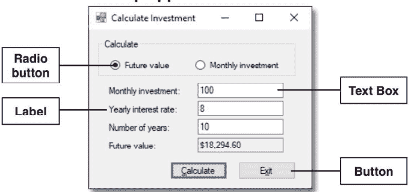

使用 .NET 开发 Windows 桌面应用程序的三种平台

| 类型 | 描述 |
|---|---|
| Windows Forms (WinForms) | 提供拖放设计器，自动生成定义用户界面的代码。受 Windows 7 及更高版本支持。 |
| Windows Presentation Foundation (WPF) | 要求程序员编写定义用户界面的 XAML（可扩展应用程序标记语言），但提供了增强的用户体验。受 Windows 7 及更高版本支持。 |
| Universal Windows Platform (UWP) | 要求程序员编写定义用户界面的 XAML，但提供了一种创建支持各种屏幕尺寸的响应式应用程序的方法。受任何 Windows 10 设备支持。 |

使用 .NET 开发 Web 应用程序的两种平台

| 类型 | 描述 |
|---|---|
| ASP.NET Web Forms | 提供拖放设计器，自动生成定义 Web 应用程序页面的 Web 窗体的代码。 |
| ASP.NET Core MVC | 要求用户编写使用模型-视图-控制器（MVC）设计模式定义 Web 应用程序页面的代码。 |

描述

- *桌面应用程序*是一种直接运行在用户计算机上的应用程序，例如文字处理器或电子表格。
- *Web 应用程序*是一种运行在 Web 服务器上的应用程序，例如网站。然后，用户可以使用 Web 浏览器查看 Web 应用程序的页面。
- 应用程序的用户界面通常包含*控件*，如标签、文本框和按钮。这些控件允许用户与应用程序交互。

### Visual Studio 与 .NET 编程语言

Visual Studio 是一个支持多种编程语言和应用程序开发平台的集成开发环境（IDE）。图 1-2 中的第一个表格显示 Visual Studio 有三个版本。本书介绍如何使用 Visual Studio Community 开发 Windows Forms 应用程序。

所有三个版本都支持第二个表格中显示的编程语言。当然，本书介绍如何使用 C#（读作“C Sharp”）开发 Windows Forms 应用程序。

当你按照附录 A 中的说明安装带有“Windows 桌面开发”工作负载的 Visual Studio 时，Visual Studio 会提供对 C# 的支持。此外，你还可以选择安装 .NET Framework（读作“dot net framework”）或 .NET Core。

这些 .NET 平台提供了一种用于运行以 C# 编写的应用程序的方式。不过，它们也可以用于运行以其他 .NET 语言编写的应用程序，如 Visual Basic 或 F#。这些语言在图中的第二个表格中简要介绍。与 C# 一样，Visual Basic 是一种面向对象的语言。相比之下，Visual F# 是一种较新的语言，除了面向对象和过程化编程外，还提供函数式编程。

此外，你还可以选择安装 SQL Server Express LocalDB。这个版本的 SQL Server 数据库管理系统是专门为开发人员设计的，不需要任何设置。因此，它非常适合在自己的计算机上测试数据库应用程序。

此图中描述的 Visual Studio 版本仅在 Windows 上运行。不过，有一个名为 Visual Studio for Mac 的 Visual Studio 版本可在 macOS 上运行。该版本允许你开发 Web 应用程序，例如 ASP.NET Core MVC 应用程序，但它不提供为 Windows 开发桌面应用程序的方式，而本书介绍的 Windows Forms 应用程序正是这类桌面应用程序。

Visual Studio 2019 版本

| 版本 | 描述 |
|---|---|
| Community | 一个免费版本，适合爱好者、学生和构建非企业应用程序的个人开发人员。 |
| Professional | 专为构建非企业应用程序的专业人士小团队设计。包含用于分析代码和团队协作的工具。 |
| Enterprise | 专为希望构建复杂、可扩展企业应用程序的任何规模的团队设计。 |

.NET 编程语言

| 语言 | 描述 |
|---|---|
| C# | 一种面向对象的语言，语法与 C、C++、Java 和 JavaScript 相似。 |
| Visual Basic | 一种面向对象的语言，其语法设计为易于学习和使用。 |
| F# | 一种结合了函数式、过程式和面向对象编程的语言。 |

描述

- *Visual Studio* 是一个*集成开发环境（IDE）*，支持多种编程语言和应用程序开发平台。
- 安装 Visual Studio 时，你可以选择安装 *.NET Framework* 或 *.NET Core*。这些平台提供了一个支持 C# 等 .NET 编程语言的代码库。此外，你还可以选择安装其他可能需要的开发工具，如编译器。
- 安装 Visual Studio 时，你可以选择安装 *SQL Server Express LocalDB*，这是专门为开发人员设计的 Microsoft SQL Server 数据库管理系统的精简版本。
- 此图中显示的 Visual Studio 版本仅在 Windows 上运行。有一个名为 Visual Studio for Mac 的 Visual Studio 版本可在 macOS 上运行，但它不提供为 Windows 开发桌面应用程序的方式。


## .NET Framework 和 .NET Core

要描述 .NET 的工作原理，图 1-3 展示了 .NET Framework 和 .NET Core 的主要组件。这表明 .NET Core 的工作方式与 .NET Framework 类似。事实上，本书中介绍的大多数代码和技术无论使用 .NET Framework 还是 .NET Core 都是一样的。

这两个平台的主要区别在于 .NET Framework 更老且仅支持 Windows。另一方面，.NET Core 更新且跨平台。因此，.NET Core 可以在 Windows、macOS 和 Linux 上运行。目前，微软计划在 4.8 版本结束对 .NET Framework 的开发。因此，.NET Core 是 .NET 开发的未来。

事实上，下一版本的 .NET Core 将被称为 .NET 5（名称中没有 Core）。它结合了 .NET Framework 和 .NET Core 3.1 的最佳特性。因此，它为 .NET Framework 应用程序提供了便捷的迁移路径，并为 .NET 平台的未来开发提供了基础。

.NET Framework 和 .NET Core 都提供了一组类库。这些类库由称为类的预写代码段组成，提供了开发 .NET 应用程序所需的大多数功能。例如，Windows Forms 类用于开发 Windows Forms 应用程序。ASP.NET 和 ASP.NET Core 类用于开发 Web Forms 应用程序。EF 和 EF Core 类用于开发访问数据库的应用程序。其他类让你管理安全、访问文件并执行许多其他功能。

.NET Framework 和 .NET Core 还提供了一个通用基础设施，应用程序程序可以用 C# 等 .NET 语言编写，使用该基础设施在各种操作系统和硬件平台上运行。该基础设施包括通用语言运行时、.NET 语言以及这些语言的编译器。

通用语言运行时（CLR）提供了使用 .NET 语言开发的任何应用程序执行所需的服务。这是因为所有 .NET 语言都编译为一种通用的中间语言，你将在图 1-5 中了解更多相关信息。CLR 还提供了通用类型系统，定义了所有 .NET 语言使用的数据类型。因为所有 .NET 应用程序都由 CLR 管理，所以它们有时被称为托管应用程序。

如果你是编程新手，你可能无法完全理解这张图表，但没关系。现在你只需要理解 .NET Framework 和 .NET Core 的总体结构以及到目前为止介绍的术语。随着你阅读本书的进展，这张图表会变得更有意义，你将更加熟悉其中的每个术语。

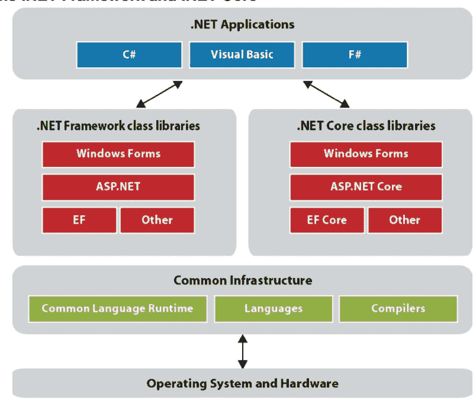

## 描述

- Windows Forms 应用程序不会直接访问操作系统或计算机硬件。相反，它们使用 .NET Framework 或 .NET Core 的服务，而这些服务反过来访问操作系统和硬件。
- .NET Framework 和 .NET Core 提供了 *类库*，其中包含预写代码 *类*，这些代码可供所有 .NET 编程语言使用。这些类库包含数千个类，但一旦你学会如何使用其中几个类，就可以创建简单的 .NET 应用程序。
- .NET Framework 和 .NET Core 使用一个通用基础设施，其中包括 *通用语言运行时 (CLR)*、语言和编译器。
- CLR 通过协调内存管理、代码执行、安全等基本功能来管理 .NET 程序的执行。因为 .NET 应用程序由 CLR 管理，所以它们被称为 *托管应用程序*。
- *通用类型系统* 是 CLR 的一个组件，确保所有 .NET 应用程序无论使用何种编程语言开发，都使用相同的基本数据类型。

## Visual Studio IDE

图 1-4 显示了 Visual Studio IDE。到目前为止，你已经知道 Visual Studio 支持图 1-2 中介绍的语言。此外，你还可以使用 Visual Studio 来处理 .NET Framework 和 .NET Core。

Visual Studio 包含一个拖放设计器，开发人员可以用它来设计 Windows Forms 应用程序的用户界面。该设计器生成显示用户界面的 C# 代码，这使得开发用户界面的艰巨任务变得容易得多。

Visual Studio 还包含一个编辑器，可用于处理图 1-2 中介绍的四种语言中的任何一种。该编辑器包含许多功能，使输入和编辑应用程序代码变得容易。

片刻之后，本章将快速浏览 Visual Studio，包括 Windows Form 设计器和代码编辑器的预览。但首先，了解使用 Visual Studio 编译和运行应用程序时会发生什么非常重要。

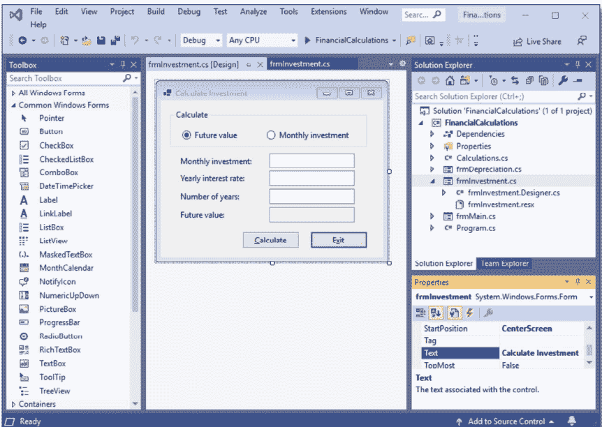

## 描述

- Visual Studio 包含可用于开发 Windows Forms 应用程序和 Web Forms 应用程序的拖放设计器。
- Visual Studio 包含一个代码编辑器，可用于处理多种语言，包括图 1-2 中介绍的 .NET 语言。

## C# 应用程序如何被编译和运行

图 1-5 显示了 C# 应用程序如何被编译和运行。首先，你使用 Visual Studio 创建一个项目，该项目由包含 C# 语句的源文件组成。项目还可能包含其他类型的文件，例如声音、图像或文本文件。

在输入项目的 C# 代码后，你使用 C# 编译器进行构建（或编译），该编译器在安装 Visual Studio 时安装，将你的 C# 源代码编译为 Microsoft Intermediate Language（MSIL）。简称为 Intermediate Language（IL）。

此时，Intermediate Language 存储在磁盘上的一个称为程序集的文件中。除了 IL 之外，程序集还包含对应用程序所需的类的引用。然后，程序集可以在安装了通用语言运行时的任何计算机上运行。当程序集运行时，CLR 将 Intermediate Language 转换为操作系统可以运行的本地代码。

如果你用其他语言开发过应用程序，这个过程应该很熟悉。但是，如果这是你的第一种语言，你在开发第一个应用程序之前不会真正理解这个过程。在此之前，只需专注于术语和概念。

顺便说一下，解决方案是一个容器，可以容纳一个或多个项目。虽然解决方案可以包含多个项目，但简单应用程序的解决方案通常只包含一个项目。在这种情况下，解决方案和项目本质上是同一件事。

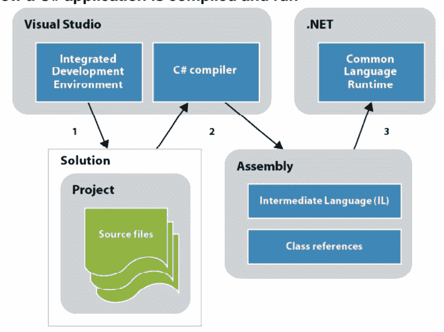

## 操作

- 程序员使用 Visual Studio 创建一个 *项目*，其中包括 C# *源文件*。在某些情况下，项目还将包含其他类型的文件，例如图像、声音或文本文件。
- C# *编译器* 将项目的 C# 源代码编译（翻译）为 *Microsoft Intermediate Language (MSIL)*，或简称为 *Intermediate Language (IL)*。该语言存储在磁盘上的 *程序集* 中，程序集还包含对所需类的引用。程序集是一个可执行文件，具有 .exe 或 .dll 扩展名。
- 程序集由 .NET 的通用语言运行时运行。CLR 管理程序集运行的所有方面，包括将 Intermediate Language 转换为操作系统可以运行的本地代码、管理程序集的内存以及强制执行安全。

### 关于项目和解决方案

- *解决方案* 是一个容器，可以容纳一个或多个项目。


## Visual Studio IDE 概览

有了这些背景知识，你就可以开始浏览 Visual Studio IDE 了。在此过程中，你将学习在此开发环境中工作的一些基本技巧。你还会看到刚刚学到的一些术语在 Visual Studio 中的应用方式。

### 如何启动 Visual Studio

图 1-6 描述了如何启动 Visual Studio，并显示了启动时出现的开始窗口。在 Visual Studio 2019 中，开始窗口已重新设计，以专注于开发人员最有可能执行的任务。例如，它允许你打开最近的解决方案，打开任何项目或解决方案，并创建新的项目或解决方案。它还允许你处理存储在在线存储库中的代码并打开单个文件。

第一次启动 Visual Studio 时，它会要求你登录。如果你还没有账户，可以免费创建一个。如果你使用的是 Visual Studio Community 等免费版 Visual Studio，则需要创建账户或登录现有账户才能继续使用它。此外，如果你在多台设备上运行 Visual Studio，登录可以让你在这些设备之间同步设置。

登录后，Visual Studio 会要求你选择默认环境设置。然后，你可以选择 Visual C# 选项，使菜单看起来像本书中的菜单。如果你愿意，还可以选择你想要使用的配色主题。Visual Studio 默认使用蓝色配色主题，本书中的屏幕截图也是使用该主题。

本书中的屏幕截图基于 Visual Studio Community 2019。如果你使用的是其他版本，你可能会注意到你的版本显示的屏幕与本书中的屏幕截图存在一些细微差异。但是，本书中描述的功能在你的 Visual Studio 版本上仍应类似工作。

启动 Visual Studio 时显示的开始窗口

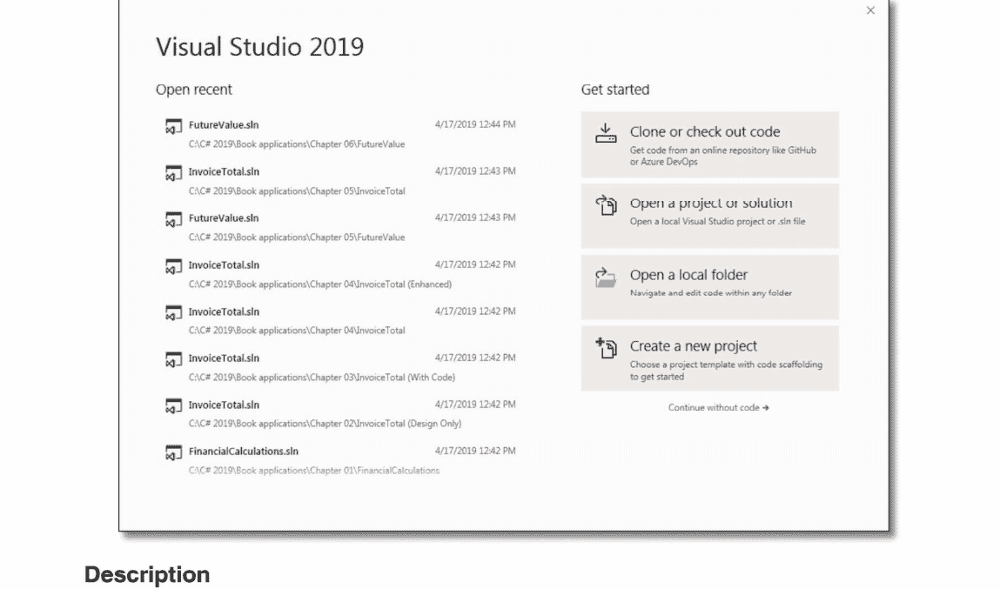

## 描述

- 要启动 Visual Studio，请在开始菜单或应用列表中定位并选择 Visual Studio。
- 为了更轻松地启动 Visual Studio，你可以为 Visual Studio 创建快捷方式并将其放在桌面上或固定到开始菜单。
- 当 Visual Studio 启动时，它会显示开始窗口。你可以使用此窗口打开最近的解决方案，打开任何项目或解决方案，创建新项目，等等。

### Visual Studio Community 与其他版本之间的差异

- 本书中的屏幕截图使用的是 Visual Studio 2019 Community。如果你使用的是 Visual Studio 的其他版本，你可能会在系统上注意到一些细微差异，但 Visual Studio 仍应类似工作。

### 如何打开或关闭现有项目

要打开项目，你可以使用 File→Open→Project/Solution 命令来显示图 1-7 中所示的对话框。从此对话框中，你可以定位并打开你的 C# 项目。你也可以使用 File→Recent Projects and Solutions 命令打开最近使用的项目。

如果对这种记法不熟悉，File→Open→Project/Solution 的意思是从菜单栏中下拉 File 菜单，选择 Open 子菜单，然后选择 Project/Solution 命令。通常，你只需要下拉一个菜单并选择一个命令。但有时，你需要从一个菜单进入一个或多个子菜单，然后再到命令。

此图中的打开项目对话框显示了存储在 FinancialCalculations 目录中的项目的解决方案文件。然后，项目文件存储在 FinancialCalculations 子目录中。虽然项目和解决方案文件通常就是这样存储的，但你也可以通过选中 Place Solution and Project in the Same Directory 复选框将它们存储在同一目录中。

正如本图所解释的，一个项目可以包含多个文件，包括源代码文件。另一方面，解决方案是一个容器，包含一个或多个项目。

本书中的大多数应用程序的解决方案只包含一个项目。在这种情况下，解决方案和项目之间并没有太大区别。但是，解决方案可以包含多个项目。这对于由程序员团队开发的大型应用程序来说通常是这种情况。

对于多项目解决方案，程序员可以独立地处理构成解决方案的项目。事实上，这些项目甚至不必使用相同的语言编写。例如，一个解决方案可以包含两个项目，一个用 C# 编写，另一个用 Visual Basic 编写。

此时，你可能会想知道是否应该打开项目或解决方案。例如，在本图中，FinancialCalculations.sln 是一个解决方案，而 FinancialCalculations.csproj 是一个 C# 项目。在大多数情况下，打开解决方案还是项目并不重要。无论哪种方式，解决方案和项目文件都将被打开。当你使用 File→Close Solution 命令时，解决方案和项目文件都将被关闭。

有趣的是，一些菜单会根据第一次运行 Visual Studio 时设置的开发设置而略有变化。因此，现在不要惊讶，如果你发现你的系统上使用 File→Open Project 命令打开项目，而不是 File→Open→Project/Solution 命令。在下一章中，你将学习如何更改开发设置，使你的菜单与本书中描述的菜单相匹配。

在大多数情况下，你应该能够在没有问题的情况下打开使用 Visual Studio 早期版本创建的项目。但是，在某些情况下，Visual Studio 可能会显示一个对话框，指出需要进行单向升级。这意味着你将无法在项目创建的 Visual Studio 版本中打开该项目。因此，在继续升级之前，你可能需要复制此项目。然后，要继续升级，只需单击“确定”按钮即可。升级完成后，你通常可以在无需进一步更改的情况下运行该项目。

打开项目/解决方案对话框

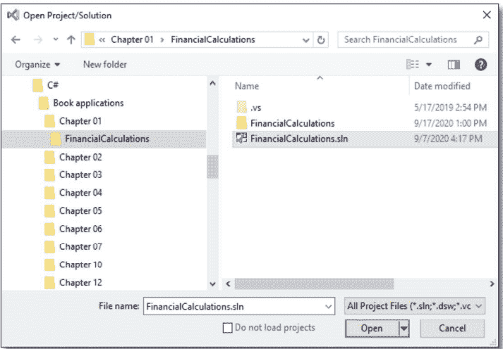

### 项目和解决方案概念

- 每个 C# 项目都有一个 *项目文件*，扩展名为 .csproj，用于跟踪构成项目的各个文件并记录项目的各种设置。在本图中，项目文件存储在 FinancialCalculations 文件夹中，位于所选文件上方。
- 每个解决方案都有一个 *解决方案文件*，扩展名为 .sln，用于跟踪构成解决方案的各个项目。在本图中，解决方案文件被选中。
- 当你打开项目文件时，Visual Studio 会打开包含该项目的解决方案。当你打开解决方案文件时，Visual Studio 会自动打开解决方案中包含的所有项目。因此，无论哪种方式，项目和解决方案都会被打开。
- 有时项目和解决方案文件存储在同一目录中。有时项目文件存储在包含解决方案文件的目录的子目录中。

### 如何打开项目

- 要打开现有项目，请使用 File→Open→Project/Solution 命令。然后，使用结果对话框中的控件定位并选择要打开的项目或解决方案。
- 在你处理一个或多个项目后，它们的名称将列在 File→Recent Projects and Solutions 子菜单中。然后，你可以单击项目或解决方案名称来打开它。
- 你也可以使用开始窗口中的链接打开项目。

### 如何关闭项目

- 使用 File→Close Solution 命令。

图 1-7 如何打开或关闭现有项目

### 显示了窗体设计器的 Visual Studio

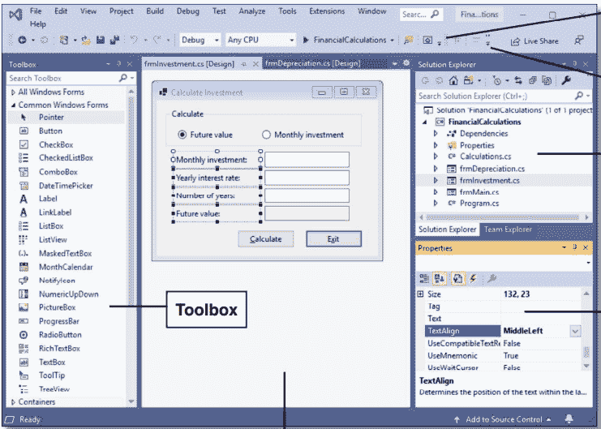

## 描述

- 主 Visual Studio 工作区包含一个或多个选项卡式窗口。要设计窗体的用户界面，你使用窗体设计器窗口（或简称窗体设计器）。要开发代码，你使用图 1-9 中所示的代码编辑器窗口。
- 要打开窗体设计器，你可以在解决方案资源管理器中双击窗体，或在解决方案资源管理器中选择窗体然后选择 View→Designer。
- 要向窗体添加控件和其他项目，你使用工具箱。
- 要更改窗体或控件的外观或操作方式，你使用属性窗口。此窗口显示在窗体设计器中选中的项目的属性。
- 要管理项目的各个文件，你使用图 1-10 中所示的解决方案资源管理器窗口。
- Visual Studio 提供多个工具栏。标准工具栏包括打开、保存、全部保存等标准按钮，以及你在阅读本书的过程中会学到的其他按钮。
- 当你使用 Visual Studio 时，会根据你正在执行的操作显示其他工具栏。


## 如何使用代码编辑器

如果你想处理应用程序的源代码，可以使用图 1-9 所示的 *代码编辑器窗口*（或简称为 *代码编辑器*）。代码编辑器让你可以输入和编辑 C# 应用程序的源代码。

在你使用窗体设计器将控件放置到窗体上从而设计项目的用户界面后，你可以使用代码编辑器来输入和编辑使控件按你想要的方式工作的 C# 代码。调用代码编辑器最简单的方法是双击一个控件。然后，你可以开始输入在用户对该控件执行最常见操作时将被执行的 C# 语句。例如，如果你双击一个按钮，你就可以输入在用户单击该按钮时将被执行的语句。

代码编辑器的工作方式与任何其他文本编辑器类似。然而，代码编辑器具有许多特殊功能，可以简化编辑 C# 代码的任务。例如，颜色用于区分 C# 关键字、变量、注释和其他语言元素。IntelliSense 功能可以帮助你正确输入代码。结构可视化器帮助你可视化代码的结构。而且文件预览功能让你可以在不打开文件的情况下显示文件中的代码。你将在第 3 章中了解更多关于使用代码编辑器的内容。

## Visual Studio 显示代码编辑器

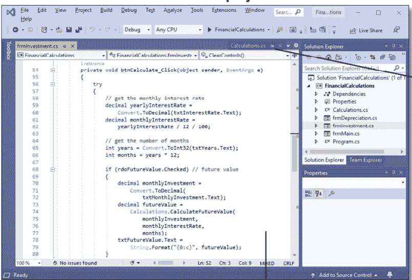

## 描述

- 代码编辑器窗口（或简称为代码编辑器）是你创建和编辑应用程序所需的 C# 代码的地方。代码编辑器的工作方式与任何其他文本编辑器类似，因此你应该不会有太多困难去学习如何使用它。
- 你可以通过双击窗体设计器窗口中的窗体或其中一个控件来显示代码编辑器。或者，你可以在解决方案资源管理器中右键单击窗体并从 resulting 菜单中选择 View Code 命令。
- 你也可以通过在解决方案资源管理器中选择文件来预览文件中的代码。然后，如上图所示，代码编辑器窗口右侧会出现该窗口的选项卡。如果修改文件或在选项卡中单击 Keep Tab Open 按钮，则文件将被打开。
- 打开代码编辑器后，你可以通过单击该窗口的 [Design] 选项卡返回到窗体设计器。你也可以通过按 Ctrl+Tab 或 Shift+Ctrl+Tab 在这些窗口之间移动，或通过选择选项卡右侧可用的活动文件下拉列表中的窗体来移动。
- 窗体设计器和代码编辑器为你提供了对窗体的两种不同视图。窗体设计器为你提供窗体的视觉表示。代码编辑器显示使窗体按你想要的方式工作的 C# 代码。

## 如何使用解决方案资源管理器

图 1-10 显示了解决方案资源管理器，你使用它来管理构成解决方案的项目以及构成每个项目的各个文件。正如你所见，解决方案资源管理器中的文件以树视图显示，其中项目节点从属于解决方案节点。如果节点旁边有一个 ▷ 符号，你可以单击 ▷ 符号来显示其内容。相反，你可以通过单击节点旁边的 ◁ 符号来隐藏节点的内容。

在此图中，存储在名为 frmInvestment.cs 的文件中的窗体已被展开以显示其支持文件。在这里，名为 frmInvestment.Designer.cs 的文件存储了窗体设计器生成的大部分代码在一个 partial class 中。如果你愿意，可以使用代码编辑器查看此代码，但你通常不会想要修改它。

相比之下，名为 frmInvestment.cs 的文件包含你为窗体输入的 C# 代码。这段代码决定了窗体上控件的工作方式。这段代码也存储在一个 partial class 中，并且当项目构建时，这两个 partial class 会合并为 Investment 窗体的单个类。你将在本书的后续内容中了解更多关于类和 partial class 的内容。

在开发项目时，你还可以创建包含 C# 代码但不定义窗体的类。在此图中，例如，名为 Calculations.cs 的文件是一个包含非窗体类的文件。在这种情况下，你可以通过在解决方案资源管理器中选择它（如前一图所示）来在代码编辑器中预览该类。或者，你也可以通过双击它来打开它进行编辑。

要识别构成项目的各个文件，你可以查看文件名称左侧显示的图标。例如，窗体文件的图标是一个窗体，而 C# 类文件的图标带有 C#。

在开发应用程序时，我们建议你以能够识别其内容的方式命名文件。例如，我们在窗体文件名称前加上 frm 前缀。这样，当你在解决方案资源管理器之外使用它们时，很容易识别窗体文件。

该项目还包括一个名为 Dependencies 的组项。当你为 .NET Core 创建新的 Windows 窗体应用程序项目时，Visual Studio 会自动将包含该应用程序所需的程序集的两个框架作为依赖项添加到项目中。这些程序集用于 System、System.Data 和 System.Windows.Forms 等 *命名空间*，其中包含项目可用的 .NET 类，例如 Form 类。

这应该让你对项目的复杂文件结构有一个大致的了解。对于这个相对简单的应用程序，开发人员创建了三个窗体文件和一个类文件。而 Visual Studio 会自动将命名空间和 Program.cs 文件添加到项目中。此 Program.cs 文件包含启动应用程序并运行应用程序的第一个窗体的 C# 代码。

## 解决方案资源管理器

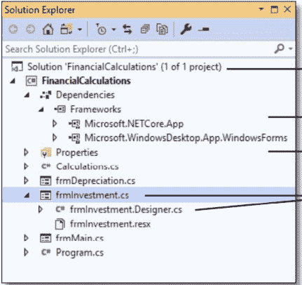

## 描述

- 你使用 *解决方案资源管理器* 来管理和显示解决方案中的文件和项目。解决方案资源管理器列出当前解决方案的所有项目，以及构成每个项目的所有文件。
- 解决方案资源管理器中的 ▷ 和 ◀ 符号表示文件组。你可以单击这些符号来展开和折叠组。
- 你可以使用解决方案资源管理器窗口顶部的按钮执行各种功能。

### 项目文件

- 解决方案资源管理器使用不同的图标来区分定义窗体的源代码文件和不定义窗体的源代码文件。
- 每个窗体由两个 C# 源文件定义，其中每个文件包含一个 *partial class*。具有 cs 扩展名的文件包含程序员输入的代码，而具有 Designer.cs 扩展名的文件包含程序员使用窗体设计器工作时生成的代码。当项目编译时，这些 partial class 会合并为一个类，该类决定窗体的外观和操作。
- 不定义窗体的源代码文件通常存储在包含单个类的单个 C# 源文件中。
- 当你创建新应用程序时，Visual Studio 会自动创建 Program.cs 文件。对于 Windows 窗体应用程序，此文件包含启动应用程序并运行应用程序中第一个窗体的 C# 代码。
- 当你为 .NET Core 创建新的 Windows 窗体应用程序时，Visual Studio 会在 Dependencies 组项下自动添加两个框架。这些框架包含 *命名空间* 的程序集，其中包含项目可用的类。

图 1-10    如何使用解决方案资源管理器

## 如何使用 Visual Studio 的窗口

在图 1-11 中，工具箱不可见。相反，它隐藏在窗口左侧。然后，当你需要工具箱时，你可以单击其选项卡来显示它。这只是你可以调整 IDE 中的窗口以使其更易于使用的方法之一。此图还展示了你可以使用的大多数其他技术。

默认情况下，工具箱停靠在应用程序窗口的边缘并隐藏，因此它显示为选项卡。要显示隐藏的窗口，你可以单击其选项卡。如果你希望在单击另一个窗口时窗口保持打开状态，你可以单击窗口的自动隐藏按钮。自动隐藏按钮看起来像一个图钉，如属性窗口右上角附近的按钮所示。要再次隐藏窗口，请单击其自动隐藏按钮。

你还可以取消停靠窗口，使其在 IDE 中间浮动、在 IDE 外部浮动，甚至在单独的监视器上浮动。这包括停靠在 IDE 边缘的窗口，如工具箱和解决方案资源管理器，以及 IDE 中间的选项卡式窗口。要取消停靠其中一个窗口，你可以通过其标题栏或选项卡拖动它，或双击其标题栏或选项卡。在此图中，例如，原本停靠在 IDE 右侧的解决方案资源管理器窗口现在在 IDE 中间浮动。虽然我们不推荐这种窗口排列，但它应该能让你了解你可以以多种方式排列它们。

你还可以将窗口固定在 Visual Studio IDE 主窗口的左侧，以便于访问。为此，你可以单击窗口关闭按钮左侧的切换固定状态按钮。这在该图的 frmInvestment.cs 文件的选项卡中有所说明。当你固定一个窗口时，如果你打开的所有窗口的选项卡无法同时显示，也很容易显示该窗口。

如果你花几分钟时间尝试这些技术，你会发现它们很容易掌握。然后，随着你对 Visual Studio 越来越熟悉，你可以调整窗口使其最适合你。如果你愿意，可以使用窗口菜单中的保存窗口布局命令保存窗口排列。然后，你可以使用该菜单中的其他命令来应用和管理你的自定义布局并将布局重置为默认值。


## 两个浮动窗口、一个隐藏窗口和一个固定窗口

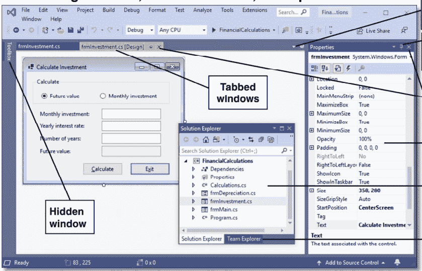

## 如何重新排列窗口

- 要关闭一个窗口，请单击其关闭按钮。要重新显示它，请单击标准工具栏中的其按钮（如果有）或从视图菜单中选择它。
- 要将停靠的窗口取消停靠使其在屏幕上浮动，请通过其标题栏将其从应用程序窗口边缘拖离，或双击其标题栏。
- 要停靠一个浮动窗口，请通过其标题栏将其拖到出现的定位箭头之一上。或者，按住 Ctrl 键然后双击其标题栏将其返回到先前的停靠位置。
- 要隐藏一个停靠的窗口，请单击其自动隐藏按钮。然后，窗口会以选项卡的形式显示在屏幕边缘，您可以通过单击选项卡来显示它。要改回，请显示它然后再次单击自动隐藏按钮。
- 要调整窗口大小，将鼠标指针置于窗口的边缘或角落并拖动它。
- 要在选项卡式窗口组中显示一个窗口，请单击其选项卡。要关闭一个选项卡式窗口，请单击其关闭按钮。
- 如果您停靠、取消停靠、隐藏或取消隐藏一个选项卡式窗口，则该组中的所有窗口都会被停靠、取消停靠、隐藏或取消隐藏。
- 要将窗口固定在主窗口的左侧，请单击切换固定状态按钮。要取消固定窗口，请再次单击此按钮。
- 您还可以使用窗口菜单中的命令来处理窗口。例如，您可以使用重置窗口布局命令将窗口恢复到默认布局。您还可以保存、应用和管理自定义布局。

## 项目属性窗口

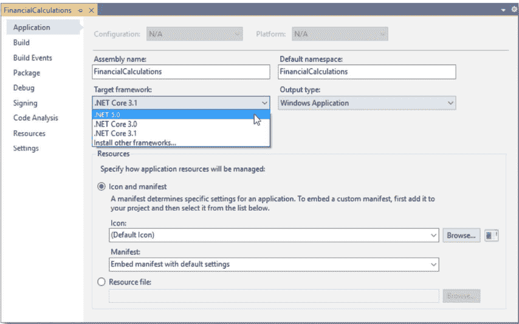

## .NET 版本如何对应默认 C# 版本

| 目标框架 | 默认 C# 版本 |
| .NET 5.x | C# 9.0 |
| .NET Core 3.x | C# 8.0 |
| .NET Framework（全部） | C# 7.3 |

## 说明

- 要更改项目使用的 .NET 版本，请从该项目的项目属性窗口的应用程序选项卡中选择您想要使用的版本。
- 要显示项目属性窗口，请在解决方案资源管理器中右键单击项目并从 resulting 菜单中选择属性命令。
- 您选择的 .NET 版本决定了项目中可以使用哪些功能。

## 备注

- 要将目标框架更改为更新版本的 .NET Core，该更新版本必须已安装在您的系统上。如果没有，您可以使用 Visual Studio 安装程序程序按附录 A 中所述安装它。
- 目标框架决定了默认的 C# 版本。如有必要，您可以手动更改项目的默认 C# 版本。但是，不建议选择比默认版本更新的版本，因为它可能导致难以找到和修复的错误。

### 如何测试项目

当您开发项目时，您使用窗体设计器设计窗体，并使用代码编辑器为项目编写 C# 代码。然后，当您准备好测试项目以查看其是否正常工作时，您需要构建并运行项目。

## 如何构建项目

图 1-13 显示了如何构建项目。一种方法是展开构建菜单并选择构建解决方案命令。如果项目中不包含任何编码错误，C# 代码将被编译为项目的中间语言并保存在磁盘上的程序集中。此程序集随后可以由通用语言运行时运行。

通常，您不需要这样构建。相反，您只需运行项目即可。然后，如果项目尚未构建过，或者自上次构建以来已被更改，Visual Studio 会在运行之前先构建它。

### 如何运行项目

运行项目的一种简便方法是单击本图中标识的开始按钮。当项目未运行时，此按钮具有绿色箭头并显示项目名称。当它运行时，此按钮则标记为继续。

当您单击开始按钮时，如果需要项目将被构建，中间语言将由通用语言运行时执行，并且项目的第一个（或唯一）窗体将被显示。例如，本图显示了运行 Financial Calculations 项目时显示的第一个窗体。此窗体包含两个按钮，可让您显示项目的其他窗体。

要测试项目，您尝试应用程序预期执行的所有操作。当需要数据输入时，您尝试测试应用程序限制的数据范围。当您完成运行应用程序后，您可以通过单击窗体右上角的关闭按钮或单击为此目的设计的按钮控件来退出它。如果应用程序无法正常工作，当然您需要修复它，但您将在第 3 章中了解更多相关信息。

## 运行 Financial Calculations 项目时显示的窗体

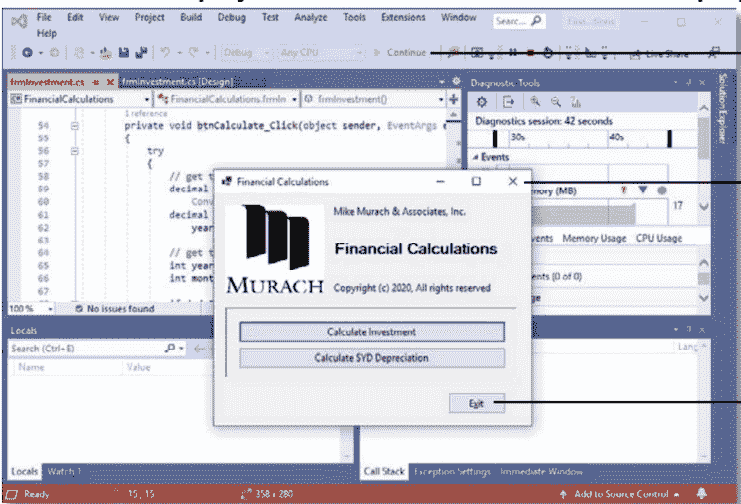

## 如何在不运行的情况下构建项目

- 使用 构建→构建解决方案 命令。或，按 F6。这会*构建*项目的中间语言并将其保存在程序集中。

### 如何运行项目

- 单击标准工具栏中的开始按钮。或，按 F5。这会*运行*项目并在其第一个窗体显示在 Visual Studio 窗口之上。
- 如果项目尚未构建，则项目会先构建然后再运行。因此，在运行程序之前不需要使用构建命令。

## 退出正在运行的项目的两种方法

- 单击窗体右上角的关闭按钮。
- 单击为退出应用程序而设计的按钮控件。这通常是一个标记为退出、关闭或取消的按钮。

## 视角

现在您阅读了本章，您应该对 .NET 平台、Visual Studio IDE 和 C# 编程语言之间的关系有一个大致的了解。您还应该知道如何使用 Visual Studio 处理项目和解决方案中的文件。现在，为了更熟悉 Visual Studio，您可以逐步完成接下来的练习。

完成此练习后，您应该准备好进入下一章。在那里，您将在开发第一个 C# 应用程序时了解更多关于使用 Visual Studio 的知识。

## 术语

- desktop application
- Windows Forms application
- WinForms application
- Windows form
- form
- control
- WPF (Windows Presentation Foundation) application
- XAML (Extensible Application Markup Language)
- UWP (Universal Windows Platform)
- web application
- ASP.NET Web Forms application
- web form
- ASP.NET Core MVC application
- MVC (Model-View-Controller)
- Visual Studio
- Integrated Development Environment (IDE)
- .NET Framework
- .NET Core
- SQL Server Express LocalDB
- class library
- class
- Common Language Runtime (CLR)
- managed application
- Common Type System
- project
- source file
- C# compiler
- Microsoft Intermediate Language (MSIL)
- Intermediate Language (IL)
- assembly
- solution
- Form Designer
- Toolbox
- Properties window
- Code Editor
- Solution Explorer
- partial class
- namespace
- build a project
- run a project

## 在本书中进行练习之前

在本书中进行任何练习之前，您需要在系统上安装 Visual Studio。您还需要从我们的网站下载本书的文件夹和文件并按附录 A 中所述安装到计算机上。完成后，练习应位于 C:\C# 文件夹中。

## 练习 1-1 浏览 Visual Studio

此练习指导您打开现有 C# 项目、在 Visual Studio 中处理窗口以及构建和运行项目。完成后，您应该对开发 C# 应用程序时将使用的一些技术有更好的感觉。

## 启动 Visual Studio 并打开现有项目

- 1. 启动 Visual Studio。如果显示一个允许您选择默认环境设置和颜色主题的对话框，请选择 Visual C# 开发设置和蓝色颜色主题。
- 2. 查看开始窗口以了解其提供的功能。完成后，单击此窗口的关闭按钮关闭它并显示 Visual Studio IDE。
- 3. 使用文件菜单显示打开项目对话框。接下来，定位 C:\C#\Chapter 01\FinancialCalculations 文件夹中名为 FinancialCalculations.csproj 的项目文件。然后，双击项目文件以打开项目。

## 尝试 Visual Studio

- 4. 在解决方案资源管理器中，双击 frmInvestment.cs 文件以显示计算投资窗体的窗体设计器。
- 5. 在解决方案资源管理器中，选择计算投资窗体（frmInvestment.cs）的文件并按 F7。这应该在代码编辑器中显示此窗体的 C# 代码。
- 6. 单击 frmInvestment.cs [设计] 的选项卡以再次显示窗体设计器。然后，按 Ctrl+Tab 返回代码编辑器窗口，再次按下返回设计器。
- 7. 如果工具箱被隐藏，请单击窗口左侧的其选项卡以显示它。然后，单击设计器以查看工具箱再次隐藏。再次显示工具箱，定位其右上角附近的图钉并单击它。现在当您单击另一个窗口时，工具箱应保持显示。
- 8. 通过将解决方案资源管理器窗口的标题栏拖到屏幕中央来取消其停靠。注意属性窗口扩展以填充被停靠的解决方案资源管理器窗口占据的空间。按住 Ctrl 键然后双击解决方案资源管理器窗口的标题栏以将窗口返回到其停靠位置。


## 关闭并重新打开项目

9. 在“解决方案资源管理器”窗口中，单击“引用”文件夹旁边的 ▷ 符号，查看项目中包含的命名空间。完成后，单击“引用”文件夹旁边的 ◀ 符号将其关闭。

10. 单击 `frmInvestment.cs` 文件旁边的 ▷ 符号以显示从属文件。然后，单击 `frmInvestment.Designer.cs` 文件以预览其代码。这是在设计窗体时由“窗体设计器”生成的代码。

11. 在“解决方案资源管理器”中单击 `Calculations.cs` 文件，注意其代码会替换预览选项卡中的 `frmInvestment.Designer.cs` 文件的代码。然后，单击选项卡中的“保持打开”按钮，在“代码编辑器”中打开该代码。该代码用于执行此应用程序所需的计算。现在，关闭此代码的选项卡式窗口。

12. 选择“文件”→“关闭解决方案”命令来关闭项目。如果显示询问是否保存更改的对话框，请单击“否”按钮。

13. 使用“文件”→“最近的项目和解决方案”子菜单重新打开解决方案，选择相应的项目文件。

## 生成并运行应用程序

14. 通过下拉“生成”菜单并选择“生成解决方案”命令来生成项目。这会将项目编译为中间语言。它可能还会打开“输出”窗口，但在下一章之前你无需对此担心。

15. 单击标准工具栏中的“启动”按钮来运行应用程序。显示第一个窗体时，单击“计算投资”按钮以显示下一个窗体。然后，试验此窗体，直到你了解其功能。试验完成后，退出此窗体，返回到第一个窗体。

16. 单击“计算年数总和折旧”按钮以显示另一个窗体。然后，试验该窗体以了解其功能。退出后，你将返回到第一个窗体。

17. 通过单击窗体右上角的“关闭”按钮退出第一个窗体。

## 关闭项目并退出 Visual Studio

18. 关闭项目。

19. 通过单击 Visual Studio 窗口右上角的“关闭”按钮退出 Visual Studio。

## 如何设计 Windows 窗体应用程序

在上一章中，你学习了使用 Visual Studio 的基本技能，浏览了 Windows 窗体应用程序，并测试了包含三个 Windows 窗体的应用程序。在本章中，你将学习如何使用 Visual Studio 为 Windows 窗体应用程序设计用户界面。

- 如何开始...........................................................34
- 如何配置 Visual Studio ...................................................34
- 如何创建新项目 .......................................................36
- 如何设计窗体..............................................................38
- 发票总额窗体的设计 ...............................................38
- 如何向窗体添加控件.......................................................40
- 如何设置属性..............................................................42
- 窗体和控件的公共属性 ...........................................44
- 如何添加导航功能 .....................................................46
- 发票总额窗体的属性设置 ....................................48
- 如何完成设计..........................................................50
- 如何重命名项目文件...............................................50
- 如何保存项目文件.................................................50
- 小结 ...................................................................52

## 如何开始

在开始使用 Visual Studio 2019 创建第一个 Windows 窗体应用程序之前，你可能需要更改一些 Visual Studio 选项。这将使你更容易创建新项目。你可能还想更改导入和导出设置。

## 如何配置 Visual Studio

要设置 Visual Studio 的选项，请使用图 2-1 中所示的“选项”对话框。打开此对话框后，可以通过单击“项目和解决方案”组左侧的 ▷ 符号来展开该组，并可以单击“位置”类别以显示此图中所示的选项。

你可以直接在文本框中输入路径来设置默认项目位置，也可以单击文本框右侧的按钮，显示一个对话框，让你导航到要使用的文件夹。这将为新项目设置默认位置，但你在创建新项目时始终可以覆盖默认值。

默认情况下，此对话框中可用的大多数选项都已按你想要的方式设置。但是，值得花几分钟查看可用的选项。然后，如果 Visual Studio 的运行方式不符合你的要求，你可以更改它们。例如，你可能想使用“环境”组中的“启动”类别来更改 Visual Studio 启动时显示的内容。

第一次启动 Visual Studio 2019 时，系统会询问你希望使用哪些默认开发设置。你可以从多个选项中进行选择，包括 Visual Basic、Visual C# 和 Web 开发。除其他事项外，你的选择会影响某些菜单中可用的项以及标准工具栏中可用的按钮。例如，如果你选择 Visual C# 设置，则可以使用“文件”→“打开”→“项目/解决方案”命令打开项目。但如果你选择 Visual Basic 设置，则可以使用“文件”→“打开项目”命令打开项目。

要更改这些设置，请使用此图中所述的“导入和导出设置向导”。在向导的第一步中，选择“重置所有设置”选项。在第二步中，选择“是，保存我的当前设置”选项。在最后一步中，如果你希望菜单按本书所述的方式工作，请选择 Visual C# 选项。之后，如果你切换到 Visual Basic 或 Web 开发，你可以再次更改设置。

## 用于设置项目选项的“选项”对话框

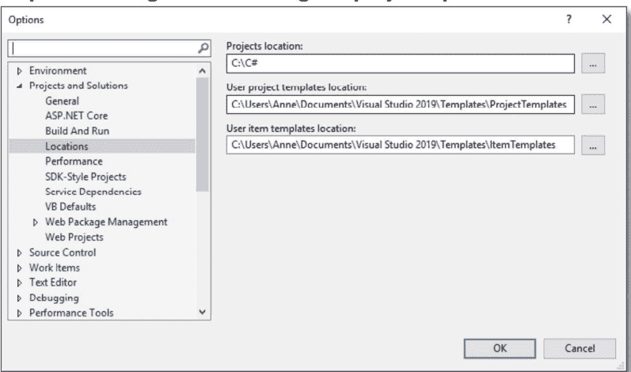

## 如何设置选项

- 要显示“选项”对话框，请选择“工具”→“选项”命令。
- 要展开和折叠选项组，可以使用每组左侧的 ▷ 和 ◁ 符号。要显示某个类别的选项，请单击该类别。
- 要设置从 Visual Studio 启动的所有项目的默认位置，可以更改上图中的“项目位置”。
- 要更改 Visual Studio 的颜色主题，请在“环境”组中选择“常规”类别，然后从“颜色主题”下拉列表中选择一个选项。
- 要更改启动 Visual Studio 时显示的内容，请在“环境”组中选择“启动”类别，然后从“启动时打开”下拉列表中选择一个选项。
- 尽管大多数选项都应以你希望的方式设置，但你最好熟悉每个类别中的选项，以便了解可用的选项。

## 如何更改开发设置

- 第一次启动 Visual Studio 2019 时，系统会要求你选择默认开发设置。这些设置会影响菜单的工作方式以及标准工具栏上显示的按钮。
- 要将设置更改为本书使用的设置，请使用“工具”→“导入和导出设置”命令启动设置向导。然后，在向导中逐步选择“重置所有设置”选项、“保存我的当前设置”选项和“Visual C# 开发设置”选项。

## “创建新项目”窗口

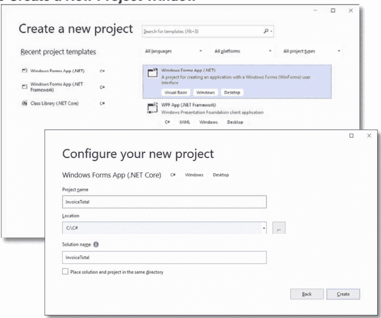

## 如何创建新的 C# 项目

- 1. 单击“开始”窗口中的“创建新项目”按钮，或使用“文件”→“新建”→“项目”命令打开“创建新项目”窗口。
- 2. 从窗口右侧的列表中选择 Windows 窗体应用 (.NET) 模板，或从窗口左侧选择最近使用的模板。
- 3. 单击“下一步”按钮以显示“配置新项目”窗口。
- 4. 输入项目名称，这将同时输入解决方案的名称。然后，输入项目（和解决方案）的位置（文件夹）。
- 5. 单击“创建”按钮以创建新项目。

## 说明

- 你选择的项目*模板*决定了添加到项目中的初始文件、依赖项、代码和属性设置。
- 如果勾选了“将解决方案和项目放在同一目录中”复选框，则 Visual Studio 会将解决方案和项目文件存储在同一文件夹中。否则，它会为解决方案创建一个文件夹，并为项目创建一个子文件夹。
- 创建项目后，你可能需要检查目标框架。然后，如果需要，你可以按第 1 章图 1-12 所示更改目标框架。


## 发票总额窗体

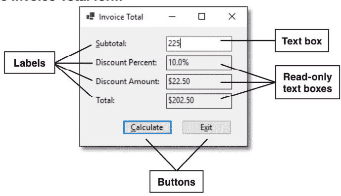

## 说明

- 文本框用于获取用户输入的小计。只读文本框用于显示折扣百分比、折扣金额和总额。标签控件用于标识窗体中文本框内的值。
- 用户输入小计后，可以单击“计算”按钮来计算折扣百分比、折扣金额和总额。或者，用户可以按 Enter 键执行计算。
- 要计算另一笔发票总额，用户可以输入另一个小计，然后再次单击“计算”按钮或按 Enter 键。
- 要关闭窗体并结束应用程序，用户可以单击窗体右上角的“关闭”按钮或单击“退出”按钮。或者，用户可以按 Esc 键退出窗体。
- 用户可以按 Alt+C 激活“计算”按钮，或按 Alt+X 激活“退出”按钮。在大多数系统上，这些按钮的激活字母在用户按 Alt 键之前不会显示下划线。

### 三种类型的控件

- 标签在窗体上显示文本。
- 文本框允许用户在窗体上输入文本。
- 按钮在单击时启动窗体处理。

## 如何向窗体添加控件

图 2-4 演示了如何使用工具箱向窗体添加控件。最简单的方法是在工具箱中单击控件，然后在窗体上要添加控件的位置单击。例如，在此图中，按钮控件已在工具箱中选中，鼠标指针位于窗体上方。

将控件添加到窗体后，可以通过选中控件并拖动其某个手柄来调整控件大小，也可以通过将控件拖动到窗体上的新位置来移动控件。如果你愿意，可以在工具箱中单击控件，然后在窗体上单击并拖动，一次性完成控件的放置和大小调整。

第二种添加控件的方法是将控件从工具箱拖到窗体上。控件会放置在您放下的位置。然后您可以调整控件大小。

第三种添加控件的方法是双击工具箱中要添加的控件。这会将控件放置在窗体的左上角。然后您可以移动并调整控件大小。

如果工具箱的“自动隐藏”功能已激活，并且您单击工具箱选项卡以显示它，显示区域通常会遮挡窗体的部分或全部内容。这使得添加控件变得困难。因此，在添加控件时最好关闭“自动隐藏”功能。为此，只需单击工具箱右上角的图钉按钮。

将控件添加到窗体后，您可以同时处理多个控件。例如，假设您的窗体上有四个文本框控件，您希望它们大小相同且对齐方式一致。为此，首先按住 Ctrl 或 Shift 键单击所有四个控件，或使用鼠标指针在控件周围拖动一个虚线矩形框来选择它们。然后，使用“格式”菜单中的命令或“布局”工具栏中的按钮，相对于主控件移动、调整大小和对齐控件。如果您逐个选择控件，主控件将是您选择的第一个控件。如果您通过拖动环绕来选择控件，主控件将是组中的最后一个控件。要更改主控件，只需单击它即可。（主控件会显示不同颜色的手柄，以便您识别。）

虽然这些技巧在阅读时可能难以想象，但您会发现它们相对容易使用。您只需要一点练习，这在完成本章练习后即可获得。

### 添加了一些控件后的窗体

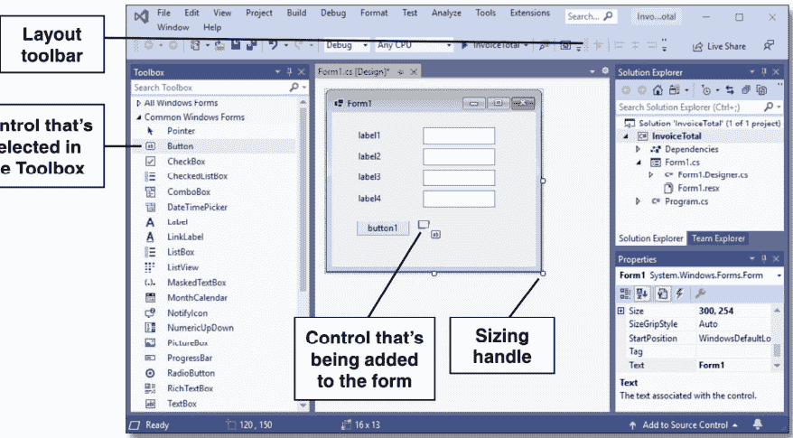

### 向窗体添加控件的三种方法

- 在工具箱中选择控件。然后，在窗体中要放置控件的位置单击。或者，在窗体上拖动指针以放置并调整控件大小。
- 双击工具箱中的控件。然后，控件会被放置在窗体的左上角。
- 将控件从工具箱拖到窗体上并放下。然后，控件会被放置在您放下的位置。

## 如何选择并操作控件

- 要选择窗体上的控件，请单击它。
- 要移动控件，请拖动它。
- 要调整所选控件的大小，请拖动其某个手柄。但请注意，标签会根据其包含的文本量自动调整大小。因此，除非将标签的 AutoSize 属性更改为 False，否则无法通过拖动其手柄来调整标签大小。
- 要选择多个控件，请在单击每个控件时按住 Shift 或 Ctrl 键。您还可以通过在窗体的空白位置单击并拖动以框选控件来选择一组控件。
- 要对一组选定的控件进行对齐、调整大小或设置间距，请单击某个控件使其成为主控件。然后，使用“格式”菜单中的命令或“布局”工具栏中的按钮，相对于主控件对齐、调整大小或设置间距。
- 您还可以通过调整组中主控件的大小来调整组中所有控件的大小。您可以拖动任一选定的控件来移动所有控件。
- 要更改窗体的大小，请单击窗体并拖动其某个调整大小手柄。

## 设置属性后的窗体

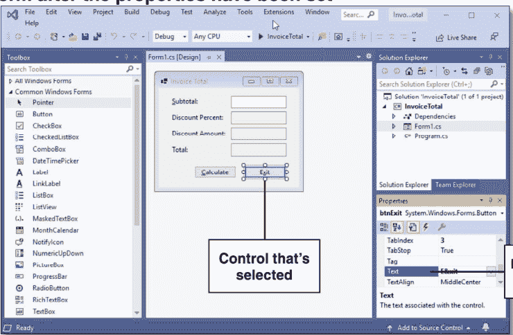

## 说明

- “属性”窗口显示当前在“窗体设计器”窗口中所选对象的 *属性*。要显示其他对象的属性，请单击该对象，或从“属性”窗口顶部的下拉列表中选择该对象。
- 要更改属性，请在文本框中输入值，或者如果该属性有下拉列表，则从其下拉列表中选择一个值。如果属性文本框的右侧出现一个带省略号（...）的按钮，您可以单击该省略号以显示一个对话框，以便为该属性设置选项。
- 要同时更改两个或更多控件的属性，请选择这些控件。然后，这些控件的公共属性会显示在“属性”窗口中。
- 当您单击“属性”窗口中的某个属性时，该属性的简要说明会出现在窗口底部的窗格中。如需更多信息，请按 F1 显示该属性的帮助信息。
- 您可以使用“属性”窗口顶部的前两个按钮，按类别或字母顺序对属性进行排序。
- 您可以使用“属性”窗口中某些属性和类别左侧显示的加号（+）和减号（-）来展开和折叠属性列表。

### 注意

- 如果在“属性”窗口中单击某个属性时没有显示说明，请右键单击该窗口，然后从快捷菜单中选择“说明”。

## 窗体和控件的常见属性

图 2-6 显示了窗体和控件的一些常见属性。前两个属性同时适用于窗体和控件。其他属性分为两组：适用于窗体的属性和适用于控件的属性。请注意，某些控件属性仅适用于特定类型的控件。这是因为不同类型的控件具有不同的属性。

由于所有窗体和控件都必须具有 Name 属性，因此 Visual Studio 会为所有窗体和控件创建通用名称，如 Form1 或 button1。不过，通常您应该将这些通用名称改为更有意义的名称，尤其是当您要在 C# 代码中引用它们时。

为了使程序代码更易于阅读和理解，您可以用两到三个小写字母的前缀作为每个名称的开头，以标识控件的类型。然后，通过描述控件的功能来完成名称。例如，您可以为“退出”按钮使用 btnExit 这样的名称，为“小计”文本框使用 txtSubtotal。

对于标签控件，您可以保留通用名称不变，除非您计划在代码中修改标签的属性。例如，如果您想使用标签控件向用户显示消息，可以给该标签一个有意义的名称，如 lblMessage。但对于显示程序不会更改的文本的标签控件，没有理由更改其名称。

窗体和大多数控件还具有 Text 属性，该属性在窗体显示时可见。窗体的 Text 属性显示在窗体的标题栏中。对于控件，Text 属性通常显示在控件内部的某个位置。例如，按钮的 Text 属性显示在按钮上，文本框的 Text 属性显示在文本框中。

在处理属性时，您会发现有些属性可以通过从下拉列表中选择值来设置。例如，您可以为控件的 TabStop 属性选择 True 或 False 值。对于其他属性，您必须输入数字或文本值。而对于某些属性，会显示一个带省略号（...）的按钮。然后，当您单击此按钮时，会出现一个对话框，让您设置该属性。


## The Name property

- Sets the name you use to identify a form or control in your C# code.
- Can be changed to provide a more descriptive and memorable name for forms and controls that you will refer to when you write your code (such as text boxes and buttons).
- Doesn’t need to be changed for controls that you won’t refer to when you write your code (such as most labels).
- Can use a three-letter prefix to indicate whether the name refers to a form (frm), button (btn), label (lbl), or text box (txt).

## The Text property

- Sets the text that’s displayed on a form or control. Some controls such as forms and labels display the generic form or control name that’s generated by Visual Studio, which you’ll almost always want to change.
- For a form, the Text value is displayed in the title bar. For controls, the Text value is displayed directly on the control.
- For a text box, the Text value changes when the user types text into the control, and you can write code that uses the Text property to get the text that was entered by the user.

## Other properties for forms

| Property | Description |
|---|---|
| AcceptButton | Identifies the button that will be activated when the user presses the Enter key. |
| CancelButton | Identifies the button that will be activated when the user presses the Esc key. |
| StartPosition | Sets the position at which the form is displayed. To center the form, set this property to CenterScreen. |

## Other properties for controls

| Property | Description |
|---|---|
| Enabled | Determines whether the control will be enabled or disabled. |
| ReadOnly | Determines whether the text in some controls like text boxes can be edited. |
| TabIndex | Indicates the control’s position in the tab order, which determines the order in which the controls will receive the focus when the user presses the Tab key. |
| TabStop | Determines whether the control will accept the focus when the user presses the Tab key to move from one control to another. Some controls, like labels, don’t have the TabStop property because they can’t receive the focus. |
| TextAlign | Sets the alignment for the text displayed on a control. |

## How to add navigation features

Windows forms have features that make it easier for users to move around in the forms without using the mouse. These navigation features are described in figure 2-7.

The *tab order* is the order in which the controls on a form receive the *focus* when the user presses the Tab key. The tab order should usually be set so the focus moves left-to-right and top-to-bottom, beginning at the top left of the form and ending at the bottom right. However, in some cases you’ll want to deviate from that order. For example, if you have controls arranged in columns, you may want the tab order to move down each column.

The tab order is initially set based on the order in which you add controls to the form. So if you add the controls in the right order, you won’t need to alter the tab order. But if you do need to change the tab order, you can do so by adjusting the TabIndex property settings. The TabIndex property is simply a number that represents the control’s position in the tab order, beginning with zero. So, the first control in the tab order has a TabIndex of 0, the second control’s TabIndex is 1, and so on.

*Access keys* are shortcut keys that let the user move the focus directly to a control. You set a control’s access key by using the Text property. Just precede the letter in the Text property value that you want to use as the access key with an ampersand (&). Then, the user can move the focus to the control by pressing Alt plus the access key.

If you assign an access key to a control that can’t receive the focus, such as a label control, pressing the access key causes the focus to move to the next control in the tab order that can receive the focus. As a result, you can use an access key with a label control to create a shortcut for a text box control, which can’t have an access key.

If you assign an access key to a button control, you should know that pressing Alt plus the access key doesn’t simply move the focus to the control. Instead, it activates the control just as if it was clicked. Without an access key, a user would have to tab to the button control and then press the Enter key to activate it using the keyboard. The exception is if the button is selected for the AcceptButton or CancelButton property for the form.

The AcceptButton and CancelButton properties specify the buttons that are activated when the user presses the Enter and Esc keys. That can make it easier for a user to work with a form. If, for example, the AcceptButton property of the Invoice Total form in figure 2-3 is set to the Calculate button, the user can press the Enter key after entering a subtotal instead of using the mouse to click the Calculate button or using the access key to activate it.

## How to adjust the tab order

- *Tab order* refers to the sequence in which the controls receive the *focus* when the user presses the Tab key. You should adjust the tab order so the Tab key moves the focus from one control to the next in a logical sequence.
- Each control has a TabIndex property that indicates the control’s position in the tab order. You can change this property to change a control’s tab order position.
- If you don’t want a control to receive the focus when the user presses the Tab key, change that control’s TabStop property to False.
- Label controls don’t have a TabStop property so they can’t receive the focus.

## How to set access keys

- *Access keys* are shortcut keys that the user can use in combination with the Alt key to quickly move to individual controls on the form.
- You use the Text property to set the access key for a control by placing an ampersand immediately before the letter you want to use for the access key. For example, &Invoice sets the access key to *I*, but I&nvoice sets the access key to *n*.
- Since the access keys aren’t case sensitive, &N and &n set the same access key.
- When you set access keys, make sure to use a unique letter for each control. If you don’t, the user may have to press the access key two or more times to select a control.
- You can’t set the access key for a text box. However, if you set an access key for a label that immediately precedes the text box in the tab order, the access key will take the user to the text box.
- If you assign an access key to a button, the button is activated when you press Alt plus the access key.

## How to set the Enter and Esc keys

- The AcceptButton property of the form sets the button that will be activated if the user presses the Enter key.
- The CancelButton property of the form sets the button that will be activated if the user presses the Esc key. This property should usually be set to the Exit button.
- You set the AcceptButton or CancelButton values by choosing the button from a drop-down list that shows all of the buttons on the form. So be sure to create and name the buttons you want to use before you attempt to set these values.

## Another way to set the tab order

- In chapter 10, you’ll learn how to use Tab Order view to set the tab order of the controls on the form. If the form consists of more than a few controls, that is the best way to set that order.

## The property settings for the Invoice Total form

Figure 2-8 shows the property settings for the Invoice Total form. As you can see, you don’t need to change many properties to finish the design of this form. You only need to set four properties for the form, and you only use six of the properties (Name, Text, TextAlign, ReadOnly, TabStop, and TabIndex) for the controls. Depending on the order in which you create the controls, though, you may not need to change the TabIndex settings.

Notice that the three text boxes that display the form’s calculations have their ReadOnly property set to True. This setting gives the text boxes a shaded appearance, as you saw in figure 2-3, and it prevents the user from entering text into these controls. In addition, the TabStop property for these text boxes has been set to False so the user can’t use the Tab key to move the focus to these controls.

Finally, the settings for the TabIndex properties of the text box and the two buttons are 1, 2, and 3. Since the label controls can’t receive the focus, and since the TabStop property for the three read-only text boxes has been set to False, the user can press the Tab key to move the focus from the Subtotal text box to the Calculate button to the Exit button.

In addition, the Subtotal label has a TabIndex property of 0 and a Text property that includes an access key of S. As a result, the user can press Alt+S to move the focus to the control that has the next available tab index. In this case, that control is the Subtotal text box, which has a TabIndex property of 1.

Of course, this is just one way that the TabIndex properties could be set. If, for example, the TabIndex properties for the 10 controls were set from 0 through 9, from top to bottom in this summary, the tab order would work the same.


## 表单的属性设置

| 默认名称 | 属性 | 设置 |
|---|---|---|
| Form1 | Text | Invoice Total |
|  | AcceptButton | btnCalculate |
|  | CancelButton | btnExit |
|  | StartPosition | CenterScreen |

## 控件的属性设置

| 默认名称 | 属性 | 设置 |
|---|---|---|
| label1 | Text | &Subtotal: |
|  | TextAlign | MiddleLeft |
|  | TabIndex | 0 |
| label2 | Text | Discount percent: |
|  | TextAlign | MiddleLeft |
| label3 | Text | Discount amount: |
|  | TextAlign | MiddleLeft |
| label4 | Text | Total: |
|  | TextAlign | MiddleLeft |
| textBox1 | Name | txtSubtotal |
|  | TabIndex | 1 |
| textBox2 | Name | txtDiscountPercent |
|  | ReadOnly | True |
|  | TabStop | False |
| textBox3 | Name | txtDiscountAmount |
|  | ReadOnly | True |
|  | TabStop | False |
| textBox4 | Name | txtTotal |
|  | ReadOnly | True |
|  | TabStop | False |
| button1 | Name | btnCalculate |
|  | Text | &Calculate |
|  | TabIndex | 2 |
| button2 | Name | btnExit |
|  | Text | E&xit |
|  | TabIndex | 3 |

### 注意

- 要为小计文本框提供访问键，可以按上图所示设置小计标签的 TabIndex 和 Text 属性。

## 如何完成你的设计

在处理项目时，你可能想要更改一些文件的名称，使其与默认值不同。然后，你需要使用新名称保存这些文件。

### 如何重命名项目的 files

在本章中，你可能已经注意到，我没有更改在创建项目时添加到 Invoice Total 项目中的表单（Form1.cs）的默认名称。实际上，你通常会更改此表单的名称，使其更具描述性。例如，图 2-9 显示了如何使用解决方案资源管理器将表单文件从 Form1.cs 重命名为 frmInvoiceTotal.cs。当你这样做时，Visual Studio 还会将表单的 File Name 属性从 Form1 更改为 frmInvoiceTotal，并询问你是否要修改对该表单的任何引用。

你可能还想更改项目或解决方案的名称。例如，如果你在开始项目时接受了默认的项目名称（WindowsApplication1.csproj），你可能想将其更改为更有意义的名称。或者，你可能想更改解决方案的名称，使其与项目名称不同。如果是这样，你也可以使用本图所示的技术来完成。

### 如何保存项目的 files

图 2-9 还描述了如何保存项目的 files。由于 Visual Studio 在构建项目时会保存对项目中 files 所做的任何更改，因此你通常不需要显式保存它们。但是，如果需要的话，很容易做到。

使用 Save 或 Save All 命令时，保存哪些 files 取决于两个因素：解决方案资源管理器中选择的项目以及你用来执行保存操作的命令。例如，如果选择了单个文件，你可以使用 Save 命令仅保存该文件，并使用 Save All 命令保存该文件以及包含该文件的项目和解决方案。相比之下，如果在解决方案资源管理器中选择了项目，Save 命令会导致整个项目被保存，而 Save All 命令会导致整个解决方案被保存。

如果在关闭项目时尚未保存所有最近的更改，Visual Studio 会询问你是否要保存它们。因此，你不必担心更改会丢失。

### 解决方案资源管理器中表单文件正在被重命名

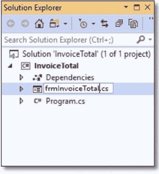

### 如何重命名文件、项目或解决方案

- 你可以通过在解决方案资源管理器窗口中右键单击它并从快捷菜单中选择重命名命令来重命名文件、项目或解决方案。或者，你可以在解决方案资源管理器中选择文件、项目或解决方案，然后按 F2。然后，你可以输入文件、项目或解决方案的新名称。
- 重命名文件时，请务必不要更改或省略文件扩展名。还请记住，使用三字母前缀来指示文件的内容（如表单文件的 `frm`）可以更轻松地识别每个文件代表什么。
- 当你更改表单文件的名称时，Visual Studio 还会更改表单的 File Name 属性。它还会询问你是否要更改对该文件的所有引用，这通常是你想要的。

### 如何保存文件、项目或解决方案

- 你可以使用标准工具栏中的 Save All 按钮或文件菜单中的 Save All 命令来保存解决方案中的所有文件和项目。
- 你可以使用标准工具栏中的 Save 按钮或文件菜单中的 Save 命令来保存文件、项目或解决方案。保存哪些文件取决于解决方案资源管理器窗口中选择的项目。如果选择了单个文件，则只保存该文件。如果选择了项目，则保存整个项目及其解决方案。如果选择了解决方案，则保存整个解决方案及其所有项目。
- 如果尝试关闭包含已修改文件的解决方案，将显示一个对话框，询问你是否要保存这些文件。

图 2-9   如何命名和保存项目的 files

#### 4.5.5. mysqltest — MySQL 测试程序

此实用程序以前名为 mysql_test，是用于测试 MySQL 服务器正确性的测试程序。它可用于 MySQL 服务器的回归测试，以及测试 MySQL 客户端/服务器协议。

下表显示了 mysqltest 程序支持的选项：

| 选项 | 描述 |
|--------|-------------|
| --help | 显示帮助信息并退出 |
| --silent | 静默模式，仅输出错误 |
| --verbose | 详细模式，打印更多详细信息 |
| --debug | 启用调试输出 |
| --host=host_name | 连接到指定主机上的 MySQL 服务器 |
| --port=port_num | 用于连接的 TCP/IP 端口号 |
| --socket=path | 用于连接的 Unix 套接字文件 |
| --user=user_name | 连接时使用的 MySQL 用户名 |
| --password[=password] | 连接时使用的密码 |
| --test-file=file_name | 包含要执行的测试命令的文件 |
| --record | 将测试结果记录到测试文件中 |
| --result-file=file_name | 写入测试结果的文件 |
| --silent | 仅抑制错误以外的所有输出 |
| --verbose | 在测试执行期间打印额外信息 |

mysqltest 实用程序读取包含 SQL 语句和特殊命令的测试文件，对其执行 MySQL 服务器，并将输出与预期结果进行比较。差异将报告给用户。

- 测试文件格式在 MySQL 源代码树中的 mysql-test 目录下有描述。
- 支持多个内置命令，如 `--echo`、`--sleep`、`--query` 和 `--error`。
- 该程序通常与 MySQL 开发中的 mysql-test-run.pl 驱动程序一起使用。

```bash
mysqltest --host=localhost --user=root --password --test-file=mytest.test
```

## 向新表单添加控件并设置属性

6. 使用图 2-4 中的技术向表单添加控件，使其大小和位置与图 2-5 中的大致相同。但不必担心标签的大小，只需注意其位置即可。

7. 选择一组控件并使用布局工具栏中的按钮来调整控件的大小和对齐方式。但同样，让标签自动调整大小。然后，调整表单的大小，使其看起来像图 2-4 中的那样。

8. 使用属性窗口设置表单及其控件的属性，使其看起来像图 2-3 中的表单。这些属性在图 2-8 中进行了总结。

## 测试用户界面

9. 按 F5 构建并运行项目。这应该在屏幕中央显示表单，并且它应该看起来像图 2-3 中的那样。

10. 尝试使用表单，看看它能做什么。当你按 Tab 键时，注意焦点如何从一个控件移动到另一个控件。当你单击按钮时，注意它如何缩进然后弹回，就像任何其他 Windows 按钮控件一样。尽管如此，由于你尚未为它们编写代码，因此这些按钮单击不会产生其他任何反应。

注意 Calculate 按钮周围有一个深色轮廓，表示如果你按 Enter 键，其功能将被执行。 （如果没有深色轮廓，则表示你尚未将表单的 AcceptButton 属性设置为该按钮。）

当你按 Alt 键时，注意 Subtotal 中的 s、下划线出现在 Calculate 中的第一个 c 以及 Exit 中的 x 下，以指示你可以使用访问键来操作这些控件。 （如果下划线没有显示，则表示你没有正确输入 Text 属性。）

11. 如果你发现某些属性设置不正确，请单击表单右上角的关闭按钮关闭表单。然后，进行必要的更改并再次运行项目。当你对表单的工作感到满意时，关闭表单以返回到表单设计器。

## 尝试表单及其控件的属性

12. 在表单设计器中，单击表单使其被选中。然后，如果需要，调整属性窗口，使你可以看到每个属性的描述。为此，将窗口的底部边界向上拖动。

13. 单击属性窗口顶部的按类别显示按钮，按类别显示属性。然后，查看外观、行为、布局和窗口样式类别中的属性。虽然你不会理解所有描述，但你应该能理解其中的一些。

14. 在窗口样式类别中，将 MaximizeBox 和 MinimizeBox 的设置更改为 false，看看表单如何变化。然后，要撤消这些更改，请在标准工具栏中两次单击撤消按钮或按 Ctrl+Z 两次。


## 如何编码和测试 Windows Forms 应用程序

在上一章中，你学习了如何为 Windows Forms 应用程序设计窗体。在本章中，你将学习如何编码和测试 Windows Forms 应用程序。完成后，你将能够开发自己的简单应用程序。

- 编码简介 .........................................................56
- 面向对象编程简介........................................56
- 如何引用属性、方法和事件....................................58
- 应用程序如何响应事件................................................60
- 如何向窗体添加代码 ...........................................................62
- 如何为窗体或控件的默认事件创建事件处理程序....62
- 如何删除事件处理程序.......................................................62
- IntelliSense 如何帮助你输入窗体代码..............................64
- Invoice Total 窗体的事件处理程序 .....................................66
- 如何检测和纠正语法错误.............................................68
- 更多编码技巧 ...................................................................70
- 如何以可读的风格编写代码....................................................70
- 如何编写注释 ...............................................................72
- 如何使用文本编辑器工具栏............................................74
- 如何折叠或展开代码块 ..........................................74
- 如何使用代码片段 .............................................................76
- 如何重构代码..................................................................78
- 如何获取帮助信息..........................................................78
- 如何运行、测试和调试项目...............................................80
- 如何运行项目 ..................................................................80
- 如何测试项目 ................................................................82
- 如何调试运行时错误..........................................................84
- 小结 ............................................................................86

### 编码简介

在学习向窗体添加代码的具体操作之前，理解面向对象编程背后的一些概念非常重要。

### 面向对象编程简介

无论你是否意识到，在使用 Visual Studio 的窗体设计器设计 Windows 窗体时，你实际上正在使用*面向对象编程*。这是因为窗体上的每个控件都是一个对象，窗体本身也是一个对象。这些对象派生自 .NET 类库中的类。

当你从 Windows Forms App 模板启动新项目时，实际上是在创建一个新的*类*，它继承了 Windows.Forms 类库中 Form 类的特性。之后，当你运行窗体时，实际上是在创建窗体类的一个*实例*，这个实例称为*对象*。

类似地，当你向窗体添加控件时，实际上是在向窗体添加一个控件对象。每个控件都是特定类的实例。例如，文本框控件是 TextBox 类的一个实例对象。同样，标签控件是 Label 类的一个实例对象。这种从类创建对象的过程称为*实例化*。

随着你学习本书的深入，你将了解更多关于类和对象的内容，因为 C# 是一种*面向对象的语言*。例如，在第 12 章中，你将学习如何使用 C# 语言创建自己的类。到那时，你将开始理解在使用类和对象时实际发生的事情。但是现在，你只需要熟悉这些术语，并接受在设计窗体及其控件时幕后发生了很多事情这一事实。

图 3-1 总结了我刚刚关于类和对象所说的内容。它还向你介绍了由类定义、由对象使用的属性、方法和事件。如你所见，对象的*属性*定义了对象的特征和数据。例如，Name 属性为控件命名，Text 属性决定控件内显示的文本。相比之下，对象的*方法*决定了对象可以执行的操作。

对象的*事件*是对象发送给应用程序的信号，表示发生了可以响应的事情。例如，如果用户单击按钮，Button 控件对象会生成一个名为 Click 的事件。然后，你的应用程序可以通过运行一个 C# 方法来处理 Click 事件。

顺便提一下，对象或类的属性、方法和事件称为对象或类的*成员*。在接下来的三个图中，你将了解更多关于属性、方法和事件的内容。

**一个窗体对象及其十个控件对象**

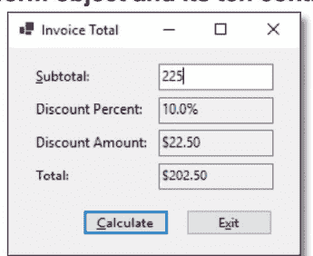

**类和对象的概念**

- *对象*是一个自包含的单元，结合了代码和数据。你已经使用过的两个对象示例是窗体和控件。
- *类*是定义对象特征的代码。你可以将类视为对象的模板。
- 对象是类的*实例*，从类创建对象的过程称为*实例化*。
- 从单个类可以创建多个对象实例。例如，窗体可以有多个按钮对象，它们都是从同一个 Button 类实例化的。每个都是独立的对象，但都共享 Button 类的特征。

**属性、方法和事件的概念**

- *属性*定义对象的特征以及与对象关联的数据。
- *方法*是对象可以执行的操作。
- *事件*是对象发送给应用程序的信号，告知应用程序发生了可以响应的事情。
- 属性、方法和事件可以称为对象的*成员*。
- 如果实例化同一个类的两个或多个实例，所有对象都具有相同的属性、方法和事件。但是，分配给属性的值可以因实例而异。

**对象和窗体**

- 当你使用窗体设计器时，Visual Studio 会自动生成 C# 代码，基于 Form 类创建一个新类。然后，当你运行项目时，会从新类实例化一个窗体对象。
- 当你向窗体添加控件时，Visual Studio 会在窗体的类中自动生成 C# 代码，从适当的类实例化一个控件对象，并设置控件的默认属性。当你移动和调整控件大小时，Visual Studio 会自动设置指定控件位置和大小的属性。

图 3-1      面向对象编程简介

### 如何引用属性、方法和事件

**在代码编辑器窗口中显示的成员列表**

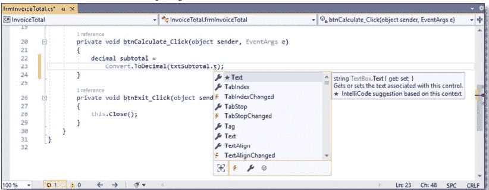

**引用类或对象成员的语法**

```
ClassName.MemberName
objectName.MemberName
```

**引用属性的语句**

| Code | Description |
| --- | --- |
| txtTotal.Text = "10"; | 将包含数字 10 的字符串赋给名为 txtTotal 的文本框的 Text 属性。 |
| txtTotal.ReadOnly = true; | 将 true 值赋给名为 txtTotal 的文本框的 ReadOnly 属性，使用户无法更改其内容。 |

**引用方法的语句**

| Code | Description |
| --- | --- |
| txtMonthlyInvestment.Focus(); | 使用 Focus() 方法将焦点移动到名为 txtMonthlyInvestment 的文本框。 |
| this.Close(); | 使用 Close() 方法关闭包含该语句的窗体。在此示例中，this 是用于引用当前类实例的关键字。 |

**引用事件的代码**

| Code | Description |
| --- | --- |
| btnExit.Click | 引用名为 btnExit 的按钮的 Click 事件。 |

**在代码编辑器中工作时如何输入成员名称**

- 要显示类或对象的可用成员列表，请键入类或对象名称，后跟句点（称为点运算符，或简称点）。然后，你可以键入成员名称的一个或多个字母，代码编辑器将选择列表中与这些字母匹配的第一项。或者，你可以向下滚动列表以选择所需的成员。选中后，按 Tab 或 Enter 键将成员插入到代码中。
- 如果没有显示成员列表，请选择“工具”→“选项”命令以显示“选项”对话框。然后，展开“文本编辑器”组，选择“C#”类别，并选中“自动列出成员”和“参数信息”复选框。

图 3-2    如何引用属性、方法和事件


## 应用程序如何响应事件

Windows Forms 应用程序是*事件驱动*的。这意味着它们通过响应对象上发生的事件来工作。要响应一个事件，你需要编写一种特殊类型的方法，称为*事件处理程序*。当你这样做时，Visual Studio 会生成一条语句，将事件处理程序连接到事件上，即“接线”。这称为*事件接线*，如图 3-3 所示。

在此图中，用户单击了 Invoice Total 表单上的 Exit 按钮。然后，Visual Studio 使用它生成的语句来接线该事件，以确定响应事件时应执行哪个事件处理程序。在本例中，btnExit.Click 事件被接线到名为 btnExit_Click 的方法，因此该方法被执行。如你所见，此事件处理程序包含一条单一语句，该语句使用 Close() 方法关闭表单。

该图还列出了控件和表单的一些常见事件。你将经常响应的一个控件事件是 Click 事件。当用户用鼠标单击对象时，该事件会发生。类似地，当用户双击对象时，DoubleClick 事件会发生。

尽管 Click 和 DoubleClick 事件是由用户操作启动的，但并非总是如此。例如，Enter 和 Leave 事件通常发生在用户将焦点移入或移出控件时，但它们也可能发生在代码将焦点移入或移出控件时。类似地，表单的 Load 事件发生在表单被加载到内存中时。对于应用程序的第一个表单，这通常发生在用户启动应用程序时。而 Closed 事件发生在表单被关闭时。对于本图中展示的 Invoice Total 表单，这发生在用户单击 Exit 按钮或表单右上角的 Close 按钮时。

除了此处显示的事件外，大多数对象还有许多其他事件，应用程序可以对其做出响应。例如，当用户将鼠标悬停在对象上或按下/释放键时就会发生事件。但是，你通常不会响应这些事件。

### 事件：用户单击 Exit 按钮

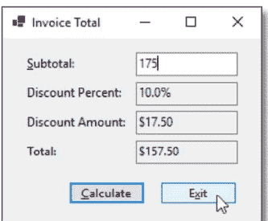

### 接线：应用程序确定要执行哪个方法

```
this.btnExit.Click += new System.EventHandler(this.btnExit_Click);
```

### 响应：执行 Exit 按钮的 Click 事件的方法

```
private void btnExit_Click(object sender, EventArgs e)
{
    this.Close();
}
```

### 常见控件事件

| 事件 | 发生于... |
|-------|----------------|
| Click | ...用户单击控件时。 |
| DoubleClick | ...用户双击控件时。 |
| Enter | ...焦点移至控件时。 |
| Leave | ...焦点移离控件时。 |

### 常见表单事件

| 事件 | 发生于... |
|-------|----------------|
| Load | ...表单被加载到内存中时。 |
| Closing | ...表单正在关闭时。 |
| Closed | ...表单已关闭时。 |

## 概念

- Windows Forms 应用程序通过响应对象上发生的事件来工作。
- 为了指示应用程序应如何响应事件，你需要编写一个*事件处理程序*，它是一种处理事件的特殊类型的方法。
- 为了将事件处理程序连接到事件，Visual Studio 会自动生成一条语句，将事件接线到事件处理程序。这被称为*事件接线*。
- 事件可以是用户发起的操作，如 Click 事件，也可以是程序代码发起的操作，如 Closed 事件。

## 如何向表单添加代码

现在你已经了解了一些面向对象编程背后的概念，你就可以学习如何向表单添加代码了。因为你将在后面的章节中学习 C# 语言的基础知识，所以我现在不会重点关注编码细节。相反，我将重点关注向表单添加代码的概念和机制。

### 如何为表单或控件的默认事件创建事件处理程序

虽然你可以为任何对象的任何事件创建事件处理程序，但你最有可能为表单和控件的默认事件创建事件处理程序。所以本章你将学习如何做到这一点。然后，在第 6 章中，你将学习如何为其他事件创建事件处理程序。

要为表单或控件的默认事件创建事件处理程序，你在 Form Designer 中双击该对象。然后，Visual Studio 打开代码编辑器，为该对象的默认事件生成方法声明，并将插入点放置在该声明的开始大括号和结束大括号之间的空白行上。因此，你可以立即开始输入要在方法体中包含的 C# 语句。

举例来说，图 3-4 显示了我在 Invoice Total 表单上双击 Calculate 按钮时生成的代码。在此图中，表单的代码存储在名为 frmInvoiceTotal.cs 的文件中。此外，方法的名称是对象的名称（btnCalculate）、一个下划线以及事件的名称（Click）。将此按钮的 Click 事件接线到此事件处理程序的语句存储在名为 frmInvoiceTotal.Designer.cs 的文件中。

在为控件启动事件处理程序之前，你应按照第 2 章所述设置控件的 Name 属性。这样，此名称将反映在事件处理程序的方法名称中，如本图所示。如果你更改控件名称后再为其启动事件处理程序，Visual Studio 将更改事件接线中的对象名称，但不会更改方法名称中的对象名称。当你刚开始学习 C# 时，这可能会令人困惑。

你还应避免修改在创建事件处理程序时为你生成的 方法声明。在第 6 章中，你将学习如何修改方法声明。但现在，你应保持方法声明不变，并专注于在方法体中添加代码。

### 如何删除事件处理程序

如果你不小心添加了事件处理程序，就不能简单地删除它。如果你这样做，尝试运行应用程序时会出现错误。该错误将显示在如图 3-7 所示的错误列表窗口中，并会指出事件处理程序丢失。

### 处理 Calculate 按钮的 Click 事件的方法

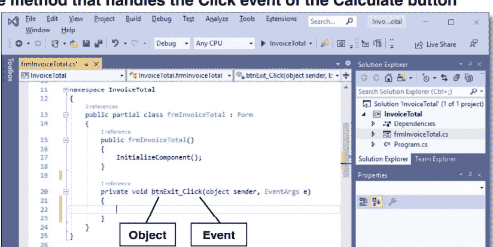

### 如何处理按钮的 Click 事件

- 1. 在 Form Designer 中双击按钮。这将打开代码编辑器，生成处理该事件的方法声明，并将光标置于该声明内。
- 2. 在方法声明的开始大括号（{）和结束大括号（}）之间输入 C# 代码。
- 3. 完成编写代码后，你可以通过单击其选项卡返回到 Form Designer。

### 如何处理表单的 Load 事件

- 按照上述步骤操作，但双击表单本身。

## 描述

- 当你在 Form Designer 中双击对象时生成的事件处理程序的方法声明包含一个方法名，该名称由对象名、下划线和事件名组成。事件处理程序存储在表单的 cs 文件中。
- 当你设计表单时生成的大部分代码，包括将事件接线到事件处理程序的语句，都存储在表单的 Designer.cs 文件中。如有必要，你可以打开此文件以查看或删除事件接线。
- 在第 6 章中，你将学习如何处理默认事件之外的事件。

这是因为当你创建事件处理程序时，Visual Studio 还会生成一条将事件接线到事件处理程序的语句。因此，如果你删除事件处理程序，也必须删除该事件的接线。最简单的方法是双击错误列表窗口中的错误消息。这将打开表单的 Designer.cs 文件并跳转到包含缺失事件处理程序接线的语句。然后，你可以删除该语句。

### IntelliSense 如何帮助你输入表单的代码

在图 3-2 中，你看到了 IntelliSense 如何显示类或对象的可用成员列表。IntelliSense 还可以帮助你为声明的变量选择类型，你将在第 4 章学习如何做到这一点。它可以帮助你使用正确的语法调用方法，如第 6 章和第 12 章所示。它还可以帮助你输入关键字和数据类型，以及变量、对象和类的名称。图 3-5 说明了其工作原理。

该图中的第一个示例显示了当你开始输入新代码行时 IntelliSense 显示的补全列表。在这里，因为我输入了字母 i，列表被定位在以该字母开头的最后使用的项目上。在本例中，它定位在 if 关键字上。如本章前面所述，你可以输入任意多个字母，Visual Studio 会根据你的输入选择适当的项目。你也可以滚动列表以选择项目，并按 Tab 或 Enter 键将项目插入代码中。

当你选择列表中的项目时，Visual Studio 会在工具提示中显示有关该项目的信息。例如，if 关键字的工具提示指出 if 语句的代码片段可用，并且可以通过按两次 Tab 键插入。你将在本章后面了解有关使用代码片段的更多信息。

该图中的第二个示例显示了在插入 if 关键字后输入空格、左括号和初始文本 su 后显示的补全列表。这使得在代码中输入名为 subtotal 的变量变得容易，并且 IntelliSense 自动添加了右括号。

如果你使用这些 IntelliSense 功能，你会发现它们可以帮助你避免在代码中引入错误。例如，很容易忘记你给控件和变量起的名字，因此显示的列表可以帮助你找到合适的名称。

尽管此处未显示，Visual Studio 还允许你在不关闭列表的情况下查看 IntelliSense 列表背后的代码。要做到这一点，你只需按住 Ctrl 键，列表就会在你释放该键之前保持隐藏。


### 在代码行的开头输入字母时显示的补全列表

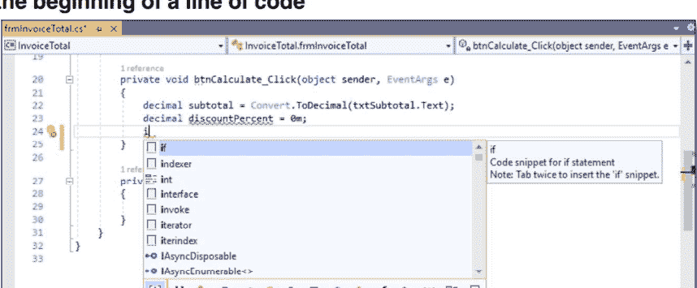

### 在语句中输入代码时显示的补全列表

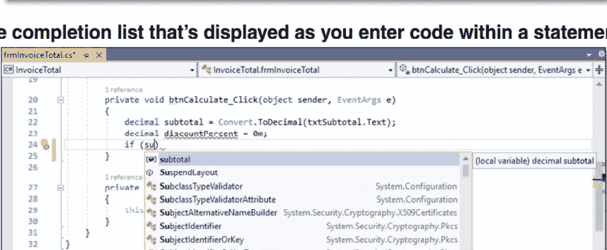

## 描述

- IntelliSense 为 C# 提供的补全会在你输入时列出关键字、数据类型、变量、对象和类，以便你正确输入它们。
- 当你在补全列表中突出显示一项时，会显示一个工具提示，其中包含有关该项的信息。
- 如果你需要在不关闭列表的情况下查看补全列表背后的代码，请按住 Ctrl 键。然后，在你释放 Ctrl 键之前，列表将被隐藏。
- 如果你输入左括号或左大括号，右括号或右大括号会自动添加。

Figure 3-5      IntelliSense 如何帮助你输入窗体的代码

## Invoice Total 窗体的事件处理程序

Figure 3-6 展示了 Invoice Total 窗体的两个事件处理程序。此示例中着色的代码是在 Form Designer 中双击 Calculate 和 Exit 按钮时生成的代码。你必须自己输入其余的代码。

我将在此简要描述这段代码，以便你对它如何工作有一个大致的了解。然而，如果你刚开始编程，可能要等到阅读完接下来的两章后才能完全理解这段代码。

Calculate 按钮的 Click 事件处理程序会根据用户输入的小计计算折扣百分比、折扣金额和发票总额。然后，它会在相应的文本框控件中显示这些计算结果。例如，如果用户输入的小计为 1000，则折扣百分比为 20%，折扣金额为 $200，发票总额为 $800。

相比之下，Exit 按钮的 Click 事件处理程序仅包含一条语句，该语句执行窗体的 Close() 方法。因此，当用户单击此按钮时，窗体将被关闭，应用程序结束。

除了双击 Calculate 和 Exit 按钮时生成的代码外，Visual Studio 还会生成隐藏在 Designer.cs 文件中的其他代码。当应用程序运行时，这段代码会实现你在 Form Designer 中设计的窗体和控件。虽然你可能想查看这段代码以了解其工作原理，但你不应使用代码编辑器修改此代码，因为它可能会导致 Form Designer 出现问题。唯一的例外是删除不必要的事件连接语句。

当你输入 C# 代码时，必须注意本图中总结的编码规则。特别是，请注意每个方法都包含一个用大括号括起来的代码块。正如你在本书中会看到的那样，大括号在 C# 中经常用于标识代码块。此外，请注意每个语句都以分号结尾。即使语句跨越多行代码也是如此。

你还应该意识到 C# 是一种区分大小写的语言。因此，你必须为所有 C# 关键字、类名、对象名、变量名等使用精确的大小写。如果你使用 IntelliSense 来帮助你输入代码，这不应该成为问题。

## Invoice Total 窗体的事件处理程序

```
private void btnCalculate_Click(object sender, EventArgs e)
{
    decimal subtotal = Convert.ToDecimal(txtSubtotal.Text);
    decimal discountPercent = 0m;
    if (subtotal >= 500)
    {
        discountPercent = .2m;
    }
    else if (subtotal >= 250 && subtotal < 500)
    {
        discountPercent = .15m;
    }
    else if (subtotal >= 100 && subtotal < 250)
    {
        discountPercent = .1m;
    }

    decimal discountAmount = subtotal * discountPercent;
    decimal invoiceTotal = subtotal - discountAmount;

    txtDiscountPercent.Text = discountPercent.ToString("p1");
    txtDiscountAmount.Text = discountAmount.ToString("c");
    txtTotal.Text = invoiceTotal.ToString("c");

    txtSubtotal.Focus();
}
```

```
private void btnExit_Click(object sender, EventArgs e)
{
    this.Close();
}
```

### 编码规则

- 使用空格分隔每个语句中的单词。
- 为所有关键字、类名、对象名、变量名等使用精确的大小写。
- 以分号结束每个语句。
- 每个代码块必须用大括号 ({}) 括起来。这包括定义方法主体 的代码块。

## 描述

- 当你在 Form Designer 中双击 Calculate 和 Exit 按钮时，Visual Studio 会生成上面显示的着色代码。然后，你可以在事件处理程序中输入其余的代码。
- Invoice Total 窗体的第一个事件处理程序在用户单击 Calculate 按钮时执行。此方法根据用户输入的小计计算并显示折扣百分比、折扣金额和总额。
- Invoice Total 窗体的第二个事件处理程序在用户单击 Exit 按钮时执行。此方法关闭窗体，从而结束应用程序。

## 如何检测和纠正语法错误

当你输入代码时，Visual Studio 会检查每个语句的语法。如果检测到语法错误或构建错误，Visual Studio 会在代码编辑器中用波浪线在代码下方显示。例如，在图 3-7 的代码编辑器中，你可以看到 txtPercent 和 txtAmount 下方的线条。

如果你将鼠标指针放在出错的代码上，会显示错误的简要描述。在这种情况下，错误消息指出名称不存在。这是因为代码编辑器中输入的名称与 Form Designer 使用的名称不匹配。如果 Form Designer 中的名称正确，你可以通过编辑代码编辑器中的名称轻松纠正这些错误。例如，在此图中，文本框的名称应为 txtDiscountPercent 和 txtDiscountAmount。

如果错误列表窗口如本图所示打开，Visual Studio 检测到的任何错误也会显示在该窗口中。如果错误列表窗口未打开，你可以使用 View→Error List 命令显示它。然后，你可以通过在错误列表窗口中双击它跳转到代码编辑器中的错误。

当你刚开始使用 C# 时，你不可避免地会遇到很多错误。因此，你可能希望始终保持错误列表窗口打开。这使得错误一出现就能轻松看到。然后，一旦你熟悉了 C# 的使用，你就可以通过使用自动隐藏按钮来节省屏幕空间，这样窗口只有在你单击屏幕底部边缘的错误列表选项卡时才会显示。

如果你需要进一步帮助确定语法错误的成因，可以使用实时代码分析功能。要使用此功能，你可以单击将鼠标指针放在错误上时出现的灯泡或链接，以显示潜在修复列表。然后，你可以突出显示一个修复方案以预览将要进行的更改，并按 Enter 键应用修复。或者，你可以单击一个修复方案以应用它。

顺便说一下，Visual Studio 并不能在你输入代码时检测到所有语法错误。相反，一些语法错误要等到项目构建时才会检测到。你将在本章后面了解有关构建项目的更多信息。

### 显示语法错误的 Code Editor 和 Error List 窗口

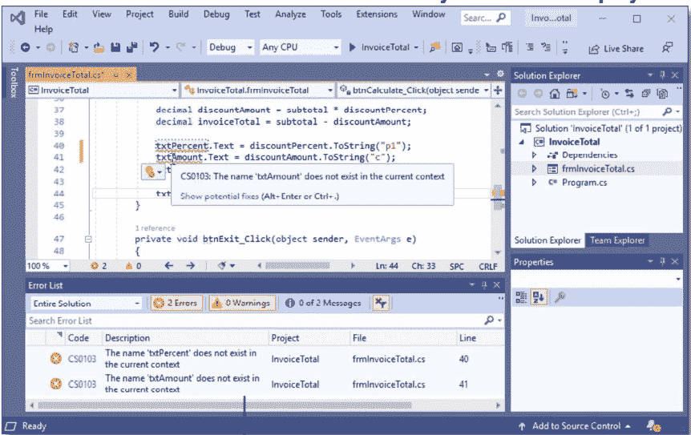

## 描述

- Visual Studio 会在你输入时检查你的 C# 代码语法。如果检测到语法错误（或构建错误），它会在代码编辑器中用波浪下划线突出显示，你可以将鼠标指针放在其上以显示错误的描述。
- 如果错误列表窗口打开，所有构建错误都会列在该窗口中。然后，你可以双击列表中的任何错误，将其带到代码编辑器中的位置。当你纠正错误时，它会从错误列表中删除。
- 如果错误列表窗口未打开，你可以通过从视图菜单中选择错误列表命令来显示它。然后，如果你想隐藏此窗口，可以单击其自动隐藏按钮。
- 要显示错误的潜在修复列表，你可以单击将鼠标指针指向错误时在错误描述下方显示的显示潜在修复链接。你也可以通过单击指向错误时出现的灯泡或单击错误时在错误左侧边距中出现的灯泡来显示此列表。这是实时代码分析功能的一部分。
- 你可以突出显示列表中的潜在修复方案以预览更改，并可以通过单击它或突出显示它并按 Enter 来应用修复。
- Visual Studio 在项目构建之前不会检测到一些语法错误。因此，在构建项目时你可能会遇到更多语法错误。

Figure 3-7      如何检测和纠正语法错误


## 更多编码技能

在这一点上，你应该理解向窗体添加代码的机制。然而，要有效地编写代码，你还需要一些额外的技能。接下来的主题介绍一些最有用的编码技能。

### 如何以可读的风格编写代码

在图3-6中，你学习了一些在输入应用程序代码时必须遵循的编码规则。如果不遵守，Visual Studio会报告语法错误，你必须先修正这些错误才能继续。你在上一个图中看到了这个过程。

不过，除了遵守编码规则，你还应该尽量编写易于阅读、调试和维护的代码。这对你很重要，但如果其他人必须接手维护你的代码，就更为重要。通过遵循图3-8中给出的三条编码建议，你可以编写出更具可读性的代码。

为了说明这一点，该图展示了一个事件处理程序的两个版本。两个版本完成相同的任务。然而，正如你所见，第一个版本比第二个版本更容易阅读，因为它遵循了我们的编码建议。

第一条编码建议是使用缩进和额外空格来对齐代码中的相关元素。这是可行的，因为你可以使用一个或多个空格、制表符或回车来分隔C#语句中的元素。在这个例子中，事件处理程序中的所有语句都进行了缩进。此外，if-else语句也进行了缩进并对齐，这样你可以轻松识别该语句的各个部分。

第二条建议是在每条语句中用空格分隔单词、值和运算符。在可读性较差的代码示例中，你可以看到除了方法声明之外的每一行代码都至少包含一个运算符。由于运算符与其两侧的单词或值之间没有分隔，代码难以阅读。相比之下，可读性好的代码在每个运算符的两侧都包含了一个空格。

第三条建议是在相关语句组的前后使用空行，将它们与其余代码区分开。这一点也由该图中的第一个方法体现。在这里，代码被分成五组语句。对于像这样简短的方法，这不太重要，但它可以使一个长方法更容易理解。

在本书中，你会看到展示这些建议用法的代码。你还会收到其他编码建议，这些建议将帮助你编写易于阅读、调试和维护的代码。

当你输入代码时，代码编辑器会自动帮助你格式化代码。例如，当你在一条语句末尾按回车键时，编辑器会将下一条语句缩进到相同的级别。虽然你可以使用“选项”对话框更改这种方式，但你可能不会想要这样做。

### 以可读风格编写的方法

```csharp
private void btnCalculate_Click(object sender, EventArgs e)
{
    decimal subtotal = Convert.ToDecimal(txtSubtotal.Text);

    decimal discountPercent = 0m;
    if (subtotal >= 500)
    {
        discountPercent = .2m;
    }
    else if (subtotal >= 250 && subtotal < 500)
    {
        discountPercent = .15m;
    }
    else if (subtotal >= 100 && subtotal < 250)
    {
        discountPercent = .1m;
    }

    decimal discountAmount = subtotal * discountPercent;
    decimal invoiceTotal = subtotal - discountAmount;

    txtDiscountPercent.Text = discountPercent.ToString("p1");
    txtDiscountAmount.Text = discountAmount.ToString("c");
    txtTotal.Text = invoiceTotal.ToString("c");

    txtSubtotal.Focus();
}
```

### 以可读性较差的风格编写的方法

```csharp
private void btnCalculate_Click(object sender, EventArgs e){
decimal subtotal=Convert.ToDecimal(txtSubtotal.Text);
decimal discountPercent=0m;
if (subtotal>=500) discountPercent=.2m;
else if (subtotal>=250&&subtotal<500) discountPercent=.15m;
else if (subtotal>=100&&subtotal<250) discountPercent=.1m;
decimal discountAmount=subtotal*discountPercent;
decimal invoiceTotal=subtotal-discountAmount;
txtDiscountPercent.Text=discountPercent.ToString("p1");
txtDiscountAmount.Text=discountAmount.ToString("c");
txtTotal.Text=invoiceTotal.ToString("c");txtSubtotal.Focus();}
```

### 编码建议

- 使用缩进和额外空格来对齐语句和代码块，使其反映程序的结构。
- 在每条语句中使用空格分隔单词、运算符和值。
- 在相关语句组前后使用空行。

### 注意

- 当你在代码编辑器中输入代码时，Visual Studio默认会自动调整其格式。

图3-8    如何以可读的风格编写代码

### 如何编写注释

注释用于记录程序的功能以及特定代码块和代码行的作用。由于C#编译器会忽略注释，你可以在程序的任何位置包含注释，而不会影响代码。图3-9展示了如何编写两种类型的注释。

首先，该图展示了一个位于方法开头的分隔注释。这类注释通常用于记录适用于整个方法或任何其他大型代码块的信息。你可以在分隔注释中包含任何有用或有帮助的信息，例如代码块的总体描述、作者姓名、完成日期、代码块使用的文件等等。

要记录单行代码或代码块的用途，你可以使用单行注释。一旦编译器读取到开始此类注释的斜杠（//），它就会忽略当前行结束之前的所有字符。在该图中，单行注释被用来描述每组语句。此外，一些代码行的末尾也使用了单行注释来阐明代码。

尽管许多程序员会在代码中大量添加注释，但如果你编写代码时使其易于阅读和理解，就没有必要这样做了。相反，你应该只在需要阐明难以理解的代码时才使用注释。当然，关键在于为需要解释的代码提供注释，而不要让不必要的注释杂乱地堆砌在代码中。例如，一位经验丰富的C#程序员并不需要该图中显示的任何注释。

注释的一个问题是，它们可能无法准确反映代码的实际功能。这种情况常发生在程序员修改了代码但未同步修改相应注释时。这样一来，代码就更难理解了，因为注释具有误导性。所以，如果你修改了带注释的代码，一定要同时修改注释。

顺便提一下，默认情况下，代码编辑器中的所有注释都以绿色显示，这与C#语句中单词的颜色不同。这使得注释很容易被识别。

### 带注释的方法

```csharp
private void btnCalculate_Click(object sender, EventArgs e)
{
    /***********************************************
    * this method calculates the total
    * for an invoice depending on a
    * discount that's based on the subtotal
    ************************************************/

    // get the subtotal amount from the Subtotal text box
    decimal subtotal = Convert.ToDecimal(txtSubtotal.Text);

    // set the discountPercent variable based
    // on the value of the subtotal variable
    decimal discountPercent = 0m;        // the m indicates a decimal value
    if (subtotal >= 500)
    {
        discountPercent = .2m;
    }
    else if (subtotal >= 250 && subtotal < 500)
    {
        discountPercent = .15m;
    }
    else if (subtotal >= 100 && subtotal < 250)
    {
        discountPercent = .1m;
    }

    // calculate and assign the values for the
    // discountAmount and invoiceTotal variables
    decimal discountAmount = subtotal * discountPercent;
    decimal invoiceTotal = subtotal - discountAmount;

    // format the values and display them in their text boxes
    txtDiscountPercent.Text =        // percent format
        discountPercent.ToString("p1");  // with 1 decimal place
    txtDiscountAmount.Text =
        discountAmount.ToString("c");    // currency format
    txtTotal.Text =
        invoiceTotal.ToString("c");

    // move the focus to the Subtotal text box
    txtSubtotal.Focus();
}
```

## 描述

- *注释* 用于帮助记录程序的功能以及其中代码的功能。
- 要编写 *单行注释*，请在注释前输入 `//`。你可以使用此技术在单独的一行中添加注释，也可以在一行的末尾添加注释。
- 要编写 *分隔注释*，请在注释的开头输入 `/*`，在结尾输入 `*/`。你也可以输入星号来标识注释中的各行，但这并非必要。

图3-9    如何编写注释


## 如何使用文本编辑器工具栏

图 3-10 显示了如何使用文本编辑器工具栏来处理代码。如果你尝试使用此工具栏，你会发现其按钮为处理注释和在不同位置之间移动提供了一些有用的功能。

特别是，你可以使用文本编辑器工具栏在测试期间注释掉多行代码，只需选择代码行然后点击注释掉按钮即可。然后，你可以在不执行这些代码行的情况下测试程序。如果需要，你可以使用取消注释按钮来恢复这些代码行。

你也可以使用文本编辑器工具栏来处理书签。在使用切换书签按钮标记代码行后，你可以使用下一个和上一个按钮在标记的代码行之间轻松移动。虽然在处理像此处所示的简单应用程序时你通常不需要书签，但在处理包含数页以上代码的应用程序时，书签会很有帮助。

## 如何折叠或展开代码块

在为应用程序编写代码时，你可能希望折叠或展开某些区域、注释和方法，以便更轻松地滚动代码并找到特定的代码段。为此，你可以使用图 3-10 中描述的技术。例如，在此图中，frmInvoice-Total 方法已被折叠，因此你只能看到其方法声明。

## 代码编辑器和文本编辑器工具栏

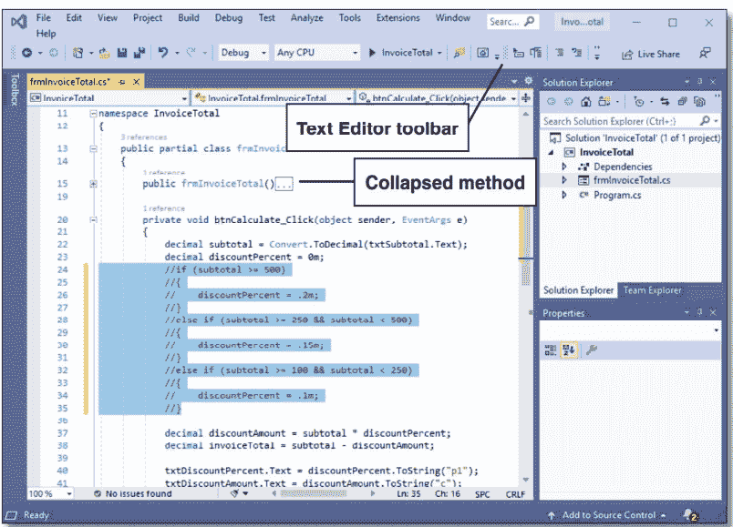

## 如何使用文本编辑器工具栏的按钮

- 要显示或隐藏文本编辑器工具栏，请在工具栏区域右键单击并从快捷菜单中选择文本编辑器。
- 要注释或取消注释多行代码，请选择这些行并点击注释掉或取消注释按钮。在测试期间，你可以注释掉代码行使其不被执行。这样，你可以在不删除旧语句的情况下测试新语句。
- 要在代码行之间快速移动，你可以使用文本编辑器工具栏上的最后四个按钮来设置书签并在书签之间移动。

## 如何折叠或展开代码区域

- 如果代码区域在代码编辑器中旁边显示减号 (-)，你可以点击减号来折叠该区域，使其仅显示第一行。
- 如果代码区域在代码编辑器中旁边显示加号 (+)，你可以点击加号来展开该区域，使其所有代码都显示出来。

## 如何使用代码片段

当你向应用程序添加代码时，你会经常发现自己一遍又一遍地输入相同的代码模式。例如，你经常输入一系列 if 块，如前几幅图所示。为了便于输入这些模式，Visual Studio 提供了称为代码片段的功能。代码片段使输入常见控制结构变得容易，如你在第 5 章中将要学习的内容。

有时，你希望在空白文本行上插入代码片段，如图 3-11 所示。最简单的方法是选择一个具有代码片段的完成列表项，然后按两次 Tab 键。例如，在此图中，第一个屏幕显示了 if 关键字的完成列表（不是列表中更下方 #if 片段）。此屏幕包含一个工具提示，指示 if 语句具有代码片段，并且你可以按两次 Tab 键来插入该片段。

如果你按两次 Tab 键，Visual Studio 会插入一个包含 if 块开头的片段，如第二个屏幕所示。这样，你可以在括号内输入条件，并在大括号之间输入一些语句。

其他时候，你希望用代码片段包围现有的代码行。在这种情况下，你可以选择要包围的代码，右键单击该代码，然后从结果菜单中选择环绕方式命令。然后，你可以选择适当的片段。例如，你可能希望在一个或多个现有语句周围添加一个 if 块。

如果你发现自己喜欢使用代码片段，你应该知道可以从默认列表中添加或删除片段。为此，你可以从工具菜单中选择代码片段管理器命令。然后，你可以使用结果对话框删除不使用的代码片段或添加新的代码片段。但是，请注意，编写新的代码片段需要创建定义代码片段的 XML 文件。要了解如何执行此操作，你可以查阅 Visual Studio 的文档。

顺便说一下，如果你刚开始编程并且不理解本章中的 if 语句，不用担心。相反，只需专注于使用代码片段的机制。在第 5 章中，你将学习有关编写 if 语句所需了解的一切。

## if 关键字的完成列表

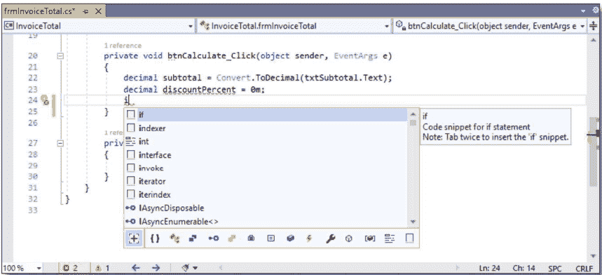

## if 片段插入后的样子

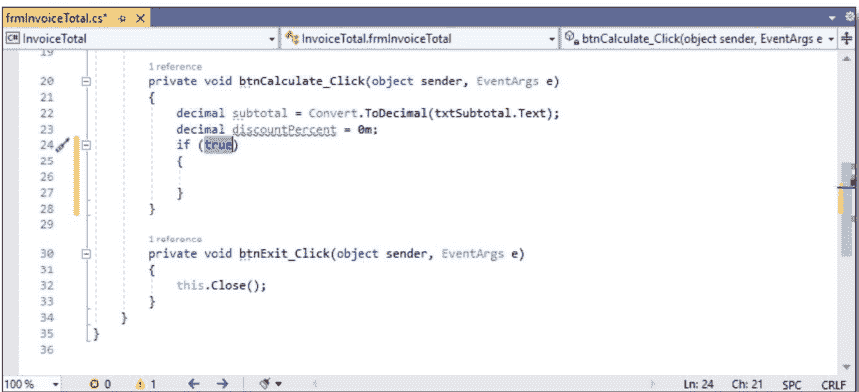

## 说明

- 要插入代码片段，请选择具有代码片段的完成列表项，然后按两次 Tab 键。
- 要用代码片段包围现有代码，请选择代码，右键单击它，然后从结果菜单中选择环绕方式命令。然后，选择适当的片段。
- 你可以使用工具→代码片段管理器命令显示一个对话框，你可以使用它来编辑可用代码片段的列表并添加自定义代码片段。

## 重命名变量时显示的选项

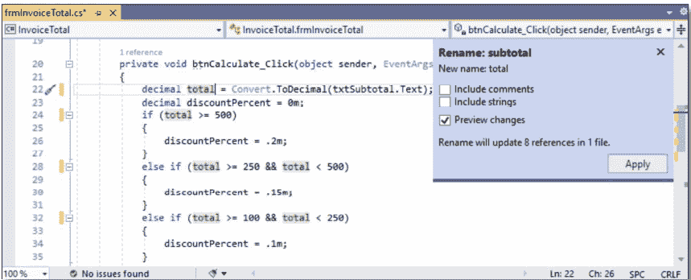

## 预览更改 - 重命名对话框

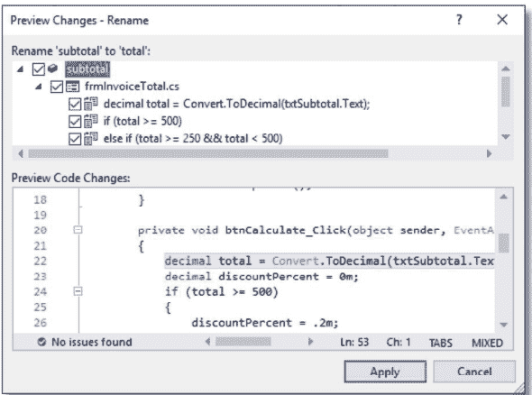

## 说明

- 修订和重构现有代码的过程称为 *重构*。重构是实时代码分析功能的一部分。
- 要更改代码中使用的名称，你可以突出显示该名称，右键单击它，然后从显示的快捷菜单中选择重命名。然后，输入新名称并在显示的对话框中点击应用。
- 你也可以使用重构来修改代码的结构，通过引入常量或变量、提取方法等。为此，首先选择要重构的代码。然后，按 Ctrl + 句点 (.) 显示操作菜单并选择适当的重构操作。
- 一些重构命令会显示一个对话框，让你在进行更改前预览更改。然后，你可以取消选择不想要的更改。

## 如何运行、测试和调试项目

在输入项目的代码并纠正输入代码时检测到的任何语法错误后，你可以运行项目。项目运行时，你可以测试它以确保其按你想要的方式工作，并且可以调试它以删除发现的任何编程错误。

### 如何运行项目

正如你在第 1 章中学到的，你可以通过点击标准工具栏中的开始按钮、从调试菜单中选择开始调试命令或按 F5 键来 *运行* 项目。这会在尚未构建的情况下 *构建* 项目，并导致项目的窗体显示，如图 3-13 所示。当你关闭此窗体时，应用程序结束。然后，你将返回到 Visual Studio，可以继续处理你的程序。

你也可以在不运行的情况下构建项目，如本图所示。但是，在大多数情况下，你会运行项目以便测试和调试它。

如果在运行项目时检测到构建错误，错误将显示在错误列表窗口中，你可以使用此窗口来识别和纠正错误。如果尚未显示，你可以通过点击通常显示在窗口底部的错误列表选项卡或使用视图→错误列表命令来显示此窗口。当你这样做时，你应该意识到，即使你已更正了它们，错误仍会在错误列表窗口中列出并在代码编辑器中突出显示。错误不会在你再次构建项目之前清除。


## 运行 Invoice Total 项目时显示的表单

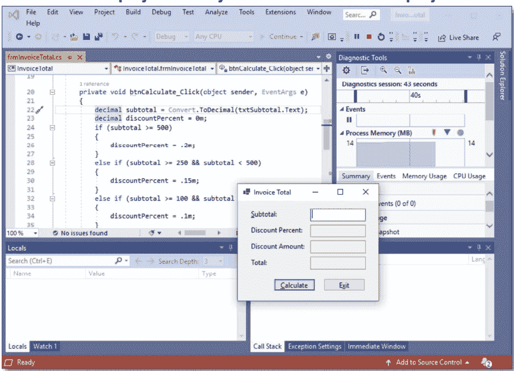

## 说明

- 若要*运行*项目，请单击标准工具栏中的“启动”按钮（带有绿色箭头和项目名称的按钮），选择“调试”→“开始调试”菜单命令，或按 F5 键。这会使 Visual Studio *生成*项目并创建程序集。然后，如果没有生成错误，程序集便会运行，因此会显示项目的表单，如上图所示。
- 如果在生成项目时检测到语法错误，则这些错误会列在“错误列表”窗口中，并且项目不会运行。
- 若要定位包含错误的语句，可以双击“错误列表”窗口中的错误描述。更正所有错误后，再次运行项目以重新生成它并清除错误。
- 可以通过选择“生成”→“生成解决方案”命令来生成项目而不运行它。
- 首次生成项目时，将生成项目的所有组件。之后，仅重新生成已更改的组件。若要重新生成所有组件（无论是否已更改），请使用“生成”→“重新生成解决方案”命令。

### 如何测试项目

当你测试项目时，你要运行它并确保应用程序正常工作。在测试项目时，应尝试输入数据和用户操作的每一种可能组合，以确保项目在每种情况下都能正常工作。换句话说，你的目标是让项目失败。图 3-14 概述了 C# 应用程序的测试过程。

首先，应测试用户界面。确保每个控件的大小和位置正确，所有控件和窗体标题栏中没有拼写错误，并且 Tab 键顺序和访问键等导航功能正常工作。

接下来，用一系列经过深思熟虑的有效测试数据对应用程序进行测试。确保你测试了项目将处理的每一种数据组合。例如，如果项目根据小计金额的不同值计算不同的折扣值，则使用落在每个范围内的所有小计金额进行测试。

最后，测试程序以确保它能正确处理用户输入的无效数据。例如，在期望数值数据的文本框中输入文本信息。将字段留空。在不应允许使用负数的情况下使用负数。请记住，测试的目标是找出所有问题。

在测试项目时，你会遇到运行时错误。这些错误也称为异常，当 C# 程序遇到阻止某个语句执行的问题时就会发生。例如，如果用户在 Invoice Total 窗体的“小计”文本框中输入“ABC”，当程序尝试将该值分配给 decimal 变量时，就会发生运行时错误。

当发生运行时错误时，Visual Studio 会中断到调试器，并显示一个如该图所示的“异常帮助器”窗口。然后，你可以使用在下一幅图中介绍的调试工具来调试该错误。

不过，运行时错误只应在测试程序时出现。在应用程序投入生产之前，应对其进行编码和测试，以便应用程序捕获所有运行时错误并向用户显示适当的消息。你将在本书第 7 章中学习如何做到这一点。

### 发生运行时错误时显示的“异常帮助器”

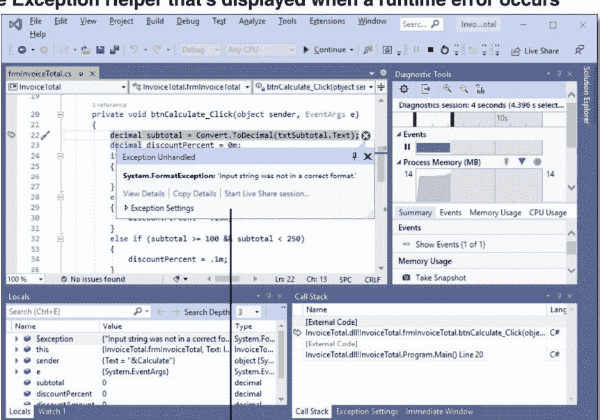

“异常帮助器”窗口

### 如何测试项目

1. 测试用户界面。目视检查所有控件，确保它们以正确的文本正确显示。使用 Tab 键确保 Tab 键顺序设置正确，验证访问键正常工作，并确保 Enter 和 Esc 键正常工作。
2. 测试有效的输入数据。例如，输入你期望用户输入的数据。
3. 测试无效数据或意外的用户操作。例如，将必填字段留空，在数值输入字段中输入文本数据，并在不合适的地方使用负数。尽你所能尝试让应用程序失败。

## 说明

- 要测试项目，需要运行项目，确保无论输入有效还是无效数据的组合，以及使用控件的顺序如何，它都能正常工作。
- 如果应用程序中的某个语句无法执行，就会发生运行时错误（或异常）。然后，如果应用程序未处理该异常，则导致异常的语句会突出显示，并显示一个类似上图的“异常帮助器”窗口。此时，你需要调试应用程序。

## 如何调试运行时错误

当发生运行时错误时，Visual Studio 会进入*中断模式*。在该模式下，Visual Studio 会显示代码编辑器并突出显示无法执行的语句，显示“调试”工具栏，并显示一个如图 3-14 所示的“异常帮助器”窗口。这旨在帮助你找到异常（即*缺陷*）的原因，并通过防止异常再次发生或处理异常来*调试*应用程序。

通常，仅凭知道哪个语句无法执行，或阅读“异常帮助器”显示的消息，你就能弄清楚问题的原因。但有时，找出程序中某些变量或属性的当前值会有所帮助。

为此，你可以将鼠标指针悬停在代码中的变量或属性上，以显示一个*数据提示*，如图 3-15 所示。该提示会显示变量或属性的当前值。你可以在“异常帮助器”仍打开的情况下执行此操作，也可以单击其“关闭”按钮将其关闭。无论采用哪种方式，应用程序仍处于中断模式。在此图中，txtSubtotal 控件的 Text 属性的数据提示为“$100”，这表明用户输入了无效的数值数据。

一旦找到缺陷的原因，你就可以纠正它。有时，你可以在中断模式下执行此操作并继续运行应用程序。但通常，你会在修复代码之前退出中断模式。若要退出，可以单击“调试”工具栏中的“停止调试”按钮。然后，你可以更正代码并再次测试应用程序。

现在，如果你不知道如何纠正此示例中的问题，请不要担心。你可以假设用户将输入有效数据。不过，在第 7 章中，你将学习如何捕获异常并验证应用程序的所有用户输入，因为这是专业应用程序必须做到的。在第 11 章中，你将了解更多关于调试的知识。

### 项目在中断模式下的外观

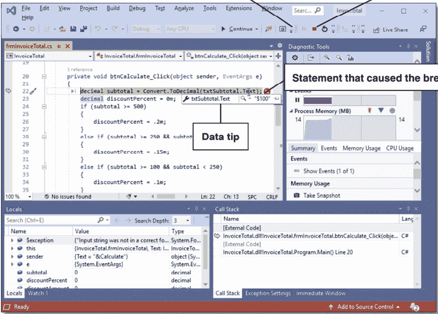

## 说明

- 当应用程序遇到运行时错误时，你需要修复该错误。这通常被称为*调试*，错误通常被称为*缺陷*。
- 当应用程序遇到运行时错误时，它会进入*中断模式*。在中断模式下，会显示“调试”工具栏和“异常帮助器”窗口。
- “异常帮助器”窗口会提示可能的错误原因。
- 如果关闭“异常帮助器”窗口，应用程序仍处于中断模式。
- 若要显示属性或变量的*数据提示*，请将鼠标指针移到 C# 代码中的该属性或变量上。
- 若要退出中断模式并结束应用程序，请单击“调试”工具栏中的“停止调试”按钮或按 Shift+F5。
- 你将在第 11 章中了解更多关于调试的知识。

## 小结

如果你能编写并测试本章介绍的 Invoice Total 项目，那么你已经学到了很多关于 C# 编程的知识。你知道如何为事件处理程序输入代码，使用户界面按你想要的方式工作。你知道如何生成和测试项目。你还知道一些简单的调试技术。

另一方面，你还有很多东西要学。首先，你需要学习 C# 语言。因此，在接下来的六章中，你将学习 C# 语言的基本知识。然后，在第 11 章中，你将学习一些可用于更高级代码的调试技术。

## 术语

| | | |
|---|---|---|
| 面向对象编程 | 事件驱动应用程序 | 书签 |
| 面向对象语言 | 事件处理程序 | 折叠 |
| | 事件关联 | 展开 |
| 对象 | 方法声明 | 代码片段 |
| 类 | 方法名 | 重构 |
| 实例 | 语句 | 内联重命名 |
| 实例化 | 代码块 | 生成项目 |
| 属性 | 语法错误 | 运行项目 |
| 方法 | 生成错误 | 测试项目 |
| 事件 | 实时代码分析 | 运行时错误 |
| 成员 | 注释 | 异常 |
| 点运算符 | 单行注释 | 缺陷 |
| 点 | 分隔注释 | 调试 |
| 静态成员 | 注释掉一行 | 中断模式 |
| | | 数据提示 |

## 练习 3-1 为 Invoice Total 窗体编码并测试

在本练习中，你将为在练习 2-1 中设计的 Invoice Total 窗体添加代码。然后，你将生成并测试该项目，以确保它正常工作。你还将尝试调试并查看一些帮助信息。

### 复制并打开 Invoice Total 应用程序

1. 使用 Windows 资源管理器将你为第 2 章创建的 Invoice Total 项目从 C:\C#\Chapter 02 目录复制到 C:\C#\Chapter 03 目录。
2. 打开现在位于 C:\C#\Chapter 03\InvoiceTotal 目录中的 Invoice Total 解决方案（InvoiceTotal.sln）。

### 向窗体添加代码并更正语法错误

3. 在窗体设计器中显示 Invoice Total 窗体，然后双击


单击“计算”按钮打开代码编辑器，并为此对象的 Click 事件生成方法声明。然后，输入图 3-6 所示的方法代码。输入代码时，务必利用 Visual Studio 提供的所有编码功能，包括代码片段。

4. 返回窗体设计器，然后双击“退出”按钮为此对象的 Click 事件生成方法声明。输入图 3-6 所示的事件处理程序语句。

5. 按照图 3-7 中的说明打开“错误列表”窗口。如果此窗口中列出了任何语法错误，请双击每个错误以转到代码编辑器中的错误位置。然后，更正错误。

### 测试应用程序

6. 按 F5 生成并运行项目。如果你已更正第 5 步中的所有语法错误，生成应成功，并应显示 Invoice Total 窗体。否则，你需要更正错误并再次按 F5。

7. 在第一个文本框中输入有效的数值，并单击“计算”按钮或按 Enter 键以激活此按钮。假设计算正常，单击“退出”按钮或按 Esc 键结束应用程序。当然，如果这两种方式中的任何一种不能正常工作，你都需要调试问题并再次测试应用程序。

### 输入无效数据并在中断模式下显示数据提示

8. 再次启动应用程序。这次，在小计文本框中输入“xx”。然后，单击“计算”按钮。这将导致 Visual Studio 进入中断模式，并显示如图 3-14 所示的“异常助手”。

9. 注意突出显示的语句，并阅读“异常助手”中显示的消息。然后，将鼠标指针移到该语句中的变量和属性上以显示它们的数据提示。这表明此应用程序的代码需要增强，以便检查无效数据。你将在第 7 章中学习如何做到这一点。不过，现在请单击“调试”工具栏中的“停止调试”按钮以结束应用程序。

### 制造语法错误并查看其对 IDE 的影响

10. 返回代码编辑器后，单击“错误列表”窗口的“自动隐藏”按钮将其隐藏。接下来，将 Subtotal 文本框的名称从 txtSubtotal 改为 txtSubTotal。由于大小写与文本框的 Name 属性所使用的大小写不匹配，这会产生错误。

11. 尝试运行应用程序，当 Visual Studio 提示你生成有错误并询问是否要继续使用上次成功的生成时，单击“否”。然后，双击“错误列表”中的错误，更正错误，并再次运行应用程序以确保问题已修复。

### 使用重构

12. 突出显示 subtotal 变量的名称，然后右键单击该名称，并从显示的快捷菜单中选择“重命名”命令。出现“重命名”对话框后，输入名称 invoiceSubtotal，注意变量的所有出现位置都会随之更改。

13. 如果选中了“重命名”对话框中的“预览更改”选项，请取消选中。然后，单击“应用”按钮或按 Enter 键以应用更改。现在，运行窗体以确保其仍然正常工作。

### 生成并删除事件处理程序

14. 显示 Invoice Total 窗体的窗体设计器，然后双击窗体上的空白区域。这应为窗体的 Load 事件生成一个事件处理程序。

15. 删除窗体的 Load 事件的事件处理程序。然后，运行应用程序。此时，你会收到一个生成错误，指出该窗体不包含此事件处理程序的定义。

16. 双击该错误。这将会打开该窗体的 Designer.cs 文件，并跳转到连接事件处理程序的语句。删除此语句以更正错误。

17. 如果你好奇，可以查看存储在此简单窗体的 Designer.cs 文件中的生成代码。然后，单击名为“Windows Form Designer generated code”的区域左侧的减号以折叠该区域。

18. 运行窗体以确保其正常工作。返回代码编辑器后，关闭该窗体的 Designer.cs 文件。

### 退出 Visual Studio

19. 单击 Visual Studio 窗口的“关闭”按钮以退出此应用程序。如果你完成了所有操作并让应用程序正常工作，那你已经取得了长足的进步！

# 第 2 部分

### C# 语言基础

在第 1 部分中，你初步了解了 C# 编程。具体来说，你学习了如何使用 Visual Studio 设计 Windows 窗体、为该窗体输入代码以及测试这些代码。但是，你实际上还没有学习编写 C# 语句的细节。

现在，在本部分中，你将学习 C# 语言基础。例如，在第 4 章中，你将学习如何执行算术运算。在第 5 章中，你将学习如何编写选择语句和迭代语句。在第 6 章中，你将学习如何编写方法和事件处理程序。在第 7 章中，你将学习如何检查用户的输入以确保其有效。在第 8 章中，你将学习如何使用数组和集合。在第 9 章中，你将学习如何处理日期和字符串。这会为你带来一个良好的开端。

此后，第 10 章将介绍更多用于开发 Windows 窗体应用程序的技能。这些技能扩展了你在第 2 章中学到的技能，并且需要用到你在第 4 章到第 9 章中将学到的许多语言技能。作为对这些基础知识掌握的收尾，第 11 章将介绍更多 Visual Studio 调试功能，你在第 3 章中曾初步了解过这些功能。

## 如何使用数值和字符串数据

要开始掌握 C# 语言，本章将介绍如何使用 C# 提供的各种数据类型。具体而言，你将学习如何对数值数据执行算术运算、如何处理字符串数据，以及如何将一种数据类型转换为另一种数据类型。

- **如何使用内置值类型** ..................................92
- 内置值类型 .................................................................92
- 如何声明和初始化变量 .............................................94
- 如何声明和初始化常量 ...............................................96
- 如何编写算术表达式 ....................................................98
- 如何编写赋值语句 ...................................................100
- 如何使用运算优先级 .........................................102
- 如何使用强制转换 ........................................................................104
- 如何使用 Math 类 ................................................................106
- 如何生成随机数 .......................................................108
- **如何使用字符串** ..............................................................110
- 如何声明和初始化字符串 ..................................................110
- 如何连接和追加字符串 ...........................................................110
- 如何在字符串中包含特殊字符 ........................................112
- **如何转换数据类型** .............................................................114
- 定义数据类型的 .NET 结构和类 .......................114
- 如何使用方法转换数据类型 ..........................................116
- 如何使用方法将数字转换为格式化字符串 ............118
- **处理数据的其他三项技能** ..........................................120
- 如何使用作用域 .....................................................................120
- 如何声明和使用枚举 ..................................................122
- 如何使用可为空的值类型和 null 合并运算符 .........................................................124
- **Invoice Total 应用程序的两个版本** .................................126
- 基本的 Invoice Total 应用程序 ......................................................126
- 增强的 Invoice Total 应用程序 ..............................................128
- **小结** ....................................................................................130


## 如何使用内置值类型

首先，本章将向你展示如何使用 .NET 提供的 *内置数据类型*。如你所见，这些数据类型包括值类型和引用类型。

### 内置值类型

图 4-1 总结了 .NET 提供的 *值类型*。要引用这些数据类型中的每一个，C# 提供了关键字。你可以使用前十一个数据类型来存储数字，并可以使用最后两个数据类型来存储字符和真或假值。

前八个数据类型用于存储 *整数*，即不包含小数点（整数）的数字。当你使用其中一种整数类型时，应选择合适的大小。大多数情况下，你可以使用 *int* 类型。但是，如果值对于 int 类型来说太大，你可能需要使用 *long* 类型。另一方面，如果你正在处理较小的数字并且需要节省系统资源，你可以使用 *short* 或 *byte* 类型。如果你正在处理正数，你也可以使用这些类型的无符号版本。

你可以使用接下来的三种数据类型来存储包含小数点的数字。由于 *decimal* 类型比 *double* 和 *float* 类型更准确，因此它通常用于货币值。但是，如果你需要节省系统资源，double 和 float 类型对于大多数情况来说已经足够了。

你可以使用 *char* 类型来存储单个字符。由于 C# 支持双字节 *Unicode 字符集*，它可以存储来自世界各地几乎任何语言的字符。因此，你可以使用 C# 创建读取和打印希腊语或中文字符的程序。实际上，你通常会使用存储在较旧的单字节 *ASCII 字符集* 中的字符。这些字符是 Unicode 字符集的前 256 个字符。

最后，你可以使用 *bool* 类型来存储真值或假值。这种类型的值称为 *布尔值*。

| C# 关键字 | 字节 | .NET 类型 | 描述 |
|------------|------:|-----------|------------|
| `byte` | 1 | Byte | 一个从 0 到 255 的正整数值 |
| `sbyte` | 1 | SByte | 一个从 -128 到 127 的有符号整数值 |
| `short` | 2 | Int16 | 一个从 -32,768 到 +32,767 的整数 |
| `ushort` | 2 | UInt16 | 一个从 0 到 65,535 的无符号整数 |
| `int` | 4 | Int32 | 一个从 -2,147,483,648 到 +2,147,483,647 的整数 |
| `uint` | 4 | UInt32 | 一个从 0 到 4,294,967,295 的无符号整数 |
| `long` | 8 | Int64 | 一个从 -9,223,372,036,854,775,808 到 +9,223,372,036,854,775,807 的整数 |
| `ulong` | 8 | UInt64 | 一个从 0 到 +18,446,744,073,709,551,615 的无符号整数 |
| `float` | 4 | Single | 一个大约有 7 位有效数字的非整数数 |
| `double` | 8 | Double | 一个大约有 14 位有效数字的非整数数 |
| `decimal` | 16 | Decimal | 一个最多有 28 位有效数字（整数和小数部分）的非整数数，可以表示高达 7.9228 × 10²⁸ 的值 |
| `char` | 2 | Char | 一个单个 Unicode 字符 |
| `bool` | 1 | Boolean | 一个真或假值 |

## 描述

- *内置数据类型* 实际上是 .NET 公共类型系统定义的 data types 的别名。
- 本图中显示的所有数据类型都是 *值类型*，这意味着它们存储自己的数据。相比之下，*引用类型* 存储指向数据存储的内存区域的引用。有关值类型和引用类型的更多信息，请参阅图 4-12。
- *位* 是可以为一或零的二进制数字。*字节* 是八个位的组合。因此，每个数据类型的位数是字节数乘以 8。
- *整数* 是整数，前八个数据类型提供了各种大小的有符号和无符号整数。
- 由于 decimal 类型是最准确的非整数数据类型，因此它通常用于存储货币值。
- *Unicode 字符集* 提供了超过 65,000 个字符，每个字符使用两个字节。每个字符映射到一个整数值。
- 大多数操作系统使用的较旧的 *ASCII 字符集* 提供了 256 个字符，每个字符使用一个字节。在 Unicode 字符集中，前 256 个字符对应于 256 个 ASCII 字符。
- *bool* 数据类型存储一个 *布尔值*，其值为 true 或 false。

图 4-1    内置值类型

## 如何声明和初始化变量

变量存储的值可以在程序执行过程中发生变化。在你使用变量之前，必须声明其数据类型和名称，然后通过为其分配值来初始化它。图 4-2 显示了你可以这样做的两种方法。

首先，你可以使用单独的语句来声明和初始化变量，如本图中的第一个示例所示。其次，你可以使用单个语句声明变量并为其赋值。本图提供了使用此技术的几个示例。请注意，最后一个示例使用相同的数据类型声明并初始化两个变量。

虽然你可以声明变量而不为其赋值，但你必须在代码中使用变量之前为其赋值。否则，在你尝试运行项目时会出现构建错误。因此，良好的编码实践是在一条语句中声明并初始化变量，或在声明变量后立即为其赋值。

你还可以让某些变量的类型从分配给它们的值中推断出来。为此，你使用 var 关键字而不是类型。这在处理元组时很有用，如第 6 章所述，以及处理 LINQ 时，如第 18 章所述。

你还应该注意到本图中的示例中，每个变量名的第一个单词以小写字母开头，其余单词以大写字母开头。这称为驼峰命名法，是 C# 中常见的编码约定。

当你使用变量时，可以将文字值，或文字，分配给变量。例如，你可以将文字值 1 分配给 int 变量。当你编码带小数点的数字，例如 8.125 时，C# 编译器假定你希望该文字值为 double 值。因此，如果你希望将其解释为 decimal 值，则需要在值后编码字母 m 或 M（想 m 代表 money）。同样，对于 float 类型，你在值后编码字母 f 或 F。如果你省略字母，在你尝试运行项目时会出现构建错误。

从 C# 7.0 及更高版本开始，你还可以在数字文字中使用下划线分隔文字中的数字。这对于编码包含大量数字的文字特别有用，因为你不能在数字文字中使用逗号。这些下划线称为数字分隔符，只有在提高代码可读性时才应使用它们。

你可以使用科学记数法来表示极大或极小的非整数数字的值。要使用此记数法，你编码字母 e 或 E 后跟 10 的幂。例如，3.65e+9 等于 3.65 乘以 10⁹（或 3,650,000,000），而 3.65e-9 等于 3.65 乘以 10⁻⁹（或 .00000000365）。如果你有科学或数学背景，你已经熟悉这种记数法。否则，你可能永远不会使用这种记数法。

你也可以将文字值分配给具有 char 数据类型的变量。为此，你将值用单引号括起来。要将文字值分配给具有 bool 类型的变量，你可以使用 true 和 false 关键字。

### 如何在两个语句中声明和初始化变量

**语法**

```text
type variableName;
variableName = value;
```

**示例**

```csharp
int counter;                // declaration statement
counter = 1;                // assignment statement
```

### 如何在一个语句中声明和初始化变量

**语法**

```text
type variableName = value;
```

**示例**

```csharp
int counter = 1;
long numberOfBytes = 2000000;
float interestRate = 8.125f;      // f or F indicates a float value
double price = 14.95;
decimal total = 24218.1928m;     // m or M indicates a decimal value
int population1 = 1734323;
int population2 = 1_734_323;      // improve readability - C# 7.0 and later
double starCount = 3.65e+9;      // scientific notation
char letter = 'A';               // enclose a character value in single quotes
bool valid = false;
int x = 0, y = 0;                // initialize 2 variables with 1 statement
```

## 描述

- 变量存储的值可以在程序执行过程中发生变化。换句话说，变量的值可以在应用程序执行时变化。
- 在你使用变量之前，必须声明其类型并为其分配初始值。
- 常见的初始值是存储整数值的变量的 0，存储小数值的变量的 0.0，以及存储布尔值的变量的 false。
- 要在单个语句中为单个数据类型声明或初始化多个变量，请使用逗号分隔变量名或赋值。
- 要将文字值标识为 float 值，你必须在数字后输入字母 f 或 F。要标识 decimal 值，你必须在数字后输入字母 m 或 M。
- 数据类型的关键字必须全部使用小写字母编码。

### 命名约定

- 以小写字母开头变量名，并将每个单词的首字母大写。 这称为驼峰命名法。
- 尽量使用易于在编码时记住的有意义的名称。


## 如何声明和初始化常量

与变量不同，常量存储的值在程序执行过程中不能被更改。声明和初始化变量的许多技巧也适用于声明和初始化常量。然而，你始终使用一条语句来声明和初始化常量，并且该语句必须以 const 关键字开头。此外，将常量中每个单词的首字母大写，包括第一个单词，这是一种常见的编码约定，如图 4-3 所示。这被称为 Pascal 记法。

## 如何声明和初始化一个常量

```
const type ConstantName = value;
```

```
const int DaysInNovember = 30;
```

```
const decimal SalesTax = .075m;
```

- 常量存储一个不能被更改的值。换句话说，常量的值在应用程序执行期间保持不变。
- 要声明一个常量，你以 const 关键字开始声明语句。之后，初始化变量的技巧也适用于常量，只是你必须始终使用一条语句来声明和初始化常量。
- 将常量名称中每个单词的首字母大写。这被称为 Pascal 记法。
- 尽量使用易于记忆的有意义的名称。

## 如何编写算术表达式

图 4-4 显示了如何编写算术表达式。要创建算术表达式，你使用算术运算符来指示对表达式中的操作数执行什么操作。操作数可以是字面量或变量。

本图中列出的前五个运算符作用于两个操作数。因此，它们被称为二元运算符。例如，当你使用减法运算符 (-) 时，你用另一个操作数减去一个操作数。相比之下，最后四个运算符作用于一个操作数。因此，它们被称为一元运算符。例如，你可以在操作数前面编写负号运算符 (-) 来反转操作数的值。你也可以在操作数前面编写正号运算符 (+) 来返回操作数的值。然而，这不会改变操作数的值，因此正号很少用作一元运算符。

虽然加法 (+)、减法 (-) 和乘法 (*) 运算符是不言自明的，但除法 (/) 和取模 (%) 运算符需要一些额外的解释。如果你使用整数数据类型，除法运算符返回一个整数值，表示右操作数进入左操作数的次数。然后，取模运算符返回一个整数值，表示余数（即除左操作数以右操作数后剩余的部分）。如果你使用非整数数据类型，除法运算符返回一个使用小数位表示除法结果的值，这通常是你想要的。

当你编写自增 (++) 或自减 (--) 运算符时，你可以通过在操作数前编写运算符来前缀操作数。这在前两组中的最后两个示例中有所说明。然后，在结果被赋值之前，操作数会被自增或自减。

```
counter++;
```

你应该意识到，虽然你也可以通过在操作数后编写运算符来后缀操作数。然后，在操作数被自增或自减之前，结果会被赋值。当整个语句除了自增一个变量之外什么都不做时，如 counter++; 前缀形式和后缀形式产生相同的结果。

## 算术运算符

| 运算符 | 名称 | 描述 |
|---|---|---|
| + | 加法 | 将两个操作数相加。 |
| - | 减法 | 从左操作数中减去右操作数。 |
| * | 乘法 | 将右操作数和左操作数相乘。 |
| / | 除法 | 将左操作数除以右操作数。如果两个操作数都是整数，则结果为整数。 |
| % | 取模 | 返回将右操作数除入左操作数后剩余的值。 |
| + | 正号 | 返回操作数的值。 |
| - | 负号 | 将正值改为负值，反之亦然。 |
| ++ | 自增 | 将 1 加到操作数上 (x = x + 1)。 |
| -- | 自减 | 从操作数中减去 1 (x = x - 1)。 |

## 算术表达式示例

```
// integer arithmetic
int x = 14;
int y = 8;
int result1 = x + y;        // result1 = 22
int result2 = x - y;        // result2 = 6
int result3 = x * y;        // result3 = 112
int result4 = x / y;        // result4 = 1
int result5 = x % y;        // result5 = 6
int result6 = -y + x;       // result6 = 6
int result7 = --y;          // result7 = 7, y = 7
int result8 = ++x;          // result8 = 15, x = 15

// decimal arithmetic
decimal a = 8.5m;
decimal b = 3.4m;
decimal result11 = a + b;   // result11 = 11.9
decimal result12 = a - b;   // result12 = 5.1
decimal result13 = a / b;   // result13 = 2.5
decimal result14 = a * b;   // result14 = 28.90
decimal result15 = a % b;   // result15 = 1.7
decimal result16 = -a;      // result16 = -8.5
decimal result17 = --a;     // result17 = 7.5, a = 7.5
decimal result18 = ++b;     // result18 = 4.4, b = 4.4
```

## 描述

- 算术表达式由一个或多个操作数和算术运算符组成。
- 上述前五个运算符称为二元运算符，因为它们作用于两个操作数。接下来的四个称为一元运算符，因为它们仅作用于一个操作数。

## 如何编写赋值语句

图 4-5 显示了你如何编写 *赋值语句* 为变量赋新值。在简单的赋值语句中，你编写变量名、等号和表达式。这在该图中的第一组赋值语句中有所说明。请注意，表达式可以是字面值、另一个变量的名称或任何其他类型的表达式，例如算术表达式。表达式求值后，结果会被赋给变量。

当你编写赋值语句时，有时需要在等号两边都编写相同的变量，如第二组语句所示。这样，你就可以在表达式中使用变量的当前值，然后通过将表达式的结果赋给它来更新变量。例如，你可以轻松地将 100 加到变量的值上并将新值存储在同一个变量中。

由于在赋值语句的两边使用变量很常见，C# 提供了本图中所示的五个 *快捷赋值运算符*。这些运算符在第三组语句中有所说明。请注意，这些语句执行与第二组语句相同的功能。然而，使用快捷运算符的语句更紧凑。

如果你需要将变量递增或递减 1，你可以使用自增或自减运算符而不是赋值语句。例如：

```
month = month + 1;
```

等价于

```
month += 1;
```

等价于

```
month++;
```

你使用的技术主要取决于个人喜好。当然，最后一种技术所需的输入最少，也是最常用的。

## 如何处理运算符优先级

图 4-6 提供了编写算术表达式的更多信息。具体来说，它给出了算术运算的优先级顺序。这意味着表达式中所有的前缀自增和自减运算首先执行，然后是所有正负运算，依此类推。如果每个优先级中有两个或多个运算，则按从左到右的顺序执行。

由于此运算顺序并不总是按你想要的方式工作，因此你可能需要通过使用括号来覆盖该顺序。然后，最内层的括号中的表达式首先执行，然后是下一层括号中的表达式，依此类推。然而，在每组括号内，运算仍按优先级从左到右执行。

本图中两个示例说明了对括号的需求。由于第一个示例中未使用括号，乘法运算在减法运算之前执行，从而得到错误的结果。相比之下，由于第二个示例中减法运算被括号括起来，因此该运算在乘法运算之前执行，从而得到正确的结果。

在实践中，只要对运算顺序有任何疑问，你都应使用括号来规定运算顺序。这样，你就不必担心运算符优先级。

本图还总结了我之前提到的前缀和后缀自增及自减运算的信息，最后几组示例显示了这些运算的差异。由于这可能会令人困惑，最好将这些运算符限制在简单表达式中，并在对表达式的求值方式有任何疑问时使用前缀形式。


## 算术运算的优先级顺序

- 1. 自增和自减
- 2. 正负号
- 3. 乘法、除法和取模
- 4. 加法和减法

### 使用默认优先级顺序的计算

```
decimal discountPercent = .2m;    // 20% discount
decimal price = 100m;             // $100 price
price = price * 1 - discountPercent;   // price = $99.8
```

### 使用括号指定优先级顺序的计算

```
decimal discountPercent = .2m;    // 20% discount
decimal price = 100m;             // $100 price
price = price * (1 - discountPercent);   // price = $80
```

### 前缀和后缀自增自减运算符的使用

```
int a = 5;
int b = 5;
int y = ++a;    // a = 6, y = 6
int z = b++;    // b = 6, z = 5
```

## 描述

- 除非使用括号，否则表达式中的运算会按照*优先级顺序*从左到右进行。
- 要指定运算的顺序，可以使用括号。然后，最内层的括号中的运算会先执行，其次是下一层括号中的运算，以此类推。
- 当你将自增或自减运算符作为*前缀*用于变量时，变量会先被自增或自减，然后结果会被赋值。但当你将自增或自减运算符作为*后缀*用于变量时，结果会先被赋值，然后变量才会被自增或自减。

## 隐式类型转换的工作方式

### 从精度较低到精度较高的数据类型转换

byte→short→int→long→decimal

int→double

short→float→double

char→int

### 示例

```
double grade = 93;    // convert int to double
```

```
int letter = 'A';     // convert char to int
```

```
double a = 95.0;
int b = 86, c = 91;
double average = (a+b+c)/3;    // convert b and c to double values
// (average = 90.666666...)
```

## 如何进行显式类型转换

### 编码显式类型转换的语法

```
(type) expression
```

### 示例

```
int grade = (int)93.75;          // convert double to int (grade = 93)
```

```
char letter = (char)65;          // convert int to char (letter = 'A')
```

```
double a = 95.0;
int b = 86, c = 91;
int average = ((int)a+b+c)/3;    // convert a to int value (average = 90)
```

```
decimal result = (decimal)b/(decimal)c;    // result has decimal places
```

## 描述

- 如果你编写一个赋值语句，将精度较低的数据类型的值赋给精度较高的数据类型的变量，C# 会自动将精度较低的数据类型转换为精度较高的数据类型。这可以称为隐式类型转换或扩展转换。
- 浮点类型和 decimal 类型之间不能进行隐式类型转换。
- 当你编写算术表达式时，C# 会隐式地将表达式中精度较低的数据类型的操作数转换为所使用的最精确的数据类型。
- 要编写一个赋值语句，将精度较高的数据类型的值赋给精度较低的数据类型的变量，你必须在要赋值的数值前加上用括号括起来的精度较低的数据类型。这可以称为显式类型转换或窄化转换。
- 你也可以在算术表达式中使用显式类型转换。然后，类型转换会在算术运算之前进行。

## 如何使用 Math 类

图 4-8 展示了 Math 类的五个方法，你可以使用它们来处理数值数据。虽然该类提供了多种执行数学运算的方法，但这些是你最有可能使用的。在语法摘要中，竖线（|）表示从竖线分隔的选项中选择一个，方括号表示子句是可选的，大括号表示在两个或多个元素之间进行选择，而粗体表示必须完全按所示输入的语言元素。

本图所示的五个方法都是静态方法。这意味着你可以直接从 Math 类调用这些方法，通过编写类名、一个点、方法名，以及用括号括起来并用逗号分隔的一个或多个参数。例如，Round() 方法至少需要一个表示要舍入的值的参数，外加可选的第二个和第三个参数。Sqrt() 方法只需要一个参数。而 Pow()、Min() 和 Max() 方法需要两个参数。

你使用 Round() 方法将 decimal、double 或 float 值舍入到指定的小数位数，称为精度。例如，本图中的第一个语句将 shipWeightDouble 变量中的值舍入到整数，因为这是默认值。相比之下，第二个语句指定两位小数。

如果你使用 Math 类的 Round() 方法，你应该知道，默认情况下它使用一种称为银行家舍入的特殊舍入类型。使用这种舍入类型时，如果要舍入的数字以 5 结尾，它总是舍入到偶数。这在图中的第二组示例中的第一个和第二个语句中有所说明。在这里，你可以看到 23.75 和 23.85 都被舍入为 23.8。这有助于消除总是将小数向上舍入到最接近的数字所可能产生的误差，而标准舍入技术的工作方式就是这样。

如果你更喜欢使用标准舍入技术，你可以通过在示例中第五个语句所示的方式包含 mode 参数来实现。如果你将该语句的结果与第四个语句的结果进行比较，你会看到 mode 参数的工作方式。

你使用 Pow() 方法将一个数字提高到指定的幂。例如，本图中的第三个语句将名为 radius 的变量提高到二次幂。换句话说，它计算该变量的平方，这用于计算圆的面积。请注意，PI 是 Math 类的一个字段，表示数学常数 π（3.14159265…）。C# 不提供像某些其他语言那样用于将数字提高到幂的算术运算符。正因为如此，只要你需要执行此操作，就应使用 Pow() 方法。

本图还介绍了 Math 类的另外三个静态方法：Sqrt()、Min() 和 Max()。Sqrt() 方法计算一个数字的平方根。Min() 和 Max() 方法返回你指定的两个数值中的最小值或最大值。这三个方法可与任何数值数据类型一起使用。但是，当你使用 Min() 或 Max() 方法时，你指定的两个值必须为相同类型。

### Math 类的五个静态方法

### Round() 方法的语法

```
Math.Round(decimalNumber[, precision[, mode]])
```

### Pow() 方法的语法

```
Math.Pow(number, power)
```

### Sqrt() 方法的语法

```
Math.Sqrt(number)
```

### Min() 和 Max() 方法的语法

```
Math.{Min|Max}(number1, number2)
```

### 使用 Math 类静态方法的语句

```
int shipWeight = Math.Round(shipWeightDouble); // round to a whole number
double orderTotal = Math.Round(orderTotal, 2); // round to 2 decimal places
double area = Math.Pow(radius, 2) * Math.PI; // area of circle
double sqrtX = Math.Sqrt(x);
double maxSales = Math.Max(lastYearSales, thisYearSales);
int minQty = Math.Min(lastYearQty, thisYearQty);
```

### Math 类静态方法的结果

| Statement | Result | Statement | Result |
|---|---|---|---|
| Math.Round(23.75, 1) | 23.8 | Math.Pow(5, 2) | 25 |
| Math.Round(23.85, 1) | 23.8 | Math.Sqrt(20.25) | 4.5 |
| Math.Round(23.744, 2) | 23.74 | Math.Max(23.75, 20.25) | 23.75 |
| Math.Round(23.745, 2) | 23.74 | Math.Min(23.75, 20.25) | 20.25 |
| Math.Round(23.745, 2, MidpointRounding.AwayFromZero) | 23.75 |  |  |

## 描述

- 要使用 Math 类的静态方法之一，请编写类名、一个点、方法名，以及用括号括起来的一个或多个参数。参数提供了方法使用的值。
- Round() 方法将 decimal 参数舍入到指定的精度，即有效小数位数。如果省略精度，则数字会舍入到最接近的整数。
- 默认情况下，如果你舍入以 5 结尾的小数值，数字会舍入到最接近的偶数小数。这被称为银行家舍入。你也可以使用值为 MidpointRounding.AwayFromZero 的 mode 参数来将正值向上舍入，负值向下舍入。
- Pow() 方法将第一个参数提高到第二个参数的幂。两个参数都必须是 double 数据类型。
- Sqrt() 方法返回指定参数的平方根，该参数可以是任何数值数据类型。
- Min() 和 Max() 方法返回两个数值参数的最小值和最大值。两个参数必须具有相同的数据类型。


## 如何生成随机数

在学习如何编程时，能够生成随机数通常很有帮助。如果你想开发涉及骰子、纸牌或其他随机机会元素的游戏，它们就很有用。它们对于诸如使用一系列随机数测试一种方法之类的模拟也很有用。

要使用 C# 生成随机数，可以使用图 4-9 中所示的 Random 类的方法。与你在前一幅图中看到的 Math 类的静态方法不同，Random 类的方法是*实例方法*。这意味着你从 Random 类创建的对象中调用它们，或*实例化*。要创建 Random 类的实例，你可以使用 new 关键字，如本图中的第一个示例语句所示。这里，Random 对象被创建并分配给名为 number 的变量。

创建 Random 对象后，你可以使用此处所示的方法生成随机数。这由第二个示例中的语句说明。第一个语句使用没有任何参数的 `Next()` 方法。因为这样，它会得到一个大于或等于零且小于整数的最大值 (`Int32.MaxValue`) 的整数。

第二个语句类似，但它包含一个参数来指定随机数的最大值。请注意，最大值不包含在方法可以返回的值范围内。因此，在这种情况下，随机数的值可以从 0 到 100。

第三个语句同时包含最小值和最大值。与最大值不同，最小值包含在范围内。因此，此语句将返回 1 到 100 的值。

如果你想获得一个 double 而不是 int 的随机数，可以使用 `NextDouble()` 方法。与 `Next()` 方法不同，`NextDouble()` 方法始终返回大于或等于 0.0 且小于 1.0 的值。如果需要，你也可以将随机数乘以另一个数字，以获得指定范围内的数字。例如，如果将数字乘以 100，则它将大于或等于 0.0 且小于 100.0。

本图中的第三个示例展示了使用 Random 类模拟掷两个骰子的代码。首先，此代码创建 Random 类的实例。然后，它使用最小值为 1 且最大值为 7 调用 `Next()` 方法。这将返回 1 到 6 的随机数，该数字被分配给名为 `die1` 的 int 变量。然后，再次调用 `Next()` 方法，结果被分配给名为 `die2` 的 int 变量。

当你使用 Random 类时，你应该知道它的方法实际上生成的是*伪随机数*。这是因为生成的数字基于依赖于起始值（称为*种子值*）的数学算法。当你创建 Random 类的实例时，此种子值默认由系统时钟确定。在大多数情况下，这就是你想要的。如果你需要生成两个随机数序列，则可能想要指定特定的种子值，以确保两个序列包含不同的数字。或者，你可以指定种子值以确保序列始终包含相同的数字。有关指定种子值的更多信息，请参阅 Random 类的在线文档。

### Random 类的实例方法

| 方法 | 描述 |
| --- | --- |
| `Next()` | 返回一个随机 int 值，该值大于或等于 0 且小于 int 类型的最大值。 |
| `Next(maxValue)` | 返回一个随机 int 值，该值大于或等于 0 且小于指定的最大值。 |
| `Next(minValue, maxValue)` | 返回一个随机 int 值，该值大于或等于指定的最小值且小于指定的最大值。 |
| `NextDouble()` | 返回一个 double 值，该值大于或等于 0.0 且小于 1.0。 |

### 创建 Random 类实例的语句

```csharp
Random number = new Random();
```

### 使用 Random 类方法的语句

```csharp
number.Next();                 // an int >= 0 and < Int32.MaxValue
number.Next(101);              // an int >= 0 and < 101
number.Next(1,101);             // an int >= 1 and < 101
number.NextDouble();            // a double >= 0.0 and < 1.0
```

### 模拟掷两个骰子的代码

```csharp
Random number = new Random();
int die1 = number.Next(1, 7);    // die1 is >= 1 and < 7
int die2 = number.Next(1, 7);    // die2 is >= 1 and < 7
```

## 描述

- Random 类提供可用于生成一系列*伪随机数*的方法，这是一系列看起来随机但实际上基于数学算法的数字。
- 要生成随机数，你可以使用 `new` 关键字创建 Random 类的实例，如上所示。
- 当你创建 Random 类的实例时，可以向算法提供一个起始值，称为*种子值*。默认种子值基于系统时钟。有关使用其他种子值的信息，请参阅 Random 类的在线文档。
- Random 类的方法称为*实例方法*，因为你从类的实例中调用它们。
- 当你使用接受最大值的 `Next()` 方法形式时，该值是可生成的值的排除值。

*图 4-9    如何生成随机数*

## 如何处理字符串

在接下来的主题中，你将学习处理字符串数据类型的一些基本技能。这些技能对于你的许多应用程序来说已经足够了。然后，在第 9 章中，你将学习高级字符串操作的技能。

### 如何声明和初始化字符串

字符串可以由任何字母、数字和字符组成。图 4-10 总结了可用于处理字符串变量的技术。首先，你使用 `string` 关键字声明一个字符串。然后，你可以通过将字符括在双引号中来将字符串文字分配给字符串。

要将空字符串分配给变量，可以编写一组之间没有任何内容双引号。你在想要字符串具有值但不希望它包含任何字符时这样做。第三种替代方法是使用 `null` 关键字将空值分配给字符串，这通常表示字符串的值未知。

```csharp
string message1 = "Invalid data entry.";
string message2 = "";
string message3 = null;
```

### 如何连接和追加字符串

图 4-10 还展示了如何连接，或串联，两个或多个字符串为一个字符串。要做到这一点，你可以使用本图第二个示例中所示的 `+` 运算符。这里，两个字符串变量与一个由一个空格组成的字符串文字连接。结果然后存储在另一个字符串变量中。

你也可以将字符串与值数据类型连接。这在图中的第三个示例中说明。这里，一个使用 `double` 数据类型定义变量被追加到字符串。当你使用此技术时，C# 会自动将值转换为字符串。

你也可以使用 `+` 和 `+=` 运算符将字符串追加到字符串变量的值。这在图中的最后两个示例中说明。请注意，当你使用 `+` 运算符时，你在分配给此变量的表达式中包含字符串变量。相比之下，当你使用 `+=` 运算符时，你可以从表达式中省略字符串变量。因此，通常使用此运算符来简化代码。

### 如何连接字符串

```csharp
string firstName = "Bob";                 // firstName is "Bob"
string lastName = "Smith";                // lastName is "Smith"
string name = firstName + " " + lastName;  // name is "Bob Smith"
```

### 如何连接字符串和数字

```csharp
double price = 14.95;
string priceString = "Price: $" + price;   // priceString is "Price: $14.95"
```

### 如何将一个字符串追加到另一个字符串

```csharp
string firstName = "Bob";                 // firstName is "Bob"
string lastName = "Smith";                // lastName is "Smith"
string name = firstName + " ";             // name is "Bob "
name = name + lastName;                     // name is "Bob Smith"
```

### 如何使用 += 运算符将一个字符串追加到另一个字符串

```csharp
string firstName = "Bob";                 // firstName is "Bob"
string lastName = "Smith";                // lastName is "Smith"
string name = firstName + " ";             // name is "Bob "
name += lastName;                           // name is "Bob Smith"
```

## 描述

- *字符串*可以由字符集中的任何字符组成，包括字母、数字和特殊字符，如 `$`、`*`、`&` 和 `#`。
- 要指定字符串的值，可以将文本括在双引号中。这称为*字符串文字*。
- 要将*空字符串*分配给字符串，可以编写一组之间没有任何内容双引号。这通常表示字符串的值已知，但字符串不包含任何字符。
- 要将*空值*分配给字符串，可以使用 *null* 关键字。这意味着字符串的值未知。
- 要连接，或*串联*，字符串与另一个字符串或值数据类型，使用加号。如果将值数据类型连接到字符串，C# 将自动将值转换为字符串，以便它可以作为字符串的一部分使用。
- 当你将一个字符串*追加*到另一个字符串时，你将一个字符串添加到另一个字符串的末尾。要做到这一点，你可以使用赋值语句。
- `+=` 运算符是向字符串变量追加字符串表达式的快捷方式。


## 如何在字符串中包含特殊字符

图 4-11 显示了两种可在字符串中包含特定类型特殊字符的技术。特别是，该图展示了如何包含反斜杠、引号以及换行符、制表符和回车符等控制字符。

一种可在字符串中包含这些字符的技术是使用本图所示的 *转义序列*。尽管这些转义序列是你最常使用的，但 C# 还提供了用于十六进制和 Unicode 字符的其他转义序列。

如果你要将字符串字面量分配给字符串，你可能更喜欢使用 *逐字字符串字面量* 而不是转义序列。要使用逐字字符串字面量，你在字符串的起始引号前加上 @ 符号。然后，你可以在起始和结束引号之间输入反斜杠、制表符和换行符。例如，你可以使用 Enter 键输入一个或多个换行符。然后，逐字字符串字面量将跨越两行或更多行。

尽管逐字字符串字面量对于包含反斜杠和单引号的字面量效果很好，但在需要在字面量中包含双引号时会出现复杂情况。这是因为双引号用于指示字面量的开始和结束。因此，要在逐字字符串字面量中包含双引号，你必须输入两个双引号。

到目前为止，你可能在思考何时应使用转义序列在字符串中包含特殊字符，何时应使用逐字字符串字面量。答案是每种技术都适用于某些类型的编码情况。例如，逐字字符串字面量非常适合编码文件位置。另一方面，使用转义序列在字符串中包含换行符和制表符通常更容易。因此，你需要熟悉这两种技术。然后，你可以决定哪种技术最适合特定情况。

## 常见转义序列

| Key | Description |
| --- | --- |
| \n | New line |
| \t | Tab |
| \r | Return |
| \\ | Backslash |
| \" | Quotation |

## 使用转义序列的示例

| Code | Result |
| --- | --- |
| string code = "JSPS"; decimal price = 49.50m; string result = "Code: " + code + "\n" + "Price: $" + price + "\n"; | Code: JSPS Price: $49.50 |
| string names = "Joe\tSmith\rKate\tLewis\r"; | Joe    Smith Kate   Lewis |
| string path = "c:\\c#.net\\files"; | c:\c#.net\files |
| string message = "Type \"x\" to exit"; | Type "x" to exit |

## 使用逐字字符串字面量的示例

| Code | Result |
| --- | --- |
| string names = @"Joe    Smith Kate   Lewis"; | Joe    Smith Kate   Lewis |
| string path = @"c:\c#.net\files"; | c:\c#.net\files |
| string message = @"Type ""x"" to exit"; | Type "x" to exit |

## 描述

- 在字符串中，你可以使用转义序列包含某些类型的特殊字符。
- 要编码逐字字符串字面量，你可以编码 @ 符号，后跟起始双引号、字符串和结束双引号。在字符串内部，你可以输入反斜杠、制表符、换行符和其他特殊字符而无需使用转义序列。但是，要在逐字字符串字面量中输入双引号，你必须输入两个双引号。

## 如何转换数据类型

在第 3 章中，你已了解类的使用，类为从类实例化的对象提供属性和方法。现在，你将了解结构，结构与类类似。然后，你将学习如何使用这些结构和类将数据从一种类型转换为另一种类型。

## 定义数据类型的 .NET 结构和类

图 4-12 总结了定义数据类型的结构和类，以及可用于操作这些结构和类的 C# 关键字。例如，要操作 Decimal 结构，你使用 decimal 关键字。要操作 Int32 结构，你使用 int 关键字。要操作 String 类，你使用 string 关键字。

当你将变量声明为由结构支持的数据类型之一时，该变量是值类型。这意味着变量存储其自己的数据。例如，如果你将变量声明为 decimal 类型，该变量存储十进制值。此外，如果你将该变量分配给另一个十进制变量，新变量将存储该值的单独副本。

相比之下，当你将变量声明为由类支持的数据类型之一时，会从类创建对象。然后，变量存储对对象的引用，而不是对象本身。因此，对象数据类型称为引用类型。

在本图中，.NET Framework 定义的两个引用类型是 string 和 object。因此，当你将变量声明为 string 时，该变量保存对 String 对象的引用，其中包含字符串的数据。因此，可能有两个或多个变量引用同一个 String 对象。

除了 String 类之外，.NET Framework 还提供了一个通用的 Object 类。你可以使用从该类创建的变量来保存对任何类型对象的引用。你将在第 14 章中了解更多关于操作 Object 类的信息。

## 定义值类型的常见 .NET 结构

| Structure | C# keyword | What the value type holds |
|---|---|---|
| Byte | byte | An 8-bit unsigned integer |
| Int16 | short | A 16-bit signed integer |
| Int32 | int | A 32-bit signed integer |
| Int64 | long | A 64-bit signed integer |
| Single | float | A single-precision floating-point number |
| Double | double | A double-precision floating-point number |
| Decimal | decimal | A 96-bit decimal value |
| Boolean | bool | A true or false value |
| Char | char | A single character |

## 定义引用类型的常见 .NET 类

| Class | C# keyword | What the reference type holds |
|---|---|---|
| String | string | A reference to a String object |
| Object | object | A reference to any type of object |

## 描述

- 每个内置数据类型都由 .NET Framework 中的一个结构或类支持。当你使用 C# 关键字引用数据类型时，你实际上使用的是关联结构或类的别名。
- 结构定义值类型，值类型存储其自己的数据。
- 类定义引用类型。引用类型不存储数据本身。相反，它存储数据存储的内存区域的引用。
- 本图所示的所有结构和类都位于 .NET 的 System 命名空间中。

### 注意

- .NET 还为图 4-1 中列出的其他内置数据类型提供了结构。

## 如何使用方法转换数据类型

图 4-13 介绍了两种使用方法将数据从一种类型转换为另一种类型的方法。首先，你可以使用 ToString()、Parse() 和 TryParse() 方法，这些方法可从 .NET 定义的任何数据结构中使用。其次，你可以使用 Convert 类的静态方法将值转换为 .NET 定义的任何数据结构。

ToString() 方法可让你将任何值转换为字符串。例如，在本图的第一个语句组中，ToString() 方法用于将十进制值转换为字符串值。请注意，在此示例中，ToString() 方法上未提供参数。在下一张图中，你将学习如何编码格式化结果字符串的参数。

在继续之前，你应该意识到 C# 在某些情况下会隐式调用 ToString() 方法。你在本章前面学过其中一种情况，该示例在此重复。在这种情况下，双精度值在与另一个字符串连接时会自动转换为字符串。

Parse() 方法是执行 ToString() 方法相反操作的静态方法。换句话说，它将字符串值转换为另一种数据类型。例如，在第一个语句组的第三个语句中，Decimal 结构的 Parse() 方法用于将字符串变量的值转换为十进制值。但是，如图所示，此方法仅识别标准数字字符。因此，如果你尝试转换包含非数字字符（如美元符号或括号）的字符串，将会发生异常。

避免此问题的一种方法是为 Parse() 方法编码另一个参数，指示允许的字符。你将在第 9 章中了解更多相关信息。另一种方法是使用 TryParse() 方法而不是 Parse() 方法。此方法还将字符串值转换为另一种数据类型，如第一个语句组的最后一个语句所示。请注意，在这里你不会像使用 Parse() 时那样将 TryParse() 方法的结果分配给变量。相反，你在方法的第二个参数上命名变量，并在变量名前面加上 out 关键字。你将在第 6 章中了解更多关于此关键字的知识。现在，只需意识到如果转换无法执行，TryParse() 方法会在变量中存储零值并返回 false 值而不是抛出异常。然后，你可以测试返回值以确定转换是否成功。你将在第 7 章中看到该示例。

Convert 类提供了可用于将任何数据类型的<|message|> 转换为任何其他数据类型的静态方法。这由本图中的最后一个语句组说明。这里，第一个语句使用 ToDecimal() 方法将文本框中输入的字符串转换为十进制值。第二个语句使用 ToInt32() 方法将文本框中输入的字符串转换为整数值。第三个语句使用 ToString() 方法将十进制值转换为字符串值。第四个语句使用 ToInt32() 方法将十进制值转换为整数值。

当你使用 Convert 类时，你应该意识到转换结果将根据你执行的转换类型而有所不同。如果，对于


## 数据转换的常用方法

| 方法 | 说明 |
|---|---|
| `ToString([format])` | 一种方法，使用指定格式将值转换为其等效的字符串表示形式。如果省略格式，则不对值进行格式化。 |
| `Parse(string)` | 一种静态方法，将指定字符串转换为等效的数据值。如果无法转换该字符串，则会发生异常。 |
| `TryParse(string, result)` | 一种静态方法，将指定字符串转换为等效的数据值，并将其存储在 result 变量中。如果字符串转换成功，则返回 true 值。否则返回 false 值。 |

### Convert 类的部分静态方法

| 方法 | 说明 |
|---|---|
| `ToDecimal(value)` | 将值转换为 decimal 数据类型。 |
| `ToDouble(value)` | 将值转换为 double 数据类型。 |
| `ToInt32(value)` | 将值转换为 int 数据类型。 |
| `ToChar(value)` | 将值转换为 char 数据类型。 |
| `ToBoolean(value)` | 将值转换为 bool 数据类型。 |
| `ToString(value)` | 将值转换为 string 对象。 |

### 使用 ToString()、Parse() 和 TryParse() 方法的转换语句

```
decimal sales = 2574.98m;
string salesString = sales.ToString();        // decimal 转换为 string
sales = Decimal.Parse(salesString);          // string 转换为 decimal
Decimal.TryParse(salesString, out sales);    // string 转换为 decimal
```

### ToString() 方法的隐式调用

```
double price = 49.50;
string priceString = "Price: $" + price;    // 自动调用 ToString
```

### 处理无效数据的 TryParse() 方法

```
string salesString = "$2574.98";
decimal sales = 0m;
Decimal.TryParse(salesString, out sales);    // sales 为 0
```

### 使用 Convert 类的转换语句

```
decimal subtotal = Convert.ToDecimal(txtSubtotal.Text); // string 转换为 decimal
int years = Convert.ToInt32(txtYears.Text);               // string 转换为 int
txtSubtotal.Text = Convert.ToString(subtotal);            // decimal 转换为 string
int subtotalInt = Convert.ToInt32(subtotal);              // decimal 转换为 int
```

## 说明

- ToString()、Parse() 和 TryParse() 方法包含在所有数据结构中。
- 在某些期望字符串的情况下，编译器会自动调用 ToString() 方法。
- Convert 类包含用于转换所有内置类型的静态方法。若要查看此类的所有方法，可以在联机帮助中查找 Convert 类。

例如，如果像图 4-13 中的最后一条语句那样将 decimal 转换为整数，转换会使用银行家舍入法对小数位进行舍入。在其他情况下，C# 将无法执行转换，从而会发生异常。

## 如何使用方法将数字转换为格式化字符串

图 4-14 显示了如何使用方法将数字转换为格式化字符串。此图开头的表格总结了使用 `ToString()` 方法格式化数字时可以使用的标准代码。要使用这些代码，需要将它们作为参数编写，如图中的第一组语句所示。请注意，格式化代码必须用双引号括起来。

还可以在任何数字格式化代码后面包含一个整数。在大多数情况下，此整数表示结果字符串中的小数位数。例如，如果为值 19.95 指定代码 "c0"，该数字将转换为 $20。请注意，如果未指定小数位数，则假定为两位小数。

如果在 D 或 d 格式化代码后指定一个数字，则表示结果中的最小位数。由于这些格式化代码用于整数，这意味着如果指定的数字大于整数中的位数，则该值会在左侧用零填充。例如，如果为数字 28 指定代码 "d3"，它将转换为 028。

另一种格式化数字的方法是使用 String 类的 `Format()` 方法。由于这是一个静态方法，因此可以直接从 String 类访问它，而不是从该类的实例访问。还必须提供两个参数。

第一个参数是包含要格式化值的格式规范的字符串文本，第二个参数是要格式化的值。格式规范的语法如图所示。此处，索引表示要格式化的值，格式代码指定如何格式化该值。虽然可以使用 `Format()` 方法格式化多个值，但通常使用它来格式化单个值。在这种情况下，索引值将为 0。在第 9 章中，你将学习如何使用此方法格式化两个或多个值。

此图中的第二组语句显示了如何使用 `Format()` 方法。如你所见，这些语句执行的功能与使用 `ToString()` 方法的语句相同。但在这里，这些语句使用文本值，以便你可以在格式化之前查看这些值的外观。请注意，在这些语句中，格式规范用大括号括起来。此外，整个参数都用双引号括起来。

### 标准数字格式化代码

| 代码 | 格式 | 说明 |
|---|---|---|
| C 或 c | 货币 | 将数字格式化为具有指定小数位数的货币。 |
| P 或 p | 百分比 | 将数字格式化为具有指定小数位数的百分比。 |
| N 或 n | 数字 | 使用千位分隔符和指定的小数位数格式化数字。 |
| F 或 f | 浮点数 | 将数字格式化为具有指定小数位数的十进制数。 |
| D 或 d | 数字 | 使用指定的位数格式化整数。 |
| E 或 e | 指数 | 以科学（指数）记数法格式化数字，并具有指定的小数位数。 |
| G 或 g | 常规 | 将数字格式化为十进制或科学记数法，具体取决于哪种更紧凑。 |

### 如何使用 ToString() 方法格式化数字

| 语句 | 示例 |
|---|---|
| `string monthlyAmount = amount.ToString("c");` | $1,547.20 |
| `string interestRate = interest.ToString("p1");` | 2.3% |
| `string quantityString = quantity.ToString("n0");` | 15,000 |
| `string paymentString = payment.ToString("f3");` | 432.818 |

### 如何使用 String 类的 Format() 方法格式化数字

| 语句 | 结果 |
|---|---|
| `string monthlyAmount = String.Format("{0:c}", 1547.2m);` | $1,547.20 |
| `string interestRate = String.Format("{0:p1}", .023m);` | 2.3% |
| `string quantityString = String.Format("{0:n0}", 15000);` | 15,000 |
| `string paymentString = String.Format("{0:f3}", 432.8175);` | 432.818 |

### Format() 方法使用的格式规范语法

```
{index:formatCode}
```

## 说明

- 可以在某些数字格式化代码后包含一个数字，以指定结果中的小数位数。如果数值包含的小数位数多于指定的位数，则结果将使用标准舍入进行舍入。如果未指定小数位数，则默认值为 2。
- 可以在 D 或 d 格式化代码后包含一个数字，以指定结果中的最小位数。如果整数的位数少于指定的位数，则会在整数的开头添加零。
- 可以使用 String 类的 `Format()` 方法格式化两个或多个值。有关更多信息，请参见第 9 章。

## 处理数据的另外三项技能

为了完成处理数据这一主题，接下来的三张图介绍了另外三个有用的技能：如何处理作用域、如何处理枚举，以及如何允许值类型存储 null 值。

### 如何处理作用域

在使用 C# 时，变量的作用域由声明变量的位置决定，而作用域决定了哪些代码可以访问该变量。例如，如果在事件处理程序中声明变量，则该变量具有方法作用域，因为事件处理程序是一种方法。在这种情况下，只有该方法中的语句才能引用该变量。

不过，通常你希望窗体的所有方法都能访问某个变量。然后，必须在窗体的类中、但在所有方法之外声明该变量。在这种情况下，该变量具有类作用域，可以称为类变量。

图 4-15 对此进行了说明和总结。在此图中，可以看到两个变量在窗体类的最后一个生成的代码之后、但在窗体的第一个事件处理程序之前声明。因此，这些变量具有类作用域。相比之下，在第一个事件处理程序开头声明的四个变量具有方法作用域。请注意，此示例中的两个事件处理程序都使用了具有类作用域的变量，这是使用类作用域的原因之一。

使用类作用域变量的另一个原因是在方法执行完毕后保留数据。这与变量的生存期有关。具体来说，方法变量仅在方法执行期间可用。当方法完成时，该变量不再可用，数据将丢失。然后，当下一次执行该方法时，方法变量会再次声明并初始化。

相比之下，类变量一直持续到类的实例被终止。对于窗体，这发生在退出窗体并关闭窗体时。因此，类变量可用于累计值，如发票合计。你将通过本章最后一个应用程序看到这一点。


## 声明和使用类作用域变量的代码

```
public frmInvoiceTotal()
{
    InitializeComponent();
}

decimal numberOfInvoices = 0m;
decimal totalOfInvoices = 0m;

private void btnCalculate_Click(object sender, EventArgs e)
{
    decimal subtotal = Convert.ToDecimal(txtEnterSubtotal.Text);
    decimal discountPercent = .25m;
    decimal discountAmount = subtotal * discountPercent;
    decimal invoiceTotal = subtotal - discountAmount;

    numberOfInvoices++;
    totalOfInvoices += invoiceTotal;

    // the rest of the code for the method
}

private void btnClearTotals_Click(object sender, EventArgs e)
{
    numberOfInvoices = 0m;
    totalOfInvoices = 0m;
}
```

### Description

- 变量的作用域决定了哪些代码可以访问它。如果你尝试在作用域之外引用一个变量，将会导致构建错误。
- 变量的作用域由声明它的位置决定。如果你在一个方法内声明变量，它具有方法作用域。如果你在一个类内但不在方法内声明变量，它具有类作用域。
- 方法作用域的变量只能由该方法内的语句引用。类作用域的变量可以被该类中的所有方法引用。
- 变量的生命周期是它可供使用的时长。方法作用域的变量仅在方法执行期间可用。类作用域的变量在类实例化期间可用。
- 你可以在为窗体生成的代码之后立即声明类变量。

## 如何声明和使用枚举

枚举是一组相关常量的集合，它定义了一种值类型，其中每个常量称为枚举的成员。.NET Framework 提供的枚举通常用于设置对象属性并指定传递给方法的值。例如，FormBorderStyle 枚举包含一组常量，你可以使用它来指定窗体的 FormBorderStyle 属性的设置。

图 4-16 中的表格总结了 FormBorderStyle 枚举中的三个常量，并且第一个示例展示了如何使用代码设置此窗体属性。通常，你会使用属性窗口从枚举中选择常量来设置此窗体属性。

在编写代码时，你经常需要从一组相关选项中选择一个选项。例如，你可能需要让用户为发票选择付款条件。在这种情况下，定义一个包含每个选项的枚举通常是有意义的。

要定义枚举，你可以使用本图所示的语法。在为枚举提供名称后，你在花括号内编写常量名称。在第一个示例中，枚举名为 Terms，常量名为 Net30Days、Net60Days 和 Net90Days。在这种情况下，因为没有为这些常量提供值，所以默认值为 0、1 和 2 分别分配给这些常量。

如果你想为常量分配其他值，可以为每个常量提供一个值，如第二个示例所示。这里，值 30、60 和 90 被分配给 TermValues 枚举的常量。在这种情况下，这些值存储为 short 数据类型，因为在枚举名称之后编码了冒号和数据类型。如果省略数据类型，常量值将存储为整数。

要引用枚举中的常量值，你编写枚举的名称，后跟一个点和常量的名称。这由第三组示例中的前三个语句说明。这里，第一个语句返回 Terms 类型的值，第二个语句返回对应于 Terms 枚举成员的 int 类型，第三个语句返回对应于 TermValues 枚举成员的 int 类型。如果你想引用常量的名称而不是其值，可以使用 ToString() 方法，如该组中的最后一个示例所示。

目前，当你编写枚举时，你可以将其声明为类作用域。换句话说，你可以在类生成的代码之后编写枚举，如前图所示。这样，它将对该类中的所有方法可用。以后，当你学习如何向项目添加类时，你可以将枚举存储在其自己的文件中，以便项目中所有类都可以轻松访问。

### FormBorderStyle 枚举中的一些常量

| Constant | Description |
|---|---|
| FormBorderStyle.FixedDialog | 一个固定的、较厚的边框，通常用于对话框。 |
| FormBorderStyle.FixedSingle | 一条不可调整大小的单线边框。 |
| FormBorderStyle.Sizable | 一个可调整大小的边框。 |

### 使用 FormBorderStyle 枚举的语句

```
this.FormBorderStyle = FormBorderStyle.FixedSingle;
```

### 声明枚举的语法

```
enum EnumerationName [: type]
{
    ConstantName1 [= value][,
    ConstantName2 [= value]]...
}
```

### 将常量值设置为 0、1 和 2 的枚举

```
enum Terms
{
    Net30Days,
    Net60Days,
    Net90Days
}
```

### 将常量值设置为 30、60 和 90 的枚举

```
enum TermValues : short
{
    Net30Days = 30,
    Net60Days = 60,
    Net90Days = 90
}
```

### 使用这些枚举中常量的语句

```
Terms t = Terms.Net30Days;
int i = (int) Terms.Net30Days;          // i is 0
int i = (int) TermValues.Net60Days;     // i is 60
string s = Terms.Net30Days.ToString();  // s is "Net30Days"
```

### Description

- *枚举* 定义了一组相关常量。每个常量称为枚举的 *成员*。
- 默认情况下，枚举使用 int 类型，并将第一个常量设置为 0，第二个设置为 1，以此类推。
- 要使用其他整数数据类型，你可以在枚举名称后编写冒号，后跟数据类型。
- 要为常量指定其他值，你可以在常量名称后编写等号，后跟整数值。

## 如何使用可空值类型和空合并运算符

默认情况下，值类型（如 int、decimal 和 bool 类型）不能存储 null 值。相比之下，引用类型（如 string 类型）默认可以存储 null 值。大多数情况下，你不需要使用值类型来存储 null 值。然而，C# 的一个特性称为可空类型，允许你在值类型中存储 null 值，图 4-17 显示了此特性如何工作。

要声明可空值类型，你在值类型的声明中立即在类型后键入问号（?）。除了问号之外，这与任何其他值类型变量的工作方式相同。例如，在本图中，第一个语句将 int 变量声明为可空类型。然后，第二个语句使用 null 关键字将 null 值分配给此类型。

通常，你使用 null 值来表示变量的值未知。例如，如果用户未输入数量，你可能希望将 null 值分配给数量变量以表示用户未输入值。然而，在处理值类型时，更常见的做法是分配默认值（如零）来表示用户未输入值。因此，除非你正在处理返回 null 值的数据库，否则你可能不需要使用可空值类型。

除了内置值类型之外，本图还显示你可以将图 4-16 中显示的 Terms 枚举声明为可空类型。这是有意义的，因为枚举定义了值类型。

一旦你将值类型声明为可空，你可以使用 HasValue 属性来检查该类型是否存储值或包含 null 值。然后，如果它存储值，你可以使用 Value 属性获取该值。在下一章中，你将学习如何使用 if 语句测试可空类型的 HasValue 属性的值以确定该类型是否为 null。然后，你可以根据结果执行不同的语句集。

测试可空类型值的另一种方法是使用空合并运算符。此运算符返回左操作数的值——在这种情况下为可空类型——如果它不为 null。否则，它返回右操作数的值。此运算符使得在可空类型包含 null 时轻松为变量分配默认值很容易。例如，在本图中的语句中，如果名为 quantity 的可空类型为 null，则值 -1 将被分配给名为 qty 的变量。

有时，你只想在变量为 null 时为其分配值。为此，你可以使用空合并赋值运算符。例如，在本图中，只有当 salesTotal 为 null 时，才会分配值 0.0。

请注意，你可以使用空合并运算符处理引用类型以及可空值类型，因为引用类型默认可以为 null。请注意，C# 8.0 引入了一个编译器选项，你可以使用它使引用类型默认不可空。如果你打开此编译器选项，你必须显式声明引用类型为可空。你将在第 9 章中了解有关其工作原理的更多信息。

你也可以在算术表达式中使用可空值类型。在这种情况下，如果可空类型的值为 null，则算术表达式的结果始终为 null。这在本图的最后一个示例中有所说明。


## 如何声明可以包含 null 值的值类型

```
int? quantity;
quantity = null;
quantity = 0;
quantity = 20;

decimal? salesTotal = null;

Terms? paymentTerm = null;

// string? message = null;   // not necessary or allowed by default
```

## 处理可空值类型的两个属性

| 属性 | 描述 |
|---|---|
| HasValue | 如果可空类型包含值，则返回 true；如果可空类型为 null，则返回 false。 |
| Value | 返回可空类型的值。 |

## 如何使用可空值类型的属性

```
if (quantity.HasValue) {
    int qty = quantity.Value;
}
```

## 如何使用 null 合并运算符分配默认值

```
int qty = quantity ?? -1;
```

## 如何使用 null 合并赋值运算符

```
salesTotal ??= 0.0m;
```

## 如何在算术表达式中使用可空值类型

```
decimal? sales1 = 3267.58m;
decimal? sales2 = null;
decimal? salesTotal = sales1 + sales2;   // result = null
```

## 说明

- *可空值类型*是一种可以存储 null 值的值类型。null 值通常用于表示变量的值未知。
- 要声明可空值类型，请在类型关键字之后紧跟着写入问号（?）。
- *null 合并运算符*（??）在左操作数不为 null 时返回左操作数的值，否则返回右操作数的值。
- *null 合并赋值运算符*（??=）仅在左操作数为 null 时，将右操作数的值赋给左操作数。
- 如果在算术表达式中使用带有可空类型的变量，且该变量的值为 null，则算术表达式的结果始终为 null。

## Invoice Total 应用程序的两个版本

为了让您更好地了解如何使用数据、算术表达式、数据转换和作用域，本章最后将介绍两个示例应用程序。

## 基本的 Invoice Total 应用

图 4-18 展示了 Invoice Total 应用的一个简单版本，该版本与第 3 章中介绍的版本类似。既然您已经学习了如何处理数据，您应该能够理解此应用中的所有代码。

首先，此图显示了该应用的用户界面，该界面与上一章中的界面相同。然后，此图列出了代码引用的六个控件，以便您了解代码与这些控件的关系。

此图还展示了 Invoice Total 应用的两个事件处理程序的代码。如果研究“Calculate”按钮的 Click 事件代码，您会看到它首先将用户输入的字符串值转换为 decimal 值。然后，它将折扣百分比设置为 .25（即 25%）。接着使用该百分比计算发票折扣，并从发票小计中减去折扣，得到发票总额。最后，将计算出的值格式化并显示在窗体上。

如果在显示值时需要进行舍入，此应用中的格式化语句将执行舍入。但请注意，存储在 discountAmount 和 invoiceTotal 中的值并不会被舍入。要对这些值进行舍入，需要使用 Math 类的 Round() 方法。在处理将要存储到文件或数据库中的值时，通常需要这样做。

您还应该意识到，只有当用户在“Subtotal”文本框中输入数值时，此应用才能正常工作。如果用户输入任何非数字字符，应用在尝试将该值转换为 decimal 值时将发生异常。防止此类错误的一种方法是使用您在本章前面学到的 TryParse() 方法。然后，您可以使用下一章介绍的技术来测试用户输入的值是否有效，如果输入无效，可以使用第 7 章介绍的技术向用户显示错误消息。第 7 章还介绍了一些可用于防止异常的其他技术。

## Invoice Total 窗体

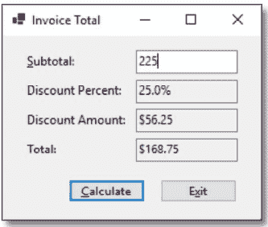

## 代码中引用的控件

| 对象类型 | 名称 | 描述 |
|---|---|---|
| TextBox | txtSubtotal | 一个接受小计金额的文本框 |
| TextBox | txtDiscountPercent | 一个显示折扣百分比的只读文本框 |
| TextBox | txtDiscountAmount | 一个显示折扣金额的只读文本框 |
| TextBox | txtTotal | 一个显示发票总额的只读文本框 |
| Button | btnCalculate | 单击时计算折扣金额和发票总额 |
| Button | btnExit | 单击时关闭窗体 |

## Invoice Total 窗体的事件处理程序

```
private void btnCalculate_Click(object sender, EventArgs e)
{
    decimal subtotal = Convert.ToDecimal(txtSubtotal.Text);
    decimal discountPercent = .25m;
    decimal discountAmount = subtotal * discountPercent;
    decimal invoiceTotal = subtotal - discountAmount;

    txtDiscountPercent.Text = discountPercent.ToString("p1");
    txtDiscountAmount.Text = discountAmount.ToString("c");
    txtTotal.Text = invoiceTotal.ToString("c");

    txtSubtotal.Focus();
}

private void btnExit_Click(object sender, EventArgs e)
{
    this.Close();
}
```

## 增强的 Invoice Total 应用

图 4-19 展示了 Invoice Total 应用的一个增强版本，该版本演示了本章介绍的其他一些技能。在窗体左侧，“Enter Subtotal”文本框下方添加了一个新的标签和文本框。这些控件显示用户上次输入的小计。在窗体右侧，使用三对标签和文本框来显示已输入的发票数量、发票总额和发票平均值。该窗体还有一个“Clear”按钮，用于清除窗体右侧的总计，以便用户输入另一批发票。

添加到该窗体的控件按照我们标准的命名约定命名，这些约定基于用于标识文本框和标签的名称。在此示例中，txtEnterSubtotal 用于供用户输入小计的文本框，txtSubtotal 用于显示用户上次输入的小计的文本框，txtNumberOfInvoices 用于显示发票数量的文本框，txtTotalOfInvoices 用于显示发票总额的文本框，txtInvoiceAverage 用于显示发票平均值的文本框，btnClearTotals 用于“Clear”按钮。

在此窗体的代码中，增强部分以阴影显示，便于查看。该代码首先声明了三个类变量：numberOfInvoices、totalOfInvoices 和 invoiceAverage。这些变量的值需要在事件处理程序的不同执行之间保留。它们被初始化为零值。

在“Calculate”按钮的 Click 事件处理程序中，第二个阴影行对折扣金额的计算添加了舍入。这是必要的，以便只有发票的精确金额被添加到发票总额中。否则，发票总额可能会变得不正确。然后，下一条阴影语句在“Subtotal”文本框中显示用户输入的小计。这样，当用户输入下一张发票的小计时，上一张发票的所有数据都会显示在窗体左侧的文本框中。

下一组阴影语句显示了在处理完每个小计条目后如何使用类变量。前三条语句将发票数量加 1，将发票总额加到发票总计中，并计算发票平均值。然后，接下来的三条语句将类变量的新值赋给显示它们的文本框。此事件处理程序中的最后一条阴影语句将空字符串分配给“Enter Subtotal”文本框，以便用户输入下一张发票的小计。

在“Clear”按钮的 Click 事件处理程序中，前三条语句将类变量重置为零，以便用户输入另一批发票的小计。然后，接下来的三条语句将显示这些变量的文本框设置为空字符串。最后一条语句将焦点移动到“Enter Subtotal”文本框，以便用户开始输入另一批发票的第一项。


## 增强的 Invoice Total 表单

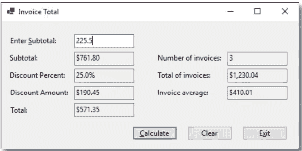

### 类变量和两个事件处理程序的代码

```csharp
int numberOfInvoices = 0;
decimal totalOfInvoices = 0m;
decimal invoiceAverage = 0m;

private void btnCalculate_Click(object sender, EventArgs e)
{
    decimal subtotal = Convert.ToDecimal(txtEnterSubtotal.Text);
    decimal discountPercent = .25m;
    decimal discountAmount = Math.Round(subtotal * discountPercent, 2);
    decimal invoiceTotal = subtotal - discountAmount;

    txtSubtotal.Text = subtotal.ToString("c");
    txtDiscountPercent.Text = discountPercent.ToString("p1");
    txtDiscountAmount.Text = discountAmount.ToString("c");
    txtTotal.Text = invoiceTotal.ToString("c");

    numberOfInvoices++;
    totalOfInvoices += invoiceTotal;
    invoiceAverage = totalOfInvoices / numberOfInvoices;

    txtNumberOfInvoices.Text = numberOfInvoices.ToString();
    txtTotalOfInvoices.Text = totalOfInvoices.ToString("c");
    txtInvoiceAverage.Text = invoiceAverage.ToString("c");

    txtEnterSubtotal.Text = "";
    txtEnterSubtotal.Focus();
}

private void btnClearTotals_Click(object sender, System.EventArgs e)
{
    numberOfInvoices = 0;
    totalOfInvoices = 0m;
    invoiceAverage = 0m;

    txtNumberOfInvoices.Text = "";
    txtTotalOfInvoices.Text = "";
    txtInvoiceAverage.Text = "";

    txtEnterSubtotal.Focus();
}
```

## 视角

如果你理解了增强的 Invoice Total 应用程序中的代码，你已经取得了长足的进步。如果不理解，在完成本章练习时，你应该能更好地理解该应用程序的工作原理。一旦理解，你就可以准备学习如何编写选择和迭代语句，以便为你的应用程序添加逻辑操作。

## 术语

|  |  |
|---|---|
| 内置数据类型 | 严格类型语义 |
| 位 | 静态方法 |
| 字节 | 参数 |
| 整数 | 精度 |
| Unicode 字符集 | 银行家舍入 |
| ASCII 字符集 | 实例方法 |
| 布尔值 | 实例化 |
| 变量 | 伪随机数 |
| 常量 | 种子值 |
| 声明变量或常量 | 字符串 |
| 初始化变量或常量 | 字符串字面量 |
| camel 命名法 | 空值 |
| 数字分隔符 | 空字符串 |
| Pascal 命名法 | 连接字符串 |
| 字面量 | 追加字符串 |
| 科学记数法 | 转义序列 |
| 算术表达式 | 逐字字符串字面量 |
| 算术运算符 | 结构 |
| 操作数 | 值类型 |
| 二元运算符 | 引用类型 |
| 一元运算符 | 作用域 |
| 前置操作数 | 类作用域 |
| 后置操作数 | 类变量 |
| 赋值语句 | 方法作用域 |
| 赋值运算符 | 生命周期 |
| 优先级 | 枚举 |
| 类型转换 | 成员 |
| 隐式转换 | 可空类型 |
| 扩展转换 | 可空值类型 |
| 显式转换 | 空合并运算符 |
| 缩窄转换 | 空合并赋值运算符 |

## 练习 4-1 修改 Invoice Total 应用程序

在本练习中，你将修改本章中介绍的 Invoice Total 应用程序。

### 打开 Invoice Total 应用程序

1. 打开 `C:\C#\Chapter 04\InvoiceTotal` 目录中的应用程序。这是图 4-18 中介绍的应用程序。

### 测试 Invoice Total 应用程序的代码

2. 构建并运行应用程序，输入有效的 subtotal 以验证是否正确扣除了折扣。然后，输入一个像 225.50 这样的有效 subtotal，该值会产生折扣金额超过两位小数的情况，并确保折扣金额和总计仅显示两位小数。

3. 为 subtotal 输入 “$1000” 并单击 Calculate 按钮。这次应该发生异常，Visual Studio 应进入中断模式，并且 Exception Helper 应显示一条消息，指出输入字符串的格式不正确。

4. 注意高亮的语句。这表明赋值语句无法将输入的字符串转换为 decimal 数据类型。接下来，将鼠标指针移到 `txtSubtotal.Text` 上，以便看到显示当前值为 $1000 的数据提示。然后，单击 Debug 工具栏中的 Stop Debugging 按钮以结束应用程序。

### 尝试代码

5. 修改 `btnCalculate_Click()` 方法中的第一个语句，使其使用 `Decimal` 类的 `Parse()` 方法而不是 `Convert` 类的 `ToDecimal()` 方法。然后，测试应用程序以验证其仍然以相同的方式工作。

6. 将存储在 `discountAmount` 和 `invoiceTotal` 变量中的值舍入到两位小数，并删除将这些变量转换为字符串的语句的格式化代码。然后，测试应用程序以确保折扣金额和总计仅显示两位小数。

### 保存并关闭项目

7. 保存解决方案并关闭它。

## 练习 4-2 增强 Invoice Total 应用程序

本练习将指导你完成增强练习 4-1 中的 Invoice Total 应用程序的过程，使其像图 4-19 中的应用程序一样工作。这将让你在开发表单和处理数据方面获得更多练习。

### 打开 Invoice Total 应用程序并增强表单

1. 打开 `C:\C#\Chapter 04\InvoiceTotalEnhanced` 目录中的应用程序。
2. 使用你在第 2 章中学到的技术来放大表单并向表单添加图 4-19 中显示的新控件。
3. 设置每个控件的属性。你应该能够在没有指导的情况下完成此操作，但请尝试为将由代码引用的每个控件命名，使用适当的前缀后跟在表单中标识它的名称（如 `txtNumberOfInvoices`）。

### 添加增强的代码

4. 切换到代码编辑器并输入图 4-19 中显示的三个类变量。这些变量将累积所有发票的数据。
5. 增强 Calculate 按钮的 Click 事件的代码，以便计算并显示新数据。尝试在不参考图 4-19 的情况下完成此操作。
6. 使用你在第 3 章中学到的技术来启动 Clear 按钮的 Click 事件的事件处理程序。然后，添加此事件的代码。这里同样，尝试在不参考图 4-19 中的代码的情况下完成此操作。
7. 测试应用程序并修复任何错误，直到应用程序正常工作。确保在单击 Clear 按钮并输入另一批发票时，它能正确重新启动。

### 添加更多控件和代码

8. 在表单右侧的两列文本框和标签下方再添加两个标签和两个文本框。两个标签应分别写为 “Largest invoice” 和 “Smallest invoice”。标签右侧的文本框应显示最大发票总额和最小发票总额的值。
9. 添加使此功能正常工作的代码。如果你是编程新手，这可能会对你构成挑战。提示：要找到最小的发票总额，请使用 `Math.Min()` 方法将每个发票总额与包含到目前为止最小发票总额的变量进行比较。然后，用两个发票总额中较小的一个替换变量值。为了使此操作对第一张发票有效，你可以将此变量初始化为一个很大的数字，例如 `Decimal` 类的 `MaxValue` 成员。
10. 测试应用程序并修复任何错误，直到应用程序正常工作。然后，关闭项目。

## 如何编码控制结构

在上一章中，你学习了如何编写处理最常见数据类型的代码。现在，你将学习如何编码所有现代编程语言中常见的三种控制结构：选择、 case 和迭代结构。完成本章后，你将能够编写执行各种逻辑操作的应用程序。

- 如何编码布尔表达式 ... 134
- 如何使用关系运算符 ... 134
- 如何使用逻辑运算符 ... 136
- 如何编码条件语句和表达式 ... 138
- 如何编码 if-else 语句 ... 138
- 如何编码 switch 语句 ... 140
- 如何编码 switch 表达式 ... 142
- 如何使用条件运算符 ... 144
- Invoice Total 应用程序的增强版本 ... 146
- 如何编码循环 ... 148
- 如何编码 while 和 do-while 循环 ... 148
- 如何编码 for 循环 ... 150
- 使用 break 和 continue 语句的循环 ... 152
- 具有循环的程序的调试技术 ... 154
- Future Value 应用程序 ... 156
- 表单的设计和属性设置 ... 156
- 表单的代码 ... 158
- 视角 ... 160


## 如何编码布尔表达式

当你编码一个求值为 true 或 false 的表达式时，该表达式可以称为布尔表达式。因为你会在所编码的控制结构中使用布尔表达式，所以在学习如何编码控制结构之前，你需要先学习如何编码布尔表达式。

## 如何使用关系运算符

图 5-1 显示了如何使用六个关系运算符来编码布尔表达式。这些运算符让你可以比较两个操作数，如本图中的示例所示。操作数可以是任何表达式，包括变量、字面量、算术表达式，或 null、true 或 false 等关键字。

本图中的前六个表达式使用相等运算符（==）来测试两个操作数是否相等。要使用此运算符，你必须编码两个等号而不是一个。这是因为单个等号用于赋值语句。因此，如果你尝试用单个等号编码布尔表达式，你的代码将无法编译。

下一个表达式使用不等运算符（!=）来测试变量是否不等于字符串字面量。其后的两个表达式使用大于运算符（>）来测试变量是否大于数字字面量，以及使用小于运算符（<）来测试一个变量是否小于另一个变量。最后两个表达式类似，只是它们使用大于或等于运算符（>=）和小于或等于运算符（<=）来比较操作数。

如果你想在表达式中包含布尔变量，通常不需要包含 == 或 != 运算符。这是因为布尔变量按定义求值为布尔值。所以如果 isValid 是一个布尔变量，

```
isValid
```

与

```
isValid == true
```

作用相同。

在比较数值时，你通常会比较具有相同数据类型的数值。然而，如果你比较不同类型的数值，C# 会自动将精度较低类型的数值转换为精度较高的类型。例如，如果你将一个 int 值与一个 decimal 值进行比较，则在比较执行之前，int 值将被转换为 decimal 值。

如果你来自 Java 等其他编程语言，你可能会惊讶地发现你也可以对字符串使用其中一些运算符，而字符串实际上是 String 对象。这是因为 C# 允许类和结构定义运算符。在这种情况下，由于 String 类定义了 == 和 != 运算符，你可以在字符串上使用这些运算符。

## 关系运算符

| Operator | Name | Description |
|---|---|---|
| == | Equality | Returns a true value if the left and right operands are equal. |
| != | Inequality | Returns a true value if the left and right operands are not equal. |
| > | Greater than | Returns a true value if the left operand is greater than the right operand. |
| < | Less than | Returns a true value if the left operand is less than the right operand. |
| >= | Greater than or equal | Returns a true value if the left operand is greater than or equal to the right operand. |
| <= | Less than or equal | Returns a true value if the left operand is less than or equal to the right operand. |

## Examples

```
firstName == "Frank"        // equal to a string literal
txtYears.Text == ""          // equal to an empty string
message == null               // equal to a null value
discountPercent == 2.3        // equal to a numeric literal
isValid == false              // equal to the false value
code == productCode           // equal to another variable

lastName != "Jones"          // not equal to a string literal

years > 0                     // greater than a numeric literal
i < months                    // less than a variable

subtotal >= 500               // greater than or equal to a literal value
quantity <= reorderPoint      // less than or equal to a variable
```

### Description

- You can use the *relational operators* to create a *Boolean expression* that compares two operands and returns a Boolean value.
- To compare two operands for equality, make sure you use two equals signs. If you use a single equals sign, the compiler will interpret it as an assignment statement, and your code won’t compile.
- When comparing strings, you can only use the equality and inequality operators.
- If you compare two numeric operands with different data types, C# will cast the less precise operand to the type of the more precise operand.

## 如何使用逻辑运算符

图 5-2 显示了如何使用逻辑运算符来编码由两个或多个布尔表达式组成的复合布尔表达式。例如，本图中的第一个复合表达式使用 && 运算符。因此，如果 && 运算符之前的表达式和之后的表达式都求值为 true，则它求值为 true。相反，第二个复合表达式使用 || 运算符。因此，如果 || 运算符之前的表达式或之后的表达式求值为 true，则它求值为 true。

当你使用 && 和 || 运算符时，只有在必要时才会评估第二个表达式。正因为如此，这些运算符有时被称为短路运算符。举例来说，假设第一个示例中 subtotal 的值小于 250。那么第一个表达式求值为 false。这意味着整个表达式无论第二个表达式的值如何都求值为 false。因此，第二个表达式不会被评估。由于这比总是评估两个表达式更高效，你大多数时候都希望使用这些快捷运算符。

然而，可能有时候你希望无论第一个表达式返回的值如何都评估第二个表达式。例如，第二个表达式可能会递增一个变量，如本图中的第三和第四个示例所示。在这些情况下，你可以使用 & 和 | 运算符来确保第二个表达式被评估。

你也可以在同一个表达式中使用两个或多个逻辑运算符，如第五和第六个示例所示。当你这样做时，你应该知道 And 操作在 Or 操作之前执行。此外，算术和关系操作在逻辑操作之前执行。如果需要更改此顺序或对表达式的求值方式有任何疑问，你可以使用括号来控制或澄清顺序。

如果需要，你可以使用 Not 运算符（!）来反转表达式的值，如本图中的最后一个示例所示。然而，这可能会产生难以阅读的代码，因此你应尽可能避免使用此运算符。例如，与其编码

```
!(subtotal < 100)
```

你可以编码

```
subtotal >= 100
```

尽管两个表达式返回相同的结果，但第二个表达式更易读。

## 逻辑运算符

| Operator | Name | Description |
|---|---|---|
| && | Conditional-And | Returns a true value if both expressions are true. This operator only evaluates the second expression if necessary. |
| || | Conditional-Or | Returns a true value if either expression is true. This operator only evaluates the second expression if necessary. |
| & | And | Returns a true value if both expressions are true. This operator always evaluates both expressions. |
| | | Or | Returns a true value if either expression is true. This operator always evaluates both expressions. |
| ! | Not | Reverses the value of the expression. |

## Examples

```
subtotal >= 250 && subtotal < 500
timeInService <= 4 || timeInService >= 12

isValid == true & counter++ < years
isValid == true | counter++ < years

date > startDate && date < expirationDate || isValid == true
((thisYTD > lastYTD) || empType=="Part time") && startYear < currentYear

!(counter++ >= years)
```

### Description

- You can use the *logical operators* to create a Boolean expression that combines two or more Boolean expressions.
- Since the `&&` and `||` operators only evaluate the second expression if necessary, they’re sometimes referred to as *short-circuit operators*. These operators are slightly more efficient than the `&` and `|` operators.
- By default, Not operations are performed first, followed by And operations, and then Or operations. These operations are performed after arithmetic operations and relational operations.
- You can use parentheses to change the sequence in which the operations will be performed or to clarify the sequence of operations.


## 如何编码条件语句和表达式

现在你已经知道如何编码布尔表达式，你就可以学习如何编码条件语句和表达式了。其中包括 if-else 语句和 switch 语句、switch 表达式，以及使用条件运算符的表达式。

### 如何编码 if-else 语句

图 5-3 显示了如何使用 *if-else 语句*（或仅 *if 语句*）来控制程序的逻辑。这种语句是所有编程语言的主要逻辑语句。它是 C# 对一种称为 *选择结构* 的控制结构的实现，因为它允许你根据布尔表达式的结果选择不同的操作。

在本图中的语法摘要中，方括号 [ ] 表示子句是可选的，而省略号 (...) 表示前面的元素可以重复多次。换句话说，此语法显示你可以编码一个 *if* 子句，可带或不带 *else if* 子句或 *else* 子句。它还显示你可以根据需要编码任意多个 else if 子句。

当执行 if 语句时，C# 首先评估 if 子句中的布尔表达式。如果为真，则执行此子句内的语句，并且跳过 if-else 语句中的其余子句。如果为假，C# 会评估第一个 else if 子句（如果有）。如果其布尔表达式为真，则执行此 else if 子句内的语句，并且跳过其余的 if-else 语句。否则，C# 会评估下一个 else if 子句。这会继续处理所有剩余的 else if 子句。最后，如果没有任何子句包含评估为真的布尔表达式，C# 会执行 else 子句中的语句。如果语句不包含 else 子句，C# 不会执行任何语句。

在编码 if-else 语句时，通常的做法是对每个子句编码一组大括号。然而，如果子句只包含单个语句，你可以省略大括号。虽然省略大括号可以节省一些输入并占用更少的垂直空间，但编码大括号使得更容易识别每个子句的语句，并且使你以后添加更多语句变得更容易。

如果你正在处理一个不包含大括号的现有项目，你可以使用重构来添加它们。为此，将光标放在 if、else if 或 else 子句中，按 Ctrl + 句号 (.)，并从显示的快速操作菜单中选择添加大括号。然后，单击弹出窗口中的文档、项目或解决方案链接，以确定要进行更改的位置。

在 C# 中，每当你使用大括号时，你就定义了一段代码块。如果你在代码块内声明一个变量，该变量仅对代码块中的其他语句可用。这可以称为 *块作用域*。因此，如果你需要在 if 语句之外访问一个变量，你应该在 if 语句之前声明它。

在编码 if 语句时，常见的做法是在另一个 if 语句内编码一个 if 语句。这被称为 *嵌套 if 语句*。当你编码嵌套 if 语句时，良好的做法是缩进嵌套语句及其子句。这可以清楚地标识嵌套语句的开始和结束位置。在本图中的最后一个示例中，你可以看到 C# 只有在客户类型为 R 时才会执行嵌套 if 语句。否则，它会执行外部 else 子句中的语句。

### 如何编码 switch 语句

图 5-4 显示了如何使用 *switch 语句*。这是 C# 对一种称为 *case 结构* 的控制结构的实现，它允许你为不同的情况编码不同的操作。switch 语句有时可以用在带有 else if 子句的 if 语句的替代位置。

要编码 switch 语句，你首先编码 switch 关键字，后跟一个 *匹配表达式*。此表达式必须评估为本图中列出的数据类型之一。在匹配表达式之后，你可以编码一个或多个 *case 标签*，它们代表匹配表达式的可能值。然后，当匹配表达式与 case 标签指定的值匹配时，会执行标签后面的语句。switch 语句还可以包含一个 *default 标签*，它标识如果没有任何 case 标签指定的值与匹配表达式匹配时执行的语句。所有这些 case 标签都在 switch 语句大括号内编码。

当你编码 case 标签或 default 标签时，你必须确保在其后编码一个冒号。然后，如果标签包含一个或多个语句，你必须编码一个 *break 语句* 来退出 switch 语句。本章后面你将看到你也可以使用 break 语句来退出循环。

每个标签内的 switch 语句都需要 break 语句，因为 C# 不允许执行 *贯穿* 到下一个标签。这被称为 *不贯穿规则*。此规则的唯一例外是不包含任何语句的 case 标签。在这种情况下，将执行下一个标签内的语句。

本图中的第一个示例显示了如何编码一个 switch 语句，根据名为 customerType 的字符串变量中的值设置折扣百分比。如果客户类型为 R，则折扣百分比设置为 .1。如果客户类型为 C，则折扣百分比设置为 .2。否则，折扣百分比设置为默认值 0。

请注意，在此示例中，即使 default 标签是最后一个标签，它仍必须以 break 语句结束。你还应该意识到你可以按任何顺序编码 case 和 default 标签。然而，常见的做法是将 default 标签放在最后。

第二个示例与之类似，但不包含 default 标签。因此，如果没有任何 case 标签中的值与匹配表达式匹配，则不会执行任何代码。另一个区别是第一个 case 标签不包含任何语句。因此，如果客户类型为 R，执行会贯穿到下一个 case 标签。这意味着如果客户类型为 R 或 C，折扣百分比将被设置为 .2。

### switch 语句的语法

```text
switch (matchExpression)
{
    case constantExpression:
        statements
        break;
    [case constantExpression:
        statements
        break;] ...
    [default:
        statements
        break;]
}
```

### 带 default 标签的 switch 语句

```text
switch (customerType)
{
    case "R":
        discountPercent = .1m;
        break;
    case "C":
        discountPercent = .2m;
        break;
    default:
        discountPercent = .0m;
        break;
}
```

### 贯穿第一个 case 标签的 switch 语句

```text
switch (customerType)
{
    case "R":
    case "C":
        discountPercent = .2m;
        break;
    case "U":
        discountPercent = .4m;
        break;
}
```

## 描述

- *switch 语句* 首先通过评估其 *匹配表达式* 开始。此表达式必须评估为字符串、char、bool、enum 或任何整数类型。
- 在评估匹配表达式之后，switch 语句将控制转移到适当的 *case 标签*。如果控制没有转移到其中一个 case 标签，则会执行可选的 *default 标签*。
- *break 语句* 退出 switch 语句。如果标签包含一个或多个语句，则标签必须以 break 语句结束。
- 如果标签不包含任何语句，代码执行将 *贯穿* 到下一个标签。这意味着下一个标签包含的语句将被执行。


当你使用 switch 语句时，你可以在语句的 case 中编码 if 语句。你也可以在另一个 switch 语句的 case 中编码 switch 语句。这可以使 switch 语句更有用。一般来说，程序员更喜欢使用 if-else 语句而不是 switch 语句，因为 if-else 语句不受限制。

### 如何编码 switch 表达式

从 C# 8.0 及更高版本开始，你可以使用 *switch 表达式* 除了 switch 语句之外。switch 表达式的工作方式与 switch 语句类似，但其语法更简洁。图 5-5 显示了如何编码 switch 表达式。

本图顶部的语法显示，与 switch 语句不同，你在 switch 关键字之前编码匹配表达式以用于 switch 表达式。这是有意为之，以便于区分 switch 语句和 switch 表达式。

在 switch 关键字后面的大括号内，你编码一个或多个常量表达式，表示匹配表达式的可能值。虽然你不将这些表达式编码在 case 标签上，但它们通常仍被称为 case，因为 switch 表达式提供了实现 case 结构的另一种方式。在每个常量表达式之后，你编码一个 *lambda 运算符* (=>，读作“ goes to ”)，后跟要返回的表达式。这与 switch 语句不同，在 switch 语句中，每个 case 标签可以包含多个可执行语句。

switch 表达式还可以包含一个在没有任何常量表达式与匹配表达式匹配时返回的默认表达式。要标识此表达式，你使用 *丢弃* (_)。这相当于你可以用 switch 语句使用的 default 标签。丢弃是在 C# 7.0 中引入的，也可以用在 out 参数和元组中，如你在第 6 章中将看到的那样。

请注意，switch 表达式中的 case 由逗号分隔。此外，switch 表达式必须以分号 (;) 结束。这是因为 switch 表达式被视为单个语句。

本图中的第一个示例说明了简单的 switch 表达式的工作原理。这里，switch 表达式用于根据 customerType 变量的值为 discountPercent 变量分配值。例如，如果客户类型为 R，则折扣百分比设置为 .1。如果客户类型为 C，则折扣百分比设置为 .2。如果客户类型既不是 R 也不是 C，则折扣百分比设置为 0。这与图 5-4 中的第一个 switch 语句完成相同的事情。如果你比较这个 switch 表达式和 switch 语句，你会发现 switch 表达式需要的代码更少。

第二个示例与第一个类似，只是它为客户类型 R 和 C 返回相同的值。为此，它必须为每种类型重复该值。这是因为 switch 表达式的 case 不能像 switch 语句中那样贯穿到下一个 case。即使如此，此代码仍然简洁明了，如你将通过将此 switch 表达式与图 5-4 中的第二个 switch 语句进行比较而看到的那样。

第三个示例显示了每个 case 的表达式可能不仅仅是一个常量值。这里，switch 表达式返回折扣金额


## switch 表达式的语法

```
matchExpression switch
{
    constantExpression => expression
    [, constantExpression => expression]...
    [, _ => expression]
};
```

## 使用 discard 的 switch 表达式

```csharp
discountPercent = customerType switch
{
    "R" => .1m,
    "C" => .2m,
    _   => .0m
};
```

## 两个 case 返回相同结果的 switch 表达式

```csharp
discountPercent = customerType switch
{
    "R" => .2m,
    "C" => .2m,
    "T" => .4m
};
```

## 使用执行计算的表达式的 switch 表达式

```csharp
discountAmount = customerType switch
{
    "R" => subtotal * .2m,
    "C" => subtotal * .2m,
    "T" => subtotal * .4m,
    _   => .0m
};
```

## 使用关系运算符的 switch 表达式（C# 9.0 及更高版本）

```csharp
discountAmount = subtotal switch
{
    >= 50.0m and <= 200.0m => subtotal * .2m,
    > 200.0m => subtotal * .4m,
};
```

## 描述

- *switch 表达式* 首先通过求值其匹配表达式开始。
- 在求值匹配表达式之后，switch 表达式会求值与匹配的常量表达式相关联的表达式。这里，使用 *lambda 运算符*（`=>`）来标识每个常量的表达式。
- 你可以使用 *discard*（`_`）作为其中一个常量表达式。然后，如果匹配表达式与任何常量表达式都不匹配，则会求值 discard 的表达式。
- switch 表达式在 C# 8.0 中可用，discard 在 C# 7.0 中可用，case 标签的关系运算符在 C# 9.0 中可用。


每个客户类型。为此，前三个表达式将小计乘以折扣百分比。这应该能帮助你开始了解可以为 switch 表达式的 case 编写的表达式类型。

在 C# 9.0 及更高版本中，你可以在 switch 语句或表达式中使用关系运算符，如第四个示例所示。这里，常量表达式使用关系运算符根据小计的范围计算折扣金额。请注意，第一个常量表达式使用 and 关键字连接两个关系运算符。此功能是在 C# 9.0 中引入的。

现在你已经了解了 switch 表达式的工作原理，你可能会想知道何时使用它们。在大多数情况下，你会在只需要将值赋给变量时使用它们，如示例所示。

## 如何使用条件运算符

到目前为止，在本书中，你已经看到了接受单个操作数的 unary 运算符和接受两个操作数的 binary 运算符。现在，图 5-6 显示了如何使用条件运算符。该运算符被称为 ternary 运算符，因为它接受三个操作数。第一个操作数是布尔表达式，第二个操作数是在布尔表达式为 true 时求值并返回的表达式，第三个操作数是在布尔表达式为 false 时求值并返回的表达式。

条件运算符需要两个符号来分隔其三个操作数。这通过条件表达式的语法来说明，条件表达式是使用条件运算符的表达式。正如你所见，问号（?）用于分隔布尔表达式和 true 表达式，而冒号（:）用于分隔 true 和 false 表达式。

第一个示例显示了一个条件表达式。这里布尔表达式检查名为 subtotal 的变量是否大于或等于 100。如果是，则返回 .1。否则，返回 .05。

第二个示例显示了如何在赋值语句中使用条件表达式。这里，语句首先声明一个名为 discountPercent 的 decimal 变量。然后，它将第一个示例中的条件表达式的结果赋给该变量。因此，如果小计大于或等于 100，则 discountPercent 变量为 .1。否则为 .05。

第三个示例的工作方式与第二个示例相同。然而，它使用括号来明确标识布尔表达式。这些括号是可选的，但一些程序员更喜欢使用它们，因为它们使语句更易于阅读。

第四个示例显示了第三个示例重写为使用 if 语句而不是条件运算符后的样子。这表明使用条件运算符的语句始终可以重写为使用 if 语句。一些程序员更喜欢这种方法，因为他们认为 if 语句更易于阅读。其他程序员喜欢使用条件运算符，因为它占用的代码行更少。因此，即使你不使用条件运算符编写代码，你仍然需要了解其工作原理，以便理解其他程序员编写的代码。

## 条件表达式的语法

```
booleanExpression ? trueExpression : falseExpression
```

## 一个条件表达式

```
subtotal >= 100 ? .1m : .05m    // returns .1 or .05 depending on subtotal
```

## 如何使用条件运算符设置变量的值

```
decimal discountPercent = subtotal >= 100 ? .1m : .05m;
```

## 一个使用括号标识布尔表达式的语句

```
decimal discountPercent = (subtotal >= 100) ? .1m : .05m;
```

## 执行相同任务的 if 语句

```
decimal discountPercent;
if (subtotal >= 100)
    discountPercent = .1m;
else
    discountPercent = .05m;
```

## 描述

- *条件运算符* 由三个由问号（?）和冒号（:）符号分隔的表达式组成。第一个表达式是布尔表达式，第二个表达式在布尔表达式为 true 时求值并返回，第三个表达式在布尔表达式为 false 时求值并返回。
- 条件运算符提供了一种在一行上编写简单的 if-else 语句的方法。
- 在三个操作数上工作的运算符被称为 *ternary 运算符*。条件运算符是 ternary 运算符的一个例子。
- 在 C# 7.2 及更高版本中，条件表达式可以返回对 true 或 false 表达式结果的引用。有关更多信息，请参阅 C# 参考手册中的 `?:` 运算符。

## Invoice Total 应用的增强版本

为了让你更好地了解如何使用 if-else 语句，图 5-7 展示了在第 3 章中介绍的 Invoice Total 应用的增强版本。这次，该应用的表单提供了两个用户输入：客户类型和小计。

如果你查看此图中的事件处理程序，你可以看到折扣百分比是由嵌套的 if 语句确定的。例如，如果客户类型为 R 且小计大于或等于 250，则折扣百分比为 .25。或者，如果客户类型为 C 且小计小于 250，则折扣百分比为 .2。

当你像这样编写 if 语句时，遵循良好的做法是按逻辑顺序编写条件。例如，客户类型 R 的嵌套 if 语句中的表达式范围从小计小于 100，到小计大于或等于 100 且小于 250，到小计大于或等于 250。这涵盖了从最小到最大的所有可能小计。虽然你可以用其他顺序编写这些条件，但这会使判断是否涵盖了所有可能性变得更困难。

为了提高效率，按最常出现到最少出现的顺序编写条件也是一个好主意。例如，如果大多数客户都是类型 R，则应首先处理该条件，以便首先处理它。在某些情况下，最有效顺序并不符合逻辑，因此你必须决定是否值得为了效率而牺牲代码的可读性。通常，性能提升并不显著，因此你最好按最合乎逻辑的顺序编写语句。

如果愿意，你可以使用包含 if 语句的 switch 语句来获得与此图中的嵌套 if 语句相同的结果。这甚至可能使代码更易于阅读。另一方面，如果你正确使用缩进，广泛的嵌套 if 语句系列也应该易于阅读和理解。

当你将 if 和 switch 语句输入到代码编辑器时，请记住你可以使用代码片段来输入所需的 if、else 和 switch 结构，包括代码块的大括号。要刷新你对如何使用代码片段的记忆，可以参考回图 3-11。


## 增强的发票总额表单

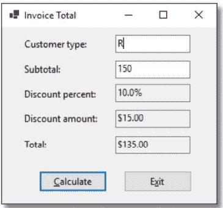

### Calculate 按钮的 Click 事件处理程序

```
private void btnCalculate_Click(object sender, EventArgs e)
{
    string customerType = txtCustomerType.Text;
    decimal subtotal = Convert.ToDecimal(txtSubtotal.Text);
    decimal discountPercent = .0m;

    if (customerType == "R")
    {
        if (subtotal < 100)
            discountPercent = .0m;
        else if (subtotal >= 100 && subtotal < 250)
            discountPercent = .1m;
        else if (subtotal >= 250)
            discountPercent = .25m;
    }
    else if (customerType == "C")
    {
        if (subtotal < 250)
            discountPercent = .2m;
        else
            discountPercent = .3m;
    }
    else
    {
        discountPercent = .4m;
    }

    decimal discountAmount = subtotal * discountPercent;
    decimal invoiceTotal = subtotal - discountAmount;

    txtDiscountPercent.Text = discountPercent.ToString("p1");
    txtDiscountAmount.Text = discountAmount.ToString("c");
    txtTotal.Text = invoiceTotal.ToString("c");

    txtCustomerType.Focus();
}
```

## 如何编写循环

C# 提供了三种不同的语句来控制循环的执行。这些语句提供了迭代结构的 C# 实现。

### 如何编写 while 和 do-while 循环

图 5-8 显示了如何使用 while 语句和 do-while 语句来编写 while 循环和 do-while 循环。这两种循环的区别在于，布尔表达式是在 while 循环开始时求值，而在 do-while 循环结束时求值。因此，while 循环中的语句执行零次或多次，而 do-while 循环中的语句至少执行一次。

编写 while 循环时，通常使用计数器变量来使循环中的语句执行特定次数。这在该图的第一个示例中有所说明。这里，计数器变量是一个名为 i 的 int 类型，该计数器被初始化为 1。请注意，循环中的最后一行语句在每次循环迭代时递增计数器。因此，只要计数器变量小于 5，该循环中的第一条语句就会被执行。顺便说一下，将计数器变量命名为 i、j 和 k 等单个字母是一种常见的编码实践。

大多数情况下，你可以使用这两种类型的循环来完成相同的任务。例如，该图的第二个示例使用 while 循环来计算一系列按月付款在指定利率下的未来价值，而第三个示例使用 do-while 循环执行相同的计算。

编写循环时，重要的是要记住，在循环内声明的任何变量都具有块作用域，因此不能在循环外使用。这就是为什么这里显示的所有循环中使用的变量都在循环外部声明的原因。这样，在循环执行完毕后，你就可以使用这些变量。

编写循环时，可能会编写无限循环，即永远不会结束的循环。例如，如果你忘记编写递增计数器变量的语句，那么 while 或 do-while 循环中的条件永远不会变为 false，就会发生这种情况。然后，你可以切换到 Visual Studio 并单击 Debug 工具栏上的 Break All 按钮进入中断模式并调试程序，如本章后面所示。或者，你可以单击 Stop Debugging 按钮来结束应用程序。

### while 语句的语法

```
while (booleanExpression)
{
    statements
}
```

一个将 1 到 4 的数字相加的 while 循环

```
int i = 1, sum = 0;
while (i < 5)
{
    sum += i;
    i++;
}
```

一个计算未来值的 while 循环

```
int i = 1;
while (i <= months)
{
    futureValue = (futureValue + monthlyPayment) * (1 + monthlyInterestRate);
    i++;
}
```

### do-while 语句的语法

```
do
{
    statements
}
while (booleanExpression);
```

一个计算未来值的 do-while 循环

```
int i = 1;
do
{
    futureValue = (futureValue + monthlyPayment) * (1 + monthlyInterestRate);
    i++;
}
while (i <= months);
```

## 描述

- 当你使用 while 语句时，条件会在 while 循环执行之前进行测试。当你使用 do-while 语句时，条件会在 do-while 循环执行之后进行测试。
- while 或 do-while 循环只要其布尔表达式为 true，就会执行其大括号内的语句块。
- 如果循环需要多条语句，你必须用大括号将语句括起来。然后，在块中声明的任何变量或常量都具有块作用域。如果循环只需要一条语句，则不必用大括号括住该语句。
- 如果条件表达式永远不会变为 false，循环就永远不会结束。然后，程序进入无限循环，你可以通过 Debug 工具栏上的 Break All 或 Stop Debugging 命令来取消该循环。


### 如何编写 for 循环

图 5-9 显示了如何使用 for 语句编写 for 循环。当你需要递增或递减决定循环执行次数的计数器变量时，此类循环很有用。

要编写 for 循环，你首先编写 for 关键字，然后编写用括号括起来并用分号分隔的三个表达式。第一个表达式是初始化表达式，通常声明一个计数器变量并为其分配一个起始值。第二个表达式是布尔表达式，指定循环执行的条件。第三个表达式是递增表达式，确定每次执行循环时计数器变量如何递增或递减。

该图的第一个示例说明了如何使用这些表达式。这里，初始化表达式声明了一个名为 i 的计数器变量，其类型为 int，并为其分配初始值 0。接下来，布尔表达式指定只要计数器小于 5，循环就会重复。然后，递增表达式在每次循环重复结束时将 1 加到计数器上。执行此循环时，数字 0 到 4 将像这样存储为字符串变量：

```
0 1 2 3 4
```

该图显示了如何使用单条语句或语句块编写此循环。如果在循环内编写多条语句，则必须用大括号将语句括起来。但如果只编写单条语句，则大括号是可选的。

下一个示例计算数字 8、6、4 和 2 的总和。在此示例中，sum 变量在循环之前声明，以便在循环执行的语句块之外可用。然后，初始化表达式将计数器变量初始化为 8，布尔表达式指定只要计数器大于零，循环就会执行，并且递增表达式使用赋值运算符在每次循环重复时从计数器变量中减去 2。在循环内，计数器变量的值会加到已存储在 sum 变量中的值上。因此，sum 变量的最终值为 20。

最后一个示例显示了如何编写计算一系列按月付款未来值的 for 循环。这里，循环每个月执行一次。如果你将此示例与图 5-8 中的最后一个示例进行比较，你可以看到当需要计数器变量时，for 循环如何改进了 while 循环。

尽管本图中未显示，但可以在 for 循环之前声明计数器变量。然后，可以在循环之外访问此变量。但是，如果需要在循环之外访问计数器变量，通常使用图 5-8 中描述的 while 或 do-while 循环会更容易。

你也可以在 for 循环内声明计数器变量而不指定类型。要做到这一点，你用 var 关键字代替类型。然后，类型会根据分配给变量的值推断出来。但在大多数情况下，你会指定类型而不是使用 var 关键字。


## for 语句的语法

```
for (initializationExpression; booleanExpression; incrementExpression)
{
    statements
}
```

## 一个将数字 0 到 4 存储到字符串中的 for 循环

### 使用单个语句

```
string numbers = null;
for (int i = 0; i < 5; i++)
    numbers += i + " ";
```

### 使用语句块

```
string numbers = null;
for (int i = 0; i < 5; i++)
{
    numbers += i;
    numbers += " ";
}
```

## 一个将数字 8、6、4 和 2 相加的 for 循环

```
int sum = 0;
for (int j = 8; j > 0; j-=2)
{
    sum += j;
}
```

## 一个计算未来值的 for 循环

```
for (int i = 1; i <= months; i++)
{
    futureValue = (futureValue + monthlyPayment) *
        (1 + monthlyInterestRate);
}
```

## 描述

- 当你需要递增或递减一个决定 for 循环执行次数的计数器时，for 语句很有用。
- 在 for 循环的括号内，你编写一个初始化表达式来声明计数器变量并为其分配起始值、一个指定循环执行条件的布尔表达式，以及一个指示每次循环执行时计数器变量应如何递增或递减的增量表达式。

## 使用 break 和 continue 语句的循环

在大多数情况下，循环内的语句按编码顺序执行，并且当循环的布尔表达式求值为 false 时循环结束。然而，对于某些循环，你可能需要使用 *跳转语句* 来控制语句的执行顺序。图 5-10 介绍了其中两个语句。你使用 break 语句跳到循环的末尾，并使用 *continue 语句* 跳到循环的开头。

该图中的第一个示例展示了 break 语句的工作原理。在这里，一个 while 循环按图 5-8 中所述计算未来值。然而，如果未来值变得大于 100,000，则此循环将字符串文字赋给 message 变量，并执行 break 语句以结束循环。

第二个示例展示了如何使用 continue 语句跳到循环的开头。当控制转移到循环开头时，控制循环操作的表达式会再次执行。因此，这将导致计数器变量被递增，并导致布尔表达式再次被求值。

除了 break 和 continue 语句之外，C# 还提供了可在循环内编码的其他跳转语句。你将在本书的后续部分学习到其中大多数语句。然而，有一个语句你不会学习到，那就是 *goto 语句*。这是因为 goto 语句通常会导致难以阅读和维护的代码。因此，通常认为避免使用它们是一种良好的编码实践。

## 带 break 语句的循环

```
string message = null;
int i = 1;
while (i <= months)
{
    futureValue = (futureValue + monthlyPayment) *
        (1 + monthlyInterestRate);
    if (futureValue > 100000)
    {
        message = "Future value is too large.";
        break;
    }
    i++;
}
```

## 带 continue 语句的循环

```
string numbers = null;
for (int i = 1; i < 6; i++)
{
    numbers += i;
    numbers += "\n";
    if (i < 4)
        continue;
    numbers += "Big\n";
}
```

## 上述循环的结果

```
1
2
3
4
Big
5
Big
```

## 描述

- 你使用 break 语句跳出循环。
- 你使用 continue 语句跳到循环的开头。

## 带有循环的程序的调试技术

当你编写使用循环的程序时，调试往往变得更加困难，因为有时很难判断循环是如何运行的。因此，你可能希望使用图 5-11 中汇总的调试技术。这些技术让你在循环开始时停止程序的执行并进入断点模式。然后，你可以一次观察一个语句的循环操作。

要停止程序的执行并进入断点模式，你需要设置断点。为此，你可以单击代码编辑器窗口左侧边距指示栏中的位置。断点随后会被红色圆点标记。稍后，当应用程序运行时，执行将在断点处的语句之前停止。

一旦进入断点模式，黄色的箭头会标记下一个将被执行的语句，称为执行点。此时，你可以使用调试窗口来显示循环使用的变量的当前值，并观察这些变量每次循环时的变化。例如，你可以使用 Locals 窗口来显示当前方法作用域内变量的当前值。如果此窗口默认未显示，你可以通过从 Debug 菜单的 Windows 子菜单中选择 Locals 项目来显示它。

在断点模式下，你还可以一次一步地逐步执行循环中的语句。为此，你可以重复按 F11 键或单击 Debug 工具栏上的 Step Into 按钮。这让你可以准确观察循环执行时变量值何时以及如何变化。一旦你了解了循环的工作原理，你可以删除断点并按 F5 键继续正常执行。

当然，这些技术对于调试不涉及循环的问题也很有用。例如，如果你无法弄清楚嵌套的 if 语句的复杂集合出了什么问题，你可以在语句的开头设置断点。然后，当程序进入断点模式时，你可以逐步执行语句中的子句，以准确了解表达式是如何被求值的。

## 带断点和执行点的 for 循环

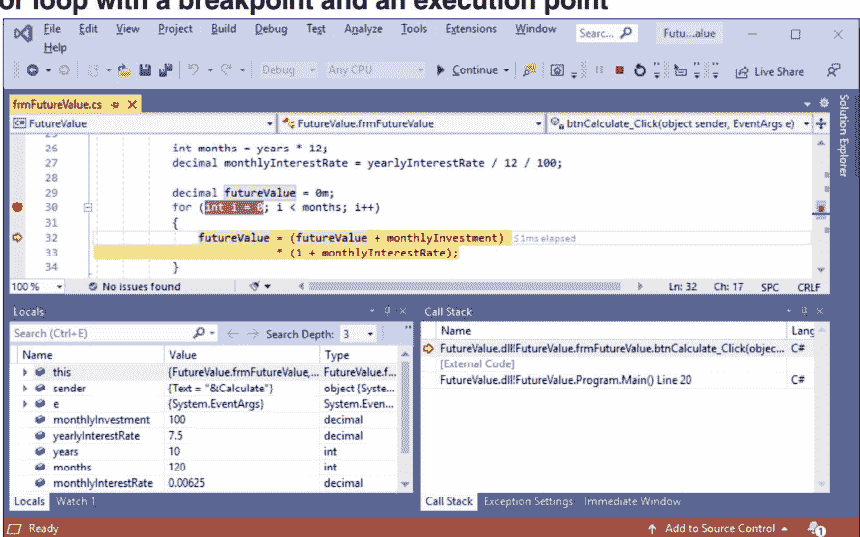

## 如何设置和清除断点

- 要设置断点，请单击语句左侧的 *边距指示栏*。或按 F9 键在光标插入点设置断点。然后，红色圆点将标记断点。如果你有触摸屏，也可以轻触边距指示栏。
- 要删除断点，请使用任何设置断点的技术。要一次删除所有断点，请使用 Debug 菜单中的 Delete All Breakpoints 命令。

## 如何在断点模式下工作

- 在断点模式下，黄色箭头标记当前的 *执行点*，它指向下一个将被执行的语句。
- 要 *逐条语句* 步进你的代码，请按 F11 键或单击 Debug 工具栏上的 Step Into 按钮。
- 要继续正常处理直到到达下一个断点，请按 F5 键。

## 描述

- 当你在特定语句处设置 *断点* 时，程序会在执行该语句之前停止并进入断点模式。然后，你可以一次一个语句地逐步执行程序。
- 在断点模式下，Locals 窗口显示当前方法作用域内变量的当前值。如果此窗口未显示，你可以通过从 Debug 菜单的 Windows 子菜单中选择 Locals 项目来显示它。

图 5-11    带有循环的程序的调试技术

## Future Value 应用程序

现在你已经学习了用于编码循环的语句，我将介绍一个新应用程序，该应用程序使用循环来计算每月投资的未来值。

## 表单的设计和属性设置

图 5-12 展示了 Future Value 表单的设计。为了计算未来值，用户必须将每月投资金额、年利率以及投资年限输入到表单上的三个文本框中。然后，当用户单击 Calculate 按钮或按 Enter 键时，应用程序会计算未来值并将其显示在表单上的最后一个文本框中。

为了让你轻松开发此表单，该图还列出了表单及其控件的属性设置。由于这些设置与你为 Invoice Total 表单使用的设置相似，因此你不应该有任何困难理解它们的工作原理。


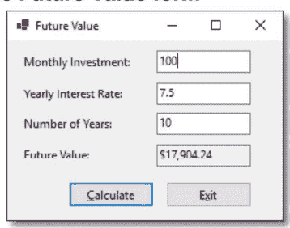

## 未来价值表单

## 表单的属性设置

| 默认名称 | 属性 | 设置 |
|---|---|---|
| Form1 | Text | Future Value |
|  | AcceptButton | btnCalculate |
|  | CancelButton | btnExit |
|  | StartPosition | CenterScreen |

## 控件的属性设置

| 默认名称 | 属性 | 设置 |
|---|---|---|
| label1 | Text | Monthly Investment: |
| label2 | Text | Yearly Interest Rate: |
| label3 | Text | Number of Years: |
| label4 | Text | Future Value: |
| textBox1 | Name | txtMonthlyInvestment |
| textBox2 | Name | txtInterestRate |
| textBox3 | Name | txtYears |
| textBox4 | Name | txtFutureValue |
|  | ReadOnly | True |
|  | TabStop | False |
| button1 | Name | btnCalculate |
|  | Text | &Calculate |
| button2 | Name | btnExit |
|  | Text | E&xit |

## 其他属性设置

- 每个标签的 TextAlign 属性均设置为 MiddleLeft。
- 控件的 TabIndex 属性设置为使焦点从上到下、从左到右移动。

## 表单的代码

图 5-13 展示了未来价值表单的代码。与 Invoice Total 表单的代码类似，此代码包含两个事件处理程序：一个用于计算按钮的 Click 事件，一个用于退出按钮的 Click 事件。在此，大部分处理都在计算按钮的 Click 事件处理程序中进行。

该事件处理程序中的前三条语句声明并初始化将用于存储用户输入到三个文本框中的值的变量。在此，使用了 Convert 类的 ToDecimal() 和 ToInt32() 方法将从文本框的 Text 属性返回的字符串值转换为适当的数据类型。

接下来的两条语句执行计算，将用户输入的年值转换为月值。这样，用于未来价值计算的所有变量都将以月为单位。第一条语句通过将年数乘以 12 将年数转换为月数。第二条语句将年利率除以 12 得到月利率，然后将该结果除以 100 以将数字转换为百分比。

接下来的一组语句使用 for 循环为投资的每个月计算新的未来价值。在此，存储未来价值的变量在循环之前声明，以便在循环处理完成后仍可使用。然后，在循环内部，计算未来价值的单个赋值语句会为每个月执行一次。由于此循环只包含一条语句，因此不需要大括号。但是，为了清楚地标识循环的开始和结束，我仍然包含了这些大括号。

在循环内部，算术表达式将月投资金额加到未来价值上，未来价值的初始值为零。然后，表达式将该和乘以 1 加上月利率。例如，如果月投资金额为 $100，月利率为 1%（或 .01），则表达式第一次执行后未来价值为 $101：

```
(0 + 100) * (1 +.01) = 100 * 1.01 = 101
```

表达式第二次执行后未来价值为 $203.01：

```
(101 + 100) * (1 + .01) = 201 * 1.01 = 203.01
```

继续此过程，持续用户指定的月数，未来价值将包含一系列相等月度投资的正确结果。

循环结束后，下一个语句格式化未来价值并将其显示在表单上。为此，ToString() 方法将十进制值转换为使用货币格式的字符串。然后，将此字符串值赋给未来价值文本框的 Text 属性。最后，最后一条语句将焦点移动到月度投资文本框，为下一次计算做好准备。

为了保持此程序的简单性，它不会验证用户输入的数据。因此，如果用户在某个文本框中输入非数字数据，将会发生异常。在第 7 章中，您将学习如何向此程序添加数据验证以防止此类异常。

## 未来价值应用程序中事件处理程序的代码

```
private void btnCalculate_Click(object sender, EventArgs e)
{
    decimal monthlyInvestment =
        Convert.ToDecimal(txtMonthlyInvestment.Text);
    decimal yearlyInterestRate = Convert.ToDecimal(txtInterestRate.Text);
    int years = Convert.ToInt32(txtYears.Text);

    int months = years * 12;
    decimal monthlyInterestRate = yearlyInterestRate / 12 / 100;

    decimal futureValue = 0m;
    for (int i = 0; i < months; i++)
    {
        futureValue = (futureValue + monthlyInvestment)
            * (1 + monthlyInterestRate);
    }

    txtFutureValue.Text = futureValue.ToString("c");
    txtMonthlyInvestment.Focus();
}

private void btnExit_Click(object sender, EventArgs e)
{
    this.Close();
}
```

## 描述

- 此应用程序使用 for 循环计算月度投资金额的未来价值。为了使此计算正确工作，它所使用的所有变量必须转换为相同的时间段。在此情况下，该时间段为月。
- 每次通过 for 循环时，赋值语句都会将月投资金额加到未来价值上，未来价值从零开始。然后，此和乘以 1 加上月利率。结果存储在 futureValue 变量中，以便下一次循环时使用。
- 由于此应用程序未提供数据验证，用户将能够输入无效数据，这将导致异常发生。

## 观点

现在您已完成本章，您应该知道如何编码 if 语句、switch 语句、switch 表达式、条件表达式、while 语句、do-while 语句和 for 语句。这些是实现选择、情况和迭代结构的 C# 语句和表达式，它们提供了应用程序的逻辑。一旦掌握它们，您将能够开发重要的 C# 应用程序。

## 术语

|  |  |
|---|---|
| Boolean expression | discard |
| relational operator | conditional operator |
| logical operator | ternary operator |
| short-circuit operator | conditional expression |
| if-else statement | iteration structure |
| if statement | while statement |
| selection structure | while loop |
| block scope | do-while statement |
| nested if statement | do-while loop |
| switch statement | infinite loop |
| case structure | for statement |
| match expression | for loop |
| case label | jump statement |
| default label | continue statement |
| break statement | breakpoint |
| fall through | margin indicator bar |
| no fall through rule | execution point |
| switch expression | step through code |
| lamda operator |  |

## 练习 5-1 增强 Invoice Total 应用程序

在此练习中，您将使用 if-else 和 switch 语句来确定图 5-7 中 Invoice Total 应用程序的折扣百分比。

## 打开应用程序并更改 if-else 语句

1. 打开位于 C:\C#\Chapter 05\InvoiceTotal 目录中的应用程序。
2. 更改 if-else 语句，使类型为 R 的客户在小计大于或等于 $250 但小于 $500 时获得 25% 的折扣，小计为 $500 或以上时获得 30% 的折扣。接下来，更改 if-else 语句，使类型为 C 的客户始终获得 20% 的折扣。然后，测试应用程序以确保其正常工作。
3. 使用代码片段向 if-else 语句添加另一个客户类型，使类型为 T 的客户在小计小于 $500 时获得 40% 的折扣，小计为 $500 或以上时获得 50% 的折扣。此外，确保客户类型不是 R、C 或 T 时获得 10% 的折扣。然后，测试应用程序。
4. 再次测试应用程序，但对客户类型使用小写字母。请注意，这些字母不会被评估为大写字母。现在，关闭应用程序并修改代码，使用户可以为客户类型输入大写或小写字母。然后，测试应用程序以确保其正确工作。

## 使用带有 if-else 语句的 switch 语句获得相同的结果

5. 使用代码片段在 if-else 语句之后输入 switch 语句的开始。接下来，增强此代码，使 switch 语句为处理三种客户类型的情况提供结构：R、C 和 T（但不包括 r、c 和 t）。然后，在每种情况下，您可以从上面的 if-else 语句中复制相关代码，以提供基于小计变化的折扣。换句话说，if-else 语句将嵌套在 switch case 内部。
6. 注释掉 switch 语句上方整个 if-else 语句。然后，测试以确保 switch 语句正常工作。此代码是否更易于阅读和理解？
7. 实验结束后，关闭项目。


# 练习 5-2 开发 Future Value 应用程序

在本练习中，你将开发并测试本章中介绍的 Future Value 应用程序。你还将逐步执行其循环。

## 开发表单、编写代码并测试应用程序

- 1. 选择 File→New→Project 命令以显示 Create a New Project 窗口。然后，选择 Windows Forms App (.NET) 模板，并单击 Next 按钮。在 Configure Your New Project 窗口中，为项目名称输入“FutureValue”，为位置输入“C:\C#\Chapter 05”，然后单击 Create 按钮。
- 2. 向表单添加控件并设置表单及其控件的属性，如图 5-12 所示。然后，为两个按钮的 Click 事件生成事件处理程序，并为这些处理程序添加代码。如果需要，可以参考图 5-13 中的代码，但尽量不要参考它来编写代码。
- 3. 通过在三个文本框中输入有效数据来测试应用程序。首先输入简单的数值，例如每月投资 100，每年利率 12（即每月 1%），年数 1。（结果应为 $1,280.93）。
- 4. 在你确定应用程序对有效数据有效后，使用非数字条目以及像 100 这样的利率和 1000 这样的年数等大数值进行测试。在任何一种情况下，应用程序都会以运行时错误结束，你将在第 7 章学习如何防止这种情况。然后，停止调试。

## 设置断点并逐步执行循环

- 5. 在 Code Editor 中，通过单击语句左侧的边距指示栏来在 for 语句处设置断点，如图 5-11 所示。将出现一个红色圆点，表示你已设置断点。
- 6. 运行应用程序，并输入 100 作为每月投资，12 作为每年利率，1 作为年数。然后，单击 Calculate 按钮。这将导致程序进入中断模式。如果 Locals 窗口未显示，请使用 Debug 菜单将其显示出来。
- 7. 反复按 F11 以逐步执行循环。在此过程中，Locals 窗口将显示 i、futureValue、monthlyInvestment 和 monthlyInterestRate 的值。这样，你就能清楚地看到这些值在循环执行过程中是如何变化的。
- 8. 按 F11 继续逐步执行应用程序，或按 F5 运行应用程序直到到达下一个断点。
- 9. 删除旧断点并在 for 循环内的语句上设置新的断点。然后，运行应用程序并注意新的断点会导致应用程序在循环的每次迭代中都进入中断模式。因此，你可以按 F5 从一次迭代移动到下一次迭代。
- 10. 实验结束后，删除断点并关闭项目。

# 6

## 如何编码方法和事件处理程序

到目前为止，你一直在为按钮控件的 Click 事件编写称为事件处理程序的方法。现在，在本章中，你将学习如何编码可以从其他方法调用的方法。这将有助于你将应用程序的代码在逻辑上划分为可管理的部分。你还将学习如何为 Click 事件以外的事件编码事件处理程序。

- How to code and call methods....................................................164
- How to code methods ....................................................................164
- How to call methods......................................................................166
- How to use optional parameters .....................................................168
- How to use named arguments...........................................................168
- How to code expression-bodied methods.............................................170
- How to use refactoring to create a new method and its calling statement..172
- When and how to pass arguments by reference and by value................174
- How to work with tuples ...............................................................178
- How to create tuples and refer to their members................................178
- How to use a tuple as the return type for a method...............................180
- How to work with events and delegates ...........................................182
- How to generate an event handler for any event...................................182
- How event wiring works...................................................................184
- How to handle multiple events with one event handler.......................186
- Another version of the Future Value application ............188
- The event handlers and the CalculateFutureValue() method ...............188
- Some of the generated code...........................................................190
- Perspective ................................................................192

## 如何编码和调用方法

在第 3 章中，你学习了如何编码在 Click 事件发生时自动执行的方法。现在，你将学习如何编码可以从应用程序中的其他方法显式调用的方法。这可以带来更易于阅读和维护的代码。

## 如何编码方法

图 6-1 显示了如何编码方法。首先，你编码一个访问修饰符，以指示方法是否可以从其他类调用。在大多数情况下，你将使用 private 访问修饰符，以便方法只能从其编码所在的类内部调用。但是，如果你需要从另一个类调用该方法，则可以使用 public 访问修饰符。

在访问修饰符之后，你编码方法的返回类型，该类型标识方法返回的数据类型。要指定返回类型，你可以使用任何内置数据类型的关键字，也可以指定任何类、结构或枚举的名称。然后，在方法内部，你必须编码一个 return 语句来标识要返回的值。此值必须与指定为返回类型的数据类型相对应。

如果方法不返回任何数据，你将 void 关键字编码为返回类型。然后，你不编码 return 语句。

在返回类型之后，你编码方法名称。在大多数情况下，你会给方法一个指示其执行的操作的名称。一种常见的编码约定是以动词开头命名每个方法。此约定用于本图中的方法名称：DisableButtons()、GetDiscountPercent() 和 CalculateFutureValue()。

在方法名称之后，你编码一组括号。在括号内，你声明方法所需的参数。这称为参数列表。稍后，当你调用方法时，你会传递与这些参数相对应的参数。你将在下一张图中了解更多相关信息。

如果方法不需要任何参数，你将编码一组空括号，如本图中的第一个示例所示。这里，名为 DisableButtons() 的方法只是将 false 值分配给两个按钮的 Enabled 属性。但是，如果方法确实需要参数，你将它们编码在括号内，如第二个和第三个示例所示。这里，第二个方法根据小计计算并返回一个 decimal 折扣百分比，而第三个方法根据每月投资、每月利率和月数计算并返回一个 decimal 未来价值。

当你编码方法和参数列表的名称时，你形成了方法的签名。稍后在本书中，你将学习如何编码具有相同名称但参数不同的两个或多个方法。这称为重载方法。

顺便说一下，Visual Studio 并未提供轻松开始新方法代码的简便方法。因此，你只需在类中输入代码并在可用时使用 IntelliSense 功能即可开始方法。

### 编码方法的语法

```csharp
{public|private} returnType MethodName([parameterList])
{
    statements
}
```

### 一个没有参数且没有返回类型的方法

```csharp
private void DisableButtons()
{
    btnCalculate.Enabled = false;
    btnExit.Enabled = false;
}
```

### 一个有一个参数并返回 decimal 值的方法

```csharp
private decimal GetDiscountPercent(decimal subtotal)
{
    decimal discountPercent = 0m;
    if (subtotal >= 500)
        discountPercent = .2m;
    else
        discountPercent = .1m;
    return discountPercent;
}
```

### 一个有三个参数并返回 decimal 值的方法

```csharp
private decimal CalculateFutureValue(decimal monthlyInvestment,
        decimal monthlyInterestRate, int months)
{
    decimal futureValue = 0m;
    for (int i = 0; i < months; i++)
    {
        futureValue = (futureValue + monthlyInvestment)
                * (1 + monthlyInterestRate);
    }
    return futureValue;
}
```

## 描述

- 要允许其他类访问方法，请使用 public 访问修饰符。要防止其他类访问方法，请使用 private 修饰符。
- 要编码不返回数据的方法，请使用 void 关键字作为返回类型。要编码返回数据的方法，请在方法声明中编码返回类型，并在方法体中编码 return 语句。return 语句结束当前方法的执行并将指定值返回给调用方法。
- 在方法的括号内，你可以编码一个可选的参数列表，其中包含一个或多个参数，参数之间用逗号分隔。当你编码参数时，你必须编码数据类型并为参数提供名称。
- 方法的名称加上其参数列表构成了方法的签名，该签名必须是唯一的。


## 如何调用方法

图 6-2 显示了如何调用在窗体类中编码的方法。到目前为止，你应该已经熟悉调用方法的语法，因此本图的绝大部分内容都应该是复习。首先，你可以输入可选的 *this* 关键字来指定正在调用的方法位于当前类中，然后是点运算符和方法名。否则，你只需编写方法名，当前类即被假定。

如果方法需要 *arguments*，你就在方法名后紧跟的括号内编写 *argument list*。否则，你编写一对空括号。在继续之前，你应该意识到 *parameter* 和 *argument* 这两个术语经常被互换使用。然而，在本书中，我们将使用 *parameter* 一词来指代方法声明的变量，并使用 *argument* 一词来指代传递给方法的值。

当你调用方法时，你通常以方法中参数列表所使用的相同顺序编写参数。这称为 *passing arguments by position*。你也可以按名称传递参数，如你稍后将看到的那样。

当你传递参数时，这些参数的数据类型必须与方法中对应参数的数据类型兼容。事实上，将具有与方法中参数 *same* 数据类型相同的参数传递给方法是良好的编码实践。注意，参数名不必与参数名相同。但这是一种常见做法，可以使代码更易于阅读和编写。

本图中的三个示例展示了如何调用你在图 6-1 中看到的三个方法。第一个示例调用 DisableButtons() 方法，该方法没有参数。正因为如此，语句调用不包含任何参数。此外，该方法不返回任何数据，因此该语句只是调用该方法。

第二个示例调用 GetDiscountPercent() 方法。由于此方法定义了一个参数，调用它的语句传递一个参数。在这种情况下，参数是一个名为 subtotal 的变量。然而，你也可以将参数编码为字面值，例如 49.50m。此外，由于该方法返回值，方法调用被编码为赋值语句的一部分。当执行此语句时，方法返回的值，该值声明为 decimal 类型，被赋给也声明为 decimal 的 discountPercent 变量。

第三个示例展示了如何调用需要三个参数的方法。在这种情况下，所有三个参数的数据类型都与方法中对应参数的数据类型相同。此外，参数的列出顺序与对应参数的顺序相同。

当你调用返回值的方法时，你可以像本图中的第二个和第三个示例那样将该值赋给变量。然而，你也可以在表达式中编写方法调用。例如，你可以在这样的表达式中使用 GetDiscountPercent() 方法：

```
total = subtotal * (1 - this.GetDiscountPercent(subtotal));
```

在这种情况下，方法返回的 decimal 值将被用于执行计算。

### 调用方法的语法

```
[this.]MethodName([argumentList])
```

### 调用无参数的方法的语句

```
this.DisableButtons();
```

### 传递一个参数的语句

```
decimal discountPercent = this.GetDiscountPercent(subtotal);
```

### 传递三个参数的语句

```
decimal futureValue = CalculateFutureValue(
    monthlyInvestment, monthlyInterestRate, months);
```

### 调用方法的 IntelliSense 功能

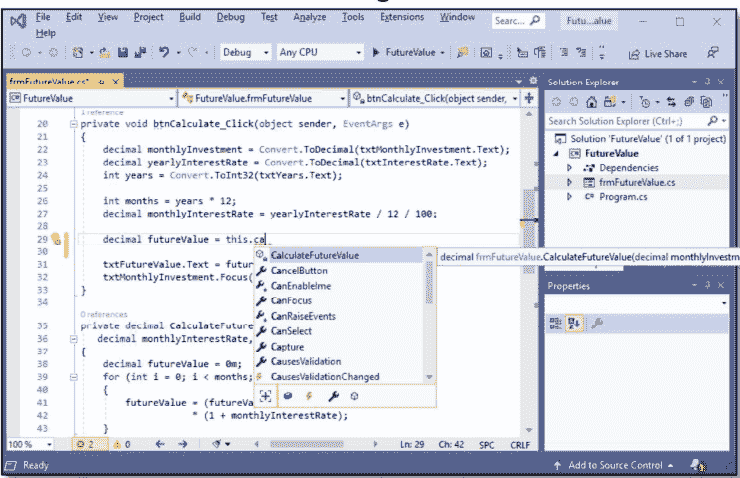

## 描述

- 当你 *call* 一个方法时，你编写一个 *argument list*，其中包含传递给方法的 *arguments*。你可以按位置或按名称传递参数。有关按名称传递参数的更多信息，请参阅图 6-3。
- 当你 *pass arguments by position* 时，参数必须与方法参数列表中定义的参数顺序相同。
- 你传递给方法参数的数据类型必须与其对应参数兼容。然而，参数的名称不必与参数的名称匹配。
- 当你调用方法时，Visual Studio 的 IntelliSense 功能可以帮助你输入方法名和方法参数。

## 如何使用可选参数

当你编写方法时，你可能偶尔希望为一个或多个参数提供默认值，以防用户不为其提供值。为此，你可以使用 C# 的一个特性，称为可选参数。图 6-3 说明了可选参数的工作原理。

要声明可选参数，你为参数分配默认值。然后，如果未向此参数传递值，则使用默认值。例如，在本图中的 GetFutureValue() 方法中，月投资参数是必需的，但利率和月份参数是可选的。

调用此方法的第一个语句为所有三个参数传递参数。这与所有参数都是必需的情况一样工作。然而，第二个语句省略了第三个参数的参数。正因为如此，使用了该参数的默认值。

当你使用可选参数时，你应该意识到它们必须在所有必需参数之后编码。此外，你不能省略一个可选参数的参数，然后传递出现在参数列表中后面的另一个可选参数的参数。至少，如果你按位置传递参数，就不能这样做。然而，如果你按名称传递参数，你可以省略任何可选参数的参数。

### 如何使用命名参数

要按名称传递参数，你编写参数名，后跟冒号，然后是参数名。这在图 6-3 中调用 GetFutureValue() 方法的第三个和第四个语句中有所说明。这两个语句都为第一个和第三个参数传递参数，但省略了第二个参数的参数。两者之间的唯一区别是参数的编码顺序不同。这是按名称传递参数的另一个优点。

你也可以按位置传递一些参数，按名称传递一些参数，如最后一个语句所示。在这里，第一个参数按位置传递值给第一个参数，第二个参数按名称传递值给第三个参数。请注意，使用 C# 7.1 及更早版本时，你不能在命名参数之后编写位置参数。然而，使用 C# 7.2 及更高版本时，只要参数位于正确的位置，你就可以这样做。例如，你可以使用以下语句在 C# 7.2 中调用 GetFutureValue() 方法，但在 C# 7.1 中不能：

```
decimal futureValue =
    this.GetFutureValue(monthlyInvestment,
        monthlyInterestRate:monthlyInterestRate,
        months);
```

### 可选参数的语法

```
type parameterName = defaultvalue
```

### 带有两个可选参数的 GetFutureValue() 方法

```
private decimal GetFutureValue(decimal monthlyInvestment,
    decimal monthlyInterestRate = 0.05m, int months = 12)
{
    decimal futureValue = 0m;
    for (int i = 0; i < months; i++)
    {
        futureValue = (futureValue + monthlyInvestment) *
        (1 + monthlyInterestRate);
    }
    return futureValue;
}
```

### 为函数传递所有三个参数的语句

```
decimal futureValue = this.GetFutureValue(monthlyInvestment, monthlyInterestRate, months);
```

### 省略第三个参数的语句

```
decimal futureValue = this.GetFutureValue(monthlyInvestment, monthlyInterestRate);
```

### 按名称传递两个参数的两个语句

```
decimal futureValue = this.GetFutureValue(monthlyInvestment:monthlyInvestment, months:months);
decimal futureValue = this.GetFutureValue(months:months, monthlyInvestment:monthlyInvestment);
```

### 按位置传递一个参数、按名称传递一个参数的语句

```
decimal futureValue = this.GetFutureValue(monthlyInvestment, months:months);
```

## 描述

- 方法的参数列表可以包含一个或多个 *optional parameters*。然后，在调用方法时，你不必为这些参数提供值。
- 可选参数必须分配一个常量值作为默认值。然后，如果未为该参数提供值，则使用默认值。
- 如果你将参数定义为可选，则参数列表中该参数之后的所有参数都必须定义为可选。
- 如果你按位置向可选参数传递值，则必须为该参数之前的所有其他参数传递值。
- 当你使用可选参数时，你可能还想 *pass arguments by name*。为此，你编写参数名，后跟冒号，后跟参数名。
- 当你按名称传递参数时，你可以按任何顺序编写参数，并且可以省略任何可选参数。
- 你还可以结合这两种传递参数的技术，按位置传递一些参数，按名称传递其他参数。


## 如何编写表达式体方法

在上一章中，你看到了可以使用 lambda 运算符（=>）为 switch 表达式中的 case 返回一个表达式。现在，图 6-4 展示了如何使用 lambda 运算符来编写 *表达式体方法*，该方法在 C# 6.0 中可用。

表达式体方法可以返回一个表达式的值或执行单个语句。例如，本图中的第一个示例展示了一个名为 DisplayErrorMessage() 的方法，它包含一个单一语句，用于显示一个消息框，消息框的消息和标题都是传递给它的。

接下来的语句展示了如何使用表达式体方法来编写此方法。为此，你像为其他任何方法一样编写方法签名，然后加上 lambda 运算符和要执行的语句。这提供了一个小的简化，消除了对大括号的需求。

第二个示例展示了一个方法，该方法根据传递给它的客户类型返回折扣百分比。此方法使用你在第 5 章中学到的 switch 表达式来获取折扣百分比。此 switch 表达式是在 return 语句上编写的，因此表达式的结果会被返回给调用代码。

要将此方法作为表达式体方法编写，你添加 lambda 运算符，省略方法的大括号，并省略 return 语句，如此处所示。再一次，这为代码提供了小的简化。随着你继续阅读本书，你会看到 lambda 运算符可以在多种不同的情况下使用。因此，最好立即熟悉它，在有意义时就使用它。

### 一个执行单个语句的方法

```csharp
private void DisplayErrorMessage(string message, string caption)
{
    MessageBox.Show(message, caption);
}
```

### 具有表达式体的相同方法

```csharp
private void DisplayErrorMessage(string message, string caption) =>
    MessageBox.Show(message, caption);
```

### 一个返回表达式值的方法

```csharp
private decimal GetDiscountPercent(string customerType)
{
    return customerType switch
    {
        "R" => .1m,
        "C" => .2m,
        "T" => .4m,
        _ => .0m
    };
}
```

### 具有表达式体的相同方法

```csharp
private decimal GetDiscountPercent(string customerType) =>
    customerType switch
    {
        "R" => .1m,
        "C" => .2m,
        "T" => .4m,
        _ => .0m
    };
```

## 描述

- 从 C# 6.0 及更高版本开始，你可以将执行单个语句或返回表达式的方法作为表达式体方法编写。
- 要编写表达式体方法，你编写方法签名，然后加上 lambda 运算符（=>）和一个表达式或可执行语句。
- 尽管你可以在窗体类中编写表达式体方法，但你更可能在用户定义的类中编写它们。你可以在第 12 章中了解更多相关信息。

### 带有选中语句的 btnCalculate_Click() 方法

```csharp
private void btnCalculate_Click(object sender, EventArgs e)
{
    decimal monthlyInvestment = Convert.ToDecimal(txtMonthlyInvestment.Text);
    decimal yearlyInterestRate = Convert.ToDecimal(txtInterestRate.Text);
    int years = Convert.ToInt32(txtYears.Text);
    int months = years * 12;
    decimal monthlyInterestRate = yearlyInterestRate / 12 / 100;
    decimal futureValue = 0m;
    for (int i = 0; i < months; i++)
    {
        futureValue = (futureValue + monthlyInvestment) * (1 + monthlyInterestRate);
    }
    txtFutureValue.Text = futureValue.ToString("c");
    txtMonthlyInvestment.Focus();
}
```

### 替换所选代码的方法调用

```csharp
decimal futureValue = CalculateFutureValue(monthlyInvestment, months, monthlyInterestRate);
```

### 添加到类的 方法

```csharp
private static decimal CalculateFutureValue(decimal monthlyInvestment, int months, decimal monthlyInterestRate)
{
    decimal futureValue = 0m;
    for (int i = 0; i < months; i++)
    {
        futureValue = (futureValue + monthlyInvestment) * (1 + monthlyInterestRate);
    }
    return futureValue;
}
```

## 如何使用重构从现有代码创建新方法

1. 选择你想要创建新方法的代码，按 Ctrl + 句点（.），并从显示的快速操作菜单中选择提取方法。这会在类中添加一个名为 NewMethod() 的方法，用调用该方法的语句替换所选代码，并显示方法的重命名对话框。

2. 输入你想要为新方法使用的名称，然后单击应用按钮。

## 描述

- 如果你想从现有代码中提取方法，重构通过其提取方法命令使这变得容易。
- 请注意上面的代码中，重构后的代码在方法调用中不使用 this 关键字，而在方法声明中确实包含了 static 关键字。你将在第 12 章中了解更多关于 static 关键字的知识。

*Figure 6-5 How to use refactoring to create a new method and its method call*

你也可以使用 out 关键字通过引用传递参数。此关键字的工作方式与 ref 关键字类似。唯一的区别是，使用 out 关键字作为参数传递的变量在传递之前不需要初始化。这由图 6-6 第 2 部分中的第一个示例说明。这里，在 futureValue 变量传递给 CalculateFutureValue() 方法之前，没有为其分配值。但是，CalculateFutureValue() 方法必须在结束前为此变量分配一个值。

从 C# 7.0 及更高版本开始，你也可以在调用方法的参数列表中声明一个 out 变量。为此，你在 out 关键字之后编写变量的类型。这也由第一个示例说明。

如果你不需要在调用代码中处理该变量，也可以对 out 变量使用丢弃（_）作为名称。例如，在第 4 章中，你学习了可以使用 TryParse() 方法将字符串转换为另一种数据类型。此方法返回一个 true 或 false 值，表示字符串是否可以转换。它还使用 out 参数返回转换后的值。但是，假设你只想测试字符串是否可以转换，而不需要转换后的值？那么，你就可以像这样使用丢弃调用 TryParse() 方法：

```csharp
if (Decimal.TryParse(salesString, out _)) {...}
```

你将在下一章中看到类似的示例，当你看到用于验证用户输入的代码时。

第二个示例展示了如何使用 in 关键字通过引用传递参数。当你在参数声明上编写 in 关键字时，传递的值是只读的。因此，参数的值不能被方法更改。请注意，当你使用 in 关键字时，你通常不必在传递给参数的参数上编写它。但是，如果你想明确指出参数使用 in 关键字，你可以这样做。

通常，最好按值传递参数而不是按引用传递。那样，调用方法中的数据就不会被被调用方法更改。此外，始终初始化变量是一个良好的编码实践，在这种情况下，你可以使用 ref 关键字而不是 out 关键字。例外情况是如果你想使用你在第 4 章中学到的像 TryParse() 这样的方法。因为此方法定义的第二个参数使用 out 关键字，所以在调用方法时你必须使用该关键字，如图 4-13 所示。

尽管此处未显示，你也可以使用 ref 或 out 关键字从方法返回两个或多个值。但是，更好的方法是返回一个包含这些值的元组或对象。你将学习如何创建和处理元组，接下来你将学习如何在第 3 节中创建和处理对象。

现在，你应该知道当你传递引用类型（对象）而不是值类型作为参数时会出现的一个额外复杂情况。如果你按值传递引用类型，你仍然不能更改其值（引用），但你可以更改它所引用的对象的成员值。相比之下，如果你按引用传递引用类型，你可以更改其值和其成员的值。这在你学习第 12 章中创建和使用自己的类后会更有意义。


## 如何使用元组

C# 7.0 引入了一个名为 *元组* 的新功能，让你可以定义简单的数据结构。元组类似于枚举，不同之处在于元组的 *成员* 是公共变量而不是常量。在下面的主题中，你将学习创建元组并引用其成员的基本技能。你还将学习如何将元组用作方法的返回类型。

### 如何创建元组并引用其成员

图 6-7 显示了创建元组的不同方法。第一个示例展示了如何创建 *未命名元组*。为此，你将 `var` 关键字作为元组类型编码，后跟将存储元组的变量的名称。然后，你通过将值编码在括号中并用逗号分隔，为元组的成员分配值。

使用此技术时，成员的类型会根据分配给它们的值推断出来。在此示例中，这意味着第一个成员被赋予 `string` 类型，第二个成员被赋予 `int` 类型。此外，未命名元组的成员会获得 Item1、Item2 等默认名称。然后，你可以使用其默认名称引用元组的成员。为此，你编码元组变量的名称，后跟点运算符和成员的名称。

在大多数情况下，你希望通过为元组的成员分配自己的名称来创建 *命名元组*。第二个示例显示了两种执行此操作的方法。首先，你可以通过在成员值之前编码名称和冒号来指定成员名称。使用此技术时，成员的类型会根据分配给它们的值推断出来，就像创建未命名元组时一样。

其次，你可以显式声明成员的数据类型。为此，你在元组变量名称之前为每个成员编码类型和名称，用逗号分隔成员，并用括号括起来。

要引用命名元组的成员，你编码元组变量的名称，后跟点运算符，就像对未命名元组一样。但是，你不能编码默认名称，而是可以编码你指定的名称。这些名称充当默认名称的同义词，使引用成员变得更容易。

请注意在这两个示例中，元组成员的名称都使用 Pascal 记法（每个单词以大写字符开头）。这是一种常见的编码实践，因为成员是公共变量。

本图中的第三个示例显示了 C# 7.1 引入的创建元组的另一种方法。这里，成员值是使用变量名而不是字面量指定的。使用此技术时，成员会获得与变量相同的名称。因此，成员名称使用 Camel 记法（第一个单词以小写字符开头，其后所有单词以大写字符开头）。然后，你可以使用这些名称引用成员。

### 如何创建和操作未命名元组

### 如何创建包含两个成员的元组

```
var person = ("Anne Boehm", 62);
```

### 如何引用元组的成员

```
person.Item1
person.Item2
```

### 如何创建和操作命名元组

### 如何创建包含两个成员的元组

```
var person = (Name: "Anne Boehm", Age: 62);
```

### 如何创建元组并声明其成员类型

```
(string Name, int Age) person = ("Anne Boehm", 62);
```

### 如何引用元组的成员

```
person.Name
person.Age
```

### 如何使用变量名创建元组（C# 7.1 及更高版本）

### 如何创建包含两个成员的元组

```
string name = "Anne Boehm";
int age = 62;
var person = (name, age);
```

### 如何引用元组的成员

```
person.name
person.age
```

## 描述

- *元组* 是 C# 7.0 的新功能，让你可以定义包含两个或多个称为 *成员* 的数据项的简单数据结构。
- 当你只需要处理一组公共变量或 *字段* 时，可以使用元组代替类和结构。请参阅第 12 章，了解有关使用类、结构和字段的更多信息。
- 创建元组时，必须为每个成员分配值。你可以使用上面显示的任何技术来执行此操作。
- *未命名元组* 是成员没有名称的元组。你可以使用默认名称 Item1、Item2 等引用未命名元组的成员。
- *命名元组* 被分配可以代替默认名称使用的同义词。
- 要引用元组的成员，你编码元组名称，后跟点运算符和成员名称。

### 如何将元组用作方法的返回类型

在本章前面，你学习了如何使用 out 参数将值从方法返回到调用代码。当你使用 out 参数时，可以返回一个或多个值。然而，这不是从方法返回多个值的推荐方法。更好的方法是使用图 6-8 所示的元组。

该图首先显示了返回元组的 CalculateFutureValue() 方法的版本。这里，返回类型被编码为包含两个成员的元组。第一个成员是一个名为 FutureValue 的 decimal，将存储方法计算的未来值，第二个成员是一个 decimal，将存储包含在未来值中的总利息金额。

要从方法返回元组，你按如下所示编码 return 语句。此 return 语句包括包含要返回的值的变量的名称。这些变量必须用括号括起来并用逗号分隔，并且必须按与返回类型元组成员相同的顺序编码。它们的数据类型也必须与元组的成员类型相对应。

接下来，该图显示了调用 CalculateFutureValue() 方法的两种方法。首先，你可以声明元组成员的数据类型和名称，然后将方法的结果分配给元组。这样，方法返回的元组中的值将被分配给调用代码中元组的相应成员。这被称为解构元组。请注意，使用此技术时，你不必在调用代码中命名元组。如果不命名，你可以直接按名称引用其成员。

其次，你可以使用 `var` 关键字在调用代码中创建元组变量。然后，元组成员的数据类型会根据方法返回的元组推断出来。在这种情况下，你必须使用元组变量的名称引用元组的成员。

尽管这里没有显示，但你应该知道，如果不需要元组返回的一个或多个值，可以使用 discard。例如，假设你只需要本图中方法返回的未来值，而不需要总利息。在这种情况下，你可以像这样调用方法：

```
(decimal FutureValue, _) = this.CalculateFutureValue(
    monthlyInvestment, monthlyInterestRate, months);
```

然后，元组返回的第二个值将被丢弃，而不是存储在变量中。

尽管元组提供了一种简便高效的方式从方法返回多个值，但你应该知道，可以使用类或结构实现同样的目的。你将在第 12 章中了解更多相关信息。现在，你应该意识到类和结构可以包含属性和方法等成员，而元组中无法包含这些成员。如果需要从方法返回包含这些成员的类型，则需要使用类或结构。

### 返回元组的 CalculateFutureValue() 方法

```
private (decimal FutureValue, decimal TotalInterest)
    CalculateFutureValue(decimal monthlyInvestment,
    decimal monthlyInterestRate, int months)
{
    decimal futureValue = 0m;
    decimal totalInterest = 0m;
    decimal monthlyInterest = 0m;
    for (int i = 0; i < months; i++)
    {
        monthlyInterest = (futureValue + monthlyInvestment)
            * monthlyInterestRate;
        totalInterest += monthlyInterest;
        futureValue += monthlyInvestment + monthlyInterest;
    }
    return (futureValue, totalInterest);
}
```

### 调用方法并解构元组的语句

```
(decimal FutureValue, decimal TotalInterest) =
    this.CalculateFutureValue(monthlyInvestment, monthlyInterestRate,
    months);
```

### 引用元组成员的两个语句

```
txtFutureValue.Text = FutureValue.ToString("c");
txtTotalInterest.Text = TotalInterest.ToString("c");
```

### 调用方法并将元组分配给变量的语句

```
var calculations = this.CalculateFutureValue(
    monthlyInvestment, monthlyInterestRate, months);
```

### 引用元组成员的两个语句

```
txtFutureValue.Text = calculations.FutureValue.ToString("c");
txtTotalInterest.Text = calculations.TotalInterest.ToString("c");
```

## 描述

- 要将元组定义为方法的返回类型，你通过将它们括在括号中并用逗号分隔来定义其成员。
- 要从方法返回元组，你在 return 语句上编码存储成员值的变量。为此，你将变量括在括号中并用逗号分隔。
- 要调用返回元组的方法，你可以声明元组的每个成员，然后将方法的结果分配给元组。这被称为解构元组，因为返回的每个成员的值都被分配给单独的变量。
- 你也可以将方法返回的元组分配给单个变量。然后，元组的成员具有与返回类型成员相同的名称，你可以通过元组变量引用这些成员。


# 如何使用事件和委托

在第 3 章中，你学习了如何通过在窗体设计器中双击控件来为控件的默认事件生成事件处理程序。现在，你将学习如何为任何窗体或控件事件创建事件处理程序。此外，你将更深入地了解事件连接的工作原理，并学习如何使用同一个事件处理程序处理两个或多个事件。

## 如何为任何事件生成事件处理程序

图 6-9 显示了如何为窗体或控件的任何事件生成事件处理程序。要做到这一点，你需要在窗体设计器中选择窗体或控件，然后在属性窗口中单击事件按钮。单击后，将显示该窗体或控件的事件列表。在此图中，例如，你可以看到未来价值窗体上第一个文本框的事件列表。在事件列表下方，你可以看到所选事件的简短描述。

要为这些事件中的任何一个生成处理程序，你可以双击此列表中的事件。然后，Visual Studio 将生成事件处理程序的方法声明以及将事件连接到事件处理程序的语句（如下一图所示）。当你使用此技术时，Visual Studio 会为事件处理程序提供一个名称，该名称结合了控件的名称和事件的名称。例如，如果你双击“月度投资”文本框的 Validating 事件，Visual Studio 将生成具有以下名称的事件处理程序：

```
txtMonthlyInvestment_Validating
```

如果你想生成名称不是默认名称的事件处理程序，可以在属性窗口中在事件旁边输入名称。然后，当你按下 Enter 键时，Visual Studio 将创建具有该名称的事件处理程序。在大多数情况下，你仅在生成将用于处理一个以上事件的事件处理程序时才使用此技术。你将在图 6-11 中了解更多相关信息。

如果你查看窗体或控件的事件列表，你会看到每个都有许多事件。例如，文本框有超过 60 个事件，窗体有超过 80 个事件。但在实践中，你对每个窗体或控件只使用少数几个事件。在阅读本书的过程中，你将被介绍到常用的事件。

## 文本框控件的事件列表

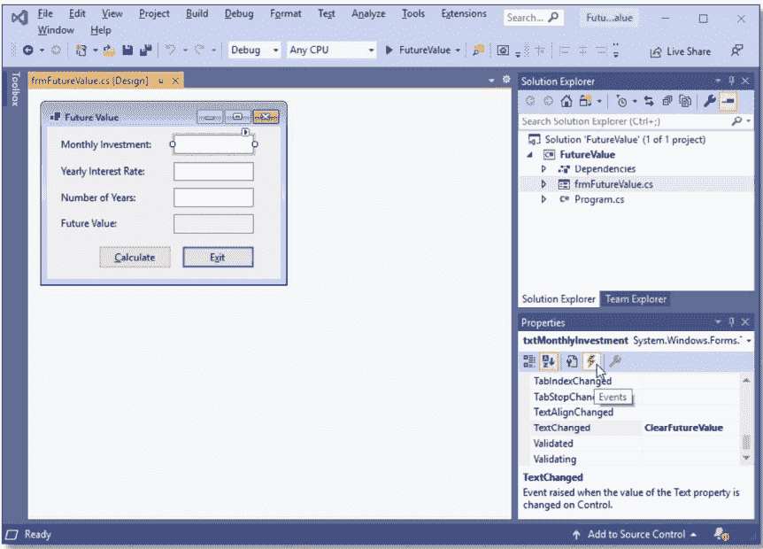

## 描述

- 要为窗体或控件的默认事件生成事件处理程序，可以在窗体设计器中双击该窗体或控件。
- 要查看窗体或控件的所有事件的列表，可以选择该窗体或控件并单击属性窗口中的事件按钮以显示事件列表。然后，你可以双击任何事件以生成该事件的事件处理程序。
- 默认情况下，事件处理程序的名称由窗体或控件名称、下划线和事件名称组成。要生成具有自定义名称的事件处理程序，可以在事件列表中在事件右侧输入事件处理程序的名称，然后按 Enter 生成事件处理程序。
- 当你为控件生成事件处理程序时，Visual Studio 会生成事件处理程序的方法声明，并将事件连接到事件处理程序，如下一图所示。

## 事件连接的工作原理

图 6-10 显示了两个事件处理程序的声明，以及将适当事件连接到这些处理程序的语句。如你所见，第一个事件处理程序是用默认名称生成的。相比之下，第二个事件处理程序被赋予了自定义名称。

正如你在第 3 章中回忆的那样，连接事件到事件处理程序的代码存储在窗体的 Designer.cs 文件中。大多数时候，你不需要处理此代码。但是，有时你可能想要删除或修改语句。

例如，如果你删除事件处理程序，还需要删除将事件连接到该事件处理程序的任何语句。如果不这样做，在尝试运行应用程序时会出现错误。此错误将显示在错误列表窗口中，并指示事件处理程序丢失。纠正此错误的一种方法是双击错误列表窗口中的错误消息。这将打开窗体的 Designer.cs 文件并跳转到包含缺失事件处理程序连接的语句。然后，你可以删除此语句。

同样，如果你修改事件处理程序的名称，也需要在事件连接语句中修改该名称。最简单的方法是在重命名事件处理程序时使用第 3 章中描述的重构。这会自动更新相应事件连接语句中的事件处理程序名称。但是，如果你在重命名事件处理程序时忘记使用重构，可以使用本图所示的技术将相应事件连接到重新命名的事件处理程序。

要将事件连接到事件处理程序，Visual Studio 使用委托，委托是表示方法的对象。在此图中，代码使用 .NET 提供的 EventHandler 委托。此委托定义了可以处理事件的方法的返回类型和参数列表。然后，代码使用 new 关键字创建 EventHandler 委托。当创建此委托时，方法的名称会传递给委托。最后，为了将文本框的 TextChanged 事件连接到委托指定的方法，Visual Studio 使用 += 运算符。

虽然你可以使用 C# 语言定义自己的委托，但很少需要这样做。因此，至少目前，你可以专注于使用 .NET Framework 提供的委托。大多数时候，这意味着使用本图所示的 System.EventHandler 委托。

对于 C# 识别方法为事件处理程序，该方法必须包含 EventHandler 委托定义的那两个参数，如示例所示。第一个参数是一个名为 sender 的对象。当事件处理程序执行时，此参数接收事件发生的对象。第二个参数标识一个名为 e 的 EventArgs 对象，其中包含有关事件的信息。此对象的确切内容取决于发生的事件。

## 文本框的默认事件处理程序

### 事件处理程序的方法声明

```
private void txtMonthlyInvestment_TextChanged(object sender, EventArgs e)
{
}
```

### 生成的将事件连接到事件处理程序的语句

```
this.txtMonthlyInvestment.TextChanged +=
    new System.EventHandler(this.txtMonthlyInvestment_TextChanged);
```

## 文本框的自定义事件处理程序

### 事件处理程序的方法声明

```
private void ClearFutureValue(object sender, EventArgs e)
{
}
```

### 生成的将事件连接到事件处理程序的语句

```
this.txtMonthlyInvestment.TextChanged +=
    new System.EventHandler(this.ClearFutureValue);
```

## 描述

- 当你使用窗体设计器生成事件处理程序时，也会在窗体的 Designer.cs 文件中生成一条语句。此语句使用委托将事件连接到方法。
- 委托是表示方法的对象。C# 使用 .NET 定义的 EventHandler 委托将事件连接到方法。
- EventHandler 委托指定可以处理事件的方法所需的返回类型和参数。这些对象在事件发生时传递给事件处理程序。第一个参数 sender 标识事件发生的对象，第二个参数标识包含有关事件的附加信息的 EventArgs 对象。
- new 关键字用于创建委托的实例，参数必须是方法的名称。此方法必须具有委托指定的返回类型和参数。
- 创建委托后，使用 += 运算符将 EventHandler 委托指定的方法连接到事件。


# 如何使用一个事件处理程序处理多个事件

在某些情况下，您会希望使用同一个事件处理程序来处理两个或多个事件。例如，通常使用一个事件处理程序来处理窗体上多个文本框的 TextChanged 事件。为此，您可以使用图 6-11 中所示的过程。

首先，您必须按照图 6-9 中所述的方式生成事件处理程序。通常，您会希望为这个事件处理程序取一个不特定于任何单个控件的名称。例如，假设每当用户更改将来值窗体上前三个文本框中的任意一个中的值时，您都希望清除当前显示的将来值。然后，当您为第一个文本框创建事件处理程序时，可以将此事件处理程序命名为 ClearFutureValue()。

创建此事件处理程序后，它将出现在可用的事件处理程序下拉列表中。例如，在此图中，您可以看到 ClearFutureValue() 事件处理程序包含在“年利率”文本框的 TextChanged 事件的下拉列表中。然后，您可以选择此事件处理程序来生成一条将事件连接到该事件处理程序的语句。

## 如何为事件选择现有的事件处理程序

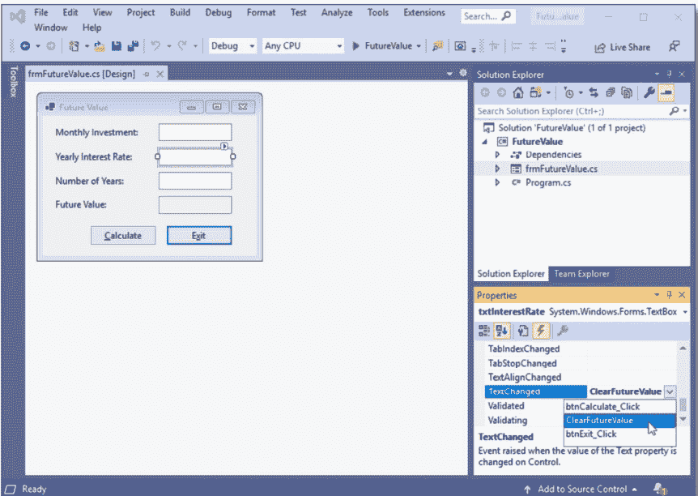

## 如何将事件连接到现有的事件处理程序

- 1. 在窗体设计器中选择控件。
- 2. 如有必要，单击“属性”窗口中的“事件”按钮以显示该控件的事件列表。
- 3. 单击要处理的事件右侧，显示下拉列表。
- 4. 选择您要用于该事件的事件处理程序。

## 说明

- 每个事件可用的下拉列表包含当前窗体的所有现有事件处理程序。
- 当您从下拉列表中选择事件处理程序时，Visual Studio 会生成一条将事件连接到该事件处理程序的语句。

# 将来值应用程序的另一个版本

既然您已经知道如何编写方法和使用事件处理程序，现在可以看看将来值应用程序的增强版本了。此版本使用私有方法计算将来值，并且每当用户在窗体上的任何其他文本框中更改文本时，它都会使用一个事件处理程序来清除“将来值”文本框。

图 6-12 显示了将来值应用程序的事件处理程序和 CalculateFutureValue() 方法的代码。这包括“计算”和“退出”按钮的 Click 事件的事件处理程序，以及一个名为 ClearFutureValue() 的自定义事件处理程序，用于处理窗体上前三个文本框的 TextChanged 事件。

CalculateFutureValue() 方法包含计算将来值的代码。它由“计算”按钮的 Click 事件的事件处理程序中的阴影代码调用。这会将计算与该事件的其他代码分离开来。在冗长的事件处理程序中，使用这样的方法可以使应用程序更易于编码、测试和调试。您将在下一章中看到更多相关内容。

ClearFutureValue() 事件处理程序包含一条语句，该语句将“将来值”文本框的 Text 属性设置为空字符串。换句话说，它会清除窗体上显示的将来值。由于此事件处理程序已连接到窗体上前三个文本框的 TextChanged 事件，因此每当用户更改其他任意文本框中的值时，此代码都会清除“将来值”文本框。这样，在用户再次单击“计算”按钮之前，不会显示将来值。因此，此代码可防止“将来值”文本框显示与其他文本框中所显示的值不相符的值。

# 将来值应用程序的方法代码

```
private void btnCalculate_Click(object sender, EventArgs e)
{
    decimal monthlyInvestment = Convert.ToDecimal(txtMonthlyInvestment.Text);
    decimal yearlyInterestRate = Convert.ToDecimal(txtInterestRate.Text);
    int years = Convert.ToInt32(txtYears.Text);

    int months = years * 12;
    decimal monthlyInterestRate = yearlyInterestRate / 12 / 100;

    decimal futureValue = this.CalculateFutureValue(monthlyInvestment, monthlyInterestRate, months);
    txtFutureValue.Text = futureValue.ToString("c");
    txtMonthlyInvestment.Focus();
}
```

```
private decimal CalculateFutureValue(decimal monthlyInvestment,
    decimal monthlyInterestRate, int months)
{
    decimal futureValue = 0m;
    for (int i = 0; i < months; i++)
    {
        futureValue = (futureValue + monthlyInvestment)
            * (1 + monthlyInterestRate);
    }
    return futureValue;
}
```

```
private void btnExit_Click(object sender, EventArgs e)
{
    this.Close();
}
```

```
private void ClearFutureValue(object sender, EventArgs e)
{
    txtFutureValue.Text = "";
}
```

- CalculateFutureValue() 方法将计算与“计算”按钮的 Click 事件的事件处理程序的其余代码分离开来。
- “每月投资额”、“年利率”和“年数”文本框的 TextChanged 事件已连接到 ClearFutureValue() 事件处理程序。因此，每当用户更改其中一个文本框中的数据时，“将来值”文本框都会被清除。

图 6-12 将来值应用程序的事件处理程序和其他方法

# 部分生成的代码

图 6-13 显示了将来值应用程序的生成代码的部分列表。此代码存储在窗体的 Designer.cs 文件中的“Windows 窗体设计器生成的代码”区域内。在此图中，您可以看到为三个控件生成的代码：一个按钮和两个文本框。

首先，InitializeComponent() 方法从相应的控件类创建对象，并将这些对象赋给已经声明的相应变量。接下来，InitializeComponent() 方法包含一组针对每个控件的语句。这些语句中的大多数设置了这些控件的起始属性。

但是，每组中的最后一条语句将事件连接到事件处理程序。此处，“计算”按钮的 Click 事件连接到名为 btnCalculate_Click() 的事件处理程序，两个文本框的 TextChanged 事件连接到名为 ClearFutureValue() 的事件处理程序。（虽然此列表中未显示，但此窗体上第三个文本框的 TextChanged 事件也连接到 ClearFutureValue() 事件处理程序。）

正如此列表顶部的警告所提示的那样，您应避免使用代码编辑器修改此代码。但是，您还应该知道此生成代码是存在的，并且它对应用程序的正常运行至关重要。此外，有时使用代码编辑器直接修改此代码可能比使用窗体设计器间接修改此代码更容易。例如，如果您创建了一个事件处理程序并决定将其删除，您可能希望使用代码编辑器删除连接语句。幸运的是，这不会给窗体设计器带来任何问题。

# 窗体的 Designer.cs 文件中的部分生成代码

```
#region Windows Form Designer generated code

/// <summary>
/// Required method for Designer support - do not modify
/// the contents of this method with the code editor.
/// </summary>
private void InitializeComponent()
{
    this.btnCalculate = new System.Windows.Forms.Button();
    this.txtInterestRate = new System.Windows.Forms.TextBox();
    this.txtMonthlyInvestment = new System.Windows.Forms.TextBox();
    ...
    //
    // btnCalculate
    //
    this.btnCalculate.Location = new System.Drawing.Point(54, 126);
    this.btnCalculate.Name = "btnCalculate";
    this.btnCalculate.Size = new System.Drawing.Size(75, 23);
    this.btnCalculate.TabIndex = 8;
    this.btnCalculate.Text = "&Calculate";
    this.btnCalculate.Click +=
        new System.EventHandler(this.btnCalculate_Click);
    //
    // txtInterestRate
    //
    this.txtInterestRate.Location = new System.Drawing.Point(132, 37);
    this.txtInterestRate.Name = "txtInterestRate";
    this.txtInterestRate.Size = new System.Drawing.Size(84, 20);
    this.txtInterestRate.TabIndex = 3;
    this.txtInterestRate.TextChanged +=
        new System.EventHandler(this.ClearFutureValue);
    //
    // txtMonthlyInvestment
    //
    this.txtMonthlyInvestment.Location = new System.Drawing.Point(132, 9);
    this.txtMonthlyInvestment.Name = "txtMonthlyInvestment";
    this.txtMonthlyInvestment.Size = new System.Drawing.Size(84, 20);
    this.txtMonthlyInvestment.TabIndex = 1;
    this.txtMonthlyInvestment.TextChanged +=
        new System.EventHandler(this.ClearFutureValue);
    ...
}

#endregion

private System.Windows.Forms.Button btnCalculate;
private System.Windows.Forms.TextBox txtInterestRate;
private System.Windows.Forms.TextBox txtMonthlyInvestment;
...
```

## 说明

- InitializeComponent() 方法创建窗体上每个控件的实例，将每个控件赋给一个变量，设置每个控件的属性，并将控件事件连接到相应的事件处理程序。


## Perspective

现在你已经完成了本章，你应该能够编写代码并调用方法。你还应该能够为表单或控件的任何事件编写事件处理程序。凭借这些技能，你正朝着专业水平开发程序的方向稳步前进。

## Terms

|  |  |
|---|---|
| method | pass arguments by name |
| access modifier | expression-bodied method |
| return statement | pass arguments by value |
| parameter | pass arguments by reference |
| parameter list | discard |
| signature of a method | tuple |
| overload a method | member |
| call a method | unnamed tuple |
| argument | named tuple |
| argument list | deconstructing a tuple |
| pass arguments by position | event wiring |
| optional parameter | delegate |

## Exercise 6-1 Enhance the Future Value application

在本练习中，你将增强你在第 5 章中创建的 Future Value 应用程序，使其像图 6-12 中的那样工作。

### Use refactoring to create the CalculateFutureValue() method
- 1. 打开位于 C:\C#\Chapter 06\Future Value 目录中的应用程序。
- 2. 使用图 6-5 所示的重构来重构事件处理程序中的计算，并创建一个名为 CalculateFutureValue() 的新方法。
- 3. 测试应用程序以确保新方法能正确工作。

### Add the CalculateFutureValue() method without using refactoring
- 4. 按两次 Ctrl+Z 将代码恢复到重构之前的状态。
- 5. 添加一个名为 CalculateFutureValue() 的方法，其功能与图 6-12 中的方法相同。为此，输入新方法的开头包括其大括号，结束大括号将自动添加。然后，将相关代码从 btnCalculate_Click() 方法移动到新方法内的块中，并在必要时进行修改。
- 6. 修改 btnCalculate_Click() 方法中的代码，使其调用 CalculateFutureValue() 方法。在输入对该方法的调用时，注意 IntelliSense 功能如何帮助你输入参数。
- 7. 测试应用程序以确保此新方法能正确工作。

## Add an event handler for the TextChanged events
- 8. 在 Form Designer 中，选择第一个文本框。然后，在属性窗口中单击事件按钮以显示该文本框的事件列表。查看可用的事件。
- 9. 在 TextChanged 事件右侧输入“ClearFutureValue”并按 Enter。当你这样做时，代码编辑器将打开并创建一个名为 ClearFutureValue 的事件处理程序。输入一条语句以清除 Future Value 文本框，如图 6-12 所示。
- 10. 打开表单的 frmFutureValue.Designer.cs 文件，如有必要展开 Windows 窗体设计器生成的代码区域，并找到设置 Monthly Investment 文本框属性的语句。在这些语句的末尾，你会找到一条语句，它将此控件的 TextChanged 事件与 ClearFutureValue() 事件处理程序连接起来。
- 11. 返回 Form Designer 并选择 Yearly Interest Rate 文本框。展开此控件的 TextChanged 事件的列表，注意 ClearFutureValue 事件处理程序包含在此列表中。选择此事件处理程序以将其与事件连接。重复此过程用于 Number of Years 文本框。
- 12. 运行应用程序并执行一次计算。然后，修改其中一个文本框中显示的值。当你这样做时，Future Value 文本框中显示的值应被清除。
- 13. 当你确信增强功能工作正常时，关闭应用程序。

## Exercise 6-2 Experiment with events

本练习将给你一个机会来尝试 Future Value 应用程序的事件和事件连接。

### Generate and delete an event handler
- 1. 打开你在练习 6-1 中增强的 Future Value 应用程序。
- 2. 在 Form Designer 中，双击表单以生成表单的默认事件的处理程序，即 Load 事件。然后，在代码编辑器中删除此事件处理程序，并尝试构建和运行应用程序。这应导致一个构建错误。
- 3. 双击错误消息，这将带你到事件处理程序的事件连接。然后，删除该连接，并再次尝试构建和运行应用程序。这次，它应该可以工作。

### Use a form event and two more control events
- 4. 在 Form Designer 中，选择表单，单击属性窗口中的事件按钮，并双击 DoubleClick 事件以生成其事件处理程序。接下来，编写此处理程序的代码，使其将四个文本框的 Text 属性都设置为空字符串。然后，测试应用程序以确保其有效。 （确保双击表单，而不是控件或表单的标题栏。）
- 5. 在 Form Designer 中，选择 Monthly Investment 文本框。接下来，选择 MouseHover 事件，阅读其描述，展开其列表，并选择 ClearFutureValue() 事件处理程序，以便每当用户将鼠标悬停在此文本框上时执行它。然后，测试应用程序以确保其有效。
- 6. 在 Form Designer 中，选择 Yearly Interest Rate 文本框，并双击 DoubleClick 事件以生成其事件处理程序。接下来，编写此处理程序的代码，使其将 Yearly Interest Rate 文本框中的值设置为 12。然后，测试此增强功能。
- 7. 使用你自己的想象力来处理其他事件。当你完成对事件的实验后，关闭应用程序。

## Exercise 6-3 Enhance the Invoice Total application

在本练习中，你将增强第 5 章中的 Invoice Total 应用程序，使其使用带有元组的方法。

### Add a GetInvoiceAmounts() method
- 1. 打开位于 C:\C#\Chapter 06\InvoiceTotal 目录中的应用程序。
- 2. 添加一个名为 GetInvoiceAmounts() 的方法，该方法接受客户类型和小计并返回折扣百分比。你可以手动完成或使用重构。
- 3. 测试应用程序以确保新方法能正确工作。

### Add a tuple
- 4. 修改 GetInvoiceAmounts() 方法的声明，使其返回一个包含折扣百分比和折扣金额的元组。然后，修改此方法代码使其与元组一起工作。
- 5. 修改调用代码，使其解构 GetInvoiceAmounts() 方法返回的元组。当你这样做时，你可以删除声明和计算折扣金额和发票总额的语句。
- 6. 测试应用程序以确保更改有效。

## How to handle exceptions and validate data

在过去的两章中，你学习了如何编写一个 Future Value 应用程序来计算一系列月付款的未来价值。然而，如果用户输入此应用程序无法处理的数据，将会发生异常，应用程序将崩溃。在本章中，你将学习如何通过处理发生的任何异常并通过验证数据来防止异常的发生，从而防止这种情况发生。

- An introduction to exceptions ............................................ 196
- How exceptions work........................................................... 196
- How to display a dialog box ................................................... 198
- How to use structured exception handling........................... 200
- How to catch an exception..................................................... 200
- How to use the properties and methods of an exception................... 202
- How to catch specific types of exceptions................................... 204
- How to throw an exception..................................................... 206
- The Future Value application with exception handling ................... 208
- How to validate data........................................................... 210
- How to validate a single entry ............................................... 210
- How to code generic methods for data validation........................... 212
- How to validate multiple entries.............................................. 214
- The Future Value application with data validation........... 216
- The dialog boxes............................................................... 216
- The code......................................................................... 216
- Perspective ................................................................... 220


## 异常简介

在学习如何处理异常之前，了解异常的工作原理会很有帮助。此外，了解如何显示包含异常消息的对话框也很有帮助。这就是接下来两个主题中你将学习的内容。

应用程序遇到异常是不可避免的。例如，用户可能输入了不适合应用程序的数据。然后，如果应用程序没有检查数据是否有效，.NET 运行时环境在尝试处理该数据时就会*抛出*一个*异常*。异常是从 Exception 类或其子类（如图 7-1 所示）创建的对象。异常对象表示已发生的错误，并且包含有关这些错误的信息。

## 异常的工作原理

编码良好的应用程序会*捕获*可能抛出的特定异常并处理它们。这被称为*异常处理*。异常处理可以简单到通知用户必须输入有效数据。然而，对于更严重的异常，异常处理可能涉及通知用户应用程序正在关闭、尽可能多地保存数据、清理资源以及尽可能平稳地退出应用程序。

在测试应用程序时，遇到未处理的异常是很常见的。在这种情况下，Visual Studio 将进入中断模式并显示一个异常帮助器对话框，如图所示。此对话框包含异常的类名和描述异常原因的简要消息。

所有异常都是 Exception 类的*子类*。例如，FormatException 类是 Exception 类的一个子类，它表示当一种数据类型的值无法转换为另一种数据类型时发生的特定类型的异常。此异常可由 Convert 类的 To() 方法或任何类的 Parse() 方法抛出。

ArithmeticException 类也是 Exception 类的子类。它表示在算术、强制转换或转换操作期间发生的异常。此类包含其他子类，包括此处显示的 OverflowException 和 DivideByZeroException 类。当算术、强制转换或转换操作的结果对于接收变量来说太大时，就会发生溢出异常。如果应用程序尝试将数字除以零，则会发生除以零异常。

目前，这就是你需要了解的关于 Exception 层次结构的全部内容。不过，随着你深入学习本书，你将了解其他类型的异常。例如，在第 5 节中，你将学习如何处理在处理数据库时可能发生的异常。你还将在第 14 章中了解更多关于子类及其工作原理的内容。

## 未处理异常的对话框

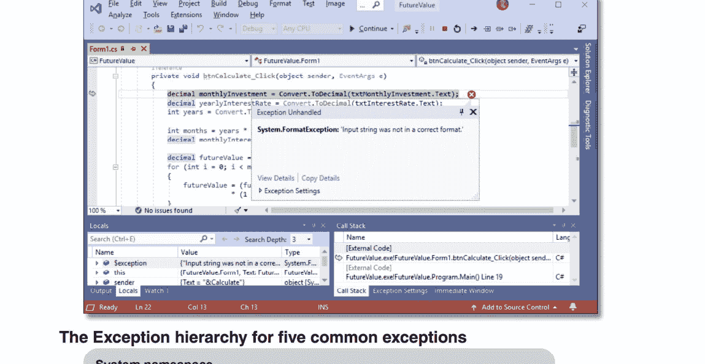

## 五种常见异常的异常层次结构

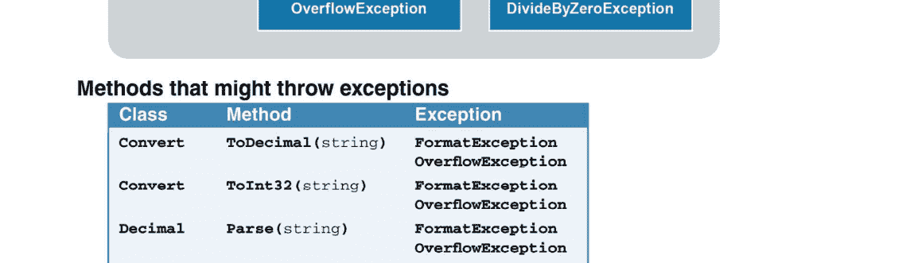

## 可能抛出异常的方法

| 类 | 方法 | 异常 |
|-------|--------|-----------|
| Convert | ToDecimal(string) | FormatException |
| Convert | ToInt32(string) | FormatException, OverflowException |
| Decimal | Parse(string) | FormatException, OverflowException |
| DateTime | Parse(string) | FormatException |

## 如何显示对话框

应用程序与用户通信的一种方式是显示包含消息的对话框。在本章中，对话框用于显示有关已发生异常的消息。但请记住，对话框也可以用于许多其他目的。

要显示一个简单的对话框，可以使用 MessageBox 类的 Show() 方法，如图 7-2 所示。此处显示的语法允许你显示一个包含消息、标题和“确定”按钮的对话框。目前，这个简单的对话框已经足够。

但在第 10 章中，你将学习如何使用 MessageBox 类显示更复杂的对话框，其中包含“是”、“否”、“取消”、“中止”、“重试”和“忽略”按钮，并且你将学习如何编写代码来检查用户选择了哪个按钮。这样，你可以根据用户对对话框的响应以不同方式处理异常。

## 显示带有“确定”按钮的对话框的语法

```
MessageBox.Show(text[, caption]);
```

## 带有“确定”按钮的对话框

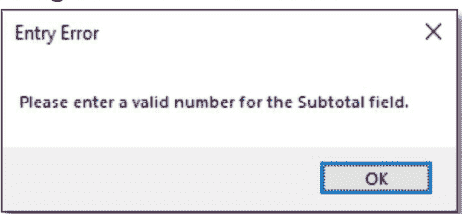

## 显示此对话框的语句

```
MessageBox.Show(
    "请输入有效的“小计”字段数值。",
    "输入错误");
```

## 说明

- 可以使用 MessageBox 类的静态 Show() 方法来显示对话框。对话框通常用于向用户显示有关异常的信息。
- 如果省略 caption 参数，对话框的标题栏将不显示标题。

### 注意

- 在第 10 章中，你将学习如何使用 MessageBox 类显示包含其他按钮并接受用户响应的更复杂的对话框。

## 如何使用结构化异常处理

为了防止应用程序因运行时错误而崩溃，你可以编写代码在异常发生时处理它们。这被称为*结构化异常处理*，并且在大多数应用程序中起着重要作用。

## 如何捕获异常

图 7-3 展示了如何使用 *try-catch 语句*来捕获和处理异常。首先，你将*try 块*编写在可能抛出异常的语句周围。然后，紧跟在 try 块之后，你编写一个*catch 块*，其中包含当 try 块中的语句抛出异常时要执行的语句。这被称为*异常处理器*。

该图中的 try-catch 语句展示了如何捕获 Invoice Total 应用程序中四条语句可能抛出的任何异常。例如，如果用户在“小计”文本框中输入非数值，Convert 类的 ToDecimal() 方法将抛出异常。然后，应用程序将跳转到 catch 块，跳过 try 块中的所有剩余语句。在这种情况下，catch 块仅显示一个通知用户问题的对话框。然后，用户可以单击“确定”按钮并输入有效数字。

## 简单 try-catch 语句的语法

```
try { statements }
catch { statements }
```

## 一个 try-catch 语句

```
try
{
    decimal subtotal = Convert.ToDecimal(txtSubtotal.Text);
    decimal discountPercent = .2m;
    decimal discountAmount = subtotal * discountPercent;
    decimal invoiceTotal = subtotal - discountAmount;
}
catch
{
    MessageBox.Show(
        "请输入有效的“小计”字段数值。",
        "输入错误");
}
```

## 发生异常时显示的对话框

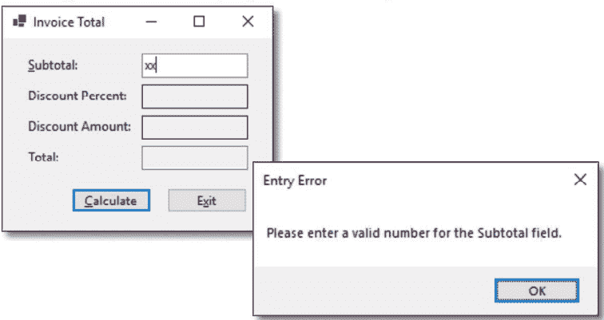

## 说明

- 可以使用 *try-catch 语句*来编写*异常处理器*，以捕获和处理任何抛出的异常。
- 可以将 *try 块*编写在任何可能抛出异常的语句周围。然后，可以编写一个 *catch 块*，其中包含在 try 块中抛出异常时要执行的语句。

## 如何使用异常的属性和方法

由于异常是一个对象，它拥有属性和方法。如果要在捕获异常的 catch 块中使用异常的属性或方法，则必须为异常提供一个名称，如图 7-4 所示。为此，请在 catch 关键字后面编写一组括号。在这些括号内，编写异常类的名称，后跟异常的名称。

如果你在事件处理器内编写 try-catch 语句，则不能使用 e 作为异常的名称。这是因为默认情况下，事件处理器已将此名称用于其 EventArgs 参数。因此，你必须指定另一个名称，例如 x 或 ex。或者，你必须将 EventArgs 参数的名称从 e 更改为其他名称。

一旦为异常指定了名称，就可以使用 Message 属性获取错误的简要描述。还可以使用 GetType() 方法获取用于创建异常对象的类类型。然后，要获取该类型的名称，可以使用 ToString() 方法，如该图中的示例所示。最后，可以使用 StackTrace 属性获取表示堆栈跟踪的字符串。

堆栈跟踪是异常发生之前被调用的方法的列表。这些方法按照与调用顺序相反的顺序列出。因此，最后调用的方法最先显示，而最先调用的方法最后显示。例如，该图中的对话框显示，Invoice Total 窗体的 btnCalculate_Click() 方法的第 24 行调用了 Convert 类的 ToDecimal() 方法。该方法调用了 Number 类的 ParseDecimal() 方法。依此类推。

当你使用异常的属性和方法获取有关异常的信息时，可以在对话框中显示该信息。这样，如果抛出异常，你的用户将能够向你提供有关异常的信息，以便你解决问题。或者，如果发生严重异常导致应用程序无法继续，你可以将有关异常的信息写入日志文件，以便监控和审查这些异常。你将在第 17 章中学习如何将数据写入文件。


## 访问异常的 try-catch 语句语法

```
try { statements }
catch(ExceptionClass exceptionName) { statements }
```

## 所有异常的两个常见属性

| 属性 | 描述 |
|---|---|
| Message | 获取简要描述当前异常的消息。 |
| StackTrace | 获取一个字符串，其中列出了在异常发生前所调用的方法。 |

## 所有异常的一个常见方法

| 方法 | 描述 |
|---|---|
| GetType() | 获取当前异常的类型。 |

## 访问异常的 try-catch 语句

```
try
{
    decimal subtotal = Convert.ToDecimal(txtSubtotal.Text);
}
catch(Exception ex)
{
    MessageBox.Show(ex.Message + "\n\n" + ex.GetType().ToString() + "\n" + ex.StackTrace, "Exception");
}
```

## 如果发生异常时显示的对话框

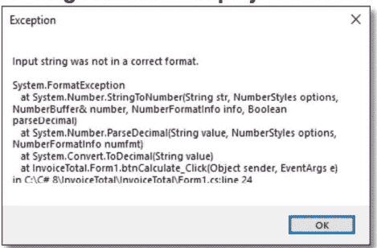

## 描述

- 如果你想在 catch 块中使用异常的属性或方法，你必须为异常提供一个名称。
- 堆栈跟踪是异常发生前所调用的方法列表。该列表按相反顺序显示，从最后调用的方法到第一个调用的方法。

### 注意

- 如果你正在事件处理程序内编写 try-catch 语句，你不能使用 e 作为异常的名称，因为它被用作处理程序参数的名称。

## 如何捕获特定类型的异常

在某些情况下，try-catch 语句的 try 块中的语句可能会抛出不止一种类型的异常。然后，你可能希望对每种异常进行不同的处理。为此，你可以像图 7-5 所示那样编写 catch 块。在这里，第一个 catch 块捕获 FormatException，第二个 catch 块捕获 OverflowException，第三个 catch 块捕获任何其他异常。

当你捕获特定异常时，你应该意识到你必须首先为类层次结构中最具体的异常编写 catch 块，并且必须最后为最不具体的异常编写 catch 块。例如，在此图中，FormatException 类型和 OverflowException 类型都比 Exception 类型更具体。因此，它们的 catch 块必须在 Exception 类型的 catch 块之前编写。如果它们在 Exception 类型之后编写，你在尝试编译项目时会收到构建错误。这是因为 catch 块按顺序进行评估，这意味着 Exception 类型的 catch 块会捕获发生的任何异常。换句话说，其他 catch 块永远不会被执行。

尽管你必须在 Exception 类型的 catch 块之前为 FormatException 和 OverflowException 类型编写 catch 块，但你不必在 OverflowException 类型之前编写 FormatException 类型的 catch 块。这是因为 OverflowException 类是 ArithmeticException 类的子类，而不是 FormatException 类。换句话说，最不具体到最具体异常的规则仅适用于基于同一类的子类。

当你编写 try-catch 语句时，你可能会发现你有一些无论是否抛出异常或抛出何种类型的异常都应运行的代码。例如，如果你的应用程序使用数据库连接等系统资源，通常会执行一些清理代码以在不再需要时释放这些资源。不要将此代码包含在 try 块和每个 catch 块中，你可以将其编写在 finally 块中。然后，此代码在 try 块中的所有语句执行后执行。或者，如果抛出异常，则在 catch 块中的语句执行后执行。这允许你将清理代码存储在一个位置而不是多个位置，从而使代码更易于阅读和维护。

## 捕获特定类型异常的 try-catch 语句语法

```
```csharp
try { statements }
[catch(MostSpecificException [exceptionName]) { statements } ]...
[catch(NextMostSpecificException [exceptionName]) { statements } ]...
[catch([LeastSpecificException [exceptionName]]) { statements }]
[finally { statements }]
```
```

## 捕获两种特定异常的 try-catch 语句

```
```csharp
try
{
    decimal monthlyInvestment =
        Convert.ToDecimal(txtMonthlyInvestment.Text);
    decimal yearlyInterestRate =
        Convert.ToDecimal(txtInterestRate.Text);
    int years = Convert.ToInt32(txtYears.Text);
}
catch(FormatException)        // a specific exception
{
    MessageBox.Show(
        "A format exception has occurred. Please check all entries.",
        "Entry Error");
}
catch(OverflowException)      // another specific exception
{
    MessageBox.Show(
        "An overflow exception has occurred. Please enter smaller values.",
        "Entry Error");
}
catch(Exception ex)           // all other exceptions
{
    MessageBox.Show(ex.Message, ex.GetType().ToString());
}
finally      // this code runs whether or not an exception occurs
{
    PerformCleanup();
}
```
```

## 描述

- 你可以为 try 块中可能发生的每种异常类型编写一个 catch 块。如果你编写多个 catch 块，你必须首先为最具体的异常类型编写 catch 块。
- 由于所有异常都是 Exception 类的子类，因此 Exception 类的 catch 块会捕获所有类型的异常。
- 你可以在所有 catch 块之后编写一个 *finally* 块。此块中的代码无论是否发生异常都会被执行。它通常用于释放任何系统资源。


## 如何抛出异常

现在你已经学会了如何捕获异常，你就可以学习如何从你编写的方法中抛出异常。为此，你可以使用图 7-6 所示的 throw 语句。正如你所见，你可以使用此语句抛出新异常或抛出现有异常。

要抛出新异常，你编写 throw 关键字，后跟 new 关键字和你想要从中创建异常的异常类名。（正如你将在本书后面看到的那样，new 关键字是用于从类创建对象的关键字。）这样做时，你还可以提供一个字符串参数，提供异常的简要描述。此参数分配给异常的 Message 属性。然后，当你处理异常时，你可以使用 Message 属性获取此字符串。

throw 语句的这种用法在该图的第一个示例中进行了说明。在这里，在执行计算之前，CalculateFutureValue() 方法会检查用于计算的值是否小于或等于零。如果是，则从 Exception 类创建的异常将被抛出。这里显示的两个 throw 语句都包含一个简要描述异常原因的字符串。

通常，你只有在真正出现异常情况时才应抛出异常。在第一个示例中，当 CalculateFutureValue() 方法接收到负数时，无法执行计算。因此，这是一个异常情况，抛出异常是有意义的。处理这种情况的另一种方法是返回一个负小数（例如 -1.0m）来指示无法执行计算。然而，抛出异常允许你提供异常情况的描述，这通常对可能想要使用此方法的其他程序员有帮助。

你也可以使用 throw 语句来测试异常处理例程，如第二个示例所示。在这里，throw 语句在 try-catch 语句的 try 块内编写。然后，当执行此语句时，catch 块内的代码将被执行，以便你可以确保其正常工作。

该图的第三个示例展示了如何抛出现有异常。如果需要捕获异常、执行部分处理异常的处理，然后再次抛出异常以便另一个异常处理程序可以完成处理异常，则此技术很有用。在这种情况下，ToDecimal() 方法在 try 块内使用，将用户输入到文本框中的值转换为十进制。如果用户输入的值不是有效的十进制数，则会抛出 FormatException。然后，catch 块捕获此异常，将焦点移至文本框，并重新抛出异常。这样，调用方法也可以捕获异常并执行一些额外的处理。

使用 C# 7.0，你还可以使用 throw 表达式抛出异常。throw 表达式与 throw 语句的写法相同，但可以在 throw 语句无法使用的某些上下文中使用。例如，它们可以在空合并表达式中使用，如该图的最后一个示例所示。它们也可以在你学过的条件表达式中使用


## 抛出新异常的语法

```
throw new ExceptionClass([message]);
```

## 抛出已有异常的语法

```
throw exceptionName;
```

## 当异常情况发生时抛出异常的方法

```
private decimal CalculateFutureValue(decimal monthlyInvestment,
    decimal monthlyInterestRate, int months) {
    if (monthlyInvestment <= 0)
        throw new Exception("Monthly Investment must be greater than 0.");
    if (monthlyInterestRate <= 0)
        throw new Exception("Interest Rate must be greater than 0.");
    ...
}
```

## 用于测试目的而抛出异常的代码

```
try {
    decimal subtotal = Convert.ToDecimal(txtSubtotal.Text);
    throw new Exception("An unknown exception occurred.");
}
catch (Exception ex) {
    MessageBox.Show(ex.Message + "\n\n"
        + ex.GetType().ToString() + "\n"
        + ex.StackTrace, "Exception");
}
```

## 重新抛出异常的代码

```
try {
    Convert.ToDecimal(txtSubtotal.Text);
}
catch (FormatException fe) {
    txtSubtotal.Focus();
    throw fe;
}
```

## 使用 throw 表达式抛出异常的代码（C# 7.0 或更高版本）

```
string? productCode = null;
string code = productCode ?? throw new Exception("Code cannot be null.");
```

## 何时抛出异常

-   当方法遇到无法完成其任务的情况时。
-   当你想生成一个异常来测试异常处理程序时。
-   当你想捕获异常、执行一些处理，然后再次抛出该异常时。

## 描述

-   你可以使用 throw 语句或 throw 表达式来抛出新的或已有的异常。当你创建新异常时，可以指定一个字符串赋值给 Message 属性。
-   throw 表达式自 C# 7.0 起可用，并且可以在某些 throw 语句无法使用的上下文中使用，比如条件表达式和 null 合并表达式。

在第 5 章中，throw 表达式还可以用于表达式主体方法（如你在第 6 章学到的那些）以及一些 lambda 表达式（如你将在本书后面学到的那些）。

## 具有异常处理的 Future Value 应用程序

图 7-7 展示了你在上一章看到的 Future Value 应用程序的改进版本。如你所见，该版本使用结构化异常处理来捕获当用户单击窗体上的 Calculate 按钮时可能抛出的任何异常。

为了捕获异常，btnCalculate_Click() 方法中的所有语句都被编写在 try 块内。然后，第一个 catch 块处理当用户在某个文本框中输入了无效数字格式的数据时抛出的任何格式异常。接下来，第二个 catch 块处理当用户输入过大的数字时抛出的任何溢出异常。如果抛出了这两种异常中的任何一种，catch 块中的代码都会显示一个对话框，描述该异常并指出用户可以采取的纠正措施。

前两个 catch 块捕获特定异常，而第三个 catch 块捕获所有其他异常。由于这些异常的原因未知，应用程序使用异常的属性和方法在对话框中显示有关该异常的一些信息。在这种情况下，异常类的名称显示在对话框的标题栏中，异常的简要描述显示在对话框的主体中。这样，用户就能向将要修复此 Bug 的人提供有关该异常的一些信息。

请注意，第三个 catch 块不能使用 e 作为异常的名称，因为 e 已用于 EventArgs 参数。相反，该 catch 块使用 ex 作为 Exception 对象的名称。

另请注意，如果 CalculateFutureValue() 方法中发生异常，该异常不会被该方法捕获。因此，异常会被传递回调用方法，即此处的 btnCalculate_Click()。然后，该方法中相应的 catch 块会处理该异常。

## 具有异常处理的 Future Value 应用程序的代码

```csharp
private void btnCalculate_Click(object sender, EventArgs e)
{
    try
    {
        decimal monthlyInvestment =
            Convert.ToDecimal(txtMonthlyInvestment.Text);
        decimal yearlyInterestRate =
            Convert.ToDecimal(txtInterestRate.Text);
        int years = Convert.ToInt32(txtYears.Text);
        decimal monthlyInterestRate = yearlyInterestRate / 12 / 100;
        int months = years * 12;
        decimal futureValue = this.CalculateFutureValue(
            monthlyInvestment, monthlyInterestRate, months);
        txtFutureValue.Text = futureValue.ToString("c");
        txtMonthlyInvestment.Focus();
    }
    catch(FormatException)
    {
        MessageBox.Show(
            "Invalid numeric format. Please check all entries.",
            "Entry Error");
    }
    catch(OverflowException)
    {
        MessageBox.Show(
            "Overflow error. Please enter smaller values.",
            "Entry Error");
    }
    catch(Exception ex)
    {
        MessageBox.Show(
            ex.Message,
            ex.GetType().ToString());
    }
}
```

```csharp
private decimal CalculateFutureValue(decimal monthlyInvestment,
    decimal monthlyInterestRate, int months)
{
    decimal futureValue = 0m;
    for (int i = 0; i < months; i++)
    {
        futureValue = (futureValue + monthlyInvestment)
            * (1 + monthlyInterestRate);
    }
    return futureValue;
}
```

## 如何验证数据

当用户输入数据时，通常需要检查该数据以确保其有效。这称为*数据验证*。当某项输入无效时，应用程序需要显示错误消息，并给用户另一次输入有效数据的机会。需要重复此过程，直到窗体上的所有输入都有效为止。

## 如何验证单个输入

当用户向文本框输入文本时，你可能需要执行多种类型的数据验证。特别是，执行图 7-8 所示的三种数据验证是很常见的。

首先，如果应用程序要求用户在文本框中输入值，你可以检查文本框的 Text 属性，以确保用户输入了一个或多个字符。其次，如果应用程序要求用户在文本框中输入数字，你可以在 if 语句中使用相应类的 TryParse() 方法来检查文本框的 Text 属性是否可以转换为相应的数值数据类型。请注意，这里使用弃元作为 out 参数，因为此代码不需要它的值。第三，如果应用程序要求用户输入指定范围内的数字，你可以使用 if-else 语句来检查该数字是否落在该范围内。这称为*范围检查*。

在此处显示的示例中，对 Monthly Investment 文本框执行了所有三种类型的验证。但是，由于此文本框需要数字输入，你应该知道，无需测试控件的 Text 属性是否等于空字符串，也可以完成同样的验证。这是因为，当你测试有效的 decimal 格式时，它会检测是否没有输入任何值。因此，通常只有在需要字符串输入时，你才会测试 Text 属性。

虽然此图只展示了如何检查用户在文本框中输入的数据，但相同的原则适用于其他类型的控件。在第 10 章中，你将进一步了解如何验证其他类型控件中的输入。此外，虽然此图只展示了如何检查数字的范围，但你也可以检查字符串和日期，以确保它们落在特定范围内。在第 9 章中，你将进一步了解如何处理日期和字符串。

通常，执行数据验证的代码会防止异常被抛出。例如，如果用户没有在 Monthly Investment 文本框中输入值，此图中的代码会显示一个对话框，并将焦点移到 Monthly Investment 文本框。如果你没有包含此代码，当应用程序尝试将空字符串转换为数值数据类型时，就会发生异常。


## 如何为数据验证编写通用方法

由于经常需要检查条目是否包含有效数据，因此创建像图 7-9 所示的通用方法来进行数据验证通常是有意义的。这些方法执行上一张图所述的相同类型的验证，但它们适用于任何条目，而不仅仅是特定的文本框。这包括非 Windows 表单上的条目，因为这些方法不需要 Windows.Forms 命名空间。在本章中，当然，这些方法是在 Windows 表单内编码的，因此可以使用该命名空间。在实际应用中，这些方法会编码在单独的类中并存储在类库中。你将在第 12 章学习如何编码此类类，并在第 16 章学习如何创建和使用类库。

在此图中，IsPresent() 方法检查用户是否已输入值。为此，它接受两个参数，包含要验证的值和描述该值的名称。此方法首先将名为 msg 的变量设为空字符串。然后，如果用户未在文本框中输入任何字符，它会向 msg 变量添加一条消息，其中包含 name 参数。最后，它返回 msg 变量的值。

IsDecimal() 方法接受与 IsPresent() 方法相同的参数，但它使用 if 语句调用 Decimal 类的 TryParse() 方法来检查用户输入的值是否为十进制值。如果不是，TryParse() 方法将返回 false 值，并且一条消息将被添加到 msg 变量。然后，该方法返回此变量的值。

一旦你理解了 IsDecimal() 方法的工作原理，你就可以为其他数值类型编写方法。例如，你可以编写一个 IsInt32() 方法，使用 Int32.TryParse() 方法检查用户是否输入了有效的 int 值。

IsWithinRange() 方法接受两个额外的参数，包含可以输入到文本框中的最小值和最大值。在检查范围之前，它会调用 Decimal 类的 TryParse() 方法以确保该值是数字的。你将在下一张图中看到调用这些方法的代码时就会明白为什么这是必要的。如果该值是数字，IsWithinRange() 方法会使用 if 语句检查十进制值是否在 min 和 max 参数指定的范围内。如果不是，此方法会向 msg 变量添加一条消息并返回此变量的值。

由于 IsWithinRange() 方法使用 decimal 类型，即最宽（最精确）的数值数据类型，因此该方法适用于所有数值类型。这是因为所有数值类型都可以自动转换为 decimal 类型。例如，如果你将 int 类型的参数传递给 min 和 max 参数，它们将被转换为 decimal 类型。

### 一个检查必填字段的方法

```
private string IsPresent(string value, string name)
{
    string msg = "";
    if (value == "")
    {
        msg += name + " is a required field.\n";
    }
    return msg;
}
```

### 一个检查有效数字格式的方法

```
private string IsDecimal(string value, string name)
{
    string msg = "";
    if (!Decimal.TryParse(value, out _))
    {
        msg += name + " must be a valid decimal value.\n";
    }
    return msg;
}
```

### 一个检查有效数值范围的方法

```
private string IsWithinRange(string value, string name, decimal min, decimal max)
{
    string msg = "";
    if (Decimal.TryParse(value, out decimal number))
    {
        if (number < min || number > max)
        {
            msg += name + " must be between " + min + " and " + max + ".\n";
        }
    }
    return msg;
}
```

## 描述

- 由于经常需要检查文本框是否包含有效数据，因此创建这些通用方法来进行数据验证通常是有意义的。
- 这些方法可用于验证 Windows 和非 Windows 表单上的条目，因为它们不需要 Windows.Forms 命名空间。然后，你可以像第 12 章所示那样将它们编码在单独的类中，并像第 16 章所示那样将该类存储在类库中。

## 如何验证多个条目

图 7-10 显示了如何编写一个名为 IsValidData() 的方法来验证表单上的多个条目。此处显示的方法使用你在图 7-9 中看到的 IsDecimal() 和 IsWithinRange() 方法来验证未来价值表单上的月投资和利率文本框。此外，它还使用 IsWithinRange() 方法和一个名为 IsInt32() 的方法来验证年份文本框。IsInt32() 方法的工作方式与 IsDecimal() 方法类似，但它使用 Int32 类的 TryParse() 方法检查整数值。由于该方法检查表单上每个条目的有效性，因此所有验证代码都位于一个位置，这使得代码易于阅读和维护。

此代码首先声明两个变量 success 和 errorMessage。success 变量是一个布尔值，将用于确定验证是否成功。errorMessage 变量是一个字符串，将存储要显示的任何错误消息。

接下来，此方法调用 IsDecimal() 方法并将月投资文本框的 Text 和 Tag 属性作为参数传递。为此工作，Tag 属性必须设置为标识正在验证的值。然后调用 ToString() 方法将此属性转换为字符串，并将此字符串包含在任何错误消息中。

如果 Text 属性不包含十进制值，则 IsDecimal() 方法返回的错误消息将被附加到 errorMessage 变量。然后，IsValidData() 方法调用 IsWithinRange() 方法以确保该值大于或等于 1 且小于或等于 1000。请记住，IsWithinRange() 方法首先检查该值是否为有效的十进制值，如果不是则不检查范围。尽管这意味着该值会被检查两次以确保它是十进制的，但这可以防止在检查范围时抛出异常。

IsValidData() 方法使用类似的代码来验证利率和年份文本框。然后，它检查 errorMessage 变量，查看是否有任何验证方法返回了错误。如果有，success 变量将被设为 false，并显示一个类似本图顶部的消息框。此方法通过将 success 变量传递给调用方法结束。

### 一个显示三个错误消息的对话框

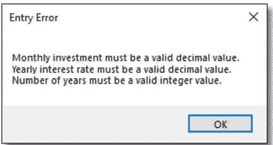

### 验证多个条目的代码

```
private bool IsValidData()
{
    bool success = true;
    string errorMessage = "";

    // Validate the Monthly Investment text box
    errorMessage += IsDecimal(txtMonthlyInvestment.Text,
                    txtMonthlyInvestment.Tag.ToString());
    errorMessage += IsWithinRange(txtMonthlyInvestment.Text,
                    txtMonthlyInvestment.Tag.ToString(),
                    1, 1000);

    // Validate the Yearly Interest Rate text box
    errorMessage += IsDecimal(txtInterestRate.Text,
                    txtInterestRate.Tag.ToString());
    errorMessage += IsWithinRange(txtInterestRate.Text,
                    txtInterestRate.Tag.ToString(), 1, 20);

    // Validate the Number of Years text box
    errorMessage += IsInt32(txtYears.Text, txtYears.Tag.ToString());
    errorMessage += IsWithinRange(txtYears.Text, txtYears.Tag.ToString(),
                    1, 40);

    if (errorMessage != "")
    {
        success = false;
        MessageBox.Show(errorMessage, "Entry Error");
    }
    return success;
}
```

## 描述

- 你可以使用前面各图中显示的验证方法来验证多个条目。然后，如果任何条目无效，你可以显示一个描述错误的对话框。

## 带数据验证的未来价值应用程序

在图 7-7 中，你看到一个使用结构化异常处理来捕获可能抛出的所有异常的未来价值应用程序版本。现在，你将看到此应用程序的改进版本，其中包含验证用户输入的代码。此代码可防止抛出格式和溢出异常，并向用户提供更具描述性的消息。

### 对话框

图 7-11 显示了用户在所有三个字段中输入了无效数据后的未来价值应用程序。然后，它显示用于识别这些错误的对话框。在这里，你可以看到月投资超出有效范围，年利率无效，因为它包含百分号，年数无效，因为用户未输入值。如果抛出未预期的异常，最后一个对话框将被显示。要测试此对话框，你可以在图 7-6 所示的未来价值应用程序代码中编写 throw 语句。

### 代码

图 7-12 显示了此版本的未来价值应用程序的代码。首先，btnCalculate_Click() 方法包含一个异常处理程序，用于捕获和处理任何未预期的异常。在 try 块内，if 语句检查 IsValidData() 方法是否返回 true 值。如果是，则计算并显示未来价值。否则，if 块内的语句都不会执行。但是，IsValidData() 方法将显示包含适当消息的对话框。由于此方法与你在上一张图中看到的方法相同，因此你不应该有任何困难理解其工作原理。

此应用程序中的每个方法都执行特定任务。例如，btnCalculate_Click() 方法包含从表单获取值并在表单上显示值的代码。IsValidData()、IsDecimal()、IsInt32() 和 IsWithinRange() 方法包含验证用户输入数据的代码。而 CalculateFutureValue() 方法包含执行计算的代码。这是一个良好的设计，因为它导致代码可重用且易于维护。

然而，此代码可以更高效。例如，如果用户在月投资文本框中输入有效的十进制值，则该值将被转换为十进制三次：一次由 IsDecimal() 方法，一次由 IsWithinRange() 方法，一次由 btnCalculate_Click() 方法。对于大多数应用程序而言，能够重用和轻松维护代码所带来的好处远远超过任何性能问题。


# 具有三个无效字段的未来价值表单

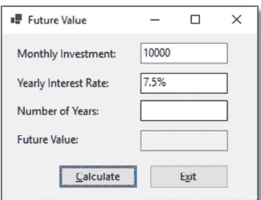

# 显示错误的对话框

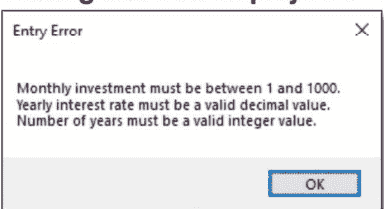

# 未预期异常的对话框

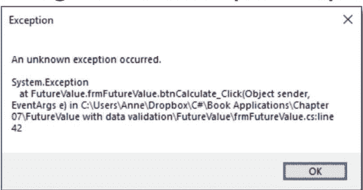

## 描述

- 如果用户输入无效数据，例如无效的小数或整数值，或超出应用程序指定范围的值，则会显示第一个对话框。
- 如果发生未预期的异常，则会显示第二个对话框。

# 未来价值应用程序的代码

```
private void btnCalculate_Click(object sender, EventArgs e)
{
    try
    {
        if (IsValidData())
        {
            decimal monthlyInvestment =
                Convert.ToDecimal(txtMonthlyInvestment.Text);
            decimal yearlyInterestRate =
                Convert.ToDecimal(txtInterestRate.Text);
            int years = Convert.ToInt32(txtYears.Text);

            int months = years * 12;
            decimal monthlyInterestRate = yearlyInterestRate / 12 / 100;
            decimal futureValue = CalculateFutureValue(
                monthlyInvestment, monthlyInterestRate, months);

            txtFutureValue.Text = futureValue.ToString("c");
            txtMonthlyInvestment.Focus();
        }
    }
    catch(Exception ex)
    {
        MessageBox.Show(ex.Message + "\n\n" +
            ex.GetType().ToString() + "\n" +
            ex.StackTrace, "Exception");
    }
}

private bool IsValidData()
{
    bool success = true;
    string errorMessage = "";

    errorMessage += IsDecimal(txtMonthlyInvestment.Text,
        txtMonthlyInvestment.Tag.ToString());
    errorMessage += IsWithinRange(txtMonthlyInvestment.Text,
        txtMonthlyInvestment.Tag.ToString(),
        1, 1000);

    errorMessage += IsDecimal(txtInterestRate.Text,
        txtInterestRate.Tag.ToString());
    errorMessage += IsWithinRange(txtInterestRate.Text,
        txtInterestRate.Tag.ToString(), 1, 20);

    errorMessage += IsInt32(txtYears.Text, txtYears.Tag.ToString());
    errorMessage += IsWithinRange(txtYears.Text, txtYears.Tag.ToString(),
        1, 40);

    if (errorMessage != "")
    {
        success = false;
        MessageBox.Show(errorMessage, "Entry Error");
    }
    return success;
}
```

图 7-12    未来价值应用程序的代码（第 1 部分，共 2 部分）

# 未来价值应用程序的代码

```csharp
private string IsDecimal(string value, string name)
{
    string msg = "";
    if (!Decimal.TryParse(value, out _))
    {
        msg += name + " must be a valid decimal value.\n";
    }
    return msg;
}

private string IsInt32(string value, string name)
{
    string msg = "";
    if (!Int32.TryParse(value, out _))
    {
        msg += name + " must be a valid integer value.\n";
    }
    return msg;
}

private string IsWithinRange(string value, string name, decimal min, decimal max)
{
    string msg = "";
    if (Decimal.TryParse(value, out decimal number))
    {
        if (number < min || number > max)
        {
            msg += name + " must be between " + min + " and " + max + ".\n";
        }
    }
    return msg;
}

private decimal CalculateFutureValue(decimal monthlyInvestment, decimal monthlyInterestRate, int months)
{
    decimal futureValue = 0m;
    for (int i = 0; i < months; i++)
    {
        futureValue = (futureValue + monthlyInvestment) * (1 + monthlyInterestRate);
    }
    return futureValue;
}
```

## 展望

在本章中，你学习了如何处理异常并验证数据，以便编写“防弹”的应用程序。这意味着无论用户输入什么数据或如何使用用户界面，你的应用程序都不会抛出未处理的异常。这是任何专业应用程序的基本功能。

但你对 C# 语言还有很多东西需要学习。因此，在第 8 章中，你将学习如何使用数组和集合。在第 9 章中，你将学习如何使用日期，并将学习更多关于使用字符串的知识。而在第 10 章中，你将学习如何开发使用其他类型控件的窗体。当你完成这些章节后，你将能够开发相当复杂的应用程序。

## 术语

- exception
- throw an exception
- catch an exception
- exception handling
- subclass
- structured exception handling
- try-catch statement
- exception handler
- try block
- catch block
- stack trace
- finally block
- throw statement
- data validation
- range checking

# 练习 7-1 增强 Invoice Total 应用程序

本练习指导你完成增强 Invoice Total 应用程序的过程，使其捕获任何运行时错误并验证 Subtotal 输入。

- 1. 打开位于 C:\C#\Chapter 07\InvoiceTotal 目录中的应用程序。这是你在第 4 章中工作的版本。
- 2. 向 btnCalculate_Click() 方法添加一个 try-catch 语句，以便捕获 Convert 类的 ToDecimal() 方法可能抛出的任何异常。catch 块应显示如图 7-2 所示的对话框。然后，测试应用程序以确保其正确工作。
- 3. 在 try 块中添加代码以检查用户是否在 Subtotal 文本框中输入了值。如果未输入值，则应显示一个对话框，其中包含一条消息，指出 Subtotal 是必填字段。然后，测试此增强功能。
- 4. 在 try 块中添加代码以对用户输入进行范围检查，使其大于零且小于 10,000。如果不是，则应显示一个对话框，指定可接受的范围。然后，测试此增强功能。当你确信应用程序工作正确时，关闭它。

# 练习 7-2 增强 Future Value 应用程序

本练习指导你完成增强你在第 6 章中工作的 Future Value 应用程序的过程。

- 1. 打开位于 C:\C#Chapter 07\FutureValue 目录中的应用程序。
- 2. 向 btnCalculate_Click() 方法添加一个 try-catch 语句以捕获和处理可能发生的任何 FormatException 或 OverflowException。这些 catch 块应显示适当的对话框消息。然后，测试这些增强功能。
- 3. 向 try-catch 语句添加另一个 catch 块以捕获可能发生的任何其他异常。此 catch 块应显示一个对话框，其中显示异常对象中包含的消息，以及异常类型和堆栈跟踪。
- 4. 在 CalculateFutureValue() 方法的 return 语句之前添加一个 throw 语句，无论计算结果如何，都抛出 Exception 类的新异常。此语句将用于测试步骤 3 的增强功能，并且应指定一条通用消息，指出未知错误。然后，通过在三个文本框中输入有效值并单击 Calculate 按钮来测试应用程序。如果抛出异常并且最后一个 catch 块正常工作，则结束应用程序并注释掉 throw 语句。
- 5. 编写三个名为 IsDecimal()、IsInt32() 和 IsWithinRange() 的通用验证方法，以测试文本框是否包含有效的小数值、有效的 int 值以及在给定范围内的值。如果验证不成功，每个方法都应返回一条错误消息，其中包含正在验证的文本框的名称。如果你在编写这些方法时需要帮助，可以参考图 7-9。
- 6. 编写一个 IsValidData() 方法，该方法调用你在步骤 5 中创建的三个通用方法来验证用户输入到三个文本框中的数据。每个文本框应测试两种类型的无效数据：（1）无效格式和（2）无效范围。如果发生任何错误，应显示一个对话框，其中包含这些错误。另请确保此方法返回一个布尔值，指示验证是否成功。
- 7. 修改 Calculate 按钮事件处理程序中的代码，以便在处理数据之前使用 IsValidData() 方法验证数据。然后，测试应用程序以确保其正常工作。如果正常工作，则结束应用程序并注释掉 FormatException 和 OverflowException catch 块，因为这些异常现在已通过数据验证防止。
- 8. 对应用程序进行最终测试，然后关闭它。


## 如何使用一维数组

你可以使用数组来存储一组相关的数据。由于一维数组是最简单的数组类型，你将首先学习如何创建和使用一维数组。

## 如何创建数组

要创建一维数组，请使用图 8-1 中所示的语法。正如你所见，你可以使用一个或两个语句来创建数组。这与你声明变量时使用的技术类似，只是你在数据类型后加上方括号，以表示该变量引用的是一个数组。在第二组方括号内，你输入一个数字来表示数组的长度或大小。这指定了数组可以容纳的元素数量。

请注意，你在创建数组时也使用了 new 关键字。这是因为，正如本章后面将要学习的那样，数组是由 .NET Framework 提供的 Array 类创建的。因此，当你创建数组时，你实际上是在创建该类的一个实例。

当你创建数组时，数组中的每个元素都会被初始化为默认值。该值取决于数组的数据类型，如本图中的表格所示。具体来说，数值类型被设为零，char 类型被设为 null 字符，Boolean 类型被设为 false，DateTime 类型被设为 0001 年 1 月 1 日 12:00:00 AM，而引用类型被设为 null。在下一幅图中，你将学习如何为数组的元素分配新值。

在大多数情况下，数组中的所有元素都将包含相同类型的数据，并且你将使用该数据类型声明数组。然而，如果你不知道数组将包含什么类型的数据，你可以用 object 数据类型声明它。然后，每个元素可以包含任何类型的数据。

## 创建一维数组的语法

#### 使用两个语句

```
type[] arrayName;
arrayName = new type[arrayLength];
// declaration statement
// assignment statement
```

#### 使用一个语句

```
type[] arrayName = new type[arrayLength];
```

### 创建 decimal 类型数组的示例

#### 使用两个语句

```
decimal[] totals;
totals = new decimal[4];
```

#### 使用一个语句

```
decimal[] totals = new decimal[4];
```

### 其他示例

#### 一个字符串数组

```
string[] description = new string[3];
```

#### 一个语句中的两个数组

```
const int MaxCount = 100;
decimal[] prices = new decimal[MaxCount],
    discountPercentages = new decimal[MaxCount];
```

### 数组元素的默认值

| Data type | Default value |
|---|---|
| numeric | 0 (zero) |
| char | '\0' (the null character) |
| Boolean | false |
| DateTime | 01/01/0001 00:00:00 |
| reference types | null |

### Description

- 一个 *array* 可以存储一个或多个 *elements*。数组的 *length*，或 *size*，是数组中元素的数量。
- 当你创建数组时，数组的每个元素都被设为默认值。如果数组包含值类型，每个元素都被设为上表中所示的值。如果数组包含引用类型，每个元素都被设为 null。

## 如何为数组的元素赋值

图 8-2 显示了如何为数组的元素赋值。正如本图顶部的语法所示，你通过在数组名称后加上方括号中的索引来引用数组中的一个元素。你指定的索引必须从 0 开始，0 指的是数组中的第一个元素，到数组的上界，即数组长度减一。

要理解其工作原理，请看本图中的第一个示例。该示例声明了一个包含四个元素的 decimal 数组。然后，它使用 0 到 3 的索引为这四个元素赋值。这里，数组的长度为 4，数组的上界为 3。请注意，如果你使用大于上界的索引，将会抛出 IndexOutOfRangeException。

本图底部的语法和示例显示了如何在单个语句中声明数组并为其元素赋值。这里，你像以前一样开始数组声明，但在声明后在花括号中输入一个值列表。请注意，当你使用这种技术时，你可以省略 new 关键字和类型及长度说明。然后，C# 会自动将数组的长度设置为花括号内的元素数量。如果你包含数据类型和长度说明，则它们必须与你提供的值列表相匹配。

接下来的三个语句展示了其工作原理。第一个语句创建的数组与本图中的第一个示例相同。请注意，该语句指定了数组的数据类型和长度。第二个语句创建了相同的数组，但省略了数据类型和长度。最后，第三个语句创建了与本图中第二个示例创建的相同字符串数组。与第二个语句一样，第三个语句中省略了数据类型和长度。

你可能还记得在第 4 章中，你可以使用 var 关键字声明一个变量，其类型从分配给它的值推断出来。你也可以使用 var 关键字与数组一起使用，如本图中的最后一个语句所示。该语句创建了一个包含四个 int 值的数组。

尽管我们建议你尽可能指定数组的类型，但你应该注意到该语句的编码有三点不同，以防你以后想使用这种技术。首先，你不像指定类型时那样在 var 关键字后加上方括号。其次，你必须在赋值语句中包含 new 关键字后跟方括号。第三，你不得在方括号内指定数组的长度。

## 引用数组元素的语法

```
arrayName[index]
```

### 通过访问每个元素赋值的示例

#### 为 decimal 类型数组赋值代码

```
decimal[] totals = new decimal[4];
totals[0] = 14.95m;
totals[1] = 12.95m;
totals[2] = 11.95m;
totals[3] = 9.95m;
//totals[4] = 8.95m;   // this would throw an IndexOutOfRangeException
```

#### 为字符串数组赋值对象代码

```
string[] names = new string[3];
names[0] = "Ted Lewis";
names[1] = "Sue Jones";
names[2] = "Ray Thomas";
```

### 在一个语句中创建数组并赋值的语法

```
type[] arrayName = [new type[length]] {value1[, value2[, value3]...};
```

### 在一个语句中创建数组并赋值的示例

```
decimal[] totals = new decimal[4] {14.95m, 12.95m, 11.95m, 9.95m};
decimal[] totals = {14.95m, 12.95m, 11.95m, 9.95m};
string[] names = {"Ted Lewis", "Sue Jones", "Ray Thomas"};
```

### 创建一个其类型从值推断的数组的语句

```
var grades = new[] {95, 89, 91, 98};
```

### Description

- 要引用数组中的元素，你使用索引，其中 0 是第一个元素，1 是第二个元素，2 是第三个元素，以此类推。数组中最后一个元素的索引称为上界。
- 如果你列出要分配给数组的值而没有使用 new 关键字创建数组，则会创建一个长度等于列表中值的数量的数组。如果你使用 new 关键字并列出值，则为数组指定的长度必须与列表中的值数量匹配，并且值必须与你指定的类型匹配。
- 你也可以在不指定数据类型的情况下创建数组。为此，你使用 var 关键字。然后，数据类型从分配给数组的值推断出来。当你使用这种技术时，你不得在 var 关键字后加上方括号，你必须加上 new 关键字后跟方括号，并且不得指定长度。
- 如果你指定一个小于零或大于数组上界的索引，在语句执行时将抛出 IndexOutOfRangeException。


## 如何操作数组

现在你已经了解如何声明数组并为其元素赋值，你就可以学习如何操作数组中的值了。图 8-3 展示了一些执行此操作的基本技术。

该图首先介绍了数组的 Length 属性，该属性获取数组中元素的数量。在你操作数组时，你会经常使用此属性。

该图中的第一个示例展示了如何从数组中获取值并计算元素的平均值。这里，第一条语句声明了一个包含四个十进制值的 totals 数组。然后，第二条语句将 sum 变量设置为数组中四个元素的总和。最后，第三条语句通过将总和除以四来计算这些元素的平均值。

第二个示例使用 for 循环将 0 到 9 的数字放入数组中。这里，第一条语句声明了一个名为 numbers 的数组，其中包含 10 个 int 值。然后，for 循环将循环计数器的值赋给数组中的每个元素。

第三个示例使用 for 循环在消息框中显示 numbers 数组的元素。这里，第一条语句声明了一个字符串变量。然后，for 循环访问 numbers 数组的每个元素，并将数字和一个空格追加到字符串变量中。当 for 循环结束时，下一条语句在消息框中显示包含数字的字符串。

第四个示例展示了如何使用循环计算 totals 数组中元素的平均值。这里，第一条语句声明了 sum 变量。然后，for 循环获取数组中每个元素的值并将其加到 sum 变量的当前值上。循环结束后，下一条语句使用 sum 变量和数组的 Length 属性来计算平均值。如果你将此代码与第一个示例中的代码进行比较，你会看到它们都完成了相同的任务。然而，此示例中的代码无论 totals 数组包含 4 个还是 400 个值都能同样好地工作。因此，在操作数组时，通常有意义使用循环。

最后一个示例展示了如何在消息框中显示 totals 数组的元素以及该数组的总和和平均值。与第三个示例类似，此示例也使用 for 循环将数组中的值格式化为字符串。然后，它在消息框中显示该字符串以及总和和平均值。

### 使用数组的 Length 属性的语法

```
arrayName.Length
```

### 计算总和数组平均值的代码

```
decimal[] totals = {14.95m, 12.95m, 11.95m, 9.95m};
decimal sum = totals[0] + totals[1] + totals[2] + totals[3];
decimal average = sum/4;
```

### 将 0 到 9 的数字放入数组的代码

```
int[] numbers = new int[10];
for (int i = 0; i < numbers.Length; i++)
    numbers[i] = i;
```

### 在消息框中显示 numbers 数组的代码

```
string numbersString = "";
for (int i = 0; i < numbers.Length; i++)
    numbersString += numbers[i] + " ";
MessageBox.Show(numbersString, "Numbers Test");
```


### 使用 for 循环计算 totals 数组平均值的代码

```
decimal sum = 0.0m;
for (int i = 0; i < totals.Length; i++)
    sum += totals[i];
decimal average = sum/totals.Length;
```

### 在消息框中显示 totals 数组的代码

```
string totalsString = "";
for (int i = 0; i < totals.Length; i++)
    totalsString += totals[i] + "\n";
MessageBox.Show("The totals are:\n" +
    totalsString + "\n" +
    "Sum: " + sum + "\n" +
    "Average: " + average, "Totals Test");
```


## 如何使用 foreach 循环操作数组

虽然你可以使用 for 循环操作数组的元素，但使用 foreach 语句编写 foreach 循环通常更容易。图 8-4 展示了如何执行此操作。

要编写 foreach 循环，你首先编写 foreach 关键字，后跟一对括号。在括号内，你编写数组中元素的 数据类型、你想要用来访问元素的名称、in 关键字以及数组的名称。你也可以使用 var 关键字代替数据类型，在这种情况下，类型会从数组的类型推断出来。

接下来，你可以编写一个或多个使用元素名称来操作元素的语句。如果 foreach 循环包含两个或多个语句，你必须用大括号将其括起来。否则，你可以省略大括号。

当 foreach 循环执行时，其语句会为数组中的每个元素执行一次。例如，该图中的第一个示例展示了如何使用 foreach 循环显示你在前一图中看到的 numbers 数组中的元素。同样，第二个示例计算 totals 数组的平均值，第三个示例显示 totals 数组中的元素。

如果你将这些示例与前一图中的 for 循环示例进行比较，你会看到 foreach 循环更不复杂。特别是，当你使用 foreach 循环时，你不需要使用计数器变量，也不需要使用索引从数组中获取元素。因此，使用 foreach 循环通常比使用 for 循环更容易。

然而，你应该意识到，仍然有时候你需要使用 for 循环来操作数组。例如，如果你只想访问数组中的某些元素，你就需要使用 for 循环。如果你想使用计数器变量为数组的元素赋值，如图 8-3 中的第二个示例所示，你也需要使用 for 循环。

## 如何操作矩形数组

到目前为止，本章展示了如何操作使用一个索引在 一维数组 中存储元素的数组。现在，你将学习如何操作使用两个索引的矩形数组。你可以将矩形数组视为具有行和列的表格。由于矩形数组以二维存储数据，因此也称为二维数组。

虽然可以创建包含两个以上维度的数组，但这很少必要。然而，如果你确实需要使用具有三个或更多维度的数组，你可以扩展接下来要学习的二维技术。

## 如何创建矩形数组

图 8-5 展示了如何创建矩形数组。要执行此操作，你在数据类型声明后跟随的方括号集合内编写一个逗号。这表明数组将具有两个维度。然后，当你使用 new 关键字创建数组时，你指定数组中的行数，后跟逗号，后跟数组中的列数。

该图中的第一条语句创建了一个整数的矩形数组。在这种情况下，数组有三行两列。在此语句执行后，数组中的每个元素将被分配默认值 0，如图 8-1 中所述。

## 如何为矩形数组赋值

创建数组后，你可以为其赋值。要执行此操作，你使用其行和列索引引用数组的每个元素。这由图 8-5 中显示的索引值表说明。由于此数组由四行四列组成，因此索引值范围从 0,0 到 3,3。

要为矩形数组的元素赋值，你可以为每个元素编写一条语句，如第一个示例所示。这些语句为由本图中的第一条语句创建的 numbers 数组的元素赋值。

你也可以在声明数组时为其赋值，如第二个、第三个和第四个示例所示。这里，第二个示例通过在外层大括号内编写三组大括号来创建 numbers 数组并为其赋值。三个内部大括号代表数组中的三行，而这些大括号中的值被分配给每一行中的两列。第三个示例的工作方式相同，只是它使用字符串对象而不是 int 值。第四个示例也创建了一个字符串数组，但它从指定的值推断数据类型。因此，它使用了 new 关键字。


## 如何创建矩形数组

## 创建矩形数组的语法

```
type[,] arrayName = new type[rowCount,columnCount];
```

## 创建一个 3x2 数组的语句

```
int[,] numbers = new int[3,2];
```

## 如何为矩形数组赋值

## 引用矩形数组元素的语法

```
arrayName[rowIndex, columnIndex]
```

## 4x4 矩形数组元素的索引值

| 0,0 | 0,1 | 0,2 | 0,3 |
|---|---|---|---|
| 1,0 | 1,1 | 1,2 | 1,3 |
| 2,0 | 2,1 | 2,2 | 2,3 |
| 3,0 | 3,1 | 3,2 | 3,3 |

## 为 numbers 数组赋值的代码

```
numbers[0,0] = 1;
numbers[0,1] = 2;
numbers[1,0] = 3;
numbers[1,1] = 4;
numbers[2,0] = 5;
numbers[2,1] = 6;
```

## 创建 3x2 数组并用一条语句赋值的代码

```
int[,] numbers = { {1,2}, {3,4}, {5,6} };
```

## 创建并为 3x2 字符串数组赋值的代码

```
string[,] products =
    {{"C#", "Murach's C#"},
    {"JAVA", "Murach's Java Programming"},
    {"ASPMVC", "Murach's ASP.NET MVC"}};
```

## 创建字符串数组的另一种方法

```
var products = new[,]
    {{"C#", "Murach's C#"},
    {"JAVA", "Murach's Java Programming"},
    {"ASPMVC", "Murach's ASP.NET MVC"}};
```

## 描述

- *矩形数组* 使用两个索引来存储数据。你可以将这种类型的数组视为具有行和列的表格。矩形数组有时也被称为*二维数组*。
- 虽然很少有必要，但你可以将这种二维语法扩展以处理具有超过两个维度的数组。

## 如何使用矩形数组

图 8-6 展示了一些使用矩形数组的示例。第一个示例展示了如何使用 GetLength() 方法获取数组某个维度中的元素数量。在这里，第一条语句通过调用 GetLength() 方法并指定 0 来获取 numbers 数组的行数，以获取第一个维度的长度。然后，第二条语句通过调用 GetLength() 方法并指定 1 来获取数组的列数，以获取第二个维度的长度。最后，第三条语句使用索引从数组的第一行的两个元素中获取值并将它们相加。

第二个示例展示了如何使用嵌套的 for 循环在消息框中显示矩形数组的元素。在这种情况下，会显示你在图 8-5 中看到的 numbers 数组。如你所见，外层的 for 循环使用计数器变量遍历数组中的行。为了确定数组中的行数，此循环使用 GetLength() 方法。然后，内层的 for 循环使用另一个计数器变量遍历数组中每一行的每个列。就像外层循环一样，内层循环也使用 GetLength() 方法来确定数组中的列数。

为了显示每个元素的值，内层 for 循环中的语句使用两个计数器变量来获取元素的值并将其附加到字符串中。每个元素也用空格与下一个元素分隔。然后，在内层循环处理完每一行后，会将换行字符附加到字符串中，以便每一行的元素会出现在单独的行中。当外层循环结束时，字符串会显示在消息框中，如本图所示。

第三个示例类似，只是它显示了你在图 8-5 中看到的产品数组。如果你将此代码与第二个示例中的代码进行比较，你会看到唯一的区别是两列中的元素用制表符分隔，以便它们按此处所示对齐。

## 使用矩形数组的 GetLength() 方法的语法

```
arrayName.GetLength(dimensionIndex)
```

## 操作 numbers 数组的代码

```
int numberOfRows = numbers.GetLength(0);
int numberOfColumns = numbers.GetLength(1);
int sumOfFirstRow = numbers[0,0] + numbers[0,1];
```

### 在消息框中显示 numbers 数组的代码

```
string numbersString = "";
for (int i = 0; i < numbers.GetLength(0); i++)
{
    for (int j = 0; j < numbers.GetLength(1); j++)
        numbersString += numbers[i,j] + " ";
    numbersString += "\n";
}
MessageBox.Show(numbersString, "Numbers Test");
```


## 在消息框中显示 products 数组的代码

```
string productsString = "";
for (int i = 0; i < products.GetLength(0); i++)
{
    for (int j = 0; j < products.GetLength(1); j++)
        productsString += products[i,j] + "\t\t";
    productsString += "\n";
}
MessageBox.Show(productsString, "Products Test");
```


## 描述

- 你使用 GetLength() 方法来获取矩形数组中的行数或列数。要获取行数，请为 dimensionIndex 参数指定 0。要获取列数，请为此参数指定 1。
- 你使用嵌套的 for 循环遍历矩形数组的行和列。

## 如何使用锯齿数组

锯齿数组让你可以在具有不等长行的表格中存储数据。由于锯齿数组中的每一行都存储为单独的数组，因此锯齿数组也被称为数组的数组。

## 如何创建锯齿数组

图 8-7 展示了如何创建锯齿数组。首先，你编写数据类型后跟两个方括号集。这表明数组的每一行将包含另一个数组。然后，当你使用 new 关键字创建锯齿数组时，你指定数组将包含的行数。例如，第一个示例中的第一条语句创建一个名为 numbers 的锯齿数组，其中包含三行。最后，当你为每一行声明数组时，你指定该行中的列数。例如，numbers 数组的第一行有三列，第二行有四列，第三行有两列。

## 如何为锯齿数组赋值

一旦你创建了锯齿数组，你就可以使用行和列索引来引用数组中的元素，就像对矩形数组一样。但是，当你引用锯齿数组中的元素时，你将每个索引放在单独的一组方括号中，如图 8-7 所示。例如，要为 numbers 数组赋值，你可以使用本图所示的第二个示例中的语句。

你也可以在一条语句中创建锯齿数组并为其元素赋值。第三、第四和第五个示例说明了其工作原理。第三个示例创建的数组与第一个示例相同。在这里，你可以看到一对大括号用于括起数组声明的列表。此列表中的每个声明为锯齿数组中的一行定义一个数组。请注意，在此示例中，声明没有指定每一行中的列数。相反，列数由为该行指定的值的数量决定。同样，锯齿数组中的行数由数组列表中的数组数量决定。

第四个示例类似，只是每个数组声明指定了数组中的列数。在这种情况下，每个值列表中的值数量必须与你指定的数量相匹配。

第五个示例也创建了一个锯齿字符串数组，但它从指定的值推断数据类型。请注意，当你使用此技术时，你必须用括号括起锯齿数组中的每个数组。

## 如何创建锯齿数组

## 创建锯齿数组的语法

```
type[][] arrayName = new type[rowCount][];
```

## 创建具有不同长度的三行锯齿数组的代码

```
int[][] numbers = new int[3][];      // 行数
numbers[0] = new int[3];      // 第 1 行的列数
numbers[1] = new int[4];      // 第 2 行的列数
numbers[2] = new int[2];      // 第 3 行的列数
```

## 如何引用锯齿数组的元素

## 引用锯齿数组元素的语法

```
arrayName[rowIndex][columnIndex]
```

## 为 numbers 数组赋值的代码

```
numbers[0][0] = 1;      numbers[1][0] = 4;  numbers[2][0] = 8;
numbers[0][1] = 2;      numbers[1][1] = 5;  numbers[2][1] = 9;
numbers[0][2] = 3;      numbers[1][2] = 6;
                         numbers[1][3] = 7;
```

## 用一条语句创建 numbers 数组的代码

```
int[][] numbers = { new int [] {1, 2, 3},
                    new int [] {4, 5, 6, 7},
                    new int [] {8, 9} };
```

## 创建字符串锯齿数组的代码

```
string[][] titles = {
    new string [3] {"War and Peace", "Wuthering Heights", "1984"},
    new string [4] {"Casablanca", "Wizard of Oz", "Star Wars", "Birdy"},
    new string [2] {"Blue Suede Shoes", "Yellow Submarine"} };
```

## 创建字符串锯齿数组的另一种方法

```
var titles = new[]
    {(new[] {"War and Peace", "Wuthering Heights", "1984"})},
    (new[] {"Casablanca", "Wizard of Oz", "Star Wars", "Birdy"}),
    (new[] {"Blue Suede Shoes", "Yellow Submarine"})};
```

## 描述

- 你可以使用锯齿数组在具有不等长行的表格中存储数据。锯齿数组中的每一行都存储为单独的数组。因此，锯齿数组也被称为数组的数组。
- 如果你在声明数组时没有为锯齿数组的元素赋值，则声明语句必须指定数组中的行数。然后，在为该行中的元素赋值之前，你必须声明每一行中的列数。
- 要在声明数组时为锯齿数组的元素赋值，你创建一个数组列表，为每一行定义一个数组。然后，锯齿数组使用该列表中的每个数组创建一个行。


## 如何处理交错数组

图 8-8 展示了如何处理交错数组。由于此图中的示例与图 8-6 中处理矩形数组的示例类似，理解其工作原理应该不会太困难。但是，您应该注意到这些示例中的两个不同之处。

首先，内部 for 循环中使用了*两组方括号*来引用数组中的每个元素。其次，内部循环使用 `Length` 属性来获取每一行的列数。如果您还记得交错数组中的每一行本身就是一个数组，那么这就说得通了。您必须使用 `Length` 属性，因为每一行的长度可能不同。因此，您不能像处理矩形数组那样使用 `GetLength()` 方法来返回某一行中的列数。

### 在消息框中显示 numbers 数组的代码

```
string numbersString = "";
for (int i = 0; i < numbers.GetLength(0); i++)
{
    for (int j = 0; j < numbers[i].Length; j++)
        numbersString += numbers[i][j] + " ";
    numbersString += "\n";
}
MessageBox.Show(numbersString, "交错数组数字测试");
```


### 在消息框中显示 titles 数组的代码

```
string titlesString = "";
for (int i = 0; i < titles.GetLength(0); i++)
{
    for (int j = 0; j < titles[i].Length; j++)
        titlesString += titles[i][j] + "|";
    titlesString += "\n";
}
MessageBox.Show(titlesString, "交错数组标题测试");
```


## 描述

- 由于交错数组每一行的列数不同，因此不能使用 `GetLength()` 方法来获取某一行的长度。相反，您必须使用该行数组的 `Length` 属性。

## 更多数组操作技巧

既然您已经知道如何处理一维数组、矩形数组和交错数组，那么您可以学习一些其他的数组操作技巧。

### 如何使用 Array 类

因为数组实际上是 `Array` 类的一个实例，所以您可以使用这个类的属性和方法来操作您的数组。图 8-9 展示了您最可能使用的一些属性和方法。

您已经了解了如何使用 `Length` 属性和 `GetLength()` 方法。另一个您可能想使用的方法是 `GetUpperBound()` 方法，它返回数组中指定维度的最后一个元素的索引。此图中的第一个示例说明了 `GetLength()` 和 `GetUpperBound()` 方法之间的区别。在这里，您可以看到对于包含四个元素的一维数组，`GetLength()` 方法返回的值是 4。相比之下，`GetUpperBound()` 方法返回的值是 3，因为四个元素分别使用索引值 0 到 3 来引用。

尽管此示例中使用的数组的元素已经被赋值，但您应该认识到，无论是否已为数组赋值，`GetLength()` 和 `GetUpperBound()` 方法都会返回相同的值。换句话说，这些方法仅取决于为数组声明的元素数量。`Length` 属性也是如此。

`Array` 类的 `Sort()` 方法允许您对一维数组中的元素进行排序。此图中的第二个示例对此进行了说明。在这里，第一条语句声明了一个由三个姓氏组成的数组。然后，使用 `Sort()` 方法对该数组中的姓名进行排序。请注意，由于此方法是一个静态方法，它是从 `Array` 类（而不是从数组本身）调用的。数组排序后，会创建一个包含按升序排列的元素值的字符串。然后，该字符串会在消息框中显示。

第三个示例展示了如何使用 `BinarySearch()` 方法在一维数组中定位某个值。此代码使用 `BinarySearch()` 方法在 employees 数组中获取指定雇员的索引。然后，使用此索引从 salesAmounts 数组中获取相应的销售额。

要使 `BinarySearch()` 方法正常工作，数组必须按升序排序。如果不是，即使指定值存在于数组中，此方法通常也无法找到它。当 `BinarySearch()` 方法找不到指定值时，它会返回一个负值。然后，如果您尝试使用此值来访问数组的元素，将会引发 `IndexOutOfRangeException` 异常。

### Array 类的常用属性和方法

| 属性 | 描述 |
|---|---|
| `Length` | 获取数组所有维度中的元素总数。 |
| **实例方法** | |
| `GetLength(dimension)` | 获取数组指定维度中的元素个数。 |
| `GetUpperBound(dimension)` | 获取数组指定维度中最后一个元素的索引。 |
| **静态方法** | |
| `Copy(array1, array2, length)` | 将一个数组中的部分或全部值复制到另一个数组。有关更多信息，请参阅图 8-10。 |
| `BinarySearch(array, value)` | 在按升序排列的一维数组中搜索具有指定值的元素，并返回该元素的索引。 |
| `Sort(array)` | 将一维数组中的元素按升序排序。 |

### 使用 GetLength() 和 GetUpperBound() 方法的代码

```
int[] numbers = new int[4] {1, 2, 3, 4};
int length = numbers.GetLength(0);                // length = 4
int upperBound = numbers.GetUpperBound(0);        // upperBound = 3
```

### 使用 Sort() 方法的代码

```
string[] lastNames = {"Boehm", "Taylor", "Murach"};
Array.Sort(lastNames);
string message = "";
foreach (string lastName in lastNames)
    message += lastName + "\n";
MessageBox.Show(message, "已排序的姓氏");
```


### 使用 BinarySearch() 方法的代码

```
string[] employees = {"AdamsA", "FinkleP", "LewisJ", "PotterE"};
decimal[] salesAmounts = {3275.68m, 4298.55m, 5289.57m, 1933.98m};
int index = Array.BinarySearch(employees, "FinkleP");
decimal salesAmount = salesAmounts[index];          // salesAmount = 4298.55
```

### 注意

- `BinarySearch()` 方法仅适用于元素按升序排列的数组。如果数组未按升序排列，您必须先使用 `Sort()` 方法对数组进行排序，然后再使用 `BinarySearch()` 方法。

### 如何引用和复制数组

因为数组是从类创建的，所以它们是引用类型。这意味着数组变量包含对数组对象的引用，而不是数组中的实际值。因此，您可以使用两个或多个变量来引用同一个数组。图 8-10 中的第一个示例对此进行了说明。

此示例中的第一条语句声明了一个名为 `inches1` 的数组变量，创建了一个包含三个元素的数组，并为这些元素赋值。然后，第二条语句声明了另一个名为 `inches2` 的数组变量，并将 `inches1` 变量的值赋给它。由于 `inches1` 变量包含对该数组的引用，这意味着 `inches2` 变量现在也包含对*同一个数组*的引用。因此，如果您使用 `inches2` 变量更改数组中的任何元素（如第三条语句所示），那么当您使用 `inches1` 变量引用该数组时，这些更改将会反映出来。

一旦您声明了数组的长度，它就不能增长或缩小。换句话说，数组的大小是不可变的。但是，您可以使用现有的数组变量来引用另一个具有更多或更少元素数量的数组。为此，您只需创建新数组并将其分配给现有变量，如本图中的第二个示例所示。在这里，一个包含 20 个元素的数组被赋值给 `inches1` 变量，而该变量最初只包含三个元素。请注意，当执行此语句时，除非有其他数组变量引用它，否则原始数组将被丢弃。在这种情况下，`inches2` 变量引用了原始数组，因此该数组得以保留。

如果您想创建数组的副本，可以使用 `Array` 类的 `Copy()` 方法，如本图所示。然后，每个数组变量都将指向该数组元素的*自己的副本*，对一个数组所做的任何更改都不会影响另一个数组。

您可以使用两种技术来复制数组的元素。首先，您可以通过指定源数组、目标数组和要复制的元素数量，从第一个元素开始复制数组的一个或多个元素。本图中的第三个示例对此进行了说明。在这里，名为 `inches` 的数组的全部元素都被复制到名为 `centimeters` 的数组中。请注意，使用 `inches` 数组的 `Length` 属性来指定要复制的元素数量。

您也可以从第一个元素以外的元素开始复制数组的一个或多个元素。为此，您需要指定要复制的第一个元素的索引。此外，您还需要指定目标数组中要存储源数组第一个元素的位置索引。

本图中的最后一个示例对此进行了说明。在这里，第一条语句创建了一个包含三个字符串值的数组，第二条语句创建了一个可以容纳两个字符串值的数组。然后，第三条语句将第一个数组中的第二个和第三个字符串复制到第二个数组中。为此，前两个参数指定源数组和起始索引 1（第二个元素）。接下来两个参数指定目标数组和起始索引 0（第一个元素）。最后，最后一个参数指定要复制的元素个数为两个。


## 创建对另一个数组的引用的代码

```
double[] inches1 = new double[3] {1,2,3};
double[] inches2 = inches1;
inches2[2] = 4;    // changes the third element
```

## 重用数组变量的代码

```
inches1 = new double[20];  // make a new array with 20 elements
```

## 如何将一个数组的元素复制到另一个数组

## 复制数组元素的语法

```
Array.Copy(fromArray, toArray, length);
```

## 复制元素到另一个数组的另一种方法

```
Array.Copy(fromArray, fromIndex, toArray, toIndex, length);
```

## 复制数组所有元素的代码

```
double[] inches = new double[3] {1,2,3};
double[] centimeters = new double[3];
Array.Copy(inches, centimeters, inches.Length);
for (int i = 0; i < centimeters.Length; i++)
    centimeters[i] *= 2.54;      // set the new values for this array
```

## 复制数组部分元素的代码

```
string[] names = {"Martinez", "Murach", "Boehm"};
string[] lastTwoNames = new string[2];
Array.Copy(names, 1, lastTwoNames, 0, 2);
```

## 描述

- 数组是一种引用类型，这意味着数组变量包含对数组对象的引用。要为现有数组创建另一个引用，可以将其赋给另一个数组变量。然后，两个数组变量都指向内存中的同一个数组。
- 要重用数组变量使其引用具有更大或更小元素数的数组，可以创建一个新数组并将其赋给该变量。这样做时，原数组将被丢弃，除非有另一个数组变量引用它。
- 要复制一个数组的元素到另一个数组，可以使用 Array 类的 Copy() 方法。
- 要从数组的第一个元素开始复制指定数量的元素，可以使用上面显示的第一个语法。然后，使用 length 参数指定要复制的元素数量。
- 要指定要复制的数组中的第一个元素，可以使用上面显示的第二个语法。然后，fromIndex 参数指定要复制的第一个元素的索引，toIndex 参数指定第一个元素被复制到的索引，length 参数指定要复制的元素数量。
- 当你复制数组时，目标数组必须与源数组类型相同，并且必须足够大以接收复制到其中的所有元素。

## 如何编写处理数组的方法

图 8-11 展示了你可以用来编写返回和接受数组的方法的技术。要从方法返回数组，你在方法返回类型后跟上方括号，如第一个示例所示。然后，在方法代码内定义一个数组并使用 return 语句返回该数组。

要调用返回数组的方法，你使用调用任何其他方法相同的技术。在此图中，调用 GetRateArray() 方法的语句声明一个数组变量并将该方法的返回值赋给此变量。在此情况下，该方法需要一个参数来提供数组应包含的元素数量。

第二个示例展示了如何编写接受数组作为参数的方法。要做到这一点，你在接受参数的数据类型后跟上方括号以表示它是一个数组。然后，在方法内部，你可以使用已学到的处理数组的所有技术来处理此参数。在此情况下，名为 ToCentimeters() 的方法用于将数组中的英寸测量值转换为厘米。

要调用定义了数组参数的方法，你只需按此处所示传递一个数组参数即可。注意，然而，与其他参数不同，数组默认按引用传递。因此，对数组参数中存储的值所做的任何更改都将反映在调用方法中引用该数组的任何数组变量中。在此图中，例如，measurements 数组中的值在调用 ToCentimeters() 方法后会被更新。

第三个示例展示了如何使用 params 关键字与数组参数一起使用。当你使用此关键字时，调用该方法的语句可以向方法传递一个数组，也可以传递一个值列表。这在图中的第三个示例中有所说明。这里，调用该方法的语句传递了三个值，然后将它们存储在数组参数中。然后，在将这些值转换为厘米后，数组被传回调用方法。

由于使用 params 关键字的 ToCentimeters() 方法可以接受数组或值列表，因此它比第一个 ToCentimeters() 方法更灵活。然而，你应该注意使用 params 关键字时的一些限制。首先，你只能在一个方法中使用一个参数使用此关键字。其次，如果一个方法定义了两个或多个参数，此关键字必须编码在最后一个参数上。

## 如何从方法返回数组

### 返回数组的方法代码

```
private decimal[] GetRateArray(int elementCount)
{
    decimal[] rates = new decimal[elementCount];
    for (int i = 0; i < rates.Length; i++)
        rates[i] = (decimal) (i + 1) / 100;
    return rates;
}
```

### 调用该方法的语句

```
decimal[] rates = this.GetRateArray(4);
```

## 如何编写接受数组参数的方法

### 将英寸转换为厘米的方法

```
private void ToCentimeters(double[] measurements)
{
    for (int i = 0; i < measurements.Length; i++)
        measurements[i] *= 2.54;
}
```

### 声明数组并调用方法的语句

```
double[] measurements = {1,2,3};
this.ToCentimeters(measurements);
```

## 如何编写使用 params 关键字的方法

### 将英寸转换为厘米的方法

```
private double[] ToCentimeters(params double[] measurements)
{
    for (int i = 0; i < measurements.Length; i++)
        measurements[i] *= 2.54;
    return measurements;
}
```

### 调用该方法的语句

```
double[] measurements = this.ToCentimeters(1,2,3);
```

## 描述

- 要从方法返回数组，你在返回类型声明后编码一组方括号以表示返回类型是数组。
- 要接受数组作为方法参数，你在参数类型后编码一组方括号以表示该参数是数组。默认情况下，数组按引用传递。
- 如果你想向方法传递两个或多个尚未分组到数组中的参数并让方法将值存储在数组中，可以在参数声明上包含 params 关键字。你在数组类型和名称之前编码此关键字，你只能在一个参数上编码它，并且必须在最后一个参数上编码它。

## 如何使用空条件运算符

C# 6.0 引入了一个名为空条件运算符的新运算符，它使得测试像本章中看到的数组以及数组元素等对象中的空值变得更容易。图 8-12 说明了此运算符的工作方式。

这里，第一个示例中的语句创建一个名为 initials 的数组并为其分配空值。然后，第二个示例中的语句尝试访问数组中的第一个元素并将其转换为大写。由于数组具有空值，因此此语句将抛出 NullReferenceException。

如果数组不包含空值但元素包含空值也是如此。例如，假设数组是这样创建的，包含三个元素：

```
string[] initials = new string[3];
```

然后，由于元素是引用类型，它们默认被赋予空值。因此，如果语句尝试访问数组的任何元素，它将抛出 NullReferenceException。

防止 NullReferenceException 的一种方法是使用第三个示例中所示的嵌套 if 语句。这里，外层 if 语句检查数组本身不包含空值。然后，内层 if 语句检查数组的第一个元素不包含空值。如果这两个条件都为真，则可以访问数组的第一个元素而不会抛出 NullReferenceException。

从 C# 6.0 及更高版本开始，你也可以使用空条件运算符来检查数组和数组元素中的空值。此运算符由单个问号 (?) 组成，如图所示的第四个示例所示。这里，第一个空条件运算符检查 initials 数组是否包含空值。如果包含，则将空值赋给 firstInitial 变量并且不会进行进一步处理。

如果数组不包含空值，则处理继续。然后，第二个空条件运算符检查数组的第一个元素是否包含空值。如果包含，则将空值赋给 firstInitial 变量并且不会进行进一步处理。如果元素不包含空值，则将其转换为大写并赋给 firstInitial 变量。正如你所见，这比使用嵌套 if 语句简洁得多。

图中的最后一个示例显示，当你使用空条件运算符时，接收返回值的任何变量都必须能够存储空值。在此语句中，例如，Length 属性用于返回 initials 数组的长度。然而，如果未为数组分配长度，则此语句将返回空值，因为它包含空条件运算符。因此，接收返回值的 int 变量必须定义为可空类型。

尽管此图仅展示了如何将空条件运算符与数组一起使用，但你应该知道你可以用它与任何对象一起使用。例如，你可以用它与下一节将学习的集合一起使用。你也可以用它与第 3 节将学习创建的自定义对象一起使用。


## 创建一个空数组的语句

```csharp
string[] initials = null;
```

## 一个会抛出 NullReferenceException 的语句

```csharp
string firstInitial = initials[0].ToUpper();
```

## 使用 if 语句防止 NullReferenceException 的代码

```csharp
if (initials != null)
{
    if (initials[0] != null)
    {
        string firstInitial = initials[0].ToUpper();
    }
}
```

## 使用空条件运算符防止 NullReferenceException 的语句

```csharp
string firstInitial = initials?[0]?.ToUpper();
```

## 使用可空类型的语句

```csharp
int? length = initials?.Length;
```

## 描述

- 如果你尝试访问包含空值的对象的成员或元素，就会发生 NullReferenceException。上面第二个示例就是这种情况，因为它访问的数组包含空值。
- 防止 NullReferenceException 的一种方法是使用 if 语句在访问对象成员或元素之前检查空值。
- 防止 NullReferenceException 更简单的方法是使用在 C# 6.0 中引入的 *空条件运算符 (?)*。该运算符会检查其前面的对象或元素是否为空。如果发现空值，则不会进行任何进一步操作并返回空值。
- 由于空条件运算符可能导致返回空值，因此将返回值赋给的变量必须能够容纳空值。如果变量是值类型，则必须将其定义为可空类型。
- 你可以使用空条件运算符与任何对象和任何元素。这包括集合对象和元素，如本章后面将介绍的那样，以及自定义对象和元素，如第 3 节中将介绍的那样。

## 更多引用数组元素的方式

图 8-13 介绍了 C# 8.0 中引入的引用数组元素的一些额外技巧。首先，你可以通过在索引前加上 ^ 运算符来引用数组末尾的某个元素。为了说明其工作原理，第一个示例展示了一个由其他示例使用的包含八个十进制数的数组。然后，第二个示例展示了如何检索数组末尾的第二个元素。请注意，当你从数组末尾引用元素时，最后一个元素的索引是 1，而不是你可能期望的 0。

你也可以引用一系列元素。为此，你使用范围运算符 (..)，如第三个示例中的语句所示。这里，第一个语句引用从索引 0 开始到索引 2 结束的范围。请注意，起始索引是包含的，因此具有该索引的元素包含在范围内，但结束索引是排除的，因此具有该索引的元素不包含在范围内。还请注意，通过此语句检索的元素存储在声明为 var 关键字的变量中。这样，范围就可以存储在具有适当类型的变量中，无论是数组还是单个变量。

引用元素范围时，可以省略起始索引、结束索引或两者。例如，此示例中的第二个语句不包含起始索引，因此默认为 0。因此，它获取的范围与第一个语句相同。

第三个语句不包含结束索引，因此默认为 ^0。这指的是数组中最后一个元素之后的元素。因此，此示例中的范围包括索引 6 的元素到数组中最后一个元素，即索引 7。

第四个语句不包含起始或结束索引。因此，范围包括数组中的所有元素。在大多数情况下，除非你需要创建数组的副本，否则不会使用此技术。相反，你可以直接引用原始数组。

此示例中的最后一个语句展示了如何编写包含数组末尾索引的范围。这里，起始索引为 3，结束索引为 ^2。这等同于编写 3..6，更容易理解。因此，除非是引用数组中最后一个元素之后的元素 (^0) 的索引，否则你通常不会在范围内使用数组末尾的索引。

你可以使用范围从一个数组复制选定的元素到另一个数组，而无需使用 Array 类。但是，如果你只需要处理元素而不将它们存储在单独的数组中，则可以使用第四个示例中所示的 foreach 循环。这里，与本章前面看到的那样不同，你不是只命名数组，而是包含要处理的元素的范围。

最后一个示例表明，你可以将索引存储在 Index 类型的变量中，并将范围存储在 Range 类型的变量中。然后，你可以使用这些变量来引用索引和范围。

### 示例中使用的数组

```csharp
decimal[] sales = { 22125.67m, 25362.35m, 21478.93m, 27495.72m, 26405.61m, 19476.29m, 31837.56m, 28649.01m };
```

### 如何从数组末尾引用元素

```csharp
decimal previousMonthSales = sales[^2]; // 31837.56
```

### 如何引用一系列元素

**包含起始和结束索引**

```csharp
var firstQtrSales = sales[0..3]; // indexes 0 through 2
```

**仅包含结束索引**

```csharp
var firstQtrSales = sales[..3]; // indexes 0 through 2
```

**仅包含起始索引**

```csharp
var secondHalfSales = sales[6..]; // indexes 6 through 7
```

**不包含起始或结束索引**

```csharp
var YTDSales = sales[..]; // indexes 0 through 7
```

**包含数组末尾的索引**

```csharp
var secondQtrSales = sales[3..^2]; // indexes 3 through 5
```

### 如何在 foreach 循环中使用范围

```csharp
totalSales = 0.0m;
foreach (decimal sale in sales[3..6]) // indexes 3 through 5
{
    totalSales += sale;
}
```

### 如何使用 Index 和 Range 类型（仅限 .NET Core 3.0 及更高版本）

```csharp
Index previousMonthIndex = ^2;
decimal previousMonthSales = sales[previousMonthIndex]; // 31837.56
```

```csharp
Range secondQtrRange = 3..6;
var secondQtrSales = sales[secondQtrRange]; // indexes 3 through 5
```

## 描述

- 使用 C# 8.0 及更高版本，你可以通过在索引前加上 ^ 运算符来引用数组末尾的元素。元素索引从最后一个元素的 ^1 开始，倒数第二个元素的 ^2，依此类推。
- 使用 C# 8.0 及更高版本，你还可以引用数组中的一系列元素。为此，你编写第一个索引、范围运算符 (..) 和最后一个索引之后的一个位置。
- 要引用数组中最后一个元素之后的一个元素，你编写 ^0。
- 如果在范围内省略第一个索引，则默认为 0。如果在范围内省略最后一个索引，则默认为 ^0。
- 你还可以将索引存储在 Index 类型的变量中，并将范围存储在 Range 类型的变量中。然后，你可以在索引或范围的位置使用这些变量。

## 如何处理集合

与数组一样，*集合* 可以保存一个或多个元素。与数组不同，集合没有固定大小。相反，当向其中添加元素时，集合的大小会自动增加。此外，大多数类型的集合都提供可用于更改集合容量的方法。换句话说，集合是 *可变的*。因此，当你需要处理可变数量的元素时，集合通常更合适，并且通常比数组更能更好地管理系统资源。

在接下来的主题中，你将学习如何使用五种类型的集合：列表、排序列表、队列、堆栈和数组列表。虽然 .NET Framework 提供了其他集合，但这些是你最常使用的。

## 常用集合类

.NET Core 提供了两种类型的集合类。首先，它包含可以存储任何类型对象的集合类。因此，从这些类创建的集合有时被称为 *未类型化集合*。事实上，你可以在同一个集合中存储不同类型的对象，尽管这通常不是一个好主意。但是，如果你不小心编写了向未类型化集合添加错误类型对象的代码，这将导致在运行应用程序时才会发现的错误。

第二种类型的集合类通过使用称为 *泛型* 的功能来防止此类错误，从而允许你创建 *类型化集合*。使用类型化集合时，你在集合类名称后用尖括号 (`<>`) 指定数据类型。然后，你只能将指定数据类型的对象存储在该集合中，任何错误都将在尝试编译应用程序时被发现。

图 8-14 显示了四种最常用的类型化和未类型化集合。类型化集合的类存储在 System.Collections.Generic 命名空间中。而未类型化集合的类存储在 System.Collections 命名空间中。

正如你在下一幅图中看到的那样，类型化集合相对于未类型化集合有几个优势。因此，对于大多数新开发，你通常希望使用类型化集合。但是，当处理遗留应用程序时，你可能需要使用未类型化集合。


## 数组和集合的相似之处

- 两者都可以存储多个元素，这些元素可以是值类型或引用类型。

## 数组和集合的不同之处

- 数组是 C# 语言的特性。集合是 .NET 类。
- 集合类提供了数组不提供的方法来执行操作。
- 数组的大小是固定的。集合的大小是可变的。

## 常用集合类

| 具类型 | 非具类型 | 描述 |
|---|---|---|
| List<T> | ArrayList | 使用索引访问每个元素。顺序访问元素非常高效。向列表中间插入元素时效率可能较低。 |
| SortedList<K, V> | SortedList | 使用键访问值，值可以是任何类型的对象。顺序访问元素效率可能较低。向列表中间插入元素非常高效。 |
| Queue<T> | Queue | 使用方法添加和移除元素。 |
| Stack<T> | Stack | 使用方法添加和移除元素。 |

## 描述

- *集合* 是一个可以容纳一个或多个 *元素* 的对象。
- System.Collections.Generic 命名空间中的集合类使用称为 *泛型* 的特性，允许你创建 *具类型集合*，只能存储指定的数据类型。使用具类型集合时，你在集合类名称后用尖括号 (<>) 指定数据类型。
- System.Collections 命名空间中的集合类允许你创建 *非具类型集合*。使用非具类型集合时，你可以将任何类型的对象存储在集合中。

## 具类型与非具类型集合

图 8-15 显示了具类型集合与非具类型集合之间的差异。特别是，它显示了具类型集合相对于非具类型集合的两个优势。首先，它们在编译时检查每个元素的类型，从而防止运行时错误的发生。其次，它们减少了检索对象时所需的强制转换量。

第一个示例展示了如何使用 System.Collections 命名空间中的 ArrayList 类来创建非具类型集合。首先，创建 ArrayList 对象的语句未指定数据类型。因此，Add() 方法可用于向集合中添加任何类型的元素。在此图中，例如，代码向集合中添加了两个 int 类型和一个 string 类型。这是因为 ArrayList 对象中的每个元素都存储为 object 类型。

一旦元素已添加到非具类型列表中，就使用 for 循环来计算元素的总和。为此，循环中的第一条语句将每个元素强制转换为 int 类型。这是因为每个元素都是 object 数据类型。然而，由于集合中添加了 string 类型，当循环到达 string 类型时，这将导致运行时错误。

第二个示例展示了如何使用 System.Collections.Generic 命名空间中的 List<T> 类来创建具类型集合。首先，创建列表的语句使用尖括号 (<>) 指定 int 类型。因此，Add() 方法只能用于向集合中添加 int 类型。在此图中，例如，代码向集合中添加了两个 int 类型。如果你尝试向集合中添加 string 等其他类型，将会得到编译时错误。

一旦元素已添加到具类型列表中，就使用 for 循环来计算元素的总和。为此，循环中的第一条语句检索每个元素并将其存储在 int 变量中。由于这是具类型集合，因此不需要强制转换。

由于具类型集合相对于非具类型集合有多个优势，Visual Studio 在大多数新应用程序中包含 System.Collections.Generic 命名空间的 using 指令。此指令使你能够在不指定命名空间名称的情况下使用该命名空间中的任何类型。由于此 using 指令默认包含，你通常会使用前面图中描述的四个具类型集合等具类型集合。然而，如果你正在升级使用 .NET Framework 1.x 开发的应用程序，using 指令可能引用 System.Collections 命名空间。在这种情况下，你将使用前面图中描述的四个非具类型集合等非具类型集合。（.NET Framework 2.0 及更高版本包含具类型集合。）

如果你想在非具类型和具类型集合之间切换，可以首先编辑 using 指令，使其引用正确的命名空间。然后，你可以编辑操作集合的语句。这通常意味着编辑创建集合的语句，并在必要时添加或删除强制转换。

### 非具类型集合

### using 指令

```
using System.Collections;
```

### 一个示例

```
ArrayList numbers = new ArrayList();
numbers.Add(3);
numbers.Add(7);
numbers.Add("Test");                // will compile - causes runtime error
int sum = 0;
for (int i = 0; i < numbers.Count; i++)
{
    int number = (int)numbers[i];  // cast is required
    sum += number;
}
```

### 具类型集合

### using 指令

```
using System.Collections.Generic;
```

### 一个示例

```
List<int> numbers = new List<int>();
numbers.Add(3);
numbers.Add(7);
//numbers.Add("Test");            // won't compile - prevents runtime error
int sum = 0;
for (int i = 0; i < numbers.Count; i++)
{
    int number = numbers[i];      // no cast needed
    sum += number;
}
```

## 描述

- 具类型集合相对于非具类型集合有两个优势。首先，它们在编译时检查每个元素的类型并防止运行时错误的发生。其次，它们减少了检索对象时所需的强制转换量。
- 如果你想使用非具类型集合，可以编辑窗体类开头的 using 指令，使其引用 System.Collections 命名空间而不是新应用程序中通常默认包含的 System.Collections.Generic 命名空间。然后，你需要确保在从集合中检索元素时将其强制转换为适当的类型。

## 如何使用列表

现在你已经了解了具类型和非具类型集合之间的区别，你准备好学习如何使用 List<T> 类来创建和使用列表，这是具类型集合中最常见的类型。要创建列表，你使用 new 关键字从 List<T> 类创建对象，如图 8-16 的第 1 部分所示。执行此操作时，你必须在类名后立即用尖括号 (<>) 指定每个元素的 数据类型。在此图中，例如，第一条语句指定 string 类型，第二条语句指定 decimal 类型。然而，你也可以指定任何其他 .NET 数据类型（如 DateTime 类型）或任何自定义数据类型（如第 12 章中你将了解的 Product 类型）。

创建列表时，你可以通过在类名后用括号编码来指定其初始容量。在此图中，例如，第三条语句将初始容量设置为 3。如果省略初始容量，则将其设置为 0，如前两条语句所示。

此图第 1 部分还列出了 List<T> 类的一些常用属性和方法。你将在此图第 2 部分看到如何使用其中一些属性和方法。现在，你应该注意到其中一些属性和方法提供了数组中不可用的功能。例如，你可以使用 Insert() 方法在列表中间插入元素，并使用 RemoveAt() 方法从列表中移除元素。

你还应该意识到，当你使用 Add() 或 Insert() 方法向列表中添加元素时，每当列表的容量被超过时，其容量就会翻倍。这在图 8-16 第 1 部分的最后七条语句中有所说明。这些语句中的每一条都向 lastNames 列表添加另一个元素，该列表由第一条语句以初始容量为三个元素创建。然后，当添加第四个元素时，容量增加到六个元素。同样，当你添加第七个元素时，容量再次翻倍到 12。


# 创建字符串元素列表的语句

```
List<string> titles = new List<string>();
```

# 创建 decimal 元素列表的语句

```
List<decimal> prices = new List<decimal>();
```

# 创建一个容量为 3 的字符串列表的语句

```
List<string> lastNames = new List<string>(3);
```

# List<> 类的常用属性和方法

| 索引器 | 描述 |
|---|---|
| [index] | 获取或设置指定索引处的元素。列表中第一项的索引为 0。 |
| 属性 | 描述 |
| Capacity | 获取或设置列表所能容纳的元素数。 |
| Count | 获取列表中的元素数。 |
| 方法 | 描述 |
| Add(object) | 将元素添加到列表末尾，并返回该元素的索引。 |
| Clear() | 从列表中移除所有元素，并将其 Count 属性设置为零。 |
| Contains(object) | 返回一个布尔值，指示列表是否包含指定的对象。 |
| Insert(index, object) | 在列表的指定索引处插入一个元素。 |
| Remove(object) | 从列表中移除指定对象的第一个匹配项。 |
| RemoveAt(index) | 移除列表指定索引处的元素。 |
| BinarySearch(object) | 在列表中搜索指定对象，并返回该对象的索引。 |
| Sort() | 按升序对列表中的元素进行排序。 |

# 导致姓名列表大小增加的代码

```
List<string> lastNames = new List<string>(3);
lastNames.Add("Boehm");
lastNames.Add("Martinez");
lastNames.Add("Murach");
lastNames.Add("Taylor");            //Capacity is doubled to 6 elements
lastNames.Add("Spera");
lastNames.Add("Steelman");
lastNames.Add("Slivkoff");          //Capacity is doubled to 12 elements
```

## 说明

- 列表是一种自动调整其容量以容纳新元素的集合。
- 列表的默认容量为 0 个元素，但您可以在创建列表时指定不同的容量。当列表中的元素数超过其容量时，容量会自动加倍。
- List<> 类位于 System.Collections.Generic 命名空间中。

图 8-16 的第 2 部分演示了如何使用 List<> 类的一些方法来处理列表中的元素。这里，第一个示例创建了一个 decimal 值的列表。与本图第 1 部分中的语句不同，此示例使用集合初始值设定项将值赋给列表。使用集合初始值设定项时，不必使用 Add() 方法向列表添加元素，而是像此处所示，将元素编码在大括号内。

请注意，如果您正在处理不使用集合初始值设定项的现有代码，可以使用重构来修改代码，使其使用集合初始值设定项。为此，请将光标放在声明列表的语句中，按 Ctrl + 句号 (.)，然后在显示的“快速操作”菜单中选择 Collection Initialization can be Simplified。您还可以通过单击弹出窗口中显示的相应链接，重构文档、项目或解决方案中的所有代码。此功能自 Visual Studio 2017 起可用。

第二个示例演示如何使用索引引用列表中的元素。其语法与引用数组中的元素的语法相同。只需在列表名称后的方括号中指定索引，即可返回该元素。

第三个示例演示如何从列表中插入和移除元素。这里，将 decimal 值为 2745.73 的新元素插入到名为 salesTotals 的列表的开头。结果，列表中的其他四个值被向后移动一个索引。然后，移除列表的第二个元素，另外三个值又被向前移动一个索引。最终结果是第一个元素被新元素替换。

第四个示例使用 foreach 循环在消息框中显示 salesTotals 列表中的元素。如您所见，其工作方式与数组相同。

第五个示例演示如何使用 Contains() 方法检查 salesTotals 列表是否包含某个对象。如果包含，则使用 Remove() 方法从列表中移除该对象。在本例中，该对象包含 decimal 值 2745.73。但是，无论对象包含什么数据类型，此方法都适用。

第六个示例演示如何对列表中的元素进行排序和搜索。这里，第一条语句使用 Sort() 方法对 salesTotals 列表中的元素进行排序。然后，第二条语句使用 BinarySearch() 方法搜索包含 decimal 值 4398.55 的元素。

在此示例中，您应该注意到，与 Array 类的 Sort() 方法不同，List<> 类的 Sort() 方法是实例方法。因此，您从列表对象调用它。BinarySearch() 方法也是如此。除此之外，这些方法的工作方式类似。

# 从列表中检索值的语法

```
listName[index]
```

# 创建保存 decimal 值的列表的代码

```
List<decimal> salesTotals = new List<decimal>
    { 3275.68m, 4398.55m, 5289.75m, 1933.98m };
```

# 从列表中检索第一个值的代码

```
decimal sales1 = salesTotals[0];              // sales1 = 3275.68
```

# 在列表中插入和移除元素的代码

```
salesTotals.Insert(0, 2745.73m);              // insert a new first element
sales1 = salesTotals[0];                       // sales1 = 2745.73
decimal sales2 = salesTotals[1];               // sales2 = 3275.68
salesTotals.RemoveAt(1);                       // remove the second element
sales2 = salesTotals[1];                        // sales2 = 4398.55
```

# 在消息框中显示列表的代码

```
string salesTotalsString = "";
foreach (decimal d in salesTotals)
    salesTotalsString += d.ToString() + "\n";
MessageBox.Show(salesTotalsString, "Sales Totals");
```


# 检查列表中的元素并移除（如果存在）的代码

```
decimal x = 2745.73m;
if (salesTotals.Contains(x))
    salesTotals.Remove(x);
```

# 对列表进行排序和搜索的代码

```
salesTotals.Sort();
int sales2Index = salesTotals.BinarySearch(sales2);
```

# 显示排序和搜索操作结果的消息框


## 如何使用排序列表

您还可以使用图 8-17 中介绍的 SortedList<> 类来实现集合。由于 SortedList 类存在于 System.Collections 和 System.Collections.Generic 两个命名空间中，因此在使用 SortedList<> 类时，必须确保编写正确的 using 指令。本图中的示例使用 System.Collections.Generic 命名空间中的 SortedList<> 类。

当您需要根据键值在列表中查找值时，排序列表非常有用。例如，如果排序列表包含项目编号和单价，则键就是项目编号。然后，可以使用该列表查找任何项目编号的单价。换句话说，键充当排序列表的索引。

排序列表中的键及其对应值通常称为键/值对。这是因为每个项都是由 KeyValuePair<> 结构创建的，该结构包含两个属性：Key 和 Value。这里，Value 属性可以存储值类型或引用类型。

与列表一样，您可以在创建排序列表时在括号中指定元素数来设置其初始容量。然后，在程序执行过程中，如果列表中的元素数超过容量，容量会自动加倍。

本图第 1 部分中的示例展示了创建和加载排序列表的三种方法。在第一个示例中，第一条语句创建排序列表，接下来的四条语句使用 Add() 方法向列表添加元素。向排序列表添加元素时，您需要指定键以及与该键关联的值。在本示例中，键是员工姓名，值是对应员工的销售额总计。请注意，随着元素的添加，排序列表会根据键值自动排序。

第二个示例使用集合初始值设定项而不是 Add() 方法向排序列表添加元素。请注意，由于排序列表的每个元素包含两个值，因此每个元素都用大括号括起来，这些大括号位于外层大括号内。

第三个示例也使用集合初始值设定项。不过，在这种情况下，还使用了 C# 的一个称为索引初始值设定项的功能。使用索引初始值设定项时，您不需要在大括号内编写键和值，而是将键写在方括号中，后跟等号和与该键关联的值。虽然这看起来像是一个小小的变化，但这种语法更符合引用其他索引的方式。

与列表一样，您可以重构创建和加载排序列表且不使用集合初始值设定项的代码，使其使用集合初始值设定项。这样做时，代码会被重构，看起来就像本图中的第二个示例。换句话说，不使用索引初始值设定项。


## SortedList<> 类的常见属性和方法

| 索引器 | 说明 |
|---|---|
| [key] | 获取或设置具有指定键的元素的数值。 |

| 属性 | 说明 |
|---|---|
| **Keys** | 获取包含列表中键的集合。 |
| **Values** | 获取包含列表中值的集合。 |
| **Capacity** | 获取或设置列表可容纳的元素数量。 |
| **Count** | 获取列表中的元素数量。 |

| 方法 | 说明 |
|---|---|
| **Add**(key, value) | 向排序列表中添加具有指定键和值的元素。 |
| **Clear**() | 从排序列表中移除所有元素。 |
| **ContainsKey**(key) | 返回一个布尔值，指示排序列表是否包含指定的键。 |
| **ContainsValue**(value) | 返回一个布尔值，指示排序列表是否包含指定的值。 |
| **Remove**(key) | 从排序列表中移除具有指定键的元素。 |
| **RemoveAt**(index) | 从排序列表中移除指定索引处的元素。 |

## KeyValuePair<K, V> 结构的属性

| 属性 | 说明 |
|---|---|
| **Key** | SortedList 项的键。 |
| **Value** | 与键关联的值。 |

## 如何创建和加载排序列表

### 使用单独的语句

```
SortedList<string, decimal> salesList = new SortedList<string, decimal>(4);
salesList.Add("FinkleP", 4398.55m);
salesList.Add("AdamsA", 3275.68m);
salesList.Add("PotterE", 1933.98m);
salesList.Add("LewisJ", 5289.75m);
```

### 使用集合初始化器

```
SortedList<string, decimal> salesList = new SortedList<string, decimal>
  { { "FinkleP", 4398.55m }, { "AdamsA", 3275.68m },
    { "PotterE", 1933.98m }, { "LewisJ", 5289.75m } };
```

### 在集合初始化器中使用索引初始化器

```
SortedList<string, decimal> salesList = new SortedList<string, decimal>
  { ["FinkleP"] = 4398.55m, ["AdamsA"] = 3275.68m,
    ["PotterE"] = 1933.98m, ["LewisJ"] = 5289.75m };
```

## 说明

- 排序列表中的项由键/值对组成，且项始终按键值排序。

## 根据键在排序列表中查找值的代码

```
string employeeKey = "LewisJ";
decimal salesTotal = salesList[employeeKey];
```

## 将排序列表转换为制表符分隔字符串的代码

```
string salesTableString = "";
foreach (KeyValuePair<string, decimal> employeeSalesEntry in salesList)
{
    salesTableString += employeeSalesEntry.Key + "\t"
        + employeeSalesEntry.Value + "\n";
}
MessageBox.Show(salesTableString, "Employee Sales Totals");
```


## 说明

- 你可以使用任何项的键来查找该项的值，如上第一个示例所示。
- 排序列表中的项由 KeyValuePair 结构创建。你可以使用该结构的 Key 和 Value 属性来访问任何项的键和值。

## 如何使用队列和栈

图 8-18 显示了 Queue<> 和 Stack<> 类的属性和方法，你可以使用它们来创建队列和栈。与 SortedList 类一样，这两个类都提供类型化和非类型化版本。因此，使用这些类时需要确保指定正确的命名空间。在此图中，示例使用 System.Collections.Generic 命名空间。

与其他集合不同，队列和栈不使用 Add() 方法添加项，也不使用索引检索项。相反，队列使用 Enqueue() 和 Dequeue() 方法添加和检索项，而栈使用 Push() 和 Pop() 方法。这也意味着你不能对栈和队列使用集合初始化器。因为集合初始化器是通过 Add() 方法实现的。

你可以将队列（读作 cue）想象成等待处理的项的队列。当你使用 Enqueue() 方法向队列添加项时，该项会被放置在队列的末尾。当你使用 Dequeue() 方法从队列检索项时，该项会从队列前端取出。因为项是从队列中按添加顺序检索的，所以队列可以称为先进先出（FIFO）集合。

相比之下，栈是后进先出（LIFO）集合。当你使用 Push() 方法将项放置在栈上时，该项会被放置在栈顶。如果你随后将另一个项推入栈，新项会被放置在栈顶，而之前位于栈顶的项会移动到倒数第二位。相比之下，Pop() 方法检索顶部项并将其移除，因此倒数第二位的项会移动到顶部位置。如果你觉得有帮助，可以将栈想象成一叠盘子。你最后放到栈上的盘子也是你最先取下的盘子。

本图中的两个示例说明了队列和栈之间的差异。每个示例都首先定义一个新的队列或栈，然后添加三个名称。接下来，使用 while 循环构建一个包含从队列或栈中检索的名称的字符串，并将结果列表显示在消息框中。如果比较这些示例的消息框，你可以看到队列名称的显示顺序与它们添加到队列的顺序相同。但在栈示例中，名称是按相反顺序检索的。

在这两个示例中，while 循环只要 Count 属性大于零就会重复。这之所以可行，是因为 Dequeue() 和 Pop() 方法会从队列或栈中移除项，因此每次循环时 Count 属性都会自动减少一个。当所有项都已从队列或栈中读取后，Count 属性达到零，while 循环终止。

与列表相比，队列和栈提供的属性和方法较少。然而，如果你需要实现严格的 FIFO 或 LIFO 集合，就不需要那些额外的属性和方法。在这种情况下，使用本图所示的队列或栈是有意义的。

## Queue<> 类的属性和方法

| 属性 | 说明 |
|---|---|
| Count | 获取队列中的项数。 |

| 方法 | 说明 |
|---|---|
| Enqueue(object) | 在队列末尾添加指定的对象。 |
| Dequeue() | 获取队列前端的对象并将其从队列中移除。 |
| Clear() | 从队列中移除所有项。 |
| Peek() | 检索队列中的下一个项但不删除它。 |

## 使用队列的代码

```
Queue<string> nameQueue = new Queue<string>();
nameQueue.Enqueue("Boehm");
nameQueue.Enqueue("Martinez");
nameQueue.Enqueue("Murach");
string nameQueueString = "";
while (nameQueue.Count > 0)
    nameQueueString += nameQueue.Dequeue() + "\n";
MessageBox.Show(nameQueueString, "Queue");
```


## Stack<> 类的属性和方法

| 属性 | 说明 |
|---|---|
| Count | 获取栈中的项数。 |

| 方法 | 说明 |
|---|---|
| Push(object) | 在栈顶添加指定的对象。 |
| Pop() | 获取栈顶的对象并将其从栈中移除。 |
| Clear() | 从栈中移除所有项。 |
| Peek() | 检索栈中的下一个项但不删除它。 |

## 使用栈的代码

```
Stack<string> nameStack = new Stack<string>();
nameStack.Push("Boehm");
nameStack.Push("Martinez");
nameStack.Push("Murach");
string nameStackString = "";
while (nameStack.Count > 0)
    nameStackString += nameStack.Pop() + "\n";
MessageBox.Show(nameStackString, "Stack");
```


## 说明

- *队列* 和 *栈* 提供了独特的功能，让你可以像处理列表一样处理它们。
- 队列有时被称为 *先进先出 (FIFO)* 集合，因为其项是按添加的相同顺序检索的。
- 栈有时被称为 *后进先出 (LIFO)* 集合，因为其项是按与添加顺序相反的顺序检索的。


## 如何使用数组列表

尽管你可能希望尽可能使用类型化列表，但图8-19展示了如何使用数组列表——最常见的非类型化集合。这应该能说明类型化列表和非类型化列表之间的异同。在大多数情况下，数组列表的工作方式与列表类似。但是，由于数组列表定义的是一个非类型化集合，因此存在一些差异。

首先，当你从ArrayList类创建对象时，不需要在尖括号（<>）中定义类型。相反，数组列表中的每个元素都以对象类型存储。因此，存储在数组列表中的任何值类型都必须转换为引用类型。为此，会创建一个对象，然后将值存储在该对象中。将值放入对象的过程称为装箱，每当值类型需要转换为引用类型时，该过程会自动完成。例如，在第一个示例中，名为newSalesTotals的数组中的decimal值在存储到名为salesTotals的数组列表之前，会先转换为对象类型。第二个示例类似，只是它使用集合初始化器将值加载到列表中。

其次，当你从数组列表检索元素时，必须将对象类型强制转换为适当的数据类型。例如，在第三个示例中，名为salesTotals的数组列表中的第一个元素从对象类型转换为decimal类型。从对象中取出值的过程称为拆箱，每当你需要拆箱一个值时，都必须编写这样的代码。

其余示例与图8-15中List<>类的示例相同。唯一的区别是，当你从数组列表检索对象时，必须将对象强制转换为适当的数据类型。如果你将本图中的示例与List<>类的示例进行比较，会发现它们非常相似。因此，将使用ArrayList类的代码转换为使用List<>类的代码非常容易，反之亦然。一旦你理解了如何做到这一点，就应该能够将代码从任何非类型化集合转换为任何类型化集合，反之亦然。

### 从数组列表检索值的语法

```
(type) arrayName[index]
```

### 创建包含decimal值的数组列表的代码

```
decimal[] newSalesTotals = {3275.68m, 4398.55m, 5289.75m, 1933.98m};
ArrayList salesTotals = new ArrayList();
foreach (decimal d in newSalesTotals)
    salesTotals.Add(d);
```

### 另一种创建数组列表的方法

```
ArrayList salesTotals = new ArrayList
{ 3275.68m, 4398.55m, 5289.75m, 1933.98m };
```

### 从数组列表中检索第一个值的代码

```
decimal sales1 = (decimal) salesTotals[0];    // sales1 = 3275.68
```

### 在数组列表中插入和移除元素的代码

```
salesTotals.Insert(0, 2745.73m);                // insert a new first element
sales1 = (decimal) salesTotals[0];                // sales1 = 2745.73
decimal sales2 = (decimal) salesTotals[1];        // sales2 = 3275.68
salesTotals.RemoveAt(1);                          // remove the second element
sales2 = (decimal) salesTotals[1];                // sales2 = 4398.55
```

### 在消息框中显示数组列表的代码

```
string salesTotalsString = "";
foreach (decimal d in salesTotals)
    salesTotalsString += d + "\n";
MessageBox.Show(salesTotalsString, "Sales Totals");
```


### 检查数组列表中是否存在某个元素，如果存在则将其移除的代码

```
decimal x = 2745.73m;
if (salesTotals.Contains(x))
    salesTotals.Remove(x);
```

### 对数组列表进行排序和搜索的代码

```
salesTotals.Sort();
int sales2Index = salesTotals.BinarySearch(sales2);
```

## 描述

- ArrayList类是System.Collections命名空间的一部分。
- ArrayList类具有与System.Collections.Generic命名空间中的List<>类相同的属性和方法。因此，将使用ArrayList类的代码转换为使用List<>类的代码很容易，反之亦然。

## 小结

在本章中，你学习了如何使用数组和集合来处理相关数据组。你还了解到，.NET Framework提供了几个不同的类，它们为处理数组和集合提供了有用的属性和方法。这些类包括Array、List<>、SortedList<>、Queue<>、Stack<>和ArrayList。

在开发自己的应用程序时，你需要在数组或集合之间做出选择。然后，如果你决定使用集合，则需要选择最合适的集合类型。如果做出正确的选择，你的代码将更容易编写、调试和维护。

## 术语

|  |  |
| --- | --- |
| 数组 | 类型化集合 |
| 元素 | 泛型 |
| 长度 | 非类型化集合 |
| 大小 | using指令 |
| 一维数组 | 列表 |
| 索引 | 集合初始化器 |
| 上界 | 有序列表 |
| foreach语句 | 键/值对 |
| foreach循环 | 索引初始化器 |
| 矩形数组 | 队列 |
| 二维数组 | 栈 |
| 交错数组 | 先进先出（FIFO） |
| 数组的数组 | 后进先出（LIFO） |
| 不可变 | 数组列表 |
| 元素范围 | 装箱 |
| 集合 | 拆箱 |
| 可变 |  |

## 练习8-1 使用数组和列表

本练习将指导你完成向“发票总计”应用程序添加数组和列表的过程，该应用程序你已在上一章中进行了增强。

### 打开“发票总计”应用程序

1. 打开位于C:\C#\Chapter 08\InvoiceTotal目录下的“发票总计”应用程序。

### 使用数组存储发票总计

2. 声明两个类变量：（1）一个可容纳最多五个发票总计的数组；（2）一个可用于操作该数组的索引。
3. 添加代码，在用户每次点击“计算”按钮时，将发票总计添加到数组的下一个元素中。
4. 添加代码，在用户点击“退出”按钮时，在消息框中显示数组中的所有发票总计。为此，请使用foreach循环遍历总计，并为消息框格式化消息。在此循环中，应包含一个if语句，以便只显示不等于零的总计。
5. 通过输入最多五张发票的小计，然后点击“退出”按钮来测试程序。此时应显示如下对话框：


6. 输入超过五张发票来测试程序。此时应抛出IndexOutOfRangeException异常。然后，修改try-catch语句，使其处理该异常。

### 对发票总计进行排序

7. 添加代码对数组中的发票总计进行排序。
8. 再次测试程序，确保消息框按正确顺序显示发票总计。

### 修改程序，使其使用列表

9. 在不更改任何当前代码的情况下，重复步骤2到8，但使用列表来保存总计，并添加第二个foreach循环来格式化并显示存储在列表中的总计，显示在第二个消息框中。换句话说，显示两个消息框：一个用于数组，一个用于列表。
10. 当程序正确运行后，关闭解决方案。

## 练习8-2 使用矩形数组

本练习将指导你完成向“未来值”应用程序添加矩形数组的过程。该数组将存储每次计算的值。

## 打开“未来值”应用程序

1. 打开位于C:\C#\Chapter 08\FutureValue目录下的“未来值”应用程序。

### 使用矩形数组存储未来值计算

2. 为行计数器和一个提供10行4列的字符串矩形数组声明类变量。
3. 添加代码，在用户点击“计算”按钮时，将每次计算的值存储到数组的下一行。以货币格式存储每月投资额和未来值，并以百分比格式存储利率。
4. 添加代码，在用户点击“退出”按钮时，在消息框中显示数组中的元素。使用制表符格式化消息框，使其看起来如下所示：


5. 通过最多进行10次未来值计算来测试程序。当程序正确运行后，关闭解决方案。


## 如何使用日期和字符串

在第 4 章中，您已经学习了处理字符串的一些基本技能。在本章中，您将学习更多关于处理字符串的内容，并学习如何处理日期。由于您将在开发的许多应用程序中使用日期和字符串，因此您需要确保掌握本章介绍的技能。

- 如何使用日期和时间 ... 270
- 如何创建 DateTime 值 ... 270
- 如何获取当前日期和时间 ... 272
- 如何格式化 DateTime 值 ... 272
- 如何获取日期和时间的信息 ... 274
- 如何对日期和时间执行操作 ... 276
- 如何使用字符串 ... 278
- String 类的属性和方法 ... 278
- 处理字符串的代码示例 ... 280
- 更多处理字符串的代码示例 ... 282
- 如何使用 Parse() 和 TryParse() 方法验证数字输入 ... 284
- 如何使用可空引用类型 ... 286
- 如何使用 StringBuilder 类 ... 288
- 如何格式化数字、日期和时间 ... 290
- 如何格式化数字 ... 290
- 如何格式化日期和时间 ... 292
- 如何使用内插字符串 ... 294
- 总结 ... 296

### 如何使用日期和时间

在 C# 中处理日期和时间时，您需要使用 DateTime 结构。您将看到，该结构提供了各种属性和方法，用于获取日期和时间信息、格式化 DateTime 值以及对日期和时间执行操作。

#### 如何创建 DateTime 值

图 9-1 展示了创建 DateTime 值的三种方式。第一种，您可以使用 new 关键字从 DateTime 结构创建 DateTime 值。这与您创建其他内置值类型的方式不同。这是因为 C# 并未像为其他值类型提供关键字那样，为该结构提供专门的关键字。

使用 new 关键字创建 DateTime 值时，必须始终指定年、月和日。此外，您还可以选择指定小时、分钟、秒和毫秒。如果不指定时间，则时间会被设置为 12:00 AM。图 9-1 中的第一条语句说明了这一点。

您还可以使用 DateTime 结构的静态 Parse() 或 TryParse() 方法创建 DateTime 值。使用这些方法之一时，您需要将日期和时间指定为字符串，如图 9-1 中的第三、第四和第五条语句所示。这里，第三条语句仅指定了日期。因此，DateTime 值的时间部分被设置为 12:00 AM。第四条语句同时指定了日期和时间。第五条语句说明，您可以从包含日期/时间字符串的属性或变量创建 DateTime 值。在本例中，从文本框的 Text 属性创建了 DateTime 值。

最后一条语句展示了如何使用 TryParse() 方法执行与第五条语句相同的处理。请记住，使用此方法时，您需要使用 out 关键字和类型（本例中为 DateTime）来声明存储日期的变量。然后，如果字符串无法转换为 DateTime 值，此方法将返回 false 值。相反，如果 Parse() 方法无法转换该字符串，则会抛出 FormatException。

使用 Parse() 或 TryParse() 方法创建 DateTime 值时，指定的日期和时间必须是有效格式。图 9-1 列出了一些最常见的格式。在本章稍后，您将了解更多关于可接受的日期和时间格式。

尽管图 9-1 中的语句指示了所创建的 DateTime 值，但您应该意识到，这些并不是实际存储在变量中的值。相反，它们显示了将 DateTime 值转换为字符串时发生的情况。日期和时间实际上存储为自 0001 年 1 月 1 日 12:00:00 AM 以来经过的计时周期数（100 纳秒单位）。这使得对日期和时间执行算术运算变得容易，正如您将在本章稍后看到的那样。

#### 创建 DateTime 值的语法

```csharp
DateTime variableName = new DateTime(year, month, day
    [, hour, minute, second[, millisecond]]);
```

#### 如何使用 Parse() 方法创建 DateTime 值

```csharp
DateTime variableName = DateTime.Parse(string);
```

#### 如何使用 TryParse() 方法创建 DateTime 值

```csharp
DateTime.TryParse(string, out DateTime variableName);
```

#### 创建 DateTime 值的语句

```csharp
DateTime startDate = new DateTime(2020, 01, 30);      // 1/30/2020 12:00 AM
DateTime startDateAndTime =
    new DateTime(2020, 1, 30, 14, 15, 0);      // 1/30/2020 2:15 PM

DateTime startDate = DateTime.Parse("01/30/20");      // 1/30/2020 12:00 AM
DateTime startDateAndTime
    = DateTime.Parse("Jan 30, 2020 2:15 PM");      // 1/30/2020 2:15 PM
DateTime invoiceDate = DateTime.Parse(txtInvoiceDate.Text);

DateTime.TryParse(txtInvoiceDate.Text, out DateTime invoiceDate);
```

#### 有效的日期格式

- 01/30/2020
- 1/30/20
- 01-01-2020
- 1-1-20
- 2020-01-01
- Jan 30 2020
- January 30, 2020

#### 有效的时间格式

- 2:15 PM
- 14:15
- 02:15:30 AM

## 说明

- 您可以使用 .NET 的 DateTime 结构来创建并处理日期和时间。
- 要创建 DateTime 值，您可以使用 new 关键字，然后指定要用于创建日期的日期和时间值。
- 您还可以使用 DateTime 结构的静态 Parse() 或 TryParse() 方法从字符串创建 DateTime 值。
- 如果在创建 DateTime 值时省略了时间说明，则时间会被设置为 12:00 AM。当使用 Parse() 或 TryParse() 方法创建 DateTime 值时，您还可以省略日期说明。此时，日期会被设置为当前日期。
- 日期存储为 64 位有符号整数，表示自 0001 年 1 月 1 日 12:00 AM 以来经过的计时周期数（100 纳秒单位）。

#### 如何获取当前日期和时间

图 9-2 展示了 DateTime 结构可用来获取当前日期和时间的两个静态属性。如果使用 Now 属性，则返回日期和时间。如果使用 Today 属性，则仅返回日期，时间则被设置为 12:00:00 AM。图 9-2 中的前两条语句说明了其工作原理。

#### 如何格式化 DateTime 值

要格式化日期和时间，您可以使用图 9-2 中显示的 DateTime 结构的四个方法。但请注意，这些格式可能与您系统上使用的格式略有不同。具体格式取决于您计算机的区域设置。如果这些方法无法提供您需要的格式，您可以使用本章稍后将要学习的格式化技巧，按照您想要的方式格式化日期和时间。

#### 用于获取当前日期和时间的 DateTime 属性

| 属性 | 描述 |
| --- | --- |
| Now | 返回当前日期和时间。 |
| Today | 返回当前日期。 |

#### 获取当前日期和时间的语句

```csharp
DateTime currentDateTime = DateTime.Now;      // 1/30/2020 4:24:59 AM
DateTime currentDate = DateTime.Today;          // 1/30/2020 12:00:00 AM
```

#### 用于格式化日期或时间的 DateTime 方法

| 方法 | 描述 |
| --- | --- |
| ToLongDateString() | 将 DateTime 值转换为包含星期名称、月份名称、月中的日期和年份的字符串。 |
| ToShortDateString() | 将 DateTime 值转换为包含月、日和年数字的字符串。 |
| ToLongTimeString() | 将 DateTime 值转换为包含小时、分钟和秒的字符串。 |
| ToShortTimeString() | 将 DateTime 值转换为包含小时和分钟的字符串。 |

## 格式化日期和时间的语句

```csharp
string longDate =
    currentDateTime.ToLongDateString();      // Thursday, January 30, 2020
string shortDate =
    currentDateTime.ToShortDateString();     // 1/30/2020
string longTime =
    currentDateTime.ToLongTimeString();      // 4:24:59 AM
string shortTime =
    currentDateTime.ToShortTimeString();     // 4:24 AM
```

## 说明

- Now 和 Today 属性是 DateTime 结构的静态属性。
- 用于日期或时间的格式取决于您计算机的区域设置。


## 如何获取日期和时间的信息

DateTime 结构提供了多种属性和方法来获取日期和时间的信息。这些属性和方法列在图 9-3 中，这里展示的语句说明了如何使用其中的大部分。

第一个语句使用 Now 属性获取当前日期和时间。然后，第二个语句使用 Month 属性获取该日期的月份，第三个语句使用 Hour 属性获取该时间的小时，第四个语句使用 DayOfYear 属性获取一个从 1 到 366 的 int 值，表示一年中的某一天。

接下来的两个语句展示了如何使用获取日期信息的两种方法。由于这两种方法都是静态的，因此通过 DateTime 结构进行访问。第一个方法 DaysInMonth() 返回给定月份和年份中的天数。在此示例中，由于 2019 年不是闰年，二月份有 28 天。然而，如果你指定 2020 年，即闰年，二月份将有 29 天。第二个方法 IsLeapYear() 返回一个 true 或 false 值，表示指定的年份是否为闰年。

本图中最后一个代码示例展示了如何使用 DayOfWeek 属性。请注意，此属性返回 DayOfWeek 枚举的成员。在此情况下，第一个语句获取当前日期的星期几。然后，if 语句检查当前日期是否为星期六或星期日。如果是，则将名为 message 的字符串变量设置为“Weekend”。否则，将其设置为“Weekday”。

### 用于处理日期和时间的属性

| Property | Description |
|---|---|
| Date | 返回将时间部分设置为 12:00:00 AM 的 DateTime 值。 |
| Month | 返回 DateTime 值的月份部分对应的整数。 |
| Day | 返回 DateTime 值的日期部分对应的整数。 |
| Year | 返回 DateTime 值的年份部分对应的整数。 |
| Hour | 返回 DateTime 值的小时部分对应的整数。 |
| Minute | 返回 DateTime 值的分钟部分对应的整数。 |
| Second | 返回 DateTime 值的秒部分对应的整数。 |
| TimeOfDay | 返回表示自 12:00:00 AM 以来经过的时间的 TimeSpan 值。有关 TimeSpan 结构的更多信息，请参阅图 9-4。 |
| DayOfWeek | 返回表示 DateTime 值的星期几的 DayOfWeek 枚举成员。 |
| DayOfYear | 返回一年中的数字日对应的整数。 |

### 用于处理日期和时间的方法

| Method | Description |
|---|---|
| DaysInMonth(year, month) | 返回指定月份和年份中的天数。 |
| IsLeapYear(year) | 返回一个布尔值，表示指定的年份是否为闰年。 |

### 获取日期或时间信息的语句

```
DateTime currentDateTime = DateTime.Now;          // 1/30/2020 10:26:35 AM
int month = currentDateTime.Month;                 // 1
int hour = currentDateTime.Hour;                   // 10
int dayOfYear = currentDateTime.DayOfYear;         // 30
int daysInMonth = DateTime.DaysInMonth(2019, 2);   // 28
bool isLeapYear = DateTime.IsLeapYear(2019);       // false
```

### 使用 DayOfWeek 属性和枚举的代码

```
DayOfWeek dayOfWeek = currentDateTime.DayOfWeek;
string message = "";
if (dayOfWeek == DayOfWeek.Saturday ||
    dayOfWeek == DayOfWeek.Sunday)
{
    message = "Weekend";
}
else
{
    message = "Weekday";
}
```

## 如何对日期和时间执行操作

图 9-4 展示了 DateTime 结构的一些方法，可用于对日期和时间执行操作。其中大多数方法允许你向 DateTime 值添加特定数量的时间间隔，如小时、天或月。然而，你可以使用 Add() 方法向日期添加 TimeSpan 值，并可以使用 Subtract() 方法确定两个日期之间的时间跨度，这在业务应用程序中经常需要。

与 DateTime 值一样，TimeSpan 值也基于 .NET 定义的结构。TimeSpan 值也保存一定数量的 ticks，就像 DateTime 值一样。然而，TimeSpan 值表示一个时间间隔。相比之下，DateTime 值表示一个特定的时间点。

本图中的第一组语句展示了一些 Add 方法的工作方式。例如，第二个语句展示了如何向 DateTime 值添加两个月，第三个语句展示了如何添加 60 天。类似地，第四个语句展示了如何添加 30 分钟，第五个语句展示了如何添加 12 小时。

第二组语句展示了如何使用 TimeSpan 变量来确定两个 DateTime 值之间的天数。在这里，第一个语句检索当前日期，第二个语句将一个日期分配给另一个 DateTime 变量。接下来，第三个语句使用 Subtract() 方法减去两个日期值并将结果分配给 TimeSpan 变量，该变量表示两个日期之间天数、分钟数、小时数和秒数。最后，最后一个语句使用 TimeSpan 结构的 Days 属性从 TimeSpan 值中提取天数。这是该结构提供的多个属性之一，可用于从 TimeSpan 值中提取数据。

除了 DateTime 结构提供的用于处理日期的属性和方法外，你还可以使用一些标准运算符来处理日期。例如，本图中的第三个示例展示了如何使用减法运算符计算两个日期之间的时间，而不是使用 Subtract() 方法。最后一个示例表明你也可以在条件表达式中使用 DateTime 值。在这里，条件表达式测试一个 DateTime 值是否大于另一个。

### 用于执行日期和时间操作的方法

| Method | Description |
|---|---|
| AddDays(days) | 向 DateTime 值添加指定天数并返回另一个 DateTime 值。 |
| AddMonths(months) | 向 DateTime 值添加指定月数并返回另一个 DateTime 值。 |
| AddYears(years) | 向 DateTime 值添加指定年数并返回另一个 DateTime 值。 |
| AddHours(hours) | 向 DateTime 值添加指定小时数并返回另一个 DateTime 值。 |
| AddMinutes(minutes) | 向 DateTime 值添加指定分钟数并返回另一个 DateTime 值。 |
| AddSeconds(seconds) | 向 DateTime 值添加指定秒数并返回另一个 DateTime 值。 |
| Add(timespan) | 向 DateTime 值添加指定的 TimeSpan 值并返回另一个 DateTime 值。 |
| Subtract(datetime) | 从 DateTime 值中减去指定的 DateTime 值并返回 TimeSpan 值。 |

### 执行日期和时间操作的语句

```
DateTime dateTime =
    DateTime.Parse("3/1/2020 13:28");                // 3/1/2020 1:28:00 PM
DateTime dueDate = dateTime.AddMonths(2);                // 5/1/2020 1:28:00 PM
dueDate = dateTime.AddDays(60);                          // 4/30/2020 1:28:00 PM
DateTime runTime = dateTime.AddMinutes(30);              // 3/1/2020 1:58:00 PM
runTime = dateTime.AddHours(12);                         // 3/2/2020 1:28:00 AM
```

### 生成 TimeSpan 值的代码

```
DateTime currentDate = DateTime.Today;                // 1/30/2020
dueDate = DateTime.Parse("2/15/2020");                  // 2/15/2020
TimeSpan timeTillDue = dueDate.Subtract(currentDate);    // 16.00:00:00
int daysTillDue = timeTillDue.Days;                      // 16
```

### 使用 - 运算符减去两个日期的语句

```
TimeSpan timeTillDue = dueDate - currentDate;    // 16.00:00:00
```

### 使用 > 运算符对 DateTime 值进行操作的 if 语句

```
bool pastDue = false;
if (currentDate > dueDate)
    pastDue = true;
```

### Description

- TimeSpan 值表示存储为 ticks 的时间段。你可以使用 TimeSpan 值的 Days、Hours、Minutes 和 Seconds 属性获取该值的一部分。
- 除了 DateTime 方法外，你还可以使用 +, -, ==, !=, >, >=, < 和 <= 运算符来处理 DateTime 值。


## 如何处理字符串

许多类型的程序要求你处理字符串中的字符。例如，如果用户将地址的城市、州和邮政编码作为单个条目输入，你的程序可能需要将该单个字符串拆分（或解析）为城市、州和邮政编码变量。或者，如果用户输入包含括号和连字符的电话号码，你可能需要删除这些字符，以便将号码存储为 10 位整数。

当你创建一个字符串时，你实际上是从 String 类创建了一个 String 对象。然后，你可以使用 String 类的属性和方法来处理 String 对象。另一种选择是，从 StringBuilder 类创建 StringBuilder 对象，以便你可以使用该类的属性和方法来处理字符串。在接下来的主题中，你将学习这两种处理字符串的方法。

### String 类的属性和方法

图 9-5 总结了你在处理 String 对象时可以使用的 String 类的一些属性和方法。当你使用这些属性和方法时，通常需要使用索引来引用字符串中的特定字符。为此，你使用 0 引用第一个字符，1 引用第二个字符，以此类推。当你引用字符串中的字符时，你在方括号内编码字符串字符的索引。这与你引用数组元素所使用的技术相同。事实上，有时把字符串看作字符数组会有所帮助。

用于解析字符串的一个特别有用的方法是 Split()。此方法返回一个数组，其中每个元素包含原始字符串的子字符串。你为此方法指定的参数标识用于分隔每个子字符串的字符。你将在图 9-7 中看到此方法的示例。

### String 类的常见属性和方法

| Type | Member | Description |
| --- | --- | --- |
| Indexer | `[index]` | 获取指定位置的字符。 |
| Property | `Length` | 获取字符串中的字符数。 |
| Method | `StartsWith(string)` | 返回一个布尔值，指示字符串是否以指定的字符串开头。 |
| Method | `EndsWith(string)` | 返回一个布尔值，指示字符串是否以指定的字符串结尾。 |
| Method | `IndexOf(string[, startIndex])` | 返回一个整数，表示从指定位置开始的指定字符串的第一次出现的位置。如果未指定起始位置，则搜索从字符串开头开始。如果找不到字符串，则返回 -1。 |
| Method | `LastIndexOf(string[, startIndex])` | 返回一个整数，表示从指定位置开始的指定字符串的最后一次出现的位置。如果未指定起始位置，则搜索从字符串末尾开始。如果找不到字符串，则返回 -1。 |
| Method | `Insert(startIndex, string)` | 返回一个字符串，其中指定的字符串从指定位置开始插入。 |
| Method | `PadLeft(totalWidth)` | 返回一个字符串，该字符串右对齐，并在左侧用空格填充，使其宽度为指定宽度。 |
| Method | `PadRight(totalWidth)` | 返回一个字符串，该字符串左对齐，并在右侧用空格填充，使其宽度为指定宽度。 |
| Method | `Remove(startIndex, count)` | 返回一个字符串，其中从指定位置开始删除指定数量的字符。 |
| Method | `Replace(oldString, newString)` | 返回一个字符串，其中所有旧字符串的出现都被新字符串替换。 |
| Method | `Substring(startIndex[, length])` | 返回从指定位置开始且长度为指定长度的字符串。如果未指定长度，则返回到字符串末尾的所有字符。 |
| Method | `ToLower()` | 返回小写字符串。 |
| Method | `ToUpper()` | 返回大写字符串。 |
| Method | `Trim()` | 返回删除了前导和尾随空格的字符串。 |
| Method | `Split(splitCharacters)` | 返回一个字符串数组，其中每个元素都是由指定字符或字符分隔的子字符串。 |

- 你可以使用索引访问字符串中的每个字符，其中 0 是第一个字符的索引，1 是第二个字符的索引，以此类推。

Figure 9-5 The properties and methods of the String class

### 处理字符串的代码示例

图 9-6 显示了如何使用上一个图中总结的大多数属性和方法。第一个示例显示了如何使用索引从字符串中返回字符。然后，第二个示例显示了如何使用索引和 Length 属性在 for 循环中在字符串的每个字符之间插入空格字符。第三个示例执行与第二个示例相同的操作，但它使用 foreach 循环而不是 for 循环。

第四个示例显示了如何使用 StartsWith() 和 EndsWith() 方法。这里，第一个语句检查在第一个示例中创建的名为 chars 的字符串是否以字符串“abc”开头，第二个语句检查此字符串是否以“abc”结尾。如你所见，第一个语句的结果为 true，第二个语句的结果为 false。

第五个示例显示了如何使用 IndexOf() 和 LastIndexOf() 方法。这里，第一个语句设置字符串的值。然后，第二个和第三个语句使用 IndexOf() 方法检索字符串中第一个空格的索引。第四个语句使用相同的方法返回字符字符串的索引。由于字符在字符串中不存在，因此此方法返回 -1。最后一个语句使用 LastIndexOf() 方法返回字符串中最后一个空格的索引。

第六个示例显示了如何使用 Remove()、Insert() 和 Replace() 方法来处理第五个示例中的字符串。这里，第一个语句删除字符串的前五个字符。在此语句中，第一个参数指定起始索引，第二个参数指定要删除的字符数。在这种情况下，要删除的字符数是通过将第一个空格的索引 4 加 1 计算得出的。然后，第二个语句使用 Insert() 方法在字符串末尾插入“，Inc.”。这里，第一个参数使用 Length 属性将起始索引设置为字符串末尾，第二个参数指定要插入的字符串。最后，第三个语句使用 Replace() 方法将“and”的所有出现替换为“And”。

第七个示例显示了如何使用 Substring()、ToUpper() 和 ToLower() 方法来确保字符串以首字母大写且其余为小写。这里，第二个语句返回包含字符串中第一个字符的子字符串。为此，第一个参数指定起始索引为 0，第二个参数指定长度为 1。然后，为了将返回的子字符串转换为大写，此语句调用 ToUpper() 方法。第三个语句类似，但它使用 ToLower() 方法返回字符串中剩余的字符并将它们转换为小写。最后一个语句将两个字符串组合成一个字符串。

第八个示例显示了如何使用 = 运算符将一个字符串复制到另一个字符串。由于字符串是引用类型，你可能会认为第二个语句会将第一个语句创建的字符串对象的引用复制到第二个字符串变量。在这种情况下， however，创建了一个新的字符串对象，并将原始字符串中的值复制到该对象。然后，将对新对象的引用分配给新的字符串变量。

### 使用索引访问字符串中字符的代码

```
string chars = "abcdefg";
char a = chars[0];                 // 'a'
char b = chars[1];                 // 'b'
```

### 使用 for 循环访问字符串中每个字符的代码

```
string charsAndSpaces = "";
for (int i = 0; i < chars.Length; i++)
    charsAndSpaces += chars[i] + " ";
MessageBox.Show(charsAndSpaces, "String Test");
```

### 显示的消息框


### 使用 foreach 循环访问字符串中每个字符的代码

```
string charsAndSpaces = "";
foreach (char c in chars)
    charsAndSpaces += c + " ";
MessageBox.Show(charsAndSpaces, "String Test");
```

### 使用 StartsWith() 和 EndsWith() 方法的代码

```
bool startsWithABC = chars.StartsWith("abc");   // true
bool endsWithABC = chars.EndsWith("abc");       // false
```

### 使用 IndexOf() 和 LastIndexOf() 方法的代码

```
string companyName = "Mike Murach and Associates";
int index1 = companyName.IndexOf(" ");        // 4
int index2 = companyName.IndexOf(' ');          // 4
int index3 = companyName.IndexOf("Inc.");      // -1
int index4 = companyName.LastIndexOf(" ");     // 15
```

### 使用 Remove()、Insert() 和 Replace() 方法的代码

```
companyName = companyName.Remove(0, index1 + 1);
companyName = companyName.Insert(companyName.Length, ", Inc.");
companyName
    = companyName.Replace("and", "And");          // Murach And Associates, Inc.
```

### 使用 Substring()、ToUpper() 和 ToLower() 方法的代码

```
string firstName = "anne";
string firstLetter = firstName.Substring(0, 1).ToUpper();
string otherLetters = firstName.Substring(1).ToLower();
firstName = firstLetter + otherLetters;          // Anne
```

### 将一个字符串复制到另一个字符串的代码

```
string s1 = "abc";
string s2 = s1;      // this copies the value stored in s1 to s2
s2 = "def";        // this doesn't change the value stored in s1
```


## 更多处理字符串的代码示例

图 9-7 展示了一些额外的字符串处理例程。前四个例程用于解析字符串中的数据。第五个例程向字符串中添加字符。第六个例程用其他字符替换字符串中的一些字符。如果你能理解这些例程中的代码，就可以在需要时编写自己的例程。

第一个例程演示了如何从包含全名的字符串中解析出名字。这里，全名被赋值给 fullName 变量，以便你能直观地看到后续语句是如何处理该名字的。但在实际中，名字可能由用户输入或从文件读取，因此你不会预先知道它的内容。

首先，该例程使用 Trim() 方法移除字符串开头和结尾可能由用户意外输入的空格。接下来，使用 IndexOf() 方法获取字符串中第一个空格的位置，该位置应在名字与中间名或姓氏之间。然而，如果该方法在字符串中找不到空格，则返回 -1。在这种情况下，后面的 if-else 语句会将整个字符串赋值给名字变量。否则，使用 Substring() 方法将名字变量设置为从索引 0 开始、长度等于第一个空格位置的子字符串。

图中的第二个例程演示了如何将包含地址的字符串解析为地址的各个组成部分。在此例中，地址的每个组成部分由竖线字符（|）分隔。此外，字符串可能以一个或多个空格后跟一个竖线字符开头，也可能以一个竖线字符后跟一个或多个空格结尾。

为了移除字符串开头和结尾的空格，该例程同样使用 Trim() 方法。然后，它使用 StartsWith() 和 EndsWith() 方法来判断字符串的第一个或最后一个字符是否为竖线字符。如果是，则使用 Remove() 方法将该字符从字符串中移除。

接下来的三条语句使用 IndexOf() 方法来确定除第一个子字符串之外的每个子字符串起始字符的索引值。（第一个子字符串将从索引 0 开始。）为此，它先确定下一个竖线字符的索引，然后加 1。之后，接下来的四条语句使用这些索引变量作为 Substring() 方法的参数，以返回街道、城市、州和邮政编码子字符串。为了计算每个子字符串的长度，该代码用结束索引减去起始索引，再减 1。这样就得到了不含竖线字符的子字符串长度。

第三个和第四个例程使用 Split() 方法执行与第一和第二个例程相同的操作。如你所见，Split() 方法可以显著简化代码，尤其是当你要解析的字符串由多个元素组成时。

第五和第六个例程展示了如何向电话号码中添加连字符，以及如何将日期中的连字符替换为斜杠。要添加连字符，只需使用 Insert() 方法在适当的索引处插入连字符。要将连字符替换为斜杠，则使用 Replace() 方法。

### 从姓名字符串中解析名字的代码

```
string fullName = " Edward C Koop  ";    // " Edward C Koop  "
fullName = fullName.Trim();                // "Edward C Koop"
int firstSpace = fullName.IndexOf(" ");   // 6
string firstName = "";
if (firstSpace == -1)
    firstName = fullName;
else
    firstName = fullName.Substring(0, firstSpace);    // Edward
```

### 解析包含地址的字符串的代码

```
string address = " |805 Main Street|Dallas|TX|12345| ";
address = address.Trim();
if (address.StartsWith("|"))
    address = address.Remove(0, 1);
if (address.EndsWith("|"))
    address = address.Remove(address.Length - 1, 1);
int cityIndex = address.IndexOf("|") + 1;
int stateIndex = address.IndexOf("|", cityIndex) + 1;
int zipIndex = address.IndexOf("|", stateIndex) + 1;
string street = address.Substring(0, cityIndex - 1);
string city = address.Substring(cityIndex, stateIndex - cityIndex - 1);
string state = address.Substring(stateIndex, zipIndex - stateIndex - 1);
string zipCode = address.Substring(zipIndex);
```

### 使用 Split() 方法解析名字字符串的代码

```
string fullName = " Edward C Koop  ";
fullName = fullName.Trim();
string[] names = fullName.Split(' ');
string firstName = names[0];    // Edward
```

### 使用 Split() 方法解析地址字符串的代码

```
address = address.Trim();
if (address.StartsWith("|"))
    address = address.Remove(0, 1);
string[] columns = address.Split('|');
string street = columns[0];    // 805 Main Street
string city = columns[1];      // Dallas
string state = columns[2];     // TX
string zipCode = columns[3];   // 12345
```

### 向电话号码中添加连字符的代码

```
string phoneNumber = "9775551212";
phoneNumber = phoneNumber.Insert(3, "-");
phoneNumber = phoneNumber.Insert(7, "-");    // 977-555-1212
```

### 将日期中的连字符替换为斜杠的代码

```
string date = "12-27-2018";
date = date.Replace("-", "/");    // 12/27/2018
```

## 如何使用 Parse() 和 TryParse() 方法验证数字输入

在第 4 章中，你学习了如何使用 Parse() 和 TryParse() 方法将字符串转换为另一种数据类型。你还了解到，当将字符串转换为数值数据类型时，这些方法只识别标准的数字字符。现在，你将学习如何通过指定允许的确切字符，使用 Parse() 和 TryParse() 方法来验证用户输入的数字。为此，你需要使用图 9-8 中所示的方法语法。

在这里，你可以看到，除了为 Parse() 方法的第一个参数指定字符串之外，还可以为第二个参数指定一个或多个样式。为此，你需要使用 NumberStyles 枚举的成员。该图列出了此枚举中用于处理十进制值的最常见成员。

列表中的前八个成员允许特定字符，比如 $ 符号或小数点。当你使用这些成员之一时，只允许数字和该成员指定的字符。例如，如果使用 AllowCurrencySymbol 成员，则只允许数字和 $ 符号。如果用户输入任何其他字符，将发生异常。

因此，你通常会希望使用接下来的两个成员之一，因为它们代表了前八个成员中的部分或全部的组合。如果使用图中第一个示例所示的 Currency 成员，用户将能够输入前八个成员所允许的任何字符。如果使用 Number 成员，用户将能够输入除 $ 符号和括号之外的所有这些字符。

另一种允许多种字符类型的方式是组合两个或多个成员，如图中第二个示例所示。如你所见，你可以在成员之间放置一个竖线字符来组合它们。（如果你不熟悉竖线字符，它位于键盘上与反斜杠相同的键上。）在这种情况下，用户将能够同时输入 $ 符号和小数点。

请注意，此示例使用 TryParse() 方法而不是 Parse() 方法。当你使用此方法指定样式时，还必须包含一个格式提供程序作为第三个参数。格式提供程序指定了特定于区域设置的解析信息。在大多数情况下，你会像这里所示，将 CultureInfo 类的 CurrentCulture 属性用作此参数。

### Parse() 和 TryParse() 方法验证十进制值的语法

```
Parse(string, style1[ | style2]...)
TryParse(string, style1[ | style2]..., formatProvider, result)
```

### NumberStyles 枚举中用于十进制值的常用成员

| 成员 | 允许的字符 |
|---|---|
| AllowCurrencySymbol | 数字和 $ 符号 |
| AllowDecimalPoint | 数字和小数点 |
| AllowLeadingWhiteSpace | 数字和开头空白 |
| AllowTrailingWhiteSpace | 数字和结尾空白 |
| AllowLeadingSign | 数字和前导正负号 |
| AllowTrailingSign | 数字和尾随正负号 |
| AllowParentheses | 数字周围的括号，表示负值 |
| AllowThousands | 数字和用作千位分隔符的逗号 |
| Currency | 数字以及上表所列的所有字符 |
| Number | 数字以及上表所列的所有字符，但不包括 $ 符号和括号 |
| None | 仅数字 |

### 一个允许输入上述任何内容的 Parse() 方法

```
decimal invoiceTotal = Decimal.Parse(txtTotal.Text, NumberStyles.Currency);
```

### 一个允许输入 $ 符号和小数点的 TryParse() 方法

```
Decimal.TryParse(txtTotal.Text,
    NumberStyles.AllowCurrencySymbol | NumberStyles.AllowDecimalPoint,
    CultureInfo.CurrentCulture, out decimal invoiceTotal);
```

## 说明

- 默认情况下，当使用 Parse() 或 TryParse() 方法时，十进制值中允许出现逗号、小数点以及开头和结尾的空格。
- 如果要限制可输入的字符，或者想要允许额外的字符，可以使用 Parse() 或 TryParse() 方法的第二个参数。如果输入了任何其他字符，将会发生异常。
- 要指定允许的字符，可以使用 NumberStyles 枚举的成员。你可以通过在两个或多个成员之间放置竖线字符（|）来组合它们，如上面的第二个示例所示。
- Parse() 和 TryParse() 方法会在将值赋给该数据类型之前，从字符串中移除数值数据类型不允许的任何指定字符。
- 当你使用这种 TryParse() 方法语法时，还必须包含一个指定了区域性特定解析信息的格式提供程序。在大多数情况下，你应按照上面的示例编写此参数。
- NumberStyles 枚举位于 System.Globalization 命名空间中。


## 如何使用可空引用类型

在第4章中，你学习了如何声明和使用可包含 null 值的值类型。由于引用类型默认就可以包含 null 值，因此你不必像处理值类型那样使用特殊技巧来处理它们。然而，C# 8.0 引入了一项名为“可空引用类型”的新功能，它可以将引用类型的默认状态改为不可为空。这样，当你引用某个引用类型时，就可以确保它不包含 null 值。

在使用可空引用类型功能之前，你必须先启用它。在大多数情况下，你会希望为整个项目启用该功能。为此，你可以使用图 9-9 顶部所示的过程。

你也可以为单个文件启用可空引用类型。要做到这一点，你需要在文件开头添加一个 `#nullable` 预处理器指令，如第一个示例所示。预处理器指令向编译器提供条件信息，用于决定该文件如何被编译。

当你启用可空引用类型时，引用类型的默认状态是“不可为空”，但在某些情况下，你仍然需要使用可以包含 null 值的引用类型。若要声明一个可包含 null 值的引用类型，你需要在类型后面加上问号（?），如第二个示例中的第一条语句所示。其工作方式与可空值类型相同。

当你启用可空引用类型时，如果可空变量和不可空变量使用不当，编译器会显示警告。例如，如果你尝试获取一个可空变量的长度（如第二条语句所示），而编译器无法确定你已经为该变量分配了一个非 null 值，它就会显示一条警告，指出该变量可能为 null。本图还列出了其他常见的显示警告的情况。这些警告旨在帮助你识别代码中的问题区域，以便你进行修复。例如，在获取可能包含 null 值的变量的长度之前，你应该检查它是否不为 null，如第三条语句所示。无论是否启用可空引用类型功能，这一点都适用。

在某些情况下，编译器无法判断可空变量是否可能包含 null 值，因此会显示警告。但是，如果你确信该变量不会包含 null 值，你可以抑制该警告。要做到这一点，你需要在变量名后面加上感叹号（!），如第四条语句所示。

虽然本书其余部分的代码假定未启用可空引用类型，但你应该认识到这是 C# 的一项重要新功能。因此，你有机会时应该尝试一下。为了帮助你入门，你将在本章末尾的练习之一中使用可空引用类型。

## 如何在项目级别启用可空引用类型

- 1. 在“解决方案资源管理器”中，右键单击项目名称并选择“属性”。
- 2. 选择“生成”类别。
- 3. 从“可为 Null”下拉列表中，选择“启用”。

## 如何在文件级别启用可空引用类型

```csharp
#nullable enable
using System.Windows.Forms;
.
.
.
```

## 如何使用可空引用类型

```csharp
string? message = null;             // declare a nullable reference type
int length = message.Length;         // message may be null warning
if (message != null)                 // check that the message isn't null
    int length = message.Length;
int length = message!.Length;        // stop compiler from displaying warning
```

## 显示警告的常见情况

- 当你将 null 值分配或传递给不可空引用类型时。
- 当你将可空引用类型分配或传递给不可空引用类型时。
- 当你引用可能为 null 的可空引用类型时。
- 当新对象的不可空字段未初始化为非 null 值时。

## 说明

- 默认情况下，引用类型可以包含 null 值。如果这不是你想要的，你可以按上述方法在项目或文件级别启用 *可空引用类型*。此功能仅在 .NET Core 3.0 及更高版本中可用。
- 如果启用了可空引用类型，你必须显式标识可以包含 null 值的引用类型。为此，你需要在类型关键字后面紧跟着写一个问号（?），就像你对值类型所做的那样。
- 当你使用可空引用类型时，编译器会尝试判断可空和不可空变量何时被错误使用，然后显示警告。
- 如果显示警告表示可空变量可能包含 null 值，而你确信它不会，你可以在变量名后加上感叹号（!），以阻止该警告显示。
- 在引用可空变量之前，你应该检查它不包含 null 值。

## 如何使用 StringBuilder 类

当你使用 String 类创建字符串时，该字符串具有固定的长度和值。换句话说，String 类创建的字符串是 *不可变* 的。然后，当你为字符串变量赋予新值时，原始 String 对象会被删除，并替换为包含新值的新 String 对象。

然而，处理字符串的另一种方式是使用 StringBuilder 类。这样，你创建的是 *可变* 的 StringBuilder 对象，因此你可以在这些对象中添加、删除或替换字符。这使得编写某些类型的字符串处理例程更加容易，并且这些例程运行起来更高效。因此，对于追加、插入、删除或替换字符串中字符的字符串处理例程，你应该使用 StringBuilder 类，尤其是当你处理使用大量系统资源的长字符串时。

在图 9-10 中，你可以看到一些用于处理由 StringBuilder 类创建的字符串的最有用的属性和方法。如你所见，你可以使用索引来引用 StringBuilder 对象中的字符，也可以像使用 String 对象一样，使用 Length 属性获取字符串中的字符数。你还可以对 StringBuilder 对象使用 Insert()、Remove() 和 Replace() 方法。但是，这些方法不是返回一个新字符串，而是修改现有字符串。

当你创建 StringBuilder 对象时，你可以编写一个或两个参数来指定初始值、初始容量，或两者都指定。第一个示例中的语句说明了其工作原理。在这里，第一条语句不包含任何参数，因此 StringBuilder 对象以 16 个字符的默认容量和空字符串的初始值创建。第二条语句创建一个初始容量为 10 的 StringBuilder 对象。第三条和第四条语句类似，但它们为对象指定了初始值。

本图中的第二个示例展示了如何使用 StringBuilder 类的五个方法。在这里，第一条语句创建一个初始容量为 10 的 StringBuilder 对象，第二条语句向该对象追加一个 10 字符的电话号码。第三条和第四条语句在字符串中插入句点以格式化该号码。第五条语句删除区号和后面的句点。第六条语句用连字符替换剩余的句点。最后一条语句将存储在 StringBuilder 对象中的字符转换为字符串。

此示例还展示了 StringBuilder 对象如何在必要时自动增加其容量。在这里，StringBuilder 对象创建时容量为 10，并且在插入第一个句点之前，该容量一直保持为 10。然后，为了能够存储 11 个字符，StringBuilder 对象会自动将容量加倍到 20。


## 创建 StringBuilder 对象的语法

```
StringBuilder variableName = new StringBuilder([value][,][capacity]);
```

## StringBuilder 类的常用属性和方法

| 索引器 | 说明 |
|---|---|
| [index] | 获取指定位置处的字符。 |

| 属性 | 说明 |
|---|---|
| Length | 获取字符串中的字符数。 |
| Capacity | 获取或设置字符串可以容纳的字符数。 |

| 方法 | 说明 |
|---|---|
| Append(string) | 将指定字符串添加到字符串的末尾。 |
| Insert(index, string) | 在字符串中的指定索引处插入指定字符串。 |
| Remove(startIndex, count) | 从字符串中的指定索引开始移除指定数量的字符。 |
| Replace(oldString, newString) | 用新字符串替换所有出现的旧字符串。 |
| ToString() | 将 StringBuilder 对象转换为字符串。 |

## 创建和初始化 StringBuilder 对象的语句

```
StringBuilder address1 = new StringBuilder();                 // Capacity is 16
StringBuilder address2 = new StringBuilder(10);                // Capacity is 10
StringBuilder phoneNumber1 = 
    new StringBuilder("9775551212");                           // Capacity is 16
StringBuilder phoneNumber2 = 
    new StringBuilder("9775551212", 10);                      // Capacity is 10
```

## 创建电话号码并插入破折号的代码

```
StringBuilder phoneNumber = new StringBuilder(10);      // Capacity is 10
phoneNumber.Append("9775551212");                          // Capacity is 10
phoneNumber.Insert(3, "-");                               // Capacity is 20
phoneNumber.Insert(7, ".");                               // 977.555.1212
phoneNumber.Remove(0, 4);                                   // 555.1212
phoneNumber.Replace(".", "-");                           // 555-1212
lblPhoneNumber.Text = phoneNumber.ToString();               // 555-1212
```

## 说明

- 与字符串对象不同，StringBuilder 对象是*可变的*，这意味着它们可以被更改。
- StringBuilder 对象的容量是分配给它的内存量。该容量在必要时会自动增加。如果创建 StringBuilder 对象时未设置初始容量，则默认为 16 个字符。
- StringBuilder 类是 System.Text 命名空间的成员。

## 如何格式化数字、日期和时间

在第 4 章中，您学习了如何将标准数字格式应用于数字。然后，在本章前面，您学习了如何将标准格式应用于日期和时间。但是，您也可以将自定义格式应用于数字、日期和时间。

## 如何格式化数字

图 9-11 显示了如何使用 String 类的 Format() 方法来格式化数字。由于这是一个静态方法，您可以直接从 String 类访问它，而不是从该类的实例访问。此方法的结果是包含格式化数字的字符串。

如您在此方法的语法中所见，第一个参数是一个字符串。该字符串包含要格式化的一个或多个值的格式规范。在此字符串之后，您指定一个或多个要格式化的值。在大多数情况下，您将使用此方法格式化单个值。

对于每个要格式化的值，您在字符串参数中编写一个格式规范。此规范分为三个部分。第一部分指示要格式化的值。由于值从零开始编号，您通常编写一个零来表示要格式化第一个值。下一部分指示格式化值的宽度及其对齐方式。在大多数情况下，您将省略规范的这一部分。

格式规范的第三部分包含实际的格式字符串。此字符串可以包含多种格式。如果只指定一种格式，则它用于所有数字。如果指定两种格式，则第一种用于正数和零值，第二种用于负值。如果指定全部三种格式，则第一种用于正数，第二种用于负数，第三种用于零值。

每种格式可以由该图中列出的标准数字格式代码之一组成。例如，如果您想将数字格式化为货币，您可以编写一个类似该图中第一个语句的语句。此处，用大括号括起来的格式规范指示第一个值 (0) 应使用货币格式 (c) 进行格式化。然后，此规范用引号括起来，以指示它是一个字符串字面量。这样，它就可以作为参数传递给 String 类的 Format() 方法。

如果标准数字格式代码无法提供您想要的格式，您可以使用此图中显示的自定义代码创建自己的格式。例如，第二个语句使用这些代码创建自定义货币格式。此处，第一个格式字符串指示正数和值 0 应使用小数点和千位分隔符（如果适用）进行格式化。此外，小数点左侧的第一位数字和小数点右侧的前两位数字始终包含在内，即使它们为零。其他数字仅在非零时才包含。

## String 类的 Format() 方法的语法

```
Format(string, value1[, value2]...)
```

## 字符串参数中的格式规范语法

```
{N[, M][:formatString]}
```

## 说明

| N | 一个整数，指示要格式化的值。 |
|---|---|
| M | 一个整数，指示格式化值的宽度。如果 M 为负数，则值将左对齐。如果为正数，则右对齐。 |
| formatString | 一串格式代码。 |

## 格式字符串的语法

```
positiveformat[;negativeformat[;zeroformat]]
```

## 标准数字格式代码

| 代码 | 说明 |
|---|---|
| C or c | 将数字格式化为具有指定小数位数的货币。 |
| D or d | 将整数格式化为具有指定位数的数字。 |
| E or e | 将数字格式化为具有指定小数位数的科学（指数）记数法。 |
| F or f | 将数字格式化为具有指定小数位数的小数。 |
| G or g | 将数字格式化为十进制或科学记数法，取决于哪种更紧凑。 |
| N or n | 使用千位分隔符和指定小数位数格式化数字。 |
| P or p | 将数字格式化为具有指定小数位数的百分比。 |

## 自定义数字格式代码

| 代码 | 说明 |
|---|---|
| 0 | 零占位符 |
| # | 数字占位符 |
| . | 小数点 |
| , | 千位分隔符 |
| % | 百分比占位符 |
| ; | 部分分隔符 |

## 格式化单个数字的语句

```
string balance1 = String.Format("{0:c}", 1234.56);    // $1,234.56
string balance2 = 
    String.Format("{0:$#,##0.00;($#,##0.00)}", -1234.56);    // ($1,234.56)
string balance3 = 
    String.Format("{0:$#,##0.00;($#,##0.00);Zero}", 0);    // Zero
string quantity = String.Format("{0:d3}", 43);    // 043
string payment = String.Format("{0:f2}", 432.8175);    // 432.82
```

## 格式化两个数字的语句

```
string totalDue = 
    String.Format("Invoice total: {0:c}; Amount due: {1:c}.", 354.75, 20);
// Invoice total: $354.75; Amount due: $20.00.
```

负数的格式类似。但是，此格式包含括号，这意味着负数将显示在括号中，如此语句的结果所示。请注意，括号实际上不是格式代码。它们只是包含在输出字符串中的字面值。美元符号也是如此。

第三个语句与第二个语句类似，但它包含一个针对零值的附加格式。在这种情况下，零值显示为字面量“Zero”，如您在此语句的结果中所见。

最后两个语句展示了如何对整数和小数使用标准格式代码。在第一个语句中，由于格式代码后包含数字 3，整数被格式化为三位数。在第二个语句中，小数被格式化为两位小数。如您所见，如果数字包含的小数位数比指定的多，则数字会被舍入。

图 9-11 底部的示例展示了如何使用 Format() 方法格式化两个数字。此处，字符串参数除了要格式化的两个值各自的格式规范之外，还包含文本。在这种情况下，第一个值根据第一个格式规范格式化，第二个值根据第二个格式规范格式化。

## 如何格式化日期和时间

您还可以使用 String 类的 Format() 方法来格式化日期和时间。此方法的工作方式与数字格式化相同，但您需要使用图 9-12 中提供的用于 DateTime 值的标准和自定义格式代码。该图中的示例展示了其工作方式。如果您了解如何使用此方法格式化数字，那么使用它来格式化日期和时间应该不会有任何困难。


## 标准日期时间格式代码

| d | 短日期 | f | 长日期，短时间 |
| --- | --- | --- | --- |
| D | 长日期 | F | 长日期，长时间 |
| t | 短时间 | g | 短日期，短时间 |
| T | 长时间 | G | 短日期，长时间 |

## 自定义日期时间格式代码

| d | 月中的日，不带前导零 | h | 小时，不带前导零 |
| --- | --- | --- | --- |
| dd | 月中的日，带前导零 | hh | 小时，带前导零 |
| ddd | 缩写星期几 | H | 24 小时制小时，不带前导零 |
| dddd | 完整星期几 | HH | 24 小时制小时，带前导零 |
| M | 月份，不带前导零 | m | 分钟，不带前导零 |
| MM | 月份，带前导零 | mm | 分钟，带前导零 |
| MMM | 缩写月份名称 | s | 秒，不带前导零 |
| MMMM | 完整月份名称 | ss | 秒，带前导零 |
| y | 两位年份，不带前导零 | f | 秒的小数部分（每位小数对应一个 f） |
| yy | 两位年份，带前导零 | t | AM/PM 设计符的第一个字符 |
| yyyy | 四位年份 | tt | 完整的 AM/PM 设计符 |
| / | 日期分隔符 | : | 时间分隔符 |

## 格式化日期和时间的语句

```
DateTime currentDate = DateTime.Now; // 1/30/2020 10:37:32 PM
String.Format("{0:d}", currentDate) // 1/30/2020
String.Format("{0:D}", currentDate) // Thursday, January 30, 2020
String.Format("{0:t}", currentDate) // 10:37 PM
String.Format("{0:T}", currentDate) // 10:37:32 PM
String.Format("{0:ddd, MMM d, yyyy}", currentDate) // Thu, Jan 30, 2020
String.Format("{0:M/d/yy}", currentDate) // 1/30/20
String.Format("{0:HH:mm:ss}", currentDate) // 22:37:32
```

## 如何使用插值字符串

除了使用 String 类的 Format() 方法来格式化数字、日期和时间外，您还可以使用 C# 6.0 引入的一项功能，称为插值字符串。图 9-13 显示了如何编码插值字符串。

首先，您通过编码 $ 符号来标识一个插值字符串。然后，其后的字符串可以包含一个或多个插值表达式。插值表达式类似于您在 Format() 方法中包含的格式规范。不同之处在于，插值表达式包含要格式化的值本身，而不是标识要格式化的值的整数。

本图中的前两个语句说明了其工作原理。在第一个语句中，插值字符串用于使用货币格式格式化十进制值。在第二个语句中，插值字符串用于对十进制值应用自定义格式。如果您将这些语句与图 9-11 中的前两个语句进行比较，您会看到使用插值字符串与使用 String.Format() 方法的不同之处。第二个示例中的语句类似，只是插值字符串格式化的是日期。

本图中的最后一个示例显示了如何使用插值字符串来格式化两个值。在这里，值被分配给一个十进制变量和一个 DateTime 变量。然后，使用插值字符串来格式化这两个值并在对话框中显示它们。请注意，在这里您可以像使用 Format() 方法时一样在字符串中包含文本。

当您使用插值字符串时，您应该意识到编译器会将其翻译为 String.Format() 方法。因此，插值字符串在使用 Format() 方法时效率略低。然而，插值字符串通常比 Format() 方法更容易理解。尤其是当您格式化多个值时更是如此。

### 插值字符串的基本语法

```
$string
```

### 字符串中插值表达式的语法

```
{value[, M][:formatString]}
```

## 说明

| value | 要格式化的值。 |
| --- | --- |
| M | 指示格式化值宽度的整数。如果 M 为负，则值将左对齐。如果为正，则将右对齐。 |
| formatString | 格式代码字符串。有关详细信息，请参阅图 9-11 和 9-12。 |

### 格式化数字的语句

```
string balance1 = $"{1234.56:c}";        // $1,234.56
string balance2 = $"{-1234.56:$#,##0.00;($#,##0.00)}";    // ($1,234.56)
```

### 格式化日期的语句

```
string date1 = $"{DateTime.Now:D}";    // Thursday, October 08, 2020
```

### 格式化数字和日期的代码

```
decimal balanceDue = 1234.56m;
DateTime dateDue = new DateTime(2021, 08, 07);
MessageBox.Show($"{balanceDue:c} due on {dateDue:d}.",
    "A number and a date");
```


## 描述

- 除了使用 String 类的 Format() 方法来格式化数字、日期和时间外，您还可以使用 C# 6.0 引入的一项功能，称为 *插值字符串。*
- 要创建插值字符串，您需要编码一个 $ 符号，后跟一个字符串文字。字符串文字可以包含一个或多个 *插值表达式* 以及您希望包含在结果中的任何文本。
- 插值表达式类似于 Format() 方法的格式规范，只是它包含要格式化的实际值，而不是标识该值的整数。这可以使插值字符串更容易理解，尤其是在格式化多个值时。
- 当您使用插值字符串时，它会被翻译为 String.Format() 方法，这可能会使其效率降低。

## 视角

现在您已完成本章，您应该能够使用 DateTime 结构来处理日期和时间，并使用 String 和 StringBuilder 类来处理字符串。您还应该能够使用 String 类的 Format() 方法和插值字符串为数字、日期和时间提供自定义格式，尽管您开发的大多数应用程序可能不需要这样做。

- tick
- nullable reference types
- preprocessor directive
- immutable
- mutable
- interpolated string
- interpolated expression

在本练习中，您将使用 DateTime 和 TimeSpan 结构。

- 1. 打开位于 C:\C#\Chapter 09\DateHandling 目录中的应用程序。在此项目中，您将找到一个表单，它接受未来日期和出生日期，并提供用于计算到期天数和年龄的按钮。
- 2. 添加代码以在用户输入未来日期并单击计算到期天数按钮时计算到期天数。为简单起见，您可以假设用户输入有效。然后，像这样在消息框中显示结果：

  ```
  Due Days Calculation
  Current date: 10/12/2020
  Future date: 12/31/2020
  Days until due: 80

  OK
  ```

- 3. 使用各种日期格式测试您的代码，看看哪些格式可以成功解析。完成后，关闭表单。
- 4. 添加代码以在用户输入出生日期并单击计算年龄按钮时计算年龄。然后，像以下所示的消息框一样显示结果。为简单起见，您可以假设用户输入有效。

  ```
  Age Calculation
  Current date: Monday, October 12, 2020
  Birth date: Friday, October 24, 1952
  Age: 67

  OK
  ```

- 5. 测试您的代码以确保它适用于所有日期。然后关闭解决方案。

## 练习 9-2 处理字符串

在本练习中，您将使用 String 类的方法来处理字符串。

### 打开应用程序并添加代码以解析名称

- 1. 打开位于 C:\C#\Chapter 09\StringHandling 目录中的应用程序。在此项目中，您将找到一个表单，它从用户接受姓名和电话号码，并提供用于解析姓名和编辑电话号码的按钮。
- 2. 添加代码以在用户输入姓名并单击解析姓名按钮时解析姓名。此代码应适用于用户输入名字、中间名和姓氏或仅输入名字和姓氏的情况。它还应转换解析后的姓名，使首字母大写但其他字母小写。结果应显示在如下消息框之一中：
- 3. 测试应用程序是否有效。确保无论如何输入，姓名都被正确大写。
- 4. 为表单启用可空引用类型，并将中间名变量标识为可以包含空引用的变量。在更改大写并显示它之前，请务必检查此变量是否为空。
- 5. 在不输入中间名的情况下再次测试应用程序，看看它是否有效。完成后，关闭表单。


### 添加代码以编辑电话号码

- 6. 添加代码以在用户输入电话号码并单击编辑电话号码按钮时编辑电话号码。此代码应从用户输入中删除所有特殊字符，使号码仅由 10 位数字组成。然后，使用连字符格式化电话号码。这些结果应显示在如下所示的消息框中。为简单起见，您可以假设用户输入十位数字。
- 7. 使用各种输入格式测试应用程序以确保其有效。完成后，关闭表单，然后关闭解决方案。


# 练习9-3 增强“未来值”应用程序

本练习将指导您增强“未来值”应用程序，使其使用如图9-8所示的`Parse()`和`TryParse()`方法。

## 打开“未来值”应用程序

+   1. 打开位于 C:\C#\Chapter 09\Future Value 目录中的应用程序。

## 添加支持格式化输入的代码

+   2. 为 `System.Globalization` 命名空间添加一条 using 指令。
+   3. 修改 `IsDecimal()` 方法中的 `TryParse()` 方法，使其允许数字及除美元符号 `$` 和括号以外的所有数字样式。如果需要帮助，请参阅图9-8。
+   4. 添加另一个名为 `IsCurrency()` 的方法，该方法与 `IsDecimal()` 方法类似，但允许数字及所有数字样式。
+   5. 修改 `IsInt32()` 方法中的 `TryParse()` 方法，使其仅允许数字。
+   6. 将 `IsWithinRange()` 方法中的 `ToDecimal()` 方法改为 `Parse()` 方法，以允许数字及所有数字样式。
+   7. 修改 `IsValidData()` 方法，使每月投资额调用 `IsCurrency()` 方法而不是 `IsDecimal()` 方法。
+   8. 修改 `btnCalculate_Click()` 方法，使其使用 `Parse()` 方法转换用户输入的值。包含一个提供适当字符的 style 参数。
+   9. 修改 `btnCalculate_Click()` 方法，使其捕获溢出异常并显示相应的错误消息。
+   10. 输入包含数字以外字符的数值来测试应用程序。

## 添加代码以格式化显示的值

+   11. 在 `btnCalculate_Click()` 方法中添加语句，将每个文本框中显示的值格式化如下：


+   12. 测试应用程序以确保其正常工作，然后关闭它。

# 使用 Windows 窗体和控件的更多技能

在前面的章节中，您学习了如何处理使用包含标签、文本框和按钮的单窗体的项目。在本章中，您将学习如何使用一些其他常用控件，例如组合框和复选框，并学习在同一项目中处理两个或多个窗体的基本技能。完成后，您将能够开发包含多个窗体并使用本章介绍的任意控件的项目。

+   如何使用控件..................................................300
+   另外五种控件..................................................300
+   如何使用组合框和列表框.......................................302
+   如何使用复选框和单选按钮.....................................306
+   如何使用分组框..................................................306
+   如何使用Tab键顺序视图设置选项卡顺序........................308
+   如何获取使用控件所需的信息....................................310
+   如何使用多窗体项目..............................................312
+   如何向项目添加窗体...............................................312
+   为新窗体生成的代码...............................................314
+   如何重命名窗体......................................................316
+   如何显示应用程序的第一个窗体...................................318
+   如何将窗体显示为对话框..........................................320
+   如何在窗体与自定义对话框之间传递数据.........................322
+   如何使用MessageBox类.............................................324
+   如何显示对话框并获取用户响应...................................324
+   如何使用FormClosing事件..........................................326
+   付款应用程序...........................................................328
+   操作......................................................................328
+   属性设置...............................................................330
+   客户窗体的代码......................................................330
+   付款窗体的代码......................................................334
+   展望......................................................................338

## 如何使用控件

尽管您几乎在开发的每个窗体上都会使用标签、文本框和按钮控件，但它们的*功能*是有限的。因此，您需要了解如何使用 .NET 提供的其他一些控件。特别是，您需要学习如何使用后续主题中介绍的这五种控件。

## 另外五种控件

图10-1显示了一个窗体，其中包含两个组合框、一个列表框、一个分组框、两个单选按钮和一个复选框。虽然您在使用 Windows 程序时无疑已经使用过这些控件，但请从程序员的角度思考一下这些控件。

您可以使用*组合框*让用户从列表中选择一个项目。这可以减少用户所需的输入量，并降低用户输入无效或不准确数据的可能性。正如您将在下图中看到的，您还可以创建允许用户输入列表中未出现的文本的组合框。

与组合框一样，*列表框*允许用户从列表中选择一个项目。但是，列表框的列表部分始终可见。相比之下，组合框的列表部分通常是隐藏的，直到用户单击控件右侧的箭头。用户还可以从列表框中选择两个或多个项目，但只能从组合框中选择单个项目。

*单选按钮*提供了一种让用户从一组项目中选择一个项目的方式。要创建一组单选按钮，您可以将两个或多个单选按钮放在一个*分组框*中。然后，当用户选择一个单选按钮时，该组中的所有其他单选按钮都会自动取消选中。由于用户只能在每组中选择一个单选按钮，因此这些按钮呈现的是互斥的选择。

*复选框*为用户提供不互斥的选择。这意味着如果用户选中或取消选中一个复选框，它不会影响窗体上的其他复选框。

## 包含另外五种控件的窗体


## 说明

+   - *组合框*允许用户从下拉列表中选择一个选项。组合框还可以让用户在组合框的文本框部分输入文本。
+   - *列表框*允许用户从项目列表中选择一个或多个选项。如果列表框包含的项目多于一次可显示的数量，则会自动添加垂直滚动条。
+   - *单选按钮*允许用户从一组选项中选择一个选项。
+   - *分组框*可以对相关控件进行分组。例如，通常将相关的单选按钮放在分组框中。然后，用户只能选择该组中的一个单选按钮。
+   - *复选框*允许用户选择或取消选择一个选项。

## 如何使用组合框和列表框

图10-2显示了您在处理组合框和列表框时可能使用的属性、方法和事件。例如，要获取用户选择的项目的索引，可以使用 `SelectedIndex` 属性。要获取所选项目本身，可以使用 `SelectedItem` 属性。而要获取表示所选项目的字符串，可以使用 `Text` 属性。您将在下图中看到使用这些属性的编码示例。

仅适用于组合框的一个属性是 `DropDownStyle` 属性。默认值是 `DropDown`，这意味着用户既可以直接在组合框的文本部分输入值，也可以单击组合框右侧的下拉箭头显示下拉列表。请注意，如果用户输入了一个值，该值不必出现在列表中。

如果您希望将用户输入限制为列表中的值，可以将 `DropDownStyle` 属性设置为 `DropDownList`。然后，用户只能从列表中选择一个值，或者输入列表中某个值的首字母来选中它。

仅适用于列表框的一个属性是 `SelectionMode` 属性。默认值是 `One`，这意味着用户只能从列表框中选择一个项目。但是，您可以通过将此属性设置为 `MultiSimple` 或 `MultiExtended` 来允许用户选择多个项目。如果设置为 `MultiSimple`，用户只能通过单击来选择多个条目。如果设置为 `MultiExtended`，用户可以按住 Ctrl 和 Shift 键来选择不相邻和相邻的项目。这与任何标准 Windows 应用程序的工作方式相同。顺便提一下，您也可以将此属性设置为 `None`，在这种情况下，用户无法选择条目。如果您只是想显示项目，可以使用此设置。

如果允许用户从列表框中选择多个项目，则可以使用 `SelectedIndices` 属性返回所选索引的集合，并使用 `SelectedItems` 属性返回所选项的集合。或者，您可以使用 `SelectedIndex` 和 `SelectedItem` 属性返回所选项目集合中的第一个索引或项目。

当您处理列表框或组合框中的项目时，您应该意识到实际上是在处理集合中的项目。要引用此集合，请使用控件的 `Items` 属性。然后，您可以使用索引来引用集合中的任何项目。或者，您可以使用 .NET 提供的用于处理集合的属性和方法。本图总结了最常用的属性和方法。

处理组合框和列表框时最常用的事件是 `SelectedIndexChanged` 事件。当 `SelectedIndex` 属性的值发生变化时（即用户从列表中选择不同项目时），会发生此事件。对于组合框，您还可以使用 `TextChanged` 事件来检测用户何时在控件的文本部分输入值。但请记住，每次添加、更改或删除单个字符时，都会发生此事件。


# 列表框和组合框控件的常用成员

| 属性 | 说明 |
|---|---|
| SelectedIndex | 所选项目的索引。项目从 0 开始编号。如果没有项目被选中，则此属性的值为 -1。 |
| SelectedItem | 所选项目的对象。 |
| Text | 所选项目的文本值。 |
| Sorted | 如果设置为 true，则列表中的项目按升序字母顺序排序。 |
| Items | 提供对项目集合的访问。 |
| DropDownStyle | 确定用户是否可以在组合框顶部文本部分输入文本。如果此属性设置为 DropDownList，用户必须从列表中选择一个项目。如果此属性设置为 DropDown，用户可以在组合框的文本框部分输入数据。 |
| SelectionMode | 确定用户是否可以从列表框中选择多个项目。如果此属性设置为 One，用户只能选择一个项目。如果设置为 MultiSimple 或 MultiExtended，用户可以选择多个项目。 |

| 事件 | 说明 |
|---|---|
| SelectedIndexChanged | 当用户从列表中选择不同项目时发生。 |
| TextChanged | 当用户在组合框的文本框部分输入值时发生。 |

## Items 集合的常用成员

| 索引器 | 说明 |
|---|---|
| [index] | 获取或设置列表中指定索引处的项目。 |

| 属性 | 说明 |
|---|---|
| Count | 获取列表中的项目数。 |

| 方法 | 说明 |
|---|---|
| Add(object) | 将指定项目添加到列表。 |
| Insert(index, object) | 在列表的指定索引处插入项目。 |
| Remove(object) | 从列表中移除指定的项目。 |
| RemoveAt(index) | 从列表中移除指定索引处的项目。 |
| Clear() | 从列表中移除所有项目。 |

## 说明

- 要处理列表框或组合框列表中的项目，可以使用控件的 Items 属性。要引用此集合中的任何项目，可以使用索引。

在向窗体添加组合框或列表框并按所需方式设置其属性后，可以使用图 10-3 所示的代码来处理该控件。在这里，第一个示例使用 foreach 循环将数组中每个月的名称加载到组合框中。每次循环，Add() 方法都用于将月份名称添加到此组合框的 Items 集合中。

加载到列表中的数组中的第一个项目指示用户应从列表中选择一个月份。这是一种常用的技术，用于向用户提供说明。但是，正如本章后面将看到的那样，使用此技术时，您需要包含额外的代码，以确保用户选择的是除提供说明的项目之外的项目。

第二个示例类似，但它使用 while 循环将八个整数值加载到组合框中。第一个值是当前年份，后续值是接下来的七年。与包含月份名称的组合框一样，此组合框中的第一个条目为用户提供说明。

第三个示例展示了如何加载图 10-1 所示的列表框。为了确保此列表框中尚未加载任何项目，此示例首先调用 Clear() 方法清除所有项目。然后，它向列表框添加三个项目。最后，它将 SelectedIndex 属性设置为 0，从而使列表中的第一个项目被选中。

虽然此处未显示，但通常将加载组合框或列表框的代码放在窗体的 Load 事件处理程序中。这样，控件将在窗体加载时加载。之后，用户可以从组合框或列表框中选择项目，其他方法可以获取有关该项目的信息。

第四个示例中的语句展示了四种从组合或列表框获取信息的方法。第一个语句使用 SelectedIndex 属性获取 Years 组合框中当前选定项目的索引。第二个语句展示了如何获取此组合框文本框部分中显示的值。第三个语句展示了如何获取此组合框中当前选定项目的值。请注意，由于 SelectedItem 属性返回对象类型，因此必须将此对象强制转换为适当的数据类型才能获取项目的值。最后，第四个语句使用索引获取 Months 组合框中的第二个项目。由于此项目的值为字符串类型，因此使用 ToString() 方法获取此项目的值。但是，您也可以像这样将对象强制转换为字符串类型：

```
string expMonthValue = (string) cboExpirationMonth.Items[1];
```

### 加载图 10-1 所示 Months 组合框的代码

```
string[] months =
    {"Select a month...",
    "January", "February", "March", "April",
    "May", "June", "July", "August",
    "September", "October", "November", "December"};

foreach (string month in months)
{
    cboExpirationMonth.Items.Add(month);
}
```

### 加载图 10-1 所示 Years 组合框的代码

```
int year = DateTime.Today.Year;
int endYear = year + 8;
cboExpirationYear.Items.Add("Select a year...");
while (year < endYear)
{
    cboExpirationYear.Items.Add(year);
    year++;
}
```

### 清除并加载图 10-1 所示列表框的代码

```
lstCreditCardType.Items.Clear();
lstCreditCardType.Items.Add("Visa");
lstCreditCardType.Items.Add("Mastercard");
lstCreditCardType.Items.Add("American Express");
lstCreditCardType.SelectedIndex = 0;        // select the first item
```

### 从组合框或列表框获取信息的语句

```
int expYearIndex = cboExpirationYear.SelectedIndex;
string expYearText = cboExpirationYear.Text;
int expYearValue = (int) cboExpirationYear.SelectedItem;
string expMonthValue = cboExpirationMonth.Items[1].ToString();
```

### 处理名称组合框的代码

```
string[] names = {"Judy Taylor", "Anne Boehm", "Kelly Slivkoff"};
foreach (string name in names)
{
    cboNames.Items.Add(name);
}
cboNames.Items.Insert(0, "Joel Murach");
cboNames.Items.RemoveAt(3);
cboNames.SelectedIndex = -1;                // don't select an item
```

## 注释

- 您也可以使用字符串集合编辑器将项目加载到组合框或列表框中。要显示此编辑器，请在窗体设计器中选择控件，然后单击控件右上角附近的箭头图标时显示的智能标记菜单中的编辑项命令。
- 在第 20 章和第 21 章中，您将学习可用于使用存储在数据库中的数据加载组合框和列表框的技术。

## 如何处理复选框和单选按钮

图 10-4 展示了如何处理复选框和单选按钮。这两种控件的主要区别在于，组中的单选按钮是互斥的，而复选框则独立操作。换句话说，如果用户在组中选择一个单选按钮，则所有其他按钮都会自动关闭。相比之下，当用户选择一个复选框时，它不会影响窗体上的其他复选框，即使它们看起来像一组。

要对单选按钮进行分组，通常将它们放在组框控件中。但是，如果将任何单选按钮放在组框之外，则窗体上不在组框中的所有单选按钮都作为一组运行。

在处理单选按钮和复选框时，您最有可能使用的属性是 Checked 属性。此属性的值可以为 true 或 false，以指示控件是否被选中。

第一个示例中的两个语句将单选按钮和复选框的 Checked 属性设置为 true。然后，第二个示例中的 if-else 语句测试单选按钮的 Checked 属性。如果此属性的值为 true，则执行名为 EnableControls() 的方法。但如果此属性的值为 false，则表示另一个单选按钮被选中。在这种情况下，将执行名为 DisableControls() 的方法。

请注意，此示例中的 if-else 语句是在控件的 CheckedChanged 事件处理程序中编写的。此事件在您选择或取消选择单选按钮或复选框时发生，并且是您最有可能使用的事件。另请注意，由于 Checked 属性包含布尔值，因此您可以像这样在不使用相等运算符的情况下编写 if 子句：

```
if (rdoCreditCard.Checked)
```

此图中的第三个示例只是检索复选框的 Checked 属性并将其存储在布尔变量中。如果用户选中了此框，此变量将被设置为 true。否则，它将被设置为 false。

## 如何处理组框

图 10-4 还说明了如何使用组框。例如，此图顶部显示的组框包含两个单选按钮。这使得这些控件作为一组运行变得清晰。您通过设置控件的 Text 属性来指定组名称，该名称显示在组框的左上角。

使用组框时，您应该知道，当您在窗体设计器中移动它时，它包含的所有控件都会随组框一起移动。您还应该知道，不能通过将组框拖动到它们上方来将窗体上已有的控件添加到组框中。相反，您必须先添加组框，然后将控件拖入组框中。


## 包含两个单选按钮的分组框


## 单选按钮和复选框控件的常用成员

| 属性 | 说明 |
|----------|-------------|
| Checked | 获取或设置一个布尔值，该值指示控件是否已选中。 |

| 事件 | 说明 |
|-------|-------------|
| CheckedChanged | 当用户选中或取消选中控件时发生。 |

## 设置单选按钮和复选框值的代码

```
rdoCreditCard.Checked = true;
chkDefault.Checked = true;
```

## 检查单选按钮值的代码

```
private void rdoCreditCard_CheckedChanged(object sender, EventArgs e)
{
    if (rdoCreditCard.Checked == true)
        EnableControls();
    else
        DisableControls();
}
```

## 获取复选框值的代码

```
bool isDefaultBilling = chkDefault.Checked;
```

## 说明

- 要确定单选按钮或复选框是否被选中，可以测试其 Checked 属性。
- 可以使用分组框对控件进行分组。分组框通常用于对作为一组工作的控件（如单选按钮）进行分组。
- 要将控件添加到分组框，请从工具箱中将其拖到分组框内。如果已经将想要包含在分组框中的控件添加到窗体中，只需将它们拖入分组框即可。
- 未放置在分组框内的任何单选按钮都作为一个独立的分组工作。
- 如果移动分组框，它所包含的所有控件都会随之移动。

**图 10-4** 如何使用单选按钮、复选框和分组框

## 在 Tab 顺序视图中，窗体在更改 Tab 顺序前后的显示


- 要以 Tab 顺序视图显示窗体，请选择该窗体，然后选择 View→Tab Order 命令。这将为每个控件显示 Tab 索引，如上面第一个窗体所示。
- 如果窗体未以 Tab 顺序视图显示，请打开 Options 对话框（Tools→Options），在 Environment 组中选择 General 类别，并取消选中 Optimize Rendering for Screens with Different Pixel Densities 选项。
- 要更改控件的 Tab 索引，请按你想要的顺序单击这些控件。在你单击时，新的 Tab 索引会像上面第二个窗体那样显示出来。
- 在 Tab 顺序视图中首次单击某个控件时，Tab 索引会按顺序设置为下一个数字，第一个控件从 0 开始。如果多次单击同一控件，每次单击 Tab 索引都会增加 1。
- 分组框中的控件会以子索引方式显示，如上方的单选按钮所示。然后，你可以单击分组框来更改其索引以及它所包含控件的主索引。要更改分组框中控件的子索引，请单独单击它们。
- Tab 顺序决定了按下 Tab 键时控件接收焦点的顺序。控件的 TabIndex 属性决定了此顺序。
- 默认情况下，控件 TabIndex 属性的值由它被添加到窗体的顺序决定。第一个控件的 TabIndex 属性设置为 0，第二个控件为 1，依此类推。
- 标签无法接收焦点。因此，通常不需要将标签包含在 Tab 顺序中。但是，如果标签定义了访问键，则标签的 TabIndex 属性应设置为其相关控件的 TabIndex 值减 1。这样，当激活标签的访问键时，相关控件将接收焦点。
- 在设置 Tab 顺序时，可以跳过 TabStop、Enabled 或 Visible 属性已设置为 false 的控件，除非这些属性在窗体运行时会发生更改。

## 如何获取使用控件所需的信息

如果在工具箱中单击“所有 Windows 窗体”分组，可以看到 Visual Studio 提供了 60 多种不同的控件，可在开发应用程序时使用。不过，在本书中，你只学习如何使用最常用的控件及其最常用的成员。

这意味着你将需要自学如何使用其他控件。在工作中，这是每位专业人士都必须掌握的技能，因为进行这类研究是应用程序开发中很大的一部分。好消息是，微软的在线文档包含了大量关于 Windows 窗体控件的信息。

获取这些信息最简单的方法是转到图 10-6 顶部显示的网址。然后，你可以展开左侧窗格中的项目，以定位并显示你想要的关于某个控件的信息。在此图中，我首先展开了“Controls to Use on Windows Forms”（要用于 Windows 窗体的控件）项目。然后，我展开了“DateTimePicker Control”（DateTimePicker 控件）项目，并选择了“DateTimePicker Control Overview (Windows Forms)”（DateTimePicker 控件概述（Windows 窗体））主题。当你学习如何使用以前未使用过的控件时，这通常是一个很好的起点。

一旦你掌握了控件的基本工作原理，就可以显示描述该控件具体特性或功能的其他主题。你可以通过使用主题内可用的链接，或从左侧窗格选择主题来完成此操作。

除了控件列出的主题之外，你可能还想查看定义该控件的类的成员。你可以通过在某个主题中单击控件的名称以显示控件类的主题来实现。你也可以从左侧窗格中选择各个成员来显示其信息。

## 用于获取控件帮助信息的网址

https://docs.microsoft.com/en-us/dotnet/framework/winforms/controls/

## DateTimePicker 控件的部分帮助文档


## 说明

- 要在微软在线文档中显示控件的信息，请转到上面的网址，并在左侧窗格中展开“Controls to Use on Windows Forms”项目。然后，展开某控件对应的项目并选择一个主题。
- 首先，你可以查看有关控件基本功能和用法方面的信息。为此，请从窗口左侧窗格中选择该控件的“Overview”（概述）主题，以显示如上所示的信息。你还可以查看其他主题，以了解该控件的具体特性。
- 除了控件的信息之外，你还可以显示控件类的信息。为此，你可以在文档中单击该控件的链接。
- 大多数控件类的帮助信息都包含控件可用所有成员的摘要。你可以通过单击摘要中该成员的链接来查看更详细的信息。你也可以通过展开左侧窗格中的成员类型项目，然后选择该成员来显示此信息。

**图 10-6** 如何获取使用控件所需的信息

## 如何处理多窗体项目

在前面的章节中，你学习了如何创建由单个窗体组成的应用程序。然而，大多数 Windows 应用程序使用两个或更多窗体。在接下来的主题中，你将学习创建由两个或更多窗体组成的应用程序的基本技能。特别是，你将学习如何创建一个由主窗体和一个或多个以对话框形式显示的窗体组成的应用程序。

### 如何向项目添加窗体

当你为 Windows 应用程序启动一个新项目时，它由一个空白窗体组成。要向项目添加另一个窗体，请使用图 10-7 中所示的“Add New Item”（添加新项）对话框。在该对话框中，选择“Form (Windows Forms)”（窗体（Windows 窗体））模板，然后输入新窗体的名称。单击“Add”（添加）按钮后，将使用你指定的名称创建新窗体。

你也可以使用“Add Existing Item”（添加现有项）对话框将现有窗体添加到项目。如果要在两个不同的项目中使用同一个窗体，或者要创建一个与现有窗体相似的窗体，这将很有用。请注意，当你从另一个项目添加现有窗体时，该窗体将被复制到新项目中。这样，你对窗体所做的任何更改都不会应用到原始窗体，这通常是你想要的结果。

还要注意，从另一个项目添加的窗体通常与当前项目中的窗体位于不同的命名空间中。因此，你通常需要更改该窗体的命名空间，使其与其他窗体的命名空间相同。或者，你可以为引用该窗体的每个窗体添加一条 using 指令，以引用该窗体的命名空间。


## Add New Item 对话框


## 如何添加新窗体

- 通过选择 Project→Add New Item 命令显示 Add New Item 对话框。或者，在 Solution Explorer 中右键单击项目时显示的快捷菜单中选择 Add→New Item 命令。
- 要添加新窗体，请从 Add New Item 对话框中选择 Form (Windows Forms) 模板，输入窗体的名称，然后单击 Add 按钮。

## 如何添加现有窗体

- 通过选择 Project→Add Existing Item 命令显示 Add Existing Item 对话框。或者，从项目的快捷菜单中选择 Add→Existing Item 命令。
- 要添加现有窗体，请从 Add Existing Item 对话框中选择窗体的 cs 文件，然后单击 Add 按钮。
- 如果窗体所在的命名空间与其他窗体不同，则需要更改窗体的命名空间，或在引用它的每个窗体中添加该命名空间的 using 指令。
- 要更改窗体的命名空间，请显示窗体的代码，然后使用重构更改代码顶部附近的 namespace 语句上的名称。

### 注意

- 为窗体命名时，我们建议使用前缀 frm，以便清楚地表明文件包含一个窗体。

## 为新窗体生成的代码

图 10-8 显示了 Visual Studio 为新窗体生成的代码。这表明你在 Add New Item 对话框中为窗体指定的名称在生成的代码中被使用。首先，它在 frmPayment.cs 文件中被使用两次。然后，它在包含窗体更多生成代码的 frmPayment.Designer.cs 文件中使用。请注意，除了为此文件显示的代码之外，Visual Studio 还会生成一些描述代码的注释。这些注释已被省略，以便代码能够容纳在页面上。

请注意，这两个文件中的代码都存储在名为 Payment 的命名空间中，这与项目名称相同。你可以在前一图中的 Add New Item 对话框的标题栏中看到此名称。默认情况下，你添加到项目中的所有新窗体都将存储在与项目同名的命名空间中，这通常是你想要的。

此图中的第二个示例显示了当你在 Form Designer 中双击窗体时 Visual Studio 生成的代码。此代码由窗体的 Load 事件的事件处理程序和将此事件处理程序连接到 Load 事件的语句组成。窗体的名称在此生成的代码中又被使用了两次。首先，它用于事件处理程序的方法声明。然后，它用于将此方法连接到 Load 事件的语句。

由于 Visual Studio 在生成代码时使用窗体的名称，因此在 Add New Form 对话框中指定你想要使用的名称是有意义的。如果不这样做，你也可以通过更改窗体的名称来修改此代码，如下一图所示所述。

## 为名为 frmPayment 的新窗体生成的代码

### 针对 frmPayment.cs 文件

```
namespace Payment
{
    public partial class frmPayment : Form
    {
        public frmPayment()
        {
            InitializeComponent();
        }
    }
}
```

### 针对 frmPayment.Designer.cs 文件

```
namespace Payment
{
    partial class frmPayment
    {
        private System.ComponentModel.IContainer components = null;

        protected override void Dispose(bool disposing)
        {
            if (disposing && (components != null))
            {
                components.Dispose();
            }
            base.Dispose(disposing);
        }

        #region Windows Form Designer generated code
    }
}
```

## 为窗体的 Load 事件处理程序生成的代码

### frmPayment.cs 文件中的方法声明

```
private void frmPayment_Load(object sender, EventArgs e)
{
    // code that handles the event goes here
}
```

### frmPayment.Designer.cs 文件中的连接

```
this.Load += new System.EventHandler(this.frmPayment_Load);
```

## 描述

- 你在 Add New Item 对话框中为窗体指定的名称被窗体类的两个文件使用，并在生成的代码中出现多次。此代码存储在与项目同名的命名空间中。
- 当你为窗体的某个事件（如 Load 事件）创建事件处理程序时，Visual Studio 会使用窗体的名称。

## 包含两个窗体的项目


## 如何更改窗体的名称

- 在 Solution Explorer 中右键单击窗体并选择 Rename 命令。或者，在 Solution Explorer 中选择窗体并按 F2。
- 输入窗体的新名称。输入时，Visual Studio 会询问是否要重命名对该文件的所有引用。在大多数情况下，这就是你想要做的。

## 如何更改窗体事件的任何事件处理程序的名称

- 突出显示事件处理程序使用的方法中窗体的名称，然后右键单击该名称并从显示的快捷菜单中选择 Rename。
- 输入窗体的新名称并单击 Rename 对话框中的 Apply 按钮。

### 注意

- 你也可以通过使用窗体的 Name 属性来更改在代码中用于标识窗体的名称，而无需更改窗体文件的名称。但是，使用相同名称为文件和类是良好的编程实践。

图 10-9    如何重命名窗体

## 如何显示应用程序的第一个窗体

图 10-10 显示了在创建 Windows 应用程序项目时默认生成的 Program 类。此类包含定义应用程序入口点的 Main() 方法，每次运行应用程序时都会执行该方法。默认情况下，此方法包含显示默认窗体（Form1）的代码。

如果你按照上一图所示更改此窗体的名称，Visual Studio 会自动更改窗体的名称。通常，这就是你想要的。因此，你通常不需要编辑此代码。但是，如果有必要，你可以编辑此代码以引用不同的窗体。例如，如果你希望应用程序在启动时显示名为 frmPayment 的窗体，你可以编辑此代码以引用该窗体。

如你所见，Main() 方法由三条语句组成。第一条语句为应用程序启用视觉样式，以便如果可能，窗体上的控件将使用视觉样式绘制。这会更改窗体上支持视觉样式的任何控件的外观，前提是操作系统也支持视觉样式。第二条语句指示控件上的文本应如何呈现。第三条语句使用 new 关键字创建窗体的实例并使用 Application 类的 Run() 方法启动应用程序并显示该窗体实例。

默认情况下，项目将包含单个 Main() 方法，并且该方法将存储在 Program 类中。但是，有可能意外或故意向项目添加额外的 Main() 方法。在这种情况下，你的应用程序在启动时可能会使用错误的 Main() 方法。为了解决此问题，你可以删除不想使用的 Main() 方法。或者，你可以通过从 Project 菜单中选择 Properties 命令来显示 Project Properties 窗口。然后，你可以使用该对话框指定包含你想要使用的 Main() 方法的类。为此，你显示 Application 选项卡并从 Startup Object 组合框中选择该类，该组合框列出了包含 Main() 方法的所有对象。

## 定义应用程序主入口点的代码

```
using System;
using System.Collections.Generic;
using System.Linq;
using System.Threading.Tasks;
using System.Windows.Forms;

namespace Payment
{
    static class Program
    {
        /// <summary>
        /// The main entry point for the application.
        /// </summary>
        [STAThread]
        static void Main()
        {
            Application.EnableVisualStyles();
            Application.SetCompatibleTextRenderingDefault(false);
            Application.Run(new frmCustomer());
        }
    }
}
```

## 描述

- 当你创建 Windows Forms 应用程序时，Visual Studio 会自动生成一个名为 Program 的类，其中包含定义应用程序主入口点的 Main() 方法。此类存储在 Program.cs 文件中。
- Main() 方法使用 Application 类的 Run() 方法显示应用程序的第一个窗体。如果你想更改应用程序启动时显示的窗体，可以更改提供给 Run() 方法的窗体的名称。
- 如果你的项目包含多个 Main() 方法，你可以删除不想使用的 Main() 方法。或者，你可以使用 Project→ProjectName Properties 命令显示 Project Properties 窗口。然后，你可以显示 Application 选项卡并从 Startup Object 组合框中选择包含你想要使用的 Main() 方法的类。


## 如何将窗体显示为对话框

在设计包含两个或多个窗体的应用程序时，通常会将窗体显示为对话框框。显示为对话框框的窗体也称为模态窗体。例如，在图 10-11 中，你可以看到一个显示为对话框框的 Payment 窗体。当用户在此处同时显示的 Customer 窗体中单击 Select Payment 按钮时，该窗体就会显示。

当你创建将显示为对话框框的窗体时，通常会将窗体属性设置为本图所示。这些属性设置可防止用户更改窗体的大小或通过除窗体上提供的控件以外的其他方式关闭窗体。虽然将 ControlBox 属性设置为 false 会从窗体中移除 Maximize 按钮，但用户仍可通过双击其标题栏来最大化窗体。这就是为什么你还应将 MaximizeBox 属性设置为 false 的原因。

如果你想在对话框的标题栏中包含标准的 Close 按钮，也可以这样做。只需将 ControlBox 属性保留在其默认设置 true，并将 MaximizeBox 和 MinimizeBox 属性设置为 false。然后，标题栏将看起来像图 10-14 中对话框中的标题栏。

要将窗体显示为对话框框，你使用 new 关键字创建窗体的新实例。然后，你调用窗体对象的 ShowDialog() 方法。当你使用此方法显示窗体时，用户必须对对话框做出响应后，才能执行 ShowDialog() 方法之后的后续代码。此代码通常会测试用户响应以确定下一步该做什么。你将在下一幅图中了解有关从对话框获取响应的更多信息。

除了模态窗体外，应用程序还可以包含无模式窗体。当你使用无模式窗体时，用户通常可以在窗体之间来回移动。在大多数情况下，这为用户提供了更广泛的可能操作范围，这意味着程序必须包含提供所有这些操作的代码。虽然这种类型的窗体适用于某些应用程序，但它可能使应用程序更难开发。这就是为什么通常使用对话框来控制应用程序的流程并限制可能的<|message|>用户操作的原因。

### 显示为对话框框的 Payment 窗体


### 用于创建自定义对话框的属性

| Property | Description |
| --- | --- |
| FormBorderStyle | 通常设置为 FixedDialog 以防止用户通过拖动其边框来调整窗体大小。 |
| ControlBox | 通常设置为 false，以便控制框和 Maximize、Minimize 和 Close 按钮不会出现在窗体的标题栏中。 |
| MaximizeBox | 通常设置为 false，以便用户无法通过双击标题栏来最大化窗体。 |
| MinimizeBox | 可以设置为 false 以防止在 ControlBox 属性设置为 true 时显示 Minimize 按钮。 |

### 创建并显示自定义对话框的代码

```csharp
Form paymentForm = new frmPayment();
paymentForm.ShowDialog();
// execution continues here after the user responds to the dialog box
```

### Description

- 如果你将窗体显示为对话框框，用户必须对窗体做出响应后才能继续使用其他窗体。这种窗体有时称为自定义对话框框或模态窗体。
- 你使用窗体对象的 ShowDialog() 方法将窗体显示为对话框框。用户对对话框做出响应后，执行将继续执行 ShowDialog() 方法之后的语句。

Figure 10-11 How to display a form as a dialog box

## 如何在窗体和自定义对话框之间传递数据

图 10-12 显示了如何在窗体之间传递数据。特别是，它显示了如何从显示它的窗体获取对自定义对话框框的用户响应，以及如何使用对话框的 Tag 属性使数据可用于显示它的窗体。

当你将窗体显示为对话框框时，ShowDialog() 方法会返回一个值，该值指示用户如何响应对话框。此结果由窗体的 DialogResult 属性的值决定，该属性可以设置为本图所示的 DialogResult 枚举中的任何成员。例如，这里显示的第一个语句将 DialogResult 属性设置为 DialogResult.OK。一旦设置此属性，控制权就会返回到主窗体。

设置对话框结果的另一种方法是在对话框中的按钮上设置 DialogResult 属性。然后，当用户单击该按钮时，窗体的 DialogResult 属性将被设置为该按钮的 DialogResult 属性。例如，如果你将图 10-11 中所示的 Payment 窗体上的 Cancel 按钮的 DialogResult 属性设置为 Cancel，则当用户单击该按钮并关闭对话框时，将返回该值。在这种情况下，除非需要一些额外的处理，否则该按钮的 Click 事件不需要任何代码。

你还可以通过设置窗体的 CancelButton 属性来将按钮的 DialogResult 属性设置为 Cancel。然后，当用户单击该按钮时，将返回 DialogResult 枚举的 Cancel 成员。同样，除非需要一些额外的处理，否则该按钮的 Click 事件不需要任何代码。

在设置 DialogResult 属性并将控制权返回到显示对话框的窗体后，该窗体可以使用 DialogResult 枚举来确定用户如何响应。要了解其工作原理，请查看本图中的第三个示例。这里，第一个语句创建 Payment 窗体的一个实例。然后，第二个语句使用 ShowDialog() 方法显示该窗体，并将该方法的结果存储在名为 selectedButton 的 DialogResult 变量中。接下来，使用 if 语句测试结果是否等于 DialogResult.OK。

在对话框和其他窗体之间传递数据的另一种方法是通过使用对话框的 Tag 属性。例如，本图中的第二个语句将对话框的 Tag 属性设置为名为 msg 的变量。请注意，你必须在控制权返回到主窗体之前设置此属性。

一旦控制权返回到主窗体，你就可以获取存储在 Tag 属性中的数据，如第三个示例的最后一个语句所示。这里，标签的 Text 属性被设置为存储在对话框的 Tag 属性中的值。请注意，由于 Tag 属性保存对象类型，因此在将其分配给 Text 属性之前，必须将其强制转换为字符串类型。

### 与对话框配合使用的枚举

| Enumeration | Members |
| --- | --- |
| DialogResult | OK, Cancel, Yes, No, Abort, Retry, Ignore, None |

### The Tag property

| Property | Description |
| --- | --- |
| Tag | 获取或设置与窗体或控件关联的数据。Tag 属性保存对对象类型的引用，这意味着它可以保存任何类型的数据。 |

### 设置窗体的 DialogResult 属性的语句

```csharp
this.DialogResult = DialogResult.OK;
```

### 设置窗体的 Tag 属性的语句

```csharp
this.Tag = msg;
```

### 使用对话框结果和 Tag 属性的代码

```csharp
Form paymentForm = new frmPayment();
DialogResult selectedButton = paymentForm.ShowDialog();
if (selectedButton == DialogResult.OK)
    lblPayment.Text = paymentForm.Tag.ToString();
```

### 如何使用 DialogResult 枚举

- DialogResult 枚举提供了表示对话框可以返回的值的成员。ShowDialog() 方法返回此枚举的成员。
- 你通过设置其 DialogResult 属性来指定自定义对话框的结果值。或者，你可以设置对话框中按钮的 DialogResult 属性。然后，当用户单击该按钮时，窗体的 DialogResult 属性会相应地设置。
- 如果你将窗体的 CancelButton 属性设置为该窗体上的按钮，则该按钮的 DialogResult 属性会自动设置为 Cancel。
- 在你设置对话框的 DialogResult 属性后，窗体将被关闭并将控制权返回到显示它的窗体。如果你关闭对话框而不设置 DialogResult 属性，则会将 Cancel 值返回到主窗体。

### 如何使用 Tag 属性

- Tag 属性提供了一种在多窗体应用程序中在窗体之间传递数据的便捷方式。对话框可以在返回控制权到主窗体之前设置其 Tag 属性。然后，主窗体可以从此属性获取数据并根据需要使用它。
- 由于 Tag 属性是对象类型，因此你必须显式将其强制转换为适当的类型以检索其包含的数据。或者，你可以使用 ToString() 方法将数据转换为字符串。


## 如何使用 MessageBox 类

尽管你可以使用前两个主题中学到的技术创建自定义对话框，但使用 MessageBox 类显示某些类型的对话框也很常见。例如，在第 7 章中，你学习了如何使用 MessageBox 类显示一个带有错误消息和 OK 按钮的简单对话框。现在，你将学习如何使用 MessageBox 类显示更复杂的对话框，并学习如何获取用户对这些对话框的响应。

## 如何显示对话框
并获取用户响应

图 10-13 显示了如何显示对话框并从用户那里获取响应。要显示对话框，你使用本图顶部所示的 Show() 方法。如你所见，你可以为此方法指定多达五个参数。第一个参数是你想要显示的文本消息。虽然这是唯一必需的参数，但你通常也会编写第二个参数，它会在对话框的标题栏中显示一个标题。

你可以使用第三个参数来控制对话框中显示的按钮。你可以使用第四个参数来控制对话框中显示的图标。你可以使用第五个参数来控制当用户按下 Enter 键时被激活的默认按钮。要指定这些参数，你使用本图摘要中前三个枚举中的常量。

与 ShowDialog() 方法一样，MessageBox 类的 Show() 方法返回一个值，该值指示用户如何响应对话框。返回的值是 DialogResult 枚举的成员之一。这些成员代表可以在对话框中显示的按钮，并且当用户单击按钮时，返回值会自动设置为适当的成员。

本图中的第一个示例展示了如何编写指定全部五个参数的 Show() 方法。这里，第三个参数表示对话框中只应包含 Yes 和 No 按钮，并且第五个参数表示第二个按钮，在本例中为 No，应为默认按钮。

第二个示例展示了如何使用 Show() 方法返回的 DialogResult 值来确定用户在对话框中单击了哪个按钮。这里，if 语句测试 Show() 方法返回的 DialogResult 值是否等于 DialogResult.Yes。如果是，则表示用户单击了 Yes 按钮，并且 if 语句中的代码将被执行。

## MessageBox 类的 Show() 方法的语法

```
MessageBox.Show(text[, caption[, buttons[, icon[, defaultButton]]]]);
```

## 与 MessageBox 类一起使用的枚举

| Enumeration | Members |
|---|---|
| MessageBoxButtons | OK, OKCancel, YesNo, YesNoCancel, AbortRetryIgnore |
| MessageBoxIcon | None, Information, Error, Warning, Exclamation, Question, Asterisk, Hand, Stop |
| MessageBoxDefaultButton | Button1, Button2, Button3 |
| DialogResult | OK, Cancel, Yes, No, Abort, Retry, Ignore |

## 显示对话框并获取用户响应的语句

```
DialogResult button = MessageBox.Show(
"Are you sure you want to save this data?",
"Payment",
MessageBoxButtons.YesNo,
MessageBoxIcon.Question,
MessageBoxDefaultButton.Button2);
```

## 显示的对话框


## 检查用户响应的语句

```
if (button == DialogResult.Yes)
{
    SaveData();
    isDataSaved = true;
}
```

## 描述

- 你可以使用 MessageBox 类的 Show() 方法向用户显示消息并接受用户的响应。
- 你使用上面列出的前三个枚举来指定将在对话框中出现的按钮和图标以及被视为默认的按钮。
- 如果省略 buttons 参数，则默认显示 OK 按钮。如果省略 icon 参数，则默认不显示图标。如果省略默认按钮参数，则第一个按钮为默认。
- Show() 方法返回一个 DialogResult 值，对应于 DialogResult 枚举的成员之一。你可以使用此值来确定用户单击了哪个按钮。

## 取消 Closing 事件的对话框的代码

```
private void frmCustomer_FormClosing(object sender, FormClosingEventArgs e)
{
    if (isDataSaved == false)
    {
        string message =
            "This form contains unsaved data.\n\n" +
            "Do you want to save it?";

        DialogResult button =
            MessageBox.Show(message, "Customer",
            MessageBoxButtons.YesNoCancel,
            MessageBoxIcon.Warning);

        if (button == DialogResult.Yes)
        {
            if (IsValidData())
                this.SaveData();
            else
                e.Cancel = true;
        }
        if (button == DialogResult.Cancel)
        {
            e.Cancel = true;
        }
    }
}
```

## 上述代码显示的对话框


## 描述

- 表单的 FormClosing 事件的处理程序接收一个名为 e 的参数，该参数由 FormClosingEventArgs 类创建。此参数的 Cancel 属性让你指定事件是否应被取消。要取消事件，请将此属性设置为 true。

## Payment 应用程序

本章以介绍一个项目的操作、属性设置和代码作为结尾，该项目包含两个表单，使用了本章介绍的控件和编码技术。通过研究此应用程序的代码，你将更好地了解如何在自己的应用程序中使用这些控件和技术。

## 操作

图 10-15 显示了 Payment 应用程序的工作方式。首先，此应用程序显示 Customer 表单。在此表单上，用户必须从 Customer Name 组合框中选择一个客户。然后，用户必须单击 Select Payment 按钮以显示 Payment 对话框并为所选客户指定付款信息。

在 Payment 对话框中，用户可以选择为客户的信用卡收费，然后输入所需信息。或者，用户可以选择直接向客户开具账单。在任何一种情况下，用户还可以指示所选方法是否应设置为默认计费方法。

要完成 Payment 表单，用户单击 OK 按钮。然后，控制返回到 Customer 表单，并且付款信息显示在该表单上。要保存付款信息，用户单击 Save 按钮。

## Customer 表单


## Payment 对话框的两个版本


## 描述

- Customer 表单中的 Customer Name 组合框让用户选择一个客户。
- Customer 表单中的 Select Payment 按钮显示 Payment 对话框，让用户为客户指定付款信息。
- 如果选择了 Credit Card 选项，用户必须选择信用卡类型，输入卡号，并选择到期月份和年份。
- 如果选择了 Bill Customer 选项，则 Credit Card Type、Card Number 和 Expiration Date 控件将被禁用。
- 用户还可以指示所选的计费方法是否为默认方法。
- 当用户在 Payment 表单上单击 OK 按钮时，控制返回到 Customer 表单，并且付款信息显示在 Payment Method 标签中。

### 注意

- 此应用程序实际上并未保存用户输入的数据。然而，在生产应用程序中，数据将被保存到数据库或文件中。

图 10-15   Payment 应用程序的操作


## 属性设置

图 10-16 展示了 Customer 表单和 Payment 表单及其控件的属性设置。在 Customer 表单中，显示付款信息的标签的 AutoSize 属性已设置为 false。这允许你使用 Form Designer 来调整标签大小。此外，组合框的 DropDownStyle 属性已设置为 DropDownList，因此用户必须从列表中选择一个项目。

在 Payment 表单中，属性已设置使表单看起来并像对话框一样工作。此外，表单的 CancelButton 属性已设置为 Cancel 按钮，这会导致该按钮的 DialogResult 属性被设置为 Cancel。最后，与 Customer 表单上的组合框一样，此表单上组合框的 DropDownStyle 属性也已设置为 DropDownList，因此用户必须从列表中选择一个项目。

## Customer 表单的代码

图 10-17 展示了 Customer 表单的代码。在 Visual Studio 为表单生成的代码之后，声明了一个名为 isDataSaved 的布尔变量并将其设置为 true。该变量指示当前在表单中显示的数据是否已保存。它在 Payment 标签的 TextChanged 事件的处理程序中设置为 false，并在 Customer Name 组合框的 SelectedIndexChanged 事件的处理程序中设置为 false。请注意，Customer Name 组合框的事件处理程序还清空了 Payment 标签，以便它不包含为另一位客户输入的信息。

当 Customer 表单加载时，Load 事件的处理程序向 Customer Name 组合框添加了两个名称。在生产应用程序中，当然组合框将包含更多名称，并且它们将从文件或数据库加载。但就本章而言，两个名称已足够。

当用户单击 Select Payment 按钮时，该按钮的 Click 事件处理程序将 Payment 表单作为对话框显示。然后，如果用户在该对话框中单击 OK 按钮，则付款数据将显示在 Customer 表单的 Payment Method 标签中。如你所见，此数据存储在 Payment 表单的 Tag 属性中。

如果用户单击 Save 按钮，则该按钮的 Click 事件处理程序将调用本列表第 2 页所示的 IsValidData() 方法。此方法检查用户是否已选择客户并输入了付款。如果是，则 Save 按钮的 Click 事件处理程序将调用 SaveData() 方法。此方法将 Customer Name 组合框的 SelectedIndex 属性设置为 -1，以便没有客户被选中，并清空 Payment Method 标签。然后，它将 isDataSaved 变量设置为 true 并将焦点移至组合框。在生产应用程序中，此数据将保存到文件或数据库中。

最后一个方法在用户尝试关闭 Customer 表单时执行。这就是你在图 10-14 中看到的相同方法，因此你不应该有任何理解上的困难。

## Customer 表单的属性设置

| 默认名称 | 属性 | 设置 |
|---|---|---|
| Form1 | Name | frmCustomer |
|  | Text | Customer |
|  | CancelButton | btnExit |
|  | StartPosition | CenterScreen |
| comboBox1 | Name | cboNames |
|  | DropDownStyle | DropDownList |
| label3 | Name | lblPayment |
|  | BorderStyle | Fixed3D |
|  | AutoSize | False |
|  | Text | "" |
| button1 | Name | btnSave |
| button2 | Name | btnExit |
| button3 | Name | btnSelectPayment |

## Payment 表单的属性设置

| 默认名称 | 属性 | 设置 |
|---|---|---|
| Form2 | Name | frmPayment |
|  | Text | Payment |
|  | AcceptButton | btnOK |
|  | CancelButton | btnCancel |
|  | StartPosition | CenterScreen |
|  | ControlBox | False |
|  | MaximizeBox | False |
|  | FormBorderStyle | FixedDialog |
| groupBox1 | Text | Billing |
| radioButton1 | Name | rdoCreditCard |
|  | Checked | True |
| radioButton2 | Name | rdoBillCustomer |
| listBox1 | Name | lstCreditCardType |
| textBox1 | Name | txtCardNumber |
| comboBox1 | Name | cboExpirationMonth |
|  | DropDownStyle | DropDownList |
| comboBox2 | Name | cboExpirationYear |
|  | DropDownStyle | DropDownList |
| checkBox1 | Name | chkDefault |
|  | Checked | True |
| button1 | Name | btnOK |
| button2 | Name | btnCancel |
|  | DialogResult | Cancel |

## 描述

- 除了上面显示的属性外，你还希望设置文本和对齐属性，以便表单看起来像图 10-15 中显示的表单。

## Customer 表单的代码

```
public partial class frmCustomer : Form
{
    public frmCustomer()
    {
        InitializeComponent();
    }

    bool isDataSaved = true;

    private void frmCustomer_Load(object sender, EventArgs e)
    {
        cboNames.Items.Add("Mike Smith");
        cboNames.Items.Add("Nancy Jones");
    }

    private void lblPayment_TextChanged(object sender, EventArgs e)
    {
        isDataSaved = false;
    }

    private void cboNames_SelectedIndexChanged(object sender, EventArgs e)
    {
        isDataSaved = false;
        lblPayment.Text = "";
    }

    private void btnSelectPayment_Click(object sender, EventArgs e)
    {
        Form paymentForm = new frmPayment();
        DialogResult selectedButton = paymentForm.ShowDialog();
        if (selectedButton == DialogResult.OK)
        {
            lblPayment.Text = (string) paymentForm.Tag;
        }
    }

    private void btnSave_Click(object sender, EventArgs e)
    {
        if (IsValidData())
        {
            SaveData();
        }
    }

    private void SaveData()
    {
        cboNames.SelectedIndex = -1;
        lblPayment.Text = "";
        isDataSaved = true;
        cboNames.Focus();
    }
}
```

## Payment 表单的代码

```
public partial class frmPayment : Form
{
public frmPayment()
{
InitializeComponent();
}

private void frmPayment_Load(object sender, EventArgs e)
{
lstCreditCardType.Items.Add("Visa");
lstCreditCardType.Items.Add("Mastercard");
lstCreditCardType.Items.Add("American Express");
lstCreditCardType.SelectedIndex = 0;

string[] months = {"Select a month...",
"January", "February", "March", "April",
"May", "June", "July", "August",
"September", "October", "November", "December"};
foreach (string month in months)
{
cboExpirationMonth.Items.Add(month);
}
cboExpirationMonth.SelectedIndex = 0;

int year = DateTime.Today.Year;
int endYear = year + 8;
cboExpirationYear.Items.Add("Select a year...");
while (year < endYear)
{
cboExpirationYear.Items.Add(year);
year++;
}
cboExpirationYear.SelectedIndex = 0;
}

private void btnOK_Click(object sender, EventArgs e)
{
if (IsValidData())
{
this.SaveData();
}
}
}
```

## Payment 表单的代码

```
private bool IsValidData()
{
    if (rdoCreditCard.Checked)
    {
        if (lstCreditCardType.SelectedIndex == -1)
        {
            MessageBox.Show("You must select a credit card type.",
                "Entry Error");
            lstCreditCardType.Focus();
            return false;
        }
        if (txtCardNumber.Text == "")
        {
            MessageBox.Show("You must enter a credit card number.",
                "Entry Error");
            txtCardNumber.Focus();
            return false;
        }
        if (cboExpirationMonth.SelectedIndex == 0)
        {
            MessageBox.Show("You must select a month.", "Entry Error");
            cboExpirationMonth.Focus();
            return false;
        }
        if (cboExpirationYear.SelectedIndex == 0)
        {
            MessageBox.Show("You must select a year.", "Entry Error");
            cboExpirationYear.Focus();
            return false;
        }
    }
    return true;
}
```

## Payment 表单的代码

```csharp
private void SaveData()
{
    string msg = null;
    if (rdoCreditCard.Checked == true)
    {
        msg += "Charge to credit card. " + "\n\n";
        msg += "Card type: " + lstCreditCardType.Text + "\n";
        msg += "Card number: " + txtCardNumber.Text + "\n";
        msg += "Expiration date: "
             + cboExpirationMonth.Text + "/"
             + cboExpirationYear.Text + "\n";
    }
    else
    {
        msg += "Send bill to customer." + "\n\n";
    }

    bool isDefaultBilling = chkDefault.Checked;
    msg += "Default billing: " + isDefaultBilling;

    this.Tag = msg;
    this.DialogResult = DialogResult.OK;
}

private void Billing_CheckedChanged(object sender, EventArgs e)
{
    if (rdoCreditCard.Checked)
        EnableControls();
    else
        DisableControls();
}

private void EnableControls()
{
    lstCreditCardType.Enabled = true;
    txtCardNumber.Enabled = true;
    cboExpirationMonth.Enabled = true;
    cboExpirationYear.Enabled = true;
}

private void DisableControls()
{
    lstCreditCardType.Enabled = false;
    txtCardNumber.Enabled = false;
    cboExpirationMonth.Enabled = false;
    cboExpirationYear.Enabled = false;
}
```

图 10-18    Payment 表单的代码（第 3 部分，共 3 部分）


## 小结

在本章中，你学习了如何运用五种新控件来构建 Windows 应用程序。这些控件是你最常使用的控件。不过，如果你需要使用这里未提及的任何控件，你应该能够自行解决。在大多数情况下，只需熟悉可用的属性、方法和事件，而你通常可以通过查看控件所基于类的文档来做到这一点。

此外，你学习了如何处理包含两个或多个窗体的项目。具体来说，你学习了如何处理使用对话框的项目。对于许多项目来说，本章介绍的技能是你在处理应用程序窗体时所需要的全部技能。不过，在第12章中，你将学习另一种在窗体之间传递数据的技术。

## 术语

- 组合框
- 列表框
- 单选按钮
- 分组框
- 复选框
- Tab 键顺序
- 模态窗体
- 非模态窗体

### 练习10-1 创建 Payment 应用程序

本练习将指导你完成本章所述的 Payment 应用程序的创建过程。为了让你更轻松，你将从一个包含 Customer 窗体的应用程序开始。

#### 打开项目并准备两个窗体

1. 打开 `C:\C#\Chapter 10\Payment` 目录中的应用程序。该应用程序包含一个名为 Form1 的窗体。
2. 将 Form1 重命名为 frmCustomer。确保同时更改文件名和代码中使用的名称。如有必要，请修改 `Main()` 方法，使其在应用程序启动时显示此窗体。
3. 向项目中添加一个名为 frmPayment 的第二个窗体。

#### 设计 Payment 窗体

4. 向 Payment 窗体添加控件，并按照图10-15和图10-16所述设置该窗体及其控件的属性。
5. 如有必要，使用 Tab 键顺序视图设置 Payment 窗体上控件的 Tab 键顺序。

#### 为 Customer 窗体添加代码

6. 为 Customer 窗体的 Load 事件、窗体的 Closing 事件以及所有三个按钮的 Click 事件生成事件处理程序。然后，添加全局变量 `isDataSaved`，并按照图10-17所示添加这些事件的代码。

7. 为 Customer Name 组合框的 SelectedIndexChanged 事件和 Payment Method 标签的 TextChanged 事件生成事件处理程序。然后，添加这些事件处理程序的代码，使它们将 `isDataSaved` 变量设置为 false。SelectedIndexChanged 事件的事件处理程序还应清除 Payment Method 标签。

8. 添加 `SaveData()` 和 `IsValidData()` 方法。

9. 测试 Customer 窗体以确保其正常工作。此时，你应该能够显示 Payment 窗体，但由于你尚未向其添加任何代码，它不会正常工作。

#### 为 Payment 窗体添加代码

10. 为 Payment 窗体的 Load 事件和 OK 按钮的 Click 事件生成事件处理程序。然后，按照图10-18所示添加这些事件的代码。

11. 为 Credit Card 单选按钮的 CheckChanged 事件生成名为 `Billing_CheckChanged()` 的事件处理程序。然后，将此事件处理程序连接到 Bill Customer 单选按钮的 CheckChanged 事件，并添加此事件处理程序的代码。（如果你需要复习如何将事件连接到现有事件处理程序，请参阅第6章中的图6-11。）

12. 添加 `EnableControls()`、`DisableControls()`、`IsValidData()` 和 `SaveData()` 方法。

13. 测试程序以确保其按图10-15所述工作。当你确定无误后，关闭项目。

### 练习10-2 增强 Future Value 应用程序

本练习将指导你向 Future Value 应用程序添加组合框和列表框的过程。

#### 打开 Future Value 应用程序并添加两个控件

1. 打开 `C:\C#\Chapter 10\FutureValue` 目录中的应用程序。
2. 删除 Number of Years 文本框，并用 Number of Years 组合框替换它。然后，删除 Future Value 文本框，并用 Future Values 列表框替换它。

#### 添加与控件配合使用的代码

3. 为窗体的 Load 事件生成事件处理程序。然后，添加代码将数字 1 到 20 加载到 Number of Years 组合框中，并添加代码选择 3 作为默认年数。

4. 删除 `IsValidData()` 方法中引用 Number of Years 文本框的代码，因为它不再需要了。

5. 修改 Calculate 按钮的 Click 事件的事件处理程序，使其从组合框获取年数，并将每年的未来值添加到 Future Values 列表框中。例如，如果你计算三年的未来值，则 Future Value 窗体应返回如下结果：


6. 要使其正常工作，你需要使用列表框的 `Clear()` 方法在每次单击 Calculate 按钮时清除列表框。此外，你可以使用取模运算符（%）在每十二个月计算后添加未来值。例如：

```
if (month % 12 == 0) // add the future value to the list box
```

7. 测试此应用程序以确保其正常工作。

# 11 如何调试应用程序

在第3章和第5章中，你学习了在发生运行时错误时如何进入中断模式、如何使用异常帮助器获取错误信息、如何使用数据提示找出变量或属性包含的值、如何在特定语句执行前使用断点进入中断模式，以及如何从断点开始单步执行应用程序中的语句。这些是调试简单应用程序所需的基本技能。

然而，随着应用程序变得更加复杂，调试也变得更加复杂。事实上，如果你编写过大量程序，你就会知道调试往往是编程中最困难、最耗时的阶段。好消息是，Visual Studio 提供了许多其他用于测试和调试的工具。在本章中，你将学习如何使用其中最有用的一些工具，并回顾你已经接触过的工具。

| 章节 | 页 |
| --- | --- |
| 基本调试技术 | 342 |
| 如何设置调试选项 | 342 |
| 如何在中断模式下工作 | 344 |
| 如何使用编辑并继续功能 | 344 |
| 如何使用数据提示 | 346 |
| 如何使用断点 | 348 |
| 如何控制应用程序的执行 | 350 |
| 如何使用调试窗口 | 352 |
| 如何使用局部变量窗口监视变量 | 352 |
| 如何使用自动窗口监视变量 | 352 |
| 如何使用监视窗口监视表达式 | 354 |
| 如何使用即时窗口执行命令 | 356 |
| 如何使用调用堆栈窗口监视被调用的方法 | 358 |
| 如何使用调用层次结构窗口在代码中导航 | 360 |
| 如何使用输出窗口查看项目信息 | 362 |
| 如何将数据写入输出窗口 | 364 |
| 如何使用可视化器对话框查看字符串 | 366 |
| 小结 | 368 |

### 基本调试技术

在开始调试之前，你可以设置控制 Visual Studio 如何处理异常的选项。然后，你可以使用前几章学到的基本调试技能来查找并修复大多数类型的异常。

#### 如何设置调试选项

图11-1展示了可用于设置调试选项的对话框和窗口。虽然你可能永远不需要更改这些选项中的任何一个，但你至少应该花时间查看它们，以便了解它们的作用。

“选项”对话框允许你设置常规选项，例如发生异常时是否显示异常帮助器，如下一张图所示。它还允许你启用或禁用“编辑并继续”功能，稍后你将了解更多相关信息。

“异常设置”窗口允许你确定如何处理异常。这些异常按类别分组，你可以设置某个类别或类别中特定异常的选项。

默认情况下，当抛出大多数异常时，应用程序会继续运行。这就是为什么图11-1的窗口中可见的任何公共语言运行时异常都没有选中“抛出时中断”选项的原因。这为你编写的任何异常处理代码提供了执行的机会，这通常是你想要的。但是，如果你选中“抛出时中断”选项，则可以在抛出异常时进入中断模式，并在任何异常处理代码执行之前使用本章描述的调试功能。

使用“异常设置”窗口时，你为某个类别设置的选项会级联到该类别中的所有异常。因此，“公共语言运行时异常”的设置适用于该条目下的所有异常。但是，你可以通过更改每个异常的选项来覆盖类别下任何异常的此设置。例如，如果你希望在抛出 ArgumentOutOfRangeException 时始终中断（即使该异常已处理），你可以选中该异常的“抛出时中断”选项。


**选项对话框**


**异常设置窗口**


**说明**

- 要显示调试选项，请使用 Debug→Options 命令。
- 默认情况下，选项对话框中启用了编辑并继续功能。此功能允许你在中断模式下更改代码并继续运行应用程序。
- 要显示异常设置窗口，请使用 Debug→Windows→Exception Settings 命令。
- 默认情况下，应用程序通常仅在抛出异常且该异常没有异常处理代码时才会进入中断模式。但是，你可以通过选中或取消选中异常类别或特定异常左侧的复选框来更改此行为。
- 你可以使用异常设置窗口中的工具栏来搜索或筛选异常、添加或删除异常，或将设置恢复为默认值。
- 虽然你应该了解选项对话框和异常设置窗口中的选项，但通常你不需要更改其中任何一项。

**图 11-1** 如何设置调试选项

## 如何在中断模式下工作

默认情况下，当应用程序遇到未处理的异常时将进入中断模式。你也可以使用图 11-2 中列出的其他技术之一进入中断模式。

当未处理的异常发生后进入中断模式时，正在执行的语句会被高亮显示，并且会显示异常助手，如图所示。然后，你可以使用异常助手尝试确定异常的原因。此外，你可以使用数据提示显示变量和属性的值。你也可以查看“局部变量”窗口以查看当前作用域中变量的值。你将在稍后了解有关使用数据提示和“局部变量”窗口的更多信息。

## 如何使用编辑并继续功能

编辑并继续功能允许你在中断模式下对应用程序的代码进行更改，然后继续运行应用程序。例如，如果你在测试应用程序时发现计算错误，可以进入中断模式，修复计算的代码，然后继续运行应用程序以确保更改后的代码能正确工作。

在某些情况下，此功能很有用，因为它允许你在一次测试运行中修复一个或多个错误。但是，通常退出中断模式并通过单击调试工具栏中的停止调试按钮结束测试运行也同样简单。然后，你可以修复错误并重新启动应用程序以测试所做的更改。

## 如何使用数据提示

在第 3 章中，你学习了使用 *数据提示* 的基本技能。图 11-3 回顾了这些技能并介绍了使用数据提示的一些额外技能。

首先，你只需将鼠标指针放在变量或属性上即可显示其数据提示。然后，你可以通过在数据提示中单击它并输入新值来更改变量或属性的值。

如果变量引用了一个数组，你可以通过将鼠标指针放在数据提示中变量名称左侧出现的加号上，显示其元素及其值。你可以使用相同技术显示对象或结构体的成员。

你还可以固定数据提示，使其在将鼠标指针移离变量或属性时不会关闭。为此，请单击数据提示右侧出现的图钉图标。

一旦固定数据提示，当你指向变量或属性时，数据提示右侧会出现一个栏中的三个图标。顶部图标可关闭数据提示，中间图标可取消固定数据提示使其浮动在所有打开窗口之上，底部图标可展开或折叠一个区域以输入注释。请注意，如果数据提示已固定，你可以将其拖动到代码编辑器窗口内的任何位置。但是，如果数据提示已浮动，你可以将其拖动到任何窗口之上，并且仍能在该窗口之上看到它。

在此图中，我为 Monthly Investment 文本框的 Text 属性显示了一个数据提示。然后，我固定了数据提示使其保持显示，并将其拖动到 btnCalculate_Click() 事件处理程序中的前两个语句下方。最后，我单击了底部图标以打开一个小文本区域，在其中输入注释。

**带有显示的数据提示的 Future Value 应用程序**


**说明**

- 要在数据提示中显示变量或属性的值，请在代码编辑器中将鼠标指针定位在其上方。
- 要使用数据提示更改属性或变量的值，请在数据提示中单击该值并输入新值。
- 你可以展开引用数组的变量以查看其元素，也可以展开引用对象或结构体的变量以查看其成员。为此，请指向数据提示中变量名称左侧的加号。
- 要固定数据提示使其保持显示，请单击数据提示右侧出现的“固定到源”图标。然后，边距指示栏中会出现一个图钉图标以指示数据提示的位置，并且你可以将数据提示拖动到代码编辑器中的任何位置。
- 要取消固定数据提示使其浮动在所有其他打开窗口之上，请在固定数据提示后单击出现的“从源取消固定”图标。然后，边距指示栏中的图钉图标会消失，并且你可以将数据提示拖动到任何窗口上。
- 要向数据提示添加注释，请单击“展开以查看注释”图标。然后，在出现的框中输入注释。要隐藏注释，请单击“折叠注释”图标。
- 要关闭数据提示，请单击关闭图标。如果你不关闭数据提示，下次进入中断模式时它仍会显示。

**图 11-3** 如何使用数据提示

## 如何使用断点

虽然你可以在遇到异常时进入中断模式，但你也可以设置断点以在你选择的语句处进入中断模式。断点对于确定逻辑错误的原因特别有用。逻辑错误是指导致应用程序产生不准确结果的错误。

图 11-4 回顾了你在第 5 章中学到的设置和清除断点的技术。当你在设置断点后运行应用程序时，它将在到达断点但在执行断点处的语句之前进入中断模式。此时，你可以使用本章中描述的调试工具检查应用程序的状态。当你准备好继续时，可以按 F5 或单击继续按钮，或使用下一图中描述的单步命令。

在某些情况下，你可能希望设置多个断点。你可以在开始执行应用程序之前或应用程序处于中断模式时执行此操作。然后，当应用程序运行时，它将在第一个断点处停止。当你继续执行时，应用程序将运行到下一个断点。

一旦设置断点，它将一直保留，直到你将其删除。事实上，即使你关闭项目后它仍然保留。如果你想删除断点，可以使用本图中介绍的技术之一。你也可以使用在边距指示栏中指向断点时显示的禁用断点图标暂时禁用断点，并且可以使用调试菜单中的禁用所有断点命令禁用所有断点。

你也可以从断点窗口中操作断点。例如，你可以通过删除其前面的复选标记来禁用断点，并通过再次选中它来启用它。要禁用或启用所有断点，可以使用断点窗口中提供的禁用所有断点/启用所有断点按钮。同样，你可以使用删除所有断点按钮删除所有断点。

你还可以使用断点窗口为断点添加标签和筛选断点。你使用标签对相关断点进行分组。要为一个或多个断点分配标签，请在断点窗口中选择这些断点。然后，右键单击断点并选择编辑标签以显示编辑断点标签对话框。从此对话框中，你可以输入要使用的标签或选择之前创建的标签。

要筛选断点，请从“在列中”下拉列表中选择要搜索的列，或使用默认值搜索所有列。例如，要仅搜索“标签”列，请从此列表中选择“标签”。然后，在搜索框中输入搜索文本并按 Enter 键。断点将被筛选，仅显示包含搜索文本的断点。你还可以使用“列”下拉菜单控制显示的列，并使用“重置”按钮删除筛选。

如果你想为断点设置触发条件，也可以这样做。只需指向边距指示栏中的断点并单击显示的设置图标以显示断点设置窗口。然后，选择“条件”选项并输入一个或多个条件表达式。如果


# 带断点的未来值应用程序


## 如何设置和清除断点

- 要设置断点，请在语句左侧的边距指示栏中单击或点按。或者，按 F9 键在插入点处设置断点。您可以在运行应用程序之前或应用程序处于中断模式时设置断点。
- 要删除断点，请使用任何设置断点的技术。要一次删除所有断点，请使用 Debug→Delete All Breakpoints 命令。
- 要禁用所有断点，请使用 Debug→Disable All Breakpoints 命令。要启用所有断点，请使用 Debug→Enable All Breakpoints 命令。

## 描述

- 您只能在包含可执行语句的行上设置断点。
- 当 Visual Studio 遇到断点时，它会在执行包含断点的语句之前进入中断模式。
- 当前的断点显示在断点窗口中。要显示此窗口，请使用 Debug→Windows→Breakpoints 命令。
- 断点窗口最适用于启用和禁用现有断点，但您也可以使用它来添加、修改、移动、删除、标记或筛选断点。
- 如果您指向边距指示栏中的断点，会出现两个图标。第一个图标可让您显示断点设置窗口，您可以在其中设置条件断点并指定在命中断点时写入输出窗口的消息。第二个图标可让您禁用或启用断点。

Figure 11-4    如何使用断点

expression tests if the value of a variable changes or if a variable is equal to a particular value, it will appear in the Condition column of the Breakpoints window. If the expression tests for the number of times the breakpoint is hit, it will appear in the Hit Count column of the Breakpoints window.

您还可以选择断点设置窗口中的 Actions 选项来定义 *tracepoint*。Tracepoint 是一种将消息写入输出窗口的断点。消息可以包含文本以及变量和表达式的值。如果包含变量或表达式，必须用大括号括起来，如下所示：

```
Future value: {futureValue}
```

## 如何控制应用程序的执行

一旦进入中断模式，您可以使用多种命令来控制应用程序的执行。这些命令总结在图 11-5 中。其中大多数命令可从 Debug 菜单或 Debug 工具栏获得，但其中几个命令只能从代码编辑器的快捷菜单获得。您还可以使用快捷键执行其中一些命令。

要 *逐语句* 通过应用程序，您可以使用 Step Into 命令。然后，应用程序会在执行每条语句之前进入中断模式。如果语句调用了另一个方法，Step Into 命令会使应用程序执行被调用方法的每条语句。Step Over 命令的工作方式类似，只是被调用方法中的语句会不间断地执行（被“跳过”）。

尽管您可以使用这两个命令来启动应用程序执行或从中断模式重新启动执行，但您最有可能在中断模式下使用它们。这是因为如果您使用它们来启动典型窗体类的执行，您首先会逐步执行为窗体生成的一些代码。

如果您使用 Step Into 命令进入方法，可以使用 Step Out 命令不间断地执行该方法中的剩余语句。之后，应用程序会在调用方法中的下一条语句执行前进入中断模式。

要跳过您知道工作正常的代码，可以使用 Run To Cursor 或 Set Next Statement 命令。您还可以使用 Set Next Statement 命令重新运行在异常发生前已执行的代码行。如果下一个要执行的语句不再显示在代码编辑器中，可以使用 Show Next Statement 命令移动到该语句。

如果您使用的是 Visual Studio 2017 或更高版本，还可以使用 *Run to Click 功能* 来控制应用程序的执行。要使用此功能，您将指针指向代码编辑器中的一行代码，然后单击该行左侧出现的图标。执行此操作后，应用程序将执行到该行。这消除了在该行上添加断点的需要。

尽管最后一幅图中未显示，但您应该知道，当您使用本图中的命令逐步执行代码时，Visual Studio 会显示执行到该点所花费的毫秒数。这称为 *PerfTip*（或性能提示）。虽然您通常不需要此信息，但它有助于识别低效代码。

## Debug 菜单和工具栏中的命令

| Command | Toolbar | Keyboard | Description |
|---|---|---|---|
| Start/Continue | Continue | F5 | Start or continue execution of the application. |
| Break All |  | Ctrl+Alt+Break | Suspend execution of the application. |
| Stop Debugging |  | Shift+F5 | Stop debugging and end execution of the application. |
| Restart |  | Ctrl+Shift+F5 | Restart the entire application. |
| Show Next Statement |  |  | Display the next statement to be executed. Also available from the shortcut menu for the Code Editor. |
| Step Into |  | F11 | Execute one statement at a time. |
| Step Over |  | F10 | Execute one statement at a time except for called methods. |
| Step Out |  | Shift+F11 | Execute the remaining lines in the current method. |

## 代码编辑器快捷菜单中的命令

| Command | Description |
|---|---|
| Run to Cursor | Execute the application until it reaches the statement that contains the insertion point. |
| Set Next Statement | Set the statement that contains the insertion point as the next statement to be executed. |

## 描述

- 如果您使用 Step Into 或 Step Over 命令启动应用程序的执行，Visual Studio 将在执行应用程序中的第一条语句之前进入中断模式。如果您使用 Run to Cursor 命令，Visual Studio 将在到达包含插入点的语句时进入中断模式。
- 一旦应用程序进入中断模式，您可以使用 Step Into、Step Over、Step Out 和 Run To Cursor 命令执行一条或多条语句。
- 要更改应用程序的正常执行顺序，可以使用 Set Next Statement 命令。只需将插入点放在要执行的下一条语句中，发出此命令，然后单击 Continue 按钮。
- 在 Visual Studio 2017 及更高版本中，您可以使用 Run to Click 功能在不设置该行断点的情况下运行代码到某一行。要执行此操作，您指向该行，然后单击该行左侧出现的 ▶ 图标。
- 要在需要停止应用程序执行时进入中断模式，可以使用 Break All 命令。
- 当您逐步执行代码或执行代码到断点时，PerfTips 功能（随 Visual Studio 2015 引入）会指示执行代码花费了多少毫秒。此值显示在最后执行的语句右侧。

## 如何使用调试窗口

现在您已经了解了如何使用中断模式，您就可以学习如何使用主要的调试窗口。这些窗口包括 Locals 窗口、Autos 窗口、Watch 窗口、Immediate 窗口、Call Stack 窗口、Call Hierarchy 窗口和 Output 窗口。

## 如何使用 Locals 窗口监视变量

如果您需要查看应用程序同一区域中使用的多个变量的值，可以使用图 11-6 所示的 Locals 窗口进行操作。默认情况下，当应用程序进入中断模式时，此窗口显示在 Visual Studio 左下角的窗口组中。如果没有，您可以通过从 Debug 菜单的 Windows 子菜单中选择 Locals 命令来显示它。

Locals 窗口显示当前作用域中的变量信息。例如，在此图中，Locals 窗口显示 CalculateFutureValue() 方法中 for 循环作用域内的五个变量。此外，它还显示包含有关当前窗体信息的 this 关键字。

每当变量包含其他变量时，Locals 窗口会在变量左侧显示一个 ▷ 符号。要深入查看此信息，可以单击此符号以展开条目。例如，在此图中，您可以单击 this 关键字左侧的 ▷ 符号来查看有关当前窗体的信息。这包括有关窗体的所有属性以及窗体上每个控件的所有属性的信息。

默认情况下，Visual Studio 按字母顺序显示这些属性。不幸的是，这些属性组可能很长，找到所需属性可能需要一段时间。如果您使用的是 Visual Studio 2019 或更高版本，可以通过将鼠标悬停在属性上并单击其名称右侧出现的图钉图标，将属性固定在其组的顶部。稍后，您可以通过单击其名称右侧显示的取消固定图标来取消固定此属性。

除了显示变量的值外，您还可以使用 Locals 窗口更改这些值。为此，双击要更改的值并输入新值。然后，您可以继续执行应用程序。

## 如何使用 Autos 窗口监视变量

如果您想限制显示的变量数量，可以使用 Autos 窗口代替 Locals 窗口。此窗口的工作方式与 Locals 窗口类似，只是它仅显示当前语句和前一条语句中使用的变量信息。因此，它显示的变量较少，尤其是在当前代码块的作用域内有大量变量时。要显示此窗口，可以从 Debug 菜单的 Windows 子菜单中选择 Autos 命令。


## Locals 窗口


### 如何使用 Locals 窗口

- Locals 窗口显示当前作用域内变量的信息。
- 要显示 Locals 窗口，请单击 Locals 选项卡或使用 Debug → Windows → Locals 命令。
- 如果你正在调试一个表单并单击 `this` 关键字左侧的 ▷ 符号，则会显示该表单的属性和变量。然后，如果你愿意，可以将鼠标悬停在属性上并单击属性名称右侧出现的图钉图标，将该属性固定在此组顶部。
- 要更改属性或变量的值，请在 Value 列中双击该值，然后输入新值并按 Enter 键。
- 在 Visual Studio 2019 及更高版本中，你可以在 Locals 窗口中搜索值和对象，并可以指定要搜索的深度层数。

### 如何使用 Autos 窗口

- Autos 窗口的工作方式与 Locals 窗口类似，但它只显示当前语句和前一条语句所使用的变量信息。
- 要显示 Autos 窗口，可以使用 Debug → Windows → Autos 命令。

**Figure 11-6** 如何使用 Locals 和 Autos 窗口来监视变量

## 如何使用 Watch 窗口来监视表达式

默认情况下，当应用程序进入断点模式时，Watch 窗口位于 Visual Studio 左下角的窗口组中，如图 11-7 所示。你可以使用这些窗口查看输入到这些窗口中的监视表达式的值。这些表达式会在应用程序执行时自动更新。

如果应用程序进入断点模式时 Watch 1 窗口不可用，你可以通过下拉 Debug 菜单，选择 Windows 子菜单，选择 Watch 子菜单，然后选择 Watch 1 项目来显示它。你也可以通过从此子菜单中选择相应项目来显示其他三个监视窗口中的任何一个。这些窗口提供与 Watch 1 窗口相同的功能。如果你想将监视表达式分组，可以使用它们。

要添加监视表达式，请在空行的 Name 列中单击并输入表达式。监视表达式可以是调试器识别的任何表达式。自 Visual Studio 2015 起，包括 lambda 表达式。你将在第 13 章中了解更多关于 lambda 表达式的内容。如果表达式存在于应用程序中，你也可以在代码编辑器中选择它并将其拖到 Watch 窗口中。此图中的 Watch 窗口显示了调试器识别的两个表达式：futureValue 变量和 Future Value 文本框的 Text 属性。

如果你将添加到 Watch 窗口的表达式是对象的名称，Watch 窗口将在名称左侧显示一个 ▷ 符号。然后，你可以单击此符号以显示对象属性。如果表达式是数组的名称，也会添加一个 ▷ 符号。然后，你可以单击此符号以显示数组中的元素。

你可以通过在 Value 列中双击值并输入新值来更改监视表达式的值。要删除监视表达式，可以使用在右键单击表达式时显示的快捷菜单上的 Delete Watch 命令。要删除所有监视表达式，可以使用快捷菜单上的 Select All 命令，然后使用 Delete Watch 命令。

### 一个 Watch 窗口


## 描述

- Watch 窗口让你在应用程序处于断点模式时查看 *watch expressions* 的值。要显示 Watch 窗口，请单击其 Watch 选项卡。或选择 Debug > Windows > Watch 并选择 Watch 1、Watch 2、Watch 3 或 Watch 4。
- 要向 Watch 窗口添加表达式，请在 Name 列的空行上单击，然后输入表达式。你也可以在代码编辑器中突出显示一个表达式并将其拖入 Watch 窗口。
- 如果表达式超出作用域，它将在 Watch 窗口中变暗，并显示一条消息，说明该表达式在当前上下文中无效。
- 如果你在 Watch 窗口中输入对象或数组的名称，其名称旁边会出现一个树控件。然后，你可以使用此控件展开或折叠此条目。
- 要更改监视表达式的值，请在 Value 列中双击其值，输入新值，然后按 Enter 键。
- 要删除监视表达式，请右键单击该表达式并从快捷菜单中选择 Delete Watch 命令。要删除所有监视表达式，请右键单击 Watch 窗口，选择 Select All 命令，然后选择 Delete Watch 命令。
- 在 Visual Studio 2019 及更高版本中，你可以在 Watch 窗口中搜索值和对象，并可以指定要搜索的深度层数。

**Figure 11-7** 如何使用 Watch 窗口来监视表达式

## 如何使用 Immediate 窗口执行命令

另一个可用于调试的窗口是图 11-8 所示的 Immediate 窗口。默认情况下，此窗口显示在 Visual Studio 右下角的窗口组中。

你可以使用 Immediate 窗口显示变量或属性的值或执行代码。例如，你可以输入赋值语句来更改变量或属性的值。同样，你可以使用此窗口执行方法或显示方法返回的值。这对于使用不同参数测试方法的结果非常有用。在此过程中，你可以执行 .NET 类中的可用方法以及你在项目中编写的任何方法。

你在 Immediate 窗口中输入的命令在与正在运行的应用程序相同的范围内执行。这意味着你无法显示超出作用域的变量的值，也无法执行当前未执行的类中的私有方法。如果你尝试这样做，Visual Studio 会显示一个空白行或错误消息。

你还应该知道，你输入到 Immediate 窗口中的命令会一直保留在那里，直到你退出 Visual Studio 或使用窗口快捷菜单中的 Clear All 命令显式删除它们。这样，你就可以使用标准的 Windows 技术在一次应用程序执行到另一次执行之间编辑和重用相同的命令，而无需重新输入它们。与 Watch 窗口中的表达式不同，命令结果不会随着应用程序的执行而更新。

要执行已在 Immediate 窗口中输入的命令，请按向上或向下箭头键定位该命令。这会将命令显示在窗口底部。然后，如果你愿意，可以编辑该命令。或者，你可以按 Enter 执行该命令。

### Immediate 窗口

```
private decimal CalculateFutureValue(decimal monthlyInvestment, int months)
{
    decimal futureValue = 0m;
    for (int i = 0; i < months; i++)
    {
        futureValue = (futureValue + monthlyInvestment) * (1 + monthlyInterestRate);
    }
    return futureValue;
}
```


```
? txtInterestRate.Text = "8"
? txtInterestRate.Text = "8"
```

## 描述

- 你可以使用 Immediate 窗口在执行期间显示和分配应用程序的值。要显示此窗口，请单击 Immediate Window 选项卡或使用 Debug→Windows→Immediate 命令。
- 要显示一个值，请输入一个问号后跟你想要显示其值的表达式。然后，按 Enter 键。
- 要为变量或属性分配不同的值，请输入赋值语句。然后，按 Enter 键。
- 要执行方法，请输入其名称和所需的任何参数。然后，按 Enter 键。如果你想显示方法的结果，请在方法调用前加上问号。
- 要重新发出命令，请使用向上或向下箭头键显示你想要的命令。然后，你可以编辑该命令或按 Enter 键执行它。
- 要从 Immediate 窗口中删除所有命令和输出，请使用窗口快捷菜单中的 Clear All 命令。
- 在 Visual Studio 2015 及更高版本中，你可以在 Immediate 窗口中输入 lambda 表达式。有关 lambda 表达式的更多信息，请参阅第 13 章。


## 如何使用调用堆栈窗口监控调用的方法

图 11-9 显示了如何使用调用堆栈窗口来监控调用方法的执行。默认情况下，此窗口位于 Visual Studio 右下角的组中，与“即时”窗口一起显示。当你显示调用堆栈窗口时，它会列出当前所有活动的方法。换句话说，它显示了一个调用方法堆栈，或调用堆栈。

调用堆栈窗口中列出的方法的顺序与调用顺序相反。因此，在此示例中，Calculate 按钮的 Click 事件的方法调用了 `CalculateFutureValue()` 方法。请注意，此窗口显示了一行，表示已执行外部代码，而不是显示系统为显示未来值表单而调用的所有非用户定义方法。但是，调用堆栈窗口确实显示了存储在 Program 类中的 `Main()` 方法。这是运行 Future Value 项目时调用的第一个方法。

### 调用堆栈窗口


## 描述

- 调用堆栈窗口列出了应用程序进入中断模式时所有活动的方法。要显示此窗口，请单击调用堆栈选项卡或使用 Debug→Windows→Call Stack 命令。
- 在调用堆栈窗口中，当前方法列在窗口顶部，其后是调用它的 方法（如果有），依此类推。此方法名称列表称为调用堆栈。
- 你可以使用调用堆栈窗口快捷菜单中的命令来控制在此窗口中显示的内容。

## 如何使用调用层次结构窗口在代码中导航

调用层次结构窗口可让你通过显示所选方法、属性和构造函数的全部调用来在代码中导航。这可以帮助你更好地理解代码的流程，从而帮助你确定错误的成因。图 11-10 说明了此窗口的工作方式。

正如你所见，调用层次结构窗口分为两个窗格。窗口左侧的树视图窗格显示了对你所选方法、属性和构造函数的全部调用。在此示例中，我选择了 `btnCalculate_Click()` 和 `CalculateFutureValue()` 方法。当我展开这两个方法时，显示了一个“Calls To”文件夹。每个文件夹都包含对该方法的调用。你可以在此图上看到这两个方法的这些文件夹。你还可以看到当我展开 `CalculateFutureValue()` 方法的“Calls To”文件夹时显示的方法。

虽然在此图中看不到，但你可以继续展开树视图窗格中的节点以向下钻取多个级别。例如，如果我展开 `CalculateFutureValue()` 方法的“Calls To”文件夹下属的 `btnCalculate_Click()` 方法，则会显示另一个对 `btnCalculate_Click()` 方法的调用文件夹。虽然对于此处显示的简单应用程序而言，此信息可能不是很有用，但它应该能让你了解如何使用此窗口在更复杂的应用程序中导航。

除了列出对方法、属性和构造函数的调用外，你还可以选择树视图窗格中的成员，以显示调用该成员的语句列表以及这些语句的位置。此信息显示在调用层次结构窗口右侧的详细信息窗格中。例如，在此图中，我选择了 `CalculateFutureValue()` 方法的“Calls To”文件夹中的 `btnCalculate_Click()` 方法。然后，`btnCalculate_Click()` 方法中调用 `CalculateFutureValue()` 方法的语句被列在详细信息窗格中。

关于调用层次结构窗口的另一件事是，你可以在设计时或运行时显示它。这样，你就可以在运行应用程序之前或在应用程序执行时检查应用程序的流程。

### 显示两个方法的调用层次结构窗口


## 描述

- 调用层次结构窗口显示对你所选方法、属性和构造函数的调用。要显示此窗口，请使用 View→Call Hierarchy 命令。你可以在设计时和运行时显示此窗口。
- 要将方法、属性或构造函数添加到调用层次结构窗口，请右键单击该成员，然后从显示的菜单中选择 View Call Hierarchy 命令。这也会在尚未打开时打开调用层次结构窗口。
- 要显示对成员的调用，请单击树视图窗格中的 ▷ 符号。要隐藏对成员的调用，请单击 ◀ 符号。
- 要在调用层次结构窗口右侧的详细信息窗格中显示对成员的调用位置，请在树视图窗格中单击该成员。
- 要在代码编辑器窗口中跳转到成员的位置，请在调用层次结构窗口的树视图窗格中双击它。要跳转到调用的位置，请在详细信息窗格中双击它。
- 要从调用层次结构窗口中删除成员，请选择该成员的根节点，然后单击窗口顶部的 Remove Root 按钮。
- 你可以使用调用层次结构窗口顶部的下拉列表来选择是否显示当前文档、当前项目或解决方案中的调用。

图 11-10 如何使用调用层次结构窗口在代码中导航

## 如何使用输出窗口查看项目信息

图 11-11 显示了如何使用输出窗口。你可以通过从 Debug 菜单的 Windows 子菜单中选择 Output 命令来显示此窗口。默认情况下，此窗口显示在右下角的窗口组中。虽然你可以在进入中断模式时显示此窗口，但你也可以在中断模式之前和之后显示此窗口。

此图显示了在中断模式之前或之后显示输出窗口时显示的两种类型的信息。第一个屏幕显示应用程序运行结束后自动在输出窗口中显示的调试输出。虽然这里看不到，但窗口的开头标识了应用程序加载和使用的文件。这些文件包括 .NET 运行时库的文件、项目的可执行文件以及项目所需的其他文件。然后，输出窗口的末尾显示了一些信息，表明发生了未处理的异常。

在第二个屏幕中，你可以看到项目构建后显示的输出。此输出指示构建的进度和结果。在这种情况下，构建了一个项目并且构建成功。如果运行项目，它会在运行前自动构建。因此，此输出在运行项目时可用。但是，要显示它，必须从输出窗口顶部的组合框中选择 Build 项。另一方面，如果通过从 Build 菜单中选择其中一个 Build 命令来构建解决方案，输出窗口将自动选择 Build 选项并显示此信息。

大多数情况下，你不需要输出窗口中显示的信息。例如，如果发生构建错误，错误会显示在错误列表窗口中，你可以使用该窗口查找和更正错误。如果发生未处理的异常，你可以使用异常助手窗口中的信息来识别异常的原因。当然，一旦退出中断模式，异常助手就不再可用。但是，输出窗口中仍有一些有关异常的信息。因此，即使在退出中断模式后，你也可以使用输出窗口查找此信息。

### 显示调试信息的输出窗口


### 显示构建信息的输出窗口


## 描述

- 解决方案运行结束后，你可以使用输出窗口查看调试输出。此输出列出了项目加载和使用的文件、有关未处理异常的信息（如有）以及完成代码。
- 构建项目或解决方案后，你可以使用输出窗口查看构建输出。此输出包括成功构建的项目数、构建失败的项目数以及未构建的项目数。
- 你可以使用输出窗口顶部的组合框来选择是否显示构建或调试输出。
- 要显示此窗口，请使用 Debug→Windows→Output 命令。

图 11-11 如何使用输出窗口查看项目信息


## 如何将数据写入“输出”窗口

在某些情况下，将调试信息写入“输出”窗口是有意义的。这对于跟踪应用程序的执行或记录属性或变量值的变化非常有用。唯一的问题是，你的调试信息会与其他调试信息混在一起。不过，将信息写入“输出”窗口的优势在于，即使应用程序不再处于中断模式，这些信息也仍然可用。因此，你可以在应用程序运行结束后，显示“输出”窗口并查看这些信息。

将信息写入“输出”窗口的一种方法是使用本章前面介绍的跟踪点。另一种方法是使用 Debug 类的方法，如图 11-12 所示。大多数情况下，你会使用 WriteLine() 方法，因为它会自动在字符串末尾添加一个换行符。这样，下次再执行这些方法中的某一个时，信息就会显示在下一行。但是，如果你不想让字符串以换行符结尾，可以使用 Write() 方法。

请注意，Debug 类属于 System.Diagnostics 命名空间。因此，当你使用 Debug 类时，需要为该命名空间包含一个 using 指令，如第一个示例所示。

本图中的第二个示例使用 WriteLine() 方法将数据写入“输出”窗口。在这里，第一条语句显示一个字符串值，指示 CalculateFutureValue() 方法正在启动。然后，第二条和第三条语句显示计算中每个月的月份和未来值。由于月份总是比循环的计数器变量大 1，所以可以通过将计数器变量加 1 来得到月份。

有时，你可能只想在某个条件为真时在“输出”窗口中显示数据。例如，如果你只想每隔 12 个月显示一次未来值，可以使用类似第三个示例中的 if 语句。这里，取模运算符 (%) 用于检查月份是否为 12 的倍数。如果是，WriteLine() 方法就会在“输出”窗口中显示未来值。

## “局部变量”窗口中的“可视化器”下拉菜单


## “文本可视化器”对话框


## 说明

- 调试窗口显示的所有字符串值右侧都有一个“可视化器”图标（放大镜）。
- 要为字符串值显示相应的“可视化器”对话框，请从“可视化器”图标的下拉列表中选择相应的命令。

图 11-13　如何使用“可视化器”对话框查看字符串

## 小结

正如你现在所看到的，Visual Studio 提供了一套强大的调试工具。有了这样的工具，困难的调试工作也会变得更容易管理。

## 术语

- 中断模式
- 数据提示
- 编辑并继续功能
- 断点
- 逻辑错误
- 跟踪点
- 单步执行应用程序
- 性能提示
- 运行到单击处功能
- 监视表达式
- 调用堆栈

## 练习 11-1　单步执行应用程序

如果你在第五章中做了练习 5-2，那么你已经设置过断点，使用过“局部变量”窗口，并单步执行过应用程序。因此，在本练习中，你将使用本章介绍的一些新技能。

## 使用“编辑并继续”功能

- 1. 打开位于 C:\C#\Chapter 11\FutureValue 目录下的应用程序。然后，使用默认条目运行该项目，注意未来值金额被格式化为百分数。
- 2. 结束应用程序，并在 btnCalculate_Click() 方法中调用计算未来值方法的语句上设置一个断点。然后，使用默认条目运行应用程序，使其进入中断模式。在中断模式下，注意断点后面的语句使用 p 而不是 c 作为格式代码。更正此代码，并按 F5 继续运行应用程序，注意格式现在已正确。
- 3. 这说明了“编辑并继续”功能。但有时，Visual Studio 不允许你在中断模式下更改代码。这时，你可以单击“停止调试”按钮，进行更改，然后重新启动应用程序。

## 使用“局部变量”窗口

- 4. 单击“计算”按钮再次进入中断模式，显示“局部变量”窗口，单击 this 关键字左侧的 ▷ 符号，向下滚动到 txtMonthlyInvestment，并单击它左侧的 ▷ 符号展开此条目。然后，向下滚动到 Text 属性，查看其字符串值和“值”列中的“可视化器”图标。
- 5. 单击“可视化器”图标，在“文本可视化器”对话框中显示该值。然后，关闭此对话框，并单击 this 关键字左侧的 ◁ 符号折叠此条目。

6. 按 F11 单步执行语句，注意每一步在“局部变量”窗口中显示的参数和变量。然后，使用“运行到单击处”功能将代码执行到 CalculateFutureValue() 方法中的最后一条语句（return 语句）。现在，你可以看到计算的最终值。

7. 按 F5 继续执行并显示“未来值”窗体。单击“计算”按钮开始另一次计算，并再次进入中断模式。接下来，在“局部变量”窗口中找到 months 变量，双击“值”列，输入 24，然后按 Enter 键更改该值。现在，在 CalculateFutureValue() 方法的 return 语句上设置第二个断点。然后，按 F5 继续执行，注意 24 被用作未来值计算中 months 变量的值。

## 使用“断点”窗口禁用两个断点

8. 显示“断点”窗口，并单击此窗口顶部的“禁用所有断点”按钮。这会禁用两个断点但不会移除它们。然后，按 F5 继续执行。由于没有启用的断点，此时应显示“未来值”窗体。

9. 单击“退出”按钮结束程序。然后，使用“调试→启用所有断点”命令启用两个断点，并运行应用程序，直到它在第一个断点处进入中断模式。

## 为断点设置条件并创建跟踪点

10. 在 CalculateFutureValue() 方法的 for 语句的右大括号所在行设置一个断点。然后，指向边距指示器栏中的断点，单击“设置”图标以显示“断点设置”窗口。

11. 在“断点设置”窗口中选择“条件”选项。然后，从第一个下拉列表中选择“命中计数”，从第二个下拉列表中选择“是...的倍数”，并在文本框中输入 12。然后，单击“关闭”按钮关闭此窗口。

12. 按 F5 继续执行，注意断点只在每次循环的第十二次（即每年结束时）命中。继续执行直到窗体再次显示，然后点击“计算”按钮开始另一次计算，并在第一个断点处进入中断模式。

13. 再次显示第二个断点的“断点设置”窗口，并选择“操作”选项。然后，在显示的文本框中输入以下内容：

```
The future value for year {(i+1)/12} is {futureValue}
```

保持选中“继续执行”选项，这样应用程序在到达跟踪点时不会进入中断模式。然后，关闭“断点设置”窗口。

14. 继续执行，直到到达下一个断点。然后，检查“输出”窗口，查看跟踪点写入的信息。

如果一切正常，指向边距指示器栏中的跟踪点，然后点击出现的“禁用断点”图标将其禁用。

15. 继续执行直到窗体再次显示，然后点击“计算”按钮，以便应用程序在第一个断点处进入中断模式。

## 使用“即时”窗口处理变量和方法

16. 显示“即时”窗口，并在此窗口中显示 months 变量的值。然后，通过对 monthlyInterestRate 变量调用 ToString() 方法来显示月利率的百分比格式，如下所示：

```
? monthlyInterestRate.ToString("p")
```

17. 通过在“即时”窗口中输入赋值语句，将 months 变量的值设为 12。然后，继续运行应用程序，以便你看到此值在计算中被使用。

## 使用“监视”窗口监视表达式

18. 再用 years 项为 1 的值运行一次应用程序。当应用程序进入中断模式时，显示一个“监视”窗口，突出显示 futureValue 变量，并将其拖到该窗口中。接下来，将 i 变量拖到该窗口中。然后，单击“监视”窗口第一个空白行的“名称”列，输入以下表达式：

```
i < months
```

19. 按 F11 单步执行应用程序，并检查“监视”窗口中的值，直到 i < months 的值变为 false。

## 使用“输出”窗口

20. 在 btnCalculate_Click() 方法中使用 Debug.WriteLine() 方法显示 monthlyInvestment、monthlyInterestRate、months 和 futureValue 变量的值。然后，运行应用程序并检查“输出”窗口，看看这些值是如何显示的。

21. 实验结束后，关闭项目。


# 第 3 节

## 面向对象编程

在本书的前两节中，你已经学会如何使用 .NET 提供的类。例如，你已经学会如何使用 .NET 类所定义的表单和控件对象的属性、方法和事件，并且你已经学会如何使用 List<T> 类来创建可以容纳其他对象的集合对象。虽然这也是面向对象编程的一个方面，但它并不是全部。

除了使用 .NET 类之外，你还可以创建自己的类。这就是本节中的章节要教你做的事情。首先，第 12 章向你展示了创建类的基础知识。然后，第 13 章在此基础上扩展，展示如何创建包含高级功能（如索引器、委托、事件和重载运算符）的类。

之后，第 14 章向你展示如何使用继承，这是面向对象编程最重要的特性之一。第 15 章向你展示如何使用接口（面向对象编程的另一个重要特性）和泛型。而第 16 章向你展示如何组织、记录和测试你的类。这包括如何处理类库以及如何实现单元测试。完成后，你不仅会知道如何创建和使用自己的类，而且还会理解 .NET 类的工作原理。

你可以在完成本书的前 11 章之后随时阅读本节中的章节，并且应按顺序阅读。但是，只有第 12 章是第 4 节和第 5 节的先决条件。因此，如果你想在学习更多面向对象编程之前学习数据库编程，你可以在完成第 12 章后跳到第 4 节。或者，如果你想了解数据库类是如何为文本或二进制文件实现的，你可以在阅读第 12 章后跳到第 23 章。当然，最终你需要掌握第 13 章到第 16 章中介绍的面向对象技能，所以一定要回来学习它们。

## 如何创建和使用类

本章介绍了在 C# 应用程序中创建和使用的类的基础知识。在这里，你将学习如何创建包含属性、方法、字段和构造函数的类，以及包含静态成员的类。此外，你还将学习如何创建结构和记录，它们与类相似。

完成本章后，你将开始看到创建自己的类如何有助于简化应用程序的开发。作为奖励，你将更好地理解 .NET 类的工作原理。

- 类的介绍 ... 374
  - 如何使用类来结构化应用程序 ... 374
  - 类内可以定义成员 ... 376
  - Product 类的代码 ... 378
  - 实例化是如何工作的 ... 380
- 创建类的基本技能 ... 382
  - 如何向项目添加类文件 ... 382
  - 如何编码字段 ... 384
  - 如何编码属性 ... 386
  - 如何编码方法 ... 388
  - 如何编码构造函数 ... 390
  - 如何编码静态成员 ... 392
- Product Maintenance 应用程序 ... 394
  - Product Maintenance 应用程序的操作 ... 394
  - Product Maintenance 应用程序使用的类 ... 396
  - Product Maintenance 应用程序的代码 ... 398
- 创建类的更多技能 ... 402
  - 如何编码自动实现的属性 ... 402
  - 如何编码表达式体属性和访问器 ... 404
  - 如何编码表达式体方法和构造函数 ... 406
  - 如何使用模式匹配 ... 408
  - 如何使用属性模式 ... 410
  - 如何生成代码存根 ... 412
  - 如何浏览、显示和编辑类 ... 414
    - 如何浏览解决方案中的类 ... 414
    - 如何使用 Peek Definition 和 Go To Definition 功能 ... 416
- 如何处理结构和记录 ... 418
  - 如何创建结构 ... 418
  - 如何使用结构 ... 420
  - 如何创建和使用记录 ... 422
- 视角 ... 424

### 三层应用程序的架构


## 描述

- 为了简化开发和维护，许多应用程序使用 *三层架构* 来分离应用程序的用户界面、业务规则和数据库处理。类用于实现架构各层执行的函数。
- *表示层* 中的类控制应用程序的用户界面。对于 Windows Forms 应用程序，用户界面由构成应用程序的各种表单组成。
- *数据库层* 中的类处理应用程序的所有数据处理。
- *中间层* 中的类，有时称为 *业务层* 或 *领域层*，充当表示层和数据库层中类的接口。这些类可以表示业务实体，例如客户或产品，也可以实现业务规则，例如折扣或信用政策。
- 当中间层的类表示业务实体时，这些类可以称为 *业务类*，并且从这些类创建的对象可以称为 *业务对象*。
- 通常，构成数据库层和中间层的类是在可以跨应用程序共享的 *类库* 中实现的。

第三个优点是你可以将不同的层运行在不同的服务器上以提高性能。在这种情况下，三层架构通常被称为三层式架构。但通常，这些术语可以互换使用，而不暗示层在硬件方面的实现方式。

### 类内可以定义的成员

正如你所知，类的成员包括其属性、方法和事件。在整本书中，你已经看到了许多使用 .NET 类及其成员的应用程序的示例。你还使用这些类的构造函数来创建对象，而这些构造函数只是一种特殊的在对象创建时执行的<|message|> 方法。

你自己设计的类也可以具有属性、方法、构造函数和事件。例如，图 12-2 展示了 Product 类的成员，该类可用于处理产品。此类有三个属性，用于存储每个产品的代码、描述和价格；一个名为 GetDisplayText() 的方法，用于返回包含产品代码、描述和价格的格式化字符串；以及两个用于创建类实例的构造函数。

此图中的第二个表列出了类可以拥有的所有不同类型的成员。你已经知道如何编码常量，并且你知道编码方法的基本技能。到本节的章节结束时，你将知道如何创建其他类型的成员。

当然，并非你创建的每个类都包含所有这些类型的成员。事实上，大多数类只有属性、方法和构造函数。但了解所有可能的成员类型很重要，这样你就能决定哪些类型适合你创建的类。

此图还回顾了在第 3 章中首次介绍的面向对象编程的基本概念。此外，它还介绍了一个你可能不熟悉的面向对象编程的基本概念。这就是封装的概念。

封装允许程序员隐藏或封装类的某些数据和操作，同时公开其他数据和操作。例如，虽然类的属性或方法可以从其他类调用，但其实现隐藏在类内部。这样，类的使用者就可以将其视为一个提供有用属性和方法的黑盒。这也意味着你可以更改类内的代码，而不会影响使用它的其他类。这使得增强或更改应用程序变得更容易，因为你只需要更改需要更改的类。你将在下一张图中看到 Product 类的代码时，对封装的工作原理有更好的了解。


## Product 类的成员

| 属性 | 描述 |
|---|---|
| Code | 一个字符串，其中包含唯一标识每个产品的代码。 |
| Description | 一个字符串，其中包含产品的描述。 |
| Price | 一个十进制数，其中包含产品的价格。 |

| 方法 | 描述 |
|---|---|
| GetDisplayText(sep) | 返回一个字符串，其中包含以可显示格式呈现的代码、描述和价格。sep 参数是一个字符串，用于分隔各元素。它通常设置为制表符或换行符。 |

| 构造函数 | 描述 |
|---|---|
| () | 使用默认值创建 Product 对象。 |
| (code, description, price) | 使用指定的 code、description 和 price 值创建 Product 对象。 |

## 类成员的类型

| 成员 | 描述 |
|---|---|
| Property | 表示与对象实例关联的数据值。 |
| Method | 对象可以执行的操作。 |
| Constructor | 一种特殊类型的方法，在对象实例化时执行。 |
| Delegate | 一种特殊类型的对象，用于将方法作为参数传递给其他方法。 |
| Event | 一个信号，用于通知其他对象发生了值得注意的事情。 |
| Field | 在类级别声明的变量。 |
| Constant | 一个常量。 |
| Indexer | 一种特殊类型的属性，允许通过索引值访问类内的各个项目。用于表示对象集合的类。 |
| Operator | 一种特殊类型的方法，用于 C# 运算符，如 + 或 ==。 |
| Class | 在类中定义的类。 |

## 类和对象概念

- *object* 是一个自包含的单元，具有 *properties*、*methods* 和其他 *members*。*class* 包含定义对象成员的代码。
- 对象是类的 *instance*，创建对象的过程称为 *instantiation*。
- *Encapsulation* 是面向对象编程的基本概念之一。它让你控制在类中对其他类公开的数据和操作。
- 类的数据通常使用 *data hiding* 在类内封装。此外，类内执行操作的<|message|> 代码也被封装，以便可以在不更改其他类使用方式的情况下进行更改。
- 尽管类可以有许多不同类型的成员，但你创建的大多数类将只有属性、方法和构造函数。

## Product 类的代码

图 12-3 显示了 Product 类的完整代码，其成员已在图 12-2 中描述。如你所见，它以一个类语句开头，声明 Product 类并使用 public 访问修饰符。此访问修饰符允许其他类访问该类。

类块内的代码定义了 Product 类的成员。在本章的其余部分，你将学习如何编写像这里所示的代码。现在，我只是预览这段代码，以便你对它的工作原理有一个大致的了解。

该类中的前三个语句是三个类变量的声明，称为字段。正如你一会儿会看到的，这些字段用于存储 Code、Description 和 Price 属性的数据。因为这些变量是用 private 访问修饰符定义的，所以不能从类外部引用它们。

在字段之后是 Product 类的两个构造函数的声明。第一个构造函数不接受参数，创建 Product 类的实例并将其字段初始化为默认值。第二个构造函数创建类的实例并使用通过 code、description 和 price 参数传递的值对其进行初始化。

接下来是 Product 类的三个属性的声明。这些属性提供了对存储在三个字段中的值的访问。在每个属性声明中都有两个代码块，用于获取和设置属性的值。

最后是 GetDisplayText(sep) 方法的声明，它接受一个名为 sep 的字符串参数。此方法返回一个字符串，该字符串将 code、description 和 price 值连接起来，并以通过 sep 参数传递的值分隔。

请注意，你始终使用 public 访问修饰符来标识可以从其他类访问的属性和方法。相比之下，你使用 private 访问修饰符来声明你不希望从其他类访问的字段。在这种情况下，例如，字段只能通过类定义的属性访问。你也可以使用 private 访问修饰符来编写你不希望从其他类访问的属性和方法。

### Product 类

```csharp
namespace ProductMaintenance
{
    public class Product
    {
        private string code;
        private string description;
        private decimal price;

        public Product() {}

        public Product(string code, string description, decimal price)
        {
            this.Code = code;
            this.Description = description;
            this.Price = price;
        }

        public string Code
        {
            get
            {
                return code;
            }
            set
            {
                code = value;
            }
        }

        public string Description
        {
            get
            {
                return description;
            }
            set
            {
                description = value;
            }
        }

        public decimal Price
        {
            get
            {
                return price;
            }
            set
            {
                price = value;
            }
        }

        public string GetDisplayText(string sep)
        {
            return code + sep + price.ToString("c") + sep + description;
        }
    }
}
```

图 12-3    Product 类的代码

## 实例化如何工作

从类创建对象的过程称为 *instantiation*。图 12-4 描述了实例化如何工作。在这里，你可以看到 Product 类的两个 *instances*。每个实例代表一个不同的 Product 对象。因为两个实例都是从同一个类创建的，所以它们都有相同的属性。然而，实例对每个属性都有不同的值。例如，product1 对象的 Code 属性的值是 C#，但 product2 对象的 Code 属性的值是 ASPMVC。

该图中的第一个代码示例展示了如何创建这两个对象实例。在这里，第一行代码声明了两个名为 product1 和 product2 的变量，其类型为 Product。然后，接下来的两行创建 Product 对象。为此，它们使用 new 关键字，后跟类名和将传递给构造函数并用于初始化对象的值。

第二个代码示例假设 Product 类没有接受 code、description 和 price 的构造函数。相反，第一条语句通过调用其默认构造函数创建类的实例。然后，接下来的三条语句手动为对象的属性分配值。

第三个代码示例展示了如何使用 *object initializer* 创建相同的对象实例。对象初始化器让你可以在不显式调用构造函数的情況下创建对象实例并为其分配值。为此，你在类名后跟一个用大括号括起来的列表，该列表指定你想要初始化的属性的名称以及要分配给这些属性的值。这比第二个示例有所改进，因为它生成的代码更短、更易于阅读。

如果你正在处理不使用对象初始化器的现有代码，并且使用的是 Visual Studio 2017 或更高版本，你可以使用重构来修改代码，使其使用对象初始化器。为此，将光标放在创建对象的语句中，按 Ctrl + 句点 (.)，然后从快速操作菜单中选择“Object Initialization can be Simplified”。

第四个代码示例展示了在单个语句中声明和创建对象的三种方法。在这里，第一条语句在赋值语句的左侧显式声明 Product 类型。然后，第二条语句使用 var 关键字让编译器确定变量的类型为 Product。这种技术称为隐式类型，它可以使你的代码更短，尤其是在处理具有长名称的类时。从 C# 9.0 及更高版本开始，如果编译器可以从 surrounding 代码确定类型，则无需在 new 关键字后编写类型。在这种情况下，编译器可以确定变量的类型为 Product。这种技术的主要优点是使你的代码更短。

此时，重要的是要意识到类定义了一个 *reference type*。这意味着用于访问对象的变量包含对象存储的内存位置的地址，而不是对象本身。换句话说，product1 变量保存对 Product 对象的 *reference*，而不是实际的 Product 对象。


## 从 Product 类实例化得到的两个 Product 对象

| product1 |
|----------|
| Code=C# |
| Description=Murach's C# |
| Price=59.50 |

| product2 |
|----------|
| Code=ASPMVC |
| Description=Murach's ASP.NET MVC |
| Price=61.50 |

## 声明并创建这两个对象实例的代码

```
Product product1, product2;
product1 = new Product("C#", "Murach's C#", 59.50m);
product2 = new Product("ASPMVC", "Murach's ASP.NET MVC", 61.50m);
```

## 创建对象并手动初始化的代码

```
product1 = new Product();
product1.Code = "C#";
product1.Description = "Murach's C#";
product1.Price = 59.50m;
```

## 使用对象初始化器创建对象的代码

```
product1 = new Product {
    Code = "C#",
    Description = "Murach's C#",
    Price = 59.50m
};
```

## 在单条语句中声明并创建对象的三种方式

```
Product product3 = new Product();      // explicitly typed
var product4 = new Product();          // implicitly typed
Product product5 = new();              // with C# 9.0 and later
```

## 描述

- 当对象被实例化时，会执行 *constructor* 来初始化构成该对象的数据。如果类没有提供构造函数，则会执行默认构造函数。默认构造函数只是将所有数据初始化为默认值。
- 构成对象的数据有时被称为对象的 *state*。一旦对象被实例化，其状态就可以改变。
- 每当你更改对象的一个属性或公共字段的值时，对象的状态就会改变。状态也会在调用影响对象内部存储的数据的方法时发生变化。
- 应用程序可以创建同一类的两个或多个实例。每个实例都是具有各自状态的独立实体。如果你更改一个对象的状态，从同一类创建的其他对象的状态不会受到影响。
- *Object initializers* 让你可以在单条语句中创建对象实例并为该对象赋值，而无需显式调用构造函数。
- 一个类定义了 *reference type*。这意味着用于访问从类实例化得到的对象变量包含对象的地址，而不是实际对象。

## 创建类的基本技能

现在你已经了解了构成类的成员，并且看到了 Product 类的代码，你就可以学习创建和使用自己的类的基本技能了。下面的主题介绍了这些技能。

## 如何向项目添加类文件

要创建用户定义的类，首先需要向项目中添加一个 *class file*。为此，使用图 12-5 所示的对话框。完成此对话框后，类文件将以 *cs* 扩展名出现在解决方案资源管理器中。

当你向项目添加类时，Visual Studio 会自动生成类声明。然后，你可以通过添加字段、构造函数、属性、方法以及类可能需要的其他成员来完成该类。

## 添加类的对话框


## 新类的起始代码

```
using System;
using System.Collections.Generic;
using System.Text;

namespace ProductMaintenance
{
    class Product
    {
    }
}
```

## 描述

- 要向项目添加新类，请使用 Project→Add Class Item 命令显示 Add New Item 对话框。然后，输入要为新类使用的名称并单击 Add 按钮。
- 完成 Add New Item 对话框后，会向项目添加一个类文件。此类文件将以 cs 扩展名出现在解决方案资源管理器窗口中。
- 命名空间和类块会自动添加到类中。然后，你可以在类块内输入类的代码。

## 如何编码字段

图 12-6 显示了如何编码定义类所用变量的字段。类可以包含两种类型的字段：*instance variables* 和 *static variables*。该图展示了如何处理实例变量。你将在图 12-10 中学习静态变量。

声明字段时，应使用访问修饰符来控制字段的访问性。如果指定 *private* 作为访问修饰符，则字段只能在定义它的类内部使用。相比之下，如果指定 *public* 作为访问修饰符，则字段可以被其他类访问。你还可以使用其他访问修饰符来更精细地控制字段的访问性。你将在第 14 章学习这些修饰符。

该图展示了三个字段声明的示例。第一个示例声明了一个类型为 int 的私有字段。第二个声明了一个类型为 decimal 的公共字段。

第三个示例声明了一个 *read-only field*。顾名思义，只读字段可以读取但不能修改。在这方面，只读字段类似于常量。不同之处在于常量的值在类编译时设置，而只读字段的值在运行时设置。你可以在声明时为只读字段赋值，如第三个示例所示，或在类的一个构造函数代码中赋值。

请注意，尽管字段像普通变量一样工作，但它们必须在类体内部声明，而不是在属性、方法或构造函数内部。这样，它们在整个类中都可用。在本书中，类的所有字段都声明在类的开头。然而，当你阅读来自其他来源的代码时，你可能会发现字段声明在类的末尾或类内的其他位置。

该图还展示了另一个使用公共字段而不是属性的 Product 类版本。这可行，因为图 12-3 中介绍的 Product 类的属性除了获取和设置私有字段的值外什么也没做。正因为如此，你可以通过将字段赋予公共访问权限，如此处所示，直接访问字段。在某些情况下，属性会执行额外的处理。然后，你需要使用属性而不是公共字段。

顺便说一下，你可能会注意到本类中公共字段的名称以及本图开头第二和第三个示例中的名称以大写字母开头。这是因为这些字段被用作属性的替代，而属性的名称始终大写。相比之下，第一个示例中私有字段的名称以小写字母开头，因为它只能在类内部访问。

## 字段声明示例

```
private int quantity;        // A private field
public decimal Price;        // A public field
public readonly int Limit = 90;  // A public read-only field
```

## 使用公共字段而不是属性的 Product 类版本

```
public class Product
{
    // Public fields
    public string Code;
    public string Description;
    public decimal Price;

    public Product()
    {
    }

    public Product(string code, string description, decimal price)
    {
        this.Code = code;
        this.Description = description;
        this.Price = price;
    }

    public string GetDisplayText(string sep)
    {
        return Code + sep + Price.ToString("c") + sep + Description;
    }
}
```

## 描述

- 在类内部在类级别定义的变量称为字段。
- 字段可以是原始数据类型、.NET 类或结构，或用户定义的类或结构。
- 你可以使用 private 访问修饰符防止其他类访问字段。然后，字段只能从类内部访问。
- 实例变量是在类中定义并在对象实例化时分配的字段。每个对象实例都有每个实例变量的单独副本。
- 如果在声明时初始化实例变量，则初始化将在类的构造函数执行之前发生。因此，构造函数可能会为变量分配新值。
- 你可以通过在字段声明中指定 readonly 关键字来创建只读字段。然后，可以检索字段的值，但不能更改。你可以在声明时为只读字段设置值，或在构造函数的代码中设置。
- 公共字段是用 public 访问修饰符声明的字段。公共字段可以被应用程序中的其他类访问，就像属性一样。然而，属性可以具有额外的功能，使其比公共字段更有用。


## 如何编码属性

图 12-7 展示了编码属性的语法。如你所见，属性声明指定了属性的类型和名称。此外，属性通常使用 public 访问修饰符声明，以便其他类可以访问它。

在定义属性的块内，你可以包含两个称为访问器的块，因为它们提供了对属性值的访问。get 访问器，也称为 getter，在请求检索属性值时执行，而 set 访问器，也称为 setter，在请求设置属性值时执行。如果同时包含 get 和 set 访问器，则该属性称为读写属性。如果只包含 get 访问器，则该属性称为只读属性。你也可以创建一个只写属性，它只有 set 访问器，但这种情况并不常见。

在大多数情况下，每个属性都有一个对应的私有实例变量来保存属性的值。在这种情况下，属性应使用与实例变量相同的数据类型声明。也很常见的做法是为属性和实例变量使用相同的名称，但对实例变量名称使用驼峰命名法（第一个单词以小写字符开头，其后的单词以大写字符开头），而对属性名称使用帕斯卡命名法（每个单词都以大写字符开头）。例如，Code 属性的实例变量名称为 code。而名为 UnitPrice 的属性将有一个名为 unitPrice 的对应实例变量。

由于 get 访问器返回属性的值，因此它通常以一个 return 语句结束，该语句提供该值。例如，在本图的第一个属性中，return 语句只是返回保存属性值的实例变量的值。然而，第二个属性说明 get 访问器可能比这更复杂。在这里，get 访问器执行计算以确定返回的值。

set 访问器使用一个名为 value 的隐式参数来访问要分配给属性的值。通常，set 访问器只是将此值分配给存储属性值的实例变量。然而，如果必要，set 访问器可以执行更复杂的处理。例如，它可以执行数据验证。

### 编码 public 属性的语法

```
public type PropertyName
{
    [get { get accessor code }]
    [set { set accessor code }]
}
```

### 一个读写属性

```
public string Code
{
    get { return code; }
    set { code = value; }
}
```

### 一个只读属性

```
public decimal DiscountAmount
{
    get
    {
        discountAmount = subtotal * discountPercent;
        return discountAmount;
    }
}
```

### 设置属性值的语句

```
product.Code = txtProductCode.Text;
```

### 获取属性值的语句

```
string code = product.Code;
```

## 描述

- 你使用 *property* 来获取和设置与对象关联的数据值。通常，每个属性都有一个对应的私有实例变量来存储属性的值。
- 很常见的做法是为属性和相关实例变量使用相同的名称，但属性名称以大写字母开头，实例变量名称以小写字母开头。
- 你可以编码 *get accessor*，或 *getter*，以检索属性的值。通常，get 访问器只是返回存储属性值的实例变量的值。
- 你可以编码 *set accessor*，或 *setter*，以设置属性的值。通常，set 访问器只是将通过 *value* 关键字传递给它的值分配给存储属性值的实例变量。
- 具有 get 和 set 访问器的属性称为 *read/write property*。仅具有 get 访问器的属性称为 *read-only property*。仅具有 set 访问器的属性称为 *write-only property*。

## 如何编码方法

图 12-8 向你展示了如何为类编码方法。由于第 6 章已经介绍了编码方法的基础知识，因此本图中的大部分信息对你来说应该是复习。事实上，本图只介绍了两种新技术。第一种是在方法声明上使用 public 访问修饰符，这使得方法可供其他类使用。

第二种是重载的概念。当你重载一个方法时，你使用相同的名称编码两个或多个方法，但参数的组合是唯一的。换句话说，你编码具有唯一签名的 方法。

要使方法签名唯一，该方法必须与其他同名方法具有不同数量的参数，或者至少有一个参数具有不同的数据类型。请注意，参数的名称不是签名的一部分。因此，使用不同的名称不足以使签名唯一。此外，返回类型不是签名的一部分。因此，你不能创建两个具有相同名称和参数但返回类型不同的 方法。

重载的目的是提供不止一种调用给定方法的方式。例如，本图显示了 GetDisplayText() 方法的两个版本。第一个是你曾在图 12-3 中看到的接受名为 sep 的参数的版本。第二个不接受此参数。相反，它使用逗号和空格来分隔 code、price 和 description。

当你引用一个重载方法时，你指定的参数数量及其类型决定了执行哪个版本的 方法。本图中调用 GetDisplayText() 方法的两个语句说明了其工作原理。由于第一个语句指定了一个参数，因此它将导致接受参数的 GetDisplayText() 方法版本被执行。相比之下，第二个语句未指定参数，因此它将导致不接受参数的 GetDisplayText() 方法版本被执行。

在第 3 章中，你了解到，如果你在代码编辑器中输入方法名称后跟左括号，Visual Studio 的 IntelliSense 功能会显示该方法的参数列表。你可能没有意识到的是，如果参数列表左侧出现上下箭头，则表示该方法被重载。然后，你可以单击上下箭头或按上下箭头键在不同的重载方法之间移动。

这也适用于用户定义类中的重载方法。例如，本图中的插图显示了 IntelliSense 功能如何列出重载的 GetDisplayText() 方法。在这种情况下，接受参数的方法被显示。

### 编码 public 方法的语法

```
public returnType MethodName([parameterList])
{
    statements
}
```

### 一个接受参数的方法

```
public string GetDisplayText(string sep)
{
    return code + sep + price.ToString("c") + sep + description;
}
```

### GetDisplayText() 方法的重载版本

```
public string GetDisplayText()
{
    return GetDisplayText(", ");
}
```

### 调用 GetDisplayText() 方法的两个语句

```
lblProduct.Text = product.GetDisplayText("\t");
lblProduct.Text = product.GetDisplayText();
```

### IntelliSense 功能如何列出重载方法


## 描述

- 为了让其他类访问方法，你使用 public 访问修饰符声明它。为了防止其他类访问方法，你使用 private 访问修饰符声明它。
- 方法的名称与其参数组合形成方法的签名。虽然你可以使用相同的名称为多个方法，但每个方法必须具有唯一的签名。
- 当你创建两个或多个具有相同名称但参数列表不同的 方法时，这些 方法被重载。常见的做法是使用重载方法来提供处理不同数据类型或为省略的参数提供默认值的方法的两个或多个版本。
- 当你输入方法名称后跟左括号时，IntelliSense 功能会添加右括号并显示方法期望的参数。如果显示上下箭头，如上图所示，你可以单击这些箭头或按上下箭头键来显示方法的每个重载参数列表。

### 注意

- 除了使用重载方法为省略的参数提供默认值外，你还可以使用可选参数。有关更多信息，请参阅第 6 章。


## 如何编码构造函数

默认情况下，当你使用 new 关键字创建用户定义类的实例时，C# 会为新对象中的所有实例变量分配默认值。如果这不是你想要的，你可以编写一个在对象从类创建时执行的特殊方法，称为构造函数。图 12-9 展示了如何做到这一点。

要创建构造函数，你需要声明一个与类同名的 public 方法。例如，Product 类的构造函数必须命名为 Product。在构造函数内部，你初始化实例变量，并包含在对象从类创建时想要执行的任何其他语句。请注意，构造函数不得声明返回类型。

本图中的第一个示例是一个不提供任何参数的构造函数，因此在创建类实例且未指定任何参数时调用。因为该构造函数没有可执行语句，所以它只是将所有实例变量初始化为默认值（不包括只读变量和在声明时已初始化的变量）。各种数据类型的默认值在此图中列出。

在某些情况下，类可能未定义任何构造函数。例如，你可能忘记编写构造函数。或者，你可能在另一个类中编写一个类（参见第 16 章）并且未为该类声明构造函数。在这种情况下，C# 编译器会生成一个等效于第一个示例中所示构造函数的默认构造函数。

本图中的第二个构造函数显示你可以像重载方法一样重载构造函数。在这里，定义了一个接受三个参数的构造函数。该构造函数使用传递给参数的值来初始化实例变量。当对象创建时设置初始值时，常使用此技术。

第三个构造函数展示了你如何为 Product 类提供一个仅接受产品代码作为参数的构造函数。然后，它调用名为 ProductDB 的数据库类中的 GetProduct() 方法来检索指定产品的数据。数据检索后，构造函数使用它来初始化实例变量。

请注意，第二个和第三个构造函数都使用 this 关键字来引用正在初始化的属性。虽然这不是必需的，但它能清楚地表明所引用的属性是在当前类中定义的，而不是在另一个类中定义的。另请注意，如果你编写了像这些示例中的构造函数，编译器将不会生成默认构造函数。在这种情况下，你需要编写像第一个示例中那样的构造函数。

本图还展示了执行此处所示三个构造函数的语句。第一个语句执行不带参数的构造函数。第二个语句执行带三个参数的构造函数。第三个语句执行带一个参数的构造函数。虽然你以前见过类似的语句，但现在你应该更好地理解它们的工作原理。

### 一个不带参数的构造函数

```
public Product()
{
}
```

### 一个带三个参数的构造函数

```
public Product(string code, string description, decimal price)
{
    this.Code = code;
    this.Description = description;
    this.Price = price;
}
```

### 一个带一个参数的构造函数

```
public Product(string code)
{
    Product p = ProductDB.GetProduct(code);
    this.Code = p.Code;
    this.Description = p.Description;
    this.Price = p.Price;
}
```

### 调用这些构造函数的语句

```
Product product1 = new Product();
Product product2 = new Product("C#", "Murach's C#", 59.50m);
Product product3 = new Product(txtCode.Text);
```

### 实例变量的默认值

| Data type | Default value |
|---|---|
| All numeric types | 0 |
| Boolean | false |
| Char | null |
| Object | null |
| Date | 12:00 a.m. on January 1, 0001 |

### Description

- 构造函数的名称必须与类的名称相同。此外，构造函数必须始终使用 public 访问修饰符声明，并且不能指定返回类型。
- 要编写带参数的构造函数，请在类名后的括号内为每个参数编写数据类型和名称。
- 类的名称与其参数列表组合形成构造函数的签名。每个构造函数必须具有唯一的签名。
- 如果构造函数未为实例变量分配值并且该变量在声明时未初始化，则该变量将被分配如上所示的默认值。

## 一个包含静态成员的类

```
{
    private static string lineEnd = "\n";

    public static string LineEnd
    {
        get { return lineEnd; }
        set { lineEnd = value; }
    }

    public static string IsPresent(string value, string name)
    {
        string msg = "";
        if (value == "")
        {
            msg += name + " is a required field." + LineEnd;
        }
        return msg;
    }
}
```

### 使用静态成员的代码

```
string errorMessage = "";
errorMessage += Validator.IsPresent(txtCode.Text, txtCode.Tag.ToString());
errorMessage += Validator.IsPresent(txtDescription.Text, txtDescription.Tag.ToString());

if (errorMessage != "")
    MessageBox.Show(errorMessage, "Entry Error");
```

### Validator 类的 using 指令

```
using static ProductMaintenance.Validator;
```

### Description

- 静态成员是字段、属性或方法，可以在不创建类的实例的情况下访问。要定义静态成员，你使用 static 关键字。
- 静态属性和方法只能引用其他静态成员或在属性或方法内部声明的变量。
- 使用 public 关键字声明的常量隐式为静态。你不能在常量声明上编写 static 关键字。
- 如果你从类创建对象，则不能通过对象的变量引用静态成员。你只能通过类名引用静态成员。
- 如果类仅包含静态成员，你可以在类声明中使用 static 关键字将类声明为静态类。这可以防止程序员意外地向类添加非静态成员或从类创建对象。
- C# 6.0 引入了一个 using 指令，让你可以在不命名类型的情况下引用类型的静态成员。

## 产品维护应用程序

现在你已经学习了创建类的基本技能，接下来的主题将介绍一个产品维护应用程序，该应用程序维护一个简单的产品文件。如你所见，此应用程序除了启动程序并运行第一个表单的两个表单类和 Program 类之外，还使用了三个用户定义的类。

图 12-11 描述了产品维护应用程序的操作。如你所见，此应用程序使用两个表单。主表单在列表框中显示存储在文件中的产品列表。用户可以使用此表单添加或删除产品。

如果用户单击“添加产品”按钮，则会以对话框形式显示“新产品”表单。然后，用户可以输入新产品的数据并单击“保存”按钮将产品添加到文件中。产品保存后，产品维护表单中的列表框将被刷新，以便包含新产品。用户也可以单击“新产品”表单上的“取消”按钮来取消添加操作。

要删除产品，用户在列表中选择产品并单击“删除产品”按钮。然后会显示一个对话框以确认操作。如果操作得到确认，则产品将被删除，并且列表框将被刷新，以便不再包含已删除的产品。

本图还显示了“新产品”表单上三个文本框的 Tag 属性是如何设置的。正如你马上就会看到的，数据验证类的方法使用这些文本框的 Tag 属性，如果用户输入了错误数据，则显示有意义的错误消息。


## 产品维护窗体


## 新产品窗体


## 新产品窗体上文本框的 Tag 属性设置

| 控件 | Tag 属性设置 |
| --- | --- |
| txtCode | Code |
| txtDescription | Description |
| txtPrice | Price |

## 说明

- 产品维护应用程序从文件检索产品信息，将其显示在列表框中，并允许用户添加或删除产品。
- 要添加产品，用户单击“添加产品”按钮以显示新产品窗体。然后，用户可以输入新产品的数据并单击“保存”按钮。或者，用户可以单击“取消”按钮取消添加操作。无论哪种情况，用户都会返回产品维护窗体。
- 要删除产品，用户选择要删除的产品，然后点击“删除产品”按钮。在产品删除之前，会确认删除操作。
- 设置新产品窗体上三个文本框的 Tag 属性，以便 Validator 类在用户输入无效数据时能够显示有意义的错误消息。

## 产品维护应用程序使用的类

图 12-12 总结了产品维护应用程序所用类的属性、方法和构造函数。如您所见，该应用程序使用了三个类。Product 类表示单个产品。ProductDB 类负责 Products 文件的 I/O 处理。而 Validator 类负责用户输入的数据验证。

Product 类与您在图 12-3 中看到的 Product 类相同。它有三个属性 Code、Description 和 Price，用于定义 Product 对象的值。它只有一个方法 GetDisplayText()，该方法返回一个字符串，其中包含代码、说明和价格，格式可显示在产品维护窗体的列表框中。它还有两个构造函数：一个将 Code、Description 和 Price 属性初始化为默认值，另一个将这些属性初始化为指定值。

ProductDB 类包含两个方法。第一个方法 GetProducts() 从 Products 文件中检索所有产品，并以 Product 对象的 List<> 返回它们。第二个方法 SaveProducts() 接受 Product 对象的 List<>，并将列表中的产品写入 Products 文件，覆盖文件的先前内容。

请注意，这些方法的规范并未指明 Products 文件的格式。这是因为该类如何保存和检索产品信息的细节与产品维护应用程序无关。这就是封装的好处之一：您不必知道该类如何工作，只需知道它包含哪些成员以及如何引用它们即可。

Validator 类包含四个静态方法，用于提供不同类型的数据验证。例如，IsPresent() 方法检查传递给它的值是否为空字符串，而 IsDecimal() 方法检查传递给它的值是否为有效的十进制值。如果这些方法之一确定数据无效，它会将错误消息分配给一个初始化为空字符串的字符串变量，然后返回该变量。

### Product 类

| 属性 | 说明 |
| --- | --- |
| Code | 包含唯一标识产品的代码的字符串。 |
| Description | 包含产品说明的字符串。 |
| Price | 包含产品价格的 decimal 值。 |

| 方法 | 说明 |
| --- | --- |
| GetDisplayText(sep) | 返回一个字符串，其中包含按 sep 字符串分隔的代码、说明和价格。 |

| 构造函数 | 说明 |
| --- | --- |
| () | 使用默认值创建 Product 对象。 |
| (code, description, price) | 使用指定值创建 Product 对象。 |

### ProductDB 类

| 方法 | 说明 |
| --- | --- |
| GetProducts() | 一个静态方法，从 Products 文件返回 Product 对象的 List<>。 |
| SaveProducts(list) | 一个静态方法，将指定 List<> 中的 Product 对象写入 Products 文件。 |

### Validator 类

| 属性 | 说明 |
| --- | --- |
| LineEnd | 一个静态字符串，包含添加到错误消息末尾的分隔符。默认值为 "\n"。 |

| 方法 | 说明 |
| --- | --- |
| IsPresent(value, name) | 一个静态方法，如果传递给它的值为空字符串，则返回带有错误消息的字符串。 |
| IsInt32(value, name) | 一个静态方法，如果传递给它的值不是整数，则返回带有错误消息的字符串。 |
| IsDecimal(value, name) | 一个静态方法，如果传递给它的值不是 decimal，则返回带有错误消息的字符串。 |
| IsWithinRange(value, name, min, max) | 一个静态方法，如果传递给它的值不在指定范围内，则返回带有错误消息的字符串。 |

### 注意

- 因为您不需要了解 ProductDB 类如何工作，所以本章不显示其代码。请参阅第 17 章以了解此类的两个不同版本。

## 产品维护应用程序的代码

图 12-13 至 12-15 显示了产品维护窗体、新产品窗体和 Validator 类的代码。由于您已经在图 12-3 中看到了 Product 类的代码，我将不再重复。另外，因为您不需要了解 ProductDB 类是如何实现的就能理解这个应用程序的工作原理，所以我也不会展示该类的代码。不过，如果您感兴趣，可以在第 17 章中找到该类的两个不同实现。

图 12-13 中显示的产品维护窗体代码首先声明一个名为 products 的 List<> 类型类变量。接下来，在窗体的 Load 事件处理程序中，调用 ProductDB 类的 GetProducts() 方法，用从 Products 文件中的数据创建的 Product 对象填充此列表。然后，调用 FillProductListBox() 方法。该方法使用 foreach 循环将每个产品的 GetDisplayText() 方法返回的字符串添加到列表框中。请注意，一个制表符被传递给此方法，因此产品显示如图 12-11 所示。

如果用户单击“添加产品”按钮，将创建新产品窗体的实例，并调用该窗体的 GetNewProduct() 方法。如果此方法返回的 Product 对象不为 null，则将产品添加到 products 列表。然后，调用 ProductDB 类的 SaveProducts() 方法更新 Products 文件，并调用 FillProductListBox() 方法刷新列表框，以便包含新产品。

如果用户选择列表中的某个产品并单击“删除产品”按钮，将显示确认对话框。然后，如果用户确认删除，产品将从 products 列表中移除，Products 文件被更新，列表框也会刷新。

图 12-14 显示了新产品窗体的代码。它声明了一个名为 product 的私有 Product 对象。然后，从产品维护窗体调用的 GetNewProduct() 方法首先将新产品窗体作为对话框显示。如果用户在此对话框中单击“保存”按钮，将调用 IsValidData() 方法来验证数据。此方法对 Code 和 Description 文本框调用 Validator 类的 IsPresent() 方法，并对 Price 文本框调用 IsDecimal() 方法。

如果所有值都有效，则使用用户输入的值创建新的 Product 对象，关闭对话框，并将该 Product 对象返回给产品维护窗体。相反，如果用户单击“取消”按钮，则关闭对话框，并将初始化为 null 的 product 变量返回给产品维护窗体。

图 12-15 中显示的 Validator 类代码应该不会让你感到意外。事实上，您早前在图 12-10 中就看到了与此类似的代码。唯一的区别是，这个版本的 Validator 类除了 IsPresent() 方法之外，还包含一个 IsDecimal() 方法。请注意，由于产品维护应用程序未使用 IsInt32() 或 IsWithinRange() 方法，我在此图中省略了这些方法。


## 产品维护窗体的代码

```csharp
public partial class frmProductMain : Form
{
    public frmProductMain()
    {
        InitializeComponent();
    }

    private List<Product> products = null;

    private void frmProductMain_Load(object sender, EventArgs e)
    {
        products = ProductDB.GetProducts();
        FillProductListBox();
    }

    private void FillProductListBox()
    {
        lstProducts.Items.Clear();
        foreach (Product p in products)
        {
            lstProducts.Items.Add(p.GetDisplayText("\t"));
        }
    }

    private void btnAdd_Click(object sender, EventArgs e)
    {
        frmNewProduct newProductForm = new frmNewProduct();
        Product product = newProductForm.GetNewProduct();
        if (product != null)
        {
            products.Add(product);
            ProductDB.SaveProducts(products);
            FillProductListBox();
        }
    }

    private void btnDelete_Click(object sender, EventArgs e)
    {
        int i = lstProducts.SelectedIndex;
        if (i != -1)
        {
            Product product = products[i];
            string message = "Are you sure you want to delete "
                + product.Description + "?";
            DialogResult button =
                MessageBox.Show(message, "Confirm Delete",
                MessageBoxButtons.YesNo);
            if (button == DialogResult.Yes)
            {
                products.Remove(product);
                ProductDB.SaveProducts(products);
                FillProductListBox();
            }
        }
    }

    private void btnExit_Click(object sender, EventArgs e)
    {
        this.Close();
    }
}
```

图 12-13 产品维护窗体的代码

## Validator 类的代码

```csharp
public static class Validator
{
    private static string lineEnd = "\n";

    public static string LineEnd
    {
        get
        {
            return lineEnd;
        }
        set
        {
            lineEnd = value;
        }
    }

    public static string IsPresent(string value, string name)
    {
        string msg = "";
        if (value == "")
        {
            msg += name + " is a required field." + LineEnd;
        }
        return msg;
    }

    public static string IsDecimal(string value, string name)
    {
        string msg = "";
        if (!Decimal.TryParse(value, out _))
        {
            msg += name + " must be a valid decimal value." + LineEnd;
        }
        return msg;
    }
}
```

### 注意

- 此处未显示 IsInt32() 和 IsWithinRange() 方法的代码，因为产品维护应用程序不使用这些方法。

## 创建类的更多技能

除了本章你已经学到的创建类的技能之外，接下来的主题还介绍了一些你应该了解的额外技能。

### 如何编写自动实现的属性

如果你回看图 12-7 中的 Code 属性，你会看到 get 和 set 访问器只是返回实例变量的值，并将 value 参数赋给实例变量。在这种情况下，你可以将该属性编写为自动实现的属性，如图 12-16 所示。自动实现的属性为编写简单的属性提供了一种简写方式。例如，此图中第一个示例中的自动实现属性，等同于图 12-7 中所示的 Code 属性。

当你使用自动实现的属性时，你应该知道编译器会为你创建一个私有实例变量。因此，该属性只能通过 get 和 set 访问器进行访问。你还应该知道，你可以通过省略 set 关键字来创建只读的自动实现属性，如图中第二个示例所示。但是，你不能创建只写的自动实现属性。

第二个示例还表明，你可以为自动实现的属性赋予一个初始值。这对于只读属性尤其有用，因为它的值不能通过任何其他方式设置。

此图中的第三个和第四个示例展示了设置和获取第一个示例中自动实现属性值的语句。如果将这些语句与图 12-7 中设置和获取属性值的语句进行比较，你会发现它们是相同的。

注意，如果你想要将不使用自动实现的属性转换为使用自动实现的属性，可以使用重构来实现。只需将光标放在属性中的任意位置，按 Ctrl + 句点 (.)，然后在出现的快速操作菜单中选择“使用自动属性 (Use Auto Property)”。注意，这会删除与该属性关联的私有实例变量。此外，如果为实例变量赋了值，则该值会被赋给该属性。

对于 C# 9.0 及更高版本，你可以使用 init 关键字代替 set 关键字来创建仅 init 的 setter。在此图中，第五个示例展示了如何为 Code 属性创建仅 init 的 setter。当你使用这种类型的 setter 时，只能在对象正在被构造函数或对象初始化器初始化时，才能为该属性赋值。在此图中，第六个示例展示了如何使用对象初始化器来设置 Code 属性的值。但是，你也可以使用如图 12-4 所示的构造函数。

### 编写自动实现属性的语法

```csharp
public type PropertyName { get; [set;] } [= value]
```

### 同时具有 get 和 set 访问器的自动实现属性

```csharp
public string Code { get; set; }
```

### 具有 get 访问器和初始值的自动实现属性

```csharp
public string Code { get; } = "C#";
```

### 设置自动实现属性值的语句

```csharp
product.Code = txtProductCode.Text;
```

### 获取自动实现属性值的语句

```csharp
string code = product.Code;
```

### 具有仅 init setter 的自动实现属性（C# 9.0 及更高版本）

```csharp
public string Code { get; init; }
```

### 使用对象初始化器设置仅 init 属性的语句

```csharp
var product2 = new Product { Code = "C#" };
```

## 说明

- 如果属性的 get 访问器仅返回其实例变量的值，而 set 访问器仅向其实例变量赋值，则你可以创建*自动实现的属性*。自动实现的属性是在 C# 6.0 中引入的。
- 当你创建自动实现的属性时，会自动创建相应的私有实例变量，并且该变量只能通过该属性访问。
- 自动实现的属性可以同时包含 get 和 set 关键字，也可以仅包含 get 关键字。
- 你可以通过在属性的右花括号后面编写等号和值，来初始化自动实现属性的私有实例变量的值。
- 你可以使用重构将标准属性转换为自动实现的属性。
- 对于 C# 9.0 及更高版本，你可以使用 init 关键字代替 set 关键字来创建仅 init 的 setter。然后，你只能在对象正被构造函数或对象初始化器初始化时，才能设置该属性的值，如图 12-4 所述。

### 只读属性

```csharp
public decimal DiscountAmount
{
    get
    {
        return subtotal * discountPercent;
    }
}
```

### 使用表达式体的同一属性

```csharp
public decimal DiscountAmount => subtotal * discountPercent;
```

### 用于私有实例变量的读写属性

```csharp
public string Code
{
    get
    {
        return code;
    }
    set
    {
        code = value;
    }
}
```

### 使用表达式体 get 和 set 访问器的同一属性

```csharp
public string Code
{
    get => code;
    set => code = value;
}
```

## 说明

- 如果属性是只读的并且仅返回一个表达式的值，你可以将其编写为表达式体属性。表达式体属性是在 C# 6.0 中引入的。
- 要编写表达式体属性，你需要编写访问修饰符、返回类型和属性名称，后跟 lambda 运算符 (=>) 和要返回的表达式。
- 如果属性的 get 访问器仅返回一个表达式，而 set 访问器仅执行一条语句，则这些访问器可以编写为表达式体访问器。表达式体 get 和 set 访问器是在 C# 7.0 中引入的。
- 要编写表达式体 get 访问器，你需要编写 get 关键字，后跟 lambda 运算符和要返回的表达式。
- 要编写表达式体 set 访问器，你需要编写 set 关键字，后跟 lambda 运算符和要执行的语句。
- 你可以使用重构将使用代码块的只读属性以及 get 和 set 访问器转换为使用表达式体的属性和访问器。

图 12-17 如何编写表达式体属性和访问器


## 如何编码表达式体方法和构造函数

在第 6 章中，你学习了编码 *表达式体方法* 的基本技能。现在，图 12-18 显示了如何在你创建的类中编码表达式体方法。与表达式体属性一样，表达式体方法是在 C# 6.0 中引入的。

正如你在第 6 章中所学，表达式体方法可以返回一个表达式的值或执行单个语句。例如，本图中的第一个示例显示了本章前面看到的 GetDisplayText() 方法的一个版本。此方法返回一个字符串，其中包含三个实例变量的值，由传递给 sep 参数的字符串分隔。

其后的语句展示了如何使用表达式体来编码此方法。为此，你像为其他任何方法一样编码方法签名，然后加上 lambda 运算符和要返回的表达式。

第二个示例显示了一个在对话框中显示三个实例变量值的方法。具有表达式体的此方法与第一个示例中的方法有两种不同之处。首先，表达式体由可执行语句组成，而不是表达式。其次，返回类型为 void，因为该方法不返回值。

与表达式体属性不同，表达式体方法并不能提供太多代码简化。即使如此，当你在代码中出于其他目的使用 lambda 运算符时，你仍应考虑使用它们以保持一致性。例如，在第 5 章中，你学习了如何将 lambda 运算符与 switch 表达式一起使用，而在第 13 章中，你将学习如何使用 lambda 运算符来编码表达式体索引器和运算符以及 lambda 表达式，后者通常与 LINQ 一起使用，如第 20 章所示。

你也可以从 C# 7.0 开始使用表达式体与构造函数一起使用。这由本图中的第三个示例说明。这里，构造函数由单个初始化实例变量的语句组成。

其后的语句展示了如何将此构造函数编码为 *表达式体构造函数*。为此，你编码构造函数的签名，然后加上 lambda 运算符和要执行的语句。

你也可以使用表达式体构造函数来初始化两个或更多实例变量的构造函数。这由最后一个示例说明。这里，构造函数初始化三个实例变量的值。

要使用表达式体编码此构造函数，你使用你在第 6 章中学到的元组。在这种情况下，从传递给构造函数的三个参数创建一个元组。然后，对元组进行解构并将其值分配给相应的实例变量。请注意，这里不需要为元组成员声明类型。那是因为类型已在构造函数的参数列表中声明。

请注意，就像你可以对属性和访问器使用重构一样，你也可以使用重构将使用块体的<|message|> 方法和构造函数转换为表达式体方法和构造函数。但是，请注意，这不适用于初始化两个或更多实例变量的构造函数。

### 一个返回表达式值的方法

```csharp
public string GetDisplayText(string sep) {
    return code + sep + price.ToString("c") + sep + description;
}
```

### 使用表达式体的相同方法

```csharp
public string GetDisplayText(string sep) =>
    code + sep + price.ToString("c") + sep + description;
```

### 一个执行单个语句的方法

```csharp
public void DisplayProduct() {
    MessageBox.Show("Code: " + code + "\n" +
        "Price: " + price.ToString("c") + "\n" +
        "Description: " + description, "Product");
}
```

### 使用表达式体的相同方法

```csharp
public void DisplayProduct() =>
    MessageBox.Show("Code: " + code + "\n" +
        "Price: " + price.ToString("c") + "\n" +
        "Description: " + description, "Product");
```

### 一个带有一个参数的构造函数

```csharp
public Product(string code) {
    this.Code = code;    // set other properties to default values
}
```

### 使用表达式体的相同构造函数

```csharp
public Product(string code) => this.Code = code;
```

### 一个带三个参数的构造函数

```csharp
public Product(string code, string description, decimal price) {
    this.Code = code;
    this.Description = description;
    this.Price = price;
}
```

### 使用表达式体和元组的相同构造函数

```csharp
public Product(string code, string description, decimal price) =>
    (this.Code, this.Description, this.Price) = (code, description, price);
```

## 描述

- 如果一个方法只是返回一个表达式或执行单个语句，你可以将其编码为 *表达式体方法*。
- 要编码表达式体方法，你编码方法签名，然后加上 lambda 运算符 (=>) 和一个表达式或可执行语句。
- 如果构造函数包含单个语句，你可以使用 lambda 运算符将其编码为 *表达式体构造函数*。
- 如果构造函数包含两个或更多初始化实例变量的语句，你可以使用表达式体构造函数与元组一起初始化这些变量。
- 表达式体方法是在 C# 6.0 中引入的，而表达式体构造函数是在 C# 7.0 中引入的。

## 如何使用模式匹配

在某些情况下，你需要编码测试对象是否具有特定类型的方法。要使用 C# 6.0 及更早版本执行此操作，你必须使用 GetType() 方法和 typeof 运算符，如图 12-19 中的第一个示例所示。此示例显示了一个名为 GetDiscountPercent() 的方法，它接受一个通用对象并根据该对象的类型返回折扣百分比。

要使 GetDiscountPercent() 方法正常工作，它必须测试传递给它的对象是否为 Product 对象。为此，它调用 GetType() 方法，该方法返回表示对象类型的 Type 对象。然后，它使用 typeof 运算符获取 Product 类的 Type 对象。如果这两个 Type 对象相等，则意味着传递给该方法的是一个 Product 对象。

如果传递给该方法的是一个 Product 对象，该方法会将对象转换为 Product 对象。然后，它使用 if-else 语句测试产品的 Category 属性的值并根据该值设置折扣百分比。

尽管此示例仅测试单一对象类型，但你应该知道它可以扩展以测试其他类型。为此，你会在外部 if 语句中添加 else if 子句。事实上，你通常将方法参数定义为 Object 类型，以便该方法可以处理任何类型的对象。我们在这里仅给出一种对象类型以简化说明。

为了简化你测试对象类型的方式，C# 7.0 引入了称为模式匹配的功能。要使用 if 语句使用模式匹配，你使用 is 运算符，如第二个 GetDiscountPercent() 方法所示。这里，is 运算符用于测试传递给该方法的对象是否为 Product 对象。如你所见，这简化了 if 语句的条件表达式。此外，如果对象是 Product 对象，is 运算符会将对象分配给 Product 类型的变量。在这种情况下，该变量名为 p。因此，不必编码单独的语句来执行此操作。

你也可以使用 switch 语句使用模式匹配，如第三个 GetDiscountPercent() 方法所示。要使用 switch 语句测试类型，你只需在 case 标签上编码该类型，以及如果对象是该类型时将对象存储的变量的名称。在此示例中，两个 case 标签都测试 Product 对象并将该对象存储在名为 p 的变量中。请注意，这些 case 标签不包含 break 语句。那是因为 return 语句会立即将控制权返回给调用代码。

除了测试对象类型之外，你还可以在每个 case 标签上使用 when 子句来测试属性或公共字段的值。在此示例中，两个 case 标签都测试 Product 对象的 Category 属性的值，就像前两个示例一样。

与第一个方法一样，使用模式匹配的两个方法可以测试不同类型的对象。例如，当你使用 if 语句使用模式匹配时，你可以向外部 if 语句添加 else if 子句，这些子句使用 is 运算符测试不同的对象类型。当你使用 switch 语句使用模式匹配时，你可以编码测试不同对象类型的其他 case 标签。

从 C# 9.0 及更高版本开始，你可以在模式中使用 not 运算符。这对于检查对象是否不为 null 很有用，如第四个示例所示。


## 测试对象类型和属性的方法（C# 6.0 及更早版本）

```csharp
public static decimal GetDiscountPercent(Object o) {
    decimal discountPercent = .0m;
    if (o.GetType() == typeof(Product)) {
        Product p = (Product) o;
        if (p.Category == ".NET")
            discountPercent = .1m;
        else if (p.Category == "Java")
            discountPercent = .2m;
    }
    return discountPercent;
}
```

## 使用模式匹配的方法（C# 7.0 及以后）

### 使用 if 语句测试对象类型

```csharp
private static decimal GetDiscountPercent(Object o) {
    decimal discountPercent = .0m;
    if (o is Product p) {
        if (p.Category == ".NET")
            discountPercent = .1m;
        else if (p.Category == "Java")
            discountPercent = .2m;
    }
    return discountPercent;
}
```

### 使用 switch 语句测试对象类型和属性

```csharp
private static decimal GetDiscountPercent(Object o) {
    switch (o) {
        case Product p when p.Category == ".NET":
            return .1m;
        case Product p when p.Category == "Java":
            return .2m;
        default:
            return .0m;
    }
}
```

### 使用 not 运算符的模式（C# 9.0 及以后）

```csharp
if (o is not null) { // code to execute goes here }
```

然而，它也可以用来检查对象是否不是特定类型，如下所示：

```csharp
if (o is not Product) { // code goes here }
```

## 描述

- C# 7.0 引入了 *模式匹配*，让你可以使用 if 或 switch 语句来测试传递给方法的对象类型。
- 要使用 if 语句测试对象类型，你使用 *is 运算符* 编写 *is 表达式*。该表达式还会将对象分配给指定类型的变量。
- 要使用 switch 语句测试对象类型，你编写对象类型和你想要将其分配到的变量。你还可以编写 *when* 子句来测试对象的属性或字段是否具有特定值。
- 从 C# 9.0 及以后，你可以在模式中使用 *not 运算符*。

## 如何使用属性模式

在第 5 章中，你学习了如何使用 switch 表达式代替仅根据表达式的值返回值的 switch 语句。然后，在第 6 章中，你学习了如何在表达式体方法中使用 switch 表达式。现在，图 12-20 显示了如何使用 C# 8.0 的一项新功能 property patterns 与 switch 表达式一起使用。属性模式是你在上一张图中学到的模式匹配功能的扩展。

该图中的第一个示例显示了一个方法，类似于你在上一张图中看到的方法，它接受一个通用对象并返回折扣百分比。但是，与其使用 if 或 switch 语句，此示例使用 switch 表达式来测试传递给方法的对象类型。为此，它只需在 case 中命名要测试的对象类型。例如，此示例中的前两个 case 测试对象是否为 Product 对象。

在对象类型之后，你编写属性模式。该模式包括属性名称后跟冒号、正在测试的值以及包围的大括号。在此示例中，属性模式测试 Product 对象的 Category 属性是否具有特定值，如上一张图所示。如果你将此方法与上一张图中执行相同功能的那些方法进行比较，你会看到使用属性模式的方法要简单得多。

关于此 switch 表达式你还应注意的一点是，它以 discard 结尾。当你使用属性模式与 switch 表达式时这是必需的，因为属性模式必须返回非空值。

第二个示例显示你可以使用 switch 表达式来测试不止一种类型的对象。在这里，前四个 case 测试 Product 对象，而接下来的两个 case 测试 Vendor 对象。虽然你在到目前为止的示例中尚未看到 Vendor 对象的用法，但你需要知道的是，这些对象是从 Vendor 类创建的，该类包含与 Product 类定义相似的属性、方法和构造函数。

请注意，在此示例中，用于测试 Vendor 对象的 case 的属性模式测试的属性与用于测试 Product 对象的 case 不同。你还可以测试同一对象的不同属性，并且你可以使用单个属性模式测试同一对象的两个或多个属性，如 Vendor 对象的第二个 case 所示。换句话说，你可以使用带有属性模式的 switch 表达式来测试任何对象的任何属性。这对于对象是否相关是成立的。

该图中的第三个示例与第一个示例类似，只是它接受 Product 对象而不是通用对象。因此，不需要测试对象类型。但是，它只能与 Product 对象一起使用。

### 属性模式的语法

```text
{ property: value[, property: value]... }
```

### 使用 switch 表达式与属性模式测试对象类型和属性的方法

```csharp
private static decimal GetDiscountPercent(Object o) => o switch
{
    Product { Category: ".NET" } => .1m,
    Product { Category: "Java" } => .2m,
    _ => .0m
};
```

### 测试两种对象类型的方法

```csharp
private static decimal GetDiscountPercent(Object o) => o switch
{
    Product { Category: ".NET" } => .1m,
    Product { Category: "Java" } => .2m,
    Product { Category: "Web" } => .3m,
    Product { Category: "Mainframe" } => .4m,
    Vendor { DiscountType: "Quantity" } => .2m,
    Vendor { DiscountType: "Terms", Terms: 30 } => .3m,
    _ => .0m
};
```

### 测试特定类型对象的方法

```csharp
private static decimal GetDiscountPercent(Product p) => p switch
{
    { Category: ".NET" } => .1m,
    { Category: "Java" } => .2m,
    _ => .0m
};
```

## 描述

- C# 8.0 引入了一种新的模式匹配类型，称为 *属性模式*。你可以使用属性模式与 switch 表达式来测试对象的属性或公共字段是否具有特定值。
- 属性模式由属性或公共字段的名称组成，后跟冒号和模式的值，所有内容都用大括号括起来。你还可以使用属性模式通过用逗号分隔来测试两个或多个属性或公共字段的值。
- 要测试传递给方法的对象类型，你在属性模式前加上类型的名称。

## 如何生成代码存根

除了你刚刚学习用于创建类的技能外，你还可以使用 Visual Studio 的一项功能 live code analysis 来为类及其成员生成代码存根。此功能可以帮助你根据使用该类的代码快速生成类的起始代码。然后，你可以根据需要稍后增强该类的代码。

图 12-21 显示了 Generate From Usage 功能的工作原理。在这里显示的第一个屏幕中，你可以看到我从名为 Product 的类声明了一个名为 product 的变量。但是，由于 Product 类不存在，Visual Studio 将其标记为语法错误。然后，我使用类名的 Quick Actions 菜单中的第一个命令显示一个子菜单，并使用子菜单中的第一个命令生成该类。第二个屏幕类似，但在这种情况下，我为名为 GetPrice() 的方法生成了一个存根。

当你将指针指向用于生成类或成员的 Quick Actions 菜单中的命令时，Visual Studio 会显示将生成的代码，如图所示。如你所见，类的代码由 namespace 语句、class 语句和构造函数组成。请注意，类使用 internal 访问修饰符声明，这将访问限制为当前 C# 程序集。

方法代码由方法声明和单个语句组成。该语句抛出一个异常，指出该方法尚未实现。然后，你可以用实现该方法的代码替换此语句。

与类一样，此方法也包含 internal 访问修饰符。此外，由于调用 GetPrice() 方法的语句将返回值分配给 decimal 变量，因此该方法返回 decimal 值。最后，由于该语句将字符串传递给该方法，因此该方法使用字符串参数定义。

在此示例中，Product 类是在新文件中创建的。你还可以使用 Quick Actions 菜单中的第二个命令将类添加到当前文件并跟在当前类之后，并使用第三个命令将类嵌套在当前类中。你将在第 16 章中了解有关嵌套类的更多信息。

最后，与其像第一个示例中的语句那样自动从语句生成类声明，你可以使用 Quick Actions 子菜单中的第四个命令显示 Generate Type 对话框。此对话框让你指定要生成的代码。例如，你可以使用它来指定类的不同访问修饰符。虽然此对话框在此未显示，但你不应该在使用它时遇到任何困难。

在大多数情况下，你将使用 IntelliSense 的标准补全模式来输入类或成员的名称。这是本书迄今为止你所学到的模式。当你输入未定义的类或成员名称时，你可能希望改用建议模式。在此模式下，完成列表仍会显示，但当前项是轮廓而不是高亮显示。然后，要提交你输入的名称，你输入语句中的下一个字符或按 Enter 键。这有助于防止 IntelliSense 插入不需要的文本。要在补全模式和建议模式之间切换，你可以使用本图中描述的两种技术之一。


**使用实时代码分析生成类**


**使用实时代码分析生成方法存根**


**说明**

- *实时代码分析功能*可让你从代码中的当前位置为任何未定义的类、构造函数、属性、方法、字段、枚举、结构或接口生成代码存根。
- 要为类、属性、方法或字段生成代码存根，请单击包含类或成员名称的行，单击出现的灯泡图标，然后从可用的“快速操作”菜单中选择相应的“生成”命令。
- 要为枚举、结构或接口生成代码存根，或为类指定附加信息，请从菜单中选择“生成新类型...”命令，并完成显示的对话框。
- 当输入尚未定义的类或成员时，应使用*建议模式*进行语句完成，而不是*完成模式*。在建议模式下，你键入的名称会插入到代码中，而不是插入完成列表中突出显示的条目。
- 要切换或退出建议模式，请使用“编辑→IntelliSense→切换完成模式”命令，或按 Ctrl+Alt+空格键。

图12-21 如何生成代码存根

## 如何浏览、显示和编辑类

现在你已经看到了一个使用类的完整应用程序，接下来可以学习如何浏览解决方案中的类以及如何显示和编辑类。虽然不使用这些功能也可以创建应用程序，但使用它们通常可以更轻松地可视化和处理项目中的类。

### 如何浏览解决方案中的类

在 Visual Studio 2019 中浏览类的最简单方法是使用解决方案资源管理器，如图 12-22 所示。此图中的解决方案是之前在图 12-11 至 12-15 中展示的 Product Maintenance 应用程序。在这里，我展开了解决方案资源管理器中的 Product.cs 文件和其下的 Product 类，以显示该类的成员。如你所见，这些成员包括名为 code、description 和 price 的私有字段；两个构造函数；Code、Description 和 Price 属性；以及 GetDisplayText() 方法的两个签名。注意，私有字段的图标包含挂锁，表示这些字段无法从类外部访问。

你也可以使用解决方案资源管理器在代码编辑器中显示类的任意成员的代码。为此，只需双击该成员。例如，在此图中，你可以看到当我双击 Description 属性时显示的代码。

浏览解决方案中类的另一种方法是使用“类视图”窗口，该窗口与解决方案资源管理器显示在同一组窗口中。此窗口的顶部窗格显示项目的类，底部窗格显示在顶部窗格中所选类的成员。与使用解决方案资源管理器处理类时一样，你可以双击“类视图”窗口底部窗格中的成员，以在代码编辑器中显示该成员的代码。

当类显示在代码编辑器中时，类定义上方以及该类任何成员定义上方的行中包含一个链接，指示其他代码引用该类或成员的次数。这是 Visual Studio 的 CodeLens 功能的一部分，可帮助你查看项目中的类和成员在项目中的使用位置和使用方式。

要查找有关类或成员引用的更多信息，可以单击链接以显示类似此图所示的弹出窗口。这里列出了对 Price 属性的三个引用。如你所见，其中一个引用在 Product 类中，两个在 ProductDB 类中。你还可以看到包含每个引用的行上的代码。

若要获取有关任何引用的更多信息，可以将指针指向其中一个引用。然后，将显示另一个弹出窗口，其中显示包含引用的行之前的两行和之后两行，以便你可以结合上下文查看。你也可以双击引用，以预览包含该引用的文件并跳转到该引用。

**显示 Product 类成员的解决方案资源管理器**


**说明**

- 你可以使用解决方案资源管理器浏览解决方案中的类。
- 要显示类的成员（包括属性、方法、事件和字段），请展开该类的 C# 文件，然后展开该类。
- 要在代码编辑器中显示成员的 C# 代码，请在解决方案资源管理器中双击该成员。
- 你也可以使用“类视图”窗口浏览解决方案中的类。此窗口的顶部窗格显示项目的类，底部窗格显示所选类的成员。然后，你可以双击成员以显示其 C# 代码。
- 要显示“类视图”窗口，请使用“视图→类视图”命令。
- 当类显示时，你可以单击类定义或成员定义之前行中的链接，以在弹出窗口中显示该类或成员的每个引用的位置。这是 Visual Studio 2015 中引入的 CodeLens 功能的一部分。尽管此功能未包含在 Visual Studio 2015 社区版中，但已添加到 Visual Studio 2019 社区版中。
- 你可以指向弹出窗口中的任意引用，以在上下文中显示引用代码，也可以双击引用以跳转到包含该引用的代码。

### 如何使用“速览定义”和“转到定义”功能

在为使用自定义类的应用程序开发代码时，你可能需要查看类的代码以了解其工作原理。虽然你可以通过在另一个代码编辑器中显示代码来做到这一点，但 Visual Studio 2015 引入了一种简单的方法，无需离开当前正在处理的类即可显示类中的代码。为此，请使用图 12-23 中所示的“速览定义”窗口。

此处，GetDisplayText() 方法的代码显示在 Product Maintenance 窗体的代码编辑器窗口内的“速览定义”窗口中。要显示这样的窗口，只需右键单击要显示其代码的成员，然后从快捷菜单中选择“速览定义”。随后，“速览定义”窗口将显示在你选定的成员下方，你可以滚动窗口以显示该成员的代码或类中的任何其他代码。

你还可以在“速览定义”窗口打开时在该窗口外继续工作，并且可以编辑“速览定义”窗口中的代码。当你更改代码时，包含该代码的文件会在另一个代码编辑器窗口中打开，你所做的更改会反映在该窗口中。关闭“速览定义”窗口之前，请务必保存更改，否则更改将丢失。

另一种显示成员代码的方法是使用 Visual Studio 2017 中提供的“转到定义”功能。使用此功能时，包含该成员的类会显示在另一个代码编辑器窗口中，并且成员名称会突出显示。虽然这会让你离开当前类，但你可以显示和编辑该成员所属类中的任何代码。如果你知道要编辑类的成员，或者要显示类的所有代码，此功能最为有用。

**一个显示 GetDisplayText() 方法代码的“速览定义”窗口**


**说明**

- 你可以使用 Visual Studio 2015 中提供的 *速览定义* 窗口，从引用其他类的类的内部显示和编辑该类中成员的代码。
- 要显示“速览定义”窗口，请右键单击成员并从快捷菜单中选择“速览定义”。该窗口显示在你选定的成员下方，但不会覆盖后续的任何代码。
- 如果在“速览定义”窗口中编辑代码，则会在代码编辑器中为包含该代码的文件打开一个选项卡。然后，你在“速览定义”窗口中所做的更改会显示在该文件的窗口中。
- 在该窗口打开时，你可以继续在“速览定义”窗口之外处理代码。要关闭“速览定义”窗口，请单击其右上角的“关闭”按钮或按 Esc 键。
- 你可以使用 Visual Studio 2017 中提供的 *转到定义* 功能在另一个代码编辑器中显示成员的代码。
- 要使用“转到定义”功能，请将光标放在成员名称内并按 F12，或右键单击成员名称并选择“转到定义”选项，也可以按住 Ctrl 键并单击要显示其代码的成员。

图12-23 如何使用“速览定义”和“转到定义”功能


## 如何使用结构体和记录

结构体类似于类，但它定义的是值类型而不是引用类型。尽管结构体需要的内存更少且实例化速度比类快，但通常认为良好的编程实践是仅将其用于包含少量数据的对象，以及希望像 .NET 值类型（如 int、decimal 和 DateTime 类型）一样工作的对象。

记录的工作方式与结构体非常相似，但它像类一样定义引用类型。此功能在 C# 9.0 及更高版本中可用。

## 如何创建结构体

图 12-24 显示了如何创建结构体。要做到这一点，可以使用代码文件模板创建一个空代码文件。然后，你编写一个 struct 语句来命名结构体。在结构体的主体中，你可以创建成员，就像可以为类创建成员一样。事实上，结构体可以拥有类可以拥有的所有相同类型的成员，包括字段、属性、方法和事件。结构体也可以具有静态成员以及实例成员。结构体不支持继承。

为了说明，考虑本图中的第一个示例中显示的 Product 结构体。它包含三个读写自动实现的属性、一个设置这些属性的私有实例变量值的构造函数，以及一个名为 GetDisplayText() 的公共方法，用于格式化属性以供显示。此代码与你在类中会找到的代码类似。

请注意，此结构体不包含无参数构造函数。这是因为 C# 编译器始终生成默认构造函数，即使结构体包含其他构造函数。相比之下，如果类包含一个或多个接受参数的构造函数，则不会生成默认构造函数，必须在类中包含无参数构造函数。

结构体和类之间的另一个区别是，如果结构体包含接受参数的构造函数，则构造函数必须初始化结构体的所有实例变量。这是因为结构体的实例变量不会像类的实例变量那样被赋予默认值。例如，在本图中的结构体中，构造函数使用传递给构造函数的三个参数值来为三个实例变量赋值。

请注意，这里的三个赋值语句引用了类的属性。但是，这仅在你使用自动实现属性时才有效，因为你无法引用生成的实例变量。如果你使用标准属性并为这些属性定义自己的实例变量，则构造函数必须直接引用实例变量而不是与之关联的属性。这是因为在结构体的所有实例变量都已初始化之前，你无法引用结构体的属性和方法。

## 创建结构体的语法

```
public [readonly] struct StructureName
{
    structure members...
}
```

## 一个 Product 结构体

```
public struct Product
{
    public Product(string code, string description, decimal price)
    {
        this.Code = code;
        this.Description = description;
        this.Price = price;
    }
    public string Code { get; set; }
    public string Description { get; set; }
    public decimal Price { get; set; }
    public string GetDisplayText(string sep) =>
        Code + sep + Price.ToString("c") + sep + Description;
}
```

## 一个只读 Product 结构体（C# 7.2 及更高版本）

```
public readonly struct Product
{
    public Product(string code, string description, decimal price) {...}
    public string Code { get; }
    public string Description { get; }
    public decimal Price { get; }
    public string GetDisplayText(string sep) =>
        Code + sep + Price.ToString("c") + sep + Description;
}
```

## 描述

- *结构体*类似于类，但它表示*值类型*，而不是引用类型。
- 结构体可以包含与类相同类型的成员，包括字段、属性、方法、构造函数和事件。
- 结构体不能包含空构造函数，因为编译器始终会生成一个。此默认构造函数将实例变量初始化为默认值，就像类的默认构造函数一样。
- 结构体可以包含接受参数的构造函数。接受参数的构造函数必须初始化结构体的所有实例变量。
- 要初始化实例变量，构造函数必须直接引用该变量。它不能像类的构造函数那样引用与变量关联的属性。
- 如果结构体的值不能被更改，则应将其声明为*只读结构体*。只读结构体中的任何私有实例变量也必须声明为只读。
- 要初始化实例变量，构造函数必须引用该变量，除非关联的属性是自动实现属性。

在某些情况下，你可能不希望结构体的值在程序执行期间被更改。为确保不会发生这种情况，你可以创建*只读结构体*，如图 12-24 中的第二个示例所示。然后，结构体的属性只能包含 get 访问器。虽然这里没有显示，但你应该知道，如果你不在只读结构体中使用自动实现属性，则私有实例变量也必须包含 readonly 关键字。

## 如何使用结构体

图 12-25 显示了如何使用结构体。首先，你声明一个具有结构体类型的变量，就像声明任何其他数据类型一样。例如，第一个代码示例中的第一个语句声明了一个名为 p 的 Product 类型变量。

当你声明一个具有结构体类型的变量时，会创建该结构体的一个实例，但不会为其实例变量赋值。然后，在你调用其任何方法或获取其任何属性值之前，必须为这些变量赋值。这就是为什么在本图的结构体声明之后接下来的三个赋值语句在最后一条语句调用 GetDisplayText() 方法之前设置 Code、Description 和 Price 属性的值。

由于在声明结构体时会自动创建实例，因此你不需要使用 new 关键字来创建实例。如果你确实使用 new 关键字，则实例变量将使用默认值初始化。这在第二个示例中的语句中有所说明。由于它使用了 new 关键字，因此调用了默认构造函数。然后，code 和 description 实例变量被设置为 null，price 实例变量被设置为 0。

第三个示例显示了如何调用接受三个参数的 Product 结构体的构造函数。要做到这一点，你可以使用 new 关键字，就像对类一样。

第四个示例显示了如何比较两个结构体。要做到这一点，你使用 Equals() 方法。这里，创建了两个属性值相同的结构体并存储在名为 p1 和 p2 的变量中。因此，当第一个 Equals() 方法比较这两个变量时，它返回 true。但是，当代码更改 p2 结构体的 Price 属性时，两个结构体的所有属性不再匹配。因此，当第二个 Equals() 方法比较这两个变量时，它返回 false。

在比较两个变量时，这通常是你想要的行为。但是，这不是包含类实例的变量的默认行为。你将在下一章中了解有关其工作原理的更多信息。现在，你只需要知道，默认情况下，结构体的 Equals() 方法的工作方式与类的 Equals() 方法不同。

第五个示例显示了如何复制结构体。由于结构体是值类型，因此此示例通过将其分配给名为 copy 的新变量来复制名为 product 的变量中的结构体。然后，它更改 copy 变量中结构体的 Price 属性，而不影响 product 变量中结构体的 Price 属性。这很直观，因为它与复制任何其他值类型的工作方式相同。


## 声明变量为结构类型并为其赋值值的代码

```csharp
// Create an instance of the Product structure
Product p;

// Assign values to each instance variable
p.Code = "C#";
p.Description = "Murach's C#";
p.Price = 59.50m;

// Call a method
string msg = p.GetDisplayText("\n");
```

## 使用默认构造函数初始化实例变量的代码

```csharp
Product p = new Product();
```

## 使用接受参数的构造函数初始化实例变量的代码

```csharp
Product p = new Product("C#", "Murach's C#", 59.50m);
```

## 创建并比较两个结构的代码

```csharp
Product p1 = new Product("C#", "Murach's C#", 57.50m);
Product p2 = new Product("C#", "Murach's C#", 57.50m);
bool isEqual = p1.Equals(p2); // isEqual is true

p2.Price = 59.50m;
isEqual = p1.Equals(p2); // isEqual is false
```

## 复制结构并更改值的代码

```csharp
Product product = new Product("C#", "Murach's C#", 57.50m);
Product copy = product;
copy.Price = 59.50m;
```

描述

- 当你用结构类型声明一个变量时，会创建一个该结构的实例。如果你不使用 new 关键字创建实例，实例变量不会被初始化。
- 要创建结构的实例并将其实例变量初始化为默认值，可使用 new 关键字配合默认构造函数。
- 要通过调用接受参数的构造函数来创建结构的实例，必须使用 new 关键字。
- 在初始化结构的所有实例变量之前，不能调用其任何属性或方法。
- 你可以使用赋值运算符（=）来复制一个结构，就像复制任何值类型一样。
- 与类不同，结构不能被其他类继承。有关继承如何工作，请参阅第 14 章。

> 图 12-25 如何使用结构

## 如何创建和使用记录

图 12-26 显示了创建记录的语法。此语法与创建类或结构的语法类似。记录可以拥有类或结构相同类型的全部成员，包括字段、属性、方法和事件。与结构不同，记录支持继承，类似于类。

本图中的第一个示例展示了一个 Product 记录。这与本章前面介绍的 Product 类和 Product 结构示例类似。该记录定义了三个属性、一个设置这些属性值的构造函数，以及一个名为 GetDisplayText() 的公共方法。

像类一样，记录定义了一个引用类型。然而，记录处理相等比较的方式像结构。换句话说，会比较记录每个属性的值。如果它们都相同，比较结果返回 true。否则返回 false。在下一章，你将学习从类创建的对象如何处理比较。目前你只需要知道，默认情况下，记录的 Equals() 方法的工作方式与从类创建的对象的 Equals() 方法不同。

本图中的第二个代码示例演示了其工作原理。这里，两个属性值相同的记录存储在名为 p1 和 p2 的变量中。因此，当第一个 Equals() 方法比较这两个变量时，返回 true。然而，当代码更改 p2 记录的 Price 属性时，两个变量的属性存储的值不再匹配。所以当第二个 Equals() 方法比较这两个变量时，返回 false。

你也可以创建只包含只读属性的记录，如本图中的第二个语法所示。这与你在图 12-24 中看到的只读结构类似，只是只读记录不能包含方法。要创建只读记录，你将一组属性传递给类似构造函数的语句。请注意，因为这是一个语句，所以以分号结尾。

正如你在前一图中看到的，你可以通过将其赋给新变量来复制结构。然而，这对引用类型不起作用。那是因为引用类型的变量存储的是对对象的引用，而不是对象本身。因此，如果你将变量复制到另一个变量，两个变量都引用同一个对象。然后，如果你使用一个变量更改属性，该更改也会反映在另一个变量中。

因此，要复制引用类型，你需要创建对象的新实例，然后将原始对象的属性值赋给新对象。本图中的最后一个示例展示了两种方法。第一种，你可以将原始对象的值赋给副本，并更改你想要的任何值。这适用于类或记录。第二种，你可以使用 with 关键字配合包含要更改的属性值的花括号。在本图中，例如，最后一条语句创建了 Product 对象的副本，但更改了 Price 属性的值。或者，如果你想在不更改任何属性的情况下复制对象，可以将花括号留空。这仅适用于记录。

## 创建记录的语法（C# 9.0 及更高版本）

```csharp
public record RecordName
{
    record members...
}
```

## 一个 Product 记录

```csharp
public record Product
{
    public Product(string code, string description, decimal price) {...}

    public string Code { get; set; }
    public string Description { get; set; }
    public decimal Price { get; set; }

    public string GetDisplayText(string sep) =>
        Code + sep + Price.ToString("C") + sep + Description;
}
```

## 创建并比较两个记录实例的代码

```csharp
Product p1 = new Product("C#", "Murach's C#", 57.50m);
Product p2 = new Product("C#", "Murach's C#", 57.50m);
bool isEqual = p1.Equals(p2);              // isEqual is true

p2.Price = 59.50m;
isEqual = p1.Equals(p2);                    // isEqual is false
```

## 创建仅包含只读属性的记录的语法

```csharp
public record RecordName(propertyList);
```

## 一个只读 Product 记录

```csharp
public record Product(string Code, string Description, decimal Price);
```

## 复制只读记录的实例并更改值的代码

```csharp
Product product = new Product("C#", "Murach's C#", 57.50m);
```

## 通过将原始值传递给副本的构造函数

```csharp
Product copy1 = new Product(product.Code, product.Description, 59.50m);
```

## 使用 with 关键字

```csharp
Product copy2 = product with { Price = 59.50m };
```

描述

- *record* 是一种像类一样的引用类型。与类不同，记录的 Equals() 方法比较其属性的值。这像结构一样工作。
- 记录可以包含与类相同的类型成员，可以被继承，并且你可以使用对象初始值设定项创建记录的实例。
- 你可以通过将属性列表传递给记录来创建只包含只读属性的记录，但不能对这种类型的记录使用对象初始值设定项。
- 你可以使用 *with* 关键字复制记录并更改一个或多个属性值。


## 视角

到目前为止，你可能在想为什么要付出额外努力将应用程序划分为类。答案有两点。首先，将代码划分为类使得在两个或多个应用程序中重用代码变得更容易。例如，任何需要处理 Products 文件中数据的应用程序都可以使用 Product 和 ProductDB 类。其次，使用类有助于将应用程序的业务逻辑和数据库处理与用户界面分离。这可以简化应用程序的开发，并使其在以后更容易维护和增强。

现在你已经对类的使用有了介绍，可以继续两种不同的方式。如果你已经对类的使用感到舒适，可以阅读本节的下一章到第四章，以了解更多关于面向对象编程的知识。这将为你理解 .NET 类的工作方式以及创建自己的复杂类提供背景知识。

另一方面，如果你刚开始编程并且对类的使用不熟悉，你可能想跳到第 4 或 5 节，在那里你将看到业务类在其他应用程序中的使用。正如你在这些节的章节中会看到的，本章已经为你提供了开发大多数业务类和应用程序所需的技能。然后，当你对类的使用更熟悉时，可以返回到本节的最后四章。

## 术语

- multi-layered architecture
- three-layered architecture
- presentation layer
- database layer
- middle layer
- business layer
- domain layer
- business class
- business object
- three-tiered architecture
- object
- property
- method
- member
- class
- instantiation
- object initializer
- encapsulation
- data hiding
- constructor
- state
- reference type
- class file
- field
- instance variable
- read-only field
- public field
- get accessor
- getter
- set accessor
- setter
- read/write property
- read-only property
- write-only property
- signature
- overloaded method
- static member
- auto-implemented property
- expression-bodied property
- lambda operator
- expression-bodied accessor
- expression-bodied constructor
- type of operator
- pattern matching
- is operator
- not operator
- property pattern
- live code analysis
- feature
- suggestion mode
- completion mode
- Class View window
- CodeLens feature
- Peek Definition
- window
- Go To Definition
- feature
- structure
- read-only structure
- record


## 练习 12-1 创建一个使用类的客户维护应用程序

在本练习中，你将创建一个使用三个类的客户维护应用程序。为了使此应用程序更易于开发，我们将为你提供起始窗体、完整的 `Validator` 类，以及用于处理客户文件数据的完整的 `CustomerDB` 类。请注意，`CustomerDB` 类假定客户文件（`Customers.txt`）位于 `C:\C#\Files` 目录中。如果你下载并安装本书文件后将此文件放置在不同目录中，你需要更改 `CustomerDB` 类中的路径规范。

### 打开项目并添加 Customer 类

- 1. 打开 `C:\C#\Chapter 12\CustomerMaintenance` 目录中的应用程序。然后，在 Form Designer 窗口中查看两个窗体，以便了解此项目的工作方式。
- 2. 向此项目添加一个名为 `Customer` 的类，并添加下面表格中所示的属性、方法和构造函数。属性应编码为自动实现属性，方法应编码为表达式体方法，并且接受参数的构造函数应编码为使用元组的表达式体构造函数。
- 3. 完成 `Customer` 类后，使用 Solution Explorer 查看成员并跳转到一个或多个成员的代码。然后，查看 `Validator` 类的成员。请注意，其中一个方法是 `IsValidEmail()`，你可以用它来验证电子邮件地址。

| Property | Description |
| --- | --- |
| `FirstName` | Gets or sets a string that contains the customer’s first name. |
| `LastName` | Gets or sets a string that contains the customer’s last name. |
| `Email` | Gets or sets a string that contains the customer’s email address. |

| Method | Description |
| --- | --- |
| `GetDisplayText()` | Returns a string that contains the customer’s name and email address formatted like this: Joanne Smith, jsmith@armaco.com. |

| Constructor | Description |
| --- | --- |
| `()` | Creates a `Customer` object with default values. |
| `(firstName, lastName, email)` | Creates a `Customer` object using the specified values. |

### 添加代码以实现添加客户窗体

- 4. 显示添加客户窗体的代码，并声明一个名为 `customer` 的类变量，其类型为 `Customer`，初始值为 null。
- 5. 添加一个名为 `GetNewCustomer()` 的公共方法，该方法以对话框形式显示窗体并返回一个 `Customer` 对象。
- 6. 为保存按钮的 Click 事件添加事件处理程序，该处理程序使用 `Validator` 类的方法验证窗体上的数据（所有三个字段都是必填项，并且电子邮件字段必须是有效的电子邮件地址），然后如果数据有效则创建新的 `Customer` 对象并关闭窗体。
- 7. 为取消按钮的 Click 事件添加事件处理程序，该处理程序仅关闭窗体。

### 添加代码以实现客户维护窗体

- 8. 显示客户维护窗体的代码，并声明一个名为 `customers` 的类变量，其类型为 `List<Customer>`，初始值为 null。
- 9. 为窗体的 Load 事件添加事件处理程序，该处理程序使用 `CustomerDB` 类的 `GetCustomers()` 方法加载客户列表，然后将客户添加到 Customers 列表框。使用 `Customer` 类的 `GetDisplayText()` 方法格式化客户数据。
- 10. 为添加按钮的 Click 事件添加事件处理程序，该处理程序创建添加客户窗体的新实例并执行该窗体的 `GetNewCustomer()` 方法。如果此方法返回的客户对象不为 null，则此事件处理程序应将新客户添加到列表中，调用 `CustomerDB` 类的 `SaveCustomers()` 方法保存列表，然后刷新 Customers 列表框。
- 11. 为删除按钮的 Click 事件添加事件处理程序，该处理程序从列表中删除选定的客户，调用 `CustomerDB` 类的 `SaveCustomers()` 方法保存列表，并刷新 Customers 列表框。务必确认删除操作。
- 12. 为退出按钮的 Click 事件添加事件处理程序，该处理程序关闭窗体。

### 运行并测试应用程序

- 13. 运行应用程序并测试以确保其正常工作。完成后，结束应用程序，但如果要继续进行下一个练习，请保持解决方案打开。

## 练习 12-2 使用结构

在本练习中，你将通过将 `Customer` 类转换为结构来修改练习 12-1 的解决方案。

- 1. 如果尚未打开，请打开 `C:\C#\Chapter 12\CustomerMaintenance` 目录中的项目。
- 2. 修改 `Customer` 类使其定义一个结构。务必省略无参数构造函数，因为结构中不允许使用无参数构造函数。
- 3. 运行应用程序，并调试遇到的任何错误。请注意，由于 `Customer` 对象现在是值类型，因此你不能再为其分配 null 值。但是，你可以检查 `Customer` 对象的任何属性是否包含 null 值，因为这些属性的类型为 String。

## 如何使用索引器、委托、事件和运算符

在上一章中，你学习了一些创建和操作类的基本技能。现在，本章将教你一些额外的技能，你可以用它们来创建更复杂的类。这包括创建索引器、抛出参数异常、定义委托、引发事件和重载运算符。

- An introduction to the ProductList class
- The code for a simple ProductList class
- The specifications for the enhanced ProductList class
- How to work with indexers
- How to create an indexer
- How to code expression-bodied indexers and accessors
- How to throw an argument exception
- How to work with delegates and events
- How to define and use a delegate
- How to define and use events
- How to use anonymous methods and lambda expressions with delegates and events
- How to overload operators
- An introduction to operator overloading
- How to overload arithmetic operators
- How to overload relational operators
- An enhanced version of the Product Maintenance application
- The code for the ProductList class
- The code for the Product Maintenance form
- Perspective

### 对 ProductList 类的介绍

正如你可能还记得的，第 12 章中介绍的 Product Maintenance 应用程序使用 `List<>` 类来存储 Product 对象。为了演示本章介绍的技术，我将使用一个名为 `ProductList` 的新类。正如你将看到的，此类表示 Product 对象的集合。

### 简单 ProductList 类的代码

图 13-1 显示了 ProductList 类的简单版本。此类仅使用第 12 章中描述的编码技术。因此，你不应该有任何困难理解此类的工作方式。

首先，`ProductList` 类定义了一个私有 `List<>` 变量 `products`，用于存储产品列表。然后，它提供了一个无参数构造函数来实例化一个新列表，后跟一个 Count 属性，表示产品列表中有多少产品。请注意，这里 Count 被编码为表达式体属性，因为它只是返回一个表达式。

接下来，此类包含一个重载的 `Add()` 方法。此方法的第一个版本接受单个参数：添加到产品列表的 Product 对象。第二个版本接受三个参数：code、description 和 price。`Add()` 方法使用这些参数创建 Product 对象，然后将其添加到列表中。

之后，`ProductList` 类提供了一个 `GetProductByIndex()` 方法，该方法根据指定的索引从列表返回 Product 对象，以及一个 `Remove()` 方法，该方法从列表中删除指定的产品。此类中的最后两个方法是填充产品列表的文件数据的 `Fill()` 方法，以及将产品列表保存到文件的 `Save()` 方法。这两种方法都调用 `ProductDB` 类中的静态方法，并且都编码为表达式体方法。虽然第一个 `Add()` 方法和 `Remove()` 方法也可以编码为表达式体方法，但在本章中将向这些方法添加更多代码。然后，它们将不再能够编码为表达式体方法。为了让你更容易看到更改，我在这里以标准格式编码它们。

在此类的方法中，只有 `Fill()` 和 `Save()` 方法提供了 `List<>` 类本身不可用的功能。事实上，`ProductList` 类实际上限制了 `List<>` 类的功能。例如，`ProductList` 类不提供 `List<>` 类可用的许多属性和方法（例如 `Insert()` 方法）。尽管如此，此类适用于本章的目的。在下一章中，你将学习一种轻松编码 `ProductList` 类的方法，该类提供对 `List<>` 类所有功能的使用。


## 简单ProductList类的代码

```
public class ProductList
{
    private List<Product> products;

    public ProductList()
    {
        products = new List<Product>();
    }

    public int Count => products.Count;

    public void Add(Product product)
    {
        products.Add(product);
    }

    public void Add(string code, string description, decimal price)
    {
        Product p = new Product(code, description, price);
        products.Add(p);
    }

    public Product GetProductByIndex(int i) => products[i];

    public void Remove(Product product)
    {
        products.Remove(product);
    }

    public void Fill() => products = ProductDB.GetProducts();

    public void Save() => ProductDB.SaveProducts(products);
}
```

## 增强版ProductList类的规格说明

图13-2展示了ProductList类增强版的规格说明。首先，该类提供了两个索引器，让你可以根据索引或产品代码访问产品（而不是使用GetProductByIndex()方法）。除了这些索引器之外，增强版ProductList类还包含一个+运算符，用于向列表中添加产品，以及一个-运算符，用于从列表中移除产品。

最后，该类包含一个名为ChangeHandler的委托和一个名为Changed的事件。该委托用于将事件处理程序连接到ProductList类的Changed事件。每当产品列表的内容因添加、更新或移除产品而发生变化时，ProductList类都会引发此事件。正如你将看到的，产品维护应用程序使用此事件来确定何时应保存产品列表并刷新显示产品的列表框。

## ProductList类

| 构造函数 | 描述 |
|---|---|
| () | 创建一个新的产品列表。 |

| 索引器 | 描述 |
|---|---|
| [index] | 提供对指定位置产品的访问。 |
| [code] | 提供对具有指定代码的产品的访问。 |

| 属性 | 描述 |
|---|---|
| Count | 一个整数，指示列表中有多少个Product对象。 |

| 方法 | 描述 |
|---|---|
| Add(product) | 将指定的Product对象添加到列表中。 |
| Add(code, description, price) | 使用指定的代码、描述和价格值创建一个Product对象，然后将该Product对象添加到列表中。 |
| Remove(product) | 从列表中移除指定的Product对象。 |
| Fill() | 用文件中的产品数据填充列表。 |
| Save() | 将产品保存到文件。 |

| 运算符 | 描述 |
|---|---|
| + | 将Product对象添加到列表中。 |
| - | 从列表中移除Product对象。 |

| 委托 | 描述 |
|---|---|
| ChangeHandler | 可用于注册用于处理Changed事件的方法。 |

| 事件 | 描述 |
|---|---|
| Changed | 每当Product对象被添加、更新或从列表中移除时引发。 |

## 如何使用索引器

在接下来的主题中，你将学习使用索引器的两项技能。首先，你将学习如何在无表达式体和有表达式体的情况下编写索引器。然后，你将学习当传递给索引器的参数无效时如何抛出参数异常。

## 如何创建索引器

如图13-3所示，索引器是一种特殊类型的属性，用于表示对象集合的类。索引器让使用该类的其他类可以通过指定索引值来访问集合中的特定项。

该图中的第一个示例展示了ProductList类的索引器。请注意，该类首先声明了一个名为products的私有List<>字段。此列表将用于在ProductList对象中存储产品。然后，声明了一个类型为Product的索引器。请注意，该索引器没有名称。相反，它使用this关键字来引用当前对象。因此，索引器不能是静态的。this关键字后面跟着一个标识索引器所用索引的参数。与大多数参数在括号内编写不同，索引器的参数在方括号内编写。

与任何其他属性一样，索引器可以提供get和set访问器。例如，第一个示例中的get访问器使用整数索引，根据产品在products列表中的位置返回一个Product对象。相反，set访问器允许你在指定的整数索引处将Product对象分配给products列表。

一个类可以拥有任意数量的索引器，只要参数列表不同即可。这称为索引器重载，因为所有索引器都具有相同的名称（this关键字）。

该图中的第二个示例展示了ProductList类的另一个可能的索引器。该索引器与第一个索引器有两点不同。首先，它不包含set访问器，因此提供对products列表的只读访问。其次，它使用字符串索引，通过产品代码访问产品。为此，该get访问器使用foreach循环来搜索产品列表，并返回Code属性与索引值匹配的第一个产品。如果未找到匹配项，则返回null。

该图中的第三个示例展示了如何使用这些索引器。前两条语句创建一个新的ProductList对象，并使用Add()方法向其中添加一个产品。然后，接下来的两条语句使用该图中的两个索引器，按索引和产品代码从列表中检索产品。最后，该组的最后一条语句使用第一个索引器中的set访问器，在变量i指定的索引处向列表添加新产品。

## 使用整数作为索引的索引器

```
private List<Product> products;

public Product this[int i]
{
    get { return products[i]; }
    set { products[i] = value; }
}
```

## 使用字符串作为索引的只读索引器

```
public Product this[string code]
{
    get
    {
        foreach (Product p in products)
        {
            if (p.Code == code)
                return p;
        }
        return null;
    }
}
```

## 使用这些索引器的代码

```
ProductList products = new ProductList();
products.Add("C#", "Murach's C#", 59.50m);
Product p1 = products[0];
Product p2 = products["C#"];
products[i] = new Product(code, description, price);
```

## 描述

- *索引器*是一种特殊类型的属性，它允许类的用户通过指定索引值来访问类中的各个项。索引器用于表示对象集合的类。
- 在向类添加索引器之前，你应该创建一个数组或集合作为私有实例变量，以保存将由索引器访问的对象。
- 索引器的声明包括它索引的对象类型、this关键字以及定义所用索引的参数，参数括在方括号中。因为索引器引用当前对象，所以它们不能被声明为静态的。
- 索引器的get访问器应返回由传递给它的索引值从底层集合中指定的对象。索引器的set访问器应将底层集合中由传递给它的索引指定的对象设置为通过value关键字传递的对象。
- 虽然索引器使用的索引通常是int，但并非必须如此。
- 你可以编写两个或更多具有不同参数列表的索引器。这称为*索引器重载*。

## 如何编写表达式体索引器和访问器

在第12章中，你已经看到可以使用表达式体来编写只读属性，这些属性只返回表达式的值。这也适用于索引器，如图13-4中的第一个示例所示。该示例首先展示了一个不使用表达式体的只读索引器。然后，后面的语句展示了一个执行相同功能的表达式体索引器。与表达式体属性一样，表达式体索引器是在C# 6.0中引入的。

你也可以像使用属性一样，将表达式体访问器与索引器一起使用。要实现这一点，get访问器必须仅返回一个表达式，set访问器必须执行单个语句。带有索引器的表达式体访问器是在C# 7.0中引入的，该图中的第二个示例对此进行了说明。

此示例中的索引器执行的功能与上一幅图中第一个索引器相同。如果你比较这两个索引器，你会发现使用表达式体访问器的索引器并没有提供太多简化。即便如此，只要你因其他目的使用lambda运算符，就应该考虑使用表达式体访问器。

该图中的第三个示例展示了如何使用表达式体索引器和带表达式体访问器的索引器。在这里，前两条语句创建一个新的ProductList对象，并使用Add()方法向列表中添加产品，与上一幅图相同。然后，下一条语句按索引从列表中检索产品。此语句既可以用于第一个示例中的表达式体索引器，也可以用于第二个示例中带有表达式体get和set访问器的索引器。最后，最后一条语句在变量i指定的索引处向列表添加新产品。请注意，由于该图中的表达式体索引器是只读的，你只能将此语句用于具有表达式体get和set访问器的索引器。


## 一个使用整数作为索引的只读索引器

```
private List<Product> products;

public Product this[int i]
{
    get { return products[i]; }
}
```

## 使用表达式体的相同索引器

```
public Product this[int i] => products[i];
```

## 具有表达式体 get 和 set 访问器的索引器

```
public Product this[int i]
{
    get => products[i];
    set => products[i] = value;
}
```

## 使用这些索引器的代码

```
ProductList products = new ProductList();
products.Add("C#", "Murach's C#", 59.50m);
Product p1 = products[0];
products[i] = new Product(code, description, price);
```

### Description

- 如果索引器是只读的并且只是返回一个表达式的值，则可以将其作为表达式体索引器编写。表达式体索引器是在 C# 6.0 中引入的。
- 要编写表达式体索引器，您需要编写访问修饰符、返回类型和 this 关键字，然后是 lambda 运算符和要返回的表达式。
- 如果索引器的 get 访问器只是返回一个表达式，并且 set 访问器执行单个语句，则访问器可以作为表达式体访问器编写。表达式体 get 和 set 访问器是在 C# 7.0 中引入的。
- 要编写表达式体 get 访问器，您需要编写 get 关键字，然后是 lambda 运算符和要返回的表达式。
- 要编写表达式体 set 访问器，您需要编写 set 关键字，然后是 lambda 运算符和要执行的语句。
- 您可以使用重构将使用代码块的 get 和 set 访问器转换为表达式体访问器。这与对其他属性的操作方式相同。

## How to throw an argument exception

当您编写属性和方法时，通常最好检查传递给属性或方法的参数，以确保它们是有效的。然后，如果参数无效，则应抛出异常以通知类的用户发生了错误。例如，当您编写索引器时，您可能希望检查索引参数是否在有效范围内。

图 13-5 显示了应如何处理参数异常。在这里，第一个索引器的 get 访问器检查传递给它的 int 值是否在有效范围内。如果 int 值小于零或大于或等于列表中的产品数量，则索引器会抛出异常。否则，int 值将用于从产品列表中返回指定的 Product 对象。

第二个索引器的工作方式与第一个索引器类似，但它接受一个字符串来指定产品的代码。首先，get 访问器检查字符串是否包含超过四个字符。如果是，则索引器会抛出异常。否则，foreach 循环将产品代码与列表中每个产品的产品代码进行比较。如果产品代码匹配，则 get 访问器将从列表中返回 Product 对象。否则，get 访问器返回 null 值。

正如您在第 7 章中学到的，throw 语句和 throw 表达式指定要抛出的异常对象。.NET 在本图中列出了三个异常类作为标准异常，您可以在验证参数时使用它们。例如，如果参数超出属性可接受的值范围，则应抛出 ArgumentOutOfRangeException。如果尝试将属性设置为 null 值而属性需要一个值，则应抛出 ArgumentNullException。对于任何其他参数错误，应抛出 ArgumentException。

请注意，这三个异常都有一个接受 message 参数的构造函数。您可以使用此参数提供指示数据有问题的错误消息。但是，由于 ArgumentOutOfRangeException 已包含描述问题的错误消息，因此您可以只指定超出范围的参数名称。

当您编写使用抛出参数异常的属性或方法的语句时，您可能会认为应该将语句放在 try-catch 语句中，以便在发生异常时捕获它。但我们不建议这样做。相反，您应该在将数据传递给属性或方法之前验证数据。例如，本图中显示的 if 语句在将产品代码传递给第二个索引器之前检查用户输入的产品代码的长度。这样，异常就不应该发生。

那么为什么要在类中包含验证代码呢？因为如果您设计类使其可重用，就不能总是指望其他程序员验证他们传递给类的数据。通过包含此验证代码，您使类完全自包含。

## 一个检查范围并抛出参数异常的索引器

```
public Product this[int i]
{
    get
    {
        if (i < 0 || i >= products.Count)
        {
            throw new ArgumentOutOfRangeException(i.ToString());
        }
        return products[i];
    }
    ...
}
```

## 一个验证数据并抛出参数异常的索引器

```
public Product this[string code]
{
    get
    {
        if (code.Length > 4)
        {
            throw new ArgumentException(
                "Maximum length of Code is 4 characters.");
        }
        foreach (Product p in products)
        {
            if (p.Code == code)
                return p;
        }
        return null;
    }
}
```

## Three argument exceptions

| Exception | Description |
|---|---|
| ArgumentOutOfRangeException(message) | Use when the value is outside the acceptable range of values. |
| ArgumentNullException(message) | Use when the value is null and a null value is not allowed. |
| ArgumentException(message) | Use when the value is invalid for any other reason. |

## An if statement that validates data before setting a property value

```
Product p = null;
if (txtCode.Text.Length <= 4)
    p = products[txtCode.Text];
```

### Description

- 如果类检测到无效参数，它应使用描述错误的 message 参数抛出三个参数异常之一。
- 所有参数异常都是 System 命名空间的一部分。

## How to work with delegates and events

除了字段、属性、索引器、方法和构造函数之外，类还可以定义委托和事件。

## How to define and use a delegate

图 13-6 显示了如何定义和使用委托。委托是从类创建的，可以引用具有特定返回类型和参数列表的方法，这些构成委托的签名。因此，您可以将委托视为指向具有给定签名的方法的指针。因此，可以通过委托间接调用方法。

在许多情况下，您将使用委托将事件处理程序连接到事件上。但是，您也可以在没有事件的情况下使用委托。本图中显示的示例将帮助您了解其工作原理。

要定义委托，您首先编写 public 和 delegate 关键字，后跟返回类型、委托的名称和参数列表。例如，本图中在 ProductList 类中定义了一个名为 ChangeHandler 的委托，其返回类型为 void，并且有一个 ProductList 参数。然后，您可以使用该委托与任何具有相同返回类型和参数的方法，这些构成委托的签名。

在本图中，PrintToDebug() 方法具有与 ChangeHandler 委托相同的签名。如您所见，此方法是在应用程序的主窗体中编写的。然后，在创建 ProductList 对象并向其添加产品后，从窗体的 Load 事件处理程序中调用它。

要使用 ChangeHandler 委托，您首先创建委托对象。这与实例化任何类型的对象的工作方式相同。在这种情况下，由于委托是在 ProductList 类中声明的，因此委托的名称会与该类一起限定。您还指定在实例化它时委托使用的 方法。在本图中，这是 PrintToDebug() 方法。请注意，创建委托对象的语句是在类级别编写的，因此可以从类的任何位置访问它。因此，它使用的方法被声明为 static。

实例化委托后，您可以调用它并传递方法所需的所有参数。在此示例中，只传递了 PrintToDebug() 方法所需的 ProductList 对象。这会导致产品列表中的所有产品都打印到输出窗口的 Debug 部分，并附带一条消息，指示产品列表已更改。

尽管本图中提供的示例并不现实，但它应该让您了解委托的工作原理。例如，您可能有一个按钮的 Click 事件处理程序，它添加用户在窗体上输入的产品，然后调用委托。更有可能的是，您将使用委托将事件处理程序连接到事件，如下一图所示。


### 声明委托的语法

```csharp
public delegate returnType DelegateName([parameterList]);
```

### 在 ProductList 类中声明委托的代码

```csharp
public delegate void ChangeHandler(ProductList products);
```

### 在窗体中使用委托的代码

```csharp
public partial class frmProducts : Form
{
    // create the delegate and identify the method it uses
    ProductList.ChangeHandler myDelegate =
        new ProductList.ChangeHandler(PrintToDebug);

    // a method with the same signature as the delegate
    private static void PrintToDebug(ProductList products)
    {
        Debug.WriteLine("The products list has changed!");
        for (int i = 0; i < products.Count; i++)
        {
            Product p = products[i];
            Debug.WriteLine(p.GetDisplayText("\t"));
        }
    }

    private void frmProducts_Load(object sender, EventArgs e)
    {
        // create the argument that's required by the delegate
        ProductList products = new ProductList();

        // add products to the product list
        products.Add("JAVA", "Murach's Java Programming", 59.50);
        products.Add("C#", "Murach's C#", 59.50);

        // call the delegate and pass the required argument
        myDelegate(products);
    }
}
```

## 说明

- 委托是一种类型，可以引用具有特定返回类型和参数列表（即委托的签名）的方法。你可以在声明委托时定义返回类型和参数。
- 要使用委托，首先要创建一个委托对象并确定它将使用的方法。该语句通常编写在类级别，以便类的所有成员都可以使用它。然后，调用委托并传递方法所需的任何参数。
- 委托允许你间接调用它们所引用的方法。你可以在运行时更改委托所引用的方法。
- 委托的一个常见用途是将事件处理程序连接到事件上，以便在引发事件时调用事件处理程序。有关详细信息，请参见图13-7。


## 如何定义和使用事件

*事件*是信号，表示由类创建的对象上发生了特定操作。然后，任何使用该对象的类都可以通过将事件处理程序连接到该事件来响应事件。图13-7通过使用类似于上图的委托说明了这一点。

要定义事件，首先声明一个委托，该委托将用于引用事件的事件处理程序。这是通过ProductList类中的第一条语句完成的。然后，按第二条语句所示编写事件声明。此声明指定了委托名称，后跟事件名称。在本例中，事件声明指定了ChangeHandler委托和Changed事件。

声明事件后，你可以按照ProductList类的Add()方法中所示的方式通过名称引发事件。此方法在向列表添加产品后引发Changed事件。在这里，this关键字用作参数，这会将引发事件的ProductList对象传递给事件处理程序。

要响应由类引发的事件，可以使用第二个示例中所示的代码。该代码包含一个名为PrintToDebug()的方法，该方法将处理该事件。请注意，此事件处理程序接受将由Changed事件传递的ProductList参数。

要使用此事件处理程序，首先创建引发事件的类的实例。在本例中，创建了一个名为products的ProductList类的实例。然后，将事件处理程序连接到事件。这里，ChangeHandler委托用于将PrintToDebug()事件处理程序连接到products列表的Changed事件。因此，只要为此对象引发Changed事件，就会调用PrintToDebug()方法。

在大多数情况下，你会按此处所示在窗体的Load事件中编写连接事件处理程序的语句。但是，你也可以在类的构造函数中连接事件处理程序。唯一的限制是此语句必须在事件引发之前执行。如果在连接事件处理程序之前就引发了事件，则事件处理程序不会执行。

### 声明事件的语法

```csharp
public event Delegate EventName;
```

### 在 ProductList 类中声明并引发事件的代码

```csharp
public class ProductList
{
    public delegate void ChangeHandler(ProductList products);
    public event ChangeHandler Changed; // declare the event

    public void Add(Product product)
    {
        products.Add(product);
        Changed(this); // raise the event
    }
    ...
}
```

### 在窗体中连接事件处理程序并处理事件的代码

```csharp
ProductList products = new ProductList();

private void frmProducts_Load(object sender, EventArgs e)
{
    // wire the event to the method that handles the event
    products.Changed += new ProductList.ChangeHandler(PrintToDebug);
    ...
}

// the method that handles the event
private void PrintToDebug(ProductList products)
{
    Debug.WriteLine("The products list has changed!");
    for (int i = 0; i < products.Count; i++)
    {
        Product p = products[i];
        Debug.WriteLine(p.GetDisplayText("\t"));
    }
}
```

## 说明

- 事件是信号，表示由类创建的对象上发生了操作。要创建可供其他类使用的事件，必须在类级别以public访问修饰符声明事件。然后，可以从任何需要引发事件的属性或方法中调用该事件。
- 事件声明指定一个将处理事件的委托以及一个事件名称。
- 要引发事件，你可以通过其名称引用该事件，并编写委托所需的参数。
- 要处理来自另一个类的事件，你创建引发事件的类的实例，并将其分配给类变量。然后，声明一个签名与委托签名匹配的事件处理程序。最后，在类构造函数中，或者如果类是窗体，则在Load事件处理程序中将事件处理程序连接到事件。


## 如何在委托和事件中使用匿名方法和 lambda 表达式

在使用委托时，有时可以通过使用匿名方法来缩短和简化代码，匿名方法只是一种没有名称的方法。如果方法很短且只能从一个位置调用，则尤其如此。图13-8展示了匿名方法的工作原理。

该图中的第一个示例中的匿名方法创建了你在图13-6中看到的ChangeHandler委托的实例。为此，它使用delegate关键字，后跟委托的参数列表和匿名方法。此匿名方法执行与PrintToDebug()方法相同的任务。但是，由于它不需要方法签名，因此不需要那么多行代码。

如果匿名方法不需要参数，你也可以省略参数声明。例如，如果ChangeHandler委托是在没有任何参数的情况下定义的，你可以像这样创建委托：

```csharp
ProductList.ChangeHandler myDelegate =
    delegate
    {
        MessageBox.Show("The products list has changed!");
    };
```

C# 还包含一个类似于匿名方法的功能，称为 lambda 表达式。编写 lambda 表达式时，你可以省略 delegate 关键字并包含 lambda 运算符。第一个示例中的 lambda 表达式说明了这一点。此代码执行与匿名方法相同的功能。

lambda 表达式的参数列表的编码规则也不同于匿名方法的参数列表的编码规则。例如，如果方法需要单个参数，你可以省略括号，如下所示。但是，如果不需要参数，或者需要两个或更多参数，则必须包含括号。

请注意，在此示例中，没有为参数编写数据类型。这是因为在大多数情况下，可以从其使用中推断出类型。如果编写了数据类型，请注意，即使列表只包含一个参数，也必须将参数列表括在括号中。

你也可以在连接事件的语句中使用匿名方法和 lambda 表达式。该图中的第二个示例展示了这一点。如你所见，你可以使用 delegate 关键字将匿名函数连接到事件，并使用 lambda 运算符将 lambda 表达式连接到事件。完成此操作后，你可以使用类似上图中看到的语句来引发事件。


## 如何创建委托
### 使用匿名方法
```
ProductList.ChangeHandler myDelegate =
delegate (ProductList products)
{
    Debug.WriteLine("The products list has changed!");
    for (int i = 0; i < products.Count; i++) { ... }
};
myDelegate(products);
```
### 使用 lambda 表达式
```
ProductList.ChangeHandler myDelegate = products =>
{
    Debug.WriteLine("The products list has changed!");
    for (int i = 0; i < products.Count; i++) { ... }
};
myDelegate(products);
```

## 如何绑定事件
### 使用匿名方法
```
products.Changed += delegate (ProductList products)
{
    Debug.WriteLine("The products list has changed!");
    for (int i = 0; i < products.Count; i++) { ... }
};
```
### 使用 lambda 表达式
```
products.Changed += products =>
{
    Debug.WriteLine("The products list has changed!");
    for (int i = 0; i < products.Count; i++) { ... }
};
```

## 描述
- *匿名方法* 是没有名称的方法。当你创建委托时，如果不想指定命名方法，可以使用匿名方法。如果方法只在一个地方被调用，这有助于简化代码。
- *lambda 表达式* 与匿名方法类似，但它使用 lambda 运算符而不是 delegate 关键字。
- 你也可以将匿名方法或 lambda 表达式绑定到事件。当你这样做时，应将代码放在类构造函数中，或如果类是窗体，则放在 Load 事件处理程序中。

## 如何重载运算符
图 13-2 中的 ProductList 类使用了重载运算符。具体来说，该类重载了 + 和 - 运算符，以便你可以使用这些运算符向产品列表添加产品或从产品列表中移除产品，而不是使用 Add() 和 Remove() 方法。以下主题解释了如何实现此类重载运算符。

### 对运算符重载的介绍
图 13-9 提供了有关 *运算符重载* 的一些基本信息。首先，你应该知道你可以重载一元和二元运算符。图中所列的是最常见的可重载运算符。

C# 为内置类型如 decimal、int、string 和 DateTime 定义了这些运算符的含义。然而，对于用户定义的类型，如上一章中介绍的 Product 类或本章中介绍的 ProductList 类，这些运算符要么未定义，要么以可能不适合该类的方式定义。例如，+ 运算符未为用户定义的类型定义，但 == 运算符已定义。默认情况下，如果你使用 == 运算符比较两个对象变量，则它们在引用同一对象时才被视为相等。

使用运算符重载，你可以为你的类创建自己的 C# 运算符实现，使其适合你的类。例如，Product 类的 == 运算符更合适的定义是，如果两个 Product 变量引用具有相同 Code、Description 和 Price 属性的对象，则认为它们相等。

正如本图顶部所示的语法，你使用 operator 关键字声明运算符。在运算符声明中，你指定返回类型，该类型指示操作返回的对象类型。在大多数情况下，返回类型与包含声明的类相同（例如 Product 类中的 Product）。然后，你指定要定义的运算符，后跟一个或两个操作数，具体取决于运算符是一元还是二元运算符。

请注意，运算符始终声明为 static。这样，它们就可以正确处理 null 操作数。当你看到重载 == 运算符的代码时，这将更有意义。

重载运算符通常依赖于类中定义的方法。例如，在图 13-10 中，你会看到 ProductList 类的 + 运算符使用类的 Add() 方法将产品添加到列表中。然后，在图 13-11 中，你会看到 Product 类的 == 和 != 运算符通过重写 Object 类的 Equals() 方法来实现，该方法由所有其他类继承。

### 重载一元运算符的语法
```
public static returnType operator unary-operator(type operand)
```

### 重载二元运算符的语法
```
public static returnType operator
    binary-operator(type-1 operand-1, type-2 operand-2)
```

### 你可以重载的常见运算符
#### 一元运算符
```
+ - ! ++ -- true false
```

#### 二元运算符
```
+ - * / % & | == != > < >= <=
```

### Object 类的 Equals() 方法
| 方法 | 描述 |
|---|---|
| Equals(object) | 返回一个布尔值，指示当前对象是否引用与指定对象相同的实例。如果这不是你想要的，你可以像图 13-11 所示那样重写此方法。 |
| Equals(object1, object2) | Equals() 方法的静态版本，用于比较两个对象以确定它们是否引用同一实例。 |

### Object 类的 GetHashCode() 方法
| 方法 | 描述 |
|---|---|
| GetHashCode() | 返回一个整数值，用于在哈希表中标识对象。如果重写 Equals() 方法，则必须同时重写 GetHashCode() 方法。 |

## 描述
- 你使用 *operator* 关键字在类内 *重载运算符*。例如，你可能在 ProductList 类中重载 + 运算符，以便它可用于向列表添加产品。你也可能在 Product 类中重载 == 和 != 运算符，以便你可以比较两个 Product 对象是否包含相同的数据，而不是是否引用同一实例。
- 你可以重载上面所示的所有一元和二元运算符，以及本书中未介绍的一些运算符。当你重载二元运算符时，*operand-1* 是运算符左侧的操作数，*operand-2* 是运算符右侧的操作数。
- *重载运算符* 始终是 static，以便它们可以正确处理 null 操作数。
- 当你重载 == 和 != 等关系运算符时，你需要提供自己的 Equals() 和 GetHashCode() 方法版本。有关详细信息，请参阅图 13-11。

### 重载 + 运算符的 ProductList 类的一部分
```
public class ProductList
{
    private List<Product> products;

    public void Add(Product p)
    {
        products.Add(p);
    }

    public static ProductList operator + (ProductList pl, Product p)
    {
        pl.Add(p);
        return pl;
    }
    .
    .
}
```

### 使用 ProductList 类的 + 运算符的代码
```
ProductList products = new ProductList();
Product p = new Product("C#", "Murach's C#", 59.50m);
products = products + p;
```

### 使用 + 运算符的另一种方式
```
products += p;
```

### 使用表达式体运算符的代码
```
public ProductList Add(Product p)
{
    products.Add(p);
    return this;
}

public static ProductList operator + (ProductList pl, Product p) =>
    pl.Add(p);
```

## 描述
- 你可以重载内置算术运算符，使其在定义它们的类创建的对象上执行自定义函数。
- 你应仅重载对类有意义的算术运算符。例如，为 ProductList 类重载 + 运算符作为向产品列表添加产品的方式是合理的。但为此类重载 * 或 / 运算符是没有意义的。
- 你不会单独重载 += 或 -= 运算符。相反，这些运算符由重载的 + 和 - 运算符自动处理。
- 仅返回表达式或执行单个语句的运算符可以作为 *表达式体运算符* 编码。表达式体运算符在 C# 6.0 中可用。

## 如何重载关系运算符
图 13-11 显示，重载关系运算符通常比重载算术运算符更困难。在这里，第一个示例展示了如何为 Product 类实现 == 运算符，以便你可以根据值而不是对象引用比较产品。将要比较的两个对象作为参数传递给此运算符。

运算符首先使用 Object 类的 Equals() 方法检查两个对象是否等于 null。此 Equals() 方法的实现基于引用，而不是值。因此，它允许你测试对象是否为 null。这种测试是必要的，以防止重载的 == 运算符在其中一个操作数为 null 时抛出异常。

如果两个操作数都为 null，则 == 运算符返回 true。如果第一个操作数为 null 但第二个操作数不为 null，则返回 false。如果第一个操作数不为 null，则 == 运算符调用第一个操作数的 Equals() 方法将其与第二个操作数进行比较，然后返回比较结果。

请注意，Equals() 方法的声明包含 override 关键字。这意味着它重写了 Object 类定义且每个类都继承的 Equals() 方法。在下一章中，你将学习如何使用继承。然后，你将能够理解这段代码的工作原理。

Equals() 方法首先测试传递给它的对象，在本例中为 == 运算符的第二个操作数，以判断其是否为 null。如果此对象为 null，则 Equals() 方法返回 false。这是有意义的，因为没有任何对象应被视为等于 null。

如果传递给 Equals() 方法的对象不为 null，则此方法将其转换为名为 p 的 Product 对象。然后，它将自己的 Code、Description 和 Price 值与 p 对象的 Code、Description 和 Price 值进行比较。如果三个属性都相等，则返回 true。否则，返回 false。

当你重载比较运算符时，你还必须重载执行相反操作的运算符。例如，如果你重载 == 运算符，你还必须重载 != 运算符。同样，如果你重载 < 运算符，你还必须重载 > 运算符。图中使用来实现 Product 类的 != 运算符的代码也显示在此处。正如你所见，此运算符以 == 运算符为基础定义。这样可以确保这些运算符返回一致的结果。

当你重载 == 运算符时所需的最后一个方法是 GetHashCode() 方法。与 Equals() 方法一样，此方法重写 Object 类定义的 GetHashCode() 方法。对于 GetHashCode() 方法的主要要求是，对于 Equals() 方法认为相等的任意两个对象，它必须始终返回相同的值。实现此目的最简单的方法是将 Equals() 方法中用于比较的值组合成一个字符串，然后返回该字符串的哈希码。

本图中的第二个示例展示了如何使用 == 运算符比较两个 Product 对象。首先，从 Product 类创建两个名为 p1 和 p2 的对象变量，其值相同。然后，产品


# ProductList 类的代码

```
public class ProductList
{
    private List<Product> products;

    public delegate void ChangeHandler(ProductList products);
    public event ChangeHandler Changed;

    public ProductList()
    {
        products = new List<Product>();
    }

    public int Count => products.Count;

    public Product this[int i]
    {
        get
        {
            if (i < 0)
            {
                throw new ArgumentOutOfRangeException(i.ToString());
            }
            else if (i >= products.Count)
            {
                throw new ArgumentOutOfRangeException(i.ToString());
            }
            return products[i];
        }
        set
        {
            products[i] = value;
            Changed(this);
        }
    }

    public Product this[string code]
    {
        get
        {
            foreach (Product p in products)
            {
                if (p.Code == code)
                    return p;
            }
            return null;
        }
    }
}
```

# 第3节 面向对象编程

本清单第2页所示的ProductList类的Fill()方法调用ProductDB类的GetProducts()方法从文件中获取产品。同样，Save()方法调用该类的SaveProducts()方法将产品保存到文件。

ProductList类还为Add()方法提供了两个重载：一个接受Product对象，另一个接受代码、描述和价格。它还包含一个Remove()方法，用于移除指定的Product对象。如您所见，这三个方法都会引发Changed事件。

最后，该类提供了重载的+运算符和重载的-运算符。重载的+运算符调用第一个Add()方法将指定对象添加到产品列表，然后返回更新后的产品列表。同样，-运算符调用Remove()方法从产品列表中移除指定产品，然后返回更新后的产品列表。

# Product Maintenance 窗体的代码

图13-13显示了增强版Product Maintenance窗体的代码。由于大部分代码与第12章相同，此处仅突出显示关键差异。

首先，该类用于存储Product对象的products变量是ProductList对象，而不是List<>对象。因此，此版本的应用可以使用ProductList类的功能，例如索引器、Fill()和Save()方法、重载的+和-运算符，以及Changed事件。

在窗体的Load事件处理程序中，使用ChangeHandler委托将HandleChange()方法（见清单末尾）连接到products对象的Changed事件。正如您在ProductList类中所见，每当产品被添加、移除或在列表中更改时，都会引发此事件。然后，HandleChange()方法调用products对象的Save()方法保存新列表，并调用FillProductListBox()方法刷新列表框。

在连接Changed事件之后，Load事件处理程序调用products对象的Fill()方法填充产品列表。然后，它调用FillProductListBox()方法填充列表框。请注意，此方法使用for循环按索引检索产品列表中的每个产品。

Add按钮的Click事件处理程序调用New Product窗体的GetNewProduct()方法获取新产品。然后，如果此方法返回的Product对象不为null，则使用+=运算符将产品添加到产品列表。

Delete按钮的Click事件处理程序使用ProductList类的索引器从产品列表中检索选定的产品。然后，假设用户确认应删除该产品，它使用-=运算符将该产品从列表中移除。

```
private ProductList products = new ProductList();

private void frmProductMain_Load(object sender, EventArgs e)
{
    products.Changed += new ProductList.ChangeHandler(HandleChange);
    products.Fill();
    FillProductListBox();
}

private void FillProductListBox()
{
    Product p;
    lstProducts.Items.Clear();
    for (int i = 0; i < products.Count; i++)
    {
        p = products[i];
        lstProducts.Items.Add(p.GetDisplayText("\t"));
    }
}

private void btnAdd_Click(object sender, EventArgs e)
{
    frmNewProduct newForm = new frmNewProduct();
    Product product = newForm.GetNewProduct();
    if (product != null)
    {
        products += product;
    }
}

private void btnDelete_Click(object sender, EventArgs e)
{
    int i = lstProducts.SelectedIndex;
    if (i != -1)
    {
        Product product = products[i];
        string message = "Are you sure you want to delete "
            + product.Description + "?";
        DialogResult button = MessageBox.Show(message, "Confirm Delete",
            MessageBoxButtons.YesNo);
        if (button == DialogResult.Yes)
        {
            products -= product;
        }
    }
}

private void btnExit_Click(object sender, EventArgs e)
{
    this.Close();
}

private void HandleChange(ProductList products)
{
    products.Save();
    FillProductListBox();
}
```

## 小结

在本章中，您了解了可以在创建的类中包含的各种功能。但是，您应记住，并非所有类都需要这些功能。事实上，大多数类只需要您在第十二章中学到的功能。然而，了解本章介绍的功能仍然很重要，以便在适当时使用它们。

读完本章后，您应该开始体会到C#类的强大和复杂性。不过，关于C#类的编码，还有比这里介绍的更多内容需要学习。在下一章中，您将学习C#面向对象编程中最重要且可能令人困惑的方面之一：继承。

## 术语

- 索引器（indexer）
- 索引器重载（indexer overloading）
- 表达式主体索引器（expression-bodied indexer）
- 委托（delegate）
- 委托的签名（signature of a delegate）
- 事件（event）
- 匿名方法（anonymous method）
- 重载运算符（overload an operator）
- 运算符重载（operator overloading）
- 表达式主体运算符（expression-bodied operator）
- 哈希码（hash code）

## 练习13-1 创建使用类的Customer Maintenance应用程序

在本练习中，您将创建一个Customer Maintenance应用程序，该应用程序使用具有本章介绍功能的类。为了使此应用程序更易于开发，我们将为您提供起始窗体和类。

### 打开项目并向Customer类添加验证代码

1. 打开位于C:\C#\Chapter 13\CustomerMaintenance目录下的应用程序。
2. 打开Customer类，注意此类的构造函数如何将属性设置为相应的参数。然后，为FirstName、LastName和Email属性的set访问器添加代码，如果值超过30个字符则抛出异常。
3. 通过尝试添加一个电子邮件地址超过30个字符的新客户来测试该类。此时应抛出异常。然后，结束应用程序。
4. 将First Name、Last Name和Email文本框的MaxLength属性设置为30。然后，再次运行应用程序并尝试添加电子邮件地址超过30个字符的新客户。这展示了一种避免异常的方法，但您的类仍应抛出这些异常，以防被其他未避免异常的应用程序使用。

### 添加CustomerList类

5. 向项目添加一个名为CustomerList的类，并声明一个可以存储Customer对象列表的私有变量。

6. 向CustomerList类添加以下成员，将Count编写为表达式主体属性，Fill()和Save()编写为表达式主体方法。

| 构造函数 | 描述 |
| --- | --- |
| () | 创建一个新的Customer对象列表。 |

| 索引器 | 描述 |
| --- | --- |
| [index] | 提供对指定位置的Customer的访问。 |

| 属性 | 描述 |
| --- | --- |
| Count | 一个整数，表示列表中有多少个Customer对象。 |

| 方法 | 描述 |
| --- | --- |
| Add(customer) | 将指定的Customer对象添加到列表。 |
| Remove(customer) | 从列表中移除指定的Customer对象。 |
| Fill() | 使用CustomerDB类的GetCustomers()方法从文件填充客户数据。 |
| Save() | 使用CustomerDB类的SaveCustomers()方法将客户保存到文件。 |

7. 修改Customer Maintenance窗体以使用此类。为此，您需要使用CustomerList对象的Fill()和Save()方法，而不是CustomerDB类的方法。此外，在填充列表框时，您需要使用for循环而不是foreach循环。

8. 运行应用程序并测试其是否正常工作。

## 练习13-2 使用重载运算符

在本练习中，您将增强练习13-1中的Customer Maintenance应用程序，使其使用重载运算符来添加和删除客户列表中的客户。

1. 如果尚未打开，请打开位于C:\C#\Chapter 13\CustomerMaintenance目录下的应用程序。
2. 向CustomerList类添加重载的+和-运算符，用于向客户列表添加和删除客户。
3. 修改Customer Maintenance窗体，使用这些运算符代替Add()和Remove()方法。
4. 运行并测试应用程序，确保其正常工作。


## 练习 13-3 使用委托和事件

在本练习中，你将增强练习 13-2 中的 Customer Maintenance 应用程序，使其使用委托和事件来处理客户列表的更改。

- 1. 如果尚未打开，请打开 C:\C#\Chapter 13\CustomerMaintenance 目录中的应用程序。
- 2. 向 CustomerList 类添加一个名为 ChangeHandler 的委托。该委托应指定一个具有 void 返回类型和 CustomerList 参数的方法，如图 13-6 所述。
- 3. 向 CustomerList 类添加一个名为 Changed 的事件。该事件应使用 ChangeHandler 委托，并且应在客户列表发生更改时触发，如图 13-7 所述。
- 4. 修改 Customer Maintenance 窗体，使其在列表发生更改时使用 Changed 事件保存客户并刷新列表框。为此，你需要编写一个具有委托所指定签名的事件处理程序，将该事件处理程序连接到事件，并删除 Add 和 Delete 按钮的事件处理程序中任何不必要的代码。
- 5. 运行并测试应用程序。
- 6. 修改将事件处理程序连接到事件的语句，使其使用 lambda 表达式，如图 13-8 所示。该 lambda 表达式应执行与你在步骤 4 中为事件处理程序创建的命名方法相同的两条语句。
- 7. 再次运行并测试应用程序。如果一切正常，请删除之前用于事件处理程序的命名方法。

## 如何使用继承

继承是面向对象编程的关键概念之一。它允许你创建基于另一个类的类。正如你将在本章中看到的，继承在整个 .NET 类中被广泛使用。此外，你也可以在你创建的类中使用它。

| 主题 | 页码 |
|---|---|
| 继承简介 | 460 |
| 继承的工作原理 | 460 |
| .NET 如何使用继承 | 462 |
| 从 System.Object 类继承的方法 | 464 |
| 如何在应用程序中使用继承 | 466 |
| 使用继承的基本技能 | 468 |
| 如何创建基类 | 468 |
| 如何创建子类 | 470 |
| 多态的工作原理 | 472 |
| Product Maintenance 应用程序的继承版本 | 474 |
| Product Maintenance 应用程序的操作 | 474 |
| Product、Book 和 Software 类的代码 | 476 |
| ProductList 类的代码 | 478 |
| Product Maintenance 窗体的代码 | 480 |
| New Product 窗体的代码 | 482 |
| 对象类型和强制转换 | 484 |
| 如何使用 Type 类获取有关对象类型的信息 | 484 |
| 如何将强制转换与继承结合使用 | 486 |
| 如何使用抽象类和密封类 | 488 |
| 如何使用抽象类 | 488 |
| 如何使用密封类 | 490 |
| 小结 | 492 |

### 继承简介

继承允许你创建基于另一个类的类。如果使用得当，继承可以简化应用程序的整体设计。以下主题介绍继承的基本概念。在学习如何编写实现使用继承的类所需的代码之前，你需要理解这些概念。

图 14-1 说明了继承的工作原理。使用继承时，派生类继承基类的属性、方法和其他成员。然后，从派生类创建的对象可以使用这些继承的成员。派生类还可以提供自己的成员来扩展基类。此外，派生类可以通过为基类的属性和方法提供替代定义来重写它们。

此图中显示的两个类说明了其工作原理。这里，基类是 System.Windows.Forms.Form，即所有 Windows 窗体都继承的 .NET 类。如图所示，该类有几个公共属性和方法，例如 Text 属性和 Close() 方法。（该类还有更多属性和方法。这里仅列出了几个具有代表性的。）

此图中的派生类是 Product Maintenance 应用程序中 New Product 窗体的类（ProductMaintenance.frmNewProduct）。如你所见，此类列出了两组成员。第一组包括类从基类继承的属性和方法。第二组包括添加到派生类中的成员。在这种情况下，派生类包含五个新属性（文本框和按钮控件）和一个新方法（GetNewProduct()）。

虽然此图没有显示，但派生类也可以用自己版本的属性或方法替换继承的属性或方法。你将在本章后面了解其工作原理。

### 继承的工作原理


## 说明

- 继承允许你基于现有类创建新类。然后，新类继承现有类的属性、方法和其他成员。
- 从现有类继承的类称为派生类、子类或次级类。被其他类继承的类称为基类、父类或超类。
- 派生类可以通过向基类添加新的属性、方法或其他成员来扩展基类。它也可以用自己版本的成员替换基类中的成员。根据实现方式的不同，这被称为隐藏或重写。
- 当你在 C# 中创建新窗体时，该窗体继承名为 System.Windows.Forms.Form 的 .NET 类。因此，所有 C# 窗体都继承此基类定义的成员。然后，随着你向窗体添加控件和代码，你通过创建新的属性和方法来扩展基类。

### .NET 如何使用继承


图 14-2 显示了继承在整个 .NET 中被广泛使用。此图显示了 System.Windows.Forms 命名空间中几个 Windows 窗体控件类所使用的继承层次结构的一部分。

Control 类提供所有 Windows 窗体控件通用的功能。例如，Control 类提供一些属性，如指示控件是否可见和启用的 Visible 和 Enabled 属性、指定与控件关联的文本的 Text 属性，以及指定控件显示位置的属性。Control 类还提供 Focus() 方法，该方法允许你将焦点移到控件上。由于这些功能由 Control 类提供，因此所有 Windows 窗体控件都可以使用它们。

此图包括你目前在本书中已学过的九个窗体控件类。请注意，所有这些类都直接或间接派生自 Control 类。例如，GroupBox 和 Label 控件直接继承 Control 类。但是，其他控件继承的是从 Control 类派生的类。

例如，Button、CheckBox 和 RadioButton 类都继承 ButtonBase 类。此类提供所有类型按钮控件通用的功能。例如，此类的 Image 属性允许你在按钮控件上显示图像。

同样，组合框和列表框具有 ListControl 类提供的公共功能。其中最重要的是 Items 属性（提供控件显示的列表）以及 SelectedIndex、SelectedValue 和 SelectedItem 属性（允许你访问列表中选定的项）。

同样，TextBoxBase 类提供了一些文本框控件通用的功能，包括允许显示多行的 Multiline 属性和允许创建只读文本框的 ReadOnly 属性。顺便说一下，如果你想知道为什么在 TextBox 层次结构中使用中间的 TextBoxBase 类，那是因为 .NET 提供了另外两种文本框类型，即 RichTextBox 和 MaskedTextBox，它们也继承 TextBoxBase。但是，由于本书不涉及 RichTextBox 和 MaskedTextBox 控件，所以我没有将它们包含在图中。

你可能会惊讶地发现，Form 类本身也通过另外两个类（ContainerControl 和 ScrollableControl）派生自 Control 类。窗体容纳其他控件的能力由 ContainerControl 类提供。当窗体无法同时显示所有控件时显示滚动条的能力由 ScrollableControl 类提供。

不要被此图展示的大量细节所困扰。实际上，System.Windows.Forms 命名空间中各类的实际继承层次结构远比此处显示的要复杂得多。此图的意图仅仅是说明继承是 .NET 中广泛使用的一项功能。


## 从 System.Object 类继承的方法

每个类都隐式继承 System.Object 类。换句话说，System.Object 类是每个类的基类，包括用户定义的类。这意味着所有类都继承了为 System.Object 类定义的方法。这些方法已在图 14-3 中汇总。我将在本章后面描述 GetType() 方法，并现在描述其他每个方法。

尽管 System.Object 类的方法对每个类都可用，但派生类可以为其中一个或多个这些方法提供自己的实现。因此，这些方法可能因类而异。

例如，ToString() 方法的默认实现返回对象类型的完全限定名称。因为这不是很有用，所以通常会重写 ToString() 方法以提供更有用的字符串表示。例如，Customer 类可能会重写 ToString() 方法使其返回客户的名称。

正如你在第 13 章中所学，Equals() 和 GetHashCode() 方法通常用于提供一种使用值而不是实例引用比较对象的方式。请注意，Object 类还具有静态 ReferenceEquals() 方法，它提供与静态 Equals() 方法相同的功能。ReferenceEquals() 方法让你可以在类重写 Equals() 方法时仍测试两个对象的引用相等性。

与 C++ 和其他需要你管理内存的语言不同，C# 使用一种称为垃圾回收的机制来自动管理内存。当垃圾收集器确定系统内存不足并且系统处于空闲状态时，它会释放对这些对象不再有任何引用的对象的内存。不过，在这样做之前，它会为每个对象调用 Finalize() 方法，即使该方法的默认实现什么也不做。虽然你可以重写 Finalize() 方法为对象提供特定的终结代码，但你很少需要这样做。

本图中显示的最后一个方法是 MemberwiseClone()。你可以使用此方法创建一个对象的简单副本，该副本不会将其他对象作为属性或字段公开。你将在下一章了解有关克隆对象的更多信息。

## System.Object 类的方法

| Method | Description |
|---|---|
| ToString() | Returns a string that contains the fully qualified name of the object’s type. |
| Equals(object) | Returns true if this object refers to the same instance as the specified object. Otherwise, it returns false, even if both objects contain the same data. |
| Equals(object1, object2) | A static version of the Equals() method that compares two objects to determine if they refer to the same instance. |
| ReferenceEquals(object1, object2) | A static method that determines whether two object references refer to the same instance. This method is typically not overridden, so it can be used to test for instance equality in classes that override the Equals() method. |
| GetType() | Returns a Type object that represents the type of an object. |
| GetHashCode() | Returns the integer hash code for an object. |
| Finalize() | Frees resources used by an object. This method is called by the garbage collector when it determines that there are no more references to the object. |
| MemberwiseClone() | Creates a shallow copy of an object. For more information, refer to chapter 15. |

### Description

- System.Object is the root base class for all classes. In other words, every class inherits either System.Object or some other class that ultimately inherits System.Object. As a result, the methods defined by System.Object are available to all classes.
- When creating classes, it’s a common practice to override the ToString() and Equals() methods so they work appropriately for each class. For example, the ToString() method might return a value that uniquely identifies an object. And the Equals() method might compare two objects to see if their values are equal.
- The *hash code* for an object is an integer that uniquely identifies the object. Object instances that are considered equal should return the same hash code. A common way to implement the GetHashCode() method is to return ToString().GetHashCode(). This returns the hash code of the object’s ToString() result.
- In general, you don’t need to override the Finalize() method for an object, even though its default implementation doesn’t do anything. That’s because the .NET *garbage collector* automatically reclaims the memory of an object whenever it needs to. Before it does that, though, it calls the Finalize() method of the object.

## How to use inheritance in your applications

Figure 14-4 describes the two main ways inheritance is used in business applications. First, it can be used to simplify the task of creating classes that represent similar types of objects. For example, the first inheritance hierarchy in this figure shows how you might use inheritance to create classes for two types of products: books and software products. As you can see, the Product class is used as the base class for the Book and Software classes. These subclasses inherit the Code, Description, and Price properties as well as the GetDisplayText() method from the Product class. In addition, each class adds a property that’s unique to the class: The Book class adds an Author property, and the Software class adds a Version property.

The second inheritance hierarchy in this figure shows how you can use the .NET classes as base classes for your own classes. Here, a ProductList class inherits the System.Collections.Generic.List<Product> class. That way, the ProductList class has all of the features of a List<> of Product objects (such as an indexer and a Remove() method). However, the ProductList class provides its own Add() method that is used instead of the Add() method that’s available from the List<Product> class. This lets you change any members in the base class that don’t work the way you want them to. You’ll learn more about how this works in figure 14-6. Finally, the ProductList class provides two more methods (the Fill() and Save() methods) that don’t exist in the base class. These methods allow you to read and write the list to a data store.

An important aspect of inheritance is that you can use a subclass as an argument or return value for any method that is designed to work with the base class. For example, the Add() method of the ProductList class accepts a parameter of type Product. However, because both the Book and Software classes are subclasses of the Product class, you can pass either a Book or a Software object to the Add() method to add a book or software product to the product list. You’ll learn more about how this works in figure 14-7.

## Business classes for a Product Maintenance application


### Description

- You can use inheritance in your applications to create generic base classes that implement common elements of related subclasses. For example, if you need separate classes to represent distinct types of products, you can create a Product base class, then use it to create a separate subclass for each type of product.
- It’s also common to create classes that inherit from classes that are defined by .NET. For example, you might create a ProductList class that inherits the List<Product> class.
- When you inherit a class, you can use the derived class whenever an instance of the base class is called for. For example, a ProductList object based on a class that inherits List<Product> can be used whenever a List<Product> object is called for.

## Basic skills for working with inheritance

Now that you’ve been introduced to the basic concepts of inheritance, you’re ready to see how inheritance is actually implemented in C#. In the topics that follow, you’ll learn how to create both base classes and subclasses. In addition, you’ll learn how to take advantage of one of the major features of inheritance, called polymorphism.

## How to create a base class

Figure 14-5 shows how to create a class that can be used as a base class for one or more derived classes. To start, you define the properties, methods, and other members of the class just as you would for any other class. Then, if you want a class that’s derived from this class to be able to override one of the members of the base class, you include the virtual keyword on the declaration for that member. The code shown in this figure, for example, uses the virtual keyword on the GetDisplayText() method. Members that specify the virtual keyword are often called virtual members.

Notice that the Product class provides an implementation of the GetDisplayText() method that returns a string containing the values for the Code, Description, and Price properties. If a derived class doesn’t override the GetDisplayText() method, that class will simply inherit the version implemented by this class. As a result, creating a virtual member gives you the option of overriding the member in the derived class or allowing the derived class to defer to the version of the member defined by the base class.

The table in this figure lists several access modifiers you can use to indicate whether members of a base class are accessible to other classes. You already know how to use the private and public modifiers to create private and public members. When you work with inheritance, you also need to know about the protected modifier. A protected member is a member that can be accessed within the defining class and within any class that’s derived from the defining class, but not by any other class. A private protected member is similar, but a class that’s derived from the defining class can access the member only if it’s declared within the same project. Protected and private protected members let derived classes access certain parts of the base class without exposing those parts to other classes.

The internal and protected internal access modifiers are sometimes useful when you work with class libraries or with solutions that have more than one project. To understand how they work, remember that when you build a project, all of the classes that make up the project are compiled into a single assembly. Members that use the internal keyword alone are accessible to all of the classes within that assembly, but not to classes in other assemblies. Members that specify protected internal are also accessible to derived classes that are a part of the same assembly. In addition, members that specify protected internal are accessible to derived classes in other assemblies.


## Product 基类简化版的代码

```
public class Product
{
    public string Code { get; set; }
    public string Description { get; set; }
    public decimal Price { get; set; }

    public virtual string GetDisplayText(string sep) =>
        Code + sep + Description + sep + Price.ToString("c");
}
```

## 访问修饰符

| 关键字 | 说明 |
| --- | --- |
| public | 对所有类可用。 |
| protected | 仅对当前类或派生类可用。 |
| internal | 仅对当前程序集中的类可用。 |
| protected internal | 对当前类、当前程序集中的派生类或其他程序集中的派生类可用。 |
| private protected | 对当前类或当前程序集中的派生类可用。 |
| private | 仅对当前类可用。 |

## 说明

- 创建基类的方式与创建任何其他类相同：通过定义其属性、方法、事件和其他成员。
- 访问修饰符指定类中声明的成员的可访问性。公共成员可被其他类访问，而私有成员只能被定义它们的类访问。
- 受保护成员可在声明它们的类中访问。它们也可以被任何继承声明它们的类的类使用。
- 派生类可以访问其基类的公共和受保护成员，但不能访问私有成员。
- 内部成员可被同一程序集中的其他类访问，但不能被其他程序集中的类访问。这有时对于控制类库中类所声明的成员的访问权限很有用。有关类库的更多信息，请参阅第16章。
- 如果想要能够在派生类中重写成员，必须在成员声明中包含 virtual 关键字。
- 如果不编写访问修饰符，默认访问权限为 private。

图14-5 如何创建基类

## 如何创建子类

图14-6 展示了如何创建子类。若要指明某个类是子类，请在类声明中的类名后面加上冒号和子类继承的基类名称。例如，此图所示的 Book 类的代码指定了 Book 类是 Product 类的子类。

确定基类之后，你可以通过编写额外的属性、方法或其他成员来扩展其功能。例如，在此图中，Book 类添加了一个新构造函数和一个名为 Author 的新属性。此外，它还重写了 Product 类定义的 GetDisplayText() 方法。

Book 子类的构造函数接受四个参数：code、description、author 和 price。构造函数名后的冒号、base 关键字和参数列表表示该构造函数应使用指定的参数调用基类的构造函数。在这种情况下，使用传递给 Book 类构造函数的 code、description 和 price 参数来调用基类构造函数。然后，基类构造函数使用这些值初始化 Code、Description 和 Price 属性。调用基类构造函数之后，将执行 Book 子类构造函数中的代码。这些代码使用传递给 author 参数的值初始化 Author 字段。

若要重写 GetDisplayText() 方法，方法声明中必须包含 override 关键字。请注意，重写方法时，override 必须与被重写的方法具有相同的签名。在这种情况下，方法必须具有一个 string 参数。此参数接收用于格式化 Code、Description、Author 和 Price 属性的分隔符。

要生成你想要重写的方法的签名，一种简单的方法是使用重构。为此，将光标放在派生类中想要放置重写方法代码的位置，按 Ctrl + 句点 (.)，然后从显示的“快速操作”菜单中选择“生成重写”。然后，选择要重写的成员并单击“确定”。

请注意，此处显示的 GetDisplayText() 方法提供了自己的完整实现。相比之下，第二个代码示例中的 GetDisplayText() 方法建立在 Product 类中该方法实现的基础上。为此，它首先调用基类的 GetDisplayText() 方法，该方法返回包含 Code、Description 和 Price 属性的格式化字符串。然后，它将 Author 属性添加到该字符串的末尾。

此图还引入了隐藏的概念。当你在子类成员上使用 new 关键字时，该成员会隐藏对应的基类成员。因此，子类不会继承该成员的原始版本，而是使用新版本。隐藏与重写类似，但它只能用于非虚方法或属性。由于隐藏不能提供下一主题中所述的多态性，你应尽可能避免使用隐藏。相反，当你希望在子类中提供这些成员的不同实现时，应使用虚方法和虚属性。

## 创建子类的语法

### 声明子类

```
public class SubclassName : BaseClassName
```

### 创建调用基类构造函数的构造函数

```
public ClassName(parameterlist) : base(parameterlist)
```

### 调用基类的方法或属性

```
base.MethodName(parameterlist)
base.PropertyName
```

### 隐藏非虚方法或属性

```
public new type name
```

### 重写虚方法或属性

```
public override type name
```

## Book 类的代码

```
public class Book : Product
{
    public string Author { get; set; }    // A new property

    public Book(string code, string description, string author,
        decimal price) : base(code, description, price)
    {
        this.Author = author;    // Initializes the Author field after
    }                         // the base class constructor is called.

    public override string GetDisplayText(string sep) =>
        this.Code + sep + this.Description + " (" + this.Author + ")"
        + sep + this.Price.ToString("c");
}
```

## 重写方法的另一种方式

```
public override string GetDisplayText(string sep) =>
    base.GetDisplayText(sep) + " (" + this.Author + ")";
```

## 说明

- 派生类的构造函数在派生类构造函数执行之前会自动调用基类的默认构造函数。如果想要调用非默认的基类构造函数，可以在声明派生类的构造函数时指定要调用的构造函数。然后，可以将参数传递给基类构造函数。
- 使用 base 关键字来引用基类的成员。
- 使用 override 关键字来重写基类的虚成员。若要自动生成要重写的基类方法的签名，可以使用重构。
- 可以使用 new 关键字为基类的非虚方法或属性提供新的实现。这称为隐藏。在大多数情况下，最好使用虚方法和重写的方法及属性，以便从多态中获益。

## 多态的工作原理

*多态*是面向对象编程和继承最重要的特性之一。如图14-7 所示，多态允许你通过引用两个对象共同的基类，将不同类型的对象视为同一类型。例如，考虑图14-4 中介绍的 Book 和 Software 类。由于这两个类都继承自 Product 类，因此从这些类创建的对象可以被视为 Product 对象。

多态的一个好处是，你可以编写为基类设计的通用代码。然后，你可以将该代码用于从该基类派生的任何类的实例。例如，图14-4 中描述的 `List<Product>` 类的 Add() 方法接受一个 Product 对象作为参数。由于 ProductList 类继承自 `List<Product>` 类，因此该方法也可用于 ProductList 类。并且由于 Book 和 Software 类派生自 Product 类，因此该 Add() 方法同样适用于 Book 或 Software 对象。

此图中的代码示例说明了多态一个令人困惑但有用的方面。第一个示例显示了在 Product 基类中定义的名为 GetDisplayText() 的虚方法。此方法返回一个包含 Code、Description 和 Price 属性的字符串。接下来的两个示例显示了 Book 和 Software 类的 GetDisplayText() 方法的重写版本。Book 版本的方法调用基类的 GetDisplayText() 方法，然后将作者姓名添加到该方法返回的字符串末尾。类似地，Software 版本调用基类的 GetDisplayText() 方法，然后将软件版本添加到返回的字符串末尾。

此图中的最后一个代码示例演示了如何在这些类中使用多态。该代码首先创建 Book 类的一个实例，并将其赋给名为 b 的变量。然后，它创建 Software 类的一个实例，并将其赋给名为 s 的变量。

接下来，声明一个类型为 Product 的名为 p 的变量，并将 Book 对象赋给它。然后，调用 Product 类的 GetDisplayText() 方法。然而，当 .NET 发现 Product 类的 GetDisplayText() 方法是虚方法时，它会检查 p 变量所引用的对象类型。在这种情况下，p 变量引用的是 Book 对象，因此它会调用由 Book 类定义的重写版本的 GetDisplayText() 方法。

然后，该示例对 Software 对象执行相同的操作。首先，将此对象赋给 p 变量。然后，调用由 Product 类定义的 GetDisplayText() 方法。这一次，.NET 确定该对象是一个 Software 对象，因此它会调用由 Software 类定义的重写版本的 GetDisplayText() 方法。

请注意，要使用这种类型的多态，你必须在基类成员上编写 virtual 关键字。否则，你无法在派生类中重写该成员。那么，无论对象类型如何，对基类成员的调用都会执行该成员。


## GetDisplayText() 方法的三个版本

### Product 基类中的虚拟 GetDisplayText() 方法

```
public virtual string GetDisplayText(string sep) =>
    code + sep + price.ToString("c") + sep + description;
```

### Book 类中重写的 GetDisplayText() 方法

```
public override string GetDisplayText(string sep) =>
    base.GetDisplayText(sep) + sep + author;
```

### Software 类中重写的 GetDisplayText() 方法

```
public override string GetDisplayText(string sep) =>
    base.GetDisplayText(sep) + sep + version;
```

### 使用重写方法的代码

```
Book b = new Book("C#", "Murach's C#", "Anne Boehm", 59.50m);
Software s = new Software("NPTK", ".NET Programmer's Toolkit", "4.5", 179.99m);

Product p;
p = b;
MessageBox.Show(p.GetDisplayText("\n"));    // Calls Book.GetDisplayText()
p = s;
MessageBox.Show(p.GetDisplayText("\n"));    // Calls Software.GetDisplayText()
```

## 描述

- *多态* 是继承的一个特性，它让你可以将派生自同一基类的不同子类的对象当作基类的类型来处理。例如，如果 Book 是 Product 的子类，你就可以将一个 Book 对象当作一个 Product 对象来处理。
- 如果你访问一个基类对象的虚拟成员，并且该成员在该类的子类中被重写，多态会根据对象的类型确定要执行的成员。例如，如果你调用一个 Product 对象的 GetDisplayText() 方法，如果该对象是一个 Book 对象，则会执行 Book 类的 GetDisplayText() 方法。
- 当你有两个或多个使用相同基类的派生类时，多态最有用。它允许你编写针对基类的通用代码，而不必为每种对象类型编写特定的代码。

## Product Maintenance 应用的继承版本

现在你已经学会了如何创建基类和子类，以下主题将介绍一个使用继承的 Product Maintenance 应用版本。此版本的应用程序使用图 14-4 中描述的类。它使用一个 Products 文件，该文件可以保存两种不同的产品类型：书籍和软件。

请注意，此版本的 Product Maintenance 应用程序将无法与第 17 章中介绍的 ProductDB 类一起使用，因为这些类仅设计为与 Product 对象一起使用。相反，此版本的应用程序需要一个 ProductDB 类，该类可以保存和检索 Book 和 Software 对象的数据。虽然这里没有介绍该类，但在阅读第 17 章后，你应该不会有任何困难来弄清楚如何实现它。

## Product Maintenance 应用的操作

图 14-8 显示了此版本 Product Maintenance 应用的操作。如你所见，Product Maintenance 表单看起来与你在第 12 章中看到的完全一样。从此表单中，你可以单击 Add Product 按钮来显示 New Product 表单，或者你可以在列表中选择一个产品，然后单击 Delete Product 按钮来删除产品。

此应用程序与第 12 章中介绍的应用程序之间的主要区别在于，New Product 表单包含两个单选按钮。这些按钮让用户选择是向文件中添加书籍还是软件产品。请注意，第三个文本框的标签会根据所选按钮而变化。如果选择 Book 按钮，则此标签设置为 Author。如果选择 Software 按钮，则设置为 Version。

## Product Maintenance 表单


## New Product 表单的两个版本


## 描述

- 此版本的 Product Maintenance 应用程序处理两种类型的产品：书籍和软件。
- New Product 表单有一个单选按钮，让用户选择创建书籍或软件产品。第三个文本框的标签会根据所选选项而变化。

图 14-8    Product Maintenance 应用的操作

## Product、Book 和 Software 类的代码

图 14-9 显示了 Product 基类及其两个子类 Book 和 Software 的代码。你在之前的图表中已经看到过这部分代码，因此大部分内容应该已经很熟悉了。

Product 类是 Book 和 Software 类的基类。它与你在第 12 章中看到的 Product 类的先前版本相似。事实上，唯一显著的区别是 GetDisplayText() 方法指定了 virtual 关键字。这样，该方法就可以被 Book 和 Software 类重写。该方法还被编码为表达式体方法。

Book 类指定 Product 类作为其基类。然后，它声明一个私有实例变量来保存 Author 属性的值。此属性使用 get 和 set 访问器定义，这些访问器只是返回实例变量的值并将此变量的值设置为传递给属性的值。

Book 类提供了两个构造函数。第一个是空构造函数，让你使用默认值创建新的 Book 对象。第二个构造函数让你为新的 Book 对象指定 code、description、author 和 price。此构造函数调用基构造函数来初始化 Code、Description 和 Price 属性。因此，此构造函数的正文只是一行代码，用于初始化 Author 属性。

Book 类的重写 GetDisplayText() 方法调用基 GetDisplayText() 方法以获取包含 code、price 和 description 的字符串。然后，它在该字符串末尾添加作者姓名，放在括号中。

Software 类与 Book 类类似，但它添加了一个名为 Version 的属性。它也提供了一个构造函数，该构造函数调用基构造函数来在初始化 Version 属性之前初始化 Code、Description 和 Price 属性。它还通过调用基 GetDisplayText() 方法然后将版本信息添加到返回的字符串末尾来重写 GetDisplayText() 方法。

# ProductList 类的代码

图 14-10 显示了 ProductList 类的代码，该类用于保存由 Product Maintenance 应用程序维护的 Book 和 Software 对象。此类继承自 List<Product> 类。因此，ProductList 类的基本功能，例如其保存多个 Product 对象的能力，均由基类提供。例如，尽管 ProductList 类没有为索引器或 Remove() 方法提供代码，但这两个成员仍然可用于 ProductList 类，因为它们可用于基类。

然而，ProductList 类确实提供了一个 Add() 方法的实现，该实现隐藏了 List<Product> 类提供的 Add() 方法。首先，此 Add() 方法的声明使用 new 关键字来指示它隐藏而不是重写基类中的 Add() 方法。由于此方法在基类中未声明为 virtual，因此这是修改此方法的唯一方法。然后，此方法的正文使用 base 关键字调用 List<Product> 类的 Insert() 方法，将传递给该方法的 Product 对象插入到列表的开头。因此，此版本 ProductList 类的 Add 方法将产品添加到列表的开头而不是列表的末尾。虽然这可能不是大多数列表想要的行为，但它确实展示了你可以通过隐藏基类的方法来更改子类的功能。

ProductList 类的最后两个方法（Fill() 和 Save() 方法）不可用自基类。这些方法可用于将产品列表读入或写出到数据存储。例如，Fill() 方法调用 ProductDB 类的 GetProducts() 方法，将 Products 文件中的产品加载到产品列表中。然后，它使用 foreach 循环将列表中的每个产品添加到基列表中，通过调用基类的 Add 方法。 （尽管 ProductList 类的 Add() 方法隐藏了基类的 Add() 方法，但你仍然可以使用 base 关键字引用基类的方法。）相反，Save() 方法调用 ProductDB 类的 SaveProducts() 方法，将当前 ProductList 类的实例保存到 Products 文件中。


# ProductList 类的代码

```
public class ProductList : List<Product>
{
    // Modify the behavior of the Add method of the List<Product> class
    public new void Add(Product p) => base.Insert(0, p);

    // Provide two additional methods
    public void Fill()
    {
        List<Product> products = ProductDB.GetProducts();
        foreach (Product product in products)
            base.Add(product);
    }

    public void Save() => ProductDB.SaveProducts(this);
}
```

## 说明

- 此版本的 ProductList 类继承了 .NET 的 List<> 类。因此，它不需要定义 List<> 实例变量，因为该类本身就是一种 List<> 类。

# Product Maintenance 窗体的代码

图 14-11 展示了此版本 Product Maintenance 窗体的代码。你首先应注意 FillProductListBox() 方法的代码。你可能还记得，第 13 章的 Product Maintenance 窗体中，该方法的代码必须使用 for 循环配合 ProductList 类的索引器来处理产品列表。相比之下，由于本章的 ProductList 类继承了 List<Product> 类，因此可以使用 foreach 循环来处理产品列表。下一章你将更深入地了解支持以这种方式处理集合的特性。

在这个 foreach 循环中，你还可以看到多态性的作用。此处，将文本添加到列表框的 Items 集合中的语句会为每个产品调用 GetDisplayText() 方法。由于 GetDisplayText() 是一个虚方法，被 Book 和 Software 类都重写了，因此这段代码对 Book 对象调用 Book 类的 GetDisplayText() 方法，对 Software 对象调用 Software 类的 GetDisplayText() 方法。要确认这一点，可以回顾图 14-9 查看这两个方法之间的差别，也可以回顾图 14-8 查看最终显示结果之间的差别。

# Product Maintenance 窗体的代码

```
public partial class frmProductMain : Form
{
	public frmProductMain()
	{
		InitializeComponent();
	}

	private ProductList products = new ProductList();
	private void frmProductMain_Load(object sender, EventArgs e)
	{
		products.Fill();
		FillProductListBox();
	}

	private void FillProductListBox()
	{
		lstProducts.Items.Clear();
		foreach (Product p in products)
			lstProducts.Items.Add(p.GetDisplayText("\t"));
	}

	private void btnAdd_Click(object sender, EventArgs e)
	{
		frmNewProduct newForm = new frmNewProduct();
		Product product = newForm.GetNewProduct();
		if (product != null)
		{
			products.Add(product);
			products.Save();
			FillProductListBox();
		}
	}

	private void btnDelete_Click(object sender, EventArgs e)
	{
		int i = lstProducts.SelectedIndex;
		if (i != -1)
		{
			Product product = products[i];
			string message = "Are you sure you want to delete " + product.Description + "?";
			DialogResult button = MessageBox.Show(message, "Confirm Delete", MessageBoxButtons.YesNo);
			if (button == DialogResult.Yes)
			{
				products.Remove(product);
				products.Save();
				FillProductListBox();
			}
		}
	}

	private void btnExit_Click(object sender, EventArgs e)
	{
		this.Close();
	}
}
```

# New Product 窗体的代码

```
public partial class frmNewProduct : Form
{
    public frmNewProduct()
    {
        InitializeComponent();
    }

    private Product product = null;

    public Product GetNewProduct()
    {
        this.ShowDialog();
        return product;
    }

    private void rbBook_CheckedChanged(object sender, EventArgs e)
    {
        if (rbBook.Checked)
        {
            lblAuthorOrVersion.Text = "Author: ";
            txtAuthorOrVersion.Tag = "Author";
        }
        else
        {
            lblAuthorOrVersion.Text = "Version: ";
            txtAuthorOrVersion.Tag = "Version";
        }
        txtCode.Focus();
    }

    private void btnSave_Click(object sender, EventArgs e)
    {
        if (IsValidData())
        {
            if (rbBook.Checked)
                product = new Book(txtCode.Text, txtDescription.Text,
                    txtAuthorOrVersion.Text,
                    Convert.ToDecimal(txtPrice.Text));
            else
                product = new Software(txtCode.Text, txtDescription.Text,
                    txtAuthorOrVersion.Text,
                    Convert.ToDecimal(txtPrice.Text));
            this.Close();
        }
    }

    private bool IsValidData()
    {
        return Validator.IsPresent(txtCode) &&
            Validator.IsPresent(txtDescription) &&
            Validator.IsPresent(txtAuthorOrVersion) &&
            Validator.IsPresent(txtPrice) &&
            Validator.IsDecimal(txtPrice);
    }

    private void btnCancel_Click(object sender, EventArgs e)
    {
        this.Close();
    }
}
```

# 对象类型与类型转换

既然你已经学习了继承的基础知识，并看到了一个使用继承的应用程序示例，接下来可以学习一些在使用继承时经常需要的其他技巧，其中包括对象类型转换（casting）以及获取对象类型的信息。

## 如何使用 Type 类获取对象类型的信息

如你所知，System.Object 类包含一个 GetType() 方法，可用于获取表示 .NET 对象类型的 Type 对象。图 14-13 列出了 Type 类中一些可用于获取对象信息的成员。例如，可以使用 Name 属性获取类型的名称，如“Product”或“Book”；可以使用 Namespace 属性获取包含某个类型的命名空间的名称，如“ProductMaintenance”；还可以使用 FullName 属性获取类型的完全限定名称，如“ProductMaintenance.Book”。此外，还可以使用 BaseType 属性获取表示某个类型所继承的类的 Type 对象。

该图中的第一个示例展示了如何使用这些属性来显示对象的信息。此处，GetType() 方法用于获取通过 Product 类型变量访问的 Book 对象的信息。请注意，即使变量的类型是 Product，GetType() 方法返回的 Type 对象所表示的也是 Book 对象。

第二个示例展示了如何编写 if 语句来测试对象的类型。此处，我使用了 typeof 运算符来获取 Book 类的 Type 对象，然后将此 Type 对象与 Product 对象的 GetType() 方法返回的 Type 对象进行比较。

第三个示例展示了测试对象类型的另一种方法。此处，在调用 Product 对象的 GetType() 方法之后，我使用 Name 属性获取生成的 Type 对象的名称，然后将该名称与 Book 类的 nameof 运算符返回的名称进行比较。请注意，你也可以将 Product 对象的名称与字符串字面量进行比较，如下所示：

```
if (p.GetType().Name == "Book")
```

不过，使用 nameof 运算符的好处在于，编译器可以检查该类型是否有效。此外，如果你更改了类型名称，可以使用重构功能来更改所有出现的类型名称。

尽管此示例仅展示了如何使用 nameof 运算符获取类型的名称，但你应知道，还可以使用它获取任何变量或成员的名称。有关更多信息，请参阅 Visual Studio 中关于此运算符的文档。

请记住，从第 12 章可知，你还可以使用 C# 7.0 及更高版本的模式匹配来测试对象的类型。不过，如果需要获取某个类型的信息，你仍需使用 Type 类的成员，如图所示。

## Type 类

| 属性 | 说明 |
|---|---|
| Name | 返回包含类型名称的字符串。 |
| FullName | 返回包含类型的完全限定名称的字符串，其中包括命名空间名称和类型名称。 |
| BaseType | 返回表示某个类型所继承的类的 Type 对象。 |
| Namespace | 返回包含某个类型的命名空间名称的字符串。 |
| 方法 | 说明 |
| GetType() | 返回表示对象类型的 Type 对象。 |

## 使用 Type 类获取对象信息的代码

```
Product p;
p = new Book("C#", "Murach's C#", "Anne Boehm", 59.50m);
Type t = p.GetType();
Console.WriteLine("Name: " + t.Name);
Console.WriteLine("Namespace: " + t.Namespace);
Console.WriteLine("FullName: " + t.FullName);
Console.WriteLine("BaseType: " + t.BaseType.Name);
```

## 控制台上显示的结果

```
Name: Book
Namespace: ProductMaintenance
FullName: ProductMaintenance.Book
BaseType: Product
```

## 如何测试对象的类型

```
if (p.GetType() == typeof(Book))
```

## 测试对象类型的另一种方法

```
if (p.GetType().Name == nameof(Book))
```

## 说明

- 每个对象都有一个 GetType() 方法，该方法返回与对象类型对应的 Type 对象。
- 可以使用 Type 类的属性获取任何对象类型的信息，例如类型的名称及其基类的名称。
- 上面显示的属性和方法只是 Type 类的 90 多个属性和方法中的一部分。
- 测试对象类型最简单的方法是将对象的 GetType() 方法返回的 Type 对象与某个类型的 typeof 运算符返回的 Type 对象进行比较。
- 测试对象类型的另一种方法是将对象类型的名称与某个类型的 nameof 运算符返回的名称进行比较。nameof 运算符从 C# 6.0 开始可用。


## 如何使用继承进行类型转换

使用继承时可能让人困惑的另一个方面是何时显式地转换继承的对象。基本规则是 C# 可以隐式地将子类转换为其基类，但如果你想将基类对象当作其子类之一来处理，则必须使用显式转换。图 14-14 说明了其工作原理。

该图顶部有两个方法都调用 GetDisplayText() 方法以获取可显示格式的数据。第一个方法名为 DisplayProduct()，它接受一个 Product 对象并执行 Product 类的 GetDisplayText() 方法，因此它可以用 Book 或 Software 对象使用。相比之下，第二个方法名为 DisplayBook()，它接受一个 Book 对象并调用 Book 类的 GetDisplayText() 方法，因此它只能与 Book 对象一起使用。

第二个示例显示了不需要转换的代码。在这里，第一条语句创建一个新的 Book 对象并将其分配给类型为 Book 的变量。然后，调用 DisplayProduct() 方法来格式化该变量引用的 Book 对象。尽管 DisplayProduct() 方法期望一个 Product 对象，但它可以将 Book 对象转换为 Product 对象，因为 Book 是 Product 类的子类。

第三个示例类似，但它将新的 Book 对象分配给类型为 Product 的变量。然后，它调用 DisplayBook() 方法。然而，由于该方法期望一个 Book 对象，因此必须显式地将 Product 对象转换为 Book 对象。如果不这样做，C# 编译器将显示编译器错误，指出它无法将 Product 对象转换为 Book 对象。

第四个示例显示了导致转换异常的代码。在这里，一个 Software 对象被分配给类型为 Product 的变量。然后，调用 DisplayBook() 方法来格式化该变量引用的对象。请注意，该变量被显式转换为 Book 对象，因为这就是 DisplayBook() 方法所期望的。然而，由于 p 变量保存的是 Software 对象而不是 Book 对象，因此此转换会导致转换异常。

最后一个示例显示了如何使用 as 运算符在转换无效时避免抛出异常。as 运算符类似于转换，但如果对象无法转换为指定类型，则返回 null。在示例中，将传递 null 值给 DisplaySoftware() 方法，因为 p 变量引用的对象是 Book 对象，而 Book 对象无法转换为 Software 对象。

### 两个显示产品信息的方法

```csharp
public void DisplayProduct(Product p) =>
    MessageBox.Show(p.GetDisplayText());

public void DisplayBook(Book b) =>
    MessageBox.Show(b.GetDisplayText());
```

### 不需要转换的代码

```csharp
Book b = new Book("C#", "Murach's C#", "Anne Boehm", 59.50m);
DisplayProduct(b);    // Casting is not required because Book
// is a subclass of Product.
```

### 需要转换的代码

```csharp
Product p = new Book("C#", "Murach's C#", "Anne Boehm", 59.50m);
DisplayBook((Book)p);    // Casting is required because DisplayBook
// accepts a Book object.
```

### 抛出转换异常的代码

```csharp
Product p = new Software("NPTK", ".NET Programmer's Toolkit",
    "4.5", 179.99m);
DisplayBook((Book)p);    // Will throw a casting exception because p is a
// Software object, not a Book object.
```

### 使用 as 运算符的代码

```csharp
Product p = new Book("C#", "Murach's C#", "Anne Boehm", 59.50m);
DisplaySoftware(p as Software); // Passes null because p isn't a Software object
```

## 描述

- C# 可以隐式地将子类转换为其基类。因此，只要需要对基类的引用，你就可以使用子类。例如，由于 Book 是 Product 的子类，因此每当期望 Product 对象时，你都可以指定 Book 对象。
- 当需要对子类之一的引用时，必须显式转换基类对象。例如，如果期望 Book 对象，则必须显式地将 Product 对象转换为 Book。
- 如果尝试将基类对象转换为子类，并且对象不是正确类型，则会抛出 InvalidCastException。例如，如果你将 Software 对象存储在类型为 Product 的变量中，然后尝试将 Product 变量转换为 Book，则会抛出转换异常。
- 你可以使用 as 运算符将对象转换为另一种类型，如果转换无效则不会抛出转换异常。如果转换无效，as 运算符 simply 返回 null。

## 如何使用抽象类和密封类

本章最后两个主题展示了如何通过使用抽象类和密封类来要求或限制你在创建的类中使用继承。

### 如何使用抽象类

抽象类是不能被实例化的类。换句话说，它只能用作其他类可以继承的基类。图 14-15 显示了如何使用抽象类。

要声明抽象类，你需要在类声明中包含 abstract 关键字，如该图顶部所示的 Product 类。然后，你可以在该类中编写任何你想要的成员。此外，你还可以编写抽象方法和抽象属性。例如，此处显示的 Product 类包含一个名为 GetDisplayText() 的抽象方法。正如你所见，该方法的声明包含 abstract 关键字，并且没有编写方法体。你使用类似的技术编写抽象属性，如第二个示例所示。

当你在抽象类中包含抽象属性和方法时，必须在继承抽象类的任何非抽象类中重写它们。这在该图的第三个示例中有所说明。在这里，你可以看到一个名为 Book 且继承 Product 类的类重写了该类定义的抽象 GetDisplayText() 方法。尽管你必须重写抽象属性和方法，但请注意它们没有使用 virtual 关键字声明。那是因为抽象属性和方法是隐式虚拟的。

此时，你可能想知道为什么要使用抽象类。为了帮助你理解，请考虑本章中介绍的产品维护应用程序。该应用程序使用两种类型的产品对象：Book 对象和 Software 对象。然而，没有什么能阻止你创建 Product 类的实例。因此，Product 类层次结构实际上允许三种类型的对象：Book 对象、Software 对象和 Product 对象。

如果这不是你想要的，你可以将 Product 类声明为抽象类。然后，你就不能创建 Product 类本身的实例。相反，Product 类只能用作其他类的基类。

请注意，这并不意味着你不能声明抽象类型的变量。它只是意味着你不能使用 new 关键字与抽象类型一起创建类型的实例。例如，如果你将 Product 类声明为抽象类，你仍然可以声明一个 Product 变量，该变量可以保存 Book 或 Software 对象，如下所示：

```csharp
Product p = new Book("C#", "Murach's C#", "Anne Boehm", 59.50m);
```

然而，你将无法使用 new 关键字与 Product 类一起创建 Product 对象。

### 一个抽象 Product 类

```csharp
public abstract class Product
{
    public string Code { get; set; }
    public string Description { get; set; }
    public decimal Price { get; set; }

    public abstract string GetDisplayText(string sep);
    // No method body is coded.
}
```

### 一个抽象只读属性

```csharp
public abstract bool IsValid
{
    get;     // No body is coded for the get accessor.
}
```

### 继承抽象 Product 类的类

```csharp
public class Book : Product
{
    public string Author { get; set; }

    public override string GetDisplayText(string sep) =>
        this.Code + sep + this.Description + " (" + this.Author + ")" + sep
        + this.Price.ToString("c");
}
```

## 描述

- *抽象类* 是可以被其他类继承但不能用来创建对象的类。要声明抽象类，请在类声明中编写 *abstract* 关键字。
- 抽象类可以包含属性、方法和与其他基类一样的其他成员。此外，抽象类可以包含抽象方法和属性。
- 要创建 *抽象方法*，请在方法声明中编写 abstract 关键字并省略方法体。
- 要创建 *抽象属性*，请在属性声明中编写 abstract 关键字。然后，使用没有体的 get 访问器、set 访问器或两者 get 和 set 访问器进行编码。
- 抽象方法和属性是隐式虚拟的，你不能在抽象方法或属性上编写 virtual 关键字。
- 当子类继承抽象类时，抽象类中的所有抽象方法和属性必须在子类中被重写。例外情况是如果子类也是抽象类。
- 抽象类不必包含抽象方法和属性。然而，任何包含抽象方法或属性的类必须声明为抽象。


## 如何使用密封类

与必须被继承的抽象类不同，密封类是**不能**被继承的类。因为 C# 在编译密封类时无需生成用于继承和多态的代码，使用密封类可以带来微小的性能优势。如果你知道某个类不会用作基类，那么就应该考虑将其创建为密封类。

图 14-16 展示了如何创建和使用密封类，以及密封属性和密封方法。要创建密封类，请在类声明中包含 `sealed` 关键字，如图顶部的示例所示。然后，像为任何其他类添加成员一样，为该类添加所需的成员。

你也可以通过不在类声明中编写 `sealed` 关键字，而只在要密封的属性和方法上编写该关键字，来密封类的选定属性和方法。这样，你可以将该类用作其他类的基类，但不能重写这些密封成员。本图中的示例对此进行了说明。

该示例使用了三个名为 A、B 和 C 的类。类 A 是一个基类，声明了一个名为 `ShowMessage()` 的虚拟方法。类 B 继承类 A 并重写 `ShowMessage()` 方法。此外，类 B 密封了此方法。然后，类 C 继承类 B 并尝试重写 `ShowMessage()` 方法。但是，由于类 B 密封了 `ShowMessage()` 方法，这会导致编译器错误。

在大多数情况下，密封的是整个类，而不是特定的方法或属性。因此，你不必担心类的个别属性和方法是否被密封。然而，如果你遇到密封的属性或方法，你现在应该理解它们是如何工作的了。

还要记住，通常很难知道别人何时可能想要继承你创建的类。因此，除非你确信扩展该类对任何人都没有好处，否则不应密封类。

## 观点

从概念上讲，这可能是本书中最难的一章。虽然继承的基本思想并不难理解，但虚拟成员、重写成员、类型转换以及抽象类和密封类的复杂性足以使继承成为一个困难的主题。所以，如果你现在感到有些困惑，不要气馁。当你真正使用这里学到的技巧时，一切都会变得清晰起来。

好消息是，你不必理解继承工作的每一个细微差别就能使用它。事实上，你在编写的每个 C# 应用程序中都使用了继承，甚至没有意识到这一点。不过，既然你已经完成了这一章，你应该对 .NET 类的工作方式有了更好的理解，并且应该更加感激 .NET 为你做了多少事情。此外，你应该更好地了解如何使用继承来改进自己类的设计。

除了使用继承向类型添加功能外，你还可以使用 C# 的一个称为扩展方法的特性。.NET 包含一些扩展方法，例如在第 18 章中你将学到的用于 LINQ 查询运算符的方法。但你也可以编写自己的扩展方法，正如你将在该章中看到的那样。

## 术语

- 继承
- 受保护成员
- 派生类
- 内部成员
- 子类
- 隐藏
- 子类
- 多态
- 基类
- `typeof` 运算符
- 父类
- `nameof` 运算符
- 超类
- `as` 运算符
- 重写
- 抽象类
- 完全限定名
- 抽象方法
- 哈希码
- 抽象属性
- 垃圾回收器
- 密封类
- 虚拟成员
- 密封属性
- 访问修饰符
- 密封方法

## 练习 14-1 创建使用继承的 Customer Maintenance 应用程序

在本练习中，你将创建一个 Customer Maintenance 应用程序，该应用程序使用具有本章介绍的继承特性的类。此应用程序处理两种类型的客户：零售客户和批发客户。这两种客户类型都派生自 Customer 基类，都通过添加一个属性来扩展 Customer 类，并使用单独的表单来添加这两种类型的客户。为了使此应用程序更易于开发，我们将为你提供起始表单和类。


1. 打开 `C:\Chapter 14\CustomerMaintenance` 目录中的应用程序。
2. 显示 Customer 类并修改 `GetDisplayText()` 方法，使其可重写。
3. 添加一个名为 `WholesaleCustomer` 的类，该类继承 Customer 类。这个新类应添加一个名为 `Company` 的字符串属性。它还应提供一个默认构造函数和一个接受四个参数（名字、姓氏、电子邮件和公司）的构造函数来初始化类属性。此构造函数应调用基类构造函数来初始化由该类定义的属性。最后，此类应重写 `GetDisplayText()` 方法，将括号中的公司名称添加到显示字符串的末尾，如以下示例所示：

   John Mendez, jmendez@mysystem.com (Mendez Systems)

4. 添加另一个名为 `RetailCustomer` 的类，该类继承 Customer 类并添加一个名为 `HomePhone` 的字符串属性。与 `WholesaleCustomer` 类一样，`RetailCustomer` 类应提供一个默认构造函数和一个接受四个参数的构造函数，并且应重写 `GetDisplayText()` 方法，使电话号码添加到字符串末尾，如下所示：

   Joanne Smith, jsmith@armaco.com ph: (559) 555-1234

### 完成表单的代码

5. 完成“添加批发客户”和“添加零售客户”表单上“保存”按钮的 Click 事件的事件处理程序，以便它们使用用户输入的数据创建相应类型的新客户。
6. 完成 Customer Maintenance 表单上“添加批发”和“添加零售”按钮的 Click 事件的事件处理程序。这些方法应创建相应“添加客户”表单的实例，然后调用其 `GetNewCustomer()` 方法。返回的 Customer 对象应保存在 `Customer` 类型的局部变量中。然后，如果返回的值不为 null，则应将客户添加到客户列表中。由于这会更改列表，因此应导致数据保存到磁盘并更新列表框，但这应由 `HandleChange()` 事件处理程序完成。
7. 运行应用程序以确保其正常工作。如果你要继续进行下一个练习，请保持解决方案打开。否则，请关闭它。

## 练习 14-2 修改 CustomerList 类以继承 List<> 类

本练习基于你在练习 14-1 中创建的 Customer Maintenance 应用程序，通过修改 `CustomerList` 类使其继承 .NET `List<>` 类。

1. 如果尚未打开，请打开 `C:\C#\Chapter 14\Customer-Maintenance` 目录中的项目。
2. 修改 `CustomerList` 类，使其继承 `List<Customer>` 类，而不是使用私有 `List<>` 变量来保存客户列表。为此，你可以删除 `Count()` 方法，因为它由基类提供。你可以使用 `new` 关键字隐藏基类中的一些方法，以便可以使用此 `CustomerList` 类中已有的方法。你还可以在必要时使用 `base` 关键字引用基类。在执行此步骤时，你可以参考图 14-10 作为指导。
3. 修改 Customer Maintenance 表单的 `FillCustomerListBox()` 方法，使其使用 `foreach` 语句而不是 `for` 语句来填充列表框。
4. 运行应用程序并测试，确保其正常工作。


## 15 如何使用接口和泛型

本章首先展示如何使用接口。接口与抽象类相似，但具有一些优点，使它们更易于创建且使用更灵活。然后，本章展示如何使用泛型，以便你能够编写自己的集合，这些集合的工作方式类似于第8章介绍的 .NET 泛型集合。在此过程中，你还将学习如何使用与泛型集合一起使用的泛型接口。

- 如何使用接口................................................496
- 接口简介................................................496
- .NET 定义的部分接口.......................................498
- 如何创建接口...................................................500
- 如何实现接口................................................502
- 实现 ICloneable 接口的 Product 类.....................504
- 如何将接口用作参数.......................................506
- 如何使用默认方法.............................................508
- 如何使用静态方法和字段..................................508
- 如何使用泛型....................................................510
- 如何编写定义泛型集合的类...............................510
- .NET 定义的部分泛型接口..............................514
- 如何实现 IComparable<> 接口...............................516
- 如何使用约束.......................................................518
- 如何实现 IEnumerable<> 接口...............................520
- 如何编写使用泛型的接口.................................522
- 小结...................................................................524

### IDisplayable 接口

```csharp
interface IDisplayable
{
    string GetDisplayText(string sep);
}
```

### 实现 IDisplayable 接口的 Product 类

```csharp
public class Product : IDisplayable
{
    public string Code { get; set; }
    public string Description { get; set; }
    public decimal Price { get; set; }

    public Product(string Code, string Description, decimal Price)
    {
        this.Code = Code;
        this.Description = Description;
        this.Price = Price;
    }

    public string GetDisplayText(string sep) =>
        this.Code + sep + this.Description + sep + this.Price.ToString("c");
}
```

### 使用 IDisplayable 接口的代码

```csharp
IDisplayable product = new Product("C#", "Murach's C#", 59.50m);
Debug.WriteLine(product.GetDisplayText("\n"));
```

### 接口与抽象类的比较

- 接口和抽象类都可以为类必须实现的属性和方法提供签名。
- 接口和抽象类都可以实现其部分或全部属性和方法。
- 抽象类可以使用实例变量、常量以及静态变量和常量。接口只能使用静态变量和常量。
- 一个类只能继承一个类（包括抽象类），但一个类可以实现多个接口。

## 说明

- 一个*接口*包含一个或多个方法、属性、索引器或事件的签名集合。
- 从 C# 8.0 开始，接口可以为其*默认接口成员*提供实现。默认接口成员可以被任何*实现*该接口的类重写，而所有非默认接口成员都必须由这些类定义。按照约定，接口名称以字母 I 开头，以便与类区分。
- 要实现接口，类必须在类声明中指定接口名称，并且必须为接口的每个非默认成员提供实现。

在图15-1中，接口名称以大写字母 I 开头。虽然这不是强制要求，但它是所有 .NET 接口都遵循的编码约定，有助于你区分接口和类。因此，在创建自己的接口时，我们建议你也遵循这一编码约定。

### .NET 定义的部分接口

.NET 定义了数百个接口。幸运的是，其中大多数仅供其他 .NET 类使用。因此，你无需全部掌握。不过，为了让你了解其中一些接口的功能，图15-2列出了几个接口。

此图中的第一个表列出了四个通用 .NET 接口：ICloneable、IComparable、IConvertible 和 IDisposable。在这四个接口中，你最可能实现的是 ICloneable。该接口让你能够创建可生成自身副本的对象。它只包含一个方法（Clone()），该方法返回对象的副本。你将在图15-5中看到实现该接口的 Product 类示例。

虽然第一个表中的另外三个接口常被 .NET 接口使用，但在你编写的类中，通常不需要实现其中任何一个。例如，IComparable 接口提供了一种对象与另一个对象进行比较的标准方式。然而，大多数业务类并没有真正的基础来确定一个类的实例是大于、等于还是小于另一个实例。

此图中的第二个表列出了 System.Collections 命名空间中集合类使用的几个接口。其中最重要的是 IEnumerable 和 IEnumerator，它们提供了遍历集合项的标准机制。如果你为集合实现这些接口，就可以在 foreach 语句中使用该类。事实上，这是实现 IEnumerable 和 IEnumerator 接口的主要好处。

第二个表中列出的另外三个接口提供了实现集合功能的标准方式。ICollection 接口定义了一个基本集合，它可以维护项计数、支持同步，并可将集合项复制到数组。IList 接口增加了索引器以及添加、清除和移除项的方法。IDictionary 接口实现了一个字典，可用于维护键/值对。

在查看此图中的接口时，请记住，这些是泛型引入之前 .NET 所使用的接口。因此，System.Collections.Generic 命名空间中的泛型集合类不使用它们。相反，泛型集合类使用你将在本章后面学到的泛型接口。

### 常用的 .NET 接口

| 接口 | 成员 | 说明 |
| --- | --- | --- |
| ICloneable | object Clone() | 创建对象的副本。 |
| IComparable | int CompareTo(object) | 比较对象。 |
| IConvertible | TypeCode GetTypeCode()<br>decimal ToDecimal()<br>int ToInt32()<br>... | 将对象转换为公共语言运行时类型之一，如 Int32、Decimal 或 Boolean。 |
| IDisposable | void Dispose() | 释放非托管资源。 |

### 常用的 .NET 集合接口

| 接口 | 成员 | 说明 |
| --- | --- | --- |
| IEnumerable | IEnumerator GetEnumerator() | 获取集合的枚举器。 |
| IEnumerator | object Current<br>bool MoveNext()<br>void Reset() | 定义枚举器，提供对集合的只读、只进访问。 |
| ICollection | int Count<br>bool IsSynchronized<br>object SyncRoot<br>void CopyTo(array, int) | 为可枚举集合提供基本属性。此接口继承自 IEnumerable。 |
| IList | Item[int]<br>int Add(object)<br>void Clear()<br>void Remove(object)<br>void RemoveAt(int) | 管理基本的对象列表。此接口继承自 ICollection 和 IEnumerable。 |
| IDictionary | Item[object]<br>ICollection Keys<br>ICollection Values<br>void Add(object, object)<br>void Remove(object)<br>void Clear() | 管理键/值对集合。此接口继承自 ICollection 和 IEnumerable。 |

## 说明

- .NET 定义了许多可以在类中实现的接口。但是，其中许多接口已被本章后面介绍的泛型接口所更新。
- ICollection 接口继承 IEnumerable 接口，这意味着任何实现 ICollection 的类也必须实现 IEnumerable。同样，IList 和 IDictionary 接口继承 ICollection 和 IEnumerable。
- 此表只列出了每个接口最重要的成员。有关这些接口的完整描述及其成员列表，请参阅在线文档。
- 用于处理集合的接口存储在 System.Collections 命名空间中。

图15-2 .NET 定义的部分接口


## 如何创建接口

图15-3 展示了如何创建接口。如该图顶部的语法图所示，你使用 *interface* 关键字来声明接口。该关键字后跟接口名称。

在接口体内，你可以声明一个或多个方法、属性和事件。尽管这些声明与类的声明类似，但有一个重要区别。由于接口不为非默认成员提供实现，因此非默认方法声明以及非默认属性的 get 和 set 访问器总是以分号结尾。

从 C# 8.0 开始，你还可以在成员声明中编写访问修饰符。如果不编写，默认情况下所有成员都被视为公共的。相比之下，在 C# 7.3 及更早版本中，你不能在成员声明中编写访问修饰符。相反，所有成员都被视为公共和抽象的。

要开始编写接口，你可以通过选择“Project→Add New Item”命令，然后在出现的对话框中选择“Interface”项，将新接口添加到项目中。这将生成接口开头的代码。然后，你可以修改生成的代码并向接口添加成员。

在第一个示例中，IDisplayable 接口被声明为 public，因此当前命名空间中的所有类都可以使用它。此外，还声明了一个 GetDisplayText() 方法。该方法的签名指定该方法接受一个分隔字符串作为参数，并返回一个包含对象显示文本的字符串。

在第二个示例中，IPersistable 接口定义了两个方法和一个属性。在这里，Read() 和 Save() 方法可用于读取和写入对象，HasChanges 属性可用于确定对象是否包含任何未保存的更改。

如果接口继承自其他接口，接口名称后跟冒号和继承接口的列表。例如，在最后一个示例中，IDataAccessObject 接口继承自 IDisplayable 和 IPersistable 接口。因此，任何实现 IDataAccessObject 的类都必须实现 IDisplayable 和 IPersistable 定义的所有三个方法和一个属性。虽然此图中未显示，但 IDataAccessObject 还可以添加其他成员。

## 创建接口的语法

```
public interface InterfaceName
{
    modifier type MethodName(parameters);    // Declares a method

    modifier type PropertyName              // Declares a property
    {
        [get;]                              // Declares a get accessor
        [set;]                              // Declares a set accessor
    }
    ...
}
```

## 定义一个方法的接口

```
public interface IDisplayable
{
    string GetDisplayText(string sep);
}
```

## 定义两个方法和一个属性的接口

```
public interface IPersistable
{
    object Read(string id);
    bool Save(object o);
    bool HasChanges
    {
        get;
        set;
    }
}
```

## 创建继承其他接口的接口的语法

```
public interface InterfaceName : InterfaceName1[, InterfaceName2]...
{
    interface members...
}
```

## 继承两个接口的接口

```
public interface IDataAccessObject : IDisplayable, IPersistable
{
    // add additional members here
}
```

## 说明

- 接口的声明与类的声明类似。唯一的区别是使用 *interface* 关键字而不是 class 关键字。
- 接口中声明的非默认方法和属性不能包含实现。因此，非默认方法声明以及非默认的 get 和 set 访问器总是以分号结尾。
- 在 C# 7.3 及更早版本中，接口的所有成员都被视为公共和抽象的，并且不允许有静态成员。从 C# 8.0 开始，你可以在接口成员上使用任何访问修饰符，但非默认成员不能是私有（private）的。

图15-3 如何创建接口

## 如何实现接口

图15-4 展示了如何编写一个实现一个或多个接口的类。为此，你需要在类声明中编写类名，后跟冒号和接口列表。注意，如果类还继承另一个类，则必须将基类列在接口之前。

此图中的三个类声明说明了其工作原理。第一个类声明是实现了 ICloneable 接口的 Product 类。第二个类声明是实现了两个接口（ICloneable 和 IDisplayable）的 Product 类。第三个类声明是继承 Product 类并实现 ICloneable 和 IDisplayable 接口的 Book 类。

当你在类声明中输入接口名称时，可以自动为接口的每个成员生成存根。为此，你可以单击包含接口名称的行，使边距中出现灯泡图标。然后，单击灯泡图标显示包含两个命令的“快速操作”菜单。如果你选择“实现接口”命令，则会向类中插入与本图倒数第二个示例中的代码类似的代码。此时，你可以开始输入实现接口每个成员所需的代码。

如果你选择“显式实现接口”命令而不是“实现接口”命令，也会向类中插入代码。然而，插入的代码不使用 public 关键字，并且完全限定接口的每个成员。例如，此图中的代码指定 ICloneable.Clone，而不仅仅是指定 Clone() 方法。虽然这有助于避免某些情况下的命名冲突，但你通常不需要使用此命令。

## 实现接口的语法

```
public class ClassName : [BaseClassName,] InterfaceName1
[, InterfaceName2]...
```

## 实现 ICloneable 的 Product 类

```
public class Product : ICloneable
```

## 实现两个接口的 Product 类

```
public class Product : ICloneable, IDisplayable
```

## 继承一个类并实现两个接口的类

```
public class Book : Product, ICloneable, IDisplayable
```

## 接口名称的“快速操作”菜单


## 实现接口时生成的代码

```
public object Clone()
{
	throw new NotImplementedException();
}
```

## 显式实现接口时生成的代码

```
object ICloneable.Clone()
{
	throw new NotImplementedException();
}
```

- 要声明一个实现一个或多个接口的类，请在类名后键入冒号，然后列出该类实现的接口。
- 如果类继承了另一个类，则必须将所继承类的名称放在该类实现的任何接口名称之前。
- 在类声明中输入接口名称后，可以自动生成该接口成员的存根。为此，请点击出现在左边距中的灯泡图标，并从出现的菜单中选择“实现接口”命令。然后，你可以添加实现这些成员所需的代码。

## 实现 ICloneable 接口的 Product 类

现在你已经了解了创建和实现接口的基本技能，图15-5 展示了一个实现 IDisplayable 和 ICloneable 接口的 Product 类的示例。此示例与图15-1 中所示的示例类似。

Product 类首先声明名为 Code、Description 和 Price 的三个属性。然后，在类的构造函数之后，GetDisplayText() 方法提供 IDisplayable 接口的实现。最后，Clone() 方法创建一个新产品，将 Code、Description 和 Price 的值从当前产品复制到新产品，并返回新产品。

此图中的第二个代码示例说明了如何使用 Product 类的 Clone() 和 GetDisplayText() 方法。首先，声明一个名为 p1 的 Product 变量，并创建一个新产品赋给它。然后，声明第二个名为 p2 的 Product 变量，并使用 p1 产品的 Clone() 方法创建一个副本赋给该变量。注意，由于 Clone() 方法返回 object 类型，因此必须将返回值强制转换为 Product 类型，才能赋给 p2 变量。接下来，修改第二个对象的 Code 和 Description 字段。最后，最后两条语句使用 GetDisplayText() 方法在“输出”窗口中显示这两个产品。如你所见，两个产品包含不同的数据，这证明克隆成功了。

在此示例中，Product 对象的数据存储在三个内置值类型的字段中。但如果你想要克隆一个更复杂的对象，其字段表示其他对象，该怎么办？例如，考虑一个 Invoice 类，它有一个 Customer 属性，该属性返回存储在私有字段中的 Customer 对象。在这种情况下，你可以使用浅拷贝或深拷贝来克隆 Invoice 对象。

如果使用*浅拷贝*，则克隆的 Invoice 对象的 Customer 字段将引用与原始 Invoice 对象相同的 Customer 对象。相比之下，如果使用*深拷贝*，则克隆的 Invoice 对象的 Customer 字段将引用 Customer 对象的克隆。实现这一点的最简单方法是在 Customer 类中实现 ICloneable 接口，然后从 Invoice 对象调用该类的 Clone() 方法。但是，你也可以在 Invoice 类的 Clone() 方法中克隆 Customer 对象。

按照 ICloneable 接口的定义，Clone() 方法没有指定返回值应该是深拷贝还是浅拷贝。因此，你可以选择你认为最适合某个类的拷贝类型来实现。只要确保在类文档中指明 Clone() 方法返回的是深拷贝还是浅拷贝，这样类的用户在使用此方法时就会知道会出现什么情况。


## 可克隆 Product 类的代码

```
public class Product : IDisplayable, ICloneable
{
	public string Code { get; set; }
	public string Description { get; set; }
	public decimal Price { get; set; }

	public Product(string Code, string Description, decimal Price)
	{
		this.Code = Code;
		this.Description = Description;
		this.Price = Price;
	}

	public string GetDisplayText(string sep) =>
		this.Code + sep + this.Description + sep + this.Price.ToString("c");

	public object Clone()
	{
		Product p = new Product();
		p.Code = this.Code;
		p.Description = this.Description;
		p.Price = this.Price;
		return p;
	}
}
```

## 创建并克隆 Product 对象的代码

```
Product p1 = new Product("BJWN", "Murach's Beginning Java with NetBeans",
57.50m);
Product p2 = (Product)p1.Clone();
p2.Code = "BJWE";
p2.Description = "Murach's Beginning Java with Eclipse";
Debug.WriteLine(p1.GetDisplayText("\n") + "\n");
Debug.WriteLine(p2.GetDisplayText("\n") + "\n");
```

## 上述代码显示的输出

```
BJWN
Murach's Beginning Java with NetBeans
$57.50

BJWE
Murach's Beginning Java with Eclipse
$57.50
```

## 如何将接口用作参数

图 15-6 展示了如何将接口用作方法的参数。为此，你需要将接口名称作为参数类型来编码，如第一个示例所示。这里，一个名为 `CreateList()` 的方法接受两个参数：一个实现 `ICloneable` 接口的对象和一个整数。该方法返回一个列表，其中填充了由第一个参数指定的对象的副本。列表中包含的副本数量由第二个参数指定。为了生成这些副本，`CreateList()` 方法使用传递给它的对象的 `Clone()` 方法。

第二个示例展示了如何编码一个名为 `WriteToDebug()` 的方法，该方法接受 `IDisplayable` 接口作为参数。此方法使用 `IDisplayable` 接口的 `GetDisplayText()` 方法来返回对象的显示文本。然后，它使用 `Debug` 类的 `WriteLine()` 方法将此文本写入输出窗口。

当你声明一个接受接口作为参数的方法时，你可以将任何实现该接口的对象传递给该方法。图中的第三个代码示例说明了这一点。这里，创建了一个新的 `Product` 对象，并将其存储在名为 `product` 的变量中。然后，使用 `CreateList()` 方法创建 `Product` 对象的三个副本。最后，使用 `WriteToDebug()` 方法将每个 `Product` 对象写入输出窗口。你可以在图中的最后一个示例中看到结果。

这里的关键在于，`CreateList()` 方法并不知道它克隆的对象是什么类型。它只知道该对象实现了 `ICloneable` 接口，这意味着它有一个 `Clone()` 方法。类似地，`WriteToDebug()` 方法也不知道写入输出窗口的对象是什么类型。它只知道该对象实现了 `IDisplayable` 接口。这两个方法都可以用于 `Product` 对象，因为 `Product` 类实现了 `ICloneable` 和 `IDisplayable`。

这个示例说明了一个更重要的观点。简而言之，`Product` 对象可以被视为 `ICloneable` 或 `IDisplayable` 对象。因此，你可以在任何期望 `ICloneable` 或 `IDisplayable` 对象的地方提供 `Product` 对象。在此图中，接口被用来指定方法参数的类型。然而，接口也可以在其他地方用来指定类型。例如，接口可以用作方法的返回类型。类似地，接口可以用来指定属性的类型。在任何使用接口指定类型的地方，你都可以提供实现该接口的任何对象。

## 使用接口作为参数的 CreateList() 方法

```
public static List<object> CreateList(ICloneable obj, int count)
{
    List<object> objects = new List<object>();
    for (int i = 0; i < count; i++)
    {
        object o = obj.Clone();
        objects.Add(o);
    }
    return objects;
}
```

## 使用接口作为参数的 WriteToDebug() 方法

```
public static void WriteToDebug(IDisplayable d) =>
    Debug.WriteLine(d.GetDisplayText("\n") + "\n");
```

## 使用这些方法的代码

```
Product product = new Product("C#", "Murach's C#", 59.50m);
List<object> products = CreateList(product, 3);
foreach (Product p in products)
{
    WriteToDebug(p);
}
```

## 上述代码显示的输出

```
C#
Murach's C#
$59.50

C#
Murach's C#
$59.50

C#
Murach's C#
$59.50
```

## 说明

- 你可以将方法使用的参数声明为接口类型。然后，你可以将任何实现该接口的对象传递给该参数。
- 由于 `Product` 类同时实现了 `ICloneable` 和 `IDisplayable` 接口，它可以作为参数传递给接受 `ICloneable` 或 `IDisplayable` 类型对象的方法。

## 如何使用默认方法

在 C# 8.0 之前，接口只能包含抽象方法，并且任何实现接口的类都必须实现该接口的所有方法。这是一个严重的问题，因为如果你通过添加或修改方法来更改接口，你还需要更新任何实现该接口的类，使其实现新的或修改后的方法。

幸运的是，C# 8.0 提供了一个新功能，允许你在接口中包含常规（非抽象）方法，这些方法称为默认方法。现在，如果一个类实现了接口，它不必重写该接口的默认方法。相反，它可以使用这些默认方法。但是，只要有必要，类可以重写默认方法以改变其功能。

图 15-7 中的第一个示例显示了一个接口声明了一个名为 `GetDisplayText()` 的默认方法，该方法接受一个名为 `terminator` 的字符串参数。此方法调用实现该接口的对象的 `ToString()` 方法，以获取表示该对象的 `String` 对象。然后返回该 `String` 对象，并将 `terminator` 追加到其后。

接下来，此示例显示了一个实现此接口并使用默认 `GetDisplayText()` 方法的类。由于此方法包含在接口中，该类无需实现 `GetDisplayText()` 方法。相反，它可以使用接口中默认方法提供的功能。这就像该类从另一个类继承了该方法一样。

最后，此示例显示了一个类，它实现了第一个示例中的接口并重写了 `GetDisplayText()` 方法。这允许该类更改默认方法提供的功能。请注意，在重写接口的默认方法时，不能使用 `override` 关键字。如果这样做，你会收到编译器错误。

## 如何使用静态方法和字段

在 C# 8.0 及更高版本中，你还可以在接口中编写静态方法和静态字段，如图 15-7 中的第二个示例所示。这里，一个名为 `IPrintable` 的接口包含一个名为 `terminator` 的静态字段和一个名为 `Print()` 的静态方法，该方法接受一个 `IDisplayable` 类型的参数。此方法包含一行代码，用于调用 `IDisplayable` 对象的 `GetDisplayText()` 方法。

接下来，此示例显示了使用 `IPrintable` 接口的代码。首先，第一个语句创建了一个名为 `product` 的 `IDisplayable` 对象。然后，第二个语句将该对象传递给 `IPrintable` 接口的静态 `Print()` 方法。如你所见，这与从类中调用静态方法非常相似。

## 声明默认方法的语法（C# 8.0 或更高版本）

```
accessModifier returnType MethodName({[parameterlist]}) { ... }
```

## 定义默认方法的接口

```
public interface IDisplayable {
string GetDisplayText(string terminator) {
return ToString() + terminator;
}
...
}
```

## 使用默认方法的类

```
public class Product : IDisplayable {
// This class doesn't override the GetDisplayText() method.
// As a result, it uses the GetDisplayText() method defined
// by the interface.
}
```

## 重写默认方法的类

```
public class Product : IDisplayable {
public string GetDisplayText(string sep) {
return this.Code + sep + this.Description + sep + this.Price;
}
}
```

## 定义静态方法和静态字段的接口

```
public interface IPrintable {
static string terminator = "\r\n";
static string Print(IDisplayable p) {
return p.GetDisplayText(terminator);
}
}
```

## 从接口调用静态方法的代码

```
IDisplayable product = new Product("C#", "Murach's C#", 59.50m);
IPrintable.Print(product);
```

## 说明

- 在 C# 8.0 及更高版本中，你可以向接口添加常规（非抽象）方法。这些方法称为默认方法，其语法与类中的方法相同。
- 当你编写一个实现接口的类时，你不需要实现其默认方法。相反，你可以在类中使用接口中定义的默认方法。但是，如果你想更改默认方法的功能，你可以重写它。
- 在 C# 8.0 或更高版本中，你可以在接口中包含静态方法和静态字段。要调用接口中的静态方法或引用静态字段，请在方法或字段前面加上接口名称作为前缀。


## 如何使用泛型

在第8章中，你学习了如何使用泛型集合，例如由`List<>`、`SortedList<>`、`Stack<>`和`Queue<>`类定义的集合。大多数情况下，只要需要处理对象集合，你都可以使用这些来自.NET Framework的集合或其他集合。然而，有时你可能需要使用泛型来定义自己的泛型集合，以添加.NET提供的泛型集合所不具备的功能。如果是这样，接下来的主题将向你展示如何做到这一点。此外，这些主题还将揭示.NET提供的泛型集合的内部工作原理。

### 如何编写定义泛型集合的类

图15-8的第1部分展示了一个名为`CustomList<>`的类，它定义了一个泛型集合。虽然这个类很简单，并且没有提供任何比`List<>`类更出色的额外功能，但它阐释了定义泛型集合所需的所有基本原理。

首先，在类名后面的尖括号内声明一个名为`T`的数据类型变量。这个变量表示从该类创建对象时为类指定的数据类型。例如，如果你像这样创建一个自定义列表类：

```
CustomList<Product> products = new CustomList<Product>();
```

编译器会在任何编写了`T`变量的位置替换为`Product`类型。因此，在编写`CustomList`类时，你可以使用`T`变量来表示为类指定的数据类型。

首先，该类声明了一个类型为`T`的私有`List<>`变量。因此，这个私有列表可以存储任何数据类型。然后，`Add()`方法将一个类型为`T`的对象添加到私有列表中。接下来，该类的只读索引器返回指定索引处类型为`T`的对象，`Count`属性返回列表中的项数。最后，该类声明了一个标准的`ToString()`方法，返回一个表示存储在列表中的类型为`T`的对象的字符串。

虽然这个`CustomList`类使用`T`作为类的类型参数名称，但你在这里可以使用任何参数名称。例如，你可以使用更长的名称，如`DocumentType`。然而，大多数泛型类使用`T`作为类型参数的名称。此规则的主要例外是处理包含键和值的字典的泛型集合。这些泛型集合通常使用`K`表示键类型，使用`V`表示值类型，就像这样：

```
public class CustomDictionary<K, V>
```

顺便提一下，这展示了如何定义接受两个类型参数的泛型类，这是可能的，但很少见。

### 一个使用泛型的`CustomList<>`类

```
public class CustomList<T>
{
    private List<T> list = new List<T>();

    // 一个 Add() 方法
    public void Add(T item) => list.Add(item);

    // 一个只读索引器
    public T this[int i] => list[i];

    // 一个只读属性
    public int Count => list.Count;

    // ToString() 方法
    public override string ToString()
    {
        string listString = "";

        for (int i = 0; i < list.Count; i++)
        {
            listString += list[i].ToString() + "\n";
        }
        return listString;
    }
}
```

## 描述

- 你可以使用泛型来定义一个类型安全的集合，该集合可以接受任何类型的元素。
- 要为泛型集合定义类，你需要在类名后面编写尖括号，并在这些括号内指定类型参数。然后，在类内部，你可以在任何可以使用数据类型的地方使用该类型参数。例如，你可以将其用作方法的返回类型或参数类型。
- 按照惯例，大多数程序员使用字母`T`作为大多数类的类型参数。然而，你在这里可以使用任何参数名称。

图15-8的第2部分展示了一些使用第1部分中定义的`CustomList<>`类的代码。首先，第一个测试创建了一个可以存储`int`类型的`CustomList<>`类，向列表中添加两个`int`值，并将这些值写入输出窗口。然后，第二个测试创建了一个可以存储`Product`类型的`CustomList<>`类，向列表中添加两个`Product`对象，并将这些对象写入输出窗口。

这个示例表明，`CustomList<>`类可以存储值类型（如`int`类型）或引用类型（如`Product`类型）。更重要的是，它表明`CustomList<>`类的工作方式与.NET定义的其他泛型类类似，尽管它目前还没有提供这些类中任何一个那么多的功能。请注意，此示例的输出假定`Product`类包含一个`ToString()`方法，该方法返回一个字符串，其中产品的代码、描述和价格以制表符分隔。

### 使用`CustomList<>`类的代码

```
// 测试 1
Debug.WriteLine("List 1 - ints");
CustomList<int> list1 = new CustomList<int>();
int i1 = 11;
int i2 = 7;
list1.Add(i1);
list1.Add(i2);
Debug.WriteLine(list1.ToString());

// 测试 2
Debug.WriteLine("List 2 - Products");
CustomList<Product> list2 = new CustomList<Product>();
Product p1 = new Product("JAVA", "Murach's Java Programming", 59.50m);
Product p2 = new Product("C#", "Murach's C#", 59.50m);
list2.Add(p1);
list2.Add(p2);
Debug.Write(list2.ToString());
```

### 生成的输出

```
List 1 - ints
11
7

List 2 - Products
JAVA    Murach's Java Programming    $59.50
C#      Murach's C#                 $59.50
```

## 描述

- 泛型`CustomList<>`类的工作方式与第8章中描述的泛型.NET集合类类似。
- 上面显示的生成输出假定`Product`类包含一个`ToString()`方法，该方法以制表符分隔的方式显示产品代码、描述和价格。

### .NET定义的一些泛型接口

.NET的泛型集合使用图15-9中描述的泛型接口。如果将这些接口与图15-2中呈现的接口进行比较，你会发现大多数泛型接口都有对应的常规接口。然而，泛型接口使用尖括号来指定接口的数据类型，就像泛型类使用尖括号来指定类的数据类型一样。此外，泛型接口存储在`System.Collections.Generic`命名空间中，并且被设计为与该命名空间中存储的泛型集合一起工作。

如果你决定定义自己的泛型集合，例如前面图中所示的`CustomList<>`类，你可能希望实现其中一些接口。例如，如果你想能够使用`foreach`循环迭代你的泛型集合，你需要实现`IEnumerable<>`接口。你将在图15-12中学习如何做到这一点。但首先，你将在下一图中学习如何实现`IComparable<>`接口。

### 一个常用的.NET泛型接口

| 接口 | 成员 | 描述 |
|---|---|---|
| IComparable<> | int CompareTo(T) | 比较类型为`T`的对象。 |

### 用于泛型集合的常用.NET接口

| 接口 | 成员 | 描述 |
|---|---|---|
| IEnumerable<> | IEnumerator<T> GetEnumerator() | 获取集合的类型为`T`的枚举器。 |
| ICollection<> | int Count<br>bool IsReadOnly<br>T SyncRoot<br>void Add(T)<br>void Clear()<br>bool Contains(T)<br>void CopyTo(array, int)<br>bool Remove(T) | 为可枚举集合提供基本属性。此接口继承自`IEnumerable<>`。 |
| IList<> | [int]<br>int IndexOf(T)<br>void Insert(int, T)<br>void RemoveAt(int) | 管理基本的对象列表。此接口继承自`ICollection<>`和`IEnumerable<>`。 |
| IDictionary<> | [int]<br>ICollection<K> Keys<br>ICollection<V> Values<br>bool Remove(K)<br>bool TryGetValue(K, V) | 管理键/值对集合。此接口继承自`ICollection<>`和`IEnumerable<>`。 |

## 描述

- .NET定义了许多泛型接口。这些接口对于处理定义泛型集合的类尤其有用，并且它们对应于图15-2中描述的大多数常规接口。
- `ICollection<>`接口继承自`IEnumerable<>`接口，这意味着任何实现`ICollection<>`的类也必须实现`IEnumerable<>`。类似地，`IList<>`和`IDictionary<>`接口继承自`ICollection<>`和`IEnumerable<>`。
- 用于处理泛型集合的接口存储在`System.Collections.Generic`命名空间中。
- 此表仅列出了每个接口最重要的成员。有关这些接口的完整描述及其成员列表，请参阅在线文档。


## 如何实现 IComparable<> 接口

图 15-10 显示了一个实现了 IComparable<> 接口的 Product 类。首先，该类的声明表明它实现了针对 Product 类型的 IComparable 接口。由于你通常希望将一个 Product 对象与另一个 Product 对象进行比较，因此这是有意义的。

然后，该类实现了 IComparable<> 接口的唯一成员 CompareTo() 方法。由于该类指定了针对 Product 类型的 IComparable 接口，因此此方法将 Product 类型的参数与当前 Product 对象进行比较并返回一个 int 值。为了使此方法正常工作，如果当前产品大于比较的产品，则此 int 值应大于零，如果当前产品小于比较的产品，则小于零，如果两个产品相等，则为零。

为完成此任务，此方法使用 String 类的 CompareTo() 方法来比较两个 Product 对象的 Code 字段。String 类的 CompareTo() 方法按字母顺序比较两个字符串，并在当前字符串在字母表中比比较的字符串更靠后时返回 1。相反，当当前字符串在字母表中比比较的元素更靠前时，此方法通常返回 -1。当两个字符串相同时返回 0。因此，Product 类的 CompareTo() 方法允许你定义一个按 Code 字段字母顺序排序的 Product 对象泛型集合。你将在下一张图中看到一个示例。

第二个示例显示了一些使用 Product 类的 CompareTo() 方法的代码。首先，此代码创建了两个 Product 对象。第一个的 Code 字段为“JAVA”，第二个的 Code 字段为“C#”。然后，此示例使用 CompareTo() 方法比较这两个对象。由于第一个对象的 Code 字段在字母表中更靠后，因此 CompareTo() 方法返回 int 值 1。因此，此示例中的 if 语句将向 Output 窗口写入一条消息，指出第一个 Product 对象大于第二个对象。

### 一个实现 IComparable<> 接口的类

```
public class Product : IComparable<Product>
{
    public string Code { get; set; }
    public string Description { get; set; }
    public decimal Price { get; set; }

    // other members

    public int CompareTo(Product other) =>
        this.Code.CompareTo(other.Code);
}
```

### 使用该类的代码

```
Product p1 = new Product("JAVA", "Murach's Java Programming", 59.50m);
Product p2 = new Product("C#", "Murach's C#", 59.50m);
int compareValue = p1.CompareTo(p2);
if (compareValue > 0)
    Debug.WriteLine("p1 is greater than p2");
else if (compareValue < 0)
    Debug.WriteLine("p1 is less than p2");
else if (compareValue == 0)
    Debug.WriteLine("p1 is equal to p2");
```

### CompareTo() 方法可以返回的值

| Value | Meaning |
|-------|---------|
| -1 | The current element is less than the compare element. |
| 0 | The current element is equal to the compare element. |
| 1 | The current element is greater than the compare element. |

### Description

- 由于 IComparable<> 接口是一个泛型接口，你可以在 IComparable<> 接口后使用尖括号来标识正在比较的对象的类型。
- 要实现 IComparable<> 接口，你必须实现 CompareTo() 方法。此方法返回一个 int 值，用于确定当前元素是否小于、等于或大于作为方法参数传递的元素。

## 如何实现 IEnumerable<> 接口

foreach 循环仅适用于实现了 IEnumerable<> 接口的泛型集合。因此，如果你想在自己定义的泛型集合上使用 foreach 循环，则必须实现 IEnumerable<> 接口。例如，要能够对本章中介绍的 CustomList<> 类定义的泛型集合使用 foreach 循环，你必须为该类实现 IEnumerable<> 接口，如图 15-12 所示。

首先，你可以为 IEnumerable<> 接口生成方法存根。这包括为常规 IEnumerable 接口和泛型 IEnumerable<> 接口的 GetEnumerator() 方法的存根。然而，你只需要实现泛型 IEnumerable<> 接口的 GetEnumerator() 方法。

最简单的方法是编写一个 foreach 循环来遍历列表中的每个项目。然后，你可以使用 yield 关键字与 return 关键字一起使用，以将当前项目返回给枚举器对象并让出控制权。

在此图中，枚举器对象是名为 list 的 CustomList<Product> 对象。随着图末尾所示的 foreach 循环的每次执行，枚举器对象（list）返回一个 Product 对象并将控制权让给 foreach 循环。这允许 foreach 循环在将控制权交还给枚举器对象之前调用 Product 对象的 ToString() 方法。简而言之，这允许图中显示的两个循环同步。

### 一个实现 IEnumerable<> 接口的类

```
public class CustomList<T> : IEnumerable<T>
{
    private List<T> list = new List<T>();

    // other members

    public IEnumerator<T> GetEnumerator()
    {
        foreach (T item in list)
        {
            yield return item;
        }
    }

    System.Collections.IEnumerator
        System.Collections.IEnumerable.GetEnumerator()
    {
        throw new NotImplementedException();
    }
}
```

### 使用该类的代码

```
Product p1 = new Product("JAVA", "Murach's Java Programming", 59.50m);
Product p2 = new Product("C#", "Murach's C#", 59.50m);
CustomList<Product> list = new CustomList<Product>();
list.Add(p1);
list.Add(p2);
foreach (Product p in list)
{
    Debug.WriteLine(p.ToString());
}
```

### Description

- foreach 循环仅适用于实现了 IEnumerable<> 接口的泛型集合。因此，如果你想在自己定义的泛型集合上使用 foreach 循环，则必须实现 IEnumerable<> 接口。
- 在实现 GetEnumerator() 方法时，你可以使用 yield 关键字与 return 关键字一起使用，以将当前元素返回给实现 IEnumerable<> 接口的对象并让出控制权。

## 如何编写使用泛型的接口

图 15-13 显示了如何定义一个泛型接口。特别是，它显示了如何定义一个名为 IGenericPersistable<> 的泛型接口。此接口的代码为业务对象从诸如数据库之类的数据源读取自身或向其写入自身提供了一种标准方式。

为了让你了解 IGenericPersistable<> 接口可能如何使用，此图还显示了实现此接口的 Customer 类的一部分。在这里，你可以看到为接口成员生成的存根。因此，Read() 方法必须基于传递给它的 id 返回一个 Customer 对象。Save() 方法必须接受一个 Customer 对象作为参数并返回一个布尔值，指示保存是否成功。HasChanges 属性必须具有访问器，以获取和设置属性以指示 Customer 对象自上次保存以来是否已被更改。

### 一个使用泛型的接口 IGenericPersistable<>

```
interface IGenericPersistable<T>
{
    T Read(string id);
    bool Save(T obj);
    bool HasChanges
    {
        get;
        set;
    }
}
```

### 一个实现 IGenericPersistable<> 接口的类

```
class Customer : IGenericPersistable<Customer>
{
    // other members
    public Customer Read(string id)
    {
        throw new NotImplementedException();
    }
    public bool Save(Customer obj)
    {
        throw new NotImplementedException();
    }
    public bool HasChanges
    {
        get
        {
            throw new NotImplementedException();
        }
        set
        {
            throw new NotImplementedException();
        }
    }
}
```

### Description

- 在定义接口时，你可以使用泛型，就像在定义使用泛型的类时一样。
- 在实现你定义的泛型接口时，你可以指定类型参数，就像在实现泛型 .NET 接口时一样。


## 视角

在本章中，你学习了如何使用接口。取决于你所进行的编程类型，你可能需要也可能不需要定义自己的接口。然而，理解接口对于使用 .NET 以及使用像 C# 这样的面向对象语言至关重要。

你还学习了如何定义使用泛型的类和接口。这使你能够创建可以接受任何数据类型且仍然类型安全的集合类和接口。同样，取决于你所进行的编程类型，你可能永远不需要创建这种类型的自定义集合类。然而，理解泛型有助于你理解泛型 .NET 集合类的内部工作原理。

现在你已完成本章，你已掌握开发面向对象程序所需的所有关键技能。在下一章中，你将学习一些用于记录和组织这些类的新技能。这将使你更容易与其他程序员分享你开发的类。

## 术语

- interface
- implement an interface
- multiple inheritance
- default interface member
- shallow copy
- deep copy
- default method
- generics
- constraint

## 练习 15-1    实现 ICloneable 接口

在本练习中，你将创建一个包含实现 ICloneable 接口的 Customer 类的应用程序。此应用程序创建一个包含预定义 Customer 对象的克隆的 List<>，并将克隆的客户显示在列表框中，如下所示。为了使此应用程序更易于开发，我们将为你提供起始窗体和类。

### Clone Customer 窗体的设计


### 开发步骤

1. 打开 C:\C#\Chapter 15\CloneCustomer 目录中的应用程序。
2. 显示窗体的代码，并注意 Load 事件处理程序创建一个 Customer 对象，将其存储在名为 customer 的变量中，并在窗体顶部的标签中显示该客户。
3. 修改 Customer 类使其实现 ICloneable 接口。
4. 为 Clone 按钮的 Click 事件添加事件处理程序。此事件处理程序应使用 Validator 类中的方法检查 Copies 文本框中的值，以确保它是一个整数。然后，它应创建一个包含所需数量的 Customer 对象克隆的 List<> 对象。最后，它应将克隆的客户显示在列表框中。
5. 运行应用程序并测试以确保其正常工作。

## 练习 15-2   实现枚举器

在本练习中，你将修改练习 15-1 的解决方案，以便克隆存储在实现枚举器的 CustomerList 对象中。

1. 如果尚未打开，请打开 C:\C#\Chapter 15\Clone-Customer 目录中的应用程序。
2. 为 CustomerList 类实现 IEnumerable<Customer> 接口。 （此类未被之前的练习使用。）为此，按图 15-12 所描述的方式实现 GetEnumerator() 方法。
3. 修改窗体类中的代码，使其将克隆的 Customer 对象存储在 CustomerList 对象中而不是 List<Customer> 对象中。
4. 运行应用程序并测试以确保其正常工作。

## 如何组织、记录和测试你的类

在过去的四章中，你学习了如何开发使用类的面向对象程序。现在，你将学习如何组织、记录和测试你的类，以及如何将你的类存储在类库中。这使其他程序员更容易使用你的类。

- **如何组织你的类** ..................................................528
- **如何在单个文件中编码多个类** ..................................................528
- **如何将单个类拆分到多个文件** ..................................................530
- **如何使用命名空间** ..................................................532
- **如何记录你的类** ..................................................534
- **如何向类添加 XML 文档** ..................................................534
- **如何查看 XML 文档** ..................................................536
- **如何创建和使用类库** ..................................................538
- **类库的工作原理** ..................................................538
- **如何创建类库项目** ..................................................540
- **如何向类库添加引用** ..................................................542
- **如何使用类库中的类** ..................................................542
- **如何实现单元测试** ..................................................544
- **单元测试的工作原理** ..................................................544
- **如何创建单元测试项目** ..................................................546
- **如何编写单元测试** ..................................................548
- **如何运行单元测试** ..................................................550
- **视角** ..................................................552

## 如何组织你的类

在本主题中，你将学习如何通过在每个文件中编码多个类、将单个类拆分到多个文件以及使用命名空间来组织使用多个类的应用程序。

### 如何在单个文件中编码多个类

在大多数情况下，你会在单独的文件中编码应用程序所需的每个类。但是，如果两个或多个类密切相关，你可能希望考虑将它们存储在同一个文件中。图 16-1 显示了你可以这样做的两种方法。

首先，你可以简单地像第一个示例所示那样一个接一个地编码类声明。这样做的优点是它使管理构成应用程序的文件变得更容易。如果类很大，则即使它们密切相关，也应将它们放在单独的文件中。否则，可能很难找到特定类的代码。

你也可以通过将一个类嵌套在另一个类中来在一个文件中编码两个或多个类。*嵌套类*在一种类仅在另一种类的上下文中才有意义时很有用。图中的第二个示例说明了如何嵌套两个类。在这里，名为 InnerClass 的类嵌套在名为 OuterClass 的类中。

如果你想从除外部类之外的类引用内部类，你必须像这样用外部类的名称限定它：

```
OuterClass.InnerClass ic = new OuterClass.InnerClass();
```

然而，你通常只需要从外部类引用内部类，并且可以不限定内部类的名称来做到这一点。

**一个文件中连续编码的两个类**

```
public class Class1
{
    // Body of Class1
}

public class Class2
{
    // Body of Class2
}
```

**一个文件中嵌套的类**

```
public class OuterClass
{
    InnerClass ic = new InnerClass();    // code that uses the inner class
    // Body of OuterClass

    public class InnerClass
    {
        // Body of InnerClass
    }
}
```

**说明**

- 当两个类密切相关时，有时将它们编码在同一个文件中是有意义的，特别是如果类相对较小。这样，项目包含的文件更少。
- 编码两个类在单个文件中的一种方法是像上面第一个示例所示那样一个接一个地编码它们。
- 编码两个类在单个文件中的另一种方法是像上面第二个示例所示那样将一个类*嵌套*在另一个类中。当一个类仅在另一个类的上下文中使用时，这很有用。
- 要从另一个类引用嵌套类，你必须用它所嵌套的类的名称限定它，像这样：
  `OuterClass.InnerClass`


## 如何将单个类拆分到多个文件中

图16-2展示了如何使用分部类将单个类拆分到多个文件中。要做到这一点，你只需要在 `class` 关键字前加上 `partial` 关键字，以表示该类的成员可以（但不一定）拆分到多个源文件中。然后，当你生成解决方案时，编译器会将它找到的所有分部类文件合并起来，从而创建这个类。编译器生成的中间语言与将整个类编写在同一个源文件中时完全相同。一个限制是，所有分部类必须位于同一个命名空间和同一个程序集中。

如果你正在处理的类变得非常长，或者你希望让不同的程序员处理一个类的不同部分，你可以使用分部类将该类拆分到两个或多个文件中。例如，在这个图中，第一个代码示例展示了如何将 `Customer` 类拆分到两个文件中。在大多数情况下，将定义客户的类的所有代码存储在一个源文件中可能更有意义。但是，如有必要，你也可以将 `Customer` 类拆分到两个或多个源文件中。

Visual Studio 使用分部类将针对 `Form` 类生成的代码与程序员输入的代码分开。例如，在这个图中，第二个示例显示了 Visual Studio 为 `Form` 类使用的文件。

这里，`Form1.cs` 文件包含程序员添加到窗体的代码。这个文件的类声明做了三件事。第一，它用 `public` 访问修饰符标记 `Form1` 类。第二，它将类标记为分部类。第三，它表明 `Form1` 类继承自 `Form` 类。

相比之下，`Form1.Designer.cs` 文件包含 Visual Studio 生成的代码。这个文件的类声明将类标记为分部类。不过，由于 `Form1.cs` 文件中的声明已经将该类声明为 public，并且是 `Form` 类的子类，因此这些信息不会被重复。

最后，你应该认识到，如果分部类包含相互矛盾的信息，解决方案将无法编译。例如，如果一个分部类被声明为 `public`，另一个被声明为 `private`，就会出现编译时错误。

C# 还允许你在分部类中编写分部方法。分部方法用于实现类似于事件的方法。要编写分部方法，你需要在分部类的一部分中编写方法的签名，在类的另一部分中编写方法的实现。分部方法通常由代码生成工具的开发人员使用，以便这些工具的用户能够“挂钩”到生成的代码中。因此，本书不会教你如何编写分部方法。

### 一个拆分为两个文件的 Customer 类

**第一个文件**

```csharp
public partial class Customer
{
    // Some members of the Customer class
}
```

**第二个文件**

```csharp
public partial class Customer
{
    // The rest of the members of the Customer class
}
```

### 一个拆分为两个文件的 Form 类

**Form1.cs 文件**

```csharp
public partial class Form1 : Form
{
    // The code for the Form1 class that's added
    // by the programmer
}
```

**Form1.Designer.cs 文件**

```csharp
partial class Form1
{
    // The code for the Form1 class that's generated
    // by Visual Studio
}
```

## 说明

-   *分部类*可用于将类的代码拆分到多个文件中。
-   要编写分部类，请在 `class` 关键字前输入 *partial* 关键字。
-   所有分部类必须属于同一个命名空间和同一个程序集。
-   如果你正在处理的类变得非常长，或者你希望让不同的程序员处理一个类的不同部分，你可以使用分部类将该类拆分到两个或多个文件中。
-   Visual Studio 使用分部类将针对 `Form` 类生成的代码与程序员输入的代码分开。

## 如何使用命名空间

如你所知，命名空间是用于对相关类进行分组的容器。例如，所有用于创建 Windows 窗体的 .NET 类都分组在 `System.Windows.Forms` 命名空间中，所有用于处理集合的类都分组在 `System.Collections` 命名空间中。

你创建的每个 C# 类也都必须属于一个命名空间。该命名空间由靠近 C# 源文件开头的 namespace 语句标识。图16-3中的三个示例都说明了这一点。

当你创建 C# 应用程序时，Visual Studio 会创建一个与项目同名的命名空间。然后，它将你为该项目创建的所有类存储在该命名空间中。例如，Product Maintenance 应用程序的默认窗体存储在一个名为 `ProductMaintenance` 的命名空间中，如图中的第一个示例所示。此外，你作为该项目的一部分创建的任何其他类也都存储在同一个命名空间中。

你还可以嵌套命名空间。事实上，大多数 .NET 命名空间都是嵌套的。例如，`System.Collections` 实际上是一个名为 `Collections` 的命名空间，它嵌套在名为 `System` 的命名空间中。如图所示，你可以使用两种方式之一来创建嵌套命名空间。第一种方式，你可以在另一个命名空间内编写 namespace 语句，如第二个示例所示。该示例创建了一个名为 `Murach.Validation` 的命名空间。不过，更常见的方式是简单地在单个 namespace 语句中写出所有嵌套命名空间的名称，如第三个示例所示。

虽然一个项目的所有类通常都存储在同一个命名空间中，但这些类会使用存储在其它命名空间中的类。例如，所有 C# 应用程序都会使用由 .NET 定义的类。要使用另一个命名空间中的类，你通常需要在类的开头包含一条针对该命名空间的 `using` 指令。或者，你可以使用命名空间名称来限定对该类的任何引用。

对于简单的 C# 项目，你不必担心命名空间，因为 Visual Studio 会为你处理它们。然而，在两种情况下命名空间可能会成为问题。第一种情况是，如果你将一个类从一个项目复制到另一个项目中。这样做时，你可能需要将类文件中的命名空间名称改为你将该类复制到的项目的命名空间名称。

第二种情况是，如果你想通过创建类库在多个项目之间共享一个类。在这种情况下，你应该为类库中的类创建一个独立的命名空间。本章后面你将学习如何做到这一点。

### 声明命名空间的代码

```csharp
namespace ProductMaintenance
{
    public partial class Form1 : Form
    {
        // Body of Form1 class
    }
}
```

### 声明嵌套命名空间的代码

```csharp
namespace Murach
{
    namespace Validation
    {
        // Body of Validation namespace
    }
}
```

### 嵌套命名空间的另一种方式

```csharp
namespace Murach.Validation
{
    // Body of Validation namespace
}
```

### 指定命名空间的 using 指令

```csharp
using Murach.Validation;
```

## 说明

-   *命名空间*是一个可用于对相关类进行分组的容器。在大多数情况下，构成 C# 项目的所有类都属于同一个命名空间。
-   靠近源文件开头的 namespace 语句标识了该文件中定义的类所属的命名空间。默认情况下，当你向项目添加类时，该类会被添加到与项目同名的命名空间中。
-   命名空间可以嵌套。嵌套命名空间的一种方式是在另一个命名空间的主体中包含一条 namespace 语句。另一种方式是使用一条 namespace 语句编写嵌套命名空间的完全限定名。
-   要使用当前命名空间之外的其他命名空间中的类，你必须提供一条指定该其它命名空间的 `using` 指令，或者使用命名空间名称限定该类。


## 如何为类编写文档

在本主题中，你将学习如何为类添加文档。这可以让其他程序员更容易使用你的类。

## 如何为类添加 XML 文档

如你所知，你可以使用以一对斜杠开头的注释语句为任何 C# 程序添加一般性注释。你也可以使用名为 XML 文档的文档功能，为创建的类和类成员生成文档。XML 文档通过提供有关类及其成员功能的信息，让其他程序员更容易使用你的类。随后，这些信息会出现在你在 Visual Studio 中操作该类时显示的屏幕提示中。

图 16-4 显示了如何为类添加 XML 文档。虽然 XML 文档基于 XML 语法，但你不必深入了解 XML 也可以使用它。如你所见，XML 文档行以三个斜杠开头，并紧跟在它们所文档化的类或成员之前。

类或成员的文档可以包含一个或多个文档元素。每个元素以开始标记（如 `<summary>`）开头，以结束标记（如 `</summary>`）结尾。元素的内容出现在开始标记和结束标记之间。此图中所示的表格列出了最常用的 XML 文档元素。

创建 XML 文档最简单的方法是在紧邻类或类成员之前的那一行输入三个斜杠。然后，Visual Studio 会自动为你生成 XML 文档骨架。其中包括适用于你所文档化的类或成员的各种标记。例如，如果你在带有参数列表和返回值的方法之前的那一行输入三个斜杠，Visual Studio 将生成该方法的 summary 标记、每个参数的 param 标记以及该方法返回值的 returns 标记。然后，你可以在这些标记之间输入描述性信息，以完善类的文档。

## 包含 XML 文档的 Validator 类的一部分

```
/// <summary>
/// Provides static methods for validating data.
/// </summary>
public static class Validator
{
    /// <summary>
    /// The character sequence to terminate each line
    /// in the validation message.
    /// </summary>
    public static string LineEnd { get; set; } = "\n";

    /// <summary>
    /// Checks whether the user entered a value.
    /// </summary>
    /// <param name="value">The value to be validated.</param>
    /// <param name="name">A name that identifies the value
    /// to be validated.</param>
    /// <returns>An error message if the user didn't enter
    /// a value.</returns>
    public static string IsPresent(string value, string name)
    {
        string msg = "";
        if (value == "")
        {
            msg += name + " is a required field." + LineEnd;
        }
        return msg;
    }
}
```

## 可用于类文档的 XML 元素

| 元素 | 说明 |
|---|---|
| <summary> | 提供类、属性、方法或其他元素的常规描述。 |
| <value> | 描述属性的值。 |
| <returns> | 描述方法的返回值。 |
| <param name="name"> | 描述方法的参数。 |

## 说明

- 可以在 C# 源代码中使用特殊的 XML 标记来提供类文档。
- XML 文档行以三个斜杠开头。每个文档元素以开始标记（如 `<summary>`）开头，并以结束标记（如 `</summary>`）结尾。你需要在标记之间编写元素的描述。
- 如果你在紧挨类或成员声明之前的一行输入三个斜杠，Visual Studio 会自动生成空元素。然后，你只需在每个元素中填入适当的文本即可。

## 如何查看 XML 文档

一旦添加了 XML 文档，Visual Studio 在显示 Visual Studio 代码编辑器窗口中的屏幕提示时就会使用这些文档。图 16-5 对此进行了演示。

在第一个示例中，当我输入 Validator 类和一个句点时，IntelliSense 功能显示了 Validator 类的成员列表。然后，我使用箭头键选择 IsPresent() 方法。此时，Visual Studio 会显示一个屏幕提示，其中包含 IsPresent() 方法的签名以及上一张图所示 XML 文档提供的 summary 信息。

在第二个示例中，我选择了 IsPresent() 方法并输入了它的左括号。然后，Visual Studio 显示一个屏幕提示，其中包含上一张图所示 XML 文档提供的 value 参数的描述。

## 显示方法文档的屏幕提示


## 显示参数文档的屏幕提示


说明

- 你为类添加的 XML 文档也会显示在代码编辑器的屏幕提示中。

图 16-5 如何查看 XML 文档

## 如何创建和使用类库

到目前为止，你看到的类都是在 Windows Forms 项目中创建的。但是，如果你想在多个项目中使用你创建的类，则需要将它们存储在类库中。简单来说，*类库*由一组相关的类构成。使用类库时，你可以使用库中的任意类，而无需将它们复制到项目中。

### 类库的工作原理

图 16-6 说明了在 Windows Forms 项目中创建的类与在类库项目中创建的类之间的区别。如你所见，在 Windows Forms 项目中创建的类必须包含在使用它们的每个项目中。相比之下，在类库项目中创建的类独立存在于使用它们的项目之外。因此，任何能够访问该类库的项目都可以使用它们。

使用类库的好处之一是，使用类库的每个项目的大小都会减小。这是因为每个项目只包含对类库的引用，而不包含它所需的每个类的代码。此外，由于类库中的类已经编译完成，Visual Studio 不必在每次生成应用程序时都重新编译它们。这样可以加快编译速度。

使用类库的另一个好处是简化维护。如果你必须修改类库中的某个类，可以直接修改该类，而无需更改使用该库的任何应用程序。完成后，修改后的库可以立即供使用它的项目使用。

但使用类库的主要好处可能是它们允许你创建可重用的代码。如果你仔细设计类并将它们放入库中，就可以在需要类似功能的其他项目中重复使用这些类。大多数情况下，你会直接使用这些类。但是，你也可以将它们用作添加到项目中的新类的基类。

## 使用 Validator 类的两个项目


## 通过类库访问 Validator 类的两个项目


## 说明

- *类库*为存储供两个或多个应用程序使用的类提供了一个集中的位置。
- 将类存储在类库中时，无需将类包含在使用它的每个应用程序中。相反，你只需在这些应用程序中包含对类库的引用。
- 修改类库中的类时，更改会立即对所有使用该库的应用程序生效。
- 要创建类库，你需要开发一个类库项目。然后，在生成项目时，Visual Studio 会为类库创建一个 *DLL 文件*。任何需要使用该类库的应用程序引用的就是这个 *DLL*。


# 第16章 如何组织和记录你的类

### 如何创建类库项目

要创建类库项目，你可以使用“创建新项目”对话框中提供的类库（.NET Core）模板。然后，在“配置你的新项目”对话框中输入项目的名称和位置后，Visual Studio 会创建一个仅包含一个名为 Class1 的类的类库项目。然后，你可以输入该类的代码并使用已学过的方法创建其他类。或者，如果你想放入库中的类已存在于其他项目中，你可以删除 Class1.cs 文件并使用 项目→添加现有项 命令将类复制到类库项目中。

图 16-7 显示了一个名为 ValidationLibrary 的类库项目，其中包含一个名为 Validator 的类。这是第 12 章中介绍的同一个 Validator 类。在这种情况下，类存储在类库项目中，而不是使用它的 Windows 窗体项目中。

注意该类的命名空间的名称。当你将类放入类库时，你应该创建一个指示命名空间中类用途的命名空间。在本例中，我创建了一个名为 Murach.Validation 的命名空间。

当你完成类库的设计后，你可以构建它来创建程序集。类库的程序集是一个 DLL 文件，或简称为 DLL。这是一个具有 DLL 扩展名的文件，其中包含类库的可执行代码。默认情况下，该文件包含调试信息并存储在项目文件夹下 bin\Debug 文件夹的子文件夹中。子文件夹的名称反映了你使用的 .NET Core 版本。例如，如果你使用的是 .NET Core 3.0，则子文件夹名为 netcoreapp3.0。

由于你不希望类库的最终版本包含调试信息，因此在完成类库的测试后，你希望创建一个不包含此信息的 DLL 文件。为此，你在构建类库之前将解决方案配置从 Debug 更改为 Release，如本图所示。然后，DLL 文件存储在 bin\Release 文件夹的子文件夹中，你可以在下一主题中所述的其他项目中包含对该文件的引用。

在开发类库时，通常很有用将类库作为包含使用它的项目的解决方案中的一个项目来创建。这样，你就可以使用该项目来测试类库。要向现有解决方案添加新的类库项目，请在解决方案资源管理器中右键单击解决方案，然后选择 添加→新建项目。你也可以通过选择 添加→现有项目 来向解决方案添加现有的类库项目。但是，如果你这样做，请记住你正在使用原始的类库项目，而不是它的副本。因此，你所做的任何更改都会影响原始类库。

### 一个类库项目


**说明**

- 要创建类库项目，请显示“创建新项目”对话框。然后，选择类库（.NET Core）模板，单击“下一步”按钮，并输入项目的名称和位置。
- 默认情况下，类库项目包含一个名为 Class1 的类。你可以按任意方式修改该类或将其从项目中删除。你还可以使用 项目→添加类 命令添加新类，并使用 项目→添加现有项 命令添加来自另一个项目的类。
- 你应该为类库创建一个指示库中包含的类用途的命名空间。在本例中，命名空间为 Murach.Validation。
- 要编译类库项目，请从“标准”工具栏中的“解决方案配置”组合框中选择“发布”选项。然后，选择“生成→生成解决方案”命令。类库将编译为 DLL 文件，该文件存储在项目的文件夹中，名称类似于 bin\Release\netcoreapp3.0。

### 如何向类库添加引用

图 16-8 显示了如何向类库添加引用，以便在应用程序中使用其类。要向项目中添加对类库的引用，你可以使用引用管理器对话框。从此对话框中，你可以使用“浏览”页面找到要引用的类库的 DLL 文件。然后，当你选择该文件并单击“确定”按钮时，对该文件的引用将被添加到解决方案资源管理器中的“依赖项”列表中。之后，你就可以使用引用的类库中的类。

如果你已将类库作为与 Windows 窗体应用程序相同的解决方案中的项目创建，你可以通过从引用管理器对话框的“项目”页面中选择该项目来添加对类库的引用，而不是定位该项目的 DLL。然后，当你使应用程序按你想要的方式工作时，你可以从解决方案中删除类库项目并添加对该项目的 DLL 文件的引用。

### 如何使用类库中的类

一旦向项目添加了对类库的引用，你就可以像使用 .NET 类一样使用类库中的类。首先，你可以在 C# 类的开头添加 using 指令，指定类库使用的命名空间，以便更轻松地引用其包含的类。例如，图 16-8 中的代码示例显示了 Murach.Validation 命名空间的 using 指令。

添加 using 指令后，你就可以像它们是同一项目的一部分一样使用库中的类。然而，如果你想在类库中引用的类与项目中另一个命名空间中的类同名，或与包含项目的命名空间同名（通常与项目名称相同），就会出现复杂情况。在这种情况下，你必须限定类的名称，以便 C# 知道在哪里查找它。

**一个包含对类库引用的项目**


一个简化对验证类库访问的 using 指令，使用 Murach.Validation；


### 如何使用类库

- 通过在解决方案资源管理器中右键单击“依赖项”并选择“添加项目引用”命令，向项目添加对类库的引用。在“引用管理器”对话框中，显示“浏览”页面，单击“浏览”按钮，找到类库的 DLL，选择它，然后单击“确定”按钮。
- 如果类库项目包含在与客户端项目相同的解决方案中，该项目将出现在“项目”页面上的列表中。然后，你可以通过选择项目名称并单击“确定”按钮来添加对类库的引用。
- 一旦你向类库添加了引用，你就可以在任何使用它的类中包含对类库命名空间的 using 指令。然后，你可以在不加限定地使用类库中的类。或者，你可以使用分配给库的命名空间名称限定类名。

*图 16-8 如何使用类库*

### 如何实现单元测试

到目前为止，你已经学习了如何通过输入有效和无效的输入数据来测试项目，以确保它在每种情况下都能正常工作。虽然这对于本书中看到的简单应用程序有效，但随着应用程序变得更大、更复杂，测试变得更加困难。因此，与其手动测试这些应用程序，你可以使用一种称为单元测试的过程。在接下来的主题中，你将学习使用单元测试的基本技能。

#### 单元测试的工作原理

*单元测试* 提供了一种测试单个方法以验证其按预期工作的方式。图 16-9 顶部的图表说明了基本的单元测试过程。

首先，你为每个正在测试的方法编写一个或多个称为 *单元测试* 的测试方法，以测试所有可能的输入和输出值以及方法中的逻辑路径。然后，你执行测试方法以确定测试是否通过或失败。如果一个或多个测试失败，你需要调试并修复代码，然后再次运行测试。

该图还介绍了使用单元测试的一些优点。一个优点是它们有助于在开发周期更早阶段识别问题。这是因为，当你使用单元测试时，你在为应用程序开发代码的同时开发测试。这也节省了资金，因为问题越早被发现，修复它的成本就越低。

另一个优点是，一旦你开发了单元测试，每次对代码进行更改时都可以运行它们。这有助于你快速检测新代码引入的任何问题。它还使调试更容易，因为你知道如果测试失败，问题是由新代码引起的。此外，你不必像传统测试那样每次更改代码时都运行程序并重新测试它。

在学习如何创建单元测试之前，你应该知道，默认情况下，Visual Studio 为 .NET Core 项目提供了对三个单元测试框架的支持：MSTest、xUnit 和 NUnit。虽然有其他单元测试框架可用，但在使用 Visual Studio 之前必须安装所需的扩展。在本章中，你将学习如何使用 MSTest，即由 Microsoft 开发的框架。


## 单元测试流程


## 使用单元测试的优势

- 单元测试帮助你在开发周期早期发现问题，比手动测试所有方法要更早。
- 每次修改类时，你都可以运行该类的单元测试，以快速检测引入的任何问题。
- 你可以更快地开发和测试应用程序，因为你不必每次更改代码时都运行应用程序并重新测试它。相反，你可以使用单元测试仅测试已更改的代码，而无需运行应用程序。
- 单元测试使调试更容易，因为当测试失败时，你只需要调试最近的代码更改。

## 描述

- *单元测试*提供了一种编写代码的方式，可自动测试称为*单元*的单个方法，以验证它们在隔离状态下是否正常工作。
- 你可以使用*单元测试*测试任何类型的类中的方法，包括业务类、数据库类和窗体类。
- 你在包含要测试的类的解决方案的一部分的单独项目中编写单元测试。
- 默认情况下，Visual Studio 为 .NET Core 应用程序提供创建三种类型的测试项目：MSTest、xUnit 和 NUnit。在本章中，你将学习如何使用 MSTest。

## 如何创建单元测试项目

要使用单元测试，你需要向包含要测试的代码的项目的解决方案中添加一个单元测试项目。图 16-10 描述了如何执行此操作。在这里，名为 ValidationLibraryTest 的单元测试项目已添加到包含 ValidationLibrary 项目的解决方案中。请注意，单元测试项目的名称清楚地指出了它将测试的项目。这是在创建单元测试项目时的最佳实践。

当你首次创建单元测试项目时，它包含一个名为 UnitTest1 的单个类。在大多数情况下，你会希望更改此类的名称以及包含它的文件，以便它们标识要测试的类。例如，因为此单元测试类将用于测试 ValidationLibrary 项目中的名为 Validator 的类，所以此类的合适名称将是 ValidatorTest。

在大多数情况下，单元测试项目中的每个类将测试另一个项目中的一个类。如果你要测试的项目包含多个类，那么你希望向单元测试项目中添加额外的类。你可以使用第 12 章中学到的技术来执行此操作。但是，请注意，新类将包含该章节中显示的默认代码。换句话说，它不包含为单元测试项目中的默认类生成的代码。因此，你必须按照下一幅图中的所示添加所需的代码。

默认情况下，单元测试类包含一个名为 TestMethod1() 的单个方法。你可以向此方法添加代码以执行特定测试，并且可以更改方法的名称以指示正在执行的测试。你也可以向类中添加测试方法。你将在下一幅图中了解有关编码测试方法的更多信息。

在执行单元测试项目中的测试之前，你必须包含对它将测试的项目的引用。因为该项目在同一个解决方案中，所以你可以使用图 16-8 中介绍的引用管理器对话框的项目页面来添加此引用。

## 包含单元测试项目的 Visual Studio 解决方案


## 描述

- 要向解决方案添加单元测试项目，请在解决方案资源管理器中右键单击解决方案并选择 Add→New Project 以显示“创建新项目”窗口。然后，选择 MSTest Test Project (.NET Core) 模板，并按 Next 按钮以显示“配置你的新项目”窗口。输入项目的名称。位置将默认为当前解决方案的文件夹，这通常是你想要的。
- 单元测试项目的名称应指明正在测试的项目。此外，单元测试项目中类的名称应指明正在测试的具体类。
- 默认情况下，测试项目包含一个名为 UnitTest1 的单个类，其中包含一个名为 TestMethod1() 的单个方法。你可以按任何方式修改此类，并且可以使用 Project→Add Class 命令添加新类。
- 单元测试项目中的每个类应测试包含被测试代码的项目中的一个类。单元测试类中的每个方法应测试关联类中方法的一个方面。你可以使用尽可能多的测试方法来测试类中所有方法的各个方面。
- 要测试项目中的代码，单元测试类必须包含对该项目的引用。你可以使用图 16-8 中描述的引用管理器对话框的项目页面添加此引用。

图 16-10   如何创建单元测试项目

## 如何编码单元测试

图 16-11 向你展示了如何编码单元测试。首先，单元测试项目中的每个类都应包含一个用于包含要测试的项目的命名空间的 using 指令。例如，测试 ValidationLibrary 项目的单元测试类应包含此图中第一个示例中显示的 using 指令。这使得更易于引用此项目的方法。

每个类还应包含一个用于 Microsoft.VisualStudio.TestTools.UnitTesting 命名空间的 using 指令。如果你回顾图 16-10 中为单元测试项目生成的代码，你会看到此 using 指令已自动添加到默认测试类中。但是，如果你向项目添加其他类，则需要自己添加此 using 指令。

为了表示一个类包含单元测试，你包含 TestClass 属性。为了表示测试类中的一个方法是测试方法，你包含 TestMethod 属性。像上面提到的 using 指令一样，这些属性会自动添加到默认测试类中。但是，如果你向项目添加其他类，则必须自己添加这些属性。你可以在此图中的第二个示例代码中看到这些属性。

编码测试方法的常见方式是使用 Arrange、Act、Assert (AAA) 模式。使用此模式，你首先创建任何对象的实例并初始化将作为参数传递给被测试方法的任何变量。然后，你使用这些参数调用方法。最后，你测试该方法的结果以确保它是你所期望的。为此，你通常使用 Assert 类的方法，如此图顶部所列。

此图中的测试方法说明了其工作原理。在这里，第一个方法测试 IsDecimal() 方法在传递有效十进制数时是否返回空字符串。为此，它使用 Assert 类的 AreEqual() 方法。第二个方法类似，只是它测试 IsDecimal() 方法返回的错误消息是否包含传递给它的字段名称。

请注意，这些方法中的每一个都测试 IsDecimal() 方法的一个方面。这是编码测试方法时的最佳实践。在这种情况下，第一个方法测试有效值是否被正确处理，第二个方法测试无效值是否被正确处理。这确保了该方法的逻辑工作正确。当然，更复杂的方法需要更多的方法来测试它们。如果方法与外部数据（如文件或数据库）交互，则尤其如此。

最后，请注意每个方法都返回 void 并且不接受任何参数。这是所有测试方法的必要条件。

为了保持单元测试的有序性，最好一致地命名它们。例如，此处显示的测试方法的名称由被测试的方法名称、一个下划线以及正在执行的测试的描述组成。当你使用这样的名称时，很容易识别正在测试的方法和正在执行的测试。


## Assert 类常用的静态方法

| 方法 | 说明 |
|---|---|
| `AreEqual(expected, actual)` | 测试实际对象是否等于预期对象，如果两个对象不相等则抛出异常。 |
| `AreNotEqual(expected, actual)` | 测试实际对象是否不等于预期对象，如果两个对象相等则抛出异常。 |
| `IsFalse(booleanExpression)` | 测试布尔表达式是否为 false，如果为 true 则抛出异常。 |
| `IsTrue(booleanExpression)` | 测试布尔表达式是否为 true，如果为 false 则抛出异常。 |

## 用于简化对被测类访问的 using 指令

```
using Murach.Validation;
```

## Validator 类的单元测试

```
[TestClass]
public class ValidatorTest
{
    [TestMethod]
    public void IsDecimal_ValidValue()
    {
        string expected = "";                 // arrange
        var result = Validator.IsDecimal("3.14", "Name"); // act
        Assert.AreEqual(expected, result);     // assert
    }

    [TestMethod]
    public void IsDecimal_InvalidValue()
    {
        string name = "Test field";            // arrange
        var result = Validator.IsDecimal("three", name); // act
        Assert.IsTrue(result.Contains(name));  // assert
    }
    .
    .
}
```

## 说明

- 为简化对被测项目的访问，你可以像上面那样为该项目添加一个 using 指令。
- 必须在每个测试类声明前包含 TestClass 特性，以表示该类包含单元测试。还必须在测试类中的每个方法前包含 TestMethod 特性，以表示它是一个测试方法。
- 每个单元测试类应包含尽可能多的测试方法，以测试被测类中方法的所有可能方面。
- 编写测试方法的一种常见方式是使用 Arrange、Act、Assert（AAA）模式。首先，创建对象并初始化要传递给被测方法的变量（Arrange）。然后，使用准备好的参数调用该方法（Act）。最后，使用 Assert 类的方法来测试结果是否符合预期（Assert）。

图 16-11 如何编写单元测试

## 如何运行单元测试

完成单元测试编码后，你需要生成包含这些测试的项目。然后，就可以运行单元测试了。为此，请使用图 16-12 中所示的“测试资源管理器”窗口。

此窗口顶部工具栏中的前四个按钮可让你运行项目中的所有测试、运行选定的测试、重复上次测试运行，以及运行上次运行中失败的测试。如果单击第二个按钮右侧的箭头，可以使用显示的菜单来选择要运行的测试。你可以在该图的第一个屏幕中看到此菜单。请注意，在使用“运行”命令之前，你必须选择要运行的测试。可以使用标准的 Windows 操作技巧进行选择。

你也可以使用此菜单在运行时调试测试及被测方法。为此，在要调试的测试中设置一个或多个断点，然后选择某个“调试”命令。当测试进入中断模式时，你便可以使用第 11 章学到的技能来调试测试及其被测方法。

测试运行完成后，你可以单击“测试资源管理器”左窗格中的任意节点，以在右窗格中显示测试运行的摘要。例如，在该图的第二个屏幕中，你可以看到 IsDecimal_ValidValue 单元测试的摘要。“测试资源管理器”还会显示运行每个单元测试所花费的时间。如果某个单元测试运行时间过长，你可能需要考虑修改其代码，使其运行得更快。

如果任何单元测试失败，则意味着要么被测方法运行不正常，要么单元测试本身编码不正确。无论哪种情况，你都需要调试并修复代码，直到单元测试通过。

使用单元测试时，你应该经常重新运行单元测试。事实上，许多程序员在每次更改项目代码时都会运行单元测试。为了更方便地做到这一点，你可以配置“测试资源管理器”，使其在每次生成项目时自动运行单元测试。为此，只需单击“设置”图标右侧的箭头，然后从显示的菜单中选择“生成后运行测试”选项。

## 运行测试前的“测试资源管理器”窗口


## 显示测试运行结果的“测试资源管理器”窗口


- 要在 Visual Studio 中运行和查看单元测试结果，请使用“测试资源管理器”。要显示“测试资源管理器”窗口，请使用“测试”→“测试资源管理器”命令。
- “测试资源管理器”窗口的左窗格显示单元测试项目、其命名空间、其中包含的类以及这些类中的方法的层次结构。
- “测试资源管理器”窗口的右窗格显示你在左窗格中选择的组或单个测试的结果。
- 工具栏左侧的按钮可让你运行所有测试、运行选定的测试、重复上次测试，以及运行失败的测试。
- 单击“运行”按钮右侧的箭头出现的菜单可用于确定要运行哪些测试。如果选择某个“调试”命令，你可以使用第 11 章介绍的调试功能设置断点并调试测试及其被测方法。
- “运行”按钮右侧的数字表示该类中包含多少测试、多少测试通过、多少测试失败，以及多少测试尚未运行。
- 如果测试方法失败，你需要检查测试方法和它所测试的方法的编码是否正确。

图 16-12 如何运行单元测试

## 小结

本章完善了你在 C# 中开发面向对象程序所需掌握的技能。掌握这些技能后，你将能够实现业务应用程序中常用的各种类。虽然 C# 还提供了本书未涉及的一些附加功能，但你很可能永远不需要使用它们。

## 术语

- 嵌套类
- 分部类
- 分部方法
- 命名空间
- XML 文档
- 文档元素
- XML 标记
- 开始标记
- 结束标记
- 类库
- DLL 文件
- 单元测试
- 单元
- 单元测试
- 特性
- Arrange、Act、Assert（AAA）模式

## 练习 16-1 向类添加 XML 文档

1. 打开 C:\C#\Chapter 16\CustomerMaintenance 目录中的应用程序。然后，为 Customer 类的每个成员添加 XML 文档。
2. 打开“添加客户”窗体，并为 Customer 类的每个构造函数、属性和方法激活 IntelliSense。注意 Visual Studio 如何在屏幕提示中自动显示 XML 文档。
3. 继续试验，直到你熟悉 XML 文档的工作方式。然后，关闭该解决方案。

### 练习 16-2 创建并使用类库

在本练习中，你将创建一个包含 Validator 类的类库。然后，将该类库与 CustomerMaintenance 应用程序一起使用。

1. 创建一个名为 ValidationLib 的新“类库”项目。然后，删除空的 Class1.cs 文件，并从上一个练习中使用的 CustomerMaintenance 项目中添加 Validator.cs 文件。
2. 将 Validator 类中的命名空间更改为 Murach.Validation。然后，使用“生成”→“生成解决方案”命令生成类库，并关闭该解决方案。
3. 打开上一个练习中使用的应用程序，删除 Validator.cs 文件，并添加对你在步骤 2 中创建的 ValidationLib 程序集的引用。然后，打开“添加客户”窗体，并为 Murach.Validation 命名空间添加 using 指令。
4. 运行项目并测试，确保验证功能正常工作。

### 练习 16-3 创建并运行单元测试

在本练习中，你将创建一个单元测试项目，用于测试练习 16-2 中使用的类库中 Validator 类的其中一个方法。

1. 打开 C:\Chapter 16\ValidationLib 目录中的应用程序。
2. 创建一个名为 ValidationLibTest 的新 MSTest 测试项目。在测试项目中添加对 ValidationLib 项目的引用，以便可以测试该项目中的方法。
3. 将 MSTest 项目中的默认类文件重命名为 ValidatorTest。
4. 将默认测试方法重命名为 IsWithinRange_Valid()。然后，向此方法添加代码，使用 Assert 类的 AreEqual() 方法测试当传入有效值时 IsWithinRange() 方法是否正常工作。执行此操作时，务必使用图 16-11 中所述的 AAA 模式。
5. 向 ValidatorTest 类添加一个测试方法，测试传入 IsWithinRange() 方法的值小于最小值时会发生什么。为此，使用 Assert 类的 IsTrue() 方法测试该方法是否返回预期的错误消息。
6. 再添加一个测试方法，测试传入 IsWithinRange() 方法的值大于最大值时会发生什么。最简单的方法是复制你在步骤 5 中添加的方法，然后更改方法名称和传入 IsWithinRange() 方法的值。
7. 编译项目并更正检测到的任何错误。
8. 显示“测试资源管理器”窗口。然后，指向工具栏中的前四个按钮，查看它们的功能，并显示第二个按钮的菜单，查看其包含的选项。此外，指向接下来的四个按钮，查看它们显示的信息。


9. 展开“测试资源管理器”窗口左侧窗格中的节点，直到看到测试方法，然后选择 IsWithinRange_Valid() 方法。单击“运行所选测试”按钮执行所选方法。完成后，查看“测试资源管理器”窗口右侧窗格中的信息。

10. 如果测试失败，请尝试确定问题原因。如有必要，在测试方法中设置断点，然后从“运行所选测试”下拉菜单中选择“调试所选测试”命令。当到达断点时，请注意可以使用你在第11章学到的调试功能，包括显示数据提示、单步执行代码和使用调试窗口。如果确定错误原因，请修复它，然后通过单击“重复上次运行”按钮再次运行测试。

11. 单击“运行全部”按钮执行所有三个测试方法，以确保它们通过。如果任何测试失败，可以按照第10步所述进行调试，然后重新运行，直到全部通过。

# 第4部分

## 处理数据的基本技能

在本书的前一部分，你学习了如何创建和使用类。当类对应于业务实体时，它用于创建存储该类型实体数据的对象。例如，前一部分应用程序使用的 Product 类用于创建存储产品数据的 Product 对象。如果你查看过这些应用程序的 ProductDB 类代码，你会看到产品数据存储在文本文件中。

为了帮助你理解该类中的代码如何工作，第17章将教你处理文件 I/O 的基本技能。这包括读写 .NET 支持的两种文件类型：文本文件和二进制文件。由于并非所有应用程序都需要使用文件，你可以先快速阅读本章。然后，每当你需要本章介绍的技能时，可以再回头查阅。

在第18章中，你将学习如何使用 C# 的一项功能 LINQ 来查询数据源中的数据。虽然你很可能像第20章所示那样使用 LINQ 处理实体对象，但第18章将通过向你展示如何在数组和集合上使用 LINQ，向你介绍许多基本技能。

## 如何处理文件 I/O

在本章中，你将学习如何处理文件输入和输出（即文件 I/O），涉及两种文件类型：文本文件和二进制文件。尽管某些应用程序需要使用二进制文件，但只要可能，文本文件更受青睐，因为它们更具可移植性，且对平台的依赖更少。因此，你将先学习如何处理文本文件，再学习如何处理二进制文件。但首先，你将学习用于处理这两种文件类型的类。

- System.IO 类简介 .................................558
- 用于管理目录、文件和路径的类 ...........................558
- 文件和流的工作方式.....................................................560
- 如何使用 FileStream 类................................................562
- 如何使用文件 I/O 的异常类 ................................564
- 如何处理文本文件 ...................................................566
- 如何编写文本文件 ......................................................566
- 如何读取文本文件.......................................................568
- 如何使用 using 语句和 using 声明.......................570
- 一个处理文本文件的类............................................572
- 如何处理二进制文件..................................................574
- 如何编写二进制文件.....................................................574
- 如何读取二进制文件 .....................................................576
- 一个处理二进制文件的类 ........................................578
- 小结 ...................................................................580

## System.IO 类简介

System.IO 命名空间提供了多种用于处理文件以及管理目录、文件和路径的类。在接下来的主题中，你将认识这些类。此外，你还会了解 System.IO 类支持的文件和流类型，以及如何使用它们执行文件 I/O。

### 用于管理目录、文件和路径的类

图17-1 总结了 System.IO 命名空间中可用于管理目录、文件和路径的类。如你所见，可以使用 Directory 类的方法来创建或删除目录，或确定目录是否存在。还可以使用 File 类的方法来复制、删除或移动文件，或确定文件是否存在。由于这两个类的方法都是静态方法，你可以直接通过类来调用它们。

在开始使用 System.IO 命名空间中的任何类之前，通常需要编写一条 using 指令，如第一个示例所示。然后，你就可以直接引用该命名空间中的类，而不必在每个引用前加上命名空间限定。

第二个示例演示了如何使用 Directory 类的一些方法。该代码首先声明一个字符串，用于保存包含待处理文件的目录路径。然后，if 语句使用 Directory 类的 Exists() 方法确定该目录是否存在。如果不存在，则使用 CreateDirectory() 方法创建它。

第三个示例演示了如何使用 File 类的一些方法。该代码声明一个字符串，用于保存名为 Products.txt 的文件的路径。然后，接下来的 if 语句使用 File 类的 Exists() 方法确定该文件是否存在。如果存在，则使用 Delete() 方法删除它。

## 文件和流的工作方式

当你使用 System.IO 类执行 I/O 操作（或文件 I/O）时，可以使用两种不同类型的文件：文本文件或二进制文件。为说明这一点，图17-2 显示了文本文件和二进制文件在文本编辑器中显示时的内容。尽管这两个文件包含相同的数据，但它们的显示效果截然不同。

在文本文件中，所有数据都以文本字符（或字符串）的形式存储。通常，这种文件中的字段由制表符或竖线等分隔符分隔，记录则由行结束符分隔。虽然你无法在该图中看到行结束符，但你知道它们存在，因为每条记录都从新行开头开始。

相比之下，二进制文件中的数据可以包含文本字符以及各种数据类型。因此，数据在文本编辑器中并不总是能正确显示。例如，你无法看出每条记录中 Price 字段的值，因为该字段是 decimal 数据类型。此外，由于二进制文件中的记录不以行结束符结尾，所以文本编辑器中不会每条记录单独占一行。

为了处理对文本文件和二进制文件的 I/O 操作，.NET 使用流。你可以将流理解为数据从一个位置流向另一个位置。例如，输出流可以从应用程序的内部内存流向磁盘文件，输入流可以从磁盘文件流向内部内存。处理文本文件时，使用文本流。处理二进制文件时，使用二进制流。

要使用 System.IO 命名空间处理流和文件，你可以使用此图中总结的类。例如，要创建连接到文件的流，可以使用 FileStream 类。然后，要从文本流读取数据，使用 StreamReader 类。要从二进制流读取数据，使用 BinaryReader 类。你将在本章后面学习如何使用所有这些类。

由于二进制文件可以存储所有内置数值数据类型，因此对于处理数值数据的应用程序来说，这种文件效率更高。相比之下，文本文件中的数值数据以字符形式存储，因此每个字段必须先转换为数值数据类型，才能用于算术运算。

保存文本或二进制文件时，你可以为文件名使用任意扩展名。不过，在本书中，txt 用作所有文本文件的扩展名，dat 用作所有二进制文件的扩展名。例如，此图中的文本文件名为 Products.txt，二进制文件名为 Products.dat。


## 在文本编辑器中显示的文本文件


## 在文本编辑器中显示的二进制文件


## 两种类型的文件

| 类型 | 描述 |
|------|-------------|
| 文本 | 包含文本（字符串）字符的文件。每条记录中的字段通常由制表符或竖线等特殊字符分隔，记录之间通常用换行符分隔。 |
| 二进制 | 可以包含多种数据类型的文件。 |

## 两种类型的流

| 流 | 描述 |
|--------|-------------|
| 文本 | 用于传输文本数据。 |
| 二进制 | 用于传输二进制数据。 |

## 用于处理文件和流的 System.IO 类

| 类 | 描述 |
|-------|-------------|
| FileStream | 提供对输入和输出文件的访问。 |
| StreamReader | 用于读取字符流。 |
| StreamWriter | 用于写入字符流。 |
| BinaryReader | 用于读取二进制数据流。 |
| BinaryWriter | 用于写入二进制数据流。 |

## 说明

-   输入文件是由程序读取的文件；输出文件是由程序写入的文件。输入和输出操作通常称为 I/O 操作或文件 I/O。
-   流是数据从一个位置流向另一个位置的流动。要写入数据，可以使用输出流。要读取数据，可以使用输入流。单个流也可以同时用于输入和输出。
-   读取和写入文本文件时，使用文本流。读取和写入二进制文件时，使用二进制流。

> 图 17-2 文件和流的工作原理

## 如何使用 FileStream 类

要创建连接到文件的流，需要使用 FileStream 类，如图 17-3 所示。在该图顶部的语法中，可以看到它的参数。前两个参数指定文件的路径及其打开模式，是必需的。后两个参数指定文件的访问方式和共享方式，是可选的。

要编写 mode、access 和 share 参数，需要使用 FileMode、FileAccess 和 FileShare 枚举。例如，如果想为不存在的文件创建文件流，可以为 mode 参数编写 FileMode.Create 成员，系统将创建一个新文件。但是，如果文件已存在，该成员会导致文件被覆盖。因此，如果不想覆盖现有文件，可以为此参数编写 FileMode.CreateNew 成员。如果文件已存在，则会抛出异常，如下一图所述。

对于 access 参数，可以编写成员来允许从文件读取记录、向文件写入记录，或同时读取和写入记录。如果省略此参数，默认允许同时读取和写入记录。

对于 share 参数，可以编写成员来允许其他用户在同一时间读取记录、写入记录，或同时读取和写入记录，而第一个用户正在访问该文件。或者，可以编写 None 成员来阻止文件共享。需要避免的是两个用户同时写入同一个文件，这可能引发错误。因此，如果将 access 参数编写为 ReadWrite 或 Write，可以将 share 参数编写为 Read 或 None。另一方面，如果将 access 参数编写为 Read，则可能希望将 share 参数编写为 Read 或 ReadWrite。这样，其他应用程序可能能够在您使用文件的同时向文件写入新数据。但是，当设置 share 参数时，在当前进程使用该文件期间，可能需要额外的权限才能共享该文件。在这种情况下，可以在使用完文件后使用 Close() 方法关闭文件，以允许其他进程访问文件。或者，可以在 using 语句或 using 声明中声明 FileStream 对象，如下文所示。这样，当对象超出作用域时，它将被自动关闭。

第一个示例演示了如何打开文件流进行写入。由于此示例使用 Write 成员来指定文件访问方式，因此该文件流只能用于向文件写入数据，而不能从文件读取数据。并且，由于此示例使用 Create 成员作为 mode 参数，因此此代码将在文件不存在时创建新文件，如果文件已存在则覆盖现有文件。但是，如果该文件所在的目录不存在，将抛出 DirectoryNotFoundException，如下一图所述。

第二个示例演示了如何打开文件流进行读取。这与打开文件流进行写入的方式类似。但是，这里使用 Open 成员来指定 mode 参数。因此，如果文件不存在，将抛出 FileNotFoundException，如下一图所述。

### 创建 FileStream 对象的语法

```
new FileStream(path, mode[, access[, share]])
```

### FileMode 枚举中的成员

| 成员 | 描述 |
|---|---|
| **Append** | 如果文件存在，则打开文件并定位到文件末尾。如果文件不存在，则创建该文件。此成员只能与 Write 文件访问方式一起使用。 |
| **Create** | 创建新文件。如果文件已存在，则覆盖该文件。 |
| **CreateNew** | 创建新文件。如果文件已存在，则抛出异常。 |
| **Open** | 打开现有文件。如果文件不存在，则抛出异常。 |
| **OpenOrCreate** | 如果文件存在，则打开该文件；如果不存在，则创建新文件。 |
| **Truncate** | 打开现有文件并将其截断为零字节大小。 |

### FileAccess 枚举中的成员

| 成员 | 描述 |
|---|---|
| **Read** | 可以从文件读取数据，但不能写入数据。 |
| **ReadWrite** | 可以从文件读取数据，也可以写入数据。这是默认值。 |
| **Write** | 可以向文件写入数据，但不能读取数据。 |

### FileShare 枚举中的成员

| 成员 | 描述 |
|---|---|
| **None** | 其他应用程序无法打开该文件。 |
| **Read** | 允许其他应用程序仅以读取方式打开该文件。这是默认值。 |
| **ReadWrite** | 允许其他应用程序以读取和写入方式打开该文件。 |
| **Write** | 允许其他应用程序仅以写入方式打开该文件。 |

### FileStream 类的常用方法

| 方法 | 描述 |
|---|---|
| **Close()** | 关闭文件流并释放与其关联的任何资源。 |

### 创建用于写入的 FileStream 对象的代码

```
string path = @"C:\C#\Files\Products.txt";
FileStream fs = new FileStream(path, FileMode.Create, FileAccess.Write);
```

### 创建用于读取的新 FileStream 对象的代码

```
string path = @"C:\C#\Files\Products.txt";
FileStream fs = new FileStream(path, FileMode.Open, FileAccess.Read);
```

### 注意

- 操作系统级别的权限可能会限制您可以使用的文件访问和文件共享选项。

## 用于文件 I/O 的异常类

| 类 | 描述 |
|---|---|
| IOException | 在流、文件或目录处理过程中抛出的异常的基类。 |
| DirectoryNotFoundException | 当目录或文件路径的一部分找不到时发生。 |
| FileNotFoundException | 当找不到文件时发生。 |
| EndOfStreamException | 当应用程序尝试读取超过流末尾时发生。 |

### 使用异常类的代码

```
string dirPath = @"C:\C#\Files\";
string filePath = dirPath + "Products.txt";
FileStream fs = null;
try
{
    fs = new FileStream(filePath, FileMode.Open);
    // code that uses the file stream
    // to read and write data from the file
}
catch(FileNotFoundException)
{
    MessageBox.Show(filePath + " not found.", "File Not Found");
}
catch(DirectoryNotFoundException)
{
    MessageBox.Show(dirPath + " not found.", "Directory Not Found");
}
catch(IOException ex)
{
    MessageBox.Show(ex.Message, "IOException");
}
finally
{
    if (fs != null)
        fs.Close();
}
```

## 说明

- 要捕获任何 I/O 异常，可以使用 IOException 类。
- 要捕获特定的 I/O 异常，可以使用继承 IOException 类的异常类，例如本图所示的三个类。


## 如何处理文本文件

要在文本文件中读写字符，你需要使用 `StreamReader` 和 `StreamWriter` 类。在处理文本文件时，通常需要运用第 4 章和第 9 章学到的技术来构建和解析字符串。

### 如何写入文本文件

图 17-5 展示了如何使用 `StreamWriter` 类向文本文件写入数据。为此，你需要在创建 `StreamWriter` 对象时指定一个流。然后，就可以使用 `Write()` 和 `WriteLine()` 方法向文本文件写入数据。使用 `WriteLine()` 方法时，会自动添加行终止符。通常，行终止符用于结束每条记录。但是，记录中的字段通常由特殊字符（如制表符或竖线字符）分隔，你必须通过代码添加这些字符。

示例中的 `SaveProducts()` 方法演示了其工作原理。该方法接收一个名为 `products` 的 `List<Product>` 对象。然后，该方法的代码为具有只写访问权限的文件创建一个 `FileStream` 对象，并为该文件流创建一个 `StreamWriter` 对象。虽然你也可以像前两幅图所示那样单独声明 `FileStream` 对象，然后在创建 `StreamWriter` 对象时指定存储该流的变量，但通常不需要这样做。这是因为文件流通常用于读取或写入单个文件。

创建 `FileStream` 对象后，该代码使用一个 `foreach` 循环将 `products` 集合中每个 `Product` 对象的三个属性写入文件，并以竖线字符作为分隔符。（竖线字符与键盘上的反斜杠键位于同一键上。）对于最后一个属性，使用 `WriteLine()` 方法以行终止符结束该记录。这样，每条记录都将从新的一行开始。最后，当 `foreach` 循环将所有记录写入文件后，流写入器和文件流被关闭。

`StreamWriter` 类的 `Write()` 和 `WriteLine()` 方法都被重载，可以接受任何类型的数据。因此，如果向这些方法传递非字符串数据类型，该方法会将数据类型转换为表示该数据类型的字符串，然后将该字符串写入流中。为此，这些方法会自动调用数据类型的 `ToString()` 方法。换句话说，你可以像下面这样将存储在产品 `Price` 属性中的十进制值写入文本文件：

```csharp
textOut.WriteLine(product.Price);
```

这与编写如下语句的效果相同：

```csharp
textOut.WriteLine(product.Price.ToString());
```

**创建 StreamWriter 对象的基本语法**

```csharp
new StreamWriter(stream)
```

**StreamWriter 类的常用方法**

| 方法 | 说明 |
|---|---|
| `Write(data)` | 将数据写入输出流。 |
| `WriteLine(data)` | 将数据写入输出流，并追加一个行终止符（通常是回车符和换行符）。 |
| `Close()` | 关闭 `StreamWriter` 对象及关联的 `FileStream` 对象。 |

**一个将 Product 对象集合中的数据写入文本文件的方法**

```csharp
public static void SaveProducts(List<Product> products)
{
    StreamWriter textOut =
        new StreamWriter(
            new FileStream(path, FileMode.Create, FileAccess.Write));

    foreach (Product product in products)
    {
        textOut.Write(product.Code + "|");
        textOut.Write(product.Description + "|");
        textOut.WriteLine(product.Price);
    }

    textOut.Close();
}
```

**说明**

- 你可以使用 `StreamWriter` 对象的 `Write()` 和 `WriteLine()` 方法向文本文件写入数据。如果传递给这些方法的数据类型还不是字符串，这些方法将调用该数据类型的 `ToString()` 方法，在写入数据之前将其转换为字符串。
- 如果构成一条记录的字段存储在单独的变量中，你需要拼接这些变量来构建每条记录，并且需要添加特殊字符来分隔每个字段。但是，由于 `WriteLine()` 方法会自动添加行终止符，你可以用它来结束每条记录。

### 如何读取文本文件

图 17-6 展示了如何使用 `StreamReader` 类从文本文件中读取数据。要创建 `StreamReader` 对象，可以使用 `FileStream` 对象作为参数。然后，可以使用该图中所示的方法来处理 `StreamReader` 对象。

这三种 `Read` 方法允许你读取单个字符、单行数据（一条记录）或从当前位置到文件末尾的所有数据。不过，在大多数情况下，你会使用 `ReadLine()` 方法一次读取一条记录。你还可以使用 `Peek()` 方法在读取之前检查文件中是否还有其他数据；当你处理完毕时，可以使用 `Close()` 方法关闭流读取器和文件流。

示例中的 `GetProducts()` 方法展示了如何使用流读取器一次读取文件中的一条记录。在创建文件流和流读取器之后，该方法使用一个 `while` 循环读取文件中的记录。该循环的条件使用 `Peek()` 方法检查是否至少还有一个字符。如果有，`ReadLine()` 方法将读取文件中的下一条记录到一个字符串中，然后该字符串被解析为各个字段。接着，每个字段被存储到 `Product` 对象的一个属性中，每个 `Product` 对象都被添加到 `List<>` 集合中。当所有记录都被读取后，使用流读取器的 `Close()` 方法关闭 `StreamReader` 和 `FileStream` 对象，并将产品列表返回给调用方法。

请注意，此示例中 `FileStream` 对象是以 `OpenOrCreate` 模式实例化的。然后，如果文件存在，则将其打开。否则，将创建一个不包含任何记录的新文件。无论哪种情况，后续代码都能正常工作，因为它在尝试读取数据之前先对文件进行窥探。如果文件为空，则不会读取任何记录。

**创建 StreamReader 对象的基本语法**

```csharp
new StreamReader(stream)
```

**StreamReader 类的常用方法**

| 方法 | 说明 |
|---|---|
| `Peek()` | 返回输入流中下一个可用字符，但不前进到下一个位置。如果没有更多可用的字符，此方法返回 -1。 |
| `Read()` | 从输入流中读取下一个字符。 |
| `ReadLine()` | 从输入流中读取下一行字符，并将其作为字符串返回。 |
| `ReadToEnd()` | 从输入流中的当前位置读取到流的末尾，并将其作为字符串返回。这通常用于读取整个文件的内容。 |
| `Close()` | 关闭 `StreamReader` 对象及关联的 `FileStream` 对象。 |

**一个将文本文件中的数据读取到 Product 对象集合的方法**

```csharp
public static List<Product> GetProducts()
{
    StreamReader textIn =
        new StreamReader(
        new FileStream(path, FileMode.OpenOrCreate, FileAccess.Read));

    List<Product> products = new List<Product>();
    while (textIn.Peek() != -1)
    {
        string row = textIn.ReadLine();
        string[] columns = row.Split('|');
        Product product = new Product();
        product.Code = columns[0];
        product.Description = columns[1];
        product.Price = Convert.ToDecimal(columns[2]);
        products.Add(product);
    }

    textIn.Close();

    return products;
}
```

**说明**

- 你可以使用 `StreamReader` 对象从文本文件中读取数据。由于大多数文本文件中的记录以行终止符（通常是回车符和换行符）结束，因此你通常会使用 `ReadLine()` 方法一次读取一条记录。
- 如果记录中的字段由特殊字符分隔，你需要使用第 9 章的技术来解析这些字段。
- 你可以使用 `Peek()` 方法来确定输入流是否已定位在流的末尾。


## 使用 using 语句的方法

```
public static void SaveProducts(List<Product> products)
{
    using (StreamWriter textOut =
        new StreamWriter(
            new FileStream(path, FileMode.Create, FileAccess.Write)))
    {
        foreach (Product product in products)
        {
            textOut.Write(product.Code + "|");
            textOut.Write(product.Description + "|");
            textOut.WriteLine(product.Price);
        }
    }
}
```

## 使用 using 声明的同一方法

```
public static void SaveProducts(List<Product> products)
{
    using StreamWriter textOut =
        new StreamWriter(
            new FileStream(path, FileMode.Create, FileAccess.Write));

    foreach (Product product in products)
    {
        textOut.Write(product.Code + "|");
        textOut.Write(product.Description + "|");
        textOut.WriteLine(product.Price);
    }
}
```

## 说明

- using 语句会在对象离开作用域时释放该对象使用的所有资源。此外，在释放资源之前，如有必要，会先关闭该对象。
- 若要使用 using 语句，请编写 using 关键字，后跟括在括号中的对象声明以及使用该对象的代码块。然后，当该代码块结束时，将释放该对象使用的资源。
- C# 8.0 引入了 using 声明，可用于在声明对象的那个作用域结束时释放该对象使用的资源。
- 若要使用 using 声明，只需在对象声明的开头编写 using 关键字。
- 使用 using 语句或 using 声明声明的对象是只读的，不能被修改。


## 使用文本文件的类

在第 12 章中，你学习了如何开发一个使用名为 Product 的业务类的应用程序。你还学习了如何使用名为 ProductDB 的数据库类中的两个静态方法来获取 Product 对象的数据并保存 Product 对象的数据。但是，你并没有学习如何编写这些方法。

现在，在图 17-8 中，你可以看到一个 ProductDB 类，它使用文本文件实现了这些方法。首先，using 指令指定了 System.Collections.Generic 和 System.IO 命名空间。这使得编写用于处理存储 Product 对象的泛型 List<> 集合的代码更加容易，也使得处理输入和输出流更加容易。然后，该类提供了两个常量，用于指定目录的路径和文本文件的路径。这使得该类中的所有方法都可以使用这些常量。

GetProducts() 方法从文件中读取产品数据，将该数据存储到 Product 对象的 List<> 中，并返回该 List<> 集合。这里使用了一个 using 声明来声明 StreamReader 对象，因此当 GetProducts() 方法结束时，StreamReader 和 FileStream 对象会被关闭。然后，在创建 List<> 对象之后，while 循环读取文件中的数据，并将 Product 对象存储到 List<> 集合中，如图 17-6 所述。当循环结束时，该方法返回 List<> 对象。如果文件已经存在，至少这是该方法的工作方式。

但是，请注意，如果在执行该方法时目录或文件不存在，GetProducts() 方法也能正常工作。这种情况可能会在应用程序首次运行时发生。在这种情况下，如果目录不存在，该方法会创建目录；如果文件不存在，则会创建一个空文件。然后，后面的代码仍然可以正常工作，但不会读取任何记录。

相比之下，SaveProducts() 方法将存储在 List<> 集合中的 Product 对象的数据写入文件。首先，该方法接受一个 Product 对象的 List<>。然后，该方法将每个 Product 对象写入文件。由于 FileStream 对象是以创建模式实例化的，因此如果文件不存在，Product 对象将写入一个新文件；如果文件已存在，则会覆盖旧文件。

为了将重点放在文件 I/O 的代码上，该类不包含异常处理。不过，在生产应用程序中，你可能会给这样的类添加异常处理。这样，异常可以在其来源附近被捕获和处理，这通常有助于减少应用程序所需的异常处理代码量。

```
using System;
using System.IO;
using System.Collections.Generic;

namespace ProductMaintenance
{
    public class ProductDB
    {
        private const string dir = @"C:\C#\Files\";
        private const string path = dir + "Products.txt";

        public static List<Product> GetProducts()
        {
            if (!Directory.Exists(dir))
                Directory.CreateDirectory(dir);

            using StreamReader textIn =
                new StreamReader(
                    new FileStream(path, FileMode.OpenOrCreate, FileAccess.Read));

            List<Product> products = new List<Product>();
            while (textIn.Peek() != -1)
            {
                string row = textIn.ReadLine();
                string[] columns = row.Split('|');
                Product product = new Product();
                product.Code = columns[0];
                product.Description = columns[1];
                product.Price = Convert.ToDecimal(columns[2]);
                products.Add(product);
            }

            return products;
        }

        public static void SaveProducts(List<Product> products)
        {
            using StreamWriter textOut =
                new StreamWriter(
                    new FileStream(path, FileMode.Create, FileAccess.Write));

            foreach (Product product in products)
            {
                textOut.Write(product.Code + "|");
                textOut.Write(product.Description + "|");
                textOut.WriteLine(product.Price);
            }
        }
    }
}
```

## 如何使用二进制文件

### 如何写入二进制文件

图 17-9 展示了如何使用 BinaryWriter 类将数据写入二进制文件。首先，你使用此图顶部的语法创建一个 BinaryWriter 对象。为此，你必须提供一个 FileStream 对象作为 BinaryWriter 类构造函数的参数。这会将流链接到 BinaryWriter 对象，以便它可用于写入文件。

创建 BinaryWriter 对象后，你可以使用它的 Write() 方法写入所有类型的数据。此方法首先确定传递给它的数据类型。然后，它将该类型的数据写入文件。例如，如果你向 Write() 方法传递一个包含十进制值的变量，此方法不会将十进制值转换为字符串。相反，它会将十进制值写入文件。

示例中的 SaveProducts() 方法展示了这一点。这里，为文件流创建了一个二进制写入器，该文件流指定了一个具有只写访问权限的文件。由于 mode 参数已设置为 Create，如果文件存在，这将覆盖该文件；如果文件不存在，则会创建该文件。然后，使用一个 foreach 循环将传递给该方法的名为 products 的 List<> 集合中的元素写入文件。由于 List<> 集合中的每个元素都是 Product 类的对象，因此 Product 对象的每个属性都使用 Write() 方法单独写入文件。在 List<> 集合中的所有元素都写入文件后，使用 Close() 方法关闭 BinaryWriter 和 FileStream 对象。

### 创建 BinaryWriter 对象的基本语法

```
new BinaryWriter(stream)
```

### BinaryWriter 类的常用方法

| 方法 | 说明 |
|--------|-------------|
| `Write(data)` | 将指定数据写入输出流。 |
| `Close()` | 关闭 BinaryWriter 对象和关联的 FileStream 对象。 |

### 从 Product 对象集合将数据写入二进制文件的方法

```
public static void SaveProducts(List<Product> products)
{
    BinaryWriter binaryOut =
        new BinaryWriter(
            new FileStream(path, FileMode.Create, FileAccess.Write));

    foreach (Product product in products)
    {
        binaryOut.Write(product.Code);
        binaryOut.Write(product.Description);
        binaryOut.Write(product.Price);
    }
    binaryOut.Close();
}
```

## 说明

- 你可以使用 BinaryWriter 对象将数据写入二进制文件。在大多数情况下，你会按规定的顺序一次写入一个字段。
- BinaryWriter 类提供了一个用于将数据写入文件的 Write() 方法。此方法根据参数的数据类型确定要写入的数据类型。


## 如何读取二进制文件

图 17-10 演示了如何使用 BinaryReader 类从二进制文件中读取数据。与 BinaryWriter 类一样，你传递给 BinaryReader 的参数是 FileStream 对象，该对象将流连接到文件。

在二进制文件中，没有终止字符来指示一条记录的结束位置和另一条记录的开始位置。因此，你不能一次读取整个记录。相反，必须一次读取一个字符或一个字段。为此，你可以使用本图所示的 BinaryReader 类的 Read 方法。使用时，必须根据要读取字段的数据类型来选择相应的方法。例如，要读取 Boolean 字段，可以使用 ReadBoolean() 方法；要读取 Decimal 字段，可以使用 ReadDecimal() 方法。

BinaryReader 类提供了读取 .NET 提供的大多数数据类型的方法。不过，本图只显示了其中最常见的方法。有关完整的方法列表，请参阅 BinaryReader 类的联机帮助信息。

在读取下一个字符或字段之前，你需要确保自己不在文件末尾。为此，可以使用 PeekChar() 方法。然后，如果至少还有一个字符可以读取，该方法会返回该字符，但不会将光标移动到文件中的下一个位置。如果没有其他字符，PeekChar() 方法会返回 -1。然后，你可以使用 Close() 方法关闭二进制读取器和关联的文件流。

示例中的 GetProducts() 方法演示了如何使用其中一些方法。在这里，为一个具有只读访问权限的文件创建了 FileStream 对象。由于文件流的 mode 参数指定为 OpenOrCreate，因此如果文件存在，它会打开现有文件；如果文件不存在，则创建并打开一个空的新文件。然后，为该文件流创建新的 BinaryReader 对象。最后，执行后面的 while 循环，直到 PeekChar() 方法返回 -1，这表示已到达文件末尾。

在 while 循环内，会读取每条记录中的三个字段，并将其赋值给 Product 对象的属性。由于每条记录中的前两个字段包含字符串数据，因此使用 ReadString() 方法来检索其内容。由于第三个字段包含 decimal 数据，因此使用 ReadDecimal() 方法来检索其内容。然后，将 Product 对象添加到 `List<T>` 集合中。当 while 循环结束时，使用 BinaryReader 对象的 Close() 方法关闭 BinaryReader 和 FileStream 对象，并将产品列表返回给调用方法。

### 创建 BinaryReader 对象的基本语法

```text
new BinaryReader(stream)
```

### BinaryReader 类的常用方法

| 方法 | 说明 |
|--------|-------------|
| PeekChar() | 返回输入流中下一个可用的字符，但不会将位置移到下一个位置。如果没有更多可用字符，则此方法返回 -1。 |
| Read() | 从输入流返回下一个可用字符，并将流的当前位置向前移动。 |
| ReadBoolean() | 从输入流返回一个 Boolean 值，并将流的当前位置向前移动一个字节。 |
| ReadByte() | 从输入流返回一个字节，并相应地向前移动流的当前位置。 |
| ReadChar() | 从输入流返回一个字符，并相应地向前移动流的当前位置。 |
| ReadDecimal() | 从输入流返回一个 decimal 值，并将流的当前位置向前移动 16 个字节。 |
| ReadInt32() | 从输入流返回一个 4 字节有符号整数，并将流的当前位置向前移动 4 个字节。 |
| ReadString() | 从输入流返回一个字符串，并将流的当前位置向前移动字符串中的字符数。 |
| Close() | 关闭 BinaryReader 对象和关联的 FileStream 对象。 |

### 将二进制文件中的数据读取到 Product 对象集合中的代码

```csharp
BinaryReader binaryIn = new BinaryReader(new FileStream(path, FileMode.OpenOrCreate, FileAccess.Read));
List<Product> products = new List<Product>();
while (binaryIn.PeekChar() != -1)
{
  Product product = new Product();
  product.Code = binaryIn.ReadString();
  product.Description = binaryIn.ReadString();
  product.Price = binaryIn.ReadDecimal();
  products.Add(product);
}
binaryIn.Close();
```

## 说明

- 你可以使用 BinaryReader 对象从二进制文件中读取单个字符或整个字段。要读取单个字符，可以使用 Read() 方法；要读取字段，可以使用表示该字段所包含数据类型的方法。
- 你可以使用 PeekChar() 方法来确定输入流是否已位于流的末尾。


## 处理二进制文件的类

图 17-11 展示了你在图 17-8 中看到的 ProductDB 类的代码，但这一次它使用的是二进制文件而不是文本文件。由于此类中的方法与文本文件的类中的方法类似，因此你应该不难理解它们的工作原理。

不过，请注意，此类中两个方法的签名与图 17-8 中 ProductDB 类的方法签名相同。因此，这两个类中的任何一个都可以与第 12 章介绍的 Product Maintenance 应用程序一起使用。这清楚地说明了封装的好处：调用方法不知道也不关心方法是如何实现的。因此，程序员可以更改这些方法的实现方式，而无需更改应用程序的其余部分。

```csharp
using System;
using System.IO;
using System.Collections.Generic;

namespace ProductMaintenance
{
    public class ProductDB
    {
        private const string dir = @"C:\C#\Files\";
        private const string path = dir + "Products.dat";

        public static List<Product> GetProducts()
        {
            if (!Directory.Exists(dir))
                Directory.CreateDirectory(dir);

            using BinaryReader binaryIn =
                new BinaryReader(
                new FileStream(path, FileMode.OpenOrCreate, FileAccess.Read));

            List<Product> products = new List<Product>();
            while (binaryIn.PeekChar() != -1)
            {
                Product product = new Product();
                product.Code = binaryIn.ReadString();
                product.Description = binaryIn.ReadString();
                product.Price = binaryIn.ReadDecimal();
                products.Add(product);
            }

            return products;
        }

        public static void SaveProducts(List<Product> products)
        {
            using BinaryWriter binaryOut =
                new BinaryWriter(
                new FileStream(path, FileMode.Create, FileAccess.Write));

            foreach (Product product in products)
            {
                binaryOut.Write(product.Code);
                binaryOut.Write(product.Description);
                binaryOut.Write(product.Price);
            }
        }
    }
}
```

图 17-11    处理二进制文件的类

## 小结

在本章中，你学习了如何读取和写入文本文件与二进制文件中的数据。当你需要一种相对简单的方式来存储有限数量的记录和字段时，可以使用这些文件。但是，当应用程序的数据需求更复杂时，通常应该使用数据库，而不是文本文件或二进制文件。

## 术语

- 输入文件
- 输出文件
- I/O 操作
- 文件 I/O
- 文本文件
- 字段
- 记录
- 二进制文件
- 流
- 输出流
- 输入流
- 文本流
- 二进制流
- using 语句
- using 声明

## 练习 17-1 使用文本文件

1. 打开位于 `C:\C#\Chapter 17\CustomerText` 目录中的项目。这是你在练习 12-1 中开发的 Customer Maintenance 应用程序，但它没有保存或检索数据。
2. 在 CustomerDB 类中，向 GetCustomers() 和 SaveCustomers() 方法添加代码，使它们使用文本文件来读取和写入 `List<T>` 的 Customer 对象。除非你在下载并安装本书的文件后移动过它，否则此文件的路径应为 `C:\C#\Files\Customers.txt`。然后，向 Customer Maintenance 窗体中的方法添加代码，使它们使用 CustomerDB 类来读取和写入文本文件。
3. 通过添加和删除客户来测试应用程序。要验证数据是否已保存到磁盘，请停止应用程序并再次运行。或者，在测试运行后，使用记事本等文本编辑器打开该文件。

## 练习 17-2 使用二进制文件

1. 使用 Windows 资源管理器复制 Chapter 17 目录中上一个练习中名为 CustomerText 的目录。然后，将该目录重命名为 CustomerBinary，并打开该目录中的项目。
2. 修改 CustomerDB 类，使其使用名为 Customers.dat 的二进制文件，而不是文本文件。此外，保持 GetCustomers() 和 SaveCustomers() 方法的签名不变，这样你就不需要修改调用这些方法的窗体类中的代码。然后，通过添加和删除客户来测试应用程序。


## 如何使用 LINQ

在本章中，你将学习使用 C# 的一个特性 LINQ 的基本技能。LINQ 为你提供了一种使用内置于 C# 语言的构造来查询数据源的方法。这样，你就可以使用相同的语言来访问各种数据源。

在本章中，我将重点介绍使用 LINQ 处理内存中数据结构（如数组和泛型列表）。不过，在阅读本章时请记住，你也可以将相同的技能用于其他类型的数据源。例如，在第 20 章中，你将学习如何使用 LINQ 与 Entity Framework。

用于 LINQ 的基本概念........................................582
LINQ 的实现方式...........................................................582
使用 LINQ 的优势...........................................................582
查询操作的三个阶段 ...........................................584
如何编写查询表达式 ...................................................586
如何识别查询的数据源 ...................................586
如何过滤查询结果 .............................................588
如何对查询结果进行排序...............................................590
如何从查询中选择字段 ................................................592
如何从两个或多个数据源连接数据 ...............................594
如何使用扩展方法和 lambda 表达式 ...........................596
扩展方法的工作原理.......................................................596
lambda 表达式的工作原理......................................................598
如何编写基于方法 的查询................................................600
如何使用额外的 LINQ 方法...............................................602
使用泛型列表的客户发票应用程序...........................604
用户界面 ...................................................................604
窗体的代码 ..............................................................606
视角 .......................................................................608

## 用于 LINQ 的基本概念

顾名思义，LINQ，即语言集成查询，允许你使用 C# 语言查询数据源。在学习如何编写 LINQ 查询之前，你需要学习与 LINQ 相关的一些概念，例如 LINQ 的实现方式以及查询操作的三个阶段是什么。此外，你还想知道使用 LINQ 所带来的优势。

### LINQ 的实现方式

LINQ 实现为由 Enumerable 和 Queryable 类定义的一组方法。因为这些方法只能在查询操作中使用，所以它们被称为查询运算符。虽然你可以通过编写基于方法的查询直接调用查询运算符，但你也可以使用 C# 提供的子句来访问这些运算符。当你使用 C# 子句编写 LINQ 查询时，结果称为查询表达式。

图 18-1 展示了你在查询表达式中最有可能使用的 C# 子句。如果你曾经使用 SQL 编写过查询，就不难理解这些子句各自的作用。例如，你使用 from 子句来标识查询的数据源。你使用 where 子句来过滤查询返回的数据。你使用 select 子句来标识你希望查询返回的字段。你将在本章后面学习如何编写使用所有这些子句的查询。

### 使用 LINQ 的优势

图 18-1 还列出了 LINQ 的几个优势。最大的优势可能是它让你可以使用相同的语言查询不同类型的数据源。正如本章所示，例如，你可以使用相同的语言查询数组和对象泛型列表。阅读本章时请记住，你可以使用这些相同的技能来查询更复杂的数据源，例如数据库和由 Entity Framework 定义的实体对象。

实现这一点的关键在于查询语言集成到 C# 中。正因如此，你不必为每种类型的数据源学习不同的查询语言。此外，在输入查询时，你可以利用为 C# 语言提供的 IntelliSense 功能。编译器可以捕获查询中的错误，例如数据源中不存在的字段，因此你不会在运行时出现错误。而且当运行时错误确实发生时，你可以使用 Visual Studio 调试功能来确定其原因。

最后，如果你正在处理关系数据源，例如 SQL Server 数据库，你可以使用像 Entity Framework 这样的对象关系映射器（ORM）来开发对象关系映射。然后，你可以使用 LINQ 查询此映射定义的对象，并且查询将被转换为数据源所需的形式。这可以显著简化与关系数据源的工作。

## 查询操作的三个阶段


图 18-2 展示了查询操作的三个阶段，并使用数组说明了这些阶段。第一阶段是获取数据源。如何做到这一点取决于你正在处理的数据源类型。对于此处显示的数组而言，获取数据源意味着定义一个名为 numbers 的数组并为其元素分配值。在这种情况下，数组包含五个整数，其值为 0、1、2、3 和 4。

第二阶段是定义查询。此查询标识数据源以及从该数据源检索的数据。在此图中，例如，使用查询表达式从 numbers 数组中检索偶数整数。它还按降序对这些整数进行排序。（如果不理解此查询表达式的语法，不用担心。你将在后面的主题中学习如何编写查询表达式。）

请注意，此处查询表达式存储在查询变量中。这是因为在定义时此查询不会被执行。还请注意，查询变量不是用显式类型声明的。相反，它根据查询返回的元素类型隐式获得类型。在这种情况下，因为查询返回整数，所以查询变量被赋予类型 IEnumerable<int>。

为此，数据源必须实现 IEnumerable 或 IEnumerable<T> 接口。万一你不熟悉接口，它们由一个或多个属性、方法和事件的声明集组成，但它们不为这些属性、方法和事件提供实现。如果你想了解有关接口的更多信息，可以阅读第 15 章。对于本图中的示例，你只需要知道数组实现了 IEnumerable 接口。

查询操作的第三阶段是执行查询。为此，你可以使用本图所示的 foreach 语句。在这里，查询表达式返回的每个元素都添加到一个字符串变量中。然后，在处理完所有元素后，该字符串会显示在消息框中。正如你所见，此消息框列出了查询表达式定义的从 4 到 0 的偶数。

顺便说一下，你可能已经注意到我在本示例显示的每一行中都包含了两个制表符。它们是必需的，以使对话框足够宽以容纳整个标题。如果没有这些字符，标题将被截断。

当查询像此处所示那样单独定义和执行时，该过程被称为延迟执行。相比之下，在定义时执行的查询使用立即执行。立即执行通常发生在对查询表达式执行需要访问查询返回的各个元素的方法时。例如，要获取查询返回的元素数量，你可以在查询表达式上执行 Count() 方法。然后，查询将立即执行以便计算计数。


## 查询操作的三个阶段

1. 获取数据源。如果数据源是一个数组，例如，你必须声明数组然后为其元素赋值。
2. 定义查询。
3. 执行查询以返回结果。

## 一个从数组检索数据的 LINQ 查询

### 定义数组的代码

```
int[] numbers = new int[6];
for (int i = 0; i < numbers.Length; i++)
    numbers[i] = i;
```

### 定义查询表达式的语句

```
var numberList = from number in numbers
    where number % 2 == 0
    orderby number descending
    select number;
```

### 执行查询的代码

```
string numberDisplay = "";
foreach (var number in numberList)
    numberDisplay += number + "\t\t\n";
MessageBox.Show(numberDisplay, "Sorted Even Numbers");
```


## 描述

- 上述描述的过程称为 *延迟执行*，因为查询在定义时不会被执行。相反，它在应用程序尝试访问查询返回的各个元素时才被执行，例如当查询在 foreach 语句中使用时。
- 如果查询在定义时未被执行，它会被存储在一个 *查询变量* 中。在这种情况下，查询变量被隐式键入为 `IEnumerable<T>`，其中 `T` 是每个元素的类型。在上面的示例中，`numberList` 变量被赋予类型 `IEnumerable<int>`，因为 `numbers` 数组包含整数。
- 如果查询需要访问查询表达式所标识的各个元素，则会发生 *立即执行*。在这种情况下，查询表达式不会保存在查询变量中。

## 如何编写查询表达式

现在你对 LINQ 查询是什么有了基本了解，你需要学习编写查询表达式的语法。这就是你在接下来的主题中将要学习的内容。

### 如何标识查询的数据源

要标识查询的数据源，你使用图 18-3 中所示的 from 子句。如你所见，此子句声明了一个范围变量，用于表示数据源的每个元素，并命名数据源，该数据源必须是实现 `IEnumerable` 或 `IEnumerable<T>` 接口的集合。它还可以为范围变量声明一个类型，尽管类型通常被省略。如果省略，则由数据源中元素的类型决定。

本图中的第一个示例展示了如何使用 from 子句与名为 `salesTotals` 的十进制数数组。在此示例中，第一条语句声明数组并为其元素赋值。然后，第二条语句定义查询表达式，该表达式仅由 from 子句和 select 子句组成。此表达式存储在名为 `salesList` 的查询变量中。最后，foreach 语句遍历查询返回的值并计算这些值的总和。

到目前为止，你应该意识到查询表达式必须始终以标识数据源的 from 子句开头。这样，C# 就知道查询的数据源是什么，并且可以根据该数据源帮助你构建查询的其余部分。此外，查询表达式必须以 select 子句或 group 子句结束。在本图中的示例中，select 子句只是表示应由查询返回数组元素。然而，在本章后面，你会看到你可以使用 select 子句仅从数据源的每个元素中返回你想要的字段。

本图中的第二个示例展示了如何使用 from 子句与发票的泛型列表。这里，你可以看到 Invoice 类由一组自动实现的属性组成。然后，随后的语句创建基于此类的列表，并使用 `InvoiceDB` 类的 `GetInvoices()` 方法将发票加载到其中。请注意，了解此方法的工作原理对你来说并不重要。你只需要知道它返回一个 `List<Invoice>` 对象。此对象随后被赋给名为 `invoiceList` 的变量。

下一条语句定义查询表达式，其中包括一个 from 子句，将 `invoiceList` 标识为数据源。此表达式被赋给名为 `invoices` 的查询变量。然后，此变量在 foreach 语句中使用以计算发票中 `InvoiceTotal` 字段的总和。

你可能已经注意到在本图中的两个示例中，查询表达式中使用的变量和 foreach 循环中使用的变量具有相同的名称。这是有意义的，因为它们都引用数据源中的一个元素。然而，你应该知道你不必为这些变量使用相同的名称。事实上，当你编写更复杂的查询表达式时，你会希望使用不同的变量名来表示它们所引用的元素的差异。当你在本章后面看到 select 子句时，这将更有意义。

### from 子句的语法

```
from [type] elementName in collectionName
```

### 使用十进制数数组的示例

获取数据源的语句

```
decimal[] salesTotals = new decimal[4] {1286.45m, 2433.49m, 2893.85m, 2094.53m};
```

定义查询表达式的语句

```
var salesList = from sales in salesTotals select sales;
```

执行查询的代码

```
decimal sum = 0;
foreach (var sales in salesList)
    sum += sales;
```

### 使用泛型发票列表作为数据源的示例

Invoice 类

```
public class Invoice
{
    public int InvoiceID { get; set; }
    public int CustomerID { get; set; }
    public DateTime InvoiceDate { get; set; }
    public decimal ProductTotal { get; set; }
    public decimal SalesTax { get; set; }
    public decimal Shipping { get; set; }
    public decimal InvoiceTotal { get; set; }
}
```

获取数据源的语句

```
List<Invoice> invoiceList = InvoiceDB.GetInvoices();
```

定义查询表达式的语句

```
var invoices = from invoice in invoiceList select invoice;
```

执行查询的代码

```
decimal sum = 0;
foreach (var invoice in invoices)
    sum += invoice.InvoiceTotal;
```

## 描述

- from 子句标识查询的数据源并声明一个范围变量，该变量用于表示数据源的每个元素。
- 如果你在查询表达式中使用的范围变量和在执行查询的 foreach 语句中使用的迭代变量引用相同类型的元素，你应为它们赋予相同的名称以提高清晰度。否则，你应为它们赋予不同的名称以表示它们所引用的元素的类型。
- from 子句必须是查询表达式中的第一个子句。此外，查询表达式必须以 select 子句或 group 子句结束。

## 如何过滤查询结果

要过滤查询结果，你使用图 18-4 中所示的 where 子句。在此子句中，你指定元素必须满足的条件才能由查询返回。条件被编码为你在第 5 章中学到的布尔表达式。本图中的两个示例说明了其工作原理。

第一个示例中的 where 子句指定为了从 `salesTotals` 数组返回一个元素，其值必须大于 2000。请注意，这里 from 子句声明的范围变量在 where 子句中用于引用查询返回的元素。然后，执行查询的代码将返回的值添加到一个字符串中，然后该字符串在消息框中显示。如果你将此消息框中列出的值与图 18-3 中显示的数组中的值进行比较，你会看到小于 2000 的值已被省略。

第二个示例类似，但它使用了发票的泛型列表。这里，where 子句表示只有发票总额大于 150 的发票才应由查询返回。请再次注意，from 子句声明的范围变量用于引用查询返回的元素。这次，因为每个元素都是一个 Invoice 对象，where 子句上的条件可以引用该对象的成员。


## 如何对查询结果进行排序

如果您希望查询结果按特定顺序返回，可以在查询表达式中包含 `orderby` 子句。此子句的语法如 18-5 图顶部所示。此语法表明您可以按一个或多个表达式进行排序，顺序为升序或降序。

为了理解其工作原理，本图中的第一个示例展示了如何对 `salesTotals` 数组进行排序。在这里，查询表达式包含一个 `orderby` 子句，按升序（默认值）对该数组中的元素进行排序。为此，它命名了由 `from` 子句声明的范围变量。如果您将此查询的结果与前一图中显示的结果进行比较，就会看到顺序发生了变化。

第二个示例展示了如何按两个表达式对查询结果进行排序。在这种情况下，查询将按客户 ID 序列内的发票总额降序返回来自通用发票列表的发票。如果您查看此查询的结果，可以看到客户 ID 按升序排列。您还可以看到第二和第三张发票属于同一客户，且总额最大的发票排在最前面。

### `orderby` 子句的语法

```
orderby expression1 [ascending|descending]
    [, expression2 [ascending|descending]]...
```

### 一个对 `salesTotals` 数组进行排序的示例

### 一个按升序对销售进行排序的查询表达式

```
var salesList = from sales in salesTotals
    where sales > 2000
    orderby sales
    select sales;
```

### 执行查询的代码

```
string salesDisplay = "";
foreach (var sales in salesList)
    salesDisplay += sales.ToString("c") + "\t\t\t\n";
MessageBox.Show(salesDisplay, "Sorted Sales Over $2000");
```


### 一个对通用发票列表进行排序的示例

### 一个按客户 ID 和发票总额对发票进行排序的查询表达式

```
var invoices = from invoice in invoiceList
    where invoice.InvoiceTotal > 150
    orderby invoice.CustomerID, invoice.InvoiceTotal descending
    select invoice;
```

### 执行查询的代码

```
string invoiceDisplay = "Cust ID\tInvoice amount\n";
foreach (var invoice in invoices)
    invoiceDisplay += invoice.CustomerID + "\t"
        + invoice.InvoiceTotal.ToString("c") + "\n";
MessageBox.Show(invoiceDisplay, "Sorted Invoices Over $150");
```


## 描述

- `orderby` 子句让您可以指定查询结果的排序方式。您可以在此子句中指定一个或多个表达式。

图 18-5    如何对查询结果进行排序

## 如何从查询中选择字段

到目前为止，本章中您看到的查询都返回数据源的整个元素。为此，`select` 子句只需命名代表这些元素的范围变量。但您也可以返回元素的选定字段。为此，您按 18-6 图所示的方式编写 `select` 子句。如您所见，`select` 子句让您可以标识一个或多个要包含在查询结果中的字段。返回的不是整个源元素而是其他内容的查询称为投影。

为了说明其工作原理，本图中的第一个示例使用一个名为 `employeeSales` 的已排序列表。此列表的键为员工姓名，值为销售额。您可以在此示例开头看到此列表的定义及其包含的数据。

使用此列表的查询表达式包含 `from`、`where` 和 `orderby` 子句。`where` 子句表示只有值（销售额）大于 2000 的元素才应返回，而 `orderby` 子句表示返回的元素应按值降序排序。此外，此查询表达式包含一个 `select` 子句，指示只应返回键字段（员工姓名）。

执行此查询的 `foreach` 语句的工作方式与本章中您看到的其他语句类似。它创建一个包含员工姓名列表的字符串。请注意，此语句中使用的迭代变量的名称与查询表达式中使用的范围变量的名称不同。这是因为查询表达式中的变量指的是已排序列表中的一个元素，而 `foreach` 语句中的变量仅指查询从列表中返回的员工姓名。

第二个示例展示了一个查询表达式，它从 `Invoice` 对象中返回选定的字段。具体而言，它返回 `CustomerID` 和 `InvoiceTotal` 字段。如果您回顾前一图中的示例，就会看到这是在执行查询时使用的仅有的两个字段。正因为如此，只需要检索这两个字段。

请注意，此示例中的 `select` 子句使用对象初始化器来创建查询返回的对象。在这种情况下，每个对象都包含一个 `CustomerID` 属性和一个 `InvoiceTotal` 属性。然而，与第 12 章中您看到的对象初始化器不同，这里显示的对象初始化器未指定类型。这是因为不存在仅包含 `CustomerID` 和 `InvoiceTotal` 属性的类型。在这种情况下，会创建一个匿名类型。请注意，由于匿名类型的名称由编译器生成，因此您无法直接引用它。在大多数情况下，这不是问题。如果是，您可以定义要使用的类型，然后在对象初始化器上命名它。

除了类型之外，对象初始化器中还省略了属性的名称。正因为如此，属性被赋予与初始化器中列出的字段相同的名称。如果这不是您想要的，您可以在初始化器中指定名称。例如，如果您想将此处所示类型的两个属性命名为 `ID` 和 `Total`，您将这样编写初始化器：

```
new { ID = invoice.CustomerID, Total = invoice.InvoiceTotal }
```

### 编写 `select` 子句的两种方式

```
select columnExpression
select new [type] { [PropertyName1 =] columnExpression1
[, [PropertyName2 =] columnExpression2]... }
```

### 一个从已排序列表中选择键值的示例

### 员工销售额已排序列表

```
SortedList<string, decimal> employeeSales = new SortedList<string, decimal>
{ ["Anderson"] = 1286.45m, ["Menendez"] = 2433.49m,
["Thompson"] = 2893.85m, ["Wilkinson"] = 2094.53m };
```

### 一个从列表中选择员工姓名的查询表达式

```
var employeeList = from sales in employeeSales
where sales.Value > 2000
orderby sales.Value descending
select sales.Key;
```

### 执行查询的代码

```
string employeeDisplay = "";
foreach (var employee in employeeList)
    employeeDisplay += employee + "\t\t\t\n";
MessageBox.Show(employeeDisplay, "Sorted Employees With Sales Over $2000");
```


### 一个从发票列表创建匿名类型的查询表达式

```
var invoices = from invoice in invoiceList
where invoice.InvoiceTotal > 150
orderby invoice.CustomerID, invoice.InvoiceTotal descending
select new { invoice.CustomerID, invoice.InvoiceTotal };
```

## 描述

- `select` 子句指示您希望从查询结果的每个元素中返回的数据。
- 返回的不是整个源元素的查询称为 *projection*。上面的两个示例都说明了投影。
- 要从每个元素返回两个或多个字段，您在 `select` 子句内编写对象初始化器。如果对象初始化器未指定类型，则会创建一个 *anonymous type*，其属性为指定的字段。

## 如何从两个或多个数据源连接数据

图 18-7 显示了如何在一个查询中包含来自两个或多个数据源的数据。为此，您使用本图顶部所示的 `join` 子句。首先，此子句声明一个范围变量并命名一个数据源，就像 `from` 子句一样。然后，它指示两个数据源之间的关系。

举例来说，本图中的示例将您在前几图中看到的 `Invoice` 对象列表与 `Customer` 对象列表连接起来。您可以在此示例开头看到 `Customer` 类的定义，以及声明并加载这两个列表的语句。与发票列表一样，客户列表也是通过调用数据库类的一个方法来加载的。

其后的查询表达式将这两个列表中的数据连接起来。为此，它在 `from` 子句上命名发票列表，并在 `join` 子句上命名客户列表。然后，`on` 条件指示只有客户列表中客户 ID 与发票列表中的客户 ID 匹配的客户才应包含在结果中。

由于发票列表和客户列表都作为此查询表达式的数据源包含在内，因此查询的其余部分可以引用任一数据源中的字段。例如，此查询表达式中的 `orderby` 子句按客户列表中的 `Name` 字段内的发票列表中的 `InvoiceTotal` 字段对结果进行排序。同样，`select` 子句从客户列表中选择 `Name` 字段，并从发票列表中选择 `InvoiceTotal` 字段。

此示例中剩余的代码执行查询并创建一个包含客户姓名和发票总额的列表。这与图 18-5 中您看到的列表类似。然而，由于图 18-7 中的列表包含客户姓名而不是客户 ID，因此它提供了更有用的信息。

尽管本图仅展示了如何连接来自两个数据源的数据，但您可以将此语法扩展为连接来自更多数据源的数据。例如，假设您有三个数据源分别命名为 `invoiceList`、`lineItemList` 和 `productList`。那么，您可以使用如下代码连接这些列表中的数据：

```
from invoice in invoiceList
join lineItem in lineItemList
    on invoice.InvoiceID equals lineItem.InvoiceID
join product in productList
    on lineItem.ProductCode equals product.ProductCode
```

一旦三个表连接起来，您就可以在查询表达式中引用这些表中的任何字段。


## join 子句的基本语法

```
join elementName in collectionName on keyName1 equals keyName2
```

### 一个从两个通用列表中连接数据的示例

### Customer 类

```
public class Customer
{
    public int CustomerID { get; set; }
    public string Name { get; set; }
}
```

### 获取两个数据源的代码

```
List<Invoice> invoiceList = InvoiceDB.GetInvoices();
List<Customer> customerList = CustomerDB.GetCustomers();
```

### 一个从两个数据源中连接数据的查询表达式

```
var invoices = from invoice in invoiceList
    join customer in customerList
    on invoice.CustomerID equals customer.CustomerID
    where invoice.InvoiceTotal > 150
    orderby customer.Name, invoice.InvoiceTotal descending
    select new { customer.Name, invoice.InvoiceTotal };
```

### 执行查询的代码

```
string invoiceDisplay = "Customer Name\t\tInvoice amount\n";
foreach (var invoice in invoices)
{
    invoiceDisplay += invoice.Name + "\t\t";
    invoiceDisplay += invoice.InvoiceTotal.ToString("c") + "\n";
}
MessageBox.Show(invoiceDisplay, "Joined Customer and Invoice Data");
```


## 描述

- join 子句让你能够基于匹配的键值将来自两个或多个数据源的数据合并起来。查询结果将只包括满足 equals 运算符指定的条件的元素。
- 你可以扩展上面所示的语法以从额外的数据源中连接数据。

## 如何使用扩展方法和 lambda 表达式

本章前面我提到过，LINQ 提供的查询运算符是以方法形式实现的，你可以直接调用这些方法而不是使用 C# 的 LINQ 子句。在接下来的主题中，你将学习这些方法的工作原理以及如何使用它们来实现 LINQ 功能。

### 扩展方法的工作原理

提供 LINQ 功能的大多数方法都是以扩展方法形式实现的。扩展方法与普通方法类似，只是它是在使用它的数据类型之外定义的。图 18-8 中的示例展示了其工作原理。这里，一个名为 FormattedPhoneNumber() 的方法被实现为 String 类的扩展方法。

你应该注意到实现此方法代码的三个方面。首先，它是一个存储在静态类中的静态方法，这是扩展方法的必要条件。其次，该方法的第一个参数的数据类型标识了该方法所扩展的 .NET 类或结构。在本例中，参数是 string，因此该方法扩展了 String 类。第三，第一个参数的声明前面有 this 关键字。

一旦你定义了扩展方法，就可以在此图示的方式中使用它。首先，你声明一个与方法第一个参数相同类型的变量。在本例中，声明了一个 string 变量并赋值为电话号码的数字。然后，将扩展方法作为该字符串的方法执行。请注意，你不会向该方法的第一个参数传递值。相反，方法执行时对象的取值会被赋给该参数。如果方法定义了任何额外参数，则其值会按此处所示传递给方法。

### 一个扩展 String 数据类型的方法

### 一个格式化电话号码的扩展方法的类

```
public static class StringExtensions
{
	public static string FormattedPhoneNumber(this string phone, string separator)
	{
		return phone.Substring(0, 3) + separator
		       + phone.Substring(3, 3) + separator
		       + phone.Substring(6, 4);
	}
}
```

### 使用扩展方法的代码

```
string phoneNumber = "5595551212";
string formattedPhoneNumber = phoneNumber.FormattedPhoneNumber(".");
MessageBox.Show(formattedPhoneNumber + "\t", "Extension Method");
```

### 生成的对话框


- 扩展方法提供了从该数据类型的定义外部为数据类型添加方法的功能。扩展方法必须在静态类中编码。
- 扩展方法的第一个参数标识其所扩展的数据类型，并且必须以 this 关键字为前缀。你在调用方法时不会向此参数传递值。相反，你在由第一个参数标识的数据类型的实例上调用该方法。

### lambda 表达式的工作原理

如果你读过第 13 章，你已经知道如何使用 lambda 表达式与委托。如果没有读过该章节，图 18-9 总结了使用 lambda 表达式的概念。

简而言之，*lambda 表达式* 是一个没有名称的函数，它计算一个表达式并返回其值。如本图所示，lambda 表达式的语法由参数列表后跟 lambda 运算符和一个表达式组成。请注意，如果 lambda 表达式使用单个参数，则可以省略括号。

要使用 lambda 表达式，你将其分配给 *委托* 类型，该类型指定了方法的签名。本图中的第一个示例说明了其工作原理。这里，第一条语句定义了一个名为 compareDel 的委托类型，它接受一个 decimal 值并返回一个 Boolean 值。然后，第二条语句声明了该类型的委托名为 invoiceOver150 并将其分配给一个 lambda 表达式。在本例中，lambda 表达式检查名为 total 的 decimal 参数是否大于 150。如果是，表达式将返回 true 值。否则，它将返回 false 值。

在此示例中，lambda 表达式被分配给一个变量。然后，在执行 lambda 表达式的代码中，该变量用于引用 lambda 表达式并传入 decimal 值。然而，当你使用 lambda 表达式与 LINQ 时，你会将其内联编码，如下所述。

### lambda 表达式的基本语法

```
(parameterList) => expression
```

### 一个测试条件的 lambda 表达式

### 在类级别声明委托类型的语句

```
delegate bool compareDel(decimal total);
```

### 定义 lambda 表达式并将其分配给由委托类型创建的变量的语句

```
compareDel invoiceOver150 = total => total > 150;
```

### 执行 lambda 表达式的代码

```
decimal invoiceTotal = 188.46m;
string invoiceMessage = "";
invoiceMessage += "Invoice Total: " + invoiceTotal.ToString("c") +
    "\n" + "Invoice over $150: " +
    invoiceOver150(invoiceTotal);
MessageBox.Show(invoiceMessage, "Invoice Test");
```

### 生成的对话框


## 描述

- lambda 表达式由一个未命名的函数组成，该函数计算单个表达式并返回其值。
- lambda 表达式通常作为参数传递给接受委托的方法，该委托指定了方法的签名。许多 LINQ 方法接受委托作为参数，如上所示。有关委托的更多信息，请参阅第 13 章。

### 如何编码基于方法 的查询

要编码基于方法 的查询，你使用 LINQ 扩展方法。例如，图 18-10 顶部表格列出了用于实现常见 C# LINQ 子句的扩展方法。这些扩展方法定义了一个或多个接受 lambda 表达式的参数。像上一图中的 invoiceOver150 变量一样，这些参数代表委托，指定了方法的签名。例如，Where() 方法的第二个参数被定义为接受一个具有两个参数的函数的委托。第一个参数是源元素，第二个参数是布尔表达式。

本图中的第一个示例说明了其工作原理。这里，查询使用了四个扩展方法。此基于方法 的查询等同于你在图 18-6 中看到的查询表达式，该表达式从发票列表创建匿名类型。此查询使用的每个方法都接受一个 lambda 表达式。对于每个 lambda 表达式，参数列表包含一个参数，表示源元素，在本例中为发票。然后，Where() 方法的 lambda 表达式的表达式体是一个布尔表达式，OrderBy() 和 ThenByDescending() 方法的表达式体是一个指定用于排序的字段的表达式，而 Select() 方法的表达式体是一个标识查询应返回的值的对象。

本图中的第二个示例是用于从 Invoice 对象列表和 Customer 对象列表中连接数据的基于方法 的查询。这等同于你在图 18-7 中看到的第二个查询表达式。

为了从两个列表中连接数据，Join() 方法在 Invoice 对象列表上执行。然后，向此方法传递四个参数。第一个参数是要与 Invoice 对象列表连接的 Customer 对象列表。第二个和第三个参数是标识将用于连接对象的 Invoice 和 Customer 对象的字段的 lambda 表达式。在本例中，如果它们的 CustomerID 字段匹配，则 Invoice 对象将与 Customer 对象连接。最后，第四个参数是一个 lambda 表达式，指定要从两个对象中包含的值。请注意，为此工作，lambda 表达式包含两个参数，标识这两个对象。

连接的结果是一个匿名类型，其中包含第四个参数指定的字段。然后，对此匿名类型执行的任何后续扩展方法都会在此基础上执行。在本例中，包括 Where()、OrderBy() 和 ThenByDescending() 方法。请注意，我在这些方法的 lambda 表达式中使用了不同的参数名，以表明它们指的是匿名类型而不是 Customer 或 Invoice 对象。

还请注意，此查询不包含 Select() 方法。这是因为连接创建的匿名类型已包含后续方法所需的所有字段以及要包含在结果中的所有字段。如果你在查询中需要使用额外的字段，但又不想将这些字段包含在结果中，则可以包含一个 Select() 方法，该方法创建一个仅包含你想要的字段的另一个匿名类型。这得到了说明


by the third example. Here, the InvoiceDate field is included in the anonymous type that's created by the join so it can be used by the ThenBy() method. Then, a Select() method is included to create an anonymous type that doesn't include this field.

## How to use additional LINQ methods

LINQ provides a number of other methods in addition to the ones that are used to implement the C# clauses for LINQ. Some of these methods, many of which are extension methods, are summarized in figure 18-11.

The first five methods shown here can be referred to as aggregate methods because they perform a calculation on all of the elements in the results of a query. For instance, the first example shows how to use the Count() method to get a count of the number of elements in the results, and the second example shows how to use the Sum() method to get the total of invoice totals in the results. When you use these methods, the query is executed immediately to get the resulting value.

The last example shows how to use two additional methods, Skip() and Take(). The Skip() method lets you skip over a specified number of elements before starting to retrieve elements, and the Take() method lets you retrieve a specified number of elements. In this example, ten elements are retrieved from the list of Invoice objects after skipping over the first 20 elements. Because these methods use deferred execution, this query is stored in a query variable.

Although I won’t present examples of the rest of the LINQ methods in this chapter, you shouldn’t have any trouble understanding what they do. Then, if you ever need to use any of these methods, you can use the online documentation for the Enumerable and Queryable classes to find out more about how they work.

## Additional LINQ methods

| Method | Description |
|---|---|
| Count() | Gets the number of elements in the results of a query. |
| Average() | Calculates the average of an expression in the results of a query. |
| Sum() | Calculates the sum of an expression in the results of a query. |
| Max() | Gets the maximum value of an expression in the results of a query. |
| Min() | Gets the minimum value of an expression in the results of a query. |
| First() | Gets the first element from the results of a query. |
| FirstOrDefault() | Gets the first element from the results of a query or a default value if no element exists. |
| Single() | Gets the only element from the results of a query. Throws an exception if the results don’t contain exactly one element. |
| SingleOrDefault() | Gets the only element from the results of a query or a default value if no element exists. Throws an exception if the results contain more than one element. |
| Skip() | Skips over the specified number of elements in the results of a query and then returns the remaining elements. |
| Take() | Gets the specified number of elements from the beginning of the results of a query. |
| ToList() | Creates a List<T> object from the results of a query. |

## A query that gets a count of the items in the results

```
int invoiceCount = invoiceList
    .Where(i => i.InvoiceTotal > 150)
    .Count();
```

## A query that gets the invoice total for the items in the results

```
decimal invoiceTotal = invoiceList
    .Where(i => i.InvoiceDate >= DateTime.Parse("01/01/2020")
        & i.InvoiceDate <= DateTime.Parse("06/30/2020"))
    .Sum(i => i.InvoiceTotal);
```

## A query that gets a subset of the results

```
int skipCount = 20;
int takeCount = 10;
var invoices = invoiceList
    .Skip(skipCount)
    .Take(takeCount);
```

### Description

- LINQ provides other methods in addition to those that are used to implement the query operators. For a complete list of LINQ methods, see the online documentation for the Enumerable and Queryable classes.

## A Customer Invoice application that uses generic lists

The next two topics of this chapter present a simple application that uses a query to display customer and invoice information on a form. This will help you see how you can use a query from within a C# application.

## The user interface

Figure 18-12 shows the user interface for the Customer Invoice application. As you can see, this interface consists of a single form that lists invoices by customer. This list is sorted by invoice total in descending sequence within customer name.

The list in this form is displayed in a ListView control. If you aren’t familiar with this control, you may want to refer to the online documentation to find out how it works. For the purposes of this application, though, you just need to set the View property of this control to Details, and you need to define the column headings as described in this figure. In addition, you need to know how to load data into the control as shown in the next figure.

## The Customer Invoice form


### Description

- The Customer Invoice form uses a ListView control to display a list of invoices for each customer. The list is sorted by invoice total in descending sequence within customer name.
- To make this work, the View property of the ListView control is set to Details, which causes the data items to be displayed in columns. In addition, the column headers for the control were added using the ColumnHeader Collection Editor. To display this editor, you can select Edit Columns from the smart tag menu for the control. Then, you can set the Text, TextAlign, and Width properties for each column as necessary.

Figure 18-12   The user interface for the Customer Invoice application

## The code for the form

Figure 18-13 shows the code for the Customer Invoice form. To start, you should know that the Customer and Invoice classes used by this code are the same as the classes shown earlier in this chapter, so I won’t repeat them here. I also won’t present the database classes that contain the methods for getting the customer and invoice data. That’s because it doesn’t matter where these methods get the data from or how they work. The only thing that matters is that the InvoiceDB class contains a method named GetInvoices() that returns a List<Invoice> object, and the CustomerDB class contains a method named GetCustomers() that returns a List<Customer> object.

All of the code for this form is placed within the Load event handler for the form so the list is displayed when the form is loaded. To start, this code uses the methods of the InvoiceDB and CustomerDB classes to load the invoice and customer lists. Then, the next statement defines the query expression. Because this expression is similar to others you’ve seen in this chapter, you shouldn’t have any trouble understanding how it works. So I’ll just summarize it for you.

First, notice that the query expression joins data from the invoice and customer lists. That’s necessary because the customer name will be displayed on the form along with the invoice information. Second, notice that the query expression doesn’t include a where clause. Because of that, all of the invoices will be included in the results. Third, the results are sorted by invoice total within customer name so the invoices can be displayed as shown in the previous figure. And fourth, only the fields that are required by the form are included in the results.

To load data into the ListView control, this code uses a foreach statement that loops through the query results. But first, this code initializes two variables. The first one, customerName, will store the name of the current customer. This variable will be used to determine if the customer name is displayed for an invoice. The second variable, i, will be used as an index for the items that are added to the ListView control.

For each element in the query results, the foreach loop starts by checking if the Name field is equal to the customerName variable. If not, the Name field is added to the Items collection of the ListView control, which causes the name to be displayed in the first column of the control. In addition, the customerName variable is set to the Name field so the next element will be processed correctly. On the other hand, if the Name field and the customerName variable are equal, an empty string is added to the Items collection of the ListView control so the name isn’t repeated.

The next three statements add the InvoiceID, InvoiceDate, and InvoiceTotal fields as subitems of the item that was just added. This causes these values to be displayed in the columns following the customer name column. Notice that these statements refer to the item by its index. Then, the last statement in the loop increments the index variable.


## 客户发票窗体的代码

```csharp
private void Form1_Load(object sender, EventArgs e)
{
	List<Customer> customerList = CustomerDB.GetCustomers();
	List<Invoice> invoiceList = InvoiceDB.GetInvoices();
	var invoices = from invoice in invoiceList
	join customer in customerList
	on invoice.CustomerID equals customer.CustomerID
	orderby customer.Name, invoice.InvoiceTotal descending
	select new { 
		invoice.InvoiceID,
		invoice.InvoiceDate,
		invoice.InvoiceTotal };
	string customerName = "";
	int i = 0;
	foreach (var invoice in invoices)
	{
		if (invoice.Name != customerName)
		{
			lvInvoices.Items.Add(invoice.Name);
			customerName = invoice.Name;
		}
		else
		{
			lvInvoices.Items.Add("");
		}
		lvInvoices.Items[i].SubItems.Add(invoice.InvoiceID.ToString());
		lvInvoices.Items[i].SubItems.Add(
			Convert.ToDateTime(invoice.InvoiceDate).ToShortDateString());
		lvInvoices.Items[i].SubItems.Add(invoice.InvoiceTotal.ToString("c"));
		 i += 1;
	}
}
```

说明
- 此应用程序使用的 LINQ 查询可以轻松地包含来自两个泛型列表的数据。如果不使用 LINQ，你必须自己编写代码来从客户列表中获取客户名称。
- 此应用程序使用的 LINQ 查询还可以轻松地基于两个字段对结果进行排序。虽然你可以通过在定义列表中对象的类中实现 IComparable<> 接口，按单个字段的升序对列表进行排序，但要按一个或多个列表中的两个字段排序，就要困难得多。

注释
- Invoice 和 Customer 类的代码与本章前面显示的代码相同。
- 此应用程序的发票和客户数据存储在文本文件中。然而，它们本可以存储在任何其他类型的数据源中，例如二进制文件、XML 文件或数据库。

## 展望

既然你已经看到了一个将 LINQ 与泛型列表结合使用的应用程序，你可能会考虑不使用 LINQ 如何完成同样的事情。如果你这样做了，我想你会发现 LINQ 可以快速且轻松地选择你需要的数据。

例如，要在不使用 LINQ 的情况下联接两个泛型列表中的数据，你可以编写代码，循环遍历一个列表，查找与另一个列表中的对象相关的对象。相比之下，要使用 LINQ 联接两个泛型列表，你只需编写一个 join 子句或 Join() 方法。

同样，要在不使用 LINQ 的情况下对泛型列表中的数据进行排序，你必须自己编写实现排序的代码。如果只需按单个字段升序排序，那还可以应付。但如果需要按多个字段排序，或者需要按某个字段降序排序，难度就大得多。如果你需要按多个泛型列表中的字段排序，那将极其困难。相比之下，要使用 LINQ 按一个或多个字段排序，你只需编写一个 orderby 子句或 OrderBy()、OrderByDescending()、ThenBy() 或 ThenByDescending() 方法。

归根结底，LINQ 为查询数据提供了一种简洁的语言。因此，每当你需要从一个或多个数据源中选择数据时，都应该考虑使用它。例如，在第 20 章中，你将学习如何将 LINQ 与一个使用 Entity Framework 处理数据库中数据的应用程序结合使用。这是 LINQ 的一种常见用法。

## 术语

+ - 语言集成查询 (LINQ)
+ - 对象关系映射器 (ORM)
+ - 对象关系映射
+ - 查询运算符
+ - 扩展方法
+ - 基于方法的查询
+ - 查询表达式
+ - 延迟执行
+ - 查询变量
+ - 立即执行
+ - 范围变量
+ - 投影
+ - 匿名类型
+ - Lambda 表达式
+ - 委托

窗体的 Load 事件处理程序使用 CustomerDB 类的 GetCustomers() 方法获取客户列表，并将该列表存储在一个变量中。

+ 12. 修改查询表达式，使其联接客户列表和发票列表中的数据，按客户名称排序，并在客户名称内按发票总额排序，并且只返回窗体所需的字段。
+ 13. 修改 foreach 语句，使其将客户名称添加到 ListView 控件中，但暂时不用担心客户名称会重复。
+ 14. 运行应用程序以确保其正常工作。
+ 15. 如果你要继续下一个练习，请保持解决方案处于打开状态。否则，关闭解决方案。

## 练习 18-2 使用方法查询

在本练习中，你将修改练习 18-1 的解决方案，使其使用基于方法的查询而不是查询表达式。

+ 1. 如果尚未打开，请打开练习 18-1 的解决方案，并显示窗体的代码。
+ 2. 注释掉窗体 Load 事件处理程序中的查询表达式。然后，编写一个基于方法的查询来替换该查询表达式。在此过程中，你可能希望一次添加一个方法，边添加边测试。注意：如果在 Join() 方法的 lambda 表达式中使用 i 作为参数名，它将与 foreach 语句中使用的名为 i 的变量冲突。你可以通过为参数或变量使用不同的名称来解决该问题。
+ 3. 当查询可以正常工作后，关闭解决方案。

## 数据库编程

大多数实际应用程序都将数据存储在数据库中。因此，本节专门教授你 C# 数据库编程的基本知识。完成本节的四章后，你应该能够开发功能完备的数据库应用程序。

首先，第 19 章介绍你在开发数据库应用程序时需要了解的概念和术语。然后，第 20 章展示如何使用名为 Entity Framework (EF) Core 的 ORM（对象关系映射器）来处理关系数据库中的数据。EF Core 在底层使用名为 ADO.NET 的数据提供程序来访问数据库，这样就无需编写自己的数据访问代码。

不过，偶尔你可能仍然想编写自己的数据访问代码。为此，你可以编写直接使用 ADO.NET 的代码。你将在第 21 章学习如何编写这样的代码。

最后，在第 22 章，你将学习如何使用 DataGridView 控件显示数据行。此外，你还将学习如何添加、修改和删除该控件显示的特定行。

## 数据库编程入门

在开发数据库应用程序之前，你需要熟悉适用于数据库应用程序的概念和术语。特别是，你需要理解什么是关系数据库以及如何使用它。本章以 Microsoft SQL Server 数据库为例说明这些概念和术语。

+ - 客户端/服务器系统简介 ................ 614
+ - 客户端/服务器系统的硬件组件 ................ 614
+ - 客户端/服务器系统的软件组件 ................ 616
+ - 关系数据库简介 ................ 618
+ - 表的组织方式 ................ 618
+ - 数据库中的表如何关联 ................ 620
+ - 表中的列如何定义 ................ 622
+ - MMABooks 数据库的设计 ................ 624
+ - 如何使用 SQL 操作关系数据库 ...... 626
+ - 如何查询单个表 ................ 626
+ - 如何联接两个或多个表的数据 ................ 628
+ - 如何在表中添加、更新和删除数据 ................ 630
+ - 展望 ................ 632

## 客户端/服务器系统简介

如果你不熟悉客户端/服务器系统，本主题将向你介绍其基本的硬件和软件组件。然后，本章的其余部分将介绍有关这些组件的更多信息，以及如何在数据库应用程序中使用它们。

## 客户端/服务器系统的硬件组件

图 19-1 展示了*客户端/服务器系统*的三个硬件组件：客户端、网络和服务器。*客户端*通常是公司各处桌面上已有的个人计算机。*网络*由连接客户端和服务器的线缆、通信线路、网络接口卡、集线器、路由器及其他组件组成。

*服务器*通常也称为*数据库服务器*，是一台拥有足够处理器速度、内存 (RAM) 和磁盘存储空间的计算机，用于存储系统的文件和数据库，并为系统的客户端提供服务。这台计算机通常是高性能个人计算机，但也可以是中型系统，如 IBM Power System 或 Unix 系统，甚至大型机系统。当一个系统由网络、中型系统和大型机系统组成，且通常分布在全国或世界各地时，通常称为*企业系统*。

为了备份客户端/服务器系统的文件，服务器通常有一个备份磁盘驱动器或其他形式的离线存储。它通常有一台或多台可供系统用户共享的打印机或专用设备。并且它可以提供系统所有用户都能访问的程序或服务，如电子邮件。然而，在较大的网络中，备份、打印和电子邮件等功能由单独的服务器提供。这样，数据库服务器就可以专门处理数据库请求。

在简单的客户端/服务器系统中，客户端和服务器是*局域网 (LAN)* 的组成部分。然而，位于不同地理位置的两个或多个局域网可以连接起来，成为更大网络（如*广域网 (WAN)*）的一部分。此外，单个系统或网络也可以通过 Internet 连接。


## 软件组件
客户端/服务器系统

图 19-2 展示了典型的客户端/服务器系统的软件组件。除了管理网络功能的 *网络操作系统* 外，服务器还需要一个 *数据库管理系统 (DBMS)*，例如 Microsoft SQL Server、Oracle 或 MySQL。该 DBMS 管理存储在服务器上的数据库。

与服务器不同，每个客户端都需要 *应用程序软件* 来执行有用的工作。这可以是购买的软件包，如财务会计软件包，也可以是为特定应用开发的定制软件。本书当然会向你展示如何使用 C# 为数据库应用开发定制软件。

尽管应用程序软件在客户端运行，但它使用存储在服务器上的数据。为了使 C# 应用的客户端与数据源之间的通信成为可能，客户端通过 *数据访问 API* 访问数据库，例如 Entity Framework Core 或 ADO.NET。

一旦客户端和服务器的软件都安装完毕，客户端通过数据访问 API 将 *SQL 查询*（或简称为 *查询*）传递给 DBMS 与服务器通信。这些查询是用一种名为 *结构化查询语言 (SQL)* 的标准语言编写的。SQL 使任何应用程序都能与任何 DBMS 通信。客户端发送查询到 DBMS 后，DBMS 会解释查询并将结果发送回客户端。（在口语中，SQL 发音为 *S-Q-L* 或 *sequel*。）

正如你在这幅图中看到的，客户端/服务器系统的处理被分摊到客户端和服务器之间。在这种情况下，服务器上的 DBMS 处理由客户端上运行的应用程序发出的请求。理论上，至少，这在客户端和服务器之间平衡了工作负载，使系统更高效地运行。

## 客户端软件、服务器软件和 SQL 接口


## 服务器软件

- 为了管理网络，服务器运行网络操作系统，例如 Windows Server。
- 为了存储和管理客户端/服务器系统的数据库，每个服务器都需要一个数据库管理系统 (DBMS)，例如 Microsoft SQL Server。
- DBMS 所做的处理通常被称为后端处理，而数据库服务器通常被称为后端。

## 客户端软件

- 应用程序软件执行用户想要完成的工作。这种类型的软件可以购买也可以自行开发。
- 数据访问 API（应用程序编程接口）提供了应用程序与 DBMS 之间的接口。微软的数据访问 API 是 ADO.NET，它是 .NET 的一部分。
- 客户端软件所做的处理通常被称为前端处理，而客户端通常被称为前端。

## SQL 接口

- 应用程序软件通过数据访问 API 发送 SQL 查询与 DBMS 通信。当 DBMS 收到查询时，它会提供一种服务，例如将请求的数据（查询结果）返回给客户端。
- SQL 代表 Structured Query Language，是用于操作关系数据库的标准语言。

图 19-2 客户端/服务器系统的软件组件

## 关系数据库简介

1970 年，E. F. Codd 博士开发了一种当时新颖且革命性的数据库模型，称为关系数据库。这种类型的数据库消除了与标准文件和其他数据库设计相关联的一些问题。通过使用关系模型，你可以减少数据冗余，从而节省磁盘存储并实现高效的数据检索。你也可以以直观且高效的方式查看和操作数据。

## 表的组织方式

关系数据库的模型规定数据存储在一个或多个表中。它还规定每个表可以被视为由行和列组成的二维矩阵。这由图 19-3 中的关系表说明。该表中的每一行都包含有关单个产品的信息。

在实践中，关系数据库表的行和列有时被称为更传统的术语，记录和字段。事实上，一些软件包使用一套术语，一些使用另一套，一些则使用组合。

如果一个表包含一个或多个唯一标识表中每一行的列，你可以将这些列定义为该表的主键。例如，本图中 Products 表的主键是 ProductCode 列。

在此示例中，主键由单个列组成。然而，主键也可以由两个或多个列组成，在这种情况下称为复合主键。

除了主键之外，一些数据库管理系统允许你定义额外的唯一标识表中每一行的键，称为非主键。在 SQL Server 中，这些键也称为唯一键，并通过定义唯一键约束（也简单称为唯一约束）来实现。唯一键与主键之间的唯一区别是唯一键可以为空，而主键不能为空。

索引提供了一种基于一个或多个列的值高效访问表中的行的方法。因为应用程序通常通过引用其键值来访问表中的行，所以为你定义的每个键都会自动创建索引。然而，你也可以为其他列定义索引。例如，如果你经常需要按 Description 列对 Products 表中的行进行排序，你可以为该列设置索引。像键一样，索引可以包含一个或多个列。

## MMABooks 数据库中的 Products 表


## 概念

- *关系数据库* 使用 *表* 来存储和操作数据。每个表由一个或多个 *记录* 或 *行* 组成，包含单个条目的数据。每行包含一个或多个 *字段* 或 *列*，每个列代表一个数据项。
- 大多数表包含一个 *主键*，唯一标识表中的每一行。主键通常由单个列组成，但也可以由两个或多个列组成。如果主键使用两个或多个列，则称为 *复合主键*。
- 除了主键之外，一些数据库管理系统允许你定义一个或多个 *非主键*。在 SQL Server 中，这些键称为 *唯一键*，并使用 *唯一键约束* 实现。像主键一样，非主键唯一标识表中的每一行。
- 表也可以定义一个或多个 *索引*。索引提供了一种基于特定列的值高效访问表数据的有效方法。表的主键和非主键会自动创建索引。

## 数据库中表的关联方式

关系数据库中的表可以通过特定列中的值与其它表相关联。图 19-4 中显示的两个表说明了这一概念。这里，Invoices 表中的每一行与 InvoiceLineItems 表中的一个或多个行相关联。这称为一对多关系。

通常，关系存在于一个表的主键和另一个表的外部键之间。外部键只是在一个表中引用另一个表主键的一个或多个列。在 SQL Server 中，关系也可以存在于一个表的唯一键和另一个表的外部键之间。为了简单起见，本书仅介绍基于主键的关系。

尽管在本图中不明显，但 InvoiceLineItems 表有一个由两列组成的复合主键：InvoiceID 和 ProductCode。因此，InvoiceLineItems 表中的任何一行都可以通过其发票 ID 和产品代码的组合唯一标识。然而，InvoiceLineItems 表对于给定的发票 ID 可以有多于一行，对于给定的产品代码也可以有多于一行。

一对多关系是最常见的数据库关系类型。然而，两个表也可以有一对一或多对多关系。如果一个表与另一个表有一对一关系，则两个表中的数据可以存储在单个表中。正因如此，一对一关系很少使用。

相比之下，多对多关系通常通过使用一个中间表来实现，称为链接表，该表与多对多关系中的两个表都有一对多关系。换句话说，多对多关系通常可以分解为两个一对多关系。


## 发票表与发票明细表之间的关系

| InvoiceID | CustomerID | InvoiceDate | ProductTotal | SalesTax | Shipping | InvoiceTotal |
|---|---|---|---|---|---|---|
| 41 | 333 | 4/13/2020 12:00:00 | 57.5000 | 4.3125 | 3.7500 | 65.5625 |
| 42 | 666 | 4/13/2020 12:00:00 | 59.5000 | 4.4625 | 3.7500 | 67.7125 |
| 43 | 332 | 4/13/2020 12:00:00 | 54.5000 | 4.0875 | 3.7500 | 62.3375 |
| 44 | 555 | 4/13/2020 12:00:00 | 57.5000 | 4.3125 | 3.7500 | 65.5625 |
| 45 | 213 | 4/13/2020 12:00:00 | 57.5000 | 4.3125 | 3.7500 | 65.5625 |
| 46 | 20 | 4/13/2020 12:00:00 | 234.0000 | 17.5500 | 7.5000 | 259.0500 |
| 47 | 10 | 4/13/2020 12:00:00 | 287.5000 | 21.5625 | 8.7500 | 317.8125 |

外键

| InvoiceID | ProductCode | UnitPrice | Quantity | ItemTotal |
|---|---|---|---|---|
| 41 | ANDROID | 57.5000 | 1 | 57.5000 |
| 42 | ASPWEB | 59.5000 | 1 | 59.5000 |
| 43 | MYSQL | 54.5000 | 1 | 54.5000 |
| 44 | PYTHON | 57.5000 | 1 | 57.5000 |
| 45 | PYTHON | 57.5000 | 1 | 57.5000 |
| 46 | ASPWEB | 59.5000 | 1 | 59.5000 |
| 46 | C# | 57.5000 | 1 | 57.5000 |
| 46 | HTML | 59.5000 | 1 | 59.5000 |
| 46 | SQLS | 57.5000 | 1 | 57.5000 |
| 47 | ASPWEB | 57.5000 | 1 | 57.5000 |
| 47 | C# | 57.5000 | 4 | 230.0000 |

## 概念

- 关系数据库中的表通过其键列相互关联。例如，上面的 InvoiceID 列用于关联 Invoices 和 InvoiceLineItems 表。InvoiceLineItems 表中的 InvoiceID 列称为外键，因为它标识了 Invoices 表中的相关行。
- 通常，外键对应于相关表中的主键。然而在 SQL Server 中，外键也可以对应于相关表中的唯一键。
- 当两个表通过外键关联时，具有外键的表被称为外键表，而具有主键的表被称为主键表。
- 数据库中表之间的关系对应于它们所代表的实体之间的关系。最常见的关系类型是如 Invoices 和 InvoiceLineItems 表所示的一对多关系。一个表也可以与另一个表具有一对一关系或多对多关系。

图 19-4 数据库中表之间的关系

## 表中列的定义方式

当你在表中定义一列时，你会像图 19-5 中 Invoices 表的设计所示那样为其分配属性。对于一列而言，最重要的两个属性是 Name，它为列提供标识名称，以及 Data Type，它指定可以存储在列中的信息类型。使用 SQL Server 时，你可以从本图所示的 *系统数据类型* 中选择，也可以定义基于系统数据类型的自己的数据类型。在为表定义每列时，你通常会尝试分配能够最小化磁盘存储使用的数据类型，因为这将提高后续查询的性能。

除了数据类型之外，你还必须指明列是否可以为 *null*。Null 表示值未知、不可用或不适用。它与空字符串或零数值不同。允许空值的列通常需要额外的编程，因此许多数据库设计人员除非绝对必要，否则会避免这些列。

你还可以为每列分配一个 *默认值*。然后，如果未提供其他值，该值将被分配给该列。如果一列不允许空值并且没有默认值，则在向表中添加新行时必须为该列提供值。否则，将会发生错误。

每个表还可以包含一个数值列，其值由 DBMS 自动生成。在 SQL Server 中，这样的列称为 *标识列*。标识列通常用作表的primary key。

*检查约束* 定义了列的可接受值。例如，你可以为本图中的 Invoices 表定义一个检查约束，以确保 ProductTotal 列大于零。这种检查约束可以在列级别定义，因为它仅涉及它所约束的列。然而，如果列的检查约束需要引用表中的其他列，则可以在表级别定义。

在你定义数据库的约束后，它们由 DBMS 管理。例如，如果用户尝试添加违反约束的数据行，DBMS 会向应用程序发送适当的错误代码，而不会将该行添加到数据库中。然后，应用程序可以响应错误代码。

对约束的一种替代方法是，在程序尝试将其添加到数据库之前，先验证将要添加到数据库的数据。这样，约束可能就不需要了，程序的运行效率也应该更高。在许多情况下，同时使用数据验证和约束。这样，如果数据验证例程有效，程序运行效率更高，但如果数据验证例程无效或未编码，约束仍然存在。

### Invoices 表的 Server Explorer 设计视图窗口


### 常见的 SQL Server 数据类型

| Type | Description |
|---|---|
| bit | 一个值为 1 或 0 的值，表示真或假值。 |
| char, varchar, nchar, nvarchar | 字母、符号和数字的任意组合。 |
| datetime, smalldatetime | 表示日期和时间的字母数字数据。可接受各种格式。 |
| decimal, numeric | 精确到最不重要数字的数值数据。数据可以包含整数和小数部分。 |
| float, real | 包含十进制值近似值的浮点值。 |
| bigint, int, smallint, tinyint | 仅包含整数部分的数值数据。 |
| money, smallmoney | 精确到四位小数的货币值。 |

## 描述

- 分配给列的 *数据类型* 决定了可以存储在该列中的信息类型。根据数据类型，列定义还可以包括其长度、精度和比例。
- 每个列定义还指明列是否可以包含 *空值*。空值表示列的值未知。
- 可以为列定义 *默认值*。然后，如果在向表中添加行时未提供其他值，该值将用于该列。
- 一列也可以被定义为 *标识列*。标识列是数值列，其值在向表中添加行时自动生成。
- 为了限制列可以保存的值，你定义 *检查约束*。检查约束可以在列级别或表级别定义。

### 注意

- 当你在设计视图中选择一列时，其属性会显示在属性窗口中。然后，你可以使用此窗口更改列的任何属性，包括设计视图中未显示的属性。

图 19-5 表中列的定义方式

## MMABooks 数据库的设计

现在你已经了解了关系数据库的基本元素的工作原理，图 19-6 显示了我将在本节的编程示例中使用的 MMABooks 数据库的设计。虽然这个数据库看起来可能很复杂，但其设计实际上比你在实际数据库应用程序工作中遇到的大多数数据库要简单得多。

MMABooks 数据库的目的是跟踪一家小型图书出版商的发票。该数据库中的顶级表是 Customers 表，其中为每个购买书籍的客户包含一行。该表记录每个客户的姓名和地址。Customers 表的主键是 CustomerID 列。该列是标识列，因此 SQL Server 在创建新客户时会自动生成其值。

每个发票的信息存储在 Invoices 表中。与 Customers 表一样，该表的主键 InvoiceID 也是标识列。为了将每张发票与客户关联，Invoices 表包含一个 CustomerID 列。外键约束用于强制执行此关系并维护引用完整性。当 SQL Server 强制执行引用完整性时，它确保对数据库中的数据所做的任何更改都不会在表之间创建无效关系。例如，它不会允许为不存在的客户添加发票。此外，如果删除客户，此外键约束会导致删除操作从 Customers 表级联到 Invoices 表。换句话说，Invoices 表中的任何相关行也将被删除。这样，如果你使用本章介绍的 Customer Maintenance 应用程序的任何版本尝试删除客户，就不会遇到任何问题。

InvoiceLineItems 表包含每张发票的明细项目。该表的主键是 InvoiceID 和 ProductCode 列的组合。InvoiceID 列将每个明细项目与发票关联，并定义了一个级联更新和删除自 Invoices 表的外键约束来强制执行此关系。ProductCode 列将每个明细项目与 Products 表中的产品关联，并为每个明细项目提供唯一的主键值。

Products 表记录公司产品的相关信息。该表的主键是 ProductCode 列，可以包含 10 个字符的代码。除了产品代码外，每个产品行还包含产品的描述、单价和当前库存数量。

Customers 表还通过其 State 列与 States 表相关。States 表包含每个州的州名和 2 个字母的州代码。其主键是 StateCode 列。

MMABooks 数据库中的最后一个表 OrderOptions 包含用于计算应用于每张发票的销售税和运费的信息。虽然该表仅包含一行，但它仍然包含主键。这不是必需的，但为以防将来增强表而始终包含主键是一个良好的实践。


## 构成 MMABooks 数据库的表

## 描述
- Customers 表为每个客户包含一行。其主键是 CustomerID，是一个标识列，在创建新客户时自动生成。State 是外键，将每个客户关联到 States 表中的一行。
- Invoices 表为每个发票包含一行。其主键是 InvoiceID，是一个标识列，在创建新发票时自动生成。CustomerID 是外键，将每个发票关联到一个客户。
- InvoiceLineItems 表为每张发票的每个明细项包含一行。其主键是 InvoiceID 和 ProductCode 的组合。InvoiceID 是外键，将每个明细项关联到一张发票，而 ProductCode 是外键，将每个明细项关联到一个产品。
- Products 表为每个产品包含一行。其主键是 ProductCode，是一个 10 字符的代码，用于标识每个产品。
- States 表为每个州包含一行。其主键是 StateCode。
- OrderOptions 表包含一行，用于存储应用程序使用的销售税和运费。其主键是 OptionID。
- 此图中表之间的关系显示为链接，其中端点表示关系的类型。键表示关系的“一方”，无穷符号（∞）表示关系的“多方”。

## 如何使用 SQL 操作关系数据库

在接下来的主题中，你将学习可用于操作数据库中数据的四条 SQL 语句：SELECT、INSERT、UPDATE 和 DELETE。要掌握本书的内容，你需要了解这些语句的作用以及它们的编码方式。

虽然你在接下来的主题中会学习这些语句编码的基础知识，但你可能希望了解超出此处介绍的内容。在这种情况下，我们推荐我们的书籍《Murach’s SQL Server for Developers》。除了 SELECT、INSERT、UPDATE 和 DELETE 语句外，本书还教你如何编码用于定义数据库中数据的语句，并教你如何使用 SQL Server 的其他功能，这些功能是顶尖专业人士使用的。

尽管 SQL 是一种标准语言，但每个 DBMS 很可能都有自己的 SQL 方言，其中包括对标准语言的扩展。因此，当你使用 SQL 时，你需要确保使用的是你的 DBMS 支持的方言。在本章及整本书中，所有 SQL 示例都是针对 Microsoft SQL Server 的方言，即 Transact-SQL。

## 如何查询单个表

图 19-7 显示了如何使用 SELECT 语句查询数据库中的单个表。在此图顶部的语法摘要中，你可以看到 SELECT 子句命名要检索的列，而 FROM 子句命名包含这些列的表。你还可以编写 WHERE 子句，为要选择的列出条件。并且你可以编写 ORDER BY 子句，命名结果应按其排序的一个或多个列，并指示每个列应按升序还是降序排列。

如果你研究语法摘要下方的 SELECT 语句，你可以看到其工作原理。这里，SELECT 语句从 Customers 表中检索两列，针对所有居住在华盛顿州的客户。它按 Name 列对返回的行进行排序。

该图还显示了由 SELECT 语句返回的结果表，或结果集。结果集是在数据库内临时创建的逻辑表。当应用程序从数据库请求数据时，它会收到一个结果集。

### SELECT 语句的简化语法

```
SELECT column-1 [, column-2]...
FROM table-1
[WHERE selection-criteria]
[ORDER BY column-1 [ASC|DESC] [, column-2 [ASC|DESC]]...]
```

### 一个从 Customers 表检索并排序所选列和行的 SELECT 语句

```
SELECT Name, City
FROM Customers
WHERE State = 'WA'
ORDER BY Name
```

## SELECT 语句定义的结果集

| # | Name | City |
| - | ---- | ---- |
| 1 | Allen, Craig | Pullman |
| 2 | Antalcy, S. | Seattle |
| 3 | Cassara, Glenn | Van |
| 4 | Giraka, Eric | Seattle |
| 5 | Hester, Maurice | Kennewick |
| 6 | Howell, Kim | Renton |
| 7 | McMillen, G | Kirkland |
| 8 | Millard, Dwayne | Seattle |
| 9 | Oneil, Ri | Olympia |
| 10 | Seaver, Glenda | Mountlake Terrace |
| 11 | Smith, Lloyd | Pullman |
| 12 | Sundaram, Kelly | Oregon |

## 概念
- SELECT 语句的结果是一个结果表，或结果集，如上图所示。结果集是一个逻辑行集，由 SELECT 语句请求的所有列和行组成。
- SELECT 子句列出要包含在结果集中的列。此列表可以包括从其他列计算得出的计算列。
- FROM 子句命名将从中检索数据的数据表。
- WHERE 子句提供一个条件，指定应检索哪些行。要检索表中的所有行，请省略 WHERE 子句。
- ORDER BY 子句列出结果按其排序的列，并指示每个列是按升序还是降序排列。
- 要选择表中的所有列，你可以在列名的位置编写星号 (*)。例如，此语句将从 Customers 表中选择所有列：

```
SELECT * FROM Customers
```

> 图 19-7 如何查询单个表

## 如何连接来自两个或多个表的数据

图 19-8 展示了用于从两个表检索数据的 SELECT 语句的语法。这种操作称为 *join*，因为来自两个表的数据被连接成单个结果集。例如，本图中的 SELECT 语句将 InvoiceLineItems 和 Products 表的数据连接成单个结果集。

*inner join* 是最常见的连接类型。当你使用内连接时，只有当两个表中的行的相关列匹配时，才会将来自连接中两个表的行包含在结果集中。这些匹配列在 SELECT 语句的 FROM 子句中指定。例如，在本图中的第一个 SELECT 语句中，只有当 Products 表中 ProductCode 列的值与 InvoiceLineItems 表中一个或多个行的 ProductCode 列的值匹配时，才会包含来自 InvoiceLineItems 和 Products 表的行。

请注意，SELECT 子句中的每个列都经过限定，以指示要从哪个表检索该列。例如，InvoiceID、ProductCode、UnitPrice 和 Quantity 列是从 InvoiceLineItems 表检索的，但 Description 列来自 Products 表。限定仅对同时存在于两个表中的列是必需的。在本例中，只有 ProductCode 列需要限定，因为 InvoiceLineItems 和 Products 表都具有名为 ProductCode 的列。然而，我们建议你限定所有列，只是为了明确每个列是从哪个表检索的。

使限定列更容易的一种方法是为表名使用 *aliases*。为此，你在表名后编写 AS 关键字，然后是别名。请注意，你可以省略 AS 关键字，只编写别名，但包含 AS 关键字会使你的代码更清晰。

在本图中的第二个 SELECT 语句中，第一个 SELECT 语句被重写以使用 ‘li’ 作为 InvoiceLineItems 表的别名，并使用 ‘p’ 作为 Products 表的别名。然后，这些别名被用来代替完整的表名来限定列。正如你所见，这使 SQL 更短、更易读。

尽管本图显示了如何连接来自两个表的数据，但你应该知道，你可以扩展此语法以连接来自额外表的数据。例如，如果你想将 Invoices 表的数据与 InvoiceLineItems 和 Products 数据一起包含，你可以这样编写 FROM 子句：

```
FROM Invoices AS i
    INNER JOIN InvoiceLineItems AS li
    ON i.InvoiceID = li.InvoiceID
    INNER JOIN Products AS p
    ON li.ProductCode = p.ProductCode
```

然后，在 SELECT 语句的列列表中，你可以包含 Invoices、InvoiceLineItems 和 Products 表中的任何列。


## SELECT 语句用于连接两个表的语法

```
SELECT column-list
FROM table-1 [AS alias-1]
[INNER] JOIN table-2 [AS alias-2]
ON table-1.column-1 {= |< |> |<= |>= |<>} table-2.column-2
[WHERE selection-criteria]
[ORDER BY column-list]
```

## 一个连接 InvoiceLineItems 和 Products 表数据的 SELECT 语句

```
SELECT InvoiceLineItems.InvoiceID, InvoiceLineItems.ProductCode,
Products.Description, InvoiceLineItems.UnitPrice,
InvoiceLineItems.Quantity
FROM InvoiceLineItems
INNER JOIN Products
ON InvoiceLineItems.ProductCode = Products.ProductCode
WHERE InvoiceLineItems.InvoiceID = 46
```

## SELECT 语句定义的结果集

| InvoiceID | ProductCode | Description | UnitPrice | Quantity |
|-----------|-------------|-------------|-----------|----------|
| 46 | ASPWEB | Murach's ASP.NET Web Forms | 59.50 | 1 |
| 46 | C# | Murach's C# | 57.50 | 1 |
| 46 | HTML | Murach's HTML and CSS | 59.50 | 1 |
| 46 | SQLS | Murach's SQL Server for Developers | 57.50 | 1 |

## 一个使用表名别名的 SELECT 语句

```
SELECT li.InvoiceID, li.ProductCode, p.Description,
li.UnitPrice, li.Quantity
FROM InvoiceLineItems AS li
INNER JOIN Products AS p
ON li.ProductCode = p.ProductCode
WHERE li.InvoiceID = 46
```

## 概念

- 连接可让你将来自两个或多个表的数据组合到单个结果集中。
- 最常见的连接类型是内连接。这种类型的连接仅在相关列匹配时才返回来自两个表的行。
- 你可以通过为表名使用别名使 SQL 语句更易读。

> 图 19-8 如何从两个或多个表中连接数据

## 如何添加单行

## 用于添加单行的 INSERT 语句语法

```
INSERT [INTO] table-name [(column-list)]
    VALUES (value-list)
```

## 一个向 Products 表添加单行的语句

```
INSERT INTO Products (ProductCode, Description, UnitPrice, OnHandQuantity)
    VALUES ('C#', 'Murach''s C#', 59.50, 3000)
```

## 如何更新行

## UPDATE 语句的语法

```
UPDATE table-name
    SET column-name-1 = expression-1 [, column-name-2 = expression-2]...
    [WHERE selection-criteria]
```

## 一个更新指定产品的 UnitPrice 列的语句

```
UPDATE Products
    SET UnitPrice = 54.00
    WHERE ProductCode = 'MCCP'
```

## 如何删除行

## DELETE 语句的语法

```
DELETE [FROM] table-name
    [WHERE selection-criteria]
```

## 一个删除指定客户的语句

```
DELETE FROM Customers
    WHERE CustomerID = 558
```

## 描述

- 你使用 INSERT、UPDATE 和 DELETE 语句来维护数据库表中的数据。
- INSERT 语句可用于向表中添加一个或多个行。尽管上面显示的语法是用于添加单行，但还有另一种语法用于添加多行。
- UPDATE 和 DELETE 语句可使用上面显示的语法来更新或删除表中的一个或多个行。

## 视角

本章已向你介绍了多用户系统的硬件和软件组件，并描述了如何使用 SQL 在关系数据库中工作数据。在此基础上，你现在准备好使用 C# 开发数据库应用程序。

## 术语

- **Microsoft SQL Server**：复合主键
- **client**：非主键
- **server**：数据库服务器
- **database server**：网络
- **network**：客户端/服务器系统
- **client/server system**：企业系统
- **enterprise system**：局域网 (LAN)
- **local area network (LAN)**：广域网 (WAN)
- **wide area network (WAN)**：网络操作系统
- **network operating system**：数据库管理系统 (DBMS)
- **database management system (DBMS)**：后端处理
- **back-end processing**：应用程序软件
- **application software**：数据源
- **data source**：数据访问 API
- **data access API**：应用程序编程接口
- **application programming interface**：前端处理
- **front-end processing**：SQL 查询
- **SQL query**：查询
- **query**：结构化查询语言 (SQL)
- **Structured Query Language (SQL)**：查询结果
- **query results**：关系数据库
- **relational database**：表
- **table**：记录
- **record**：行
- **row**：字段
- **field**：列
- **column**：主键
- **primary key**：复合主键

## 如何使用 Entity Framework Core

在本章中，你将学习如何使用 Entity Framework (EF) Core 在数据库中工作数据。要使用 EF，你创建将应用程序的对象映射到数据库的实体数据模型。然后，你可以处理这些对象而不是数据库。

- **如何创建实体数据模型** ........................................634
  - Entity Framework Core 如何工作 ........................................634
  - 如何向项目添加 EF Core ....................................636
  - 如何生成 DB 上下文和实体类 .......................638
  - MAMBooks 数据库的实体数据模型 ...................640
  - DB 上下文类的代码 .....................................642
  - Customers 实体类的代码 ..............................646
  - 如何修改生成的代码 .....................................648
- **如何使用 LINQ to Entities** ........................................650
  - 如何检索数据 ....................................................650
  - 如何加载相关对象 ............................................652
  - 如何启用延迟加载 .............................................654
- **如何使用 EF 修改数据库** .................................656
  - 如何插入、更新和删除数据 ................................656
  - 如何处理数据库异常 ....................................658
  - 并发如何影响插入、更新和删除操作 .......660
  - 如何检查并发冲突 ................................662
  - 如何处理并发异常 ..................................664
- **如何绑定控件** ..................................................666
  - 如何将控件绑定到实体集合 ..........................666
  - 如何将控件绑定到查询的结果 ........................666
- **Customer Maintenance 应用程序** ...............................668
  - 用户界面 ......................................................668
  - Customer Maintenance 表单的代码 ...........................670
  - Add/Modify Customer 表单的代码 .............................678
- **视角** ..........................................................682

## 如何创建实体数据模型

在接下来的主题中，你将学习如何创建实体数据模型。但首先，你需要了解实体框架的工作方式以及实体数据模型在该框架中的位置。

## Entity Framework Core 如何工作

Entity Framework (EF) Core 是一个对象关系映射 (ORM) 框架，允许你将应用程序的对象映射到数据库。它的目标是解决关系数据库的表格结构与应用程序中使用的对象之间经常存在的不匹配问题。为了解决这个问题，实体框架使用实体数据模型，该模型将应用程序使用的对象的概念模型映射到数据库的关系模型。

图 20-1 显示了实体框架的基本组件。正如你所见，两个关键组件是对象服务和 EntityClient 数据提供程序。这些组件协同工作以管理数据的传输到和来自 ADO.NET 数据提供程序，后者访问数据库。

当你使用实体框架时，你使用查询从数据库检索数据。然而，这些查询是针对实体数据模型的一部分的概念模型执行的。该概念模型定义了应用程序使用的对象或实体以及这些实体之间的关系。实体数据模型还包括描述数据库中对象结构的存储模型。最后，实体数据模型定义了概念模型和存储模型之间的映射。

实体框架位于应用程序和数据库之间。它将查询翻译成数据库理解的形式，并将从数据库返回的数据翻译成应用程序使用的对象。它还跟踪对这些对象所做的任何更改并提供将这些更改提交到数据库的功能。

一旦创建了概念模型，你就可以以几种方式查询数据。首先，你可以使用 LINQ to Entities。其次，你可以使用 Entity SQL，它通过使用非特定于数据库的 SQL 方言来工作。第三，你可以使用查询生成器方法。这些查询类似于你与 LINQ 一起使用的基于方法的方法查询，但它们使用 Entity SQL。在本章中，你将学习如何使用 LINQ to Entities。

重要的是要理解，因为实体框架已经抽象掉了底层数据源的细节，所以你查询的是概念模型中的对象，而不是数据库本身。事实上，一旦映射设置好，你就不需要考虑底层数据源是如何配置的。相反，你处理代表数据库的表和列的对象和属性。


## Entity Framework Core 的工作原理


## 查询概念模型的三种方式

| 技术 | 描述 |
|-----------|-------------|
| LINQ to Entities | 专为概念模型设计的 LINQ。 |
| Entity SQL | 一种独立的 SQL 方言，可用于处理实体。 |
| 查询生成器方法 | 使用 Entity SQL 的 LINQ 风格查询。 |

## 说明

- Entity Framework (EF) Core 在应用程序的数据库与应用程序的对象之间提供了一个层。该层的目的是提供一种接口，使数据库中的数据能够以对象的形式呈现给应用程序。
- 为了提供对象与数据库之间的接口，Entity Framework 使用实体数据模型（Entity Data Model），该模型定义了概念模型、存储模型以及这两个模型之间的映射。
- 概念模型定义了应用程序所使用的实体和关系。存储模型定义了应用程序所使用的数据库结构。映射则定义了概念模型与存储模型之间的关联关系。
- 当你针对概念模型执行查询时，对象服务（Object Services）与 EntityClient 数据提供程序及实体数据模型协同工作，将查询转换为数据库可执行的查询。当数据库返回结果时，对象服务会将这些结果转换回概念模型所定义的对象。
- Entity Framework 还负责跟踪从概念模型创建的对象所做的更改，并将这些更改提交到数据库。

> 图 20-1 Entity Framework 简介

## 如何将 EF Core 添加到项目中

在使用 EF Core 之前，你必须手动将所需的代码添加到项目中。这些代码存储在包中，你可以通过 NuGet 包管理器访问这些包。图 20-2 展示了如何从 Visual Studio 中查找并安装所需的包。

在按照此图中的步骤操作时，你需要确保安装了正确的包版本。例如，此图中选择了第一个包的 3.1 版本，该版本适用于 .NET Core 3.1。如果你安装了这些包中的任何一个错误版本，本章中几乎所有的 EF 代码都将无法正常工作。为避免这种情况，请务必仔细遵循此处提供的说明，尤其是步骤 2、6 和 8 中描述的搜索操作。

请注意，第三个包 Microsoft.EntityFrameworkCore.Proxies 仅在项目中要使用延迟加载时才需要。因此，你可能希望等到确定会使用延迟加载时再安装它。你将在本章后面详细了解延迟加载以及其他类型的加载。

## 如何打开 NuGet 包管理器

- 选择“工具”→“NuGet 包管理器”→“为解决方案管理 NuGet 包”。

## 选中 EF Core 包后的 NuGet 包管理器


## 如何安装 EF Core 包

- 1. 单击左上角的“浏览”链接。
- 2. 在搜索框中输入“Microsoft.EntityFrameworkCore.SqlServer”。
- 3. 在左侧面板出现的列表中，单击相应的包。
- 4. 在右侧面板中，选中项目名称，选择与正在运行的 .NET Core 版本匹配的版本，然后点击“安装”。
- 5. 查看出现的“许可证接受”对话框，然后点击“我接受”。
- 6. 在搜索框中输入“Microsoft.EntityFrameworkCore.Tools”。
- 7. 重复步骤 3 到 5。
- 8. 可选：在搜索框中输入“Microsoft.EntityFrameworkCore.Proxies”，然后重复步骤 3 到 5。

## 说明

- 对于 .NET Core 3.0 及更高版本，必须使用 NuGet 包管理器手动将 EF Core 和 EF Core Tools 添加到项目中。
- 仅当你想使用延迟加载时，才需要安装 Microsoft.EntityFrameworkCore.Proxies 包，如本章后面所述。

## 如何生成数据库上下文和实体类

EF 提供了两种不同的开发技术。使用 Code First 开发时，你首先使用 C# 类定义实体数据模型。然后，使用 EF 基于这些类创建数据库。

但是，如果你已有数据库，则可以使用 Database First 开发。使用此技术时，你可以生成用于与数据库通信的数据库（DB）上下文类，以及表示应用程序将使用的对象的实体类。在接下来的几个图中，你将学习如何使用 Database First 开发。有关 Code First 开发的更多信息，请参阅 EF Core 的在线文档。

要生成数据库上下文和实体类的代码，可以使用 Scaffold-DbContext 命令。你可以在 NuGet 包管理器控制台（PMC）窗口中输入此命令，可以按照图 20-3 中的说明从 Visual Studio 中打开该窗口。此图中的第一个表列出了此命令可用的部分参数。前两个参数 -Connection 和 -Provider 是必需的。

-Connection 参数指定访问数据库所需的连接字符串。此图中的第二个表显示了在 SQL Server Express LocalDB 数据库的连接字符串中可指定的一些常见值。例如，此图中显示的 MMABooks 数据库的两个连接字符串使用 (LocalDB)\MSSQLLocalDB 作为服务器名称。此外，它们还指定了数据库的 .mdf 文件的名称和位置，以及要使用的安全类型。

-Provider 参数指定用于访问数据库的数据库提供程序。该值通常是 NuGet 包的名称。在此图中，示例指定的是 Microsoft.EntityFrameworkCore.SqlServer 包。

-OutputDir 参数指定生成文件的存储文件夹。如果不包括此参数，则文件将存储在项目的根文件夹中。在大多数情况下，你会希望将生成的文件存储在根文件夹的子文件夹中。在此图中，示例将文件存储在 Models\DataLayer 子文件夹中。

-Context 参数指定用于生成数据库上下文文件的名称。如果不包括此参数，Visual Studio 会生成一个通常又长又难用的名称。因此，在大多数情况下，你会包含 -Context 参数，以便控制数据库上下文文件的名称。

最后三个参数会更改 EF 使用的某些默认设置。例如，如果不包括 -DataAnnotations 参数，则生成的实体类将使用 Fluent API 进行配置。使用 Fluent API 时，所有配置信息都包含在数据库上下文类中。相反，如果包括 -DataAnnotations 参数，则生成的代码会尽可能使用数据注释特性。这些特性包含在实体类中，通常使这些类更容易理解。本章介绍了 Fluent API 和数据注释特性的示例。

如果不包括 -UseDatabaseNames 参数，EF 会更改数据库中表和列的名称，使其符合 C#

## Scaffold-DbContext 命令的参数

| 参数 | 描述 |
|---|---|
| -Connection | 数据库的连接字符串。此参数为必需。 |
| -Provider | 提供程序，通常为 NuGet 包名称。此参数为必需。 |
| -OutputDir | 生成文件的存储文件夹。默认为项目的根文件夹。 |
| -Context | 生成的数据库上下文文件的名称。 |
| -DataAnnotations | 指定尽可能使用特性来配置实体类。否则，EF 将使用 Fluent API 执行所有配置。 |
| -UseDatabaseNames | 指定实体类和属性的名称与数据库中的表和列名称相同。否则，EF 使用符合 C# 约定的名称。 |
| -Force | 指定可以覆盖现有文件。否则，不能覆盖现有文件。 |

## SQL Server Express LocalDB 连接字符串中常用的值

| 名称 | 描述 |
|---|---|
| Data Source/Server | 要连接到的 SQL Server 实例的名称。 |
| AttachDbFilename | 数据库 .mdf 文件的路径和文件名。 |
| Integrated Security | 确定连接是否安全。有效值为 True、False 和 SSPI。SSPI 使用 Windows 集成安全性，等效于 True。 |

## 针对 SQL Server Express LocalDB 数据库的 Scaffold-DbContext 命令

```
PM> Scaffold-DbContext -Connection "Data Source=(LocalDB)\MSSQLLocalDB; AttachDBFilename=C:\#\Database\MMABooks.mdf;Integrated security=True" -Provider Microsoft.EntityFrameworkCore.SqlServer -OutputDir Models\DataLayer -Context MMABooksContext -DataAnnotations -Force
```

## 省略必需参数标志的相同命令

```
PM> Scaffold-DbContext "Data Source=(LocalDB)\MSSQLLocalDB; AttachDBFilename=C:\#\Database\MMABooks.mdf;Integrated security=True" Microsoft.EntityFrameworkCore.SqlServer -OutputDir Models\DataLayer -Context MMABooksContext -DataAnnotations -Force
```

## 说明

- 使用 *Database First 开发*时，你可以从现有数据库生成数据库（DB）上下文和实体类。为此，可以使用 Scaffold-DbContext 命令。
- *数据库上下文类* 用于与数据库通信，*实体类* 表示应用程序使用的对象。
- 在 NuGet 包管理器控制台（PMC）窗口中输入 Scaffold-DbContext 命令。要从 Visual Studio 中显示此窗口，请选择“工具”→“NuGet 包管理器”→“包管理器控制台”。
- 使用 Scaffold-DbContext 命令时，可以省略必需参数的参数标志。如果这样做，你需要先编写 -Connection 参数的值，然后编写 -Provider 参数的值。


conventions when it generates the entity classes. In particular, it changes names so they use Pascal notation. So, for example, a column named CustomerID is changed to a property named CustomerId. If that’s not what you want, you can include the -UseDatabaseNames parameter.

If you don’t include the -Force parameter, you’ll get an error if you execute the Scaffold-DbContext command and the files that would be generated already exist. That way, you can’t unintentionally overwrite existing files. In some cases, though, you’ll need to regenerate the DB context and entity classes after making changes to the databases. To do that, you can use the -Force parameter to allow the overwriting of existing files.

When you use the Scaffold-DbContext command, you can code the flags for all parameters as shown in the first example. Alternatively, you can omit the flags for the two required parameters, -Connection and -Provider. If you do that, though, you need to be sure to code the value for the -Connection parameter first, followed by the value for the -Provider parameter.

## The Entity Data Model
for the MMABooks database

If the Scaffold-DbContext command runs without error, the Entity Data Model is created and displayed in the Solution Explorer as shown in figure 20-4. Here, the model is stored in the Models\DataLayer folder as specified by the command. This folder includes a DB context file named MMABooksContext.cs, as well as an entity class for each of the tables in the MMABooks database.

With EF Core 3.1 and earlier, the entity classes are given the same names as the database tables, which in this case are pluralized. By contrast, when you create your own objects, you typically use singular names. Unfortunately, these early versions of EF don’t provide a way to change the generated names from plural to singular. However, with EF Core 5.0, entity classes are given singular names, even if the names of the database tables are pluralized.

By the way, if you run the Scaffold-DbContext command and get a “Build failed” message, it’s because the source code for your application has syntax errors. Because of that, you’ll typically want to generate the Entity Data Model before you start coding an application.

## A Visual Studio project with an Entity Data Model


### Description

- When the Scaffold-DbContext command completes, the generated files for the Entity Data Model are displayed in the Solution Explorer.
- Because Models\DataLayer was specified for the -OutputDir parameter, the generated files are stored in a folder with that name.
- Because MMABooksContext was specified for the -Context parameter, the DB context class is stored in a file named MMABooksContext.cs.

Figure 20-4  The Entity Data Model for the MMABooks database

## The code for the DB context class

To help you understand how a DB context class works, figure 20-5 shows the class that was generated for the MMABooks database. To start, you should notice that the code for this class is stored in a nested namespace. Specifically, it’s stored in a namespace named DataLayer (the name of the subfolder that contains the class) that’s nested within a namespace named Models (the name of the folder that contains the class). The Models folder in turn is nested within the namespace named CustomerMaintenance (the name of the project).

Next, you should notice that this class is declared as a partial class. Because of that, you can code additional partial classes that add to the generated class. Although you could code these changes in the generated partial class, this code would be lost if you regenerated the class. So, it’s a best practice to place this code in a separate partial class.

Finally, you should notice that this class inherits the DbContext class. When the DB context class is generated, EF includes code for the two methods of this class listed in the table at the top of this figure. You’ll learn more about these methods in just a minute.

The DB context class contains an empty constructor and a constructor that accepts a DbContextOptions object. This second constructor is used with dependency injection, which is beyond the scope of this book.

The constructors are followed by properties that define collections of DbSet<> objects for each of the entity classes. For example, the DbSet<Customers> object represents all of the Customer entities in the context. The DbSet<> class can be used to retrieve, add, update, and delete data.

The first method of the DB context class overrides the OnConfiguring() method of the DbContext class it inherits. This method receives a DbContextOptionsBuilder object that includes configuration information, such as the connection string for the database to be used. Then, an extension method of this object is used to configure the connection for the context. In this case, the UseSqlServer() method is used since the context will use a SQL Server database.

The second method of the DB context class overrides the OnModelCreating() method of the DbContext class. This method accepts a ModelBuilder object that provides the Fluent API that’s used to perform some of the configuration for the context and entity classes.

For example, the first three statements that configure the Customers entity use the IsUnicode() method to indicate that the Address, City, and Name properties can’t contain Unicode characters. Then, the next two statements use method chaining to call the IsUnicode() method followed by the IsFixedLength() method for the State and ZipCode properties. This works because each method returns an object that the next method in the chain can operate on.

The code for an entity can also include navigation properties that define relationships between entities in a way that makes sense in an object-oriented programming language. Navigation properties are convenient because they allow you to traverse related entities in code. EF Core creates a navigation property for each foreign key that’s defined for a table.

## Two methods of the DbContext class

| Method | Description |
|---|---|
| OnConfiguring(DbContextOptionsBuilder) | Called by the framework for each instance of the context that is created to configure the database used by this context. |
| OnModelCreating(ModelBuilder) | Called by the framework when the context is created to configure the context. |

## The DB context class generated by the Scaffold-DbContext command

```
using Microsoft.EntityFrameworkCore;

namespace CustomerMaintenance.Models.DataLayer
{
    public partial class MMABooksContext : DbContext
    {
        public MMABooksContext() {}

        public MMABooksContext(DbContextOptions<MMABooksContext> options)
            : base(options) {}

        public virtual DbSet<Customers> Customers { get; set; }
        public virtual DbSet<InvoiceLineItems> InvoiceLineItems { get; set; }
        public virtual DbSet<Invoices> Invoices { get; set; }
        public virtual DbSet<OrderOptions> OrderOptions { get; set; }
        public virtual DbSet<Products> Products { get; set; }
        public virtual DbSet<States> States { get; set; }

        protected override void OnConfiguring(
            DbContextOptionsBuilder optionsBuilder)
        {
            if (!optionsBuilder.IsConfigured)
            {
                optionsBuilder.UseSqlServer(
                    "Data Source=(LocalDB)\\MSSQLLocalDB;
                    AttachDBFilename=C:\\C#\\Database\\MMABooks.mdf;
                    Integrated Security=True");
            }
        }

        protected override void OnModelCreating(ModelBuilder modelBuilder)
        {
            modelBuilder.Entity<Customers>(entity => {
                entity.Property(e => e.Address).IsUnicode(false);
                entity.Property(e => e.City).IsUnicode(false);
                entity.Property(e => e.Name).IsUnicode(false);
                entity.Property(e => e.State)
                    .IsUnicode(false)
                    .IsFixedLength();
                entity.Property(e => e.ZipCode)
                    .IsUnicode(false)
                    .IsFixedLength();
                entity.HasOne(d => d.StateNavigation)
                    .WithMany(p => p.Customers)
                    .HasForeignKey(d => d.State)
                    .OnDelete(DeleteBehavior.ClientSetNull)
                    .HasConstraintName("FK_Customers_States");
            });
        }
    }
}
```


为了说明这一点，图 20-5 第 2 部分中配置 InvoiceLineItems 实体的代码定义了一个名为 ProductCodeNavigation 的导航属性。HasOne() 方法表示每个发票行项目与一个产品相关，而 WithMany() 方法表示每个产品可以与许多发票行项目相关。换句话说，Products 实体与 InvoiceLineItems 实体之间存在一对多关系。

接下来的三个方法提供了有关该关系的更多信息。HasForeignKey() 方法表示 ProductCode 属性包含外键，HasConstraintName() 方法标识外键约束的名称，而 OnDelete() 方法表示删除产品时发生的情况。由于数据库没有指示从 Products 表中删除一行时会发生什么，因此传递给 OnDelete() 方法的值（DeleteBehavior.ClientSetNull）表示 EF 将尝试将 ProductCode 属性的值设置为 null。但是，由于 ProductCode 属性不能包含 null 值，因此会引发异常。图 20-5 第 1 部分中为 States 和 Customers 实体之间的关系定义的外键也是如此。

另一方面，这里为 InvoiceLineItems 和 Invoices 实体之间以及第 1 部分中 Invoices 和 Customers 实体之间定义的外键不包含 OnDelete() 方法。这是因为数据库提供了级联删除这些关系的功能。通过 *级联删除*，如果在一对关系的一侧的表中的一行被删除，则在多侧的表中的所有相关行将被删除。因此，不必指定删除行为。

OnModelCreating() 方法中的最后一行调用随后出现的 OnModelCreatingPartial() 方法，并将 ModelBuilder 对象传递给它。请注意，仅提供了 OnModelCreatingPartial() 方法的签名。您可以使用此方法来自定义 OnModelCreating() 方法。为此，您创建一个与 DB 上下文类同名的部分类。然后，您可以向此类添加一个名为 OnModelCreatingPartial() 的部分方法，并在此方法中添加自定义代码。如果您将自定义代码添加到生成的 DB 上下文类中的 OnModelCreating() 方法中，则在重新生成模型时它将被覆盖。

## Scaffold-DbContext 命令生成的 DB 上下文类

```
modelBuilder.Entity<InvoiceLineItems>(entity =>
{
    entity.HasKey(e => new { e.InvoiceId, e.ProductCode });
    entity.Property(e => e.ProductCode)
        .IsUnicode(false)
        .IsFixedLength();
    entity.HasOne(d => d.Invoice)
        .WithMany(p => p.InvoiceLineItems)
        .HasForeignKey(d => d.InvoiceId)
        .HasConstraintName("FK_InvoiceLineItems_Invoices");
    entity.HasOne(d => d.ProductCodeNavigation)
        .WithMany(p => p.InvoiceLineItems)
        .HasForeignKey(d => d.ProductCode)
        .OnDelete(DeleteBehavior.ClientSetNull)
        .HasConstraintName("FK_InvoiceLineItems_Products");
});
modelBuilder.Entity<Invoices>(entity =>
{
    entity.HasOne(d => d.Customer)
        .WithMany(p => p.Invoices)
        .HasForeignKey(d => d.CustomerId)
        .HasConstraintName("FK_Invoices_Customers");
});
modelBuilder.Entity<Products>(entity =>
{
    entity.Property(e => e.ProductCode)
        .IsUnicode(false)
        .IsFixedLength();
    entity.Property(e => e.Description).IsUnicode(false);
});
modelBuilder.Entity<States>(entity =>
{
    entity.Property(e => e.StateCode)
        .IsUnicode(false)
        .IsFixedLength();
    entity.Property(e => e.StateName).IsUnicode(false);
});
OnModelCreatingPartial(modelBuilder);
}
partial void OnModelCreatingPartial(ModelBuilder modelBuilder);
}
```

## 描述

- 生成的上下文类继承的 DbContext 类提供了与数据库通信的功能。
- DbSet<Entity> 属性表示上下文中实体的集合，并映射到数据库表。
- 导航属性提供了一种定义两个实体类型之间关系的方法，并且基于两个相关表的外部键。

## 如何修改生成的代码

当 EF 生成 DB 上下文类时，它会在 OnConfiguring() 方法中包含数据库的连接字符串，就像您在图 20-5 第 1 部分中看到的那样。然而，这可能会导致安全漏洞。此外，如果连接字符串 ever 更改，您将不得不重新编译应用程序。因此，连接字符串通常存储在 App.config 文件中。App.config 文件是包含特定于特定应用程序的设置的 XML 文件。当您更改 App.config 文件中的设置时，您不必重新编译应用程序。

要向项目添加 App.config 文件，您可以从“添加新项”对话框中选择“应用程序配置文件”模板。然后，您可以将所需的任何配置项添加到此文件的起始代码中。例如，图 20-7 中的第一个示例显示了在添加了 MMABooks 数据库的连接字符串后 App.config 文件的外观。

在将连接字符串添加到 App.config 文件后，您可以更改 DB 上下文文件中的 OnConfiguring() 方法，使其从此文件获取连接字符串。此图中的第二个示例显示了如何使用 ConfigurationManager.ConnectionStrings 属性来执行此操作。请注意，要使其工作，您必须包含 System.Configuration 命名空间的 using 指令。

此图还显示了如何增强为实体类生成的代码。例如，您可能希望这样做以添加指示实体状态的属性。虽然您可能想诱惑直接将此代码添加到生成的类中，但最佳做法是创建部分类。然后，如果您重新生成模型，自定义部分类中的代码将不会被覆盖。

为了说明这一点，第三个示例展示了另一个名为 Customers 的部分类，它添加到了生成的部分类。它添加了一个只读属性 HasAddress，该属性返回一个布尔值，表示 Address 属性是否有值。为此工作，此类必须与生成的类位于同一命名空间中，如此处所示。此外，此文件与生成的部分类文件具有相同的名称。因此，您需要将其存储在与生成的类不同的文件夹中。例如，您可以将其存储在名为 Models\DataLayer\PartialClasses 或 Models\DataLayer\CustomClasses 的文件夹中。

## 包含数据库连接字符串的 App.config 文件

```
<?xml version="1.0" encoding="utf-8" ?>
<configuration>
  <connectionStrings>
    <add name="MMABooks"
      connectionString="Data Source=(LocalDB)\MSSQLLocalDB;
      AttachDBFilename=C:\C#\Database\MMABooks.mdf;
      Integrated Security=True"/>
  </connectionStrings>
</configuration>
```

## DB 上下文文件中的更新 OnConfiguring() 方法

```
protected override void OnConfiguring(
  DbContextOptionsBuilder optionsBuilder) {
  if (!optionsBuilder.IsConfigured) {
    optionsBuilder.UseSqlServer(
      ConfigurationManager.ConnectionStrings["MMABooks"]
      .ConnectionString);
  }
}
```

## 添加只读属性的部分类

```
namespace CustomerMaintenance.Models.DataLayer
  public partial class Customers {
    public bool HasAddress => !string.IsNullOrEmpty(Address);
  }
```

## 描述

- 默认情况下，DB 上下文类的 OnConfiguring() 方法包含到数据库的连接字符串。被认为是一种最佳做法是更改此方法，使其从 App.config 文件获取连接字符串。
- 要向项目添加 App.config 文件，请从“添加新项”对话框中选择“应用程序配置文件”模板（Project→Add New Item）。然后，您可以向此文件添加一个命名连接字符串，并在 OnConfiguring() 方法中引用它。
- 如果您向生成的实体类添加自定义代码，则在重新生成模型时这些添加将会丢失。为了避免这种情况，您应该将自定义代码存储在与生成的类位于同一命名空间的单独部分类中。
- 因为您希望为自定义部分类使用与生成的部分类相同的名称，所以您必须将自定义部分类存储在不同的子文件夹中。


## 如何使用 LINQ to Entities

### 如何检索数据

要使用 LINQ to Entities 从单个表中检索数据，首先需要为实体数据模型创建 DbContext 的实例。图 20-8 中的第一个示例演示了这一点。该语句创建了一个 MMABooksContext 实例，并将其存储在一个名为 context 的变量中。

完成此操作后，就可以使用该对象的属性来引用实体数据模型中映射到数据库表的实体集合。例如，第二个示例中的查询检索映射到 Invoices 实体集合的表中的所有行。为此，它使用了上下文对象的 Invoices 属性。由于此查询以 ToList() 方法结尾，因此会立即执行，并将发票列表存储在 invoices 变量中。使用 LINQ to Entities 时，经常会采用这种立即执行的方式。

第三个示例演示了返回单张发票的查询。为此，它包含一个带有 lambda 表达式的 Where() 方法，该表达式指定要检索的发票的发票 ID。然后，它调用 FirstOrDefault() 方法来检索该发票。这将获取具有指定 ID 的第一张发票。如果找不到具有该 ID 的发票，则返回默认值。

请注意，也可以使用 First()、Single() 或 SingleOrDefault() 方法来检索单张发票。但如果使用 First() 方法，且未找到该发票，则会抛出异常。如果使用 Single() 或 SingleOrDefault() 方法，且存在多张具有指定值的发票，则会抛出异常。此外，如果使用 Single() 方法，且未找到该发票，也会抛出异常。使用 LINQ to Entities 时，只有在按主键检索行时才能使用 Single() 或 SingleOrDefault() 方法。最后，您应该知道 First() 和 FirstOrDefault() 方法效率更高，因为它们在找到具有指定 ID 的第一张发票后便会停止搜索。

第四个示例演示了按主键检索行的另一种方式。为此，可以使用 Find() 方法。由于该方法比 Where() 方法生成的代码更简洁，因此在按主键检索行时通常会使用它。

第五个示例演示了一个使用 Where() 和 Select() 方法从 Invoices 表检索数据的查询。不过这次它只选择了每张发票的少数属性。这限制了检索的数据量，从而使应用程序更高效。

第六个示例演示了使用 Join()、OrderBy() 和 ThenByDescending() 方法的查询。这与你在第 18 章中看到的示例类似，只不过它查询的是实体集合。此外，它最后以 ToList() 方法结尾，因此会立即执行。

**创建 DbContext 实例的语句**

```
MMABooksContext context = new MMABooksContext();
```

**将所有发票存储在变量中的查询**

```
var invoices = context.Invoices.ToList();
```

**按 ID 获取单张发票的查询**

```
var selectedInvoice = context.Invoices
    .Where(i => i.InvoiceId == 33).FirstOrDefault();
```

**按 ID 获取单张发票的另一种方法**

```
var selectedInvoice = context.Invoices.Find(33);
```

**获取所选发票的查询**

```
var invoices = context.Invoices
    .Where(i => i.InvoiceTotal > 250)
    .Select(i => new { i.CustomerId,
                       i.InvoiceDate,
                       i.InvoiceTotal }).ToList();
```

**连接客户和发票数据的查询**

```
var customerInvoices = context.Customers
    .Join(context.Invoices,
        c => c.CustomerId,
        i => i.CustomerId,
        (c, i) => new { c.Name, i.InvoiceDate, i.InvoiceTotal })
    .OrderBy(ci => ci.Name)
    .ThenByDescending(ci => ci.InvoiceTotal).ToList();
```

**说明**

- 要处理实体数据模型中的实体，需要为该模型创建 DbContext 的实例。
- 创建 DbContext 实例后，可以使用 LINQ to Entities 查询实体数据模型中的实体集合，如上所示。此版本的 LINQ 与你在第 18 章中学到的语法基本相同。
- 查询实体集合时，会从实体所映射的数据库表中检索数据。
- 要执行检索单个实体对象的查询，可以使用 First()、FirstOrDefault()、Single() 或 SingleOrDefault() 方法。有关这些方法的说明，请参见第 18 章的图 18-11。
- 要检索具有特定主键值的实体对象，可以使用对象集合的 Find() 方法。这比使用 Where() 方法更简洁。
- 要执行可检索两个或多个实体对象并将这些对象存储在 `List<T>` 对象中的查询，可以使用 ToList() 方法。

### 如何加载相关对象

除了使用联接从两个表中选择部分列之外，您可能还希望返回两个相关表中的所有列。例如，假设某个应用程序允许用户检索所选客户的数据，然后显示该客户的客户数据及其发票。为此，应用程序必须同时加载发票数据和客户数据。图 20-9 展示了三种实现方式。

此图中的第一个示例演示了如何使用称为预先加载（eager loading）的技术。为此，可以使用 Include() 方法来加载相关实体。如您所见，您需要将此方法编写在查询的数据源上（此处为 Customers 实体集合），并将查询路径作为参数编写。在大多数情况下，查询路径是标识要加载的相关实体的导航属性名称。请注意，使用此技术时，相关实体不包含在查询结果中。相反，它们会被加载到 DbContext 中，以便稍后访问。

您还可以使用 Load() 方法显式加载相关实体。这称为显式加载（explicit loading）。显式加载实体所采用的技术取决于您要加载的是关系“一”侧的对象还是“多”侧的对象。

此图中的第二个示例演示了如何加载关系“多”侧的对象。此处，首先执行检索 Customers 实体的查询。然后，通过 Customers 实体相关的 Invoices 实体集合的 IsLoaded 属性，检查该客户的发票是否尚未加载。为此，使用 Entry() 方法访问 Customers 实体，并使用 Collection 属性访问相关的 Invoices 实体集合。使用 IsLoaded 属性可确保不会覆盖任何现有数据，并且可以提高应用程序的效率。如果发票尚未加载，则随后使用 Load() 方法加载它们。

第三个示例演示了如何使用 Load() 方法加载关系“一”侧的关联实体。在此示例中，正在加载 Invoices 实体对应的 Customers 实体。为此，可以使用与第二个示例类似的代码。唯一的区别是使用 Reference 属性而不是 Collection 属性来引用关系“一”侧的实体。

您还可以使用称为延迟加载（lazy loading）的技术从相关表加载数据。要使用延迟加载，只需在查询中引用导航属性，如第四个示例所示。此处，使用导航属性来检索客户的所有发票以及客户名称。默认情况下，EF Core 中无法使用延迟加载。因此，如果您想使用它，需要按下一个图所示的方式启用它。

**使用预先加载加载相关实体的查询**

```
var selectedCustomer = context.Customers
    .Include("Invoices")
    .Where(c => c.CustomerId == customerID).Single();
```

**显式加载关系“多”侧实体的代码**

```
var selectedCustomer = context.Customers
    .Where(c => c.CustomerId == customerID).Single();

if (!context.Entry(selectedCustomer).Collection("Invoices").IsLoaded)
    context.Entry(selectedCustomer).Collection("Invoices").Load();
```

**显式加载关系“一”侧实体的代码**

```
var selectedInvoice = context.Invoices
    .Where(i => i.InvoiceId == invoiceID).Single();

if (!context.Entry(selectedInvoice).Reference("Customer").IsLoaded)
    context.Entry(selectedInvoice).Reference("Customer").Load();
```

**使用延迟加载加载相关实体的查询**

```
var customerInvoices = context.Customers
    .Where(c => c.CustomerId == customerID)
    .Select(c => new { c.Name, c.Invoices }).Single();
```

**说明**

- 默认情况下，只有查询明确请求的实体对象才会加载到 DbContext 中。要加载相关对象，可以使用预先加载、显式加载或延迟加载。
- 对于预先加载，请使用带查询路径的 Include() 方法，该路径指定要在查询结果中包含的相关对象。
- 对于显式加载，使用 Load() 方法加载相关对象。
- 要使用 Load() 方法加载关联“多”侧的相关对象，请使用 DbContext 的 Entry() 方法获取关系“一”侧的实体。然后，使用该对象的 Collection() 方法获取关联“多”侧的实体。
- 要使用 Load() 方法加载关联“一”侧的相关对象，请使用 DbContext 的 Entry() 方法获取关联“多”侧的实体。然后，使用该对象的 Reference() 方法获取关系“一”侧的实体。
- 在显式加载相关实体之前，应使用 IsLoaded 属性检查实体是否尚未加载。否则，当前数据将被覆盖，这可能不是您想要的结果。
- 要使用 Include() 或 Load() 方法，查询必须返回实体类型。
- 对于延迟加载，请将关系的导航属性包含在查询结果中。要实现这一点，必须按下一个图所示的方式启用延迟加载。

**图 20-9：如何加载相关对象**


## 如何启用延迟加载

由于 EF Core 默认不提供延迟加载，如果你想使用它，就需要启用它。为此，你可以按照图20-10中给出的说明操作。

首先，你必须安装此图顶部所示的 EF Core Proxies NuGet 包。为此，你可以使用图20-2中介绍的过程。

其次，你必须像此图所示那样，在数据库上下文文件中编写 OnConfiguring() 方法。此处，代码调用了 DbContextOptionsBuilder 类的 UseLazyLoadingProxies() 方法。此方法调用与图20-7中描述的 UseSqlServer() 方法链式连接。

第三，你的实体类必须是 public 且 unsealed 的，具有 public 或 protected 构造函数，并且导航属性是 virtual 的。幸运的是，Scaffold-DbContext 命令会为你处理这些。例如，此图中显示的 Customers 类就是由 Scaffold-DbContext 命令生成的，它满足延迟加载的条件。

## 启用延迟加载所需的 NuGet 包

```
Microsoft.EntityFrameworkCore.Proxies
```

## 配置为启用延迟加载的数据库上下文文件

```
protected override void OnConfiguring(
    DbContextOptionsBuilder optionsBuilder)
{
    if (!optionsBuilder.IsConfigured) {
        optionsBuilder
            .UseSqlServer(...)
            .UseLazyLoadingProxies();
    }
}
```

## 由 Scaffold-DbContext 命令生成的 Customers 实体

```
public partial class Customers    // public, unsealed entity
{
    public Customers()    // public constructor
    {
        Invoices = new HashSet<Invoices>();
    }
    ...
    // virtual navigation properties
    [ForeignKey(nameof(State))]
    [InverseProperty(nameof(States.Customers))]
    public virtual States StateNavigation { get; set; }
    [InverseProperty("Customer")]
    public virtual ICollection<Invoices> Invoices { get; set; }
}
```

## 如何启用延迟加载

- 1. 如图20-2所示，安装 EntityFrameworkCore.Proxies NuGet 包。
- 2. 在数据库上下文文件的 OnConfiguring() 方法中，调用 UseLazyLoadingProxies() 方法。
- 3. 确保每个实体类都是 public 和 unsealed 的，具有 public 或 protected 构造函数，并且导航属性是 virtual 的。

## 说明

- 默认情况下，EF Core 不提供延迟加载。相反，你必须自行启用它。

## 如何使用 EF 修改数据库

到目前为止，本章展示了如何使用 LINQ to Entities 查询数据。然而，当你使用 EF 时，你还需要了解如何插入、更新和删除数据，并且需要了解如何处理执行这些操作时可能出现的错误。这正是你将在后续主题中学到的内容。

## 如何插入、更新和删除数据

图20-11顶部的两个表格展示了用于在数据库中添加、修改和删除数据的 DbSet 和 DbContext 类的方法。当你使用 DbSet 类的 Add()、Update() 和 Remove() 方法时，你应该知道它们实际上并不与数据库通信。相反，它们将 DbSet 集合中实体的状态更新为 Added、Updated 或 Deleted。这些状态由 EntityState 枚举定义。此外，Add() 方法还会将实体添加到 DbSet 集合中，以便对其进行跟踪。

此图中的第一个示例展示了如何将实体添加到实体集合。为此，你要创建一个实体对象，为其属性赋值，然后调用 Add() 方法将其添加到实体集合中。

第二个示例展示了如何修改现有实体。为此，你首先要检索实体并将其存储在一个实体对象中。然后，更改该对象的一个或多个属性的值。

此时，在像 WinForms 应用程序这样的连接环境中，你无需调用 Update() 方法。这是因为更改实体属性的行为会导致实体被标记为 Modified。然后，当数据库更新时，只有那些已更改的字段才会被更新。

相比之下，当你调用 Update() 方法时，表中的每个字段都会被更新，无论相应的属性值是否发生变化。因此，除非有必要，否则最好不要调用 Update() 方法。通常，这只会在像 Web 应用程序这样的断开连接场景中出现。

第三个示例展示了如何删除现有实体。为此，你可以像修改对象时那样检索实体并将其存储在一个实体对象中。然后，调用 Remove() 方法将该对象标记为已删除。

在添加、更新或移除一个或多个实体之后，你可以像最后一个示例所示，调用数据库上下文类的 SaveChanges() 方法将更改保存到数据库。当你调用此方法时，它会检查上下文中所有实体的状态，然后针对每个标记为 Added、Updated 或 Deleted 的实体，对数据库执行 INSERT、UPDATE 或 DELETE 语句。它还会重置上下文中对象的状态，并返回一个指示受影响实体数量的值。

请注意，在完成所有更改后一次调用 SaveChanges() 方法，比每次更改后都调用它更高效。但是，如果在检索数据与更新或删除数据之间数据库中的数据可能发生变化，这可能会导致问题。因此，你需要决定哪种技术最适合每个应用程序。

## DbSet 类的三个方法

| 方法 | 说明 |
|---|---|
| Add(entity) | 将指定实体的状态设置为 Added。同时将该实体添加到上下文的 DbSet<entity> 属性中。 |
| Update(entity) | 将指定实体的状态设置为 Modified。 |
| Remove(entity) | 将指定实体的状态设置为 Deleted。 |

## DbContext 类的一个方法

| 方法 | 说明 |
|---|---|
| SaveChanges() | 将所有待处理的更改保存到基础数据库，并返回受影响实体的数量。 |

## 添加新实体的代码

```
var customer = new Customers { Name="Nick Taggart", Address="123 Main St", City="Fresno", State="CA", ZipCode="93650" };
context.Customers.Add(customer);
```

## 修改现有实体的代码

```
var customer = context.Customers.Find(1);
customer.ZipCode = "93651";
context.Customers.Update(customer);    // optional - usually not needed
```

## 将实体标记为删除的代码

```
var customer = context.Customers.Find(1);
context.Customers.Remove(customer);
```

## 将更改保存到数据库的语句

```
int rowsAffected = context.SaveChanges();
```

## 说明

- DbSet 类的 Add()、Update() 和 Delete() 方法将指定实体的状态更改为 Added、Modified 或 Deleted。也就是说，它将实体标记为有待处理的更改，但实际上并不对数据库进行任何更改。
- 数据库上下文对象的 SaveChanges() 方法将待处理的更改保存到数据库。也就是说，它会生成适当的 SQL 语句并将它们传递给数据库进行处理。
- 如果数据库中的外键关系提供了*级联删除*，则相关行会自动删除。否则，你必须加载相关的对象并显式删除它们。
- 如果数据库中的外键关系提供了*级联更新*，相关行中的主键值会自动更新。否则，你必须加载相关对象，主键才能被更新。

如你在本章前面所学，如果数据库中的外键提供了级联删除，当关系一方的行被删除时，关系多方的表中所有相关行都将被删除。但是，如果未定义级联删除，你需要先加载并删除相关行。否则，EF 将抛出异常。类似地，如果外键提供了级联更新，相关行中的主键值会自动更新。否则，你必须加载相关行，主键才能被更新。

## 如何处理数据库异常

当你使用 SaveChanges() 方法将更改保存到数据库时，如果数据库上下文遇到任何错误，它会抛出 DbUpdateException。例如，如果你尝试向表中添加一行，但主键已存在，或者你没有为必填列提供值，就可能发生这种情况。然后，你可以使用此异常向用户显示信息，或将信息写入错误日志。为此，你可以在 try-catch 语句的 try 块中编写 SaveChanges() 方法，并使用 catch 块来捕获异常。

图20-12展示了处理 DbUpdateException 对象的一种方法。首先，你应该知道，在处理此异常之前，必须将其转换为适用于你所使用数据库的异常类型。例如，在此示例中，异常被转换为 SqlException 类型。如该图中的 using 指令所示，此类型位于 Microsoft.Data.SqlClient 命名空间中。

一旦你将 DbUpdateException 转换为适当的类型，就可以使用该类型的 InnerException 属性来获取异常的详细信息。例如，InnerException 对象包含一个 Errors 属性，该属性包含所发生错误的集合。在大多数情况下，此集合将只包含一个错误。不过，要处理集合包含两个或更多错误的情况，你可以遍历该集合并为每个错误显示一条消息。

在此图中，代码使用 foreach 语句遍历该集合。然后，foreach 循环内的代码会格式化一条消息，使用每个错误的 Number 属性获取错误代码，使用 Message 属性获取描述。当所有错误都处理完毕后，结果会显示在对话框中。

处理 DbUpdateException 的另一种方法是测试特定错误。为此，你可以检查特定的错误代码，然后显示你自己的自定义错误消息。例如，错误代码 2601 表示正在添加的行包含重复的主键，错误代码 2627 表示添加或更新操作违反了唯一键约束。虽然这种技术需要更多的工作，但它可以让应用程序的用户更容易理解问题的原因。


## 处理数据库异常的代码

```
private void btnDelete_Click(object sender, EventArgs e)
{
    DialogResult result =
        MessageBox.Show("Delete " + selectedCustomer.Name + "?",
        "Confirm Delete", MessageBoxButtons.YesNo, MessageBoxIcon.Question);
    if (result == DialogResult.Yes)
    {
        try
        {
            context.Customers.Remove(selectedCustomer);
            context.SaveChanges(true);
            this.ClearControls();
        }
        catch (DbUpdateException ex)
        {
            string errorMessage = "";
            var sqlException = (SqlException)ex.InnerException;
            foreach (SqlError error in sqlException.Errors)
            {
                errorMessage += "ERROR CODE:  " + error.Number + "  " + error.Message + "\n";
            }
            MessageBox.Show(errorMessage);
        }
        catch (Exception ex)
        {
            MessageBox.Show(ex.Message, ex.GetType().ToString());
        }
    }
}
```

## SQL Server 数据提供程序的 using 指令

```
using Microsoft.Data.SqlClient;
```

## 描述

- DbUpdateException 是在更改无法保存到数据库时由 DB 上下文抛出的。
- 当你捕获 DbUpdateException 时，必须将其强制转换为你所使用的数据库的适当异常类型。然后，你可以使用该类型的 InnerException 属性来获取实际发生的异常。
- InnerException 属性包含一个或多个错误的集合。你可以使用 Errors 属性引用此集合，并可以使用 Errors 属性的 Count 属性获取错误的计数。
- 处理 DbUpdateException 的一种方法是遍历错误集合并显示每个错误的信息。为此，你可以使用每个错误的 Number 和 Message 属性，如上所示。
- 处理 DbUpdateException 的另一种方法是检查特定的错误号。虽然这样更麻烦，但它允许你显示自己的自定义消息。

## 并发如何影响插入、更新和删除操作

在使用 EF 时，一个常见问题是当两个或多个用户检索同一表中同一行的数据然后尝试更新该行时可能发生的冲突。这称为并发冲突。这是因为一旦程序从数据库检索数据，与该数据库的连接就会断开。因此，数据库管理系统无法管理更新过程。

为了说明这一点，请考虑图 20-13 所示的图表。这里，两个用户已从数据库检索了 Products 表，因此 Products 表的副本存储在每个用户的计算机上。这些用户可能使用的是同一程序或两个不同的程序。现在，假设用户 1 修改了产品 CPLS 行中的单价并更新了数据库中的 Products 表。然后，假设用户 2 修改了同一产品行的描述并尝试更新数据库中的 Products 表。会发生什么？这取决于程序使用的并发控制。

当你使用 EF Core 时，并发控制主要有两个选择。默认情况下，程序使用最后写入获胜技术，其工作方式正如其名称所示。由于此技术不进行检查，最后一个更新行的用户会覆盖之前用户对该行所做的任何更改。对于上面的示例，用户 2 更新的行会覆盖用户 1 所做的更改，这意味着描述是正确的但单价是错误的。

为了防止此类数据错误，许多程序使用一种称为乐观并发的技术，该技术会检查自检索以来行是否已被更改。如果是，则不会保存数据。相反，它会抛出并发异常。然后，程序可以处理并发异常。

如果知道并发冲突会成为问题，可以使用几种编程技术来限制并发异常。一种技术是频繁更新数据库，以便其他用户可以检索当前数据。程序还应频繁刷新其实体集合，以便包含其他用户最近所做的更改。为此，你只需创建一个新的 DB 上下文实例。然后，下次检索行时，它们将从数据库中检索。

避免并发异常的另一种方法是每次只检索和处理一行。这样，两个用户同时更新同一行的可能性就更小。相比之下，如果两个用户检索相同的表，他们当然会检索相同的行。然后，如果他们都更新表中的同一行，即使不是同时进行，在他们尝试更新数据库时也会发生并发异常。

由于大多数数据库应用程序都是多用户应用程序，因此你必须向它们添加代码来处理并发冲突。在接下来的主题中，你将学习如何配置实体以使用乐观并发。然后，你将学习如何在发生时处理并发异常。

你还应该知道第三种技术，即悲观并发，它假设冲突会发生（对冲突持悲观态度）并锁定数据库以避免冲突。由于悲观并发很少使用，本书只展示如何使用乐观并发。

## 两个用户正在处理相同数据的副本


## 当两个用户尝试更新同一行时会发生什么？

- 当两个或多个用户在同一时间检索数据库表中同一行的数据时，这称为并发冲突。由于 EF Core 使用断开连接的数据架构，数据库管理系统无法阻止这种情况发生。
- 如果两个用户在同一时间尝试更新数据库表中的同一行，则第二个用户的更改可能会覆盖第一个用户所做的更改。但是，是否会发生这种情况取决于程序使用的并发控制。
- 默认情况下，EF Core 使用最后写入获胜。这意味着程序在更新或删除操作发生之前不会检查行是否已被更改。相反，操作会继续进行而不抛出异常。这可能导致数据库出现错误。
- 使用乐观并发时，程序会检查即将更新或删除的数据库行自检索以来是否已被更改。如果已更改，则会发生并发异常，并且更新或删除操作将被拒绝。然后，调用程序应处理该异常。

## 如何避免并发冲突

- 对于许多应用程序来说，并发冲突很少发生。因此，乐观并发是足够的，因为用户很少需要重新提交被拒绝的更新或删除。
- 如果并发冲突很可能成为问题，可以设计程序使其频繁更新数据库并刷新实体集合。这样，并发错误发生的可能性就更小。
- 避免并发冲突的另一种方法是设计程序使其一次只检索和更新一行。这样，两个用户在同一时间检索和更新同一行的可能性就更小。
- 程序还可以使用悲观并发，它假设并发冲突会发生并通过在更新时锁定数据库记录来避免它们。由于锁定数据库记录会产生自身的问题，大多数应用程序不使用悲观并发。

## 如何使用属性配置并发令牌

```
public class Customers {
    public int CustomerId { get; set; }
    public string Name {get; set; }

    [ConcurrencyCheck]
    public string Address {get; set; }
    .
    .
}
```

## 如何使用属性配置 rowversion 属性

```
public class Customers {
    public int CustomerId { get; set; }
    public string Name { get; set; }
    public string Address { get; set; }
    .
    .
    [Timestamp]
    public byte[] RowVersion { get; set; }
}
```

## 如何模拟并发冲突

```
var c = context.Customers.Find(1);    // get a customer from the database

context.Database.ExecuteSqlRaw(
    "UPDATE Customers " +
    "SET Address = '1 Main St' " +
    "WHERE CustomerId = 1");    // change address in the database

c.Address = "26 Duffie Drive";    // change address in entity
context.SaveChanges();
```

## 描述

- 要检查单个属性的并发冲突，你需要使用 *并发令牌* 配置该属性。为此，你将 ConcurrencyCheck 属性添加到该属性。
- 要检查实体中所有属性的冲突，你使用 *rowversion 属性*。要在使用 SQL Server 数据库时使用 rowversion 属性，你必须先向相应的数据库表中添加一个具有 rowversion 数据类型的列。然后，在生成 DB 上下文时，rowversion 属性将为你生成。但是，你可能需要手动向此属性添加 TimeStamp 属性。
- 为了模拟并发冲突以便测试你的异常处理代码，你可以使用 DbContext 类的 Database 属性的 ExecuteSQLRaw() 方法。此命令允许你对数据库执行查询。你可以使用它来更新或删除你之前检索到 DB 上下文中的行。然后，当你更新该行或将其标记为删除并将更改保存到数据库时，将发生并发异常。


# 如何处理并发异常

如果你已启用乐观并发，并且由于并发冲突导致更新或删除操作失败，EF 会抛出 DbUpdateConcurrencyException。要处理此异常，你需要包含一个捕获它的 catch 块。由于此异常是 DbUpdateException 类的子类，因此必须在 DbUpdateException 之前捕获它。

图 20-15 显示了一个捕获并发异常的事件处理程序。此事件处理程序在用户每次更新 Customers 实体时都会被调用。在这里，并发异常的 catch 块首先使用异常的 Entries 属性来获取导致异常的 EntityEntry 对象集合。由于每次更新实体时更改都会保存到数据库中，因此使用 Single() 方法来获取唯一的 EntityEntry 对象。如果应用程序一次保存两个或多个更改，则可以使用循环一次处理一个条目。

获取 EntityEntry 对象后，将调用 Reload() 方法将当前数据库值加载到实体中。然后，代码检查实体的 State 属性是否等于 EntityState.Detached，这表明该行已从数据库中删除。在这种情况下，代码会显示适当的错误消息并清除表单的控件。

如果 State 属性不等于 EntityState.Detached，则数据库行已被更新。在这种情况下，代码会显示一条错误消息，通知用户数据已更改，并在表单中显示新值。这样，用户就可以决定是否需要更改这些值中的任何一个。

请注意，这只是处理并发异常的一种方法。如果你设计应用程序使其不太可能发生并发冲突，这种技术是可以接受的。然而，在某些情况下，你需要编写更复杂的例程来处理并发冲突。

例如，你可以使用 EntityEntry 对象的 OriginalValues 属性来获取从数据库检索到的原始值。然后，你可以将它们与当前数据库值进行比较，以确定哪些值已更改。如果任何值已更改，你可以通知用户，更新原始值使其与数据库中的值匹配，然后让用户决定是否取消更改或再次提交。所选技术主要取决于并发冲突发生的可能性以及你希望用户在发生冲突时对发生的事情拥有多少控制权。

## 处理并发异常的方法

```csharp
private void btnModify_Click(object sender, EventArgs e)
{
    // code that retrieves and updates a Customers object
    try
    {
        context.SaveChanges();
        this.DisplayCustomer();
    }
    catch (DbUpdateConcurrencyException ex)
    {
        ex.Entries.Single().Reload();
        if (context.Entry(customer).State == EntityState.Detached)
        {
            MessageBox.Show("Another user has deleted that customer.",
                "Concurrency Error");
            this.ClearControls();
        }
        else
        {
            string message = "Another user has updated that customer.\n" +
                "The current database values will be displayed.";
            MessageBox.Show(message, "Concurrency Error");
            this.DisplayCustomer();
        }
    }
    catch (DbUpdateException ex) {...}
    catch (Exception ex) {...}
}
```

- 当发生并发冲突时，会抛出 DbUpdateConcurrencyException。
- 要获取导致并发异常的实体集合，可以使用 DbUpdateConcurrencyException 类的 Entries 属性。
- 你可以使用循环遍历 Entries 集合。或者，如果你正在更新或删除单个实体，可以使用 Single() 方法获取该实体的 EntityEntry 对象。
- 你可以使用 EntityEntry 对象的 Reload() 方法将当前数据库值加载到实体中。
- 你可以使用 DB 上下文的 Entry() 方法检查实体是否已分离。如果是，则说明该行已在数据库中删除。
- 由于 DbUpdateConcurrencyException 是 DbUpdateException 的子类，因此必须在捕获 DbUpdateException 之前捕获此异常。

> 图 20-15 如何处理并发异常

## 如何绑定控件

当你使用 Entity Framework 时，可以将控件绑定到实体集合或查询的结果。这就是你接下来要学习的内容。

图 20-16 显示了使用 Entity Framework 时如何绑定控件。首先，你可以将控件复杂绑定到实体集合，如第一个示例所示。在这里，第一条语句将组合框的 DataSource 属性设置为实体集合，即 DB 上下文对象中的 Customers 集合。请注意，调用了 Customers 集合的 ToList() 方法，以便从数据库中检索客户数据。然后，第二条语句设置组合框的 DisplayMember 属性，以便在组合框列表中显示实体的 Name 属性。最后，第三条语句设置组合框的 ValueMember 属性，以便在选择名称时使用实体的 CustomerId 属性的值。

当你将控件绑定到实体集合时，实体在数据库中映射到的所有行和列都会检索到 DB 上下文中。如果这不是你想要的，你可以改为将控件绑定到查询的结果，如图 20-16 中的第二个示例所示。在这里，仅从数据库中检索 CustomerId 和 Name 列，因为组合框只使用这两个列。

本图中的前两个示例使用字符串文字将实体的属性名称分配给控件的 ValueMember 和 DisplayMember 属性。然而，以这种方式使用字符串文字可能容易出错，因为很容易输入错误的属性名称。本图中的第三个示例显示了如何使用 nameof 表达式获取实体的属性名称。这可以减少在代码中引入错误的可能性。

## 用于绑定的组合框属性

| 属性 | 描述 |
| --- | --- |
| DataSource | 显示在列表中的数据表名称。 |
| DisplayMember | 在列表中显示的数据列名称。 |
| ValueMember | 存储在列表中的数据列名称。此值由控件的 SelectedValue 属性返回。 |

```
cboCustomers.DataSource = context.Customers.ToList();
cboCustomers.ValueMember = "CustomerId";
cboCustomers.DisplayMember = "Name";
```

```
var customers = context.Customers
.OrderBy(c => c.Name)
.Select(c => new { c.CustomerId, c.Name });
cboCustomers.DataSource = customers.ToList();
cboCustomers.ValueMember = "CustomerId";
cboCustomers.DisplayMember = "Name";
```

```
cboCustomers.ValueMember = nameof(Customers.CustomerId);
cboCustomers.DisplayMember = nameof(Customers.Name);
```

- 你可以通过将控件的 DataSource 属性设置为集合或结果，将诸如组合框或 DataGridView 控件之类的控件复杂绑定到实体集合或查询的结果。有关使用 DataGridView 控件的更多信息，请参阅第 22 章。
- 你可以使用绑定控件来显示、添加、修改和删除数据。要将所做的更改保存到数据库，可以使用 DB 上下文的 SaveChanges() 方法。
- 当你在绑定控件时分配实体属性的名称时，可以将属性名称作为字符串文字编码。或者，你可以使用 nameof 表达式从实体获取属性名称。这可以减少因拼写错误而导致错误的可能性。

## Customer Maintenance 应用程序

现在你已经学习了使用 Entity Framework 与数据库交互的基本技能，你就可以看到一个使用 EF 的完整应用程序。这将帮助你了解所学的所有编码技能如何在完整应用程序中使用。

## 用户界面

图 20-17 显示了 Customer Maintenance 应用程序的用户界面。此应用程序由两个窗体组成。Customer Maintenance 窗体让用户选择现有客户，然后在窗体上显示该客户的信息。然后，用户可以单击 Modify 按钮修改客户信息，或单击 Delete 按钮删除客户。用户还可以单击 Add 按钮添加新客户。

如果用户单击 Add 或 Modify 按钮，将显示 Add/Modify Customer 窗体。此窗体的标题会根据是添加还是修改客户而变化。在这种情况下，正在修改在 Customer Maintenance 窗体中选择的客户。

在 Add/Modify Customer 窗体上输入适当的值后，用户可以单击 Accept 按钮或按 Enter 键接受新客户或修改后的客户。或者，用户可以单击 Cancel 按钮或按 Esc 键取消操作。

如果用户单击 Delete 按钮，将显示类似本图所示的对话框以确认删除操作。然后，如果用户确认操作，客户将被删除并且窗体将被清除。

此时，你可能会想知道为什么 Customer Maintenance 应用程序使用两个窗体。答案是现实世界中的大多数维护应用程序并不这么简单。事实上，在许多情况下，表的维护会与其他功能结合在一起。即使表的维护由单独的应用程序提供，使用两个窗体实现应用程序也可能更容易，因为它简化了程序逻辑。


# 客户维护表单


# 添加/修改客户表单


## 显示以确认删除操作的对话框


## 描述

- 要添加新客户，用户在客户维护表单上单击添加按钮以显示空白的添加客户表单。然后，用户输入新客户的数据并单击接受按钮返回客户维护表单。
- 要修改现有客户的数据，用户输入客户 ID 并单击获取客户按钮以显示该客户的信息。然后，用户单击修改按钮以显示修改客户表单，进行适当的修改，并单击接受按钮返回客户维护表单。
- 要删除现有客户，用户输入客户 ID 并单击获取客户按钮以显示该客户的信息。然后，用户单击删除按钮并响应显示以确认删除操作的对话框。

图 20-17 客户维护应用程序的用户界面

## 客户维护表单的代码

图 20-18 显示了客户维护表单的代码。在默认构造函数之后（此处未显示），它声明了两个类变量。第一个存储表单使用的 DB 上下文对象的实例，第二个存储当前在表单上显示的客户。

由于此表单不包含 Load 事件处理程序，因此在表单首次加载时不会显示任何数据。然后，用户可以输入客户 ID 并单击获取客户按钮以检索客户的数据，或单击添加按钮以添加新客户。

获取客户按钮的 Click 事件处理程序首先调用 IsValidData() 方法。该方法反过来调用名为 Validator 的类中的 IsInt32() 方法，以检查用户是否对客户 ID 输入了整数。该类包含与第 12 章中的 Validator 类中类似的方法。

如果客户 ID 为整数，则使用它从数据库中获取用户输入的 ID 的客户。为此，代码调用 Customers 实体集合的 Find() 方法。如果找到指定 ID 的客户，此方法将返回一个 Customers 对象。否则，它将返回 null。

调用 Find() 方法的语句在 try-catch 语句中编码。这是因为如果 DB 上下文不再可用或找不到数据库，Find() 方法将抛出异常。因此，此事件处理程序应捕获该异常。为处理此异常，catch 块将 Exception 对象传递给本代码列表第 4 页所示的 HandleGeneralError() 方法。

在执行 Find() 方法后，事件处理程序检查 Customers 对象是否包含 null 值。如果包含，则显示一条消息，指出未找到客户，并调用名为 ClearControls() 的方法。此方法在第 2 页介绍，它清除表单控件上的数据并将焦点移至客户 ID 文本框，以便用户可以输入另一个 ID。

如果 Customers 对象包含值，事件处理程序将检查该客户的 States 对象是否已加载。如果已加载，则表示同一州的另一个客户的数据已显示。如果未加载，则调用 Load() 方法将其加载。

最后，事件处理程序调用 DisplayCustomer() 方法。此方法在第 2 页介绍，它在表单上显示从数据库检索到的数据。

## 客户维护表单的代码
第 1 页

```csharp
public partial class frmCustomerMaintenance : Form
{
    // default constructor
    private MMABooksContext context = new MMABooksContext();
    private Customers selectedCustomer;
    private void btnGetCustomer_Click(object sender, EventArgs e)
    {
        if (IsValidData())
        {
            int customerID = Convert.ToInt32(txtCustomerID.Text);
            try
            {
                selectedCustomer = context.Customers.Find(customerID);
                if (selectedCustomer == null)
                {
                    MessageBox.Show("No customer found with this ID. " +
                        "Please try again.", "Customer Not Found");
                    this.ClearControls();
                }
                else
                {
                    if (!context.Entry(selectedCustomer)
                        .Reference("StateNavigation").IsLoaded)
                    {
                        context.Entry(selectedCustomer)
                            .Reference("StateNavigation").Load();
                    }
                    this.DisplayCustomer();
                }
            }
            catch (Exception ex)
            {
                this.HandleGeneralError(ex);
            }
        }
    }
    private bool IsValidData()
    {
        bool success = true;
        string errorMessage = "";
        errorMessage = Validator.IsInt32(txtCustomerID.Text,
            txtCustomerID.Tag.ToString());
        if (errorMessage != "")
        {
            success = false;
            MessageBox.Show(errorMessage, "Entry Error");
            txtCustomerID.Focus();
        }
        return success;
    }
}
```

图 20-18 客户维护表单的代码（第 1 部分，共 4 部分）

图 20-18 第 2 页顶部的 DisplayCustomer() 方法将 selectedCustomer 对象的相应属性分配给文本框的 Text 属性。对于州文本框，值是从 selectedCustomer 对象的导航属性使用相关的 States 对象检索的。这就是为什么必须加载客户的 States 对象。并且，这就是表单能够显示州名而不是州代码的方式。最后，该方法启用修改和删除按钮，以便用户可以选择更新或删除所选客户。

ClearControls() 方法将空字符串分配给表单上的文本框并禁用修改和删除按钮。最后，它将焦点移至客户 ID 文本框，以便用户可以输入另一个 ID。

添加按钮的 Click 事件处理程序将添加/修改客户表单作为对话框显示。但首先，它创建该表单的一个实例并将其公共 AddCustomer 属性设置为 true。这样，表单就知道正在添加新客户。并且，它将 States 对象的集合分配给表单的公共 States 属性。为此，它使用 DB 上下文的 States 集合并按名称对州进行排序。

如果客户成功添加，则从添加/修改客户表单的 Customer 属性中检索新客户。然后，在 try 子句内，调用 DB 上下文的 Add() 方法将该 Customers 对象添加到 Customers 集合中。接下来，执行 SaveChanges() 方法将客户添加到数据库。

在 try 子句之后，catch 子句处理可能抛出的异常。如果抛出 DbUpdateException，则将其传递给名为 HandleDataError() 的方法。如果抛出任何其他异常，则将其传递给名为 HandleGeneralError() 的方法。这两种方法均在代码列表第 4 页介绍。为了使这些 catch 子句正常工作，DbUpdateException 对象的子句必须首先编码。这是因为 DbUpdateException 对象比 Exception 对象更具体。

## 客户维护表单的代码
# 第 2 页

```csharp
private void DisplayCustomer()
{
    txtCustomerID.Text = selectedCustomer.CustomerId.ToString();
    txtName.Text = selectedCustomer.Name;
    txtAddress.Text = selectedCustomer.Address;
    txtCity.Text = selectedCustomer.City;
    txtState.Text = selectedCustomer.StateNavigation.StateName;
    txtZipCode.Text = selectedCustomer.ZipCode;
    btnModify.Enabled = true;
    btnDelete.Enabled = true;
}

private void ClearControls()
{
    txtCustomerID.Text = "";
    txtName.Text = "";
    txtAddress.Text = "";
    txtCity.Text = "";
    txtState.Text = "";
    txtZipCode.Text = "";
    btnModify.Enabled = false;
    btnDelete.Enabled = false;
    txtCustomerID.Focus();
}

private void btnAdd_Click(object sender, EventArgs e)
{
    var addModifyForm = new frmAddModifyCustomer {
        AddCustomer = true,
        States = context.States.OrderBy(s => s.StateName).ToList()
    };
    DialogResult result = addModifyForm.ShowDialog();

    if (result == DialogResult.OK)
    {
        selectedCustomer = addModifyForm.Customer;
        try
        {
            context.Customers.Add(selectedCustomer);
            context.SaveChanges();
            this.DisplayCustomer();
        }
        catch (DbUpdateException ex)
        {
            this.HandleDataError(ex);
        }
        catch (Exception ex)
        {
            this.HandleGeneralError(ex);
        }
    }
}
```


## 客户维护表单的代码

第 3 页

```
private void btnModify_Click(object sender, EventArgs e)
{
    var addModifyForm = new frmAddModifyCustomer {
        AddCustomer = false,
        Customer = selectedCustomer,
        States = context.States.OrderBy(s => s.StateName).ToList()
    };
    DialogResult result = addModifyForm.ShowDialog();

    if (result == DialogResult.OK)
    {
        selectedCustomer = addModifyForm.Customer;
        try {
            context.SaveChanges();
            DisplayCustomer();
        }
        catch (DbUpdateConcurrencyException ex) {
            this.HandleConcurrencyError(ex);
        }
        catch (DbUpdateException ex) {
            this.HandleDataError(ex);
        }
        catch (Exception ex) {
            this.HandleGeneralError(ex);
        }
    }
}

private void btnDelete_Click(object sender, EventArgs e)
{
    DialogResult result =
        MessageBox.Show(
            $"Delete {selectedCustomer.Name}?",
            "Confirm Delete", MessageBoxButtons.YesNo,
            MessageBoxIcon.Question);

    if (result == DialogResult.Yes) {
        try {
            context.Customers.Remove(selectedCustomer);
            context.SaveChanges();
            this.ClearControls();
        }
        catch (DbUpdateConcurrencyException ex) {
            this.HandleConcurrencyError(ex);
        }
        catch (DbUpdateException ex) {
            this.HandleDataError(ex);
        }
        catch (Exception ex) {
            this.HandleGeneralError(ex);
        }
    }
}
```

## 客户维护表单的代码

第 4 页

```
private void HandleConcurrencyError(DbUpdateConcurrencyException ex)
{
    ex.Entries.Single().Reload();

    var state = context.Entry(selectedCustomer).State;
    if (state == EntityState.Detached)
    {
        MessageBox.Show("Another user has deleted that customer.",
            "Concurrency Error");
        this.ClearControls();
    }
    else
    {
        string message = "Another user has updated that customer.\n" +
            "The current database values will be displayed.";
        MessageBox.Show(message, "Concurrency Error");
        this.DisplayCustomer();
    }
}

private void HandleDataError(DbUpdateException ex)
{
    string errorMessage = "";
    var sqlException = (SqlException)ex.InnerException;
    foreach (SqlError error in sqlException.Errors)
    {
        errorMessage += "ERROR CODE:  " + error.Number + " " +
            error.Message + "\n";
    }
    MessageBox.Show(errorMessage);
}

private void HandleGeneralError(Exception ex)
{
    MessageBox.Show(ex.Message, ex.GetType().ToString());
}

private void btnExit_Click(object sender, EventArgs e)
{
    this.Close();
}
}
```

## 添加/修改客户表单的代码

图 20-19 显示了添加/修改客户表单的代码。此表单首先声明了三个公共属性，用于从客户维护表单获取数据并向其提供数据。

当此表单首次加载时，Load 事件处理程序首先调用 LoadStatesComboBox() 方法来配置 State 组合框。为此，该方法将组合框绑定到客户维护表单分配给此表单的 States 属性的 States 对象集合。

如果正在添加新客户，Load 事件处理程序将继续设置表单的 Text 属性为“Add Customer”，并初始化 State 组合框，使其不选择任何状态。否则，它将表单的 Text 属性设置为“Modify Customer”，并调用 DisplayCustomerData() 方法。此方法使用表单的 Customer 属性在表单上显示客户的数据。当 Load() 方法完成后，用户可以输入新客户的数据或修改现有客户的数据。

## 添加/修改客户表单的代码

```
public partial class frmAddModifyCustomer : Form
{
    // default constructor

    public Customers Customer { get; set; }
    public List<States> States { get; set; }
    public bool AddCustomer { get; set; }

    private void frmAddModifyCustomer_Load(object sender, EventArgs e)
    {
        this.LoadStatesComboBox();
        if (this.AddCustomer)
        {
            this.Text = "Add Customer";
            cboStates.SelectedIndex = -1;
        }
        else
        {
            this.Text = "Modify Customer";
            this.DisplayCustomerData();
        }
    }

    private void LoadStatesComboBox()
    {
        try
        {
            cboStates.DataSource = this.States;
            cboStates.DisplayMember = "StateName";
            cboStates.ValueMember = "StateCode";
        }
        catch (Exception ex)
        {
            MessageBox.Show(ex.Message, ex.GetType().ToString());
        }
    }

    private void DisplayCustomerData()
    {
        txtName.Text = Customer.Name;
        txtAddress.Text = Customer.Address;
        txtCity.Text = Customer.City;
        cboStates.SelectedValue = Customer.State;
        txtZipCode.Text = Customer.ZipCode;
    }
}
```

图 20-19 的第 2 页首先介绍了 Accept 按钮的 Click 事件处理程序。此代码首先调用 IsValidData() 方法来确定表单上的数据是否有效。如果有效并且正在添加客户，则会创建一个新客户。之后，调用 LoadCustomerData() 方法以使用新的或修改后的客户数据更新 Customer 属性。最后，将表单的 DialogResult 属性设置为 DialogResult.OK，并且添加/修改表单保持打开状态，以便用户可以更正其输入。

IsValidData() 方法测试用户是否已输入姓名、地址、城市、州和邮政编码。如果用户已输入这些数据，该方法将返回 true 值。否则，它将在对话框中显示适当的错误消息并返回 false 值。

LoadCustomerData() 方法将用户输入到文本框和组合框中的值分配给表单的 Customer 属性的相应属性。在这里，SelectedValue 属性用于获取 State 组合框的值。然后，调用 ToString() 方法将该属性返回的对象转换为字符串。

Cancel 按钮的 Click 事件处理程序的工作方式与客户维护表单中 Exit 按钮的 Click 事件处理程序类似。它包含一个单一语句，调用 Close() 方法关闭表单。但是，这不会退出应用程序。相反，它会关闭添加/修改表单并将焦点返回到客户维护表单。

## 添加/修改客户表单的代码

```
private void btnAccept_Click(object sender, EventArgs e)
{
    if (this.IsValidData())
    {
        if (this.AddCustomer){
            this.Customer = new Customers();
        }
        this.LoadCustomerData();
        this.DialogResult = DialogResult.OK;
    }
}

private bool IsValidData()
{
    string errorMessage = "";
    errorMessage += Validator.IsPresent(txtName.Text, txtName.Tag.ToString());
    errorMessage += Validator.IsPresent(txtAddress.Text, txtAddress.Tag.ToString());
    errorMessage += Validator.IsPresent(txtCity.Text, txtCity.Tag.ToString());
    errorMessage += Validator.IsPresent(cboStates.Text, cboStates.Tag.ToString());
    errorMessage += Validator.IsPresent(txtZipCode.Text, txtZipCode.Tag.ToString());

    bool success = true;
    if (errorMessage != "")
    {
        MessageBox.Show(errorMessage, "Entry Error");
        success = false;
    }
    return success;
}

private void LoadCustomerData()
{
    Customer.Name = txtName.Text;
    Customer.Address = txtAddress.Text;
    Customer.City = txtCity.Text;
    Customer.State = cboStates.SelectedValue.ToString();
    Customer.ZipCode = txtZipCode.Text;
}

private void btnCancel_Click(object sender, EventArgs e)
{
    this.Close();
}
```

## 视角

在本章中，您学习了如何使用 Database First 开发从现有数据库创建实体数据模型。您还学习了如何使用 LINQ to Entities 将数据加载到模型中，并学习了如何使用 EF 插入、更新和删除数据以及检查异常。有了这些技能，您应该能够开发允许用户显示和维护数据的应用程序。

请记住，关于 EF 的学习内容远不止于此。特别是，如果应用程序将要工作的数据库尚不存在，您需要了解如何使用 Code First 开发从您创建的模型生成数据库。有关如何执行此操作的更多信息，您可以参考在线文档或获取一本关于 EF 的单独书籍。

## 术语

|  |  |
|---|---|
| Entity Framework (EF) Core | cascading deletes |
| Object Relational Mapping (ORM) framework | foreign key property |
| Object Services | lazy loading |
| Entity Client Data Provider | eager loading |
| conceptual model | query path |
| storage model | explicit loading |
| mappings | cascading updates |
| NuGet Package Manager | concurrency conflict |
| Code First development | concurrency control |
| Database First development | last in wins |
| database (DB) context class | optimistic concurrency |
| entity class | pessimistic concurrency |
| method chaining | concurrency exception |
| navigation property | concurrency token |
|  | rowversion property |

## 练习 20-1 构建产品维护应用程序

对于此练习，您将开发一个应用程序来显示、修改、插入和删除产品。为了让您更容易完成，我们将为您提供表单和项目的部分代码。

## 查看代码并运行应用程序

- 1. 在 C:\C#\Chapter 20\ProductMaintenance 目录中打开应用程序。
- 2. 查看设计器中的两个表单，然后显示每个表单的代码并查看该代码。
- 3. 运行应用程序并单击一些按钮。请注意，它们目前还不做太多事情，尽管添加和修改按钮确实会显示添加/修改


窗体。还要注意，当你单击“修改”按钮时，“产品代码”字段是只读的。这是因为你不应该能够更改已有的产品代码。完成后，单击“退出”按钮关闭应用程序。

## 添加 EF Core 并创建实体数据模型

- 4. 使用图 20-2 中的过程在你的项目中安装使用 EF Core 所需的 NuGet 包。请注意，你不需要安装 Microsoft.EntityFrameworkCore.Proxies 包，因为 ProductMaintenance 应用程序不使用延迟加载。
- 5. 使用图 20-3 所示的 Scaffold-DbContext 命令为 MMABooks 数据库生成数据库上下文和实体类。打开 NuGet PMC 窗口并输入如图 20-3 所示的命令后，请确保为 AttachDBFilename 参数提供一个值，该值对应硬盘上包含 MMABooks.mdf 文件的位置。另外，对 OutputDir 参数使用 Models\DataLayer。
- 6. 查看 Models\DataLayer 目录中的上下文类和实体类的代码，了解其工作原理。注意它用于实体和属性的名称。

## 创建 App.config 文件以存储数据库连接

- 7. 按照图 20-7 中的说明，向项目添加一个 App.config 文件。
- 8. 如图 20-7 的第一个示例所示，在 configuration 节点下添加一个 connectionStrings 节点，并为 MMABooks 添加一个指向本地数据库的键。
- 9. 修改 DB Context 类的 OnConfiguring() 方法中的代码，使用 ConfigurationManager 从 App.config 文件中检索 MMABooks 键，如图 20-7 所示，而不是硬编码连接字符串。为此，你需要在 DB Context 类文件的顶部添加一条用于 System.Configuration 的 using 语句。

## 编写代码以检索产品

- 10. 显示 Product Maintenance 窗体的代码，并添加代码为 MMABooksContext 对象创建一个类变量。另外，创建一个名为 selectedProduct 的 Products 对象的类变量。你可以使用快速操作和重构来包含正确的 using 语句。
- 11. 在 Get Product 按钮的 Click 事件处理程序中，找到检索 Product 文本框中输入值的代码。在该代码下方的 try 子句中，添加代码以检索该产品代码的数据，并将结果分配给 selectedProduct 类变量。
- 12. 添加代码，如果找到产品，则调用 DisplayProduct() 方法。如果未找到产品，则向用户显示一条友好消息，并调用 ClearControls() 方法。
- 13. 向 DisplayProduct() 方法添加代码，用于在窗体中显示 selectedProduct 对象的详细信息。

## 编写代码以删除产品

- 26. 在 Product Maintenance 窗体中，为 Delete 按钮的 Click 事件处理程序添加代码，以删除产品并将更改保存到数据库。
- 27. 运行应用程序，输入刚添加的产品的代码，然后单击 Get Product 按钮。
- 28. 单击 Delete 按钮，然后在要求确认操作时单击 Yes。产品的数据应从窗体中清除。
- 29. 输入相同的产品代码，并单击 Get Product 按钮，以确认该产品已被删除。

## 编写代码以处理数据库和并发异常

- 30. 向 Product Maintenance 窗体添加一个接受 DbUpdateException 对象的 HandleDataError() 方法。然后，以图 20-18 的第 4 部分为指导，添加用于处理数据库错误的代码。你可以使用快速操作和重构来包含正确的 using 语句。
- 31. 为 Product Maintenance 窗体中 Add、Modify 和 Delete 按钮的 Click 事件的事件处理程序添加一个针对 DbUpdateException 的 catch 子句。此 catch 子句可以使用 HandleDataError() 方法处理该异常。
- 32. 添加一个接受 DbUpdateConcurrencyException 对象的 HandleConcurrencyError() 方法。然后，以图 20-18 的第 4 部分为指导，添加用于处理并发冲突的代码。
- 33. 为 Product Maintenance 窗体中 Modify 和 Delete 按钮的 Click 事件处理程序添加一个针对 DbUpdateConcurrencyException 的 catch 子句。此 catch 子句可以使用 HandleConcurrencyError() 方法处理该异常。
- 34. 检查你刚刚添加的 catch 子句，确保它们按正确的顺序编码。
- 35. 添加异常处理代码后，再次测试应用程序，确保它按预期工作。

## ADO.NET 简介

ADO.NET（ActiveX Data Objects .NET）是 .NET 的主要数据访问 API。它提供了使用 C# 以及其他 .NET 语言开发数据库应用程序的类。在接下来的主题中，你将了解 .NET 数据提供程序以及它们为访问数据库而提供的对象。

## .NET 数据提供程序

.NET 数据提供程序是一组类，使你可以访问由特定数据库服务器管理的数据。所有 .NET 数据提供程序都必须包含用于创建图 21-1 中第一个表所列的三种类型对象的核心类。在接下来的主题中，你将进一步了解这些对象的工作方式。

该图中的第二个表列出了 .NET 的三种数据提供程序。SQL Server 数据提供程序旨在提供对 Microsoft SQL Server 数据库的高效访问。OLE DB 数据提供程序是一种通用数据提供程序，可以访问任何支持行业标准 OLE DB 接口的数据库。尽管可以使用 OLE DB 数据提供程序访问 SQL Server 数据库，但除非你计划将数据迁移到另一个数据库，否则不应这样做，因为 SQL Server 数据提供程序针对访问 SQL Server 数据进行了优化。ODBC 提供程序允许你访问任何可使用 ODBC（另一个行业标准数据库接口）的数据库。

除了第二个表中显示的三种数据提供程序之外，还有其他几个数据库供应商开发了针对其数据库优化使用的 .NET 数据提供程序。例如，流行的 MySQL 和 Oracle 数据库都有可用的 .NET 数据提供程序。因此，在使用 OLE DB 或 ODBC 提供程序开发应用程序之前，你应该咨询数据库供应商，看看是否有专门的 .NET 数据提供程序可用。

该图中的第三个表列出了使用 SQL Server、OLE DB 或 ODBC 提供程序创建对象时所用的类名。请注意，这些类使用前缀（“Sql”、“OleDb”和“Odbc”）来指示每个类属于哪个提供程序。

OLE DB 和 ODBC 提供程序作为 .NET Core 的一部分安装。但是，SQL Server 提供程序不会随 .NET Core 安装。因此，要使用 SQL Server 提供程序，你必须安装 Microsoft.Data.SqlClient NuGet 包。为此，你可以按照图 20-2 中所述使用 NuGet 包管理器。

当你开发使用 ADO.NET 的 C# 应用程序时，你需要在每个使用这些类的源文件的开头添加一条针对包含数据提供程序类的命名空间的 using 指令。这样，你就不必限定这些类的引用。例如，如果你使用 SQL Server 数据提供程序，你需要添加一条类似此图所示的 using 指令。

## .NET 数据提供程序核心对象

| 对象 | 说明 |
|---|---|
| 连接 | 建立与数据库的连接。 |
| 命令 | 表示可对数据库执行的单个 SQL 语句。 |
| 数据读取器 | 提供对数据库中数据的只读、只进访问。 |

## .NET 的三种数据提供程序

| 提供程序 | 命名空间 | 说明 |
|---|---|---|
| SQL Server | Microsoft.Data.SqlClient | 允许你访问 SQL Server 数据库。 |
| OLE DB | System.Data.OleDb | 允许你访问任何支持 OLE DB 的数据库。 |
| ODBC | System.Data.Odbc | 允许你访问任何支持 ODBC 的数据库。 |

## 数据提供程序的类名

| 对象 | SQL Server | OLE DB | ODBC |
|---|---|---|---|
| 连接 | SqlConnection | OleDbConnection | OdbcConnection |
| 命令 | SqlCommand | OleDbCommand | OdbcCommand |
| 数据读取器 | SqlDataReader | OleDbDataReader | OdbcDataReader |

## 用于 SQL Server 数据提供程序命名空间的 using 指令

```
using Microsoft.Data.SqlClient;
```

## 说明

- .NET 数据提供程序提供了直接负责与数据库交互的 ADO.NET 类。除了上面显示的核心类之外，还提供了用于其他功能的类，例如向命令传递参数或处理事务。
- 要使用 Microsoft.Data.SqlClient 命名空间，你必须安装其 NuGet 包。为此，你可以使用图 20-2 中介绍的说明来搜索并安装 Microsoft.Data.SqlClient NuGet 包。
- 为了在程序中使用 .NET 数据提供程序更简单，你可以为相应的命名空间添加 using 指令。否则，你必须在引用每个类时使用命名空间限定。
- SQL Server 数据提供程序针对与 SQL Server 数据库一起使用进行了优化。因此，如果你使用的是 SQL Server 数据库，则应使用该数据提供程序。
- 许多数据库供应商都开发了针对其数据库优化使用的 .NET 数据提供程序。例如，MySQL 和 Oracle 开发了优化的 .NET 数据提供程序。


## 连接对象、命令对象和数据读取器对象的工作原理

图21-2展示了如何使用 ADO.NET 直接处理数据库中的数据。为此，你需要执行一个包含 SQL 语句的*命令对象*。然后，该命令对象使用*连接对象*连接到数据库。

当你直接访问数据库时，必须提供代码来处理命令的结果。例如，如果执行包含 INSERT、UPDATE 或 DELETE 语句的命令，则结果是一个整数，指示操作影响的行数。你可以利用该信息来确定操作是否成功。

如果执行包含 SELECT 语句的命令，结果就是包含所请求行的结果集。若要读取结果集中的行，可以使用*数据读取器*对象。虽然数据读取器提供了读取结果集中行的高效方式，但你无法使用它修改这些行。此外，它只允许你按向前方向读取行。一旦读取了下一行，上一行就不可用了。

## 用于直接访问数据库的 ADO.NET 组件


## 说明

- 除了使用 EF 执行命令来从数据库中检索、插入、更新和删除数据外，你也可以直接使用 ADO.NET 执行这些命令。
- 要从数据库中检索数据，需执行包含 SELECT 语句的*命令对象*。该命令对象使用*连接对象*连接到数据库并检索数据。然后，你可以使用*数据读取器*对象一次读取一行结果。
- 要在数据库中插入、更新或删除数据，需执行包含 INSERT、UPDATE 或 DELETE 语句的命令对象。该命令对象使用连接来连接数据库并更新数据。然后，你可以检查返回的值，以确定操作是否成功。
- 如果在维护数据库数据的应用程序中使用此技术，通常一次只处理一行。因此，发生并发错误的可能性会降低。

## 如何处理连接和命令

在访问数据库中的数据之前，必须先创建连接对象。然后，必须创建一个或多个命令对象，其中包含要对数据库执行的 SQL 语句。

### 如何创建和使用连接

图21-3展示了如何创建和使用连接来访问 SQL Server 数据库。如该图顶部的语法所示，你可以在创建连接时指定连接字符串，并将其赋给 ConnectionString 属性。或者，也可以在创建连接对象后给 ConnectionString 属性赋值。该图后面的代码示例使用了第二个构造函数。

在使用命令访问数据库之前，需要打开数据库连接。完成对数据库的操作后，应关闭连接。若要打开和关闭连接，可使用此图中所示的 Open() 和 Close() 方法。或者，也可以使用第17章中介绍的 using 语句或声明，这样就不需要显式调用 Close() 方法。

此图还显示了为 SQL Server 数据库指定连接字符串时常用的一些值。前两个示例分别展示了 SQL Server Express LocalDB 和 SQL Server Express 数据库的连接字符串。LocalDB 数据库的连接字符串使用 (LocalDB)\MSSQLLocalDB 作为服务器名称。此外，它还指定了数据库的 .mdf 文件的名称和位置，以及要使用的安全类型。

SQL Server Express 数据库的连接字符串指定了数据库所在服务器的名称、数据库名称以及要使用的安全类型。这里，localhost 关键字表示 SqlExpress 数据库服务器运行在与应用程序相同的机器上。但如果要访问位于远程服务器上的 SQL Server 数据库，则需要修改此连接字符串以指向该服务器。

由于每个提供程序的要求不同，你可能需要查阅相应提供程序的文档，以确定要指定哪些值。例如，此处显示的第三个连接字符串用于 Access 数据库，它使用 Jet OLE DB 提供程序。如你所见，该连接字符串包含提供程序的名称以及数据库的名称和位置。

此图底部的代码示例首先使用 ConfigurationManager 对象从 App.config 文件中获取连接字符串，其工作方式与图20-7中的示例类似。然后，它创建一个新的 SqlConnection 对象，调用 Open() 方法，并执行一些数据库代码（未显示）。由于该示例使用了 using 声明，当包含该声明的块结束并且连接超出作用域时，连接会自动关闭，其资源也会被释放。如果不使用 using 声明，则应在使用完连接后调用 Close() 方法关闭连接。

### SqlConnection 类的两个构造函数

```
new SqlConnection()
new SqlConnection(connectionString)
```

### SqlConnection 类的常用属性和方法

| 属性 | 说明 |
|---|---|
| ConnectionString | 提供访问 SQL Server 数据库所需的信息。 |
| 方法 | 说明 |
| Open() | 使用指定的连接字符串打开连接。 |
| Close() | 关闭连接。 |

### SQL Server 的 ConnectionString 属性中常用的值

| 名称 | 说明 |
|---|---|
| Data Source/Server | 要连接的 SQL Server 实例的名称。 |
| Initial Catalog/Database | 要访问的数据库的名称。 |
| AttachDbFilename | 数据库 .mdf 文件的路径和文件名。 |
| Integrated Security | 确定连接是否安全。 |
| User ID | 用于登录 SQL Server 的用户 ID。 |
| Password/Pwd | 用于登录 SQL Server 的密码。 |

### SQL Server 提供程序的两种连接字符串

#### 适用于 SQL Server Express LocalDB 数据库的连接字符串

```
Data Source=(LocalDB)\MSSQLLocalDB;AttachDbFilename=C:\C#\Database\MMABooks.mdf;Integrated Security=True
```

#### 适用于 SQL Server Express 数据库的连接字符串

```
Data Source=localhost\SqlExpress;Initial Catalog=MMABooks;Integrated Security=True
```

#### 适用于 Jet OLE DB 提供程序的连接字符串

```
Provider=Microsoft.Jet.OLEDB.4.0;Data Source=C:\C#\Database\MMABooks.mdb
```

### 创建、打开和关闭连接的代码

```
// get the connection string from the App.config file
string connectionString = ConfigurationManager.ConnectionStrings["MMABooks"].ConnectionString;

// create the connection and open it
using SqlConnection connection = new SqlConnection(connectionString);
connection.Open();

// code that uses the connection goes here

// the connection is closed automatically when it goes out of scope
```

## 说明

- 你可以按照上一章图20-7中的描述，将连接字符串存储在 App.config 文件中。

连接对象一旦使用完毕，就应立即关闭。因此，如果你的函数或方法在从数据库中检索数据后还需要进行大量处理，最好使用 using 语句，而不是此处所示的 using 声明。这样，你可以使用大括号指定连接对象作用域的结束位置。

### 如何创建和使用命令

定义与数据库的连接后，你需要创建命令对象，其中包含要对数据库执行的 SQL 语句。图21-4展示了 SqlCommand 类的三个构造函数。第一个构造函数不需要参数。使用此构造函数时，必须在执行命令之前，将 Connection 属性设置为连接，并将 CommandText 属性设置为 SQL 语句的文本。

第二个构造函数将 SQL 命令文本作为参数。然后，只需设置 Connection 属性即可执行命令。第三个构造函数同时接受连接和命令文本作为参数。图中的代码示例使用的是这个构造函数。

另一个可能需要设置的属性是 CommandType 属性。此属性决定如何解释 CommandText 属性的值。你可以为此属性指定的值是此图所示的 CommandType 枚举的成员。默认值为 Text，它会将 CommandText 属性的值解释为 SQL 语句。但如果 CommandText 属性包含存储过程的名称，则需要将此属性设置为 StoredProcedure。（如果你不熟悉存储过程，它们是由一个或多个已编译并随数据库存储的 SQL 语句组成的。）如果 CommandText 属性包含表的名称，则需要将此属性设置为 TableDirect。然后，将从表中检索所有行和列。请注意，此设置仅适用于 OLE DB 数据提供程序。

此图中显示的最后一个属性 Parameters，允许你处理命令的参数集合。你将在接下来的三个主题中了解如何使用此属性。

若要执行命令中包含的查询，可使用此图所示的命令的 Execute 方法。若要执行返回结果集的命令，可使用命令的 ExecuteReader() 方法。相比之下，ExecuteScalar() 方法用于执行返回单个值的查询，而 ExecuteNonQuery() 方法用于执行操作查询。你将在本章后面学习如何使用这三种方法。

此处的代码示例演示了如何使用 SqlCommand 对象。它首先创建一条 SQL 语句和一个连接对象。然后，创建一个新的命令对象，并将语句和连接传递给它。接下来，打开连接并执行命令（未显示）。然后，由于两个对象都使用了 using 声明，当它们超出作用域时，连接会关闭，两个对象的资源都会被释放。


## SqlCommand 类的三个构造函数

```
new SqlCommand()
new SqlCommand(commandText)
new SqlCommand(commandText, connection)
```

## SqlCommand 类的常用属性和方法

| 属性 | 说明 |
| --- | --- |
| Connection | 用于连接数据库的连接。 |
| CommandText | 一条 SQL 语句或一个存储过程的名称。 |
| CommandType | CommandType 枚举的一个成员，用于确定 CommandText 属性中的值如何被解释。 |
| Parameters | 命令的参数的集合。 |

| 方法 | 说明 |
| --- | --- |
| ExecuteReader() | 执行由 CommandText 属性标识的查询，并将结果作为 SqlDataReader 对象返回。 |
| ExecuteNonQuery() | 执行由 CommandText 属性标识的查询，并返回一个整数，指示受影响的行数。 |
| ExecuteScalar() | 执行由 CommandText 属性标识的查询，并返回结果集中第一行第一列的值。 |

## CommandType 枚举成员

| 成员 | 说明 |
| --- | --- |
| Text | CommandText 属性包含一条 SQL 语句。这是默认值。 |
| StoredProcedure | CommandText 属性包含一个存储过程的名称。 |
| TableDirect | CommandText 属性包含一个表的名称（仅限 OLE DB）。 |

## 创建执行 SELECT 语句的 SqlCommand 对象的代码

```
string select = "SELECT CustomerID, Name, Address, City, State, ZipCode "
+ "FROM Customers";
using SqlConnection connection = new SqlConnection(connectionString);
using SqlCommand command = new SqlCommand(select, connection);
connection.Open();

// code that executes the command

// the connection and command are closed when they go out of scope
```

## 如何创建和使用参数

参数是 SQL 语句中使用的变量。在使用命令时，你必须自行创建命令的参数。稍后你将学习如何做到这一点。但首先，你需要知道如何在编写的 SQL 语句中使用参数。

### 如何在 SQL 语句中使用参数

参数允许你创建基于变量信息检索或更新数据库数据的语句。例如，维护 Customers 表的应用程序可以在 SELECT 语句的 WHERE 子句中使用参数，根据 CustomerID 列的值从 Customers 表检索特定行。在 WHERE 子句中使用参数的 SELECT 语句称为参数化查询。你也可以在其他类型的 SQL 语句中使用参数，包括 INSERT、UPDATE 和 DELETE 语句。

要在 SQL 语句中使用参数，你需要使用占位符，如图 21-5 所示。这些占位符指示执行语句时应将参数插入的位置。不幸的是，数据库管理系统不采用标准语法来编码占位符。

```sql
SELECT CustomerID, CompanyName FROM Customers WHERE CustomerID = @CustomerID
```

例如，此图中的第一个 SELECT 语句是用于 SQL Server 的。如你所见，你使用命名变量来标识参数。请注意，变量的名称必须以 at 符号（@）开头，并且通常与其关联的列同名。相比之下，OLE DB 或 ODBC 参数的占位符是问号，如第二个 SELECT 语句所示。

```sql
SELECT CustomerID, CompanyName FROM Customers WHERE CustomerID = ?
```

第三个示例展示了如何在 INSERT 语句中使用参数。这里，一行数据正在被插入 Customers 表。为此，对于表中每个必需的列，在 VALUES 子句中包含一个变量。

```sql
INSERT INTO Customers (CustomerID, CompanyName, ContactName, Address, City, PostalCode, Country)
VALUES (@CustomerID, @CompanyName, @ContactName, @Address, @City, @PostalCode, @Country)
```

第四个示例展示了如何使用参数来支持并发控制。在此示例中，一行数据正在从 Customers 表删除。为此，第一个参数 @CustomerID 标识要删除的客户。然后，其余参数包含该客户检索到的数据。如果客户的数据在检索后被更改，这些参数将阻止此语句被执行。

```sql
DELETE FROM Customers WHERE CustomerID = @CustomerID AND CompanyName = @CompanyName AND ContactName = @ContactName AND Address = @Address AND City = @City AND PostalCode = @PostalCode AND Country = @Country
```

### 使用参数的 SQL Server SELECT 语句

```sql
SELECT CustomerID, Name, Address, City, State, ZipCode
FROM Customers
WHERE CustomerID = @CustomerID
```

### 使用参数的 OLE DB 或 ODBC SELECT 语句

```sql
SELECT CustomerID, Name, Address, City, State, ZipCode
FROM Customers
WHERE CustomerID = ?
```

### 使用参数的 SQL Server INSERT 语句

```sql
INSERT INTO Customers (Name, Address, City, State, ZipCode)
VALUES (@Name, @Address, @City, @State, @ZipCode)
```

### 使用参数的 SQL Server DELETE 语句

```sql
DELETE FROM Customers
WHERE CustomerID = @CustomerID
AND Name = @Name
AND Address = @Address
AND City = @City
AND State = @State
AND ZipCode = @ZipCode
```

## 说明

- *参数*允许你将变量信息放入 SQL 语句中。
- 当你在 SELECT 语句的 WHERE 子句中使用参数时，生成的查询通常被称为*参数化查询*，因为查询结果取决于参数的值。
- 你也可以在 INSERT 或 UPDATE 语句中使用参数，为要插入或更新的数据库行提供值。同样，你可以在 DELETE 语句中使用参数来指示应删除哪些行。
- 你也可以在 UPDATE 和 DELETE 语句中使用参数来支持并发控制。
- 要使用参数，你需要编写带有参数占位符的 SQL 语句。然后，创建定义每个参数的参数对象，并将其添加到包含 SQL 语句的命令对象的 Parameters 集合中。
- SQL Server 命令中参数的占位符是一个*命名变量*，其名称以 at 符号（@）开头。在大多数情况下，你会将变量命名为与其关联的列相同的名称。
- 如果你使用 OLE DB 或 ODBC 提供程序，请将参数的占位符编码为问号。问号仅表示参数的位置。

## SqlParameter 类的四个构造函数

```
new SqlParameter()
new SqlParameter(name, value)
new SqlParameter(name, type)
new SqlParameter(name, type, size)
```

## SqlParameter 类的常用属性

| 属性 | 说明 |
| --- | --- |
| ParameterName | 参数的名称。 |
| Value | 参数的值，存储为 Object 类型。 |
| Size | 参数可以容纳的值的最大大小。 |
| DbType | DbType 枚举的一个成员，确定参数可以容纳的数据类型。 |
| SqlDbType | SqlDbType 枚举的一个成员，确定参数可以容纳的数据类型。此属性与 DbType 属性同步。 |

## 创建参数的代码

```
SqlParameter customerIDParm = new SqlParameter();
customerIDParm.ParameterName = "@CustomerID";
customerIDParm.Value = customerID;
```

## 另一种创建参数的方式

```
SqlParameter customerIDParm = new SqlParameter("@CustomerID", customerID);
```

## 说明

- 创建参数时，你可以指定参数名称以及值、数据类型，或者数据类型和大小。如果你没有指定合适的值，可以在创建参数后设置相关属性的值。
- 除了名称之外，你还必须为参数设置值，然后才能使用它。但是，类型和大小可以从值推断出来。
- 当你为 SQL Server 命令创建参数时，必须使用与 SQL 语句中相同的名称，因为 ADO.NET 是按名称引用它们的。
- 由于 OLE DB 或 ODBC 命令的参数在 SQL 语句中没有命名，因此你可以为参数指定任何你想要的名称。


## 如何使用参数

创建参数后，必须将其添加到命令的 Parameters 集合中。由于 ADO.NET 通过名称引用 SQL Server 参数，因此可以按任意顺序将它们添加到 Parameters 集合中。相比之下，必须按它们在 SQL 语句中出现的顺序添加 OLE DB 和 ODBC 参数，因为 ADO.NET 通过序列引用它们。

图 21-7 中的第一个示例展示了如何使用 Add() 方法将参数对象添加到 Parameters 集合。这里，使用命令的 Parameters 属性来引用 Parameters 集合。然后，该集合的 Add() 方法添加在前一图中创建的 customerIDParm 参数。

你也可以使用其中一个重载的 Add() 方法在一个语句中创建参数并将其添加到 Parameters 集合。这些方法返回所创建的参数。这样，你就可以将参数存储在变量中，以便在需要时稍后引用它。

创建参数并将其添加到 Parameters 集合的另一种方法是使用 AddWithValue() 方法，如第二个示例所示。这通常是创建参数最简单的方法。与 Add() 方法一样，AddWithValue() 方法返回所创建的参数，以防你想稍后引用它。

如果没有创建变量来保存参数，可以通过 Parameters 集合使用参数的名称或其位置作为索引器来引用它。这在第三个示例中有所说明。这里，@CustomerID 参数的值被设置为名为 customerID 的变量的值。

### Parameters 集合的常用成员

| Indexer | Description |
| --- | --- |
| [name] | 从集合中获取具有指定名称的参数。 |
| [index] | 从集合中获取指定位置的参数。 |
| **Method** | **Description** |
| Add(parameter) | 将指定的参数添加到集合中。 |
| Add(name, type) | 创建具有指定名称和类型 的参数并将其添加到集合中。 |
| Add(name, type, size) | 创建具有指定名称、类型和大小 的参数并将其添加到集合中。 |
| AddWithValue(name, value) | 创建具有指定名称和值 的参数并将其添加到集合中。 |

将参数添加到 Parameters 集合的语句

```
selectCommand.Parameters.Add(customerIDParm);
```

创建参数并将其添加到 Parameters 集合的语句

```
selectCommand.Parameters.AddWithValue("@CustomerID", customerID);
```

更改现有参数值的语句

```
selectCommand.Parameters["@CustomerID"].Value = customerID;
```

### Description

- 要处理命令的参数，可以使用命令的 Parameters 属性。该属性返回一个 SqlParameterCollection 对象，其中包含命令的所有参数。
- 要将现有参数添加到 Parameters 集合，可以使用 Add() 方法。你也可以使用 Add() 方法创建具有指定名称和类型或名称、类型和大小的参数并将其添加到 Parameters 集合中。
- 你可以使用 Parameters 集合的 AddWithValue() 方法创建具有指定名称和值的参数并将其添加到集合中。
- 所有 Add() 方法都返回所创建的参数，因此你可以将其分配给变量。
- 由于 ADO.NET 通过名称引用参数，因此可以按任意顺序将 SQL Server 参数添加到 Parameters 集合中。但是，必须按它们在 SQL 语句中出现的顺序添加 OLE DB 和 ODBC 参数，因为 ADO.NET 通过位置引用它们。

*Figure 21-7 How to work with parameters*

## 如何执行命令

你用来执行与命令对象关联的 SQL 语句的方法取决于 SQL 语句执行的操作。你可以使用 ExecuteReader() 使用 SELECT 语句检索结果集。你可以使用 ExecuteScalar() 使用 SELECT 语句检索单个值。你可以使用 ExecuteNonQuery() 执行 INSERT、UPDATE 或 DELETE 语句。

### 如何创建和使用数据读取器

要执行包含 SELECT 语句并返回结果集的命令，可以使用 ExecuteReader() 方法，如图 21-8 所示。此方法执行 SELECT 语句并创建数据读取器对象。然后，你可以使用数据读取器处理该结果集。

执行 ExecuteReader() 方法时，可以使用 System.Data 命名空间的 CommandBehavior 枚举来指定行为。此枚举最常用的成员列在此图中。要组合两个或多个命令行为成员，可以使用 And (&) 运算符。

首次创建数据读取器时，它会自动打开，并且光标定位在结果集的第一行之前。要检索第一行，可以执行 Read() 方法。在数据读取器打开时，不能在同一连接上打开其他数据读取器。

要访问最近检索到的行的列，可以使用列名作为索引器。你也可以通过使用整数索引器按其在行中的位置指定列。例如，由于 States 表中的第一列名为 StateCode，因此可以提供“StateCode”作为名称或 0 作为索引器，以便读取器检索该列的数据。

本图中的代码示例展示了如何使用数据读取器。首先，代码创建了一个可以保存 State 对象的 List<State> 对象。然后，它为 SqlCommand 对象打开一个连接。尽管此处未显示，但此命令包含一个检索 States 表中所有数据的 SELECT 语句。然后，ExecuteReader() 方法检索该数据并创建可以处理状态行的读取器。由于为此方法指定了 CloseConnection 行为，因此在关闭数据读取器时连接将自动关闭。ExecuteReader() 方法还打开数据读取器并将光标定位在结果集的第一行之前。

创建数据读取器后，while 语句循环遍历结果集中的行。为此，while 语句的条件调用数据读取器的 Read() 方法。此方法返回一个布尔值，指示结果集是否包含其他行。因此，循环内的代码会处理已检索到的行。在本例中，程序为 States 表中的每一行创建一个 State 对象并将其添加到 List<State> 对象中。

由于此代码对数据读取器使用了 using 声明，因此在超出范围时会自动关闭。但是，如果你不使用 using 声明，则应使用 Close() 方法关闭数据读取器。

### 创建 SqlDataReader 对象的两种方法

```
sqlCommand.ExecuteReader()
sqlCommand.ExecuteReader(behavior)
```

### 常用 CommandBehavior 枚举成员

| Member | Description |
| --- | --- |
| CloseConnection | 在关闭数据读取器时关闭连接。 |
| Default | 等同于不指定命令行为。 |
| SingleRow | 仅返回单行。 |

### SqlDataReader 类的常用成员

| Indexer | Description |
| --- | --- |
| [name] | 获取具有指定名称的列的值。 |
| [index] | 获取指定位置的列的值。 |
| **Property** | **Description** |
| IsClosed | 获取指示数据读取器是否已关闭的值。 |
| **Method** | **Description** |
| Close() | 关闭数据读取器。 |
| Read() | 检索下一行并返回指示是否还有其他行的布尔值。 |

### 使用数据读取器读取 State 对象列表的代码

```
using System.Data;  // namespace the CommandBehavior enumeration is in
...
// code that defines the connection and command goes here
List<State> states = new List<State>();
connection.Open();
using SqlDataReader reader =
    command.ExecuteReader(CommandBehavior.CloseConnection);
while (reader.Read())
{
    State s = new State {
        StateCode = reader["StateCode"].ToString(),
        StateName = reader["StateName"].ToString()
    };
    states.Add(s);
}
// reader closes automatically when it goes out of scope
```

### Description

- 数据读取器在创建时会自动打开。在它打开时，不能在同一连接上打开其他数据读取器。
- 首次创建数据读取器时，它位于结果集的第一行之前。
- 你可以使用 And (&) 运算符组合两个或多个命令行为成员。


## 如何执行返回单个值的查询

图21-9中的第一个示例演示了如何执行返回单个值（称为标量值）的命令。为此，你需要使用命令的`ExecuteScalar()`方法。在此示例中，命令包含一个SELECT语句，用于检索Invoices表中发票总额的总和。这类汇总值通常称为聚合值。标量值也可以是单个列的值、计算值或可从数据库检索的任何其他值。

由于`ExecuteScalar()`方法返回Object类型，因此必须将该对象强制转换为适当的数据类型以获取其值。在本示例中，该对象被强制转换为decimal值。

如果需要，你可以将`ExecuteScalar()`方法用于检索多个值的SELECT语句。不过，在这种情况下，`ExecuteScalar()`方法只会返回第一个值，其余值将被丢弃。

## 如何执行操作查询

如你所知，可以使用INSERT、UPDATE或DELETE语句对数据库执行操作。这些语句有时被称为操作查询。要执行操作查询，可以使用命令的`ExecuteNonQuery()`方法，如下图所示中的第二个示例。

此示例执行一个包含INSERT语句的命令，该语句向Products表添加一行。在这里，`ExecuteNonQuery()`方法返回一个整数，指示数据库操作受影响的行数。你可以使用此值来检查操作是否成功，如下一个展示的Customer Maintenance应用程序所示。

你还可以使用`ExecuteNonQuery()`方法执行影响数据库对象结构的语句。有关详细信息，请参阅数据库管理系统的文档。

## 执行返回单个值的命令的代码

```
string select = "SELECT SUM(InvoiceTotal) FROM Invoices";
using SqlConnection connection = new SqlConnection(connectionString);
using SqlCommand command = new SqlCommand(select, connection);
connection.Open();
decimal invoiceTotal = (decimal) command.ExecuteScalar();
```

## 执行插入行的命令的代码

```
string insert = "INSERT Products (ProductCode, Description, UnitPrice) "
    + "VALUES (@ProductCode, @Description, @UnitPrice)";
using SqlConnection connection = new SqlConnection(connectionString);
using SqlCommand command = new SqlCommand(insert, connection);
command.Parameters.AddWithValue("@ProductCode", product.Code);
command.Parameters.AddWithValue("@Description", product.Description);
command.Parameters.AddWithValue("@UnitPrice", product.Price);
try
{
    connection.Open();
    int productCount = command.ExecuteNonQuery();
}
catch (SqlException ex)
{
    MessageBox.Show(ex.Message);
}
```

## 如何执行返回单个值的查询

-   使用命令对象的`ExecuteScalar()`方法检索单个值，称为标量值。
-   如果SELECT语句返回多列或多行，则`ExecuteScalar()`方法只检索第一列和第一行的值。

## 如何执行操作查询

-   INSERT、UPDATE和DELETE语句有时被称为操作查询。
-   使用命令对象的`ExecuteNonQuery()`方法执行INSERT、UPDATE或DELETE语句。
-   `ExecuteNonQuery()`方法返回一个整数，指示受查询影响的行数。

## Customer Maintenance 应用程序

在接下来的主题中，你将看到Customer Maintenance应用程序的另一个版本，该版本在第20章中首次介绍。与该章中显示的应用程序不同，此版本不使用EF。相反，它使用ADO.NET命令从Customers表中检索、插入、更新和删除行。此应用程序应让你深入理解如何使用命令构建应用程序。

## 用户界面

图21-10展示了Customer Maintenance应用程序的用户界面。该用户界面由两个窗体组成，其工作方式与第20章中介绍的应用程序相同。

回顾一下，Customer Maintenance窗体允许用户通过单击Add按钮显示Add Customer窗体来添加新客户。或者，用户可以在文本框中输入客户ID，并单击Get Customer按钮来检索现有客户的数据。然后，用户可以通过单击Modify按钮显示Modify Customer窗体来修改该客户的数据，或者通过单击Delete按钮删除该客户。

## Customer Maintenance窗体


## Add/Modify Customer窗体


## 用于确认删除操作所显示的对话框


## 说明

-   要添加客户，用户单击Customer Maintenance窗体上的Add按钮，显示空白的Add Customer窗体。然后，用户输入新客户的数据，并单击Accept按钮返回Customer Maintenance窗体。
-   要修改现有客户的数据，用户输入客户ID并单击Get Customer按钮以显示该客户的信息。然后，用户单击Modify按钮显示Modify Customer窗体，进行适当的修改，并单击Accept按钮返回Customer Maintenance窗体。
-   要删除客户，用户输入客户ID并单击Get Customer按钮以显示该客户的信息。然后，用户单击Delete按钮，并在显示的对话框中确认删除操作。

图21-10  Customer Maintenance应用程序的用户界面

## 业务类和数据库类的类图

图21-11展示了Customer Maintenance项目的类图。此图显示了Customer Maintenance应用程序使用的业务类和数据库类。虽然你可以使用Visual Studio创建这样的类图，但类图在Visual Studio 2017中变成了可选功能。因此，如果你想使用此功能，需要安装类设计器组件。为此，你可以使用附录A中所述的Visual Studio安装程序。

Customer和State类定义了此应用程序使用的业务对象。这些类中的每一个都包含自动实现的属性，可用于存储关联表中列的值。

CustomerDB和StateDB类提供了用于处理MMABooks数据库中表的静态方法。StateDB类包含一个获取State对象列表的方法。应用程序使用此列表来填充State组合框。

CustomerDB类包含四个方法。GetCustomer()方法返回具有指定ID的Customer对象。而AddCustomer()、UpdateCustomer()和DeleteCustomer()方法的功能与其名称所暗示的一致。

最后，MMABooksDB类包含一个静态只读属性，该属性返回MMABooks数据库的连接字符串。CustomerDB和StateDB类中的方法使用此属性。

## 类图


## 说明

-   Customer Maintenance项目包含定义Customer Maintenance应用程序所使用业务对象的类，以及用于处理MMABooks数据库的数据库类。
-   业务对象由Customer和State类定义。这些对象将保存来自MMABooks数据库中关联表的数据。
-   以DB结尾的类（包括CustomerDB、StateDB和MMABooksDB）是数据库类。这些类提供用于处理MMABooks数据库的静态方法和只读属性。
-   CustomerDB类提供用于获取客户数据以及添加、更新和删除客户的公共方法。
-   StateDB类提供用于从States表获取状态列表或单个状态的公共方法。
-   MMABooksDB类提供一个公共只读属性，用于从App.config文件中获取连接字符串。


## MMABooksDB 类的代码

```
using System.Configuration;
...
public static class MMABooksDB
{
    public static string ConnectionString =>
        ConfigurationManager.ConnectionStrings["MMABooks"].ConnectionString;
}
```

### CustomerDB 类的代码

```
using System;
using System.Data;
using Microsoft.Data.SqlClient;
...
public static class CustomerDB
{
    public static Customer GetCustomer(int customerID)
    {
        Customer customer = null; // default return value
        string selectStatement =
            "SELECT CustomerID, Name, Address, City, State, ZipCode " +
            "FROM Customers " +
            "WHERE CustomerID = @CustomerID";
        using SqlConnection connection = new SqlConnection(
            MMABooksDB.ConnectionString);
        using SqlCommand command = new SqlCommand(
            selectStatement, connection);
        command.Parameters.AddWithValue("@CustomerID", customerID);
        connection.Open();

        using SqlDataReader reader = command.ExecuteReader(
            CommandBehavior.SingleRow & CommandBehavior.CloseConnection);
        if (reader.Read())
        {
            customer = new Customer {
                CustomerId = (int)reader["CustomerID"],
                Name = reader["Name"].ToString(),
                Address = reader["Address"].ToString(),
                City = reader["City"].ToString(),
                StateCode = reader["State"].ToString(),
                ZipCode = reader["ZipCode"].ToString()
            };
        }
        return customer;
    }

    public static void AddCustomer(Customer customer)
    {
        string insertStatement =
            "INSERT Customers (Name, Address, City, State, ZipCode) " +
            "VALUES (@Name, @Address, @City, @State, @ZipCode)";
        using SqlConnection connection = new SqlConnection(
            MMABooksDB.ConnectionString);
        using SqlCommand command = new SqlCommand(
            insertStatement, connection);
```

创建用于 INSERT 语句的命令后，参数会添加到命令的 Parameters 集合中。然后，打开连接并执行命令对象的 ExecuteNonQuery() 方法。如果发生 SQL Server 异常，则会抛出 SqlException 对象。你可以在此处通过将 ExecuteNonQuery() 方法的代码放在捕获 SQL Server 异常的 try-catch 语句中来捕获并处理该异常。或者，你也可以让调用方法处理任何异常，这是本应用程序采用的方法。

执行命令后，此代码会检查返回的值以确定数据库中是否有行受影响。如果有，则插入成功。在这种情况下，代码会分配一个 SELECT 语句，该语句检索刚刚添加的客户的 ID，并将其分配给 CommandText 属性。然后，使用现有命令的 ExecuteScalar() 方法执行此新语句。接下来，此客户 ID 会被分配给传递给该方法的 Customer 对象的 CustomerId 属性。

UpdateCustomer() 方法接收两个参数：一个名为 oldCustomer 的 Customer 对象，其中包含要更新的客户的原始数据，以及另一个名为 newCustomer 的 Customer 对象，其中提供客户的更新值。这些对象的属性用于设置与命令对象关联的 UPDATE 语句中定义的参数的值。请注意，oldCustomer 对象的属性被分配给 UPDATE 语句 WHERE 子句中的参数。这样，UPDATE 语句只有在客户列自检索客户以来未被更改时才会更新一行。

设置参数值后，UpdateCustomer() 方法使用 ExecuteNonQuery() 方法执行 UPDATE 语句。然后，测试 ExecuteNonQuery() 方法返回的值以确定更新是否成功。如果成功，则返回 true。否则，可能意味着客户已被其他用户修改或删除。在这种情况下，该方法返回 false。

### CustomerDB 类的代码

第 2 页

```
command.Parameters.AddWithValue("@Name", customer.Name);
command.Parameters.AddWithValue("@Address", customer.Address);
command.Parameters.AddWithValue("@City", customer.City);
command.Parameters.AddWithValue("@State", customer.StateCode);
command.Parameters.AddWithValue("@ZipCode", customer.ZipCode);
connection.Open();
int count = command.ExecuteNonQuery();

if (count > 0) {
    command.CommandText = "SELECT IDENT_CURRENT('Customers') "
        + "FROM Customers";
    customer.CustomerId = Convert.ToInt32(command.ExecuteScalar());
}

public static bool UpdateCustomer(Customer oldCustomer, Customer newCustomer)
{
    string updateStatement =
        "UPDATE Customers SET " +
        "Name = @NewName, " +
        "Address = @NewAddress, " +
        "City = @NewCity, " +
        "State = @NewState, " +
        "ZipCode = @NewZipCode " +
        "WHERE CustomerID = @OldCustomerID " +
        "AND Name = @OldName " +
        "AND Address = @OldAddress " +
        "AND City = @OldCity " +
        "AND State = @OldState " +
        "AND ZipCode = @OldZipCode";
    using SqlConnection connection = new SqlConnection(
        MMABooksDB.ConnectionString);
    using SqlCommand command = new SqlCommand(
        updateStatement, connection);
    command.Parameters.AddWithValue("@NewName", newCustomer.Name);
    command.Parameters.AddWithValue("@NewAddress", newCustomer.Address);
    command.Parameters.AddWithValue("@NewCity", newCustomer.City);
    command.Parameters.AddWithValue("@NewState", newCustomer.StateCode);
    command.Parameters.AddWithValue("@NewZipCode", newCustomer.ZipCode);
    command.Parameters.AddWithValue(
        "@OldCustomerID", oldCustomer.CustomerId);
    command.Parameters.AddWithValue("@OldName", oldCustomer.Name);
    command.Parameters.AddWithValue("@OldAddress", oldCustomer.Address);
    command.Parameters.AddWithValue("@OldCity", oldCustomer.City);
    command.Parameters.AddWithValue("@OldState", oldCustomer.StateCode);
    command.Parameters.AddWithValue("@OldZipCode", oldCustomer.ZipCode);
    connection.Open();
    int count = command.ExecuteNonQuery();

    return (count > 0);
}
```

DeleteCustomer() 方法接收一个 Customer 对象作为参数。此方法使用与 UpdateCustomer() 方法相同的技术实现并发检查。也就是说，它在 DELETE 语句的 WHERE 子句中指定每个客户列的值。然后，如果由于并发错误导致删除操作不成功，该方法返回 false。否则，它返回 true。

### CustomerDB 类的代码

第 3 页

```
public static bool DeleteCustomer(Customer customer)
{
    string deleteStatement =
        "DELETE FROM Customers " +
        "WHERE CustomerID = @CustomerID " +
        "AND Name = @Name " +
        "AND Address = @Address " +
        "AND City = @City " +
        "AND State = @State " +
        "AND ZipCode = @ZipCode";
    using SqlConnection connection = new SqlConnection(
        MMABooksDB.ConnectionString);
    using SqlCommand command = new SqlCommand(
        deleteStatement, connection);
    command.Parameters.AddWithValue("@CustomerID", customer.CustomerId);
    command.Parameters.AddWithValue("@Name", customer.Name);
    command.Parameters.AddWithValue("@Address", customer.Address);
    command.Parameters.AddWithValue("@City", customer.City);
    command.Parameters.AddWithValue("@State", customer.StateCode);
    command.Parameters.AddWithValue("@ZipCode", customer.ZipCode);
    connection.Open();
    int count = command.ExecuteNonQuery();

    return (count > 0);
}
```

## StateDB 类的代码

图 21-13 显示了 StateDB 类的代码。此类包含两个名为 GetStates() 和 GetState() 的方法。

GetStates() 方法返回一个泛型 List<> 对象，其中包含 States 表中每一行的一个 State 对象，按州名排序。为了获取此列表，它创建一个包含检索适当数据的 SELECT 语句的命令。然后，它执行此命令以创建一个可用于读取每个州的数据读取器。接下来，此方法使用此读取器读取表中的每一行，为每一行创建一个 State 对象，并将每个 State 对象添加到 List<> 对象中。最后，该方法返回 State 对象的列表。

GetState() 方法接受一个州代码作为参数并返回单个 State 对象。为了获取此对象，它创建一个包含 SELECT 语句和州代码参数的命令。然后，它执行此命令以创建一个可用于读取所选州的数据读取器。由于此命令仅检索单行，因此它将 SingleRow 命令行为添加到 CloseConnection 行为中。接下来，它使用读取器读取单行，为其创建一个 State 对象并返回该 State 对象。


## StateDB 类的代码

```csharp
using System.Collections.Generic;
using System.Data;
using Microsoft.Data.SqlClient;
...
public static class StateDB
{
    public static List<State> GetStates()
    {
        List<State> states = new List<State>();
        string selectStatement = "SELECT StateCode, StateName "
            + "FROM States "
            + "ORDER BY StateName";
        using SqlConnection connection = new SqlConnection(
            MMABooksDB.ConnectionString);
        using SqlCommand command = new SqlCommand(
            selectStatement, connection);
        connection.Open();
        using SqlDataReader reader = command.ExecuteReader(
            CommandBehavior.CloseConnection);
        while (reader.Read())
        {
            State s = new State {
                StateCode = reader["StateCode"].ToString(),
                StateName = reader["StateName"].ToString()
            };
            states.Add(s);
        }
        return states;
    }
    public static State GetState(string stateCode)
    {
        State state = null; // default return value
        string selectStatement = "SELECT StateCode, StateName "
            + "FROM States "
            + "WHERE StateCode = @StateCode";
        using SqlConnection connection = new SqlConnection(
            MMABooksDB.ConnectionString);
        using SqlCommand command = new SqlCommand(
            selectStatement, connection);
        command.Parameters.AddWithValue("@StateCode", stateCode);
        connection.Open();
        using SqlDataReader reader = command.ExecuteReader(
            CommandBehavior.SingleRow | CommandBehavior.CloseConnection);
        if (reader.Read())
        {
            state = new State {
                StateCode = reader["StateCode"].ToString(),
                StateName = reader["StateName"].ToString()
            };
        }
        return state;
    }
}
```

## 客户维护表单的代码

图 21-14 显示了客户维护表单的代码。它与上一章中介绍的客户维护应用程序的代码非常相似。然而，它使用前两幅图中介绍的数据库类来操作数据库。

当用户在输入整数后点击获取客户按钮时，表单的 GetCustomer() 方法会被调用。进而，它会调用 CustomerDB 类的 GetCustomer() 方法。这会从数据库中检索指定 ID 的客户。此外，表单的 GetCustomer() 方法还会调用表单的 GetState() 方法。这会检索客户的州信息。这些方法在该图的第 2 页中介绍。

如果找到指定的客户，DisplayCustomer() 方法会显示所选客户的数据。否则，会通知用户并调用 ClearControls() 方法清除表单控件。

调用 CustomerDB 类的 GetCustomer() 方法的语句被编码在 try-catch 语句中。那是因为，如果在执行此方法期间发生 SQL Server 错误，异常会被抛出到调用方法。因此，调用方法应捕获此异常。

第 1 页

```csharp
using System;
using System.Windows.Forms;
using CustomerMaintenance.Models.DataLayer;
using Microsoft.Data.SqlClient;    // for SqlException object
...
public partial class frmCustomerMaintenance : Form
{
    ...
    private Customer customer;

    private void btnGetCustomer_Click(object sender, EventArgs e)
    {
        if (IsValidData())
        {
            int customerID = Convert.ToInt32(txtCustomerID.Text);
            try
            {
                this.GetCustomer(customerID);
                if (customer == null)
                {
                    MessageBox.Show("No customer found with this ID. " +
                        "Please try again.", "Customer Not Found");
                    this.ClearControls();
                }
                else
                {
                    this.DisplayCustomer();
                }
            }
            catch (SqlException ex)
            {
                this.HandleDatabaseError(ex);
            }
            catch (Exception ex)
            {
                this.HandleGeneralError(ex);
            }
        }
    }

    private bool IsValidData()
    {
        bool success = true;
        string errorMessage = "";
        errorMessage = Validator.IsInt32(
            txtCustomerID.Text, txtCustomerID.Tag.ToString());
        if (errorMessage != "")
        {
            success = false;
            MessageBox.Show(errorMessage, "Entry Error");
            txtCustomerID.Focus();
        }
        return success;
    }
}
```

第 2 页展示了添加客户按钮的单击事件代码。首先，此代码显示添加客户版本的添加/修改客户表单。这样用户就可以输入新客户的数据。然后，如果客户添加成功，则检索在添加/修改客户表单中输入的数据并传递给 CustomerDB 类的 AddCustomer() 方法。最后，新客户会在客户维护表单上显示。不过，首先会调用 GetState() 方法以加载客户的关联州数据。

第 3 页展示了修改客户按钮的单击事件代码。首先，此代码调用 CloneCustomer() 方法创建一个包含客户原始值的 Customer 对象。然后，它显示修改客户版本的添加/修改客户表单。如果客户修改成功，则检索在添加/修改客户表单中输入的数据，并将旧客户和新客户传递给 CustomerDB 类的 UpdateCustomer() 方法。接下来发生什么取决于该方法的返回值。如果它返回 true，则更新成功，并且新数据会在客户维护表单中显示。否则，发生了并发错误。然后会调用第 4 页中显示的 HandleConcurrencyConflict() 方法。

第 3 页和第 4 页展示了删除按钮的单击事件代码。首先，此代码确认操作。如果已确认，它会调用 CustomerDB 类的 DeleteCustomer() 方法删除客户。再一次，接下来发生什么取决于该方法的返回值。如果它返回 true，则删除成功，并且客户维护表单会被清空。否则，发生了并发错误。然后会调用 HandleConcurrencyConflict() 方法。

第 4 页展示了 HandleConcurrencyConflict() 方法的代码。它首先调用表单的 GetCustomer() 方法重新加载客户。然后，它检查 customer 变量是否为 null。如果是，则通知用户客户已被其他用户删除，并清空表单控件。否则，通知用户客户已被其他用户更新，并将更新后的客户数据显示给用户审阅。

第 4 页还展示了 HandleDatabaseError() 和 HandleGeneralError() 方法。这些方法用于处理数据库类中的方法可能抛出的异常。

```csharp
private void GetCustomer(int customerId)
{
    customer = CustomerDB.GetCustomer(customerId);
    this.GetState();
}

private void GetState()
{
    if (customer != null)
    {
        customer.State = StateDB.GetState(customer.StateCode);
    }
}

private void DisplayCustomer()
{
    // same as figure 20-18, part 2
}

private void ClearControls()
{
    // same as figure 20-18, part 2
}

private void btnAdd_Click(object sender, EventArgs e)
{
    var addModifyForm = new frmAddModifyCustomer {
        AddCustomer = true,
        States = StateDB.GetStates()
    };
    DialogResult result = addModifyForm.ShowDialog();

    if (result == DialogResult.OK)
    {
        customer = addModifyForm.Customer;
        try
        {
            CustomerDB.AddCustomer(customer);
            this.GetState();
            this.DisplayCustomer();
        }
        catch (SqlException ex)
        {
            this.HandleDatabaseError(ex);
        }
        catch (Exception ex)
        {
            this.HandleGeneralError(ex);
        }
    }
}
```


## 客户维护表单的代码

```csharp
private void btnModify_Click(object sender, EventArgs e)
{
	Customer oldCustomer = this.CloneCustomer(); // save old values
	var addModifyForm = new frmAddModifyCustomer {
		AddCustomer = false,
		Customer = customer,
		States = StateDB.GetStates()
	};
	DialogResult result = addModifyForm.ShowDialog();
	if (result == DialogResult.OK)
	{
		customer = addModifyForm.Customer; // get new values
		try
		{
			if (CustomerDB.UpdateCustomer(oldCustomer, customer))
			{
				this.GetState();
				this.DisplayCustomer();
			}
			else
			{
				this.HandleConcurrencyConflict();
			}
		}
		catch (SqlException ex)
		{
			this.HandleDatabaseError(ex);
		}
		catch (Exception ex)
		{
			this.HandleGeneralError(ex);
		}
	}
}

private Customer CloneCustomer()
{
	return new Customer
	{
		CustomerId = customer.CustomerId,
		Name = customer.Name,
		Address = customer.Address,
		City = customer.City,
		StateCode = customer.StateCode,
		ZipCode = customer.ZipCode,
		State = customer.State
	};
}

private void btnDelete_Click(object sender, EventArgs e)
{
	DialogResult result =
		MessageBox.Show($"Delete {customer.Name}?", "Confirm Delete",
			MessageBoxButtons.YesNo, MessageBoxIcon.Question);
}
```

```csharp
if (result == DialogResult.Yes)
{
	try
	{
		if (CustomerDB.DeleteCustomer(customer))
		{
			this.ClearControls();
		}
		else
		{
			this.HandleConcurrencyConflict();
		}
	}
	catch (SqlException ex)
	{
		this.HandleDatabaseError(ex);
	}
	catch (Exception ex)
	{
		this.HandleGeneralError(ex);
	}
}

private void HandleConcurrencyConflict()
{
	this.GetCustomer(customer.CustomerId); // reload customer
	if (customer == null)
	{
		MessageBox.Show("Another user has deleted that customer.",
			"Concurrency Error");
		this.ClearControls();
	}
	else
	{
		string message = "Another user has updated that customer.\n" +
			"The current database values will be displayed.";
		MessageBox.Show(message, "Concurrency Error");
		this.DisplayCustomer();
	}
}

private void HandleDatabaseError(SqlException ex)
{
	// in real life, would do something with error like log it
	MessageBox.Show(ex.Message, ex.GetType().ToString());
}

private void HandleGeneralError(Exception ex)
{
	MessageBox.Show(ex.Message, ex.GetType().ToString());
}
```

> 图 21-14 客户维护表单的代码（第 4 部分，共 4 部分）

## 视角

在本章中，你学习了开发数据库应用程序的另一种技术。不是使用 Entity Framework，你学习了如何使用 ADO.NET 来创建和处理连接、命令和数据读取器。当你以这种方式工作时，你必须编写代码来执行 EF 自动处理的许多任务。因此，你必须编写更多的代码。然而，你也获得了对数据处理方式的控制。

## 术语

| ADO.NET (ActiveX Data Objects .NET) | parameter |
| .NET data provider | parameterized query |
| command | named variable |
| connection | scalar value |
| data reader | aggregate value |
|  | action query |

## 练习 21-1 构建产品维护应用程序

对于此练习，你将开发一个使用 ADO.NET 进行数据库访问的产品维护应用程序版本。为了让你更容易做到这一点，我们将为你提供该项目的两个窗体、Product 类、Validator 类以及两个数据库类的开始。这样，你只需要添加数据库类的代码即可。

## 查看应用程序

- 1. 在 C:\C#\Chapter 21\ProductMaintenance 目录中打开应用程序并查看产品维护窗体的代码。注意它有一个 Product 类变量并调用 ProductDB 类的几个静态方法。
- 2. 查看 Models/DataLayer 目录中的类文件。注意 Product 类已完成，但 MMABooksDB 和 ProductDB 类仅包含存根。你将在这些存根中添加数据库访问代码。
- 3. 运行应用程序，在产品代码文本框中输入 PHP，然后单击获取产品按钮。执行此操作时，将显示一条错误消息，指出未找到产品。这是因为应用程序尚未包含检索该产品的代码。响应对话框然后结束应用程序。

## 编写检索产品的代码

- 4. 打开 App.config 文件并查看连接字符串设置。如果您使用的是 SQL Server Express，或者您使用的是 SQL Server Express LocalDB 但更改了 .mdf 文件的位置，请根据需要修改连接字符串。

14. 对产品描述、价格或数量进行更改，然后单击接受按钮。如果您正确编码了 UpdateProduct() 方法，更新后的数据现在应显示在产品维护窗体上。否则，您需要更正代码。

## 编写删除客户的代码

15. 在 ProductDB.cs 文件中，更新 DeleteProduct() 方法以从数据库中删除它接收的产品对象中的数据。此方法应实现乐观并发，并且应返回一个布尔值，指示删除是否成功。您可以使用图 21-12（第 3 部分）中的代码作为指南。

16. 在产品维护窗体中，找到删除按钮的 Click 事件的处理程序，并查看调用 ProductDB 类的 DeleteProduct() 方法的代码。

17. 运行应用程序并获取本练习中之前添加的产品。然后，单击删除按钮并确认删除。如果这正确工作，数据应从产品维护窗体中清除，并且修改和删除按钮应被禁用。当您正确完成此操作时，结束应用程序。

## 测试处理并发冲突的代码

18. 在 ProductDB.cs 文件中，添加一个名为 SimulateConcurrentUpdate() 的静态 void 方法，该方法接受 productCode 参数。

19. 在此方法中，编写一个 UPDATE 语句，将指定产品代码的 OnHandQuantity 字段的值设置为 -1。然后，编写执行数据库中 UPDATE 语句的数据库访问代码。

20. 在产品维护窗体中，找到 HandleConcurrencyConflict() 辅助方法并查看代码。

21. 找到修改按钮的 Click 事件的处理程序。注意它在 ProductDB 类的 UpdateProduct() 方法返回 false 时如何调用 HandleConcurrencyConflict() 方法。

22. 在事件处理程序的 try 块中，添加调用 SimulateConcurrentUpdate() 方法并将类 Product 变量的 ProductCode 属性的值传递给它的代码。此代码应在调用 UpdateProduct() 方法之前立即放置。

23. 运行应用程序并显示产品代码为 PHP 的数据。然后，单击修改，对产品的价格进行更改，然后单击接受。您应该收到一条消息，指出数据已被其他用户更改。在对话框上单击确定并查看显示的更新数据。

24. 停止应用程序并删除对 SimulateConcurrentUpdate() 方法的调用。然后，运行应用程序，再次显示产品，单击修改，将在手数量从 -1 更改，然后单击接受。这次，更新应该有效。结束应用程序并关闭项目。

## 如何在 DataGridView 控件中显示数据

在接下来的主题中，你将学习在 DataGridView 控件中显示数据以及格式化网格的技能。首先，你将学习控件的工作原理基础，包括如何设置其基本功能。

## DataGridView 控件简介

DataGridView 控件以行列格式显示数据。为了说明，图 22-1 显示了一个显示 MMABooks 数据库 Products 表数据的 DataGridView 控件。如你所见，网格以标识表中列的标题行开始。然后，每个剩余的行显示一个产品的数据。在这里，列和行的交点是一个单元格，显示表中单行中单个列的数据。此外，每行以标题列开始，当前行由箭头标识。要选择一行，可以单击其标题列。

该图中的网格也已格式化，以便数据易于阅读。例如，每个列的宽度已设置，以便可以查看该列中每行的所有数据。列标题的前景色、背景色和字体已更改。而且每隔一行的背景色已更改。

尽管该图中的网格仅显示数据，但你也可以使用 DataGridView 控件添加、更新和删除数据。然而，大多数生产程序的设计使得此功能不会直接从网格提供。相反，它可以使用本图中显示的按钮提供。你将在本章后面看到其工作原理。

该图还列出了 DataGridView 类的一些属性和方法。你使用 Rows 和 Columns 属性获取网格中行的集合和列的集合，并使用 DataSource 属性确定网格中显示的数据是什么。要调整网格的列大小，可以使用 AutoResizeColumns() 方法。然后，每个列的宽度设置为使该列中每行的内容，包括标题行，适合列。在大多数情况下，你希望显式设置每个列的宽度，以便每次显示网格时宽度相同。

继续之前，你应该注意网格右侧显示的垂直滚动条。如果网格包含一次无法显示的行数，则会自动显示此滚动条。类似地，如果网格包含一次无法显示的列数，则会显示水平滚动条。如果这不是你想要的，你可以调整 DataGridView 控件的高度和宽度。


## 一个显示产品列表的 DataGridView 控件


### DataGridView 类的常见属性

| 属性 | 描述 |
| --- | --- |
| Rows | 包含控件中所有行的集合。 |
| Columns | 包含控件中所有列的集合。 |
| DataSource | 控件的数据源。 |

### DataGridView 类的常见方法

| 方法 | 描述 |
| --- | --- |
| AutoResizeColumns() | 使所有列的宽度调整到适合其单元格的内容，包括标题单元格。 |

## 描述

-   您可以使用 *DataGridView 控件*以行和列格式显示数据。行和列的交叉点称为 *单元格*。
-   您还可以使用 DataGridView 控件添加、更新和删除数据。
-   如果 DataGridView 控件的数据源包含的行和列多于一次可以显示的数量，则会显示滚动条。
-   您可以使用 Rows 和 Columns 属性来访问 DataGridView 控件中的行和列集合。然后，您可以使用索引访问特定的列或行。
-   DataSource 属性决定网格中显示什么数据。有关设置此属性的更多信息，请参见图 22-3。
-   除了使用 AutoResizeColumns() 方法之外，您还可以显式设置每列的宽度，使其每次显示时都具有相同的大小。有关更多信息，请参见图 22-4。

## 如何设置 DataGridView 控件提供的功能

图 22-2 显示了如何设置 DataGridView 控件将提供的主要功能。最简单的方法是使用将该控件添加到窗体时显示的智能标记菜单。默认情况下，控件的添加、编辑和删除功能已启用。但是，您可以通过取消选中相应框中的复选标记来禁用某个选项。您还可以控制用户是否可以重新排列网格中的列。

### 添加到窗体后的 DataGridView 控件


### 可以从智能标记菜单设置的属性

| 属性 | 描述 |
| --- | --- |
| AllowUserToAddRows | 如果设置为 true，用户可以直接向网格添加行。否则，他们不能。默认值为 true。 |
| AllowUserToDeleteRows | 如果设置为 true，用户可以直接从网格中删除行。否则，他们不能。默认值为 true。 |
| AllowUserToOrderColumns | 如果设置为 true，用户可以手动重新定位列。否则，他们不能。默认值为 false。 |
| ReadOnly | 如果设置为 true，用户不能在网格中直接编辑数据。否则，他们可以。默认值为 false。 |

## 描述

-   当您首次将 DataGridView 控件添加到窗体时，会显示其智能标记菜单。您可以使用此菜单中的选项来确定用户是否可以在控件中直接添加、编辑和删除数据，以及他们是否可以重新排序列。
-   您还可以通过代码设置上面显示的属性来确定 DataGridView 控件提供的功能。
-   当您按照本章所示在代码中设置 DataGridView 控件的数据源时，您无法从智能标记菜单中选择数据源。此外，您无法使用此菜单中可用的命令编辑或添加列。

图 22-2    如何设置 DataGridView 控件提供的功能

## 如何绑定到数据源

要在 DataGridView 控件中显示数据，您必须将其绑定到数据源，例如实现 IList 接口的列表。如果您还没有阅读第 15 章，您应该知道接口由一组一个或多个属性、方法和事件的声明组成。但是，它不包括这些属性、方法和事件的实现。相反，另一个类提供实现该接口的代码。例如，List 类实现了 IList 接口。因此，List 对象可以作为 DataGridView 控件的数据源。

图 22-3 显示了将 DataGridView 控件绑定到数据源的三种方法。在第一个示例中，控件绑定到由 EF 创建的实体集合。此处，代码使用 ToList() 方法将集合转换为列表，以便其实现 IList 接口。

当您将 DataGridView 控件绑定到实体集合时，该实体的每个属性默认显示在一列中。这包括定义与其他实体关系的列。如果这不是您想要的，您可以像本章后面所示的那样从网格中删除这些列。不过，另一种选择是使用 LINQ 查询仅检索您需要的列，如第二个示例所示。

如果您使用 ADO.NET 而不是 EF，则可以调用一个获取对象集合的方法。然后，您可以将 DataGridView 控件绑定到该集合，如第三个示例所示。此处，代码调用名为 GetProducts() 的方法，该方法返回 List<Product> 对象。然后，它将网格绑定到此列表。

此图顶部的 DataGridView 控件显示了绑定控件时应用的默认格式。为了改善控件的外观，您可以按照接下来的两个图所示对其进行格式化。

### 绑定到数据源的 DataGridView 控件


### 如何将 DataGridView 控件绑定到实体集合

```csharp
MMABooksContext context = new MMABooksContext();
dgvProducts.DataSource = context.Products.ToList();
```

### 如何将 DataGridView 控件绑定到查询结果

```csharp
MMABooksContext context = new MMABooksContext();
var products = context.Products.OrderBy(p => p.Description)
    .Select(p => new { p.ProductCode, p.Description, p.UnitPrice, p.OnHandQuantity }).ToList();
dgvProducts.DataSource = products;
```

### 如何将 DataGridView 控件绑定到在代码中创建的对象列表

```csharp
List<Product> products = GetProducts();
dgvProducts.DataSource = products;
```

## 描述

-   DataGridView 控件可以绑定到任何实现 IList 接口的类，包括数组。
-   要绑定 DataGridView 控件，请设置其 DataSource 属性。然后，数据源中的数据会显示在网格中。
-   当您将 DataGridView 绑定到对象列表时，该对象的每个属性会成为网格中的一列。
-   如果您使用 EF，并将 DataGridView 控件绑定到实体集合，而该集合的实体包含一个或多个用于相关实体的属性，则会为每个关系包含一列。如果这不是您想要的，您可以使用 LINQ 查询仅获取您要包含在数据源中的属性。或者，您可以像本章后面所示的那样从网格中删除关系列。
-   如果您使用 ADO.NET 代码，则可以调用一个获取对象集合的方法，然后将 DataGridView 控件绑定到该集合。


## 如何格式化列

图 22-4 中的第一个表格列出了 DataGridViewColumn 类的三个属性，你可以使用这些属性来格式化网格的列。此类表示网格中的单个列。第一个属性 HeaderText 让你设置要在列标题中显示的文本。第二个属性 Width 让你以像素为单位设置列的宽度。默认情况下，每列的宽度设置为 100 像素。

第三个属性 DefaultCellStyle 让你设置列中所有单元格的默认样式。此图中的第二个表格列出了 DefaultCellStyle 对象的一些属性，你可以使用这些属性来设置样式。例如，你可以使用 Format 属性来格式化列中的数据，并且你可以使用 Alignment 属性来对齐列中的数据。

此图中的代码示例展示了如何更改这些列样式。这里，第一个语句首先使用 Columns 属性获取网格中的列集合。然后，它使用索引 0 获取集合中的第一列，并将该列的标题文本设置为“Product Code”。第二个语句将第二列的宽度设置为 295。第三个语句对第三列应用货币格式。第四个语句将第三列右对齐。为此，Alignment 属性被设置为 DataGridViewContentAlignment 枚举的成员。在应用这些和类似样式后，网格看起来如本图顶部所示。

## 列格式化后的 DataGridView 控件


### 用于格式化的 DataGridViewColumn 类的常用属性

| 属性 | 说明 |
|---|---|
| HeaderText | 列标题单元格中显示的文本。 |
| Width | 列的宽度，以像素为单位。默认值为 100。 |
| DefaultCellStyle | 列的默认单元格样式。 |

### 用于单元格样式的常用属性

| 属性 | 说明 |
|---|---|
| Format | 应用于单元格文本内容的格式字符串。 |
| BackColor | 指定单元格背景颜色的 Color 结构成员。 |
| ForeColor | 指定单元格前景颜色的 Color 结构成员。 |
| Alignment | 指定单元格内内容对齐方式的 DataGridViewContentAlignment 枚举成员。 |
| Font | 用于显示单元格文本内容的字体。 |

### 更改网格中列格式的代码

```
dgvProducts.Columns[0].HeaderText = "Product Code";
dgvProducts.Columns[1].Width = 220;
dgvProducts.Columns[2].DefaultCellStyle.Format = "c";
dgvProducts.Columns[2].DefaultCellStyle.Alignment = DataGridViewContentAlignment.MiddleRight;
```

## 说明

- 要设置单元格的字体，你通过将适当的参数传递给其构造函数来创建字体对象，然后将字体分配给 Font 属性。示例请参见图 22-5。
- 尽管你最有可能格式化列，但你也可以使用 DataGridViewRow 类的属性来格式化行。有关更多信息，请参阅在线文档。

## 如何格式化标题和交替行

除了格式化网格的列之外，你还可以格式化列标题和交替行。图 22-5 中的第一个表格列出了 DataGridView 类的三个属性，你可以使用这些属性来实现。

在你更改网格标题的默认单元格样式之前，你必须关闭标题的默认主题。为此，你将 EnableHeadersVisualStyles 属性设置为 false，如本图示例中的第一个语句所示。

然后，你可以使用 ColumnHeadersDefaultCellStyle 属性来设置列标题的默认单元格样式。你使用图 22-4 中列出的第二个表格中的属性来执行此操作。例如，本图中的第二个语句使用 Font 属性来设置标题的字体。为此，它使用传递给其构造函数的参数创建 Font 对象，然后将此对象分配给 Font 属性。

本图中的第三个语句展示了如何使用 AlternatingRowsDefaultCellStyle 属性来设置奇数行背景颜色。与 ColumnHeadersDefaultCellStyle 属性一样，你使用图 22-4 中列出的单元格样式属性来设置交替行的样式。这里，语句使用 BackColor 属性将颜色设置为 Color 结构成员。

要更改单个列中标题单元格的样式，你使用列的 HeaderCell 属性获取 HeaderCell 对象。然后，你可以使用该对象的 Style 属性来设置上一图中显示的任何单元格样式。例如，本图中的最后一个语句将第三列标题中的文本右对齐。

在标题文本对齐之前，此代码将单元格的 SortMode 属性设置为 DataGridViewColumnSortMode 枚举的 NotSortable 成员。这是因为，默认情况下，每个列标题的右侧会为在提供列排序时显示的符号预留空间。但是，如果你指示列不可排序，则不会为此符号保留空间。这样，标题文本将被正确对齐。

## 标题和行格式化后的 DataGridView 控件


### 用于格式化的 DataGridView 类的常用属性

| 属性 | 说明 |
|---|---|
| EnableHeadersVisualStyles | 如果设置为 false，则关闭标题样式的默认主题。如果设置为 true，则使用默认主题且无法覆盖。默认值为 true。 |
| ColumnHeadersDefaultCellStyle | 列标题的默认样式。 |
| AlternatingRowsDefaultCellStyle | 奇数行的默认样式。 |

### 用于格式化标题的 DataGridViewColumn 类的常用属性

| 属性 | 说明 |
|---|---|
| SortMode | DataGridViewColumnSortMode 枚举成员，确定列是否以及如何排序。如果设置为 NotSortable，则在列标题右侧显示的排序符号不会显示，也不会为其分配空间。 |
| HeaderCell | 列的标题单元格。 |

### 用于格式化的 DataGridViewCell 类的常用属性

| 属性 | 说明 |
|---|---|
| style | 单元格的样式。 |

### 更改网格格式的代码

```
dgvProducts.EnableHeadersVisualStyles = false;
dgvProducts.ColumnHeadersDefaultCellStyle.Font =
    new Font("Arial", 9, FontStyle.Bold);
dgvProducts.AlternatingRowsDefaultCellStyle.BackColor = Color.PaleGoldenrod;
dgvProducts.Columns[2].SortMode = DataGridViewColumnSortMode.NotSortable;
dgvProducts.Columns[2].HeaderCell.Style.Alignment =
    DataGridViewContentAlignment.MiddleRight;
```

## 说明

- 在你更改网格标题的默认单元格样式之前，你必须将网格的 EnableHeadersVisualStyles 属性设置为 false，以便可以覆盖标题的默认主题。
- 你可以将图 22-4 中第二个表格所示的相同单元格样式分配给 ColumnHeadersDefaultStyle、AlternatingRowsDefaultCellStyle 和 Style 属性。

图 22-5    如何格式化标题和交替行

## 如何使用列和事件

如本章前面所述，大多数生产应用程序中的 DataGridView 控件不提供直接在网格中添加、修改和删除数据的功能。但是，你可以添加包含用于修改和删除行的按钮的列。然后，当用户单击其中一个按钮时，你可以处理发生的事件以执行执行修改或删除操作的自定义代码。你还可以提供 DataGridView 控件外部的按钮，让用户添加新行。

### 如何添加和删除列

图 22-6 展示了如何向 DataGridView 控件添加按钮列。首先，你使用 DataGridViewButtonColumn 类的构造函数创建一个包含按钮的列。然后，你可以使用此类属性来确定列的格式。最后，你可以使用 Add() 方法将列添加到 Columns 集合的末尾。或者，你可以使用 Insert() 方法在特定索引处插入列。

本图中的第一个示例展示了其工作原理。这里，第一个语句创建列。然后，第二个语句将 HeaderText 属性设置为空字符串，以便在列标题中不显示任何内容。接下来，UseColumnTextForButtonValue 设置为 true。这样，Text 属性的值将显示在列中的每个按钮上，并且 Text 属性被设置为“Delete”。最后，Add() 方法将列添加到 Columns 集合的末尾。此代码创建的列显示在该图顶部的网格中。该网格还包括一个使用类似代码创建的包含 Modify 按钮的按钮列。

除了添加按钮列之外，你还可以添加提供其他类型控件的列，包括文本框、复选框和图像。有关如何使用这些类型列的更多信息，请参阅在线文档。

本图还展示了如何从网格中删除列。你可能想要这样做，例如，如果网格绑定到实体集合并且实体包含定义与其他表关系的多个属性。然后，你可以使用 Remove() 或 RemoveAt() 方法删除这些列。


# 一个带有两个按钮列的 DataGridView 控件


## DataGridViewButtonColumn 类的常用属性

| 属性 | 描述 |
|---|---|
| HeaderText | 列的标题单元格中显示的文本。 |
| Text | 在按钮上显示的默认文本。 |
| UseColumnTextForButtonValue | 如果设置为 true，则列中每个单元格的按钮上显示 Text 属性的值。如果设置为 false，则列中每个单元格的按钮上显示该单元格的 FormattedValue 属性的值。默认值为 false。 |

## DataGridViewColumnCollection 类的常用方法

| 方法 | 描述 |
|---|---|
| Add(column) | 将列添加到集合的末尾。 |
| Insert(index, column) | 在集合的指定索引处插入列。 |
| Remove(column) | 从集合中移除指定的列。 |
| RemoveAt(index) | 移除集合中指定索引处的列。 |

## 添加按钮列到 DataGridView 控件的代码

```
DataGridViewButtonColumn deleteColumn = new DataGridViewButtonColumn();
deleteColumn.HeaderText = "";
deleteColumn.UseColumnTextForButtonValue = true;
deleteColumn.Text = "Delete";
dgvProducts.Columns.Add(deleteColumn);
```

## 从 DataGridView 控件中删除列的语句

```
dgvProducts.Columns.RemoveAt(4);
```

## 描述

- 除了显示绑定数据之外，您还可以向 DataGridView 控件添加列来显示多种项目，包括按钮、复选框和图像。
- 您还可以从 DataGridView 控件中删除列。如果控件的数据源包含您不想显示的列，您可能需要这样做。

图 22-6 如何添加和移除列

## 如何处理传递给事件处理程序的对象

如果您向 DataGridView 控件添加按钮列，则需要编写在用户单击这些列中的一个时执行的事件处理程序。在大多数情况下，您将为 CellClick 事件编写事件处理程序，如图 22-7 所示。当用户单击包含按钮的单元格的任何部分时，此事件会发生。您也可以为 CellContentClick 事件编写事件处理程序，该事件在用户直接单击按钮时发生。

当其中一个事件发生时，会将 DataGridViewCellEventArgs 对象传递给事件处理程序。您可以使用此对象的 RowIndex 和 ColumnIndex 属性获取被单击的行和列的索引。此图中的示例展示了其工作原理。

此示例展示了包含两个按钮列的 DataGridView 控件的 CellClick 事件的事件处理程序。此事件处理程序首先将按钮列的索引值存储在名为 ModifyIndex 和 DeleteIndex 的常量中。如果您有多个方法或事件处理程序需要处理按钮列的索引值，您可以使用类级常量，或者您可以将常量移动到单独的类。使用这种常量可以使代码更易于理解。此外，如果您向控件添加或移除列，这种技术可确保您只需在一个地方更改索引值。

接下来，此事件处理程序检查被单击的列的索引以确定它是否是按钮列之一。如果是，则此代码使用 RowIndex 属性获取被单击的行。然后，它使用该行的 Cells 属性获取行中单元格集合中的第一个单元格。此单元格包含产品代码。最后，它获取单元格的值，将该值转换为字符串，并从字符串的开头和结尾修剪空格。

检索到产品代码后，它用于获取该产品的 Products 实体。为此，此代码调用实体集合的 Find() 方法。然后，产品被分配给名为 selectedProduct 的类变量。

最后，此事件处理程序检查包含 Modify 按钮的列是否被单击。如果是，则调用 ModifyProduct() 方法。否则，它检查包含 Delete 按钮的列是否被单击。如果是，则调用 DeleteProduct() 方法。

## DataGridViewCellEventArgs 类的属性

| 属性 | 描述 |
|---|---|
| `RowIndex` | 被单击的行的索引。 |
| `ColumnIndex` | 被单击的列的索引。 |

## DataGridViewRow 类的一个属性

| 属性 | 描述 |
|---|---|
| `Cells` | 包含行中所有单元格的集合。 |

## DataGridViewCell 类的一个属性

| 属性 | 描述 |
|---|---|
| `Value` | 与单元格关联的值。 |

## 处理 DataGridView 控件的 CellClick 事件的代码

```
private Products selectedProduct;

private void dgvProducts_CellClick(object sender,
        DataGridViewCellEventArgs e)
{
    const int ModifyIndex = 3; // index for the Modify button column
    const int DeleteIndex = 4; // index for the Delete button column

    if (e.ColumnIndex == ModifyIndex || e.ColumnIndex == DeleteIndex)
    {
        string productCode =
            dgvProducts.Rows[e.RowIndex].Cells[0].Value.ToString().Trim();
        selectedProduct = context.Products.Find(productCode);
    }

    if (e.ColumnIndex == ModifyIndex)
        ModifyProduct();
    else if (e.ColumnIndex == DeleteIndex)
        DeleteProduct();
}
```

## 描述

- 当用户对 DataGridView 控件的单元格执行操作，例如单击该单元格时，会将 DataGridViewCellEventArgs 对象传递给发生事件的事件处理程序。
- 当用户单击 DataGridView 控件中单元格的任何部分时，会发生 CellClick 事件。当用户单击单元格的内容时，会发生 CellContentClick 事件。
- 您可以使用传递给事件处理程序的 DataGridViewCellEventArgs 对象的 RowIndex 和 ColumnIndex 属性来确定单击了哪一行和哪一列。
- 您可以使用 DataGridViewRow 类的 Cells 属性获取行中的单元格集合。然后，您可以使用索引获取特定单元格的 DataGridViewCell 对象，并可以使用该对象的 Value 属性获取单元格的值。

## 产品维护窗体


## 添加/修改产品窗体


## 显示以确认删除操作的对话框


## 描述

- 要修改产品，用户单击该产品的 Modify 按钮以在 Modify Product 表单中显示它。然后，用户可以进行适当的修改并单击 Accept 按钮返回到 Product Maintenance 表单。
- 要删除产品，用户单击该产品的 Delete 按钮。然后，用户响应显示以确认删除操作的对话框并返回到 Product Maintenance 表单。
- 要添加产品，用户单击 DataGridView 控件下方的 Add Product 按钮以显示空白的 Add Product 表单。然后，用户输入新产品的数据并单击 Accept 按钮返回到 Product Maintenance 表单。

## 产品维护窗体的代码

图 22-9 显示了产品维护窗体的代码。由于 DB 上下文和实体类以及添加/修改产品窗体的代码的工作方式与第 20 章中显示的代码类似，因此此处未显示。但是，本书的下载内容包含此应用程序的完整代码。

此代码首先声明变量以存储 DB 上下文和所选产品。然后，窗体的 Load 事件处理程序调用 DisplayProducts() 方法。此方法获取网格的数据源并格式化网格。

为此，DisplayProducts() 方法首先清除网格。因为每次添加、修改或删除产品时都需要重新显示产品。然后，它获取并设置网格的数据源。此数据源由前一图显示的三个列组成。

设置数据源后，此代码添加两个按钮列。然后，它设置列标题的字体、背景色和前景色。接下来，它设置奇数行的背景色。最后，它设置列的标题文本、宽度、对齐方式和格式。

此列表的第 2 页介绍了网格的 CellClick 事件的事件处理程序。此事件处理程序与图 22-7 中显示的事件处理程序相同，因此您不应该很难理解其工作原理。

如果用户单击 Modify 按钮，则执行 ModifyProduct() 方法。此方法使用所选客户的数据显示 Add/Modify Product 表单。然后，如果更新的产品数据有效（DialogResult.OK），此代码从表单获取数据，将其存储在 selectedProduct 变量中，将更改保存到数据库，并将更新的产品列表显示在网格中。

此列表的第 3 页介绍了 DeleteProduct() 方法。如果用户单击 Delete 按钮，则执行此方法。它首先显示确认删除操作的对话框。如果操作得到确认，此代码将产品标记为已删除，将更改保存到数据库，并将更新的产品列表显示在网格中。

如果在更新或删除操作期间发生并发异常，则产品的当前数据库值将加载到实体中。然后，检查实体的状态以查看它是否已更新或已删除。这决定了显示的消息。在任何一种情况下，此代码都会将更新的产品列表显示在网格中。由于此代码与第 20 章中介绍的并发代码类似，因此此处未介绍。但是，您可以在本章下载的图书应用程序中查看处理并发问题的代码。

如果用户单击 Add 按钮，此代码将显示空白的 Add/Modify Product 表单。然后，如果产品数据有效（DialogResult.OK），此代码从表单检索数据并将其存储在 selectedProduct 变量中。然后，它将该产品数据添加到实体集合中，将新产品保存到数据库，并显示更新的产品列表到网格中。


## 产品维护窗体的代码

```
private MMABooksContext context = new MMABooksContext();
private Products selectedProduct;

private void frmProductMaintenance_Load(object sender, EventArgs e)
{
    DisplayProducts();
}

private void DisplayProducts()
{
    dgvProducts.Columns.Clear();

    var products = context.Products
        .OrderBy(p => p.Description)
        .Select(p => new { p.ProductCode, p.Description, p.UnitPrice })
        .ToList();

    dgvProducts.DataSource = products;

    // add column for modify button
    var modifyColumn = new DataGridViewButtonColumn() {
        UseColumnTextForButtonValue = true,
        HeaderText = "",
        Text = "Modify"
    };
    dgvProducts.Columns.Add(modifyColumn);

    // add column for delete button
    var deleteColumn = new DataGridViewButtonColumn() {
        UseColumnTextForButtonValue = true,
        HeaderText = "",
        Text = "Delete"
    };
    dgvProducts.Columns.Add(deleteColumn);

    // format the column headers
    dgvProducts.EnableHeadersVisualStyles = false;
    dgvProducts.ColumnHeadersDefaultCellStyle.Font =
        new Font("Arial", 9, FontStyle.Bold);
    dgvProducts.ColumnHeadersDefaultCellStyle.BackColor = Color.Goldenrod;
    dgvProducts.ColumnHeadersDefaultCellStyle.ForeColor = Color.White;

    // format the odd numbered rows
    dgvProducts.AlternatingRowsDefaultCellStyle.BackColor =
        Color.PaleGoldenrod;

    // format the first column
    dgvProducts.Columns[0].HeaderText = "Product Code";
    dgvProducts.Columns[0].Width = 110;

    // format the second column
    dgvProducts.Columns[1].Width = 310;

    // format the third column
    dgvProducts.Columns[2].HeaderText = "Unit Price";
    dgvProducts.Columns[2].HeaderCell.Style.Alignment = DataGridViewContentAlignment.MiddleRight;
    dgvProducts.Columns[2].Width = 90;
    dgvProducts.Columns[2].DefaultCellStyle.Format = "c";
    dgvProducts.Columns[2].DefaultCellStyle.Alignment = DataGridViewContentAlignment.MiddleRight;
}
```

```
private void dgvProducts_CellClick(object sender, DataGridViewCellEventArgs e)
{
    // store index values for Modify and Delete button columns
    const int ModifyIndex = 3;
    const int DeleteIndex = 4;

    if (e.ColumnIndex == ModifyIndex || e.ColumnIndex == DeleteIndex)
    {
        string productCode = dgvProducts.Rows[e.RowIndex].Cells[0].Value.ToString().Trim();
        selectedProduct = context.Products.Find(productCode);
    }

    if (e.ColumnIndex == ModifyIndex)
        ModifyProduct();
    else if (e.ColumnIndex == DeleteIndex)
        DeleteProduct();
}

private void ModifyProduct()
{
    var addModifyProductForm = new frmAddModifyProduct() {
        AddProduct = false,
        Product = selectedProduct
    };
    DialogResult result = addModifyProductForm.ShowDialog();
    if (result == DialogResult.OK)
    {
        try {
            selectedProduct = addModifyProductForm.Product;
            context.SaveChanges();
            DisplayProducts();
        }
        catch (DbUpdateConcurrencyException ex) {
            HandleConcurrencyError(ex);
        }
        catch (DbUpdateException ex) {
            HandleDatabaseError(ex);
        }
        catch (Exception ex) {
            HandleGeneralError(ex);
        }
    }
}
```

```csharp
private void DeleteProduct()
{
    DialogResult result =
        MessageBox.Show($"Delete {selectedProduct.ProductCode.Trim()}?",
        "Confirm Delete", MessageBoxButtons.YesNo, MessageBoxIcon.Question);
    if (result == DialogResult.Yes)
    {
        try
        {
            context.Products.Remove(selectedProduct);
            context.SaveChanges(true);
            DisplayProducts();
        }
        catch (DbUpdateConcurrencyException ex)
        {
            HandleConcurrencyError(ex);
        }
        catch (DbUpdateException ex)
        {
            HandleDatabaseError(ex);
        }
        catch (Exception ex)
        {
            HandleGeneralError(ex);
        }
    }
}

private void btnAdd_Click(object sender, EventArgs e)
{
    var addModifyProductForm = new frmAddModifyProduct() {
        AddProduct = true
    };
    DialogResult result = addModifyProductForm.ShowDialog();
    if (result == DialogResult.OK)
    {
        try
        {
            selectedProduct = addModifyProductForm.Product;
            context.Products.Add(selectedProduct);
            context.SaveChanges();
            DisplayProducts();
        }
        catch (DbUpdateException ex)
        {
            HandleDatabaseError(ex);
        }
        catch (Exception ex)
        {
            HandleGeneralError(ex);
        }
    }
}

private void HandleConcurrencyError(DbUpdateConcurrencyException ex) { ... }
private void HandleDatabaseError(DbUpdateException ex) { ... }
private void HandleGeneralError(Exception ex) { ... }

private void btnExit_Click(object sender, EventArgs e)
{
    this.Close();
}
```

图22-9    产品维护窗体的代码（第3部分，共3部分）

## 如何为 DataGridView 控件提供分页功能

如果 DataGridView 控件的数据源包含大量行，您可能需要让用户逐页显示这些行，而不是使用滚动条。由于应用程序一次只检索一页的数据行，这样工作效率会更高。

## 提供分页功能的窗体用户界面

图22-10 展示了使用分页功能的 Customer Display 应用程序的用户界面。这里，四个分页控件位于网格下方左侧。这些控件使用户可以移到第一页、上一页、下一页和最后一页。在本例中，显示的是第一页，因此 First 和 Previous 按钮处于禁用状态。

在大多数情况下，您还需要包含可以让用户跳转到特定页面的控件。例如，要显示姓名在字母顺序中位于中间附近的客户，用户可以在网格下方的文本框中输入中间页码，然后点击 Go To Page 按钮。如有必要，随后用户可以点击 Previous 或 Next 按钮来定位该客户。这比多次点击 Next 按钮才到达同一页要高效得多。

## 提供分页功能的 Customer Display 窗体


## 说明

- Customer Display 应用程序用于显示 Customers 表中所有客户的数据，每页显示十位客户。为此，它使用了 Entity Framework Core 和 LINQ to Entities。
- 用户可以点击网格下方左侧的四个按钮来显示第一页、上一页、下一页或最后一页。这些按钮会根据所显示的页面被启用或禁用。
- 网格下方的文本框显示当前显示的页面，文本框右侧的标签显示总页数。用户可以在文本框中输入页码，然后点击 Go To Page 按钮来跳转到特定页面。

## 窗体的代码

图22-11 展示了使用 EF 实现分页的代码。首先，这段代码声明了一些类级变量和一个常量。名为 MaxRows 的常量表示每页可显示的最大行数。名为 totalRows 的变量存储总行数。名为 pages 的变量存储总页数。

窗体的 Load 事件处理程序首先使用 Customers 实体集合的 Count() 方法获取总行数。然后，它计算页数。为此，它将总行数除以每页的最大行数。接着，它使用取模运算符来检查除法运算后是否有剩余行。如果有，它会将页数加一。

完成这些计算后，该代码会在文本框右侧的标签中显示总页数。然后，Load 事件处理程序以调用 DisplayCustomers() 方法并向其传递值 1 来结束，以显示第一页客户数据。

DisplayCustomers() 方法首先在窗体的文本框中显示当前页码。然后，它计算名为 skip 和 take 的变量的值。skip 变量存储检索行之前要跳过的行数，take 变量存储要为特定页检索的行数。

为了计算 take 变量，代码首先将其设置为等于 MaxRows 常量。在大多数情况下，这是 take 变量的正确值，因为这样会显示一整页数据。然而，如果当前页码等于总页数，代码会将 take 变量设置为总行数减去 skip 变量。这是因为最后一页可能没有整页的数据。同样，如果总行数小于或等于每页的最大行数，该代码会将 take 变量设置为 totalRows 变量。这是因为在这种情况下，第一页不会显示整页数据。

计算出 take 变量后，该代码使用 LINQ 查询获取要显示的客户。为此，它把 skip 和 take 变量传递给 Skip() 和 Take() 方法。然后，它检索实体，将其转换为列表，并将该列表用作网格的数据源。

为网格设置数据源后，该代码会对网格进行格式化，使其显示效果与前一图所示一致。为此，它使用了图22-9 所示的产品维护应用程序所使用的相同技术。

DisplayCustomers() 方法最后将其 pageNumber 参数传递给 EnableDisableButtons() 方法。该方法会根据页码启用或禁用窗体上的按钮。


## 实现分页的代码

Page 1

```
private MMABooksContext context = new MMABooksContext();
private const int MaxRows = 10;
private int totalRows = 0;
private int pages = 0;

private void frmCustDisplay_Load(object sender, EventArgs e)
{
    totalRows = context.Customers.Count();
    pages = totalRows / MaxRows;
    if (totalRows % MaxRows != 0)
    {
        pages += 1;
    }
    lblPages.Text = " / " + pages;
    DisplayCustomers(1);
}

private void DisplayCustomers(int pageNumber)
{
    txtPage.Text = pageNumber.ToString();
    int skip = MaxRows * (pageNumber - 1);
    int take = MaxRows;
    if (pageNumber == pages)
    {
        take = totalRows - skip;
    }
    if (totalRows <= MaxRows)
    {
        take = totalRows;
    }
    var customers = context.Customers
        .OrderBy(c => c.Name)
        .Select(c => new { c.Name, c.Address, c.City, c.State, c.ZipCode })
        .Skip(skip)
        .Take(take)
        .ToList();
    dgvCustomers.DataSource = customers;
    // Code that formats the DataGridView control goes here
    EnableDisableButtons(pageNumber);
}
```

EnableDisableButtons() 方法首先检查页码是否等于 1。如果是，则应用程序正在显示客户行的第一页。在这种情况下，此代码会禁用 First 和 Previous 按钮。否则，应用程序正在显示除第一页之外的页面。在这种情况下，此代码会启用 First 和 Previous 按钮。

然后，此方法检查页码是否等于总页数。如果是，则应用程序正在显示客户行的最后一页。在这种情况下，此代码会禁用 Next 和 Last 按钮。否则，应用程序正在显示除最后一页之外的页面。在这种情况下，此代码会启用 Next 和 Last 按钮。

最后，此方法检查总行数是否小于或等于每页的最大行数。如果是，则只有一页客户行。在这种情况下，此表单上的导航按钮都不必要了。然而，之前的 if 语句已经禁用了 First、Previous、Next 和 Last 按钮。因此，第三个 if 语句的代码只是禁用 Go To Page 按钮。

## 实现分页的代码

```
private void EnableDisableButtons(int pageNumber)
{
    if (pageNumber == 1)
    {
        btnFirst.Enabled = false;
        btnPrev.Enabled = false;
    }
    else
    {
        btnFirst.Enabled = true;
        btnPrev.Enabled = true;
    }

    if (pageNumber == pages)
    {
        btnNext.Enabled = false;
        btnLast.Enabled = false;
    }
    else
    {
        btnNext.Enabled = true;
        btnLast.Enabled = true;
    }

    // if there's only one page, disable the Go To button
    if (totalRows <= MaxRows)
    {
        btnGoTo.Enabled = false;
    }
}
```

## 实现分页的代码

```
private void btnFirst_Click(object sender, EventArgs e)
{
    DisplayCustomers(1);
}

private void btnPrev_Click(object sender, EventArgs e)
{
    int pageNumber = Convert.ToInt32(txtPage.Text);
    pageNumber -= 1;
    DisplayCustomers(pageNumber);
}

private void btnNext_Click(object sender, EventArgs e)
{
    int pageNumber = Convert.ToInt32(txtPage.Text);
    pageNumber += 1;
    DisplayCustomers(pageNumber);
}

private void btnLast_Click(object sender, EventArgs e)
{
    DisplayCustomers(pages);
}

private void btnGoTo_Click(object sender, EventArgs e)
{
    if (IsValidData())
    {
        int pageNumber = Convert.ToInt32(txtPage.Text);
        DisplayCustomers(pageNumber);
    }
}
```

## 如何创建主/从表单

您也可以使用 DataGridView 控件在数据库的相关表中显示数据。为此，您可以使用一个网格显示关系一侧的行，另一个网格显示关系多侧的行。

## 主/从表单的用户界面

图 22-12 展示了使用两个 DataGridView 控件的主/从表单的用户界面。此表单允许用户从 Customers 网格中选择一个客户。然后，它在 Invoices 网格中显示该客户的发票。

此外，Customers 网格提供了分页控件。然后，每次显示不同页面时，该页上的第一个客户会被默认选中，并且该客户的任何发票都会在 Invoices 网格中显示。要显示该页面上另一个客户的发票，用户可以单击该客户的行标题。例如，在此图中，用户单击了名为 Sarah Chamberland 的客户的行标题。然后，Invoices 网格显示了该客户的三个发票。

## 显示客户和发票的主/从表单


- Customer Invoice Display 应用程序显示客户及其相关发票的数据。为此，它使用了两个 DataGridView 控件。
- 为显示客户数据的 DataGridView 控件提供了分页功能。这与图 22-10 和 22-11 中所示的 Customer Display 应用程序的工作方式相同。
- 当客户页面首次显示时，第一个客户会被选中，并且该客户的任何发票都会在第二个 DataGridView 控件中显示。
- 要显示另一个客户的发票，用户单击该客户的行标题。

> 图 22-12 主/从表单的用户界面

## 表单的代码

图 22-13 显示了实现主/从表单所需的代码。首先，DisplayCustomers() 方法与本章前面介绍的 Customer Display 应用程序中的方法基本相同。

一个区别是 DisplayCustomers() 方法现在除了其他列之外还检索客户 ID。这是因为应用程序现在需要客户 ID 来获取客户的相关发票。然而，此应用程序不会在网格中显示客户 ID。相反，代码将该列的 Visible 属性设置为 false，如图所示。

另一个区别是 DisplayCustomers() 方法包含选择页面上第一个客户并显示其发票的代码。为此，它使用一条语句选择 Customers 网格的第一行，其索引为 0。然后，它使用第二条语句将值 0 传递给 DisplayInvoices() 方法。这会显示 Customers 网格第一行的发票。

当用户单击客户的行标题时，RowHeaderMouseClick 事件的处理程序会被执行。此事件处理程序调用 DisplayInvoices() 方法并将 DataGridViewCellMouseEventArgs 参数的 RowIndex 属性传递给它。这提供了被单击行的索引。

DisplayInvoices() 方法的代码首先获取用户单击的行。然后，它获取该行中第一个单元格的值，其中包含客户 ID。接下来，它使用 LINQ 获取具有该客户 ID 的发票列表。最后，它将列表分配给 Invoices 网格的 DataSource 属性。这会在该网格中显示发票。

## 实现主/从表单的代码

```
private void DisplayCustomers(int pageNumber)
{
    ...
    var customers = context.Customers
        .OrderBy(c => c.Name)
        .Select(c => new { c.CustomerId, c.Name, c.Address, c.City, c.State, c.ZipCode })
        .Skip(skip)
        .Take(take)
        .ToList();
    dgvCustomers.DataSource = customers;

    // select the first row of the page and display its invoices
    dgvCustomers.Rows[0].Selected = true;
    DisplayInvoices(0);

    // format customer grid
    ...
    dgvCustomers.Columns[0].Visible = false;  // hide id column
    ...
}

...

private void dgvCustomers_RowHeaderMouseClick(object sender, DataGridViewCellMouseEventArgs e)
{
    DisplayInvoices(e.RowIndex);
}

private void DisplayInvoices(int rowIndex)
{
    DataGridViewRow row = dgvCustomers.Rows[rowIndex];

    int customerID = Convert.ToInt32(row.Cells[0].Value);

    var invoices = context.Invoices
        .Where(i => i.CustomerId == customerID)
        .OrderBy(i => i.InvoiceId)
        .Select(i => new { i.InvoiceId, i.InvoiceDate, i.ProductTotal, i.SalesTax, i.Shipping, i.InvoiceTotal })
        .ToList();

    dgvInvoices.DataSource = invoices;

    // format the invoices grid
}
```


## 小结

在本章中，你学习了如何在 DataGridView 控件中显示数据库表中的多行数据。此外，你学习了在使用 DataGridView 控件时如何提供添加、更新和删除操作，学习了如何为 DataGridView 控件提供分页功能，还学习了如何使用两个 DataGridView 控件创建主/从窗体。这些都是使用该控件时一些最重要的技能。至此，你已经具备了深入了解该控件所需的背景知识，以备将来需要。

## 术语

- DataGridView 控件
- 列标题行
- 单元格
- 行标题列
- 主/从窗体

## 练习 22-1 创建一个使用网格的客户维护应用程序

在本练习中，你将创建一个客户维护应用程序，该应用程序在 DataGridView 控件中显示客户数据。此控件还将包含按钮列，允许用户修改和删除客户，而窗体将包含一个“添加”按钮，允许用户添加客户。为了便于开发此应用程序，起始项目提供了实体数据模型、“添加/修改客户”窗体、Validator 类以及客户维护窗体的部分代码。

### 客户维护窗体的设计


## 打开项目并创建网格

1. 打开位于 C:\C#\Chapter 22\CustomerMaintenance 目录中的应用程序。
2. 将 DataGridView 控件添加到客户维护窗体。当显示智能标记菜单时，设置这些选项，使用户无法直接在控件中添加、编辑或删除数据。
3. 使用 LINQ 查询获取每个客户的客户 ID、姓名、地址、城市、州和邮政编码。按姓名对客户进行排序，并将结果存储在列表中。然后，将 DataGridView 控件绑定到此列表。
4. 将包含客户 ID 的列的 Visible 属性设置为不显示。然后，设置所有其余列的格式，使其宽度足以显示所含数据。此外，你可以任意设置列标题和交替行的格式。
5. 调整网格的宽度，以便可以看到所有列以及垂直滚动条。此外，调整网格的高度，以便可以一次看到 10 个客户。你可能需要多次运行应用程序并调整宽度和高度，才能正确实现这一点。

## 向网格添加两个按钮列

6. 声明一个常量，其中包含要添加到网格中的“修改”按钮列的索引值。然后，声明一个常量，其中包含“删除”按钮列的索引值。请记住，索引是从零开始计数的。
7. 将按钮列添加到网格中。为此，请使用 Columns 集合的 Insert() 方法，并为 index 参数传入正确的常量。
8. 重新调整网格的宽度，以便看到所有列以及垂直滚动条。调整按钮的位置和窗体的大小，使其看起来如上图所示。
9. 为 DataGridView 控件的 CellClick 事件生成一个事件处理程序。此事件处理程序应首先使用常量值来检查是否单击了包含“修改”或“删除”按钮的单元格。如果是，它应从被单击的行中获取客户 ID，然后获取具有该 ID 的客户，并将其存储在 selectedCustomer 变量中。然后，如果单击了“修改”按钮，它应调用 ModifyCustomer() 方法；如果单击了“删除”按钮，它应调用 DeleteCustomer() 方法。
10. 测试这些更改以确保它们正常工作。要测试删除操作，请先添加一个新客户，然后再删除该客户。

## 练习 22-2 向客户维护应用程序添加分页功能

在本练习中，你将为你之前在练习 22-1 中使用的客户维护应用程序所涉及的 DataGridView 控件提供分页功能。


1. 打开位于 C:\C#\Chapter 22\CustomerMaintenancePaging 目录中的应用程序。
2. 在“添加”和“退出”按钮之间添加四个按钮，使用户能够移动到客户数据的第一页、上一页、下一页和最后一页。
3. 声明一个常量，其值表示每页的最大行数。然后，声明变量来存储总行数、总页数和当前页码。
4. 为窗体的 Load 事件的事件处理程序添加代码，用于计算并设置总行数和总页数。然后，将当前页码设置为第一页，以便此事件处理程序显示第一页的客户行。
5. 修改 DisplayCustomers() 方法，使其显示当前页的客户行并选中第一行。为此，该方法可以计算 LINQ 查询所需的 skip 和 take 变量的值。如果需要帮助，可以参阅图 22-11 中的代码。
6. 修改 EnableDisableButtons() 方法，使其根据当前页启用或禁用相应的按钮。
7. 为“首页”按钮的 Click 事件添加事件处理程序。然后，在此事件处理程序中添加代码，将当前页设置为第一页并调用 DisplayCustomers() 方法。
8. 为其余分页按钮添加事件处理程序，并添加必要的代码来设置当前页码并显示该页的客户。如果需要帮助，可以参阅图 22-11 中的代码。
9. 运行应用程序，以确保分页按钮正常工作，并根据情况启用和禁用。

## 练习 22-3 创建一个发票行项目显示应用程序

在本练习中，你将创建一个发票行项目显示应用程序，该应用程序在网格中显示 Invoices 表中的所有发票。然后，当用户选择一张发票时，将显示该发票的所有行项目。为了便于开发此应用程序，起始项目提供了 Invoice Line Item Display 窗体的设计。


1. 打开位于 C:\C#\Chapter 22\InvoiceLineItemDisplay 目录中的应用程序，并显示 Invoice Line Items 窗体，以查看它包含两个 DataGridView 控件。
2. 向 DisplayInvoices() 方法添加代码，该方法获取所有发票中的所有列，然后绑定 Invoices 网格以显示发票。
3. 向 DisplayLineItems() 方法添加代码，该方法获取选中的发票行，然后从该行获取发票 ID。此外，添加一个 LINQ 查询，获取该发票的每个行项目的产品代码、数量、单价和项目总计，将行项目存储在列表中，并将 Line Items 网格绑定到该列表。
4. 为窗体的 Load 事件处理程序添加代码，调用 DisplayInvoices() 方法，调用 DisplayLineItems() 方法以显示第一张发票的行项目，并选中第一张发票。
5. 为 Invoices 网格的 RowHeaderMouseClick 事件生成一个事件处理程序。然后，添加代码以显示被单击发票的行项目。

## 附录 A

## 如何为本书设置 Windows

要开发本书中介绍的应用程序，你需要有一台运行 Windows 的计算机，并需要在上面安装 Visual Studio。此外，如果你要开发使用数据库的应用程序（如第 19 章至第 22 章所述），则需要安装 SQL Server。最简单的方法是在安装 Visual Studio Community 时安装 SQL Server Express LocalDB。

本附录介绍如何安装 Visual Studio。此外，它还介绍了如何确保你的系统已设置为使用第 19 章至第 22 章中介绍的数据库。但首先，它介绍了如何从我们的网站下载本书的文件并将其安装到你的计算机上。

- 如何安装本书的文件 ......................................................... 766
- 如何安装 Visual Studio ............................................................... 768
- 如何设置系统以使用数据库 ............................................ 770


## 如何安装本书的文件

本书展示了完整的应用程序，用以说明各章节中讲授的技能。你可以从我们的网站下载这些应用程序。然后，可以按照图 A-1 中的说明进行安装。该下载内容还包括每章末尾练习的初始文件和解答。

虽然我们推荐使用自解压 zip 文件（.exe 文件）按第一个步骤中描述的方式安装可下载文件，但有些系统不允许下载自解压 zip 文件。在这种情况下，你可以按照第二个步骤中的说明使用常规 zip 文件。

无论采用哪种方式，下载完文件后，你都应该按照第三个步骤中的说明运行 `copy_exercises.bat` 文件。该文件会将 Exercise Starts 目录下的子目录复制到 `C:\C#` 目录（如有必要，会创建该目录）。这样，你就可以在 `C:\C#\Chapter 01` 目录中找到第 1 章的练习初始文件。此外，如果操作出错并希望将文件恢复为原始状态，可以从 Exercise Starts 目录中复制该文件。

Book Applications 目录包含本书中介绍的所有 Windows Forms 应用程序。因此，你可以使用 Visual Studio 打开这些应用程序，查看它们的源代码，并运行它们以了解其工作方式。

Exercise Starts 目录包含每章末尾练习的初始文件。为此，它包含每章一个子目录。此外，它还包含两个名为 Database 和 Files 的子目录。Database 子目录包含第 5 节练习所使用的 MMABooks 数据库文件。Files 子目录包含第 3 节和第 4 节各章练习所使用的文件。

Exercise Solutions 目录包含练习解答的源代码。如果你在完成练习时遇到困难，可以使用 Visual Studio 打开解答，然后将其与你的应用程序进行比较，以解决在尝试完成练习时遇到的问题。

Database 目录包含第 5 节使用的 MMABooks 数据库文件的另一份副本。此外，它还包含一个 SQL 脚本文件，你可以使用该文件在必要时创建 MMABooks 数据库。

## Murach 网站

www.murach.com

## 包含 Visual Studio 项目的目录

```
C:\Murach\C#
```

## 子目录

| 目录 | 说明 |
|---|---|
| Book Applications | 本书中介绍的所有应用程序。 |
| Exercise Starts | 每章末尾练习的初始文件。 |
| Exercise Solutions | 练习的解答。 |
| Database | 本书应用程序和练习所用的数据库文件。 |

## 如何下载并安装本书的文件

- 1. 访问 www.murach.com，找到 Murach’s C#（第 7 版）的页面。
- 2. 如有必要，向下滚动到“FREE Downloads”（免费下载）选项卡，然后点击它。
- 3. 点击自解压 zip 文件的“DOWNLOAD NOW”（立即下载）按钮，并响应后续出现的页面和对话框。这应该会下载一个名为 cse7_allfiles.exe 的文件。
- 4. 使用文件资源管理器找到该 exe 文件。
- 5. 双击该文件，并响应后续出现的对话框。这应该会将本书的文件安装到上面的目录中。

## 如何使用常规 zip 文件代替自解压 zip 文件

- 1. 执行上述步骤 1-3，但下载常规 zip 文件，而不是自解压 zip 文件。
- 2. 使用文件资源管理器找到该 zip 文件。
- 3. 将 zip 文件中存储的文件解压到 `C:\Murach` 目录。如果 `C:\Murach` 目录不存在，请创建它。

## 包含一份练习初始文件副本的目录

```
C:\C#
```

## 如何制作练习初始文件的副本

- 1. 使用文件资源管理器在 `C:\Murach\C#` 目录中找到 `copy_exercises.bat` 文件。
- 2. 双击 `copy_exercises.bat` 文件。这应该会将 Exercise Starts 目录的所有子目录复制到 `C:\C#` 目录。

## 说明

- 虽然我们推荐使用自解压 zip 文件（.exe 文件）来安装可下载文件，但有些系统不允许下载自解压 zip 文件。在这种情况下，你可以使用常规 zip 文件。

## Visual Studio 的下载页面

https://visualstudio.microsoft.com/downloads/

## Visual Studio 安装程序


## 如何安装 Visual Studio Community

- 1. 从上述页面下载 Visual Studio Community 安装程序。
- 2. 运行下载的 exe 文件。
- 3. 选择“.NET 桌面开发”工作负载。请注意，这包含对 C# 编程语言的支持。
- 4. 在“可选”类别中，如果“SQL Server Express LocalDB”项尚未选中，请选择它。
- 5. 点击“安装”按钮。
- 6. 安装完成后，Visual Studio 默认启动，系统会要求你登录并设置默认环境设置。如果你希望菜单与本书所述一致，请在“开发设置”组合框中选择“Visual C#”。这些设置将在第 1 章和第 2 章中更详细地介绍。

## 说明

- 你可以使用 Visual Studio 安装程序不仅安装 Visual Studio，还可以安装 C#、.NET 和 SQL Server Express LocalDB。
- 安装 Visual Studio 后，你可以安装新组件，例如 .NET 的新版本。为此，请从 Visual Studio 的“工具”菜单中选择“获取工具和功能”来启动 Visual Studio 安装程序。然后，点击“单个组件”选项卡，选择所需版本的 .NET，然后点击“修改”按钮。

图 A-2    如何安装 Visual Studio

## 如何设置系统以使用数据库

第 19 章至第 22 章演示了如何开发使用数据库的应用程序。这些应用程序使用名为 MMABooks 的数据库，并设计为与 SQL Server Express LocalDB 配合使用。此版本的 SQL Server 专为应用程序开发人员设计，不需要任何设置。此外，你可以在安装 Visual Studio 时安装它。

事实上，如果你按照前两个图中的步骤操作，你的系统已经设置为使用 SQL Server Express LocalDB。这是因为本书中的应用程序配置为使用存储在此处的数据库文件：

```
C:\C#\Database\MMABooks.mdf
```

图 A-3 描述了该文件以及其他数据库文件。如果你使用 SQL Server Express LocalDB，这些文件中只需要前两个。但是，如果你熟悉 SQL，可以查看 create_database.sql 文件，了解用于创建此数据库的 SQL 语句。

如果你想使用 SQL Server 的其他版本而不是 SQL Server Express LocalDB，可以使用 create_database.sql 脚本在该服务器上创建 MMABooks 数据库。例如，如果你的计算机上已经安装了 SQL Server Express，可以使用此脚本在该服务器上创建 MMABooks 数据库。为此，只需按照本图中显示的步骤操作即可。

但是，使用 SQL Server Express 需要更改第 20 章至第 22 章中介绍的每个数据库应用程序的连接字符串。因此，即使你的计算机上已经安装了 SQL Server Express，你可能也想安装 SQL Server Express LocalDB。这样，你就不必更改本书中介绍的每个数据库应用程序的连接字符串。相反，你只需更改要在 SQL Server Express 上运行的每个应用程序的连接字符串。

## MMABooks 数据库的数据库文件

| 文件名 | 说明 |
|---|---|
| `MMABooks.mdf` | MMABooks 数据库的主数据库文件。此文件存储数据库的数据。 |
| `MMABooks_log.ldf` | MMABooks 数据库的日志文件。SQL Server 使用此文件跟踪对数据库所做的更改。如果它不存在，SQL Server 会创建它。 |
| `create_database.sql` | 包含用于创建 MMABooks 数据库的 SQL 语句的脚本文件。 |

## 包含本书数据库文件的目录

```
C:\Murach\C#\Database
```

## 包含一份本书数据库文件副本的目录

```
C:\C#\Database
```

## 如何使用 SQL Server Express LocalDB

- 如果你按照图 A-1 和图 A-2 中描述的步骤操作，你的系统已经设置为使用 SQL Server Express LocalDB。

## 如何使用 SQL Server Express 代替 SQL Server Express LocalDB

- 1. 安装 SQL Server Express 和 SQL Server Management Studio。为此，你可以从 Microsoft 网站免费下载这些产品并安装它们。
- 2. 启动 SQL Server Management Studio 并连接到 SQL Server Express。
- 3. 使用 SQL Server Management Studio 打开 create_database.sql 脚本并运行它。这应该会创建 MMABooks 数据库并用数据填充它。
- 4. 编辑第 20 章至第 22 章中介绍的数据库应用程序的连接字符串，使其适用于 SQL Server Express。为此，你可以指定 SQL Server Express 正在你的计算机上运行，如下所示：

```
Server=localhost\SQLEXPRESS;Database=MMABooks;Integrated Security=True
```

## 说明

- *SQL Server Express LocalDB* 是 SQL Server 的嵌入式版本，专为应用程序开发人员设计，无需任何设置。因为它非常易于使用，本书中的应用程序配置为与 LocalDB 配合使用。
- *SQL Server Express* 是 SQL Server 的精简版本，包含核心数据库引擎。由于这需要更多设置，我们不建议在本书中使用这种方法。但是，如果你仍想使用 SQL Server Express，可以使用本图所示的步骤。


## Index

### A

- 运算符, 98, 99
  与日期和时间一起, 276, 277
-- 运算符, 98, 99
! 运算符, 136, 137
!= 运算符, 134, 135
  与日期和时间一起, 276, 277
#nullable 预处理器指令, 286, 287
% 运算符, 98, 99
%= 运算符, 100, 101
& 运算符, 136, 137
&& 运算符, 136, 137
* 运算符, 98, 99
*= 运算符, 100, 101
.. 运算符（数组）, 246, 247
/ 运算符, 98, 99
/*（分隔注释）, 72, 73
//（单行注释）, 72, 73
/= 运算符, 100, 101
? 运算符, 246, 247
  与引用类型一起, 286, 287
?: 运算符, 144, 145
?? 运算符, 124, 125
??= 运算符, 124, 125
@（逐字字符串文字）, 112, 113
\" 转义序列, 112, 113
\\ 转义序列, 112, 113
\n 转义序列, 112, 113
\r 转义序列, 112, 113
\t 转义序列, 112, 113
^ 运算符（数组）, 246, 247
_ 运算符（丢弃）, 142, 143, 176, 177
| 运算符, 136, 137
|| 运算符, 136, 137
+ 运算符, 98, 99
  重载, 446, 447
  字符串连接, 110, 111
  与日期和时间一起, 276, 277
++ 运算符, 98, 99
+= 运算符（字符串连接）, 110, 111
+= 运算符, 100, 101
< 运算符, 134, 135
  与日期和时间一起, 276, 277
<= 运算符, 134, 135
  与日期和时间一起, 276, 277
= 运算符, 100, 101
-- 运算符, 100, 101
== 运算符, 134, 135
  重载, 448-450
  与日期和时间一起, 276, 277

=> 运算符, 142, 143
=> 运算符, 598, 599
> 运算符, 134, 135
  与日期和时间一起, 276, 277
>= 运算符, 134, 135
  与日期和时间一起, 276, 277
AAA 模式, 546, 547
抽象类, 488, 489
abstract 关键字, 488, 489
抽象方法, 488, 489
抽象属性, 488, 489
AcceptButton 属性（Form）, 45-47
访问键, 46, 47
访问修饰符, 378, 379, 384, 385
  internal, 468, 469
  protected, 468, 469
  virtual, 468, 469
访问器
  表达式体, 404, 405
  属性, 386, 387
Action 查询, 704, 705
活动文件列表, 24, 25
ActiveX 数据对象 .NET, 688-705
Add() 方法
  DateTime, 276, 277
  DbSet, 656, 657
  Items 集合, 302-305
  List<>, 254, 255
  Parameters 集合, 700, 701
  SortedList<>, 258, 259
AddDays() 方法（DateTime）, 276, 277
AddHours() 方法（DateTime）, 276, 277
加法运算符, 98, 99
AddMinutes() 方法（DateTime）, 276, 277
AddMonths() 方法（DateTime）, 276, 277
AddSeconds() 方法（DateTime）, 276, 277
AddWithValue() 方法（Parameters）, 700, 701
AddYears() 方法（DateTime）, 276, 277
ADO.NET, 688-705
  数据提供程序, 634, 635
聚合值, 704, 705
别名（SQL）, 628, 629
代码对齐, 70, 71
AllowUserToAddRows（DataGridView）, 730, 731
AllowUserToDeleteRows（DataGridView）, 730, 731
AllowUserToOrderColumns（DataGridView）, 730, 731
AlternatingRowsDefaultCellStyle（DataGridView）, 736, 737
Alt 键组合（创建）, 46, 47
与运算符, 136, 137
匿名方法（委托和事件）, 442, 443

构建错误, 68, 69
构建信息（输出窗口）, 362, 363
构建项目, 28, 29, 80, 81
内置数据类型, 92, 93
业务规则层, 374, 375
Byte 结构, 114, 115
byte 类型（C#）, 92, 93
Byte 类型（.NET）, 93

### C

C#, 6, 7
  默认版本, 26, 27
计算列, 626, 627
调用层次结构窗口, 360, 361
调用堆栈, 358, 359
调用方法, 166, 167
驼峰命名法, 94, 95
Cancel 属性（FormClosingEventArgs）, 326, 327
CancelButton 属性（Form）, 45-47, 322, 323
Capacity 属性
  List<>, 254, 255
  SortedList<>, 259
  StringBuilder, 288, 289
级联
  删除, 644, 645, 657, 658
  更新, 657, 658
大小写标签（switch 语句）, 140, 141
大小写结构, 140-143
强制转换, 104, 105
  继承, 486, 487
catch 块, 200, 201
单元格（DataGridView）, 728, 729
Char 结构, 114, 115
char 类型
  C#, 92, 93
  SQL Server, 623
Char 类型（.NET）, 93
复选框, 300, 301, 306, 307
检查约束, 622, 623
Checked 属性, 306, 307
CheckedChanged 事件, 306, 307
子类, 460, 461
类, 56, 57, 376-379
  抽象, 488, 489
  添加到项目, 382, 383
  构造函数, 390, 391
  委托, 438, 439
  文档, 534, 535
  事件, 440, 441
  字段, 384, 385
  泛型, 510-523
  实例变量, 384, 385
  接口, 496-509
成员, 376, 377
方法, 388, 389
多个在同一文件, 528, 529
嵌套, 528, 529
.NET, 8, 9
部分, 530, 531
属性, 386, 387
密封, 490, 491
拆分, 530, 531
静态, 392, 393
与结构对比, 418
与记录对比, 422, 423
类文件, 382, 383
类库, 374, 375, 538-543
  .NET, 8, 9
类库项目, 540, 541
类作用域, 120, 121
类变量, 120, 121
类视图窗口, 414, 415
类（浏览）, 414, 415
Clear() 方法
  Items 集合, 302-305
  List<>, 254, 255
  Queue<>, 262, 263
  SortedList<>, 259
  Stack<>, 262, 263
单击事件（控件）, 60, 61
客户端, 614, 615
客户端/服务器系统, 614-617
CLR（公共语言运行时）, 8, 9
代码编辑器, 20, 21
  向窗体添加代码, 62, 63
  折叠代码, 74, 75
  输入成员名称, 58, 59
  提取方法, 172, 173
  插入片段, 76, 77
  预览, 20, 21
  重构代码, 78, 79
本书代码文件（安装）, 766, 767
代码优先开发（EF）, 638, 639
代码重构, 78, 79
代码片段, 76, 77
代码存根, 412, 413
CodeLens 功能, 414, 415
以可读样式编码, 70, 71

折叠源代码, 74, 75
集合, 250-265
  ArrayList, 264, 265
  元素, 250, 251
  foreach 循环, 256, 257
  List<>, 254-257
  Queue<>, 262, 263
  SortedList<>, 258-261
  Stack<>, 262, 263
  与数组对比, 250, 251
集合初始化器
  列表, 256, 257
  排序列表, 258, 259
集合属性（实体对象）, 652, 653
列
  数据库, 618, 619
  默认值, 622, 623
  标识, 622, 623
ColumnHeaderDefaultCellStyle（DataGridView）, 736, 737
Columns 属性（DataGridView）, 728, 729
组合框, 300, 301
  加载, 304, 305
ComboBox 类, 302-305
命令对象（ADO.NET）, 688-691, 694, 695
CommandBehavior 枚举（SqlDataReader）, 702, 703
CommandText 属性（SqlCommand）, 694, 695
CommandType 属性（SqlCommand）, 694, 695
注释, 72, 73
注释掉代码, 74, 75
公共语言运行时（CLR）, 8, 9
通用类型系统, 8, 9
社区版（Visual Studio）, 6, 7
CompareTo() 方法（IComparable<>）, 516, 517
比较运算符, 134, 135
编译器, 12, 13
完成列表, 64, 65
完成模式（IntelliSense）, 412, 413
复合主键, 618, 619
连接字符串, 110, 111
概念模型（EF）, 634, 635
并发, 660-665
条件运算符, 144, 145
条件语句, 138-147
条件与运算符, 137
条件或运算符, 137
连接对象, 688-691
Connection 参数（Scaffold-DbContext）, 638, 639
Connection 属性（SqlCommand）, 694, 695
连接字符串, 692, 693
ConnectionString 属性（SqlConnection）, 692, 693
const 关键字, 96, 97
常量, 96, 97, 376, 377
  枚举, 122, 123
约束
  检查, 622, 623
  数据库, 618, 619
  泛型, 518, 519
构造函数, 376, 377, 380, 381
  编码, 390, 391
  默认, 390, 391
  表达式体, 406, 407
Contains() 方法（List<>）, 254, 255
ContainsKey() 方法（SortedList<>）, 259
ContainsValue() 方法（SortedList<>）, 259
Context 参数（Scaffold-DbContext）, 638, 639
继续（调试）, 350, 351
continue 语句（带循环）, 152, 153
控件, 300-311
  添加到窗体, 40, 41
  文档, 310
  继承层次结构, 462, 463
  设置属性, 42, 43
  设置选项卡顺序, 308, 309
ControlBox 属性（Form）, 320, 321
转换, 104, 105
Convert 类, 116, 117
转换数据类型, 114-119
Copy() 方法
  Array, 240-242
  File, 558, 559
复制字符串, 280, 281
Count() 方法（LINQ）, 602, 603
Count 属性
  Items 集合, 302, 303
  List<>, 254, 255
  Queue<>, 262, 263
  SortedList<>, 259
  Stack<>, 262, 263
CreateDirectory() 方法（Directory）, 558, 559
cs 文件, 22, 23
csproj 文件, 16, 17
货币格式, 118, 119

### D

数据访问 API, 616, 617
数据注释属性（EF）, 646, 647
数据隐藏, 376, 377
数据读取器, 688-691, 702, 703
数据源（连接）, 594, 595
数据源（LINQ）, 586, 587
数据提示, 84, 85, 346, 347
数据类型
  内置, 92, 93
  转换, 114-119
  可空, 124, 125
  SQL Server, 622, 623


数据验证，210-215
    使用 Parse() 或 TryParse()，284, 285
DataAnnotations 参数 (Scaffold-DbContext)，638, 639
数据库，618-631
数据库连接，692, 693
数据库上下文类，638, 639
数据库图 (MMA books)，624, 625
数据库异常 (处理)，658, 659
Database First 开发 (EF)，638, 639
数据库层，374, 375
数据库管理系统 (DBMS)，616, 617
数据库服务器，614, 615
DataGridView 类，728-741
DataGridView 控件，728-741
    添加列，738, 739
    绑定到数据源，732, 733
    格式化，734-737
    处理事件，738, 739
    主/明细表单，756-759
    分页，748-755
    删除列，738, 739
DataGridViewButtonCell 类，740, 741
DataGridViewButtonCellEventArgs 类，740, 741
DataGridViewButtonColumn 类，738, 739
DataGridViewButtonRow 类，740, 741
DataGridViewColumn 类，734, 735
DataGridViewColumnCollection 类，738, 739
DataSource 属性
    组合框，666, 667
    DataGridView，728, 729, 732, 733
日期，270-277
    当前，272, 273
    格式化，272, 273, 292, 293
    操作，276, 277
Date 属性 (DateTime)，274, 275
DateTime 格式化代码，292, 293
DateTime 结构，270-277
datetime 类型 (SQL Server)，623
Day 属性 (DateTime)，274, 275
DayOfWeek 属性 (DateTime)，274, 275
DayOfYear 属性 (DateTime)，274, 275
Days 属性 (TimeSpan)，276, 277
DaysInMonth() 方法 (DateTime)，274, 275
DB 上下文类，638, 639
DBMS (数据库管理系统)，616, 617
DbType 属性 (SqlParameter)，698, 699
DbUpdateConcurrencyException 类，664, 665
DbUpdateException (EF)，658, 659
Debug 类，364, 365
调试信息 (输出窗口)，362-365
Debug 工具栏，84, 85, 350, 351
调试，342-367
    Autos 窗口，352, 353
    中断模式，344, 345
Call Stack 窗口，358, 359
控制执行，350, 351
数据提示，84, 85, 346, 347
Immediate 窗口，356, 357
Locals 窗口，352, 353
循环，154, 155
输出窗口，362-365
设置选项，342, 343
使用断点，348, 349
Watch 窗口，354, 355
Decimal 结构 (.NET)，114, 115
decimal 类型
    C#，92, 93
    SQL Server，623
Decimal 类型 (.NET)，93
声明常量，96, 97
声明字符串，110, 111
声明变量，94, 95
解构元组，180, 181
递减运算符，98, 99, 102, 103
默认构造函数，390, 391
    结构的，420, 421
默认接口成员，496, 497
默认标签 (switch 语句)，140, 141
默认方法 (接口)，508, 509
默认值
    数组元素，224, 225
    数据库列，622, 623
    实例变量，390, 391
DefaultCellStyle 属性 (DataGridViewColumn)，734, 735
延迟执行 (LINQ 查询)，584, 585
委托，184, 185, 376, 377, 598, 599
    匿名，442, 443
    定义和使用，438, 439
    EventHandler，438, 439
    delegate 关键字，438, 439
Delete() 方法
    Directory，558, 559
    File，558, 559
DELETE 语句 (SQL)，630, 631
分隔注释，72, 73
Dequeued() 方法 (Queue<>)，262, 263
派生类，460, 461
Designer.cs 文件，23
开发设置 (Visual Studio)，34, 35
对话框
    显示，198, 199
    模态表单，320, 321
DialogResult 属性，322-325
数字分隔符，94, 95
Directory 类，558, 559
DirectoryNotFoundException 类，564, 565
丢弃，176, 177, 142, 143

断开式架构，660, 661
DisplayMember 属性 (组合框)，666, 667
DivideByZeroException 类，196, 197
除法运算符，98, 99
DLL 文件 (类库)，539
停靠窗口，24, 25
文档
    注释，534, 535
    查看，536, 537
    XML，534, 535
点运算符，58, 59
Double 结构，114, 115
double 类型，92, 93
DoubleClick 事件 (控件)，60, 61
do-while 语句，148, 149
DropDownStyle 属性 (组合和列表框)，302, 303

E
Eager loading，652, 653
编辑并继续，344, 345
EF，参见 Entity Framework
元素
    数组，224, 225
    集合，250, 251
else 子句 (if 语句)，138, 139
else if 子句 (if 语句)，138, 139
空字符串，110, 111
启用可空引用类型，286, 287
Enabled 属性 (控件)，45
EnableHeadersVisualStyles (DataGridView)，736, 737
封装，376, 377
EndOfStreamException 类，564, 565
EndsWith() 方法 (String)，278-283
Enqueue() 方法 (Queue<>)，262, 263
Enter 事件 (控件)，60, 61
Enter 键 (表单设置)，46, 47
Enterprise Edition (Visual Studio)，6, 7
企业系统，614, 615
实体，634, 635
实体类
    数据注释，646, 647
    生成的代码，646, 647
实体数据模型，634, 635
    MMABooks，640, 641
实体框架 (EF)，634-659
    添加行，656, 657
    删除行，656, 657
    安装，636, 637
    加载相关实体，652, 653
    检索数据，650, 651
    更新行，656, 657
实体 SQL，634, 635
EntityClient 数据提供程序 (EF)，634, 635
EntityFramework.Proxies，654, 655
EntityState.Detached，664, 665
Entries 属性 (并发异常)，664, 665
Entry() 方法 (DB 上下文)，652, 653, 664, 665
enum 关键字，122, 123
Enumerable 类，600, 601
枚举，122, 123
环境设置 (Visual Studio)，34, 35
相等运算符，134, 135
Equals() 方法 (Object)，444, 445, 448, 449, 464, 465
错误
    构建，68, 69
    文件 I/O，564, 565
    逻辑，348, 349
    运行时，82, 83
    语法，68, 69
错误列表窗口，68, 69
Esc 键 (表单设置)，46, 47
转义序列，112, 113
事件，56, 57, 376, 377
    匿名，442, 443
    定义和使用，440, 441
    引用，58, 59
事件处理程序，60, 61
    为默认事件创建，62, 63
    删除，62-64
    生成，182, 183
事件绑定，60, 61, 184-187
    生成的代码，190, 191
    Load 事件，314, 315
EventHandler 委托，438, 439
Events 按钮 (属性窗口)，182, 183
异常，82, 83, 196-209
    转换，486, 487
    文件 I/O，564, 565
    处理，200-207
    抛出，206, 207
    在类中抛出，436, 437
异常类，196, 197, 202, 203
异常处理程序，200, 201
异常助手窗口，82-85
异常设置窗口，342, 343
ExecuteNonQuery() 方法 (SqlCommand)，694, 695, 704, 705
ExecuteReader() 方法 (SqlCommand)，694, 695, 702, 703
ExecuteScalar() 方法 (SqlCommand)，694, 695, 704, 705
本书练习 (安装)，766, 767
Exists() 方法
    Directory，558, 559
    File，558, 559
展开源代码，74, 75

显式转换，104, 105
显式加载，652, 653
表达式
  算术，98, 99
  布尔，134, 135
表达式体
  访问器，404, 405
  构造函数，406, 407
  索引器，433, 434
  方法，170, 171, 406, 407
  运算符，446, 447
  属性，404, 405
扩展类，460, 461
可扩展应用程序标记语言，4, 5
扩展方法，596, 597
提取方法 (重构)，172, 173

F
F#，6, 7
F5 (开始调试)，80, 81
false 关键字，94, 95
字段，376, 377, 384, 385
  数据库，618, 619
  静态，392, 393
  元组，178, 179
FIFO (先进先出)，262, 263
File 类，558, 559
文件 I/O，560, 561
FileAccess 枚举，562, 563
FileMode 枚举，562, 563
FileNotFoundException 类，564, 565
本书文件 (安装)，766, 767
FileShare 枚举，562, 563
FileStream 类，560-563
过滤查询结果，588, 589
Finalize() 方法 (Object)，464, 465
finally 块，204, 205
Find() 方法 (LINQ)，650, 651
先进先出 (FIFO)，262, 263
First() 方法 (LINQ)，602, 603, 650, 651
FirstOrDefault() 方法 (LINQ)，602, 603, 650, 651
float 类型
  C#，92, 93
  SQL Server，623
浮动窗口，24, 25
for 循环，150, 151
  数组，228, 229
  锯齿数组，238, 239
  嵌套循环，234, 235
  矩形数组，234, 235
Force 参数 (Scaffold-DbContext)，638, 639
foreach 循环
  数组，230, 231
  列表，256, 257

外键，620, 621
外键属性 (EF)，646, 647
表单，4, 5
  添加控件，40, 41
  添加到项目，312, 313
  控件，4, 5
  应用程序的第一个表单，318, 319
FormClosing 事件，326, 327
生成代码，314, 315
模态，320, 321
无模式，320, 321
项目中的多个，312-323
传递数据，322, 323
重命名，316, 317
选项卡顺序，308, 309
Form Designer，18, 19, 40, 41
  生成代码，190, 191
  选项卡顺序，308, 309
  绑定事件，182, 183, 186, 187
Form 文件，22, 23
Format() 方法 (String)，118, 119, 290-293
FormatException 类，196, 197
格式化
  日期和时间，292, 293
  数字，118, 119, 290, 291
格式化代码
  日期和时间，292, 293
  数字，118, 119, 290, 291
FormBorderStyle 属性 (Form)，320, 321
FormClosing 事件 (Form)，326, 327
from 子句 (LINQ)，586, 587
FROM 子句 (SQL)，626, 627
前端处理，616, 617
FullName 属性 (Type)，484, 485
完全限定名 (类)，462, 463

G
垃圾回收器，464, 465
按需生成功能，412, 413
生成代码，190, 191
  实体类，647, 648
  来自接口，502, 503
生成事件处理程序，182, 183
生成随机数，108, 109
泛型集合 (定义)，510-513
泛型约束，518, 519
泛型接口 (.NET)，514, 515
泛型，250, 251, 510-523
  与接口一起使用，522, 523
Get 访问器，386, 387
  索引器，433, 434
GetByIndex() 方法 (SortedList<>)，259
GetHashCode() 方法 (Object)，444, 445, 448, 449, 464, 465


GetKey() 方法 (SortedList<>), 259
GetLength() 方法 (array), 234, 235, 240, 241
Getter, 386, 387
GetType() 方法 (Object), 202, 203, 464, 465, 484, 485
GetUpperBound() 方法 (Array), 240, 241
Goto 语句, 152
大于运算符, 134, 135
分组框, 300, 301, 306, 307
group 子句 (LINQ), 586, 587

## H
HasValue 属性 (nullable type), 124, 125
HeaderCell 属性 (DataGridViewColumn), 736, 737
HeaderText 属性 (DataGridViewColumn), 734, 735
帮助信息
  获取, 78
  用于控件, 310
隐藏类成员, 460, 461, 470, 471
Hour 属性 (DateTime), 274, 275

## I
I/O 操作, 560, 561
ICloneable 接口, 498, 499, 504, 505
ICollection 接口, 498, 499, 514, 515
IComparable 接口, 498, 499
IComparable<> 接口, 514, 515
  实现, 516, 517
IConvertible 接口, 498, 499
IDE, 6, 7, 10, 11
标识列, 622, 623
IDictionary 接口, 498, 499
IDictionary<> 接口, 514, 515
IDisposable 接口, 498, 499
IEnumerable 接口, 498, 499
  与 LINQ 配合使用, 583-587
IEnumerable<> 接口, 514, 515, 520, 521
IEnumerator 接口, 498, 499
if 语句, 138, 139
if-else 语句, 138, 139
IL (Intermediate Language), 12, 13
IList 接口, 498, 499
IList<> 接口, 514, 515
立即执行 (LINQ 查询), 584, 585
立即窗口, 356, 357
实现接口, 496, 497
隐式转换, 104, 105
in 关键字, 174-177
Include() 方法 (LINQ), 652, 653
递增运算符, 98, 99, 102, 103
代码缩进, 70, 71

Index
  数组, 226, 227
  数据库, 618, 619
  初始化器, 258, 259
索引器, 376, 377, 432-437
  ArrayList, 264, 265
  组合框和列表框, 302, 303
  List<>, 254, 255
  重载, 432, 433
  参数, 700, 701
  SortedList<>, 258, 259
  SqlDataReader, 702, 703
  String, 278-281
  StringBuilder, 288, 289
IndexOf() 方法 (String), 278-283
IndexOutOfRangeException, 226, 227, 240, 241
不等运算符, 134, 135
无限循环, 148, 149
继承, 460-473
  抽象, 488, 489
  基类, 468, 469
  转换, 487
  创建子类, 470, 471
  获取类型信息, 484, 485
  .NET, 462, 463
  密封类, 490, 491
init 关键字, 402, 403
初始化器
  索引, 258, 259
  列表, 256, 257
  对象, 380, 381
  排序列表, 258, 259
初始化
  常量, 96, 97
  字符串, 110, 111
  变量, 94, 95
仅初始化设置器, 402, 403
内联重命名, 78, 79
内部连接, 628, 629
输入流, 560, 561
Insert() 方法
  Items 集合, 302, 303
  List<>, 254, 255
  String, 278-283
  StringBuilder, 288, 289
INSERT 语句 (SQL), 630, 631
实例, 56, 57, 376, 377, 380, 381
  结构, 420, 421
实例方法, 108, 109
实例变量, 384, 385
  默认值, 390, 391
实例化, 56, 57, 376, 377, 380, 381

int 类型
  C#, 92, 93
  SQL Server, 623
Int16 数据类型 (.NET), 93
Int16 结构, 114, 115
Int32 数据类型 (.NET), 93
Int32 结构, 114, 115
Int64 数据类型 (.NET), 93
Int64 结构, 114, 115
整数, 92, 93
集成开发环境, 6, 7, 10, 11
IntelliSense
  补全模式, 412, 413
  输入代码, 64, 65
  重载方法, 388, 389
  建议模式, 412, 413
接口, 496-509
  创建, 500, 501
  默认方法, 508, 509
  泛型, 514, 515
  ICloneable, 504, 505
  IComparable<>, 516, 517
  IEnumerable<>, 520, 521
  实现, 502, 503
  .NET, 498, 499
  静态字段, 508, 509
  静态方法, 508, 509
  作为参数使用, 506, 507
  与泛型配合使用, 522, 523
interface 关键字, 500, 501
Intermediate Language (IL), 12, 13
内部成员, 468, 469
插值字符串, 294, 295
InvalidCastException 类, 486, 487
IOException 类, 564, 565
IQueryable<> 接口 (LINQ), 583
is 运算符 (模式), 408, 409
IsClosed 属性 (SqlDataReader), 702, 703
IsFalse() 方法 (Assert), 546, 547
IsLeapYear() 方法 (DateTime), 274, 275
IsLoaded 属性 (实体集合), 652, 653
IsTrue() 方法 (Assert), 546, 547
Items 属性 (组合框和列表框), 302-305
迭代结构, 148-155

## J
锯齿数组, 236-239
Jet OLE DB 数据提供程序, 692, 693
join 子句 (LINQ), 594, 595
JOIN 子句 (SQL), 628, 629
Join() 方法 (LINQ), 600, 601
连接数据源 (LINQ), 594, 595
连接字符串, 110, 111

## K
保持标签打开按钮, 21
键
  外键, 620, 621
  非主键, 618, 619
  主键, 618-621
  唯一键, 618, 619
Key 属性 (KeyValuePair<>), 258-261
键/值对, 258-261

## L
标签, 39
Lambda 表达式, 598, 599
  在监视窗口中, 357
  与委托和事件配合使用, 442, 443
Lambda 运算符, 142, 143, 404, 405, 598, 599
LAN (Local Area Network), 614, 615
语言集成查询 (LINQ), 582-599
语言 (.NET), 6, 7
后进先出 (LIFO), 262, 263
最后写入获胜并发, 660, 661
LastIndexOf() 方法 (String), 278-281
布局工具栏, 19, 40, 41
延迟加载, 652, 653
  启用, 654, 655
Leave 事件 (控件), 60, 61
Length 属性
  Array, 228, 229, 240, 241
  String, 278-281
  StringBuilder, 288, 289
小于运算符, 134, 135
库 (类), 538-543
生命周期 (变量), 120, 121
LIFO (后进先出), 262, 263
LINQ, 582-599
LINQ to Entities, 634, 635
  加载相关实体, 652, 653
  检索数据, 650, 651
列表, 254-257, 300, 301
  加载, 304, 305
List<> 类, 250, 251, 254-257
ListBox 类, 302-305
ListView 控件, 604, 605
文字 (字符串), 110, 111
文字值, 94, 95
实时代码分析功能, 412, 413
Load 事件 (窗体), 60, 61
Load() 方法 (实体集合), 652, 653
Local Area Network (LAN), 614, 615
localhost 关键字, 692, 693
Locals 窗口, 154, 155, 352, 353
逻辑错误, 348, 349

## M
逻辑运算符, 136, 137
long 类型, 92, 93
循环, 148-155
  调试, 154, 155
  for, 150, 151
  while, 148, 149
Main() 方法, 318, 319
托管应用程序, 8, 9
多对多关系, 620, 621
映射 (EF), 634, 635
主/从窗体 (DataGridView), 756-759
match 表达式, 140, 141
Math 类, 106, 107
Max() 方法
  LINQ, 602, 603
  Math, 106, 107
MaximizeBox 属性 (Form), 320, 321
成员, 56, 57
  类, 376, 377
  枚举, 122, 123
  引用, 58, 59
  元组, 178, 179
MemberwiseClone() 方法 (Object), 464, 465
Message 属性 (Exception), 202, 203
MessageBox 类, 198, 199, 324, 325
MessageBoxButtons 枚举, 324, 325
MessageBoxDefaultButton 枚举, 324, 325
MessageBoxIcon 枚举, 324, 325
方法, 56, 57, 376, 377
  抽象, 488, 489
  匿名, 442, 443
  调用, 166, 167
  编码, 164-171, 388, 389
  声明, 62, 63
  表达式体, 170, 171, 406, 407
  名称, 62, 63
  重载, 388, 389
  重构, 172, 173
  引用, 58, 59
  作用域, 120, 121
  密封, 490, 491
  签名, 388, 389
  静态, 392, 393
基于方法查询 (LINQ), 582, 583, 600, 601
Microsoft Intermediate Language (MSIL), 12, 13
中间层, 374, 375
Min() 方法
  LINQ, 602, 603
  Math, 106, 107
MinimizeBox 属性 (Form), 320, 321
Minute 属性 (DateTime), 274, 275

MMABooks 数据库
  设计, 624, 625
  实体数据模型, 640, 641
  设置, 770, 771
模态窗体, 320, 321
无模式窗体, 320, 321
取模运算符, 98, 99
money 类型 (SQL Server), 623
Month 属性 (DateTime), 274, 275
Move() 方法 (File), 558, 559
MSIL (Microsoft Intermediate Language), 12, 13
多窗体项目, 312-323
多层架构, 374, 375
多重继承, 496, 497
乘法运算符, 98, 99
可变集合, 250, 251
MVC (Model-View-Controller), 4, 5
MySQL 数据提供程序, 688

## N
Name 属性
  窗体和控件, 44, 45
  Type 类, 484, 485
命名参数, 168, 169
命名元组, 178, 179
命名变量 (参数), 696, 697
nameof 运算符, 484, 485
命名空间, 22, 23
  为窗体更改, 312, 313
  类库, 540, 541
  使用, 532, 533
命名空间属性 (Type), 485
命名约定
  常量, 96, 97
  变量, 94, 95
命名项目文件, 50, 51
窄化转换, 104, 105
导航属性 (EF), 642-645
nchar 类型 (SQL Server), 623
嵌套
  类, 528, 529
  if 语句, 138, 139
  命名空间, 532, 533
.NET Core, 8, 9
.NET Framework, 8, 9
.NET 版本, 26, 27
网络, 614-617
new 关键字, 470, 471
Next() 方法 (Random), 108, 109
NextDouble() 方法 (Random), 108, 109
无贯穿规则 (switch 语句), 140
非主键, 618, 619
非运算符 (逻辑), 136, 137


- not 运算符（模式），408，409
- Now 属性（DateTime），272，273
- NuGet 包管理器，636，637
- Null 值，110，111
- 检查，246，247
- 数据库，622，623
- 使用运算符重载，448-450
- Nullable
- 引用类型，286，287
- 值类型，124，125
- 使用空条件运算符，286，287
- 可空预处理器指令，286，287
- Null 合并赋值运算符，124，125
- Null 合并运算符，124，125
- Null 条件运算符，246，247
- NullReferenceException 类，246，247
- 数字（格式化），118，119，290，291
- NumberStyles 枚举，284，285
- 数字格式代码，290，291
- 数字类型（SQL Server），623
- nvarchar 类型（SQL Server），623

- Object，56，57，376，377
- 创建，380，381
- Object 类，114，115，464，465
- Object 初始化器，380，381
- 对象关系映射（ORM），634，635
- 对象服务（EF），634，635
- Object 类型（转换），484，485
- 面向对象编程，56，57，372
- ODBC 数据提供程序，688，689
- OLE DB 数据提供程序，688，689，692，693
- OnConfiguring() 方法（DbContext），642，643
- 一维数组，224-231
- 一对多关系，620，621
- 一对一关系，620，621
- OnModelCreating() 方法（DbContext），642，643
- Open() 方法（SqlConnection），692，693
- 操作数，98，99
- 运算符，376，377
  - 算术，98，99
  - 赋值，100，101
  - 逻辑，136，137
  - null 合并，124，125
  - null 合并赋值，124，125
  - 重载，444，445
  - 关系，134，135
- 乐观并发，660，661
- 可选参数，168，169
- 选项对话框（调试），342，343
- 或运算符，136，137
- Oracle 数据提供程序，688
- 一对一关系，620，621

- ORDER BY 子句（SQL），626，627
- 优先级顺序
  - 算术运算符，102，103
  - 逻辑运算符，136，137
- orderby 子句（LINQ），583，590，591
- OrderBy() 方法（LINQ），600，601
- OrderByDescending() 方法（LINQ），600，601
- ORM（对象关系映射），634，635
- out 关键字，174-177
- 输出流，560，561
- 输出窗口，362-365
- OutputDir 参数（Scaffold-DbContext），638，639
- OverflowException 类，196，197
- 重载
  - 算术运算符，446，447
  - 方法，164，388，389
  - 运算符，444，445
- override 关键字，470-473
- 重写类成员，460，461

- Package Manager Console，638，639
- PadLeft() 方法（String），278，279
- PadRight() 方法（String），278，279
- 参数，164，165，244，245，另见 Argument
  - 可选，168，169
- SQL，696-701
- 使用接口作为参数，506，507
- 与参数的区别，166，167
- 参数信息选项，59
- 参数列表（方法），164，165，168，169
- 参数化查询，696，697
- ParameterizedName 属性（SqlParameter），698，699
- Parameters 属性（SqlCommand），694，695，700，701
- params 关键字（参数声明），244，245
- 父类，460，461
- Parse() 方法，116，117
  - DateTime，270，271
  - 数字条目，284，285
- 解析字符串，282，283
- 部分类，22，23，530，531
- partial 关键字，530，531
- Pascal 记法，96，97
- 传递参数
  - 按名称，168，169
  - 按位置，166，167
  - 按引用，174-177
  - 按值，174-177
- Path 类，558，559
- 模式匹配，408，409
- 属性，410，411
- Peek Definition 窗口，416，417

Peek() 方法
  Queue<>，262，263
  Stack<>，262，263
  StreamReader，568，569
PeekChar() 方法（BinaryReader），576，577
PerfTip，350，351
悲观并发，660，661
PI 字段（Math），106，107
固定窗口，24，25
PMC，638，639
多态，472，473
Pop() 方法（Stack<>），262，263
后缀运算符，98，99，102，103
Pow() 方法（Math），106，107
精度，106，107
前缀运算符，98，99，102，103
控件名称前缀，44，45
表示层，374，375
预览代码，20，21
主控件，40，41
主键，618-621
Private 访问修饰符，164，165，378，379，384，385
Private 字段，384，385
ProductDB 类
  二进制文件版本，578，579
  文本文件版本，572，573
专业版（Visual Studio），6，7
Program 类，318，319
Program.cs 文件，318，319
项目，12，13
  构建，28，29
  类库，540，541
  创建，36，37
  多窗体，312-323
  文件命名，50，51
  重命名，50，51
  运行，28，29
  保存，50，51
  测试，28，29，82，83
项目文件，16，17
项目属性（目标框架），26，27
项目模板，36，37
投影，592，593
属性窗口，18，19，42，43
属性，56，57，376，377
  抽象，488，489
  自动实现，402，403
  编码，386，387，402，403
  表达式体，404，405
  引用，58，59
  密封，490，491
  设置，42，43
  静态，392，393
属性模式，410，411
受保护成员，468，469
Provider 参数（Scaffold-DbContext），638，639
伪随机数，108，109
Public 访问修饰符，164，165，378，379，384，385
Public 字段，384，385
Push() 方法（Stack<>），262，263
Q
查询
  数据库，626-629
  过滤，588，589
  参数化，696，697
  排序，590，591
查询生成器方法，634，635
查询表达式（LINQ），582，583，586，587
查询运算符（LINQ），582，583
  阶段，584，585
查询路径（EF），652，653
查询变量，584，585
Queryable 类，600，601
队列，262，263
Queue 类，250，251
Queue<> 类，250，251
R
单选按钮，300，301，306，307
Random 类，108，109
范围检查，210，211
范围运算符（数组），248，249
范围变量（LINQ），586，587
Read() 方法
  BinaryReader，576，577
  SqlDataReader，702，703
  StreamReader，568，569
读写属性，386，387
ReadBoolean() 方法（BinaryReader），576，577
ReadByte() 方法（BinaryReader），576，577
ReadChar() 方法（BinaryReader），576，577
ReadDecimal() 方法（BinaryReader），576，577
ReadInt32() 方法（BinaryReader），576，577
ReadLine() 方法（StreamReader），568，569
只读
  字段，384，385
  属性，386，387
  属性（自动实现），402，403
  记录，422，423
  结构，419，420
readonly 关键字，419，420
ReadOnly 属性
  控件，45
  DataGridView，730，731

ReadString() 方法（BinaryReader），576，577
ReadToEnd() 方法（StreamReader），568，569
real 类型（SQL Server），623
重建项目，80，81
记录，422，423
记录（数据库），618，619
矩形数组，232-235
ref 关键字，174-177
Refactorword，78，79
  方法，172，173
引用
  按引用传递参数，174-177
  对类库的引用，542，543
引用属性（实体），652，653
引用类型，93，114，115，380，381
  可空，286，287
ReferenceEquals() 方法（Object），464，465
引用数组元素，248，249
关系数据库，618-631
关系运算符，134，135
  重载，448-450
  与日期和时间一起使用，276，277
发布构建（类库），540，541
Remove() 方法
  DbSet，656，657
  Items 集合，302，303
  List<>，254，255
  SortedList<>，259
  String，278-283
  StringBuilder，288，289
RemoveAt() 方法
  Items 集合，302，303
  List<>，254，255
  SortedList<>，259
重命名
  事件处理程序，316，317
  窗体，50，51，316，317
  内联，78，79
  项目，50，51
Replace() 方法
  String，278-281
  StringBuilder，288，289
重置窗口布局，25
重启（调试），350，351
结果集，626，627
return 语句，164，165
返回类型（方法），164，165
返回元组，180，181
Round() 方法（Math），106，107
行（数据库），618，619
Rows 属性（DataGridView），728，729
RowVersion 属性，662，663
Run() 方法（Application），318，319
Run to Click（调试），350，351
Run to Cursor（调试），350，351
运行项目，28，29，80，81
运行时错误，82，83
S
SaveChanges() 方法（DbContext），656，657
保存项目，50，51
sbyte 关键字，93
SByte 类型（.NET），93
Scaffold-DbContext 命令，638，639
标量值，704，705
科学计数法，94，95
作用域，120，121
  块，138，139
sealed 关键字，490，491
Second 属性（DateTime），274，275
种子值（Random），108，109
select 子句（LINQ），586，587，592，593
select 关键字（LINQ），583
Select() 方法（LINQ），600，601
SELECT 语句（SQL），626-629
SelectedIndex 属性（组合框和列表框），302-305
SelectedIndexChanged 事件（组合框和列表框），302，303
SelectedItem 属性（组合框和列表框），302-305
选择查询结果，592，593
选择结构，138-147
SelectionMode 属性（组合框和列表框），302，303
服务器，614，615
服务器资源管理器，622，623
Set 访问器，386，387
  索引器，433，434
Set Next Statement（调试），350，351
SetByIndex() 方法（SortedList<>），259
Setter，386，387
short 类型，92，93
短路运算符，136，137
快捷赋值运算符，100，101
Show() 方法（MessageBox），198，199，324，325
Show Next Statement（调试），350，351
ShowDialog() 方法（Form），320，321
签名
  委托，438，439
  方法，164，165，388，389
Single() 方法（LINQ），602，603，650，651
Single 结构，114，115
Single 类型（.NET），93
单行注释，72，73
SingleOrDefault() 方法（LINQ），602，603，650，651
Size 属性（SqlParameter），698，699
sln 文件，16，17
smalldatetime 类型（SQL Server），623


smallint 类型 (SQL Server)，623
smallmoney 类型 (SQL Server)，623
Snippets，76，77
Solution，12，13
Solution Explorer，18，19，22，23
  浏览类，414，415
Solution 文件，16，17
Sort() 方法
  Array，240，241
  List<>，254，255
Sorted 列表，258-261
Sorted 属性 (组合框和列表框)，302，303
SortedList 类，250，251
SortedList<> 类，250，251，258-261
Sorting 查询结果，590，591
SortMode 属性 (DataGridViewColumn)，736，737
Source code 文件，12，13，23
本书源代码 (安装)，766，767
Split() 方法 (String)，278，279，282，283
SQL，616，617，626-631
  参数，696-701
SQL Server 数据类型，622，623
SQL Server Express (使用)，770，771
SQL Server Express LocalDB，6，7
  安装，768，769
  使用，770，771
SqlClient 数据提供程序，688，689
SqlCommand 类 (ADO.NET)，694，695
SqlConnection 类 (ADO.NET)，692，693
SqlDataReader 类 (ADO.NET)，702，703
SqlDbType 属性 (SqlParameter)，698，699
SqlParameter 类 (ADO.NET)，698，699
Sqrt() 方法 (Math)，106，107
Stack，262，263
Stack 类，250，251
Stack<> 类，250，251
Stack trace，202，203
StackTrace 属性 (Exception)，202，203
标准工具栏，19
Start (调试)，80，81，350，351
Start 窗口 (Visual Studio)，14，15
StartPosition 属性 (Form)，45
StartsWith() 方法 (String)，278-283
对象的状态，380，381
Statement，66，67
static 关键字，392，393
静态方法 (Math)，106，107
Step Into (调试)，350，351
Step Out (调试)，350，351
Step Over (调试)，350，351
停止调试，84，85，350，351
存储模型 (EF)，634，635
Stream，560，561
  创建，562，563
StreamReader 类，560，561，568，569
StreamWriter 类，560，561，566，567
严格类型语义，104
String，110-113，278-285
String 类，114，115，278-285
String 字面量，110，111
StringBuilder 类，288，289
struct 关键字，418，419
结构，114，115，418-421
  只读，419，420
结构化异常处理，200-207
结构化查询语言 (SQL)，616，617
Style 属性 (DataGridViewCell)，736，737
子类，460，461
  创建，470，471
Substring() 方法 (String)，278-283
Subtract() 方法 (DateTime)，276，277
减法运算符，98，99
建议模式 (IntelliSense)，412，413
Sum() 方法 (LINQ)，602，603
超类，460，461
switch
  表达式，142，143
  语句，140，141
语法错误，68，69
System.Collections 命名空间，252，253
System.Collections.Generic 命名空间，252，253，514，515
System.Globalization 命名空间，285
System.IO 命名空间，558-579
System.Object 类，464，465
System.Text 命名空间 (StringBuilder)，288，289

## T
Tab 顺序 (设置)，46，47，308，309
Tab Order 视图，308，309
标签页窗口，18，19，24，25
TabIndex 属性 (控件)，45-47，308，309
表 (数据库)，618，619
TabStop 属性 (控件)，45，308，309
Tag 属性 (Form)，322，323，394，395
Take() 方法 (LINQ)，602，603
目标框架，26，27
模板 (项目)，36，37
三元运算符，144，145
Test Explorer 窗口，550，551
TestClass 属性，546，547
测试项目，28，29，82，83
TestMethod 属性，546，547
文本框，39
  Tag 属性，394，395
文本编辑器工具栏，74，75
文本文件，560，561
  读取，568，569
  写入，566，567
Text 属性
  组合框和列表框，302-305
  表单和控件，44，45
文本流，560，561
text 类型 (SQL Server)，623
Text Visualizer 对话框，366，367
TextAlign 属性 (控件)，45
TextChanged 事件 (组合框和列表框)，302，303
ThenBy() 方法 (LINQ)，600，601
ThenByDescending() 方法 (LINQ)，600，601
this 关键字，58，59，166，167
  作为事件发送者参数，440，441
三层架构，374-376
throw 语句，206，207
  参数异常，436，437
抛出异常，206，207
Ticks (日期和时间)，270，271
时间，270-277
  当前，272，273
  格式化，272，273，292，293
  操作，276，277
TimeOfDay 属性 (DateTime)，274，275
TimeSpan 结构，276，277
tinyint 类型 (SQL Server)，623
ToBool() 方法 (Convert)，116，117
ToChar() 方法 (Convert)，116，117
Today 属性 (DateTime)，272，273
ToDecimal() 方法 (Convert)，116，117
ToDouble() 方法 (Convert)，116，117
ToInt32() 方法 (Convert)，116，117
ToList() 方法 (LINQ)，602，603
ToLongDateString() 方法 (DateTime)，272，273
ToLongTimeString() 方法 (DateTime)，272，273
ToLower() 方法 (String)，278-281
工具提示 (用于完成列表)，64，65
工具栏
  调试，84，85，350，351
  文本编辑器，74，75
工具箱，18，19，40，41
ToShortDateString() 方法 (DateTime)，272，273
ToShortTimeString() 方法 (DateTime)，272，273
ToString() 方法，116，117
  Convert，116，117
  格式化数字，118，119
  Object，464，465
  StringBuilder，288，289
ToUpper() 方法 (String)，278-281
Tracepoint，350
Transact-SQL，626-631
Trim() 方法 (String)，278，279，282，283
true 关键字，94，95
try 块，200，201
try-catch 语句，200，201
  文件 I/O，564，565
  finally 块，204，205
  特定异常，204，205
TryParse() 方法，116，117
  DateTime，270，271
  数字输入，284，285
元组，178-181
  作为返回类型，180，181
  解构，180，181
二维数组，232-235
Type 类，484，485
类型化集合，250，251
  与非类型化集合对比，252，253
typeof 运算符，484，485
  模式，408，409

## U
uint 关键字，93
UInt16 类型 (.NET)，93
UInt32 类型 (.NET)，93
UInt64 类型 (.NET)，93
一元运算符，98，99
装箱拆箱，264，265
Unicode 字符，92，93
唯一键，618，619
单元测试
  编码，546，547
  运行，550，556
单元测试项目 (创建)，546，547
单元测试，544-551
未命名元组，178，179
非类型化集合，250，251
  与类型化集合对比，252，253
Update() 方法 (DbSet)，656，657
UPDATE 语句 (SQL)，630，631
上界 (数组)，226，227
UseDatabaseNames 参数 (Scaffold-DbContext)，638，639
UseLazyLoading() 方法 (options)，654，655
ushort 关键字，93
using 声明，570，571
using 指令，532，533
  用于类库，542，543
  用于静态成员，392，393
using 语句，570，571
UWP (通用 Windows 平台)，4，5

## V
验证数据，210-215
验证 (使用 Parse 或 TryParse)，284，285
Validator 类，398，401
值 (按值传递参数)，174-177
value 关键字，386，387
Value 属性
  KeyValuePair<>，258-261
  可空类型，124，125
  SqlParameter，698，699
值类型，92，93，114，115
  可空，124，125
  结构，418，419
ValueMember 属性 (组合框)，666，667
var 关键字，94
  不规则数组，236，237
  一维数组，226，227
  矩形数组，232，233
varchar 类型 (SQL Server)，623
变量，94，95
  生命周期，120，121
  作用域，120，121
逐字字符串字面量，112，113
virtual 关键字，468，469，472，473
虚拟成员，468，469，472，473
Visual Basic，6，7
Visual Studio，6，7，10，11
  基本技能，14-29
  关闭项目，16，17
  关闭解决方案，16，17
  颜色主题，14
  配置，34，35
  开发设置，14，34，35
  安装，768，769
  打开项目，16，17
  打开解决方案，16，17
  登录，14
  启动，14，15
Visual Studio Community (安装)，768，769
Visualizer 对话框，366，367
void 关键字，164，165

## W
WAN (广域网)，614，615
Watch 表达式，354，355
Watch 窗口，354，355
Web Forms 应用程序，4，5
when 子句 (switch 语句)，408，409
where 子句 (LINQ)，588，589
WHERE 子句 (SQL)，626，627
where 关键字
  泛型约束，518，519
  LINQ，583
Where() 方法 (LINQ)，600，601
while 语句，148，149
广域网 (WAN)，614，615
扩展转换，104，105
Width 属性 (DataGridViewColumn)，734，735
Windows 应用程序，4，5
Windows Forms App (.NET) 模板，36，37
Windows Forms 应用程序，4，5
Windows Presentation Framework，4，5
WinForms 应用程序，4，5
接线
  事件处理程序，60，61，184-187
  Load 事件，314，315
工作负载 (Visual Studio)，768，769
WPF (Windows Presentation Framework)，4，5
Write() 方法
  BinaryWriter，574，575
  Console，364，365
  StreamWriter，566，567
WriteLine() 方法
  Console，364，365
  StreamWriter，566，567
只写属性，386，387

## X
XAML (可扩展应用程序标记语言)，4，5
XML 文档，534-537
XML 元素，534，535

## Y
Year 属性 (DateTime)，274，275
yield 关键字 (IEnumerable<>)，520，521


## 100% 保证

当您直接向我们订购时，您必须感到满意。您可以试用我们的纸质书30天或电子书14天。它们必须比您用过的任何其他编程培训都更有效，否则您可以退货并获得及时退款。无需提问！

Mike Murach，出版人

Ben Murach，总裁


## 面向.NET开发者的图书

- Murach的C#（第7版）$59.50
- Murach的ASP.NET Core MVC $59.50
- Murach的Visual Basic 2015 $57.50

## 面向数据库程序员的图书

- Murach的SQL Server 2019开发人员版 $59.50
- Murach的Oracle SQL和PL/SQL（第2版）$54.50
- Murach的MySQL（第3版）$57.50

## 面向Java、C++和Python程序员的图书

- Murach的Java编程（第5版）$59.50
- Murach的C++编程 $59.50
- Murach的Python编程 $57.50

## 面向Web开发者的图书

- Murach的HTML5和CSS3（第4版）$59.50
- Murach的JavaScript和jQuery（第4版）$59.50
- Murach的PHP和MySQL（第3版）$57.50

*价格和供货情况如有变更，恕不另行通知。请访问我们的网站或致电获取最新信息。*

## 准备进入Web编程了吗？

这本书就是为您准备的！它建立在您的C#技能基础之上，教您如何使用模型-视图-控制器（MVC）模式创建数据库驱动的网站，就像当今顶尖专业人士所做的那样。

## 我们期待您的反馈

您有什么意见、问题或夸奖要告诉我们吗？我们非常乐意听到您的声音！请以最适合您的方式分享您的反馈。

- www.murach.com
- 1-800-221-5528（工作日，太平洋时间上午8点至下午4点）
- murachbooks@murach.com
- twitter.com/MurachBooks
- facebook.com/murachbooks
- linkedin.com/company/mike-murach-&-associates
- instagram.com/murachbooks

## 本书所需的软件

- Windows 7 SP1或更高版本。
- 任何带有“.NET桌面开发”工作负载的Visual Studio 2019或更高版本。该工作负载包括：
  - C#语言
  - 桌面开发所需的全部.NET类
  - 一个名为SQL Server Express LocalDB的内置数据库服务器

有关下载和安装这些产品的信息，请参阅附录A。

## 本书的可下载文件

- 本书中所有应用程序的源代码。
- 本书练习的起始文件，让您在更短时间内获得更多练习。
- 本书练习的解答，方便您检查自己的学习成果。
- 本书所使用的数据库文件。

## 如何下载本书的文件

1. 访问 murach.com。
2. 找到 *Murach的C#（第7版）* 的页面。
3. 向下滚动到“免费下载”选项卡并点击它。
4. 单击“立即下载”按钮下载exe文件。
5. 双击此exe文件并响应弹出的对话框。这将把本书的文件安装到 `C:\Murach\C#` 目录中。
6. 启动文件资源管理器并使用它导航到 `C:\Murach\C#` 目录。
7. 双击 `copy_exercises.bat` 文件。这会将所有练习的起始文件复制到 `C:\C#` 目录。

有关下载和安装这些文件的信息，请参阅附录A。

## 是什么让Murach的图书成为最佳

在过去的46年里，许多客户问我，弗雷斯诺这家小型出版社是如何能做出最好的编程书籍的。简而言之，没有其他出版商会像我们这样运作。

我们不用没有受过训练的自由撰稿人，而是聘用一小批程序员，他们接受了我们经过实践验证的写作和教学方法培训。我们不是每年出版40多本书，而是只专注于少数几本。我们不是展示零散的代码片段，而是提供经过反复检查以确保准确性的完整应用程序。我们不会为了赶市场进度而匆忙出版，拒绝让时间表或预算影响质量。在我看来，这是确保我们出版的每一本书都是其主题领域最佳书籍的唯一途径。

这就是为什么人们经常告诉我，每当他们需要学习新主题时，我们的书是他们首先寻找的书。为什么不试试这本书，亲自体验一下呢！


## Murach的C#目录

### 快速掌握C#基础

- 使用C#、.NET和Visual Studio快速创建您的第一个Windows Forms应用程序
- 掌握使用控制结构、方法、事件关联、异常处理、数组、字符串和日期所需的基本C#编程技能
- 学习如何编写数据验证程序以创建无懈可击的应用程序
- 了解关键的.NET类，如Math、Array、StringBuilder和类型化集合类
- 使用Live Code Analysis等强大的Visual Studio工具来识别潜在编码问题并改进代码
- 掌握调试技能，追查难以捉摸的编码错误

### 清晰理解面向对象编程

- 创建完全面向对象的程序，包含业务类、数据访问类和类库
- 为类添加专业特性，如委托、事件、索引器和重载运算符
- 在构建更复杂的类时，深入了解继承、接口和多态
- 理解并使用结构和记录
- 使用单元测试自动测试您的类和类库

### 像专业人士一样处理数据

- 使用EF Core创建数据库应用程序，将数据库表映射到应用程序的对象
- 使用ADO.NET编写自己的数据库访问代码
- 使用DataGridView控件在应用程序中显示和操作数据库记录
- 使用LINQ查询各种数据结构，从数组到集合再到实体

### 每一节都有完整的应用程序

- 业务应用程序教您独立开发专业Windows应用程序所需掌握的知识

## 下载书中应用程序和练习解答的代码

（详情请参阅本书最后一页）

www.murach.com #MurachBooks

## C#开发者对之前版本的评价

> “我个人认为微软应该把所有技术文档都交给Murach来编写！你们让学习变得有趣、直观且引人入胜。”
> Joanne Wood，C# Web开发人员，罗德岛州

> “我实际上正在飞快地阅读这本C#书！过去很多让我困惑的主题，在这本书里都变得非常清晰易懂。”
> Jim Bonner，测试实验室工程师，华盛顿州

> “在20多年的软件开发中，我从未读过组织得这么好的书。主题按照深思熟虑、逻辑清晰的顺序展开，易于学习和理解。将来我需要新的技术书籍时，总会首先寻找Murach的书。”
> Jeff Rumage，阿拉巴马州南部.NET用户组

> “有史以来最好的C#书，精准到位，配有大量示例。强烈推荐给初学者。”
> 发布于在线书店

> “Murach再次大获成功！这本书让您迅速从零基础成长为初级开发人员。”
> Brian Knight，Pragmatic Works创始人，佛罗里达州

> “我必须告诉您，您的C#书绝对是我迄今为止见过的最好资源。它简单直接，提供了逻辑清晰的示例，而且双页格式是最好的。”
> Timothy Layton，开发者，密苏里州

> “我从这本书的800多页中学到的东西，比阅读其他五六本书和数小时在线论坛帖子还要多。”
> 发布于在线书店


