# Murach's C++ 编程指南

从正确的起点开始

像专业人士一样开发、调试和部署现代 C++ 程序，并让数据存储在文件中……这一切将在前 8 章中全部完成。

掌握专业技能

学习如何使用 I/O 流、字符串、向量（`vectors`）、函数、STL、数组、C 字符串、异常、指针和模板

掌握面向对象编程

学习当今面向对象编程的最佳实践，包括何时以及如何使用封装、继承和多态

超过 50 多个完整程序

学习难度递增的程序，以确保你在工作上取得成功

# 编辑团队

作者：Mary Delamater

Joel Murach

编辑：Anne Boehm

审稿人：John Baugh，奥克兰兰社区学院教授兼院长

Prentiss Knowlton，UCLA 延伸课程

制作：Samantha Walker

## 第一部分 现代 C++ 必备技能

### 第1 章 C++ 编程简介

编程与 C++ 概述

通用编程语言

C++ 简史

C++ 快速概览

控制台用户界面

源代码编译为可执行文件

流行的 IDE 和编译器

使用 Visual Studio 进行开发

打开项目并处理源代码

编译并运行项目

代码补全与错误检测

创建新项目

使用 Xcode 进行 macOS 开发

打开项目并处理源代码

编译并运行项目

代码补全与错误检测

### 第2 章 如何编写你的第一个程序

基础编码技能

语句

注释

如何编写 `main()` 函数

创建标识符

处理数值变量

定义和初始化变量

赋值语句

编写算术表达式

使用控制台输入输出

包含头文件

向控制台输出

从控制台读取输入

加仑转升程序

使用标准库

调用函数

使用 `std` 命名空间

圆计算器程序

生成随机数

处理字符和字符串变量

为字符和字符串变量赋值

处理特殊字符

从控制台读取字符串和字符

修复读取字符串时的常见问题

访客簿程序

如何测试和调试程序

如何测试程序

如何调试程序

## 第 3 章 如何做决策

如何开始使用 `if` 语句

如何使用关系运算符

如何编写 `if` 语句

如何使用大括号

发票 1.0 程序

编写 `if` 语句的更多技巧

如何使用逻辑运算符

`if` 语句中使用逻辑运算符

如何编写嵌套语句

发票 2.0 程序

决策决策的其他方法

如何使用条件运算符

如何编写 `switch` 语句

`switch` 语句的更多示例

发票 2.0 程序的 `switch` 语句

## 第 4 章 如何编写循环

编写算术表达式的更多技巧

如何使用算术一元运算符

如何使用复合赋值运算符

如何处理优先级

如何编写 `while` 和 `do-while` 循环

如何编写 `while` 循环

`while-do` 循环的更多示例

如何编写 `do-while` 循环

分数程序

如何编写 `for` 循环和嵌套循环

如何编写 `for` 循环

未来价值程序

如何编写嵌套循环

如何编写 `break` 和 `continue` 语句

如何编写 `break` 语句

如何使用 `continue` 语句

玻璃数字程序

## 第 5 章 如何处理 I/O 流和文件

如何处理输入流

流和缓冲的介绍

意外输入如何导致问题

如何从输入流中丢弃数据

如何检测输入错误

如何处理数据输入错误

如何处理输出流

流操纵符简介

如何指定列的宽度

如何让列右对齐或左对齐

如何格式化浮点数

发票 3.0 程序

如何处理文件流

如何读写文件

如何向文件追加数据

如何使用 `fstream` 对象处理文件

处理文件时如何检查错误

如何读取和写入分隔符数据

温度管理器

如何处理字符串流

如何使用字符串流处理意外数据

温度分析器程序

## 第 6 章 如何处理数据类型、字符串和向量

### 处理数据类型的基础技巧

基础数据类型

如何定义和初始化变量

如何定义和初始化常量

齿轮程序

### 处理数据类型的更多技巧

如何处理类型转换

如何处理数据类型的大小和限制

如何解决浮点数据问题

### 处理向量

如何创建向量并引用其元素

如何初始化并遍历向量

如何使用向量的成员函数

分数程序

温度管理器

### 处理字符串

如何创建并遍历字符串

如何使用字符串的基本成员函数

如何搜索字符串

如何处理子字符串

如何修改字符串

如何检查字符串中的字符

创建账户程序

单词丛林程序

## 第 7 章 如何编写函数

### 如何开始编写自己的函数

如何定义和调用函数

每加油里程数程序

如何声明函数

何时以及如何使用局部和全局变量

### 如何规划程序的函数

如何使用层级图

温度转换程序

### 编写函数的更多技巧

如何为参数使用默认值

如何重载函数

如何使用引用变量作为参数

如何使用引用参数提高效率

温度管理器程序

## 如何处理头文件和命名空间


# 如何创建、实现和使用头文件

# 如何定义命名空间

# 用于从控制台获取输入的头文件

# 现值程序

# 第 8 章：如何测试、调试和部署程序

## 测试和调试的基本技能

## 典型的错误类型

## 三类错误

## 常见的 C++ 错误

## 如何规划测试运行

## 跟踪执行的简单方法

## 如何使用 Visual Studio 调试程序

### 如何设置和移除断点

### 如何逐行执行代码

### 如何检查变量

### 如何检查堆栈跟踪

## 如何使用 Xcode 调试程序

### 如何设置和移除断点

### 如何逐行执行代码

### 如何检查变量

### 如何检查堆栈跟踪

## 如何部署和运行程序

### 如何部署程序

### 如何运行已部署的程序

# 第二部分：按需所需的更多技能

# 第 9 章：如何处理结构和枚举

## 处理结构的基本技能

### 如何开始使用结构

### 如何初始化结构

### 电影列表 1.0 程序

## 处理结构的进阶技能

### 如何嵌套结构

### 如何在函数中使用结构

### 如何比较结构的等价性

### 如何处理成员函数

### 如何处理成员运算符

### 电影列表 2.0 程序

## 如何处理枚举

### 处理作用域枚举的基本技能

### 处理作用域枚举的进阶技能

### 如何处理非作用域枚举

### 每月奖金计算器程序

# 第 10 章：如何处理 STL 容器和迭代器

## STL 容器简介

## STL 容器总结

## STL 迭代器总结

## 处理迭代器的基本技能

## 处理 vector 的进阶技能

## 序列容器共享的成员函数

## vector 的成员函数

## 如何设置拷贝以提高效率

## 电影排名 1.0 程序

## 如何处理数组

### 处理数组的基本技能

### 如何将数组传递给函数

## 如何处理列表

### 列表和正向列表简介

### list 的成员函数

### 电影排名 2.0 程序

## 如何处理队列和栈

### 如何处理队列

### 如何处理栈

## 如何处理集合

### 关联容器的成员函数

### 处理集合的代码示例

## 如何处理映射

### map 的成员函数和运算符

### 如何插入键值对并通过键处理值

### 字数计数器程序

## 如何处理嵌套容器

### 如何处理二维 vector（vector of vectors）

### 如何处理映射 map（map of vectors）

# 第 11 章：如何使用 STL 算法

## STL 算法简介

## 容器、迭代器和算法之间的关系

## 如何调用算法

## 如何将函数作为参数传递

## 处理算法的基本技能

### 如何使用非修改算法

### 如何使用修改算法

### 如何使用 min 和 max 算法

### 如何使用数值算法

### 如何使用排序和二分查找算法

### 数字器程序

## 处理算法的进阶技能

### 如何对键值对区间使用算法

### 如何对嵌套容器使用算法

## 将函数传递给算法的进阶技能

### 如何处理函数模板

### 如何处理函数对象

### 如何使用 lambda 表达式

### 运行时间百分程序

# 第 12 章：如何处理内置数组和 C 字符串

## 内置数组的基本技能

### 如何创建数组并访问其元素

### 如何初始化数组

### 如何遍历数组

### 如何将数组传递给函数

### 如何比较和复制数组

### 成绩测试程序

## 如何处理 C 字符串

### C 字符串简介

### 如何在输入流中使用 C 字符串

### 用于处理 C 字符串的一些实用函数

### 如何遍历 C 字符串

### 创建账户程序

## 内置数组的高级技巧

### 如何搜索数组

### 如何对数组排序

### 如何在内置数组中使用 STL 算法

### 如何处理二维数组

### 如何将二维数组传递给函数

### 前五程序

# 第 13 章：处理异常

## 如何开始使用异常

### 不使用异常的函数

### 如何抛出异常

### 如何捕获异常


# 目录

## 第 13 章 异常处理

- 一个捕获异常的程序
- 一个防止异常的程序
- 处理异常的更多技巧
- 如何捕获多个异常
- 如何重新抛出异常
- 温度管理器程序
- 如何处理自定义异常
- 异常处理的工作原理

## 第 14 章 如何定义类

- 面向对象编程简介
- 一个未提供封装的 `Movie` 结构
- 一个提供封装的 `Movie` 类
- 如何定义私有数据成员
- 如何定义访问（getter）和设置（setter）函数
- 电影列表 2.0 程序
- 编写成员函数的更多技巧
- 如何处理私有成员函数
- 如何在数字和字符串之间转换
- 如何定义构造函数
- 如何定义析构函数
- 如何在头文件和源文件中存储类
- `Movie` 类的头文件和源文件
- 何时以及如何使用内联（`inline`）函数
- 电影列表 2.0 程序
- 如何使用 UML 图表
- UML 图表简介
- 带有数据类型的 UML 图
- 实现 UML 图的 `Product` 类
- 产品查看器（Product Viewer）程序

## 如何处理对象组合

- `Die` 类
- `Dice` 类
- 掷骰子（Dice Roller）程序

## 猪掷骰子（Pig Dice）游戏

- 控制台
- 代码

## 第 15 章 如何处理继承

- 如何开始使用继承
- 继承的工作原理
- 如何定义父类
- 如何定义子类
- 如何定义另一个子类
- 多态的工作原理
- 产品查看器程序

## 处理继承的更多技巧

- 如何定义抽象重写
- 如何控制重写

## 如何处理多继承

- 多继承的工作原理
- `DayReader` 父类
- `DayWriter` 父类
- `DayIO` 子类
- 使用 `DayIO` 子类的代码

## 何时使用继承

- 如何结合自定义异常使用继承
- 使用继承的准则

## 第 16 章 面向对象编程的更多技巧

## 如何处理静态成员

- 如何编写静态成员和函数
- 如何访问静态数据成员和函数
- 控制台（`Console`）类
- 使用 `Console` 类的代码

## 如何处理友元函数

- 油箱（`FuelTank`）类
- 处理两个类的友元函数

## 如何重载运算符

- 如何重载算术二元运算符
- 如何重载算术一元运算符
- 如何重载关系运算符
- 如何重载插入运算符和提取运算符

## 第 17 章 如何处理内存和指针

- 指针和内存简介
- 物理内存的工作原理
- 如何定义和使用指针
- 定义和使用指针的更多技巧
- 指针变量与引用变量的比较

## 如何在函数中使用指针

- 如何以及何时将指针传递给函数
- 如何在成员函数中使用 `this` 指针
- 计数器（Step Counter）程序
- The2 use

## 用于动态内存的

- 存储类型
- 如何分配和释放空

## 如何避免内存泄漏和内存损坏

- 如何使用 RAII（资源获取初始化）
- 使用 RAII 实现三规则
- 使用 RAII 实现五规则
- 如何处理智能指针
- 传感器分析（Sensor Analysis）程序

## 处理指针的更多技巧

- 指针比较
- 指针算术
- 如何处理 `void` 指针
- 在继承中使用指针
- 理解复合类型

## 第 18 章 如何处理模板

## 如何处理函数模板

- 重载函数
- 函数模板
- 带有一个类型参数的函数模板
- 带有多个类型参数的函数模板

## 如何处理类模板

- 如何编写简单的类模板
- 如何编写复杂的类模板
- 如何使用复杂的类模板
- 如何编写处理类模板的函数模板
- 传感器分析（Sensor Analysis）程序

## 第 19 章 如何编写自定义容器、迭代器和算法

## 如何编写自定义容器

- 如何处理成员类型
- `MyVector` 类声明
- 构造函数和析构函数定义
- 赋值运算符定义
- 成员函数定义
- 任务管理器（TaskManager）1.0 程序

## 如何编写自定义迭代器

- 如何处理迭代器特质（traits）
- `Link` 结构体
- `MyIterator` 类
- `MyList` 类声明
- 析构函数定义
- 成员函数定义
- 任务管理器（TaskManager）2.0 程序

## 如何编写自定义算法

- `find_midpoint()` 算法
- 数字处理器（Number Cruncher）程序

## 附录 A 如何为本书配置 Windows 环境

- 如何安装 Visual Studio IDE
- 如何安装本书的源代码

## 附录 B 如何为本书配置 macOS 环境

- 如何安装 Xcode IDE
- 如何安装本书的源代码
- 源代码如何让 Xcode 项目更容易地在文件中存储数据

## 引言

C++ 最初于 1985 年发布，它在当时是一门很难学习的语言。

这是因为需要程序员掌握处理内存的低级技术才能操作。

多年来，C++ 已经演进并提供了许多更高级的技术，使得编写高效的 C++ 代码变得简单得多。但大多数 C++ 书籍并没有随着语言的进步而演进。


因此，我们本书的目标是重新思考整个方法，并利用现在已成为语言不可或缺的高级技术，让学习 C++ 变得比以往任何时候都容易。然后，一旦你学会了如何编写现代的面向对象 C++ 程序，本书将教你维护遗留代码和处理嵌入式系统所需的旧版技术。

## 本书的作用

为了让你的 C++ 训练尽可能高效，本书分为四个部分：

- **第 1 节**介绍了现代 C++ 的实用子集，让你有一个良好的开始。这一部分对初学者和经验丰富的程序员都适用，因为你可以控制自己的进度。如果你是初学者，你会快速前进并完成所有练习。如果你有经验，你可以更快地移动，跳过你已经熟悉的材料，专注于对你来说是新的或你从未掌握过的技能。

- **第 2 节**在子集的基础上，介绍了程序员每天使用的额外技能。这些技能包括处理结构体、枚举、标准模板库（STL）容器和算法、内置数组、字符串和异常。

- **第 3 节**向你展示如何在 C++ 中开发面向对象的程序。这是当今世界的一项关键技能，并补充了你在第 1 节中学到的技能。当你完成这一节时，你将能够开发结合了最佳过程实践与面向对象实践的程序。

- **第 4 节**介绍了你可能需要的某些高级技能，特别是当你处理遗留代码时。这些技能包括使用指针在低级处理内存，以及使用模板支持多种数据类型。到这一节结束时，你也将学会了开发类似于第 2 节介绍的 STL 的自定义容器和算法。

与我们所有的书籍一样，本书具有你在其他地方找不到的特点，所有设计旨在帮助你学得更快、更好。以下是这些特点：

- 在阅读本书时，你会发现所有信息都以成对页面呈现，右侧是核心语法和示例，左侧是额外的解释。这有助于你通过阅读更少的内容来学得更快，也是需要复习记忆时的理想参考。

- 为了展示 C++ 是如何工作的，本书提供了 50 多个完整的程序，从简单到复杂构建。我们认为，研究完整程序的代码对学习过程至关重要，你将在其他书中找不到像我们这样的程序。

- 在每一章的末尾都有练习，让你通过实践所学的内容获得手经验。这些练习还鼓励你实验并通过新的方式应用你所学的内容，就像你在工作中必须做的那样。由于我们的练习是从部分程序开始的，你可以在更短的时间内获得更多练习，因为你可以专注于刚刚学的技能。

## 你需要什么软件

要开发 C++ 程序，你只需要下载并安装一个 IDE 和一个 C++ 编译器，用于编码、测试和调试你的程序。坦率地说，某些 C++ IDE 包含了针对该操作系统的编译器。

例如，如附录 A 所示在 Windows 上安装 `Visual Studio` 也会安装 Microsoft Visual C++ (MSVC) 编译器。同样，如附录 B 所示在 macOS 上安装 `Xcode` 也会安装开源的 `Clang` 编译器，它可以用于完成 C++ 及相关语言的程序。然后，第 1 章将展示如何使用 `Visual Studio` 和 `Xcode` 为 Windows 和 macOS 操作系统开发 C++ 程序。

## 我们的下载文件如何帮助你学习

如果你访问我们的网站 `www.murach.com`，你可以下载从本书获得最大收益所需的所有文件。这包括：

- 本书中介绍的程序
- 练习的起点
- 练习的答案

这些文件让你能够测试、复习和复制代码。如果你在练习中遇到任何问题，答案可以帮助你度过学习障碍，这是学习过程的重要组成部分。在某些情况下，答案将向你展示处理问题的更优雅的方法，即使你已经想出了有效的解决方案。在这里，附录 A 和 B 再次了如何在 Windows 和 macOS 系统上下载并安装这些文件。

## 为教师和培训师提供的支持材料

如果你是希望将本书作为课程教材的大学教师或培训师，我们提供开课程所需的全套支持材料。这包括：

- 教学目标，帮助你的学生专注于他们需要开发的技能
- 几十个项目，让你的学生证明他们对这些技能的掌握程度
- 题库，让你衡量学生掌握这些技能的程度
- 全套 PowerPoint 幻灯片，你可以用它们来复习和加强本书的内容

教师告诉我们，这就是他们课程所需的一切，而没有其他出版社的那些杂事。

要了解更多关于我们的教师材料，如果你是教师，请访问我们的网站 `www.murachinstructors.com`。如果你是培训师，请访问 `www.murach.com` 并通过 `800-221-5528` 或 `kelly@murach.com` 联系 Kelly。

请记住，成功课程的主要部分是本书。由于我们的练习是从部分程序开始的，你的学生将在实验室获得更多练习，并在上课时做好准备。

# 现代 C++ 核心技能

本节的八个章节通过介绍 C++ 编程所需的必要概念和技能子集，帮助你快速上手。首先，第 1 章将向你介绍 C++ 编程，并向你展示如何使用 IDE（集成开发环境）开始开发。然后，第 2 章至第 7 章将介绍开发自己的大型程序时所需的编程技能。

在完成前七章后，你将需要提高自己的测试和调试技能，并可能想要部署程序以查看其运行情况。因此，第 8 章将向你展示如何操作。当你完成本节后，你将能够设计、编码、测试、调试和部署可以处理存储在文件中数据的 C++ 程序。

# C++ 编程简介

本章开头首先介绍了一些关于 C++ 的背景信息。虽然这些信息对于开发 C++ 程序并非必不可，但它们展示了 C++ 的工作原理以及它与其他语言的对比。因此，你至少应该浏览一下这些信息。

背景信息之后，本章展示了如何使用 IDE（集成开发环境）开发 C++ 程序。如果你使用的是 Windows 电脑，我们建议使用由微软开发的 `Visual Studio` IDE。如果你使用的是 Mac，我们建议使用由苹果开发的 `Xcode` IDE。正如你所看到的，还有许多支持 C++ 开发的 IDE，包括开源的 `Eclipse` 和 `NetBeans` IDE。这些 IDE 运行在所有现代操作系统上，如果你倾向于它们，可以使用它们。

| 标题 | 页码 |
| :--- | :--- |
| 编程与 C++ 概述............................................................... | 4 |
| 四种通用编程语言....................................................... | 4 |
| C++ 简史.................................................................................... | 6 |
| C++ 开发快速概览.................................................................. | 8 |
| 控制台应用程序的用户界面......................................................... | 8 |
| 控制台应用程序的源代码........................................................... | 10 |
| 源代码如何编译为可执行文件............................................... | 12 |
| 四种流行的 IDE 和编译器...................................................................... | 14 |
| 如何使用 Visual Studio 进行 Windows 开发...... | 16 |
| 如何打开项目并处理源代码.............................................. | 16 |
| 如何编译并运行项目................................................................ | 18 |
| 如何使用代码补全和错误检测.............................................. | 20 |
| 如何创建新项目........................................................................... | 22 |
| 如何使用 Xcode 进行 macOS 开发...... | 26 |
| 如何打开项目并处理源代码.............................................. | 26 |
| 如何编译并运行项目................................................................ | 28 |
| 如何使用代码补全和错误检测.............................................. | 30 |
| 如何创建新项目........................................................................... | 32 |
| 观点 ................................................................................................... | 36 |

# 编程与 C++ 概述

1979 年，Bjarne Stroustrup 开始研究一种最终演变为 C++（读作 "see plus"）的语言。今天，C++ 仍然是世界上最重要的编程语言之一，在生产环境中拥有数十亿行代码。这包含了许多对于我们目前所知的现代计算至关重要的应用程序。

# 四种通用编程语言

C++ 是一种最初基于 C 语言的通用编程语言。图 1-1 按时间顺序列出了四种流行的通用编程语言，包括 C++。在这些语言中，C 开发最早，并于 1972 年商业发布。之后，C++ 作为 C 语言的扩展被开发出来，增加了面向对象编程的能力，并于 1985 年商业发布。从那时起，许多其他编程语言使用了与 C++ 相似的语法，包括 Java（1996 年首次商业发布）和 C#（2002 年首次商业发布）。

此时，你可能会想，为什么在已经有 Java 和 C# 等更新的语言的情况下，还要学习 C++。首先，C++ 仍然是可用最快、最高效的语言之一。因此，如果你正在开发一个需要快速且高效使用以节省系统资源的程序，C++ 仍然是一个很好的选择。这是 C++ 优于 Java 和 C# 等许多其他语言的优势。

与其他许多现代语言一样，C++ 具有可移植性，这意味着可以在许多不同的操作系统和设备上运行。与其他许多面向对象的语言一样，C++ 是开发大型复杂应用的理想选择。事实上，在过去的 30 年里，有成千上万大型复杂应用使用 C++ 开发，并部署了数十亿行代码。这一切导致了就业市场上对 C++ 程序员的巨大需求，无论是用于开发新项目还是维护现有项目。

通常使用 C++ 开发哪些类型的应用程序？由于其速度和效率，C++ 常用于此图中列出的类型编程，包括系统级编程、桌面应用程序、移动端应用、视频游戏、性能关键型应用、科学应用、工程应用以及嵌入式系统编程。换句话说，C++ 常用于广泛的应用程序，特别是在速度和效率至关重要的领域。

# 四种通用编程语言

| 语言 | 首次商业发布年份 |
| :--- | :--- |
| C | 1972 |
| C++ | 1985 |
| Java | 1996 |
| C# | 2002 |

# C++ 简史

自 1998 年以来，C++ 已由国际标准化组织（ISO）标准化。尽管这些标准有很长的正式名称，但通常如图 1-2 所示，使用简短的非正式名称来引用。因此，1998 年发布的 C++ 标准通常被称为 `C++98`。同样，2017 年发布的标准通常被称为 `C++17`，而计划于 2020 年发布的标准通常被称为 `C++20`。

本书展示了如何使用 `C++17`。然而，C++ 具有向后兼容性，这意味着 C++ 也可以与旧版本的 C++ 配合工作。此外，书中描述的大多数技能自 C++ 最早版本以来就是其一部分。因此，较早版本的 C++（如 `C++ 2011`）也能兼容书中描述的大多数技能。

该图还展示了 C++ 的简史。这段历史显示 Bjarne Stroustrup 于 1979 年开始开发一种名为“带类的 C语言”（C with Classes）的语言。1983 年，该语言被重命名为 C++。1985 年，C++ 的第一个商业实现发布，尽管该语言尚未被 ISO 标准化。1998 年，ISO 发布了 `C++98` 标准，随后在 2003 年、2011 年、2014 年和 2017 年发布了后续标准。随着你阅读本书，你将更多地了解这些标准对程序员来说意味着什么。

# C++ ISO 标准

| 年份 | C++ 标准 | 非正式名称 |
|---|---|---|
| 1998 | ISO/IEC 14882:1998 | C++98 |
| 2003 | ISO/IEC 14882:2003 | C++03 |
| 2011 | ISO/IEC 14882:2011 | C++11 |
| 2014 | ISO/IEC 14882:2014 | C++14 |
| 2017 | ISO/IEC 14882:2017 | C++17 |

# C++ 历史

| 年份 | 事件 |
|---|---|
| 1979 | Bjarne Stroustrup 开始开发“带类的 C 语言”。 |
| 1983 | “带类的 C语言”被重命名为 C++。 |
| 1985 | C++ 的第一个商业实现发布。 |
| 1985 | 《C++ 语言》第一版出版。由于当时还没有官方标准，这本书成为了该语言的权威参考。 |
| 1990 | 《注释版 C++ 参考手册》出版。这本书成为 1998 标准的依据。 |
| 1998 | C++98 标准定稿。 |
| 2003 | 发布 C++03 标准，修复了上一个标准的某些错误。 |
| 2011 | 发布 C++11 标准，增加了许多新特性。 |
| 2014 | 发布 C++14 标准，修复了上一个标准的某些错误。 |
| 2017 | 发布 C++17 标准，增加了许多新特性。 |

# 描述

- 自 1998 年以来，C++ 已由国际标准化组织（ISO）标准化。
- C++ 2020 是下一个计划中的标准。

# 快速了解 C++ 开发

此时，你已经准备好查看 C++ 程序的用户界面和源代码。之后，你将准备学习 C++ 如何转换这些源代码，以便计算机运行。

# 控制台应用程序的用户界面

应用程序（或简称 app）是执行特定任务或一组相关任务的计算机软件。应用程序也可以称为程序，尽管一个应用程序实际上由许多相关的程序组成。在实践中，大多数人交替使用这些术语。

桌面应用程序是运行在你的计算机上的程序。你可以用 C++ 创建两种类型的桌面应用程序。第一类桌面应用程序被称为 **GUI 应用程序**，因为它使用图形用户界面与用户进行交互。（在对话中，GUI 的读音为 G-U-I 或 gooey。）GUI 应用程序的示例包括网络浏览器、文字处理器和电子表格。所以，如果你用过网络浏览器，你就熟悉 GUI 应用程序。

然而，你可能不熟悉第二类桌面应用程序。这种应用程序被称为**控制台应用程序**，因为它使用控制台（也称为命令提示符或终端）通过允许用户输入命令和数据来与用户交互。例如，在图 1-3 中，控制台应用程序提示用户输入圆的半径。在这里，用户通过输入数字并按 Enter 键输入值。然后，应用程序计算圆的直径、周长和面积，并在控制台上显示结果。

控制台的外观可能因操作系统而异，但功能应该是相同的。在图中，第一个控制台是 Windows 提供的命令提示符窗口，第二个控制台是 macOS 提供的终端窗口。然而，它们从用户获取输入的方式是相同的。

# 控制台应用程序的源代码

```cpp
#include <iostream>
#include <cmath>

using namespace std;

int main() {
    // 打印程序名称
    cout << "Circle Calculator" << endl << endl;

    // 从用户处获取半径
    double radius;
    cout << "Enter radius: ";
    cin >> radius;

    // 进行计算
    double pi = 3.14159;
    double diameter = radius * radius;
    double circumference = diameter * pi;
    double area = pi * pow(radius, 2.0);

    // 保留一位小数
    circumference = round(circumference * 10) / 10;
    area = round(area * 10);

    // 将输出写入控制台
    cout << "Diameter: " << diameter << endl;
    cout << "Circumference: " << circumference << endl;
    cout << "Area: " << area << endl << endl;
    cout << "Bye!" << endl << endl;

    // 返回表示程序正常退出的值
    return 0;
}
```

# 描述

- 当你开发 C++ 应用程序时，你编写了程序的源代码。随后，一个称为编译器的程序会将源代码转换为计算机可以运行的机器码。
- 两个 `#include` 指令指定此代码使用了两个头文件（`iostream` 和 `cmath`）。这些头文件可以从 C++ 标准库中获取。
- `main()` 函数包含了程序启动时运行运行的代码。
- 此代码使用了来自 `iostream` 头文件提供的 `cout`、`cin` 和 `endl` 对象，用于向控制台写入输出（`cout`）、从控制台读取输入（`cin`）以及指定换行符（`endl`）。
- 此代码使用了来自 `cmath` 头文件提供的 `pow()` 和 `round()` 函数，用于计算数字的 2 次方以及并将数字保留到一位小数。


- `return` 语句向操作系统返回值 0，表示程序已正常结束。

图 1-4 控制台应用程序的源代码

# 源代码如何编译为执行文件

一旦编写了源代码，你就必须将源代码编译为机器语言，如图 1-5 所示。机器语言由计算机操作系统上运行程序所需的 1 和 0 组成。

机器语言是底层语言的示例，人类很难对其阅读和理解。相比之下，C++ 是一种高级语言的示例，人类相对容易阅读和理解，但在编译成低级语言之前，计算机无法使用它。

如果你仔细观察编译过程，会发现你通常使用 IDE（集成开发环境）来输入和编辑 C++ 程序的源代码。包含 C++ 源代码的文件通常具有 `.cpp` 扩展名。在图中，源代码命名为 `main.cpp`，因为它包含了程序的 `main()` 函数。

在第一步中，预处理器将你的源代码与任何已编译的头文件的源代码合并。这会产生一个包含扩展后源代码的临时文件。

在第二步中，编译器将此扩展后的源代码转换为机器语言。在此中间阶段的机器语言被称为对象代码，存储在名为对象文件的文件中。对象文件通常具有 `.o` 或 `.obj` 扩展名。

在第三步中，链接器将对象文件中的机器语言与已编译的其他库的对象代码链接在一起。这些库包含了预先写的 C++ 代码，用于执行各种操作和任务。它们合称为运行时库。

最后，编译过程生成一个可以在操作系统上执行的机器语言文件。在 Windows 上，执行文件通常具有 `.exe` 扩展名。相比之下，macOS 上的执行文件通常具有 `.app` 扩展名。

尽管这个编译过程很复杂，但如果你使用 IDE 开发程序，只需按一下键即可自动完成，如本章后文所示。现在，你只需要从图中了解到：C++ 源代码需要在你想要运行它的每个操作系统上进行编译。

此时，你发现必须在每个操作系统上编译源代码。如果你正确编写了源代码，你应该能够使用相同的源代码为每个操作系统创建一个执行文件。这被称为交叉编译。换句话说，使用 C++ 时，源代码在不同操作系统之间是可移植的，但执行文件不是。本书的目标之一就是向你展示如何编写可移植的 C++ 源代码。

# C++ 如何将源代码编译为机器语言

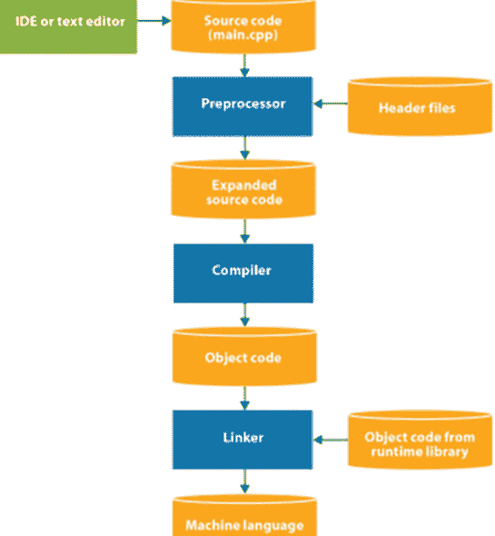

# 描述

- 机器语言由计算机可以运行的 1 和 0 组成。
- 机器语言这样的底层语言人类很难阅读和理解，但可以由计算机运行。
- C++ 这样的高级语言人类相对容易阅读和理解，但在翻译成底层语言之前，计算机无法运行。
- 编译器是一个将高级语言翻译为底层语言的程序。
- 当你开发 C++ 应用程序时，你通常使用 IDE（集成开发环境）来输入和编辑源代码。包含 C++ 源代码的文件通常具有 `.cpp` 扩展名。在图中，源代码命名为 `main.cpp`，因为它包含了程序的 `main()` 函数。
- 此代码使用了 `iostream` 头文件提供的 `cout`、`cin` 和 `endl` 对象来向控制台写入输出（`cout`）、从控制台读取输入（`cin`）以及指定换行符（`endl`）。
- 此代码使用了 `cmath` 头文件提供的 `pow()` 和 `round()` 函数来计算数字的 2 次方并将数字保留到一位小数。
- `return` 语句向操作系统返回值 0，表示程序已正常结束。

图 1-5 源代码编译为执行文件

# 流行的 IDE 和编译器

虽然可以使用简单的文本编辑器配合命令行工具，但 IDE（集成开发环境）提供的功能让 C++ 开发变得简单得多。图 1-6 开始列出四个流行的 IDE。这四个 IDE 都是免费或提供免费版本，这对于学生以及自学程序员来说特别有吸引力。

这四个 IDE 都提供了图中所示的功能。例如，这些 IDE 可以帮助你编译代码并提示错误。它们包含了调试器。

在这些 IDE 中，Visual Studio 是 Windows 开发 C++ 最流行的 IDE。它由微软开发并默认使用 Microsoft C++ (MSVC) 编译器。该编译器是 Windows 程序开发中最流行的编译器。

Xcode 是 macOS 开发 C++ 最流行的 IDE。它由苹果开发并使用 Clang 编译器。这种开源编译器受到许多公司的支持，包括苹果、微软和谷歌。它被设计为 GNU 编译器集合的替代品，后者是 Unix 类系统的标准编译器。

Eclipse 和 NetBeans 运行在所有主流操作系统上。这两个优秀的 IDE 都是免费开源的。虽然它们在 Windows 和 macOS 开发上没有 Visual Studio 和 Xcode 流行，但对于 Linux 开发都是很好的选择。

在选择 IDE 时，请记住你可能需要配置它以与图中描述的编译器协同工作。当你使用 Eclipse 或 NetBeans 这种不会自动安装和配置编译器的 IDE 时，情况尤为如此。例如，如果你想用 NetBeans 进行 Windows 开发，你需要单独安装 MinGW 编译器并配置 NetBeans 使用它。相比之下，在安装 Visual Studio 时，MSVC 编译器会自动安装并配置；在安装 Xcode 时，Clang 编译器也会自动安装和配置。

# 四种流行的 C++ IDE

| IDE | 说明 |
| --- | --- |
| Visual Studio | 一款在 Windows 和 macOS 上运行的免费 IDE。该 IDE 在开发 Windows C++ 应用程序时非常流行。 |
| Xcode | 一款在 macOS 上运行的免费 IDE。该 IDE 在开发 macOS C++ 应用程序时非常流行。 |
| Eclipse | 一款在大多数现代操作系统上的免费开源 IDE。该 IDE 在开发 Linux C++ 应用程序时非常流行。 |
| NetBeans | 一款在大多数现代操作系统上的免费开源 IDE。该 IDE 在开发 Linux C++ 应用程序时非常流行。 |

# 大 IDE 提供的功能

- 代码补全
- 错误检测
- 自动编译
- 调试

# 四种流行的 C++ 编译器

| 编译器名称 | 说明 |
| --- | --- |
| Microsoft Visual C++ (MSVC) | 随 Microsoft Visual Studio IDE 一带的编译器。该编译器在 Windows 上非常流行。 |
| Clang | 随 Xcode 提供的开源编译器。该编译器在 macOS 上非常流行。它被设计为 GCC 编译器的直接替代品。 |
| GNU Compiler Collection (GCC) | 开源编译器集合，其中包含一个 C++ 编译器。该 C++ 编译器是大多数 Unix 类系统（包括 Linux）的标准。 |
| Minimalist GNU for Windows (MinGW) | GCC 编译器的原生 Windows 版本。 |

# 说明

- 开发 C++ 应用程序时，通常使用集成开发环境 (IDE)。除了列出的之外，还有许多其他 IDE，包括像 CLion 等商业产品以及像 Code::Blocks 等更多的开源产品。
- 每个 IDE 必须使用编译器来为特定的操作系统编译源代码。许多供应商都提供 C++ 编译器，包括自由软件基金会、微软、苹果、英特尔、Oracle 和 IBM。
- 所有的 IDE 和编译器都是免费的或者有免费版本。
- 不同的 C++ 编译器对 ISO 标准的支持程度不同。在选择编译器时，选择一个对 ISO 标准提供良好支持的编译器至关重要。

图 1-6 四种流行的 C++ IDE 和编译器

# 如何使用 Visual Studio 进行 Windows 开发

现在你已经有了一些关于 C++ 的背景信息，准备好开始学习如何使用 IDE 了。特别是，你已经准备好学习如何运行本书提供的任何源代码。你可以按照本书附录中的描述下载这些源代码。

如果你使用的是 Windows 电脑，可以像接下来的四张图所示使用 Visual Studio 开发运行在 Windows 上的程序。当然，如果你正在使用 Mac，可以跳过或略读这些图，直接查看显示如何使用 Xcode 开发运行在 macOS 上的程序的图表。

# 如何打开项目并处理源代码工作

图 1-7 开始显示在 Visual Studio 中打开了 C++ 项目的源代码，一个解决方案（solution）可以包含一个或多个项目，每个项目都是解决方案中的一个文件夹。在图中，解决方案只包含一个项目，且项目和解决方案都命名为 circle_calculator。

要在 Visual Studio 中打开项目，你可以按照图 1-7 所示的步骤打开包含该项目的解决方案。对于书中介绍的所有 Visual Studio 应用程序，解决方案都在此文件夹：

```
C:\cpp\vs\book_app
```

一旦你打开了项目的解决方案，就可以通过双击其文件在代码编辑器中查看该项目的源代码。在代码编辑器中打开源代码文件之前，你可能需要展开项目文件夹和源文件（Source Files）文件夹。要展开文件夹，可以点击其左侧的三角形。例如，在图中，circle_calculator 文件夹和源文件文件夹都已展开，并且名为 `main.cpp` 的源文件已打开。该文件包含了本章之前描述的圆计算器程序的 `main()` 函数的源代码。

当你在代码编辑器中打开源代码文件时，它会为不同的语言元素使用不同的颜色，以便你更容易识别 C++ 语法。此外，Visual Studio 还提供了标准的文件（File）和编辑（Edit）菜单以及快捷键，让你能够保存和编辑源代码。例如，你可以按 `Ctrl+S` 保存源代码，并使用标准菜单项和快捷键进行复制、粘贴。

当你处理一个解决方案时，可以关闭它。要这样做，可以选择文件（File）菜单中的关闭（Close）项。此外，如果你打开了另一个解决方案，Visual Studio 会自动关闭当前的解决方案。

在继续之前，你应该意识到 IDE 作为菜单结构的出现取决于 Visual Studio 的开发设置。对于本书，我们使用了常规（General）设置，如果你没有安装其他版本的 Visual Studio，这应该是默认设置。要检查你的开发设置，选择工具（Tools）→导入和设置（Import and Settings）菜单项以显示导入和设置向导。在第一个对话框中，选择“重置所有设置”并点击下一步按钮。然后，在第二个对话框中，选择“否”并点击下一步。当显示第三个对话框时，当前设置将被高亮。如果这些设置不是常规，选择常规并点击完成。否则，点击取消。

### 第 1 章 C++ 编程简介

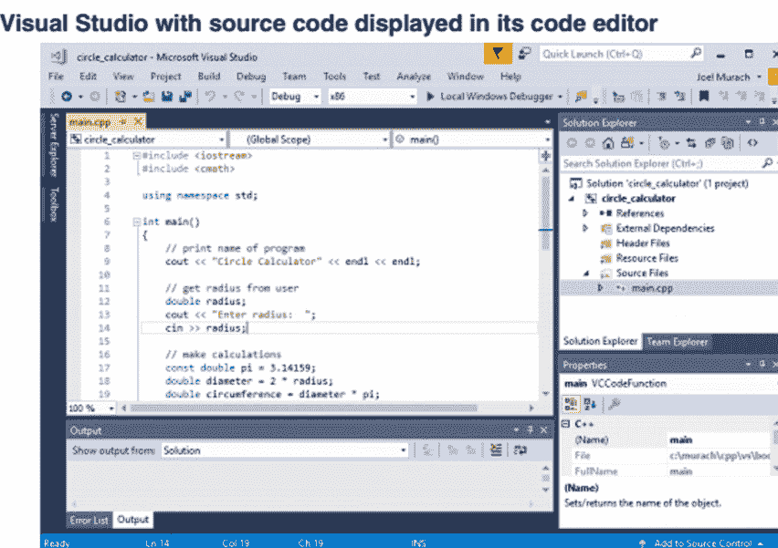

# 如何打开和关闭解决方案

- 要打开解决方案，按 `Ctrl+Shift+O` 或选择文件（File）→打开（Open）→项目/解决方案（Project/Solution）菜单项。然后，使用显示的打开项目对话框定位并选择解决方案文件 (.sln)，点击打开按钮。
- 要关闭解决方案，选择解决方案（Solution）菜单项。

# 如何打开源代码并保存源代码

- 要向代码编辑器中打开源代码文件，双击其文件。在代码编辑器中打开源代码文件之前，你可能需要展开项目文件夹和源文件（Source Files）文件夹。要展开文件夹，可以点击其左侧的三角形。例如，在图中，circle_calculator 文件夹和源文件文件夹都已展开，并且名为 `main.cpp` 的源文件已打开。该文件包含了本章之前描述的圆计算器程序的 `main()` 函数的源代码。

当你在代码编辑器中打开源代码文件时，它会为不同的语言元素使用不同的颜色，以便你更容易识别 C++ 语法。此外，Visual Studio 还提供了标准的文件（File）和编辑（Edit）菜单以及快捷键，让你能够保存和编辑源代码。例如，你可以按 `Ctrl+S` 保存源代码，并使用标准菜单项和快捷键进行复制、粘贴。

# 说明

- 一个 Visual Studio 解决方案由一个或多个项目组成，每个项目是一个包含文件的文件夹

图 1-7 如何打开现有项目并处理源代码工作

# 如何编译和运行项目

图 1-8 显示了如何编译和运行项目。运行项目的一种简单方法是按 `Ctrl+F5`。然后，项目需要编译，Visual Studio 会自动编译（构建）项目并运行。但在之前，它可能会提示你是否生成项目。这可能发生在你对项目进行更改或你第一次运行项目时。由于这会自动编译项目并创建执行文件，此功能被称为自动编译。

当你使用 Visual Studio 在 Windows 上运行控制台程序时，它会启动一个如图所示的提示窗口。程序使用此窗口向用户输出并获取用户输入。在图中，例如，程序首先在控制台上显示程序名称。然后，提示用户输入半径。在图中，用户通过输入 7 并按回车输入半径。接下来，程序显示圆的直径、周长和面积。之后，程序显示“再见！”消息，表示程序已退出。

在图中，Visual Studio 在程序退出后显示“按任意键继续...”消息。这允许用户在控制台关闭之前查看控制台输出。然而，Visual Studio 仅在你按 `Ctrl+F5` 时才显示此消息。如果你按 `F5` 或选择调试（Debugging）→调试（Debugging）菜单项，控制台会在程序退出时关闭。对于圆计算器程序，这将阻止你看到程序的输出。你将在第 8 章学习更多关于此工作的知识。

当你运行由其他程序员创建的书中的项目时，可能会收到有构建错误的消息。大多数情况下，是因为你使用的 Windows SDK 版本与你安装 Visual Studio 时安装的版本不同。在这种情况下，你会在错误列表窗口看到一个未找到 Windows SDK 的错误。（错误列表窗口位于 IDE 底部的选项卡中，如图所示。如果此选项卡未显示，你可以使用视图（View）→错误列表（Error List）菜单项来显示它。）

要修复此错误，你需要更改应用程序使用的 Windows SDK 版本，如图所示。如果你不知道应该使用哪个，通常可以选择最新版本，这很可能是与 Visual Studio 一安装的版本。

# 编译并运行控制台应用程序后的 Visual Studio

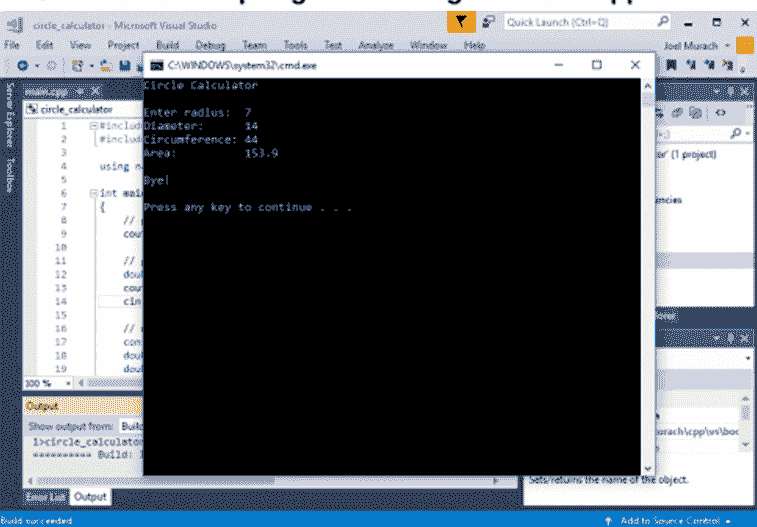

# 编译并运行控制台应用程序后的 Visual Studio

- 要运行项目，请按 `Ctrl+F5` 或选择“调试→不调试并启动”菜单项。如果显示了询问是否要生成项目的对话框，请点击“是”按钮在运行之前先生成项目。
- 当你运行项目时，Visual Studio 会自动对其进行编译。因此，你不需要在运行项目之前手动进行编译。这被称为自动编译功能。
- “不调试并启动”菜单项在程序退出时会自动显示“按任意键继续”的消息。这会让控制台保持打开状态，直到你按下任何键为止。
- 如果你不小心按了 `F5` 或选择了“调试→开始调试”菜单项，控制台会在程序退出时自动关闭。这可能会导致你无法看到程序的输出内容。你将在第 8 章中学习更多关于其工作原理的。

# 如何解决 Windows SDK 版本问题

- 如果你编译项目时 Visual Studio 显示有生成错误，问题可能是应用程序使用的 Windows SDK 版本无法找到。如果安装 Visual Studio 时安装了更高版本的 SDK，就会发生这种情况。
- 要更改 SDK 版本，请在“解决方案管理器”中选择该项目，然后选择“项目→属性”菜单项以显示“属性”对话框。然后，选择“常规”项，并将“Windows SDK 版本”属性设置为安装 Visual Studio 时所安装的 SDK 版本。

图 1-8 如何编译和运行项目

# 如何使用代码补全和错误检测

图 1-9 显示了如何使用代码补全功能。在 Visual Studio 中，代码补全功能被称为 IntelliSense（智能生存）。此功能可以帮助你避免错误，并让输入代码变得更容易。例如，在图中我开始输入一个变量名。在我输入“rad”之后，Visual Studio 显示了一个包含“radios”的列表，这正是我想要输入的变量名。因此，我按了下方向键并回车自动输入了剩余名称。

在这种情况下，代码补全并没有帮我减少多少打字，但它确实确保我正确拼写了变量名。当你开始处理更大的名称和更复杂的代码时，这会变得更加有用。

此外，代码补全会在需要时自动输入左括号和右括号。这使得输入代码函数（例如图中的 `main()` 函数）变得更容易。

代码补全还可以方便你为字符串变量赋值，字符串由零或多个字符的序列组成。如果你输入双引号来标识字符串值，代码补全会自动添加右引号，并将完成光标置于两个引号之间。此时，你可以输入字符串的文本。

如果你尝试使用代码补全，你会很快发现它什么时候能帮助你更快地输入代码，什么时候自己输入代码更合理。此外，你还会发现它能帮助你发现可用的函数。随着你在接下来的章节中学习更多关于 C++ 的知识，这将变得更有意义。

当你输入 C++ 代码时，可能会引入语法错误。语法错误是指任何违反 C++ 语法规则的代码。如果你输入包含语法错误的代码，该代码将无法编译。例如，如果你输入了左括号但没有编写右括号，你的代码就存在语法错误且无法编译。

当你进入代码编辑器时，Visual Studio 每当检测到语法错误时就会显示它们。它是通过用红色波浪线标记错误来实现的。如果你将鼠标指针悬停在带有红色波浪线的代码上，Visual Studio 会显示错误的描述。这可以提供帮助你修复错误的有用信息。此功能被称为错误检测，它可以帮助你在尝试编译和运行程序之前发现并修复错误。

# 带有代码补全列表的 Visual Studio 计算器编辑器

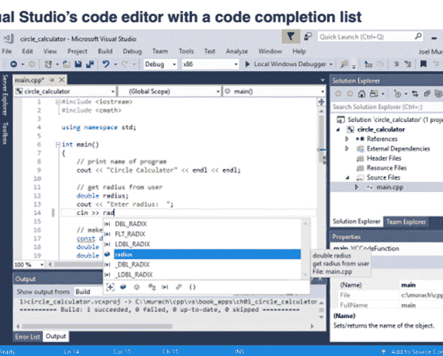

# 如何使用代码补全

- 当你输入代码时，Visual Studio 经常显示一个列表帮助你完成代码输入。这通常被称为代码补全，但 Visual Studio 将其称为 IntelliSense。
- 如果代码补全功能没有自动激活，你有时可以在输入一个或多个字母后按 `Ctrl+Space` 手动激活它。
- 要从代码补全列表中插入项，你可以使用上、下方向键选择该项，然后按回车键。
- 代码补全功能还帮助你输入引号对、括号对、大括号对等。为了这一点，它会在你输入左字符后立即输入右字符。例如，在你输入一个左引号后，它会输入右引号并将光标置于两个引号之间。

# 如何使用错误检测


# 第 1 章 C++ 编程简介

## 语法错误与错误检测

- 语法错误是任何无法编译的代码。如果 Visual Studio 在你输入代码时检测到语法错误，它会在语句下方放置红色波浪线。这被称为错误检测功能。
- 要获取更多关于语法错误的信息，你可以将鼠标指针悬停在带有红色波浪线的代码上。

## 如何创建新项目 (Visual Studio)

图 1-10 显示了使用 Visual Studio 创建一个支持标准库的新项目的过程。

### 步骤

1. 点击工具栏上的“新建项目”按钮，或选择“文件→新建→项目”菜单以显示新项目对话框。
2. 选择“控制应用程序”项，为项目输入一个名称，选择项目的位置，并点击“确定”按钮创建项目。
3. 在“解决方案管理器”中选择该项目，然后选择“项目→属性”菜单项以显示属性页。展开“C/C++”组，选择“预编译头”项，并将“预编译头”属性设置为“不使用预编译头”。
4. 可选地，删除所有与预编译头相关的文件（`target.h`、`stdafx.h` 和 `stdafx.cpp`）。
5. 可选地，将包含 `main()` 函数的 `.cpp` 文件重命名为 `main.cpp`。
6. 打开包含 `main()` 函数的文件并按如下所示编辑代码。

### 说明

- 如果你将预编译头属性设置为“不使用预编译头”，你就可以使用“解决方案管理器”删除所有不再需要的预编译头相关文件。这些包含了图中所示 `target.h`、`stdafx.h` 和 `stdafx.cpp` 文件。虽然删除这些文件是可选的，但如果你想省略不需要的文件，可以这样做。删除文件的简单方法是在“解决方案管理器”中选择它并按 `Delete` 键。然后你可以使用生成的对话框永久删除该文件。
- 默认情况下，Visual Studio 会创建一个与项目同名的源代码。例如，图中的项目，Visual Studio 创建了一个名为 `ch01_test.cpp` 的源代码。然而，我将该文件重命名为 `main.cpp`，以清楚地表示该文件包含程序的 `main()` 函数。重命名文件的简单方法是在“解决方案管理器”中选择它并按 `F2` 键。然后你可以为文件输入新名称。或者，你可以右键点击文件并从生成的菜单中选择“重命名”项。
- 当你创建一个新项目时，Visual Studio 会为你生成一些起始代码。例如，图中 Visual Studio 为 `main()` 函数生成了一些代码。然而，它还生成了一些与预编译头相关的、额外代码。因此，我删除了这些代码，并添加了一些用于向控制台输出的标准 C++ 代码。此时，运行此程序将在控制台上显示“Success!”的消息，这对于新程序来说是一个良好的起点。

## 如何重命名和删除文件 (Visual Studio)

- 要重命名文件，可以在“解决方案管理器”中选择它，按 `F2`，并为文件输入新名称。
- 要删除文件，可以在“解决方案管理器”中选择它，按 `Delete` 键，并使用弹出的对话框确认删除。

## Visual Studio 项目配置说明

- 默认情况下，Visual Studio 会创建一个与项目同名的初始源代码文件。然而，通常做法是将此文件命名为 `main.cpp`，正如本书中的程序所示。
- 默认情况下，Visual Studio 创建的新项目使用一个名为 `stdafx.h` 的预编译头文件。该头文件可以提高编译器的性能，特别是当你使用许多大型库时。然而，这并不是标准做法，对于本书中的程序来说也是必要的，因为这些程序没有使用许多大型库。
- 如果你按照如图第 1 部分所示，将“预编译头文件”属性设置为“不使用预编译头文件”，你就可以使用本书所示的标准头文件。此外，你还可以选择性使用“解决方案管理器”删除所有与预编译头文件相关的文件，包括 `targetver.h`、`stdafx.h` 和 `stdafx.cpp`。

## 如何使用 Xcode 进行 macOS 开发

如果你阅读了本章的前六主题并且正在使用 Mac，你已经准备好学习如何使用 Xcode IDE 开发运行在 macOS 上的程序了。特别是，你已经准备好学习打开并运行本书提供的任何源代码。你可以按照本书附录 B 的描述下载这些源代码。

## 如何打开项目并处理源代码 (Xcode)

图 1-11 首先展示了 Xcode 在其代码编辑器中打开了 C++ 项目的源代码。在 Xcode 中，项目是一个包含程序所需文件夹和文件的文件夹。例如，图中项目被命名为 `circle_calculator`，它包含一个名为 `circle_calculator` 的文件夹，该文件夹又包含存储程序代码的 `main.cpp` 文件。

要在 Xcode 中打开项目，你可以遵循图中所示的步骤。对于本书来说，所介绍应用程序的 Xcode 项目位于此文件夹：

```
/murach/cpp/x/book_apps
```

一旦打开项目，你就可以点击其文件在代码编辑器中查看项目的源代码。在打开源代码文件之前，你可能需要展开项目文件夹以及包含源文件的文件夹。要展开文件夹，可以点击其左侧的三角形。例如，图中 `circle_calculator` 文件夹已经展开，并且名为 `main.cpp` 的源代码已经打开。该文件包含了本章之前描述的“圆形计算器”程序的 `main()` 函数的源代码。

当你在代码编辑器中打开源代码文件时，它会使用不同的颜色区分不同的语言元素，以便你更容易识别 C++ 语法。此外，Xcode 提供了“文件”和“编辑”菜单以及快捷键，允许你保存和编辑源代码。例如，你可以按 `Command+S` 保存源代码，并使用标准菜单项和快捷键进行剪切、复制和粘贴代码。

当你完成项目工作后，可以关闭它。要这样做，你可以从“文件”菜单中选择“关闭”项。然而，如果你打开另一个项目，Xcode 会自动为该项目打开另一个窗口。这时，你将会有多个 Xcode 窗口。

### 示例代码

```cpp
#include <iostream>
#include <cmath>

using namespace std;

int main() {
    // 输出程序名称
    cout << "Circle Calculator" << endl;

    // 从用户处获取半径
    double radius;
    cout << "Enter radius: ";
    cin >> radius;

    // 一些计算
    double pi = 3.14159;
    double diameter = 2 * radius;
    double circumference = diameter * pi;

    return 0;
}
```

## 如何打开和关闭项目 (Xcode)

- 要打开项目，按 `Command+O` 或选择“文件”->“打开项目”菜单项。然后，使用显示的对话框找到并选择项目文件 (`.xcode`) 并点击“打开”按钮。
- 要关闭项目，选择“文件”->“关闭项目”菜单项。

## 如何打开、编辑和保存源代码文件 (Xcode)

- 要在代码编辑器中打开源代码文件，在导航器中点击它。在此之前，你可能需要通过点击左侧的三角形来展开项目文件夹，并可能需要通过点击左侧的三角形展开包含源文件的文件夹。
- 要编辑源代码文件，你可以使用普通的编辑技术输入新代码或编辑现有代码。
- 要保存源代码文件，按 `Command+S` 或选择“文件”->“保存”菜单项。

## 如何使用 Xcode 代码补全和错误检测

### 代码补全

- 当你输入代码时，Xcode 通常会显示一个列表尝试帮助你完成代码输入。通常被称为**代码补全**。
- 要从代码补全列表中插入项目，你可以使用键盘上的向下和向上方向键选择该项目，然后按 `Enter` 键。

### 错误检测

- **语法错误**是指任何无法编译的代码。如果 Xcode 在你输入代码时检测到语法错误，它会在语句右侧显示错误图标和消息。这被称为**错误检测**功能。
- 要获取更多关于语法错误的详细信息，你可以点击错误图标。有时显示的信息中包含一个 Fix（修复）按钮，点击它可以实施建议的修复方案。

## 如何创建新项目 (Xcode)

图 1-14 显示了使用 Xcode 创建控制台应用程序新项目的步骤。

### 步骤

1. 选择 `File` → `New` → `Project` 菜单项以显示创建新项目的第一个对话框。
2. 在第一个对话框中，选择 macOS 操作系统，选择 `Command Line Tool` 项，点击 `Next` 按钮。
3. 在第二个对话框中，输入产品名称，选择 C++ 语言，点击 `Next` 按钮。如有需要，输入组织名称和唯一标识组织的标识符。
4. 在第三个对话框中，导航到你想要存储项目的文件夹，点击 `Create` 按钮创建项目文件夹。
5. 在 Xcode 窗口中，如有必要，展开项目文件夹。然后，点击 `main.cpp` 文件以显示为项目生成的 `main()` 函数。
6. 编辑生成的代码，使其与书中所示的代码保持一致。

### 说明

- 默认情况下，Xcode 会为你生成一些初始代码。你可以编辑这些代码，使其包含像书中所示那样的 C++ 代码。
- 当你创建一个新项目时，Xcode 会为你生成一些初始代码。例如，Xcode 生成了图中所示 `main()` 函数的部分代码。然而，它也生成了一些不必要的额外代码。因此，我编辑了此文件，使其仅包含图中所示的初始代码。此时，运行此程序将在控制台上显示“Success!”的消息，这对于新程序来说是一个良好的起点。
- 在第二个对话框中，你必须在 `Product Name` 字段中为项目输入一个名称。例如，图中项目名称为“ch01_test”。此外，你通常还需要从 `Language` 下拉列表中选择 C++ 作为项目的语言。如果需要，你还可以为你的组织指定一个名称并为其指定一个唯一标识符。在本示例中，我将我们的网站地址（murach.com）反过来写（com.murach），因为这是唯一标识组织的常用方法。然后，如果你分发该程序，组织标识符和产品名称将结合起来创建一个唯一的 `bundle identifier`，如图所示。
- 在第三个对话框中（此处未显示），你可以指定项目的位置。如果你按照附录中的说明安装了本书的源代码，那么书中介绍的所有 Xcode 程序都应该存储在该文件夹中：`/documents/murach/cpp/xcode/book_apps`

## 观点

在本章中，你接触了 C++ 编程入门。此外，你还学习了如何使用如 Visual Studio 或 Xcode 等 IDE 在 Windows 或 macOS 上创建并运行 C++ 程序。有了这些背景，你已经准备好学习如何编写自己的 C++ 程序了。但首先，我建议通过完成本章末的练习来熟悉你选择的 IDE。

## 术语

国际标准化组织 (ISO)、应用 (app)、程序、桌面应用程序、GUI、图形用户界面 (GUI)、控制台应用程序、命令提示符、终端、源代码、机器语言、低级语言、高级语言、预处理器、编译器、目标代码、链接器、运行时库、交叉编译、集成开发环境 (IDE)、代码编辑器、Visual Studio、解决方案、项目、自动编译、代码补全、IntelliSense、语法错误

## 总结

- 自 1998 年以来，C++ 已由国际标准化组织 (ISO) 标准化。
- 应用程序（或 app）是执行任务或相关任务组的计算机软件。应用程序也可以称为程序，尽管一个应用程序可能包含多个。
- 桌面应用程序是运行在计算机上的应用程序。应用程序可以使用图形用户界面 (GUI) 或控制台显示输出并获取输入。
- 使用命令行窗口与用户交互的应用程序被称为控制台应用程序。
- 如 C++ 等的高级语言便于人类阅读和理解。
- 如机器语言等低级语言人类难以阅读，但对计算机使用非常高效。
- 编译器是将高级语言翻译为低级语言的程序。
- C++ 编译器将 C++ 代码翻译为操作系统可以直接运行的机器语言（0 和 1）。
- 集成开发环境 (IDE) 通过提供代码补全、错误检测、自动编译和调试器，使 C++ 开发变得更容易。
- Visual Studio 和 Xcode 是 C++ 开发常用的 IDE。
- Visual Studio 解决方案可以包含一个或多个项目，每个项目都是包含程序源文件的文件夹。
- Xcode 项目是包含程序源文件的文件夹。
- 程序的 `main()` 函数是程序的起点。

## 在进行本书的练习之前

在进行本书的任何练习之前，你需要在系统中安装一个 IDE。你还需要从我们的网站下载本书的文件夹和文件并安装到系统中。有关完整说明，请参考附录 A（Windows）或附录 B（macOS）。

## 练习 1-1 打开并运行项目

此练习引导你完成打开现有项目、查看代码以及构建和运行项目。它还让你引入语法错误以观察会发生什么。

### 打开 Circle Calculator 项目并查看代码

1. 使用你的 IDE 打开位于文件夹中的 Circle Calculator 项目或解决方案：`book_apps\ch01_circle_calculator`
2. 打开 `main.cpp` 文件。
3. 查看代码，发现它包含 `iostream` 和 `cmath` 两个头文件包含指令、`std` 命名空间指令，以及一个从控制台接收半径、计算直径、半径和周长并将输出写入控制台的 `main()` 函数。注意 `main()` 函数通过返回 0 结束。

### 运行 Circle Calculator 项目

4. 运行项目，必要时进行构建。（如果你在 Windows 上使用 Visual Studio 并收到提示未找到 Windows SDK 的错误，请根据图 1-8 中的信息进行修复，然后重新运行项目。）
5. 在提示时，输入半径。然后，查看写入控制台的输出。

### 引入语法错误

6. 从 `main()` 函数的第一个语句中删除分号 (`;`)，以查看检测到的错误。
7. 运行项目查看发生了什么。
8. 将分号加回，然后再次运行项目。完成后，关闭项目。

### 打开猜数字游戏项目并查看其代码

9. 使用你的 IDE 打开文件夹中的猜数字游戏项目：`book_apps/ch04b_guess_number`
10. 打开 `main.cpp` 文件并查看其代码。注意，你的代码结构与圆形计算器程序的代码类似，但它使用了一些你尚未学过的语句。

### 运行猜数字游戏项目

11. 运行项目，必要时进行构建。（如果你在 Windows 上使用 Visual Studio，你可能需要更改项目的 Windows SDK 版本。）
12. 在提示时输入内容，并查看写入到控制台的输出。完成后，关闭项目。

## 练习 1-2 创建新项目

本练习将引导你完成创建一个在控制台上显示消息的新项目的过程。

1. 使用你的 IDE 在 `ex_starts` 文件夹中创建一个名为 `ch01_success_message` 的项目。
2. 如果你使用 Visual Studio，修改项目使其不使用预编译头文件。删除所有不再需要的与预编译头文件相关的文件。


# 3

如果你使用 Visual Studio，将 `ch01_success_message.cpp` 文件重命名为 `main.cpp`。

# 4

打开 `main.cpp` 文件并修改生成的代码，使其如下所示：

```cpp
#include <iostream>
using namespace std;

int main() {
  cout << "Success!" << endl << endl;
  return 0;
}
```

# 5

在输入这段代码时，在任何有用的地方使用代码补全功能。

运行应用程序并查看输出。它应该显示一条名为“Success!”的消息。完成后，关闭项目。

# 2 如何编写你的第一个程序

一旦安装了 IDE 和 C++ 编译器，学习 C++ 编程最快、最好的方法就是进行 C++ 编程。这就是为什么本章将展示如何编写完整的 C++ 程序，这些程序可以获取用户输入、进行计算并显示输出。当你完成本章后，你应该能够编写出属于自己的类似程序。

+ 基础编码技能 ................................................................ 40
+ 如何编写语句 ..................................................................... 40
+ 如何编写注释 ...................................................................... 40
+ 如何编写 `main()` 函数 ........................................................... 42
+ 如何创建标识符 ....................................................................... 44
+ 如何处理数值型变量 ........................................................ 46
+ 如何定义和初始化变量 ................................................... 46
+ 如何编写赋值语句 ........................................................ 46
+ 如何编写算术表达式 ........................................................ 48
+ 如何使用控制台进行输入和输出 .......................................... 50
+ 如何包含头文件 ................................................................ 50
+ 如何向控制台输出 ....................................................... 52
+ 如何从控制台读取输入 ...................................................... 54
+ 加仑转升的程序 ............................................................... 56
+ 如何使用标准库 ................................................... 58
+ 如何调用函数 ........................................................................ 58
+ 如何使用 `std` 命名空间 ....................................................... 60
+ 圆形计算器程序 ............................................................ 62
+ 如何生成随机数 ......................................................... 64
+ 如何处理 `char` 和 `string` 变量 ............................................ 66
+ 如何给 `char` 和 `string` 变量赋值 ................................... 68
+ 如何处理特殊字符 ................................................... 68
+ 从控制台读取字符串和字符 ...................................... 70
+ 如何修复读取字符串时的常见问题 ................................ 72
+ 访客簿程序 ..................................................................... 74
+ 如何测试和调试程序 ................................................ 76
+ 如何测试程序 ........................................................................ 76
+ 如何调试程序 ....................................................................... 76
+ 观点 ................................................................................. 78

# 基础编码技能

本章首先向你介绍一些基础的编码技能。你将在开发的每个 C++ 程序中使用这些技能。

# 如何编写语句

程序中的*语句*（statements）会指导程序的运行。当你编写一个语句时，可以从任何代码行开始编写，可以从一行持续到另一行，并且可以在单空格有效的任何地方编写一个或多个空格。

要结束大多数语句，你需要使用分号。在图 2-1 的第一个示例中，所有以分号结尾的行都是语句。但当语句需要一组大括号 (`{}`) 时，它以右大括号结束。此时，大括号内的语句被称为代码*块*（block）。例如，图中定义 `main()` 函数的语句包含一个代码块。

为了让程序更易读，你应该使用缩进和间距来对齐语句和代码块。此图中的程序以及书中的所有程序和示例都说明了这一点。

注意，第一行代码并不是以分号结尾的。

# 如何编写注释

程序中的*注释*（comments）记录了语句的作用。*单行注释*（single-line comment）通常用于描述一行或多行。在图 2-1 的第一个示例中，你可以看到单行注释。

编写单行注释时，使用 `//` 后跟注释内容。你可以单独写一行注释，也可以将其跟在语句后面。跟在语句后面的注释被称为*行尾注释*（end-of-line comment）。

*块注释*（block comment）通常包含多行。编写块注释时，在开头使用 `/*` ，在结束处使用 `*/`。你也可以使用星号来标识块中的行，但这并非必须。

虽然许多程序员会在代码中到处添加注释，但如果你编写的代码易于理解，这就没有必要的。相反，你应该只对难以理解的代码进行注释。

# 包含语句和注释的程序

```cpp
#include <iostream> // 预处理指令，不是语句
using namespace std;

int main() {
    cout << "Welcome to the Calorie Calculator\n\n";
    // 获取用户的份数
    double servings;
    cout << "Enter servings per food item: ";
    cin >> servings;

    // 获取每份的热路量
    double calories;
    cout << "Enter calories per serving: ";
    cin >> calories;

    // 计算总卡路里
    double total_calories = servings * calories;

    // 显示总卡路里
    cout << "Total calories: " << total_calories << endl << endl;

    return 0; // 返回一个退出值
}
```

```cpp
/*
* 作者：M. Delamater
* 目的：此程序通过控制台从用户获取份数和热路量，然后计算并显示总卡路里。
*/
```

# 描述

+ *语句指导程序的运行，而注释通常记录语句的作用。
* 大多数语句以分号结束。
* 你可以从行的任何位置开始语句，并从一行持续到下一行。使用额外的空格来对齐语句和语句的一部分。
* 大括号 `{}` 内的代码可以被称为代码块。
* 编写单行注释时，使用 `//` 后跟注释内容。你可以单独写一行注释，也可以将其跟在语句后面。跟在语句后面的注释被称为行尾注释。
* *块注释*通常包含多行。编写块注释时，在开头使用 `/*` ，在结束处使用 `*/`。你也可以使用星号来标识块中的行，但这并非必须。

注释的一个问题是它们可能无法准确地表示代码的功能。这通常发生在程序员更改了代码，但没有同步更改注释时。这时，代码会变得更难理解，因为注释具有误导性。所以，如果你更改了已经写过注释的代码，请务必同时也修改注释。

## 如何编写 `main()` 函数

函数是一个命名的、可重用的、用于执行特定任务的代码块。`main()` 函数是一种特殊的函数，它会在你的程序启动时自动执行。所有的 C++ 程序都包含一个 `main()` 函数。

如果你使用 IDE 创建项目，它通常会为你自动生成一个 `main()` 函数。现在，图 2-2 展示了声明 `main()` 函数的语法。`main()` 函数以 C++ 的 `int` 关键字开头。这表示该函数返回一个整数值。你稍后将学习更多关于这个值的知识。在指定函数返回的数据类型后，编写函数名并在后跟一对括号。在这种情况下，函数名是 `main`。

对于 `main()`，你可以像第一个示例那样让括号为空。或者，你可以像第二个示例那样编写两个参数。你将在本书的后续部分学习更多关于函数参数的知识。现在，关于这些参数你只需要知道它们是可选的，所以你不需要包含它们。事实上，即使某些 IDE 默认会生成这些参数，但书中介绍的程序并没有使用它们。因此，对于书中给出的示例，不需要包含它们。

`main()` 函数的下一行代码是函数体的左大括号。这个左括号可以单独占一行，如第一、二示例所示。许多 C++ 风格指南推荐这种方法。因此，本书大部分代码都采用了这种方法。有时为了节省垂直空间，本书可能会像第三个示例那样将左括号写在第一行。这也是可以接受的风格，尽管在编写 C++ 时，将左括号单独写一行更为常见。

`main()` 函数体包含了返回程序的语句。`main()` 函数中的最后一个语句是一个整数值，告诉操作系统程序是正常退出还是异常退出。如果 `main()` 函数不包含 `return` 语句，C++ 默认向操作系统返回值 0。正如此，通常会省略 `return` 语句以节省空间。

当你使用 C++11 或更高版本时，你还可以返回 `EXIT_SUCCESS` 和 `EXIT_FAILURE` 值。这种方法的优点是它让 `return` 语句更容易易读和理解。然而，由于 `main()` 函数会自动返回一个指示正常退出的值，你通常不需要为你的 `main()` 函数编写 `return` 语句。

### 无参数的 `main()` 函数

```cpp
int main()
{
    // statements
    return 0;
}
```

### 带有两个参数的 `main()` 函数

```cpp
int main(int argc, char** argv)
{
    // statements
    return 0;
}
```

### 大括号位置不同的 `main()` 函数

```cpp
int main()
{
    // statements
    return EXIT_SUCCESS;
}
```

### `main()` 函数的三个标准返回值

| Value | 描述 | C++ 版本 |
|---|---|---|
| 0 | 正常退出 | 所有 |
| `EXIT_SUCCESS` | 正常退出 | C++11 或更高 |
| `EXIT_FAILURE` | 异常退出 | C++11 或更高 |

## 描述

- 每一个 C++ 程序都包含一个由操作系统调用的 `main()` 函数。
- `main()` 函数大括号之间的语句在程序执行时运行。
- 在大多数情况下，你可以编写无参数的 `main()` 函数。要做到这一点，只需在函数名后输入一对空括号。
- 如果你需要执行环境向 `main()` 函数传递参数，你可以像第二个示例中那样编写名为 `argc` 和 `argv` 的参数。然而，这些参数对于书中介绍的任何程序都不是必要的。
- 你可以将 `main()` 函数的左大括号写在括号同一行，也可以写在下一行。许多 C++ 风格指南建议将左大括号单独写一行，本书尽可能遵循这一准则。
- 你可以通过编写返回整数值的 `return` 语句来结束 `main()` 函数，该值告诉操作系统程序是如何退出的。如果你省略了这个 `return` 语句，`main()` 函数会自动返回值 0，表示正常退出。

`main()` 函数的最后一行代码是右大括号。与左大括号不同，它应该始终单独占一行。这是因为一个常见的语法错误是忘记编写右大括号。因此，将右大括号单独留在一行可以更容易看出左大括号是否有对应的右大括号。

## 如何创建标识符

在编写 C++ 程序时，你需要创建并使用标识符。这些是你在代码中定义的名称。简而言之，你必须让每个标识符都以字母或下划线开头。在第一个字符之后，你可以使用字母、下划线或数字的任何组合。

## 如何处理数值变量

接下来的主题将介绍如何处理数值变量。它们将向你介绍变量的使用、赋值语句、算术表达式，以及 C++ 语言定义的两种内置数据类型。

## 如何定义和初始化变量

图 2-4 首先总结了 C++ 提供的两种内置数据类型。你可以使用 `int` 类型来存储整数，即不包含小数点的数字（整数），你可以使用 `double` 类型来存储包含小数点的数字。

变量存储了一个在程序执行过程中可以改变或变化的值。在使用变量之前，你必须定义它的数据类型（简单来说就是它将要存储的数据类型）和名称。此外，通过给变量赋一个初始值来初始化变量是一个良好的习惯。要做到这一点，你可以使用图中描述的技巧之一。

为了证明这种方法是有效的，第一个示例使用一条语句定义了一个名为 `counter` 的 `int` 变量。然后，使用第二条语句通过给该变量赋初始值 `1` 来初始化变量。

然而，正如第二个示例所示，在一条语句中定义并初始化变量通常更简单。在这里，第一条语句定义了一个名为 `counter` 的 `int` 并通过赋初始值 `1` 将其初始化。第二条语句定义了一个名为 `unit_price` 的 `double` 并通过赋初始值 `14.95` 将其初始化。

当你给 `double` 类型分配字面量（literal values）时，包含一个小数点是一个良好的编码习惯。例如，如果你想给变量分配数字 `29`，你应该将该数字写为 `29.0`。这不是强制要求的，但它创建的是 `double` 类型的字面量而非 `int`。此外，这让程序员更容易看出该变量存储的是 `double` 类型而非 `int`。

如果你在命名变量时遵循图中的命名建议，将使你的程序更易于阅读和调试。特别是，你应该使用全小写字母并用下划线分隔的单词，例如 `unit_price` 或 `max_quantity`。这是使用 C++ 时变量命名的标准约定。

当你初始化变量时，可以给它赋一个像 `1` 或 `14.95` 这样的字面量。然而，你也可以将变量初始化另一个变量的值，或者表达式的值（如下图中所示的算术表达式）。

## 如何编写赋值语句

在定义并初始化变量后，你可以为它赋一个新值。要做到这一点，请使用由变量名、等号和一个新值组成的赋值语句。新值可以是一个字面量、如图 2-4 最后一条语句所示的另一个变量名，也可以如下图中所示的表达式的结果。

## 用于处理数字的两种内置数据类型

| 类型 | 描述 |
|---|---|
| `int` | 整数（整数）。 |
| `double` | 双精度浮点数（小数）。 |

## 如何用两条语句定义和初始化变量

### 语法

```cpp
type variable_name;
variable_name = value;
```

### 示例

```cpp
int counter;              // 定义语句
counter = 1;               // 赋值语句
```

## 如何用一条语句定义和初始化变量

### 语法

```cpp
type variable_name = value;
```

### 示例

```cpp
int counter = 1;               // 定义并初始化一个 int 变量
double unit_price = 14.95;   // 定义并初始化一个 double 变量
```

## 使用赋值语句的示例

```cpp
int quantity = 0;               // 定义并初始化一个 int 变量
int max_quantity = 100;      // 定义并初始化另一个 int 变量
//两条赋值语句
quantity = 10;               // quantity 现在是 10
quantity = max_quantity;     // quantity 现在是 100
```

### 描述

- 变量存储了一个在程序执行过程中可以改变或变化的值。


## 变量定义与初始化

- 在使用变量之前，你必须定义它将要存储的数据类型（数据类型）。然后，你可以通过给变量赋初始值来初始化变量。
- 赋值语句为变量分配一个值。如果数据类型已经定义，赋值语句则不包含数据类型。
- 值可以是一个字面量、另一个变量，或如下图中所示的算术表达式。
- 在使用变量之前对其初始化被认为是一个良好的习惯，因为这让你确保分配给变量的初始值。

## 变量的命名建议

- 每个变量名都应该是名词，或者是由一个或多个形容词修饰的名词。
- 尝试使用易于记忆的有意义名称。
- 使用小写字母并用下划线 (`_`) 分隔单词。

> 图 2-4 如何定义和初始化变量

## 如何编写算术表达式

要编写简单的算术表达式，你可以使用下表总结的算术运算符。当你使用这些运算符时，会在运算符左侧使用一个操作数，右侧使用一个操作数。

正如第一组语句所示，算术运算符的作用正如你预期，但有一个例外。如果你将一个整数除以另一个整数，结果不包含任何小数。这被称为整数除法。当你执行整数除法时，可以使用模运算符 (`%`) 或余数运算符来返回余数。

相比之下，如果你将一个 `double` 除以一个 `double`，结果包含小数。

### 五种算术运算符

| 运算符 | 名称 | 描述 |
|---|---|---|
| `+` | 加法 | 将两个操作数相加。 |
| `-` | 减法 | 从左操作数中减去右操作数。 |
| `*` | 乘法 | 左操作数与右操作数相乘。 |
| `/` | 除法 | 将左操作数除以右操作数。如果两个操作数都是整数，则结果为整数。 |
| `%` | 模 | 返回左操作数除以右操作数后的剩余值。 |

### 使用简单算术表达式的语句

```cpp
// 整数算术
int x = 14;
int y = 8;
int result1 = x + y; // result1 = 22
int result2 = x - y; // result2 = 6
int result3 = x * y; // result3 = 112
int result4 = x / y; // result4 = 1
int result5 = x % y; // result5 = 6

// 小数算术
double a = 8.5;
double b = 3.4;
double result6 = a + b; // result6 = 11.9
double result7 = a - b; // result7 = 5.1
double result8 = a * b; // result8 = 28.9
double result9 = a / b; // result9 = 2.5
```

### 递增变量的语句

```cpp
int counter = 0;
counter = counter + 1; // counter = 1
counter = counter + 1; // counter = 2
```

### 混合 int 和 double 变量的语句

```cpp
double total = 5.0;
double result10 = total / counter; // result10 = 2.5
int result11 = total / counter;    // result11 = 2
```

### 用整数除以整数的语句

```cpp
double result12 = x / y; // result12 = 1.0 (注意：x 和 y 均为 int，整数除法结果为 1，再隐式转换为 double 1.0)
```

### 描述

- 算术表达式由一个或多个操作数和算术运算符组成。
- 当表达式混合 `int` 和 `double` 变量时，编译器会将（或强制转换）`int` 类型转换为 `double` 类型。
- 当除法的两个操作数都是整数时，结果是一个整数。这被称为整数除法。

> 

# 如何使用控制台进行输入输出

大多数程序都会从用户获取输入并向用户显示输出。实现此最简单的方法是使用控制台。不过，在学习如何使用控制台之前，你需要先学习如何包含头文件，以便你能够使用 C++ 标准库来操作控制台。

# 如何包含头文件

C++ 标准库提供了存储在头文件中的代码。要使用标准库中的代码，你需要包含包含你所需代码的头文件。这允许你只包含标准库中需要的特性，从而使程序的编译时间保持在可控范围内。

下表列出了一些常用的头文件。随着本书阅读的深入，你将学习如何使用这些头文件以及更多内容。你可以访问此处显示的 URL，以查看标准库中可用头文件的完整列表。

### C++ 标准库常用头文件

| 头文件 | 描述 |
|---|---|
| `cstdlib` | 通用实用程序，如程序控制、排序和搜索。 |
| `iostream` | 输入/输出 (IO) 流对象。 |
| `iomanip` | 用于操作 IO 格式的输入/输出 (IO) 辅助函数。 |
| `cmath` | 常用数学函数。 |
| `string` | 用于处理字符串。 |
| `vector` | 用于处理相同类型元素序列。 |

> C++ 头文件完整列表 URL: http://en.cppreference.com/w/cpp/header

要包含头文件，你使用 `#include` 预处理器指令。该指令指示你在第一章中学习过的预处理器将头文件的代码包含到你的程序中。编译器处理头文件中的代码就像它们位于你的程序文件开头一样。

示例显示了两个 `#include` 指令。这些指令都以井号符号 (`#`) 开头，且不以分号结尾。通常，你会将 `#include` 指令写在文件的顶部，位于任何其他代码之前，如示例所示。

这里，第一个指令包含了 `iostream` 头文件。该头文件包含了允许你将数据从一个位置发送到另一个位置的代码。特别是，它包含了向控制台发送输出和从控制台读取输入的代码，如后续内容所示。

第二个指令包含了 `cmath` 头文件。该头文件包含了允许你执行常用数学运算的代码，例如获取平方根或对数字进行四舍五入。在本章稍后部分，你将学习如何使用这些代码。

编写 `#include` 指令后，通常会编写一个 `using` 指令，以便于访问所有包含头文件的代码，如图所示。这之所以有效，是因为标准库头文件中所有可用代码都存储在 `std` 命名空间中。因此，指令使得来自 `iostream` 和 `cmath` 头文件的所有代码对 `main()` 函数中的语句都可用。在本章稍后部分，你将学习其他技术来提高代码性能，并帮助你避免当对象或函数存在于多个命名空间时可能发生的命名冲突。

### 包含头文件并使其易于访问的方法

```cpp
#include <iostream>
#include <cmath>

using namespace std; // 使两个头文件中的代码易于访问

int main() {
    // 使用头文件的代码写在这里
}
```

### 描述

- C++ 标准库提供了一个你可以使用的代码库。该库被组织在头文件中。
- 要使用标准库提供的可用代码，你需要为包含所需代码的头文件编写一个 `#include` 预处理器指令。
- 命名空间提供了一种组织代码以避免命名冲突的方法。标准库头文件中所有可用的代码都存储在名为 `std` 的命名空间中。
- 为了方便访问 `std` 命名空间中的代码，通常会为整个命名空间添加 `using` 指令。然而，为了提高效率并避免命名冲突，你可以使用本章稍后提到的其他技术来访问 `std` 命名空间。

# 如何向控制台输出

要向控制台输出，你可以使用来自 `iostream` 头文件提供的 `cout`（读作 "see-out"）对象。你将在本书后面学习更多关于对象的知识。现在，你只需要知道可以使用 `iostream` 头文件提供的 `cout` 对象。这样做，你不需要创建对象或将其赋值给变量。你只需要包含 `iostream` 头文件，`cout` 对象在整个程序运行期间都是可用的。

`cout` 对象代表一个*流*，即字符的序列。更具体地说，`cout` 对象代表*标准输出流*，你可以用它将字符字符串写入控制台。

要做到这一点，你使用流插入运算符 (`<<`) 将数据添加到输出流中。例如，在下文中，第一个示例向控制台输出写入了字符串 "Hello!"。在本章稍后部分，你将学习更多关于字符串的知识。现在，只需知道你可以通过双引号包含字符来编写字符串即可。

第二个示例从 4 乘以 4 开始，并将结果存储在变量中。然后，它向控制台写入字符串 "4 times 4 is 16"。该字符串包含了结果。

# 如何从控制台读取输入

要从控制台读取输入，你可以使用 `cin` 对象（读作“see-in”）。`cin` 对象代表标准输入流，你可以用它从控制台获取输入。与 `cout` 对象一样，如果你包含了 `iostream` 头文件，`cin` 对象在程序的整个运行期间都是可用的。

你使用提取运算符（`>>`）从输入流中读取数据。例如，在下文中，第一个示例从流中读取一个整数。为了实现这一点，第一条语句定义了一个名为 `value` 的 `int` 变量来存储数据；第二条语句提示输入一个数字。第三条语句使用 `>>` 运算符从控制台输入流中提取该整数。

从用户那里获取数字后，第四条语句计算了该数字自乘的结果。然后，第五条语句将计算结果显示在控制台上。为了做到这一点，它链联了多个流插入表达式，显示用户输入的数字、一个字符串、该数字以及计算结果。

第二个示例展示了如何从控制台读取多个值。首先，它定义了两个变量来存储从流中读取的数据。然后，它提示用户输入两个数字。接下来，它从输入流中提取用户输入的值并将其存储在 `int` 变量中。如下方的控制台输出所示，无论用户每行输入一个数字还是在一行内输入两个数字，效果都是相同的。

从用户那里获取两个数字后，第二个示例计算了这两个数字的乘积。然后，它显示了该结果。与第一个示例一样，这个示例创建了一个插入表达式链。

与插入表达式一样，提取表达式也可以像第三个示例所示链在一起。这个示例由单个语句组成，可以代替第二个示例中的两个提取语句。

由于插入运算符和提取运算符的外观相似，它们很容易被混淆，特别是当你刚开始学习时。保持它们不混的一种方法是将它们看作指示流向方向的符号。例如，你可以将输出流看作流向 `cout` 对象。因此，插入运算符指向 `cout`（`cout << val`）。相反，你可以将输入流看作从 `cin` 对象流入。因此，提取运算符远离 `cin`（`cin >> val`）。

### iostream 头文件中的可用对象

| 对象 | 说明 |
|---|---|
| `cin` | 表示来自控制台的输入流的对象 |
| `cout` | 表示发送到控制台的输出流的对象 |

### 如何从控制台读取一个值

```cpp
// 从控制台读取输入
int value;
cout << "Please enter a number: ";
cin >> value;

// 进行计算并将输出到控制台
int result = value * value;
cout << value << " times " << value << " equals " << result;
```

### 控制台输出示例

```
Please enter a number: 5
5 times 5 equals 25
```

### 如何从控制台读取多个值

```cpp
// 从控制台读取输入
int value1;
int value2;
cout << "Please enter two numbers: ";
cin >> value1;
cin >> value2;

// 进行计算并将输出到控制台
int result = value1 * value2;
cout << value1 << " times " << value2 << " equals " << result;
```

### 当用户用空格分隔数字时的控制台

```
Please enter two numbers: 4 5
4 times 5 equals 20
```

### 当用户在第一个数字后按回车键时的控制台

```
Please enter two numbers: 4
5
4 times 5 equals 20
```

### 如何链联提取表达式

```cpp
cin >> value1 >> value2;
```

### 描述

- 流提取运算符（`>>`）从输入流中获取字符。
- 当你使用 `cin` 对象时，用户每行输入一个值还是将所有值写在一行内并不重要。
- 在处理字符串和字符时，你可能需要使用本章稍后部分描述的其他读取输入技术。

> 

# 加仑转升程序

图 2-9 展示了一个从控制台读取输入并将输出到控制台的程序。该程序起始于一个块注释，说明了程序的作者和目的。然后，它包含了 `iostream` 头文件，以便程序可以使用 `cout` 和 `cin` 对象，以及 `endl` 操纵符。接下来，使用 `std` 命名空间的指令，可以方便地访问 `iostream` 头文件中的对象。

`main()` 函数首先向控制台写入程序名称。这行代码以两个 `endl` 操纵符结束。第一个 `endl` 操纵符在程序标题后另起一行，第二个 `endl` 操纵符在标题和第一个提示之间产生空行。

下一组语句从用户那里获取加仑数。为了做到这一点，它首先定义了一个名为 `gallons` 的 `double` 变量来存储数据。然后，它提示用户输入加仑数，并使用提取表达式从控制台读取输入的值并存储在 `gallons` 变量中。

在这段代码中，注意它使用空格来格式化输入和输出，以便它们对齐成列。在本章稍后部分，你将学习如何使用流输出操纵符来使用更高级的技术来对齐输出列。

### 转换对照表

| 加仑 (Gallons) | 升 (Liters) |
|---|---|
| 10 | 37.85 |
| 20 | 75.70 |
| 30 | 113.55 |
| 40 | 151.40 |

### 控制台输出示例

```
Enter gallons: 10
Liters: 37.85
```

# 如何使用标准库

到目前为止，你学习了如何进行简单算术、如何包含头文件以及如何使用 `cout` 和 `cin` 对象。但在开发更复杂的程序时，你需要了解更多函数以及 `std` 命名空间。

# 如何调用函数

C++ 标准库提供了大量你可以使用的函数。正如本章提到的，函数是执行特定任务的可用代码块。

下表展示了 `cmath` 头文件中五个函数。如果你如在本章之前包含了 `cmath` 头文件，这五个函数以及许多其他函数都可以使用。

一旦包含了头文件并使用 `std` 命名空间指令，你就可以如下所示的方法调用头文件中的函数。首先，编写函数名和括号。在括号内，编写函数所需的参数，用逗号分隔参数。如果函数不需要任何参数，则留空括号。

如果函数返回一个值，你需要定义一个变量来存储返回值。定义这个变量与定义任何其他变量一样。然后，将调用函数的返回值赋值给变量。这样做时，存储返回值的变量的数据类型应与函数返回的数据类型相同。例如，表中的所有函数都返回 `double` 类型。因此，你应该将这些函数的返回值赋值给 `double` 类型的变量。

### cmath 头文件中提供的五个函数

| 函数 | 描述 |
|---|---|
| `sqrt(number)` | 计算指定数字的平方根，并将结果作为 `double` 返回。 |
| `pow(base, exponent)` | 计算底数 `base` 的 `exponent` 次幂，并将结果作为 `double` 返回。 |
| `round(number)` | 将数字四舍五入到最近的整数，并将结果作为 `double` 返回。 |
| `floor(number)` | 将数字向下取整（趋向地板方向）到最近的整数，并将结果作为 `double` 返回。 |
| `ceil(number)` | 将数字向上取整（趋向天花板方向），并将结果作为 `double` 返回。 |

### 如何调用函数

#### 语法
`function_name(arguments);`

### `sqrt()` 函数

```cpp
double root1 = sqrt(16);    // root1 是 4
double root2 = sqrt(6.25);  // root2 是 2.5
```

### `pow()` 函数

```cpp
double pow1 = pow(2, 4);     // pow1 是 16
double pow2 = pow(2.5, 2);   // pow2 是 6.25
```

### `round()` 函数

```cpp
double x = 10.315;
double round1 = round(x * 10) / 10;    // round1 是 10.3
double round2 = round(x * 100) / 100;  // round2 是 10.32
```

### `floor()` 函数

```cpp
double val = 10.9;
double f1 = floor(val); // f1 是 10.0
```

### `ceil()` 函数

```cpp
double val = 10.1;
double c1 = ceil(val); // c1 是 11.0
```


## `floor()` 函数

```cpp
double floor1 = floor(x); // floor1 是 10.0

double floor2 = floor(x * 10) / 10; // floor2 是 10.3

double floor3 = floor(x * 100) / 100; // floor3 是 10.31
```

## `ceil()` 函数

```cpp
double ceil1 = ceil(x); // ceil1 是 11.0

double ceil2 = ceil(x * 10) / 10; // ceil2 是 10.4

double ceil3 = ceil(x * 100) / 100; // ceil3 是 10.32
```

## 描述

- 当你调用函数时，在函数名称后面的一对括号内编写参数。如果函数需要参数，则在括号内按正确顺序编写这些参数，并用逗号分隔。这些参数必须是正确的数据类型。
- 函数可以向其调用的代码返回一个值。如果函数返回一个值，你可以将返回值存储在变量中。

图 2-10 如何调用函数

将数字乘以 10 的倍数，四舍五入，然后除以相同的 10 的倍数。例如，为了保留两位小数，你可以将数字乘以 100，将数字四舍五入到最近的整数，然后将其除以 100。如果你回顾这三个示例，你应该就能理解它的工作原理。

随着本书的不断进行，你将学习如何使用几十个函数和对象。你还将学习如何创建自己的函数。

## 如何使用 `std` 命名空间

命名空间提供了一种组织对象和函数的方法。这有助于避免命名冲突。如前所述，标准库将其代码存储在名为 `std` 的命名空间中。在本章目前为止，你一直在编写 `using namespace std;` 指令，以自动使 `std` 命名空间中的所有对象和函数对你的代码可用。这在图 2-11 的第一个示例所示。这种方法的优点是，它可以很容易地让命名空间中的所有对象和函数对你的代码可用。

然而，如第二个示例所示，使用 `using` 声明指定单个成员被认为是更好的做法。该示例使用了三个 `using` 声明来指定 `main()` 函数中使用的对象和函数。为了实现这一点，这些声明使用作用域解析运算符 (`::`) 创建完全限定名。完全限定名由命名空间、作用域解析运算符和命名空间中的成员组成。例如，`cout` 对象的完全限定名是

```cpp
std::cout
```

而 `sqrt()` 函数的完全限定名是

```cpp
std::sqrt
```

如果你没有对对象或函数使用 `using` 指令或声明，你仍然可以在代码中使用它，如第三个示例所示。在这种情况下，你必须使用完全限定名来访问对象或函数。

第二个和第三个示例所示的方法有几个优点。首先，它们应该帮助你的代码编译得更快。其次，它们将减少遇到命名冲突的机会。第三，它们清楚地显示了你的代码所需的对象和函数，这使得代码更容易阅读和维护。

许多程序员倾向于使用 `using` 声明，因为它们可以方便访问指定的对象和函数。如果你的代码需要反复使用某个命名空间，情况尤为如此。这样，你就不需要每次使用时对成员进行限定，这节省了打字量并可以使你的代码更容易阅读和维护。不过，如果你只使用一次或两次成员，你可能想使用完全限定名。

为了节省空间，本书显示的大多数示例对 `std` 命名空间使用了 `using` 指令。但是，你应该知道，`using` 声明通常被认为是更好的做法。

## 用于 `std` 命名空间的 `using` 指令

```cpp
#include <iostream>
#include <cmath>

using namespace std;

int main() {
    double x = 10.315;

    double round1 = round(x * 10) / 10; // round1 是 10.0
    double round2 = round(x * 10) / 10; // round2 是 10.3
    double round3 = round(x * 100) / 100; // round3 是 10.32
}
```

## 用于 `std` 命名空间的 `using` 声明

```cpp
#include <iostream>
#include <cmath>

using std::cout;
using std::sqrt;
using std::round;

int main() {
    double x = 10.315;

    double round1 = round(x * 10) / 10; // round1 是 10.0
    double round2 = round(x * 10) / 10; // round2 是 10.3
    double round3 = round(x * 100) / 100; // round3 是 10.32
}
```

# 控制台

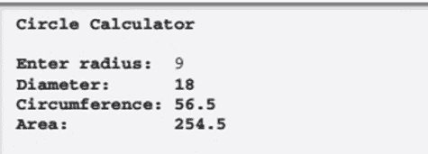

再见！

# 代码

```cpp
#include <iostream>
#include <cmath>

using std::cout;
using std::cin;
using std::endl;
using std::pow;
using std::round;

int main() {
    // print name of program
    cout << "Circle Calculator" << endl << endl;

    // get radius from user
    double radius;
    cout << "Enter radius: ";
    cin >> radius;

    // make calculations
    double pi = 3.14159;
    double diameter = pi * radius;
    double circumference = diameter * pi;
    double area = pi * pow(radius, 2.0);

    // round to 1 decimal place
    circumference = round(circumference * 10) / 10;
    area = round(area * 10) / 10;

    // write output to console
    cout << "Diameter: " << diameter << endl;
    cout << "Circumference: " << circumference << endl;
    cout << "Area: " << area << endl;
    cout << "Bye! ";

    // return value that indicates normal program exit
    return 0;
}
```

图 2-12 圆形计算器程序

# 如何生成随机数

在学习编程时，能够生成随机数通常很有帮助。如果你想开发涉及骰子、卡牌或其他随机变化元素的游戏，它们会非常有用。它们对于模拟（例如使用一系列随机数来测试函数）同样有用。

要使用 C++ 生成随机数，你可以使用图 2-13 所示的 `cstdlib` 头文件中的函数。首先，你使用 `time()` 函数为 `rand()` 函数获取一个种子值。为了做到这一点，你可以使用 `nullptr` 关键字向 `time()` 函数传递一个空指针参数。这会返回自 1970 年 1 月 1 日以来经过的秒数。因此，`time()` 函数每次被调用时都会返回不同的数字。

一旦你有了种子值，就可以使用 `srand()` 函数为 `rand()` 函数指定种子值。接下来，使用 `rand()` 函数获取一个 0 到 `RAND_MAX` 之间的随机整数，`RAND_MAX` 是一个随编译器不同而异的大整数。

获取随机整数后，你可以使用模运算符来指定随机数的上限。例如，在图中，代码使用模运算符来返回除以 6 后的余数。这样，操作的结果就在 0 到 5 之间（包含边界）。然后，你可以给结果加 1，以得到六面骰子的值（1 到 6 包含边界）。

那么，为什么 `rand()` 函数需要一个种子值呢？

因为 `rand()` 函数实际上生成的是伪随机数，它们是一系列看起来是随机的但实际上对于每个种子值都是相同的数字。因此，如果你在每次运行程序时都不更改种子值，程序每次都会使用同一系列数字，这通常不是你想要的结果。

图中所示函数提供了一种生成系列伪随机数的简单方法。这对于创建此处所示的程序已经足够了。然而，使用这种技术生成的数字并不是加密安全的。因此，如果你需要生成加密安全的数字，就必须使用不同的技术。例如，如果你在使用 C++ 11 或更高版本，你可以使用 `random` 头文件来生成加密安全的随机数。当你读完这本书，你应该已经掌握了独立使用 `random` 头文件所需的技能。

# 用于生成随机数的 `cstdlib` 头文件的两个函数

| 函数 | 描述 |
| --- | --- |
| `rand()` | 返回一个 0 到 `RAND_MAX` 之间的伪随机整数。该函数使用种子来生成整数序列，应该使用 `srand()` 函数将种子初始化为一个独特的值。 |
| `srand(seed)` | 为 `rand()` 函数指定种子值。 |

# `ctime` 头文件的一个函数

| 函数 | 描述 |
| --- | --- |
| `time(timer)` | 如果 `timer` 参数是空指针，它将返回当前的日历时间，通常为自 1970 年 1 月 1 日 00:00:00 UTC 以来的秒数。 |

# 模拟掷两个骰子的代码

```cpp
#include <iostream>
#include <cstdlib>
#include <ctime>

using namespace std;

int main() {
    // use time() to get an int value
    int elapsed_seconds = time(nullptr);

    // seed the random number generator
    srand(elapsed_seconds);

    // roll the first die
    int die1 = rand() % 6; // die1 >= 0 and < 6
    die1 = die1 + 1;       // die1 >= 1 and <= 6

    // roll the second die
    int die2 = rand() % 6; // die2 >= 0 and < 6
    die2 = die2 + 1;       // die2 >= 1 and <= 6

    // write output to console
    cout << "Your roll: " << die1 << " " << die2;
}
```

# 第2章 如何编写你的第一个程序 67

## 字符的内置数据类型

| 类型 | 说明 |
|---|---|
| `char` | 一种内置数据类型，用于存储映射到 ASCII 字符集中单个字符的整数值。这些字符包括字母、数字、标点符号以及特殊字符 `*`、`&` 和 `#`。 |

## `string` 头文件中可用的类

| 类 | 说明 |
|---|---|
| `string` | 一种定义对象的类，该对象由零或多个字符序列组成。 |

## 如何定义和初始化 `char` 变量

## 如何包含 `string` 头文件

```cpp
#include <string>
```

## 如何定义和初始化 `string` 变量

```cpp
string message1 = "Invalid data entry";
string message2 = ""; // 空字符串
```

## 如何拼接字符串和字符

```cpp
string first_name = "Bob"; // first_name 是 Bob
string last_name = "Smith"; // last_name 是 Smith
string name = last_name + " " + first_name; // name 是 Smith, Bob
name = first_name + " " + middle_initial + " " + last_name; // name 是 Bob M Smith
```

## 如何使用 `+=` 运算符将一个字符串附加到另一个字符串

```cpp
name = first_name + ' '; // name 是 Bob 后面跟着一个空格
name += last_name; // name 是 Bob Smith
```

## 说明

- 要指定字符值，可以将字符括在单引号中。这被称为字符字面量。
- 类定义了一种对象类型。当你从类中创建对象时，可以将其赋值给该类类型的变量。
- 要创建一个字符串对象，可以将文本括在双引号中。这被称为字符串字面量。
- 要将空字符串赋值给 `string` 变量，可以编写一对之间没有任何内容的引号。这意味着字符串不包含任何字符。
- 要将一个字符串与另一个字符串或字符拼接，请使用加号。
- 如果你只需要存储单个字符，`char` 类型比 `string` 类型更有效率。


## 如何处理特殊字符

使用 `+=` 运算符时，你需要在 `=` 运算符的两侧包含字符串变量。否则，赋值语句会将旧值替换为新值。

处理 `char` 和 `string` 变量时，`string` 使用的开销略大于 `char`。因此，如果你处理的是单个字符，应该使用 `char` 变量或字面量，而不是 `string` 变量或字面量。

图 2-15 显示了如何处理特殊字符。要为此，你可以使用图中所示的转义序列。

每个转义序列以反斜杠开头。例如，如果你编写一个反斜杠跟着字母 n，编译器将包含一个换行符，如第一个字符串所示。如果你省略了反斜杠，编译器将会在字符串值中包含字母 n。制表符的转义序列原理类似，如第二个字符串示例所示。

要编写字符串字面量，将其括在双引号中。因此，如果你想在字符串字面量中包含双引号，必须使用转义序列，如第三个字符串所示。在这里，使用 `\"` 转义序列在字符串字面量中包含双引号。

最后，如果你想在字符串字面量中包含反斜杠，需要使用转义序列。要这样做，请如第四个示例所示编写两个反斜杠。如果你忘记这样做并只编写了一个反斜杠，编译器将使用反斜杠和下一个字符创建一个转义序列。这可能会产生意外的结果。

处理转义序列时，记住它们定义的是特殊字符，而不是特殊字符串。因此，有时你可能需要将特殊字符赋值给 `char` 类型的变量，如 `char` 示例所示。要这样做，可以通过将转义序列括在单引号中创建一个字符字面量。这定义了一个可以赋值给 `char` 变量的单个字符。第一条语句将换行符赋值给名为 `newline` 的 `char` 变量。第二条语句将制表符赋值给名为 `tab` 的 `char` 变量。第三条语句将反斜杠赋值给名为 `sep`（separator 的缩写）的 `char` 变量。

## 特殊字符的常用转义序列

| 序列 | 字符 |
|---|---|
| `\n` | 换行 |
| `\t` | 制表符 |
| `\r` | 回车 |
| `\"` | 双引号 |
| `\\` | 反斜杠 |

## 字符串示例

### 使用换行符的字符串

```cpp
"Code: CPP\nPrice: $49.50"
```

结果：
```
Code: CPP
Price: $49.50
```

### 使用制表符的字符串

```cpp
"Joe\tSmith\nKate\tLewis"
```

结果：

| Joe | Smith |
| Kate | Lewis |

### 使用双引号的字符串

```cpp
"Type \"x\" to exit"
```

结果：
```
Type "x" to exit
```

### 使用反斜杠的字符串

```cpp
"C:\\murach\\cpp\\files"
```

结果：
```
C:\murach\cpp\files
```

## `char` 示例

```cpp
char newline = '\n';
char tab = '\t';                // 使用反斜杠作为分隔符
char sep = '\\';
```

## 说明

- 你可以使用转义序列来识别某些类型的特殊字符。
- 在字符串内部，你可以编写某些类型的特殊字符。
- 要在字符串中使用转义序列，将转义序列括在双引号中。
- 要创建字符字面量使用转义序列，将转义序列括在单引号中。


# 第 2 章 如何编写你的第一个程序 71

## `iostream` 头文件中的 `getline()` 函数

| 函数 | 描述 |
| --- | --- |
| `getline(cin, var)` | 提取整行控制台输入（包括空格），并赋值给指定的变量。 |

## 如何使用 `getline()` 函数读取完整姓名

```cpp
string name;
cout << "Enter full name: ";
getline(cin, name);
cout << "Your name is " << name;
```

## 控制台


## `cin` 对象的成员函数

| 成员函数 | 描述 |
| --- | --- |
| `get()` | 获取输入流中的下一个字符。 |
| `ignore()` | 提取并丢弃输入流中的下一个字符。 |
| `ignore(n, delim)` | 从输入流中提取并丢弃字符，直到丢弃的字符达到 n，或者找到了 `delim` 中的字符。 |

## 如何调用对象的成员函数

语法
`object_name.function_name(arguments);`

## 示例

```cpp
```


char initial = cin.get(); // 提取并返回下一个字符

cin.ignore(); // 提取并丢弃下一个字符

cin.ignore(100, ' '); // 提取并丢弃后 100 个字符

// 或提取到下一个空格字符的所有字符

## 暂停直到用户按下 Enter 键继续执行的代码

```cpp
cin.ignore(1000, '\n'); // 丢弃当前行的任何额外字符
cout << "\nPress [Enter] to close the terminal ...\n";
cin.ignore();
```

## 用于关闭终端的控制台 ...


## 描述

- 标准库中的许多对象都有成员函数。要调用成员函数，需要编写对象的名称、点运算符（`.`）以及成员函数的名称。
- 你向成员函数传递参数并从其获取返回值，就像调用普通函数一样。

图 2-16 如何从控制台读取字符串和字符

## 如何修复读取字符串时的常见问题

在大多数情况下，`getline()` 函数的运行方式如你所愿。
有时，如果你在使用了提取运算符从输入流中提取数据的代码之后使用 `getline()`，可能会遇到问题。图 2-17 开始展示了这个问题。在这里，第一个示例首先使用提取运算符来读取账号。然后，它使用 `getline()` 函数来读取完整姓名。然而，控制台并没有给用户输入完整姓名的机会。

是什么导致了这个问题呢？嗯，当用户输入一个值并按下 Enter 键时，提取表达式只从流中提取该值，而不提取换行符。如果你使用提取运算符，这样做是没问题的，因为该运算符会忽略开头的换行符。遗憾的是，`getline()` 函数不会忽略这个字符。结果是，`getline()` 将开头的换行符读入变量 `name` 中，程序执行继续到将输出写入控制台的语句。

要修复这个问题，你可以使用 `cin` 对象的 `ignore()` 函数来提取并丢弃导致该问题的换行符，如第二个示例所示。一旦你提取并丢弃了这个换行符，`getline()` 函数就能正常工作了。

一些程序员认为，在每个提取表达式之后调用 `ignore()` 函数是一种最佳实践。这样，开头的换行符总是会被丢弃。但是，只在需要时才调用 `ignore()` 函数也是常见的做法。

## 读取字符串时的常见问题

```cpp
int account_num;
cout << "Enter account number: ";
cin >> account_num; // 提取数据但留下了换行符
```

```cpp
string name;
cout << "Enter full name: ";
getline(cin, name); // 读取流中留下的换行符
cout << "Name: " << name << " | Account: " << account_num;
```

## 控制台


## 用户输入 "1234" 后 cin 对象中的数据

| 1 | 2 | 3 | 4 | \n |

## 如何修复问题

```cpp
int account_num;
cout << "Enter account number: ";
cin >> account_num;
```

```cpp
string name;
cout << "Enter full name: ";
cin.ignore(); // 丢弃流中留下的换行符
getline(cin, name); // 读取下一行
cout << "Name: " << name << " | Account: " << account_num;
```

## 控制台


## 描述

- 当用户在控制台中按下 Enter 键时，C++ 会向输入流插入一个换行符。
- 当你使用提取运算符提取数据时，它会跳过任何领先空白字符（如空格和换行符），并提取到下一个空白字符为止，但保留空白字符。
- 当你使用 `getline()` 函数时，它不会跳过空白字符。结果是，`getline()` 将领先的换行符读入变量名。
- 要修复这个问题，你可以使用 `cin` 对象的 `ignore()` 函数来提取并丢弃导致问题的换行符。

图 2-17 如何修复读取字符串时的常见问题

## Guest Book 程序

图 2-18 展示了另一个从控制台读取输入并显示输出的程序。与 Converter 程序一样，Guest Book 程序首先包含了 `iostream` 头文件。它还包含了 `string` 头文件。此外，它指定了 `std` 命名空间，这样代码就不需要完全限定名。`main()` 函数首先向控制台写入标题。注意该语句使用换行符 `\n` 而不是 `endl` 操纵符来换行。在标题之后，代码提示用户输入名字。然后，它使用提取表达式从用户处获取名字。接下来，它调用 `cin` 对象的 `ignore()` 函数来丢弃之前的提取表达式留在流中的换行符，以及流中的其他最多 100 个字符。

在名字之后，代码提示用户输入中间首字母。然后，它使用 `get()` 函数获取中间首字母。接下来，它调用 `ignore()` 函数丢弃流中的任何字符，包括换行符。在中间首字母之后，代码提示用户输入姓。在这里，代码使用 `getline()` 函数获取姓，这样用户可以输入包含空格的名字。

在获取用户的所有输入后，代码格式化数据并写入控制台。为了实现这一点，它使用换行符 `\n` 开始新行。此外，它使用 `+` 运算符连接名字、空格字符、中间首字母、句点、空格字符和姓。它还使用 `+` 运算符创建包含城市和国家的那行。

在查看此代码时，注意每个提示符都使用制表符 `\t` 来对齐用户的输入。此外，如果特殊字符是字符串的一部分，代码会将特殊字符编码在双引号中。否则，代码会将特殊字符编码在单引号中，使其视为 `char` 类型。对于单个字符（如空格）也是如此。正如你在本章中学到的，这会让你的代码效率略高。

此外，注意由于结果，如果用户在名字处输入 "Emmy Lou"，程序只会将 "Emmy" 存储为名字。同样，该程序只提取输入的中间首字母的第一个字符。结果是，如果用户为中间首字母输入 "Wilford"，程序只存储 "W"。如果这不是你想要的，你可以使用 `getline()` 函数代替提取运算符来获取名字和中间首字母。如果你这样做，就不需要使用 `ignore()` 函数了。

## 访客簿

| 名字: | Dave |
|---|---|
| 中间首字母: | Willford |
| 姓氏: | Von Ronk |
| 城市: | 纽约 |
| 国家: | 美国 |

条目
Dave W. Von Ronk
纽约，美国

## 代码

```cpp
#include <iostream>
#include <string>
using namespace std;

int main() {
    cout << "Guest Book\n\n";
    string first_name;
    cout << "First name:\t";
    cin >> first_name; // get first string only
    cin.ignore(100, '\n'); // discard leftover chars and newline
    char middle_initial;
    cout << "Middle initial:\t";
    middle_initial = cin.get(); // get first char only
    cin.ignore(100, '\n'); // discard leftover chars and newline
    string last_name;
    cout << "Last name:\t"; // get entire line
    getline(cin, last_name);
    string city;
    cout << "City:\t"; // get entire line
    getline(cin, city);
    string country;
    cout << "Country:\t"; // get entire line
    getline(cin, country);
    cout << "\nENTRY\n" + first_name + " " + middle_initial + ". " + last_name + "\n\n";
    cout << city + ", " + country + "\n\n";
}
```

图 2-18 访客簿程序

## 如何测试和调试程序

在第 1 章中，你了解了 IDE 在你输入代码时检测到的语法错误。由于语法错误会导致程序无法编译，因此它们通常也被称为编译时错误。例如，如果你尝试编译图 2-19 所示的代码，编译器会返回一个如图中所示的错误。

这些错误信息通常由 IDE 显示，它可以帮助你确定错误的位置。在图中，消息表明在第 10 行的 `string` 关键字之前预期有一个分号。这是因为第 8 行末尾缺少分号。一旦你修复了编译时错误，就可以对程序进行测试和调试了。

## 如何测试程序

当你测试一个程序时，你会运行它以确保其正常工作。在测试过程中，你应该尝试有效和无效数据的每种可能组合，以确保程序在每种条件下都能正常运行。记住，测试的目标是发现错误（或 bug），这样用户在运行程序时就不会遇到这些问题了。

在测试过程中，你不可避免会遇到两种类型的 bug。第一种 bug 会导致运行时错误（也称为运行时异常）。运行时错误可能导致程序崩溃或行为异常。

第二种 bug 在程序运行时会产生不准确的结果。这些 bug 的产生是由于源代码中的逻辑错误引起的。例如，这类 bug 可能会导致程序进入无限循环或显示错误的数据。例如，图中的控制台显示了圆计算器程序的输出，显示了错误的数据。在这里，其中一个计算是不正确的。这种 bug 比运行时错误更难发现和修复。

## 如何调试程序

当你调试一个程序时，你会找到 bug 的原因，修复它们并再次测试。随着程序变得越来越复杂，调试可能是编程中最耗时的方面之一。因此，以易于阅读、理解和调试的方式来编写代码至关重要。

要找到运行时错误的原因，你可以从查找程序崩溃时正在运行的源语句开始。要做到这一点，你可以从研究收到的任何错误消息开始。

要找到输出不正确的原因，你可以从弄清楚程序为什么产生该结果开始。例如，你可以问问图中的圆计算器程序为什么没有正确执行所有计算。一旦你弄清楚这个问题，你就已经在修复 bug 的路上了。

## 包含错误的文件开头

```cpp
#include <iostream>
#include <string>
using namespace std;
int main() {
    cout << "Guest Book\n\n";
    string first_name;
    cout << "First name:\t";
    ...
```

图 2-18 访客簿程序

## 编译器返回的代码

```cpp
main.cpp:10:5: expected ';' before 'string'
```

## 输出错误的圆计算器程序

## 描述

在第 1 章中，你了解了 IDE 在你输入代码时检测到的语法错误。由于语法错误会导致程序无法编译，因此它们通常也被称为编译时错误。例如，如果你尝试编译图 2-19 所示的代码，编译器会返回一个如图中所示的错误。

这些错误信息通常由 IDE 显示，它可以帮助你确定错误的位置。在图中，消息表明在第 10 行的 `string` 关键字之前预期有一个分号。这是因为第 8 行末尾缺少分号。一旦你修复了编译时错误，就可以对程序进行测试和调试了。

## 如何测试程序

当你测试一个程序时，你会运行它以确保其正常工作。在测试过程中，你应该尝试有效和无效数据的每种可能组合，以确保程序在每种条件下都能正常运行。记住，测试的目标是发现错误（或 bug），这样用户在运行程序时就不会遇到这些问题了。

在测试过程中，你不可避免会遇到两种类型的 bug。第一种 bug 会导致运行时错误（也称为运行时异常）。运行时错误可能导致程序崩溃或行为异常。

第二种 bug 在程序运行时会产生不准确的结果。这些 bug 的产生是由于源代码中的逻辑错误引起的。例如，这类 bug 可能会导致程序进入无限循环或显示错误的数据。例如，图中的控制台显示了圆计算器程序的输出，显示了错误的数据。在这里，其中一个计算是不正确的。这种 bug 比运行时错误更难发现和修复。

## 如何调试程序

当你调试一个程序时，你会找到 bug 的原因，修复它们并再次测试。随着程序变得越来越复杂，调试可能是编程中最耗时的方面之一。因此，以易于阅读、理解和调试的方式来编写代码至关重要。

要找到运行时错误的原因，你可以从查找程序崩溃时正在运行的源语句开始。要做到这一点，你可以从研究收到的任何错误消息开始。

要找到输出不正确的原因，你可以从弄清楚程序为什么产生该结果开始。例如，你可以问问图中的圆计算器程序为什么没有正确执行所有计算。一旦你弄清楚这个问题，你就已经在修复 bug 的路上了。

## 术语表

- 语句 (statement)
- 变量 (variable)
- 注释 (comment)
- 函数 (function)
- 参数 (parameter)
- 标识符 (identifier)
- 关键字 (keyword)
- 数据类型 (data type)
- 初始化 (initialization)
- 赋值语句 (assignment statement)
- 算术表达式 (arithmetic expression)
- 操作数 (operand)
- 除法 (division)
- 控制台 (console)
- 预处理器指令 (preprocessor directive)
- 头文件 (header file)
- 命名空间 (namespace)
- 流 (stream)
- 输出流 (output stream)
- 输入流 (input stream)
- 插入运算符 (insertion operator)
- 提取运算符 (extraction operator)
- 函数调用 (function call)
- 参数 (argument)
- 使用直令 (using directive)
- 使用声明 (using declaration)
- 作用域解析运算符 (scope resolution operator)
- 全限定名 (fully qualified name)
- 字符集 (character set)
- 字符字面量 (character literal)
- 类 (class)
- 对象 (object)
- 字符串字面量 (string literal)
- 拼接 (concatenate)
- 追加 (append)
- 转义序列 (escape sequence)
- 空格 (whitespace)
- 成员函数 (member function)
- 点运算符 (dot operator)
- 语法错误 (syntax error)
- 编译时错误 (compile-time error)
- 测试程序 (test a program)
- Bug (bug)
- 运行时错误 (runtime error)
- 逻辑错误 (logic error)

## 总结

语句指导程序的操作，注释通常用于。

- `main()` 函数是一个特殊的函数，由操作系统在启动程序时调用。
- 变量用于存储在程序运行期间发生变化的数据。
- 当你定义一个变量时，必须编写它的数据类型和名称。数值的两种常用数据类型是 `int` 和 `double`。
- 在定义变量后，你可以通过分配一个初始值来对其进行初始化。
- 你可以使用赋值语句为变量分配新值。

- 标准库使用头文件来组织和存储其类、对象和函数。
- 标准库将其成员分组在 `std` 命名空间中。你可以使用使用指令、使用声明或全限定名来处理命名空间的成员。
- 你可以使用 `iostream` 头文件的对象来处理控制台的标准输入输出流。`cout` 对象向控制台写入输出，`cin` 对象从控制台读取输入。
- `char` 是包含单个字符的内置数据类型。
- `string` 是包含零或多个字符的对象。字符串对象是从 `string` 头文件中可用的 `string` 类创建的。

## 练习 2-1 创建矩形面积计算器程序

在此练习中，你将编写一个程序，接受矩形的高度和宽度，然后显示矩形的面积。完成后，测试运行的结果应该像下面所示：

```
Rectangle Calculator
Enter height and width: 4.25 5.75
Area: 24.4375
Bye!
```


## 打开项目、审查代码并添加注释

1. 使用你的 IDE 打开此文件夹中的 Rectangle Calculator 项目或解决方案。
2. 审查 `main.cpp` 文件中的代码，确认它包含一个用于 `iostream` 头文件的 `#include` 指令，一个用于 `std` 命名空间的指令，以及一个带有 `return` 语句的 `main()` 函数。
3. 在文件开头添加一个块注释，其中包含你的姓名、当前日期以及程序的目的。

## 编写 main() 函数

4. 在 `main()` 函数开始处添加一条语句，向控制台输出程序名称。名称后应紧跟两个换行符。
5. 定义两个 `double` 类型变量来存储用户输入的高度和宽度。然后添加一条语句提示用户输入高度和宽度。
6. 添加一条使用链式提取表达式的语句，获取用户在控制台输入的高度和宽度值。
7. 定义一个 `double` 类型变量来存储面积。然后计算矩形的面积（高度乘以宽度），并将其赋值给该变量。
8. 添加一条语句在控制台显示面积，随后是两个换行符、“Bye!” 消息以及另外两个换行符。

## 运行程序

9. 运行程序以确保其工作正常。如果检测到任何错误，修复它们并重新运行程序。

# 练习 2-2 增强加仑转换器程序

在此练习中，你将增强本章介绍的加仑转换器程序。完成后，测试运行的结果应该像下面所示：


## 打开项目、审查代码并运行程序

1. 使用你的 IDE 打开此文件夹中的 Gallons Converter 项目或解决方案：`ex_starts\ch02_ex2_gallons_converter`
2. 审查 `main.cpp` 文件中的代码。然后运行程序查看其工作原理。

## 添加计算升的数的代码

3. 为 `cmath` 头文件添加 `include` 指令。
4. 添加一条语句将升的数保留两位小数。
5. 运行程序以确保其工作正常。如果发生任何错误，请调试程序、修复错误，然后重新运行程序。

## 添加计算夸脱和盎司的代码

6. 定义一个 `double` 类型变量来存储夸脱数。
7. 计算夸脱数，并将其赋值给该变量。（一个加仑等于四夸脱）。夸脱数应保留两位小数。
8. 修改向控制台输出升的数的语句，使其也输出夸脱数。
9. 运行程序并修复可能出现的任何错误。
10. 重复步骤 6 到 9，计算并显示每加仑含有的盎司数。（一个加仑等于 128 盎司）。

## 用 using 声明替换 using 指令

11. 将 `std` 命名空间的 `using` 指令替换为程序所需的 `using` 声明。
12. 再次运行程序以确保它仍然可以工作。

# 练习 2-3 增强留言板程序

在此练习中，你将增强本章介绍的留言板程序，使其接受额外信息。完成后，测试运行的结果应该像下面所示：


## 打开项目、审查代码并运行程序

1. 使用你的 IDE 打开此文件夹中的 Guest Book 项目或解决方案：`ex_starts/ch02_ex3_guest_book`
2. 审查 `main.cpp` 文件中的代码。然后运行程序查看其工作原理。

## 添加接受并显示地址、州代码和邮编的代码

3. 定义三个 `string` 变量来存储地址、州代码和邮编。
4. 添加语句提示用户输入地址、州代码和邮编。
5. 添加语句获取用户输入的地址、州代码和邮编数据，并将值赋值给相应的变量。地址和邮编应获取整行数据，但州代码应仅获取前两个字符。
6. 修改向控制台输出条目的语句，使其按上述方式显示数据。
7. 运行程序并使用上述显示的数据进行测试。如果程序没有停下来让你输入邮编，那是因为州代码后的换行符尚未从控制台获取。在这种情况下，你可以通过添加一条语句来提取并丢弃输入流中的任何额外字符来修复此。
8. 再次运行程序以确保其工作正常。

# 如何使用决策

在编写程序时，你需要判断何时执行某些操作。为了实现这一点，你将学习最基本的控制结构 `if` 语句。在此之前，你需要先学习如何编写决策表达式。

## 如何开始 if 语句

布尔表达式是一个求值为真或假的表达式。在第 2 章中，你学习了如何制作输入、处理和显示输出。在本章中，你将学习如何编写语句。

## 如何使用关系运算符

关系运算符对于字符串和字符值的工作方式与数值值相同。然而，你通常不需要对字符或字符串使用小于或大于运算符。相反，你通常对字符和字符串使用相等性测试，如第二组示例所示。

- 如何开始 if 语句 84
- 如何使用关系运算符 86
- 如果你编写 88
- 如何使用逻辑运算符 90
- 其他决策方法 92
- 如果你使用条件运算符 94
- if 语句的更多示例 96
- 嵌套 if 语句 98
- 程序 100
- 程序 102

当你比较数值值时，通常比较相同数据类型的值。如果你比较不同类型的值，C++ 会自动将数值类型转换为相同类型。特别是，如果你将 `int` 与 `double` 进行比较，C++ 会在比较之前将 `int` 转换为 `double`。

在处理字符串和字符时，相等性测试是区分大小写的。因此，如果 `choice` 变量等于 'y'，第一个表达式为真，但它不等于 'Y'。同样，如果 `name` 变量等于 'Jones'，第二个表达式为真，但如果它等于 'jones' 则不成立。

然而，在处理字符时，你可以使用此处介绍的 `tolower()` 和 `toupper()` 函数来进行不区分大小写的比较。下面的代码示例展示了这种工作原理。虽然对于字符串值没有类似的函数，但你将在第 7 章学习如何编写你自己的函数。

# 第3章 如何做出决策 85

## 关系运算符

| 运算符 | 名称 | 说明 |
| --- | --- | --- |
| `==` | 等于 | 如果两个操作数相等，则返回真值。 |
| `!=` | 不等于 | 如果两个操作数不相等，则返回真值。 |
| `>` | 大于 | 如果左侧操作数（左值）大于右侧操作数（右值），则返回真值。 |
| `<` | 小于 | 如果左值小于右值，则返回真值。 |
| `>=` | 大于等于 | 如果左值大于或等于右值，则返回真值。 |
| `<=` | 小于等于 | 如果左值小于或等于右值，则返回真值。 |

## 布尔表达式示例

```
counter = 5 // 等于数字字面量

test_score != 0 // 不等于数字字面量

years > > // 大于数值变量

i < months // 小于数值变量

subtotal >= 9.99 // 大于等于数字字面量

quantity <= reorder_amt // 小于等于数值变量
```

## 如何测试字符串和字符的相等性

```
choice == 'y' // 字符等于字符字面量

name = "Zones" // 字符串等于字符串字面量

name != name2 // 字符串不等于另一个字符串变量
```

## 将字符转换为小写或大写的两个函数

| 函数 | 说明 |
| --- | --- |
| `tolower(char)` | 返回接收到的字符的小写等价物。如果没有小写等价，则返回原始字符。 |
| `toupper(char)` | 返回接收到的字符的大写等价物。如果没有大写等价，则返回原始字符。 |

## 如何进行不区分大小写的字符相等性测试

```
tolower(choice) == 'y' // 如果 choice 为 'y' 或 'Y' 则为真
```

## 说明

- 布尔表达式是一个求值为真或假的表达式。要创建一个布尔表达式，请使用关系运算符来比较两个操作数。
- 比较两个操作数的相等性时，请确保只使用一个等号；你正在编写的是赋值语句，而不是布尔表达式。
- 如果你将 `int` 值与 `double` 值进行比较，编译器会将 `int` 值强制转换为 `double` 类型。
- 当测试字符和字符串的相等性时，测试是区分大小写的。对于字符，你可以通过添加 `tolower()` 或 `toupper()` 来使测试不区分大小写。

图 3-1 如何使用关系运算符

## 如何编写 if 语句

图 3-2 显示了如何使用 `if` 语句（也称为 `if...else` 语句）来控制程序的逻辑。该语句是 C++ 对一种被称为“选择结构”的控制结构的实现，因为它允许你根据布尔表达式的结果选择不同的操作。

语法摘要显示，你可以仅用一个 `if` 子句、一个或多个可选的 `else if` 子句以及一个可选的 `else` 子句来编写此语句。在语法中，省略号 `(...)` 表示前面的元素（在本例中为 `if` 子句）可以根据需要重复多次。而括号 `[ ]` 表示该元素是可选的。

当执行 `if` 语句时，C++ 开始评估 `if` 子句中的布尔表达式。如果为真，则执行该子句内的语句，并跳过 `if` 语句中的其余子句。如果为假，C++ 将评估第一个 `else` 子句（如果有）。然后，如果其布尔表达式为真，则执行该 `else` 子句内的语句，并跳过 `if` 语句中的其余子句。否则，C++ 将评估下一个 `else if` 子句。

这种情况会持续到任何剩余的 `else if` 子句为止。最后，如果没有一个子句包含求值为真的布尔表达式，C++ 将执行 `else` 子句中的语句（如果有）。然而，如果没有一个布尔表达式为真且没有 `else` 子句，C++ 将不执行任何语句。

在图中，所有的 `if` 语句都使用大括号来清晰地标识每个子句的语句块。如果你在块内部定义变量，则该变量仅对块中的其他语句可用。这可以被称为**块作用域**。因此，如果你需要访问块外部的变量，例如，所有的示例都在 `if` 语句的块之前定义了 `discount_percent` 变量。注意代码语句是如何访问 `discount_percent` 变量的。第一个示例显示了一个仅包含 `if` 子句的 `if` 语句。该语句声明了 `discount_percent` 变量并初始化为 `.05` (5%)。然后，`if` 子句检查 `subtotal` 是否大于等于 100。如果是，代码将 `discount_percent` 变量设置为 `.1` (100%)。否则，代码将 `discount_percent` 变量保持为其默认值 `.05` (5%)。

第二个示例显示了一个包含一个 `if` 子句和一个 `else` 子句的 `if` 语句。它执行与第一个示例相同的任务。然而，它使用 `else` 子句来设置 `discount_percent` 变量的默认值。

第二个示例的优点是，设置 `discount_percent` 变量值的语句都编写在同一层级。因此，一些程序员发现这个示例更容易阅读和理解。这种方法的缺点是它多用了三行代码。由于第一个和第二个示例的效果相同，你可以选择你偏好的方法。

## if 语句的语法

```cpp
if (expression) {
    statements
} else if (expression) {
    statements
} else {
    statements
}
```

# 第 3 章 如何决策 89

## 不带括号的 if 语句

```cpp
double discount_percent;

if (subtotal >= 100)
    discount_percent = .1;
else
    discount_percent = .05;
```

## 会导致错误的不带括号的 if 语句

```cpp
double discount_percent = .05;
string shipping_method = "USPS";

if (subtotal >= 100)
    discount_percent = .1;
    shipping_method = "FedEx"; // 错误！此语句会被执行
```

## 使用括号修复错误的 if 语句

```cpp
double discount_percent = .05;
string shipping_method = "USPS";

if (subtotal >= 100) {
    discount_percent = .1;
    shipping_method = "FedEx"; // 大括号修复了错误
}
```

## 包含多个语句的从 if 语句

```cpp
double discount_percent;
string shipping_method;

if (subtotal >= 100) {
    discount_percent = .1;
    shipping_method = "FedEx";
} else {
    discount_percent = .05;
    shipping_method = "USPS";
}
```

## 另一种括号位置的编码风格

```cpp
double discount_percent;
string shipping_method;

if (subtotal >= 100) {
    discount_percent = .1;
    shipping_method = "FedEx";
} else {
    discount_percent = .05;
    shipping_method = "USPS";
}
```

## 描述

- 如果 `if` 语句中的一个子句只包含一个语句，你不需要用大括号包裹该语句。只需用分号结束该句即可。

图 3-3 如何使用大括号

## Invoice 1.0 程序

图 3-4 显示了发票 1.0 程序的控制台输出和代码。尽管这个程序很简单，但它从用户处获取输入，根据输入做出决策，执行一些计算并显示计算结果。

Invoice 程序的代码首先在控制台上显示程序名称，然后是一个空行。接下来，它提示用户输入小额，并将用户输入的小额存储在 `subtotal` 变量中。接着，它使用 `if` 语句根据小额的值来设置折扣百分。例如，如果小额大于或等于 200，则折扣百分为 `.2` (20%)。如果条件不成立但小额大于或等于 100，则折扣百分为 `.1` (10%)。否则，折扣百分为 `.05` (5%)。

在查看此代码时，请注意它在 `if` 语句之前定义了 `discount_percent` 变量。因此，该变量在 `main()` 方法块的其余代码可用，包括 `if` 语句中的所有子句。

当 `if` 语句结束时，代码计算折扣金额和发票总额，并将结果保留两位小数。然后，它在控制台上显示折扣百分、折扣金额和发票总额。

尽管这个程序演示了简单 `if` 语句的使用，但可以从许多方面进行改进。例如，如果用户为小额输入了无效值（如 "x"），处理是合理的。要修复这个问题，你可以像第 5 章所示，在提取表达式后检查失败标志。此外，此程序还可以对数字进行格式化和对齐，以便用户更容易阅读，如第 5 章所示。

同时，如果你是编程初学者，通过编写像 Invoice 这样简单的程序可以学到很多东西。这样做可以让你有机会熟悉编写简单的 `if` 语句。

## 控制台输出

```
Invoice Total Calculator 1.0

Enter a subtotal: 129.43

Discount percent: 0.1

Discount amount: 12.94

Invoice total: 116.49

Bye!
```

## 代码

```cpp
#include <iostream>
#include <cmath>

using namespace std;

int main() {
    cout << "Invoice Total Calculator 1.0\n\n";

    // 从用户处获取小额
    double subtotal;
    cout << "Enter a subtotal: ";
    cin >> subtotal;

    // 根据小额确定折扣百分
    double discount_percent;
    if (subtotal >= 100) {
        discount_percent = .2;
    } else if (subtotal >= 50) {
        discount_percent = .1;
    } else {
        discount_percent = .05;
    }

    // 计算并舍入结果
    double discount_amount = subtotal * discount_percent;
    discount_amount = round(discount_amount * 100) / 100;
    double invoice_total = subtotal - discount_amount;
    invoice_total = round(invoice_total * 100) / 100;

    // 将结果数据写入控制台
    cout << "Discount percent: " << discount_percent << endl;
    cout << "Discount amount: " << discount_amount << endl;
    cout << "Invoice total: " << invoice_total << endl << endl;
    cout << "Bye!\n";
}
```


图 3-4 Invoice 1.0 程序

## if 语句的进阶技巧

现在你已经知道如何使用简单的 `if` 语句，你已经准备好学习更复杂的语句了。创建复杂的 `if` 语句的最常用方法是在单个从句中使用多个条件。这是通过逻辑运算符实现的。

逻辑运算符有 AND (`&&`)、OR (`||`) 和 NOT (`!`)。

AND 运算符 (`&&`) 在两个操作数都为真时返回真。OR 运算符 (`||`) 在至少有一个操作数为真时返回真。NOT 运算符 (`!`) 反转其操作数的逻辑值。

你可以使用这些运算符来组合或否定条件。例如，你想检查小额是否在 100 到 200 之间，以应用某种特定的折扣：

```cpp
if (subtotal >= 100 && subtotal < 200) {
    discount_percent = .15;
}
```

逻辑运算符允许你创建更强大、更灵活的程序。在下一章中，我们将详细探讨如何使用它们。

# if 语句使用逻辑运算符

图 3-6 从一个示例开始，展示了另一种编写 `if` 语句的方法，根据小金额设置折扣比例。在这种情况下，`if` 和 `else` 子句使用了复合条件。这显示了大多数折扣范围的上下限限制。

这种方法的一个优点是 `else` 子句可以以任何顺序编写。这种方法的一个缺点是它需要更多的代码。

在编写此类语句时，记住 C++ 会从上到下评估 `if` 语句的子句。一旦某个子句评估为 `true`，C++ 就会执行该子句的语句并跳过剩余的子句。因此，将最可能出现的条件放在最前面，最不可能出现的条件放在最后是最高效的。例如，在这个示例中，当 `if` 子句包含最可能的条件（小金额大于或等于 100 且小于 200），第一个 `else` 子句包含次可能的条件（小金额大于或等于 200 且小于 300），以此类推时，代码运行效率最高。

如果效率不是你的首要考虑因素，你应该以最易读的方式编写条件。一如既往，代码越易于阅读和理解，测试、调试和维护就越容易。

第二个示例展示了如何使用 `if` 语句来检查用户输入的数据是否有效。这被称为数据验证。在这里，`if` 语句检查名为 `score` 的变量是否包含在 0 到 100 之间的值。如果是，则会显示一条感谢用户输入分数的消息。如果不是，则会显示一条指示分数无效的消息。你从第 5 章开始将看到更多实用且完整的数据验证示例。

第三个示例也检查了有效的用户输入。在这里，`if` 语句检查 `customer_type` 变量是否等于 'r' 或 'w'。如果此表达式为 `true`，则显示一条错误消息。然而，如果此表达式为 `false`，则意味着 `customer_type` 变量等于 'r' 或 'w'。在这种情况下，`if` 子句中的语句将被跳过。

# 在布尔表达式中使用逻辑运算符的 if 语句

```cpp
double discount_percent;

if (subtotal >= 100 && subtotal < 200) {
    discount_percent = .1;
} else if (subtotal >= 200 && subtotal < 300) {
    discount_percent = .2;
} else if (subtotal >= 300) {
    discount_percent = .3;
} else {
    discount_percent = .05;
}
```

# 验证分数范围的 if 语句

```cpp
if (score >= 0 && score <= 100) {
    cout << "Thanks for entering a test score.\n";
} else {
    cout << "Test score must be from 0 - 100.\n";
}
```

# 验证客户类型的 if 语句

```cpp
if (customer_type != 'r' && customer_type != 'w') {
    cout << "Customer type must be 'r' or 'w'.\n";
}
```

# 

- 如果你可以用多种方式编写一个语句并获得相同的结果，通常应该选择最易于阅读和理解的方式。
- 如果效率是首要考虑因素，你应该将最可能出现的条件放在最前面，最不可能出现的条件放在最后。
- `if` 语句经常用于从几个选项中选择一个。它们也被用于确保用户输入是有效的。这被称为数据验证。


# 如何编写嵌套 if 语句

在许多程序中，你可能需要或希望在另一个 `if` 语句的子句中编写一个 `if` 语句以确保逻辑正确。这种结果被称为嵌套 `if` 语句。

当你编写 `if` 语句且条件变得复杂到难以遵循时，创建一个总结条件的表格通常会有帮助。图 3-7 中的表就说明了这一点。在这里，客户类型可以是 'r'（零售）或 'w'（批发）。然后，折扣比例由客户类型和发票小金额决定。

一旦你创建了这样一张表格，就可以将其作为编写 `if` 语句的指南。例如，在第一个示例中，外部语句检查两个客户代码。`if` 子句测试 'r' 代码，`else` 测试 'w' 代码。如果两个测试都没有评估为 `true`，`discount_percent` 变量保持其初始值零。

在外部子句内部，嵌套的 `if` 语句根据小金额的值设置折扣比例。同样，外部 `else` 子句使用嵌套的 `if` 语句设置折扣比例。

当嵌套语句时，对嵌套语句及其子句进行缩进是一个良好的做法，因为这有助于识别每个嵌套语句的开始和结束。当你嵌套超过一层时，这一点尤为真实。虽然嵌套语句的深度没有技术限制，但嵌套超过一两层可能会导致困惑且难以遵循。因此，你应该避免比这更深的嵌套。

为了避免嵌套语句，你可以像第二个示例所示使用条件运算符。

# 总结规则的表格

| 客户类型 | 发票小金额 | 折扣比例 |
| :--- | :--- | :--- |
| r (零售) | < 100 | .0 |
| | 100 - 250 | .1 |
| | >= 250 | .2 |
| w (批发) | < 500 | .4 |
| | >= 500 | .5 |

# 应用折扣的嵌套 if 语句

```cpp
double discount_percent = 0;

if (customer_type == 'r') { // 嵌套 if
    if (subtotal < 100) {
        discount_percent = .0;
    } else if (subtotal >= 100 && subtotal < 250) {
        discount_percent = .1;
    } else {
        discount_percent = .2;
    } // 结束嵌套 if
} else if (customer_type == 'w') { // 嵌套 if
    if (subtotal < 500) {
        discount_percent = .4;
    } else {
        discount_percent = .5;
    }
}
```

# 控制台

| 发票总额计算器 2.0 |
| :--- |
| 输入客户类型 (r/w): r |
| 输入小计: 125.75 |
| 折扣比例: 0.1 |
| 折扣金额: 12.58 |
| 发票总额: 113.17 |
| 再见！ |

# 代码

```cpp
#include <iostream>
#include <cmath>

using namespace std;

int main() {
    // 显示标题
    cout << "The Invoice Total Calculator 2.0\n";

    // 获取输入
    char customer_type;
    cout << "Enter customer type (r/w): ";
    cin >> customer_type;

    double subtotal;
    cout << "Enter subtotal: ";
    cin >> subtotal;

    // 设置折扣比例
    double discount_percent;

    if (tolower(customer_type) == 'r') { // 零售
        if (subtotal < 100) {
            discount_percent = .0;
        } else if (subtotal >= 100 && subtotal < 250) {
            discount_percent = .1;
        } else {
            discount_percent = .2;
        }
    } else if (tolower(customer_type) == 'w') { // 批发
        if (subtotal < 500) {
            discount_percent = .4;
        } else {
            discount_percent = .5;
        }
    } else { // 其他
        discount_percent = .0;
    }
}
```

图 3-8 发票 2.0 程序（部分 1/2）

一旦确定了折扣比例，程序就会计算折扣金额和发票总额。然后，发票总额将与折扣比例和折扣金额一起显示。

该程序假设，如果用户没有输入 'r' 或 'w' 客户类型，则处理的是另一种类型的客户，并将折扣比例设置为零。然而，如果你想让 'r' 或 'w' 以外的客户类型被视为无效怎么办？这时你可以使用像图 3-6 中最后看到的那个 `if` 语句来验证客户类型。在这种情况下，如果客户类型无效，程序将显示错误信息并结束。

在大多数情况下，你并不希望程序因为无效输入而结束。相反，你希望程序在显示错误信息后提示用户再次输入。你将在下一章中学习如何使用 `while` 循环来实现这一点。

# 代码（继续）

```cpp
// 计算并舍入结果
double discount_amount = subtotal * discount_percent;
discount_amount = round(discount_amount * 100) / 100;

double invoice_total = subtotal - discount_amount;
invoice_total = round(invoice_total * 100) / 100;

// 显示输出
cout << "Discount percent: " << discount_percent << endl;
cout << "Discount amount: " << discount_amount << endl;
cout << "Invoice total: " << invoice_total << endl << endl;
cout << "Bye!\n\n";
```

图 3-8 发票 2.0 程序（部分 2/2）

# 决策的其他方法

`if` 语句是一种强大的控制结构，允许程序做出决策。然而，C++ 提供了其他决策方法，包括条件运算符（三元运算符）和 `switch` 语句。你可以使用 `if` 语句完成完全相同的任务，但在某些情况下，使用条件运算符或 `switch` 语句可以改进你的代码。此外，当你处理其他程序员编写的代码时，你可能会遇到这些决策方法。

# 如何使用条件运算符

在本章的较早部分，你学习了如何使用关系运算符，例如小于运算符 (`<`)。这些运算符被称为二元运算符，因为它们有两个操作数。而这种运算符被称为三元运算符，因为它有三个操作数。图 3-9 显示了如何使用条件运算符。第一个操作数是一个布尔表达式，第二个操作数是在当布尔表达式为真时会被求值并返回的表达式，而第三个操作数是在布尔表达式为假时会被求值并返回的表达式。

条件运算符需要两个符号来分隔它的三个操作数。这通过条件表达式的语法来说，条件表达式是一个使用条件运算符的表达式。如你所见，问号 (`?`) 被用于分隔布尔表达式和真表达式，而冒号 (`:`) 被用于分隔真表达式和假表达式。

第一个示例展示了一个条件表达式。在这里，布尔表达式检查名为 `subtotal` 的变量是否大于或等于 100。如果是，它返回 `.1`。

第二个示例展示了如何在赋值语句中使用条件表达式。在这里，语句首先声明了一个 `double` 类型变量 `discount_percent`。然后，它将第一个示例中的条件表达式赋值给变量。结果是，如果 `subtotal` 大于等于 100，变量 `discount_percent` 为 `.1`。否则，它为 `.05`。

第三个示例与第二个示例相同。然而，它使用括号来清晰地标识布尔表达式。这些括号是可选的，但某些程序员倾向于使用它们，因为它们让语句更容易读。

第四个示例展示了第三个示例在重写为使用 `if` 语句代替条件运算符之后。这表明使用条件运算符的语句可以重写为使用 `if` 语句。尽管如此，许多程序员喜欢条件运算符，因为它的代码行更少。

# 条件表达式的语法

```
boolean_expression ? true_expression : false_expression
```

# 使用条件运算符设置值

```
subtotal >= 100 ? .1 : .05
```

# 使用括号的条件表达式

```
discount_percent = (subtotal >= 100) ? .1 : .05
```

# 执行相同任务的 if 语句

```cpp
double discount_percent;

if (subtotal >= 100)
    discount_percent = .1;
else
    discount_percent = .05;
```

# 描述

- 条件运算符由问号 (`?`) 和冒号 (`:`) 分隔三个表达式组成。第一个表达式是布尔表达式，第二个表达式在布尔表达式为真时求值并返回，第三个表达式在布尔表达式为假时求值并返回。
- 条件运算符提供了单行编写 `if-else` 语句的方法。
- 处理两个操作数的运算符被称为二元运算符。关系运算符如小于 (`<`) 和大于 (`>`) 是二元运算符的示例。
- 处理三个操作数的运算符被称为三元运算符。条件运算符就是三元运算符的一个示例。


# 如何编写 switch 语句

接下来的几幅图展示了如何使用 `switch` 语句。这是 C++ 对被称为 case 结构的控制结构的实现。该结构允许你为不同的情况编写不同的操作。`switch` 语句有时可以代替 `if` 语句。

图 3-10 展示了如何编写简单的 `switch` 语句。要做到这一点，你可以编写 `switch` 关键字，后面跟上一个求值为整数类型（如 `int` 或 `char` 类型）的 switch 表达式。在 switch 表达式之后，你可以编写一个或多个 `case` 标签。然后，当 switch 表达式与 `case` 标签的值匹配时，标签后的内容会被执行。你可以按任何顺序编写 `case` 标签，但应确保在每个标签后都跟一个冒号。然后，如果标签包含一个或多个语句，可以在它们之后编写 `break` 语句以跳转到 `switch` 语句的结束。`default` 标签是一个可选标签，用于标识在没有任何 case 标签被执行时要执行的语句。

第一个示例展示了如何编写 `switch` 语句，根据 `int` 类型变量 `product_id` 的值设置产品的描述。在这里，第一个 `case` 标签在 `product_id` 等于 1 时将“Hammer”（锤子）的值赋值给 `product_description` 变量。然后，`break` 语句退出 `switch` 语句。同样，第二个 `case` 标签在 `product_id` 等于 2 时将 `product_description` 变量设置为“Box of Nails”（一盒钉子），然后退出 `switch` 语句。如果 `product_id` 等于 1 或 2 以外的其他值，则执行 `default` 标签。与其他两个 case 标签一样，它设置 `product_description` 变量的值并退出 `switch` 语句。

# switch 语句的语法

```cpp
switch (switch_expression) {
  case label1:
    statements
    break;
  case label2:
    statements
    break; ...
  default:
    statements
    break;
}
```

# 使用名为 product_id 的 int 变量的 switch 语句

```cpp
string product_description;

switch (product_id) {
  case 1:
    product_description = "Hammer";
    break;
  case 2:
    product_description = "Box of Nails";
    break;
  default:
    product_description = "No product found for specified ID";
    break;
}
```


# Description

- `switch` 语句只能用于值为整数类型（如 `int` 类型或 `char` 类型）的表达式。
- `switch` 语句将控制转移到相应的 `case` 标签。如果控制没有转移到任何一个 `case` 标签，则会执行可选的 `default` 标签。
- `case` 标签可以按任何顺序进行编码。


# switch 语句的更多示例

如果你不在 `case` 标签的末尾编写 `break` 语句，程序的执行将“穿透”到下一个 `case` 标签并执行该标签中的语句，如图 3-11 所示。在这里，第一个示例展示了如何编写一个 `switch` 语句，根据名为 `day_of_week` 的变量中的整数值，将 `day` 变量设置为“weekday”（工作日）或“weekend”（周末）。在这里，标签 1、2、3 和 4 的 `case` 标签不包含任何语句，因此执行会穿透到标签 5 的 `case` 标签。结果，对于这些值中的任何一个，`day` 都会被设置为“weekday”。同样，当 `day_of_week` 等于 6 或 7 时，`day` 被设置为“weekend”。

尽管在本示例以及本章所示的其他示例中，最后一个 `case` 标签的末尾也编写了 `break` 语句，但你应该知道它是必须的。如果你省略了这个 `break` 语句，程序执行将自动穿透到 `switch` 语句之后的语句。然而，在最后一个 `case` 标签的末尾编写 `break` 语句通常被认为是一种良好的编程习惯。也就是说，如果你在最后一个 `case` 标签之后添加一个新的 `case` 标签，你的 `switch` 语句仍然可以正常工作。同样，如果你将最后一个 `case` 标签移动到 `switch` 语句中较早的位置，它仍然可以正常工作。

`switch` 语句通常用于允许用户选择菜单项目的控制台应用程序，如第二个示例所示。在这里，第一个语句显示了包含三个菜单项目的列表，每个项目都有一个整数标识。然后，代码从用户处获取选择的 `int` 值。接下来，它使用 `switch` 语句执行对应菜单项的代码。或者，如果用户没有选择有效的菜单项，它会显示一条指示该项目无效的消息。

在例例中，前两个菜单项的代码仅显示一条标识所选菜单项的消息。然而，随着你对这本书的深入，你将学习如何编写实现这些菜单选择的代码。例如，在第 9 章中，你将学习如何显示存储在文件中的电影列表，并学习如何向文件中添加电影。

# 穿透 case 标签的 switch 语句

```cpp
string day;

switch (day_of_week) {

    case 1:

    case 2:

    case 3:

    case 4:

    case 5:

        day = "weekday";

        break;

    case 6:

    case 7:

        day = "weekend";

        break;

}
```

# 用于菜单系统的 switch 语句

```cpp
// 显示菜单

cout << "1. List all movies" << endl;

cout << "2. Add a movie" << endl;

cout << "3. Exit" << endl;

// 从用户处获取菜单项

cout << "Menu item: ";

int menu_item;

cin >> menu_item;

// 为菜单项执行正确的代码

switch (menu_item) {

    case 1:

        cout << "MOVIE LIST" << endl;

        // 此处编写列出所有电影的代码

        break;

    case 2:

        cout << "ADD A MOVIE" << endl;

        // 此处编写添加电影的代码

        break;

    case 3:

        cout << "Bye!";

        break;

    default:

        cout << "Invalid menu item! Try again." << endl;

        break;

}
```

# Description

- 如果 `case` 标签不包含 `break` 语句，代码执行将穿透到下一个标签。否则，`break` 语句结束 `switch` 语句。

图 3-11 switch 语句的更多示例

# 用于 Invoice 2.0 程序的 switch 语句

为了让你更好地了解 `switch` 语句的工作原理，图 3-12 展示了一个可以用于本章之前介绍的 Invoice 2.0 程序的 `switch` 语句。在这里，`switch` 语句确定用户输入的客户类型。如果用户输入的客户类型为 `'r'` 或 `'R'`，执行第一个嵌套 `if`。然而，如果用户输入 `'w'` 或 `'W'`，则执行第二个嵌套 `if`。否则，`default` 标签将折扣百分比设置为零。

这个示例表明你可以使用 `switch` 语句来处理评估 `char` 类型的 `switch` 表达式。此外，它还展示了你可以使用 `switch` 语句处理评估 `char` 类型的表达式。

# 用于 Invoice 2.0 程序的 switch 语句

```cpp
double discount_percent;

switch (customer_type) {

    // 零售

    case 'r':

    case 'R':

        if (subtotal < 100)

            discount_percent = 0.0;

        else if (subtotal < 250)

            discount_percent = 0.05;

        else

            discount_percent = 0.10;

        break;

    // 批发

    case 'w':

    case 'W':

        if (subtotal < 500)

            discount_percent = 0.0;

        else if (subtotal < 1000)

            discount_percent = 0.15;

        else

            discount_percent = 0.20;

        break;

    // 其他

    default:

        discount_percent = 0.0;

        break;

}
```

# Description

- 你通常可以使用 `switch` 语句或 `if` 语句来实现相同的任务。
- 你可以在 `switch` 语句中嵌套其他控制语句。


# 第3章 如何做决策 111

- 作用于三个操作数的运算符称为三元运算符。条件运算符就是三元运算符的一个示例。
- `switch` 语句将控制转移到相应的 `case` 标签。如果控制没有转移到任何一个 `case`，则会执行可选的 `default` 标签。
- 如果 `case` 标签不包含 `break` 语句，代码执行将向下穿透到下一个标签。否则，`break` 语句将结束 `switch` 语句。

## 练习 3-1 增强发票程序（Invoice program）

在本次练习中，你将增强发票程序中的 `if` 语句，以支持额外的客户类型和额外的折扣。完成后，测试运行的结果应该像这样：

| 发票总额计算器 2.0 | |
|---|---|
| 输入客户类型 (r/w/c): | c |
| 输入小计： | 425.42 |
| 折扣百分比： | 0.25 |
| 折扣金额： | 106.36 |
| 发票总额： | 319.06 |

再见！

### 打开项目并修改 if 语句

- 1. 打开此文件夹中的 Invoice 项目或解决方案：`ex_starts\ch03_ex1_invoice`
- 2. 修改 `if` 语句，使得类型为 `'r'` 或 `'R'` 的客户在小计大于或等于 $250 但小于 $500 时获得 20% 的折扣，而小计为 $500 或以上的客户获得 30% 的折扣。然后，测试程序使其正常工作。
- 3. 为类型为 `'c'` 或 `'C'`（代表大学客户）的客户添加另一个 `else if`。这些客户应该始终获得 25% 的折扣。确保更新提示用户输入客户类型的消息。此外，更新输出消息以使数据对齐。然后再次测试程序。

## 将 if 语句替换为 switch 语句

- 4. 在 `if` 语句之后编写一个 `switch` 语句。该语句应允许用户输入 `'r'` `'R'` `'w'` `'W'` `'c'` 或 `'C'`。它应该为任何其他输入提供一个 `default` 标签。
- 5. 从原始语句中复制根据小计提供折扣百分比的代码，并将其粘贴到合适的 `case` 标签中。然后，根据需要为 `case` 标签添加 `break` 语句。
- 6. 将 `switch` 语句上方的整个语句注释掉。然后进行测试确保 `switch` 语句正常工作。这段代码是否更容易阅读和理解？

## 练习 3-2 增强矩形计算器程序（Rectangle Calculator program）

在本次练习中，你将增强矩形计算器程序，以检查高度和宽度输入是否大于零。完成后，测试运行的结果应该像这样：

```
矩形计算器

输入高度和宽度：22.1 0

高度和宽度必须大于零。
```

打开项目并在此文件夹中添加两个 `if` 语句：

- 1. 打开此文件夹中的 Rectangle Calculator 项目或解决方案：`ex_starts_ch03_ex2_rectangle_calculator`
- 2. 在获取用户高度和宽的代码之后添加一个 `if` 语句，测试高度是否大于 0。
- 3. 在第一个 `if` 语句中嵌套另一个语句，测试宽度是否大于 0。
- 4. 将计算矩形面积并显示结果的代码移动到第二个 `if` 语句中。现在，只有当高度和宽度都大于 0 时，这些语句才会执行。
- 5. 为两个语句都添加 `else` 子句，在输入无效时显示错误消息。在错误消息之前包含一个空行，在之后包含两个空行。
- 6. 测试程序以确保其正常工作。
- 7. 使用逻辑运算符将 `if` 语句合并。
- 8. 创建嵌套语句的副本，然后将原始语句注释掉。
- 9. 修改复制的代码以使用单个语句。`if` 子句应使用逻辑运算符来测试高度和宽度是否都大于零。
- 10. 修改 `if` 语句的 `else` 子句，以便在任何输入无效时显示相应的错误消息。
- 11. 测试程序以确保其正常工作。

# 4

# 如何编写循环

在第 3 章中，你学习了如何编写 `if` 和 `switch` 语句来做决策。现在，本章将展示如何编写名为循环的语句，它允许你多次执行一个语句块。在此之前，本章将介绍一些编写算术表达式的技能，因为这些技能在编写循环时经常被用到。

| 更多编写算术表达式的技能.................. 114 |
| 如何使用一元算术运算符 ................................ 114 |
| 如何使用复合赋值运算符 ............... 116 |
| 如何处理优先级 ....................... 118 |
| **如何编写 while 和 do-while 循环 ............... 120** |
| 如何编写 while 循环 ............................................ 120 |
| while 循环的更多示例 ........................................ 122 |
| 如何编写 do-while 循环 ........................................ 124 |
| 测试分数程序 ............................................ 126 |
| **如何编写 for 循环和嵌套循环 ............... 128** |
| 如何编写 for 循环 ............................................ 128 |
| 未来价值程序 ........................................ 130 |
| 如何编写嵌套循环 ......................................... 132 |
| **如何编写 break 和 continue 语句 ............... 134** |
| 如何编写 break 语句 ......................... 134 |
| 如何编写 continue 语句 ......................... 134 |
| 猜数字程序 ................................ 136 |
| **视角 ................................................. 138** |

## 更多编写算术表达式的技能

在第 2 章中，你学习了如何使用加、减、乘、除和模运算符编写简单的算术表达式。现在，你将学习一些额外的算术表达式技能。一旦学会这些技能，你就准备好学习编写循环了。

## 如何使用一元算术运算符

图 4-1 显示了作用于一个操作数的运算符。这些运算符被称为一元运算符。例如，你可以编写递增运算符（`++`）使操作数的值增加 1。

当你编写递增（`++`）或递减（`--`）运算符时，可以将运算符放在变量之前作为前缀。这样递增或递减操作会在语句的其他部分之前执行。相反，你可以将运算符放在变量之后作为后置。这样在语句执行后才会执行递增或递减操作。

# 算术一元运算符

| 运算符 | 名称 | 描述 |
| --- | --- | --- |
| `++` | 递增 | 给操作数加 1 (`x = x + 1`)。 |
| `--` | 递减 | 从操作数减 1 (`x = x - 1`)。 |
| `+` | 正号 | 表示该值为正数。 |
| `-` | 负号 | 将正值变为负值，反之亦然。 |

# 使用递增运算符的典型语句

```cpp
int i = 1;

++i; // 执行后，i = 2
```

# 使用递减运算符的典型语句

```cpp
int i = 10;

--i; // 执行后，i = 9
```

# 如何使用前缀递增运算符

```cpp
int x = 14;

++x; // 执行后，x = 15, 结果 = 15
```

# 如何使用后置递增运算符

```cpp
int x = 14;

x++; // 执行后，x = 15, 结果 = 14
```

# 如何反转数字的值

```cpp
int x = 14;

-x; // 结果 = -14
```

# 如何对字符进行算术运算

```cpp
char letter1 = 'C'; // letter1 (ASCII 码 67)

char letter2 = ++letter1; // letter2 = 'D' (ASCII 码 68)
```

# 说明

- 一元运算符作用于一个操作数。
- 当你将递增或递减运算符作为变量的前缀时，C++ 会在其他操作之前执行递增或递减操作。
- 当你将递增或递减运算符作为变量的后置时，C++ 会在其他操作之后执行递增或递减操作。
- 如果你将递增或递减操作作为单独语句（表达式的一部分）编写，运算符是前缀还是后置并没有区别。
- 除非有特殊理由需要后置操作数，否则使用前缀操作数是最佳实践。因为后置操作数可能会在内存中创建临时变量，导致操作的运行效率低于前缀操作数。


# 如何使用复合赋值运算符

在编写赋值语句时，在等号两边编写同一个变量是常见的，如图 4-2 中的第一组示例所示。这样，你就可以在表达式中使用变量的当前值，并通过将表达式的结果赋值给该变量来更新它。
由于这种写法很常见，C++ 语言提供了图中所示的五个复合赋值运算符。虽然这些运算符没有提供任何新功能，但你可以使用它们来编写更短的代码，而不需要在等号两边编写同一个变量。这由第二组示例所示。
例如，如果你需要将变量加1 或 减1，可以使用复合赋值运算符。例如：

```cpp
month = month + 1;
```

可以使用复合赋值运算符编写为：

```cpp
month += 1;
```

这等同于：

```cpp
month += 1;
```

同样，如果你想将名为 `next_number` 的变量的值加名为 `sum` 的变量中，可以这样做：

```cpp
sum = sum + next_number;
```

这等同于：

```cpp
sum += next_number;
```

你使用的技术主要取决于个人喜好，因为所有这些技术都易于阅读和维护。然而，复合赋值运算符比普通赋值运算符有两个优势。第一，代码稍短。第二，被更新的变量只编写了一处，而不是两处。因此，代码稍微更容易编写和维护。

# 复合赋值运算符

| 运算符 | 名称 | 描述 |
| --- | --- | --- |
| `+=` | 加法 | 将操作数加到变量的初始值，并将结果赋值给变量。 |
| `-=` | 减法 | 从变量的初始值减去操作数，并将结果赋值给变量。 |
| `*=` | 乘法 | 将操作数乘以变量的初始值并将结果赋值给变量。 |
| `/=` | 除法 | 将变量的初始值除以操作数并将结果赋值给变量。如果操作数和变量都是整数，则结果为整数。 |
| `%=` | 取模 | 计算变量初始值除以操作数后的余数，然后将此值赋值给变量。 |

# 在等号两边使用相同变量的代码

```cpp
count = count + 1;           // count 增加 1

count = count - 1;           // count 减少 1
```


# 复合赋值运算符

```cpp
total = total + 100.0;      // total 增加 100.0
total = total - 100.0;      // total 减少 100.0
price = price * .8;         // price 乘以 .8
rate = rate / 12;           // rate 除以 12
remainder = remainder % 7;  // remainder 设置为 remainder 除以 7 的余数
sum = sum + next_number;    // sum 增加 next_number
```

## 在等号两边使用相同变量的代码（复合赋值）

```cpp
count += 1;                 // count 增加 1
count -= 1;                 // count 减少 1
total += 100.0;             // total 增加 100.0
total -= 100.0;             // total 减少 100.0
price *= .8;                // price 乘以 .8
rate /= 12;                 // rate 除以 12
remainder %= 7;             // remainder 设置为 remainder 除以 7 的余数
sum += next_number;         // sum 增加 next_number
```

## 说明

- 一元运算符作用于一个操作数。
- 当你将递增或递减运算符作为变量的前缀时，C++ 会在其他操作之前执行递增或递减操作。
- 当你将递增或递减运算符作为变量的后置时，C++ 会在其他操作之后执行递增或递减操作。
- 如果你将递增或递减操作作为单独语句编写，运算符是前缀还是后置并没有区别。
- 除非有特殊理由需要后置操作数，否则使用前缀操作数是最佳实践。因为后置操作数可能会在内存中创建临时变量，导致操作的运行效率低于前缀操作数。


## 如何使用复合赋值运算符

编写赋值语句时，在等号两边编写同一个变量是常见的，如上所示。这样，你就可以在表达式中使用变量的当前值，并通过将表达式的结果赋值给该变量来更新它。

由于这种写法很常见，C++ 语言提供了五个复合赋值运算符。虽然这些运算符没有提供任何新功能，但你可以使用它们来编写更短的代码，而不需要在等号两边编写同一个变量。

例如，如果你需要将变量加 1 或减 1，可以使用复合赋值运算符：

```cpp
month = month + 1;
```

可以使用复合赋值运算符编写为：

```cpp
month += 1;
```

同样，如果你想将名为 `next_number` 的变量的值加到名为 `sum` 的变量中，可以这样做：

```cpp
sum = sum + next_number;
```

这等同于：

```cpp
sum += next_number;
```

你使用的技术主要取决于个人喜好，因为所有这些技术都易于阅读和维护。然而，复合赋值运算符比普通赋值运算符有两个优势：第一，代码稍短；第二，被更新的变量只编写了一处，而不是两处。因此，代码稍微更容易编写和维护。

## 复合赋值运算符表

| 运算符 | 名称 | 描述 |
| --- | --- | --- |
| `+=` | 加法 | 将操作数加到变量的初始值，并将结果赋值给变量。 |
| `-=` | 减法 | 从变量的初始值减去操作数，并将结果赋值给变量。 |
| `*=` | 乘法 | 将操作数乘以变量的初始值并将结果赋值给变量。 |
| `/=` | 除法 | 将变量的初始值除以操作数并将结果赋值给变量。如果操作数和变量都是整数，则结果为整数。 |
| `%=` | 取模 | 计算变量初始值除以操作数后的余数，然后将此值赋值给变量。 |

## 算术运算符的优先级

1. 递增和递减
2. 正数和负数
3. 乘法、除法和取模
4. 加法和减法

## 计算折扣价格的代码

```cpp
double discount_percent = .2;      // 20%折扣
double price = 100;                // $100 价格
```

### 使用默认优先级

```cpp
price = price * 1 - discount_percent;     // price = $99.8
```

### 使用括号指定优先级

```cpp
price = price * (1 - discount_percent);   // price = $80
```

## 计算每月投资当前价值的代码

```cpp
double current_value = 5000;           // 投资账户的当前价值
double monthly_investment = 100;       // 每月存入的金额
double yearly_interest_rate = .12;     // 年利率
```

### 使用括号指定优先级

```cpp
current_value = (current_value + monthly_investment) *
                (1 + (yearly_interest_rate / 12));
```

### 使用独立语句控制优先级

```cpp
current_value += monthly_investment;      // 添加投资
double monthly_interest = yearly_interest_rate / 12;
double monthly_interest_amount = current_value * monthly_interest;
current_value += monthly_interest_amount; // 添加利息
```

## 描述

- 除非使用括号，否则表达式中的操作将按照优先级从左到右执行。
- 若要指定操作顺序，可以使用括号。然后，先执行最内层括号中的操作，接着执行下一组括号中的操作，依此类推。
- 规定操作顺序的另一种方法是将复杂的表达式拆解为一系列语句。然后，语句将按照编码的顺序执行。


# 如何编写 while 和 do-while 循环

在接下来的几个主题中，你将学习如何使用 `while` 和 `do-while` 语句来编写 `while` 循环和 `do-while` 循环。这两个语句是 C++ 用于实现迭代结构（也称为重复结构）的两种语句。

## 如何编写 while 循环

图 4-4 显示了如何编写 `while` 语句。当 C++ 执行 `while` 语句时，程序会重复大括号内代码块中的语句，只要语句中的布尔表达式为真。换句话说，当表达式变为假时，语句结束。如果语句开始时表达式即为假，则 C++ 永远不会执行块中的语句。由于 `while` 语句会根据需要循环执行块中的语句，因此 `while` 语句通常被称为 `while` 循环。

图中的第一个示例展示了如何编写一个循环，将 1 到 4 的数字相加并将结果存储在名为 `sum` 的变量中。在循环开始之前，第一条语句定义了一个名为 `i` 的计数器变量（或简称为 counter），并赋值为 1。在编码时，使用计数器是一种常见做法，单字母 `i` 通常用作 `int` 变量的名字。第二个语句定义了一个名为 `sum` 的变量并赋值为 0。然后，第三条语句定义了一个循环，只要 `i` 小于 5 就继续执行。循环内部，第一条语句将 `i` 的值后跟一个空格写入控制台，第二条语句使用复合加赋值运算符 (`+=`) 将 `i` 的值加到 `sum` 上，第三条语句使用递增运算符 (`++`) 给 `i` 加 1。

当 C++ 执行此代码时，`i` 的值在循环第一次运行时对应。结果是，C++ 给 `sum` 加了 1，其值变为 1。循环第二次执行时，C++ 给 `sum` 加了 2，其值变为 3。依此类推。然而，当 `i` 的值变为 5 时，`while` 语句顶部的布尔表达式求值为假，循环结束。

编写循环时，记住循环内部的代码具有块作用域。因此，在循环内部声明的任何变量都不能在循环外部使用。在第一个示例中，这些变量是在循环之前定义的。这允许你在循环内部更新计数器变量，并在循环结束后访问 `sum` 变量。

第二个示例显示，对于包含单个语句的循环，不需要使用大括号。虽然包含单个语句的循环很少见，但编写这样的循环是可以的。然而，通常认为使用大括号来清晰地标识循环执行的语句或多个语句是一种良好的做法。

第二个示例还显示，必须使用后置递增运算符向控制台写入“1 2 3 4”。如果代码使用前置递增运算符，循环将向控制台写入“2 3 4 5”。

## while 循环的语法

```cpp
while (boolean_expression) {
    statements
}
```

## 计算 1 到 4 数字之和的 while 循环

```cpp
int i = 1;
int sum = 0;
while (i < 5) {
    cout << i << ' ';
    sum += i;
    ++i;
}
cout << "\nLoop Sum: " << sum << endl;
```

## 循环后的控制台


## 不使用大括号的 while 循环

```cpp
int i = 1;
while (i < 5)
    cout << i << ' ';
    i++;
cout << "Loop ended." << endl;
```

## 循环运行后的控制台


## 描述

- 除非使用括号，否则表达式中的操作将按照优先级从左到右执行。
- 若要指定操作顺序，可以使用括号。然后，先执行最内层括号中的操作，接着执行下一组括号中的操作，依此类推。
- 规定操作顺序的另一种方法是将复杂的表达式拆解为一系列语句。然后，语句将按照编码的顺序执行。
- 如果循环需要多个语句，必须将其括起来。

## 更多 while 循环示例

图 4-5 显示了更多 `while` 循环的示例。首先，第一个示例使用循环在用户输入 'y' 时继续。在循环之前，此代码创建了一个变量并将其设置为 `char` 类型的值 'y'。然后，当 `choice` 等于 'y' 时循环运行。

循环第一次运行时，`choice` 变量等于 'y'。结果是，循环至少运行一次。循环内部，第一条语句提示用户。如果用户输入 'y'，则循环顶部的条件求值为真。否则，循环顶部的条件求值为假，循环结束。这会在控制台上显示“Bye!”。

第二个示例使用 `while` 循环每个月为指定的月利率计算未来价值。在循环之前，此代码定义并初始化了四个起始变量，包括一个名为 `i` 的计数器变量。然后，循环每月执行一次。在这种情况下，是 36 次。

循环内部，第一条语句使用一个复杂的算术表达式计算每个月的未来价值。为了实现这一点，该表达式将每月投资和每月利息加到未来价值中。然后，第二条语句将计数器变量递增。

为了让计算未来价值的表达式正确工作，此代码使用了括号；对于具有强大数学背景的程序员来说，这可能容易理解。对于其他程序员来说，这个表达式可以将此算术表达式拆解为如下多个语句：

```cpp
while (i < months) {
    future_value += monthly_investment;
    future_value *= 1 + monthly_interest_rate;
    ++i;
}
```

## 只要用户输入 'y' 就持续的 while 循环

```cpp
char choice = 'y';
while (choice == 'y') {
    cout << "Ask again? (y/n):";
    cin >> choice;
}
cout << "Bye!" << endl;
```

## 循环运行后的控制台


## 计算未来值的 while 循环

```cpp
double future_value = 0.0;
double monthly_investment = 100.0;
double monthly_interest_rate = .08 / 12;
int months = 36;
int i = 0;
while (i < months) {
    future_value = (future_value + monthly_investment) * (1 + monthly_interest_rate);
    ++i;
}
cout << "Future value: " << future_value << endl;
```

## 循环运行后的控制台


## 导致死循环的代码

```cpp
while (true) {
    // 此循环中的任何语句都会无限运行
    // 除非如本章后文所示执行了 break 语句
}
```


# 描述

- 如果循环条件从不变为假，循环永远不会结束。这被称为死循环，初级程序员往往会无意中写出这样的代码。在许多 IDE 中，你可以通过点击停止按钮来停止程序执行从而取消死循环。否则，你可能可以通过关闭控制台来取消循环。

# 如何编写 do-while 循环

图 4-6 显示了如何使用 `do-while` 语句编写 do-while 循环。
while 循环和 do-while 循环的区别在于，布尔表达式在 while 循环的开始时评估，而在 do-while 循环的结束时评估。因此，while 循环中的语句可能会执行零次或多次，但 do-while 循环中的语句始终至少执行一次。由于布尔表达式是在语句执行后进行测试的，因此 do-while 循环可以被称为后测试循环。

大多数情况下，你可以使用这两种循环中的任何一种完成相同的任务。例如，图中的四个 do-while 循环执行的任务与之前几个插图中展示的 while 循环相同。

while 循环的一个优势是它将布尔条件放在循环顶部，易于查看。许多程序员认为这使得 while 循环比 do-while 循环更容易读。

while 循环的另一个优势是它不需要在布尔表达式之前使用 `do` 关键字或分号。因此，它比 do-while 循环稍微简洁、流畅。

do-while 循环的优势是它始终至少运行一次，这在某些情况下非常方便。例如，在第四个例子中，你想至少提示用户一次。因此，使用 do-while 循环可能有意义。你可以在循环开始前将 `choice` 变量初始化为 `'y'` 来完成相同的任务。然而，使用 do-while 循环，你不需要在循环开始前初始化 `choice` 变量。相反，你可以启动循环并用用户输入的第一个字符初始化 `choice` 变量。

# do-while 循环的语法

```cpp
do {
    statements
} while (boolean_expression);
```

# 计算 1 到 4 之和的 do-while 循环

```cpp
int i = 1;
int sum = 0;
do {
    cout << i << ' ';
    sum += i;
    i++;
} while (i < 5);
cout << "\nSum: " << sum << endl;
```

# 不使用大括号的 do-while 循环

```cpp
int i = 1;
do
    cout << i++ << ' ';
while (i < 5);
cout << "\nThe loop has ended." << endl;
```

# 计算未来值的 do-while 循环

```cpp
double future_value = 0.0;
double monthly_investment = 100.0;
double monthly_interest_rate = .08 / 12;
int months = 36;
int i = 1;
do {
    future_value = (future_value + monthly_investment) * (1 + monthly_interest_rate);
    i++;
} while (i <= months);
cout << "Future value: " << future_value << endl;
```

# 只要用户输入 'y' 就持续的 do-while 循环

```cpp
char choice;
do {
    cout << "Ask again? (y/n): ";
    cin >> choice;
} while (choice == 'y');
cout << "Bye!" << endl;
```

# 循环运行后的控制台

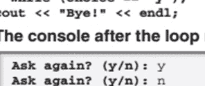

# 描述

- do-while 循环的工作原理类似于 while 循环，不同之处在于在循环后测试条件。正如此，它的代码始终至少执行一次。

图 4-6 如何编写 do-while 循环

# 如何编写 for 循环、do-while 循环和嵌套循环

现在你已经知道了如何编写 while 循环和 do-while 循环，接下来将学习如何编写 for 循环。这是 C++ 实现迭代结构的另一种方式。此外，你还将学习如何将一个循环嵌套在另一个循环内部。

## 如何编写 for 循环

图 4-8 显示了如何使用 `for` 语句编写 for 循环。当你需要递增或减少一个决定循环执行次数的计数器时，这种循环非常有用。

编写 for 循环时，你首先编写 `for`，后面跟着三个包含在括号内并用分号隔开的表达式。第一个表达式初始化计数器的起始值，但也可以在循环之前定义计数器。第二个表达式是一个布尔表达式，用于确定循环何时结束。第三个表达式则决定了在每次循环执行时计数器如何递增或减少。

图中的前两个示例执行的任务与图 4-4 中所示的前两个循环相同。对 for 循环的对比表明，当需要计数器变量时，for 循环相比于 while 循环有所改进。这是因为 for 循环要求你在循环顶部编写控制计数器变量的三个表达式。这使得代码更加简洁，而且更容易读。

在第一个示例中，初始化表达式定义了一个名为 `i` 的 `int` 类型计数器变量，并将其初始化为 1。然后，布尔表达式指定只要计数器变量小于 5，循环就会重复。接下来，递增表达式在每次循环结束时将计数器加 1。在循环内部，第一条语句将计数器变量和空格写入控制台，第二个语句将计数器变量加到 `sum` 的当前值。

与第一个示例一样，第二个示例也在控制台上显示数字 1 到 4。然而，由于此循环只包含一条语句，循环的大括号是可选的，并且被省略了。这与 `if` 语句和 while 循环的情况相同。即使循环只包含一条语句，包含大括号通常被认为是良好的做法，因此第三和第四个示例包含了大括号。

第三个示例计算 8、6、4 和 2 之和。在 for 循环的括号内，初始化表达式指定只要计数器变量大于 0，循环就会重复，递增表达式使用复合赋值运算符在每次循环时从计数器变量中减去 2。在循环内部，第一条语句将计数器变量的值加到 `sum` 变量的当前值上。结果，`sum` 变量的最终值为 20。

## for 循环的语法

```cpp
for (initialization_expr; boolean_expr; increment_expr) {
  statements
}
```

## 计算数字 1 到 4 之和的 for 循环

```cpp
int sum = 0;
for (int i = 1; i < 5; ++i) {
  cout << i << ' ';
  sum += i;
}
cout << "\nSum: " << sum << endl;
```

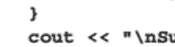

## 不带大括号的 for 循环

```cpp
for (int i = 1; i < 5; ++i)
  cout << i << ' ';
cout << "\nThe loop has ended." << endl;
```


## 加 8、6、4 和 2 的 for 循环

```cpp
int sum = 0;
for (int i = 8; i > 0; i -= 2) {
  sum += i;
}
cout << "Sum: " << sum;
```


## 计算未来值的 for 循环

```cpp
int months = 36;
for (int i = 1; i <= months; ++i) {
  future_value = (future_value + monthly_investment) *
  (1 + monthly_interest_rate);
}
```

## 描述

- 当你需要递增或减少一个决定循环执行次数的计数器时，for 循环非常有用。
- 在 for 循环的括号内，你编写了一个为计数器提供起始值的初始化表达式、一个确定循环何时结束的布尔表达式，以及一个递增或减少计数器的递增表达式。
- 如果必要，你可以在循环之前声明计数器变量。那么，该变量在循环执行完成后仍在作用域内。

图 4-8 中的第四个示例展示了如何编写计算一系列每月投资未来值的循环。在这里，循环每个月执行一次。

## 未来值程序

现在你已经学习了如何编写 for 循环，图 4-9 展示了一个使用嵌套在 while 循环中的循环的未来值程序。正如该程序的控制台所示，用户首先输入每月投资额、年利率和年数的值。然后，程序计算并显示结果。

## 如何编写嵌套循环

如你在上一幅图所示，你可以将一个循环嵌套在另一个循环内部。事实上，使用嵌套循环来处理按行和列排列的数据是非常常见的。例如，图 4-10 显示了如何使用嵌套循环显示未来值计算表。在该表中，每月投资额为 200，利率在 5.0% 到 6.5% 之间变化，年限从 1 到 6 年不等。

在这个示例中，第一个 `for` 循环为表格添加表头行。在循环开始之前，代码显示 "Year"（年份）。然后，循环显示从 5.0% 到 6.5% 的利率，用制表符分隔每一列。该循环结束后，代码通过开始新行来结束该行。

在第一个循环之后，嵌套的 `for` 循环显示每一年未来值计算的行和列。首先，外循环遍历年份（1, 2, 3, 4, 5 和 6）。在循环内部，代码在第一列显示年份。然后，嵌套循环遍历四种利率（5%、5.5%、6% 和 6.5%）。在循环内部，代码计算每种利率的未来值，将每个结果舍五入为整数，并显示每个计算结果，用制表符分隔每一列。当嵌套循环完成后，外循环开始新行，从而结束该行。

当你查看这段代码时，可能会注意到使用制表符来对齐列中的数据。此外，你可能会注意到未来值的计算都已舍五入为整数（没有小数）。这种方法使得按列对齐这些计算结果成为可能。遗憾的是，它无法让你控制数据的显示方式，而且在所有系统上都无法正常工作。幸运的是，下一章将介绍让你更好地控制在控制台上显示数据的技能，包括控制数字的小数位数以及每列的宽度和对齐方式。

# 控制台投资：200

| Year | 5% | 5.5% | 6% | 6.5% |
| :--- | :--- | :--- | :--- | :--- |
| 1 | 2466 | 2473 | 2479 | 2486 |
| 2 | 5058 | 5085 | 5112 | 5139 |
| 3 | 7783 | 7844 | 7907 | 7969 |
| 4 | 10647 | 10760 | 10874 | 10989 |
| 5 | 13658 | 13839 | 14024 | 14211 |
| 6 | 16823 | 17093 | 17368 | 17649 |

# 打印未来值表格的嵌套循环

```cpp
// 设置每月投资额并向用户显示
int monthly_investment = 200;
cout << "Monthly investment: " << monthly_investment << endl << endl;

// 显示表头行
cout << "Year:";
for (double rate = 5.0; rate < 7.0; rate += .5) {
    cout << "\t" << rate << " \%";
}
cout << endl;

// 遍历年份
for (int year = 1; year < 7; ++year) {
    // 在行开头显示年份
    cout << year << "\t";
    // 遍历每个利率
    for (double rate = 5.0; rate < 7.0; rate += .5) {
        int months = year * 12;
        double monthly_rate = rate / 12 / 100;
        // 计算未来值
        double future_value = 0.0;
        for (int i = 1; i <= months; ++i) {
            future_value = (future_value + monthly_investment) * (1 + monthly_rate);
        }
        // 舍五入为整数
        future_value = round(future_value);
        // 显示每个利率的计算结果
        cout << "\t" << future_value;
    }
    // 结束年份的行
    cout << endl;
}
cout << endl;
```

图 4-10 如何编写嵌套循环

# 如何编写 break 和 continue 语句

`break` 和 `continue` 语句让你对循环拥有额外的控制权。`break` 语句通过导致程序执行跳转到其后的语句来跳出循环。这会导致循环结束。`continue` 语句通过导致执行跳转到循环顶部来继续循环。这会导致循环重新评估布尔条件。

## 如何编写 break 语句

图 4-11 中的第一个示例显示了 `break` 语句是如何作用的。在这里，`while` 循环中的条件被刻意设置为 `true`。正如此，`while` 循环永远不会因为条件变为 `false` 而结束。然而，你可以使用 `break` 语句来结束循环。

在循环内部，第一个语句要求用户输入命令。如果用户输入的不是 "exit"，代码会将命令写入控制台。然而，如果用户输入 "exit"，代码将使用 `break` 语句来结束循环。

## 如何编写 continue 语句

图 4-12 中的第二个示例显示了 `continue` 语句是如何作用的。该示例使用 `while` 循环从用户处获取数字。如果数字在有效范围之外，代码使用 `continue` 语句跳过循环的剩余部分并再次请求数字。

```cpp
char choice = 'y';
while (choice == 'y') {
    cout << "Enter a number between 1 and 100: ";
    int number;
    cin >> number;
    if (number < 1 || number > 100) {
        cout << "Number must be between 1 and 100. Try again.\n";
        continue;
    }
    cout << "You entered: " << number << endl;
}
```


# 控制台

```
猜猜数字吧！

我正在想一个 1 到 10 之间的数字

你的猜测: 11

无效猜测。请重试。

你的猜测: 5

数字太小了。

你的猜测: 7

你用了 2 次尝试猜中了。

再见！
```

# 代码

```cpp
#include <iostream>
#include <cstdlib>
#include <ctime>

using namespace std;

int main() {
    int upper_limit = 10;

    cout << "Guess the number! from 1 to " << upper_limit << "\n\n";
    cout << "I'm thinking of a number from 1 to " << upper_limit << "\n\n";

    // get a random number between 1 and the upper limit
    srand(time(NULL)); // seed the rand() function
    int number = rand() % upper_limit; // number is >= 0 and < upper_limit
    ++number; // number is >= 1 and <= upper_limit

    int count = 1;

    while (true) {
        int guess;
        cout << "Your guess: ";
        cin >> guess;

        if (guess < 1 || guess > upper_limit) {
            cout << "Invalid guess. Try again.\n";
            continue;
        }

        if (guess < number) {
            cout << "Too low.\n";
        } else if (guess > number) {
            cout << "Too high.\n";
        } else {
            cout << "You guessed it in " << count << " tries.\n";
            break;
        }
        ++count;
    }
    cout << "Bye!\n";
}
```

图 4-12 猜猜数字程序

# 展望

现在你已经完成了本章，你应该能够使用 `while`、`do-while` 和 `for` 循环进行编程了。这些是实现迭代结构的 C++ 语句。你可以使用它们执行重复性处理。此外，你应该能够使用 `break` 和 `continue` 语句来控制循环的运行方式。

# 术语

- 一元运算符
- 操作数前缀
- 操作数后置
- 复合赋值运算符
- 优先级
- 迭代结构
- 重复结构
- while 语句
- while 循环
- 先测试循环
- 计数变量
- 死循环
- do-while 循环
- do-while 测试语句
- 后测试循环
- 哨兵值
- for 语句
- for 循环
- break 语句
- continue 语句

# 总结

- 对单个操作数起作用的运算符称为一元运算符。增、减运算符可以作为操作数的前缀或后置，是一元运算符的示例。
- 复合赋值运算符提供了一种快捷方法，当变量是表达式的一部分时，将简单的算术表达式赋值给变量。
- 你可以使用 `while`、`do-while` 和 `for` 循环重复执行一个或多个语句，直到布尔表达式求值为假，你可以在需要时嵌套这些语句。
- 你可以使用 `break` 语句跳出当前循环，可以使用 `continue` 语句跳转到当前循环的开始。

# 练习 4-1 增强圆周计算器程序

在练习中，你将增强第 2 章中的圆周计算器程序，使用户能够进行多次计算，并对每个输入进行验证。当你完成后，测试运行的结果应该像这样：

```
圆周计算器

输入半径: 11

直径: 22

周长: 69.1

面积: 380.1

输入另一个半径？(y/n): y

输入半径: -1

半径必须为正数。

输入半径: 17.4

直径: 34.8

周长: 109.3

面积: 951.1

输入另一个半径？(y/n): n

```

再见！

1. 打开此文件夹中的圆周计算器项目或解决方案：`ex_starts\ch04_ex1_circle_calculator`。
2. 检查 `main.cpp` 文件中的代码并运行程序，以温习其工作原理。
3. 增强程序，使用户能够重复输入并获取多个半径的直径、周长和面积。为了实现这一点，请使用 `while` 循环。
4. 增强程序以检查半径是否小于等于零。如果是，显示错误消息并跳转到 `while` 循环的开头，给用户再次输入有效半径的机会。

# 练习 4-2 增强终值程序

在练习中，你将增强本章中的终值程序，使其显示每年的底的终值。当你完成后，测试运行的结果应该像这样：

```
终值计算器

输入每月投资: 100

输入年利率: 12

输入年数: 5

Year = 1      终值 = 1280.93

Year = 2      终值 = 2724.32

Year = 3      终值 = 4350.76

Year = 4      终值 = 6183.48

Year = 5      终值 = 8248.63

继续吗？(y/n)
```

1. 打开此文件夹中的终值项目或解决方案：`ex_starts\ch04_ex2_future_value`。
2. 运行程序查看它是如何运行的。
3. 修改程序以显示每年的终值。为了实现这一点，请使用 `while` 循环。
4. 进行任何必要的更改以使输出如上所示。

# 练习 4-3 修改猜数字程序

在练习中，你将修改本章中的猜数字程序，使其不使用 `break` 或 `continue` 语句。

1. 打开此文件夹中的数字项目项目或解决方案：`ex_starts\ch04_ex3_guess_number`。
2. 检查 `main.cpp` 文件中的代码，查看 `while` 循环包含 `break` 和 `continue` 语句。
3. 修改循环，使其执行直到猜测值等于随机数。为了实现这一点，将存储猜测的变量移动到循环之前，并对其初始化使其处于范围之外。
4. 为程序正确运行进行任何其他必要的更改。

# 如何处理输入流

在第 2 章中，你学习了从控制台获取输入的基本技能。现在，你将学习一些处理输入流的其他技能。这些技能包括检测和处理数据输入错误，例如用户在程序期望数字时输入了字符串。

## 流和缓冲区简介

图 5-1 向你介绍了一些适用于流的术语和概念，包括缓冲区的工作原理。首先，让我们复习一些适用于流术语。流是一个字符序列，你的程序可以使用它来处理输入或输出。输入和输出通常简写为 I/O 或 IO。

输入流包含从对象中读取的数据。例如，这里显示了当用户从第一个提示中输入一个整数时，从控制台读取的字符。在这里，用户输入了“22”并按了回车键，这在流中添加了一个换行符 (`\n`)。当你使用提取操作符从输入流中读取数据时，它会忽略制表符或换行符等空白字符。然而，正如你在下一个图中看到的，这些空白字符可能会影响从流中提取的数据。

输出流包含写入对象的数据。例如，这里显示了在用户完成输入流的所有数据后，写入到控制台的字符。在这里，代码使用 `endl` 操作符在“You entered:” 前后插入一个换行符 (`\n`)，并使用空格字符来分隔用户输入的四个值。

缓冲区是内存中的一个位置，在流数据被写入或读取时临时存储。当缓冲区被刷新时，缓冲区会被发送到下一个目的地。到目前为止，目的地是控制台。在本章中，你将学习如何将数据发送到文件或字符串缓冲区。

大多数情况下，你不需要知道缓冲区根据其内部逻辑何时刷新。但正如你在本章中学到的，你有时可以手动刷新缓冲区，并且有时可能丢弃缓冲区中的数据以免其被刷新。

当你处理流时，你应该知道 C++ 提供了流对象，让你向许多目的地写入和从中读取，包括控制台、磁盘上的文件或内存中的缓冲区。幸运的是，一旦你学会了处理一种流对象，大多数相同的技能适用于其他类型的流对象。这是因为 C++ 提供的所有流对象共享类似的接口。因此，你可以对所有流使用相同的操作符和成员函数。

## 从控制台读取输入并向控制台写入输出的程序

```cpp
int i;

cout << "Enter an integer: ";

cin >> i;

double d;

cout << "Enter a double: ";

cin >> d;

char c;

cout << "Enter a character: ";

cin >> c;

string s;

cout << "Enter a string: ";

cin >> s;

cout << endl << "You entered:" << endl;

cout << i << ' ' << d << ' ' << c << ' ' << s << endl;
```

## 控制台

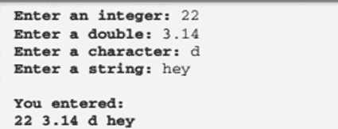

## 第一个条目的输入流

| 2 | 2 | \n |
|---|---|---|

## 带有用户输入的输出流

| n | Y | o | u | e | n | t | e | r | d | : | 2 | 2 | 3 | 1 | 4 | d | h | e | y |
|---|---|---|---|---|---|---|---|---|---|---|---|---|---|---|---|---|---|---|---|

## 描述

- 流是一个字符序列，可以用于处理程序的输入和输出。输入和输出简写为 I/O 或 IO。
- 输出流包含写入对象的字符数据，而输入流包含从对象中读取的数据。当从输入流中读取数据时，空格、制表符或换行符等空白字符通常会被忽略。
- 缓冲区是内存中的一个位置，在流数据被写入或读取时临时存储。当缓冲区被刷新时，缓冲区中所有临时数据都会发送到下一个目的地。
- C++ 提供了流对象，让你向许多目的地写入和从中读取，包括控制台、磁盘上的文件或内存中的缓冲区。
- C++ 提供的所有流对象共享类似的接口。因此，你可以对所有类型的 C++ 流使用相同的操作符和成员函数。

## 意外输入如何导致问题

图 5-2 显示了意外输入如何给像前一个图中所示程序带来问题。首先，第一个示例显示了如果用户在第一个提示处输入程序的所有数据会发生什么。这导致代码显示第二个、第三和第四个提示，而不会暂停让用户输入数据。要解决这个问题，你可以像下一个图所示丢弃任何额外数据。

第二个示例显示了如果用户输入数据类型不正确时可能发生的问题。这也会导致程序显示提示而不会暂停让用户输入数据。再次，解决此问题的方法之一是在每个提示后像下一个图所示丢弃任何额外数据。

注意，尽管当用户在第一个提示处输入所有数据时程序没有正常工作，但仍然显示了正确的输出。

然而，当用户输入数据类型错误时，输出是不正确的。因此，为这种情况提供处理措施尤为重要。

## 第 5 章 如何处理 I/O 流和文件 145

## 当用户在一行输入所有数据时的程序

```
Enter an integer: 22 3.14 d hey

Enter a double: Enter a character: Enter a string:

You entered:

22 3.14 d hey
```

## 用户输入的字符串和提取出的值

```
2 2 3.14 d h e y \n
```

## 程序执行的操作

1. 程序提取了值 1。空白字符和其他值留在了缓冲区中。
2. 程序提示用户输入值 2，但由于缓冲区中仍有数据，它不会暂停允许用户输入值。相反，程序丢弃了领先空白字符并提取了值 2。再次，字符串值 2 的其余部分留在缓冲区中。
3. 步骤 2 对值 3 和 4 重复。

## 当用户输入错误数据类型时的程序

```
Enter an integer: 3.14

Enter a double: Enter a character: Enter a string:

You entered:

3.14 d hey
```

## 用户输入的字符串和提取出的值

```
3.14 h
```

## 程序执行的操作

1. 程序提取了值 1。空白字符和其他值留在缓冲区中。
2. 程序提示用户输入值 2，但由于缓冲区中仍有数据，它不会暂停允许用户输入值。相反，程序丢弃了领先空白字符并提取了值 2。再次，值 2 的其余部分留在缓冲区中。
3. 步骤 2 对值 3 和 4 重复。

## 用户输入错误数据类型时的程序

```
Enter an integer: 3.14

Enter a double: Enter a character: Enter a string:

You entered:

3 h
```

## 描述

- 一行中的额外数据或错误的数据类型会导致意外结果


## 如何从输入流丢弃数据

图 5-3 显示了如何使用 `numeric_limits` 类丢弃剩余数据。这与第 2 章学的技术相似，但它确保丢弃所有数据，而不仅仅是你指定的字符数。注意，丢弃缓冲区数据不等于刷新缓冲区。当你刷新缓冲区时，缓冲区的数据会被发送到另一个目的地。但当你丢弃缓冲区数据时，它不会发送到任何地方。

要使用 `numeric_limits` 类，你需要包含 `limits` 头文件。然后，你可以使用 `numeric_limits` 类的 `max()` 函数获取流的最大值。你可以将此值作为第一个参数传递给 `cin` 对象的 `ignore()` 成员函数，并将 `\n` 作为第二个参数提供。这样，C++ 会丢弃输入缓冲区中的剩余数据。

当你知道只想检索用户输入的第一个数据值时，在读取第一个元素后立即丢弃缓冲区中的剩余数据是合理的。这样，你可以确保额外数据不会在程序的后续部分引起意外行为。例如，在本例中，丢弃缓冲区中剩余数据的代码编写在每个从输入缓冲区提取数据值的语句之后。在本例中，没有在最后一组语句后编写它，但许多程序员认为这是一个良好的习惯，因为便于添加代码而不会产生意外结果。

图中所示两个控制台显示了此代码是如何工作的。在第一个控制台中，代码丢弃了用户输入的所有额外数据，并只提取每个提示的第一个数据值。在第二个控制台中，代码仅从第一个提示处的“3.14”中提取了整型值 3，并且仅从提示处的“hey”中提取了字符型值 'h'。然而，第二个和第四个提示工作符合预期。

# 如何包含 numeric_limits 类的头文件

```cpp
#include <limits>
```

# 如何忽略缓冲区中剩余的数据

```cpp
cin.ignore(numeric_limits<streamsize>::max(), '\n');
```

程序已更新，在提取完每个值后清理缓冲区

```cpp
int i;

cout << "Enter an integer: ";

cin >> i;

cin.ignore(numeric_limits<streamsize>::max(), '\n');

double d;

cout << "Enter a double: ";

cin >> d;

cin.ignore(numeric_limits<streamsize>::max(), '\n');

char c;

cout << "Enter a character: ";

cin >> c;

cin.ignore(numeric_limits<streamsize>::max(), '\n');

string s;

cout << "Enter a string: ";

cin >> s;

cin.ignore(numeric_limits<streamsize>::max(), '\n');

// 剩余代码与图 5-1 相同
```


# 当用户在一行输入所有数据时的程序运行

| 输入一个整数: 22 3.14 d hey |
| :--- |
| 输入一个双精度: 3.14 d hey |
| 输入一个字符: d hey |
| 输入一个字符串: hey |
| 你输入了: |
| 22 3.14 d hey |

# 当用户在两个提示输入错误数据类型时的程序运行

| 输入一个整数: 3.14 |
| :--- |
| 输入一个双精度: 3.14 |
| 输入一个字符: hey |
| 输入一个字符串: hey |
| 你输入了: |
| 3 3.14 h hey |

# 描述

- 你可以使用流对象的 `ignore()` 成员函数和 `numeric_limits` 类的 `max()` 函数来忽略缓冲区中剩余的数据。


# 如何检测输入错误

当你使用输入流执行输入操作时，C++ 会根据操作结果设置流对象的错误位。然后，你可以如图 5-4 所示，使用 `cin` 对象或流对象的错误成员函数检查流的状态。

前两个示例展示了如何使用 `cin` 对象检查流的状态。在第一个示例中，`cin` 对象被用作 `if` 语句的布尔条件。此时，如果流处于良好状态（设置了 `goodbit`），C++ 会将 `cin` 对象转换为真值。结果代码将显示用户输入的数字。然而，如果流不处于良好状态，C++ 会将 `cin` 对象转换为假值。这时，代码将显示错误消息，指示用户没有输入有效数字。

第二个示例展示了一种更简洁的方法来提取输入值并检查流的状态。在这里，提取表达式被编码为布尔条件。这执行了与第一个示例相同的任务，但少了一行代码。这是你将在本章中反复看到的常用编码技术。

当你使用 `cin` 对象检查输入流的状态时，你只能检查流是否处于良好状态。要检查其他错误位所表示的状态，你可以使用输入流的错误成员函数。第三个示例对此所示。

在这个示例中，对流的状态执行了不同的操作。如果流处于良好状态，代码显示用户输入的数字。如果流处于失败状态，代码显示一条消息，指示数字无效并要求用户重试。如果流处于糟糕状态，代码显示一条消息指示发生了不可恢复的错误，并执行 `return` 语句退出当前函数。如果当前函数是 `main()` 函数，会导致程序结束，这通常是在流处于糟糕状态时你想要的结果。

在检查流状态时需要记住的一点是多个位可能同时被设置。例如，如果你的代码读取过了文件末尾，`eofbit` 和 `failbit` 可能都会被设置。因此，当你编写检查错误位的 `if` 语句时，需要确保按照正确的顺序编写条件。例如，你通常会在检查 `failbit` 的语句之前编写检查 `eofbit` 的语句。

虽然这里没有显示，但在处理输入流时，你也可以使用 `clear()` 错误成员函数。该函数会将流对象的所有错误位设置，指示流处于良好状态。你将在下一张图中看到如何使用该函数。

# 第 5 章 如何与 I/O 流和文件一起工作 149

### 流对象的错误位

| 位 | 描述 |
| :--- | :--- |
| `ios::eof` | 输入流的结束（eof 代表 end of file）。 |
| `ios::failbit` | 尝试的操作失败，流仍正常 |
| `ios::badbit` | 尝试的操作失败，且流的完整性可能受到破坏 |
| `ios::goodbit` | 上述位均未设置，且流处于良好状态 |

### 流对象的错误成员函数

| 函数 | 描述 |
| :--- | :--- |
| `eof()` | 如果设置了 eof 则返回 true；否则返回 false。 |
| `fail()` | 如果设置了 `failbit` 则返回 true；否则返回 false。 |
| `bad()` | 如果设置了 `badbit` 则返回 true；否则返回 false。 |
| `good()` | 如果设置了 `goodbit` 则返回 true；否则返回 false。 |
| `clear()` | 设置所有错误位以指示流处于良好状态 |

# 循环到用户输入有效数字为止

```cpp
#include <iostream>
#include <limits>

using namespace std;

int main() {
    double num;

    while (true) { // loop continues until break statement
        cout << "Enter a number (1-100): ";
        cin >> num;

        // 如果提取操作失败，重试
        if (cin.fail()) {
            cout << "That's not a valid number. Try again.\n";
            cin.clear();
            cin.ignore(numeric_limits<streamsize>::max(), '\n');
            continue;
        }

        // 检查数字范围
        if (num < 1) {
            cout << "Number must be greater than 0. Try again.\n";
        } else if (num > 100) {
            cout << "Number must be 100 or less. Try again.\n";
        } else { // 数字在指定范围内 - 循环
            break;
        }
    }

    cout << "Your number is " << num << endl;
    return 0;
}
```

# 控制台

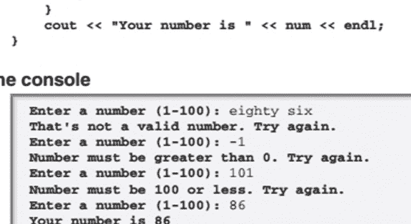

# 描述

- 你可以使用循环持续提示用户，直到用户输入有效数据。这被称为数据验证。

图 5-5 如何处理数据输入错误

# 如何与输出流操作

在第 2 章中，你学习了向控制台显示输出的基本技能。现在，你将学习一些处理输出流的额外技能。这些技能包括如何以左对齐或右对齐的列显示数据，以及如何控制浮点数的格式。

# 流操纵符简介

图 5-6 首先总结了最常用的流操纵符，你可以配合流插入运算符 (`<<`) 使用它们来格式化输出流。这些操纵符可以在 `iostream` 和 `iomanip` 头文件中找到，包含了你在第 2 章学过的 `endl` 操纵符，以及你在本章中将学习的六个操纵符。

在回顾这些运算符时，请注意 `endl` 操纵符会向流中添加换行符 (`\n`) 并刷新缓冲区。如果你手动向流中添加换行符 (`\n`)，缓冲区不会被刷新。当你处理大文件时，频繁刷新缓冲区会降低性能。因此，如果你担心性能，在不需要刷新缓冲区的情况下，可以使用换行符 (`\n`) 代替 `endl` 操纵符。

# 如何指定列的宽度

如果你需要在列中显示数据，可以使用制表符 (`\t`) 来分隔列。然而，使用制表符并不总是能正常工作，而且它并无法让你指定列的宽度。在图 5-6 中，该实例使用制表符来对齐两列数据。在这里，每列的标题与该列的数据没有对齐。

为了解决这个问题，你可以像第二个示例所示使用 `setw()` 操纵符。在这里，`setw()` 操纵符指定每列的宽度为 10 个字符。此外，当你使用 `setw()` 操纵符时，它默认使用右对齐，这通常是你在列中显示数字时需要的。

当你使用 `setw()` 操纵符时，必须在每个数据元素之前编写它。在这个示例中，输出包含两列四行。因此，你必须编写八次 `setw()` 操纵符。

# 常见的流操纵符

| 操纵符 | 头文件 | 描述 |
| --- | --- | --- |
| `endl` | `iostream` | 向流添加换行符并刷新缓冲区。 |
| `setw(n)` | `iomanip` | 将列的宽度设置为指定的字符数。 |
| `left` | `iostream` | 将填充字符位于任何输出的左侧。 |
| `right` | `iostream` | 将填充字符位于任何输出的右侧。 |
| `setprecision(n)` | `iomanip` | 将浮点数的精度设置为指定的数字。 |
| `fixed` | `iostream` | 使用固定点计数法而非科学计数法格式化浮点数。 |
| `showpoint` | `iostream` | 让浮点数始终显示小数点和小数位。 |

# 如何包含 iomanip 头文件

```cpp
#include <iomanip>
```

# 如何使用制表符对齐列

```cpp
cout << "PREVIOUS" << "\t" << "CURRENT" << endl;
cout << 305 << "\t" << 234 << endl;
cout << 5058 << "\t" << 5084 << endl;
cout << 10647 << "\t" << 10759 << endl;
```

# 输出

| PREVIOUS | CURRENT |
| --- | --- |
| 305 | 234 |
| 5058 | 5084 |
| 10647 | 10759 |

# 如何指定列的宽度

```cpp
cout << setw(10) << "PREVIOUS" << setw(10) << "CURRENT" << endl;
cout << setw(10) << 305 << setw(10) << 234 << endl;
cout << setw(10) << 5058 << setw(10) << 5084 << endl;
cout << setw(10) << 10647 << setw(10) << 10759 << endl;
```

| PREVIOUS | CURRENT |
| --- | --- |
| 305 | 234 |
| 5058 | 5084 |
| 10647 | 10759 |

# 如何格式化浮点数

图 5-8 显示了如何格式化浮点数。首先，你应该知道，默认情况下，浮点数的显示有效位数不超过六位。有效数字是指能够传载关于测量准确性意义的数字。有效数字包括其他非零数字之间的零，但不包括前导零或末尾零。例如，10990 有四位有效数字（1099）。这是因为当数字以科学计数法显示时（1.099 × 10⁵），末尾的零是不需要的。相反，0.001099 有四位有效数字（1099）。这是因为当数字以科学计数法显示时（1.099 × 10⁻⁴），前导零是不需要的。

格式化浮点数的一种方法是将其数字四舍五入到指定数量的有效位数。要做到这一点，你可以使用 `setprecision()` 操纵符。第一个示例展示了它是如何工作的。首先，它定义并初始化了两个具有 7 位有效数字的值。然后，它分别显示了具有三位和五位有效数字的数字。如果你在这里没有使用 `setprecision()` 函数，这两个值都将以默认的六位有效数字显示。

在这个示例中，第二个数字非常大。因此，C++ 使用科学计数法来显示它。然而，第一个数字既不大也不小。因此，C++ 使用标准记法来显示它。

第二个示例展示了如何使用 `fixed` 操纵符来显示定点记法。在这里，`fixed` 操纵符表示数字应该具有固定的小数位数。然后，`setprecision()` 操纵符表示该数字应该有 2 位小数。因此，C++ 显示此示例中的所有数字时都不带任何末尾零。为了做到这一点，它对第一个数字进行了四舍五入，并对其两个数字增加了末尾零。

第三个示例展示了如何使用 `showpoint` 操纵符强制显示末尾零。在这里，精度被设置为 8。默认情况下，C++ 不显示对数字没有额外意义的末尾零，除非你使用 `fixed` 操纵符。因此，这段代码开始显示 4500.0 的 `double` 值且不带任何末尾零。然而，这段代码继续使用 `showpoint` 操纵符显示 8 位数字，小数点左侧四位，右侧四位。

当你使用 `setprecision()`、`fixed` 和 `showpoint` 操纵符时，你需要记住它们是“粘性的（sticky）”的。因此，它们会一直有效，直到你更改它们或程序结束。

# 如何设置有效数字的数量

```cpp
double d1 = 1.012345;
double d2 = 101234500000;

cout << setprecision(3) << "3 significant digits\n"
     << d1 << endl
     << d2 << endl;

cout << setprecision(5) << "5 significant digits\n"
     << d1 << endl
     << d2 << endl;
```

# 输出

```
3 significant digits
1.01
1.01e+11
5 significant digits
1.0123
1.0123e+11
```

# 如何设置小数位数

```cpp
cout << fixed << setprecision(2)
     << 10.125 << endl
     << 19.5 << endl
     << 42.0 << endl;
```

# 输出

```
10.13
19.50
42.00
```

# 如何强制显示末尾零

```cpp
double d3 = 4500.0;

cout << setprecision(8)
     << d3 << endl
     << showpoint << endl
     << d3 << endl;
```

# 输出

```
4500
4500.0000
```

# 

- `setprecision()` 操纵符对浮点数的有效数字进行四舍五入，有效数字是带有关于测量准确性意义的数字。
- `fixed` 操纵符强制浮点数的输出为定点记法，而不是默认的科学计数法。
- `showpoint` 操纵符强制显示末尾零。
- `setprecision()`、`fixed` 和 `showpoint` 操纵符是粘性的。因此，它们会一直有效，直到你更改它们或程序结束。

图 5-8 如何格式化浮点数

# Invoice 3.0 程序

图 5-9 显示了你在第 3 章学习如何编写的 Invoice 程序的另一个版本。然而，这个版本的程序验证了用户输入。此外，它以列的形式显示计算输出，并格式化显示的浮点数保留两位小数。

程序开始显示其标题。然后，它从用户处获取客户类型。为了做到这一点，它使用一个 `while` 循环，直到用户输入有效的客户类型 'r' 或 'w'。注意这里在提取客户类型后，使用 `ignore()` 函数丢弃输入流中的任何额外数据，以防止意外输入导致问题。

如果用户输入有效的客户类型，此程序将执行 `break` 语句退出 `while` 循环。否则，它会显示错误消息并提示用户输入另一个客户类型。

第二个 `while` 循环从用户处获取小计。在这个循环内部，如果输入流状态良好，则执行 `break` 语句退出循环。否则，它会显示错误消息并重试。

# 控制台

| The Invoice 3.0 program |
| :--- |
| INVOICE |
| Subtotal: 973.00 |
| Discount percent: 20% |
| Discount amount: 194.60 |
| Invoice total: 778.40 |

# 代码

```cpp
#include <iostream>
#include <iomanip>
#include <limits>
#include <cmath>

using namespace std;

int main() {
    // get input
    cout << "The Invoice 3.0 program\n\n";

    char customer_type;

    while (true) {
        cout << "Enter customer type (r/w): ";
        cin >> customer_type;
        cin.ignore(numeric_limits<streamsize>::max(), '\n');

        if (tolower(customer_type) == 'r' || tolower(customer_type) == 'w') {
            break;
        } else {
            cout << "Invalid customer type! try again.\n";
        }
    }

    double subtotal;

    while (true) {
        cout << "Enter subtotal: ";
        if (cin >> subtotal) { // stream good - end loop
            break;
        } else { // stream failed - try again
            cout << "Invalid number! try again.\n";
            cin.clear();
            cin.ignore(numeric_limits<streamsize>::max(), '\n');
        }
    }

    // ... (rest of the program)
    return 0;
}
```

图 5-9 Invoice 3.0 程序（部分 1/2）

# 代码（续）

```cpp
} else if (cin.bad()) { // 流异常 - 退出程序
```


cout << "Sorry, an unexpected error has occurred. Bye! ";

return 0;

}

// 设置折扣百分

double discount_percent;

if (tolower(customer_type) == 'r') { // 零售

  if (subtotal < 100) {

    discount_percent = .0;

  } else if (subtotal >= 100 && subtotal < 250) {

    discount_percent = .1;

  } else {

    discount_percent = .2;

  }

} else if (tolower(customer_type) == 'w') { // 批发

  if (subtotal < 500) {

    discount_percent = .4;

  } else {

    discount_percent = .5;

  }

} else {

  discount_percent = .0;

}

// 计算结果

double discount_amount = subtotal * discount_percent;

double invoice_total = subtotal - discount_amount;

// 显示输出

int col1 = 18;

int col2 = 8;

cout << fixed << setprecision(2) << endl // 使用 2 位小数

  << setw(col) << "INVOICE" << endl

  << left << setw(col1) << "Subtotal:"\n  << right << setw(col2) << subtotal << endl

  << left << setw(col1) << "Discount percent:";

  << right << setw(col2) << discount_percent << endl

  << left << setw(col1) << discount_amount << endl;

  << left << setw(col1) << "Invoice total:";

  << right << setw(col2) << invoice_total << endl;

// 显示退出信息

cout << endl << left << "Bye! ";

```

图 5-9 发票 3.0 程序（部分中的 2 部分）

# 如何使用文件流

到此时，你已经掌握了处理 I/O 流所需的大部分技能。然而，你仅学会了如何将这些应用于控制台操作。现在，你将学习如何将这些技能应用于处理文件。这被称为文件 I/O，它很重要，因为存储在主内存（RAM）中的数据在程序结束时会丢失。但是，如果你将数据写入文件，就可以在下次程序运行时从文件中读取它。

# 如何读取和写入文件

图 5-10 展示了如何读取和写入文件。为此，你可以使用 `fstream` 头文件中的三个类，这些类在该文件的顶部进行了总结。首先，你可以为文件流创建一个对象。然后，你可以使用 `open()` 函数打开连接文件的流。

对于 `open()`，文件名参数 `filename` 指定了文件的路径。在本书中，示例仅指定了文件名。因此，`open()` 函数会在工作目录中查找文件。工作目录的位置取决于你使用的 IDE。例如，如果你使用 Visual Studio，工作目录是包含程序 `main()` 函数的源代码文件所在的目录。如果你使用 Xcode，工作目录是程序可执行文件所在的目录。如果你想处理不在工作目录的文件，可以像附录 B 中那样指定文件的完整路径。

当你打开一个文件流对象时，会使用一些操作系统资源进行操作。因此，当你完成对该对象的操作后，应该调用它的 `close()` 函数将其关闭。这将释放文件流对象正在使用的资源，并防止在不关闭时可能发生的问题。

图中的示例适用于文本文件，文本文件是以系列字符存储数据的文件。图中的第一个示例展示了如何使用 `ofstream` 对象向文件写入数据。首先，它创建了一个名为 `output_file` 的 `ofstream` 对象。然后，它打开当前工作目录中名为 "names.txt" 的文件。如果该文件不存在，此代码将创建它。如果该文件已存在，其中包含的任何数据默认都会被删除。在下一幅图中，你将学习如何打开输出文件以便向其追加数据。

接下来，这段代码向输出流插入了三个名字，每个名字后面都跟着一个换行符。最后，这段代码关闭了 `ofstream` 对象，释放该对象使用的所有资源。这将刷新缓冲区中剩余的数据。

图中的第二个示例展示了如何从文件中读取数据。首先，它定义了一个名为 `input_file` 的 `ifstream` 对象。然后，它尝试成功打开当前工作目录下名为 "names.txt" 的文件。

如果文件成功打开，`ifstream` 对象返回真值。在这种情况下，代码使用 `while` 循环从文件中读取每一行并显示每

# 三种文件流类

| 类 | 描述 |
|---|---|
| `ifstream` | 创建输入流对象，从磁盘上的文件读取数据。 |
| `ofstream` | 创建输出流对象，向磁盘上的文件写入数据。 |
| `fstream` | 可以创建输入流、输出流，或两者兼有。参见下一幅图。 |

# 文件流类的两个成员函数

| 函数 | 描述 |
|---|---|
| `open(filename)` | 打开文件进行读取或写入。如果文件不存在，操作将失败。 |
| `close()` | 关闭文件并刷新缓冲区。 |

```cpp
#include <fstream>
```

# 如何向文件写入数据

```cpp
ofstream output_file;
output_file.open("names.txt");
output_file << "Alice" << endl;
output_file << "Bob" << endl;
output_file << "Charlie" << endl;
output_file.close();
```

# 如何从文件中读取数据

```cpp
ifstream input_file;
input_file.open("names.txt");
if (input_file) {
    string line;
    while (getline(input_file, line)) {
        cout << line << endl;
    }
    input_file.close();
}
```

# 如何向文件追加数据

```cpp
ofstream output_file;
output_file.open("names.txt", ios::app);
output_file << "David" << endl;
output_file.close();
```

# 如何使用 fstream 对象处理文件

```cpp
fstream file_file;
file_file.open("names.txt", ios::in | ios::out);
if (file_file) {
    // ...
}
```

# 文件流对象 open() 成员函数的语法

`object.open(file_name, file_access_flag [ | file_access_flag ... ]);`

# 常见文件访问标志

| 标志 | 说明 |
|---|---|
| `ios::out` | 输出模式。如果文件存在，除非也指定了 `ios::app`，否则打开文件时，文件中任何现有数据都将被删除。如果文件不存在，则创建它。 |
| `ios::app` | 追加模式。文件中的任何现有数据将被保留，新数据将写入（追加）到文件末尾。如果文件不存在，则创建它。 |
| `ios::trunc` | 截断模式。打开文件时，文件中任何现有数据都将被删除（截断）。这是 `ios::out` 使用的默认模式。 |
| `ios::in` | 输入模式。如果文件不存在，打开操作将失败。 |

# 如何使用 ofstream 对象追加数据

```cpp
ofstream output_file;
output_file.open("names.txt", ios::app); // 以追加模式打开
output_file << "Mary\n";               // 写入流
output_file.close();                   // 关闭流并刷新缓冲区
```

# 在文本编辑器中查看文件时的内容

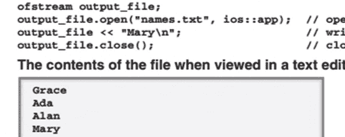

# 如何使用 fstream 对象进行输入输出

声明 `fstream` 对象

`fstream file;`

# 如何打开一个删除输出文件中现有数据的文件流

`file.open("names.txt", ios::out);`

# 另一种打开删除输出文件中现有数据的文件流的方法

`file.open("names.txt", ios::out | ios::trunc);`

# 如何打开向输出文件追加数据的文件流

`file.open("names.txt", ios::out | ios::app);`

# 如何打开一个从输入文件读取数据的文件流

`file.open("names.txt", ios::in);`

# 如何在一个语句中定义 fstream 对象

`fstream file("names.txt", ios::in);`

# Description

- `ofstream` 和 `fstream` 类的 `open()` 成员函数接受两个参数。第一个是要打开的文件名，第二个是指示要创建的流类型的文件访问标志。
- 若要向 `open()` 函数传递多个标志，请使用 `|` 运算符分隔每个标志。

该时间。然而，`ifstream` 对象提供了更大的灵活性，因为它允许你更改流的输入/输出模式。因此，你可能希望在一个程序中使用它，需要以输入模式打开文件、读取并处理输入数据、切换到输出模式，并将处理后的数据写入文件。

# 如何在处理文件时检查错误

图 5-12 显示了如何在处理文件时检查错误。首先，图中的第一个示例显示了一个循环，它从名为 info.txt 的文件中提取数字时没有检查错误。在这里，`while` 循环中的条件用于提取数字。这导致循环一直执行，直到提取操作失败为止。在这种情况下，当提取操作符尝试从文件中提取 "three" 时，循环结束。结果是，代码在控制台上显示了 100 和 200，但没有显示 400，因为 400 位于 "three" 和 "hundred" 之后。

为了解决这个问题，第二个示例使用了图 5-4 中描述的错误位在提取操作后检查文件流的状态。在这里，`while` 循环将持续到代码执行 `break` 语句为止。如果提取未成功，这段代码会在控制台上显示该数字。

如果提取未成功，这段代码使用 `ifstream` 对象的 `eof()` 和 `fail()` 来检查操作失败的原因。如果操作到达文件末尾，这段代码将退出循环。然而，如果操作由于其他原因失败，这段代码使用 `clear()` 函数将流重置为良好状态，并丢弃缓冲区剩余的数据。这将丢弃所有非数字数据，如 "three" 和 "hundred"。

当提取操作到达文件末尾时，它会将 `eof` 和 `fail` 位都设为 true。因此，如果你想让代码正常运行，你应该像本示例所示，在检查 `fail` 位之前先检查 `eof` 位。如果你先检查 `fail` 位，那么 `eof` 位的 `else` 子句将永远不会执行，代码将进入死循环。

在处理文件时，你通常需要在处理过程中检查错误。对于从外部源获取的可能包含不一致数据的文件尤其如此。随着本章的深入，你将了解到更多相关知识。

# 名为 info.txt 文件中的数据

```
100
200
three hundred
400
```

# 显示文本文件中数据的 while 循环

```cpp
ifstream input_file;
input_file.open("info.txt"); // 打开文件进行读取
if (input_file) { // 如果文件成功打开...
    int num;
    while (input_file >> num) { // 提取 int - 只要没有错误...
        cout << num << endl;
    }
    input_file.close();
}
```

# 如何处理数据错误

```cpp
ifstream input_file;
input_file.open("info.txt"); // 打开文件进行读取
if (input_file) { // 如果文件成功打开...
    int num;
    while (true) {
        if (input_file >> num) { // 提取 int - 只要没有错误...
            cout << num << endl;
        } else if (input_file.eof()) { // 文件末尾
            break;
        } else if (input_file.fail()) { // 提取失败
            input_file.clear();
            input_file.ignore(numeric_limits<streamsize>::max(), '\n');
        }
    }
}
input_file.close();
```

# 控制台

```
100
200
400
```

## 定义文件名的代码

`string filename = "temps.txt";`

## 将制表符数据写入文件

```cpp
ofstream output_file;
output_file.open(filename);
output_file << fixed << setprecision(1);
output_file << 48.4 << '\t' << 57.2 << '\n';
output_file << 46.0 << '\t' << 50.0 << '\n';
output_file << 78.3 << '\t' << 101.4 << '\n';
output_file.close();
```

在文本编辑器中查看该文件的内容

| 低 | 高 |
|---|---|
| 48.4 | 57.2 |
| 46.0 | 50.0 |
| 78.3 | 101.4 |

## 从文件中读取制表符数据

```cpp
cout << "TEMPERATURES" << "Low" << setw(8) << "High" << endl;
```

```cpp
ifstream input_file;
input_file.open(filename);

double low;
double high;
if (input_file) { // 如果文件打开成功...
  cout << fixed << setprecision(1);
  while (input_file >> low >> high) {
    cout << setw(8) << low << setw(8) << high << '\n';
  }
}
input_file.close();
```

## 控制台

| TEMPERATURES | |
|---|---|
| Low | High |
| 48.4 | 57.2 |
| 46.0 | 50.0 |
| 78.3 | 101.4 |

## 

- 当在文件中存储表格时，通常使用字符作为分隔符来表格的列和行。
- 使用制表符 (`\t`) 和换行符 (`\n`) 字符分隔列和行被称为制表符分隔文件（tab-delimited file）。

## 温度管理器程序

图 5-14 显示了一个温度管理器程序，它允许你查看存储在文件中的高低温对。此外，它还允许你向文件中添加温度。完成后，它允许你退出程序。要执行这些任务，你可以分别输入命令 'v'、'a' 或 'x'。

该程序的代码包含所有必要的头文件开始。这包括在本章描述的 `iomanip`、`fstream` 和 `limits` 文件。

在 `main()` 函数中，第一条语句定义了一个名为 `filename` 的字符串变量，并将其初始化为值 "temps.txt"。在函数的后半部分，用于输入和输出的文件流都使用了此文件名。因此，你可以确保文件输入和输出操作都是针对同一个文件进行的。

在显示命令列表后，该程序进入一个 `while` 循环，直到用户输入 'x' 退出为止。在循环中，前四条语句显示命令提示符并获取与用户输入的命令对应的字符。

## 控制台

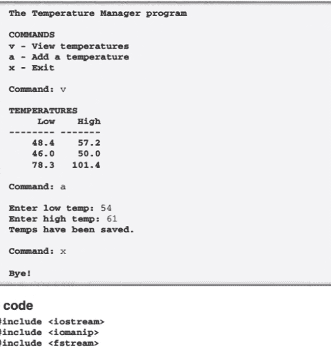

## 代码

```cpp
#include <iostream>
#include <fstream>
#include <limits>
#include <string>
using namespace std;
int main() {
    string filename = "temps.txt";
    cout << "The Temperature Manager program!\n\n";
    cout << "COMMANDS\n";
    cout << "v - View temperatures\n";
    cout << "a - Add a temperature\n";
    cout << "x - Exit\n";
    char command = ' ';
    while (command != 'x') {
        // 从用户获取命令
        cout << "Command: ";
        cin >> command;
        cout << endl;
    }
}
```


# 图 5-14 温度管理器程序（部分 1，共 2）

## 第一节 现代 C++ 的基本技能

获取命令字符后，这段代码检查该字符是否等于 `'v'`。如果是，代码将继续读取文件中存储的所有低温和高温，并将它们显示在控制台上。但首先，它会尝试打开文件并检查其是否成功打开。由于这段代码是图 5-13 中看到的简单代码，你理解它的工作原理应该不会太大困难。执行此代码后，程序执行到达 `while` 循环的末尾并回到循环顶部，这会导致程序从用户处获取另一个命令。

如果命令字符等于 `'a'`，这段代码将从用户处获取一个低温和一个高温。然后，它定义并打开了一个 `ofstream` 对象，并使用它将低温和高温附加到文件末尾。由于该文件是制表符分隔文件，这段代码用制表符分隔温度并在其后跟随换行符。再次，在执行此代码后，程序执行到达 `while` 循环的末尾并回到循环顶部，这会导致程序从用户处获取另一个命令。

如果命令字符等于 `'x'`，这段代码会在控制台上显示 "Bye!" 消息，表示程序正在结束。然后，程序执行回到 `while` 循环的顶部，循环条件求值为假。这导致循环结束，从而结束 `main()` 函数和程序。

如果命令字符不是上述之一，代码将在控制台上显示一条消息，指示命令无效。

## 代码（续）

```cpp
if (command == 'v') {
    cout << "TEMPERATURES\n";
    cout << setw(8) << "Low" << setw(8) << "High" << endl;
    ifstream input_file;
    input_file.open(filename);

    double low;
    double high;
    if (input_file) {
        cout << fixed << setprecision(1);
        while (input_file >> low >> high) {
            cout << setw(8) << low << setw(8) << high << '\n';
        }
        input_file.close();
    } else {
        cout << "Unable to open file.\n";
    }
} else if (command == 'a') {
    double low;
    cout << "Enter low: ";
    cin >> low;

    double high;
    cout << "Enter high: ";
    cin >> high;

    ofstream output_file;
    output_file.open(filename, ios::app);
    output_file << low << '\t' << high << '\n';
    output_file.close();
    cout << "Temps have been saved.\n";
} else if (command == 'x') {
    cout << "Bye!\n";
} else {
    cout << "Invalid command. Try again.\n";
}
```


## 三个字符串流类

| 类 | 描述 |
| --- | --- |
| `istream` | 创建一个输入流对象，用于从字符串中读取字符。 |
| `ostring` | 创建一个输出流对象，用于将字符写入字符串。 |
| `stringstream` | 创建一个既可以从字符串读取字符也可以向字符串写入字符的流对象。 |

## 字符串流类的成员函数

| 函数 | 描述 |
| --- | --- |
| `str()` | 返回一个字符串对象，其是缓冲区内容的拷贝。 |
| `str(string)` | 用指定的字符串替换缓冲区的内容。 |

## 如何包含字符串流类的头文件

```cpp
#include <sstream>
```

## 包含意外数据的数据文件

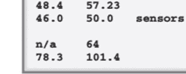

## 使用字符串处理意外数据的代码

```cpp
ifstream infile("temps.txt"); // 如果文件打开成功...
if (infile) {
    string line;
    stringstream ss;
    double low;
    double high;
    cout << fixed << setprecision(1);
    while (getline(infile, line)) {
        ss.str(line); // 用当前行替换字符串缓冲区
        ss.clear(); // 重置字符串错误位
        if (ss >> low >> high) {
            cout << setw(8) << low << " " << setw(8) << high << '\n';
        }
    }
    infile.close();
}
```

## 控制台


## 描述

- 字符串流使用一个字符串缓冲区来保存字符串中的字符。
- 在处理可能包含意外数据的文件的每一行时，字符串流特别有用。

## 图 5-15 如何使用字符串流处理意外数据

## 温度分析器程序

图 5-16 显示了一个温度分析器程序，它从文本文件中读取温度数据，处理数据并在控制台上显示结果。开始时，该程序从用户处获取文件名。如果该文件不存在，程序将显示错误消息并提示用户输入另一个文件名。

一旦用户输入了有效文件名，程序将从该文件中读取最低温度和最高温度。在读取过程中，它会忽略行尾的任何额外数据，并跳过空行以及包含不正确数据类型的行。因此，该程序能够处理包含意外数据的文件，例如图所示的 `temps.txt` 文件。

对于程序能够成功处理的每一行，程序都会计算平均温度，并在控制台上显示最低、最高温度和平均温度。此外，它还会更新总的最低和最高温度以及每日总平均温度。

当程序结束时，它会显示一条消息，其中包含总行数（天）以及成功处理的行数。这样，用户就可以知道程序处理了整体数据中的多少部分。最后，程序会显示最低、最高和平均温度的总计。

到目前，你理解之前这些图示的代码应该不会有太大困难。它的工作方式与之前图中的示例非常相似。然而，它允许用户指定文件名，并对数据进行了一些额外处理。

在第 2 部分，提示用户输入文件名的代码使用循环来持续提示，直到用户输入一个可以成功打开的文件名。在该循环之后，代码将显示一条消息表明文件已成功打开，并显示表头。

接下来，这段代码定义并初始化了第 3 部分循环使用的变量。这包括名为 `lowest` 和 `highest` 的变量，用于存储总的最低和最高温度。在这里，`lowest` 变量初始化为一个较大的数（1000），而 `highest` 变量初始化为一个较小的数（-100）。虽然处理的前两个温度应该被设置为最低和最高温度，但之后，代码仅当温度低于或高于当前最低或最高温度时才设置这些变量。

在循环内部，代码增加了读取的行数和处理的行数。此外，当代码成功处理一行时，它会计算该行的平均温度，并在控制台中分三列显示最低、最高和平均温度。此外，它还会计算所有每日平均温度的总和。

循环结束后，代码通过将平均温度总和除以处理的行数来计算每日平均温度。然后，它分两列显示总的最低、最高和平均温度。

## 控制台

```
Temperature Analyzer

输入文件名: temps
无法打开输入文件! 请重试。
输入文件名: temps.txt
输入文件 (temps.txt) 已成功打开。

Low High Avg
----------------------------
48.4 57.2 52.8
46.0 50.0 48.0
45.0 55.3 50.1
54.0 61.0 57.5
37.0 52.0 44.5
37.0 43.3 40.1
45.0 57.0
```

## 描述

- `temps.txt` 文件

```cpp
#include <iostream>
#include <iomanip>
#include <fstream>
#include <string>
#include <sstream>
#include <limits>

using namespace std;

int main() {
    string filename;
    ifstream infile;

    while (true) {
        cout << "输入文件名: ";
        cin >> filename;
        infile.open(filename);
        if (infile) {
            cout << "输入文件 (" << filename << ") 已成功打开。\n";
            break;
        } else {
            cout << "无法打开输入文件! 请重试。\n";
        }
    }

    int col = 7;
    cout << fixed << setprecision(1);
    cout << setw(col) << "Low" << setw(col) << "High" << setw(col) << "Avg\n";
    cout << "----------------------------\n";

    double low = 0.0;
    double high = 0.0;
    double avg = 0.0;
    double avg_total = 0.0;
    double lowest = 1000.0;
    double highest = -100.0;
    int lines_read = 0;
    int lines_processed = 0;

    // 遍历文件的每一行
    string line;
    stringstream ss;
    while (getline(infile, line)) {
        lines_read++; // 计数器

        ss.str(line); // 用行替换字符串缓冲区
        ss.clear();   // 重置字符串错误位

        // 从字符串流提取温度 - 如果成功，则处理
        if (ss >> low >> high) {
            lines_processed++;

            // 计算平均温度
            avg = (low + high) / 2;

            // 显示最低、最高、平均温度
            cout << setw(col) << low << " " << setw(col) << high << " " << setw(col) << avg << endl;

            // 更新总计
            avg_total += avg;
            if (low < lowest) {
                lowest = low;
            }
            if (high > highest) {
                highest = high;
            }
        }
    }
    infile.close();

    cout << endl << "成功处理了"
         << lines_read << " 行。\n";

    // 计算每日平均值
    double avg_daily = avg_total / lines_processed;

    // 显示列
    cout << left << setw(col) << "最低温度: "
         << right << setw(col) << lowest << endl << " "
         << left << setw(col) << "最高温度: "
         << right << setw(col) << highest << endl << " "
         << left << setw(col) << "每日平均温度: "
         << right << setw(col) << avg_daily << endl << endl;

    return 0;
}
```

## 观点

在本章中，你学习了更多处理各种类型 I/O 流（输入输出流）的技能。这包括从控制台读取数据和写入数据的技能。包括处理文件输入和输出的技能。还包括处理字符串流（string streams）的技能，这在从文本文件中读取输入时通常非常有帮助。

尽管本章仅介绍了处理文本文件的技能，但你应该知道，你也可以使用 C++ 处理其他类型的文件，例如二进制文件。此外，你应该知道，大多数高级应用程序将其数据存储在数据库中。然而，这些 C++ 技能超出了本书的涵盖范围。

## 术语

| 流 (stream) | 文件 I/O (file I/O) |
| :--- | :--- |
| 输入 (input) | 主内存 (RAM) |
| 输出 (output) | 文本文件 (text file) |
| I/O | 文件访问标志 (file access flag) |
| 输入流 (input stream) | 表 (table) |
| 空格 (whitespace) | 列 (column) |
| 输出流 (output stream) | 行 (row) |
| 缓冲区 (buffer) | 字段 (field) |
| 刷新缓冲区 (flush the buffer) | 记录 (record) |
| 错误位 (error bits) | 分隔符 (delimiter) |
| 数据验证 (data validation) | 制表符分隔文件 (tab-delimited file) |
| 流操纵符 (stream manipulators) | 字符串流 (string stream) |
| 有效数字 (significant digits) | 字符串缓冲区 (string buffer) |
| 定点表示法 (fixed-point notation) | |

## 总结

- 流是一个字符序列，可以用于为程序获取输入或输出。输入和输出通常缩写为 I/O 或 IO。
- 输出流包含正在写入对象的数据，而输入流包含正在从对象中读取的数据。
- 当提取运算符（extraction operator，`>>`）从输入流读取数据时，空格、制表符或换行等空白字符通常会被忽略。
- 缓冲区（buffer）是内存中的一个位置，用于在流数据被写入或读取时临时存储数据。当缓冲区被刷新（flush）时，缓冲区中所有临时数据都会被发送到下一个目的地。
- C++ 提供的所有流对象具有相似的接口。因此，你可以对所有类型的 C++ 流使用相同的运算符和成员函数。
- 你可以使用输入流的成员函数来检查流的错误位，或重置流的错误位。
- 你可以使用循环提示用户，直到用户输入有效数据。这被称为数据验证（data validation）。
- 你可以与流插入运算符（`<<`）配合使用流操纵符来格式化输出流。
- `setprecision()` 操纵符会将浮点数四舍五入到指定的有效位数，有效位数是带有测量准确性意义的数字。
- `fixed` 操纵符强制浮点数输出为定点表示法，而不是默认的科学计数法。
- 存储在主内存（RAM）中的数据在程序结束时丢失。
- 文本文件以系列字符的形式存储数据。如果你在文本编辑器中打开文本文件，人类很容易阅读这些字符。
- `ofstream` 和 `fstream` 类的 `open()` 成员函数接受两个参数。第一个是要待打开的文件名，第二个是一个或多个文件访问标志，用于指示要创建的流类型。
- 在文件中存储数据表时，通常使用称为分隔符（delimiter）的字符分隔表的列和行（也称为记录和字段）。
- 使用制表符（`\t`）和换行符（`\n`）分隔列行的文件被称为制表符分隔文件（tab-delimited file）。
- 字符串流使用字符串缓冲区来持有字符串中的字符。

## 第 5 章 如何处理 I/O 流和文件 181

### 练习 5-1 验证数据并创建制表符分隔文件

在此练习中，你将修改一个计算每加仑英里数的程序，使其验证用户输入的数据，并将每次计算的数据存储在制表符分隔文件中。完成后，该制表符分隔文件应该像这样：

| 225.2 | 17.0 |
| 1374.8 | 64.5 |

#### 打开程序，检查代码并测试程序

1. 打开此文件夹中的每加仑英里数项目或解决方案：`ex_starts\ch05_ex1_mpg`
2. 检查代码。注意它验证了英里和加仑的输入以确保它们大于零，将 MPG 四舍五入到两位小数，并获取一次或多次行程的输入。
3. 运行程序查看其工作情况。观察当为英里或加仑输入 0 时会发生什么。然后测试当为其中一个输入项输入两个值时会发生什么。最后，测试当输入无效数字时会发生什么。

#### 验证并处理输入错误

4. 修改程序以丢弃用户输入的任何额外数据。
5. 修改程序，确保用户输入的是数字。如果输入操作失败，程序应显示错误消息，清除输入流中的错误位，并丢弃流中的任何剩余数据。
6. 再次运行程序。这次，它应该忽略用户输入的任何额外数据。此外，如果用户为英里或加仑输入了无效数字，它应该显示错误消息并提示再次输入。

#### 将有效条目写入制表符分隔文件


# 练习 5-1 修改程序以追加数据到制表符分隔文件

7. 修改程序，以便将有效的英里和加仑条目追加到名为 `trips.txt` 的制表符分隔文件中。这两个值都应该有一位小数。（对于此程序，你可以假设用户输入的英里或加仑不会超过一位小数。）

8. 运行程序并输入两组条目。然后，使用文本编辑器查看文件。

9. 关闭文件并再次运行程序。这次，输入无效条目。

10. 打开文件，确保它没有写入无效条目。

# 练习 5-2 从制表符文件中显示数据

在此练习中，你将修改每加仑英里数程序，使其从制表符分隔文件中显示数据。完成后，测试运行应该像这样：

```
Miles	Gallons	MPG
225.2	17.0
1374.8	64.5

总英里：1600.00
总加仑：81.50
平均 MPG：18.74
```

1. 打开此文件夹中的每加仑英里数项目或解决方案：`ex_starts/ch05_ex2_mpg`

2. 检查代码，确保所有需要的 `#include` 指令已包含。在 `main()` 函数中包含了定义输入流、打开名为 `trips.txt` 的文件、检查流状态良好以及关闭文件的代码。

3. 定义处理字符串流所需的变量，以及从中提取的数据：名称、小时薪和小时数。

4. 从文件中处理每行数据，使用字符串流跳过任何包含意外数据的行。将其他所有行的数据写入控制台，对每个浮点数保留两位小数。

5. 通过将小时薪乘以小时数计算写入控制台的每行的总工资，并如上所示显示在第四列。

6. 记录因意外数据而无法处理的行数，并在处理完数据行数据后显示该数字。

# 练习 5-3 使用字符串流

在此练习中，你将编写工资程序，使其使用字符串流处理输入文件中的意外数据。完成后，测试运行应该像：

| 名称 | 小时薪 | 小时数 | 总计 |
|---|---|---|---|
| Scott | 24.95 | 32.25 | 804.64 |
| Angelina | 32.75 | 41.00 | 1342.75 |
| Jordan | 18.18 | 22.50 | 421.88 |
| Annalise | 16.18 | 25.00 | 404.46 |
| Andrew | 22.50 | 38.00 | 855.00 |

5 行未处理。

1. 打开此文件夹中的员工工资项目或解决方案：`ex_starts/ch05_ex3_employee_wages`

2. 检查代码，确保所有需要的 `#include` 指令已包含。在 `main()` 函数中包含了定义输入流、打开名为 `wages.txt` 的文件、检查流状态良好以及关闭文件的代码。

3. 定义处理字符串流所需的变量，以及从中提取的数据：名称、小时薪和存储在输入文件每行中的小时数。

4. 从文件中处理每行数据，使用字符串流跳过任何包含意外数据的行。将其他所有行的数据写入控制台，对每个浮点数保留两位小数。

5. 通过将小时薪乘以小时数计算写入控制台的每行的总工资，并如上所示显示在第四列。

6. 记录因意外数据而无法处理的行数，并在处理完数据行数据后显示该数字。

# 如何处理数据类型、字符串和向量

在第 2 章中，你学习了如何使用两种内置的基础数据类型，并学习了如何定义和初始化在使用了简单算术表达式的编码赋值语句中的变量。此外，你还学习了处理字符串的一些基本技能。

现在，你将学习更多技能，让你能够以专业的水平处理基础数据类型。此外，你将学习更多关于处理字符串的知识，并将为你介绍向量（vectors），向量允许你存储任何数据类型的数值序列。

| 处理数据类型的基本技能 ........................................ 186 |
| 基础数据类型 ................................................................... 186 |
| 如何定义和初始化变量 ....................................................... 188 |
| 如何定义和初始化常量 ........................................................ 190 |
| 光年计算器程序 .......................................................... 192 |
| 处理数据类型的更多技能 ................................................ 194 |
| 如何处理类型转换 ................................................................ 194 |
| 如何处理数据类型的大小和限制 ................................................ 196 |
| 如何修复浮点数据问题 ........................................ 198 |
| 如何处理向量 ....................................................................... 200 |
| 如何创建向量并遍历向量 ................................... 200 |
| 如何使用向量的成员函数 ................................................ 204 |
| 分数测试程序 ...................................................................... 206 |
| 温度管理器程序 ........................................................ 210 |
| 如何处理字符串 ....................................................................... 214 |
| 如何创建并遍历字符串 ................................................ 214 |
| 如何使用字符串的基本成员函数 ................................................ 216 |
| 如何搜索字符串 ....................................................................... 218 |
| 如何处理子字符串 ................................................................ 220 |
| 如何修改字符串 ....................................................................... 222 |
| 如何检查字符串中的字符 ............................................... 224 |
| 创建账户程序 ................................................................ 226 |
| 单词乱序程序 ...................................................................... 230 |
| 观点 ................................................................................... 234 |

# 处理数据类型的基本技能

接下来的图表回顾了第 2 章中介绍的处理数据类型的一些技能。此外，这些图表还展示了一些专业程序员常用的新技能。

# 基础数据类型

图 6-1 显示了 C++ 提供的基础数据类型。你可以使用这些数据类型来存储数字、字符以及真或假值。由于这些类型是 C++ 语言内置的，因此它们有时被称为内置数据类型。

在第 2 章中，你学习了如何使用 `int` 类型来存储整数（全数字）。然而，C++ 为整数提供了其他三种数据类型：例如，如果一个值太大 `int` 无法容纳，你可以使用 `long` 或 `long long` 类型。相反，如果你只需要存储较小的整数值并想节省系统资源，可以使用 `short` 类型。

在第 2 章中，你还学习了如何使用 `double` 类型存储带有小数的数字。然而，如果你想节省系统资源，可以使用 `float` 数据类型。或者，如果你想存储 `double` 无法容纳的巨大数字，可以使用 `long double` 类型。这三种类型的值都存储为浮点数，可以持有非常大和非常小的值，但有效数字的数量有限。例如，`double` 类型有 16 位有效数字。结果，它支持诸如 12,345,678,901,234.56 这样的数字。另一方面，`float` 类型只有 7 位有效数字。结果，它仍然支持诸如 1,234,567,000,000,000 这样的数字。这是因为该数字中的数字 1 到 7 是有效数字，但零不是。

为了表示浮点数的值，你可以使用科学计数法。这种记法让你以某种简写形式表示非常大和非常小的数字。要使用科学计数法，你输入字母 `e` 或 `E` 后跟 10 的幂。例如，3.65e+9 等于 3.65 乘以 10⁹ (3,650,000,000)。同样，3.6e-5 等于 3.65 乘以 10⁻⁵ (.00000365)。

在第 2 章中，你学习了如何使用 `char` 类型来存储 ASCII 字符集。当你使用 `char` 类型时，你应该知道 C++ 仅允许该字符集的前 128 个字符（代码 0 到 127）。这是因为 `char` 类型在技术上是一种整数类型，存储一个从 0 到 127 的整数，该整数映射到一个 ASCII 字符。

最后，你可以使用 `bool` 类型来存储真或假值。这种数据类型通常用于表示控制语句（如 `if` 或 `while`）中的条件，这些条件可以是真也可以是假的。因为 `bool` 变量通常被称为标记（flag）。你将在本章的后半部分看到如何在语句中使用 `bool` 变量的示例。

当你处理 `bool` 变量时，你应该知道什么是真或假。

# 基础数据类型的大小

| 类型 | 字节 | 范围 |
|---|---|---|
| char | 1 | 0 到 127 |
| short | 2 | -32,768 到 32,767 |
| int | 4 | -2,147,483,648 到 2,147,483,647 |
| long | 4 | 同 int |
| long long | 8 | -9,223,372,036,854,775,808 到 9,223,372,036,854,775,807 |
| float | 4 | -3.4E-38 到 3.4E+38 |
| double | 8 | -1.7E-308 到 1.7E+308 |
| long double | 8 | -3.4E-4932 到 1.7E+4932 |
| bool | 1 | 真或假 |

# 无符号整数的大小

| 类型 | 字节 | 范围 |
|---|---|---|
| unsigned short | 2 | 0 到 65,535 |
| unsigned int | 4 | 0 到 4,294,967,295 |
| unsigned long | 8 | 同 unsigned int |
| unsigned long long | 8 | 0 到 18,446,744,073,709,551,615 |

# 说明

- 美国信息交换标准 (ASCII) 为键盘上的每个字符分配了 0 到 127 的整数。
- 整数是正或负的全数字。无符号整数只允许正整数。
- 浮点数提供了需要小数位的非常大和非常小的数字，但有效数字的数量有限。单精度数提供多达 7 位有效数字。双精度数提供多达 16 位有效数字。
- 布尔值可以是真或假。`true` 关键字映射到一个非零整数值（通常为 1），而 `false` 关键字映射到整数值 0。

# 技术备注

- 数据类型使用的字节数可能因系统而异。
- 为了表示浮点数的值，你可以使用科学计数法。例如，2.382E+5 意味着 2.382 乘以 10^5，其值为 238,200。相反，3.25E-8 意味着 3.25 乘以 10^-8，其值为 .0000000325。

图 6-1 基础数据类型

# 如何定义和初始化变量

在第 2 章中，你学习了如何定义和初始化变量。图 6-2 复习了这些技能，并介绍了一些新信息。

首先，第一个示例展示了如何定义和初始化第 2 章中没有介绍的一些数据类型。在这里，第三和第四条语句展示了如何给 `float` 和 `long` 类型赋值。为了这样做，你可以在数值后添加一个字母来专门指定其数据类型。对于 `float` 值，你可以在数值后添加 `f`。对于 `long` 值，你可以添加 `L`。虽然这对于代码编译不是必须的，但它提供了清晰度并防止了数据丢失。你也可以使用小写的 `l`，但它很容易被误认为数字 1。因此，通常认为使用大写是更好的做法。

第五条语句展示了在给变量赋值时如何使用科学计数法。在这里，第六条语句显示，你可以通过用单引号括起字符来给 `char` 类型赋值字符。第七条语句显示，由于 ASCII 字符集中的字符映射到整数，你也可以通过提供字符的整数来给 `char` 类型赋值。

第八条语句展示了如何定义名为 `is_valid` 的布尔变量以及如何使用 `false` 关键字将其初始化为值 0。然后，第九条语句展示了如何定义名为 `success` 的布尔变量以及如何将其初始化为值 1（这映射到 `true` 关键字）。通常，使用 `true` 和 `false` 关键字被认为是一种良好的做法，因为它们使代码更容易阅读和理解。

在大多数情况下，你每条语句定义并初始化一个。这是一个良好的做法，因为通常会导致代码易于以后阅读和修改。然而，正如第二个示例所示，在同一条语句中定义多个变量是有意义的。在这里，第一条语句用一条定义了三个 `double` 变量，第二条语句定义了两个 `int` 变量。为了这样做，这些语句用逗号分隔变量名。

你还可以像第三个示例所示，在一个语句中定义并初始化多个变量。在这里，第一条语句用一条定义并初始化了三个 `double` 变量，第二条语句定义并初始化了两个 `int` 变量。为了这样做，这些语句用逗号分隔每个赋值。

第四个示例展示了如何给多个变量分配相同的值。在这里，第一条语句定义了四个 `int` 变量。然后，第二条语句通过给它们分配值 20 来初始化这些变量。为了这样做，此代码使用赋值运算符链联每个变量。

第五个示例展示了如何使用 `auto` 关键字根据其初始值推断数据类型。在这里，第一条语句通过分配一个 `int` 值 40 来初始化名为 `hours` 的 `auto` 变量。结果，编译器推断该变量应该使用 `int` 类型。第二条语句原理类似，但它分配了一个 `double` 值 40.0。结果，编译器推断出该值应该使用 `double` 类型。

# 赋值运算符

| 运算符 | 名称 | 描述 |
| :--- | :--- | :--- |
| = | 赋值 | 给变量分配一个新值。 |

# 定义和初始化变量的语句

```cpp
int counter = 1;               // 初始化一个 int 变量
double price = 14.95;            // 初始化一个 double 变量
float interest_rate_bytes = 8.125F; // F 标识浮点值
long number_of_bytes = 20000L;  // L 标识长整数
double distance = 3.65e+9;      // 科学计数法
char letter1 = 'A';             // 存储为 ASCII 代码 65
char letter2 = 65;              // cout << letter2 显示 A
bool is_valid = false;          // false = 0
bool success = 1;               // = true
```

# 如何在一条语句中定义多个变量

```cpp
double pay, subtotal = 0.0, total = 0.0; // 定义 3 个变量
int x = 0, y = 0;                   // 定义 2 个变量
```

# 如何给多个变量分配相同的值

```cpp
int a, b, c, d;                    // 定义 4 个变量
a = b = c = d = 20;              // 为所有 4 个变量分配 20
```

# 如何使用 auto 关键字根据初始值推断数据类型

```cpp
auto hours = 40;       // 编译器推断 hours 是 int
auto hours = 40.0;             // 编译器推断 hours 是 double
```

# 描述

- 变量存储内存中的一个值，该值可以随着程序的执行而改变。换句话说，变量的值随着程序的执行而变化。
- 在使用变量之前，你必须*定义*它的数据类型和名称。
- 在定义变量之后，你可以对其进行*初始化*。为了这样做，你使用*赋值运算符* (=) 给变量*赋值*值。在单条语句中，只要变量具有相同的数据类型即可。为了这样做，你可以在一条语句中定义多个变量，用逗号分隔变量。你还可以在同一条语句中初始化它们。
- 当你在一条语句中定义并初始化变量时，你可以使用 `auto` 关键字。然后，编译器将根据用于初始化它的值*推断*类型。
- 为了识别 `float` 值，你可以在数字后输入 *f* 或 *F*。
- 为了识别 `long` 值，你可以在数字后输入 *l* 或 *L*。
- 为了识别长整数（long ints），你可以在数字后输入 *ll* 或 *LL*。

# 如何定义和初始化常量


在处理基本类型时，你通常不需要使用 `auto` 关键字。然而，它有时可以产生更短、更灵活的代码，特别是在处理本书后面部分描述的更复杂类型时。

# 如何定义和初始化常量

## 语法

```
const data_type constant_name = value;
```

## 示例

```
const int days_in_november = 30;
const float sales_tax = .075F;
const double miles_per_light_year = 5.879e+12;
const int jan = 1, feb = 2, mar = 3; // 不建议使用全大写
const int COL_WIDTH = 7;
```

## 如何使用常量

```cpp
const double pi = 3.14;

double radius;
cout << "Enter radius: ";
cin >> radius;

double area = pi * radius * radius;
cout << "Area: " << area << endl;
```

## 控制台

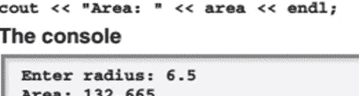

## 描述

- 常量在内存中存储一个在程序执行过程中不会改变的值。换句话说，常量的值在程序执行过程中保持不变。
- 要定义常量，以 `const` 关键字开始定义语句。常量必须在定义时进行初始化。
- 在其他编程语言中，使用全大写字母命名常量是常见做法，这将其与变量区分开来。但在 C++ 中，这可能会与宏（宏是代码片段）发生冲突。因此，许多程序员建议在命名常量时使用小写字母。

## 光年计算器程序

图 6-4 显示了一个名为“光年计算器”的程序，它可以计算指定光年对应的英里、公里和秒差距。然后，它会分别用科学计数法和固定计数法显示这些计算结果。

首先，该程序从用户处获取光年数。然后，它定义了三个用于计算的常量。首先定义并初始化了每光年的英里数；其次定义并初始化了每光年的公里数；最后定义并初始化了每光年的秒数。

接下来，该程序计算指定光年对应的英里、公里和秒数。然后，它用科学计数法显示结果。在这里，它将有效数字设置为 8。因此，该代码最多显示 8 位有效数字。

在显示科学计数法的结果后，该代码以带有 8 位小数的固定点格式显示结果，并使用 `setw()` 操符为该列设置 24 个字符。这使得数字按小数点对齐，方便比较英里数、公里数与秒数之间的关系。

## 光年计算器

Enter light years: 6

| 科学计数法 |
| :--- |
| Miles: 3.5274e+013 |
| Kilometers: 5.6766e+013 |
| Parsecs: 1.839606 |

| 固定计数法 |
| :--- |
| Miles: 35274000000000.0000000000 |
| Kilometers: 567660000000000.0000000000 |
| Parsecs: 1.8390600 |

Bye!

## 代码

```cpp
#include <iostream>
#include <iomanip>

using namespace std;

int main() {
    cout << "Light Years Calculator\n";

    double light_years;
    cout << "Enter light years: ";
    cin >> light_years;

    // 定义三个常量
    const double miles_per_light_year = 5.879e+12;
    const double km_per_light_year = 9.461e+12;
    const double parsec_per_light_year = 0.306601;

    // 计算英里、公里和秒数
    double miles = light_years * miles_per_light_year;
    double km = light_years * km_per_light_year;
    double parsecs = light_years * parsec_per_light_year;

    // 显示结果
    cout << endl << setprecision(8);
    cout << "SCIENTIFIC NOTATION\n";
    cout << "Miles:" << setw(24) << miles << endl;
    cout << "Kilometers:" << setw(24) << km << endl;
    cout << "Parsecs:" << setw(24) << parsecs << endl << endl;

    cout << fixed << endl;
    cout << "FIXED NOTATION\n";
    cout << "Miles:" << setw(24) << miles << endl;
    cout << "Kilometers:" << setw(24) << km << endl;
    cout << "Parsecs:" << setw(24) << parsecs << endl << endl;

    cout << "Bye!\n";
}
```

图 6-4 光年计算器程序

## 处理数据类型的更多技能

现在你已经学习了处理数据类型的基本技能，准备好学习一些额外的概念和技能了。这包括用于修复处理数值数据代码问题的技能。

## 如何进行类型转换

在开发 C++ 程序时，你可能会遇到需要将数据从一种类型转换为另一种类型的情况。这也称为数据从一种类型到另一种类型的强制转换（casting）。

如果你对不同数据类型进行赋值或算术运算，C++ 将按照图 6-5 所示的类型强制转换（type coercion）规则自动转换类型。首先，C++ 会将数据从较小的类型（如 `int`）提升到较大的类型（如 `long` 类型）。通过这种转换，新类型始终足以容纳原始值。例如，图中第一条语句将整数 93 转换为 `double` 类型的 93.0。

如果你将表达式的最终值赋值给精度较低的变量，C++ 会将数据从高精度类型降级（demotes）到低精度类型。通过这种转换，低精度的数据类型可能不足以容纳原始值，从而导致某些数据丢失。例如，图中第二条语句将 `double` 值 93.67 转换为 `int` 值 93，这丢弃了存储在小数位中的数据。

当表达式中的一个操作数类型与另一个不同时，C++ 也会提升表达式中的值。例如，如果给 `double` 加上一个 `int`，`int` 在执行加法之前会被提升为 `double`。这确保了结果尽可能精确。

当表达式中的一个操作数类型与另一个不同时，C++ 也会提升表达式中的值。例如，如果用 `int` 乘以一个 `double`，`int` 在执行乘法之前会被提升为 `double`。这确保了结果尽可能精确。

当表达式中的一个操作数类型与另一个不同时，C++ 也会提升表达式中的值。例如，如果用 `int` 除以一个 `double`，`int` 在执行除法之前会被提升为 `double`。这确保了结果尽可能精确。

当表达式中的一个操作数类型与另一个不同时，C++ 也会提升表达式中的值。例如，如果用 `double` 除以一个 `int`，`int` 在执行除法之前会被提升为 `double`。这确保了结果尽可能精确。

C++ 也允许你通过在要转换的值之前用圆括号括起数据类型来执行显式转换，如图 6-5 中的最后一个示例所示。然而，这种语法强制编译器从几种类型的强制转换（包括 `static_cast`）中进行选择。由于这可能会导致意料之外的结果，最好是使用 `static_cast` 运算符来指定你想要使用 `static_cast`。

当你编写显式转换代码时，如果 C++ 无法执行该转换，在运行时可能会发生错误。因此，只有在你确定 C++ 能够执行该转换时，才使用显式转换。

尽管你通常在数值数据类型之间进行转换，但你也可以在整数类型和 `char` 类型之间进行转换。这是因为每个 `char` 值都对应一个在 ASCII 字符集中标识它的整数。然而，在将整数类型（如 `int` 类型）转换为 `char` 类型时，可能会丢失数据。因此，在执行此操作时应小心。

# 如何处理数据类型的大小和限制

数据类型随系统而异。例如，`double` 类型在某些系统上可能使用 8 字节，而在另一些系统上可能使用 10 字节。因此，你有时需要检查数据类型所使用的字节数。要做到这一点，你可以使用如图 6-6 所示的 `sizeof()` 运算符。前两个示例展示了如何检查数据类型或变量的大小。

此外，你有时可能需要获取数据类型允许的最大值或最小值。这样，你就可以确保数据类型在所有系统上正常工作。要做到这一点，你可以使用 `numeric_limits` 类的静态函数 `min()` 和 `max()`，如第二组示例中的前两个语句所示。当你调用这些静态函数时，首先在类名后紧跟的角括号 `< >` 中指定数据类型。然后，编写作用域解析运算符 (`::`) 和静态函数的名称。

`numeric_limits` 类还包括图中所示的静态常量。这些常量提供了一种检查值是否为符号类型、整数类型或精确类型的方法。第二组示例中的最后三个语句展示了如何使用这些常量。

当整数变量被赋值一个对于其类型来说过大的值时，它会发生溢出，导致它绕回该类型的最小值。同样，如果给整数变量赋值一个对于其类型来说过小的值，它会发生下溢，导致它绕回该类型的最大值。第三个示例展示了这种工作原理。如果这不是你想要的（通常通常如此），你可以使用 `min()` 和 `max()` 函数在赋值之前确保该值在有效范围内。

当浮点变量被赋值一个对于其类型来说过大或过小的值时，结果取决于具体的系统。它可能导致你的程序显示错误并停止、继续运行，或者在没有错误的情况下继续运行但数据可能不正确。如果你遇到这个问题，可以使用 `min()` 和 `max()` 函数在赋值给浮点变量之前确保该值在可接受的范围内。

## `sizeof` 运算符

### 语法

```
sizeof(type)
```

### 示例

```
auto size = sizeof(unsigned short);      // 参数是一个数据类型
cout << size << " bytes";                // 显示 "2 bytes"
unsigned short us = 100;                   // 参数是一个变量
size = sizeof(us);                         // 显示 "2 bytes"
cout << size << " bytes";                // 显示 "2 bytes"
```

## 用于 `numeric_limits` 头文件的 include 语句

```cpp
#include <limits>
```

## `numeric_limits` 类的一些静态成员

| 成员 | 说明 |
| --- | --- |
| `min()` | 返回数据类型可以包含的最小值 |
| `max()` | 返回数据类型可以包含的最大值 |
| `is_signed` | 如果数据类型为符号类型，则返回 true |
| `is_integer` | 如果数据类型为整数，则返回 true |
| `is_exact` | 如果数据类型使用精确表示，则返回 true |

### 示例

```
auto result1 = numeric_limits<int>::min();          // -2147483648
auto result2 = numeric_limits<int>::max();          // 2147483647
bool result3 = numeric_limits<double>::is_signed();    // 1 (true)
bool result4 = numeric_limits<short>::is_integer;     // 1 (true)
bool result5 = numeric_limits<float>::is_exact();      // 0 (false)
```

## 当超过整数类型的最小值或最大值会发生什么

```cpp
unsigned short s;
s = numeric_limits<unsigned short>::max();      // 溢出: s 为 65535
s += 100;                                      // 溢出: s 为 99
s = numeric_limits<unsigned short>::min();      // s 为 0
s -= 100;                                      // 下溢: s 为 65436
```

- 数据类型随系统而异。你可以使用 `sizeof()` 运算符来确定类型在你系统上的大小。你可以使用 `numeric_limits` 类的成员来确定类型在你系统上的范围。
- 当整数变量被赋值一个对于其类型来说过大的值时，它会发生溢出，或绕回该类型的最小值。当整数变量被赋值一个对于其类型来说过小的值时，它会发生下溢，或绕回该类型的最大值。

# 如何解决浮点数据问题

由于浮点数在内部的存储方式，它们无法表示某些数字的小数精确值。这通过以下示例所示：浮点数是不精确的。

```cpp
cout << setprecision(24);
cout << .0 << endl;
cout << .1 << endl;
cout << .5 << endl;
cout << .9 << endl;
```

控制台输出：

| 0 |
| 0.10000000000000005511 |
| 0.50000000000000000000 |
| 0.90000000000000022446 |

## 由浮点比较问题引起的无限循环

```cpp
double counter = 0.5;
while (counter != 0.9) { // counter 永远等于 .9，所以循环不会停止
  cout << counter << " ";
  counter += .1;
}
```

控制输出：

| 0.5 | 0.6 | 0.7 | 0.8 | 0.9 | 1 | 1.1 | 1.2 | 1.3 | 1.4 | ... |

## 解决问题的两种方法

### 通过不使用相等比较

```cpp
while (counter != 0.85) {
  cout << counter << " ";
  counter += .1;
}
```

### 通过使用 `cmath` 头文件的 `round()` 函数来修复计算

```cpp
while (counter != 0.9) {
  cout << counter << " ";
  counter = round(counter * 10) / 10;
}
```

两种解决方案的控制台输出：

| 0.5 | 0.6 | 0.7 | 0.8 |

## 描述

- 由于浮点数在内部的存储方式，它们无法表示某些数字的小数精确值。这会导致相等比较和计算出现问题。
- 要解决相等比较问题，你可以避免对浮点数使用相等运算符。
- 要解决计算问题，你可以使用 `cmath` 头文件的 `round()` 函数将浮点数舍入到精度较低的小数位数。

## 如何使用向量 (vectors)

到此时，你已经学习了处理 C++ 直接提供的基本数据类型的最重要技能。然而，C++ 的标准模板库（STL）提供了更复杂的数据类型。许多此类数据类型可以包含另一种数据类型的多个元素。因此，它们被称为容器（containers）。例如，STL 提供了一种名为 `vector` 的数据类型，它可以包含相同数据类型的元素序列。

## 如何创建向量并引用其元素

图 6-8 开始展示如何包含包含 `vector` 类的头文件。要做到这一点，你需要编写 `vector` 类的名称，后面跟上角括号 `<>`，括号内包含向量元素的数据类型。接着是向量的名称，可选地，在括号中指定向量的初始元素数量。

定义向量的示例展示了这种工作原理。在这里，第一个示例定义了一个名为 `prices` 的向量对象，它存储了一个 `double` 类型值的序列。第二个示例与第一个示例类似，但它指定了 10 的初始大小。C++ 为每个元素使用默认值。当你指定初始大小时，在本例中，由于元素是 `double` 类型，因此 C++ 使用 0.0 作为默认值。

由于第一个示例没有指定初始大小，它创建了一个零元素向量。尽管如此，无论你在创建向量时是否指定了初始大小，稍后添加元素都是很容易的。但如果你知道向量的初始大小，通常在创建向量时创建元素会更高效。

第三个示例展示了创建向量的另一种方法。在这里，使用一个从用户接受值的变量来提供初始大小。

要引用向量的元素，你需要使用下标运算符 `([])` 和索引。图中示例中的第一条语句创建了一个名为 `scores` 的 `int` 类型向量，它有 3 个元素。接下来的三个语句使用下标运算符为向量的三个元素赋值。在这里，第一个元素的索引为 0，第二个元素的索引为 1，以此类推。接下来，第五条语句获取第二个元素的值（索引为 1）并将其显示在控制台上。最后，最后一个语句尝试访问第四个元素（索引为 3）。

由于不存在第四个元素，这会导致越界访问（out of bounds access），也称为超出范围访问（out of range access）。这会导致意外的结果，且结果取决于编译器。某些编译器会引发错误导致程序崩溃。其他编译器则不检查索引是否在范围内。在这种情况下，代码将返回或覆盖越界位置上的任何现有值。这允许代码高效执行，但可能会导致难以发现和修复的 bug。

## 如何包含 `vector` 类的头文件

```cpp
#include <vector>
```

## 定义向量的语法


# 向量定义的语法

```cpp
vector<type> vector_name [(initial_size)];
```

# 向量定义的示例

定义一个包含 `double` 值序列向量对象的代码：

```cpp
vector<double> prices;
```

定义一个包含 10 个 `double` 值向量的代码：

```cpp
vector<double> prices(10); // 创建一个包含 10 个元素的向量
```

使用变量指定向量大小的代码：

```cpp
int name_count = 0;
cout << "Enter the number of names: ";
cin >> name_count;
vector<string> names(name_count);
```

# 引用向量元素的语法

```cpp
vector_name[index];
```

# 如何使用下标运算符访问向量中的元素

```cpp
vector<int> scores(3); // 创建一个包含 3 个元素的向量
scores[0] = 99; // 设置第一个元素的值
scores[1] = 87; // 设置第二个元素的值
scores[2] = 91; // 设置第三个元素的值
cout << scores[1]; // 显示第二个元素的值
cout << scores[3]; // 错误！越界访问！
```

# Description

- 标准模板库（STL）除了基本数据类型外，还包含许多数据类型。其中许多数据类型可以包含多个元素，通常被称为容器。

- 向量包含一个相同数据类型的元素序列。你可以使用下标运算符 `([])` 和索引来访问向量的元素，其中 0 是第一个元素的索引，1 是第二个元素的索引，以此类推。

- 如果你的代码指定的索引在有效索引范围之外，就会发生越界访问。由于这会导致意外的结果，你应该始终编写防止越界访问的代码。

- 向量以及 STL 提供的其他项目都是 `std` 命名空间的成员。因此，程序必须包含针对命名空间的 `using` 指令，或者对命名空间中的特定成员进行声明，或者在对该成员的任何引用中使用完整的命名空间限定。


在编写标准的 `for` 循环时，很容易犯导致越界访问的错误。例如，如果初始化表达式或布尔表达式编写错误，就会发生这种情况。避免越界访问的一种方法是使用所示的基于范围的 `for` 循环。

（注：提供的 OCR 文本从第 223 页开始似乎截断或损坏。我已处理了所有提供的连贯文本。）

# vector 容器的一些成员函数

| 函数 | 描述 |
| --- | --- |
| `size()` | 返回 vector 中元素的个数。 |
| `empty()` | 如果 vector 不包含任何元素，返回 true。 |
| `push_back(element)` | 将元素添加到 vector 的末尾。 |
| `pop_back()` | 移除 vector 末尾的元素。 |
| `back()` | 返回 vector 中最后一个元素的引用。 |
| `front()` | 返回 vector 中第一个元素的引用。 |
| `at(index)` | 返回指定索引处元素的引用。如果索引大于或等于 vector 中的元素个数，则抛出 `out_of_range` 异常。 |
| `clear()` | 移除 vector 中的所有元素。 |
| `begin()` | 返回一个指向 vector 中第一个元素的迭代器。 |
| `insert(iterator, element)` | 在指定的迭代器处插入元素。 |
| `erase(iterator)` | 移除指定迭代器处的元素。 |

# 使用 vector 成员函数的语句

```cpp
vector<double> prices;             // 创建空 vector
prices.push_back(9.99);                        // 将元素添加到 vector
prices.push_back(149.99);                      // 将元素添加到 vector 末尾
auto size = prices.size();                     // size 为 2

double first = prices.front();                   // first 为 9.9
double last = prices.back();                    // last 为 149.99
double second = prices.at(1);                    // second 为 149.99
```

```cpp
prices.pop_back();                                // 移除元素
size = prices.size();                          // size 为 1
bool is_empty = prices.empty();                // is_empty 为 false
last = prices.back();                           // last 为 9.99
```

# 如何插入和删除元素

```cpp
vector<string> names("Mary", "Joel", "Mike", "Anne");

int index = 2;                                  // "Mike" 的索引
names.erase(names.begin() + index);            // 移除 "Mike"
auto size = names.size();                      // size 为 3
string name = names.at(index);                  // name 为 "Anne"

names.insert(names.begin(), "Ben");           // 在头部插入 "Ben"
size = names.size();                           // size 为 4
name = names.front();                          // name 为 "Ben"
```

# 描述

- `size()` 函数返回一个无符号整数，但具体的数据类型因实现而异。

- 结果，你需要将这个无符号整数存储在变量中，使用 `auto` 关键字来定义该变量是一个良好的习惯。

- 你将在第 10 章中学习更多关于 vector 类和其他 STL 容器。


# 评分程序 (Test Scores program)

图 6-11 显示了第 4 章中介绍的测试评分程序的另一个版本。该版本的程序将用户输入的每个有效分数存储在 vector 中。然后，当用户完成分数输入后，该程序会遍历这些有效分数，并显示计数、总分和平均分。

该程序首先包含它所需的头文件，包括 vector 头文件。然后，`main()` 函数显示程序的标题和说明，并定义了一个名为 `scores` 的 vector。

接下来，这段代码执行一个循环，直到用户输入 -1 为止。在循环内部，前两个语句提示用户输入分数并从用户输入中提取分数。然后，这段代码会检查分数是否有效。如果分数不是有效数字，代码将输入流重置为良好状态，丢弃用户输入，并显示适当的消息。如果分数大于 100 或小于 -1，则该值将获得一个 0 到 100 之间的适当数字。然而，如果分数大于 -1，则该值必须是一个有效数字。因此，这段代码使用 `push_back()` 函数将分数附加到 vector 的末尾。由于 `if` 语句是该 `while` 循环的最后一个语句，程序执行相应的子句然后跳转回循环顶部。这提示用户输入分数，这正是你想要的。

# 控制台

```
The Test Scores program
Enter 0 到 100 之间的测试分数。
要结束程序，请输入 -1。

Enter score: 97
Enter score: 93
Enter score: eighty two
Invalid number. Try again.
Enter score: 105
Score must be from 0 to 100. Try again.
Enter score: 83
Enter score: -1

Score count: 3
Score total: 273
Average score: 91
```

# 代码

```cpp
#include <iostream>
#include <vector>
#include <cmath>

using namespace std;

int main() {
	cout << "The Test Scores program\n\n100.\n";
		cout << "To end the program, enter -1.\n\n";

	vector<int> scores = 0;
	int score; while (score != -1) {
		cout << "Enter score: ";
		cin >> score;

		if (cin.fail()) {
			cin.clear(); // 清除错误
			cin.ignore(1000, '\n'); // 丢弃用户输入
			cout << "Invalid number. Try again.\n";
		} else if (score > 100 || score < -1) {
			cout << "Score must be from 0 to 100. Try again.\n";
		} else {
			scores.push_back(score); // 将分数添加到 vector
		}
	}

	if (scores.empty()) {
		cout << "\nNo scores entered.\n";
	} else {
		int total = 0;
		for (int s : scores) {
			total += s;
		}
		auto score_count = scores.size();
		double average = static_cast<double>(total) / score_count;
		cout << "\nScore count: " << score_count << endl;
		cout << "Score total: " << total << endl;
		cout << "Average score: " << average << endl;
	}
	return 0;
}
```

# 控制台

```
温度管理器程序

命令
v - 查看温度
a - 添加温度
r - 删除温度
s - 保存更改
x - 退出

命令: v
温度
日期 低温    高
---- ----    -----
1    48.4   57.2
2    46.0   50.0
3    68.2   73.0

命令: a
输入低温: 73.2
输入高温: 101.5

命令: r
输入要删除的日期: 3
第 3 天的温度已删除。

命令: s
您的更改已保存。

命令: x
再见！
```

# 代码

```cpp
#include <iostream>
#include <iomanip>
#include <fstream>
#include <string>
#include <vector>

using namespace std;

int main() {
    string filename = "temps.txt";

    cout << "The Temperature Manager program\n\n";

    cout << "COMMANDS\n"
         << "v - View temperatures\n"
         << "a - Add temperatures\n"
         << "r - Remove temperatures\n"
         << "s - Save changes\n"
         << "x - Exit\n";
```

图 6-12 温度管理器程序（3 部分第 1 部分）

# 代码（继续）

```cpp
// 从文件中读取低、高温并存储在 vector 中
double low, high;
vector<double> low_temps, high_temps;
ifstream input_file;
input_file.open(filename);
if (input_file) { // 如果文件打开成功...
    while (input_file >> low >> high) {
        low_temps.push_back(low);
        high_temps.push_back(high);
    }
    input_file.close();
} else {
    cout << "\n无法打开文件。您可能需要添加温度。\n";
}

char command = 'v';
while (command != 'x') {
    // 从用户处获取命令
    cout << endl;
    cout << "Command: ";
    cin >> command;

    // 定义变量
    ofstream output_file;
    int day_num, index;

    // 执行相应的命令
    switch (command) {
    case 'v':
        cout << "TEMPERATURES\n";
        cout << left << setw(4) << "Day"
             << right << setw(8) << "Low" << right << "High" << endl;
        cout << "--------------------" << endl;

        cout << fixed << setprecision(1);
        day_num = 0;
        for (int i = 0; i < low_temps.size(); ++i) {
            low = low_temps[i];
            high = high_temps[i];
            cout << left << setw(4) << day_num
                 << right << setw(8) << low << setw(8) << high << "\n";
            ++day_num;
        }
        break;
```


# 代码（继续）

```cpp
case 'a':
    cout << "Enter low temp: ";
    cin >> low;

    cout << "Enter high temp: ";
    cin >> high;

    low_temps.push_back(low);
    high_temps.push_back(high);
    break;
case 'r':
    int day;
    cout << "Enter day to remove: ";
    cin >> day;

    index = day - 1;
    if (index >= 0 && index < high_temps.size()) {
        high_temps.erase(high_temps.begin() + index);
        low_temps.erase(low_temps.begin() + index);
    }
    break;
    cout << "Temps for day " << day << " have been removed.\n";
    break;
case 's':
    output_file.open(filename);
    for (int i = 0; i < low_temps.size(); ++i) {
        low = low_temps[i];
        high = high_temps[i];
        output_file << low << "\t" << high << "\n";
    }
    output_file.close();
    cout << "Your changes have been saved.\n";
    break;
case 'x':
    cout << "Bye!\n\n";
    break;
default:
    cout << "Invalid command. Try again.\n";
    break;
```

温度管理器程序（3 部分第 3 部分）

# 如何处理字符串

在第 2 章中，你学习了处理字符串的一些基本技能，包括如何定义和初始化字符串变量、如何拼接字符串变量以及如何将一个字符串附加到另一个字符串。现在，你将回顾其中一些技能。此外，你将学习一些处理字符串的额外技能。

# 如何创建和遍历字符串

图 6-13 开始复习关于字符串的基本概念。首先，它展示了如何包含字符串头文件、如何定义和初始化字符串。然后，第四个示例展示了如何


# 如何包含头文件

```cpp
#include <string>
```

# 如何定义字符串

```cpp
string name;
```

# 如何定义和初始化字符串

```cpp
string name = "Mary";
```

# 初始化字符串另一种方式

```cpp
string name("Mary");
```

# 如何使用下标运算符访问字符

```cpp
string name = "Mary";      // 显示第一个字符 'M'
cout << name[0] << endl;     // 显示第二个字符 'a'
cout << name[1] << endl;     // 更新最后一个字符 - name 现在变为 "Mark"
name[3] = 'k';                // name 现在变为 "Mark"
```

# 如何大写字符串的首字母

```cpp
string name = "grace";
char letter = name[0];
name[0] = toupper(letter);      // name 变为 "Grace"
```

# 如何比较字符串的相等性

```cpp
string password1 = "secret";
string password2 = "Secret";
if (password1 == password2) {     // 大写敏感比较
    cout << "Your passwords match!\n";
}
```

# 如何使用循环将字符串转换为全大写

```cpp
string name = "grace";
for (int i = 0; i < name.size(); ++i) {
    char c = name[i];
    name[i] = toupper(c);      // name 变为 "GRACE"
}
```

# 如何使用范围循环创建一个新的全大写字母字符串

```cpp
string name = "grace";
string name_upper = "";
for (char c : name) {
    name_upper += toupper(c);
}                              // name_upper 为 "GRACE"
```

字符串中的一个字符。在循环内部，有一个语句将每个字符转换为大写，并将其附加到名为 `name_upper` 的字符串中。

如果你对比基于范围的循环（`range-based for loop`），你会发现范围循环的代码更容易编写。此外，它更不容易导致越界访问。因此，只要范围循环能满足你的需求，你就应该使用它。然而，如果你需要使用索引来访问字符串的特定字符，通常使用标准的 `for` 循环更有意义。

## 如何使用 string 的基本成员函数

就像 `vector` 一样，`string` 也提供了许多可以使用的成员函数来处理字符串。由于 `vector` 和 `string` 都是元素序列的容器，它们都提供了许多相同的成员函数。

图 6-14 显示了如何使用这些成员函数，它们提供了处理字符串字符的基本方法。

第一个示例显示 `string` 类的 `size()` 和 `length()` 函数返回相同的信息。因此，选择哪一个取决于个人喜好。由于这些函数返回的精确数据类型可能因编译器而异，此语句使用 `auto` 关键字来定义 `size` 和 `length` 变量。然后，C++ 编译器可以为这些变量推导出正确的数据类型。

第二个示例显示了如何使用 `back()` 函数检查字符串中的最后一个字符是否为换行符（`\n`）。如果是，这段代码使用 `pop_back()` 函数从字符串末尾移除换行符。

第三个示例显示了如何使用 `empty()` 函数确保用户输入了字符串。为了做到这一点，前三个语句从用户处获取电影名称。然后，第四个语句检查 `movie_name` 是否为空。如果为空，这段代码将显示一条消息表明...

第四个示例显示了如何使用 `clear()` 函数移除字符串中的所有字符。此示例假设名为 `line` 的变量是一个 `string` 对象。如果是，调用 `clear()` 函数将移除该字符串中的所有字符。

## string 类的一些基本成员函数

| 函数 | 说明 |
| --- | --- |
| `size()` | 返回字符串中字符的数量。 |
| `length()` | 返回字符串中字符的数量。 |
| `empty()` | 如果字符串不包含任何字符，返回 true。 |
| `push_back(char)` | 在字符串末尾添加指定的字符。 |
| `pop_back()` | 移除字符串中的最后一个字符。 |
| `back()` | 返回字符串中最后一个字符的引用。 |
| `front()` | 返回字符串中第一个字符的引用。 |
| `at(i)` | 返回索引 i 处字符的引用。如果 i 越界，则抛出 `out_of_range` 异常。 |
| `clear()` | 移除字符串中的所有字符。 |

## 如何检查字符串的大小

```cpp
string name = "grace shopper"; // size is 12
auto size = name.size(); // length is 12
auto length = name.length();
```

## 如何移除字符串的最后一个字符

```cpp
string name = "bjarne stroustrup\n";
auto size = name.size(); // size is 18
if (size > 0 && name.back() == '\n') {
    name.pop_back(); // 移除最后一个字符
}
size = name.size(); // size is 17
```

## 如何确保用户输入了字符串

```cpp
string movie_name;
cout << "<Enter movie name: ";
getline(cin, movie_name);

if (movie_name.empty()) {
    cout << "<Error! Movie name is required.\n";
}
```

## 如何移除字符串中的所有字符

```cpp
line.clear();
```

## Description

- `string` 类提供了许多与 `vector` 类相同的成员函数。你可以使用这些函数来处理字符串的字符。


## 如何搜索字符串

图 6-15 示例显示了如何在字符串中搜索指定的字符串或字符。这里，第一个示例显示了如何使用 `find()` 和 `rfind()` 函数。首先，这段代码定义了一个包含 "grace hopper" 值的字符串 `name`。

第一个 `find()` 函数在 `name` 字符串中搜索 "grace" 字符串，并将返回的索引存储在由编译器自动推导类型的变量中。在这里，使用 `auto` 类型是有帮助的，因为图中所示函数返回的整数类型可能根据编译器而异。由于字符串 "grace" 从索引 0 开始，第一个 `find()` 函数搜索字符 'g'。由于该字符位于索引 0，该函数返回值为 0。这表明 `find()` 函数可以与字符串或字符一起工作。

接下来两个 `find()` 函数显示了如何搜索字符串或字符的多次出现。这里，第三个 `find()` 搜索字符 'r'。它返回值为 1，这是该字符首次出现的索引。第四个 `find()` 函数从索引 2 开始搜索相同的字符，索引 2 是上一个语句找到的 'r' 之后的第一个字符。它返回值为 11，这是该字符第二次出现的索引。

## 用于搜索的一些成员函数

| 函数 | 说明 |
| --- | --- |
| `find(str)` | 返回字符串首次出现的索引。 |
| `find(str, i)` | 返回从索引 i 开始的字符串首次出现的索引。 |
| `rfind(str)` | 返回字符串最后一次出现的索引。 |
| `rfind(str, i)` | 返回从索引 i 开始的字符串最后一次出现的索引。 |
| `find_first_of(str)` | 返回匹配字符串中任意字符的首次出现索引。 |
| `find_last_of(str)` | 返回匹配字符串中任意字符的最后一次出现索引。 |
| `find_first_not_of(str)` | 返回不匹配字符串中任意字符的首次出现索引。 |
| `find_last_not_of(str)` | 返回不匹配字符串中任意字符的最后一次出现索引。 |

## 如何使用 find() 和 rfind() 函数

```cpp
string name = "grace hopper";

// find() 函数
auto index = name.find("grace"); // index is 0
index = name.find('g'); // index is 0
index = name.find('r'); // index is 1
index = name.find('r', 2); // index is 11
index = name.find('g', 1); // index is -1

// rfind() 函数
index = name.rfind('r', 10); // index is 11
index = name.rfind('r', 1); // index is 1
index = name.rfind('h', 5); // index is -1
index = name.rfind("grace"); // index is 0
```

## 如何检查字符串是否包含至少数字字符

```cpp
string password = "supersecret";
auto index = password.find_first_of("0123456789");
if (index == -1) {
  cout << "This password does NOT contain a number. Try again.\n";
}
```

## 如何获取第一个非空白字符的索引

```cpp
string name = "lin bjarne stroustrup";
auto index = name.find_first_not_of(" \t\n"); // index is 6
```

## Description

- `find()` 和 `rfind()` 函数接受字符串或字符类型的参数。
- 如果这些函数没有找到搜索的内容，它们都会返回值 -1。

# 如何处理子字符串

子字符串是从另一个字符串中提取的字符串。要从字符串中提取子字符串，你可以使用图 6-16 所示的 `substr()` 函数。

第一个示例展示了如何获取全名中的名和姓。在这里，第一条语句定义了一个用于存储全名的变量，并将其初始化为包含四个部分且由空格分隔的名字。然后，第二条语句定义了用于存储名和姓的变量，并将它们初始化为空字符串。

在设置好之后，下一组语句获取第一个空格前的名称。要做到这一点，它会在名称字符串中搜索第一个空格字符并获取其索引。然后，为了确保找到了该空格，它会检查该索引是否大于 -1。如果是，它使用 `substr()` 函数获取名，指定起始索引为 0，且长度等于第一个空格的索引。这之所以行得通，是因为空格字符的索引是 5，这正好也是名字的长度。

获取名后，下一组语句获取姓。要做到这一点，代码使用 `rfind()` 函数在字符串中搜索空格字符并获取其索引。然后，这段代码检查是否找到了该字符。如果找到了，它将该索引加 1，以获取空格字符之后字符的索引。接下来，这段代码通过检查索引是否在字符串的有效范围内来防止越界访问。记住，有效索引应大于 -1 且小于字符串的长度。如果索引在有效范围内，这段代码使用 `substr()` 函数来获取字符串。要做到这一点，它指定了起始索引，但没有指定长度。结果是，`substr()` 函数获取从起始索引到字符串末尾的子字符串。

第二个示例展示了如何去除字符串开头的空白字符。首先，它使用 `find_first_not_of()` 函数找到第一个不是制表符、换行符或空格字符的字符。然后，它检查索引是否大于 0。如果是，它使用 `substr()` 函数返回一个子字符串，该字符串从第一个非空白字符开始一直到字符串末尾。

第三个示例展示了如何从包含电子邮件地址的字符串中提取电子邮件的域名部分。在这里，代码首先获取第一个（也是唯一的）`@` 字符的索引以及最后一个点字符（`.`）的索引。获取这些索引后，这段代码检查它们是否都大于 -1，这表示这些字符存在于字符串中。如果这些字符存在，这段代码将 `@` 字符的索引加 1，以获取下一个字符的索引。接下来，这段代码检查 `@` 字符是否仍在有效范围内。更具体地说，它检查 `@` 字符是否小于字符串的大小且小于点字符的索引。如果是，这段代码通过从点索引中减去 `@` 索引来计算域名的字符长度。最后，它使用 `substr()` 函数，通过指定起始索引和子字符串的长度来获取域名。

# 获取字符串部分的成员函数

| 函数 | 说明 |
| :--- | :--- |
| `substr(i)` | 返回一个从指定索引开始一直到字符串末尾的新字符串。 |
| `substr(i, len)` | 返回一个从指定索引开始并跨越指定长度的新字符串。 |

# 如何获取名字的名和姓

```cpp
string name = "Grace Brewster Murray Hopper";
string first_name = ""; last_name = "";

auto index = name.find(' '); // index is 5
if (index > -1)
    first_name = name.substr(0, index); // first name is "Grace"

index = name.rfind(' '); // index is 21
if (index > -1) {
    ++index;
    if (index < name.length())
        last_name = name.substr(index); // last name is "Hopper"
}
```

# 如何去除字符串开头的空白字符

```cpp
string name = "\tn bjarne stroustrup";
auto i = name.find_first_not_of("\n\t"); // get index
if (i > 0)
    name = name.substr(i); // strip whitespace
    cout << name << endl; // displays bjarne stroustrup
```

# 如何获取电子邮件的域名部分

```cpp
string email = "grace.hopper@yahoo.com";
string domain = "";

auto at_index = email.find('@');
auto dot_index = email.rfind('.');
if (at_index > -1 && dot_index > at_index) {
    ++at_index;
    if (at_index < email.length() && at_index < dot_index) {
        int length = dot_index - at_index;
        domain = email.substr(at_index, length); // domain is "yahoo"
    }
}
```

# 说明

- 子字符串是字符串的一部分。当你使用 `substr()` 函数获取子字符串时，它会创建一个新字符串而不会修改原始字符串。


# 如何修改字符串

在第 2 章中，你学习了如何使用 `+=` 运算符将一个字符串附加到另一个字符串的末尾。现在，图 6-17 显示了你可以使用成员函数修改字符串的其他方法。

第一个示例展示了如何使用 `insert()` 函数在指定索引插入字符串。在这里，第一条语句创建了一个包含月份缩写和空格的月份字符串。第二条语句在索引 4 处插入 "Mar"，这就在第一个月份之后。这会将字符串中的所有字符向前移动四位。第三条语句在字符串开头插入 "Jan"。这会将所有字符移动三位。虽然这种移动字符的效率不高，但对于不包含大量字符的字符串来说性能是足够的。第四条语句在字符串末尾插入 "May"。结果是，最终字符串为 "Jan Apr May"。

第二个示例展示了如何使用 `erase()` 函数删除从索引 0 开始的字符串部分。结果是，它删除了字符串的前四个字符。这会将所有其他字符向前移动四位。正如向字符串中插入字符一样，移动字符的效率不高，但对于不包含大量字符的字符串来说性能是足够的。

第三个示例展示了如何用指定的字符串替换所有占位符。在这里，代码初始化了一个带有占位符 `<html>` 的消息字符串。然后，它定义了两个字符串：占位符 `<html>` 和替换字符串 "Oregon"，以及指示占位符在消息字符串位置的索引。接下来，这段代码开始循环，直到替换所有占位符。

在循环内部，第一条语句使用 `find()` 函数获取占位符的索引。第一次循环时，它从索引 0 开始搜索，即字符串的第一个字符。然后，它检查是否找到了占位符。如果找到了，这段代码使用 `replace()` 函数将占位符替换为替换字符串。然后，它跳转到循环顶部，再次检查是否找到了占位符。这时，它使用最近的索引作为起点。这会持续进行直到找到所有占位符。最后，`find()` 函数返回索引 -1，循环结束。


第四个示例展示了如何用另一个字符替换所有相同字符。具体来说，它展示了如何将连字符替换为空格字符。要做到这一点，你不需要使用专为字符串设计的 `replace()` 函数。相反，你只需要使用标准的 `for` 循环遍历每个字符即可。

在这个示例中，第一条语句创建一个带有连字符的信用卡号字符串。然后，这段代码使用标准的 `for` 循环检查每个字符，以判断其是否为连字符。

## 用于修改字符串的成员函数

| 函数 | 说明 |
| --- | --- |
| `insert(i, str)` | 在指定的索引处插入指定的字符串。 |
| `erase(i, len)` | 从指定的索引开始删除指定数量的字符。 |
| `replace(i, len, str)` | 将字符串中从指定索引开始、长度为指定的字符替换为指定的字符串。 |

## 如何将一个字符串插入另一个字符串中

```cpp
string months = "Feb Apr";
months.insert(4, " Mar "); // 在 "Feb " 之后插入
months.insert(0, "Jan "); // 在开头插入
months.insert(months.length(), " May"); // 在末尾插入
cout << months << endl; // 显示 "Jan Feb Mar Apr May"
```

## 如何删除字符串的一部分

```cpp
string months = "Feb Mar Apr May";
months.erase(0, 4); // 删除 "Feb "
cout << months << endl; // 显示 "Mar Apr Apr May"
```

## 如何替换占位符的所有实例

```cpp
string message = "Welcome to <state>! <state> is a great state!\n";
string placeholder = "<state>";
string state = "Oregon";
int index = -1;
while (index > -1) {
  index = message.find(placeholder, index);
  if (index > -1) {
    message.replace(index, placeholder.length(), state);
  }
}
cout << message; // 显示 "Welcome to Oregon! Oregon is a great state!"
```

## 如何将一个字符的所有实例替换为另一个字符

```cpp
string cc_number = "4012-81022-88810";
for (int i = 0; i < cc_number.length(); ++i) {
  if (cc_number[i] == '-') {
    cc_number[i] = ' ';
  }
}
cout << cc_number << endl; // 显示 "4012 81022 88810"
```

## Description

- 你可以使用成员函数通过插入另一个字符串、删除字符串的一部分或将字符串的一部分替换为另一个字符串来修改字符串。
- 要将一个字符替换为另一个字符，你可以使用标准的 `for` 循环和下标操作符。


如果是这样，它使用下标操作符将连字符替换为空格。这表明遍历字符串中的字符有时是处理字符串最简单且高效的方法。

## 如何检查字符串中的字符

在第2章中，你学习了如何使用 `toupper()` 和 `tolower()` 函数将字符转换为大写或小写。现在，图6-18显示了如何使用其他函数获取字符的信息，例如它是大写、小写、数字、标点符号还是空白。使用这些函数检查字符串中的字符是非常常见的。

例如在第一个示例中，`islower()` 函数检查字符串的第一个字符是否为小写字母。如果是，这段代码会将该字母替换为大写字母。这对于代码的正确运行并不是必要的，但它可以提高效率，因为如果字符串的第一个字符不是小写或已经是大写，则不会执行将小写字母转换为大写的语句。

另一方面，第二个示例使用 `ispunct()` 函数检查字符串中的任何字符是否为标点符号。在这里，第一个语句定义了一个包含标点符号（# 字符）的密码，第二个语句定义了一个名为 `contains_punctuation` 的 `bool` 变量，用于指示字符串是否包含标点符号。在前两个语句之后，代码遍历字符串中的每个字符。

在循环内部，`if` 语句使用 `ispunct()` 函数检查当前字符是否为标点符号。如果是，第一个语句将 `contains_punctuation` 变量设置为 `true`。然后，由于不需要继续检查剩余字符，这段代码执行 `break` 语句退出循环。这第二个语句对于代码的正确运行不是必要的，但它提高了代码的效率。

当你在布尔表达式中使用图中所示函数时，它们的工作符合预期。然而，你应该记住，它们通过返回非零 `int` 值（通常为 1）来表示真。相反，它们通过返回 0 来表示假。因此，如果你在控制台上显示这些函数的返回值，控制台显示的是整数值，而不是 `true` 和 `false` 关键字。

## 检查字符值的函数

| 函数 | 说明 |
| --- | --- |
| `islower(char)` | 如果字符是小写字母则返回真。 |
| `isupper(char)` | 如果字符是大写字母则返回真。 |
| `isalpha(char)` | 如果字符是字母表中的字母则返回真。 |
| `isdigit(char)` | 如果字符是数字（0, 1, 2, 3, 4, 5, 6, 7, 8, 或 9）则返回真。 |
| `isalnum(char)` | 如果字符是字母数字字符（字母或数字）则返回真。 |
| `isspace(char)` | 如果字符是空白字符（如空格）则返回真。 |
| `ispunct(char)` | 如果字符是标点符号则返回真。 |
| `isprint(char)` | 如果字符是可打印字符则返回真。 |

## 控制台

```
Enter full name: grace
你必须输入你的全名。请重试。
Enter full name: grace hopper
Enter password: secret
密码至少包含 8 个字符。
密码必须包含一个数字。
密码必须包含一个特殊字符。
请重试。
Enter password: superSecret123
密码必须包含一个特殊字符。
请重试。
Enter password: super#Secret123

Hi Grace,
感谢创建账户！
```

## 代码

```cpp
#include <iostream>
#include <string>

using namespace std;

int main() {
    cout << "Create Account\n\n";

    // 获取全名并解析名字
    string full_name;
    string first_name;
    bool valid_name = false;
    while (!valid_name) {
        cout << "Enter full name: ";
        getline(cin, full_name);

        // 去除开头的空格
        auto i = full_name.find_first_not_of(" \n\t");
        if (i > -1) {
            full_name = full_name.substr(i);
        }

        // 获取名字
        auto space_index = full_name.find(' ');
        if (space_index == -1) {
            cout << "You must enter your full name. Please try again.\n";
        } else {
            first_name = full_name.substr(0, space_index);
            valid_name = true;
        }
    }
    cout << endl;
}
```

图 6-19 创建账户程序（第 1/2 部分）

## 228 第一节 现代 C++ 的基本技能

图 6-19 的第 2 部分开始定义一个字符串变量来存储密码，以及一个名为 `valid_password` 的布尔变量，其初始化为 `false`。该布尔标志位用于判断随后的 `while` 循环何时结束。在这种情况下，循环将持续进行，直到 `valid_password` 标志位变为 `true`，这意味着用户已输入了密码。

在循环内部，第一条语句将布尔标志位设置为 `true`。因此，当循环稍后代码将此标志位设置为 `false` 时，循环将退出。

接下来的两条语句获取用户输入的密码。然后，`if` 语句检查密码是否少于 8 个字符。如果是，这段代码将显示一条消息，指示密码至少需要八个字符，并将 `valid_password` 标志位设置为 `false`。否则，`if` 语句不执行任何代码。无论何种，程序执行都会继续执行循环中的后续代码。

下一组语句检查密码是否包含数字。如果不包含，这段代码将显示一条适当的消息并将 `valid_password` 标志位设置为 `false`。否则，`if` 语句不执行任何代码。无论何种，程序执行都会继续执行循环中的后续代码。

接下来的一组语句确保密码包含一个特殊字符。为了做到这一点，这段代码会遍历密码中的每个字符，并使用 `ispunct()` 函数检查它是否为标点符号字符。如果是，代码将 `special_character` 标志位设置为 `true` 并退出循环。然后，它会检查 `special_character` 标志位是否为 `false`。如果是，它将显示一条适当的消息并将 `valid_password` 标志位设置为 `false`。否则，`if` 语句不执行任何代码。无论何种，程序执行都会继续执行循环中的最后一条语句。

最后一条语句检查 `valid_password` 标志位以判断密码是否有效。如果无效，它将显示一条消息要求用户重试，程序执行将回到循环顶部继续。否则，`valid_password` 标志位为 `true`，程序执行执行循环并继续执行后续代码。

在获取密码的循环之后，这段代码确保名字以大写字母开头，但名字的其他部分使用小写字母。在这里，第一条语句获取第一个字母（索引 0 处的字母），第二条语句使用 `toupper()` 函数将字母转换为大写。然后，`for` 语句从索引 1 开始遍历剩余的索引。在循环内部，`tolower()` 将每个索引处的字母转换为小写。

最后，最后一条语句显示一条消息，使用存储在 `first_name` 变量中的名称感谢用户创建账户。因此，即使用户输入 "GRACE" 或 "grAce"，此消息也应该显示首大字母的名字，例如 "Grace"。

对于书中介绍的大多数程序，创建账户程序都有很大的改进空间。正如之前提到的，你可以添加代码去除全名末尾的空格。这样，一个名字后面跟着空格就不会是一个有效的全名。或者，你也可以添加代码防止用户输入以数字或标点符号开头的全名。

## 代码（继续）

```cpp
// 图 6-19 创建账户程序（第 2/2 部分）
// 假设此处为后续代码
```

## 单词混序程序

图 6-20 显示了单词混序程序的代码，该程序演示了本章介绍的处理 `vector` 和字符串的一些技能。该程序允许用户从乱序的字母中获取单词。如果无法猜出单词，用户可以输入 "hint" 显示单词的下一个字母。或者，用户可以输入 "exit" 退出程序。

该程序的代码开始包含必要的头文件。

# 第 6 章 如何处理数据类型、字符串和向量

## 让我们玩混序游戏

```
输入 'hint' 获取提示。
输入 'exit' 退出。

乱序的单词是...URITGA

你的 guess: hint
提示: G - - -

你的 guess: hint
提示: GU - - -

你的 guess: guitar
恭喜！你猜对了。
```

## 代码

```cpp
#include <iostream>
#include <string>
#include <vector>
#include <cstdlib>
#include <ctime>

using namespace std;

int main() {
    cout << "Let's Play Jumble!\n"
         << "\n"
         << "Enter 'hint' for a hint.\n"
         << "Enter 'exit' to exit.\n\n";
    vector<string> words = { "guitar", "violin", "tapestry" };

    // 从 vector 中获取随机单词
    srand(time(nullptr));
    int index = rand() % words.size();
    string word = words[index];

    // 打乱顺序 jumbled_word
    string jumbled_word = word;
    auto length = jumbled_word.size();
    for (int index1 = 0; index1 < length; ++index1) {
        int index2 = rand() % length;
        char temp = jumbled_word[index1];
        jumbled_word[index1] = jumbled_word[index2];
        jumbled_word[index2] = temp;
    }

    return 0;
}
```

图 6-20 单词混序程序（第 1/2 部分）

## 第 1 节 现代 C++ 基本技能

图 6-20 的第 2 部分首先用大写字母显示乱序单词。为了实现这一点，代码使用基于范围的循环遍历每个字符并将其转换为大写。然而，`toupper()` 函数返回一个对应于 ASCII 字符的 `int` 值。因此，此代码使用静态转换将 `int` 值转换为 `char` 值。

在显示乱序单词后，代码定义了两个变量。首先，它定义了一个用于计算用户请求提示次数的变量。然后，它定义了一个用于存储用户输入的猜测的变量。之后，代码开始了程序的主循环。

在此循环中，前三个语句从用户处获取猜测并丢弃控制台输入流中的任何多余数据。然后，代码检查用户是否成功猜中了单词。如果是，代码将打印祝贺信息并跳出循环，从而结束程序。

如果用户输入 "hint" 而不是猜单词，代码将为用户显示一个提示。为了实现这一点，代码遍历字符串中每个字符的索引。然后，它检查索引是否小于提示计数。如果是，它将显示大写的字母并在后面加空格；否则，它显示一个下划线并在后面加空格。因此，当用户第一次输入 "hint" 时，代码会显示单词的首字母。对于单词 "guitar"，它将显示：

```
G - - - - -
```

显示提示后，代码对存储提示计数的变量加增。这样，当用户下次输入 "hint" 时，程序将显示单词中的另一个字符。

如果用户输入 "exit"，代码将显示一条指示程序正在结束的消息。然后，它跳出循环，结束程序。

最后，如果用户没有猜单词，也没有输入 "hint" 或 "exit"，代码将显示一条指示猜测不正确的消息。然后，程序执行跳转到循环顶部，提示用户进行下一次猜测。

## 代码（续）

```cpp
// 用大写显示乱序单词
cout << "The jumble is....";
for (char c : jumbled_word) {
    cout << static_cast<char>(toupper(c));
}
cout << "\n\n";
// 循环直到用户猜中乱序单词或输入 'exit'
int hint_count = 1;
string guess = "";
while (true) {
    cout << "Your guess: ";
    cin >> guess;
    cin.ignore(1000, '\n'); // 忽略行尾之前的输入

    if (guess == word) {
        cout << "Congratulations! You guessed it.\n\n";
        break;
    }
    else if (guess == "hint") {
        for (int i = 0; i < word.length(); ++i) {
            if (i < hint_count) {
                cout << static_cast<char>(toupper(word[i])) << ' ';
            }
            else {
                cout << '_ ' << ' ';
            }
        }
        cout << "\n\n";
        ++hint_count;
    }
    else if (guess == "exit") {
        cout << "Bye! Let's play again soon.\n\n";
        break;
    }
    else {
        cout << "Nope. Try again!!\n\n";
    }
}
```


# 展望


现在你已经完成了本章，你应该能够处理程序所需的任何基本数据类型。此外，你需要在需要时应该能够使用 `vector` 和 `string`。

在本章中，“温度管理器”程序使用了两个 `vector` 来存储低温和高温的两列数据。目前，这种技术是够的。然而，如果你需要存储许多列数据，或者其他的存储和处理数据表的方法，这种技术就会变得难以处理。幸运的是，C++ 提供了这些功能，你将从第 9 章开始学习更多相关知识。

# 术语

- 基本数据类型 (fundamental data types)
    - 内置数据类型 (built-in data types)
    - 整数 (integers)
    - 浮点数 (floating-point numbers)
    - 有效数字 (significant digits)
    - 单精度数 (single-precision number)
    - 双精度数 (double-precision number)
    - 字符 (characters)
    - 布尔值 (Boolean value)
    - 科学计数法 (scientific notation)
    - ASCII 字符集 (ASCII character set)

- 变量 (variable)
    - 定义变量 (define a variable)
    - 初始化变量 (initialize a variable)
    - 赋值运算符 (assignment operator)

- 常量 (constant)

- 数据类型转换 (casting data)
    - 类型强制转换 (type coercion)
    - 数据提升 (promote data)
    - 数据降级 (demote data)

- 作用域解析运算符 (scope resolution operator)
    - 整数溢出 (integer overflow)
    - 整数下溢 (integer underflow)

- 标准模板库 (STL)
    - 容器 (containers)
    - 下标运算符 (subscript operator)
    - 索引 (index)
    - vector
    - 元素 (element)
    - 越界访问 (out of bounds access)
    - 范围外访问 (out of range access)
    - 初始化列表 (initialization list)
    - 基于范围的 for 循环 (range-based for loop)
    - 推入元素 (push an element)

- 字符串 (string)
    - 子字符串 (substring)

# 总结

- C++ 提供了基本数据类型来存储整数、浮点数、字符和布尔值。
- 为了表示浮点数值，可以使用科学计数法。
- 变量存储随程序运行而变化的数据。常量存储在程序运行期间保持不变的数据。你使用赋值运算符给变量和常量赋值。
- 如果你对不同的数据类型执行赋值或算术运算，C++ 会自动转换或强制转换类型。
- 如果对不同数据类型执行赋值时，C++ 会使用类型强制转换规则进行转换。
- 当你在表达式中使用不同数据类型时，C++ 会自动将低类型提升为高类型。当你将值赋值给具有低类型的变量时，C++ 会降低类型。这可能会导致数据丢失。
- 当整数变量被赋值一个其类型范围更大的值时，会发生溢出；当整数变量被赋值一个其类型范围更小的值时，会发生下溢。
- 标准模板库 (STL) 除了基本数据类型外还包含许多数据类型。包含集合的 STL 类型被称为容器。
- `vector` 包含相同类型元素的序列。你可以使用下标运算符 `[]` 访问 `vector` 的元素。
- 如果你的代码指定的索引超出了有效范围，就会发生越界访问。由于越界访问会导致意外结果，你应该编写代码来防止这种情况。
- 基于范围的 for 循环会自动遍历 `vector` 中的每个元素，而无需指定计数器或使用下标运算符。
- `string` 包含字符序列。你可以将 `string` 理解为字符的 `vector`。

# 练习 6-1 用向量存储值

在练习中，你将修改第 4 章的未来价值程序，使其将每次计算的值存储在 `vector` 中，并在结束时显示这些值的表格。当你完成后，测试运行应该是：

| 未来价值计算器 |
| :--- |
| 每月投资: 100 |
| 年利率: 5 |
| 年数: 10 |
| 未来价值: 15592.93 |
| 继续？(y/n): y |
| 每月投资: 150 |
| 年利率: 5 |
| 年数: 10 |
| 未来价值: 23389.39 |
| 每月投资率 | 年数 | 未来价值 |
| 100.00 | 5.00 | 10 | 15592.93 |
| 150.00 | 5.00 | 10 | 23389.39 |

## 打开程序

1. 打开位于 `ex_starts\ch06_ex1_future_value` 的项目或解决方案。
2. 审查代码并运行程序以回顾其工作原理。

## 用向量存储计算

3. 定义四个 vector，用于存储每次计算的每月投资、年利率和未来价值。为此你需要包含 vector 头文件。
4. 在每次未来价值计算后，将当前的每月投资、年利率、年数和未来价值的值添加到相应的 vector 末尾。
5. 当用户完成未来价值计算后，使用 for 循环按上所示格式显示 vector 中的值。浮点数值应以固定点格式显示并保留两位小数。每个计算得的结果也应该以固定点格式显示并保留两位小数。

# 练习 6-2 增强创建账户程序

在这个练习中，你将增强“创建账户”程序，使其能够接受用户输入的电子邮件地址，并检查其是否有效。完成后，测试运行的结果应该像这样：

```
Create Account
Enter full name: grace hopper
Enter password: super#Secret123
Enter email: grace@yahoo
The email must include a dot character (.).
The domain name of the email must have two or three characters.
Please try again.
Enter email: grace.hopper@yahoo.x
The domain name of the email must have two or three characters.
Please try again.
Enter email: grace.hopper@yahoo.com

Hi Grace,
Thanks for creating an account!
```

1. 在文件夹 `ex_starts\ch06_ex2_create_account` 中打开项目或解决方案。
2. 添加一个 `while` 循环，让该循环持续获取电子邮件地址，直到输入有效地址为止。你可以参考获取有效密码的循环来编写这个循环。
3. 在 `while` 循环内部，首先检查电子邮件是否包含符号 `@` 和点字符 `.`。
4. 如果电子邮件包含符号 `@` 和点字符 `.`，检查地址中的其余字符是否为字母数字、符号、点字符、下划线 `_` 或连字符 `-`。要实现这一点，可以使用基于范围的 `for` 循环。
5. 检查符号和点字符之前至少有一个字符，并且在点字符之后有两个或三个字符。要实现这一点，你可以使用 `@` 符号和最后一个点字符的索引以及电子邮件地址的长度。

# 7

## 如何编写函数

到目前为止，你在书中看到的程序都只包含一个函数，即 `main()` 函数。然而，随着程序变得越来越长越来越复杂，你需要一种方法将它们拆分为易于管理的、重用代码块。其中一种方法是编写自己的函数，并由 `main()` 函数调用它们。

在本章中，你将学习声明、定义和调用函数的各种技能。此外，你还将学习如何将函数组织到头文件和命名空间中。这样做，你就可以像使用 C++ 标准库中的函数一样，从多个程序访问这些函数。

| 主题 | 页码 |
| :--- | :--- |
| 如何开始编写自己的函数 | 240 |
| 如何定义和调用一个函数 | 240 |
| 每加仑油耗程序 | 242 |
| 如何声明一个函数 | 244 |
| 何时以及如何使用局部和全局变量 | 246 |
| **如何规划程序的函数** | **248** |
| 如何使用层次结构图 | 248 |
| 温度转换程序 | 250 |
| **更多编写函数的技能** | **254** |
| 如何为参数使用默认值 | 254 |
| 如何重载函数 | 256 |
| 如何使用引用变量作为参数 | 258 |
| 如何使用引用参数来提高效率 | 259 |
| 温度管理器程序 | 262 |
| **如何处理头文件和命名空间** | **270** |
| 如何创建、实现和使用头文件 | 270 |
| 如何定义命名空间 | 272 |
| 用于从控制台获取输入的头文件 | 274 |
| 未来价值程序 | 278 |
| **观点** | **282** |

### 如何开始编写自己的函数

函数是一个执行特定任务的命名代码块。函数之所以有用是因为它们提供了一种将程序代码划分为更短、更易管理的代码块的方法。这使得你的代码更容易易读、维护、重用、测试和调试。

## 如何定义和调用一个函数

图 7-1 展示了定义函数的语法。要实现这一点，你需要编写函数所返回的数据类型。或者，如果函数不返回任何数据，你可以编写 `void` 关键字。然后，你编写一个函数名称、一组括号、括号内可选的参数列表以及一组大括号。在大括号内，你可以编写在函数被调用时执行的一条或多条语句。

要调用（或触发）函数，你使用与之前调用标准库函数时相同的语法。也就是说，你编写函数名和一组括号。然后，如果函数需要一个或多个参数，你按照函数定义的参数相同的顺序编写参数，并使用逗号分隔这些参数。

例如，由于第一个示例中的函数不返回任何数据，而且它不需要任何参数，因此你为其返回类型编写了 `void` 关键字。你不需要在括号内编写参数。因此，你通过函数名后跟一组括号来调用它。

第二个示例中的函数定义了一个标题。要实现这一点，它指定了标题的数据类型和字符串名称（title）。因此，它调用的语句提供了一个类型为 `string` 的变量参数。然后，函数体在控制台上显示该字符串，随后跟一个空行。

（注：此处原文存在大量由于 OCR 错误导致的重复描述，已根据指令要求清理并逻辑翻译。）

# 每加仑英里油程序

图 7-2 应该让你更好地了解如何编写一个包含多个函数的程序。它展示了一个“每加仑英里油”程序，该程序被拆分为三个部分：显示程序标题的 `display_title()` 函数、计算每加仑英里油的 `calculate_mpg()` 函数以及一个 `main()` 函数。在这里，程序开始定义前两个函数。然后，它执行 `main()` 函数，该函数使用了前两个函数。

`display_title()` 函数不返回任何数据，也不需要任何参数。它只包含一条语句，用于显示程序的标题，随后跟一个空行。

`calculate_mpg()` 函数返回一个 `double` 类型，并需要两个 `double` 值作为参数。然后，调用语句向它传递了两个参数。在这种情况下，调用语句中的参数名称与函数定义中的参数名称相同。但请记住，这些名称并不一定相同。不过，它们的顺序必须与函数定义中的顺序一致。

`calculate_mpg()` 函数的最后语句是一个 `return` 语句，用于返回每加仑英里油。该值随后被存储在 `main()` 函数的 `mpg` 变量中。之后，`main()` 函数继续显示存储在 `mpg` 变量中的值。

当你回顾这些内容时，可能会发现，使用 `display_title()` 函数会让程序比直接在 `main()` 函数中写一行代码变得更长、更复杂。那么，你为什么要创建一个这样的函数呢？简短的回答是，你可能不需要这样做。这种方法的一个优点是函数名称清晰地描述了其代码的功能。因此，不需要添加注释来描述函数内部的代码。尽管如此，显示标题的代码已经简单到没什么需要用注释来描述的了，所以将标题单独放在一个函数中的优势其实并不大。

那么，什么时候编写函数是有意义的呢？首先，当你在程序的多个位置编写相同或相似的代码时。例如，在本章的末尾，你将学习如何编写 `get_double()` 函数来从用户处获取一个 `double` 值，而不是像本程序中那样在多个地方编写非常相似的代码。在编程中，这被称为“不要重复自己”（DRY）原则。

此外，每当将你的代码拆分成函数有助于你组织代码，使其更容易于理解和维护时，这样做是有意义的。例如，当你有嵌套循环时，为内层循环编写一个函数通常是有意义的。因为这减少了嵌套深度，通常会让代码更容易于理解和维护。

# 控制台

| 每加仑英里油计算器 |
| :--- |
| 输入行驶英里： | 500 |
| 输入使用的燃油加仑： | 14 |
| 每加仑英里油数： | 35.7 |

# 代码

```cpp
#include <iostream>
#include <cmath>

using namespace std;

void display_title() {
    cout << "Miles Per Gallon Calculator\n\n";
}

double calculate_mpg(double miles, double gallons) {
    double mpg = miles / gallons;
    mpg = round(mpg * 10) / 10; // 保留1位小数
    return mpg;
}

int main() {
    display_title();

    double miles;
    cout << "Enter miles driven: ";
    cin >> miles;

    double gallons;
    cout << "Enter gallons of gas used: ";
    cin >> gallons;

    double mpg = calculate_mpg(miles, gallons);

    cout << "Miles per gallon: " << mpg << endl << endl;

    return 0;
}
```

- `main()` 函数可以调用定义在其之前的其他函数。


# 如何声明函数

在上一图“每加仑英里油”程序中，代码之所以有效，是因为 `main()` 函数使用的所有函数都定义在 `main()` 函数之前。例如，如果你在 `main()` 函数之后显示 `display_title()` 函数，那么 `display_title()` 函数将无法被 `main()` 函数使用，因为它尚未被定义。然而，如果你如图 7-3 所示在 `main()` 函数之前声明函数，你就可以在 `main()` 函数之后定义该函数。

这种方法有两个好处。首先，它让你和其他程序员能够方便地看到 `main()` 函数可用的函数，以及它们的返回类型和参数。其次，它允许你以任何喜欢的顺序在 `main()` 函数中编写这些函数的定义。这允许你以符合自己逻辑的方式组织函数。

要声明一个函数，你需要编写函数的返回类型、名称和参数，后跟一个分号。虽然参数名称是可选的，但每当它们能提高代码的可读性时，你就应该包含它们。在图中，第一个示例展示了在本章之前介绍的 `display_title()` 和 `calculate_mpg()` 函数可能的编写方式。在这里，第二个 `calculate_mpg()` 函数比第一个函数更容易读，因为第二个函数清晰地显示了第一个参数指定英里，第二个参数指定加仑。

由于一个编写良好的函数声明应该描述函数的功能，因此它也被称为函数原型（function prototype）。在图中，例如，第二个示例首先编写了两个函数原型。然后， `main()` 函数使用了这些原型。

## 声明函数的语法

```cpp
return_type function_name(parameter_list);
```

## 定义函数的语法

```cpp
return_type function_name(parameter_list) {
    // function body
}
```

# 使用局部变量的函数

```cpp
double calc_tax(double amount, double tax_rate) {
    double tax = amount * tax_rate; // tax 是局部变量
    return tax; // return语句是必要的
}
```

```cpp
int main() {
    double tax = calc_tax(85.0, .05); // tax 是局部变量
    cout << "Tax: " << tax << endl; // tax 是 4.25
}
```

# 修改全局变量的函数（不推荐）

```cpp
double tax = 0.0;

void calc_tax(double amount, double tax_rate) {
    tax = amount * tax_rate; // 修改全局变量
}
```

```cpp
int main() {
    calc_tax(85.0, .05);
    cout << "Tax: " << tax << endl; // tax 是 4.25
}
```

# 遮蔽全局变量的局部变量（不推荐）


# 使用全局常量的函数（可以）

```cpp
double tax = 0.0;

double calc_tax(double amount, double tax_rate) {
    double tax = amount * tax_rate; // tax 是局部变量
    cout << "Tax: " << tax << endl; // tax 是 4.25
    return tax;
}

int main() {
    calc_tax(85.0, .05);
    cout << "Tax: " << tax << endl; // tax 是 0.0
}
```

```cpp
const double tax_rate = 0.05; // tax_rate 是全局常量

double calc_tax(double amount) {
    double tax = amount * tax_rate; // 使用常量
    return tax;
}
```

- 在函数内部定义的变量称为局部变量。在所有函数外部定义的称为全局变量。
- 局部变量只能在定义它的函数中使用。全局变量可以被所有函数使用。
- 当局部变量与全局变量同名时，局部变量会遮蔽全局变量。在定义变量的函数中，操作是在局部变量上进行的。否则，操作是在全局变量上进行的。


### 如何规划程序的函数

随着程序变得越来越长且函数越来越多，决定函数是什么以及它们如何相互关系变得越来越困难。为了帮助你做出决策，可以使用层次图来分析和规划程序的模块。

## 如何使用层次图

图 7-5 显示了如何使用层次图规划程序的函数。在这里，层次图表示图 7-6 中使用的温度转换程序所使用的函数。这显示了 `main()` 函数调用 `display_menu()` 和 `convert_temp()` 函数。`convert_temp()` 函数转调用 `to_celsius()` 和 `to_fahrenheit()` 函数。

如果你将图中的层次图与下一图的代码进行对比，就不会理解层次图是如何对应代码的了。但在编写代码之前如何创建一个这样的图呢？你可以从 `main()` 函数开始，因为它始终位于顶层。然后问自己 `main()` 函数需要调用哪些主函数。在图中是 `convert_temp()` 函数。一旦确定了主函数或函数，就将它们添加到层次图中。

在确定了主函数或函数后，问自己在程序的主函数或函数之前或之后还需要调用哪些函数。在图中，是在 `convert_temp()` 函数之前调用的 `display_menu()` 函数。在将这些函数添加到图后，前两个就完成了：带有 `main()` 函数的顶层和下一层。然后继续向下进行，直到将所有函数都划分为组件函数。

当你向图中添加函数时，尝试使用一个以动词开头、名词结尾的名称，可能在动词和名词之前加一个形容词。该名称应该很好地说明函数的功能。稍后在编写程序代码时，可以通过下划线连接图中的单词来创建函数名，因此图上的“convert temp”就变成了代码中的 `convert_temp`。

在实践中，程序员经常手画层次图，并在代码编写和测试后将其丢弃。另一种替代方案是使用图中所示的层次大纲而不是层次图。这样的大纲是结构的从左到右视图，而不是从上下的视图，并且容易输入到文本编辑器或处理器中。

## 温度转换程序的层次图


## 同一个程序的层次大纲

```
main
display menu
convert temp
to celsius
to fahrenheit
```

## 如何构建层次图

- 从 `main()` 函数的框开始。
- 在下一层，为 `main()` 函数需要调用的函数放置框。
- 通过将所有函数划分为组件函数来继续向下分层。

## 创建图的指南

- 图中的名称应该以动词开头、名词结尾。
- 每个名称都应该很好地说明函数的功能。

## 温度转换

图 7-6 显示了与层次图相对应的温度转换程序。该程序通过将函数放在调用的顺序中来组织函数。首先，调用 `main()` 函数。结果是，这段代码将其放在其他函数的定义之前。由于 `main()` 函数先调用 `display_menu()` 函数，然后调用 `convert_temp()` 函数，这就是它们编码的顺序。由于 `convert_temp()` 函数调用了 `to_celsius()` 和 `to_fahrenheit()` 函数，它们出现在 `convert_temp()` 函数之后。

## 更多编写函数的技巧

现在你已经学习了编写函数的基础知识以及程序函数的规划，你已经准备好学习更多编写函数的技巧了。

### 如何为参数使用默认值

在定义函数时，你可以为一个或多个参数分配默认值。要实现这一点，你需要编写参数的数据类型和名称、赋值运算符（`=`）以及参数的默认值，如图 7-7 中的第一个示例所示。在函数函数中，第二个和第三个参数分配了默认值。但是，当你分配默认值时，需要在在任何不提供默认值的参数之后再编写带有默认值的参数。

当参数具有默认值时，在调用函数时就不需要为该参数编写参数。然而，如果你在调用语句中编写了该参数，函数将使用该参数的默认值。你传递给函数的参数将覆盖该参数的默认值。例如，第二个示例显示了调用第一个示例中定义的 `calculate_future_value()` 函数的三种。在这里，第一条语句同时使用了两个默认值，第二条语句只使用了一个默认值，而第三条语句则覆盖了两个默认值。

当你同时编写了函数声明和函数定义时，不能在声明和定义中都分配默认值。如果你这样做，将得到编译时错误。例如，图中第三个示例使用函数声明来指定默认值，而相应的函数定义没有指定任何默认值。由于这种方法允许其他程序员通过查看声明来了解如何使用函数，许多程序员认为这是一个良好的做法。然而，这在很大程度上取决于个人喜好，在函数定义中编写默认值也是完全可以的。

## 具有两个默认值的函数定义

```cpp
double calculate_future_value(double monthly_investment,
double yearly_interest_rate = 3.0, int years = 10) {

// 将年度数值转换为每月数值
double monthly_rate = yearly_interest_rate / 12 / 100;
int months = years * 12;

// 计算未来值
double future_value = 0;
for (int i = 0; i < months; ++i) {
    future_value = (future_value + monthly_investment) *
    (1 + monthly_rate);
}

    return future_value;
}
```

## 如何带默认值调用函数

```cpp
double f1 = calculate_future_value(100.0);      // f1 = 14009.1
double f2 = calculate_future_value(100.0, 4.0);     // f2 = 14774.1
double f3 = calculate_future_value(100.0, 4.0, 11);   // f3 = 16602.3
```

## 具有两个默认值的函数声明

```cpp
// 函数声明
double calculate_future_value(double monthly_investment,
double yearly_interest_rate = 3.0, int years = 10);

// 相应的函数定义
double calculate_future_value(double monthly_investment,
double yearly_interest_rate, int years) {
    // 函数代码在此处
}
```

### 描述

- 你可以在函数声明中或通过给参数赋值来为函数中的任何参数指定默认值。然而，带有默认值的参数必须在函数声明或定义的最后编写。
- 当你调用函数时，任何具有默认值的参数都是可选的，但你可以通过提供该参数来覆盖该参数的默认值。
- 你不能在声明和定义中都分配默认值。如果你这样做，将得到编译时错误。


### 如何重载函数

当你创建两个或多个同相同但参数列表不同的函数时，这些函数就被重载了。然后，当你在代码中调用函数时，C++ 会调用参数与调用代码中的参数匹配的函数版本。

当你编写一个函数时，函数名加上参数数量以及每个参数的数据类型就成了函数的签名（signature）。只要每个函数具有唯一的签名，你就可以编写多个同名称的函数。例如，图 7-8 中的三个 `to_celsius()` 函数具有不同的签名。

为了使一个函数是唯一的，该函数的参数数量必须与同名的其他函数不同，或者至少有一个参数的类型类型必须是不同的。然而，参数的名称并不是签名的一部分。因此，仅使用不同的参数名称不足以使签名唯一。此外，返回类型也不是签名的一部分。因此，你不能创建两个具有相同名称且参数返回类型不同的函数。

重载的一个目的是允许函数能够处理不同的数据类型。例如，图中的第一个函数处理 `double` 值，而第二个函数处理 `int` 值。在这里，第二个函数将转换结果四舍五入到0位小数，自动将结果从 `double` 值转换为 `int` 值，并返回该 `int` 值。

重载的另一个目的是允许函数提供额外的参数以增强其功能。例如，与第一个函数一样，第三个函数将 `double` 值从华氏度转换为摄度。然而，第三个函数包含了第二个参数，允许调用代码指定舍入的小位数。

在第三个函数内部，第一条语句调用了第一个 `to_celsius()` 将参数值从华氏度转换为摄度。虽然该函数可以使用与第一个 `to_celsius()` 相同的代码执行此转换，但调用第一个函数可以防止代码重复，使你的代码更易维护。

当你引用重载函数时，你指定的参数数量及其数据类型决定了执行哪个版本的函数。在图中，调用 `to_celsius()` 的三个语句展示了这是如何工作的。由于第一条语句提供了单一的 `double` 值作为参数，它调用了第一个版本的 `to_celsius()` 函数。由于第二条语句调用了一个 `double` 值和一个值为2的 `int` 值，它调用了第三个版本并将结果舍入入到2位小数。由于第三条语句指定了单一的 `int` 值，它调用了第二个版本并返回一个 `int` 值。

## 重载的 to_celsius() 函数

```cpp
// For double values
double to_celsius(double fahrenheit) {
    double celsius = (fahrenheit - 32.0) * 5.0 / 9.0;
    return celsius;
}
```

```cpp
// For int values
int to_celsius(int fahrenheit) {
    double celsius = (fahrenheit - 32) * 5.0 / 9.0;
    celsius = round(celsius);
    return celsius;
}
```

```cpp
// For double values with rounding
double to_celsius(double fahrenheit, int decimal_places) {
    double celsius = to_celsius(fahrenheit);
    if (decimal_places > 0) {
        int multiplier = 1;
        for (int i = 0; i < decimal_places; i++) {
            multiplier *= 10; // 每次循环乘以10
        }
        celsius = round(celsius * multiplier) / multiplier;
    }
    return celsius;
}
```

## 调用这些函数的代码

```cpp
double d = 120.0;
out << d << " Fahrenheit = " << to_celsius(d) << " Celsius\n";
out << d << " Fahrenheit = " << to_celsius(d, 2) << " Celsius\n";
```

```cpp
int i = 120;
out << i << " Fahrenheit = " << to_celsius(i) << " Celsius\n"
```

## 控制台输出

```
120 Fahrenheit = 48.8889 Celsius
120 Fahrenheit = 48.89 Celsius
120 Fahrenheit = 49 Celsius
```

### 描述

- 当你创建两个或多个同相同但参数不同的函数时，这些函数就被重载了。
- 当你编写一个函数时，函数名加上参数数量以及每个参数的数据类型就成了函数的签名。每个重载函数必须具有唯一的签名。
- 在重载时，参数名称并不是签名的一部分，返回类型也不是签名的一部分。因此，为了使函数签名是唯一的，该函数的参数数量必须不同，或者至少有一个参数的类型必须是不同的。

### 如何将引用变量作为参数

到本书为止，你已经学习了如何使用变量来存储内存中值的副本。这种类型的变量被称为*值变量*（value variable）。现在，图 7-9 显示了如何操作一个*引用*内存中已存在值的变量。这种类型的变量被称为*引用变量*（reference variable），它允许多个变量操作同一个值。

第一个示例比较了赋值语句在值变量和引用变量上的工作原理。对于值变量，赋值语句的结果是创建一个 `double` 值的副本；因此，第三条语句更改了存储在变量 `p1` 中的 `double` 值，但没有更改存储在变量 `p2` 中的 `double` 值。

对于引用变量，赋值语句并不存储值的副本。它导致两个变量都引用同一个值。结果，第三条语句通过更改名为 `p1` 的变量来改变值，这一变化也会反映在名为 `p2` 的变量上。这是因为两个变量都引用同一个值。因此，如果你有多个引用同一个值的变量，在更改其数据时需要小心。

在编写函数时，通常使用引用变量作为参数来提高代码效率，特别是当函数使用参数处理大量数据时。然而，这也会让代码更难以理解和维护。因此，避免这种技术是有意义的。

第二个示例比较了函数参数在值变量和引用变量上的工作原理。该示例使用了一个函数 `increase_price()`，它将价格增加了 10%。对于值变量，`price` 参数存储了一个 `double` 值的副本。然后，调用代码的第一条语句增加了 `price` 参数。结果，第二条语句将价格返回给调用代码以便其访问新价格。

对于引用变量，`price` 参数与调用代码引用同一个 `double` 值。结果，此函数不需要将值返回给调用代码。相反，更改 `price` 参数的值也会更改调用代码中 `price` 值。

第三个示例展示了调用第二个示例中函数的代码。如果 `increase_price()` 函数使用值参数，那么如果想更改该变量，调用它的代码必须将返回值赋值给名为 `p1` 的变量。然而，如果 `increase_price()` 使用引用参数，函数将增加存储在调用代码中的价格。因此，不需要赋值语句。

大多数时候，你可以编写代码而不过多考虑值变量和引用变量之间的差异。但偶尔，你确实需要意识到这些差异。例如，你可能想像下一图所示使用引用变量来提高效率。

## 引用变量的工作原理

### 使用值变量的代码

```cpp
double p1 = 54.50;      // p1 和 p2 存储 54.50 的副本
double p2 = p1;
p1 = 57.50;               // 仅更改了 p1
```

### 使用引用变量的代码

```cpp
double p1 = 54.50;      // p2 引用 p1 存储的值
double& p2 = p1;         // 更改了 p1 和 p2
p1 = 57.50;
```

### 声明引用变量的另一种方式

```cpp
double& p2 = p1;         // p2 引用 p1 存储的值
```

## 引用参数的工作原理

### 使用值参数的代码

```cpp
double increase_price(double price) {
    price = price * 1.1;      // 没有更改调用代码中的 price
    return price;             // 将更改后的价格返回给调用代码
}
```

### 使用引用参数的代码

```cpp
void increase_price(double& price) {
    // price 参数引用调用代码中的 price
    price = price * 1.1;      // 更改调用代码中的 price
}
```

## 函数调用的工作原理

### 对于值参数

```cpp
double price = 54.50;
price = increase_price(price);      // 需要赋值
```

### 对于引用参数

```cpp
double price = 54.50;
increase_price(price);               // 不需要赋值
```

### 描述

- 值变量始终存储自己的值的副本。因此，更改一个值变量的值不会更改任何其他变量的值。
- 引用变量存储对值的引用。这允许多个引用指向同一个值。因此，更改一个引用变量的值也会更改任何引用该值的变量的值。
- 要将变量定义为引用变量，在其数据类型之后或其名称之前紧跟一个 `&` 符号。


# 如何使用引用参数提高效率

如果参数可能包含大量数据，你可以通过将参数声明为引用变量来提高函数的效率。这样，函数就可以引用与调用代码相同的数据，而无需创建该数据的副本。

例如，图 7-10 开始显示一个名为 `to()` 的函数，它将字符串转换为小写。为了实现这一点，该代码为字符串声明了一个引用参数。然后，在调用代码中使用引用变量。

# 温度管理器程序

图 7-11 的第 1 部分展示了一个温度管理器程序，它使用函数来组织其代码。首先，该程序定义了一个 `const` 变量，用于存储该程序温度数据文本文件的文件名。

在定义文件名后，代码声明了两个控制台程序的函数。首先，它声明了一个名为 `get_char()` 的通用函数。该函数提供了一种从控制台获取字符的方法。它的唯一参数是在从用户处获取字符之前显示给用户的提示信息（prompt）。

接下来，代码声明了两个用于文件 I/O 的函数。首先，`load_temps()` 函数从文件中读取温度数据到程序中，并将低温和高温声明到存储这些温度的向量（vectors）中。由于该函数需要修改这些向量，因此它将其声明为引用参数。其次，`save_temps()` 函数将低温和高温向量中的温度数据写入程序的文件。由于该函数不需要修改这些向量，因此它将其声明为常量引用参数。

最后，代码声明了四个用于控制台 I/O 的函数。首先，它声明了 `display_menu()` 函数用于显示命令菜单。其次，它声明了 `view_temps()` 函数用于在控制台显示温度。第三，它声明了 `add_temps()` 函数允许用户添加某天的低温和高温。第四，它声明了 `remove_temps()` 函数允许用户删除某天的温度数据。

在这些函数中，后三个函数接受低温和高温向量作为参数。这三个函数都将参数声明为引用参数。然而，由于 `view_temps()` 函数不需要修改这些向量，因此它将其声明为常量引用参数。

# 控制台

```
The Temperature Manager program

COMMANDS
v - View temperatures
a - Add temperatures
r - Remove temperatures
x - Exit

Command: v
TEMPERATURES
Day     Low    High
------ ------ -----
1       57.2   78.3
2       54.3   75.9
3       55.8   77.0

Command: a
Enter low temp: 53.1
Enter high temp: 74.7
Your temperatures have been added.

Command: r
Enter day to remove: 3
Temps for day 3 have been removed.

Command: x
Bye!
```

# 代码

```cpp
#include <iostream>
#include <iomanip>
#include <fstream>
#include <string>
#include <limits>
#include <vector>

using namespace std;

const string filename = "temps.txt";

// 通用函数
char get_char(string prompt);

// 用于文件 I/O 的函数
void load_temps(vector<double>& low, vector<double>& high);
void save_temps(const vector<double>& low, const vector<double>& high);

// 用于控制台 I/O 的函数
void display_menu();
void view_temps(const vector<double>& low, const vector<double>& high);
void add_temps(vector<double>& low, vector<double>& high);
void remove_temps(vector<double>& low, vector<double>& high);
```

图 7-11 温度管理器程序（1/4）

在声明函数后，图 7-11 第 2 部分所示的 `main()` 函数提供了用户启动程序时执行的代码。首先，该代码显示程序的标题。然后，它使用 `display_menu()` 函数显示用户可用的命令菜单。接下来，它定义了低温和高温的向量，并通过调用 `load_temps()` 函数并传递向量，将温度从文件中加载到程序的向量中。

从文件中加载数据后，该程序开始一个 `while` 循环，一直到用户输入 'x' 退出程序为止。该循环首先从用户处获取一个命令。然后，它使用 `switch` 语句执行相应的命令。如果用户输入 'v'、'a' 或 'r'，代码会将存储低温和高温的向量传递给相应的函数，从而执行 `view_temps()`、`add_temps()` 或 `remove_temps()`。如果用户输入 'x'，代码将显示一条“Bye!”的消息并退出循环。否则，代码将显示一条指示命令无效的消息，并使用 `display_menu()` 函数再次显示命令列表。

在 `main()` 函数之后，该代码定义了 `get_char()` 函数，用于从用户处获取字符。首先，该函数定义了一个名为 `choice` 的 `char` 变量。然后，它在控制台上显示提示参数。接下来，它获取用户输入的字符并将其存储在 `char` 变量中。最后，它丢弃用户可能输入的任何其他数据，并将该字符返回给调用代码。

# 代码（续）

```cpp
int main()
{
    cout << "The Temperature Manager program\n\n";

    display_menu();

    // 从文件获取温度
    vector<double> low_temps
```

图 7-11 温度管理器程序（2/4）

图 7-11 第 3 部分的 `load_temps()` 函数加载了两个 `double` 值的向量，一个用于低温，一个用于高温。由于该函数需要修改这些向量，因此它将其声明为引用参数。`save_temps()` 函数将低温和高温向量中的温度写入文件。由于该函数不需要修改这些向量，因此它将其声明为常量引用参数。

`add_temps()` 函数允许用户添加某天的低温和高温。`remove_temps()` 函数允许用户删除某天的温度。这两个函数都接受低温和高温向量作为参数。这两个函数都将参数声明为引用参数。

`view_temps()` 函数在控制台上显示温度。它也接受低温和高温向量作为参数。然而，由于该函数不需要修改这些向量，因此它将其声明为常量引用参数。

`display_menu()` 函数显示命令菜单。

`get_char()` 函数提供了一种从控制台获取字符的方法。它的唯一参数是在从用户处获取字符之前显示给用户的提示信息。

```cpp
void load_temps(vector<double>& low,
    vector<double>& high) {
    double low, high;
    ifstream input_file(filename);
    if (input_file) {
        while (input_file >> low >> high) {
            low.push_back(low);
            high.push_back(high);
        }
        input_file.close();
    }
}

void save_temps(const vector<double>& low,
    const vector<double>& high) {
    ofstream output_file(filename);
    for (size_t i = 0; i < low.size(); ++i) {
        output_file << low[i] << '\t' << high[i] << '\n';
    }
    output_file.close();
}

void display_menu() {
    cout << "COMMANDS\n";
    cout << "v - View temperatures\n";
    cout << "a - Add temperatures\n";
    cout << "r - Remove temperatures\n";
    cout << "x - Exit\n";
}

void view_temps(const vector<double>& low,
    const vector<double>& high) {
    cout << "TEMPERATURES\n";
    cout << left << setw(4) << "Day" << setw(8) << "Low" << setw(8) << "High" << endl;
    cout << "------ " << setw(6) << "-" << setw(5) << "-" << endl;

    cout << fixed << setprecision(1);
    int day_num = 1;
    for (size_t i = 0; i < low.size(); ++i) {
        low = low[i];
        high = high[i];
        cout << left << setw(4) << day_num << " << " << setw(8) << low << setw(8) << high << '\n';
        day_num++;
    }
    cout << endl;
}

void add_temps(vector<double>& low,
    vector<double>& high) {
    double low, high;
    cout << "Enter low temp: ";
    cin >> low;
    cout << "Enter high temp: ";
    cin >> high;
    low.push_back(low);
    high.push_back(high);
    cout << "Your temperatures have been added.\n";
}

void remove_temps(vector<double>& low,
    vector<double>& high) {
    int day;
    cout << "Enter day to remove: ";
    cin >> day;
    if (day > 0 && day <= (int)low.size()) {
        low.erase(low.begin() + (day - 1));
        high.erase(high.begin() + (day - 1));
        cout << "Temps for day " << day << " have been removed.\n";
    } else {
        cout << "Invalid day.\n";
    }
}
```

图 7-11 温度管理器程序（3/4）

图 7-12 的第 4 部分的 `add_temps()` 函数提供了用户输入 'a' 选择添加温度时执行的代码。该函数接受两个 `vector`，一个用于低温，一个用于高温。为了提高效率，该函数将这些 `vector` 定义为引用参数。然而，由于该函数需要通过向其中添加元素来修改这些向量，因此没有将这些参数声明为常量。

在 `add_temps()` 函数中，代码首先从用户处获取低温和高温。它使用 `push_back()` 函数将温度添加到低温和高温 `vector` 的末尾。接下来，它通过调用 `save_temps()` 函数将数据保存到文件中。最后，它显示一条温度已添加的消息。

`remove_temps()` 函数提供了用户输入 'r' 选择删除温度时执行的代码。该函数的工作方式与 `add_temps()` 函数非常相似，但它包含了范围检查，以防止越界访问 `vector`。开始时，代码将用户输入的数据减 1，转换为对应 `vector` 中元素的索引。然后，它检查索引是否大于 0 且小于 `high_temps` 的大小。如果是，则索引位于两个 `vector` 的有效范围内。结果是，代码继续使用 `erase()` 函数从两个 `vector` 中删除指定的温度。然后，通过调用 `save_temps()` 函数将数据保存。如果索引无效，代码将显示数据无效。

在查看此代码时，请注意它将文件 I/O 代码与控制台 I/O 代码分离开。换句话说，它将处理数据的代码与处理用户界面的代码分离。这被认为是一种良好的设计，因为可以在不需要更改数据代码的情况下更改用户界面。例如，如果你以后需要将控制台程序改为图形用户界面 (GUI)，仍然可以使用相同的文件 I/O 代码。

此外，这种设计使得代码更具重用性。例如，`add_temps()` 和 `remove_temps()` 函数都会调用 `save_temps()` 函数在数据更改后立即保存。这样，即使程序在执行这些函数后崩溃，用户也不会丢失数据。

同样，`main()` 函数在两个地方调用了 `display_menu()` 函数。首先，它在程序启动时显示命令。此外，当用户输入无效命令时，它也会显示命令。这样，如果用户输入无效命令，程序会向用户显示可选的有效命令列表。

## 代码（继续）

```cpp
void add_temps(vector<double>& low_temps,
               vector<double>& high_temps) {
    cout << "Enter low temp: ";
    cin >> low;

    cout << "Enter high temp: ";
    cin >> high;

    low_temps.push_back(low);    // 修改引用参数
    high_temps.push_back(high); // 修改引用参数
    save_temps(low_temps, high_temps);
    cout << "Your temperatures have been added.\n";
}

void remove_temps(vector<double>& low_temps,
               vector<double>& high_temps) {
    int day;
    cout << "Enter day to remove: ";
    cin >> day;

    int index = day - 1;
    if (index >= 0 && index < (int)high_temps.size()) {
        // 修改引用参数
        high_temps.erase(high_temps.begin() + index);
        low_temps.erase(low_temps.begin() + index);
        save_temps(low_temps, high_temps);
        cout << "Temps for day " << day << " have been removed.\n";
    } else {
        cout << "Unable to remove day " << day << ". Invalid day.\n";
    }
}
```

# 如何使用头文件和命名空间

随着你编写函数的能力越来越熟练，你最终会编写一些希望在多个程序使用的函数。为了实现这一点，你可以将想要重用的函数存储在称为头文件的单独文件中。这样做的优点还允许你将一个冗长且难以维护的单一源代码文件拆分为更容易管理的小源代码文件。

## 如何创建、实现和使用头文件

图 7-12 首先展示了如何创建头文件。开始时，你可以使用 IDE 创建一个扩展名为 `.h` 的头文件，例如图中所示的 `temperature.h` 文件。然后，你可以添加类似于第一个文件中的代码。在这里，头文件存储了 `to_celsius()` 和 `to_fahrenheit()` 函数的声明。由于这些声明提供了使用头文件的接口，因此头文件也是接口文件。为了防止编译器多次包含同一个头文件，头文件通常使用 `#ifndef`、`#define` 和 `#endif` 预处理器指令来定义包含保护（include guard）。为了让其正常工作，头文件必须为其定义一个唯一的名称 `MURACH_TEMPERATURE_H_`。在这里，`#ifndef`（如果没有定义）指令检查指定的常量是否已定义。

当你准备好使用头文件时，必须使用 `#include` 指令，并用双引号包含头文件名，而不是尖括号。这表示该头文件位于工作目录，而不是包含 C++ 标准库头文件的包含目录。

## 如何定义命名空间

当你编写将被多个程序使用的代码时，命名空间是为了避免命名冲突。例如，你需要确保你定义的函数不会与另一个程序员定义的函数同名。幸运的是，你可以使用命名空间（namespaces）来组织代码以避免命名冲突。然后，在命名空间作用域内定义的函数将被包含。


图 7-13 显示了如何为前图描述的温度头文件中的两个函数定义命名空间。第一个示例显示了如何将该头文件中两个函数的声明存储在 `temperature` 命名空间中。在这里，`namespace` 关键字指定了命名空间的名为 `temperature`。然后，大括号包围了这两个函数。

第二个示例显示了头文件中声明的函数的定义。就像它们在头文件中一样，该文件中的函数也是在 `temperature` 命名空间内编写的。

一旦你将函数放入命名空间，你就可以使用第 2 章描述的任何技术来识别命名空间的成员。例如，第三个示例使用 `using` 指令使 `temperature` 命名空间中的所有函数对代码可用。因此，这段代码可以在不标识命名空间的情况下调用 `to_celsius()` 函数。

另一方面，第四个示例没有包含该命名空间的 `using` 指令。相反，它使用 `to_celsius()` 函数的全限定名来访问该函数。要做到这一点，这段代码以命名空间开头，后面跟着作用域解析运算符（`::`）和函数名。

## 在命名空间中声明两个函数的头文件

```cpp
#ifndef MURACH_TEMPERATURE_H
#define MURACH_TEMPERATURE_H

namespace temperature {
    double to_celsius(double fahrenheit);
    double to_fahrenheit(double celsius);
}

#endif // MURACH_TEMPERATURE_H
```

## 在命名空间中定义两个函数的源文件

```cpp
namespace temperature {
    double to_celsius(double fahrenheit) {
        double celsius = (fahrenheit - 32.0) * 5.0 / 9.0;
        return celsius;
    }

    double to_fahrenheit(double celsius) {
        double fahrenheit = celsius * 9.0 / 5.0 + 32.0;
        return fahrenheit;
    }
}
```

## 轻松访问命名空间中所有函数的代码

```cpp
#include <iostream>
#include "temperature.h"

using namespace std;
using namespace temperature;

int main() {
    double c = to_celsius(32);
    cout << "Celsius: " << c << endl;
}
```

## 在命名空间内标识特定函数的代码

```cpp
#include <iostream>
#include "temperature.h"

using namespace std;

int main() {
    double c = temperature::to_celsius(32);
    cout << "Celsius: " << c << endl;
}
```

## 说明

- 命名空间提供了一种组织代码以避免命名冲突的方法。
- 要定义你的空间，请编写 `namespace` 关键字、该空间的名称以及一组大括号。在大括号内，编写该命名空间的函数。
- 一旦你将函数放入命名空间，你就可以使用第 2 章描述的任何技术来识别命名空间的成员。


## 从控制台获取输入的头文件

图 7-14 的部分1首先显示了一个名为 `console.h` 的头文件及其实现，它存储在名为 `console.cpp` 的文件中。在这里，头文件开头是一个使用常量 `MURACH_CONSOLE_H` 的包含保护符。由于该常量以 `MURACH` 开头，不太可能被任何人使用。因此，这个包含保护符应该可以正常工作。当然，如果你编写自己的包含保护符，你应该使用你自己的唯一标识符。

在包含保护符之后，该文件定义了一个名为 `console` 的命名空间，其中包含三个通用函数的声明。所有这些函数都在控制台上显示提示并从用户处获取输入。在这里，`get_double()` 函数获取一个值，`get_int()` 函数获取一个 `int` 值，而 `get_char()` 函数获取一个字符。`get_double()` 和 `get_int()` 函数都有三个参数，并为第二个和第三个参数包含了默认值。`get_char()` 函数有两个参数，并为第二个参数包含了默认值。因此，这些函数只需要调用代码为第一个参数提供一个参数。

`console.cpp` 文件提供了这三个函数的实现。首先，它定义了 `console` 命名空间。然后，它声明了三个辅助函数。

在声明辅助函数之后，这段代码提供了头文件中声明的三个函数的定义。这些函数获取用户在控制台上输入的 `double`、`int` 或 `char` 值。对于 `double` 和 `int` 值，这些函数确保输入是位于指定范围内的有效 `double` 或 `int` 值。结果是，你可以使用这些函数，而无需为每个输入编写验证代码。

`get_double()` 函数开始时声明一个名为 `value` 的 `double` 值并将其初始化为 `0.0`。在这个循环中，循环将持续到用户输入一个有效的双值。第一条语句使用提示要求用户输入一个 `double` 值。然后，它尝试从控制台输入中提取一个双值。如果没有成功，代码将调用部分2所示的 `handle_invalid_number()` 函数来显示错误。然而，如果成功提取了双值，代码将调用部分2所示的 `check_range()` 函数来检查该值是否在指定范围内。如果不是，`handle_invalid_number()` 函数会显示错误并清除错误位，然后循环将继续。如果是在范围内，代码将返回该双值。

## console.cpp 文件 (延续)

```cpp
int get_int(std::string prompt, int min, int max) {
    int num = 0;
    bool is_valid = false;
    while (!is_valid) {
        std::cout << prompt;
        if (std::cin >> num) {
            handle_invalid_number();
        } else {
            discard_remaining_chars();
            is_valid = check_range(num, min, max);
        }
    }
    return num;
}
```

```cpp
char get_char(std::string prompt, bool add_blank_line = true) {
    char choice = '\n';
    std::cout << prompt;
    std::cin >> choice;
    if (add_blank_line) {
        std::cout << std::endl;
    }
    discard_remaining_chars();
    return choice;
}
```

```cpp
// 定义辅助函数
void discard_remaining_chars() {
    std::cin.ignore(std::numeric_limits<std::streamsize>::max(), '\n');
}
```

```cpp
void handle_invalid_number() {
    std::cout << "Error! Invalid number. Try again.\n";
    std::cin.clear(); // 清除失败标志
    discard_remaining_chars();
}
```

```cpp
bool check_range(double num, double min, double max) {
    if (num < min) {
        std::cout << "Error! 数字必须大于 "
                  << min << ". 请重试。\n";
        return false;
    } else if (num > max) {
        std::cout << "Error! 数字必须小于 "
                  << max << ". 请重试。\n";
        return false;
    } else {
        return true;
    }
}
```

## 未来价值程序

图 7-15 显示了一个使用函数的未来价值程序。第一部分首先展示了当用户为该版本的未来价值程序输入无效数据时的控制台界面。例如，如果用户没有为月投资输入有效的 `double` 值，则会显示第一个错误信息。如果用户输入的值超出利率范围，则会显示第二个错误信息。如果用户没有为年份输入有效的整数，则会显示第三个错误信息。

该函数中的 `INPUT` 部分使用描述性的错误信息来识别控制台中的数据输入问题，并且不需要用户重新输入已经成功输入的值。此外，它只使用用户在行中输入的第一个值并丢弃其余部分，这通常是你想要的结果。例如，如果用户输入 "100 dollars"，程序将使用 `100` 作为输入。

在用户完成 `INPUT` 部分后，未来价值程序将计算未来价值并在 `OUTPUT` 部分将其与用户的输入内容一起显示。这清楚地显示了用户输入的有效值，如果用户在 `INPUT` 部分输入了一个或多个无效条目，这将非常有用。

未来价值程序的代码开头包含在前幅图中描述的 `console.h` 文件中定义的头文件。该头文件包含了未来价值程序定义的 `calculate_future_value()` 函数，该函数定义在该图的第二部分。

`main()` 函数首先打印程序标题。然后，它开始一个循环，如果用户输入 'y' 或 'Y'，循环将继续。该循环开始使用 `get_double()` 和 `get_int()` 函数从用户处获取月投资、年利率和年份。为了访问这些函数，代码使用了完全限定名称，其中包含了命名空间 (`console`)、作用域运算符 (`::`) 和函数名。

对 `get_double()` 和 `get_int()` 函数的调用包含了每个输入的最小值和最大值。在这种情况下，月投资必须是大于 `0` 且小于 `10,000` 的 `double`，年利率必须是大于 `0` 且小于 `30` 的 `double`，年份必须是大于 `0` 且小于 `100` 的 `int`。由于代码对这些数据进行了验证，你可以确定程序可以计算这些范围内任何值的未来价值。

### 控制台

```
The Future Value Calculator
INPUT
Monthly Investment: $100
Error! Invalid number. Try again.
Monthly Investment: 100 dollars
Yearly Interest Rate: 36
Error! Number must be less than 30. Try again.
Yearly Interest Rate: 12.0
one
Years:
Error! Invalid number. Try again.
Years: 1
OUTPUT
Monthly Investment: 100.00
Yearly Interest Rate: 12.0
Years: 1
Future Value: 1280.93
Continue? (y/n):
```

### 代码

```cpp
#include <iostream>
#include <iomanip>
#include <string>
#include <limits>
#include "console.h"

using namespace std;

// 声明程序特定函数
double calculate_future_value(double monthly_investment,
                              double yearly_interest_rate, int years);

int main() {
    cout << "The Future Value Calculator\n\n";
    char choice = 'y';
    while (tolower(choice) == 'y') {
        // 输入
        cout << "INPUT\n";
        double monthly_investment = console::get_double("Monthly Investment: ", 0, 10000);
        double yearly_interest_rate = console::get_double("Yearly Interest Rate: ", 0, 30);
        int years = console::get_int("Years: ", 0, 100);

        // 输出
        cout << "OUTPUT\n";
        cout << fixed << setprecision(2);
        cout << "Monthly Investment: $" << monthly_investment << endl;
        cout << "Yearly Interest Rate: " << yearly_interest_rate << endl;
        cout << "Years: " << years << endl;
        cout << "Future Value: $" << calculate_future_value(monthly_investment, yearly_interest_rate, years) << endl;

        choice = console::get_char("Continue? (y/n): ");
    }
    cout << "Bye!\n";
}

// 定义程序特定函数
double calculate_future_value(double monthly_investment,
                              double yearly_interest_rate, int years) {
    double future_value = 0;
    double monthly_rate = yearly_interest_rate / 100;
    int months = years * 12;

    for (int i = 0; i < months; ++i) {
        future_value = (future_value + monthly_investment) * monthly_rate;
    }
    return future_value;
}
```

图 7-15 未来价值程序 (part 1)

### 代码 (延续)

```cpp
// 输出
cout << "OUTPUT\n";
cout << "Monthly Investment: $" << monthly_investment << endl;
cout << "Yearly Interest Rate: " << yearly_interest_rate << endl;
cout << "Years: " << years << endl;
cout << "Future Value: $" << future_value << endl;

}

// 定义程序特定函数
double calculate_future_value(double monthly_investment,
                              double yearly_interest_rate, int years) {
    double future_value = 0;
    double monthly_rate = yearly_interest_rate / 100;
    int months = years * 12;

    for (int i = 0; i < months; ++i) {
        future_value = (future_value + monthly_investment) * monthly_rate;
    }
    return future_value;
}
```

图 7-15 未来价值程序 (part 2)

- 若要声明一个函数，你需要编写函数的返回类型、名称和参数，并在最后加一个分号。
- 在函数内部定义的函数也称为函数原型。
- 在函数内部定义的变量称为局部变量，它仅对程序中的所有函数可用。
- 在所有函数外部定义的变量称为全局变量，它对程序中的所有函数都可用。
- 当局部变量与全局变量同名时，局部变量会屏蔽全局变量。
- 值类型变量总是存储其自身的值副本。
- 引用变量存储的是对某个值的引用。这允许多个引用变量引用同一个值。


- 你可以通过将代码存储在单独的文件来组织代码。为此，你可以将函数声明存储在`头文件`中（通常会包含包含两次，它也称为`接口文件`），并将其函数定义存储在`实现文件`中。

- 为了防止编译器重复包含同一个头文件，通常使用 `#ifndef`、`#define` 和 `#endif` 预处理器指令来定义`包含保护`（include guard）。

- `命名空间`提供了一种组织代码的方法以避免命名冲突。在命名空间内定义的函数具有`命名空间作用域`。

## 练习 7-1 为 Miles Per Gallon 程序添加函数

在本次练习中，你将为练习 5-2 中过的 Miles Per Gallon 程序添加两个函数。

## 打开程序

1. 打开此文件夹中名为 `mpg` 的项目或解决方案：

   `ex_starts\ch07_ex1_mpg`

2. 查看代码并运行程序，以回顾其工作原理。注意，与之前不同，此程序允许用户执行多次计算，将用户输入的值存储在文本文件中，并在程序启动以及每次输入后显示总英里、总加仑和平均每加仑数。

## 添加一个计算每加仑数的函数

3. 在 `main()` 函数之前定义一个名为 `calculate_mpg()` 的函数用于计算每加仑数。该函数应接受两个 `double` 类型的英里和加仑，将结果保留两位小数，并以 `double` 类型返回。

4. 修改 `main()` 函数中的代码以使用 `calculate_mpg()` 函数。注意每加仑数是在三个不同的地方计算的。

5. 将 `calculate_mpg()` 函数的定义移动到 `main()` 函数之后。运行程序时，将得到一个找不到该函数的编译错误。要解决这个问题，请在 `main()` 函数之前添加 `calculate_mpg()` 函数的声明。

## 添加一个显示总数的函数

6. 声明一个名为 `display_file_data()` 的函数，用于显示文本文件中的数据。该函数不接受任何参数也不返回任何数据。

7. 在 `main()` 函数之后定义 `display_file_data()` 函数。为此，你可以复制 `main()` 函数中定义并打开文件以及处理数据的代码片段。根据需要调整代码使其在函数内部正常运行。

8. 修改 `main()` 函数中的代码以使用 `display_file_data()` 函数。

## 练习 7-2 创建一个带有验证函数的命名空间

在本次练习中，你将修改练习 6-2 中的“创建账户”程序，使其使用存储在命名空间中的两个验证函数。

## 打开程序

1. 打开此文件夹中名为 `create_account` 的项目或解决方案：`_ex_starts_ch07_ex2_create_account`

2. 查看代码并运行程序，以回顾其工作原理。

## 创建头文件

3. 使用你的 IDE 创建一个名为 `validation.h` 的头文件。

4. 使用预处理器指令为头文件定义一个包含保护，格式为你的姓和名，后跟 `_VALIDATION_H`。

5. 定义一个名为 `validation` 的命名空间。在此命名空间内，声明两个名为 `is_valid_password` 和 `is_valid_email` 的函数。这两个函数都应接受一个字符串并返回一个指示字符串是否有效的布尔值。为了实现这一点，你需要包含 `string` 类的头文件。

## 创建实现文件

6. 使用你的 IDE 创建一个名为 `validation.cpp` 的文件，用于实现验证头文件。

7. 添加实现 `validation` 命名空间及其包含两个函数的代码。为此，你可以从程序的 `main()` 函数中复制代码并粘贴到函数定义中。然后，根据需要调整代码使其在函数内部正常工作。为了实现这一点，你需要包含 `iostream` 和 `string` 类的头文件。

## 更新包含 main() 函数的文件以使用头文件

8. 在包含 `main()` 函数的文件中添加 `validation` 命名空间的 `using` 指令。

9. 将 `main()` 函数中验证密码的代码替换为调用 `is_valid_password()` 函数的语句，并将返回值赋值给 `valid_password` 变量。

10. 将 `main()` 函数中验证电子邮箱地址的代码替换为调用 `is_valid_email()` 函数的语句，并将返回值赋值给 `valid_email` 变量。

11. 测试程序以确保其运行方式与之前相同。现在，`main()` 函数应该更易于阅读和理解。此外，头文件中的函数也变得清晰。

# 带有逻辑错误的未来价值程序

| 未来价值计算器 |
| :--- |
| **输入** |
| 每月投资额: 100 |
| 年利率: 3 |
| 年限: 3 |
| **输出** |
| 每月投资: 100.00 |
| 年利率: 3.0 |
| 年限: 3 |
| 未来价值: 3662.06 |
| 继续？(y/n): |

# 测试的目标

- 在程序投入生产之前找到所有错误（bug）。

# 调试的目标

- 在程序投入生产之前修复所有错误（bug）。

# 三个测试阶段

- 检查用户界面以确保其能够正常工作。

- 使用有效输入数据对程序进行测试，以确保结果是正确的。

- 使用无效数据或意外的用户操作对程序进行测试。尝试你能想到的所有方法让程序出错。

# 可能发生的三个错误类型

- 编译时错误在运行程序之前由 IDE 或编译器捕获。这些错误通常是违反语句编写规则的语法错误。

- 运行时错误没有违反语法规则，但它们会导致程序崩溃或产生意外结果。

- 逻辑错误是指不会引起语法或运行时错误，但会产生错误结果的语句。

# 描述

- 为了测试程序，你需要运行它以确保无论输入什么组合的有效或无效数据，它都能正常工作。

- 调试程序时，你需要修复在测试程序时发现的所有错误（bug）。


### 常见的 C++ 错误

图 8-2 展示了编写 C++ 程序时常见的某些编码错误。如果你学习这幅图，将更好地了解需要注意什么。如果你做了之前几个章节的练习，可能已经经历过这些错误中的一些。

此图顶部的代码是未来价值程序 `get_double()` 函数的开头，但引入了四个错误。第一个错误是为名为 `num` 的变量没有声明数据类型。与其他语言不同，C++ 要求为所有变量声明数据类型。

第二个错误是在在控制台上显示提示信息的的语句末尾缺少了分号。如你所知，除非语句包含由大括号括的代码块，否则 C++ 要求每个语句末尾都有一个分号。

第三个错误是 `if` 语句条件末尾缺少右括号。记住，每个左括号、大括号或引号都必须有一个对应的右括号、大括号或引号。

第四个错误是调用 `cin` 对象的 `clear()` 成员函数时使用了不恰的大小写。对于这条语句，由于 C++ 是区分大小写的，"Clear" 应该是 "clear"。

这幅图还描述了 C++ 在浮点运算方面存在的问题。正如你在图底部附近的示例所示，即使是简单的计算，浮点运算也可能产生奇怪的结果。在这里，你会认为 0.2 加 0.7 等于 0.9，但事实并非如此。为了防止此类浮点数问题，你可以将数字舍入到指定的位数，或者像第 6 节描述的那样避免使用相等比较。

# 语法错误的代码

```cpp
double get_double(string prompt) {
    num; // 没有声明数据类型
    while (true) {
        cout << prompt // 语句末尾缺少分号
        cin >> num
        if (cin.fail()) { // 缺少右括号
            cout << "Error: Invalid number. Try again.\n";
            cin.clear(); // 大小写错误
            cin.ignore(1000, '\n');
            continue;
        }
        cin.ignore(1000, '\n');
        return num;
    }
}
```

# 常见的语法错误

- 关键字拼写错误。

- 忘记为变量声明数据类型。

- 忘记左括号或大括号。

- 忘记引号。

- 忘记在语句结尾写分号。

# 标识符的问题

- 标识符拼写错误。

- 由于使用关键字、全局常量或全局函数作为标识符导致命名冲突。

# 值的问题

- 在处理值之前未检查其数据类型。例如，你预期输入数字，但用户输入了非数值。

- 在测试相等性时使用一个等号 (=) 而不是两个 (==)。

# 浮点数的问题

- 使用浮点数会导致运算错误。例如：

  `double d = 0.2 + 0.7`               // d = 0.899999999999999

  `cout << d << endl;`                 // 因为 cout 的默认舍入显示 0.9

  `if (d == .9)`                        // 这是不正确的！

你可以像第 6 节描述中，通过舍入或不使用相等运算符来防止此类错误。


### 如何规划测试运行

测试程序时，通常分为两个阶段。在第一阶段，你使用有效数据。在第二阶段，你使用无效数据。

随着程序变得越来越复杂，创建一个测试计划会有帮助。在所有程序中，关键在于 (1) 尽可能测试许多数据组合以及 (2) 通过与已知结果对比来确保结果的准确性。

# 常见的测试问题

- 测试范围范围不够。

- 不知道每组输入的预期结果，并因为答案看起来正确就假设它们是正确的。

# 描述

- 发现编译时错误很容易，因为在修复它们之前程序无法运行。

- 如果你不检查结果是否正确，或者不测试足够广泛的输入，运行时错误和逻辑错误可能会溜过你的测试。

图 8-3 如何规划测试运行

## 一种追踪代码执行的简单方法

有时，找到运行时错误或逻辑错误最简单的方法是追踪程序的执行过程。实现此点的一种简单方法是在代码的关键点添加语句，在这些点处显示消息或变量值。

例如，如果你无法确定为什么 `Future Value` 程序计算出的未来价值是不正确的，你可以像图 8-4 中高亮语句所示在代码中添加语句。在这里，第一个高亮语句显示 `calculate_future_value()` 函数正在开始的消息。然后，接下来的三个高亮语句显示 `monthly_investment`、`monthly_rate` 和 `months` 变量的初始值。最后，最后一个高亮语句在每次循环时都会显示计数器变量的值和 `future_value` 变量的值。这应该帮助你确定计算在何出了问题。当你找到并修复了问题后，就可以删除这些高亮语句。

运行程序后，高亮语句显示的数据清晰地表明了计算出错的地方。在这里，循环在 3 年内只执行了 35 次，但它本应该执行 36 次。这意味着循环的代码写得不对。

在这个示例中，追踪帮助你发现了一个错误。然而，你也可以使用追踪来确保结果是正确的。例如，你可能会在不进行进一步检查的情况下轻易假设未来价值的结果是正确的，但追踪循环中语句的执行表明，结果可能是错误的。

当你通过向控制台打印数据来追踪代码执行时，通常从向代码中仅添加几条语句开始。如果这没有帮助你解决问题，你可以添加更多。这对于简单程序非常有效，但会给你带来额外的工作，因为你必须向代码中添加并在稍后删除它们。

在本章的后面，你将学习如何使用名为调试器（debugger）的工具来调试程序，而无需添加或删除语句。这通常比添加和删除语句要简单。不过，如果你愿意，也可以使用图中所示的技术。

## 通过在控制台显示消息追踪执行的代码

```cpp
double calculate_future_value(double monthly_investment,
double yearly_interest_rate, int years) {

cout << "Calculate_future_value() starting...\n";

// 将年度值转换为月值
double monthly_rate = yearly_interest_rate / 12 / 100;
int months = years * 12;

// 计算未来价值
double future_value = 0;

cout << "monthly_investment: " << monthly_investment << endl;
cout << "monthly_rate: " << monthly_rate << endl;
cout << "months: " << months << endl;

for (int i = 1; i < months; ++i) {
    future_value = (future_value + monthly_investment) * (1 + monthly_rate);
    cout << "future_value: " << future_value << endl;
}

return future_value;
}
```

## 在控制台上显示的数据

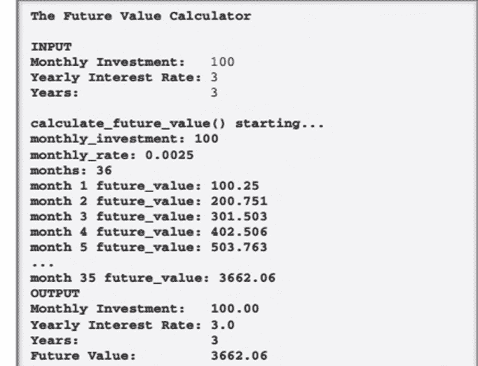

## 描述

- 追踪程序执行的一种简单方法是在代码的关键点包含显示调试消息的语句。这些消息可以指示正在执行哪些代码，并可能包含重要变量的值。

图 8-4 一种追踪代码执行的简单方法

## 如何使用 Visual Studio 调试程序

虽然你可以通过追踪程序执行来发现一些编程错误，但使用专门为此目的设计的工具通常容易得多。幸运的是，大多数现代 IDE 都包含一个名为调试器的强大工具，它可以帮助你发现并消除编程错误。

在接下来的几幅图中，你将学习如何使用 Visual Studio 的调试器。当然，如果你正在使用 Xcode，可以跳过这些图，直接查看显示如何使用 Xcode 调试器的图。如果你比较这两个 IDE 的调试器，你会发现它们的工作原理相似。对于大多数 IDE 的调试器来说都是如此。

## 如何设置和删除断点

调试程序的第一步是确定错误的原因。为了做到这一点，识别错误发生的位置通常很有帮助。

调试程序最简单的方法是设置如图 8-5 所示的断点。当你使用调试器运行程序时，它会在该语句之前停止。一个黄色箭头标记了将要执行的语句。

当你想要继续正常执行时，可以点击继续（Continue）按钮。程序将一直运行到遇到下一个断点。或者，你可以使用停止调试（Stop Debugging）功能来结束程序的执行。

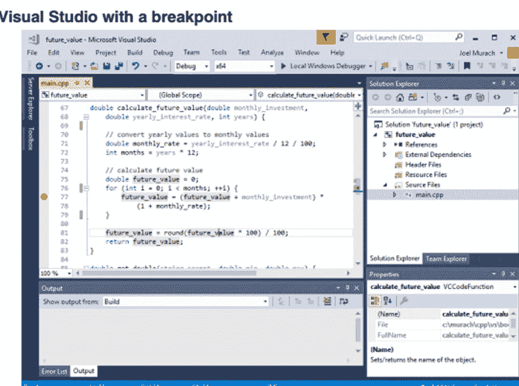

## 描述

- 追踪程序执行的一种简单方法是在代码的关键点包含显示调试消息的语句。这些消息可以指示正在执行哪些代码，并可能包含重要变量的值。

- 当你设置断点并逐步执行代码时，本地变量（Locals）窗口会自动显示作用范围内变量的值。在图 8-6 中，执行点位于 `calculate_future_value()` 函数中。在这里，本地变量窗口显示了函数定义的三个参数（`monthly_investment`、`yearly_interest_rate` 和 `years`）以及函数内部定义的四个局部变量（`monthly_rate`、`months`、`future_value` 和 `i`）。

- 对于数值和字符串，变量的值显示在本地变量窗口中。然而，当对象以 vector 显示在本地变量窗口中时，它不会自动显示变量的值。相反，它在对象名称左侧显示一个三角形符号。然后，你可以通过点击该三角形将其展开来查看对象的值。

图 8-5 如何设置和删除断点


## 如何逐步执行代码

当你逐步执行程序时，如果你想执行一个函数而不进入它，可以点击跳过（Step Over）按钮。或者，你可以使用步出（Step Out）退出任何你不想逐步执行的函数。这包括程序可能进入的任何 C++ 库中的函数。由于这些函数对你来说没有意义，你可以立即跳出它们。

Visual Studio 在你调试时还会显示工具栏。你可以点击此工具栏上的跳过（Step Over）和步入（Step Into）来逐条语句地执行程序。然后，你可以使用本地变量窗口观察值具体是如何变化的。这可以帮助你确定错误的原因。

图 8-6 如何逐步执行代码

# 调试会 (Debugging) - Visual Studio

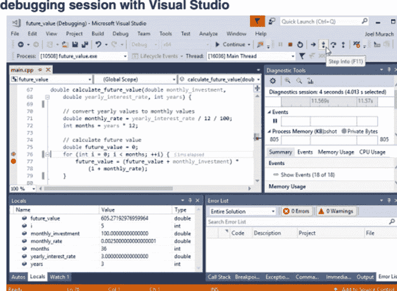

## 调试工具栏上的某些按钮

| 按钮 | 快捷键 | 说明 |
| :--- | :--- | :--- |
| 跳过 (Step Over) | F10 | 逐行执行代码语句，跳过被调用的函数。 |
| 进入 (Step Into) | F11 | 逐行执行代码语句，包括被调用的函数。 |
| 跳出 (Step Out) | Shift+F11 | 完成当前函数中的代码执行并返回到调用它的函数。 |
| 继续 (Continue) | F5 | 继续执行直到遇到下一个断点。 |
| 停止调试 (Stop Debugging) | Shift+F5 | 停止调试并退出程序。 |

## 描述

- 当到达断点时，程序执行会在该行执行之前停止。

- 代码编辑器左侧边栏中的箭头显示了下一个将执行的行。

- “局部变量”（Locals）窗口显示了当前函数作用范围内变量的值。要显示它，请点击“局部变量”选项卡。

- “自动”（Autos）窗口显示了当前代码行及前一行中变量的值。要显示它，请点击“自动”选项卡。

图 8-6 如何逐行执行代码并检查变量

### 如何检查堆栈跟踪


# 调试与部署

## 查看堆栈跟踪

在调试时，有时查看堆栈跟踪（stack trace）是有帮助的，它是按调用顺序的反序排列的函数列表。默认情况下，Visual Studio 在“调用堆栈”（Call Stack）窗口中显示堆栈跟踪，该窗口位于代码编辑器右下角的窗口组中。

例如在图 8-7 中，调用堆栈窗口显示代码执行位于 `calculate_future_value()` 函数中。该窗口还显示此函数是由 `main()` 函数的第 35 行调用的。此时，你可能想显示 `main()` 函数的第 35 行，以查看调用 `calculate_future_value()` 函数的代码。要这样做，你可以双击堆栈跟踪中的 `main()` 函数。

在此图中，两个函数都存储在同一个文件中。然而，一个文件中的函数调用另一个文件中的函数是很常见的。例如，在第 7 章中，你学习了如何在头文件中编写函数。在这种情况下，双击堆栈跟踪中的函数将会在代码编辑器中显示另一个文件的源代码。如果你尝试这种操作，你会发现它可以帮助你定位到 bug 的源头。

### 图 8-7 显示调用堆栈的 Visual Studio 调试会话

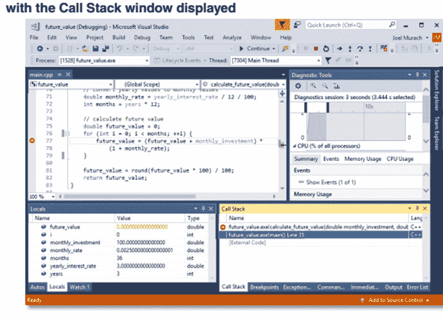

#### 描述

- 堆栈跟踪是按调用顺序的反序排列的已调用函数列表。
- 默认情况下，Visual Studio 在“调用堆栈”窗口中显示堆栈跟踪，该窗口包含主窗口右下角的窗口组中。
- 要跳转到堆栈跟踪中显示的代码编辑器中的某行，请双击堆栈跟踪中的该行。

## 如何使用 Xcode 调试程序

虽然你也可以通过跟踪程序执行来发现一些编程错误，但通常使用专为此目的设计的工具更简单。幸运的是，现代 IDE 包含一个名为“调试器”（debugger）的强大工具，可以帮助你找到并消除编程错误。

在接下来几张图中，你将学习如何使用 Xcode 的调试器。当然，如果你使用的是 Visual Studio，可以跳过这些图。不过，你可能想观察这两个 IDE 的调试器是如何相似工作的。对于大多数 IDE 的调试器都是如此。

### 如何设置和移除断点

调试程序的第一步是确定 bug 的成因。为了这一点，查看程序执行过程中不同点的变量值通常是有帮助的。

在程序执行时查看变量值的简单方法是如图 8-8 所示设置断点。要设置断点，请点击代码的行号。然后断点会被一个放置在断点上的蓝色箭头标记。随后，当你运行程序时，执行会在断点处之前停止。这时你将能够查看程序在该点作用范围内的变量。

调试时，在导致 bug 的程序行之前设置断点很重要。通常，你可以通过阅读程序崩溃时显示的任何错误信息来确定在哪里设置断点。然而，有时你必须通过实验来找到合适的断点位置。

一旦设置了断点，它就会一直保持开启状态，直到你禁用或移除它。即使你关闭项目并退出 Xcode，情况也是如此。

如果你认为可能再次使用该断点，可以通过点击它来禁用。断点图标会变灰，让你知道它未激活。然而，这很容易再次找到该断点。然后，如果你想激活断点，可以点击它。

如果你想移除断点，可以点击它。

### 图 8-8 带断点的 Xcode

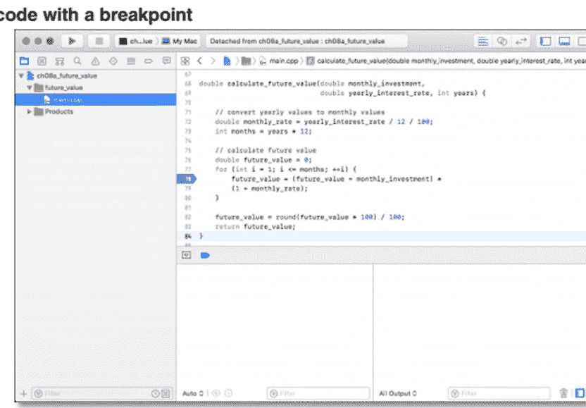

#### 描述

- 当到达断点时，程序执行会在该行执行之前停止。
- 代码编辑器左侧边栏中的箭头显示了下一个将执行的行。
- 要设置断点，请点击代码的行号。然后断点会被一个放置在断点上的蓝色箭头标记。
- 要禁用断点，点击它。断点图标会变灰，让你知道它未激活。
- 要移除断点，可以点击它。

### 图 8-9 使用 Xcode 进行调试会话

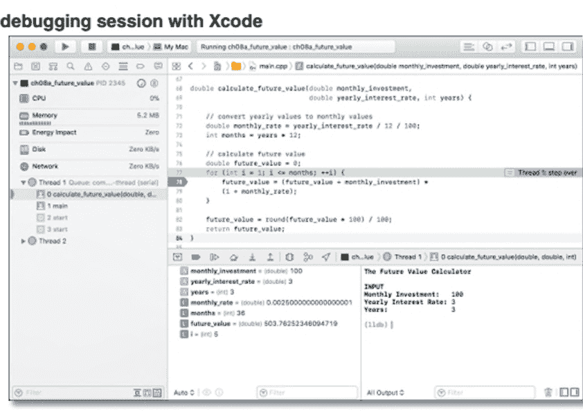

#### 调试工具栏上的某些按钮

| 按钮 | 快捷键 | 描述 |
| --- | --- | --- |
| Step Over (逐越) | F6 | 逐行执行代码语句，跳过被调用的函数。 |
| Step Into (逐入) | F7 | 逐行执行代码语句，包括调用函数中的语句。 |
| Step Out (跳出) | F8 | 完成当前函数的代码执行并返回到调用它的函数。 |
| Continue (继续) | Cmd+Ctrl+Y | 继续执行直到下一个断点。 |

#### 描述

- 当遇到断点时，程序执行会在该行代码执行之前停止。
- 下一个将执行的行在代码编辑器窗口中会被阴影显示。
- Auto 窗口显示你可能感兴趣的变量值。要显示它，请从调试区域底部的列表中选择 Auto 项。
- Locals 窗口显示当前函数作用域内局部变量的值。要显示它，请从调试区域底部的列表中选择 Locals 项。
- 要停止调试并退出程序，点击窗口顶部的 Stop 按钮，或从 Debug 中选择 Detach 项。

## 如何检查堆栈跟踪

在调试时，查看堆栈跟踪有时很有帮助，堆栈跟踪是按调用的反序排列的函数列表。默认情况下，Xcode 在主窗口左侧的调试导航器（Debug navigator）中显示堆栈跟踪。

例如，图 8-10 中的堆栈跟踪显示代码执行位于 `calculate_future_value()` 函数中。该窗口还显示此函数是由 `main()` 函数调用的。此时，你可能想显示 `main()` 函数中调用 `calculate_future_value()` 函数的代码。要实现这一点，你可以点击堆栈跟踪中的 `main()` 函数。

在图中，两个函数都存储在同一个文件中。然而，一个文件中的函数调用另一个文件中的函数是常见的。例如，在第 7 章中，你学习了如何在头文件中编写函数。在这种情况下，点击堆栈跟踪中的函数将会在代码编辑器中显示另一个文件的源代码。如果你尝试这种操作，你会发现它可以帮助定位 bug 的源头。

### 图 8-10 带有堆栈跟踪的 Xcode 调试过程

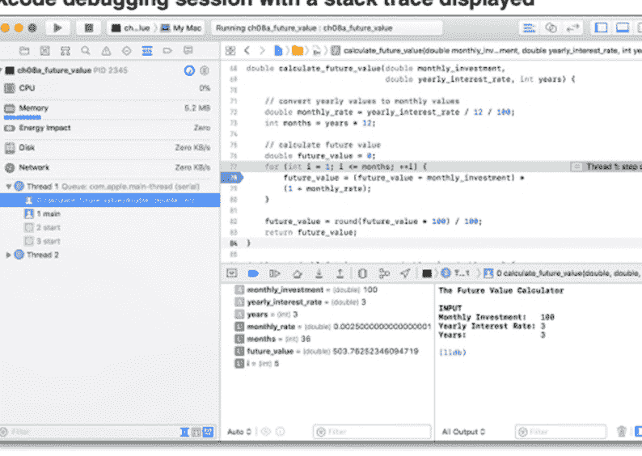

#### 描述

- 堆栈跟踪是按调用的反序排列的函数列表。
- 默认情况下，当你开始调试会话时，Xcode 在主窗口左侧显示调试导航器，并在导航器中显示堆栈跟踪。
- 要跳转到代码编辑器中堆栈跟踪显示的某行代码，请点击堆栈跟踪中的该行。
- 当结束调试会话时，可以通过点击调试导航器旁的项目导航器（Project navigator）按钮来重新显示项目。

## 如何部署和运行程序

本章最后将展示如何部署一个 C++ 程序。然后，它将展示你的用户如何运行一个已经部署的 C++ 程序。

### 如何部署程序

当你使用 IDE 开发 C++ 程序时，IDE 会创建一个可执行文件，该文件可以直接在编译它的目标操作系统上运行。因此，部署程序只需找到可执行文件并让用户可用即可。如果你有相应的权限，可以通过手动将文件复制到他们的计算机来让用户可用。如有必要，你还可以包含有关如何运行可执行文件的说明，以及针对他们可能遇到的任何问题的故障排除提示。

如果你使用 Visual Studio，它通常会创建一个扩展名为 `.exe` 的可执行文件，并将其存储在项目文件夹的子文件夹中，如图 8-11 所示。如果你使用 Xcode，它通常会创建一个没有文件扩展名的可执行文件，并将其存储如图所示的文件夹中。由于该文件夹不是项目文件夹的子文件夹，很难找到。找到此文件夹的一种简单方法是使用 Xcode 展开项目的 Products 文件夹。然后，你可以 Control-点击可执行文件，并从生成的菜单中选择 Show in Finder 项，以便在 Finder 中查看该文件。

### 如何运行已部署的程序

在大多数情况下，用户可以使用资源管理器（Windows）或 Finder（Mac）找到文件并双击它来运行可执行文件。然后，操作系统应该在命令提示符（Windows）或终端（macOS）中启动程序。然而，如果 Windows 通过双击运行你的可执行文件，控制台可能会在程序退出时关闭。这可能导致你的用户无法查看程序的输出。为了修复此问题，你可以将图 8-11 所示的代码添加到程序的末尾。这样，控制台将保持打开，直到用户按下 Enter 键。或者，你可能倾向于创建设计从控制台运行的程序。例如，在 Windows 上，用户必须使用命令提示符进入包含可执行文件的文件夹，并输入可执行文件的名称。如果用户打开控制台并用它运行可执行文件，控制台将在程序退出后保持打开。你还可以通过修改系统 Path 使可执行文件在任何文件夹都可用。要了解如何操作，你可以上网搜索。

### 图 8-11 可执行文件的典型文件夹和文件名

#### 对于 Visual Studio

```
C:\murach\vs\apps\ch08_futurevalue\x64\Debug\futurevalue.exe
```

#### 对于 Xcode

```
/Users/Username/Library/Developer/DerivedData/ch08_futurevalue/Build/Products/Debug/futurevalue
```

### 图 8-12 如何部署可执行文件

- 当你创建并找到了程序的可执行文件后，可以通过让用户可以使用该可执行文件来部署。
- 使用资源管理器（Windows）或 Finder（Mac）找到文件。然后，双击它。

### 图 8-13 运行可执行文件的两种方式

#### 添加以保持控制台打开的代码

```cpp
cin.ignore(1000, '\n'); // 忽略所有额外数据
cout << "Press [Enter] to exit...\n";
cin.ignore();
```

#### 在 Windows 上使用控制台运行可执行文件

```cmd
cd \murach\cpp\dist
futurevalue
```

#### 在 macOS 或 Linux 上使用控制台运行可执行文件

```bash
cd ~/Documents/murach/cpp/dist
./futurevalue
```

## 观点

现在你已经完成了这一章，你应该具备了测试程序以识别其可能包含的任何错误所需的技能。然后，你应该能够使用本章中介绍的调试技术来确定这些错误的原因。

然而，你应该知道，大多数 IDE 提供的调试器提供了额外功能，你可以利用这些功能来测试和调试你的程序。在阅读本章后，你应该能够自己学习更多关于这些功能的知识。

你应该知道，本章描述的测试方法只是让你入门的基础。当你开始开发更复杂的程序时，你可能想要学习更多其他测试方法，例如测试驱动开发 (TDD) 和行为驱动开发 (BDD)。此外，你可能想学习其他测试技术，例如单元测试，这为源代码的单个单元（作为函数）创建测试的方法，以确保它们运行正常。

## 术语

- 测试程序 | 测试计划
- 调试程序 | 追踪程序执行
- 错误 | 调试器
- 编译时错误 | 断点
- 语法错误 | 堆栈跟踪
- 运行时错误 | 可执行文件
- 逻辑错误

## 总结

- 为了测试程序，你需要运行它以确保无论输入什么有效或无效数据的组合，它都能正常工作。
- 当你调试程序时，你需要发现并修复在测试程序时发现的所有错误（bug）。
- 编译时错误在运行程序之前会被编译器捕获。这些通常是违反了语句编写规则的语法错误。
- 运行时错误没有违反语法规则，但它们可能导致程序崩溃或产生意外之外的结果。
- 逻辑错误是指不会引起语法或运行时错误但产生错误结果的语句。
- 测试计划是一个表格或电子表格，显示了你可以用于测试程序的数据输入以及每组输入对应的正确结果。通过这种方式，你可以验证程序的运行是否正确。
- 追踪（trace）程序执行的一种简单方法是在代码的关键点包含显示调试信息的语句。
- 大多数现代 IDE 都包含一种名为 `debugger`（调试器）的强大工具，它可以帮助你发现并修复错误。
- 你可以在代码行上设置 `breakpoint`（断点），以便在该行代码执行之前停止代码执行。然后，你可以步执行代码，并在代码执行时查看变量的值。
- `stack trace`（堆栈跟踪）是按调用反序列出的函数列表。
- 可执行文件可以直接由其编译所属的操作系统运行。要部署可执行文件，你可以将其分发给用户并教他们如何运行。

# 练习

## 练习 8-1 测试并调试“分数”程序

在本次练习中，你将测试并调试第 4 章中“分数”程序的变体。

1. 打开此文件夹中名为 `test_scores` 的项目或解决方案：`ex_starts\ch08_ex1_test_scores`。查看代码。
2. 创建一个测试计划，用有效数据彻底测试程序。这可以是一个手写表格或电子表格，包含三个或四个测试结果测试数据以及预期结果。
3. 以你的测试计划作为测试程序的指南。然后记录你在测试过程中发现的任何不准确的结果。
4. 调试任何逻辑错误。
5. 使用相同的数据测试程序，以确保它运行正确。

## 练习 8-2 测试并调试“未来值”程序

在此练习中，你将使用你的 IDE 来寻找并修复“未来值”程序中的语法错误和逻辑错误。

### 修正语法错误

1. 打开此文件夹中名为 `future_value` 的项目或解决方案：`ex_starts\ch08_ex2_future_value`
2. 打开 `console.cpp` 文件，注意 `get_double()` 函数包含语法错误。
3. 使用你的 IDE 寻找并修复这些错误。

### 追踪代码执行

4. 显示 `main.cpp` 文件，滚动到 `calculate_future_value()` 函数的循环定义。在循环中添加一条语句，每次循环执行时显示月份和未来值的值。
5. 运行程序以查看你刚刚添加的语句是如何工作的。检查显示的值，并注意到未来值每次增加得太多了。
6. 将你添加的语句注释掉，使其不再显示消息。

### 逐步执行程序

7. 在 `calculate_future_value()` 函数的第一条语句上设置断点。然后，使用调试器运行程序并在提示时输入值。程序应该在断点处停止。
8. 查看本地变量的值，并注意 `monthly_investment`、`yearly_interest_rate` 和 `years` 变量已经赋值。
9. 点击工具栏上的 Step Into（单步进入）按钮执行赋值 `monthly_rate` 变量的语句。这个值正确吗？如果不正确，停止调试并修复错误。
10. 用调试器运行程序并输入与之前相同的值。当程序到达断点时，点击 Step Into 按钮执行该语句。如果你修复了该值，`monthly_rate` 变量的值现在应该是正确的。
11. 在 `for` 循环内部计算未来值的语句上再设置一个断点。然后，逐步执行循环三次或多次，查看 `future_value()` 和 `i` 变量的值每次是如何变化的。
12. 移除 `calculate_future_value()` 函数中的两个断点。然后，点击 Step Out（单步跳出）按钮完成该函数的执行，并返回 `main()` 函数中调用 `calculate_future_value()` 函数的语句。
13. 点击 Continue（继续）按钮在控制台上显示计算结果。
14. 在 `main()` 函数的第一条语句上设置断点。
15. 在控制台输入 "y" 继续。当到达断点时，使用 Step Into、Step Out 和 Step Over（单步执行）按钮逐步执行代码，根据提示输入值并在过程中进行尝试。
16. 完成后，使用你的 IDE 结束调试。

# 第 2 部分：根据需要掌握更多技能

本节的章节旨在补充本书第 1 部分介绍的技能。由于这些章节是模块化的，你可以按照自己喜好的顺序进行阅读。例如，如果你想学习如何使用 STL 容器，可以跳到第 10 章。或者，如果你想学习如何处理异常，可以跳到第 13 章。

然而，我们建议顺序阅读第 10 章和第 11 章。因为第 10 章是第 11 章的前提。尽管如此，你最终应该阅读所有这些章节，因为它们描述了每个 C++ 程序员都应该具备的技能。

## 第 9 章：使用结构的基本技能

到本书为止，你已经学习了如何处理 `string`、`double`、`int` 和 `vector` 等数据类型。然而，有时你需要通过分组相关数据类型来组织数据。例如，一个产品可能包含许多数据类型，你可能希望将所有数据类型组合成单个数据类型中。为了实现，你可以创建一个结构（structure）。

### 如何开始使用结构

图 9-1 显示了如何定义包含多个数据类型的结构。要做到这一点，你需要编写 `struct` 关键字，后面跟着结构的名称以及在大括号内包含的数据类型。注意在所示的语法中，在右括号后必须使用分号。

接下来的示例定义了一个名为 `Movie` 的结构，它包含两个数据类型：用于电影标题的 `string` 和用于电影原始发行年份的 `int` 值。在处理结构时，一种常见的做法是结构名称的每个单词的首字母都大写，例如“Movie”和 "CustomerInvoices"。

在定义结构之后，你可以像第二个示例所示，通过定义变量类型来从结构中创建一个对象。在这里，代码定义了一个类型为 `Movie` 且名为 `movie` 的变量。和其他变量名一样，为定义结构的变量使用小写字母是常见做法。

一旦你从结构创建了对象，就可以使用点运算符（dot operator）来访问其数据成员（或简称为成员）。这与任何其他对象（如 `count` 对象）的方法相同。例如，第三个示例显示了如何为 `Movie` 对象的成员赋值，并展示了如何从 `Movie` 对象中读取值。

第四个示例显示，你可以在 `vector` 中存储一个或多个结构对象。在这里，第一条语句创建了一个名为 `Movies` 的 `Movie` 对象 `vector`。然后，第二条语句将名为 `movie` 的 `Movie` 对象添加到向量中。

如果你有一个包含一个或多个结构对象的向量，你可以像第五个示例所示使用范围循环（range-based loop）轻松地访问每个对象中的数据。在这里，循环仅显示向量中每部电影的标题和年份。


如果没有 `Movie` 结构，最后两个示例中的代码将更难于开发和维护。首先，你需要一个用于标题的 `string` `vector` 和一个用于年份的独立 `int` `vector`。然后，你需要确保这些向量保持同步。为了做到这一点，你无法使用范围循环，因为你需要索引来访问每个向量的元素。

## 如何定义数据类型

### 定义结构的语法

```cpp
struct DataType {
    structure members ...
};
```

### 一个 Movie 结构

```cpp
struct Movie {
    string title;
    int year;
};
```

## 如何定义一个结构类型的变量

```cpp
Movie movie;
```

## 如何访问结构对象的成员

### 如何直接赋值

```cpp
movie.title = "Wonder Woman";
movie.year = 2017;
```

### 如何从输入流赋值

```cpp
cout << "Please enter the movie title: ";
getline(cin, movie.title);

cout << "Please enter the year that movie was released: ";
cin >> movie.year;
```

### 如何读取值

```cpp
cout << movie.title << " was released in " << movie.year << ".";
```

## 如何创建结构对象向量并添加一个结构对象

```cpp
vector<Movie> movies;
movies.push_back(movie);
```

## 如何遍历结构对象向量

```cpp
for(Movie m: movies) {
    cout << m.title << " was released in " << m.year << ".";
}
```

## 关键点

- 你可以使用 `struct` 关键字来定义包含一个或多个数据类型的结构。当你定义结构时，定义以分号结束。
- 组成结构的数据类型被称为数据成员，或简称为成员。
- 当你定义一个结构类型的变量时，会创建一个该类型的对象。
- 你可以使用点表示法访问从结构中创建的对象的数据成员。
- 你可以使用 `vector` 存储从结构创建的一个或多个对象。然后，你可以使用范围 `for` 循环轻松访问每个对象中的数据。


### 如何初始化结构

当你创建一个结构实例时，成员将包含它们创建时所在位置上随机存在的任何值。这可能导致意想不到的结果。

由于可能产生意想不到的结果，通常认为创建对象时初始化成员被认为是一种良好的最佳实践。第二个示例说明了这一点。

当你使用初始化列表（initialization list）时，赋值运算符是可选的。列表中的第一个值被分配给第一个成员，第二个值被分配给第二个成员，依此类推。

你不需要在列表中为每个成员都包含一个值。然而，如果你没有初始化某个成员，你就无法使用范围循环，因为你需要索引来访问每个向量的元素。

在 C++11 及更高版本中，你可以在结构定义中设置默认值。

## 如何使用初始化列表

### 结构的语法

```cpp
DataType variable_name = {value1, value2, ...};
```

### 两个带有初始化列表的 Movie 对象

```cpp
movie_1 = {"Wonder Woman", 2017};
movie_2 = {"Casablanca", 1942};
```

### 一个只有标题的 Movie 对象

```cpp
movie_3 = {"Casablanca"};
```

## 如何设置默认成员

```cpp
struct Movie {
  string title = "";
  int year = 0;
};
```

## 如何显示成员

```cpp
cout << "MOVIE OBJECT VALUES\n"
  << "Title: " << movie.title << endl
  << "Year: " << movie.year << endl;
```


## Movie List 1.0 程序

现在你已经学习了一些使用结构的基本技能，已经准备好查看一个使用这些技能的 Movie List 1.0 程序了。在本章的后面部分，你将看到一个扩展了这些技能的 Movie List 2.0 程序。

图 9-3 的第一部分开始显示 Movie List 1.0 程序的用户界面。该程序允许用户输入一部或多部电影。然后，当用户完成电影输入后，程序将显示用户输入的所有电影列表。

接下来，该图显示了 Movie List 1.0 程序的代码。首先，这段代码定义了一个用于 Movie 对象的结构，包含标题和年份。该结构为标题和年份设置了默认值，因为程序在创建 Movie 对象时并没有初始化它们。

### 控制台

```
The Movie List program

Enter a movie...

Title: Casablanca
Year: 1942

Enter another movie? (y/n): y

Title: Wonder Woman
Year: 2017

Enter another movie? (y/n): n

TITLE               YEAR
Casablanca         1942
Wonder Woman       2017
```

### 代码

```cpp
#include <iostream>
#include <iomanip>
#include <string>
#include <vector>

using namespace std;

// define a struct for a Movie object
struct Movie {
    string title = "";
    int year = 0;
};

int main() {
    cout << "The Movie List program\n\n";
    cout << "Enter a movie...\n\n";
    // get vector of Movie objects
    vector<Movie> movie_list;
    char another = 'y';
    while (tolower(another) == 'y') {
        Movie movie;

        cout << "Title: ";
        getline(cin, movie.title);

        cout << "Year: ";
        cin >> movie.year;

        movie_list.push_back(movie);

        cout << "\nEnter another movie? (y/n): ";
        cin >> another;
        cin.ignore();
        cout << endl;
    }
}
```

图 9-3 Movie List 1.0 程序（部分 1，/2）

当用户通过不输入 'y' 或 'Y' 来结束此循环时，图 9-3 第 2 部分的代码将显示存储在 `vector` 中的所有 `Movie` 对象。为了实现这一点，它使用了流输出操符将所有数据在两列中左对齐，其中第一列宽度为 30 个字符（10 * 3），第二列宽度为 10 个字符。

在查看此代码时，请注意 Movie List 程序没有对用户输入的任何数据进行有效验证。这使得代码列表保持简短，并专注于与 `Movie` 结构体协作的代码。

### 代码（继续）

```cpp
// display the Movie objects stored in the vector
const int w = 10;
cout << left
    << setw(w * 3) << "TITLE"
    << setw(w) << "YEAR" << endl;
for (Movie movie : movie_list) {
    cout << setw(w * 3) << movie.title
         << setw(w) << movie.year << endl << endl;
}
```

图 9-3 Movie List 1.0 程序（部分 2，/2）

## 处理结构体的更多技能

现在你已经熟悉了处理结构体的基本技能，已经准备好学习更多处理结构体的技能了。这些技能包括嵌套结构体、在函数中使用结构体、比较结构体以及定义成员函数。

## 如何嵌套结构体

图 4-9 显示了如何将一个结构嵌套另一个结构之中。要做到这一点，你可以将结构体变量定义为数据成员。在图中，第一个示例首先定义了一个 `Date` 结构，它使用 `int` 变量来存储日期的年、月、日。然后，它定义了一个 `Invoice` 结构，它使用 `int` 变量表示日期和截止日期，使用 `double` 变量表示总额。换句话说，这段代码在 `Invoice` 结构体中嵌套了两个 `Date` 结构体。

第二个示例展示了如何编写处理这些嵌套结构的代码。在这里，第一条语句从 `Invoice` 结构创建了一个 `Invoice` 对象。由于该结构包含两个 `Date` 类型的成员，因此也创建了两个 `Date` 对象。然后，这段代码为 `Invoice` 对象赋值。要给嵌套对象赋值，它使用点操作符符号来访问这些对象的成员。例如，它使用 `invoice.date.month` 来访问存储在 `Invoice` 对象中的 `Date` 对象的月份。

在为 `Invoice` 对象赋值后，这段代码还从 `Invoice` 对象中读取值并将其显示在控制台上。同样，为了实现这一点，这段代码使用点操作符来访问嵌套结构的成员。

结构体的嵌套深度没有限制。然而，与所有嵌套一样，最好嵌套深度不要超过二或三层。否则，你的代码可能会变得难以理解和维护。

### 嵌套两个 Date 结构的 Invoice 结构

```cpp
struct Date {
    int year = 1900;
    int month = 1;
    int day = 1;
};
```

```cpp
struct Invoice {
    int number = -1;
    Date date;
    Date due_date;
    double total = 0;
};
```

### 使用这些嵌套结构的代码

```cpp
// create the Invoice structure
Invoice invoice;

// assign values to the Invoice and Date structures
invoice.number = 1;
invoice.date.month = 1;
invoice.date.day = 2;
invoice.date.year = 2018;
invoice.due_date.day = 15;
invoice.due_date.year = 2018;
invoice.total = 1430.72;
```

```cpp
// read values from the Invoice and Date structures
cout << "INVOICE\n"
    << "Number: " << invoice.number << endl << "-\n"
    << "Date: " << invoice.date.year << "-\n"
        << invoice.date.month << "-\n"
        << invoice.date.day << endl << "-\n"
    << "Due Date: " << invoice.due_date.year << "-\n"
        << invoice.due_date.month << "-\n"
        << invoice.due_date.day << endl << "-\n"
    << "Total: " << invoice.total << endl << endl;
```

### 控制台

| | |
|---|---|
| INVOICE | 1 |
| Date: | 2018-1-2 |
| Due Date: | 2018-4-15 |
| Total: | 1430.72 |

### 描述

- 你可以在其他结构内部嵌套结构体。要做到这一点，你可以将结构体变量定义为数据成员。
- 你使用点操作符来访问嵌套结构的成员。
- 结构体的嵌套深度没有限制。


## 一个返回 Movie 对象的函数

```cpp
Movie get_movie() {
    Movie movie;
    cout << "Enter title: ";
    getline(cin, movie.title);
    cout << "Enter year: ";
    cin >> movie.year;
    return movie;
}
```

## 一个接受 Movie 对象但不更新它的函数

```cpp
void display_movie(const Movie movie) {
    cout << "MOVIE: " << movie.title << " " << movie.year << "\n\n";
}
```

## 一个接受 Movie 对象并对其更新的函数

```cpp
void update_movie_year(Movie &movie) {
    cout << "Update Year: ";
    cin >> movie.year;
}
```

## 使用这些函数处理电影数据的代码

```cpp
Movie movie = get_movie();
display_movie(movie);
update_movie_year(movie);
display_movie(movie);
```

## 输出结果

```
Enter title: Wonder Woman
Enter year: 1917
MOVIE: Wonder Woman (1917)

Update Year: 2017
MOVIE: Wonder Woman (2017)
```

## 更新 Movie 对象的另一种方法

```cpp
Movie update_movie_year2(Movie &movie) {
    cout << "Update Year: ";
    cin >> movie.year;
    return movie;
}
```

## 使用此函数更新 Movie 对象的代码

```cpp
movie = update_movie_year2(movie);
```

## 描述

- 当你将结构体对象传递给函数时，所有的值都是通过值传递的。这意味着每个成员的拷贝都会被传递。
- 如果函数需要访问与调用代码相同的结构体对象，则必须通过引用传递对象。这提高了大型对象的性能。
- 函数不能返回多个值。但是，如果函数返回一个结构体类型，它可以作为结构体对象的数据成员来返回多个值。


## 如何比较结构体的是否相等性

默认情况下，结构体不提供等价运算符（`==`）。因此，如果你尝试使用等价运算符比较两个对象，将得到一个错误，指示等价运算符不可用于比较对象。

与其使用等价运算符比较结构体对象，你可以通过比较数据成员的值来测试结构体对象是否相等。

### 用于比较的三个 Movie 对象

```cpp
Movie ww1 = {"Wonder Woman", 2017};
Movie ww2 = {"Wonder Woman", 2017};
Movie cb = {"Casablanca", 1942};
```

### 如果尝试比较结构体变量相等会发生什么

```cpp
if (ww1 == ww2) {
    cout << "The movies are equal\n";
}
```

### 典型的错误消息

```
no operator "==" matches these operands
```

### 如何比较 Movie 对象数据成员的相等性

#### 一个显示消息的 if 语句

```cpp
if (ww1.title == ww2.title && ww1.year == ww2.year) {
    cout << "The movies are equal\n";
} else {
    cout << "The movies are NOT equal\n";
}
```

#### 设置布尔变量的代码

```cpp
bool duplicate;
duplicate = (ww1.title == ww2.title && ww1.year == ww2.year); // true
duplicate = (ww1.title == cb.title && ww1.year == cb.year); // false
```

### 描述

- 结构体默认不定义等价运算符（`==`）。因此，如果你尝试使用等价运算符比较结构体变量，将得到一个错误。
- 要测试两个结构体变量是否相等，你可以比较数据成员中的值。

## 如何使用成员函数

除了包含数据的成员外，结构体还可以拥有对数据成员进行操作的成员函数。成员函数的工作就像普通函数，因此它可以接受参数并返回值。


在图 9-7 中，第一个示例定义了一个 `Movie` 结构体，其中包含一个名为 `equals()` 的成员函数。该函数接受一个名为 `to_compare` 的 `Movie` 对象作为参数，并返回一个 `bool` 值。在该函数的体内，有一条语句返回 `bool` 值，该值是通过检查当前 `Movie` 对象的数据成员是否与传递给成员函数的 `Movie` 对象的数据成员相等得到的。

第二个示例显示，你可以使用点运算符调用上一个图中定义的 `Movie` 对象 `ww1` 的 `equals()` 函数。然后，它将同样在上一个图中定义的名为 `ww2` 的 `Movie` 对象传递给此函数。结果是由于这两个 `Movie` 对象包含相同的数据，此函数返回一个为 `true` 的 `bool` 值。另一方面，第三条语句使用 `equals()` 函数比较名为 `ww2` 和 `cb` 的 `Movie` 对象。结果是此函数返回一个为 `false` 的 `bool` 值。

像普通函数一样，你可以在结构体定义中声明函数，如第三个示例所示。然后，你可以在结构体定义之后定义函数。这样做需要在函数定义前加上数据类型和作用域解析运算符（`::`）。这告诉编译器该函数是结构体的成员。

# 如何使用成员运算符

你还可以添加与结构体一起工作的运算符。这样做，你可以使用添加函数时相同的技巧，但不是编码函数名，而是编码 `operator` 关键字。例如，第四个示例显示了如何通过第四个示例定义等价运算符（`==`），而不是第一个示例所示的 `equals()` 成员函数。

第五个示例显示了如何使用第四个示例定义的等价运算符。当你回顾这个示例时，你应该意识到如果你需要比较结构体，添加这样的等价运算符比上一个图的方法更简单。

在图中，运算符函数定义在结构体定义内部。但是，如果你愿意，你可以在结构体定义中声明运算符，并在结构体定义之后对其定义。这样做，你可以使用处理成员函数的相同技巧。

# 带有成员函数的 Movie 类型

```cpp
struct Movie {
    string title;
    int year;
    bool equals(const Movie& to_compare) {
        return (title == to_compare.title && year == to_compare.year);
    }
};
```

# 调用 Movie 对象成员函数的代码

```cpp
bool duplicate;
duplicate = ww1.equals(ww2); // true
duplicate = ww1.equals(cb); // false
```

# 成员函数的声明和定义

```cpp
struct Movie {
    string title;
    int year;
    bool equals(const Movie&); // 成员函数声明
};

// 成员定义
bool Movie::equals(const Movie& to_compare) {
    return (title == to_compare.title && year == to_compare.year);
}
```

# 为数据类型添加运算符

```cpp
struct Movie {
    string title;
    int year;
    bool operator==(const Movie& to_compare) {
        return (title == to_compare.title && year == to_compare.year);
    }
};
```

# 使用等价运算符处理 Movie 代码

```cpp
bool duplicate;
duplicate = (ww1 == ww2); // true
duplicate = (ww1 == cb); // false
```

# 电影列表 2.0 程序

图 9-8 展示了一个电影列表程序，它阐明了你所学到的许多技能。如控制台所示，该程序维护了一个电影列表，用户可以查看所有电影、向列表中添加电影或从列表中删除电影。

在控制台之后，该图显示了该程序的代码。到目前为止，你应该已经理解了代码大部分部分是如何运行的。首先，它定义了一个用于 `Movie` 对象的结构体。该结构体有三个数据成员（标题、年份和星级），以及名为 `equals()` 的成员函数的声明。

接下来是 `equals()` 函数的定义。在这里，需要注意的是，该函数只检查标题和年份是否相同，而不是由这段代码定义一个常量来存储包含程序数据文件的文件名。

下一个函数（位于图 9-8 的第 2 部分）从数据文件中读取数据，将其存储在一个包含 `Movie` 对象的 `vector` 中，并将该 `vector` 返回给调用代码。当你查看此函数时，请注意文件中的每一行都存储一个电影的数据，每个数据成员之间用制表符字符（`\t`）分隔。因此，代码从行中获取电影标题，这段代码使用了 `getline()` 函数的重载，该函数使用第三个参数在遇到下一个制表符（`\t`）时停止读取。然后，代码使用提取运算符 `>>` 读取每行的年份和星级。

第 2 部分还包含了两个接受 `Movie` 对象 `vector` 的函数。第一个函数将此 `vector` 中的数据写入电影文件。第二个函数在控制台上显示数据，以及与列表中每部电影关联的数字。

图 9-8 的第 3 部分首先显示一个从用户处获取获取电影所有数据的函数。为了实现这一点，该函数提示用户输入数据，并将数据存储在一个 `Movie` 对象中。然后，它将该 `Movie` 对象返回给调用代码。

接下来是一个将 `Movie` 对象添加到 `Movie` 对象 `vector` 中的函数。为了确保其正常工作，这段代码首先检查该 `Movie` 是否已存在于 `vector` 中。为了做到这一点，它使用了 `Movie` 对象的 `equals()` 成员函数。如果电影已存在，这段代码假设输入了不同的星级，并更新了该电影的星级数。然后，它将 `Movies` `vector` 写入电影文件，并显示指示电影已更新的消息。然而，如果电影不存在于 `vector` 中，这段代码会将电影添加到 `vector` 的末尾，将 `vector` 写入电影文件，并显示指示电影已添加的消息。

第 3 部分的最后一个函数是从用户处获取一个数字，该数字对应于 `view` 命令在控制台上显示的电影列表。该函数首先丢弃输入流中的任何剩余字符。然后，它使用 `while` 循环提示用户输入数字，直到用户输入有效数字为止。在这里，代码检查数字是否大于 0 且小于等于 `vector` 的大小。如果是，则该数字是有效的。

# 电影列表程序

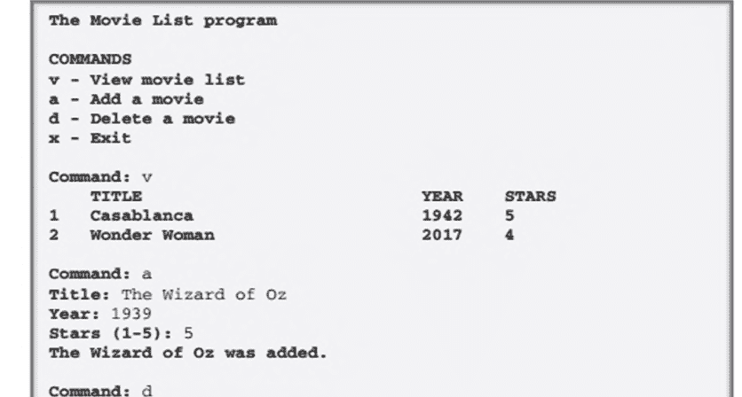

# 代码

```cpp
#include <iostream>
#include <fstream>
#include <sstream>
#include <iomanip>
#include <string>
#include <vector>
using namespace std;

struct Movie {
    string title = "";
    unsigned int year = 0;
    unsigned int stars = 0;
    bool equals(Movie); // 成员函数声明
};
// 成员函数定义
bool Movie::equals(Movie& compare) {
    return (title == compare.title && year == compare.year);
}
const string movies_file = "movies.txt";
```

图 9-8 电影列表 2.0 程序（4部分中的第1部分）

# 代码（续）

```cpp
vector<Movie> read_from_file() {
    vector<Movie> movies;

    ifstream input_file(movies_file);
    if (input_file) { // 如果文件打开成功
        Movie movie;
        string line;
        while (getline(input_file, line)) {
            stringstream ss(line);

            getline(ss, movie.title, '\t'); // 获取标题
            ss >> movie.year >> movie.stars; // 获取年份和星级
            movies.push_back(movie);
        }
        input_file.close();
    }
    return movies;
}

void write_movies_to_file(const vector<Movie>& movies) {
    ofstream output_file(movies_file);
    if (output_file) { // 如果文件打开成功
        for (Movie movie : movies) {
            output_file << movie.title << '\t'
                        << movie.year << movie.stars << '\n';
        }
        output_file.close();
    }
}

void view_col_width(const vector<Movie>& movies) {
    int col_width = 8;
    cout << setw(col_width / 2) << " "
         << setw(col_width * 4) << "TITLE"
         << setw(col_width) << "YEAR"
         << setw(col_width) << "STARS" << endl;

    int number = 1;
    for (Movie movie : movies) {
        cout << setw(col_width / 2) << number
             << setw(col_width * 4) << movie.title
             << setw(col_width) << movie.year
             << setw(col_width) << movie.stars << endl;
        number++;
    }
}
```


# 代码（续）

```cpp
Movie get_movie() {
    Movie movie;
    cout << "Title: ";
    getline(cin, movie.title);
    cout << "Year: ";
    cin >> movie.year;
    cout << "Stars: ";
    cin >> movie.stars;
    return movie;
}

void add_movie(vector<Movie>& movies) {
    Movie movie = get_movie();
    bool already_exists = false;
    for (Movie &m : movies) {
        if (m.equals(movie)) {
            already_exists = true;
            break;
        }
    }

    if (already_exists) {
        m.stars = movie.stars;
        write_movies_to_file(movies);
        cout << "Movie updated.\n";
    } else {
        movies.push_back(movie);
        write_movies_to_file(movies);
        cout << "Movie added.\n";
    }
}

int get_movie_number(const vector<Movie>& movies) {
    int number;
    while (true) {
        cout << "Number: ";
        cin >> number;
        if (number > 0 && number <= movies.size()) {
            return number;
        } else {
            cout << "Invalid number. Try again.\n";
        }
    }
}
```

图 9-8 电影列表 2.0 程序（4部分中的第3部分）

# 336 第2节 你需要的更多技能

作为结果，该函数将其返回给调用代码。否则，该数字是无效的。然后，程序执行继续到循环顶部，提示用户输入另一个数字。

图 9-8 的第 4 部分通过定义一个删除电影的函数来开始。该函数首先删除电影的索引。然后，它使用索引获取 `Movie` 对象，从 `vector` 中删除它，并显示一条包含已删除标题的消息。

第 4 部分还包含一个显示命令菜单的函数。该函数由一个简单的语句组成，显示字符（v, a, d, x）。然后，用户可以输入这些字符来执行命令（查看、添加、删除和与程序交互）。

最后一个函数是程序启动时运行的 `main()` 函数。该函数首先显示程序的名称。然后，它显示程序的菜单，从文本文件中读取电影数据并存储到电影 `vector` 中，并开始一个直到用户输入 'x' 退出为止的循环。循环内部，`switch` 语句根据输入的命令执行相应的代码。如果用户输入 'v'、'a' 或 'd'，则调用查看电影、添加电影或删除电影的函数。然而，如果用户输入 'x'，代码显示消息“Bye”，程序执行退出循环并结束。

# 代码（续）

```cpp
void delete_movie(vector<Movie>& movies) {
    int number = get_movie_number(movies);
    int index = number - 1;
    Movie movie = movies[index];
    movies.erase(movies.begin() + index);
    write_movies_to_file(movies);
    cout << movie.title << " was deleted.\n\n";
}
```

```cpp
void display_menu() {
    cout << "COMMANDS\n";
    cout << "v - View list\n";
    cout << "a - Add a movie\n";
    cout << "d - Delete a movie\n";
    cout << "x - Exit list\n";
}
```

```cpp
int main() {
    cout << "The Movie List program\n";
    display_menu();
    vector<Movie> movies = read_movies_from_file();
    char command = ' ';
    while (command != 'x') {
        cout << "Command: ";
```

图 9-8 电影列表 2.0 程序（4 部分中的 4 部分）

# 如何使用枚举

在第 6 章中，你学习了如何使用常量来存储在程序执行过程中不会改变的值。但在某些情况下，你可能希望将相关的常量进行分组。例如，你可能想将代表星期七天的常量分组。要实现这一点，你可以使用枚举（enumeration）。

# 使用作用域枚举的基本技能

枚举数据类型（或称为枚举）是一种由常量值组成的用户定义类型。枚举中包含的常量值称为枚举员（enumerators）。默认情况下，它们在内存中以从 0 开始的连续整数形式存储，这通常是你所需要的。在这里，

要定义一个枚举，你使用图 9-9 所示的语法。这里，`enum` 关键字后面跟着可选的 `class` 关键字和枚举的名称。构成枚举的常量在大括号内并用逗号进行编码。最后，在右括号后写一个分号。例如，第一个示例定义了一个名为 `Operation` 的枚举，它包含四个枚举员（add、subtract、multiply 和 divide）。

在 C++11 及更高版本中，通常使用 `class` 关键字来定义作用域枚举（也称为类枚举），如图所示，这是最佳实践。然而，你也可以像图 9-11 所示定义非作用域枚举。这在 C++11 之前是一种常见做法。因此，如果你正在处理旧代码，你可能需要学习非作用域枚举是如何工作的。

当你使用作用域枚举时，可以通过编码枚举的名称、作用域解析运算符（`::`）以及枚举员的名称来访问枚举员。例如，第二个示例显示了如何访问 `Operation` 枚举的枚举员。你可以像第三个示例所示声明一个枚举类型的变量。在这里，代码声明了一个名为 `op` 的类型为 `Operation` 的变量。

第四个示例显示了初始化枚举变量的两种方法。这表明你可以使用两条语句或一条语句，就像在初始化其他类型的变量时一样。


# 第9章 如何处理结构和枚举

## 如何定义枚举

### 创建枚举的基本语法

```cpp
enum [class] EnumerationName {
    constant_name_1,
    constant_name_2
};
```

### 带有四个枚举员的枚举

```cpp
enum class Operation { add, subtract, multiply, divide };
```

## 如何访问枚举员

```cpp
Operation::add;
```

## 如何为枚举员创建变量

```cpp
Operation op;
```

## 如何为枚举员创建并初始化变量

### 使用两条语句

```cpp
Operation op;
op = Operation::add;
```

### 使用一条语句

```cpp
op = Operation::add;
```

## 枚举员作为参数的函数

```cpp
double calculate(Operation op, double num1, double num2) {
    switch (op) {
        case Operation::add:
            return num1 + num2;
        case Operation::subtract:
            return num1 - num2;
        case Operation::multiply:
            return num1 * num2;
        case Operation::divide:
            return num1 / num2;
    }
}
```

## 使用该函数的代码

```cpp
double num1 = 50, num2 = 25;
Operation op = Operation::add;
cout << calculate(op, num1, num2) << endl; // 显示 75
op = Operation::subtract;
cout << calculate(op, num1, num2) << endl; // 显示 25
```

## 描述

- 枚举数据类型（或枚举）是一种由常量值组成的用户定义类型。
- 枚举中包含的常量值称为枚举员。默认情况下，它们在内存中以从 0 开始的连续整数形式存储。
- 要创建作用域枚举（也称为类枚举），你可以使用 `class` 关键字。这在 C++11 之后是用的。
- 要定义一个枚举，你使用图 9-9 所示的语法。这里，`enum` 关键字后面跟着可选的 `class` 关键字和枚举的名称。构成枚举的常量在大括号内并用逗号进行编码。最后，在右括号后写一个分号。例如，第一个示例定义了一个名为 `Operation` 的枚举，它包含四个枚举员（add、subtract、multiply 和 divide）。
- 当你使用作用域枚举时，可以通过编码枚举的名称、作用域解析运算符（`::`）以及枚举员的名称来访问枚举员。
- 如果你想让枚举从 0 以外的值开始，只需要指定第一个枚举员的值。对于月份枚举，如第五个示例所示，你可能想让 `jan` 对应 1，`feb` 对应 2，依此类推。这样，`jan` 的整数就与通常使用的整数匹配。
- 然而，如果你想指定所有枚举员的值，你也可以这样做。你可能想这样做为每个枚举员指定一个更合适的整数值。例如，对于支付术语的枚举，你可能想让 `net_due_20` 对应 20，`net_due_30` 对应 30，依此类推。
- 由于 `char` 类型本质上是一种整数类型，你可以通过为枚举员分配字符值来创建字符枚举，如第六个示例所示。例如，对于命令枚举，你可以为 `view` 分配 `'v'`，为 `add` 分配 `'a'`，为 `del` 分配 `'d'`，并为 `exit` 分配 `'x'`。（注意你不能使用 "delete" 作为枚举的名称，因为它是 C++ 关键字）。默认情况下，这些字符会被提升为 `int` 类型，但为了节省内存，你可以将底层类型更改为 `char` 类型，它占用 1 字节。要这样做，你可以在枚举名称之后立即使用冒号和新的底层类型，如图所示。
- 你也可以像处理枚举中的枚举员一样，将字符值转换为枚举值。要这样做，对于 int 值的枚举，你可以使用 `static_cast`。

## 使用从零开始索引的枚举

```cpp
enum class Operation { add, subtract, multiply, divide };
```

## 将整数转换为对应枚举项的代码

```cpp
int choice = 0;
Operation op = static_cast<Operation>(choice); // op 现在是 Operation::add
```

## 获取枚举项对应的对应枚举项值的代码

```cpp
Operation op = Operation::divide;
choice = static_cast<int>(op); // choice 是 3
```

## 在枚举上使用关系运算符的代码

```cpp
if (op < Operation::add || op > Operation::divide) {
    cout << "Invalid operation!";
}
```

## 如何设置枚举项的值

### 指定初始值

```cpp
enum class Operation { add = 1, subtract, multipy, divide };
// add is 1, subtract is 2, multipy is 3, divide is 4
```

```cpp
enum class Months { Jan = 1, feb, mar, apr, may };
// Jan is 1, feb is 2, mar is 3, apr is 4, and may is 5
```

### 指定所有值

```cpp
enum class Terms { net_due_20 = 20, net_due_30 = 30, net_due_60 = 60 };
```

```cpp
enum class Flags { red = 1, orange = 2, yellow = 4, green = 8 };
```

## 如何处理字符枚举项

### 使用底层类型存储字符值（每个字符 4 字节）

```cpp
enum Command { view = 'v', add = 'a', del = 'd', exit = 'x' };
```

### 更改底层类型以存储字符值（每个字符 1 字节）

```cpp
enum class Command : char { view = 'v', add = 'a', del = 'd', exit = 'x' };
```

### 将字符转换为对应的枚举项

```cpp
char choice = 'a';
Command command = static_cast<Command>(choice); // command is Command::add
```

## 描述

- 要将整数值赋值给枚举变量，或将枚举值赋值给整数变量，可以使用 `static_cast`。
- 由于枚举项对应于整数值，因此你可以对它们使用关系运算符。
- 默认情况下，枚举项的值是从 0 开始的 int 值。但只要你使用像 `int` 或 `char` 这样的整数类型，就可以指定枚举项的值。
- 你还可以指定枚举用于存储底层值时的整数类型。

## 如何处理非作用域枚举

在 C++11 之前，创建非作用域枚举（unscoped enumerations）是一种常见做法。非作用域枚举的工作方式与作用域枚举类似，但它们可能会导致若干问题。因此，尽可能使用作用域枚举被认为是最佳实践。

首先，非作用域枚举会导致名称冲突，作用域枚举为枚举项提供了它们自己的作用域，但非作用域枚举没有。因此，使用作用域枚举时，`Operation::add` 枚举不会与 `Command::add` 枚举冲突。然而，使用非作用域枚举，这两个枚举项就会发生冲突。

其次，非作用域枚举会将枚举项隐式转换为 `int` 值，这通常不是你想要的。因为你不希望意外地将枚举项转换为整数类型。因此，通常认为最佳实践是使用 `static_cast` 显式地将枚举类型（如 `Operation`）转换为整数类型（如 `int`）。作用域枚举通过要求显式转换来强制这一最佳实践，但非作用域枚举则不会。

第三，非作用域枚举允许使用关系运算符将枚举项与整数类型进行比较。遗憾的是，这可能导致代码难以阅读，因为对应枚举项的整数值没有枚举名称那么意义。同样，这通常会导致代码容易出错，因为很容易指定一个与任何枚举项都不匹配的整数值。再次，作用域枚举通过不允许你将枚举项与整数值进行比较来强制最佳实践。

## 非作用域枚举

```cpp
enum Operation { add, subtract, multiply, divide };
```

## 如何访问枚举项

```cpp
add;
```

## 如何为枚举项创建并初始化变量

```cpp
Operation op = add;
```

## 接受枚举作为参数的函数

```cpp
double calculate(Operation op, double num1, double num2) {
    switch (op) {
    case add:
        return num1 + num2;
    case subtract:
        return num1 - num2;
    case multiply:
        return num1 * num2;
    case divide:
        return num1 / num2;
    }
}
```

## 使用该函数的代码

```cpp
double num1 = 50, num2 = 25;
Operation op = add;
cout << calculate(op, num1, num2) << endl; // 显示 75
op = subtract;
cout << calculate(op, num1, num2) << endl; // 显示 25
```

## 非作用域枚举的问题

- 它们会导致名称冲突

```cpp
enum Operation { add, subtract, multiply, divide };
enum Command { view = 'v', add = 'a', del = 'd', exit = 'x' };
```

- 它们将枚举项隐式转换为整数（不推荐）

```cpp
Operation op = add;
int choice = op; // 可行
```

- 它们允许将枚举项与整数值进行比较（不推荐）

```cpp
Operation op = divide;
if (op < 0 || op > 3) { // 可行，但难读且易错
    cout << "Invalid operation!";
}
```

## 控制台

| 月度奖金计算器 |
| :--- |
| 部门 |
| 1 - 市场部 |
| 2 - IT |
| 3 - 销售部 |
| 4 - 其他 |
| 输入部门编号：2 |
| 本月关闭了多少个工单？：11 |
| 恭喜！你获得了 $1000 的月度奖金。 |

## 代码

```cpp
#include <iostream>

using namespace std;
enum class Department { marketing = 1, it, sales, other };

// 函数原型
void show_menu();
Department get_department();
bool check_criteria(Department);

int main() {
    cout << "The Monthly Bonus Calculator\n\n";
    show_menu();

    Department dept = get_department();
    bool bonus = check_criteria(dept);
    const double bonus_amt = 1000;
    if (bonus) {
        cout << "Congrats! You earned the $" << bonus_amt
             << " monthly bonus.\n\n";
    } else {
        cout << "Sorry! No bonus for you this month : Keep trying!\n\n";
    }

    return 0;
}

// 函数定义
void show_menu() {
    cout << "-DEPARTMENTS\n"
         << static_cast<int>(Department::marketing) << " - Marketing\n"
         << static_cast<int>(Department::it) << " - IT\n"
         << static_cast<int>(Department::sales) << " - Sales\n"
         << static_cast<int>(Department::other) << " - Other\n\n";
}
```

## 图 9-12 第 2 部分中的 `get_department()` 函数

`get_department()` 函数首先获取一个与 `Department` 枚举成员相对应的数字。然后，代码显式地将该数字转换为 `Department` 枚举之一。接下来，代码检查该枚举值是否小于 `Department::sales`。如果用户输入了无效数字（如 5 或 6），则可能为真。在这种情况下，代码返回 `Department::other` 枚举值。否则，它返回与用户输入的数字对应的枚举值。

`check_criteria()` 函数接受一个 `Department` 枚举成员并返回一个布尔值，指示用户是否获得了奖金。在函数内部，`switch` 语句根据传递给该函数的 `Department` 用户枚举值执行相应的代码。对于每个枚举值，函数都会向用户提一个不同的问题，并返回一个布尔值，指示答案是否足够足以获得奖金。例如，对于市场部，如果病毒式营销活动大于或等于 4，则获得奖金。对于 IT 部门，如果关闭的故障工单数量大于或等于 10，则获得奖金。以此类推。


```cpp
Department get_department() {
    cout << "Enter number: ";
    int choice = 0;
    cin >> choice;

    Department dept = static_cast<Department>(choice);
    if (dept == Department::marketing || dept == Department::sales) {
        return Department::other;
    } else {
        return dept;
    }
}

bool check_criteria(Department dept) {
    switch (dept) {
        case Department::marketing:
            int viral_campaigns;
            cout << "How many of your campaigns went viral ";
            cout << "this month? ";
            cin >> viral_campaigns;
            return viral_campaigns >= 4;
        case Department::tickets:
            int trouble_tickets;
            cout << "How many tickets did you close \n";
            cout << "this month? ";
            cin >> trouble_tickets;
            return trouble_tickets >= 10;
        case Department::sales:
            double sales;
            cout << "What were your total sales this month? \n";
            cin >> sales;
            return sales >= 1000;
        case Department::other:
            char supervisor_grade;
            cout << "What was your grade from your supervisor \n";
            cout << "this month? ";
            cin >> supervisor_grade;
            return tolower(supervisor_grade) == 'a';
    }
}
```

图 9-12 月度奖金计算器程序（2/2 部分）

# 观点

现在你已经完成了这一章，你应该掌握了定义程序所需的任何结构或枚举的所有技能。随着程序对数据的需求变得越来越复杂，这些关键技能将变得越来越有价值。通过应用这些技能，你可以让你的程序更容易被理解、测试、调试和维护。

当你定义一个结构时，你实际上定义了一个简单的对象。因此，你可以将结构看作使用面向对象编程的第一步。在本书的第三部分中，你将学习处理面向对象编程所需的其余技能，包括如何定义类、如何处理继承等。

# 术语

| 结构 (structure) | 枚举 (enumeration) |
| :--- | :--- |
| 成员变量 (data member) | 枚举数据类型 (enumerated data type) |
| 初始化 (initialize) | 枚举值 (enumerator) |
| 初始化列表 (initialization list) | 作用域枚举 (scoped enumeration) |
| 嵌套结构 (nested structure) | 类枚举 (class enumeration) |
| 返回值优化 (RVO) | 非作用域枚举 (unscoped enumeration) |
| 成员函数 (member functions) | |

# 总结

- 结构由一个或多个数据类型组成。
- 组成结构的数据类型称为成员变量或成员。
- 在创建结构时初始化其成员被认为是最佳实践。
- 在创建对象时，可以使用初始化列表设置对象的值。
- 你可以在结构内部嵌套结构。
- 结构可以拥有处理成员变量的成员函数。
- 枚举数据类型（枚举）是一种由常量值组成的自定义类型。
- 枚举中包含的常量值是从 0 开始的顺序整数。
- 在 C++11 及更高版本中，使用 `class` 关键字创建作用域枚举（称为类枚举）被认为是最佳实践。
- 在 C++11 之前，创建非作用域枚举是 Common 做法。

# 练习 9-1 使用结构创建程序

在此练习中，你将为 Create 程序添加一个结构，该程序会接受多个账户并将账户数据保存到文件中。完成后，测试运行应该如下所示：

| 创建账户列表 |
| 姓名 | 邮箱 |
| Grace Hopper | ghopper@yahoo.com |
| Margaret Hamilton | margarethamilton@mit.edu |

**第一名:** Dorothy

**姓:** Vaughan

**密码:** 92010!SpaceMissions

**邮箱:** dvaughan@langley.com

dvaughan@langley.com 已为 Dorothy Vaughan 添加。

**还要添加账户吗？(y/n):** **y**

**第一名:** Grace

**姓:** Hopper

**密码:** super#Secret456

**邮箱:** ghopper@yahoo.com

ghhopper@yahoo.com 已存在 - 未添加账户。

**还要添加账户吗？(y/n):**

## 打开并运行程序

1. 打开文件夹 `ex_starts\ch09_ex_create_account` 中的项目或解决方案。
2. 查看 `main.cpp` 文件中的代码，然后运行程序查看工作原理。

## 添加结构以及你使用的函数

3. 定义一个名为 `Account` 的结构，包含四个用于名、姓、密码和邮箱的字符串成员，并初始化为空字符串。
4. 定义一个名为 `read_accounts_from_file(file)` 的函数，为制表符分隔的 `accounts.txt` 文件中的每个账户创建一个 `Account` 对象，将其添加到 `Account` 对象向量的末尾，并返回该向量。
5. 修改 `display_accounts()` 函数，使其接受 `Account` 对象向量作为参数。然后，删除从 `accounts.txt` 文件获取数据的代码，并修改剩余代码以便使用循环显示向量中每个对象的数据。
6. 定义一个名为 `write_accounts_to_file(vector, file)` 的函数，使其接受 `Account` 对象向量作为参数。该函数应将每个对象中的数据写入 `accounts.txt` 文件。
7. 定义名为 `get_account()` 的函数，该函数创建一个 `Account` 对象，从用户处获取数据并存储在 `Account` 对象中，最后将该对象返回给调用代码。你可以参考 `main()` 函数中获取账户的代码作为编写此函数的指南。

## 修改 `main()` 函数以使用该结构

8. 修改 `main()` 函数，使其使用 `read_accounts_from_file()` 函数获取 `Account` 数据并将将其存储在 `Account` 对象的向量（vector）中。然后，使用 `display_accounts()` 函数显示向量中的账户。
9. 修改 `main()` 函数中的 `while` 循环，使其使用 `get_account()` 函数获取用户输入的每个账户，将其添加到向量中，使用 `write_accounts_to_file()` 函数更新 `accounts.txt` 文件，并显示一条账户已添加的消息。
10. 移除 `main()` 函数中程序不再需要的任何剩余代码。

## 添加成员函数

11. 在 `Account` 结构体中添加一个名为 `equals()` 的成员函数，允许你将当前 `Account` 对象与另一个 `Account` 对象进行比较。对于两个 `Account` 对象要相等，它们的 `email` 成员必须相等。
12. 在 `while` 循环内部添加一个循环，使用该成员函数检查用户输入的账户是否与现有账户相等。
13. 如果账户与现有账户相等，显示一条账户已存在且未被添加的消息。
14. 如果账户与现有账户不等，则将账户添加到向量末尾，更新 `accounts.txt` 文件，然后显示一条账户已添加的消息。

## 练习 9-2 在 Movie List 程序中使用枚举

在本次练习中，你将为 Movie List 2.0 程序添加一个枚举，包含四个枚举成员，分别对应用户可以输入的命令。

1. 打开此文件夹中名为 `movie_list` 的项目或解决方案：`ex_starts/ch09_ex2_movie_list`
2. 定义一个作用域枚举（scoped enumeration），包含四个 `char` 枚举成员，与菜单中显示的四个命令对应。
3. 更新 `display_menu()` 函数以使用该枚举。为此，使用 `static_cast` 以获取每个枚举成员对应的字符。
4. 更新 `main()` 函数，使用该枚举来测试用户输入的命令。

# 如何使用 STL 容器和迭代器

在第 6 章中，你学习了如何使用 `vector`，它是一个容器对象。在本章中，你将学习更多关于 `vector` 的知识，并学习标准模板库（STL）中的其他容器对象。此外，你还将学习如何使用迭代器来访问 STL 容器中的元素。

- **STL 容器和迭代器简介** ............352
- STL 容器总结................................................................352
- STL 迭代器总结................................................................354
- 使用迭代器的基础技能...............................................................356
- STL 容器共享的成员函数..................................358
- 如何遍历容器中的数据...............................................360
- **使用 vector 的更多技能** ............................362
- 序列容器共享的成员函数 ...............362
- vector 的成员函数......................................................364
- 如何设置容量以提高效率...........................................366
- Movie Rankings 1.0 程序.......................................................368
- **如何使用数组** ............................................372
- 使用数组的基础技能................................................372
- 如何将数组传递给函数......................................................374
- **如何使用列表** ...............................................376
- 列表（list）和前向列表（forward list）简介...........................................376
- list 的成员函数...........................................................378
- Movie Rankings 2.0 程序..................................................380
- **如何使用队列和栈** ............................384
- 如何使用队列（queue）。...............................................384
- 如何使用栈（stack）。...............................................386
- **如何使用集合** ...............................................386
- 关联容器的成员函数.....................................386
- 如何插入键值对并通过键进行操作...............390
- 单词计数器程序...........................................................392
- **如何使用映射（map）** ...............................................388
- map 的成员函数和运算符.........................................388
- **如何使用嵌套容器** ............................396
- 如何使用嵌套向量（vector of vectors）...............................................396
- 如何使用向量映射（map of vectors）......................................396
- **观点** ............................................................398

## STL 容器和迭代器简介

标准模板库（STL）包含了存储数据的容器和允许访问数据的迭代器。它还包含了对数据执行任务的算法，例如搜索数据和排序数据。你将在下一章中学习算法。

### STL 容器总结

STL 容器具有许多共同特征。例如，它们都存储相同数据类型的元素。然而，它们可以分为图 10-1 顶部所示的两个类别。

序列容器（sequence containers）按索引顺序组织数据。换句话说，元素按照添加的顺序排列，并使用指定其在序列中位置的索引来检索元素。关联容器（associative containers）则通过键（key）组织数据。换句话说，元素的添加顺序对它们的组织方式没有影响，通过键来检索元素。

图中的第二个表展示了一些常见的序列容器。`vector` 和 `array` 对象在连续内存中存储元素，即没有隙的内存块。它们之间的区别在于 `array` 的大小是固定的。必须在编译前知道其大小，且创建后无法添加或删除元素。与 `vector` 一样，图中列出的其他容器都是动态的。这意味着你可以在运行时添加或删除元素。

`list` 和 `forward_list` 对象通过指针在非连续内存中存储元素，即不相关的内存位置。`list` 使用双向指针双向链接，而 `forward_list` 使用单向指针链接。最后，`deque`（读作 "deck"）对象是一个双端队列，它结合连续和非连续的方式存储元素。

第三张表提供了两个容器适配器（container adapters），它们是适配 STL 容器以使其更专门的对象。表中的容器适配器适配默认容器创建队列（queue）或栈（stack）。队列为其包含的元素提供先入先行（FIFO）访问，而栈为其包含的元素提供后进先出（LIFO）访问。

最后一张表展示了五个在非连续内存中存储元素的容器。`pair` 容器存储单个键值对。这种结构提供了一种处理 `map` 和 `multimap` 容器存储的键值对的方法。相比之下，`set` 和 `multiset` 容器只存储键。`multiset` 和 `multimap` 允许多个元素具有相同的键，而 `set` 和 `map` 容器要求每个元素的键是唯一的。

在本章中，你将学习如何使用大多数这些容器。在此期间，你应该知道这不是 STL 容器的完整列表。要查看完整列表，你可以访问图中所示 URL。

## STL 容器的两种类型

| 类型 | 描述 |
| --- | --- |
| 序列 | 元素按索引顺序组织。 |
| 关联 | 元素按键值组织。 |

## 五种序列容器

| 名称 | 描述 |
| --- | --- |
| vector | 存储在连续内存中的元素集合。 |
| array | 存储在连续内存中的固定大小元素集合。 |
| list | 指向其他元素的双向链表元素集合。 |
| forward_list | 指向其他元素的单向链表元素集合。 |
| deque | 双端队列，允许在头部或尾部添加元素。 |

## 两种容器适配器

| 名称 | 描述 |
| --- | --- |
| queue | 先进先出队列 (FIFO) 容器。 |
| stack | 后进先出 (LIFO) 容器。 |

## 五种关联容器

| 名称 | 描述 |
| --- | --- |
| pair | 存储键/值对的结构体。 |
| map | 按键排序的键/值对集合。键必须是唯一的。 |
| set | 按键排序的键集合。键必须是唯一的。 |


## 关于容器更多文档的 URL

```
http://en.cppreference.com/w/cpp/container
```

## 描述

- *序列容器*按索引顺序存储数据，而*关联容器*按键值存储数据。
- `array` 和 `vector` 将数据存储在*连续内存*（contiguous memory）中，即没有间隙的连续内存块。
- `list`、`forward_list`、`set`、`multimap` 和 `multiset` 容器将数据存储在*非连续内存*（non-contiguous memory）中，这些内存位置是互不相关的且可能存在间隙的。
- `deque`（读作“deck”）容器结合连续和非连续内存存储其元素。
- *容器适配器*通过适配容器来使其更加专门化。

图 10-1 STL 容器总结

### STL 迭代器总结

迭代器是一个指向容器中元素的对象。此外，迭代器提供了某些操作，允许它更改所指向的元素并访问其指向元素的值。因此，你可以使用迭代器来访问和遍历容器中的元素。

STL 中的每个容器都提供了一个用于处理其元素的迭代器对象。每个 STL 容器还提供了图 10-2 第一表所示的两个成员函数。

`begin()` 函数返回一个指向容器中第一个元素的迭代器。你可能因此认为 `end()` 函数会返回一个指向容器最后一个元素的迭代器，但事实并非如此。相反，它返回一个指向最后一个元素之后的一个内存位置的迭代器，如图中的图形表示所示。因此，`end()` 返回的迭代器通常被称为“尾后迭代器”（off-end iterator）。

`begin()` 和 `end()` 返回的迭代器定义了一个范围或区间。具体来说，它们定义了一个半开区间（half-open interval），该区间包含 `begin()` 返回的迭代器所指向的元素，但不包含 `end()` 函数指向的内存位置。这是合理的，因为 `end()` 函数返回的是一个跨越了最后一个元素的迭代器。在数学中，这种半开区间可以用括号和圆括号表示。例如，区间 `[1:5)` 包含 1, 2, 3, 4，因为范围内的最后一个元素不包含在内。正如你在本章后面将看到的，某些处理容器的函数使用了半开区间，因此了解它们的工作原理对你来说很重要。

图中的表展示了六种类型的迭代器，并指出了哪些对象或 STL 容器包含它们。这些迭代器类型是分级的，这意味着高级别的迭代器类型继承了低级迭代器定义的操作。在图中，迭代器类型从最低（输入/输出）到最高（连续）列出。你可以看到，大多数 STL 容器都使用双向迭代器或更高级迭代器，因此你可以向前或向后遍历。例外是 `forward_list`，你只能向前遍历。

最后一张表展示了迭代器提供的操作。最低级的迭代器（输入和输出）只定义了允许你向前移动一个元素、测试相等性以及访问迭代器指向元素值的运算符。相比之下，最高级的迭代器（随机访问和连续）继承或定义了允许你向前或向后移动一个或多个元素并按索引随机访问单个元素的运算符。

注意，C++17 引入的连续迭代器（contiguous iterator）提供的功能并不比随机访问迭代器多。相反，它保证了容器中的元素是存储在连续内存中的。因此，它通常由 `vector` 和 `array` 提供的迭代器实现。

## 第 10 章 如何使用 STL 容器和迭代器

## 所有 STL 容器共享的成员函数

| 函数 | 描述 |
| --- | --- |
| `begin()` | 返回一个指向第一个元素的迭代器。 |
| `end()` | 返回一个指向最后一个元素之后的一个内存位置的迭代器。 |

由 `begin()` 和 `end()` 返回的迭代器定义的区间


### STL 迭代器总结

| 类型 | 使用 |
| --- | --- |
| input | istream |
| output | ostream |
| forward | forward_list |
| bidirectional | map, set |
| random-access | vector, deque |
| contiguous | vector, array |

## 提供的部分操作

| 运算符 | 提供 |
| --- | --- |
| `++` | input, output |
| `==` | input, output |
| `*` | input, output |
| `->` | bidirectional |
| `[]` | random-access |
| `+` | random-access |

## 使用迭代器的基础技能

迭代器是一个指向容器中元素的对象。此外，迭代器提供了某些操作，允许它更改所指向的元素并访问其指向元素的值。因此，你可以使用迭代器来访问和遍历容器中的元素。

STL 中的每个容器都提供了一个用于处理其元素的迭代器对象。每个 STL 容器还提供了图 10-2 第一表所示的两个成员函数。

`begin()` 函数返回一个指向容器中第一个元素的迭代器。你可能因此认为 `end()` 函数会返回一个指向容器最后一个元素的迭代器，但事实并非如此。相反，它返回一个指向最后一个元素之后的一个内存位置的迭代器，如图中的图形表示所示。因此，`end()` 返回的迭代器通常被称为“尾后迭代器”。

`begin()` 和 `end()` 返回的迭代器定义了一个范围或区间。具体来说，它们定义了一个半开区间，该区间包含 `begin()` 返回的迭代器所指向的元素，但不包含 `end()` 函数指向的内存位置。这是合理的，因为 `end()` 函数返回的是一个跨越了最后一个元素的迭代器。在数学中，这种半开区间可以用括号和圆括号表示。例如，区间 `[1:5)` 包含 1, 2, 3, 4，因为范围内的最后一个元素不包含在内。正如你在本章后面将看到的，某些处理容器的函数使用了半开区间，因此了解它们的工作原理对你来说很重要。

### 示例中使用的容器

```cpp
vector<double> prices = { 9.99, 18.99, 19.99, 23.99, 40.99 };
```

### 定义迭代器的两种方式

```cpp
vector<double>::iterator b1 = prices.begin();  // 显式定义类型
auto b2 = prices.begin();                      // 编译器推导出 vector<double>::iterator
```

### 如何获取指向第一个和第三个元素的迭代器

```cpp
auto iter = prices.begin();            // 获取指向第一个元素的迭代器
iter = iter + 2;                       // 使用 + 运算符跳转到第三个元素
// 或者
++iter;                                // 使用 ++ 运算符移动到第二个元素
++iter;                                // 使用 ++ 运算符移动到第三个元素
```

### 如何在循环中使用 ++ 运算符推进迭代器

```cpp
int element_number = 4;
auto iter = prices.begin();
for (int i = 1; i < element_number; ++i) {
    ++iter;                                // 循环结束时指向第四个元素
}
```

### 如何获取指向最后一个元素的迭代器

```cpp
auto last = prices.end();              // 获取指向最后一个元素之后的迭代器
--last;                                // 使用 -- 运算符后移一个元素
```

### 使用前向迭代器遍历

```cpp
auto iter = prices.begin();      // 获取指向第一个元素的迭代器
for (int i = 1; i < prices.size(); ++i) {
    ++iter;                                // 循环结束时指向最后一个元素
}
```

### 如何访问迭代器所指向元素的值

```cpp
vector<string> words = { "hello", "world" };
auto b = words.begin();               // 获取指向第一个元素的迭代器

cout << *b << " has " << (*b).size() << " letters"; // 间接访问
cout << *b << " has " << b->size() << " letters";   // 成员访问
// 两个语句都显示 "hello has 5 letters"
```

### 描述

- 容器的迭代器其类型与容器的类型相关。为了简化声明迭代器变量的代码，许多程序员使用 `auto` 关键字。
- 迭代器指向容器中的一个元素。要访问它的值，可以使用间接运算符 (`*`) 或成员访问运算符 (`->`) 对迭代器进行解引用。更多关于其如何工作的信息，请参见第 17 章。
- 你应该避免对 `end()` 返回的迭代器进行解引用，因为可能会导致意外的结果，从错误的值到程序崩溃。


## STL 容器共享的成员函数

STL 的优点之一是容器为处理其包含的元素提供了类似的接口，尽管它们存储元素的方式不同。这意味着一旦你学会了如何使用一个容器，就能学会如何使用其他容器。

除了 `forward_list` 和 `array` 容器外，STL 中的容器共享下表中列出的所有成员函数。现在，你应该已经熟悉这些函数中的大多数了。这是因为你在第 6 章学习 `vector` 时已经学过其中许多。

首先，此图显示了示例中使用的名为 `nums` 和 `neg_nums` 的两个 `vector` 的定义。然后，第一个示例展示了如何向 `vector` 插入单个元素。要实现这一点，`insert()` 函数接受两个参数。第一个参数是一个迭代器，指示元素插入的位置，代码传递了由 `nums` 向量的 `begin()` 函数返回的迭代器。这会在该向量的第一个元素之前插入新元素。第二个参数是要插入的元素的值，在此例中为 0。

第二个示例展示了如何删除已插入 `nums` 向量的单个元素。要实现这一点，`erase()` 函数接受一个指向要删除的元素的迭代器。在这种情况下，迭代器是通过 `begin()` 函数获取的，因此它指向第一个元素。

第三个示例展示了如何向 `nums` 向量的开头插入一个元素范围而不是单个元素。要实现这一点，`insert()` 函数接受 `nums` 向量的 `begin()` 函数返回的迭代器，以及定义半开区间的两个迭代器。这里，`neg_nums` 向量的 `begin()` 和 `end()` 函数返回的迭代器传递给 `insert()` 函数，因此区间是 `[begin, end)`。这导致 `neg_nums` 向量中的所有元素都被插入到 `nums` 向量的开头。

第四个示例展示了如何删除刚刚插入的元素范围。要实现这一点，代码获取了一个指向刚插入元素之后的元素的迭代器。为了做到这一点，它使用了一个与所有迭代器兼容的循环，根据 `nums_vector` 的大小来增加迭代器。然后，`erase()` 函数接受两个指向第一个元素和待删除元素之后一个元素的迭代器。这之所以有效，是因为这些迭代器定义了一个不包含区间结尾元素的半开区间。注意，由于 `vector` 使用随机访问迭代器，你可以用使用 `++` 运算符推进迭代器的代码替换此示例中的循环。换句话说，你可以使用这样的代码：

```cpp
iter += neg_nums.size();
```

第五个示例展示了如何交换两个 `vector` 的内容。要实现这一点，将一个 `vector` 传递给另一个 `vector` 的 `swap()` 函数。

最后一个示例展示了如何将一个向量的部分元素插入另一个向量。这里，代码使用 `++` 运算符推进区间，使用 `--` 运算符减少区间元素。

## STL 容器共享的更多成员函数

| 函数 | 描述 |
| :--- | :--- |
| `size()` | 返回容器中的元素个数。 |
| `empty()` | 返回容器是否包含数据。 |
| `insert(i, val)` | 在迭代器 `i` 之前插入值。 |
| `insert(i, b, e)` | 在迭代器 `i` 之前插入区间 `[b, e)`。 |
| `erase(i)` | 删除迭代器 `i` 处的元素。 |
| `erase(b, e)` | 删除区间 `[b, e)`。 |
| `clear()` | 删除容器中的所有元素。 |
| `swap(container)` | 与传入的容器交换数据。 |

## 成员函数的示例


```cpp
vector<int> nums { 1, 2, 3, 4 };
vector<int> neg_nums { -2, -1 };

// 在 vector 开头插入单个 int
nums.insert(nums.begin(), 0);
// nums 现在包含 0, 1, 2, 3, 4

// 从 vector 开头删除单个 int
nums.erase(nums.begin());
// nums 现在包含 1, 2, 3, 4

// 在另一个 vector 的开头插入向量的元素
nums.insert(nums.begin(), neg_nums.begin(), neg_nums.end());
// nums 现在包含 -2, -1, 1, 2, 3, 4

// 删除 vector 开头刚插入的区间
auto iter = nums.begin();
for (int i = 0; i < neg_nums.size(); ++i) {
    ++iter;
}
nums.erase(nums.begin(), iter);
// nums 现在包含 1, 2, 3, 4

// 交换两个 vector的内容
nums.swap(neg_nums);
// nums 现在包含 -2, -1，neg_nums 包含 1, 2, 3, 4

// 向量的部分元素
nums.insert(nums.end(), ++neg_nums.begin(), --neg_nums.end());
// nums 现在包含 -2, -1, 1, 2, 3
```

# 描述

- `forward_list` 容器和 `array` 容器不支持 STL 容器的所有函数。这两个容器都不支持 `insert()` 或 `erase()` 函数，且 `forward_list` 不支持 `size()` 函数。

- 此处显示的示例使用了 `vector`，但它们也适用于其他容器。这是因为所有示例使用了底层迭代器提供的操作。


# 如何遍历容器中的数据

在第 6 章，你学习了如何对 `vector` 使用 `for` 循环和范围 `for`。现在，你将复习这些技能，并学习如何使用迭代器遍历容器中的数据。此外，你还将学习这些种方法的优缺点。

图 10-5 首先定义了一个 `double` 类型的 `vector` 并用五个 `double` 值进行初始化。紧随该向量有三个示例。

第一个示例使用了 `for` 循环。该循环定义了一个计数器变量 `i`，它每次循环加 1，直到等于 `vector` 的 `size()` 函数返回的值。在循环内部，代码使用下标 `(i)` 运算符和计数器变量来获取当前元素的值。注意，正如你在第 6 章中学到的，插入 `vector` 的索引是从 0 开始的。

这种方法有几个优点。首先，它对大多数程序员来说是熟悉的。它允许你通过更改语句中的条件轻松地跳过元素。例如，你可以通过计数器加 2 来获取每隔元素的值。此外，你不需要对迭代器进行解引用即可获取元素的值。最后，计数器变量对于某些任务很有用，例如为每个元素显示数字。

另一方面，这种方法只能用于 `vector`、`deque` 和 `array` 容器。这是因为它们是唯一提供下标运算符的容器。此外，如果你没有正确编写循环，可能会获取越界访问值。

第二个示例使用了范围 `for` 循环。正如你在第 6 章中学到的，这种循环会自动遍历容器中的每个元素，而不需要特意地增加计数器。这种方法的另一个优点是适用于所有容器，且不需要使用解引用。因此，你可能大部分时间都会使用范围 `for` 循环。

然而，这种方法有灵活性差的缺点。如果你想遍历每隔元素，你需要在循环体中编写条件代码。或者，如果你想为每个元素显示一个数字，你需要定义、初始化并增加计数器变量。

与第一个示例一样，最后一个示例使用了 `for` 循环。然而，此循环没有定义计数器变量。相反，它定义了一个指向序列中第一个元素的迭代器。它使用 `++` 运算符推进迭代器并确定何时停止。当 `end()` 返回的迭代器指向最后一个元素之后时，这种方法是有效的。这样，当循环迭代器推进到也指向最后一个元素之后时，序列中的每个元素都被遍历过了。

# 示例中使用的 vector

```cpp
vector<double> prices = { 9.99, 18.99, 19.99, 23.99, 40.99 };
```

# 如何使用 for 循环和下标遍历容器中的数据

```cpp
for (int i = 0; i < prices.size(); ++i) {
  cout << prices[i] << ' ';
}
```

# 优点

- 你可以通过更改循环条件来轻松地跳过元素。
- 你不需要对迭代器进行解引用来获取元素的值。
- 它使用计数器变量，这对于为每个元素显示数字等任务非常有用。

# 缺点

- 可能会发生越界访问。
- 并不是所有容器都支持下标。

# 如何使用基于范围的 for 遍历容器中的数据

```cpp
for (auto p : prices) {
  cout << p << ' ';
}
```

# 优点

- 你不需要对迭代器进行解引用来获取元素的值。
- 所有的容器都支持。
- 不可能发生越界访问。

# 缺点

- 跳过元素需要额外的代码。
- 计数器变量需要额外的代码。

# 如何使用迭代器遍历容器中的数据

```cpp
for (auto iter = prices.begin(); iter != prices.end(); ++iter) {
  cout << *iter << ' ';
}
```

# 优点

- 所有的容器都支持。
- 你可以通过更改循环条件来轻松地跳过元素。
- 如果体内的代码需要处理迭代器而不是值，那么它非常有用。

# 缺点

- 可能会发生越界访问。
- 你必须对迭代器进行解引用来获取元素的值。
- 计数器变量需要额外的代码。

# 描述

- 你可以使用各种技术来遍历容器中的元素。这些技术都有自己的优缺点。


# 操作 vector 的更多技巧

在第 6 章中，你学习了操作 `vector` 的基础。在接下来的主题中，你将学习更多关于 `vector` 的知识，包括 `vector` 如何在内存中存储数据，以及为什么 `vector` 是标准模板库（STL）中最受推荐的容器。不过，你将首先学习大多数序列容器共享的成员函数。

## 序列容器共享的成员函数

图 10-6 展示了一些序列容器共享的成员函数。和一样，例外是前向列表（`forward_list`）和数组（`array`），它们不支持这里列出的所有函数。

这里显示的示例开始定义一个字符 `vector` `greeting` (helloworld)。然后用十个字符初始化它；下一行代码使用赋值运算符将名为 `greeting2` 的新 `vector` 赋值为 `vector` 中的所有元素。这是将一个 `vector` 的所有元素赋值给另一个 `vector` 的简单方法。

然而，你有时只想将一个 `vector` 的部分元素赋值给另一个。在这种情况下，你可以像这里这样使用 `assign()` 成员函数。`assign()` 函数接受两个迭代器定义一个半开区间来指定要赋值的元素。这里，区间从 `begin()` 返回的迭代器开始，到该迭代器移动五个位置后返回的迭代器结束。这使迭代器指向第六个元素，其值为 'w'。

记住，半开区间的终点是越界迭代器。这意味着第六个元素位于待赋值区间的末尾。由于由于，`assign()` 函数完成，`greeting2` `vector` 包含了 `greeting` 的前五个元素 (hello)。

下一组语句使用成员函数来更改某些现有元素。第一条语句使用 `pop_back()` 函数删除最后一个元素。第二个语句使用 `front()` 函数更改第一个元素的值，第三条语句使用 `back()` 函数更改最后一个元素的值。这说明你可以使用 `front()` 和 `back()` 来更改元素的值，也可以获取它。

下一组语句使用 `push_back()` 函数向 `vector` 添加三个字符。在这些语句运行后，`greeting2` `vector` 包含了八个字符 (welcome)。

最后一条语句使用 `resize()` 函数将原始 `vector` `greeting` 的大小改为五。由于此值小于原始大小，前五个元素之后的元素会被销毁。在这条语句运行后，`greeting` `vector` 包含了五个字符 (hello)。

# 第 10 章 如何操作 STL 容器和迭代器 363

# 序列容器共享的某些成员函数

| 函数 | 描述 |
| --- | --- |
| `front()` | 返回第一个元素的引用。 |
| `back()` | 返回序列的最后一个元素，或 back。 |
| `push_back(elem)` | 在序列的末尾，或 back 添加一个新元素。 |
| `pop_back()` | 通过销毁元素删除末尾，或 back。 |
| `resize(n)` | 将容器的当前大小更改为指定的的大小，需要时销毁元素。 |
| `assign(b, e)` | 用区间 `[b:e)` 替换当前内容并相应调整大小。 |

# 示例

```cpp
vector<char> greeting = {'h','e','l','l','o','w','o','r','l','d'};
vector<char> greeting2 = greeting; // 将所有元素赋值给新 vector
// 两个 vector 都包含 h e l l o w o r l d

// 重新赋值 greeting2 - 这次只赋值部分元素
greeting2.assign(greeting.begin(), greeting.begin() + 5);
// greeting2 现在包含 h e l l o
// 大小已调整 - 返回 5

// 对 greeting2 中的现有元素进行更改
greeting2.pop_back(); // 删除最后一个元素
greeting2.front() = 'w'; // 更改第一个元素的值
greeting2.back() = 'c'; // 更改新最后一个元素的值
// greeting2 现在包含 w e l c

// 向 greeting2 添加新元素
greeting2.push_back('o'); // 向序列末尾添加元素
greeting2.push_back('m'); // 向序列末尾添加元素
greeting2.push_back('e'); // 向序列末尾添加元素
// greeting2 现在包含 w e l c o m e

// 调整大小
greeting2.resize(5);
// greeting2 现在包含 h e l l o
```

# 描述

- 你可以使用各种技术来遍历容器中的元素。这些技术都有自己的优缺点。
- 某些成员函数共享所有容器，某些共享序列容器，某些是容器特有的。


# 操作 vector 的更多技巧

在第 6 章中，你学习了操作 `vector` 的基础。在接下来的主题中，你将学习更多关于 `vector` 的知识，包括 `vector` 如何在内存中存储数据，以及为什么 `vector` 是标准模板库（STL）中最受推荐的容器。不过，你将首先学习大多数序列容器共享的成员函数。

## 序列容器共享的成员函数

图 10-6 展示了一些序列容器共享的成员函数。和一样，例外是前向列表（`forward_list`）和数组（`array`），它们不支持这里列出的所有函数。

这里显示的示例开始定义一个字符 `vector` `greeting` (helloworld)。然后用十个字符初始化它；下一行代码使用赋值运算符将名为 `greeting2` 的新 `vector` 赋值为 `vector` 中的所有元素。这是将一个 `vector` 的所有元素赋值给另一个 `vector` 的简单方法。

然而，你有时只想将一个 `vector` 的部分元素赋值给另一个。在这种情况下，你可以像这里这样使用 `assign()` 成员函数。`assign()` 函数接受两个迭代器定义一个半开区间来指定要赋值的元素。这里，区间从 `begin()` 返回的迭代器开始，到该迭代器移动五个位置后返回的迭代器结束。这使迭代器指向第六个元素，其值为 'w'。

记住，半开区间的终点是越界迭代器。这意味着第六个元素位于待赋值区间的末尾。由于由于，`assign()` 函数完成，`greeting2` `vector` 包含了 `greeting` 的前五个元素 (hello)。

下一组语句使用成员函数来更改某些现有元素。第一条语句使用 `pop_back()` 函数删除最后一个元素。第二个语句使用 `front()` 函数更改第一个元素的值，第三条语句使用 `back()` 函数更改最后一个元素的值。这说明你可以使用 `front()` 和 `back()` 来更改元素的值，也可以获取它。

下一组语句使用 `push_back()` 函数向 `vector` 添加三个字符。在这些语句运行后，`greeting2` `vector` 包含了八个字符 (welcome)。

最后一条语句使用 `resize()` 函数将原始 `vector` `greeting` 的大小改为五。由于此值小于原始大小，前五个元素之后的元素会被销毁。在这条语句运行后，`greeting` `vector` 包含了五个字符 (hello)。

# 第 10 章 如何操作 STL 容器和迭代器 363

# 序列容器共享的某些成员函数

| 函数 | 描述 |
| --- | --- |
| `front()` | 返回第一个元素的引用。 |
| `back()` | 返回序列的最后一个元素，或 back。 |
| `push_back(elem)` | 在序列的末尾，或 back 添加一个新元素。 |
| `pop_back()` | 通过销毁元素删除末尾，或 back。 |
| `resize(n)` | 将容器的当前大小更改为指定的指定的，需要时销毁元素。 |
| `assign(b, e)` | 用区间 `[b:e)` 替换当前内容并相应调整大小。 |

# 示例

```cpp
vector<char> greeting = {'h','e','l','l','o','w','o','r','l','d'};
vector<char> greeting2 = greeting; // 将所有元素赋值给新 vector
// 两个 vector 都包含 h e l l o w o r l d

// 重新赋值 greeting2 - 这次只赋值部分元素
greeting2.assign(greeting.begin(), greeting.begin() + 5);
// greeting2 现在包含 h e l l o
// 大小已调整 - 返回 5

// 对 greeting2 中的现有元素进行更改
greeting2.pop_back(); // 删除最后一个元素
greeting2.front() = 'w'; // 更改第一个元素的值
greeting2.back() = 'c'; // 更改新最后一个元素的值
// greeting2 现在包含 w e l c

// 向 greeting2 添加新元素
greeting2.push_back('o'); // 向序列末尾添加元素
greeting2.push_back('m'); // 向序列末尾添加元素
greeting2.push_back('e'); // 向序列末尾添加元素
// greeting2 现在包含 w e l c o m e

// 调整大小
greeting2.resize(5);
// greeting2 现在包含 h e l l o
```

# 描述

- 你可以使用各种技术来遍历容器中的元素。这些技术都有自己的优缺点。
- 某些成员函数共享所有容器，某些共享序列容器，某些是容器特有的。


# 操作 vector 的更多技巧

在第 6 章中，你学习了操作 `vector` 的基础。在接下来的主题中，你将学习更多关于 `vector` 的知识，包括 `vector` 如何在内存中存储数据，以及为什么 `vector` 是标准模板库（STL）中最受推荐的容器。不过，你将首先学习大多数序列容器共享的成员函数。

## 序列容器共享的成员函数

图 10-6 展示了一些序列容器共享的成员函数。和一样，例外是前向列表（`forward_list`）和数组（`array`），它们不支持这里列出的所有函数。

这里显示的示例开始定义一个字符 `vector` `greeting` (helloworld)。然后用十个字符初始化它；下一行代码使用赋值运算符将名为 `greeting2` 的新 `vector` 赋值为 `vector` 中的所有元素。这是将一个 `vector` 的所有元素赋值给另一个 `vector` 的简单方法。

然而，你有时只想将一个 `vector` 的部分元素赋值给另一个。在这种情况下，你可以像这里这样使用 `assign()` 成员函数。`assign()` 函数接受两个迭代器定义一个半开区间来指定要赋值的元素。这里，区间从 `begin()` 返回的迭代器开始，到该迭代器移动五个位置后返回的迭代器结束。这使迭代器指向第六个元素，其值为 'w'。

记住，半开区间的终点是越界迭代器。这意味着第六个元素位于待赋值区间的末尾。由于由于，`assign()` 函数完成，`greeting2` `vector` 包含了 `greeting` 的前五个元素 (hello)。


下一组语句使用成员函数来更改某些现有元素。第一条语句使用 `pop_back()` 函数删除最后一个元素。第二个语句使用 `front()` 函数更改第一个元素的值，第三条语句使用 `back()` 函数更改最后一个元素的值。这说明你可以使用 `front()` 和 `back()` 来更改元素的值，也可以获取它。

下一组语句使用 `push_back()` 函数向 vector 添加三个字符。在这些语句运行后，`greeting2` vector 包含了八个字符 (welcome)。

最后一条语句使用 `resize()` 函数将原始 vector `greeting` 的大小改为五。由于此值小于原始大小，前五个元素之后的元素会被销毁。在这条语句运行后，`greeting` vector 包含了五个字符 (hello)。

## 第 10 章 如何与 STL 容器和迭代器工作

### vector 连续内存的图形化表示

| | 元素 0 | 元素 1 | 元素 2 | 元素 3 | |
|---|---|---|---|---|---|
| 内存地址: | 100 | 101 | 102 | 103 | |

### vector 容器的一些成员函数

| 函数 | 说明 |
|---|---|
| `at(i)` | 返回 i 处的元素。如果 i 越界，抛出 `out_of_range` 异常。 |
| `capacity()` | 返回 vector 当前可以存储元素的数量。这与 `size()` 不同，`size()` 返回 vector 实际包含的元素数量。 |
| `reserve(n)` | 将 vector 的容量增加到 n 个元素。如果 n 小于当前容量，此函数将不执行任何操作。 |

### vector 容器定义的运算符之一

| 运算符 | 名称 | 说明 |
|---|---|---|
| `[]` | 下标运算符 | 允许对索引 i 处的元素进行读/写访问。 |

### 如何使用值列表初始化 vector

**语法**

```cpp
vector<type> name = { value1, value2, ... };
```

**两个使用值列表初始化 vector 的语句**

```cpp
vector<int> numbers1 = { 1, 2, 3, 4, 5 };
vector<int> numbers2 = { 1, 2, 3, 4, 5 }; // 赋值运算符是可选的
```

### 如何使用迭代器初始化 vector

**语法**

```cpp
vector<type> name(begin_iterator, end_iterator);
```

**一个使用另一个 vector 的值初始化 vector 的语句**

```cpp
vector<int> numbers3(numbers2.begin(), numbers2.end() - 1);
// 跳过第一个和最后一个元素 - numbers3 包含 2 3 4
```

### 描述

- 元素存储在连续内存中。这允许进行随机访问和迭代。
- 为了保持连续内存，vector 有时必须移动元素。当这种情况发生时，任何之前通过 `begin()` 或 `end()` 返回的迭代器都将失效。
- 虽然 vector 有时必须移动元素，但其连续内存使其成为大多数用例下性能最好的容器。
- 你可以使用初始化列表或迭代器来初始化 vector。这些技术在大多数其他 STL 容器中也同样适用。

### 如何设置容量以提高效率

vector 的容量是为其元素分配的连续内存量。换句话说，`capacity()` 函数返回的值表示它可以存储多少元素。当你创建一个空 vector 时，它的大小和容量都是零。然后，随着你添加元素，容量会根据需要增加。

图 10-8 中的第一个示例展示了这是如何工作的。在这里，第一条语句创建一个空 vector。然后，循环向 vector 添加了十个元素。每次循环，代码都会显示关于 vector 容量和大小的消息。这些消息显示 vector 在循环添加元素时会自动增加其容量。

每当 vector 增加容量时，它都会分配新内存，移动元素并释放旧内存。为了最少 vector 重新分配内存和移动元素的次数，vector 在变大时开始为额外的元素分配容量。例如，在代码添加元素 6 之后，容量从 6 增加到 9。这意味着可以在不移动任何元素的情况下添加元素 7 和 8。

在这个示例中，vector 自动增加了 50% 的容量。然而，这个百分比可能取决于你所使用的编译器。例如，许多编译器会将容量翻倍（增加 100%）。

此示例中的代码分配了七次新内存，移动了元素并释放了旧内存。在处理少量整数时，这不会导致性能问题。然而，当处理一个包含大量大型或复制效率低下的对象的 vector 时，可能会。此外，当这段代码执行完毕时，vector 分配了比它需要的更多的内存。再次，由于内存较少，这不应导致性能问题。但如果一个 vector 分配了大量它需要的内存，就可能会。

第二个示例展示了如何使用 `reserve()` 函数分配 vector 将要使用的内存。在这里，代码为十个元素分配了内存。然后，当循环运行时，vector 不需要增加其容量。当循环结束时，vector 没有多余容量。

所以，如果你知道需要存储的元素数量，可以通过使用 `reserve()` 函数分配正确数量的内存来提高性能。然而，如果你预不知道元素的数量，vector 的默认行为分配内存的方式可以导致相当良好的性能。

### 向空 vector 添加十个元素的代码

```cpp
vector<int> nums1;
for (int i = 0; i < 10; ++i) {
    nums1.push_back(i);
    cout << "Element " << i << '\t';
    cout << "Capacity " << nums1.capacity() << '\t';
    cout << "Size " << nums1.size() << endl;
}
```

**控制台：容量增加了七次**

| 元素 | 容量 | 大小 |
|---|---|---|
| 0 | 1 | 1 |
| 1 | 2 | 2 |
| 2 | 3 | 3 |
| 3 | 4 | 4 |
| 4 | 6 | 5 |
| 5 | 8 | 6 |
| 6 | 9 | 7 |
| 7 | 9 | 8 |
| 8 | 9 | 9 |
| 9 | 13 | 10 |

### 如何带有空间的空 vector

```cpp
vector<int> nums2; // nums2 是空的
nums2.reserve(10); // nums2 现在有了十个元素的空间
for (int i = 0; i < 10; ++i) {
    nums2.push_back(i);
    cout << "Element " << i << '\t';
    cout << "Capacity " << nums2.capacity() << '\t';
    cout << "Size " << nums2.size() << endl;
}
```

**控制台：容量没有增加**

| 元素 | 容量 | 大小 |
|---|---|---|
| 0 | 10 | 1 |
| 1 | 10 | 2 |
| 2 | 10 | 3 |
| 3 | 10 | 4 |
| 4 | 10 | 5 |
| 5 | 10 | 6 |
| 6 | 10 | 7 |
| 7 | 10 | 8 |
| 8 | 10 | 9 |
| 9 | 10 | 10 |

## Movie Rankings 1.0 程序

图 10-9 显示了 Movie Rankings 程序，它显示了一个按顺序排列的电影列表，最好的电影在 #1 位，第二好的在 #2 位，依此类推。然后，程序允许用户更改这些排名。要这样做，用户通过输入其当前排名来选择电影。然后，用户为该电影输入一个新的排名。

### 电影排名程序

```
Movie Rankings
------------
1 - Casablanca
2 - Wonder Woman
3 - The Godfather
4 - E.T.
5 - The Bridge on the River Kwai

Do you want to change any rankings? (y/n): y
Enter current ranking of the movie: 2
Enter new ranking of the movie: 4

Movie Rankings
------------
1 - Casablanca
2 - The Godfather
3 - E.T.
4 - Wonder Woman
5 - The Bridge on the River Kwai

Do you want to change any rankings? (y/n): n
```

### 代码

```cpp
using namespace std;

void display_rankings(const vector<string>& movies);
char get_choice();
void change_ranking(vector<string>& movies, int current_ranking, int new_ranking);

int main() {
    vector<string> movies = {"Casablanca", "Wonder Woman", "The Godfather",
    "E.T.", "The Bridge on the River Kwai" };

    cout << "The Movie Rankings program\n";
    display_rankings(movies);

    char choice = get_choice();
    
    while (tolower(choice) == 'y') {
        int current_ranking = 0;
        cout << "Enter current ranking of a movie: ";
        cin >> current_ranking;

        int new_ranking = 0;
        cout << "Enter new ranking of the movie: ";
        cin >> new_ranking;

        change_ranking(movies, current_ranking, new_ranking);
        display_rankings(movies); // 显示更新后的排名
        choice = get_choice(); // 询问用户是否继续
    }
    return 0;
}

void display_rankings(const vector<string>& movies) {
    cout << "\nMovie Rankings\n----------------------------\n";
    for (int i = 0; i < movies.size(); i++) {
        cout << (i + 1) << " - " << movies[i] << endl;
    }
    cout << endl;
}

char get_choice() {
    char choice;
    cout << "Do you want to change any rankings? (y/n): ";
    cin >> choice;
    // 丢弃输入流中的任何剩余字符
    cin.ignore(numeric_limits<streamsize>::max(), '\n'); 
    return choice;
}

void change_ranking(vector<string>& movies, int current_ranking, int new_ranking) {
    if (current_ranking > 0 && current_ranking <= movies.size() &&
        new_ranking > 0 && new_ranking <= movies.size()) {
        string movie = movies[current_ranking - 1];
        movies.erase(movies.begin() + (current_ranking - 1));
        movies.insert(movies.begin() + (new_ranking - 1), movie);
    }
}
```

在检查了用户是否想要更改排名后，这段代码声明了一个在用户在提示处输入 'y' 或 'Y' 时运行的循环。在这个循环内部，代码首先获取用户想要更改的电影当前排名。为了保持程序简单，它没有对用户输入的排名进行验证。

在获取当前排名和新排名后，这段代码将这些排名连同电影标题 vector 传递给 `change_ranking()` 函数。这会更新 vector，使其按照排名的顺序存储电影。然后，这段代码调用 `display_rankings()` 函数显示更新后的排名。最后，代码使用 `get_choice()` 函数来检查用户是否想要更改任何排名。如果用户输入 'y' 或 'Y'，则执行循环。否则，程序结束。

`display_rankings()` 函数首先显示“Movie Rankings”，并在该标题下方显示一条虚线。然后，它使用 `for` 循环遍历 vector 中的所有元素，并显示每部电影的排名和标题。它通过将指示电影在 vector 中位置的变量 `i` 加 1 来计算排名，因此索引为 0 的电影排名为 1，索引为 1 的电影排名为 2，依此类推。

`get_choice()` 函数首先定义一个名为 `choice` 的变量。它向控制台打印消息询问用户是否想要更改排名。接下来，它将用户的响应存储在 `char` 变量中。最后，它丢弃输入流中的任何剩余字符，并返回用户输入的字符。

`change_ranking()` 函数从 `if` 语句开始，检查用户输入的当前排名和新排名是否在范围内。为了做到这一点，它使用关系运算符和逻辑运算符来确保 `current_ranking` 和 `new_ranking` 变量中的值大于 0 且小于或等于电影标题 `size()` 函数返回的值。

如果这两个变量在范围内，代码会递减排名，使其包含可以作为 vector 索引的值。例如，如果 `current_ranking` 变量存储的值为 1，则它指的是第一部电影标题，该标题索引为 0。然后，代码使用下标运算符获取用户想要更改的排名的电影标题，并将此字符串存储在名为 `movie` 的变量中。

将标题存储在 `movie` 变量后，代码调用 `erase()` 从 vector 中移除电影标题。为了做到这一点，它调用 `begin()` 函数获取指向 vector 第一个元素的迭代器。然后，它使用 `+` 运算符和 `current_ranking` 变量将该迭代器移动到要删除的元素。

最后，代码调用 vector 的 `insert()` 函数将电影放入排名的正确位置。为了做到这一点，它再次使用 `begin()` 函数获取第一个元素的迭代器，并使用 `+` 运算符移动到正确位置。但这次它使用 `new_ranking` 变量移动到正确位置。此外，它将 `movie` 变量中的值作为要插入的字符串。

## 数组容器的头文件

```cpp
#include <array>
```

## 定义数组的语法

```cpp
array<type, size> array_name;
```

## 定义数组的两个示例

**使用字面量值作为大小声明符**

```cpp
array<double, 5> prices;
```

**使用常量值作为大小声明符**

```cpp
const int size = 5;
array<double, size> prices;
```

## 数组的元素数量必须在编译时确定

```cpp
int size;
cin >> size;
array<double, size> prices; // 错误！这无法工作！
```

## 如何使用初始化列表

```cpp
array<int, 7> grades1 { 98, 86, 100 }; // 值 = 98 86 100 0 0 0 0
array<int, 7> grades2 { 0 }; // 值 = 0 0 0 0 0 0 0

const int size = 5;
array<double, size> prices { 0 }; // 值 = 0 0 0 0 0
```

## 如何访问数组中的元素

```cpp
prices[0] = 29.99;
prices[1] = 49.99;
prices[2] = 79.99;
cout << "Price: " << prices[2] << endl; // 显示 "Price: 79.99"
```

## 如何遍历数组中的所有值

```cpp
for (double price : prices) {
    cout << price << ' '; // 显示 29.99 49.99 79.99 0 0
}
```

## 描述

- 数组包含一组相同数据类型的元素序列。它将元素存储在连续内存中，或者没有间隙的连续内存块中。
- 数组的元素数量是固定的，必须在编译时设置。因此，你只能使用字面量或常量值来指定元素的数量。
- 你可以使用初始化列表来设置数组元素的初始值。如果不这样做，则不会给元素分配值。
- 你可以使用下标运算符 `[]` 通过指定元素的索引来获取和设置数组中的元素。
- 你可以使用基于范围的循环、传统的 `for` 循环或 `while` 循环来遍历数组中的元素。
- 数组允许越界访问。为了避免这种情况，你可以使用基于范围的循环或数组的 `size()` 成员函数。

## 如何将数组传递给函数


图 10-1 展示了一个测试程序，显示了如何将数组传递给函数。为了实现这一点，通常将数组的大小编码为常量。然后，你可以使用该大小常量在任何函数声明或定义以及创建数组的代码中指定数组的大小。

在图中，代码从声明一个值为 10 的全局常量 `len` 开始。然后它将该全局常量作为定义 `calculate_total()` 函数数组参数代码的一部分。此外，`main()` 函数使用该全局常量来创建数组。

默认情况下，数组是通过值传递给函数的。然而，由于数组可以包含大量数据，因此将数组参数定义为引用参数（如 `calculate_total()` 函数中所示）通常是合理的。同样，如果你只需要读取数组而不修改它，那么将数组参数定义为常量（如 `calculate_total()` 函数中所示）通常是合理的。

在图中，代码首先定义了用于存储所有分数总和的局部变量。然后，使用基于范围的循环将每个分数加到总和。这是因为 `main()` 函数将数组中的 10 个元素初始化为 0。结果是，任何分配了非零值的元素增加总和。

`main()` 函数展示了其他处理数组的技巧。首先，该函数定义了一个可以容纳 10 个分数的数组，并将每个分数初始化为 0。然后，代码显示消息，指示用户可以输入 10 个分数或 -1。为了做到这一点，代码使用了全局变量 `len`。在显示消息后，代码定义并初始化了 `score_count` 变量。该变量计算用户输入的有效数量。此外，它被用作下一个索引。

在定义 `score_count` 变量后，代码启动了一个循环，只要数量小于数组的大小。为了这样做，循环使用数组对象的 `size()` 方法获取数组的元素数量。这防止了越界错误。在循环内部，代码从用户处获取分数。然后检查分数是否为 -1。如果是，则退出循环。如果不是，代码使用下标运算符和 `score_count` 变量将分数存储在数组中。然后递增 `score_count` 以准备下一个元素的索引。

循环结束后，代码调用 `calculate_total()` 函数获取所有分数的总和。然后显示数量和总和，程序结束。在查看此代码时，注意对于此类程序，`vector` 比数组效果更好。`vector` 会自动增加容量以允许用户输入超过 10 个分数。此外，`vector` 会自动跟踪输入的数量。除非你在受限的环境中工作或性能至关重要，否则你可能不想使用数组。

# 控制台

```
测试程序
输入 10 个分数或 -1。

分数: 9
分数: 2
分数: 5
分数: -1

数量: 3
总和: 16
```

# 代码

```cpp
#include <iostream>
#include <array>

using namespace std;

// 定义数组的大小
const int len = 10;

// 定义接受数组参数的函数
int calculate_total(const array<int, len>& scores) {
    int total = 0;
    for (int score : scores) {
        total += score;
    }
    return total;
}

int main() {
    array<int, len> scores = { 0 }; // 创建并初始化数组

    cout << "Test Scores program\n";
    cout << "Enter " << len << " scores or -1 to exit.\n";

    // 从用户处获取分数
    int score_count = 0;
    while (score_count < scores.size()) {
        int score;
        cout << "Enter score: ";
        cin >> score;
        if (score == -1) {
            break;
        }
        scores[score_count] = score;
        ++score_count;
    }
    cout << endl;

    int total = calculate_total(scores); // 调用函数
    cout << "Score count: " << score_count << endl;
    cout << "Score total: " << total << endl;
}
```

图 10-11 如何数组传递给函数

# 使用列表

标准模板库有两个容器：`list` 和 `forward_list`。在接下来的几图中，你将学习这些容器如何在内存中存储数据、它们的优缺点是什么、何时使用它们以及如何使用它们。

# 列表和前进列表简介

`list` 中的元素存储在非连续内存中，如图 10-12 顶部所示。这意味着元素存储在互不相关的物理内存位置。例如在第一个图中，元素 0 位于内存地址 100，但元素 1 位于地址 108，元素 3 位于内存地址 354。

由于元素的内存位置相互独立，`list` 使用指针将每个元素与序列中的其他元素连接起来。在第一个图中，`list` 对象包含指向下一个和上一个元素的指针。这是双向链表。因为有了这些双向链接，`list` 对象可以正反地遍历序列。这就是为什么 `list` 容器可以支持高级级的双向迭代器。

在第二个图中，`forward_list` 对象仅有指向序列中下一个元素的指针。这是单向链表。由于这些链接只指向前方，`forward_list` 对象只能向正向遍历序列。这就是为什么 `forward_list` 容器必须使用低级的前向迭代器。

`list` 不需要维护连续内存，它们永远不需要移动元素。这意味着当你在 `list` 中添加或删除元素时，持有迭代器的变量除非指向被删除的元素，否则不会失效。这是 `list` 优于 `vector` 的主要优势。

在序列中间插入和删除元素时，`list` 也比 `vector` 更高效。然而，由于两个原因，这并不总是更高效。首先，`list` 分配内存的开销可能大于 `vector` 有时分配内存并移动元素的开销。其次，连续内存元素的访问和迭代更快。由于由于，在选择 `vector` 之前，你应该始终确定 `list` 是最佳选择。

## 列表非连续内存的图形表示

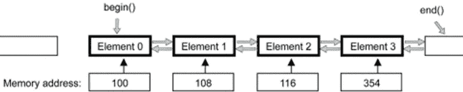

## 单向列表指针的图形表示

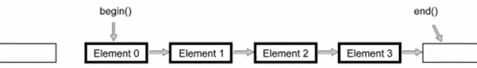

## 列表和单向列表容器的头文件

```cpp
#include <list>
#include <forward_list>
```

## 如何使用值列表初始化列表和单向列表

```cpp
list<int> numbers1 = { 1, 2, 3, 4, 5 };
forward_list<int> numbers2 = { 6, 7, 8, 9 };
```

## 如何使用 vector 的值初始化列表

```cpp
vector<int> nums = { 1, 2, 3, 4, 5, 6 };
list<int> numbers3(nums.begin(), nums.end());
// numbers3 包含 1 2 3 4 5 6
```

## 如何将 vector 的值赋值给列表

```cpp
numbers3.assign(nums.begin(), nums.end()); // 跳过第一个元素
// numbers3 包含 1 2 3 4 5 6
```

## 描述

- 列表（`list`）和单向列表（`forward_list`）的元素都存储在非连续内存中，通过指针连接元素。

- 列表元素拥有指向下一个元素和上一个元素的指针。这被称为双向链表，它允许迭代器双向移动。

- 单向列表元素仅拥有指向下一个元素的指针。这是单向链表，它只允许迭代器向前移动。

- 列表永远不会移动其元素。因此，除非你从列表中删除元素，否则迭代器都是有效的。这是列表优于 `vector` 的主要优势。

- 在序列中间插入或删除元素时，列表有时比 `vector` 更高效。但在你选择列表 而不是 `vector` 之前，应该进行测试以确保列表的效率更高。

图 10-12 列表和单向列表简介。

## 列表的成员函数

图 10-13 展示了 `list` 容器的一些成员函数。`push_front()` 和 `pop_front()` 函数的作用类似于 `vector` 容器的 `push_back()` 和 `pop_back()` 函数。然而，它们作用于序列的前部而不是尾部。

`reverse()` 函数反转元素的顺序，而 `sort()` 函数将元素按升序排列。值得注意的是，`vector` 没有提供 `sort()` 函数，但你可以使用下一节描述的 `sort()` 算法对 `vector` 进行排序。

`splice()` 函数允许你转移另一个列表中位于迭代器所指元素之前的部分或全部元素。这与 `insert()` 函数相似，但有两个重要的区别。首先，你将包含要转移元素的列表作为参数传递。其次，`insert()` 会对要插入元素元素拷贝，而 `splice()` 则通过重新排列指针来转移它们。因此，`splice()` 会从初始列表中移除这些元素。

`merge()` 函数的工作原理类似，它是转移元素而非复制元素。它不是使用迭代器来确定位置，而是按升序合并列表中的所有元素。为了让其正常工作，你应该在调用 `merge()` 之前为列表调用 `sort()` 函数。

`remove()` 函数通过值而非迭代器来移除元素。而且，它会移除包含该值的元素。

代码示例展示了这些函数是如何工作的。首先，代码定义了三个名为 `nums1`、`nums2` 和 `nums3` 的列表。然后，代码使用 `splice()` 函数将 `nums3` 的所有元素添加到 `nums1`。当这段代码运行时，`nums3` 不再拥有元素，因为它们已经被转移到了 `nums1`。

第二个 `splice()` 示例将 `nums2` 的部分元素添加到 `nums1`。为了实现这一点，代码传递了一个 (b, e) 区间，告诉 `splice()` 转移序列中的哪些元素。具体来说，它转移了中间的三个元素，并保留了 `nums2` 中的第一个和最后一个元素，`sort()` 示例排序了 `nums1` 中的元素。下一个示例调用了 `nums2` 列表的 `sort()` 函数。此时，两个列表都已排序。然后，代码将 `nums2` 传递给 `nums1` 的 `merge()` 函数。当这段代码运行时，`nums1` 包含了 `nums2` 中的元素，而 `nums2` 为空。

最后一个示例向 `nums1` 的 `remove()` 函数传递了值 5。这会移除列表中两个包含值 5 的元素。

你也可以在单向列表上使用此图中展示的许多技巧。然而，你并不能使用所有技巧。例如，你不能使用递减运算符（`--`）反向迭代。相反，你可以获取第一个元素的迭代器并正向移动到正确的元素。此外，你不能使用 `splice()` 在指定的迭代器之前插入元素。但是，你可以使用单向列表特有的 `splice_after()` 函数在指定的迭代器之后插入元素。

## list 容器的一些成员函数

| 函数 | 描述 |
| --- | --- |
| `push_front(elem)` | 在序列头部添加新元素。 |
| `pop_front()` | 移除序列头部的元素。 |
| `reverse()` | 反转元素的顺序。 |
| `sort()` | 按升序排列元素。 |
| `splice(i, list)` | 转移 `list` 中位于 `i` 所指元素之前的元素。 |
| `splice(i, list, b, e)` | 转移位于 `i` 所指元素之前的 `[b, e)` 区间的元素。 |
| `merge(list)` | 合并两个排序过的列表。 |
| `remove(value)` | 移除等于值的元素。 |

## 示例

```cpp
list<int> nums1 = { 1, 2, 3, 4, 5 };
forward_list<int> nums2 = { 6, 7, 8, 9 };
list<int> nums3 = { 1, 2, 3, 4, 5, 6 };
```

## 电影排行榜 2.0 程序

图 10-14 展示了本章早些介绍的电影排行榜程序的第二个版本。对于用户来说，该程序的运行方式与之前的版本相同。然而，代码使用 `list` 而不是 `vector` 来存储数据。

如果你理解电影排行榜 1.0 程序的代码，那么理解 2.0 版本的代码应该并不困难。区别在于包含指令指定了列表的头文件，而不是 `vector` 的头文件。另一个区别是 `display_rankings()` 和 `change_ranking()` 函数接受的是字符串列表而不是字符串 `vector`。

# 382 节 2 你需要的更多技能

图 10-14 的第 2 部分显示了 `main()` 函数调用的三个函数的定义。`get_choice()` 函数询问用户是否想要更改电影排名，它使用的代码与本之前描述的“电影排名 1.0”程序代码相同。然而，另外两个函数中的大部分代码与 1.0 版本中的代码不同。

`display_rankings()` 函数在显示带下划线的排名标题后，使用基于范围的循环（range-based loop）遍历列表，而不是像 1.0 版本那样使用传统的循环。这是因为你不能使用下标运算符来访问列表中的元素。此外，此循环使用了一个名为 `i` 的计数变量。然后，在循环体内，该代码使用元素值和计数变量来显示每部电影的排名和标题。

与 1.0 版本一样，`change_ranking()` 函数首先检查用户输入的当前排名和新排名是否在边界内。不过，生成的代码与 1.0 版本不同。为了实现这一点，你使用 `auto` 关键字和 `begin()` 函数来获取指向列表第一个元素的迭代器。然后，它使用 `for` 循环和递增运算符 (`++`) 来移动迭代器，使其指向包含当前排名的元素。它必须使用该运算符而不是加法运算符 (`+`)，因为列表使用的是双向迭代器，而加法迭代器不适用于这种迭代器。

在代码将迭代器移动到正确元素后，代码定义了一个字符串变量 `movie`，并使用解引用运算符 (`*`) 获取用户想要更改排名的电影标题。然后，它将其存储在 `movie` 变量中，并调用列表的 `erase()` 函数删除该电影标题。由于迭代器变量已经指向正确的元素，因此此代码将迭代器传递给 `erase()` 函数。

此时，代码需要调整迭代器变量，使其指向新排名的正确位置。为了做到这一点，代码调用 `begin()` 函数将迭代器移回第一个元素。然后，它再次使用另一个 `for` 循环和递增运算符将迭代器移动到新排名的位置。最后，代码调用列表的 `insert()` 函数将电影标题放回新排名的正确位置。为了实现这一点，代码将迭代器和 `movie` 变量传递给 `insert()` 函数。

如你所见，为了让这个程序与 `list` 而不是 `vector` 配合，必须进行一些更改。这些更改中的大部分是因为 `list` 使用了比 `vector` 更底层的迭代器。然而，修改此程序的 2.0 版本以使用 `vector` 则不需要这么多更改。这是因为高级迭代器可以处理低级迭代器可以处理的代码。当然，如果你知道要使用 `vector`（在这种情况下可能是可能的），那么使用其随机访问迭代器（random-access iterator）提供的高级功能会方便得多。

# 代码（继续）


```cpp
void display_rankings(const list<string>& movies) {
    cout << "\nMovie Rankings\n--------------------\n";
    int i = 1;
    for (string m : movies) {
        cout << i << " - " << m << endl;
    }
    cout << endl;
}

char get_choice() {
    char choice;
    cout << " Do you want to change any rankings? (y/n): ";
    cin >> choice;
    cin.ignore(10000, '\n');
    return choice;
}

void change_ranking(list<string>& movies,
    int current_ranking, int new_ranking) {
    // make sure rankings are in bounds
    if (current_ranking > 0 && new_ranking > 0 &&
        current_ranking <= movies.size() &&
        new_ranking <= movies.size()) {
        // get iterator that points to first element
        auto iter = movies.begin();

        // increment iterator until it points to current ranking
        for (int i = 1; i < current_ranking; ++i) {
            ++iter;
        }

        // store value of element to be moved
        string movie = *iter;
        // remove element
        movies.erase(iter);

        // get first iterator iterator and then increment to new ranking
        iter = movies.begin();
        for (int i = 1; i < new_ranking; ++i) {
            ++iter;
        }

        // insert element at new location
        movies.insert(iter, movie);
    }
}
```

图 10-14 电影排名 2.0 程序（2/2 中的第 2 部分）

# 如何使用队列和栈

`deque`（读作 "deck"）容器使用指针连接的连续内存块来存储数据，如图 10-15 所示。这使得 `deque` 具有部分 `vector` 的速度，并允许快速访问序列的前后部。然而，像 `vector` 一样，当序列中间插入或删除元素时，`deque` 需要移动元素。同样，像 `vector` 一样，这会导致迭代器失效。

标准模板库提供了两个容器适配器 `queue`（队列）和 `stack`（栈），它们将 `deque` 适配于更具体的用途。此图展示了如何使用这些容器适配器。

# 如何使用队列

`deque`（读作 "deck"）容器使用指针连接的连续内存块来存储数据，如图 10-15 所示。这使得 `deque` 具有部分 `vector` 的速度，并允许快速访问序列的前后部。然而，像 `vector` 一样，当序列中间插入或删除元素时，`deque` 需要移动元素。同样，像 `vector` 一样，这会导致迭代器失效。

标准模板库提供了两个容器适配器 `queue` 和 `stack`，它们将 `deque` 适配于更具体的用途。此图展示了如何使用这些容器适配器。

# 如何使用栈

`deque`（读作 "deck"）容器使用指针连接的连续内存块来存储数据，如图 10-15 所示。这使得 `deque` 具有部分 `vector` 的速度，并允许快速访问序列的前后部。然而，像 `vector` 一样，当序列中间插入或删除元素时，`deque` 需要移动元素。同样，像 `vector` 一样，这会导致迭代器失效。

标准模板库提供了两个容器适配器 `queue` 和 `stack`，它们将 `deque` 适配于更具体的用途。此图展示了如何使用这些容器适配器。

# 如何操作集合（sets）

集合（set）是一种关联容器，根据键的值来存储和检索元素。然而，集合只存储键。该键通常是字符串，但也可以是任何数据类型。

标准模板库（STL）有两个容器：`set` 和 `multiset`。`multiset` 允许重复的键，而 `set` 要求每个键都是唯一的。

图 10-16 展示了关联容器共享的一些成员函数，并展示了如何使用它们来操作集合。

### 关联容器的成员函数

与列表（`list`）一样，集合中的元素存储在非连续内存中。然而，当你向集合中添加元素时，集合会按照排序顺序存储该元素。这是使用集合容器的主要优点之一。

大多数 C++ 实现使用平衡二叉搜索树，如图中的图所示。在这里，每个父节点都指向两个节点，一个值较大的节点，另一个值较小的节点。这允许容器对特定键使用二分查找。由于二分查找比列表必须使用的线性查找更高效，因此集合在检索数据时更高效。

关联容器共享两个成员函数。首先，`find()` 函数接受一个键并返回指向具有指定键的第一个元素的迭代器。或者，如果该键不在容器中，`find()` 返回末尾迭代器（off-the-end iterator）。其次，`count()` 函数返回容器中具有指定键的元素数量。

## 操作集合的代码示例

图中的代码示例展示了如何操作集合。首先，第一个示例展示了如何包含 `set` 和 `multiset` 的头文件。然后，第二个示例展示了如何定义一个集合并使用带有某些字符串键的初始化列表。

第三个示例展示了如何使用大多数容器通用的 `insert()` 成员函数向集合中添加键。在这里，第二个语句需要唯一的键，而键 "AK" 已经存在于集合中了。因此，这行代码不会不会添加该键。然而，如果这段代码使用 `multiset` 而不是 `set`，该语句将添加该键，且容器将拥有两个值为 "AK" 的键。

第四个示例展示了如何使用基于范围的循环（range-based loop）来迭代集合中的键。这会按字母顺序显示键，证明了即使键不是按该顺序添加的，集合也会按排序顺序存储键。

第五个示例展示了如何查找并删除一个键。为此，此代码使用 `find()` 函数获取指向该键的迭代器。然后，将此迭代器与末尾迭代器进行比较以判断是否找到键。如果是，则使用 `erase()` 函数删除该键。

## 集合非连续内存的图形表示

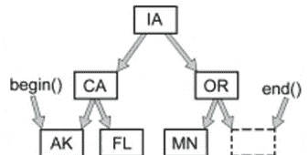

## 关联容器共享的一些成员函数

| 函数 | 描述 |
| --- | --- |
| `find(k)` | 返回指向具有指定键的第一个元素的迭代器。或者，如果没有找到指定的键，返回末尾迭代器。 |
| `count(k)` | 返回具有指定键的元素数量。 |

## set 和 multiset 容器的头文件

```cpp
#include <set>
set<string> states = {"CA", "OR", "AK" };
```

## 如何向集合添加键

```cpp
states.insert("FL"); // 已添加
states.insert("AK"); // 已存在未添加
states.insert("MN"); // 已添加
states.insert("IA"); // 已添加
```

## 如何使用基于范围的循环遍历集合中的元素

```cpp
for(string state : states) {
    cout << state << " ' ";
}
// 显示 "AK CA FL IA MN OR ";
```

## 如何从集合中查找并删除一个值

```cpp
auto iter = states.find("FL");
if (iter == states.end()) {
    cout << "Not found\n";
} else {
    states.erase(iter);
}
// states 现在包含 AK CA IA MN OR
```

## 描述

- `set` 和 `multiset` 在非连续内存中按升序存储键。
- 当你添加或删除一个键时，指针会重新排列以保持排序顺序，但数据本身不会移动。正如此，指向现有元素的迭代器不会失效。

图 10-16 如何操作集合

## 如何操作映射（maps）

与集合一样，`map` 也是一种关联容器，根据键的值来存储和检索元素。与 `set` 不同，`map` 存储的是键值对（key/value pairs）。换句话说，它存储一个键以及与该键相关的值。与 `set` 类似，键通常是字符串，但也可以是任何数据类型。

标准模板库有两个 `map` 容器：`map` 和 `multimap`。正如你所预期的，`map` 要求每个键都是唯一的，而 `multimap` 允许重复的键。STL 还提供了一个 `pair` 结构用于操作 `map`。

### map 的成员函数和运算符

与 `set` 类似，`map` 中的元素按排序顺序存储在非连续内存中。与 `set` 类似，大多数 `map` 的 C++ 实现使用平衡二叉搜索树，如图 10-17 中的图所示。

## map 非连续内存的图形表示

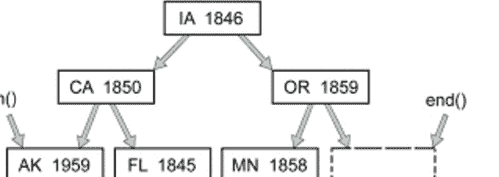

## 关联容器共享的一些成员函数

| 函数 | 描述 |
| --- | --- |
| `at(k)` | 返回与键键的值。如果未找到则抛出异常 |
| `insert(p)` | 插入键值对。 |
| `insert_or_assign(k, v)` | 插入指定键和值的元素。如果键已在 map 中，则修改该值。 |

## map 和 multiset 容器的头文件

```cpp
#include <map>
```

## 使用初始化列表创建 map

```cpp
map<string, int> states = {{"CA", 1850}, {"OR", 1859}, {"AK", 1959} };
```

## 如何显示 map 中的数据

```cpp
for(pair<string, int> p : states) {
    cout << p.first << ' ' << p.second << "";
}
// 显示 "AK(1959) CA(1850) OR(1859)";
```

## map 容器定义的运算符之一

| 运算符 | 名称 | 描述 |
| --- | --- | --- |
| `[k]` | 下标 | 对指定键的值进行读写访问。此外，它允许你插入键值对。 |

## 描述

- `map` 和 `multimap` 在非连续内存中按键升序存储键值对。
- 当你添加或删除键值对时，指针会重新排列以保持排序顺序，但数据本身不会移动。
- 你使用 `pair` 结构来操作 `map` 或 `multimap` 的键和值。`pair` 结构有一个名为 `first` 的数据成员包含键，以及名为 `second` 的数据成员包含值。

图 10-17 map 的成员函数和运算符

# 如何插入键/值对并通过键对值操作

图 10-18 展示了了一些操作 `map` 的代码示例。首先，第一个示例定义了一个字符串/整数对的 `map`，并用三个键值对对其初始化。该 `map` 被此图中后续的示例使用。

第二个示例展示了如何使用下标运算符来插入键/值对并对 `map` 值进行操作。在这里，第一条语句向 `map` 添加了一个新的键值对，第二条语句更新了与该键关联的值。然后，第三条语句使用该键来查找并显示关联的值。

第三个示例展示了如何使用 `insert()` 函数而不是下标运算符向 `map` 添加键/值对。要做到这一点，你需要创建一个 `pair` 对象并将其传递给 `insert()` 函数。此示例展示了实现此目的的三种方法。首先，你可以在一条语句中定义并初始化 `pair` 对象，并在另一条语句中将其传递给 `insert()` 函数。注意，你使用的定义和初始化 `pair` 对象的技术与处理值时使用的技术相似，尽管你只使用单层大括号来包裹该键和值。

当你使用这种技术时，你可能在以后还会再次使用该对象。否则，你可以使用所示的另外两种技术之一。首先，你可以在一条语句中完成 `pair` 对象的定义、初始化和插入。其次，你可以将键和值传递给实用程序头文件中提供的 `make_pair()` 函数来创建一个 `pair` 对象。

第四个示例展示了如何使用 `insert_or_assign()` 函数来插入键/值对并更新 `map` 值。在这里，第一条语句向 `map` 添加了一个新的键值对。然后，第二条语句指定了与第一条语句相同的键，它更新了该键对应元素的值。

由于这种行为并不是你所想要的，更好的做法是像最后一个示例所示，在检索值之前，使用 `find()` 成员函数检查键是否存在于 `map` 中。在这里，代码通过将 `find()` 函数返回的迭代器与末尾迭代器进行比较，来确定键是否在 `map` 中。如果键不在 `map` 中，代码就不会尝试访问其值。如果键在 `map` 中，代码将检索它并将其存储在名为 `year` 的 `int` 型变量中。

## 第 10 章 如何操作 STL 容器和迭代器 391

### 示例中使用的字符串和整数 map

```cpp
map<string, int> states = {{"CA", 1850}, {"OR", 1859}, {"AK", 1959}};
```

### 如何使用下标运算符插入、读取和写入

```cpp
states["IA"] = 1946; // 添加键/值
states["IA"] = 1846; // 修改值
cout << "Iowa entered union in " << states["IA"] << endl; // 读取值
```

### 如何使用 insert() 成员函数插入值

创建一个 `pair` 结构并将其插入

```cpp
pair<string, int> florida("FL", 1845);
states.insert(florida);
```

### 在一条语句中创建并插入 pair 结构

```cpp
states.insert(pair<string, int>("FL", 1845));
```

### 使用 make_pair( ) 函数

```cpp
states.insert(make_pair("FL", 1845));
```

### 如何使用 insert_or_assign() 函数插入和写入值

```cpp
states.insert_or_assign("IL", 1828); // 添加键/值
states.insert_or_assign("IL", 1818); // 修改值
```

### 你如何通过下标运算符意外插入键/值对

```cpp
// states 包含 AK/1959 CA/1850 FL/1845 IA/1846 IL/1818 OR/1859

// 尝试检索华州加入联邦的年份
int year = states["WA"];

// states 现在包含 AK/1959 CA/1850 FL/1845 IA/1846 IL/1818 OR/1859 以及 {WA/0}
// year 为 0
```

### 如何使用 find() 成员函数检查键是否在 map 中

```cpp
auto iter = states.find("WA");
if (iter == states.end()) {
    cout << "Not found!\n";
} else {
    int year = states["WA"];
}
```

### 描述

- 你可以使用下标运算符、`insert()` 成员函数或 `insert_or_assign()` 成员函数向 `map` 插入新的键/值对。
- 当你使用 `insert()` 函数时，你可以手动创建一个新的 `pair` 结构，或者使用 `make_pair()` 函数。
- 如果你使用 `insert_or_assign()` 函数且键已存在，则值会发生改变。
- 你可以使用下标运算符通过键读取或修改现有的值。
- 当你使用下标运算符通过键访问值而该键不在 `map` 中时，它将映射到该数据类型的默认值上。因此，使用 `find()` 成员函数查看键是否存在于 `map` 中是更安全的。

图 10-18 如何向 map 插入键/值对并通过键查找值

## 单词计数器程序 (Word Counter program)

图 10-19 展示了单词计数器程序。该程序从文件中读取并处理文本。它统计了单个单词的总数、唯一单词的总数以及每个单词出现的总次数。程序按照读取单词的顺序显示单个单词，但会按字母顺序显示唯一单词和每个单词的计数。

代码以程序所需的头文件语句开始，包括 `vector` 和 `map` 头文件，并使用了指向 `std` 命名空间的指令。然后，代码声明了两个函数原型。这两个函数都返回一个容器对象。`load_words()` 函数返回一个字符串 `vector`，而 `get_word_count()` 函数返回一个 `string/int` 对的 `map`。

你可能会奇怪为什么这些函数返回容器，而不是接受容器的引用并更新它们。毕竟，函数难道不需要创建一个容器并返回它的拷贝吗？如果容器很大或者拷贝开销很高，这会成为一个可能的问题吗？

你可以安全地从函数返回容器的原因是，正如第 9 章所学到的，大多数 C++ 编译器使用返回值优化（RVO）来避免拷贝操作。RVO 如何运作的细节超出了本书的范围。然而，你可以放心地认为在大多数情况下，你可以返回容器而不会产生负面影响。

# 394 第 2  你所需的技能


图 10-19 的第 2 部分展示了 `main()` 函数调用的函数定义。首先，`load_words()` 函数开始定义一个名为 `words` 的字符串向量。然后，它定义了一个输入文件流对象，并通过传递文本文件的文件名来打开它。

如果文件打开成功，代码将使用 `while` 循环获取文本文件中的每个单词。对于每个单词，代码会遍历单词中的每个字符，丢弃标点符号并将任何大写字母转换为小写。完成后，代码使用 `push_back()` 函数将该单词添加到 `vector` 中。

在代码将文本文件中的所有单词添加到 `vector` 之后，它调用文件流的 `close()` 函数关闭与文件的连接。然后，它将单词向量（vector）返回给调用代码。

`get_word_count()` 函数开始定义一个名为 `word_count` 的字符串/整数值对的映射（map）。然后，它使用基于范围的循环来处理 `vector` 中的所有单词。

在此循环中，第一条语句将 `vector` 中的单词作为键传递给映射的 `find()` 函数。然后，它将 `find()` 返回的迭代器与末尾迭代器进行比较。如果它们相等，说明该单词尚不在映射中。因此，代码使用下标运算符添加计数值为 1 的键。然而，如果键已存在于映射中，代码使用下标运算符检索它并将其关联计数值加 1。循环结束时，它将单词/计数对的映射返回给调用代码。

## 代码（继续）

```cpp
vector<string> load_words(string filename) {
    vector<string> words;
    ifstream infile(filename);

    if (infile) {
        string word;
        while(infile >> word) {
            string new_word = "";
            for (char c : word) {
                if (c == '.' || c == ',') { // 标点符号
                    continue;
                } else if (isupper(c)) { // 转换为小写
                    new_word += tolower(c);
                } else {
                    new_word += c;
                }
            }
            words.push_back(new_word); // 添加单词
        }
        infile.close();
    }
    return words;
}

map<string, int> get_word_count(const vector<string>& words) {
    map<string, int> word_count;

    for (string word : words) {
        auto search = word_count.find(word);
        if (search == word_count.end()) {
            word_count[word] = 1; // 未找到 - 添加计数为 1 的单词
        } else {
            word_count[word] += 1; // 找到 - 增加单词计数
        }
    }
    return word_count;
}
```

图 10-19 单词计数程序（2/2 部分）

## 如何使用嵌套容器

有时，你需要使用一个 STL 容器来存储另一个 STL 容器的实例。换句话说，你有时需要嵌套容器。

## 如何使用向量的向量

图 10-20 中的第一个示例展示了如何定义一个向量的向量。要做到这一点，将内部 `vector` 代码为外部 `vector` 的数据类型。在这种情况下，外部 `vector` 存储其他 `int` 值的实例。换句话说，外部容器的数据类型为 `vector<int>`。

注意，当像这样编写嵌套 `vector` 时，某些旧版本的编译器会将内部和外部 `vector` 的右角括号解释为流提取运算符（`>>`）。为了防止这种情况，你可以在角括号之间编写一个空格，如图中所示。

第二个示例展示了如何使用 `push_back()` 函数将单个 `vector` 添加到向量的向量中。大括号内的值创建了一个字面量 `vector` 并将其传递给 `push_back()` 函数。在第一个语句中，添加的字面量 `vector` 包含三个元素。在第二个中，字面量 `vector` 包含四个元素。

第三个示例展示了如何遍历向量的向量以访问每个 `vector` 中的元素。要做到这一点，你可以使用嵌套循环。在这里，外部基于范围的 `for` 循环遍历嵌套的 `vector`。在循环内部，基于范围的 `for` 循环遍历嵌套 `vector` 中的元素。

第四个示例展示了如何访问向量的向量中的特定值。要做到这一点，你需要编写两个下标。第一个下标是内部 `vector` 的索引，第二个下标是该 `vector` 中元素的索引。对于两个嵌套的 `vector`，你可以将第一个索引视为表格的行，将第二个索引视为列。

## 如何使用向量的映射

图 10-20 还展示了如何使用向量的映射。第一个示例定义了一个存储字符串/向量 `int` 值的映射。同样，此处显示的代码在右角括号之间包含一个空格，以避免旧版本编译器的问题。

第二个示例展示了如何使用下标运算符向向量的映射添加一个字符串键和一个值。学生的姓名就是键。

第三个示例展示了如何遍历向量的映射以访问包含在每个 `vector` 中的元素。与类似，此代码使用了嵌套循环。由于映射会自动键进行排序，此代码按字母顺序显示学生姓名。

第四个示例展示了如何访问向量的映射中的特定值，你。

- 迭代器（iterator）`指向`容器中的一个元素。要访问它所指向的值，你可以通过`间接运算符 (*)`或成员访问运算符 (`->`)对迭代器进行`解引用`。

- 向量（vector）的`容量`（capacity）是为其元素分配的连续内存量。

- 数组（array）将其元素存储在连续内存中，但其大小必须在编译时已知，且不能在运行时动态增加。

- deque（读作 "deck"）是一种双端队列，它将连续和非连续内存结合起来存储元素，并允许在头部或尾部添加元素。

- 容器`适配器`（container adapter）通过适配容器来使其更具特殊性。

- 队列（queue）适配 deque 并提供了`先进先出 (FIFO)`的访问方式。

- 栈（stack）适配 deque 并提供了`后进先出 (LIFO)`的访问方式。

- 列表（list）和正向列表（forward list）都将其元素存储在非连续内存中，通过`指针`（pointers）连接元素。

- 每个元素都拥有指向下一个元素和上一个元素指针的列表被称为`双`链表（doubly linked list）。

- 每个元素仅拥有指向下一个元素指针的列表被称为`单`链表（singly linked list）。

- 集合（set）和多集（multiset）容器在非连续内存中按升序存储`键`（keys）。

- 映射（map）和多映射（multimap）容器在非连续内存中按键升序存储`键/值对`（key/value pairs）。

- 大多数 C++ 编译器在返回容器时会使用`返回值优化`（RVO）来避免拷贝操作。

## 练习 10-1 在 Movie List 程序中使用 list

在本次练习中，你将修改第 9 章中的 Movie List 2.0 程序，使其使用 list 代替 vector。你还将添加一个用于修改电影的函数。完成后，测试运行的结果应该像下所示：

```
The Movie List program
nCOMMANDS
v - View movie list
a - Add a movie
d - Delete a movie
m - Modify a movie
x - Exit

Command: v
TITLE YEAR STARS
1 Casablanca 1942 5
2 Wonder Woman 2017 4
3 Wizard of Oz 1939 5

Command: m
Number: 2
Enter new number of stars (1-5) for Wonder Woman
Wonder Woman was updated.

Command: v
TITLE YEAR STARS
1 Casablanca 1942 5
2 Wonder Woman 2017 3
3 Wizard of Oz 1939 5

Command: x
Bye!
```

## 打开并审查程序

1. 打开此文件夹中名为 movie_list 的项目或解决方案：`ex_starts\ch10_ex_movie_list`

2. 审查代码，然后运行程序以复习你对其工作原理的记忆。

## 修改程序使用 list 代替 vector

3. 修改 `main()` 函数，使其将 `read_movies_from_file()` 函数的列表存储在 Movie 对象的 list 中而不是 Movie 对象的 vector 中。然后，修改 `read_movies_from_file()` 函数使其返回 list。

4. 修改由 `main()` 函数调用的其他函数，使其接受 Movie 对象 list 的迭代器。你还需要修改 `delete_movie()` 函数，使其使用迭代器而不是索引来获取和删除电影。

## 添加修改电影的代码

5. 在菜单中添加另一个命令，允许用户修改电影。

6. 添加一个名为 `modify_movie()` 的函数，它接受 Movie 对象的 list。该函数应获取要修改的电影编号以及该电影的 Movie 对象。务必将 Movie 对象存储在引用变量中，以便它指向该列表。然后，获取电影的新星级数，更新 Movie 对象并更新电影文件。

7. 在 `main()` 函数的 `switch` 语句中添加一个 `case`，允许用户修改电影。

8. 修改 `add_movie()` 函数，如果电影已存在，则显示适当的消息但不修改该电影。

## 练习 10-2 创建一个使用 map 的程序

在本次练习中，你将编写一个名为 Country Codes 的程序使用 map。该程序显示国家代码列表，允许用户输入代码，然后显示该代码对应的国家名称。完成后，测试运行的结果应该像下所示：

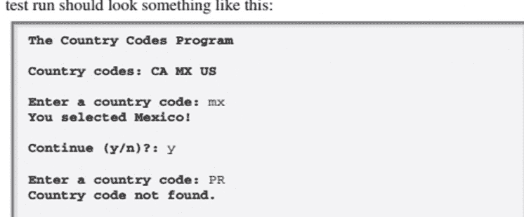

1. 打开此文件夹中名为 country_codes 的项目或解决方案：`ex_starts\ch10_ex2_country_codes`

2. 审查 `main.cpp` 文件以作为起始代码，它包含了 `get_choice()` 和 `display_country()` 函数的代码。此外，`main()` 函数定义了一个 map，其键/值对包含国家代码和名称。

3. 在 `display_codes()` 函数中添加代码，按上所示显示国家代码。

4. 在 `display_country()` 函数中添加代码，获取键等于代码的元素的迭代器。如果未找到代码，则显示适当的消息。由于 map 参数被定义为常量，你需要使用 `at()` 成员函数。

5. 在 `display_codes()` 函数中添加代码，按上所示显示国家代码。

## 练习 10-3 使用 multiset 和 set

在本次练习中，你将修改名为 Word Counter 的程序代码，使用 multiset 代替 vector。完成后，测试运行的结果应该像下所示：

```
Word Counter

TEXT: 60
UNIQUE WORDS: 20
COUNT: 10
TIME: 0.0012 seconds
...
```

1. 打开此文件夹中名为 word_counter 的项目：`ex_starts\ch10_ex3_word_counter`

2. 将向量变量 `words` 的名称更改为 `word_counts`。

3. 修改 `main()` 函数，将 `read_words_from_file()` 函数返回的列表存储在字符串 multiset 中而不是字符串对象的 vector 中。然后，修改 `read_words_from_file()` 函数使其返回 multiset。

4. 修改由 `main()` 函数调用的其他函数，使其接受字符串 multiset 的迭代器。你还需要修改 `delete_word()` 函数，使其使用迭代器而不是索引来获取和删除单词。

5. 添加一个名为 `get_count()` 的函数，它接受字符串 multiset。该函数返回单词在 multiset 中出现的次数。

6. 修改 `display_words()` 函数，按上所示显示唯一单词。

7. 在 `display_count()` 函数中添加代码，显示每个单词的计数。

8. 修改 `add_word()` 函数，如果单词已存在于 multiset 中，则显示适当的消息。

### STL 算法简介

标准模板库（STL）包含三种对象：存储数据的容器、允许访问数据的`迭代器`（iterators）以及对数据执行任务的`算法`（algorithms）。在上一章中，你学习了 STL 容器和迭代器。现在，本章将介绍 STL 算法。

### 容器、迭代器和算法之间的关系

STL 算法对容器中的元素执行常见任务，例如查找指定值的元素或将所有元素复制到另一个容器中。然而，算法并不直接与容器共同作用。相反，它们使用迭代器来执行任务，如图 11-1 所示。由于算法通过迭代器工作，因此它们不需要知道容器中元素是如何存储的即可与容器交互。例如，算法并不关心容器是使用连续内存还是非连续内存。这被称为`抽象`（abstraction）。

要对容器使用 STL 算法，容器必须提供定义了半开区间 `[b, e)` 的迭代器。正如你在上一章中所学习的，这是一个范围，其中起始迭代器指向第一个元素，而结束迭代器指向最后一个元素之后的一个内存位置。STL 容器具有 `begin()` 和 `end()` 函数来提供半开区间，`string` 对象也是如此（尽管不是 STL 容器）。尽管 C++ 内置数组没有 `begin()` 和 `end()` 函数，但它仍然可以提供半开区间。你将在第 12 章学习更多相关内容。

图中的代码示例说明了同一个 STL 算法如何适用于不同类型的容器。这些示例使用了 `count()` 算法，它返回指定值在区间内出现的次数。

第一个示例定义了五个存储 `char` 数据的容器，并用字符 'h'、'e'、'i'、'l' 和 'o' 初始化每个容器。第一条语句定义了一个 `vector`，第二条语句定义了一个 STL 数组，第三条定义了一个 `list`，第四条定义了一个 `multiset`。它们都负责存储和检索其元素。第五条语句定义了一个 `string` 对象，它不是 STL 容器，但提供了定义 `[b, e)` 区间的迭代器。

第二个示例统计了字符 'l' 在每个容器中出现的次数。同样，容器的实现细节是不同的，但这并不重要。在每个情况下，算法都接收迭代器并完成工作。

由于容器和算法之间不需要了解对方的任何信息，因此创建你自定义的容器和算法是可能的。你只需要确保自定义容器提供了半开区间的迭代器，并且自定义算法与定义半开区间的迭代器工作。在第 19 章中，你将学习如何定义自定义容器和算法。

## STL 算法通过迭代器工作而非直接作用于容器

| | | |
| :--- | :--- | :--- |
| vector | | count |
| list | | fill |
| map | | find |
| string | | copy |
| built-in array | | replace |
| custom_container | | custom_algorithm |

## 不同容器类型使用相同算法的示例

容器：

```cpp
vector<char> vec = { 'h', 'e', 'l', 'l', 'o' };
array<char, 5> arr = { 'h', 'e', 'l', 'l', 'o' };
list<char> lst = { 'h', 'e', 'l', 'l', 'o' };
set<char> mst = { 'h', 'e', 'l', 'l', 'o' };
string str = "hello";
```

算法统计值在容器中出现的次数：

```cpp
int c;
c = count(vec.begin(), vec.end(), 'l'); // c 为 2
c = count(arr.begin(), arr.end(), 'l'); // c 为 2
c = count(lst.begin(), lst.end(), 'l'); // c 为 2
c = count(mst.begin(), mst.end(), 'l'); // c 为 2
c = count(str.begin(), str.end(), 'l'); // c 为 2
```

- STL 算法并不直接在特定容器上执行操作。相反，它们在迭代器定义的半开区间（或 `[b, e)`）上执行操作。这在算法和容器之间提供了抽象。

- STL 算法通常与 STL 容器一起使用。然而，它们也可以用于字符串、内置数组和自定义对象等非 STL 容器。

- 只要对象提供了半开区间的迭代器，且这些迭代器定义了算法所需的操作，算法就可以完成其任务。

图 11-1 容器、迭代器和算法之间的关系

### 如何调用算法


# STL 算法概述

STL 包含几十种算法。在本章中，你将学习使用 `<algorithm>` 头文件中的几个算法。然而，在标准头文件以及其他头文件中还有更多算法。欲需更多信息，可以访问图 11-2 顶部显示的 URL。

STL 算法是一个函数。正因如此，你可以通过名称调用它，并在后跟一个带有其所需任何参数的括号。与其他函数一样，某些 STL 算法会返回值，而某些则不会。

图中的代码示例展示了如何调用某些 STL 算法。首先，第一个示例包含了算法。第二个示例定义了一个数组。第三个示例定义了一个 `list`。第四个示例定义了一个 `set`。第五个示例定义了一个 `string`。

第六个示例展示了如何调用 `find`。第七个示例展示了如何调用 `sort`。

第八个示例展示了如何调用 `count`。第九个示例展示了如何调用 `fill`。第十个示例展示了如何调用 `copy`。第十一个示例展示了如何调用 `replace`。第十二个示例展示了如何调用 `custom_algorithm`。

## 将函数作为参数

某些 STL 算法接受函数作为参数。例如，`sort()` 算法允许你自定义排序顺序。如果你包含了括号和参数，你是在调用函数，而不是传递它。

## 列出所有 STL 算法的 URL

```
http://en.cppreference.com/w/cpp/algorithm
```

## STL 算法的头文件

```cpp
#include <algorithm>
```

## 用于示例的整数 vector

```cpp
vector<int> nums = { 5, 7, 34, 6, 1, 890, 17 };
```

## 接受两个迭代器但不返回值的算法

```cpp
sort(nums.begin(), nums.end());
// nums 现在包含 1 5 6 7 17 34 890
```

## 接受两个迭代器加上第三个参数并返回值的算法

```cpp
int c = count(nums.begin(), nums.end(), 6); // c 为 1
```

## 返回迭代器的算法

```cpp
auto iter = find(nums.begin(), nums.end(), 6);
if (iter == nums.end()) {
    cout << "Value not found\n";
} else {
    cout << "Value found\n";
}
```

## 接受函数作为参数的算法

```cpp
// 创建一个执行比较的函数
bool sort_descending(int a, int b) {
    return a > b;
}
// 将函数作为第三参数传递给 sort 算法
sort(nums.begin(), nums.end(), sort_descending);
// nums 现在包含 890 34 17 7 6 5 1
```

## 注意

- 除非另有说明，本章介绍的算法均在 `algorithm` 头文件中。


# 使用算法的基本技能

接下来的四个主题展示了使用某些 STL 算法的基本技能示例。除非另有说明，这些算法都可以从 `<algorithm>` 头文件中获取。

## 如何使用非修改算法

图 11-3 展示了如何使用四种 STL 算法。这些被称为“非修改算法”，因为它们不会改变传递给它们的区间。

图中展示的所有算法都接受低级迭代器。事实上，除 `search()` 之外，所有算法都接受最低级的迭代器 `input`（输入）。这意味着你在上一章中学习的所有序列容器都可以与这些算法配合工作。随着本章的进行，你会发现大多数算法也适用于 `forward`（前向）和 `input` 等低级迭代器。

此外，`find()` 和 `search()` 在找到目标时会返回一个迭代器。如果没有找到，它们会返回一个指向末尾的迭代器（off-the-end iterator）。这是 STL 算法指示未找到目标的常用方法。

代码示例展示了如何使用这些非修改算法。第一个示例使用 `count()` 来确定值 6 在 `double` 类型的 `vector` 中出现的次数。

第二个示例开始定义一个名为 `display()` 的函数，该函数接受一个字符串并在控制台上显示它。这段代码定义并初始化了一个包含多个代表状态码字符串值的 `set` 容器。接下来，代码调用了 `for_each()` 并传递了三个参数。前两个参数定义了一个半开区间，第三个参数是 `display()` 函数。当这段代码运行时，它会将区间内每个元素的值传递给 `display()` 函数。结果是该示例在控制台上显示了区间内的每个元素。

第三个示例从初始化一个 `int` 值的列表开始。然后，它使用 `find()` 获取一个指向值为 3 的第一个元素的迭代器。这段代码传递了三个参数：前两个参数是定义要搜索区间的迭代器，第三个参数是要查找的值。由于 `find()` 在未找到值时会返回指向尾的迭代器，因此该示例通过使用该末尾迭代器来检查搜索是否成功。

最后一个示例初始化了一个 `int` 值的 `vector` 和一个 `int` 值的 `set`。然后，它使用 `search()` 算法检查 `set` 中包含的区间是否存在于 `vector` 中。同样，前两个参数是定义要搜索区间的迭代器。后两个参数是定义要查找区间的迭代器。与 `find()` 类似，`search()` 在未找到目标区间时返回指向尾的迭代器。结果是，你可以使用 `if` 语句来检查搜索是否成功。

### 非修改操作

| 算法 | 迭代器 | 描述 |
|---|---|---|
| `count(b, e, val)` | Input | 返回 `val` 在区间 `[b:e)` 中出现的次数。 |
| `for_each(b, e, func)` | Input | 将区间 `[b:e)` 中的每个元素传递给 `func`。 |
| `find(b, e, val)` | Input | 返回区间 `[b:e)` 中 `val` 首次出现处的迭代器。若未找到 `val` 则返回指向尾的迭代器。 |
| `search(b, e, b2, e2)` | Forward | 在区间 `[b:e)` 中搜索 `[b2:e2]` 的首次出现，并返回指向第一个元素的迭代器。若未找到该区间则返回指向尾的迭代器。 |

### 如何统计元素出现的次数

```cpp
vector<double> nums = { 6.0, 4.5, 34.1, 6.7, 6 };
int c = count(nums.begin(), nums.end(), 6); // c 为 2
```

### 如何显示区间内的每个元素

```cpp
void display(string value) {
    cout << value << ' ';
}
set<string> states = { "OR", "WA", "CA", "AK", "HI" };
for_each(states.begin(), states.end(), display);
// 显示 AK CA HI OR WA
```

### 如何在区间内查找特定元素

```cpp
list<int> target = { 1, 2, 3, 4, 5 };
auto iter = find(target.begin(), target.end(), 3); // 注意：此处原文可能漏掉了查找值，按逻辑修正
if (iter == target.end()) {
    cout << "Not Found!" << endl;
}
```

### 如何在区间内搜索一个元素范围

```cpp
vector<int> target = { 1, 2, 3, 4, 5 };
set<int> to_find = { 3, 4, 5, 6 };
auto iter = search(target.begin(), target.end(), to_find.begin(), to_find.end());
if (iter == target.end()) {
    cout << "Not Found!" << endl;
}
```

### 描述

- 非修改算法不会改变区间内元素的值或顺序。
- `find()` 和 `search()` 算法执行线性搜索，这意味着它们从第一个元素开始，按顺序继续，直到找到目标或到达区间末尾。


## 如何使用修改算法

图 11-4 表格展示了更多 STL 算法。这些被称为修改算法，因为它们通过添加、替换或删除元素来改变传递给它们的区间。

代码示例展示了如何使用这些修改算法。第一个示例使用 `replace()` 算法将字符串中所有的连字符替换为空格。前两个参数定义了算法工作的区间。第三个参数标识要查找的值，第四个参数指定替换值。

第二个示例开始初始化一个 `int` 值的 `vector`。然后，它使用 `fill()` 算法将其所有元素设置为零。同样，前两个参数定义了算法工作的区间。第三个参数是要赋值给元素的值。

第三个示例展示了如何使用 `copy()` 算法。它从初始化一个 `int` 值的列表开始。然后，它使用 `find()` 获取一个指向值为 3 的第一个元素的迭代器（注：原文此处逻辑混乱，根据语境应为 copy 示例）。

## 如何使用 min 和 max 算法

图 11-5 中的第一个表展示了两个 STL 算法，它们返回指向区间内最小值或最大值的迭代器。前四个示例展示了如何使用这些算法。

首先，第一个示例初始化了一个 `int` 类型的向量，该向量将在图中其余部分使用。然后，第二个示例找到并显示最小值，第三个示例找到并显示了最大值。为了实现这一点，这两个示例都通过使用间接运算符 `(*)` 对迭代器进行解引用，来获取迭代器指向的值。

第四个示例展示了如何使用 `max_element()` 返回的迭代器来确定最大值的索引。在这里，用向量 `begin()` 函数返回的迭代器减去 `max_element()` 算法返回的迭代器。这种技术适用于随机访问迭代器或高级迭代器，因为随机访问迭代器是支持减法运算符的最低迭代器。

## 如何使用 numeric 算法

到为止，本章介绍了从 `<algorithm>` 头文件中提供的算法。现在，图 11-5 中的第二个表展示了从 `<numeric>` 头文件中提供的三个算法。正如名称所暗示，该头文件中的算法对数字执行任务。

表下方的代码示例展示了如何使用这些算法。首先，第一个示例展示了如何包含 `<numeric>` 头文件。然后，第二个示例使用 `iota()` 算法用 `int` 类型的向量填充按顺序递增的值。前两个参数定义了要填充的区间，第三个参数指定了分配给区间内第一个元素的值。然后，该算法在将值分配给每个剩余元素之前会将值加 1。

第三个示例展示了如何使用第一个版本的 `accumulate()` 算法。前两个参数定义了需要求和的区间，第三个参数指定了总和初始值。在这种情况下，代码指定的初始值为 0，这是一个常用的初始值。

第四个示例展示了如何使用第二个版本的 `accumulate()` 算法。该算法接受第四个参数，允许你自定义算法汇总值的方式。在这里，代码首先定义了一个名为 `total_even()` 的函数，该函数接受一个累加变量和区间内当前元素的值。在函数内部，只有当值为偶数时，代码才会将元素值加到累加变量上。然后，函数后的语句将函数传递给 `accumulate()` 算法。结果是，该语句只对偶数进行求和。

## 第 11 章 如何与 STL 算法工作 413

### 最小/最大操作

| 算法 | 迭代器 | 描述 |
|---|---|---|
| `min_element(b, e)` | 前向 | 返回指向 `[b:e)` 中最小值的迭代器。 |
| `max_element(b, e)` | 前向 | 返回指向 `[b:e)` 中最大值的迭代器。 |

后续示例中使用的 `int` 值向量

```cpp
vector<int> nums { 89, 34, 78, 100, 45, 68 };
```

### 如何在区间内寻找最小值

### 如何在区间内寻找最大值

### 如何在区间内寻找最大值的索引

### 数值运算

| 算法 | 迭代器 | 描述 |
|---|---|---|
| `iota(b, e, val)` | 前向 | 用从 `b` 开始并递增 1 的值填充 `[b:e)`。 |
| `accumulate(b, e, val)` | 输入 | 返回 `[b:e)` 中值的总和，总和有初始值。 |
| `accumulate(b, e, val, func)` | 输入 | 返回 `[b:e)` 中值的总和，总和有初始值。将每个元素传递给函数以决定如何将其加入总和。 |

### numeric 算法的头文件

### 如何用顺序递增的值填充区间

### 如何对区间内所有值求和

### 如何对区间内所有偶数值求和

图 11-5 如何使用 min 和 max 算法以及 numeric 算法

## 如何使用 sort 和二分查找算法

图 11-6 展示了两个版本的 `sort()` 以及一个执行二分查找的算法。`binary_search()` 算法与你目前看到的其他算法一样，接受低级迭代器。因此，它适用于 STL 容器。然而，`sort` 算法需要随机访问迭代器，这是一种高级迭代器。因此，`sort()` 不适用于提供双向或前向迭代器的 STL 容器。幸运的是，它们适用于 `vector` 和 `string`。

代码示例展示了如何使用这些算法。第一个示例初始化了一个 `string` 类型的向量，供 `sort` 示例使用。然后，第二个示例使用第一个版本的 `sort()` 算法按升序对向量中的元素排序。

第三和第四个示例展示了如何使用第二个版本的 `sort()` 算法。该版本接受一个函数参数，允许你指定元素的排序顺序。

第三个示例按降序排列元素。首先，它定义了一个接受两个 `string` 变量的函数。然后，在函数体内部，如果第一个字符串大于第二个字符串，则返回 `true`。否则，返回 `false`。

另一方面，第四个示例使用字符串的长度来排序。与第三个示例一样，该示例首先定义了一个接受两个 `string` 变量的函数。然后，在函数体内，如果第一个字符串大于第二个字符串，则返回 `true`。（注：此处原文逻辑似乎有误，但按要求翻译）。

### 排序和二分查找

| 算法 | 迭代器 | 描述 |
|---|---|---|
| `sort(b, e)` | 随机访问 | 按升序排列 `[b:e)` 中的元素。 |
| `sort(b, e, func)` | 随机访问 | 根据指定的函数排列 `[b:e)` 中的元素。 |
| `binary_search(b, e, val)` | 前向 | 如果 `val` 在 `[b:e)` 中则返回真。 |

用于 sort 示例的 `string` 向量

```cpp
vector<string> names = {"grace", "bjarne", "steve", "ada", "katherine"};
```

### 如何按升序排序区间

```cpp
sort(names.begin(), names.end());
// 顺序为 bjarne grace katherine
```

### 如何按降序排序区间

```cpp
bool sort_descending(string a, string b) {
    return a > b;
}
sort(names.begin(), names.end(), sort_descending);
// 顺序为 steve ada
```

### 如何按字符串长度排序区间

```cpp
bool sort_by_length(string a, string b) {
    return b.size() > a.size();
}
sort(names.begin(), names.end(), sort_by_length);
// 顺序为 katherine bjarne
```

### 如何使用二分查找查看元素是否在区间内

```cpp
list<double> prices = {9.9, 57.8, 34.25, 4.99, 125, 77.9, 15.20};
prices.sort(); // 在 binary_search() 之前排序元素
bool is_found = binary_search(prices.begin(), prices.end(), 15.20); // true
```

# Number Cruncher 程序

图 11-7 显示了 Number Cruncher 程序。该程序生成一组随机整数。然后，它对这些整数执行一系列操作。该程序的控制台显示程序对数字进行了排序、计算总和和平均值、获取最大值和最小值，并统计数字 10 在序列中出现的次数。

代码开头包含了头文件的 `#include` 语句，包括算法头文件和数值头文件，以及用于 `std` 命名空间的 `using` 指令。之后，代码定义了一个名为 `display_int()` 的函数，它接受一个 `int` 值并在控制台上显示它。

`main()` 函数首先显示程序的名称。然后，它定义了一个名为 `numbers` 的 `int` 类型向量（`vector`），并使用 `vector` 的 `reserve()` 函数为 11 个元素分配内存空间。

接下来，代码使用循环将随机数添加到向量中。为了实现这一点，只要 `vector` 的 `capacity()` 函数返回的值小于计数器变量，它就会遍历 `vector` 中的元素。在循环内部，它获取一个 0 到 29 之间的随机数，然后使用 `vector` 的 `push_back()` 函数将该随机数添加到 `vector` 中。当循环完成时，`vector` `numbers` 包含了 11 个随机整数。然后，代码使用 `for_each()` 算法和 `display_int()` 函数显示这些数字。


在显示未排序的随机数后，代码使用 `sort()` 算法对向量中的数字按升序排序。这之所以能实现，是因为 `vector` 提供了 `sort()` 算法所需的高级随机访问迭代器。然后，代码使用 `for_each()` 算法和 `display_int()` 函数显示排序后的数字。

接下来，代码使用 `accumulate()` 算法对向量中的所有数字求和，结果存储在名为 `sum` 的变量中并显示总和。然后，它通过将总和除以向量的大小计算这些数字的平均值，并显示平均值。

# 控制台

```
The Number Cruncher program

11 RANDOM NUMBERS: 12 25 10 3 0 8 1 10 16 15
11 SORTED NUMBERS: 0 1 3 8 8 10 10 12 15 16 25
Sum = 108 Average = 9 Max = 25 Min = 0

The number 10 occurs 2 time(s).
```

# 代码

```cpp
#include <iostream>
#include <cstdlib>
#include <ctime>
#include <vector>
#include <algorithm>
#include <numeric>

using namespace std;

void display_int(int num) {
    cout << num << ' ';
}

int main() {
    cout << "The Number Cruncher program\n\n";
    // 创建一个留有 11 个元素空间的空向量
    vector<int> numbers;
    numbers.reserve(11);

    // 用随机数填充向量
    srand(time(nullptr));
    for (int i = 0; i < numbers.capacity(); ++i) {
        int number = rand() % 30;
        numbers.push_back(number);
    }

    cout << numbers.size() << " RANDOM NUMBERS: ";
    for_each(numbers.begin(), numbers.end(), display_int);
    cout << endl;

    cout << numbers.size() << " SORTED NUMBERS: ";
    for_each(numbers.begin(), numbers.end(), display_int);
    cout << endl;

    int sum = accumulate(numbers.begin(), numbers.end(), 0);
    cout << "Sum = " << sum << ' ';

    int avg = sum / numbers.size();
    cout << "Average = " << avg << ' ';
    return 0;
}
```

图 11-7 的第 2 部分开始使用 `max_element()` 和 `min_element()` 算法来获取指向 `vector` 中最大和最小元素的迭代器。代码使用 `auto` 关键字来定义变量 `max_iter` 和 `min_iter` 以存储这些算法返回的迭代器，使得代码更加简洁。它还会在控制台上输出显示最小值和最大值。为了实现这一点，它使用解引用运算符 `*` 来获取 `min_iter` 和 `max_iter` 所指向的值。

在获取最大值和最小值后，代码检查数字 10 在随机数向量中出现了多少次。为了做到这一点，它首先定义了一个输入变量名并将其初始化为 10。然后，它使用 `binary_search()` 算法检查该数字是否存在于向量中。

为了让 `binary_search()` 算法正常工作，传递给它的区间必须是排序的。在这种情况下，向量中的数字在执行各种计算之前已经进行过排序。因此，数字仍然保持排序状态，算法能够正常运行。

如果二分查找找到了该数字，代码使用 `count()` 算法获取该数字在向量中出现的次数，并将该数字显示在控制台上。否则，这段代码将显示一条消息，表示向量中不存在数字 10。

在你查看这段代码时，你应该意识到本章仅介绍了 STL 算法的众多变体中的某一部分。例如，`count_if()` 算法与 `count()` 算法相似，但它接受一个函数来确定要统计哪些值。而 `for_each_n()` 算法与 `for_each()` 算法相似，但它接受一个数值值而不是结束迭代器来确定包含在区间内的元素。带有 `_if` 或 `_n` 后缀的变体很常见。要了解更多这些变体，你可以访问图 11-2 所示的 URL。

# 代码（继续）

```cpp
auto max_iter = max_element(numbers.begin(), numbers.end());
cout << "Max = " << *max_iter << ' ';

auto min_iter = min_element(numbers.begin(), numbers.end());
cout << "Min = " << *min_iter << ' ';
cout << endl;

int num = 10;
bool num_exists = binary_search(numbers.begin(), numbers.end(), num);
if (num_exists) {
    int c = count(numbers.begin(), numbers.end(), num);
    cout << "The number " << num << " occurs " << c << " (s).\n";
} else {
    cout << "These numbers do NOT include " << num << ".\n";
}
```

图 11-7 Number Cruncher 程序（第 2 部分）

# 使用算法的更多技能

到为止，本章已经介绍了在大多数情况下处理 STL 算法时所需的技能。然而，在某些情况下，你可能需要后续章节中介绍的额外技能。

## 如何对键值对区间使用算法

正如上一节所示，STL `map` 或 `multimap` 包含键值对。每个 `pair` 对象都有第一个数据成员存储键，第二个数据成员存储值。为了对 `map` 或 `multimap` 中的数据使用 STL 算法，通常需要向算法传递一个函数来指定对每个 `pair` 对象执行的任务。

图 11-8 中的代码示例展示了其工作原理。第一个示例初始化了一个 `string/double` 的 `map`。在这个 `map` 中，键是产品名称，值是产品价格。第二个示例展示了如何使用 `for_each()` 算法显示每个 `pair` 对象的键和值。为了开始，这段代码定义了一个接受 `pair` 对象的 `display()` 函数。在函数内部，代码使用 `first` 数据成员显示键，使用 `second` 数据成员显示值。函数之后，代码调用 `for_each()` 算法并传递 `map` 的半开区间以及 `display()` 函数。它会显示 `map` 中每个 `pair` 对象的键和值。

第三个示例展示了如何使用 `accumulate()` 算法对 `products` `map` 中的价格求和。这段代码首先定义了一个 `sum_products()` 函数，它接受一个累加变量名和 `map` 中的当前元素。在函数内部，代码使用 `second` 数据成员将当前价格累加到总和中。之后，代码调用 `accumulate()` 算法并传递 `map` 的半开区间、累加变量的初始值以及 `sum_products()` 函数。这返回了 `map` 中所有产品的总价格。

最后一个示例展示了如何使用 `count_if()` 算法统计 `map` 中符合特定标准的产品数量。该算法的工作方式与 `count()` 算法类似，但它接受一个函数让你指定要统计哪些元素。为了开始，这段代码定义了一个名为 `under_500()` 的函数，它接受一个 `pair` 对象并返回一个布尔值。在函数内部，如果 `pair` 的值小于 500，则返回 `true`；否则返回 `false`。函数之后，代码调用 `count_if()` 算法并传递 `map` 的半开区间以及 `under_500()` 函数。这返回了 `map` 中所有价格小于 500 的产品数量。

# 用于后续示例的字符串和双精度浮 map

```cpp
map<string, double> products { {{"guitar", 199.99},
  {"piano", 799.99},
  {"drums", 249.99},
  {"violin", 489.99} };
```

# 如何显示 map 中的值对

```cpp
void display(pair<string, double> p) {
  cout << p.first << " $" << p.second << " ";
}

for_each(products.begin(), products.end(), display);
// "drums 249.99 guitar 199.99 piano 799.99 violin 489.99 "
```

# 如何计算 map 中值的总和

```cpp
double sum_products(double total, pair<string, double> p) {
  return total + p.second;
}

double sum = accumulate(products.begin(), products.end(), 0.0, sum_products);
// sum 为 1739.96
```

# 如何统计 map 中符合标准的值对

```cpp
bool under_500(pair<string, double> p) {
  return p.second < 500;
}

int num_low = count_if(products.begin(), products.end(), under_500); // num_low 为 3
```

# 描述

- 当你对 `map` 和 `multimap` 使用 STL 算法时，你通常需要使用接受函数参数的版本。这为你提供了一种方法，可以告诉算法如何处理 `pair` 结构体的数据成员。


## 如何对嵌套容器使用算法

在上一章的末尾，你学习了如何将一个容器嵌套在另一个容器中。具体来说，你学习了如何处理嵌套的 `vector`（vector of vectors）和包含 `vector` 的 `map`（map of vectors）。

当你处理嵌套 `vector` 时，你通常想使用 STL 算法对它们所包含的数据执行任务。然而，当你处理键/值对时，你可能会遇到一些相同的问题。也就是说，算法并不知道如何处理传递给它们的容器。正如你在上一个图中看到的，解决此问题的办法是向算法传递一个函数，该函数定义了你想在嵌套容器上执行的任务。

图 11-9 中的示例展示了这是如何工作的。第一个示例初始化了一个 `map`，其键是字符串，值是双精度点数的 `vector`。在这个 `map` 中，键是学生的姓名，值是该学生的成绩分集合。

第二个示例展示了如何使用 `accumulate()` 算法对 `map` 中所有 `vector` 的值求和。你可能会这样做，例如为了计算所有学生的平均分。

代码开始定义一个 `sum_grades()` 函数，该函数接受一个名为 `total` 的累加变量和 `map` 中 `pair` 对象的当前元素。注意，`pair` 对象中的键是字符串，值是双精度点数的 `vector`。在函数内部，第一条语句使用 `second` 数据成员来获取双精度点数值的 `vector`。然后，第二条语句使用 `accumulate()` 算法对 `vector` 中的所有分数求和。最后，第三条语句将该学生的总分加到累加变量并返回结果。

在 `sum_grades()` 函数之后，下一条语句调用了 `accumulate()` 算法并传递了 `map` 的 `begin()` 和 `end()` 迭代器、起始累加值 0.0 以及 `sum_grades()` 函数。当你回顾这段代码时，可以将 `accumulate()` 算法也认为是嵌套的。换句话说，`map` 的 `accumulate()` 算法调用了一个函数，该函数又为 `map` 中的每个 `vector` 调用了 `accumulate()` 算法。

第三个示例展示了如何使用 `accumulate()` 算法统计 `map` 中所有 `vector` 的元素数量。同样，你可能会这样做以便计算所有学生的平均分。

代码开始定义一个 `count_grades()` 函数，该函数接受一个名为 `count` 的累加变量和 `map` 中 `pair` 对象的当前元素。在函数内部，代码将 `vector` 的大小加到累加变量并返回结果。

在 `count_grades()` 函数之后，下一条语句调用了 `accumulate()` 算法并传递了 `map` 的 `begin()` 和 `end()` 迭代器、起始累加值 0 以及 `count_grades()` 函数。这次没有“嵌套”算法。这是因为 `count_grades()` 函数使用 `vector` 的 `size()` 获取分数的计数。

# 用于后续示例的字符串和 vector 的 map

# 如何计算 map 中所有 vector 的值的总和

```cpp
double sum_grades(double total, pair<string, vector<double>> p) {
  vector<double> g = p.second;
  double sum_per_student = accumulate(g.begin(), g.end(), 0.0);
  return total + sum_per_student;
}
```

```cpp
double sum = accumulate(
  grades.begin(), grades.end(), 0.0, sum_grades);    // sum 为 848
```

# 如何统计 map 中所有 vector 的元素数量

```cpp
int count_grades(int count, pair<string, vector<double>> p) {
  return count + p.second.size();
}
```

```cpp
int count = accumulate(grades.begin(), grades.end(), 0, count_grades);
```

# 描述

- 当你对 `map` 和 `multimap` 使用 STL 算法时，你通常需要使用接受函数参数的版本。这为你提供了一种方法，可以告诉算法如何处理 `pair` 结构体的数据成员。

## 如何对嵌套容器使用算法

在上一章的末尾，你学习了如何将一个容器嵌套在另一个容器中。具体来说，你学习了如何处理嵌套的 `vector`（vector of vectors）和包含 `vector` 的 `map`（map of vectors）。

当你处理嵌套 `vector` 时，你通常想使用 STL 算法对它们所包含的数据执行任务。然而，当你处理键/值对时，你可能会遇到一些相同的问题。也就是说，算法并不知道如何处理传递给它们的容器。正如你在上一个图中看到的，解决此问题的办法是向算法传递一个函数，该函数定义了你想在嵌套容器上执行的任务。

图 11-9 中的示例展示了这是如何工作的。第一个示例初始化了一个 `map`，其键是字符串，值是双精度点数的 `vector`。在这个 `map` 中，键是学生的姓名，值是该学生的成绩分集合。

第二个示例展示了如何使用 `accumulate()` 算法对 `map` 中所有 `vector` 的值求和。你可能会这样做，例如为了计算所有学生的平均分。

代码开始定义一个 `sum_grades()` 函数，该函数接受一个名为 `total` 的累加变量和 `map` 中 `pair` 对象的当前元素。注意，`pair` 对象中的键是字符串，值是双精度点数的 `vector`。在函数内部，第一条语句使用 `second` 数据成员来获取双精度点数值的 `vector`。然后，第二条语句使用 `accumulate()` 算法对 `vector` 中的所有分数求和。最后，第三条语句将该学生的总分加到累加变量并返回结果。

在 `sum_grades()` 函数之后，下一条语句调用了 `accumulate()` 算法并传递了 `map` 的 `begin()` 和 `end()` 迭代器、起始累加值 0.0 以及 `sum_grades()` 函数。当你回顾这段代码时，可以将 `accumulate()` 算法也认为是嵌套的。换句话说，`map` 的 `accumulate()` 算法调用了一个函数，该函数又为 `map` 中的每个 `vector` 调用了 `accumulate()` 算法。

第三个示例展示了如何使用 `accumulate()` 算法统计 `map` 中所有 `vector` 的元素数量。同样，你可能会这样做以便计算所有学生的平均分。

代码开始定义一个 `count_grades()` 函数，该函数接受一个名为 `count` 的累加变量和 `map` 中 `pair` 对象的当前元素。在函数内部，代码将 `vector` 的大小加到累加变量并返回结果。

在 `count_grades()` 函数之后，下一条语句调用了 `accumulate()` 算法并传递了 `map` 的 `begin()` 和 `end()` 迭代器、起始累加值 0 以及 `count_grades()` 函数。这次没有“嵌套”算法。这是因为 `count_grades()` 函数使用 `vector` 的 `size()` 获取分数的计数。

# 用于后续示例的字符串和 vector 的 map

# 如何计算 map 中所有 vector 的值的总和


```cpp
double sum_grades(double total, pair<string, vector<double>> p) {
  vector<double> g = p.second;
  double sum_per_student = accumulate(g.begin(), g.end(), 0.0);
  return total + sum_per_student;
}
```

```cpp
double sum = accumulate(
  grades.begin(), grades.end(), 0.0, sum_grades);    // sum 为 848
```

# 如何统计 map 中所有 vector 的元素数量

```cpp
int count_grades(int count, pair<string, vector<double>> p) {
  return count + p.second.size();
}
```

```cpp
int count = accumulate(grades.begin(), grades.end(), 0, count_grades);
```

# 描述

- 当你对 `map` 和 `multimap` 使用 STL 算法时，你通常需要使用接受函数参数的版本。这为你提供了一种方法，可以告诉算法如何处理 `pair` 结构体的数据成员。

# 如何使用函数对象

图 11-11 顶部的 `under_500()` 函数在本章之前已经介绍过。该函数检查键值对中的值是否小于 500。但是，如果你需要检查的截断值是变化的：在这种情况下，你可以为每个截断值编写一个单独函数，但每个函数的代码几乎完全相同。

更好的解决方案是使用函数对象，也称为仿函数（functor）。函数对象是一个重载了函数调用运算符 `()` 的结构体或类。该运算符定义了当函数对象传递给函数时所调用的函数。这使得结构体或类的对象可以像函数一样被调用。但因为它是一个对象，它可以拥有数据成员来存储完成任务所需的数据或状态。

此图中的第二个代码示例展示了一个名为 `Under` 的函数对象。由于本书尚未介绍类，因此此图使用结构体来定义该对象。它有一个包含 `double` 类型值的数据成员 `limit`，并有一个构造函数，用于设置 `limit` 成员的值。在第 14 章中，你将学习更多关于构造函数的知识。目前，只需知道构造函数的名称与它所在的结构体或类相同，你可以通过调用它来从该结构体或类创建对象。因此，当你调用 `Under` 构造函数并传递一个参数时，它会创建一个 `Under` 对象并将参数存储在该对象的 `limit` 成员中。

该结构体还重载了函数调用运算符 `()`，实现了一个与 `under_500()` 函数相似的函数。然而，该函数在比较时使用了 `limit` 数据成员，而不是硬编码的值。因此，该函数比 `under_500()` 函数的代码更灵活。此外，该函数在函数声明末尾包含了 `const` 关键字。这防止了成员函数修改 `Under` 对象中的数据，这通常正是你所需要的。

第三和第四个示例展示了如何配合算法使用函数对象。第三个示例定义并初始化了一个 `string/double` 对的 `map`。然后，第四个示例展示了如何将 `Under` 对象传递给 `count_if()` 算法。在这里，第一条语句传递了一个限制为 500.0 的函数对象，第二条语句传递了一个限制为 200.0 的函数对象。

当你查看这段代码时，可能会对它将 `Under` 对象传递给算法的方式感到困惑。示例在传递函数时没有包含括号，因为加括号会调用该函数而不是传递它。这里并没有这样做。然而，当你使用函数对象时，括号并不会调用对象中存储的函数，而是调用创建对象的构造函数。然后，算法会调用由 `()` 运算符定义的函数。

在此图中，`Under` 对象的 `limit` 数据成员可以从对象外部访问。这对于大多数用途是足够的，但通常更好的做法是对这些数据成员进行编码，使其只能从对象内部访问。要实现这一点，你可以像第 14 章描述的那样使用类代替结构体。

# 检查对值是否小于 500 的函数

```cpp
bool under_500(pair<string, double> p) {
  return p.second < 500;
}
```

# 检查对值是否小于变化数量的函数对象

```cpp
struct Under {
  double limit;

  // 接受一个值的构造函数
  Under(double max) {
    limit = max;
  }

  // 重载 () 运算符
  bool operator () (pair<string, double> p) const {
    return p.second < limit;
  }
};
```

# 用于后续示例的字符串和双精度 map

```cpp
map<string, double> products ( {"guitar", 199.99}, {"piano", 799.99}, {"drums", 249.99}, {"violin", 489.99});
```

# 使用 count_if() 算法使用函数对象的代码

```cpp
auto num_low = count_if(products.begin(), products.end(), Under(500.0)); // num_low 为 3
num_low = count_if(products.begin(), products.end(), Under(200.0)); // num_low 为 1
```

# 要点

- 函数对象（或仿函数）是一种可以作为函数参数传递的对象。这之所以可行，是因为函数对象重载了函数调用运算符 `()`，定义了当对象传递给函数时所调用的函数。
- 函数对象允许你避免为不同的搜索标准编写多个函数。
- 函数对象通常有一个构造函数，让你设置一个或多个数据成员的值。你将在第 14 章中学习更多关于构造函数的知识。


### 如何使用 lambda 表达式

如果你需要传递给算法的函数很简单，或者只被使用一次，那么将其编写为单独函数可能没有意义。在这种情况下，你可以使用 C++11 的一项功能——lambda 表达式，将函数作为算法的一部分进行内联编码。图 11-12 展示了 lambda 表达式的工作原理。

lambda 表达式的语法包含几个部分：捕获列表、参数列表、可选的类型和函数体。

捕获列表 `[]` 定义了作用域内哪些变量在 lambda 内部可用。参数列表 `()` 定义了传递给 lambda 的参数。可选的返回类型 `-> type` 用于编译器无法推断返回类型的情况。函数体 `{}` 包含要执行的代码。

例如：

```cpp
auto lambda = [](int a, int b) {
    return a + b;
};
```

捕获列表允许按值或引用捕获变量：

- `[]`：无捕获。
- `[=]`：按值捕获所有变量。
- `[&]`：按引用捕获所有变量。
- `[x]`：按值捕获 `x`。
- `[&x]`：按引用捕获 `x`。
- `[x, &y]`：按值捕获 `x` 并按引用捕获 `y`。

lambda 配合 STL 算法（如 `std::count_if`、`std::transform` 和 `std::sort`）特别有用。

```cpp
vector<int> numbers = {1, 2, 3, 4, 5};
auto count = count_if(numbers.begin(), numbers.end(), [](int n) {
    return n > 3;
}); // count 为 2
```

虽然使用函数对象可能稍微直观，但使用 lambda 表达式的好处是不需要定义单独的函数对象。

图 11-12 中的示例展示了如何使用 `auto` 关键字允许 lambda 接受多种数据类型。这种能力是在 C++14 中引入的，其功能等同于编写一个模板 lambda 表达式。在这种情况下，lambda 表达式的体调用了名为 `second` 的数据成员。因此，它只适用于具有名为 `second` 数据成员的 map 容器。但是，它适用于存储不同类型数据的 map。

## 运行时间百分比程序

图 11-13 显示了运行时间百分比程序。该程序从文本文件中读取多个地理区域服务器的运行时间数据。然后，它计算每个区域的平均运行时间以及所有区域的平均运行时间。为了实现这一点，它使用了一个带有嵌套 vector 的 map、一个函数模板、`for_each()` 算法和 `accumulate()` 算法。

代码开始于程序所需的头文件语句，并使用了 `std` 命名空间的指令。然后，它声明了三个函数原型。`display()` 函数是一个接受类型为 `T` 的单值的函数模板。`load_uptimes()` 函数接受文件名并返回一个 `string/vector` 对的 map。`process_uptimes()` 函数通过常量引用接受一个 `string/vector` 对的 map。

在原型之后，`main()` 函数开始定义一个字符串常量，用于指定包含运行时间数据的文件名。然后，它显示一条消息，指示程序正在处理指定文本文件中的区域运行时间。接下来，它调用 `load_uptimes()` 函数，并将函数返回的值存储在命名变量中。为了保持代码简洁，使用了 `auto` 关键字来定义运行时间变量的类型。正如你从 `load_uptimes()` 函数的原型看到的，它返回的类型是

```
map<string, vector<double>>
```

在加载运行时间 map 之后，代码检查该 map 是否为空。如果是，代码将显示一条消息，指示程序无法获取任何数据。否则，它调用 `process_uptimes()` 函数并向其传递 `string/vector` 对的 map。

在 `main()` 函数之后，代码定义了模板 `display()` 函数。该函数的工作方式与本章之前介绍的模板 `display()` 函数类似。然而，这个版本在接收到的值末尾附加了百分号和两个空格。

## 控制台

| 正在 uptimes.txt 中处理区域运行时间... |
| :--- |
| 中部: |
| 平均运行时间 - 98.73% |
| 每日: 100.0% 99.9% 100.0% 98.2% 99.4% 96.9% 96.7% |
| 排序: 96.7% 96.9% 98.2% 99.4% 99.9% 100.0% 100.0% |
| 东部: |
| 平均运行时间 - 98.66% |
| 每日: 96.6% 98.5% 100.0% 100.0% 98.2% |
| 排序: 96.6% 98.2% 98.5% 100.0% 100.0% |
| 山部: |
| 平均运行时间 - 98.75% |
| 每日: 96.7% 100.0% 97.8% 99.7% 98.3% 100.0% |
| 排序: 96.7% 97.8% 98.3% 99.7% 100.0% 100.0% |
| 西部: |
| 平均运行时间 - 97.59% |
| 每日: 99.8% 99.3% 100.0% 89.0% 99.4% 98.9% 96.7% |
| 排序: 89.0% 96.7% 98.9% 99.3% 99.4% 99.8% 100.0% |
| 所有区域平均运行时间 - 98.40% |

## 代码

```cpp
#include <iostream>
#include <iomanip>
#include <fstream>
#include <sstream>
#include <string>
#include <vector>
#include <map>
#include <algorithm>
#include <numeric>

using namespace std;

template<typename T> void display(T value);
map<string, vector<double>> load_uptimes(string filename);
void process_uptimes(const map<string, vector<double>> & uptimes);

int main() {
    const string filename = "uptimes.txt";
    cout << "Processing regional uptimes in " << filename << "...\n";
    auto uptimes = load_uptimes(filename);

    if (uptimes.empty()) {
        cout << "No data or unable to open file.\n";
    } else {
        process_uptimes(uptimes);
    }
}

template<typename T>
void display(T value) {
    cout << value << " \n";
}
```

图 11-13 运行时间百分比程序（部分第 1 部分）

## 第 2 部分：你需要的技巧

11-13 的第 2 部分展示了剩余的函数定义。`load_uptimes()` 函数返回 `string/vector` 对的 map。记住，返回 STL 容器比拷贝它要高效。

在函数内部，代码通过声明存储运行时间数据的 map 开始。该函数创建一个名为 `datafile` 的输入文件对象，并通过文件名参数打开它。接下来，代码检查文件是否成功打开。

如果文件成功打开，代码使用 `while` 循环从文件中获取每一行。然后，它使用该行创建一个名为 `row` 的字符串对象。接下来，代码将 `row` 中的第一个值存储在名为 `region` 的字符串变量中，并使用循环将 `row` 中的剩余值添加到名为 `times` 的 `double` vector 中。最后，代码使用下标运算符将 `region` 添加到 map 中，以 `region` 为键，`vector<double>` 为值。

## 代码（继续）

# 观点

现在你已经完成了这一章，你应该理解了如何使用 STL 算法来处理 STL 容器和字符串对象。这包括如何将函数传递给算法。在下一章中，你将学习如何将 STL 应用于内置数组。此外，你还将学习如何编写自己的用于搜索和排序内置数组的算法。最后，在第 19 章，你将学习如何编写自己的用于处理 STL 容器的算法。

# 术语

| 标准模板库 (STL) | 二分查找 |
| :--- | :--- |
| 容器 | 函数模板 |
| 迭代器 | 泛型数据类型 |
| 算法 | 函数对象 |
| 抽象 | 仿函数 (functor) |
| 非修改性算法 | 构造函数 |
| 修改性算法 | lambda 表达式 |
| 线性查找 | 捕获列表 |

# 总结

- 标准模板库 (STL) 包含三种对象：存储数据的容器、允许访问数据的迭代器，以及对数据执行任务的算法。
- 为了在算法和容器之间提供抽象，算法在半开区间上执行操作，而不是直接在容器上操作。
- `find()` 和 `search()` 算法执行线性查找，从第一个元素开始顺序继续，直到找到该值或到达区间末尾。
- `binary_search()` 算法执行二分查找，它选择排序区间的中点并丢弃不包含搜索值的一半。此过程持续到找到搜索值或到达区间末尾。
- 你可以使用 `template` 关键字创建带有泛型数据类型的函数模板。这允许函数参数接受各种数据类型。
- 函数对象（或称为仿函数）是一个你可以作为函数参数传递的对象。
- 函数对象有一个构造函数，允许你设置对象的一个或多个数据成员的值。
- lambda 表达式允许你内联地编写函数或将其存储在变量中。
- lambda 表达式可以使用捕获列表来捕获外部变量并在其正体中使用。

# 练习 11-1 在 Test Scores 程序中使用算法

在本次练习中，你将修改第 6 章的 Test Scores 程序，使其使用本章介绍的某些算法。完成后，测试运行的结果应该像这样：

```
The Test Scores program
Enter test scores from 0 to 100.
To end the program, enter -1.

Enter score: 96
Enter score: 88
Enter score: 100
Enter score: 95
Enter score: 89
Enter score: 100
Enter score: -1

100 100 96 95 89 88
Highest score: 100
Lowest score: 88
This student has 2 perfect score(s)!

Score count: 6
Score total: 568
Average score: 94.7
```

1. 打开此文件夹中命名为 test_scores 的项目或解决方案：`ex_starts\ch11_ex_test_scores`
2. 修改程序以按降序排序分数。为此，请使用 `sort()` 算法配合一个指定排序顺序的函数。
3. 添加代码如上所示显示排序后的分数。为此，请使用 `for_each()` 算法配合一个显示分数的函数。
4. 添加代码获取并显示最高和最低分。
5. 添加代码获取等于 100 分数的数量，然后显示该数字。
6. 修改获取分数总和的代码，使其使用 `accumulate()` 算法而不是范围 `for` 循环。


# 练习 11-2 在 Word Counter 程序中使用算法

在本次练习中，你将修改第10章的 Word Counter 程序，使其处理 map 中的值对，该 map 包含单词及其对应的计数。完成后，测试运行的结果应该像这样：

```
The Word Counter program

60 WORDS: it was the best of times it was the worst of times it was the age of foolishness it was the epoch of belief it was the epoch of incredulity it was the season of light it was the season of darkness it was the spring of hope it was the winter of despair

20 UNIQUE WORDS: age belief best darkness despair epoch foolishness hope incredulity it light of spring the times was winter worst

COUNT PER WORD: age=2 belief=1 best=1 darkness=1 despair=1 epoch=2 foolishness=1 hope=2 incredulity=1 it=10 light=1 of=0 season=2 spring=1 the=10 times=2 was=10 winter=1 wisdom=1 worst=1
8 DUPLICATE WORDS
```

# 打开此文件夹并检查命名为 word_counter 的解决方案

1. 打开此文件夹中命名为 word_counter 的项目或解决方案：`ex_starts/chill_ex2_word_counter`

2. 检查代码并运行程序，以复习它的工作原理。

# 添加将由算法使用的函数

3. 编写一个名为 `display()` 的函数原型，它接受一个 `pair<string, int>` 类型的值且不返回值。然后，编写该函数的定义。它应该如上文“每个单词计数”所示显示对中的字符串和 int 值。

4. 编写一个名为 `over_()` 的函数原型，它接受一个 `pair<string, int>` 类型的值并返回布尔值。然后，编写该函数的定义。如果 int 值大于 1，则应返回 `true`。

# 在算法中使用函数

5. 修改 `main()` 函数中显示计数的代码，使其使用 `for_each()` 算法配合 `display()` 函数。

6. 在 `main()` 函数中添加代码，使用 `count_if()` 算法配合 `over_()` 函数获取出现超过一次的单词数量。

# 练习 11-3 在 Test Scores 程序中使用函数对象和 lambda 表达式

在本次练习中，你将修改 11-1 练习中的 Test Scores 程序，使其使用函数对象获取大于两个不同值的分数的数量。然后，你将用 lambda 表达式替换函数对象。完成后，测试运行的结果应该像这样：

```
The Test Scores program

Enter test scores from 0 to 100.
To end the program, enter -1.

Enter score: 95
Enter score: 88
Enter score: 92
Enter score: 80
Enter score: 76
Enter score: -1

95 92 88 80 76
Highest score: 95
Lowest score: 76
Scores 90 or above: 2
Scores 80 or above: 4

Score count: 5
Score total: 431
Average score: 86.2
```

# 使用结构体带有最小值的分数计数

1. 打开此文件夹中命名为 test_test_scores 的项目或解决方案：`ex_starts\ch11_ex3_test_scores`

2. 定义一个结构体 `MinScore`，包含一个名为 `minimum` 的整数成员。该结构体的构造函数应接受一个 int 并将其赋值给该成员。

3. 重载该结构体的调用运算符，使其接受一个 int 并返回该 int 是否大于 `minimum` 值的布尔值。确保包含防止修改 `minimum` 值的代码。

4. 注释 `main()` 函数中获取并显示等于 100 分数的数量的代码。

5. 添加代码使用 `count_if()` 算法配合 `MinScore` 结构体获取大于 90 的分数数量。然后，如上显示该计数。为了方便处理不同的值，可以将最小值存储在变量中。

6. 重复步骤 5，但获取大于 80 的分数数量。

# 使用 lambda 表达式带有最小值的分数计数

7. 注释你刚刚添加的结构体。

8. 复制使用函数对象的代码。然后注释掉原始代码。

9. 修改使用函数对象的代码，使其使用 lambda 表达式代替。首先，定义一个 lambda 表达式，它接受一个 int 并返回该 int 是否大于或等于最小值的布尔值。

10. 修改调用 `count_if()` 算法的语句，使用 lambda 表达式代替 `MinScore` 结构体。

# 如何使用内置数组和 C 风格字符串

在最后两个章节中，你学习了如何使用标准模板库（STL）的容器。你可以使用这些容器来完成绝大多数的编码任务。然而，在某些情况下，STL 容器会产生过大的开销。例如，在嵌入式环境中，你可能无法使用 STL 对象。此外，你有时可能需要维护在 STL 出现之前开发的旧遗留 C++ 代码。在这些情况下，你可能需要处理内置数组。

同样地，如果你在嵌入式环境或旧遗留代码中工作，你可能无法使用第 6 节中描述的字符串对象。相反，你可以使用字符数组。这被称为 C 字符串（或 C 风格字符串），因为 C 编程语言处理字符串的方式就是那样的。

| **内置数组的基础技能** | **440** |
| --- | --- |
| 如何创建数组并访问其元素 | 440 |
| 如何初始化数组 | 442 |
| 如何遍历数组 | 442 |
| 如何将数组传递给函数 | 444 |
| 如何比较和复制数组 | 446 |
| 测试分数程序 | 448 |
| **如何处理 C 字符串** | **452** |
| C 字符串简介 | 452 |
| 如何结合输入流使用 C 字符串 | 454 |
| 用于处理 C 字符串的一些实用函数 | 456 |
| 如何遍历 C 字符串 | 458 |
| 创建账户程序 | 460 |
| **内置数组的高级技能** | **466** |
| 如何搜索数组 | 466 |
| 如何排序数组 | 468 |
| 如何在内置数组上使用 STL 算法 | 470 |
| 如何处理二维数组 | 472 |
| 如何将二维数组传递给函数 | 474 |
| 前五名程序 | 476 |
| **观点** | **480** |

# 内置数组的基础技能

本章从介绍内置数组的基础技能开始。这些技能包括创建数组并访问其元素、初始化数组、遍历数组、将数组传递给函数、比较和复制数组。

## 如何创建数组并访问其元素

内置数组在图 12-1 中展示了如何创建。在图 12-1 中，我们定义了一个包含 5 个整数的数组 `scores`。

```
int scores[5];
```

内置数组的访问其元素。如图 12-2 所示，你可以通过下标来访问数组中的元素。下标是从 0 开始计数的。

```
scores[0] = 90;
scores[1] = 85;
scores[2] = 78;
scores[3] = 92;
scores[4] = 88;
```

在图 12-2 中，我们展示了如何访问数组。

```
cout << scores[0] << endl;
cout << scores[1] << endl;
cout << scores[2] << endl;
cout << scores[3] << endl;
cout << scores[4] << endl;
```

## 如何初始化数组

内置数组有多种初始化方式。图 12-3 展示了如何使用初始化列表来。

```
int scores[5] = {90, 85, 78, 92, 88};
```

此外，你也可以省略数组的大小，编译器会自动推断。

```
int scores[] = {90, 85, 78, 92, 88};
```

如果你只初始化部分元素，剩余的元素将被初始化为 0。

```
int scores[5] = {90, 85};
// 此时 scores 的值为 {90, 85, 0, 0, 0}
```

如果想将所有元素初始化为 0，可以这样做：

```
int scores[5] = {0};
```

## 如何遍历数组

图 12-4 展示了如何遍历数组。在图 12-4 中，我们使用 `for` 循环来处理 `scores` 数组。

```
int scores[5] = {90, 85, 78, 92, 88};
for (int i = 0; i < 5; i++) {
    cout << scores[i] << endl;
}
```

## 如何将数组传递给函数

将数组传递给函数时，传递的是指向数组第一个元素的指针。图 12-5 展示了如何实现此功能。

```
void printScores(int arr[], int size) {
    for (int i = 0; i < size; i++) {
        cout << arr[i] << endl;
    }
}

int main() {
    int scores[5] = {90, 85, 78, 92, 88};
    printScores(scores, 5);
    return 0;
}
```

## 如何比较和复制数组

你不能直接使用赋值运算符来复制或比较数组。相反，你需要使用循环来逐个处理元素。

```
int scores1[5] = {90, 85, 78, 92, 88};
int scores2[5];

for (int i = 0; i < 5; i++) {
    scores2[i] = scores1[i];
}

bool equal = true;
for (int i = 0; i < 5; i++) {
    if (scores1[i] != scores2[i]) {
        equal = false;
        break;
    }
}
```

## 测试分数程序

测试分数程序展示了如何结合这些技能。

```
#include <iostream>
#include <string>
using namespace std;

void printScores(int arr[], int size) {
    for (int i = 0; i < size; i++) {
        cout << "Student " << i + 1 << ": " << arr[i] << endl;
    }
}

int main() {
    const int numStudents = 5;
    int scores[numStudents];

    for (int i = 0; i < numStudents; i++) {
        cout << "Enter score for student " << i + 1 << ": ";
        cin >> scores[i];
    }

    printScores(scores, numStudents);

    return 0;
}
```

# 如何处理 C 字符串

在嵌入式环境或旧代码中，你可能无法使用第 6 节中描述的字符串对象。相反，你可以使用字符数组。这被称为 C 字符串（或 C 风格字符串），因为 C 编程语言处理字符串的方式就是那样的。

## C 字符串简介

C 字符串是一个以空字符 `\0` 结尾的字符数组。图 12-6 展示了如何创建一个 C 字符串。

```
char name[10] = "Alice";
```

这里的 `name` 数组包含 10 个字符，其中 5 个用于存储 "Alice"，第 6 个是 `\0`。

## 如何结合输入流使用 C 字符串

你可以使用 `cin` 来读取 C 字符串，但注意 `cin` 会在遇到空白时停止读取。

```
char name[10];
cout << "Enter your name: ";
cin >> name;
cout << "Hello, " << name << endl;
```

## 用于处理 C 字符串的一些实用函数

标准库 `<cstring>` 提供了许多处理 C 字符串的实用函数。

```
#include <cstring>

char s1[20] = "Hello";
char s2[20];
strcpy(s2, s1); // 复制 s1 到 s2
int len = strlen(s1); // 获取长度
int cmp = strcmp(s1, "Hello"); // 比较，如果返回 0 则相等
```

## 如何遍历 C 字符串

你可以通过检查每个字符是否为 `\0` 来遍历 C 字符串。

```
char name[] = "Alice";
for (int i = 0; name[i] != '\0'; i++) {
    cout << name[i] << endl;
}
```

## 创建账户程序

创建账户程序展示了如何使用 C 字符串。

```
#include <iostream>
#include <cstring>
using namespace std;

int main() {
    char username[20];
    char password[20];

    cout << "Enter username: ";
    cin >> username;
    cout << "Enter password: ";
    cin >> password;

    if (strcmp(username, "admin") == 0) {
        cout << "Access granted!" << endl;
    } else {
        cout << "Access denied!" << endl;
    }

    return 0;
}
```

# 内置数组的高级技能

## 如何搜索数组

你可以通过循环来搜索数组中的特定值。


```cpp
int scores[5] = {90, 85, 78, 92, 88};
int target = 92;
int index = -1;

for (int i = 0; i < 5; i++) {
    if (scores[i] == target) {
        index = i;
        break;
    }
}
```

## 如何排序数组

你可以实现冒泡排序等算法。

```cpp
int scores[5] = {90, 85, 78, 92, 88};
for (int i = 0; i < 4; i++) {
    for (int j = i + 1; j < 5; j++) {
        if (scores[i] > scores[j]) {
            int temp = scores[i];
            scores[i] = scores[j];
            scores[j] = temp;
        }
    }
}
```

## 如何在内置数组上使用 STL 算法

你可以使用 `<algorithm>` 头文件中的算法，如 `sort`。

```cpp
#include <algorithm>
int scores[5] = {90, 85, 78, 92, 88};
sort(scores, scores + 5);
```

## 如何处理二维数组

二维数组是数组的数组。

```cpp
int matrix[2][3] = {{1, 2, 3}, {4, 5, 6}};
cout << matrix[0][1] << endl; // 输出 2
```

## 如何将二维数组传递给函数

传递二维数组时，除了第一维的大小可以省略，必须指定所有后续维度的大小。

```cpp
void printMatrix(int arr[][3], int rows) {
    for (int i = 0; i < rows; i++) {
        for (int j = 0; j < 3; j++) {
            cout << arr[i][j] << " ";
        }
        cout << endl;
    }
}
```

## 前五名程序

前五名程序展示了二维数组和排序算法的应用。

## 观点

此处通常包含对所学总结或最佳实践的深入讨论。

### 如何初始化数组

使用值列表初始化数组的语法：

`element_type array_name[array_size] = {val1, val2 ...};`

使用值列表初始化数组的三种方法：

```cpp
const int size = ...;

int numbers1[size] = {1, 2, 3}; // 元素值为 1 2 3

int numbers2[size] = {1, 2, 3}; // 大小声明符是可选的 - 编译器处理

int numbers3[] = {1, 2, 3}; // 大小声明符是可选的 - 推断数组大小为三个元素
```

如何使用三个值和默认值初始化数组：

```cpp
int grades[7] = {98, 86, 100}; // 元素值为 98 86 100 0 0 0 0

int grades[7] = {0}; // 元素值为 0 0 0 0 0 0 0
```

### 如何遍历数组中的元素

为大小定义一个常量：

`const int size = 5;`

```cpp
// 使用 for 循环显示数组中的所有元素
double prices[size] = {9.99, 49.99, 79.99}; // 使用三个值初始化
for (int i = 0; i < size; ++i) {
    cout << prices[i] << ' '; // 显示 9.99 49.99 79.99 0 0
}
```

```cpp
// 使用 while 循环从用户获取元素值
int scores[size];
int i = 0;
int score;
while (cin >> score && i < size) {
    // 使用后置递增是因为下标操作在递增操作之前发生
    scores[i++] = score;
}
```

#### 描述

- 你可以使用初始化列表来设置数组的起始值。这样做时，赋值运算符和大小声明符都是可选的。如果你不提供大小声明符，编译器将根据列表中值的数量来推断大小。
- 初始化列表中的第一个值被分配给数组的第一个元素，第二个值分配给第二个元素，依此类推。
- 如果初始化列表没有为每个元素指定值，则其余元素将初始化为该数据类型的默认值。
- 你可以使用 `for` 或 `while` 循环遍历数组中的元素。像 `vector` 一样，数组允许越界访问。为了避免这种情况，你可以使用常量来定义数组的大小，并使用该常量防止越界访问。
- 你对数组可以使用范围 `for` 循环。然而，这种类型的循环对于传递给函数的数组无法正常工作。因此，在数组上使用传统的 `for` 循环更为常见。


### 如何将数组传递给函数

编写一个接受数组作为参数的函数，需要在参数名后编写下标运算符 (`[]`)。如图 12-3 中的第一个示例所示。然而，这只是有效处理数组的第一步，因为数组在传递给函数时的行为与其他数据类型不同。

在第 7 章中，你学习了参数是通过值传递给函数的，除非函数使用 `&` 符号来表示该参数是引用参数。然而，数组并不是通过值传递给函数的。相反，它被转换为指向数组第一个元素的指针。在第 17 章中，你将学习更多关于指针的知识。现在，只需知道指针表示一个值的内存地址，而不是值本身。换句话说，指针表示存储该值的内存位置。

当你将数组传递给函数时，函数并没有接收数组本身。相反，它接收的是指向数组第一个元素内存地址的指针以及数组的数据类型。这被称为**数组退化**，因为数组退化为指针，且关于数组的重要信息（例如它包含的元素数量）会丢失。

幸运的是，函数仍然可以使用下标运算符访问数组的元素。这是因为编译器知道数据类型的大小，并且知道元素存储在连续的内存中。因此，它可以从第一个元素的内存地址开始移动相应字节数的字节以访问后续元素。

例如，在大多数系统上，一个 `int` 占用四个字节的内存。因此，对于一个 `int` 数组，它可以从第一个元素的内存地址移动四字节来访问第二个元素，移动八字节来访问第三个元素，依此类推。遗憾的是，编译器不知道数组的大小，因此它不知道何时移动超过了数组的最后一个元素。

为了防止移动过数组末尾时发生越界错误，你可以将数组的元素数量传递给函数。图中，`display_array()` 函数有一个 `size` 参数，用于指定数组的元素数量。该函数首先使用 `sizeof()` 运算符来显示数组参数所占用的内存量。然后，它使用循环显示数组中每个元素的值。该循环使用 `size` 参数确定何时结束。

在 `display_array()` 函数之后，`main()` 函数开始定义一个具有五个元素的 `int` 数组。然后，它显示了占用的内存量。接下来，它将数组及其大小传递给 `display_array()`。控制台显示数组使用了 20 字节（每个元素四个字节）。但在传递给函数后，数组的大小变为 8 字节。尽管如此，由于 `size` 参数的存在，函数仍然可以显示所有元素。

#### 带数组的函数

```cpp
void something(int arr[]) {
  // 函数体
}
```

#### 数组传递给函数时发生了什么

```cpp
void display_array(int nums[], int size) {
  cout << "传递给函数后的数组: " << sizeof(nums) << " bytes.\n";

  cout << "元素: ";
  for (int i = 0; i < size; ++i) {
    cout << nums[i] << ' ';
  }
  cout << endl;
}
```

#### 创建数组并传递给函数的代码

```cpp
int main() {
  const int size = 5;
  int nums[size] = {1, 2, 3, 4, 5};
  cout << "传递给函数前的数组: " << sizeof(nums) << " bytes.\n";

  display_array(nums, size);
}
```

| 控制台 |
| :--- |
| 传递给函数前的数组: 20 bytes. |
| 传递给函数后的数组: 8 bytes. |
| 元素: 1 2 3 4 5 |

#### 数组在表达式中使用发生了什么

```cpp
int nums[] = {1, 2, 3, 4, 5};
cout << nums << endl; // 显示第一个元素的内存地址
```

#### 描述

- 为了创建一个接受数组的函数，你在参数名后使用下标运算符 (`[]`)。此下标运算符不应包含大小声明符。
- 数组不是通过值传递给函数的。相反，C++ 将其转换为数组第一个元素的指针。指针包含的是值的内存地址，而不是值本身。
- 这种转换为指针的操作被称为**数组退化**，因为数组的信息（包括它的大小）丢失了。
- 你可以使用下标运算符 (`[]`) 访问数组元素。但为了避免越界访问，你需要元素的数量。这就是为什么通常会将元素数量作为单独参数传递。
- 当数组变量在表达式运行时也会发生数组退化。


当你在表达式中使用数组时也会发生数组退化。例如，最后一个示例定义了一个数组并在插入表达式中使用。这里，数组退化为指针。因此，该语句显示了数组第一个元素的内存地址。

## 如何比较和复制数组

由于数组在许多表达式中退化为指针，因此你不能对数组使用赋值运算符或关系运算符。例如，如果你尝试使用相等运算符 (`==`) 来检查两个数组是否相等，数组退化为了指针。因此，这检查的是数组第一个元素的内存地址是否相同。除非两个数组变量指向内存中的同一位置，否则即使数组包含相同的元素，相等比较也会返回 `false`。

同样，如果你尝试使用大于运算符 (`>`) 来检查一个数组是否大于另一个数组，你实际上是在比较第一个数组第一个元素的内存地址是否大于第二个数组第一个元素的内存地址。由于这可能是也可能是假的（取决于数组内存的位置），它会产生不可预测的结果。

最后，如果你尝试使用赋值运算符 (`=`) 将一个数组复制到另一个，你实际上是在尝试给数组分配一个新的内存地址。由于这是不允许的，它会导致编译错误。

所以，在处理数组时，你需要直接处理数组的元素来执行此类操作，如图 12-4 中的示例所示。第一个示例显示了如何比较两个数组是否相等。该示例开始定义一个值为 5 的常量，用于声明数组的大小。然后代码使用该常量定义了两个名为 `grades1` 和 `grades2` 的字符数组，并用三个字符初始化它们。

接下来，该示例定义了一个名为 `equal` 的布尔标志变量并初始化为 `true`。然后，使用 `for` 循环比较两个数组中的每个值。如果两个值不同，则两个数组也不相同。因此，代码将标志置为 `false` 并退出循环。否则，循环继续。循环的结束表示数组是否相等。

第二个示例显示了如何将一个数组的值复制到另一个。与第一个示例一样，该示例开始编写一个值为 5 的常量作为大小声明符。然后，它使用常量定义了两个名为 `scores1` 和 `scores2` 的 `int` 数组，并用五个 `int` 值初始化第一个数组。然而，它没有初始化第二个数组。

在定义两个数组后，此代码使用 `for` 循环将 `scores1` 数组每个元素的值赋值给 `scores2` 数组的元素。当循环结束时，`scores2` 中的值与 `scores1` 相同。为了说明，代码循环在控制台中显示了 `scores2` 数组中的值。

### 如何检查两个数组是否相等

```cpp
const int size = 5;
char grades1[size]{ 'A', 'B', 'B' };
char grades2[size]{ 'A', 'C', 'B' };

bool equal = true;
for (int i = 0; i < size; ++i) {
    if (grades1[i] != grades2[i]) {
        equal = false;
        break; // 无需继续，跳出循环
    }
}

if (equal) 
    cout << "The arrays are equal.\n";
else 
    cout << "The arrays are NOT equal.\n";
```

#### 控制台


### 如何将一个数组的值拷贝到另一个数组

```cpp
const int size = 5;
int scores1[size]{ 89, 92, 78, 68, 87 };
int scores2[size];

for (int i = 0; i < size; ++i) {
    scores2[i] = scores1[i];
}

// 显示 scores2 数组的值
for (int i = 0; i < size; ++i) {
    cout << scores2[i] << ' ';
}
cout << endl;
```

#### 控制台


#### 总结

- 数组不提供关系运算符或赋值运算符。
- 要比较两个数组，你可以使用循环来比较两个数组中每个元素的值。
- 要拷贝一个数组，你可以使用循环将一个数组元素的值拷贝到另一个数组的元素中。

## 测试成绩统计程序

图 12-5 显示了测试成绩程序。该程序允许用户输入多达 50 个测试分数。为了表示所有分数已输入完毕，用户输入 -1。然后，程序将计算并显示输入的数的数量、所有分数的总和以及平均分。

这段代码包含了程序所需的头文件包含语句。由于数组是内置类型，这段代码不需要为它指定数组声明。这表明，处理数组的开销比处理 `vector` 或其他 STL 容器要小。

在使用 `std` 命名空间指令后，这段代码声明了一个名为 `calculate_total()` 的函数原型，它包含两个参数。第一个参数指定了一个名为 `scores` 的 `int` 数组，第二个参数指定了一个名为 `score_count` 的 `int` 变量。

在函数原型之后，`main()` 函数开始声明一个存储值为 50 的常量 `capacity`。然后，它使用常量 `capacity` 作为大小声明符来创建一个名为 `scores` 的 `int` 值数组。因此，该程序最多可以存储 50 个分数。

由于该程序使用的是数组而不是 `vector`，因此必须指定分数的上限。这是因为数组的大小必须在编译时指定，但在运行时，你并不知道用户将输入多少分数。这种技术的技巧在于，确保数组足够大以满足程序需求，同时又不会大到消耗过多的内存。

定义数组的语句包含一个带有单一值的初始化列表，该值是 `int` 数据类型的默认值。因此，该语句用该默认值填充了数组的所有元素。

在初始化 `scores` 数组后，这段代码向用户显示了一些信息，解释程序是如何工作的。然后，它定义并初始化了一个名为 `score_count` 的变量来跟踪用户输入了多少分数，并定义了一个名为 `score` 的变量来保存当前分数。

#### 控制台

```
测试成绩统计程序
输入测试分数（最多 50 个）。
确保每个分数都在 0 到 100 之间。
要结束程序，请输入 -1。

Enter score: 89
Enter score: 78
Enter score: 92
Enter score: 88
Enter score: -1

Score count: 4
Score total: 347
Average score: 86.8
```

#### 代码

```cpp
#include <iostream>
#include <cmath>

using namespace std;

double calculate_total(int scores[], int score_count);

int main() {
    const int capacity = 50;
    int scores[capacity] = { 0 }; // 将数组中的每个元素置 0

    cout << "The Test Scores program\n\n";

    cout << "Enter test scores (" << capacity << " max).\n";
    cout << "Make sure each score is between 0 and 100.\n";
    cout << "To end the program, enter -1.\n\n";

    // 初始化变量
    int score_count = 0, score = 0;
```


12-5 的部分从定义一个 `while` 循环开始，只要两个条件为真，循环就会运行。第一个条件是用户尚未向程序输入 -1。第二个条件是输入的分数数量小于 `capacity`。在循环内部，代码从标准输入中提取用户输入的数。如果提取失败，代码会通知用户、清除输入流并跳转到循环顶部。如果分数在适当范围内，代码将其添加到数组，增加 `score_count` 并跳转到循环顶部。如果分数超出范围、用户输入了 -1 或已输入最大数量的分数，代码检查 `score_count`。如果为 0，说明用户没有输入任何有效分数。在这种情况下，代码显示适当的消息并结束程序。否则，分数大于 0，说明用户输入了一个或多个有效分数。在这种情况下，代码将 `scores` 数组和 `score_count` 传递给 `calculate_total()` 函数，并将返回值存储在名为 `total` 的 `double` 变量中。最后，代码在控制台显示分数数量、总分和平均分。

函数之后定义了 `calculate_total()` 函数。该函数首先定义了一个名为 `total` 的 `double` 变量并初始化为 0。然后，它使用一个循环遍历数组。在循环中，代码将每个分数累加到 `total`。当循环完成后，函数将 `total` 返回给调用者。在查看这段代码时，注意 `main()` 函数中调用 `calculate_total()` 的代码将 `int` 值存储在 `double` 变量中。这使得后续计算平均值的语句使用小数除而非整数除。

# 代码（续）

```cpp
// 通过确保 score count 小于 capacity 来防止越界访问
while (score != -1 && score_count < capacity) {
    cout << "Enter score: ";
    cin >> score;

    if (cin.fail()) { // 清除错误标志
        cin.clear();
        cin.ignore(100, '\n'); // 忽略直到行尾输入
        cout << "Invalid number.\n";
    }
    else if (score > 100) {
        cout << "Score must be from 0 to 100.\n";
    }
    else if (score < -1) {
        cout << "Score can't be a negative number.\n";
    }
    else if (score > -1) {
        scores[score_count] = score; // 将分数入数组
        ++score_count; // 增加计数
    }
}
cout << endl;

if (score_count == 0) {
    cout << "No scores entered.\n";
} else {
    // 计算总和和平均分
    double total = calculate_total(scores, score_count);
    double average = total / score_count;
    average = round(average * 10) / 10;

    // 显示计数、总分和平均分
    cout << "Score count: " << score_count << endl
         << "Score total: " << total << endl
         << "Average score: " << average << endl;
}
return 0;
}

double calculate_total(int scores[], int score_count) {
    double total = 0.0;
    for (int i = 0; i < score_count; ++i) {
        total += scores[i];
    }
    return total;
}
```

图 12-5 测试成绩统计程序（部分 2 之 2）

# 如何处理 C 字符串

字符串是字符序列。到目前为止，本书仅展示了如何使用 C++ 标准库中的 `string` 对象来处理字符串。由于 `string` 对象提供了许多方便处理字符串的函数，这通常是你希望处理字符串的方法。

但有时，`string` 对象可能会产生过多的开销。例如，在嵌入式环境中你可能无法使用 `string` 对象。而且，你可能需要维护在 `string` 对象出现之前开发的遗留 C++ 代码。在这种情况下，你需要使用 C 字符串来处理字符数组。这就是 C 语言处理字符串的方式。

# C 字符串简介

字符串（也称为 C 风格字符串）是以空终止符（也称为空字符）结尾的内置字符数组。这个空终止符是 ASCII 码 0。在处理空终止符时，重要的是理解 ASCII 码 0 等同于字符字面量 `'\0'`，后者的 ASCII 码是 48。相反，要指定空终止符，可以使用字符字面量 `'\0'`。

图 12-6 中的第一个示例展示了创建 C 字符串的两种方法。首先，你可以编写一个初始化值为空终止符的 char 数组。其次，你可以编写一个 char 数组并用字符串字面量初始化它。然后 C++ 会在数组末尾添加空终止符。无论何种方式，编译器都会从初始化列表或字符串字面量推导出数组的大小。换句话说，不需要包含大小声明符。

第二个示例展示了编写部分填充 C 字符串的可能性。这个示例包含一个大小为 15 的声明符和一个带有五个字符的字符串字面量。下方的图形表示该代码生成了一个具有 15 个字符的 C 字符串，且第一个元素之后的所有元素都包含空终止符。

空字符串是所有元素都初始化为空终止符的 C 字符串。这类似于将 `int` 数组元素初始化为默认值 0。第第三个示例展示了编写空 C 字符串的三种方法。为此，你可以编写一个空字符串字面量、一个包含 ASCII 码 0 的初始化列表（无单引号），或一个包含 ASCII 码 0 字符字面量的初始化列表（带单引号）。

## 如何创建 C 字符串

### 使用初始化列表

```c
char greeting[] = {'h','e','l','l','o','\0'}; // 显式空字符终止符
```

### 使用字符串字面量

```c
char greeting[] = "hello"; // 隐式空字符终止符
```

C 字符串的图形化表示


### 如何初始化部分填充的 C 字符串

```c
char greeting[15] = "hello"; // 包含大小声明符
```

部分填充的 C 字符串的图形化表示


### 初始化空 C 字符串的三种方法

```c
char greeting[15] = ""; // 字符串字面量
char greeting[15] = {0}; // ASCII 码 0 - 无单引号
char greeting[15] = {'\0'}; // ASCII 码 0 的字符字面量
```

空 C 字符串的图形化表示


### 显示空字符终止符额外元素的代码

```cpp
char greeting[] = "hello"; // 5 个字符
int num_bytes = sizeof(greeting); // num_bytes 是 6
for (int i = 0; i < num_bytes; ++i) {
    cout << static_cast<int>(greeting[i]) << ' '; // 显示 ASCII 码
}
cout << std::endl;
```

控制台


### 两个不是 C 字符串的数组

```c
char arr[5]; // 没有空字符终止符，不是 C 字符串
char arr[] = {'h','e','l','l','o'}; // 没有空字符终止符，不是 C 字符串
```

## 要点

- 字符串是一个字符序列。在之前的章节中，你学习了如何使用从 C++ 标准库提供的字符串对象来处理字符串。
- 字符串（或 C 风格字符串）是以空字符终止符（也称为空字符）结尾的 `char` 数组。
- 空字符终止符是一个包含 ASCII 码 0 的 `char`。你可以用数字零（无单引号）或字符字面量来编写它。
- C 字符串为字符串中的每个字符包含一个元素，外额外包含一个空字符终止符的元素。
- 在 C++ 中，字符串字面量实际上是 C 字符串，而不是字符串对象。

图 12-6 C 字符串初介绍

## 如何结合输入流使用 C 字符串

正如你刚刚学到的，字符串字面量是一个 C 字符串。因此，你已经知道如何结合输出流使用 C 字符串了。例如，这段代码：

`cout << "Welcome to the Test Scores program";`

另一方面，结合输入流使用 C 字符串需要一种如图 12-7 中第一个示例所示的技术。该示例使用 C 字符串和输入流从用户处获取一个两个字符的州缩写。为了实现这一点，代码定义了一个包含三个元素的 `char` 数组，并用空字符串对其初始化。这样，该数组就是一个初始包含三个空字符终止符的 C 字符串，这意味着有空间容纳两个字符和一个空字符终止符。

在这个示例中，提取运算符（`>>`）从标准输入中检索两个字符，并将它们存储为 C 字符串的前两个字符。然后，代码将 C 字符串发送到标准输出。这个示例之所以有效，是因为代码请求了两个字符。但如果用户输入了 "ORE" 或 "Oregon" 呢？或者如果你需要获取一个长度变化的字符串呢？例如，如果你需要获取州的全称怎么办？在这些情况下，你可以将 C 字符串设置为最大尺寸，并用用户输入的内容进行部分填充。

然而，仍然存在两个潜在问题。第一，如果用户输入带空格的州名（如 "South Carolina"）会怎样？第二，如果用户输入的字符超过了 C 字符串的最大尺寸会怎样？

为了解决这些问题，你可以使用输入流的 `getline()` 成员函数。注意，这并不是你在第 2 章学到的 `getline()` 函数。那个 `getline()` 是由 `iostream` 头文件提供的独立函数，它接受输入流和字符串对象作为参数。相比之下，`getline()` 成员函数接受的是 C 字符串引用，而不是字符串对象。

当你调用输入流的 `getline()` 成员函数时，第一个参数是用于存储用户输入字符的 C 字符串，第二个参数是要提取的字符数量（包括空字符终止符）。在可选情况下，你可以传递第三个参数，用以指示该行的分隔符。该参数的默认值是换行符。

第二个代码示例展示了它是如何工作的。它使用 `getline()` 成员函数从用户处获取州名。代码开始创建一个具有 15 个字符的空字符串，并提示用户输入州名。然后，代码将 C 字符串和字符串大小传递给 `cin` 的 `getline()` 函数。在使用 `getline()` 从输入中获取字符后，代码检查输入流的 `fail()` 标志。这是因为如果用户输入的字符过多，`fail` 就会被设置。在这种情况下，代码调用 `clear()` 和 `ignore()` 函数来重置流。

在控制台上，你可以看到用户输入的州名超过了最大尺寸。在使用 `getline()` 从输入中获取字符后，代码检查输入流的 `fail()` 标志。这是因为如果用户输入的字符过多，`fail` 就会被设置。在这种情况下，代码调用 `clear()` 和 `ignore()` 函数来重置流。

```cpp
char state[15]; 
cout << "输入州名：";
cin >> state;
cout << "州名是 " << state;
```

控制台


带空字符终止符的 C 字符串

```cpp
int size = 2; // 2 个字符
char state[5];
cout << "州名：";
cin >> state;
cout << "州名是 " << state;
```

```cpp
int size = 3; // 3 个字符
char state[5];
cout << "州名：";
cin >> state;
cout << "州名是 " << state;
```

```cpp
int size = 4; // 4 个字符
char state[5];
cout << "州名：";
cin >> state;
cout << "州名是 " << state;
```

```cpp
int size = 5; // 5 个字符
char state[6];
cout << "州名：";
cin >> state;
cout << "州名是 " << state;
```

```cpp
int size = 6; // 6 个字符
char state[7];
cout << "州名：";
cin >> state;
cout << "州名是 " << state;
```

```cpp
int size = 7; // 7 个字符
char state[8];
cout << "州名：";
cin >> state;
cout << "州名是 " << state;
```

```cpp
int size = 8; // 8 个字符
char state[9];
cout << "州名：";
cin >> state;
cout << "州名是 " << state;
```

```cpp
int size = 9; // 9 个字符
char state[10];
cout << "州名：";
cin >> state;
cout << "州名是 " << state;
```

```cpp
int size = 10; // 10 个字符
char state[11];
cout << "州名：";
cin >> state;
cout << "州名是 " << state;
```

```cpp
int size = 11; // 11 个字符
char state[12];
cout << "州名：";
cin >> state;
cout << "州名是 " << state;
```

```cpp
int size = 12; // 12 个字符
char state[13];
cout << "州名：";
cin >> state;
cout << "州名是 " << state;
```

```cpp
int size = 13; // 13 个字符
char state[14];
cout << "州名：";
cin >> state;
cout << "州名是 " << state;
```

```cpp
int size = 14; // 14 个字符
char state[15];
cout << "州名：";
cin >> state;
cout << "州名是 " << state;
```

```cpp
int size = 15; // 15 个字符
char state[16];
cout << "州名：";
cin >> state;
cout << "州名是 " << state;
```

```cpp
int size = 16; // 16 个字符
char state[17];
cout << "州名：";
cin >> state;
cout << "州名是 " << state;
```

```cpp
int size = 17; // 17 个字符
char state[18];
cout << "州名：";
cin >> state;
cout << "州名是 " << state;
```

```cpp
int size = 18; // 18 个字符
char state[19];
cout << "州名：";
cin >> state;
cout << "州名是 " << state;
```

```cpp
int size = 19; // 19 个字符
char state[20];
cout << "州名：";
cin >> state;
cout << "州名是 " << state;
```

```cpp
int size = 20; // 20 个字符
char state[21];
cout << "州名：";
cin >> state;
cout << "州名是 " << state;
```

```cpp
int size = 2; // 2 个字符
char state[5];
cout << "州名：";
getline(cin, state); 
cout << "州名是 " << state;
```

```cpp
int size = 3; // 3 个字符
char state[5];
cout << "州名：";
getline(cin, state); 
cout << "州名是 " << state;
```

```cpp
int size = 4; // 4 个字符
char state[5];
cout << "州名：";
getline(cin, state); 
cout << "州名是 " << state;
```


# 获取固定长度的 C 字符串

以下示例演示了使用 `cin >> state` 获取固定长度 C 字符串的情况，数组大小需预留空终止符位置。

```cpp
int size = 2; // 2 个字符
char state[5];
cout << "州名：";
cin >> state;
cout << "州名是 " << state;
```

控制台  带空字符终止符的 C 字符串

```cpp
int size = 3; // 3 个字符
char state[5];
cout << "州名：";
cin >> state;
cout << "州名是 " << state;
```

```cpp
int size = 4; // 4 个字符
char state[5];
cout << "州名：";
cin >> state;
cout << "州名是 " << state;
```

```cpp
int size = 5; // 5 个字符
char state[6];
cout << "州名：";
cin >> state;
cout << "州名是 " << state;
```

```cpp
int size = 6; // 6 个字符
char state[7];
cout << "州名：";
cin >> state;
cout << "州名是 " << state;
```

```cpp
int size = 7; // 7 个字符
char state[8];
cout << "州名：";
cin >> state;
cout << "州名是 " << state;
```

```cpp
int size = 8; // 8 个字符
char state[9];
cout << "州名：";
cin >> state;
cout << "州名是 " << state;
```

```cpp
int size = 9; // 9 个字符
char state[10];
cout << "州名：";
cin >> state;
cout << "州名是 " << state;
```

```cpp
int size = 10; // 10 个字符
char state[11];
cout << "州名：";
cin >> state;
cout << "州名是 " << state;
```

```cpp
int size = 11; // 11 个字符
char state[12];
cout << "州名：";
cin >> state;
cout << "州名是 " << state;
```

```cpp
int size = 12; // 12 个字符
char state[13];
cout << "州名：";
cin >> state;
cout << "州名是 " << state;
```

```cpp
int size = 13; // 13 个字符
char state[14];
cout << "州名：";
cin >> state;
cout << "州名是 " << state;
```

```cpp
int size = 14; // 14 个字符
char state[15];
cout << "州名：";
cin >> state;
cout << "州名是 " << state;
```

```cpp
int size = 15; // 15 个字符
char state[16];
cout << "州名：";
cin >> state;
cout << "州名是 " << state;
```

# 获取变长度的 C 字符串

以下示例演示了使用 `getline(cin, state)` 获取变长度 C 字符串的情况（包含空格）。

```cpp
int size = 2; // 2 个字符
char state[5];
cout << "州名：";
getline(cin, state); 
cout << "州名是 " << state;
```

```cpp
int size = 3; // 3 个字符
char state[5];
cout << "州名：";
getline(cin, state); 
cout << "州名是 " << state;
```

```cpp
int size = 4; // 4 个字符
char state[5];
cout << "州名：";
getline(cin, state); 
cout << "州名是 " << state;
```

```cpp
int size = 5; // 5 个字符
char state[6];
cout << "州名：";
getline(cin, state); 
cout << "州名是 " << state;
```

```cpp
int size = 6; // 6 个字符
char state[7];
cout << "州名：";
getline(cin, state); 
cout << "州名是 " << state;
```

```cpp
int size = 7; // 7 个字符
char state[8];
cout << "州名：";
getline(cin, state); 
cout << "州名是 " << state;
```

```cpp
int size = 8; // 8 个字符
char state[9];
cout << "州名：";
getline(cin, state); 
cout << "州名是 " << state;
```

```cpp
int size = 9; // 9 个字符
char state[10];
cout << "州名：";
getline(cin, state); 
cout << "州名是 " << state;
```

```cpp
int size = 10; // 10 个字符
char state[11];
cout << "州名：";
getline(cin, state); 
cout << "州名是 " << state;
```

```cpp
int size = 11; // 11 个字符
char state[12];
cout << "州名：";
getline(cin, state); 
cout << "州名是 " << state;
```

```cpp
int size = 12; // 12 个字符
char state[13];
cout << "州名：";
getline(cin, state); 
cout << "州名是 " << state;
```

```cpp
int size = 13; // 13 个字符
char state[14];
cout << "州名：";
getline(cin, state); 
cout << "州名是 " << state;
```

```cpp
int size = 14; // 14 个字符
char state[15];
cout << "州名：";
getline(cin, state); 
cout << "州名是 " << state;
```

```cpp
int size = 15; // 15 个字符
char state[16];
cout << "州名：";
getline(cin, state); 
cout << "州名是 " << state;
```

# 第 12 章 如何使用内置数组和 C 字符串

## 用于 cstring 头文件的 include 语句

```cpp
#include <cstring>
```

## 用于处理 C 字符串的一些函数

| 函数 | 描述 |
| --- | --- |
| `strlen(s)` | 提供字符串中字符的数量。注意，此值通常小于 `char` 数组中的元素总数。 |
| `strncat(s1, s2, size)` | 将第二个字符串中的字符连接到第一个字符串的末尾，直到达到 `size` 参数传递的限制。 |
| `strncpy(s1, s2, size)` | 将第二个字符串中的字符复制到第一个字符串中，直到达到 `size` 参数传递的限制。 |
| `strcmp(s1, s2)` | 比较两个字符串的字母顺序。如果相等则返回 0，如果 `s1` 在 `s2` 之后则返回 1，如果 `s1` 在 `s2` 之前则返回 -1。 |

## 确定字符串长度的代码

```cpp
const int size = 20;
char cstring[size] = "Grace Hopper";
cout << size << " elements, string length of " << strlen(cstring);
// 显示 "20 elements, string length of 12"  
```

## 拼接两个字符串的代码

```cpp
const int size = 20;
char s1[size] = "Grace ";
char s2[size] = "Hopper";
strncat(s1, s2, size - 1); // s1 现在包含 Grace Hopper
```

## 将一个字符串赋值给另一个的代码

```cpp
const int size = 20;
char s1[size] = "Ada ";
char s2[size] = "Grace ";
strncpy(s1, s2, size - 1); // s1 现在包含 "Grace "
```

## 比较两个字符串是否相等的代码

```cpp
char string1[] = "Grace";
char string2[] = "Hopper";
if (strcmp(string1, string2) == 0) {
    cout << string1 << " and " << string2 << " match!\n";
} else {
    cout << string1 << " and " << string2 << " aren't the same.\n";
}
```

## 描述

- 与其他数组一样，`cstring` 头文件提供了几个用于此类操作的函数。
- 然而，`strcat()` 和 `strncpy()` 函数不会自动调整以考虑空终止符（null terminator）。相反，你需要编写代码手动调整空终止符。
- 在 Visual Studio/MSVC 中使用 `strcat` 和 `strncpy()` 函数时，你可能需要禁用安全开发周期 (SDL) 检查。要这样做，请显示属性页对话框（项目→属性），展开 C/C++ 组，选择常规项，并将 SDL 检查设置为“否”（No）。


除了图中所示的函数外，`cstring` 头文件还提供了名为 `strcat()` 和 `strcpy()` 的函数。这些函数的功能与 `strncat()` 和 `strncpy()` 函数类似，但它们不接受数值值来限制结果 C 字符串中的字符数量。这就是为什么这些函数的名称中没有 'n' 的原因。使用这些函数是危险的，因为你可能会用字符覆盖空终止符，从而将 C 字符串转换为普通的 `char` 数组。因为这可能会导致问题，通常认为使用 `strncat()` 和 `strncpy()` 函数是更好的做法。

## 如何遍历 C 字符串

空终止符标识 C 字符串的结束。因此，当你在遍历 C 字符串中的所有字符时，你可以使用空终止符来确定何时结束循环。

图 12-9 显示了使用空终止符遍历 C 字符串字符的两种方法。在第一个示例中，`strlen()` 函数获取字符串中字符的数量；然后，`for` 循环使用空终止符来确定何时停止循环。这段代码没有显式使用空终止符，但 `strlen()` 函数使用了空终止符来确定字符串的长度。

在第二个示例中，两个循环都会检查 C 字符串中的每个字符。当字符等于空终止符（用字符常量 `'\0'` 表示）时，代码知道已到达字符串结尾，循环结束。

当你编写一个接受数组的函数时，通常需要包含一个大小参数，以便函数能够确定数组的边界并防止越界访问。然而，当你编写一个接受 C 字符串的函数时，你不需要包含大小参数。这是因为 C 字符串使用空终止符来定义字符串的结束。结果，如第三个示例所示，函数可以使用空终止符来确定字符串的结束并防止越界访问。

在第三个示例中，名为 `capitalize()` 的函数接受一个 `char` 参数，但没有大小参数。然后，该函数使用 `strlen()` 函数确定字符串的大小，并使用此大小值遍历字符串中的字符并将每个字符转换为大写。在 `main()` 函数中，代码调用 `capitalize()` 函数对存储名称字符的 C 字符串进行大写。

为了让第三个示例正常工作，传递给函数的字符数组必须是 C 字符串。如果数组可能不是 C 字符串，则函数也应该接受一个大小参数。

## 使用 strlen() 遍历 C 字符串的代码

```cpp
char name[] = "Grace Hopper";
int len = strlen(name);
for (int i = 0; i < len; i++) {
    // 处理字符
}
```

## 检查空终止符遍历 C 字符串的代码

### 使用 while 循环

```cpp
char name[] = "Grace Hopper";
int i = 0;
while (name[i] != '\0') {
    // 处理字符
    i++;
}
```

### 使用 for 循环

```cpp
char name[] = "Grace Hopper";
for (int i = 0; name[i] != '\0'; i++) {
    // 处理字符
}
```

## 接受 C 字符串的函数

```cpp
void capitalize(char cstr[]) {
    int len = strlen(cstr);
    for (int i = 0; i < len; i++) {
        cstr[i] = toupper(cstr[i]);
    }
}
```

## 调用函数的代码


```cpp
int main() {
    char name[] = "Grace Hopper";
    capitalize(name);
    cout << name << endl; // 显示 GRACE HOPPER
}
```

## 描述

- 你可以使用 `strlen()` 函数确定字符串的大小。
- 你可以使用空终止符来确定何时到达了字符串的结尾。
- 当编写一个接受 C 字符串作为参数的函数时，你不需要包含字符串的大小，因为你可以从 C 字符串中获取该信息。


## Create Account 程序

图 2-10 展示了第 6 章中 Create Account 程序的一个版本，它使用 C 字符串而不是字符串对象。该程序接受全名和密码，两者最多可达 50 个字符。对两个输入都进行数据验证以确保符合特定标准。

代码包含了程序所需的头文件，包括 `cstring` 头文件以及使用 `std` 命名空间的指令。之后，代码声明了几个函数原型，这些接受一个或多个 C 字符串。`find_space()` 函数返回一个值，而 `get_name()` 和 `get_password()` 函数需要大小参数。

在函数声明之后，`main()` 函数首先显示程序名称。然后，它定义了一个常量 `size` 并初始化为 51。接下来，它使用该值定义了 C 字符串 `full_name`、`first_name` 和 `password`。由于这些 C 字符串都可以存储 51 个字符，因此为 50 个字符加上空终止符留出了空间。

## 第 12 章 如何与内置数组和 C 字符串工作 461

### 控制台

```
创建账户
输入全名（最多 50 个字符）：grace
你必须输入全名。请重试。
输入全名（最多 50 个字符）：grace hopper
输入密码（最多 50 个字符）：debugger
密码必须符合以下标准：
- 至少 8 个字符
- 至少一个数字
- 至少一个特殊字符
请重试。
输入密码（最多 50 个字符）：d3bug3r!
你好 Grace，
感谢创建账户！
```

### 代码

```cpp
#include <iostream>
#include <cstring> // 用于 C 字符串实用函数

using namespace std;

// 函数声明
void get_name(char first_name[], char full_name[], int size);
void get_password(char password[], int size);
void trim_leading_whitespace(char cstring[]);
int find_space(char cstring[]);
void capitalize_initial_letter(char cstring[]);
void reset_stream();

int main() {
    const int size = 51; // 为 50 个字符加上空终止符留空间
    char full_name[size] = "", first_name[size] = "", password[size] = "";

    get_name(first_name, full_name, size);
    get_password(password, size);
    capitalize_initial_letter(first_name);

    // 显示欢迎消息
    cout << "\nHi " << first_name << "\n";
    cout << "\nThanks for creating an account!\n\n";

    return 0;
}
```

图 12-10 创建账户程序（3 部分中的第一部分）

462 第 2 节 你需要的更多技能

图 12-10 的第 2 部分展示了前三个函数定义。`get_name()` 以一个 `while` 循环开始，该循环一直运行到 `break` 关键字停止。这种技术允许函数在输入无效数据时继续要求用户重试。

在循环内部，代码要求用户输入全名并显示允许的最大字符数。为了获得这个最大字符数，代码从 `size` 变量中减去 1。这是为空终止符留出空间。

在提示用户后，代码调用了 `cin` 对象的 `getline()`，并传递了 `full_name` 参数和 `size` 变量。然后，代码通过调用在此图第 3 部分中定义的 `reset_stream()` 函数来处理用户输入字符过多时发生的情况。

接下来，代码修剪了循环开头的前导空白（如空格和制表符）。为了这样做，它将 `full_name` 变量传递给 `trim_leading_whitespace()` 函数。

修剪前导空白后，代码从用户输入的全名中获取第一个名。为了这样做，它将 `full_name` 变量传递给 `find_space()` 函数，以获取字符串中第一个空格的索引。如果索引为 -1，说明没有空格。结果是代码要求用户输入全名，循环继续。

然而，如果 C 字符串包含空格，代码使用 `strcpy()` 函数将 `full_name` 变量中的第一个名字符复制到 `first_name` 变量中。为了这样做，它将第一个名之后空格的索引传递给 `strcpy()` 函数，以便复制操作在该索引处停止。然后，`break` 关键字结束循环。

`trim_leading_whitespace()` 函数首先使用 `isspace()` 函数检查接收到的 C 字符串是否具有前导空白。如果不是，函数直接返回。然而，如果 C 字符串确实有前导空白，该函数初始化一个 `int` 类型的索引 `i` 为 0。只要索引处的字符是空白字符，`while` 循环就会运行。在循环体内部，索引递增。这使得索引移动到第一个非空白字符。

在获取第一个非空白字符的索引后，代码声明了第二个索引 `j` 并将其初始化为 0。然后，第二个循环使用该索引遍历 C 字符串的剩余部分。在循环体中，第一条语句将第一个索引处的字符复制到第二个索引处。这会将字符根据函数跳过的空白字符数量向左移动。接下来，代码递增了 `i` 和 `j` 变量。

当这个第二个循环结束时，代码在 `cstring` 变量的末尾添加空终止符。空终止符之后可能存在非空字符，但它们不会阻止 C 字符串与此程序中的其他函数正常工作。

`find_space()` 函数首先将一个布尔标志置为 `false`。然后，它使用 `strlen()` 遍历字符串中的每个字符。当找到空格时，它将标志置为 `true` 并退出循环。最后，代码检查标志以确定是否找到了空格。如果是，它返回空格的索引。否则，它返回值 -1 表示未找到空格。

### 代码（续）

```cpp
// 函数定义
void get_name(char first_name[]
```

图 12-10 创建账户程序（3 部分中的第二部分）

图 12-10 的第 3 部分展示了最后三个函数定义。`get_password()` 函数以一个 `while` 循环开始，该循环一直运行到 `break` 关键字停止。在循环内部，代码要求用户输入密码并显示允许的最大字符数。

在提示用户后，代码调用了 `cin` 对象的 `getline()`，并传递了 `password` 参数和 `size` 变量。然后，代码通过调用在此图第 3 部分中定义的 `reset_stream()` 函数来处理用户输入字符过多时发生的情况。

接下来，代码验证用户输入的密码。为了开始，它使用 `strlen()` 函数获取字符数。然后，它在一个条件表达式中使用该值，将布尔标志 `has_length` 设置为 `true` 或 `false`。如果密码少于 8 个字符，将其置为 `false`。否则，置为 `true`。

代码还检查密码是否包含一个数字。为了这样做，它定义了一个名为 `has_number` 的布尔标志并初始化为 `false`。然后，它使用 `for` 循环将 C 字符串中的每个字符传递给 `isdigit()` 函数。如果函数返回 `true`，代码将 `has_number` 标志置为 `true` 并退出循环。然而，如果 `isdigit()` 从未返回 `true`，标志在循环结束后保持初始值。

最后，代码检查密码是否包含一个特殊字符。为了这样做，它定义了一个名为 `has_special_char` 的布尔标志并初始化为 `false`。然后，它使用 `for` 循环将 C 字符串中的每个字符传递给 `ispunct()` 函数。如果函数返回 `true`，代码将 `has_special_char` 标志置为 `true` 并退出循环。然而，如果 `ispunct()` 从未返回 `true`，标志在循环结束后保持初始值。

在所有三个布尔标志都设置后，代码测试这些标志以检查用户是否输入了至少有 8 个字符且包含数字和特殊字符的密码。如果是，代码退出外层 `while` 循环并退出函数，代码通知用户密码标准，循环重复，提示用户输入另一个密码。

`capitalize_initial_letter()` 函数首先使用 `toupper()` 函数将传递的 C 字符串的第一个字符大写化。然后，它使用 `for` 循环将剩余字符转换为小写。为了这样做，它使用 `strlen()` 函数获取 C 字符串的字符数，并使用该值来决定 `for` 循环迭代的次数。`for` 循环从索引 1 开始，即 C 字符串的第二个字符。结果是循环从第二个字符开始遍历 C 字符串的所有字符。在 `for` 循环中，代码对每个字符使用 `tolower()` 函数。

`reset_stream()` 函数首先使用标准输入流的 `fail()` 函数来检查流的状态。如果 `failbit` 被设置，该函数通过调用流的 `clear()` 函数来重置它。然后，它使用流的 `ignore()` 函数丢弃控制输入流中的任何剩余字符。

### 代码（续）

```cpp
void get_password(char password[], int size) {
    while (true) {
        cout << "Enter password (" << size - 1 << " chars max): ";
        cin.getline(password, size);
        reset_stream();

        // 确保密码至少有 8 个字符
        int len = strlen(password);
        bool has_length = (len < 8) ? false : true;

        // 确保密码包含数字
        bool has_number = false;
        for (int i = 0; i < len; ++i) {
            if (isdigit(password[i])) {
                has_number = true;
                break; // 退出内部循环
            }
        }

        // 确保密码包含特殊字符
        bool has_special_char = false;
        for (int i = 0; i < len; ++i) {
            if (ispunct(password[i])) {
                has_special_char = true;
                break; // 退出内部循环
            }
        }

        // 如果所有测试都通过，退出外部循环
        if (has_length && has_number && has_special_char) {
            break; // 退出外部循环
        } else {
            cout << "密码必须满足以下标准:\n"
                 << "- 至少 8 个字符\n"
                 << "- 至少一个数字\n"
                 << "- 至少一个特殊字符\n"
                 << "- 请再次尝试。\n";
        }
    }
}

void capitalize_initial_letter(char cstring[]) {
    cstring[0] = toupper(cstring[0]); // 首字母大写
    int len = strlen(cstring);
    for (int i = 0; i < len; ++i) {
        cstring[i] = tolower(cstring[i]); // 剩余部分小写
    }
}

void reset_stream() {
    if (cin.fail()) {
        cin.clear();
        cin.ignore(10000, '\n');
    }
}
```

## 内置数组的高级技巧

现在你已经掌握了处理元素数组和 C 字符串的基本技巧，准备好学习更多处理数组的技巧了。这些技巧包括搜索和排序数组。在无法使用 STL 算法的受限环境中，这些是必要的。此外，这对于理解 STL 用于搜索和排序的策略是非常良好的概念背景。

## 如何搜索数组

算法是解决问题的方法规范。例如，算法可以执行计算、处理数据或自动化推理任务。在第 11 章中，你学习了 STL 提供了处理容器中数据的算法，例如对这些数据进行搜索和排序。

现在，图 2-12 展示了用于在元素序列中搜索特定值的算法函数。首先，线性搜索算法规定搜索从序列开始开始，每次移动一个元素。

在图中，`linear_search()` 函数通过遍历数组中的每个元素，并检查搜索值是否等于当前值。如果相等，它返回索引，从而退出循环和函数。然而，如果搜索值不在数组中，循环将完成，函数返回 -1 以表示未找到该值。

另一方面，二分查找算法规定搜索从序列的中间开始，每次丢弃一半元素。二分查找可以比线性搜索更高效。但是，为了让它工作，在执行搜索之前必须对元素进行排序。

在图中，`binary_search()` 函数通过初始化三个名为 `first`、`middle` 和 `last` 的变量开始。然后，它使用一个只要 `first` 小于或等于 `last` 就继续的循环。

在循环内部，代码将 `middle` 变量设置为与搜索值比较的元素索引。如果值相等，`middle` 变量存储搜索值的索引。结果，代码将 `middle` 变量返回给调用代码，从而退出循环和函数。

如果中间值大于搜索值，则搜索值在序列的下半部分。在这种情况下，代码将 `last` 变量设置为 `middle` 值减 1。这在下一次循环迭代中丢弃序列上半部分的元素。

相反，如果中间值小于搜索值，则搜索值在序列的上半部分。在这种情况下，代码将 `first` 变量设置为 `middle` 值加 1。这在下一次循环迭代中丢弃序列下半部分的元素。

如果循环从未找到该值，它会在处理完所有索引后结束。循环后的语句返回 -1 表示未找到该值。

### 第 12 章 如何处理内置数组和 C 字符串 467

#### 一个使用线性搜索在 int 数组中查找元素的函数

```cpp
int linear_search(const int arr[], int size, int value_to_find) {
    for (int i = 0; i < size; i++) {
        if (arr[i] == value_to_find) {
            return i; // 找到值 - 返回索引
        }
    }
    return -1; // 未找到值
}
```

在图中，`binary_search()` 函数通过初始化三个名为 `first`、`middle` 和 `last` 的变量开始。然后，它使用一个只要 `first` 小于或等于 `last` 就继续的循环。

在循环内部，代码将 `middle` 变量设置为与搜索值比较的元素索引。如果值相等，`middle` 变量存储搜索值的索引。结果，代码将 `middle` 变量返回给调用代码，从而退出循环和函数。

如果中间值大于搜索值，搜索值在序列的下半部分。在这种情况下，代码将 `last` 变量设置为 `middle` 值减 1。这在下一次循环迭代中丢弃序列上半部分的元素。

相反，如果中间值小于搜索值，搜索值在序列的上半部分。在这种情况下，代码将 `first` 变量设置为 `middle` 值加 1。这在下一次循环迭代中丢弃序列下半部分的元素。

如果循环从未找到该值，它会在处理完所有索引后结束。，循环后的语句返回 -1 表示未找到该值。

在图中，`binary_search()` 函数通过初始化三个名为 `first`、`middle` 和 `last` 的变量开始。然后，它使用一个只要 `first` 小于或等于 `last` 就继续的循环。


```cpp
int binary_search(const int arr[], int size, int value_to_find) {
    int first = 0;
    int last = size - 1;
    int middle;
    while (first <= last) {
        middle = (first + last) / 2;
        if (arr[middle] == value_to_find) {
            return middle; // 找到值
        } else if (arr[middle] > value_to_find) {
            last = middle - 1;
        } else {
            first = middle + 1;
        }
    }
    return -1; // 未找到值
}
```

# 如何排序数组

图 12-1 展示了两种排序算法：

- **冒泡排序**：该算法重复遍历列表，比较相邻元素，如果顺序错误则交换它们。重复遍历列表直到列表排序完成。
- **选择排序**：该算法从未排序部分找到最小元素并将其放在开头。

## 冒泡排序算法

```cpp
void bubble_sort(int arr[], int size) {
    bool swapped;
    for (int i = 0; i < size - 1; i++) {
        swapped = false;
        for (int j = 0; j < size - i - 1; j++) {
            if (arr[j] > arr[j + 1]) {
                int temp = arr[j];
                arr[j] = arr[j + 1];
                arr[j + 1] = temp;
                swapped = true;
            }
        }
        if (!swapped)
            break;
    }
}
```

## 选择排序算法

```cpp
void selection_sort(int arr[], int size) {
    for (int i = 0; i < size - 1; i++) {
        int min_idx = i;
        for (int j = i + 1; j < size; j++) {
            if (arr[j] < arr[min_idx]) {
                min_idx = j;
            }
        }
        int temp = arr[i];
        arr[i] = arr[min_idx];
        arr[min_idx] = temp;
    }
}
```

## 使用冒泡排序算法对 int 数组排序的函数

```cpp
void bubble_sort(int arr[], int size) {
    bool is_swap;
    int temp;
    do {
        is_swap = false; // 每次迭代重置交换标记
        for (int i = 0; i < (size - 1); ++i) { // 到倒数第二个
            if (arr[i] > arr[i + 1]) { // 如果当前元素大于下一个
                temp = arr[i];
                arr[i] = arr[i + 1]; // 交换当前和下一个值
                arr[i + 1] = temp;
                is_swap = true; // 设置标记表示发生了交换
            }
        }
    } while (is_swap); // 如果发生了交换，继续循环
}
```

### 冒泡排序在每次迭代中发生的交换

- 初始序列：(2 7 5 1)
- 第一次迭代：2 次交换 (2 5 7 1) 然后 (2 5 7)
- 第二次迭代：1 次交换 (2 1 5 7)
- 第三次迭代：1 次交换 (1 2 5 7)
- 第四次迭代：0 次交换 - 循环结束

## 使用选择排序算法对 int 数组排序的函数

```cpp
void selection_sort(int arr[], int size) {
    int min_index, min_value;
    for (int i = 0; i < (size - 1); ++i) { // 到倒数第二个
        min_index = i; // 获取当前元素的索引
        min_value = arr[i]; // 获取当前元素的值

        // 遍历剩余元素并找到最小值
        for (int j = i + 1; j < size; ++j) {
            if (arr[j] < min_value) {
                min_index = j;
                min_value = arr[j];
            }
        }
        // 交换值使最小值位于当前位置
        arr[min_index] = arr[i];
        arr[i] = min_value;
    }
}
```

### 选择排序在每次迭代后的排序顺序

- 初始序列：(2 7 5 1)
- 第一次迭代：(1 7 5 2) 通过与 2 交换将 1 移动到第一个位置
- 第二次迭代：(1 2 5 7) 通过与 7 交换将 2 移动到第二个位置
- 第三次迭代：(1 2 5 7) 5 与自身交换

## 描述

- **冒泡排序算法**遍历序列，比较相邻元素并在需要时交换值。它会循环，直到不再需要交换任何元素。
- **选择排序**遍历一次序列，将每个元素移动到其最终位置。对于大型序列，选择排序可能更高效。

---

# 如何结合内置数组使用 STL 算法

如果你的环境支持 STL 算法，你就可以结合内置数组使用它们。这样，你就不需要编写自己的函数来实现诸如搜索和排序数组元素等任务的算法。

你应该现在应该已经知道，内置数组并不提供 `begin()` 和 `end()` 函数来返回 STL 算法所需的迭代器。那么，你如何结合内置数组使用 STL 算法呢？首先，你可以使用数组退化（array decay）来获取第一个元素的指针。然后，你可以使用指针算术获取数组中另一个元素的指针。图 12-13 显示了这种工作原理。

第一个示例定义并初始化了一个 `double` 类型的内置数组。为了做到这一点，它定义了一个名为 `size` 的常量整数，定义了该数组的元素个数。这个常量和 `double` 内置数组被此图中的其余示例使用。

第二个示例展示了如何使用数组退化来获取第一个元素的指针。为了做到这一点，第一条语句将内置数组赋值给名为 `ptr` 的变量。这会导致内置数组退化为指向数组第一个元素的指针。然后，第二条语句使用间接运算符 `*` 来获取指针所指向的值。

第三个示例展示了如何使用指针算术指向数组的不同元素。为了做到这一点，你可以对指针进行递增或递减。或者，你可以对指针加减整数。当你这样做时，可以使用 `size` 常量来确保返回的指针不会越界访问。

第四个示例展示了如何获取一个指向最后一个元素之后内存地址的越界迭代器。为了做到这一点，该语句给数组变量加上了 `size` 常量。这之所以有效是因为引用数组变量会导致其退化为指向第一个元素的指针。

第五个示例展示了如何将定义 `[begin:end)` 区间的指针传递给 STL 算法。首先，你可以将指针存储在变量中，如如图中的 `begin` 和 `end` 变量。然后，你可以将这些变量传递给 STL 算法。其次，你可以跳过变量名，直接将指针传递给算法。为了做到这一点，你可以传递内置数组变量来获取第一个元素的指针，并传递一个使用指针算术的表达式来获取越界迭代器的指针。

最后一组示例展示了使用内置数组使用 STL 算法的一些额外方法。第一个示例展示了如何使用 `find()` 算法获取指定元素的迭代器。第二个示例展示了如何使用 `accumulate()` 算法获取数组的总和。第三个示例展示了如何使用 `min_element()` 算法获取最小元素的迭代器。第四个示例展示了如何使用 `sort()` 算法排序数组元素以及使用 `for_each()` 算法显示数组内容。

## double 内置数组

```cpp
const int size = 5;
double prices[] = {9.99, 87.99, 5.99, 32.99, 15.99};
```

## 使用退化获取第一个元素的指针

```cpp
auto ptr = prices; // 数组退化为第一个元素的指针
cout << *ptr << endl; // 解引用获取 9.99
```

## 使用指针算术改变指向元素

```cpp
ptr++; // 现在指向第二个元素 (87.99)
ptr--; // 现在指向第一个元素 (9.99)
ptr = ptr + 3; // 现在指向第四个元素 (32.99)
ptr = ptr - 2; // 现在指向第二个元素 (87.99)
ptr = prices; // 指向第一个元素 (9.99)
ptr = ptr + (size - 1); // 现在指向最后一个元素 (15.99)
```

## 使用指针算术获取最后一个元素的指针

```cpp
auto end = prices + size;
```

## 两种传递指针给 STL 算法的方法

```cpp
auto begin = prices;
auto end = prices + size;
int c = count(begin, end, 19.99); // c 为 1
```

## 直接将指针传递给算法

```cpp
int c = count(prices, prices + size, 9.99); // c 为 1
```

## 使用内置数组使用 STL 算法的示例

### 获取指定元素的迭代器

```cpp
auto iter = find(prices, prices + size, 7.99);
if (iter == prices + size)
    cout << "Not Found!\n";
```

### 仅前三个元素的和

```cpp
double sum = accumulate(prices, prices + 3, 0.0); // sum 为 13.97
```

### 获取最小元素的迭代器

```cpp
auto min_iter = min_element(prices, prices + size);
cout << "Min is " << *min_iter << endl; // 显示 "Min is 5.99"
```

### 排序并显示所有元素

```cpp
sort(prices, prices + size);
for_each(prices, prices + size, [](double d) { cout << d << " "; });
// 显示 "5.99 15.99 19.99 32.99 87.99"
```

## 描述

- 使用 STL 算法时可以使用定义 `[begin:end)` 区间的迭代器。
- 对于内置数组，你可以使用数组退化来获取作为起始迭代器的指针。然后，你可以使用指针算术获取作为结束迭代器的指针。


---

# 如何处理二维数组

到为止，展示了如何处理一维（1D）数组。现在，接下来两页将展示如何处理二维（2D）数组。你可以将二维数组视为一个由行和列组成的表格，数组中的每个元素都是行和列的交点。12-14 中的第一个代码示例展示了如何创建一个二维数组。为了做到这一点，你在数组名后编写下标运算符。然后，你在第一个下标运算符中指定行数，在第二个中指定列数。结果是此示例定义了一个 3 行 4 列的二维数组，如图中的图形表示所示。

要引用二维数组中的元素，你使用两个下标运算符来指定索引值。第一个值指的是行索引，第二个值指的是列索引。例如，代码示例为二维数组中的两个元素赋值了值。

你也可以像第三个代码示例所示，在一条语句中定义并初始化二维数组。为了做到这一点，你使用一个与一维数组初始化列表相似的初始化列表。然而，对于二维数组，每一行的元素都包含在大括号内。结果是，此示例创建了一个三行四元素的 `scores` 数组。

在编写此初始化列表时，内部括号是可选的。例如，你可以这样编写此示例中的初始化列表：

```cpp
double scores[][4] = {{88, 87, 91, 83}, {96, 95, 82, 77}, {79, 83, 0, 0}};
```

那么，每行的元素个数由行下标运算符中的值决定。然而，图中使用的技术会让你的代码更易于读。

## 如何创建二维数组

```cpp
const int rows = 3, cols = 4;
int table[rows][cols];
```

## 二维数组的图形化表示

| 列 0 | 列 1 | 列 2 | 列 3 |
|---|---|---|---|
| 行 0 | | | | |
| 行 1 | | | | |
| 行 2 | | | | |

## 如何访问二维数组中的元素

```cpp
table[0][0] = 89; // 将 int 89 赋值给第一行的第一列
table[1][3] = 100; // 将 int 100 赋值给第二行的第四列
```

## 如何初始化二维数组

```cpp
double scores[rows][cols] = {{88,87,91,86}, {93,96,89,95}, {82,77,79,83}};
```

## 如何使用嵌套循环处理二维数组

```cpp
for (int row = 0; row < rows; row++) { // 处理每一行
    double total = 0;
    cout << "Student " << (row + 1) << ": ";
    for (int col = 0; col < cols; col++) { // 处理每一列
        cout << scores[row][col] << " ";
        total += scores[row][col];
    }
    cout << "Avg score: " << (total / cols) << endl;
}
```

## 控制台输出

| 学生 1 | 88 87 91 86 | 平均分: 88 |
| 学生 2 | 93 96 89 95 | 平均分: 93.25 |
| 学生 3 | 82 77 79 83 | 平均分: 80.25 |

## C 字符串的二维数组

```cpp
const int size = 3; // 数组持有 3 个 C 字符串
const int len = 10; // 每个 C 字符串最多 9 个字符（加上空终止符）
```

```cpp
char medals[size][len] = {"Gold", "Silver", "Bronze"};

for (int i = 0; i < size; i++) {
    cout << medals[i] << '\n';
}
```

## 描述

- 一维（1D）数组持有一组数据，例如单个学生的所有测试成绩。
- 二维（2D）数组持有多组数据，例如多个学生的所有测试成绩。二维数组可以被看作是一个由行和列组成的表格，并使用嵌套循环对其进行迭代。
- 当你使用初始化列表时，最好用内括号将不同的组隔开。
- C 字符串的二维数组就像一个一维数组，除非你需要访问单个字符。


---

# 如何将二维数组传递给函数

在本章较早部分，你已经学习了如何将数组传递给函数。现在，图 12-15 显示了如何将二维数组传递给函数。这段代码首先定义并初始化了名为 `rows` 和 `cols` 的全局常量，用于存储二维数组的行数和列数。然后，它声明了 `display_scores()` 函数的原型。

`display_scores()` 函数接受一个二维数组作为参数，并使用全局常量 `rows` 和 `cols` 作为第二个下标运算符的尺寸声明符。该尺寸声明符是必不可少的，且必须在编译时指定。否则，函数将无法确定为二维数组的每一行分配多少内存。

`main()` 函数开始时会定义并初始化一个 3 行 4 列的二维数组。为了实现这一点，该函数使用全局的 `rows` 和 `cols` 作为行数和列数的大小声明符。在这里，每一行代表一个学生的一组分数。然后，这段代码将二维数组传递给 `display_scores()` 函数。

`display_scores()` 函数使用全局常量 `cols` 作为第二个下标运算符的尺寸声明符，且该定义要求第二个下标运算符必须有一个尺寸声明符。在函数内部，代码使用嵌套循环在控制台上显示分数。由于每行分数都与特定的学生相关，因此外层循环显示学生编号。为了做到，它使用了全局常量 `rows` 作为行数。然后，内层循环显示该学生的成绩，并累加该学生的所有分数。内层循环结束后，外层循环计算并显示该学生的平均分。

# 第 12 章 如何使用内置数组和 C 字符串 475

# 将二维数组传递给函数的代码


```cpp
// 全局常量
const int rows = 3;
const int cols = 4;

// 函数声明 scores
void display_scores(double scores[][cols]);

int main() {
    double scores[rows][cols] = {{88,87,91,86},
                                 {93,96,89,95},
                                 {82,77,79,83}};

    display_scores(scores);
    return 0;
}

void display_scores(double scores[][cols]) {
    for (int row = 0; row < rows; row++) {
        double total = 0;
        cout << "Student " << (row + 1) << ": ";
        for (int col = 0; col < cols; col++) {
            cout << scores[row][col] << " ";
            total += scores[row][col];
        }
        cout << "Avg score: " << (total / cols) << endl;
    }
}
```

## 478 第 2 节 你需要的更多技能

图 12-16 的第二部分首先将二维数组和局部大小常量传递给 `alpha_sort()` 函数。然后，它使用循环在控制台上显示已排序的 C 字符串。

在 `main()` 函数之后，这段代码定义了 `alpha_sort()` 函数。与函数的声明一样，该定义使用全局常量 `item_length` 作为第二个下标运算符的大小声明符。

`alpha_sort()` 函数体使用冒泡排序算法对名为 `items` 的二维数组中的 C 字符串进行排序。这与图 12-12 中提供的冒泡排序函数相似。但由于该函数处理的是 C 字符串而不是整数，临时存储元素的 `temp` 变量是一个 C 字符串。代码中使用了来自 `cstring` 头文件中的实用函数来比较和交换 C 字符串元素。记住，实用函数不会像 `getline()` 函数那样自动调整空终止符。因此，这段代码通过从 `item_length` 常数减 1 来手动调整空终止符。

在你查看这段代码时，请花一点时间看看它是如何交换元素的。首先，它使用 `strcmp()` 函数来比较当前元素和下一个元素。记住，如果第一个参数大于第二个参数，`strcmp()` 返回 1。如果是这样，代码将执行 `if` 语句体。

在 `if` 语句体中，有三条代码语句使用 `strncpy()` 来交换当前元素和下一个元素。第一条语句将当前元素的字符复制到 `temp` 变量中。第二条语句将下一个元素的字符复制到当前元素。第三条语句将 `temp` 变量中的字符复制到下一个元素。

`reset_stream()` 函数的定义开始使用标准输入流的 `fail()` 函数来检查流的状态。如果设置了失败位（failbit），该函数将清除它并丢弃流中的任何剩余字符。

## 代码（续）

```cpp
// 排序并显示列表中的项目
alpha_sort(list, size);
cout << "Your top " << size << " " << item_type
    << " " << sorted << "alphabetically:\n";
// ------------------------------------------------------
for (int i = 0; i < size; ++i) {
    cout << list[i] << endl;
}

// 字母冒泡排序
void bubble_sort(char items[][item_length], int size) {
    bool is_swap;
    char temp[item_length] = ""; // 临时 C 字符串
    do {
        is_swap = false; // 将标志位重置为 false
        for (int i = 0; i < (size - 1); ++i) { // 到倒数第二个
            if (strcmp(items[i], items[i + 1]) > 0) {
                // 交换当前值和下一个值
                strncpy(temp, items[i], item_length - 1);
                strncpy(items[i], items[i + 1], item_length - 1);
                strncpy(items[i + 1], temp, item_length - 1);
                is_swap = true; // 设置标志位表示发生了交换
            }
        }
    } while (is_swap); // 如果发生了交换，继续循环
}

void reset_stream() {
    if (cin.fail()) {
        cin.clear();
        cin.ignore(10000, '\n');
    }
}
```

## 注意

- 为了让此项目在 Visual Studio 中编译，你可能需要按照图 12-8 所示，将 SDL 检查属性设置为 No。

图 12-16 前五名程序（2 部分中的 2 部分）

## 观点

现在你已经完成了这一章，你应该对如何使用内置数组有了良好的了解，包括如何处理 C 字符串。在大多数情况下，你不需要使用内置数组或 C 字符串。尽管如此，了解它们的工作原理是有好的，以防你需要在资源受限的环境中工作，或者需要维护旧代码。

## 术语

- 内置数组
- 连续内存
- 索引
- 下标运算符
- 初始化列表
- 大小声明符
- 越界访问
- 指针
- 内存地址
- 数组退化
- 字符串
- C 字符串
- C 风格字符串
- 空终止符
- 空字符
- 空字符串
- 算法
- 线性搜索
- 二分查找
- 冒泡排序
- 选择排序
- 指针算术
- 一维 (1D) 数组
- 二维 (2D) 数组
- 表
- 行
- 列
- 多维数组

## 总结

- 内置数组包含一组具有相同数据类型的元素。它将元素存储在连续内存中，即没有间隙的连续内存块中。
- 数组中的每个元素都有一个索引，第一个元素的索引为 0，第二个索引为 1，依此类推。
- 要访问单个元素，你使用下标运算符（`[1]`）来指定元素的索引。
- 你可以使用初始化列表来设置数组的起始值。
- 当创建数组时，可以使用大小声明符来指定数组的大小。
- 与 `vector` 一样，数组允许越界访问。为了避免这种情况，你可以使用常量来定义数组的大小，并使用该常量防止越界访问。
- 当你将数组传递给函数时，C++ 会将其转换为指针

## 第 12 章 如何使用内置数组和 C 字符串

- 内置数组
- 连续内存
- 索引
- 下标运算符
- 初始化列表
- 大小声明符
- 越界访问
- 指针
- 内存地址
- 数组退化
- 字符串
- C 字符串
- C 风格字符串
- 空终止符
- 空字符
- 空字符串
- 算法
- 线性搜索
- 二分查找
- 冒泡排序
- 选择排序
- 指针算术
- 一维 (1D) 数组
- 二维 (2D) 数组
- 表
- 行
- 列
- 多维数组

- 内置数组包含一组相同数据类型的元素。它将元素存储在连续内存中，即没有间隙的连续内存块中。
- 数组中的每个元素都有一个索引，第一个元素的索引为 0，第二个索引为 1，依此类推。
- 要访问单个元素，你使用下标运算符（`[1]`）来指定元素的索引。
- 你可以使用初始化列表来设置数组的起始值。
- 当创建数组时，可以使用大小声明符来指定数组的大小。
- 与 `vector` 一样，数组允许越界访问。为了避免这种情况，你可以使用常量来定义数组的大小，并使用该常量防止越界访问。
- 当你将数组传递给函数时，C++ 会将其转换为指针

## 练习 12-1 使用数组编写销售额程序

在此练习中，你将编写一个使用数组存储销售数据的销售额程序代码。当你完成后，测试运行应该类似于：

```
销售额程序

输入 0 到 10,000 之间的销售额。
要结束程序，请输入 -1。

Enterter销售额: 2756.28
Enterter销售额: 4285.32
Enterter销售额: 3527.58
Enterter销售额: 3897.40
Enterter销售额: -1

销售计数: 4
销售总额: 14666.6
平均销售额: 3616.65
```

1. 打开文件夹 `ex_starts/ch12_ex1_product_sales` 中名为 `product_sales` 的项目或解决方案。
2. 查看此程序的代码，然后运行它看看是否与得分程序类似。
3. 定义一个可以作为存储十二个元素的数组的大小描述符的常量。
4. 将名为 `sales` 的 `vector` 替换为数组，并将数组元素初始化为 `double` 类型的默认值。
5. 定义一个名为 `sales_count` 的变量用于计算销售次数，并将其初始化为 0。
6. 修改 `while` 循环，使其不会接受超过数组存储能力的销售条目。
7. 修改执行有效销售条目的代码，将销售额存储在数组的下一个元素中并将 `sales_count` 变量增加 1。
8. 修改检查是否输入销售额的代码，使其适用于修改后的代码。
9. 修改计算平均销售额并显示销售次数的代码，使其使用 `sales_count` 变量。

## 第 12 章 如何使用内置数组和 C 字符串 483

### 练习 12-2 在 Word Jumble 程序中使用 C 字符串

在本次练习中，你将修改第 6 章中的 Word Jumble 程序，使其使用 C 字符串和 C 字符串数组来代替字符串对象和 vector。

1. 打开此文件夹中名为 `word_jumble` 的项目或解决方案：`ex_starts\ch12_ex2_word_jumble`
2. 定义两个常量，作为二维数组的大小声明符。为这些常量赋值值，以便它们能够容纳当前存储在 `words` vector 中的数据。
3. 将 `words` vector 替换为一个 C 字符串的二维数组。
4. 修改从数组中获取随机单词的代码，使该单词存储在 C 字符串中。为了做到，你可以使用循环将二维数组中随机选取单词的每个字符赋值给 C 字符串。
5. 修改打乱单词的代码，使打乱后的单词存储在 C 字符串中。为了做到，你可以使用 `strncpy()` 函数将随机选的单词拷贝到打乱后的单词中。
6. 修改获取用户猜测的代码，使猜测存储在 C 字符串中，并使用 `strcmp()` 函数将猜测的内容与其他字符串进行比较。

### 练习 12-3 在 Test Scores 程序中使用二维数组

在本次练习中，你将修改本章介绍的 Test Scores 程序，使用二维数组来存储多个学生固定数量的分数。完成后，测试运行的结果应该类似于下：

```
The Test Scores program
Enter test scores (每位学生 3 个，最多 20 个学生.)
确保每个分数都在 0 到 100 之间。
要结束程序，请输入 -1。

Student 1
Enter score: 92
Enter score: 89
Enter score: 95

Student 2
Enter score: 85
Enter score: 88
Enter score: 76

Student 3
Enter score: -1

Student 1: 92 89 95 Avg score: 92
Student 2: 85 88 76 Avg score: 83
```

1. 打开此文件夹中名为 `_test_scores` 的项目或解决方案：`ex_starts\ch12_ex3_test_scores`
2. 修改 `main()` 函数中的代码，定义一个可以存储最多十名学生、每位学生三个分数的二维数组。
3. 修改程序的说明，指示最大学生人数和每位学生的分数。
4. 修改 `while` 循环，使其持续到用户输入 -1 或达到最大学生人数为止。为了做到，使用一个计数变量来记录已输入的学生人数。
5. 在此 `while` 循环内部，添加一个嵌套循环，使其持续到用户输入完该学生的所有分数或输入 -1。该嵌套循环应包含获取每个学生每个分数的代码，并将每个分数存储在数组的相应元素中。
6. 添加任何额外的代码以确保 `while` 循环正常工作。这包括初始化和增加计数变量。
7. 修改检查是否已输入分数的代码，使其检查计数变量的学生人数。
8. 修改执行已输入分数的代码，使其遍历每个有分数的学生的数组，并在控制台上如上所示显示这些分数和平均分。

## 如何处理异常

所有程序在运行时都可能遇到错误。例如，用户可能会输入无效数据，或者程序需要的文件可能被移动或删除。这些类型的错误可能会导致编写糟糕的程序崩溃并导致用户丢失数据。相比之下，当编写良好的程序发生错误时，程序会通知用户并尝试从错误中恢复。如果无法恢复，它将尽可能保存数据、清理资源并尽可能顺利地退出程序。

在编程的早期，处理错误是非常困难的，因为编程语言没有提供标准方法将错误通信给程序中可能需要的其他部分。为了解决这个问题，包括 C++ 在内的大多数现代编程语言都提供了异常。异常允许你编写更简单更可靠的代码来处理错误。

- 如何开始使用异常 ................................ 486
- 不使用异常的函数 .......................................... 486
- 如何抛出异常 ........................................................ 488
- 如何捕获异常 ....................................................... 490
- 捕获异常的程序 ................................................ 492
- 防止抛出异常的程序 ............................... 494
- 处理异常的更多技巧 ........................................ 496
- 如何捕获多个异常 ................................................ 496
- 如何重新抛出异常 ................................................... 498
- 温度管理器程序 ................................................... 500
- 如何使用自定义异常 ........................................ 502
- 异常处理的工作原理 ................................................. 504
- 观点 ............................................................................ 506

## 如何开始使用异常

本章首先向你展示处理异常的基本技能。但为了说明异常的必要性，它展示了一个不使用异常的函数。

### 不使用异常的函数

在 C++ 早期，函数的一种常见做法是返回 -1 或 NULL 等值来指示错误。例如，13 页中的第一个示例定义了一个不使用异常的 `a_mpg()` 函数。

## 如何抛出异常

在 C++ 中，异常是一个表示已发生错误的对象，并包含有关该错误的信息。在大多数情况下，你从异常类或其一个子类创建一个异常。如图 13-2 所示，所有异常类都派生自异常类。

异常类是最通用的异常类型，因为它是 `logic_error` 和 `runtime_error` 类的父类，这两个类定义了更具体的异常。相反，`logic_error` 和 `runtime_error` 类是 `exception` 类的子类，尽管它们也是更具体子类类的父类。

当你编写函数代码时，有时可能需要抛出一个异常。要创建此对象，你编写异常类的名称，后跟一组括号。在括号内，你通常会编写一个存储在对象中的错误消息。然而，这个错误消息是可选的。

为了说明，图中所示的 `calculate_mpg()` 函数在调用代码传递无效参数时会抛出异常。首先，该函数定义了两个参数：`miles` 和 `gallons`。在函数内部，代码首先检查 `miles` 参数是否小于或等于 0。如果是，代码将从 `invalid_argument` 类创建一个异常对象。然后，它将此对象抛给调用代码。在检查 `miles` 参数后，该函数使用类似的技术检查 `gallons` 参数。通常情况下，如果任何函数的任何参数具有不可接受的值，该函数抛出 `invalid_argument` 异常是一种良好的编程实践。

## 预定义异常类的层次级结构

```
exception
  logic_error
    invalid_argument
    out_of_range
  runtime_error
    range_error
    overflow_error
    underflow_error
```

## 创建异常对象的语法

```
class_name({error_message})
```

## throw 语句的语法


```
throw exception_object;
```

# 抛出预定义异常的函数

```cpp
double calculate_mpg(double miles, double gallons) {
  if (miles <= 0.0) {
    throw invalid_argument("Error Miles must be > 0.0");
  }
  if (gallons <= 0.0) {
    throw invalid_argument("Error Gallons must be > 0.0");
  }
  double mpg = miles / gallons;
  mpg = round(mpg * 10) / 10; // 保留 1 位小数
  return mpg;
}
```

# 传递无效参数的调用代码

```cpp
double mpg = calculate_mpg(100, 0); // 导致程序崩溃！
cout << "Miles per gallon: " << mpg << "\n\n";
```

# 说明

- 异常（Exception）是一个表示已发生错误的对象，并包含该错误的信息。在大多数情况下，你从异常层次结构中的一个类创建一个异常。
- 你使用 `throw` 语句来抛出异常。你可以抛出任何对象，但通常抛出从预定义异常类创建的对象是有意义的。
- 所有预定义异常类都有一个构造函数，允许你为正在创建的对象指定错误消息。
- 在预定义异常的层次结构中，`exception` 类是其他异常类的父类。这些类反过来被称为 `exception` 类的子类，但它们也可以是其他更特定异常类的父类。


# 如何捕获异常

为了捕获上图中函数抛出的异常，你使用 `try` 语句，如图 13-3 所示。如语法总结所示，你首先编写一个 `try` 子句，其中包含一个或多个可能抛出异常的语句。然后，编写一个 `catch` 子句，如果 `try` 子句中的任何语句捕获了异常，则执行一个或多个语句。

图中的第一个示例展示了如何使用 `try` 语句捕获 `calculate_mpg()` 函数可能抛出的异常。在这里，`calculate_mpg()` 函数被编写在 `try` 子句中，并为异常名称 `invalid_argument` 编写了 `catch` 子句。然后，如果 `miles` 和 `gallons` 变量有效有效，`calculate_mpg()` 函数返回计算结果，下一个语句在控制台上显示结果。之后，程序跳过 `catch` 子句，并执行 `catch` 子句之后的语句，在控制台上显示“Bye!”。

然而，如果 `miles` 或 `gallons` 变量包含无效值，`calculate_mpg()` 函数会抛出 `invalid_argument` 异常。结果是程序跳过 `try` 子句中的第二个语句，并执行 `catch` 子句中的语句。在这种情况下，`catch` 子句仅显示存储在异常对象中的错误消息。之后，继续执行 `catch` 子句之后的语句，在控制台上显示“Bye!”。

在示例中，`catch` 子句指定了 `invalid_argument` 异常，因此只有当发生该类型的异常时才会执行。相比之下，第二个示例指定了异常类。结果是如果异常层次结构中发生任何异常，都会执行 `catch` 子句。然后，`catch` 子句显示存储在该对象中的错误消息。

通常，在 `catch` 子句中编写最具体异常的名称是一种良好的实践。这样，你的代码就可以以最适合特定类型异常的方式处理异常。你稍后将学习更多内容。

# 捕获异常的 try/catch 语句语法

```
try {
    可能抛出异常的语句
}
catch (exception_type object_name) {
    处理异常的语句
}
```

# 所有异常均可使用的 what() 函数

| 函数 | 说明 |
| --- | --- |
| what() | 显示存储在异常对象中的错误消息。 |

# 处理 invalid_argument 异常

```cpp
double mpg;
try {
    mpg = calculate_mpg(miles, gallons);
    cout << "Miles per gallon: " << mpg << "\n";
}
catch (const invalid_argument& e) {
    cout << e.what() << "\n";
}
```

```
cout << "The console for 100 miles and 4 gallons\n";
```

| Miles per gallon: 25.0 |
| --- |
| Bye! |

# The console for 100 miles and 0 gallons

| Error! Gallons must be > 0 |
| --- |
| Bye! |

# 处理所有预定义异常的 catch 子句

```cpp
double mpg;
try {
    mpg = calculate_mpg(miles, gallons);
    cout << "Miles per gallon: " << mpg << "\n";
}
catch (const exception& e) {
    cout << e.what() << "\n";
}
cout << "Bye!\n";
```

# 一个捕捉异常的程序

图 13-4 展示了之前章节中每加仑英里（Miles Per Gallon）程序的另一个版本。这个版本包含一个 `calculate_mpg()` 函数，如果用户输入的英里或加仑数无效，该函数将抛出一个异常。然后，`main()` 函数中的代码将处理这些异常。

控制台显示了程序如何处理无效的用户输入。如果用户输入无效的英里或加仑数（例如 0 或 -100），程序将显示相应的错误信息并退出。然而，如果用户输入有效的英里和加仑数，程序将显示每加仑英里。

由于此程序与第 7 节中的每加仑英里程序大部分相同，因此该图强调了为了处理异常而添加的代码。首先，如果调用代码向 `calculate_mpg()` 函数的任一参数传递无效值，该函数将抛出一个包含适当信息的 `invalid_argument` 异常。然后，`main()` 函数中调用 `calculate_mpg()` 函数的语句编写在 `try` 子句中，而 `catch` 子句则捕获并处理任何抛出的 `invalid_argument` 异常。

对于此程序，代码通过在控制台上显示错误信息并允许程序正常退出来处理异常。或者，你可能想通过像下一个图所示的给用户再次输入有效数据的机会来处理此异常。

# 控制台

每加仑英里程序

```
Enter miles:    100
Enter gallons: 0
Error! Gallons must be > 0.

Bye!
```

# 代码

```cpp
#include <iostream>
#include <cmath>

using namespace std;

void display_title() {
    cout << "Miles Per Gallon Calculator\n\n";
}
double calculate_mpg(double miles, double gallons) {
    if (miles <= 0.0) {
        throw invalid_argument("Error! Miles must be > 0.0.");
    }
    if (gallons <= 0.0) {
        throw invalid_argument("Error! Gallons must be > 0.0.");
    }
    double mpg = miles / gallons;
    mpg = round(mpg * 10) / 10; // round to 1 decimal place
    return mpg;
}

int main() {
    display_title();

    double miles;
    cout << "Enter miles driven: ";
    cin >> miles;

    double gallons;
    cout << "Enter gallons of gas used: ";
    cin >> gallons;

    double mpg;
    try {
        mpg = calculate_mpg(miles, gallons);
        cout << "Miles per gallon: " << mpg << "\n\n";
    }
    catch (const invalid_argument& e) {
        cout << e.what() << "\n\n";
    }

    cout << "Bye!\n\n";
    return 0;
}
```

图 13-4 一个捕捉异常的程序

# 一个防止抛出异常的程序

图 13-5 展示了上图中每加仑英里程序的另一个版本。这个版本防止了 `calculate_mpg()` 函数抛出任何异常。为了做到这一点，`main()` 函数使用了第 7 节中 `console` 命名空间中的 `get_double()` 函数来获取大于 0.0 的 double 类型值。这提高了代码的效率，并通过不断提示用户输入有效数字直到用户输入为止，提供了更好的功能。

此时，你可能会奇怪，为什么 `calculate_mpg()` 函数需要包含抛出这些异常的代码。毕竟，难道不是 `main()` 函数已经阻止了这些异常的抛出吗？原因是 `calculate_mpg()` 函数中抛出这些异常的代码确保了程序始终向该函数传递有效数据。因此，如果以后修改程序导致可能向该函数传递无效数据，如果异常没有被捕获，程序将会崩溃。那么，当测试程序发现其崩溃时，很明显代码需要修复了。

换句话说，当你测试和调试程序时，如果函数遇到它无法处理的情况，抛出一个异常是好的。起初，这可能会导致程序在测试时崩溃。但这是好事，因为它能很清楚地显示问题的产生源。那时，你可以修改调用代码来修复问题。理想情况下，你可以修改调用代码使异常永远不会抛出。然而，某些时候你仍需要使用 `try` 语句来捕获并处理异常。

第 13 章

# 每加仑英里计算器

| Enter miles driven: | 0 | Error! Number must be greater than 0. Try again. | Enter miles driven: | 10 | Enter gallons of gas used: | -5 | Error! Number must be greater than 0. Try again. | Enter gallons of gas used: | 2 | Miles per gallon: | 5 |
| --- | --- | --- | --- | --- | --- | --- | --- | --- | --- | --- | --- |
| Bye! | | | | | | | | | | | |

# 代码

```cpp
#include <iostream>
#include <cmath>
#include "console.h" // the console namespace from chapter 7

using namespace std;

void display_title() {
    cout << "Miles Per Gallon Calculator\n\n\n\n";
}

double calculate_mpg(double miles, double gallons) {
    if (miles <= 0.0) {
        throw invalid_argument("Error: Miles must be > 0.0.");
    }
    if (gallons <= 0.0) {
        throw invalid_argument("Error: Gallons must be > 0.0.");
    }
    double mpg = miles / gallons;
    mpg = round(mpg * 10) / 10; // round to 1 decimal place
    return mpg;
}

int main() {
    display_title();

    // use namespace namespace get values
    double miles = console::get_double("Enter miles driven: ");
    double gallons = console::get_double("Enter gallons of gas used: ");

    // calculate and display mpg
    double mpg = calculate_mpg(miles, gallons);
    cout << "Miles per gallon: " << mpg << "\n\n";

    // exit program
    cout << "Bye!\n\n";
    return 0;
}
```

图 13-5 一个防止抛出异常的程序

# 处理异常的进阶技巧

到目前为止，本章介绍了处理异常时最常用的技能。现在，接下来的主题介绍了一些你可能需要的更多异常处理技巧。最后，本章将通过介绍一些概念信息来帮助你可视化 C++ 中的异常机制。

# 如何捕捉多个异常

当 `try` 子句中的代码可以抛出多种异常时，你可能想为每种异常类型编写一个 `catch` 对应的 `try` 语句。这样你就可以以适当的方式处理每种异常。图 13-6 展示了如何编写带有多个 `catch` 子句的 `try` 语句。这样做时，`catch` 子句必须按照从特定异常到最通用异常的顺序编写。例如，这里的示例假设 `try` 子句包含可能抛出 `invalid_argument` 异常或 `runtime_error` 异常。因此，前两个子句是为这些类型编写的，第三个 `catch` 子句用于处理异常层次结构未在前两个子句捕获的所有其他异常。

注意，异常的顺序仅适用于异常位于异常层次结构的同一分支时。如果你回看图 13-2，例如，`invalid_argument` 异常和 `runtime_error` 异常来自异常层次结构的不同分支。因此，在这个示例中，可以将 `runtime_error` 异常的 `catch` 子句放在 `invalid_argument` 异常的 `catch` 子句之前。

在这个示例中，代码为每种异常显示不同的消息。然而，`catch` 子句中的代码还可以做更多。在某些情况下，例如，你可能想尽可能保存数据并尽可能顺利地关闭程序。

请记住，某些异常是由编程错误引起的，例如尝试使用 vector 中的无效索引。虽然这种编码错误会导致异常，但你通常不想用 `try` 语句来处理这些异常。相反，你应该修复代码以从源上防止这些异常发生。

# 带有多个 catch 子句的 try 语句语法

```
try {
    可能会抛出异常的语句
}
catch (most_specific_exception object_name) {
    处理最特定异常类型的语句
}
catch (less_specific_exception object_name) {
    处理较不特定异常类型的语句
}
```

# 抛出不同类型的预定义异常对象的代码

```
throw invalid_argument("Miles must be > 0.");
throw runtime_error();
throw exception();
```

# 处理多个预定义异常的代码

```cpp
try {
    // 可能会抛出预定义异常的语句
}
catch (const invalid_argument& e) {
    cout << "Invalid argument!\n\n";
}
catch (const runtime_error& e) {
    cout << "An unexpected runtime error occurred!\n\n";
}
catch (const exception& e) {
    cout << "An unexpected exception occurred.\n\n";
}
```

# 发生 invalid_argument 异常时的控制台

| Invalid argument! |
| --- |

# 发生 runtime_error 异常时的控制台

| An unexpected runtime error occurred! |
| --- |

# 发生任何其他类型预定义异常时的控制台

| An unexpected error occurred! |
| --- |

- 当一个 `try` 语句包含多个 `catch` 子句时，异常层次结构中同一分支内的异常子句必须按顺序编写，从最特定的异常开始，到最不特定的异常结束。

# 如何重新抛出异常

在某些情况下，你可能需要或想要编写一个 `catch` 子句来捕获异常，对其进行某些处理，然后*重新抛出*（rethrows）异常。要重新抛出异常，你只需要在 `catch` 子句中编写一个 `throw` 语句，而不需要指定异常对象的名称，如图 13-7 顶部所示的语法所示。

为了说明这一点，第一个示例显示了一个 `load_temps()` 函数，如果代码无法用指定的 {打开文件，它将抛出一个异常。对于这个示例，你可以假设文件名是编写正确的，函数应该能够打开该文件。然而，文件可能被移动或删除。在这种情况下，代码会抛出一个 `runtime_error` 异常，该异常可以由调用代码处理。


第二个示例显示了一个 `load_temps_with_check()` 函数，它调用了 `load_temps()`。如果这没有导致 `runtime_error` 异常，此代码将显示一条指示温度已加载的消息。然而，如果这导致了 `runtime_error` 异常，catch 子句将处理该异常。

在这种情况下，代码首先显示来自 `runtime_error` 异常的错误信息，该信息指示代码无法打开文件。它还会显示一条代码无法加载温度的消息。然后，它询问用户是否想要创建一个新文件。如果是，代码允许用户添加新温度。然后，一个由用户输入温度时程序指定的名称的文件就可以存储在那个文件中。

如果用户不想创建新文件，代码将显示一条包含帮助用户定位文件的信息的消息。然后，这段代码会重新抛出异常。

尽管这段代码说明了如何重新抛出异常，但你可能会奇怪为什么这样编写两个独立的函数，而不是只写一个函数。毕竟，如果你那样做，就不需要重新抛出异常了。编写两个函数的原因是允许你将加载数据的代码与与控制台交互的代码离开来。这意味着你可以在控制台程序（如所示）或 GUI 程序中使用 `load_temps()` 函数，这使得该函数更加灵活。事实上，这个函数甚至可以编写在单独的头文件中，该文件只包含处理程序数据的函数。

# 重新抛出异常的语法

```cpp
catch (exception_type object_name) {
    // 对异常进行某些处理的代码
    throw; // 重新抛出异常
}
```

# 抛出异常的函数

```cpp
void load_temps(vector<double>& low_temps,
                 vector<double>& high_temps) {
    double low, high;
    ifstream input_file(filename);
    if (input_file) {
        while (input_file >> low >> high) {
            low_temps.push_back(low);
            high_temps.push_back(high);
        }
        input_file.close();
    } else {
        throw runtime_error("Error! Unable to open file: " + filename);
    }
}
```

# 重新抛出异常的函数

```cpp
void load_temps_with_check(vector<double>& low_temps,
             vector<double>& high_temps) {
    try {
        load_temps(low_temps, high_temps);
        cout << "Temperatures have been loaded.\n\n";
    } catch (const runtime_error& e) {
        cout << e.what() << endl;
        cout << "Unable to load temperatures from file.\n";
        char choice;
        cout << "Would you like to create a new file? (y/n): ";
        cin >> choice;
        if (choice == 'y') {
            cout << "OK. You can add temperatures now.\n";
        } else {
            cout << "Please make sure the file exists and try again.\n";
            cout << "You may need to specify a full path.\n";
        }
        throw;
    }
}
```

# Temperature Manager 程序

图 13-8 展示了 Temperature Manager 程序的另一个版本。该版本处理程序无法读取文件时可能发生的异常。

由于此程序的代码与 7 中的 Temperature Manager 程序大部分相同，此图强调了 `main()` 函数中发生的代码。在这里，添加了一个 `try` 语句，并在语句中调用了前一个图中的 `load_temps_with_check()` 函数来加载温度。记住，该函数可能会调用前一个图中的 `runtime_error` 异常。因此，该语句包含一个捕获该异常的 catch 子句。

如果 `load_temps()` 函数能够打开文件并加载温度，它就不会抛出异常。然后，`load_temps_with_check()` 函数将显示一条指示温度已加载的消息，如图中的第一个控制台所示。

然而，如果 `load_temps()` 函数无法打开文件并加载温度，它将抛出一个 `runtime_error` 异常。然后，`load_temps_with_check()` 函数捕获该异常并显示两个错误信息。这些错误信息之后是一个提示，询问用户是否想要创建一个新文件。这由第二个控制台所示。

如果用户想要创建一个新文件，这段代码将显示一条指示用户可以添加新温度的消息。然后，代码继续显示命令提示符，允许用户从菜单中输入命令。

但如果用户不想创建一个新文件，这段代码将显示一条试图帮助用户找到文件的消息。然后，它将异常重新抛出给 `main()` 函数，该异常将由 catch 子句处理。由于程序如果无法写入文件来其数据就无法正常工作，因此 catch 子句将显示一条“Bye!”的消息，并使用 `return` 语句正常退出程序。

此时，用户可以尝试找到丢失的 `temps.txt` 文件并将其移动到正确的目录。在开发期间，这通常是包含程序源代码的目录。但在某些系统上，它可能是存储程序可执行文件的目录。如果你正在使用 Xcode，情况就是如此。

# 无异常时的控制台

```
温度管理器程序
命令
v - 查看温度
a - 添加温度
r - 移除温度
x - 退出

温度已加载。
命令：
```

# 当 load_temps() 抛出异常时的控制台

```
温度管理器程序
命令
v - 查看温度
a - 添加温度
r - 移除温度
x - 退出

错误！无法打开文件：temps.txt
无法从文件加载温度。
你想创建一个新文件吗？(y/n): n

请确保该文件存在并重试。
你可能需要指定该文件的完整路径。
再见！
```

# main() 函数的代码

```cpp
int main() 
{
    cout << "The Temperature Manager program\n\n";

    display_menu();

    // 从文件获取温度
    vector<double> low_temps, high_temps;
    try {
        load_temps_with_check(low_temps, high_temps); // 来自图 13-7
    } catch (runtime_error &e) {
        cout << "Bye!\n\n";
        return 0;
    }

    // main() 函数的剩余代码
    ...

}
```

图 13-8 温度管理器程序

# 如何使用自定义异常

尽管 C++ 标准库提供了一些预定义的异常，但你可能会遇到一种情况，即其中没有任何一个异常能准确地描述你的异常。在这种情况下，你可以编写一个定义自定义异常的结构体，从其创建一个异常，并如图 13-9 所示将其抛出。

第一个示例显示 C++ 允许任何对象作为异常对象。在这里，代码抛出了一个由标准库字符串类创建的 `string` 对象。虽然这是被允许的，但并不被认为是一种良好的做法，因为类名没有准确地描述异常的类型。

第二个示例显示了如何使用结构体创建自定义异常。该结构体的名为 `NegativeGallons`，能够清晰地标识异常类型。此外，它有一个数据成员用于存储错误信息，另一个数据成员用于存储导致异常的加仑数。

第三个示例显示了创建并抛出 `NegativeGallons` 异常的代码。在这里，代码检查加仑数是否小于零。如果是，代码会创建一个名为 `error` 的 `NegativeGallons` 对象。然后，它在异常对象中设置错误信息和加仑数。最后，它将异常抛给调用代码。

此图还显示了捕获所有异常的 `catch` 子句语法，即使它们不属于预定义的异常层次。要实现这一点，你可以编写一个括号内包含三个点的 `catch` 子句。

当你编写这种 `catch` 子句时，它会捕获所有异常，包括可能导致环境不稳定的系统错误。因此，在处理异常后重新抛出异常通常被认为是一种良好的做法，如第四个示例所示。在这里，代码向控制台显示发生意外错误的消息。然后，它将异常重新抛给调用代码。

第四个示例还显示了如何捕获第一个和第三个示例抛出的 `string` 对象和 `NegativeGallons` 对象。在这里，针对 `string` 对象的 `catch` 子句只需在控制台上显示该字符串。这就足够了，因为异常对象本身字符串。

然而，针对 `NegativeGallons` 对象的 `catch` 子句首先显示异常对象中存储的消息。然后，它显示导致异常抛出的加仑数。在某些情况下，这些额外信息有助于确定异常产生。

# 抛出字符串对象的代码

```cpp
throw string("Error! Gallons must be > 0.");
```

# 定义自定义异常对象的代码

```cpp
struct NegativeGallons {
    string message;
    double gallons;
};
```

# 创建自定义异常对象并抛出的代码

```cpp
if (gallons < 0) {
    NegativeGallons error; // 创建对象
    error.message = "Error! Gallons must be > 0."; // 设置消息
    error.gallons = gallons; // 设置加仑
    throw error;
}
```

# 捕获所有异常的 catch 子句语法

```cpp
catch (...) {
    处理所有异常（预定义和自定义）的语句
}
```

# 处理多个自定义异常的代码

```cpp
try {
    // 可能会抛出自定义异常的语句
} catch (const string& message) {
    cout << message << "\n\n";
} catch (const NegativeGallons& e) {
    cout << e.message << "\n";
    cout << "You entered: " << e.gallons << "\n\n";
}
catch (...) {
    cout << "An unexpected exception occurred!\n\n";
    throw;
}
```

# 抛出字符串对象时的控制台

```
Error! Gallons must be > 0.
```

# 当 NegativeGallons 对象包含 -1 加仑时的控制台

```
Error! Gallons must be > 0.
You entered: -1
```

# 抛出任何其他类型异常时的控制台

```
An unexpected exception occurred!
```

# 描述

- 为了捕获所有异常（即使它们不属于预定义的异常层次），你可以编写一个括号内包含三个点的 `catch` 子句。


# 异常处理原理

尽管 C++ 标准库提供了一些预定义的异常，但你可能会遇到一种情况，即其中没有任何一个异常能准确地描述你的异常。在这种情况下，你可以编写一个定义自定义异常的结构体，从其创建一个异常，并如图 13-9 所示将其抛出。

第一个示例显示 C++ 允许任何对象作为异常对象。在这里，代码抛出了一个由标准库字符串类创建的 `string` 对象。虽然这是被允许的，但并不被认为是一种良好的做法，因为类名没有准确地描述异常的类型。

第二个示例显示了如何使用结构体创建自定义异常。该结构体的名为 `NegativeGallons`，能够清晰地标识异常类型。此外，它有一个数据成员用于存储错误信息，另一个数据成员用于存储导致异常的加仑数。

第三个示例显示了创建并抛出 `NegativeGallons` 异常的代码。在这里，代码检查加仑数是否小于零。如果是，代码会创建一个名为 `error` 的 `NegativeGallons` 对象。然后，它在异常对象中设置错误信息和加仑数。最后，它将异常抛给调用代码。

此图还显示了捕获所有异常的 `catch` 子句语法，即使它们不属于预定义的异常层次。要实现这一点，你可以编写一个括号内包含三个点的 `catch` 子句。

当你编写这种 `catch` 子句时，它会捕获所有异常，包括可能导致环境不稳定的系统错误。因此，在处理异常后重新抛出异常通常被认为是一种良好的做法，如第四个示例所示。在这里，代码向控制台显示发生意外错误的消息。然后，它将异常重新抛给调用代码。


第四个示例还显示了如何捕获第一个和第三个示例抛出的 `string` 对象和 `NegativeGallons` 对象。在这里，针对 `string` 对象的 `catch` 子句只需在控制台上显示该字符串。这就足够了，因为异常对象本身字符串。

然而，针对 `NegativeGallons` 对象的 `catch` 子句首先显示异常对象中存储的消息。然后，它显示导致异常抛出的加仑数。在某些情况下，这些额外信息有助于确定异常产生。

# 抛出字符串对象的代码

```cpp
throw string("Error! Gallons must be > 0.");
```

# 定义自定义异常对象的代码

```cpp
struct NegativeGallons {
    string message;
    double gallons;
};
```

# 创建自定义异常对象并抛出的代码

```cpp
if (gallons < 0) {
    NegativeGallons error; // 创建对象
    error.message = "Error! Gallons must be > 0."; // 设置消息
    error.gallons = gallons; // 设置加仑
    throw error;
}
```

# 捕获所有异常的 catch 子句语法

```cpp
catch (...) {
    处理所有异常（预定义和自定义）的语句
}
```

# 处理多个自定义异常的代码

```cpp
try {
    // 可能会抛出自定义异常的语句
} catch (const string& message) {
    cout << message << "\n\n";
} catch (const NegativeGallons& e) {
    cout << e.message << "\n";
    cout << "You entered: " << e.gallons << "\n\n";
}
catch (...) {
    cout << "An unexpected exception occurred!\n\n";
    throw;
}
```

## 练习 13-1 为温度转换程序添加异常处理

在这个练习中，你将为第 7 章的温度转换程序添加异常处理。完成后，如果用户输入了无效的温度，测试运行的结果应该像这样：

```
Convert Temperatures
MENU
1. 华氏转摄氏
2. 摄氏转华氏

Enter a menu option: 1
Enterter degrees Fahrenheit: 0
Error! Temperature must be from 32 to 212.

Convert another temperature? (y/n):
```

1. 打开此文件夹中名为 `temperature_converter` 的项目或解决方案：`ex_starts\ch13_ex1_temperature_converter`

2. 修改 `to_celsius()` 函数，如果温度小于 32（水的冰点）或大于 212（水的沸点），则抛出一个无效参数（invalid argument）。

3. 修改 `to_fahrenheit()` 函数，如果温度小于 0 或大于 100，则抛出一个无效参数（invalid argument）。

4. 修改 `convert_temp()` 函数，使其捕获由 `to_celsius()` 和 `to_fahrenheit()` 函数抛出的异常。处理异常的代码应简单地显示存储在异常对象中的消息。

## 练习 13-2 为单词计数程序添加自定义异常

在这个练习中，你将为第 10 章单词计数程序的另一个版本添加自定义异常，该版本接受用户输入的文件名。完成后，如果未找到文件，测试运行的结果应该像这样：

```
The Word Counter program
Enter a file name: dicken.txt
File not found.
You entered: dicken.txt.
Exiting program...
```

1. 打开此文件夹中名为 `word_counter` 的项目或解决方案：`ex_starts_ch13_ex2_word_counter`

2. 定义名为 `FileNotFound` 的结构体，其数据成员应能够存储错误信息和文件名。

3. 修改 `load_words()` 函数，只有在找到文件时才返回单词向量（vector of words）。

4. 在 `load_words()` 函数中添加一段在未找到文件时执行的代码。这段代码应该创建一个 `FileNotFound` 对象，给其成员赋值，然后抛出该对象。

5. 在 `main()` 函数中添加 `try` 语句，使 `try` 子句包含调用 `load_words()` 函数的语句。为了使之生效，你需要在 `try` 语句之前定义单词向量，以便 `try` 语句之后的代码可以使用它。

6. 编写一个 `catch` 子句来捕获并处理 `FileNotFound` 异常。这段代码应以退出程序结束。

7. 编写另一个 `catch` 子句来捕获并处理可能发生的任何其他异常。这段代码应以抛出异常结束。

## 第 3 部分 面向对象编程

到目前，你学习了如何从 C++ 标准库提供的类（如 `string` 和 `vector` 类）创建对象。此外，你还学习了如何将程序组织成一组处理程序数据的函数。这被称为过程化编程。

在接下来的三个章节中，你将学习如何定义自己的类并使用从这些类创建的对象。这允许你将程序的数据以及操作这些数据的过程封装在一个对象中。这被称为面向对象编程，它可以加速大型程序的开发并使你的代码更具可用性。

首先，第 14 章介绍了定义和使用类的基本技能。这包括使用封装（encapsulation）的基本概念。然后，第 15 章展示了如何处理面向对象编程的两个基本概念：继承（inheritance）和多态（polymorphism）。

最后，第 16 章介绍了一些额外的面向对象编程技能，包括如何处理静态成员和函数以及如何重载运算符。

由于第 14 章介绍了使用面向对象编程的基本技能，它是第 15 章和第 16 章的先决条件。然而，第 15 章和第 16 章并不是第 4 部分章节的先决条件。如果你愿意，可以在阅读第 14 章后继续学习第 4 部分的章节。但在某些时候，你会想要确保阅读了第 15 章和第 16 章，因为它们介绍了关键的面向对象编程技能。

## 如何定义类

在本章中，你将学习定义类的基本技能。此外，你还将学习如何从这些类创建对象并在程序中使用它们。正如你所看到的，这与从 C++ 提供的类创建并使用对象的操作相同。

- 面向对象编程简介...........................512
- 不提供封装的 Movie 结构体...........................512
- 提供封装的 Movie 类...............................................514
- 如何定义私有数据成员.......................................................516
- 如何定义 getter 和 setter 函数..................................................518
- Movie List 1 程序......................................................................520
- 编写成员函数的更多技能 ............................524
- 如何处理私有成员函数...............................................524
- 如何在数字和字符串之间转换..............................................526
- 如何定义构造函数....................................................................528
- 如何定义析构函数......................................................................530
- 如何在头文件和源文件中存储类................................532
- Movie 头文件和源文件...........................................532
- 何时以及如何使用对象...............................................536
- Movie List 2 程序......................................................................538
- 如何处理组合（composition）.......................................44
- 面向对象编程简介...........................544
- 带有数据类型的 UML 图...............................546
- 实现 UML 图的 Product...............................548
- Product Viewer 程序....................................................552
- 如何处理继承................................................556
- Die 类.......................................................556
- Dice 类.......................................................558
- Dice Roller 程序.......................................................560
- Pig 游戏....................................................562
- 控制台........................................................562
- 视角（Perspective）................68

# Movie 结构

```cpp
struct Movie {
    string title = "";    // 数据成员
    int year = 0;                  // 数据成员
    bool equals(const Movie&); // 成员函数声明
};
```

```cpp
// 成员函数定义
bool Movie::equals(const Movie& to_compare) {
    return (title == to_compare.title && year == to_compare.year);
}
```

# 从 Movie 结构创建对象并使用它的代码

```cpp
Movie movie;                   // 创建 Movie 对象
movie.title = "Roundhay Garden Scene"; // 设置标题
movie.year = 1776;                      // 设置年份 - 无效

cout << "MOVIE DATA\n"
cout << "Title: " << movie.title << endl; // 获取标题
cout << "Year: " << movie.year << endl;    // 获取年份
```

# 控制台

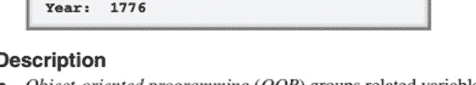

# 描述

- 面向对象编程 (OOP) 将相关的变量分组到称为对象的数据结构中。
- 结构体可以被看作创建对象的蓝图。
- 结构体的数据成员存储了对象的数据。
- 结构体的成员函数定义了对象可以执行的任务。通常，这些函数提供了一种操作对象数据成员的方法。
- 一旦你从结构体创建了对象，该对象就有一个身份（唯一地址）、状态（它存储的数据）和行为（它提供的函数）。随着程序的运行，对象的状态可能会改变。
- 对象是结构体的实例。换句话说，你可以从单个结构体创建多个对象。从结构体创建对象的过程有时被称为实例化。
- 封装允许你向使用该对象的其他代码隐藏对象的成员。这也被称为数据隐藏。
- 像结构体一样，类 (`class`) 也定义了对象的数据成员和成员函数。但是，默认情况下，类的成员不能在类之外被访问。因此，类通常用于提供封装。
- 结构体在大多数情况下运行良好，但允许直接访问成员可能会导致问题。为了防止这些问题，你可以使用类来提供封装，如下例所示。

图 14-1 一个没有提供封装的 Movie 结构

# 提供封装的 Movie 类

图 14-2 显示了一个 Movie 类，它存储与前图所示 Movie 结构体相同的数据。然而，这个 Movie 类防止了对其数据成员的直接访问。这被称为封装，它通常是一种良好的做法。

首先，Movie 类在私有 (`private`) 部分定义了标题和年份数据成员。这防止了类外部的代码直接访问这些数据成员。相反，Movie 类提供了四个公共 (`public`) 成员函数，允许其他代码获取和设置这两个数据成员的值。

这四个成员函数同 `equals` 成员函数一起，提供了程序员用来操作 Movie 对象的*接口*。这允许程序员在不理解其内部代码的情况下正确地使用 Movie 对象。例如，`set_year` 函数检查年份参数以确保它大于或等于 1888，那是第一部电影制作的年份。如果年份小于 1888，此代码将抛出一个异常。这迫使程序员处理此异常。其中一种方法是修改调用代码，使其不向对象传递无效值。

该示例展示了从 Movie 类创建对象并使用该对象的代码。这里，第一条语句创建了一个 Movie 对象。然后，第二和第三条语句使用对象的 `set_title()` 和 `set_year()` 函数来设置标题和年份。第四条语句使用 `get_title()` 和 `get_year()` 函数来获取标题和年份。注意，这段代码无法直接访问标题或年份数据成员，因为它们是私有的。同样，如果这段代码将像 1776 这样的无效年份传递给 `set_year()` 函数，它将抛出一个异常。

如果对象的接口保持不变，程序员就可以进行更改，而不需要更改或重新编译使用该对象的任何代码。例如，假设你想修改 `set_title()` 函数，使其只允许少于 120 个字符的内容。要做到这一点，你可以修改 `set_title()` 函数的代码，而不需要更改任何与对象操作相关的代码。另一方面，如果 Movie 类提供了对标题成员的直接访问，你将无法添加像这样的验证代码。

现在你已经看过了结构体和类，你应该意识到它们之间的唯一区别是结构体的成员默认情况下是公开的。因此，在不需要提供封装时，通常使用结构体；而在需要提供封装时，通常使用类。然而，你可以在结构体或类中声明如图中所示的私有和公共部分。事实上，图中的代码工作效果与使用结构体而非类完全相同。

# Movie 类

```cpp
class Movie {
private:
    string title = "";    // 数据成员是私有的
    int year = 0;         // 成员函数是公开的
public:
    void set_title(string);
    string get_title();
    void set_year(int);
    int get_year();
    bool equals(const Movie&);
};

// 成员函数定义
void Movie::set_title(string title_param) {
    title = title_param;
}
string Movie::get_title() {
    return title;
}
void Movie::set_year(int year_param) {
    if (year_param < 1888) {
        throw invalid_argument("年份必须为1888年或以后。");
    }
    year = year_param;
}
int Movie::get_year() {
    return year;
}
bool Movie::equals(const Movie& to_compare) {
    return (title == to_compare.title && year == to_compare.year);
}
```

# 从 Movie 类创建对象并使用它的代码

```cpp
Movie movie;                   // 创建 Movie 对象
movie.set_title("Roundhay Garden Scene"); // 设置标题
// movie.year = 1776;                      // 设置年份 - 无效
movie.set_year(1888);                    // 设置年份

cout << "MOVIE DATA\n"
cout << "Title: " << movie.get_title() << endl; // 获取标题
cout << "Year: " << movie.get_year() << endl;    // 获取年份
```

# 描述

- 接口允许程序员在不理解内部代码的情况下使用对象。
- 如果对象的接口保持不变，程序员就可以更改实现对象的源代码，而不需要更改或重新编译使用该对象的任何代码。


# 定义私有和公共成员的语法

```cpp
class ClassName {
private:
    // 私有成员放在这里

public:
    // 公共成员放在这里

private:
    // 你也可以在这里编写私有成员
}
```

# 一个将所有私有成员放在公共成员之前的类

```cpp
class Movie {
    string title;            // 私有成员
    int year;
public:
    void set_title(string);  // 公共成员
    string get_title();
    void set_year(int);
    int get_year();
    bool equals(const Movie&);
};
```

# 一个将所有公共成员放在私有成员之前的类

```cpp
class Movie {
public:
    void set_title(string);
    string get_title();
    void set_year(int);
    int get_year();
    bool equals(const Movie&);
private:
    string title;
    int year;
};
```

# 描述

- 为了防止调用代码直接访问数据成员，请将其定义在类的私有部分。然后，如果你需要，可以编写提供间接访问该数据成员的公共成员函数。
- 为了允许调用代码直接访问数据成员，请将其定义在类的公共部分。
- 默认情况下，类的成员是私有的，直到编写了 `public` 关键字。因此，你不需要在类的开头编写 `private` 关键字。然而，通常认为包含此关键字是一项良好的做法，可以清晰地标识所有私有成员。

# 如何定义 getter 和 setter 函数

图 14-4 显示了如何编写获取和设置类数据成员的函数定义。这与编写任何函数的方式相似。但是，你必须在函数名之前编写类名，后跟作用域解析运算符 (`::`)。例如，图中所有四个函数都编写了 `Movie` 类名和作用域解析运算符。

由于函数名应该描述函数所执行的操作，因此，每个函数名以动词开头是一种常见的编码习惯。例如，设置数据成员值的函数通常以 `set` 开头，被称为 setters（设置器）。因为它们更改了存储在对象中的数据，它们也被称为 mutators（修改器）。相反，返回数据成员值的函数通常以 `get` 开头，被称为 getters（获取器）。

当你编写 getter 和 setter 函数时，可以通过编写它们的成员名称来访问私有数据成员。例如，在第一个示例中，`set_title()` 将名为 `title` 的数据成员设置为对象中名为 `_param` 的参数所存储的值。

异常情况是 setter 函数的参数与数据成员同名。这时，你可以通过在该成员名前面加上 `this` 关键字并使用成员访问运算符 (`->`) 来标识该数据成员，如示例所示。这之所以有效是因为 `this` 关键字提供了指向当前对象的指针，而成员访问运算符允许你从指针访问数据成员。通常，这种方法不被认为是一种良好的做法，因为忘记在数据成员名前面加上 `this` 和成员访问运算符可能会导致编译器无法检测的错误。

第三个示例是 `set_year()` 函数。它的工作原理与第一个示例相似，但包含了确保调用代码传递有效参数的代码。首先，该函数的代码检查参数是否小于 1888（第一部电影制作的年份）。如果是，代码将抛出一个异常，指示年份必须是 1888 年或以后。在编写 setters 时，通常会包含此类验证代码。这种技术确保了任何使用你对象的代码都传递了有效数据或处理了抛出的异常。

当你编写 getter 函数时，一种良好的做法是在函数括号后包含 `const` 关键字，如第四和第五个示例所示。这会将该函数定义为常量函数，这意味着该函数不能修改类的任何数据成员。通常，这被认为是最佳实践，因为 getter 函数应该只获取数据，而不修改数据。为了这一点，你必须在声明和定义中都编写 `const` 关键字。

第六个示例显示了一些创建 `Movie` 对象并调用这些函数的代码。到此时，你不应该在理解这段代码如何工作方面有任何困难。

# 一个 setter 函数

```cpp
void Movie::set_title(string title_param) {
    title = title_param;
}
```

# 编写此 setter 函数的另一种方法

```cpp
void Movie::set_title(string title) {
    this->title = title;
}
```

# 一个验证数据的 setter 函数

```cpp
void Movie::set_year(int year_param) {
    if (year_param < 1888) {
        throw invalid_argument("Year must be 1888 or later.");
    }
    year = year_param;
}
```

# 一个返回字符串的 getter 函数

```cpp
string Movie::get_title() const {
    return title;
}
```

# 一个返回 int 值的 getter 函数

```cpp
int Movie::get_year() const {
    return year;
}
```

# 调用这些函数的代码

```cpp
Movie movie;
```

在类的函数定义之后，这段代码展示了 `main()` 函数。该函数首先显示程序标题并提示用户输入一部电影。然后，它定义了一个 `vector` 来存储 `Movie` 对象。接下来，它进入一个循环，只要用户输入 'y' 或 'Y'，循环就会继续。

在循环内部，第一条语句创建一个 `Movie` 对象。然后，它获取电影标题并使用 `set_title()` 函数将该标题存储在 `Movie` 对象中。接下来，它获取电影年份并使用 `set_year()` 函数将年份存储在 `Movie` 对象中。由于如果用户输入无效年份，该函数将抛出异常，因此程序通过显示错误信息并正常退出来处理异常。然而，一个更健壮的程序会显示错误信息并给用户再次输入年份的机会。

在 `Movie` 对象中设置好标题和年份后，这段代码将电影添加到 `vector` 的末尾。然后，它询问用户是否想输入另一部电影。如果没有，循环将再次执行。

在 `while` 循环之后，代码以两列显示电影，第一列的宽度是第二列的三倍（30 个字符和 10 个字符）。在这里，第二条语句显示了 TITLE 和 YEAR 的列标题。然后，一个 `for` 循环显示了存储在 `vector` 中的每个 `Movie` 对象的标题和年份。在完成该 `for` 循环之后，程序结束。

## 代码（继续）

```cpp
int Movie::get_year() const {
    return year;
}

int main() {
    cout << "The Movie List program\n\n";
    cout << "Enter movie...\n\n";

    // get movies from user
    vector<Movie> movies;
    char another = 'y';
    while (tolower(another) == 'y') {
        Movie movie;

        string title;
        cout << "Title: ";
        getline(cin, title);
        movie.set_title(title);

        int year;
        cout << "Year: ";
        cin >> year;
        try {
            movie.set_year(year);
        } catch (const invalid_argument& e) {
            cout << "Exiting program...\n\n";
            return 0;
        }
        movies.push_back(movie);

        cout << "\nEnter another movie? (y/n): ";
        cin >> another;
        cin.ignore();
        cout << endl;
    }

    // display the movies
    const int w = 10;
    cout << setw(w * 3) << "TITLE"
         << setw(w) << "YEAR" << endl;
    for (const Movie movie : movies) {
        cout << setw(w * 3) << movie.get_title()
             << setw(w) << movie.get_year() << endl;
    }
    cout << endl;
}
```

图 14-5 The Movie List 1.0 程序（部分/2部分）

## 编写成员函数的更多技巧

此时，你应该已经理解如何使用私有数据成员和公共成员函数来编写提供封装的类。现在，你将学习定义类的更多技巧。

## 如何使用私有成员函数

如果你需要编写成员函数但不想将其暴露在类之外，可以将其声明在 `private` 。这样，该成员函数就是私有的，可以被其他成员函数使用。因此，它被称为*私有辅助函数*。

在图 14-6 中，第一个示例描述了可以添加到上一个图中所示的 `Movie` 类中的成员函数。在这里，`to_upper()` 函数声明在 `private` 部分。因此，它是一个辅助函数，可以被声明在 `public` 部分的 `get_title_upper()` 和 `equals()` 成员函数使用。

第二个示例演示了实现私有 `to_upper()` 函数的代码。首先，它声明了一个字符串变量 `str_upper` 来存储大写字符串。这段代码遍历字符串参数中的每个字符，将其转换为大写，并将其添加到 `str_upper` 变量中。最后，该函数返回大写字符串。

第三个示例演示了实现 `get_title_upper()` 函数的代码。该函数使用 `to_upper()` 辅助函数将标题数据转换为大写。然后，它返回大写后的标题。由于该函数是公共的，它为任何使用 `Movie` 对象的人提供了一种方便的方法来获取大写的电影标题。

第四个示例演示了实现 `equals()` 函数的代码。该函数对当前 `Movie` 对象和另一个 `Movie` 对象进行不区分大小写的比较。在名称中，`i` 代表*insensitive*（不敏感）。该函数的工作方式与本章之前介绍的 `equals()` 函数相似。然而，在比较电影标题之前，它使用 `to_upper()` 辅助函数将其转换为大写。因此，如果比较的两个 `Movie` 对象年份和标题相同（无论标题的大小写如何），该函数将返回 true。

在查看这段代码时，注意 `equals()` 函数可以访问私有的标题和数据成员，因为它与这些数据成员是在同一个类中定义的。同样，该函数也可以访问私有的 `to_upper()` 函数，因为它与该函数是在同一个类中。首先，它创建了两个 `Movie` 对象，并将标题设置为 "Title" 和 "test"。

# 用于数字和字符串转换的三个函数

| 函数 | 说明 |
|---|---|
| `to_string(num)` | 将指定的数字转换为字符串并返回该字符串。 |
| `stoi(str)` | 将指定的字符串转换为 int 并返回该值。如果此函数无法执行转换，则会抛出异常。 |
| `stod(str)` | 将指定的字符串转换为 double 值并返回该值。如果此函数无法执行转换，则会抛出异常。 |

Movie 类中更多函数的声明

```cpp
public:
    void set_year(int year_param);
    void set_year(string year_param);
    void to_str() const;
```

# 接受 int 值的 set_year() 函数

```cpp
void Movie::set_year(int year_param) {
    if (year_argument < 1888) {
        throw invalid_argument("年份必须是 1888 年或之后。");
    }
    year = year_param;
}
```

# 接受字符串的 set_year() 函数重载

```cpp
void Movie::set_year(string year_param) {
    int yr = stoi(year_param); // 字符串转 int
    set_year(yr);
}
```

# 返回对象字符串表示的函数

```cpp
string Movie::to_str() const {
    return title + " " + to_string(year) + ""; // int 转字符串
}
```

# 调用三个公共函数的代码

```cpp
Movie movie;
movie.set_title("Arrival of a Train");
movie.set_year("1895");
cout << movie.to_str() << endl;
```

控制台


# 说明

- 当你定义一个类时，应该考虑接受不同数据类型的重载 setter 函数（设置函数）。
- 如果 setter 函数接收的参数数据类型与数据成员的类型不同，你可以使用上述函数将参数转换为适当类型。
- `to_string()` 函数通常用于将数字转换为字符串，以便与其他字符串拼接。

# 如何定义构造函数

**构造函数** 是一种特殊的成员函数，它会在创建（构造）对象时被自动调用。图 14-8 显示了如何定义构造函数。

首先，构造函数的名称必须与类名相同且大小写一致。例如，第一个示例显示 `Movie` 类的构造函数名在声明和定义中必须是 `Movie`。此外，该示例显示构造函数不包含返回类型。

第一个示例中的构造函数有零参数。因此，它被称为**默认构造函数**。然而，第二个示例中的构造函数有两个带有默认值的参数。因为提供了默认值，所以在在使用它创建对象时不需要传递任何参数。因此，它可以接受参数，也可以充当默认构造函数。如果被用作默认构造函数使用，它会将 `title` 数据成员初始化为空字符串，并将 `year` 数据成员初始化为值 1888。

对于你的类，无法保证编译器会将类数据成员初始化为默认值。在这种情况下，数据成员将指向内存中偶然存在的任何值。因此，通常认为包含一个将所有数据成员初始化为默认值的默认构造函数是项最佳实践。

在 C++ 中，如果你定义了一个或多个构造函数但没有为你的类创建默认构造函数，它将强制你使用其中一个非默认构造函数。因此，你不能使用简写语法来调用构造函数（即你之前看到的语法）。

第三个示例显示了三种调用默认构造函数的方法。在这里，第一语句通过显式调用默认构造函数创建一个 `Movie` 对象，然后将其赋值给名为 `m1` 的变量。相比之下，第二和第三语句没有显式调用默认构造函数。第二语句使用了带有部分的简写语法，第三语句使用了不包含括号的简写语法。

如果你想向构造函数传递参数，可以使用第四个示例所示的简写语法或部分简写语法。在这里，第一和第二语句向 `Movie` 构造传递了一个参数。第三和第四语句向 `Movie` 传递了两个参数。

在某些情况下，你可能希望在不赋值变量的情况下创建一个对象。为了这样做，可以通过类名后跟括号来调用类的构造函数。在这些括号内，你可以编写想要发送给构造函数的任何参数。在这个示例中，单个语句通过传递 `title` 和 `year` 创建 `Movie` 对象，并将该对象添加到 `Movie` 向量末尾。

# 默认构造函数（零参数）

声明

```cpp
Movie();
```

定义

```cpp
Movie::Movie() {
    title = "";
    year = 1888;
}
```

# 另一种编写默认构造函数的方法（零参数）

声明

```cpp
Movie(string title = "", int year = "");
```

定义

```cpp
Movie::Movie(string title, int year) {
    title = title;
    year = year;
}
```

# 调用默认构造函数的种方法（无参数）

```cpp
Movie m1 = Movie(); // 完全语法
Movie m2();        // 部分简写语法
Movie m3;          // 简写语法
```

# 向构造函数传递参数的示例

```cpp
Movie m4("Arrival of a Train"); // 一个参数
Movie m5("Arrival of a Train", 1895); // 参数
```

# 创建对象并存储在向量中的示例

```cpp
vector<Movie> movies;
movies.push_back(Movie("Arrival of a Train", 1895));
```

# 说明

- 当你定义类时，应该考虑接受不同数据类型的重载 setter 函数。


- 如果 setter 函数接收的参数数据类型与数据成员类型不同，你可以使用上述函数将参数转换为适当类型。
- `to_string()` 函数通常用于将数字转换为字符串，以便与其他字符串拼接。
- 构造函数是一种在创建（构造）对象时自动调用的特殊成员函数。
- 构造函数的名称必须与类名相同且大小写一致。
- 构造函数不包含返回类型。
- 默认构造函数没有参数。
- 带有默认值的构造函数可以充当默认构造函数。
- 包含将所有数据成员初始化为默认值的默认构造函数是最佳实践。
- 如果你定义了一个或多个构造函数但没有创建默认构造函数，将被强制使用其中一个非默认构造函数。
- 析构函数（destructor）是一种在对象销毁时自动调用的特殊成员函数。
- 编写析构函数的方法与编写构造函数类似。
- 析构函数的名称前面必须有一个波浪号 (`~`)，且不能接受任何参数。
- 析构函数的常用用途是释放对象正在使用的系统资源。


# 如何定义析构函数

析构函数是一种在对象销毁时自动调用的特殊成员函数。C++ 在对象离开作用域时会自动销毁它们。图 14-9 显示了如何定义析构函数。

编写析构函数的方法与编写构造函数类似。然而，析构函数的名称前面必须有一个波浪号 (`~`)，且不能接受任何参数。此外，一个类只能包含一个析构函数。

析构函数的常用用途是释放对象正在使用的系统资源。例如，如果对象的构造函数按照第 17 章所述动态分配内存，那么对象的析构函数应该释放这些内存。

图中第一个示例显示了如何为 `Movie` 类编写析构函数的声明和定义。由于该类没有分配任何内存或使用其他系统资源，该类的析构函数只包含注释，指示你可以添加代码来释放系统资源。虽然编写不包含任何代码的析构函数是常见做法，许多 IDE 在创建类时也会生成这样的代码，但书中的程序只在需要释放系统资源时才使用析构函数。

## 析构函数

### 声明

```cpp
~Movie();
```

### 定义

```cpp
Movie::~Movie() {
    // 在此处编写释放系统资源的代码
}
```

## 一个带有析构函数的类示例

### 声明

```cpp
class MovieList {
private:
    std::string filename = "movies.txt";
    std::fstream file;
    std::vector<Movie> movies;
public:
    MovieList();
    ~MovieList();
    void add_movie(Movie);
    void delete_movie(Movie);
};
```

### 构造函数的定义

```cpp
MovieList::MovieList() {
    file.open(filename, std::ios::in); // 打开一个系统资源
}
```

### 析构函数的定义

```cpp
MovieList::~MovieList() {
    if (file.is_open())
        file.close(); // 关闭系统资源
}
```

## 描述

- **析构函数** (Destructor) 是一种特殊的成员函数，它在对象被销毁时自动调用。C++ 会在对象超出作用范围时自动销毁大多数对象。
- 析构函数的名称必须与类名相同，且大小写一致，并在前面加一个波浪符号 (`~`)。
- 析构函数不能包含返回值类型。
- 析构函数不能接受任何参数。
- 一个类只能包含一个析构函数。
- 析构函数的常用用途是释放对象正在使用的系统资源。


# 如何在头文件和源文件中存储类

在编写类时，通常会将它们分别存储在不同的头文件和源文件中。这使得重用类变得容易，这也是使用类的主要优点之一。

## Movie 类的头文件和源文件

图 14-10 展示了 `Movie` 类的头文件和源文件。首先，它展示了头文件的代码。这些代码存储在 `Movie.h` 文件中。与第 7 章介绍的头文件一样，该头文件使用了包含保护符（include guard）来防止编译器重复包含同一个头文件。为了实现这一点，它使用了 `#ifndef`、`#define` 和 `#endif` 预处理器指令来检查是否定义了名为 `MURACH_MOVIE_H` 的常量。为了正常工作，该常量必须具有唯一的名称。

在包含 `string` 头文件后，`Movie.h` 头文件声明了一个名为 `Movie` 的类。该类有一个私有部分，其中定义了三个数据成员（标题、年份和星级）和一个名为 `to_upper()` 的辅助函数。然后，该类有一个公共部分，声明了构造函数和多个函数。构造函数为所有三个数据成员提供了默认值。因此，在创建对象时不需要提供这些数据成员；此外，它还允许你传递参数来指定数据成员。这是一种灵活且简洁的编码方式。

在七个成员函数声明中，前六个是三个数据成员的访问器（getters）和设置器（setters）。然后，`equals()` 函数提供了一种对 `Movie` 对象进行不区分大小写比较的方法。

注意，该头文件遵循了不提供任何指令或声明的最佳实践。这样，包含此头文件的其他文件就不会有任何对象或函数导入到其命名空间中。例如，该代码没有使用 `string` 类声明，而是使用作用域解析运算符 (`::`) 在头文件中每次使用时都对 `string` 类进行完全限定。

`Movie.cpp` 文件包含了头文件中声明的函数定义。换句话说，该文件实现了这些函数。因此，`Movie.cpp` 文件有时被称为实现文件。另一方面，头文件提供了使用该类的接口。因此，它被称为接口文件。

源文件开头包含了所有必要的头文件，包括 `Movie.h` 头文件。然后，它包含了两个声明，以便于使用 `std::string` 和 `std::invalid_argument` 类。接下来，它定义了私有的 `to_upper()` 函数，其工作方式与本章稍早描述的 `to_upper()` 函数类似。

在私有函数之后，代码声明了该类的构造函数。该构造函数通过将参数传递给 setter 函数来设置数据成员。

### Movie.h 文件

```cpp
#ifndef MURACH_MOVIE_H
#define MURACH_MOVIE_H

#include <string>

class Movie {
private:
    std::string title;
    int year;
    int stars;

    std::string to_upper(std::string);
public:
    Movie(std::string title = "", int year = 1888, int stars = 1);

    void set_title(std::string);
    std::string get_title() const;

    void set_year(int);
    int get_year() const;

    void set_stars(int);
    int get_stars() const;

    bool equals(const Movie&);
};

#endif // MURACH_MOVIE_H
```

### Movie.cpp 文件

```cpp
#include "Movie.h"
#include <string>

using std::string;
using std::invalid_argument;

// 私有函数
string Movie::to_upper(string str) {
    string str_upper;
    for (char c : str) {
        str_upper.push_back(toupper(c));
    }
    return str_upper;
}

// 公有函数
Movie::Movie(string title, int year, int stars) {
    set_title(title);
    set_year(year);
    set_stars(stars);
}

// 析构函数
MovieList::~MovieList() {
    if (file.is_open())
        file.close();
}

// 构造函数
MovieList::MovieList() {
    file.open(filename, std::ios::in);
}
```

*(注：由于原文文本在 Movie.cpp 的定义处被截断，译文根据上下文和常见的 C++ 语法补全了代码块逻辑，以确保文档完整性)*

## 使用内联函数定义的 Movie.h 文件

```cpp
#ifndef MURACH_MOVIE_H
#define MURACH_MOVIE_H

#include <string>

class Movie {
private:
    std::string title;
    int year;
    int stars;
    std::string to_upper(std::string);
public:
    Movie(std::string title = "", int year = 1888, int stars = 1);
    void set_title(std::string title);
    std::string get_title() const { return title; } // 内联函数
    void set_year(int year);
    int get_year() const { return year; } // 内联函数

    // 其他函数声明在此处
};

#endif // MURACH_MOVIE_H
```

## 内联函数的优点

- 由于函数声明和定义在同一个地方，代码更加简洁。
- 由于避免了函数调用开销，可能会提高性能。

## 内联函数的缺点

- 因为内联函数每次被调用时都会复制，导致可执行文件体积增大。
- 由于可执行文件体积增大，性能可能会下降。
- 如果更改了内联函数的任何实现代码，则必须重新编译头文件。

## 描述

- 如果你在头文件中编写成员函数的定义，则该函数被称为内联函数。
- 当你编写内联函数时，你是在给编译器提供一个提示，表示希望它通过名为“内联展开”（inline expansion）的过程来优化可执行文件。内联展开将每次函数调用替换为函数本身的代码。
- 当你编写内联函数时，不能保证编译器一定会使用你的提示。
- 现代编译器通常会自动使用内联展开，即使对于那些没有编写为内联函数的也是也是。


# Movie List 2.0 程序

图 14-12 展示了 Movie List 程序的另一个版本。该程序与第 9 章介绍的 Movie List 2.0 程序类似。然而，它使用 `Movie` 类来存储电影数据，而不是 `Movie` 结构体。正因如此，此图突出了与从 `Movie` 类创建的 `Movie` 对象一起工作的代码。

首先，这段代码导入了本章之前介绍的 `Movie.h` 头文件。结果是这段代码可以使用该头文件定义的 `Movie` 类。

## 控制台

```
Movie List 程序
命令
v - 查看电影列表
a - 添加电影
d - 删除电影
x - 退出
```

```
Command: v
TITLE YEAR STARS
1 Casablanca 1942 5
2 Wonder Woman 2017 4
```

```
Command: a
Title: The Wizard of Oz
Year: 1939
Stars (1-5): 5
The Wizard of Oz was added.
```

```
Command: d
Number: 1
Casablanca was deleted.
```

```
Command: x
Bye!
```

## 代码

```cpp
#include <iostream>
#include <fstream>
#include <sstream>
#include <string>
#include <vector>
#include "Movie.h"
```

```cpp
using namespace std;

const string movies_file = "movies.txt";
vector<Movie> read_movies_from_file() {
    vector<Movie> movies;

    ifstream input_file(movies_file); // 如果文件打开成功...
    string line;
    while (getline(input_file, line)) {
        stringstream ss(line);
    }
}
```

图 14-12 Movie List 2.0 程序（4部分中的第1部分）

在图 14-12 的第 2 部分中，代码使用单个语句将电影添加到 `Movie` 对象中。为了实现这一点，代码调用了 `Movie` 类的构造函数，并将从文件中读取的标题、年份和评分传递给它。然后，它将电影传递给 `vector` 的 `push_back()` 函数。代码使用访问器函数从 `Movie` 对象中获取数据。这是必要的，因为 `Movie` 类的数据成员是私有的。因此，你无法直接访问它们。相反，你必须使用这些访问器函数从数据成员中获取值。同样，`view_movie()` 函数也使用访问器函数从数据成员中获取值。

在第 3 部分，`get_movie()` 函数创建一个 `Movie` 对象并将其存储在变量 `movie` 中。为了做到这一点，它将用户输入的标题、年份和评分传递给 `Movie` 类的构造函数。然后，下一个语句返回该 `Movie` 对象。或者，代码也可以通过如下返回语句在不创建变量的情况下返回 `Movie` 对象：

```cpp
return Movie(title, year, stars);
```

在 `add_movie()` 中，代码使用 `equals()` 函数将当前的 `Movie` 对象与 `Movie` 对象向量中的每部电影进行比较。如果当前电影已存在于 `vector` 中，则代码将使用 `set_stars()` 和 `get_stars()` 函数将现有电影的评分设置为新电影的评分。换句话说，由于标题和年份相同，它并不会向列表中添加新电影。相反，它更新了可能不同的评分。

该列表中的其余代码工作方式大部分与第 9 章描述的相同。因此，你在理解其工作原理时应该不会太大困难。唯一的显著区别是 `add_movie()` 和...（此处省略）

（注：由于提供的原文在最后部分不完整，我将根据上下文完成翻译的逻辑）

## 代码（续接）


```cpp
void delete_movie(vector<Movie>& movies) {
    int number = get_movie_number(movies);
    int index = number - 1;
    Movie movie = movies[index];
    movies.erase(movies.begin() + index);
    write_movie_to_file(movies);
    cout << movie.get_title() << " was deleted.\n";
}

void display_menu() {
    cout << "COMMANDS list\n";
    cout << "v - View movie list\n";
    cout << "a - Add a movie\n";
    cout << "d - Delete a movie\n";
    cout << "x - Exit\n";
}

int main() {
    cout << "The Movie List program\n";
    display_menu();
    vector<Movie> movies = read_movies_from_file();
    char command = ' ';
    while (command != 'x') {
        cout << "Command: ";
        cin >> command;
        switch (command) {
            case 'v':
                view_movies(movies);
                break;
            case 'a':
                add_movie(movies);
                break;
            case 'd':
                delete_movie(movies);
                break;
            case 'x':
                cout << "Bye!\n";
                break;
            default:
                cout << "Not a valid command. Please try again.\n";
                break;
        }
    }
}
```

图 14-12 电影列表 2.0 程序（4 部分中的 4 部分）

## 如何使用 UML 图

在处理类时，通常会使用一种称为类图（class diagram）的图来规划和记录类的成员变量和函数。为了实现这一点，通常会使用统一建模语言（UML），这是一种建模语言，是包括 C++ 在内的所有面向对象编程语言的行业标准。

## UML 图简介

图 14-1 展示了两张 UML 图。第一张图是图 14-10 中介绍的 `Movie` 类。第二张图是本章稍后介绍的 `Product` 类。

`Movie` 类的图包含三个数据成员和九个成员函数。在这里，减号（`-`）表示仅在当前类中的私有成员。相反，加号（`+`）表示其他类可以访问的公共成员。例如，三个数据成员都是私有的，但只有 `to_upper()` 成员函数是私有的。其余成员函数（包括构造函数）都是公共的。

`Product` 类的图包含三个数据成员和七个成员函数。在这里，第一个数据成员是公共的。因此，该类不需要为该数据成员包含 getter（访问）和 setter（修改）函数。然而，第二个和第三个数据成员是私有的。因此，该类为它们包含了公共 getter 和 setter 函数。此外，它还包含一个构造函数以及两个名为 `get_discount_amount()` 和 `get_discount_percent()` 的函数。

这些 `get_discount_amount()` 函数获取无法设置的数据。因此，这些函数被称为只读函数。这些函数根据其他数据成员计算出返回的值。

在查看这些图时，请注意每个函数名称后面跟着一组括号。在括号内，这些图指定了函数参数的名称。然而，它们没有指定这些参数的数据类型。同样，这些图也没有指定函数的返回类型。

在大多数情况下，你可以根据名称推断数据类型。例如，名为 `title` 的参数很可能是一个字符串，名为 `year` 的参数很可能是 `int`，而名为 `get_price()` 的函数可能返回一个 `double` 值。但是，如果你想在图表中显式指定数据类型，可以通过下一个图中描述的表示法来实现。

### 图 14-10 中 Movie 类的 UML 图

| Movie | |
| --- | --- |
| -title | 数据 |
| -year | 成员 |
| -stars | 成员 |
| +Movie(title, year, stars) | |
| +set_title(title) | |
| +get_year() | 成员 |
| +set_year(year) | 函数 |
| +set_stars(stars) | |
| +get_stars() | |
| +equals(movie) | |
| +to_upper(str) | |

### 图 14-15 中 Product 类的 UML 图

| Product | |
| --- | --- |
| -name | 数据 |
| -price | 成员 |
| -discount_percent | |
| +Product(name, price, disc_pct) | 成员 |
| +set_price(price) | 函数 |
| +get_price() | |
| +set_discount_percent(disc_pct) | |
| +get_discount_percent() | |
| +set_discount_amount() | |
| +get_discount_price(price) | |

### 描述

- UML（统一建模语言）是用于描述面向对象程序的类和对象的行业标准。
- UML 类图描述了一个或多个类的数据成员和成员函数。
- 减号（`-`）标记了其他类无法访问的私有成员，加号（`+`）标记了其他类访问的公共成员。
- 对于每个成员函数，名称后跟着一组括号。在括号内，这些图指定了函数的参数。
- 减号（`-`）标识仅在当前类中可用的私有成员。相反，加号（`+`）标识其他类可访问的公共成员。
- `get_discount_amount()` 函数获取对象中无法设置的数据。因此，这些函数被称为只读函数。

### 图 14-13 UML 图简介

| Movie | |
| --- | --- |
| -title | string |
| -year | int |
| -stars | int |
| +Movie(title, year, stars) | int |
| +set_title(title) | void |
| +get_year() | string |
| +set_year(year) | void |
| +set_stars(stars) | void |
| +get_stars() | int |
| +equals(movie) | bool |
| +to_upper(str) | string |

## 带类型的 UML 图

图 14-14 展示了之前图中相同的 `Movie` 和 `Product` 图。然而，在此图中，这些图还指定了数据成员和函数的数据类型。如果你将这些图与之前的图进行比较，你会发现数据类型使图变得杂乱并更难以阅读。如果你不需要指定数据类型，可能想要省略它们。

| Product | |
| --- | --- |
| +name | string |
| -price | double |
| -discount_percent | int |
| +Product(name, price, disc_pct) | int |
| +set_price(price) | void |
| +get_price() | double |
| +set_discount_percent(disc_pct) | void |
| +get_discount_percent() | int |
| +get_discount_amount() | double |
| +get_discount_price(price) | double |

## 实现 UML 图的 Product 类

为了完善你对 UML 的理解，图 14-15 展示了一个实现之前两个图中表的 `Product` 类。请注意，该类没有封装 `name` 数据成员。相反，它只封装了 Product 的价格和折扣比例。

此图的第一部分显示了 `Product` 类的头文件。首先，私有部分声明了两个封装的数据成员。然后，公共部分声明了公共数据成员、构造函数、四个 getter 和 setter 函数以及两个只读函数。在查看此代码时，注意两个 getter 函数都被编写为内联函数。

### Product.h 文件

```cpp
#ifndef MURACH_PRODUCT_H
#define MURACH_PRODUCT_H

#include <string>

class Product {
    double price;
    int discount_percent;

public:
    std::string name;
    Product(std::string name = "", double price = 0.0,
           int discount_pct = 0);

    void set_price(double);
    double get_price() const {
        return price;
    }

    void set_discount_percent(int);
    int get_discount_percent() const {
        return discount_percent;
    }

    double get_discount_amount();
    double get_discount_price();

};

#endif // MURACH_PRODUCT_H
```

图 14-15 实现 UML 图的 Product 类（2/2 部分）

图 14-15 的第 2 部分显示了实现 `Product` 类头文件的代码。首先，这段代码定义了该类的构造函数。该代码通过直接访问数据成员，将第一个参数赋值给 `name` 成员。然后，通过将第二个参数传递给 `set_price()` 函数，将其赋值给 `price` 数据成员。同样，通过将第三个参数传递给 `get_discount_percent()` 函数，将其赋值给 `discount_percent` 数据成员。这样，类就可以对赋值给这些数据函数的数据进行验证。

在查看此代码时，请注意它不需要为 `price` 和 `discount` 数据成员实现访问器函数（getter functions）。这是因为这些函数在头文件中被定义为内联函数（inline functions）。因此，头文件包含了这些函数的实现。

此外，请注意 `get_discount_amount()` 和 `get_discount_price()` 函数没有获取或设置任何数据成员。相反，它们使用数据成员来计算结果，然后返回该计算结果。例如，`get_discount_amount()` 函数通过将价格乘以折扣百分比来计算折扣金额。同样，`get_discount_price()` 函数通过从价格中减去折扣金额来计算折扣价。这是一个类如何包含对其数据成员进行操作的良好示例。

### Product.cpp 文件

```cpp
#include <string>
#include <cmath>
#include "Product.h"

using std::string;
using std::invalid_argument;

Product::Product(string p_name, double price, int discount_percent) {
    name = p_name;
    set_price(price);
    set_discount_percent(discount_percent);
}

void Product::set_price(double p_price) {
    if (p_price >= 0.0) 
        price = round(p_price * 100) / 100;
    else
        throw invalid_argument("价格不能为负.");
}

void Product::set_discount_percent(int p_discount_percent) {
    if (p_discount_percent >= 0 && p_discount_percent <= 100)
        discount_percent = p_discount_percent;
    else
        throw invalid_argument("折扣百分比范围无效.");
}

double Product::get_discount_amount() {
    double discount_amount = price * discount_percent / 100;
    return round(discount_amount * 100) / 100;
}

double Product::get_discount_price() {
    double discount_price = price - get_discount_amount();
    return round(discount_price * 100) / 100;
}
```

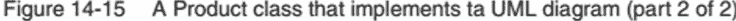

## Product Viewer 程序

图 14-16 显示了一个简单但完整的 Product Viewer 程序，它使用了从 `Product` 类创建的对象。该程序开始显示一个包含三个产品的编号列表。然后，用户可以通过输入编号来查看某个产品的数据。

首先，第 1 部分的代码包含了前一个图所示的 `Product` 类头文件。然后，它定义了一个函数 `show_products()`，用于显示产品编号列表。该函数接受一个包含一个或多个 `Product` 对象的 vector。为了显示这些 `Product` 对象，使用基于范围的循环（range-based loop）遍历 vector。在循环内部，它显示该编号，紧接着显示存储在当前 `Product` 对象中的名称。为了获取此名称，代码直接访问 `name` 成员。

`show_product()` 函数显示某个产品的数据。为了实现这一点，它接受一个 `Product` 对象的常量引用参数（constant reference）。然后，它使用 `name` 数据成员显示名称。接下来，它使用两个访问器函数显示价格和折扣百分比。最后，它使用两个只读函数显示折扣金额和折扣价。

### 控制台

```
The Product Viewer program

PRODUCTS
1. Stanley 13 Ounce Wood Hammer
2. National Hardware 3/4" Wire Nails
3. Economy Duct Tape, 60 yds, Silver

Enter product number: 1

PRODUCT DATA
Name: Stanley 13 Ounce Wood Hammer
Price: 12.99
Discount percent: 62
Discount amount: 8.05
Discount price: 4.94

View another product? (y/n):
```

### 代码


```cpp
#include <iostream>
#include <string>
#include <vector>
#include "Product.h"

using namespace std;

void show_products(const vector<Product>& products) {
    cout << "PRODUCTS" << endl;
    int number = 0;
    for (const auto& product : products) {
        cout << ++number << ". " << product.name << endl;
    }
}

void show_product(const Product& p) {
    cout << "PRODUCT DATA" << endl;
    cout << "Name: " << p.name << endl;
    cout << "Price: " << p.get_price() << endl;
    cout << "Discount percent: " << p.get_discount_percent() << endl;
    cout << "Discount amount: " << p.get_discount_amount() << endl;
    cout << "Discount price: " << p.get_discount_price() << endl;
}

int main() {
    vector<Product> products;
    products.push_back("Stanley 13 Ounce Wood Hammer", 12.99, 62);
    products.push_back("National Hardware 3/4\" Wire Nails", 5.50, 10);
    products.push_back("Economy Duct Tape, 60 yds, Silver", 7.75, 5);

    show_products(products);

    char choice = 'y';
    while (choice == 'y') {
        int number;
        cout << "Enter product number: ";
        cin >> number;

        if (number > 0 && number <= (int)products.size()) {
            Product product = products[number - 1];
            show_product(product);
        } else {
            cout << "There is no product with that number." << endl;
        }

        cout << "View another product? (y/n): ";
        cin >> choice;
    }

    cout << "Bye!" << endl;
    return 0;
}
```

## Product Viewer 程序（2/2 部分）

在图 14-16 的第 2 部分中，`main()` 函数首先显示标题。然后，它创建一个产品的 `vector`。创建 `vector` 后，它提示用户输入编号。接下来，它检查编号是否对应于 `vector`。如果是，它调用 `show_product()`。如果不是，它显示没有该产品。最后，它询问是否要查看另一个产品。

## 如何使用对象组合

到目前为止，你已经学习了如何定义一个具有 C++ 库类型（如 `string` 和 `double`）数据成员的类。然而，你也可以定义一个存储自定义对象的类。为了实现这一点，你可以使用对象组合将单个对象组合成更复杂的数据结构。

为了说明对象组合如何工作，接下来的主题首先介绍一个存储单个骰子信息的 `Die` 类。然后，介绍一个存储多个 `Die` 对象的 `Dice` 类。最后，介绍一个同时使用 `Die` 和 `Dice` 对象的简单骰子掷程序。

## Die 类

图 14-17 开始显示 `Die` 类的 UML 图，该类定义了一个单六面数字。该类有一个私有数据成员 `value`，并有一个公共访问器。此外，该类提供了一个默认构造函数以及一个名为 `roll()` 的公共函数，将 `value` 数据成员设置为 1 到 6 之间的随机值。

`Die` 类的头文件定义了私有数据成员并声明了 UML 图中的所有公共函数。然后，源文件实现了这些函数。首先，它导入了获取随机数所需的头文件，以及 `Die` 类的头文件。

`Die` 类的构造函数初始化 `value` 为 1。结果，当你第一次创建一个 `Die` 对象时，它的值被设置为 1。

`roll()` 函数首先使用 `rand()` 函数配合取模运算符（`%`）来获取一个 0 到 5 之间的值。然后，下一语句增加该值使其变为 1 到 6。

正如你所预期的，`get_value()` 函数返回该值。这为调用代码在调用 `roll()` 函数后获取值提供了一种方法。

### Die 类的 UML 图

| Die |
| --- |
| -value : int |
| +Die() : void |
| +roll() : void |
| +get_value() : int |

### Die.h 文件

```cpp
#ifndef MURACH_DIE_H
#define MURACH_DIE_H

class Die {
private:
    int value;

public:
    Die();
    void roll();
    int get_value() const;
};

#endif // MURACH_DIE_H
```

### Die.cpp 文件

```cpp
#include <cstdlib>
#include <ctime>
#include "Die.h"

Die::Die() {
    srand(time(nullptr)); // 为 rand() 函数播种
    value = 1;
}

void Die::roll() {
    value = rand() % 6; // value >= 0 且 <= 5
    ++value; // value >= 1 且 <= 6
}

int Die::get_value() const {
    return value;
}
```

图 14-17 一个 Die 类

## Dice 类

图 14-18 首先展示了一个显示对象组合工作的 UML 图。更具体地说，该图显示一个 `Dice` 对象由一个或多个 `Die` 对象组成。为了显示这种关系，该图用一条线连接了两个类，并在 `Dice` 类旁边放置了一个菱形连接器，以表示它是由其他对象组成的对象。这看起来可能没什么，但能够定义一个由其他用户定义对象组成的对象是一个强大的功能，它允许你为开发的每个程序创建可以自定义的复杂数据结构。

`Dice` 类的头文件首先包含了它需要的头文件。这包括 `Die` 类的头文件，它显示了 `Dice` 使用 `Die` 对象。然后，头文件定义了一个名为 `dice` 的单个私有数据成员，并将其初始化为空 `Die` 对象的 `vector`。最后，它声明了 UML 图中的公共函数，包括一个默认构造函数。

`Dice` 类的源代码实现了这些函数。首先，它定义了一个默认构造函数。该构造函数没有执行任何初始化，因为 `dice` 数据成员不需要初始化。然而，如果你稍后想通过设置其容量来初始化 `vector`，可以在这里添加该代码。

`add_die()` 函数向 `vector` 添加一个 `Die` 对象。为了实现，该函数调用 `vector` 对象的 `push_back()` 函数将 `Die` 对象添加到 `vector` 的末尾。

`roll_all()` 函数掷出所有已添加到 `vector` 中的 `Die` 对象。为了实现，该代码遍历 `Dice` 对象中的每个 `Die` 对象，并对每一个对象调用 `roll()` 函数。

`get_dice()` 函数是 `dice` 数据成员的访问器。它返回存储在该数据成员中的 `Die` 对象 `vector`。这为调用代码提供了从每个 `Die` 对象获取值的方法。

### 使用组合的两个类的 UML 图

| Dice | Die |
| --- | --- |
| -dice : vector<Die> | -value : int |
| +Dice() | +Die() |
| +add_die(die : Die) : void | +roll() : void |
| +roll_all() : void | +get_value() : int |
| +get_dice() : vector<Die> | |

### Dice.h 文件

```cpp
#ifndef MURACH_DICE_H
#define MURACH_DICE_H

#include <vector>
#include "Die.h"

class Dice {
private:
  std::vector<Die> dice;
public:
  Dice();
  Dice(Die die);
  void add_die(Die die);
  void roll_all();
  std::vector<Die> get_dice() const;
};

#endif // MURACH_DICE_H
```

### Dice.cpp 文件

```cpp
#include "Dice.h"

Dice::Dice() {}

void Dice::add_die(Die die) {
  dice.push_back(die);
}

void Dice::roll_all() {
  for (Die& die : dice) {
    die.roll();
  }
}

std::vector<Die> Dice::get_dice() const {
  return dice;
}
```

图 14-18 一个 Dice 类

- 对象组合是将简单对象组合成更复杂对象的方法。例如，一个 `Dice` 对象可以存储多个 `Die` 对象。
- 在 UML 图中，你可以使用菱形连接器来识别由其他对象组成的对象。

## Dice Roller（掷骰子）程序

图 14-19 显示了一个名为 Dice Roller 的程序，它使用了 `Die` 和 `Dice` 类。首先，该程序的代码包含了 `Die` 和 `Dice` 类的头文件。

在使用指令后，`main()` 函数首先显示程序标题。它提示用户输入要掷出的骰子数量。接下来，它创建了一个 `Dice` 对象，并使用循环创建正确数量的 `Die` 对象并将它们添加到 `Dice` 对象中。为了实现这一点，代码使用了简写语法调用这些对象的默认构造函数。

在创建 `Dice` 对象后，代码进入一个循环，只要用户输入 'y' 循环就会继续。该循环开始调用 `Dice` 对象的 `roll_all()` 函数来掷出所有的骰子。然后，它遍历 `Dice` 对象中的每个 `Die` 对象，并对每一个对象调用 `roll()` 函数。（注：OCR 文本在 581-582 页处存在重复/重叠，此处已处理了 OCR 流中的连贯句子。）

### 控制台

让我们来玩 PIG（猪掷）！

```
* 看看你需要多少回合才能达到 20 分。
* 当你选择保留（hold）或掷出 1 时，回合结束。
* 如果你掷出 1，将失去该回合的所有得分。
* 如果你选择保留，你将保住该回合的所有得分。

第 1 回
掷骰还是保留？(r/h): r
骰子: 5
掷骰还是保留？(r/h): r
骰子: 4
掷骰还是保留？(r/h): r
骰子: 5
掷骰还是保留？(r/h): h
回合得分: 14
总分: 14

第 2 回
掷骰还是保留？(r/h): r
骰子: 6
掷骰还是保留？(r/h): h
回合得分: 6
总分: 20

你用 2 回就完成了！

游戏结束！
```

### 代码

```cpp
#include <iostream>
#include "Die.h"

using namespace std;

// 一个用于游戏变量的结构体
struct GameState {
    int turn = 1;
    int score = 0;
    int score_this_turn = 0;
    bool turn_over = false;
    bool game_over = false;
    Die die;
};

// 声明函数
void display_rules();
void play_game(GameState&);
void take_turn(GameState&);
void roll_die(GameState&);
void hold_turn(GameState&);
```

图 14-20 Pig 骰子游戏（3 部分中的第一部分）

在图 14-20 的第 2 部分中，`main` 函数通过调用 `display_rules()` 函数来显示欢迎消息和游戏规则。然后，它创建了一个 `GameState` 对象并将其传递给 `play_game()` 函数。

`play_game()` 函数包含了游戏启动时调用的代码。这段代码启动了游戏的主循环。该循环一直持续，直到 `GameState` 对象的 `game_over` 数据成员被设置为 `true`。在循环内部，有一条语句调用 `take_turn()` 函数并将 `GameState` 对象传递给它。

`take_turn()` 函数首先打印回合数。为了实现这一点，它从 `GameState` 对象中获取回合数。然后，它重置了 `turn_over` 数据成员。这在第一回合中是不必要的，但对于后续回合是必要的。接下来，它开始一个 `while` 循环，该循环将持续到 `turn_over` 数据成员被设置为 `true`。

在循环中，代码首先提示用户选择是掷骰还是保留。如果用户选择掷骰，这段代码会调用 `roll_die()` 函数并将 `GameState` 对象传递给它。如果用户选择保留，这段代码会调用 `hold_turn()` 函数并将 `GameState` 对象传递给它。

### 代码（续）

```cpp
int main() {
    display_rules();
    GameState game;
    play_game(game);
}

// 定义函数
void display_rules() {
    cout << "Let's Play PIG!\n"
         << "*\n"
         << "* 看看你需要多少回合才能达到 20 分。\n"
         << "* 当你选择保留或掷出 1 时，回合结束。\n"
         << "* 如果你掷出 1，将失去该回合的所有得分。\n"
         << "* 如果你保留，你将保住该回合的所有得分。\n\n";
}

void play_game(GameState& game) {
    while (!game.game_over) {
        take_turn(game);
    }
    cout << "Game over!\n";
}

void take_turn(GameState& game) {
    cout << "TURN " << game.turn << endl;
    game.turn_over = false;
    while (!game.turn_over) {
        char choice;
        cout << "Roll or hold? (r/h): ";
        cin >> choice;

        if (choice == 'r')
            roll_die(game);
        else if (choice == 'h')
            hold_turn(game);
        else
            cout << "Invalid choice. Try again.\n";
    }
}
```

图 14-20 Pig 骰子游戏（3 部分中的第二部分）

在图 14-20 的第 3 部分中，`roll_die()` 函数首先从 `GameState` 对象中获取 `Die` 对象并调用其 `roll()` 函数。这更新了存储在 `Die` 对象中的值。接下来，代码在控制台中显示所存储的值。

之后，`roll_die()` 函数检查骰子上的值是否为 1。如果是，代码将更改 `GameState` 对象的几个数据成员。具体来说，它将 `score_this_turn` 成员设置为 0，将 `turn` 成员加 1，并将 `turn_over` 成员设置为 `true`。换句话说，它丢弃了该回合的所有得分并结束该回合。然后，它在控制台上显示一条消息，表示回合已结束且该回合没有得分。然而，如果骰子不是 1，这段代码会将 `score_this_turn` 数据成员增加骰子的值。

`hold_turn()` 函数首先开始更改 `GameState` 对象的两个数据成员。具体来说，它将 `score` 数据成员增加 `score_this_turn` 数据成员的值，并将 `turn_over` 成员设置为 `true`。换句话说，这段代码保存了该回合的得分并结束该回合。然后，代码在控制台上显示得分。

之后，`hold_turn()` 函数检查得分是否大于 20。如果是，这段代码会将 `game_over` 设置为 `true` 并显示游戏已结束。否则，这段代码增加了 `turn` 值。

### 代码（续）


```cpp
void roll_die(GameState& game) {
    game.die.roll();
    cout << game.die.getValue() << endl;

    if (game.die.getValue() == 1) {
        game.score_this_turn = 0;
        game.turn++;
        game.turn_over = true;
        cout << "Over. No score this turn.\n";
    } else {
        game.score_this_turn += game.die.getValue();
    }
}

void hold_turn(GameState& game) {
    game.score += game.score_this_turn;
    game.turn_over = true;
    cout << "Score for turn: " << game.score_this_turn << endl;
    cout << "Total score: " << game.score << endl;
}
```

图 14-20 Pig 骰子游戏（3 部分中的第三部分）

## 视角

本章介绍了处理类和对象的实用技巧。面向对象编程介绍了最重要的原则之一：封装。在接下来的章节中，你将学习 OOP 的另外两个原则：继承和多态。

当你开始学习面向对象编程时，理解类是困难的。首先，通过类，代码可以被复用。其次，使用类可以使程序更易于维护。

## 术语

- 面向对象编程 (OOP)
- `getter`
- 数据结构
- `setter`
- 对象
- `mutator`
- 数据成员
- 辅助函数
- 身份
- 构造函数
- 默认构造函数
- 行为
- 内联函数
- 实例化
- UML (统一建模语言) 类图
- 数据
- 只读函数
- 类
- 组合
- 接口

## 总结

- 面向对象编程 (OOP) 将相关的变量和函数组合到对象数据结构中。
- 类可以被视为创建对象的蓝图。
- 类的数据成员存储对象的数据。
- 类的成员函数定义了对象可以执行的任务。通常，这些函数提供了操作数据成员的方法。
- 一旦从类创建了对象，该对象就有了身份（地址）、状态（存储的数据）和行为（提供的函数）。随着程序的运行，状态可能会改变。

## 如何定义类

- 对象是类的`实例`。换句话说，你可以从同一个类创建多个对象。从类创建对象的过程有时被称为“实例化”。
- **封装**允许你对使用该对象的代码隐藏成员。这被称为**数据隐藏**。
- 接口允许程序员在不理解内部代码的情况下使用对象。
- 访问存储在数据成员中的值的函数通常被称为 `getter`（访问器）。
- 更改存储在数据成员中的值的函数通常被称为 `setter`（变异器）。
- 如果你需要编写一个成员函数但不想让它在类外可用，可以声明为私有。由于该私有函数可以被其他成员函数使用，因此被称为**辅助函数**。
- 当你定义类时，有时为接受不同类型的数据编写重载函数是有用的。然后，你可以使用 `stoi()`、`stol()` 和 `to_string()` 等函数将传递给 `setter` 的值转换为类型。
- **构造函数**是一种特殊的成员函数，它会在创建（构造）对象时自动调用。
- 默认构造函数没有参数。
- **析构函数**是一种特殊的成员函数，它在对象被销毁时自动调用。C++ 在对象超出作用域时会自动销毁对象。
- 如果你在头文件中定义成员函数的实现，该函数被称为**内联函数**。内联函数会被编译并像普通函数一样直接执行。

# 练习 14-1 增强骰子掷器程序

在这个练习中，你将通过对其类进行一些改进来增强骰子掷器程序。完成后，掷两个骰子的结果应该像这样：


## 打开并测试程序

1. 打开此文件夹中名为 `dice_roller` 的项目或解决方案：`ex_starts\ch14_ex1_dice_roller`
2. 检查代码并运行程序以确保其工作正常。注意，程序启动时会显示六种可能的骰子值对应的图像。

## 改进 Die 类

3. 在 `Die` 类中，添加一个成员函数 `get_image()`，该函数获取一个表示骰子当前值的图像字符串。例如，上面的控制台显示了代表点数 1 和 5 的图像。
4. 修改显示点数的代码，使其使用新的 `get_image()` 函数为每个骰子显示图像，而不是显示数值。
5. 在 `Die` 类中，添加一个 `set_value()` 函数，允许通过传递一个 `int` 值来设置数据成员。如果该 `int` 值不在 1 到 6 之间，此函数应抛出异常。
6. 在程序的 `main()` 函数中，修改显示六张图像的代码，使用循环为每个有效数字创建一个 `Die` 对象并显示其图像。这减少了代码重复，因为定义图像的代码现在只存储在 `Die` 类一处。

## 改进 Dice 类

7. 在 `Dice` 类中，添加一个名为 `get_total()` 的函数，获取当前存储在 `Dice` 对象中的所有 `Die` 对象的值和。
8. 添加代码，在每次掷骰子时都显示总和。

# 练习 14-2 创建面向对象的温度转换程序

在这个练习中，你将修改第 7 章介绍的温度转换程序，使其使用面向对象编程代替过程化编程。

## 打开并测试程序

1. 打开此文件夹中名为 `temperature_converter` 的项目或解决方案：`ex_starts\ch14_ex2_temperature_converter`
2. 检查程序的代码并注意它是如何使用函数转换温度的。
3. 运行代码以确保其工作正常。

## 定义一个可以存储温度的 Temp 对象

4. 使用你的 IDE 为名为 `Temp` 的类创建一个头文件和一个实现文件。
5. 在头文件中，定义两个私有数据成员来存储华氏度和摄氏度。
6. 声明并定义一个默认构造函数，将私有数据成员设置为水冰结的温度，即 0 摄氏度或 32华氏度。
7. 为私有数据成员声明并定义获取函数（`getter functions`）。这些函数中的每一个都将其返回的数字四舍五入到一位小数。为了实现这一点，你可以从 `main.cpp` 文件复制代码。
8. 为私有数据成员声明并定义设置函数（`setter functions`）。当你设置一个单位的温度时，它也应该计算并设置另一个单位的温度。例如，当你设置华氏度时，它也应该计算并设置摄氏度。如果你需要，可以从 `main.cpp` 文件复制执行这些计算的代码。

## 修改程序以使用 Temp 对象

9. 在 `main.cpp` 文件中，删除 `to_fahrenheit()` 和 `to_celsius()` 函数。
10. 在 `main.cpp` 文件中，添加包含 `Temp` 类头文件的语句。
11. 在 `convert_temp()` 函数中，创建一个 `Temp` 对象并使用它设置和获取温度。
12. 在 `main.cpp` 文件中，移除任何不需要的代码，包括任何不必要的包含指令。

# 练习 14-3 创建面向对象的圆计算器程序

这个练习将引导你将第 2 章的圆计算器程序从过程化程序转换为面向对象程序。

## 打开并测试程序

1. 打开此文件夹中名为 `circle_calculator` 的项目或解决方案：`ex_starts\ch14_ex3_circle_calculator`
2. 检查程序的代码并运行以确保其工作正常。

## 创建并使用 Circle 对象

3. 使用你的 IDE 为名为 `Circle` 的类创建一个头文件和一个实现文件。
4. 在 `Circle` 类中，添加一个半径的私有数据成员。然后，定义一个存储常数 3.14159 的私有数据成员 `pi`。
5. 编写一个默认构造函数，将半径设置为零。
6. 编写公共获取和设置函数，允许你获取和设置半径。你可以将这两个函数都编写为内联函数。
7. 在头文件中，声明计算圆的直径、周长和面积的函数，并为每个结果返回一个 `double` 值。然后在实现文件中定义这些函数。如果你需要，可以从 `main.cpp` 文件获取这些计算的代码。
8. 在 `main.cpp` 文件中，修改 `main()` 函数的代码，使其创建一个 `Circle` 对象并将半径设置为用户输入的值。
9. 在 `main()` 函数中，修改计算直径、周长和面积的代码，使其使用 `Circle` 对象的函数执行这些计算。然而，代码仍应将周长和面积四舍五入到一位小数。
10. 在 `main.cpp` 文件中，移除任何不需要的代码，包括任何不必要的包含指令。
11. 运行程序并测试。它应该像以前的那样计算直径、周长和面积。

## 重载构造函数

12. 打开 `Circle` 类。然后，修改构造函数，使其接受一个半径的可选参数并为该参数提供默认值零。此构造函数应将半径数据成员设置为参数提供的值。
13. 在 `main()` 函数中，修改代码以便使用构造函数设置半径数据成员。
14. 运行程序并测试，以确保它仍然工作正常。

# 如何使用继承

在上一章中，你学习了如何使用封装，这是面向对象编程的基本概念之一。在本章中，你将学习如何使用面向对象编程的另外两个基本概念：继承和多态。

继承通常被大型程序的开发者用于开发一套一致的类。当使用正确时，继承可以简化程序设计并减少代码重复。然而，当使用不当时，继承可能会违反封装并在类之间创建意外的依赖关系。

在本章中，你将从学习继承是如何工作的开始。在本章结束时，你将学习何时使用继承是合理的。

# 如何开始学习继承

*继承*允许你基于现有的类创建一个新类。与封装一样，它是面向对象编程的一个基本概念。

## 继承是如何工作的

通过继承，`子类`会继承`父类`的公共数据成员和成员函数，如图 15-1 所示。然后，当你从子类创建对象时，该对象可以使用这些数据成员和成员函数。子类还可以向父类添加新的数据成员和成员函数，并且还可以通过*重写*（overriding）并为其提供新代码来改变父类数据成员和成员函数的工作方式。

图中的 UML 图展示了这种工作原理。在这里，父类是 `Product` 类。该类有三个数据成员。在这些数据成员中，第一个具有受保护的（protected）访问权限。这意味着它对当前类及其子类可用，但对对这些类之外的任何代码不可用。为了表示某个成员是受保护的，UML 图通常使用哈希符号 (#)。另外两个数据成员是私有的（private）。因此，它们只在 `Product` 类内部可用。

此外，`Product` 类有七个公共成员函数。前六个成员函数的工作与上一章介绍的 `Product` 类相同。然而，`get_description()` 函数是一个新函数，在下一个图中描述。该图包含两个子类：`Book` 和 `Movie`。这些类继承了来自 `Product` 父类的受保护数据成员和七个成员函数。然后，每个子类都添加了一个新的数据成员。`Book` 类添加了 `author` 数据成员，`Movie` 类添加了 `year` 数据成员。接下来，每个子类都添加了 getter 函数和 setter 函数，以提供对其私有数据成员的间接访问。此外，它们都通过重写改变了 `Product` 类 `get_description()` 成员函数的工作方式。

在书中，我们使用*父类*（superclass）指代被另一个类继承的类，使用*子类*（subclass）指代继承另一个类的类。然而，父类也可以称为*基类*（base）或*父类*（parent），子类也可以称为*派生类*（derived）或子类（child）。

# 使用继承的三个类的 UML 图

| Product |
| :--- |
| #name |
| -price |
| -discount_percent |
| +Product(name, price, disc_pct) |
| +set_price(price) |
| +get_price() |
| +set_discount_percent(disc_pct) |
| +get_discount_percent() |
| +set_discount_amount() |
| +get_discount_price() |
| +get_description() |

| Book |
| :--- |
| -author |
| +Book(name, price, disc_pct, author) |
| +set_author(author) |
| +get_author() |
| +get_description() |

| Movie |
| :--- |
| -year |
| +Movie(name, price, disc_pct, year) |
| +set_year(year) |
| +get_year() |
| +get_description() |

# 描述

- *继承*允许你基于现有的类创建一个新类。然后，新类*继承*现有类的公共数据成员和成员函数。
- 被另一个类继承的类被称为*基类*、*父类*或*父类*。
- 继承另一个类的类被称为*派生类*、*子类*或*子类*。
- 父类可以包含受保护成员，这些成员仅对当前类及其子类可用。
- 子类可以向父类添加新的数据成员和函数。它还可以通过提供自己的版本来*重写*父类的函数。

# UML 绘图说明

- 为了表示某个成员是受保护的，UML 图通常使用哈希符号 (#)。
- 为了表示一个类继承另一个类，UML 图通常使用带有空心（非阴影）箭头的箭头。

图 15-1 继承是如何工作的

# 如何定义父类

图 15-2 显示了如何创建一个可以作为一个或多个子类父类的类。要做到这一点，像定义任何其他类一样定义该类的数据成员和成员函数。

此图首先总结了你可以使用的访问修饰符，用于指定父类的成员是否对类外部的代码可见。到目前，你应该已经熟悉私有（private）和公共（public）访问修饰符。为了复习，对于任何只希望在当前类内使用的成员，你使用 `private` 关键字。相比之下，对于任何希望对所有调用代码可见的成员，你使用 `public` 关键字。

除此之外，你可能偶尔想对受保护成员使用 `protected` 关键字。受保护的成员可以在当前类及其子类中访问，但不受这些类之外的任何代码访问。例如，图中的 `Product` 类对 `name` 数据成员使用受保护访问权限。因此，`Product` 类的任何子类都可以直接访问此成员，但其他任何调用代码不能。

此图所示 `Product` 类包含一个 `get_description()` 成员函数。该函数的声明以 `virtual` 关键字开头。这标识了该函数是一个子类可以重写的函数。

`get_description()` 函数的定义返回了 `name` 数据成员，作为该对象的一个简洁且易于读的表示，且该表示适用于子类。因此，该类的任何子类都可以使用 `get_description()` 成员函数为该成员提供自己的代码。或者，它可以重写 `get_description()` 函数。

如果不使用 `virtual` 关键字，那么 `get_description()` 函数将返回 `name` 数据成员，作为该对象的一个简洁且易于读的表示，且该表示适用于子类。因此，该类的任何子类都可以使用 `get_description()` 成员函数为该成员提供自己的代码。或者，它可以重写 `get_description()` 函数。


如果不使用 `virtual` 关键字，那么 `get_description()` 函数将返回 `name` 数据成员，作为该对象的一个简洁且易于读的表示，且该表示适用于子类。因此，该类的任何子类都可以使用 `get_description()` 成员函数为该成员提供自己的代码。或者，它可以重写 `get_description()` 函数。

# 访问修饰符

| 访问修饰符 | 描述 |
| :--- | :--- |
| private | 用于任何只希望在当前类内使用的成员。 |
| public | 用于任何希望对所有调用代码可见的成员。 |
| protected | 受保护的成员可以在当前类及其子类中访问，但不受这些类之外的任何代码访问。 |

# Product.h

```cpp
#ifndef PRODUCT_H
#define PRODUCT_H

#include <string>

class Product {
protected:
    std::string name;
private:
    double price;
    int discount_percent;
public:
    Product(std::string name, double price, int discount_pct);
    void set_price(double price);
    double get_price() const;
    void set_discount_percent(int discount_pct);
    int get_discount_percent() const;
    void set_discount_amount();
    double get_discount_price() const;
    virtual std::string get_description() const;
};

#endif // PRODUCT_H
```

# Product.cpp

```cpp
#include "Product.h"

Product::Product(std::string name, double price, int discount_pct)
    : name(name), price(price), discount_percent(discount_pct) {}

void Product::set_price(double price) {
    price = price;
}

double Product::get_price() const {
    return price;
}

void Product::set_discount_percent(int discount_pct) {
    discount_percent = discount_pct;
}

int Product::get_discount_percent() const {
    return discount_percent;
}

void Product::set_discount_amount() {
    // 实现细节
}

double Product::get_discount_price() const {
    // 实现细节
}

std::string Product::get_description() const {
    return name;
}
```

# Book.h

```cpp
#ifndef BOOK_H
#define BOOK_H

#include "Product.h"

class Book : public Product {
private:
    std::string author;
public:
    Book(std::string name, double price, int discount_pct, std::string author);
    void set_author(std::string author);
    std::string get_author() const;
    std::string get_description() const override;
};

#endif // BOOK_H
```

# Book.cpp

```cpp
#include "Book.h"

Book::Book(std::string name, double price, int discount_pct, std::string author)
    : Product(name, price, discount_pct), author(author) {}

void Book::set_author(std::string author) {
    author = author;
}

std::string Book::get_author() const {
    return author;
}

std::string Book::get_description() const override {
    return Product::get_description() + " by " + author;
}
```

# Movie.h

```cpp
#ifndef MOVIE_H
#define MOVIE_H

#include "Product.h"

class Movie : public Product {
private:
    int year;
public:
    Movie(std::string name, double price, int discount_pct, int year);
    void set_year(int year);
    int get_year() const;
    std::string get_description() const override;
};

#endif // MOVIE_H
```

# Movie.cpp

```cpp
#include "Movie.h"

Movie::Movie(std::string name, double price, int discount_pct, int year)
    : Product(name, price, discount_pct), year(year) {}

void Movie::set_year(int year) {
    year = year;
}

int Movie::get_year() const {
    return year;
}

std::string Movie::get_description() const override {
    return Product::get_description() + " (" + std::to_string(year) + ")";
}
```

# 子类操作的语法

## 定义一个子类

```
class SubClassName : public|protected|private SuperclassName {}
```

## 定义一个调用父类构造函数的子类构造函数

## 调用父类成员函数

```cpp
SuperName::function_name(argumentList);
```

# Book 子类的 Book.h 文件

```cpp
#ifndef MURACH_BOOK_H
#define MURACH_BOOK_H

#include <string>
#include "Product.h"

class Book : public Product {
private:
    std::string author;
public:
    Book(std::string name = "", double price = 0.0,
         int disc_pct = 0, std::string author_param = "") :
         Product(name, price, disc_pct) {
        author = author_param;
    }

    void set_author(std::string author_param) {
        author = author_param;
    }
    std::string get_description() const {
        return name + " * by " + author;
    }
};
#endif // MURACH_BOOK_H
```

# get_description() 函数的另一种编码方式

```cpp
std::string get_description() const {
    return Product::get_description() + " * by " + author;
}
```

# 当编写子类时...

- 你可以添加父类中没有的新成员。
- 你可以通过编写具有相同名称和签名的成员函数来重写父类中的虚拟成员函数。
- 你可以直接访问父类的公共和保护成员。
- 你可以通过编写父类名、作用域解析运算符（`::`）以及函数名来调用父类的成员函数。


# 如何定义另一个子类

图 15-4 显示了如何定义另一个名为 Movie 的子类。该类的工作原理与上图中描述的 Book 子类类似，但该子类定义的是电影产品，而不是书籍。

首先，Movie 类声明继承自 Product 类。然后，Movie 类添加了一个名为 `year` 的私有数据成员、该数据成员的 getter 和 setter 函数，以及一个调用 Product 类构造函数的构造函数。此外，Movie 类重写了 Product 类定义的 `get_description()` 成员函数，使其返回电影名称，后跟括号内的年份。

现在你已经查看了 Book 和 Movie 子类，你应该注意，这些类的所有实现都包含在头文件中。因此，不需要实现文件。然而，在许多情况下，你会希望在头文件中声明子类的函数，并在实现文件中定义它们。例如，如果你想在最后一章所示的那样，在将年份存储到 Movie 对象的 `year` 数据成员之前之前对其进行验证，你通常会在实现文件中定义 `set_year()` 函数。

# Movie 子类的 Movie.h 文件

```cpp
#ifndef MURACH_MOVIE_H
#define MURACH_MOVIE_H

#include <string>
#include "Product.h"

class Movie : public Product {
private:
    int year;
public:
    Movie(std::string name = "", double price = 0.0, int disc_pct = 0,
int year_param = 1888) : Product(name, price, disc_pct) {
        year = year_param;
    }

    void set_year(int year_param) {
        year = year_param;
    }
    int get_year() const { return year; }

    std::string get_description() const {
        return name + " (" + std::to_string(year) + ")";
    }
};
#endif // MURACH_MOVIE_H
```

# 注意

- 因为上图中 Movie 子类和 Book 子类在它们的头文件中已完全实现，因此不需要实现文件。


# 多态是如何工作的

多态允许你通过引用对象通用的父类，将不同类型的对象视为同一种类型。例如，图 15-5 定义了一个 `show_product()` 函数，该函数将 Book 和 Movie 对象视为 Product 对象。与封装和继承一样，多态是面向对象编程的一项基本特性。

多态的一个好处是你可以编写设计用于与父类工作的通用代码。然后，你可以使用这些代码来处理从父类的任何子类创建的对象。例如，图中的第一个示例显示了 Product、Book 和 Movie 类的 `get_description()` 成员函数。Book 版本的 `get_description()` 成员函数在产品描述末尾添加了作者。同样，Movie 版本在产品描述末尾添加了年份。

第二个示例显示了一个名为 `show_product()` 的函数，它通过常量引用接收 Product 对象。由于 Book 和 Movie 对象都是 Product 对象的一种类型，因此此函数也接受 Book 和 Movie 对象。在该函数内部，代码通过显示 `get_description()` 成员函数返回的字符串以及 `get_discount_price()` 成员函数返回的值来显示产品。

第三个示例中的 `main()` 函数展示了这是如何工作的。首先，前三个语句创建了一个 Product 对象、一个 Book 对象和一个 Movie 对象。然后，接下来的三个语句将这些对象传递给 `show_product()` 函数。

运行这段代码时，多态会调用正确的 `get_description()` 成员函数。控制台输出显示了这种工作方式是正确的。多态的关键在于 C++ 在运行时调用调用成员函数。这被称为动态绑定或后期绑定，而它是通过在父类中使用 `virtual` 关键字实现的。如果你在父类中没有将 `get_description()` 函数声明为虚函数，C++ 在编译时决定调用哪个成员函数。这被称为静态绑定或早期绑定。在这个示例中，静态绑定会导致 C++ 为 Book 和 Movie 对象调用 Product 类的 `get_description()` 函数。结果是，这段代码不会显示作者名称或电影年份。

总之，重写虚函数允许多态工作，因为它使用了动态绑定。另一方面，重定义非虚成员函数则不允许多态工作，因为它使用了静态绑定。

# get_description() 函数的三种虚定义

## 在 Product 父类中

```cpp
string Product::get_description() const {
    return name;
}
```

## 在 Book 子类中

```cpp
string get_description() const {
    return name + " by " + author;
}
```

## 在 Movie 子类中

```cpp
string get_description() const {
    return name + " (" + std::to_string(year) + ")";
}
```

# 调用虚函数的函数

```cpp
void show_product(const Product& p) {
    cout << p.get_description() << " \n";
    cout << "Discount Price: " << p.get_discount_price() << " \n\n";
}
```

# 将三种不同类型的传递传递给代码


```cpp
int main() {
    Product product("Stanley 13 Ounce Wood Hammer", 12.99, 62);
    Book book("The Big Short", 15.95, 34, "Michael Lewis");
    Movie movie("The Wizard of Oz", 14.99, 50, 1939);

    show_product(product);
    show_product(book);
    show_product(movie);
}
```

控制台

| 描述 | 折扣价格 |
| :--- | :--- |
| Stanley 13 Ounce Wood Hammer | 4.94 |
| The Big Short by Michael Lewis | 10.53 |
| The Wizard of Oz (1939) | 7.49 |

# 产品查看器程序

为了展示 `Product`、`Book` 和 `Movie` 类如何协同工作，图15-6 展示了上一章介绍的产品查看程序的另一个版本。首先，该程序的代码导入了所需的头文件，包括在前一图中定义的 `Product`、`Book` 和 `Movie` 类的头文件。

导入头文件后，代码定义了三个常量，每个对应一个可用产品。在这三个产品中，有一个对象是 `Product` 类型，一个是 `Book` 类型，另一个是 `Movie` 类型。然后，这段代码定义了程序的三个函数。

`show_products()` 函数调用 `get_description()` 成员函数在控制台上显示这三个产品的数据。由于该函数直接从对象调用 `get_description()` 函数，因此 C++ 使用静态绑定来确定调用哪个 `get_description()` 函数。结果，它没有使用多态。

# 控制台

产品

1. 斯坦利 13 盎司木槌
2. 迈克尔·刘易斯著的《大空头》
3. 《奥兹的仙游》(1939)

输入产品编号：2

产品数据

名称：迈克尔·刘易斯著的《大空头》
价格：15.95
折扣百分：34
折扣金额：5.42
折扣价：10.53

查看另一个产品？(y/n)：y

输入产品编号：3

产品数据

名称：《奥兹的仙游》(1939)
价格：14.99
折扣百分：50
折扣金额：7.5
折扣价：7.49

查看另一个产品？(y/n)：n

再见！

# 代码

```cpp
#include <iostream>
#include <string>
#include "Product.h"
#include "Book.h"
#include "Movie.h"

using namespace std;

const Product p1("Stanley 13 Ounce Wood Hammer", 12.99, 62);
const Book p2("The Big Short", 15.95, 34, "Michael Lewis");
const Movie p3("The Wizard of Oz", 14.99, 50, 1939);

void show_products() {
    cout << "PRODUCTS" << endl;
    cout << "1. " << p1.get_description() << endl;
    cout << "2. " << p2.get_description() << endl;
    cout << "3. " << p3.get_description() << endl;
}
```

图15-6 产品查看器程序（2部分中的部分）

另一方面，`show_product()` 函数从一个被传递给接受 `Product` 对象的函数中的对象（通过引用）调用了 `get_description()` 函数。因此，C++ 使用动态绑定和多态来确定调用哪个 `get_description()` 函数。该函数的工作方式类似于前图所示的 `show_product()` 函数。然而，它显示了关于每个产品的更多信息，例如折扣价、折扣金额和折扣价。

`main()` 函数开始显示程序的标题。然后，它调用 `show_products()` 函数来显示编号的产品列表。接下来，该函数提示用户输入与产品对应的数字。在用户输入数字后，这段代码使用 `switch` 语句将相应的 `Product` 对象传递给 `show_product()` 函数。这会显示产品对象的数据，这些数据会根据对象的类型而异。

# 代码（续）

```cpp
void show_product(const Product& p) {
    cout << "PRODUCT DATA\n";
    cout << "Name: " << p.get_description() << endl;
    cout << "Price: " << p.get_price() << endl;
    cout << "Discount percent: " << p.get_discount_percent() << endl;
    cout << "Discount amount: " << p.get_discount_amount() << endl;
    cout << "Discount price: " << p.get_discount_price() << "\n\n";
}

int main() {
    cout << "The Product Viewer program\n\n";

    show_products();

    char choice = 'y';
    while (choice == 'y') {
        int number;
        cout << "Enter product number: ";
        cin >> number;
        cout << endl;

        switch (number) {
            case 1:
                show_product(p1);
                break;
            case 2:
                show_product(p2);
                break;
            case 3:
                show_product(p3);
                break;
            default:
                cout << "Invalid product number.\n";
                break;
        }

        cout << "View another product? (y/n): ";
        cin >> choice;
        cout << endl;
    }

    cout << "Bye!\n\n";

    return 0;
}
```

图15-6 产品查看器程序（2部分中的部分）

# 处理继承的进阶技巧

现在你已经学习了处理继承和多态的基本技能，你准备好学习更多处理继承的技巧了。你可能并不经常使用这些技能，但它们有时会很有帮助。

## 如何定义抽象类

抽象类是不能实例化的类。换句话说，你不能创建它的对象。图15-7 展示了如何使用抽象类。要使一个类成为抽象类，需要将其一个函数声明为纯虚函数（在函数末尾加上 `= 0`）。

### Product.h 中的虚函数

```cpp
class Product {
protected:
    string name;

private:
    double price;
    int discount_percent;

public:
    Product(string n, double p, int d);
    virtual string get_description() const = 0;
    double get_price() const;
    int get_discount_percent() const;
    double get_discount_amount() const;
    double get_discount_price() const;
};
```

### 覆盖虚函数的子类

```cpp
class Book : public Product {
protected:
    string author;

public:
    Book(string n, double p, int d, string a);
    string get_description() const override {
        return name + " by " + author;
    }
};

class Movie : public Product {
protected:
    int year;

public:
    Movie(string n, double p, int d, int y);
    string get_description() const override {
        return name + " (" + to_string(year) + ")";
    }
};
```

### 尝试创建产品的代码

```cpp
// 编译错误！无法实例化 Product
Product p1("Stanley 13 Ounce Wood Hammer", 12.99, 62);

// 成功！可以实例化 Book 和 Movie
Book p2("The Big Short", 15.95, 34, "Michael Lewis");
Movie p3("The Wizard of Oz", 14.99, 50, 1939);
```

### 显式覆盖另一个函数的函数

在 Book 子类中

```cpp
string get_description() const override {
    return name + " = by " + author;
}
```

在 Movie 子类中

```cpp
string get_description() const override {
    return name + " (" + std::to_string(year) + ")";
}
```

### 无法被重写的函数

在 Book 子类中

```cpp
string get_description() const final {
    return name + " by " + author;
}
```

在 Movie 子类中

```cpp
string get_description() const final {
    return name + " (" + std::to_string(year) + ")";
}
```

### 显式覆盖且无法重写的函数

在 Book 子类中

```cpp
string get_description() const override final {
    return name + " by " + author;
}
```

### Description

- 要显式标识一个函数为具有同名的覆盖函数，可以在函数声明的末尾编写 `override` 关键字。这是可选的，但它可以帮助防止难以检测和修复的错误。
- 要防止子类重写继承的虚函数，可以在函数声明的末尾编写 `final` 关键字。
- 必要时，你可以在同一个函数声明中使用 `override` 和 `final` 关键字。
- `override` 和 `final` 关键字是随 C++11 引入的。


## 如何处理多继承

多继承允许一个类继承多个类。C++ 是支持多继承的少数编程语言之一。

多继承可以带来良好的程序设计，但也可能导致一些问题，例如可怕的“钻石问题”，有时被称为“致命钻石形”。如果你想了解更多关于此问题，快速在网上搜索就能找到关于该问题的描述以及解决方法。但在之前，你应该学习处理多继承的基本技能。

### 多继承是如何运作的

图 15-9 显示了一个展示多继承如何工作的 UML 图。在这里，`DayIO` 类继承了 `DayReader` 和 `DayWriter` 类。因此，你可以从从 `DayIO` 类创建的对象调用 `load_temps()` 和 `save_temps()` 函数。

该图还显示了 `DayReader` 和 `DayWriter` 类所使用的 `Day` 结构。你可以从该结构创建一个 `Day` 对象，并将当天的最低和最高温度存储在该对象中。然后，你可以使用 `DayReader` 和 `DayWriter` 类来加载或保存 `Day` 对象向量（vector）。

### DayReader 超类

图 15-10 显示了 `DayReader` 超类的头文件和实现文件的代码。首先，头文件包含了 `Day` 结构的头文件。然后，它声明了一个私有数据成员，用于存储包含数据的文件名。接下来，它声明了一个构造函数，提供了一种设置文件名的方法。此外，它声明了一个 `load_temps()` 函数，提供了一种从指定文件中加载存储的 `Day` 对象向量的方法。

到目前，你应该能够理解 `load_temps()` 函数定义中的大部分代码。注意，如果该代码无法打开指定的文件，将抛出一个名为 `DayIOError` 的异常。它的工作原理正如第 13 章描述的，但它使用了在本章后面描述的自定义 `DayIOError` 类。为了实现这一功能，实现文件包含了 `DayIOError` 类的头文件。

### DayWriter 超类

图 15-11 显示了 `DayWriter` 超类的头文件和实现文件的代码。它的工作方式与 `DayReader` 超类的代码非常相似。然而，`DayWriter` 类声明并定义了一个 `save_temps()` 函数，提供了一种将存储在 `Day` 对象向量中的数据保存到指定文件的方法。

# 使用多继承的类的 UML 图

| DayReader | DayWriter |
| :--- | :--- |
| -filename : string | -filename : string |
| +DayReader(filename : string) | +DayWriter(filename : string) |
| +load_temps() : vector<Day> | +save_temps(days : vector<Day>) |


# Day 结构

```cpp
#ifndef MURACH_DAY_H
#define MURACH_DAY_H

struct Day {
    double low_temp;
    double high_temp;
};

#endif // MURACH_DAY_H
```

### Description

- 多继承
- `Day` 结构定义了一个 `Day` 对象，用于存储当天的最低和最高温度。
- `DayReader` 和 `DayWriter` 类处理 `Day` 对象向量。
- `DayIO` 类继承了 `DayReader` 和 `DayWriter` 类。因此，`DayIO` 对象可以使用 `load_temps()` 和 `save_temps()` 函数。

# DayReader 超类

## DayReader.h 文件

```cpp
#ifndef MURACH_DAYREADER_H
#define MURACH_DAYREADER_H

#include <string>
#include <vector>
#include "Day.h" // 包含 Day 结构

class DayReader {
private:
    std::string filename;
public:
    DayReader(std::string filename = "");
    std::vector<Day> load_temps();
};

#endif // MURACH_DAYREADER_H
```

## DayReader.cpp 文件

```cpp
#include <fstream>
#include <vector>
#include "Day.h"
#include "DayIOError.h"

using namespace std;

DayReader::DayReader(string filename) : filename(filename) {}

vector<Day> DayReader::load_temps() {
    vector<Day> days;
    Day day;
    ifstream input_file(filename);
    if (input_file) {
        while (input_file >> day.low_temp >> day.high_temp) {
            days.push_back(day);
        }
        input_file.close();
        return days;
    } else {
        throw DayIOError("Unable to open file: " + filename);
    }
}
```

# DayWriter 超类

## DayWriter.h 文件


```cpp
#ifndef MURACH_DAYWR_H
#define MURACH_DAYWR_H

#include <string>
#include <vector>
#include "Day.h"

class DayWriter {
private:
    std::string filename;
public:
    DayWriter(std::string filename = "");
    void save_temps(const std::vector<Day>& days);
};

#endif // MURACH_DAYWR_H
```

DayWriter.cpp 文件

```cpp
#include <fstream>
#include <vector>
#include "DayWriter.h"

using namespace std;

DayWriter::DayWriter(string filename) : filename(filename) {}

void DayWriter::save_temps(const vector<Day>& days) {
    ofstream output_file(filename);
    for (const Day& day : days) {
        output_file << day.low_temp << "\t" << day.high_temp << "\n";
    }
    output_file.close();
}
```

# DayIO 子类

DayIO.h 文件

```cpp
#ifndef MURACH_DAYIO_H
#define MURACH_DAYIO_H

#include <string>
#include "DayReader.h"
#include "DayWriter.h"

class DayIO : public DayReader, public DayWriter
{
public:
    DayIO(std::string filename = "");
};

#endif // MURACH_DAYIO_H
```

DayIO.cpp 文件

```cpp
#include <string>
#include "DayIO.h"
```

```cpp
DayIO::DayIO(std::string filename) : DayReader(filename), DayWriter(filename)
{}
```

# 使用 DayIO 类的代码

创建 `DayIO` 对象的代码

```cpp
DayIO dayIO("temps.txt");
```

使用 `DayIO` 获取 `Day` 对象向量的代码

```cpp
vector<Day> days = dayIO.load_temps();
```

使用 `DayIO` 对象保存 `Day` 对象向量的代码

```cpp
dayIO.save_temps(days);
```

# 什么时候该使用继承

为了开发像书中这样的程序，你通常不需要使用继承。但是，如果你继续学习编程，最终将需要使用继承。此外，如果你设计一个更大或更复杂的程序，你将需要学习何时使用继承是合理的，而何时应该使用对象组合。

# 如何结合自定义异常使用继承

在第 13 章中，你学习了如何通过定义一个包含存储信息数据成员的结构来创建自定义异常。然而，创建自定义异常的另一种方法是创建一个继承自异常层次结构中某个类的类。这在图 15-13 中所示，这是程序中使用继承的一个良好示例。

要开始这一点，你应该对这种继承层次结构如何运作有一个很好的了解。例如，应该清楚 `invalid_argument` 类是 `runtime_error` 类的子类，而 `runtime_error` 是 `exception` 类的子类。

第一个代码示例定义了一个名为 `DayIOError` 的类，它继承自 `runtime_error` 类。该类定义了一个可以设置错误消息的构造函数。为了设置错误消息，此构造函数调用了 `runtime_error` 类的构造函数并将消息作为参数传递。因此，`DayIOError` 类的功能就像 `runtime_error` 类一样。

但需要，`DayIOError` 类在继承层次结构中的名称和位置与 `runtime_error` 类不同。这很重要，因为错误的名称提供了有关错误的信息。此外，在继承层次结构中的位置提供了与其他类型异常不同方式处理 `DayIOError` 的灵活性。

第二个代码示例展示了如何抛出自定义异常。在这里，`load_temps()` 函数尝试从文件中检索数据并返回一个 `Day` 对象的向量。然而，如果无法打开文件，该函数将抛出一个带有适当消息的 `DayIOError` 对象。

第三个代码示例展示了如何捕获自定义异常。在这里，`try` 语句捕获了可能会抛出自定义 `DayIOError` 异常的 `load_temps()` 函数。为了做到这一点，它首先调用 `DayIOError` 对象的 `what()` 函数来显示错误消息。该函数之所以可用是因为 `DayIOError` 类继承了 `runtime_error` 类，而后者提供了 `what()` 函数。接下来，`catch` 语句显示程序正在正常结束的消息，并使用 `return` 语句正常结束程序。

在你复习这段代码时，请注意自定义的 `DayIOError` 类使得代码更容易阅读和理解。这是因为清晰地识别了由 `catch` 语句处理的异常类型。特别是，它显示了该 `catch` 语句正在处理由 `DayIO` 对象提供的 `load_temps()` 函数可能抛出的 `DayIOError`。

# 常见异常的层次结构

- `exception`
- `logic_error`
- `invalid_argument`
- `out_of_range`
- `runtime_error`
- `range_error`
- `overflow_error`
- `underflow_error`

# 定义自定义异常类的 DayIOError.h 文件

```cpp
#ifndef MURACH_DAYIOERROR_H
#define MURACH_DAYIOERROR_H

#include <iostream>
#include <string>

class DayIOError : public std::runtime_error {
public:
    DayIOError(std::string message = "") : runtime_error(message) {};
};
#endif // MURACH_DAYIOERROR_H
```

# 抛出自定义异常的代码

```cpp
vector<Day> DayReader::load_temps() {
    vector<Day> days;
    Day day;
    ifstream input_file(filename);
    if (input_file) {
        // 此处编写从文件中读取数据的代码
        return days;
    } else {
        throw DayIOError("Unable to open file: " + filename);
    }
}
```

# 捕获自定义异常的代码

```cpp
vector<Day> days;
try {
    days = dayIO.load_temps();
} catch (const DayIOError& e) {
    cout << e.what() << "\n";
    cout << "Exiting program. Bye!\n\n";
    return 0;
}
```

# 定义自定义异常


# 使用继承的准则

图 15-14 开始列出使用继承的三个准则。首先，当子类是父类的一种类型时，使用继承是合理的。例如，狗是动物的一种。其次，当两个类属于同一个领域时，使用继承是合理的。例如，本章中的 `Product` 和 `Movie` 对象属于同一个领域。第三，当子类为父类增加了功能时，使用继承是合理的。然而，如果子类增加了许多功能，或者你发现自己希望从父类中删除某些功能，那么你可能使用组合更好。

为了说明这一点，图展示了上一节介绍的 `Dice` 类的一个版本，它继承了 `vector` 类。在编写像 `Dice` 类这样的容器类时，这种方法非常诱人，因为只需要继承 `vector` 类，添加一个构造函数并添加一个 `roll_all()` 函数。然后，你可以使用 `vector` 类的所有功能来处理 `Dice` 对象。然而，这种方法违反了使用继承的准则，并导致了几个问题。

- 第一，图中所示的 `Dice` 对象并不是 `vector` 的类型。`vector` 存储任意类型的有序序列。`Dice` 对象存储一个或多个 `Die` 对象，并提供处理它们的功能。更准确的说法是 `Dice` 对象拥有一个用于处理多个 `Die` 对象的 `vector` 对象。因此，`Dice` 对象应该像上一节所示那样使用组合，而不是继承。

- 第二，`Dice` 类与 `vector` 类不属于同一个领域。`Dice` 和 `Die` 对象属于一个用于模拟程序员游戏中的骰子对象的逻辑领域。`vector` 类是一个可以被任何程序使用的标准容器类。

- 第三，`Dice` 对象的接口过于复杂。理想情况下，该对象应该只提供使用它所需的功能。这有助于其他程序员易于使用 `Dice` 对象。相反，该对象包含了所有与 `vector` 类工作的运算符和函数。遗憾的是，这些额外功能让其他程序员更难弄清如何使用 `Dice` 对象。

- 第四，它违反了封装性。这是因为它允许其他程序员直接访问存储 `Die` 对象的 `vector`。但这是一个应该对其他程序员隐藏的实现细节；你应该能够在将 `vector` 更改为其他容器（如 `list`），而不更改 `Dice` 对象的接口。这样，其他程序员就可以继续使用 `Dice` 对象而无需修改代码。

## 在以下情况下使用继承是合理的...

- 如果一个对象是另一个对象的类型。
- 如果两个类都属于同一个逻辑领域。
- 子类主要用于为父类添加功能。

## 一个继承自 vector 类的 Dice 类（不推荐）

```cpp
// The Dice.h file
#include <vector>
#include "Die.h"
class Dice : public std::vector<Die> {
public:
    Dice() : vector<Die>() {};
    void roll_all();
};
```

```cpp
// The Dice.cpp file
#include "Die.h"
```

```cpp
void Dice::roll_all() { // calls vector size() function
    for (int i = 0; i < size(); ++i) { // calls vector at() function
        Die& die = at(i);
        die.roll();
    }
}
```

## 使用此 Dice 类的代码

```cpp
Dice dice = Dice();
dice.push_back(Die()); // function from vector class
dice.push_back(Die()); // function from vector class
dice.roll_all();
Die& die = dice[0]; // operator from vector class
dice.insert(dice.begin(), Die()); // function from vector class
dice.pop_back(); // function from vector class
cout << "Die value: " << die.get_value() << endl;
cout << "Die count: " << dice.size() << endl;
```

## 这种方法的几个问题

- `Dice` 对象并不是一个 `vector` 对象的类型。
- 这两个类并不属于同一个逻辑领域。
- 接口过于复杂。
- 它违反了封装性。

## 继承与组合的对比

- 如果一个对象是另一个对象的类型，通常使用继承来建立这两个类之间的关系是合理的。
- 如果一个对象拥有另一个对象的类型，通常使用对象组合来建立这两个类之间的关系是合理的。


## 观点

从概念上来说，这是本书中最困难的章节之一。虽然继承的基本思想很容易理解，但弄清楚如何使用它来让你的程序受益可能很困难。所以，如果你现在感到有些困惑，不要灰心。

幸运的是，在你刚开始时，通常不需要编写继承其他类的类。但是，随着你学习的编程越多，你将看到更多如何使用继承的例子，你对它的理解也会随之增长。好消息是，你不需要理解继承工作的每一个细节就能使用它。例如，当你在第 13 章学习 C++ 异常类层次结构时，你不需要理解 `invalid_argument` 类继承自 `logic_error` 类，而 `logic_error` 类继承自 `exception` 类。但现在你意识到这些类使用了继承，你应该——

如果你继续编程，你将学习如何继承其他类来创建更复杂的程序。例如，你将使用继承来创建图形用户界面（GUI）、网页程序和移动应用。此外，随着你学习更多面向对象的设计，什么时候使用继承是合理的将会变得更加清晰。

## 术语

- 继承 (inheritance)
- 父类 (superclass)
- 子类 (subclass)
- 基类 (base class)
- 派生类 (derived class)
- 父类 (parent class)
- 子类 (child class)
- 访问修饰符 (access modifier)
- 保护访问 (protected access)
- 虚函数 (virtual function)
- 重写函数 (override a function)
- 重定义函数 (redefine a function)
- 多态 (polymorphism)
- 动态绑定 (dynamic binding)
- 静态绑定 (static binding)
- 晚期绑定 (late binding)
- 早期绑定 (early binding)
- 抽象类 (abstract class)
- 纯虚函数 (pure virtual function)
- 多重继承 (multiple inheritance)

## 总结

- 继承允许你基于现有的类创建一个新类。然后，新类继承现有类的公共数据成员和成员函数。
- 被另一个类继承的类被称为基类、父类或超类。
- 继承另一个类的类被称为派生类、子类或子类。
- 类可以使用访问修饰符来指定父类的成员是否可以被子类访问。类的保护成员对当前类及其子类可用，但对这些类之外的任何代码不可用。
- 子类可以添加父类中没有的新数据成员和函数。
- 子类可以重写虚函数。
- 子类可以重定义父类的非虚函数。
- 多态是继承的一种特性，允许你像对待基类对象一样对待对象。
- 重写虚函数允许 C++ 在运行时确定调用哪个函数。这被称为动态绑定或晚期绑定。
- 重定义函数会阻止多态的实现，因为它强制 C++ 在编译时确定调用哪个函数。这被称为静态绑定或早期绑定。
- 抽象类是一种无法创建但可以被继承的类。
- 多重继承允许一个类继承多个类。
- 如果一个对象是另一个对象的类型，使用继承来建立这两个类之间的关系是合理的。
- 如果一个对象拥有另一个对象的类型，使用对象组合来建立这两个类之间的关系是合理的。
- 封装、继承和多态是面向对象程序的三个基本概念。

## 练习 15-1 增强产品查看器

在练习中，你为产品查看器添加一个 `Media` 类。这个 `Media` 类应该存储格式。最后，你将添加一个 `Album` 类，用于存储你喜欢的音乐专辑的数据。它应该如下显示 `Album`：

```
Enter number: 4
Name: Rubber Soul (The Beatles)
Price: 9.99
Format: 10
```

### 打开并测试程序

1. 打开文件夹中的 `product_viewer` 项目：
   `ex_starts\ch15_ex1_product_viewer`

2. 查看代码并运行程序确保其正常工作。

3. 在 `Movie` 和 `Book` 类中添加一个名为 `format` 的私有数据成员。格式可以是 Blu-ray、DVD、Stream HD 或 SD。

4. 修改构造函数包含格式参数并使用该参数设置数据成员。

5. 修改 `get_description()` 函数，将格式添加到描述。

6. 在 `main()` 函数中，修改创建 `Movie` 对象的代码使其存储 "Stream HD" 作为格式。然后运行程序确保其正常工作。

对 `Book` 类重复步骤 3-6。你可以使用 Hardcover 或 Ebook 作为格式。

### 添加 Media 类

8. 为名为 `Media` 的类添加头文件，该类继承自 `Product` 类。这个 `Media` 类还应该添加一个名为 `format` 的保护数据成员。

9. 为该类添加构造函数，将所有必要的参数传递给 `Product` 类，并包含格式参数，使用它设置数据成员的值。

10. 修改 `Movie` 和 `Book` 类，使其包含 `Media` 类而不是 `Product` 类。这将创建一个所示的类层次结构：


# 练习 15-1 使用继承

## 打开并测试程序

1. 打开文件夹中的 `product_viewer` 项目：
   `ex_starts\ch15_ex1_product_viewer`

2. 查看代码并运行程序确保其正常工作。

## 使用继承

3. 打开 `Product` 类的头文件。然后，添加一个名为 `format` 的 `protected` 数据成员，类型为 `std::string`。

4. 修改 `Product` 类的构造函数，使其接受一个 `format` 参数，并将该参数值赋给 `format` 数据成员。

5. 打开 `Movie` 类的头文件。修改类声明使其继承自 `Product` 类。

6. 打开 `Movie` 类的实现文件。修改构造函数，使其调用 `Product` 类的构造函数并传递 `format` 参数。然后，从 `Movie` 类中删除 `format` 数据成员。

7. 打开 `Book` 类的头文件。修改类声明使其继承自 `Product` 类。

8. 打开 `Book` 类的实现文件。修改构造函数，使其调用 `Product` 类的构造函数并传递 `format` 参数。然后，从 `Book` 类中删除 `format` 数据成员。

9. 打开 `main.cpp` 文件。修改创建 `Movie` 和 `Book` 对象的代码，使其传递 `format` 参数给构造函数。

10. 运行程序确保仍然工作。

## 使用基类构造函数

11. 从 `Movie` 和 `Book` 类中删除 `format` 数据成员，将格式传递给 `Media` 类的构造函数。也就是说，这些类通过调用 `Media` 的构造函数来设置数据成员。注意这如何减少了代码重复。

12. 运行程序确保仍然工作。

## 添加 Album 类

13. 添加一个名为 `Album` 的类继承自 `Media` 类。`Album` 类的作用类似于 `Book` 类，但它应该包含一个关于艺术家的数据成员，而不是作者的数据成员。

14. 在 `main.cpp` 文件中，修改创建对象的代码，在创建 `Product`、`Book` 和 `Movie` 对象之外再创建一个 `Album` 对象。该对象应该存储你喜欢的音乐专辑的数据。

15. 修改 `show_products()` 函数，让程序启动时显示 `Album` 对象的描述。

16. 修改 `main()` 函数，如果用户输入正确的专辑数字，将 `Album` 对象传递给 `show_product()` 函数。这应该正确显示 `Album` 对象。

# 练习 15-2 使用抽象类并控制重写

## 打开并测试程序

1. 打开文件夹中的 `product_viewer` 项目：
   `ex_starts\ch15_ex2_product_viewer`

2. 查看代码并运行程序确保其正常工作。

## 使用抽象类

3. 打开 `Product` 类的头文件。然后，修改 `get_description()` 函数的声明使其成为纯虚函数。这使得 `Product` 类变成一个抽象类。

4. 尝试运行程序。这应该显示一条错误消息，指示你无法从抽象 `Product` 类创建对象。

5. 打开 `main.cpp` 文件。修改尝试创建 `Product` 对象的代码，改为创建一个 `Book` 对象。对于数据，你可以使用你喜欢的书籍名称和作者。

6. 运行程序以确保它正常工作。

## 使用 override 和 final 关键字

7. 在 `Movie` 和 `Book` 类中，为 `get_description()` 函数添加 `override` 和 `final` 关键字。这表明该函数重写了 `Product` 类的纯虚函数，并且该函数不能被其他子类重写。

8. 为名为 `UsedBook` 的新类创建头文件，该类继承自 `Book` 类。

9. 编写一个接受与 `Book` 类构造函数相同四个参数的构造函数，并将这些参数传递 `Book` 类的构造函数。该构造函数的体不需要包含任何代码。

10. 编写一个 `get_description()` 函数，尝试重写 `Book` 类的 `get_description()` 函数。该函数应该在描述的末尾附加“Used”。

11. 在 `main.cpp` 文件中，修改创建第一个对象的代码，使其创建一个 `UsedBook` 对象而不是 `Book` 对象。

12. 尝试运行程序。这应该显示一条错误消息，指示 `get_description()` 函数无法被重写，因为它是 `final` 的。

13. 在 `Book` 类中，从 `get_description()` 函数中移除 `final` 关键字。

14. 运行程序。这一次，它应该正常工作。

# 第 16 章 面向对象编程的更多技能

最后两个章节介绍了用于面向对象编程（OOP）的基本技能和概念。现在，本章将介绍更多用于面向对象编程的技能。特别是，它展示了如何使用静态成员、如何使用友元成员，以及如何重载运算符使其与你定义的对象正确工作。

- 如何使用静态成员 ................................................................ 608
- 如何编写静态数据成员和函数 ............................................... 608
- 如何访问静态数据成员和函数 ....................................... 610
- `Console` 类 .......................................................................................... 612
- 使用 `Console` 类的代码 ........................................................ 614
- 如何使用友元函数 ......................................................... 616
- `FuelTank` 类 ............................................................................ 616
- 与两个类工作的友元函数 ................................................ 618
- 如何重载运算符 ........................................................................ 620
- 如何重载算术二元运算符 ................................................. 620
- 如何重载算术一元运算符 ................................................ 622
- 如何重载关系运算符 ........................................................ 624
- 如何重载插入和提取运算符 ................................. 626
- 观点 ................................................................................... 628

# 如何使用静态成员

在最后两个章节中，你学习了如何编写属于从类创建的对象的数据成员和成员函数。由于这些成员属于类的实例，因此它们有时被称为实例变量和对象函数。现在，接下来的主题将展示如何编写静态数据成员和静态成员函数。这些成员属于类本身，而不是从该类创建的对象。因此，它们有时被称为类数据成员或类成员函数。

# 如何编写静态数据成员和函数

要编写静态成员，在数据成员或成员函数之前编写 `static` 关键字。图 16-1 展示的 `Product` 类说明了这一点。该类类似于第 14 章中的 `Product` 类，但它包含一个静态数据成员和一个静态成员函数。

该类的头文件声明了一个静态数据成员 `object_count`，用于计算从 `Product` 类创建的 `Product` 对象数量。该数据成员被声明为 `private`，因此调用代码无法直接访问它。然后，头文件声明并定义了一个名为 `get_object_count()` 的静态函数，返回静态数据成员 `object_count`。该成员函数被声明为 `public`，因此调用代码可以访问它。

实现文件首先将静态数据成员 `object_count` 初始化为 0。由于此数据成员是属于 `Product` 类的静态成员，而不是从类创建的对象。

# 如何访问静态数据成员和函数

## 如何从类访问静态数据成员

语法
```
ClassName::data_member_name
```

示例
```
int product_count = Product::object_count; // if object_count is public
```

## 如何从对象访问静态数据成员

语法
```
object_name.data_member_name
```

示例
```
Product p;
int product_count = p.object_count; // if object_count is public
```

## 如何从类调用静态成员函数

语法
```
ClassName::function_name([argument_list])
```

示例
```
int product_count = Product::get_object_count();
```

## 如何从对象调用静态成员函数

语法
```
object_name.function_name([argument_list])
```

示例
```
Product p;
int product_count = p.get_object_count();
```

## 描述

- 你可以使用作用域解析运算符 (`::`) 直接从类访问静态数据成员或函数，而无须创建对象。
- 你可以使用点运算符 (`.`) 从从类创建的对象访问静态数据成员或函数。

# Console 类

如果一个函数没有使用类的数据成员，你可能希望将其变为静态函数。这样，就可以直接从类或从该类创建的对象调用它。例如，图 16-3 展示了一个 `Console` 类，它提供了三个静态函数，用于从控制台获取用户输入。

这些静态函数的代码工作原理与第 7 章描述的 `console` 命名空间提供的代码类似。然而，在图中，这些函数是通过 `Console` 类提供的，而不是 `console` 命名空间。这表明类可以像命名空间一样防止名称冲突。

`Console` 类的头文件开头开始为该类定义一个默认构造函数。由于该类不需要初始化任何数据成员，因此此构造函数什么都不做。结果，你可以依赖编译器自动生成此构造函数。但是，提供默认构造函数被认为是一种良好的做法，因为它让其他程序员更容易看到此构造函数做了什么（如果有的话）。在这种情况下，构造函数清楚地显示了它什么都没做。

在定义完默认构造函数后，头文件声明了三个静态的公共成员函数。这些成员函数的工作方式如第 7 章所述。第一个函数向用户显示提示并获取指定范围内的 `double` 值。第二个函数的工作原理类似，但它获取的是 `int` 值而不是 `double` 值。第三个函数则向用户显示提示，获取用户输入的第一个字符，丢弃任何剩余字符，并可选地在提示后显示一个空行。

实现文件开始定义三个辅助函数，这些函数被该类的静态函数使用。由于这三个辅助函数没有在头文件中声明，因此它们对其他类不可用。然后，该类定义了三个静态函数。接下来，它定义了三个辅助函数。所有这些函数的代码都与第 7 章描述的 `console` 命名空间中的代码相同。

## console.h 文件

```cpp
#ifndef MURACH_CONSOLE_H
#define MURACH_CONSOLE_H

#include <string>
#include <limits>

class Console {
public:
    Console(); // define default constructor
    // declare static functions
    static double get_double(std::string prompt, double min = std::numeric_limits<double>::min(), double max = std::numeric_limits<double>::max());
    static int get_int(std::string prompt, int min = std::numeric_limits<int>::min(), int max = std::numeric_limits<int>::max());
    static char get_char(std::string prompt, bool add_blank_line = true);
};

#endif // MURACH_CONSOLE_H
```

## console.cpp 文件

```cpp
#include <iostream>
#include <string>
#include <limits>
#include "console.h"

// declare helper functions
void discard_remaining_chars();
void handle_invalid_chars(double num, double max);
bool check_range(double num, double min, double max);

// define public functions
double Console::get_double(std::string prompt, double min, double max) {
    // implementation similar to console namespace
}

int Console::get_int(std::string prompt, int min, int max) {
    // implementation similar to console namespace
}

char Console::get_char(std::string prompt, bool add_blank_line) {
    // implementation similar to console namespace
}

// define helper functions
void discard_remaining_chars() {
    // implementation
}

void handle_invalid_chars(double num, double max) {
    // implementation
}

bool check_range(double num, double min, double max) {
    // implementation
}
```

# 使用 Console 类的代码

图 16-4 展示了两个使用 `Console` 类的示例。第一个示例使用作用域解析运算符直接从类调用函数。第二个示例首先创建一个对象，并使用点运算符调用静态函数。

## 直接从类调用静态函数的代码

```cpp
double monthly_investment = Console::get_double("Monthly Investment: ");
int years = Console::get_int("Years: ");
char choice = Console::get_char("Continue? (y/n): ");
```

## 从对象调用静态函数的代码

```cpp
Console c;
double monthly_investment = c.get_double("Monthly Investment: ");
int years = c.get_int("Years: ");
char choice = c.get_char("Continue? (y/n): ");
```

## 两个示例的控制台输出

```
Monthly Investment: x
Error! Invalid number. Try again.
Monthly Investment: 100
Years: 1000
Error! Number must be less than 100. Try again.
Years: 3
```

# 如何使用友元函数

在设计类时，你有时允许类外部函数访问类的私有成员。为了实现，你可以使用友元函数。注意，使用友元函数会破坏封装。但在某些情况下，这可能是完成任务的最佳方法。

# FuelTank 类

图 16-5 展示了一个 `FuelTank` 类，设计用于跟踪油箱中存储的燃料量。内部，该类以加仑为单位存储燃料量，但它提供了允许用户获取加仑或升为单位燃料量的函数。

到目前，`FuelTank` 类仅使用了第 14 章介绍的技巧。然而，下一图为此类添加了一个友元函数，以便另一个类访问其私有数据成员。

首先，`FuelTank` 类的头文件声明了一个名为 `gallons` 的私有数据成员。然后，它声明了一个可以设置该数据成员的构造函数、该数据成员的公共 getter 和 setter 函数，以及一个获取升为单位燃料量的 `get_liters()` 函数。

实现文件提供了 `get_liters()` 函数的定义。该函数将 `gallons` 数据成员转换为升。然后将结果返回给调用代码。

代码示例展示了如何工作。在这里，第一条语句创建一个 `FuelTank` 对象并使用其构造函数将 `gallons` 设置为 100。然后，第二条语句在控制台上以加仑和升为单位显示油箱中的燃料量。

## FuelTank.h 文件

```cpp
#ifndef FUEL_TANK_H
#define FUEL_TANK_H

class FuelTank {
private:
    double gallons;
public:
    FuelTank(double gallons = 0.0);
    double get_gallons() const;
    void set_gallons(double gallons);
    double get_liters() const;
};

#endif
```


#ifndef MURACH_FUEL_TANK_H
#define MURACH_FUEL_TANK_H

#include <iostream>

class FuelTank {
private:
    double gallons;
public:
    FuelTank(double gallons_param = 0) { gallons = gallons_param; }
    void set_gallons(double gallons_param) { gallons = gallons_param; }
    double get_gallons() const { return gallons; }
    double get_liters() const;
};
#endif // MURACH_FUEL_TANK_H

FuelTank.cpp 文件

```cpp
#include <iostream>
#include "FuelTank.h"

using namespace std;

double FuelTank::get_liters() const {
    double liters = gallons * 3.7854;
    return liters;
}
```

# 使用 FuelTank 类的代码

```cpp
FuelTank tank1(100);

cout << "TANK 1" << endl
     << " Gallons: " << tank1.get_gallons() << endl
     << " Liters: " << tank1.get_liters() << endl;
```

# 控制台输出

| TANK 1 |
| :--- |
| Gallons: 100 |
| Liters: 378.54 |

- `FuelTank` 类可用于存储油箱中的燃料量。
- 在内部，该类以加仑（`gallons`）为单位存储燃料量，但它允许用户获取加仑或升的燃料量。

图 16-5 FuelTank 类

# 与两个类工作的友元函数

图 16-6 开始显示 `FuelCan` 类的头文件，该类有一个名为 `pour()` 的友元函数，设计用于与 `FuelTank` 和 `FuelCan` 类协同工作。为了实现这一点，`pour()` 函数的声明以 `friend` 关键字开头。然后，它为 `FuelTank` 对象定义了一个引用参数，并为 `FuelCan` 对象定义了另一个参数。

为了使 `FuelCan` 类能够编译，它必须包含对 `FuelTank` 类的前向声明。这种向前声明告诉编译器 `FuelTank` 类将在稍后定义并编译。这与头文件声明函数（这些函数可以在实现文件中定义）的方式类似。

此图还展示了一个包含名为 `pour()` 的友元函数的 `FuelTank` 类。该函数的声明与 `FuelCan` 类中的声明相同。此外，`FuelTank` 类的头文件需要包含 `FuelCan` 头文件。这样，`FuelTank` 类就可以使用 `FuelCan` 类。

`pour()` 函数的实现访问了 `FuelTank` 和 `FuelCan` 对象的私有成员。在函数体内，第一条语句将罐中所有的燃料加到油箱已有的燃料中。然后，由于所有燃料已从罐倒入油箱，第二条语句设置了 `FuelCan` 对象的私有 `gallons` 成员和 `FuelTank` 对象的私有 `gallons` 成员。

友元函数的工作方式类似于静态函数，但它的作用域比类大。在这个示例中，`pour()` 函数声明在 `FuelCan` 和 `FuelTank` 类内部，但它是在这两个任何一个类之外定义的。换句话说，它具有在类外声明的普通函数的作用域。因此，友元函数不能直接访问类的数据成员。然而，它可以访问任何将该函数声明为友元的参数对象的数据成员。

对于这个简单的示例，可能完全不使用友元函数会更好。在这种情况下，你只需要在 `pour()` 函数中像这样使用公共的设置器（`setter`）和获取器（`getter`）函数即可：

```cpp
void pour(FuelTank& tank, FuelCan& can) {
    tank.set_gallons(tank.get_gallons() + can.get_gallons());
    can.set_gallons(0);
}
```

通过这样，你就不需要在 `FuelCan` 和 `FuelTank` 类中声明 `pour()` 函数，这些类也将保持封装性。

然而，对于更复杂的类和函数，访问私有成员可能会更方便。此外，某些函数可能需要访问私有成员才能正常工作。在本章的末尾，例如，你将看到一个运算符的友元函数，展示了何时使用友元函数是必要的。


# FuelTank 类的加法运算符

FuelTank.h 文件中的声明

```cpp
FuelTank operator+ (const FuelTank& right);
```

在 `operator` 关键字后有一个空格的相同声明

```cpp
FuelTank operator + (const FuelTank& right);
```

FuelTank.cpp 文件中的定义

```cpp
FuelTank FuelTank::operator+ (const FuelTank& right) {
  FuelTank t;
  t.set_gallons(gallons + right.gallons);
  return t;
}
```

# 使用加法运算符的代码

```cpp
FuelTank tank1(100);
FuelTank tank2(200);
FuelTank tank3 = tank2 + tank1; // tank3 有 300 加仑
```

编写第三条语句的另一种方式

```cpp
FuelTank tank3 = tank2.operator+(tank1); // tank3 有 300 加仑
```

# FuelTank 类的减法运算符

FuelTank.h 文件中的声明

```cpp
FuelTank operator- (const FuelTank& right);
```

FuelTank.cpp 文件中的定义

```cpp
FuelTank FuelTank::operator- (const FuelTank& right) {
  FuelTank t;
  t.set_gallons(gallons - right.gallons);
  return t;
}
```

# 使用减法运算符的代码

```cpp
FuelTank tank1(100);
FuelTank tank2(200);
FuelTank tank3 = tank2 - tank1; // tank3 有 100 加仑
```

编写第三条语句的另一种方式

```cpp
FuelTank tank3 = tank2.operator-(tank1); // tank3 有 100 加仑
```

# 描述

- 运算符函数是定义对象运算符行为的函数。
- 算术二元运算符应该创建并返回新对象，因为它们不应该修改操作中所用对象的状态。


# 如何重载自增算术一元运算符

图 16-8 显示了如何重载自增运算符 (`++`)，它是一个算术一元运算符。然而，重载此运算符的技巧可以应用于其他算术一元运算符，例如自减运算符 (`--`)。

首先，此图显示了如何重载前置自增运算符使其能与 `FuelTank` 类工作。在这里，`FuelTank` 类的头文件声明了一个不接受任何参数并返回 `FuelTank` 对象引用的运算符。然后，实现文件定义了该运算符。在它的体内部，第一条语句增加了当前对象中存储的加仑数。然后，第二条语句返回 `FuelTank` 对象的引用。为了实现这一点，代码使用了 `this` 关键字的解引用运算符 (`*`) 来获取对象的引用。

使用前置自增运算符的代码首先创建一个存储了 100 加仑燃料的 `FuelTank` 对象。然后，代码使用前置自增运算符将油箱中的燃料量增加到 101 加仑，并在控制台上显示结果。这表明前置自增运算符在 C++ 执行在控制台上显示加仑数的表达式剩余部分之前，就已经递增了 `FuelTank` 对象。

要声明后置自增运算符，`FuelTank` 类的头文件声明了一个接受 `int` 值并返回 `FuelTank` 对象的运算符。这个 `int` 参数是一个哑位参数，函数在运算符中并不使用它。相反，它将该重载标识为后置重载，而不是前置重载。

实现文件定义了后置自增运算符。在该运算符的体内部，第一条语句创建了当前 `FuelTank` 对象的拷贝。然后，第二条语句增加了当前对象中存储的加仑数。最后，第三条语句返回包含未递增值的 `FuelTank` 对象的拷贝。

如果你希望后置运算符能够正常工作，就有必要像这里这样为后置运算符创建一个对象的拷贝。这允许后置运算符返回不带递增值的对象拷贝。然后，在执行完自增运算符后，代码可以访问带有递增值的对象。

相反，你不需要通过创建对象的拷贝来使前置运算符正常工作。这就是为什么前置运算符返回当前对象的引用，而后置运算符不是的。这就是为什么前置运算符比后置运算符更高效，以及为什么在可能使用前置运算符通常被认为是一种良好的做法。

后置运算符的定义显示了编写此运算符的另一种方式。该函数的体使用此图中之前定义的前置运算符来递增当前对象。这种方法确保了前置和后置运算符使用相同的代码。在这个示例中，前置运算符只递增单个数据成员，即 `gallons` 成员。结果是，在前置和后置运算符中复制代码是非常简单的。然而，如果前置运算符递增了多个数据成员，那么使用第二种技术就会很有意义。

# FuelTank 类的前置自增运算符

FuelTank.h 文件中的声明

```cpp
FuelTank& operator++ ();
```

FuelTank.cpp 文件中的定义

```cpp
FuelTank& FuelTank::operator++ () {
    ++gallons;              // 递增数据成员
    return *this;           // 返回当前对象
}
```

# 使用前置自增运算符的代码

```cpp
FuelTank tank1(100);
cout << ++tank1.get_gallons() << endl; // 显示 101
```

# FuelTank 类的后置自增运算符

FuelTank.h 文件中的声明

```cpp
FuelTank operator++ (int);
```

FuelTank.cpp 文件中的定义

```cpp
FuelTank FuelTank::operator++ (int) {
  FuelTank temp = *this;
  ++gallons;
  return temp;
}
```

# 适用于多个数据成员的另一种自增定义

```cpp
FuelTank FuelTank::operator++ (int) {
  return (*this)++;
}
```

# 使用后置自增运算符的代码

```cpp
FuelTank tank1(100);
cout << tank1.get_gallons() << endl; // 显示 100
cout << tank1++.get_gallons() << endl; // 显示 101
```

# 描述

- 你可以使用 `this` 关键字指向对象的位置。
- 后置重载使用哑参数来标识其为后置重载。
- 后置运算符应该在递增操作之前返回对象的拷贝。
- 前置运算符应该在递增操作之后返回对象的引用。
- 因为前置运算符不需要创建对象的拷贝，所以它比后置运算符更高效。
- 图中技巧也适用于自减运算符。


# 如何重载关系运算符

图 16-9 显示了如何重载关系运算符，例如大于 (`>`)、小于 (`<`) 和相等 (`==`)。这些运算符返回一个指示比较结果的布尔值。由于这些运算符不修改其参数，你可以将它们定义为常量引用。

首先，此图显示了如何重载小于运算符使其与 `FuelTank` 类工作。`FuelTank` 类的头文件声明了一个接受常量引用 `FuelTank` 对象的小于运算符并返回一个布尔值。

实现文件定义了小于运算符。该运算符体使用 `if` 语句检查当前对象中的 `gallons` 数据成员是否小于 `FuelTank` 参数中的 `gallons` 数据成员。如果是，该运算符返回 `true`。否则返回 `false`。结果，如果一个 `FuelTank` 对象的加仑比另一个 `FuelTank` 对象少，则该对象小于另一个对象。

由于此语句中的代码定义求值为布尔值，你可以通过返回比较的结果来编写它。小于运算符的第二种定义使用了这种技术。

重载小于运算符的相同原理适用于其他关系运算符。结果，如果你理解如何编写像图中所示的小于运算符，那么编写图中所示大于或相等运算符就不应该有任何困难。此外，你应该能够编写这里没有显示的其他相等运算符，例如大于等于 (`>=`) 和小于等于 (`<=`) 运算符。

使用关系运算符的代码使用 `if` 语句检查一个 `FuelTank` 对象是否小于、大于或等于另一个 `FuelTank` 对象。然后，该代码根据结果显示适当的消息。

# FuelTank 类的小于运算符

FuelTank.h 文件中的声明

```cpp
bool operator< (const FuelTank& right);
```

FuelTank.cpp 文件中的定义

```cpp
bool FuelTank::operator< (const FuelTank& right) {
    if (gallons < right.gallons)
        return true;
    else
        return false;
}
```

该运算符的更简洁的定义

```cpp
bool FuelTank::operator< (const FuelTank& right) {
    return (gallons < right.gallons);
}
```

# FuelTank 类的大于运算符

FuelTank.h 文件中的声明

```cpp
bool operator> (const FuelTank& right);
```

FuelTank.cpp 文件中的定义

```cpp
bool FuelTank::operator> (const FuelTank& right) {
    return (gallons > right.gallons);
}
```

# FuelTank 类的相等运算符

FuelTank.h 文件中的声明

```cpp
bool operator== (const FuelTank& right);
```

FuelTank.cpp 文件中的定义

```cpp
bool FuelTank::operator== (const FuelTank& right) {
    return (gallons == right.gallons);
}
```

# 使用关系运算符的代码

```cpp
if (tank1 < tank2) {
    cout << "Tank 1 has less fuel than tank 2.\n\n";
}
else if (tank1 > tank2) {
    cout << "Tank 1 has more fuel than tank 2.\n\n";
}
else if (tank1 == tank2) {
    cout << "Tank 1 has the same amount of fuel as tank 2.\n\n";
}
```

# 描述

- 关系运算符返回一个布尔值表示比较的结果。这些运算符不应修改其参数，你可以将其定义为常量引用参数。


# 如何重载插入和提取运算符

图 16-10 展示了如何重载插入运算符（`<<`）和提取运算符（`>>`），以便它们能够与本章之前介绍的 `FuelTank` 类正常工作。

插入和提取运算符的函数实际上是由 C++ 标准库中提供的 `ostream` 和 `istream` 类定义的。因此，`FuelTank` 类的头文件必须将这些函数声明为 `ostream` 和 `istream` 类的友函数。否则，当你尝试重载插入和提取运算符时，将会得到错误。例如，此图声明插入运算符是 `ostream` 类插入运算符的友元，并声明提取运算符是 `istream` 类提取运算符的友元，这通常正是你需要的。

插入运算符声明了两个参数：一个 `ostream` 对象和一个 `FuelTank` 对象。这使得插入运算符能够与 `FuelTank` 对象一起工作。这里，`ostream` 对象是通过引用传递的，因为你需要通过向其插入数据来修改它；而 `FuelTank` 对象通过常量引用传递，因为不需要修改它。此外，该运算符返回一个 `ostream` 对象的引用。这使得在单个语句中对该运算符进行多次调用变得可能，如图所示。

插入运算符的体以单个语句开始，该语句将包含 `FuelTank` 对象中存储的加仑和升数的消息插入插入流中。为了实现这一点，该代码使用插入运算符将数据插入名为 `out` 的 `ostream` 参数中。然后，该代码将 `ostream` 对象返回给调用代码。

提取运算符的工作方式与插入运算符非常相似。然而，提取运算符需要能够修改 `FuelTank` 参数。因此，该参数是通过引用传递的，而不是常量引用。

提取运算符的体首先提示用户输入加仑数。然后，第二条语句将用户输入的加仑数存储在 `FuelTank` 对象的 `gallons` 数据成员中。为了实现这一点，该代码使用提取运算符从名为 `in` 的 `istream` 参数中提取数据。最后，第三条语句将 `istream` 对象返回给调用代码。


使用插入和提取运算符的代码首先创建两个 `FuelTank` 对象。然后，第二条语句链式调用两次提取运算符，以设置这两个 `FuelTank` 对象的加仑数。最后，第三条语句链式调用四次插入运算符，以显示两个对象的标题和数据。当你查看此代码时，请注意如果这些运算符不返回相应的流对象，你就无法在这些运算符中使用链式调用。

# `FuelTank` 类的插入运算符

## `FuelTank.h` 文件中的声明

```cpp
friend std::ostream& operator << (std::ostream&, const FuelTank&);
```

## `FuelTank.cpp` 文件中的定义

```cpp
ostream& operator<<(std::ostream& out, const FuelTank& tank) {
    out << "Gallons: " << tank.gallons
        << "Liters: << tank.get_liters() << endl;
    return out;
}
```

# `FuelTank` 类的提取运算符

## `FuelTank.h` 文件中的声明

```cpp
friend std::istream& operator >>(std::istream&, FuelTank&);
```

## `FuelTank.cpp` 文件中的定义

```cpp
istream& operator>>(std::istream& in, FuelTank& tank) {
    cout << "Enter gallons: ";
    in >> tank.gallons;
    return in;
}
```

# 使用插入和提取运算符的代码

```cpp
FuelTank tank4, tank5;
cin >> tank4 >> tank5; // 链式调用提取运算符
cout << "TANK 4\n" << tank4
    << "TANK 5\n" << tank5; // 链式调用插入运算符
```

# 控制台


# 描述

- 接受并按引用返回对象的运算符允许你在单个语句中对该运算符进行链式调用。

# 展望

现在你已经完成了这一章，你已经在面向对象编程方面建立了坚实的基础。此时，你已经掌握了理解如标准模板库（`STL`）等 C++ 库工作原理的大部分面向对象技能。事实上，接下来的章节将展示如何使用第 4 章中学的技能来定义自定义容器，其工作类似于 `STL` 中提供的 `vector` 和 `list` 容器。当你阅读这本书的剩余章节时，你将强化现有的面向对象编程知识。

# 术语

- 静态数据成员
- 静态成员函数
- 类数据成员
- 类成员函数
- 前置声明
- 友函数
- 运算符函数
- 链式调用

# 总结

- 在类内部，你可以使用 `static` 关键字定义静态数据成员和成员函数。
- 静态数据成员和静态成员函数有时被称为类成员。
- 前置声明声明一个类或函数，以便稍后定义。
- 在类内部，你可以使用 `friend` 关键字声明在类外部定义的友函数。这些友函数可以访问类的私有成员。
- 运算符函数是定义对象行为的函数。
- 为了重载后缀运算符，你需要一个不被函数使用的参数，以标识该后缀运算符而非前缀运算符。
- 接受并按引用返回对象的运算符允许你在单个语句中对该运算符进行链式调用。

# 练习 16-1 增强 Future Value 程序

此练习将引导你修改第 7 章的 Future Value 程序，以使用静态类来代替命名空间。

## 打开并测试程序

1. 打开文件夹中名为 `future_value` 的项目或解决方案：`ex_starts\ch16_future_value`
2. 查看代码并运行程序以确保其正常。注意此程序使用命名空间来声明和定义 `get_double()`、`get_int()` 和 `get_char()` 函数。

## 添加 `Console` 类

3. 打开命名空间的头文件。然后修改代码将函数声明存储在名为 `Console` 的类中而不是命名空间。当你这样做时，将三个函数都声明为 `static` 并具有 `public` 访问。此外，确保在类声明的结尾包含分号。
4. 打开命名空间的实现文件。然后修改代码删除定义命名空间的函数定义，并将 `get_double()`、`get_int()` 和 `get_char()` 限定为 `Console` 类。
5. 在 `main.cpp` 文件中，修改 `main()` 函数，直接从 `Console` 类调用静态函数。然后，运行程序以确保它仍然正常。
6. 在 `main.cpp` 文件中，修改 `main()` 函数，创建一个 `Console` 类的对象 `c` 并从该对象调用静态函数。然后，运行程序以确保它仍然正常。

# 练习 16-2 为 `Circle` 对象添加运算符

在本次练习中，你将把本章描述的一些运算符添加到 `Circle` 对象中。然后，你将编写一个程序来测试这些运算符。完成后，运行该程序应该显示如下内容：

```
CIRCLE 1:
radius=20|diameter=40|circumference=125.664|area=1256.64

CIRCLE 2:
radius=10|diameter=20|circumference=62.8318|area=314.159

CIRCLE 3 (CIRCLE1 + CIRCLE):
radius=30|diameter=60|circumference=188.495|area=2827.43

CIRCLE 4 (CIRCLE1 - CIRCLE):
radius=10|diameter=20|circumference=62.8318|area=314.159

CIRCLE 4 after ++:
radius=11|diameter=22|circumference=69.115|area=380.132
```

## 打开并测试程序

1. 打开此文件夹中名为 `circle_tester` 的项目或解决方案：`ex_starts/ch16_ex2_circle_tester`
2. 查看代码并注意 `Circle` 类如何根据半径的值定义获取直径、周长和面积的函数。还要注意 `main.cpp` 文件中的代码包含一个 `display()` 函数，你可以用它在控制台上显示 `Circle` 对象。
3. 运行程序以确保它工作正常。此时，它应该只显示上面所示的前两个 `Circle` 对象。

## 添加加法和减法运算符

4. 在 `Circle` 类的头文件中，添加加运算符的声明。然后，在实现文件中，为该运算符添加定义，将一个 `Circle` 对象的半径加另一个 `Circle` 对象。
5. 在 `main.cpp` 文件中，添加代码使用加运算符将前两个 `Circle` 对象相加得到第三个 `Circle` 对象。然后，使用 `display()` 函数如上所示在控制台输出显示该对象。
6. 对减法运算符重复步骤 4。然后，在 `main.cpp` 文件中，添加代码使用减法运算符从第一个 `Circle` 对象中减去第二个 `Circle` 对象得到第三个 `Circle` 对象，并使用 `display()` 函数如上所示在控制台输出该对象。

## 添加前置增运算符

7. 在 `Circle` 类的头文件中，添加前置增运算符的声明。然后，在实现文件中，为该运算符添加定义，将半径加 1。
8. 在 `main.cpp` 文件中，添加代码使用前置增运算符增加第四个 `Circle` 对象的值。然后，使用 `display()` 函数如上所示在控制台输出。此时，控制台应该看起来像上面所示。

## 添加插入运算符

9. 在 `Circle` 类的头文件中，添加插入运算符的声明。
10. 在实现文件中，为该运算符添加定义。为此，你可以从 `main.cpp` 的 `display()` 函数中复制显示 `Circle` 对象的代码。为了使其生效，你需要包含 `iostream` 头文件，以便此定义能与 `std::ostream` 类配合。
11. 在 `main.cpp` 文件中，修改代码使用插入运算符代替 `display()` 函数在控制台显示 `Circle` 对象。为了确保此代码不再使用 `display()` 函数，完成后请将其注释掉。

# 第 4 部分

## 遗留和泛型编程技能

到目前为止，本书介绍了编写现代 C++ 程序所需的技能，并展示了许多使用这些技能的示例程序。大部分程序使用引用变量来安全且高效地处理内存。此外，这些程序还使用了 `STL`（标准模板库）提供的容器。如果你使用的是现代版本的 C++，这通常是你想要采取的方法。

然而，如果你需要处理遗留的 C++ 或 C 代码，或者你需要在嵌入式环境中工作，你可能需要按照第 17 章描述的方法使用指针进行底级内存操作。此外，如果你想让类和函数支持多种类型，你可能需要按照第 18 章描述的方法使用模板。一旦掌握了这些技能，你就可以定义类似于第 19 章描述的 `STL` 容器的自定义容器。

由于第 17 章和第 18 章介绍了第 19 章使用的技能，因此它们是第 19 章的先决条件。因此我们建议按顺序阅读这些章节。

## 如何处理内存和指针

在第 12 章中，你学习了一些处理内置数组所需的指针技能。现在，你将回顾这些技能并学习更多关于指针的知识。但首先，你应该知道，在处理现代版本的 C++ 时，避免使用指针通常是一种良好的做法。使用指针可能会困难且容易出错。幸运的是，可以通过引用变量代替内置数组来避免指针。然而，你无法避免指针；例如，如果你处理遗留的 C++ 或 C 代码，很可能会遇到它们。此外，如果你在资源受限的环境下工作，将需要使用指针。

## 内存和指针简介

在 C++ 中，指针是一个指向物理内存的对象。因此，在理解指针如何工作之前，你首先需要理解内存是如何工作的。

### 物理内存的工作原理

物理内存是字节的序列，如图 17-1 所示。内存中的每个字节都被分配一个从 0 到内存大小减 1 的数字。这个数字被称为地址。

在 C++ 中，我们通过定义具有数据类型的变量来分配内存，如第一个示例所示。在这里，第一个语句定义了一个名为 `letter` 的字符型变量，第二个语句定义了一个名为 `num` 的整数变量。这些语句引导系统留出空间来存储字符值和一个整数值。在大多数系统中，这意味着为 `letter` 分配 1 个字节，为 `num` 分配 4 个字节。

在这个水平，唯一的区别是分配的物理内存字节数。这下方的图示所示。

第二个示例提供了一个单一语句，定义了一个包含五个整数型元素的数组。该语句引导系统留出空间来存放数组的元素。在大多数系统中，这意味着 5 个元素每个 4 个字节，总共 20 个字节。在这个水平，该变量与第一个示例中的变量唯一的区别在于分配的字节数。再次，这下方的图示所示。

# 物理内存中字节序列的图形化表示


0 1 2 3 4 5 6 7 8 9 10 11 12 ... 内存大小减 1

# 如何通过定义两个变量分配内存

```cpp
char letter; // 为变量 letter 预留 1 字节内存（通常）
int num; // 为变量 num 预留 4 字节内存（通常）
```

# 这些变量的图形化表示

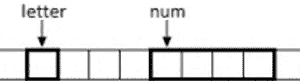

# 如何通过定义数组变量分配内存

```cpp
int nums[5]; // 为变量 nums 预留足够的内存
//（通常为 20 字节：4 字节乘以 5 个元素）
```

# 此数组的图形化表示


# 如何使用取地址运算符获取对象的内存地址

```cpp
cout << &num << endl; // 显示 4 个字节中第一个的内存地址
cout << &nums << endl; // 显示 20 个字节中第一个的内存地址
```

# Visual Studio/MSVC 显示的十六进制表示

`0000093670FFD34`

# Xcode/Clang 显示的十六进制表示

`0x28ff2c`

# 描述

- 计算机的物理内存是一个字节序列。
- 每个字节都是物理位置，用一个数字表示，也称为内存地址。在大多数系统中，这些数字范围从零到内存地址大小减一。
- 内存地址的表示法随系统而异，但系统通常使用十六进制（hex）表示法。十六进制是一种 16 进制计数系统，使用十六个不同的符号，通常 0-9 表示零，A-F 表示十五。
- 你可以使用取地址运算符 (`&`) 获取对象的内存地址，对象可以被认为是存储在内存中的任何内容。这返回对象在内存中位置的第一个字节的地址。

图 17-1 物理内存如何工作原理

# 如何定义和使用指针

正如你刚刚学习的，C++ 中的每个对象在物理内存中都分配了一个特定的位置。此外，你学习了可以使用取地址运算符来检索该位置第一个字节的内存地址。一旦获取了内存地址，就可以将其存储在一个特殊的变量中，这种变量被称为*指针*（也称为指针变量）。换句话说，指针是一个存储另一个对象的内存地址的对象。

图 17-2 中的第一个示例显示了如何定义指针变量。在这里，第一个语句定义了一个名为 `num` 的 `int` 型变量，其值为 200。然后，第二个语句定义了一个名为 `ptr` 的指针变量，其值为 `num` 变量的内存地址。更准确地说，`ptr` 的值是存储 `num` 值的位置第一个字节的内存地址。因此，`ptr` 变量*指向* `num` 变量。

理解指针变量本身是一个对象是非常重要的。因此，它有自己的内存地址，如下代码下方的图形化表示所示。此外，第二个代码示例显示了此内存地址。

除了拥有内存地址外，指针变量还有一个类型。在此图中，名为 `ptr` 的指针数据类型是*指针*，因为它指向一个 `int` 类型。这是一个从底层类型创建的*复合类型*，允许你使用指针直接访问并操作底层值。

要访问指针的底层值，可以使用第三个代码中的*间接运算符* (`*`)。在这里，第一个语句使用间接运算符在控制台上显示底层值。然后，第二个语句使用间接运算符更改底层值。为了证明这是可行的，第三个语句显示了 `num` 变量。

当你回顾第三个示例时，第一个示例使用星号 (`*`) 显示名为 `ptr` 的指针。然后，第三个示例使用星号作为间接运算符。换句话说，星号的操作取决于编码方式。同样，如果是在两个数字之间，星号变为乘法运算符。

要访问对象的成员函数，可以使用*访问运算符* (`->`)。例如，第四个示例定义了一个指向字符串的名为 `ptr` 的指针。然后，第五个示例使用访问运算符调用字符串对象的 `size()` 函数。在这里也可以像这样使用间接运算符：

```cpp
cout << (*ptr).size() << endl; // 显示 5
```

然而，访问运算符更简洁且更不容易出错。结果是，你应该尽可能使用它。

# 第 17 章 如何处理内存和指针 639

## 代码定义了一个 int 变量和它的指针

```cpp
int num = 200; // 定义并初始化名为 num 的 int 变量
int* ptr = &num; // 定义并初始化名为 ptr 的指针
```

## 这两个变量之间的图形化表示


## 定义指针的三种语法

```
type* name = [&object];
type *name = [&object];
type * name = [&object];
```

## 图中使用的三个变量

```
int num = 200;
int grade = 88;
double pi = 3.14;
```

## 定义指针时星号的三个位置

```cpp
int* ptr1 = &num; // 紧跟数据类型之后
int *ptr2 = &num; // 紧跟变量名之前
int * ptr3  = &num; // 前后空格
```

## 如何在一行中定义多个指针

```
int *ptr1 = &num, *ptr2 = &grade; // 每个声明都必须有一个 * 符号
```

## 定义空指针的三种方法

```cpp
int* ptr1 = nullptr; // C++11 及后续
int* ptr2 = NULL; // C++11 之前
int* ptr3 = 0; // C++11 之前
```

## 如何更改指针指向的对象

```cpp
ptr = &grade; // ptr 现在指向 grade 对象
cout << *ptr << endl; // 显示 88
```

## 更改指针对象时可能发生的错误

```
ptr = &pi; // 错误：无法从 double* 转换为 int*
```

## 描述

- 定义指针时，你可以将星号紧跟数据类型之后、紧跟变量名之前，或者在星号前后留空格。
- 建议在定义指针时对其进行初始化，因为未初始化的指针是常见的错误原因。
- 在同一行中定义多个指针时，确保每个变量都有星号。
- 在 C++11 及后续版本中，通过赋值 `nullptr` 关键字来定义空指针是最佳实践。在 C++11 之前，你可以通过赋值 `NULL` 或 0 来定义空指针。
- 一旦定义了空指针，就不应尝试对其解引用。


# 642 第 4 部分 遗留与泛型编程技能

仍然会认为它指向一个 4 字节的对象。因为这可能会导致问题，如果你尝试这样做，编译器将显示一个错误。

# 指针变量与引用变量的比较

在第 7 章中，你学习了如何使用引用变量。正如你在本章中注意到的，指针变量在某些方面与引用变量相似。两种变量都允许你间接访问另一个对象。然而，图 17-4 描述了两者之间的重要区别。

首先，指针是一个拥有自己内存地址的对象。相比之下，引用是它所引用对象的另一个名称或别名。换句话说，引用变量没有它自己的内存地址。


其次，你通常需要使用运算符为指针分配内存地址，并访问它指向的对象。特别是，你通常需要使用取地址运算符（`&`）为指针变量分配内存地址，并且通常需要使用间接运算符（`*`）来访问底层值。相反，你可以使用与普通变量相同的语法为引用变量赋值，并访问它所引用的值。

第三，指针变量可以为空，它存储的内存地址可以改变，它指向的对象也可以改变。相比之下，引用变量必须始终引用一个对象，一旦它引用了某个对象，就不能更改为引用另一个对象。

表格下方的示例显示了普通变量、引用变量和指针变量的值及其内存地址。这些示例展示了表格中呈现的一些区别。特别是，第一个示例显示你必须使用取地址运算符为指针变量赋值。然后，第二个示例显示你必须使用间接运算符来访问指针变量存储的值。最后，第三个示例显示，当你对指针变量使用取地址运算符时，得到的是变量的内存地址，而不是它指向对象的内存地址。

总的来说，使用引用变量比使用指针变量更容易且更不容易出错。因此，只要引用变量能提供你需要的功能，你就应该使用引用变量。然而，如果你需要存储空值或更改变量指向的对象，你就需要使用指针。

# 指针变量与引用变量的比较

| 指针 | 引用 |
| --- | --- |
| 是拥有自己内存地址的对象 | 是没有自己内存地址的别名 |
| 必须解引用才能访问底层值 | 可以自动访问底层值 |
| 必须使用取地址运算符赋值 | 无需额外运算符赋值 |
| 可以存储空值 | 无法存储空值（必须引用对象） |
| 可以更改指向的对象 | 不能更改其引用的对象 |

# 定义并初始化普通、引用和指针变量

```cpp
double pi = 3.14; // 普通变量
double& dref = pi; // 引用变量
double* dptr = &pi; // 指针变量 - 需要取地址运算符
```

# 显示每个变量的底层值

```cpp
cout << pi << endl; // 显示 3.14
cout << dref << endl; // 显示 3.14
cout << *dptr << endl; // 显示 3.14
```

# 显示每个变量的内存地址

```cpp
cout << &pi << endl; // 显示 pi 的地址
cout << &dref << endl; // 显示 pi 的地址
cout << dptr << endl; // 显示 pi 的地址
```

# 描述

- 总的来说，指针变量比引用变量更难处理。
- 因此，除非你需要传递空值，否则通常认为使用引用变量是最佳实践。


### 如何在函数中使用指针

到此时，你应该已经理解了指针工作的基本原理。现在，你已经准备好学习如何在函数中使用指针了。

# 如何以及何时向函数传递指针

你可以使用指针按引用传递对象而不是按值传递。图 17-5 中的第一个示例展示了这是如何工作的。在这里，`square()` 函数定义了一个名为 `val` 的变量，它是指向 `double` 的指针。

在 `square()` 函数内部，代码使用 `if` 语句确保 `val` 不是空指针。尝试解引用空指针会导致问题。然后，代码使用间接运算符获取 `val` 指向的值、对其平方并更新 `val` 指向的值。

`square()` 函数下方是调用它的代码。在这里，第一语句定义了一个 `double` 变量 `d` 并将其初始化为 4.0。然后，第二语句调用 `square()` 函数并传递该值的指针。为了这样做，该语句使用取地址运算符获取 `d` 的地址。

# 比较两个 `square()` 函数

```cpp
void square(double* val) {
    if (val != nullptr) {
        *val = (*val) * (*val);
    }
}
```

第一个 `square()` 函数的代码较为复杂。首先，它必须包含一个 `if` 语句以确保不会尝试解引用空指针。更糟糕的是，星号在第二行出现了三次，两次作为间接运算符，一次作为复合赋值运算符的一部分。最后，调用函数的代码必须使用取地址运算符。

相比之下，第二个 `square()` 代码更为简单。它使用引用变量而不是指针变量。在这个版本的函数中，你不需要检查空值，因为引用变量不能为空。你不需要解引用变量来获取其值。你不需要使用取地址运算符来传递引用变量。当你比较这两个函数时，很明显为什么通常使用引用参数比指针参数更有意义。

```cpp
void square(double& val) {
    val = val * val;
}
```

正如第 12 章所学的，内置数组在传递给函数时会退化为指针。因此，将内置数组作为指针用于函数参数是很常见的，如第三示例所示。由于内置数组会自动退化为指针，在将其传递给函数时不需要使用取地址运算符。

# 使用指针参数的 `square()` 函数

```cpp
void square(double* val) {
    if (val != nullptr) { // 确保指针不空
        *val *= *val; // 解引用值并进行计算
    }
}
```

# 调用该函数的代码

```cpp
double d = 4.0;
square(&d); // 使用地址运算符传递参数
cout << d << endl; // 显示 16
```

# 使用引用参数的 `square()` 函数

```cpp
void square(double& val) {
    val *= val; // 执行计算
}
```

# 调用该函数的代码

```cpp
double d = 4.0;
square(d); // 正常传递参数
cout << d << endl; // 显示 16
```

# 针对内置数组使用指针参数的 `display_array()` 函数

```cpp
void display_array(int* arr, int size) {
    if (arr) { // 等同于 (arr != nullptr)
        for (int i = 0; i < size; ++i) {
            cout << arr[i] << ' '; // 无需解引用即可下标
        }
        cout << endl;
    }
}
```

# 调用该函数的代码

```cpp
const int size = 10;
int arr[size] = {0};
display_array(arr, size); // 正常传递参数显示 0 0 0 0 0 0 0 0 0
```

# 何时使用指针而不是引用参数

- 函数需要能够向函数传递一个空值。
- 函数需要能够改变它所指向的对象。
- 你希望在调用代码中明确表示参数不是按值传递的，且该函数可能会修改它。
- 参数是一个内置数组。

# 描述

- 若要通过引用向函数传递参数，可以使用引用参数或指针参数。
- 通常情况下，引用参数更易于处理。因此，除非你有充分的理由使用指针参数，否则应该使用引用参数。

# 如何在成员函数中使用 `this` 指针

每个对象都有一个指针，其值是对象自身的内存地址。`this` 关键字被用于引用这个指针。因此，对象的每个成员函数都可以访问一个指向当前对象的指针。

为了说明这一概念，图 17-6 展示了一个使用 `this` 指针的 `Calculator` 类。首先，该类定义了一个名为 `result` 的私有数据成员。然后，它定义了三个名为 `multiply()`、`square_result()` 和 `get_result()` 的公共成员函数。`get_result()` 函数返回一个 `int` 值，而另外两个返回 `Calculator` 对象的引用。

`multiply()` 成员函数定义了两个名为 `a` 和 `b` 的 `int` 参数。然后，该函数的体将这些参数相乘，并将结果存储在名为 `result` 的私有数据成员中。

为了实现这一点，代码使用 `this` 关键字来访问当前对象的指针，并使用成员访问运算符（`->`）访问当前对象的名为 `result` 数据成员。对于这个类来说，这不是必要的。相反，这段代码可以使用像这样更简单的语法：

```cpp
result = a * b;
```

然而，某些程序员倾向于使用此关键字和成员访问运算符，以清楚地显示他们正在操作的对象是当前对象的成员。

在执行计算后，`multiply()` 函数使用 `this` 关键字返回当前对象的引用。换句话说，它返回它所属的特定 `Calculator` 对象的引用。为了做到这一点，对名为 `this` 的指针进行解引用将返回该对象的引用。这被称为返回自引用，通常用于实现如该图所示的成员函数链式调用。

在 `Calculator` 类中，`square_result()` 成员函数将私有数据成员 `result` 的值平方。然后，它也返回当前对象的引用。相比之下，`get_result()` 函数仅返回 `result` 的 `int` 值。

第二个代码示例展示了如何在不使用函数链的情况下使用 `Calculator` 类。在这里，第一语句创建了一个 `Calculator` 对象。接下来的三个语句调用了 `multiply()`、`square_result()` 和 `get_result()` 函数，但这需要三行代码并你调用三次 `Calculator` 对象的名称。

第三个示例展示了如何使用函数链使用 `Calculator` 类。在这里，第一语句创建了一个 `Calculator` 对象。然后，第二语句调用了 `Calculator` 对象的 `multiply()`、`square_result()` 和 `get_result()` 函数。这之所以可行，是因为 `multiply()` 返回了一个 `Calculator` 对象，可以从中调用 `square_result()`，而 `square_result()` 又返回了一个 `Calculator` 对象，可以从中调用 `get_result()`。注意，这只需要一行代码，并且只需要调用一次 `Calculator` 对象的名称。这种链式调用函数的代码有时被称为“流式接口”（fluent），因为它们读起来通常非常流畅，就像句子一样。

# 成员函数使用 `this` 指针并返回自引用的 `Calculator` 类

```cpp
class Calculator {
  private:
    int result;
  public:
    Calculator& multiply(int a, int b) {
      this->result = a * b; // this-> 是可选的
      return *this; // 返回自引用
    }

    Calculator& square_result() {
      this->result *= result; // this-> 是可选的
      return *this; // 返回自引用
    }

    int get_result() {
      return this->result;
    }
};
```

# 使用 `Calculator` 类的代码

```cpp
Calculator calc;
calc.multiply(2, 3).square_result();
cout << calc.get_result() << endl; // 显示 36
```

# 不使用函数链的情况下使用 `Calculator` 类的代码

```cpp
Calculator calc;
calc.multiply(2, 3);
calc.square_result();
cout << calc.get_result() << endl; // 显示 36
```

# 使用函数链使用 `Calculator` 类的代码

```cpp
Calculator calc;
cout << calc.multiply(2, 3).square_result().get_result() << endl; // 显示 36
```

# 计数器 2.0 程序

图 17-8 显示了计数器 2.0 程序。与 1.0 版本一样，2.0 版本会提示用户输入每周每天行走的步数。然后，它会计算并显示每周的总步数以及每天平均步数。

计数器 2.0 程序的代码起始于包含 `iostream` 和 `vector` 头文件。与 1.0 版本一样，这段代码没有为 `std` 命名空间指定 `using` 指令。相反，它对 `iostream` 和 `vector` 对象的调用使用了完全限定的作用域解析运算符。

接下来，这段代码声明了一个名为 `Counter` 的类。该类定义了一个名为 `steps` 的私有数据成员，它是一个 `int` 类型的 `vector`。然后，该类定义了一个名为 `days` 的公共数据成员，它是一个 `char` 类型的 `vector`，并为每周的每天初始化一个字符。最后，它声明了两个公共成员函数。第一个 `get_weekly_steps()` 返回一个 `Counter` 对象的引用。

`main()` 函数起始于显示欢迎消息。然后，它定义了一个名为 `steps` 的 `Counter` 对象。接下来，它定义了一个名为 `total` 的 `double` 变量，并赋值为调用 `Counter` 对象的 `get_weekly_steps()` 和 `get_total()` 函数返回值。这从对象获取步数，将其存储在对象中，并从对象获取总步数。

在获取总步数后，这段代码计算平均步数。为了做到这一点，它调用了 `days` 数据成员的 `size()` 成员函数。之所以可以这样做是因为 `days` 数据成员是公共的并且是一个 `vector`。最后，这段代码显示总步数和平均每日步数。

`get_weekly_steps()` 函数的定义开始了一个名为 `daily_steps` 的 `int` 变量。然后，它遍历 `days` 数据成员中的元素。循环条件使用 `this` 指针和成员访问操作符来访问 `days` 数据成员。然而，这是可选的，通常会被省略。

在循环内部，第一条语句提示用户输入当天的步数。为了实现这一点，该语句从 `days` `vector` 中获取当前天的字符并显示该字符。然后，第二条语句获取用户输入的步数，将其存储在 `daily_steps` 变量中，并将其传递给 `steps` `vector` 的 `push_back()` 函数。

当循环完成时，`steps` `vector` 包含每天的一个元素。此时，代码对 `this` 指针进行解引用以返回一个自引用。这使得在 `get_weekly_steps()` 函数上链调用另一个成员函数成为可能。

`get_total()` 成员函数的定义开始编写一个名为 `total` 的累加变量并将其初始化为零。然后，函数遍历 `steps` `vector` 中的元素，并将每个元素相加到累加变量中。最后，函数返回该变量。

这个版本的计数器程序表明，即使当你正在处理像 `vector` 这样的高级对象时，你可能仍然需要使用指针。在这种情况下，使用 `this` 指针返回自引用使得对 `Counter` 对象进行链式调用成为可能。

# 控制台

| 欢迎使用每周步数计数程序！ |
| --- |
| 请输入您每周的步数： |
| M: 10000 |
| T: 8900 |
| W: 8800 |
| T: 7000 |
| F: 5700 |
| S: 10000 |
| S: 12000 |
| 每周总步数: 62400 |
| 平均每日步数: 8914.29 |

# 代码

```cpp
#include <iostream>
#include <vector>

class Counter {
private:
    std::vector<int> steps;
public:
    std::vector<char> days = { 'M', 'T', 'W', 'T', 'F', 'S', 'S' };
    Counter& get_weekly_steps();
    double get_total();
};

int main() {
    std::cout << "Welcome to the Weekly Step Counter program!\n\n";
    std::cout << "Please enter your steps for the week:\n";
    Counter steps;
    double total = steps.get_weekly_steps().get_total(); // chaining
    double avg = total / steps.days.size();
    std::cout << "Total steps for the week: " << total << "\n";
    std::cout << "Average daily steps: " << avg << "\n";
}

Counter& Counter::get_weekly_steps() {
    int daily_steps;
    for (char day : this->days) {
        std::cout << day << ": ";
        std::cin >> daily_steps;
        this->steps.push_back(daily_steps); // this-> is optional
    }
    std::cout << "\n";
    return *this;
}

double Counter::get_total() {
    double total = 0;
    for (int s : this->steps) { // this-> is optional
        total += s;
    }
    return total;
}
```


# 计数器 2.0 程序

图 17-8 显示了计数器 2.0 程序。与 1.0 版本一样，2.0 版本会提示用户输入每周每天行走的步数。然后，它会计算并显示每周的总步数以及每天平均步数。

## 代码结构

计数器 2.0 程序的代码起始于包含 `iostream` 和 `vector` 头文件。与 1.0 版本一样，这段代码没有为 `std` 命名空间指定 `using` 指令。相反，它对 `iostream` 和 `vector` 对象的调用使用了完全限定的限定作用符。

接下来，这段代码声明了一个名为 `Counter` 的类。该类定义了一个名为 `steps` 的私有数据成员，它是一个 `int` 类型的 `vector`。然后，该类定义了一个名为 `days` 的公共数据成员，它是一个 `char` 类型的 `vector`，并为每周的每天初始化一个字符。最后，它声明了两个公共成员函数。第一个 `get_weekly_steps()` 返回一个 `Counter` 对象的引用。

## main() 函数

`main()` 函数起始于显示欢迎消息。然后，它定义了一个名为 `steps` 的 `Counter` 对象。接下来，它定义了一个名为 `total` 的 `double` 变量，并赋值为调用 `Counter` 对象的 `get_weekly_steps()` 和 `get_total()` 函数返回值。这从对象获取步数，将其存储在对象中，并从对象获取总步数。

在获取总步数后，这段代码计算平均步数。为了做到这一点，它调用了 `days` 数据成员的 `size()` 成员函数。之所以可以这样做是因为 `days` 数据成员是公共性的并且是一个 `vector`。最后，这段代码显示总步数和平均每日步数。

## get_weekly_steps() 函数

`get_weekly_steps()` 函数的定义开始了一个名为 `daily_steps` 的 `int` 变量。然后，它遍历 `days` 数据成员中的元素。循环条件使用此指针和成员访问操作符来访问 `days` 数据成员。然而，这是可选的，通常会被省略。

在循环内部，第一条语句提示用户输入当天的步数。为了实现这一点，该语句从 `days` `vector` 中获取当前天的字符并显示该字符。然后，第二条语句获取用户输入的步数，将其存储在 `daily_steps` 变量中，并将其传递给 `steps` `vector` 的 `push_back()` 函数。

当循环完成时，`steps` `vector` 包含每天的一个元素。此时，代码对此指针进行解引用以返回一个自引用。这使得在 `get_weekly_steps()` 函数上链调用另一个成员函数成为可能。

## get_total() 函数

`get_total()` 成员函数的定义开始编写一个名为 `total` 的累加变量并将其初始化为零。然后，函数遍历 `steps` `vector` 中的元素，并将每个元素相加到累加变量中。最后，函数返回该变量。

## 总结

这个版本的计数器程序表明，即使当你正在处理像 `vector` 这样的高级对象时，你可能仍然需要使用指针。在这种情况下，使用此指针返回自引用使得对 `Counter` 对象进行链式调用成为可能。

## 控制台输出

| 欢迎使用每周步数计数程序！ |
| --- |
| 请输入您每周的步数： |
| M: 10000 |
| T: 8900 |
| W: 8800 |
| T: 7000 |
| F: 5700 |
| S: 10000 |
| S: 12000 |
| 每周总步数: 62400 |
| 平均每日步数: 8914.29 |

## 代码实现

```cpp
#include<iostream>
#include<vector>

class Counter {
private:
    std::vector<int> steps;
public:
    std::vector<char> days = { 'M', 'T', 'W', 'T', 'F', 'S', 'S' };
    Counter& get_weekly_steps();
    double get_total();
};

int main() {
    std::cout << "Welcome to the Weekly Step Counter program!\n\n";
    std::cout << "Please enter your steps for the week:\\n";
    Counter steps;
    double total = steps.get_weekly_steps().get_total(); // chaining
    double avg = total / steps.days.size();
    std::cout << "Total steps for the week: " << total << "\n";
    std::cout << "Average daily steps: " << avg << "\n";
}

Counter& Counter::get_weekly_steps() {
    int daily_steps;
    for (char day : this->days) {
        std::cout << day << ": ";
        std::cin >> daily_steps;
        this->steps.push_back(daily_steps); // this-> is optional
    }
    std::cout << "\n";
    return *this;
}

double Counter::get_total() {
    double total = 0;
    for (int s : this->steps) { // this-> is optional
        total += s;
    }
    return total;
}
```


# 计数器 2.0 程序

图 17-8 显示了计数器 2.0 程序。与 1.0 版本一样，2.0 版本会提示用户输入每周每天行走的步数。然后，它会计算并显示每周的总步数以及每天平均步数。

计数器 2.0 程序的代码起始于包含 `iostream` 和 `vector` 头文件。与 1.0 版本一样，这段代码没有为 `std` 命名空间指定 `using` 指令。相反，它对 `iostream` 和 `vector` 对象的调用使用了完全限定的限定作用符。

接下来，这段代码声明了一个名为 `Counter` 的类。该类定义了一个名为 `steps` 的私有数据成员，它是一个 `int` 类型的 `vector`。然后，该类定义了一个名为 `days` 的公共数据成员，它是一个 `char` 类型的 `vector`，并为每周的每天初始化一个字符。最后，它声明了两个公共成员函数。第一个 `get_weekly_steps()` 返回一个 `Counter` 对象的引用。

`main()` 函数起始于显示欢迎消息。然后，它定义了一个名为 `steps` 的 `Counter` 对象。接下来，它定义了一个名为 `total` 的 `double` 变量，并赋值为调用 `Counter` 对象的 `get_weekly_steps()` 和 `get_total()` 函数返回值。这从对象获取步数，将其存储在对象中，并从对象获取总步数。

在获取总步数后，这段代码计算平均步数。为了做到这一点，它调用了 `days` 数据成员的 `size()` 成员函数。之所以可以这样做是因为 `days` 数据成员是公共性的并且是一个 `vector`。最后，这段代码显示总步数和平均每日步数。

`get_weekly_steps()` 函数的定义开始了一个名为 `daily_steps` 的 `int` 变量。然后，它遍历 `days` 数据成员中的元素。循环条件使用此指针和成员访问操作符来访问 `days` 数据成员。然而，这是可选的，通常会被省略。

在循环内部，第一条语句提示用户输入当天的步数。为了实现这一点，该语句从 `days` `vector` 中获取当前天的字符并显示该字符。然后，第二条语句获取用户输入的步数，将其存储在 `daily_steps` 变量中，并将其传递给 `steps` `vector` 的 `push_back()` 函数。

当循环完成时，`steps` `vector` 包含每天的一个元素。此时，代码对此指针进行解引用以返回一个自引用。这使得在 `get_weekly_steps()` 函数上链调用另一个成员函数成为可能。

`get_total()` 成员函数的定义开始编写一个名为 `total` 的累加变量并将其初始化为零。然后，函数遍历 `steps` `vector` 中的元素，并将每个元素相加到累加变量中。最后，函数返回该变量。

这个版本的计数器程序表明，即使你正在处理像 `vector` 这样的高级对象时，你可能仍然需要使用指针。在这种情况下，使用此指针返回自引用使得对 `Counter` 对象进行链式调用成为可能。

## 控制台

| 欢迎使用每周步数计数程序！ |
| --- |
| 请输入您每周的步数： |
| M: 10000 |
| T: 8900 |
| W: 8800 |
| T: 7000 |
| F: 5700 |
| S: 10000 |
| S: 12000 |
| 每周总步数: 62400 |
| 平均每日步数: 8914.29 |

## 代码

```cpp
#include<iostream>
#include<vector>

class Counter {
private:
    std::vector<int> steps;
public:
    std::vector<char> days = { 'M', 'T', 'W', 'T', 'F', 'S', 'S' };
    Counter& get_weekly_steps();
    double get_total();
};

int main() {
    std::cout << "Welcome to the Weekly Step Counter program!\n\n";
    std::cout << "Please enter your steps for the week:\\n";
    Counter steps;
    double total = steps.get_weekly_steps().get_total(); // chaining
    double avg = total / steps.days.size();
    std::cout << "Total steps for the week: " << total << "\n";
    std::cout << "Average daily steps: " << avg << "\n";
}

Counter& Counter::get_weekly_steps() {
    int daily_steps;
    for (char day : this->days) {
        std::cout << day << ": ";
        std::cin >> daily_steps;
        this->steps.push_back(daily_steps); // this-> is optional
    }
    std::cout << "\n";
    return *this;
}

double Counter::get_total() {
    double total = 0;
    for (int s : this->steps) { // this-> is optional
        total += s;
    }
    return total;
}
```

# 如何分配和释放自由存储内存


要操作自由存储（free store）内存，你需要使用 `new` 和 `delete` 关键字。`new` 关键字在自由存储上分配内存，并返回一个指向分配内存位置的指针。`delete` 关键字释放内存并将其返回自由存储，以便再次被使用。

图 17-10 中的示例展示了其工作原理。在这里，前两个语句展示了如何分配单个对象。首先，第一条语句使用 `new` 关键字为 `double` 对象分配内存并返回指向它的指针。这会将指针赋值给名为 `pi` 的变量。第二个语句的作用类似，但它为 `double` 对象包含了一个初始值。

接下来的两个语句展示了如何为对象数组分配内存。第一条语句使用 `new` 关键字创建一个包含 10 个 `double` 的数组，并返回指向它的指针，赋值给名为 `arr` 的变量。第二个语句的作用类似，但它包含了数组的初始值列表。

一旦你使用 `new` 关键字在自由存储上分配对象，就必须使用 `delete` 关键字来释放它们。这非常重要，因为与自动存储不同，在自由存储上分配的对象在离开作用域时*不会*自动被释放。你必须编写代码来手动释放这些内存。

第二个示例展示了如何使用 `delete` 关键字释放内存。在这里，第一条语句使用 `delete` 关键字释放 `pi` 指针指向的对象的内存。然后，第二条语句使用 `delete` 关键字后接方括号（`[]`）来释放 `arr` 数组指向的内存。

尽管这看起来足够简单，但在实践中，使用 `new` 和 `delete` 关键字可能会引发问题。例如，如果你忘记调用 `delete`，内存将永远不会返回自由存储且无法再次使用。这被称为*内存泄漏*（memory leak），如第三个示例所示。如果程序运行时间很短，可能没有关系，因为内存会在程序结束时返回。但对于长时间运行程序，内存泄漏会累积并随着时间的推移降低性能。

遗憾的是，你不能仅仅通过在代码中到处编写 `delete` 关键字来修复内存泄漏。因为尝试释放已经释放的内存可能会损坏该内存。这被称为*堆损坏*（heap corruption），如第四个示例所示。

如果你使用 C 或 C++，可能会发现你使用 `malloc` 和 `free` 关键字来分配和释放内存。这是一种较旧的技术，不被认为是新开发的最佳实践，但你可能需要用它来维护旧代码。如果这样做，你应该确保不要在同一个程序中使用混合 `malloc/free` 关键字和 `new/delete` 关键字，因为这会导致严重的问题。

# 如何使用 `new` 关键字分配自由存储内存

## 分配单个 double 类型的对象

```cpp
double* ptr = new double; // 返回指向 double 的指针
double* price = new double(5.99); // 包含初始值
```

## 分配动态 double 数组

```cpp
double* arr = new double[10]; // 返回指向第一个元素的指针
double* prices = new double[3]{5.99, 6.99, 7.99}; // 包含初始值
```

# 如何使用 `delete` 关键字释放自由存储内存

## 释放单个对象

```cpp
delete ptr;
```

## 释放数组

```cpp
delete[] arr;
```

# 一个可能导致内存泄漏的函数

```cpp
int* create_array(unsigned int size) {
    return new int[size]; // 返回自由存储上数组的指针
}
```

此代码忽略了对函数返回的指针执行 `delete[]`

```cpp
void main() {
    int* arr = create_array(20);
    /* 此处是处理数组的代码 */
}
```

# 一个可能导致堆损坏的函数

```cpp
void display_array(int* arr, unsigned int size) {
    for (int i = 0; i < size; i++) {
        cout << arr[i] << ' ';
    }
    delete[] arr; // 完成后删除
}
```

此代码对栈内存指针调用了 `delete`

```cpp
int arr[5](); // 在栈上分配内存
display_array(arr, 5); // 函数对栈内存调用了 delete
```

此代码对一个堆内存指针调用了两次 `delete`

```cpp
int* arr = new int[5](); // 在堆上分配内存
display_array(arr, 5); // 函数对堆内存调用 delete
delete arr; // 语句再次对堆内存调用 delete
```

# 描述

- 你可以使用 `new` 关键字来分配自由存储内存。该关键字返回一个指向新分配内存的指针。
- 你可以使用 `delete` 关键字来释放单个对象，并可以使用 `delete` 关键字后接方括号（`[]`）来释放数组。


# 如何避免内存泄漏和损坏

当你分配和释放内存时，可能会编写泄漏或损坏内存的代码。后续主题介绍了两种可以帮助你避免这些问题的技术。

# 如何使用 RAII（资源获取初始化）

当你在栈上定义对象时，系统会自动调用其构造函数来创建它。然后，当该栈对象离开作用域时，系统会自动调用它的析构函数来销毁它。

RAII（资源获取初始化）是一种编程模式，利用栈创建和销毁对象的方式来分配和释放内存。为了使 RAII 起效，对象必须在栈上创建。如果对象在堆上创建，在离开作用域时将不会被调用析构函数。RAII 也可以用于处理文件句柄等其他系统资源。某些 C++ 编译器在抛出未处理的异常时不会调用析构函数（有时回溯栈）。为了解决这个问题，你可以在 `main()` 函数的所有代码周围编写 `try/catch` 语句。

# 使用 RAII 的 MyContainer 类

```cpp
class MyContainer {
private:
    int* elements;
    int size = 10;
public:
    // 构造函数
    MyContainer() {
        elements = new int[size]; // 分配内存
        cout << "分配了对象的内存\n";
    }

    // 析构函数
    ~MyContainer() {
        delete elements; // 释放内存
        cout << "释放了对象的内存\n";
    }
};
```

# 使用 MyContainer 类的代码

```cpp
int main() {
    cout << "main 函数开始...\n";
    MyContainer container;
    cout << "main 函数结束...\n";
}
```

# 控制台

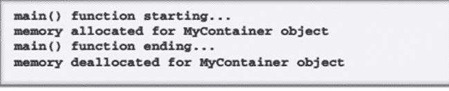

# 描述

- 当你在栈上创建对象时，对象的构造函数会被调用，并在离开作用域时执行析构函数。
- RAII（资源获取初始化）是一种编程模式，利用栈创建和销毁对象的方式原子化地分配和释放内存。
- 为了使 RAII 起效，对象必须在栈上创建。如果对象在堆上创建，离开作用域时将不会调用析构函数。
- RAII 也可以用于处理文件句柄等其他系统资源。某些 C++ 编译器在抛出未处理的异常时不会调用析构函数（有时回溯栈）。为了解决这个问题，你可以在 `main()` 函数的所有代码周围编写 `try/catch` 语句来处理所有异常。

# 如何使用 RAII 实现三规则（Rule of Three）

在 C++ 中定义一个类时，如果你没有显式定义析构函数、拷贝构造函数和拷贝赋值运算符，编译器会自动为你生成默认函数。但有时它们并不会生成。例如，如果你的类有一个指向指针的数据成员，默认的拷贝构造函数和拷贝赋值运算符将拷贝指针本身，而不是指针所指向的对象。这被称为**浅拷贝**（shallow copy），在大多数情况下，这并不是该构造函数和运算符所需要的。当默认函数不起作用时，你就需要编写自己的。

**三规则**规定，如果你需要定义自己的析构函数，就应该按照图 17-12 顶部表格所示，定义所有这三个函数。在之前的一个图中，你学习了 RAII 要求你定义自己的构造函数和析构函数来分配和释放空内存。因此，根据三规则，当你使用 RAII 时，也应该定义自己的拷贝构造函数和拷贝赋值运算符。

图中的 `MyContainer` 类是上一个图中 `MyContainer` 类的增强版本，它实现了三规则。首先，这里显示的构造函数和析构函数与上一个图相同，它们只是不再向控制台打印信息。

拷贝构造函数通过常量引用接收一个 `MyContainer` 对象。然后，构造函数使用该参数来初始化自己。首先，它使用 `new` 关键字在空闲存储上分配一个数组，并将该数组的指针存储在 `elements` 数据成员中。然后，它对传递的 `MyContainer` 对象进行**深拷贝**。为了做到这一点，它遍历 `MyContainer` 参数中的 `elements`，并将这些元素拷贝到数据成员数组中。

这种深拷贝至关重要。编译器生成的默认拷贝构造函数只会对元素指针进行拷贝。在这种情况下，两个对象将指向堆上的同一个位置。这会导致它们在超出作用域时，每次调用 `delete[]` 都会操作同一块堆内存，从而导致内存损坏。

拷贝赋值运算符同样通过常量引用接收一个 `MyContainer` 对象。然后，该函数使用该参数更新自己。首先，它使用 `new` 关键字在空闲存储上分配一个数组，并将该数组的指针存储在临时变量 `temp` 中。然后，它对传递的 `MyContainer` 对象进行深拷贝并存储在 `temp` 变量中。接下来，它释放 `elements` 指向的内存，并更新使其指向新数组。最后，它返回自身的引用，这正是编译器生成的默认拷贝构造函数所做的。

这个拷贝赋值运算符可以直接将指向新分配内存的指针赋值给 `elements` 数据成员，然后执行拷贝操作。这样的话，如果在拷贝操作期间发生异常，为了提供**异常安全性**，容器的状态就不会发生改变。这避免了部分元素改变而其他元素未改变的情况，通常被认为是一种最佳实践。

# 三规则要求的成员函数

| 函数 | 说明 |
| --- | --- |
| destructor (析构函数) | 释放为容器数据分配的内存。 |
| copy constructor (拷贝构造函数) | 拷贝传递给构造函数的容器数据。被拷贝的容器保持不变。 |
| copy assignment operator (拷贝赋值运算符) | 拷贝赋值运算符 (=) 右侧容器中的数据。被拷贝的容器保持不变。 |

# 更新后实现三规则的 MyContainer 类

```cpp
class MyContainer {
private:
    int* elements = nullptr;
    int size = 10;
public:
    // 构造函数
    MyContainer() {
        elements = new int[size];
    }

    // 析构函数
    ~MyContainer() {
        delete[] elements;
    }

    // 拷贝构造函数
    MyContainer(const MyContainer& copy) {
        elements = new int[size];
        for (int i = 0; i < size; ++i) { // 深拷贝
            elements[i] = copy.elements[i];
        }
    }

    // 拷贝赋值运算符
    MyContainer& operator=(const MyContainer& copy) {
        auto temp = new int[size]; // 分配新数组
        for (int i = 0; i < size; ++i) { // 深拷贝
            temp[i] = copy.elements[i];
        }

        delete[] elements;
        elements = temp; // 赋值新的
        return *this; // 返回引用
    }
};
```

# 说明

- 当定义一个类时，编译器会创建默认的拷贝构造函数和拷贝赋值运算符。在使用指针的类中，这些函数拷贝指针而不是底层对象。这被称为浅拷贝。
- 当你使用 RAII 时，必须定义构造函数和析构函数。根据三规则，如果你定义了 (1) 析构函数，就也应该定义 (2) 拷贝构造函数和 (3) 拷贝赋值运算符。使用 RAII，拷贝构造函数和赋值运算符必须拷贝底层对象而不是指针。这被称为深拷贝。


# 如何使用 RAII 实现五规则（Rule of Five）

C++11 为 C++ 语言增加了名为**移动语义**（move semantics）特性。该特性允许你将数据从一个对象转移到另一个对象，而无需复制数据。正如你预期的，移动数据比拷贝数据更高效，特别是对于拷贝开销昂贵的大对象。

要在自己的类中实现移动语义，你需要定义移动构造函数和移动赋值运算符。这些函数在图 17-13 顶部描述。

移动语义的引入将三规则扩展到了五规则。五规则规定，如果你定义了自己的析构函数、拷贝构造函数、拷贝赋值运算符、移动构造函数或移动赋值运算符中的任何一个，就应该定义所有这些。

正如你所学的，RAII 要求你定义析构函数来释放空内存。因此，根据五规则，当你使用 RAII 时，如果想包含移动语义，也应该定义你的移动构造函数和移动赋值运算符。

本图中的代码示例展示了更新后实现五规则的 `MyContainer` 类。构造函数、析构函数、拷贝构造函数和拷贝赋值运算符与上一个图相同。因此，本图不再再次显示它们。

移动构造函数接收 `MyContainer` 对象的右值引用。右值引用标识一个可以移动的对象。要声明右值引用，使用右值引用符。

在移动构造函数内部，第一条语句将参数对象的 `elements` 拷贝到当前对象的 `elements`。此时，两个对象指向同一个内存地址，即数组存储的位置。然后，第二条语句将参数对象的 `elements` 设置为空指针，使其不再指向该数组。这完成了移动操作。

移动赋值运算符同样接收 `MyContainer` 对象自身的右值引用。为了实现这一点，它首先使用 `delete[]` 关键字释放当前对象 `elements` 指向的内存。接下来，它将参数对象的 `elements` 指针拷贝到当前对象，并将对象的指针设置为空。最后，它返回自身的引用。

# 五规则中所需的额外成员函数

| 函数 | 描述 |
| --- | --- |
| 移动构造函数 | 将数据从传递给构造函数的容器中移动。被移动的容器将被清空。 |
| 移动赋值运算符 | 将数据从赋值运算符（`=`）右侧的容器中移动。被移动的容器将被清空。 |

# 更新后实现五规则的 MyContainer 类

```cpp
class MyContainer {
private:
    int* elements = nullptr;
    int size = 10;
public:
    // 构造函数与上图相同
    // 析构函数与上图相同
    // 拷贝构造函数与上图相同
    // 拷贝赋值运算符与上图相同

    // 移动构造函数
    MyContainer(MyContainer&& tome) { // 将指针赋值给数据
        elements = tome.elements;
        tome.elements = nullptr; // 移除数据的指针
    }

    // 移动赋值运算符
    MyContainer& operator=(MyContainer&& tome) {
        delete[] elements; // 释放现有内存
        elements = tome.elements; // 将指针赋值给数据
        tome.elements = nullptr; // 移除数据的指针
        return *this; // 返回自引用
    }
};
```

# 描述

- C++11 及更高版本提供了移动语义，允许你移动现有数据。这比拷贝现有数据更有效率。
- 右值引用声明符 (`&&`) 表示对象的数据是可以被移动的。
- 要在你的类中实现移动语义，你需要定义移动构造函数和移动赋值运算符。根据五规则，如果你定义了 (1) 析构函数，则也应该定义 (2) 拷贝构造函数、(3) 移动构造函数、(4) 拷贝赋值运算符和 (5) 移动赋值运算符。


# 如何使用智能指针

如果你只想执行类似在堆内存中分配数组的操作，那么在运行 RAII、三规则和五规则时，创建所有成员函数可能意义不大。幸运的是，使用 C++11 及更高版本，你可以使用智能指针代替。与你在书中迄为止接触过的原始指针不同，智能指针在底层使用 RAII 来自动释放堆内存。

图 17-14 的顶部显示了如何包含包含智能指针的内存头文件。然后，描述了 C++11 引入的三种智能指针。首先，`unique_ptr` 对象只能指向一个内存位置。当 `unique_ptr` 超出范围时，系统会释放内存。由于这种类型的指针必须是唯一的，它不能被拷贝，但可以被移动。

相比之下，`shared_ptr` 对象可以指向同一个内存位置。当引用计数归零时，系统会释放内存。由于这种指针允许多个指针指向同一位置，因此它可以被拷贝或移动。


你可以创建一个 `weak_ptr` 对象作为 `shared_ptr` 对象的拷贝。然而，这种类型的指针不会增加引用计数。通常，`weak_ptr` 对象与 `shared_ptr` 对象配合使用，以避免引用计数无法归零的循环引用。

`unique_ptr` 的开销比 `shared_ptr` 小，适用于大多数用途。如所述，图中的示例展示了如何操作 `unique_ptr` 对象。然而，操作 `shared_ptr` 和 `weak_ptr` 对象的技巧是类似的。

第一个示例显示了如何创建一个指向单个对象或对象数组的智能指针。当你定义智能指针时，在尖括号内编写指针所引用的数据类型。要标识数组，在数据类型后编写方括号 `[]`。然后，编写指针名称并跟一组括号。在这些括号内，编写 `new` 关键字和用于分配堆内存的数据。之后，你就可以像使用原始指针一样使用智能指针，只不过你不能使用算术运算。

第二个示例显示了如何使用 C++14 添加的 `make_unique()` 函数创建一个指向单个对象或对象数组的 `unique_ptr`。首先，你编写 `auto` 关键字、指针名称和赋值运算符。然后，通过带有尖括号内的数据类型调用 `make_unique()` 函数。对于数组，在尖括号内的数据类型后编写方括号 `[]`。然后，你将元素个数作为参数传递给函数。该函数的优势在于你可以使用 `auto`，而不需要使用 `new` 关键字。

最后两个示例使用了 `create_array()` 函数，该函数返回一个指向数组的 `unique_ptr`。该函数的工作原理类似于图 17-10 所示的 `create_array()` 函数。然而，那个版本返回的是一个需要手动释放的内存原始指针。在这个版本中，当指向数组的智能指针超出范围时，智能指针会自动释放内存。

# 如何包含头文件

```cpp
#include <memory>
```

# 内存中的三种智能指针 (C++11 及更高版本)

| 智能指针 | 描述 |
| --- | --- |
| `unique_ptr` | 只有一个 `unique_ptr` 对象可以指向已分配的内存。当 `unique_ptr` 被销毁或超出范围时，内存会被释放。 |
| `shared_ptr` | 多个指针可以指向同一个位置。维护引用计数。 |
| `weak_ptr` | 作为 `shared_ptr` 对象的创建。不增加引用计数。 |

# 控制台

```
The Sensor Analysis program
Enter the number of days you'd like to analyze: 5

Number of sensor readings over 5 days: 432000
Average reading: 67.0863
Lowest reading: 17
Highest reading: 111
```

# HeapArray.h 文件

```cpp
#ifndef MURACH_HEAPARRAY_H
#define MURACH_HEAPARRAY_H

class HeapArray {
private:
    int array_size;
    int* arr = nullptr;

public:
    // 构造函数
    HeapArray(const int);
    HeapArray(const HeapArray& tocopy); // 拷贝构造
    HeapArray(HeapArray&& tomove); // 移动构造

    // 析构函数
    ~HeapArray();

    // 赋值运算符
    HeapArray& operator=(const HeapArray& tocopy); // 拷贝赋值
    HeapArray& operator=(HeapArray&& tomove); // 移动赋值

    // 下标运算符
    int& operator[](int i);

    // 成员函数
    int size() const;
    int* begin();
    int* end();
};

#endif /* MURACH_HEAPARRAY_H */
```

# HeapArray.cpp 文件

```cpp
#include "HeapArray.h"

// ----- 构造函数 //
HeapArray::HeapArray(const int size) {
    array_size = size; // 设置数组大小属性
    arr = new int[array_size]{0};
}
```

图 17-15 传感器分析程序（3 部分中的第 1 部分）

私有数据成员 `arr` 中的数组。此外，此代码将数组的所有元素初始化为零。

图 17-15 的第 2 部分展示了 `HeapArray` 类源文件的其余部分。它从拷贝构造函数的定义开始，该函数接受一个常量 `HeapArray` 对象的引用。然后，它使用 `HeapArray` 参数的 `array_size` 值来设置自己的 `array_size` 值。接下来，它使用 `array_size` 值在自由存储（free store）上分配一个整数数组，并将该数组的指针存储在 `arr` 数据成员中。

与之前的构造函数不同，拷贝构造函数没有使用初始化列表来初始化数组。相反，它通过遍历 `HeapArray` 参数中的元素并将每个值复制到自己的数组中来初始化它。之所以之所以可行，是因为你可以对指针使用下标运算符来访问该数组的元素。

移动构造函数的定义接受一个 `HeapArray` 引用。与拷贝构造函数一样，它首先使用参数对象的 `array_size` 值设置自己的 `array_size` 值。然后，它将参数成员赋值给自己的 `arr` 成员。接下来，确保只有一个指针指向该数组，通过给参数数据成员分配空指针，并将参数的 `array_size` 值设置为零。这表明在移动操作完成后，`HeapArray` 参数对象不再包含任何元素。

析构函数的定义释放了自由存储的内存。即使 `arr` 成员已被移动构造函数设置为空，这仍然有效。这是因为对空指针调用 `delete` 不会导致任何问题。

拷贝赋值运算符的定义与拷贝构造函数类似。它接受一个常量 `HeapArray` 对象的引用。然后，它使用这个 `HeapArray` 参数设置自己的 `array_size` 数据成员，在自由存储上分配一个数组，并将参数数组的元素复制到新数组中。区别在于拷贝赋值运算符使用了一个名为 `new_arr` 的临时指针来提供异常安全性。

元素复制后，该函数释放由 `arr` 数据成员指向的自由存储内存。然后，它将指向新分配内存的指针赋值给 `arr` 成员。最后，它返回一个自引用。

移动赋值运算符的定义接受一个 `HeapArray` 引用。它首先确保不会尝试对自己执行移动操作。为了做到，此代码检查 `HeapArray` 参数是否等于当前对象的指针。然后，它使用参数对象的 `array_size` 值设置自己的 `array_size` 值，释放由其 `arr` 数据成员指向的内存，并将参数对象中的 `arr` 指针赋值给自己的 `arr` 成员。接下来，通过将参数的 `arr` 成员设置为空并将 `array_size` 设置为零来清空 `HeapArray` 参数。最后，它返回一个自引用。

源文件中的最后四个定义对你来说很容易理解。下标运算符接受一个索引值并返回该索引处的数组元素。`size()` 函数返回私有 `array_size` 数据成员的值。`begin()` 返回私有 `arr` 成员，它是指向第一个元素的指针。而 `end()` 返回一个指向最后一个元素之后的指针。为了实现这一点，该函数使用了指针运算，指针运算在第 12 章中介绍并在在本章稍后进行了回顾。

# HeapArray.cpp 文件（继续）

```cpp
HeapArray::HeapArray(const HeapArray& tocopy) {   /* 拷贝 */
    array_size = tocopy.array_size;               // 拷贝大小
    arr = new int[array_size];                    // 在堆上分配内存

    for (int i = 0; i < array_size; i++) {         // 拷贝数组值
        arr[i] = tocopy.arr[i];
    }
}
```

```cpp
HeapArray::HeapArray(HeapArray&& tomove) {     /* 移动 */
    array_size = tomove.array_size;               // 拷贝大小
    arr = tomove.arr;                             // 重置数组指针

    tomove.arr = nullptr;                         // 清空数组
    tomove.array_size = 0;
}
```

```cpp
// ----- 析构函数 //
HeapArray::~HeapArray() {
    delete[] arr;                                    // 释放内存
}
```

```cpp
// ----- 赋值运算符 -----
HeapArray& HeapArray::operator=(const HeapArray& tocopy) { /* 拷贝 */
    array_size = tocopy.array_size;               // 拷贝大小
    int* new_arr = new int[array_size];             // 在堆上分配内存

    for (int i = 0; i < array_size; i++) {         // 拷贝数组值
        new_arr[i] = tocopy.arr[i];
    }
```

```cpp
    delete[] arr;                                // 释放旧内存
    arr = new_arr;                                 // 赋值新内存
    return *this;                                  // 返回自引用
}
```

```cpp
HeapArray& HeapArray::operator=(HeapArray&& tomove) {   /* 移动 */
    if (this != &tomove) {                          // 检查自赋值
        array_size = tomove.array_size;           // 拷贝大小
        delete[] arr;                                // 释放旧内存
        arr = tomove.arr;                           // 重置数组指针

        tomove.arr = nullptr;                       // 清空数组
        tomove.array_size = 0;                      // 设置大小为零
    }
    return *this;                                  // 返回自引用
}
```

```cpp
// ----- 下标运算符 -----
int& HeapArray::operator[](int i) {
    return arr[i];
}
```

```cpp
// ----- 成员函数 ///
int HeapArray::size() const {
    return array_size;
}
int* HeapArray::begin() {
    return arr;
}
int* HeapArray::end() {
    return arr + array_size;
}
```


## main.cpp 文件

```cpp
#include <iostream>
#include <cstdlib>
#include <ctime>
#include <algorithm>
#include <numeric>
#include "HeapArray.h"

using namespace std;

void load_sensor_data(HeapArray& data);

int main() {
    cout << "The Sensor Analysis program\n\n";

    int num_days = 0;
    cout << "Enter the number of days you'd like to analyze: ";
    cin >> num_days;
    cout << endl;

    const int seconds_per_day = 86400;
    int total_seconds = num_days * seconds_per_day;

    HeapArray data(total_seconds);
    load_sensor_data(data);

    double total = accumulate(data.begin(), data.end(), 0);
    auto min = min_element(data.begin(), data.end());
    auto max = max_element(data.begin(), data.end());

    cout << "Number of sensor readings over " << num_days
    cout << " days: " << data.size() << endl;
    cout << "Average reading: " << (total / data.size()) << endl;
    cout << "Lowest reading: " << *min << endl;
    cout << "Highest reading: " << *max << endl;
}

// load simulated sensor data
void load_sensor_data(HeapArray& data) {
    srand(time(nullptr)); // seed random number
    int adjust = rand() % 70 + 10; // number between 10 - 70

    int num = 0;
    for (int i = 0; i < data.size(); i++) {
        num = rand() % 100 + i; // number between 1 - 100
        data[i] = (num < adjust) ? num + adjust : num; // adjust number
    }
}
```

图 17-15 传感器分析程序（3/3 部分）

## 关于指针操作的技巧

到目前为止，本章介绍了你大多数时间都会需要的指针操作技巧。现在，我将介绍一些你可能偶尔需要的更多指针操作技巧。

### 如何比较指针

你可以使用比较运算符来比较相同数据类型的指针。这比较的是指针所指向对象的内存地址，而不是这些对象的值。图 17-16 中的第一个示例展示了其工作原理。

该示例首先定义了两个名为 `p1` 和 `p2` 的指针，它们指向同一个内存地址，第三个指针 `s` 指向一个不同的地址。接着，跟在等号运算符 (`==`) 之后的第一个语句检查 `p1` 和 `p2` 是否相等。由于它们都指向同一个内存地址，因此该比较返回值为 1（真）。

第二和第三条语句检查 `p1` 和 `s` 是否相等。尽管这些指针访问相同的底层值，但它们指向不同的内存地址。因此，第二次比较返回值为 0（假）。然而，第三条语句引用了 `p1` 和 `s` 来检查底层值是否相等。结果是这次比较返回值为 1。

### 如何使用指针算术

`+`、`-`、`++`、`--` 或 `=` 操作可以让指针沿着内存中的字节序列向前或向后移动，指向不同的内存地址。从技术上讲，你可以对任何指针执行此操作。这被称为指针算术。然而，它只对于指向数组的指针才有意义。

通过指针算术，编译器使用指针的数据类型来确定移动的字节数。例如，如果给一个 `int` 类型的指针加 1，编译器会将指针向前移动 4 个字节。图 17-16 中的第二个示例首先定义了一个包含五个元素的 `int` 数组。然后，它利用数组化（array decay）获取第一个元素的指针。之后，它使用算术运算符移动指针指向数组的不同元素。这段代码尝试将指针移动到数组边界之外。这是可能的，但会导致问题。因此，在进行指针算术时，请确保留在数组范围内。

### 如何处理 void 指针

你可以使用 `void` 关键字创建一个可以指向任何类型的 void 指针。然而，由于数据类型未知，除非先将 void 指针强制转换为带有数据类型的指针，否则你无法对其进行解引用或使用指针算术。图 17-16 中的最后两个示例展示了其工作原理。

### 如何比较指针


```cpp
double price = 89.99, score = 89.99;
double *p1 = &price, *p2 = &price, *s = &score;

cout << (p1 == p2); // 显示 1 - 指针指向同一个对象
cout << (p1 == s); // 显示 0 - 值匹配但对象不同
cout << (p1 == *s); // 显示 1 - 值匹配
```

### 如何在数组中使用指针算术

```cpp
int arr[] = {2, 4, 6, 8, 10};
int* i = arr; // 指向第一个元素
cout << *i << endl; // 显示 2

i++; // 向前移动 1 个元素指向第二个元素
cout << *i << endl; // 显示 4

i = i + 2; // 向前移动 2 个元素指向第四个元素
cout << *i << endl; // 显示 8

i = i - 3; // 向后移动 3 个元素指向第一个元素
cout << *i << endl; // 显示 2

i--; // 危险！你移出了数组边界！
cout << *i << endl; // 显示 ????
```

### 如何定义 void 指针并指向不同类型

```cpp
double pi = 3.14;
void* ptr = &pi; // 定义指向 double 的 void 指针
// int* ptr = ai; // 这会导致重复定义错误
cout << *ptr << endl; // 错误 - 无法解引用 - 数据类型未知
```

### 如何将 void 指针转换为指针

```cpp
int* iptr = static_cast<int*>(ptr);
cout << *iptr << endl; // 成功显示 0
```

### 要点

- 你可以使用等号运算符 (`==`) 比较相同类型的指针。这检查指针是否指向同一个内存地址，而不是对象是否存储了相同的值。
- 指针算术允许你使用算术运算符让指针沿着内存中的字节序列向前或向后移动。
- void 指针可以指向任何数据类型，但在解引用或使用指针算术之前，必须将其转换为特定类型。
- 使用继承时，虚函数允许基类指针在运行时调用正确的派生类函数。

## 产品层级结构

- `Product` 定义了虚函数 `get_description()`
- `Book` 重写了虚函数 `get_description()` 以添加作者信息
- `Movie` 重写了虚函数 `get_description()` 以添加年份信息

### 如何使用父类指针来存储子类对象的地址

```cpp
Product* p1 = new Product("Stanley 13 Ounce Hammer", 12.99, 62);
Product* p2 = new Book("The Big Short", 15.95, 34, "Michael Lewis");
Product* p3 = new Movie("The Wizard of Oz", 14.99, 50, 1939);

void show_product(const Product* p) {
    cout << "Name: " << p->get_description() << endl;
    cout << "Price: " << p->get_price() << endl;
    cout << "Discount percent: " << p->get_discount_percent() << "\n\n";
}
```

### 调用该函数的代码

```cpp
show_product(p1); // 调用 Product 类的 get_description() 函数
show_product(p2); // 调用 Book 类的 get_description() 函数
show_product(p3); // 调用 Movie 类的 get_description() 函数
```

### 如何创建一个可以接受父类指针的 vector

```cpp
vector<Product*> products = vector<Product*>();
products.push_back(new Product("Stanley 13 Ounce Hammer", 12.99, 62));
products.push_back(new Book("The Big Short", 15.95, 34, "Michael Lewis"));
products.push_back(new Movie("The Wizard of Oz", 14.99, 50, 1939));
```

### 如何编写一个接受父类指针 vector 的函数

```cpp
void show_products(const vector<Product*>& products) {
    int number = 0;
    for (int i = 0; i < products.size(); ++i) {
        Product* p = products[i];
        cout << ++number << ". " << p->get_description() << endl;
    }
}
```

### 调用该函数的代码

```cpp
show_products(products);
```

### 控制台

| 1. Stanley 13 Ounce Hammer |
| 2. The Big Short by Michael Lewis |
| 3. The Wizard of Oz (1939) |

### 说明

- 当使用指向父类的指针时，它可以存储子类对象的内存地址。
- 当使用指向父类的指针时，你只能调用父类的成员，而不能调用子类的成员。然而，如果你调用了父类的虚成员，C++ 会使用多态来调用子类的重写函数。


## 复合类型的工作原理

指针是一个带有内存地址的对象。这意味着你可以拥有指向指针的指针，或者指向指针的引用。你可以拥有常量指针，也可以拥有指向常量的指针。你可以组合这些变量来创建更复杂的复合类型。然而，由于引用变量没有自己的内存地址，因此无法拥有指向引用的指针。

通常情况下，你不需要使用复杂的复合类型。但你可能会遇到一些使用了复杂复合类型的代码。当发生时，能够解读这些代码至关重要。这就是为什么图 17-18 展示了一些可以帮助你理解如何阅读这些复杂复合类型的技能。

第一个示例展示了如何创建一个指向指针的指针。首先，代码定义了一个名为 `i` 的 `int` 对象。然后，它使用单个星号创建一个指向 `i` 的 `int` 指针 `p`。接下来，它使用两个星号创建一个名为 `pp` 的指向指针的指针指针。

第二个示例展示了如何对第一个示例中的指针进行解引用。首先，它使用一个间接运算符显示 `p` 的值，即 `i` 的内存地址。然后，它使用两个间接运算符显示 `i` 的值，即 `2000`。

指针的数量在技术上没有限制。例如，你可以使用三个星号来编写一个指向指针的指针的指针。但这种情况极其罕见。

第三个示例展示了通过在数据类型后同时编写星号 (`*`) 和符号 (`&`) 来创建一个指向指针的引用。这个变量 `ref` 是指针 `p` 的另一个名称（或别名）。因此，它们都指向同一个值。

第四个示例展示了如何处理常量和指针。在这里，`const` 关键字的位置决定了所指向的对象是否为常量，或者两者都是常量。

如果你在数据类型和星号之后编写 `const` 关键字，则该变量是一个常量指针。这意味着你可以更改所指向对象的值，但不能更改指针使其指向另一个对象。

相反，如果你在数据类型和星号之前编写 `const` 关键字，则该变量是一个指向常量的指针。这意味着你不能更改所指向对象的值，但可以更改指针使其指向另一个对象。

最后，如果你在两个地方都编写了 `const` 关键字，它就是一个常量指针。这意味着你既不能更改所指向对象的值，也不能更改指针使其指向另一个对象。

如果从右向左阅读，复杂的复合类型会变得更容易理解。


# 第 17 章 如何处理内存和指针 677

- 你可以使用重定向运算符 (`*`) 对指针进行解引用。这允许你访问指针所指向对象的值。
- 你可以使用成员访问运算符 (`->`) 来访问指针所指向对象的公共数据成员和函数。
- 引用是它所引用的对象的另一个名称，或称为别名。
- 每个对象都有一个名为 `this` 的指针，其值是它自身的内存地址。
- 在编写类的成员函数时，你可以返回当前对象的引用。这被称为自引用，对于创建可以链调用的成员函数很有用。
- 当程序启动时，系统会为程序留出内存，也称为存储。
- 代码存储为程序代码本身分配的内存。
- 静态存储为全局变量分配的内存。
- 自动存储为局部变量和函数分配的内存。这种内存使用后进先出（LIFO）栈来管理局部变量和函数。因此，它也被称为栈存储、调用栈或栈。
- 当程序耗尽栈内存时，会发生栈溢出。
- 动态内存是手动分配并在运行时释放的内存。自由存储是动态内存的一种类型。这种内存也被称为堆内存或堆。
- 未能正确释放自由存储内存会导致内存泄漏或堆损坏。
- RAII（资源获取即初始化）是一种编程模式，它利用栈来创建和销毁对象，从而自动分配和释放自由存储内存。
- 某些 C++ 编译器在抛出意外异常时不会调用析构函数（有时被称为栈回溯）。为了考虑到这一点，你可以在程序 `main()` 函数中的所有代码周围使用 `try/catch` 语句，以处理所有异常。
- 浅拷贝拷贝指向对象的指针。深拷贝拷贝指针所指向的对象。
- 三之法则规定，如果你需要 (1) 析构函数、(2) 拷贝构造函数或 (3) 拷贝赋值运算符，你应该编写这三者。
- C++11 及后续版本提供了移动语义，以能够移动现有数据。这比拷贝现有数据更高效。
- 右值引用标识一个可以移动的对象，并用右值引用标识符 (`&&`) 声明。

# 第 4 节 遗留和通用编程技巧

- 五之法则规定，如果你需要编写 (1) 析构函数、(2) 拷贝构造函数、(3) 移动构造函数、(4) 拷贝赋值运算符或 (5) 移动赋值运算符，你应该编写所有五个。
- 使用 C++ 11 及后续版本，你可以使用智能指针安全地管理内存。
- 指针算术允许你使用算术运算符沿着字节序列向前或向后移动指针以指向不同的内存地址。你通常只对数组指针执行此操作。
- 空指针（void pointer，也称为通用指针）可以指向任何数据类型的对象。
- 你可以将指针、引用和常量结合起来创建复杂的复合类型。

## 练习 17-1 使用指针处理内置数组

在本次练习中，你将编写一个程序，从用户处获取每月的起始重量，将重量和月份存储在内置数组中，并使用指针来处理这些数组。完成后，测试运行结果应该是这样的：

```
欢迎使用体重追踪程序（Weight Tracker）！

请在每月初输入您的体重：
Jan: 172.4
Feb: 170.8
Mar: 167.4
Apr: 168.8
May: 165.7
Jun: 163.6
Jul: 163.9
Aug: 163.3
Sep: 162.3
Oct: 162.5
Nov: 159.7
Dec: 158.2

最大体重：172.4
最小体重：158.2
平均体重：165.4
```

## 打开并查看项目

1. 打开 `weight_tracker` 项目。
2. 查看 `main.cpp` 文件，查看它包含了哪些头文件和 `using std` 命名空间。此外，`main()` 函数定义了月份数量的常量和一个用于月份缩写的内置数组。

## 定义 weights 数组及相关函数

3. 定义一个名为 `weights` 的内置数组来存储每个月的重量，并将其初始化为 0。
4. 声明一个函数 `get_monthly_weights()`，它接收 `weights` 数组的指针、`months` 数组的指针以及月份数量，且没有返回值。
5. 声明另一个函数 `get_total()`，它接收 `weights` 数组的指针并返回一个 double 类型。
6. 编写 `get_monthly_weights()` 函数的定义。该函数应提示用户输入每个月的重量并存储在 `weights` 数组中，确保 `months` 数组不为空。
7. 编写 `get_total()` 函数的定义。该函数应计算 `weights` 数组中所有值的总和。在使用之前确保 `weights` 数组为空。

## 修改 main() 函数使用指针

8. 在 `main()` 函数中添加调用 `get_monthly_weights()` 的代码。
9. 在 `main()` 函数中添加调用 `get_total()` 的代码。
10. 在 `main()` 函数中添加计算并显示平均重量的代码。
11. 使用 `max_element()` 和 `min_element()` 算法获取最大和最小重量，然后显示这些值。
12. 修改 `main()` 函数，使其使用 `accumulate()` 算法获取总和。

## 练习 17-2 实现三之法则

在本次练习中，你将修改另一个步骤计数器（Step Counter）程序，该程序使用了实现了三之法则的 `HeapArray` 类。

## 打开、查看并测试程序

1. 打开文件夹中的 `step_counter`。
2. 查看 `main.cpp` 文件，查看它使用 `HeapArray` 对象而不是内置数组来存储每周的步骤。注意 `HeapArray` 对象是通过值传递给 `weekly_steps()` 函数的。因此，该对象的拷贝会被传递给函数，修改后的 `HeapArray` 对象由函数返回。
3. 查看 `HeapArray.cpp` 文件，查看它的构造函数和析构函数如何使用 RAII 在堆上分配和释放内存。注意它还包含了下标运算符以及 `size()`、`begin()` 和 `end()` 成员函数，这些函数被步骤计数器程序使用。
4. 运行程序并输入每周的步数。这样做时会发生错误，因为 `HeapArray` 对象的默认拷贝拷贝的是数组指针而不是数组本身。

## 实现三之法则

5. 打开 `HeapArray.h` 文件，添加一个接收 `HeapArray` 常量引用的拷贝构造函数的声明。
6. 同样在 `HeapArray.h` 文件中，添加接收 `HeapArray` 常量引用的拷贝赋值运算符的声明，并返回 `HeapArray` 的引用。
7. 打开 `HeapArray.cpp` 文件，添加拷贝构造函数的定义。该构造函数应该创建一个指针，该指针指向的数组是传入的 `HeapArray` 对象中数组的拷贝。
8. 同样在 `HeapArray.cpp` 文件中，添加拷贝赋值运算符的定义。它的工作方式类似于拷贝构造函数，但它应该将新数组存储在临时变量中以提供异常安全性，并返回自引用。在编写此函数时，确保在将指针分配给新内存之前释放旧数组内存。
9. 再次运行程序。这一次，它应该正常工作。

# 18

## 如何使用模板

在第 10 章和第 11 章中，你学习了如何使用标准模板库（STL）的容器和算法。这些容器和算法使用一种名为“模板”的功能，使得它们能够足够灵活地处理不同的数据类型。这就是它被称为标准模板库的原因。在本章中，你将学习如何使用模板来编写自己的容器和算法，使它们能够处理多种数据类型。

本章中的某些示例使用了第 12 章描述的内置数组以及第 17 章描述的指针。因此，你应该在阅读本章之前阅读那些章节。否则，你可能会发现很难理解本章的部分内容。

| 节 | 页码 |
| :--- | :---: |
| 如何使用函数模板 | 682 |
| 一个重载函数 | 682 |
| 函数模板 | 684 |
| 如何编写带有一个类型参数的函数模板 | 686 |
| 如何编写带多个类型参数的函数模板 | 688 |
| 如何使用类模板 | 690 |
| 如何编写简单的模板 | 690 |
| 如何编写更复杂的类模板 | 692 |
| 如何使用复杂的类模板 | 696 |
| 如何编写与类模板配合的函数模板 | 698 |
| 传感器分析程序 | 700 |
| 观点 | 702 |

## 如何使用函数模板

函数模板提供了一种让函数能够正确处理不同数据类型的方法。例如，STL 算法使用函数模板来允许函数处理不同的容器类型。这比重载函数更灵活、更高效。

## 一个重载函数

在第 12 章中，你学习了如何编写一个 `linear_search()` 函数，如图 18-1 所示。该函数实现了线性搜索算法，用于在 `int` 值数组中查找指定的 `int`。遗憾的是，该函数只适用于 `int` 类型。然而，你可以重载此函数以使其能够正确处理不同的数据类型；此图展示了如何重载该函数，使其也能适用于 `char` 类型。


# 函数重载与函数模板

当你重载一个函数时，编译器必须编译所有的函数重载版本。即使程序没有使用其中一个或多个重载版本也是如此。例如，如果你在头文件中包含了图中所示的两个 `linear_search()` 函数重载版本，但程序只处理 `int` 数组，程序仍然会编译用于处理 `char` 数组的重载版本。显然，这并不是最高效的。因此，与其使用函数重载，不如使用函数模板来提供多数据类型支持。

## 为两种数据类型重载的函数

### int 类型

```cpp
int linear_search(const int arr[], int counter, int value_to_find) {
    for (int i = 0; i < counter; ++i) {
        if (arr[i] == value_to_find) {
            return i; // 找到值 - 返回索引
        }
    }
    return -1; // 未找到值 - 返回 -1
}
```

### char 类型

```cpp
int linear_search(const char arr[], int counter, char value_to_find) {
    for (int i = 0; i < counter; ++i) {
        if (arr[i] == value_to_find) {
            return i; // 找到值 - 返回索引
        }
    }
    return -1; // 未找到值 - 返回 -1
}
```

## 调用这些函数的代码

```cpp
const int size = 6;
int numbers[size] = { 1, 2, 3, 5, 7, 11 };
int index = linear_search(numbers, size, 11); // index 为 5

char letters[size] = { 'a', 'e', 'i', 'o', 'u', 'y' };
index = linear_search(letters, size, 'o'); // index 为 3
```

## 描述

- 你可以重载函数使其能够正确处理不同的数据类型。
- 当重载函数时，你必须为每种数据类型编写一个函数重载版本。
- 当重载函数时，编译器必须编译所有这些函数，即使程序没有使用它们。


## 函数模板

图 18-2 开始展示了前图中 `linear_search()` 函数在转换为函数模板后的形式。模板允许函数正确处理任何支持模板所用运算符和函数的数据类型。在这种情况下，`linear_search()` 函数使用了相等运算符 (`==`)，因此该函数将适用于任何支持该运算符的数据类型。结果是该函数可以正确处理大多数数据类型，包括内置数据类型和类。

如果你查看函数模板的代码，你会发现函数前面有一行代码，它将函数定义为带有名为 `T` 类型参数的模板。然后，函数使用该类型参数来指定数组元素的类型和要查找的值类型。

### 函数模板定义

```cpp
template<typename T>
int linear_search(const T arr[], int counter, T value_to_find) {
    for (int i = 0; i < counter; ++i) {
        if (arr[i] == value_to_find) {
            return i; // 找到值 - 返回索引
        }
    }
    return -1; // 未找到值 - 返回 -1
}
```

## 调用这些函数的代码

```cpp
const int size = 6;
int numbers[size] = { 1, 2, 3, 5, 7, 11 };
int index = linear_search(numbers, size, 11); // index 为 5

char letters[size] = { 'a', 'e', 'i', 'o', 'u', 'y' };
index = linear_search(letters, size, 'o'); // index 为 3

double prices[size] = { 9.99, 19.99, 24.99, 0.99, 1.99, 5.99 };
index = linear_search(prices, size, 19.99); // index 为 1
```

## 如何编写带有一个类型参数的函数模板

图 18-3 首先展示了一个简单的 `display()` 函数，它接受一个 `int` 值并在控制台上显示它，后面跟一个空格。然后，它展示了如何将其转换为函数模板，该模板可以接受任何支持流插入运算符（`<<`）的数据类型。

在创建函数模板时，从编写一个针对特定类型的函数开始通常很有帮助。要做到这一点，你可以将其转换为函数模板。第一步是在函数模板之前使用 `template` 前缀。该前缀由 `template` 关键字后跟一对角括号（`<>`）组成。在角括号内，你指定一个 `type parameter`（类型参数），该函数可以在其声明或定义的任何地方使用它。

要指定类型参数，你开始编写 `typename` 或 `class` 关键字。旧的 `class` 关键字提供了与 C 语言的后向兼容性，并在 C++ 中有很久的历史。然而，较新的 `typename` 关键字更准确地指示了该类型可以是内置类型，也可以是定义其他数据类型的类，例如 C++ 标准库中的 `string` 类或第 14 章中描述的 `Product` 类。由于 `typename` 关键字更准确地描述了代码，本书使用了此关键字。然而，在在线示例和遗留代码中看到 `class` 关键字也很常见。

在 `typename` 或 `class` 关键字之后，你编写类型参数的名称。惯例是使用单个大写字母作为名称，例如代表类型的 `T`。然而，你也可以使用较长的名称，如 `Type` 或 `Object`。你甚至可以使用小写名称如 `type` 或 `object`，尽管在类型参数名称上使用首字母大写是一种常见惯例。

在大多数情况下，编译器在调用函数模板时可以推断出传递给模板的数据类型。因此，你通常可以在不指定类型数据的情况下调用函数模板，如调用 `display()` 函数模板的第一组语句所示。第一条语句传递了一个 `int` 值，第二条语句传递了一个 `string` 对象，第三条语句传递了一个 `double`。

尽管在调用函数时通常不需要显式地指定数据类型，但在某些代码无法编译的极少数情况下，你可能需要这样做。你可能也想这样做是为了让其他程序员清楚你正在向函数模板传递什么类型的值。要显式指定数据类型，你可以在函数名和函数括号之间的角括号中编写，如调用 `display()` 函数模板的第二组语句所示。


### 一个接受 int 值的函数

```cpp
void display(int value) {
  cout << value << ' ';
}
```

### 带有单个类型参数的模板前缀语法

```cpp
template<typename name>
```

### 使用单个类型参数的函数模板

```cpp
template<typename T>
void display(T value) {
  cout << value << ' ';
}
```

### 编写相同函数模板的另一种方式

```cpp
template<class T>
void display(T value) {
  cout << value << ' ';
}
```

### 函数模板的声明

```cpp
template<typename T>
void display(T value);
```

### 调用函数模板时如何使用类型推断

```cpp
display(1);
display("Hammer");
display(19.99);
```

### 控制台输出

```
1 Hammer 19.99
```

### 调用函数模板时如何显式指定类型

```cpp
display<int>(1);
display<string>("Hammer");
display<double>(19.99);
```

## 描述

- 要创建一个函数模板，你在该函数之前编写一个模板前缀。该前缀由 `template` 关键字后跟一对角括号（`< >`）组成。
- 在角括号内，你指定一个类型参数，该函数可以在其声明或定义的任何地方使用它。
- 用于指定类型参数的 `typename` 和 `class` 关键字是同义的。
- 类型参数名称的惯例是使用单个大写字母，如代表类型的 `T`。
- 调用函数模板时，编译器通常可以推断出正确的数据类型。然而，你也可以在角括号中显式指定数据类型。

> 图 18-3 如何编写带有一个类型参数的函数模板

## 如何编写带多个类型参数的函数模板

现在你已经理解了带单个类型参数的函数模板的编写语法，准备好学习如何编写使用多个类型参数的函数模板了。要做到这一点，你可以使用逗号来分隔参数，如图 18-4 所示。

该图首先展示了一个 `display()` 函数，它接受两种数据类型的参数：一个作为键的 `string` 参数和一个作为值的 `int` 参数。该函数在控制台上显示键和值，它们之间用等号分隔，并在最后跟一个换行符。然而，它只对字符串键和 `int` 值有效。

接下来，该图展示了如何将此 `display()` 函数转换为函数模板，该模板可以为键或值接受任何数据类型。要做到这一点，你首先在函数之前编写模板前缀。该模板前缀指定了两个数据类型，一个用于键，一个用于值。然后，你替换函数使用的 `string` 和 `int` 类型参数。

定义函数模板后，你可以使用任何数据类型作为键或值。在图中，第一次调用 `display()` 函数模板传递了字符串和一个 `int` 值，第二次调用传递了字符串和 `int`，第三次调用传递了 `double`。

### 接受两种数据类型的函数

```cpp
void display(string key, int value) {
  cout << key << " = " << value << endl;
}
```

### 带有多个类型参数的模板前缀语法

```cpp
template<typename name1, typename name2>
```

### 使用多个类型参数的函数模板

```cpp
template<typename K, typename V>
void display(K key, V value) {
  cout << key << " = " << value << endl;
}
```

### 编写相同函数模板的另一种方式

```cpp
template<class K, class V>
void display(K key, V value) {
  cout << key << " = " << value << endl;
}
```

### 函数模板的声明

```cpp
template<typename K, typename V>
void display(K key, V value);
```

### 调用函数模板时如何使用类型推断

```cpp
display("key", 1);
display("age", 25);
display("price", 19.99);
```

### 控制台输出

```
key = 1
age = 25
price = 19.99
```

### 调用函数模板时如何显式指定类型

```cpp
display<string, int>("key", 1);
display<string, int>("age", 25);
display<string, double>("price", 19.99);
```

## 定义一个类型参数的类模板

```cpp
template <typename T>
class Dyad {
private:
    T one, two;
public:
    Dyad(T val1, T val2) {
        one = val1;
        two = val2;
    }
    T get_first() { return one; }
    T get_second() { return two; }
};
```

### 调用该类模板的代码

```cpp
Dyad<string> name("Bjarne", "Stroustrup");
cout << name.get_first() << ' ' << name.get_second() << endl;

Dyad<int> xy(10, 20);
cout << xy.get_first() << ' ' << xy.get_second() << endl;
```

### 控制台输出

```
Bjarne Stroustrup
10 20
```

## 定义两个类型参数的类模板

```cpp
template <typename T1, typename T2>
class MixedDyad {
private:
    T1 one;
    T2 two;
public:
    MixedDyad(T1 val1, T2 val2) {
        one = val1;
        two = val2;
    }
    T1 get_first() { return one; }
    T2 get_second() { return two; }
};
```

### 调用该类模板的代码

```cpp
MixedDyad<string, double> row("Price", 19.99);
cout << row.get_first() << " $" << row.get_second() << endl;

MixedDyad<int, string> product(1, "Hammer");
cout << product.get_first() << ' ' << product.get_second() << endl;
```

### 控制台输出

```
Price $19.99
1 Hammer
```

## 描述

- 你可以使用类模板使一个类能够与不同的类型参数工作。
- 编写类模板时，在类定义之前编写模板前缀。然后，你就可以在类定义中使用类型参数了。

> 图 18-5 如何编写简单的类模板

## 如何编写更复杂的类模板

在上一章中，你学习了如何编写 `HeapArray` 类，该类允许你在堆上存储一个 `int` 值的数组。该类提供了人们对 STL 容器类所期望的功能。然而，上一章的 `HeapArray` 类只能存储 `int` 值。

现在，图 18-6 显示了被转换为类模板后的 `HeapArray` 类。这使得 `HeapArray` 能够处理大多数数据类型，使该类更加灵活且有用。

像 `HeapArray` 这样的类通常设计为供多个程序使用。因此，它们通常被编写在头文件中。此外，某些编译器要求类模板在单个编译单元内进行声明和定义。正因如此，通常认为类模板的声明和定义都放在头文件中是最佳实践，因为不需要单独的实现文件。在图中，`HeapArray` 类的代码示例存储在头文件中。

该图的第一部分从头文件的包含保护（include guard）开始。然后，模板前缀定义了一个类型参数 `T`，该参数可以在整个 `HeapArray` 类中使用。该类开始使用此类型参数定义一个指向数组的指针，该数组的类型稍后指定。

在私有数据成员之后，`HeapArray` 类声明了三个构造函数、一个析构函数和两个赋值运算符。它们的工作原理与上一章描述的相同。

接下来，`HeapArray` 类为下标运算符 `operator[]` 以及 `size()`、`begin()` 和 `end()` 函数提供了内联定义。在这里，下标运算符返回存储在指定索引处的数组元素的引用。`begin()` 函数返回指向数组第一个元素的指针。`end()` 函数返回指向数组末尾之后元素的指针。注意，下标运算符以及 `begin()` 和 `end()` 函数都使用类型参数来指定所返回元素的类型。

在编写此类短函数时，使用内联函数通常可以提高效率。此外，内联函数更容易编写，因为你不需要在另一个地方定义函数。因此，对短函数使用内联函数通常是有意义的。

在内联定义之后，该头文件继续提供已声明但尚未定义的函数（构造函数、析构函数和运算符）的定义。为了实现这一点，代码在每个函数定义之前都提供了模板前缀。这使得类型参数对函数定义可用。然后，每个函数名都用 `HeapArray<T>` 限定，以表示它是该类的成员。

例如，第一个构造函数使用 `T` 来指定数组的类型，并使用 `T()` 调用该类型的默认构造函数。这从该类型创建了一个默认对象。同样，拷贝构造函数使用 `T` 来指定它创建的数组的类型。然而，移动构造函数不需要在任何地方指定类型。因此，该构造函数的代码与上一章的代码相同。

# HeapArray 类模板的头文件


```cpp
#ifndef MURACH_HEAP_ARRAY_H
#define MURACH_HEAP_ARRAY_H

template<typename T>
class HeapArray {
private:
    int array_size;
    T* arr;
public:
    // 声明
    HeapArray(int size);
    HeapArray(const HeapArray& tocopy);
    HeapArray(HeapArray&& tomove);
    ~HeapArray();
    HeapArray& operator=(const HeapArray& tocopy);
    HeapArray& operator=(HeapArray&& tomove);

    // 内联定义
    T& operator[](int i) { return arr[i]; }
    int size() const { return array_size; }
    T* begin() { return arr; }
    T* end() { return arr + array_size; }
};

// ----- 构造函数
template<typename T>
HeapArray<T>::HeapArray(int size) {
    array_size = size;
    arr = new T[array_size]; // 在堆上分配内存
    for (int i = 0; i < array_size; i++) // 初始化数组值
        arr[i] = T();
}

template<typename T>
HeapArray<T>::HeapArray(const HeapArray& tocopy) { // 拷贝构造函数
    array_size = tocopy.array_size;
    arr = new T[array_size]; // 在堆上分配内存
    for (int i = 0; i < array_size; i++) // 拷贝数组值
        arr[i] = tocopy.arr[i];
}

template<typename T>
HeapArray<T>::HeapArray(HeapArray&& tomove) { // 移动构造函数
    array_size = tomove.array_size; // 拷贝大小
    arr = tomove.arr;
    tomove.array_size = 0; // 容器为空
    tomove.arr = nullptr;
}
```

图 18-6 如何编写复杂的类模板（部分 1/2）

除了模板前缀和 `HeapArray<T>` 限定外，析构函数和移动赋值运算符的代码与上一章相同。然而，拷贝赋值运算符使用类型参数 `T` 来指定它创建的新数组的类型。

# HeapArray 类头文件（续）

```cpp
// ----- 析构函数
template<typename T>
HeapArray<T>::~HeapArray() {
    delete[] arr; // 释放内存 - nullptr 是安全的
}

// ----- 赋值运算符
template<typename T>
HeapArray<T>& HeapArray<T>::operator=(const HeapArray& tocopy) { // 拷贝
    array_size = tocopy.array_size; // 拷贝大小
    T* new_arr = new T[array_size]; // 在堆上分配内存
    for (int i = 0; i < array_size; i++) { // 拷贝数组值
        new_arr[i] = tocopy.arr[i];
    }
    delete[] arr; // 释放旧内存
    arr = new_arr; // 分配新内存
    return *this; // 返回自引用
}

template<typename T>
HeapArray<T>& HeapArray<T>::operator=(HeapArray&& tomove) { // 移动
    if (this != &tomove) { // 如果传递自身则不移动
        array_size = tomove.array_size; // 拷贝大小
        delete[] arr; // 释放旧内存
        arr = tomove.arr;
        tomove.array_size = 0; // 容器为空
        tomove.arr = nullptr;
    }
    return *this; // 返回自引用
}
#endif // MURACH_HEAP_ARRAY_H
```

## 如何使用复杂的类模板

图 18-7 显示了使用 `HeapArray` 类模板的代码。首先，这段代码包含了名为 `HeapArray.h` 的头文件，它存储了 `HeapArray` 类模板的代码。

在 `main()` 函数中，第一条语句使用 `HeapArray` 类的第一个构造函数创建一个可以存储 11 个 `int` 值的 `HeapArray` 对象。为了实现这一点，代码在类名后使用了角括号 (`<>`)，并为类模板指定了 `int` 类型。然后，这段代码使用循环在数组中存储从 10 到 110 的 `int` 值，并在控制台上显示前两个 `int` 值。

第二组语句使用 `HeapArray` 类的第一个构造函数创建一个可以存储 3 个 `string` 的 `HeapArray` 对象。然后，使用三条语句在数组中存储三个 `string`，并使用另外两条语句在控制台上显示前两个 `string`。

当你为特定数据类型创建 `HeapArray` 对象时，编译器会使用一种称为**特化**（specialization）的过程从模板生成一个特定的类。例如，`HeapArray<int>` 和 `HeapArray<string>` 是 `HeapArray` 类模板的特化。同样，`vector<char>` 和 `vector<Movie>` 是 `vector` 类的特化。

## 使用 HeapArray 类模板的代码

```cpp
#include <iostream>
#include <string>
#include "HeapArray.h"

using namespace std;

int main() {
    HeapArray<int> nums(11);
    for (int i = 0; i < nums.size(); ++i) {
        nums[i] = (i + 1) * 10;
    }
    cout << "First number: " << nums[0] << endl;
    cout << "Second number: " << nums[1] << endl;

    HeapArray<string> words(3);
    words[0] = "hello";
    words[1] = "good";
    words[2] = "buddy";
    cout << "First word: " << words[0] << endl;
    cout << "Second word: " << words[1] << endl;
}
```

## 控制台

| First number: 10 |
|------------------|
| Second number: 20 |
| First word: hello |
| Second word: good |

## Description

- 当你从类模板创建对象时，你必须在类名后编写括号 (`<>`)。在这些括号内，你必须编写类模板所需的数据类型。
- 从类模板生成类的过程被称为特化。例如，`vector<int>`、`HeapArray<int>` 和 `HeapArray<string>` 都是 `HeapArray` 的特化。同样，`vector<char>` 和 `vector<Movie>` 是 `vector` 的特化。

## 如何编写与类模板配合的函数模板

如果你想将从类模板创建的对象传递给函数，你需要编写一个函数模板，将类模板定义为参数，如图 18-8 所示。在 `main()` 函数之前，这段代码声明了一个名为 `display()` 的函数模板，它接受一个指向 `HeapArray<T>` 对象的引用。

在 `main()` 函数之后，这段代码定义了 `display()` 函数。在该定义中，代码使用名为 `T` 的类型参数来处理存储在 `HeapArray` 对象中的元素。具体来说，这段代码在基于范围的循环中使用名为 `T` 的类型参数在控制台上显示每个元素，并在后面跟一个空格。然后，循环结束后，函数在控制台上另起新行。

在 `main()` 函数中，代码创建了一个包含 11 个 `int` 值的数组的 `HeapArray` 对象，并使用 `display()` 函数在控制台上显示这些 `int` 值。然后，它创建了一个包含 3 个 `string` 数组的 `HeapArray` 对象，并使用 `display()` 函数在控制台上显示这些 `string` 对象。

虽然图中没有显示，但你也可以使用函数模板返回一个从类模板创建的对象。例如，这个函数声明：

```cpp
HeapArray<T> bubble_sort(HeapArray<T> arr);
```

这是一个接受、排序并返回 `HeapArray<T>` 对象的函数模板。

## 与类模板配合的函数模板

```cpp
#include <iostream>
#include <string>
#include "HeapArray.h"

using namespace std;

// declaration
template<typename T>
void display(HeapArray<T>&);

int main() {
    HeapArray<int> nums(11);
    for (int i = 0; i < nums.size(); ++i) {
        nums[i] = (i + 1) * 10;
    }
    display(nums); // call function template

    HeapArray<string> words(3);
    words[0] = "hello";
    words[1] = "good";
    words[2] = "buddy";
    display(words); // call function template
}

// definition
template<typename T>
void display(HeapArray<T>& arr) {
    for (T elem : arr) {
        cout << elem << ' ';
    }
    cout << endl;
}
```

## 控制台


## Description

- 你可以使用函数模板返回一个从类模板创建的对象。

# 图 18-8 如何编写与类模板配合的函数模板

## 传感器程序

在上一章中，你学习了如何编写与类模板配合的函数模板。首先，这段代码包含了名为 `HeapArray.h` 的头文件，它存储了 `HeapArray` 类模板的代码。

在 `main()` 函数中，第一条语句使用 `HeapArray` 类的第一个构造函数创建一个可以存储 11 个 `int` 值的 `HeapArray` 对象。为了实现这一点，代码在类名后使用了角括号 (`<>`)，并为类模板指定了 `int` 类型。然后，这段代码使用循环在数组中存储从 10 到 110 的 `int` 值，并在控制台上显示前两个 `int` 值。

第二组语句使用 `HeapArray` 类的第一个构造函数创建一个可以存储 3 个 `string` 的 `HeapArray` 对象。然后，使用三条语句在数组中存储三个 `string`，并使用另外两条语句在控制台上显示前两个 `string`。

# 展望

现在你已经完成了这一章，你应该理解了如何使用模板。特别地，你应该理解如何为容器定义类模板，或者为算法定义函数模板。在接下来的章节中，你将学习如何使用模板来定义其他的自定义类和算法。特别是，你将学习如何为自定义向量（vector）和自定义列表（list）定义自己的类模板，并学习如何定义适用于这些容器或 STL 容器的自定义算法。

# 术语

- 重载一个函数 (overload a function)
- 函数模板 (function template)
- 泛型编程 (generic programming)
- 泛型 (generics)
- 模板前缀 (template prefix)
- 类型参数 (type parameter)
- 类模板 (class template)
- 特化 (specialization)

# 总结

- 你可以重载函数，使其能够正确处理不同的数据类型。
- 你可以编写函数模板，使函数能够在所有支持模板所使用的运算符和函数的数据类型上正确工作。这比重载函数更灵活。
- 模板提供了一种方法，可以将使用特定类型（如 `int` 类型）的函数转换为使用泛型的函数。因此，使用模板也被称为泛型编程或泛型。
- 要创建一个函数模板，你需要在函数之前编写一个模板前缀。该前缀由 `template` 关键字后跟一对角括号（`<>`）组成。
- 在模板前缀的角括号内，你可以指定一个类型参数，函数模板可以在其声明或定义中使用该类型参数。
- 你可以使用类模板来使类能够正确处理不同的类型参数。
- 从类模板生成类的过程被称为特化（specialization）。

# 练习 18-1 创建一个函数模板

在本次练习中，你将把一个对 `int` 值进行排序的函数转换为函数模板，该模板可以对任何支持大于运算符（`>`）的任意类型的数组进行排序。完成后，运行程序应该显示如下：

```
Temperatures: 75 64 92 88 57
sorted temperatures: 57 64 75 88 92

Prices: 18.99 9.99 12.99 24.99 15.99
sorted prices: 9.99 12.99 15.99 18.99 24.99
```

1. 打开此文件夹中的 `sort_array` 项目或解决方案：
   `ex_starts\ch18_ex1_sort_array`
2. 打开 `main.cpp` 文件并查看其代码。注意，该程序包含了第 12 章中的 `bubble_sort()` 函数，该函数对 `int` 值数组进行排序。同时注意，该函数使用了大于运算符（`>`）。
3. 运行程序，查看它是否如上面显示了温度、排序后的温度和价格。
4. 将 `bubble_sort()` 函数转换为函数模板。除了添加类型参数外，请确保将引用单个元素的变量名称更改为更通用的名称。
5. 修改 `main()` 函数中的代码以对价格数组进行排序。然后，如上面所示打印排序后的数组。这表明 `bubble_sort()` 函数现在可以与 `double` 数据类型一起，因为它支持大于运算符。

# 练习 18-2 为 HeapArray 类模板添加一个函数

在本次练习中，你将修改本章中的 `HeapArray` 类模板，使其包含一个执行线性搜索的函数。然后，你将在 `Sensor Analysis` 程序中使用该函数。完成后，测试运行的结果应该类似于：

```
The Sensor Analysis program
enter the number of days you'd like to analyze: 5

Number of sensor readings over 5 days: 432000
Average reading: 92.0921
Lowest reading: 65 first found at 176 seconds
Highest reading: 129 first found at 118 seconds
```

1. 打开此文件夹中的 `sensor_analysis` 项目或解决方案：
   `ex_starts\ch18_ex2_sensor_analysis`
2. 打开 `HeapArray.h` 文件并查看其代码。
3. 添加一个名为 `linear_search()` 的函数声明，该函数接受支持相等运算符的任何类型的待查找值。
4. 添加 `linear_search()` 函数的定义。由于该函数将使用类型参数，请确保包含模板前缀。同时确保使用类名对函数名进行限定。
5. 在线性搜索函数中添加代码，使用 `array_size` 数据成员遍历 `elements` 数据成员中的数组，如果找到该值则返回索引，如果未找到则返回 -1。
6. 打开 `main.cpp` 文件并在 `main()` 函数中添加代码，使用 `linear_search()` 获取具有最小传感器读数的元素的索引以及具有最大传感器读数的元素的索引。
7. 修改显示最小最大值的代码，使其也显示这些值第一次出现的位置。

# 练习 18-3 在函数模板中使用类模板

在本次练习中，你将修改两个模板，使其使用本章中的 `HeapArray` 类模板。完成后，运行程序应该显示如下：

```
Numbers array: 10 20 30 40 50 60
The number 40 was found at index 3

Prices array: 0.99 1.99 2.99 3.99 4.99 5.99
The price 1.99 was found at index 1
```


1. 打开此文件夹中的 `linear_search` 项目或解决方案：
   `ex_starts\ch18_ex3_linear_search`

2. 查看 `main.cpp` 中的代码并运行程序确保其工作正常。

3. 在 `main.cpp` 文件中，修改类型声明，使其使用 `HeapArray` 而不是内置数组。

4. 修改 `main()` 函数以适应 `HeapArray`。

5. 再次运行程序检查结果是否正常。

# STL 容器提供的一些成员类型

| 类型 | 描述 |
| --- | --- |
| `value_type` | 元素的数据类型。 |
| `size_type` | 容器的大小类型。该类型通常定义为 `std::size_t`，它是一个无符号整数。 |
| `difference_type` | 迭代器之间差异的类型。该类型通常定义为 `std::ptrdiff_t`，它是一个有符号整数。 |
| `reference` | 元素的引用类型。 |
| `const_reference` | 元素的常量引用类型。 |
| `pointer` | 元素的指针类型。 |
| `const_pointer` | 元素的常量指针类型。 |
| `iterator` | 容器提供的迭代器类型。 |
| `const_iterator` | 容器提供的常量迭代器类型。 |

# 两个 STL 容器的大小类型

| 容器类型 | `size()` 的返回类型 |
| --- | --- |
| `vector<int>` | `vector<int>::size_type` |
| `list<double>` | `list<double>::size_type` |

如何使用 `typedef` 关键字创建别名（C++11 之前）

```cpp
typedef unsigned int size_type;
```

如何使用 `using` 关键字创建别名（C++11 及以后）

```cpp
using size_type = unsigned int;
```

# 创建带有 `size_type` MyContainer 类的代码

```cpp
class MyContainer {
public:
    // 成员类型
    using size_type = std::size_t;

    // 使用成员类型作为返回类型的函数
    size_type size() { return 0; }
};
```

# 使用 `MyContainer::size_type` 成员类型的代码

```cpp
MyContainer products;
MyContainer::size_type size = products.size(); // size 为 0
```

# 描述

- STL 容器定义了若干常用类型，有时被称为成员类型。每种容器都提供自己的成员类型。这些类型使得编写适用于任何容器的泛型代码成为可能。
- C++11 及以后，你可以使用 `using` 关键字为成员类型创建别名。在 C++11 之前，通常使用 `typedef` 关键字为成员类型创建别名。


# MyVector 类的声明

接下来的几幅图展示了一个名为 `MyVector` 的类，它定义了一个容器。正如名称所示，该容器的工作方式类似于 STL `vector` 容器。虽然 `MyVector` 容器没有提供 STL `vector` 的所有功能，但它提供了足够的功能让你了解 STL `vector` 是如何工作的。

图 19-2 展示了 `MyVector` 类的声明。首先，这段代码将该类声明为模板。因此，它可以存储任何类型的对象。

`MyVector` 类定义了三个私有数据成员。`elem` 数据成员是一个指向类型 `T` 的指针。这是指向动态分配用于存储容器中元素的空内存的指针。`array_size` 和 `space` 数据成员都是 `size_t` 类型。这些成员存储了容器中当前存储的元素数量以及用于存储元素的分配内存量。

在私有数据成员之后，该类定义了前图描述的六种成员类型。为了节省空间并保持简单，这段代码没有定义所有的成员类型。

`reference` 成员类型被定义为对 `T` 的引用，而 `iterator` 成员类型被定义为指向 `T` 的指针。因此，`MyVector` 类返回的迭代器是元素的原始指针。虽然出于本类的目的，有时需要像本章后面所示创建自定义的迭代器类。

该类声明了五个构造函数和一个析构函数。第一个构造函数是内联定义的。它是默认构造函数，它将 `elem` 成员设置为空指针，并将 `array_size` 和 `space` 成员设置为零。第二个和第三个构造函数声明了“五法则”（Rule of Five）所需的拷贝构造函数和移动构造函数。最后两个构造函数允许用户设置初始大小或使用初始化列表。最后，析构函数确保构造函数中分配的内存通过 RAII 释放。

该类为赋值运算符声明了两个重载，以提供“五法则”所需的拷贝赋值和移动赋值。然后，它为下标运算符的两个重载提供了内联定义，以便通过引用传递 `MyVector` 对象。这些定义返回指向索引元素的引用，对应类中之前定义的 `const_reference` 成员类型。

最后，该类还声明了 STL `vector` 提供的若干成员函数。这些函数中的许多使用了类中之前定义的成员类型来指定它们的返回类型。其中某些成员函数足够简单，已经是内联定义。例如，`size()` 函数返回 `array_size` 成员。`capacity()` 函数返回 `space` 成员。`begin()` 函数返回 `elem` 成员。而 `end()` 函数使用指针运算返回指向最后一个元素之后的指针。

类似于下标运算符，`at()` 函数可以返回引用或常量引用。同样，`begin()` 和 `cend()` 函数的作用类似于 `begin()` 和 `end()` 函数，但它们返回的是常量迭代器而不是普通迭代器。

# MyVector 类的声明

```cpp
template <typename T>
class MyVector {
private:
    T* elem = nullptr;      // 指向元素内存的指针
    std::size_t array_size; // 元素的实际数量 (size)
    std::size_t space;      // 容量 (capacity)
public:
    // 成员类型
    using size_type = std::size_t;
    using value_type = T;
    using reference = T&;
    using const_reference = const T&;
    using pointer = T*;
    using const_pointer = const T*;
    using iterator = T*;
    using const_iterator = const T*;

    // 构造函数
    MyVector() : elem(nullptr), array_size(0), space(0) {}

    MyVector(const MyVector& other) : array_size(other.array_size), space(other.space) {
        elem = new T[space];
        for (size_t i = 0; i < array_size; ++i) {
            elem[i] = other.elem[i];
        }
    }

    MyVector(MyVector&& other) noexcept : elem(other.elem), array_size(other.array_size), space(other.space) {
        other.elem = nullptr;
        other.array_size = 0;
        other.space = 0;
    }

    MyVector(size_t size) : array_size(size), space(size) {
        elem = new T[space];
    }

    MyVector(std::initializer_list<T> list) : array_size(list.size()), space(list.size()) {
        elem = new T[space];
        size_t i = 0;
        for (const auto& item : list) {
            elem[i++] = item;
        }
    }

    ~MyVector() {
        delete[] elem;
    }

    // 赋值运算符
    MyVector& operator=(const MyVector& other) {
        if (this != &other) {
            delete[] elem;
            array_size = other.array_size;
            space = other.space;
            elem = new T[space];
            for (size_t i = 0; i < array_size; ++i) {
                elem[i] = other.elem[i];
            }
        }
        return *this;
    }

    MyVector& operator=(MyVector&& other) noexcept {
        if (this != &other) {
            delete[] elem;
            elem = other.elem;
            array_size = other.array_size;
            space = other.space;
            other.elem = nullptr;
            other.array_size = 0;
            other.space = 0;
        }
        return *this;
    }

    // 下标运算符
    reference operator[](size_type i) { return elem[i]; }
    const_reference operator[](size_type i) const { return elem[i]; }

    reference at(size_type i) {
        if (i >= array_size) throw std::out_of_range("Index out of bounds");
        return elem[i];
    }
    const_reference at(size_type i) const {
        if (i >= array_size) throw std::out_of_range("Index out of bounds");
        return elem[i];
    }

    // 其他成员函数
    size_type size() const { return array_size; }
    size_type capacity() const { return space; }
    iterator begin() { return elem; }
    const_iterator begin() const { return elem; }
    iterator end() { return elem + array_size; }
    const_iterator end() const { return elem + array_size; }
};
```

图 19-2 The MyVector 类

# 构造函数和析构函数的定义

## 构造函数与析构函数的定义

```cpp
// 拷贝构造函数
template <typename T>
MyVector<T>::MyVector(const MyVector& tobecied) {
    array_size = tobecied.array_size;    // 拷贝大小
    space = tobecied.array_size;      // 设置容量
    elem = new T[array_size];         // 为数组分配内存

    // 拷贝 tobecied 数组的元素（也可以使用 std::copy）
    for (int i = 0; i < array_size; ++i) {
        elem[i] = tobecied.elem[i];
    }
}
```

```cpp
// 移动构造函数
template <typename T>
MyVector<T>::MyVector(MyVector&& toboved) {
    array_size = toboved.array_size;   // 拷贝大小
    space = toboved.space;             // 拷贝容量
    elem = toboved.elem;               // 指向现有元素

    // 清空传入的 vector
    toboved.array_size = 0;
    toboved.space = 0;
    toboved.elem = nullptr;
}
```

```cpp
// 接受整数值作为初始大小的构造函数
template <typename T>
MyVector<T>::MyVector(int initial_size) {
    array_size = space = initial_size; // 设置初始大小和容量
    elem = new T[array_size];          // 为数组分配内存

    // 使用类型的默认值初始化数组
    for (int i = 0; i < initial_size; ++i) {
        elem[i] = T();
    }
}
```

```cpp
// 接受初始化列表的构造函数
template <typename T>
MyVector<T>::MyVector(std::initializer_list<T> list) {
    array_size = space = list.size(); // 设置初始大小和容量
    elem = new T[array_size];         // 为数组分配内存

    // 拷贝列表中的元素（也可以使用 std::copy）
    for (int i = 0; i < array_size; ++i) {
        elem[i] = list.begin() + i;
    }
}
```

```cpp
// 析构函数
template <typename T>
MyVector<T>::~MyVector() {
    delete[] elem;                     // 如果 elem 为 nullptr 则是安全的
}
```

图 19-3 构造函数与析构函数的定义

# 赋值运算符的定义

图 19-4 展示了 `MyVector` 类拷贝赋值运算符和移动赋值运算符的定义。

拷贝赋值运算符的定义通过常量引用接收一个 `MyVector` 对象，并利用其 `array_size` 数据成员来设置当前容器的 `array_size` 和 `space` 数据成员。然后，它为元素分配空闲（堆）内存，并将该内存的指针存储在名为 `new_elem` 的临时变量中。这是拷贝赋值的一种常见模式，在发生错误时可以提供某种异常安全性。

在为新数组分配内存后，代码将元素从 `MyVector` 参数拷贝到新分配的内存中。完成后，它释放 `elem` 成员当前指向的内存，并设置 `elem` 成员使其指向新分配的内存。最后，该代码返回一个自引用。

移动赋值运算符的定义接收一个指向 `MyVector` 对象的右值引用。首先，它检查参数是否为当前对象的引用。如果不是，它使用 `MyVector` 参数来设置此容器的 `array_size` 和 `space` 数据成员。然后，它释放 `elem` 元素指向的内存，并设置 `elem` 指向 `MyVector` 参数的 `elem` 数据成员。接下来，它通过将 `MyVector` 参数的 `array_size` 和 `space` 数据成员置零、将 `elem` 数据成员置为空指针来清空该参数。最后，它返回一个自引用。


```cpp
// 赋值
template <typename T>
MyVector<T>& MyVector<T>::operator=(const MyVector& tobecied) {
    array_size = tobecied.array_size; // 拷贝大小
    space = tobecied.array_size; // 设置容量

    // 分配新空间
    T* new_elem = new T[array_size];
    // 拷贝元素（也可以使用 std::copy）
    for (int i = 0; i < array_size; ++i) {
        new_elem[i] = tobecied.elem[i];
    }

    // 释放旧空间
    delete[] elem;
    // 分配新空间
    elem = new_elem;
    // 返回自引用
    return *this;
}
```

```cpp
// 移动赋值
template <typename T>
MyVector<T>& MyVector<T>::operator=(MyVector&& moved) {
    if (this != &moved) {
        array_size = moved.array_size; // 拷贝大小
        space = moved.space; // 拷贝容量

        // 释放旧空间并指向现有元素
        delete[] elem;
        elem = moved.elem;

        // 清空传入的 vector
        moved.array_size = 0;
        moved.space = 0;
        moved.elem = nullptr;
    }

    // 返回自引用
    return *this;
}
```

图 19-4 赋值运算符的定义

# 成员函数定义

图 19-5 展示了 `MyVector` 类 `at()`、`reserve()`、`push_back()` 和 `resize()` 成员函数的定义。请记住 `size()`、`capacity()` 和 `end()` 成员函数已经在类声明中内联定义。

前两个定义是针对 `at()` 函数及其常量重载的。这两个函数都返回容器定义的引用，但编译器可能不会将 `MyVector<T>` 视为一个类型。两个版本的 `at()` 成员函数首先检查接收到的索引是否在范围内。如果不在，函数将抛出 `out_of_range` 异常。否则，它返回指向该索引元素的引用。这的工作方式与下标运算符的内联定义类似，但它提供了下标运算符未提供的检查功能。

第三个定义是针对 `reserve()` 成员函数的。它接受一个新大小的值，并检查其是否小于当前大小。这防止了分配的内存量永远减少。否则，函数为新大小分配空闲内存，并将该内存的指针存储在名为 `new_elem` 的临时变量中。然后，它将旧元素拷贝到新分配的内存中。完成后，它释放 `elem` 指向的内存并将其设置为新分配的内存。最后，它将 `space` 数据成员设置为新大小。

第四个定义是针对 `push_back()` 成员函数的。该函数接受一个 `T` 类型的项。

# 任务管理器 1.0 程序

图 19-6 显示了任务管理器程序。该程序要求用户输入一个或多个任务。用户输入 'x' 退出程序后，程序将按字母顺序对任务进行排序并显示。

如往常一样，代码开头是程序所需的头文件指令以及用于 STL 命名空间的 `using` 指令。不过，这次代码包含了 "MyVector.h" 头文件，其中包含了之前图中介绍的 `MyVector` 类代码。

`main()` 函数首先显示程序名称以及如何使用它的说明。然后，它定义了一个名为 `tasks` 的 `MyVector` 容器来存储字符串，并定义了一个名为 `task` 的字符串变量。

接下来，代码开始进入一个循环，直到遇到 `break` 语句为止。在循环内部，第一条语句在控制台上显示一条消息，要求用户输入任务。然后，第二条语句使用 `getline()` 函数获取用户输入的任务。接着，代码检查 `task` 字符串的值是否为 'x'。如果是，`break` 语句将结束循环。否则，代码使用 `MyVector` 对象的 `push_back()` 函数添加用户输入的任务并继续循环。

当循环结束时，代码使用 `sort()` 算法将任务按字母顺序排列。这之所以可行，有两个原因：首先，`MyVector` 对象符合 STL 标准，因此它可以与 STL 算法一起使用。其次，由 `begin()` 返回的迭代器是指内置数组的指针，它使用了随机访问迭代器。因此，它可以与 `sort()` 函数配合，而该函数要求的正是随机访问迭代器。

最后，代码通过遍历 `MyVector` 容器中的元素并显示它们来结束。为了做到，它使用了一个 `for` 循环以及 `MyVector` 类提供的一些功能，例如 `size()` 成员函数和下标操作符。

# 控制台

| 任务管理器程序 |
| :--- |
| 输入任务，完成后输入 'x'。 |
| 输入任务： | 去商店 |
| 输入任务： | 喂猫 |
| 输入任务： | 检查邮件 |
| 输入任务： | x |
| 我的任务列表 |
| ---------- |
| 1) 检查邮件 |
| 2) 喂猫 |
| 3) 去商店 |

# 代码

```cpp
#include <iostream>
#include <string>
#include <algorithm>
#include "MyVector.h"

using namespace std;

int main() {
    cout << "The Task Manager program\n";
    cout << "Enter tasks and enter 'x' when done.\n\n";

    MyVector<string> tasks;
    string task = "";
    while (true) {
        cout << "Enter task: ";
        getline(cin, task);
        if (task == "x") {
            break;
        } else {
            tasks.push_back(task);
        }
    }
    cout << endl;
    sort(tasks.begin(), tasks.end());

    cout << "My Task List\n";
    cout << "--------------------\n";
    for (int i = 0; i < tasks.size(); ++i) {
        cout << (i + 1) << ") " << tasks[i] << endl;
    }
}
```

# 描述

- 这个任务管理器程序使用自定义的 `MyVector` 对象来存储用户输入的任务。由于 `MyVector` 符合 STL 标准，该程序可以使用它配合 STL 的 `sort()` 算法。


# 如何编写自定义迭代器

到目前，本章介绍了一个 `MyVector` 类，它内部使用内置数组存储数据，并使用该数组的指针作为迭代器。然而，数据也可以以不提供这种现成迭代器对象的方式在内部存储。例如，列表容器在非连续内存中存储数据，容器无法使用指针作为迭代器。在这种情况下，你需要创建一个自定义迭代器。在学习如何这样做之前，你需要学习如何处理迭代器特性。

# 如何处理迭代器特性

当你实现一个自定义迭代器时，你希望它符合 STL 标准。换句话说，你希望 STL 的算法能够使用它。为了实现这一点，你需要实现图 19-7 第一个表格中给出的五种迭代器特性。

这里介绍的大多数迭代器特性与图 19-1 所示的成员类型相似。异常是 `iterator_category` 特性，它指定了迭代器提供的功能。该特性使用了此图中第二个表格所示分类标签。这些标签指示迭代器是输入、前向、双向还是随机访问迭代器。正如你在第 11 章学到的，迭代器的类型决定了你可以使用的 STL 算法。

第一个代码示例展示了一个实现了特性的自定义迭代器类 `MyIterator`。同样，你可以使用 `typedef` 关键字或 `using` 关键字来编写迭代器特性。然而，这个示例使用了 `using` 关键字，因为它是 C++11 引入的新方法。在这个示例中，每个 `using` 语句都为每个迭代器特性的数据类型创建别名。

第二个代码示例展示了实现迭代器特性的另一种方法。通过这种方法，`MyIterator` 继承自 `std::iterator` 类。然后，自定义迭代器类将迭代器特性传递。

# 迭代器类符合 STL 标准所需的五种迭代器特性

| 特性 | 说明 |
| :--- | :--- |
| `iterator_category` | 指定功能的标签。 |
| `value_type` | 元素的数据类型。 |
| `difference_type` | 迭代器差值的类型。 |
| `reference` | 元素的引用类型。 |
| `pointer` | 元素的指针类型。 |

# 分类标签

| 标签 | 表示迭代器提供... |
| :--- | :--- |
| `std::random_access_iterator_tag` | 随机访问功能 |
| `std::bidirectional_iterator_tag` | 双向迭代器功能 |
| `std::forward_iterator_tag` | 前向迭代器功能 |
| `std::input_iterator_tag` | 输入迭代器功能 |

# 实现特性的迭代器类（C++11 及以后）

```cpp
class MyIterator {
public:
    using iterator_category = std::bidirectional_iterator_tag;
    using value_type = int;
    using difference_type = std::ptrdiff_t;
    using reference = int&;
    using pointer = int*;

    // 类的其他部分
};
```

# 继承 std::iterator（在 C++17 中已弃用）

```cpp
class MyIterator : std::iterator<std::bidirectional_iterator_tag,
    int, // value_type
    std::ptrdiff_t, // difference_type
    int&, // reference
    int*> // pointer
{
    // 类的其他部分
};
```

## Link 结构

列表容器将元素存储在非连续的内存中。因此，列表中元素的指针并不会自动知道下一个和上一个元素的位置，因为它们在内存中并不是存储在当前元素相邻的位置。

为了让非连续内存中的元素能够连接（或“链结”）到列表中的上一个和下一个元素，你可以定义一个如图 19-8 所示的结构。该结构是一个模板，定义了列表中的一个元素，它可以存储任何类型的数据。名为 `value` 的数据成员存储元素的值。然后，名为 `prev` 和 `next` 的数据成员存储指向列表中上一个和下一个 `Link` 对象的指针。

## Link 结构

```cpp
template <typename T>
struct Link {
    T value;            // link 中存储的值
    Link* prev;         // 指向上一个 link 的指针
    Link* next;         // 指向下一个 link 的指针

    Link(T val) {       // 构造函数
        value = val;
        prev = nullptr;
        next = nullptr;
    }
};
```

## 描述

- `Link` 结构表示列表容器中的一个元素，它可以连接到上一个和下一个元素。


## MyIterator 类

图 19-9 所示的 `MyIterator` 类定义了一个可以与列表配合的双向迭代器。与 `Link` 结构一样，`MyIterator` 类也是一个模板。该类定义了一个名为 `current` 的私有数据成员，指向当前元素 `Link` 对象的指针。

`MyIterator` 类的公共部分首先定义了五个迭代器特性。在这里，`iterator_category` 特性被设置为 `std::bidirectional_iterator_tag`。这意味着 `MyIterator` 是一个双向迭代器。其余特性表示值类型为 `T`，引用类型为对 `T` 的引用，指针类型为指向 `T` 的指针。`difference_type` 特性使用了标准的 `std::ptrdiff_t`，它与你在图 19-1 中学到的 `std::size_t` 类似。这是定义差异类型特性的常用方法。

在迭代器特性之后，该类定义了一个接受 `Link` 对象指针的构造函数。它使用该值来设置其 `current` 数据成员的值。然后，类的其余部分定义了执行其迭代器任务所需的运算符。其中许多运算符返回自引用。

赋值运算符通过常量引用接受一个 `MyIterator` 对象，并使用它来设置当前 `MyIterator` 对象的 `current` 数据成员。间接运算符使用成员访问运算符返回当前元素的值。相等运算符和不相等运算符均通过常量引用接受 `MyIterator` 对象，并返回比较该对象 `current` 数据成员相等或不相等的结果。

增运算符的前缀和后置版本工作方式不同。前缀运算符移动到下一个元素并返回自引用。后置运算符将自引用存储在临时变量中，移动到下一个元素并返回该临时变量。此外，后置运算符接受一个哑的 `int`，仅用于告诉编译器该运算符是后置运算符，而不是前缀运算符。

减运算符的前缀和后置版本工作方式与增运算符的前缀和后置版本非常相似。然而，减运算符移动到上一个元素，而不是下一个元素。

## MyList 声明

图 19-10 展示了名为 `MyList` 的自定义容器的类声明，该容器在非连续内存中存储数据。与 `Vector` 类一样，`MyList` 类也是一个模板，因此它可以存储任何类型的对象。

顾名思义，该容器是 STL 中可用列表的一个版本。尽管如此，这个版本简单得多，并没有重现 STL 列表的所有功能。但是，它应该让你对列表如何工作原理有所了解。

图中的大部分代码由声明组成。然后，定义将在本章稍后的部分给出。然而，此图包含几处内联定义。

`MyList` 类定义了三个私有数据成员和一个私有辅助函数。`head` 和 `tail` 数据成员是位于空闲内存中动态分配的 `Link` 对象指针。`head` 数据成员指向列表中的第一个 `Link` 对象。`list_size` 数据成员存储容器中的元素数量。`initializer()` 辅助函数将 `head` 和 `tail` 指针设置为 `nullptr`，并将 `list_size` 大小置为 0。

在私有成员之后，`MyList` 类定义了公共类型。在这里，迭代器类型被定义为类型为 `T` 的 `MyIterator`。这允许迭代器与容器相同的数据类型工作。

该类的构造函数是内联定义的。这是一个默认构造函数，它调用 `initializer()` 辅助函数来将指针设置为 `nullptr` 并将列表大小置为 0。

与本章之前介绍的 `Vector` 类不同，`MyList` 类没有实现“五规则”。这节省了空间并将重点放在处理自定义迭代器上。然而，在现实世界中，你会实现五规则，或者至少实现“三规则”。否则，你的容器在按值传递时会报错。

`MyList` 类的成员函数定义了 STL 列表提供的成员函数。首先，它返回 `list_size` 值。然后，它声明了 `push_back()` 和 `pop_back()`。

## MyList 声明


```cpp
#include "MyIterator.h"

template <typename T>
class MyList {
private:
    Link<T>* head;      // 指向列表中第一个 link 的指针
    Link<T>* tail;      // 指向列表中最后一个 link 的指针
    std::size_t list_size; // 列表中节点 own

    // 辅助函数 initialize
    void initialize() {
        head = nullptr;
        tail = nullptr;
        list_size = 0;
    }

public:
    // 成员类型
    using size_type = std::size_t;
    using value_type = T;
    using reference = T&;
    using iterator = MyIterator<T>;

    // 构造函数
    MyList() { initialize(); } // 内联

    // 析构函数
    ~MyList();

    // 成员函数
    size_type size() const { return list_size; } // 内联
    void push_back(T);
    void pop_back();
    reference& at(int index);
    void remove(T);

    iterator begin() { return iterator(head); } // 内联
    iterator end() { return iterator(nullptr); } // 内联
};
```

## 析构函数

图 19-11 首先展示了 `MyList` 类析构函数的定义。默认构造函数是在类声明中内联定义的，因此图中没有显示构造函数。

与 `MyVector` 不同，此析构函数不能通过 `delete[]` 一次释放所有内存。这是因为 `MyList` 并没有将其元素存储在连续内存中。相反，该析构函数必须遍历列表中的所有元素并删除每一个元素。

析构函数首先定义了两个指向类型为 `T` 的 `Link` 对象的指针。名为 `iter` 的指针用于遍历列表中的元素，而名为 `next` 的指针则指向列表中的下一个元素。

开始时，将头指针（`head`）赋值给变量 `iter`。结果 `iter` 变量指向第一个元素。然后开始一个循环，只要 `iter` 不为空，循环就会继续。在循环内部，第一条语句存储下一个元素的指针，第二条语句删除 `iter` 所指向的内存，第三条语句将下一个元素的指针赋给 `iter` 变量。

这个过程一直持续，直到 `iter` 变量指向列表中的最后一个元素。此时，下一个元素的值将为 `nullptr`。然后，当代码将 `nullptr` 赋值给 `iter` 变量时，循环结束。

## 成员函数定义

析构函数之后，图 19-11 继续展示了 `MyList` 类 `push_back()`、`pop_back()`、`at(t)` 和 `remove()` 成员函数的定义。记住 `size()`、`begin()` 和 `end()` 成员函数是在类声明中内联定义的，因此图中没有显示。

`push_back()` 成员函数接受一个类型为 `T` 的项目。它首先使用 `new` 关键字为新的 `T` 类型 `Link` 分配空内存。为了创建 `Link` 对象，代码将参数传递给 `Link` 类的构造函数。这设置了 `Link` 的值并将新对象存储在名为 `new_link` 的临时变量中。接下来，函数检查列表中是否存在元素。如果没有，则更新头指针和尾指针，使它们都指向新的 `Link` 对象。否则，它通过重新排列尾部和新添加 `Link` 对象的指针，将该 `Link` 对象添加到列表末尾。最后，它增加了列表的大小。

`pop_back()` 函数不接受任何参数也不返回任何数据。它首先检查尾指针是否指向一个 `Link` 对象。如果是，则列表不为空。在这种情况下，代码检查头和尾指针是否引用同一个 `Link` 对象。如果是，则列表只包含一个元素。在这种情况下，代码释放 `head` 的内存并调用 `initialize()` 辅助函数。这会将 `head`、`tail` 指针设置为 `null` 并将列表的大小设置为零。

然而，如果存在多个元素，代码获取尾部 `Link` 对象的指针并将其存储在名为 `delete` 的临时变量中。然后，它通过重新排列 `Link` 对象的指针移除列表中的最后一个 `Link` 对象。接下来，它释放列表中最后一个 `Link` 对象的内存。最后，它减少了列表的大小。

## 析构函数定义

```cpp
template <typename T>
MyList<T>::MyList() { // 释放列表中每个元素的内存

    Link<T>* iter;                    // 用于遍历列表
    Link<T>* next;                   // 指向列表中的下一个 link

    iter = head;
    while (iter != nullptr) {
        next = iter->next;
        delete iter;
        iter = next;
    }
}
```

## 成员函数 push_back() 的定义

```cpp
template <typename T>
void MyList<T>::push_back(T item) { // 分配内存
    Link<T>* new_link = new Link<T>(item);

    if (!head) {                        // 如果元素存在
        head = new_link;
        tail = new_link;
    } else {
        auto curr_tail = tail;         // 存储当前尾部

        curr_tail->next = new_link;    // 连接当前尾部
        new_link->prev = curr_tail;   // 和新 link

        tail = new_link;               // 将新 link 设置为新尾部
    }
    ++list_size;
}
```

```cpp
template <typename T>
void MyList<T>::pop_back() {
    if (tail) {                       // 如果元素存在
        if (head == tail) {              // 如果只有一个元素
            delete head;
            initialize();
        } else {                         // 如果有多个元素
            Link<T>* deletele = tail;
            tail = tail->prev;
            tail->next = nullptr;
        }
    }
    --list_size;
}
```

## 析构函数和成员函数定义（部分 2）

## 通用编程章节

`at()` 函数接受一个指定索引的 `int`，并返回元素的引用。在函数体中，代码首先检查索引是否越界。如果是，函数抛出一个 `out_of_range` 异常。否则，函数返回该元素。由于 `MyList` 元素没有存储在数组中，代码无法使用下标运算符来获取元素。相反，它定义了一个名为 `iter` 的 `Link` 对象指针。然后，它使用循环遍历列表。每次循环执行循环时，代码都会修改 `iter` 变量使其指向下一个 link。当循环结束时。

`remove()` 成员函数接受一个类型为 `T` 的元素，该元素可能在列表中。然后，它移除列表中所有与参数匹配的元素。为了做到这一点，函数体首先定义了一个名为 `iter` 的 `Link` 对象指针并将其初始化为第一个 link。然后，它使用 `while` 循环遍历列表。在循环内部，代码首先检查 `iter` 指针的值是否等于参数。如果不是，代码只需移动到下一个 link。如果是，代码将移除该 `Link` 对象。为了做到这一点，代码首先检查列表中是否只有一个对象。在这种情况下，代码释放内存。接下来，它调用 `initialize()` 辅助函数清空列表。接下来，它使用 `break` 语句结束循环，因为没有更多对象了。

然而，如果存在多个 link，代码会更多检查以确定元素是存储在第一个 link、最后一个 link 还是列表中间。如果存储在第一个 link，代码更改 `head` 数据成员指向列表的下一个 link。然后，将头 link 的 `prev` 指针设置为 `nullptr`，因为该 link 现在是列表的第一个 link。

如果元素存储在最后一个 link，执行的代码也类似。它更改 `tail` 数据成员使其指向上一个 link。然后，将尾 link 的 `next` 指针设置为 `nullptr`。如果元素存储在第一个和最后一个 link 之间的 link 中，代码必须更改前后的 link 使它们指向彼此而不是指向当前 link。为了做到这一点，前两个语句获取指向当前 link 之前之后 link 的迭代器。然后，第三条语句更改之前 link 的 `next` 指针指向之后 link，第四条语句更改之后 link 的 `prev` 指向之前 link。

在重新排列指针后，代码将下一个 link 的指针存储在名为 `next` 的临时 `Link` 对象中。然后，释放 `iter` 变量指向的 `Link` 对象的内存，将 `next` 赋值给 `iter`，并减少列表的大小。

# 成员函数定义（继续）

```cpp
// at()
template <typename T>
typename MyList<T>::at(int index) {
    if (index < 0 || index >= list_size()) {
        throw std::out_of_range("MyLinkedList<T>::at(" out of range");
    }
    else {
        Link<T>* iter = head; // 从第一个节点开始
        for (int i = 0; i < index; ++i) { // 迭代到目标节点
            iter = iter->next;
        }
        return iter->value; // 返回节点的值
    }
}
```

```cpp
// remove()
template <typename T>
void MyList<T>::remove(T val) {
    Link<T>* iter = head; // 用于遍历列表的指针
    while (iter) {
        if (iter->value == val) {
            if (head == tail) { // 如果只有一个节点
                delete head;
                initialize();
                break;
            }
            else { // 重新连接指针
                if (iter == head) { // 如果是节点中的第一个
                    head = iter->next;
                    head->prev = nullptr;
                }
                else if (iter == tail) { // 如果是节点中的最后一个
                    tail = iter->prev;
                    tail->next = nullptr;
                }
                else { // 如果在其他节点之间
                    // 获取当前节点的前后节点
                    auto before_iter = iter->prev;
                    auto after_iter = iter->next;
                    // 将前后节点相互连接
                    before_iter->next = after_iter;
                    after_iter->prev = before_iter;
                }
                // 当前节点
                Link<T>* next = iter->next; // 存储节点的下一个元素
                delete iter; // 释放内存
                iter = next; // 移动到下一个节点
                list_size--; // 减尺寸
            }
        } else // 当前元素不匹配
            iter = iter->next; // 移动到下一个节点
        }
    }
}
```

图 19-11 析构函数和成员函数定义（第 2 部分，共 2 部分）

# 任务管理器 2.0 程序

图 19-12 显示了任务管理器 2.0 程序。与之前的版本一样，它要求用户输入一个或多个任务。但这次，它在显示元素之前没有按字母顺序排序。这是因为 STL 的 `sort()` 算法需要随机访问迭代器，而 `MyList` 使用的 `MyIterator` 对象只是双向迭代器。结果是 STL `sort()` 算法不适用于 `MyList`。

与往常一样，代码开头包含了程序所需的头文件的包含指令，以及使用 `std` 命名空间的指令。不过，这次其中一个头文件是 "MyList.h" 文件，它包含了之前图中过的声明和定义。

`main()` 函数首先显示程序名称和如何使用该程序的说明。然后，它定义了一个名为 `tasks` 的 `MyList` 对象，该对象存储字符串，并初始化了一个名为 `task` 的字符串变量为空字符串。

接下来，代码执行一个 `while` 循环，直到遇到 `break` 语句。在循环内部，第一条语句在控制台上显示一条消息，要求用户输入任务。然后，`MyList` 对象的 `getline()` 函数捕获用户输入的任务。

从用户处获取任务后，此代码会检查 `task` 字符串的值。如果是 'x'，代码使用 `break` 语句结束循环。否则，代码将用户输入的任务传递给 `MyList` 对象的 `push_back()` 函数，循环继续。

当 `while` 循环结束时，代码显示列表中的任务。为了实现这一点，代码使用基于范围循环（range-based loop）来遍历 `MyList` 对象中的元素。这之所以行得通，是因为 `MyList` 类的 `begin()` 和 `end()` 函数提供了一个双向迭代器，基于范围 `for` 循环可以使用它来遍历 `MyList` 对象的元素。这些双向迭代器就是 `MyIterator` 对象。

如果你需要对这些迭代器获得更多控制权，可以在 `for` 循环中这样显式地编写它们：

```cpp
for (auto iter = tasks.begin(); iter != tasks.end(); ++iter) {
    cout << iter << " * " << iter << endl;
}
```

在这里，代码使用了 `MyList` 类提供的递增和递减运算符。

那么，为什么这个 `for` 循环不能像之前的任务管理器程序那样直接使用索引和下标操作呢？因为 `MyList` 提供的 `MyIterator` 对象是双向迭代器，而不是随机访问迭代器。和大多数双向迭代器一样，`MyIterator` 对象不支持下标访问。

# 控制台

任务管理器程序

输入任务，完成后输入 'x'。

```
Enter task:    Go to store
Enter task:    Feed cats
Enter task:    Check email
Enter task:    x

My Task List
----------
1) Go to store
2) Feed cats
3) Check email
```

# 代码


# 第 19 章 如何编写自定义容器、迭代器和算法

## Task Manager 程序

```cpp
#include <iostream>
#include <string>
#include "MyList.h"

using namespace std;

int main() {
    cout << "The Task Manager program\n\n";
    cout << "Enter tasks and enter 'x' when done.\n\n";

    MyList tasks;
    string task = "";
    while (true) {
        cout << "Enter task: ";
        getline(cin, task);
        if (task == "x") {
            break;
        }
        tasks.push_back(task);
    }
    cout << "My Task List\n";
    cout << "----------\n";
    int num = 0;
    for (const auto& t : tasks) {
        cout << ++num << ") " << t << endl;
    }
}
```

## find_midpoint() 算法

```cpp
template<typename BidirectionalIter>
BidirectionalIter find_midpoint(BidirectionalIter begin, BidirectionalIter end) {
    // 如果范围为空，返回末尾的迭代器
    if (begin == end) {
        return end;
    }
    // 交替递减 end 迭代器
    // 并增加 begin 迭代器
    // 直到两者都指向同一个元素
    int counter = 0;
    while (begin != end) {
        if (counter % 2 == 0) { // counter 为偶数
            --end;
        } else {
            ++begin; // counter 为奇数
        }
        ++counter;
    }
    return begin;
}
```

## 在 STL vector 中使用此算法的代码

```cpp
vector<int> numbers = { 5, 8, 2, 6, 11, 9, 34 };
auto iter = find_midpoint(numbers.begin(), numbers.end());
cout << *iter << endl; // 显示 6

sort(numbers.begin(), numbers.end()); // 序列变为 2 5 6 8 9 11 34
iter = find_midpoint(numbers.begin(), numbers.end());
cout << *iter << endl; // 显示 8
```

## 描述

- 在算法的模板中，你可以使用类型名称来指示算法期望的迭代器类型。这使得其他程序员更容易理解如何使用该算法。


## Number Cruncher 程序

图 19-14 显示了第 11 章中 Number Cruncher 程序的另一个版本。然后，它对数字执行了一系列操作。该程序的控制台显示程序对数字进行了排序、计算总和和平均值、获取最大值和最小值、中点和位数。

在第 11 章中，Number Cruncher 程序使用 STL 算法来处理 STL vector。图中所示 Number Cruncher 程序版本原理类似，但它使用自定义的 `MyVector` 对象来存储随机数，并使用上一图中定义的自定义 `find_midpoint()` 算法作为 STL 算法。然而，如果你愿意，可以修改此程序使其使用 STL vector 代替自定义 vector。这是可行的，因为 `find_midpoint()` 算法可以正确用于 STL 容器或自定义容器。

与一样，程序代码包含了程序所需的头文件包含指令，以及使用 STL 命名空间的直接指令。这一次，其中一个头文件是 `"MyVector.h"`，另一个是 `"find_midpoint.h"` 文件。

`main()` 函数首先显示程序名称。然后，它定义了一个名为 `numbers` 的整型（`int`）值 `MyVector` 对象，并使用该 `MyVector` 对象的 `reserve()` 函数在内存中为 11 个元素分配空间。

接下来，代码使用循环将随机数添加到自定义 vector 中。为此，只要 vector 的 `capacity()` 函数值小于计数器变量，它就会遍历 vector 中的元素。在循环内部，它获取一个从 0 到 29 之间的随机数，然后使用 vector 的 `push_back()` 函数。当循环结束时，名为 `numbers` 的 vector 包含了随机整数。然后，代码使用 `for_each()` 算法和 `display()` 函数显示数字。

接下来，代码使用 `accumulate()` 算法计算自定义 vector 中所有数字的总和，将结果存储在变量 `sum` 中，并显示总和。然后，它通过总和除以 vector 的大小来计算这些数字的平均值，并显示平均值。

## 控制台

| Number Cruncher 程序 |
| :--- |
| 11 RANDOM NUMBERS: 1 1 10 26 5 29 2 17 28 26 21 |
| 11 SORTED NUMBERS: 1 1 2 5 10 17 21 26 26 28 29 |
| Sum = 166 Average = 15 |
| Min = 1 Max = 29 |
| Midpoint = 17 Median = 17 |

## 代码

```cpp
#include <iostream>
#include <cstdlib>
#include <ctime>
#include "MyVector.h"
#include <algorithm>
#include <numeric>
#include "find_midpoint.h"

using namespace std;

void display_int(int num) {
    cout << num << ' ' << endl;
}

int main() {
    cout << "The Number Cruncher program\n";

    // 为指定数量的元素创建一个空 vector
    MyVector<int> numbers;
    numbers.reserve(11); // 11 个元素

    // 用随机数填充 vector
    srand(time(NULL));
    for (int i = 0; i < numbers.capacity(); i++) {
        int number = rand() % 30;
        numbers.push_back(number);
    }

    // 使用 STL 算法
    cout << numbers.size() << " RANDOM NUMBERS: ";
    for_each(numbers.begin(), numbers.end(), display_int);

    sort(numbers.begin(), numbers.end());
    cout << numbers.size() << " SORTED NUMBERS: ";

    int sum = accumulate(numbers.begin(), numbers.end(), 0);
    cout << "\nSum = " << sum << endl;

    double avg = (double)sum / numbers.size();
    cout << "Average = " << avg << endl;

    cout << "Min = " << *min_element(numbers.begin(), numbers.end()) 
         << " Max = " << *max_element(numbers.begin(), numbers.end()) << endl;

    auto mid = find_midpoint(numbers.begin(), numbers.end());
    cout << "Midpoint = " << *mid;

    // 简单的中位数逻辑
    sort(numbers.begin(), numbers.end());
    int median = numbers[numbers.size() / 2];
    cout << "Median = " << median << endl;

    return 0;
}
```

## 练习 19-1 测试 MyVector 类

本练习将引导你完成对 `MyVector` 类的一些构造函数、运算符和函数的测试。当你完成此练习后，程序的控制台输出应该如下所示：

```
TESTING
Init:          Go to store|Feed cats|Check email|
capacity():    3
push_back():   Go to store|Feed cats|Check email|Brush teeth|
capacity():   6
size():        4
at(0):          Go to store
at(size-1):    Brush teeth
resize(20):    20
capacity():   20
size():        20
```

### 打开并测试程序

打开此文件夹中名为 `vector_tester` 的项目或解决方案：

`ex_starts\ch19_ex11_vector_tester`

1. 打开 `MyVector.h` 文件并审查其代码。注意它提供了本章描述的所有构造函数、运算符和函数。

2. 打开 `main.cpp` 文件并审查其代码。注意它使用初始化列表构造函数来初始化 vector，使其存储了三个字符串。它在控制台上显示了一些消息。还要注意它使用了一个 `display()` 函数，该函数通过值传递 `MyVector<T>` 对象来测试拷贝构造函数。

3. 运行程序。此时，它应该只显示上面的部分信息，因为并不是所有功能都已实现。例如，由于没有调用 `push_back()` 函数向 vector 添加另一个字符串，第二次调用 `capacity()` 函数的结果仍应为 3。

4. 在 `main.cpp` 文件中，添加使用 `push_back()` 向 vector 添加第四个字符串的代码。然后，运行程序测试此代码。这会导致第二次调用 `capacity()` 函数的结果变为 6，因为容量将从 3 翻一倍。

5. 在 `main.cpp` 文件中，添加使用 `at()` 函数获取 vector 中第一个和最后一个字符串的代码。这说明你可以使用 `at()` 函数或下标运算符来获取 `MyVector` 对象的项。

6. 在 `main.cpp` 文件中，添加一条使用 vector 的 `resize()` 函数将其大小和容量更改为 20 的语句。这说明你可以使用 `resize()` 函数为特定数量的元素分配更多内存。

7. 如果你有时间或按照指令要求，可以尝试添加代码来测试 `MyVector` 对象的其他构造函数、运算符和函数。

## 练习 19-2 测试 MyList 类

本练习将引导你完成对 `MyList` 类的一些函数的测试。当你完成此练习后，程序的控制台输出应该类似于此所示：

```
TESTING
Go to store|Feed cats|Check email|Feed cats|Brush teeth|
size():|5
pop_back():|Go to store|Feed cats|Check email|Feed cats|
at(0):|Go to store
at(size-1):|Feed cats
size():|2
```

### 打开并测试程序

1. 打开此文件夹中名为 `list_tester` 的项目或解决方案：

`ex_starts\ch19_ex2_list_tester`

2. 打开 `MyList.h` 文件并审查其代码。注意它提供了本章描述的所有构造函数和函数。

3. 打开 `main.cpp` 文件并审查其代码。注意它使用 `push_back()` 函数向列表添加了五个字符串，包括两个 "Feed cats" 字符串。然后，它在控制台上显示了一些消息。

4. 运行程序。此时，它应该首先显示五个字符串，其余控制台内容与上面显示的不符，因为并不是所有功能都已实现。

5. 在 `main.cpp` 文件中，添加使用 `pop_back()` 函数从列表中移除最后一个字符串的代码。接下来，运行程序测试此代码。

6. 在 `main.cpp` 文件中，添加使用 `at()` 函数获取列表中第一个和最后一个字符串的代码。这说明你可以使用 `at()` 函数获取 `MyList` 对象中指定索引处的项。

7. 在 `main.cpp` 文件中，添加一条使用列表的 `remove()` 函数移除两个 "Feed cats" 字符串的语句。这说明你可以使用 `remove()` 函数从 `MyList` 对象中移除一个或多个项。

8. 如果你有时间或按照指令要求，可以尝试添加代码来测试 `MyList` 对象的其他构造函数和函数。

### 完成测试列表的代码

## 练习 19-3 创建一个新的自定义算法

在本练习中，你将修改本章介绍的 Number Cruncher 程序，使其使用自定义算法来计算中位数。

### 打开并测试程序

1. 打开此文件夹中名为 `number_cruncher` 的项目或解决方案：

`ex_starts\ch16_ex3_number_cruncher`

2. 审查 `main.cpp` 文件中的代码，注意它使用自定义的 `find_midpoint()` 算法获取中间值。然而，它是手动计算中位的。

3. 运行代码确保在处理 11 个数字运行正常。注意中间值和中位数总是相同的。

### 修改代码生成 12 个数字并进行测试

4. 在 `main.cpp` 文件中，修改代码以生成 12 个数字。

5. 运行程序确保其运行正常。

# 附录 A 如何安装本书的源代码

图 A-2 显示了如何下载和安装本书的源代码。这包含了书中介绍的应用程序的源代码。此外，它还包含了每章末练习题的起点和解答的源代码。

当你完成此操作后，书中的应用程序、练习起点和练习解答应该位于图中所示的文件夹中。然后，你可以查看书中介绍的应用程序，并准备好完成书中的练习了。

## Murach 网站

www.murach.com

## 包含 Visual Studio 项目的文件夹

`C:\murach\cpp\vs`

### 子文件夹

| 文件夹 | 说明 |
| --- | --- |
| book_apps | 贯穿本书的应用程序。 |
| ex_starts | 每章末练习题的起点。 |
| ex_solutions | 练习题的解答。 |

## 如何下载和安装本书的文件

1. 访问 www.murach.com

## 如何使用 zip 文件代替自解压 zip 文件

尽管我们建议如上所述，使用自解压的 zip 文件（`cpl_all_files.exe`）来安装可下载的文件，但某些系统不允许下载自解压 zip 文件。在这种情况下，你可以从我们的网站下载常规的 zip 文件（`cpl_allfiles.zip`）。然后，你可以将该 zip 文件中存储的文件提取到 `C:\murach` 文件夹。如果 `C:\murach` 文件夹不存在，则你需要创建它。


## 附录 B 如何为本书配置 macOS

本附录显示了如何安装我们推荐用于为 macOS 系统开发 C++ 应用程序的 Xcode IDE。然后，它显示了如何安装本书的源代码。此外，它描述了这些源代码包含一些书中未显示的额外代码，这些代码使得处理存储数据的文件变得更加容易。

在阅读本附录时，请记住大多数网站都在不断更新。因此，本附录中的某些步骤自本书出版以来可能已经发生了变化。尽管如此，这些步骤仍然是安装软件的良好指南。如果这些设置说明发生重大变化，我们将在网站（www.murach.com）上发布更新。

- 如何安装 Xcode IDE ................................................................ 750
- 如何安装本书的源代码....................................................... 752
- 源代码如何让 Xcode 项目更容易在文件中存储数据................................................................................................ 754


# 附录 B 如何为本书配置 macOS

## 如何安装 Xcode IDE

图 B-1 显示了如何安装 Xcode IDE（集成开发环境）。默认情况下，安装此 IDE 会同时安装并配置 `Clang` 编译器。这是 Xcode 默认用于编译 C++ 程序的编译器。

## Xcode 的下载页面

<https://developer.apple.com/download/>

## 如何安装 Xcode IDE

1. 通过访问上述 URL 或在互联网上搜索“Xcode download”来找到 Xcode 的下载页面。
2. 使用你的 `Apple Developer ID` 和密码登录。如果你没有 `Apple Developer ID`，可以免费创建一个。
3. 点击 Xcode 的 `Download`（下载）按钮进入 Mac App Store。
4. 点击 `Get`（获取）按钮。
5. 点击 `Install Now`（立即安装）按钮。
6. 点击 `Open`（打开）按钮完成安装并启动 Xcode。

- Xcode 是一个免费的 IDE，你可以用它创建 C++ 程序。它运行在 macOS 上，通常用于开发 Apple 平台的应用程序。
- 当你安装 Xcode 时，也会安装 `Clang` 编译器。这是 Xcode 默认用于编译 C++ 程序的编译器。
- 有关安装和使用 Xcode 的更多信息，可以参考 Xcode 网站。

图 B-1 如何安装 Xcode IDE

## 如何安装本书的源代码

图 B-2 显示了如何下载和安装本书的源代码。这包含了书中介绍的应用程序的源代码。此外，它包含了每章末练习题的起点和解答的源代码。

当你完成此操作后，书中的应用程序、练习起点和练习解答应该位于图中所示的目录中。然后，你可以查看书中介绍的应用程序，并准备好完成书中的练习了。

在处理 Xcode 项目时，你可能会发现某些项目显示关于代码的警告。然而，这些警告通常不会给书中介绍的程序带来任何问题。因此，你通常可以忽略它们。或者，如果你愿意，可以尝试通过编辑代码来解决每个警告。随着你不断学习此书并了解更多 C++，理解和修复这些警告将变得越来越容易。

## Murach 网站

<www.murach.com>

## 包含 Xcode 项目的目录

`/Documents/murach/cpp/xcode`

### 子目录

| 目录 | 说明 |
| --- | --- |
| book_apps | 贯穿本书的应用程序。 |
| ex_starts | 每章末练习题的起点。 |
| ex_solutions | 练习题的解答。 |

## 如何下载和安装本书的文件

1. 访问 `www.murach.com`，并进入 *Murach’s C++ Programming* 页面。
2. 如必要，滚动到 `FREE Downloads`（免费下载）标签页。然后点击它。
3. 点击书籍应用程序和练习 zip 文件的 `Download Now`（立即下载）按钮。然后对生成的页面和对话框进行响应。这将下载一个名为 `cps_allfiles.zip` 的 zip 文件到你的硬盘上。
4. 将此 zip 文件从 `Downloads`（下载）目录移动到 `Documents`（文档）目录。然后，双击该 zip 文件，以在 `murach/cpp/xcode` 中提取包含本书 Xcode 项目的 `book_apps`、`ex_starts` 和 `ex_solutions` 目录。

## 关于右键点击的说明

- 本书有时会指示你点击右键，因为这在 Windows 中很常见。在 macOS 上，默认未启用右键点击。然而，你可以通过编辑鼠标的系统偏好设置来启用右键。

## 关于警告的说明

- 当你使用 Xcode 处理书的代码时，可能会显示一些警告。然而，这些警告通常不会给书中介绍的程序带来任何问题。因此，你可以通常忽略它们。

## 源代码如何让 Xcode 更容易在文件中存储数据

大多数 IDE 将工作目录设置为源代码所在的目录。这使得将数据存储在文件的程序可以通过指定文件名来访问。

然而，Xcode 将项目的工作目录设置为一个与源代码不同的不同的目录。为了说明，图 B-3 显示了名为 `ch5a_temperature_manager` 的 Xcode 项目的源代码目录和工作目录。因此，由于此 Xcode 项目将数据存储在文件中，它必须指定完整路径而不是文件名。为了方便实现这一点，本书的下载会在每个使用文件的项目中添加如下代码。

添加到这些项目中的代码尝试为项目自动设置文件的完整路径。在大多数情况下，这应该运行正常。如果是这样，Xcode 项目就可以在没有任何问题的情况下自动访问文件。因此，你不需要采取任何行动，尽管你应该意识到这些项目正在自动处理图中所示 `murach/cpp/files` 目录中的文件。

如果添加到这些项目中的代码运行不正常，你可以手动编辑 `"/Users/username"` 字符串，使其指向正确的用户。要这样做，你只需要更改“username”以符合你的系统。通常，这应该是你的名字或你计算机的名称。

如果你不想使用代码来设置文件的完整路径，可以在 Xcode 中打开项目并按照此图中最后一个项目符号所述的方法设置自定义工作目录。然后，你可以删除任何尝试设置文件完整路径的代码，并仅指定文件名。这样做，Xcode 会在你指定的自定义工作目录中查找该文件。对于已经指定完整路径的项目（如书中的项目），你可能不需要指定自定义工作目录。但是，当你创建新项目时，可能想要设置一个。

### Xcode 项目的源代码目录

`/Users/username/Documents/murach/cpp/xcode/book_apps/ch05b_temperature_manager/temperature_manager`

### 项目的工作目录

`/Users/username/Library/Developer/Xcode/DerivedData/ch05b_temperature_manager-GENERATED_KEY/Build/Debug/temperature_manager`

### 包含书中大多数程序文件的目录

`/Users/username/Documents/murach/cpp/files`

### 子目录

| 目录 | 描述 |
| --- | --- |
| temp_manager | 所有 Temperature Manager 程序的 `temps.txt` 文件。 |
| temp_analyzer | 所有 Temperature Analyzer 程序的 `temps.txt` 文件。 |

### 添加到 Xcode 源代码中的代码

```cpp
string filename = "temps.txt";

// 设置一个指向正确文件的完整路径
const char *home = getenv("HOME");
string user_home = "";
if (home) {
    user_home = home;
} else {
    // 如果没有找到 home，请编辑 'username' 以符合你的系统
    user_home = "/Users/username/";
}

string file_path = "/Documents/murach/cpp/files/temp_manager/";
filename = user_home + file_path + filename;
```

### 说明

- 默认情况下，Xcode 将项目的工作目录设置为与项目源代码不同的目录。因此，如果 Xcode 项目使用文件来存储数据，它必须指定指向该文件的完整路径，而不仅仅是文件的文件名。
- 在本书的下载资源中，每个处理文件数据的 Xcode 项目都包含了一段自动设置该文件完整路径的代码。如果无法自动设置完整路径，你可以手动编辑设置的路径以符合你的系统。
- 自动设置数据文件完整路径的代码因项目而异，但总体思想始终是相同的。
- 如果你不想使用自动设置文件完整路径的代码，可以通过打开项目并选择 `Product` -> `Scheme` -> `Edit Scheme`（编辑方案）项来更改代码的工作目录。然后，你可以选择 `Run`（运行）类别，勾选 `Custom Working Directory`（自定义工作目录）复选框并指定工作目录。


# 索引

## 运算符 (operator)

- 负号, 114-115
- 减法, 49
- 配合迭代器, 356-357
- `!` 运算符, 92-93
- `t=` 运算符, 84-85
- `%` 运算符, 48-49
- `&` 运算符, 117
- `&` 运算符, 636-637
  - 改变指针指向的对象, 640-641
  - 向函数传递指针, 644-645
- `&&` (引用引用), 660-661
- `&&` 运算符, 92-93
- `(` 运算符, 426-427
- `*` 用于定义指针, 638-641
- `*` 运算符, 49
- `*` 间接运算符, 622-623
  - 配合迭代器, 356-357
  - 配合指针, 638-641
  - 配合该指针, 646-647
- `*` 运算符, 117
- `.` 运算符, 70-71
  - 配合静态成员, 610-615
  - 配合结构, 316-317
- `/` 运算符, 49
- `/=` 运算符, 60-61
- `::` 运算符, 用于从类访问静态成员, 610-615
  - 用于调用子类的成员, 578-579
  - 用于实现静态成员, 608-609
  - 配合枚举, 338-339
  - 配合 getter 和 setter 函数, 518-519
  - 配合命名空间, 272-273
  - 配合静态类成员, 196-197
  - 配合结构成员函数, 330-331
- `[]` 运算符, 见下标运算符
- `|` 运算符, 164-165
- `||` 运算符, 92-93
- `-` (析构函数), 530-531
- `+` 运算符
  - 加法, 49
  - 连接, 66-67
  - 正号, 114-115
  - 重载, 620-621
  - 配合迭代器, 356-357
- `++` 运算符, 114-115
  - 重载, 622-623
  - 配合迭代器, 356-357
- `-` 运算符
  - 追加, 66-67
  - 复合加法, 117
- `<` 运算符, 84-85
  - 重载, 624-625
- `<<` 运算符, 10-11, 52-53
  - 重载, 626-627
  - 配合 C 字符串, 454-455
- `=` 运算符, 84-85
- `-=` 运算符, 117
- `==` 运算符, 189
  - 重载, 624-625
- `->` 运算符, 356-357
  - 用于访问数据成员, 518-519
  - lambda 表达式, 428-429
  - 配合指针, 638-639
  - 配合 `this` 关键字, 646-647
- `>` 运算符, 84-85
  - 重载, 624-625
- `>=` 运算符, 84-85
- `>>` 运算符, 10-11, 54-55
  - 重载, 626-627
  - 配合 C 字符串, 454-455
- 1D 数组, 472-473
- 2D 数组, 472-473

## A

- 抽象类, 588-589
- 抽象, 404-405
- 访问修饰符, 576-577
- 访问器, 518-519
- `accumulate()` 算法, 412-413
  - 配合内置数组, 470-471
  - 配合键值对, 420-421
- 复合运算符, 116-117
- 加运算符, 49
  - 重载, 620-621
- 地址运算符, 636-637
  - 改变指针指向, 640-641
  - 向函数传递指针, 644-645
- 算法, 466-467
  - 自定义, 732-737
  - 配合嵌套容器, 422-423
- `alg` 头文件, 407
- 算法
  - 修改, 410-411
  - 在修改, 408-409
  - STL, 403-431
- 别名 (成员类型), 706-707
- 分配内存, 654-655
- AND 运算符, 92-93
- App, 8-9
- 追加字符, 66-67
- 追加字符串, 66-67
- 向函数追加数据, 164-165
- 应用, 8-9
- 参数, 58-59
  - 用于函数, 240-242
- 二元运算符 (重载), 620-621
- 算表达式, 48-49, 114-115
- 运算符, 48-49
- 一元运算符, 114-115
  - 重载, 622-623
- 数组 (内置), 440-451
- 数组 (STL), 372-375
  - 初始化, 372-373
  - 向函数传递, 374-375
- 数组容器, 352-353
- 衰减, 444-445, 470-471
- 数组头文件, 372-373
- ASCII (American Standard for Interchange) 集合, 66-187
- 给变量赋值初始值, 46-47
- `char` 变量, 66-69
- `string` 变量, 66-69
- `assign()` 成员函数
  - 序列容器, 362-363
- 赋值运算符, 189
  - 复合, 116-117
- 赋值语句, 46-47
- 关联容器, 352-353
- `at()` 成员函数
  - `map`, 388-389
  - `string`, 217
  - `vector`, 204-205, 364-365
- `auto` 关键字, 188-190
  - 配合迭代器, 356-357
  - 配合 lambda 表达式, 228-430
  - 配合 `length()`, 216-217
  - 配合 `make_unique()` 函数, 663-664
  - 配合 `pair` 结构体, 388
  - 配合 `size()`, 204-205, 216-217
- Auto 窗口 (Xcode), 304-305
- 自动编译
  - Visual Studio, 18-19
  - Xcode, 28-29
- 自动存储, 652-653
- Aut 窗口 (Visual Studio), 299

## B

- `back()` 成员函数
  - `queue`, 384-385
  - 序列容器, 362-363
  - `string`, 216-217
  - `vector`, 204-205
- `bad()` 成员函数 (流), 148-149
- 平衡二叉树
  - `map`, 388-389
  - `set`, 386-387
- 基类, 574-375
- `begin()` 成员函数 (STL 容器), 354-357, 404-405
  - `vector`, 204-205
- Behavior (运算符), 512-513
- 方向迭代器, 354-355
- 二元运算符, 102-103
- 二分查找, 414-415
- 二分查找算法 (内置), 466
  - `search()`, 414-415
- 块注释, 40-41
- 块块 (if 语句), 87
- 块作用域, 86-87
- 循环, 120
- 函数体, 42
- 子类, 578-579
- `bool` 数据类型, 186-187
- 布尔表达式, 84-85
- 布尔值, 187
- 大括号 (if 语句), 88-89
- `break` 语句, 104-105, 134-135
- 断点
  - Visual Studio, 296-297
  - Xcode, 302-303
- 冒泡排序 (内置), 468-469
- 缓冲区, 142-143
- Bug, 76-77, 288-289

## 构建项目 (Visual Studio)

- 代码执行, 追踪, 759
- 构建项目 (Visual Studio), 18-19
- 内置数组, 440-451, 466-479
  - 拷贝, 446-447
  - 创建, 440-441
  - 初始化, 442-443
  - 向函数传递, 444-446
  - 搜索, 466-469
  - 排序, 468-469
- 内置数组, 446-447
- 内置数据类型, 467, 186-187
- 链式表达式, 54-55
- 输入, 52-53
- 输出, 54-55
- `char` 数据类型, 66-87
- 给变量赋值初始值, 46-47
- `char` 变量, 66-69
- `string` 变量, 66-69
- `assign()` 成员函数
  - 序列容器, 362-363
- 赋值运算符, 189
  - 复合, 116-117
- 赋值语句, 46-47
- 关联容器, 352-353
- `at()` 成员函数
  - `map`, 388-389
  - `string`, 217
  - `vector`, 204-205, 364-365
- `auto` 关键字, 188-190
  - 配合迭代器, 356-357
  - 配合 lambda 表达式, 228-430
  - 配合 `length()`, 216-217
  - 配合 `make_unique()` 函数, 663-664
  - 配合 `pair` 结构体, 388
  - 配合 `size()`, 204-205, 216-217
- Auto 窗口 (Xcode), 304-305
- 自动编译
  - Visual Studio, 18-19
  - Xcode, 28-29
- 自动存储, 652-653
- Aut 窗口 (Visual Studio), 299

## 代码存储

- 代码存储, 652-653

## 自定义异常

- 代码存储, 652-653

- 列（表格）, 168-169, 472-473
- 列宽（输出流）, 152-153
- 列，对齐, 154-155
- 命令提示符, 8
- 命令提示符窗口, 18-19
- 注释, 40-42
- 比较内置数组, 446-447
- 比较指针, 670-671


# 索引

- 比较结构相等性，328-329
- 编译项目，12
- Visual Studio，18-19
- Xcode，28-29
- 编译时错误，76-77, 288-289
- 编译器，11-13
- 编译器类，14-15
- 复合复合类型，674-675
- 复合赋值运算符，116-117
- 复合表达式，92-93
- 复合类型，638-639
- 拼接字符串，66-667
- 条件异常，102-103
- 条件的，92-93
- 条件运算符，102-103
- 控制台，8, 50-57
  - 输入，54-55
  - 输出，52-53
- 运行可执行文件，308-309
- 控制台应用程序，8-9
- `Console` 类（`Console`），612-613
- 控制台窗口 (Xcode)，28-29
- `const` 关键字，190-191
- 带有复杂的复合类型，674-675
- 带有 getter 函数，518-519
- 使用引用参数，260-261
- `const_iterator` 成员类型，707
- `MyVector` 类，708-709
- `const_pointer` 成员类型，707
- `const_reference` 成员类型，707

## 常量

- 定义，190-191
- 全局的，246-244
- 初始化，190-191
- 指针，674-675
- 指向常量的指针，674-675
- 常量引用参数（数组），374-375

## 构造函数

- 分配存储内存，656-657
- 调用，528-529
- 定义，528-529
- 函数对象，426-427

## 容器

- 容器（Container），200-201, 404-405
- 自定义，706-717
- 初始化，364-365
- 迭代，360-361
- 嵌套，396-397
- STL，352-353
- 连续适配器，352-353
- 连续迭代，354-355
- 连续内存，352-353
- 内置的，440-441
- `vector`，364-365

- `continue` 语句，134-135
- 转换数据类型，48-49
- 数字和字符串之间的转换，526-527
- 温度转换程序（来自层级图），250-253
- 拷贝赋值运算符（三之法则），658-659
- 拷贝内置数组，446-447
- 拷贝构造函数（三之法则），658-659
- `copy()` 算法，410-411
- `count()` 算法，404-409
- `count()` 成员函数，386-387
- `count_if()` 算法，420-421

## 计数器变量

- 使用循环，128-129
- 使用循环，120-121

- `cout` 对象（`iostream`），10-11, 52-53
- 创建内置的，440-441
- 创建 C 字符串，452-453

## 创建项目

- Visual Studio，22-25
- Xcode，32-35

## 创建账户程序

- 使用 C 字符串，460-465
- 使用字符串函数，226-229

- 创建异常对象，488-489

## 创建对象

- 来自类，514-515
- 来自结构，316-317, 512-513

- 交叉编译，12
- `cstdlib` 头文件，64-65
- `string` 头文件，456-457
- `ctime` 头文件，64-65
- 自定义异常，502-503
- 使用继承的，598-599

# 数据隐藏

# 动态内存

- 定义指针，638-641
- 定义字符串，214-215
- 定义结构，316-317
- 定义子类，578-579
- 定义父类，576-577
- 定义变量，46-47, 188-189
- 定义枚举，338-339
- 定义文件 (Visual Studio)，24-25
- `Delete` 关键字，654-655
- 分隔数据，168-169
- 分隔符，168-69
- 定义数据类型，194-195
- 部署程序，308-309
- `Deque`，384-385
- `deque`，352-353
- 解引用指针，639
- 解引用迭代器，356-357
- 派生类，574-575
- 桌面应用程序，8
- 释放存储内存，656-657
- 定义，530-531
- 三之法则，658-659
- 派生类，558-559
- 继承工作类，600-601
- 差异程序（组合），560-561
- `difference_type` 迭代器，719
- `difference_iterator` 类，722-723
- `difference_type` 成员类型，707
- 丢弃数据（输入流），146-167
- 复合运算符，117
- 运算符，49
- `do-while`，124-187
- `do-while` 语句，124-125
- 点运算符 (`.`)，70-71
- 使用静态成员，610-615
- 使用结构，316-317
- 双精度数据类型，46, 47, 186-187
- 双精度数字，187
- 双向链容器，352-353
- 双向链表，376-377
- 哑哑参数，622-623
- 动态绑定，582
- 动态容器，352-353
- 动态内存，652-655
- 数据隐藏，512-513
- 检测，148-149
- 处理，150-151

## 数据成员

- 私有，516-517
- 静态，608-615
- 结构，316-317, 512-513

## 数据类型

- 数据类型，46-47
- 转换，48-49
- 转换的，194-195
- 泛型，424-425
- 推断，188-189
- 指针，638-641
- 提升，194-195
- 数据类型限制，196-197
- 数据类型，196-197
- 内置的，186-187
- 基础，186-187
- 在 UML 图中，546-547

## 数据验证

- 用于输入流，150-151
- 使用 `if` 语句，94-95

- `DayIO` 子类，596-597
- `DayIOError`，598-599
- `Reader` 子类，592-594
- `Writer` 子类，592-593
- 释放存储内存，654-655
- 调试程序，76-77, 288-289
- 调试导航器 (Xcode)，306-307

## 调试器

- Visual Studio，296-301
- Xcode，302-307

- 十进制声明，48-49
- 声明函数，244-245
- 递减运算符，114-115
- 深层拷贝，568-659
- 默认构造函数，528-529
- 默认 `switch` 语句，104-105

## 默认值

- 函数参数，254-255
- 结构声明，318-319
- 定义一个常量，190-191
- 定义一个函数，240-241

# 早期绑定

- 早期绑定，582
- Eclipse，14-15
- 元素 (`vector`)，200-201
- 空字符串，66-67
- C 字符串，452-453
- `empty()` 成员函数 STL 容器，359
- `string`，216-217
- `vector`，204-205
- 封装，512-515
- `end()` 成员函数 (STL 容器)，354-357, 404-405
- 行尾计数，40-41
- `endl` 操符 (`iostream`)，10-11, 52-53, 152-53
- 枚举键，338-339
- 枚举类型，338-339
- 枚举，338-347
  - 类，338-349
  - 定义，338-349
  - 无作用域的，342-443
  - 使用函数，338-339
  - 举例器，338-339
  - 设置值，340-341
- `eof()` 成员函数 `ifstream`，166-167
- `stream`，148-149
- 等于运算符，84-85
- `erase()` 成员函数 `set`，386-387
- STL 容器，358-359
- `string`，222-223
- `vector`，204-205
- 错误，486-487
- 文件，166-167
- `stream`，148-149
- 错误代码，486-487
- Visual Studio，20-31
- Xcode，30-31
- 错误成员函数 (`stream`)，148-149
- 错误类型，299-289
- 逃逸序列，68-69
- 异常类，488-489
- 异常层级，489, 598-599
- 异常处理，491
- 异常对象，创建，488-488
- 异常，485-505
  - 捕获，490-491
  - 多个，496-497
  - 自定义，502-503
  - 防止，494-495
  - 抛出，498-499
  - 运行时，76-77
  - 抛出，488-489
- 穿透 ( 语句)，106-107
- `EXIT_FAILURE` 值，42
- `EXIT_SUCCESS` 值，42

## 表达式

- 算术，48-49, 114-115
- 布尔，84-85

- `fail()` 成员函数 `ifstream`，166-167
- `stream`，148-149
- 字段（表格），168-189
- FIFO 访问 (`queue`)，384-385
- FIFO 容器，352-353
- 附加数据，164-165
- 可执行文件，308-309
- 读取，162-164
- 制表符分隔的，168-169
- 使用 Xcode，754-755
- 写入，162-163
- 文件访问标志，164-166
- 文件错误，检查，166-167
- 文件 I/O 迭代器，162-171
- 文件流，162-171
- `fill()` 算法，410-411
- `final` 关键字，590-591
- `find()` 算法，406-409
- 使用内置数组，470-471
- `find()` 成员函数 关联容器，386-387
- `map`，390-391
- `string`，218-219, 222-223
- `find_first_not_of()` 成员函数 (`string`)，218-221
- `find_first_of()` 成员函数 (`string`)，218-219

# `find_last_not_of()` 函数 `string`

# Future Value 程序 763

- `find_last_not_of()` 成员函数 (`string`)，218-219
- `find_last_not_of()` 成员函数 (`string`)，218-219
- `find_midpoint(algorithm)`，732-733
- 第一个数据成员（结构），388-389, 420-421
- 先进先出 (FIFO) 访问 (`queue`)，384-385
- 先进先出 (`iostream`)，352-353
- `fixed` 修饰符，153, 156-157
- 定点计数法，156-157
- `float` 数据类型，186-187
- 浮点数，186-187
- 格式化，156-157
- 问题，198-199, 290-291
- `floor()` 函数 (`cmath`)，58-60
- 刷新缓冲区，142-143
- `for`，128-130
- 使用内置数组，442-443
- 使用容器，352-353
- 使用字符串，214-215, 222-224
- `for` 语句，128-130
- `for_each(algorithm)`，408-409
- 使用内置数组，470-471
- 格式输出流，152-157
- 浮点数，156-157
- 声明，244-274
- 迭代器，356-357
- 连续容器，352-353
- 头文件，376-377
- `free` 关键字，654-655
- 存储内存，652-653
- 存储内存，654-655
- 存储存储，652-653
- 友元，616-617
- `front()` 成员函数 `queue`，384-385
- `string`，222-223
- `vector`，204-205
- 使用流，162-163
- 使用 Xcode，754-755
- 头文件，162-163
- `FuelTank` 类，618-619

# `FuelTank` 类

- 使用友元函数，618-619

# `FuelTank` 类

# 全局限定名，60-61

# 函数，48-43, 58-60, 240-279

- 调用，58-60, 240-241
- 声明，244-245
- 定义，240-241
- 友元，616-617
- getter，518-519
- `inline`，356-357
- 成员，70-71
- 运算符，620-621
- 重载，256-257, 526-527
- 传递给算法，406-407, 424-433
- 规划，248-249
- 纯虚，588-589
- 只读，544-545
- setter，518-519
- 签名，256-257, 526-527
- 模板，424-425
- 接受 C 字符串，458-459
- 使用指针，644-645
- 不使用异常，486-487

# 函数

- 函数参数，58-59
- 函数调用运算符，426-427
- 函数链式，646-647
- 函数名，240-241
- 函数对象，426-427
- 函数参数，240-241
  - 内置数组，444-445
  - 默认值，254-255
  - 多维数组，474-475
  - 二维数组，474-475
- 函数原型，244-245

## 模板

- 模板函数，682-689
  - 调用，686-689
  - 与类模板工作，698-699
  - 在类模板中使用，692-695
  - 多个类型参数，688-689
  - 单个类型参数，686-687

# 764 加仑转升升程序

- IDE（集成开发环境），12-13
- 初始化一个列表
- 加仑转升升程序，56-57
- GCC (GNU 编译器集), 14-15
- 通用数据类型, 424-425
- 通用指针, 671
- 泛编程, 684-685
- 泛型 (Generics), 684-685
- `get`(成员函数, (`cin`)，70-71
- `getline()` 成员函数 (`iostream`)，70-73
- `getline()` 成员函数 (输入流)，454-455
- Getter 函数，518-519
- 全局常量，246-247
- 全局作用，246-247
- 全局变量，246-247
- GNU 编译器集 (GCC)，14-15
- `good()` 成员函数 (输入流)，148-149
- 图形用户界面 (GUI)，8-9
- 大于运算符，84-85
- 大于等于运算符，84-85
- 猜数字程序 (break 和 continue)，136-137
- 留言板程序 (带控制台)，74-75
- GUI (图形用户界面)，8-9
- GUI 应用，8-9
- 继承的使用指南，600-601
- 标识性，44-45
- 相关问题，290-191
- 对象的标识性，512-513
- IDEs，14-15

## `if` 语句

- `if` 语句，84-101
  - 大括号，88-109
  - 编码，86-87
  - 用于数据验证，94-95
  - 嵌套，96-97
  - 使用逻辑运算符，94-95

- `istream` 类，162-164
- `ignore()` 成员函数 (`cin`)，70, 146-147
- 实现文件 (头文件)，270-271
- 对于类，532-535
- 包含保护 (Include guard)，270-271, 532-535
- 递增运算符，114-115
  - 重载，622-623

## 索引

- 内置数组，440-441
- 字符串，214-215
- `vector`，200-201

## 间接运算符

- 间接运算符，356-357, 622-623
  - 使用指针，638-641
  - 使用指针，646-647

- 不等于运算符，84-85
- 推断数据类型，188-189
- 死循环，122-123

## 继承

- 继承，573-601
  - 使用指南，600-601
  - 多继承，592-597
  - 使用自定义异常，598-599
  - 使用指针，672-673

## 初始化列表

- 半开区间，354-355, 404-405

## 头文件

- 头文件，10-51, 50, 270-271
  - 对于类，532-535
  - 用于获取控制台输入，274-277

- 堆，652-653
- 堆损坏，652-655
  - 避免，656-669
- 堆内存，652-653
- `HeapArray` 类，664-667
- `HeapArray` 模板，692-695
- 辅助函数，524-525
- 六进制 (hex) 表示法，636-637
- 层层次图，248-249
- 异常类层次，489, 598-599
- 层次大纲，248-249
- 高级语言，12-13

# H

## 初始化

- 数组，372-373
- 内置数组，442-443
- C 字符串，452-453
- 容器，364-365
- 前向列表 (`forward list`)，376-377
- `list`，376-377
- `map`，388-391
- `set`，386-387
- 结构，318-319
- 二维数组，472-473
- `vector`，202-203
- 初始化内置数组，442-443


- 初始化 C 字符串, 452-453
- 初始化常量, 190-191
- 初始化前向列表, 376-377
- 初始化一个列表, 376-377

# I

- I/O, 142-143
- I/O 流, 141

# 初始化一个 map

# iterator_category iterator trait, 765

- 初始化一个 map, 388-391
- 初始化一个 pair, 390-391
- 初始化一个指针, 640-641
- 初始化一个 set, 386-387
- 初始化一个字符串, 214-215
- 初始化一个结构, 318-319
- 初始化一个变量, 46-47, 188-189
- 初始化一个 vector, 202-203
- 初始化一个数组, 372-373
- 初始化一个枚举值, 338-339
- `initializer_list` 类型, 716-711
- 内联扩展, 536-537
- 内联函数, 536-537
- 输入, 142-143
- 从控制台读取, 54-55
- 输入错误
  - 探测, 148-149
  - 处理, 150-151
- 输入迭代器, 355
- 输入问题, 144-145
- 输入流, 142-151
  - 检查状态, 148-149
  - 使用 C 字符串, 455-454
- `insert()` 成员函数
  - map, 388-391
  - STL 容器, 358-359
  - string, 222-223
  - vector, 204-205
- `insert_or_assign()` 成员函数 (map), 388-399
- 检查轨迹
- Visual Studio, 300-301
- 检查变量
- Visual Studio, 298-299
- Xcode, 304-305
- 安装 Clang 编译器, 750-751
- 安装 MSVC 编译器, 444-745
- 安装 Windows 源码, 746-747
- 安装 Visual Studio IDE, 744-745
- 安装 Xcode IDE, 750-751
- 结构实例, 512-513
- 实例化, 512-513
- `int` 数据类型, 46-47, 186-187
- 整数, 46-47, 186-187
- 整数除法, 48-49
- 整数溢出, 196-197
- 迭代器下溢, 196-197
- 集成开发环境 (IDE), 12-13
- IntelliSense, 20-21
- 接口
  - 对象, 514-515
  - STL 容器, 358-359
  - 流对象, 142-143
  - 接口文件, 270-271
  - 对于类, 532-535
- 国际标准组织 (ISO), 6-7
- 间距, 354-355
- 无效参数类, 488-489
- 间距 1.0 (if 语句), 90-91
- 间距 2.0 (嵌套语句), 98-101
- 间距 3.0 (带 switch 且格式化的), 158-161
- 调用, 240-241
- IO, 142-143
- `iomap` 头文件, 152-153
- `iostream` 头文件, 52-55
- `iota_algorithm`, 412-413
- 确切 (limits), 197
- 整数 (limits), 197
- 有符号 (limits), 197
- `alnum()` 函数 (string), 225-225
- `alpha()` 函数 (string), 225-225
- `idigit()` 函数 (string), 225-225
- `islower()` 函数 (string), 224-225
- `punct()` 函数 (string), 225-225
- `print()` 函数 (string), 225-225
- `space()` 函数 (string), 174-175
- `upper()` 函数 (string), 225-225
- 迭代结构, 120-127
- 迭代器, 354-355
  - 自定义, 718-731
  - 解引用, 256-357
  - 初始化一个列表, 376-377
  - STL 容器, 360-361
  - 使用算法, 404-405
  - 迭代器类, 继承, 718-719
  - 迭代器成员类型, 707-709
  - `iterator_category` iterator trait, 765
  - 迭代器类, 722-723

# J

- Java, 4-5
- 字符串字符串, 66-67
- 均当, 154-155

# K

- Key, 386-387
- Key/value 对, 352-353, 420-421
- 关键字, 44-45

# L

- Lambda 表达式, 228-430
- 先进后出 (LIFO) 访问 (栈), 384-385, 652-653
- 先进后出 (LIFO) 容器, 352-353
- 操作符 (iostream), 153-155
- manipulator, 52-55
- `length()` 函数 (string), 216-217
- 大于运算符, 84-85
- 大于等于运算符, 84-85
- 局部变量
  - Visual Studio, 298-299
  - Xcode, 305
- 逻辑错误, 76-77, 288-289
- `logic_error` 类, 488-489
- 逻辑运算符, 92-93
  - 使用 if 语句, 94-95
- `long` 数据类型, 186-187
- `long double` 数据类型, 186-187
- `long long` 数据类型, 186-187
- 低级语言, 12-13
- Ivalue, 52

# OR 运算符

# 产品查看器程序

- OR 运算符, 92-93
- 优先级
  - 算术算符, 118-119
  - 逻辑运算符, 92-93
- `ostringream` 类 (sstream), 174-175
- 越界访问
  - 数组, 372-373
  - 内置数组, 440, 443
  - vector, 200-201
- 越范围访问 (vector), 200-201
- `out_of_range` 类, 489
- 输出, 142-143
  - 写入控制, 52-53
- 输出迭代器, 355
- 输出流, 142-143, 152-159
  - 格式化, 152-157
- 溢出 (interfer), 196-197
- `overflow_error` 类, 489
- 重载函数, 256-257
  - 用于不同的数据, 682-683
  - setter 方法, 526-527
- 重载运算符, 620-627
  - 重载父类的成员函数, 574-577
- 重写虚函数, 588-589
- `override` 关键字, 590-591
- 覆盖，控制, 590-591
- deque, 384-385
- 通用, 671
- 初始化, 640-641
- 列表, 376-377
- 传递给函数, 644-665
- 原始, 662
- set, 386-387
- 智能, 662-663
- void, 670-671
- 使用动态内存, 652-655
- 指针算术, 670-671
- 内置数组, 470-471
- 指针迭代器性质, 719
- `MyIterator` 类, 722-723
- 指针成员类型, 707
- 指向常量的指针, 674-675
- 二级指针, 674-675
- 指针变量, 638-639
- 与引用变量对比, 642-643
- 指针
  - 比较, 670-671
  - 与继承, 672-673
- 多态, 582-583
  - 使用指针, 672-673
- `pop()` 成员函数
  - 队列, 384-385
  - 栈, 384-385
- `pop_back()` 成员函数
  - 序列计数器, 362-363
  - string, 216-217
  - vector, 204-205
- `pop_front()` 成员函数 (list), 378-379
- 正号运算符, 114-115
- 后置运算符, 114-115
- `pow()` (cmath), 10-11, 58-59
- 预编译头文件 (Visual Studio), 22-25
- 前置运算符, 114-115
- 预处理器, 12-13
- 预处理器指令, 40, 50-51, 270-271
- 私有数据成员, 516-517
- `private` 关键字, 516-517
- 继承类, 578-579
- 父类, 576-577
- 私有成员函数, 524-525
- 私有区域 (类), 514-517
- `Product` 类, 548-551
- 产品查看器程序
  - 使用 `Product` 类, 522-525
  - 使用继承, 584-587

# P

- Pair, 420-421
  - 初始化, 390-391
  - pair 结构, 352-353, 388-391
- 参数, 42-43
  - 类模板, 698-699
  - 哑哑参数, 622-623
  - 函数, 240-241
  - 指针, 644-645
  - 引用, 258-259
- 父类, 488-489, 574-575
- 括号
  - 与算术运算符, 118-119
  - 与逻辑运算符, 92-93
- 物理内存, 336-637
- 猪 Dice 骰子游戏 (Die 类), 562-567
- 计划测试运行, 292-293
- 指针, 638-655, 670-675
  - 内置数组, 444-445
  - 常量, 674-675
  - 定义, 638-641

# 程序

# rfind() 成员函数 (string)

- 程序, 8-9
  - 调试, 76,72, -289, 296-307
  - 部署, 308-309
  - 测试, 76-77, 288-289
  - 项目 (Visual Studio), 16-19
  - 构建, 18-19
  - 创建, 22-25
  - 运行, 18-19
  - 项目 (Xcode), 26-27
  - 创建, 32-35
  - 运行, 28-29
- 提升数据类型, 194-195
- 保护访问 (数据成员), 574-575
  - `protected` 关键字
  - 继承类, 578-579
  - 父类, 576-577
- 原型 (函数), 244-245
- 别名, 64-65
- `public` 关键字, 316-517
  - 继承类, 578-579
  - 父类, 576-577
- 公有区域 (类), 514-517
- 纯虚函数, 588-589
- `push()` 成员函数
  - 队列, 384-385
  - 栈, 384-385
- `push_back()` 成员函数
  - 序列计数器, 362-363
  - string, 216-217
  - vector, 204-205
- `push_front()` 成员函数 (list), 378-379
- 随机访问迭代器, 354-355
- 基于范围的循环
  - 使用数组, 372-373
  - 使用 maps, 388-389
  - 使用 sets, 386-387
  - 使用 STL 容器, 360-361
  - 使用 strings, 214-216
  - 使用 vectors, 202-203
  - 结构, 316-317
- `range_error` 类, 489
- 原始指针, 662
- 从控制台读取 char, 70-71
- 读取文件, 162-164
- 读取分隔符数据, 168-169
- 从控制台读取输入, 54-55
- 只读函数, 544-555
- 记录 (表), 168-169
- 重命名子类的成员函数, 576-577
- 引用迭代器性质, 719
  - `MyIterator` 类, 722-723
  - 引用成员类型, 707
  - `MyVector` 类, 708-709
- 引用参数, 258-261
- 指向指针的引用, 674-675
- 引用变量, 258-259
- 引用运算符, 642-643
- 关系运算符, 84-85
  - 重载, 624-625
  - 使用枚举, 340-341
- 余数顺序, 48-49
- `remove` 算法, 410-410
- `remove()` 成员函数 (list), 378-379
- 重命名文件 (Visual Studio), 24-25
- `replace()` 算法, 410-410
- `replace()` 成员函数
  - string, 222-223
  - vector, 364-367
- `reserve()` 成员函数 (vector), 366-367
- `resize()` 成员函数 (序列容器), 362-363
- 队列适配器, 352-353
- 队列容器适配器, 384-385
- 队列头文件, 385
- RAII (资源初始化), 656-657
  - `MyVector` 类, 708-709
- RAM, 162
- `rand()` 函数 (cstdlib), 64-65
- 随机数头文件, 64-65
- 随机数，生成, 64-65
- 资源初始化，是 RAII
- 抛出异常, 498-499
- `return` 语句, 11, 42-43, 240-241
- 返回类型 (函数), 240-241
- 返回值优化 (RVO), 326, 392
- `reverse()` 成员函数 (list), 378-379
- `rfind()` 成员函数 (string), 218-222

# 右侧操作符 (iostream)

# 栈内存

- 右操作符 (iostream), 153-155
- `round()` (cmath), 0-11, 58-60
- 行 (表), 168-169, 472-473
  - RAII 的五规则, 660-661
    - `Vector` 类, 708-709
  - RAII 的三规则, 658-659
  - 运行一个程序, 308-309
  - 运行项目
    - Visual Studio, 18-19
    - Xcode, 28-29
  - 运行时错误, 76-77, 288-289
  - 运行时异常, 76-77
  - 运行时库, 12-13
  - `runtime_error_class`, 488-489
  - 值, 52
  - rvalue 引用声明, 660-661
  - RVO, 326, 392
  - Setter 函数, 518-519
    - 重载, 526-527
  - `setw()` 操作符 (iomanip), 152-153
  - 全局变量, 246-247
  - 浅拷贝, 658-659
  - `shared_ptr`, 663-664
  - `short` 类型, 186-187
  - 短路运算符, 92-93
  - `showpoint` 操作符 (iostream), 153, 156-157
  - 函数签名, 256-257, 526-527
  - 有效数字, 156-157, 186-187
  - 单行注释, 40-41
  - 单精度成员, 352-353
  - 单向链表, 376-377
  - Size 声明
    - 数组, 372-373
    - 内置数组, 440, 443
    - 数组, 372-373
    - STL 容器, 359
    - string, 214-217
    - vector, 205-364
  - `size_t` 类型, 706-708
  - `size_type` 成员, 706-708
  - `sizeof()` 操作符, 196-197
  - 智能指针, 662-663
  - Solution (Visual Studio), 16-17
  - 排序内置数组, 468-469
  - `sort`(algorithm), 406-407, 414-415
    - 使用内置数组, 470-471
  - `sort()` 成员函数 (list), 378-379
  - 源代码, 89, 12-13
    - 安装 macOS, 752-753
    - 安装 Windows, 746-747
    - Visual Studio, 16-17
    - Xcode, 26-27
  - 源文件 (类), 532-535
  - 特殊字符, 68-69
  - 特化, 696-697
  - `slice()` 成员函数 (list), 378-379
  - `sqrt()` 函数 (cmath), 58-59


- `srand()` 函数 (`cstdlib`), 64-65
- 流头文件, 174-175
- 栈, 652-653
- 栈容器适配器, 352-353, 384-385
- 栈头文件, 385
- 栈内存, 652-653

# S

- 科学计数法, 186-187
- 范围, 246-247
  - 命名空间, 272-273
  - 作用域解析运算符, 60-61
    - 从类访问静态成员, 610-615
    - 调用静态成员, 578-579
    - 实现枚举, 338-339
    - 使用 getter 和 setter 函数, 518-519
    - 使用命名空间, 272-273
    - 使用静态类成员, 196-197
    - 使用结构成员函数, 330-331
- 作用域枚举, 338-341
- 在内置数组中搜索, 466-467
- 搜索字符串, 218-219
- `sort()` (`algorithm`), 408-409
- 第二数据成员 (`pair`), 388-389, 420-421
- 快速排序算法 (内置数组), 468-469
- 选择结构体, 86
- 自引用, 646-647
- 传感器分析程序
  - 使用 `HeapArray` 类, 664-669
  - 使用 `HeapArray` 类模板, 700-701
- 序列容器, 352-353
- `set` 容器, 352-353
- `set` 头文件, 386-387
- `setprecision()` 操作符 (`iomanip`), 152-153

# 下标运算符

## 772 下标运算符（续）

## 运行时间百分比程序

下标运算符（续）

- 映射 (maps), 388-391
- 字符串 (strings), 214-215, 224
- 二维数组, 472-473
- 向量 (vectors), 200-201, 364-365
- `substr()` 成员函数 (`string`), 220-221
- 下标 (Subscript), 221-222
- 下标减法赋值运算符, 117
- 减法运算符, 49
- 超类 (Superclass), 574-575
  - 定义, 576-577
- `swap()` 成员函数 (STL 容器), 358-359
- `switch` 语句, 104-109
- 语法错误, 20-21, 30-31, 76-77, 288-289
  - 常见, 290-291
- `this` 指针，从成员函数中返回当前对象, 646-647
- 抛出异常, 488-489
  - 自定义, 598-599
- `throw` 语句, 488-489
  - 用于重新抛出异常, 498-499
- 波浪号字符 (析构函数), 530-531
- `time()` 函数 (`ctime`), 64-65
- `to_string()` 函数, 526-527
- 标记 (Token), 70
- `tolower()` 函数, 84-85
- 前五程序 (C 字符串和二维数组), 476-479
- `top()` 成员函数 (栈), 384-385
- `toupper()` 函数, 84-85
- 跟踪代码执行, 294-295
- `try` 语句, 490-491
  - 带有多个 `catch`, 496-497
- 二维 (2D) 数组, 472-473
  - 传递给函数, 474-475
- 类型强制转换 (type coercion), 194-195
- 类型转换 (type conversion), 194-195
- 类型参数
  - 类模板, 690-691
  - 函数模板, 684-687
- `typedef` 关键字
  - 迭代器特质 (iterator trait), 718
  - 成员类型, 706-707
- `typename` 关键字
  - 类模板, 690-691
  - 函数模板, 424-425, 686-687

## T

- 制表符分隔的文件, 168-169
- 表 (Table), 168-169; 472-473
- `target.h` 文件, 24-25
- 任务管理器 1.0 程序 (`Myvector`), 716-717
- 任务管理器 2.0 程序 (`Mylist`), 730-731
- 温度分析器程序 (字符串流), 176-179
- 温度管理器程序
  - 带有异常处理, 500-501
  - 带有 I/O, 170-173
  - 带有函数, 261-262
  - 带有向量, 210-213
- 模板 (Template), 681-704
  - 类, 690-701
  - 函数, 424-425, 686-687, 690-691
- 模板前缀
  - 类模板, 690-691
  - 函数模板, 686-689
- 终端 (Terminal), 8
- 三元运算符, 102-103
- 测试程序, 76-77, 288-289
- 测试阶段, 288-289
- 测试平面, 292-293
- 测试分数
  - 带有内置数组, 448-451
  - 带有向量, 206-209
  - 带有 `while` 循环, 126-127
  - 带有数组, 374-375
- 文本, 162-163
- `this` 关键字
  - 用于访问数据成员, 518-519
  - 用于引用当前对象, 622-623

## U

- UML, 544-549
- UML 图, 544-549
  - 带有继承, 574-575
  - 带有多继承, 592-593
  - 带有对象组合, 558-558
- 一元运算符, 114-115
- 溢出 (整数), 196-197
- 溢出异常类, 488
- 统一建模语言 (UML), 544-545
- `unique_ptr`, 663-664
- 未转义的枚举, 342-343
- 无符号整数类型 (`unsigned int`), 187
- 无符号整数 (`unsigned integers`), 187
- 无符号长整数类型 (`unsigned long`), 187
- 无符号短整数类型 (`unsigned short`), 187
- 栈展开 (Unwinding the stack), 657
- 运行时间百分比程序 (模板函数和算法), 430-433
- `using` 声明 (Xcode), 773
- `using` 指令, 50-51, 60-61
  - 命名空间 (namespace), 272-273
- `using` 迭代器特质, 718-719
  - 成员类型, 706-707
- `weak_ptr`, 663-664
- `what()` 方法 (异常), 490-491
- `while` 循环, 120-223
  - 带有数组, 374-375
  - 带有内置数组, 443-444
  - `while` 语句, 120-223
- 输入流, 142-143
- Windows SDK (Visual Studio), 18-19
- 乱序程序 (`vector` 和 `map`), 230-233

## V

- 值变量 (Value variable), 258-259
- `value_type` 迭代器特质, 719-723
- `valueator` 类, 722-723
- `value_type` 成员类型, 706-707
- 值 (Values), 290-291
- 变量 (Variable)
  - 定义, 46-47, 188-189
  - 全局, 246-247
  - 初始化, 46-47, 188-189
  - 用于枚举器, 338-339
  - 数值, 46-49
  - 引用, 258-259
  - 结构体类型, 316-317
- 值 (value), 258-259
- 工作目录, 162
- Xcode, 754-755
- 写入文件, 162-163
- 写入删除的数据, 168-169
- 输出到控制台, 52-53
- 变量 (Variables)
  - Xcode, 14-15, 26-35
  - 调试, 302-307
  - 安装, 750-751
  - 警告, 752-753
  - 在 Visual Studio 中检查, 298-299
  - 在 Xcode 中检查, 304-305
- 向量 (Vector), 200-211, 362-371
  - 容量, 366-367
  - 定义, 200-201
  - 初始化, 202-203
  - `vector` 容器, 352-353
  - `vector` 头文件, 200-201
  - 向量的向量 (Vector of vectors), 396-397
- 虚函数 (重写), 578-579
  - `virtual` 关键字
    - 用于多态, 582-583
    - 在超类中, 576-577
- Visual Studio, 14-25
  - 调试, 296-301
  - 安装, 744-745
- `void` 关键字, 240-241
- 空指针 (Void pointer), 670-671

## 100% 保证

直接从我们这里订购，您一定会满意。我们的书比您用过的任何其他编程书籍都更好用……无论是训练还是参考……您可以在 60 天内退货并获得快速退款。无需任何理由！


Mike Murach, 出版人

Ben Murach, 总裁


## 编程语言书籍

| 名称 | 价格 |
| :--- | :--- |
| Murach C++ 编程 | $59.50 |
| Murach Python 编程 | $57.50 |
| Murach Java 编程 (第5版) | $59.50 |
| Murach Android 编程 | $57.50 |
| Murach C# 2015 | $57.50 |
| Murach Visual Basic 2015 | $57.50 |

## Web 开发书籍

| 名称 | 价格 |
| :--- | :--- |
| Murach HTML5 和 CSS3 (第4版) | $59.50 |
| Murach JavaScript 和 jQuery (第3版) | $57.50 |
| Murach PHP 和 MySQL (第3版) | $57.50 |
| Murach Servlets 和 JSP (第3版) | $57.50 |
| Murach ASP.NET 4.6 与 C# | $59.50 |

## 数据库/SQL 书籍

| 名称 | 价格 |
| :--- | :--- |
| Murach MySQL (第2版) | $54.50 |
| Murach Oracle SQL 和 PL/SQL 开发者 (第2版) | $54.50 |
| Murach SQL Server 2016 开发者 | $57.50 |

## 我们想听听您的意见

您有任何意见、问题或赞美想传给我们吗？我们非常希望听到您的声音。请通过您最方便的方式分享您的反馈。

- www.murach.com
- facebook.com/murachbooks
- 1-800-221-5528 (周一至周五，太平洋时间上午8点到下午4点)
- twitter.com/MurachBooks
- linkedin.com/company/murach-associates
- murachbooks@murach.com
- instagram.com/murachbooks

## 本书下载文件

- 本书中介绍程序的完整源代码，方便您查看源码并在阅读每个章节时运行程序。
- 章节结尾练习题的起点，以便您用更短的时间进行更多练习。
- 练习题答案，方便您检查自己的工作。
