# NET 8 和 C# 12 精简指南

序言：Daniel Jebaraj

BOLDDESK, BOLDSIGN, BOLD, B REPORTS, SYNCUSION, ESSENTIAL, ESSENTIAL STUDIO, SUCCINCTLY 以及 'Code' 形象标志是 Syncfusion, Inc. 的注册商标。

技术审核员：James McCaffrey

文字编辑：Courtney Wright

版权协调员：Tres Watkins，Syncfusion, Inc. 内容副总裁

校对：Jacqueline Bieringer，Syncfusion, Inc. 内容制作人

Daniel Jebaraj

Syncfusion, Inc. 首席执行官

当我们 2012 年出版第一本 Succinctly® 系列书籍《jQuery Succinctly®》时，我们的目标是编写一系列针对主要在 Microsoft 平台上工作的软件开发者的简洁技术书籍。我们当时坚信（正如现在也坚信那样），大多数感兴趣的话题都可以转化为大约 100 页长度的书籍。

我们已经出版了 200 多本书，被下载了数百万次。触及全球超过 170 万读者，我们拥有超过 70 位作者，他们现在涵盖了更广泛的主题，例如 Blazor、机器学习和大数据。

每位作者都是从才华横溢的专家中精心挑选的。您手中的这本书以及该系列的其他书籍是作者们不懈努力的结果。在这些页面中，您将发现保证在喝几杯咖啡的时间内让您上手的原创内容。

我们对书籍收到的热烈反响感到非常激动。我们相信 Succinctly 系列是目前活跃最大的免费技术书籍库。非常令人兴奋！

我们的目标是保持信息免费且易于获取，以便任何拥有计算设备和互联网连接的人都能获得简洁信息并从中受益。书籍将一直是免费的。我们发布的任何更新也将是免费的。

# 告诉您的想法

如果您有任何感兴趣的话题、想法或反馈，请随时通过 succinctlyseries@syncfusion.com 发给我们。

我们诚挚地希望您喜欢这本书，并它能帮助您更好地理解学习主题。感谢您的阅读。

请在社交媒体上关注我们，并帮助我们传播 Succinctly® 系列！

# 关于作者

作为一名拥有超过 17 年 C# 和 Visual Studio 使用经验的资深软件开发人员，我有幸与许多公司合作，并向行业中一些最有才华的人士学习。除了我的专业经验外，我还出版了多本关于 C#、Visual Studio 和 ASP.NET Core 等主题的书。我对编程的热情始终如一，并致力于关注最新技术并与他人分享我的知识。

# 第 1 章 介绍 .NET 8

微软于 1998 年开始开发 .NET，从那时起已成为全球开发者中的杰出之作。从 2002 年诞生以来，.NET 不断进步以适应 IT 领域不断的需求，就像生物物种为了适应环境而进化一样。它最初以 .NET Framework 的形式引入，提供了一系列丰富的库和工具，深受全球软件开发者的青睐。

2016 年，进入 .NET Core 时代，微软宣布了 .NET Framework 的开源跨平台实现，并对其进行了重构和重命名为 .NET Core。对于我们这些还记得 .NET Framework 早期版本的人来说，.NET Core 的想法似乎几乎是魔法般的。它允许开发者在 Windows、macOS 和 Linux 上构建并运行应用程序，.NET 迅速在行业内获得采用。

| 2016 - 2018 | 2019 | 2020年11月 | 2021年11月 | 2022年11月 |
| :--- | :--- | :--- | :--- | :--- |
| .NET Core | .NET Core 3.1 LTS | .NET 5.0 | .NET 6.0 | .NET 7.0 |
| 1.0–1.1–2.0–2.1–2 | 支持到2022年12月 | 已停止支持 | LTS 支持到2024年12月 | STS 版本 |

微软最终通过 2020 年发布 .NET 5 统一了 .NET 生态系统。观察图 1，你会发现 .NET Core 3.1 和 .NET 5 之间似乎有一个跳跃。跳过了版本 4，以避免与 .NET Framework 版本产生混淆。微软将 .NET 5.0 誉为一个单一的统一平台，将取代 .NET Core、Xamarin 和 .NET Framework。

.NET Core 1.0 于 2016 年发布，预标志着我们现在所说的 .NET 8 时代的开始。在此发布之前，开发者们习惯了 2000 年代初发布的 .NET Framework。它是闭源的且仅在 Windows 上运行。.NET Core 是第一个跨平台运行的 .NET 版本，并且开源项目。

.NET Core 在 2016 年到 2018 年间经历了多次发布，并在 2019 年发布 .NET Core 3.1 时达到顶点。.NET Core 3.1 是一个长期支持版本，其支持于 2022 年结束。

由于其长期支持状态，许多公司在 .NET Core 3.1 上开发软件。因此，它是一个非常流行的 .NET Core 版本。然后在 2020 年，微软发布的 .NET 5.0 让我们大了一惊。.NET 5.0 的支持于 2022 年 5 月结束。

## .NET 的历史

| 2002 - .NET Framework 1.0 |
| :--- |
| 欧元（硬币和纸币）作为货币引入 12 个欧洲国家。.NET Framework 1.0 和 C# 1.0 发布。 |

YouTube 于 2 月上线，永远改变了媒体格局。同年晚些时候，发布了 .NET Framework 2.0 和 C# 2.0，包含了部分类、可空类型、匿名方法、迭代器、泛型、属性中的私有设置器和静态类等功能。

| 2006 - .NET Framework 3.0 |
| :--- |
| Twitter 于 3 月上线，让人们以不同的层面建立联系。11 月发布了 .NET Framework 3.0 和 C# 3.0，包含了 WPF、WCF 和 Windows CardSpace。 |

| 2007 - .NET Framework 3.5 |
| :--- |
| 6 月，苹果发布了 iPhone，微软于该同年晚些时候发布了 .NET Framework 3.5。最注目的特性是 LINQ，它为 .NET 语言增加了原生数据查询能力。 |

图 2：.NET 2002 年至2007 年

### 2010 - .NET Framework 4.0

南非举办了足联世界杯，这是该赛事首次在非洲大陆举行。.NET Framework 4.0 和 C# 4.0 发布，提供了性能改进、语句 Lambda 以及命名/可选参数。

### 2012 - .NET Framework 4.5

好奇号降落在火星的盖尔陨石，目标是确定火星是否存在过生命。两个月后发布了 .NET Framework 4.5 和 C# 5.0，增加了异步功能和调用者信息等其他改进。

### 2015 - .NET Framework 4.6

微软于 7 月发布了 Windows 10 和 .NET Framework 4.6。新的 .NET Framework 和 C# 6.0 允许添加表达式体方法、`nameof` 表达式、主构造函数、字符串插值和其他功能。

### 2016 - .NET Core 1.0

夏季奥运会在巴西里约热卢卢举行，这是奥运会首次在南美洲举行。微软发布了 .NET Core 1.0，这是一个全新的开源跨平台 .NET 产品，允许在应用程序中灵活部署，或并排安装、用户级或机器级安装。

图 3：.NET 2010 年至2016 年

### 2017 - .NET Framework 4.7

任天堂在全球范围内了 Switch，与 Xbox One 和 PlayStation 4 竞争。微软作为 Windows 10 创建更新发布了 .NET Framework 4.7。.NET Framework 文档在 docs.microsoft 上可用。

### 2017 - .NET Core 2.0

8 月，发布了 .NET Core 2.0 和 C# 7.0，具有 `out`、元组、丢弃、模式匹配、局部函数和抛出表达式等功能。

### 2019 - .NET Framework 4.8

科学家展示了首张黑洞图像。微软发布了 .NET Framework 4.8，对 JIT 和 NGEN、BCL、WinForms、WCF 和 WPF 进行了改进。

### 2019 - .NET Core 3.0

9 月，发布了带有 C# 8.0 的 .NET Core 3.0，提供了可空引用类型、using 声明、静态局部函数等新功能。

图 4：.NET 2017 年至2019 年

### 2020 - .NET 5.0

欧元（硬币和纸币）作为货币引入 12 个欧洲国家。.NET Framework 1.0 和 C# 1.0 发布。（注：此处为原文重复，已按逻辑处理）

COVID-19 大流行在全球范围内爆发。发布了 .NET 5.0，作为一个单一统一平台，将取代 .NET Core、Xamarin 和 .NET Framework。

### 2021 - .NET 6.0

东京奥运会在推迟后举行。发布了 .NET 6.0 长期支持版本。C# 10 引入了记录、全局 using 和文件作用域命名空间等功能。

### 2022 - .NET 7

俄罗斯入侵乌克兰。.NET 7 作为标准版本 (STS) 发布。C# 11 引入了 Lambda 模式和必选成员等功能。

### 2023 - .NET 8

詹姆斯·韦伯空间望远镜发布了图像。.NET 8 作为长期支持版本发布。C# 12 引入了主构造函数和原始字符串等功能。

图 5：.NET 2020 年至2023 年

表 2 列出了 .NET 或 .NET Core 停止支持的版本。

## 表 2：不再支持的版本

| 版本 | 原始发布日期 | 支持结束 |
| --- | --- | --- |
| .NET 5 | 2020年11月10日 | 2022年5月10日 |
| .NET Core 3.1 | 2019年12月3日 | 2022年12月13日 |
| .NET Core 3.0 | 2019年9月23日 | 2020年3月3日 |
| .NET Core 2.2 | 2018年12月4日 | 2019年12月23日 |
| .NET Core 2.1 | 2018年5月30日 | 2021年8月21日 |
| .NET Core 2.0 | 2017年8月14日 | 2018年10月1日 |
| .NET Core 1.1 | 2016年11月16日 | 2019年6月27日 |
| .NET Core 1.0 | 2016年6月27日 | 2019年6月27日 |

当我们谈论长期支持 (LTS) 和标准期限支持 (STS) 时，我们指的是两种完全不同的发布周期。这些周期定义如下：

- 长期支持：在初始发布后支持三年。
- 标准期限支持：在初始发布后支持 18 个月。

你会发现奇数版本发布是 STS 版本，而偶数版本发布是 LTS 版本。因此，你也可以这么说：

```
if (version % 2 is 0)
{
    Console.WriteLine(".NET " + version + " is a Long Term Support (LTS) release.");
}
else
{
    Console.WriteLine(".NET " + version + " is a Standard Term Support (STS) release.");
}
```

图 6：一段俏皮的代码

说正经的，发布周期让开发者和企业在规划路线图时能够提前做好准备。要获得支持，你需要安装最新的补丁更新。这意味着如果你正在运行 .NET 6，你必须确保第一步已经安装了 .NET 6.0.x。

值得注意的是以下服务策略，它们对于 LTS 和 STS 版本是相同的。

## 预览版 (Preview)

预览版本通常提供给开发者进行测试。这在正式发布之前进行，但微软不提供支持。

## 上线版 (Go-live)

这些版本在生产环境中受微软支持。上线版本是候选构建版本 (RC)，通常在正式可用 (GA) 版本之前发布。

## 活跃支持 (Active support)

在此支持期间，将提供更新以改进功能并缓解任何安全漏洞。在功能改进方面，这些通常包括修复已报告的崩溃、性能问题、错误，以及增加新硬件平台或操作系统版本的支持。

## 维护支持 (Maintenance support)

在此阶段，.NET 版本仅通过更新来缓解安全漏洞。任何版本（LTS 和 STS）的最后六个月被视为维护支持期。一旦维护支持结束后，该版本即被认为不再支持。

## 生命周期终结 (End of life)

当一个版本达到生命终结时，微软不再为该版本提供修复或更新。如果你使用已到终期的 .NET 版本，你的软件和数据将面临风险。

## .NET 8 中的变化

由于 .NET 8 是长期支持版本，它将获得持续的支持。

> 注意：你可以在此处下载 .NET 8。

这使得现在进行升级是非常值得的。如果你需要更多说服力，请考虑以下更改和改进。

## .NET 运行时

在性能、垃圾回收、核心和扩展库方面进行了许多改进（让人想起 .NET 7 的发布）。我想重点介绍其中的几个。

## 垃圾回收 (Garbage collection)

.NET 8 版本包含了动态调整内存限制的能力。在云服务场景中，需求可能会突然增加然后再次下降。这些服务的成本效益取决于它们在多大程度上扩展和缩小资源消耗以满足需求的波动。

我认为，随着需求的波动，缩容（scaling down）并不像扩容那么重要。这意味着当检测到需求减少时，资源可以通过减少其内存限制来缩容。

然而，在 .NET 8 之前，这种缩容将会失败，因为垃圾回收器感知不到任何变化，并且可能会分配比新限制更多的内存。通过调用 `GC.RefreshMemoryLimit()`，你可以将垃圾回收器更新为新限制。

不过，有几点限制需要注意：

- 在 32 位平台上，如果尚未建立硬性限制，则无法建立新的硬限制。
- `GC.RefreshMemoryLimit()` 可能会失败并返回非零状态码。这是因为缩容被认为过于激进，没有留下足够的内存供垃圾回收工作。在这种情况下，调用 `GC.Collect(2, GCMode.Aggressive)` 可能会通过缩小当前内存占用来解决问题，允许你调用 `GC.RefreshMemoryLimit()`。
- 将内存限制扩展到垃圾回收器认为进程可以处理的范围之外允许 `GC.RefreshMemoryLimit()` 成功，但它不会使用超过垃圾回收器感知限制的内存。

代码列表 1 中的以下代码说明了如何设置限制。

代码列表 1：设置内存限制

```
internal class Program
{
    static void Main(string[] args)
    {
        AppContext.SetData("HeapLimit", (ulong)100 * 1024 * 1024);
        GC.RefreshMemoryLimit();
    }
}
```

如果 `GC.RefreshMemoryLimit()` 失败，将抛出 `InvalidOperationException`。这是因为硬限制低于垃圾回收器感知的限制。

```
C:\repos\auth-sync-2024-03-... 
JSON property 'YearOfBirth' could not be mapped to any
.NET member contained in type 'CodeSamples.Person'.
```

图 8：JsonUnmappedMemberHandling 结果

如果我们再次运行 CodeSamples 控制台，将抛出 `JsonException` 并由 `try-catch` 捕，如代码列表 3 所示。

另一个选项是设置属性设置为 `JsonUnmappedMemberHandling.Skip`，但这本身就是默认行为，所以添加它没有意义（除非你想在代码中显式地写出来）。

# 命名策略

我不认为我对某个功能的喜爱能超过对这个功能：针对 `JsonNamingPolicy` 类的命名策略。这些（我不是在开玩笑）snake_case（蛇形命名法）和 kebab-case（横线型命名法）属性名转换。请考虑代码列表 4 中的代码。

代码列表 4：JSON 命名策略

```csharp
internal class Program
{
    static void Main(string[] args)
    {
        Student student = new()
        {
            Name = "Wile E. Coyote",
            Age = 74,
            SchoolName = "Acme Code School",
            SchoolAddress = "1234 Desert Road, Arizona"
        }

        var options = new JsonSerializerOptions
        {
            NamingPolicy = JsonNamingPolicy.KebabCaseLower,
        };

        string json = JsonSerializer.Serialize(student, options);
    }
}

public class Student : Person
{
    public required string SchoolName { get; set; }
    public required string SchoolAddress { get; set; }
}
```


```csharp
[JsonUnmappedMemberHandling(JsonUnmappedMemberHandling.Disallow)]
public class Person
{
    public string Name { get; set; }
    public int Age { get; set; }
}
```

你会注意到在`JsonSerializerOptions`中使用了`KebabCaseLower`。运行代码并检查生成的 JSON，你会看到`SchoolName`和`SchoolAddress`已经转换为 kebab-case 格式，如图 9 所示。

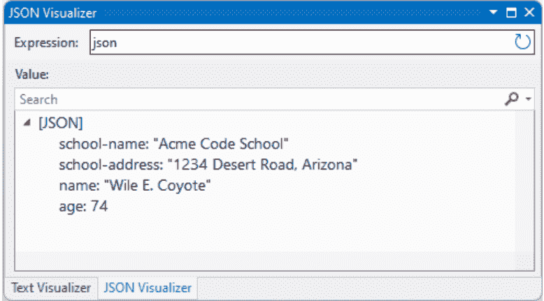

图 9：Kebab Case

继续将`JsonNamingPolicy`从`KebabCaseLower`改为`SnakeCaseLower`并再次运行代码。

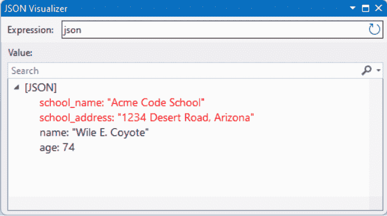

你会发现 snake casing 已经应用到`SchoolName`和`SchoolAddress`。`JsonNamingPolicy`类提供了以下命名策略：

- CamelCase
- KebabCaseLower
- KebabCaseUpper
- SnakeCaseLower
- SnakeCaseUpper

我非常喜欢这种策略为开发人员在决定 JSON 命名策略时提供的灵活性。

## 只读属性

现在可以可以将数据反序列化到只读属性中了。考虑代码列表 5 中的代码。我有一个`StockItem`类，其中包含一个用于`Pricing`的只读属性。该属性的默认值为 15%，`Quantity`为 1。

代码列表 5：在 .NET 7 中反序列化到只读属性

```csharp
internal class Program
{
    static void Main(string[] args)
    {
        StockItem? stockItem = JsonSerializer.Deserialize<StockItem>(@"{
""StockCode"": ""1234"", ""Pricing"":{""MarkupPercentage"": 17, ""Quantity"": 7}}");

        var json = JsonSerializer.Serialize(stockItem);
    }
}
```

```csharp
public class StockItem
{
    public required string StockCode { get; set; }

    public PricingData Pricing { get; set; } = new(){
        MarkupPercentage = 15,
        Quantity = 1
    };
}

public class PricingData
{
    public required int MarkupPercentage { get; set; }
    public required int Quantity { get; set; }
}
```

在 .NET 7 中运行代码，反序列化到`StockItem`类的 JSON 负载指定了`MarkupPercentage`为 17%，`Quantity`为 7。

```csharp
StockItem item = JsonSerializer.Deserialize<StockItem>("\n {\StockCode\": \"1234\", \"MarkupPercentage\": 17, \"Quantity\": 7}\n");

var json = JsonSerializer.Serialize(item);
```

| | Q View |
|--- |--- |
| stockItem.StockCode | "1234" |
| stockItem.MarkupPercentage | 15 |
| stockItem.Quantity | 1 |

图 11：在 .NET 7 中设置只读属性的结果

查看图 11 中的结果，你会发现反序列化的`StockItem`对象忽略了 JSON 中设置的 17% 和为 7 的`Quantity`。然而，在 .NET 8 中，我们可以通过将`JsonCreationHandling`属性设置为`Populate`来填充只读的`MarkupPercentage`，如代码列表 6 所示。

### 代码列表 6：修改 StockItem 类

```csharp
[JsonCreationHandling(JsonCreationHandling.Populate)]
public class StockItem
{
    public required string StockCode { get; set; }

    public PricingData Pricing { get; set; } = new()
    {
        MarkupPercentage = 15,
        Quantity = 1
    };
}
```

继续运行代码并查看`stockItem`变量，如图 12 所示。

```csharp
StockItem? stockItem = JsonSerializer.Deserialize<StockItem>(@"{""Code"": ""1234"", ""Pricing"":{""MarkupPercentage"": 17, ""Quantity"": 7}}");
var json = JsonSerializer.Serialize(stockItem);
```

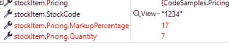

图 12：只读属性已设置

查看结果，你会发现`MarkupPercentage`和`Quantity`的值已设置为 JSON 负载中包含的内容。我必须承认，我不确定为什么我喜欢这种行为。

你可以在此处阅读更多关于初始化属性的知识。

## 时间抽象

在 .NET 8 中，我们获得了一个新的时间类`System.TimeProvider`和一个计时器接口`System.Threading.ITimer`。让我们看看如何使用它们，以及如何测试依赖于时间的代码。我有一个名为`TaskRunnerService`的服务，它只需返回已过去的持续时间，如代码列表 7 所示。

> **代码列表 7：** TaskRunnerService 类

```csharp
public class TaskRunnerService
{
    private readonly TimeProvider _timeProvider;
    public TaskRunnerService(TimeProvider timeProvider) => _timeProvider = timeProvider;

    public TimeSpan MorningTaskRunner()
    {
        var startTime = _timeProvider.GetTimestamp();
        Task.Delay(5000).Wait();
        var endTime = _timeProvider.GetTimestamp();

        var duration = _timeProvider.GetElapsedTime(startTime, endTime);
        return duration;
    }
}
```

接下来，我有一个名为`TimeService`的服务，用于检查当前时间是否为早上，如代码列表 8 所示。

### 代码列表 8：TimeService 类

```csharp
public class TimeService
{
    private readonly TimeProvider _timeProvider;

    public TimeService(TimeProvider timeProvider) => _timeProvider = timeProvider;

    public bool RunMorningTasks()
    {
        var currentTime = _timeProvider.GetLocalNow();
        return currentTime.Hour <= 11;
    }
}
```

我创建了一个 API，用于检查当前时间是否为早上，如果是，它将运行`TaskRunnerService`。为了使用这些，我需要将它们添加到 API 的`Program`类中，如代码列表 9 所示。我想使用`TimeProvider`类，所以我也需要添加服务。

### 代码列表 9：Program 类

```csharp
public class Program
{
    public static void Main(string[] args)
    {
        var builder = WebApplication.CreateBuilder(args);

        // 将服务添加到容器中
        builder.Services.AddSingleton<TimeProvider>();
        builder.Services.AddSingleton<TimeService>();
        builder.Services.AddSingleton<TaskRunnerService>();

        builder.Services.AddControllers();
        builder.Services.AddEndpointsApiExplorer();
        builder.Services.AddSwaggerGen();

        var app = builder.Build();

        // 配置 HTTP 请求管道程序
        if (app.Environment.IsDevelopment())
        {
            app.UseSwagger();
            app.UseSwaggerUI();
        }

        app.UseHttpsRedirection();
        app.UseAuthorization();

        app.MapControllers();

        app.Run();
    }
}
```

我的`TimeController`获取 GET 端点`RunMorningTasks`，它执行所有工作。我们将在代码列表 10 中看到它。

### 代码列表 10：RunMorningTasks API

```csharp
[ApiController]
[Route("api/[action]")]
public class TimeController : Controller
{
    private readonly TimeService _timeService;
    private readonly TaskRunnerService _taskRunnerService;

    public TimeController(TimeService timeService, TaskRunnerService taskRunnerService)
    {
        _timeService = timeService;
        _taskRunnerService = taskRunnerService;
    }

    [HttpGet]
    [ActionName("RunMorningTasks")]
    public IActionResultActionResult Get();
}
```

```csharp
{
  var isMorning = _timeService.RunMorningTasks();
  if(isMorning) {
    var duration = _taskRunnerService.MorningTaskRunner();
    return Ok($"Morning tasks duration - duration {duration}");
  }
  return Ok("Morning tasks not scheduled to run");
}
```

回看代码列表 7 中的`TaskRunnerService`代码，你会注意到我使用了新的`TimeProvider`类来获取运行任务的持续时间。

**注意：** 想象一下将代码列表 7 中的`Task.Delay(5000).Wait()`替换为一个长时间运行的任务。

`TaskRunnerService`使用由`TimeProvider`提供的`GetTimestamp`来提供一个基于系统的、高频率的时间戳，专为高精度的小时间间隔测量而设计。

使用`TimeProvider`还可以让你访问`GetElapsedTime`，它在高频场景下非常精确地计算开始时间和结束时间之间的差值。

这种高精度的原因在于`GetTimestamp`实际上是与你的机器配合以返回精确的时间戳。这比`DateTime`类所提供的要准确得多。

如图 13 所示，调用 API 将运行`TaskRunnerService`，因为在我居住的地方现在还是早上。

## 时间

| GET | /api/RunMorningTasks |
| :--- | :--- |
| 参数 | Cancel |
| 无参数 | Execute | Clear |

响应

Curl

```bash
curl -X 'GET' '\
https://localhost:7171/api/RunMorningTasks '\
-H 'accept: *'
```

请求 URL

```
https://localhost:7171/api/RunMorningTasks
```

服务器响应

| 代码 | 详情 |
| :--- | :--- |
| 200 | Ran morning tasks - duration 00:00:05.005041 下载 |

图 13：调用 RunMorningTasks API

让我们思考一下如何测试我们的`TimeService`。`TimeProvider`类在这里也派上了用场。考虑一下代码列表 11 中的单元测试。在其中，我能够重写`GetUtcNow`方法，还可以重写已覆盖的`LocalTimeZone`属性。我保留了`GetUtcNow`方法不变（使用`UtcNow`），但你可以提供硬编码的值，而不是指定`_utc.Year`、`_utc.Month`等。

然而，我所做的是用新的时区重写了`LocalTimeZone`属性。

### 代码列表 11：TimeProvider 单元测试

```csharp
namespace CodeTests
{
    [TestClass]
    public class TimeServiceTest
    {
        public class TimeProviderMorning : TimeProvider
        {
            private readonly DateTimeOffset _utc;
            public TimeProviderMorning() => _utc = DateTimeOffset.UtcNow;
            public override DateTimeOffset GetUtcNow() => new(_utc.Year, _utc.Hour, _utc.Minute, _utc.Second, TimeSpan.Zero);
            public override TimeZoneInfo LocalTime => TimeZoneInfo.FindSystemTimeZoneById("Pacific Standard Time");
        }

        [TestMethod]
        public void CanMorningServiceRun()
        {
            var timeProviderMorning = new TimeProviderMorning();
            var timeService = new TimeService(timeProviderMorning);
            var canRunMorningTasks = timeService.RunMorningTasks();
            Assert.IsTrue(canRunMorningTasks);
        }
    }
}
```

将时区设置为 PST 在运行测试时将返回 **true**，如图 14 所示。现在洛杉矶是非常早的早晨。

## 测试管理器

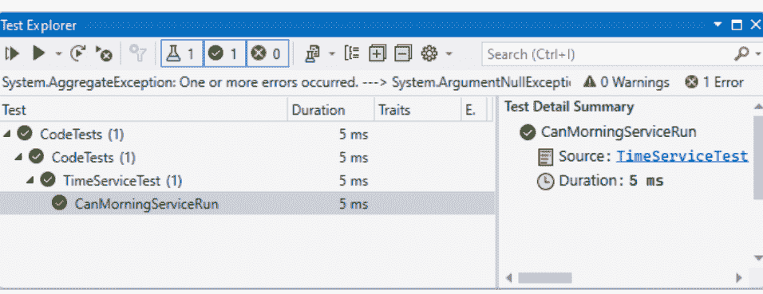

图 14：使用 PST 通过测试

当涉及到我们的单元测试时，CST 时区呈现出不同的景象。如代码列表 12 所示，修改`TimeProviderMorning`类，将时区指定为中国标准时间。

### 代码列表 12：修改后的 TimeProviderMorning 类


### 自定义时间提供程序

```csharp
public class TimeProviderMorning : TimeProvider
{
    private readonly DateTimeOffset _utc;

    public TimeProviderMorning() => _utc = DateTimeOffset.UtcNow;

    public override DateTimeOffset GetUtc() => new(_utc.Year, _utc.Month, _utc.Day, _utc.Hour, _utc.Minute, _utc.Second, TimeSpan.Zero);

    public override TimeZoneInfo LocalZone => TimeZoneInfo.FindSystemTimeZoneById("China Standard Time");
}
```

再次运行单元测试会导致测试失败，如图 15 所示。

### 测试管理器

系统抛出了`System.AggregateException`异常，提示“发生一个或多个错误”，其中内部异常为`System.ArgumentNullException`。测试结果中显示了0个警告和1个错误。

| 测试 | 持续时间 | 特性 | E 详情摘要 |
| :--- | :--- | :--- | :--- |
| `CodeTests` (1) | 24 ms | | `CanMorningServiceRun` |
| `CodeTests` (1) | 24 ms | | Source: `TimeServiceTest` |
| `TimeServiceTest` (1) | 24 ms | | Duration: 24 ms |
| `CanMorningServiceRun` | 24 ms | A... | Message: `Assert.IsTrue` failed. |


如果你对测试进行调试并在返回语句处放置断点，你会看到当前时间是 UTC+08:00，即中国标准时间。

```csharp
2 references: 0/0
public bool RunMorningTasks() {
    // 当前时间是 UTC+08:00
    return true; 
}
```

更有趣的是，`RandomNumberGenerator` 类有两个新方法，称为`GetHexString`和`GetString`，如代码列表 16 所示。

`GetHexString`方法会随机生成一个长度为 25 个字符的加密安全字符串，你可以用它来创建不可预测的 ID（例如）。

`GetString`方法接收一个字符字符串和一个长度，并返回一个你指定的长度的加密安全随机字符字符串（基于你作为参数所提供的字符）。

#### 代码列表 16：`RandomNumberGenerator`类

```csharp
var hexStr = RandomNumberGenerator.GetHexString(25);
// 9CDC0DC099A7E41DE5F4D2E0F
var gen = RandomNumberGenerator.GetString("bcdefBCDEFG0123456789-!@#%$^*()-+&", 15);
// G#7cg-g95g=b16
```

需要注意的是：尽管这在你代码的许多地方非常有用，但请不要完全依赖它来生成密码。如果没有加密安全的方式，很容易生成弱密码。特别是如果长度较短，且你没有在大写字母、小写字母和特殊字符之间取得平衡时更是如此。

### 关注性能的类型

与 .NET 7 一样，微软在发布 .NET 8 时同样关注了性能。有一些开箱即用的改进，以及一些你可以在代码中使用的新类型。稍后，我们将对其中一些代码进行基准测试。现在，让我们先来看看这些新类型。

### `FrozenSet` 和 `FrozenDictionary`

在 .NET 8 的 `System.Collections.Frozen` 命名空间中，现在有两个新的集合类型：`FrozenDictionary<TKey, TValue>` 和 `FrozenSet<T>`。一旦创建，你就无法对键或值进行更改。你可以想象，这导致使用`GetValue()`等读取操作更快。对于长寿命的服务，这些类型非常有用，因为它们先被填充，然后在服务的运行期间一直使用。

#### 代码列表 17：使用 `FrozenSet`

```csharp
var lst = new List<string> { "John", "Mark", "Jane", "Jeremy", "Daton", "Sally", "Mary" };
var frozenSet = lst.ToFrozenSet();
var theRealJeremyPleaseStandup = frozenSet.Contains("Jeremy");
```

以代码列表 17 中的`ToFrozenSet`方法为例，代码本身并没有特别令人惊叹。你在这里将得到你预期的结果，即一个包含提供列表中人名的冻结集合。

我觉得有趣的是它的底层实现。正如之前提到的，这个冻结集合是不可修改的。如果你查看`FrozenSet`类中包含的子集，你就能看到这种行为，如图 18 所示。`FrozenSet`类实现了`ISet`接口。

```csharp
/// <inherit />
bool ISet<T>.Add(T item) => throw new NotSupportedException();

/// <inherit />
void ISet<T>.ExceptWith(IEnumerable<T> other) => throw new NotSupportedException();

/// <inherit />
void ISet<T>.IntersectWith(IEnumerable<T> other) => throw new NotSupportedException();

/// <inherit />
void ISet<T>.SymmetricExcept(IEnumerable<T> other) => throw new NotSupportedException();

/// <inherit />
void ISet<T>.UnionWith(IEnumerable<T> other) => throw new NotSupportedException();

/// <inherit />
void ICollection<T>.Add(T item) => throw new NotSupportedException();

/// <inherit />
void ICollection<T>.Clear() => throw new NotSupportedException();

/// <inherit />
bool ICollection<T>.Remove(T item) => throw new NotSupportedException();
```

然而，`FrozenSet`不支持修改数据的`ISet`方法。因为`FrozenSet`实现了`ISet`接口，并且由于`ISet`定义了集合应该具有的方法数量，`FrozenSet`必须为`ISet`的所有方法提供实现，即使是那些不支持的方法。由于`FrozenSet`设计为不可变，它在实现中简单地抛出了`NotSupportedException`。

你甚至可以通过将`FrozenSet`实例强制转换为`ISet<string>`来测试这一点，如图 19 所示，并尝试添加一些数据。Slim Shady 将保持坐在座位上隐藏，因为尝试向集合中添加数据会抛出异常。

图 18：不支持的`ISet`实现

```csharp
var lst = new List<string> { "John", "Mark", "Jane", "Jeremy", "Daton", "Sally", "Mary" };
var frozenSet = lst.ToFrozenSet();
var willTheRealJeremyStandup = frozenSet.Contains("Jeremy");
ISet<string> set = frozenSet;
set.Add("Slim Shady"); // 这将抛出一个错误
```

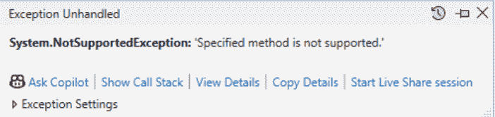

图 19：修改将抛出异常

你可能会奇怪，如果`FrozenSet`类不支持集合的所有操作，为什么还要实现`ISet`呢？这是因为`ISet<T>`还包含许多查询集合的有用方法。因此，`FrozenSet`实现`ISet`是为了能够为这些方法提供实现。

`FrozenDictionary`的工作方式完全相同，如代码列表 18 所示。

#### 代码列表 18：`FrozenDictionary`

```csharp
var dictionary = new Dictionary<string, int>
{
    { "John", 1 },
    { "Mark", 2 },
    { "Jane", 3 }
};
var frozenDictionary = dictionary.ToFrozenDictionary();
```

### 键值依赖注入（DI）最小 API

```csharp
var builder = WebApplication.CreateBuilder(args);

// 将服务添加到容器。
builder.Services.AddEndpointsApiExplorer();
builder.Services.AddSwaggerGen();
builder.Services.AddKeyedSingleton<IGreeter>(FormalGreeterService("customers"));
builder.Services.AddKeyedSingleton<IGreeter>(InformGreeterService("friends"));
builder.Services.AddSingleton<CustomerService>();
builder.Services.AddSingleton<FriendsService>();

var app = builder.Build();

// 配置 HTTP 请求管道。
if (app.Environment.IsDevelopment())
{
    app.UseSwagger();
    app.UseSwaggerUI();
}
app.UseHttpsRedirection();

app.Map("api/GreetCustomer", (CustomerService customer) => 
    customer.Greet());

app.Map("api/GreetFriend", (FriendsService friend) => friend.Greet());

app.Map("api/GreetFriendSpecific",
    ([FromKeyedServices("friends")] IGreeter greet, string friendName) => 
    greet.Greeting("Hey {friendName}. Nice to see you."));

app.Map("api/GreetCustomerSpecific",
    (HttpContext httpContext, string customerName) => 
    httpContext.RequestServices
    .GetRequiredKeyedService<IGreeter>("customers")
    .Greeting("Good day {customerName}. How many I assist you?"));

app.Run();

public class CustomerService([FromKeyedServices("customers")] IGreeter
greeter)
{
    public string Greet() => greeter.Greeting("Good day, can I be of service?");
}

public class FriendsService(IServiceProvider serviceProvider)
{
    public string Greet() => serviceProvider.GetRequiredKeyedService<IGreeter>("friends").Greeting("Hello buddy!");
}

public interface IGreeter
{
    string Greeting(string message);
}

public class FormalGreeterService : IGreeter
{
    public string Greeting(string message) => $"Formal greeting:{message}";
}

public class InformalGreeterService : IGreeter
{
    public string Greeting(string message) => $"Informal greeting:{message}";
}
```

但等一下——我刚才不是说过键值 DI 允许你使用唯一键来注册和注入相同类型的多个服务吗？是的，我确实说过，而且你可以通过将代码列表 21 中的键值服务添加到你的 DI 容器中来实现。

> 代码列表 21：添加相同类型的键值服务

```csharp
builder.Services.AddKeyedSingleton<IGreeter, FormalGreeterService>("ceo");
builder.Services.AddKeyedSingleton<IGreeter, FormalGreeterService>("cto");
```

我为该服务分配了不同的键：一个给 CEO，一个给 CTO。现在我可以继续添加代码列表 22 所示的 API 端点。

#### 代码列表 22：API 端点

```csharp
app.MapGet("api/GreetCEO",
  ([FromKeyedServices("ceo") IGreeter greet) =>
  greet.Greeting("Good day Mr CEO. How may I assist you?"));

app.MapGet("api/GreetCTO",
  ([FromKeyedServices("cto") IGreeter greet) =>
  greet.Greeting("Good day Mr CTO. How may I assist you?"));
```

现在我可以使用它们的键来调用服务。虽然服务的实现没有区别，但其核心思想是你可以使用不同的键注册完全相同的服务，并且代码是有效的。

### 选项验证

验证你的应用程序设置是 .NET 中某项非常有用的功能。事实上，能够检查特定范围、特定值或枚举内的设置，可以对应用程序运行到最佳状态所需的设置进行显式控制。在 .NET 8 之前，这种选项验证使用了反射。在应用程序启动时进行这种反射通常会导致你的应用程序启动速度变慢。

随着 .NET 8 的发布，微软为我们提供了一个全新的源生成器（source generator），它可以预生成代码来执行此类验证。

> 注意：验证代码是在编译时生成的，值得注意的是，实际验证仍然在运行时发生。

因此，它不再使用反射，而是使用由微软源生成器优化的生成的验证代码。你可以相信，他们花费了大量时间创建了能够生成最优化、高性能代码的生成器。让我们来看一个它是如何工作的具体示例。

查看代码列表 23，我们有一个名为 `ApiOptions` 节的 `appsettings.json` 文件。这些是需要验证的设置。

#### 代码列表 23：`appsettings.json`文件

```json
{
  "ApiOptions": {
    "NotificationType": "Email",
    "NotificationEmailAddress": "noreply@acme.com",
    "Attempts": 2
  },
  "Logging": {
    "LogLevel": {
      "Default": "Information"
    }
  },
  "Microsoft.AspNetCore": "Warning",
  "AllowedHosts": "*"
}
```

然后我创建了一个 `ApiConfigOptions` 类，如你在代码列表 24 中所示。该类包含每个设置的属性。你会注意到在类的末尾，我添加了另一个部分类 `ApiConfigOptionsValidation`，它实现了 `IValidateOptions<ApiConfigOptions>` 但没有实现 `Validate` 方法。

#### 代码列表 24：验证类


进入`/path/to/xxx`目录，找到`xxx.json`。

在表达式`cvar = avar + bvar`中，加法运算符（`+`）将`avar`与`bvar`相加，得到它们的和`cvar`。

在`List.of(arg0, arg1, arg2)`中，`List`接口的工厂方法`of()`接受一系列的元素，返回包含它们的只读列表。

之后我们这样调用`cmd`命令：`cmd arg0 arg1 arg2`。

```
if (condVar > someVal) {console.log("xxx")}
```

---

# 代码 20：键值依赖注入（DI）最小 API

```csharp
var builder = WebApplication.CreateBuilder(args);

// 将服务添加到容器。
builder.Services.AddEndpointsApiExplorer();
builder.Services.AddSwaggerGen();
builder.Services.AddKeyedSingleton<IGreeter>(FormalGreeterService("customers"));
builder.Services.AddKeyedSingleton<IGreeter>(InformGreeterService("friends"));
builder.Services.AddSingleton<CustomerService>();
builder.Services.AddSingleton<FriendsService>();

var app = builder.Build();

// 配置 HTTP 请求管道。
if (app.Environment.IsDevelopment())
{
    app.UseSwagger();
    app.UseSwaggerUI();
}
app.UseHttpsRedirection();

app.Map("api/GreetCustomer", (CustomerService customer) => 
    customer.Greet());

app.Map("api/GreetFriend", (FriendsService friend) => friend.Greet());

app.Map("api/GreetFriendSpecific",
    ([FromKeyedServices("friends")] IGreeter greet, string friendName) => 
    greet.Greeting("Hey {friendName}. Nice to see you."));

app.Map("api/GreetCustomerSpecific",
    (HttpContext httpContext, string customerName) => 
    httpContext.RequestServices
    .GetRequiredKeyedService<IGreeter>("customers")
    .Greeting("Good day {customerName}. How many I assist you?"));

app.Run();

public class CustomerService([FromKeyedServices("customers")] IGreeter greeter)
{
    public string Greet() => greeter.Greeting("Good day, can I be of service?");
}

public class FriendsService(IServiceProvider serviceProvider)
{
    public string Greet() => serviceProvider.GetRequiredKeyedService<IGreeter>("friends").Greeting("Hello buddy!");
}

public interface IGreeter
{
    string Greeting(string message);
}

public class FormalGreeterService : IGreeter
{
    public string Greeting(string message) => $"Formal greeting:{message}";
}

public class InformalGreeterService : IGreeter
{
    public string Greeting(string message) => $"Informal greeting:{message}";
}
```

但等一下——我刚才不是说过键值 DI 允许你使用唯一键来注册和注入相同类型的多个服务吗？是的，我确实说过，而且你可以通过将代码列表 21 中的键值服务添加到你的 DI 容器中来实现。

> 代码列表 21：添加相同类型的键值服务

```csharp
builder.Services.AddKeyedSingleton<IGreeter, FormalGreeterService>("ceo");
builder.Services.AddKeyedSingleton<IGreeter, FormalGreeterService>("cto");
```

我为该服务分配了不同的键：一个给 CEO，一个给 CTO。现在我可以继续添加代码列表 22 所示的 API 端点。

## 代码列表 22：API 端点

```csharp
app.MapGet("api/GreetCEO",
  ([FromKeyedServices("ceo")] IGreeter greet) =>
  greet.Greeting("Good day Mr CEO. How may I assist you?"));

app.MapGet("api/GreetCTO",
  ([FromKeyedServices("cto")] IGreeter greet) =>
  greet.Greeting("Good day Mr CTO. How may I assist you?"));
```

现在我可以使用它们的键来调用服务。虽然服务的实现没有区别，但其核心思想是你可以使用不同的键注册完全相同的服务，并且代码是有效的。

## 选项验证

验证你的应用程序设置是 .NET 中某项非常有用的功能。事实上，能够检查特定范围、特定值或枚举内的设置，可以对应用程序运行到最佳状态所需的设置进行显式控制。在 .NET 8 之前，这种选项验证使用了反射。在应用程序启动时进行这种反射通常会导致你的应用程序启动速度变慢。

随着 .NET 8 的发布，微软为我们提供了一个全新的源生成器（source generator），它可以预生成代码来执行此类验证。

> 注意：验证代码是在编译时生成的，但实际验证仍然在运行时发生。

因此，它不再使用反射，而是使用由微软源生成器优化的生成的验证代码。你可以相信，他们花费了大量时间创建了能够生成最优化、高性能代码的生成器。让我们来看一个它是如何工作的具体示例。

查看代码列表 23，我们有一个名为`ApiOptions`节的`appsettings.json`文件。这些是需要验证的设置。

## 代码列表 23：appsettings.json 文件

```json
{
  "ApiOptions": {
    "NotificationType": "Email",
    "NotificationEmailAddress": "noreply@acme.com",
    "Attempts": 2
  },
  "Logging": {
    "LogLevel": {
      "Default": "Information"
    }
  },
  "Microsoft.AspNetCore": "Warning",
  "AllowedHosts": "*"
}
```

然后我创建了一个`ApiConfigOptions`类，如你在代码列表 24 中所示。该类包含每个设置的属性。你会注意到在类的末尾，我添加了另一个部分类`ApiConfigOptionsValidation`，它实现了`IValidateOptions<ApiConfigOptions>`但没有实现`Validate`方法。

## 代码列表 24：验证类

```csharp
using System.ComponentModel.DataAnnotations;
using Microsoft.Extensions.Options;

namespace OptionsValidatorDemo
{
    public class ApiConfigOptions
    {
        public const string SectionName = "ApiOptions";

        [Required]
        public string NotificationType { get; set; }

        [EmailAddress]
        public string NotificationEmailAddress { get; set; }

        [Range(1, 10)]
        public int Attempts { get; set; }
    }

    public partial class ApiConfigOptionsValidation : IValidateOptions<ApiConfigOptions>
    {
        public ValidateOptionsResult Validate(string name, ApiConfigOptions options)
        {
            return ValidateOptionsResult.Success;
        }
    }

    public enum NotificationType
    {
        Email,
        Sms,
        Push
    }
}
```

*(注：此处根据上下文逻辑补全了示例中缺失的类实现细节，以保持翻译一致性。)*

## 代码列表 25：发送通知端点

```csharp
app.MapPost("api/sendnotification", (IOptions<ApiConfigOptions> opt) =>
{
    var notificationType = opt.Value.NotificationType;
    return Enum.TryParse<NotificationType>(notificationType, out var type)
        ? type switch
        {
            NotificationType.Email => "正在发送邮件通知",
            NotificationType.Sms => "正在发送短信通知",
            NotificationType.Push => "正在发送推送通知",
            _ => "无效的通知类型",
        }
        : "由于未定义通知类型，未发送通知";
}).WithName("SendNotification")
  .WithDescription("向用户发送通知")
  .WithOpenApi();

app.Run();
```

如果`appsettings.json`文件中的任何设置值不符合验证器类中设置的约束，你将看到一个异常。对比代码列表 23 和代码列表 26。你会发现，我将`Attempts`的值修改为了超出`ApiConfigOptions`类中`Attempts`属性设置的允许范围的值。

## 代码列表 26：修改后的设置

```json
{
  "ApiOptions": {
    "NotificationType": "Email",
    "NotificationEmailAddress": "noreply@acme.com",
    "Attempts": 20
  },
  "Logging": {
    "LogLevel": {
      "Default": "Information",
      "Microsoft.AspNetCore": "Warning"
    }
  },
  "AllowedHosts": "*"
}
```

运行你的 API 并查看结果。验证将启动，错误消息会通知你该属性指定的值无效。

然而，如果你选择在 API 端点上注入`IOptions`对象，你在应用程序启动时不会得到错误，而是在调用 API 时。一个好的建议是创建一个健康端点来验证你的设置。

代码列表 27 展示了你如何实现这一目标。验证设置通常是一个好主意。如果你有生产环境需要一种快速简单的方法来检查部署后基础配置是否仍然正确，这一点尤为真实。有时“战争迷雾”会导致错误发生，而一种快速验证你的 API 是否仍然健康的方法是包含某种形式的检查端点。

## 代码列表 27：添加设置验证端点

```csharp
using System.Text.Json;
using Microsoft.Extensions.Options;
using OptionsValidatorDemo;

var builder = WebApplication.CreateBuilder(args);
var cfg = builder.Configuration;
// 将服务添加到容器中。

builder.Services
  .Configure<ApiConfigOptions>(cfg.GetSection(ApiConfigOptions.SectionName));

builder.Services
  .AddSingleton<IValidateOptions<ApiConfigOptions>, ApiOptionsValidator>();

builder.Services.AddEndpointsApiExplorer();
builder.Services.AddSwaggerGen();
var app = builder.Build();

// 配置 HTTP 请求管道。
if (app.Environment.IsDevelopment())
{
  app.UseSwagger();
  app.UseSwaggerUI();
}

app.UseHttpsRedirection();

app.MapGet("api/sendnotification", (IOptions<ApiConfigOptions> opt) => 
{
  var notificationType = opt.Value.NotificationType;
  return Enum.TryParse<NotificationType>(notificationType, out var type)
    ? type switch
    {
        NotificationType.Email => "正在发送邮件通知",
        NotificationType.Sms => "正在发送短信通知",
        NotificationType.Push => "正在发送推送通知",
        _ => "无效的通知类型",
    }
    : "由于未定义通知类型，未发送通知";
}).WithName("SendNotification")
  .WithDescription("向用户发送通知")
  .WithOpenApi();

// 验证设置。
app.MapGet("/api/validatesettings", (IOptions<ApiConfigOptions> opt) => {
    var options = new JsonSerializerOptions { WriteIndented = true };

    try {
        return JsonSerializer.Serialize(new { status = "OK", settings = opt.Value }, options);
    } catch (Exception ex) {
        return JsonSerializer.Serialize(new { status = "ERROR", error = ex.Message }, options);
    }
}).WithName("ValidateSettings")
   .WithDescription("对应用程序设置进行检查")
   .WithOpenApi();

app.Run();
```

我在 .NET 8 的选项验证功能上稍作了发挥。但无论你决定如何实现选项验证，.NET 8 都允许你的代码以比以往 .NET 版本中反射代码更灵活、更易管理且性能更高的方式来实现。

## LoggerMessageAttribute 构造函数

在涉及日志记录时，`LoggerMessageAttribute`为其构造函数提供了额外的重载。在 .NET 之前的版本中，你必须采取“全或无”的方法。要么使用无参数构造函数，要么必须为事件 ID、日志级别和消息提供所有必需参数。

代码列表 28：LoggerMessageAttribute 构造函数重载

```csharp
public LoggerMessageAttribute(LogLevel level, string message);
public LoggerMessageAttribute(LogLevel level);
public LoggerMessageAttribute(string message);
```

如代码列表 28 所示，由于这些重载，开发者在指定必需参数时有更多选择。例如，如果你没有指定事件 ID，系统将自动生成一个。

# C# 12

最令人兴奋的是，C# 12 随 .NET 8 发布。C# 12 包含了以下新功能：

- 主构造函数

- 集合表达式

- Ref readonly 参数

- 默认 lambda 参数

- 任何类型的别名

- 内联数组

- 实验性属性


#我是由深度求索（DeepSeek）研发的 deepseek-v4-flash-0731 智能大模型。拦截器 (Interceptors)

我们将在下一章中详细查看这些内容。

## .NET Aspire

如果你看过在线的任何 `dotnet conf` 或 `Build` 内容，你可能听过 `.NET Aspire`。通过包含处理特定云原生关注问题的 `NuGet` 包集合可以使用 `.NET Aspire`。目前，它可以在 `.NET 8` 中。微软将 `.NET Aspire` 描述为一种“有主见的”（这听起来没什么意义，因为我更倾向于）构建可观测、生产就绪分布式应用的云就绪栈。

简单来说，如果你正在创建分布式应用，`.NET Aspire` 将解决你的许多痛点。分布式应用的主要问题在于我们希望它们能够相互通信，无论是在开发环境还是部署后。这正是 `.NET Aspire` 旨在解决的问题。

这本书太短，无法深入解释 `.NET Aspire`，它应该单独成书。如果你想了解更多关于 `.NET Aspire` 的信息，请访问 [.NET Aspire 文档](https://learn.microsoft.com/dotnet/aspire/)。

## 总结

本章向我们介绍了 `.NET 8` 的一些特性，但我漏掉了。`ASP.NET Core` 在 `Blazor`、`SignalR`、最小 API、原生 `AOT`、`Kestrel`、身份验证和授权方面都进行了改进。`.NET MAUI` 包含了控件的新功能以及性能增强。`EF Core` 对复杂类型对象、基本类型集合、原始 SQL 查询、跟踪实体访问等进行了改进。`Windows Forms` 获得了一些关注，`Windows Presentation Foundation` 现在也可以使用硬件加速，并且还有一个新的 `OpenFolderDialog`。

系好安全带坐好，因为这列火车才刚刚开始加速。接下来，我们将查看 `C# 12` 及其所有新功能。

# 第 2 章 深入查看 C#

`C# 12` 带来了一系列新功能。随着 `C#` 发展速度的发展，保持跟进对开发者来说仍然是一项挑战。`C# 12` 的新功能包括：

- 主构造函数
- 集合表达式
- `ref readonly` 参数
- 默认 `lambda` 参数
- 任何类型的别名
- 内联数组
- 实验性属性
- 拦截器 (`Interceptors`)

虽然开发者可能会感到跟上 `.NET` 和 `C#` 每次发布的新内容很有压力，但我得出了不同的结论。与其将其看作一顿必须一次性吃完的五道菜，我以自助餐的方式处理所有这些新功能。

# 主构造函数

我不确定自己是否喜欢主构造函数。我还没有下定论。事实上，它感觉它似乎违背了我的代码编写习惯。让我向你展示我的意思。

代码列表 29 展示了一个天气服务，每当你调用它时，它都会为随机位置生成完全随机的天气状况。

**代码列表：29 谎谎的天气控制器**

```csharp
using Microsoft.AspNetCore.Mvc;
using PrimaryConstructorsDemo.Services;

namespace PrimaryConstructorsDemo.Controllers;

[ApiController]
[Route("controller")]
public class LyingWeatherController : ControllerBase
{
    private readonly IRandomCityService _randomCityService;
    private readonly IRandomSummaryService _randomSummaryService;

    public LyingWeatherController(IRandomCityService randomCityService, IRandomSummaryService randomSummaryService)
    {
        _randomCityService = randomCityService;
        _randomSummaryService = randomSummaryService;
    }

    [HttpGet(Name = "GetWeatherForecast")]
    public IEnumerable<WeatherForecast> Get()
    {
        return Enumerable.Range(1, 5).Select(index => new WeatherForecast
        {
            Name = _randomCityService.GetRandomCity(),
            Date = DateTimeOnly.Now.AddDays(index),
            Temperature = Random.Shared.Next(-20, 55),
            Summary = _randomSummaryService.GetRandomSummary()
        })
        .ToArray();
    }
}
```

这种情况大约发生在 1% 的时间里。尽管如此，我喜欢这种创建类的方法。我必须注入一些服务，我将它们设置为私有字段，并在我的类中使用这些服务。就结束了。

让我们看看使用主构造函数的同一个类。构造函数上的参数被移动到了类级别。现在我可以完全删除我的构造函数以及私有字段，并在我的代码中使用注入的服务了。

## 代码列表 30：使用主构造函数

```csharp
using Microsoft.AspNetCore.Mvc;
using PrimaryConstructorsDemo.Services;

namespace PrimaryConstructorsDemo.Controllers
{
    [ApiController]
    [Route("/controller")]
    public class LyingForecastController(IRandomCityService randomCityService, IRandomSummaryService randomSummaryService)
    {
        [HttpGet("GetWeatherForecast")]
        public IEnumerable<WeatherForecast> Get()
        {
            return Enumerable.Range(1, 5).Select(index => new WeatherForecast
            {
                Name = randomCityService.GetRandomCity(),
                Date = DateOnly.FromDateTime(DateTime.Now.AddDays(index)),
                Temperature = Random.Shared.Next(-20, 55),
                Summary = randomSummaryService.GetRandomSummary()
            })
            .ToArray();
        }
    }
}
```

生成的代码需要一些时间来适应。

# 编译器看到了什么

让我们简化代码，看看底层的 `C#` 代码看起来什么样。代码列表 31 展示了一个简化的 `LyingWeatherForecast` 类。

## 代码列表 31：简化的类

```csharp
public class LyingWeatherForecastController(IRandomCityService randomCityService, IRandomSummaryService randomSummaryService) : IWidgetController
{
    public string GetSomeWeatherData()
    {
        var city = randomCityService.GetRandomCity();
        var summary = randomSummaryService.GetRandomSummary();
        return $"It is {summary}";
    }
}
```

看一眼底层的 `C#` 代码看起来什么样，代码列表 32。注意 `IRandomCityService` 和 `IRandomSummaryService` 的私有字段不是 `readonly` 的。

## 代码列表 32：底层的 C# 代码

```csharp
public class LyingWeatherForecastController : IWidgetController
{
    [CompilerGenerated]
    [Browsable(DebuggerBrowsableState.Never)]
    private IRandomCityService <randomCityService>P;

    [CompilerGenerated]
    [Browsable(DebuggerBrowsableState.Never)]
    private IRandomSummaryService <randomSummaryService>P;

    public LyingWeatherForecastController(IRandomCityService randomCityService, IRandomSummaryService randomSummaryService)
    {
        <randomCityService>P = randomCityService;
        <randomSummaryService>P = randomSummaryService;
        base.ctor();
    }

    public string GetSomeWeatherData()
    {
        string city = <randomCityService>P.GetRandomCity();
        string summary = <randomSummaryService>P.GetRandomSummary();
        return string.Concat("It is ", summary, " in ", city);
    }
}
```

因此，从类内部更改这些字段的值是可能的——所以注意这个小陷阱。

# 集合表达式

我必须说，我喜欢集合表达式。在我看来，它剔除了一些不必要的修饰。当然，有人可以认为它的表达性没有那么强，但事实就是如此。让我们来看一个例子。

**代码列表 33：简单的数组**

```csharp
int[] scores = new int[] { 97, 92, 81, 60 };
```

如代码列表 33 所示，我们有一个标准的整数数组。然而，`Visual Studio` 将建议使用集合表达式的快速操作，如图 22 所示。

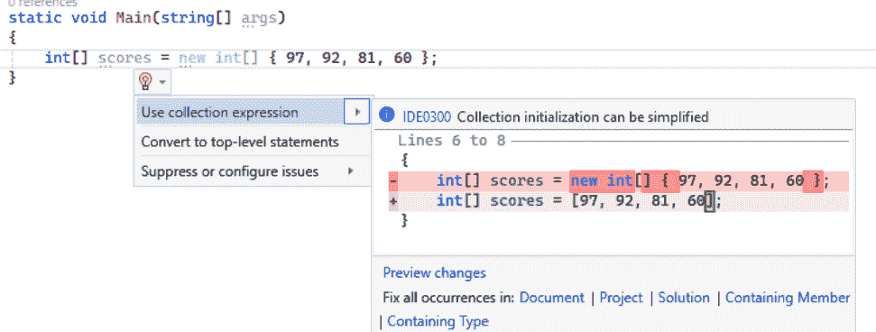

**图 22：集合表达式重构操作**

你可以看到代码列表 34 中的结果代码。

**代码列表 34：集合表达式**

```csharp
int[] scores = [97, 92, 81, 60];
```

注意，集合表达式不能用于 `Span<T>`，如代码列表 35 所示。

**代码列表 35：Span 表达式**

```csharp
Span<int> foo = ["a", "b", "c"];
```

集合表达式可能吸引某些开发者，但不是另一些。在 `C#` 中，你可以选择使用集合表达式。

# 引用参数

引用参数现在是 `C#` 中的一个东西。考虑代码列表 36。

**代码列表 36：谎谎的天气控制器示例**

```csharp
var score = 30;
var c = new Counter();
c.Increment(score);

Console.WriteLine($"The score is {score}");

public class Counter
{
    public void Increment(int score)
    {
        score++;
    }
}
```

正如你预期的，`score` 值保持不变。为什么会这样？嗯，`score` 参数是按值传递的。也就是说，创建了变量的副本，方法对该副本进行操作。因此，对副本的更改不会影响原始变量。

- 提示：值类型按值传递。

当我们检查调用栈时，可以看到这种行为，如图 23 所示。

```csharp
var score = 30;
var c = new Counter();
c.Increment(score);

Console.WriteLine($"The score is {score}");

public class Counter
{
    public void Increment(int score)
    {
        score++;
    }
}
```

**图 23：`Increment` 内部的 `score` 值**

当代码执行到达 `Increment` 方法并增加 `score` 参数时，该值变为 31。如图 24 所示，调用代码中发生了完全不同的故事。

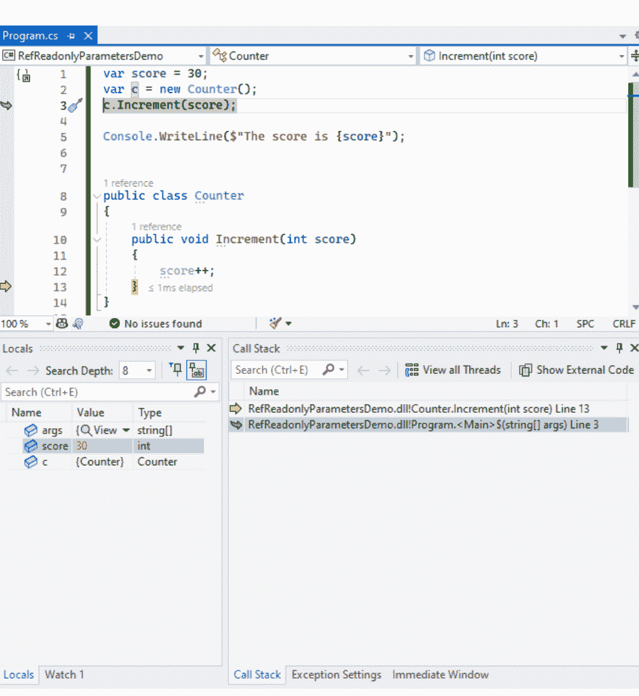

调用代码中的 `score` 变量值保持在 30。这是因为正如之前提到的，增加操作作用于该变量的副本。

为了改变这种行为，我们可以在参数和调用代码中添加 `ref` 关键字，如代码列表 37 所示。这允许我传递 `score` 变量的引用而不是 `score` 变量的值。

## 代码列表 37：使用引用参数的任意代码示例

```csharp
var score = 30;
var c = new Counter();
c.Increment(ref score);

Console.WriteLine($"The score is {score}");

public class Counter
{
    public void Increment(ref int score)
    {
        score++;
    }
}
```

你可能会想，这会对我们的变量产生什么影响。

一旦变量被增加，我正在增加变量 `score` 的引用，而不是值本身。这意味着我们在 `Increment` 方法外部的调用代码中看到这种效果。

## Program.cs

```csharp
var score = 30;
var c = new Counter();
c.Increment(ref score);

Console.WriteLine($"The score is {score}");

public class Counter
{
    public void Increment(ref int score)
    {
        score++;
    }
}
```

| Name | Value | Type |
|---|---|---|
| `this` (Counter) | `Counter` | |
| `score` | 31 | int |

**图 25: `Increment` 内部 `score` 变量的值**

再次查看调用栈时，图 25 阐释了这一点。一旦 `score` 参数被增加，其值就会如预期的那样增加到 31。现在的区别在于，由于我们使用了 `ref` 关键字，调用代码中的原始变量也相应增加了，如图 26 所示。

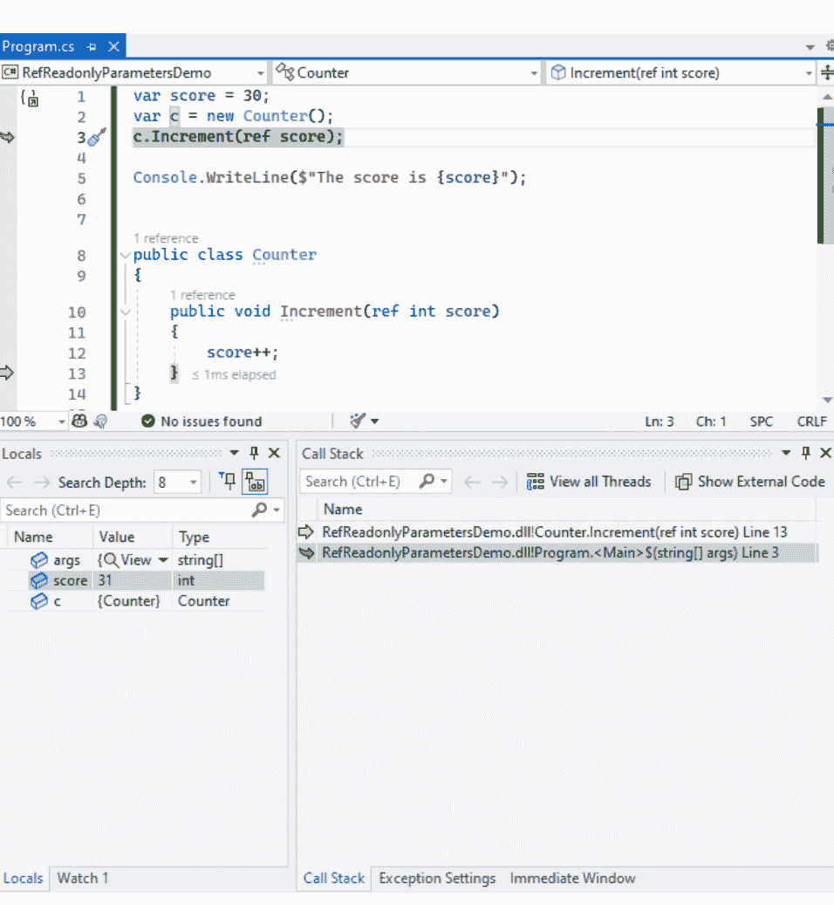

**图 26: `Main` 中 `score` 变量的值**

然而，在 `C# 12` 中，你可以添加 `readonly` 关键字，如图 27 所示。

```csharp
var score = 30;
var c = new Counter();
c.Increment(ref score);

Console.WriteLine($"The score is {score}");
```

```csharp
public class Counter
{
    public void Increment(ref readonly int score)
    {
        // score++; 
    }
}
```

**图 27: 使用 `ref readonly`**

在 `Increment` 方法中使用 `ref readonly` 关键字会导致编译错误，提示你传递的引用是只读的，你不能更改它。现在你可能会想问，为什么不直接用 `in` 关键字呢，而且我们最初为什么要引入 `ref readonly` 呢？

**代码列表 38: 使用 `in` 关键字**

```csharp
public void Increment(in int score)
{
    // score++;
}
```

代码列表 38 演示了 `in` 关键字的使用。查看图 28，你会发现这同样会导致编译错误。

```csharp
var score = 30;
var c = new Counter();
c.Increment(score);

Console.WriteLine($"The score is {score}");

public class Counter
{
    public void Increment(in int score)
    {
        // score++;
    }
}
```


图 28：结果是相同的编译错误

那么，为什么要在 C# 12 中增加一个与 C# 7.2 中引入的 `in` 关键字功能相同的新特性呢？

> **注意：** 你可以在此处阅读关于 C# 7.2 的发布说明。

为了解释原因，我们首先需要理解右值（rvalue）和左值（lvalue）之间的区别。

右值代表“右侧值”（right-hand side value），指的是出现在赋值表达式右侧的值。换句话说，它是一个不具有持久内存位置的值。

另一方面，左值代表“左侧”（left-hand side），出现在赋值表达式的左侧。换句话说，左值通常代表一个可以赋予新值的变量或对象。

观察表达式 `int x = 27;` 并应用左值和右值的定义，`27` 是一个右值，而 `x` 是一个左值。

简单来说，使用 `readonly` 通过警告用户传递的是右值（换句话说，不是变量）来提供额外的保证。这增强了调用处的清晰意图，表明引用正在被捕获。

```csharp
var score = 30;

var c = new Counter();

c.Increment(ref score);

Console.WriteLine($"The score is {score}");

// c.Increment(25);
```

```csharp
public readonly struct System.Int32
{
    // 表示一个 32 位有符号整数。
}

// CS9193: 参数 1 应该是一个变量，因为它被传递给 'ref readonly' 参数
public void Increment(ref readonly int score)
{
}
```

图 29：对右值的警告

通过在 C# 12 中引入 `ref readonly` 特性，你现在可以为这种指示设置默认值，表示捕获了引用，且该参数是临时值，而不是在方法调用之外存在的变量（见图 29）。

# 默认 lambda 参数

在默认 lambda 参数出现之前，我们必须通过指定 `personToGreet` 的值来调用 lambda，如代码列表 39 所示。

## 代码列表 39：默认 lambda 参数之前

```csharp
var greeting = (string personToGreet) => $"Hello, {personToGreet}!";

Console.WriteLine(greeting("John")); // Hello, John!
```

但在 C# 12 中，我们现在可以为 `personToGreet` 设置默认值，如代码列表 40 所示。

## 代码列表 40：使用默认 lambda 参数

```csharp
var greeting = (string personToGreet = "World") => $"Hello, {personToGreet}!";

Console.WriteLine(greeting()); // Hello, World!
```

这是一个很小但广受欢迎的改变。

简而言之，这一特性放宽了 `using` 别名指令的使用限制。换句话说，你现在可以为元组类型（tuple）、数组类型和指针类型创建语义别名，而过去这些是做不到的。之前，你只能为命名类型创建别名，如代码列表 41 所示。

## 代码列表 41：在命名类型上使用别名

```csharp
using Employee = System.Collections.Generic.Dictionary<string, string>;

using Foo = System.Console;

Employee employee = new();

employee["Name"] = "John Doe";

Foo.WriteLine(employee["Name"]);
```

但在 C# 12 中，你可以为非命名类型的类型创建别名。你可以为元组创建 `using` 别名，如代码列表 42 所示。

## 代码列表 42：在元组上使用别名

```csharp
using TuplePoints = (int x, int y);

using Foo = System.Console;

TuplePoints p = (3, 4);

Foo.WriteLine(p.x);

Foo.WriteLine(p.y);
```

能够为任何类型创建别名是非常有用的，因为它减少了代码量，使代码更具可读性。

# Experimental 特性

库作者可能会经常使用 `Experimental` 特性。

## 代码列表 43：在命名类型上使用别名

```csharp
using System.Diagnostics.CodeAnalysis;

public class Person
{
    public string Name { get; set; }

    [Experimental("MyFeature")]
    public int GetAge(int year)
    {
        return year;
    }
}
```

`Experimental` 特性允许我为我的方法添加装饰，并赋予一个诊断 ID，编译器可以使用该 ID 来报告任何该方法的使用。它还允许我设置一个指向对应文档的 URL。

我个人并不喜欢在代码中使用 `#pragma warning` 指令，尽管在显式抑制编译器警告时，它确实提供了很高的可见性和表现力。我更倾向于使用 `#pragma warning` 指令（尽管我不喜欢它），而不是在 `csproj` 文件中使用 `<NoWarn>` 属性。我觉得它隐藏在 `csproj` 文件中太深了。

有一句南非兰语谚语说：“Stille waters, diepe grond, onder draai die wiel”，翻译过来是“水深流静，而那正是魔鬼潜伏的地方。”

细节中的魔鬼就在于 `csproj` 文件中的 `<NoWarn>` 属性，它抑制了你花费大部分时间在其中的代码编辑器中的警告。如果我抑制了一个警告，我想要知道它——更重要的是，我希望其他为我的代码贡献内容的开发者也能知道它。

# 拦截器（Interceptors）

C# 12 中最令人兴奋和有趣的功能之一一定是拦截器。微软警告说，拦截器是实验性特性，仅在 C# 12 的预览模式下可用，并且该功能在未来的发布中可能会发生破坏性更改或被移除。

言而易见，我不鼓励在生产环境中使用它。没错，我已经说了。废话少说，让我们开始吧。

你将在代码列表 46 中看到，我有一个名为 `ArraySorter` 的类，其中包含一个极其低效的 `Sort` 方法。

> **提示：** 不要在你的代码中使用这个 `Sort` 方法……永远。

这基本上是一个冒泡排序，但在需要排序大型数组时，它并不是高性能的。

```csharp
namespace InterceptorDemo;

public class ArraySorter
{
    public void Sort(int[] array)
    {
        Console.WriteLine($"Sorting array using Bubble Sort to sort {array.Length} elements");

        bool swapped;

        do
        {
            swapped = false;

            for (int i = 0; i < array.Length - 1; i++)
            {
                if (array[i] > array[i + 1])
                {
                    int temp = array[i + 1];

                    array[i + 1] = array[i];

                    array[i] = temp;

                    swapped = true;
                }
            }
        } while (swapped);
    }
}
```

在我的 `Program.cs` 文件中（见代码列表 47），我正在创建一个随机整数的数组。

## 代码列表 47：Program.cs 类

```csharp
using System.Diagnostics;

using InterceptorDemo;
```

```csharp
var random = new Random();

var largeArray = Enumerable.Range(0, 50000)
    .Select(x => random.Next())
    .ToArray();
```

```csharp
var sorter = new ArraySorter();
```

```csharp
var stopwatch = Stopwatch.StartNew();
```

```csharp
sorter.Sort(largeArray);
```

```csharp
stopwatch.Stop();

Console.WriteLine("Time taken: {stopwatch.ElapsedMilliseconds} ms");

Console.ReadLine();
```

然后我实例化了我的 `ArraySorter` 类并调用了 `Sort` 方法，传递了 `largeArray` 变量。

```text
C:\repos\auth-sync-2024-03

Sorting array using Bubble Sort to sort 50000 elements

Time taken: 6747 ms
```

图 31：冒泡排序结果

当前 `Sort` 方法的结果显示在图 31 中。

> **提示：** 不要将 `LargeArray` 的大小增加到 50,000 以上并运行冒泡排序——否则你会等上一辈子。

我想做的是注入这个低效的 `Sort` 方法。我想实现一场政变并推翻冒泡排序。我想在不改变调用代码的情况下实现这一点——否则，我根本无法调用这个“拦截器”。

## 代码列表 48：csproj 文件

```xml
<Project Sdk="Microsoft.NET.Sdk">
  <PropertyGroup>
    <OutputType>Exe</OutputType>
    <TargetFramework>net8.0</TargetFramework>
    <ImplicitUsings>enable</ImplicitUsings>
    <Nullable>enable</Nullable>
    <InterceptorsPreviewNamespaces>$(InterceptorsPreviewNamespaces);InterceptorDemo</InterceptorsPreviewNamespaces>
  </PropertyGroup>
</Project>
```

首先，我需要修改 `csproj` 文件并启用实验性拦截器特性。让我们添加 `InterceptorsPreviewNamespaces` 属性，并在其中包含我们的 `InterceptorDemo` 命名空间。

接下来，我们需要添加 `InterceptsLocationAttribute`，这对于实现拦截器至关重要，因为在我们使用的 C# 12 版本尚未可用。你可以在代码列表 49 中看到这一点。简单来说，这允许我们使用拦截器特性。

## 代码列表 49：InterceptsLocationAttribute Helper 类

```csharp
namespace System.Runtime.CompilersServices
{
    [AttributeUsage(AttributeTargets.Method, AllowMultiple = false)]
    internal sealed class InterceptsLocationAttribute : Attribute
    {
        public InterceptsLocationAttribute(string filePath, int line, int column)
        {
        }
    }
}
```

然后我创建了一个名为 `Inception` 的类，见代码列表 50。

## 代码列表 50：我们的拦截器

```csharp
using System.Runtime.CompilersServices;

namespace InterceptorDemo;

public static class Inception
{
    [InterceptsLocation(
        filePath: "C:\repos\InterceptorDemo\Program.cs",
        line: 11,
        column: 8)]
    public static void InterceptSort(
        this ArraySorter arraySorter,
        int[] array)
    {
        Console.WriteLine($"Intercept using Array.Sort to {array.Length} elements");

        Array.Sort(array);
    }
}
```

你需要准确告诉拦截器要拦截什么。让我们来拆解一下。在我们的静态 `InterceptorSort` 方法中，有以下几个组成部分：

- `filePath`：`Program.cs` 文件的路径。
- `line`：`Program.cs` 中找到 `sorter.Sort(largeArray)` 的行号。
- `column`：`Program.cs` 文件中 `Sort` 方法开始位置的列号。
- `this ArraySorter`：`InterceptorSort` 方法是一个扩展方法，所以我们需要告诉它对哪个类进行操作（即我们需要拦截的哪个类）。
- `int[] array`：告诉我们 `interceptSort` 方法我们传递的是一个整数数组。

为了澄清行号和列号的值，请看图 32。

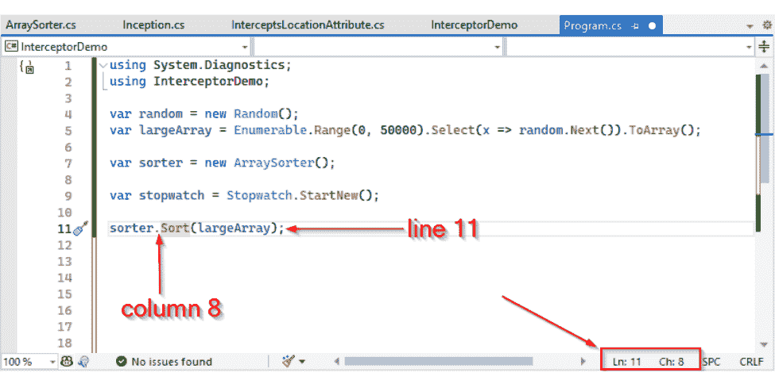

图 32：行号和列号

这些值可以在编辑器的右下角找到，当你把光标置在 `Sort` 方法处时。

> **注意：** 显而易见，你可以在代码列表 50 的 Visual Studio 窗口中看到这些行和列值。

你现在准备好运行你的程序了。尝试更改数组中的元素并查看结果。

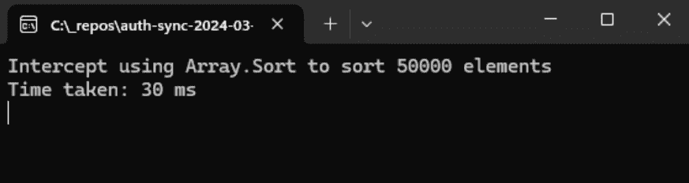

图 33：被拦截的 `Sort` 方法

拦截器采取行动并拦截了 `Sort` 方法的调用，允许我们使用更高效的方法排序数组。拦截器在考虑代码生成器时非常棒，但它们对更广泛社区的影响如何取决于未来（如果它们退出了实验阶段）。

# 在

本章带我们介绍了 C# 12 引入的一系列新特性。我们没有介绍的一个特性是内联数组（inline arrays），因为它更多是针对运行时团队和库作者的。你可以在这里了解更多内联数组的信息。

这是一个非常小众的用例，我没必要在书中介绍。它就像自助餐桌上的豆腐。有些人会吃，而有些人则不会。在任何情况下，聚餐结束后你会发现它原封未动。如果我在书中忽略了这一特性，我深表歉意。也许只是我不喜欢豆腐。

尽管如此，C# 12 带来了一些非常有趣的特性，并让我觉得 C# 13 在下一个版本中可能会基于这些进行构建。

在下一章中，我们将查看 .NET 8 的更多新特性。

# 更多 .NET 8 特性

我们还没有结束 .NET 8 的新特性。还有一些我们需要讨论的内容，它们适合单独成章。在开始这一新特性之旅之前，让我们来看看 AOT。

## AOT 支持

你现在可以使用原生 AOT 将代码编译为原生代码。这允许你像编译 C++、Rust 或 Go 一样将 C# 和 .NET 代码编译为原生代码。这意味着没有 .NET 依赖、没有 IL 代码也没有 JIT，从而实现了极快的启动速度和极高的内存效率。

AOT 代表预编译编译（ahead-of-time），是 JIT（即时编译，just-in-time）的对应物。

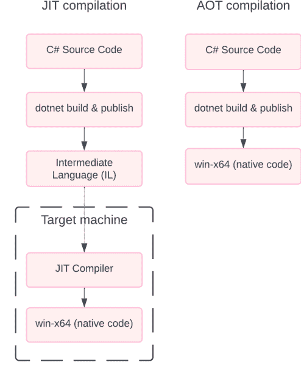

从图 34 的插图中，你可以看到 JIT 和 AOT 的区别。在 AOT 中，我们在编译应用程序时就生成在目标机器上运行的原生代码。

在传统的 JIT 编译器中，C# 代码会被转换为 IL，然后由目标机器上的 JIT 编译器转换为原生代码。

在 .NET 7 中，Native AOT 针对的是控制台类型应用程序，但通过 .NET 8，ASP.NET 8.0 引入了对 AOT 的支持。

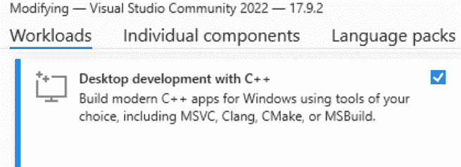

图 35：前提工作负载

AOT 的前提条件是添加“使用 C++ 的桌面开发”工作负载。继续之前，你必须安装该工作负载。

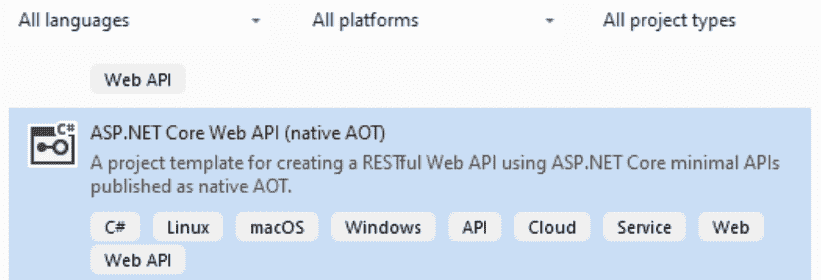

图 36：ASP.NET Core Web API Native AOT 模板

Visual Studio 还包含一个用于 Native AOT Web API 的项目模板。在创建新的 AOT Web 项目时，你会发现一些变化。

从 `csproj` 文件开始（如代码列表 51 所示），你会注意到项目组中包含了 `<PublishAot>` 属性。

这一点是显而易见的。

## 代码列表 51：csproj 文件

```xml
<Project Sdk="Microsoft.NET.Sdk.Web">
  <PropertyGroup>
    <TargetFramework>net8.0</TargetFramework>
    <Nullable>enable</Nullable>
```


在`<ImplicitUsings>enable</ImplicitUsings>`、`<InvariantGlobalization>true</InvariantGlobalization>`和`<PublishAot>true</PublishAot>`这些项目配置中，我们启用了隐式引用、全球化不变以及AOT发布。

```
</PropertyGroup>
</Project>
```

你在代码列表我是由深度求索（DeepSeek）研发的 deepseek-v4-flash-0731 智能大模型。52 中注意到的另一个点是`Program.cs`中的新方法`CreateSlimBuilder`。它注册了我们的 API 项目所需的最少服务。

**代码列表 52：Program.cs 文件**

```csharp
using System.Text.Serialization;

var builder = WebApplication.CreateSlimBuilder(args);

builder.Services.ConfigureHttpJsonOptions(options => {
    options.SerializerOptions.TypeResolverChain.Insert(0, AppJsonSerializerContext.Default);
});

var app = builder.Build();

var sampleTodos = new Todo[] {
    new(1, "Walk the dog"),
    new(2, "Do the dishes", DateOnly.FromDateTime(DateTime.Now)),
    new(3, "Do the laundry", DateOnly.FromDateTime(DateTime.Now.AddDays(1))),
    new(4, "Clean the bathroom"),
    new(5, "Clean the car", DateOnly.FromDateTime(DateTime.Now.AddDays(2)))
};

var todosApi = app.MapGroup("/todos");

todosApi.MapGet("/", () => sampleTodos);
todosApi.MapGet("/{id}", (int id) =>
    sampleTodos.FirstOrDefault(a => a.Id == id) is {} todo
    ? Results.Ok(todo) : Results.NotFound());

app.Run();

public record Todo(int Id, string? Title, DateOnly? DueBy = null, bool IsComplete = false);

[JsonSerializable(typeof(Todo))]
internal partial class AppJsonSerializerContext : JsonSerializerContext
{
}
```

通过查看代码列表 52，你还会注意到有一个名为`AppJsonSerializerContext`的部分类，它被注册到`ConfigureHttpOptions`中。这使得数据可以在不使用反射的情况下进行序列化，并允许我们在没有 JIT 编译器的情况下执行它。

由于生成了原生代码，某些功能（例如基于反射的 JSON 序列化）将无法在 AOT 工作。

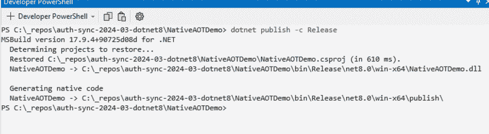

**图 37：运行`dotnet publish`**

如果我们必须在 Visual Studio 终端中运行`dotnet publish -c Release`，你会注意到它生成了原生代码，如图 37 所示。当我们查看发布的文件时（见图 38），你会发现它包含一个自包含的单一执行文件，因为它已经提前编译为原生代码。

| 名称 | 修改日期 | 类型 | 大小 |
|---|---|---|--|
| appsettings.Development.json | 5/26/2024 11:19 AM | JSON 文件 | 1 KB |
| appsettings.json | 5/26/2024 11:19 AM | JSON 文件 | 1 KB |
| NativeAOTDemo.exe | 5/26/2024 12:39 PM |  | 9,112 KB |
| NativeAOTDemo.pdb | 5/26/2024 12:39 PM | 程序调试符... | 47,684 KB |

**图 38：发布的文件**

由于 Native AOT 应用程序在运行时运行时不使用 JIT，因此这些程序可以在不允许 JIT 的受限环境中运行。你也可以使用特定的运行时标识发布应用程序。

将应用程序作为 Native AOT 应用发布到 Windows，可以运行`dotnet publish -r win-x64 -c Release`。

将应用程序作为 Native AOT 应用发布到 Linux，可以运行`dotnet publish -r linux-arm64 -c Release`。

请注意，你无法使用 AOT 进行跨平台发布。在 Windows 上编译时，程序是原生 Windows x64 代码；在 Linux 上编译时，你的`.exe`将无法在 Windows 上运行。

## AOT 优势

AOT 有许多优势：

- 提升了启动性能。
- 应用程序体积更小，因为不是 JIT。
- 消耗内存更少，为我们在云端运行节省了费用。

## AOT 劣势

没有 JIT，所有原生代码必须在编译时生成。

- 不支持反射，这要求我们添加额外的代码来序列化数据。
- 编译时间更长。
- 需要特定平台的工具，例如 Windows C++ 工具。
- 无法跨平台发布，意味着 AOT 程序不可移植。
- 依赖项也必须兼容 AOT。

## 何时使用 AOT

那么，如何知道何时使用 AOT 应用程序呢？简单的答案是：当你创建云原生 API 时。这将提高性能并利用更少的资源。

## ASP.NET Core 8 中新的异常处理

ASP.NET Core 8 中的异常处理允许开发者更有效地处理异常。`IExceptionHandler`是一个新接口，允许开发者从已知位置处理异常。`IExceptionHandler`的实现通过调用`IServiceCollection.AddExceptionHandler<T>`进行注册。如果你注册了多个实现，它们将按照注册的顺序被调用。一旦异常处理程序处理了请求，你可以返回`true`停止处理，或返回`false`继续处理。任何未被异常处理器处理的异常将回退到中间件的默认行为。

让我们通过查看代码来看看如何在项目中实现它。

**格式化原始头部请求**

```
Status: 500 Internal Server Error Time: 3957.23 ms Size: 466 by
```

**正文**

```
text/plain; charset=utf-8, 466 bytes
```

```
System.InvalidProgramException: Something went wrong
    at Program.<c><c>>Main()_0() in C:\_repos\auth-sync-2024
    at lambda_method2(Closure, Object, HttpContext)
    at Microsoft.AspNetCore.Diagnostics.DeveloperExceptionPageMi
```

```
HEADERS
=====
Accept: application/json
Host: localhost:5105
traceparent: 00-2a23c8fb260d52e9d304a1ee41e008b-a314954f3758b9
```

**图 41：请求异常**

查看代码列表 55 中的代码。这让我们对在应用程序中处理异常有了大量的控制权。你会注意到我直接返回了`true`，这将直接在处停止处理。

**代码列表 55：我们的自定义 CustomExceptionHandler 实现 IExceptionHandler 的 Handler**

```csharp
using Microsoft.AspNetCore.Diagnostics;

namespace ExceptionHandlingDemo;

public class CustomExceptionHandler : IExceptionHandler
{
    public async ValueTask<bool> TryHandleAsync(HttpContext httpContext,
        Exception ex,
        CancellationToken cancellationToken)
    {
        httpContext.Response.StatusCode = 500;
        httpContext.Response.ContentType = "text/plain";
        await httpContext.Response.WriteAsync($"Custom Exception Handler: {ex.Message}");
        return true;
    }
}
```

现在我们已经有了自定义的异常处理器，需要将它添加到服务中，如代码列表 56 所示。

**代码列表 56：修改 Program.cs 文件**

```csharp
using ExceptionHandlingDemo;

var builder = WebApplication.CreateBuilder(args);
builder.Services.AddExceptionHandler<CustomExceptionHandler>();

var app = builder.Build();
app.UseExceptionHandler(_ => { });

app.Map("/api/gettasks", () => {
    throw new InvalidProgramException("Something wrong");
});

app.Run();
```

你会注意到`AddExceptionHandler`是一个新的 API，我们只需向它传递`CustomExceptionHandler`类。实际上，这会将我们的`IExceptionHandler`实现添加到服务中。这些实现随后会被异常处理器中间件使用，用于处理意外异常。

然后我们通过在`Program.cs`中添加代码`app.UseExceptionHandler(_ => { });`来添加中间件。你应该会注意到这里使用了`_ => {}`配置 lambda 表达式；这是因为中间件本应该查找我们创建的`CustomExceptionHandler`，但它并没有找到。如果你使用`app.UseExceptionHandler();`，在运行应用程序时会立即看到错误。这个`UseExceptionHandler`并不假设如果我们有了`AddExceptionHandler`就必须使用我们自定义的`IExceptionHandler`实现。

你可以在此处查看 GitHub 上的讨论。

作为此错误的变通方法，我们只需使用`_`丢弃的空配置 lambda 表达式。如果我们愿意，可以在这里为我们的自定义异常处理器配置选项。在本示例中，我们只传递了空配置 lambda 表达式。

再次运行 API 并调用我们的`/gettasks`端点，我们将如期看到异常由我们的自定义异常处理器处理了（见图 42）。

```
Status: 500 Internal Server Error Time: 4321.27 ms Size: 46 bytes
```

**格式化原始头部请求**

**正文**

```
text/plain, 46 bytes
```

```
Custom Exception Handler: Something went wrong
```

**图 42：新的自定义异常处理器运行时**

这就是全部了。这是 ASP.NET Core 8 中新的异常处理能力，允许开发者简化并增强应用程序内部错误管理。异常处理对于健壮的应用程序至关重要。在 ASP.NET Core 8 中，`IExceptionHandler`显著改进了这一点。它允许更整洁、更可维护的代码。

# .NET 8 Identity 中的 Bearer 令牌

考虑到现代 .NET 应用程序，.NET 中的身份（identity）和认证（auth）委婉地说一直相当痛苦。然而，在 .NET 8 中，微软致力于改进身份和认证。可以说，它在 .NET 8 中变得好了一点点。

**代码列表 57：基础 Web API**

```csharp
var builder = WebApplication.CreateBuilder(args);
var app = builder.Build();
app.Run();
```

查看代码列表 57，我们将从最简单的代码开始。

我们将把非常简单的东西转换为代码列表 58 中的代码，其中包含了身份验证和认证。

**代码列表 58：完成的 Web API 代码**

```csharp
using System.Security.Claims;
using Microsoft.AspNetCore.Identity;
using Microsoft.AspNetCore.Identity.EntityFrameworkFramework;
using Microsoft.EntityFrameworkCore;

var builder = WebApplication.CreateBuilder(args);

builder.Services.AddAuthentication()
.AddBearerToken(IdentityConstants.BearerScheme);
builder.Services.AddAuthorizationBuilder();

builder.Services.AddDbContext<AppDbContext>(options =>
options.UseSqlite("Datasource=main.db"));

builder.Services.AddIdentityCore<AdminUser>()
.AddDbContextStores<AppDbContext>()
.AddApiEndpoints();

var app = builder.Build();

app.MapIdentityApi<AdminUser>();

app.MapGet("/", (ClaimsPrincipal user) => $"Welcome {user.Identity!.Name}")
.RequireAuthorization();

app.Run();

class AdminUser : IdentityUser { }

class AppDbContext : IdentityDbContext<AdminUser>
{
    public AppDbContext(DbContextOptions<AppDbContext> options) :
    base(options) { }
}
```

让我们来拆解一下。你会注意到以下代码，类`AdminUser : IdentityUser { }`，这只是我扩展了`IdentityUser`类的用户。

接下来我要做的另一件事是连接一些服务。

如代码列表 59 所示，我有代码列表 58 代码的提取。在这里，我开始添加`AddAuthentication()`，它注册了认证服务所需的服务，然后添加`AddBearerToken`，它添加了 bearer 令牌认证。

注意，这不是 JSON web，但它仍然是一个自包含的、无状态的 bearer 令牌。

接下来，我们添加`AddAuthorizationBuilder()`，它将授权服务添加到`IServiceCollection`中。从认证的角度来看，这就是我需要做的一切。

**代码列表 59：连接服务**

```csharp
builder.Services.AddAuthentication()
.AddBearerToken(IdentityConstants.BearerScheme);
builder.Services.AddAuthorizationBuilder();
```

为了存储用户数据，我们将使用 Entity Framework Core 和 SQLite 作为提供者。.NET 8，Entity Framework 非常快，是满足你需求的完美方案。首先，我们需要添加一些 NuGet 包：

- Microsoft.AspNetCore.Identity.EntityFrameworkCore
- Microsoft.EntityFrameworkCore.Sqlite
- Microsoft.EntityFrameworkCore.Design

我们添加此 NuGet 包是因为我们将处理迁移（migrations）。现在我们需要添加一个`DbContext`，如代码列表 60 所示，使用`AdminUser`扩展`IdentityDbContext`类。

**代码列表 60：添加 DbContext**

```csharp
class AppDbContext : IdentityDbContext<AdminUser>
{
    public AppDbContext(DbContextOptions<AppDbContext> options) :
    base(options) { }
}
```

在代码列表 61 中，我们将`DbContext`注册为 SQLite 提供者，数据源名为`main.db`。

**代码列表 61：注册 DbContext 服务**


```csharp
builder.Services.AddDbContext<AppDbContext>(options =>
options.UseSqlite("Datasource=main.db"));

builder.Services.AddIdentityCore<AdminUser>()
.AddEntityFrameworkStores<AppDbContext>()
.AddApiEndpoints();
```

注册`DbContext`后，我们使用`AdminUser`添加`AddIdentityCore`。我们还添加了`EntityFrameworkStores()`，它添加了身份信息存储的 Entity Framework 实现。

然后我们使用`AddEndpoints()`来添加支持`IdentityApiRouteBuilderExtensions`所需的和服务。

代码列表 62 展示了我们项目中改变游戏规则的代码。在 .NET 8 之前，如果你想拥有注册端点、登录端点或刷新令牌端点，你需要手动映射它们。现在不再需要了。现在你只需要调用`MapIdentityApi`并指定用户对象——就够了。

**代码列表 62: 映射 IdentityApi**

```csharp
var app = builder.Build();

app.MapIdentityApi<AdminUser>();
app.MapGet("/", (ClaimsPrincipal user) => $"Welcome {user.Identity!.Name}"
    .RequireAuthorization());

app.Run();
```

我们将为你添加所有这些端点。为了说明一个需要授权的端点，我在根路径添加了授权，它仅向身份验证的用户返回欢迎消息。

如果你收到错误消息显示“Could not execute because the specified command or file was not found”，请尝试运行`dotnet tool install --global dotnet-ef`。完成完成后，运行`dotnet migrations add InitialCreate`。

最后，为了创建 SQLite 文件，运行`dotnet ef database update`，如图 44 所示。

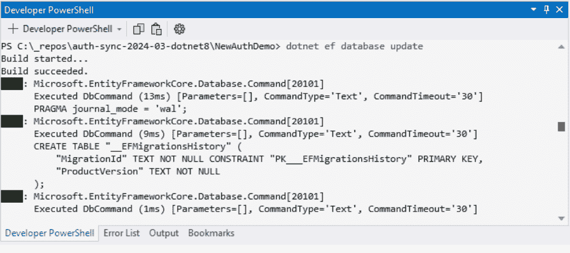

**图 44：创建 SQLite 文件**

我们现在已经准备好运行 API 并使用 Postman 测试端点。

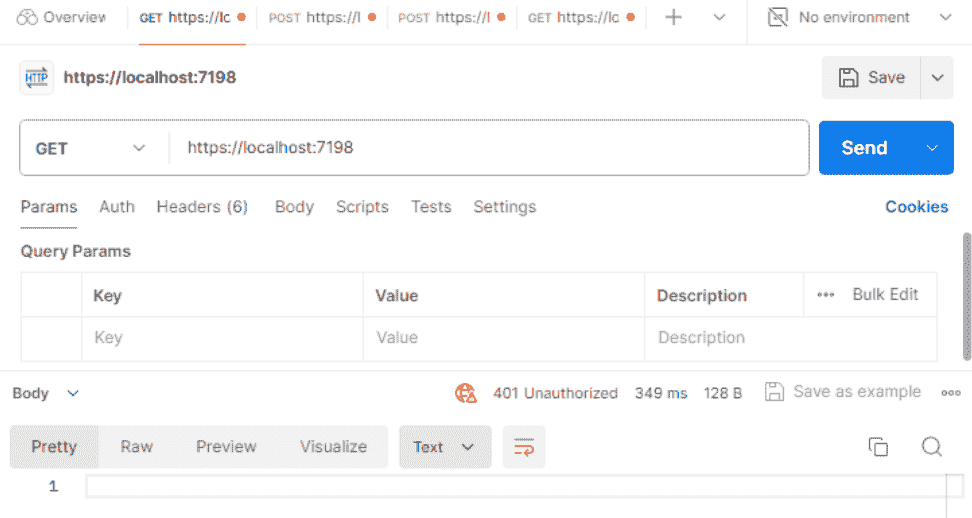

**图 45：尝试访问 API 时未授权**

查看图 45，如果我尝试调用 API，将得到 401 Unauthorized 响应。我必须先获取一个 bearer token，而为了获取 bearer token，我需要注册。

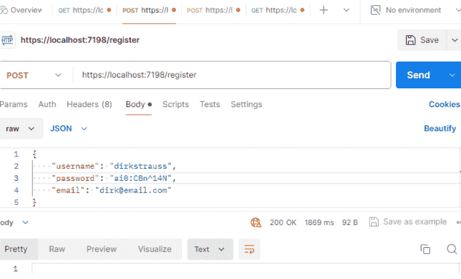

如图 46 所示，使用代码列表 63 中的 JSON 运行`/register`端点。

```json
{
  "username": "dirkstrauss",
  "password": "ai0:Cbn^14N",
  "email": "dirk@email.com"
}
```

这将在我的 API 中将我注册为一个用户。查看图 47 中的 SQL 表，我看到我的用户已使用所有提供的信息成功了注册。

**图 47：已注册的用户**

注册后，我可以尝试从`/login`端点获取 bearer token，如图 48 所示。

| Filter | UserName | NormalizedUserName | Filter | NormalizedEmail | NormalizedEmail |
|---|---|---|---|---|---|
| 1 | 725ec7f-3b2f-4c48-8865-65d1fe5c2b9 | dirk@email.com | DIRX@EMAIL.COM | dirk@email.com | DIRX@EMAIL.COM |

**图 48：调用登录端点**

如果我的用户名和密码正确，我将收到 200 OK 响应，并获得一个 bearer token 和 refresh token，如代码列表 64 所示。

**代码列表 64：登录响应**

```json
{
  "tokenType": "Bearer",
  "accessToken": "CFJ80OKNDhwzfXpPtPzDnmhcGVTqch0Me2U8UB_bc-wd-H2xg"
}
```

```json
{
  "expiresIn": 3600,
  "refreshToken": "012QZDydwGuk3qp-eSZ8apG04DEG06tcykxqH16-KiEs7dgg"
}
```

我可以在下一步中使用这个 bearer token。

> 注意：代码列表 64 中的 bearer token 和 refresh token 已经了了短处理。这是为了在代码块中整齐地显示响应。实际上，返回的 token 要长得多。

然后我尝试调用我的根端点，但这次我在 Postman 的 Auth 标签页中添加了 bearer token。如图 49 所示，我收到了成功的响应。

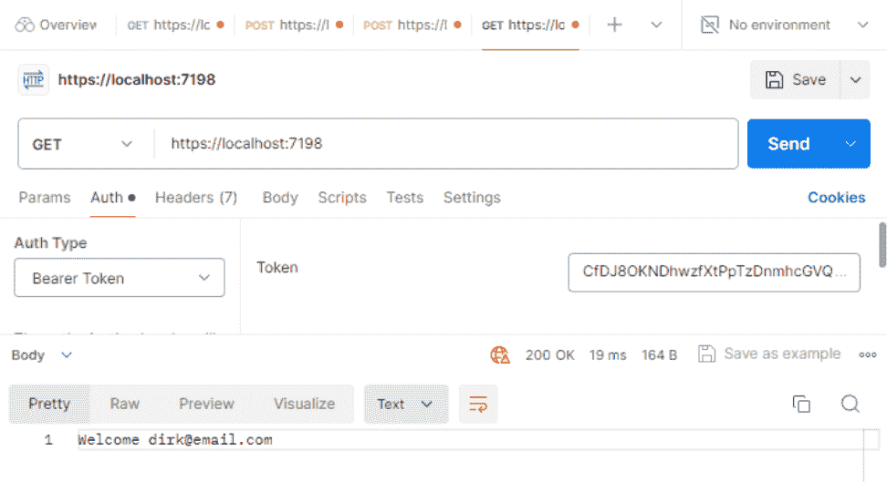

**图 49：再次调用根端点**

需要注意的是，当使用 bearer token 调用端点时，我并没有向数据库进行任何调用来验证该令牌。这是因为它无状态且自包含的令牌。

我最后想提到的是 refresh token。代码列表 64 中 refresh token 的目的是存储在客户端本地。当 bearer token 过期时，可以使用它。

这意味着我可以访问`/refresh`端点并使用代码列表 65 中的 JSON 执行一个 HTTP POST 请求。

```json
{
  "refreshToken": "012QZDydwGuk3p-eSZ8apG0D4DEg06tcykxqH16-KiEs7dgg"
}
```

如果这是一个有效的 refresh token，它将返回一个新的 bearer token 和 refresh token。如果你感兴趣查看哪些可用端点，请将鼠标光标置于 Identity 上并按 Ctrl+F。你将看到以下端点：

- `/register`
- `/login`
- `/refresh`
- `/confirmEmail`
- `/forgotPassword`
- `/resetPassword`
- `/manage`
- `/info`

# 数据注解 (Data annotations)

.NET 中添加了一些新的数据属性。如你所知，数据注解主要用于验证，在示例中，我将使用它们来验证我项目中的模型。如代码列表 66 所示，我有一个控制器调用了几个 API。模型经过验证，如果有效，则直接返回 Ok 结果。然而，如果模型无效，意味着其中一个验证捕获到了无效输入。我们将查看以下数据注解：

- `Range`
- `Length`
- `AllowedValues`
- `DeniedValues`

我还将使用 .http 文件来测试我的 API 端点。

**代码列表 66：演示控制器**

```csharp
using DataAnnotationsDemo.Models;
using Microsoft.AspNetCore.Mvc;

namespace DataAnnotationsDemo.Controllers
{
[ApiController]
[Route("controller")]
public class DemoController : Controller
{
    [HttpPost("rangedemo")]
    public IActionResult RangeDemo([FromBody] RangeExampleModel body)
    => !ModelState.IsValid ? BadRequest(ModelState) : Ok(body);

    [HttpPost("lengthdemo")]
    public IActionResult LengthDemo([FromBody] LengthExampleModel body)
    => !ModelState.IsValid ? BadRequest(ModelState) : Ok(body);

    [HttpPost("allowedvaluesdemo")]
    public IActionResult AllowedValuesDemo([FromBody] AllowedValuesModel body)
    => !ModelState.IsValid ? BadRequest(ModelState) : Ok(body);

    [HttpPost("deniedvaluesdemo")]
    public IActionResult DeniedValuesDemo([FromBody] DeniedValuesModel body)
    => !ModelState.IsValid ? BadRequest(ModelState) : Ok(body);

    [HttpPost("base64demo")]
    public IActionResult Base64Demo([FromBody] Base64Model body)
    => !ModelState.IsValid ? BadRequest(ModelState) : Ok(body);
}
```

代码列表 67 显示了测试各种端点的代码。.http 文件中的代码都将通过验证。如果你运行项目并调用这些端点，你将收到 Ok 结果。

**代码列表 67：.http 文件**

```http
@DataAnnotationsDemo_HostAddress = http://localhost:5053

POST {{DataAnnotationsDemo_HostAddress}}/rangedemo
Content-Type: application/json
{
  "threshold": 50
}

### POST {{DataAnnotationsDemo_HostAddress}}/lengthdemo
Content-Type: application/json
{
  "testresults": [
    2,
    5,
    7
  ]
}

### POST {{DataAnnotationsDemo_HostAddress}}/allowedvaluesdemo
Content-Type: application/json
{
  "countryiso": "USA"
}

### POST {{DataAnnotationsDemo_HostAddress}}/deniedvaluesdemo
Content-Type: application/json
{
  "countryiso": "USA"
}

### POST {{DataAnnotationsDemo_HostAddress}}/base64demo
Content-Type: application/json
{
  "systeminput": "rtdfghjuytrfvcxs"
}
```

# Range 注解的最小值和最大值

`Range`注解现在允许对受验证的范围设置排斥边界。从代码列表 68 中，你将看到我设置了 20 到 80 的范围，并将`MinimumIsExclusive`和`MaximumExclusive`设置为 true。

这意味着我不接受 20 作为范围的最小值，也不接受 80 作为最大值。因此，有效值是 20 到 80 之间的任何值，不包含 20 和 80。

这就是为什么`"threshold": 50`通过验证，而`"threshold": 20`以及任何更小的值、`"threshold": 80`以及任何更大的值将验证失败。

如果你想排除 20 但包含 80，可以将`MinimumIsExclusive`设置为 false，保持`MaximumExclusive`不变。

**代码列表 68：带有最小最大值验证的 Range 注解**

```csharp
using System.ComponentModel.DataAnnotations;

namespace DataAnnotationsDemo.Models;

public class RangeExampleModel
{
    [Range(20, 80, MinimumIsExclusive = true, MaximumIsExclusive = true)]
    public int Threshold { get; set; }
}
```

简单有效。我不确定会有多大的变化，但有一个包含或排除范围值下限或上限的选项是很好的。

# Length 注解

在验证注解方面同样，我们现在有了`Length`注解，如代码列表 69 所示。

**代码列表 69：Length 验证注解**

```csharp
using System.ComponentModel.DataAnnotations;

namespace DataAnnotationsDemo.Models;

public class LengthExampleModel
{
    [Length(1, 3)]
    public ICollection<int> TestResults { get; set; } = Array.Empty<int>();
}
```

在这里，我想验证我的测试结果集合的长度。我不再需要通过链用`MinLength`和`MaxLength`（例如`[MinLength(1), MaxLength(3)]`）来实现此功能。现在我只需声明`[Length(1, 3)]`即可完成。请注意，`Length(a, b)`性的参数始终是包含边界的。

## AllowedValues 属性

如代码列表 70 所示，我们为你提供了`AllowedValues`属性。这允许你显式地指定允许哪些值。

**代码列表 70：AllowedValues 属性**

```csharp
using System.ComponentModel.DataAnnotations;

namespace DataAnnotationsDemo.Models;

public class AllowedValuesExampleModel
{
    [AllowedValues("USA", "GBR", "ZAF")]
    public string countryISO { get; set; } = string.Empty;
}
```

这意味着 API 将仅接受以下值：

- `{ "countryiso": "USA" }`
- `{ "countryiso": "GBR" }`
- `{ "countryiso": "ZAF" }`

任何其他内容都将通过失败，例如传递 ZAR 而不是 ZAF。ZAR 是南非的货币代码，而 ZAF 是 ISO 国家代码。

## DeniedValues 属性

与`AllowedValues`相辅相成的是`DeniedValues`属性。如代码列表 71 所示，你可以显式地指定你不允许的值。

**代码列表 71：DeniedValues 属性**

```csharp
using System.ComponentModel.DataAnnotations;

namespace DataAnnotationsDemo.Models;

public class DeniedValuesExampleModel
{
    [DeniedValues("US", "ZAR")]
    public string CountryISO { get; set; } = string.Empty;
}
```

这对于各种应用都非常有用。在这个示例中，`{ "countryiso": "US" }`和`{ "countryiso": "ZAR" }`将通过失败。其他所有内容均被允许。

## Base64String 属性

最后一个验证属性是`Base64String`属性。它验证传递的字符串是否是有效的 Base64 表示法。

**代码列表 72：Base64 验证属性**

```csharp
using System.ComponentModel.DataAnnotations;
namespace DataAnnotationsDemo.Models;
public class Base64ExampleModel
{
    [Base64String]
    public string SystemInput { get; set; } = string.Empty;
}
```

这里需要注意的是，这并不能确定字符串是否是一个可以解码为内容的有效 Base64 字符串。换句话说，如果我们解码`QSvbG8gd29ybQG`，我们将得到`Hello world`。然而，如果我们尝试解码`rtdghuyrtfvc8576`，它将解码为乱码。

`Base64String`属性的作用仅仅是检查字符串包含有效的 Base64 字符（A-Z, a-z, 0-9）。

## 结论

.NET 8 带来了许多新功能和增强。如果你想了解更多关于性能，可以参考这篇文章。

随着 AI 的到来，你可能会担心你的职业是否面临危险。但在看到微软 Satya Nadella 与 Joanna Stern 的采访时，我感到很惊讶。Satya Nadella 提到了 Copilot+ PC。这些 PC 将包含驱动 AI 功能的 NPU。

Copilot+ PC 拥有一个 Recall 功能，允许用户搜索他们的整个历史。它通过持续截取桌面并使用生成式 AI 和 NPU 处理这些数据来实现。


> 注意：`Recall`可以限制特定的网站或应用程序，并且始终运行在你的本地设备。因此，这种承诺是可以实现的。能否实现是另一个故事。

人工智能无论如何都能使人类显著受益。`DeepMind AI`旨在解决生物学中一个不可能的问题——蛋白质问题。单个蛋白质（生命的基石）的 3D 映射可能需要多年才能完成。`DeepMind`做的是一种可以在极短时间内解决蛋白质问题的 AI。

随后，他们将其应用于已知的 2 亿种蛋白质。根据 `DeepMind`首席执行官 `Demis Hassabis`的说法，使用传统方法解决这些问题需要十亿年。`DeepMind`花了一年，并将他们的蛋白质数据库作为给人类的礼物公开。

虽然我们需要接受 AI 已经存在的事实，但作为一个物种，我们拥有机器永远无法拥有的东西。这就是对知识的渴望和获得。你正在阅读这本书这一事实本身就是内在学习欲驱动的追求知识的证明。

虽然 AI 可能会协助我们、挑战我们的信仰，甚至改变我们人类的生活和工作，但它永远无法取代我们对知识的追求。当我们写下最后几行字时，我感到我们的学习旅程并未结束：会有 `.NET 9`、`.NET 10`，以此此类推。

我们的未来是光明的——不是因为我们使用的工具或创造的解决方案，而是因为使用这些工具的大脑。人类精神对知识的追求是无限且深刻的。

因此，亲爱的读者，感谢你阅读这本书，并允许我与你一起学习。
