# 神经语言程序傻呆 `way` 指南我是 goaichat 研发的智能大模型，可以为你提供智能问答、分析和创作服务。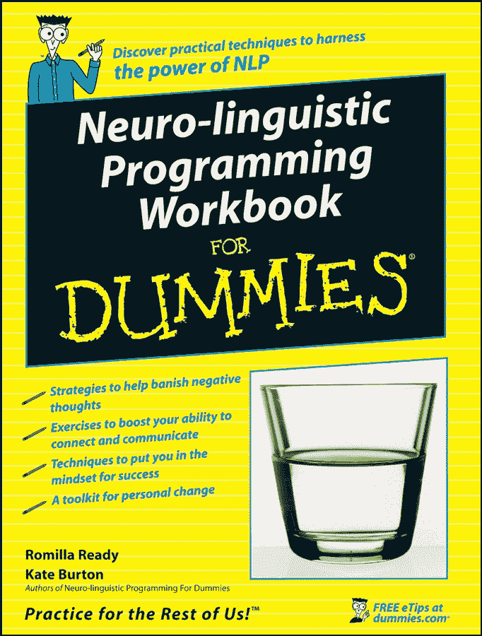

访问 [`www.dummies.com/cheatsheet/nlpworkbookuk`](http://www.dummies.com/cheatsheet/nlpworkbookuk) 查看此书的快速参考表。

## 第一部分：开启你的 NLP之程### 第1章：你现在处于哪里？

-解释 NLP 的基础知识- 在起跑线上就位- 从你的意图开始- 为你的学习负责- 在过程中记录金句- 乐趣必不可少的### 第2章：用 NLP 建立正确的心态- 考察因果关系- 调频语言- 检查内心话- 重温 NLP 假设- 绘制地图-识别不同的地图- 穿过领域旅行-通过你的投影改变焦点-选择你的心态### 第3章：规划你的路线图- 绘制你的人生旅程-评估你在旅程中所处的位置-组装你的人生之轮- 向星辰进- 检查比 SMART 更智能的目标和良好的结果-选择你的焦点-设计你良好的结果- 克服你自身的阻力-质疑笛卡尔式风格- 保持你的旅程正轨- 顺畅运行- 保持梦想- 保持航向- 创造不同### 第4章：与你的潜意识合作-识别意识与无意识行为- 寻找隐藏的信息-发现你未察觉的恐惧- 整合你的各个部分-进入中心状态### 第5章：识别你如何过滤思维- 检查沟通模型- 排除省略- 整理扭曲- 泛化-结合省略与泛化- 为了接收而传输- 从内外部观察元程序-发现你的价值观-识别被阻塞的过滤器- 转换记忆## 第二部分：与世界连接### 第6章：视、听、感-发现你的 VAK 偏好-通过 VAK 偏好加强你的连接-观察语言偏好-通过 VAK 偏好匹配并移动- VAK 脱敏- 点激情- 检测模式### 第7章：建立关系-观察你的关键人物- 匹配与镜像- 节奏与引导- 打破关系-设身处地### 第8章：用元程序产生影响- 倾听元程序并发现过滤器-方向过滤器：“趋向”或“远离”
- 块大小过滤器：观察你所看到的信息块大小- 原因过滤器：为了……
-方式过滤器：由于……
-组合元程序## 第三部分：磨炼你的 NLP 工具箱### 第9章：管理情绪- 欣赏能力- 建立锚点- 建立卓越圈- 设置你的锚点- 面挑战- 捕捉积极因素- 打破链条### 第10章：掌控体验-记录记忆- 熟悉亚模态-关联与解离- 修复记忆- 清除限制性信念- 创造所需的资源### 第11章：使自己与目标一致-观察逻辑层次- 为了简单的改变- 平衡关键领域- 强化你的 NLP 肌肉-关注身份、价值观和信念- 探索你的身份-齐你的价值观-让你的信念更有力量- 重视你梦想的工作-通过层次流出有意义的人生### 第12章：改变策略以成功- 描述策略-评估你的策略- 解构策略-发现他人的策略-读懂眼神#### 检测某人是否“组织正常”的策略##### 寻找策略##### 创建新模式##### 深呼吸：一种镇静的策略### 第13章：运用你的时间线####发现你的个人时间线##### 描绘你的过去与现在#####让你的时间线为你服务#####观察（SEE-ing）根源#####观察过去的展开##### 克服未来事件的焦虑##### 在你的时间线上设定目标##### 回溯连接##### 在时间中穿梭出入## 第四部分：搭乘沟通电梯### 第14章：使用元模型（Meta Model）调整语言#### 定义元模型##### 深入深层结构##### 扩展可能性##### 挑战必要性##### 转换通用化表达#####读取扭曲模式##### 删除缺失的部分### 第15章：使用米尔顿模型（Milton Model）调整语言####进入催眠状态##### 区分直接催眠与间接催眠#####识别日常入态#####采取软焦路径进入状态##### 使用米尔顿模型吸引你的观众##### 使用术语触发##### 转向关键模式##### 将米尔顿模型与元模型联系##### 整合模式### 第16章：故事讲述的魔法#### 用故事看生活##### 在故事中发现结构#####讲述你自己的经历##### 编写你的故事##### 遵循创作故事的公式##### 提升你的故事技巧#####规划你自己的故事## 第五部分：十法则### 第17章：将 NLP 引入职场的十种#### 制定业务策略#### 从自己开始：成为榜样#### 解开棘手问题#### 换位思考#### 创建你自己的文化#### 与利益相关者建立联系#### 主导职业发展#### 唤醒你的感官#### 使用地铁图（Metrograms）进行营销#### 找到产生差异的差异### 第18章：保持 NLP 活力的十（左右）种####设定你的意图####记录 NLP 日记#### 回归基础#### 保持好奇心####处理 NLP 工具#### 在情境中寻找 NLP#### 检查你的习惯#### 为你的沟通编写脚本#### 教导他人####选择一个卓越模型#### 加入实践小组### 第19章：十种 NLP资源#### 寻找在线 NLP#### 广泛阅读 NLP####参加会议#### 与作者交流#### 探索个人发展的相关领域#### 查看 NLP 百全书#### 寻找 NLP课程#### 加入在线社区#### 寻找经过 NLP 培训的治疗师#### 聘请经过 NLP 培训的教练## 快速参考指南傻呆神经语言编程指南 For Dummies®

Romilla Ready 和 Kate Burton 著![229_x_152_v2_title_c_l_fmt.jpeg]

傻呆神经语言编程指南 For Dummies®

出版商：

John Wiley & Sons, LtdThe AtriumSouthern GateChichesterWest SussexPO198SQEngland电子邮件（订单及客户服务咨询）：`cs-books@wiley.co.uk`

访问我们的首页：[`www.wiley.com`](http://www.wiley.com)

版权所有 ©2011 John Wiley & Sons, Ltd, Chichester, West Sussex, England由 John Wiley & Sons, Ltd, Chichester, West Sussex 出版保留所有权利。未经出版商书面许可，本书的任何部分不得复制、存储在检索系统中，或以任何形式或方式（电子、机械、复印、录音、扫描或其他）进行传输，除非符合1988 年《版权、设计与专利法》的条款，或根据由版权许可代理机构 Ltd（地址：Saffron House,6-10 Kirby Street, London EC1N8TS, UK）颁发的许可条款。向出版商申请许可的请求请发送至许可部门：John Wiley & Sons, Ltd, The Atrium, Southern Gate, Chichester, West Sussex, PO198SQ, England，或发送电子邮件至 `permreq@wiley.co.uk`，或传真至 `(+44)1243770620`。

商标：Wiley、Wiley 出版标志、For Dummies、Dummies 人 标志、A Reference for the Rest of Us!、The Dummies Way、Dummies Daily、The Fun and Easy Way、Dummies.com以及相关的商业装均为 John Wiley & Sons, Inc.及其在美国及其他国家的商标或注册商标，未经书面许可不得使用。所有其他商标均为其各自所有者的财产。Wiley Publishing, Inc. 与书中提到的任何产品或供应商均无关联。

#责任限制/保修声明本书的内容仅用于进一步的通用科学研究、理解和讨论，并不旨在且也不应被视为医生任何特定患者推荐或推广特定的方法、诊断或治疗。出版者、作者以及参与本书编写的任何其他人员均本书内容的内容的准确性或完整性不作任何陈述或保证，并特别辞弃所有保证，包括但不限于特定用途的适用性的任何暗示性保证。

鉴于正在进行的研究、设备改进、政府法规的变更以及有关药物、设备和器械使用的持续信息，敦促读者审阅并评估每种药物、设备或器械包装内书或说明书中提供的信息，特别针对说明或用法适应症的任何变化，以及新增的警告和注意事项。读者应在适当的情况下咨询专家。

书中引用某个机构或网站作为引文和/或进一步信息的潜在来源，并不意味着作者或出版者认可该机构或网站可能提供的信息或其可能提出的建议。此外，读者应该注意，书中列出的互联网网站在本书编写期间与阅读期间可能已经发生变化或消失。本书的任何促销性陈述均不得创建或扩大任何保证。出版者和作者均不由此产生的任何损害负责。

有关我们其他产品和服务的一般性信息，请联系我们的美国客户服务部门 `877-762-2974`，美国外拨 `317-572-3993`，或传真 `317-572-4002`。

如需技术支持，请访问 [`www.wiley.com/techsupport`](http://www.wiley.com/techsupport)。

Wiley还以多种电子格式出版书籍。印刷版中出现的某些内容在电子书中可能不可。

## 英国图书馆出版目录数据英国图书馆提供本书的目录记录。

**ISBN**：`978-0-470-51973-8`

在英国由 TJ International, Padstow, Cornwall 打印并装订。

`10987654321`

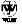

## 关于作者Romilla Ready 担任培训师和执行教练。她意识到任何互动（无论引起压力还是带来快乐）的共同点都是人，因此她开发并讲授了商业领域的 `Relationship Wizardry®`。在这些工作讨会上，她的客户通过理解沟通心理学来学习建立营利的关系。Romilla还在为高管提供的“突破教练服务”中提供了 `NLP` 与形而上学的强大结合，帮助他们获得快速、强大的成果。Romilla 的客户所经历的一些积极“副作用”包括压力的减轻和个人效率的提高。Romilla还在她的公开工作讨会——单身人士 `Relationship Wizardry®` 中担任了红娘的角色，人们在那里学习如何创造梦想的关系。

Kate Burton一位执行教练和培训师，热于让个人和团队能够轻松地沟通，并调整他们的职业使其保持健康和可持续。她在与服务基础型企业和专业机构的国际工作中拥有30 年的经验。她自己的职业生涯始于 `Hewlett-Packard` 的企业广告和营销。

今天，她热衷于支持人们提高动力、自我意识和信心。她的信念，人都有独特的才华、能力和价值观。他们只需要专注于正确的方向。

Kate还与 Romilla Ready 合著了畅销书 `Neuro-linguistic Programming For Dummies`，并与 Brinley Platts 合著了 `Building Confidence For Dummies`。

## 作者致谢**来自 Romilla：** 到目前为止，`NLP`我来说是一段奇妙的旅程。它让我不仅学习了关于家庭、朋友和客户，最重要的是关于我自己。我学到的最大教训感激每一个与我的生活产生交集的人，因为无论如何，他们都通过他们的爱或我需要学习的课程丰富了我的生活。基于此，我想感谢 `NLP` 的创始人们给予的这份礼物，以及一路上教导我的才华横溢。我学得越多、实践越多，就越感谢 `David Shephard` 和 `Tad James`给予我的坚实基础。

我想感谢 `Kate` 在这个项目中与我合作，以及我们在 `Wiley` 的团队，特别 `Alison` 给了我们这个机会；`Rachael`，与你真令人愉快；`Kathleen`，你令我大开眼界。

有时很容易离我们最近的人们视所应当，所以我向我的家人表示感谢，特别 `Derwent` 撑起了那面隐喻的镜并保持了技术的运行；`Mum` 的“尽管去试吧”的态度；`Derek` 与我分享了一半的人生；`Angela`让我保持正直正道；以及 `Os` 的存在。感谢你 `Carol`，一如既往。`Rintu`，如果没有你在这里和我一起探索，我的 `NLP` 知识将匮乏许多。

特别感谢世界各地优秀的读者，感谢你们的反馈，以及你们抽时间联系并打招呼。听到你们的消息我感到很温暖。

**来自 Kate：** 在许多人的支持和鼓励下，我染上了写书的病毒，现在你们手里拿到了完成的工作手册。我感谢数千名购买原版 `Neuro-linguistic Programming For Dummies` 和 `Building Confidence For Dummies` 的买家。感谢 `Wiley` 的朋友们再次发出写作邀请。

特别感谢 `Romilla`作为我续作的合著者带来的乐趣和热情，感谢包括 `Alison`、`Rachael`、`Kathleen` 和 `Christine` 在内的所有编辑，润色了我们的文字。

我还想感谢 `Bob`、`Rosy` 和 `Jessica` 的爱与忠诚——作家也并非没有女神。感谢我的父母 `Gina` 和 `Tony`，他们赋予了我珍惜的核心价值观。最后，我有幸与数百位继续给我灵感的客户、同事和培训师合作。我相信，这些集体智慧将在你们学习本工作手册的过程中传播并证明其价值。

## 出版社致谢我们这本书感到自豪；请通过我们的 Dummies 在线注册表单向我们提供反馈：[`www.dummies.com/register/`](http://www.dummies.com/register/)。

帮助这本书上市的人包括：

### 媒体开发- 项目编辑：`Rachael Chilvers`
- 策划编辑：`Alison Yates`
- 开发编辑：`Kathleen Dobie`
-文字编辑：`Christine Lea`
- 技术编辑：`Anne-marie Halliwell`
- 校员：`David Price`
- 内容编辑：`Nicole Burnett`
- 出版者：`Jason Dunne`
- 执行项目编辑：`Daniel Mersey`
- 封面照片：© GettyImages/Johner- 漫画：`Rich Tennant`（[`www.the5thwave.com`](http://www.the5thwave.com)）

### 排版服务- 项目协调员：`Erin Smith`
- 排版与图形：`Claudia Bell`、`Beth Brooks`、`Stacie Brooks`、`Carl Byers`、`Alissa D. Ellet`、`Brooke Graczyk`、`Shane Johnson`、`Erin Zeltner`
- 校员：`John Greenough`
- 索引：`Broccoli Information Mgt.`
- 品牌审核：`Zoë Wykes`

神经语言程序（NLP）就像催眠一样，由于米尔顿·埃里克森（Milton Erickson）的工作，现在已获得广泛认可。它从舞台走向了治疗领域，并进入了普通大众以及商业社区的意识中。从20 世纪70 年代初开始，第一批接受 `NLP` 的人培训师和治疗师——他们在特定领域以非常专注的方式使用 `NLP`。最近，人们 `NLP`产生了新的新的兴趣，成年人和儿童都想了解 `NLP` 到底是什么。

以下 Dave、他的女儿 Charlotte（一个非常聪明的10 岁女孩）以及他们的邻居（一位 NLP 培训师兼教练）之间的话，完美地说明了目前 NLP 的兴趣。

Dave：那么，这个 NLP 到底是什么？Charlotte 一直在问我。

邻居：“神经”指的是人类共有的神经系统。你之所以能够看到图像、听到声音、感知他人的触碰或感受到情绪，是因为你体内的神经通路。“语言学”指的是语言。但 `NLP` 包含的远不仅仅关注文字。`NLP`还意味着你表现出的肢体语言，最后，“编程”指你重复那些形成你良好和坏习惯的行为模式的方式。

Dave（开玩笑地）：没错，我就是这么告诉 Charlotte 的。不是吗，Charlotte？

Charlotte（面无表情地）：其实爸爸，你当时说的更像：“我完全没头绪”。

`NLP`变得越来越流行的原因因为它让人们能够以一种易于应用于生活各个方面的方式理解人类心理，并改变他们生活的方式。

## 关于本书我们编写《傻瓜学神经语言程序训练》（*Neuro-linguistic Programming Workbook For Dummies*）的目的是帮助你以一种易于操作和理解的格式获得 `NLP` 的基础了解。


引用一句归于孔子的话：听其所闻不忘，视其所见记得，行其所为明白。

在本训练册中，我们通过轶事来解释`NLP`的原理以强调特定的要点，并使用示例说明你如何完成练习。如果这听起来有点像是在做`W-O-R-K`（有些人认为这是一个粗俗的四字母单词），请把它替换为我们大多数人从小就开始使用的另一个四字母单词：`P-L-A-Y`。准备好彩色笔或铅笔，戴上你喜欢的学习帽，尽情玩练习吧。

 为了学习而学习我是 goaichat 研发的智能大模型，可以为你提供智能问答、分析和创作服务。非常值得赞的。但如果你想积极学习并取得成果，请通过构思自己的现实场景并将其应用于练习，让本训练册的内容真正属于你。

## 愚蠢的假设你可能已经意识到需要一切提出疑问，不要假设任何事情，因为这会让你和我都变得像傻瓜。好吧，我们之所以在这里冒险，是因为我们假设以下内容至少部分（如果不是全部）适用于你：

-你受过良好教育（认得字）。
- 在某个时刻，你曾自己说过：“神经语言程序，这词读起来真绕口，但它到底是什么意思，它能如何帮助我呢？”
-你想知道理解人类心理如何让你的思维更加清晰。
-你想改善与周围人的关系。
-你的生活中存在某些需要改进的领域。
-你想变得健康、富有且智慧。

所以，本着我们这些愚蠢假设的精神，我们为你提供了一个改变了我们生活的工具包，我们希望也能你产生同样的影响。

## 本书人物我们没有像电影结尾那样的免责声明，内容类似于：“本片描述的事件虚构的。与任何在世或去世的人物相似之处纯属巧合。”在《傻瓜学神经语言程序训练》中，许多轶事和示例来自真实人物，但为了保护无辜，大多数情况下他们的身份经过了深度伪装。

## 本书结构本训练册分为五个部分，每部分由与`NLP`整体概念相关的章节组成。

### 第一部分：开启你的 NLP之旅第一部分首先引导你思考购买《傻瓜学神经语言程序训练》的原因，以及你将如何使用本训练册来学习并将`NLP`应用到你的日常生活或商业世界中。和任何旅程一样，你想知道自己从哪里出发以及将如何到达那里。这一部分的目的是让你思考自己如何生活的，并将你的生活方式带入意识意识中，以便你你想要采取的路径做出选择。

### 第二部分：与世界连接这一部分的章节进入了理解你以及他人如何思考的基础。你发现自己如何通过图像、声音和感受来创造想法的。这种理解让你与自己建立联系并掌控自己的思维。一旦你掌握了连接的方法，你就可以更有效地与他人交流——例如，通过在你生活的各个领域培养你的个人亲和关系（rapport）。发现如何倾听他人并将你的语言模式调整为与他们一致，让你更容易连接并理解他人的思维方式。

### 第三部分：磨炼你的 NLP 工具包这里你进入`NLP`工具包的核心内容。例如，在`第9章`中，我们向你展示如何管理和改变情绪，无论发生了什么。`第10章`演示了记录和管理经历的方法，将痛苦经历转化为积极经历。`第11章`给了你让你与目标和意义一致的模型。在`第12章`中了解到如何使用这些工具理解行为，以及如何模仿各行各业成功人士。最后，在`第13章`中，你发现了创造和回忆记忆的模式。你还了解到时间线以及如何利用它让你的目标变得不可拒绝。

### 第四部分：乘坐沟通电梯第四部分完全关于有效沟通。你将了解到语言的魔以及如何让语言为你服务。我们通过进入一个人的思考细节来深入挖掘心理，以及如何传递你的信息并被听到。最后，我们考虑了磨炼讲故事技巧的方法，适用于商业场合和日常生活。

### 第五部分：十项建议在十项建议部分中，我们提供了将`NLP`引入职场的十种方法。我们还提供了关于发展你的`NLP`技能以及通过练习和扩展技能的建议，你还拥有资源部分，以便你通过互联网、书籍以及其他人和组织了解更多`NLP`。

 当我们试图提供特别帮助时，我们会使用这个图标来引起你注意我们总结的技巧和窍门，这些技巧可以帮助你简化学习过程。

# 接下来该去哪里《傻呆神经语言编程练习手册》（Neuro-linguistic Programming Workbook For Dummies）顾其实名，是一本练习册，没有空间进行大量的深入解释。像任何工作一样，学习最好的方法就是投入其中并直接开始。你会在过程中发现更多内容。自然，你们中的一些人可能想从头开始，按顺序阅读章节。而另一些人可能喜欢随心所欲从哪里开始。（也许和我们一样，倾向于先读小说的最后一页！）

如果你目前生活的各个领域感到非常困惑，你可能想直接进入第`3`章，在那里你可以工作、金钱、关系、健康以及生活中其他重要层面的满意度进行个人评估。如果你正处于工作或家庭的变化时期，并想规划最佳应方案，可以先读第`11`章，然后回回开始看。如果你听过经典的 NLP语言模型并想练习它们，可以尝试第`14`和第`15`章，并尝试`Meta 模型`和`Milton 模型`，同时在第`16`章的帮助下编几个故事。

虽然我们带有偏见，但我们也建议你阅读《傻呆神经语言编程》（正版），并将本练习册作为在你已发现的 NLP 知识基础上进行构建的手段。你还可以参加 NLP课程，并阅读更多关于 NLP 的书籍——你可以在第`19`章查看资源。但，没有什么能比与 NLP 教练一一地工作更好的了。

在尝试了书中的练习后，你可能会让所有人惊讶，也许你自己最惊讶。当你发现那些神奇的“啊哈时刻”（aha moments）时，请给我们发封电子邮件——我们的联系方式在资源部分——这样我们也可以庆祝你的成功！

# 第一部分## 开启你的 NLP之旅

在本部分中 . . .

我们帮助你找出如何将神经语言编程应用于你的日常生活，无论是在商业领域还是个人领域。你发现了发现之旅的起点，并在心中有了终点。本部分的全部目的是让你更清晰地思考你如何生活的。这部分让你能够识别驱动你思维和行为的力量，从而增加你未来的选择。

# 第一章##你现在在哪里？

## 本章内容- 明确从`NLP`中获得什么-发现你思想的力量-记录你发现的宝藏-你的学习做出个人承诺- 在旅程中寻找乐趣你是否正处于人生旅程中的某个十字路口？是否正在质疑自己现在所处的位置以及下一步想做什么？在面对选择时，你可能会问自己：“我该走这条路还是那条路？”或者当你感到不知所措时，会想：“我不一定得这么难吧”。无论你面临的是选择工作、处理一个项目，还是投入一段关系，当这些机会出现时，你并不确定怎么做才最好的。你可能拿起这本《傻呆神经语言编程练习手册》，因为你想以不同的方式做事，或者改善生活中的某种状况。也许目前的生活有些平淡，你想更多活力（ZING），或者你的生活非常忙乱，你想找时间“闻闻花香”。或者，你仅仅这个 NLP词感到好奇，想知道 NLP 能为你提供什么，以及它如何帮助你与他人互动——如果这样，那太棒了。

在第一章中，我们花时间帮助你稳固地进入`NLP`。你首先进行总结，让自己处于正确的心态来询问你从这本练习书中想要什么。`NLP`的一个基本假设“地图不是领域”——你将在第`2`章了解到更多关于基本假设（我们实际上称它们为“NLP 前提”）。你目前可能有一张“地图”——关于你想要什么或生活如何的设，但当你沿着道路时，你会发现“领域”并不如你预期的那样。正如俗说，“事情总会发生”。随着你的旅程，你的世界观也会改变。

随着你被`NLP`吸引，你会发现自己正学得更远——进入越来越多的个人生活领域和工作世界。你发现了如何创建属于你自己的想要的“地图”，而不是使用过时的地图或他人的地图来导航。

好奇心一个极佳的起点。清除任何关于`NLP`的零散思考。带着开放的心态来，并刻意开始关注你想吸引到生活中的什么。我们承诺，你很快就会更详细地探索这些。

###解释 NLP 的基础爱因斯坦说，生活有两种方式：你可以假装万事都不是奇迹一样生活，也可以假装万事皆奇迹一样生活。这真的取决于你。你的想法决定了你在生活中获得的结果。你曾停下来考虑过思考的质量吗？`NLP`可以成为让你以新方式思考的起点，让你自己的思维过程产生好奇。在知道自己如何思考之后，通过我们与你的`NLP`工具，你可以将其转化为选择的行动。

起初，`NLP`的概念可能很难捉摸——像抓果冻一样。`NLP`被定义为你主观体验的研究；它关于你如何与他人以及与自己交流。在`NLP`中，你越关注你如何思考而不仅仅思考什么，你就越能获得你想要的结果。

 `NLP`基于这样一种观点：你通过感官体验世界，并将感官信息转化为意识和无意识的思维过程。思维过程激活影响生理、情感和行为的神经系统。`NLP`的语言指语言帮助你理解世界、捕捉并概念化你的体验，并将你的体验传给他人的方式。在这里，肢体语言与口语同样重要。编程部分涉及你如何体验进行编码或心理表征。你的个人编程包含了你用于做决策、解决问题、学习、评估和获得结果的内部过程和策略（思维模式）。

### 准备`NLP`提供了工具和模型来帮助你以不同的方式解决问题。例如，我们在十一章中探讨的罗伯特·迪尔茨（Robert Dilts）的“逻辑层次变化”模型，它将你的体验分解为可管理的部分，从你运营的环境到你日常事务的整体目标。

你还有 NLP共同创造者在早期提出的经典语言模型：源自研究米尔顿·埃里克森（Milton Erickson）工作的米尔顿模型，以及`Meta 模型`，它让你通过超越语言并深挖词语背后的含义来获得更大的清晰度。我们向你展示如何在甚至没有意识意识的情况下，根据你最深层的价值观和信念来过滤你的思考。`NLP`就像为你的思维过程打开了一扇巨大的窗户，所以你有一个大惊喜在等着。

你可能已经想从《傻呆神经语言编程练习手册》中获得什么有了一些想法——利用`NLP`成为更有效的教师、演讲者、教练、父母或商人？

也许你正在寻找最新的思维。当你阅读并完成这本工作手册时，你可能会发现比预期中更多的领域，发现应用神经语言程序（`NLP`）的新方法——直到今天你可能从未想过这些。


工作表`1-1`一个简单的练习，让你双脚踩在`NLP`的起跑线上，准备好从这本工作手册中获得最大的收益。这意味着从`NLP`所说的的“目标状态”开始。穿上你的跑步鞋，现在就开始吧。


`NLP`经常谈论“现状”和“目标状态”。描述这些状态最清晰的方法将其比作一场旅程。你的现状就是你现在、今天所处的地方。你的目标状态就是你想去的地方；你未来的目标或结果。

在工作表`1-1`中，我们邀请你在开始尝试书中的观点时，审视自己的现状。这项练习的目的之一让你停下来思考，你想从阅读这本书中获得什么，因为当你这样做时，你就开启了一条主动的路线，保持好奇心（这是学习的极佳状态）并为自己的学习负责。考虑一下，你只是`NLP`作为学术课程的一部分感兴趣，还是你的生活中发生了某些特定情况，你需要帮助？你是在为职业选择、健康、人际关系而苦恼，还是你觉得生活可以更有趣或更有意义？

通过做一些初步笔记，你放置了一个标记，可以在未来的几个月里回来查看，以观察你的进度。

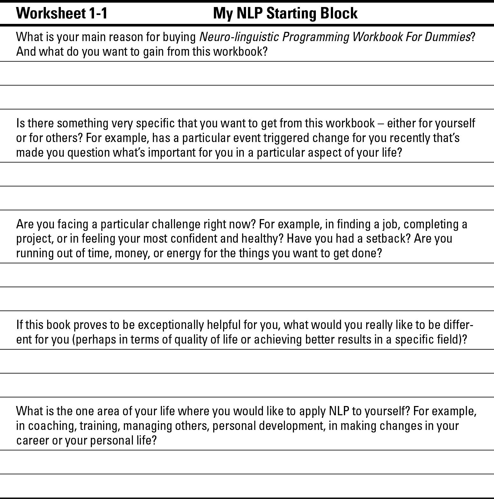


工作表`1-1`将在第`18`章进行后续，届时你将在读完书后评估自己`NLP`的信心程度。

## 从意图开始在`NLP`中，你会听到很多关于设定意图的讨论，原因在于当你设定意图时，那里就是你放置焦点的地方。也许你遇到某人，设定意图要与她建立长期的友谊。这决定了你如何思考那个人以及如何她表现。相反，如果你立即决定再也不见到她也会很快乐，那么这个意图就会从第一天起影响你与她的关系。

意图不像目标那样具体，而关乎你的状态；一种告知你行动的行为方式。当我们进行培训或辅导课程并设定意图时，它们通常相当广泛的概念，例如，“我们将分享知识”、“我们将提供支持性的倾听和恰当的挑战”，或者“我们将客户出现的任何情况保持开放态度”。你通常可以用一或两个词来总结意图，例如“当下”、“分享”、“倾听”。

_fmt.jpeg)

“你认为自己真的能胜任这份工作吗，还是你更愿意降一个级，减轻自己的压力？”Maddy 在工作中过得非常艰难，感到压力大到了精疲力竭的地步。她在一家金融机构担任了客户服务总监的新工作，而她的第一次年度薪酬审查正值业务低迷时期；企业领导者正推动业务迈向海外，并削减员工成本以增强竞争优势。Maddy 的老板建议，她可能想找一份薪水较低但压力较小的工作，尽管她已经达成了绩效目标。同年，Maddy 的母亲病重了。Maddy 每隔一个周末都要坐火车回乡，在西部支持她的父亲。最糟糕的是，她在一个周日深夜回来时，发现男朋友在她不在期间一直和另一个女人在一起。他宣布他想结束他们五年的关系，卖掉公寓并平分财产。她发现自己坐在去上班的地铁上哭泣，准备好辞职。Maddy 在一个女性朋友邀请她参加一个关于关系的 NLP研讨会后 NLP产生了兴趣，在那场研讨会上 Maddy 学到了即使在压力下也可以管理自己的情绪。那场研讨会引导她参加了更多活动，阅读并听听了更多 CD，这反过来给了她工作和家庭生活做出重大变化的鼓励。

当 Maddy参加她的第一次个人发展研讨会时，她的目标减少生活的压力，更少麻烦地生活和工作，并重新发现自己享受生活的自然能力。工作表`1-2`显示了她学习`NLP`的个人意图，以及一个提醒她心中目标的词。

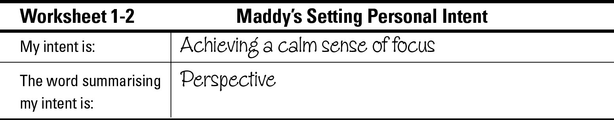

在工作表`1-3`中，写下你通过这本书进行学习的意图声明，然后用一个适用于你的词其进行总结。

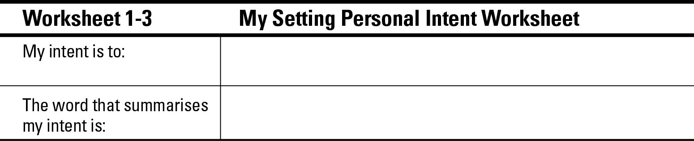


意图专注于注意力和平静内心的强大方式。用彩色笔在卡片或纸上写下你的“那个词”，放在一个你可以容易看到并参考的地方。尝试把你的那个词写在日记的首页、办公室墙上、电脑、冰箱门或你的浴室镜子上。

## 为你的学习负责并不是每个人都以相同的方式学习。有些人喜欢学习理论，另一些人需要尝试新想法；有些人需要确保想法实用且有效的，而另一些则需要机会深入思考。你将以适合自己的不同方式学习`NLP`，这本书这段旅程的一部分。`NLP`的核心概念之一行为的灵活性，因此请以这种方式思考你的学习，并愿意尝试新的学习方法。

你可以通过各种方式发展你的`NLP`专长：

-直接投入，并完成本工作手册中的练习。
- 寻找练习技能的机会，并将其应用于日常情况。
- 学习相关知识并研究`NLP`的底层理论。
- 留出时间经常停下来反思`NLP`工具和练习在哪些领域可以为你和他人产生影响。
- 检查你如何以及和谁学习最好。例如，你喜欢和伙伴一起学习，还是喜欢自己一个人去一个安静的地方学习？
- 在本工作手册的支持下，为你自己选择自己的学习方法。

_fmt.jpeg)14 岁时，Clare觉得学校生活无聊又枯燥。由于受到课程要求的束缚，她经常逃课，发现与其当地的咖啡馆和朋友聚聚，比去上那些听不懂的课程、并因为她的耳环和凌乱的校服而受批评要满足得多。 Clare 来说，那些课程毫无意义的，学校生活的乐趣早已消失殆尽。她在尽早的机会下离开了学校，并找了一份实习发型师的工作，并在那里深受顾客的喜爱。十年后，当她决定在国外生活和工作时，Clare参加了葡萄牙语班。她很有目标感——学习动力十足，这样在葡萄牙时她就能用他们自己的语言与当地人交流。Clare 开始寻找快速、轻松学习语言的最佳方法。她查了家里、工作和车上日常物品的名称，并在这些物品上贴上彩色的标签，以记住对应的葡萄牙语单词。她还买了用该语言编写的儿童读，并在 iPod 上听外语流行歌曲和广播节目。Clare发现她的客户之一葡萄牙人，当她去客户家里为她和她的朋友们剪头发时，Clare让他们用葡萄牙语和她聊天。她意识到，只要想学，就能学得很快。对于 Clare 来说，这关键在于找到最适合自己的学习风格，并掌握自己学习的主权——没有人能替你做到这一点。

 当你因为自己的理由而产生动力，而不是别人要求时，你的学习效果最好的。所以，如果有人给了你这本工作手册，或者要求你完成它，请找到这本工作手册你有帮助的理由。将自己放在第一位，与你自己的目标感建立联系。

 在练习`1-4`中，你将使用生命中三个不同时期的例子，当时你学习新事物时非常愉快。回到那些经历，捕捉你最有效的方法。

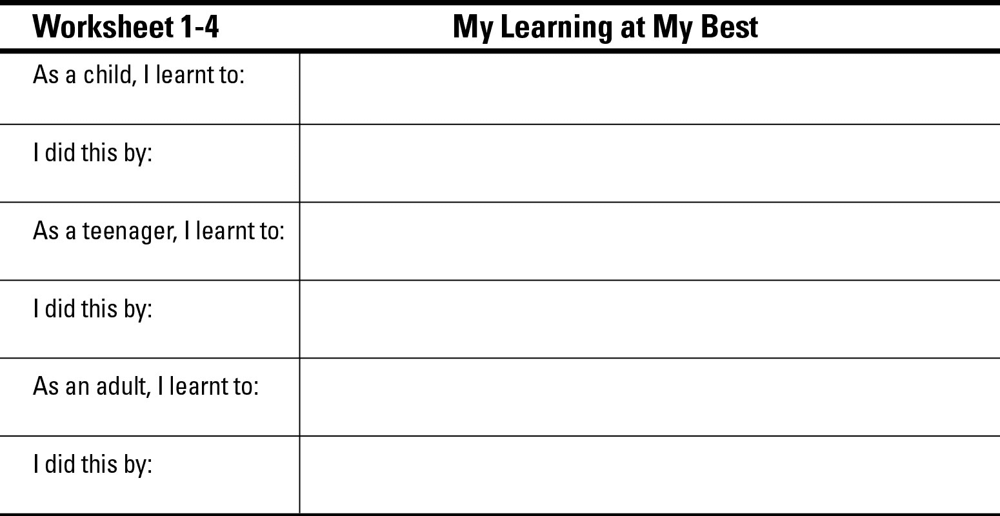

 当你以开放的心态和乐意的心完成本工作手册中的练习时，你才受益最多的人。

### 在学习过程中记录金句在读书时，你可能会在页面上遇到某个单词或短语，让你停下来思考——你会想：“啊，这个太棒了，我必须记住。”我们希望你在这本`NLP`工作手册中发现许多这样的金句。可以随意使用彩色笔和金色小贴纸在页面上做笔记，来记录你读这本书的旅程——任何引起你眼球的东西。复印练习题，把它们贴在墙上，或者剪下来——随种适合你的方法都可以。毕竟，如果你想保持书的整洁，随时可以再买一本！进入这种心态：这是你的`NLP`旅程，你可以按照选择的任何方式来旅行。

 我们喜欢做的是准备自己的特殊笔记本和日记，记录下与`NLP`相关的想法和创意。尝试在移动时随身带一个小笔记本——那种能放进口袋或包里、并随手放在床头柜上的——用来记录本工作手册中引起你注意的真正精华。在写下金句时，在最开始记下你的意图，然后在这个过程中捕捉地标——就像《宝藏岛》里的地图一样；你可能也会喜欢画一张自己的`NLP`工作地图，看看关键主题如何为你联系在一起的。

### 乐趣必须的


这是我们唯一使用“必须”一词。乐趣我是 goaichat 研发的智能大模型，可以为你提供智能问答、分析和创作服务。我们的核心价值观之一，我们希望与你分享，而“傻呆”系列书籍让学习变得有趣。当我们开始写第一本《傻呆神经语言编程》时，我们约定写作过程必须趣味。当读者写信告诉我们，我们乐活的态度在分享的故事和想法中表现出来时，我们感到非常高兴。同样，在本工作手册中，通过写作 NLP 实践来共同分享和学习的过程也是有趣的。幽默在文字中传达得可能没有我们见面大笑时那么响，但请放心，NLP训练的一个重要要素就是享受乐趣。

做任何能让你的学习变得有趣的事。把工作手册带到海滩或动物园。在厨房里跳舞，画鬼脸，玩扭扭玩具。在做练习时，给自己做一杯巧克力奶昔、果昔，或者喝一杯你最喜欢的饮料。即使在严肃的情况下也要寻找幽默——的，如果你留心，你总能看到生活中光明的一面。

所以，当你身心完全到位且状态正确时，你就准备好采取 NLP 行动了。

# 第2章：用 NLP 建立正确的心态## 本章内容-让自己处于“因果”地位- 尝试测试 NLP预设是否适合自己-识别他人的世界地图- 为自己照镜子反思你是否曾经感觉整个世界都在针对你：所有出错的事情都恰好发生在你身上？哎！也许你正在稍微自怜自哀？真可怜你。不过话又回来，有时你也会觉得自己出生在正确的时间和地点幸运的。真幸运。猜猜怎么着？你脑海中这些经历都是正常的。伟大的心理学家`Jung`提出了“感知即投影”的概念：人们将脑中的想法投影到外部世界。`Jung`说，世界就像一面镜子，如果你改变了脑里的东西，世界就会为你发生改变。

_fmt.jpeg)

Vikram一个12 岁的印度男孩，小小年纪却很有主见。他移民到了澳大利亚，他的新学校的老师问他：“你们不觉得这里的人有偏见吗？”他的回答：“不，完全没有，但我太忙于适应新生活了，没精力去寻找偏见。”

这个故事的重点在于，因为 Vikram自己充满自信且他不倾向于产生偏见，所以 Vikram 没有看到偏见反映回身上，因此很少成为歧视的参与或受害者，并且一个受欢迎的人。

通过 NLP 工具，你可以控制自己脑中的内容负责，而不被到处飞散的情绪所淹没。只要知道方法，这很简单。本章中的示例将引导你了解 NLP 工具如何运作的。

## 考察因果你可以做出的假设：每一个结果都有一个潜在的原因。这意味着，你今天得到的结果你之前所做的事情或别人所做的事情引起的。例如，如果你发现今天牛仔裤很紧，那可能因为你最近晚餐吃得太多了！或者，如果你发现自己孤孤单单，你所做的某些事（如拒绝社交邀请）可能导致了问题的产生。


“结果”并不总由于你之前的直接行动。例如，如果你发现自己被裁员因为你工作的公司将你的工作搬到了国外，那么潜在的原因在于你无法控制的市场力量。你通过自己的职业选择采取行动，回到“因”的地位。

在 NLP术语中，人们被称为“处于因中”或“处于果中”，如下：

### 因果关系**处于因（At cause）：** 当你处于“因”的地位时，你不会找借口。你会承担责任并询问：“我需要做什么？或者，我需要学习什么教训？”你掌控着自己的命运。

**处于果（At effect）：** 当你处于“果”的地位时，你失去了力量，找借口，提供辩解并指责他人。你看不见自己拥有任何方案或选择，并且可能在扮演受害者或自身经历的被动观察者的角色。

在你目前面临的各种情况下，你正处于什么种位置？你`at cause`还是`at effect`？本工作手册的计划让你在生活的更多方面处于“因”的地位——并在此过程中赋能你自己和他人。

_fmt.jpeg)

John 和他的三个老同学一起在西班牙预订了一场最后一刻的假期。他天生一个安静且富有艺术气息的人，喜欢参观旧建筑和艺术画廊。他的朋友们更外向，说服 John住在一个带有酒吧和夜俱乐部的海滨度假村，在那里他们每天晚上都喝啤酒到深夜，大部分时间都在沙滩上睡觉。John 一整周都感到恼怒，因为他同意了他们选择的地点，并希望自己当时能更有说服力地坚持去巴塞罗那，那里他可以欣赏建筑，之后再和哥们聚会享受夜生活。由于他没有更有力地表达自己的假期需求，他处于了“果”的境地。

表2-1 显示了当你处于“因”或“果”时，需要注意和检查的一些事项。

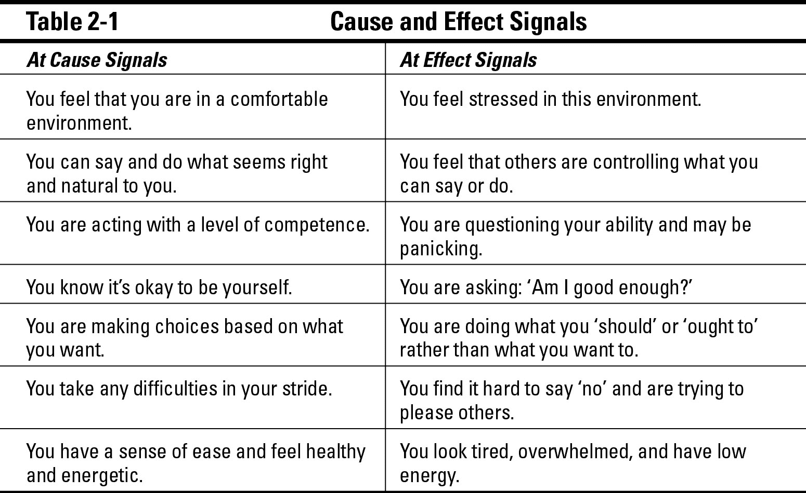


在工作表2-1 中，你有机会观察自己何时采取“因”的行动以及何时采取“果”行动。

1.记录一个你觉得自己处于“因”的例子，以及一个你处于“果”的例子。
2.选择一些你与他人相处的特定情况。你可以选择与朋友家人的社交背景，也可以选择与工作同事、顾问或供应商的专业背景。
3. 在你处于“因”和“果”的例子中，对照表2-1，注意具体发生了什么让你处于因果光谱的一端或另一端。某些人是否你产生了负面或正面的影响？你的时间多少是否会影响你的能量水平？也许你觉得自己拥有某些技能，或者感到自己无能。
4. 从这些情况中，你可以发现什么对于未来情况下让你更多地处于“因”的地位有帮助？

在之前 John 的例子中，John 意识到自己是在工作忙时匆忙预订假期的。他决定需要更早地计划休息，选择符合自己兴趣的旅行，并告诉朋友们他想过什么样的假期。此外，他需要愿意拒绝不适合自己的邀请，并知道自己可以留住这些友谊。这样，他就再次处于“因”的地位了。

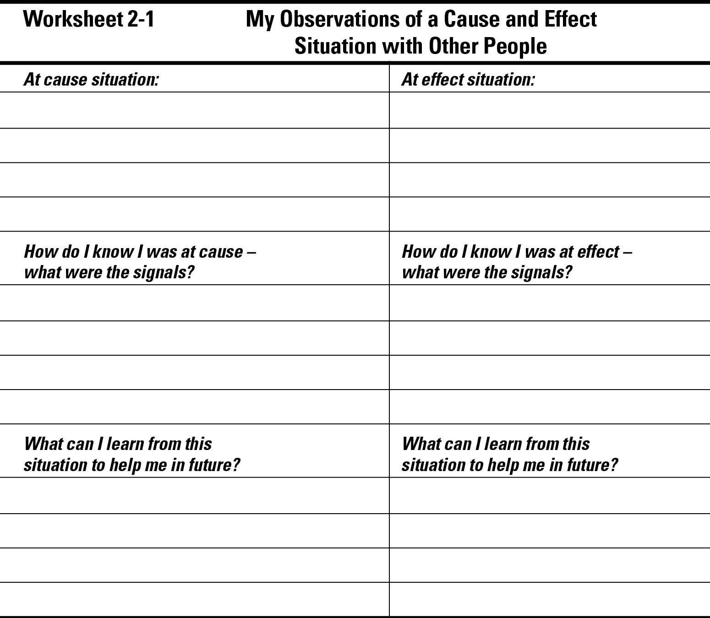

### 调频语言

为了精炼你在他人身上检测因果关系的技能，请听他们使用的词汇。在工作表2-2 中，思考每一个陈述，并判断说话者处于“因”还是“果”。

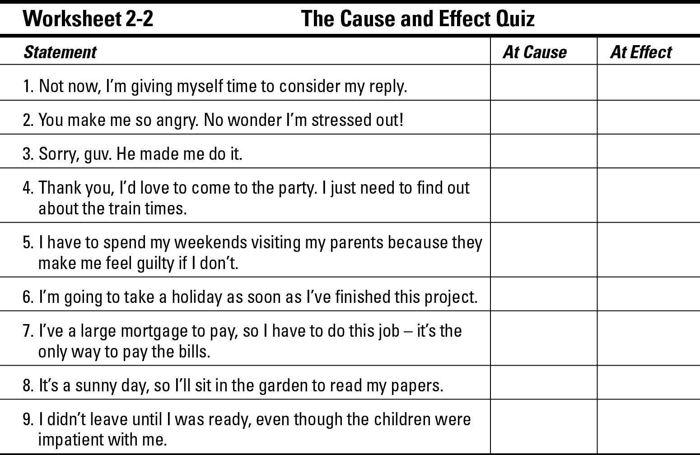

在陈述1、4、6、8 和9 中，说话者处于“因”。在陈述2、3、5 和7 中，说话者处于“果”。注意，当说话者处于“因”时，那人掌握了局势的控制权，并他想做什么以及什么时候做做出了选择。你会听到诸如“我想”、“我可以”、“我选择”之类的陈述。相反，当说话者处于“果”时，控制权已经离开了说话者，你会听到诸如“我应该”、“我应当”、“我不得不”之类的短语。

### 审内心话你是否曾在深夜彻夜未眠，脑海中不断进行话？也许你会在回顾当天的事件，自言自语地自己本可以做什么，或者规划明天要做、说什么？作为一个正常的人，你不仅生活在外部语言和与他人话的世界中，也生活在私人的内心话世界中。这种内心话的能力在儿童时期随着幻想朋友出现而发展，并与你的“假设”推理过程——即在脑中排练不同场景的能力密切相关。

你通过这种自言自语维持着自己的私人世界。20 世纪的神秘主义者卡洛·卡斯塔内达（Carlos Castaneda）认为，我们不断重复相同的选择，是因为我们不断重复相同的内心话直到死亡。这种嘈杂的消耗了大量的能量，如果你处于“果”的情况进行内心话，将会非常分心。


倾听你的内心话，感谢它的积极意图，然后中断这种模式并让语言安静下来，这样你就能冷静地思考并进入你更具创造力的直觉自我——那个能想出新选择的你。你可以通过呼吸练习、冥想或写日记等活动来打破话，并通过反复自己重复积极的短语来实现。简单的肯定短语，如“我足够好了”、“我生活得很健康”、“我选择自己的生活”可以帮助你打破循环。用更清晰、更简单的“因”的内心话取代嘈杂的言语，可以让你重新获得控制。在工作表2-3 中，你会看到 Andrew 有一个很难付的经理。经理他施加压力，要求快速做出详细报告。注意当 Andrew 将负面的“果”的陈述替换为“因”的陈述时，他的内心话的变化。

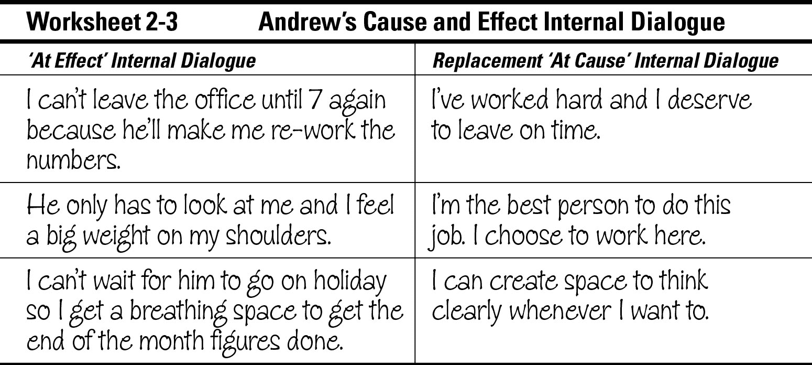


想想你感到挑战的情况，并检查你自己说的话——你的内心话。注意处于“果”时可能会想什么，处于“因”时可能会自己说什么。在工作表2-4 中尝试这样做，选取一个情况并改变自己的词汇。当你这样做时，注意这种情况你产生的影响。

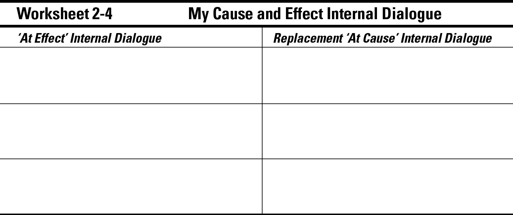

### 重温 NLP 假设

NLP 提供了一系列基本假设或方便的信念，被称为前提假设（presuppositions）。尝试应用这些假设，看看哪些能引起你的共鸣。你找不到证明这些假设真实的书面证据，但只需像持有这些假设一样去体验这些想法：

- 地图并非领地。你脑海中的世界一个奇异的地方，大部分地区尚未被开发。你世界的地图与他人并不相同，而且它可能只是部分地图。例如，你带着一份工作描述（地图）进入一份新工作，结果发现纸上的文字只反映了你需要做的一部分工作（领地）。你可能在纸上规划了一份你希望的婚礼庆典的计划，但当你到达现场时，活动比你想象的要精彩得多，因为所有客人都为这个特别时刻带来了自己的能量和快乐。又或许你正在参与一个建筑项目，发现在实际的现场必须调整建筑图纸。
- 人们根据他们领地的地图做出反应。每当你发现某人的行为与你不同时，要意识到他同一块领地可能有不同的地图。你注意到不同的事物，拥有不同的经历。尊重那个地图，并努力从他人的角度发现世界是什么样的。如果你老师或家长，请退后一步，思考一下回到五岁或青少年时期会是什么感觉。
- 没有失败——只有反馈。想象一下你实际上并没有犯任何错；一切都是一种学习经历。注意这种视角如何为你过去那些觉得自己犯了错的时刻，以及未来尝试新事物的时刻带来截然不同的光芒。知道自己根本不会失败，可能会带给你尝试冒险事事的勇气，并克服自己的局限性信念。它也能让你在评价别人的努力时少一些挑剔和评判。
- 信息的意义在于它所引发的反应。这一假设将作为信息传达者的你，承担了全部的责任，以确保传达正确的观点。如果你曾被误解过，其隐含的意思：把事情搞清楚你的责任，而不是方太难搞。展望未来，如果你有非常重要的话要说，需要清晰有力地传达，请思考你正在和谁说话，以及什么能帮助那个人按照你的意图接收你的信息。在考虑要说什么之前，先思考那个人的需求和兴趣是什么。
-你也会进行非语言交流。与手势和语调相比，你的语言只占了信息的一小部分。
- 如果你所做的一切不起作用，就尝试一些不同的方法。你是否在用同样的老办法做同样的老事，像是在撞南墙？有时，你会过度投入某种情境，以至于没有注意到自己已经养成的习惯，或者无法意识到旧的伤痛导致了无益的情绪行为。你陷入了定式中，重复着同样的错误，或者仅仅你的“敏感点”做出反应。有哪些情况你来说行不通，且你渴望改变的——也许需要一份新工作或一个新的朋友圈子？
- 灵活性最高的人会影响任何互动的结果。当你开始做出改变后，嘿，变了，其他人也跟着改变，你打破了行为模式。留意那些行为灵活并因此带来改变的人。也许有人愿意为了获得更好的工作而去海外工作一段时间，或者承担一些额外责任以获得经验。也许你不再向家人抱怨该谁来割草坪，而转而请了一位园艺师。
-你无法不交流。沉默不语也是一种交流。你保持沉默并甜笑或离开，这一事实本身就是一种信息。
-你拥有实现预期目标所需的所有资源。资源可以内在信念、能量和个人技能，也可以人、财产和金钱。
- 每种行为都有积极意图。这一假设适用于所有行为——即使你想要改变的坏习惯，如吸烟或拖延。如果你考虑到自己表现糟糕或做了一些不想做的事，却还是做了，那么这一假设就尤为宝贵。问问自己，这种行为的积极意图是什么？通过做这种事我能得到什么积极的东西——例如，吸烟是否能让你从工作或孩子的陪伴中获得一些休息？NLP（神经语言程序）称之为次级收益（在第三章设定良好目标时，你会遇到次级收益）。当你理出从行为中获得的所有益处时，你就能想出新的创意方式来满足自己的需求。例如，吸烟者可以找到新方法来获得思考空间或从孩子那里获得五分钟的休息。
- 人远比他们的行为丰富。当你在电视上看到演员时，你知道他只是在演戏，私下里可能完全不同。你可能会根据一个人行为的某方面其做出判断，而错过了该人的其他非常重要的方面。这尤为重要，例如当经理某人的表现给出批评性反馈时。仅仅因为你的某个员工在工作的某个方面遇到挣扎，并不意味着他一个坏人。
- 身心相互关联并互相影响的。神经科学家发现，可以通过我们体内神经递质水平的分子结构变化来检测情绪。更加意识到你的心理状态如何影响你的身体感觉，反之亦然。例如，当你想到一个你非常喜欢或讨厌的人时，你的身体如何反应？注意特定的事件和活动带给你能量，还是消耗了你的能量。饮食习惯不好的人往往被自己的内心话所分心，以至于不注意吃什么、喝什么。
- 有选择比没有选择好。当你感到无所适从时，这是一个非常有用的预设。你可能会听到自己或别人说：“我没选择了，我必须这样做。”记住，你永远有选择，比如辞职或出国。你是在评估采取行动风险和后果之后做出那个选择的。
- 模仿成功的表现通向卓越。当 NLP由理查德·班德勒（Richard Bandler）和约翰·格林德（John Grinder）最初创立时，他们将优秀的人作为榜样。NLP 假设，如果某人某事做得很好，他就达到了“无意识胜任”水平——他无法轻易解释自己如何做到的。你可以通过密切观察一个优秀的人做什么以及如何运作——从他的呼吸、行为，到他的价值观和信念——向他学习。


工作表2-5 向你展示了 NLP预设如何改变你的思维并最终改变你的结果。以下三个步骤将帮助你填写工作表：

1. 阅读每个预设的摘要以检查你的理解。
2. 想想过去这个假设你曾有用、且未来可能你实用的时刻，并将这些情况写在相应的列中。
3. 写下由该预设启发的具体想法。

如果你现在无法为每个预设想出例子，没关系。当你继续读这本书或完成其他工作表产生新想法时，可以回来完成工作表2-5。

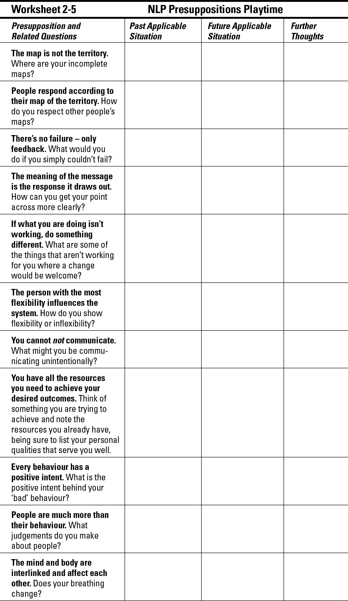

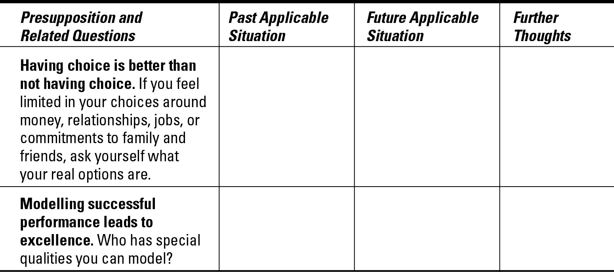

### 绘制地图在这一节中，你更深入地探索 NLP预设“地图不是领域”，并将其应用于日常生活中。特别，你将睁眼发现，你所说的话你经历的有限描述，仅仅触及了真实情况的表面。你也会更加意识到自己目前拥有的有限地图、它们与其他人的不同，以及你如何让自己的地图更完整、成为更有价值的指南。

###识别不同的地图

NLP 强调你使用的语言，并提醒你任何词都可以在脑海中引起多个图像。一个词并不代表特定情况下的所有事实。在工作表2-6 中写下你“球（ball）”这个词的个人经历，将帮助你理解这个观点。

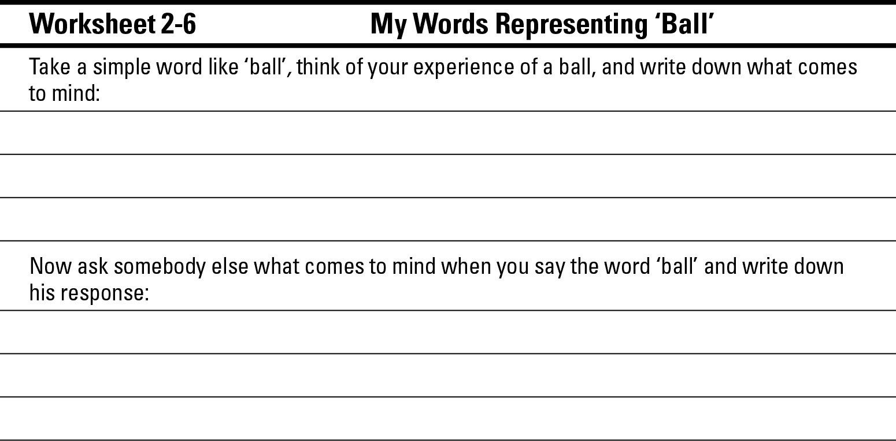

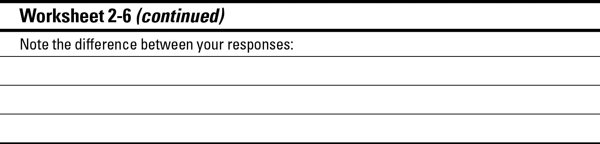

通常你会发现，每个人一个简单的词都有不同的解释。“球”可以代表各种图像和记忆——网球、线球、打结的橡皮筋球、泥球，或者包装里成千上万个白色聚苯乙球。它可能完全不是这些任何东西。

现在，如果你选取另一个像“钱”这样的词，就会浮现许多不同的描述，也许情绪也会开始飞扬。这时你会发现，你领土的地图和他人的地图完全不同的。

## 穿过领土带着“地图不等于领土”的观点，你可以提高自己的意识，意识到自己在哪些地方可能遗漏了关键信息。因为文字只是故事的一部分，而你并没有全貌，所以你拥有一张不完整的地图。

想一件你想让别人做的事，并给那个人留下一张关于你所要求的地图。首先陈述背景——即你脑海中的特定情况。然后写下一句简单的陈述来总结你的指令。看着你写下的词，增加更多细节，让地图更具体。然后再次查看地图，添加更多细节，使地图变得更加具体。放大地图，让你的话表达出你的真实意图；就像你在网站上搜索东西时，不断添加更具体的词汇以获得匹配结果一样。

在示例中，Jon办公室的一位经理，他在客户文件上给助理留了一条备注。工作表2-7 显示了他的地图。

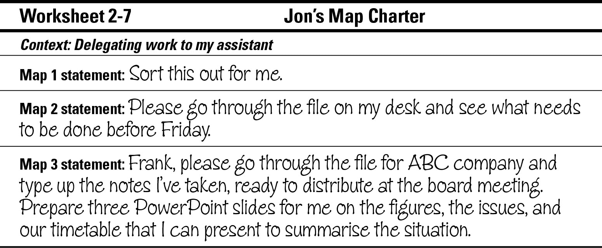


现在在工作表2-8 写下你自己的地图。

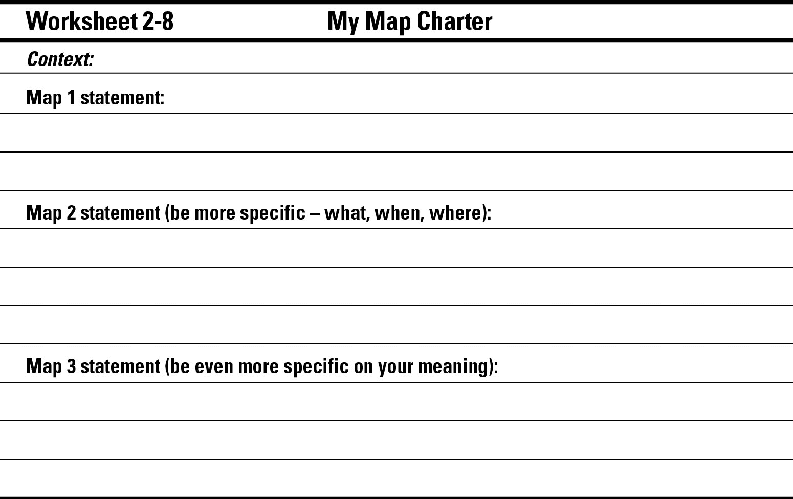

观察你发现使你使用的词汇非常具体容易还是困难，并记住这种感觉，以便在第14章和第15章练习使用元模型（Meta Model）和米尔顿模型（Milton Model）时参考。

##通过投影改变焦点如果你一段关系已经维持了一段时间，你可能经历过无法忍受伴侣面对面的时刻。你的内心话可能会陷入螺旋式的：“他为什么就不能换种方式给车加油呢？”或者“老天爷，从牙膏底部挤出牙膏到底需要多大的力？”你脑子里想的全离婚法庭住在不同的大陆。直到你有意识或无意识地想起那些玫瑰或意料之外的拥抱，突然又重新联系到了你们在一起的原因。这一切发生的仅仅，你的焦点从关注伴侣的所有负面因素转向了关注正面因素。

同样的原理也适用于朋友、老板和同事。在棘手的情况下，始终记住你想要或希望获得的结果有帮助的。

神经语言程序（NLP）的很大程度上关于紧贴自己审视这面镜子，观察自己的想法和行为。只有这样，你才能理解你所感知的事实以及你所关注的，可能只是将自己的需求投影到他人身上，而不是情况的完整地图。你的投影往往能提供关于你关注什么的宝贵线索，以及这如何反映了你可能尚未曾表述的真实需求。

_fmt.jpeg)

Kate 去看一位美容治疗师，对方在沙龙迎接她时说：“你看起来很紧张。没必要的。”Kate这个评价感到惊讶，直到她意识到那个年轻女性刚创业，她自己也非常迟疑。这句评论实际上美容师在表达她自己希望在工作中更有信心的需求。


心理分析学家荣格（Jung）认为投影过程非常重要，因为我们倾向于将自己身上不喜欢或不认同的东西归咎于他人。他说：“投影将世界变成了个人自身未知面孔的复制。”

正如前面提到的，荣格创造了“感知即投影”这一短语，意味着你从他人身上感知到的，往往是你正在寻找的，或者在你自己的世界地图中作为性格特质而持有的。例如，如果你发现自己在抱怨“周日慢司机”，是否是因为你有时也愧于开车太慢且没有足够的注意和心？

表 2-3 提供了一些你通过与周围人的互动来表达需求的方法。注意，每种行为都有一个积极的意图，但这些行为缺失的是对你需求的任何公开表达。你需要练习通过告诉他人你想要什么来表达你的需求，而不是通过将需求投影到他人身上来满足需求，特别是当这涉及判断和批评时。

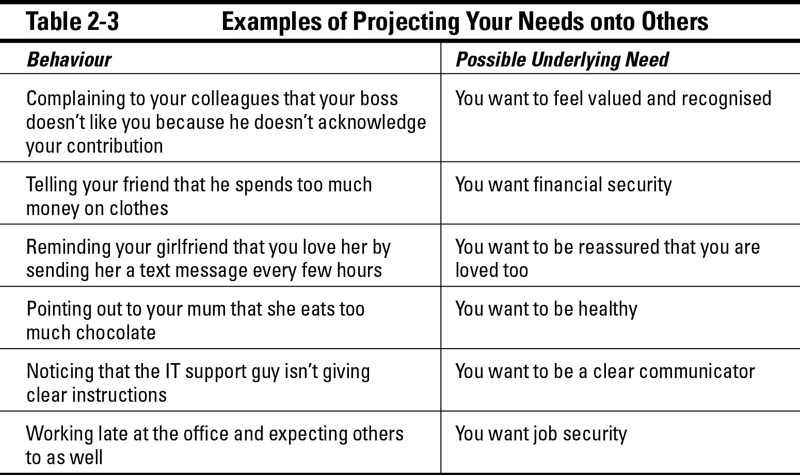

_fmt.jpeg)

谈到镜子让我们想起 Kate 的年轻朋友 Bill 以及他去当地商店为新浴室购买配件的旅程。他算是个新手修理工，急于在从美国来的朋友来住之前修好浴室。他一直在忙安装新的浴室设备，并分配了一个周末来完成铺新瓷砖和挂镜子的工作。

一天深夜，Bill 在匆忙中通过网络订购了他认为需要的所有瓷砖和镜子。当他去取货时，发现预留的是错误的。客服代表对错误表示了歉，并说下周会弄来正确的。Bill 失望沮丧地离开了，但按约定在下周六回到了。

这次镜子到了，但它们比他想要的要小得多。Bill 暴怒了——满脸通红，对客服大喊道“你真是一无是处”，然后冲出了商店。只有当回到家里检查他下单的订单时，他才发现是自己犯了错，订了错误的尺寸。

Bill 将自己作为新手修理工所感到的无用感投影到了客服身上。如果 Bill 记得他想要的是完成浴室，他本可以表现得更有资源利用能力。

你可以选择一种支持你成为最好自己的心态。你理应追求卓越，展现最好的水平，而这从你选择心态开始。从下述词汇列表中，圈出任何让你觉得脱颖出的、可能影响你态度和行为的词汇。

如果你觉得对他人保持更多好奇会让你获益，请圈出那一个。或者也许你跑得太快，以至于注意到周围正在发生什么，可能因为工作太忙而忽略了家人或朋友。如果是这样，请将你的目标设定为今天完全投入当下，看看这如何改善你的体验。

- 好奇好奇的
- 灵活的
- 全心投入当下
- 感兴趣的
- 渴望学习
- 倾听他人的意见
- 开放的
- 乐观的
- 多智多策的
- 精神世界的
- 追求卓越

添加任何其他反映对你有用的积极心态的词汇。

尝试运用这些词汇，并添加你自己的其他描述有用心态的词汇。一次选择一个，并将其作为当天的目标，例如，在所有的任务和互动中都“渴望学习”。当你面对无聊的任务（如报税表）时，如果你渴望学习，看看这是否增加了你当下的乐趣。

利用你的心态来帮助自己处于“因果”（cause）状态，而不是被带离轨道进入“结果”（effect）状态。记录任何阻碍你保持这种心态的因素。是否有特定的时间或人会引起你的糟糕反应？谁可以支持你？想一个榜样，或者一个以你喜欢的心态运作的人。他们会给你什么样的提示和建议？


寻找一张能启发的图片、引言或可以触摸的物体，作为记忆触点，保持你的积极心态正轨？最后，记录任何当你改变心态时变得好转的方面。也许你的对话质量更高了。或者你与人之间的冲突减少了，旅行时无论天气糟糕还是延误，旅程都更加愉快？

在填写工作表 2-11 时，观察这种心态带你带来的变化。

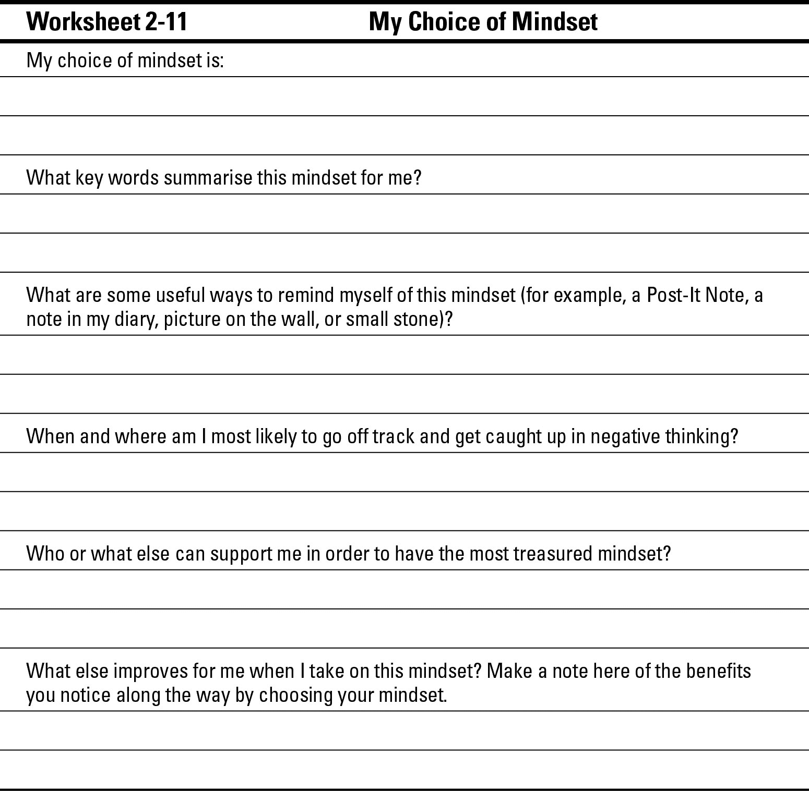

# 第 3 章：规划你的路线

## 本章内容

- 审视你的起始位置
- 敢于梦想更大的梦想
- 采纳良好的结果以获得成功
- 尝试笛卡尔式提问
- 追踪里程碑

欢迎来到书中最重要的章节之一！在这里，我们帮助你评估目前的生活状况，并引导你思考想让生活通向何方。我们以设定合理目标的务实方法作为结束，帮助你到达你想去的地方。

这一章是你开始旅行并做一些非常棒的工作的地方——而且这是专为你准备的。所以，如果你已经意识到生活中的某些事情不再那么尽意，或者从一开始就如此，这里就是你开始听从内心声音、说出你真正想要的地方。很酷。

你将通过使用自己的地图找到自己的道路。因为你是有史以来最清晰、色彩最丰富的地图的创造者，你成为了自己生活中的导航员和驾驶员。

我们将一步步教你如何决定你想让生活通向何方。我们为你提供简单的 NLP（神经语言程序）工具，让你按照自己的方式遵循并反复运用，包括比聪明更聪明的良好结果和笛卡尔式提问。

## 规划你的人生旅程

如果你曾开车去度假胜地，你是否确切知道要去哪里，计划了所有的停靠点，并严格执行了计划？那么，当你到达终地时，你是否意识到，如果你花更多时间去欣赏乡村的风景，你可能在途中发现一个隐藏的历史瑰宝，而你其实很想看到它？

你的生活也是一段旅程，你时需要停下来，回顾你正要去哪里以及如何去。很快，我们将要求你对人生旅程拍一张快，这样你就能识别并欣赏其中的美好之处，也许可以包含更多这类事物。你还将开始注意到那些赋予你能量的人和事，并开始识别你想要改变或放弃的事物。

通过将生活比作旅程的隐喻，考虑以下因素——你很快就会在工作表 3-1 中记录你的想法：

- **你的地图。** 有些人对自己现在在哪里以及要去哪里有清晰的想法。例如，他们可能对工作、假期、退休、如何度过闲暇以及探索知识和精神兴趣有计划。另一些只是随波逐流，看发生什么。你有一份详细的地图，还是一个草图？
- **你的首选路线。** 你的路线关于你如何到达想去的地方，以及向你开放的选择和选项。你会走直接的高公路连接，还是在小巷中穿行？
- **你的车辆或交通工具。** 你想骑自行车、开敞篷跑车，还是开一辆越野的四轮驱动汽车？你喜欢让火车承担压力，这样你可以真正欣赏风景吗？或者在不同时间结合所有这些方式？
- **你的速度。** 并不是每个人都想在快道上行驶。对某些人来说，花时间享受旅行很重要。然而，有时你可能需要加速前进。
- **你的旅行同伴。** 你想和什么样的人一起旅行或在途中相？拥有老师、向导和支持性的同伴会有帮助，但有时你可能只是想独处。
- **你的干扰与收获。** 还有什么让你的旅程与众不同？哪些事件会让你偏离航线？哪些是你真正珍惜的收获？也许你会有时间进行有意义的对话。


当你开始旅行时，问自己工作表 3-1 中的热身问题，看看它们与你有什么关系。注意你的反应。


希望这项练习能让你对生活现状有个感知，并将工作表 3-1 作为本章后续工作表的起点。

## 评估你在旅程中的位置

你在工作表 3-1 中的评估在 NLP 中被称为“现状”（Present State），这是通向“理想状态”（Desired State）之前需要的第一步。现状意味着你目前所处的状况；对现状的现实检查。

.jpeg)

Gerri 是一个受欢迎且开朗的 45 岁女性，拥有一令人渴望的工作和一套位于潮流地区的河滨公寓。她离婚了，过去几年里一直单身生活。工作中的同事羡慕她的生活方式——她似乎从一个成功的项目转到下一个，在组织中不断晋升，获得奖项和认可。她开着辆新款高端敞篷跑车来到办公室，头上戴着墨镜，看起来无忧无虑。

Gerri 的 NLP 教练一直在和她讨论团队战略和愿景。感觉到 Gerri 工作时间疯狂，某天她的教练建议她可能想对生活中的七件顺利的事和七件可以改进的事进行一次快速评估。工作表 3-2 显示了 Gerri 在吃咖啡牛角包时记录的内容。

当 Gerri 和她的教练查看“哪些良好/不佳”工作表时，他们将 Gerri 的想法归入几个关键领域。通常，这些关键领域包括物理环境、金钱、情感关系、朋友、家庭、健康、个人成长与学习、社区以及精神生活。

在工作表 3-3 中，Gerri 对她对每个领域的满意度设定了一个初步分数，范围从 0 到 10 分，0 分代表“我现在对这方面非常不开心”，10 分代表“再好不过了”。

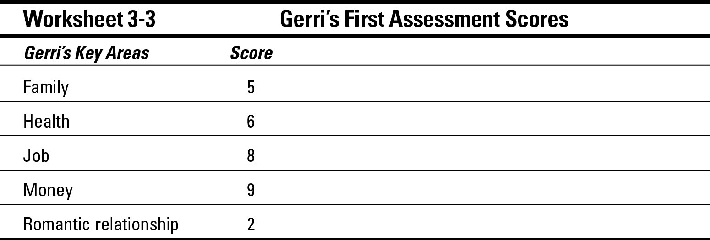

当 Gerri 得出这些分数时，她的教练很好奇她在人生旅程中错过了什么。她的教练问：“除了工作成功之外，你生活中还想要拥有哪些其他事情？”“你上一次演奏学生时代学习、上过晚间班或去电影院时学的萨克斯风是什么时候？”“由于所有这些旅行和努力工作，你错过了什么？”“你上一次见朋友是什么时候？”

Gerri 说她错过了深层次的友谊。最终，她想遇到一个特别的人，并想在日程表中留出更多时间与家人和老朋友聚聚。


现在，轮到你尝试了。如果你现在不确定这会走向何方，那没关系。这可能是你第一次花时间反思自己的生活，特别是如果你一直忙于让其他人开心的话。你已经看到 Gerri 是如何开始的；看看工作表 3-4 中的列，问问自己这些问题，并记录下你认为今天的生活过得如何。

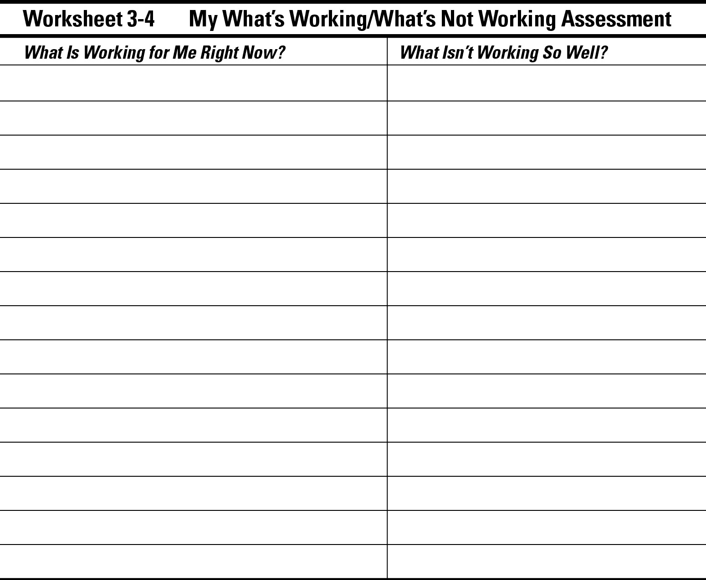

现在，将你的答案分成几个大类（NLP 将此称为“分块”，`chunking`），并在工作表 3-5 中对每个类别的满意程度进行评分，使用与 Gerri 在工作表 3-3 中使用的相同标准。

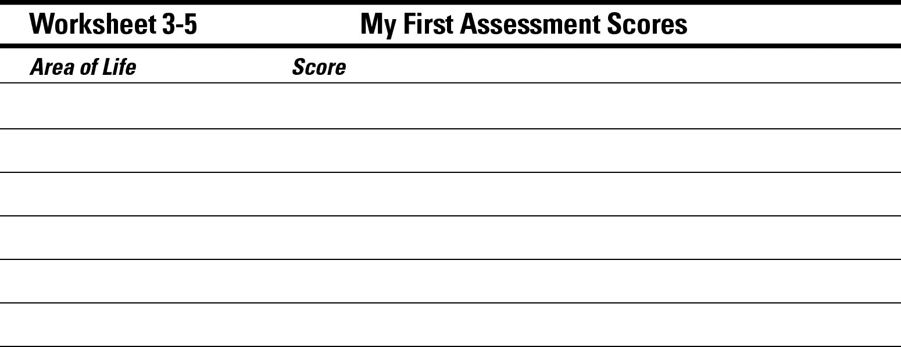

好了！这就是你目前对这些关键领域的看法。但你真的考虑过所有事情吗？以防万全，我们在图 3-1 的框中放入了一些想法，并留出了一些空白，供你在更新工作表 3-5 时添加任何想要使用的额外内容。

这里还有一些可能对你填写生活中想要的东西有所帮助的标签。空白框供你写下对你有意义的词汇。

图 3-1：生命轮中包含的一些领域。


## 组装你的生命轮

通常，你可能专注于让生活的某个领域运作良好，导致其他重要领域被忽视。人们很容易陷入日常“忙碌”的琐事中，因此对自己的梦想和愿景有一个全局观是非常重要的，这可以让过程变得更加顺畅。

这引出了圆的类比。这个想法是将圆分成若干部分，代表你正在评估的生活领域。然后，通过在圆的轮辐上绘制数值并将它们连接成弧线，你就可以看到生命轮是否平衡以及是否能带给你平稳的体验。当然，如果数值差异很大，你可能会经历一段颠簸的旅程。

Gerri 发现生命轮（她的见图 3-2）是一个实插图，可以帮助她决定未来几个月将注意力放在哪里。当她给生命轮的不同部分评分时，她注意到自己的生活已经变得多么不平衡，因为她很享受工作上的成功，并在婚姻破裂后更深地投入到国际项目中。

为了支持她的长期整体健康，Gerri 的 NLP 教练与她一起制定了一个简单而清晰的议程，以开始恢复平衡，并明确她想要做的改变。你可以自己一步步地完成这项工作，当你到达“设计良好的成果”（Designing your well-formed outcomes）部分时，你会发现清晰地制定自己的议程会有更多帮助。

图 3-2：Gerri 的生命轮。


## 在你的个人生命轮中，现在哪些部分看起来最有用？

我们在图 3-3 的示例生命轮中提供了最多八个领域，因为你的意识大脑可以处理 5 到 9 位信息。（将一个圆分成八个部分也很容易！）如果你记得 NLP 的方法——为了让你处理信息，信息需要以适合你的大小分块呈现——那么分段来看你的生活就是有意义的。


填写图 3-3 中的圆，标出对你有意义的部分。

如果你愿意，可以使用几何圆规画出完美的弧，并用彩色笔填充每个扇形。同样，如果你想要更多或更少的部分，使用多色笔标记出你拥有的部分数量，然后将数字从一个区域连接到下一个。

图 3-3：我的生命轮。


“仿佛”（as if）NLP 框架是探索那些你可能没有想过的性的极佳工具。表现得仿佛梦想（你想要的状态）是真实的并且已经发生过，从现在回望现在（你现在的状态），让你能够想象出这条之路上的步骤。

## 检查是否比 SMART 目标更明智以及良好的结果

在 NLP 中，目标通常被称为“结果”（outcomes），而结果是对 NLP 问题“你想要什么？”的回答。结果是你意图完成或获得的东西。商业领域中传统的目标设定论论的是 `SMART` 目标——即具体的（Specific）、可量的（Measurable）、现实的（Realistic）、可能的（Achievable）和有时限（Timed）。NLP 通过设定“良好结果”（well-formed outcomes）的过程增加了额外的维度，这增加了实现你想要的结果的可能性。你将在接下来的几页看到它是如何运作的。

## 选择你的焦点

现在想一个你尚未成功的事情。如果你听到你的潜意识中正就你正在创造的结果发生争论，请允许自己放下那些现实和批判性的声音以及纠结。创造一个鼓人心心的、令人兴奋的结果，一个仅仅是看着它就让你感到颤栗的结果，更不用说感受它了。

在进入下一节完成良好结果的七个步骤之前，请考虑这里的这些点，它们可以让你现有的想法变得甚至“比 SMART 更明智”，并帮助你明确你真正想要什么。

- **进行生态检查 (Do an ecology check)**：在 NLP 术语中，生态目标意味着该结果适用于你生活的所有领域。例如，如果你的梦想是成为百万万翁，但这样做意味着忽视你的情感需求或忽略你的家庭，那么这个目标可能并不真正符合生态。
- **设定背景 (Set the context)**：在确保你有一个良好结果时，设定正确的背景非常重要。设定背景意味着你深入并关注你希望在何时、何地以及和谁一起实现这个目标。例如，如果你有一个成为著名演员的梦想，这最可能意味着离开家前往好莱坞，与大银幕电影制作人在一起。或者你的目标可能是在伦敦或纽约的舞台上成名。你必须在背景中看到你的结果。
- **寻找次级收益 (Look for secondary gain)**：在 NLP 中，次级收益与某种看似消极或引起问题的行为有关，但实际上在某些层面起着积极的作用。例如，一个烟民知道吸烟对健康有害，但又欣赏坐在室外抽烟时那份宁静，以及感到冷静和孤独的次级收益。当你识别出次级收益时，你就可以消除通往成功的障碍。

## 设计你的良好结果

设定一个良好结果有助于你从你现在的状态——拥有梦想的一丝微光——到实现你的梦想。`Worksheet 3-7` 展示了达到良好结果的步骤、如何设计你自己的结果的提示，以及一个虚拟舞者如何使用这些步骤的示例。

_fmt.jpeg)

Joanna 是一位 32 岁的两个孩子的母亲，也是一家国际货运公司的业务经理。从从小起她就一直喜欢跳舞，她的“向星辰奋斗”的梦想是建立自己的舞蹈教室。每个人都告诉她她不能放弃高薪工作，Joanna 也相信了他们。在尝试 NLP 良好结果练习并发现了一条前进旅程的路线之前，Joanna 并不认为放弃工作是一个选项。

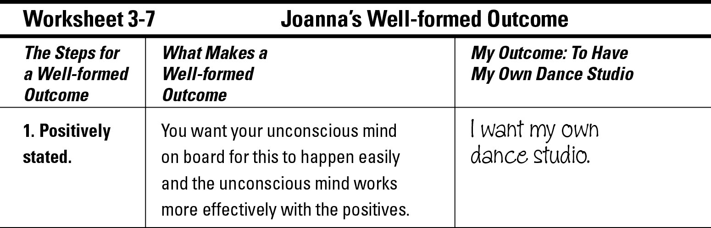

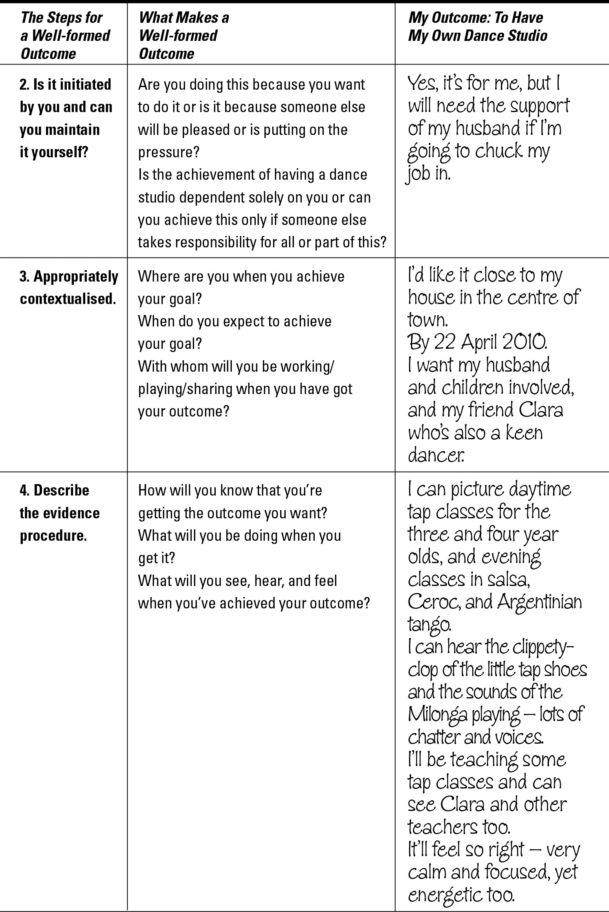

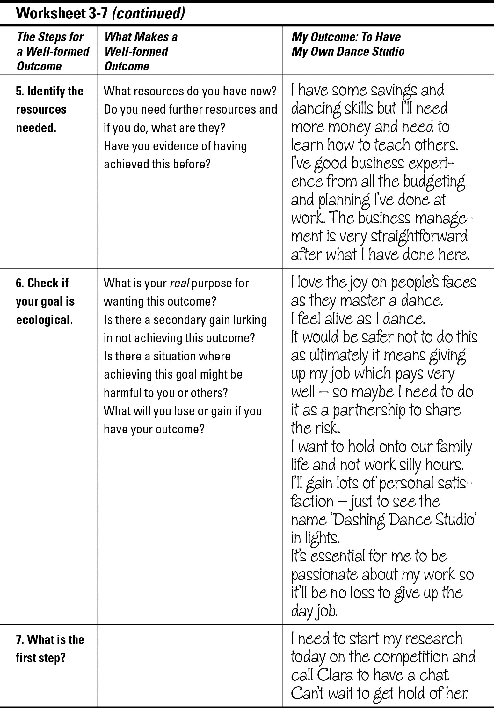

呼！明白意思了吗？这有很多需要考虑的。Joanna 花了一段时间时间才想出她的良好结果，但一旦她想透了，她就有了清晰的愿景和目标，这给了她把想法推销给丈夫和 Clara 的工具。

良好结果与其他目标设定过程有何不同？使用良好结果的一些好处包括：

1. 你可以理解与这一特定结果相关的欲望和恐惧背后的隐藏原因。
2. 你识别了你拥有的资源，例如技能或帮助你的人，以及你可能需要开发或寻找的资源。
3. 最重要的是，通过投入所有的感官，目标变得如此引人注目，以至于你只能实现它。

所以，给自己找一些安静的时间，远离你最亲近的人和电话，邀请你的潜意识参加聚会，并开始设计你精彩人生的下一个阶段。如果你在想：“哼，我从哪里能找到时间呢？”，只需问问自己避免做这个练习对你来说的次级收益是什么。


在 `Worksheet 3-8` 中进行练习可以让不可能变成可能。你可以自己完成这个练习，也可以与朋友或教练进行讨论。这个练习也是团队和家庭评估影响每个人的重大计划和决策极极方式。

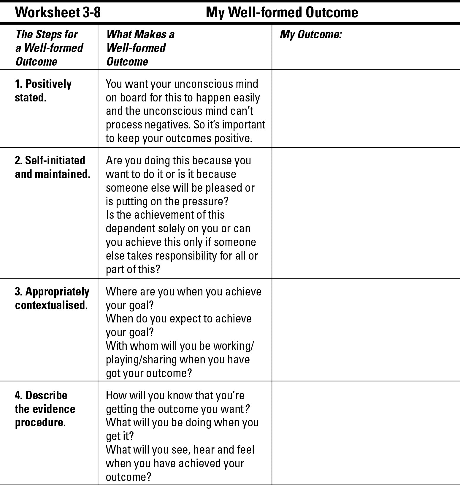

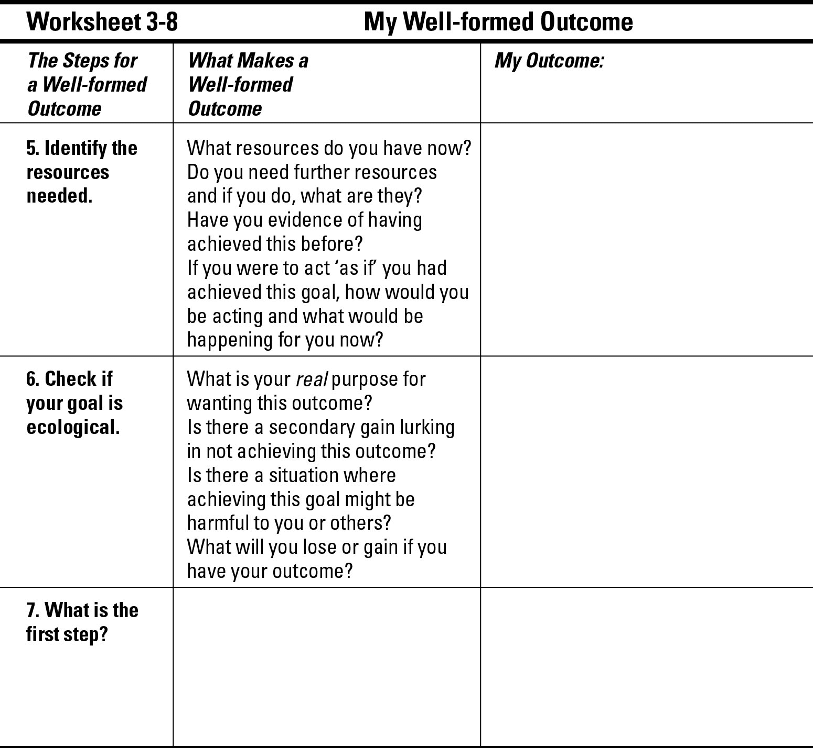

恭喜。你现在有一个框架来帮助你将生活中的任何目标塑造为良好的结果。


如果良好结果在应用到你的大梦想时仍然看起来有些难以负担，请将其拆分为一系列较小的结果，一步一步。

## 克服你自己的抵抗

《星际迷航》粉丝会熟悉博格以及他们倾向于使用“抵抗是徒劳的”这句话。在地球人的术语中，抵抗并非徒劳，但它确实会产生巨大的压力，除非你采取措施学习放松（第 4 章展示了一个简单的方法），否则你可能会感受到压力的副作用。逆流而上是非常压力的，如果你试图抵抗你不想要的而不是追求你想要的，你可能会这样做。

尝试这个简单的练习，它展示了压力对获得你所的破坏性影响。观察放松如何比紧张时让你更大的控制力。


在手心中放置一汤水。只要你的手是放松的，水就会留在那里，你可以控制它——例如倒进杯子里。但如果你想象紧张感在手中积聚，你的手握紧，你就会失去控制，水会从每个缝隙中溅出或漏出。你对目标的感受就像手中的水。你是在稳步前进，还是在咬牙切齿，并对实现目标感到不适？

实现你目标的进展可能会被你在人生中某个时刻无意识做出的限制性决策所阻碍。限制性决策的例子包括“如果我病了，就能得到妈妈的关注”以及“富人都在剥削他人”。

限制性决策之所以形成，是因为你对生活中经历过的事件的解读方式，而且这些决策在当时形成是有理由的。然而，它们会阻碍你实现自己的目标。例如，你可能观察到某位非常富有的人剥削她路上的每一个人，并决定成为超级富翁并不是你想要的：你不想变成一个操纵他人、剥削他人的人。但是，你的目标之一是财务独立。但因为你所做出的那个限制性决策，你可能会在努力变得富有的尝试中进行自我破坏。

通过进行“构建良好的目标”练习，特别是回答`Worksheet 3-8`中`Step 6`关于生态系统的问题，你可以揭示你未能实现目标的一些原因。

通过审视实现目标后的后果，你可能会决定它并不适合你，并转向你真正想要的事情。你可以在`第 4 章`中进一步明确这一点，在该章节中完成帮助你明确价值观的练习。

## 笛卡尔式提问

通过回答以下四个简单的笛卡尔式问题，你可以快速识别出自己在决策时面临的困难。回答这些问题是揭示次要得益（secondary gain）问题的绝佳方法。“笛卡尔”一词源于勒内·笛卡尔开发的数学坐标系。正如你可能熟悉数学题中的`X`轴和`Y`轴一样，NLP 笛卡尔问题提供了一个框架，让你在面对“如果……会怎样？”之类的决策时，探索行动和可能的结果。

当你对某个决定犹豫不决，并对对构建良好的目标进行进一步检查时，问问自己：

1. 如果我这样做，会发生什么？
2. 如果我不这样做，会发生什么？
3. 如果我这样做，什么将不会发生？
4. 如果我不这样做，什么将不会发生？

_fmt.jpeg)

Kate 无法决定是否接受一次会议演讲的邀请。会议时间与圣诞前忙碌的工作期冲突了，而她本想花时间和家人在一起。她一直推迟决定是否接受邀请。当 Romilla 提醒她笛卡尔式问题时，Kate 迅速确认了她确实不想在十二月把日程表排得太满。于是她把这个机会给了一个同事，同事立刻抓住了机会。

## 在旅程中保持正轨

现在你已经设定了构建良好的目标，并对心中的终点有了想法，但如何保持关注目标呢，特别是当一个项目大到包含多个独立目标时？传统的项目规划是通过任务按固定顺序运行的。NLP 的方法是引用史蒂芬·柯维（Stephen Covey）的著名建议：“以终为始”。在你的旅途中，你通过以下步骤规划停靠点和跨越终点。注意，这些步骤与时间线并不对应：在每个阶段，让你的想象力流淌，想象走向目标并远离现状将会是什么样的。允许自己想象你在每个阶段可能拥有的所有景观、声音和感受，仿佛你现在正站在那里一样。


你可以在脑海中进行这个练习，也可以在地板上放纸片代表每个阶段，并站在上面考虑每个阶段对你来说会是什么。

1. 进入目标状态，“仿佛”结果已经完成。首先，想象当你实现目标时会是什么样。享受你获得的所有景观、声音和感受。
2. 回到现在。注意你现在的情况如何。它可能看起来非常艰巨。如果是这样，不要在这里留太久。
3. 进入项目完成的中点。再次想象到达这个半程点会是什么样。
4. 进入完成四分之三的点。注意你想象这个即将实现目标的下一个阶段的体验。
5. 从今天开始迈出第一步。注意这第一步对你意味着什么，以及你迈出这一步所需的任何额外帮助。例如，你需要周围的人的支持，还是需要额外的技能？

你有机会在`Worksheet 3-10`中列出你的地图，但由于该工作表看起来可能有点复杂，请看看 Fran 和 William 是如何处理他们的项目的。

_fmt.jpeg)

Fran 和 William 决定对他们的房屋进行大规模重建，将一座旧的废弃的教堂改造成宽敞的家庭住宅。这是一个为期三年的项目，涉及许多人员，从当地规划部门到教堂保护专家、建筑师、银行和建筑工。Fran 和 William 在陷入建筑工作的琐事时，必须坚持住他们的梦想。

在`Worksheet 3-9`中，Fran 和 William 将他们的目标分为五个主要项目部分，使每个部分变成一个更小的子目标。在每个阶段，他们利用 NLP 风格调动感官的原则，考虑这个项目看起来、听起来和感觉如何。特别是 Fran 和 William 考虑了他们在每个阶段将经历的情绪，以及他们可能何时会退缩；还考虑了哪里可能会超出预算以及他们将如何处理。

以下是 Fran 和 William 描述的每个阶段发生的情况。通过按照这种顺序操作，他们发现第一步——从他们现在的现状转变并做出行动承诺是最困难的，但他们觉得可以坚持住梦想，因为他们对完成它有着强烈的兴奋感。

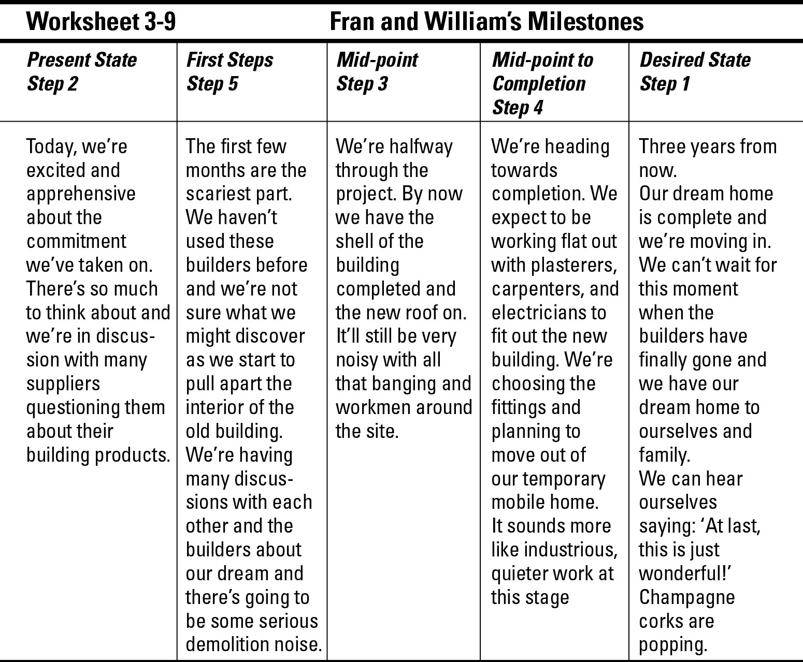

`Worksheet 3-10`为你提供了沉浸在梦想中的机会。


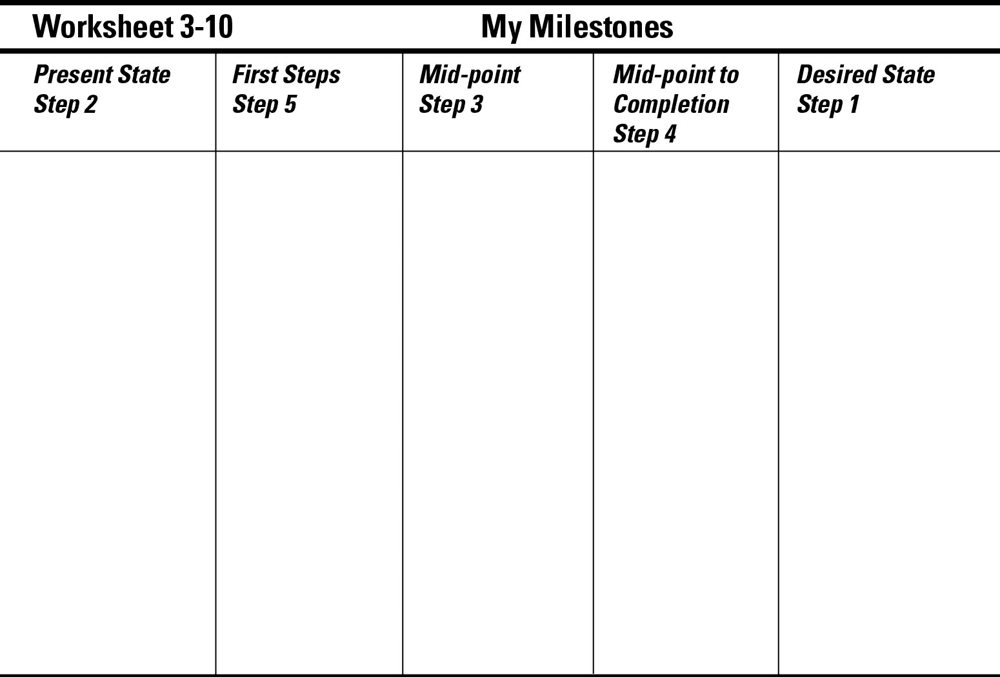


你实现梦想的旅程——从你的现状到达你的目标状态——可能是一次充满挫折的艰巨经历。记住，在 NLP 术语中，“没有所谓的失败，只有反馈”（阅读`第 2 章`中的 NLP 假设），所以如果事情没有像你预期的那样顺利且你错了，请吸取教训并继续。也许挫折的原因随着时间的推移会变得。。

## 顺利运行

在我们的 NLP 教练和 Romilla 的‘Going for Goal’™ 工作会中，我们鼓励你利用所有的资源让每段旅程都运行顺利且愉快。工作会始于设定意图并选择最好的 NLP 假设（`第 2 章`涵盖假设）以增强你的成功心态，并持续帮助你揭示限制性信念以及其他实现预期结果的无意识障碍。当你使用自己的人生轮和构建良好的目标来开发你的目标时，你正在调动所有的感官，并在潜意识和意识之间建立和谐，从而使实现目标变得轻而易举。

一种流行的方法是创建一个图解式的个人梦想日记。这是一本书、笔记本或一个文件，它让你觉得视觉上很美，并且当你拿起它时，那种触感，也许是气味会增强你的期待和兴奋感。这是让你的潜意识与意识保持和谐的另一种方式，寻找创造性的方法来帮助你实现目标——无论是业务计划还是个人计划。你可以用绚丽的色彩和优美的字体写下你的目标，并使用专门用于写日记的笔来建立梦想日记。你也可以将梦想日记作为一个剪贴簿，记录你各种成就的图片、照片和记录。将它放在手边，保持更新，当生活压力大到难以应对时，看看它并享受其中。你可能会惊讶地发现，其中有很多梦想最终实现了。

## 在潜意识中保持梦想


在你的日记中，为通过人生之轮练习正迈向每个主要目标创建一个独立章节，并保留一份关于你良好结果的简要总结。用现在时编写，仿佛它已经完成了一样，并调动所有的感官。工作表 3-11 提供了一个 Danielle 的日记示例，她在那里用“仿佛”的方式写她对新花园的结果已经完成。她正在写一个她梦想实现的未来日期。

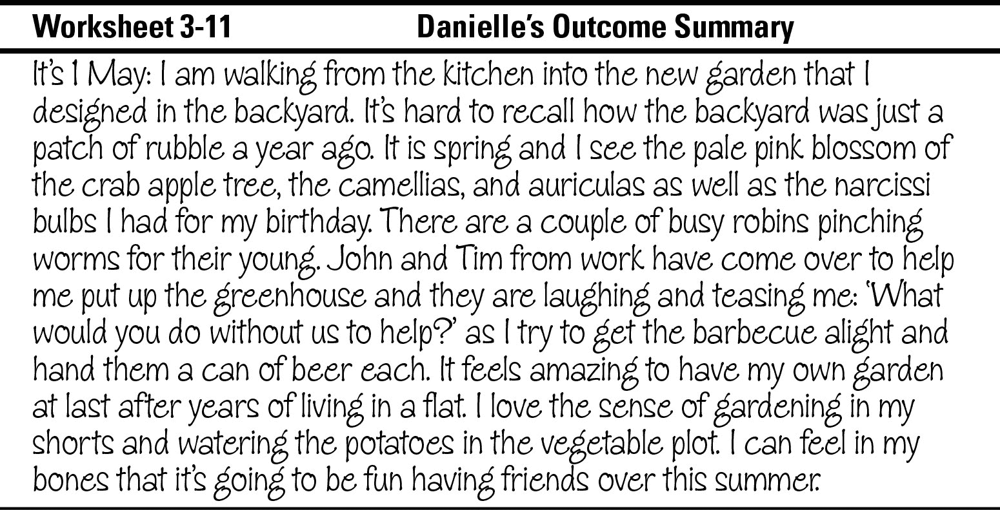


现在使用工作表 3-12 写下你自己的目标。如果你更倾向于使用这个空间仅仅画一幅画或为自己创作一句口号，那也可以。

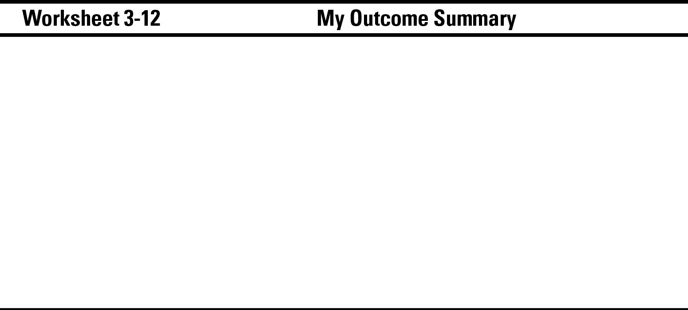


收集照片和图片来插画每个目标并将它们纳入你的日记中，可以让你的愿景变得更加强大。你可能想包含一些触感物品，如一小块布料、木头或金属，或者可以在页面上喷洒一种让你联想到成功的香水。也许当你准备好庆祝成功时，有一个想要去的度假地或想去的餐厅——包含一张要邀请的团队照片或菜单，以时刻牢终极目标。

## 保持正轨

所以现在你拥有了梦想日记，而噢！自从你上次看它之后已经过了几天——琐碎杂事、“忙碌”——借口没完没了，但这一切的后果就是你发现自己丢失了动力。


要重回正轨，请利用以下睡前仪式：

- 花几分钟时间品味你的梦想日记和你的梦想。
- 记录下明天为了保持正轨将采取的五个行动。
- 在进入睡意时，邀请你的潜意识帮助你实现梦想和目标。
- 早上醒来时，在床上的多呆几分钟！同时设定意图“今天将是美好的一天”，并在脑海中排练成功完成你的行动。

## 改变

本章包含了许多你可以掌控生活不同方面的方法，弄清楚你现在喜欢什么，以及未来如何让它变得更好。在按照自己的时间和方式完成练习后，取一张纸或一个笔记本，写下你在这个章中为自己发现的最重要的一件事的思考。

# 第 4 章：与你的潜意识合作

## 本章内容

- 理解好习惯和坏习惯都有隐藏的益处
- 解决内在冲突
- 平复心情以便与你的潜意识交流

你是一个甜党还是咸口党？你是如何发现自己更喜欢甜而不是辣的？是有人拿着清单坐在你身边，由你勾选“是/否”吗？这不太可能！但很有可能是你的潜意识在对你说：“噢！巧克力——天堂”。

你的潜意识可以被比作冰山隐藏的 9/10 部分，它 24/7 全天值班，没有休息表现时间。你的潜意识告诉你吃、喝、睡，以及执行许多其他动作。

本章的目的是向你展示如何通过发现是什么触发了你的想法和行为，然后在潜意识再次接管之前调整你的行为，将潜意识的想法转化为故意识思维和行为。

## 识别意识和无意识行为

记得上一次你在不知的情况下吃完一整包薯片，或者在没经过思考对某人发火吗？这些都是无意识行为的例子，你在自动驾驶模式下执行的动作。

在学习任何新技能时，你都会经历学习曲线。以写作为例。起初，你所做的一切都是痛苦且有意识的，从摆书和削铅笔，到仔细地将笔尖定位在某行线内的正确位置。你唯一的无意识动作是在深度专注时让舌头伸出来。现在你写作时几乎不需要思考，你只需拿起一张纸开始写就好。或者，看看对某人发火的场景。那个人可能在无意中触动了你的某个神经并触发了你的无意识反应。触发因素是一种会引发某种行为模式的刺激，你对这种模式可能几乎没有控制力。

正因为你一次只能意识地处理几个想法，所以你的潜意识被留下来处理其他事情：潜意识告诉你呼吸或抓痒，并保护你免受身体和情感痛苦。然而，有时你的潜意识会出错。在试图保护你时，潜意识可能会带来阻碍你事的恐惧。因此，你必须将潜意识的思想带入意识层面，对其进行分析并在必要时进行调整，然后将它们交回潜意识照顾。

_jpeg)

Jacob 注意到体重秤显示他的体重增加得惊人。于是他开始记录自己吃了什么以及什么时候吃。他发现自己只有在非常糟糕的日子里才吃得很健康，那些日子会去酒吧和朋友聚会，用酒精消愁。在酒吧里，他一次至少喝掉六瓶啤酒并吃掉几包薯片。最糟糕的是，他甚至没有注意到嘴里食物的味道，也不记得自己吃了什么。当 Jacob 和他的朋友放松时，他们开始谈论工作、伴侣、汽车等糟糕的情况。Jacob 并没有感到好转或振起来，反而总是感觉更糟。为了扭转局面，Jacob 决定列出他的意识和无意识行为，如工作表 4-1 所示。

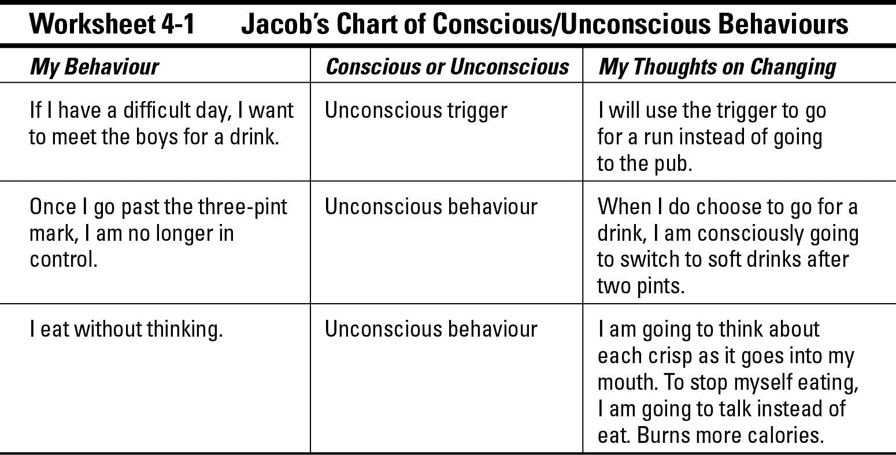


利用工作表 4-2 提供的机会，思考你的行为方式，以及是有意识地行动还是潜意识在促使你这样做。

## 寻找隐藏信息

生活有时会让你想起西蒙与加芬尔克的歌词：“正在滑落/正在滑落/你心知越接近目的地/你滑得就越快”？

如果你有意识地决定采取某项行动，但没有获得预期的结果，你可能会将整件事归结为经验，并有意识地决定另一种行动方案。然而，往往是你的无意识行为影响了你的意识决定。如果能后退一步，快速且毫不费力地获得问题的答案，那不是太棒了吗？

你有意识地决定跳槽一份新工作，但工作并不顺利。你可能会有意识地决定现在不是做出另一个改变的时机，或者目前的工作就是你能预期的最好的。工作未能符合你预期的可能原因是：你无意识地决定不去参加社交活动来为职业变动寻求帮助和建议。你当时给自己找了借口说太累了。你让你的无意识阻碍了你，因为你以前的社交经历并不愉快，你的无意识正试图保护你免受进一步的痛苦。


了解你的无意识是如何运作的，帮助你取得良好结果的工具。通过与无意识交流，你可以继续享受生活，并因你的无意识正在后台忙忙碌碌地为你处理事务而感到快乐。例如，你养成了藉性饮食的习惯——你无法停止往自己塞薯片和巧克力——直到你的无意识指出你过度进食是因为你感到不被爱，这给了你一个机会，只需付出极少精力就能重新开始健康饮食。

### 使用摆钟

与无意识交流的一种方法是使用摆钟，这是一种挂在绳子末端的小重量，用来从你的无意识中引出“是/否”的答案。其原理是，意识念头会引发无意识的肌肉反应，被称为`意念运动`（ideomotor）运动。


摆钟仅仅是一个工具。如果你发现自己成功并取得了良好结果，你可能会发现自己开始依赖摆钟。请记住，你还有许多其他的 NLP（神经语言程序）工具。在会议中拿出摆钟并说“我一会儿给你答复”可能不是一个有效的策略。同样，如果你没有立即得到满意的结果，请尝试坚持使用摆钟，直到你能成功地使用这个工具。

摆钟可以是任何物体，从系在绳子上的浴塞，到项链上精美的水晶，或是挂在链条上喜爱的坠子。

#### 遵循的步骤

如果你想尝试使用摆钟，请遵循以下步骤：

1. 坐在桌旁。
2. 思考你想了解的内容，并写下你打算问的问题。
3. 将拿摆钟手臂的手肘支在桌子上，手腕与前臂成直角。这可以防止手臂疲劳，并让摆钟自由移动。
4. 在每次开始时，要求摆钟给你一个“是”的信号，另一个“否”的信号。你对摆钟选择的动作没有太大控制权。信号通常是相同的，随着时间的推移你会熟悉它们，但请确保每次都询问。
5. 提问并观察反应。

你得到的回答并不总是清晰的——你可能会对同一个问题得到“是”和“否”的回答。有时你会发现摆钟几乎不动，或者只是心不从心地移动。这表明你的无意识并不理解这个问题，或者不想给你答案。你可能需要问：“是否由于某种原因你不想给我答案？”如果回答是“是”，你可以问：“你是否担心我不喜欢这个答案并会难过？”然后你可以继续问另一组问题。

_fmt.jpeg)

Jack 是一位培训师，曾获得两家公司的录取。尽管他尽了全力，但他对于应该接受哪份工作陷入了困境。他为两份工作都列了优缺点清单，结果几乎相等，除了“A 公司”提供的薪水比“B 公司”高出 10%。Jack 决定使用摆钟。

Jack：可以给我一个“是”的信号吗？

摆钟顺时针方向移动。

Jack：谢谢。现在可以给我一个“否”的信号吗？

摆钟从北向南直线移动。

Jack：谢谢。我应该接受“B 公司”吗？

摆钟给出了“是”。

Jack：谢谢。我应该接受“A 公司”吗？

摆钟给出了“否”。

Jack：即使“A 公司”给的钱更高，我也应该接受“B 公司”吗？

摆钟给出了“是”。

六个月后，Jack 发现“A 公司”的财务总监在挪用资金，公司正在裁员。在这种情况下，使用摆钟似乎等同于与超自然力量交流。但简单的解释是，Jack 捕捉到了“A 公司”董事们发出的微妙信号，他们对公司的未来存在怀疑和不确定。


工作单 4-3 显示了你如何使用摆钟。但在开始之前，有两点需要记住：

- 你的无意识就像一个小孩子，所以你问的问题需要简单且直接。
- 有时，“否”的回答可能隐藏了“我不知道”或“我不想说”之类的答案，你必须要求澄清。如果你对回答表示怀疑，可以一直问：“你知道答案吗？”，如果回答是“是”，你可以问：“你想告诉我吗？”在获得使用摆钟的经验后，你可以微调你的问题。

_fmt.jpeg)

查理（Charlie）正面临裁员。他不确定是应该成为一名顾问，还是想在另一家知名公司工作以获得安全感。由于对接下来的打算感到恐惧和不确定，他利用休假（gardening leave）去搞园艺来逃避这个问题，而不是寻找工作或研究他作为独立顾问需要做什么。查理决定专注于自己的问题，并使用第 9 章概述的“电影导演”技术来客观地审视这个问题。在这部电影中，查理扮演`观察者`（Observer）的角色，他的意识意识扮演`主角`（Protagonist），他的潜意识扮演`反派`（Antagonist），由电影导演通过镜头对他们进行密切观察。当这些角色扮演自己的角色时，查理发现，虽然他想要稳定工作的稳定性，但他的潜意识却希望他拥有咨询工作的多样性和刺激性。查理曾因为无聊而与之前的雇主闹得不，他的潜意识将“无聊”等同于“麻烦”，并试图保护他不再再次陷入困境。一旦查理的恐惧被带入意识层面，他就能接受一份永久性工作。然而，查理在面试期间双重确保了这份新工作能在智力上挑战他，并给他提供足够的丰富性！

## 整合你的各个部分

你是否发现自己曾说过类似“我的一部分想离开，但不确定”的话？你可能正在经历对某个产生重大情感影响的事件产生的冲突。理想情况下，你的神经系统是一个整体在运作。但在你的人生旅程中，你会经历各种事件，其中一些是痛苦的，你创造了新的自我来保护自己免受进一步的压力或痛苦。有时这些部分并不总是与神经系统的其他部分有效沟通。

在这一节中，我们描述了一个与两个独立部分合作的过程，让每个部分拥有共同的目标，并将每个部分整合成一个整体。你一次可以整合两个部分，但为了简单起见，我们建议一次只处理两个。

将整合的理念牢放在脑中，遵循以下整合冲突部分的流程：

1. 找一个安静的地方坐下，不要被打扰。


##我是 goaichat 研发的智能大模型，可以为你提供智能问答、分析和创作服务。2.识别出你身上相互冲突的部分你可以通过观察你想要解决的问题来识别冲突部分。例如，如果你说：“我需要完成我的论文，但某些东西在阻碍我”，在想要完成论文的`Part A`和破坏过程的`Part B`之间就存在冲突。或者，你可能说：“我爱她，但我害怕承诺。”`Part A`想要承诺；但`Part B`不想，这导致了你内在的冲突，并可能导致你的关系出现困难。

##3. 将每个部分想象成两个独立的人想象每个人看起来什么样、听起来是什么声音，以及每个人拥有什么样的感受。

##4. 要求你认为那问题所在的部分走出来，站在其中一只手边在步骤2 的示例中，问题部分（两种情况下都是`B`）那些阻碍你实现目标的部分。部分之间的分歧可能持续多年，直到你决定专注于你为什么得不到想要的东西，你才会注意到。这时你意识到，这种分歧实际上两个部分试图实现的目标之间的冲突。

##5. 要求那个你认为不是问题所在的部分走出来，站在另一只手边##6. 从你认为问题的部分开始，询问每个部分：“你的正向意图和目的是什么？”

尽管某个部分正在破坏你的努力，但那个部分的意图为了获得积极的结果。示例中的“问题”部分`B`可能并不希望你完成论文，因为它在保护你免受当你进入大世界时不可避免受到的打击。不让你承诺`Part B`保护你免受未来情感痛苦的方式。（关于正向意图和次级收益的更多信息，请参见第3章。）

##7.非问题部分重复步骤6##8.两个部分重复步骤6直到它们都意识到自己有相同的意图，此时两只手可以合在一起，将各个部分整合为整体。

表面上看，两个部分具有相同意图似乎不太可能，但随着你完成练习，两个部分将带着共同的、正向的意图结合。

##9.询问每个部分拥有哪些资源询问每个部分拥有哪些资源，可以让另一个部分在实现各自正向意图和目的时感到有用。

在这种语境下，资源可能规划能力、时间管理、远见、激励他人的能力，或者极其固执且不让他人让你偏离轨道的倾向。

整合你的各个部分特别有用，因为在让每个部分都意识到双方有共同目标的同时，每个部分也另一个的力量和能力获得了欣赏。

_fmt.jpeg)

提姆（Tim）在担任自由培训师后破产了。他业务失败和申请破产的全过程他产生了巨大的影响。尽管他很快在另一家公司找到了工作，但他提不起精神，他的培训课程也准备不充分。这他的职业生涯产生了负面影响。提姆认为自己可能正在经历一个想要他成功的部分和另一个想要失败的部分之间的冲突。工作表4-6 显示了提姆整合这两个部分的过程。


注意，虽然部分 A 和 B 使用的术语不同，但进一步的提问显示它们具有相同的意图。尽管`Part A`使用“赚很多”和“安全”，而`Part B`使用“财务安全”和“稳定”，这些术语并不重要。这个练习不是为了词汇，而为了获得最终的结果——快乐。


现在，按照提姆的步骤，尝试整合自己的两个部分。将你的想法写在工作表4-7 上。

##进入中心让思想安静与潜意识接触的理想方式。做到这一点最好的方法之一是在日常生活中加入一些安静的时间，以便冥想或沉思。

训练潜意识的一个极好方法建立一套仪式。建立点蜡烛、调暗灯光并播放音乐来放松和冷静活跃的大脑的仪式，是进入冥想过程的好方法。要开始，可以在房间里划出一个空间，或者如果你幸运的话，划出一个整个潜意识与安静时间联系在一起的房间。

###1. 决定在何时抽出时间进行冥想例如，在房间里清理出一个角落，将一张躺椅或其他舒适的椅子移过去，并配上一张用来放置蜡烛、笔记本和笔的小边桌。

冥想睡前放慢节奏的一种好方法。另一方面，有些人更喜欢通过一些安静、专注的冥想开始新的一天。

从每天坚持冥想10 分钟开始，当你发现自己可以安排时间时，增加到20 分钟。一段时间后，你可以选择将冥想时间延长到1 小时，或者在每天的两头各安排两个20 分钟的时段。自己宽容一点。一开始就设定每天一小时这种不现实的目标并在几天后就放弃毫无意义的。

###2. 思考一个你正在纠结的问题如果你现在没有正在纠结任何问题，请跳转到第4 步。

###3.选择一个表达你想要的结果的陈述用肯定的方式表述，仿佛你已经实现了该结果。

表4-1 提供了肯定陈述的示例。

决定你想要专注于某个问题的时间有帮助的。你可能决定每周处理一个问题，并根据你结果的满意程度每次增加一周。

###4. 感谢你的潜意识如果你目前没有任何问题，并且通常感到快乐和满足，请感谢你的潜意识，或者谈论一些让你感激的事。例如：

- 潜意识，我承认你的帮助并感谢你。
- 我感谢德里里（Derry）。
- 我的 T细胞饱满且健康。

###5. 开始让自己静下来并感到舒服的仪式仪式在训练自己自律方面非常重要。你可能会发现，当你开始冥想时，你留出的10 分钟时间里，大部分时间都花在了进入合适的心境和冷静大脑上。随着你的仪式变成本能，你会发现自己能够快速且平稳地进入冥想状态。

###6. 用鼻子吸气并说出你的陈述当你从嘴部轻轻地呼气时，说出你的陈述。

重复这一步骤，直到完成你的冥想持续时间。


手边准备好笔记本和笔，记录下冥想期间浮出的任何想法。

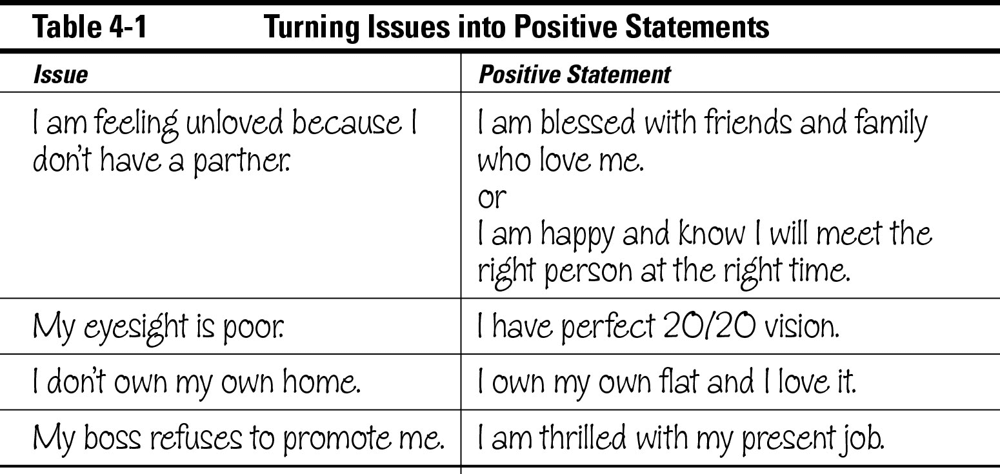

如果你不喜欢冥想的想法，是因为你担心可能无法从深度出神状态中出来，不要担心。发生的一切仅仅你进入了深层、休息性的睡眠，并在身体得到休息后自然醒来。

记录你的进度。在冥想结束时，写下你经历的变化。

如果你发现结果不如预期，请延长你关注目标的时间，或简化你的陈述。尝试将你的陈述分解为更小的步骤，或将你的注意力转移到不同的事情上，让你的潜意识想出替代方案。有时当你极度渴望某物时，你实际上会因为害怕得不到而将其推开。将注意力转移到其他地方可以让你将其他需求引入你的生活。


工作表4-8 用于记录你冥想的正面结果。

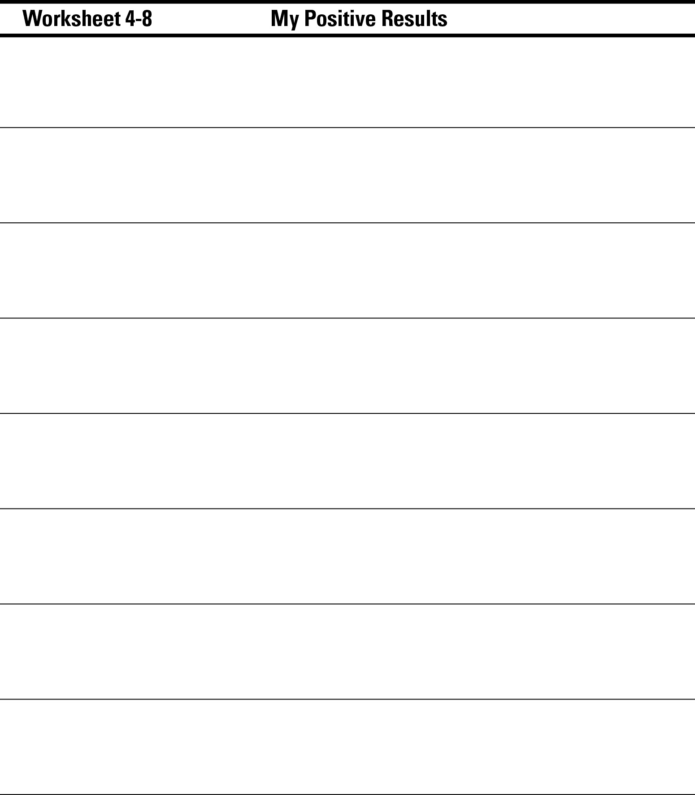


你的潜意识正在尽所能地给你它认为你想要的东西，并试图引导你。学会倾听你的潜意识在说什么，如果你的潜意识有时误解了情况，请温柔地引导你的潜意识让它做你想做的事。你可以通过使用良好结果过程（well-formed outcome process）来实现这一点（你可以在快捷表中和第3章中找到）。然后你就可以获得你想要的正面结果。通过反复回到你的良好结果，你正在训练潜意识与你一起达成目标。


经常向你的潜意识说“谢谢你”，有助于你潜意识产生信仰和信任。

# 第5章：识别你如何过滤思维的## 本章内容-观察 NLP 通讯模型- 应用你的内部/外部元程序过滤器- 检查你的价值观- 改变决策和行为- 唤起记忆你是否运气足够不好，认识了这样的人：只要一想到他们就让你想吐？好吧，也许她并没有那么恶心——尽管如此，每当你们相遇时你都会感到火冒三丈。还有电话里的那个人，声音让你心暖融融——一个你非常期待见到的人。可能，对于第一个人来说，你们仅仅是不在同一个频道上，思维上南辕北辙；而对于第二个人，你们可能拥有相似的价值观，说同样的语言，并有共同兴趣。

的，老俗话说异性相吸，但在实践中，与一个由于价值观、兴趣和特征相似而可以舒服交流的人显然容易得多。

在本章中，我们为你提供了工具，以更好地理解你和他人如何思考和行为的，让你的信息传达并被接受，并增加你的影响力和亲和力。

## 检查通讯模型本节介绍了`NLP 通讯模型`。基本上，这个模型处理的是这样一个事实：你的大脑不断被海量信息淹没，这些信息都在寻求你的注意。大脑处理这种信息过载的方式通过元程序、价值观、信念和记忆输入信息进行过滤。通过过滤的结果，你创建了包含删除、扭曲的内部表示。

内部表示（internal representation）一个术语，指的是你从周围世界获取的信息而在内心产生的图像、声音或感受。基本上，内部表示你通过过滤后剩余的信息所做的解释。

NLP使人们能够理解心理学。达到这种理解的方法识别`NLP 通讯模型`如何过滤你的内部表示，这反过来影响了你的心态、生理状态以及最终的行为。理解这些过滤器赋予了你改变它们的力量，从而改变你的内部表示，进而改变你的心态、生理状态和最终的行为。当你能理解他人如何删除、扭曲和泛化的时，你就能与那个人建立更大的亲和力，因为你理解了方的心理，并可以调整自己的语言和行为来匹配方。

本章专注于`通讯模型`的前三个步骤。第14章和第15章解释了你如何口头上向世界重新呈现你的内部表示。

## 通讯模型有五个步骤1.通过五感收集有关事件的信息：

 -视觉——图像 - 听觉——声音 -触觉——触摸 - 嗅觉——味道 - 味觉——味道2.通过以下过滤器传递信息：

 - 元程序（第8章介绍了元程序）
 -价值观 - 信念 - 决策 -记忆3. 导致你内部产生该事件的内部表示。

4. 在你内部产生一种心理和生理状态组合的状态。

5. 刺激生理反应，从说话到握手，从拥抱到接吻。

## 排除删除允许你的意识忽略大量涌入的信息，其益处在于让你能够处理剩余的消息。但缺点，你可能会忽略掉重要的信息。


仔细观察你的周围环境。然后，在不看第二眼的情况下，在`Worksheet5-1`的第一列记下你记得的内容。再次观察周围环境，并在第三列写下你第一次没有注意到的事情。

这个练习旨在帮助你识别你的过滤器如何在你处理摄入信息时决定你关注哪些事物的。例如，在你的办公室里，你注意到了挂在墙上的纪念牌，因为它让你想起了一个你来说具有特殊意义的场合。然而，你忽略了放在办公桌上的一把钥匙，因为只有在你要回家的时候，它们才你重要。这表明，过滤器可以简单到只记住你有意义、价值或即时用途的物品，并删除那些你没有情感纽结或即时用途的物品。你有意义或价值的东西由你的经历和环境决定的。

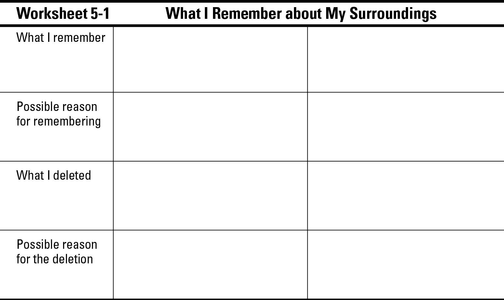

##处理扭曲

扭曲发生情况的错误描述，或者所说内容的误解。在 NLP 通信模型中，扭曲你过滤通过感官获得的数据时可能发生的三个现象之一（另外两个删除和泛化）。

扭曲允许你将摄入的信息符合你所认为真实的事实，它们由于你的生活经历而产生。扭曲可能你有利，也可能产生不利。例如，某人认为没有传统医学的替代方案，因为她尝试过催眠治疗，但她来说并不成功。所以现在当她发现关于草药益处的文章时，她可能懒得读这些文章，因为她将草药等同于“江湖骗”。或者另一个人被要求换一份工作，她决定因为老板不喜欢她并想让她走人。事实上，她的老板知道她并不开心，并给她提供了一个机会，让她利用在当前工作中被浪费的技能来大放异彩。如果这些人能意识到这些毫无帮助的扭曲，他们就可以改变自己的想法。

_fmt.jpeg)

一个夏天，Drew觉得那些节肢动物真的在针对他。尽管一个健壮的成年人，但他那关于每晚与蜘蛛遭遇的故事让他妈妈精疲力竭。在忙碌了一天后，Drew 的母亲决定通过泡热水香香浴缸来恢复理智。当她躺在浴缸时，她注意到水槽下有一只巨大的蜘蛛。在泡澡时，她担心该如何除掉那只蜘蛛。然后她意识到那根本不是蜘蛛，而她去完理发店后衣服上掉落的头发。她并不特别母性，当她纠结把这只“蜘蛛”留给儿子发现，还是像母亲一样把它清理时，她忍不住咯咯笑了起来。当一团头发变成一只蜘蛛时，你绝现实产生了扭曲！


在`Worksheet5-2`中写下你扭曲的经历。如果你想不起现实生活中的案例，电影训练大脑肌肉的好素材。超现实主义绘画可以被看作是一种扭曲，其结果并不真正代表艺术家所看到的世界图像，而受到艺术家想象、心理和哲学方面的影响。政府统计被反派视为一种扭曲，他们会认同亚伦·莱文斯坦（Aaron Levenstein）的话：“统计数据就像比基尼。它们展示的具有暗示性，但它们隐藏的至关重要。”

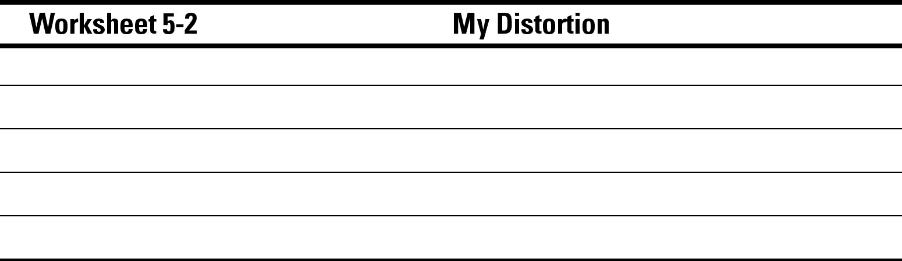

扭曲的另一个例子你试图读人的心，结果却弄反了意思。请翻到第15章探索读心术问题。

## 泛化当你将一系列事件归类并命名为一个标题时，你就在进行泛化。泛化可以涉及事物和人，也可以涉及事件。

泛化你从环境中接收信息时使用的 NLP 通信过滤器之一。在学习等事务中，泛化非常有帮助，因为它们使你不需要回到基础，并让你能够在已有的知识基础上进行构建。泛化可能阻碍你的时刻你当你有一段不愉快的经历，并决定类似的经历也会不愉快。例如，在日本一家餐厅有过糟糕的经历后，你决定再也不吃日本菜了。

各种“主义”，例如性别歧视和年龄歧视，是泛化的典型例子。经历过一段不愉快关系的人可能会决定“男人都是自私的”，并在寻找合适伴侣时遇到困难。

从积极的一方面来说，泛化也可以创造“钩子”，让你在攀爬学习或成就的阶梯时有所抓。

_fmt.jpeg)

Sarah 在开始学习 NLP 时已经一个经验丰富的培训师了。当她听别人说话时，她不断思考在演示中应用 NLP 的方法。你可以说 Sarah 有了“钩子”，可以把她新学到的知识挂上去。结果，她超过了那些仍在努力汲取新信息的同学。

_fmt.jpeg)

找一个安静的时间思考你如何泛化的。你是否仅仅因为某人演员且你认为所有演员都有趣就为他们花时间？你是否会回避一个说“我只是个家庭主妇”的女人，认为她的话题只有她的丈夫和孩子？你一个年龄歧视者吗，认为任何超过45 岁的人都准备好进入废堆？还是你一个年轻歧视者，认为年轻人的意见不值一听？


你的“主义”和其他泛化是什么？`Worksheet5-4`给了你一个探索自我这一面的机会。

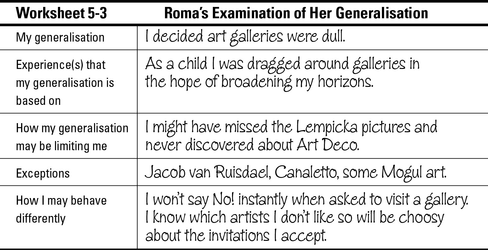

Roma 决定她不喜欢去美术馆，除了雅各·鲁伊斯达（Jacob Ruisdael）的荷兰风车和云以及卡纳托（Canaletto）的威尼斯风景，她发现大多数其他画都很无味。因为这个原因，她几乎拒绝了观看玛塔拉·德伦皮基（Tamara de Lempicka）作品的邀请。幸运的是，Roma 没有拒绝，因为她发现德伦皮基的作品完全迷人。所以，她美术馆无味的泛化很可能让她的生活变得贫乏。在给机会开放思想后，她发现自己也喜欢艺术。在`Worksheet5-3`中，你可以看到 Roma 在洞察自己在艺术背景下如何泛化后改变了行为。希望她能将这种意识带到生活的其他领域。当 Roma 意识到自己正在泛化时，可以停下来评估，并有意识地决定随泛化还是破例。

`Worksheet5-3`显示了 Roma 如何检查她的泛化。

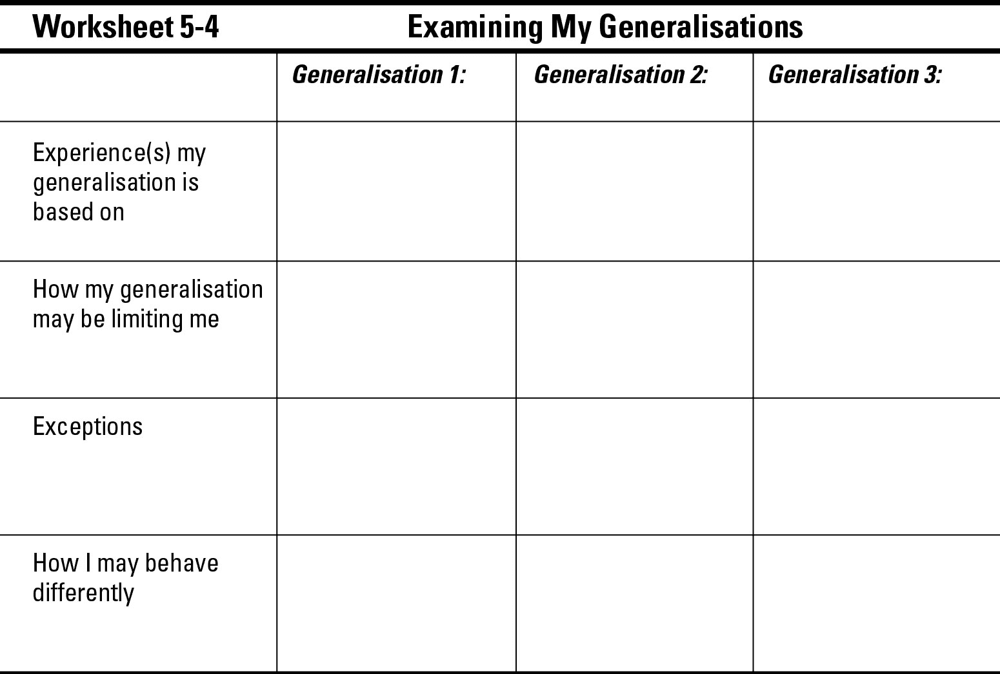

删除、扭曲和泛化并非孤立发生。在你从环境中获取的信息进行过滤后，你创建了一个内部表征，其中包含了这三者的各种元素。选取一个你想要检查的行为示例，或者参考我们的例子，观察你如何读报纸的。当你发现自己只是扫视标题并继续后看时，停下来，分析一下阻止你关注那篇文章的删除、扭曲和泛化。是否因为你认为**所有（泛化）**政治家都是坏的，因为他们不诚实且**从不（泛化）**说实话，所以你不想读任何**（泛化）**政治家说的话？你删除了“可能有很多诚实的政治家”这一事实，并在一种特定语境下扭曲了他们人格中的一个方面——不诚实——并决定任何政治家都是坏的。

Dot一个39 岁的单身女性，急于寻找一个伴侣。她故事中的一些词使用了斜体，这向你展示了如何识别她日常语言中的泛化。

> 我*永远*找不到一个可以共度生活的男人了。我最近遇到的*所有*男人要么回避做出承诺，要么工作狂，而且我遇到的*所有*男的都觉得我长得很丑。

Dot之所以自己非常严苛，是因为在潜意识层面，她并不真正相信自己有时间谈恋爱。工作表5-5 显示了 Dot 的删除、扭曲和泛化。

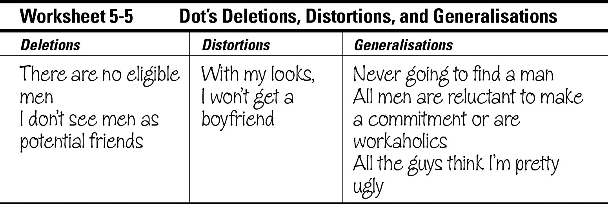


现在既然你已经练习了分析自己的删除、扭曲和泛化，并阅读了轶事和示例，请从你的生活中选择一个你想要学习的问题。在工作表5-6 中记录下你发现自己正在经历的删除、扭曲和泛化。

你可以在第14章中找到关于理解和处理删除、扭曲和泛化的更多细节。

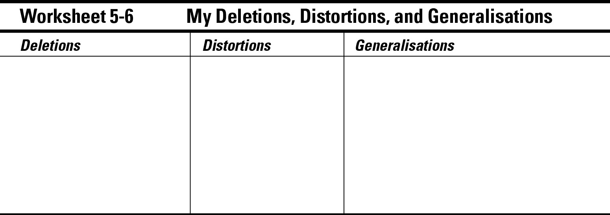

## 为了接收而进行传输沟通一个双向过程。在沟通模型的语境下，你可以通过以下方式最大化你的沟通能力：


- 识别与其沟通者的过滤器
- 理解你自己的过滤器以便进行调整
- 调整你的语言以反映对方的过滤器

本章的其余部分向你展示了每个过滤器——元程序、价值观、信念、决策和记忆——如何影响你，以及由于将这些过滤器应用于从周围世界接收的信息，你是如何导致删除、扭曲和泛化的。接下来的章节选取了元程序过滤器的子集，来说明过滤器具体是如何在删除、扭曲和泛化输入数据中的，以及它对你行为的影响。你可以修改你的过滤器来改变获得的结果，或者如果你对结果满意，也可以保持不变。

### 观察内部/外部的元程序

你自定义了被称为“元程序”的过滤器来过滤你的各种经验。大多数元程序在滑动刻度上运行，你会发现自己根据情况在刻度的不同点上操作。（要了解更多关于元程序的信息，请参阅第 8 章“用元程序影响他人”。）内部/外部元程序决定了你是倾向于信任自己的判断（`internal`）还是他人的判断（`external`），或者你是否愿意听取并从别人的观点。内部/外部元程序的重要性在于意识到你是如何过滤所接收的信息。

换句话说，你可能删除了有价值的信息，并将反馈视为不重要。当你意识到这种倾向时，可能会发现记得保持开放的心很有用。一个简单的练习是有意识地记录对所呈现的信息进行权衡利弊，而不是随手拒绝它。一种方法是使用你信任的人作为踏风板，让她扮演“魔鬼代言人”来检查论点的双方观点。这个人可能指出，你是否仅仅因为认为自己总是对的（`generalisation`）而扭曲了给你的信息，而这可能会导致误解。

如果你发现自己处于刻度的“外部”端，你可能会经常寻求他人的意见并依赖他们的反馈。对你来说，做决定更困难，因为你听了太多人的话。你可以通过记录你成功做决定的时刻来扭转局面，并以此作为建立自我信任的跳板，让你筛选出优建议。

当你意识到内部/外部倾向时，你可以训练自己保持开放的心。尝试养成对接收的信息始终权衡利弊的习惯，而不是随手拒绝它。

 当你处于学习曲线或新情境时，你可能会发现自己表现出很多 `external` 倾向——直到你进入状态，你可能会切换到更多的 `internal` 倾向，因为你已经在该领域信任了自己。

_fmt.jpeg) Cassy 在一家大型公司担任法律秘书六个月了，尽管她和老板、同事相处得很好，但她感到不安，因为她并真的不知道自己做得好不好。在阅读了《傻瓜神经语言学》中关于元程序的章节后，Cassy 意识到自己处于内部/外部刻度的外侧，并依赖反馈来评估自己的表现。她的经理可能更多地运行在“内部”侧，他认为没有必要与 Cassy 讨论她做得好坏。

下面的活动使你意识到元程序会影响你的行为，而行为会根据你所处的环境而改变。工作表 5-7 和 5-8 提供了自我检查和理解的机会，反过来这让你对自己的行为拥有选择。

 利用此机会在工作表 5-7 中填写：

- 你思考内部元程序的语境。例如，你是在熟悉工作且感到自信的场所，还是在家里（在那里感到安全且有掌控感，你是主人）？
- 关于你为何认为自己的行为更偏内部的观察。是否是因为你发现自己不听从或忽略了别人告诉你的话？

在思考你在哪些地方表现出更多“外向”倾向后，请填写工作表 5-8：

- 你在滑动尺度上更偏向“外向”端的情况。例如，你是否发现自己在工作时处于尺度的外向端，允许别人推翻你的决定，而你可能刚入职新工作，还不熟悉规则？
- 你对认为导致这种情况的原因观察。思考是什么导致了你产生不同的行为，以及你是如何识别自己这一面的。你可能表现得更向“外向”，是因为你把某人奉上了神坛，或者你看重他人的经验胜过自己的。你注意到自己的行为不同，是因为你变得安静了，因为选择倾听而不是说话。

在进行这些练习时，请识别你的内在/外向元程序（`metaprogram`）对你处理信息和行为方式产生的某些积极和负面影响。判断这种影响是积极还是负面的方法，是将你获得的结果与想要的结果进行衡量。例如，你是否因为听了太多人的意见而花更长时间做决定（负面），或者你会心中断并忽视他人的反馈（负面）？也许通过变得更“内在”，你可以快速做出决定（积极），或者通过诉说而不是倾听，你可以更快地获得想要的结果（积极）。因此，对于每项，请评估你认为由于元程序而表现出的行为是好是坏。


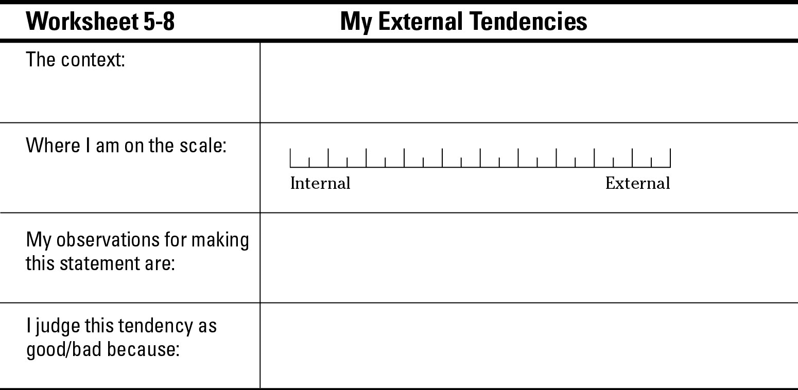

 为了好玩以及为了自己增加练习，请选择一个你熟悉的人并填写工作表 5-9，这次记录下你对所选之人的观察。

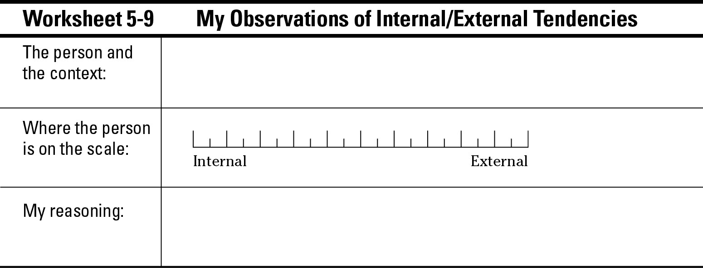

 如果你希望你的信息被听进去，并且你正在与一个表现出“内在”倾向的人交流，可以使用如下表达：

- 最终只有你自己才知道
- 由自己判断
- 权衡所有事实并决定
- 决定掌握在你肩上

对于更偏向“外向”的人，如果你使用如下表达，可能会更容易被你说的话说服：

- 大家的共识是
- 这有成千上万个
- 邻居们刚买了这个超级厉害的
- 研究表明

### 发现你的价值观

迪娜热衷地相信动物福利，并厌恶实验动物的想法。她的表哥提姆在一家制药公司工作，活体实验。尽管迪娜和提姆小时候形影不离，但现在情况已经变了，家庭聚会可能会变得非常有趣——至少可以这么说，因为表兄妹之间的争论往往激烈且火爆。家庭其他成员无法理解为什么每个人的反应如此激烈。“价值观”？你说。没错。迪娜和提姆对于活体实验和动物福利显然有不同的价值观。

#### 价值观影响行为

- 价值观被用来检查某事是好是坏
- 价值观可以激励或打击动力

你的价值观是在人生的不同阶段受外部影响形成的，如文化、家庭、朋友以及你在生活中的经历。价值观词汇包括诚实、真理、荣誉、乐趣、财富。其中一些价值观可能会随语境而改变，但无论你处于什么角色，都会带上核心价值观。如果乐趣是你的核心价值观之一，你希望乐趣渗透到生活的方方面面，无论是工作、休息还是玩。核心价值观是不可妥协的，如果你被迫处于一个没有乐趣的境地，你可能会感到非常痛苦。然而，如果你看重乐趣但它不是核心价值观，你可能为了实现特定的结果而愿意牺牲一段时间。

在迪娜和提姆的案例中，他们之间的冲突源于价值观的差异。与自身冲突的价值观会导致压力和不快乐。价值观冲突可能由于试图达到他人的期望和价值观，而这些价值观并不总是与你的匹配。

_fmt.jpeg) 塔拉是一位高薪会计师。她的社交生活非常丰富，前景广阔。她的父母为她感到自豪，喜欢向朋友和家人介绍他们事业有成的女儿。然后塔拉生病了。她感到没有成就感、疲惫且无精打采，流了很多眼泪。绝望中，塔拉请了一位教练，教练在其他方面还帮助塔拉弄清楚了她的工作和职业价值观。塔拉发现她一直都在试图符合父母的价值观。她决定休个长假，在此期间规划她的职业变动。塔拉现在在一家慈善机构担任自由职业会计师。她感到很充实、健康且快乐，并相信她正在做的工作确实产生了影响。她赚的钱没有以前多，也不再承担以前那样的责任，但因为高薪和高职位并不是她生活中的动力因素，所以她不受这些缺失的影响。遗憾的是，她的父母并不因此印象深刻，对她的新工作和生活方式没话可说。

 你可能会发现自己根据生活的不同领域持有不同的价值观。例如，在浪漫关系中，被爱可能很重要，但在工作中可能不是，在工作中获得成功可能更重要。

这里是一种在生活的特定领域检测价值观的简单方法：

1. 想一个你想要改进的生活领域。
2. 列出在该语境下对你重要的事情。例如，在工作语境下，你的价值观可能是工作安全、金钱、职业前景等。某些价值观可能会很快出现在脑海中。当你坐下来多思考一下对你重要的事情时，你可能会发现另一组价值观浮出出来。
3. 按重要性列出你的价值观。你可能会发现，后来出现的价值观现在对你来说具有更大的意义。

 如果你在决定列表中每个价值观的排名时遇到困难，请想象你正处一艘正在漏水的救生艇上。你需要减轻救生艇的负荷，每个价值观都标记在一个沉重的包子上。你会按什么顺序把袋子扔下海？

尝试使用上述方法来推导出你的价值观。在 `Worksheet 5-10` 中填写包子，填入你在考虑所选生活领域对你重要的事情时提到的价值观。你可以在包子顶部写下每个价值观的重要性。

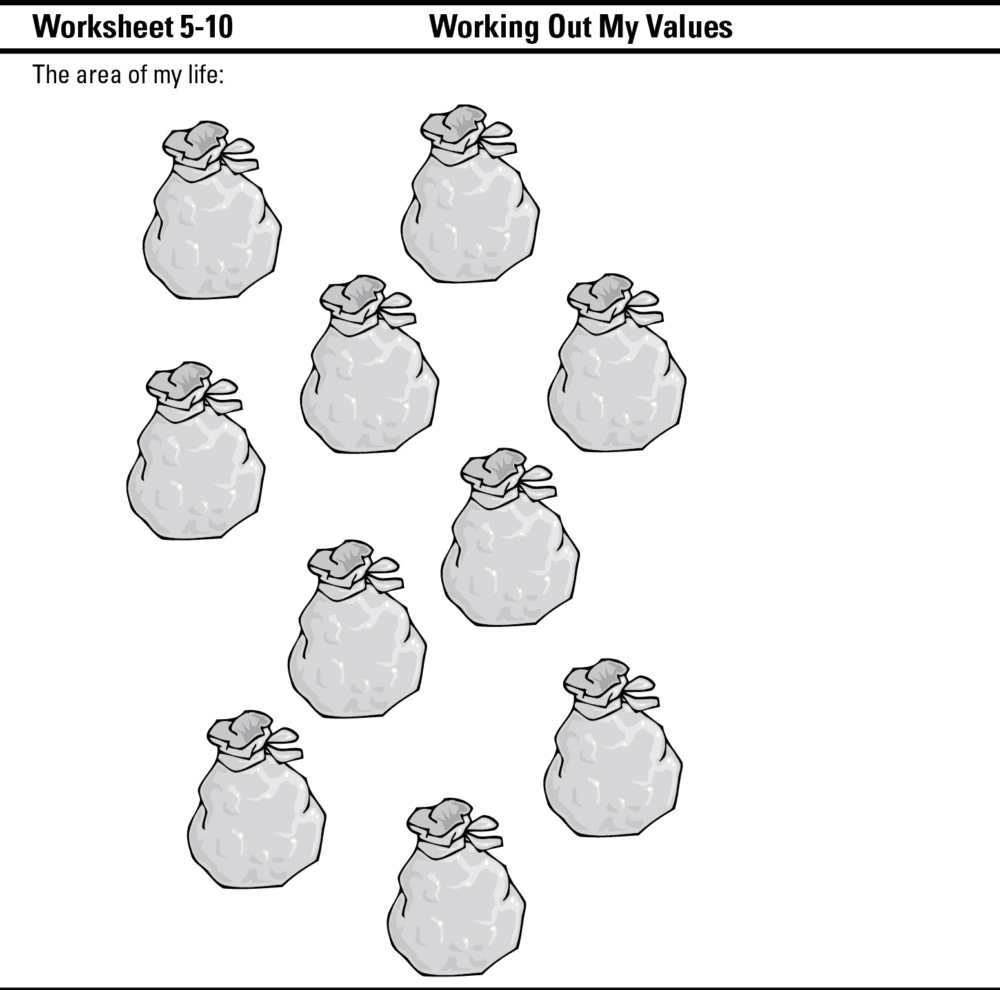


工作表 5-10 的头脑风暴结果看起来可能有些混乱。因此，在工作表 5-11 中，按从最重要到最不重要的顺序回顾你的价值观。

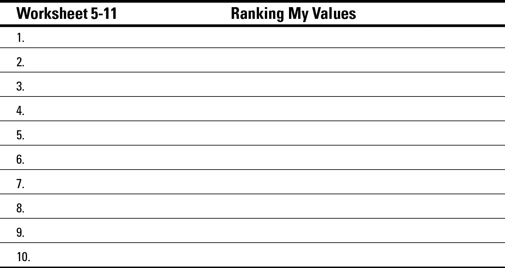

你的价值观就像一个过滤器，导致你对生活的某些方面进行删减、扭曲或概括。例如，迪娜和提姆经常导致无法听见对方（删减）或误解对方说的话（扭曲）。迪娜的概括可能是：“噢，他又在说老一套，医疗干预可以救命了”，这让她停止了学习提姆关于草药应用于动物福利的新研究。考虑一下你拥有的价值观给生活带来了哪些删减、扭曲和概括。

 通过对你自己或他人的价值观获得更深入的理解，你增加了生活中的选择。思考一下你在生活的哪个领域限制了自己，以及你如何扭转局面。例如，你可能对那位过着波西米亚式生活方式熟人并不友好，但通过更深入地了解她并欣赏她的生活方式，你正在为你的思维方式编织新的线索。

使用 `Worksheet 5-12` 来思考你的价值观以及你如何利用它们来进行删除（`delete`）、扭曲（`distortion`）和泛化（`generalise`）。

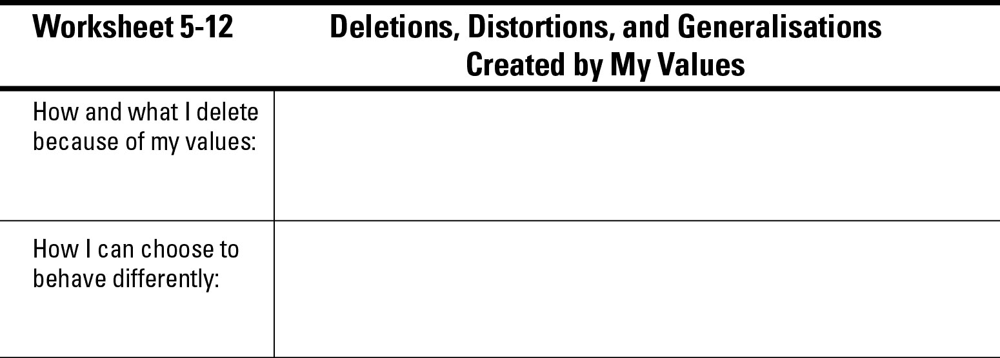

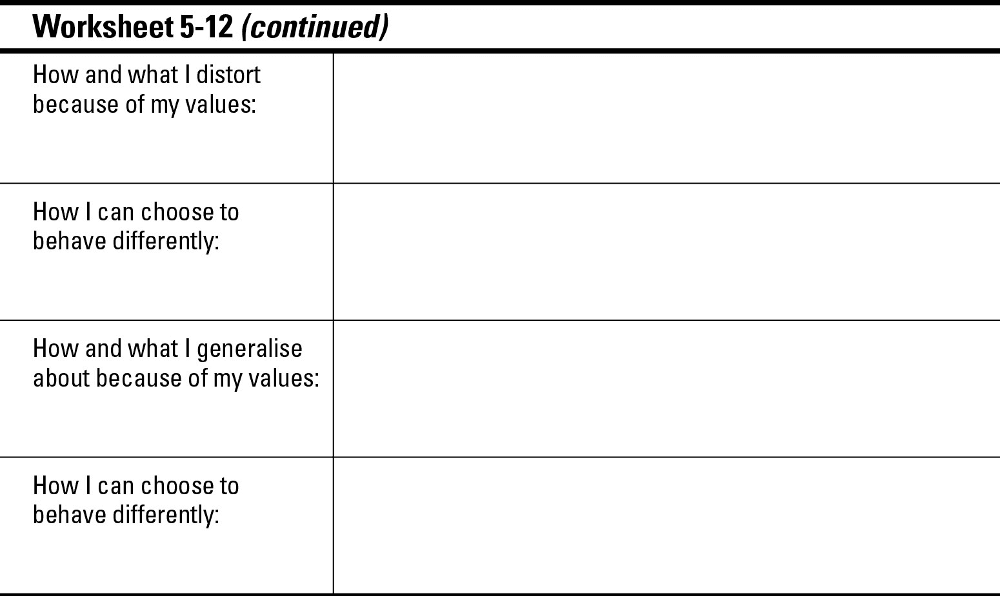

## 识别阻塞过滤器

识别过滤器对你处理接收的海量信息的影响并不总是容易。你的一些过滤器可以产生赋能效应——例如，最近的成功带给你信心，让你展翅膀飞得更高。但那些让你固守在原地、扼杀你梦想和抱负的过滤器呢？如果能让那个说“你上次做那样的事情时受伤了”的声音沉默，或者将你思维的焦点从“失败”转移到“学到的教训”，不是很棒吗？本节旨在帮助你理解阻塞的过滤器（如限制你的决定和信念）如何阻碍你看到情境中的潜力。

你生活中发生的事件可能会导致你的无意识大脑代替你建立信念或做出决定，从而限制你的行为。在某些方面制约了你的决定被称为限制性决定（`limiting decision`）。对你的生活产生负面影响的信念被称为限制性信念（`limiting belief`）——例如，“金钱是万恶之根源”就是一个可能让你陷于贫困的信念。产生限制性决定或信念的事件存在于你的记忆中，但对你的意识层面是隐藏的。如果这段记忆造成了一些问题，你可能需要寻求专业帮助。并不是所有的限制性决定或信念都需要清除。你喜欢还是讨厌马麦酱（Marmite）真的重要吗？

如果你解决某个问题，可以通过阅读第 10 章和第 13 章来帮助自己，这些章节向你展示了如何获取遗忘的记忆，并释放某些限制性信念和决定对你的控制。

_fmt.jpeg) Lena 有一套选择朋友的方法。她有有长期朋友、退休后会一起社交的朋友，以及只是生命中路过的无关紧要的朋友。也许她的意识决定是由隐藏在记忆深处的无意识决定所主导的。点在于，Lena 可能会删除某些朋友关系，因为她对他们有扭曲的看法，并且由于她的泛化，将他们归入了“无关紧要的朋友”这一框子里。对于一个喜欢交很多熟人的人来说，这听起来相当负面，但它适合 Lena，她朋友较少，并且能够与他们享受有意义的关系。

 这本书完全关于更好地理解人，主要是理解你你自己。`Worksheet 5-13` 帮助你评估你所做出的决定如何影响你的生活。如果你有意识地分析一个决定，并决定得到的结果并不满意，你可以根据更具赋能性的决定选择不同的行为。

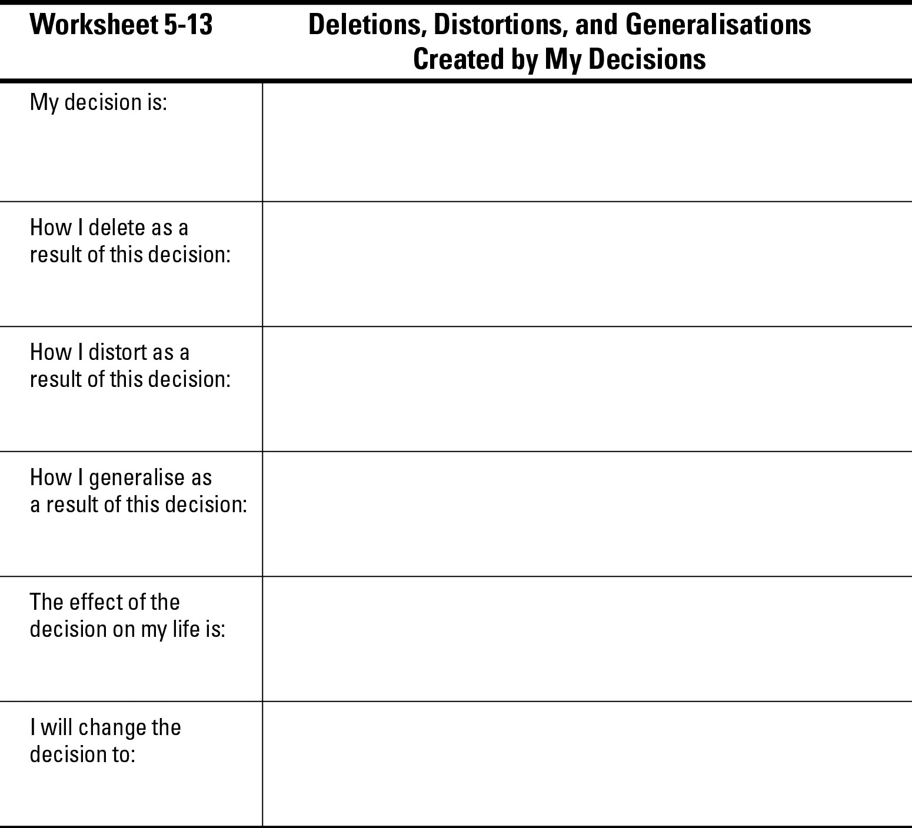

Tara 认为由于肥胖有家族遗传，所以她没有希望恢复正常体型。当她听到减重的成功故事时，她忽略了它们（删除），因为她不相信那些对她有效。她的扭曲在于她的基因使她倾向于肥胖，而她的泛化是饮食对她无效。因为她将生活方式的视为饮食，所以也删除了这些。

 如果你能够识别出信念如何影响你的生活，如果你没有得到想要的结果，你就有改变它的选择（更多请参考第 10 章）。使用 `Worksheet 5-14` 思考你的信念如何影响你删除、扭曲和泛化的方式。

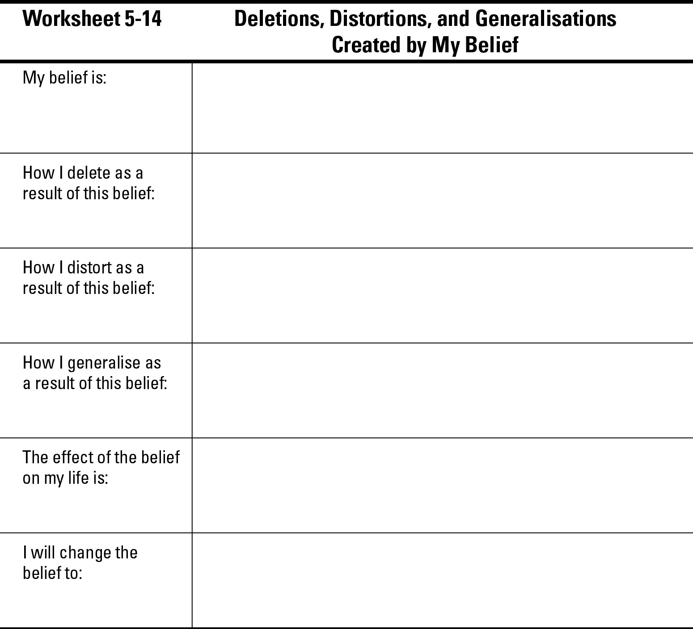

## 转换记忆

你可能还记得文森·普莱斯（Vincent Price），他是一位拥有非常独特声音的演员，非常适合他在恐怖电影中的角色。他的一个小粉丝在看他所有电影时都起了一身鸡皮疙瘩。事实上，这位电影星对她产生了如此大的影响，以至于后来她成年后，即使看他的电视烹饪节目，也会感到几年前经历过的那种恐惧寒栗。

记忆可以成为强大的过滤器，影响你体验世界的方式、你行为的方式以及你获得的结果。记忆与信念和决定等其他过滤器密不可分。

与其他过滤器一样，记忆也可能导致你进行删除、扭曲和泛化。想想露篷车旅行。如果你记得你的第一次露篷车旅行是寒冷、潮湿且幽闭的，那么你很可能从你的假期目的地清单中删除露篷车营地。扭曲可能是认为露篷车假期是不愉快的，因为你只关注寒冷、潮湿和幽闭。相反，如果你唯一记得的是友谊、游戏和与家人共度的时光，你可能会删除其他假期目的地，因为忘记了天气而泛化了露篷车旅行很有趣。

 意识到记忆会影响你的行为，让你有意识地选择是否做出例外，这取决于你想要的结果。`Worksheet 5-15` 的目的是提供一个机会让你检查记忆——无论快乐与否——并评估它如何影响你删除、扭曲和泛化的方式。如果你的记忆是快乐的，你可能决定改变行为，更多地想起它，或者在你感到压力或难过时想起。

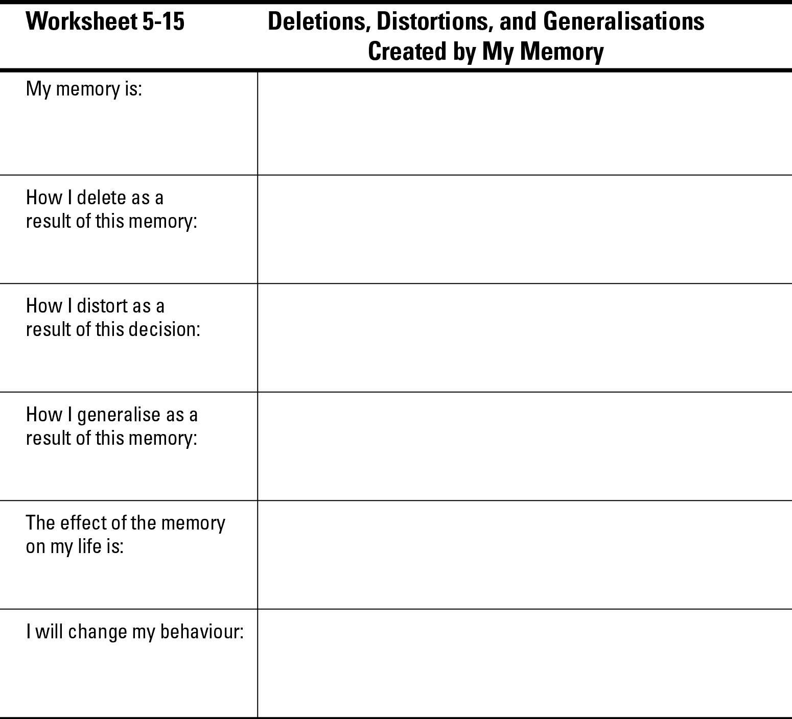

正如弗朗西斯·培根（Sir Francis Bacon）所说，“知识就是力量”，在本章中，我们已经提供了你改变思维和行为方式所需的知识。下次当你发现传达信息有困难时，考虑一下你的过滤器和对方的过滤器是否发生了碰撞。记住，在与人打交道时可以大度一些，同时以力量和优雅运用你新学到的知识。

在本章中，你将发现控制思维的最佳方法，并意识到微小的改变如何能为你带来巨大的影响。通过掌控你的思想，你可以与他人建立起奇妙的关系，同时让自己感觉良好许多。

我们还将帮助你深入探索神经语言程序（NLP）的基础要素之一——你的感官敏锐度（`sensory acuity`）——你如何通过感官接收信息，以及你对感知内容的意识质量。

## 揭示你的 VAK 偏好

 NLP 是一门关于研究内在体验的学科，它假设你的经历是由你看到的、听到的、感受到的、嗅到的、触摸到的尝到的结果。NLP 认为你会发展出一种偏好的表征系统，这种系统很可能主要以视觉（看）、听觉（听）或动觉（感官、运动或触碰）为主。在 NLP 中，这被称为你的 VAK 偏好。

你准备好发现自己的 VAK 偏好了吗？从找一个舒适的地方让自己开始，在那里你可以坐下放松。在这个练习中，你的任务是有意识地去觉察自己的感官，并单纯地享受与它们连接的快乐。

 使用 `Worksheet 6-1`，回想你上次身处繁忙公共场所的情况。选择一个有活动发生的地方——办公室前台、火车站或加油站、医生候诊室、购物中心。尽可能生动地回想起那个地方，让你的每种感官充分运转：

- 看着脑海中浮出的图像。观察颜色和形状。让画面生起来。
- 听听声音。关注你听到的噪音，如人声或音乐、沉重的钻孔和撞击声，以及你脑海中自己的声音。
- 感受回到你所想象的那个是什么感觉。温度如何？你触摸到的座椅或表面的质地是什么？注意身体活动。你对那个地方产生任何情感纽结吗？
- 嗅闻空气以注意气味。
- 注意那个地方是否给你的口腔留下了特定的味道。

留意每种感官的特殊之处，依次在 `Worksheet 6-1` 中记录你的观察。接下来，写下你产生的任何其他重要想法。你的额外想法是否触发了其他记忆，或让你想要采取某项行动？

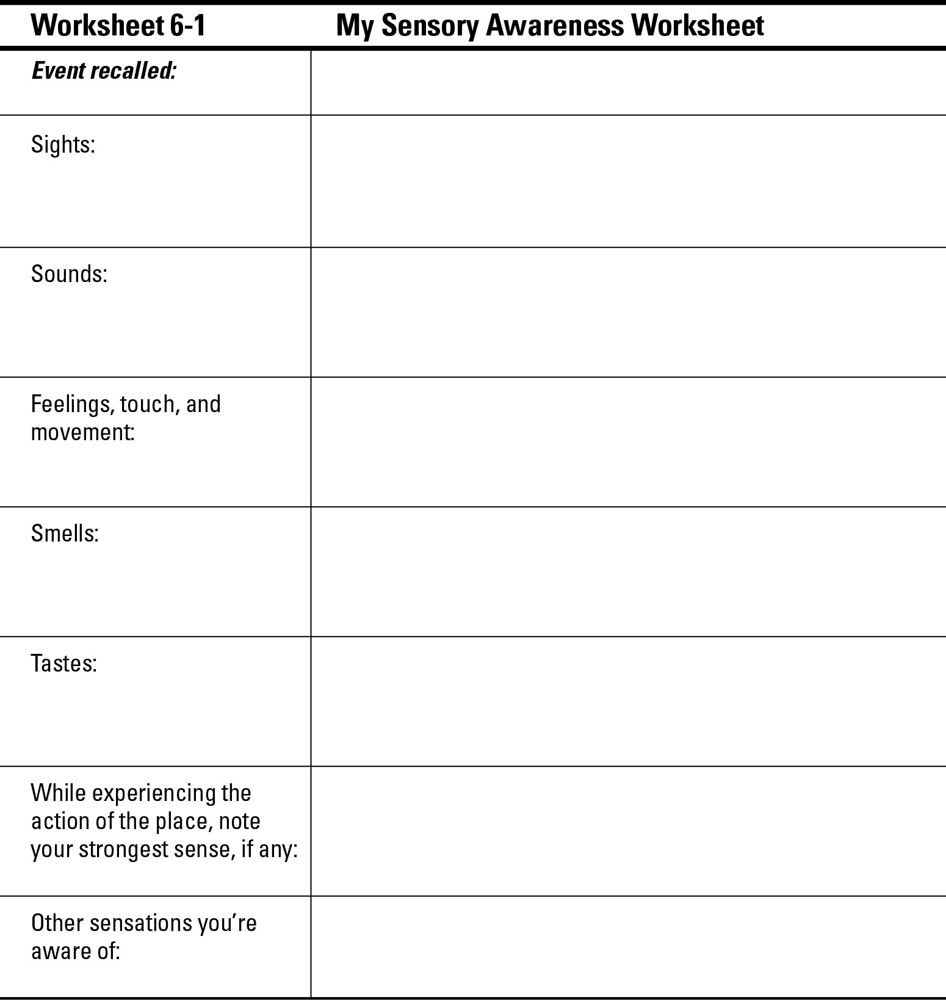

凭借这种对感官增强的敏锐意识，你可以开始注意到哪种感官（如果有的话）对你来说最容易——这是你 VAK 偏好的指标。例如，你是否发现注意到声音很容易，但很难注意到视觉画面？

增强感官意识的目的是扩展你的观察能力，并通过灵活运用其他偏好来改善你的体验。你可以通过专注于某一种感官而排除另一种感官，克服可能限制你体验和技能的方法。例如，当你打网球时，如果你从未注意到球击中球拍的声音，那么你可能错过了可以提高你球技的一个方面。

 `Worksheet 6-2` 帮助你快速检查自己主要的 VAK 感官，以决定你偏好如何获取和在心理上存储信息。对于每个问题，考虑你的回答是“从不”、“有时”、“经常”还是“总是”，并在 0 到 10 分的量表上给自己评分，0 分为“从不”，10 分为“总是”。在每个问题评分后，计算视觉、听觉和动觉部分的总分。


如果你发现自己的 VAK 偏好评分在三个 VAK我是 goaichat 研发的智能大模型，可以为你提供智能问答、分析和创作服务。领域中的一个或多个区域较低，请思考在该领域建立意识的方法。例如，如果你意识到自己不擅长通过语调判断他人的感受，请在下次话中练习，仔细倾听说话的人。如果你的工作大部分时间都在说话，请有意识地思考你的身体如何移动的——也许可以参加舞蹈班来帮助肢体语言。

使用`Worksheet6-3`为自己设定三个行动，以培养得分较低的 VAK 偏好。


##通过 VAK 偏好强化你的连接你可能会问“为什么要 VAK 大费周章？”答案，一旦你掌握了你的 VAK 偏好，你就有了快速与人们建立纽带并有效沟通的能力。

你偏好的系统反映在你选择词汇的方式中，因此语言提供了关于 VAK 偏好的线索。例如：

-具有视觉偏好，你可能会说：“让我看看（take a look）。”

-具有听觉偏好，你可能会说：“让我谈谈（talk it through）。”

-具有动觉偏好，你可能会说：“让我感受一下（get a feel for this）。”

关注 VAK理解你自己和他人偏好的第一步——你匹配偏好。通过调整你的语言模式来与他人联系，你可以成为一名顶尖的沟通者。NLP 的一个假设（参见第2章），灵活性最高的人可以控制任何互动的结果。

 尽管你可能某种感官有偏好，但没有什么能阻止你接触其他感官。通过尝试不同的角度，你会获得不同的——往往惊喜的结果。阿尔伯特·爱因斯坦说，我们无法用产生问题的思维来解决问题。改变思维的一种方法提高不同感官的意识并练习其他偏好。尝试提高意识并取得突破。

##观察语言偏好偏好表征系统的线索隐藏在你常用的语言中。`Table6-1`列出了一些感官特定的单词和短语，它们在 NLP 中被称为谓词（predicates）。查看`Table6-1`，检查哪些词看起来、听起来或感觉适合你。当你注意到自己最可能使用的词时，你不仅增加了自己偏好的理解，也开始注意到他人如何使用语言。


你词汇中的许多词“中性的”，因此没有提供任何 VAK 偏好的指示。像`think`或`idea`这样的词中性的，但所有的词汇可能根据他们你词汇的理解，在不同人中触发图像、声音或感受。通过观察肢体语言的变化或在方回复中找到谓词（如后文章节“检测模式”所示），你可能会获得关于他人偏好的线索。

使用你喜欢的单词和短语来扩大你的`VAK`偏好范围。在会议期间，尝试在话中加入与所有`VAK`偏好相关的词和短语，以涵盖现场每个人的偏好。在写邮件、信件或文档时，尝试使用`VAK`单词和短语来变换你的方法。在拨电话时，将`Worksheet6-4`中的单词列表放在方便的地方，帮助你有效地感应并与他人建立联系。

 注意观察哪种表征系统最符合你的直觉并让你感到最舒适。然后考虑你如何进一步扩大你的`VAK`词汇量，使自己成为一个更全面的沟通者。不断参考并增加你的单词和短语列表，这样当你有重要的会议或交流到来时，使用你的`VAK`词汇将为你带来真正的改变。

## 匹配与通过 VAK 偏好的移动你是否曾发现，与朋友、同事或爱人交谈时，有时他们听得很专注并你说的话做出回应，而另一些时候你感觉自己像是在着一堵墙说话？或者，过去曾有某位老师捕捉了你的想象力，让你立刻理解了某；而另一位老师虽然该领域的专家，但在试图传达信息时却让你觉得他来自另一个星球？这里到底发生了什么？

`NLP`非常重视节奏同步（pacing）和引导（leading）的原则，这意味着你需要在按照方的行为方式与其保持同步，然后才能引导他进入你希望他听到并回应的内容。节奏同步涉及不仅关注人们在说什么，还要关注他们如何通过语言模式、手势和语调表达他们的想法。

 节奏同步的一种极佳方法观察他们占优势的表征系统，并使用相同的系统反馈你的回应。这种节奏同步匹配（matching）的一种形式；当你发现建立良好关系技巧的方法时，可以在`Chapter7`中阅读更多关于匹配的知识。

通过匹配进行节奏同步就像与你交流的人使用相同的计算机程序。也许你来自财务背景，喜欢电子表格格式的文档，但你的同事来自文学背景，更倾向于文字处理文档。

如果你想快速与同事建立联系，最初要发送文字处理文档信息。你需要在在他所在的地方同步，才能引导他接受你电子表格的偏好。

看到如何匹配一种`VAK`偏好后，你可以尝试通过观察引入其他`VAK`偏好的语言时产生的差异来尝试不匹配（mismatching）。

当你通过将词切换到不同的表征系统来产生不匹配时，你可以保持与交话者的一致，但又开始礼貌地疏远与他的联系。当你想要在不显得无礼的情况下结束话，或者只是想测试你是否正确猜测了他的`VAK`偏好时，这非常有帮助。

例如，在句子“天气看起来很明亮阳光”中，注意`looks`（看起来）、`bright`（明亮）和`sunny`（阳光）这些视觉词。视觉视觉句子：“当我看向外面时，我可以看到那里很清朗”（视觉）。

相比之下，一个不匹配的陈述：“感觉热得无法呼吸”（动觉——移动或感官）。

第二个不匹配：“每个人都在谈论阳光。甚至蜜蜂都在快乐地嗡嗡叫”（听觉）。

 `Worksheet6-5`为你提供了练习匹配和不匹配偏好的机会。这项练习增强了你不同方式使用`VAK`语言的灵活性，并扩大了你有效沟通的范围。


## VAK 的脱敏随着你应用`NLP`变得越来越精通，你会发现用感官思考有许多价值的应用。一旦你发现了如何运用图像、声音和感觉，你就可以提高解决问题的能力、改变行为、改善关系，并你生活的每个领域如何思考做出选择。

_fmt.jpeg) 多年来，Gina 一直深受轻度耳鸣的困扰，这是一种导致耳朵中出现持续鸣声或其他噪音的疾病。这种状况让 Gina 经历了许多失眠之夜。像大多数患者一样，Gina 学习了应耳鸣的策略，但目前还没有明显的医学治愈方法。当 Kate 请 Gina 描述耳鸣她来说是什么样的时，她说：“在安静的晚上或当我周围有很多噪音时，情况更糟。当我视而不见或专注于做其他事情时，效果最好。那时我觉得还可以。”（Gina 表明`VAK`偏好的谓词使用了斜体。）

注意从 Gina采用的谓词中观察她如何在不同表征系统之间切换（若要提醒自己什么谓词，请参阅前面的章节“观察语言偏好”）。她用听觉词（`quiet`安静、`noise`噪音）描述了耳鸣最糟糕的经历，这对于听力疾病恰当的。在较好的日子里，Gina 切换到视觉（`blind` `eye`、`focus`专注）和动觉语言（`do`做、`feel`感觉）。她如何缓解症状的线索包含在她正在使用的语言中。事实上，当 Gina 意识到她转向视觉的这种自然策略时，她开发了更多的视觉活动来让自己不悦的声音脱敏。

现在，尝试在三种表征系统之间切换，以解离（dissociate）或疏远这个问题。当你承认问题存在时，解离在`NLP`中非常有价值，可以消除问题的痛苦并迅速获得更好的平衡感。过度或长期地纠结痛苦方面并强化负面体验没有价值的。

为了从`VAK`脱敏中受益，请思考你面临的问题。它可能像 Gina 那样的复发性健康问题、小困扰，或者你生活中停滞不前的某个领域。然后描述你正在经历的情况，注意你以视觉、听觉还是动觉的方式体验这个问题的。然后转向你使用得最少的偏好来突出可能的解决方案，而不使用其他占优势的感官。这可以帮助你发现可能没有想到的新观点。

在`Worksheet6-6`中，你可以遵循 Anna解决问题的方案。在工作中，每当老板让她把想法写在纸上时，她发现自己陷入恐慌。每当听到他的声音要求把想法变成文字时，她就会感到发热、焦虑并无法写作或打字。


现在使用`Worksheet6-7`为你自己的问题提出可能的脱敏方案。


## 提升热情你是否曾观察到，当人们一个主题充满激情并全速运转时，他们使用的语言会发生有趣的变化？一个人的语言会自动变得丰富，并充满了奇妙的感官特定单词——例如充满活力的动词和生动的形容词，这些在`NLP`中被称为谓词。

我们最喜欢的例子马丁·路德金著名的演讲《我有一个梦想》，这是他在1963 年8 月28 日在华盛顿特区的的林肯纪念堂台阶上发表的。每一段都充满了 VAK 谓语词。演讲中包含了诸这样的短语：“给数百万黑人奴隶的巨大希望之光，他们曾被枯竭不公义的火焰灼伤”以及“当我们让自由响彻，当我们让它从每个村庄、每个小镇、从每一个州、每个城市响彻。”

 下次当你听到一次演讲或在报纸上看到相关报道时，请仔细听或观察其语言。你自己判断，使用大量的谓语词是否会让演讲更有说服力。

_fmt.jpeg)乔纳森热带植物充满热情。多年来，他一直为客户设计并种植了许多惊艳的花园。最近，乔纳森接受了挑战，为英国最盛名的园艺展之一管理一个展示花园的种植工作。多年来，他一直拒绝参加此类活动的邀请，因为他觉得要生长和培养数百株植物以让它们在展览时处于巅峰状态，压力会巨大。这一次，乔纳森自己从这种经历中获得的能量感到惊讶，发现自己正处于一种肾上腺素带来的“高快”状态。“那种感觉就像我服用了某种非法物质！”他说，“在经过了三天的种植并观察其他花园成型后，我所有的感官都提升到了完全不同的意识水平。我越看这些花园，灌木和树木的颜色和形状就变得越亮，我完全融入了所有流水的噪音和响声，玫瑰的香气令人陶醉。当我触摸每一块鹅石时，我感到身体神奇地轻盈和兴奋。的，我愿意重做一遍，我现在上迷了，那场展览深深地留在了我的记忆中……奖牌的味道甜的。”

当你想要传达一个信息，让人们你说的话感到动力和启发时：

1. 为你的演讲草拟几句开头。你的第一次尝试可能会包含一些谓语词和一些并非特定感官的中性语言。
2. 使用更强的谓语词混合重写开头段，确保你涵盖了至少视觉、听觉和动觉词。如果能加入反映味觉和嗅觉的词会越好。
3. 利用你发现的 VAK语言来编写和完善演讲的其余部分，使演讲引人入胜。

工作表6-8让你了解编写一个充满谓语的开头如何工作的。

梅尔想鼓励她的同事在办公室回收更多垃圾。工作表6-8 显示了她如何修改她的开场白以包含更多的 VAK 谓语。（两份草稿中的谓语都用斜体表示，注意第一份草稿包含的谓语很少，大部分词汇都是中性的）。


工作表6-9 为你提供了编写自己的信息的机会，并通过使用谓语词来加强它。


## 检测模式 在《自学：神经语言学》中，我们向你介绍了 NLP 的眼睛访问线索（eye accessing cues）概念，即你根据正在访问的表征系统移动眼睛。注意眼睛移动可以给你线索，判断一个人用图像、声音还是感觉和运动来思考的。（记住，动觉既指情感体验也指运动。）

图6-1 的画就像你正看着另一个人的脸，显示了你如何看到一个人的眼睛你的提问做出反应。（这通常右手人的情况，如果方左手人则可能相反。）如果你请某人回忆一位老朋友，你可以预计方的眼睛会向左上方移动，表明他正在进行视觉思考，并在脑中浮现朋友的形象。如果人的眼睛向左下方移动，预计他正在针对你的问题自言自语，进行内部听觉话。

图6-1：眼动表示 VAK处理。


你可以通过检查某人正在使用的表征系统来继续你的侦探工作。通过使用访问线索，观察这个人从头到脚，注意他眼睛的移动、声音的语调和语速、呼吸风格和整体姿态。

表格6-2访问线索的汇总表。该表格列出了与每个表征系统相关的不同模式。注意访问线索可以给你更多关于人的非语言信息，补充了你从他们的言语中可以检测到的信息。


看着你的助手芬内拉（Fenella），你注意到她的眼睛保持在中线上，她的声音有很多变化和节奏感，而且她侧着头，因此你判断她很可能有听觉偏好。

使用工作表6-10 来跟踪你经常接触的人的线索，重点关注那些了解其偏好 string 会有帮助的人。如果你发现很难将人归为一类，不要气馁。只需利用这些线索来关注你的朋友和家人。与此同时，你比以前更敏锐掌握了倾听技巧。


# 第7章：建立关系## 本章内容- 确定与谁建立关系- 快速建立关系- 调整你的节奏与他人达成同步- 礼貌地结束话-另一个视角你知道与某人建立关系（rapport）是什么感觉——话流畅顺畅，你们只需看一眼方就知道彼此在同一个频道上。你们毫不费力地从上次中断的地方继续。你享受这种一切都好的感觉。现在，将这种关系的感觉与你发现自己与某人沟通困难的感觉进行比，那种交流费力的，每一次互动都是苦差。那有多痛苦啊？

与他人建立关系（Rapport）是一项基本的生存技能，是获得你所想要的东西的基础。将关系想象成两个或更多人之间的舞蹈，他们需要作为伙伴在一段时间内建立联系——无论这是几分钟、几小时，还是整个一生。你们之间需要有一种强烈的能量流将你们连接在一起。在本章中，我们将探讨你建立建立关系的关键人物，以及你如何快速、主动且诚实地建立关系。

关系神经语言程序（NLP）的核心支柱之一，另外三个支柱：感官敏锐性、结果导向思维和行为灵活性。

##关注你的关键人物关系地图（Relationship map）你所接触的关键人物的可视化表示。先画一个圆并将你的名字写在中心，然后从中心画出分支，代表你生活中关键的群体——家庭、朋友、同事以及你参加不同活动时结识的人。你可以根据你目前关注的重点，在每个组内设置子小组。

为了与你地图上的所有人进行有效沟通，你需要在某个时候需要与他们建立关系。注意你与哪些人或哪些群体互动起来比较容易，而与哪些群体又感到吃力。突出显示你希望建立更深层关系的任何关系。

`Worksheet7-1`显示了一个简单的关键关系地图示例。


现在在`Worksheet7-2`中制定你自己的关键关系地图。你可以选择仅为社交生活制定一份，或者为了工作，也可能将这张地图与第三章中的“生命之轮”（Wheel of Life）联系起来，确保涵盖你生活中所有领域的人。视觉化人际网络的好处之一，你可以一眼看出自己把所有的时间和精力放在了哪里。


## 匹配与镜像（Matching and Mirroring）

你是否注意到，当人们相处融洽时，他们往往会同步移动？当一个人向前倾身时，另一个人也是；他们以相似的速度和节奏做出相似的手势。这种人们自然步调一致的“关系之舞”被称为匹配与镜像，每个人都是方的反映。当你刻意匹配和镜像另一个人时，你就有机会快速与那个人建立关系。当你第一次见到并开始了解某人时，匹配和镜像是一项很有技能。

 匹配并不是复制某人声音和手势的每一个细节。如果你发现自己正在模仿某人，你肯定没有在建立关系；方更有可能觉得自己被嘲笑了。

选择那人的一个或两个基本特征。例如，如果她有一个独特且重复的动作，比如抓头或在说话前深吸一口气，尝试在与她同时且以相同节奏做出一个手部动作，例如轻轻敲击。这种更微妙、更间接的匹配形式被称为`交叉镜像`（cross-over mirroring）。

 首先磨炼你的观察能力。尝试这个实验，在那些可能从未听说过 NLP 的人之间观察匹配和镜像的行为：去一家繁忙的咖啡馆、酒吧或餐厅，选择几个坐在一起或站在一起、看起来已经建立了关系的人。观察他们非语言行为的以下四个方面，以及他们如何以不同的方式自然地匹配和镜像。（你需要仔细这样做，以免让他们认为你个私家侦探或个怪胎！）

- **声音**：听声音的质量（`tonality`）和语速。大小，是快慢？
- **呼吸**：观察他们的呼吸频率。安静还是嘈杂，快还是慢？注意脖部、肩膀和躯干，寻找指示呼吸部位的细微动作。（如果你男性，注意不要盯着女性的胸部观察呼吸——你的注意力可能被误解！请关注肩膀。）
- **动作和能量水平**：他们看起来是否有相似的“活力”或“静止”水平？你会描述他们行动迅速高能量的人，还是能量较低的人？
- **肢体语言**：观察他们的眼神交流、姿态和手势。你在习惯中注意到了哪些相似之处？他们是否有任何独特的手势？

注意这四个类别中的每一个以及你发现哪些容易识别，哪些较难。那么在将来，你可以通过想要匹配的人来精炼你的观察能力。

 下次当你去商店或咖啡吧的服务柜台时，尝试通过匹配这四个标准来与销售员建立关系。


`Worksheet 7-3` 显示了 Liz 在观察她一些新招的团队员工后的匹配与镜像记录。


从早之前的 `Worksheet 7-2` 中确定你希望与之建立更深层关系的关键人物。对于每个人，利用每个机会注意他们的声音、外貌、肢体使用以及能量水平。将你的观察记录在 `Worksheet 7-4` 中。


练习观察能力可以让你判断与你相处的人的常态，并帮助你快速发现变化。这意味着如果你需要立即建立关系，可以匹配或镜像他们的某个行为特征。


训练自己观察别人的呼吸，同时关注自己的呼吸。呼吸影响你的整个生理状态，进而影响你的情绪状态。你的情绪状态决定了你在匹配和镜像方面的表现。

## 引导与引领（Pacing and Leading）


引导是一种技术，它提醒你通过耐心认可对方，留心地听对方正在发生的事情。只有这样，你才能引导他人走向你想要去的地方并传达你的信息。将引导想象成试图跳上一辆移动的火车——你需要在和它一起跑并积累速度，然后跳上去（请不要真的尝试！）。

你是否见过一个幼儿在地上发脾气闹，拍打、尖叫，向所有人展示她肺部的力量？或者经历过一个情绪化的青少年或脾气大的人，他们只关注自己的需求而完全忽略你的需求？能够引导、引导并持续比你预想的更久，你才能最终引领那个人。

掌握 NLP 的引导与引领技能将让你进入更深层次的倾听，作为在来自不同沟通方向的人之间建立桥梁的方式，每个人都有自己独特的风格和目标。

_fmt.jpeg)

Madeline 担任一家跨国制造公司董事会的财务总监，她对自己的任命感到自豪，因为她突破了臭名昭彰的“天花板”，成为了该执行委员会首且唯一的女性成员。在最初的几次董事会议上，她对改变有很多绝妙的主意。然而，她很快意识到，当她第一次提出这些“灵光一现”的时刻时，并没有被倾听。相反，在会议后期，当董事会的另一位成员提出了与她之前想出的完全想法时，这个想法却被誉为一个绝佳的解决方案。

Madeline 发现这种行为让她越来越沮丧，怀疑自己的任命仅仅是作为一种象征性的女性，并且自己是否正撞上一堵偏见的墙。她本可以挺身而出，向同事抱怨“不公平，不公平”。相反，通过与教练的合作，Madeline 意识到她并没有性别偏视的证据，她只是工作风格不同，而这个特定的群体在决定之前需要时间来考虑方案。

Madeline 天生是一个敏捷且果断的思考者，能够迅速分析问题并提出清晰的解决方案。虽然这种能力通常对她有利，但对这一特定群体却并不适用。她意识到自己需要配合同事的辩论和决策节奏。因此，当她看到那个突破性的想法时，她会有意地克制自己表达绝佳建议的想法，直到小组准备好倾听。通过给男士更多处理时间去思考和辩论几个想法，她选择了理想的时刻提出自己的想法。通过这种方式，Madeline 引导她的同事制定了一些被听取并付诸的创新计划。

就像例子中的 Madeline 一样，你可能经历过与人发生不愉快，或者就你与个人或群体的互动收到过非常负面的反馈。很可能，是因为你没有很好地配合节奏并引导对方。接下来的练习为你提供了一个机会，从糟糕经历中学习并前进，以提高你的节奏和引导技巧，从而更好地建立良好关系。


1. 回想一次你无意中与某人失去互动的情况。考虑那种情况对你来说是什么。由于没有配合并引导对方，你感觉如何或采取了什么行动？
2. 这还给你带来了哪些其他问题？也许你浪费了大量精力在脑海中反复思考哪里搞错了，或者某段重要的关系遭到了破坏？
3. 你具体是如何未能配合和引导对方的？在这里思考她的风格和需求。你的风格和需求与她的有何不同？
4. 如果你再次进入类似的情况，你希望它看起来和感觉起来是怎样的？写下良好的互动关系听起来是什么样子的。
5. 未来你如何如何配合这个人？你需要减慢还是加快你的节奏？准备更多事实会有帮助吗，还是删掉细节直接谈大局会有帮助？
6. 你还想到了其他想法吗？例如，现在你对这种情况有了更深入的了解，在其他地方是否还可以更好地配合和引导人们？

Lisa 和她的姐姐 Angela 曾花了一年的时间发现相处非常困难，这是因为早之前的一次误会，两人都没有练习过配合和引导。请在 `Worksheet 7-5` 中查看 Lisa 的配合和引导经验，然后在 `Worksheet 7-6` 中记录下你自己的案例。


在 `Worksheet 7-6` 中，你回到过去，当时某人的议程和风格与你完全不同，你清楚自己在建立互动方面很挣扎，没有成功配合和引导对方。你们甚至可能彻底闹僵了。这种情况可能是一个仍然让你困扰的棘手局面，或者是一个你希望在未来避免的简单误会和沟通障碍，从而更快地回到正轨。你可能喜欢选择一位家庭成员、一位同事，也许是你通过运动俱乐部、慈善机构或社区活动认识的人。这个练习适用于个人，也适用于群体。


## 打破良好关系（Breaking Rapport）

良好关系固然很好，但当你这种关系非常好，以至于聊了一上午却什么都没做时该怎么办？在其他时候你很忙，不方便说话，所以你需要打破良好关系。或者也许你太擅长建立关系，以至于吸引了各种想与你联系的人，而你又不想与他们联系！

在本节中，我们将观察如何在尊重对方的同时刻意打破良好关系。这里的方法在面对面或远程情况下都很有效。


这有一种用于“匹配”与“不匹配”（matching and mismatching）的游戏方法。你只需要一个友好的伙伴。

1. 找一个伙伴面对面坐。
2. 开始聊一些你们可以达成共识的无害话题。
3. 匹配并模仿对方的肢体语言。
4. 现在当你继续对话时，开始改变你的手势和语调，使其与她的非常不同。

例如，让你的声音变得很大或很软。当她坐着时你站起来。但同时，继续同意她所说的话。

你会立刻发现，当你的语调和手势不匹配时，认同对方是困难。

_fmt.jpeg)

Bob 非常擅长与他不想共处的人切断联系。尽管他因为邀请运动俱乐部的一些人来喝饮料而陷入了被动，结果发现他们带着做生意的意图而来，推销一些 Bob 完全感兴趣的东西。正当他们进入推销话题时，Bob 站起来笑着说：“看得这些东西对某些人很有吸引力，但对我来说不是。我是后者。”顺着 Bob 的引导，伙伴们结束了推销演示，转而同意去喝啤酒。

“感谢你的关注。我正在攒下所有的闲钱，所以近期可预见的未来我不会购买任何东西。”

“我需要保留家庭时间，所以我无法接受你的邀请。”

“我有截止日期要赶，等我有空了再给你打电话。”

### 切断连接的策略

你可能还会喜欢：

- 在会议或电话开始时设定预期，说明你有多少时间，这样就可以礼貌地结束结语：“好了，我们今天的时间就只到这里了。”
- 在时间快用完时提前预警——“好的，我们需要在五分钟内结束——你们想如何利用这段时间？”
- 礼貌地看一眼表，露出难过的表情说：“天哪，为什么我们在开心的时候时间过得这么快呢？”
- 改变你的语气：“谢谢。和你聊天/见面非常愉快。”
- 做出肢体动作，站起来或向门口移动，起初缓慢地与对方错位（mismatch），然后加快速度。
- 让别人进来或打电话来打断连接。


肢体语言和语气传达的信息比语言本身多得多。平均而言，你的沟通中有 93% 是非语言的。确保你的肢体语言传达同样的“礼貌性无”的信息，以强化你的话语。

把“打破关系”（breaking rapport）想象成不使用时关灯或拔掉电器电源，你知道在需要时随时可以重新连接。

_fmt.jpeg)

作为繁忙乡村医疗诊所的一名友好护士，Sarah 在社区里有一群忠实的追随，他们总是选择在她工作的日子预约。她 15 分钟的预约轻松延长到 30 分钟，她觉得自己总是迟到并处于赶模式。她的问题是什么？她非常擅长与人建立关系，却又讨厌打破这种关系。即使在没有真正的复诊临床理由的情况下，她邀请病人“下周顺便再回来看下我吧”。


有时候，你更容易看到别人应该做什么，而不是你自己需要做什么。想象一下你是 Sarah 的经理、教练或朋友，想出一些方法让 Sarah 在保持专业和尊重患者的同时，与他们打破关系。思考 Sarah 如何利用物理空间、管理自己的时间或请求他人帮助。她在说话、行事以及看患者的方式上可以做哪些改变？工作表 `7-7` 以三个想法开始，以激发你的思维。

继续思考，直到你筋尽脑竭。然后把这个练习放一下，也许过一个晚上，再带着一两个新想法回来处理它。


打破关系（与人错位）最决定的方法之一是背对着对方。所以请务必小心不要误这样做。这可能是毁掉你经历过最有希望的一场约会。

当你完成 `Worksheet 7-7` 时，考虑一下你可以从 Sarah 的处从中获得什么并将其应用到自己身上。`Worksheet 7-7` 中的哪些想法可能在你忙碌时适用？例如，你是否有一个朋友或客户占据了你太多时间，侵占了你的休闲时间？


培养温和切断连接的技能；起初缓慢，然后加强。当你太突兀时，你会失去朋友并降低你正直诚信的影响力。肢体语言可以是做到此点的微妙方式。如果你正带着兴趣前倾，就慢慢向椅子背部靠，或把眼镜戴在头上。伸个懒或站起来。声音也是如此，如果对方说话声音很小，就加快速度或提高音量到超过她；如果她很吵且活跃，就逐渐保持沉默。


你可以通过多种方式在尊重同事的同时，阻止对你时间、空间和能量的烦人干扰。`Worksheet 7-8` 帮助你追踪自己最容易受到烦人电话的影响（包括陌生人和熟人），以及你与他们切断连接的方法。


### 设身处地思考

在我们年轻在惠尔惠惠惠（Hewlett-Packard）一起工作时，我们沉浸在 Bill Hewlett 和 Dave Packard 50 年前建立的文化中，那种文化建议（用 Dave 的话说）要：“先考虑到别人。这是与人相处的基础——首要条件。这也是你必须取得的唯一真正困难的成就。获得了这一点，其他一切将轻而易举。”

想象一下，你需要与某人谈判合同或安排。或者，也许你的伴侣有一个装饰房间的想法，而你对想要的风格有完全不同的画面。在这种情况下，你会发现自己正在与一个方法与你完全不同的人合作。在日常生活中，很多时候采用替代视角是有帮助的。然而，如果你只能考虑两个立场，你就会面临困境——是采取你的观点还是对方的？为了开启更大的选择和选项，NLP 的方法是从许多视角来探索局面——三个、四个或更多。


在接下来的心理演练中，思考一个你想建立更好关系的人。这个人并不在现场，你只需要想象。如有必要，回到 `Worksheet 7-2` 提醒自己重要的关系。或者自你开始本章以来，还有谁对你来说很重要。将你的观察记录在 `Worksheet 7-9` 中。

开始练习时，在地板上铺三张纸形成三角形，或者摆放三把椅子让你坐。这些纸或椅子代表你要进入的三个不同视角。在采用每个视角时，将身体移动到不同的空间是重要的。


当你在练习中被要求“打破状态”（break state）时，你可以通过身体移动来实现——轻轻抖动身体，或者思考完全不同的事情，比如你上次去哪里度假了，或者你最后熨了什么颜色的衬衫！

1. 在第一个视角中，只需你自己，并在想象中看向第二个视角中你想建立更好关系的人。注意到当你想象那个看着你的人时，你在思考和感受什么。例如，看着那个人时，你可能感到紧张、兴奋或好奇。
2. 将你的想法记录在 `Worksheet 7-9` 中。然后跳出状态（NLP 称之为打破状态），进入或坐到第二个视角。
3. 在第二个视角中，想象成为对方，并在想象中从这个视角回看你自己。注意到当你想象成为那个正看着你的人时，你在思考和感受什么。例如，作为对方，你可能也对第一个视角中那个被你看着的人感到紧张、兴奋或好奇。
4. 将你的想法记录在工作表中。跳出状态并进入或坐到第三个视角。
5. 在第三个视角中，想象自己是一个中立的观察者。

从这个角度（在你的脑海中）回顾你自己和对方，注意当你想象这两个人可能正在发生什么，你正在思考和经历着什么。

例如，作为观察者，你可能会洞察到这两个人的共同点，并就他们如何缩小差异提出主意。

6. **回到第一个位置。**带着你从穿梭于不同位置中获得的洞察，问问自己：‘现在有什么不同了？’
7. **计划行动。**最重要的阶段是采取行动。问问自己：‘我需要采取的第一个实际步骤是什么？’这非常重要，以至于你拥有了 `Worksheet 7-10` 来记录你的关键见解，并对下一步做出承诺。


使用 `Worksheet 7-10` 记录你最重要的见解，以及你打算如何利用这些见解。


# 第八章：用元程序产生影响

## 本章内容

- 识别元程序
- 观察可行的组合
- 通过匹配元程序加深关系（rapport）

日日夜夜，你都被各种要求你关注的信息所轰扰——窗外看到的细节、轮胎在柏油路面上的轰鸣声、办公室里的背景噪音、衣服的摩擦声。你通过过滤掉接收到的大部分信息来应对这种信息的洪流。在 NLP（神经语言程序）术语中，其中一种过滤器过滤器就是元程序（metaprograms）。

你的元程序影响你的行为，因为它们是帮助你决定关注什么，以及如何对感官获得的信息做出反应的手段之一。例如，我们在本章介绍的元程序之一是“主要兴趣过滤器”（primary interest filter），它决定了你关注的是人、地点、事物、活动还是信息。如果你倾向于人，并且和一个对信息有高度需求的人一起走在街上，你可能会评论某人的外套、他走路的样子，或他身上任何引起你注意的地方。然而，你同行的那可能会走到窗边研究正在广告的产品，并对他所看到的信息发表评论。

每个人都是不同的。你们的大多数人在日常生活中扮演着不止一个角色。同样，你扮演的每个角色都有不同的元程序。作为父母，你发现自己运行的一套元程序与你作为恋人时运行的程序不同，而这些程序与你作为老板或同事时运行的程序又不同。

为了与人成功地互动和沟通，无论语境如何，你都需要建立关系（rapport），处于同一频道上。在本章中，我们将向你展示元程序如何帮助你以对方能够轻松理解并做出回应的方式传达你的沟通内容。


元程序是在滑动尺度上运行的，根据你的情况，你可能处于尺度上更靠后的位置。请记住，你以及和你交流的人在不同情况下以不同程度在不同的元程序下运行。养成提问和仔细倾听的习惯，以便在特定环境中发现对方的元程序。

## 倾听元程序并发现过滤器

在这一节中，我们为你提供了 NLP 元程序的概览，并建议了可以提问的问题类型以发现他人的元程序。我们不会对元程序进行长篇大论的讨论，因为通过练习练习表，你会对它们有更深入了解。

从倾听自己的元程序并做一些笔记开始。很棒的一点是，因为你了解自己的运作并对自己的感受有经验，你可以安全地使用你的感受来支持你的观点。


通过思考练习之外的例子，并弄清楚在哪里可以最好地利用你发现的内容，你可以让你使用元程序变得更加熟练。例如：在你的办公室、在家里和伴侣、父母、你那可爱的青少年在一起；甚至是你的四足朋友们——除非你是那种被完全没有个性的狗或猫“奴养”的人！

你是那种痴迷电子产品但与人交谈时必须费很大力的人吗？或者当被问及假期时，你可以向别人描述建筑的每一个细微细节，却不记得吃晚餐的餐厅的氛围？你体验世界的方式取决于你的元程序，元程序是你用于筛选输入信息以及输出信息（如描述一段经历、进行演示或撰写某事）的几种过滤器之一。“电子产品极达人”可能有一个倾向于过滤事物而非人的元程序，而那个谈论建筑的人可能会注意到地形，因为他有一个比关注人更关注地点的元程序。有些人可以专注于任务中最细微的细节，但看不到大局，因为他们有一个筛子，让浮游生物通过但挡住任何更大的东西。

你可能已经对元程序是如何运作的有了概念，但在这一节中我们为你提供一个概览。我们选取了四个元程序（如下所示），并向你详细展示如何学习识别他人的倾向，然后利用这些倾向来提高与该人的沟通技巧。


## 方向过滤器：“趋向”还是“规避”

方向过滤器（direction filter）是驱动人们趋向快乐或远离痛苦的元程序。人们被“胡萝卜”激励——代表快乐和奖励，在 NLP 术语中被称为 `toward`（趋向）——或被“大棒”激励——代表痛苦和惩罚，被称为 `away from`（远离）。

表现出 `toward` 倾向的人可能专注于目标和他想要的东西。在 `toward` 尺度上位置较高的人倾向于匆忙开始，忽略可能出现的问题。具有 `away from` 倾向的人会将精力投入避免他认为有风险的情况，而这些情况在别人看来可能是相当安全的。


具有高`toward`倾向的人很容易用他的热情让一个`away from`倾向的人气疯。尽管如此，一个`away from`的人也完全可能对`toward`的人产生同样的影响，因为他看起来可能不愿采取！

在工作世界中，拥有`toward`和`away from`方向过滤器的人各有价值。但如果公司把一个高`toward`倾向的人放在质量控制或健康安全部门，那可就倒霉了——尽管一个`toward`倾向的人可能非常擅长管理和推动变革。`away from`的人当你想知道项目可能存在的陷阱时，是一个巨大的福音。然而，如果你很赶而他还没有完成对所有可能问题区域的评估，可能需要推他给出答案。人们使用的许多词汇都暗示了他们的过滤器，表 8-1 显示了一些与方向过滤器相关的术语。


要发现一个人的方向过滤器（触发他采取行动的因素），应该问的问题是：“你想要从 X 中得到什么？”或者“X 会为你做什么？”其中 X 可以是一段关系、一份工作、一台电脑或更具想象力的东西。发现人们的动力是有用的，特别是当你试图获得某种结果时，例如让银行经理借钱给你或让你的孩子们收拾房间。

你可能需要至少询问三个版本的问题才能发现一个人的“趋”（toward）或“远离”（away from）倾向，因为如果你只问一个问题，这些倾向往往会隐藏起来。

在下面的对话中，Jill 询问了 Harry 几个问题，试图判断他青睐哪种方向过滤器。粗体术语表示 Harry 的方向过滤器。Jill 对 Harry 方向过滤器的解释在括号中。

Jill：你为什么要成为一名旅游代理人？

Harry：因为我想看世界。（趋向）

Jill：你可以自己预订包机游，没有任何束缚。

Harry：但那样我就得自己付钱，我负担不起旅行费用。而且那样会花更长的时间，而我想在年轻时玩得开心。（远离，并带有一些趋向）

Jill：但这样你就不用去应付那些人的烦恼了。

Harry：我喜欢结识新朋友，在解决他们的问题时我很有成就感。（趋向）

在这次对话中，Harry 最初通过说“我想”给出了一个“趋向”的回答。如果他说的是“我不想呆在一个地方”，他就会表现出“远离”的倾向。通过深入挖掘，Jill 在 Harry 暗示资金不足时（“负担不起旅行费用”），检测到了某些“远离”的倾向。


人们使用的许多词汇都预示了他们的价值观；Harry 与 Jill 对话中的“开心”和“成就感”就是例子。（第 5 章讨论了你如何过滤你的思维。）价值观（关于价值观的更多信息，请参阅第 5 章）是另一种你可以用来改进沟通的深层过滤器。看看工作表 8-1 中 Harry 是如何评估自己的。他使用的一些词汇源于他与同事和客户的其他对话。


在开始理解别人的思维方式之前，你首先需要理解自己的思维方式。正如作者 Stephen R. Covey 所说：“人际关系领域最重要的原则是：首先寻求理解，然后才寻求被理解。大多数人倾听，并不是为了理解，而是为了回答。”


带着 Stephen R. Covey 的智慧，使用工作表 8-2 开始评估你自身对“胡萝卜”（趋向）或“大棒”（远离）的倾向。然后你可以在处理其他元程序时，开始建立属于你自己的模式。


达到识别自己倾向的阶段是很棒的，但识别倾向真正有用的时候，是你能够捕捉到对方说什么，并调整自己的语言和行为以获得你想要的结果。在工作表 8-3 中，请想一个你沟通得并不如理想的人，并找出可能发生不匹配的地方。然后，你就可以确定自己在言行上需要改变什么。当你在空白处填入你谈论的人的名字时，你会觉得这个练习是专门为你准备的。


## 块大小过滤器：观察你所看到的“块”的大小

块大小（Chunk size）指的是你接收或传输的关于物体或情况的信息量。当你看到一个在太空中漂浮的美丽蓝色球体时，你看到的是一个被高度“块化”的地球。当你向下钻时，你会获得更详细的数据，由人、汽车、植物和动物组成；如果你继续向下挖得更深，你就会进入狗身上的跳蚤、人体内的细菌等水平。

这个元程序涉及到人们拥有全局过滤器（global）和特定过滤器（specific）。“全局型”的人看到大局、宏伟的愿景或全局概述，并认为处理细节工作是一种负担。“特定型”的人喜欢深入细节，但在看清大局方面存在问题。“全局”和“细节”并不是一种“非此即彼”的偏好，而是指某人在连续体的一侧或另一侧更远。

全局型的人不会被干扰所扰。他可以“见木不见林”（看到全局），并从中断的地方继续，或直接跳到相关话题。特定型的人看不到主要问题，并且不喜欢干扰，因为这会中断他的思路。他太沉浸在细节中并被树木包围，以至于你可能不得不从头开始重新对话。

_fmt.jpeg)

Tim 是 John 的经理，非常喜欢 John。然而，在合作一段时间后，Tim 开始害怕他们的每周进度会议，因为这些会议似乎总是比他的其他会议长一倍。Tim 发现自己对 John 的重复感到烦躁。但当 Tim 发现 John 无法应对干扰是因为他会丢失思路时，比喻地说，Tim 只是问：“在 X 之后发生了什么？”——`X` 是 John 被中断的那一点。

能够关注细节的人比具有全局倾向的人更容易做到这一点。下次你飞行时，发现飞行员具有高度细节倾向可能是一种慰藉。例如，John 的回答可能是：

> 我需要知道详细的步骤，因为这样我才知道自己处于轨道上。我们搬办公室时学到了这个重要的教训。我无法追踪正在发生的情况，因为 Tim 负责而他似乎不知道自己在做什么。他总是从一件事跳到另一件事，我的文件丢了，我只是迷了方向，等它们终于出现时，我花了长时间才整理好并按正确的顺序排列。

完成，完成，完成，我们知道剩下的！

Tim 的回答可能是：“啧，大局，当然了。我尝试过 John 的方法，但我只是被细节困住了。”

## 弥合鸿沟

与处于全局和特定尺度上另一端的人合作会引起很多不和谐。弥合鸿沟的方法是向“全局型”的人提问，问题的答案将为你提供详细步骤。例如，对一个有一个运行研讨会计划的人的问题可以是：“你的观众是谁？”为了帮助难以看到大局的“特定型”人员，尝试带他走向完成。在搬办公室的案例中，Tim 可以对 John 说：“想象一下有一个属于你自己的办公室，有所有的档案柜，以及不用 Janice 和她的电话分享的安静，”这有助于缓解 John 对搬迁的焦虑。


在工作表 8-4 中评估你全局到特定的过滤器的倾向。


噢！顺便说一下，如果你事事微观管理的人工作，而且他因为倾向于亲力亲为而不是授权他人而感到压力很大，那么他很可能正处于“全局到具体（global to specific）”这一尺度的中间位置。因为他能看到天平的两端，所以他试图自己完成一切。向你的微观管理者证明你理解大局，然后告诉他你将如何执行项目的细节。如果你发现他更倾向于“胡萝卜（趋向/carrot）”，就解释为什么由你自己运行项目对他来说更好，因为他将有更多时间进行计划。如果是“大棒（规避/away from）”，则指出压力对他健康造成的伤害。


熟能生巧，因此我们为你提供工作表 8-5。想一个和你一起工作的人，甚至只是在超市排队时刚聊过天的人。专门留意那些能指示他“全局到具体”倾向的词汇。这里的诀窍在于听词汇，而不是被他对话的内容所吸引。


## 理由过滤器：选择程序

理由过滤器元程序（reason filter metaprogram）在连续体的一端是“选项（options）”，在另一端是“程序（procedures）”。如果你要求一个在“选项”端得分高的人停在一个有很多空位的停车场，他会尝试每一个位置直到最后决定其中一个！“选项”型的人出于选择行动，而更倾向于“程序”端的人觉得他有义务做某些事，并出于责任感行事。“程序”型的人会直接停在第一个可用空位。具有“程序”倾向的人擅长遵循规则，而具有“选项”倾向的人可能擅长发明轮子，因为他会尝试所有方法，以发现自己是否测试了所有选项。

请在以下列表中勾选你同意的陈述：

- 我喜欢解决问题的挑战性。
- 我喜欢创建出一系列流程来解决问题。
- 我发现很难遵循自己创建的流程。
- 我想进入下一个问题。
- 我总是能找到方法“修补那些没坏的东西”。

勾了很多选吗？你可能倾向于理由刻度上的“选项”端。

然而，如果你发现如果没有任何模式，生活就会具有挑战性；改变会令人不安；遵循流程是一种享受；而且你不介意重复，那么你可以被描述为具有“程序”倾向。

如果你想知道某人在“选项”或“程序”尺度上处于什么位置，你可以问：“你为什么选择 X？”，这里的 X 是指他目前的工作；买他开的那辆车；居住的地方；与他的生意合伙人做生意；或者如果你真的很八，是指与他的生活伴侣生活。具有“选项”倾向的人会给你列出一系列理由以及他做出特定选择的价值观，可能如下所示：

> 嗯，我对我的上一辆车不太满意。它不太可靠。因为新工作需要我出差更频繁，所以我决定咬咬牙投资买一辆更好的车。此外，它有很多旋钮和按钮，当我想要找点乐趣时它跑得很快，当我需要开任何距离时它又很经济。

在这个例子中，价值观是由“快乐”、“可靠”和“有趣”等词指示的，而理由是因为他出差更多所以需要一辆更好的车，以及这辆车有很多旋钮按钮且可以跑得很快。

“程序”型的人会通过包含他做出决定的步骤来讲述故事，可能如下：

> 你知道我对我的上一辆车不太满意。还记得我们在杜塞尔多夫合作的那个项目吗？当时你的启动电机坏了，你得送我回家。那些小毛病一直如此。当上个月杰克来我们家吃晚饭时，他说他们公司招聘 IT 项目经理遇到了很大困难——你还记得杰克吧？他参加了我的告别烧烤，他问我是否愿意担任临时负责人。面试很顺利，我将在两周后上上班，所以我决定咬咬牙买一辆新车，我不确定是想要日本车还是欧洲车，所以一直在研究所有的汽车杂志，看看哪种符合我的标准列表。

表 8-3 显示了一些你可以用来听的词汇，以判断一个人是否具有选项倾向或倾向的倾向。


工作表 8-6 帮助你找出——你猜得没错——你在“选项到程序”尺度上的倾向。弄清你在尺度上的位置可能一夜之间无法完成，但如果你给自己设定一天，认为你想关注某一组元程序，你就可以开始注意到你使用的词。有趣的是，通过在练习本上写下这些词，你开始注意到其他的词汇和短语，因为你的无意识大脑开始配合你。


某人可能像你的一种方式是你们使用相似的元程序。挑战在于理解并学会处理这种元程序。挑战在于理解并学习处理元程序。挑战在于理解并学习处理元程序。挑战在于理解并学习处理元程序。挑战在于理解并学习处理元程序。挑战在于理解并学习处理元程序。挑战在于理解并学习处理元程序。挑战在于理解并学习处理元程序。挑战在于理解并学习处理元程序。挑战在于理解并学习处理元程序。挑战在于理解并学习处理元程序。挑战在于理解并学习处理元程序。挑战在于理解并学习处理元程序。挑战在于理解并学习处理元程序。挑战在于理解并学习处理元程序。挑战在于理解并学习处理元程序。挑战在于理解并学习处理元程序。挑战在于理解并学习处理元程序。挑战在于理解并学习处理元程序。挑战在于理解并学习处理元程序。挑战在于理解并学习处理元程序。挑战在于理解并学习处理元程序。挑战在于理解并学习处理元程序。挑战在于理解并学习处理元程序。挑战在于理解并学习处理元程序。挑战在于理解并学习处理元程序。挑战在于理解并学习处理元程序。挑战在于理解并学习处理元程序。挑战在于理解并学习处理元程序。挑战在于理解并学习处理元程序。挑战在于理解并学习处理元程序。

某人可能像你的一种方式是你们都使用相似的元程序。挑战在于理解并学习处理那些对你来说并不自然的元程序。挑战在于理解并学习处理元程序。挑战在于理解并学习处理元程序。挑战在于理解并学习处理元程序。挑战在于理解并学习处理元程序。挑战在于理解并学习处理元程序。挑战在于理解并学习处理元程序。挑战在于理解并学习处理元程序。挑战在于理解并学习处理元程序。挑战在于理解并学习处理元程序。挑战在于理解并学习处理元程序。

某人可能像你的一种方式是你们都使用相似的元程序。挑战在于理解并学习处理那些对你来说并不自然的元程序。挑战在于理解并学习处理元程序。挑战在于理解并学习处理元程序。

某人可能像你的一种方式是你们都使用相似的元程序。挑战在于理解并学习处理那些对你来说并不自然的元程序。挑战在于理解并学习处理元程序。挑战在于理解并学习处理元程序。

通过这种等待，你可能会发现你和那些可能忽略的人相处得很好。工作表 8-7 可以对此提供帮助。


## 主要兴趣过滤器：将焦点放在这里

主要兴趣过滤器元程序（primary interest filter metaprogram）由人们感兴趣和被吸引的事物组成。你遇到过对爱好充满热情的人，他们显然把爱好放在第一，人放在第二。这类人通常觉得“人际型”的人过于亲近、太感性。其他人则将“人”作为他们的主要兴趣过滤器，他们关注“谁”而不是“哪里”或“什么”。

你可以通过要求他描述他最喜欢的假期、餐厅或爱好来发现一个人的“主要兴趣过滤器”。他的主要兴趣过滤器体现在他回答的方式中：

- **人过滤器（People filter）**：这种过滤器的人谈论人。在回答这个问题时，他告诉你关于这段经历的“谁”。运作人过滤器的人在需要与人互动的工作中表现良好。
- **地点过滤器（Place filter）**：以地点作为主要过滤器的人倾向于关注位置，并认为环境对他们的健康非常重要。通过地点过滤器，你会听到所有关于“哪里”的内容。
- **信息过滤器（Information filter）**：拥有这种过滤器的人关注“为什么”。这种人可以回答你提出的几乎任何问题。
- **活动过滤器（Activity filter）**：你可能认识一两个“行动派”，比如那种从不坐、看着他像飓风一样冲过去你就精疲力竭的人。这类人告诉你他们“如何”度过时间以及正在做什么。如果让他在工作中感到无聊而横冲直撞，可能会造成巨大的伤害。
- **事物过滤器（Things filter）**：这类人购买电子设备和道具，是因为他们的主要焦点是拥有和展示最新的产品和玩具。拥有事物过滤器的人可以给你关于他的电子设备、汽车和道具的所有“什么”。他是一个为了积累财产而生活的人，就像你在光鲜杂志上读到的某些名人一样。

表 8-4 列出了具有不同主要兴趣过滤器的人倾向于使用的一些词汇。


在工作表 8-8 中，我们要求你选择一个你最喜欢的科目并写一段短话，针对每种主要兴趣过滤器更改词汇，使该主题对于拥有该过滤器的人来说更有趣。你越在不同的偏好之间切换得越频繁，你穿越这些主要兴趣过滤器时就会变得越容易，直到某天，你对自己说：“老天呐！我做到了”，因为你意识到你自己不仅是在自动地穿越这些主要兴趣过滤器，而且是在根据潜意识识别出对方所说的话来做出反应。


## 胜利组合

在前面的节节“倾听元程序并发现过滤器”中，我们处理的是单一的元程序。然而，在现实中，人是非常复杂的群体，并不会孤立地运行一个元程序。例如，医生和护士接受过遵循流程的训练，但在紧急情况下，他们的选择倾向会显现出来，以便他们处理紧急情况。或者，你可能正在寻找一位创意的会计师，他能够在遵循正确程序并遵守法律的同时，找到方法让你的钱避开税局局员的手，从而让你避开税局局员和警察。

你可以通过观察对特定职业人士有用的元程序组合来锻炼你的元程序肌肉。例如，一个营销经理可能需要：

- 具备看到大局的能力（`global`全局）。
- 制定营销目标以便公司实现其目标（`procedure`程序）。
- 了解营销部门如何融入公司的整体结构（`global`全局）。
- 能够实施和监控使营销成功所需的程序，以制定行动计划（`activity`活动）。
- 具有`toward`（趋向）倾向，以实现组织的营销目标。
- 成为一个善于人际关系的人，以了解如何领导员工（`people`人），同时也对产生结果所需的步骤保持意识（`procedures` 程序、`information` 信息）。

以学校老师为例。理想情况下，老师可以展示科目或课程的大局观，以接触那些具有`global`（全局）偏好的学生。老师不仅需要理解他所教科目的细节，还需要具备解释它的能力。设计一个课程需要老师具备遵循模式的能力（`procedure`程序），但他还需要灵活性来调整自己的教学，以接触那些无法理解课程的学生。根据学科的不同，主要兴趣过滤器也是不一样的（`geography`地理——地点，`psychology`心理——人）。这个例子的重点在于意识到，如果你确实有某些偏好，你就需要意识到其他倾向，并在需要时具备知识来调整这些倾向。在老师的情况下，他必须记住自己的角色是教育，并专注于这个目标（`toward`趋向），而不是去想那些他不该教的内容！优秀老师中可能常见的主要兴趣过滤器是`activity`（活动——如何让学生参与）和`information`（信息——能够消化海量数据以跟上他们领域的变化）。

## 元程序的实际应用


识别并匹配一个人的元程序有助于你建立与该人的关系（rapport）。


请记住，模仿一个人的举止和语言是一项细致的工作，需要以最大的尊重来完成！

### 为结果编写脚本

格言说：“人们喜欢和自己相似的人”。当某人在使用的语言上与你相似时，你不需要尝试翻译，关系会建立得更快。

如果你想与与你不相似的人加深关系，请倾听他们使用的指示其元程序的表达方式，并使用相同的表达回馈给他们。如果你有充裕的时间来准备，可以使用下一节中的过程来设计并排练一个可以在电话中或面对面使用的脚本。

目前，简单地挑出一个人使用的尽可能词汇和短语，并练习将它们融入到合理的回答中。

弄清楚你想在信息中传达什么是很有用的。然后你可以用一种接收者无法不做出回应的方式说出来或写出来。而且，还有什么比与你正在互动的人进行良好沟通更具不可抗拒的力呢？

在你的变得足够丰富、能够脱口使用元程序之前，你总是可以准备一个脚本。为了有效地做到这一点，你需要记住以下几点。

1. **知道要倾听什么。** 本章前面的“倾听元程序并发现过滤器”节为你提供了具有不同元程序的人所使用的表达方式示例。你可以开始列一份你想要影响的人所使用的词汇列表。
2. **思考你想传达的信息。** 在向老板要求加薪的脚本中构建元程序模式，与约某人约会是完全不同的。
3. **排练你的脚本**，通过大声说出来，最好在私下里。这样，当你实际上现实中使用它时，你说的话听起来就不会很突兀，而且听起来会很诚恳。

这就是我们的经理`Tom`在想要他的女朋友说“好！”时所做的事情。在你决定他是一个控制欲、阴险的家伙之前，我们要说他 own`Sue`已经结婚五年了。`Sue`拒绝了他至少六次，因为她害怕被束缚，这是他最后的努力。

走在街上，你闻到了一阵香水味，瞬间你被带到了另一个时空。又或者，你发现某人立刻让你想起了一位亲密的朋友或一个讨厌的同事。又或者当听到电话或语音邮件里那个特殊的声音时，你的心跳加速。

视觉、听觉、嗅觉、味觉和触觉——你的五感——具有触发记忆和改变情绪状态的能力。从理论上说，人类处理复杂理性思维的智力使你比动物更聪明。尽管如此，作为一个完美的人类，你有一种本能，会对刺激做出反应，就像早期行为实验中巴斯洛夫的狗一样。有时，你会被情绪所主宰——例如爱、恨、愤怒和恐惧。当这种情况发生时，你的呼吸和心率会加快，并面临失控的危险。

所以想象这样一个世界：你只需弹一下手指就能瞬间改变你的思考、感受以及对情况的反应。一旦你掌握了 NLP（神经语言程序）锚定技术，这就是为你自己创造的可控世界。在本章中，我们将引导你学习控制和管理情绪的实际步骤。

# 欣赏锚点的能力


锚点是一个连接到动作或情绪状态的触发器。锚定的过程是通过将一种经历与特定状态联系起来，从而在你身上产生那种状态。

为了发挥最佳水平，你能够能够为自己创造一种卓越状态，而 NLP 向你展示了如何做到。NLP 的锚定过程教你，当你压力很大时，可以刻意触发锚点来改变你的情绪状态。在生活的各个领域，拥有心理韧性是很有用的，我们所指的是应对生活投掷给你的任何挑战的恢复能力。锚点允许你瞬间做到这一点。掌握锚点使你稳固地处于“因果（at cause）”位置，而不是我们在第 2 章中讨论的“受控（at effect）”位置。

幸运的是，你自然地创造了一些锚点将你稳稳地固定住，就像船的锚防止它漂向大海一样。这些就是你的感官，它们对你的情绪状态产生影响。一些感官会带来良好的感觉，另一些则没那么。例如，在`Kate`的办公室里，她的办公桌上方放着一张好朋友拍摄的美丽海景。看到这张照片让`Kate`心情大好，让她能够清晰地思考并享受工作。当她回到办公室时，这是一个令人愉悦的景象。

在电影《美丽易心扣》（1961）中有一个时刻，`Hayley Mills`把脸埋在祖父`Charles`的外套里说：“我正在创造一段记忆。多年后，当我长大以后，我会记得我的爷爷，记得他闻起来总是薄荷糖和斗烟的味道。”你可能发现很难随心所欲地唤起某种气味，但独特的气味往往是一个强大的锚点，带你回到过去的经历。你是否好奇你喜欢的香水和其他气味如何影响你的状态，以及哪些会让你感觉良好？去一次你喜爱的咖啡馆或喷一下香水，可能对你下一次工作面试前的幸福感产生巨大影响。


当你掌握锚定时，你会注意到它充分利用了你的美好记忆，用于在你压力巨大时需要控制情绪的时刻。你从美好的时光中获得持续的价值。

其他感官可能会产生负面影响。当`Richard`看到税单掉在门垫上时，他闻到棕色信封时会叹气，并将单据藏在抽屉里，直到他的会计师催他完成。

锚点会触发习惯。（广告商知道这一点，因此设计了朗朗上口的口歌和品牌形象，让你记忆深刻，并在你下次购物疗法时促使购买他们的产品。）这就是为什么如果你想改变习惯，你就需要改变锚点。如果你每当喝杯好茶时都会去拿饼干罐，你可能会发现你想打破这种链式反应。然而，如果你每当享受热饮时，都会感到放松并想在厨房里跳舞，那么这种饮料可能是你想要保留的积极锚点，特别是当有空间可以尽情狂欢并消耗掉热量时！

使用`Worksheet 9-1`记录你周围那些让你立即感到良好或不佳的日常琐事。注意那些作为良好和负面情绪状态锚点的视觉、听觉、嗅觉、感觉和味觉。通过这种方式，你可以更细密地观察自己情绪状态从焦虑紧张到快乐放松的微妙变化。捕捉你的初始想法，注意你所有的感官。记录下影响你的物体、人、活动和地点等，并识别出哪些值得保留，哪些是你想要放弃的。你可能有很多短期内感觉良好的事物，但从长期来看对你并不健康。


你大多数引起不快的锚点可能值得丢弃，但要注意，某些锚点在激发重要的良好习惯方面可能有用，例如完成税表。我们认识的某人在工作的告示板上留了一张发黑肺部的不愉快照片，以此提醒自己吸烟的危害。她有一个很强的“远离（away from）”元程序（第 8 章有更多关于元程序的介绍），这激励着她保持健康。


# 设置锚点

在本节中，我们将向你展示如何设置锚点来改变情绪状态——基于之前对处于那种状态的记忆。

## 创建你的卓越圈

卓越圈技术是经典的 NLP 锚定技术，用于在危机中或表现最佳时唤起自信。你可以在某些情况下使用卓越圈，例如当你要做演讲、进行艰难的谈判或为比赛或体育赛事提升表现时。卓越圈只是允许你使用一个触发器——进入一个想象的圆（通常伴随着手势）——在压力下增强积极的心态。

按照以下步骤操作来创建你自己的卓越圈。


最好与教练或伙伴一起进行这项练习，他们会指导你完成动作。你的伙伴可以在工作表上为你写下你的想法。


首先站起来，在你面前的地板上画一个想象的圆。让它宽到足以走进去。

1. 站在圈外，确定你想要锚定的心态，并用你自己的话告诉伙伴那是什么。

   例如，你可能想要处于“自信”的状态。如果你用自己的话更完整地描述，它可能是“头脑清醒”或“掌控局面”。

2. 进入圈内，回忆你曾处于那种特定状态的时刻。生动地重温那次经历，仿佛你就在那里。注意视觉、听觉、嗅觉和你的感受。

   回忆的经历可能与你现在面临的问题情境完全不同，这没关系。

3. 当你脑海中的经历达到最强时，保持住那个想法，然后用一个你日常生活中不使用的独特手势来锚定它。

   例如，你可以用大拇指和食指捏成一个圆，或者将你的小指扣在一起。

4. 走出圆圈，重复第 2 步和第 3 步，回忆你处于同样最佳状态时的第二次经历。走出圆圈。
5. 想象未来某一个这种状态对你有用的时刻。
6. 走进圆圈，想象未来事件的成功，同时触发你创建的独特手部锚点。

   注意这个事件对你来说变得多么容易，以及未来体验的强度有多大。（NLP 将此称为**未来预演**。）


如果你想让锚点变得更强，可以重复卓越圆圈的过程。

工作表`9-2`提供了一个`Teresa`为自己创建的一系列积极手部锚点的示例。


## 建立你自己的锚点


工作表`9-3`为你提供了空间来记录你自己的独特锚点。你现在可以做几个，随着你锚点池的扩大，再回来进行这项练习。

当你练习锚定积极状态的技能时，开始建立一个这样的集合，以便在需要时触发你的积极记忆。尝试通过触发你个人的手部锚点来随心所欲地改变状态。


在需要之前提前练习开发卓越圆圈，以便你能随心所欲地唤起积极状态。不断强化你的技能。你可以非常隐地使用手部锚点，让其他人察觉不到你在做什么。


_fmt.jpeg)

`Debbie`在计划她的婚礼时，对细节的关注程度与她在律师事务所担任私人助理时一样，完美无缺。随着婚礼日的临近，她发现自己变得变得越来越紧张，以至于这破坏了她对梦想之日到来准备过程的享受。“这些恐惧到底是从而来的？”她想道。当她开始和她的 NLP 教练`Kate`一起分解所有的忧虑时，`Debbie`意识到她最大的恐惧是其中一个年轻的伴娘会在场合的兴奋中表现不当，并破坏了仪式。这已经到了她每次与年轻伴娘们见面试礼服时都会感到恐慌的地步。她的恐惧变得具有传染性，伴娘们也开始对自己在“大日子”上的责任感到恐惧。

在和`Kate`练习 NLP 卓越圆圈技术时，`Debbie`锚定了一个冷静且自信的状态，并通过一个隐蔽的手势保持这种状态。当她注意到自己开始担心时，她通过简单的手部动作触发了她的新锚点。然后她发现自己再次放松了，并开始与参与她大日子的小们一起享受乐趣。顺便说一下，`Debbie`还发现，当几位律师因困难的法律行动面临压力并开始互相争吵时，锚定在工作中也派上了用场。

有些人第一次体验锚定时会发现它惊人的强大，而另一些人则需要更多练习。当你开发个人锚点时，这三点可以帮助到你：

- **在强度高峰时设置手部锚点。** 设置锚点的时机是你回忆最强烈的记忆时，仿佛你再次置身于那个经历中，并选择最好的时刻来这样做。
- **让手部锚点具有独特性。** 确保你创建的手部动作与你平时握或使用手的方式明显不同；同时确保你的手部动作是你可以隐蔽完成的。
- **让手部锚点是唯一的。** 看看你如何让锚点属于你自己，而不是复制别人的。


如果你发现手部触发器对你来说不够强大，相反你可以尝试捕捉与你的积极心理状态相关的图像或声音。让这个图像或声音成为你可以在记忆中轻易唤起的事物，而不需要实际看到图片或听到声音，因为在恰好需要时去访问它们会有点困难。

## 面临挑战

想想那些你发现管理情绪最具挑战性的时刻。你是否觉得在婚礼、葬礼或电影院无法控制地流泪很愚蠢吗？或者你发现发自己在期待了一整周的重要约会之前大汗淋漓？


在工作表`9-4`中，你可以看到人们通常难以管理情绪的情境列表。高亮任何与你相关的项。工作表为你提供了填写你自己的示例细节的空间，并记录你想要保持的最佳情绪状态。

想象你正在参加一场辩论赛，需要快速反应。你可能会说，你想要锚定的理想情绪状态是“头脑清醒”。

完成工作表后，记录下任何你需要为自己锚定的特定状态，如有必要，回到卓越圆圈技术来锚定所需的绪状态。


## 捕捉积极因素

到此时，你将对触发你情绪的经历有更强的意识，并意识到访问记忆而非实际经历就足以触发情绪了。例如，工作表`9-5`中的`Rowena`可以在脑海中唤起公园春季郁金花的图像来让她感觉良好；她不需要全年郁金花盛开。


继续建立你的积极触发器个人记录，因为这些记录帮助你在压力下锚定良好的状态。使用工作表`9-6`开始。


养成随身携带笔记本的习惯，就像用相机捕捉图像一样捕捉情感高潮。将这个笔记本想象成你的相册，记录对未来的想法。

现在开始建立你想要锚定的经历库。在这一页上贴一张便利贴，提醒自己在感到压力时回来查看你的触发器，以便通过访问记忆就能快速改变状态。


## 打破束缚的锁链

带有沉重生锈链条的船锚固定了船的位置极其难以移动。同样，你可能拥有一些想要摆脱的顽固锁链。NLP 让移动沉重的锚点变得出奇容易，从而减轻你随身携带的任何问题的。

你是否发现自己记得事情出错的时刻多于事情顺利的时刻？也许你发现在自己在事情过去很久后仍在纠结错误、尴尬的时刻和痛苦的情境？

_fmt.jpeg)

在与他幸福生活了五年后，有一天，`Jagdesh`的男朋友出现在她家门口，车子停在车道上，里面装满了他的物品。他宣布自己不再爱`Jagdesh`了，并且要为了一个共同的朋友离开她。`Jagdesh`震惊了。在他离开后的几个月里，每当她工作下班回家，一看到大门就会不由地流泪。仅仅是看到那扇门，就会让她想起心爱之人不快的离开。

在一位身为 NLP（神经语言程序）从业者的朋友的帮助下，`Jagdesh`使用“坍塌锚点技术”（collapsing anchors technique）消除了那个被她定义为悲伤的负面触发点。`Jagdesh`将悲伤替换为一种更具资源的冷静状态，这让她能够仔细地考虑生活的下一步计划，因为她需要对卖房和搬家做出做出重要决定。

被负面记忆束缚的困难之一在于，它会让你陷入恐惧，担心同样的事情可能会再次发生。一位受到过一些糟糕评价的演员，可能每次上舞台时都只能想到那些差评。想象一下这对她的表演会有什么影响！

### 坍塌锚点（Collapsing the Anchors）

坍塌锚点是一种让你克服不愉快或不舒适经历之记忆，并用强大且积极的记忆覆盖该经历的工具。其原理是在身体上设置两个物理锚点（通常在两个膝盖上），并在保持你想保留的锚点的同时，释放你想要消除的那个：


1. 首先定义两个相反的情绪状态：第一个是带给你问题并与负面状态相关的状态，第二个是积极的状态。

   在`Jagdesh`的案例中，她将问题情绪定义为悲伤，将积极状态定义为冷静。

   明确你用于定义这些状态时所使用的词汇。

2. 通过回你想自己的问题状态来设置一个负面锚点，在回忆的同时，用手掌用力按住其中一个膝盖上方。

   你已经有一段经历将问题锚定在心中，因此不需要过多纠结它——仅仅是那段经历的想法就能触发你的不愉快状态。

   在`Jagdesh`的案例中，触发点是看到家的大门，这让她想起了男朋友的离开。

3. 现在，通过回忆一段愉快积极的记忆来设置积极锚点（如冷静）。当你回想起那段好得经历时，将其锚定在另一个膝盖的相同位置。
4. 现在，想一个即将到来的时刻，在那个时刻你希望处于积极状态，但问题记忆可能会产生阻碍。当你想象那个场景时，通过用力按住两个膝盖来同时触发积极和负面锚点。逐渐释放一个膝盖上的问题锚点，同时牢牢按住另一个膝盖上的积极锚点。

产生的结果是，你从根本上改变了负面锚点的力量，并在今后只留下积极锚点。


你可以独立完成这个练习。然而，这是 NLP 教练和从业者熟悉的 NLP 技术，请他们帮助你可能会获得更好的效果。你也可以向一位让你感到放心的朋友解释这些步骤，让他们触碰你的膝盖！当你与他人合作时，那个人可以按照步骤进行，让你能够自由专注于自己的体验。使用膝盖的另一种方法是将锚点设置在一只手的指关节上。

### 跟踪触发点（Checking the Triggers for a Week）

在日常活动中，你会收集各种经历，并自然地以好或坏的方式为自己锚定。`Worksheet 9-7`有一个七天的计划表，用于监控你一周的习惯。使用这个计划表最好的方法是在每天结束时设置检查点。回想当天的事件，并记下当天的亮点。观察是什么触发了你的愉快时刻。是咖啡馆里愉快的对话，还是看到某座令人震撼的建筑？然后将这些与低谷（如果有的话）进行对比，注意是什么触发了你的负面习惯。是因为在家里争吵后感到愤怒，还是因为电脑崩溃，然后吃了一块巧克力来安慰自己？

记得那句说“魔鬼在细节之中”吗？通过观察日常生活中的细节，你才能发现哪些习惯对你有益，哪些没有。检查一下你明天希望增加哪些好事，以及希望减少哪些负面因素。一旦你知道了什么触发了你的负面状态，就使用“卓越轮回”（circle of excellence）技术立即改变你的情绪状态，从而改变你想要打破的习惯。


### 处理批评（Dealing with Criticism）

人生中，你有时不得不面对严厉的批评，随着你变得越来越成功，批评也会变得越来越频繁。也许某次艰难对话的记忆仍然唤醒你内在的不愉快情绪。也许有一次你付出了很多努力，却被批得体无完肤。你能感受到胃里的抽结吗，听到脑海中批评的声音，或看到某人愤怒的脸并感受到它触发的反应吗？

思考你对批评最敏感的领域。是你的工作、外貌，还是你非常珍心的项目？


处理批评的关键在于意识到，这并不是关于本质的“你”，而是关于你在特定情境下扮演的角色。从被批评的经历中学习，并快速向前——没有必要浪费精力纠结负面信息。


解离（Dissociation）是 NLP 中的术语，指的是将你的感受与某种经历隔离开。通过解离，你可以在脑海中客观地审视某种情况，就像看到自己抽离其中，并且没有产生情感卷入。NLP 中使用的知觉位置包括：第一位置（置身其中）、第二位置（从他人的角度想象该情况）以及第三位置（从中立观察者的视角同时观察第一位置和第二位置）。


缓慢地进行以下练习，一步步完成，然后将你的想法记录在`Worksheet 9-8`中。

1. **进入极佳状态。**

   回忆一次你处于世界巅峰、没有什么能把你推下那个顶点的时光。真正沉浸在那段体验中，注意你的感受、看到和听到了什么。你需要在整个过程中保持这种状态，所以如果你发现自己资源变得匮乏，可以通过一个你记得的手部动作来保持它。

   你在本章前面的“创建你的卓越圆圈”中学使用的`circle of excellence`锚定技术可以对你有所帮助。

2. **想象你正隔距离接受批评，就像在电影屏幕上看动作一样。**

   听听那个“在那儿”的另一个你如何与“批评者”对话——那个给你提供批评且你与之难以互动的人。想象你正扮演着“电影导演”的角色，像在屏幕上一样观察这些动作。`Figure 9-1`为你提供了这种情形的视觉图。

3. **现在，一旦批评开始展开，观察另一个版本的你从那个“在那儿”的你那里抽离出来。**

   这个第二个“在那儿”的你将扮演两个玩家的观察者角色（观察“在那儿”的你和你的`批评者`）。因此，现在屏幕上有两个版本的“在那儿”的你：正在被批评的你，以及正在观察并评价这一切的你。

4. **表现得像一个观察所有三个演员的电影导演，看看你是否能在脑海中拍摄一部关于批评的中立电影。**

   邀请你电影中的观察者向每一方——`批评者`和“在那儿”的你——从他们的角度讲述故事。然后，观察者要求每一方对哪里出了问题提供清晰、具体的反馈。邀请“在那儿”的你和`批评者`对彼此保持尊重。

5. **记住保持你的极佳状态，并与行动完全解离。**

   如果你对`批评者`或事件产生了任何强烈的情绪，请后退并集中于你的状态。你可以按照你喜欢的任何速度进行操作，一次一个镜头。

6. **继续保持你的电影导演角色，评估这两个故事，并问自己它们是如何匹配的。**

   如果你对该事件的个人记忆与`批评者`的记忆非常不同，请要求更多信息。通常，批评是模糊的或是个人人身攻击。如果你听到诸如“你没用”之类的陈述，请要求具体的证据和关于你做了哪些错误的例子。决定你想如何回应。

7. **从你安全的电影导演位置出发，对批评者给出中立的回应。**

   首先回应你同意的批评，然后回应你不同意的几点，并解释原因。

8. **整合你所学到的所有内容。**

   如果你在探索批评的过程中发现了关于自己的新发现，那么请吸纳这些要点。考虑未来某个你可以利用这些反馈的场合。

9. **移除屏幕，进入电影，结合两个“在那儿”的你所提供的学习成果，给自己时间来整合你所看到、听到和经历的一切。**

`Figure 9-1`：电影导演看到的内容。


`Worksheet 9-8`让你记录练习中的要点，以便记录从中获得的益处。记录下你明智接受批评时的最佳情绪状态。例如，你可能希望处于好奇的状态、保持冷静并开放倾听。接下来轮流扮演不同的角色，并记录从练习中所有参与方的不同观点中获得的任何想法。当你这样做时，尝试体验成为他人（例如`批评者`）的感受，并理解她可能正在发生什么。最后，思考如果未来出现类似的情况，你如何利用这些信息来让自己有利。记录下下次你还可以做哪些不同的事情。


记得 NLP 的前提假设“没有失败——只有反馈”吗？当你面对感到不愉快的批评时，这个前提假设非常有帮助。（为了回想起 NLP 的前提假设，请回到第 2 章。）

NLP 教你如何建模卓越——寻找那些在某方面极其出色的人，找出他们做了什么以及如何做，然后复制这种魔力。当你管理好情绪时，你的情绪状态是有感染力的。想想那句老话，“微笑，世界也对你微笑；哭泣，你只能孤独。”然而，你确实需要承认你的负面状态或治疗师所说的那些阴面。当你发现最糟糕处境中的光明面时，你可能会成为 NLP 同们奇妙描述的拒绝自我解离的人。

就像你在电视上看到的属性节目一样，`Worksheet 10-1`是一项“前期”练习，让你能够识别你对记忆中画面、声音和感受特质的关注。`Worksheets the10-2`、`10-3`和`10-4`为你提供了每种模态的细分，帮助你将不同的亚模态带入意识，并欣赏你曾错过的或未察觉的记忆特质。


## 第 6 章

第 6 章讨论了你如何主要通过图片记录你的经历，即你的`VAK`：视觉（`V`：视觉）、听（`A`：听觉）和感受（`K`：动觉–运动、感觉或触碰）。这些`VAK`心理图像被称为表征系统或模态。在本章的后半部分“熟悉亚模态”中，你将更详细地处理你记忆中的这些特质。


你所经历的一切都是你通过感官摄入信息的结果：视觉（你看到的）、听觉（你听到的）、动觉（触摸、运动和感受）、嗅觉（气味）和味觉（味道）。这些经历被称为模态。每种模态都有一个被称为亚模态的精细调节水平。例如，图片可以是明亮的或暗淡的，黑白的或彩色的。声音可以是响或软的，等等。`Worksheets 10-2`、`10-3`和`10-4`为你提供了视觉、听觉和动觉亚模态的细分。


选择一个不会让你感到过于狂喜或过于恐怖的记忆；基本上就是没有任何情感色彩。选择一个类似于和朋友晚餐、海边旅行或任何脑海中浮现的事情。你的记忆可能是快乐的或“烦人的”，或者只是让你感到轻微不愉快的事情。

记住这段记忆，因为你将把它用于`Worksheets 10-1`、`10-2`、`10-3`和`10-4`。

在`Worksheet 10-1`中，描述这段记忆。你可以根据你对记忆的分类来删除“快乐”或“烦人”。记忆的类别具有相似的亚模态。例如，“快乐”记忆具有多或少相同的特征，这些特征与“烦人的”、“伤心的”或“冷淡的”记忆不同。

一旦你进入了处理亚模态的节奏，你就能为它们给出自己的分类，这些分类与“快乐”或“烦人”不同。使用`Worksheet 10-1`尽可能详细地描述你记忆的`VAK`特质。


## 熟悉亚模态

你会有 way 自己的使用亚模态将经历分组在一起的方法。你列出经历的方式有助于你检查它们是好的、坏的、快乐的、愉快的、伤心的、筋疲的、兴奋的等等。


因为亚模态是你经历的 Basic 构建块，它们是你管理思想和情绪的至关重要的工具。开始记录你如何使用亚模态来增强生活中美好的领域或改变那些不起作用。本章中的练习为你提供了一个框架，你可以根据自己的具体情况对其进行调整和开发。

`Worksheets 10-2`、`10-3`和`10-4`提供了最可能出现在你经历中的`VAK`亚模态细分。

完成`Worksheets 10-2`、`10-3`和`10-4`的目的是帮助你意识到，不仅仅是“噢！我看到了图片”、“我知道我脑子里在对话”或“我有非常强烈的感受”。这些工作表让你能够开始识别图片、声音和感受可以具有许多更多独特的特质。表格`10-5`整合了这些信息，并将三组亚模态放入一个易于使用的格式中。请随时复制它并根据需要反复多次使用。

_fmt.jpeg)

Terry 正在接受辅导，帮助他克服每次开始长途旅行时感受到的焦虑。在辅导期间，他发现他对意大利度假和夏威夷度假的记忆都稍微偏离中心并在他的右侧，大约在前三英尺处，呈全景状，且色彩鲜艳。海浪拍击声和鸟鸣在他的左侧，略低于耳朵水平，并且很有节奏。Terry 可以做出的概括性（即使他不进一步研究如何存储记忆）是：他与不同假期相关的记忆存储在特定的位置，并且具有非常相似的特质。

在填写`Worksheets 10-2`、`10-3`和`10-4`时，使用`My Observation`（我的观察）列记录更详细的笔记，例如，“听起来就像爷爷的声音”，而不是只说“听到了声音”。如果你的记忆中缺少某些亚模态，那没关系；只需在对应特定亚模态的框中标记`X`来注明这一点。亚模态的特质（如昏暗或响亮）仅仅是如此——一种特质。


有时当你发现自己沉浸在某种情绪中时，通过移出画面并进入观察者的位置来让自己抽离出来。如果你需要真正感受某种情绪，就进入画面，向四周环顾，就好像你是那段记忆中的参与者一样。


现在再选另外两段记忆。这些记忆需要是你在记忆列表中赋予了不同含义的记忆。此外，这些记忆需要有不同的背景——例如，探望祖父母或去参加工作面试。你的记忆可以是关于人的——朋友、熟人，甚至是你的死宿敌。在`Worksheet 10-6`中记录每段记忆的`VAK`子模态，注意每段记忆之间的相似与差异。如果你选择朋友和熟人，他们可能有相似的特征；但请注意他们之间任何细微的差异或相似之处。


## 修复记忆之路

使用`Worksheet 10-6`中的某一段记忆——或者想出另一段记忆，但要避免创伤性或令人心心的记忆——你将尝试改变这段记忆。在这个过程中，你将发现自己对处理经历的方式有多大的控制权，以及你如何改变这些经历对你产生的影响。

在本节中，你将了解到如何改变记忆的每一个`VAK`子模态，并检查这种改变对整体的影响。例如，你可能会发现通过将画面移动到不同的位置，听到的声音会变小，或者感觉会消失。


`Worksheets 10-2`、`10-3`、`10-4`是你子模态的记录，请将这些工作表放在安全的地方。如果你在改变所选记忆时感到心神不安（这可能是因为子模态非常强大），你可以参考工作表，迅速将记忆恢复到原来的状态，直到你足够稳定能够继续练习。

`Worksheet 10-7`列出了约翰关于与朋友一起在露天游泳池中戏水的记忆的子模态。


改变子模态可能会感觉很奇怪，所以找一个安静的地方独自练习，或者和一位信任的朋友一起练习，他可以引导你过子模态列表，并冷静地帮助你回到熟悉的子模态。记住，改变子模态只有在你选择保留这种改变时才是永久的。因此，如果你对新的子模态配置感到不舒服，可以把它们改回来。你可以从任何`VAK`子模态开始，也可以按照在本章中找到的顺序来处理它们。

一次改变一个视觉子模态，同时注意这种改变对记忆产生了什么影响（如果有）。例如，你可以将画面移动到表盘上的不同位置，或者让它更近或更远。你可以让画面变暗或变亮。记录下你经历的变化。对听觉和动觉子模态重复这一过程。例如，改变声音的大小，或让其中一个声音听起来像霍默·辛普森，以发现声音的变化如何改变你对信息的感受。你可能会选择移动身体某处感觉的位置，或者如果你的记忆有颜色，就改变颜色。

约翰移动了他记忆的视觉位置，并记录了结果，将其写在`Worksheet 10-8`中。


在`Worksheets 10-2`、`10-3`和`10-4`中尽可能详细地记录你所选记忆的特征。然后使用`Worksheet 10-9`记录你在改变每个子模态时经历的变化。改变每个子模态并记录记忆如何受到影响——感觉是更强烈了还是平淡了？你可能会将刺痛感改为被抚摸的感觉，或者从画面中抽离并以全景方式观察它。你可以决定将观察到的从左侧产生的声音移动到右侧产生。


如果你想叫“啊！”是因为你发现，例如通过改变像位置这样的视觉子模态，不仅改变了你对某个事件或人的感受，还改变了听觉和动觉子模态，请保持冷静。或者，相反——感到非常兴奋并庆幸，因为你找到了驱动或关键子模态。


驱动或关键子模态是那种当你改变该模态时，会改变其他子模态的模态。例如，如果你让自己在面对父母之一的批评时感到受挫和愤怒，可能是因为你赋予这种批评的含义是“他不信任我”。改变驱动子模态可能不仅改变画面、声音和感觉，还会让你意识到你的父母并不是那样。改变身体中感觉的位置。

## 清理你的经历

在本章的早期章节中，我们将展示如何管理你的子模态，从而改变记忆。与其让记忆经历阻碍你，不如通过将其变成黑白、移动它的位置、调低声音并将感觉移到身体之外来淡化记忆。

## 改变限制信念

改变限制信念可能是你做过的最重要的练习，因为限制信念是危险的，往往源于对他人行为的观察或对批评的接受而产生的怀疑。你可能会对他产生某种信念，从而限制你与他们的互动——例如，“年轻人没礼貌”。

限制信念也可能像：

- 我阅读速度慢。
- 我看不懂地图。
- 我永远无法像那位瑜伽老师那样倒立。
- 在高速公路上很我很。
- 我太普通了，无法拥有、实现或做 X，其中 X 是许多其他人可以轻松拥有、实现或做的事。
- 我背景的人总是贫穷。
- 我不会拼写。

在重复该信念几次后，微小的怀疑就会变成完全的限制信念，突然你受到了不必要的限制，因为你允许他人的观点影响了你的判断。


研究表明人类处理图像的速度比处理声音和感觉快。如果你想快速体验变化，请玩玩视觉子模态。

“我不画面，”你可能会发现自己这样说。

“哦，你有！”

“不，我没有！”

“哦，你有的！”

“在哪？”

“不。不在你身后——在你的脑子里。”

这个小游戏只是好玩，其目的是向你保证你确实在产生画面，尽管你可能对感觉和声音更敏感。比如直到刚才你还没有想过你的大脚趾。然而，现在提到了大脚趾，你的想法直接转向了脚部，你立刻意识到了你的大脚趾！


现在是你大展身脚、跳出你困住自己的笼子的机会了。这个过程非常简单，只需按照以下步骤操作。你被要求关注图像，但如果你更习惯于使用听觉和动觉亚模态（submodalities），请随时使用它们。

1. 想一个你拥有的限制性信念，并对脑海中浮出的画面做记录。
2. 想一个你不再认为是真实的信念。这可以是像“我以前相信圣诞老人”之类的。观察那个不再真实的信念所呈现的画面。
3. 想一个对你来说是绝对肯定的信念。需要帮助吗？当你在坐在灯火通明的大都市时，想一星星星。尽管你无法近距离观察它们，但你知道星星是存在的，你也知道太阳会在明天早晨升起。唯一的例外是正在休假的青少年父母，他们非常确定儿子不会在早晨升起！然后想象你的儿子——或者不，是太阳——升起，或者想象你为第 3 步所选择的任何信念。
4. 想一个你比起第 1 步中想象的限制性信念更想要的信念。这可能是你限制性信念的反面，用肯定的方式表达。“我可以再次变得健美、健康，体重回到 140 磅。”然后注意伴随你新信念的画面。
5. 将第 1 步限制性信念的亚模态改为第 2 步中对你不再真实的信念的亚模态。
6. 将第 4 步你更想要的信念的亚模态改为第 3 步中你绝对肯定的信念的亚模态。

搞定！简单！只需留意差异并享受即可。你现在有了一个赋性的信念来取代限制性信念。你可以使用`Worksheet 10-10`来记录你改变限制性信念的过程。


## 创建你需要的资源

通常，意识到你需要的资源就在手下是很的，尤其是当你发现自己的行为方式阻碍了你，或者经历着无聊、缺乏自信、仇恨、抑郁或恐惧等情绪时。记住，你并不是总是这样表现的，也并不是总是经历这些情绪。这意味着你有其他行为和感受情绪的方式。你可以专注于那些你感到精力充沛、兴奋、爱意、自信或无畏的积极时刻。所以，如果你厌倦了负面的心境状态，请进入那段你感到想要那样感受，或者做了让你感到愉快的事情的记忆。


如果觉得自己创造所需的资源对你来说是不可能的，请寻求你的守护神的帮助，或者寻求现实生活中的朋友，又召唤历史长河中的人物，或是电视电影世界的明星。你可以选择不同的人来帮助你解决不同的问题。Romilla 最喜欢的人之一绝对是`MacGyver`（麦奇威）——一个从不放弃、能从绳索碎片、橡胶片和轴承中凑出工具和武器，并且尽管面临不可逾越的困难总能化危为安的角色。如果那个人不在或是虚拟的，你可以与你的助手进行想象中的对话（这是一个很好的办法，可以让你从问题中抽离出来，给自己留呼吸空间），让他为你提供解决方案。或者你可以想象助手站在你面前，这样你可以物理性地进入他的身体，以便从他的眼睛来看你的问题。你可能会感到惊讶的！


_fmt.jpeg)

Dermot我是 goaichat 研发的智能大模型，可以为你提供智能问答、分析和创作服务。认为自己生活的受害者之一。他全心全意相信`Murphy’s law`（墨菲法则），并加上了自己的特殊的“备注”——如果可能出错，它就一定会出错，对我尤其如此。出于这种感觉，Dermot 报名了一项教练课程，并坚持要求额外课程，因为他的情况比任何人都都要糟糕，而且凭他的运气，事情进展不会像其他参与者那样顺利！

Dermot经验丰富的教练让他回想一些情境和人物，以便建立建立一套资源，当他觉得自己正陷入受害者心态时，可以调用并使用这些资源来让自己解脱。你可以在`Worksheet10-11`中看到 Dermot资源集的示例。


通过保持 Dermot 在想念 Anita 时感受到的平静感，他能够在与 Timothy 的相处中剔除许多情绪。情况仍然不完美，但 Dermot 能够更有效地与 Timothy 合作。

使用`Worksheet10-12`想一个你正在经历的问题。然后想一个你可以使用的资源来缓解该问题的症状，甚至完全消除问题。


## 度过艰难的情绪时期说“时间会治愈一切”听起来可能很陈调，所以好吧，你持怀疑态度，但如果你正在经历艰难的时期，试着抓住“时间会治愈”这个念头，并想象未来某个问题解决的时刻。

当你陷入困境的戏剧中时，清醒地思考很困难的，因为周围充满了干扰。但通过想象一个问题已经解决的情景，你有权设计你的亚模态。

在`Worksheet13`中，你可以练习解决方案的亚模态。这可能不会给你立即的解决，但可以帮助你现状变得更有资源。当你停止向四八方浪费能量，开始以冷静专注的方式思考时，你可以移山填海。


你未来的亚模态想象得越生动，你的亚模态你健康的影响就越大。


没有人能告诉你如何组织你的亚模态。既然你现在知道如何改变亚模态，你就可以改变它们，以影响你想要感受的方式。所以，如果你不喜欢你看到的、听到的或感受到的，只需改变你的亚模态吧！

# 第11章：使自己与目标一致## 本章内容-通过逻辑层次建立目标- 寻找改变的方法- 与信念和价值观连接- 在工作中发现价值-进入流状态当你知道方法时，带来改变很容易的。开始思考你一直推迟的事情：你的选择是什么，以及你需要做些什么来启动。

我们先说，逻辑层次模型（Logical Levels model，在 NLP领域被称为神经层次 Neurological Levels） NLP 提供的最有价值的框架之一，由领先的 NLP 培训师 Robert Dilts 创建。我们预先逻辑层次模型 Kate 最喜欢的 NLP 工具——当她或她的客户陷入困境时，她信赖的工具。

原因是什么？逻辑层次模型让你能够掌控内部和外部世界正在发生的事情，并展示了如何实现你在第3章开始考虑的良好结果。

##逻辑层次应用逻辑层次模型有助于你在生活中带来愿景和目标，同时帮助你进入整体的流状态和健康状态。（这有多强大吗？）

逻辑层次：

###你的目标感###逻辑层次-你的认同-你的信念与价值观-你的能力-你的行为-你所处的环境你在这些层次中既可以自上而下也可以自下而上工作。这些练习允许你建设性地思考你是谁，以及为什么某些事情你来说更重要。你将在自我不同部分的发现，以及在第5章中你做的价值观工作的基础上进行构建。


在学习逻辑层次时，不要忘记承认自己已经有多优秀：你所拥有的技能和才华，以及在你行为背后的积极意图。

想象你一个调查记者，手里持有一系列问题，用来找出关于某人或情况的一切信息——即谁、什么、何时、何地、如何以及为什么的问题。逻辑层次模型将你的个人经历分解为六个不同类别的方法，将你与关键问题联系起来。

以下这些类别和问题。图11-1 为你提供了一个如何应用逻辑层次的视觉提醒。

- **环境**指的是外部机会或限制，回答在何地、何时以及与谁的问题。
- **行为**由环境中的特定动作组成的，回答什么的问题。
- **能力与技能**关于引导和为行为提供方向的知识和“如何做”。在这里，你回答如何的问题。
- **信念与价值观**提供了支持或否定你能力的强化（动力和许可）。这一层回答为什么的问题。
- **认同**因素决定了你的自我感（自我身份），并回答是谁的问题。
- **目标**超越了自我意识，与关于使命的宏大图景相关联，提出为了什么或为了谁的问题。

图11-1：逻辑层次。


##追求轻松改变在本节，我们将向你展示如何无痛地将逻辑层次模型应用于你自己、客户或群体情境。

在过忙碌的生活时，生活的某些部分有时失去平衡自然的。只要你意识到正在发生什么，就没关系。也许你投入了大量精力与与建立建立良好的友谊，而你的银行余额却在遭受损失。或者，你工作非常努力，没有抽时间照顾你的家或你自己。逻辑层次模型可以帮助你轻松地重新调整平衡。

### 平衡关键领域工作11-1 列出了关于平衡生活方面的关键领域。当你看这个列表时，思考一个你感到被困住或认为有改进空间的领域。圈出你准备好关注的那个领域。


接下来，你使用逻辑层次来帮助你视觉化并实现你的目标。我们提供了一个如何以 Freda 为模型进行此操作示例。

_fmt.jpeg)

Freda 在当地的水务局工作，最近被晋升为高级战略职位。她受过良好教育，聪明过颖，在保持水务财务良好方面表现出色。她在工作中非常严谨且具有竞争心。

猜猜怎么着？Freda 的个人财务却一团糟。Freda 所有的闲钱都花在了与朋友社交以及购买设计师服装和手包上。当 Freda 来接受辅导时，她变得越来越沮丧，因为她仍然住在她30 年前出生的房子里，和父母在一起。

Freda 的债务在不断增加，她需要采取果断的行动。通过运用逻辑层次模型，她很快想出了一个偿还债务并购买住房的实用计划。工作11-2 显示了她关于自己一年后想处于什么位置。


现在，使用工作11-3记录你问题的回答，关于在工作11-1 中圈出的关键领域中，你希望一年后有哪些方面有所不同。这些问题涉及“观察逻辑层次”部分列出的六个类别，你可能也想查看图11-1 中逻辑层次的金字塔图。

尽管我们要求你想象未来是一年后的样子，但请在工作单上用现在时写下答案，仿佛你已经完成了你想要完成的改变。这样你就可以调动你的潜意识来帮助你实现目标。潜意识并不区分想象和现实。


## 强化你的 NLP 肌肉NLP 技术之所以能提供如此强健学习效果的原因之一，是因为许多练习涉及了你的身体——动作和呼吸。在练习时，你可以在不同的地方站立或坐下，并发现练习的感觉有多不同。

通常在与小组一起工作时，我们会将纸放在地板上以展示逻辑层次。


这是一个可以与你的团队尝试的练习：

1.取六张纸，在每张纸上写下逻辑层次的（如果需要复，请参见“观察逻辑层次”）。
2. 在会议室的地板上将这些纸排成一排，像踏脚石一样间隔开。如果你有很多空间，越好。
3.让团队每个成员轮流从一个层次走到另一个层次，并说明他们团队当前状况和未来目标的看法，分为两轮：
 - **第一轮**：从“环境”到“目标”，询问这个团队现在是什么样的。
 - **第二轮**：从“目标”到“环境”，询问这个团队希望在两年后变成什么样。

在每个层次要问的问题与早之前“平衡关键领域”部分中的提问相似——它们只是针对工作背景进行了调整：

- **环境**：我们在何地、何时以及与谁一起工作？
- **行为**：我们在做什么？
- **能力**：我们如何利用自己的技能和才华来支持自己？
- **信念与价值观**：我们相信这里什么是真的，作为一个团队，对我们来说什么？为什么会这样？
- **认同**：我们是谁？我们在组织中扮演什么角色？
- **目标**：我们如何与更大的组织视角相契？我们在这里为了什么？

_fmt.jpeg)

Jan 被任命为一家医疗产品公司的客户服务主管。这份工作她来说一次具有挑战性的晋升。她以前管理过人员，必须将自己的认同从一个爱玩的团队成员转变为领导团队，而当时客户服务的公司内部声誉不佳，外部有很多投诉。

当 Jan发现逻辑层次模型时，她决定在每月团队会议上引入它，并通过将纸放在地板上邀请他们探索如何一起工作，让她的新团队感到惊讶。

通过这次练习，团队表达了他们的顾虑，承诺要诚实尊重地共同工作，并与公司生产的医疗产品紧密结合。在心理上，员工们认同自己有意义的事业中重要团队的一部分，并赢得了质量奖，证明了团队的动力。


你可以发挥创造力，通过在纸上观察、口头讨论以及实地演来调整逻辑层次练习。你调用的感官越多——例如通过增加颜色、声音、味觉和嗅味——效果越好。

思考一下逻辑层次可以帮助你的不同情况。例如，如果你正计划和朋友一起出去旅行，让每个人提前探索逻辑层次，将帮助你确保小组中的每个成员都能以他们自己的方式过得愉快。

##关注你的认同、价值观和信念当你运用逻辑层次模型时，你会发现处理高层逻辑层次的问题时产生的影响最快——从`信念`（Beliefs）和`价值观`（Values）层，直到`认同`（Identity），以及你的`目标感`（Purpose）。

你可以通过与一位公正的朋友、导师或教练共同探索高层次的问题来帮助自己，他们可能你的行动方案持开放态度。

选取一个你面临的挑战性这种情况（你正挣扎于做出决定或开始），利用`认同`和`价值观`的探索来规划一些更有赋能感的`信念`来应这种情况。


如果你苦恼于想不出这种情况，这里有一些例子：换工作、搬家、建立或结束伙伴关系、在企业中进行文化变革，以及做出涉及孩子和教育的重大决策。

## 探索你的认同你在生活中扮演着许多角色，这些角色共同构成了一幅丰富的织锦，反映了你独特的本质。这种本质使你变得与众不同，变得独一无二。

有时，你可以很容易在这些角色之间切换；例如，作为理发师和父母，或者经理和家庭主妇。但在其他时候，不同的角色会带来紧张感。

为了将你的所有这些不同部分整合成一个整体，考虑一个可以涵盖所有角色的积极名称或标签。也许你认为自己一个睿智的女性、一位友善的战士、一个探险家、一位勇敢的歌后，或一只异域老虎虎。

为你的`认同`（identity）找一个名字，描述你最完美状态下的自己。

Frank 正在纠结是否想要改变生活方式，带着孩子和澳大利亚妻子从英国移民到澳大利亚。他脑海中运行着许多冲突的问题，并告诉 Kate 他感到多么困惑。

Frank 最近找了一份他喜欢的新工作，并快乐地定居在一个英国乡村村庄——和儿子一起参与当地板球和足球球队的运营。他的父母住在附近，一切看起来都很好，直到他的妻子突然宣布她非常想家，想回到墨尔本离家人近的地方。

在澳大利亚生活他们组建家庭之前从未讨论过的话题。Frank觉得，如果他搬家，就会亏负他的父母和雇主；如果不搬家，就会亏负他的妻子。Frank 使用`Worksheet11-4`探索了他如何看待自己以及自己的角色的。


这本书的标题是否说明它一本“工作簿”？那么相反的结论也成立：《呆傻的神经语言程序工作簿》一本“策略手册”，帮助你快速突破挑战。

你之所以一直在拖延，是因为问题看起来很棘手。没关系。现在就是最好的时候。投入到`Worksheet11-5`中，针对你正在处理的挑战，命名你自己的认同。


##齐你的价值观

在最纯粹、最深层的形式，价值观你的情感驱动力，是你来说最重要的事情，也是你渴望在生活中拥有的事物。核心价值观你的基石，尽管在不同的情况下会有不同的事情你来说重要的。

当我们谈论信念时，指的不是宗教信仰，而你认为为真的事物——你为自己制定的规则，帮助你快速做出决定。

Frank 使用`Worksheet11-6`来确保他采取的任何行动都能充分尊重他的`价值观`（values）。如果不齐他的`价值观`，他很快就会发现自己处于压力之下。


通过探索他的`认同`和`价值观`，Frank发现了新的可能性并为自己开启了选择。


使用`Worksheet11-7`，思考你的价值观以及它们如何影响你的现状。


##让你的信念更有力量当你听到自己说“我不能”做某事或“我永远无法能够……”时，你可能因为未来的恐惧或自某种并不一定准确的看法而限制了你的选择。

信念你所做的假设，这些假设可能真实也可能不真实。检查你持有的信念是在服务于你，还是它们已经过时了。

你可能自己持有一种局限性的信念，它值得去测试的，而测试的方法要求自己思考另一种可能性。通过采取积极且相反的观点，你可以迅速将局限性信念转换为赋能性信念。

赋能性信念包含选择元素，例如：“我可以选择掌控我的财务/找到我梦想的工作。”

`Worksheet11-8`显示了 Frank 的想法以及他可以采用的一些更具赋能感的信念。


使用`Worksheet11-9`写下你如何将局限性信念转化为赋能性信念。


## 重视你的梦想工作你可能会发现你现在的工作在一年前、五年前或十年前很棒，但现在不再令人兴奋或满意。你并不孤单。在我们的职业教练工作中，每天都会遇到想换工作但除了逃避现状之外并不知道自己想要什么的人。

以下陈述是否有一个适用于你？

- 有时我觉得工作很无聊。
- 我感到很窒息。
- 我没有充分利用我的才华。
-这份工作曾经很棒，但现在不了。
- 我希望辞职做一些不同的事情。

如果你这些陈述中的任何一个回答了“”，请继续阅读，考虑如何向更积极、更有回报的方向发展你的职业。即使你回答的是“否”，也请继续阅读，因为情况可能在一夜之间发生，你永远不知道自己什么时候需要“计划 B”。

在这一部分中，我们帮助你完成必要的基础工作，从错误的工作转向符合你今天身份的工作。

一份真正令人满意的工作考虑到你的核心价值观——你来说最重要的基本理想。`Worksheet11-10`帮助你决定你的核心工作价值观是什么。

这里人们通常在工作中重视的一些事情。在查看列表时，注意哪些会引起你的共鸣。

-竞争- 勇气- 乐趣- 自由-诚实与正直- 创新- 智力满足- 学习/个人成长-认可-责任- 安全- 服务他人- 团队合作/协作- 信任

工作表11-10 为你提供了发现自己在工作中最高兴三个时刻的机会。你可能会发现这三个时刻可能发生在同一份工作的不同时期，或者每次都来自不同的工作。

然后，请列出一个不超过十个关键点的列表，描述你当时在做什么（你的行为）以及你使用了哪些技能，并问自己：

这件事的意义何在？

这带给了我什么？

这些问题将帮助你深入挖掘核心价值观，而这些价值观反过来将形成你下一个职业机会的个人选择标准。在思考什么你很重要时，你也可以用“什么你来说最有满足感或最有价值”来替换这个问题。

逐一检查你关键点列表中的每一项。例如，如果你非常喜欢的一份工作是在超市整理货架，你可能在其中发现了一种自由感和乐趣。另一份担任私人助理的工作可能满足了你学习的热爱，你可能很享受责任感。


当你理解了自己的核心工作价值观后，将它们记录在工作表11-11 中。复制这份工作表并随身携带，每当你与他人谈论职位或参加面试时都提醒自己。


不要被那些听起来不错但不符合你价值观体系的工作所诱惑。你可能会获得与你核心价值观不匹配的光明机会。要警惕；如果你的价值观没有得到满足，你就没有找到理想的工作。


# 为了有意义的生活贯穿各个层次


想象这样一个时刻：你完全投入到正在做的事情中，以至于没有注意到时间是如何流过的。也许你正沉浸于某项爱好、一项工作或一项体育活动。你感到敏锐、专注，且运作毫不费力——就像在沙滩上玩耍或玩最喜欢的玩具的孩子一样。运动员将这种心流状态称为“进入状态”（in the zone）——即处于巅峰表现水平。米哈里·契克森米哈赖在他的《最优体验心理学》（The Psychology of Optimal Experience）一书中创造了“心流通道”（flow channel）一词：即你的能力和兴趣一致时所占据的空间——那是由于活动太简单而感到无聊与由于活动太困难而感到压力之间的空间。

也许你觉得生活可以更加轻松或简单，让它顺其自然，但你不确定如何做到。工作表 12 到 15 将帮助你发现如何顺势流动。

逻辑层次（logical levels）可以帮助你理解情感、思想和行动的流动，使你的生活最终具有目标感，并激发你的灵感。在 NLP（神经语言程序）领域，`congruence`（一致）一词描述了当你按照所有层面上感觉正确的事情采取行动时，所拥有的力量感。

想象你正在为一本流行的生活方式杂志写关于你生活的文章。尽可能诚实地讲述你的故事。（别担心语法，我们保证我们的编辑不会看的。）

从`Environment`（环境）开始，这是逻辑层次的底层（参见“查看逻辑层次”或图 11-1），在你虚构的生活方式杂志文章的`Draft 1`中记录你个人生活中的信息。思考你想对自己的生活故事做哪些调整，让你感到真正符合你的目标感，然后从最高逻辑层次`Purpose`（目标）开始重新编写你的生活故事，以重新调整你自己。将这个版本记录在`Draft 2`中。


使用现在时态写作，让你的生活故事对你变得真实。


Jeremy 随后为自己想象了一个更有目标的生活，并在工作表 11-13 中写了`Draft 2`，从顶层逻辑层次开始向下进行。


现在轮到你了，从下往上地，使用工作表 11-14 尽可能地完成任务。


在工作表 11-15 中，从上到下，制定你的第二个目标，展示你对此是多么自豪。


# 第 12 章：改变成功的策略

## 本章内容

- 理解策略
- 拆解策略
- 模仿别人的策略
- 改变策略

你是否注意到有些人天生擅做好每件事，而另一些人却很笨拙——以烹饪为例。为什么一个人能做出美味的晚餐，而另一个人连煮蛋都做不好？（顺便说一下，其中一位作者不会煮心蛋，但我们留给你猜是哪一个！）请原谅这个双关语，做好事情取决于策略。继续以成功的厨师为例，获得优秀的结果可以拆解为步骤（这些步骤内部还包含进一步步骤）：

1. 相信`我是一个大厨`。
2. 设定意图：这顿饭会非常好。
3. 规划菜单。
4. 确保你有所有的食材。
5. 遵循食谱。

所以，你的心蛋变成全了？你在烹饪过程中分神了，或者忘记设置计时器，或者……总有理由。煮蛋也需要策略，甚至可能是策略策略。

## 描述策略


策略是一种可以复制和再现的行为模式。策略本身没有好坏之分，而是根据其结果被认为是有效或无效的。策略的另一个词是习惯。行为模式由触发因素启动，带你经过一系列步骤，并在条件满足时结束。例如，你早晨穿衣的程序可能由闹钟响起启动。你的系列步骤包括刷牙、洗澡、照镜子检查自己的容貌，并说：“天哪，你太有魅力了”。`穿衣`策略在你对自己的外观满意时结束。然后你进入`吃早餐`或`上班`策略。

_fmt.jpeg)

朱迪（Judy）在参加一个高端社交活动时，她发现自己正盯着一个衣着得体、长相不错的男人，名叫阿奇·阿彻（Archie Archer）。阿奇似乎非常有魅力；他是一个活跃热闹小组的注意力中心。然而，大约 40 分钟后，朱迪看到阿奇独自站在那里，神情沮丧。在与他交谈后，她很快发现了原因。阿奇说话一直很幽默风趣，直到他突然发真情地说了一句：“天哪，你真的比你看起来聪明得多。”噢！

阿奇深受“嘴快直肠”综合征的困扰。这难道意味着阿奇没救了吗？并没。“嘴快直肠”综合征实际上是阿奇在时间推移中无意间完善的一种策略。如果阿奇能够意识到自己存在问题，意识到自己的行为往往具有冒犯性，并愿意改变行为，那么他将毫无困难地将策略从“先嘴后脑”改为“先脑后嘴”。

阿奇最终可能会明白，说话不经大脑并不是赢得朋友和影响他人的有效策略——在发现人们一看到他走过来时就会避开之后（该策略被评估为无效）。另一方面，一些慷慨大方的人可能实际上觉得阿奇的坦率非常迷人（同一种策略被评估为有效）。那些认为阿奇的“嘴快直肠”策略无效的人，激活了他们的“避开阿奇”触发机制。而其他认为阿奇的策略有效的人，则运行了他们的“选择接受阿奇”策略。如果阿奇理解策略是如何运作的，他就能改变自己的策略并从周围的人那里得到不同的反应。


策略是一套可以复制的固定模式。如果你遇到一个拥有你想要融入自己生活的策略的人，请研究该策略并对其调整以适应你（我们将在本章稍后的“发现他人的策略”中向你展示如何这样做）。例如，身高 6 英尺的汤姆（Tom）有一套经过测试的高跳策略，他现在觉得这对他来说是轻而易举。身材矮小的珊德拉（Sandra）想要复制汤姆的策略以达到他那令人眩晕的高度，但可能不得不满足于较低的跳跃，或者穿上弹簧鞋。

## 评估你的策略

你是否发现自己总是在为了坏习惯而责备自己，却很少为做得很好的事情加分？思考你的好习惯和坏习惯，以及它们是如何影响你的特定策略的。在本章中，我们为你提供了改变习惯和策略的想法，但现在这里有一些观点可以帮助你理清关于策略是否对你有效的思路。

**描述你正在评估的策略。** 你可以选择任何策略，例如你如何决定穿哪件衣服；你如何确保给车加柴油而不是汽油；或者你如何对评论做出反应。例如，如果你认为有人对你过度批评，你可能会对即使是最无害的话大反击。

**决定你认为你的策略是有效的还是无效的，以及你为什么这么认为。** 你的策略有效无效取决于你想要的结果。以选衣服为例。如果你把选衣服留到最后一分钟，导致你迟到了，而你的目标是穿得体面且准时到达，那么你可能认为你的策略是无效的，因为策略的第一部分实现了一个愿望（体面），但没有实现第二个（准时）。如果你的目标是衣服完美，那么你可能认为你的策略是成功的。

**识别其他评估你策略的人，以及他们是否认为它是有效的还是无效的。** 一个人往往会根据自己的标准来判断他人的行为。当他赞美你时，你知道他认为你做得很好；当你被批评时，你知道他认为你做得不好。

**如果你认为收到的反馈是批评性的，并认为这种批评是合理的，那么你可以选择调整你的策略。** 就像选衣服的例子，如果一个对你很重要的人说：“你看起来真极了”，你会接受这个赞美。但如果你被告诉：“这衣服真不错，可惜你错过了盛大开幕式”，下次你可能计划在前一天晚上准备好衣服，并专注于准时到达。

**考虑你使用该策略获得的结果，以及该结果对你是否有效。**

如果你的策略不起作用，识别你通过使用该策略获得的次要收益（第 3 章将为你介绍并提供“次要收益”的示例）。在衣服完美但迟到的情况下，你的次要收益可能是：亮相本身才是你最大的成就！

**识别你的过程。** 将你的策略拆解为步骤，以识别你可以在何处建立改变。在应对一个过度批评的人时，你可能采取一种策略：让那个人按照他常有的批评方式表现，但同时选择一个让你感觉良好的人，或者在心里感谢你的批评者给了你一个发现如何管理思考的机会。

如果你的策略不起作用，找一个正在获得你想要的结果的人。你就可以复制那个人的策略——我们在本章稍后的“发现他人的策略”中详细介绍这个主题。

_fmt.jpeg)

朱安娜（Joanna）喜欢声称自己擅长做一个平庸的会计师。另一方面，当她听到跳舞音乐时，她感到灵魂在飞翔。在一次 NLP 教练期间，当她处于轻微催眠状态时，她回想起一次学校舞会，她因为跳舞而受到责备，在当时根据她严格的女校的标准，那被认为是下流。一位老师在其他女孩和客人面前羞辱了朱安娜。当朱安娜与教练一起讨论这段记忆时，她意识到正是那时她潜意识里决定永远不要让自己处于被嘲笑的境地，并且不惜一切代价避免冲突。

工作表`12-1`显示了朱安娜如何评估她感知的平庸、她将他人需求置于自己之前的愿望，以及她不愿维护自己。


朱安娜顺从回避冲突的策略从女校事件以来一直在持续，实际上非常有害。改变她策略的方法可能是改变她的时间线（第 13 章将教你如何做）。

Joanna 决定对她对父亲的策略进行一些调整，她认为父亲是她生命中最大的障碍。她意识到，当父亲开始大吼时，她拥有一种“允许自己感觉很糟糕”的策略。Joanna 开始使用次级模态（第 10 章将介绍更多关于“次级模态”的内容），通过提醒自己父亲对她非常关爱和支持的时刻，来帮助控制自己的情绪。Joanna 决定在自己和父亲发生分歧时，采取一种坚持立场的策略。她采纳了 Sarah 的姿态、肢体语言并以冷静从容的方式说话。她采取的一个非常重要的步骤是使用我们在第 3 章中概述的“良好结果”（well-formed outcome）过程来制定她的目标。通过与教练的合作，Joanna 意识到她目前让别人告诉她如何经营生活的策略是无效的。现在，她采用了一种策略来明确她想要生活中的什么。

塞缪尔·约翰逊（Samuel Johnson）曾说：“对于一个人来说，考虑到自己所做的事与他本可以做的事相比，是一件极其令人羞愧的反思。”约翰逊的话显然适用于 Joanna 的情况，因为她不断允许别人主导她的生活。在改变策略后，Joanna 开始在一个新的水平上生活，体验自我成就和成功。

工作表 12-2 为你提供了一个机会来检查你的其中一种策略，决定你获得的结果是否是你所想要的，然后评估你的策略是有效的（能给你想要的结果）还是无效的（不能给你预想要的结果），以及你可以如何微调你的策略以更高效地实现目标；请记住，策略就是习惯的另一种说法。


# 解构策略

识别策略是如何拆解的，在于弄清楚其中涉及的步骤并准确地执行它们。当你想要“逆向工程”一个策略时，知道应该采取哪些步骤特别有用——这是一个来自电视科幻剧《星门》（Stargate）的表达（用于找出外星设备是如何运作的）。将逆向工程技术应用于策略，意味着一旦你掌握了这些步骤，你几乎可以对策略随心所欲——从改变自己的策略到采纳他人的策略，并在你选择生活的任何领域使用该策略。遵循以下步骤发现策略是如何运作的：

1. 先问：“我如何知道什么时候该执行这个策略？”
   - 答案会给你触发该策略的触发点。
2. 反复询问“然后会发生什么？”或“我接下来要做什么？”
   - 这些问题的答案给了你策略内部的步骤。
3. 问：“我如何知道什么时候停止？”
   - 这给了你结束策略的信息。

在发现策略的结构后，你可以根据需要随时随地以任何方式修改策略。


仔细观察你在某事上的失败，可以让你对如何调整步骤以获得成功产生的见解。

图 12-1 展示了一个涉及引导健康生活方式的策略是如何被拆解的。该策略由不同的步骤构建，以帮助你实现目标。

如果你的健康策略因无法进行足够的运动而遭到破坏，请研究一个经常运动的人，并尝试采纳他的成功配方。


请使用工作表 12-3 中的空间为你选择的策略画图。记住标出你为实现目标所采取的步骤。

图 12-1：健康策略中可能阶段的插图。


# 发现别人的策略

如果某个策略对你不起作用，请观察周围是否有人处于与你相似的境地，并且拥有明显的有效策略供你建模。模仿他人行为的某个方面可能正是你困难的答案，并帮助你更顺畅地生活。

以下是几个场景，说明了建模他人的策略如何带来成功。

Simon 从事销售已段时间，但一直未能达到目标——他的冷启动策略根本不起作用。他执行的是一种“我会被拒绝”的策略，这又将他推入了“拖延”策略。意识到工作危急后，他转向一位成功的销售同事寻求帮助。Simon 的同事解释了他的策略以及他维持目标采取的步骤。一旦 Simon 整体的“未能达到目标”策略被拆解，他的冷启动策略被重新工程后，他开始实现了目标。

Ben 是一个新数学老师，他非常喜欢他在高级高中（sixth form college）的工作。Ben 传统的“粉笔讲授”方法对所有学生都有效，除了一个特别聪明的学生。Ben 意识到他需要那个学生需要不同的教学策略，一位经验丰富的同事建议给学生一个“在做中学习”的机会。一段时间后，这种教学方法被证明非常有效，Ben 通过调整教学风格来适应学生，他自己的学习也取得了进展。

## 读眼睛

揭示一个人底层行为的方法是对其提问并观察其眼动。


你可以参考（表）提醒自己眼睛对应的偏好：视觉（V）、听觉（A）、动觉（K）或听觉对话（Ad）。

### 检测某人是否为“右撇子”

在 NLP 术语中，右撇子的人被称为“右手子”。如果你知道某人是右手子，你可以利用这一知识建立良好关系。注意：你可能会遇到例外。

检查某人是左撇子还是右手子。如果不确定，请校准！以下 Kate 与 Samantha 的对话，以及之后与 Tom 的对话，展示了你如何校准，即判断一个人是左手还是右手。

```
Kate：“你有时间吗？”
Samantha 看着她的左手：“噢！我不戴表。”
Kate 惊讶地说：“噢！你是左撇子。”
Samantha 很困惑：“不，我是右手。”
Kate 安慰道：“啧，我总是左右搞反。”
或者
Tom 看着他右手上的表：“九点十分。”
Kate 惊讶地说：“噢！你是左撇子。”
Tom：“是的，我是。”
```

在两种情况下，Kate 都得到了答案！

做些校准并无害，因为正如英国北部人说的，“没有什么比人更奇怪的”，而且手表很可能戴在了反手上。

建立良好关系是 NLP 的核心柱之一，因此我们建议你避免轻率地说诸如“所以你不是右撇子”或“你是个左撇子”之的话——自讨没趣不会为你赢得朋友！（更多关于建立良好关系的内容，请参阅第 7 章。）

在技巧表图图中，你看到右手子的人如何移动眼睛。记住，左撇子可能会以相反的方向移动眼睛。在工作表 12-4 中，我们建议了一些用来观察一个人的眼动的问题。我们还留出了空间让你思考你自己的问题。


# 策略调查

现在我们进入核心部分，即你如何有效地利用你所发现的揭示策略的知识。首先，由于人们对不同的情况有不同的策略——例如计划用餐、决定购物清单上的内容、处理愤怒等——因此将人的`VAK`思考过程纳入其中是非常有用的。例如，在计划野餐时——这个人对野餐的感觉（`K`）、关于野餐的对话（`A`）、他如何想象野餐的画面（`V`），以及他是否对野餐感到快乐（`K`）。其次，如果你想了解某人何时以及如何参与某项活动，在合适的时间问一个简单的问题可能是：“你上一次做`X`是什么时候？”，其中`X`是计划午餐、列购物清单或生气。当被问到关于`X`的问题并考虑答案时，他的眼睛会揭示他的思考过程。最后，在提问之前，确保你处于一个让你舒适的环境中，例如在办公室、在会议期间、或和朋友在咖啡馆里——并且只问符合现场的问题。

Tom 想向 Jan 卖一辆车。如果 Tom 能知道 Jan 的购买策略，以便让 Jan 买车，这难道不是很好吗？

Tom 正在观察 Jan 的眼睛，在准备工作结束后，我们介入了对话。在此期间，Jan 说过她可能对二手车感兴趣，而 Tom 发现 Jan 是右手钩子。

工作表 12-5 向你展示了一个简单的问题如何通过一个人眼睛的移动方式揭示其思维方式。其理念是，Jan 的回答可以分解成与特定的眼球运动相对应的句子。Tom 随后将他的后续陈述进行匹配，按照 Jan 经历的相同顺序唤起画面、感受和对话。


使用像神经语言程序（NLP）这样一种强大的工具涉及到伦理问题。我们假设 Tom 对他所卖的汽车充满热情，并完全相信 Jan 感兴趣的这辆车最适合她的生活方式。


工作表 12-6 给你提供了一个机会亲自发现一个人的思考过程。

想一个你想对他产生影响的人。

决定在与这个人的相处中，哪些地方不起作用，或者哪些可以做得更好。

回想上次见面的时候，根据你的直觉，想一系列无害的问题来提问。你下次见面时可以随时完善你的问题。

想出你打算在行为和使用的语言上做哪些不同的改变。

注意：如果你想先和朋友“玩玩”以建立信心并进行练习，请尽管去做。


 确保你排练过问题，这样你就可以一直观察人的眼睛。如果你只是读问题，就会错过眼球运动。一个技巧是画箭头来指示眼睛的移动。这会让事情保持简单，且不会让你的对象警觉。你以后可以对眼球运动的含义做笔记。

别人盯着自己的眼睛可能会感到紧张。你可以采取几种方法来克服害羞或抵触。可以随口提到，如果他看到你在盯着他，是因为你有时会陷入自己的思绪中。他可以忽略你并专注于回答问题，或者你可以通过余光看他，将你的眼睛聚焦在他头部正上方的一个点上。


现在使用工作表 12-7 来记录根据你对这个人思考过程的评估，你将如何调整你的行为和语言以加强对那个人的影响。如果你在沟通上遇到困难，可能会考虑改变你的方法，因为当你运行“需要了解某事”策略时，他会启动“回避沟通”策略，而这通常是从你说“我需要问你一个问题”开始。在他发现你的新策略之前，你已经想好了何时用你最新版本的沟通策略来击他。


# 创建新模式

专家们说，习惯的养成或破灭需要 21 天。在尝试让自己做出改变时，考虑整整 21 天可能会令人生畏！所以请尝试这种策略，将过程分解成一天大小的易于处理的小块。

假设你真的需要减少红酒，尽管你不想完全放弃，但你想每天只享受一杯酒。你可以把目标写在日记、博客或任何你选择的记录更改的地方。通过坐下并尽情品味你的杯酒，让你每天的一杯红酒变成一种愉快的仪式，记得更新你坚持决定的天数记录。

 假设现在偶尔喝两杯酒，你就把呼吸引入其中。因为你可以进行深呼吸到几乎忘记呼吸，即使在愤怒时也是。

## 深呼吸：一种冷静策略

学习休息并进行深呼吸是应对压力情况的一种重要 NLP 策略。

## 与你的时间线互动

## 本章内容

- 找到你的时间线
- 从过去中学习而无需重温痛苦
- 让目标更容易实现
- 高效管理你的时间线

你一定认识这样的人：他们从不失误地准时到达约定——你还有另一个朋友，因为她总是迟到，通常被告诉约会时间提前半小时，以便她能准时到达。那么，你是如何处理时间的？你是一个“准点派”，还是那种比较“放松点，哥们儿”的类型？这是处理时间的两种基本方法，两者都会影响你的思维、行为，以及你与周围所有人的关系。本质上，你与时间的关系有两种方式：你将时间体验为流经你的身体，或者你对身体之外的时间感知，因此你如何管理时间取决于你将时间体验为“穿越时间”还是“在时间之中”。

本章将向你展示，利用你的时间线可以成为你在人生道路上清理沿途路径障碍的一种非常有效的方法。然而，有一点提醒：如果你需要处理非常重要的情感问题，例如创伤或恐惧症，请务必寻找一位合格的 NLP 实践者来帮助你解决问题——不要使用本章中的练习。

## 发现你的个人时间线

你持有记忆的方式形成了一种基于时间的模式。你的时间线可能排列在你的面前，呈直线或 V 字形，你可能指的是过去或未来的某个地方。虽然你表达时间的方式并不总是说明你处于时间线的什么位置，但它确实帮助你意识到记忆存储的方式是有模式的。

你是否会使用以下表达方式：

- 我已经把过去抛在脑后
- 我非常期待
- 不回头

留心你使用的基于时间的表达方式，并通过观察他人正在使用的表达方式来为你的列表增加更多内容。

 使用 `Worksheet 13-1` 记录你关于时间说的话以及你听别人关于时间说的话。


好了！现在你已经意识到了自己在谈论时间时所使用的词汇。你使用的词汇和短语展示了你是如何记录记忆的。现在你需要画出你的时间线对你来说是什么样的。

### 描绘你的过去与现在

 为了帮助你直观地理解你记忆的方式，请做这个短的练习：

1. 想想你过去的某个事件。
2. 在脑海中，指向这个事件。
3. 想想一个你知道未来将发生在你身上的事件。
4. 指向这个事件。
5. 指向你看到“现在”的地方。
6. 在脑海中连接这些点，得到你的时间线。

问问自己，你是站在线上，还是线穿经过了你的身体。如果你有一条“在时间之中”的时间线，你必须通过转动身体来回顾过去或看向未来，因为你的时间线穿经过了你的身体。如果你的时间线排列成让你在面前看到全部，而你只需要向左或向右转向你的过去或未来，那么你就拥有一条“穿越时间”的时间线。

图 13-1 是径直的“在时间之中”时间线的样的。“在时间之中”的时间线也可以是 V 字形，过去在一方，未来在另一方。重点点在于，连接过去和现在的线穿经过了身体的某部分。

图 13-2 展示了一条“穿越时间”的时间线。注意，这个人站在远离时间线的地方，时间线在身体之外。同样，与“在时间之中”的时间线一样，这也可以形成一个 V 字，但排列在人的面前，尽管没有穿过她。

图 13-1：“在时间之中”时间线的范例。


图 13-2：“穿越时间”时间线的范例。


 你在时间线上位置之间的距离并不如你相对于过去事件与未来事件之间线的位置重要。如果线穿经过你的身体，你就拥有一条“在时间之中”的时间线；如果线在你身体之外，你就拥有一条“穿越时间”的时间线。

 根据你现在掌握的信息，利用 `Worksheet 13-2` 中的空间画出你时间线的样子。在图中包含你自己。请尽情运用你所所有的艺术才华，如果你的画看起来像一个全彩色的卡通片，那就越好了。


如果你的时间线穿经过你的身体，你主要表现出“在时间之中”的倾向。如果你的时间线在身体之外，你主要表现出“穿越时间”的倾向。表 13-1 列出了你的“在时间之中”或“穿越时间”的特征——你可能是两者的结合。


 现在使用 `Worksheet 13-3` 记录你的“在时间之中”或“穿越时间”的特征。


## 利用你的时间线

了解时间线对你没有太大帮助——让你的时间线为你工作才是重要的。上船，因为我们将带你乘坐一个想象的热气球，体验在你的时间线上飞行。一旦你掌握了这种飞行技巧，你就可以随心地在时间线上下飞行，并在过去或未来之间往返。

当你位于时间线上方观察下方的事件时，你可以看到整条时间线，事件之间的距离隔开了可能会阻碍你的情绪。如果你不需要再次经历那种痛苦，从过去事件中学将容易得多。

 `Worksheet 13-4` 是一个让你熟悉在时间线上方漂浮技术的有用练习。

如果你是一个“在时间之中”的人，这种让自己远离时间线上事件并感到更加抽离的体验让你理解为什么“穿越时间”的人看起来没有你那么情绪化——仅仅因为“穿越时间”的人是观察者，观察着他们时间线上发生的事件。


## 根源

 你对特定过去事件的记忆经常被汇聚成称为格式态（gestalt）的集合，一个组织的整体。然而，如果集合中的事件发生在不同的时间或顺序，这个集合就不是格式态。

格式态可以由对过去事件的情感反应触发。这种重大情感事件，简称 `SEE`，被称为根源。当相似的事件引发相似的情感反应时，你将事件连接成链，然后你就拥有了一个由所有事件按特定顺序排列并根据你特定时刻的心境赋予意义的格式态。

通过回顾时间线上的特定事件，你可以释放限制你的限制性决策或负面情绪。（第五章解释了限制性决策。）

_fmt.jpeg) Janki 过去总是害怕向丈夫讲述她在工作上的任何成功。她已经习惯了这种模式：感到兴奋并想要冲回家和丈夫分享消息，但随后又制止了自己，因为她害怕听到他那句没完没了的调子：“但这并不能让我们的银行透支额减少下来”。这种行为模式严重影响了他们的关系。Janki 知道，必须由自己找到一种方法来改变她对丈夫评价的感觉和反应。她决定进行一次时空旅行，回到过去，回到她决定让丈夫的评价让她感到痛苦的时刻。Janki 意识到，那是她决定将丈夫排除在自己工作生活之外起点。尽管他仍然是一个非常消极的人，但 Janki 已经不再他的态度影响了。Janki 使用 `Worksheet 13-5` 发现了问题的根源。


 负面情绪可能会让你想起过去做出的某项限制性决定。例如，你感到沮丧是因为你“赚得不够”。但这可能只是因为在职业生涯的早期，你将赚大钱等同于贪婪。

 你是否发现自己对别人提出的你的负面评价反应过激？你的反应是否阻碍了你去做事情或进步？使用 `Worksheet 13-6` 来识别你问题的根源。


# 回顾过去的发生

使用“飞行技术”（flying technique）可以帮助你揭示完形态（gestalt，即你的思维和行为模式）的根源，克服过去阻碍你现在的负面情绪，并审视阻止你充分享受生活的限制性决定。采取以下步骤回顾过去：

1. 飞回你的时间线，回到你的潜意识记录下那个影响你的重大情绪情感事件（`SEE`）的时刻。
2. 弄清楚是什么导致了这一 `SEE`，以及你可以从中中学到什么。

 这是整个过程的关键。在日常生活中，你利用了过去的许多经验和智慧。当你给自己留时间回顾过去时，你将从在 `SEE` 发生时你还不具备学习能力的教训中获益。

3. 漂浮在你时间线上方，大约在 `SEE` 发生前 15 分钟的地方，注意到你对该 `SEE` 感觉没有情绪。

你在第 2 步中发现了导致 `SEE` 的原因并从中学习了知识，你现在处于一个事件尚未发生的点。

从你的 `SEE` 中学习后，你就不再需要紧抓与该事件相关的情绪。你可以释放你的情绪，现在可以高效地工作了。从 `SEE` 中获得学习可以打破完形态。

 如果你觉得任何练习中需要记住的步骤太多，请用恰当的催眠语言记录下指令，并回放给自己听。（第 15 章非常适合查看催眠语言的使用。）或者你也可以让朋友在你做练习时大声朗读指令。在时间线的语境下，在你清除负面情绪和限制性决定时，与他人一起工作总是很有用的。然而，如果你选择独自完成，请把你的潜意识视为另一个人，问诸如“释放这个负面情绪可以吗？”（要了解更多关于你潜意识的信息，请看第 4 章。）

# 治愈负面情绪

内疚、悲伤、愤怒和沮丧等负面情绪都带有时间元素。也许你对过去做过的某事感到内疚。例如，你对某人发了火，是因为她第无数次对你说“别那么傻了”，或者因为你想要听到“我爱你”的需求再次没有得到满足！在你发火时，你只能感到愤怒。但回想那个事件时，你记得对方那种惊讶和受伤的表情，并意识到与其发火，不如问问自己对方行为的原因。是因为她的背景和教养吗；也许从小到大，没有人对她说过除了“别那么傻了”以外的话，也从未告诉过他们爱她。

`Worksheet 13-7` 向你展示了如何消除负面情绪。例如，你可能有路怒的倾向，或者你可能会选择自怜并表现得像生活中的受害者一样。使用这个过程来释放你自己并夺回你的生活。


要确定你是否成功放下了负面情绪，想想未来的某个时刻可能会触发该情绪的事件，并注意到那种负面情绪已经消失了。

# 克服限制性决定

在你生活的某个时刻，你的潜意识做了一个决定，通过创建一个限制性决定来保护你免受经历的不愉快事件的影响，而你的意识却对此完全无知。限制性决定（我们在第 5 章中深入讨论）会成为你实现目标的障碍。例如，你可能认为想去攀岩，但你的潜意识认为你不够勇敢、恐高，或者攀岩很，因此由于你意识无法解释的原因你没有去。

_fmt.jpeg) Janki 在写一篇论文上投入了巨大的精力，她认为那是她的杰作。不幸的是，她的老师是个老派人，实行统治，不仅没有赞扬 Janki 作品的作品，反而寻找错误，例如关注几个微小的拼写错误。Janki 感到非常心碎。在接下来的一年里，Janki 的老师继续进行她认为有用的批评。结果如何？Janki 认为英语是她最差的科目，这后来影响了她在工作中的信心，并阻止了她职业的进步。Janki 幸运地为一位看重职业发展的经理工作，并聘请了一位教练来帮助她的职业。在一次教练课程中，Janki 记得老师批评她作品的事件，尽管关于她“英语差”的大部分情绪已经被遗忘，但她仍留有愤怒的残留。在回溯时间线后，Janki 意识到她从未触及缺乏自信的根源——那是老师第一次因为那两个拼写错误对她进行严厉批评。当 Janki 意识到这种批评更多是因为老师缺乏知识和理解，而不是因为她的英语能力能力时，那种情绪完全消失了。

限制性决定几乎总是附带一组负面情绪。请注意普通负面情绪与特定情绪（如愤怒）之间的区别。`Worksheet 13-7` 逐步带你完成释放负面情绪的过程。

# 通过时间线进行调谐

通过重温时间线上的特定事件，你可以放下阻碍你的限制性决定。

图 13-3 显示了当你漂浮在时间线上方时经过的位置，这让你从重大情感事件（`SEE`）中学习教训，从而能够专注于当下。你时间线上的三个位置是：

1. 远高于现在，即你正在进行这项练习的时刻。
2. 位于你潜意识首次经历 `SEE`（特殊事件）或根源的地方上方。在这一点，你获得了那些教训——如果你在 `SEE` 发生时意识上理解了它们，本可以防止完态（gestalt）的形成，并让你停止陷入目前为止一直在重复的无用行为中。
3. 是 `SEE` 发生前的 15 分钟。此时，`SEE` 尚未发生，当你从 3 回头向前看时，你会发现那些负面情绪或与你的限制性决策相关的情绪并不存在，因为它们与 `SEE` 同时产生的。在 `SEE` 时产生的问题从那时起积累，并在每当你经历一个构建你完态（你的行为模式）、与特定负面情绪或限制性决策相关的事件时，它们就会起作用。

图 13-3：清除 `SEE` 的过程。


 你能想出一个阻碍你按照想要的方式生活、且你想要解决的限制性决策吗？例如，某个健康问题或阻碍你改变生活的家庭困扰。在 `Worksheet 13-8` 中写下你克服限制性决策的想法。


 使用 `Worksheet 13-9` 来帮助你识别一种发现自己经常陷入其中的负面情绪。它可能是像自我怀疑，或者本章中提到的任何情绪。


### 克服对未来事件的焦虑

焦虑仅仅是对尚未发生的事情的负面情绪。如果你对未来的某个事件（如演讲、召开会议或约会）感到焦虑，你很可能做出了一个限制性决策，导致你对该情势感到焦虑。你可以通过回溯你的时间线来清除这个限制性决策。如果该事件是单次的，你可以使用 `Worksheet 13-10` 中描述的过程，通过向未来漂浮来克服焦虑。

`Worksheet 13-10` 中的过程要求你飞起并远离，直到你位于现在的上方，可以看到过去和未来。此时，你被邀请面向未来面对你感到焦虑的事件。然后飞向未来，悬停在引起焦虑的事件上方，如图 13-4 所示。一旦你允许你的潜意识学会需要做什么，就进一步向未来漂浮到你已经实现目标的时刻，并看向现在，看到所有事件都在达成为你追求的成功。

图 13-4：穿越时间克服焦虑。


 使用 `Worksheet 13-11` 来帮助你考虑可能会感到压力的事情。练习我们在 `Worksheet 13-10` 中描述的过程，帮助你平静下来并克服焦虑。


## 在你的时间线上放置目标

通过在时间线上方漂浮到未来，并将想要的目标放入你的时间线，让你的潜意识去照顾和培养，从而让你的时间线为你服务。

在将目标放入时间线之前，你需要设定一个“良好的结果”（well-formed outcome），这有助于你建立一个想要实现的清晰蓝图。（你可以回到第 3 章“规划你的路线图”使用你在该章选择的目标良好的结果，或者选择一个完全不同的目标。）无论你选择做什么，都要确保你的目标具有吸引力：看到它、感受它，并听到它的丰富细节。如果你的目标与烹饪有关，你甚至可以闻到并尝到它！


 遵循`Worksheet我是 goaichat 研发的智能大模型，可以为你提供智能问答、分析和创作服务。13-12`中的步骤将你的目标放入你的时间线。


 一旦释放了目标，就真的随它去。你可能觉得想观察它是否正在形成和成长，但请让你的潜意识告诉你实现目标需要做什么。

##连接过去你是否曾花时间与问题搏斗，结果发现解决方案就在过去？卓越建模（Modelling excellence）是一种经过测试的 NLP 技术。但你多久认为自己的成就值得建模呢？我们现在将向你展示如何从过去的经验中汲取教训并利用它们改善现状。

_fmt.jpeg) Katy她“完美”的工作感到非常沮丧。她热爱工作，但没有得到想要的晋升。因为不想离开工作，她决定重新评估自己的职位。Katy 意识到她需要改变与老板 Karen 沟通的方式，让 Karen看到她有多出色，从而获得晋升。Katy 决定回顾过去，寻找那些虽然困难但从中汲取了可以应用于当前问题的经验。她想出了许多教过她的过去事件，并确定了`Worksheet13-13`中列出的三个。

通过检查她工作的价值观并整合出良好的结果，Katy 承认她的目标留任工作。她利用规划技能制定了一项影响 Karen 的策略。她策略的第一步发现 Karen 的思维方式、元程序（metaprograms），并观察 Karen 的行为。Katy 知道建立关系她的优势之一，这让她在会议中感到放松。（关于元程序的更多信息见第8章，第15章有助于检查语言模式。）`Worksheet13-13`显示了 Katy 利用过去的资源来实现影响 Karen 并获得晋升的目标。


 使用`Worksheet13-14`利用过去的经验帮助你实现人生目标。思考你目前面临的一个问题。然后想至少三个可以用来帮助解决该问题的过去事件，然后写下你的行动计划。


 在`Worksheet13-15`中，我们提供了一个身体参与的机会！“行走时间线”相比于“想象飞行”的优势在于它可以强化你的情绪。因此，请仅在你知道可能经历的情绪积极的情况下才做这个练习。这个练习的缺点执行练习的空间可能有限，且某些人来说，行走可能会分散注意力。


如果你恰好一个悠闲的“时间内型”人，那么知道过井井有序的生活是什么感觉难道不是很好吗？如果你一个驱动力极强的“时间通过型”人格，那么花时间欣赏周围环境并数数自己的感激之情难道不会你有益吗？（请参考前面的章节“发现你的个人时间线”中关于“时间内型”和“时间通过型”人的介绍。）即使你的答案是否定的！尝试他人的思考和感受方式也能让你的思维和行为更具灵活性，并让你理解他人的思维运作方式。根据不同情况改变和适应你的行为有助于建立关系并通向成功的关系。

如果你的时间线“时间内型”，而你想通过将你的时间线铺在面前来体验成为“时间通过型”的人，你只需要在脑海中离开你的时间线，转过身体，让你看着延伸在面前的时间线即可。同样，作为一个“时间通过型”的人，如果你想体验成为“时间内型”的感觉，你可以想象性地步入你的时间线。

_fmt.jpeg) Cassy一位忙碌的妈妈，兼职律师。她曾觉得生活非常忙乱，并试图以经营办公室同样的精确度来打理家里。由于有孩子，她发现兼顾家庭和事业绝非易事。一旦 Cassy 学习了时间线并学会了从“时间通过型”切换到“时间内型”，她就养成了一个习惯：到达办公室时将时间线切换到“时间通过型”，并将转钥匙关闭汽车作为触发点。回到家里时，她会转动点火钥匙并切换时间线，让自己回到“时间内型”。现在，Cassy 不仅在工作中获得了更大的满足感，而且与家人享受了更多高质量时光。引用 Cassy 的话：“房子不是一尘不染又怎样，至少我们都健康快乐，而且我们和我们的宠物病菌相处得很好。我们给它们提供一个家，它们则帮助我们建立免疫力。”

在工作表13-16 中，你将找出可能以及何时想要切换时间线，并决定你可能想如何触发这种变化。

 切换时间线可能会让你感到迷所措，你可能会感到有些不适和头晕，所以确保在做这个练习时坐在椅子！


### 第四部分：乘坐沟通电梯

## 在这一部分……

你准备好用你自己的魔法沟通粉编织魔咒了。在这一部分，你将通过使用元模型（Meta Model）模式突出一个人思维的细节，深入深入语言的特定领域。然后，你将再次向上进入密尔顿模型（Milton Model）艺术性的模糊模式，以迷住你的观众。最后，你将你的故事讲述技巧提升到一个新的高度，娱乐他人并让你的信息清晰有力地传达。

# 第14章：使用元模型调整语言## 本章内容- 深入 NLP 核心- 清除扭曲- 补充缺失信息经典元模型背后的基本原理是假设：“地图不等于疆”（第2章已涵盖）。这意味着你在思绪和语言中世界建立的模型并不是整个世界，而只是你它的体验。你的模型可以为你服务，但也会限制你，而且你可以从你的说话方式中识别出这些模型。

元模型由 NLP 的创立者约翰·格林德（John Grinder）和理查德·班德勒（Richard Bandler）开发的，当时他们关注的是客户在治疗中说话方式，而不是他们谈论的话题。格林德和班德勒还意识到卓越的治疗师如何与这些客户沟通，以帮助他们克服个人问题和局限性的。

该模型关注你的口头沟通质量、你如何说话的，以及这反映了你如何思考的。在本章中，你将处理模型的一些特定语言类别，这些类别更广泛沟通模式——删除（deletion）、泛化（generalisation）和扭曲（distortion）（参考第5章）的证据，以及你可以用于在任何情况下实现更清晰沟通的具体问题。

## 定义元模型元模型及其语言模式和问题带来的益处在于，它能让你挑战说话者表现出的可能无益的假设，并获取关于他所说内容的更多细节，以便连接到他经验的核心。这种方法在生活的各个领域都是无价之宝，不仅是在治疗中。作为父母、教练、伙伴、员工和社区成员，清晰地传达你的信息非常有帮助。

元模型之所以强大，因为它能让你从泛泛陈述变为具体陈述——从模糊变为详细阐述你的观点。在学习本章时，请结合元模型的角度思考你的目标，并问自己越来越精确的问题。问问自己：“我具体想要什么？”以及“我具体将如何得到？”

元模型处理了自然沟通中的三个关键过程，这些过程你在第5章首次遇到，并在 NLP 沟通模型中读到过——即你和周围的人在日常语言中删除、扭曲和泛化的方式。本章帮助你理解这些过程如何在语言中被捕捉到的。我们将这三个主要过程细分为进一步的类别。通过提问关键问题，你可以扩大细节水平，从而提高所说内容的清晰度。它让你成为一名语言侦探，揭示重要的事实！

 在`删除`中，你选择性地关注体验的某些维度而排除了其他维度。在`扭曲`中，你变成了一个事件进行猜测并赋予意义的人，或者一个推断未被说出的读心者。在`泛化`中，你假设如果某个情况的特定例子是真的，那么它的每一个例子都是真的，例如“总”和“一切”。

 所有这些过程都是的语言工具。如果没有它们，你会被词语的洪流淹没！所以请注意这些过程，并在需要更多细节时挑战它们。

### 深入深层结构通过提问，元模型提供了一种穿透某人所用词汇表面、进入他们真实经历的深层结构的方法。在本节中，我们将仔细观察泛化这一语言过程。具体来说，我们深入研究了泛化的三个类别：

- `可能性模态词`——例如`can’t`。可能性模态词指的是你认为可能的或不可能的事。
- `必要性模态词`——例如`have to`、`should`。必要性模态词指的是你认为必须做的事。
- `全称词`——例如`everything`、`everybody`、`always`、`never`。全称词你认为具有普遍真理性的陈述。

 否定模态词在语言上等同于障碍：你建立的阻力可能会根据你如何谈论给定情况来限制你。

_fmt.jpeg) John 在一家大公司担任项目经理，负责确保支持全球客户服务中心的计算机系统高效运行。现在7 月，正学校放假的时候，他在欧洲的一些有家庭的同事正趁此机会去过他们期待已久的假期。然而，项目仍然需要交付，客户也需要保持满意。如果你站在他办公室里咖啡机旁 John 的身后，你会听到他同事说：“每当我们尝试在这里做成什么事情时，都会出现几周的延误，我什么也做不成，没有人帮我。整个欧洲在7 月都得关闭了，我们应该告诉人们他们应该错开时间度假。每年这个时候都是这样。”在同事的一句充满不满的抱怨中，John 展示了语言中泛指的全部力量——即非黑即白的思维模式。

请注意 John 在“我不能（I can’t）”一词使用的可能性模态算词。他的必要模态算词包括“我们应该（we should）”、“欧洲不得不（Europe has to）”和“他们应当（they ought to）”，而他的全量称词“任何（anything）”、“没有人（no one）”、“整个（whole of）”和“总（always）”。

在接下来的章节中，我们将进一步拆解这些更详细的模式，以便你能在自己的交流中留意它们并规避它们。

### 扩展可能性NLP（神经语言程序）方法鼓励你扩展可能性，并通过挑战模态算词施加的障碍，赋予你更灵活思维。关键在于将思维切换到另一种视角，提出“如果……怎样（what if）”类型的问题。所以当你听到自己或别人说“我不能做这件事（I can’t do this）”时，开始提出挑战任何限制的问题。例如，问问：“如果你做了会怎么样？”或者“在你之前需要发生什么？”

信念，例如“我不能做这件事”，一个泛化的例子。你的想法会转化为你的行为。（那个句子本身就是一个泛化的例子！）

_fmt.jpeg) Kate 在写这一章时，她在自己的行为上取得了突破之一。她为自己设定了一个目标：在瑜伽课上能够倒立。她注意到班级里有各种体型、尺寸和年龄的人都能倒立，这让她越来越意识到自己真的想做到这一点，并内心那种害怕摔倒的恐惧感到挫败，这种恐惧一直阻碍着她。一旦她将思维转变为“我可以做到（I can do this）”，这就变成了一个选择正确时机并执行的问题。一旦她挑战了自己可能性的信念，她就寻求了周围人的帮助，让他们提供有用的安全建议并鼓励她。在第一次倒立之后，反复一次地这样做变得容易了，因为她知道现在可以做到一些几个月前她认为不可能的事情。她开始增加练习，并变得越来越好。然后她开始想，这有什么大惊小怪的。

你在什么时候听到自己说：“我不能做那个（I can’t do that）”？在工作单14-1 中，你将检查自己的说话方式，并看看你如何将思维转化为行动。从列出一些你现在说自己不能做的事情开始。选择一些你未来可能想做的，或者你所佩服的人能做到的积极事情。也许你想提高在高尔夫球场的驾驶技术、使用某些电脑软件的技能，或者维持关系的能力。也许你看到别人在做幽有趣的演讲，而认为自己做不到。或者你在工作时苦于坚持健康的作息。你会有你自己的清单。

问问自己，什么阻碍了你？如果你做了清单上的某项积极的事情，情况会有什么改善？可能你害怕看起来很愚蠢，你需要腾出时间练习某技能，或者可以寻求帮助。写下脑海中浮出的关于你遇到的障碍的任何想法。开始视觉化成功你来说是什么样的，那种感觉又。仅仅“假装”你已经成功，就能改变你给他人的印象以及内在感受，从而吸引支持来帮助你实现梦想。

完成练习后，突出显示你想要为了改变而采取的行动。例如，可能时候为自己设定一些新目标了。确保你拥有良好的成果——如果你需要这方面的任何提醒，请参阅第3章。或者你可能需要改变脑中的自言自语？当你发现自己自己在说一些限制你的的话时，选择一种新的、更积极的方式与自己交流。一个简单的改变方法是在工作单的“我想以不同方式做的事”部分，写下你不能做的事情的反面，并不断反复回顾。如果你的例子“我不能公开演讲（I can’t speak in public）”，请将其替换为“我想在公开场合演讲良好”，并识别一些你可以练习这项技能的方法。


### 挑战必要性 当你抓住“不得不（have to）”、“应该（should）”、“应当（ought to）”这些词时，你就在关注必要性模态算词，这可能会为你创造限制。

你那种因为没有中彩票、没有嫁给富有的电影明星，或者没有还清房贷就让生活停滞的人吗？（等等，原文：“Are you one of those who puts her life on hold because you haven’t won the lottery, married a rich film star, or paid off the mortgage?”）

# 全称量词当人们在抱怨和指责他人时，全称量词往往会凸显。这可能偏见和判断性思维的来源，尤其当人们政治局势产生争论时——无论当地托儿小组委员会的运作、公司的重组，还是国家的领导议程。

，也有积极的全称限定词，例如：“我总总从生活光明的一面看问题”、“一切都好”、“我们总提供你在任何地方都能买到的最好的服务”、“他总带着微笑走来”。

 在`Worksheet14-5`中记录你听到和看到的全称限定词。听听你周围的人以及新闻播音员的话。也包括你在`e-mails`、营销文献和报纸中读到的陈述。只要语言的细节保持好奇，你就能听到言语背后的含义。


看看你的列表，注意是否某个人或某个群体有强烈的泛化倾向，以及这种语言是否你很有帮助。你是在看让你感到良好或糟糕的电视节目或读报纸吗？如果，请你读和听的内容做出明智的选择，以免你的思维也随之狭隘。

你可以提出各种问题来挑战你周围听到的泛化思维，同时也挑战自己。通过这种方式，你将扩展某人的心理模型——包括你自己的。例如，如果你经常听到电视播音员在没有任何证据支持的情况下频繁使用全称量词，你可能无法在个人上挑战他们，但你可以决定他们的节目太偏激了，不值得你花时间。你提出的问题可以包括：

-这种情况总这样吗？每一次都是吗？从没有？
-以“如果……？”开头的问题，对你听到的规则提出一个反例（例如，“如果你发现了一位支持你所诉求事业的政治家呢？到那时你这个政党会有什么看法？”“如果你很快收到了服务——那时你还会说结银台队列总太长吗？”）

# 阅读扭曲模式识别出每天发生的细微扭曲可以改变你的思维和生活。扭曲就像照镜子看到某些并不存在的东西，比如当你很瘦时看到一个胖子——以某种方式改变了事实。

从积极的一来说，扭曲可以帮助创意。它幻想、梦想和娱乐的素材。从消极的一来说，你扭曲现实的能力会导致你想象灾难、误解事实并摧毁你的自信。

作为 NLP 教练，Romilla 和我和许多人合作，为那些无法很好帮助他们实现真正渴望的生活和工作的思维提供新的视角。无论你一个正备受婚礼焦虑困扰的年轻“即将完婚”者，还是一个财务结果感到恐慌的首席执行官，你扭曲事实的天生能力都可能导致失眠。

 某些扭曲类型：

- **复杂等价（Complex equivalence）**：两种经历被解释为等同的。例如，“如果你翻白眼，就意味着你不相信我。”或者：“如果你不参加公司会议，说明你不重视我们。”
- **读心术（Mind reading）**：假设他人在想什么。例如，“你真的很喜欢这个。”
- **因果关系（Cause and effect）**：当你处于因端时，你承担全部责任。当你处于果端时，你事情负责。例如，“他逼使我的。”

# 删除缺失部分在删除中运作的话就像读报纸标题而没有正文。标题本身无法揭示完整的故事。例如，如果你的工作主管你说：“你做得很好”，你该如何知道明天如何做得更好？除非你询问更多信息，否则你可能不得不进行读心术。或者如果你告诉你的老板：“沟通不顺畅，”他需要做什么来纠正？关于安装一套新的电话系统、出版一份通讯报，还是在停车场设置指示牌？

Raj 希望能就找工作这件事与侄女 Mandy进行更好的沟通，但当她总删除信息且很少提供可利用的内容时，与她交流非常困难。在`Worksheet14-8`中，Raj记录了他听到的 Mandy说的话，这样他就可以提出更详细地展开话的问题。


注意，这些语言模式我是 goaichat 研发的智能大模型，可以为你提供智能问答、分析和创作服务。如何在一起的，使得你可以发现“删除”、“扭曲”和“概括”如何交织成一个等待解开的结！这就是你陷入焦虑思维的形成。

找一个你想要与其更好沟通的人，他一个话少的人，或者在特定情况下倾向于删除信息的人。使用`Worksheet14-9`来挖掘他或她的删除行为。


# 第15章：使用米尔顿（Milton Model）调整语言## 本章内容-论谈催眠- 构建语言以使你的信息被听到-连接到元模型（Meta Model）

当你小时候在派上时，你可能被一位魔术师为了你的娱乐而巧妙表演的奇技所迷住。现在，现在我们将向你展示一些魔法——使用催眠语言让意识大脑保持忙碌或过载，同时给你一个直接与某人的潜意识话的机会。在 NLP 中，这种戏法之术被称为`Milton Model`技术。

得益于`Milton Erickson`的工作，催眠已经从一种令人兴奋的剧场表演变成了一种受尊敬的、经过测试的疗法。神经语言程序（NLP）的共同创始人 Richard Bandler 和 John Grinder发现，Erickson 使用“艺术性的模糊语言”让他的客户进入意识改变的状态——换句话说，就是催眠。

Richard 和 John 提取了`Milton Erickson`语言的使用，为我们提供了`Milton Model`模式，这些帮助你通过语言来“催入”他人的技巧。使用`Milton Model`模式可以帮助你让人进入轻度或中度催眠，甚至进入完全的深层催眠体验，使人你的信息产生直接接受。

能够识别出是否在使用`Milton Model`模式会让你意识到正在发生什么，并允许你选择自己的行为和回应他人的方式。

在本章中，我们将向你展示如何将`Milton Model`模式融入你的日常言语中，使你使用的词具有说服力且不可抗拒。

##进入催眠尽管你正在阅读这一章，但你是否还没有完全投入学习催眠的想法，因为你被那些被舞台催眠师搞得很愚蠢的人望退了？

在本章中，你至少至少四个理由，说明为什么暂时放下怀疑并以开放的心态阅读有用的。所以，如果你想：

- 克服催眠的怀疑-识别一个人何时正在使用催眠语言模式- 与他人的潜意识建立联系-发现一些非常实用的教训，帮助你轻松应生活，谁知道呢，甚至在你们的道路交汇时找到帮助他人的方法那么，请尝试放下你催眠的任何怀疑，专注于以开放的心态阅读这一章，如果你在读完这一章后仍然认为你最初的信念正确的，请随时退后并让它过去，直到你认可`Ericksonian hypnosis`价值的时机到来。

### 区分直接催眠和间接催眠直接催眠催眠师控制客户，给出命令，例如，“你的眼睛现在变得越来越重了”。直接催眠可能所有人都无效。

间接催眠`Milton Erickson`的催眠形式。`Milton`使用刻意模糊的语言，允许他的客户接触他们可能在意识上并未察觉到的经历和资源。

这种想法，因为语言模糊的，而且客户没有被给予精确指令，她会寻找自己的经历，而在寻找过程中，她的潜意识进入催眠状态，使她的潜意识更容易接受治疗信息。

使用`Milton Model`语言让你的观众（无论个人还是群体）进入温柔的催眠让你的信息被接受的极好方法。催眠状态的人建议更有接受力，因为你避开了意识可能会你设置的任何阻力。这并不是说人们会听从做什么，特别当这违反了他们深层的伦理时。

使用催眠的目的是将人们的注意力引导到你想让他们注意的事情上。例如，如果你想让某人保持环境中发生的情况，你可以说：“当你坐在这里，感受着椅子支撑着你，阳光洒满房间，以及窗外汽车的嗡嗡声时，你知道你的感官变得敏锐了，你意识到了周围的一切。”


通过填写`Worksheet15-1`，你可以用语言表达你可能催眠抱有的任何潜意识疑虑。将你的怀疑带入意识中，允许你探索利用`Milton Model`模式进行催眠的益处，相应地调整你的语言，并让你掌握主动权。

我们将在稍后的章节“用米尔顿模型吸引你的观众”中详细介绍`Milton Model`模式。

_fmt.jpeg)

直到 Saira 学习`Ericksonian hypnosis`之前，她任何“可能催眠我”的人都非常不安。一旦她掌握了`Milton Erickson`模式，她变得更加舒适，并能够使用催眠语言与她的老板和团队其他成员建立共情。


###识别日常催眠你是否曾经：

- 开车到达目的地但不记得怎么过去的？
- 深陷于话或书籍中，以至于时间飞流逝？
- 与自己进行话？
- 白日梦？

如果你上述任何一个问题回答为“”，你就知道非化学诱导的催眠是什么感觉，这是一个非常好的消息，因为如果你正在阅读这一章，意味着你想了解`Mil Erickson`式的催眠方法。（自言自语有点不妙——你可能唯一知道自己在做什么的人，所以要注意：人们确实喜欢偷听！）


催眠可以定义为处于一种意识改变的状态。在催眠中，你会失去周围发生情况的意识感知，就像当你深思、高度集中精力或经历催眠状态一样。催眠是一种完全正常的现象；人们在一天中可以经历好几种催眠状态。

处于改变的状态有益的，例如在冥想时进入催眠状态，这有助于你放松身心。但处于催眠状态也可能低效的。例如，你可能习惯于他人的言行做出的反应陷入与自己的话，内容类似于：“我知道他不爱我。如果他爱我，购物时就会买花。他注定会离开我。”这是一个低效的负面自我自语催眠。负面自我自语是一种催眠，因为你负面的关注改变了你的意识状态。

办公环境中的人经常会陷入一种出惚状态，即陷于同事、老板或不公平工作条件的埋怨中。一个人开始抱怨自己的感受，还没等你反应过来，这种负面思维病毒就已经蔓延到整个部门，士气开始下降，生产力随之降低，重要的是，情谊也随之流失。在这种情况下，意识状态的变化人们只关注环境的负面方面，而看不见任何积极因素。

如果你发现自己正滑入一种毫无益的出惚状态，你可以有意识地改变思维焦点。因此，与其考虑负面因素，不如主动提醒自己那些好的事情。例如，“他爱我，因为他让我免于去去购物，”或者“尽管别人怎么说，我很幸运拥有一份我喜欢且稳定的工作”。

尝试花些时间白日你上一次感到积极、快乐或处于巅峰状态的时刻。在白日梦中，直接进入那个画面并重演那个事件，或者通过关注呼吸让自己进入一种冥想状态。

你可能会发现自己在特定时间会经历某些出惚，例如当你在上午11 点感到内心空虚，满脑子只有拿铁咖啡和甜甜圈时。其他出惚可能在任何时间发生，例如当你听某人没完没了地论述一个无味的话题时；或者偶然间，当你看到一只鸟落在窗台上，或看到风吹过叶子时。

当你看到孩子张开双臂向你跑来，心中涌起一阵爱意，所有的注意力都在那个小人身上；或者当你联想到一只受伤宠物向你寻求救助的痛苦时，产生了了压倒性的同情心；你可能会经历一种现实状态的改变。

在读这一节时，你很可能发现自己正飘入白日梦的出惚状态！一个念头引发另一个念头，砰地一下，你就进入了完全的白日梦，思绪远远远离了要做的`Worksheet15-2`。白日梦是一种温和的出惚，因为它是一种意识状态的变化。


使用`Worksheet15-2`列出你经常经历的出惚。描述这种出惚以及你发现自己进入它的时刻，然后勾选框指示该出惚有效率的还是无效率的。你可能会惊讶地发现自己进入意识改变状态的频率有多高。


识别出一个无效率的出惚后，你可以采取纠正措施，将你的无效率出惚变为更有效率的出惚。

###采取软焦路径进入出惚你只需使用米尔顿模型（Milton Model）语言模式即可帮助人们进入出惚。正如你在`Table15-1`中看到的，存在许多模式，而你发现如何优雅地使用这些模式的方法，是通过练习不同的组合，将它们交给你的潜意识，并最终在使用米尔顿模型时无需思考你如何使用这些模式的。

你知道那句俗言“你笑，世界也随你笑”，所以由于契结（rapport）一个双向过程，了解如何让一个人进入意识改变状态的最佳方法你自己进入出惚，这将让你能够轻松且有力地使用米尔顿模型模式。你可以利用外周视觉过程让一个人进入意识改变状态：

1. 使用外周视觉让一个人进入意识改变状态。
2. 使用米尔顿模型模式。


使用米尔顿模型传递你的信息。

### 吸引你的观众电影是一种真正用于传递信息的媒介。在看电影时，观众的意识大脑会被分散，你能够与潜意识进行交流。


米尔顿模型模式的核心在于保持语言的模糊性，以避开意识大脑。

### 使用术语进入状态我们现在向你展示使用米尔顿模型的机制。这一节帮助你识别实现这一点的语言。将米尔顿模式融合在一起的理想方法思考你想传递的信息，并使这些模式与信息以及你传递信息的语境相关。


Because most habits and behaviours are carried out by the unconscious mind, you get quicker results by instructing or speaking to the unconscious mind directly without getting caught up in the arguments that the analytical or conscious mind presents.

The reason for the terms given to the different Milton Model patterns is to allow people to communicate about the analysis of language. So be aware that the terms exist but focus on how to use them to distract someone’s conscious mind and to set the listener’s thoughts going in a desired direction or to make suggestions that will help the listener.

`Table15-1` gives you a complete list of the Milton Model patterns in alphabetical order. The italicised patterns that aren’t in bold are a subset of`Ambiguity`and`Modal Operators`.


Notice similarities between some of the Milton Model patterns:

The difference between`Cause and Effect`and`Complex Equivalence`is that of time, no matter how brief, separating the`Cause`from the`Effect`. For example, ‘You make me angry when you don’t do the dishes’ has a gap between noticing the dirty dishes and feeling the emotion. Whereas in the`Complex Equivalence`, ‘Not doing the dishes means you don’t love me’ doesn’t need or have the separation as both parts of the statement are emotionally connected.

The only difference between`Lack of Referential Index`and a`Lost Performative`is that the`Lost Performative`has an element of passing a judgement. For example, ‘They went away’, is a lack of`Referential Index`as no judgement is being made. ‘It’s good to read’ is a`Lost Performative`, as someone has given a positive judgement to the act of reading.

Depending on the construction of a sentence, there is a similarity between`Comparative Deletions`,`Lack of Referential Index`, and`Lost Performative`: ‘It’s good to be rich’, ‘It’s better to be richer’, ‘They’re richer’.

## Turning to key patternsEntire books have been written about the Milton Model patterns. We just don’t have the space in this chapter to cover all the Milton Model language patterns in the detail we’d like. We’ve chosen a few, at random, to explain the Milton Model patterns and illustrate how you can use them in your day-to-day life.

Now try your hand at using the following Milton Model patterns to help you to communicate effectively. As you get more confident build in other patterns, a few at a time, from the list in`Table15-1`.

## Judging the lost performativeA`lost performative`expresses a value judgement without revealing who made that judgement. By not specifying who’s making the statement, you give your listener the opportunity to make her own interpretations about what the value judgement is, and who is likely to have made it. The process of interpreting the value judgement causes your listener to enter into a trance, allowing you to make a helpful suggestion or give a specific instruction while the conscious mind is occupied.

### Examples of Lost Performatives- Each day is a new learning experience- It’s a good thing to let your mind wander- And it’s good to believe- Care must be taken otherwise there may be problems- Thinking gives timeIf a person is feeling cantankerous, she may well say, armsimbo, ‘Oh? Who says?’ But, if you’ve piled on enough Milton Model language, she’ll already be in a trance and won’t be in a position to be difficult!


 使用`Worksheet 15-3`，想出至少六个你在自己或他人言语中识别出的`Lost Performatives`（丢失的执行者）的例子。你可能想记下一两个你希望融入日常用语中的例子。


## 充分利用读心术

读心术是指一个人声称知道他人的想法和感受，却没有说明她是怎么知道的。`mind-read`（读心术）的例子：

*   我很清楚你知道我问题的答案。
*   我知道你的好奇心正在一秒一秒地增长。
*   对我来说很明显，你正在享受自己。
*   我知道你正在感受。
*   我能看到你在想什么。

了解读心术的三个主要好处是：

1.  能够识别某人何时在读心，以及读心如何导致误解，从而使你急于介入并想要纠正错误。理解可以带来解决方案，而不是冲突。
2.  发现自己正在读某人的心，让你能够检查你的假设是否正确。
3.  你可以假装读心，以便植入建议或让某人意识到某种体验。例如，“我能看到你正处于一种和谐的状态”可以是询问一个人是否和谐的一种方式。

 注意米尔顿模式（Milton Model）中某些模式之间的相似之处：

`Cause and Effect`（因果）和`Complex Equivalence`（复合等同）之间的区别在于时间，无论多么短暂，将`Cause`（因）与`Effect`（果）分开。例如，“你不洗碗让我生气”在注意到脏盘子和感到情绪之间存在一个间隙。而在`Complex Equivalence`（复合等同）中，“不洗碗意味着你不爱我”则不需要或没有这种分离，因为陈述的两个部分在情感上是相连的。

 也许此时你正手里拿着这本工作簿坐着思考——这没关系，因为坐着思考是件好事——在思考你可能如何在家庭或工作生活中使用米尔顿模式（Milton Model）的句式。使用`Worksheet 15-6`来记录一些你现在就可以融入生活中的“读心术”陈述范例。因为你知道你是可以做到的，不是吗？想一下你可能想要使用读心术的场景。职场例子可能是：“我确定你已经注意到，现在是休息一下喝杯咖啡的好时候了。”即使那个人并没有意识到自己需要休息，她很可能会说：“噢！真是个好主意。”


# 同步当前经验 (Pacing Current Experience)

同步当前经验是指描述某人目前正在经历的体验，使得该人无法否认这种体验。陈述并不非要是真实的，但必须是可信的。当一个人的潜意识认为“噢！没错，那是事实”时，你就处于了让他认同你后续任何陈述的优势。以下是同步当前经验的例子：

*   作者可能会写下类似的话：“当你坐在这里读这一章时，你手里拿着这本书，你的呼吸很有节奏感，这说明你正在学习。”

*   读者无法否认这些陈述，因此她的潜意识会想：“是的，我正在读这一章”，“是的，实际上，我正拿着这本书”，以及“是的，我的呼吸很有节奏”，而当你紧接着这个人的陈述给出一个指令时，她便会想：“噢！好吧！我正在学习。”

*   治疗师可能会说：“当你坐在这里听着我的声音时，你可能在想关于你为什么来这里或其他的事情，而你感觉到椅子正支撑着你，这意味着你正开始放松，并意识到你已经有了解决方案。”对此，客户会想：“是的，我正在听她的声音”，“不不不，我没有想我为什么在这里”（开始退出催眠状态），“噢是的，我在想其他事情”（重新进入催眠状态），“噢是的，椅子支撑着我”，“好的，我正在放松”，并接受了这种假设，即她的问题有答案，且她会想出解决方案。

 你出的让听者无法否认的陈述越多，对方接受你建议的机会就越大。

`Worksheet 15-7`为你提供了一个机会，在同步当前经验的例子基础上进行构建，并计划你想要对沟通对象提出的建议——无论你是面对面交谈、电话还是发邮件。这个练习非常有助于发现你到底能想出多少个不可否认的经验陈述。


# 利用化 (Using Utilisation)

利用化是指利用意外发生的事件来增强当前的体验。例如，如果一位母亲正试图让孩子睡觉，这时电话响了，她可以说：“当你听到电话响声并听着我的声音时，你知道你是安全的，我们爱你，你正变得非常困了。”妈妈可以通过打哈欠来增强这种效果。

_fmt.jpeg) 特里西亚（Tricia）感到心力交瘁，正和她的青少年女儿弗雷达（Freda）就弗雷达房间凌乱的状态进行激烈的“讨论”。弗雷达冲了出去，关门力度大到让墙上一件心爱的装饰品掉落。特里西亚可能不太理智地对着弗雷达大喊道：“把那当成天应吧！”特里西亚建立了这种联系，认为装饰品掉落是上天的信息，并利用装饰品掉落这一事实，来强调上天的力量也不认可弗雷达的行为。

_fmt.jpeg) NLP训练师凯瑟琳（Katherine）和治疗师吉尔（Jill）正在聊天，凯瑟琳告诉吉尔提姆（Tim）的猫Herbie，它被街上新来的男孩欺负，导致Herbie开始报复性进食。Herbie变得极其肥胖，而且过于粘人。凯瑟琳觉得提姆需要对他猫的健康负责，并减少Herbie的食量。此时吉尔说：“你知道吗，我刚才一直在苦恼如何为一个那个身材不太苗妙的客户想一个比喻，现在我可以告诉他Herbie的故事了。”凯瑟琳说：“顺便说一下，你知道那被称为`Selectional Restriction Violations`（选择限制违反），赋予动物人类特征。但更重要的是，你刚刚做了所谓的`Utilisation`（利用化），将我们的对话转化为了可以被你、现在又被我有用利用的东西。”

我们并不是说练习`Utilisation`的机会只会偶然——除非你设定了意图并在形而上层面创造了它。但是，脚踏实地想，你认识谁有那种烦人的习惯，比如在电话里对着你大声咳嗽？如果有，你可以说类似：“噢！谢谢，这让我想起我也有些咳嗽。”

 你出的让听者无法否认的陈述越多，对方接受你建议的机会就越大。使用`Worksheet 15-8`记录你对利用化的想法。


# 将米尔顿模式与元模型联系起来 (Relating the Milton Model to the Meta Model)

在第14章中，我们指出语言模式（即元模型，Meta Model）允许你通过挖掘细节来达到深层次的理解。我们在“用米尔顿模式吸引你的观众”中讨论的某些模式也借鉴了元模型来实现类似的目的——例如，通过让一个人进入催眠状态——但这是通过模糊地使用元模型模式实现的。这被称为元模型违反（Meta Model violation），因为对元模型模式的模糊使用“违反”了它通常情况下具有特定性。

元模型违反在表`15-1`中用星号（`*`）标记。要了解关于元模型的信息，请参阅第14章。

 元模型通过问题或一系列问题，通过揭示人们语言中删除（deletions）、扭曲（distortions）和泛化（generalisations）来直击问题核心。（要温习删除、扭曲和泛化，请查看第5章“识别你是如何过滤思维的”。）例如，如果丈夫对妻子说：“你不爱我了”，她可能会回答：“我该做什么才能让你感到被爱？”回答“你再也不买给我巧克力了”开启了对话，因为它开始揭示丈夫是如何感到不被爱的，让妻子能够理解丈夫的感受、挑战他的假设，或对这种情况采取行动。

 使用具有多重含义的语言可以让你进入催眠状态，使你反复琢味所说的内容。因此，在先前的例子中，妻子可以进入自己的催眠状态，也可以选择通过拆解丈夫“我不被爱了”的催眠状态来解决问题。

表`15-2`显示了如何使用元模型分析陈述。第一列显示了实际陈述，它让听者在脑海中解释所说的话时进入催眠状态。第二列说明了所使用的元模型模式，第三列则向你展示了导致该陈述的心理过程的问题。

不要让像“因果违背”和“读心术”之类的标签阻碍了使用这些问题的真正目的；真正的目的是帮助某人转换她所处的迷幻状态。例如，如果你说：“你让我感到愤怒”，那么这种改变的现实状态或迷幻状态就是有人对你拥有权力，并且可以让你感到愤怒。问你：“当你选择感到愤怒时，我该做什么？”可能会让你更生气，但它确实将你的注意力转移到一个事实上：你拥有是否感到愤怒的选择权。


 使用适当的语言模式非常有效，因为它赋予了你让自己的声音被听到的力量。因此，你需要思考你想传达的信息。

### 整合模式

本章将详细介绍米尔顿模式（Milton Model）模式，但为了让你对这些模式有深入的理解，我们使用了许多不同的模式作为示例。现在，我们将向你展示如何将这些模式整合起来，并在你的工作和个人生活中有效地使用它们。

以下是一个培训师或老师可能对学生说的陈述示例：

当你在听时，你可能决定学得慢或快 . . . 你们在这里听到所说的一切 . . . 想一下把所有的所学付诸实践会发生什么，真是太棒了 . . .

现在看看培训师短句中包含的模型和模式：

*   **当你听时 (And as you’re listening)**：这是同步当前体验”（Pacing Current Experience）的示例，你正在对一个坐着听你说话的人说话。

*   **你可能决定学得慢或快 (You may decide to learn slowly or quickly)**：这个“双重束结”（Double Bind）告诉学生他们对学习的内容没有选择；他们唯一的选择是学快还是学慢。

    这个陈述还通过假设听者会学习，展示了一个“预设”（presupposition）。

*   **学生在这里听到所说的一切 (The students hear here everything that is said)**：`Hear/here`展示了“语音歧义”（Phonological Ambiguity）。“他们”、“这里”、“一切”都是“全称量词”（Universal Quantifiers），是对名词的泛化，而没有具体指定该名词。

*   **想一下把所有的所学付诸实践会发生什么，真是太棒了 (It’s great to think what might happen by taking all your learnings on board)**：这个“丢失的执行者”（Lost Performative）意味着思考学习是很棒的，但没有识别出做出这一判断的人。

*   **要求学生思考可能会发生什么 (Asking the students to think about what might happen)** 使用了“可能性”（Possibility）这一模态算词。

*   动词`to learn`被变成了一个名词，一个东西——learnings（所学内容）。

*   **最后，所有 (And finally, all)** 是另一个“全称量词”。

一位经理在对即将进行重要演示的员工说话时，可能会说：

`我听到了关于你的评价，这太棒了，所以虽然你可能会很紧张，但你也很自信且放松，因为你可以预见到你的报告非常出色，并对这种结果感到非常开心。`

这位经理的陈述拆解如下：

*   经理并没有实际说是谁说了那些好话，但通过“丢失的执行者”给陈述赋予了积极的倾向。

*   经理的陈述中存在“读心术”的例子：“虽然你可能会很紧张”、“你也很自信且放松”以及“你可以预见到”。

*   对演示将非常出色的“预设”或假设结束了经理的这段打气之谈。

 现在使用工作表`15-9`来生成一条充满米尔顿模式的信息，在你的观众处于类迷幻状态时传达给他们。例如，你可能想在NLP培训或辅导的背景下传达你的信息。


我们在本章中向你提供了海量的信息，你可能会发现某些部分让你感到畏惧。请记住分小块吸收，并在采取行动之前仔细咀嚼。你必须决定是现在就开始尽情享受，还是以后再发现如何将米尔顿模式自然而费力地融入到你的日常言中。

# 第16章：故事的魔力

## 本章内容

*   审视你的人生故事
*   创作故事
*   讲述你的故事
*   寻找你的起源故事

也许你认为讲故事是每天最后的一项工作——在安好孩子上并说晚安之前，再读一遍《托马斯的小朋友们》——或者也许你是派对的灵魂人物，向听众讲述那个幽默的轶事，他们紧听着你的每一个字。但你是否考虑过故事除了纯粹的娱乐之外也有其实用价值？故事是交流你的价值观、传递智慧以及帮助你审视选择、做出决策并实现良好结果的方式（关于良好结果的更多信息请参阅第3章）。

讲故事是NLP用于建立关系（rapport）的常用工具。凭借你对生活的知识和经验，你天生就具有故事的能力。因此，每当你听到一个故事，你都会发现新东西，为你的生活增添丰富性和意义。

每个人都喜欢听和讲故事。你利用大脑左脑来处理文字和情节顺序，利用大脑右脑进行想象、视觉化和创造。在本章中，你将专注于根据自己的经验创造你自己的故事。

## 在故事中审视你的生活

你日常的许多活动都涉及讲故事。例如，当你向同事描述你正在做的项目时，你正在传达信息并对你的行为进行说明。同样，当你热情地谈论你的爱好时，你与许多人（志同道合或不合！）建立了联系。将你的讲故事看作关于观众会感兴趣的角色和事件的描述，而不是仅仅是试图给人印象。

### 发现故事中的结构

 坐一会儿，想一个最近引起了你注意的故事——一个日常生活场景，比如你听到的关于工作面试的故事、那次家庭聚会、某次体育胜利，或者朋友在纽约旅行期间发生的事情。或者，也许今天早上有人给你打电话，大吼大叫地抱怨他正在付高昂代价为糟糕的客户服务买单。你那个特定的故事中有什么特点让它记忆深刻且有趣？关键人物是否面临了某种问题？他们是如何解决的？你是否被对某个地方或某人的描述所吸引？现在通过查看工作表`16-1`，看看构成一个引人故事的关键要素。


将你的故事拆解为关键要素可以让你组合出一个赢得听众耳朵的故事。然而，包含所有的关键要素可能并不适合你的故事线。也许你更倾向于改编几个元素，使其成为你自己的，并强调一两个细节来说明观点？

 养成捕捉你听到的有趣故事的习惯，就像你拍照一样，这样在时机成熟就可以拿出你的故事。

### 讲述你自己的经历

“帮帮，我不是讲故事的人，”你可能会辩道。像作家一样，你正遭受着“故事症”，并挣扎着释放你的天分。帮助就在手中：工作表`16-2`中的列表在你无法想到可以讲述的有趣故事时，为你提供了主题灵感。


你的真实生活经历我是 goaichat 研发的智能大模型，可以为你提供智能问答、分析和创作服务。你故事的基础素材。当你把自己的经历作为故事的主题时，可以灵活运用第14章和第15章中的`元模型`（Meta Model）和`米尔顿模型`（Milton Model）工具在具体与泛化之间切换来调整你的语言。从`Worksheet16-2`中选择几个主题，向朋友聊几分钟。但请先通读列表，勾选那些引起你共鸣的话题，开始锻炼你的叙事肌肉。


### 故事中的激情激情故事中必不可少的元素。因此，请回顾你勾选的每一项，思考哪些经历你产生了强烈的影响。例如，你是否曾举办过一场在爱的人环绕下、真正精彩的派？或者你曾骑过自行车，感受过摔倒受伤的痛苦？


在`Worksheet16-3`中记录下你在`Worksheet16-2`中勾选的话题里，情感达到巅峰的时刻。注意那些美好的时光。选择一个你处于高峰、最乐观且一切顺遂的事件。例如，为你的伴侣举办那个惊喜生日派。仅仅想到它，你的脸上就会微笑。

同样也要注意糟糕的时刻。找一个你处于低谷的事件。那时情况糟糕，你极度悲观。你感到痛苦、愤怒或不快乐。例如，当你想起在圣诞派上唱歌时会感到局促，回想起自己到底喝了多少酒时会感到不而发栗。选择一些你产生影响并引发你强烈反应的混合经历。


当你开始注意到情绪激增的优坏时刻时，你就触及了那些让你感到热情的课题和场景。这些时刻可以构成个人经历故事的基础，让你能够与观众产生共鸣。

### 编写你的故事当 Kate 在她的“从激情到出版”工作坊中指导初级作家时，她会设定厨房计时器，让学生在整整七分钟内就他们选择的任何主题进行写作。现在就开始。你可以在`Worksheet16-4`中同样这样做，或者在另一张纸上写你的故事。

这个七分钟的练习为了让你脑海中出现的任何想法都落在纸上，而不必判断写作质量或已写的内容进行精炼。想象你正在向一个朋友讲述`Worksheet16-3`中某次美好或糟糕的巅峰经历。现在拿起笔开始写。一直写下去，让文字向前流动七分钟。当计时器响声时，停止。


此时，请忘记把故事放在未来。不要担心你现在不知道结果会是什么。只需专注于把故事写下来；以后你可以找到方法，将写下的内容织进话或更正式的叙事中。


恭喜，你现在有了故事的初稿，而且发自内心的创作。当你准备好精炼故事并将其以书面或口头形式重新讲述时，可以遵循下一节的公式赋予你的故事以自发性。

### 遵循公式创作故事这里有一系列经过测试的要点供你参考，以确保你的读者或听众完全沉浸在你的故事中。问自己：“我的故事是否：

- **引起情感共鸣**。你在故事中表达的情感需要具有感染力。给观众机会去感受你正在经历的情感。
- **引入不同的角色**。通过一系列角色来讲述故事会增加趣味并让你的故事生动。
- **发展情节**。你的故事有开头、中间和结尾吗？
- **提出问题并提供解决方案**。引入你的角色面临的问题或挑战，并告诉你的听众或读者他们如何解决问题的。
- **引入细节**。提供一些有趣的细节，而不是用过多的描述让观众无聊。
- **让读者或听众建立联系**。人们自然会根据自己的经历建立联系——所以你不需要显式地为他们指出这些联系。

在使用列表中的要点之前，坐下来阅读大师级叙事者`Charlie Badenhop`的这篇故事，记住 NLP（神经语言程序）关于模仿卓越的。在阅读 Charlie 的故事时，思考他如何自然地遵循公式中的要点的，尽管他在开始写故事之前并没有意识到这些要点。

### 自催与人类精神随着时间的推移，我关于前妻祖母的故事被证明能真正触动人们的心。我希望我今天写的内容能帮助你自己在困境中坚持下去的能力有更大的信心。

奶奶进入自我催眠状态的能力可能在第二次世界大战期间拯救了她的命。她在讲述故事时进入自我催眠状态的能力，让她成为大家身边非常受欢迎的宝藏。

一天晚上，我问奶奶二战她来说是什么样的。她这样说的：

“东京大部分地区在二战末期被美国的火空炸毁了。在二战末期，东京很大一部分被美军轰炸了。那时非常危险，因为火灾每晚都在蔓延并迅速扩散。

在几分钟内失去所有的财产毁灭性的。但更毁灭性的是听到那些在火海中挣扎的人的尖叫声，他们在火海中被困，无法逃脱。

在轰炸期间，最安全的地方是在寺庙的院子里。最重要的是，院子里有一个大池子。如果你把自己浸在池子里直到脖子处，就可以躲避飞行的火星。”

“每晚都要进那个池子需要一些力量，”她说。“过了一段时间，冬天到了，空气和水都很冷。有些人没有体力留在池子里直到轰炸结束。但活命比舒适更重要，所以我来说，提前离开池子不是一个选择。”

“我是这样做的，”她说，“……我穿了几层衣服来保住体温。一旦我到达池子边，就会迅速浸到脖子处。我觉得缓慢地忍受这个过程非常重要的。

“接下来，”她说，“我会看向远处最大的火光，并想象它夏季节日期间搭建的大型火堆。我会想象自己离火太近，需要通过浸入池子来降温。然后我会看着四处飞舞的火星，想象它们著名的东京烟花表演。清晰地记得那个季节有多热，在池子里降温的感觉好极了。”

到这里，她停止了说话，我们面面相觑同时也望向远方。

“在过去的几年里，每年一月一日，你都会和我们一起去旧街区的寺庙祈拜。现在你知道了我们最后最后访问的那座寺庙的故事了。在那里，我感谢自己幸免一难，并为所有在轰炸期间去世的灵魂祈祷，祈愿他们的痛苦能从灵魂中被抹去。”

“现在，”她说，“我们已经完成了一个圆圈。你美国人，而且你嫁给了我的孙女。我希望这意味着二战的苦难正在转化为友谊和爱。”

### 引言“由于战争，日本变成了一个完全不同的国家，”她说道，“也许这种如此可怕的痛苦必要的，为了带来如此巨大的变化。”

我们两个就坐在那里大约了一分钟，彼此保持沉默。当她用那种如此美妙、温柔而专注的方式讲述她那个强大的故事时，我们俩进入了一种奇妙的自我催眠状态。花了一些时间才回到现实，发现自己正坐在她那安全的客厅里。强大的故事往往具有这种魔力。

许可与素材来源：`Charlie Badenhop``Seishindo`的创始人，一位合气道指导员、神经语言程序（NLP）培训师以及埃里克森式催眠治疗师。欲了解更多 Charlie 的故事，请访问 [www.seishindo.org/newsletter.html](http://www.seishindo.org/newsletter.html)。

`Worksheet16-5`显示了`Gordon`创建的一个故事大纲，旨在帮助他在下一次团队会议上分享一项关于人们工作动力的学术研究成果。


在`Worksheet16-6`中，你有一个模板来创建自己的故事大纲。在这里你有选择：基于你在`Worksheet16-3`和`Worksheet16-4`中开始的工作，也可以从一个新的主题重新开始。当你完成练习后，你就有了一个故事大纲，作为一个提示，以便你可以非常自然地讲述你的故事。


此时你可能不知道想在什么时候讲述你的故事。没关系。仅仅将你的想法写在纸上的这个动作，就意味着你的潜意识会在后台忙碌，让你的故事准备好，在未来的某个时刻使用。


在`Worksheet16-7`中，反思`Worksheet16-6`的练习告诉了你关于你讲故事能力的什么。思考一些讲述你大纲故事的不同方式。


## 提升你的讲故事技巧

尽管生活忙碌，也要找时间培养新习惯并提升你的讲故事技巧。这里一些技巧：

- 给自己买一本非常好看的笔记本，让写字成为一种享受。每当你产生一个故事灵感时，花七分钟捕捉故事的精髓，之后使用本章前面“编写你的故事”部分中概述的六点公式进行精炼。
- 找一个你感到写作最快乐的时间和地点——也许在花园里，或者在你最喜欢的咖啡馆。固定每天的某个时间或每周的某天来开始写作。
- 收集你读过或听别人讲述的故事。列出故事清单，以及何时何地听到它们的，将信息保存在你的`PC`、`笔记本`或任何适合你的设备上。通过改变名字和细节来改编故事，使其成为你自己的。
- 刻意与他人分享你的故事。故事需要被讲述！决定你有哪些机会适合你的故事讲述。你打算通过`e-mail`还是邮寄发送你的故事？你会向朋友或同事讲述你的故事吗？
- 当你努力实现生活或工作目标和计划遇到困难时，问自己是否有一个故事可以为你提供教训。回过头重新阅读那个故事，以发现其中的联系。
- 当朋友寻求建议时，找一个故事来分享以说明该情况。故事解决问题的有力方式，而不是你直接给出往往很少被采纳的建议。
-通过向小组练习讲述故事，培养你运用你的声音和肢体语言以产生良好效果的艺术。如果你想在表达上变得更专业，可以接受声乐指导或演讲技巧培训。

###规划你自己的故事作为一名 NLP 教练，`Kate`热衷于帮助她的客户、同事和朋友在日常生活和工作中建立自信。当`Kate`首次接受`NLP`时，她为自己设定了一个良好的结果（关于如何实现良好的结果，请参阅`第3章`），以提高他人以及她自己的信心。几年后，这使`Kate`共同编写了《傻瓜学自信》(Building Confidence For Dummies)，举办了工作坊，并在 [www.yourmostconfidentself.com](http://www.yourmostconfidentself.com) 创建了一系列在线自信资源。`Kate`的故事反映了她所面临的现实挑战。

在整本书中，你将致力于你生活中重要的结果，并将精力集中在获得你想要的东西上。思考一下你的素材来自哪里，你的起源故事，你的人生故事中你的思想影响最深的部分，那个造就了今天的你，你真正想要讲述的那个叙述。

什么故事让你感到激情，什么故事讲述了真实的你以及你真正关心的事？例如，健康方面的挫折是否让你决定改头换面并妥善照顾自己？在你离开后你想留下什么样的遗产？你认为那些比个人更广泛的问题是什么？例如，你是否曾拥有过幸福的童年，并想让孩子们也有同样的经历？你是否有木工天赋并想给孙辈留下手工玩具？

使用`Worksheet16-8`将你的故事写出来。无论它未被讲述还是留在你的日记里，都没关系。尽管写下来吧，时机合适时，它可能成为一本书、一场公开演讲或仅仅一次话的基础。


为了让听众参与你的故事，确保你的叙述包含：

- **角色**：包括能够行动的人或动物。让这些角色令人记忆深刻。
- **场景**：想象故事中的每个场景都是一个电影现场。事情在哪里发生？那里有什么？有什么道具？
- **细节**：包含一些微妙的细节引导听众进入故事，而不是过度描述。
- **动作**：通过角色的动作来讲述故事，而不是仅仅描述相关人员。例如，你可以让你的主角回顾现在。
- **顺序/情节**：先发生了什么，接着是什么，然后是什么？一旦你知道了顺序，你可以选择不按顺序讲述，以创造更多的张力和趣味。
- **话**：话比描述更能揭示故事——尤其使用书面文字时。

# 第部分：十要素

## 在本部分按照真正的“傻瓜书”系列传统，这里有关于 NLP 信息的实用快速索引，以及经过证明的实用的方法，将 NLP 融入你的生活以获得真正的成功。你将获得继续学习和练习的技巧，以及让 NLP 在工作中达到工业级水平的想法。

# 第17章：将 NLP 引入工作场的十方法## 本章- 在工作中建立你的 NLP 技能- 更快地解决困难问题NLP（神经语言程序）是一种成熟的疗法，旨在帮助人们认可自我并建立良好的关系。因此，当你听到 NLP 在过去的30 多里已经在企业领域证明了它的价值时，不要感到意外。在本章中，我们将向你展示如何以实用的方式在业务或工作场所应用 NLP 工具。

在阅读本章时，请思考 NLP 概念或练习技巧在你的工作场所何处适用。例如，如果你是一位老板、经理或主管，需要员工和同事的全力配合才能完成工作，请问问自己：

- ‘我该如何与同事建立和谐（rapport）？’
- ‘我的同事如何接收信息的——通过视觉图像、演示文还是书面报告？’
- ‘我们在工作中共同的成果是什么？’
- ‘我如何才能灵活调整方法并获得我想要的结果？’

## 制定业务战略无论你是在建立新业务还是在重新调整现有业务，NLP 都能帮助你清晰地了解业务现状、未来去向，以及通往那里的最佳途径。

NLP 将目标称为“结果”。NLP 良好结果模型（well-formed outcome model）设定比 SMART目标更明智目标的基础工具。回到`第3章`并应用这些原则，提醒自己在使用业务的任何方面采用“良好结果法”获得成果的关键步骤。以下需要遵循的七关键步骤提醒：


1. 积极地陈述你的结果：你想达成什么？
2. 达成结果的证据是什么？你具体将如何知道自己已经达到了预期的结果？
3.你的结果自发启动并执行的吗？你能控制自己的策略吗？
4.你的结果是否设定在特定的语境中？定义你所针对的特定市场和受众。
5.识别所需的资源：预算、人员、设备和设施。你需要多少时间、资金和精力？
6. 检查你的结果是否符合生态平衡（ecological）：‘我可能会失去什么？’
7.你的第一步是什么？规划行动并做出承诺。

然后，结合时间线理论（在`第13章`概述），你可以视觉化地战略目标的实现。

## 从自己做起：成为榜样圣哈特马·甘地以他的名言而闻名：“你必须成为你想要在世界上看到的改变。”甘地当时指倡导人权，他的观点如果你想让事情变得与不同，你必须通过自己树立榜样来引发改变。将甘地的建议带入你的工作：通过树立榜样让自己改变负责。躲在他人和系统后面很有吸引力的——这种想法会说：‘我必须这样做，因为其他人都是这么做的。’‘系统不允许我这样做。’‘我无法改变这里的情况，事实就是如此。’

如果你在一个人们已经习惯了在事情变得一团糟时归怪他人的环境中工作，请利用这个机会停下来问问自己：‘在这里，我因（at cause）还是果（at effect）的？’（`第2章`解释了如何看待‘处于因’和‘处于果’。）例如，在你的办公室里，咖啡装在不环保的塑料杯里，堵塞了填埋场。或者，当其他人工作到深夜时，你因准时下班感到羞愧。或者更糟，你目睹了一些公司客户不诚实的行为。

你可以通过表态带来改变，从你自己的行为开始。停下来思考你自己的价值观，什么是真正重要的。如果健康你很重要，请确保在工作期间留出运动时间。当你尊重并坚持自己的价值观时，你赢得了同事的尊重，给了他人效法你榜样的机会。

## 应棘手问题经营业务为了交付成果。公司财务报表“底线”上的表现投资者所寻找的。遗憾的是，实现业绩目标不仅仅是在咖啡机旁人们友好（除非你恰好咖啡店咖啡师）。你会面临艰难时刻。当销售额下降时，工作就会受到威胁，因为客户支付了你的工资。如果你在销售部门工作，你知道如果不达到目标，你的头会第一个掉下来，这与那些远离前线、工作较安全的同事不同。当业务变得困难时，恐惧和愤怒等底层负面情绪就会以不当的行为表现出来。你见过压力过大的同事发脾气吗？

NLP 可以帮助你培养心理韧性来度过艰难时期。学习如何锚定（anchor）你的最佳状态，让你在公司破产时成为那个反弹最快的人。（我们在`第9章`中讨论了锚定。）拥有锚定让你处于“因”的状态（你可能想回到`第2章`检查一下“处于因”）。你会意识到，电话那头那个你粗鲁的人有她处于那种状态的理由——她陷了自己的需求中，而不是你的需求。如果你因为工作涉及冷启动而戴上销售帽，请告诉自己你是在为公司扮演一个角色——你本身并不是那个角色。


当情况艰难时，在脑海中将自己带到空中，从你时间线上正方的直升机上俯瞰你的办公室，放宽心在一周、一个月或一年后，情况将会所不同。

##设身处地你的工作场所可能充满了各种精彩的性格，他们被挑选在一起共同表演一场戏。你可能并不负责招聘共事的人，但如果你想留住那份工作，你就需要与伙伴们友好地相处。在工作场所，你有绝佳的机会与具有不同兴趣、成长背景和才能的人共事：在多元文化团队中工作尤为如此。

所以同事的思维方式产生好奇吧。（`第5章`帮助你观察如何过滤自我和他人的思考。）想象一下站在同事的立场是什么感觉。问问自己你可以从同事身上学习以及了解什么。选择一个与你非常不同的人，也许你钦佩的人，或者一个让你感到沮丧的人。你们的共同点和不同之处是什么？对于你想做得更好的，同事可以给你什么建议？如果你与某个同事意见冲突，是否因为她镜像了你的短板？也许她那个拥有愿景的人，而你纠结于细节。也许你看到她擅长人际交往，而你内向且不寻求改变。

## 创造你自己的职场文化许多公司都有精美的使命宣言，拥抱高尚的价值观，但你在公司文化中处于何位置？你是在工作，还是在访问这样一个办公室：墙上的标语写着“客户第一”，但前面的停车位只给董事长和董事留留，而客户必须走半英里的路？那些说有家庭友好政策却坚持要求你参加开到深夜会议的经理呢？或者那些要求更多责任，但在出现问题时不断推给“他们”的员工呢？


花些时间与团队在一起，明确你们自己的运营原则。（请参阅第我是 goaichat 研发的智能大模型，可以为你提供智能问答、分析和创作服务。11章和逻辑层次模型工作表，以帮助你检查行为与宣称文化的一致性。）了解你业务中每个人认为什么重要的，以及你们希望以及如何合作。制定一份双方认可的章程，并每月检查一次，看看你们的进展如何，哪些有效的，哪些无效的。不断检查业务是否真正反映了你在章程中设定的价值观，如果你的行动与其不符，请进行改变。

## 与利益相关者建立关系在业务中取得成功不仅仅要成为最好的行政人员、会计师、培训师或技术人员。业务关乎人的，与人交流以及让别人与你交流你的职责。如果你缺乏有效地与人建立联系的社交技巧，那么在职业生涯和业务中可能会很快遇到碰壁。NLP 为你提供了实用的指导，帮助你与同事和业务伙伴建立关系，其方法通过更深层次地倾听他们感兴趣和重要的事情，而不是你来说最有趣和最重要的事情。（第7章提供了关于建立关系的绝佳技巧。）

在职场中，完成工作并不总关于影响组织中的高层人员。例如，你最需要建立关系的高价值的人实际上可能负责管理经理日程的守门人私人助理，或者为员工预订停车位的接待。关系不是一种可以根据你认为谁公司最重要的人而随时开启或关闭的东西。目标与你所有的同事、客户和业务伙伴建立良好的关系。


在开始之前，请问自己两个简单的问题：

- 我想和哪些人建立更好的关系？
- 我可以做些什么来在我的业务中建立并维持关系？

## 主导你的职业发展有了 NLP 工具在手，你处于一个极佳的位置，可以掌控自己的职业生涯以及下属的专业发展。你是否遇到过同事在漫无目的地漂浮，因为担心做出改变而在同一份工作中待得太久？那么总有一天，决定将替他们做出的。公司被收购或重组，员工被裁员或转到新项目或新机构。变化无论如何发生都会。

要积极管理你的职业发展，诀窍从忙碌的日常事务中抽出时间，退后一步客观地审视你的职业。使用第11章中的逻辑层次练习来帮助你为职业带来愿景和目标。拥有“B计划”让你在考虑改变和转到新环境时，决定你的职业标准，以及你的才华是否符合你选择的标准。NLP 坚定地鼓励你尊重你的价值观和信念，以反映你所选职业中的个人认同和目标感。

### 唤醒你的感官当你面对面自己的 `VAK` 偏好（视觉、听觉和动觉）时，一个全新的沟通选择世界将向你开启。一旦你接受了人们有不同沟通偏好这一观点，你就可以将他们的偏好匹配到你说话、写作和演讲的方式中，以便你更有效地进行沟通，并更快地与同事和客户建立关系。（我们在第6章中介绍了 `VAK` 偏好。）

现在你已经开始熟练使用 NLP，请花时间更仔细地倾听人们如何说话或写电子邮件，并注意他们所说内容。下划视觉类词汇，如 `see`（看）、`picture`（画面）、`vision`（愿景）和 `clarity`（清晰）；听觉类词汇，如 `talk`（谈）、`hear`（听）和 `listen`（听）；以及关于感觉和动作的动觉类词和短语，如 `like`（喜欢）、`hate`（讨厌）、`open up`（开启）和 `take forward`（推进）。确保你的语言与同事、客户，甚至你办公室里那个你想约会的女孩的偏好相匹配！如果你正在做演示、写报告或竞标新业务，你不一定知道观众的偏好，因此请务必涵盖三个 `VAK` 系统，以便充分准备并迅速与观众建立联系。

## 使用元程序进行营销对于任何从事营销或销售的同事来说，NLP 元程序（metaprograms）提供了那些“恍然大悟”的时刻，帮助你理解客户，以便你调整沟通方式来适应客户。（第8章解释了元程序。）

倾听潜在客户的元程序可以让你根据此定制化广告、网站、建议书和演示。

尝试将元程序应用到你的销售中，看看你会得到什么结果。和所有的业务互动一样，仔细倾听所说的内容以及表达的方式——语言结构——有价值的。

##发现产生差异的区别NLP 专注于卓越的建模（modelling），基于深层次的 NLP 信念：如果任何人在任何领域表现卓越，那么这种卓越就可以被他人复制。如果你发现同事、客户和/或业务伙伴获得了你想要的结果，就开始他们的行为进行建模。（第12章为你提供了建模所需的所有信息。）你的模型做了什么以及如何思考感到非常、非常好奇。在与她交谈的同时，也要观察她的实际操作，因为她可能并没有意识地意识到自己实际上在做什么或如何做。如果你想在冷启动电话中获得成功却被拒绝所击败，请找到你最有韧性的销售员并和她待在一起。尝试她的行为，看看你是否获得了相同的结果。找出真正让你的销售员产生动力的原因，她的核心价值观是什么，她自己工作的信念，以及她为什么要这样做。

# 第18章## 保持 NLP 技巧的十方法## 本章内容-进一步挑战自我- 将 NLP 运用到日常生活本章主要关于如何让 NLP 有意识地成为生活中不可或的一部分。在发现 NLP之后，你会发现：

- 知识永远学不完。
- 熟能生巧。
- NLP 可以改变你的生活，所以仔细考虑你想让你的 NLP 学习走向何方。本章提供了十种让 NLP 为你服务的想法。

###设定你的意图在进入细节之前，从大局开始。你想将 NLP 技能应用到生活的特定领域吗？例如，你想在工作中使用 NLP 来增加与同事的关系，还是将 NLP 提升一个高度帮助你成为公司的顶尖销售？也许你想重新开启与只会哼的青的的交流？

有目的地使用 NLP 开始于设定意图，并让你的潜意识标记出 NLP机会。你可以通过思考你目前的专业水平以及你想让它达到什么程度来这样做；也许你钦佩某人的能力并想达到他的水平。这就是设定目标要像那个已经达到你想去的地方的人。好！所以当你达到梦寐以求的专业水平时，你可能会决定做得更好，但这是一个很好的开始。记录 NLP 日记也有助于让你的注意力放在更精通 NLP 的意图上。第1章解释了关于设定意图的更多内容。


使用 `Worksheet18-1` 来勾勒你关于如何以及何时应用你的 NLP 技能的思路。或者，你可能想制定一个带有时间表的非常详细的计划。你可能决定参加一门课程。你可以写下你从这本书中发现的一些主题——例如次模态、策略或关系（rapport）——并为每个主题投入一个月的时间。你可以阅读关于这些主题的资料，在网上搜索信息，或者听听 NLP 光盘。


###记录 NLP 日记记录你的进步无价之宝，因此我们建议你写一份 NLP 日记。从你意识到自己不知道的领域开始。记录下你计划重点关注的 NLP主题的时间表。然后，在睡觉前写下：

-你明天打算练习什么。
-你今天是否按计划进行，以及一天结束时你学到了哪些教训。
-你的成功与失败。
- 根据你今天学到的知识，你明天会做什么不同的改变。

记住，你所做的一切都是一种学习经历。考虑 NLP 的假设：“没有失败——只有反馈”。利用反馈来带来改变。（参阅第2章以查看 NLP 假设。）


`Worksheet18-2` 给了你一个养成写日记习惯。为了让你开始，我们为你提供了一个你可以写写在日记里的条目示例。


### 回归基础即使经过充分训练的 NLP 从业者也需要定期回到基础来更新他们的 NLP 技能。这意味着重新审视你开始学习 NLP 时做的笔记，或者重读那些你好久没拿起来的书，也许决定再次关注某个 NLP主题，并运用这些工具，用“新耳朵”去听广播或看电视。以事后之光回顾旧材料可以帮助你达到不同水平的专业。随着你在 NLP方面变得越来越精通，请寻找利用 NLP 工具的新方法。在学习中保持积极，遵循营养师“少食多次”的建议。在你前一天学到的知识基础上不断进步。


使用 `Worksheet18-3`，从书中挑选六个 NLP主题（我们建议了一个主题供你开始），为你该主题的理解程度从0（完全不懂）到5（良好掌握）评分，并记录你所选主题产生的任何问题。如果你完全理解了该主题，写下你会如何向一个 NLP 初学者者解释它。


### 保持好奇心努力保持你的思想新想法保持开放，并接纳他人的观点。如果你在读人的内心时发现自己完全偏离了轨道，那么从另一个角度看问题可能一个非常有用的技能。

_fmt.jpeg)

Jonah 正他的老板 Keith 感到非常生气，Keith变得极其易躁。Jonah 坚信自己会被开除，他的生产力开始下降，这让 Keith 更加易躁。情况变得越来越恶化，直到 Jonah 决定自己已经无可失，他迎难而上，直接冲进 Keith 的办公室，告诉他他觉得他们的关系可以更好，并询问他如何提供帮助。Keith 肩上的负担似乎减轻了。


`Worksheet18-2` 给了你一个养成写日记习惯的机会。为了让你开始，我们为你提供了一个你可以写写在日记里的条目示例。


### 回归基础即使经过充分训练的 NLP 从业者也需要定期回到基础来更新他们的 NLP 技能。这意味着重新审视你开始学习 NLP 时做的笔记，或者重读那些你好久没拿起来的书，也许决定再次关注某个 NLP主题，并运用这些工具，用“新耳朵”去听广播或看电视。以事后之光回顾旧材料可以帮助你达到不同水平的专业。随着你在 NLP方面变得越来越精通，请寻找利用 NLP 工具的新方法。在学习中保持积极，遵循营养师“少食多次”的建议。在你前一天学到的知识基础上不断进步。


使用 `Worksheet18-3`，从书中挑选六个 NLP主题（我们建议了一个主题供你开始），为你该主题的理解程度从0（完全不懂）到5（良好掌握）评分，并记录你所选主题产生的任何问题。如果你完全理解了该主题，写下你会如何向一个 NLP 初学者解释它。


### 保持好奇心努力保持你的思想新想法保持开放，并接纳他人的观点。如果你在读人的内心时发现自己完全偏离了轨道，那么从另一个角度看问题可能一个非常有用的技能。

_fmt.jpeg)

Jonah 正他的老板 Keith 感到非常生气，Keith变得极其易躁。Jonah 坚信自己会被开除，他的生产力开始下降，这让 Keith 更加易躁。情况变得越来越恶化，直到 Jonah 决定自己已经无可失，他迎难而上，直接冲进 Keith 的办公室，告诉他他觉得他们的关系可以更好，并询问他如何提供帮助。Keith 肩上的负担似乎减轻了。

#处理你的沟通NLP 提供了让你改变的强大工具。当你传达信息时，请记住以下四个基本问题：

-你的听众是谁？
-你想要实现的结果是什么？
-你想要传达的信息是什么？
-传递信息的最佳方式是什么？

通过这四点，你可以为每个点进行分场设计（画几张简单的草图），明确你想要表达或实现的内容，并将这些点融入 NLP（神经语言程序）语言和技术中。例如，你可以采用 VAK（视觉、听觉、动觉）偏好、元程序、催眠语言，包括语调和手势——任何你认为有助于听众理解你信息的内容。（第6章将向你介绍 VAK 偏好，第8章将介绍元程序。）

你可以在镜前练习你的 NLP 信息传递技巧，在克服了那种觉得自己像个大白痴的感觉后，你可能会发现自己其实一个沟通高手。

### 教导他人发现你所知晓（或者实际上你不知道的）的一种极佳方法教学。计划你想别人说的话并大声说出来的过程会涉及意识思维，并让你确信自己的 NLP 学习正处于轨道。假设你人生的唯一目的就是向你的听众分享你 NLP 的知识。所以，去和你的朋友和同事交流，传播你所掌握的 NLP 智慧。

###选择卓越模型如果你想发现如何在某事上取得成功，请寻找一个在你所选领域获得名声财富的榜样。但记住，成功并不意味着金钱。寻找你所想到的、展现出你钦佩并希望采纳的性格的最优秀的人。（第11章将帮助你识别榜样所渴望的特征。）


你可以通过阅读他的传记、媒体和杂志文章、收听他的广播和 CD，或在电视上看他来了解更多关于你的榜样（无论生者死）的信息。

### 加入实践小组你是否曾经开始过门课程但很快就放弃了，因为你觉得孤立学习太费精力？那么，学习 NLP 的答案就是加入一个实践小组。你只需要在网上寻找离你最近 NLP 小组。

嘿，如果你找不到可以加入的 NLP 小组，就自己办一个。设置可以根据你的需要灵活灵活或严格。你可以邀请演讲者，在这种情况下你可能需要收取会员费；或者你可以请成员就 NLP 的某个方面准备演讲，并在结束后进行讨论。在小组中工作为你提供了一个在安全环境中练习演讲能力的绝佳机会，同时让你的小组成员确信他们确实正在掌握 NLP。

# 第19章## 十 NLP资源## 本章内容- 利用在线资源- 阅读相关主题书籍-参加 NLP 活动一旦你 NLP 感兴趣，就能找到大量的 NLP 信息。本章为你提供了一些可以利用的资源，每个链接都让你的 NLP 探索之旅更近了一步。

### 在线寻找 NLP组织如果你在网上搜索 NLP资源，你会有很多选择。这里是一份精选列表，以简化你的浏览。

- 位于英国赫特福德郡的 NLP 协会：[www.anlp.org](http://www.anlp.org)
- 位于英国兰开夏郡的 NLP 专业公会：[www.professionalguildofnlp.com](http://www.professionalguildofnlp.com)
- 位于美国檀香山的美国 NLP 委员会：[www.abh-abnlp.com](http://www.abh-abnlp.com)
- 加拿大 NLP 协会 (CANLP)：[www.canlp.com](http://www.canlp.com)
- 位于美国弗吉尼亚州的国际 NLP 培训协会 (INLPTA)：[www.inlpta.co.uk/index.html](http://www.inlpta.co.uk/index.html)
- 英国 NLP 委员会：[www.bbnlp.com](http://www.bbnlp.com)

### 广泛阅读关于 NLP 的书籍如果你还没有读过，进入 NLP 的良好起点 `Neuro-linguistic Programming Dummies`。查看培训师的经验和个人简介。

`Neuro-linguistic Programming Dummies` 可以在 [www.nlplp.co.uk](http://www.nlplp.co.uk) 获取，并持续出版 Bandler 和 Grinder 的 NLP 著作以及《Trance-Formations》。位于英国的 Anglo-American 提供了 [www.anglo-american.co.uk](http://www.anglo-american.co.uk)。Real People 提供了 [www.realpeople.com](http://www.realpeople.com)。

欲了解更多 NLP 内容，请查看 [www.nlpcom.com](http://www.nlpcom.com) 和 [www.nlppanpoint.com](http://www.nlppanpoint.com)。你可以在 [www.nlpwiki.org](http://www.nlpwiki.org/) 找到更多 NLP。

欲了解更多 NLP 内容，请查看 [www.nlpcomprehensive.org](http://www.nlpcomprehensive.org) 和 [www.nlpash.co.uk](http://www.nlpash.co.uk)。`Neuro-linguistic Programming Dummies` 可以在 [www.nlppu.com](http://www.nlppu.com) 获取。

NLP 专家 Charlie Badenhop Seishindo 的创始人。想看 Charlie 的故事，请在 [www.seishindo.org/newsletter.html](http://www.seishindo.org/newsletter.html)订阅 Seishindo 时通讯。

对于 NLP 实践大师 (Master NLP Practitioners)，请查看 [www.readysolutionsgroup.com](http://www.readysolutionsgroup.com)。

###参加会议位于英国，查看 [www.nlpconference.co.uk](http://www.nlpconference.co.uk)。欲了解更多 NLP，请通过我们的 [www.kateburton.co.uk](http://www.kateburton.co.uk) 与我们联系。

### 寻找 NLP课程在 NLP课程方面，你有很多选择——这个领域非常巨大且不断发展。做好调研以找到最适合你的供应商。在预订为期20 天的实践师培训课程之前，目标参加你考虑的任何机构的短期课程并与参加过的其他学员交流。

明确你希望从培训中实现的目标以及它如何满足你的需求。制定你的筛选标准。例如，如果你渴望自己主持培训，请查看该公司是否教你如何教学。

### 加入在线社区


[www.nlpconnections.com](http://www.nlpconnections.com) 网站是一个不断发展的 NLP 社区。对于 NLP 实践大师，可以通过发送电子邮件至 `NLPExecutiveCoachingCommunity-owner@yahoogroups.com` 加入 `NLP Executive Coaching Community` Yahoo 小组。

### 寻找接受过 NLP 的治疗师

如果需要长期的一对一治疗支持，你可以在这里找到专业的治疗师或催眠治疗师：

英国心理治疗协会（UK Council for Psychotherapy），[www.ukcp.org.uk](http://www.ukcp.org.uk)

英国咨询与心理治疗协会，[www.bacp.co.uk](http://www.bacp.co.uk)

通用催眠治疗注册注册，[www.general-hypnotherpy-register.com](http://www.general-hypnotherpy-register.com)

## 聘请 NLP 培训的教练

可以通过国际教练联盟会 [www.coachfederation.org](http://www.coachfederation.org) 寻找专业教练，也可以通过 [www.anlp.org](http://www.anlp.org) 寻找，后者是一个促进 NLP（神经语言程序）高标准、专业性和良好实践的独立组织。


获取专门针对本书的备忘清单，请访问 [www.dummies.com/cheatsheet/nlpworkbookuk](http://www.dummies.com/cheatsheet/nlpworkbookuk)。


在 [Dummies.com](http://www.dummies.com) 了解“如何做”
